# Drilling.UI/Menu/Menus/CMenuMonitor.cs

| 항목 | 내용 |
| --- | --- |
| 원본 저장소 | https://github.com/kjuws10-rgb/A3Drilling.git |
| 원본 Commit | 0219666f9053b907d96d7e0aa7d0c6c1be3a73d4 |
| 원본 SHA256 | bdb093c436121df1cdb0860bcc39b1cc2c29eef2c4ce595ce3500ff423456878 |
| 파일 분류 | code |
| 원본 크기/행 | 360,113 bytes / 7,870 physical lines |
| 인코딩 | utf-8-sig |
| 검토 범위 | 구문/부분 의미 분석에서 추출한 사실. 동작·물리 단위·실장비 합격을 보증하지 않습니다. |
| 원본 링크 | [고정 Commit 원본](https://github.com/kjuws10-rgb/A3Drilling/blob/0219666f9053b907d96d7e0aa7d0c6c1be3a73d4/Drilling.UI/Menu/Menus/CMenuMonitor.cs) |

## 파일의 역할과 읽는 순서

WPF 화면·사용자 명령·표시 상태를 구성합니다. XAML 이벤트와 코드 비하인드, RootView의 조립 경로를 함께 추적합니다.


## 네임스페이스·타입·상속

| 타입 | 구분 | 원본 범위 | 선언/상속 |
| --- | --- | --- | --- |
| CMenuMonitor | ClassDeclaration | 24–6759 | CMenuMonitor: CMenuBase |
| ST_POWER_METER_OPTION | RecordDeclaration | 1608–1608 | ST_POWER_METER_OPTION |
| ST_POWER_METER_TUNE_PROFILE | RecordDeclaration | 1609–1609 | ST_POWER_METER_TUNE_PROFILE |
| ST_POWER_METER_TUNE_SETTINGS | RecordDeclaration | 1610–1623 | ST_POWER_METER_TUNE_SETTINGS |
| ST_POWER_METER_READ_RESULT | RecordDeclaration | 1625–1625 | ST_POWER_METER_READ_RESULT |
| ST_POWER_METER_GRAPH_DATA | RecordDeclaration | 1626–1626 | ST_POWER_METER_GRAPH_DATA |
| CMelsecCachePresentation | ClassDeclaration | 6761–6780 | CMelsecCachePresentation |
| ST_MONITOR_TAB | RecordDeclaration | 6782–6782 | ST_MONITOR_TAB |
| ST_MONITOR_COORDINATE_VIEWER_DATA | RecordDeclaration | 6783–6805 | ST_MONITOR_COORDINATE_VIEWER_DATA |
| ST_MONITOR_COORDINATE_BASIS_OPTION | RecordDeclaration | 6807–6832 | ST_MONITOR_COORDINATE_BASIS_OPTION |
| ST_MONITOR_COORDINATE_VALUE_ROW | RecordDeclaration | 6834–6834 | ST_MONITOR_COORDINATE_VALUE_ROW |
| ST_MONITOR_COORDINATE_SHOT_MATRIX_ROW | RecordDeclaration | 6835–6835 | ST_MONITOR_COORDINATE_SHOT_MATRIX_ROW |
| ST_MONITOR_COORDINATE_SHOT_COORDINATE_ROW | RecordDeclaration | 6836–6843 | ST_MONITOR_COORDINATE_SHOT_COORDINATE_ROW |
| ST_MONITOR_COORDINATE_CALCULATION_ROW | RecordDeclaration | 6844–6853 | ST_MONITOR_COORDINATE_CALCULATION_ROW |
| ST_MONITOR_COORDINATE_CALCULATION_RESULT | RecordDeclaration | 6854–6870 | ST_MONITOR_COORDINATE_CALCULATION_RESULT |
| ST_MONITOR_COORDINATE_SHOT_BUTTON | RecordDeclaration | 6871–6926 | ST_MONITOR_COORDINATE_SHOT_BUTTON |
| ST_SCANNER_AXIS_INDICATOR_GROUP | ClassDeclaration | 6928–6941 | ST_SCANNER_AXIS_INDICATOR_GROUP |
| ST_MONITOR_PRODUCT_ITEM | RecordDeclaration | 6943–6959 | ST_MONITOR_PRODUCT_ITEM |
| ST_MONITOR_PRODUCT_REVIEW_ROW | RecordDeclaration | 6961–6975 | ST_MONITOR_PRODUCT_REVIEW_ROW |
| ST_MONITOR_PRODUCT_HISTORY_ROW | RecordDeclaration | 6977–6991 | ST_MONITOR_PRODUCT_HISTORY_ROW |
| ST_MONITOR_MELSEC_GROUP | RecordDeclaration | 6993–6996 | ST_MONITOR_MELSEC_GROUP |
| ST_MONITOR_MELSEC_ROW | ClassDeclaration | 6997–7139 | ST_MONITOR_MELSEC_ROW: CBindingBase |
| ST_MONITOR_AXIS_ROW | RecordDeclaration | 7141–7203 | ST_MONITOR_AXIS_ROW |
| ST_MONITOR_MULTI_MOVE_AXIS_ROW | ClassDeclaration | 7205–7284 | ST_MONITOR_MULTI_MOVE_AXIS_ROW: CBindingBase |
| ST_MONITOR_STATUS_ROW | RecordDeclaration | 7286–7314 | ST_MONITOR_STATUS_ROW |
| ST_MONITOR_OPERATION_BUTTON | RecordDeclaration | 7316–7353 | ST_MONITOR_OPERATION_BUTTON |
| ST_MONITOR_HEAD_SELECT_ROW | RecordDeclaration | 7355–7431 | ST_MONITOR_HEAD_SELECT_ROW |
| ST_MONITOR_LASER_CONTROL_ROW | RecordDeclaration | 7433–7501 | ST_MONITOR_LASER_CONTROL_ROW |
| ST_MONITOR_PARAMETER_ROW | ClassDeclaration | 7503–7552 | ST_MONITOR_PARAMETER_ROW |
| ST_MONITOR_BET_TABLE_ROW | ClassDeclaration | 7554–7662 | ST_MONITOR_BET_TABLE_ROW: CBindingBase |
| ST_POWER_METER_TUNE_SAMPLE | RecordDeclaration | 7664–7664 | ST_POWER_METER_TUNE_SAMPLE |
| ST_POWER_METER_TUNE_ROW | RecordDeclaration | 7665–7685 | ST_POWER_METER_TUNE_ROW |
| ST_POWER_METER_TUNE_PROFILE_ROW | ClassDeclaration | 7687–7701 | ST_POWER_METER_TUNE_PROFILE_ROW |
| ST_PWM_SETTING_ROW | ClassDeclaration | 7703–7783 | ST_PWM_SETTING_ROW: CBindingBase |
| ST_PWM_DEVICE_ROW | RecordDeclaration | 7785–7794 | ST_PWM_DEVICE_ROW |
| ST_MONITOR_TREND_POINT | RecordDeclaration | 7796–7796 | ST_MONITOR_TREND_POINT |
| ST_MONITOR_SUMMARY_ITEM | RecordDeclaration | 7797–7812 | ST_MONITOR_SUMMARY_ITEM |
| ST_MONITOR_POSITION_ROW | RecordDeclaration | 7814–7829 | ST_MONITOR_POSITION_ROW |
| CMonitorIcon | ClassDeclaration | 7831–7869 | CMonitorIcon |

## 멤버 빠른 목록

| 이름 | 종류 | 범위 | 서명 |
| --- | --- | --- | --- |
| PowerMeterGraphWidth | FieldDeclaration | L27–27 | double Drilling.UI.Menu.Menus.CMenuMonitor.PowerMeterGraphWidth |
| PowerMeterGraphHeight | FieldDeclaration | L28–28 | double Drilling.UI.Menu.Menus.CMenuMonitor.PowerMeterGraphHeight |
| PowerMeterGraphMinimumHalfRange | FieldDeclaration | L29–29 | double Drilling.UI.Menu.Menus.CMenuMonitor.PowerMeterGraphMinimumHalfRange |
| _lastNotifiedLiveValues | FieldDeclaration | L30–30 | System.Collections.Generic.Dictionary<string, object?> Drilling.UI.Menu.Menus.CMenuMonitor._lastNotifiedLiveValues |
| LivePropertyCacheLock | FieldDeclaration | L31–31 | object Drilling.UI.Menu.Menus.CMenuMonitor.LivePropertyCacheLock |
| LivePropertyCache | FieldDeclaration | L32–32 | System.Collections.Generic.Dictionary<string, System.Reflection.PropertyInfo?> Drilling.UI.Menu.Menus.CMenuMonitor.LivePropertyCache |
| _interfaceManager | FieldDeclaration | L33–33 | Drilling.Common.Interface.CInterfaceManager Drilling.UI.Menu.Menus.CMenuMonitor._interfaceManager |
| _motionManager | FieldDeclaration | L34–34 | Drilling.Common.Motion.CMotionManager Drilling.UI.Menu.Menus.CMenuMonitor._motionManager |
| _interLockManager | FieldDeclaration | L35–35 | Drilling.Common.InterLock.CInterLockManager Drilling.UI.Menu.Menus.CMenuMonitor._interLockManager |
| _productManager | FieldDeclaration | L36–36 | Drilling.Common.Product.CProductManager Drilling.UI.Menu.Menus.CMenuMonitor._productManager |
| _recipeManager | FieldDeclaration | L37–37 | Drilling.Common.Managers.CRecipeManager Drilling.UI.Menu.Menus.CMenuMonitor._recipeManager |
| _settingManager | FieldDeclaration | L38–38 | Drilling.Common.Managers.CSettingManager Drilling.UI.Menu.Menus.CMenuMonitor._settingManager |
| _reviewOffsetFile | FieldDeclaration | L39–39 | Drilling.Common.Review.CReviewOffsetFileBase Drilling.UI.Menu.Menus.CMenuMonitor._reviewOffsetFile |
| _selectedRecipeIdProvider | FieldDeclaration | L40–40 | System.Func<string> Drilling.UI.Menu.Menus.CMenuMonitor._selectedRecipeIdProvider |
| _selectedTabAccessor | FieldDeclaration | L41–41 | System.Func<string> Drilling.UI.Menu.Menus.CMenuMonitor._selectedTabAccessor |
| _selectedTabSetter | FieldDeclaration | L42–42 | System.Action<string> Drilling.UI.Menu.Menus.CMenuMonitor._selectedTabSetter |
| _setStatusMessage | FieldDeclaration | L43–43 | System.Action<string> Drilling.UI.Menu.Menus.CMenuMonitor._setStatusMessage |
| _refreshShellStatus | FieldDeclaration | L44–44 | System.Action Drilling.UI.Menu.Menus.CMenuMonitor._refreshShellStatus |
| _refreshCurrentScreen | FieldDeclaration | L45–45 | System.Func<System.Threading.Tasks.Task> Drilling.UI.Menu.Menus.CMenuMonitor._refreshCurrentScreen |
| _canExecuteMonitorWriteCommand | FieldDeclaration | L46–46 | System.Func<bool> Drilling.UI.Menu.Menus.CMenuMonitor._canExecuteMonitorWriteCommand |
| _statusPollingService | FieldDeclaration | L47–47 | Drilling.UI.Menu.Menus.CMonitorStatusPollingService Drilling.UI.Menu.Menus.CMenuMonitor._statusPollingService |
| _operationFieldValues | FieldDeclaration | L48–48 | System.Collections.Generic.Dictionary<string, string> Drilling.UI.Menu.Menus.CMenuMonitor._operationFieldValues |
| _melsecWriteValues | FieldDeclaration | L49–49 | System.Collections.Generic.Dictionary<string, string> Drilling.UI.Menu.Menus.CMenuMonitor._melsecWriteValues |
| LaserHeadCount | FieldDeclaration | L50–50 | int Drilling.UI.Menu.Menus.CMenuMonitor.LaserHeadCount |
| _enabledHeadDeviceNumbers | FieldDeclaration | L51–51 | System.Collections.Generic.IReadOnlyList<int> Drilling.UI.Menu.Menus.CMenuMonitor._enabledHeadDeviceNumbers |
| _selectedAxisId | FieldDeclaration | L52–52 | string Drilling.UI.Menu.Menus.CMenuMonitor._selectedAxisId |
| _selectedLaserNumber | FieldDeclaration | L53–53 | int Drilling.UI.Menu.Menus.CMenuMonitor._selectedLaserNumber |
| _selectedAttenuatorNumber | FieldDeclaration | L54–54 | int Drilling.UI.Menu.Menus.CMenuMonitor._selectedAttenuatorNumber |
| _selectedBetNumber | FieldDeclaration | L55–55 | int Drilling.UI.Menu.Menus.CMenuMonitor._selectedBetNumber |
| _selectedPowerMeterNumber | FieldDeclaration | L56–56 | int Drilling.UI.Menu.Menus.CMenuMonitor._selectedPowerMeterNumber |
| _selectedPicoMotorNo | FieldDeclaration | L57–57 | int Drilling.UI.Menu.Menus.CMenuMonitor._selectedPicoMotorNo |
| _picoMotorIsConnected | FieldDeclaration | L58–58 | bool Drilling.UI.Menu.Menus.CMenuMonitor._picoMotorIsConnected |
| _coordinateBasis | FieldDeclaration | L59–59 | string Drilling.UI.Menu.Menus.CMenuMonitor._coordinateBasis |
| _coordinateSelectedCellNo | FieldDeclaration | L60–60 | int Drilling.UI.Menu.Menus.CMenuMonitor._coordinateSelectedCellNo |
| _coordinateSelectedShotKey | FieldDeclaration | L61–61 | string Drilling.UI.Menu.Menus.CMenuMonitor._coordinateSelectedShotKey |
| _coordinateIsCellDetailVisible | FieldDeclaration | L62–62 | bool Drilling.UI.Menu.Menus.CMenuMonitor._coordinateIsCellDetailVisible |
| _coordinateOffsetPreviewMinimum | FieldDeclaration | L63–63 | double Drilling.UI.Menu.Menus.CMenuMonitor._coordinateOffsetPreviewMinimum |
| _coordinateOffsetPreviewMaximum | FieldDeclaration | L64–64 | double Drilling.UI.Menu.Menus.CMenuMonitor._coordinateOffsetPreviewMaximum |
| _coordinateOffsetPreviewMinimumText | FieldDeclaration | L65–65 | string Drilling.UI.Menu.Menus.CMenuMonitor._coordinateOffsetPreviewMinimumText |
| _coordinateOffsetPreviewMaximumText | FieldDeclaration | L66–66 | string Drilling.UI.Menu.Menus.CMenuMonitor._coordinateOffsetPreviewMaximumText |
| _coordinateSelectedOffsetKeys | FieldDeclaration | L67–75 | System.Collections.Generic.HashSet<string> Drilling.UI.Menu.Menus.CMenuMonitor._coordinateSelectedOffsetKeys |
| _picoAllMoveMotorNos | FieldDeclaration | L76–76 | System.Collections.Generic.HashSet<int> Drilling.UI.Menu.Menus.CMenuMonitor._picoAllMoveMotorNos |
| _xpsJogCommandLock | FieldDeclaration | L77–77 | System.Threading.SemaphoreSlim Drilling.UI.Menu.Menus.CMenuMonitor._xpsJogCommandLock |
| _picoJogCommandLock | FieldDeclaration | L78–78 | System.Threading.SemaphoreSlim Drilling.UI.Menu.Menus.CMenuMonitor._picoJogCommandLock |
| _xpsJogStartCancellationSource | FieldDeclaration | L79–79 | System.Threading.CancellationTokenSource? Drilling.UI.Menu.Menus.CMenuMonitor._xpsJogStartCancellationSource |
| _xpsJogRequestVersion | FieldDeclaration | L80–80 | int Drilling.UI.Menu.Menus.CMenuMonitor._xpsJogRequestVersion |
| _xpsJogRequested | FieldDeclaration | L81–81 | bool Drilling.UI.Menu.Menus.CMenuMonitor._xpsJogRequested |
| _xpsJogStopPending | FieldDeclaration | L82–82 | bool Drilling.UI.Menu.Menus.CMenuMonitor._xpsJogStopPending |
| _xpsJogAxisId | FieldDeclaration | L83–83 | string Drilling.UI.Menu.Menus.CMenuMonitor._xpsJogAxisId |
| _picoJogCancellationSource | FieldDeclaration | L84–84 | System.Threading.CancellationTokenSource? Drilling.UI.Menu.Menus.CMenuMonitor._picoJogCancellationSource |
| _picoAllMoveTask | FieldDeclaration | L85–85 | System.Threading.Tasks.Task? Drilling.UI.Menu.Menus.CMenuMonitor._picoAllMoveTask |
| _picoMotionTask | FieldDeclaration | L86–86 | System.Threading.Tasks.Task? Drilling.UI.Menu.Menus.CMenuMonitor._picoMotionTask |
| _powerMeterTuneCts | FieldDeclaration | L87–87 | System.Threading.CancellationTokenSource? Drilling.UI.Menu.Menus.CMenuMonitor._powerMeterTuneCts |
| _powerMeterTuneAttenuatorNumber | FieldDeclaration | L88–88 | int Drilling.UI.Menu.Menus.CMenuMonitor._powerMeterTuneAttenuatorNumber |
| _powerMeterTunePowerMeterNumber | FieldDeclaration | L89–89 | int Drilling.UI.Menu.Menus.CMenuMonitor._powerMeterTunePowerMeterNumber |
| _powerMeterTuneSamples | FieldDeclaration | L90–90 | System.Collections.Generic.List<Drilling.UI.Menu.Menus.ST_POWER_METER_TUNE_SAMPLE> Drilling.UI.Menu.Menus.CMenuMonitor._powerMeterTuneSamples |
| _powerMeterTuneState | FieldDeclaration | L91–91 | string Drilling.UI.Menu.Menus.CMenuMonitor._powerMeterTuneState |
| _powerMeterTuneMessage | FieldDeclaration | L92–92 | string Drilling.UI.Menu.Menus.CMenuMonitor._powerMeterTuneMessage |
| _powerMeterTargetPower | FieldDeclaration | L93–93 | double Drilling.UI.Menu.Menus.CMenuMonitor._powerMeterTargetPower |
| _selectedMelsecGroup | FieldDeclaration | L94–94 | string Drilling.UI.Menu.Menus.CMenuMonitor._selectedMelsecGroup |
| _selectedMelsecGroupOption | FieldDeclaration | L95–95 | string Drilling.UI.Menu.Menus.CMenuMonitor._selectedMelsecGroupOption |
| _isMelsecWriteLockVisible | FieldDeclaration | L96–96 | bool Drilling.UI.Menu.Menus.CMenuMonitor._isMelsecWriteLockVisible |
| _isMelsecWriteUnlocked | FieldDeclaration | L97–97 | bool Drilling.UI.Menu.Menus.CMenuMonitor._isMelsecWriteUnlocked |
| _liveRefreshRunning | FieldDeclaration | L98–98 | bool Drilling.UI.Menu.Menus.CMenuMonitor._liveRefreshRunning |
| _lastLiveRefreshHash | FieldDeclaration | L99–99 | int? Drilling.UI.Menu.Menus.CMenuMonitor._lastLiveRefreshHash |
| MonitorTabs | FieldDeclaration | L100–100 | string[] Drilling.UI.Menu.Menus.CMenuMonitor.MonitorTabs |
| HomeTypeOptions | FieldDeclaration | L101–101 | string[] Drilling.UI.Menu.Menus.CMenuMonitor.HomeTypeOptions |
| DeviceTabs | PropertyDeclaration | L102–102 | System.Collections.Generic.IReadOnlyList<Drilling.UI.Menu.Menus.ST_SCREEN_SECTION> Drilling.UI.Menu.Menus.CMenuMonitor.DeviceTabs |
| get_DeviceTabs | GetAccessorDeclaration | L102–102 | System.Collections.Generic.IReadOnlyList<Drilling.UI.Menu.Menus.ST_SCREEN_SECTION> Drilling.UI.Menu.Menus.CMenuMonitor.DeviceTabs.get |
| set_DeviceTabs | SetAccessorDeclaration | L102–102 | void Drilling.UI.Menu.Menus.CMenuMonitor.DeviceTabs.set |
| SelectedTab | PropertyDeclaration | L103–103 | string Drilling.UI.Menu.Menus.CMenuMonitor.SelectedTab |
| get_SelectedTab | GetAccessorDeclaration | L103–103 | string Drilling.UI.Menu.Menus.CMenuMonitor.SelectedTab.get |
| set_SelectedTab | SetAccessorDeclaration | L103–103 | void Drilling.UI.Menu.Menus.CMenuMonitor.SelectedTab.set |
| Title | PropertyDeclaration | L104–104 | string Drilling.UI.Menu.Menus.CMenuMonitor.Title |
| get_Title | GetAccessorDeclaration | L104–104 | string Drilling.UI.Menu.Menus.CMenuMonitor.Title.get |
| set_Title | SetAccessorDeclaration | L104–104 | void Drilling.UI.Menu.Menus.CMenuMonitor.Title.set |
| Subtitle | PropertyDeclaration | L105–105 | string Drilling.UI.Menu.Menus.CMenuMonitor.Subtitle |
| get_Subtitle | GetAccessorDeclaration | L105–105 | string Drilling.UI.Menu.Menus.CMenuMonitor.Subtitle.get |
| set_Subtitle | SetAccessorDeclaration | L105–105 | void Drilling.UI.Menu.Menus.CMenuMonitor.Subtitle.set |
| StatusPanelTitle | PropertyDeclaration | L106–106 | string Drilling.UI.Menu.Menus.CMenuMonitor.StatusPanelTitle |
| get_StatusPanelTitle | GetAccessorDeclaration | L106–106 | string Drilling.UI.Menu.Menus.CMenuMonitor.StatusPanelTitle.get |
| set_StatusPanelTitle | SetAccessorDeclaration | L106–106 | void Drilling.UI.Menu.Menus.CMenuMonitor.StatusPanelTitle.set |
| OperationPanelTitle | PropertyDeclaration | L107–107 | string Drilling.UI.Menu.Menus.CMenuMonitor.OperationPanelTitle |
| get_OperationPanelTitle | GetAccessorDeclaration | L107–107 | string Drilling.UI.Menu.Menus.CMenuMonitor.OperationPanelTitle.get |
| set_OperationPanelTitle | SetAccessorDeclaration | L107–107 | void Drilling.UI.Menu.Menus.CMenuMonitor.OperationPanelTitle.set |
| ParameterPanelTitle | PropertyDeclaration | L108–108 | string Drilling.UI.Menu.Menus.CMenuMonitor.ParameterPanelTitle |
| get_ParameterPanelTitle | GetAccessorDeclaration | L108–108 | string Drilling.UI.Menu.Menus.CMenuMonitor.ParameterPanelTitle.get |
| set_ParameterPanelTitle | SetAccessorDeclaration | L108–108 | void Drilling.UI.Menu.Menus.CMenuMonitor.ParameterPanelTitle.set |
| TrendPanelTitle | PropertyDeclaration | L109–109 | string Drilling.UI.Menu.Menus.CMenuMonitor.TrendPanelTitle |
| get_TrendPanelTitle | GetAccessorDeclaration | L109–109 | string Drilling.UI.Menu.Menus.CMenuMonitor.TrendPanelTitle.get |
| set_TrendPanelTitle | SetAccessorDeclaration | L109–109 | void Drilling.UI.Menu.Menus.CMenuMonitor.TrendPanelTitle.set |
| Tabs | PropertyDeclaration | L110–110 | System.Collections.Generic.IReadOnlyList<Drilling.UI.Menu.Menus.ST_MONITOR_TAB> Drilling.UI.Menu.Menus.CMenuMonitor.Tabs |
| get_Tabs | GetAccessorDeclaration | L110–110 | System.Collections.Generic.IReadOnlyList<Drilling.UI.Menu.Menus.ST_MONITOR_TAB> Drilling.UI.Menu.Menus.CMenuMonitor.Tabs.get |
| set_Tabs | SetAccessorDeclaration | L110–110 | void Drilling.UI.Menu.Menus.CMenuMonitor.Tabs.set |
| AxisRows | PropertyDeclaration | L111–111 | System.Collections.Generic.IReadOnlyList<Drilling.UI.Menu.Menus.ST_MONITOR_AXIS_ROW> Drilling.UI.Menu.Menus.CMenuMonitor.AxisRows |
| get_AxisRows | GetAccessorDeclaration | L111–111 | System.Collections.Generic.IReadOnlyList<Drilling.UI.Menu.Menus.ST_MONITOR_AXIS_ROW> Drilling.UI.Menu.Menus.CMenuMonitor.AxisRows.get |
| set_AxisRows | SetAccessorDeclaration | L111–111 | void Drilling.UI.Menu.Menus.CMenuMonitor.AxisRows.set |
| MultiMoveAxisRows | PropertyDeclaration | L112–112 | System.Collections.Generic.IReadOnlyList<Drilling.UI.Menu.Menus.ST_MONITOR_MULTI_MOVE_AXIS_ROW> Drilling.UI.Menu.Menus.CMenuMonitor.MultiMoveAxisRows |
| get_MultiMoveAxisRows | GetAccessorDeclaration | L112–112 | System.Collections.Generic.IReadOnlyList<Drilling.UI.Menu.Menus.ST_MONITOR_MULTI_MOVE_AXIS_ROW> Drilling.UI.Menu.Menus.CMenuMonitor.MultiMoveAxisRows.get |
| set_MultiMoveAxisRows | SetAccessorDeclaration | L112–112 | void Drilling.UI.Menu.Menus.CMenuMonitor.MultiMoveAxisRows.set |
| StatusRows | PropertyDeclaration | L113–113 | System.Collections.Generic.IReadOnlyList<Drilling.UI.Menu.Menus.ST_MONITOR_STATUS_ROW> Drilling.UI.Menu.Menus.CMenuMonitor.StatusRows |
| get_StatusRows | GetAccessorDeclaration | L113–113 | System.Collections.Generic.IReadOnlyList<Drilling.UI.Menu.Menus.ST_MONITOR_STATUS_ROW> Drilling.UI.Menu.Menus.CMenuMonitor.StatusRows.get |
| set_StatusRows | SetAccessorDeclaration | L113–113 | void Drilling.UI.Menu.Menus.CMenuMonitor.StatusRows.set |
| OperationButtons | PropertyDeclaration | L114–114 | System.Collections.Generic.IReadOnlyList<Drilling.UI.Menu.Menus.ST_MONITOR_OPERATION_BUTTON> Drilling.UI.Menu.Menus.CMenuMonitor.OperationButtons |
| get_OperationButtons | GetAccessorDeclaration | L114–114 | System.Collections.Generic.IReadOnlyList<Drilling.UI.Menu.Menus.ST_MONITOR_OPERATION_BUTTON> Drilling.UI.Menu.Menus.CMenuMonitor.OperationButtons.get |
| set_OperationButtons | SetAccessorDeclaration | L114–114 | void Drilling.UI.Menu.Menus.CMenuMonitor.OperationButtons.set |
| OperationFields | PropertyDeclaration | L115–115 | System.Collections.Generic.IReadOnlyList<Drilling.UI.Menu.Menus.ST_MONITOR_PARAMETER_ROW> Drilling.UI.Menu.Menus.CMenuMonitor.OperationFields |
| get_OperationFields | GetAccessorDeclaration | L115–115 | System.Collections.Generic.IReadOnlyList<Drilling.UI.Menu.Menus.ST_MONITOR_PARAMETER_ROW> Drilling.UI.Menu.Menus.CMenuMonitor.OperationFields.get |
| set_OperationFields | SetAccessorDeclaration | L115–115 | void Drilling.UI.Menu.Menus.CMenuMonitor.OperationFields.set |
| HeadSelectRows | PropertyDeclaration | L116–116 | System.Collections.Generic.IReadOnlyList<Drilling.UI.Menu.Menus.ST_MONITOR_HEAD_SELECT_ROW> Drilling.UI.Menu.Menus.CMenuMonitor.HeadSelectRows |
| get_HeadSelectRows | GetAccessorDeclaration | L116–116 | System.Collections.Generic.IReadOnlyList<Drilling.UI.Menu.Menus.ST_MONITOR_HEAD_SELECT_ROW> Drilling.UI.Menu.Menus.CMenuMonitor.HeadSelectRows.get |
| set_HeadSelectRows | SetAccessorDeclaration | L116–116 | void Drilling.UI.Menu.Menus.CMenuMonitor.HeadSelectRows.set |
| LaserControlRows | PropertyDeclaration | L117–117 | System.Collections.Generic.IReadOnlyList<Drilling.UI.Menu.Menus.ST_MONITOR_LASER_CONTROL_ROW> Drilling.UI.Menu.Menus.CMenuMonitor.LaserControlRows |
| get_LaserControlRows | GetAccessorDeclaration | L117–117 | System.Collections.Generic.IReadOnlyList<Drilling.UI.Menu.Menus.ST_MONITOR_LASER_CONTROL_ROW> Drilling.UI.Menu.Menus.CMenuMonitor.LaserControlRows.get |
| set_LaserControlRows | SetAccessorDeclaration | L117–117 | void Drilling.UI.Menu.Menus.CMenuMonitor.LaserControlRows.set |
| ParameterRows | PropertyDeclaration | L118–118 | System.Collections.Generic.IReadOnlyList<Drilling.UI.Menu.Menus.ST_MONITOR_PARAMETER_ROW> Drilling.UI.Menu.Menus.CMenuMonitor.ParameterRows |
| get_ParameterRows | GetAccessorDeclaration | L118–118 | System.Collections.Generic.IReadOnlyList<Drilling.UI.Menu.Menus.ST_MONITOR_PARAMETER_ROW> Drilling.UI.Menu.Menus.CMenuMonitor.ParameterRows.get |
| set_ParameterRows | SetAccessorDeclaration | L118–118 | void Drilling.UI.Menu.Menus.CMenuMonitor.ParameterRows.set |
| BetTableRows | PropertyDeclaration | L119–119 | System.Collections.Generic.IReadOnlyList<Drilling.UI.Menu.Menus.ST_MONITOR_BET_TABLE_ROW> Drilling.UI.Menu.Menus.CMenuMonitor.BetTableRows |
| get_BetTableRows | GetAccessorDeclaration | L119–119 | System.Collections.Generic.IReadOnlyList<Drilling.UI.Menu.Menus.ST_MONITOR_BET_TABLE_ROW> Drilling.UI.Menu.Menus.CMenuMonitor.BetTableRows.get |
| set_BetTableRows | SetAccessorDeclaration | L119–119 | void Drilling.UI.Menu.Menus.CMenuMonitor.BetTableRows.set |
| TrendPoints | PropertyDeclaration | L120–120 | System.Collections.Generic.IReadOnlyList<Drilling.UI.Menu.Menus.ST_MONITOR_TREND_POINT> Drilling.UI.Menu.Menus.CMenuMonitor.TrendPoints |
| get_TrendPoints | GetAccessorDeclaration | L120–120 | System.Collections.Generic.IReadOnlyList<Drilling.UI.Menu.Menus.ST_MONITOR_TREND_POINT> Drilling.UI.Menu.Menus.CMenuMonitor.TrendPoints.get |
| set_TrendPoints | SetAccessorDeclaration | L120–120 | void Drilling.UI.Menu.Menus.CMenuMonitor.TrendPoints.set |
| SummaryItems | PropertyDeclaration | L121–121 | System.Collections.Generic.IReadOnlyList<Drilling.UI.Menu.Menus.ST_MONITOR_SUMMARY_ITEM> Drilling.UI.Menu.Menus.CMenuMonitor.SummaryItems |
| get_SummaryItems | GetAccessorDeclaration | L121–121 | System.Collections.Generic.IReadOnlyList<Drilling.UI.Menu.Menus.ST_MONITOR_SUMMARY_ITEM> Drilling.UI.Menu.Menus.CMenuMonitor.SummaryItems.get |
| set_SummaryItems | SetAccessorDeclaration | L121–121 | void Drilling.UI.Menu.Menus.CMenuMonitor.SummaryItems.set |
| AttenuatorStatusItems | PropertyDeclaration | L122–122 | System.Collections.Generic.IReadOnlyList<Drilling.UI.Menu.Menus.ST_MONITOR_SUMMARY_ITEM> Drilling.UI.Menu.Menus.CMenuMonitor.AttenuatorStatusItems |
| get_AttenuatorStatusItems | GetAccessorDeclaration | L122–122 | System.Collections.Generic.IReadOnlyList<Drilling.UI.Menu.Menus.ST_MONITOR_SUMMARY_ITEM> Drilling.UI.Menu.Menus.CMenuMonitor.AttenuatorStatusItems.get |
| set_AttenuatorStatusItems | SetAccessorDeclaration | L122–122 | void Drilling.UI.Menu.Menus.CMenuMonitor.AttenuatorStatusItems.set |
| AttenuatorSettingItems | PropertyDeclaration | L123–123 | System.Collections.Generic.IReadOnlyList<Drilling.UI.Menu.Menus.ST_MONITOR_SUMMARY_ITEM> Drilling.UI.Menu.Menus.CMenuMonitor.AttenuatorSettingItems |
| get_AttenuatorSettingItems | GetAccessorDeclaration | L123–123 | System.Collections.Generic.IReadOnlyList<Drilling.UI.Menu.Menus.ST_MONITOR_SUMMARY_ITEM> Drilling.UI.Menu.Menus.CMenuMonitor.AttenuatorSettingItems.get |
| set_AttenuatorSettingItems | SetAccessorDeclaration | L123–123 | void Drilling.UI.Menu.Menus.CMenuMonitor.AttenuatorSettingItems.set |
| PositionRows | PropertyDeclaration | L124–124 | System.Collections.Generic.IReadOnlyList<Drilling.UI.Menu.Menus.ST_MONITOR_POSITION_ROW> Drilling.UI.Menu.Menus.CMenuMonitor.PositionRows |
| get_PositionRows | GetAccessorDeclaration | L124–124 | System.Collections.Generic.IReadOnlyList<Drilling.UI.Menu.Menus.ST_MONITOR_POSITION_ROW> Drilling.UI.Menu.Menus.CMenuMonitor.PositionRows.get |
| set_PositionRows | SetAccessorDeclaration | L124–124 | void Drilling.UI.Menu.Menus.CMenuMonitor.PositionRows.set |
| ProductItems | PropertyDeclaration | L125–125 | System.Collections.Generic.IReadOnlyList<Drilling.UI.Menu.Menus.ST_MONITOR_PRODUCT_ITEM> Drilling.UI.Menu.Menus.CMenuMonitor.ProductItems |
| get_ProductItems | GetAccessorDeclaration | L125–125 | System.Collections.Generic.IReadOnlyList<Drilling.UI.Menu.Menus.ST_MONITOR_PRODUCT_ITEM> Drilling.UI.Menu.Menus.CMenuMonitor.ProductItems.get |
| set_ProductItems | SetAccessorDeclaration | L125–125 | void Drilling.UI.Menu.Menus.CMenuMonitor.ProductItems.set |
| ProductHistoryRows | PropertyDeclaration | L126–126 | System.Collections.Generic.IReadOnlyList<Drilling.UI.Menu.Menus.ST_MONITOR_PRODUCT_HISTORY_ROW> Drilling.UI.Menu.Menus.CMenuMonitor.ProductHistoryRows |
| get_ProductHistoryRows | GetAccessorDeclaration | L126–126 | System.Collections.Generic.IReadOnlyList<Drilling.UI.Menu.Menus.ST_MONITOR_PRODUCT_HISTORY_ROW> Drilling.UI.Menu.Menus.CMenuMonitor.ProductHistoryRows.get |
| set_ProductHistoryRows | SetAccessorDeclaration | L126–126 | void Drilling.UI.Menu.Menus.CMenuMonitor.ProductHistoryRows.set |
| ProductGlassItems | PropertyDeclaration | L127–127 | System.Collections.Generic.IReadOnlyList<Drilling.UI.Menu.Menus.ST_MONITOR_PRODUCT_ITEM> Drilling.UI.Menu.Menus.CMenuMonitor.ProductGlassItems |
| get_ProductGlassItems | GetAccessorDeclaration | L127–127 | System.Collections.Generic.IReadOnlyList<Drilling.UI.Menu.Menus.ST_MONITOR_PRODUCT_ITEM> Drilling.UI.Menu.Menus.CMenuMonitor.ProductGlassItems.get |
| set_ProductGlassItems | SetAccessorDeclaration | L127–127 | void Drilling.UI.Menu.Menus.CMenuMonitor.ProductGlassItems.set |
| ProductAlignItems | PropertyDeclaration | L128–128 | System.Collections.Generic.IReadOnlyList<Drilling.UI.Menu.Menus.ST_MONITOR_PRODUCT_ITEM> Drilling.UI.Menu.Menus.CMenuMonitor.ProductAlignItems |
| get_ProductAlignItems | GetAccessorDeclaration | L128–128 | System.Collections.Generic.IReadOnlyList<Drilling.UI.Menu.Menus.ST_MONITOR_PRODUCT_ITEM> Drilling.UI.Menu.Menus.CMenuMonitor.ProductAlignItems.get |
| set_ProductAlignItems | SetAccessorDeclaration | L128–128 | void Drilling.UI.Menu.Menus.CMenuMonitor.ProductAlignItems.set |
| ProductDistortionItems | PropertyDeclaration | L129–129 | System.Collections.Generic.IReadOnlyList<Drilling.UI.Menu.Menus.ST_MONITOR_PRODUCT_ITEM> Drilling.UI.Menu.Menus.CMenuMonitor.ProductDistortionItems |
| get_ProductDistortionItems | GetAccessorDeclaration | L129–129 | System.Collections.Generic.IReadOnlyList<Drilling.UI.Menu.Menus.ST_MONITOR_PRODUCT_ITEM> Drilling.UI.Menu.Menus.CMenuMonitor.ProductDistortionItems.get |
| set_ProductDistortionItems | SetAccessorDeclaration | L129–129 | void Drilling.UI.Menu.Menus.CMenuMonitor.ProductDistortionItems.set |
| ProductProcessItems | PropertyDeclaration | L130–130 | System.Collections.Generic.IReadOnlyList<Drilling.UI.Menu.Menus.ST_MONITOR_PRODUCT_ITEM> Drilling.UI.Menu.Menus.CMenuMonitor.ProductProcessItems |
| get_ProductProcessItems | GetAccessorDeclaration | L130–130 | System.Collections.Generic.IReadOnlyList<Drilling.UI.Menu.Menus.ST_MONITOR_PRODUCT_ITEM> Drilling.UI.Menu.Menus.CMenuMonitor.ProductProcessItems.get |
| set_ProductProcessItems | SetAccessorDeclaration | L130–130 | void Drilling.UI.Menu.Menus.CMenuMonitor.ProductProcessItems.set |
| ProductRecipeItems | PropertyDeclaration | L131–131 | System.Collections.Generic.IReadOnlyList<Drilling.UI.Menu.Menus.ST_MONITOR_PRODUCT_ITEM> Drilling.UI.Menu.Menus.CMenuMonitor.ProductRecipeItems |
| get_ProductRecipeItems | GetAccessorDeclaration | L131–131 | System.Collections.Generic.IReadOnlyList<Drilling.UI.Menu.Menus.ST_MONITOR_PRODUCT_ITEM> Drilling.UI.Menu.Menus.CMenuMonitor.ProductRecipeItems.get |
| set_ProductRecipeItems | SetAccessorDeclaration | L131–131 | void Drilling.UI.Menu.Menus.CMenuMonitor.ProductRecipeItems.set |
| ProductReviewItems | PropertyDeclaration | L132–132 | System.Collections.Generic.IReadOnlyList<Drilling.UI.Menu.Menus.ST_MONITOR_PRODUCT_ITEM> Drilling.UI.Menu.Menus.CMenuMonitor.ProductReviewItems |
| get_ProductReviewItems | GetAccessorDeclaration | L132–132 | System.Collections.Generic.IReadOnlyList<Drilling.UI.Menu.Menus.ST_MONITOR_PRODUCT_ITEM> Drilling.UI.Menu.Menus.CMenuMonitor.ProductReviewItems.get |
| set_ProductReviewItems | SetAccessorDeclaration | L132–132 | void Drilling.UI.Menu.Menus.CMenuMonitor.ProductReviewItems.set |
| ProductReviewRows | PropertyDeclaration | L133–133 | System.Collections.Generic.IReadOnlyList<Drilling.UI.Menu.Menus.ST_MONITOR_PRODUCT_REVIEW_ROW> Drilling.UI.Menu.Menus.CMenuMonitor.ProductReviewRows |
| get_ProductReviewRows | GetAccessorDeclaration | L133–133 | System.Collections.Generic.IReadOnlyList<Drilling.UI.Menu.Menus.ST_MONITOR_PRODUCT_REVIEW_ROW> Drilling.UI.Menu.Menus.CMenuMonitor.ProductReviewRows.get |
| set_ProductReviewRows | SetAccessorDeclaration | L133–133 | void Drilling.UI.Menu.Menus.CMenuMonitor.ProductReviewRows.set |
| MelsecGroups | PropertyDeclaration | L134–134 | System.Collections.Generic.IReadOnlyList<Drilling.UI.Menu.Menus.ST_MONITOR_MELSEC_GROUP> Drilling.UI.Menu.Menus.CMenuMonitor.MelsecGroups |
| get_MelsecGroups | GetAccessorDeclaration | L134–134 | System.Collections.Generic.IReadOnlyList<Drilling.UI.Menu.Menus.ST_MONITOR_MELSEC_GROUP> Drilling.UI.Menu.Menus.CMenuMonitor.MelsecGroups.get |
| set_MelsecGroups | SetAccessorDeclaration | L134–134 | void Drilling.UI.Menu.Menus.CMenuMonitor.MelsecGroups.set |
| SelectedMelsecGroupOption | PropertyDeclaration | L135–149 | string Drilling.UI.Menu.Menus.CMenuMonitor.SelectedMelsecGroupOption |
| get_SelectedMelsecGroupOption | GetAccessorDeclaration | L137–137 | string Drilling.UI.Menu.Menus.CMenuMonitor.SelectedMelsecGroupOption.get |
| set_SelectedMelsecGroupOption | SetAccessorDeclaration | L138–148 | void Drilling.UI.Menu.Menus.CMenuMonitor.SelectedMelsecGroupOption.set |
| MelsecRows | PropertyDeclaration | L150–150 | System.Collections.Generic.IReadOnlyList<Drilling.UI.Menu.Menus.ST_MONITOR_MELSEC_ROW> Drilling.UI.Menu.Menus.CMenuMonitor.MelsecRows |
| get_MelsecRows | GetAccessorDeclaration | L150–150 | System.Collections.Generic.IReadOnlyList<Drilling.UI.Menu.Menus.ST_MONITOR_MELSEC_ROW> Drilling.UI.Menu.Menus.CMenuMonitor.MelsecRows.get |
| set_MelsecRows | SetAccessorDeclaration | L150–150 | void Drilling.UI.Menu.Menus.CMenuMonitor.MelsecRows.set |
| MelsecReadRows | PropertyDeclaration | L151–151 | System.Collections.Generic.IReadOnlyList<Drilling.UI.Menu.Menus.ST_MONITOR_MELSEC_ROW> Drilling.UI.Menu.Menus.CMenuMonitor.MelsecReadRows |
| get_MelsecReadRows | GetAccessorDeclaration | L151–151 | System.Collections.Generic.IReadOnlyList<Drilling.UI.Menu.Menus.ST_MONITOR_MELSEC_ROW> Drilling.UI.Menu.Menus.CMenuMonitor.MelsecReadRows.get |
| set_MelsecReadRows | SetAccessorDeclaration | L151–151 | void Drilling.UI.Menu.Menus.CMenuMonitor.MelsecReadRows.set |
| MelsecWriteRows | PropertyDeclaration | L152–152 | System.Collections.Generic.IReadOnlyList<Drilling.UI.Menu.Menus.ST_MONITOR_MELSEC_ROW> Drilling.UI.Menu.Menus.CMenuMonitor.MelsecWriteRows |
| get_MelsecWriteRows | GetAccessorDeclaration | L152–152 | System.Collections.Generic.IReadOnlyList<Drilling.UI.Menu.Menus.ST_MONITOR_MELSEC_ROW> Drilling.UI.Menu.Menus.CMenuMonitor.MelsecWriteRows.get |
| set_MelsecWriteRows | SetAccessorDeclaration | L152–152 | void Drilling.UI.Menu.Menus.CMenuMonitor.MelsecWriteRows.set |
| CoordinateBasisOptions | PropertyDeclaration | L153–153 | System.Collections.Generic.IReadOnlyList<Drilling.UI.Menu.Menus.ST_MONITOR_COORDINATE_BASIS_OPTION> Drilling.UI.Menu.Menus.CMenuMonitor.CoordinateBasisOptions |
| get_CoordinateBasisOptions | GetAccessorDeclaration | L153–153 | System.Collections.Generic.IReadOnlyList<Drilling.UI.Menu.Menus.ST_MONITOR_COORDINATE_BASIS_OPTION> Drilling.UI.Menu.Menus.CMenuMonitor.CoordinateBasisOptions.get |
| set_CoordinateBasisOptions | SetAccessorDeclaration | L153–153 | void Drilling.UI.Menu.Menus.CMenuMonitor.CoordinateBasisOptions.set |
| CoordinateValueRows | PropertyDeclaration | L154–154 | System.Collections.Generic.IReadOnlyList<Drilling.UI.Menu.Menus.ST_MONITOR_COORDINATE_VALUE_ROW> Drilling.UI.Menu.Menus.CMenuMonitor.CoordinateValueRows |
| get_CoordinateValueRows | GetAccessorDeclaration | L154–154 | System.Collections.Generic.IReadOnlyList<Drilling.UI.Menu.Menus.ST_MONITOR_COORDINATE_VALUE_ROW> Drilling.UI.Menu.Menus.CMenuMonitor.CoordinateValueRows.get |
| set_CoordinateValueRows | SetAccessorDeclaration | L154–154 | void Drilling.UI.Menu.Menus.CMenuMonitor.CoordinateValueRows.set |
| CoordinateSelectedRecipeName | PropertyDeclaration | L155–155 | string Drilling.UI.Menu.Menus.CMenuMonitor.CoordinateSelectedRecipeName |
| get_CoordinateSelectedRecipeName | GetAccessorDeclaration | L155–155 | string Drilling.UI.Menu.Menus.CMenuMonitor.CoordinateSelectedRecipeName.get |
| set_CoordinateSelectedRecipeName | SetAccessorDeclaration | L155–155 | void Drilling.UI.Menu.Menus.CMenuMonitor.CoordinateSelectedRecipeName.set |
| CoordinateSelectedBasisName | PropertyDeclaration | L156–156 | string Drilling.UI.Menu.Menus.CMenuMonitor.CoordinateSelectedBasisName |
| get_CoordinateSelectedBasisName | GetAccessorDeclaration | L156–156 | string Drilling.UI.Menu.Menus.CMenuMonitor.CoordinateSelectedBasisName.get |
| set_CoordinateSelectedBasisName | SetAccessorDeclaration | L156–156 | void Drilling.UI.Menu.Menus.CMenuMonitor.CoordinateSelectedBasisName.set |
| CoordinateBasisDescription | PropertyDeclaration | L157–157 | string Drilling.UI.Menu.Menus.CMenuMonitor.CoordinateBasisDescription |
| get_CoordinateBasisDescription | GetAccessorDeclaration | L157–157 | string Drilling.UI.Menu.Menus.CMenuMonitor.CoordinateBasisDescription.get |
| set_CoordinateBasisDescription | SetAccessorDeclaration | L157–157 | void Drilling.UI.Menu.Menus.CMenuMonitor.CoordinateBasisDescription.set |
| CoordinateCellPreviewLabels | PropertyDeclaration | L158–158 | System.Collections.Generic.IReadOnlyList<Drilling.UI.Menu.Menus.ST_CELL_PREVIEW_LABEL> Drilling.UI.Menu.Menus.CMenuMonitor.CoordinateCellPreviewLabels |
| get_CoordinateCellPreviewLabels | GetAccessorDeclaration | L158–158 | System.Collections.Generic.IReadOnlyList<Drilling.UI.Menu.Menus.ST_CELL_PREVIEW_LABEL> Drilling.UI.Menu.Menus.CMenuMonitor.CoordinateCellPreviewLabels.get |
| set_CoordinateCellPreviewLabels | SetAccessorDeclaration | L158–158 | void Drilling.UI.Menu.Menus.CMenuMonitor.CoordinateCellPreviewLabels.set |
| CoordinateShotMatrixRows | PropertyDeclaration | L159–159 | System.Collections.Generic.IReadOnlyList<Drilling.UI.Menu.Menus.ST_MONITOR_COORDINATE_SHOT_MATRIX_ROW> Drilling.UI.Menu.Menus.CMenuMonitor.CoordinateShotMatrixRows |
| get_CoordinateShotMatrixRows | GetAccessorDeclaration | L159–159 | System.Collections.Generic.IReadOnlyList<Drilling.UI.Menu.Menus.ST_MONITOR_COORDINATE_SHOT_MATRIX_ROW> Drilling.UI.Menu.Menus.CMenuMonitor.CoordinateShotMatrixRows.get |
| set_CoordinateShotMatrixRows | SetAccessorDeclaration | L159–159 | void Drilling.UI.Menu.Menus.CMenuMonitor.CoordinateShotMatrixRows.set |
| CoordinateShotMapImage | PropertyDeclaration | L160–160 | ImageSource? Drilling.UI.Menu.Menus.CMenuMonitor.CoordinateShotMapImage |
| get_CoordinateShotMapImage | GetAccessorDeclaration | L160–160 | ImageSource? Drilling.UI.Menu.Menus.CMenuMonitor.CoordinateShotMapImage.get |
| set_CoordinateShotMapImage | SetAccessorDeclaration | L160–160 | void Drilling.UI.Menu.Menus.CMenuMonitor.CoordinateShotMapImage.set |
| CoordinateShotMapSurfaceWidth | PropertyDeclaration | L161–161 | double Drilling.UI.Menu.Menus.CMenuMonitor.CoordinateShotMapSurfaceWidth |
| get_CoordinateShotMapSurfaceWidth | GetAccessorDeclaration | L161–161 | double Drilling.UI.Menu.Menus.CMenuMonitor.CoordinateShotMapSurfaceWidth.get |
| set_CoordinateShotMapSurfaceWidth | SetAccessorDeclaration | L161–161 | void Drilling.UI.Menu.Menus.CMenuMonitor.CoordinateShotMapSurfaceWidth.set |
| CoordinateShotMapSurfaceHeight | PropertyDeclaration | L162–162 | double Drilling.UI.Menu.Menus.CMenuMonitor.CoordinateShotMapSurfaceHeight |
| get_CoordinateShotMapSurfaceHeight | GetAccessorDeclaration | L162–162 | double Drilling.UI.Menu.Menus.CMenuMonitor.CoordinateShotMapSurfaceHeight.get |
| set_CoordinateShotMapSurfaceHeight | SetAccessorDeclaration | L162–162 | void Drilling.UI.Menu.Menus.CMenuMonitor.CoordinateShotMapSurfaceHeight.set |
| CoordinateCalculationRows | PropertyDeclaration | L163–163 | System.Collections.Generic.IReadOnlyList<Drilling.UI.Menu.Menus.ST_MONITOR_COORDINATE_CALCULATION_ROW> Drilling.UI.Menu.Menus.CMenuMonitor.CoordinateCalculationRows |
| get_CoordinateCalculationRows | GetAccessorDeclaration | L163–163 | System.Collections.Generic.IReadOnlyList<Drilling.UI.Menu.Menus.ST_MONITOR_COORDINATE_CALCULATION_ROW> Drilling.UI.Menu.Menus.CMenuMonitor.CoordinateCalculationRows.get |
| set_CoordinateCalculationRows | SetAccessorDeclaration | L163–163 | void Drilling.UI.Menu.Menus.CMenuMonitor.CoordinateCalculationRows.set |
| CoordinateShotCoordinateRows | PropertyDeclaration | L164–164 | System.Collections.Generic.IReadOnlyList<Drilling.UI.Menu.Menus.ST_MONITOR_COORDINATE_SHOT_COORDINATE_ROW> Drilling.UI.Menu.Menus.CMenuMonitor.CoordinateShotCoordinateRows |
| get_CoordinateShotCoordinateRows | GetAccessorDeclaration | L164–164 | System.Collections.Generic.IReadOnlyList<Drilling.UI.Menu.Menus.ST_MONITOR_COORDINATE_SHOT_COORDINATE_ROW> Drilling.UI.Menu.Menus.CMenuMonitor.CoordinateShotCoordinateRows.get |
| set_CoordinateShotCoordinateRows | SetAccessorDeclaration | L164–164 | void Drilling.UI.Menu.Menus.CMenuMonitor.CoordinateShotCoordinateRows.set |
| CoordinateSelectedShotCoordinateRow | PropertyDeclaration | L165–165 | Drilling.UI.Menu.Menus.ST_MONITOR_COORDINATE_SHOT_COORDINATE_ROW? Drilling.UI.Menu.Menus.CMenuMonitor.CoordinateSelectedShotCoordinateRow |
| get_CoordinateSelectedShotCoordinateRow | GetAccessorDeclaration | L165–165 | Drilling.UI.Menu.Menus.ST_MONITOR_COORDINATE_SHOT_COORDINATE_ROW? Drilling.UI.Menu.Menus.CMenuMonitor.CoordinateSelectedShotCoordinateRow.get |
| set_CoordinateSelectedShotCoordinateRow | SetAccessorDeclaration | L165–165 | void Drilling.UI.Menu.Menus.CMenuMonitor.CoordinateSelectedShotCoordinateRow.set |
| CoordinateShotCoordinateSummary | PropertyDeclaration | L166–166 | string Drilling.UI.Menu.Menus.CMenuMonitor.CoordinateShotCoordinateSummary |
| get_CoordinateShotCoordinateSummary | GetAccessorDeclaration | L166–166 | string Drilling.UI.Menu.Menus.CMenuMonitor.CoordinateShotCoordinateSummary.get |
| set_CoordinateShotCoordinateSummary | SetAccessorDeclaration | L166–166 | void Drilling.UI.Menu.Menus.CMenuMonitor.CoordinateShotCoordinateSummary.set |
| CoordinateGlassPreviewSummary | PropertyDeclaration | L167–167 | string Drilling.UI.Menu.Menus.CMenuMonitor.CoordinateGlassPreviewSummary |
| get_CoordinateGlassPreviewSummary | GetAccessorDeclaration | L167–167 | string Drilling.UI.Menu.Menus.CMenuMonitor.CoordinateGlassPreviewSummary.get |
| set_CoordinateGlassPreviewSummary | SetAccessorDeclaration | L167–167 | void Drilling.UI.Menu.Menus.CMenuMonitor.CoordinateGlassPreviewSummary.set |
| CoordinateCalculationSummary | PropertyDeclaration | L168–168 | string Drilling.UI.Menu.Menus.CMenuMonitor.CoordinateCalculationSummary |
| get_CoordinateCalculationSummary | GetAccessorDeclaration | L168–168 | string Drilling.UI.Menu.Menus.CMenuMonitor.CoordinateCalculationSummary.get |
| set_CoordinateCalculationSummary | SetAccessorDeclaration | L168–168 | void Drilling.UI.Menu.Menus.CMenuMonitor.CoordinateCalculationSummary.set |
| CoordinateOffsetPreviewImage | PropertyDeclaration | L169–169 | ImageSource? Drilling.UI.Menu.Menus.CMenuMonitor.CoordinateOffsetPreviewImage |
| get_CoordinateOffsetPreviewImage | GetAccessorDeclaration | L169–169 | ImageSource? Drilling.UI.Menu.Menus.CMenuMonitor.CoordinateOffsetPreviewImage.get |
| set_CoordinateOffsetPreviewImage | SetAccessorDeclaration | L169–169 | void Drilling.UI.Menu.Menus.CMenuMonitor.CoordinateOffsetPreviewImage.set |
| CoordinateOffsetPreviewSummary | PropertyDeclaration | L170–170 | string Drilling.UI.Menu.Menus.CMenuMonitor.CoordinateOffsetPreviewSummary |
| get_CoordinateOffsetPreviewSummary | GetAccessorDeclaration | L170–170 | string Drilling.UI.Menu.Menus.CMenuMonitor.CoordinateOffsetPreviewSummary.get |
| set_CoordinateOffsetPreviewSummary | SetAccessorDeclaration | L170–170 | void Drilling.UI.Menu.Menus.CMenuMonitor.CoordinateOffsetPreviewSummary.set |
| CoordinateOffsetPreviewMinimumText | PropertyDeclaration | L171–175 | string Drilling.UI.Menu.Menus.CMenuMonitor.CoordinateOffsetPreviewMinimumText |
| get_CoordinateOffsetPreviewMinimumText | GetAccessorDeclaration | L173–173 | string Drilling.UI.Menu.Menus.CMenuMonitor.CoordinateOffsetPreviewMinimumText.get |
| set_CoordinateOffsetPreviewMinimumText | SetAccessorDeclaration | L174–174 | void Drilling.UI.Menu.Menus.CMenuMonitor.CoordinateOffsetPreviewMinimumText.set |
| CoordinateOffsetPreviewMaximumText | PropertyDeclaration | L176–180 | string Drilling.UI.Menu.Menus.CMenuMonitor.CoordinateOffsetPreviewMaximumText |
| get_CoordinateOffsetPreviewMaximumText | GetAccessorDeclaration | L178–178 | string Drilling.UI.Menu.Menus.CMenuMonitor.CoordinateOffsetPreviewMaximumText.get |
| set_CoordinateOffsetPreviewMaximumText | SetAccessorDeclaration | L179–179 | void Drilling.UI.Menu.Menus.CMenuMonitor.CoordinateOffsetPreviewMaximumText.set |
| CoordinateOffsetPreviewGridText | PropertyDeclaration | L181–181 | string Drilling.UI.Menu.Menus.CMenuMonitor.CoordinateOffsetPreviewGridText |
| PwmSettingRows | PropertyDeclaration | L182–182 | System.Collections.Generic.IReadOnlyList<Drilling.UI.Menu.Menus.ST_PWM_SETTING_ROW> Drilling.UI.Menu.Menus.CMenuMonitor.PwmSettingRows |
| get_PwmSettingRows | GetAccessorDeclaration | L182–182 | System.Collections.Generic.IReadOnlyList<Drilling.UI.Menu.Menus.ST_PWM_SETTING_ROW> Drilling.UI.Menu.Menus.CMenuMonitor.PwmSettingRows.get |
| set_PwmSettingRows | SetAccessorDeclaration | L182–182 | void Drilling.UI.Menu.Menus.CMenuMonitor.PwmSettingRows.set |
| PwmDeviceRows | PropertyDeclaration | L183–183 | System.Collections.Generic.IReadOnlyList<Drilling.UI.Menu.Menus.ST_PWM_DEVICE_ROW> Drilling.UI.Menu.Menus.CMenuMonitor.PwmDeviceRows |
| get_PwmDeviceRows | GetAccessorDeclaration | L183–183 | System.Collections.Generic.IReadOnlyList<Drilling.UI.Menu.Menus.ST_PWM_DEVICE_ROW> Drilling.UI.Menu.Menus.CMenuMonitor.PwmDeviceRows.get |
| set_PwmDeviceRows | SetAccessorDeclaration | L183–183 | void Drilling.UI.Menu.Menus.CMenuMonitor.PwmDeviceRows.set |
| PwmRunButtons | PropertyDeclaration | L184–184 | System.Collections.Generic.IReadOnlyList<Drilling.UI.Menu.Menus.ST_MONITOR_OPERATION_BUTTON> Drilling.UI.Menu.Menus.CMenuMonitor.PwmRunButtons |
| get_PwmRunButtons | GetAccessorDeclaration | L184–184 | System.Collections.Generic.IReadOnlyList<Drilling.UI.Menu.Menus.ST_MONITOR_OPERATION_BUTTON> Drilling.UI.Menu.Menus.CMenuMonitor.PwmRunButtons.get |
| set_PwmRunButtons | SetAccessorDeclaration | L184–184 | void Drilling.UI.Menu.Menus.CMenuMonitor.PwmRunButtons.set |
| PowerMeterTuneRows | PropertyDeclaration | L185–185 | System.Collections.Generic.IReadOnlyList<Drilling.UI.Menu.Menus.ST_POWER_METER_TUNE_ROW> Drilling.UI.Menu.Menus.CMenuMonitor.PowerMeterTuneRows |
| get_PowerMeterTuneRows | GetAccessorDeclaration | L185–185 | System.Collections.Generic.IReadOnlyList<Drilling.UI.Menu.Menus.ST_POWER_METER_TUNE_ROW> Drilling.UI.Menu.Menus.CMenuMonitor.PowerMeterTuneRows.get |
| set_PowerMeterTuneRows | SetAccessorDeclaration | L185–185 | void Drilling.UI.Menu.Menus.CMenuMonitor.PowerMeterTuneRows.set |
| PowerMeterTuneProfileRows | PropertyDeclaration | L186–186 | System.Collections.Generic.IReadOnlyList<Drilling.UI.Menu.Menus.ST_POWER_METER_TUNE_PROFILE_ROW> Drilling.UI.Menu.Menus.CMenuMonitor.PowerMeterTuneProfileRows |
| get_PowerMeterTuneProfileRows | GetAccessorDeclaration | L186–186 | System.Collections.Generic.IReadOnlyList<Drilling.UI.Menu.Menus.ST_POWER_METER_TUNE_PROFILE_ROW> Drilling.UI.Menu.Menus.CMenuMonitor.PowerMeterTuneProfileRows.get |
| PowerMeterGraphLine | PropertyDeclaration | L187–187 | PointCollection Drilling.UI.Menu.Menus.CMenuMonitor.PowerMeterGraphLine |
| get_PowerMeterGraphLine | GetAccessorDeclaration | L187–187 | PointCollection Drilling.UI.Menu.Menus.CMenuMonitor.PowerMeterGraphLine.get |
| set_PowerMeterGraphLine | SetAccessorDeclaration | L187–187 | void Drilling.UI.Menu.Menus.CMenuMonitor.PowerMeterGraphLine.set |
| PowerMeterTargetLineY | PropertyDeclaration | L188–188 | double Drilling.UI.Menu.Menus.CMenuMonitor.PowerMeterTargetLineY |
| get_PowerMeterTargetLineY | GetAccessorDeclaration | L188–188 | double Drilling.UI.Menu.Menus.CMenuMonitor.PowerMeterTargetLineY.get |
| set_PowerMeterTargetLineY | SetAccessorDeclaration | L188–188 | void Drilling.UI.Menu.Menus.CMenuMonitor.PowerMeterTargetLineY.set |
| PowerMeterGraphMinText | PropertyDeclaration | L189–189 | string Drilling.UI.Menu.Menus.CMenuMonitor.PowerMeterGraphMinText |
| get_PowerMeterGraphMinText | GetAccessorDeclaration | L189–189 | string Drilling.UI.Menu.Menus.CMenuMonitor.PowerMeterGraphMinText.get |
| set_PowerMeterGraphMinText | SetAccessorDeclaration | L189–189 | void Drilling.UI.Menu.Menus.CMenuMonitor.PowerMeterGraphMinText.set |
| PowerMeterGraphMaxText | PropertyDeclaration | L190–190 | string Drilling.UI.Menu.Menus.CMenuMonitor.PowerMeterGraphMaxText |
| get_PowerMeterGraphMaxText | GetAccessorDeclaration | L190–190 | string Drilling.UI.Menu.Menus.CMenuMonitor.PowerMeterGraphMaxText.get |
| set_PowerMeterGraphMaxText | SetAccessorDeclaration | L190–190 | void Drilling.UI.Menu.Menus.CMenuMonitor.PowerMeterGraphMaxText.set |
| PowerMeterGraphTargetText | PropertyDeclaration | L191–191 | string Drilling.UI.Menu.Menus.CMenuMonitor.PowerMeterGraphTargetText |
| get_PowerMeterGraphTargetText | GetAccessorDeclaration | L191–191 | string Drilling.UI.Menu.Menus.CMenuMonitor.PowerMeterGraphTargetText.get |
| set_PowerMeterGraphTargetText | SetAccessorDeclaration | L191–191 | void Drilling.UI.Menu.Menus.CMenuMonitor.PowerMeterGraphTargetText.set |
| .ctor | ConstructorDeclaration | L195–330 | Drilling.UI.Menu.Menus.CMenuMonitor.CMenuMonitor(Drilling.Common.Interface.CInterfaceManager, Drilling.Common.Motion.CMotionManager, Drilling.Common.InterLock.CInterLockManager, Drilling.Common.Product.CProductManager, Drilling.Common.Managers.CRecipeManager, Drilling.Common.Managers.CSettingManager, Drilling.Common.Review.CReviewOffsetFileBase, System.Func<string>, System.Func<string>, System.Action<string>, System.Action<string>, System.Action, System.Func<System.Threading.Tasks.Task>, System.Func<bool>, string?) |
| SelectTabCallback | LocalFunctionStatement | L229–232 | void SelectTabCallback(object?) |
| SelectHeadDeviceCallback | LocalFunctionStatement | L235–238 | void SelectHeadDeviceCallback(object?) |
| CanSelectHeadDeviceCallback | LocalFunctionStatement | L240–243 | bool CanSelectHeadDeviceCallback(object?) |
| ExecuteOperationCallback | LocalFunctionStatement | L246–249 | void ExecuteOperationCallback(object?) |
| SelectMelsecGroupCallback | LocalFunctionStatement | L252–255 | void SelectMelsecGroupCallback(object?) |
| WriteMelsecCallback | LocalFunctionStatement | L258–261 | void WriteMelsecCallback(object?) |
| ToggleMelsecWriteLockCallback | LocalFunctionStatement | L264–267 | void ToggleMelsecWriteLockCallback(object?) |
| PicoJogStartCallback | LocalFunctionStatement | L270–273 | void PicoJogStartCallback(object?) |
| PicoJogStopCallback | LocalFunctionStatement | L276–279 | void PicoJogStopCallback(object?) |
| SelectCoordinateBasisCallback | LocalFunctionStatement | L282–285 | void SelectCoordinateBasisCallback(object?) |
| SelectCoordinateCellCallback | LocalFunctionStatement | L288–291 | void SelectCoordinateCellCallback(object?) |
| SelectCoordinateShotCallback | LocalFunctionStatement | L294–297 | void SelectCoordinateShotCallback(object?) |
| ToggleCoordinateOffsetCallback | LocalFunctionStatement | L300–303 | void ToggleCoordinateOffsetCallback(object?) |
| ApplyCoordinateOffsetPreviewRangeCallback | LocalFunctionStatement | L306–309 | void ApplyCoordinateOffsetPreviewRangeCallback(object?) |
| BackToCoordinateGlassPreviewCallback | LocalFunctionStatement | L312–315 | void BackToCoordinateGlassPreviewCallback(object?) |
| CreateGlassCallback | LocalFunctionStatement | L318–321 | void CreateGlassCallback(object?) |
| DeleteGlassCallback | LocalFunctionStatement | L324–327 | void DeleteGlassCallback(object?) |
| Menu | PropertyDeclaration | L334–340 | Drilling.UI.Menu.Menus.EN_MENU Drilling.UI.Menu.Menus.CMenuMonitor.Menu |
| get_Menu | GetAccessorDeclaration | L336–339 | Drilling.UI.Menu.Menus.EN_MENU Drilling.UI.Menu.Menus.CMenuMonitor.Menu.get |
| CoordinateGlassPreviewImage | PropertyDeclaration | L342–342 | ImageSource? Drilling.UI.Menu.Menus.CMenuMonitor.CoordinateGlassPreviewImage |
| get_CoordinateGlassPreviewImage | GetAccessorDeclaration | L342–342 | ImageSource? Drilling.UI.Menu.Menus.CMenuMonitor.CoordinateGlassPreviewImage.get |
| set_CoordinateGlassPreviewImage | SetAccessorDeclaration | L342–342 | void Drilling.UI.Menu.Menus.CMenuMonitor.CoordinateGlassPreviewImage.set |
| CoordinateIsGlassPreviewVisible | PropertyDeclaration | L344–350 | bool Drilling.UI.Menu.Menus.CMenuMonitor.CoordinateIsGlassPreviewVisible |
| get_CoordinateIsGlassPreviewVisible | GetAccessorDeclaration | L346–349 | bool Drilling.UI.Menu.Menus.CMenuMonitor.CoordinateIsGlassPreviewVisible.get |
| CoordinateIsCellDetailVisible | PropertyDeclaration | L352–358 | bool Drilling.UI.Menu.Menus.CMenuMonitor.CoordinateIsCellDetailVisible |
| get_CoordinateIsCellDetailVisible | GetAccessorDeclaration | L354–357 | bool Drilling.UI.Menu.Menus.CMenuMonitor.CoordinateIsCellDetailVisible.get |
| CoordinateSelectedCellName | PropertyDeclaration | L360–366 | string Drilling.UI.Menu.Menus.CMenuMonitor.CoordinateSelectedCellName |
| get_CoordinateSelectedCellName | GetAccessorDeclaration | L362–365 | string Drilling.UI.Menu.Menus.CMenuMonitor.CoordinateSelectedCellName.get |
| CoordinateSelectedShotName | PropertyDeclaration | L368–374 | string Drilling.UI.Menu.Menus.CMenuMonitor.CoordinateSelectedShotName |
| get_CoordinateSelectedShotName | GetAccessorDeclaration | L370–373 | string Drilling.UI.Menu.Menus.CMenuMonitor.CoordinateSelectedShotName.get |
| CoordinateHasCalculationRows | PropertyDeclaration | L376–382 | bool Drilling.UI.Menu.Menus.CMenuMonitor.CoordinateHasCalculationRows |
| get_CoordinateHasCalculationRows | GetAccessorDeclaration | L378–381 | bool Drilling.UI.Menu.Menus.CMenuMonitor.CoordinateHasCalculationRows.get |
| CoordinateHasShotCoordinateRows | PropertyDeclaration | L384–390 | bool Drilling.UI.Menu.Menus.CMenuMonitor.CoordinateHasShotCoordinateRows |
| get_CoordinateHasShotCoordinateRows | GetAccessorDeclaration | L386–389 | bool Drilling.UI.Menu.Menus.CMenuMonitor.CoordinateHasShotCoordinateRows.get |
| CoordinateHasShotMap | PropertyDeclaration | L392–398 | bool Drilling.UI.Menu.Menus.CMenuMonitor.CoordinateHasShotMap |
| get_CoordinateHasShotMap | GetAccessorDeclaration | L394–397 | bool Drilling.UI.Menu.Menus.CMenuMonitor.CoordinateHasShotMap.get |
| PowerMeterTuneState | PropertyDeclaration | L400–406 | string Drilling.UI.Menu.Menus.CMenuMonitor.PowerMeterTuneState |
| get_PowerMeterTuneState | GetAccessorDeclaration | L402–405 | string Drilling.UI.Menu.Menus.CMenuMonitor.PowerMeterTuneState.get |
| PowerMeterTuneMessage | PropertyDeclaration | L408–414 | string Drilling.UI.Menu.Menus.CMenuMonitor.PowerMeterTuneMessage |
| get_PowerMeterTuneMessage | GetAccessorDeclaration | L410–413 | string Drilling.UI.Menu.Menus.CMenuMonitor.PowerMeterTuneMessage.get |
| IsPowerMeterTuneRunning | PropertyDeclaration | L416–422 | bool Drilling.UI.Menu.Menus.CMenuMonitor.IsPowerMeterTuneRunning |
| get_IsPowerMeterTuneRunning | GetAccessorDeclaration | L418–421 | bool Drilling.UI.Menu.Menus.CMenuMonitor.IsPowerMeterTuneRunning.get |
| SelectTabCommand | PropertyDeclaration | L424–424 | Drilling.UI.Menu.CButtonCommand Drilling.UI.Menu.Menus.CMenuMonitor.SelectTabCommand |
| get_SelectTabCommand | GetAccessorDeclaration | L424–424 | Drilling.UI.Menu.CButtonCommand Drilling.UI.Menu.Menus.CMenuMonitor.SelectTabCommand.get |
| SelectHeadDeviceCommand | PropertyDeclaration | L425–425 | Drilling.UI.Menu.CButtonCommand Drilling.UI.Menu.Menus.CMenuMonitor.SelectHeadDeviceCommand |
| get_SelectHeadDeviceCommand | GetAccessorDeclaration | L425–425 | Drilling.UI.Menu.CButtonCommand Drilling.UI.Menu.Menus.CMenuMonitor.SelectHeadDeviceCommand.get |
| ExecuteOperationCommand | PropertyDeclaration | L426–426 | Drilling.UI.Menu.CButtonCommand Drilling.UI.Menu.Menus.CMenuMonitor.ExecuteOperationCommand |
| get_ExecuteOperationCommand | GetAccessorDeclaration | L426–426 | Drilling.UI.Menu.CButtonCommand Drilling.UI.Menu.Menus.CMenuMonitor.ExecuteOperationCommand.get |
| SelectMelsecGroupCommand | PropertyDeclaration | L427–427 | Drilling.UI.Menu.CButtonCommand Drilling.UI.Menu.Menus.CMenuMonitor.SelectMelsecGroupCommand |
| get_SelectMelsecGroupCommand | GetAccessorDeclaration | L427–427 | Drilling.UI.Menu.CButtonCommand Drilling.UI.Menu.Menus.CMenuMonitor.SelectMelsecGroupCommand.get |
| WriteMelsecCommand | PropertyDeclaration | L428–428 | Drilling.UI.Menu.CButtonCommand Drilling.UI.Menu.Menus.CMenuMonitor.WriteMelsecCommand |
| get_WriteMelsecCommand | GetAccessorDeclaration | L428–428 | Drilling.UI.Menu.CButtonCommand Drilling.UI.Menu.Menus.CMenuMonitor.WriteMelsecCommand.get |
| ToggleMelsecWriteLockCommand | PropertyDeclaration | L429–429 | Drilling.UI.Menu.CButtonCommand Drilling.UI.Menu.Menus.CMenuMonitor.ToggleMelsecWriteLockCommand |
| get_ToggleMelsecWriteLockCommand | GetAccessorDeclaration | L429–429 | Drilling.UI.Menu.CButtonCommand Drilling.UI.Menu.Menus.CMenuMonitor.ToggleMelsecWriteLockCommand.get |
| PicoJogStartCommand | PropertyDeclaration | L430–430 | Drilling.UI.Menu.CButtonCommand Drilling.UI.Menu.Menus.CMenuMonitor.PicoJogStartCommand |
| get_PicoJogStartCommand | GetAccessorDeclaration | L430–430 | Drilling.UI.Menu.CButtonCommand Drilling.UI.Menu.Menus.CMenuMonitor.PicoJogStartCommand.get |
| PicoJogStopCommand | PropertyDeclaration | L431–431 | Drilling.UI.Menu.CButtonCommand Drilling.UI.Menu.Menus.CMenuMonitor.PicoJogStopCommand |
| get_PicoJogStopCommand | GetAccessorDeclaration | L431–431 | Drilling.UI.Menu.CButtonCommand Drilling.UI.Menu.Menus.CMenuMonitor.PicoJogStopCommand.get |
| SelectCoordinateBasisCommand | PropertyDeclaration | L432–432 | Drilling.UI.Menu.CButtonCommand Drilling.UI.Menu.Menus.CMenuMonitor.SelectCoordinateBasisCommand |
| get_SelectCoordinateBasisCommand | GetAccessorDeclaration | L432–432 | Drilling.UI.Menu.CButtonCommand Drilling.UI.Menu.Menus.CMenuMonitor.SelectCoordinateBasisCommand.get |
| SelectCoordinateCellCommand | PropertyDeclaration | L433–433 | Drilling.UI.Menu.CButtonCommand Drilling.UI.Menu.Menus.CMenuMonitor.SelectCoordinateCellCommand |
| get_SelectCoordinateCellCommand | GetAccessorDeclaration | L433–433 | Drilling.UI.Menu.CButtonCommand Drilling.UI.Menu.Menus.CMenuMonitor.SelectCoordinateCellCommand.get |
| SelectCoordinateShotCommand | PropertyDeclaration | L434–434 | Drilling.UI.Menu.CButtonCommand Drilling.UI.Menu.Menus.CMenuMonitor.SelectCoordinateShotCommand |
| get_SelectCoordinateShotCommand | GetAccessorDeclaration | L434–434 | Drilling.UI.Menu.CButtonCommand Drilling.UI.Menu.Menus.CMenuMonitor.SelectCoordinateShotCommand.get |
| ToggleCoordinateOffsetCommand | PropertyDeclaration | L435–435 | Drilling.UI.Menu.CButtonCommand Drilling.UI.Menu.Menus.CMenuMonitor.ToggleCoordinateOffsetCommand |
| get_ToggleCoordinateOffsetCommand | GetAccessorDeclaration | L435–435 | Drilling.UI.Menu.CButtonCommand Drilling.UI.Menu.Menus.CMenuMonitor.ToggleCoordinateOffsetCommand.get |
| ApplyCoordinateOffsetPreviewRangeCommand | PropertyDeclaration | L436–436 | Drilling.UI.Menu.CButtonCommand Drilling.UI.Menu.Menus.CMenuMonitor.ApplyCoordinateOffsetPreviewRangeCommand |
| get_ApplyCoordinateOffsetPreviewRangeCommand | GetAccessorDeclaration | L436–436 | Drilling.UI.Menu.CButtonCommand Drilling.UI.Menu.Menus.CMenuMonitor.ApplyCoordinateOffsetPreviewRangeCommand.get |
| BackToCoordinateGlassPreviewCommand | PropertyDeclaration | L437–437 | Drilling.UI.Menu.CButtonCommand Drilling.UI.Menu.Menus.CMenuMonitor.BackToCoordinateGlassPreviewCommand |
| get_BackToCoordinateGlassPreviewCommand | GetAccessorDeclaration | L437–437 | Drilling.UI.Menu.CButtonCommand Drilling.UI.Menu.Menus.CMenuMonitor.BackToCoordinateGlassPreviewCommand.get |
| CreateGlassCommand | PropertyDeclaration | L438–438 | Drilling.UI.Menu.CButtonCommand Drilling.UI.Menu.Menus.CMenuMonitor.CreateGlassCommand |
| get_CreateGlassCommand | GetAccessorDeclaration | L438–438 | Drilling.UI.Menu.CButtonCommand Drilling.UI.Menu.Menus.CMenuMonitor.CreateGlassCommand.get |
| DeleteGlassCommand | PropertyDeclaration | L439–439 | Drilling.UI.Menu.CButtonCommand Drilling.UI.Menu.Menus.CMenuMonitor.DeleteGlassCommand |
| get_DeleteGlassCommand | GetAccessorDeclaration | L439–439 | Drilling.UI.Menu.CButtonCommand Drilling.UI.Menu.Menus.CMenuMonitor.DeleteGlassCommand.get |
| SelectedAxisId | PropertyDeclaration | L441–447 | string Drilling.UI.Menu.Menus.CMenuMonitor.SelectedAxisId |
| get_SelectedAxisId | GetAccessorDeclaration | L443–446 | string Drilling.UI.Menu.Menus.CMenuMonitor.SelectedAxisId.get |
| SelectedLaserNumber | PropertyDeclaration | L449–455 | int Drilling.UI.Menu.Menus.CMenuMonitor.SelectedLaserNumber |
| get_SelectedLaserNumber | GetAccessorDeclaration | L451–454 | int Drilling.UI.Menu.Menus.CMenuMonitor.SelectedLaserNumber.get |
| SelectedLaserName | PropertyDeclaration | L457–463 | string Drilling.UI.Menu.Menus.CMenuMonitor.SelectedLaserName |
| get_SelectedLaserName | GetAccessorDeclaration | L459–462 | string Drilling.UI.Menu.Menus.CMenuMonitor.SelectedLaserName.get |
| SelectedHeadDeviceName | PropertyDeclaration | L465–471 | string Drilling.UI.Menu.Menus.CMenuMonitor.SelectedHeadDeviceName |
| get_SelectedHeadDeviceName | GetAccessorDeclaration | L467–470 | string Drilling.UI.Menu.Menus.CMenuMonitor.SelectedHeadDeviceName.get |
| HeadDeviceSelectorTitle | PropertyDeclaration | L473–488 | string Drilling.UI.Menu.Menus.CMenuMonitor.HeadDeviceSelectorTitle |
| get_HeadDeviceSelectorTitle | GetAccessorDeclaration | L475–487 | string Drilling.UI.Menu.Menus.CMenuMonitor.HeadDeviceSelectorTitle.get |
| SelectedAxisRow | PropertyDeclaration | L490–513 | Drilling.UI.Menu.Menus.ST_MONITOR_AXIS_ROW? Drilling.UI.Menu.Menus.CMenuMonitor.SelectedAxisRow |
| get_SelectedAxisRow | GetAccessorDeclaration | L492–500 | Drilling.UI.Menu.Menus.ST_MONITOR_AXIS_ROW? Drilling.UI.Menu.Menus.CMenuMonitor.SelectedAxisRow.get |
| MatchesItem | LocalFunctionStatement | L494–497 | bool MatchesItem(Drilling.UI.Menu.Menus.ST_MONITOR_AXIS_ROW) |
| set_SelectedAxisRow | SetAccessorDeclaration | L502–512 | void Drilling.UI.Menu.Menus.CMenuMonitor.SelectedAxisRow.set |
| IsMotor | PropertyDeclaration | L515–521 | bool Drilling.UI.Menu.Menus.CMenuMonitor.IsMotor |
| get_IsMotor | GetAccessorDeclaration | L517–520 | bool Drilling.UI.Menu.Menus.CMenuMonitor.IsMotor.get |
| IsLaser | PropertyDeclaration | L523–529 | bool Drilling.UI.Menu.Menus.CMenuMonitor.IsLaser |
| get_IsLaser | GetAccessorDeclaration | L525–528 | bool Drilling.UI.Menu.Menus.CMenuMonitor.IsLaser.get |
| IsAttenuator | PropertyDeclaration | L531–537 | bool Drilling.UI.Menu.Menus.CMenuMonitor.IsAttenuator |
| get_IsAttenuator | GetAccessorDeclaration | L533–536 | bool Drilling.UI.Menu.Menus.CMenuMonitor.IsAttenuator.get |
| IsBet | PropertyDeclaration | L539–545 | bool Drilling.UI.Menu.Menus.CMenuMonitor.IsBet |
| get_IsBet | GetAccessorDeclaration | L541–544 | bool Drilling.UI.Menu.Menus.CMenuMonitor.IsBet.get |
| IsPowerMeter | PropertyDeclaration | L547–553 | bool Drilling.UI.Menu.Menus.CMenuMonitor.IsPowerMeter |
| get_IsPowerMeter | GetAccessorDeclaration | L549–552 | bool Drilling.UI.Menu.Menus.CMenuMonitor.IsPowerMeter.get |
| IsPicoMotor | PropertyDeclaration | L555–561 | bool Drilling.UI.Menu.Menus.CMenuMonitor.IsPicoMotor |
| get_IsPicoMotor | GetAccessorDeclaration | L557–560 | bool Drilling.UI.Menu.Menus.CMenuMonitor.IsPicoMotor.get |
| PicoConnectionButtons | PropertyDeclaration | L563–569 | System.Collections.Generic.IReadOnlyList<Drilling.UI.Menu.Menus.ST_MONITOR_OPERATION_BUTTON> Drilling.UI.Menu.Menus.CMenuMonitor.PicoConnectionButtons |
| get_PicoConnectionButtons | GetAccessorDeclaration | L565–568 | System.Collections.Generic.IReadOnlyList<Drilling.UI.Menu.Menus.ST_MONITOR_OPERATION_BUTTON> Drilling.UI.Menu.Menus.CMenuMonitor.PicoConnectionButtons.get |
| PicoMotorSelectButtons | PropertyDeclaration | L571–582 | System.Collections.Generic.IReadOnlyList<Drilling.UI.Menu.Menus.ST_MONITOR_OPERATION_BUTTON> Drilling.UI.Menu.Menus.CMenuMonitor.PicoMotorSelectButtons |
| get_PicoMotorSelectButtons | GetAccessorDeclaration | L573–581 | System.Collections.Generic.IReadOnlyList<Drilling.UI.Menu.Menus.ST_MONITOR_OPERATION_BUTTON> Drilling.UI.Menu.Menus.CMenuMonitor.PicoMotorSelectButtons.get |
| BuildMonitor | LocalFunctionStatement | L575–578 | Drilling.UI.Menu.Menus.ST_MONITOR_OPERATION_BUTTON BuildMonitor(int) |
| PicoMotionStopButtons | PropertyDeclaration | L584–590 | System.Collections.Generic.IReadOnlyList<Drilling.UI.Menu.Menus.ST_MONITOR_OPERATION_BUTTON> Drilling.UI.Menu.Menus.CMenuMonitor.PicoMotionStopButtons |
| get_PicoMotionStopButtons | GetAccessorDeclaration | L586–589 | System.Collections.Generic.IReadOnlyList<Drilling.UI.Menu.Menus.ST_MONITOR_OPERATION_BUTTON> Drilling.UI.Menu.Menus.CMenuMonitor.PicoMotionStopButtons.get |
| PicoMotionMoveButtons | PropertyDeclaration | L592–598 | System.Collections.Generic.IReadOnlyList<Drilling.UI.Menu.Menus.ST_MONITOR_OPERATION_BUTTON> Drilling.UI.Menu.Menus.CMenuMonitor.PicoMotionMoveButtons |
| get_PicoMotionMoveButtons | GetAccessorDeclaration | L594–597 | System.Collections.Generic.IReadOnlyList<Drilling.UI.Menu.Menus.ST_MONITOR_OPERATION_BUTTON> Drilling.UI.Menu.Menus.CMenuMonitor.PicoMotionMoveButtons.get |
| PicoMotionJogButtons | PropertyDeclaration | L600–606 | System.Collections.Generic.IReadOnlyList<Drilling.UI.Menu.Menus.ST_MONITOR_OPERATION_BUTTON> Drilling.UI.Menu.Menus.CMenuMonitor.PicoMotionJogButtons |
| get_PicoMotionJogButtons | GetAccessorDeclaration | L602–605 | System.Collections.Generic.IReadOnlyList<Drilling.UI.Menu.Menus.ST_MONITOR_OPERATION_BUTTON> Drilling.UI.Menu.Menus.CMenuMonitor.PicoMotionJogButtons.get |
| PicoMotionRelButtons | PropertyDeclaration | L608–614 | System.Collections.Generic.IReadOnlyList<Drilling.UI.Menu.Menus.ST_MONITOR_OPERATION_BUTTON> Drilling.UI.Menu.Menus.CMenuMonitor.PicoMotionRelButtons |
| get_PicoMotionRelButtons | GetAccessorDeclaration | L610–613 | System.Collections.Generic.IReadOnlyList<Drilling.UI.Menu.Menus.ST_MONITOR_OPERATION_BUTTON> Drilling.UI.Menu.Menus.CMenuMonitor.PicoMotionRelButtons.get |
| PicoAllMotorSelectButtons | PropertyDeclaration | L616–627 | System.Collections.Generic.IReadOnlyList<Drilling.UI.Menu.Menus.ST_MONITOR_OPERATION_BUTTON> Drilling.UI.Menu.Menus.CMenuMonitor.PicoAllMotorSelectButtons |
| get_PicoAllMotorSelectButtons | GetAccessorDeclaration | L618–626 | System.Collections.Generic.IReadOnlyList<Drilling.UI.Menu.Menus.ST_MONITOR_OPERATION_BUTTON> Drilling.UI.Menu.Menus.CMenuMonitor.PicoAllMotorSelectButtons.get |
| BuildMonitor | LocalFunctionStatement | L620–623 | Drilling.UI.Menu.Menus.ST_MONITOR_OPERATION_BUTTON BuildMonitor(int) |
| PicoAllMotorCommandButtons | PropertyDeclaration | L629–635 | System.Collections.Generic.IReadOnlyList<Drilling.UI.Menu.Menus.ST_MONITOR_OPERATION_BUTTON> Drilling.UI.Menu.Menus.CMenuMonitor.PicoAllMotorCommandButtons |
| get_PicoAllMotorCommandButtons | GetAccessorDeclaration | L631–634 | System.Collections.Generic.IReadOnlyList<Drilling.UI.Menu.Menus.ST_MONITOR_OPERATION_BUTTON> Drilling.UI.Menu.Menus.CMenuMonitor.PicoAllMotorCommandButtons.get |
| PicoErrorRows | PropertyDeclaration | L637–643 | System.Collections.Generic.IReadOnlyList<Drilling.UI.Menu.Menus.ST_MONITOR_PARAMETER_ROW> Drilling.UI.Menu.Menus.CMenuMonitor.PicoErrorRows |
| get_PicoErrorRows | GetAccessorDeclaration | L639–642 | System.Collections.Generic.IReadOnlyList<Drilling.UI.Menu.Menus.ST_MONITOR_PARAMETER_ROW> Drilling.UI.Menu.Menus.CMenuMonitor.PicoErrorRows.get |
| IsProduct | PropertyDeclaration | L645–651 | bool Drilling.UI.Menu.Menus.CMenuMonitor.IsProduct |
| get_IsProduct | GetAccessorDeclaration | L647–650 | bool Drilling.UI.Menu.Menus.CMenuMonitor.IsProduct.get |
| IsMelsec | PropertyDeclaration | L653–659 | bool Drilling.UI.Menu.Menus.CMenuMonitor.IsMelsec |
| get_IsMelsec | GetAccessorDeclaration | L655–658 | bool Drilling.UI.Menu.Menus.CMenuMonitor.IsMelsec.get |
| IsMelsecWriteLockVisible | PropertyDeclaration | L661–667 | bool Drilling.UI.Menu.Menus.CMenuMonitor.IsMelsecWriteLockVisible |
| get_IsMelsecWriteLockVisible | GetAccessorDeclaration | L663–666 | bool Drilling.UI.Menu.Menus.CMenuMonitor.IsMelsecWriteLockVisible.get |
| IsMelsecWriteUnlocked | PropertyDeclaration | L669–675 | bool Drilling.UI.Menu.Menus.CMenuMonitor.IsMelsecWriteUnlocked |
| get_IsMelsecWriteUnlocked | GetAccessorDeclaration | L671–674 | bool Drilling.UI.Menu.Menus.CMenuMonitor.IsMelsecWriteUnlocked.get |
| MelsecWriteLockText | PropertyDeclaration | L677–683 | string Drilling.UI.Menu.Menus.CMenuMonitor.MelsecWriteLockText |
| get_MelsecWriteLockText | GetAccessorDeclaration | L679–682 | string Drilling.UI.Menu.Menus.CMenuMonitor.MelsecWriteLockText.get |
| ToggleMelsecWriteLockVisibility | MethodDeclaration | L685–702 | void Drilling.UI.Menu.Menus.CMenuMonitor.ToggleMelsecWriteLockVisibility() |
| HideAndLockMelsecWrite | MethodDeclaration | L704–707 | void Drilling.UI.Menu.Menus.CMenuMonitor.HideAndLockMelsecWrite() |
| LogViewer | PropertyDeclaration | L709–709 | Drilling.UI.Menu.Menus.CMonitorLogViewerPanel Drilling.UI.Menu.Menus.CMenuMonitor.LogViewer |
| get_LogViewer | GetAccessorDeclaration | L709–709 | Drilling.UI.Menu.Menus.CMonitorLogViewerPanel Drilling.UI.Menu.Menus.CMenuMonitor.LogViewer.get |
| IsLogViewer | PropertyDeclaration | L710–710 | bool Drilling.UI.Menu.Menus.CMenuMonitor.IsLogViewer |
| IsCoordinateViewer | PropertyDeclaration | L712–718 | bool Drilling.UI.Menu.Menus.CMenuMonitor.IsCoordinateViewer |
| get_IsCoordinateViewer | GetAccessorDeclaration | L714–717 | bool Drilling.UI.Menu.Menus.CMenuMonitor.IsCoordinateViewer.get |
| IsControlDevice | PropertyDeclaration | L720–726 | bool Drilling.UI.Menu.Menus.CMenuMonitor.IsControlDevice |
| get_IsControlDevice | GetAccessorDeclaration | L722–725 | bool Drilling.UI.Menu.Menus.CMenuMonitor.IsControlDevice.get |
| IsGenericDevice | PropertyDeclaration | L728–734 | bool Drilling.UI.Menu.Menus.CMenuMonitor.IsGenericDevice |
| get_IsGenericDevice | GetAccessorDeclaration | L730–733 | bool Drilling.UI.Menu.Menus.CMenuMonitor.IsGenericDevice.get |
| SetPollingActive | MethodDeclaration | L736–739 | void Drilling.UI.Menu.Menus.CMenuMonitor.SetPollingActive(bool) |
| Build | MethodDeclaration | L741–886 | System.Threading.Tasks.Task<Drilling.UI.Menu.Menus.CScreenViewModel> Drilling.UI.Menu.Menus.CMenuMonitor.Build(System.Threading.CancellationToken) |
| BuildMonitor | LocalFunctionStatement | L788–791 | Drilling.UI.Menu.Menus.ST_MONITOR_TAB BuildMonitor(string) |
| IsIsSelected | LocalFunctionStatement | L807–810 | bool IsIsSelected(Drilling.UI.Menu.Menus.ST_MONITOR_AXIS_ROW) |
| BuildDisplay | LocalFunctionStatement | L875–878 | Drilling.UI.Menu.Menus.ST_DISPLAY_ITEM BuildDisplay(Drilling.UI.Menu.Menus.ST_MONITOR_AXIS_ROW) |
| BuildDisplay2 | LocalFunctionStatement | L880–883 | Drilling.UI.Menu.Menus.ST_DISPLAY_ITEM BuildDisplay2(Drilling.UI.Menu.Menus.ST_MONITOR_STATUS_ROW) |
| RefreshLiveData | MethodDeclaration | L888–1047 | System.Threading.Tasks.Task Drilling.UI.Menu.Menus.CMenuMonitor.RefreshLiveData(System.Threading.CancellationToken) |
| IsIsSelected | LocalFunctionStatement | L896–899 | bool IsIsSelected(Drilling.UI.Menu.Menus.ST_MONITOR_AXIS_ROW) |
| CreateLiveRefreshHash | MethodDeclaration | L1049–1098 | int Drilling.UI.Menu.Menus.CMenuMonitor.CreateLiveRefreshHash(string, Drilling.UI.Menu.Menus.ST_MONITOR_STATUS_SNAPSHOT) |
| AddSequenceHash | MethodDeclaration | L1100–1106 | void Drilling.UI.Menu.Menus.CMenuMonitor.AddSequenceHash<T>(ref System.HashCode, System.Collections.Generic.IEnumerable<T>) |
| AddMelsecValuesHash | MethodDeclaration | L1108–1115 | void Drilling.UI.Menu.Menus.CMenuMonitor.AddMelsecValuesHash(ref System.HashCode, System.Collections.Generic.IReadOnlyDictionary<string, Drilling.UI.Menu.Menus.ST_MONITOR_MELSEC_VALUE>) |
| GetMelsecValueKey | MethodDeclaration | L1117–1120 | string Drilling.UI.Menu.Menus.CMenuMonitor.GetMelsecValueKey(System.Collections.Generic.KeyValuePair<string, Drilling.UI.Menu.Menus.ST_MONITOR_MELSEC_VALUE>) |
| RefreshPowerMeterSnapshotFromCache | MethodDeclaration | L1122–1131 | Drilling.UI.Menu.Menus.ST_MONITOR_STATUS_SNAPSHOT Drilling.UI.Menu.Menus.CMenuMonitor.RefreshPowerMeterSnapshotFromCache(Drilling.UI.Menu.Menus.ST_MONITOR_STATUS_SNAPSHOT, System.Threading.CancellationToken) |
| UpdatePollingContext | MethodDeclaration | L1133–1137 | void Drilling.UI.Menu.Menus.CMenuMonitor.UpdatePollingContext(string) |
| GetDeviceStatus | MethodDeclaration | L1139–1142 | System.Threading.Tasks.Task<Drilling.Common.Managers.ST_DEVICE_STATUS> Drilling.UI.Menu.Menus.CMenuMonitor.GetDeviceStatus(System.Threading.CancellationToken) |
| GetDeviceStatus | MethodDeclaration | L1144–1154 | System.Threading.Tasks.Task<Drilling.Common.Managers.ST_DEVICE_STATUS> Drilling.UI.Menu.Menus.CMenuMonitor.GetDeviceStatus(string, System.Threading.CancellationToken) |
| CreateEmptyLaserStatus | MethodDeclaration | L1156–1159 | Drilling.Common.Interface.ST_LASER_STATUS Drilling.UI.Menu.Menus.CMenuMonitor.CreateEmptyLaserStatus() |
| CreateEmptyAttenuatorStatus | MethodDeclaration | L1161–1164 | Drilling.Common.Interface.ST_ATTENUATOR_STATUS Drilling.UI.Menu.Menus.CMenuMonitor.CreateEmptyAttenuatorStatus() |
| CreateEmptyBETStatus | MethodDeclaration | L1166–1169 | Drilling.Common.Interface.ST_BET_STATUS Drilling.UI.Menu.Menus.CMenuMonitor.CreateEmptyBETStatus() |
| SelectTab | MethodDeclaration | L1171–1188 | System.Threading.Tasks.Task Drilling.UI.Menu.Menus.CMenuMonitor.SelectTab(object?) |
| SelectHeadDevice | MethodDeclaration | L1190–1243 | System.Threading.Tasks.Task Drilling.UI.Menu.Menus.CMenuMonitor.SelectHeadDevice(object?) |
| EnsureMonitorWriteCommandAllowed | MethodDeclaration | L1245–1256 | bool Drilling.UI.Menu.Menus.CMenuMonitor.EnsureMonitorWriteCommandAllowed(string) |
| CanSelectHeadDevice | MethodDeclaration | L1258–1267 | bool Drilling.UI.Menu.Menus.CMenuMonitor.CanSelectHeadDevice(object?) |
| ExecuteOperation | MethodDeclaration | L1269–1343 | System.Threading.Tasks.Task Drilling.UI.Menu.Menus.CMenuMonitor.ExecuteOperation(object?) |
| RequiresOperationConfirmation | MethodDeclaration | L1345–1365 | bool Drilling.UI.Menu.Menus.CMenuMonitor.RequiresOperationConfirmation(string, string) |
| GetOperationConfirmationTitle | MethodDeclaration | L1367–1379 | string Drilling.UI.Menu.Menus.CMenuMonitor.GetOperationConfirmationTitle(string) |
| GetOperationConfirmationText | MethodDeclaration | L1381–1592 | string Drilling.UI.Menu.Menus.CMenuMonitor.GetOperationConfirmationText(string) |
| SetOperationFieldValue | MethodDeclaration | L1594–1606 | void Drilling.UI.Menu.Menus.CMenuMonitor.SetOperationFieldValue(string, string) |
| MatchesItem | LocalFunctionStatement | L1596–1599 | bool MatchesItem(Drilling.UI.Menu.Menus.ST_MONITOR_PARAMETER_ROW) |
| InitialAttPosition | PropertyDeclaration | L1622–1622 | double Drilling.UI.Menu.Menus.CMenuMonitor.ST_POWER_METER_TUNE_SETTINGS.InitialAttPosition |
| get_InitialAttPosition | GetAccessorDeclaration | L1622–1622 | double Drilling.UI.Menu.Menus.CMenuMonitor.ST_POWER_METER_TUNE_SETTINGS.InitialAttPosition.get |
| set_InitialAttPosition | InitAccessorDeclaration | L1622–1622 | void Drilling.UI.Menu.Menus.CMenuMonitor.ST_POWER_METER_TUNE_SETTINGS.InitialAttPosition.init |
| ReadOperationField | MethodDeclaration | L1627–1637 | double Drilling.UI.Menu.Menus.CMenuMonitor.ReadOperationField(string, double) |
| MatchesItem | LocalFunctionStatement | L1629–1632 | bool MatchesItem(Drilling.UI.Menu.Menus.ST_MONITOR_PARAMETER_ROW) |
| TryReadPositiveOperationField | MethodDeclaration | L1639–1648 | bool Drilling.UI.Menu.Menus.CMenuMonitor.TryReadPositiveOperationField(string, out double) |
| MatchesItem | LocalFunctionStatement | L1641–1644 | bool MatchesItem(Drilling.UI.Menu.Menus.ST_MONITOR_PARAMETER_ROW) |
| GetMonitorOperationLabel | MethodDeclaration | L1650–1660 | string Drilling.UI.Menu.Menus.CMenuMonitor.GetMonitorOperationLabel(object?) |
| NormalizeMonitorOperation | MethodDeclaration | L1662–1665 | string Drilling.UI.Menu.Menus.CMenuMonitor.NormalizeMonitorOperation(string) |
| Apply | MethodDeclaration | L1667–1729 | void Drilling.UI.Menu.Menus.CMenuMonitor.Apply(System.Collections.Generic.IReadOnlyList<Drilling.UI.Menu.Menus.ST_SCREEN_SECTION>, string, string, string, string, string, string, string, System.Collections.Generic.IReadOnlyList<Drilling.UI.Menu.Menus.ST_MONITOR_TAB>, System.Collections.Generic.IReadOnlyList<Drilling.UI.Menu.Menus.ST_MONITOR_AXIS_ROW>, System.Collections.Generic.IReadOnlyList<Drilling.UI.Menu.Menus.ST_MONITOR_STATUS_ROW>, System.Collections.Generic.IReadOnlyList<Drilling.UI.Menu.Menus.ST_MONITOR_OPERATION_BUTTON>, System.Collections.Generic.IReadOnlyList<Drilling.UI.Menu.Menus.ST_MONITOR_PARAMETER_ROW>, System.Collections.Generic.IReadOnlyList<Drilling.UI.Menu.Menus.ST_MONITOR_PARAMETER_ROW>, System.Collections.Generic.IReadOnlyList<Drilling.UI.Menu.Menus.ST_MONITOR_BET_TABLE_ROW>, System.Collections.Generic.IReadOnlyList<Drilling.UI.Menu.Menus.ST_MONITOR_TREND_POINT>, System.Collections.Generic.IReadOnlyList<Drilling.UI.Menu.Menus.ST_MONITOR_SUMMARY_ITEM>, System.Collections.Generic.IReadOnlyList<Drilling.UI.Menu.Menus.ST_MONITOR_POSITION_ROW>, System.Collections.Generic.IReadOnlyList<Drilling.UI.Menu.Menus.ST_MONITOR_PRODUCT_ITEM>, System.Collections.Generic.IReadOnlyList<Drilling.UI.Menu.Menus.ST_MONITOR_PRODUCT_HISTORY_ROW>, System.Collections.Generic.IReadOnlyList<Drilling.UI.Menu.Menus.ST_PWM_SETTING_ROW>, System.Collections.Generic.IReadOnlyList<Drilling.UI.Menu.Menus.ST_PWM_DEVICE_ROW>, System.Collections.Generic.IReadOnlyList<Drilling.UI.Menu.Menus.ST_MONITOR_OPERATION_BUTTON>, System.Collections.Generic.IReadOnlyList<Drilling.UI.Menu.Menus.ST_POWER_METER_TUNE_ROW>, PointCollection, double, string, string, string) |
| NotifyMonitorScreenProperties | MethodDeclaration | L1731–1884 | void Drilling.UI.Menu.Menus.CMenuMonitor.NotifyMonitorScreenProperties() |
| NotifyMonitorLiveProperties | MethodDeclaration | L1886–1899 | void Drilling.UI.Menu.Menus.CMenuMonitor.NotifyMonitorLiveProperties(params string[]) |
| GetLivePropertyValue | MethodDeclaration | L1901–1914 | object? Drilling.UI.Menu.Menus.CMenuMonitor.GetLivePropertyValue(string) |
| LiveValuesEqual | MethodDeclaration | L1916–1934 | bool Drilling.UI.Menu.Menus.CMenuMonitor.LiveValuesEqual(object?, object?) |
| TryGetEnumerableCount | MethodDeclaration | L1936–1953 | bool Drilling.UI.Menu.Menus.CMenuMonitor.TryGetEnumerableCount(System.Collections.IEnumerable, out int) |
| CreateTabSections | MethodDeclaration | L1955–1963 | System.Collections.Generic.IReadOnlyList<Drilling.UI.Menu.Menus.ST_SCREEN_SECTION> Drilling.UI.Menu.Menus.CMenuMonitor.CreateTabSections(System.Collections.Generic.IReadOnlyList<Drilling.UI.Menu.Menus.ST_MONITOR_TAB>) |
| BuildSCREEN_SECTION | LocalFunctionStatement | L1957–1960 | Drilling.UI.Menu.Menus.ST_SCREEN_SECTION BuildSCREEN_SECTION(Drilling.UI.Menu.Menus.ST_MONITOR_TAB) |
| NormalizeMonitorScreenTab | MethodDeclaration | L1965–1969 | string Drilling.UI.Menu.Menus.CMenuMonitor.NormalizeMonitorScreenTab(string?) |
| NormalizeMonitorTab | MethodDeclaration | L1971–1985 | string Drilling.UI.Menu.Menus.CMenuMonitor.NormalizeMonitorTab(string?) |
| GetSubtitle | MethodDeclaration | L1987–2002 | string Drilling.UI.Menu.Menus.CMenuMonitor.GetSubtitle(string) |
| GetStatusPanelTitle | MethodDeclaration | L2004–2018 | string Drilling.UI.Menu.Menus.CMenuMonitor.GetStatusPanelTitle(string) |
| GetOperationPanelTitle | MethodDeclaration | L2020–2033 | string Drilling.UI.Menu.Menus.CMenuMonitor.GetOperationPanelTitle(string) |
| GetParameterPanelTitle | MethodDeclaration | L2035–2049 | string Drilling.UI.Menu.Menus.CMenuMonitor.GetParameterPanelTitle(string) |
| GetTrendPanelTitle | MethodDeclaration | L2051–2063 | string Drilling.UI.Menu.Menus.CMenuMonitor.GetTrendPanelTitle(string) |
| CreateStatusRows | MethodDeclaration | L2065–2165 | System.Collections.Generic.IReadOnlyList<Drilling.UI.Menu.Menus.ST_MONITOR_STATUS_ROW> Drilling.UI.Menu.Menus.CMenuMonitor.CreateStatusRows(string, Drilling.Common.Managers.ST_DEVICE_STATUS, System.Collections.Generic.IReadOnlyList<Drilling.Common.Interface.ST_DEVICE_COMM_STATUS>, string?, Drilling.Common.Interface.ST_TALON_STATUS?) |
| GetMonitorModule | MethodDeclaration | L2167–2180 | Drilling.Common.Interface.EN_EQP_MODULE? Drilling.UI.Menu.Menus.CMenuMonitor.GetMonitorModule(string) |
| GetModuleState | MethodDeclaration | L2182–2190 | Drilling.Common.Interface.EN_COMM_STATE Drilling.UI.Menu.Menus.CMenuMonitor.GetModuleState(System.Collections.Generic.IReadOnlyList<Drilling.Common.Interface.ST_DEVICE_COMM_STATUS>, Drilling.Common.Interface.EN_EQP_MODULE) |
| MatchesItem | LocalFunctionStatement | L2184–2187 | bool MatchesItem(Drilling.Common.Interface.ST_DEVICE_COMM_STATUS) |
| ToCommunicationText | MethodDeclaration | L2192–2200 | string Drilling.UI.Menu.Menus.CMenuMonitor.ToCommunicationText(Drilling.Common.Interface.EN_COMM_STATE) |
| CreateOperationButtons | MethodDeclaration | L2202–2221 | System.Collections.Generic.IReadOnlyList<Drilling.UI.Menu.Menus.ST_MONITOR_OPERATION_BUTTON> Drilling.UI.Menu.Menus.CMenuMonitor.CreateOperationButtons(string, Drilling.Common.Interface.ST_LASER_STATUS, Drilling.Common.Interface.ST_TALON_STATUS) |
| CreateParameterRows | MethodDeclaration | L2223–2286 | System.Collections.Generic.IReadOnlyList<Drilling.UI.Menu.Menus.ST_MONITOR_PARAMETER_ROW> Drilling.UI.Menu.Menus.CMenuMonitor.CreateParameterRows(string) |
| CreateOperationFields | MethodDeclaration | L2288–2343 | System.Collections.Generic.IReadOnlyList<Drilling.UI.Menu.Menus.ST_MONITOR_PARAMETER_ROW> Drilling.UI.Menu.Menus.CMenuMonitor.CreateOperationFields(string, Drilling.Common.Interface.ST_PICO_MOTOR_STATUS) |
| CreateOperationField | MethodDeclaration | L2345–2349 | Drilling.UI.Menu.Menus.ST_MONITOR_PARAMETER_ROW Drilling.UI.Menu.Menus.CMenuMonitor.CreateOperationField(string, string, string, string, string, System.Collections.Generic.IReadOnlyList<string>?) |
| SaveOperationFieldValues | MethodDeclaration | L2351–2357 | void Drilling.UI.Menu.Menus.CMenuMonitor.SaveOperationFieldValues(string) |
| CreateOperationFieldKey | MethodDeclaration | L2359–2362 | string Drilling.UI.Menu.Menus.CMenuMonitor.CreateOperationFieldKey(string, string) |
| GetSelectedHeadNumber | MethodDeclaration | L2364–2376 | int Drilling.UI.Menu.Menus.CMenuMonitor.GetSelectedHeadNumber(string) |
| FormatSelectedHeadDeviceName | MethodDeclaration | L2378–2383 | string Drilling.UI.Menu.Menus.CMenuMonitor.FormatSelectedHeadDeviceName(int) |
| LoadEnabledHeadDeviceNumbers | MethodDeclaration | L2385–2403 | System.Collections.Generic.IReadOnlyList<int> Drilling.UI.Menu.Menus.CMenuMonitor.LoadEnabledHeadDeviceNumbers(System.Threading.CancellationToken) |
| NormalizeHeadDeviceSelections | MethodDeclaration | L2405–2410 | void Drilling.UI.Menu.Menus.CMenuMonitor.NormalizeHeadDeviceSelections() |
| NormalizeHeadDeviceNumber | MethodDeclaration | L2412–2416 | int Drilling.UI.Menu.Menus.CMenuMonitor.NormalizeHeadDeviceNumber(int) |
| GetSelectedHeadInterfaceData | MethodDeclaration | L2418–2433 | Drilling.Common.Interface.ST_INTERFACE_DATA? Drilling.UI.Menu.Menus.CMenuMonitor.GetSelectedHeadInterfaceData(string) |
| GetSelectedHeadConnectionText | MethodDeclaration | L2435–2456 | string? Drilling.UI.Menu.Menus.CMenuMonitor.GetSelectedHeadConnectionText(string) |
| MatchesItem | LocalFunctionStatement | L2449–2452 | bool MatchesItem(Drilling.Common.Interface.ST_INTERFACE_COMM_STATUS) |
| GetHeadDeviceModule | MethodDeclaration | L2458–2472 | Drilling.Common.Interface.EN_EQP_MODULE? Drilling.UI.Menu.Menus.CMenuMonitor.GetHeadDeviceModule(string) |
| IsHeadDeviceTab | MethodDeclaration | L2474–2477 | bool Drilling.UI.Menu.Menus.CMenuMonitor.IsHeadDeviceTab(string) |
| GetHeadDeviceNickPrefix | MethodDeclaration | L2479–2491 | string Drilling.UI.Menu.Menus.CMenuMonitor.GetHeadDeviceNickPrefix(string) |
| CreateHeadSelectRows | MethodDeclaration | L2493–2521 | System.Collections.Generic.IReadOnlyList<Drilling.UI.Menu.Menus.ST_MONITOR_HEAD_SELECT_ROW> Drilling.UI.Menu.Menus.CMenuMonitor.CreateHeadSelectRows(string, int, Drilling.Common.Interface.EN_EQP_MODULE?, string) |
| SelectNumber | LocalFunctionStatement | L2500–2503 | int SelectNumber(Drilling.Common.Interface.ST_INTERFACE_COMM_STATUS) |
| SelectStatus | LocalFunctionStatement | L2505–2508 | Drilling.Common.Interface.ST_INTERFACE_COMM_STATUS SelectStatus(Drilling.Common.Interface.ST_INTERFACE_COMM_STATUS) |
| BuildMonitor | LocalFunctionStatement | L2511–2518 | Drilling.UI.Menu.Menus.ST_MONITOR_HEAD_SELECT_ROW BuildMonitor(int) |
| GetMonitorTabDisplayName | MethodDeclaration | L2523–2534 | string Drilling.UI.Menu.Menus.CMenuMonitor.GetMonitorTabDisplayName(string) |
| CreateTrendPoints | MethodDeclaration | L2536–2543 | System.Collections.Generic.IReadOnlyList<Drilling.UI.Menu.Menus.ST_MONITOR_TREND_POINT> Drilling.UI.Menu.Menus.CMenuMonitor.CreateTrendPoints(string) |
| CreateSummaryItems | MethodDeclaration | L2545–2575 | System.Collections.Generic.IReadOnlyList<Drilling.UI.Menu.Menus.ST_MONITOR_SUMMARY_ITEM> Drilling.UI.Menu.Menus.CMenuMonitor.CreateSummaryItems(string, Drilling.Common.Managers.ST_DEVICE_STATUS) |
| ResultTone | MethodDeclaration | L2577–2585 | string Drilling.UI.Menu.Menus.CMenuMonitor.ResultTone(string) |
| FormatProductDouble | MethodDeclaration | L2587–2590 | string Drilling.UI.Menu.Menus.CMenuMonitor.FormatProductDouble(double?) |
| OnOffText | MethodDeclaration | L2592–2595 | string Drilling.UI.Menu.Menus.CMenuMonitor.OnOffText(bool) |
| NormalizeOperationFieldValue | MethodDeclaration | L2597–2626 | string? Drilling.UI.Menu.Menus.CMenuMonitor.NormalizeOperationFieldValue(string?, System.Collections.Generic.IReadOnlyList<string>?) |
| MatchesItem | LocalFunctionStatement | L2609–2612 | bool MatchesItem(string) |
| MatchesItem2 | LocalFunctionStatement | L2620–2623 | bool MatchesItem2(string) |
| NormalizeOperationNumericValue | MethodDeclaration | L2628–2638 | string Drilling.UI.Menu.Menus.CMenuMonitor.NormalizeOperationNumericValue(string?) |
| BuildLogViewerScreen | MethodDeclaration | L2642–2680 | Drilling.UI.Menu.Menus.CScreenViewModel Drilling.UI.Menu.Menus.CMenuMonitor.BuildLogViewerScreen() |
| BuildCoordinateViewerScreen | MethodDeclaration | L2682–2743 | System.Threading.Tasks.Task<Drilling.UI.Menu.Menus.CScreenViewModel> Drilling.UI.Menu.Menus.CMenuMonitor.BuildCoordinateViewerScreen(System.Threading.CancellationToken) |
| BuildMonitor | LocalFunctionStatement | L2686–2689 | Drilling.UI.Menu.Menus.ST_MONITOR_TAB BuildMonitor(string) |
| BuildDisplay | LocalFunctionStatement | L2730–2733 | Drilling.UI.Menu.Menus.ST_DISPLAY_ITEM BuildDisplay(Drilling.UI.Menu.Menus.ST_MONITOR_COORDINATE_VALUE_ROW) |
| SelectCoordinateBasis | MethodDeclaration | L2745–2762 | System.Threading.Tasks.Task Drilling.UI.Menu.Menus.CMenuMonitor.SelectCoordinateBasis(object?) |
| SelectCoordinateCell | MethodDeclaration | L2764–2777 | System.Threading.Tasks.Task Drilling.UI.Menu.Menus.CMenuMonitor.SelectCoordinateCell(object?) |
| SelectCoordinateShot | MethodDeclaration | L2779–2795 | System.Threading.Tasks.Task Drilling.UI.Menu.Menus.CMenuMonitor.SelectCoordinateShot(object?) |
| SelectCoordinateShotFromGrid | MethodDeclaration | L2797–2807 | System.Threading.Tasks.Task Drilling.UI.Menu.Menus.CMenuMonitor.SelectCoordinateShotFromGrid(string) |
| SelectCoordinateShotAt | MethodDeclaration | L2809–2848 | System.Threading.Tasks.Task Drilling.UI.Menu.Menus.CMenuMonitor.SelectCoordinateShotAt(double, double) |
| ToggleCoordinateOffset | MethodDeclaration | L2850–2870 | System.Threading.Tasks.Task Drilling.UI.Menu.Menus.CMenuMonitor.ToggleCoordinateOffset(object?) |
| ApplyCoordinateOffsetPreviewRange | MethodDeclaration | L2872–2895 | System.Threading.Tasks.Task Drilling.UI.Menu.Menus.CMenuMonitor.ApplyCoordinateOffsetPreviewRange() |
| TryParseCoordinatePreviewRangeValue | MethodDeclaration | L2897–2901 | bool Drilling.UI.Menu.Menus.CMenuMonitor.TryParseCoordinatePreviewRangeValue(string, out double) |
| BackToCoordinateGlassPreview | MethodDeclaration | L2903–2910 | System.Threading.Tasks.Task Drilling.UI.Menu.Menus.CMenuMonitor.BackToCoordinateGlassPreview() |
| SelectMelsecGroup | MethodDeclaration | L2912–2939 | System.Threading.Tasks.Task Drilling.UI.Menu.Menus.CMenuMonitor.SelectMelsecGroup(object?) |
| WriteMelsec | MethodDeclaration | L2941–2986 | System.Threading.Tasks.Task Drilling.UI.Menu.Menus.CMenuMonitor.WriteMelsec(object?) |
| ExecuteMelsecWriteCallback | LocalFunctionStatement | L2973–2976 | Drilling.Common.Interface.ST_DEVICE_COMMAND_RESULT ExecuteMelsecWriteCallback() |
| ToggleMelsecWriteLock | MethodDeclaration | L2988–3003 | void Drilling.UI.Menu.Menus.CMenuMonitor.ToggleMelsecWriteLock() |
| ResetMelsecWriteLock | MethodDeclaration | L3005–3010 | void Drilling.UI.Menu.Menus.CMenuMonitor.ResetMelsecWriteLock() |
| ValidateMelsecWrite | MethodDeclaration | L3012–3052 | string? Drilling.UI.Menu.Menus.CMenuMonitor.ValidateMelsecWrite(Drilling.UI.Menu.Menus.ST_MONITOR_MELSEC_ROW) |
| ExecuteMelsecWrite | MethodDeclaration | L3054–3094 | Drilling.Common.Interface.ST_DEVICE_COMMAND_RESULT Drilling.UI.Menu.Menus.CMenuMonitor.ExecuteMelsecWrite(Drilling.UI.Menu.Menus.ST_MONITOR_MELSEC_ROW) |
| RefreshMelsecCacheDisplay | MethodDeclaration | L3096–3102 | void Drilling.UI.Menu.Menus.CMenuMonitor.RefreshMelsecCacheDisplay() |
| BuildCoordinateViewerData | MethodDeclaration | L3104–3325 | System.Threading.Tasks.Task<Drilling.UI.Menu.Menus.ST_MONITOR_COORDINATE_VIEWER_DATA> Drilling.UI.Menu.Menus.CMenuMonitor.BuildCoordinateViewerData(System.Threading.CancellationToken) |
| MatchesCellNo | LocalFunctionStatement | L3175–3178 | bool MatchesCellNo(Drilling.Common.Recipe.ST_HEAD_SHOT_POINT) |
| SelectGroupRow | LocalFunctionStatement | L3180–3183 | int SelectGroupRow(Drilling.Common.Recipe.ST_HEAD_SHOT_POINT) |
| SelectGroupColumn | LocalFunctionStatement | L3185–3188 | int SelectGroupColumn(Drilling.Common.Recipe.ST_HEAD_SHOT_POINT) |
| SelectCellShotNo | LocalFunctionStatement | L3190–3193 | int SelectCellShotNo(Drilling.Common.Recipe.ST_HEAD_SHOT_POINT) |
| MatchesItem | LocalFunctionStatement | L3207–3210 | bool MatchesItem(Drilling.Common.Recipe.ST_HEAD_SHOT_POINT) |
| LoadSelectedCoordinateRecipe | MethodDeclaration | L3327–3342 | System.Threading.Tasks.Task<Drilling.Common.Managers.ST_RECIPE_DEFINITION?> Drilling.UI.Menu.Menus.CMenuMonitor.LoadSelectedCoordinateRecipe(System.Threading.CancellationToken) |
| MatchesItem | LocalFunctionStatement | L3331–3334 | bool MatchesItem(Drilling.Common.Managers.ST_RECIPE_DEFINITION) |
| MatchesItem2 | LocalFunctionStatement | L3336–3339 | bool MatchesItem2(Drilling.Common.Managers.ST_RECIPE_DEFINITION) |
| BuildCoordinateParameterMap | MethodDeclaration | L3344–3361 | System.Collections.Generic.Dictionary<string, string> Drilling.UI.Menu.Menus.CMenuMonitor.BuildCoordinateParameterMap(Drilling.Common.Managers.ST_RECIPE_DEFINITION, System.Collections.Generic.IReadOnlyList<Drilling.Common.Managers.ST_SYSTEM_PARAMETER>) |
| SetCoordinateParameter | MethodDeclaration | L3363–3371 | void Drilling.UI.Menu.Menus.CMenuMonitor.SetCoordinateParameter(System.Collections.Generic.IDictionary<string, string>, string, string) |
| BuildCoordinateValueRows | MethodDeclaration | L3373–3437 | System.Collections.Generic.IReadOnlyList<Drilling.UI.Menu.Menus.ST_MONITOR_COORDINATE_VALUE_ROW> Drilling.UI.Menu.Menus.CMenuMonitor.BuildCoordinateValueRows(Drilling.Common.Managers.ST_RECIPE_DEFINITION, System.Collections.Generic.IReadOnlyList<Drilling.Common.Managers.ST_SYSTEM_PARAMETER>, int, System.Collections.Generic.IReadOnlyDictionary<string, string>) |
| SelectSection | LocalFunctionStatement | L3379–3382 | Drilling.Common.Managers.EN_SETTING_TAB SelectSection(Drilling.Common.Managers.ST_SYSTEM_PARAMETER) |
| SelectDisplayOrder | LocalFunctionStatement | L3384–3387 | int SelectDisplayOrder(Drilling.Common.Managers.ST_SYSTEM_PARAMETER) |
| BuildMonitor | LocalFunctionStatement | L3389–3399 | Drilling.UI.Menu.Menus.ST_MONITOR_COORDINATE_VALUE_ROW BuildMonitor(Drilling.Common.Managers.ST_SYSTEM_PARAMETER) |
| MatchesRecipe | LocalFunctionStatement | L3402–3405 | bool MatchesRecipe(Drilling.Common.Managers.ST_RECIPE_PARAMETER) |
| SelectTab | LocalFunctionStatement | L3407–3410 | string SelectTab(Drilling.Common.Managers.ST_RECIPE_PARAMETER) |
| SelectGroup | LocalFunctionStatement | L3412–3415 | string SelectGroup(Drilling.Common.Managers.ST_RECIPE_PARAMETER) |
| SelectDisplayOrder2 | LocalFunctionStatement | L3417–3420 | int SelectDisplayOrder2(Drilling.Common.Managers.ST_RECIPE_PARAMETER) |
| BuildMonitor2 | LocalFunctionStatement | L3422–3432 | Drilling.UI.Menu.Menus.ST_MONITOR_COORDINATE_VALUE_ROW BuildMonitor2(Drilling.Common.Managers.ST_RECIPE_PARAMETER) |
| InsertCoordinateSelectedShotRows | MethodDeclaration | L3439–3446 | void Drilling.UI.Menu.Menus.CMenuMonitor.InsertCoordinateSelectedShotRows(System.Collections.Generic.IList<Drilling.UI.Menu.Menus.ST_MONITOR_COORDINATE_VALUE_ROW>, System.Collections.Generic.IReadOnlyList<Drilling.UI.Menu.Menus.ST_MONITOR_COORDINATE_VALUE_ROW>) |
| BuildCoordinateSelectedShotRows | MethodDeclaration | L3448–3472 | System.Collections.Generic.IReadOnlyList<Drilling.UI.Menu.Menus.ST_MONITOR_COORDINATE_VALUE_ROW> Drilling.UI.Menu.Menus.CMenuMonitor.BuildCoordinateSelectedShotRows(Drilling.Common.Recipe.ST_HEAD_SHOT_POINT, System.Collections.Generic.IReadOnlyDictionary<string, string>) |
| BuildCoordinateCalculationRows | MethodDeclaration | L3474–3640 | Drilling.UI.Menu.Menus.ST_MONITOR_COORDINATE_CALCULATION_RESULT Drilling.UI.Menu.Menus.CMenuMonitor.BuildCoordinateCalculationRows(Drilling.Common.Recipe.ST_HEAD_SHOT_POINT, System.Collections.Generic.IReadOnlyDictionary<string, string>) |
| ConvertOffset | LocalFunctionStatement | L3506–3514 | (double X, double Y) ConvertOffset(double, double, double, double) |
| BuildCoordinateCalculatedRows | MethodDeclaration | L3642–3662 | System.Collections.Generic.IReadOnlyList<Drilling.UI.Menu.Menus.ST_MONITOR_COORDINATE_VALUE_ROW> Drilling.UI.Menu.Menus.CMenuMonitor.BuildCoordinateCalculatedRows(System.Collections.Generic.IReadOnlyDictionary<string, string>) |
| BuildCoordinateShotMatrixRows | MethodDeclaration | L3664–3717 | System.Collections.Generic.IReadOnlyList<Drilling.UI.Menu.Menus.ST_MONITOR_COORDINATE_SHOT_MATRIX_ROW> Drilling.UI.Menu.Menus.CMenuMonitor.BuildCoordinateShotMatrixRows(Drilling.Common.Recipe.ST_SHOT_COORDINATE_PLAN, System.Collections.Generic.IReadOnlyDictionary<string, string>) |
| MatchesCellNo | LocalFunctionStatement | L3667–3670 | bool MatchesCellNo(Drilling.Common.Recipe.ST_HEAD_SHOT_POINT) |
| SelectGroupRow | LocalFunctionStatement | L3672–3675 | int SelectGroupRow(Drilling.Common.Recipe.ST_HEAD_SHOT_POINT) |
| SelectKey | LocalFunctionStatement | L3677–3680 | int SelectKey(System.Linq.IGrouping<int, Drilling.Common.Recipe.ST_HEAD_SHOT_POINT>) |
| SelectGroupColumn | LocalFunctionStatement | L3682–3685 | int SelectGroupColumn(Drilling.Common.Recipe.ST_HEAD_SHOT_POINT) |
| SelectCellShotNo | LocalFunctionStatement | L3687–3690 | int SelectCellShotNo(Drilling.Common.Recipe.ST_HEAD_SHOT_POINT) |
| BuildMonitor | LocalFunctionStatement | L3692–3709 | Drilling.UI.Menu.Menus.ST_MONITOR_COORDINATE_SHOT_BUTTON BuildMonitor(Drilling.Common.Recipe.ST_HEAD_SHOT_POINT) |
| BuildMonitor2 | LocalFunctionStatement | L3711–3714 | Drilling.UI.Menu.Menus.ST_MONITOR_COORDINATE_SHOT_MATRIX_ROW BuildMonitor2(System.Linq.IGrouping<int, Drilling.Common.Recipe.ST_HEAD_SHOT_POINT>) |
| BuildCoordinateShotMap | MethodDeclaration | L3719–3740 | Drilling.UI.Menu.Menus.ST_COORDINATE_SHOT_MAP_RENDER Drilling.UI.Menu.Menus.CMenuMonitor.BuildCoordinateShotMap(System.Collections.Generic.IReadOnlyList<Drilling.UI.Menu.Menus.ST_MONITOR_COORDINATE_SHOT_MATRIX_ROW>, string) |
| CreateCoordinateShotButtonDetail | MethodDeclaration | L3742–3765 | string Drilling.UI.Menu.Menus.CMenuMonitor.CreateCoordinateShotButtonDetail(Drilling.Common.Recipe.ST_HEAD_SHOT_POINT, System.Collections.Generic.IReadOnlyDictionary<string, string>) |
| ApplyCoordinateViewerData | MethodDeclaration | L3767–3792 | void Drilling.UI.Menu.Menus.CMenuMonitor.ApplyCoordinateViewerData(Drilling.UI.Menu.Menus.ST_MONITOR_COORDINATE_VIEWER_DATA) |
| NotifyCoordinateViewerProperties | MethodDeclaration | L3794–3827 | void Drilling.UI.Menu.Menus.CMenuMonitor.NotifyCoordinateViewerProperties() |
| CreateCoordinateBasisOptions | MethodDeclaration | L3829–3836 | System.Collections.Generic.IReadOnlyList<Drilling.UI.Menu.Menus.ST_MONITOR_COORDINATE_BASIS_OPTION> Drilling.UI.Menu.Menus.CMenuMonitor.CreateCoordinateBasisOptions(string) |
| CreateCoordinateBasisOption | MethodDeclaration | L3838–3841 | Drilling.UI.Menu.Menus.ST_MONITOR_COORDINATE_BASIS_OPTION Drilling.UI.Menu.Menus.CMenuMonitor.CreateCoordinateBasisOption(string, string) |
| CreateCoordinateAxisIndicators | MethodDeclaration | L3843–3868 | System.Collections.Generic.IReadOnlyList<Drilling.UI.Menu.Menus.ST_REVIEW_GLASS_AXIS_INDICATOR> Drilling.UI.Menu.Menus.CMenuMonitor.CreateCoordinateAxisIndicators(string, System.Collections.Generic.IReadOnlyDictionary<string, string>) |
| CreateScannerAxisIndicators | MethodDeclaration | L3870–3901 | System.Collections.Generic.IReadOnlyList<Drilling.UI.Menu.Menus.ST_REVIEW_GLASS_AXIS_INDICATOR> Drilling.UI.Menu.Menus.CMenuMonitor.CreateScannerAxisIndicators(System.Collections.Generic.IReadOnlyDictionary<string, string>) |
| FindScannerAxisIndicatorGroupIndex | MethodDeclaration | L3903–3914 | int Drilling.UI.Menu.Menus.CMenuMonitor.FindScannerAxisIndicatorGroupIndex(System.Collections.Generic.IReadOnlyList<Drilling.UI.Menu.Menus.ST_SCANNER_AXIS_INDICATOR_GROUP>, Drilling.Common.Recipe.ST_SCANNER_AXIS_TRANSFORM) |
| CreateScannerAxisIndicator | MethodDeclaration | L3916–3926 | Drilling.UI.Menu.Menus.ST_REVIEW_GLASS_AXIS_INDICATOR Drilling.UI.Menu.Menus.CMenuMonitor.CreateScannerAxisIndicator(Drilling.Common.Recipe.ST_SCANNER_AXIS_TRANSFORM, string, System.Collections.Generic.IList<string>) |
| GetScannerAxisIndicatorAnchor | MethodDeclaration | L3928–3946 | string Drilling.UI.Menu.Menus.CMenuMonitor.GetScannerAxisIndicatorAnchor(bool, bool) |
| ReserveScannerAxisIndicatorAnchor | MethodDeclaration | L3948–3968 | string Drilling.UI.Menu.Menus.CMenuMonitor.ReserveScannerAxisIndicatorAnchor(string, System.Collections.Generic.IList<string>) |
| ContainsScannerAxisIndicatorAnchor | MethodDeclaration | L3970–3981 | bool Drilling.UI.Menu.Menus.CMenuMonitor.ContainsScannerAxisIndicatorAnchor(System.Collections.Generic.IList<string>, string) |
| FormatScannerAxisIndicatorTitle | MethodDeclaration | L3983–3997 | string Drilling.UI.Menu.Menus.CMenuMonitor.FormatScannerAxisIndicatorTitle(System.Collections.Generic.IReadOnlyList<int>) |
| IsCoordinateSetting | MethodDeclaration | L3999–4019 | bool Drilling.UI.Menu.Menus.CMenuMonitor.IsCoordinateSetting(Drilling.Common.Managers.ST_SYSTEM_PARAMETER) |
| IsCoordinateRecipeParameter | MethodDeclaration | L4021–4057 | bool Drilling.UI.Menu.Menus.CMenuMonitor.IsCoordinateRecipeParameter(Drilling.Common.Managers.ST_RECIPE_PARAMETER, int) |
| IsSelectedCoordinateCellParameter | MethodDeclaration | L4059–4062 | bool Drilling.UI.Menu.Menus.CMenuMonitor.IsSelectedCoordinateCellParameter(string) |
| IsCoordinateOffsetKey | MethodDeclaration | L4064–4067 | bool Drilling.UI.Menu.Menus.CMenuMonitor.IsCoordinateOffsetKey(string) |
| GetCoordinateDisplayName | MethodDeclaration | L4069–4077 | string Drilling.UI.Menu.Menus.CMenuMonitor.GetCoordinateDisplayName(string, string) |
| GetCoordinateRecipeDisplayName | MethodDeclaration | L4079–4088 | string Drilling.UI.Menu.Menus.CMenuMonitor.GetCoordinateRecipeDisplayName(string, string) |
| GetCoordinateDisplayKey | MethodDeclaration | L4090–4098 | string Drilling.UI.Menu.Menus.CMenuMonitor.GetCoordinateDisplayKey(string, string) |
| NormalizeCoordinateKey | MethodDeclaration | L4100–4103 | string Drilling.UI.Menu.Menus.CMenuMonitor.NormalizeCoordinateKey(string) |
| TryGetCoordinateCellNo | MethodDeclaration | L4105–4121 | bool Drilling.UI.Menu.Menus.CMenuMonitor.TryGetCoordinateCellNo(string, out int) |
| ReadCoordinateInt | MethodDeclaration | L4123–4126 | int Drilling.UI.Menu.Menus.CMenuMonitor.ReadCoordinateInt(System.Collections.Generic.IReadOnlyDictionary<string, string>, int, string) |
| ReadCoordinateOnOff | MethodDeclaration | L4128–4147 | bool Drilling.UI.Menu.Menus.CMenuMonitor.ReadCoordinateOnOff(System.Collections.Generic.IReadOnlyDictionary<string, string>, bool, string) |
| ReadCoordinateDouble | MethodDeclaration | L4149–4160 | double Drilling.UI.Menu.Menus.CMenuMonitor.ReadCoordinateDouble(System.Collections.Generic.IReadOnlyDictionary<string, string>, double, params string[]) |
| ReadCoordinateDirection | MethodDeclaration | L4162–4166 | double Drilling.UI.Menu.Menus.CMenuMonitor.ReadCoordinateDirection(System.Collections.Generic.IReadOnlyDictionary<string, string>, double, params string[]) |
| NormalizeCoordinateBasis | MethodDeclaration | L4168–4178 | string Drilling.UI.Menu.Menus.CMenuMonitor.NormalizeCoordinateBasis(string) |
| GetCoordinateBasisName | MethodDeclaration | L4180–4189 | string Drilling.UI.Menu.Menus.CMenuMonitor.GetCoordinateBasisName(string) |
| GetCoordinateBasisDescription | MethodDeclaration | L4191–4200 | string Drilling.UI.Menu.Menus.CMenuMonitor.GetCoordinateBasisDescription(string) |
| GetCoordinateBasisPosition | MethodDeclaration | L4202–4210 | (double X, double Y) Drilling.UI.Menu.Menus.CMenuMonitor.GetCoordinateBasisPosition(string, Drilling.Common.Recipe.ST_HEAD_SHOT_POINT) |
| GetViewerScannerPosition | MethodDeclaration | L4212–4215 | (double Gx, double Gy) Drilling.UI.Menu.Menus.CMenuMonitor.GetViewerScannerPosition(Drilling.Common.Recipe.ST_HEAD_SHOT_POINT) |
| GetReviewCameraPosition | MethodDeclaration | L4217–4223 | (double CameraX, double StageY) Drilling.UI.Menu.Menus.CMenuMonitor.GetReviewCameraPosition(Drilling.Common.Recipe.ST_HEAD_SHOT_POINT, System.Collections.Generic.IReadOnlyDictionary<string, string>) |
| GetOffsetAppliedDesignPosition | MethodDeclaration | L4225–4228 | (double X, double Y) Drilling.UI.Menu.Menus.CMenuMonitor.GetOffsetAppliedDesignPosition(Drilling.Common.Recipe.ST_HEAD_SHOT_POINT) |
| GetAbsoluteStageY | MethodDeclaration | L4230–4234 | double Drilling.UI.Menu.Menus.CMenuMonitor.GetAbsoluteStageY(Drilling.Common.Recipe.ST_HEAD_SHOT_POINT, System.Collections.Generic.IReadOnlyDictionary<string, string>) |
| GetHeadAlignKeyStageY | MethodDeclaration | L4236–4243 | double Drilling.UI.Menu.Menus.CMenuMonitor.GetHeadAlignKeyStageY(int, System.Collections.Generic.IReadOnlyDictionary<string, string>) |
| GetDesignYFromAlignKey | MethodDeclaration | L4245–4249 | double Drilling.UI.Menu.Menus.CMenuMonitor.GetDesignYFromAlignKey(Drilling.Common.Recipe.ST_HEAD_SHOT_POINT, System.Collections.Generic.IReadOnlyDictionary<string, string>) |
| GetDesignXFromAlignKey | MethodDeclaration | L4251–4255 | double Drilling.UI.Menu.Menus.CMenuMonitor.GetDesignXFromAlignKey(Drilling.Common.Recipe.ST_HEAD_SHOT_POINT, System.Collections.Generic.IReadOnlyDictionary<string, string>) |
| FormatCoordinateValue | MethodDeclaration | L4257–4260 | string Drilling.UI.Menu.Menus.CMenuMonitor.FormatCoordinateValue(double) |
| CreateMelsecGroups | MethodDeclaration | L4262–4307 | System.Collections.Generic.IReadOnlyList<Drilling.UI.Menu.Menus.ST_MONITOR_MELSEC_GROUP> Drilling.UI.Menu.Menus.CMenuMonitor.CreateMelsecGroups(string) |
| SelectGroup | LocalFunctionStatement | L4269–4272 | string SelectGroup(Drilling.Common.Interface.ST_MELSEC_MAP_DATA) |
| ShouldIncludeItem | LocalFunctionStatement | L4274–4277 | bool ShouldIncludeItem(string) |
| SelectGroup2 | LocalFunctionStatement | L4279–4282 | string SelectGroup2(string) |
| BuildMonitor | LocalFunctionStatement | L4295–4301 | Drilling.UI.Menu.Menus.ST_MONITOR_MELSEC_GROUP BuildMonitor(string) |
| CreateMelsecRows | MethodDeclaration | L4309–4361 | System.Collections.Generic.IReadOnlyList<Drilling.UI.Menu.Menus.ST_MONITOR_MELSEC_ROW> Drilling.UI.Menu.Menus.CMenuMonitor.CreateMelsecRows(string, System.Collections.Generic.IReadOnlyDictionary<string, Drilling.UI.Menu.Menus.ST_MONITOR_MELSEC_VALUE>) |
| SelectGroup | LocalFunctionStatement | L4319–4322 | string SelectGroup(Drilling.Common.Interface.ST_MELSEC_MAP_DATA) |
| SelectDeviceNo | LocalFunctionStatement | L4324–4327 | int SelectDeviceNo(Drilling.Common.Interface.ST_MELSEC_MAP_DATA) |
| SelectId | LocalFunctionStatement | L4329–4335 | string SelectId(Drilling.Common.Interface.ST_MELSEC_MAP_DATA) |
| BuildMonitor | LocalFunctionStatement | L4337–4358 | Drilling.UI.Menu.Menus.ST_MONITOR_MELSEC_ROW BuildMonitor(Drilling.Common.Interface.ST_MELSEC_MAP_DATA) |
| SetMelsecRows | MethodDeclaration | L4363–4378 | void Drilling.UI.Menu.Menus.CMenuMonitor.SetMelsecRows(System.Collections.Generic.IReadOnlyList<Drilling.UI.Menu.Menus.ST_MONITOR_MELSEC_ROW>) |
| ShouldIncludeItem | LocalFunctionStatement | L4366–4369 | bool ShouldIncludeItem(Drilling.UI.Menu.Menus.ST_MONITOR_MELSEC_ROW) |
| IsCanWrite | LocalFunctionStatement | L4372–4375 | bool IsCanWrite(Drilling.UI.Menu.Menus.ST_MONITOR_MELSEC_ROW) |
| UpdateMelsecReadValues | MethodDeclaration | L4380–4395 | void Drilling.UI.Menu.Menus.CMenuMonitor.UpdateMelsecReadValues(System.Collections.Generic.IReadOnlyDictionary<string, Drilling.UI.Menu.Menus.ST_MONITOR_MELSEC_VALUE>) |
| SaveMelsecWriteValues | MethodDeclaration | L4397–4408 | void Drilling.UI.Menu.Menus.CMenuMonitor.SaveMelsecWriteValues() |
| IsCanWrite | LocalFunctionStatement | L4399–4402 | bool IsCanWrite(Drilling.UI.Menu.Menus.ST_MONITOR_MELSEC_ROW) |
| LoadProductDisplay | MethodDeclaration | L4410–4427 | System.Threading.Tasks.Task<(Drilling.Common.Product.ST_PRODUCT_DATA? Product, System.Collections.Generic.IReadOnlyList<Drilling.Common.Product.ST_PRODUCT_HISTORY> History, string Error)> Drilling.UI.Menu.Menus.CMenuMonitor.LoadProductDisplay(System.Threading.CancellationToken) |
| CreateGlass | MethodDeclaration | L4429–4496 | System.Threading.Tasks.Task Drilling.UI.Menu.Menus.CMenuMonitor.CreateGlass() |
| DeleteGlass | MethodDeclaration | L4498–4528 | System.Threading.Tasks.Task Drilling.UI.Menu.Menus.CMenuMonitor.DeleteGlass() |
| LoadProductRecipeDefinition | MethodDeclaration | L4530–4555 | System.Threading.Tasks.Task<Drilling.Common.Managers.ST_RECIPE_DEFINITION?> Drilling.UI.Menu.Menus.CMenuMonitor.LoadProductRecipeDefinition(string, System.Threading.CancellationToken) |
| MatchesItem | LocalFunctionStatement | L4532–4535 | bool MatchesItem(Drilling.Common.Managers.ST_RECIPE_DEFINITION) |
| CreateProductItems | MethodDeclaration | L4557–4580 | System.Collections.Generic.IReadOnlyList<Drilling.UI.Menu.Menus.ST_MONITOR_PRODUCT_ITEM> Drilling.UI.Menu.Menus.CMenuMonitor.CreateProductItems(Drilling.Common.Product.ST_PRODUCT_DATA?, string) |
| ApplyProductDetails | MethodDeclaration | L4582–4705 | void Drilling.UI.Menu.Menus.CMenuMonitor.ApplyProductDetails(Drilling.Common.Product.ST_PRODUCT_DATA?, string, Drilling.Common.Managers.ST_RECIPE_DEFINITION?) |
| ProductValue | LocalFunctionStatement | L4613–4617 | string ProductValue(string) |
| HasKey | LocalFunctionStatement | L4648–4651 | bool HasKey(Drilling.Common.Managers.ST_RECIPE_PARAMETER) |
| SelectRecipeParameterKey | LocalFunctionStatement | L4653–4656 | string SelectRecipeParameterKey(Drilling.Common.Managers.ST_RECIPE_PARAMETER) |
| SelectRecipeParameterGroupKey | LocalFunctionStatement | L4658–4661 | string SelectRecipeParameterGroupKey(System.Linq.IGrouping<string, Drilling.Common.Managers.ST_RECIPE_PARAMETER>) |
| SelectValue | LocalFunctionStatement | L4663–4666 | string SelectValue(System.Linq.IGrouping<string, Drilling.Common.Managers.ST_RECIPE_PARAMETER>) |
| BuildMonitor | LocalFunctionStatement | L4669–4672 | Drilling.UI.Menu.Menus.ST_MONITOR_PRODUCT_ITEM BuildMonitor(System.Collections.Generic.KeyValuePair<string, string>) |
| SelectCellNo | LocalFunctionStatement | L4680–4683 | int SelectCellNo(Drilling.Common.Product.ST_PRODUCT_REVIEW_RESULT) |
| SelectShotKey | LocalFunctionStatement | L4685–4688 | string SelectShotKey(Drilling.Common.Product.ST_PRODUCT_REVIEW_RESULT) |
| BuildMonitor2 | LocalFunctionStatement | L4690–4702 | Drilling.UI.Menu.Menus.ST_MONITOR_PRODUCT_REVIEW_ROW BuildMonitor2(Drilling.Common.Product.ST_PRODUCT_REVIEW_RESULT) |
| GetRecipeDisplayName | MethodDeclaration | L4707–4715 | string Drilling.UI.Menu.Menus.CMenuMonitor.GetRecipeDisplayName(string, System.Collections.Generic.IReadOnlyDictionary<string, string>?) |
| FormatReviewShotName | MethodDeclaration | L4717–4721 | string Drilling.UI.Menu.Menus.CMenuMonitor.FormatReviewShotName(string, int) |
| CreateProductDataErrorItems | MethodDeclaration | L4723–4726 | System.Collections.Generic.IReadOnlyList<Drilling.UI.Menu.Menus.ST_MONITOR_PRODUCT_ITEM> Drilling.UI.Menu.Menus.CMenuMonitor.CreateProductDataErrorItems(string) |
| ProcessItem | MethodDeclaration | L4728–4738 | Drilling.UI.Menu.Menus.ST_MONITOR_PRODUCT_ITEM Drilling.UI.Menu.Menus.CMenuMonitor.ProcessItem(string, Drilling.Common.Product.EN_PRODUCT_PROCESS_STATE) |
| CreateProductHistoryRows | MethodDeclaration | L4740–4753 | System.Collections.Generic.IReadOnlyList<Drilling.UI.Menu.Menus.ST_MONITOR_PRODUCT_HISTORY_ROW> Drilling.UI.Menu.Menus.CMenuMonitor.CreateProductHistoryRows(System.Collections.Generic.IReadOnlyList<Drilling.Common.Product.ST_PRODUCT_HISTORY>) |
| SelectOccurredAt | LocalFunctionStatement | L4742–4745 | System.DateTimeOffset SelectOccurredAt(Drilling.Common.Product.ST_PRODUCT_HISTORY) |
| BuildMonitor | LocalFunctionStatement | L4747–4750 | Drilling.UI.Menu.Menus.ST_MONITOR_PRODUCT_HISTORY_ROW BuildMonitor(Drilling.Common.Product.ST_PRODUCT_HISTORY) |
| ProductStateTone | MethodDeclaration | L4755–4774 | string Drilling.UI.Menu.Menus.CMenuMonitor.ProductStateTone(Drilling.Common.Product.EN_PRODUCT_STATE, Drilling.Common.Product.EN_PRODUCT_RESULT) |
| ProductResultTone | MethodDeclaration | L4776–4784 | string Drilling.UI.Menu.Menus.CMenuMonitor.ProductResultTone(Drilling.Common.Product.EN_PRODUCT_RESULT) |
| FormatProductDateTime | MethodDeclaration | L4786–4789 | string Drilling.UI.Menu.Menus.CMenuMonitor.FormatProductDateTime(System.DateTimeOffset?) |
| ParseMelsecBit | MethodDeclaration | L4791–4798 | bool Drilling.UI.Menu.Menus.CMenuMonitor.ParseMelsecBit(string) |
| MelsecAccessText | MethodDeclaration | L4800–4808 | string Drilling.UI.Menu.Menus.CMenuMonitor.MelsecAccessText(Drilling.Common.Interface.EN_MELSEC_ACCESS) |
| DefaultMelsecWriteValue | MethodDeclaration | L4810–4823 | string Drilling.UI.Menu.Menus.CMenuMonitor.DefaultMelsecWriteValue(Drilling.Common.Interface.ST_MELSEC_MAP_DATA) |
| MelsecWriteValue | MethodDeclaration | L4825–4833 | string Drilling.UI.Menu.Menus.CMenuMonitor.MelsecWriteValue(Drilling.Common.Interface.ST_MELSEC_MAP_DATA) |
| MelsecRowState | MethodDeclaration | L4835–4848 | string Drilling.UI.Menu.Menus.CMenuMonitor.MelsecRowState(Drilling.Common.Interface.ST_MELSEC_MAP_DATA) |
| ExecuteMotorOperation | MethodDeclaration | L4852–4902 | System.Threading.Tasks.Task<Drilling.Common.Interface.ST_DEVICE_COMMAND_RESULT> Drilling.UI.Menu.Menus.CMenuMonitor.ExecuteMotorOperation(string) |
| ExecuteXpsMultiMove | MethodDeclaration | L4904–4940 | System.Threading.Tasks.Task<Drilling.Common.Interface.ST_DEVICE_COMMAND_RESULT> Drilling.UI.Menu.Menus.CMenuMonitor.ExecuteXpsMultiMove() |
| IsIsSelected | LocalFunctionStatement | L4906–4909 | bool IsIsSelected(Drilling.UI.Menu.Menus.ST_MONITOR_MULTI_MOVE_AXIS_ROW) |
| StartXpsJog | MethodDeclaration | L4942–5010 | System.Threading.Tasks.Task Drilling.UI.Menu.Menus.CMenuMonitor.StartXpsJog(bool) |
| StopXpsJog | MethodDeclaration | L5012–5046 | System.Threading.Tasks.Task Drilling.UI.Menu.Menus.CMenuMonitor.StopXpsJog() |
| ReportXpsJogFailure | MethodDeclaration | L5048–5052 | void Drilling.UI.Menu.Menus.CMenuMonitor.ReportXpsJogFailure(System.Exception) |
| ApplyXpsMoveProfile | MethodDeclaration | L5054–5064 | System.Threading.Tasks.Task<Drilling.Common.Interface.ST_DEVICE_COMMAND_RESULT> Drilling.UI.Menu.Menus.CMenuMonitor.ApplyXpsMoveProfile(string) |
| IsCurrentXpsJogRequest | MethodDeclaration | L5066–5069 | bool Drilling.UI.Menu.Menus.CMenuMonitor.IsCurrentXpsJogRequest(int, string) |
| CancelXpsJogRequest | MethodDeclaration | L5071–5080 | void Drilling.UI.Menu.Menus.CMenuMonitor.CancelXpsJogRequest(int) |
| CancelXpsJogStart | MethodDeclaration | L5082–5092 | void Drilling.UI.Menu.Menus.CMenuMonitor.CancelXpsJogStart(System.Threading.CancellationTokenSource?) |
| GetMotorManualMoveBlockDetail | MethodDeclaration | L5094–5109 | System.Threading.Tasks.Task<string> Drilling.UI.Menu.Menus.CMenuMonitor.GetMotorManualMoveBlockDetail(System.Threading.CancellationToken) |
| MatchesItem | LocalFunctionStatement | L5102–5105 | bool MatchesItem(Drilling.Common.InterLock.ST_INTERLOCK_ITEM) |
| ExecuteLaserOperation | MethodDeclaration | L5111–5144 | System.Threading.Tasks.Task<Drilling.Common.Interface.ST_DEVICE_COMMAND_RESULT> Drilling.UI.Menu.Menus.CMenuMonitor.ExecuteLaserOperation(string) |
| ExecuteAttenuatorOperation | MethodDeclaration | L5146–5183 | System.Threading.Tasks.Task<Drilling.Common.Interface.ST_DEVICE_COMMAND_RESULT> Drilling.UI.Menu.Menus.CMenuMonitor.ExecuteAttenuatorOperation(string) |
| ShowAttenuatorLimitMessage | MethodDeclaration | L5185–5191 | void Drilling.UI.Menu.Menus.CMenuMonitor.ShowAttenuatorLimitMessage(Drilling.Common.Interface.ST_DEVICE_COMMAND_RESULT) |
| ReadAttenuatorSettings | MethodDeclaration | L5193–5239 | System.Threading.Tasks.Task<Drilling.Common.Interface.ST_DEVICE_COMMAND_RESULT> Drilling.UI.Menu.Menus.CMenuMonitor.ReadAttenuatorSettings() |
| StoreAttenuatorConfigurationFields | MethodDeclaration | L5241–5273 | void Drilling.UI.Menu.Menus.CMenuMonitor.StoreAttenuatorConfigurationFields(Drilling.Common.Interface.ST_ATTENUATOR_STATUS) |
| ExecuteBETOperation | MethodDeclaration | L5275–5322 | System.Threading.Tasks.Task<Drilling.Common.Interface.ST_DEVICE_COMMAND_RESULT> Drilling.UI.Menu.Menus.CMenuMonitor.ExecuteBETOperation(string) |
| ExecutePowerMeterOperation | MethodDeclaration | L5324–5363 | System.Threading.Tasks.Task<Drilling.Common.Interface.ST_DEVICE_COMMAND_RESULT> Drilling.UI.Menu.Menus.CMenuMonitor.ExecutePowerMeterOperation(string) |
| ExecutePicoMotorOperation | MethodDeclaration | L5365–5470 | System.Threading.Tasks.Task<Drilling.Common.Interface.ST_DEVICE_COMMAND_RESULT> Drilling.UI.Menu.Menus.CMenuMonitor.ExecutePicoMotorOperation(string) |
| SelectNumber | LocalFunctionStatement | L5387–5390 | int SelectNumber(int) |
| StartPicoJog | MethodDeclaration | L5472–5504 | System.Threading.Tasks.Task Drilling.UI.Menu.Menus.CMenuMonitor.StartPicoJog(object?) |
| StopPicoJog | MethodDeclaration | L5506–5531 | System.Threading.Tasks.Task Drilling.UI.Menu.Menus.CMenuMonitor.StopPicoJog() |
| IsPicoMotorSimulation | MethodDeclaration | L5533–5542 | bool Drilling.UI.Menu.Menus.CMenuMonitor.IsPicoMotorSimulation() |
| SelectNumber | LocalFunctionStatement | L5535–5538 | int SelectNumber(Drilling.Common.Interface.ST_INTERFACE_DATA) |
| RunPicoJogSimulation | MethodDeclaration | L5544–5558 | System.Threading.Tasks.Task Drilling.UI.Menu.Menus.CMenuMonitor.RunPicoJogSimulation(Drilling.Common.Interface.EN_PICO_MOTOR_COMMAND, System.Threading.CancellationToken) |
| RunPicoMotorAllMove | MethodDeclaration | L5560–5582 | System.Threading.Tasks.Task Drilling.UI.Menu.Menus.CMenuMonitor.RunPicoMotorAllMove(System.Collections.Generic.IReadOnlyList<int>, double, int) |
| RunPicoMotorPositionMove | MethodDeclaration | L5584–5606 | System.Threading.Tasks.Task Drilling.UI.Menu.Menus.CMenuMonitor.RunPicoMotorPositionMove(Drilling.Common.Interface.EN_PICO_MOTOR_COMMAND, int, double) |
| RefreshPicoMotorValuesIfVisible | MethodDeclaration | L5608–5623 | System.Threading.Tasks.Task Drilling.UI.Menu.Menus.CMenuMonitor.RefreshPicoMotorValuesIfVisible(System.Threading.CancellationToken) |
| UpdatePicoMotorOperationFields | MethodDeclaration | L5625–5631 | void Drilling.UI.Menu.Menus.CMenuMonitor.UpdatePicoMotorOperationFields(Drilling.Common.Interface.ST_PICO_MOTOR_STATUS) |
| RunPowerMeterTuneSequence | MethodDeclaration | L5633–5759 | System.Threading.Tasks.Task<Drilling.Common.Interface.ST_DEVICE_COMMAND_RESULT> Drilling.UI.Menu.Menus.CMenuMonitor.RunPowerMeterTuneSequence() |
| ReadTuneAttenuatorStatus | LocalFunctionStatement | L5664–5667 | Drilling.Common.Interface.ST_ATTENUATOR_STATUS ReadTuneAttenuatorStatus() |
| StopPowerMeterTuneSequence | MethodDeclaration | L5761–5774 | System.Threading.Tasks.Task<Drilling.Common.Interface.ST_DEVICE_COMMAND_RESULT> Drilling.UI.Menu.Menus.CMenuMonitor.StopPowerMeterTuneSequence() |
| TryCreatePowerMeterTuneSettings | MethodDeclaration | L5776–5795 | bool Drilling.UI.Menu.Menus.CMenuMonitor.TryCreatePowerMeterTuneSettings(out Drilling.UI.Menu.Menus.CMenuMonitor.ST_POWER_METER_TUNE_SETTINGS, out string) |
| ReadPowerMeterAverage | MethodDeclaration | L5797–5817 | System.Threading.Tasks.Task<Drilling.UI.Menu.Menus.CMenuMonitor.ST_POWER_METER_READ_RESULT> Drilling.UI.Menu.Menus.CMenuMonitor.ReadPowerMeterAverage(int, int, int, System.Threading.CancellationToken) |
| RefreshPowerMeterTuneDisplay | MethodDeclaration | L5819–5844 | void Drilling.UI.Menu.Menus.CMenuMonitor.RefreshPowerMeterTuneDisplay() |
| SetPowerMeterTuneState | MethodDeclaration | L5846–5850 | void Drilling.UI.Menu.Menus.CMenuMonitor.SetPowerMeterTuneState(string, string) |
| TryNotifyPowerMeterTuneLocked | MethodDeclaration | L5852–5864 | bool Drilling.UI.Menu.Menus.CMenuMonitor.TryNotifyPowerMeterTuneLocked(string) |
| SavePowerMeterSettingValues | MethodDeclaration | L5866–5874 | void Drilling.UI.Menu.Menus.CMenuMonitor.SavePowerMeterSettingValues() |
| GetPowerMeterSettingValue | MethodDeclaration | L5876–5879 | string Drilling.UI.Menu.Menus.CMenuMonitor.GetPowerMeterSettingValue(string, string) |
| NormalizePowerMeterSettingValue | MethodDeclaration | L5881–5889 | string? Drilling.UI.Menu.Menus.CMenuMonitor.NormalizePowerMeterSettingValue(string, string) |
| NormalizePowerMeterMode | MethodDeclaration | L5891–5895 | string Drilling.UI.Menu.Menus.CMenuMonitor.NormalizePowerMeterMode(string) |
| GetPowerMeterTuneProfile | MethodDeclaration | L5897–5908 | Drilling.UI.Menu.Menus.CMenuMonitor.ST_POWER_METER_TUNE_PROFILE Drilling.UI.Menu.Menus.CMenuMonitor.GetPowerMeterTuneProfile(string) |
| GetPowerMeterDefaultSettleTime | MethodDeclaration | L5910–5921 | int Drilling.UI.Menu.Menus.CMenuMonitor.GetPowerMeterDefaultSettleTime(string) |
| SelectNextPowerMeterTuneAtt | MethodDeclaration | L5923–5941 | double Drilling.UI.Menu.Menus.CMenuMonitor.SelectNextPowerMeterTuneAtt(Drilling.UI.Menu.Menus.CMenuMonitor.ST_POWER_METER_TUNE_SETTINGS, System.Collections.Generic.IReadOnlyList<Drilling.UI.Menu.Menus.ST_POWER_METER_TUNE_SAMPLE>) |
| TryFindPowerMeterTuneBracket | MethodDeclaration | L5943–5972 | bool Drilling.UI.Menu.Menus.CMenuMonitor.TryFindPowerMeterTuneBracket(System.Collections.Generic.IReadOnlyList<Drilling.UI.Menu.Menus.ST_POWER_METER_TUNE_SAMPLE>, out Drilling.UI.Menu.Menus.ST_POWER_METER_TUNE_SAMPLE?, out Drilling.UI.Menu.Menus.ST_POWER_METER_TUNE_SAMPLE?) |
| CalculatePowerMeterBracketCandidate | MethodDeclaration | L5974–5997 | double Drilling.UI.Menu.Menus.CMenuMonitor.CalculatePowerMeterBracketCandidate(Drilling.UI.Menu.Menus.ST_POWER_METER_TUNE_SAMPLE, Drilling.UI.Menu.Menus.ST_POWER_METER_TUNE_SAMPLE) |
| FindBestPowerMeterTuneSample | MethodDeclaration | L5999–6016 | Drilling.UI.Menu.Menus.ST_POWER_METER_TUNE_SAMPLE Drilling.UI.Menu.Menus.CMenuMonitor.FindBestPowerMeterTuneSample(System.Collections.Generic.IReadOnlyList<Drilling.UI.Menu.Menus.ST_POWER_METER_TUNE_SAMPLE>) |
| SelectPowerMeterTuneDirection | MethodDeclaration | L6018–6061 | int Drilling.UI.Menu.Menus.CMenuMonitor.SelectPowerMeterTuneDirection(Drilling.UI.Menu.Menus.CMenuMonitor.ST_POWER_METER_TUNE_SETTINGS, System.Collections.Generic.IReadOnlyList<Drilling.UI.Menu.Menus.ST_POWER_METER_TUNE_SAMPLE>, Drilling.UI.Menu.Menus.ST_POWER_METER_TUNE_SAMPLE) |
| EnsurePowerMeterTuneCandidate | MethodDeclaration | L6063–6077 | double Drilling.UI.Menu.Menus.CMenuMonitor.EnsurePowerMeterTuneCandidate(double, Drilling.UI.Menu.Menus.CMenuMonitor.ST_POWER_METER_TUNE_SETTINGS, System.Collections.Generic.IReadOnlyList<Drilling.UI.Menu.Menus.ST_POWER_METER_TUNE_SAMPLE>) |
| TrySelectPowerMeterLargestGapCandidate | MethodDeclaration | L6079–6119 | bool Drilling.UI.Menu.Menus.CMenuMonitor.TrySelectPowerMeterLargestGapCandidate(Drilling.UI.Menu.Menus.CMenuMonitor.ST_POWER_METER_TUNE_SETTINGS, System.Collections.Generic.IReadOnlyList<Drilling.UI.Menu.Menus.ST_POWER_METER_TUNE_SAMPLE>, out double) |
| ContainsPowerMeterTunePosition | MethodDeclaration | L6121–6132 | bool Drilling.UI.Menu.Menus.CMenuMonitor.ContainsPowerMeterTunePosition(System.Collections.Generic.IReadOnlyList<double>, double) |
| IsPowerMeterTuneAttSampled | MethodDeclaration | L6134–6145 | bool Drilling.UI.Menu.Menus.CMenuMonitor.IsPowerMeterTuneAttSampled(double, System.Collections.Generic.IReadOnlyList<Drilling.UI.Menu.Menus.ST_POWER_METER_TUNE_SAMPLE>) |
| NormalizePowerMeterTuneAtt | MethodDeclaration | L6147–6155 | double Drilling.UI.Menu.Menus.CMenuMonitor.NormalizePowerMeterTuneAtt(double, Drilling.UI.Menu.Menus.CMenuMonitor.ST_POWER_METER_TUNE_SETTINGS) |
| CreatePowerMeterTuneProfileRows | MethodDeclaration | L6157–6164 | System.Collections.Generic.IReadOnlyList<Drilling.UI.Menu.Menus.ST_POWER_METER_TUNE_PROFILE_ROW> Drilling.UI.Menu.Menus.CMenuMonitor.CreatePowerMeterTuneProfileRows() |
| AddPowerMeterTuneProfileRow | MethodDeclaration | L6166–6170 | void Drilling.UI.Menu.Menus.CMenuMonitor.AddPowerMeterTuneProfileRow(System.Collections.Generic.List<Drilling.UI.Menu.Menus.ST_POWER_METER_TUNE_PROFILE_ROW>, string) |
| UpdatePowerMeterGraph | MethodDeclaration | L6172–6181 | void Drilling.UI.Menu.Menus.CMenuMonitor.UpdatePowerMeterGraph() |
| CreatePowerMeterTuneRows | MethodDeclaration | L6183–6199 | System.Collections.Generic.IReadOnlyList<Drilling.UI.Menu.Menus.ST_POWER_METER_TUNE_ROW> Drilling.UI.Menu.Menus.CMenuMonitor.CreatePowerMeterTuneRows(System.Collections.Generic.IReadOnlyList<Drilling.UI.Menu.Menus.ST_POWER_METER_TUNE_SAMPLE>, double) |
| CreatePowerMeterGraph | MethodDeclaration | L6201–6229 | Drilling.UI.Menu.Menus.CMenuMonitor.ST_POWER_METER_GRAPH_DATA Drilling.UI.Menu.Menus.CMenuMonitor.CreatePowerMeterGraph(System.Collections.Generic.IReadOnlyList<Drilling.UI.Menu.Menus.ST_POWER_METER_TUNE_SAMPLE>, double) |
| DelayPowerMeterStep | MethodDeclaration | L6231–6237 | System.Threading.Tasks.Task Drilling.UI.Menu.Menus.CMenuMonitor.DelayPowerMeterStep(int, System.Threading.CancellationToken) |
| ReadPwmText | MethodDeclaration | L6239–6247 | string Drilling.UI.Menu.Menus.CMenuMonitor.ReadPwmText(string, string) |
| MatchesItem | LocalFunctionStatement | L6241–6244 | bool MatchesItem(Drilling.UI.Menu.Menus.ST_PWM_SETTING_ROW) |
| ReadPwmInt | MethodDeclaration | L6249–6258 | int Drilling.UI.Menu.Menus.CMenuMonitor.ReadPwmInt(string, int) |
| ReadPwmSetting | MethodDeclaration | L6260–6264 | double Drilling.UI.Menu.Menus.CMenuMonitor.ReadPwmSetting(string, double) |
| CreateAxisRows | MethodDeclaration | L6266–6287 | System.Collections.Generic.IReadOnlyList<Drilling.UI.Menu.Menus.ST_MONITOR_AXIS_ROW> Drilling.UI.Menu.Menus.CMenuMonitor.CreateAxisRows(Drilling.Common.Managers.ST_DEVICE_STATUS, string) |
| BuildMonitor | LocalFunctionStatement | L6268–6284 | Drilling.UI.Menu.Menus.ST_MONITOR_AXIS_ROW BuildMonitor(Drilling.Common.Motion.ST_MOTOR_AXIS_STATUS) |
| UpdateMultiMoveAxisRows | MethodDeclaration | L6289–6318 | void Drilling.UI.Menu.Menus.CMenuMonitor.UpdateMultiMoveAxisRows(Drilling.Common.Managers.ST_DEVICE_STATUS) |
| SelectAxisId | LocalFunctionStatement | L6291–6294 | string SelectAxisId(Drilling.UI.Menu.Menus.ST_MONITOR_MULTI_MOVE_AXIS_ROW) |
| SelectAxisNo | LocalFunctionStatement | L6298–6301 | int SelectAxisNo(Drilling.Common.Motion.ST_MOTOR_AXIS_STATUS) |
| CreateLaserOperationButtons | MethodDeclaration | L6320–6332 | System.Collections.Generic.IReadOnlyList<Drilling.UI.Menu.Menus.ST_MONITOR_OPERATION_BUTTON> Drilling.UI.Menu.Menus.CMenuMonitor.CreateLaserOperationButtons(Drilling.Common.Interface.ST_LASER_STATUS, Drilling.Common.Interface.ST_TALON_STATUS) |
| CreatePicoMotorOperationButtons | MethodDeclaration | L6334–6353 | System.Collections.Generic.IReadOnlyList<Drilling.UI.Menu.Menus.ST_MONITOR_OPERATION_BUTTON> Drilling.UI.Menu.Menus.CMenuMonitor.CreatePicoMotorOperationButtons() |
| CreatePicoMotorStatusRows | MethodDeclaration | L6355–6369 | System.Collections.Generic.IReadOnlyList<Drilling.UI.Menu.Menus.ST_MONITOR_STATUS_ROW> Drilling.UI.Menu.Menus.CMenuMonitor.CreatePicoMotorStatusRows(Drilling.Common.Interface.ST_PICO_MOTOR_STATUS) |
| CreatePicoErrorRows | MethodDeclaration | L6371–6383 | System.Collections.Generic.IReadOnlyList<Drilling.UI.Menu.Menus.ST_MONITOR_PARAMETER_ROW> Drilling.UI.Menu.Menus.CMenuMonitor.CreatePicoErrorRows() |
| CreatePicoMotorParameterRows | MethodDeclaration | L6385–6393 | System.Collections.Generic.IReadOnlyList<Drilling.UI.Menu.Menus.ST_MONITOR_PARAMETER_ROW> Drilling.UI.Menu.Menus.CMenuMonitor.CreatePicoMotorParameterRows(Drilling.Common.Interface.ST_PICO_MOTOR_STATUS) |
| CreatePicoMotorPositionRows | MethodDeclaration | L6395–6403 | System.Collections.Generic.IReadOnlyList<Drilling.UI.Menu.Menus.ST_MONITOR_POSITION_ROW> Drilling.UI.Menu.Menus.CMenuMonitor.CreatePicoMotorPositionRows(Drilling.Common.Interface.ST_PICO_MOTOR_STATUS) |
| NormalizePowerMeterSelection | MethodDeclaration | L6405–6411 | void Drilling.UI.Menu.Menus.CMenuMonitor.NormalizePowerMeterSelection() |
| ResolvePowerMeterOption | MethodDeclaration | L6413–6433 | Drilling.UI.Menu.Menus.CMenuMonitor.ST_POWER_METER_OPTION Drilling.UI.Menu.Menus.CMenuMonitor.ResolvePowerMeterOption(System.Collections.Generic.IReadOnlyList<Drilling.UI.Menu.Menus.CMenuMonitor.ST_POWER_METER_OPTION>) |
| CreatePowerMeterOptions | MethodDeclaration | L6435–6449 | System.Collections.Generic.IReadOnlyList<Drilling.UI.Menu.Menus.CMenuMonitor.ST_POWER_METER_OPTION> Drilling.UI.Menu.Menus.CMenuMonitor.CreatePowerMeterOptions() |
| CreatePowerMeterOptionTexts | MethodDeclaration | L6451–6460 | System.Collections.Generic.IReadOnlyList<string> Drilling.UI.Menu.Menus.CMenuMonitor.CreatePowerMeterOptionTexts(System.Collections.Generic.IReadOnlyList<Drilling.UI.Menu.Menus.CMenuMonitor.ST_POWER_METER_OPTION>) |
| GetPowerMeterStatusNumber | MethodDeclaration | L6462–6465 | int Drilling.UI.Menu.Menus.CMenuMonitor.GetPowerMeterStatusNumber(Drilling.Common.Interface.ST_INTERFACE_COMM_STATUS) |
| GetPowerMeterStatusNickName | MethodDeclaration | L6467–6470 | string Drilling.UI.Menu.Menus.CMenuMonitor.GetPowerMeterStatusNickName(Drilling.Common.Interface.ST_INTERFACE_COMM_STATUS) |
| CreatePowerMeterOptionText | MethodDeclaration | L6472–6476 | string Drilling.UI.Menu.Menus.CMenuMonitor.CreatePowerMeterOptionText(int, string) |
| GetSelectedPowerMeterConnectionText | MethodDeclaration | L6478–6487 | string Drilling.UI.Menu.Menus.CMenuMonitor.GetSelectedPowerMeterConnectionText() |
| IsSelectedPowerMeter | LocalFunctionStatement | L6480–6483 | bool IsSelectedPowerMeter(Drilling.Common.Interface.ST_INTERFACE_COMM_STATUS) |
| CreateLaserControlRows | MethodDeclaration | L6489–6521 | System.Collections.Generic.IReadOnlyList<Drilling.UI.Menu.Menus.ST_MONITOR_LASER_CONTROL_ROW> Drilling.UI.Menu.Menus.CMenuMonitor.CreateLaserControlRows(string, Drilling.Common.Interface.ST_LASER_STATUS, Drilling.Common.Interface.ST_TALON_STATUS, System.Collections.Generic.IReadOnlyList<Drilling.UI.Menu.Menus.ST_MONITOR_PARAMETER_ROW>) |
| SelectParameter | LocalFunctionStatement | L6496–6499 | string SelectParameter(Drilling.UI.Menu.Menus.ST_MONITOR_PARAMETER_ROW) |
| Field | LocalFunctionStatement | L6502–6505 | Drilling.UI.Menu.Menus.ST_MONITOR_PARAMETER_ROW Field(string) |
| ReadLaserThgHourLimit | MethodDeclaration | L6523–6527 | int Drilling.UI.Menu.Menus.CMenuMonitor.ReadLaserThgHourLimit() |
| CreateBetTableRows | MethodDeclaration | L6529–6555 | System.Collections.Generic.IReadOnlyList<Drilling.UI.Menu.Menus.ST_MONITOR_BET_TABLE_ROW> Drilling.UI.Menu.Menus.CMenuMonitor.CreateBetTableRows(string, System.Collections.Generic.IReadOnlyList<Drilling.Common.Interface.ST_BET_TABLE_DATA>, Drilling.Common.Managers.ST_DEVICE_STATUS) |
| SelectIndex | LocalFunctionStatement | L6536–6539 | int SelectIndex(Drilling.Common.Interface.ST_BET_TABLE_DATA) |
| BuildMonitor | LocalFunctionStatement | L6541–6552 | Drilling.UI.Menu.Menus.ST_MONITOR_BET_TABLE_ROW BuildMonitor(Drilling.Common.Interface.ST_BET_TABLE_DATA) |
| CreateBETTableData | MethodDeclaration | L6557–6570 | System.Collections.Generic.IReadOnlyList<Drilling.Common.Interface.ST_BET_TABLE_DATA> Drilling.UI.Menu.Menus.CMenuMonitor.CreateBETTableData(System.Collections.Generic.IReadOnlyList<Drilling.UI.Menu.Menus.ST_MONITOR_BET_TABLE_ROW>) |
| BuildBet | LocalFunctionStatement | L6559–6562 | Drilling.Common.Interface.ST_BET_TABLE_DATA BuildBet(Drilling.UI.Menu.Menus.ST_MONITOR_BET_TABLE_ROW, int) |
| SelectIndex | LocalFunctionStatement | L6564–6567 | int SelectIndex(Drilling.Common.Interface.ST_BET_TABLE_DATA) |
| ReadBETInt | MethodDeclaration | L6572–6575 | int Drilling.UI.Menu.Menus.CMenuMonitor.ReadBETInt(string, int) |
| ReadBETStep | MethodDeclaration | L6577–6580 | int Drilling.UI.Menu.Menus.CMenuMonitor.ReadBETStep(string) |
| CreateAttenuatorStatusItems | MethodDeclaration | L6582–6598 | System.Collections.Generic.IReadOnlyList<Drilling.UI.Menu.Menus.ST_MONITOR_SUMMARY_ITEM> Drilling.UI.Menu.Menus.CMenuMonitor.CreateAttenuatorStatusItems(string, Drilling.Common.Managers.ST_DEVICE_STATUS) |
| CreateAttenuatorSettingItems | MethodDeclaration | L6600–6615 | System.Collections.Generic.IReadOnlyList<Drilling.UI.Menu.Menus.ST_MONITOR_SUMMARY_ITEM> Drilling.UI.Menu.Menus.CMenuMonitor.CreateAttenuatorSettingItems(string, Drilling.Common.Managers.ST_DEVICE_STATUS) |
| CreatePositionRows | MethodDeclaration | L6617–6649 | System.Collections.Generic.IReadOnlyList<Drilling.UI.Menu.Menus.ST_MONITOR_POSITION_ROW> Drilling.UI.Menu.Menus.CMenuMonitor.CreatePositionRows(string, Drilling.Common.Managers.ST_DEVICE_STATUS) |
| CreatePwmSettingRows | MethodDeclaration | L6651–6672 | System.Collections.Generic.IReadOnlyList<Drilling.UI.Menu.Menus.ST_PWM_SETTING_ROW> Drilling.UI.Menu.Menus.CMenuMonitor.CreatePwmSettingRows(string) |
| CreatePwmDeviceRows | MethodDeclaration | L6674–6691 | System.Collections.Generic.IReadOnlyList<Drilling.UI.Menu.Menus.ST_PWM_DEVICE_ROW> Drilling.UI.Menu.Menus.CMenuMonitor.CreatePwmDeviceRows(string, Drilling.Common.Managers.ST_DEVICE_STATUS) |
| CreatePwmRunButtons | MethodDeclaration | L6693–6701 | System.Collections.Generic.IReadOnlyList<Drilling.UI.Menu.Menus.ST_MONITOR_OPERATION_BUTTON> Drilling.UI.Menu.Menus.CMenuMonitor.CreatePwmRunButtons(string) |
| FormatAxisPosition | MethodDeclaration | L6703–6706 | string Drilling.UI.Menu.Menus.CMenuMonitor.FormatAxisPosition(string, double) |
| FormatNullableDouble | MethodDeclaration | L6708–6711 | string Drilling.UI.Menu.Menus.CMenuMonitor.FormatNullableDouble(double?) |
| FormatNullableInt | MethodDeclaration | L6713–6716 | string Drilling.UI.Menu.Menus.CMenuMonitor.FormatNullableInt(int?) |
| FormatKnownState | MethodDeclaration | L6718–6722 | string Drilling.UI.Menu.Menus.CMenuMonitor.FormatKnownState<T>(T?) |
| FormatHomeType | MethodDeclaration | L6724–6727 | string Drilling.UI.Menu.Menus.CMenuMonitor.FormatHomeType(int?) |
| FormatHomeTypeOption | MethodDeclaration | L6729–6737 | string Drilling.UI.Menu.Menus.CMenuMonitor.FormatHomeTypeOption(int) |
| FormatAxisFeedback | MethodDeclaration | L6739–6742 | string Drilling.UI.Menu.Menus.CMenuMonitor.FormatAxisFeedback(double) |
| FormatBETStep | MethodDeclaration | L6744–6747 | string Drilling.UI.Menu.Menus.CMenuMonitor.FormatBETStep(double) |
| IsInPosition | MethodDeclaration | L6749–6752 | bool Drilling.UI.Menu.Menus.CMenuMonitor.IsInPosition(double, double) |
| IsAttenuatorMoving | MethodDeclaration | L6754–6757 | bool Drilling.UI.Menu.Menus.CMenuMonitor.IsAttenuatorMoving(string) |
| NumericValue | MethodDeclaration | L6763–6773 | double Drilling.UI.Menu.Menus.CMelsecCachePresentation.NumericValue(object?) |
| Describe | MethodDeclaration | L6774–6779 | string Drilling.UI.Menu.Menus.CMelsecCachePresentation.Describe(Drilling.Common.Interface.ST_MELSEC_CACHED_VALUE) |
| Empty | PropertyDeclaration | L6804–6804 | Drilling.UI.Menu.Menus.ST_MONITOR_COORDINATE_VIEWER_DATA Drilling.UI.Menu.Menus.ST_MONITOR_COORDINATE_VIEWER_DATA.Empty |
| get_Empty | GetAccessorDeclaration | L6804–6804 | Drilling.UI.Menu.Menus.ST_MONITOR_COORDINATE_VIEWER_DATA Drilling.UI.Menu.Menus.ST_MONITOR_COORDINATE_VIEWER_DATA.Empty.get |
| BackgroundBrush | PropertyDeclaration | L6809–6815 | Brush Drilling.UI.Menu.Menus.ST_MONITOR_COORDINATE_BASIS_OPTION.BackgroundBrush |
| get_BackgroundBrush | GetAccessorDeclaration | L6811–6814 | Brush Drilling.UI.Menu.Menus.ST_MONITOR_COORDINATE_BASIS_OPTION.BackgroundBrush.get |
| BorderBrush | PropertyDeclaration | L6817–6823 | Brush Drilling.UI.Menu.Menus.ST_MONITOR_COORDINATE_BASIS_OPTION.BorderBrush |
| get_BorderBrush | GetAccessorDeclaration | L6819–6822 | Brush Drilling.UI.Menu.Menus.ST_MONITOR_COORDINATE_BASIS_OPTION.BorderBrush.get |
| TextBrush | PropertyDeclaration | L6825–6831 | Brush Drilling.UI.Menu.Menus.ST_MONITOR_COORDINATE_BASIS_OPTION.TextBrush |
| get_TextBrush | GetAccessorDeclaration | L6827–6830 | Brush Drilling.UI.Menu.Menus.ST_MONITOR_COORDINATE_BASIS_OPTION.TextBrush.get |
| IsReviewCamera | PropertyDeclaration | L6867–6867 | bool Drilling.UI.Menu.Menus.ST_MONITOR_COORDINATE_CALCULATION_RESULT.IsReviewCamera |
| get_IsReviewCamera | GetAccessorDeclaration | L6867–6867 | bool Drilling.UI.Menu.Menus.ST_MONITOR_COORDINATE_CALCULATION_RESULT.IsReviewCamera.get |
| set_IsReviewCamera | InitAccessorDeclaration | L6867–6867 | void Drilling.UI.Menu.Menus.ST_MONITOR_COORDINATE_CALCULATION_RESULT.IsReviewCamera.init |
| MachiningDeltaX | PropertyDeclaration | L6868–6868 | double Drilling.UI.Menu.Menus.ST_MONITOR_COORDINATE_CALCULATION_RESULT.MachiningDeltaX |
| get_MachiningDeltaX | GetAccessorDeclaration | L6868–6868 | double Drilling.UI.Menu.Menus.ST_MONITOR_COORDINATE_CALCULATION_RESULT.MachiningDeltaX.get |
| set_MachiningDeltaX | InitAccessorDeclaration | L6868–6868 | void Drilling.UI.Menu.Menus.ST_MONITOR_COORDINATE_CALCULATION_RESULT.MachiningDeltaX.init |
| MachiningDeltaY | PropertyDeclaration | L6869–6869 | double Drilling.UI.Menu.Menus.ST_MONITOR_COORDINATE_CALCULATION_RESULT.MachiningDeltaY |
| get_MachiningDeltaY | GetAccessorDeclaration | L6869–6869 | double Drilling.UI.Menu.Menus.ST_MONITOR_COORDINATE_CALCULATION_RESULT.MachiningDeltaY.get |
| set_MachiningDeltaY | InitAccessorDeclaration | L6869–6869 | void Drilling.UI.Menu.Menus.ST_MONITOR_COORDINATE_CALCULATION_RESULT.MachiningDeltaY.init |
| BorderBrush | PropertyDeclaration | L6885–6896 | Brush Drilling.UI.Menu.Menus.ST_MONITOR_COORDINATE_SHOT_BUTTON.BorderBrush |
| get_BorderBrush | GetAccessorDeclaration | L6887–6895 | Brush Drilling.UI.Menu.Menus.ST_MONITOR_COORDINATE_SHOT_BUTTON.BorderBrush.get |
| BorderThickness | PropertyDeclaration | L6898–6904 | Thickness Drilling.UI.Menu.Menus.ST_MONITOR_COORDINATE_SHOT_BUTTON.BorderThickness |
| get_BorderThickness | GetAccessorDeclaration | L6900–6903 | Thickness Drilling.UI.Menu.Menus.ST_MONITOR_COORDINATE_SHOT_BUTTON.BorderThickness.get |
| BackgroundBrush | PropertyDeclaration | L6906–6917 | Brush Drilling.UI.Menu.Menus.ST_MONITOR_COORDINATE_SHOT_BUTTON.BackgroundBrush |
| get_BackgroundBrush | GetAccessorDeclaration | L6908–6916 | Brush Drilling.UI.Menu.Menus.ST_MONITOR_COORDINATE_SHOT_BUTTON.BackgroundBrush.get |
| DetailBrush | PropertyDeclaration | L6919–6925 | Brush Drilling.UI.Menu.Menus.ST_MONITOR_COORDINATE_SHOT_BUTTON.DetailBrush |
| get_DetailBrush | GetAccessorDeclaration | L6921–6924 | Brush Drilling.UI.Menu.Menus.ST_MONITOR_COORDINATE_SHOT_BUTTON.DetailBrush.get |
| .ctor | ConstructorDeclaration | L6930–6937 | Drilling.UI.Menu.Menus.ST_SCANNER_AXIS_INDICATOR_GROUP.ST_SCANNER_AXIS_INDICATOR_GROUP(Drilling.Common.Recipe.ST_SCANNER_AXIS_TRANSFORM, int) |
| Transform | PropertyDeclaration | L6939–6939 | Drilling.Common.Recipe.ST_SCANNER_AXIS_TRANSFORM Drilling.UI.Menu.Menus.ST_SCANNER_AXIS_INDICATOR_GROUP.Transform |
| get_Transform | GetAccessorDeclaration | L6939–6939 | Drilling.Common.Recipe.ST_SCANNER_AXIS_TRANSFORM Drilling.UI.Menu.Menus.ST_SCANNER_AXIS_INDICATOR_GROUP.Transform.get |
| HeadNos | PropertyDeclaration | L6940–6940 | System.Collections.Generic.List<int> Drilling.UI.Menu.Menus.ST_SCANNER_AXIS_INDICATOR_GROUP.HeadNos |
| get_HeadNos | GetAccessorDeclaration | L6940–6940 | System.Collections.Generic.List<int> Drilling.UI.Menu.Menus.ST_SCANNER_AXIS_INDICATOR_GROUP.HeadNos.get |
| ValueBrush | PropertyDeclaration | L6945–6958 | Brush Drilling.UI.Menu.Menus.ST_MONITOR_PRODUCT_ITEM.ValueBrush |
| get_ValueBrush | GetAccessorDeclaration | L6947–6957 | Brush Drilling.UI.Menu.Menus.ST_MONITOR_PRODUCT_ITEM.ValueBrush.get |
| JudgeBrush | PropertyDeclaration | L6963–6974 | Brush Drilling.UI.Menu.Menus.ST_MONITOR_PRODUCT_REVIEW_ROW.JudgeBrush |
| get_JudgeBrush | GetAccessorDeclaration | L6965–6973 | Brush Drilling.UI.Menu.Menus.ST_MONITOR_PRODUCT_REVIEW_ROW.JudgeBrush.get |
| ResultBrush | PropertyDeclaration | L6979–6990 | Brush Drilling.UI.Menu.Menus.ST_MONITOR_PRODUCT_HISTORY_ROW.ResultBrush |
| get_ResultBrush | GetAccessorDeclaration | L6981–6989 | Brush Drilling.UI.Menu.Menus.ST_MONITOR_PRODUCT_HISTORY_ROW.ResultBrush.get |
| ToString | MethodDeclaration | L6995–6995 | string Drilling.UI.Menu.Menus.ST_MONITOR_MELSEC_GROUP.ToString() |
| _readValue | FieldDeclaration | L6999–6999 | string Drilling.UI.Menu.Menus.ST_MONITOR_MELSEC_ROW._readValue |
| _writeValue | FieldDeclaration | L7000–7000 | string Drilling.UI.Menu.Menus.ST_MONITOR_MELSEC_ROW._writeValue |
| _state | FieldDeclaration | L7001–7001 | string Drilling.UI.Menu.Menus.ST_MONITOR_MELSEC_ROW._state |
| .ctor | ConstructorDeclaration | L7002–7037 | Drilling.UI.Menu.Menus.ST_MONITOR_MELSEC_ROW.ST_MONITOR_MELSEC_ROW(string, string, string, string, string, string, string, string, string, string, string, string, string, string, string, string) |
| Id | PropertyDeclaration | L7039–7039 | string Drilling.UI.Menu.Menus.ST_MONITOR_MELSEC_ROW.Id |
| get_Id | GetAccessorDeclaration | L7039–7039 | string Drilling.UI.Menu.Menus.ST_MONITOR_MELSEC_ROW.Id.get |
| Group | PropertyDeclaration | L7040–7040 | string Drilling.UI.Menu.Menus.ST_MONITOR_MELSEC_ROW.Group |
| get_Group | GetAccessorDeclaration | L7040–7040 | string Drilling.UI.Menu.Menus.ST_MONITOR_MELSEC_ROW.Group.get |
| Name | PropertyDeclaration | L7041–7041 | string Drilling.UI.Menu.Menus.ST_MONITOR_MELSEC_ROW.Name |
| get_Name | GetAccessorDeclaration | L7041–7041 | string Drilling.UI.Menu.Menus.ST_MONITOR_MELSEC_ROW.Name.get |
| DeviceNo | PropertyDeclaration | L7042–7042 | string Drilling.UI.Menu.Menus.ST_MONITOR_MELSEC_ROW.DeviceNo |
| get_DeviceNo | GetAccessorDeclaration | L7042–7042 | string Drilling.UI.Menu.Menus.ST_MONITOR_MELSEC_ROW.DeviceNo.get |
| Address | PropertyDeclaration | L7043–7043 | string Drilling.UI.Menu.Menus.ST_MONITOR_MELSEC_ROW.Address |
| get_Address | GetAccessorDeclaration | L7043–7043 | string Drilling.UI.Menu.Menus.ST_MONITOR_MELSEC_ROW.Address.get |
| DataType | PropertyDeclaration | L7044–7044 | string Drilling.UI.Menu.Menus.ST_MONITOR_MELSEC_ROW.DataType |
| get_DataType | GetAccessorDeclaration | L7044–7044 | string Drilling.UI.Menu.Menus.ST_MONITOR_MELSEC_ROW.DataType.get |
| Direction | PropertyDeclaration | L7045–7045 | string Drilling.UI.Menu.Menus.ST_MONITOR_MELSEC_ROW.Direction |
| get_Direction | GetAccessorDeclaration | L7045–7045 | string Drilling.UI.Menu.Menus.ST_MONITOR_MELSEC_ROW.Direction.get |
| Access | PropertyDeclaration | L7046–7046 | string Drilling.UI.Menu.Menus.ST_MONITOR_MELSEC_ROW.Access |
| get_Access | GetAccessorDeclaration | L7046–7046 | string Drilling.UI.Menu.Menus.ST_MONITOR_MELSEC_ROW.Access.get |
| ReadScale | PropertyDeclaration | L7047–7047 | string Drilling.UI.Menu.Menus.ST_MONITOR_MELSEC_ROW.ReadScale |
| get_ReadScale | GetAccessorDeclaration | L7047–7047 | string Drilling.UI.Menu.Menus.ST_MONITOR_MELSEC_ROW.ReadScale.get |
| WriteScale | PropertyDeclaration | L7048–7048 | string Drilling.UI.Menu.Menus.ST_MONITOR_MELSEC_ROW.WriteScale |
| get_WriteScale | GetAccessorDeclaration | L7048–7048 | string Drilling.UI.Menu.Menus.ST_MONITOR_MELSEC_ROW.WriteScale.get |
| Length | PropertyDeclaration | L7049–7049 | string Drilling.UI.Menu.Menus.ST_MONITOR_MELSEC_ROW.Length |
| get_Length | GetAccessorDeclaration | L7049–7049 | string Drilling.UI.Menu.Menus.ST_MONITOR_MELSEC_ROW.Length.get |
| PollMs | PropertyDeclaration | L7050–7050 | string Drilling.UI.Menu.Menus.ST_MONITOR_MELSEC_ROW.PollMs |
| get_PollMs | GetAccessorDeclaration | L7050–7050 | string Drilling.UI.Menu.Menus.ST_MONITOR_MELSEC_ROW.PollMs.get |
| ReadValue | PropertyDeclaration | L7051–7051 | string Drilling.UI.Menu.Menus.ST_MONITOR_MELSEC_ROW.ReadValue |
| WriteValue | PropertyDeclaration | L7052–7052 | string Drilling.UI.Menu.Menus.ST_MONITOR_MELSEC_ROW.WriteValue |
| get_WriteValue | GetAccessorDeclaration | L7052–7052 | string Drilling.UI.Menu.Menus.ST_MONITOR_MELSEC_ROW.WriteValue.get |
| set_WriteValue | SetAccessorDeclaration | L7052–7052 | void Drilling.UI.Menu.Menus.ST_MONITOR_MELSEC_ROW.WriteValue.set |
| UpdateReadValue | MethodDeclaration | L7054–7067 | void Drilling.UI.Menu.Menus.ST_MONITOR_MELSEC_ROW.UpdateReadValue(string, string) |
| WriteValueOptions | PropertyDeclaration | L7069–7075 | System.Collections.Generic.IReadOnlyList<string> Drilling.UI.Menu.Menus.ST_MONITOR_MELSEC_ROW.WriteValueOptions |
| get_WriteValueOptions | GetAccessorDeclaration | L7071–7074 | System.Collections.Generic.IReadOnlyList<string> Drilling.UI.Menu.Menus.ST_MONITOR_MELSEC_ROW.WriteValueOptions.get |
| UsesWriteSelection | PropertyDeclaration | L7077–7083 | bool Drilling.UI.Menu.Menus.ST_MONITOR_MELSEC_ROW.UsesWriteSelection |
| get_UsesWriteSelection | GetAccessorDeclaration | L7079–7082 | bool Drilling.UI.Menu.Menus.ST_MONITOR_MELSEC_ROW.UsesWriteSelection.get |
| WriteInputType | PropertyDeclaration | L7085–7097 | Drilling.Common.Managers.EN_RECIPE_DATA_TYPE Drilling.UI.Menu.Menus.ST_MONITOR_MELSEC_ROW.WriteInputType |
| get_WriteInputType | GetAccessorDeclaration | L7087–7096 | Drilling.Common.Managers.EN_RECIPE_DATA_TYPE Drilling.UI.Menu.Menus.ST_MONITOR_MELSEC_ROW.WriteInputType.get |
| State | PropertyDeclaration | L7099–7099 | string Drilling.UI.Menu.Menus.ST_MONITOR_MELSEC_ROW.State |
| Description | PropertyDeclaration | L7100–7100 | string Drilling.UI.Menu.Menus.ST_MONITOR_MELSEC_ROW.Description |
| get_Description | GetAccessorDeclaration | L7100–7100 | string Drilling.UI.Menu.Menus.ST_MONITOR_MELSEC_ROW.Description.get |
| CanRead | PropertyDeclaration | L7102–7108 | bool Drilling.UI.Menu.Menus.ST_MONITOR_MELSEC_ROW.CanRead |
| get_CanRead | GetAccessorDeclaration | L7104–7107 | bool Drilling.UI.Menu.Menus.ST_MONITOR_MELSEC_ROW.CanRead.get |
| CanWrite | PropertyDeclaration | L7110–7116 | bool Drilling.UI.Menu.Menus.ST_MONITOR_MELSEC_ROW.CanWrite |
| get_CanWrite | GetAccessorDeclaration | L7112–7115 | bool Drilling.UI.Menu.Menus.ST_MONITOR_MELSEC_ROW.CanWrite.get |
| StateBrush | PropertyDeclaration | L7118–7130 | Brush Drilling.UI.Menu.Menus.ST_MONITOR_MELSEC_ROW.StateBrush |
| get_StateBrush | GetAccessorDeclaration | L7120–7129 | Brush Drilling.UI.Menu.Menus.ST_MONITOR_MELSEC_ROW.StateBrush.get |
| ValueBrush | PropertyDeclaration | L7132–7138 | Brush Drilling.UI.Menu.Menus.ST_MONITOR_MELSEC_ROW.ValueBrush |
| get_ValueBrush | GetAccessorDeclaration | L7134–7137 | Brush Drilling.UI.Menu.Menus.ST_MONITOR_MELSEC_ROW.ValueBrush.get |
| ServoBrush | PropertyDeclaration | L7156–7162 | Brush Drilling.UI.Menu.Menus.ST_MONITOR_AXIS_ROW.ServoBrush |
| get_ServoBrush | GetAccessorDeclaration | L7158–7161 | Brush Drilling.UI.Menu.Menus.ST_MONITOR_AXIS_ROW.ServoBrush.get |
| HomeBrush | PropertyDeclaration | L7164–7170 | Brush Drilling.UI.Menu.Menus.ST_MONITOR_AXIS_ROW.HomeBrush |
| get_HomeBrush | GetAccessorDeclaration | L7166–7169 | Brush Drilling.UI.Menu.Menus.ST_MONITOR_AXIS_ROW.HomeBrush.get |
| LimitPlusBrush | PropertyDeclaration | L7172–7178 | Brush Drilling.UI.Menu.Menus.ST_MONITOR_AXIS_ROW.LimitPlusBrush |
| get_LimitPlusBrush | GetAccessorDeclaration | L7174–7177 | Brush Drilling.UI.Menu.Menus.ST_MONITOR_AXIS_ROW.LimitPlusBrush.get |
| LimitMinusBrush | PropertyDeclaration | L7180–7186 | Brush Drilling.UI.Menu.Menus.ST_MONITOR_AXIS_ROW.LimitMinusBrush |
| get_LimitMinusBrush | GetAccessorDeclaration | L7182–7185 | Brush Drilling.UI.Menu.Menus.ST_MONITOR_AXIS_ROW.LimitMinusBrush.get |
| AlarmBrush | PropertyDeclaration | L7188–7194 | Brush Drilling.UI.Menu.Menus.ST_MONITOR_AXIS_ROW.AlarmBrush |
| get_AlarmBrush | GetAccessorDeclaration | L7190–7193 | Brush Drilling.UI.Menu.Menus.ST_MONITOR_AXIS_ROW.AlarmBrush.get |
| RowBrush | PropertyDeclaration | L7196–7202 | Brush Drilling.UI.Menu.Menus.ST_MONITOR_AXIS_ROW.RowBrush |
| get_RowBrush | GetAccessorDeclaration | L7198–7201 | Brush Drilling.UI.Menu.Menus.ST_MONITOR_AXIS_ROW.RowBrush.get |
| _isSelected | FieldDeclaration | L7207–7207 | bool Drilling.UI.Menu.Menus.ST_MONITOR_MULTI_MOVE_AXIS_ROW._isSelected |
| _currentPosition | FieldDeclaration | L7208–7208 | string Drilling.UI.Menu.Menus.ST_MONITOR_MULTI_MOVE_AXIS_ROW._currentPosition |
| _targetPosition | FieldDeclaration | L7209–7209 | string Drilling.UI.Menu.Menus.ST_MONITOR_MULTI_MOVE_AXIS_ROW._targetPosition |
| .ctor | ConstructorDeclaration | L7210–7217 | Drilling.UI.Menu.Menus.ST_MONITOR_MULTI_MOVE_AXIS_ROW.ST_MONITOR_MULTI_MOVE_AXIS_ROW(string, string, string, string, string) |
| AxisId | PropertyDeclaration | L7219–7219 | string Drilling.UI.Menu.Menus.ST_MONITOR_MULTI_MOVE_AXIS_ROW.AxisId |
| get_AxisId | GetAccessorDeclaration | L7219–7219 | string Drilling.UI.Menu.Menus.ST_MONITOR_MULTI_MOVE_AXIS_ROW.AxisId.get |
| Axis | PropertyDeclaration | L7220–7220 | string Drilling.UI.Menu.Menus.ST_MONITOR_MULTI_MOVE_AXIS_ROW.Axis |
| get_Axis | GetAccessorDeclaration | L7220–7220 | string Drilling.UI.Menu.Menus.ST_MONITOR_MULTI_MOVE_AXIS_ROW.Axis.get |
| Name | PropertyDeclaration | L7221–7221 | string Drilling.UI.Menu.Menus.ST_MONITOR_MULTI_MOVE_AXIS_ROW.Name |
| get_Name | GetAccessorDeclaration | L7221–7221 | string Drilling.UI.Menu.Menus.ST_MONITOR_MULTI_MOVE_AXIS_ROW.Name.get |
| IsSelected | PropertyDeclaration | L7223–7240 | bool Drilling.UI.Menu.Menus.ST_MONITOR_MULTI_MOVE_AXIS_ROW.IsSelected |
| get_IsSelected | GetAccessorDeclaration | L7225–7228 | bool Drilling.UI.Menu.Menus.ST_MONITOR_MULTI_MOVE_AXIS_ROW.IsSelected.get |
| set_IsSelected | SetAccessorDeclaration | L7230–7239 | void Drilling.UI.Menu.Menus.ST_MONITOR_MULTI_MOVE_AXIS_ROW.IsSelected.set |
| CurrentPosition | PropertyDeclaration | L7242–7259 | string Drilling.UI.Menu.Menus.ST_MONITOR_MULTI_MOVE_AXIS_ROW.CurrentPosition |
| get_CurrentPosition | GetAccessorDeclaration | L7244–7247 | string Drilling.UI.Menu.Menus.ST_MONITOR_MULTI_MOVE_AXIS_ROW.CurrentPosition.get |
| set_CurrentPosition | SetAccessorDeclaration | L7249–7258 | void Drilling.UI.Menu.Menus.ST_MONITOR_MULTI_MOVE_AXIS_ROW.CurrentPosition.set |
| TargetPosition | PropertyDeclaration | L7261–7278 | string Drilling.UI.Menu.Menus.ST_MONITOR_MULTI_MOVE_AXIS_ROW.TargetPosition |
| get_TargetPosition | GetAccessorDeclaration | L7263–7266 | string Drilling.UI.Menu.Menus.ST_MONITOR_MULTI_MOVE_AXIS_ROW.TargetPosition.get |
| set_TargetPosition | SetAccessorDeclaration | L7268–7277 | void Drilling.UI.Menu.Menus.ST_MONITOR_MULTI_MOVE_AXIS_ROW.TargetPosition.set |
| UpdateCurrentPosition | MethodDeclaration | L7280–7283 | void Drilling.UI.Menu.Menus.ST_MONITOR_MULTI_MOVE_AXIS_ROW.UpdateCurrentPosition(string) |
| StateBrush | PropertyDeclaration | L7288–7301 | Brush Drilling.UI.Menu.Menus.ST_MONITOR_STATUS_ROW.StateBrush |
| get_StateBrush | GetAccessorDeclaration | L7290–7300 | Brush Drilling.UI.Menu.Menus.ST_MONITOR_STATUS_ROW.StateBrush.get |
| ValueBrush | PropertyDeclaration | L7303–7313 | Brush Drilling.UI.Menu.Menus.ST_MONITOR_STATUS_ROW.ValueBrush |
| get_ValueBrush | GetAccessorDeclaration | L7305–7312 | Brush Drilling.UI.Menu.Menus.ST_MONITOR_STATUS_ROW.ValueBrush.get |
| BackgroundBrush | PropertyDeclaration | L7318–7330 | Brush Drilling.UI.Menu.Menus.ST_MONITOR_OPERATION_BUTTON.BackgroundBrush |
| get_BackgroundBrush | GetAccessorDeclaration | L7320–7329 | Brush Drilling.UI.Menu.Menus.ST_MONITOR_OPERATION_BUTTON.BackgroundBrush.get |
| BorderBrush | PropertyDeclaration | L7332–7344 | Brush Drilling.UI.Menu.Menus.ST_MONITOR_OPERATION_BUTTON.BorderBrush |
| get_BorderBrush | GetAccessorDeclaration | L7334–7343 | Brush Drilling.UI.Menu.Menus.ST_MONITOR_OPERATION_BUTTON.BorderBrush.get |
| IconGeometry | PropertyDeclaration | L7346–7352 | Geometry Drilling.UI.Menu.Menus.ST_MONITOR_OPERATION_BUTTON.IconGeometry |
| get_IconGeometry | GetAccessorDeclaration | L7348–7351 | Geometry Drilling.UI.Menu.Menus.ST_MONITOR_OPERATION_BUTTON.IconGeometry.get |
| StateBrush | PropertyDeclaration | L7357–7369 | Brush Drilling.UI.Menu.Menus.ST_MONITOR_HEAD_SELECT_ROW.StateBrush |
| get_StateBrush | GetAccessorDeclaration | L7359–7368 | Brush Drilling.UI.Menu.Menus.ST_MONITOR_HEAD_SELECT_ROW.StateBrush.get |
| StateTextBrush | PropertyDeclaration | L7371–7377 | Brush Drilling.UI.Menu.Menus.ST_MONITOR_HEAD_SELECT_ROW.StateTextBrush |
| get_StateTextBrush | GetAccessorDeclaration | L7373–7376 | Brush Drilling.UI.Menu.Menus.ST_MONITOR_HEAD_SELECT_ROW.StateTextBrush.get |
| StateIndicatorBrush | PropertyDeclaration | L7379–7385 | Brush Drilling.UI.Menu.Menus.ST_MONITOR_HEAD_SELECT_ROW.StateIndicatorBrush |
| get_StateIndicatorBrush | GetAccessorDeclaration | L7381–7384 | Brush Drilling.UI.Menu.Menus.ST_MONITOR_HEAD_SELECT_ROW.StateIndicatorBrush.get |
| BorderBrush | PropertyDeclaration | L7387–7393 | Brush Drilling.UI.Menu.Menus.ST_MONITOR_HEAD_SELECT_ROW.BorderBrush |
| get_BorderBrush | GetAccessorDeclaration | L7389–7392 | Brush Drilling.UI.Menu.Menus.ST_MONITOR_HEAD_SELECT_ROW.BorderBrush.get |
| BorderThicknessValue | PropertyDeclaration | L7395–7401 | Thickness Drilling.UI.Menu.Menus.ST_MONITOR_HEAD_SELECT_ROW.BorderThicknessValue |
| get_BorderThicknessValue | GetAccessorDeclaration | L7397–7400 | Thickness Drilling.UI.Menu.Menus.ST_MONITOR_HEAD_SELECT_ROW.BorderThicknessValue.get |
| BackgroundBrush | PropertyDeclaration | L7403–7409 | Brush Drilling.UI.Menu.Menus.ST_MONITOR_HEAD_SELECT_ROW.BackgroundBrush |
| get_BackgroundBrush | GetAccessorDeclaration | L7405–7408 | Brush Drilling.UI.Menu.Menus.ST_MONITOR_HEAD_SELECT_ROW.BackgroundBrush.get |
| TextBrush | PropertyDeclaration | L7411–7422 | Brush Drilling.UI.Menu.Menus.ST_MONITOR_HEAD_SELECT_ROW.TextBrush |
| get_TextBrush | GetAccessorDeclaration | L7413–7421 | Brush Drilling.UI.Menu.Menus.ST_MONITOR_HEAD_SELECT_ROW.TextBrush.get |
| ButtonOpacity | PropertyDeclaration | L7424–7430 | double Drilling.UI.Menu.Menus.ST_MONITOR_HEAD_SELECT_ROW.ButtonOpacity |
| get_ButtonOpacity | GetAccessorDeclaration | L7426–7429 | double Drilling.UI.Menu.Menus.ST_MONITOR_HEAD_SELECT_ROW.ButtonOpacity.get |
| CommandOpacity | PropertyDeclaration | L7444–7450 | double Drilling.UI.Menu.Menus.ST_MONITOR_LASER_CONTROL_ROW.CommandOpacity |
| get_CommandOpacity | GetAccessorDeclaration | L7446–7449 | double Drilling.UI.Menu.Menus.ST_MONITOR_LASER_CONTROL_ROW.CommandOpacity.get |
| CurrentValueBrush | PropertyDeclaration | L7452–7464 | Brush Drilling.UI.Menu.Menus.ST_MONITOR_LASER_CONTROL_ROW.CurrentValueBrush |
| get_CurrentValueBrush | GetAccessorDeclaration | L7454–7463 | Brush Drilling.UI.Menu.Menus.ST_MONITOR_LASER_CONTROL_ROW.CurrentValueBrush.get |
| BackgroundBrush | PropertyDeclaration | L7466–7478 | Brush Drilling.UI.Menu.Menus.ST_MONITOR_LASER_CONTROL_ROW.BackgroundBrush |
| get_BackgroundBrush | GetAccessorDeclaration | L7468–7477 | Brush Drilling.UI.Menu.Menus.ST_MONITOR_LASER_CONTROL_ROW.BackgroundBrush.get |
| BorderBrush | PropertyDeclaration | L7480–7492 | Brush Drilling.UI.Menu.Menus.ST_MONITOR_LASER_CONTROL_ROW.BorderBrush |
| get_BorderBrush | GetAccessorDeclaration | L7482–7491 | Brush Drilling.UI.Menu.Menus.ST_MONITOR_LASER_CONTROL_ROW.BorderBrush.get |
| IconGeometry | PropertyDeclaration | L7494–7500 | Geometry Drilling.UI.Menu.Menus.ST_MONITOR_LASER_CONTROL_ROW.IconGeometry |
| get_IconGeometry | GetAccessorDeclaration | L7496–7499 | Geometry Drilling.UI.Menu.Menus.ST_MONITOR_LASER_CONTROL_ROW.IconGeometry.get |
| .ctor | ConstructorDeclaration | L7505–7513 | Drilling.UI.Menu.Menus.ST_MONITOR_PARAMETER_ROW.ST_MONITOR_PARAMETER_ROW(string, string, string, string, string, System.Collections.Generic.IReadOnlyList<string>?) |
| Parameter | PropertyDeclaration | L7515–7515 | string Drilling.UI.Menu.Menus.ST_MONITOR_PARAMETER_ROW.Parameter |
| get_Parameter | GetAccessorDeclaration | L7515–7515 | string Drilling.UI.Menu.Menus.ST_MONITOR_PARAMETER_ROW.Parameter.get |
| Value | PropertyDeclaration | L7516–7516 | string Drilling.UI.Menu.Menus.ST_MONITOR_PARAMETER_ROW.Value |
| get_Value | GetAccessorDeclaration | L7516–7516 | string Drilling.UI.Menu.Menus.ST_MONITOR_PARAMETER_ROW.Value.get |
| set_Value | SetAccessorDeclaration | L7516–7516 | void Drilling.UI.Menu.Menus.ST_MONITOR_PARAMETER_ROW.Value.set |
| Unit | PropertyDeclaration | L7517–7517 | string Drilling.UI.Menu.Menus.ST_MONITOR_PARAMETER_ROW.Unit |
| get_Unit | GetAccessorDeclaration | L7517–7517 | string Drilling.UI.Menu.Menus.ST_MONITOR_PARAMETER_ROW.Unit.get |
| State | PropertyDeclaration | L7518–7518 | string Drilling.UI.Menu.Menus.ST_MONITOR_PARAMETER_ROW.State |
| get_State | GetAccessorDeclaration | L7518–7518 | string Drilling.UI.Menu.Menus.ST_MONITOR_PARAMETER_ROW.State.get |
| CommandLabel | PropertyDeclaration | L7519–7519 | string Drilling.UI.Menu.Menus.ST_MONITOR_PARAMETER_ROW.CommandLabel |
| get_CommandLabel | GetAccessorDeclaration | L7519–7519 | string Drilling.UI.Menu.Menus.ST_MONITOR_PARAMETER_ROW.CommandLabel.get |
| HasCommand | PropertyDeclaration | L7521–7527 | bool Drilling.UI.Menu.Menus.ST_MONITOR_PARAMETER_ROW.HasCommand |
| get_HasCommand | GetAccessorDeclaration | L7523–7526 | bool Drilling.UI.Menu.Menus.ST_MONITOR_PARAMETER_ROW.HasCommand.get |
| ValueOptions | PropertyDeclaration | L7529–7529 | System.Collections.Generic.IReadOnlyList<string> Drilling.UI.Menu.Menus.ST_MONITOR_PARAMETER_ROW.ValueOptions |
| get_ValueOptions | GetAccessorDeclaration | L7529–7529 | System.Collections.Generic.IReadOnlyList<string> Drilling.UI.Menu.Menus.ST_MONITOR_PARAMETER_ROW.ValueOptions.get |
| UsesSelectionEditor | PropertyDeclaration | L7531–7537 | bool Drilling.UI.Menu.Menus.ST_MONITOR_PARAMETER_ROW.UsesSelectionEditor |
| get_UsesSelectionEditor | GetAccessorDeclaration | L7533–7536 | bool Drilling.UI.Menu.Menus.ST_MONITOR_PARAMETER_ROW.UsesSelectionEditor.get |
| ValueBrush | PropertyDeclaration | L7539–7551 | Brush Drilling.UI.Menu.Menus.ST_MONITOR_PARAMETER_ROW.ValueBrush |
| get_ValueBrush | GetAccessorDeclaration | L7541–7550 | Brush Drilling.UI.Menu.Menus.ST_MONITOR_PARAMETER_ROW.ValueBrush.get |
| DefaultRowBeamSize | FieldDeclaration | L7556–7556 | double Drilling.UI.Menu.Menus.ST_MONITOR_BET_TABLE_ROW.DefaultRowBeamSize |
| _mag | FieldDeclaration | L7557–7557 | string Drilling.UI.Menu.Menus.ST_MONITOR_BET_TABLE_ROW._mag |
| _div | FieldDeclaration | L7558–7558 | string Drilling.UI.Menu.Menus.ST_MONITOR_BET_TABLE_ROW._div |
| .ctor | ConstructorDeclaration | L7559–7567 | Drilling.UI.Menu.Menus.ST_MONITOR_BET_TABLE_ROW.ST_MONITOR_BET_TABLE_ROW(string, string, string, string, string, bool) |
| No | PropertyDeclaration | L7569–7569 | string Drilling.UI.Menu.Menus.ST_MONITOR_BET_TABLE_ROW.No |
| get_No | GetAccessorDeclaration | L7569–7569 | string Drilling.UI.Menu.Menus.ST_MONITOR_BET_TABLE_ROW.No.get |
| set_No | SetAccessorDeclaration | L7569–7569 | void Drilling.UI.Menu.Menus.ST_MONITOR_BET_TABLE_ROW.No.set |
| Description | PropertyDeclaration | L7570–7570 | string Drilling.UI.Menu.Menus.ST_MONITOR_BET_TABLE_ROW.Description |
| get_Description | GetAccessorDeclaration | L7570–7570 | string Drilling.UI.Menu.Menus.ST_MONITOR_BET_TABLE_ROW.Description.get |
| set_Description | SetAccessorDeclaration | L7570–7570 | void Drilling.UI.Menu.Menus.ST_MONITOR_BET_TABLE_ROW.Description.set |
| Mag | PropertyDeclaration | L7572–7590 | string Drilling.UI.Menu.Menus.ST_MONITOR_BET_TABLE_ROW.Mag |
| get_Mag | GetAccessorDeclaration | L7574–7577 | string Drilling.UI.Menu.Menus.ST_MONITOR_BET_TABLE_ROW.Mag.get |
| set_Mag | SetAccessorDeclaration | L7579–7589 | void Drilling.UI.Menu.Menus.ST_MONITOR_BET_TABLE_ROW.Mag.set |
| Div | PropertyDeclaration | L7592–7610 | string Drilling.UI.Menu.Menus.ST_MONITOR_BET_TABLE_ROW.Div |
| get_Div | GetAccessorDeclaration | L7594–7597 | string Drilling.UI.Menu.Menus.ST_MONITOR_BET_TABLE_ROW.Div.get |
| set_Div | SetAccessorDeclaration | L7599–7609 | void Drilling.UI.Menu.Menus.ST_MONITOR_BET_TABLE_ROW.Div.set |
| SpotSize | PropertyDeclaration | L7612–7618 | string Drilling.UI.Menu.Menus.ST_MONITOR_BET_TABLE_ROW.SpotSize |
| get_SpotSize | GetAccessorDeclaration | L7614–7617 | string Drilling.UI.Menu.Menus.ST_MONITOR_BET_TABLE_ROW.SpotSize.get |
| State | PropertyDeclaration | L7620–7620 | string Drilling.UI.Menu.Menus.ST_MONITOR_BET_TABLE_ROW.State |
| get_State | GetAccessorDeclaration | L7620–7620 | string Drilling.UI.Menu.Menus.ST_MONITOR_BET_TABLE_ROW.State.get |
| set_State | SetAccessorDeclaration | L7620–7620 | void Drilling.UI.Menu.Menus.ST_MONITOR_BET_TABLE_ROW.State.set |
| IsSelected | PropertyDeclaration | L7621–7621 | bool Drilling.UI.Menu.Menus.ST_MONITOR_BET_TABLE_ROW.IsSelected |
| get_IsSelected | GetAccessorDeclaration | L7621–7621 | bool Drilling.UI.Menu.Menus.ST_MONITOR_BET_TABLE_ROW.IsSelected.get |
| set_IsSelected | SetAccessorDeclaration | L7621–7621 | void Drilling.UI.Menu.Menus.ST_MONITOR_BET_TABLE_ROW.IsSelected.set |
| MoveCommandLabel | PropertyDeclaration | L7623–7629 | string Drilling.UI.Menu.Menus.ST_MONITOR_BET_TABLE_ROW.MoveCommandLabel |
| get_MoveCommandLabel | GetAccessorDeclaration | L7625–7628 | string Drilling.UI.Menu.Menus.ST_MONITOR_BET_TABLE_ROW.MoveCommandLabel.get |
| StateBrush | PropertyDeclaration | L7631–7643 | Brush Drilling.UI.Menu.Menus.ST_MONITOR_BET_TABLE_ROW.StateBrush |
| get_StateBrush | GetAccessorDeclaration | L7633–7642 | Brush Drilling.UI.Menu.Menus.ST_MONITOR_BET_TABLE_ROW.StateBrush.get |
| RowBrush | PropertyDeclaration | L7645–7651 | Brush Drilling.UI.Menu.Menus.ST_MONITOR_BET_TABLE_ROW.RowBrush |
| get_RowBrush | GetAccessorDeclaration | L7647–7650 | Brush Drilling.UI.Menu.Menus.ST_MONITOR_BET_TABLE_ROW.RowBrush.get |
| CalculateSpotSizeText | MethodDeclaration | L7653–7661 | string Drilling.UI.Menu.Menus.ST_MONITOR_BET_TABLE_ROW.CalculateSpotSizeText(string) |
| ResultBrush | PropertyDeclaration | L7667–7684 | Brush Drilling.UI.Menu.Menus.ST_POWER_METER_TUNE_ROW.ResultBrush |
| get_ResultBrush | GetAccessorDeclaration | L7669–7683 | Brush Drilling.UI.Menu.Menus.ST_POWER_METER_TUNE_ROW.ResultBrush.get |
| .ctor | ConstructorDeclaration | L7689–7695 | Drilling.UI.Menu.Menus.ST_POWER_METER_TUNE_PROFILE_ROW.ST_POWER_METER_TUNE_PROFILE_ROW(string, string, string, string) |
| Mode | PropertyDeclaration | L7697–7697 | string Drilling.UI.Menu.Menus.ST_POWER_METER_TUNE_PROFILE_ROW.Mode |
| get_Mode | GetAccessorDeclaration | L7697–7697 | string Drilling.UI.Menu.Menus.ST_POWER_METER_TUNE_PROFILE_ROW.Mode.get |
| Tolerance | PropertyDeclaration | L7698–7698 | string Drilling.UI.Menu.Menus.ST_POWER_METER_TUNE_PROFILE_ROW.Tolerance |
| get_Tolerance | GetAccessorDeclaration | L7698–7698 | string Drilling.UI.Menu.Menus.ST_POWER_METER_TUNE_PROFILE_ROW.Tolerance.get |
| MaxTry | PropertyDeclaration | L7699–7699 | string Drilling.UI.Menu.Menus.ST_POWER_METER_TUNE_PROFILE_ROW.MaxTry |
| get_MaxTry | GetAccessorDeclaration | L7699–7699 | string Drilling.UI.Menu.Menus.ST_POWER_METER_TUNE_PROFILE_ROW.MaxTry.get |
| AttRange | PropertyDeclaration | L7700–7700 | string Drilling.UI.Menu.Menus.ST_POWER_METER_TUNE_PROFILE_ROW.AttRange |
| get_AttRange | GetAccessorDeclaration | L7700–7700 | string Drilling.UI.Menu.Menus.ST_POWER_METER_TUNE_PROFILE_ROW.AttRange.get |
| _value | FieldDeclaration | L7705–7705 | string Drilling.UI.Menu.Menus.ST_PWM_SETTING_ROW._value |
| Parameter | PropertyDeclaration | L7706–7706 | string Drilling.UI.Menu.Menus.ST_PWM_SETTING_ROW.Parameter |
| get_Parameter | GetAccessorDeclaration | L7706–7706 | string Drilling.UI.Menu.Menus.ST_PWM_SETTING_ROW.Parameter.get |
| Value | PropertyDeclaration | L7708–7725 | string Drilling.UI.Menu.Menus.ST_PWM_SETTING_ROW.Value |
| get_Value | GetAccessorDeclaration | L7710–7713 | string Drilling.UI.Menu.Menus.ST_PWM_SETTING_ROW.Value.get |
| set_Value | SetAccessorDeclaration | L7715–7724 | void Drilling.UI.Menu.Menus.ST_PWM_SETTING_ROW.Value.set |
| Unit | PropertyDeclaration | L7727–7727 | string Drilling.UI.Menu.Menus.ST_PWM_SETTING_ROW.Unit |
| get_Unit | GetAccessorDeclaration | L7727–7727 | string Drilling.UI.Menu.Menus.ST_PWM_SETTING_ROW.Unit.get |
| ValueOptions | PropertyDeclaration | L7729–7746 | System.Collections.Generic.IReadOnlyList<string> Drilling.UI.Menu.Menus.ST_PWM_SETTING_ROW.ValueOptions |
| get_ValueOptions | GetAccessorDeclaration | L7731–7745 | System.Collections.Generic.IReadOnlyList<string> Drilling.UI.Menu.Menus.ST_PWM_SETTING_ROW.ValueOptions.get |
| UsesSelectionEditor | PropertyDeclaration | L7748–7754 | bool Drilling.UI.Menu.Menus.ST_PWM_SETTING_ROW.UsesSelectionEditor |
| get_UsesSelectionEditor | GetAccessorDeclaration | L7750–7753 | bool Drilling.UI.Menu.Menus.ST_PWM_SETTING_ROW.UsesSelectionEditor.get |
| DataType | PropertyDeclaration | L7756–7774 | Drilling.Common.Managers.EN_RECIPE_DATA_TYPE Drilling.UI.Menu.Menus.ST_PWM_SETTING_ROW.DataType |
| get_DataType | GetAccessorDeclaration | L7758–7773 | Drilling.Common.Managers.EN_RECIPE_DATA_TYPE Drilling.UI.Menu.Menus.ST_PWM_SETTING_ROW.DataType.get |
| ValueBrush | PropertyDeclaration | L7776–7782 | Brush Drilling.UI.Menu.Menus.ST_PWM_SETTING_ROW.ValueBrush |
| get_ValueBrush | GetAccessorDeclaration | L7778–7781 | Brush Drilling.UI.Menu.Menus.ST_PWM_SETTING_ROW.ValueBrush.get |
| ValueBrush | PropertyDeclaration | L7787–7793 | Brush Drilling.UI.Menu.Menus.ST_PWM_DEVICE_ROW.ValueBrush |
| get_ValueBrush | GetAccessorDeclaration | L7789–7792 | Brush Drilling.UI.Menu.Menus.ST_PWM_DEVICE_ROW.ValueBrush.get |
| ValueBrush | PropertyDeclaration | L7799–7811 | Brush Drilling.UI.Menu.Menus.ST_MONITOR_SUMMARY_ITEM.ValueBrush |
| get_ValueBrush | GetAccessorDeclaration | L7801–7810 | Brush Drilling.UI.Menu.Menus.ST_MONITOR_SUMMARY_ITEM.ValueBrush.get |
| ValueBrush | PropertyDeclaration | L7816–7828 | Brush Drilling.UI.Menu.Menus.ST_MONITOR_POSITION_ROW.ValueBrush |
| get_ValueBrush | GetAccessorDeclaration | L7818–7827 | Brush Drilling.UI.Menu.Menus.ST_MONITOR_POSITION_ROW.ValueBrush.get |
| Icons | FieldDeclaration | L7833–7857 | System.Collections.Generic.IReadOnlyDictionary<string, Geometry> Drilling.UI.Menu.Menus.CMonitorIcon.Icons |
| Get | MethodDeclaration | L7858–7861 | Geometry Drilling.UI.Menu.Menus.CMonitorIcon.Get(string) |
| Icon | MethodDeclaration | L7863–7868 | Geometry Drilling.UI.Menu.Menus.CMonitorIcon.Icon(string) |

## 멤버별 상세 계약·호출·처리 해설

### FieldDeclaration `PowerMeterGraphWidth` · L27–27

[Drilling.UI/Menu/Menus/CMenuMonitor.cs:27–27](https://github.com/kjuws10-rgb/A3Drilling/blob/0219666f9053b907d96d7e0aa7d0c6c1be3a73d4/Drilling.UI/Menu/Menus/CMenuMonitor.cs#L27-L27)

| 항목 | 실제 추출 값 |
| --- | --- |
| 서명 | double Drilling.UI.Menu.Menus.CMenuMonitor.PowerMeterGraphWidth |
| 접근/수식자 | Private / private, const |
| 반환/값 타입 | double |
| 소속 타입 | NamedType:Drilling.UI.Menu.Menus.CMenuMonitor |

현재 부분 분석에서 직접 연결된 호출자는 없습니다. XAML/이벤트/인터페이스·델리게이트·외부 진입을 추가 확인해야 하며, 미사용으로 판정한 것이 아닙니다.

본문의 실제 연산·분기·예외·반환 순서(원문 위치 순):

| 원본 행 | 종류 | 주석 해설 |
| --- | --- | --- |
| 27 | variable-initializer | 변수의 초기값을 지정합니다: PowerMeterGraphWidth = 720.0 |

변경 전 점검: 입력/반환 타입, 위 호출자, 예외/취소 경로, 공유 상태와 저장·전송 소비자를 함께 확인합니다. 값의 단위나 물리 방향을 이름만으로 확정하지 않습니다.

### FieldDeclaration `PowerMeterGraphHeight` · L28–28

[Drilling.UI/Menu/Menus/CMenuMonitor.cs:28–28](https://github.com/kjuws10-rgb/A3Drilling/blob/0219666f9053b907d96d7e0aa7d0c6c1be3a73d4/Drilling.UI/Menu/Menus/CMenuMonitor.cs#L28-L28)

| 항목 | 실제 추출 값 |
| --- | --- |
| 서명 | double Drilling.UI.Menu.Menus.CMenuMonitor.PowerMeterGraphHeight |
| 접근/수식자 | Private / private, const |
| 반환/값 타입 | double |
| 소속 타입 | NamedType:Drilling.UI.Menu.Menus.CMenuMonitor |

현재 부분 분석에서 직접 연결된 호출자는 없습니다. XAML/이벤트/인터페이스·델리게이트·외부 진입을 추가 확인해야 하며, 미사용으로 판정한 것이 아닙니다.

본문의 실제 연산·분기·예외·반환 순서(원문 위치 순):

| 원본 행 | 종류 | 주석 해설 |
| --- | --- | --- |
| 28 | variable-initializer | 변수의 초기값을 지정합니다: PowerMeterGraphHeight = 300.0 |

변경 전 점검: 입력/반환 타입, 위 호출자, 예외/취소 경로, 공유 상태와 저장·전송 소비자를 함께 확인합니다. 값의 단위나 물리 방향을 이름만으로 확정하지 않습니다.

### FieldDeclaration `PowerMeterGraphMinimumHalfRange` · L29–29

[Drilling.UI/Menu/Menus/CMenuMonitor.cs:29–29](https://github.com/kjuws10-rgb/A3Drilling/blob/0219666f9053b907d96d7e0aa7d0c6c1be3a73d4/Drilling.UI/Menu/Menus/CMenuMonitor.cs#L29-L29)

| 항목 | 실제 추출 값 |
| --- | --- |
| 서명 | double Drilling.UI.Menu.Menus.CMenuMonitor.PowerMeterGraphMinimumHalfRange |
| 접근/수식자 | Private / private, const |
| 반환/값 타입 | double |
| 소속 타입 | NamedType:Drilling.UI.Menu.Menus.CMenuMonitor |

현재 부분 분석에서 직접 연결된 호출자는 없습니다. XAML/이벤트/인터페이스·델리게이트·외부 진입을 추가 확인해야 하며, 미사용으로 판정한 것이 아닙니다.

본문의 실제 연산·분기·예외·반환 순서(원문 위치 순):

| 원본 행 | 종류 | 주석 해설 |
| --- | --- | --- |
| 29 | variable-initializer | 변수의 초기값을 지정합니다: PowerMeterGraphMinimumHalfRange = 0.05 |

변경 전 점검: 입력/반환 타입, 위 호출자, 예외/취소 경로, 공유 상태와 저장·전송 소비자를 함께 확인합니다. 값의 단위나 물리 방향을 이름만으로 확정하지 않습니다.

### FieldDeclaration `_lastNotifiedLiveValues` · L30–30

[Drilling.UI/Menu/Menus/CMenuMonitor.cs:30–30](https://github.com/kjuws10-rgb/A3Drilling/blob/0219666f9053b907d96d7e0aa7d0c6c1be3a73d4/Drilling.UI/Menu/Menus/CMenuMonitor.cs#L30-L30)

| 항목 | 실제 추출 값 |
| --- | --- |
| 서명 | System.Collections.Generic.Dictionary<string, object?> Drilling.UI.Menu.Menus.CMenuMonitor._lastNotifiedLiveValues |
| 접근/수식자 | Private / private, readonly |
| 반환/값 타입 | System.Collections.Generic.Dictionary<string, object?> |
| 소속 타입 | NamedType:Drilling.UI.Menu.Menus.CMenuMonitor |

현재 부분 분석에서 직접 연결된 호출자는 없습니다. XAML/이벤트/인터페이스·델리게이트·외부 진입을 추가 확인해야 하며, 미사용으로 판정한 것이 아닙니다.

호출하는 대상과 해석 범위:

| 원본 행 | 표현식 | 분석 상태 | 대상/소스 위치 |
| --- | --- | --- | --- |
| 30 | new | resolved | System.Collections.Generic.Dictionary<string, object?>.Dictionary(System.Collections.Generic.IEqualityComparer<string>?) |

본문의 실제 연산·분기·예외·반환 순서(원문 위치 순):

| 원본 행 | 종류 | 주석 해설 |
| --- | --- | --- |
| 30 | call | 함수·델리게이트 또는 객체 생성자를 호출합니다: new(StringComparer.Ordinal) |
| 30 | variable-initializer | 변수의 초기값을 지정합니다: _lastNotifiedLiveValues = new(StringComparer.Ordinal) |

변경 전 점검: 입력/반환 타입, 위 호출자, 예외/취소 경로, 공유 상태와 저장·전송 소비자를 함께 확인합니다. 값의 단위나 물리 방향을 이름만으로 확정하지 않습니다.

### FieldDeclaration `LivePropertyCacheLock` · L31–31

[Drilling.UI/Menu/Menus/CMenuMonitor.cs:31–31](https://github.com/kjuws10-rgb/A3Drilling/blob/0219666f9053b907d96d7e0aa7d0c6c1be3a73d4/Drilling.UI/Menu/Menus/CMenuMonitor.cs#L31-L31)

| 항목 | 실제 추출 값 |
| --- | --- |
| 서명 | object Drilling.UI.Menu.Menus.CMenuMonitor.LivePropertyCacheLock |
| 접근/수식자 | Private / private, static, readonly |
| 반환/값 타입 | object |
| 소속 타입 | NamedType:Drilling.UI.Menu.Menus.CMenuMonitor |

현재 부분 분석에서 직접 연결된 호출자는 없습니다. XAML/이벤트/인터페이스·델리게이트·외부 진입을 추가 확인해야 하며, 미사용으로 판정한 것이 아닙니다.

호출하는 대상과 해석 범위:

| 원본 행 | 표현식 | 분석 상태 | 대상/소스 위치 |
| --- | --- | --- | --- |
| 31 | new | resolved | object.Object() |

본문의 실제 연산·분기·예외·반환 순서(원문 위치 순):

| 원본 행 | 종류 | 주석 해설 |
| --- | --- | --- |
| 31 | call | 함수·델리게이트 또는 객체 생성자를 호출합니다: new() |
| 31 | variable-initializer | 변수의 초기값을 지정합니다: LivePropertyCacheLock = new() |

변경 전 점검: 입력/반환 타입, 위 호출자, 예외/취소 경로, 공유 상태와 저장·전송 소비자를 함께 확인합니다. 값의 단위나 물리 방향을 이름만으로 확정하지 않습니다.

### FieldDeclaration `LivePropertyCache` · L32–32

[Drilling.UI/Menu/Menus/CMenuMonitor.cs:32–32](https://github.com/kjuws10-rgb/A3Drilling/blob/0219666f9053b907d96d7e0aa7d0c6c1be3a73d4/Drilling.UI/Menu/Menus/CMenuMonitor.cs#L32-L32)

| 항목 | 실제 추출 값 |
| --- | --- |
| 서명 | System.Collections.Generic.Dictionary<string, System.Reflection.PropertyInfo?> Drilling.UI.Menu.Menus.CMenuMonitor.LivePropertyCache |
| 접근/수식자 | Private / private, static, readonly |
| 반환/값 타입 | System.Collections.Generic.Dictionary<string, System.Reflection.PropertyInfo?> |
| 소속 타입 | NamedType:Drilling.UI.Menu.Menus.CMenuMonitor |

현재 부분 분석에서 직접 연결된 호출자는 없습니다. XAML/이벤트/인터페이스·델리게이트·외부 진입을 추가 확인해야 하며, 미사용으로 판정한 것이 아닙니다.

호출하는 대상과 해석 범위:

| 원본 행 | 표현식 | 분석 상태 | 대상/소스 위치 |
| --- | --- | --- | --- |
| 32 | new | resolved | System.Collections.Generic.Dictionary<string, System.Reflection.PropertyInfo?>.Dictionary(System.Collections.Generic.IEqualityComparer<string>?) |

본문의 실제 연산·분기·예외·반환 순서(원문 위치 순):

| 원본 행 | 종류 | 주석 해설 |
| --- | --- | --- |
| 32 | call | 함수·델리게이트 또는 객체 생성자를 호출합니다: new(StringComparer.Ordinal) |
| 32 | variable-initializer | 변수의 초기값을 지정합니다: LivePropertyCache = new(StringComparer.Ordinal) |

변경 전 점검: 입력/반환 타입, 위 호출자, 예외/취소 경로, 공유 상태와 저장·전송 소비자를 함께 확인합니다. 값의 단위나 물리 방향을 이름만으로 확정하지 않습니다.

### FieldDeclaration `_interfaceManager` · L33–33

[Drilling.UI/Menu/Menus/CMenuMonitor.cs:33–33](https://github.com/kjuws10-rgb/A3Drilling/blob/0219666f9053b907d96d7e0aa7d0c6c1be3a73d4/Drilling.UI/Menu/Menus/CMenuMonitor.cs#L33-L33)

| 항목 | 실제 추출 값 |
| --- | --- |
| 서명 | Drilling.Common.Interface.CInterfaceManager Drilling.UI.Menu.Menus.CMenuMonitor._interfaceManager |
| 접근/수식자 | Private / private, readonly |
| 반환/값 타입 | Drilling.Common.Interface.CInterfaceManager |
| 소속 타입 | NamedType:Drilling.UI.Menu.Menus.CMenuMonitor |

현재 부분 분석에서 직접 연결된 호출자는 없습니다. XAML/이벤트/인터페이스·델리게이트·외부 진입을 추가 확인해야 하며, 미사용으로 판정한 것이 아닙니다.

변경 전 점검: 입력/반환 타입, 위 호출자, 예외/취소 경로, 공유 상태와 저장·전송 소비자를 함께 확인합니다. 값의 단위나 물리 방향을 이름만으로 확정하지 않습니다.

### FieldDeclaration `_motionManager` · L34–34

[Drilling.UI/Menu/Menus/CMenuMonitor.cs:34–34](https://github.com/kjuws10-rgb/A3Drilling/blob/0219666f9053b907d96d7e0aa7d0c6c1be3a73d4/Drilling.UI/Menu/Menus/CMenuMonitor.cs#L34-L34)

| 항목 | 실제 추출 값 |
| --- | --- |
| 서명 | Drilling.Common.Motion.CMotionManager Drilling.UI.Menu.Menus.CMenuMonitor._motionManager |
| 접근/수식자 | Private / private, readonly |
| 반환/값 타입 | Drilling.Common.Motion.CMotionManager |
| 소속 타입 | NamedType:Drilling.UI.Menu.Menus.CMenuMonitor |

현재 부분 분석에서 직접 연결된 호출자는 없습니다. XAML/이벤트/인터페이스·델리게이트·외부 진입을 추가 확인해야 하며, 미사용으로 판정한 것이 아닙니다.

변경 전 점검: 입력/반환 타입, 위 호출자, 예외/취소 경로, 공유 상태와 저장·전송 소비자를 함께 확인합니다. 값의 단위나 물리 방향을 이름만으로 확정하지 않습니다.

### FieldDeclaration `_interLockManager` · L35–35

[Drilling.UI/Menu/Menus/CMenuMonitor.cs:35–35](https://github.com/kjuws10-rgb/A3Drilling/blob/0219666f9053b907d96d7e0aa7d0c6c1be3a73d4/Drilling.UI/Menu/Menus/CMenuMonitor.cs#L35-L35)

| 항목 | 실제 추출 값 |
| --- | --- |
| 서명 | Drilling.Common.InterLock.CInterLockManager Drilling.UI.Menu.Menus.CMenuMonitor._interLockManager |
| 접근/수식자 | Private / private, readonly |
| 반환/값 타입 | Drilling.Common.InterLock.CInterLockManager |
| 소속 타입 | NamedType:Drilling.UI.Menu.Menus.CMenuMonitor |

현재 부분 분석에서 직접 연결된 호출자는 없습니다. XAML/이벤트/인터페이스·델리게이트·외부 진입을 추가 확인해야 하며, 미사용으로 판정한 것이 아닙니다.

변경 전 점검: 입력/반환 타입, 위 호출자, 예외/취소 경로, 공유 상태와 저장·전송 소비자를 함께 확인합니다. 값의 단위나 물리 방향을 이름만으로 확정하지 않습니다.

### FieldDeclaration `_productManager` · L36–36

[Drilling.UI/Menu/Menus/CMenuMonitor.cs:36–36](https://github.com/kjuws10-rgb/A3Drilling/blob/0219666f9053b907d96d7e0aa7d0c6c1be3a73d4/Drilling.UI/Menu/Menus/CMenuMonitor.cs#L36-L36)

| 항목 | 실제 추출 값 |
| --- | --- |
| 서명 | Drilling.Common.Product.CProductManager Drilling.UI.Menu.Menus.CMenuMonitor._productManager |
| 접근/수식자 | Private / private, readonly |
| 반환/값 타입 | Drilling.Common.Product.CProductManager |
| 소속 타입 | NamedType:Drilling.UI.Menu.Menus.CMenuMonitor |

현재 부분 분석에서 직접 연결된 호출자는 없습니다. XAML/이벤트/인터페이스·델리게이트·외부 진입을 추가 확인해야 하며, 미사용으로 판정한 것이 아닙니다.

변경 전 점검: 입력/반환 타입, 위 호출자, 예외/취소 경로, 공유 상태와 저장·전송 소비자를 함께 확인합니다. 값의 단위나 물리 방향을 이름만으로 확정하지 않습니다.

### FieldDeclaration `_recipeManager` · L37–37

[Drilling.UI/Menu/Menus/CMenuMonitor.cs:37–37](https://github.com/kjuws10-rgb/A3Drilling/blob/0219666f9053b907d96d7e0aa7d0c6c1be3a73d4/Drilling.UI/Menu/Menus/CMenuMonitor.cs#L37-L37)

| 항목 | 실제 추출 값 |
| --- | --- |
| 서명 | Drilling.Common.Managers.CRecipeManager Drilling.UI.Menu.Menus.CMenuMonitor._recipeManager |
| 접근/수식자 | Private / private, readonly |
| 반환/값 타입 | Drilling.Common.Managers.CRecipeManager |
| 소속 타입 | NamedType:Drilling.UI.Menu.Menus.CMenuMonitor |

현재 부분 분석에서 직접 연결된 호출자는 없습니다. XAML/이벤트/인터페이스·델리게이트·외부 진입을 추가 확인해야 하며, 미사용으로 판정한 것이 아닙니다.

변경 전 점검: 입력/반환 타입, 위 호출자, 예외/취소 경로, 공유 상태와 저장·전송 소비자를 함께 확인합니다. 값의 단위나 물리 방향을 이름만으로 확정하지 않습니다.

### FieldDeclaration `_settingManager` · L38–38

[Drilling.UI/Menu/Menus/CMenuMonitor.cs:38–38](https://github.com/kjuws10-rgb/A3Drilling/blob/0219666f9053b907d96d7e0aa7d0c6c1be3a73d4/Drilling.UI/Menu/Menus/CMenuMonitor.cs#L38-L38)

| 항목 | 실제 추출 값 |
| --- | --- |
| 서명 | Drilling.Common.Managers.CSettingManager Drilling.UI.Menu.Menus.CMenuMonitor._settingManager |
| 접근/수식자 | Private / private, readonly |
| 반환/값 타입 | Drilling.Common.Managers.CSettingManager |
| 소속 타입 | NamedType:Drilling.UI.Menu.Menus.CMenuMonitor |

현재 부분 분석에서 직접 연결된 호출자는 없습니다. XAML/이벤트/인터페이스·델리게이트·외부 진입을 추가 확인해야 하며, 미사용으로 판정한 것이 아닙니다.

변경 전 점검: 입력/반환 타입, 위 호출자, 예외/취소 경로, 공유 상태와 저장·전송 소비자를 함께 확인합니다. 값의 단위나 물리 방향을 이름만으로 확정하지 않습니다.

### FieldDeclaration `_reviewOffsetFile` · L39–39

[Drilling.UI/Menu/Menus/CMenuMonitor.cs:39–39](https://github.com/kjuws10-rgb/A3Drilling/blob/0219666f9053b907d96d7e0aa7d0c6c1be3a73d4/Drilling.UI/Menu/Menus/CMenuMonitor.cs#L39-L39)

| 항목 | 실제 추출 값 |
| --- | --- |
| 서명 | Drilling.Common.Review.CReviewOffsetFileBase Drilling.UI.Menu.Menus.CMenuMonitor._reviewOffsetFile |
| 접근/수식자 | Private / private, readonly |
| 반환/값 타입 | Drilling.Common.Review.CReviewOffsetFileBase |
| 소속 타입 | NamedType:Drilling.UI.Menu.Menus.CMenuMonitor |

현재 부분 분석에서 직접 연결된 호출자는 없습니다. XAML/이벤트/인터페이스·델리게이트·외부 진입을 추가 확인해야 하며, 미사용으로 판정한 것이 아닙니다.

변경 전 점검: 입력/반환 타입, 위 호출자, 예외/취소 경로, 공유 상태와 저장·전송 소비자를 함께 확인합니다. 값의 단위나 물리 방향을 이름만으로 확정하지 않습니다.

### FieldDeclaration `_selectedRecipeIdProvider` · L40–40

[Drilling.UI/Menu/Menus/CMenuMonitor.cs:40–40](https://github.com/kjuws10-rgb/A3Drilling/blob/0219666f9053b907d96d7e0aa7d0c6c1be3a73d4/Drilling.UI/Menu/Menus/CMenuMonitor.cs#L40-L40)

| 항목 | 실제 추출 값 |
| --- | --- |
| 서명 | System.Func<string> Drilling.UI.Menu.Menus.CMenuMonitor._selectedRecipeIdProvider |
| 접근/수식자 | Private / private, readonly |
| 반환/값 타입 | System.Func<string> |
| 소속 타입 | NamedType:Drilling.UI.Menu.Menus.CMenuMonitor |

현재 부분 분석에서 직접 연결된 호출자는 없습니다. XAML/이벤트/인터페이스·델리게이트·외부 진입을 추가 확인해야 하며, 미사용으로 판정한 것이 아닙니다.

변경 전 점검: 입력/반환 타입, 위 호출자, 예외/취소 경로, 공유 상태와 저장·전송 소비자를 함께 확인합니다. 값의 단위나 물리 방향을 이름만으로 확정하지 않습니다.

### FieldDeclaration `_selectedTabAccessor` · L41–41

[Drilling.UI/Menu/Menus/CMenuMonitor.cs:41–41](https://github.com/kjuws10-rgb/A3Drilling/blob/0219666f9053b907d96d7e0aa7d0c6c1be3a73d4/Drilling.UI/Menu/Menus/CMenuMonitor.cs#L41-L41)

| 항목 | 실제 추출 값 |
| --- | --- |
| 서명 | System.Func<string> Drilling.UI.Menu.Menus.CMenuMonitor._selectedTabAccessor |
| 접근/수식자 | Private / private, readonly |
| 반환/값 타입 | System.Func<string> |
| 소속 타입 | NamedType:Drilling.UI.Menu.Menus.CMenuMonitor |

현재 부분 분석에서 직접 연결된 호출자는 없습니다. XAML/이벤트/인터페이스·델리게이트·외부 진입을 추가 확인해야 하며, 미사용으로 판정한 것이 아닙니다.

변경 전 점검: 입력/반환 타입, 위 호출자, 예외/취소 경로, 공유 상태와 저장·전송 소비자를 함께 확인합니다. 값의 단위나 물리 방향을 이름만으로 확정하지 않습니다.

### FieldDeclaration `_selectedTabSetter` · L42–42

[Drilling.UI/Menu/Menus/CMenuMonitor.cs:42–42](https://github.com/kjuws10-rgb/A3Drilling/blob/0219666f9053b907d96d7e0aa7d0c6c1be3a73d4/Drilling.UI/Menu/Menus/CMenuMonitor.cs#L42-L42)

| 항목 | 실제 추출 값 |
| --- | --- |
| 서명 | System.Action<string> Drilling.UI.Menu.Menus.CMenuMonitor._selectedTabSetter |
| 접근/수식자 | Private / private, readonly |
| 반환/값 타입 | System.Action<string> |
| 소속 타입 | NamedType:Drilling.UI.Menu.Menus.CMenuMonitor |

현재 부분 분석에서 직접 연결된 호출자는 없습니다. XAML/이벤트/인터페이스·델리게이트·외부 진입을 추가 확인해야 하며, 미사용으로 판정한 것이 아닙니다.

변경 전 점검: 입력/반환 타입, 위 호출자, 예외/취소 경로, 공유 상태와 저장·전송 소비자를 함께 확인합니다. 값의 단위나 물리 방향을 이름만으로 확정하지 않습니다.

### FieldDeclaration `_setStatusMessage` · L43–43

[Drilling.UI/Menu/Menus/CMenuMonitor.cs:43–43](https://github.com/kjuws10-rgb/A3Drilling/blob/0219666f9053b907d96d7e0aa7d0c6c1be3a73d4/Drilling.UI/Menu/Menus/CMenuMonitor.cs#L43-L43)

| 항목 | 실제 추출 값 |
| --- | --- |
| 서명 | System.Action<string> Drilling.UI.Menu.Menus.CMenuMonitor._setStatusMessage |
| 접근/수식자 | Private / private, readonly |
| 반환/값 타입 | System.Action<string> |
| 소속 타입 | NamedType:Drilling.UI.Menu.Menus.CMenuMonitor |

현재 부분 분석에서 직접 연결된 호출자는 없습니다. XAML/이벤트/인터페이스·델리게이트·외부 진입을 추가 확인해야 하며, 미사용으로 판정한 것이 아닙니다.

변경 전 점검: 입력/반환 타입, 위 호출자, 예외/취소 경로, 공유 상태와 저장·전송 소비자를 함께 확인합니다. 값의 단위나 물리 방향을 이름만으로 확정하지 않습니다.

### FieldDeclaration `_refreshShellStatus` · L44–44

[Drilling.UI/Menu/Menus/CMenuMonitor.cs:44–44](https://github.com/kjuws10-rgb/A3Drilling/blob/0219666f9053b907d96d7e0aa7d0c6c1be3a73d4/Drilling.UI/Menu/Menus/CMenuMonitor.cs#L44-L44)

| 항목 | 실제 추출 값 |
| --- | --- |
| 서명 | System.Action Drilling.UI.Menu.Menus.CMenuMonitor._refreshShellStatus |
| 접근/수식자 | Private / private, readonly |
| 반환/값 타입 | System.Action |
| 소속 타입 | NamedType:Drilling.UI.Menu.Menus.CMenuMonitor |

현재 부분 분석에서 직접 연결된 호출자는 없습니다. XAML/이벤트/인터페이스·델리게이트·외부 진입을 추가 확인해야 하며, 미사용으로 판정한 것이 아닙니다.

변경 전 점검: 입력/반환 타입, 위 호출자, 예외/취소 경로, 공유 상태와 저장·전송 소비자를 함께 확인합니다. 값의 단위나 물리 방향을 이름만으로 확정하지 않습니다.

### FieldDeclaration `_refreshCurrentScreen` · L45–45

[Drilling.UI/Menu/Menus/CMenuMonitor.cs:45–45](https://github.com/kjuws10-rgb/A3Drilling/blob/0219666f9053b907d96d7e0aa7d0c6c1be3a73d4/Drilling.UI/Menu/Menus/CMenuMonitor.cs#L45-L45)

| 항목 | 실제 추출 값 |
| --- | --- |
| 서명 | System.Func<System.Threading.Tasks.Task> Drilling.UI.Menu.Menus.CMenuMonitor._refreshCurrentScreen |
| 접근/수식자 | Private / private, readonly |
| 반환/값 타입 | System.Func<System.Threading.Tasks.Task> |
| 소속 타입 | NamedType:Drilling.UI.Menu.Menus.CMenuMonitor |

현재 부분 분석에서 직접 연결된 호출자는 없습니다. XAML/이벤트/인터페이스·델리게이트·외부 진입을 추가 확인해야 하며, 미사용으로 판정한 것이 아닙니다.

변경 전 점검: 입력/반환 타입, 위 호출자, 예외/취소 경로, 공유 상태와 저장·전송 소비자를 함께 확인합니다. 값의 단위나 물리 방향을 이름만으로 확정하지 않습니다.

### FieldDeclaration `_canExecuteMonitorWriteCommand` · L46–46

[Drilling.UI/Menu/Menus/CMenuMonitor.cs:46–46](https://github.com/kjuws10-rgb/A3Drilling/blob/0219666f9053b907d96d7e0aa7d0c6c1be3a73d4/Drilling.UI/Menu/Menus/CMenuMonitor.cs#L46-L46)

| 항목 | 실제 추출 값 |
| --- | --- |
| 서명 | System.Func<bool> Drilling.UI.Menu.Menus.CMenuMonitor._canExecuteMonitorWriteCommand |
| 접근/수식자 | Private / private, readonly |
| 반환/값 타입 | System.Func<bool> |
| 소속 타입 | NamedType:Drilling.UI.Menu.Menus.CMenuMonitor |

현재 부분 분석에서 직접 연결된 호출자는 없습니다. XAML/이벤트/인터페이스·델리게이트·외부 진입을 추가 확인해야 하며, 미사용으로 판정한 것이 아닙니다.

변경 전 점검: 입력/반환 타입, 위 호출자, 예외/취소 경로, 공유 상태와 저장·전송 소비자를 함께 확인합니다. 값의 단위나 물리 방향을 이름만으로 확정하지 않습니다.

### FieldDeclaration `_statusPollingService` · L47–47

[Drilling.UI/Menu/Menus/CMenuMonitor.cs:47–47](https://github.com/kjuws10-rgb/A3Drilling/blob/0219666f9053b907d96d7e0aa7d0c6c1be3a73d4/Drilling.UI/Menu/Menus/CMenuMonitor.cs#L47-L47)

| 항목 | 실제 추출 값 |
| --- | --- |
| 서명 | Drilling.UI.Menu.Menus.CMonitorStatusPollingService Drilling.UI.Menu.Menus.CMenuMonitor._statusPollingService |
| 접근/수식자 | Private / private, readonly |
| 반환/값 타입 | Drilling.UI.Menu.Menus.CMonitorStatusPollingService |
| 소속 타입 | NamedType:Drilling.UI.Menu.Menus.CMenuMonitor |

현재 부분 분석에서 직접 연결된 호출자는 없습니다. XAML/이벤트/인터페이스·델리게이트·외부 진입을 추가 확인해야 하며, 미사용으로 판정한 것이 아닙니다.

변경 전 점검: 입력/반환 타입, 위 호출자, 예외/취소 경로, 공유 상태와 저장·전송 소비자를 함께 확인합니다. 값의 단위나 물리 방향을 이름만으로 확정하지 않습니다.

### FieldDeclaration `_operationFieldValues` · L48–48

[Drilling.UI/Menu/Menus/CMenuMonitor.cs:48–48](https://github.com/kjuws10-rgb/A3Drilling/blob/0219666f9053b907d96d7e0aa7d0c6c1be3a73d4/Drilling.UI/Menu/Menus/CMenuMonitor.cs#L48-L48)

| 항목 | 실제 추출 값 |
| --- | --- |
| 서명 | System.Collections.Generic.Dictionary<string, string> Drilling.UI.Menu.Menus.CMenuMonitor._operationFieldValues |
| 접근/수식자 | Private / private, readonly |
| 반환/값 타입 | System.Collections.Generic.Dictionary<string, string> |
| 소속 타입 | NamedType:Drilling.UI.Menu.Menus.CMenuMonitor |

현재 부분 분석에서 직접 연결된 호출자는 없습니다. XAML/이벤트/인터페이스·델리게이트·외부 진입을 추가 확인해야 하며, 미사용으로 판정한 것이 아닙니다.

호출하는 대상과 해석 범위:

| 원본 행 | 표현식 | 분석 상태 | 대상/소스 위치 |
| --- | --- | --- | --- |
| 48 | new | resolved | System.Collections.Generic.Dictionary<string, string>.Dictionary(System.Collections.Generic.IEqualityComparer<string>?) |

본문의 실제 연산·분기·예외·반환 순서(원문 위치 순):

| 원본 행 | 종류 | 주석 해설 |
| --- | --- | --- |
| 48 | call | 함수·델리게이트 또는 객체 생성자를 호출합니다: new(StringComparer.OrdinalIgnoreCase) |
| 48 | variable-initializer | 변수의 초기값을 지정합니다: _operationFieldValues = new(StringComparer.OrdinalIgnoreCase) |

변경 전 점검: 입력/반환 타입, 위 호출자, 예외/취소 경로, 공유 상태와 저장·전송 소비자를 함께 확인합니다. 값의 단위나 물리 방향을 이름만으로 확정하지 않습니다.

### FieldDeclaration `_melsecWriteValues` · L49–49

[Drilling.UI/Menu/Menus/CMenuMonitor.cs:49–49](https://github.com/kjuws10-rgb/A3Drilling/blob/0219666f9053b907d96d7e0aa7d0c6c1be3a73d4/Drilling.UI/Menu/Menus/CMenuMonitor.cs#L49-L49)

| 항목 | 실제 추출 값 |
| --- | --- |
| 서명 | System.Collections.Generic.Dictionary<string, string> Drilling.UI.Menu.Menus.CMenuMonitor._melsecWriteValues |
| 접근/수식자 | Private / private, readonly |
| 반환/값 타입 | System.Collections.Generic.Dictionary<string, string> |
| 소속 타입 | NamedType:Drilling.UI.Menu.Menus.CMenuMonitor |

현재 부분 분석에서 직접 연결된 호출자는 없습니다. XAML/이벤트/인터페이스·델리게이트·외부 진입을 추가 확인해야 하며, 미사용으로 판정한 것이 아닙니다.

호출하는 대상과 해석 범위:

| 원본 행 | 표현식 | 분석 상태 | 대상/소스 위치 |
| --- | --- | --- | --- |
| 49 | new | resolved | System.Collections.Generic.Dictionary<string, string>.Dictionary(System.Collections.Generic.IEqualityComparer<string>?) |

본문의 실제 연산·분기·예외·반환 순서(원문 위치 순):

| 원본 행 | 종류 | 주석 해설 |
| --- | --- | --- |
| 49 | call | 함수·델리게이트 또는 객체 생성자를 호출합니다: new(StringComparer.OrdinalIgnoreCase) |
| 49 | variable-initializer | 변수의 초기값을 지정합니다: _melsecWriteValues = new(StringComparer.OrdinalIgnoreCase) |

변경 전 점검: 입력/반환 타입, 위 호출자, 예외/취소 경로, 공유 상태와 저장·전송 소비자를 함께 확인합니다. 값의 단위나 물리 방향을 이름만으로 확정하지 않습니다.

### FieldDeclaration `LaserHeadCount` · L50–50

[Drilling.UI/Menu/Menus/CMenuMonitor.cs:50–50](https://github.com/kjuws10-rgb/A3Drilling/blob/0219666f9053b907d96d7e0aa7d0c6c1be3a73d4/Drilling.UI/Menu/Menus/CMenuMonitor.cs#L50-L50)

| 항목 | 실제 추출 값 |
| --- | --- |
| 서명 | int Drilling.UI.Menu.Menus.CMenuMonitor.LaserHeadCount |
| 접근/수식자 | Private / private, const |
| 반환/값 타입 | int |
| 소속 타입 | NamedType:Drilling.UI.Menu.Menus.CMenuMonitor |

현재 부분 분석에서 직접 연결된 호출자는 없습니다. XAML/이벤트/인터페이스·델리게이트·외부 진입을 추가 확인해야 하며, 미사용으로 판정한 것이 아닙니다.

본문의 실제 연산·분기·예외·반환 순서(원문 위치 순):

| 원본 행 | 종류 | 주석 해설 |
| --- | --- | --- |
| 50 | variable-initializer | 변수의 초기값을 지정합니다: LaserHeadCount = 8 |

변경 전 점검: 입력/반환 타입, 위 호출자, 예외/취소 경로, 공유 상태와 저장·전송 소비자를 함께 확인합니다. 값의 단위나 물리 방향을 이름만으로 확정하지 않습니다.

### FieldDeclaration `_enabledHeadDeviceNumbers` · L51–51

[Drilling.UI/Menu/Menus/CMenuMonitor.cs:51–51](https://github.com/kjuws10-rgb/A3Drilling/blob/0219666f9053b907d96d7e0aa7d0c6c1be3a73d4/Drilling.UI/Menu/Menus/CMenuMonitor.cs#L51-L51)

| 항목 | 실제 추출 값 |
| --- | --- |
| 서명 | System.Collections.Generic.IReadOnlyList<int> Drilling.UI.Menu.Menus.CMenuMonitor._enabledHeadDeviceNumbers |
| 접근/수식자 | Private / private |
| 반환/값 타입 | System.Collections.Generic.IReadOnlyList<int> |
| 소속 타입 | NamedType:Drilling.UI.Menu.Menus.CMenuMonitor |

현재 부분 분석에서 직접 연결된 호출자는 없습니다. XAML/이벤트/인터페이스·델리게이트·외부 진입을 추가 확인해야 하며, 미사용으로 판정한 것이 아닙니다.

본문의 실제 연산·분기·예외·반환 순서(원문 위치 순):

| 원본 행 | 종류 | 주석 해설 |
| --- | --- | --- |
| 51 | variable-initializer | 변수의 초기값을 지정합니다: _enabledHeadDeviceNumbers = [0, 1, 2, 3, 4, 5, 6, 7] |

변경 전 점검: 입력/반환 타입, 위 호출자, 예외/취소 경로, 공유 상태와 저장·전송 소비자를 함께 확인합니다. 값의 단위나 물리 방향을 이름만으로 확정하지 않습니다.

### FieldDeclaration `_selectedAxisId` · L52–52

[Drilling.UI/Menu/Menus/CMenuMonitor.cs:52–52](https://github.com/kjuws10-rgb/A3Drilling/blob/0219666f9053b907d96d7e0aa7d0c6c1be3a73d4/Drilling.UI/Menu/Menus/CMenuMonitor.cs#L52-L52)

| 항목 | 실제 추출 값 |
| --- | --- |
| 서명 | string Drilling.UI.Menu.Menus.CMenuMonitor._selectedAxisId |
| 접근/수식자 | Private / private |
| 반환/값 타입 | string |
| 소속 타입 | NamedType:Drilling.UI.Menu.Menus.CMenuMonitor |

현재 부분 분석에서 직접 연결된 호출자는 없습니다. XAML/이벤트/인터페이스·델리게이트·외부 진입을 추가 확인해야 하며, 미사용으로 판정한 것이 아닙니다.

본문의 실제 연산·분기·예외·반환 순서(원문 위치 순):

| 원본 행 | 종류 | 주석 해설 |
| --- | --- | --- |
| 52 | variable-initializer | 변수의 초기값을 지정합니다: _selectedAxisId = "GX" |

변경 전 점검: 입력/반환 타입, 위 호출자, 예외/취소 경로, 공유 상태와 저장·전송 소비자를 함께 확인합니다. 값의 단위나 물리 방향을 이름만으로 확정하지 않습니다.

### FieldDeclaration `_selectedLaserNumber` · L53–53

[Drilling.UI/Menu/Menus/CMenuMonitor.cs:53–53](https://github.com/kjuws10-rgb/A3Drilling/blob/0219666f9053b907d96d7e0aa7d0c6c1be3a73d4/Drilling.UI/Menu/Menus/CMenuMonitor.cs#L53-L53)

| 항목 | 실제 추출 값 |
| --- | --- |
| 서명 | int Drilling.UI.Menu.Menus.CMenuMonitor._selectedLaserNumber |
| 접근/수식자 | Private / private |
| 반환/값 타입 | int |
| 소속 타입 | NamedType:Drilling.UI.Menu.Menus.CMenuMonitor |

현재 부분 분석에서 직접 연결된 호출자는 없습니다. XAML/이벤트/인터페이스·델리게이트·외부 진입을 추가 확인해야 하며, 미사용으로 판정한 것이 아닙니다.

변경 전 점검: 입력/반환 타입, 위 호출자, 예외/취소 경로, 공유 상태와 저장·전송 소비자를 함께 확인합니다. 값의 단위나 물리 방향을 이름만으로 확정하지 않습니다.

### FieldDeclaration `_selectedAttenuatorNumber` · L54–54

[Drilling.UI/Menu/Menus/CMenuMonitor.cs:54–54](https://github.com/kjuws10-rgb/A3Drilling/blob/0219666f9053b907d96d7e0aa7d0c6c1be3a73d4/Drilling.UI/Menu/Menus/CMenuMonitor.cs#L54-L54)

| 항목 | 실제 추출 값 |
| --- | --- |
| 서명 | int Drilling.UI.Menu.Menus.CMenuMonitor._selectedAttenuatorNumber |
| 접근/수식자 | Private / private |
| 반환/값 타입 | int |
| 소속 타입 | NamedType:Drilling.UI.Menu.Menus.CMenuMonitor |

현재 부분 분석에서 직접 연결된 호출자는 없습니다. XAML/이벤트/인터페이스·델리게이트·외부 진입을 추가 확인해야 하며, 미사용으로 판정한 것이 아닙니다.

변경 전 점검: 입력/반환 타입, 위 호출자, 예외/취소 경로, 공유 상태와 저장·전송 소비자를 함께 확인합니다. 값의 단위나 물리 방향을 이름만으로 확정하지 않습니다.

### FieldDeclaration `_selectedBetNumber` · L55–55

[Drilling.UI/Menu/Menus/CMenuMonitor.cs:55–55](https://github.com/kjuws10-rgb/A3Drilling/blob/0219666f9053b907d96d7e0aa7d0c6c1be3a73d4/Drilling.UI/Menu/Menus/CMenuMonitor.cs#L55-L55)

| 항목 | 실제 추출 값 |
| --- | --- |
| 서명 | int Drilling.UI.Menu.Menus.CMenuMonitor._selectedBetNumber |
| 접근/수식자 | Private / private |
| 반환/값 타입 | int |
| 소속 타입 | NamedType:Drilling.UI.Menu.Menus.CMenuMonitor |

현재 부분 분석에서 직접 연결된 호출자는 없습니다. XAML/이벤트/인터페이스·델리게이트·외부 진입을 추가 확인해야 하며, 미사용으로 판정한 것이 아닙니다.

변경 전 점검: 입력/반환 타입, 위 호출자, 예외/취소 경로, 공유 상태와 저장·전송 소비자를 함께 확인합니다. 값의 단위나 물리 방향을 이름만으로 확정하지 않습니다.

### FieldDeclaration `_selectedPowerMeterNumber` · L56–56

[Drilling.UI/Menu/Menus/CMenuMonitor.cs:56–56](https://github.com/kjuws10-rgb/A3Drilling/blob/0219666f9053b907d96d7e0aa7d0c6c1be3a73d4/Drilling.UI/Menu/Menus/CMenuMonitor.cs#L56-L56)

| 항목 | 실제 추출 값 |
| --- | --- |
| 서명 | int Drilling.UI.Menu.Menus.CMenuMonitor._selectedPowerMeterNumber |
| 접근/수식자 | Private / private |
| 반환/값 타입 | int |
| 소속 타입 | NamedType:Drilling.UI.Menu.Menus.CMenuMonitor |

현재 부분 분석에서 직접 연결된 호출자는 없습니다. XAML/이벤트/인터페이스·델리게이트·외부 진입을 추가 확인해야 하며, 미사용으로 판정한 것이 아닙니다.

변경 전 점검: 입력/반환 타입, 위 호출자, 예외/취소 경로, 공유 상태와 저장·전송 소비자를 함께 확인합니다. 값의 단위나 물리 방향을 이름만으로 확정하지 않습니다.

### FieldDeclaration `_selectedPicoMotorNo` · L57–57

[Drilling.UI/Menu/Menus/CMenuMonitor.cs:57–57](https://github.com/kjuws10-rgb/A3Drilling/blob/0219666f9053b907d96d7e0aa7d0c6c1be3a73d4/Drilling.UI/Menu/Menus/CMenuMonitor.cs#L57-L57)

| 항목 | 실제 추출 값 |
| --- | --- |
| 서명 | int Drilling.UI.Menu.Menus.CMenuMonitor._selectedPicoMotorNo |
| 접근/수식자 | Private / private |
| 반환/값 타입 | int |
| 소속 타입 | NamedType:Drilling.UI.Menu.Menus.CMenuMonitor |

현재 부분 분석에서 직접 연결된 호출자는 없습니다. XAML/이벤트/인터페이스·델리게이트·외부 진입을 추가 확인해야 하며, 미사용으로 판정한 것이 아닙니다.

본문의 실제 연산·분기·예외·반환 순서(원문 위치 순):

| 원본 행 | 종류 | 주석 해설 |
| --- | --- | --- |
| 57 | variable-initializer | 변수의 초기값을 지정합니다: _selectedPicoMotorNo = 1 |

변경 전 점검: 입력/반환 타입, 위 호출자, 예외/취소 경로, 공유 상태와 저장·전송 소비자를 함께 확인합니다. 값의 단위나 물리 방향을 이름만으로 확정하지 않습니다.

### FieldDeclaration `_picoMotorIsConnected` · L58–58

[Drilling.UI/Menu/Menus/CMenuMonitor.cs:58–58](https://github.com/kjuws10-rgb/A3Drilling/blob/0219666f9053b907d96d7e0aa7d0c6c1be3a73d4/Drilling.UI/Menu/Menus/CMenuMonitor.cs#L58-L58)

| 항목 | 실제 추출 값 |
| --- | --- |
| 서명 | bool Drilling.UI.Menu.Menus.CMenuMonitor._picoMotorIsConnected |
| 접근/수식자 | Private / private |
| 반환/값 타입 | bool |
| 소속 타입 | NamedType:Drilling.UI.Menu.Menus.CMenuMonitor |

현재 부분 분석에서 직접 연결된 호출자는 없습니다. XAML/이벤트/인터페이스·델리게이트·외부 진입을 추가 확인해야 하며, 미사용으로 판정한 것이 아닙니다.

변경 전 점검: 입력/반환 타입, 위 호출자, 예외/취소 경로, 공유 상태와 저장·전송 소비자를 함께 확인합니다. 값의 단위나 물리 방향을 이름만으로 확정하지 않습니다.

### FieldDeclaration `_coordinateBasis` · L59–59

[Drilling.UI/Menu/Menus/CMenuMonitor.cs:59–59](https://github.com/kjuws10-rgb/A3Drilling/blob/0219666f9053b907d96d7e0aa7d0c6c1be3a73d4/Drilling.UI/Menu/Menus/CMenuMonitor.cs#L59-L59)

| 항목 | 실제 추출 값 |
| --- | --- |
| 서명 | string Drilling.UI.Menu.Menus.CMenuMonitor._coordinateBasis |
| 접근/수식자 | Private / private |
| 반환/값 타입 | string |
| 소속 타입 | NamedType:Drilling.UI.Menu.Menus.CMenuMonitor |

현재 부분 분석에서 직접 연결된 호출자는 없습니다. XAML/이벤트/인터페이스·델리게이트·외부 진입을 추가 확인해야 하며, 미사용으로 판정한 것이 아닙니다.

본문의 실제 연산·분기·예외·반환 순서(원문 위치 순):

| 원본 행 | 종류 | 주석 해설 |
| --- | --- | --- |
| 59 | variable-initializer | 변수의 초기값을 지정합니다: _coordinateBasis = "DESIGN" |

변경 전 점검: 입력/반환 타입, 위 호출자, 예외/취소 경로, 공유 상태와 저장·전송 소비자를 함께 확인합니다. 값의 단위나 물리 방향을 이름만으로 확정하지 않습니다.

### FieldDeclaration `_coordinateSelectedCellNo` · L60–60

[Drilling.UI/Menu/Menus/CMenuMonitor.cs:60–60](https://github.com/kjuws10-rgb/A3Drilling/blob/0219666f9053b907d96d7e0aa7d0c6c1be3a73d4/Drilling.UI/Menu/Menus/CMenuMonitor.cs#L60-L60)

| 항목 | 실제 추출 값 |
| --- | --- |
| 서명 | int Drilling.UI.Menu.Menus.CMenuMonitor._coordinateSelectedCellNo |
| 접근/수식자 | Private / private |
| 반환/값 타입 | int |
| 소속 타입 | NamedType:Drilling.UI.Menu.Menus.CMenuMonitor |

현재 부분 분석에서 직접 연결된 호출자는 없습니다. XAML/이벤트/인터페이스·델리게이트·외부 진입을 추가 확인해야 하며, 미사용으로 판정한 것이 아닙니다.

변경 전 점검: 입력/반환 타입, 위 호출자, 예외/취소 경로, 공유 상태와 저장·전송 소비자를 함께 확인합니다. 값의 단위나 물리 방향을 이름만으로 확정하지 않습니다.

### FieldDeclaration `_coordinateSelectedShotKey` · L61–61

[Drilling.UI/Menu/Menus/CMenuMonitor.cs:61–61](https://github.com/kjuws10-rgb/A3Drilling/blob/0219666f9053b907d96d7e0aa7d0c6c1be3a73d4/Drilling.UI/Menu/Menus/CMenuMonitor.cs#L61-L61)

| 항목 | 실제 추출 값 |
| --- | --- |
| 서명 | string Drilling.UI.Menu.Menus.CMenuMonitor._coordinateSelectedShotKey |
| 접근/수식자 | Private / private |
| 반환/값 타입 | string |
| 소속 타입 | NamedType:Drilling.UI.Menu.Menus.CMenuMonitor |

현재 부분 분석에서 직접 연결된 호출자는 없습니다. XAML/이벤트/인터페이스·델리게이트·외부 진입을 추가 확인해야 하며, 미사용으로 판정한 것이 아닙니다.

본문의 실제 연산·분기·예외·반환 순서(원문 위치 순):

| 원본 행 | 종류 | 주석 해설 |
| --- | --- | --- |
| 61 | variable-initializer | 변수의 초기값을 지정합니다: _coordinateSelectedShotKey = "" |

변경 전 점검: 입력/반환 타입, 위 호출자, 예외/취소 경로, 공유 상태와 저장·전송 소비자를 함께 확인합니다. 값의 단위나 물리 방향을 이름만으로 확정하지 않습니다.

### FieldDeclaration `_coordinateIsCellDetailVisible` · L62–62

[Drilling.UI/Menu/Menus/CMenuMonitor.cs:62–62](https://github.com/kjuws10-rgb/A3Drilling/blob/0219666f9053b907d96d7e0aa7d0c6c1be3a73d4/Drilling.UI/Menu/Menus/CMenuMonitor.cs#L62-L62)

| 항목 | 실제 추출 값 |
| --- | --- |
| 서명 | bool Drilling.UI.Menu.Menus.CMenuMonitor._coordinateIsCellDetailVisible |
| 접근/수식자 | Private / private |
| 반환/값 타입 | bool |
| 소속 타입 | NamedType:Drilling.UI.Menu.Menus.CMenuMonitor |

현재 부분 분석에서 직접 연결된 호출자는 없습니다. XAML/이벤트/인터페이스·델리게이트·외부 진입을 추가 확인해야 하며, 미사용으로 판정한 것이 아닙니다.

변경 전 점검: 입력/반환 타입, 위 호출자, 예외/취소 경로, 공유 상태와 저장·전송 소비자를 함께 확인합니다. 값의 단위나 물리 방향을 이름만으로 확정하지 않습니다.

### FieldDeclaration `_coordinateOffsetPreviewMinimum` · L63–63

[Drilling.UI/Menu/Menus/CMenuMonitor.cs:63–63](https://github.com/kjuws10-rgb/A3Drilling/blob/0219666f9053b907d96d7e0aa7d0c6c1be3a73d4/Drilling.UI/Menu/Menus/CMenuMonitor.cs#L63-L63)

| 항목 | 실제 추출 값 |
| --- | --- |
| 서명 | double Drilling.UI.Menu.Menus.CMenuMonitor._coordinateOffsetPreviewMinimum |
| 접근/수식자 | Private / private |
| 반환/값 타입 | double |
| 소속 타입 | NamedType:Drilling.UI.Menu.Menus.CMenuMonitor |

현재 부분 분석에서 직접 연결된 호출자는 없습니다. XAML/이벤트/인터페이스·델리게이트·외부 진입을 추가 확인해야 하며, 미사용으로 판정한 것이 아닙니다.

본문의 실제 연산·분기·예외·반환 순서(원문 위치 순):

| 원본 행 | 종류 | 주석 해설 |
| --- | --- | --- |
| 63 | variable-initializer | 변수의 초기값을 지정합니다: _coordinateOffsetPreviewMinimum = -5.0 |

변경 전 점검: 입력/반환 타입, 위 호출자, 예외/취소 경로, 공유 상태와 저장·전송 소비자를 함께 확인합니다. 값의 단위나 물리 방향을 이름만으로 확정하지 않습니다.

### FieldDeclaration `_coordinateOffsetPreviewMaximum` · L64–64

[Drilling.UI/Menu/Menus/CMenuMonitor.cs:64–64](https://github.com/kjuws10-rgb/A3Drilling/blob/0219666f9053b907d96d7e0aa7d0c6c1be3a73d4/Drilling.UI/Menu/Menus/CMenuMonitor.cs#L64-L64)

| 항목 | 실제 추출 값 |
| --- | --- |
| 서명 | double Drilling.UI.Menu.Menus.CMenuMonitor._coordinateOffsetPreviewMaximum |
| 접근/수식자 | Private / private |
| 반환/값 타입 | double |
| 소속 타입 | NamedType:Drilling.UI.Menu.Menus.CMenuMonitor |

현재 부분 분석에서 직접 연결된 호출자는 없습니다. XAML/이벤트/인터페이스·델리게이트·외부 진입을 추가 확인해야 하며, 미사용으로 판정한 것이 아닙니다.

본문의 실제 연산·분기·예외·반환 순서(원문 위치 순):

| 원본 행 | 종류 | 주석 해설 |
| --- | --- | --- |
| 64 | variable-initializer | 변수의 초기값을 지정합니다: _coordinateOffsetPreviewMaximum = 5.0 |

변경 전 점검: 입력/반환 타입, 위 호출자, 예외/취소 경로, 공유 상태와 저장·전송 소비자를 함께 확인합니다. 값의 단위나 물리 방향을 이름만으로 확정하지 않습니다.

### FieldDeclaration `_coordinateOffsetPreviewMinimumText` · L65–65

[Drilling.UI/Menu/Menus/CMenuMonitor.cs:65–65](https://github.com/kjuws10-rgb/A3Drilling/blob/0219666f9053b907d96d7e0aa7d0c6c1be3a73d4/Drilling.UI/Menu/Menus/CMenuMonitor.cs#L65-L65)

| 항목 | 실제 추출 값 |
| --- | --- |
| 서명 | string Drilling.UI.Menu.Menus.CMenuMonitor._coordinateOffsetPreviewMinimumText |
| 접근/수식자 | Private / private |
| 반환/값 타입 | string |
| 소속 타입 | NamedType:Drilling.UI.Menu.Menus.CMenuMonitor |

현재 부분 분석에서 직접 연결된 호출자는 없습니다. XAML/이벤트/인터페이스·델리게이트·외부 진입을 추가 확인해야 하며, 미사용으로 판정한 것이 아닙니다.

본문의 실제 연산·분기·예외·반환 순서(원문 위치 순):

| 원본 행 | 종류 | 주석 해설 |
| --- | --- | --- |
| 65 | variable-initializer | 변수의 초기값을 지정합니다: _coordinateOffsetPreviewMinimumText = "-5" |

변경 전 점검: 입력/반환 타입, 위 호출자, 예외/취소 경로, 공유 상태와 저장·전송 소비자를 함께 확인합니다. 값의 단위나 물리 방향을 이름만으로 확정하지 않습니다.

### FieldDeclaration `_coordinateOffsetPreviewMaximumText` · L66–66

[Drilling.UI/Menu/Menus/CMenuMonitor.cs:66–66](https://github.com/kjuws10-rgb/A3Drilling/blob/0219666f9053b907d96d7e0aa7d0c6c1be3a73d4/Drilling.UI/Menu/Menus/CMenuMonitor.cs#L66-L66)

| 항목 | 실제 추출 값 |
| --- | --- |
| 서명 | string Drilling.UI.Menu.Menus.CMenuMonitor._coordinateOffsetPreviewMaximumText |
| 접근/수식자 | Private / private |
| 반환/값 타입 | string |
| 소속 타입 | NamedType:Drilling.UI.Menu.Menus.CMenuMonitor |

현재 부분 분석에서 직접 연결된 호출자는 없습니다. XAML/이벤트/인터페이스·델리게이트·외부 진입을 추가 확인해야 하며, 미사용으로 판정한 것이 아닙니다.

본문의 실제 연산·분기·예외·반환 순서(원문 위치 순):

| 원본 행 | 종류 | 주석 해설 |
| --- | --- | --- |
| 66 | variable-initializer | 변수의 초기값을 지정합니다: _coordinateOffsetPreviewMaximumText = "5" |

변경 전 점검: 입력/반환 타입, 위 호출자, 예외/취소 경로, 공유 상태와 저장·전송 소비자를 함께 확인합니다. 값의 단위나 물리 방향을 이름만으로 확정하지 않습니다.

### FieldDeclaration `_coordinateSelectedOffsetKeys` · L67–75

[Drilling.UI/Menu/Menus/CMenuMonitor.cs:67–75](https://github.com/kjuws10-rgb/A3Drilling/blob/0219666f9053b907d96d7e0aa7d0c6c1be3a73d4/Drilling.UI/Menu/Menus/CMenuMonitor.cs#L67-L75)

| 항목 | 실제 추출 값 |
| --- | --- |
| 서명 | System.Collections.Generic.HashSet<string> Drilling.UI.Menu.Menus.CMenuMonitor._coordinateSelectedOffsetKeys |
| 접근/수식자 | Private / private, readonly |
| 반환/값 타입 | System.Collections.Generic.HashSet<string> |
| 소속 타입 | NamedType:Drilling.UI.Menu.Menus.CMenuMonitor |

현재 부분 분석에서 직접 연결된 호출자는 없습니다. XAML/이벤트/인터페이스·델리게이트·외부 진입을 추가 확인해야 하며, 미사용으로 판정한 것이 아닙니다.

호출하는 대상과 해석 범위:

| 원본 행 | 표현식 | 분석 상태 | 대상/소스 위치 |
| --- | --- | --- | --- |
| 67 | new | resolved | System.Collections.Generic.HashSet<string>.HashSet(System.Collections.Generic.IEqualityComparer<string>?) |

본문의 실제 연산·분기·예외·반환 순서(원문 위치 순):

| 원본 행 | 종류 | 주석 해설 |
| --- | --- | --- |
| 67 | call | 함수·델리게이트 또는 객체 생성자를 호출합니다: new(StringComparer.OrdinalIgnoreCase) { "RECIPE", "HEAD_DEFAULT", "FIRST_BEAM", "REVIEW", "ALIGN", "SHIFT" } |
| 67 | variable-initializer | 변수의 초기값을 지정합니다: _coordinateSelectedOffsetKeys = new(StringComparer.OrdinalIgnoreCase) { "RECIPE", "HEAD_DEFAULT", "FIRST_BEAM", "REVIEW", "ALIGN", "SHIFT" } |

변경 전 점검: 입력/반환 타입, 위 호출자, 예외/취소 경로, 공유 상태와 저장·전송 소비자를 함께 확인합니다. 값의 단위나 물리 방향을 이름만으로 확정하지 않습니다.

### FieldDeclaration `_picoAllMoveMotorNos` · L76–76

[Drilling.UI/Menu/Menus/CMenuMonitor.cs:76–76](https://github.com/kjuws10-rgb/A3Drilling/blob/0219666f9053b907d96d7e0aa7d0c6c1be3a73d4/Drilling.UI/Menu/Menus/CMenuMonitor.cs#L76-L76)

| 항목 | 실제 추출 값 |
| --- | --- |
| 서명 | System.Collections.Generic.HashSet<int> Drilling.UI.Menu.Menus.CMenuMonitor._picoAllMoveMotorNos |
| 접근/수식자 | Private / private, readonly |
| 반환/값 타입 | System.Collections.Generic.HashSet<int> |
| 소속 타입 | NamedType:Drilling.UI.Menu.Menus.CMenuMonitor |

현재 부분 분석에서 직접 연결된 호출자는 없습니다. XAML/이벤트/인터페이스·델리게이트·외부 진입을 추가 확인해야 하며, 미사용으로 판정한 것이 아닙니다.

본문의 실제 연산·분기·예외·반환 순서(원문 위치 순):

| 원본 행 | 종류 | 주석 해설 |
| --- | --- | --- |
| 76 | variable-initializer | 변수의 초기값을 지정합니다: _picoAllMoveMotorNos = [1] |

변경 전 점검: 입력/반환 타입, 위 호출자, 예외/취소 경로, 공유 상태와 저장·전송 소비자를 함께 확인합니다. 값의 단위나 물리 방향을 이름만으로 확정하지 않습니다.

### FieldDeclaration `_xpsJogCommandLock` · L77–77

[Drilling.UI/Menu/Menus/CMenuMonitor.cs:77–77](https://github.com/kjuws10-rgb/A3Drilling/blob/0219666f9053b907d96d7e0aa7d0c6c1be3a73d4/Drilling.UI/Menu/Menus/CMenuMonitor.cs#L77-L77)

| 항목 | 실제 추출 값 |
| --- | --- |
| 서명 | System.Threading.SemaphoreSlim Drilling.UI.Menu.Menus.CMenuMonitor._xpsJogCommandLock |
| 접근/수식자 | Private / private, readonly |
| 반환/값 타입 | System.Threading.SemaphoreSlim |
| 소속 타입 | NamedType:Drilling.UI.Menu.Menus.CMenuMonitor |

현재 부분 분석에서 직접 연결된 호출자는 없습니다. XAML/이벤트/인터페이스·델리게이트·외부 진입을 추가 확인해야 하며, 미사용으로 판정한 것이 아닙니다.

호출하는 대상과 해석 범위:

| 원본 행 | 표현식 | 분석 상태 | 대상/소스 위치 |
| --- | --- | --- | --- |
| 77 | new | resolved | System.Threading.SemaphoreSlim.SemaphoreSlim(int, int) |

본문의 실제 연산·분기·예외·반환 순서(원문 위치 순):

| 원본 행 | 종류 | 주석 해설 |
| --- | --- | --- |
| 77 | call | 함수·델리게이트 또는 객체 생성자를 호출합니다: new(1, 1) |
| 77 | variable-initializer | 변수의 초기값을 지정합니다: _xpsJogCommandLock = new(1, 1) |

변경 전 점검: 입력/반환 타입, 위 호출자, 예외/취소 경로, 공유 상태와 저장·전송 소비자를 함께 확인합니다. 값의 단위나 물리 방향을 이름만으로 확정하지 않습니다.

### FieldDeclaration `_picoJogCommandLock` · L78–78

[Drilling.UI/Menu/Menus/CMenuMonitor.cs:78–78](https://github.com/kjuws10-rgb/A3Drilling/blob/0219666f9053b907d96d7e0aa7d0c6c1be3a73d4/Drilling.UI/Menu/Menus/CMenuMonitor.cs#L78-L78)

| 항목 | 실제 추출 값 |
| --- | --- |
| 서명 | System.Threading.SemaphoreSlim Drilling.UI.Menu.Menus.CMenuMonitor._picoJogCommandLock |
| 접근/수식자 | Private / private, readonly |
| 반환/값 타입 | System.Threading.SemaphoreSlim |
| 소속 타입 | NamedType:Drilling.UI.Menu.Menus.CMenuMonitor |

현재 부분 분석에서 직접 연결된 호출자는 없습니다. XAML/이벤트/인터페이스·델리게이트·외부 진입을 추가 확인해야 하며, 미사용으로 판정한 것이 아닙니다.

호출하는 대상과 해석 범위:

| 원본 행 | 표현식 | 분석 상태 | 대상/소스 위치 |
| --- | --- | --- | --- |
| 78 | new | resolved | System.Threading.SemaphoreSlim.SemaphoreSlim(int, int) |

본문의 실제 연산·분기·예외·반환 순서(원문 위치 순):

| 원본 행 | 종류 | 주석 해설 |
| --- | --- | --- |
| 78 | call | 함수·델리게이트 또는 객체 생성자를 호출합니다: new(1, 1) |
| 78 | variable-initializer | 변수의 초기값을 지정합니다: _picoJogCommandLock = new(1, 1) |

변경 전 점검: 입력/반환 타입, 위 호출자, 예외/취소 경로, 공유 상태와 저장·전송 소비자를 함께 확인합니다. 값의 단위나 물리 방향을 이름만으로 확정하지 않습니다.

### FieldDeclaration `_xpsJogStartCancellationSource` · L79–79

[Drilling.UI/Menu/Menus/CMenuMonitor.cs:79–79](https://github.com/kjuws10-rgb/A3Drilling/blob/0219666f9053b907d96d7e0aa7d0c6c1be3a73d4/Drilling.UI/Menu/Menus/CMenuMonitor.cs#L79-L79)

| 항목 | 실제 추출 값 |
| --- | --- |
| 서명 | System.Threading.CancellationTokenSource? Drilling.UI.Menu.Menus.CMenuMonitor._xpsJogStartCancellationSource |
| 접근/수식자 | Private / private |
| 반환/값 타입 | System.Threading.CancellationTokenSource? |
| 소속 타입 | NamedType:Drilling.UI.Menu.Menus.CMenuMonitor |

현재 부분 분석에서 직접 연결된 호출자는 없습니다. XAML/이벤트/인터페이스·델리게이트·외부 진입을 추가 확인해야 하며, 미사용으로 판정한 것이 아닙니다.

변경 전 점검: 입력/반환 타입, 위 호출자, 예외/취소 경로, 공유 상태와 저장·전송 소비자를 함께 확인합니다. 값의 단위나 물리 방향을 이름만으로 확정하지 않습니다.

### FieldDeclaration `_xpsJogRequestVersion` · L80–80

[Drilling.UI/Menu/Menus/CMenuMonitor.cs:80–80](https://github.com/kjuws10-rgb/A3Drilling/blob/0219666f9053b907d96d7e0aa7d0c6c1be3a73d4/Drilling.UI/Menu/Menus/CMenuMonitor.cs#L80-L80)

| 항목 | 실제 추출 값 |
| --- | --- |
| 서명 | int Drilling.UI.Menu.Menus.CMenuMonitor._xpsJogRequestVersion |
| 접근/수식자 | Private / private |
| 반환/값 타입 | int |
| 소속 타입 | NamedType:Drilling.UI.Menu.Menus.CMenuMonitor |

현재 부분 분석에서 직접 연결된 호출자는 없습니다. XAML/이벤트/인터페이스·델리게이트·외부 진입을 추가 확인해야 하며, 미사용으로 판정한 것이 아닙니다.

변경 전 점검: 입력/반환 타입, 위 호출자, 예외/취소 경로, 공유 상태와 저장·전송 소비자를 함께 확인합니다. 값의 단위나 물리 방향을 이름만으로 확정하지 않습니다.

### FieldDeclaration `_xpsJogRequested` · L81–81

[Drilling.UI/Menu/Menus/CMenuMonitor.cs:81–81](https://github.com/kjuws10-rgb/A3Drilling/blob/0219666f9053b907d96d7e0aa7d0c6c1be3a73d4/Drilling.UI/Menu/Menus/CMenuMonitor.cs#L81-L81)

| 항목 | 실제 추출 값 |
| --- | --- |
| 서명 | bool Drilling.UI.Menu.Menus.CMenuMonitor._xpsJogRequested |
| 접근/수식자 | Private / private |
| 반환/값 타입 | bool |
| 소속 타입 | NamedType:Drilling.UI.Menu.Menus.CMenuMonitor |

현재 부분 분석에서 직접 연결된 호출자는 없습니다. XAML/이벤트/인터페이스·델리게이트·외부 진입을 추가 확인해야 하며, 미사용으로 판정한 것이 아닙니다.

변경 전 점검: 입력/반환 타입, 위 호출자, 예외/취소 경로, 공유 상태와 저장·전송 소비자를 함께 확인합니다. 값의 단위나 물리 방향을 이름만으로 확정하지 않습니다.

### FieldDeclaration `_xpsJogStopPending` · L82–82

[Drilling.UI/Menu/Menus/CMenuMonitor.cs:82–82](https://github.com/kjuws10-rgb/A3Drilling/blob/0219666f9053b907d96d7e0aa7d0c6c1be3a73d4/Drilling.UI/Menu/Menus/CMenuMonitor.cs#L82-L82)

| 항목 | 실제 추출 값 |
| --- | --- |
| 서명 | bool Drilling.UI.Menu.Menus.CMenuMonitor._xpsJogStopPending |
| 접근/수식자 | Private / private |
| 반환/값 타입 | bool |
| 소속 타입 | NamedType:Drilling.UI.Menu.Menus.CMenuMonitor |

현재 부분 분석에서 직접 연결된 호출자는 없습니다. XAML/이벤트/인터페이스·델리게이트·외부 진입을 추가 확인해야 하며, 미사용으로 판정한 것이 아닙니다.

변경 전 점검: 입력/반환 타입, 위 호출자, 예외/취소 경로, 공유 상태와 저장·전송 소비자를 함께 확인합니다. 값의 단위나 물리 방향을 이름만으로 확정하지 않습니다.

### FieldDeclaration `_xpsJogAxisId` · L83–83

[Drilling.UI/Menu/Menus/CMenuMonitor.cs:83–83](https://github.com/kjuws10-rgb/A3Drilling/blob/0219666f9053b907d96d7e0aa7d0c6c1be3a73d4/Drilling.UI/Menu/Menus/CMenuMonitor.cs#L83-L83)

| 항목 | 실제 추출 값 |
| --- | --- |
| 서명 | string Drilling.UI.Menu.Menus.CMenuMonitor._xpsJogAxisId |
| 접근/수식자 | Private / private |
| 반환/값 타입 | string |
| 소속 타입 | NamedType:Drilling.UI.Menu.Menus.CMenuMonitor |

현재 부분 분석에서 직접 연결된 호출자는 없습니다. XAML/이벤트/인터페이스·델리게이트·외부 진입을 추가 확인해야 하며, 미사용으로 판정한 것이 아닙니다.

본문의 실제 연산·분기·예외·반환 순서(원문 위치 순):

| 원본 행 | 종류 | 주석 해설 |
| --- | --- | --- |
| 83 | variable-initializer | 변수의 초기값을 지정합니다: _xpsJogAxisId = "" |

변경 전 점검: 입력/반환 타입, 위 호출자, 예외/취소 경로, 공유 상태와 저장·전송 소비자를 함께 확인합니다. 값의 단위나 물리 방향을 이름만으로 확정하지 않습니다.

### FieldDeclaration `_picoJogCancellationSource` · L84–84

[Drilling.UI/Menu/Menus/CMenuMonitor.cs:84–84](https://github.com/kjuws10-rgb/A3Drilling/blob/0219666f9053b907d96d7e0aa7d0c6c1be3a73d4/Drilling.UI/Menu/Menus/CMenuMonitor.cs#L84-L84)

| 항목 | 실제 추출 값 |
| --- | --- |
| 서명 | System.Threading.CancellationTokenSource? Drilling.UI.Menu.Menus.CMenuMonitor._picoJogCancellationSource |
| 접근/수식자 | Private / private |
| 반환/값 타입 | System.Threading.CancellationTokenSource? |
| 소속 타입 | NamedType:Drilling.UI.Menu.Menus.CMenuMonitor |

현재 부분 분석에서 직접 연결된 호출자는 없습니다. XAML/이벤트/인터페이스·델리게이트·외부 진입을 추가 확인해야 하며, 미사용으로 판정한 것이 아닙니다.

변경 전 점검: 입력/반환 타입, 위 호출자, 예외/취소 경로, 공유 상태와 저장·전송 소비자를 함께 확인합니다. 값의 단위나 물리 방향을 이름만으로 확정하지 않습니다.

### FieldDeclaration `_picoAllMoveTask` · L85–85

[Drilling.UI/Menu/Menus/CMenuMonitor.cs:85–85](https://github.com/kjuws10-rgb/A3Drilling/blob/0219666f9053b907d96d7e0aa7d0c6c1be3a73d4/Drilling.UI/Menu/Menus/CMenuMonitor.cs#L85-L85)

| 항목 | 실제 추출 값 |
| --- | --- |
| 서명 | System.Threading.Tasks.Task? Drilling.UI.Menu.Menus.CMenuMonitor._picoAllMoveTask |
| 접근/수식자 | Private / private |
| 반환/값 타입 | System.Threading.Tasks.Task? |
| 소속 타입 | NamedType:Drilling.UI.Menu.Menus.CMenuMonitor |

현재 부분 분석에서 직접 연결된 호출자는 없습니다. XAML/이벤트/인터페이스·델리게이트·외부 진입을 추가 확인해야 하며, 미사용으로 판정한 것이 아닙니다.

변경 전 점검: 입력/반환 타입, 위 호출자, 예외/취소 경로, 공유 상태와 저장·전송 소비자를 함께 확인합니다. 값의 단위나 물리 방향을 이름만으로 확정하지 않습니다.

### FieldDeclaration `_picoMotionTask` · L86–86

[Drilling.UI/Menu/Menus/CMenuMonitor.cs:86–86](https://github.com/kjuws10-rgb/A3Drilling/blob/0219666f9053b907d96d7e0aa7d0c6c1be3a73d4/Drilling.UI/Menu/Menus/CMenuMonitor.cs#L86-L86)

| 항목 | 실제 추출 값 |
| --- | --- |
| 서명 | System.Threading.Tasks.Task? Drilling.UI.Menu.Menus.CMenuMonitor._picoMotionTask |
| 접근/수식자 | Private / private |
| 반환/값 타입 | System.Threading.Tasks.Task? |
| 소속 타입 | NamedType:Drilling.UI.Menu.Menus.CMenuMonitor |

현재 부분 분석에서 직접 연결된 호출자는 없습니다. XAML/이벤트/인터페이스·델리게이트·외부 진입을 추가 확인해야 하며, 미사용으로 판정한 것이 아닙니다.

변경 전 점검: 입력/반환 타입, 위 호출자, 예외/취소 경로, 공유 상태와 저장·전송 소비자를 함께 확인합니다. 값의 단위나 물리 방향을 이름만으로 확정하지 않습니다.

### FieldDeclaration `_powerMeterTuneCts` · L87–87

[Drilling.UI/Menu/Menus/CMenuMonitor.cs:87–87](https://github.com/kjuws10-rgb/A3Drilling/blob/0219666f9053b907d96d7e0aa7d0c6c1be3a73d4/Drilling.UI/Menu/Menus/CMenuMonitor.cs#L87-L87)

| 항목 | 실제 추출 값 |
| --- | --- |
| 서명 | System.Threading.CancellationTokenSource? Drilling.UI.Menu.Menus.CMenuMonitor._powerMeterTuneCts |
| 접근/수식자 | Private / private |
| 반환/값 타입 | System.Threading.CancellationTokenSource? |
| 소속 타입 | NamedType:Drilling.UI.Menu.Menus.CMenuMonitor |

현재 부분 분석에서 직접 연결된 호출자는 없습니다. XAML/이벤트/인터페이스·델리게이트·외부 진입을 추가 확인해야 하며, 미사용으로 판정한 것이 아닙니다.

변경 전 점검: 입력/반환 타입, 위 호출자, 예외/취소 경로, 공유 상태와 저장·전송 소비자를 함께 확인합니다. 값의 단위나 물리 방향을 이름만으로 확정하지 않습니다.

### FieldDeclaration `_powerMeterTuneAttenuatorNumber` · L88–88

[Drilling.UI/Menu/Menus/CMenuMonitor.cs:88–88](https://github.com/kjuws10-rgb/A3Drilling/blob/0219666f9053b907d96d7e0aa7d0c6c1be3a73d4/Drilling.UI/Menu/Menus/CMenuMonitor.cs#L88-L88)

| 항목 | 실제 추출 값 |
| --- | --- |
| 서명 | int Drilling.UI.Menu.Menus.CMenuMonitor._powerMeterTuneAttenuatorNumber |
| 접근/수식자 | Private / private |
| 반환/값 타입 | int |
| 소속 타입 | NamedType:Drilling.UI.Menu.Menus.CMenuMonitor |

현재 부분 분석에서 직접 연결된 호출자는 없습니다. XAML/이벤트/인터페이스·델리게이트·외부 진입을 추가 확인해야 하며, 미사용으로 판정한 것이 아닙니다.

본문의 실제 연산·분기·예외·반환 순서(원문 위치 순):

| 원본 행 | 종류 | 주석 해설 |
| --- | --- | --- |
| 88 | variable-initializer | 변수의 초기값을 지정합니다: _powerMeterTuneAttenuatorNumber = -1 |

변경 전 점검: 입력/반환 타입, 위 호출자, 예외/취소 경로, 공유 상태와 저장·전송 소비자를 함께 확인합니다. 값의 단위나 물리 방향을 이름만으로 확정하지 않습니다.

### FieldDeclaration `_powerMeterTunePowerMeterNumber` · L89–89

[Drilling.UI/Menu/Menus/CMenuMonitor.cs:89–89](https://github.com/kjuws10-rgb/A3Drilling/blob/0219666f9053b907d96d7e0aa7d0c6c1be3a73d4/Drilling.UI/Menu/Menus/CMenuMonitor.cs#L89-L89)

| 항목 | 실제 추출 값 |
| --- | --- |
| 서명 | int Drilling.UI.Menu.Menus.CMenuMonitor._powerMeterTunePowerMeterNumber |
| 접근/수식자 | Private / private |
| 반환/값 타입 | int |
| 소속 타입 | NamedType:Drilling.UI.Menu.Menus.CMenuMonitor |

현재 부분 분석에서 직접 연결된 호출자는 없습니다. XAML/이벤트/인터페이스·델리게이트·외부 진입을 추가 확인해야 하며, 미사용으로 판정한 것이 아닙니다.

본문의 실제 연산·분기·예외·반환 순서(원문 위치 순):

| 원본 행 | 종류 | 주석 해설 |
| --- | --- | --- |
| 89 | variable-initializer | 변수의 초기값을 지정합니다: _powerMeterTunePowerMeterNumber = -1 |

변경 전 점검: 입력/반환 타입, 위 호출자, 예외/취소 경로, 공유 상태와 저장·전송 소비자를 함께 확인합니다. 값의 단위나 물리 방향을 이름만으로 확정하지 않습니다.

### FieldDeclaration `_powerMeterTuneSamples` · L90–90

[Drilling.UI/Menu/Menus/CMenuMonitor.cs:90–90](https://github.com/kjuws10-rgb/A3Drilling/blob/0219666f9053b907d96d7e0aa7d0c6c1be3a73d4/Drilling.UI/Menu/Menus/CMenuMonitor.cs#L90-L90)

| 항목 | 실제 추출 값 |
| --- | --- |
| 서명 | System.Collections.Generic.List<Drilling.UI.Menu.Menus.ST_POWER_METER_TUNE_SAMPLE> Drilling.UI.Menu.Menus.CMenuMonitor._powerMeterTuneSamples |
| 접근/수식자 | Private / private, readonly |
| 반환/값 타입 | System.Collections.Generic.List<Drilling.UI.Menu.Menus.ST_POWER_METER_TUNE_SAMPLE> |
| 소속 타입 | NamedType:Drilling.UI.Menu.Menus.CMenuMonitor |

현재 부분 분석에서 직접 연결된 호출자는 없습니다. XAML/이벤트/인터페이스·델리게이트·외부 진입을 추가 확인해야 하며, 미사용으로 판정한 것이 아닙니다.

본문의 실제 연산·분기·예외·반환 순서(원문 위치 순):

| 원본 행 | 종류 | 주석 해설 |
| --- | --- | --- |
| 90 | variable-initializer | 변수의 초기값을 지정합니다: _powerMeterTuneSamples = [] |

변경 전 점검: 입력/반환 타입, 위 호출자, 예외/취소 경로, 공유 상태와 저장·전송 소비자를 함께 확인합니다. 값의 단위나 물리 방향을 이름만으로 확정하지 않습니다.

### FieldDeclaration `_powerMeterTuneState` · L91–91

[Drilling.UI/Menu/Menus/CMenuMonitor.cs:91–91](https://github.com/kjuws10-rgb/A3Drilling/blob/0219666f9053b907d96d7e0aa7d0c6c1be3a73d4/Drilling.UI/Menu/Menus/CMenuMonitor.cs#L91-L91)

| 항목 | 실제 추출 값 |
| --- | --- |
| 서명 | string Drilling.UI.Menu.Menus.CMenuMonitor._powerMeterTuneState |
| 접근/수식자 | Private / private |
| 반환/값 타입 | string |
| 소속 타입 | NamedType:Drilling.UI.Menu.Menus.CMenuMonitor |

현재 부분 분석에서 직접 연결된 호출자는 없습니다. XAML/이벤트/인터페이스·델리게이트·외부 진입을 추가 확인해야 하며, 미사용으로 판정한 것이 아닙니다.

본문의 실제 연산·분기·예외·반환 순서(원문 위치 순):

| 원본 행 | 종류 | 주석 해설 |
| --- | --- | --- |
| 91 | variable-initializer | 변수의 초기값을 지정합니다: _powerMeterTuneState = "IDLE" |

변경 전 점검: 입력/반환 타입, 위 호출자, 예외/취소 경로, 공유 상태와 저장·전송 소비자를 함께 확인합니다. 값의 단위나 물리 방향을 이름만으로 확정하지 않습니다.

### FieldDeclaration `_powerMeterTuneMessage` · L92–92

[Drilling.UI/Menu/Menus/CMenuMonitor.cs:92–92](https://github.com/kjuws10-rgb/A3Drilling/blob/0219666f9053b907d96d7e0aa7d0c6c1be3a73d4/Drilling.UI/Menu/Menus/CMenuMonitor.cs#L92-L92)

| 항목 | 실제 추출 값 |
| --- | --- |
| 서명 | string Drilling.UI.Menu.Menus.CMenuMonitor._powerMeterTuneMessage |
| 접근/수식자 | Private / private |
| 반환/값 타입 | string |
| 소속 타입 | NamedType:Drilling.UI.Menu.Menus.CMenuMonitor |

현재 부분 분석에서 직접 연결된 호출자는 없습니다. XAML/이벤트/인터페이스·델리게이트·외부 진입을 추가 확인해야 하며, 미사용으로 판정한 것이 아닙니다.

본문의 실제 연산·분기·예외·반환 순서(원문 위치 순):

| 원본 행 | 종류 | 주석 해설 |
| --- | --- | --- |
| 92 | variable-initializer | 변수의 초기값을 지정합니다: _powerMeterTuneMessage = "Target power tune is ready." |

변경 전 점검: 입력/반환 타입, 위 호출자, 예외/취소 경로, 공유 상태와 저장·전송 소비자를 함께 확인합니다. 값의 단위나 물리 방향을 이름만으로 확정하지 않습니다.

### FieldDeclaration `_powerMeterTargetPower` · L93–93

[Drilling.UI/Menu/Menus/CMenuMonitor.cs:93–93](https://github.com/kjuws10-rgb/A3Drilling/blob/0219666f9053b907d96d7e0aa7d0c6c1be3a73d4/Drilling.UI/Menu/Menus/CMenuMonitor.cs#L93-L93)

| 항목 | 실제 추출 값 |
| --- | --- |
| 서명 | double Drilling.UI.Menu.Menus.CMenuMonitor._powerMeterTargetPower |
| 접근/수식자 | Private / private |
| 반환/값 타입 | double |
| 소속 타입 | NamedType:Drilling.UI.Menu.Menus.CMenuMonitor |

현재 부분 분석에서 직접 연결된 호출자는 없습니다. XAML/이벤트/인터페이스·델리게이트·외부 진입을 추가 확인해야 하며, 미사용으로 판정한 것이 아닙니다.

본문의 실제 연산·분기·예외·반환 순서(원문 위치 순):

| 원본 행 | 종류 | 주석 해설 |
| --- | --- | --- |
| 93 | variable-initializer | 변수의 초기값을 지정합니다: _powerMeterTargetPower = 1.2 |

변경 전 점검: 입력/반환 타입, 위 호출자, 예외/취소 경로, 공유 상태와 저장·전송 소비자를 함께 확인합니다. 값의 단위나 물리 방향을 이름만으로 확정하지 않습니다.

### FieldDeclaration `_selectedMelsecGroup` · L94–94

[Drilling.UI/Menu/Menus/CMenuMonitor.cs:94–94](https://github.com/kjuws10-rgb/A3Drilling/blob/0219666f9053b907d96d7e0aa7d0c6c1be3a73d4/Drilling.UI/Menu/Menus/CMenuMonitor.cs#L94-L94)

| 항목 | 실제 추출 값 |
| --- | --- |
| 서명 | string Drilling.UI.Menu.Menus.CMenuMonitor._selectedMelsecGroup |
| 접근/수식자 | Private / private |
| 반환/값 타입 | string |
| 소속 타입 | NamedType:Drilling.UI.Menu.Menus.CMenuMonitor |

현재 부분 분석에서 직접 연결된 호출자는 없습니다. XAML/이벤트/인터페이스·델리게이트·외부 진입을 추가 확인해야 하며, 미사용으로 판정한 것이 아닙니다.

본문의 실제 연산·분기·예외·반환 순서(원문 위치 순):

| 원본 행 | 종류 | 주석 해설 |
| --- | --- | --- |
| 94 | variable-initializer | 변수의 초기값을 지정합니다: _selectedMelsecGroup = "ALL" |

변경 전 점검: 입력/반환 타입, 위 호출자, 예외/취소 경로, 공유 상태와 저장·전송 소비자를 함께 확인합니다. 값의 단위나 물리 방향을 이름만으로 확정하지 않습니다.

### FieldDeclaration `_selectedMelsecGroupOption` · L95–95

[Drilling.UI/Menu/Menus/CMenuMonitor.cs:95–95](https://github.com/kjuws10-rgb/A3Drilling/blob/0219666f9053b907d96d7e0aa7d0c6c1be3a73d4/Drilling.UI/Menu/Menus/CMenuMonitor.cs#L95-L95)

| 항목 | 실제 추출 값 |
| --- | --- |
| 서명 | string Drilling.UI.Menu.Menus.CMenuMonitor._selectedMelsecGroupOption |
| 접근/수식자 | Private / private |
| 반환/값 타입 | string |
| 소속 타입 | NamedType:Drilling.UI.Menu.Menus.CMenuMonitor |

현재 부분 분석에서 직접 연결된 호출자는 없습니다. XAML/이벤트/인터페이스·델리게이트·외부 진입을 추가 확인해야 하며, 미사용으로 판정한 것이 아닙니다.

본문의 실제 연산·분기·예외·반환 순서(원문 위치 순):

| 원본 행 | 종류 | 주석 해설 |
| --- | --- | --- |
| 95 | variable-initializer | 변수의 초기값을 지정합니다: _selectedMelsecGroupOption = "ALL" |

변경 전 점검: 입력/반환 타입, 위 호출자, 예외/취소 경로, 공유 상태와 저장·전송 소비자를 함께 확인합니다. 값의 단위나 물리 방향을 이름만으로 확정하지 않습니다.

### FieldDeclaration `_isMelsecWriteLockVisible` · L96–96

[Drilling.UI/Menu/Menus/CMenuMonitor.cs:96–96](https://github.com/kjuws10-rgb/A3Drilling/blob/0219666f9053b907d96d7e0aa7d0c6c1be3a73d4/Drilling.UI/Menu/Menus/CMenuMonitor.cs#L96-L96)

| 항목 | 실제 추출 값 |
| --- | --- |
| 서명 | bool Drilling.UI.Menu.Menus.CMenuMonitor._isMelsecWriteLockVisible |
| 접근/수식자 | Private / private |
| 반환/값 타입 | bool |
| 소속 타입 | NamedType:Drilling.UI.Menu.Menus.CMenuMonitor |

현재 부분 분석에서 직접 연결된 호출자는 없습니다. XAML/이벤트/인터페이스·델리게이트·외부 진입을 추가 확인해야 하며, 미사용으로 판정한 것이 아닙니다.

변경 전 점검: 입력/반환 타입, 위 호출자, 예외/취소 경로, 공유 상태와 저장·전송 소비자를 함께 확인합니다. 값의 단위나 물리 방향을 이름만으로 확정하지 않습니다.

### FieldDeclaration `_isMelsecWriteUnlocked` · L97–97

[Drilling.UI/Menu/Menus/CMenuMonitor.cs:97–97](https://github.com/kjuws10-rgb/A3Drilling/blob/0219666f9053b907d96d7e0aa7d0c6c1be3a73d4/Drilling.UI/Menu/Menus/CMenuMonitor.cs#L97-L97)

| 항목 | 실제 추출 값 |
| --- | --- |
| 서명 | bool Drilling.UI.Menu.Menus.CMenuMonitor._isMelsecWriteUnlocked |
| 접근/수식자 | Private / private |
| 반환/값 타입 | bool |
| 소속 타입 | NamedType:Drilling.UI.Menu.Menus.CMenuMonitor |

현재 부분 분석에서 직접 연결된 호출자는 없습니다. XAML/이벤트/인터페이스·델리게이트·외부 진입을 추가 확인해야 하며, 미사용으로 판정한 것이 아닙니다.

변경 전 점검: 입력/반환 타입, 위 호출자, 예외/취소 경로, 공유 상태와 저장·전송 소비자를 함께 확인합니다. 값의 단위나 물리 방향을 이름만으로 확정하지 않습니다.

### FieldDeclaration `_liveRefreshRunning` · L98–98

[Drilling.UI/Menu/Menus/CMenuMonitor.cs:98–98](https://github.com/kjuws10-rgb/A3Drilling/blob/0219666f9053b907d96d7e0aa7d0c6c1be3a73d4/Drilling.UI/Menu/Menus/CMenuMonitor.cs#L98-L98)

| 항목 | 실제 추출 값 |
| --- | --- |
| 서명 | bool Drilling.UI.Menu.Menus.CMenuMonitor._liveRefreshRunning |
| 접근/수식자 | Private / private |
| 반환/값 타입 | bool |
| 소속 타입 | NamedType:Drilling.UI.Menu.Menus.CMenuMonitor |

현재 부분 분석에서 직접 연결된 호출자는 없습니다. XAML/이벤트/인터페이스·델리게이트·외부 진입을 추가 확인해야 하며, 미사용으로 판정한 것이 아닙니다.

변경 전 점검: 입력/반환 타입, 위 호출자, 예외/취소 경로, 공유 상태와 저장·전송 소비자를 함께 확인합니다. 값의 단위나 물리 방향을 이름만으로 확정하지 않습니다.

### FieldDeclaration `_lastLiveRefreshHash` · L99–99

[Drilling.UI/Menu/Menus/CMenuMonitor.cs:99–99](https://github.com/kjuws10-rgb/A3Drilling/blob/0219666f9053b907d96d7e0aa7d0c6c1be3a73d4/Drilling.UI/Menu/Menus/CMenuMonitor.cs#L99-L99)

| 항목 | 실제 추출 값 |
| --- | --- |
| 서명 | int? Drilling.UI.Menu.Menus.CMenuMonitor._lastLiveRefreshHash |
| 접근/수식자 | Private / private |
| 반환/값 타입 | int? |
| 소속 타입 | NamedType:Drilling.UI.Menu.Menus.CMenuMonitor |

현재 부분 분석에서 직접 연결된 호출자는 없습니다. XAML/이벤트/인터페이스·델리게이트·외부 진입을 추가 확인해야 하며, 미사용으로 판정한 것이 아닙니다.

변경 전 점검: 입력/반환 타입, 위 호출자, 예외/취소 경로, 공유 상태와 저장·전송 소비자를 함께 확인합니다. 값의 단위나 물리 방향을 이름만으로 확정하지 않습니다.

### FieldDeclaration `MonitorTabs` · L100–100

[Drilling.UI/Menu/Menus/CMenuMonitor.cs:100–100](https://github.com/kjuws10-rgb/A3Drilling/blob/0219666f9053b907d96d7e0aa7d0c6c1be3a73d4/Drilling.UI/Menu/Menus/CMenuMonitor.cs#L100-L100)

| 항목 | 실제 추출 값 |
| --- | --- |
| 서명 | string[] Drilling.UI.Menu.Menus.CMenuMonitor.MonitorTabs |
| 접근/수식자 | Private / private, static, readonly |
| 반환/값 타입 | string[] |
| 소속 타입 | NamedType:Drilling.UI.Menu.Menus.CMenuMonitor |

현재 부분 분석에서 직접 연결된 호출자는 없습니다. XAML/이벤트/인터페이스·델리게이트·외부 진입을 추가 확인해야 하며, 미사용으로 판정한 것이 아닙니다.

본문의 실제 연산·분기·예외·반환 순서(원문 위치 순):

| 원본 행 | 종류 | 주석 해설 |
| --- | --- | --- |
| 100 | variable-initializer | 변수의 초기값을 지정합니다: MonitorTabs = ["PRODUCT", "LASER", "ATTENUATOR", "BET", "MELSEC", "XPS", "PICO MOTOR", "COORDINATE VIEWER", "LOG VIEWER"] |

변경 전 점검: 입력/반환 타입, 위 호출자, 예외/취소 경로, 공유 상태와 저장·전송 소비자를 함께 확인합니다. 값의 단위나 물리 방향을 이름만으로 확정하지 않습니다.

### FieldDeclaration `HomeTypeOptions` · L101–101

[Drilling.UI/Menu/Menus/CMenuMonitor.cs:101–101](https://github.com/kjuws10-rgb/A3Drilling/blob/0219666f9053b907d96d7e0aa7d0c6c1be3a73d4/Drilling.UI/Menu/Menus/CMenuMonitor.cs#L101-L101)

| 항목 | 실제 추출 값 |
| --- | --- |
| 서명 | string[] Drilling.UI.Menu.Menus.CMenuMonitor.HomeTypeOptions |
| 접근/수식자 | Private / private, static, readonly |
| 반환/값 타입 | string[] |
| 소속 타입 | NamedType:Drilling.UI.Menu.Menus.CMenuMonitor |

현재 부분 분석에서 직접 연결된 호출자는 없습니다. XAML/이벤트/인터페이스·델리게이트·외부 진입을 추가 확인해야 하며, 미사용으로 판정한 것이 아닙니다.

본문의 실제 연산·분기·예외·반환 순서(원문 위치 순):

| 원본 행 | 종류 | 주석 해설 |
| --- | --- | --- |
| 101 | variable-initializer | 변수의 초기값을 지정합니다: HomeTypeOptions = ["1: Current Position as HOME", "4: Negative End Limit as HOME", "5: End Run Offset Init (Service)"] |

변경 전 점검: 입력/반환 타입, 위 호출자, 예외/취소 경로, 공유 상태와 저장·전송 소비자를 함께 확인합니다. 값의 단위나 물리 방향을 이름만으로 확정하지 않습니다.

### PropertyDeclaration `DeviceTabs` · L102–102

[Drilling.UI/Menu/Menus/CMenuMonitor.cs:102–102](https://github.com/kjuws10-rgb/A3Drilling/blob/0219666f9053b907d96d7e0aa7d0c6c1be3a73d4/Drilling.UI/Menu/Menus/CMenuMonitor.cs#L102-L102)

| 항목 | 실제 추출 값 |
| --- | --- |
| 서명 | System.Collections.Generic.IReadOnlyList<Drilling.UI.Menu.Menus.ST_SCREEN_SECTION> Drilling.UI.Menu.Menus.CMenuMonitor.DeviceTabs |
| 접근/수식자 | Public / public |
| 반환/값 타입 | System.Collections.Generic.IReadOnlyList<Drilling.UI.Menu.Menus.ST_SCREEN_SECTION> |
| 소속 타입 | NamedType:Drilling.UI.Menu.Menus.CMenuMonitor |

현재 부분 분석에서 직접 연결된 호출자는 없습니다. XAML/이벤트/인터페이스·델리게이트·외부 진입을 추가 확인해야 하며, 미사용으로 판정한 것이 아닙니다.

변경 전 점검: 입력/반환 타입, 위 호출자, 예외/취소 경로, 공유 상태와 저장·전송 소비자를 함께 확인합니다. 값의 단위나 물리 방향을 이름만으로 확정하지 않습니다.

### GetAccessorDeclaration `get_DeviceTabs` · L102–102

[Drilling.UI/Menu/Menus/CMenuMonitor.cs:102–102](https://github.com/kjuws10-rgb/A3Drilling/blob/0219666f9053b907d96d7e0aa7d0c6c1be3a73d4/Drilling.UI/Menu/Menus/CMenuMonitor.cs#L102-L102)

| 항목 | 실제 추출 값 |
| --- | --- |
| 서명 | System.Collections.Generic.IReadOnlyList<Drilling.UI.Menu.Menus.ST_SCREEN_SECTION> Drilling.UI.Menu.Menus.CMenuMonitor.DeviceTabs.get |
| 접근/수식자 | Public / get |
| 반환/값 타입 | System.Collections.Generic.IReadOnlyList<Drilling.UI.Menu.Menus.ST_SCREEN_SECTION> |
| 소속 타입 | NamedType:Drilling.UI.Menu.Menus.CMenuMonitor |

현재 부분 분석에서 직접 연결된 호출자는 없습니다. XAML/이벤트/인터페이스·델리게이트·외부 진입을 추가 확인해야 하며, 미사용으로 판정한 것이 아닙니다.

변경 전 점검: 입력/반환 타입, 위 호출자, 예외/취소 경로, 공유 상태와 저장·전송 소비자를 함께 확인합니다. 값의 단위나 물리 방향을 이름만으로 확정하지 않습니다.

### SetAccessorDeclaration `set_DeviceTabs` · L102–102

[Drilling.UI/Menu/Menus/CMenuMonitor.cs:102–102](https://github.com/kjuws10-rgb/A3Drilling/blob/0219666f9053b907d96d7e0aa7d0c6c1be3a73d4/Drilling.UI/Menu/Menus/CMenuMonitor.cs#L102-L102)

| 항목 | 실제 추출 값 |
| --- | --- |
| 서명 | void Drilling.UI.Menu.Menus.CMenuMonitor.DeviceTabs.set |
| 접근/수식자 | Private / private, set |
| 반환/값 타입 | void |
| 소속 타입 | NamedType:Drilling.UI.Menu.Menus.CMenuMonitor |

입력 계약:

| 이름 | 타입 | 전달 | 선택/기본값 |
| --- | --- | --- | --- |
| value | System.Collections.Generic.IReadOnlyList<Drilling.UI.Menu.Menus.ST_SCREEN_SECTION> | None | False /  |

현재 부분 분석에서 직접 연결된 호출자는 없습니다. XAML/이벤트/인터페이스·델리게이트·외부 진입을 추가 확인해야 하며, 미사용으로 판정한 것이 아닙니다.

변경 전 점검: 입력/반환 타입, 위 호출자, 예외/취소 경로, 공유 상태와 저장·전송 소비자를 함께 확인합니다. 값의 단위나 물리 방향을 이름만으로 확정하지 않습니다.

### PropertyDeclaration `SelectedTab` · L103–103

[Drilling.UI/Menu/Menus/CMenuMonitor.cs:103–103](https://github.com/kjuws10-rgb/A3Drilling/blob/0219666f9053b907d96d7e0aa7d0c6c1be3a73d4/Drilling.UI/Menu/Menus/CMenuMonitor.cs#L103-L103)

| 항목 | 실제 추출 값 |
| --- | --- |
| 서명 | string Drilling.UI.Menu.Menus.CMenuMonitor.SelectedTab |
| 접근/수식자 | Public / public |
| 반환/값 타입 | string |
| 소속 타입 | NamedType:Drilling.UI.Menu.Menus.CMenuMonitor |

현재 부분 분석에서 직접 연결된 호출자는 없습니다. XAML/이벤트/인터페이스·델리게이트·외부 진입을 추가 확인해야 하며, 미사용으로 판정한 것이 아닙니다.

변경 전 점검: 입력/반환 타입, 위 호출자, 예외/취소 경로, 공유 상태와 저장·전송 소비자를 함께 확인합니다. 값의 단위나 물리 방향을 이름만으로 확정하지 않습니다.

### GetAccessorDeclaration `get_SelectedTab` · L103–103

[Drilling.UI/Menu/Menus/CMenuMonitor.cs:103–103](https://github.com/kjuws10-rgb/A3Drilling/blob/0219666f9053b907d96d7e0aa7d0c6c1be3a73d4/Drilling.UI/Menu/Menus/CMenuMonitor.cs#L103-L103)

| 항목 | 실제 추출 값 |
| --- | --- |
| 서명 | string Drilling.UI.Menu.Menus.CMenuMonitor.SelectedTab.get |
| 접근/수식자 | Public / get |
| 반환/값 타입 | string |
| 소속 타입 | NamedType:Drilling.UI.Menu.Menus.CMenuMonitor |

현재 부분 분석에서 직접 연결된 호출자는 없습니다. XAML/이벤트/인터페이스·델리게이트·외부 진입을 추가 확인해야 하며, 미사용으로 판정한 것이 아닙니다.

변경 전 점검: 입력/반환 타입, 위 호출자, 예외/취소 경로, 공유 상태와 저장·전송 소비자를 함께 확인합니다. 값의 단위나 물리 방향을 이름만으로 확정하지 않습니다.

### SetAccessorDeclaration `set_SelectedTab` · L103–103

[Drilling.UI/Menu/Menus/CMenuMonitor.cs:103–103](https://github.com/kjuws10-rgb/A3Drilling/blob/0219666f9053b907d96d7e0aa7d0c6c1be3a73d4/Drilling.UI/Menu/Menus/CMenuMonitor.cs#L103-L103)

| 항목 | 실제 추출 값 |
| --- | --- |
| 서명 | void Drilling.UI.Menu.Menus.CMenuMonitor.SelectedTab.set |
| 접근/수식자 | Private / private, set |
| 반환/값 타입 | void |
| 소속 타입 | NamedType:Drilling.UI.Menu.Menus.CMenuMonitor |

입력 계약:

| 이름 | 타입 | 전달 | 선택/기본값 |
| --- | --- | --- | --- |
| value | string | None | False /  |

현재 부분 분석에서 직접 연결된 호출자는 없습니다. XAML/이벤트/인터페이스·델리게이트·외부 진입을 추가 확인해야 하며, 미사용으로 판정한 것이 아닙니다.

변경 전 점검: 입력/반환 타입, 위 호출자, 예외/취소 경로, 공유 상태와 저장·전송 소비자를 함께 확인합니다. 값의 단위나 물리 방향을 이름만으로 확정하지 않습니다.

### PropertyDeclaration `Title` · L104–104

[Drilling.UI/Menu/Menus/CMenuMonitor.cs:104–104](https://github.com/kjuws10-rgb/A3Drilling/blob/0219666f9053b907d96d7e0aa7d0c6c1be3a73d4/Drilling.UI/Menu/Menus/CMenuMonitor.cs#L104-L104)

| 항목 | 실제 추출 값 |
| --- | --- |
| 서명 | string Drilling.UI.Menu.Menus.CMenuMonitor.Title |
| 접근/수식자 | Public / public |
| 반환/값 타입 | string |
| 소속 타입 | NamedType:Drilling.UI.Menu.Menus.CMenuMonitor |

현재 부분 분석에서 직접 연결된 호출자는 없습니다. XAML/이벤트/인터페이스·델리게이트·외부 진입을 추가 확인해야 하며, 미사용으로 판정한 것이 아닙니다.

변경 전 점검: 입력/반환 타입, 위 호출자, 예외/취소 경로, 공유 상태와 저장·전송 소비자를 함께 확인합니다. 값의 단위나 물리 방향을 이름만으로 확정하지 않습니다.

### GetAccessorDeclaration `get_Title` · L104–104

[Drilling.UI/Menu/Menus/CMenuMonitor.cs:104–104](https://github.com/kjuws10-rgb/A3Drilling/blob/0219666f9053b907d96d7e0aa7d0c6c1be3a73d4/Drilling.UI/Menu/Menus/CMenuMonitor.cs#L104-L104)

| 항목 | 실제 추출 값 |
| --- | --- |
| 서명 | string Drilling.UI.Menu.Menus.CMenuMonitor.Title.get |
| 접근/수식자 | Public / get |
| 반환/값 타입 | string |
| 소속 타입 | NamedType:Drilling.UI.Menu.Menus.CMenuMonitor |

현재 부분 분석에서 직접 연결된 호출자는 없습니다. XAML/이벤트/인터페이스·델리게이트·외부 진입을 추가 확인해야 하며, 미사용으로 판정한 것이 아닙니다.

변경 전 점검: 입력/반환 타입, 위 호출자, 예외/취소 경로, 공유 상태와 저장·전송 소비자를 함께 확인합니다. 값의 단위나 물리 방향을 이름만으로 확정하지 않습니다.

### SetAccessorDeclaration `set_Title` · L104–104

[Drilling.UI/Menu/Menus/CMenuMonitor.cs:104–104](https://github.com/kjuws10-rgb/A3Drilling/blob/0219666f9053b907d96d7e0aa7d0c6c1be3a73d4/Drilling.UI/Menu/Menus/CMenuMonitor.cs#L104-L104)

| 항목 | 실제 추출 값 |
| --- | --- |
| 서명 | void Drilling.UI.Menu.Menus.CMenuMonitor.Title.set |
| 접근/수식자 | Private / private, set |
| 반환/값 타입 | void |
| 소속 타입 | NamedType:Drilling.UI.Menu.Menus.CMenuMonitor |

입력 계약:

| 이름 | 타입 | 전달 | 선택/기본값 |
| --- | --- | --- | --- |
| value | string | None | False /  |

현재 부분 분석에서 직접 연결된 호출자는 없습니다. XAML/이벤트/인터페이스·델리게이트·외부 진입을 추가 확인해야 하며, 미사용으로 판정한 것이 아닙니다.

변경 전 점검: 입력/반환 타입, 위 호출자, 예외/취소 경로, 공유 상태와 저장·전송 소비자를 함께 확인합니다. 값의 단위나 물리 방향을 이름만으로 확정하지 않습니다.

### PropertyDeclaration `Subtitle` · L105–105

[Drilling.UI/Menu/Menus/CMenuMonitor.cs:105–105](https://github.com/kjuws10-rgb/A3Drilling/blob/0219666f9053b907d96d7e0aa7d0c6c1be3a73d4/Drilling.UI/Menu/Menus/CMenuMonitor.cs#L105-L105)

| 항목 | 실제 추출 값 |
| --- | --- |
| 서명 | string Drilling.UI.Menu.Menus.CMenuMonitor.Subtitle |
| 접근/수식자 | Public / public |
| 반환/값 타입 | string |
| 소속 타입 | NamedType:Drilling.UI.Menu.Menus.CMenuMonitor |

현재 부분 분석에서 직접 연결된 호출자는 없습니다. XAML/이벤트/인터페이스·델리게이트·외부 진입을 추가 확인해야 하며, 미사용으로 판정한 것이 아닙니다.

변경 전 점검: 입력/반환 타입, 위 호출자, 예외/취소 경로, 공유 상태와 저장·전송 소비자를 함께 확인합니다. 값의 단위나 물리 방향을 이름만으로 확정하지 않습니다.

### GetAccessorDeclaration `get_Subtitle` · L105–105

[Drilling.UI/Menu/Menus/CMenuMonitor.cs:105–105](https://github.com/kjuws10-rgb/A3Drilling/blob/0219666f9053b907d96d7e0aa7d0c6c1be3a73d4/Drilling.UI/Menu/Menus/CMenuMonitor.cs#L105-L105)

| 항목 | 실제 추출 값 |
| --- | --- |
| 서명 | string Drilling.UI.Menu.Menus.CMenuMonitor.Subtitle.get |
| 접근/수식자 | Public / get |
| 반환/값 타입 | string |
| 소속 타입 | NamedType:Drilling.UI.Menu.Menus.CMenuMonitor |

현재 부분 분석에서 직접 연결된 호출자는 없습니다. XAML/이벤트/인터페이스·델리게이트·외부 진입을 추가 확인해야 하며, 미사용으로 판정한 것이 아닙니다.

변경 전 점검: 입력/반환 타입, 위 호출자, 예외/취소 경로, 공유 상태와 저장·전송 소비자를 함께 확인합니다. 값의 단위나 물리 방향을 이름만으로 확정하지 않습니다.

### SetAccessorDeclaration `set_Subtitle` · L105–105

[Drilling.UI/Menu/Menus/CMenuMonitor.cs:105–105](https://github.com/kjuws10-rgb/A3Drilling/blob/0219666f9053b907d96d7e0aa7d0c6c1be3a73d4/Drilling.UI/Menu/Menus/CMenuMonitor.cs#L105-L105)

| 항목 | 실제 추출 값 |
| --- | --- |
| 서명 | void Drilling.UI.Menu.Menus.CMenuMonitor.Subtitle.set |
| 접근/수식자 | Private / private, set |
| 반환/값 타입 | void |
| 소속 타입 | NamedType:Drilling.UI.Menu.Menus.CMenuMonitor |

입력 계약:

| 이름 | 타입 | 전달 | 선택/기본값 |
| --- | --- | --- | --- |
| value | string | None | False /  |

현재 부분 분석에서 직접 연결된 호출자는 없습니다. XAML/이벤트/인터페이스·델리게이트·외부 진입을 추가 확인해야 하며, 미사용으로 판정한 것이 아닙니다.

변경 전 점검: 입력/반환 타입, 위 호출자, 예외/취소 경로, 공유 상태와 저장·전송 소비자를 함께 확인합니다. 값의 단위나 물리 방향을 이름만으로 확정하지 않습니다.

### PropertyDeclaration `StatusPanelTitle` · L106–106

[Drilling.UI/Menu/Menus/CMenuMonitor.cs:106–106](https://github.com/kjuws10-rgb/A3Drilling/blob/0219666f9053b907d96d7e0aa7d0c6c1be3a73d4/Drilling.UI/Menu/Menus/CMenuMonitor.cs#L106-L106)

| 항목 | 실제 추출 값 |
| --- | --- |
| 서명 | string Drilling.UI.Menu.Menus.CMenuMonitor.StatusPanelTitle |
| 접근/수식자 | Public / public |
| 반환/값 타입 | string |
| 소속 타입 | NamedType:Drilling.UI.Menu.Menus.CMenuMonitor |

현재 부분 분석에서 직접 연결된 호출자는 없습니다. XAML/이벤트/인터페이스·델리게이트·외부 진입을 추가 확인해야 하며, 미사용으로 판정한 것이 아닙니다.

변경 전 점검: 입력/반환 타입, 위 호출자, 예외/취소 경로, 공유 상태와 저장·전송 소비자를 함께 확인합니다. 값의 단위나 물리 방향을 이름만으로 확정하지 않습니다.

### GetAccessorDeclaration `get_StatusPanelTitle` · L106–106

[Drilling.UI/Menu/Menus/CMenuMonitor.cs:106–106](https://github.com/kjuws10-rgb/A3Drilling/blob/0219666f9053b907d96d7e0aa7d0c6c1be3a73d4/Drilling.UI/Menu/Menus/CMenuMonitor.cs#L106-L106)

| 항목 | 실제 추출 값 |
| --- | --- |
| 서명 | string Drilling.UI.Menu.Menus.CMenuMonitor.StatusPanelTitle.get |
| 접근/수식자 | Public / get |
| 반환/값 타입 | string |
| 소속 타입 | NamedType:Drilling.UI.Menu.Menus.CMenuMonitor |

현재 부분 분석에서 직접 연결된 호출자는 없습니다. XAML/이벤트/인터페이스·델리게이트·외부 진입을 추가 확인해야 하며, 미사용으로 판정한 것이 아닙니다.

변경 전 점검: 입력/반환 타입, 위 호출자, 예외/취소 경로, 공유 상태와 저장·전송 소비자를 함께 확인합니다. 값의 단위나 물리 방향을 이름만으로 확정하지 않습니다.

### SetAccessorDeclaration `set_StatusPanelTitle` · L106–106

[Drilling.UI/Menu/Menus/CMenuMonitor.cs:106–106](https://github.com/kjuws10-rgb/A3Drilling/blob/0219666f9053b907d96d7e0aa7d0c6c1be3a73d4/Drilling.UI/Menu/Menus/CMenuMonitor.cs#L106-L106)

| 항목 | 실제 추출 값 |
| --- | --- |
| 서명 | void Drilling.UI.Menu.Menus.CMenuMonitor.StatusPanelTitle.set |
| 접근/수식자 | Private / private, set |
| 반환/값 타입 | void |
| 소속 타입 | NamedType:Drilling.UI.Menu.Menus.CMenuMonitor |

입력 계약:

| 이름 | 타입 | 전달 | 선택/기본값 |
| --- | --- | --- | --- |
| value | string | None | False /  |

현재 부분 분석에서 직접 연결된 호출자는 없습니다. XAML/이벤트/인터페이스·델리게이트·외부 진입을 추가 확인해야 하며, 미사용으로 판정한 것이 아닙니다.

변경 전 점검: 입력/반환 타입, 위 호출자, 예외/취소 경로, 공유 상태와 저장·전송 소비자를 함께 확인합니다. 값의 단위나 물리 방향을 이름만으로 확정하지 않습니다.

### PropertyDeclaration `OperationPanelTitle` · L107–107

[Drilling.UI/Menu/Menus/CMenuMonitor.cs:107–107](https://github.com/kjuws10-rgb/A3Drilling/blob/0219666f9053b907d96d7e0aa7d0c6c1be3a73d4/Drilling.UI/Menu/Menus/CMenuMonitor.cs#L107-L107)

| 항목 | 실제 추출 값 |
| --- | --- |
| 서명 | string Drilling.UI.Menu.Menus.CMenuMonitor.OperationPanelTitle |
| 접근/수식자 | Public / public |
| 반환/값 타입 | string |
| 소속 타입 | NamedType:Drilling.UI.Menu.Menus.CMenuMonitor |

현재 부분 분석에서 직접 연결된 호출자는 없습니다. XAML/이벤트/인터페이스·델리게이트·외부 진입을 추가 확인해야 하며, 미사용으로 판정한 것이 아닙니다.

변경 전 점검: 입력/반환 타입, 위 호출자, 예외/취소 경로, 공유 상태와 저장·전송 소비자를 함께 확인합니다. 값의 단위나 물리 방향을 이름만으로 확정하지 않습니다.

### GetAccessorDeclaration `get_OperationPanelTitle` · L107–107

[Drilling.UI/Menu/Menus/CMenuMonitor.cs:107–107](https://github.com/kjuws10-rgb/A3Drilling/blob/0219666f9053b907d96d7e0aa7d0c6c1be3a73d4/Drilling.UI/Menu/Menus/CMenuMonitor.cs#L107-L107)

| 항목 | 실제 추출 값 |
| --- | --- |
| 서명 | string Drilling.UI.Menu.Menus.CMenuMonitor.OperationPanelTitle.get |
| 접근/수식자 | Public / get |
| 반환/값 타입 | string |
| 소속 타입 | NamedType:Drilling.UI.Menu.Menus.CMenuMonitor |

현재 부분 분석에서 직접 연결된 호출자는 없습니다. XAML/이벤트/인터페이스·델리게이트·외부 진입을 추가 확인해야 하며, 미사용으로 판정한 것이 아닙니다.

변경 전 점검: 입력/반환 타입, 위 호출자, 예외/취소 경로, 공유 상태와 저장·전송 소비자를 함께 확인합니다. 값의 단위나 물리 방향을 이름만으로 확정하지 않습니다.

### SetAccessorDeclaration `set_OperationPanelTitle` · L107–107

[Drilling.UI/Menu/Menus/CMenuMonitor.cs:107–107](https://github.com/kjuws10-rgb/A3Drilling/blob/0219666f9053b907d96d7e0aa7d0c6c1be3a73d4/Drilling.UI/Menu/Menus/CMenuMonitor.cs#L107-L107)

| 항목 | 실제 추출 값 |
| --- | --- |
| 서명 | void Drilling.UI.Menu.Menus.CMenuMonitor.OperationPanelTitle.set |
| 접근/수식자 | Private / private, set |
| 반환/값 타입 | void |
| 소속 타입 | NamedType:Drilling.UI.Menu.Menus.CMenuMonitor |

입력 계약:

| 이름 | 타입 | 전달 | 선택/기본값 |
| --- | --- | --- | --- |
| value | string | None | False /  |

현재 부분 분석에서 직접 연결된 호출자는 없습니다. XAML/이벤트/인터페이스·델리게이트·외부 진입을 추가 확인해야 하며, 미사용으로 판정한 것이 아닙니다.

변경 전 점검: 입력/반환 타입, 위 호출자, 예외/취소 경로, 공유 상태와 저장·전송 소비자를 함께 확인합니다. 값의 단위나 물리 방향을 이름만으로 확정하지 않습니다.

### PropertyDeclaration `ParameterPanelTitle` · L108–108

[Drilling.UI/Menu/Menus/CMenuMonitor.cs:108–108](https://github.com/kjuws10-rgb/A3Drilling/blob/0219666f9053b907d96d7e0aa7d0c6c1be3a73d4/Drilling.UI/Menu/Menus/CMenuMonitor.cs#L108-L108)

| 항목 | 실제 추출 값 |
| --- | --- |
| 서명 | string Drilling.UI.Menu.Menus.CMenuMonitor.ParameterPanelTitle |
| 접근/수식자 | Public / public |
| 반환/값 타입 | string |
| 소속 타입 | NamedType:Drilling.UI.Menu.Menus.CMenuMonitor |

현재 부분 분석에서 직접 연결된 호출자는 없습니다. XAML/이벤트/인터페이스·델리게이트·외부 진입을 추가 확인해야 하며, 미사용으로 판정한 것이 아닙니다.

변경 전 점검: 입력/반환 타입, 위 호출자, 예외/취소 경로, 공유 상태와 저장·전송 소비자를 함께 확인합니다. 값의 단위나 물리 방향을 이름만으로 확정하지 않습니다.

### GetAccessorDeclaration `get_ParameterPanelTitle` · L108–108

[Drilling.UI/Menu/Menus/CMenuMonitor.cs:108–108](https://github.com/kjuws10-rgb/A3Drilling/blob/0219666f9053b907d96d7e0aa7d0c6c1be3a73d4/Drilling.UI/Menu/Menus/CMenuMonitor.cs#L108-L108)

| 항목 | 실제 추출 값 |
| --- | --- |
| 서명 | string Drilling.UI.Menu.Menus.CMenuMonitor.ParameterPanelTitle.get |
| 접근/수식자 | Public / get |
| 반환/값 타입 | string |
| 소속 타입 | NamedType:Drilling.UI.Menu.Menus.CMenuMonitor |

현재 부분 분석에서 직접 연결된 호출자는 없습니다. XAML/이벤트/인터페이스·델리게이트·외부 진입을 추가 확인해야 하며, 미사용으로 판정한 것이 아닙니다.

변경 전 점검: 입력/반환 타입, 위 호출자, 예외/취소 경로, 공유 상태와 저장·전송 소비자를 함께 확인합니다. 값의 단위나 물리 방향을 이름만으로 확정하지 않습니다.

### SetAccessorDeclaration `set_ParameterPanelTitle` · L108–108

[Drilling.UI/Menu/Menus/CMenuMonitor.cs:108–108](https://github.com/kjuws10-rgb/A3Drilling/blob/0219666f9053b907d96d7e0aa7d0c6c1be3a73d4/Drilling.UI/Menu/Menus/CMenuMonitor.cs#L108-L108)

| 항목 | 실제 추출 값 |
| --- | --- |
| 서명 | void Drilling.UI.Menu.Menus.CMenuMonitor.ParameterPanelTitle.set |
| 접근/수식자 | Private / private, set |
| 반환/값 타입 | void |
| 소속 타입 | NamedType:Drilling.UI.Menu.Menus.CMenuMonitor |

입력 계약:

| 이름 | 타입 | 전달 | 선택/기본값 |
| --- | --- | --- | --- |
| value | string | None | False /  |

현재 부분 분석에서 직접 연결된 호출자는 없습니다. XAML/이벤트/인터페이스·델리게이트·외부 진입을 추가 확인해야 하며, 미사용으로 판정한 것이 아닙니다.

변경 전 점검: 입력/반환 타입, 위 호출자, 예외/취소 경로, 공유 상태와 저장·전송 소비자를 함께 확인합니다. 값의 단위나 물리 방향을 이름만으로 확정하지 않습니다.

### PropertyDeclaration `TrendPanelTitle` · L109–109

[Drilling.UI/Menu/Menus/CMenuMonitor.cs:109–109](https://github.com/kjuws10-rgb/A3Drilling/blob/0219666f9053b907d96d7e0aa7d0c6c1be3a73d4/Drilling.UI/Menu/Menus/CMenuMonitor.cs#L109-L109)

| 항목 | 실제 추출 값 |
| --- | --- |
| 서명 | string Drilling.UI.Menu.Menus.CMenuMonitor.TrendPanelTitle |
| 접근/수식자 | Public / public |
| 반환/값 타입 | string |
| 소속 타입 | NamedType:Drilling.UI.Menu.Menus.CMenuMonitor |

현재 부분 분석에서 직접 연결된 호출자는 없습니다. XAML/이벤트/인터페이스·델리게이트·외부 진입을 추가 확인해야 하며, 미사용으로 판정한 것이 아닙니다.

변경 전 점검: 입력/반환 타입, 위 호출자, 예외/취소 경로, 공유 상태와 저장·전송 소비자를 함께 확인합니다. 값의 단위나 물리 방향을 이름만으로 확정하지 않습니다.

### GetAccessorDeclaration `get_TrendPanelTitle` · L109–109

[Drilling.UI/Menu/Menus/CMenuMonitor.cs:109–109](https://github.com/kjuws10-rgb/A3Drilling/blob/0219666f9053b907d96d7e0aa7d0c6c1be3a73d4/Drilling.UI/Menu/Menus/CMenuMonitor.cs#L109-L109)

| 항목 | 실제 추출 값 |
| --- | --- |
| 서명 | string Drilling.UI.Menu.Menus.CMenuMonitor.TrendPanelTitle.get |
| 접근/수식자 | Public / get |
| 반환/값 타입 | string |
| 소속 타입 | NamedType:Drilling.UI.Menu.Menus.CMenuMonitor |

현재 부분 분석에서 직접 연결된 호출자는 없습니다. XAML/이벤트/인터페이스·델리게이트·외부 진입을 추가 확인해야 하며, 미사용으로 판정한 것이 아닙니다.

변경 전 점검: 입력/반환 타입, 위 호출자, 예외/취소 경로, 공유 상태와 저장·전송 소비자를 함께 확인합니다. 값의 단위나 물리 방향을 이름만으로 확정하지 않습니다.

### SetAccessorDeclaration `set_TrendPanelTitle` · L109–109

[Drilling.UI/Menu/Menus/CMenuMonitor.cs:109–109](https://github.com/kjuws10-rgb/A3Drilling/blob/0219666f9053b907d96d7e0aa7d0c6c1be3a73d4/Drilling.UI/Menu/Menus/CMenuMonitor.cs#L109-L109)

| 항목 | 실제 추출 값 |
| --- | --- |
| 서명 | void Drilling.UI.Menu.Menus.CMenuMonitor.TrendPanelTitle.set |
| 접근/수식자 | Private / private, set |
| 반환/값 타입 | void |
| 소속 타입 | NamedType:Drilling.UI.Menu.Menus.CMenuMonitor |

입력 계약:

| 이름 | 타입 | 전달 | 선택/기본값 |
| --- | --- | --- | --- |
| value | string | None | False /  |

현재 부분 분석에서 직접 연결된 호출자는 없습니다. XAML/이벤트/인터페이스·델리게이트·외부 진입을 추가 확인해야 하며, 미사용으로 판정한 것이 아닙니다.

변경 전 점검: 입력/반환 타입, 위 호출자, 예외/취소 경로, 공유 상태와 저장·전송 소비자를 함께 확인합니다. 값의 단위나 물리 방향을 이름만으로 확정하지 않습니다.

### PropertyDeclaration `Tabs` · L110–110

[Drilling.UI/Menu/Menus/CMenuMonitor.cs:110–110](https://github.com/kjuws10-rgb/A3Drilling/blob/0219666f9053b907d96d7e0aa7d0c6c1be3a73d4/Drilling.UI/Menu/Menus/CMenuMonitor.cs#L110-L110)

| 항목 | 실제 추출 값 |
| --- | --- |
| 서명 | System.Collections.Generic.IReadOnlyList<Drilling.UI.Menu.Menus.ST_MONITOR_TAB> Drilling.UI.Menu.Menus.CMenuMonitor.Tabs |
| 접근/수식자 | Public / public |
| 반환/값 타입 | System.Collections.Generic.IReadOnlyList<Drilling.UI.Menu.Menus.ST_MONITOR_TAB> |
| 소속 타입 | NamedType:Drilling.UI.Menu.Menus.CMenuMonitor |

현재 부분 분석에서 직접 연결된 호출자는 없습니다. XAML/이벤트/인터페이스·델리게이트·외부 진입을 추가 확인해야 하며, 미사용으로 판정한 것이 아닙니다.

변경 전 점검: 입력/반환 타입, 위 호출자, 예외/취소 경로, 공유 상태와 저장·전송 소비자를 함께 확인합니다. 값의 단위나 물리 방향을 이름만으로 확정하지 않습니다.

### GetAccessorDeclaration `get_Tabs` · L110–110

[Drilling.UI/Menu/Menus/CMenuMonitor.cs:110–110](https://github.com/kjuws10-rgb/A3Drilling/blob/0219666f9053b907d96d7e0aa7d0c6c1be3a73d4/Drilling.UI/Menu/Menus/CMenuMonitor.cs#L110-L110)

| 항목 | 실제 추출 값 |
| --- | --- |
| 서명 | System.Collections.Generic.IReadOnlyList<Drilling.UI.Menu.Menus.ST_MONITOR_TAB> Drilling.UI.Menu.Menus.CMenuMonitor.Tabs.get |
| 접근/수식자 | Public / get |
| 반환/값 타입 | System.Collections.Generic.IReadOnlyList<Drilling.UI.Menu.Menus.ST_MONITOR_TAB> |
| 소속 타입 | NamedType:Drilling.UI.Menu.Menus.CMenuMonitor |

현재 부분 분석에서 직접 연결된 호출자는 없습니다. XAML/이벤트/인터페이스·델리게이트·외부 진입을 추가 확인해야 하며, 미사용으로 판정한 것이 아닙니다.

변경 전 점검: 입력/반환 타입, 위 호출자, 예외/취소 경로, 공유 상태와 저장·전송 소비자를 함께 확인합니다. 값의 단위나 물리 방향을 이름만으로 확정하지 않습니다.

### SetAccessorDeclaration `set_Tabs` · L110–110

[Drilling.UI/Menu/Menus/CMenuMonitor.cs:110–110](https://github.com/kjuws10-rgb/A3Drilling/blob/0219666f9053b907d96d7e0aa7d0c6c1be3a73d4/Drilling.UI/Menu/Menus/CMenuMonitor.cs#L110-L110)

| 항목 | 실제 추출 값 |
| --- | --- |
| 서명 | void Drilling.UI.Menu.Menus.CMenuMonitor.Tabs.set |
| 접근/수식자 | Private / private, set |
| 반환/값 타입 | void |
| 소속 타입 | NamedType:Drilling.UI.Menu.Menus.CMenuMonitor |

입력 계약:

| 이름 | 타입 | 전달 | 선택/기본값 |
| --- | --- | --- | --- |
| value | System.Collections.Generic.IReadOnlyList<Drilling.UI.Menu.Menus.ST_MONITOR_TAB> | None | False /  |

현재 부분 분석에서 직접 연결된 호출자는 없습니다. XAML/이벤트/인터페이스·델리게이트·외부 진입을 추가 확인해야 하며, 미사용으로 판정한 것이 아닙니다.

변경 전 점검: 입력/반환 타입, 위 호출자, 예외/취소 경로, 공유 상태와 저장·전송 소비자를 함께 확인합니다. 값의 단위나 물리 방향을 이름만으로 확정하지 않습니다.

### PropertyDeclaration `AxisRows` · L111–111

[Drilling.UI/Menu/Menus/CMenuMonitor.cs:111–111](https://github.com/kjuws10-rgb/A3Drilling/blob/0219666f9053b907d96d7e0aa7d0c6c1be3a73d4/Drilling.UI/Menu/Menus/CMenuMonitor.cs#L111-L111)

| 항목 | 실제 추출 값 |
| --- | --- |
| 서명 | System.Collections.Generic.IReadOnlyList<Drilling.UI.Menu.Menus.ST_MONITOR_AXIS_ROW> Drilling.UI.Menu.Menus.CMenuMonitor.AxisRows |
| 접근/수식자 | Public / public |
| 반환/값 타입 | System.Collections.Generic.IReadOnlyList<Drilling.UI.Menu.Menus.ST_MONITOR_AXIS_ROW> |
| 소속 타입 | NamedType:Drilling.UI.Menu.Menus.CMenuMonitor |

현재 부분 분석에서 직접 연결된 호출자는 없습니다. XAML/이벤트/인터페이스·델리게이트·외부 진입을 추가 확인해야 하며, 미사용으로 판정한 것이 아닙니다.

변경 전 점검: 입력/반환 타입, 위 호출자, 예외/취소 경로, 공유 상태와 저장·전송 소비자를 함께 확인합니다. 값의 단위나 물리 방향을 이름만으로 확정하지 않습니다.

### GetAccessorDeclaration `get_AxisRows` · L111–111

[Drilling.UI/Menu/Menus/CMenuMonitor.cs:111–111](https://github.com/kjuws10-rgb/A3Drilling/blob/0219666f9053b907d96d7e0aa7d0c6c1be3a73d4/Drilling.UI/Menu/Menus/CMenuMonitor.cs#L111-L111)

| 항목 | 실제 추출 값 |
| --- | --- |
| 서명 | System.Collections.Generic.IReadOnlyList<Drilling.UI.Menu.Menus.ST_MONITOR_AXIS_ROW> Drilling.UI.Menu.Menus.CMenuMonitor.AxisRows.get |
| 접근/수식자 | Public / get |
| 반환/값 타입 | System.Collections.Generic.IReadOnlyList<Drilling.UI.Menu.Menus.ST_MONITOR_AXIS_ROW> |
| 소속 타입 | NamedType:Drilling.UI.Menu.Menus.CMenuMonitor |

현재 부분 분석에서 직접 연결된 호출자는 없습니다. XAML/이벤트/인터페이스·델리게이트·외부 진입을 추가 확인해야 하며, 미사용으로 판정한 것이 아닙니다.

변경 전 점검: 입력/반환 타입, 위 호출자, 예외/취소 경로, 공유 상태와 저장·전송 소비자를 함께 확인합니다. 값의 단위나 물리 방향을 이름만으로 확정하지 않습니다.

### SetAccessorDeclaration `set_AxisRows` · L111–111

[Drilling.UI/Menu/Menus/CMenuMonitor.cs:111–111](https://github.com/kjuws10-rgb/A3Drilling/blob/0219666f9053b907d96d7e0aa7d0c6c1be3a73d4/Drilling.UI/Menu/Menus/CMenuMonitor.cs#L111-L111)

| 항목 | 실제 추출 값 |
| --- | --- |
| 서명 | void Drilling.UI.Menu.Menus.CMenuMonitor.AxisRows.set |
| 접근/수식자 | Private / private, set |
| 반환/값 타입 | void |
| 소속 타입 | NamedType:Drilling.UI.Menu.Menus.CMenuMonitor |

입력 계약:

| 이름 | 타입 | 전달 | 선택/기본값 |
| --- | --- | --- | --- |
| value | System.Collections.Generic.IReadOnlyList<Drilling.UI.Menu.Menus.ST_MONITOR_AXIS_ROW> | None | False /  |

현재 부분 분석에서 직접 연결된 호출자는 없습니다. XAML/이벤트/인터페이스·델리게이트·외부 진입을 추가 확인해야 하며, 미사용으로 판정한 것이 아닙니다.

변경 전 점검: 입력/반환 타입, 위 호출자, 예외/취소 경로, 공유 상태와 저장·전송 소비자를 함께 확인합니다. 값의 단위나 물리 방향을 이름만으로 확정하지 않습니다.

### PropertyDeclaration `MultiMoveAxisRows` · L112–112

[Drilling.UI/Menu/Menus/CMenuMonitor.cs:112–112](https://github.com/kjuws10-rgb/A3Drilling/blob/0219666f9053b907d96d7e0aa7d0c6c1be3a73d4/Drilling.UI/Menu/Menus/CMenuMonitor.cs#L112-L112)

| 항목 | 실제 추출 값 |
| --- | --- |
| 서명 | System.Collections.Generic.IReadOnlyList<Drilling.UI.Menu.Menus.ST_MONITOR_MULTI_MOVE_AXIS_ROW> Drilling.UI.Menu.Menus.CMenuMonitor.MultiMoveAxisRows |
| 접근/수식자 | Public / public |
| 반환/값 타입 | System.Collections.Generic.IReadOnlyList<Drilling.UI.Menu.Menus.ST_MONITOR_MULTI_MOVE_AXIS_ROW> |
| 소속 타입 | NamedType:Drilling.UI.Menu.Menus.CMenuMonitor |

현재 부분 분석에서 직접 연결된 호출자는 없습니다. XAML/이벤트/인터페이스·델리게이트·외부 진입을 추가 확인해야 하며, 미사용으로 판정한 것이 아닙니다.

변경 전 점검: 입력/반환 타입, 위 호출자, 예외/취소 경로, 공유 상태와 저장·전송 소비자를 함께 확인합니다. 값의 단위나 물리 방향을 이름만으로 확정하지 않습니다.

### GetAccessorDeclaration `get_MultiMoveAxisRows` · L112–112

[Drilling.UI/Menu/Menus/CMenuMonitor.cs:112–112](https://github.com/kjuws10-rgb/A3Drilling/blob/0219666f9053b907d96d7e0aa7d0c6c1be3a73d4/Drilling.UI/Menu/Menus/CMenuMonitor.cs#L112-L112)

| 항목 | 실제 추출 값 |
| --- | --- |
| 서명 | System.Collections.Generic.IReadOnlyList<Drilling.UI.Menu.Menus.ST_MONITOR_MULTI_MOVE_AXIS_ROW> Drilling.UI.Menu.Menus.CMenuMonitor.MultiMoveAxisRows.get |
| 접근/수식자 | Public / get |
| 반환/값 타입 | System.Collections.Generic.IReadOnlyList<Drilling.UI.Menu.Menus.ST_MONITOR_MULTI_MOVE_AXIS_ROW> |
| 소속 타입 | NamedType:Drilling.UI.Menu.Menus.CMenuMonitor |

현재 부분 분석에서 직접 연결된 호출자는 없습니다. XAML/이벤트/인터페이스·델리게이트·외부 진입을 추가 확인해야 하며, 미사용으로 판정한 것이 아닙니다.

변경 전 점검: 입력/반환 타입, 위 호출자, 예외/취소 경로, 공유 상태와 저장·전송 소비자를 함께 확인합니다. 값의 단위나 물리 방향을 이름만으로 확정하지 않습니다.

### SetAccessorDeclaration `set_MultiMoveAxisRows` · L112–112

[Drilling.UI/Menu/Menus/CMenuMonitor.cs:112–112](https://github.com/kjuws10-rgb/A3Drilling/blob/0219666f9053b907d96d7e0aa7d0c6c1be3a73d4/Drilling.UI/Menu/Menus/CMenuMonitor.cs#L112-L112)

| 항목 | 실제 추출 값 |
| --- | --- |
| 서명 | void Drilling.UI.Menu.Menus.CMenuMonitor.MultiMoveAxisRows.set |
| 접근/수식자 | Private / private, set |
| 반환/값 타입 | void |
| 소속 타입 | NamedType:Drilling.UI.Menu.Menus.CMenuMonitor |

입력 계약:

| 이름 | 타입 | 전달 | 선택/기본값 |
| --- | --- | --- | --- |
| value | System.Collections.Generic.IReadOnlyList<Drilling.UI.Menu.Menus.ST_MONITOR_MULTI_MOVE_AXIS_ROW> | None | False /  |

현재 부분 분석에서 직접 연결된 호출자는 없습니다. XAML/이벤트/인터페이스·델리게이트·외부 진입을 추가 확인해야 하며, 미사용으로 판정한 것이 아닙니다.

변경 전 점검: 입력/반환 타입, 위 호출자, 예외/취소 경로, 공유 상태와 저장·전송 소비자를 함께 확인합니다. 값의 단위나 물리 방향을 이름만으로 확정하지 않습니다.

### PropertyDeclaration `StatusRows` · L113–113

[Drilling.UI/Menu/Menus/CMenuMonitor.cs:113–113](https://github.com/kjuws10-rgb/A3Drilling/blob/0219666f9053b907d96d7e0aa7d0c6c1be3a73d4/Drilling.UI/Menu/Menus/CMenuMonitor.cs#L113-L113)

| 항목 | 실제 추출 값 |
| --- | --- |
| 서명 | System.Collections.Generic.IReadOnlyList<Drilling.UI.Menu.Menus.ST_MONITOR_STATUS_ROW> Drilling.UI.Menu.Menus.CMenuMonitor.StatusRows |
| 접근/수식자 | Public / public |
| 반환/값 타입 | System.Collections.Generic.IReadOnlyList<Drilling.UI.Menu.Menus.ST_MONITOR_STATUS_ROW> |
| 소속 타입 | NamedType:Drilling.UI.Menu.Menus.CMenuMonitor |

현재 부분 분석에서 직접 연결된 호출자는 없습니다. XAML/이벤트/인터페이스·델리게이트·외부 진입을 추가 확인해야 하며, 미사용으로 판정한 것이 아닙니다.

변경 전 점검: 입력/반환 타입, 위 호출자, 예외/취소 경로, 공유 상태와 저장·전송 소비자를 함께 확인합니다. 값의 단위나 물리 방향을 이름만으로 확정하지 않습니다.

### GetAccessorDeclaration `get_StatusRows` · L113–113

[Drilling.UI/Menu/Menus/CMenuMonitor.cs:113–113](https://github.com/kjuws10-rgb/A3Drilling/blob/0219666f9053b907d96d7e0aa7d0c6c1be3a73d4/Drilling.UI/Menu/Menus/CMenuMonitor.cs#L113-L113)

| 항목 | 실제 추출 값 |
| --- | --- |
| 서명 | System.Collections.Generic.IReadOnlyList<Drilling.UI.Menu.Menus.ST_MONITOR_STATUS_ROW> Drilling.UI.Menu.Menus.CMenuMonitor.StatusRows.get |
| 접근/수식자 | Public / get |
| 반환/값 타입 | System.Collections.Generic.IReadOnlyList<Drilling.UI.Menu.Menus.ST_MONITOR_STATUS_ROW> |
| 소속 타입 | NamedType:Drilling.UI.Menu.Menus.CMenuMonitor |

현재 부분 분석에서 직접 연결된 호출자는 없습니다. XAML/이벤트/인터페이스·델리게이트·외부 진입을 추가 확인해야 하며, 미사용으로 판정한 것이 아닙니다.

변경 전 점검: 입력/반환 타입, 위 호출자, 예외/취소 경로, 공유 상태와 저장·전송 소비자를 함께 확인합니다. 값의 단위나 물리 방향을 이름만으로 확정하지 않습니다.

### SetAccessorDeclaration `set_StatusRows` · L113–113

[Drilling.UI/Menu/Menus/CMenuMonitor.cs:113–113](https://github.com/kjuws10-rgb/A3Drilling/blob/0219666f9053b907d96d7e0aa7d0c6c1be3a73d4/Drilling.UI/Menu/Menus/CMenuMonitor.cs#L113-L113)

| 항목 | 실제 추출 값 |
| --- | --- |
| 서명 | void Drilling.UI.Menu.Menus.CMenuMonitor.StatusRows.set |
| 접근/수식자 | Private / private, set |
| 반환/값 타입 | void |
| 소속 타입 | NamedType:Drilling.UI.Menu.Menus.CMenuMonitor |

입력 계약:

| 이름 | 타입 | 전달 | 선택/기본값 |
| --- | --- | --- | --- |
| value | System.Collections.Generic.IReadOnlyList<Drilling.UI.Menu.Menus.ST_MONITOR_STATUS_ROW> | None | False /  |

현재 부분 분석에서 직접 연결된 호출자는 없습니다. XAML/이벤트/인터페이스·델리게이트·외부 진입을 추가 확인해야 하며, 미사용으로 판정한 것이 아닙니다.

변경 전 점검: 입력/반환 타입, 위 호출자, 예외/취소 경로, 공유 상태와 저장·전송 소비자를 함께 확인합니다. 값의 단위나 물리 방향을 이름만으로 확정하지 않습니다.

### PropertyDeclaration `OperationButtons` · L114–114

[Drilling.UI/Menu/Menus/CMenuMonitor.cs:114–114](https://github.com/kjuws10-rgb/A3Drilling/blob/0219666f9053b907d96d7e0aa7d0c6c1be3a73d4/Drilling.UI/Menu/Menus/CMenuMonitor.cs#L114-L114)

| 항목 | 실제 추출 값 |
| --- | --- |
| 서명 | System.Collections.Generic.IReadOnlyList<Drilling.UI.Menu.Menus.ST_MONITOR_OPERATION_BUTTON> Drilling.UI.Menu.Menus.CMenuMonitor.OperationButtons |
| 접근/수식자 | Public / public |
| 반환/값 타입 | System.Collections.Generic.IReadOnlyList<Drilling.UI.Menu.Menus.ST_MONITOR_OPERATION_BUTTON> |
| 소속 타입 | NamedType:Drilling.UI.Menu.Menus.CMenuMonitor |

현재 부분 분석에서 직접 연결된 호출자는 없습니다. XAML/이벤트/인터페이스·델리게이트·외부 진입을 추가 확인해야 하며, 미사용으로 판정한 것이 아닙니다.

변경 전 점검: 입력/반환 타입, 위 호출자, 예외/취소 경로, 공유 상태와 저장·전송 소비자를 함께 확인합니다. 값의 단위나 물리 방향을 이름만으로 확정하지 않습니다.

### GetAccessorDeclaration `get_OperationButtons` · L114–114

[Drilling.UI/Menu/Menus/CMenuMonitor.cs:114–114](https://github.com/kjuws10-rgb/A3Drilling/blob/0219666f9053b907d96d7e0aa7d0c6c1be3a73d4/Drilling.UI/Menu/Menus/CMenuMonitor.cs#L114-L114)

| 항목 | 실제 추출 값 |
| --- | --- |
| 서명 | System.Collections.Generic.IReadOnlyList<Drilling.UI.Menu.Menus.ST_MONITOR_OPERATION_BUTTON> Drilling.UI.Menu.Menus.CMenuMonitor.OperationButtons.get |
| 접근/수식자 | Public / get |
| 반환/값 타입 | System.Collections.Generic.IReadOnlyList<Drilling.UI.Menu.Menus.ST_MONITOR_OPERATION_BUTTON> |
| 소속 타입 | NamedType:Drilling.UI.Menu.Menus.CMenuMonitor |

현재 부분 분석에서 직접 연결된 호출자는 없습니다. XAML/이벤트/인터페이스·델리게이트·외부 진입을 추가 확인해야 하며, 미사용으로 판정한 것이 아닙니다.

변경 전 점검: 입력/반환 타입, 위 호출자, 예외/취소 경로, 공유 상태와 저장·전송 소비자를 함께 확인합니다. 값의 단위나 물리 방향을 이름만으로 확정하지 않습니다.

### SetAccessorDeclaration `set_OperationButtons` · L114–114

[Drilling.UI/Menu/Menus/CMenuMonitor.cs:114–114](https://github.com/kjuws10-rgb/A3Drilling/blob/0219666f9053b907d96d7e0aa7d0c6c1be3a73d4/Drilling.UI/Menu/Menus/CMenuMonitor.cs#L114-L114)

| 항목 | 실제 추출 값 |
| --- | --- |
| 서명 | void Drilling.UI.Menu.Menus.CMenuMonitor.OperationButtons.set |
| 접근/수식자 | Private / private, set |
| 반환/값 타입 | void |
| 소속 타입 | NamedType:Drilling.UI.Menu.Menus.CMenuMonitor |

입력 계약:

| 이름 | 타입 | 전달 | 선택/기본값 |
| --- | --- | --- | --- |
| value | System.Collections.Generic.IReadOnlyList<Drilling.UI.Menu.Menus.ST_MONITOR_OPERATION_BUTTON> | None | False /  |

현재 부분 분석에서 직접 연결된 호출자는 없습니다. XAML/이벤트/인터페이스·델리게이트·외부 진입을 추가 확인해야 하며, 미사용으로 판정한 것이 아닙니다.

변경 전 점검: 입력/반환 타입, 위 호출자, 예외/취소 경로, 공유 상태와 저장·전송 소비자를 함께 확인합니다. 값의 단위나 물리 방향을 이름만으로 확정하지 않습니다.

### PropertyDeclaration `OperationFields` · L115–115

[Drilling.UI/Menu/Menus/CMenuMonitor.cs:115–115](https://github.com/kjuws10-rgb/A3Drilling/blob/0219666f9053b907d96d7e0aa7d0c6c1be3a73d4/Drilling.UI/Menu/Menus/CMenuMonitor.cs#L115-L115)

| 항목 | 실제 추출 값 |
| --- | --- |
| 서명 | System.Collections.Generic.IReadOnlyList<Drilling.UI.Menu.Menus.ST_MONITOR_PARAMETER_ROW> Drilling.UI.Menu.Menus.CMenuMonitor.OperationFields |
| 접근/수식자 | Public / public |
| 반환/값 타입 | System.Collections.Generic.IReadOnlyList<Drilling.UI.Menu.Menus.ST_MONITOR_PARAMETER_ROW> |
| 소속 타입 | NamedType:Drilling.UI.Menu.Menus.CMenuMonitor |

현재 부분 분석에서 직접 연결된 호출자는 없습니다. XAML/이벤트/인터페이스·델리게이트·외부 진입을 추가 확인해야 하며, 미사용으로 판정한 것이 아닙니다.

변경 전 점검: 입력/반환 타입, 위 호출자, 예외/취소 경로, 공유 상태와 저장·전송 소비자를 함께 확인합니다. 값의 단위나 물리 방향을 이름만으로 확정하지 않습니다.

### GetAccessorDeclaration `get_OperationFields` · L115–115

[Drilling.UI/Menu/Menus/CMenuMonitor.cs:115–115](https://github.com/kjuws10-rgb/A3Drilling/blob/0219666f9053b907d96d7e0aa7d0c6c1be3a73d4/Drilling.UI/Menu/Menus/CMenuMonitor.cs#L115-L115)

| 항목 | 실제 추출 값 |
| --- | --- |
| 서명 | System.Collections.Generic.IReadOnlyList<Drilling.UI.Menu.Menus.ST_MONITOR_PARAMETER_ROW> Drilling.UI.Menu.Menus.CMenuMonitor.OperationFields.get |
| 접근/수식자 | Public / get |
| 반환/값 타입 | System.Collections.Generic.IReadOnlyList<Drilling.UI.Menu.Menus.ST_MONITOR_PARAMETER_ROW> |
| 소속 타입 | NamedType:Drilling.UI.Menu.Menus.CMenuMonitor |

현재 부분 분석에서 직접 연결된 호출자는 없습니다. XAML/이벤트/인터페이스·델리게이트·외부 진입을 추가 확인해야 하며, 미사용으로 판정한 것이 아닙니다.

변경 전 점검: 입력/반환 타입, 위 호출자, 예외/취소 경로, 공유 상태와 저장·전송 소비자를 함께 확인합니다. 값의 단위나 물리 방향을 이름만으로 확정하지 않습니다.

### SetAccessorDeclaration `set_OperationFields` · L115–115

[Drilling.UI/Menu/Menus/CMenuMonitor.cs:115–115](https://github.com/kjuws10-rgb/A3Drilling/blob/0219666f9053b907d96d7e0aa7d0c6c1be3a73d4/Drilling.UI/Menu/Menus/CMenuMonitor.cs#L115-L115)

| 항목 | 실제 추출 값 |
| --- | --- |
| 서명 | void Drilling.UI.Menu.Menus.CMenuMonitor.OperationFields.set |
| 접근/수식자 | Private / private, set |
| 반환/값 타입 | void |
| 소속 타입 | NamedType:Drilling.UI.Menu.Menus.CMenuMonitor |

입력 계약:

| 이름 | 타입 | 전달 | 선택/기본값 |
| --- | --- | --- | --- |
| value | System.Collections.Generic.IReadOnlyList<Drilling.UI.Menu.Menus.ST_MONITOR_PARAMETER_ROW> | None | False /  |

현재 부분 분석에서 직접 연결된 호출자는 없습니다. XAML/이벤트/인터페이스·델리게이트·외부 진입을 추가 확인해야 하며, 미사용으로 판정한 것이 아닙니다.

변경 전 점검: 입력/반환 타입, 위 호출자, 예외/취소 경로, 공유 상태와 저장·전송 소비자를 함께 확인합니다. 값의 단위나 물리 방향을 이름만으로 확정하지 않습니다.

### PropertyDeclaration `HeadSelectRows` · L116–116

[Drilling.UI/Menu/Menus/CMenuMonitor.cs:116–116](https://github.com/kjuws10-rgb/A3Drilling/blob/0219666f9053b907d96d7e0aa7d0c6c1be3a73d4/Drilling.UI/Menu/Menus/CMenuMonitor.cs#L116-L116)

| 항목 | 실제 추출 값 |
| --- | --- |
| 서명 | System.Collections.Generic.IReadOnlyList<Drilling.UI.Menu.Menus.ST_MONITOR_HEAD_SELECT_ROW> Drilling.UI.Menu.Menus.CMenuMonitor.HeadSelectRows |
| 접근/수식자 | Public / public |
| 반환/값 타입 | System.Collections.Generic.IReadOnlyList<Drilling.UI.Menu.Menus.ST_MONITOR_HEAD_SELECT_ROW> |
| 소속 타입 | NamedType:Drilling.UI.Menu.Menus.CMenuMonitor |

현재 부분 분석에서 직접 연결된 호출자는 없습니다. XAML/이벤트/인터페이스·델리게이트·외부 진입을 추가 확인해야 하며, 미사용으로 판정한 것이 아닙니다.

변경 전 점검: 입력/반환 타입, 위 호출자, 예외/취소 경로, 공유 상태와 저장·전송 소비자를 함께 확인합니다. 값의 단위나 물리 방향을 이름만으로 확정하지 않습니다.

### GetAccessorDeclaration `get_HeadSelectRows` · L116–116

[Drilling.UI/Menu/Menus/CMenuMonitor.cs:116–116](https://github.com/kjuws10-rgb/A3Drilling/blob/0219666f9053b907d96d7e0aa7d0c6c1be3a73d4/Drilling.UI/Menu/Menus/CMenuMonitor.cs#L116-L116)

| 항목 | 실제 추출 값 |
| --- | --- |
| 서명 | System.Collections.Generic.IReadOnlyList<Drilling.UI.Menu.Menus.ST_MONITOR_HEAD_SELECT_ROW> Drilling.UI.Menu.Menus.CMenuMonitor.HeadSelectRows.get |
| 접근/수식자 | Public / get |
| 반환/값 타입 | System.Collections.Generic.IReadOnlyList<Drilling.UI.Menu.Menus.ST_MONITOR_HEAD_SELECT_ROW> |
| 소속 타입 | NamedType:Drilling.UI.Menu.Menus.CMenuMonitor |

현재 부분 분석에서 직접 연결된 호출자는 없습니다. XAML/이벤트/인터페이스·델리게이트·외부 진입을 추가 확인해야 하며, 미사용으로 판정한 것이 아닙니다.

변경 전 점검: 입력/반환 타입, 위 호출자, 예외/취소 경로, 공유 상태와 저장·전송 소비자를 함께 확인합니다. 값의 단위나 물리 방향을 이름만으로 확정하지 않습니다.

### SetAccessorDeclaration `set_HeadSelectRows` · L116–116

[Drilling.UI/Menu/Menus/CMenuMonitor.cs:116–116](https://github.com/kjuws10-rgb/A3Drilling/blob/0219666f9053b907d96d7e0aa7d0c6c1be3a73d4/Drilling.UI/Menu/Menus/CMenuMonitor.cs#L116-L116)

| 항목 | 실제 추출 값 |
| --- | --- |
| 서명 | void Drilling.UI.Menu.Menus.CMenuMonitor.HeadSelectRows.set |
| 접근/수식자 | Private / private, set |
| 반환/값 타입 | void |
| 소속 타입 | NamedType:Drilling.UI.Menu.Menus.CMenuMonitor |

입력 계약:

| 이름 | 타입 | 전달 | 선택/기본값 |
| --- | --- | --- | --- |
| value | System.Collections.Generic.IReadOnlyList<Drilling.UI.Menu.Menus.ST_MONITOR_HEAD_SELECT_ROW> | None | False /  |

현재 부분 분석에서 직접 연결된 호출자는 없습니다. XAML/이벤트/인터페이스·델리게이트·외부 진입을 추가 확인해야 하며, 미사용으로 판정한 것이 아닙니다.

변경 전 점검: 입력/반환 타입, 위 호출자, 예외/취소 경로, 공유 상태와 저장·전송 소비자를 함께 확인합니다. 값의 단위나 물리 방향을 이름만으로 확정하지 않습니다.

### PropertyDeclaration `LaserControlRows` · L117–117

[Drilling.UI/Menu/Menus/CMenuMonitor.cs:117–117](https://github.com/kjuws10-rgb/A3Drilling/blob/0219666f9053b907d96d7e0aa7d0c6c1be3a73d4/Drilling.UI/Menu/Menus/CMenuMonitor.cs#L117-L117)

| 항목 | 실제 추출 값 |
| --- | --- |
| 서명 | System.Collections.Generic.IReadOnlyList<Drilling.UI.Menu.Menus.ST_MONITOR_LASER_CONTROL_ROW> Drilling.UI.Menu.Menus.CMenuMonitor.LaserControlRows |
| 접근/수식자 | Public / public |
| 반환/값 타입 | System.Collections.Generic.IReadOnlyList<Drilling.UI.Menu.Menus.ST_MONITOR_LASER_CONTROL_ROW> |
| 소속 타입 | NamedType:Drilling.UI.Menu.Menus.CMenuMonitor |

현재 부분 분석에서 직접 연결된 호출자는 없습니다. XAML/이벤트/인터페이스·델리게이트·외부 진입을 추가 확인해야 하며, 미사용으로 판정한 것이 아닙니다.

변경 전 점검: 입력/반환 타입, 위 호출자, 예외/취소 경로, 공유 상태와 저장·전송 소비자를 함께 확인합니다. 값의 단위나 물리 방향을 이름만으로 확정하지 않습니다.

### GetAccessorDeclaration `get_LaserControlRows` · L117–117

[Drilling.UI/Menu/Menus/CMenuMonitor.cs:117–117](https://github.com/kjuws10-rgb/A3Drilling/blob/0219666f9053b907d96d7e0aa7d0c6c1be3a73d4/Drilling.UI/Menu/Menus/CMenuMonitor.cs#L117-L117)

| 항목 | 실제 추출 값 |
| --- | --- |
| 서명 | System.Collections.Generic.IReadOnlyList<Drilling.UI.Menu.Menus.ST_MONITOR_LASER_CONTROL_ROW> Drilling.UI.Menu.Menus.CMenuMonitor.LaserControlRows.get |
| 접근/수식자 | Public / get |
| 반환/값 타입 | System.Collections.Generic.IReadOnlyList<Drilling.UI.Menu.Menus.ST_MONITOR_LASER_CONTROL_ROW> |
| 소속 타입 | NamedType:Drilling.UI.Menu.Menus.CMenuMonitor |

현재 부분 분석에서 직접 연결된 호출자는 없습니다. XAML/이벤트/인터페이스·델리게이트·외부 진입을 추가 확인해야 하며, 미사용으로 판정한 것이 아닙니다.

변경 전 점검: 입력/반환 타입, 위 호출자, 예외/취소 경로, 공유 상태와 저장·전송 소비자를 함께 확인합니다. 값의 단위나 물리 방향을 이름만으로 확정하지 않습니다.

### SetAccessorDeclaration `set_LaserControlRows` · L117–117

[Drilling.UI/Menu/Menus/CMenuMonitor.cs:117–117](https://github.com/kjuws10-rgb/A3Drilling/blob/0219666f9053b907d96d7e0aa7d0c6c1be3a73d4/Drilling.UI/Menu/Menus/CMenuMonitor.cs#L117-L117)

| 항목 | 실제 추출 값 |
| --- | --- |
| 서명 | void Drilling.UI.Menu.Menus.CMenuMonitor.LaserControlRows.set |
| 접근/수식자 | Private / private, set |
| 반환/값 타입 | void |
| 소속 타입 | NamedType:Drilling.UI.Menu.Menus.CMenuMonitor |

입력 계약:

| 이름 | 타입 | 전달 | 선택/기본값 |
| --- | --- | --- | --- |
| value | System.Collections.Generic.IReadOnlyList<Drilling.UI.Menu.Menus.ST_MONITOR_LASER_CONTROL_ROW> | None | False /  |

현재 부분 분석에서 직접 연결된 호출자는 없습니다. XAML/이벤트/인터페이스·델리게이트·외부 진입을 추가 확인해야 하며, 미사용으로 판정한 것이 아닙니다.

변경 전 점검: 입력/반환 타입, 위 호출자, 예외/취소 경로, 공유 상태와 저장·전송 소비자를 함께 확인합니다. 값의 단위나 물리 방향을 이름만으로 확정하지 않습니다.

### PropertyDeclaration `ParameterRows` · L118–118

[Drilling.UI/Menu/Menus/CMenuMonitor.cs:118–118](https://github.com/kjuws10-rgb/A3Drilling/blob/0219666f9053b907d96d7e0aa7d0c6c1be3a73d4/Drilling.UI/Menu/Menus/CMenuMonitor.cs#L118-L118)

| 항목 | 실제 추출 값 |
| --- | --- |
| 서명 | System.Collections.Generic.IReadOnlyList<Drilling.UI.Menu.Menus.ST_MONITOR_PARAMETER_ROW> Drilling.UI.Menu.Menus.CMenuMonitor.ParameterRows |
| 접근/수식자 | Public / public |
| 반환/값 타입 | System.Collections.Generic.IReadOnlyList<Drilling.UI.Menu.Menus.ST_MONITOR_PARAMETER_ROW> |
| 소속 타입 | NamedType:Drilling.UI.Menu.Menus.CMenuMonitor |

현재 부분 분석에서 직접 연결된 호출자는 없습니다. XAML/이벤트/인터페이스·델리게이트·외부 진입을 추가 확인해야 하며, 미사용으로 판정한 것이 아닙니다.

변경 전 점검: 입력/반환 타입, 위 호출자, 예외/취소 경로, 공유 상태와 저장·전송 소비자를 함께 확인합니다. 값의 단위나 물리 방향을 이름만으로 확정하지 않습니다.

### GetAccessorDeclaration `get_ParameterRows` · L118–118

[Drilling.UI/Menu/Menus/CMenuMonitor.cs:118–118](https://github.com/kjuws10-rgb/A3Drilling/blob/0219666f9053b907d96d7e0aa7d0c6c1be3a73d4/Drilling.UI/Menu/Menus/CMenuMonitor.cs#L118-L118)

| 항목 | 실제 추출 값 |
| --- | --- |
| 서명 | System.Collections.Generic.IReadOnlyList<Drilling.UI.Menu.Menus.ST_MONITOR_PARAMETER_ROW> Drilling.UI.Menu.Menus.CMenuMonitor.ParameterRows.get |
| 접근/수식자 | Public / get |
| 반환/값 타입 | System.Collections.Generic.IReadOnlyList<Drilling.UI.Menu.Menus.ST_MONITOR_PARAMETER_ROW> |
| 소속 타입 | NamedType:Drilling.UI.Menu.Menus.CMenuMonitor |

현재 부분 분석에서 직접 연결된 호출자는 없습니다. XAML/이벤트/인터페이스·델리게이트·외부 진입을 추가 확인해야 하며, 미사용으로 판정한 것이 아닙니다.

변경 전 점검: 입력/반환 타입, 위 호출자, 예외/취소 경로, 공유 상태와 저장·전송 소비자를 함께 확인합니다. 값의 단위나 물리 방향을 이름만으로 확정하지 않습니다.

### SetAccessorDeclaration `set_ParameterRows` · L118–118

[Drilling.UI/Menu/Menus/CMenuMonitor.cs:118–118](https://github.com/kjuws10-rgb/A3Drilling/blob/0219666f9053b907d96d7e0aa7d0c6c1be3a73d4/Drilling.UI/Menu/Menus/CMenuMonitor.cs#L118-L118)

| 항목 | 실제 추출 값 |
| --- | --- |
| 서명 | void Drilling.UI.Menu.Menus.CMenuMonitor.ParameterRows.set |
| 접근/수식자 | Private / private, set |
| 반환/값 타입 | void |
| 소속 타입 | NamedType:Drilling.UI.Menu.Menus.CMenuMonitor |

입력 계약:

| 이름 | 타입 | 전달 | 선택/기본값 |
| --- | --- | --- | --- |
| value | System.Collections.Generic.IReadOnlyList<Drilling.UI.Menu.Menus.ST_MONITOR_PARAMETER_ROW> | None | False /  |

현재 부분 분석에서 직접 연결된 호출자는 없습니다. XAML/이벤트/인터페이스·델리게이트·외부 진입을 추가 확인해야 하며, 미사용으로 판정한 것이 아닙니다.

변경 전 점검: 입력/반환 타입, 위 호출자, 예외/취소 경로, 공유 상태와 저장·전송 소비자를 함께 확인합니다. 값의 단위나 물리 방향을 이름만으로 확정하지 않습니다.

### PropertyDeclaration `BetTableRows` · L119–119

[Drilling.UI/Menu/Menus/CMenuMonitor.cs:119–119](https://github.com/kjuws10-rgb/A3Drilling/blob/0219666f9053b907d96d7e0aa7d0c6c1be3a73d4/Drilling.UI/Menu/Menus/CMenuMonitor.cs#L119-L119)

| 항목 | 실제 추출 값 |
| --- | --- |
| 서명 | System.Collections.Generic.IReadOnlyList<Drilling.UI.Menu.Menus.ST_MONITOR_BET_TABLE_ROW> Drilling.UI.Menu.Menus.CMenuMonitor.BetTableRows |
| 접근/수식자 | Public / public |
| 반환/값 타입 | System.Collections.Generic.IReadOnlyList<Drilling.UI.Menu.Menus.ST_MONITOR_BET_TABLE_ROW> |
| 소속 타입 | NamedType:Drilling.UI.Menu.Menus.CMenuMonitor |

현재 부분 분석에서 직접 연결된 호출자는 없습니다. XAML/이벤트/인터페이스·델리게이트·외부 진입을 추가 확인해야 하며, 미사용으로 판정한 것이 아닙니다.

변경 전 점검: 입력/반환 타입, 위 호출자, 예외/취소 경로, 공유 상태와 저장·전송 소비자를 함께 확인합니다. 값의 단위나 물리 방향을 이름만으로 확정하지 않습니다.

### GetAccessorDeclaration `get_BetTableRows` · L119–119

[Drilling.UI/Menu/Menus/CMenuMonitor.cs:119–119](https://github.com/kjuws10-rgb/A3Drilling/blob/0219666f9053b907d96d7e0aa7d0c6c1be3a73d4/Drilling.UI/Menu/Menus/CMenuMonitor.cs#L119-L119)

| 항목 | 실제 추출 값 |
| --- | --- |
| 서명 | System.Collections.Generic.IReadOnlyList<Drilling.UI.Menu.Menus.ST_MONITOR_BET_TABLE_ROW> Drilling.UI.Menu.Menus.CMenuMonitor.BetTableRows.get |
| 접근/수식자 | Public / get |
| 반환/값 타입 | System.Collections.Generic.IReadOnlyList<Drilling.UI.Menu.Menus.ST_MONITOR_BET_TABLE_ROW> |
| 소속 타입 | NamedType:Drilling.UI.Menu.Menus.CMenuMonitor |

현재 부분 분석에서 직접 연결된 호출자는 없습니다. XAML/이벤트/인터페이스·델리게이트·외부 진입을 추가 확인해야 하며, 미사용으로 판정한 것이 아닙니다.

변경 전 점검: 입력/반환 타입, 위 호출자, 예외/취소 경로, 공유 상태와 저장·전송 소비자를 함께 확인합니다. 값의 단위나 물리 방향을 이름만으로 확정하지 않습니다.

### SetAccessorDeclaration `set_BetTableRows` · L119–119

[Drilling.UI/Menu/Menus/CMenuMonitor.cs:119–119](https://github.com/kjuws10-rgb/A3Drilling/blob/0219666f9053b907d96d7e0aa7d0c6c1be3a73d4/Drilling.UI/Menu/Menus/CMenuMonitor.cs#L119-L119)

| 항목 | 실제 추출 값 |
| --- | --- |
| 서명 | void Drilling.UI.Menu.Menus.CMenuMonitor.BetTableRows.set |
| 접근/수식자 | Private / private, set |
| 반환/값 타입 | void |
| 소속 타입 | NamedType:Drilling.UI.Menu.Menus.CMenuMonitor |

입력 계약:

| 이름 | 타입 | 전달 | 선택/기본값 |
| --- | --- | --- | --- |
| value | System.Collections.Generic.IReadOnlyList<Drilling.UI.Menu.Menus.ST_MONITOR_BET_TABLE_ROW> | None | False /  |

현재 부분 분석에서 직접 연결된 호출자는 없습니다. XAML/이벤트/인터페이스·델리게이트·외부 진입을 추가 확인해야 하며, 미사용으로 판정한 것이 아닙니다.

변경 전 점검: 입력/반환 타입, 위 호출자, 예외/취소 경로, 공유 상태와 저장·전송 소비자를 함께 확인합니다. 값의 단위나 물리 방향을 이름만으로 확정하지 않습니다.

### PropertyDeclaration `TrendPoints` · L120–120

[Drilling.UI/Menu/Menus/CMenuMonitor.cs:120–120](https://github.com/kjuws10-rgb/A3Drilling/blob/0219666f9053b907d96d7e0aa7d0c6c1be3a73d4/Drilling.UI/Menu/Menus/CMenuMonitor.cs#L120-L120)

| 항목 | 실제 추출 값 |
| --- | --- |
| 서명 | System.Collections.Generic.IReadOnlyList<Drilling.UI.Menu.Menus.ST_MONITOR_TREND_POINT> Drilling.UI.Menu.Menus.CMenuMonitor.TrendPoints |
| 접근/수식자 | Public / public |
| 반환/값 타입 | System.Collections.Generic.IReadOnlyList<Drilling.UI.Menu.Menus.ST_MONITOR_TREND_POINT> |
| 소속 타입 | NamedType:Drilling.UI.Menu.Menus.CMenuMonitor |

현재 부분 분석에서 직접 연결된 호출자는 없습니다. XAML/이벤트/인터페이스·델리게이트·외부 진입을 추가 확인해야 하며, 미사용으로 판정한 것이 아닙니다.

변경 전 점검: 입력/반환 타입, 위 호출자, 예외/취소 경로, 공유 상태와 저장·전송 소비자를 함께 확인합니다. 값의 단위나 물리 방향을 이름만으로 확정하지 않습니다.

### GetAccessorDeclaration `get_TrendPoints` · L120–120

[Drilling.UI/Menu/Menus/CMenuMonitor.cs:120–120](https://github.com/kjuws10-rgb/A3Drilling/blob/0219666f9053b907d96d7e0aa7d0c6c1be3a73d4/Drilling.UI/Menu/Menus/CMenuMonitor.cs#L120-L120)

| 항목 | 실제 추출 값 |
| --- | --- |
| 서명 | System.Collections.Generic.IReadOnlyList<Drilling.UI.Menu.Menus.ST_MONITOR_TREND_POINT> Drilling.UI.Menu.Menus.CMenuMonitor.TrendPoints.get |
| 접근/수식자 | Public / get |
| 반환/값 타입 | System.Collections.Generic.IReadOnlyList<Drilling.UI.Menu.Menus.ST_MONITOR_TREND_POINT> |
| 소속 타입 | NamedType:Drilling.UI.Menu.Menus.CMenuMonitor |

현재 부분 분석에서 직접 연결된 호출자는 없습니다. XAML/이벤트/인터페이스·델리게이트·외부 진입을 추가 확인해야 하며, 미사용으로 판정한 것이 아닙니다.

변경 전 점검: 입력/반환 타입, 위 호출자, 예외/취소 경로, 공유 상태와 저장·전송 소비자를 함께 확인합니다. 값의 단위나 물리 방향을 이름만으로 확정하지 않습니다.

### SetAccessorDeclaration `set_TrendPoints` · L120–120

[Drilling.UI/Menu/Menus/CMenuMonitor.cs:120–120](https://github.com/kjuws10-rgb/A3Drilling/blob/0219666f9053b907d96d7e0aa7d0c6c1be3a73d4/Drilling.UI/Menu/Menus/CMenuMonitor.cs#L120-L120)

| 항목 | 실제 추출 값 |
| --- | --- |
| 서명 | void Drilling.UI.Menu.Menus.CMenuMonitor.TrendPoints.set |
| 접근/수식자 | Private / private, set |
| 반환/값 타입 | void |
| 소속 타입 | NamedType:Drilling.UI.Menu.Menus.CMenuMonitor |

입력 계약:

| 이름 | 타입 | 전달 | 선택/기본값 |
| --- | --- | --- | --- |
| value | System.Collections.Generic.IReadOnlyList<Drilling.UI.Menu.Menus.ST_MONITOR_TREND_POINT> | None | False /  |

현재 부분 분석에서 직접 연결된 호출자는 없습니다. XAML/이벤트/인터페이스·델리게이트·외부 진입을 추가 확인해야 하며, 미사용으로 판정한 것이 아닙니다.

변경 전 점검: 입력/반환 타입, 위 호출자, 예외/취소 경로, 공유 상태와 저장·전송 소비자를 함께 확인합니다. 값의 단위나 물리 방향을 이름만으로 확정하지 않습니다.

### PropertyDeclaration `SummaryItems` · L121–121

[Drilling.UI/Menu/Menus/CMenuMonitor.cs:121–121](https://github.com/kjuws10-rgb/A3Drilling/blob/0219666f9053b907d96d7e0aa7d0c6c1be3a73d4/Drilling.UI/Menu/Menus/CMenuMonitor.cs#L121-L121)

| 항목 | 실제 추출 값 |
| --- | --- |
| 서명 | System.Collections.Generic.IReadOnlyList<Drilling.UI.Menu.Menus.ST_MONITOR_SUMMARY_ITEM> Drilling.UI.Menu.Menus.CMenuMonitor.SummaryItems |
| 접근/수식자 | Public / public |
| 반환/값 타입 | System.Collections.Generic.IReadOnlyList<Drilling.UI.Menu.Menus.ST_MONITOR_SUMMARY_ITEM> |
| 소속 타입 | NamedType:Drilling.UI.Menu.Menus.CMenuMonitor |

현재 부분 분석에서 직접 연결된 호출자는 없습니다. XAML/이벤트/인터페이스·델리게이트·외부 진입을 추가 확인해야 하며, 미사용으로 판정한 것이 아닙니다.

변경 전 점검: 입력/반환 타입, 위 호출자, 예외/취소 경로, 공유 상태와 저장·전송 소비자를 함께 확인합니다. 값의 단위나 물리 방향을 이름만으로 확정하지 않습니다.

### GetAccessorDeclaration `get_SummaryItems` · L121–121

[Drilling.UI/Menu/Menus/CMenuMonitor.cs:121–121](https://github.com/kjuws10-rgb/A3Drilling/blob/0219666f9053b907d96d7e0aa7d0c6c1be3a73d4/Drilling.UI/Menu/Menus/CMenuMonitor.cs#L121-L121)

| 항목 | 실제 추출 값 |
| --- | --- |
| 서명 | System.Collections.Generic.IReadOnlyList<Drilling.UI.Menu.Menus.ST_MONITOR_SUMMARY_ITEM> Drilling.UI.Menu.Menus.CMenuMonitor.SummaryItems.get |
| 접근/수식자 | Public / get |
| 반환/값 타입 | System.Collections.Generic.IReadOnlyList<Drilling.UI.Menu.Menus.ST_MONITOR_SUMMARY_ITEM> |
| 소속 타입 | NamedType:Drilling.UI.Menu.Menus.CMenuMonitor |

현재 부분 분석에서 직접 연결된 호출자는 없습니다. XAML/이벤트/인터페이스·델리게이트·외부 진입을 추가 확인해야 하며, 미사용으로 판정한 것이 아닙니다.

변경 전 점검: 입력/반환 타입, 위 호출자, 예외/취소 경로, 공유 상태와 저장·전송 소비자를 함께 확인합니다. 값의 단위나 물리 방향을 이름만으로 확정하지 않습니다.

### SetAccessorDeclaration `set_SummaryItems` · L121–121

[Drilling.UI/Menu/Menus/CMenuMonitor.cs:121–121](https://github.com/kjuws10-rgb/A3Drilling/blob/0219666f9053b907d96d7e0aa7d0c6c1be3a73d4/Drilling.UI/Menu/Menus/CMenuMonitor.cs#L121-L121)

| 항목 | 실제 추출 값 |
| --- | --- |
| 서명 | void Drilling.UI.Menu.Menus.CMenuMonitor.SummaryItems.set |
| 접근/수식자 | Private / private, set |
| 반환/값 타입 | void |
| 소속 타입 | NamedType:Drilling.UI.Menu.Menus.CMenuMonitor |

입력 계약:

| 이름 | 타입 | 전달 | 선택/기본값 |
| --- | --- | --- | --- |
| value | System.Collections.Generic.IReadOnlyList<Drilling.UI.Menu.Menus.ST_MONITOR_SUMMARY_ITEM> | None | False /  |

현재 부분 분석에서 직접 연결된 호출자는 없습니다. XAML/이벤트/인터페이스·델리게이트·외부 진입을 추가 확인해야 하며, 미사용으로 판정한 것이 아닙니다.

변경 전 점검: 입력/반환 타입, 위 호출자, 예외/취소 경로, 공유 상태와 저장·전송 소비자를 함께 확인합니다. 값의 단위나 물리 방향을 이름만으로 확정하지 않습니다.

### PropertyDeclaration `AttenuatorStatusItems` · L122–122

[Drilling.UI/Menu/Menus/CMenuMonitor.cs:122–122](https://github.com/kjuws10-rgb/A3Drilling/blob/0219666f9053b907d96d7e0aa7d0c6c1be3a73d4/Drilling.UI/Menu/Menus/CMenuMonitor.cs#L122-L122)

| 항목 | 실제 추출 값 |
| --- | --- |
| 서명 | System.Collections.Generic.IReadOnlyList<Drilling.UI.Menu.Menus.ST_MONITOR_SUMMARY_ITEM> Drilling.UI.Menu.Menus.CMenuMonitor.AttenuatorStatusItems |
| 접근/수식자 | Public / public |
| 반환/값 타입 | System.Collections.Generic.IReadOnlyList<Drilling.UI.Menu.Menus.ST_MONITOR_SUMMARY_ITEM> |
| 소속 타입 | NamedType:Drilling.UI.Menu.Menus.CMenuMonitor |

현재 부분 분석에서 직접 연결된 호출자는 없습니다. XAML/이벤트/인터페이스·델리게이트·외부 진입을 추가 확인해야 하며, 미사용으로 판정한 것이 아닙니다.

변경 전 점검: 입력/반환 타입, 위 호출자, 예외/취소 경로, 공유 상태와 저장·전송 소비자를 함께 확인합니다. 값의 단위나 물리 방향을 이름만으로 확정하지 않습니다.

### GetAccessorDeclaration `get_AttenuatorStatusItems` · L122–122

[Drilling.UI/Menu/Menus/CMenuMonitor.cs:122–122](https://github.com/kjuws10-rgb/A3Drilling/blob/0219666f9053b907d96d7e0aa7d0c6c1be3a73d4/Drilling.UI/Menu/Menus/CMenuMonitor.cs#L122-L122)

| 항목 | 실제 추출 값 |
| --- | --- |
| 서명 | System.Collections.Generic.IReadOnlyList<Drilling.UI.Menu.Menus.ST_MONITOR_SUMMARY_ITEM> Drilling.UI.Menu.Menus.CMenuMonitor.AttenuatorStatusItems.get |
| 접근/수식자 | Public / get |
| 반환/값 타입 | System.Collections.Generic.IReadOnlyList<Drilling.UI.Menu.Menus.ST_MONITOR_SUMMARY_ITEM> |
| 소속 타입 | NamedType:Drilling.UI.Menu.Menus.CMenuMonitor |

현재 부분 분석에서 직접 연결된 호출자는 없습니다. XAML/이벤트/인터페이스·델리게이트·외부 진입을 추가 확인해야 하며, 미사용으로 판정한 것이 아닙니다.

변경 전 점검: 입력/반환 타입, 위 호출자, 예외/취소 경로, 공유 상태와 저장·전송 소비자를 함께 확인합니다. 값의 단위나 물리 방향을 이름만으로 확정하지 않습니다.

### SetAccessorDeclaration `set_AttenuatorStatusItems` · L122–122

[Drilling.UI/Menu/Menus/CMenuMonitor.cs:122–122](https://github.com/kjuws10-rgb/A3Drilling/blob/0219666f9053b907d96d7e0aa7d0c6c1be3a73d4/Drilling.UI/Menu/Menus/CMenuMonitor.cs#L122-L122)

| 항목 | 실제 추출 값 |
| --- | --- |
| 서명 | void Drilling.UI.Menu.Menus.CMenuMonitor.AttenuatorStatusItems.set |
| 접근/수식자 | Private / private, set |
| 반환/값 타입 | void |
| 소속 타입 | NamedType:Drilling.UI.Menu.Menus.CMenuMonitor |

입력 계약:

| 이름 | 타입 | 전달 | 선택/기본값 |
| --- | --- | --- | --- |
| value | System.Collections.Generic.IReadOnlyList<Drilling.UI.Menu.Menus.ST_MONITOR_SUMMARY_ITEM> | None | False /  |

현재 부분 분석에서 직접 연결된 호출자는 없습니다. XAML/이벤트/인터페이스·델리게이트·외부 진입을 추가 확인해야 하며, 미사용으로 판정한 것이 아닙니다.

변경 전 점검: 입력/반환 타입, 위 호출자, 예외/취소 경로, 공유 상태와 저장·전송 소비자를 함께 확인합니다. 값의 단위나 물리 방향을 이름만으로 확정하지 않습니다.

### PropertyDeclaration `AttenuatorSettingItems` · L123–123

[Drilling.UI/Menu/Menus/CMenuMonitor.cs:123–123](https://github.com/kjuws10-rgb/A3Drilling/blob/0219666f9053b907d96d7e0aa7d0c6c1be3a73d4/Drilling.UI/Menu/Menus/CMenuMonitor.cs#L123-L123)

| 항목 | 실제 추출 값 |
| --- | --- |
| 서명 | System.Collections.Generic.IReadOnlyList<Drilling.UI.Menu.Menus.ST_MONITOR_SUMMARY_ITEM> Drilling.UI.Menu.Menus.CMenuMonitor.AttenuatorSettingItems |
| 접근/수식자 | Public / public |
| 반환/값 타입 | System.Collections.Generic.IReadOnlyList<Drilling.UI.Menu.Menus.ST_MONITOR_SUMMARY_ITEM> |
| 소속 타입 | NamedType:Drilling.UI.Menu.Menus.CMenuMonitor |

현재 부분 분석에서 직접 연결된 호출자는 없습니다. XAML/이벤트/인터페이스·델리게이트·외부 진입을 추가 확인해야 하며, 미사용으로 판정한 것이 아닙니다.

변경 전 점검: 입력/반환 타입, 위 호출자, 예외/취소 경로, 공유 상태와 저장·전송 소비자를 함께 확인합니다. 값의 단위나 물리 방향을 이름만으로 확정하지 않습니다.

### GetAccessorDeclaration `get_AttenuatorSettingItems` · L123–123

[Drilling.UI/Menu/Menus/CMenuMonitor.cs:123–123](https://github.com/kjuws10-rgb/A3Drilling/blob/0219666f9053b907d96d7e0aa7d0c6c1be3a73d4/Drilling.UI/Menu/Menus/CMenuMonitor.cs#L123-L123)

| 항목 | 실제 추출 값 |
| --- | --- |
| 서명 | System.Collections.Generic.IReadOnlyList<Drilling.UI.Menu.Menus.ST_MONITOR_SUMMARY_ITEM> Drilling.UI.Menu.Menus.CMenuMonitor.AttenuatorSettingItems.get |
| 접근/수식자 | Public / get |
| 반환/값 타입 | System.Collections.Generic.IReadOnlyList<Drilling.UI.Menu.Menus.ST_MONITOR_SUMMARY_ITEM> |
| 소속 타입 | NamedType:Drilling.UI.Menu.Menus.CMenuMonitor |

현재 부분 분석에서 직접 연결된 호출자는 없습니다. XAML/이벤트/인터페이스·델리게이트·외부 진입을 추가 확인해야 하며, 미사용으로 판정한 것이 아닙니다.

변경 전 점검: 입력/반환 타입, 위 호출자, 예외/취소 경로, 공유 상태와 저장·전송 소비자를 함께 확인합니다. 값의 단위나 물리 방향을 이름만으로 확정하지 않습니다.

### SetAccessorDeclaration `set_AttenuatorSettingItems` · L123–123

[Drilling.UI/Menu/Menus/CMenuMonitor.cs:123–123](https://github.com/kjuws10-rgb/A3Drilling/blob/0219666f9053b907d96d7e0aa7d0c6c1be3a73d4/Drilling.UI/Menu/Menus/CMenuMonitor.cs#L123-L123)

| 항목 | 실제 추출 값 |
| --- | --- |
| 서명 | void Drilling.UI.Menu.Menus.CMenuMonitor.AttenuatorSettingItems.set |
| 접근/수식자 | Private / private, set |
| 반환/값 타입 | void |
| 소속 타입 | NamedType:Drilling.UI.Menu.Menus.CMenuMonitor |

입력 계약:

| 이름 | 타입 | 전달 | 선택/기본값 |
| --- | --- | --- | --- |
| value | System.Collections.Generic.IReadOnlyList<Drilling.UI.Menu.Menus.ST_MONITOR_SUMMARY_ITEM> | None | False /  |

현재 부분 분석에서 직접 연결된 호출자는 없습니다. XAML/이벤트/인터페이스·델리게이트·외부 진입을 추가 확인해야 하며, 미사용으로 판정한 것이 아닙니다.

변경 전 점검: 입력/반환 타입, 위 호출자, 예외/취소 경로, 공유 상태와 저장·전송 소비자를 함께 확인합니다. 값의 단위나 물리 방향을 이름만으로 확정하지 않습니다.

### PropertyDeclaration `PositionRows` · L124–124

[Drilling.UI/Menu/Menus/CMenuMonitor.cs:124–124](https://github.com/kjuws10-rgb/A3Drilling/blob/0219666f9053b907d96d7e0aa7d0c6c1be3a73d4/Drilling.UI/Menu/Menus/CMenuMonitor.cs#L124-L124)

| 항목 | 실제 추출 값 |
| --- | --- |
| 서명 | System.Collections.Generic.IReadOnlyList<Drilling.UI.Menu.Menus.ST_MONITOR_POSITION_ROW> Drilling.UI.Menu.Menus.CMenuMonitor.PositionRows |
| 접근/수식자 | Public / public |
| 반환/값 타입 | System.Collections.Generic.IReadOnlyList<Drilling.UI.Menu.Menus.ST_MONITOR_POSITION_ROW> |
| 소속 타입 | NamedType:Drilling.UI.Menu.Menus.CMenuMonitor |

현재 부분 분석에서 직접 연결된 호출자는 없습니다. XAML/이벤트/인터페이스·델리게이트·외부 진입을 추가 확인해야 하며, 미사용으로 판정한 것이 아닙니다.

변경 전 점검: 입력/반환 타입, 위 호출자, 예외/취소 경로, 공유 상태와 저장·전송 소비자를 함께 확인합니다. 값의 단위나 물리 방향을 이름만으로 확정하지 않습니다.

### GetAccessorDeclaration `get_PositionRows` · L124–124

[Drilling.UI/Menu/Menus/CMenuMonitor.cs:124–124](https://github.com/kjuws10-rgb/A3Drilling/blob/0219666f9053b907d96d7e0aa7d0c6c1be3a73d4/Drilling.UI/Menu/Menus/CMenuMonitor.cs#L124-L124)

| 항목 | 실제 추출 값 |
| --- | --- |
| 서명 | System.Collections.Generic.IReadOnlyList<Drilling.UI.Menu.Menus.ST_MONITOR_POSITION_ROW> Drilling.UI.Menu.Menus.CMenuMonitor.PositionRows.get |
| 접근/수식자 | Public / get |
| 반환/값 타입 | System.Collections.Generic.IReadOnlyList<Drilling.UI.Menu.Menus.ST_MONITOR_POSITION_ROW> |
| 소속 타입 | NamedType:Drilling.UI.Menu.Menus.CMenuMonitor |

현재 부분 분석에서 직접 연결된 호출자는 없습니다. XAML/이벤트/인터페이스·델리게이트·외부 진입을 추가 확인해야 하며, 미사용으로 판정한 것이 아닙니다.

변경 전 점검: 입력/반환 타입, 위 호출자, 예외/취소 경로, 공유 상태와 저장·전송 소비자를 함께 확인합니다. 값의 단위나 물리 방향을 이름만으로 확정하지 않습니다.

### SetAccessorDeclaration `set_PositionRows` · L124–124

[Drilling.UI/Menu/Menus/CMenuMonitor.cs:124–124](https://github.com/kjuws10-rgb/A3Drilling/blob/0219666f9053b907d96d7e0aa7d0c6c1be3a73d4/Drilling.UI/Menu/Menus/CMenuMonitor.cs#L124-L124)

| 항목 | 실제 추출 값 |
| --- | --- |
| 서명 | void Drilling.UI.Menu.Menus.CMenuMonitor.PositionRows.set |
| 접근/수식자 | Private / private, set |
| 반환/값 타입 | void |
| 소속 타입 | NamedType:Drilling.UI.Menu.Menus.CMenuMonitor |

입력 계약:

| 이름 | 타입 | 전달 | 선택/기본값 |
| --- | --- | --- | --- |
| value | System.Collections.Generic.IReadOnlyList<Drilling.UI.Menu.Menus.ST_MONITOR_POSITION_ROW> | None | False /  |

현재 부분 분석에서 직접 연결된 호출자는 없습니다. XAML/이벤트/인터페이스·델리게이트·외부 진입을 추가 확인해야 하며, 미사용으로 판정한 것이 아닙니다.

변경 전 점검: 입력/반환 타입, 위 호출자, 예외/취소 경로, 공유 상태와 저장·전송 소비자를 함께 확인합니다. 값의 단위나 물리 방향을 이름만으로 확정하지 않습니다.

### PropertyDeclaration `ProductItems` · L125–125

[Drilling.UI/Menu/Menus/CMenuMonitor.cs:125–125](https://github.com/kjuws10-rgb/A3Drilling/blob/0219666f9053b907d96d7e0aa7d0c6c1be3a73d4/Drilling.UI/Menu/Menus/CMenuMonitor.cs#L125-L125)

| 항목 | 실제 추출 값 |
| --- | --- |
| 서명 | System.Collections.Generic.IReadOnlyList<Drilling.UI.Menu.Menus.ST_MONITOR_PRODUCT_ITEM> Drilling.UI.Menu.Menus.CMenuMonitor.ProductItems |
| 접근/수식자 | Public / public |
| 반환/값 타입 | System.Collections.Generic.IReadOnlyList<Drilling.UI.Menu.Menus.ST_MONITOR_PRODUCT_ITEM> |
| 소속 타입 | NamedType:Drilling.UI.Menu.Menus.CMenuMonitor |

현재 부분 분석에서 직접 연결된 호출자는 없습니다. XAML/이벤트/인터페이스·델리게이트·외부 진입을 추가 확인해야 하며, 미사용으로 판정한 것이 아닙니다.

변경 전 점검: 입력/반환 타입, 위 호출자, 예외/취소 경로, 공유 상태와 저장·전송 소비자를 함께 확인합니다. 값의 단위나 물리 방향을 이름만으로 확정하지 않습니다.

### GetAccessorDeclaration `get_ProductItems` · L125–125

[Drilling.UI/Menu/Menus/CMenuMonitor.cs:125–125](https://github.com/kjuws10-rgb/A3Drilling/blob/0219666f9053b907d96d7e0aa7d0c6c1be3a73d4/Drilling.UI/Menu/Menus/CMenuMonitor.cs#L125-L125)

| 항목 | 실제 추출 값 |
| --- | --- |
| 서명 | System.Collections.Generic.IReadOnlyList<Drilling.UI.Menu.Menus.ST_MONITOR_PRODUCT_ITEM> Drilling.UI.Menu.Menus.CMenuMonitor.ProductItems.get |
| 접근/수식자 | Public / get |
| 반환/값 타입 | System.Collections.Generic.IReadOnlyList<Drilling.UI.Menu.Menus.ST_MONITOR_PRODUCT_ITEM> |
| 소속 타입 | NamedType:Drilling.UI.Menu.Menus.CMenuMonitor |

현재 부분 분석에서 직접 연결된 호출자는 없습니다. XAML/이벤트/인터페이스·델리게이트·외부 진입을 추가 확인해야 하며, 미사용으로 판정한 것이 아닙니다.

변경 전 점검: 입력/반환 타입, 위 호출자, 예외/취소 경로, 공유 상태와 저장·전송 소비자를 함께 확인합니다. 값의 단위나 물리 방향을 이름만으로 확정하지 않습니다.

### SetAccessorDeclaration `set_ProductItems` · L125–125

[Drilling.UI/Menu/Menus/CMenuMonitor.cs:125–125](https://github.com/kjuws10-rgb/A3Drilling/blob/0219666f9053b907d96d7e0aa7d0c6c1be3a73d4/Drilling.UI/Menu/Menus/CMenuMonitor.cs#L125-L125)

| 항목 | 실제 추출 값 |
| --- | --- |
| 서명 | void Drilling.UI.Menu.Menus.CMenuMonitor.ProductItems.set |
| 접근/수식자 | Private / private, set |
| 반환/값 타입 | void |
| 소속 타입 | NamedType:Drilling.UI.Menu.Menus.CMenuMonitor |

입력 계약:

| 이름 | 타입 | 전달 | 선택/기본값 |
| --- | --- | --- | --- |
| value | System.Collections.Generic.IReadOnlyList<Drilling.UI.Menu.Menus.ST_MONITOR_PRODUCT_ITEM> | None | False /  |

현재 부분 분석에서 직접 연결된 호출자는 없습니다. XAML/이벤트/인터페이스·델리게이트·외부 진입을 추가 확인해야 하며, 미사용으로 판정한 것이 아닙니다.

변경 전 점검: 입력/반환 타입, 위 호출자, 예외/취소 경로, 공유 상태와 저장·전송 소비자를 함께 확인합니다. 값의 단위나 물리 방향을 이름만으로 확정하지 않습니다.

### PropertyDeclaration `ProductHistoryRows` · L126–126

[Drilling.UI/Menu/Menus/CMenuMonitor.cs:126–126](https://github.com/kjuws10-rgb/A3Drilling/blob/0219666f9053b907d96d7e0aa7d0c6c1be3a73d4/Drilling.UI/Menu/Menus/CMenuMonitor.cs#L126-L126)

| 항목 | 실제 추출 값 |
| --- | --- |
| 서명 | System.Collections.Generic.IReadOnlyList<Drilling.UI.Menu.Menus.ST_MONITOR_PRODUCT_HISTORY_ROW> Drilling.UI.Menu.Menus.CMenuMonitor.ProductHistoryRows |
| 접근/수식자 | Public / public |
| 반환/값 타입 | System.Collections.Generic.IReadOnlyList<Drilling.UI.Menu.Menus.ST_MONITOR_PRODUCT_HISTORY_ROW> |
| 소속 타입 | NamedType:Drilling.UI.Menu.Menus.CMenuMonitor |

현재 부분 분석에서 직접 연결된 호출자는 없습니다. XAML/이벤트/인터페이스·델리게이트·외부 진입을 추가 확인해야 하며, 미사용으로 판정한 것이 아닙니다.

변경 전 점검: 입력/반환 타입, 위 호출자, 예외/취소 경로, 공유 상태와 저장·전송 소비자를 함께 확인합니다. 값의 단위나 물리 방향을 이름만으로 확정하지 않습니다.

### GetAccessorDeclaration `get_ProductHistoryRows` · L126–126

[Drilling.UI/Menu/Menus/CMenuMonitor.cs:126–126](https://github.com/kjuws10-rgb/A3Drilling/blob/0219666f9053b907d96d7e0aa7d0c6c1be3a73d4/Drilling.UI/Menu/Menus/CMenuMonitor.cs#L126-L126)

| 항목 | 실제 추출 값 |
| --- | --- |
| 서명 | System.Collections.Generic.IReadOnlyList<Drilling.UI.Menu.Menus.ST_MONITOR_PRODUCT_HISTORY_ROW> Drilling.UI.Menu.Menus.CMenuMonitor.ProductHistoryRows.get |
| 접근/수식자 | Public / get |
| 반환/값 타입 | System.Collections.Generic.IReadOnlyList<Drilling.UI.Menu.Menus.ST_MONITOR_PRODUCT_HISTORY_ROW> |
| 소속 타입 | NamedType:Drilling.UI.Menu.Menus.CMenuMonitor |

현재 부분 분석에서 직접 연결된 호출자는 없습니다. XAML/이벤트/인터페이스·델리게이트·외부 진입을 추가 확인해야 하며, 미사용으로 판정한 것이 아닙니다.

변경 전 점검: 입력/반환 타입, 위 호출자, 예외/취소 경로, 공유 상태와 저장·전송 소비자를 함께 확인합니다. 값의 단위나 물리 방향을 이름만으로 확정하지 않습니다.

### SetAccessorDeclaration `set_ProductHistoryRows` · L126–126

[Drilling.UI/Menu/Menus/CMenuMonitor.cs:126–126](https://github.com/kjuws10-rgb/A3Drilling/blob/0219666f9053b907d96d7e0aa7d0c6c1be3a73d4/Drilling.UI/Menu/Menus/CMenuMonitor.cs#L126-L126)

| 항목 | 실제 추출 값 |
| --- | --- |
| 서명 | void Drilling.UI.Menu.Menus.CMenuMonitor.ProductHistoryRows.set |
| 접근/수식자 | Private / private, set |
| 반환/값 타입 | void |
| 소속 타입 | NamedType:Drilling.UI.Menu.Menus.CMenuMonitor |

입력 계약:

| 이름 | 타입 | 전달 | 선택/기본값 |
| --- | --- | --- | --- |
| value | System.Collections.Generic.IReadOnlyList<Drilling.UI.Menu.Menus.ST_MONITOR_PRODUCT_HISTORY_ROW> | None | False /  |

현재 부분 분석에서 직접 연결된 호출자는 없습니다. XAML/이벤트/인터페이스·델리게이트·외부 진입을 추가 확인해야 하며, 미사용으로 판정한 것이 아닙니다.

변경 전 점검: 입력/반환 타입, 위 호출자, 예외/취소 경로, 공유 상태와 저장·전송 소비자를 함께 확인합니다. 값의 단위나 물리 방향을 이름만으로 확정하지 않습니다.

### PropertyDeclaration `ProductGlassItems` · L127–127

[Drilling.UI/Menu/Menus/CMenuMonitor.cs:127–127](https://github.com/kjuws10-rgb/A3Drilling/blob/0219666f9053b907d96d7e0aa7d0c6c1be3a73d4/Drilling.UI/Menu/Menus/CMenuMonitor.cs#L127-L127)

| 항목 | 실제 추출 값 |
| --- | --- |
| 서명 | System.Collections.Generic.IReadOnlyList<Drilling.UI.Menu.Menus.ST_MONITOR_PRODUCT_ITEM> Drilling.UI.Menu.Menus.CMenuMonitor.ProductGlassItems |
| 접근/수식자 | Public / public |
| 반환/값 타입 | System.Collections.Generic.IReadOnlyList<Drilling.UI.Menu.Menus.ST_MONITOR_PRODUCT_ITEM> |
| 소속 타입 | NamedType:Drilling.UI.Menu.Menus.CMenuMonitor |

현재 부분 분석에서 직접 연결된 호출자는 없습니다. XAML/이벤트/인터페이스·델리게이트·외부 진입을 추가 확인해야 하며, 미사용으로 판정한 것이 아닙니다.

변경 전 점검: 입력/반환 타입, 위 호출자, 예외/취소 경로, 공유 상태와 저장·전송 소비자를 함께 확인합니다. 값의 단위나 물리 방향을 이름만으로 확정하지 않습니다.

### GetAccessorDeclaration `get_ProductGlassItems` · L127–127

[Drilling.UI/Menu/Menus/CMenuMonitor.cs:127–127](https://github.com/kjuws10-rgb/A3Drilling/blob/0219666f9053b907d96d7e0aa7d0c6c1be3a73d4/Drilling.UI/Menu/Menus/CMenuMonitor.cs#L127-L127)

| 항목 | 실제 추출 값 |
| --- | --- |
| 서명 | System.Collections.Generic.IReadOnlyList<Drilling.UI.Menu.Menus.ST_MONITOR_PRODUCT_ITEM> Drilling.UI.Menu.Menus.CMenuMonitor.ProductGlassItems.get |
| 접근/수식자 | Public / get |
| 반환/값 타입 | System.Collections.Generic.IReadOnlyList<Drilling.UI.Menu.Menus.ST_MONITOR_PRODUCT_ITEM> |
| 소속 타입 | NamedType:Drilling.UI.Menu.Menus.CMenuMonitor |

현재 부분 분석에서 직접 연결된 호출자는 없습니다. XAML/이벤트/인터페이스·델리게이트·외부 진입을 추가 확인해야 하며, 미사용으로 판정한 것이 아닙니다.

변경 전 점검: 입력/반환 타입, 위 호출자, 예외/취소 경로, 공유 상태와 저장·전송 소비자를 함께 확인합니다. 값의 단위나 물리 방향을 이름만으로 확정하지 않습니다.

### SetAccessorDeclaration `set_ProductGlassItems` · L127–127

[Drilling.UI/Menu/Menus/CMenuMonitor.cs:127–127](https://github.com/kjuws10-rgb/A3Drilling/blob/0219666f9053b907d96d7e0aa7d0c6c1be3a73d4/Drilling.UI/Menu/Menus/CMenuMonitor.cs#L127-L127)

| 항목 | 실제 추출 값 |
| --- | --- |
| 서명 | void Drilling.UI.Menu.Menus.CMenuMonitor.ProductGlassItems.set |
| 접근/수식자 | Private / private, set |
| 반환/값 타입 | void |
| 소속 타입 | NamedType:Drilling.UI.Menu.Menus.CMenuMonitor |

입력 계약:

| 이름 | 타입 | 전달 | 선택/기본값 |
| --- | --- | --- | --- |
| value | System.Collections.Generic.IReadOnlyList<Drilling.UI.Menu.Menus.ST_MONITOR_PRODUCT_ITEM> | None | False /  |

현재 부분 분석에서 직접 연결된 호출자는 없습니다. XAML/이벤트/인터페이스·델리게이트·외부 진입을 추가 확인해야 하며, 미사용으로 판정한 것이 아닙니다.

변경 전 점검: 입력/반환 타입, 위 호출자, 예외/취소 경로, 공유 상태와 저장·전송 소비자를 함께 확인합니다. 값의 단위나 물리 방향을 이름만으로 확정하지 않습니다.

### PropertyDeclaration `ProductAlignItems` · L128–128

[Drilling.UI/Menu/Menus/CMenuMonitor.cs:128–128](https://github.com/kjuws10-rgb/A3Drilling/blob/0219666f9053b907d96d7e0aa7d0c6c1be3a73d4/Drilling.UI/Menu/Menus/CMenuMonitor.cs#L128-L128)

| 항목 | 실제 추출 값 |
| --- | --- |
| 서명 | System.Collections.Generic.IReadOnlyList<Drilling.UI.Menu.Menus.ST_MONITOR_PRODUCT_ITEM> Drilling.UI.Menu.Menus.CMenuMonitor.ProductAlignItems |
| 접근/수식자 | Public / public |
| 반환/값 타입 | System.Collections.Generic.IReadOnlyList<Drilling.UI.Menu.Menus.ST_MONITOR_PRODUCT_ITEM> |
| 소속 타입 | NamedType:Drilling.UI.Menu.Menus.CMenuMonitor |

현재 부분 분석에서 직접 연결된 호출자는 없습니다. XAML/이벤트/인터페이스·델리게이트·외부 진입을 추가 확인해야 하며, 미사용으로 판정한 것이 아닙니다.

변경 전 점검: 입력/반환 타입, 위 호출자, 예외/취소 경로, 공유 상태와 저장·전송 소비자를 함께 확인합니다. 값의 단위나 물리 방향을 이름만으로 확정하지 않습니다.

### GetAccessorDeclaration `get_ProductAlignItems` · L128–128

[Drilling.UI/Menu/Menus/CMenuMonitor.cs:128–128](https://github.com/kjuws10-rgb/A3Drilling/blob/0219666f9053b907d96d7e0aa7d0c6c1be3a73d4/Drilling.UI/Menu/Menus/CMenuMonitor.cs#L128-L128)

| 항목 | 실제 추출 값 |
| --- | --- |
| 서명 | System.Collections.Generic.IReadOnlyList<Drilling.UI.Menu.Menus.ST_MONITOR_PRODUCT_ITEM> Drilling.UI.Menu.Menus.CMenuMonitor.ProductAlignItems.get |
| 접근/수식자 | Public / get |
| 반환/값 타입 | System.Collections.Generic.IReadOnlyList<Drilling.UI.Menu.Menus.ST_MONITOR_PRODUCT_ITEM> |
| 소속 타입 | NamedType:Drilling.UI.Menu.Menus.CMenuMonitor |

현재 부분 분석에서 직접 연결된 호출자는 없습니다. XAML/이벤트/인터페이스·델리게이트·외부 진입을 추가 확인해야 하며, 미사용으로 판정한 것이 아닙니다.

변경 전 점검: 입력/반환 타입, 위 호출자, 예외/취소 경로, 공유 상태와 저장·전송 소비자를 함께 확인합니다. 값의 단위나 물리 방향을 이름만으로 확정하지 않습니다.

### SetAccessorDeclaration `set_ProductAlignItems` · L128–128

[Drilling.UI/Menu/Menus/CMenuMonitor.cs:128–128](https://github.com/kjuws10-rgb/A3Drilling/blob/0219666f9053b907d96d7e0aa7d0c6c1be3a73d4/Drilling.UI/Menu/Menus/CMenuMonitor.cs#L128-L128)

| 항목 | 실제 추출 값 |
| --- | --- |
| 서명 | void Drilling.UI.Menu.Menus.CMenuMonitor.ProductAlignItems.set |
| 접근/수식자 | Private / private, set |
| 반환/값 타입 | void |
| 소속 타입 | NamedType:Drilling.UI.Menu.Menus.CMenuMonitor |

입력 계약:

| 이름 | 타입 | 전달 | 선택/기본값 |
| --- | --- | --- | --- |
| value | System.Collections.Generic.IReadOnlyList<Drilling.UI.Menu.Menus.ST_MONITOR_PRODUCT_ITEM> | None | False /  |

현재 부분 분석에서 직접 연결된 호출자는 없습니다. XAML/이벤트/인터페이스·델리게이트·외부 진입을 추가 확인해야 하며, 미사용으로 판정한 것이 아닙니다.

변경 전 점검: 입력/반환 타입, 위 호출자, 예외/취소 경로, 공유 상태와 저장·전송 소비자를 함께 확인합니다. 값의 단위나 물리 방향을 이름만으로 확정하지 않습니다.

### PropertyDeclaration `ProductDistortionItems` · L129–129

[Drilling.UI/Menu/Menus/CMenuMonitor.cs:129–129](https://github.com/kjuws10-rgb/A3Drilling/blob/0219666f9053b907d96d7e0aa7d0c6c1be3a73d4/Drilling.UI/Menu/Menus/CMenuMonitor.cs#L129-L129)

| 항목 | 실제 추출 값 |
| --- | --- |
| 서명 | System.Collections.Generic.IReadOnlyList<Drilling.UI.Menu.Menus.ST_MONITOR_PRODUCT_ITEM> Drilling.UI.Menu.Menus.CMenuMonitor.ProductDistortionItems |
| 접근/수식자 | Public / public |
| 반환/값 타입 | System.Collections.Generic.IReadOnlyList<Drilling.UI.Menu.Menus.ST_MONITOR_PRODUCT_ITEM> |
| 소속 타입 | NamedType:Drilling.UI.Menu.Menus.CMenuMonitor |

현재 부분 분석에서 직접 연결된 호출자는 없습니다. XAML/이벤트/인터페이스·델리게이트·외부 진입을 추가 확인해야 하며, 미사용으로 판정한 것이 아닙니다.

변경 전 점검: 입력/반환 타입, 위 호출자, 예외/취소 경로, 공유 상태와 저장·전송 소비자를 함께 확인합니다. 값의 단위나 물리 방향을 이름만으로 확정하지 않습니다.

### GetAccessorDeclaration `get_ProductDistortionItems` · L129–129

[Drilling.UI/Menu/Menus/CMenuMonitor.cs:129–129](https://github.com/kjuws10-rgb/A3Drilling/blob/0219666f9053b907d96d7e0aa7d0c6c1be3a73d4/Drilling.UI/Menu/Menus/CMenuMonitor.cs#L129-L129)

| 항목 | 실제 추출 값 |
| --- | --- |
| 서명 | System.Collections.Generic.IReadOnlyList<Drilling.UI.Menu.Menus.ST_MONITOR_PRODUCT_ITEM> Drilling.UI.Menu.Menus.CMenuMonitor.ProductDistortionItems.get |
| 접근/수식자 | Public / get |
| 반환/값 타입 | System.Collections.Generic.IReadOnlyList<Drilling.UI.Menu.Menus.ST_MONITOR_PRODUCT_ITEM> |
| 소속 타입 | NamedType:Drilling.UI.Menu.Menus.CMenuMonitor |

현재 부분 분석에서 직접 연결된 호출자는 없습니다. XAML/이벤트/인터페이스·델리게이트·외부 진입을 추가 확인해야 하며, 미사용으로 판정한 것이 아닙니다.

변경 전 점검: 입력/반환 타입, 위 호출자, 예외/취소 경로, 공유 상태와 저장·전송 소비자를 함께 확인합니다. 값의 단위나 물리 방향을 이름만으로 확정하지 않습니다.

### SetAccessorDeclaration `set_ProductDistortionItems` · L129–129

[Drilling.UI/Menu/Menus/CMenuMonitor.cs:129–129](https://github.com/kjuws10-rgb/A3Drilling/blob/0219666f9053b907d96d7e0aa7d0c6c1be3a73d4/Drilling.UI/Menu/Menus/CMenuMonitor.cs#L129-L129)

| 항목 | 실제 추출 값 |
| --- | --- |
| 서명 | void Drilling.UI.Menu.Menus.CMenuMonitor.ProductDistortionItems.set |
| 접근/수식자 | Private / private, set |
| 반환/값 타입 | void |
| 소속 타입 | NamedType:Drilling.UI.Menu.Menus.CMenuMonitor |

입력 계약:

| 이름 | 타입 | 전달 | 선택/기본값 |
| --- | --- | --- | --- |
| value | System.Collections.Generic.IReadOnlyList<Drilling.UI.Menu.Menus.ST_MONITOR_PRODUCT_ITEM> | None | False /  |

현재 부분 분석에서 직접 연결된 호출자는 없습니다. XAML/이벤트/인터페이스·델리게이트·외부 진입을 추가 확인해야 하며, 미사용으로 판정한 것이 아닙니다.

변경 전 점검: 입력/반환 타입, 위 호출자, 예외/취소 경로, 공유 상태와 저장·전송 소비자를 함께 확인합니다. 값의 단위나 물리 방향을 이름만으로 확정하지 않습니다.

### PropertyDeclaration `ProductProcessItems` · L130–130

[Drilling.UI/Menu/Menus/CMenuMonitor.cs:130–130](https://github.com/kjuws10-rgb/A3Drilling/blob/0219666f9053b907d96d7e0aa7d0c6c1be3a73d4/Drilling.UI/Menu/Menus/CMenuMonitor.cs#L130-L130)

| 항목 | 실제 추출 값 |
| --- | --- |
| 서명 | System.Collections.Generic.IReadOnlyList<Drilling.UI.Menu.Menus.ST_MONITOR_PRODUCT_ITEM> Drilling.UI.Menu.Menus.CMenuMonitor.ProductProcessItems |
| 접근/수식자 | Public / public |
| 반환/값 타입 | System.Collections.Generic.IReadOnlyList<Drilling.UI.Menu.Menus.ST_MONITOR_PRODUCT_ITEM> |
| 소속 타입 | NamedType:Drilling.UI.Menu.Menus.CMenuMonitor |

현재 부분 분석에서 직접 연결된 호출자는 없습니다. XAML/이벤트/인터페이스·델리게이트·외부 진입을 추가 확인해야 하며, 미사용으로 판정한 것이 아닙니다.

변경 전 점검: 입력/반환 타입, 위 호출자, 예외/취소 경로, 공유 상태와 저장·전송 소비자를 함께 확인합니다. 값의 단위나 물리 방향을 이름만으로 확정하지 않습니다.

### GetAccessorDeclaration `get_ProductProcessItems` · L130–130

[Drilling.UI/Menu/Menus/CMenuMonitor.cs:130–130](https://github.com/kjuws10-rgb/A3Drilling/blob/0219666f9053b907d96d7e0aa7d0c6c1be3a73d4/Drilling.UI/Menu/Menus/CMenuMonitor.cs#L130-L130)

| 항목 | 실제 추출 값 |
| --- | --- |
| 서명 | System.Collections.Generic.IReadOnlyList<Drilling.UI.Menu.Menus.ST_MONITOR_PRODUCT_ITEM> Drilling.UI.Menu.Menus.CMenuMonitor.ProductProcessItems.get |
| 접근/수식자 | Public / get |
| 반환/값 타입 | System.Collections.Generic.IReadOnlyList<Drilling.UI.Menu.Menus.ST_MONITOR_PRODUCT_ITEM> |
| 소속 타입 | NamedType:Drilling.UI.Menu.Menus.CMenuMonitor |

현재 부분 분석에서 직접 연결된 호출자는 없습니다. XAML/이벤트/인터페이스·델리게이트·외부 진입을 추가 확인해야 하며, 미사용으로 판정한 것이 아닙니다.

변경 전 점검: 입력/반환 타입, 위 호출자, 예외/취소 경로, 공유 상태와 저장·전송 소비자를 함께 확인합니다. 값의 단위나 물리 방향을 이름만으로 확정하지 않습니다.

### SetAccessorDeclaration `set_ProductProcessItems` · L130–130

[Drilling.UI/Menu/Menus/CMenuMonitor.cs:130–130](https://github.com/kjuws10-rgb/A3Drilling/blob/0219666f9053b907d96d7e0aa7d0c6c1be3a73d4/Drilling.UI/Menu/Menus/CMenuMonitor.cs#L130-L130)

| 항목 | 실제 추출 값 |
| --- | --- |
| 서명 | void Drilling.UI.Menu.Menus.CMenuMonitor.ProductProcessItems.set |
| 접근/수식자 | Private / private, set |
| 반환/값 타입 | void |
| 소속 타입 | NamedType:Drilling.UI.Menu.Menus.CMenuMonitor |

입력 계약:

| 이름 | 타입 | 전달 | 선택/기본값 |
| --- | --- | --- | --- |
| value | System.Collections.Generic.IReadOnlyList<Drilling.UI.Menu.Menus.ST_MONITOR_PRODUCT_ITEM> | None | False /  |

현재 부분 분석에서 직접 연결된 호출자는 없습니다. XAML/이벤트/인터페이스·델리게이트·외부 진입을 추가 확인해야 하며, 미사용으로 판정한 것이 아닙니다.

변경 전 점검: 입력/반환 타입, 위 호출자, 예외/취소 경로, 공유 상태와 저장·전송 소비자를 함께 확인합니다. 값의 단위나 물리 방향을 이름만으로 확정하지 않습니다.

### PropertyDeclaration `ProductRecipeItems` · L131–131

[Drilling.UI/Menu/Menus/CMenuMonitor.cs:131–131](https://github.com/kjuws10-rgb/A3Drilling/blob/0219666f9053b907d96d7e0aa7d0c6c1be3a73d4/Drilling.UI/Menu/Menus/CMenuMonitor.cs#L131-L131)

| 항목 | 실제 추출 값 |
| --- | --- |
| 서명 | System.Collections.Generic.IReadOnlyList<Drilling.UI.Menu.Menus.ST_MONITOR_PRODUCT_ITEM> Drilling.UI.Menu.Menus.CMenuMonitor.ProductRecipeItems |
| 접근/수식자 | Public / public |
| 반환/값 타입 | System.Collections.Generic.IReadOnlyList<Drilling.UI.Menu.Menus.ST_MONITOR_PRODUCT_ITEM> |
| 소속 타입 | NamedType:Drilling.UI.Menu.Menus.CMenuMonitor |

현재 부분 분석에서 직접 연결된 호출자는 없습니다. XAML/이벤트/인터페이스·델리게이트·외부 진입을 추가 확인해야 하며, 미사용으로 판정한 것이 아닙니다.

변경 전 점검: 입력/반환 타입, 위 호출자, 예외/취소 경로, 공유 상태와 저장·전송 소비자를 함께 확인합니다. 값의 단위나 물리 방향을 이름만으로 확정하지 않습니다.

### GetAccessorDeclaration `get_ProductRecipeItems` · L131–131

[Drilling.UI/Menu/Menus/CMenuMonitor.cs:131–131](https://github.com/kjuws10-rgb/A3Drilling/blob/0219666f9053b907d96d7e0aa7d0c6c1be3a73d4/Drilling.UI/Menu/Menus/CMenuMonitor.cs#L131-L131)

| 항목 | 실제 추출 값 |
| --- | --- |
| 서명 | System.Collections.Generic.IReadOnlyList<Drilling.UI.Menu.Menus.ST_MONITOR_PRODUCT_ITEM> Drilling.UI.Menu.Menus.CMenuMonitor.ProductRecipeItems.get |
| 접근/수식자 | Public / get |
| 반환/값 타입 | System.Collections.Generic.IReadOnlyList<Drilling.UI.Menu.Menus.ST_MONITOR_PRODUCT_ITEM> |
| 소속 타입 | NamedType:Drilling.UI.Menu.Menus.CMenuMonitor |

현재 부분 분석에서 직접 연결된 호출자는 없습니다. XAML/이벤트/인터페이스·델리게이트·외부 진입을 추가 확인해야 하며, 미사용으로 판정한 것이 아닙니다.

변경 전 점검: 입력/반환 타입, 위 호출자, 예외/취소 경로, 공유 상태와 저장·전송 소비자를 함께 확인합니다. 값의 단위나 물리 방향을 이름만으로 확정하지 않습니다.

### SetAccessorDeclaration `set_ProductRecipeItems` · L131–131

[Drilling.UI/Menu/Menus/CMenuMonitor.cs:131–131](https://github.com/kjuws10-rgb/A3Drilling/blob/0219666f9053b907d96d7e0aa7d0c6c1be3a73d4/Drilling.UI/Menu/Menus/CMenuMonitor.cs#L131-L131)

| 항목 | 실제 추출 값 |
| --- | --- |
| 서명 | void Drilling.UI.Menu.Menus.CMenuMonitor.ProductRecipeItems.set |
| 접근/수식자 | Private / private, set |
| 반환/값 타입 | void |
| 소속 타입 | NamedType:Drilling.UI.Menu.Menus.CMenuMonitor |

입력 계약:

| 이름 | 타입 | 전달 | 선택/기본값 |
| --- | --- | --- | --- |
| value | System.Collections.Generic.IReadOnlyList<Drilling.UI.Menu.Menus.ST_MONITOR_PRODUCT_ITEM> | None | False /  |

현재 부분 분석에서 직접 연결된 호출자는 없습니다. XAML/이벤트/인터페이스·델리게이트·외부 진입을 추가 확인해야 하며, 미사용으로 판정한 것이 아닙니다.

변경 전 점검: 입력/반환 타입, 위 호출자, 예외/취소 경로, 공유 상태와 저장·전송 소비자를 함께 확인합니다. 값의 단위나 물리 방향을 이름만으로 확정하지 않습니다.

### PropertyDeclaration `ProductReviewItems` · L132–132

[Drilling.UI/Menu/Menus/CMenuMonitor.cs:132–132](https://github.com/kjuws10-rgb/A3Drilling/blob/0219666f9053b907d96d7e0aa7d0c6c1be3a73d4/Drilling.UI/Menu/Menus/CMenuMonitor.cs#L132-L132)

| 항목 | 실제 추출 값 |
| --- | --- |
| 서명 | System.Collections.Generic.IReadOnlyList<Drilling.UI.Menu.Menus.ST_MONITOR_PRODUCT_ITEM> Drilling.UI.Menu.Menus.CMenuMonitor.ProductReviewItems |
| 접근/수식자 | Public / public |
| 반환/값 타입 | System.Collections.Generic.IReadOnlyList<Drilling.UI.Menu.Menus.ST_MONITOR_PRODUCT_ITEM> |
| 소속 타입 | NamedType:Drilling.UI.Menu.Menus.CMenuMonitor |

현재 부분 분석에서 직접 연결된 호출자는 없습니다. XAML/이벤트/인터페이스·델리게이트·외부 진입을 추가 확인해야 하며, 미사용으로 판정한 것이 아닙니다.

변경 전 점검: 입력/반환 타입, 위 호출자, 예외/취소 경로, 공유 상태와 저장·전송 소비자를 함께 확인합니다. 값의 단위나 물리 방향을 이름만으로 확정하지 않습니다.

### GetAccessorDeclaration `get_ProductReviewItems` · L132–132

[Drilling.UI/Menu/Menus/CMenuMonitor.cs:132–132](https://github.com/kjuws10-rgb/A3Drilling/blob/0219666f9053b907d96d7e0aa7d0c6c1be3a73d4/Drilling.UI/Menu/Menus/CMenuMonitor.cs#L132-L132)

| 항목 | 실제 추출 값 |
| --- | --- |
| 서명 | System.Collections.Generic.IReadOnlyList<Drilling.UI.Menu.Menus.ST_MONITOR_PRODUCT_ITEM> Drilling.UI.Menu.Menus.CMenuMonitor.ProductReviewItems.get |
| 접근/수식자 | Public / get |
| 반환/값 타입 | System.Collections.Generic.IReadOnlyList<Drilling.UI.Menu.Menus.ST_MONITOR_PRODUCT_ITEM> |
| 소속 타입 | NamedType:Drilling.UI.Menu.Menus.CMenuMonitor |

현재 부분 분석에서 직접 연결된 호출자는 없습니다. XAML/이벤트/인터페이스·델리게이트·외부 진입을 추가 확인해야 하며, 미사용으로 판정한 것이 아닙니다.

변경 전 점검: 입력/반환 타입, 위 호출자, 예외/취소 경로, 공유 상태와 저장·전송 소비자를 함께 확인합니다. 값의 단위나 물리 방향을 이름만으로 확정하지 않습니다.

### SetAccessorDeclaration `set_ProductReviewItems` · L132–132

[Drilling.UI/Menu/Menus/CMenuMonitor.cs:132–132](https://github.com/kjuws10-rgb/A3Drilling/blob/0219666f9053b907d96d7e0aa7d0c6c1be3a73d4/Drilling.UI/Menu/Menus/CMenuMonitor.cs#L132-L132)

| 항목 | 실제 추출 값 |
| --- | --- |
| 서명 | void Drilling.UI.Menu.Menus.CMenuMonitor.ProductReviewItems.set |
| 접근/수식자 | Private / private, set |
| 반환/값 타입 | void |
| 소속 타입 | NamedType:Drilling.UI.Menu.Menus.CMenuMonitor |

입력 계약:

| 이름 | 타입 | 전달 | 선택/기본값 |
| --- | --- | --- | --- |
| value | System.Collections.Generic.IReadOnlyList<Drilling.UI.Menu.Menus.ST_MONITOR_PRODUCT_ITEM> | None | False /  |

현재 부분 분석에서 직접 연결된 호출자는 없습니다. XAML/이벤트/인터페이스·델리게이트·외부 진입을 추가 확인해야 하며, 미사용으로 판정한 것이 아닙니다.

변경 전 점검: 입력/반환 타입, 위 호출자, 예외/취소 경로, 공유 상태와 저장·전송 소비자를 함께 확인합니다. 값의 단위나 물리 방향을 이름만으로 확정하지 않습니다.

### PropertyDeclaration `ProductReviewRows` · L133–133

[Drilling.UI/Menu/Menus/CMenuMonitor.cs:133–133](https://github.com/kjuws10-rgb/A3Drilling/blob/0219666f9053b907d96d7e0aa7d0c6c1be3a73d4/Drilling.UI/Menu/Menus/CMenuMonitor.cs#L133-L133)

| 항목 | 실제 추출 값 |
| --- | --- |
| 서명 | System.Collections.Generic.IReadOnlyList<Drilling.UI.Menu.Menus.ST_MONITOR_PRODUCT_REVIEW_ROW> Drilling.UI.Menu.Menus.CMenuMonitor.ProductReviewRows |
| 접근/수식자 | Public / public |
| 반환/값 타입 | System.Collections.Generic.IReadOnlyList<Drilling.UI.Menu.Menus.ST_MONITOR_PRODUCT_REVIEW_ROW> |
| 소속 타입 | NamedType:Drilling.UI.Menu.Menus.CMenuMonitor |

현재 부분 분석에서 직접 연결된 호출자는 없습니다. XAML/이벤트/인터페이스·델리게이트·외부 진입을 추가 확인해야 하며, 미사용으로 판정한 것이 아닙니다.

변경 전 점검: 입력/반환 타입, 위 호출자, 예외/취소 경로, 공유 상태와 저장·전송 소비자를 함께 확인합니다. 값의 단위나 물리 방향을 이름만으로 확정하지 않습니다.

### GetAccessorDeclaration `get_ProductReviewRows` · L133–133

[Drilling.UI/Menu/Menus/CMenuMonitor.cs:133–133](https://github.com/kjuws10-rgb/A3Drilling/blob/0219666f9053b907d96d7e0aa7d0c6c1be3a73d4/Drilling.UI/Menu/Menus/CMenuMonitor.cs#L133-L133)

| 항목 | 실제 추출 값 |
| --- | --- |
| 서명 | System.Collections.Generic.IReadOnlyList<Drilling.UI.Menu.Menus.ST_MONITOR_PRODUCT_REVIEW_ROW> Drilling.UI.Menu.Menus.CMenuMonitor.ProductReviewRows.get |
| 접근/수식자 | Public / get |
| 반환/값 타입 | System.Collections.Generic.IReadOnlyList<Drilling.UI.Menu.Menus.ST_MONITOR_PRODUCT_REVIEW_ROW> |
| 소속 타입 | NamedType:Drilling.UI.Menu.Menus.CMenuMonitor |

현재 부분 분석에서 직접 연결된 호출자는 없습니다. XAML/이벤트/인터페이스·델리게이트·외부 진입을 추가 확인해야 하며, 미사용으로 판정한 것이 아닙니다.

변경 전 점검: 입력/반환 타입, 위 호출자, 예외/취소 경로, 공유 상태와 저장·전송 소비자를 함께 확인합니다. 값의 단위나 물리 방향을 이름만으로 확정하지 않습니다.

### SetAccessorDeclaration `set_ProductReviewRows` · L133–133

[Drilling.UI/Menu/Menus/CMenuMonitor.cs:133–133](https://github.com/kjuws10-rgb/A3Drilling/blob/0219666f9053b907d96d7e0aa7d0c6c1be3a73d4/Drilling.UI/Menu/Menus/CMenuMonitor.cs#L133-L133)

| 항목 | 실제 추출 값 |
| --- | --- |
| 서명 | void Drilling.UI.Menu.Menus.CMenuMonitor.ProductReviewRows.set |
| 접근/수식자 | Private / private, set |
| 반환/값 타입 | void |
| 소속 타입 | NamedType:Drilling.UI.Menu.Menus.CMenuMonitor |

입력 계약:

| 이름 | 타입 | 전달 | 선택/기본값 |
| --- | --- | --- | --- |
| value | System.Collections.Generic.IReadOnlyList<Drilling.UI.Menu.Menus.ST_MONITOR_PRODUCT_REVIEW_ROW> | None | False /  |

현재 부분 분석에서 직접 연결된 호출자는 없습니다. XAML/이벤트/인터페이스·델리게이트·외부 진입을 추가 확인해야 하며, 미사용으로 판정한 것이 아닙니다.

변경 전 점검: 입력/반환 타입, 위 호출자, 예외/취소 경로, 공유 상태와 저장·전송 소비자를 함께 확인합니다. 값의 단위나 물리 방향을 이름만으로 확정하지 않습니다.

### PropertyDeclaration `MelsecGroups` · L134–134

[Drilling.UI/Menu/Menus/CMenuMonitor.cs:134–134](https://github.com/kjuws10-rgb/A3Drilling/blob/0219666f9053b907d96d7e0aa7d0c6c1be3a73d4/Drilling.UI/Menu/Menus/CMenuMonitor.cs#L134-L134)

| 항목 | 실제 추출 값 |
| --- | --- |
| 서명 | System.Collections.Generic.IReadOnlyList<Drilling.UI.Menu.Menus.ST_MONITOR_MELSEC_GROUP> Drilling.UI.Menu.Menus.CMenuMonitor.MelsecGroups |
| 접근/수식자 | Public / public |
| 반환/값 타입 | System.Collections.Generic.IReadOnlyList<Drilling.UI.Menu.Menus.ST_MONITOR_MELSEC_GROUP> |
| 소속 타입 | NamedType:Drilling.UI.Menu.Menus.CMenuMonitor |

현재 부분 분석에서 직접 연결된 호출자는 없습니다. XAML/이벤트/인터페이스·델리게이트·외부 진입을 추가 확인해야 하며, 미사용으로 판정한 것이 아닙니다.

변경 전 점검: 입력/반환 타입, 위 호출자, 예외/취소 경로, 공유 상태와 저장·전송 소비자를 함께 확인합니다. 값의 단위나 물리 방향을 이름만으로 확정하지 않습니다.

### GetAccessorDeclaration `get_MelsecGroups` · L134–134

[Drilling.UI/Menu/Menus/CMenuMonitor.cs:134–134](https://github.com/kjuws10-rgb/A3Drilling/blob/0219666f9053b907d96d7e0aa7d0c6c1be3a73d4/Drilling.UI/Menu/Menus/CMenuMonitor.cs#L134-L134)

| 항목 | 실제 추출 값 |
| --- | --- |
| 서명 | System.Collections.Generic.IReadOnlyList<Drilling.UI.Menu.Menus.ST_MONITOR_MELSEC_GROUP> Drilling.UI.Menu.Menus.CMenuMonitor.MelsecGroups.get |
| 접근/수식자 | Public / get |
| 반환/값 타입 | System.Collections.Generic.IReadOnlyList<Drilling.UI.Menu.Menus.ST_MONITOR_MELSEC_GROUP> |
| 소속 타입 | NamedType:Drilling.UI.Menu.Menus.CMenuMonitor |

현재 부분 분석에서 직접 연결된 호출자는 없습니다. XAML/이벤트/인터페이스·델리게이트·외부 진입을 추가 확인해야 하며, 미사용으로 판정한 것이 아닙니다.

변경 전 점검: 입력/반환 타입, 위 호출자, 예외/취소 경로, 공유 상태와 저장·전송 소비자를 함께 확인합니다. 값의 단위나 물리 방향을 이름만으로 확정하지 않습니다.

### SetAccessorDeclaration `set_MelsecGroups` · L134–134

[Drilling.UI/Menu/Menus/CMenuMonitor.cs:134–134](https://github.com/kjuws10-rgb/A3Drilling/blob/0219666f9053b907d96d7e0aa7d0c6c1be3a73d4/Drilling.UI/Menu/Menus/CMenuMonitor.cs#L134-L134)

| 항목 | 실제 추출 값 |
| --- | --- |
| 서명 | void Drilling.UI.Menu.Menus.CMenuMonitor.MelsecGroups.set |
| 접근/수식자 | Private / private, set |
| 반환/값 타입 | void |
| 소속 타입 | NamedType:Drilling.UI.Menu.Menus.CMenuMonitor |

입력 계약:

| 이름 | 타입 | 전달 | 선택/기본값 |
| --- | --- | --- | --- |
| value | System.Collections.Generic.IReadOnlyList<Drilling.UI.Menu.Menus.ST_MONITOR_MELSEC_GROUP> | None | False /  |

현재 부분 분석에서 직접 연결된 호출자는 없습니다. XAML/이벤트/인터페이스·델리게이트·외부 진입을 추가 확인해야 하며, 미사용으로 판정한 것이 아닙니다.

변경 전 점검: 입력/반환 타입, 위 호출자, 예외/취소 경로, 공유 상태와 저장·전송 소비자를 함께 확인합니다. 값의 단위나 물리 방향을 이름만으로 확정하지 않습니다.

### PropertyDeclaration `SelectedMelsecGroupOption` · L135–149

[Drilling.UI/Menu/Menus/CMenuMonitor.cs:135–149](https://github.com/kjuws10-rgb/A3Drilling/blob/0219666f9053b907d96d7e0aa7d0c6c1be3a73d4/Drilling.UI/Menu/Menus/CMenuMonitor.cs#L135-L149)

| 항목 | 실제 추출 값 |
| --- | --- |
| 서명 | string Drilling.UI.Menu.Menus.CMenuMonitor.SelectedMelsecGroupOption |
| 접근/수식자 | Public / public |
| 반환/값 타입 | string |
| 소속 타입 | NamedType:Drilling.UI.Menu.Menus.CMenuMonitor |

현재 부분 분석에서 직접 연결된 호출자는 없습니다. XAML/이벤트/인터페이스·델리게이트·외부 진입을 추가 확인해야 하며, 미사용으로 판정한 것이 아닙니다.

변경 전 점검: 입력/반환 타입, 위 호출자, 예외/취소 경로, 공유 상태와 저장·전송 소비자를 함께 확인합니다. 값의 단위나 물리 방향을 이름만으로 확정하지 않습니다.

### GetAccessorDeclaration `get_SelectedMelsecGroupOption` · L137–137

[Drilling.UI/Menu/Menus/CMenuMonitor.cs:137–137](https://github.com/kjuws10-rgb/A3Drilling/blob/0219666f9053b907d96d7e0aa7d0c6c1be3a73d4/Drilling.UI/Menu/Menus/CMenuMonitor.cs#L137-L137)

| 항목 | 실제 추출 값 |
| --- | --- |
| 서명 | string Drilling.UI.Menu.Menus.CMenuMonitor.SelectedMelsecGroupOption.get |
| 접근/수식자 | Public / get |
| 반환/값 타입 | string |
| 소속 타입 | NamedType:Drilling.UI.Menu.Menus.CMenuMonitor |

현재 부분 분석에서 직접 연결된 호출자는 없습니다. XAML/이벤트/인터페이스·델리게이트·외부 진입을 추가 확인해야 하며, 미사용으로 판정한 것이 아닙니다.

변경 전 점검: 입력/반환 타입, 위 호출자, 예외/취소 경로, 공유 상태와 저장·전송 소비자를 함께 확인합니다. 값의 단위나 물리 방향을 이름만으로 확정하지 않습니다.

### SetAccessorDeclaration `set_SelectedMelsecGroupOption` · L138–148

[Drilling.UI/Menu/Menus/CMenuMonitor.cs:138–148](https://github.com/kjuws10-rgb/A3Drilling/blob/0219666f9053b907d96d7e0aa7d0c6c1be3a73d4/Drilling.UI/Menu/Menus/CMenuMonitor.cs#L138-L148)

| 항목 | 실제 추출 값 |
| --- | --- |
| 서명 | void Drilling.UI.Menu.Menus.CMenuMonitor.SelectedMelsecGroupOption.set |
| 접근/수식자 | Public / set |
| 반환/값 타입 | void |
| 소속 타입 | NamedType:Drilling.UI.Menu.Menus.CMenuMonitor |

입력 계약:

| 이름 | 타입 | 전달 | 선택/기본값 |
| --- | --- | --- | --- |
| value | string | None | False /  |

현재 부분 분석에서 직접 연결된 호출자는 없습니다. XAML/이벤트/인터페이스·델리게이트·외부 진입을 추가 확인해야 하며, 미사용으로 판정한 것이 아닙니다.

호출하는 대상과 해석 범위:

| 원본 행 | 표현식 | 분석 상태 | 대상/소스 위치 |
| --- | --- | --- | --- |
| 140 | string.IsNullOrWhiteSpace | resolved | bool string.IsNullOrWhiteSpace(string?) |
| 140 | value.Trim | resolved | string string.Trim() |
| 141 | _selectedMelsecGroupOption.Equals | resolved | bool string.Equals(string?, System.StringComparison) |
| 147 | OnPropertyChanged | resolved | void Drilling.UI.Menu.CBindingBase.OnPropertyChanged(string?) · Drilling.UI/Menu/CBindingBase.cs:790 |
| 147 | nameof | unresolved | None |

본문의 실제 연산·분기·예외·반환 순서(원문 위치 순):

| 원본 행 | 종류 | 주석 해설 |
| --- | --- | --- |
| 140 | call | 함수·델리게이트 또는 객체 생성자를 호출합니다: string.IsNullOrWhiteSpace(value) |
| 140 | call | 함수·델리게이트 또는 객체 생성자를 호출합니다: value.Trim() |
| 140 | conditional-expression | 조건에 따라 결과식을 선택합니다: string.IsNullOrWhiteSpace(value) ? "ALL" : value.Trim() |
| 140 | local-declaration | 지역 변수를 선언합니다: var next = string.IsNullOrWhiteSpace(value) ? "ALL" : value.Trim(); |
| 140 | variable-initializer | 변수의 초기값을 지정합니다: next = string.IsNullOrWhiteSpace(value) ? "ALL" : value.Trim() |
| 141 | call | 함수·델리게이트 또는 객체 생성자를 호출합니다: _selectedMelsecGroupOption.Equals(next, StringComparison.OrdinalIgnoreCase) |
| 141 | if | 조건에 따라 분기합니다: if (_selectedMelsecGroupOption.Equals(next, StringComparison.OrdinalIgnoreCase)) |
| 143 | return | 호출자에게 값 또는 제어를 반환합니다: return; |
| 146 | assignment | 값을 대상에 대입합니다: _selectedMelsecGroupOption = next |
| 147 | call | 함수·델리게이트 또는 객체 생성자를 호출합니다: OnPropertyChanged(nameof(SelectedMelsecGroupOption)) |
| 147 | call | 함수·델리게이트 또는 객체 생성자를 호출합니다: nameof(SelectedMelsecGroupOption) |

제어 구문의 포함 구조(실제 실행 순서/CFG가 아닌 구문 탐색 그림):

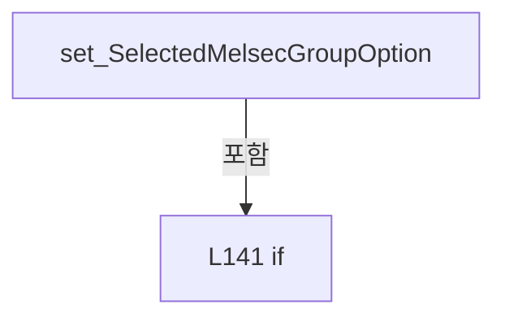

변경 전 점검: 입력/반환 타입, 위 호출자, 예외/취소 경로, 공유 상태와 저장·전송 소비자를 함께 확인합니다. 값의 단위나 물리 방향을 이름만으로 확정하지 않습니다.

### PropertyDeclaration `MelsecRows` · L150–150

[Drilling.UI/Menu/Menus/CMenuMonitor.cs:150–150](https://github.com/kjuws10-rgb/A3Drilling/blob/0219666f9053b907d96d7e0aa7d0c6c1be3a73d4/Drilling.UI/Menu/Menus/CMenuMonitor.cs#L150-L150)

| 항목 | 실제 추출 값 |
| --- | --- |
| 서명 | System.Collections.Generic.IReadOnlyList<Drilling.UI.Menu.Menus.ST_MONITOR_MELSEC_ROW> Drilling.UI.Menu.Menus.CMenuMonitor.MelsecRows |
| 접근/수식자 | Public / public |
| 반환/값 타입 | System.Collections.Generic.IReadOnlyList<Drilling.UI.Menu.Menus.ST_MONITOR_MELSEC_ROW> |
| 소속 타입 | NamedType:Drilling.UI.Menu.Menus.CMenuMonitor |

현재 부분 분석에서 직접 연결된 호출자는 없습니다. XAML/이벤트/인터페이스·델리게이트·외부 진입을 추가 확인해야 하며, 미사용으로 판정한 것이 아닙니다.

변경 전 점검: 입력/반환 타입, 위 호출자, 예외/취소 경로, 공유 상태와 저장·전송 소비자를 함께 확인합니다. 값의 단위나 물리 방향을 이름만으로 확정하지 않습니다.

### GetAccessorDeclaration `get_MelsecRows` · L150–150

[Drilling.UI/Menu/Menus/CMenuMonitor.cs:150–150](https://github.com/kjuws10-rgb/A3Drilling/blob/0219666f9053b907d96d7e0aa7d0c6c1be3a73d4/Drilling.UI/Menu/Menus/CMenuMonitor.cs#L150-L150)

| 항목 | 실제 추출 값 |
| --- | --- |
| 서명 | System.Collections.Generic.IReadOnlyList<Drilling.UI.Menu.Menus.ST_MONITOR_MELSEC_ROW> Drilling.UI.Menu.Menus.CMenuMonitor.MelsecRows.get |
| 접근/수식자 | Public / get |
| 반환/값 타입 | System.Collections.Generic.IReadOnlyList<Drilling.UI.Menu.Menus.ST_MONITOR_MELSEC_ROW> |
| 소속 타입 | NamedType:Drilling.UI.Menu.Menus.CMenuMonitor |

현재 부분 분석에서 직접 연결된 호출자는 없습니다. XAML/이벤트/인터페이스·델리게이트·외부 진입을 추가 확인해야 하며, 미사용으로 판정한 것이 아닙니다.

변경 전 점검: 입력/반환 타입, 위 호출자, 예외/취소 경로, 공유 상태와 저장·전송 소비자를 함께 확인합니다. 값의 단위나 물리 방향을 이름만으로 확정하지 않습니다.

### SetAccessorDeclaration `set_MelsecRows` · L150–150

[Drilling.UI/Menu/Menus/CMenuMonitor.cs:150–150](https://github.com/kjuws10-rgb/A3Drilling/blob/0219666f9053b907d96d7e0aa7d0c6c1be3a73d4/Drilling.UI/Menu/Menus/CMenuMonitor.cs#L150-L150)

| 항목 | 실제 추출 값 |
| --- | --- |
| 서명 | void Drilling.UI.Menu.Menus.CMenuMonitor.MelsecRows.set |
| 접근/수식자 | Private / private, set |
| 반환/값 타입 | void |
| 소속 타입 | NamedType:Drilling.UI.Menu.Menus.CMenuMonitor |

입력 계약:

| 이름 | 타입 | 전달 | 선택/기본값 |
| --- | --- | --- | --- |
| value | System.Collections.Generic.IReadOnlyList<Drilling.UI.Menu.Menus.ST_MONITOR_MELSEC_ROW> | None | False /  |

현재 부분 분석에서 직접 연결된 호출자는 없습니다. XAML/이벤트/인터페이스·델리게이트·외부 진입을 추가 확인해야 하며, 미사용으로 판정한 것이 아닙니다.

변경 전 점검: 입력/반환 타입, 위 호출자, 예외/취소 경로, 공유 상태와 저장·전송 소비자를 함께 확인합니다. 값의 단위나 물리 방향을 이름만으로 확정하지 않습니다.

### PropertyDeclaration `MelsecReadRows` · L151–151

[Drilling.UI/Menu/Menus/CMenuMonitor.cs:151–151](https://github.com/kjuws10-rgb/A3Drilling/blob/0219666f9053b907d96d7e0aa7d0c6c1be3a73d4/Drilling.UI/Menu/Menus/CMenuMonitor.cs#L151-L151)

| 항목 | 실제 추출 값 |
| --- | --- |
| 서명 | System.Collections.Generic.IReadOnlyList<Drilling.UI.Menu.Menus.ST_MONITOR_MELSEC_ROW> Drilling.UI.Menu.Menus.CMenuMonitor.MelsecReadRows |
| 접근/수식자 | Public / public |
| 반환/값 타입 | System.Collections.Generic.IReadOnlyList<Drilling.UI.Menu.Menus.ST_MONITOR_MELSEC_ROW> |
| 소속 타입 | NamedType:Drilling.UI.Menu.Menus.CMenuMonitor |

현재 부분 분석에서 직접 연결된 호출자는 없습니다. XAML/이벤트/인터페이스·델리게이트·외부 진입을 추가 확인해야 하며, 미사용으로 판정한 것이 아닙니다.

변경 전 점검: 입력/반환 타입, 위 호출자, 예외/취소 경로, 공유 상태와 저장·전송 소비자를 함께 확인합니다. 값의 단위나 물리 방향을 이름만으로 확정하지 않습니다.

### GetAccessorDeclaration `get_MelsecReadRows` · L151–151

[Drilling.UI/Menu/Menus/CMenuMonitor.cs:151–151](https://github.com/kjuws10-rgb/A3Drilling/blob/0219666f9053b907d96d7e0aa7d0c6c1be3a73d4/Drilling.UI/Menu/Menus/CMenuMonitor.cs#L151-L151)

| 항목 | 실제 추출 값 |
| --- | --- |
| 서명 | System.Collections.Generic.IReadOnlyList<Drilling.UI.Menu.Menus.ST_MONITOR_MELSEC_ROW> Drilling.UI.Menu.Menus.CMenuMonitor.MelsecReadRows.get |
| 접근/수식자 | Public / get |
| 반환/값 타입 | System.Collections.Generic.IReadOnlyList<Drilling.UI.Menu.Menus.ST_MONITOR_MELSEC_ROW> |
| 소속 타입 | NamedType:Drilling.UI.Menu.Menus.CMenuMonitor |

현재 부분 분석에서 직접 연결된 호출자는 없습니다. XAML/이벤트/인터페이스·델리게이트·외부 진입을 추가 확인해야 하며, 미사용으로 판정한 것이 아닙니다.

변경 전 점검: 입력/반환 타입, 위 호출자, 예외/취소 경로, 공유 상태와 저장·전송 소비자를 함께 확인합니다. 값의 단위나 물리 방향을 이름만으로 확정하지 않습니다.

### SetAccessorDeclaration `set_MelsecReadRows` · L151–151

[Drilling.UI/Menu/Menus/CMenuMonitor.cs:151–151](https://github.com/kjuws10-rgb/A3Drilling/blob/0219666f9053b907d96d7e0aa7d0c6c1be3a73d4/Drilling.UI/Menu/Menus/CMenuMonitor.cs#L151-L151)

| 항목 | 실제 추출 값 |
| --- | --- |
| 서명 | void Drilling.UI.Menu.Menus.CMenuMonitor.MelsecReadRows.set |
| 접근/수식자 | Private / private, set |
| 반환/값 타입 | void |
| 소속 타입 | NamedType:Drilling.UI.Menu.Menus.CMenuMonitor |

입력 계약:

| 이름 | 타입 | 전달 | 선택/기본값 |
| --- | --- | --- | --- |
| value | System.Collections.Generic.IReadOnlyList<Drilling.UI.Menu.Menus.ST_MONITOR_MELSEC_ROW> | None | False /  |

현재 부분 분석에서 직접 연결된 호출자는 없습니다. XAML/이벤트/인터페이스·델리게이트·외부 진입을 추가 확인해야 하며, 미사용으로 판정한 것이 아닙니다.

변경 전 점검: 입력/반환 타입, 위 호출자, 예외/취소 경로, 공유 상태와 저장·전송 소비자를 함께 확인합니다. 값의 단위나 물리 방향을 이름만으로 확정하지 않습니다.

### PropertyDeclaration `MelsecWriteRows` · L152–152

[Drilling.UI/Menu/Menus/CMenuMonitor.cs:152–152](https://github.com/kjuws10-rgb/A3Drilling/blob/0219666f9053b907d96d7e0aa7d0c6c1be3a73d4/Drilling.UI/Menu/Menus/CMenuMonitor.cs#L152-L152)

| 항목 | 실제 추출 값 |
| --- | --- |
| 서명 | System.Collections.Generic.IReadOnlyList<Drilling.UI.Menu.Menus.ST_MONITOR_MELSEC_ROW> Drilling.UI.Menu.Menus.CMenuMonitor.MelsecWriteRows |
| 접근/수식자 | Public / public |
| 반환/값 타입 | System.Collections.Generic.IReadOnlyList<Drilling.UI.Menu.Menus.ST_MONITOR_MELSEC_ROW> |
| 소속 타입 | NamedType:Drilling.UI.Menu.Menus.CMenuMonitor |

현재 부분 분석에서 직접 연결된 호출자는 없습니다. XAML/이벤트/인터페이스·델리게이트·외부 진입을 추가 확인해야 하며, 미사용으로 판정한 것이 아닙니다.

변경 전 점검: 입력/반환 타입, 위 호출자, 예외/취소 경로, 공유 상태와 저장·전송 소비자를 함께 확인합니다. 값의 단위나 물리 방향을 이름만으로 확정하지 않습니다.

### GetAccessorDeclaration `get_MelsecWriteRows` · L152–152

[Drilling.UI/Menu/Menus/CMenuMonitor.cs:152–152](https://github.com/kjuws10-rgb/A3Drilling/blob/0219666f9053b907d96d7e0aa7d0c6c1be3a73d4/Drilling.UI/Menu/Menus/CMenuMonitor.cs#L152-L152)

| 항목 | 실제 추출 값 |
| --- | --- |
| 서명 | System.Collections.Generic.IReadOnlyList<Drilling.UI.Menu.Menus.ST_MONITOR_MELSEC_ROW> Drilling.UI.Menu.Menus.CMenuMonitor.MelsecWriteRows.get |
| 접근/수식자 | Public / get |
| 반환/값 타입 | System.Collections.Generic.IReadOnlyList<Drilling.UI.Menu.Menus.ST_MONITOR_MELSEC_ROW> |
| 소속 타입 | NamedType:Drilling.UI.Menu.Menus.CMenuMonitor |

현재 부분 분석에서 직접 연결된 호출자는 없습니다. XAML/이벤트/인터페이스·델리게이트·외부 진입을 추가 확인해야 하며, 미사용으로 판정한 것이 아닙니다.

변경 전 점검: 입력/반환 타입, 위 호출자, 예외/취소 경로, 공유 상태와 저장·전송 소비자를 함께 확인합니다. 값의 단위나 물리 방향을 이름만으로 확정하지 않습니다.

### SetAccessorDeclaration `set_MelsecWriteRows` · L152–152

[Drilling.UI/Menu/Menus/CMenuMonitor.cs:152–152](https://github.com/kjuws10-rgb/A3Drilling/blob/0219666f9053b907d96d7e0aa7d0c6c1be3a73d4/Drilling.UI/Menu/Menus/CMenuMonitor.cs#L152-L152)

| 항목 | 실제 추출 값 |
| --- | --- |
| 서명 | void Drilling.UI.Menu.Menus.CMenuMonitor.MelsecWriteRows.set |
| 접근/수식자 | Private / private, set |
| 반환/값 타입 | void |
| 소속 타입 | NamedType:Drilling.UI.Menu.Menus.CMenuMonitor |

입력 계약:

| 이름 | 타입 | 전달 | 선택/기본값 |
| --- | --- | --- | --- |
| value | System.Collections.Generic.IReadOnlyList<Drilling.UI.Menu.Menus.ST_MONITOR_MELSEC_ROW> | None | False /  |

현재 부분 분석에서 직접 연결된 호출자는 없습니다. XAML/이벤트/인터페이스·델리게이트·외부 진입을 추가 확인해야 하며, 미사용으로 판정한 것이 아닙니다.

변경 전 점검: 입력/반환 타입, 위 호출자, 예외/취소 경로, 공유 상태와 저장·전송 소비자를 함께 확인합니다. 값의 단위나 물리 방향을 이름만으로 확정하지 않습니다.

### PropertyDeclaration `CoordinateBasisOptions` · L153–153

[Drilling.UI/Menu/Menus/CMenuMonitor.cs:153–153](https://github.com/kjuws10-rgb/A3Drilling/blob/0219666f9053b907d96d7e0aa7d0c6c1be3a73d4/Drilling.UI/Menu/Menus/CMenuMonitor.cs#L153-L153)

| 항목 | 실제 추출 값 |
| --- | --- |
| 서명 | System.Collections.Generic.IReadOnlyList<Drilling.UI.Menu.Menus.ST_MONITOR_COORDINATE_BASIS_OPTION> Drilling.UI.Menu.Menus.CMenuMonitor.CoordinateBasisOptions |
| 접근/수식자 | Public / public |
| 반환/값 타입 | System.Collections.Generic.IReadOnlyList<Drilling.UI.Menu.Menus.ST_MONITOR_COORDINATE_BASIS_OPTION> |
| 소속 타입 | NamedType:Drilling.UI.Menu.Menus.CMenuMonitor |

현재 부분 분석에서 직접 연결된 호출자는 없습니다. XAML/이벤트/인터페이스·델리게이트·외부 진입을 추가 확인해야 하며, 미사용으로 판정한 것이 아닙니다.

변경 전 점검: 입력/반환 타입, 위 호출자, 예외/취소 경로, 공유 상태와 저장·전송 소비자를 함께 확인합니다. 값의 단위나 물리 방향을 이름만으로 확정하지 않습니다.

### GetAccessorDeclaration `get_CoordinateBasisOptions` · L153–153

[Drilling.UI/Menu/Menus/CMenuMonitor.cs:153–153](https://github.com/kjuws10-rgb/A3Drilling/blob/0219666f9053b907d96d7e0aa7d0c6c1be3a73d4/Drilling.UI/Menu/Menus/CMenuMonitor.cs#L153-L153)

| 항목 | 실제 추출 값 |
| --- | --- |
| 서명 | System.Collections.Generic.IReadOnlyList<Drilling.UI.Menu.Menus.ST_MONITOR_COORDINATE_BASIS_OPTION> Drilling.UI.Menu.Menus.CMenuMonitor.CoordinateBasisOptions.get |
| 접근/수식자 | Public / get |
| 반환/값 타입 | System.Collections.Generic.IReadOnlyList<Drilling.UI.Menu.Menus.ST_MONITOR_COORDINATE_BASIS_OPTION> |
| 소속 타입 | NamedType:Drilling.UI.Menu.Menus.CMenuMonitor |

현재 부분 분석에서 직접 연결된 호출자는 없습니다. XAML/이벤트/인터페이스·델리게이트·외부 진입을 추가 확인해야 하며, 미사용으로 판정한 것이 아닙니다.

변경 전 점검: 입력/반환 타입, 위 호출자, 예외/취소 경로, 공유 상태와 저장·전송 소비자를 함께 확인합니다. 값의 단위나 물리 방향을 이름만으로 확정하지 않습니다.

### SetAccessorDeclaration `set_CoordinateBasisOptions` · L153–153

[Drilling.UI/Menu/Menus/CMenuMonitor.cs:153–153](https://github.com/kjuws10-rgb/A3Drilling/blob/0219666f9053b907d96d7e0aa7d0c6c1be3a73d4/Drilling.UI/Menu/Menus/CMenuMonitor.cs#L153-L153)

| 항목 | 실제 추출 값 |
| --- | --- |
| 서명 | void Drilling.UI.Menu.Menus.CMenuMonitor.CoordinateBasisOptions.set |
| 접근/수식자 | Private / private, set |
| 반환/값 타입 | void |
| 소속 타입 | NamedType:Drilling.UI.Menu.Menus.CMenuMonitor |

입력 계약:

| 이름 | 타입 | 전달 | 선택/기본값 |
| --- | --- | --- | --- |
| value | System.Collections.Generic.IReadOnlyList<Drilling.UI.Menu.Menus.ST_MONITOR_COORDINATE_BASIS_OPTION> | None | False /  |

현재 부분 분석에서 직접 연결된 호출자는 없습니다. XAML/이벤트/인터페이스·델리게이트·외부 진입을 추가 확인해야 하며, 미사용으로 판정한 것이 아닙니다.

변경 전 점검: 입력/반환 타입, 위 호출자, 예외/취소 경로, 공유 상태와 저장·전송 소비자를 함께 확인합니다. 값의 단위나 물리 방향을 이름만으로 확정하지 않습니다.

### PropertyDeclaration `CoordinateValueRows` · L154–154

[Drilling.UI/Menu/Menus/CMenuMonitor.cs:154–154](https://github.com/kjuws10-rgb/A3Drilling/blob/0219666f9053b907d96d7e0aa7d0c6c1be3a73d4/Drilling.UI/Menu/Menus/CMenuMonitor.cs#L154-L154)

| 항목 | 실제 추출 값 |
| --- | --- |
| 서명 | System.Collections.Generic.IReadOnlyList<Drilling.UI.Menu.Menus.ST_MONITOR_COORDINATE_VALUE_ROW> Drilling.UI.Menu.Menus.CMenuMonitor.CoordinateValueRows |
| 접근/수식자 | Public / public |
| 반환/값 타입 | System.Collections.Generic.IReadOnlyList<Drilling.UI.Menu.Menus.ST_MONITOR_COORDINATE_VALUE_ROW> |
| 소속 타입 | NamedType:Drilling.UI.Menu.Menus.CMenuMonitor |

현재 부분 분석에서 직접 연결된 호출자는 없습니다. XAML/이벤트/인터페이스·델리게이트·외부 진입을 추가 확인해야 하며, 미사용으로 판정한 것이 아닙니다.

변경 전 점검: 입력/반환 타입, 위 호출자, 예외/취소 경로, 공유 상태와 저장·전송 소비자를 함께 확인합니다. 값의 단위나 물리 방향을 이름만으로 확정하지 않습니다.

### GetAccessorDeclaration `get_CoordinateValueRows` · L154–154

[Drilling.UI/Menu/Menus/CMenuMonitor.cs:154–154](https://github.com/kjuws10-rgb/A3Drilling/blob/0219666f9053b907d96d7e0aa7d0c6c1be3a73d4/Drilling.UI/Menu/Menus/CMenuMonitor.cs#L154-L154)

| 항목 | 실제 추출 값 |
| --- | --- |
| 서명 | System.Collections.Generic.IReadOnlyList<Drilling.UI.Menu.Menus.ST_MONITOR_COORDINATE_VALUE_ROW> Drilling.UI.Menu.Menus.CMenuMonitor.CoordinateValueRows.get |
| 접근/수식자 | Public / get |
| 반환/값 타입 | System.Collections.Generic.IReadOnlyList<Drilling.UI.Menu.Menus.ST_MONITOR_COORDINATE_VALUE_ROW> |
| 소속 타입 | NamedType:Drilling.UI.Menu.Menus.CMenuMonitor |

현재 부분 분석에서 직접 연결된 호출자는 없습니다. XAML/이벤트/인터페이스·델리게이트·외부 진입을 추가 확인해야 하며, 미사용으로 판정한 것이 아닙니다.

변경 전 점검: 입력/반환 타입, 위 호출자, 예외/취소 경로, 공유 상태와 저장·전송 소비자를 함께 확인합니다. 값의 단위나 물리 방향을 이름만으로 확정하지 않습니다.

### SetAccessorDeclaration `set_CoordinateValueRows` · L154–154

[Drilling.UI/Menu/Menus/CMenuMonitor.cs:154–154](https://github.com/kjuws10-rgb/A3Drilling/blob/0219666f9053b907d96d7e0aa7d0c6c1be3a73d4/Drilling.UI/Menu/Menus/CMenuMonitor.cs#L154-L154)

| 항목 | 실제 추출 값 |
| --- | --- |
| 서명 | void Drilling.UI.Menu.Menus.CMenuMonitor.CoordinateValueRows.set |
| 접근/수식자 | Private / private, set |
| 반환/값 타입 | void |
| 소속 타입 | NamedType:Drilling.UI.Menu.Menus.CMenuMonitor |

입력 계약:

| 이름 | 타입 | 전달 | 선택/기본값 |
| --- | --- | --- | --- |
| value | System.Collections.Generic.IReadOnlyList<Drilling.UI.Menu.Menus.ST_MONITOR_COORDINATE_VALUE_ROW> | None | False /  |

현재 부분 분석에서 직접 연결된 호출자는 없습니다. XAML/이벤트/인터페이스·델리게이트·외부 진입을 추가 확인해야 하며, 미사용으로 판정한 것이 아닙니다.

변경 전 점검: 입력/반환 타입, 위 호출자, 예외/취소 경로, 공유 상태와 저장·전송 소비자를 함께 확인합니다. 값의 단위나 물리 방향을 이름만으로 확정하지 않습니다.

### PropertyDeclaration `CoordinateSelectedRecipeName` · L155–155

[Drilling.UI/Menu/Menus/CMenuMonitor.cs:155–155](https://github.com/kjuws10-rgb/A3Drilling/blob/0219666f9053b907d96d7e0aa7d0c6c1be3a73d4/Drilling.UI/Menu/Menus/CMenuMonitor.cs#L155-L155)

| 항목 | 실제 추출 값 |
| --- | --- |
| 서명 | string Drilling.UI.Menu.Menus.CMenuMonitor.CoordinateSelectedRecipeName |
| 접근/수식자 | Public / public |
| 반환/값 타입 | string |
| 소속 타입 | NamedType:Drilling.UI.Menu.Menus.CMenuMonitor |

현재 부분 분석에서 직접 연결된 호출자는 없습니다. XAML/이벤트/인터페이스·델리게이트·외부 진입을 추가 확인해야 하며, 미사용으로 판정한 것이 아닙니다.

변경 전 점검: 입력/반환 타입, 위 호출자, 예외/취소 경로, 공유 상태와 저장·전송 소비자를 함께 확인합니다. 값의 단위나 물리 방향을 이름만으로 확정하지 않습니다.

### GetAccessorDeclaration `get_CoordinateSelectedRecipeName` · L155–155

[Drilling.UI/Menu/Menus/CMenuMonitor.cs:155–155](https://github.com/kjuws10-rgb/A3Drilling/blob/0219666f9053b907d96d7e0aa7d0c6c1be3a73d4/Drilling.UI/Menu/Menus/CMenuMonitor.cs#L155-L155)

| 항목 | 실제 추출 값 |
| --- | --- |
| 서명 | string Drilling.UI.Menu.Menus.CMenuMonitor.CoordinateSelectedRecipeName.get |
| 접근/수식자 | Public / get |
| 반환/값 타입 | string |
| 소속 타입 | NamedType:Drilling.UI.Menu.Menus.CMenuMonitor |

현재 부분 분석에서 직접 연결된 호출자는 없습니다. XAML/이벤트/인터페이스·델리게이트·외부 진입을 추가 확인해야 하며, 미사용으로 판정한 것이 아닙니다.

변경 전 점검: 입력/반환 타입, 위 호출자, 예외/취소 경로, 공유 상태와 저장·전송 소비자를 함께 확인합니다. 값의 단위나 물리 방향을 이름만으로 확정하지 않습니다.

### SetAccessorDeclaration `set_CoordinateSelectedRecipeName` · L155–155

[Drilling.UI/Menu/Menus/CMenuMonitor.cs:155–155](https://github.com/kjuws10-rgb/A3Drilling/blob/0219666f9053b907d96d7e0aa7d0c6c1be3a73d4/Drilling.UI/Menu/Menus/CMenuMonitor.cs#L155-L155)

| 항목 | 실제 추출 값 |
| --- | --- |
| 서명 | void Drilling.UI.Menu.Menus.CMenuMonitor.CoordinateSelectedRecipeName.set |
| 접근/수식자 | Private / private, set |
| 반환/값 타입 | void |
| 소속 타입 | NamedType:Drilling.UI.Menu.Menus.CMenuMonitor |

입력 계약:

| 이름 | 타입 | 전달 | 선택/기본값 |
| --- | --- | --- | --- |
| value | string | None | False /  |

현재 부분 분석에서 직접 연결된 호출자는 없습니다. XAML/이벤트/인터페이스·델리게이트·외부 진입을 추가 확인해야 하며, 미사용으로 판정한 것이 아닙니다.

변경 전 점검: 입력/반환 타입, 위 호출자, 예외/취소 경로, 공유 상태와 저장·전송 소비자를 함께 확인합니다. 값의 단위나 물리 방향을 이름만으로 확정하지 않습니다.

### PropertyDeclaration `CoordinateSelectedBasisName` · L156–156

[Drilling.UI/Menu/Menus/CMenuMonitor.cs:156–156](https://github.com/kjuws10-rgb/A3Drilling/blob/0219666f9053b907d96d7e0aa7d0c6c1be3a73d4/Drilling.UI/Menu/Menus/CMenuMonitor.cs#L156-L156)

| 항목 | 실제 추출 값 |
| --- | --- |
| 서명 | string Drilling.UI.Menu.Menus.CMenuMonitor.CoordinateSelectedBasisName |
| 접근/수식자 | Public / public |
| 반환/값 타입 | string |
| 소속 타입 | NamedType:Drilling.UI.Menu.Menus.CMenuMonitor |

현재 부분 분석에서 직접 연결된 호출자는 없습니다. XAML/이벤트/인터페이스·델리게이트·외부 진입을 추가 확인해야 하며, 미사용으로 판정한 것이 아닙니다.

변경 전 점검: 입력/반환 타입, 위 호출자, 예외/취소 경로, 공유 상태와 저장·전송 소비자를 함께 확인합니다. 값의 단위나 물리 방향을 이름만으로 확정하지 않습니다.

### GetAccessorDeclaration `get_CoordinateSelectedBasisName` · L156–156

[Drilling.UI/Menu/Menus/CMenuMonitor.cs:156–156](https://github.com/kjuws10-rgb/A3Drilling/blob/0219666f9053b907d96d7e0aa7d0c6c1be3a73d4/Drilling.UI/Menu/Menus/CMenuMonitor.cs#L156-L156)

| 항목 | 실제 추출 값 |
| --- | --- |
| 서명 | string Drilling.UI.Menu.Menus.CMenuMonitor.CoordinateSelectedBasisName.get |
| 접근/수식자 | Public / get |
| 반환/값 타입 | string |
| 소속 타입 | NamedType:Drilling.UI.Menu.Menus.CMenuMonitor |

현재 부분 분석에서 직접 연결된 호출자는 없습니다. XAML/이벤트/인터페이스·델리게이트·외부 진입을 추가 확인해야 하며, 미사용으로 판정한 것이 아닙니다.

변경 전 점검: 입력/반환 타입, 위 호출자, 예외/취소 경로, 공유 상태와 저장·전송 소비자를 함께 확인합니다. 값의 단위나 물리 방향을 이름만으로 확정하지 않습니다.

### SetAccessorDeclaration `set_CoordinateSelectedBasisName` · L156–156

[Drilling.UI/Menu/Menus/CMenuMonitor.cs:156–156](https://github.com/kjuws10-rgb/A3Drilling/blob/0219666f9053b907d96d7e0aa7d0c6c1be3a73d4/Drilling.UI/Menu/Menus/CMenuMonitor.cs#L156-L156)

| 항목 | 실제 추출 값 |
| --- | --- |
| 서명 | void Drilling.UI.Menu.Menus.CMenuMonitor.CoordinateSelectedBasisName.set |
| 접근/수식자 | Private / private, set |
| 반환/값 타입 | void |
| 소속 타입 | NamedType:Drilling.UI.Menu.Menus.CMenuMonitor |

입력 계약:

| 이름 | 타입 | 전달 | 선택/기본값 |
| --- | --- | --- | --- |
| value | string | None | False /  |

현재 부분 분석에서 직접 연결된 호출자는 없습니다. XAML/이벤트/인터페이스·델리게이트·외부 진입을 추가 확인해야 하며, 미사용으로 판정한 것이 아닙니다.

변경 전 점검: 입력/반환 타입, 위 호출자, 예외/취소 경로, 공유 상태와 저장·전송 소비자를 함께 확인합니다. 값의 단위나 물리 방향을 이름만으로 확정하지 않습니다.

### PropertyDeclaration `CoordinateBasisDescription` · L157–157

[Drilling.UI/Menu/Menus/CMenuMonitor.cs:157–157](https://github.com/kjuws10-rgb/A3Drilling/blob/0219666f9053b907d96d7e0aa7d0c6c1be3a73d4/Drilling.UI/Menu/Menus/CMenuMonitor.cs#L157-L157)

| 항목 | 실제 추출 값 |
| --- | --- |
| 서명 | string Drilling.UI.Menu.Menus.CMenuMonitor.CoordinateBasisDescription |
| 접근/수식자 | Public / public |
| 반환/값 타입 | string |
| 소속 타입 | NamedType:Drilling.UI.Menu.Menus.CMenuMonitor |

현재 부분 분석에서 직접 연결된 호출자는 없습니다. XAML/이벤트/인터페이스·델리게이트·외부 진입을 추가 확인해야 하며, 미사용으로 판정한 것이 아닙니다.

변경 전 점검: 입력/반환 타입, 위 호출자, 예외/취소 경로, 공유 상태와 저장·전송 소비자를 함께 확인합니다. 값의 단위나 물리 방향을 이름만으로 확정하지 않습니다.

### GetAccessorDeclaration `get_CoordinateBasisDescription` · L157–157

[Drilling.UI/Menu/Menus/CMenuMonitor.cs:157–157](https://github.com/kjuws10-rgb/A3Drilling/blob/0219666f9053b907d96d7e0aa7d0c6c1be3a73d4/Drilling.UI/Menu/Menus/CMenuMonitor.cs#L157-L157)

| 항목 | 실제 추출 값 |
| --- | --- |
| 서명 | string Drilling.UI.Menu.Menus.CMenuMonitor.CoordinateBasisDescription.get |
| 접근/수식자 | Public / get |
| 반환/값 타입 | string |
| 소속 타입 | NamedType:Drilling.UI.Menu.Menus.CMenuMonitor |

현재 부분 분석에서 직접 연결된 호출자는 없습니다. XAML/이벤트/인터페이스·델리게이트·외부 진입을 추가 확인해야 하며, 미사용으로 판정한 것이 아닙니다.

변경 전 점검: 입력/반환 타입, 위 호출자, 예외/취소 경로, 공유 상태와 저장·전송 소비자를 함께 확인합니다. 값의 단위나 물리 방향을 이름만으로 확정하지 않습니다.

### SetAccessorDeclaration `set_CoordinateBasisDescription` · L157–157

[Drilling.UI/Menu/Menus/CMenuMonitor.cs:157–157](https://github.com/kjuws10-rgb/A3Drilling/blob/0219666f9053b907d96d7e0aa7d0c6c1be3a73d4/Drilling.UI/Menu/Menus/CMenuMonitor.cs#L157-L157)

| 항목 | 실제 추출 값 |
| --- | --- |
| 서명 | void Drilling.UI.Menu.Menus.CMenuMonitor.CoordinateBasisDescription.set |
| 접근/수식자 | Private / private, set |
| 반환/값 타입 | void |
| 소속 타입 | NamedType:Drilling.UI.Menu.Menus.CMenuMonitor |

입력 계약:

| 이름 | 타입 | 전달 | 선택/기본값 |
| --- | --- | --- | --- |
| value | string | None | False /  |

현재 부분 분석에서 직접 연결된 호출자는 없습니다. XAML/이벤트/인터페이스·델리게이트·외부 진입을 추가 확인해야 하며, 미사용으로 판정한 것이 아닙니다.

변경 전 점검: 입력/반환 타입, 위 호출자, 예외/취소 경로, 공유 상태와 저장·전송 소비자를 함께 확인합니다. 값의 단위나 물리 방향을 이름만으로 확정하지 않습니다.

### PropertyDeclaration `CoordinateCellPreviewLabels` · L158–158

[Drilling.UI/Menu/Menus/CMenuMonitor.cs:158–158](https://github.com/kjuws10-rgb/A3Drilling/blob/0219666f9053b907d96d7e0aa7d0c6c1be3a73d4/Drilling.UI/Menu/Menus/CMenuMonitor.cs#L158-L158)

| 항목 | 실제 추출 값 |
| --- | --- |
| 서명 | System.Collections.Generic.IReadOnlyList<Drilling.UI.Menu.Menus.ST_CELL_PREVIEW_LABEL> Drilling.UI.Menu.Menus.CMenuMonitor.CoordinateCellPreviewLabels |
| 접근/수식자 | Public / public |
| 반환/값 타입 | System.Collections.Generic.IReadOnlyList<Drilling.UI.Menu.Menus.ST_CELL_PREVIEW_LABEL> |
| 소속 타입 | NamedType:Drilling.UI.Menu.Menus.CMenuMonitor |

현재 부분 분석에서 직접 연결된 호출자는 없습니다. XAML/이벤트/인터페이스·델리게이트·외부 진입을 추가 확인해야 하며, 미사용으로 판정한 것이 아닙니다.

변경 전 점검: 입력/반환 타입, 위 호출자, 예외/취소 경로, 공유 상태와 저장·전송 소비자를 함께 확인합니다. 값의 단위나 물리 방향을 이름만으로 확정하지 않습니다.

### GetAccessorDeclaration `get_CoordinateCellPreviewLabels` · L158–158

[Drilling.UI/Menu/Menus/CMenuMonitor.cs:158–158](https://github.com/kjuws10-rgb/A3Drilling/blob/0219666f9053b907d96d7e0aa7d0c6c1be3a73d4/Drilling.UI/Menu/Menus/CMenuMonitor.cs#L158-L158)

| 항목 | 실제 추출 값 |
| --- | --- |
| 서명 | System.Collections.Generic.IReadOnlyList<Drilling.UI.Menu.Menus.ST_CELL_PREVIEW_LABEL> Drilling.UI.Menu.Menus.CMenuMonitor.CoordinateCellPreviewLabels.get |
| 접근/수식자 | Public / get |
| 반환/값 타입 | System.Collections.Generic.IReadOnlyList<Drilling.UI.Menu.Menus.ST_CELL_PREVIEW_LABEL> |
| 소속 타입 | NamedType:Drilling.UI.Menu.Menus.CMenuMonitor |

현재 부분 분석에서 직접 연결된 호출자는 없습니다. XAML/이벤트/인터페이스·델리게이트·외부 진입을 추가 확인해야 하며, 미사용으로 판정한 것이 아닙니다.

변경 전 점검: 입력/반환 타입, 위 호출자, 예외/취소 경로, 공유 상태와 저장·전송 소비자를 함께 확인합니다. 값의 단위나 물리 방향을 이름만으로 확정하지 않습니다.

### SetAccessorDeclaration `set_CoordinateCellPreviewLabels` · L158–158

[Drilling.UI/Menu/Menus/CMenuMonitor.cs:158–158](https://github.com/kjuws10-rgb/A3Drilling/blob/0219666f9053b907d96d7e0aa7d0c6c1be3a73d4/Drilling.UI/Menu/Menus/CMenuMonitor.cs#L158-L158)

| 항목 | 실제 추출 값 |
| --- | --- |
| 서명 | void Drilling.UI.Menu.Menus.CMenuMonitor.CoordinateCellPreviewLabels.set |
| 접근/수식자 | Private / private, set |
| 반환/값 타입 | void |
| 소속 타입 | NamedType:Drilling.UI.Menu.Menus.CMenuMonitor |

입력 계약:

| 이름 | 타입 | 전달 | 선택/기본값 |
| --- | --- | --- | --- |
| value | System.Collections.Generic.IReadOnlyList<Drilling.UI.Menu.Menus.ST_CELL_PREVIEW_LABEL> | None | False /  |

현재 부분 분석에서 직접 연결된 호출자는 없습니다. XAML/이벤트/인터페이스·델리게이트·외부 진입을 추가 확인해야 하며, 미사용으로 판정한 것이 아닙니다.

변경 전 점검: 입력/반환 타입, 위 호출자, 예외/취소 경로, 공유 상태와 저장·전송 소비자를 함께 확인합니다. 값의 단위나 물리 방향을 이름만으로 확정하지 않습니다.

### PropertyDeclaration `CoordinateShotMatrixRows` · L159–159

[Drilling.UI/Menu/Menus/CMenuMonitor.cs:159–159](https://github.com/kjuws10-rgb/A3Drilling/blob/0219666f9053b907d96d7e0aa7d0c6c1be3a73d4/Drilling.UI/Menu/Menus/CMenuMonitor.cs#L159-L159)

| 항목 | 실제 추출 값 |
| --- | --- |
| 서명 | System.Collections.Generic.IReadOnlyList<Drilling.UI.Menu.Menus.ST_MONITOR_COORDINATE_SHOT_MATRIX_ROW> Drilling.UI.Menu.Menus.CMenuMonitor.CoordinateShotMatrixRows |
| 접근/수식자 | Public / public |
| 반환/값 타입 | System.Collections.Generic.IReadOnlyList<Drilling.UI.Menu.Menus.ST_MONITOR_COORDINATE_SHOT_MATRIX_ROW> |
| 소속 타입 | NamedType:Drilling.UI.Menu.Menus.CMenuMonitor |

현재 부분 분석에서 직접 연결된 호출자는 없습니다. XAML/이벤트/인터페이스·델리게이트·외부 진입을 추가 확인해야 하며, 미사용으로 판정한 것이 아닙니다.

변경 전 점검: 입력/반환 타입, 위 호출자, 예외/취소 경로, 공유 상태와 저장·전송 소비자를 함께 확인합니다. 값의 단위나 물리 방향을 이름만으로 확정하지 않습니다.

### GetAccessorDeclaration `get_CoordinateShotMatrixRows` · L159–159

[Drilling.UI/Menu/Menus/CMenuMonitor.cs:159–159](https://github.com/kjuws10-rgb/A3Drilling/blob/0219666f9053b907d96d7e0aa7d0c6c1be3a73d4/Drilling.UI/Menu/Menus/CMenuMonitor.cs#L159-L159)

| 항목 | 실제 추출 값 |
| --- | --- |
| 서명 | System.Collections.Generic.IReadOnlyList<Drilling.UI.Menu.Menus.ST_MONITOR_COORDINATE_SHOT_MATRIX_ROW> Drilling.UI.Menu.Menus.CMenuMonitor.CoordinateShotMatrixRows.get |
| 접근/수식자 | Public / get |
| 반환/값 타입 | System.Collections.Generic.IReadOnlyList<Drilling.UI.Menu.Menus.ST_MONITOR_COORDINATE_SHOT_MATRIX_ROW> |
| 소속 타입 | NamedType:Drilling.UI.Menu.Menus.CMenuMonitor |

현재 부분 분석에서 직접 연결된 호출자는 없습니다. XAML/이벤트/인터페이스·델리게이트·외부 진입을 추가 확인해야 하며, 미사용으로 판정한 것이 아닙니다.

변경 전 점검: 입력/반환 타입, 위 호출자, 예외/취소 경로, 공유 상태와 저장·전송 소비자를 함께 확인합니다. 값의 단위나 물리 방향을 이름만으로 확정하지 않습니다.

### SetAccessorDeclaration `set_CoordinateShotMatrixRows` · L159–159

[Drilling.UI/Menu/Menus/CMenuMonitor.cs:159–159](https://github.com/kjuws10-rgb/A3Drilling/blob/0219666f9053b907d96d7e0aa7d0c6c1be3a73d4/Drilling.UI/Menu/Menus/CMenuMonitor.cs#L159-L159)

| 항목 | 실제 추출 값 |
| --- | --- |
| 서명 | void Drilling.UI.Menu.Menus.CMenuMonitor.CoordinateShotMatrixRows.set |
| 접근/수식자 | Private / private, set |
| 반환/값 타입 | void |
| 소속 타입 | NamedType:Drilling.UI.Menu.Menus.CMenuMonitor |

입력 계약:

| 이름 | 타입 | 전달 | 선택/기본값 |
| --- | --- | --- | --- |
| value | System.Collections.Generic.IReadOnlyList<Drilling.UI.Menu.Menus.ST_MONITOR_COORDINATE_SHOT_MATRIX_ROW> | None | False /  |

현재 부분 분석에서 직접 연결된 호출자는 없습니다. XAML/이벤트/인터페이스·델리게이트·외부 진입을 추가 확인해야 하며, 미사용으로 판정한 것이 아닙니다.

변경 전 점검: 입력/반환 타입, 위 호출자, 예외/취소 경로, 공유 상태와 저장·전송 소비자를 함께 확인합니다. 값의 단위나 물리 방향을 이름만으로 확정하지 않습니다.

### PropertyDeclaration `CoordinateShotMapImage` · L160–160

[Drilling.UI/Menu/Menus/CMenuMonitor.cs:160–160](https://github.com/kjuws10-rgb/A3Drilling/blob/0219666f9053b907d96d7e0aa7d0c6c1be3a73d4/Drilling.UI/Menu/Menus/CMenuMonitor.cs#L160-L160)

| 항목 | 실제 추출 값 |
| --- | --- |
| 서명 | ImageSource? Drilling.UI.Menu.Menus.CMenuMonitor.CoordinateShotMapImage |
| 접근/수식자 | Public / public |
| 반환/값 타입 | ImageSource? |
| 소속 타입 | NamedType:Drilling.UI.Menu.Menus.CMenuMonitor |

현재 부분 분석에서 직접 연결된 호출자는 없습니다. XAML/이벤트/인터페이스·델리게이트·외부 진입을 추가 확인해야 하며, 미사용으로 판정한 것이 아닙니다.

변경 전 점검: 입력/반환 타입, 위 호출자, 예외/취소 경로, 공유 상태와 저장·전송 소비자를 함께 확인합니다. 값의 단위나 물리 방향을 이름만으로 확정하지 않습니다.

### GetAccessorDeclaration `get_CoordinateShotMapImage` · L160–160

[Drilling.UI/Menu/Menus/CMenuMonitor.cs:160–160](https://github.com/kjuws10-rgb/A3Drilling/blob/0219666f9053b907d96d7e0aa7d0c6c1be3a73d4/Drilling.UI/Menu/Menus/CMenuMonitor.cs#L160-L160)

| 항목 | 실제 추출 값 |
| --- | --- |
| 서명 | ImageSource? Drilling.UI.Menu.Menus.CMenuMonitor.CoordinateShotMapImage.get |
| 접근/수식자 | Public / get |
| 반환/값 타입 | ImageSource? |
| 소속 타입 | NamedType:Drilling.UI.Menu.Menus.CMenuMonitor |

현재 부분 분석에서 직접 연결된 호출자는 없습니다. XAML/이벤트/인터페이스·델리게이트·외부 진입을 추가 확인해야 하며, 미사용으로 판정한 것이 아닙니다.

변경 전 점검: 입력/반환 타입, 위 호출자, 예외/취소 경로, 공유 상태와 저장·전송 소비자를 함께 확인합니다. 값의 단위나 물리 방향을 이름만으로 확정하지 않습니다.

### SetAccessorDeclaration `set_CoordinateShotMapImage` · L160–160

[Drilling.UI/Menu/Menus/CMenuMonitor.cs:160–160](https://github.com/kjuws10-rgb/A3Drilling/blob/0219666f9053b907d96d7e0aa7d0c6c1be3a73d4/Drilling.UI/Menu/Menus/CMenuMonitor.cs#L160-L160)

| 항목 | 실제 추출 값 |
| --- | --- |
| 서명 | void Drilling.UI.Menu.Menus.CMenuMonitor.CoordinateShotMapImage.set |
| 접근/수식자 | Private / private, set |
| 반환/값 타입 | void |
| 소속 타입 | NamedType:Drilling.UI.Menu.Menus.CMenuMonitor |

입력 계약:

| 이름 | 타입 | 전달 | 선택/기본값 |
| --- | --- | --- | --- |
| value | ImageSource? | None | False /  |

현재 부분 분석에서 직접 연결된 호출자는 없습니다. XAML/이벤트/인터페이스·델리게이트·외부 진입을 추가 확인해야 하며, 미사용으로 판정한 것이 아닙니다.

변경 전 점검: 입력/반환 타입, 위 호출자, 예외/취소 경로, 공유 상태와 저장·전송 소비자를 함께 확인합니다. 값의 단위나 물리 방향을 이름만으로 확정하지 않습니다.

### PropertyDeclaration `CoordinateShotMapSurfaceWidth` · L161–161

[Drilling.UI/Menu/Menus/CMenuMonitor.cs:161–161](https://github.com/kjuws10-rgb/A3Drilling/blob/0219666f9053b907d96d7e0aa7d0c6c1be3a73d4/Drilling.UI/Menu/Menus/CMenuMonitor.cs#L161-L161)

| 항목 | 실제 추출 값 |
| --- | --- |
| 서명 | double Drilling.UI.Menu.Menus.CMenuMonitor.CoordinateShotMapSurfaceWidth |
| 접근/수식자 | Public / public |
| 반환/값 타입 | double |
| 소속 타입 | NamedType:Drilling.UI.Menu.Menus.CMenuMonitor |

현재 부분 분석에서 직접 연결된 호출자는 없습니다. XAML/이벤트/인터페이스·델리게이트·외부 진입을 추가 확인해야 하며, 미사용으로 판정한 것이 아닙니다.

변경 전 점검: 입력/반환 타입, 위 호출자, 예외/취소 경로, 공유 상태와 저장·전송 소비자를 함께 확인합니다. 값의 단위나 물리 방향을 이름만으로 확정하지 않습니다.

### GetAccessorDeclaration `get_CoordinateShotMapSurfaceWidth` · L161–161

[Drilling.UI/Menu/Menus/CMenuMonitor.cs:161–161](https://github.com/kjuws10-rgb/A3Drilling/blob/0219666f9053b907d96d7e0aa7d0c6c1be3a73d4/Drilling.UI/Menu/Menus/CMenuMonitor.cs#L161-L161)

| 항목 | 실제 추출 값 |
| --- | --- |
| 서명 | double Drilling.UI.Menu.Menus.CMenuMonitor.CoordinateShotMapSurfaceWidth.get |
| 접근/수식자 | Public / get |
| 반환/값 타입 | double |
| 소속 타입 | NamedType:Drilling.UI.Menu.Menus.CMenuMonitor |

현재 부분 분석에서 직접 연결된 호출자는 없습니다. XAML/이벤트/인터페이스·델리게이트·외부 진입을 추가 확인해야 하며, 미사용으로 판정한 것이 아닙니다.

변경 전 점검: 입력/반환 타입, 위 호출자, 예외/취소 경로, 공유 상태와 저장·전송 소비자를 함께 확인합니다. 값의 단위나 물리 방향을 이름만으로 확정하지 않습니다.

### SetAccessorDeclaration `set_CoordinateShotMapSurfaceWidth` · L161–161

[Drilling.UI/Menu/Menus/CMenuMonitor.cs:161–161](https://github.com/kjuws10-rgb/A3Drilling/blob/0219666f9053b907d96d7e0aa7d0c6c1be3a73d4/Drilling.UI/Menu/Menus/CMenuMonitor.cs#L161-L161)

| 항목 | 실제 추출 값 |
| --- | --- |
| 서명 | void Drilling.UI.Menu.Menus.CMenuMonitor.CoordinateShotMapSurfaceWidth.set |
| 접근/수식자 | Private / private, set |
| 반환/값 타입 | void |
| 소속 타입 | NamedType:Drilling.UI.Menu.Menus.CMenuMonitor |

입력 계약:

| 이름 | 타입 | 전달 | 선택/기본값 |
| --- | --- | --- | --- |
| value | double | None | False /  |

현재 부분 분석에서 직접 연결된 호출자는 없습니다. XAML/이벤트/인터페이스·델리게이트·외부 진입을 추가 확인해야 하며, 미사용으로 판정한 것이 아닙니다.

변경 전 점검: 입력/반환 타입, 위 호출자, 예외/취소 경로, 공유 상태와 저장·전송 소비자를 함께 확인합니다. 값의 단위나 물리 방향을 이름만으로 확정하지 않습니다.

### PropertyDeclaration `CoordinateShotMapSurfaceHeight` · L162–162

[Drilling.UI/Menu/Menus/CMenuMonitor.cs:162–162](https://github.com/kjuws10-rgb/A3Drilling/blob/0219666f9053b907d96d7e0aa7d0c6c1be3a73d4/Drilling.UI/Menu/Menus/CMenuMonitor.cs#L162-L162)

| 항목 | 실제 추출 값 |
| --- | --- |
| 서명 | double Drilling.UI.Menu.Menus.CMenuMonitor.CoordinateShotMapSurfaceHeight |
| 접근/수식자 | Public / public |
| 반환/값 타입 | double |
| 소속 타입 | NamedType:Drilling.UI.Menu.Menus.CMenuMonitor |

현재 부분 분석에서 직접 연결된 호출자는 없습니다. XAML/이벤트/인터페이스·델리게이트·외부 진입을 추가 확인해야 하며, 미사용으로 판정한 것이 아닙니다.

변경 전 점검: 입력/반환 타입, 위 호출자, 예외/취소 경로, 공유 상태와 저장·전송 소비자를 함께 확인합니다. 값의 단위나 물리 방향을 이름만으로 확정하지 않습니다.

### GetAccessorDeclaration `get_CoordinateShotMapSurfaceHeight` · L162–162

[Drilling.UI/Menu/Menus/CMenuMonitor.cs:162–162](https://github.com/kjuws10-rgb/A3Drilling/blob/0219666f9053b907d96d7e0aa7d0c6c1be3a73d4/Drilling.UI/Menu/Menus/CMenuMonitor.cs#L162-L162)

| 항목 | 실제 추출 값 |
| --- | --- |
| 서명 | double Drilling.UI.Menu.Menus.CMenuMonitor.CoordinateShotMapSurfaceHeight.get |
| 접근/수식자 | Public / get |
| 반환/값 타입 | double |
| 소속 타입 | NamedType:Drilling.UI.Menu.Menus.CMenuMonitor |

현재 부분 분석에서 직접 연결된 호출자는 없습니다. XAML/이벤트/인터페이스·델리게이트·외부 진입을 추가 확인해야 하며, 미사용으로 판정한 것이 아닙니다.

변경 전 점검: 입력/반환 타입, 위 호출자, 예외/취소 경로, 공유 상태와 저장·전송 소비자를 함께 확인합니다. 값의 단위나 물리 방향을 이름만으로 확정하지 않습니다.

### SetAccessorDeclaration `set_CoordinateShotMapSurfaceHeight` · L162–162

[Drilling.UI/Menu/Menus/CMenuMonitor.cs:162–162](https://github.com/kjuws10-rgb/A3Drilling/blob/0219666f9053b907d96d7e0aa7d0c6c1be3a73d4/Drilling.UI/Menu/Menus/CMenuMonitor.cs#L162-L162)

| 항목 | 실제 추출 값 |
| --- | --- |
| 서명 | void Drilling.UI.Menu.Menus.CMenuMonitor.CoordinateShotMapSurfaceHeight.set |
| 접근/수식자 | Private / private, set |
| 반환/값 타입 | void |
| 소속 타입 | NamedType:Drilling.UI.Menu.Menus.CMenuMonitor |

입력 계약:

| 이름 | 타입 | 전달 | 선택/기본값 |
| --- | --- | --- | --- |
| value | double | None | False /  |

현재 부분 분석에서 직접 연결된 호출자는 없습니다. XAML/이벤트/인터페이스·델리게이트·외부 진입을 추가 확인해야 하며, 미사용으로 판정한 것이 아닙니다.

변경 전 점검: 입력/반환 타입, 위 호출자, 예외/취소 경로, 공유 상태와 저장·전송 소비자를 함께 확인합니다. 값의 단위나 물리 방향을 이름만으로 확정하지 않습니다.

### PropertyDeclaration `CoordinateCalculationRows` · L163–163

[Drilling.UI/Menu/Menus/CMenuMonitor.cs:163–163](https://github.com/kjuws10-rgb/A3Drilling/blob/0219666f9053b907d96d7e0aa7d0c6c1be3a73d4/Drilling.UI/Menu/Menus/CMenuMonitor.cs#L163-L163)

| 항목 | 실제 추출 값 |
| --- | --- |
| 서명 | System.Collections.Generic.IReadOnlyList<Drilling.UI.Menu.Menus.ST_MONITOR_COORDINATE_CALCULATION_ROW> Drilling.UI.Menu.Menus.CMenuMonitor.CoordinateCalculationRows |
| 접근/수식자 | Public / public |
| 반환/값 타입 | System.Collections.Generic.IReadOnlyList<Drilling.UI.Menu.Menus.ST_MONITOR_COORDINATE_CALCULATION_ROW> |
| 소속 타입 | NamedType:Drilling.UI.Menu.Menus.CMenuMonitor |

현재 부분 분석에서 직접 연결된 호출자는 없습니다. XAML/이벤트/인터페이스·델리게이트·외부 진입을 추가 확인해야 하며, 미사용으로 판정한 것이 아닙니다.

변경 전 점검: 입력/반환 타입, 위 호출자, 예외/취소 경로, 공유 상태와 저장·전송 소비자를 함께 확인합니다. 값의 단위나 물리 방향을 이름만으로 확정하지 않습니다.

### GetAccessorDeclaration `get_CoordinateCalculationRows` · L163–163

[Drilling.UI/Menu/Menus/CMenuMonitor.cs:163–163](https://github.com/kjuws10-rgb/A3Drilling/blob/0219666f9053b907d96d7e0aa7d0c6c1be3a73d4/Drilling.UI/Menu/Menus/CMenuMonitor.cs#L163-L163)

| 항목 | 실제 추출 값 |
| --- | --- |
| 서명 | System.Collections.Generic.IReadOnlyList<Drilling.UI.Menu.Menus.ST_MONITOR_COORDINATE_CALCULATION_ROW> Drilling.UI.Menu.Menus.CMenuMonitor.CoordinateCalculationRows.get |
| 접근/수식자 | Public / get |
| 반환/값 타입 | System.Collections.Generic.IReadOnlyList<Drilling.UI.Menu.Menus.ST_MONITOR_COORDINATE_CALCULATION_ROW> |
| 소속 타입 | NamedType:Drilling.UI.Menu.Menus.CMenuMonitor |

현재 부분 분석에서 직접 연결된 호출자는 없습니다. XAML/이벤트/인터페이스·델리게이트·외부 진입을 추가 확인해야 하며, 미사용으로 판정한 것이 아닙니다.

변경 전 점검: 입력/반환 타입, 위 호출자, 예외/취소 경로, 공유 상태와 저장·전송 소비자를 함께 확인합니다. 값의 단위나 물리 방향을 이름만으로 확정하지 않습니다.

### SetAccessorDeclaration `set_CoordinateCalculationRows` · L163–163

[Drilling.UI/Menu/Menus/CMenuMonitor.cs:163–163](https://github.com/kjuws10-rgb/A3Drilling/blob/0219666f9053b907d96d7e0aa7d0c6c1be3a73d4/Drilling.UI/Menu/Menus/CMenuMonitor.cs#L163-L163)

| 항목 | 실제 추출 값 |
| --- | --- |
| 서명 | void Drilling.UI.Menu.Menus.CMenuMonitor.CoordinateCalculationRows.set |
| 접근/수식자 | Private / private, set |
| 반환/값 타입 | void |
| 소속 타입 | NamedType:Drilling.UI.Menu.Menus.CMenuMonitor |

입력 계약:

| 이름 | 타입 | 전달 | 선택/기본값 |
| --- | --- | --- | --- |
| value | System.Collections.Generic.IReadOnlyList<Drilling.UI.Menu.Menus.ST_MONITOR_COORDINATE_CALCULATION_ROW> | None | False /  |

현재 부분 분석에서 직접 연결된 호출자는 없습니다. XAML/이벤트/인터페이스·델리게이트·외부 진입을 추가 확인해야 하며, 미사용으로 판정한 것이 아닙니다.

변경 전 점검: 입력/반환 타입, 위 호출자, 예외/취소 경로, 공유 상태와 저장·전송 소비자를 함께 확인합니다. 값의 단위나 물리 방향을 이름만으로 확정하지 않습니다.

### PropertyDeclaration `CoordinateShotCoordinateRows` · L164–164

[Drilling.UI/Menu/Menus/CMenuMonitor.cs:164–164](https://github.com/kjuws10-rgb/A3Drilling/blob/0219666f9053b907d96d7e0aa7d0c6c1be3a73d4/Drilling.UI/Menu/Menus/CMenuMonitor.cs#L164-L164)

| 항목 | 실제 추출 값 |
| --- | --- |
| 서명 | System.Collections.Generic.IReadOnlyList<Drilling.UI.Menu.Menus.ST_MONITOR_COORDINATE_SHOT_COORDINATE_ROW> Drilling.UI.Menu.Menus.CMenuMonitor.CoordinateShotCoordinateRows |
| 접근/수식자 | Public / public |
| 반환/값 타입 | System.Collections.Generic.IReadOnlyList<Drilling.UI.Menu.Menus.ST_MONITOR_COORDINATE_SHOT_COORDINATE_ROW> |
| 소속 타입 | NamedType:Drilling.UI.Menu.Menus.CMenuMonitor |

현재 부분 분석에서 직접 연결된 호출자는 없습니다. XAML/이벤트/인터페이스·델리게이트·외부 진입을 추가 확인해야 하며, 미사용으로 판정한 것이 아닙니다.

변경 전 점검: 입력/반환 타입, 위 호출자, 예외/취소 경로, 공유 상태와 저장·전송 소비자를 함께 확인합니다. 값의 단위나 물리 방향을 이름만으로 확정하지 않습니다.

### GetAccessorDeclaration `get_CoordinateShotCoordinateRows` · L164–164

[Drilling.UI/Menu/Menus/CMenuMonitor.cs:164–164](https://github.com/kjuws10-rgb/A3Drilling/blob/0219666f9053b907d96d7e0aa7d0c6c1be3a73d4/Drilling.UI/Menu/Menus/CMenuMonitor.cs#L164-L164)

| 항목 | 실제 추출 값 |
| --- | --- |
| 서명 | System.Collections.Generic.IReadOnlyList<Drilling.UI.Menu.Menus.ST_MONITOR_COORDINATE_SHOT_COORDINATE_ROW> Drilling.UI.Menu.Menus.CMenuMonitor.CoordinateShotCoordinateRows.get |
| 접근/수식자 | Public / get |
| 반환/값 타입 | System.Collections.Generic.IReadOnlyList<Drilling.UI.Menu.Menus.ST_MONITOR_COORDINATE_SHOT_COORDINATE_ROW> |
| 소속 타입 | NamedType:Drilling.UI.Menu.Menus.CMenuMonitor |

현재 부분 분석에서 직접 연결된 호출자는 없습니다. XAML/이벤트/인터페이스·델리게이트·외부 진입을 추가 확인해야 하며, 미사용으로 판정한 것이 아닙니다.

변경 전 점검: 입력/반환 타입, 위 호출자, 예외/취소 경로, 공유 상태와 저장·전송 소비자를 함께 확인합니다. 값의 단위나 물리 방향을 이름만으로 확정하지 않습니다.

### SetAccessorDeclaration `set_CoordinateShotCoordinateRows` · L164–164

[Drilling.UI/Menu/Menus/CMenuMonitor.cs:164–164](https://github.com/kjuws10-rgb/A3Drilling/blob/0219666f9053b907d96d7e0aa7d0c6c1be3a73d4/Drilling.UI/Menu/Menus/CMenuMonitor.cs#L164-L164)

| 항목 | 실제 추출 값 |
| --- | --- |
| 서명 | void Drilling.UI.Menu.Menus.CMenuMonitor.CoordinateShotCoordinateRows.set |
| 접근/수식자 | Private / private, set |
| 반환/값 타입 | void |
| 소속 타입 | NamedType:Drilling.UI.Menu.Menus.CMenuMonitor |

입력 계약:

| 이름 | 타입 | 전달 | 선택/기본값 |
| --- | --- | --- | --- |
| value | System.Collections.Generic.IReadOnlyList<Drilling.UI.Menu.Menus.ST_MONITOR_COORDINATE_SHOT_COORDINATE_ROW> | None | False /  |

현재 부분 분석에서 직접 연결된 호출자는 없습니다. XAML/이벤트/인터페이스·델리게이트·외부 진입을 추가 확인해야 하며, 미사용으로 판정한 것이 아닙니다.

변경 전 점검: 입력/반환 타입, 위 호출자, 예외/취소 경로, 공유 상태와 저장·전송 소비자를 함께 확인합니다. 값의 단위나 물리 방향을 이름만으로 확정하지 않습니다.

### PropertyDeclaration `CoordinateSelectedShotCoordinateRow` · L165–165

[Drilling.UI/Menu/Menus/CMenuMonitor.cs:165–165](https://github.com/kjuws10-rgb/A3Drilling/blob/0219666f9053b907d96d7e0aa7d0c6c1be3a73d4/Drilling.UI/Menu/Menus/CMenuMonitor.cs#L165-L165)

| 항목 | 실제 추출 값 |
| --- | --- |
| 서명 | Drilling.UI.Menu.Menus.ST_MONITOR_COORDINATE_SHOT_COORDINATE_ROW? Drilling.UI.Menu.Menus.CMenuMonitor.CoordinateSelectedShotCoordinateRow |
| 접근/수식자 | Public / public |
| 반환/값 타입 | Drilling.UI.Menu.Menus.ST_MONITOR_COORDINATE_SHOT_COORDINATE_ROW? |
| 소속 타입 | NamedType:Drilling.UI.Menu.Menus.CMenuMonitor |

현재 부분 분석에서 직접 연결된 호출자는 없습니다. XAML/이벤트/인터페이스·델리게이트·외부 진입을 추가 확인해야 하며, 미사용으로 판정한 것이 아닙니다.

변경 전 점검: 입력/반환 타입, 위 호출자, 예외/취소 경로, 공유 상태와 저장·전송 소비자를 함께 확인합니다. 값의 단위나 물리 방향을 이름만으로 확정하지 않습니다.

### GetAccessorDeclaration `get_CoordinateSelectedShotCoordinateRow` · L165–165

[Drilling.UI/Menu/Menus/CMenuMonitor.cs:165–165](https://github.com/kjuws10-rgb/A3Drilling/blob/0219666f9053b907d96d7e0aa7d0c6c1be3a73d4/Drilling.UI/Menu/Menus/CMenuMonitor.cs#L165-L165)

| 항목 | 실제 추출 값 |
| --- | --- |
| 서명 | Drilling.UI.Menu.Menus.ST_MONITOR_COORDINATE_SHOT_COORDINATE_ROW? Drilling.UI.Menu.Menus.CMenuMonitor.CoordinateSelectedShotCoordinateRow.get |
| 접근/수식자 | Public / get |
| 반환/값 타입 | Drilling.UI.Menu.Menus.ST_MONITOR_COORDINATE_SHOT_COORDINATE_ROW? |
| 소속 타입 | NamedType:Drilling.UI.Menu.Menus.CMenuMonitor |

현재 부분 분석에서 직접 연결된 호출자는 없습니다. XAML/이벤트/인터페이스·델리게이트·외부 진입을 추가 확인해야 하며, 미사용으로 판정한 것이 아닙니다.

변경 전 점검: 입력/반환 타입, 위 호출자, 예외/취소 경로, 공유 상태와 저장·전송 소비자를 함께 확인합니다. 값의 단위나 물리 방향을 이름만으로 확정하지 않습니다.

### SetAccessorDeclaration `set_CoordinateSelectedShotCoordinateRow` · L165–165

[Drilling.UI/Menu/Menus/CMenuMonitor.cs:165–165](https://github.com/kjuws10-rgb/A3Drilling/blob/0219666f9053b907d96d7e0aa7d0c6c1be3a73d4/Drilling.UI/Menu/Menus/CMenuMonitor.cs#L165-L165)

| 항목 | 실제 추출 값 |
| --- | --- |
| 서명 | void Drilling.UI.Menu.Menus.CMenuMonitor.CoordinateSelectedShotCoordinateRow.set |
| 접근/수식자 | Private / private, set |
| 반환/값 타입 | void |
| 소속 타입 | NamedType:Drilling.UI.Menu.Menus.CMenuMonitor |

입력 계약:

| 이름 | 타입 | 전달 | 선택/기본값 |
| --- | --- | --- | --- |
| value | Drilling.UI.Menu.Menus.ST_MONITOR_COORDINATE_SHOT_COORDINATE_ROW? | None | False /  |

현재 부분 분석에서 직접 연결된 호출자는 없습니다. XAML/이벤트/인터페이스·델리게이트·외부 진입을 추가 확인해야 하며, 미사용으로 판정한 것이 아닙니다.

변경 전 점검: 입력/반환 타입, 위 호출자, 예외/취소 경로, 공유 상태와 저장·전송 소비자를 함께 확인합니다. 값의 단위나 물리 방향을 이름만으로 확정하지 않습니다.

### PropertyDeclaration `CoordinateShotCoordinateSummary` · L166–166

[Drilling.UI/Menu/Menus/CMenuMonitor.cs:166–166](https://github.com/kjuws10-rgb/A3Drilling/blob/0219666f9053b907d96d7e0aa7d0c6c1be3a73d4/Drilling.UI/Menu/Menus/CMenuMonitor.cs#L166-L166)

| 항목 | 실제 추출 값 |
| --- | --- |
| 서명 | string Drilling.UI.Menu.Menus.CMenuMonitor.CoordinateShotCoordinateSummary |
| 접근/수식자 | Public / public |
| 반환/값 타입 | string |
| 소속 타입 | NamedType:Drilling.UI.Menu.Menus.CMenuMonitor |

현재 부분 분석에서 직접 연결된 호출자는 없습니다. XAML/이벤트/인터페이스·델리게이트·외부 진입을 추가 확인해야 하며, 미사용으로 판정한 것이 아닙니다.

변경 전 점검: 입력/반환 타입, 위 호출자, 예외/취소 경로, 공유 상태와 저장·전송 소비자를 함께 확인합니다. 값의 단위나 물리 방향을 이름만으로 확정하지 않습니다.

### GetAccessorDeclaration `get_CoordinateShotCoordinateSummary` · L166–166

[Drilling.UI/Menu/Menus/CMenuMonitor.cs:166–166](https://github.com/kjuws10-rgb/A3Drilling/blob/0219666f9053b907d96d7e0aa7d0c6c1be3a73d4/Drilling.UI/Menu/Menus/CMenuMonitor.cs#L166-L166)

| 항목 | 실제 추출 값 |
| --- | --- |
| 서명 | string Drilling.UI.Menu.Menus.CMenuMonitor.CoordinateShotCoordinateSummary.get |
| 접근/수식자 | Public / get |
| 반환/값 타입 | string |
| 소속 타입 | NamedType:Drilling.UI.Menu.Menus.CMenuMonitor |

현재 부분 분석에서 직접 연결된 호출자는 없습니다. XAML/이벤트/인터페이스·델리게이트·외부 진입을 추가 확인해야 하며, 미사용으로 판정한 것이 아닙니다.

변경 전 점검: 입력/반환 타입, 위 호출자, 예외/취소 경로, 공유 상태와 저장·전송 소비자를 함께 확인합니다. 값의 단위나 물리 방향을 이름만으로 확정하지 않습니다.

### SetAccessorDeclaration `set_CoordinateShotCoordinateSummary` · L166–166

[Drilling.UI/Menu/Menus/CMenuMonitor.cs:166–166](https://github.com/kjuws10-rgb/A3Drilling/blob/0219666f9053b907d96d7e0aa7d0c6c1be3a73d4/Drilling.UI/Menu/Menus/CMenuMonitor.cs#L166-L166)

| 항목 | 실제 추출 값 |
| --- | --- |
| 서명 | void Drilling.UI.Menu.Menus.CMenuMonitor.CoordinateShotCoordinateSummary.set |
| 접근/수식자 | Private / private, set |
| 반환/값 타입 | void |
| 소속 타입 | NamedType:Drilling.UI.Menu.Menus.CMenuMonitor |

입력 계약:

| 이름 | 타입 | 전달 | 선택/기본값 |
| --- | --- | --- | --- |
| value | string | None | False /  |

현재 부분 분석에서 직접 연결된 호출자는 없습니다. XAML/이벤트/인터페이스·델리게이트·외부 진입을 추가 확인해야 하며, 미사용으로 판정한 것이 아닙니다.

변경 전 점검: 입력/반환 타입, 위 호출자, 예외/취소 경로, 공유 상태와 저장·전송 소비자를 함께 확인합니다. 값의 단위나 물리 방향을 이름만으로 확정하지 않습니다.

### PropertyDeclaration `CoordinateGlassPreviewSummary` · L167–167

[Drilling.UI/Menu/Menus/CMenuMonitor.cs:167–167](https://github.com/kjuws10-rgb/A3Drilling/blob/0219666f9053b907d96d7e0aa7d0c6c1be3a73d4/Drilling.UI/Menu/Menus/CMenuMonitor.cs#L167-L167)

| 항목 | 실제 추출 값 |
| --- | --- |
| 서명 | string Drilling.UI.Menu.Menus.CMenuMonitor.CoordinateGlassPreviewSummary |
| 접근/수식자 | Public / public |
| 반환/값 타입 | string |
| 소속 타입 | NamedType:Drilling.UI.Menu.Menus.CMenuMonitor |

현재 부분 분석에서 직접 연결된 호출자는 없습니다. XAML/이벤트/인터페이스·델리게이트·외부 진입을 추가 확인해야 하며, 미사용으로 판정한 것이 아닙니다.

변경 전 점검: 입력/반환 타입, 위 호출자, 예외/취소 경로, 공유 상태와 저장·전송 소비자를 함께 확인합니다. 값의 단위나 물리 방향을 이름만으로 확정하지 않습니다.

### GetAccessorDeclaration `get_CoordinateGlassPreviewSummary` · L167–167

[Drilling.UI/Menu/Menus/CMenuMonitor.cs:167–167](https://github.com/kjuws10-rgb/A3Drilling/blob/0219666f9053b907d96d7e0aa7d0c6c1be3a73d4/Drilling.UI/Menu/Menus/CMenuMonitor.cs#L167-L167)

| 항목 | 실제 추출 값 |
| --- | --- |
| 서명 | string Drilling.UI.Menu.Menus.CMenuMonitor.CoordinateGlassPreviewSummary.get |
| 접근/수식자 | Public / get |
| 반환/값 타입 | string |
| 소속 타입 | NamedType:Drilling.UI.Menu.Menus.CMenuMonitor |

현재 부분 분석에서 직접 연결된 호출자는 없습니다. XAML/이벤트/인터페이스·델리게이트·외부 진입을 추가 확인해야 하며, 미사용으로 판정한 것이 아닙니다.

변경 전 점검: 입력/반환 타입, 위 호출자, 예외/취소 경로, 공유 상태와 저장·전송 소비자를 함께 확인합니다. 값의 단위나 물리 방향을 이름만으로 확정하지 않습니다.

### SetAccessorDeclaration `set_CoordinateGlassPreviewSummary` · L167–167

[Drilling.UI/Menu/Menus/CMenuMonitor.cs:167–167](https://github.com/kjuws10-rgb/A3Drilling/blob/0219666f9053b907d96d7e0aa7d0c6c1be3a73d4/Drilling.UI/Menu/Menus/CMenuMonitor.cs#L167-L167)

| 항목 | 실제 추출 값 |
| --- | --- |
| 서명 | void Drilling.UI.Menu.Menus.CMenuMonitor.CoordinateGlassPreviewSummary.set |
| 접근/수식자 | Private / private, set |
| 반환/값 타입 | void |
| 소속 타입 | NamedType:Drilling.UI.Menu.Menus.CMenuMonitor |

입력 계약:

| 이름 | 타입 | 전달 | 선택/기본값 |
| --- | --- | --- | --- |
| value | string | None | False /  |

현재 부분 분석에서 직접 연결된 호출자는 없습니다. XAML/이벤트/인터페이스·델리게이트·외부 진입을 추가 확인해야 하며, 미사용으로 판정한 것이 아닙니다.

변경 전 점검: 입력/반환 타입, 위 호출자, 예외/취소 경로, 공유 상태와 저장·전송 소비자를 함께 확인합니다. 값의 단위나 물리 방향을 이름만으로 확정하지 않습니다.

### PropertyDeclaration `CoordinateCalculationSummary` · L168–168

[Drilling.UI/Menu/Menus/CMenuMonitor.cs:168–168](https://github.com/kjuws10-rgb/A3Drilling/blob/0219666f9053b907d96d7e0aa7d0c6c1be3a73d4/Drilling.UI/Menu/Menus/CMenuMonitor.cs#L168-L168)

| 항목 | 실제 추출 값 |
| --- | --- |
| 서명 | string Drilling.UI.Menu.Menus.CMenuMonitor.CoordinateCalculationSummary |
| 접근/수식자 | Public / public |
| 반환/값 타입 | string |
| 소속 타입 | NamedType:Drilling.UI.Menu.Menus.CMenuMonitor |

현재 부분 분석에서 직접 연결된 호출자는 없습니다. XAML/이벤트/인터페이스·델리게이트·외부 진입을 추가 확인해야 하며, 미사용으로 판정한 것이 아닙니다.

변경 전 점검: 입력/반환 타입, 위 호출자, 예외/취소 경로, 공유 상태와 저장·전송 소비자를 함께 확인합니다. 값의 단위나 물리 방향을 이름만으로 확정하지 않습니다.

### GetAccessorDeclaration `get_CoordinateCalculationSummary` · L168–168

[Drilling.UI/Menu/Menus/CMenuMonitor.cs:168–168](https://github.com/kjuws10-rgb/A3Drilling/blob/0219666f9053b907d96d7e0aa7d0c6c1be3a73d4/Drilling.UI/Menu/Menus/CMenuMonitor.cs#L168-L168)

| 항목 | 실제 추출 값 |
| --- | --- |
| 서명 | string Drilling.UI.Menu.Menus.CMenuMonitor.CoordinateCalculationSummary.get |
| 접근/수식자 | Public / get |
| 반환/값 타입 | string |
| 소속 타입 | NamedType:Drilling.UI.Menu.Menus.CMenuMonitor |

현재 부분 분석에서 직접 연결된 호출자는 없습니다. XAML/이벤트/인터페이스·델리게이트·외부 진입을 추가 확인해야 하며, 미사용으로 판정한 것이 아닙니다.

변경 전 점검: 입력/반환 타입, 위 호출자, 예외/취소 경로, 공유 상태와 저장·전송 소비자를 함께 확인합니다. 값의 단위나 물리 방향을 이름만으로 확정하지 않습니다.

### SetAccessorDeclaration `set_CoordinateCalculationSummary` · L168–168

[Drilling.UI/Menu/Menus/CMenuMonitor.cs:168–168](https://github.com/kjuws10-rgb/A3Drilling/blob/0219666f9053b907d96d7e0aa7d0c6c1be3a73d4/Drilling.UI/Menu/Menus/CMenuMonitor.cs#L168-L168)

| 항목 | 실제 추출 값 |
| --- | --- |
| 서명 | void Drilling.UI.Menu.Menus.CMenuMonitor.CoordinateCalculationSummary.set |
| 접근/수식자 | Private / private, set |
| 반환/값 타입 | void |
| 소속 타입 | NamedType:Drilling.UI.Menu.Menus.CMenuMonitor |

입력 계약:

| 이름 | 타입 | 전달 | 선택/기본값 |
| --- | --- | --- | --- |
| value | string | None | False /  |

현재 부분 분석에서 직접 연결된 호출자는 없습니다. XAML/이벤트/인터페이스·델리게이트·외부 진입을 추가 확인해야 하며, 미사용으로 판정한 것이 아닙니다.

변경 전 점검: 입력/반환 타입, 위 호출자, 예외/취소 경로, 공유 상태와 저장·전송 소비자를 함께 확인합니다. 값의 단위나 물리 방향을 이름만으로 확정하지 않습니다.

### PropertyDeclaration `CoordinateOffsetPreviewImage` · L169–169

[Drilling.UI/Menu/Menus/CMenuMonitor.cs:169–169](https://github.com/kjuws10-rgb/A3Drilling/blob/0219666f9053b907d96d7e0aa7d0c6c1be3a73d4/Drilling.UI/Menu/Menus/CMenuMonitor.cs#L169-L169)

| 항목 | 실제 추출 값 |
| --- | --- |
| 서명 | ImageSource? Drilling.UI.Menu.Menus.CMenuMonitor.CoordinateOffsetPreviewImage |
| 접근/수식자 | Public / public |
| 반환/값 타입 | ImageSource? |
| 소속 타입 | NamedType:Drilling.UI.Menu.Menus.CMenuMonitor |

현재 부분 분석에서 직접 연결된 호출자는 없습니다. XAML/이벤트/인터페이스·델리게이트·외부 진입을 추가 확인해야 하며, 미사용으로 판정한 것이 아닙니다.

변경 전 점검: 입력/반환 타입, 위 호출자, 예외/취소 경로, 공유 상태와 저장·전송 소비자를 함께 확인합니다. 값의 단위나 물리 방향을 이름만으로 확정하지 않습니다.

### GetAccessorDeclaration `get_CoordinateOffsetPreviewImage` · L169–169

[Drilling.UI/Menu/Menus/CMenuMonitor.cs:169–169](https://github.com/kjuws10-rgb/A3Drilling/blob/0219666f9053b907d96d7e0aa7d0c6c1be3a73d4/Drilling.UI/Menu/Menus/CMenuMonitor.cs#L169-L169)

| 항목 | 실제 추출 값 |
| --- | --- |
| 서명 | ImageSource? Drilling.UI.Menu.Menus.CMenuMonitor.CoordinateOffsetPreviewImage.get |
| 접근/수식자 | Public / get |
| 반환/값 타입 | ImageSource? |
| 소속 타입 | NamedType:Drilling.UI.Menu.Menus.CMenuMonitor |

현재 부분 분석에서 직접 연결된 호출자는 없습니다. XAML/이벤트/인터페이스·델리게이트·외부 진입을 추가 확인해야 하며, 미사용으로 판정한 것이 아닙니다.

변경 전 점검: 입력/반환 타입, 위 호출자, 예외/취소 경로, 공유 상태와 저장·전송 소비자를 함께 확인합니다. 값의 단위나 물리 방향을 이름만으로 확정하지 않습니다.

### SetAccessorDeclaration `set_CoordinateOffsetPreviewImage` · L169–169

[Drilling.UI/Menu/Menus/CMenuMonitor.cs:169–169](https://github.com/kjuws10-rgb/A3Drilling/blob/0219666f9053b907d96d7e0aa7d0c6c1be3a73d4/Drilling.UI/Menu/Menus/CMenuMonitor.cs#L169-L169)

| 항목 | 실제 추출 값 |
| --- | --- |
| 서명 | void Drilling.UI.Menu.Menus.CMenuMonitor.CoordinateOffsetPreviewImage.set |
| 접근/수식자 | Private / private, set |
| 반환/값 타입 | void |
| 소속 타입 | NamedType:Drilling.UI.Menu.Menus.CMenuMonitor |

입력 계약:

| 이름 | 타입 | 전달 | 선택/기본값 |
| --- | --- | --- | --- |
| value | ImageSource? | None | False /  |

현재 부분 분석에서 직접 연결된 호출자는 없습니다. XAML/이벤트/인터페이스·델리게이트·외부 진입을 추가 확인해야 하며, 미사용으로 판정한 것이 아닙니다.

변경 전 점검: 입력/반환 타입, 위 호출자, 예외/취소 경로, 공유 상태와 저장·전송 소비자를 함께 확인합니다. 값의 단위나 물리 방향을 이름만으로 확정하지 않습니다.

### PropertyDeclaration `CoordinateOffsetPreviewSummary` · L170–170

[Drilling.UI/Menu/Menus/CMenuMonitor.cs:170–170](https://github.com/kjuws10-rgb/A3Drilling/blob/0219666f9053b907d96d7e0aa7d0c6c1be3a73d4/Drilling.UI/Menu/Menus/CMenuMonitor.cs#L170-L170)

| 항목 | 실제 추출 값 |
| --- | --- |
| 서명 | string Drilling.UI.Menu.Menus.CMenuMonitor.CoordinateOffsetPreviewSummary |
| 접근/수식자 | Public / public |
| 반환/값 타입 | string |
| 소속 타입 | NamedType:Drilling.UI.Menu.Menus.CMenuMonitor |

현재 부분 분석에서 직접 연결된 호출자는 없습니다. XAML/이벤트/인터페이스·델리게이트·외부 진입을 추가 확인해야 하며, 미사용으로 판정한 것이 아닙니다.

변경 전 점검: 입력/반환 타입, 위 호출자, 예외/취소 경로, 공유 상태와 저장·전송 소비자를 함께 확인합니다. 값의 단위나 물리 방향을 이름만으로 확정하지 않습니다.

### GetAccessorDeclaration `get_CoordinateOffsetPreviewSummary` · L170–170

[Drilling.UI/Menu/Menus/CMenuMonitor.cs:170–170](https://github.com/kjuws10-rgb/A3Drilling/blob/0219666f9053b907d96d7e0aa7d0c6c1be3a73d4/Drilling.UI/Menu/Menus/CMenuMonitor.cs#L170-L170)

| 항목 | 실제 추출 값 |
| --- | --- |
| 서명 | string Drilling.UI.Menu.Menus.CMenuMonitor.CoordinateOffsetPreviewSummary.get |
| 접근/수식자 | Public / get |
| 반환/값 타입 | string |
| 소속 타입 | NamedType:Drilling.UI.Menu.Menus.CMenuMonitor |

현재 부분 분석에서 직접 연결된 호출자는 없습니다. XAML/이벤트/인터페이스·델리게이트·외부 진입을 추가 확인해야 하며, 미사용으로 판정한 것이 아닙니다.

변경 전 점검: 입력/반환 타입, 위 호출자, 예외/취소 경로, 공유 상태와 저장·전송 소비자를 함께 확인합니다. 값의 단위나 물리 방향을 이름만으로 확정하지 않습니다.

### SetAccessorDeclaration `set_CoordinateOffsetPreviewSummary` · L170–170

[Drilling.UI/Menu/Menus/CMenuMonitor.cs:170–170](https://github.com/kjuws10-rgb/A3Drilling/blob/0219666f9053b907d96d7e0aa7d0c6c1be3a73d4/Drilling.UI/Menu/Menus/CMenuMonitor.cs#L170-L170)

| 항목 | 실제 추출 값 |
| --- | --- |
| 서명 | void Drilling.UI.Menu.Menus.CMenuMonitor.CoordinateOffsetPreviewSummary.set |
| 접근/수식자 | Private / private, set |
| 반환/값 타입 | void |
| 소속 타입 | NamedType:Drilling.UI.Menu.Menus.CMenuMonitor |

입력 계약:

| 이름 | 타입 | 전달 | 선택/기본값 |
| --- | --- | --- | --- |
| value | string | None | False /  |

현재 부분 분석에서 직접 연결된 호출자는 없습니다. XAML/이벤트/인터페이스·델리게이트·외부 진입을 추가 확인해야 하며, 미사용으로 판정한 것이 아닙니다.

변경 전 점검: 입력/반환 타입, 위 호출자, 예외/취소 경로, 공유 상태와 저장·전송 소비자를 함께 확인합니다. 값의 단위나 물리 방향을 이름만으로 확정하지 않습니다.

### PropertyDeclaration `CoordinateOffsetPreviewMinimumText` · L171–175

[Drilling.UI/Menu/Menus/CMenuMonitor.cs:171–175](https://github.com/kjuws10-rgb/A3Drilling/blob/0219666f9053b907d96d7e0aa7d0c6c1be3a73d4/Drilling.UI/Menu/Menus/CMenuMonitor.cs#L171-L175)

| 항목 | 실제 추출 값 |
| --- | --- |
| 서명 | string Drilling.UI.Menu.Menus.CMenuMonitor.CoordinateOffsetPreviewMinimumText |
| 접근/수식자 | Public / public |
| 반환/값 타입 | string |
| 소속 타입 | NamedType:Drilling.UI.Menu.Menus.CMenuMonitor |

현재 부분 분석에서 직접 연결된 호출자는 없습니다. XAML/이벤트/인터페이스·델리게이트·외부 진입을 추가 확인해야 하며, 미사용으로 판정한 것이 아닙니다.

변경 전 점검: 입력/반환 타입, 위 호출자, 예외/취소 경로, 공유 상태와 저장·전송 소비자를 함께 확인합니다. 값의 단위나 물리 방향을 이름만으로 확정하지 않습니다.

### GetAccessorDeclaration `get_CoordinateOffsetPreviewMinimumText` · L173–173

[Drilling.UI/Menu/Menus/CMenuMonitor.cs:173–173](https://github.com/kjuws10-rgb/A3Drilling/blob/0219666f9053b907d96d7e0aa7d0c6c1be3a73d4/Drilling.UI/Menu/Menus/CMenuMonitor.cs#L173-L173)

| 항목 | 실제 추출 값 |
| --- | --- |
| 서명 | string Drilling.UI.Menu.Menus.CMenuMonitor.CoordinateOffsetPreviewMinimumText.get |
| 접근/수식자 | Public / get |
| 반환/값 타입 | string |
| 소속 타입 | NamedType:Drilling.UI.Menu.Menus.CMenuMonitor |

현재 부분 분석에서 직접 연결된 호출자는 없습니다. XAML/이벤트/인터페이스·델리게이트·외부 진입을 추가 확인해야 하며, 미사용으로 판정한 것이 아닙니다.

변경 전 점검: 입력/반환 타입, 위 호출자, 예외/취소 경로, 공유 상태와 저장·전송 소비자를 함께 확인합니다. 값의 단위나 물리 방향을 이름만으로 확정하지 않습니다.

### SetAccessorDeclaration `set_CoordinateOffsetPreviewMinimumText` · L174–174

[Drilling.UI/Menu/Menus/CMenuMonitor.cs:174–174](https://github.com/kjuws10-rgb/A3Drilling/blob/0219666f9053b907d96d7e0aa7d0c6c1be3a73d4/Drilling.UI/Menu/Menus/CMenuMonitor.cs#L174-L174)

| 항목 | 실제 추출 값 |
| --- | --- |
| 서명 | void Drilling.UI.Menu.Menus.CMenuMonitor.CoordinateOffsetPreviewMinimumText.set |
| 접근/수식자 | Public / set |
| 반환/값 타입 | void |
| 소속 타입 | NamedType:Drilling.UI.Menu.Menus.CMenuMonitor |

입력 계약:

| 이름 | 타입 | 전달 | 선택/기본값 |
| --- | --- | --- | --- |
| value | string | None | False /  |

현재 부분 분석에서 직접 연결된 호출자는 없습니다. XAML/이벤트/인터페이스·델리게이트·외부 진입을 추가 확인해야 하며, 미사용으로 판정한 것이 아닙니다.

본문의 실제 연산·분기·예외·반환 순서(원문 위치 순):

| 원본 행 | 종류 | 주석 해설 |
| --- | --- | --- |
| 174 | assignment | 값을 대상에 대입합니다: _coordinateOffsetPreviewMinimumText = value ?? "" |

변경 전 점검: 입력/반환 타입, 위 호출자, 예외/취소 경로, 공유 상태와 저장·전송 소비자를 함께 확인합니다. 값의 단위나 물리 방향을 이름만으로 확정하지 않습니다.

### PropertyDeclaration `CoordinateOffsetPreviewMaximumText` · L176–180

[Drilling.UI/Menu/Menus/CMenuMonitor.cs:176–180](https://github.com/kjuws10-rgb/A3Drilling/blob/0219666f9053b907d96d7e0aa7d0c6c1be3a73d4/Drilling.UI/Menu/Menus/CMenuMonitor.cs#L176-L180)

| 항목 | 실제 추출 값 |
| --- | --- |
| 서명 | string Drilling.UI.Menu.Menus.CMenuMonitor.CoordinateOffsetPreviewMaximumText |
| 접근/수식자 | Public / public |
| 반환/값 타입 | string |
| 소속 타입 | NamedType:Drilling.UI.Menu.Menus.CMenuMonitor |

현재 부분 분석에서 직접 연결된 호출자는 없습니다. XAML/이벤트/인터페이스·델리게이트·외부 진입을 추가 확인해야 하며, 미사용으로 판정한 것이 아닙니다.

변경 전 점검: 입력/반환 타입, 위 호출자, 예외/취소 경로, 공유 상태와 저장·전송 소비자를 함께 확인합니다. 값의 단위나 물리 방향을 이름만으로 확정하지 않습니다.

### GetAccessorDeclaration `get_CoordinateOffsetPreviewMaximumText` · L178–178

[Drilling.UI/Menu/Menus/CMenuMonitor.cs:178–178](https://github.com/kjuws10-rgb/A3Drilling/blob/0219666f9053b907d96d7e0aa7d0c6c1be3a73d4/Drilling.UI/Menu/Menus/CMenuMonitor.cs#L178-L178)

| 항목 | 실제 추출 값 |
| --- | --- |
| 서명 | string Drilling.UI.Menu.Menus.CMenuMonitor.CoordinateOffsetPreviewMaximumText.get |
| 접근/수식자 | Public / get |
| 반환/값 타입 | string |
| 소속 타입 | NamedType:Drilling.UI.Menu.Menus.CMenuMonitor |

현재 부분 분석에서 직접 연결된 호출자는 없습니다. XAML/이벤트/인터페이스·델리게이트·외부 진입을 추가 확인해야 하며, 미사용으로 판정한 것이 아닙니다.

변경 전 점검: 입력/반환 타입, 위 호출자, 예외/취소 경로, 공유 상태와 저장·전송 소비자를 함께 확인합니다. 값의 단위나 물리 방향을 이름만으로 확정하지 않습니다.

### SetAccessorDeclaration `set_CoordinateOffsetPreviewMaximumText` · L179–179

[Drilling.UI/Menu/Menus/CMenuMonitor.cs:179–179](https://github.com/kjuws10-rgb/A3Drilling/blob/0219666f9053b907d96d7e0aa7d0c6c1be3a73d4/Drilling.UI/Menu/Menus/CMenuMonitor.cs#L179-L179)

| 항목 | 실제 추출 값 |
| --- | --- |
| 서명 | void Drilling.UI.Menu.Menus.CMenuMonitor.CoordinateOffsetPreviewMaximumText.set |
| 접근/수식자 | Public / set |
| 반환/값 타입 | void |
| 소속 타입 | NamedType:Drilling.UI.Menu.Menus.CMenuMonitor |

입력 계약:

| 이름 | 타입 | 전달 | 선택/기본값 |
| --- | --- | --- | --- |
| value | string | None | False /  |

현재 부분 분석에서 직접 연결된 호출자는 없습니다. XAML/이벤트/인터페이스·델리게이트·외부 진입을 추가 확인해야 하며, 미사용으로 판정한 것이 아닙니다.

본문의 실제 연산·분기·예외·반환 순서(원문 위치 순):

| 원본 행 | 종류 | 주석 해설 |
| --- | --- | --- |
| 179 | assignment | 값을 대상에 대입합니다: _coordinateOffsetPreviewMaximumText = value ?? "" |

변경 전 점검: 입력/반환 타입, 위 호출자, 예외/취소 경로, 공유 상태와 저장·전송 소비자를 함께 확인합니다. 값의 단위나 물리 방향을 이름만으로 확정하지 않습니다.

### PropertyDeclaration `CoordinateOffsetPreviewGridText` · L181–181

[Drilling.UI/Menu/Menus/CMenuMonitor.cs:181–181](https://github.com/kjuws10-rgb/A3Drilling/blob/0219666f9053b907d96d7e0aa7d0c6c1be3a73d4/Drilling.UI/Menu/Menus/CMenuMonitor.cs#L181-L181)

| 항목 | 실제 추출 값 |
| --- | --- |
| 서명 | string Drilling.UI.Menu.Menus.CMenuMonitor.CoordinateOffsetPreviewGridText |
| 접근/수식자 | Public / public |
| 반환/값 타입 | string |
| 소속 타입 | NamedType:Drilling.UI.Menu.Menus.CMenuMonitor |

현재 부분 분석에서 직접 연결된 호출자는 없습니다. XAML/이벤트/인터페이스·델리게이트·외부 진입을 추가 확인해야 하며, 미사용으로 판정한 것이 아닙니다.

변경 전 점검: 입력/반환 타입, 위 호출자, 예외/취소 경로, 공유 상태와 저장·전송 소비자를 함께 확인합니다. 값의 단위나 물리 방향을 이름만으로 확정하지 않습니다.

### PropertyDeclaration `PwmSettingRows` · L182–182

[Drilling.UI/Menu/Menus/CMenuMonitor.cs:182–182](https://github.com/kjuws10-rgb/A3Drilling/blob/0219666f9053b907d96d7e0aa7d0c6c1be3a73d4/Drilling.UI/Menu/Menus/CMenuMonitor.cs#L182-L182)

| 항목 | 실제 추출 값 |
| --- | --- |
| 서명 | System.Collections.Generic.IReadOnlyList<Drilling.UI.Menu.Menus.ST_PWM_SETTING_ROW> Drilling.UI.Menu.Menus.CMenuMonitor.PwmSettingRows |
| 접근/수식자 | Public / public |
| 반환/값 타입 | System.Collections.Generic.IReadOnlyList<Drilling.UI.Menu.Menus.ST_PWM_SETTING_ROW> |
| 소속 타입 | NamedType:Drilling.UI.Menu.Menus.CMenuMonitor |

현재 부분 분석에서 직접 연결된 호출자는 없습니다. XAML/이벤트/인터페이스·델리게이트·외부 진입을 추가 확인해야 하며, 미사용으로 판정한 것이 아닙니다.

변경 전 점검: 입력/반환 타입, 위 호출자, 예외/취소 경로, 공유 상태와 저장·전송 소비자를 함께 확인합니다. 값의 단위나 물리 방향을 이름만으로 확정하지 않습니다.

### GetAccessorDeclaration `get_PwmSettingRows` · L182–182

[Drilling.UI/Menu/Menus/CMenuMonitor.cs:182–182](https://github.com/kjuws10-rgb/A3Drilling/blob/0219666f9053b907d96d7e0aa7d0c6c1be3a73d4/Drilling.UI/Menu/Menus/CMenuMonitor.cs#L182-L182)

| 항목 | 실제 추출 값 |
| --- | --- |
| 서명 | System.Collections.Generic.IReadOnlyList<Drilling.UI.Menu.Menus.ST_PWM_SETTING_ROW> Drilling.UI.Menu.Menus.CMenuMonitor.PwmSettingRows.get |
| 접근/수식자 | Public / get |
| 반환/값 타입 | System.Collections.Generic.IReadOnlyList<Drilling.UI.Menu.Menus.ST_PWM_SETTING_ROW> |
| 소속 타입 | NamedType:Drilling.UI.Menu.Menus.CMenuMonitor |

현재 부분 분석에서 직접 연결된 호출자는 없습니다. XAML/이벤트/인터페이스·델리게이트·외부 진입을 추가 확인해야 하며, 미사용으로 판정한 것이 아닙니다.

변경 전 점검: 입력/반환 타입, 위 호출자, 예외/취소 경로, 공유 상태와 저장·전송 소비자를 함께 확인합니다. 값의 단위나 물리 방향을 이름만으로 확정하지 않습니다.

### SetAccessorDeclaration `set_PwmSettingRows` · L182–182

[Drilling.UI/Menu/Menus/CMenuMonitor.cs:182–182](https://github.com/kjuws10-rgb/A3Drilling/blob/0219666f9053b907d96d7e0aa7d0c6c1be3a73d4/Drilling.UI/Menu/Menus/CMenuMonitor.cs#L182-L182)

| 항목 | 실제 추출 값 |
| --- | --- |
| 서명 | void Drilling.UI.Menu.Menus.CMenuMonitor.PwmSettingRows.set |
| 접근/수식자 | Private / private, set |
| 반환/값 타입 | void |
| 소속 타입 | NamedType:Drilling.UI.Menu.Menus.CMenuMonitor |

입력 계약:

| 이름 | 타입 | 전달 | 선택/기본값 |
| --- | --- | --- | --- |
| value | System.Collections.Generic.IReadOnlyList<Drilling.UI.Menu.Menus.ST_PWM_SETTING_ROW> | None | False /  |

현재 부분 분석에서 직접 연결된 호출자는 없습니다. XAML/이벤트/인터페이스·델리게이트·외부 진입을 추가 확인해야 하며, 미사용으로 판정한 것이 아닙니다.

변경 전 점검: 입력/반환 타입, 위 호출자, 예외/취소 경로, 공유 상태와 저장·전송 소비자를 함께 확인합니다. 값의 단위나 물리 방향을 이름만으로 확정하지 않습니다.

### PropertyDeclaration `PwmDeviceRows` · L183–183

[Drilling.UI/Menu/Menus/CMenuMonitor.cs:183–183](https://github.com/kjuws10-rgb/A3Drilling/blob/0219666f9053b907d96d7e0aa7d0c6c1be3a73d4/Drilling.UI/Menu/Menus/CMenuMonitor.cs#L183-L183)

| 항목 | 실제 추출 값 |
| --- | --- |
| 서명 | System.Collections.Generic.IReadOnlyList<Drilling.UI.Menu.Menus.ST_PWM_DEVICE_ROW> Drilling.UI.Menu.Menus.CMenuMonitor.PwmDeviceRows |
| 접근/수식자 | Public / public |
| 반환/값 타입 | System.Collections.Generic.IReadOnlyList<Drilling.UI.Menu.Menus.ST_PWM_DEVICE_ROW> |
| 소속 타입 | NamedType:Drilling.UI.Menu.Menus.CMenuMonitor |

현재 부분 분석에서 직접 연결된 호출자는 없습니다. XAML/이벤트/인터페이스·델리게이트·외부 진입을 추가 확인해야 하며, 미사용으로 판정한 것이 아닙니다.

변경 전 점검: 입력/반환 타입, 위 호출자, 예외/취소 경로, 공유 상태와 저장·전송 소비자를 함께 확인합니다. 값의 단위나 물리 방향을 이름만으로 확정하지 않습니다.

### GetAccessorDeclaration `get_PwmDeviceRows` · L183–183

[Drilling.UI/Menu/Menus/CMenuMonitor.cs:183–183](https://github.com/kjuws10-rgb/A3Drilling/blob/0219666f9053b907d96d7e0aa7d0c6c1be3a73d4/Drilling.UI/Menu/Menus/CMenuMonitor.cs#L183-L183)

| 항목 | 실제 추출 값 |
| --- | --- |
| 서명 | System.Collections.Generic.IReadOnlyList<Drilling.UI.Menu.Menus.ST_PWM_DEVICE_ROW> Drilling.UI.Menu.Menus.CMenuMonitor.PwmDeviceRows.get |
| 접근/수식자 | Public / get |
| 반환/값 타입 | System.Collections.Generic.IReadOnlyList<Drilling.UI.Menu.Menus.ST_PWM_DEVICE_ROW> |
| 소속 타입 | NamedType:Drilling.UI.Menu.Menus.CMenuMonitor |

현재 부분 분석에서 직접 연결된 호출자는 없습니다. XAML/이벤트/인터페이스·델리게이트·외부 진입을 추가 확인해야 하며, 미사용으로 판정한 것이 아닙니다.

변경 전 점검: 입력/반환 타입, 위 호출자, 예외/취소 경로, 공유 상태와 저장·전송 소비자를 함께 확인합니다. 값의 단위나 물리 방향을 이름만으로 확정하지 않습니다.

### SetAccessorDeclaration `set_PwmDeviceRows` · L183–183

[Drilling.UI/Menu/Menus/CMenuMonitor.cs:183–183](https://github.com/kjuws10-rgb/A3Drilling/blob/0219666f9053b907d96d7e0aa7d0c6c1be3a73d4/Drilling.UI/Menu/Menus/CMenuMonitor.cs#L183-L183)

| 항목 | 실제 추출 값 |
| --- | --- |
| 서명 | void Drilling.UI.Menu.Menus.CMenuMonitor.PwmDeviceRows.set |
| 접근/수식자 | Private / private, set |
| 반환/값 타입 | void |
| 소속 타입 | NamedType:Drilling.UI.Menu.Menus.CMenuMonitor |

입력 계약:

| 이름 | 타입 | 전달 | 선택/기본값 |
| --- | --- | --- | --- |
| value | System.Collections.Generic.IReadOnlyList<Drilling.UI.Menu.Menus.ST_PWM_DEVICE_ROW> | None | False /  |

현재 부분 분석에서 직접 연결된 호출자는 없습니다. XAML/이벤트/인터페이스·델리게이트·외부 진입을 추가 확인해야 하며, 미사용으로 판정한 것이 아닙니다.

변경 전 점검: 입력/반환 타입, 위 호출자, 예외/취소 경로, 공유 상태와 저장·전송 소비자를 함께 확인합니다. 값의 단위나 물리 방향을 이름만으로 확정하지 않습니다.

### PropertyDeclaration `PwmRunButtons` · L184–184

[Drilling.UI/Menu/Menus/CMenuMonitor.cs:184–184](https://github.com/kjuws10-rgb/A3Drilling/blob/0219666f9053b907d96d7e0aa7d0c6c1be3a73d4/Drilling.UI/Menu/Menus/CMenuMonitor.cs#L184-L184)

| 항목 | 실제 추출 값 |
| --- | --- |
| 서명 | System.Collections.Generic.IReadOnlyList<Drilling.UI.Menu.Menus.ST_MONITOR_OPERATION_BUTTON> Drilling.UI.Menu.Menus.CMenuMonitor.PwmRunButtons |
| 접근/수식자 | Public / public |
| 반환/값 타입 | System.Collections.Generic.IReadOnlyList<Drilling.UI.Menu.Menus.ST_MONITOR_OPERATION_BUTTON> |
| 소속 타입 | NamedType:Drilling.UI.Menu.Menus.CMenuMonitor |

현재 부분 분석에서 직접 연결된 호출자는 없습니다. XAML/이벤트/인터페이스·델리게이트·외부 진입을 추가 확인해야 하며, 미사용으로 판정한 것이 아닙니다.

변경 전 점검: 입력/반환 타입, 위 호출자, 예외/취소 경로, 공유 상태와 저장·전송 소비자를 함께 확인합니다. 값의 단위나 물리 방향을 이름만으로 확정하지 않습니다.

### GetAccessorDeclaration `get_PwmRunButtons` · L184–184

[Drilling.UI/Menu/Menus/CMenuMonitor.cs:184–184](https://github.com/kjuws10-rgb/A3Drilling/blob/0219666f9053b907d96d7e0aa7d0c6c1be3a73d4/Drilling.UI/Menu/Menus/CMenuMonitor.cs#L184-L184)

| 항목 | 실제 추출 값 |
| --- | --- |
| 서명 | System.Collections.Generic.IReadOnlyList<Drilling.UI.Menu.Menus.ST_MONITOR_OPERATION_BUTTON> Drilling.UI.Menu.Menus.CMenuMonitor.PwmRunButtons.get |
| 접근/수식자 | Public / get |
| 반환/값 타입 | System.Collections.Generic.IReadOnlyList<Drilling.UI.Menu.Menus.ST_MONITOR_OPERATION_BUTTON> |
| 소속 타입 | NamedType:Drilling.UI.Menu.Menus.CMenuMonitor |

현재 부분 분석에서 직접 연결된 호출자는 없습니다. XAML/이벤트/인터페이스·델리게이트·외부 진입을 추가 확인해야 하며, 미사용으로 판정한 것이 아닙니다.

변경 전 점검: 입력/반환 타입, 위 호출자, 예외/취소 경로, 공유 상태와 저장·전송 소비자를 함께 확인합니다. 값의 단위나 물리 방향을 이름만으로 확정하지 않습니다.

### SetAccessorDeclaration `set_PwmRunButtons` · L184–184

[Drilling.UI/Menu/Menus/CMenuMonitor.cs:184–184](https://github.com/kjuws10-rgb/A3Drilling/blob/0219666f9053b907d96d7e0aa7d0c6c1be3a73d4/Drilling.UI/Menu/Menus/CMenuMonitor.cs#L184-L184)

| 항목 | 실제 추출 값 |
| --- | --- |
| 서명 | void Drilling.UI.Menu.Menus.CMenuMonitor.PwmRunButtons.set |
| 접근/수식자 | Private / private, set |
| 반환/값 타입 | void |
| 소속 타입 | NamedType:Drilling.UI.Menu.Menus.CMenuMonitor |

입력 계약:

| 이름 | 타입 | 전달 | 선택/기본값 |
| --- | --- | --- | --- |
| value | System.Collections.Generic.IReadOnlyList<Drilling.UI.Menu.Menus.ST_MONITOR_OPERATION_BUTTON> | None | False /  |

현재 부분 분석에서 직접 연결된 호출자는 없습니다. XAML/이벤트/인터페이스·델리게이트·외부 진입을 추가 확인해야 하며, 미사용으로 판정한 것이 아닙니다.

변경 전 점검: 입력/반환 타입, 위 호출자, 예외/취소 경로, 공유 상태와 저장·전송 소비자를 함께 확인합니다. 값의 단위나 물리 방향을 이름만으로 확정하지 않습니다.

### PropertyDeclaration `PowerMeterTuneRows` · L185–185

[Drilling.UI/Menu/Menus/CMenuMonitor.cs:185–185](https://github.com/kjuws10-rgb/A3Drilling/blob/0219666f9053b907d96d7e0aa7d0c6c1be3a73d4/Drilling.UI/Menu/Menus/CMenuMonitor.cs#L185-L185)

| 항목 | 실제 추출 값 |
| --- | --- |
| 서명 | System.Collections.Generic.IReadOnlyList<Drilling.UI.Menu.Menus.ST_POWER_METER_TUNE_ROW> Drilling.UI.Menu.Menus.CMenuMonitor.PowerMeterTuneRows |
| 접근/수식자 | Public / public |
| 반환/값 타입 | System.Collections.Generic.IReadOnlyList<Drilling.UI.Menu.Menus.ST_POWER_METER_TUNE_ROW> |
| 소속 타입 | NamedType:Drilling.UI.Menu.Menus.CMenuMonitor |

현재 부분 분석에서 직접 연결된 호출자는 없습니다. XAML/이벤트/인터페이스·델리게이트·외부 진입을 추가 확인해야 하며, 미사용으로 판정한 것이 아닙니다.

변경 전 점검: 입력/반환 타입, 위 호출자, 예외/취소 경로, 공유 상태와 저장·전송 소비자를 함께 확인합니다. 값의 단위나 물리 방향을 이름만으로 확정하지 않습니다.

### GetAccessorDeclaration `get_PowerMeterTuneRows` · L185–185

[Drilling.UI/Menu/Menus/CMenuMonitor.cs:185–185](https://github.com/kjuws10-rgb/A3Drilling/blob/0219666f9053b907d96d7e0aa7d0c6c1be3a73d4/Drilling.UI/Menu/Menus/CMenuMonitor.cs#L185-L185)

| 항목 | 실제 추출 값 |
| --- | --- |
| 서명 | System.Collections.Generic.IReadOnlyList<Drilling.UI.Menu.Menus.ST_POWER_METER_TUNE_ROW> Drilling.UI.Menu.Menus.CMenuMonitor.PowerMeterTuneRows.get |
| 접근/수식자 | Public / get |
| 반환/값 타입 | System.Collections.Generic.IReadOnlyList<Drilling.UI.Menu.Menus.ST_POWER_METER_TUNE_ROW> |
| 소속 타입 | NamedType:Drilling.UI.Menu.Menus.CMenuMonitor |

현재 부분 분석에서 직접 연결된 호출자는 없습니다. XAML/이벤트/인터페이스·델리게이트·외부 진입을 추가 확인해야 하며, 미사용으로 판정한 것이 아닙니다.

변경 전 점검: 입력/반환 타입, 위 호출자, 예외/취소 경로, 공유 상태와 저장·전송 소비자를 함께 확인합니다. 값의 단위나 물리 방향을 이름만으로 확정하지 않습니다.

### SetAccessorDeclaration `set_PowerMeterTuneRows` · L185–185

[Drilling.UI/Menu/Menus/CMenuMonitor.cs:185–185](https://github.com/kjuws10-rgb/A3Drilling/blob/0219666f9053b907d96d7e0aa7d0c6c1be3a73d4/Drilling.UI/Menu/Menus/CMenuMonitor.cs#L185-L185)

| 항목 | 실제 추출 값 |
| --- | --- |
| 서명 | void Drilling.UI.Menu.Menus.CMenuMonitor.PowerMeterTuneRows.set |
| 접근/수식자 | Private / private, set |
| 반환/값 타입 | void |
| 소속 타입 | NamedType:Drilling.UI.Menu.Menus.CMenuMonitor |

입력 계약:

| 이름 | 타입 | 전달 | 선택/기본값 |
| --- | --- | --- | --- |
| value | System.Collections.Generic.IReadOnlyList<Drilling.UI.Menu.Menus.ST_POWER_METER_TUNE_ROW> | None | False /  |

현재 부분 분석에서 직접 연결된 호출자는 없습니다. XAML/이벤트/인터페이스·델리게이트·외부 진입을 추가 확인해야 하며, 미사용으로 판정한 것이 아닙니다.

변경 전 점검: 입력/반환 타입, 위 호출자, 예외/취소 경로, 공유 상태와 저장·전송 소비자를 함께 확인합니다. 값의 단위나 물리 방향을 이름만으로 확정하지 않습니다.

### PropertyDeclaration `PowerMeterTuneProfileRows` · L186–186

[Drilling.UI/Menu/Menus/CMenuMonitor.cs:186–186](https://github.com/kjuws10-rgb/A3Drilling/blob/0219666f9053b907d96d7e0aa7d0c6c1be3a73d4/Drilling.UI/Menu/Menus/CMenuMonitor.cs#L186-L186)

| 항목 | 실제 추출 값 |
| --- | --- |
| 서명 | System.Collections.Generic.IReadOnlyList<Drilling.UI.Menu.Menus.ST_POWER_METER_TUNE_PROFILE_ROW> Drilling.UI.Menu.Menus.CMenuMonitor.PowerMeterTuneProfileRows |
| 접근/수식자 | Public / public |
| 반환/값 타입 | System.Collections.Generic.IReadOnlyList<Drilling.UI.Menu.Menus.ST_POWER_METER_TUNE_PROFILE_ROW> |
| 소속 타입 | NamedType:Drilling.UI.Menu.Menus.CMenuMonitor |

현재 부분 분석에서 직접 연결된 호출자는 없습니다. XAML/이벤트/인터페이스·델리게이트·외부 진입을 추가 확인해야 하며, 미사용으로 판정한 것이 아닙니다.

호출하는 대상과 해석 범위:

| 원본 행 | 표현식 | 분석 상태 | 대상/소스 위치 |
| --- | --- | --- | --- |
| 186 | CreatePowerMeterTuneProfileRows | resolved | System.Collections.Generic.IReadOnlyList<Drilling.UI.Menu.Menus.ST_POWER_METER_TUNE_PROFILE_ROW> Drilling.UI.Menu.Menus.CMenuMonitor.CreatePowerMeterTuneProfileRows() · Drilling.UI/Menu/Menus/CMenuMonitor.cs:6157 |

본문의 실제 연산·분기·예외·반환 순서(원문 위치 순):

| 원본 행 | 종류 | 주석 해설 |
| --- | --- | --- |
| 186 | call | 함수·델리게이트 또는 객체 생성자를 호출합니다: CreatePowerMeterTuneProfileRows() |

변경 전 점검: 입력/반환 타입, 위 호출자, 예외/취소 경로, 공유 상태와 저장·전송 소비자를 함께 확인합니다. 값의 단위나 물리 방향을 이름만으로 확정하지 않습니다.

### GetAccessorDeclaration `get_PowerMeterTuneProfileRows` · L186–186

[Drilling.UI/Menu/Menus/CMenuMonitor.cs:186–186](https://github.com/kjuws10-rgb/A3Drilling/blob/0219666f9053b907d96d7e0aa7d0c6c1be3a73d4/Drilling.UI/Menu/Menus/CMenuMonitor.cs#L186-L186)

| 항목 | 실제 추출 값 |
| --- | --- |
| 서명 | System.Collections.Generic.IReadOnlyList<Drilling.UI.Menu.Menus.ST_POWER_METER_TUNE_PROFILE_ROW> Drilling.UI.Menu.Menus.CMenuMonitor.PowerMeterTuneProfileRows.get |
| 접근/수식자 | Public / get |
| 반환/값 타입 | System.Collections.Generic.IReadOnlyList<Drilling.UI.Menu.Menus.ST_POWER_METER_TUNE_PROFILE_ROW> |
| 소속 타입 | NamedType:Drilling.UI.Menu.Menus.CMenuMonitor |

현재 부분 분석에서 직접 연결된 호출자는 없습니다. XAML/이벤트/인터페이스·델리게이트·외부 진입을 추가 확인해야 하며, 미사용으로 판정한 것이 아닙니다.

변경 전 점검: 입력/반환 타입, 위 호출자, 예외/취소 경로, 공유 상태와 저장·전송 소비자를 함께 확인합니다. 값의 단위나 물리 방향을 이름만으로 확정하지 않습니다.

### PropertyDeclaration `PowerMeterGraphLine` · L187–187

[Drilling.UI/Menu/Menus/CMenuMonitor.cs:187–187](https://github.com/kjuws10-rgb/A3Drilling/blob/0219666f9053b907d96d7e0aa7d0c6c1be3a73d4/Drilling.UI/Menu/Menus/CMenuMonitor.cs#L187-L187)

| 항목 | 실제 추출 값 |
| --- | --- |
| 서명 | PointCollection Drilling.UI.Menu.Menus.CMenuMonitor.PowerMeterGraphLine |
| 접근/수식자 | Public / public |
| 반환/값 타입 | PointCollection |
| 소속 타입 | NamedType:Drilling.UI.Menu.Menus.CMenuMonitor |

현재 부분 분석에서 직접 연결된 호출자는 없습니다. XAML/이벤트/인터페이스·델리게이트·외부 진입을 추가 확인해야 하며, 미사용으로 판정한 것이 아닙니다.

변경 전 점검: 입력/반환 타입, 위 호출자, 예외/취소 경로, 공유 상태와 저장·전송 소비자를 함께 확인합니다. 값의 단위나 물리 방향을 이름만으로 확정하지 않습니다.

### GetAccessorDeclaration `get_PowerMeterGraphLine` · L187–187

[Drilling.UI/Menu/Menus/CMenuMonitor.cs:187–187](https://github.com/kjuws10-rgb/A3Drilling/blob/0219666f9053b907d96d7e0aa7d0c6c1be3a73d4/Drilling.UI/Menu/Menus/CMenuMonitor.cs#L187-L187)

| 항목 | 실제 추출 값 |
| --- | --- |
| 서명 | PointCollection Drilling.UI.Menu.Menus.CMenuMonitor.PowerMeterGraphLine.get |
| 접근/수식자 | Public / get |
| 반환/값 타입 | PointCollection |
| 소속 타입 | NamedType:Drilling.UI.Menu.Menus.CMenuMonitor |

현재 부분 분석에서 직접 연결된 호출자는 없습니다. XAML/이벤트/인터페이스·델리게이트·외부 진입을 추가 확인해야 하며, 미사용으로 판정한 것이 아닙니다.

변경 전 점검: 입력/반환 타입, 위 호출자, 예외/취소 경로, 공유 상태와 저장·전송 소비자를 함께 확인합니다. 값의 단위나 물리 방향을 이름만으로 확정하지 않습니다.

### SetAccessorDeclaration `set_PowerMeterGraphLine` · L187–187

[Drilling.UI/Menu/Menus/CMenuMonitor.cs:187–187](https://github.com/kjuws10-rgb/A3Drilling/blob/0219666f9053b907d96d7e0aa7d0c6c1be3a73d4/Drilling.UI/Menu/Menus/CMenuMonitor.cs#L187-L187)

| 항목 | 실제 추출 값 |
| --- | --- |
| 서명 | void Drilling.UI.Menu.Menus.CMenuMonitor.PowerMeterGraphLine.set |
| 접근/수식자 | Private / private, set |
| 반환/값 타입 | void |
| 소속 타입 | NamedType:Drilling.UI.Menu.Menus.CMenuMonitor |

입력 계약:

| 이름 | 타입 | 전달 | 선택/기본값 |
| --- | --- | --- | --- |
| value | PointCollection | None | False /  |

현재 부분 분석에서 직접 연결된 호출자는 없습니다. XAML/이벤트/인터페이스·델리게이트·외부 진입을 추가 확인해야 하며, 미사용으로 판정한 것이 아닙니다.

변경 전 점검: 입력/반환 타입, 위 호출자, 예외/취소 경로, 공유 상태와 저장·전송 소비자를 함께 확인합니다. 값의 단위나 물리 방향을 이름만으로 확정하지 않습니다.

### PropertyDeclaration `PowerMeterTargetLineY` · L188–188

[Drilling.UI/Menu/Menus/CMenuMonitor.cs:188–188](https://github.com/kjuws10-rgb/A3Drilling/blob/0219666f9053b907d96d7e0aa7d0c6c1be3a73d4/Drilling.UI/Menu/Menus/CMenuMonitor.cs#L188-L188)

| 항목 | 실제 추출 값 |
| --- | --- |
| 서명 | double Drilling.UI.Menu.Menus.CMenuMonitor.PowerMeterTargetLineY |
| 접근/수식자 | Public / public |
| 반환/값 타입 | double |
| 소속 타입 | NamedType:Drilling.UI.Menu.Menus.CMenuMonitor |

현재 부분 분석에서 직접 연결된 호출자는 없습니다. XAML/이벤트/인터페이스·델리게이트·외부 진입을 추가 확인해야 하며, 미사용으로 판정한 것이 아닙니다.

변경 전 점검: 입력/반환 타입, 위 호출자, 예외/취소 경로, 공유 상태와 저장·전송 소비자를 함께 확인합니다. 값의 단위나 물리 방향을 이름만으로 확정하지 않습니다.

### GetAccessorDeclaration `get_PowerMeterTargetLineY` · L188–188

[Drilling.UI/Menu/Menus/CMenuMonitor.cs:188–188](https://github.com/kjuws10-rgb/A3Drilling/blob/0219666f9053b907d96d7e0aa7d0c6c1be3a73d4/Drilling.UI/Menu/Menus/CMenuMonitor.cs#L188-L188)

| 항목 | 실제 추출 값 |
| --- | --- |
| 서명 | double Drilling.UI.Menu.Menus.CMenuMonitor.PowerMeterTargetLineY.get |
| 접근/수식자 | Public / get |
| 반환/값 타입 | double |
| 소속 타입 | NamedType:Drilling.UI.Menu.Menus.CMenuMonitor |

현재 부분 분석에서 직접 연결된 호출자는 없습니다. XAML/이벤트/인터페이스·델리게이트·외부 진입을 추가 확인해야 하며, 미사용으로 판정한 것이 아닙니다.

변경 전 점검: 입력/반환 타입, 위 호출자, 예외/취소 경로, 공유 상태와 저장·전송 소비자를 함께 확인합니다. 값의 단위나 물리 방향을 이름만으로 확정하지 않습니다.

### SetAccessorDeclaration `set_PowerMeterTargetLineY` · L188–188

[Drilling.UI/Menu/Menus/CMenuMonitor.cs:188–188](https://github.com/kjuws10-rgb/A3Drilling/blob/0219666f9053b907d96d7e0aa7d0c6c1be3a73d4/Drilling.UI/Menu/Menus/CMenuMonitor.cs#L188-L188)

| 항목 | 실제 추출 값 |
| --- | --- |
| 서명 | void Drilling.UI.Menu.Menus.CMenuMonitor.PowerMeterTargetLineY.set |
| 접근/수식자 | Private / private, set |
| 반환/값 타입 | void |
| 소속 타입 | NamedType:Drilling.UI.Menu.Menus.CMenuMonitor |

입력 계약:

| 이름 | 타입 | 전달 | 선택/기본값 |
| --- | --- | --- | --- |
| value | double | None | False /  |

현재 부분 분석에서 직접 연결된 호출자는 없습니다. XAML/이벤트/인터페이스·델리게이트·외부 진입을 추가 확인해야 하며, 미사용으로 판정한 것이 아닙니다.

변경 전 점검: 입력/반환 타입, 위 호출자, 예외/취소 경로, 공유 상태와 저장·전송 소비자를 함께 확인합니다. 값의 단위나 물리 방향을 이름만으로 확정하지 않습니다.

### PropertyDeclaration `PowerMeterGraphMinText` · L189–189

[Drilling.UI/Menu/Menus/CMenuMonitor.cs:189–189](https://github.com/kjuws10-rgb/A3Drilling/blob/0219666f9053b907d96d7e0aa7d0c6c1be3a73d4/Drilling.UI/Menu/Menus/CMenuMonitor.cs#L189-L189)

| 항목 | 실제 추출 값 |
| --- | --- |
| 서명 | string Drilling.UI.Menu.Menus.CMenuMonitor.PowerMeterGraphMinText |
| 접근/수식자 | Public / public |
| 반환/값 타입 | string |
| 소속 타입 | NamedType:Drilling.UI.Menu.Menus.CMenuMonitor |

현재 부분 분석에서 직접 연결된 호출자는 없습니다. XAML/이벤트/인터페이스·델리게이트·외부 진입을 추가 확인해야 하며, 미사용으로 판정한 것이 아닙니다.

변경 전 점검: 입력/반환 타입, 위 호출자, 예외/취소 경로, 공유 상태와 저장·전송 소비자를 함께 확인합니다. 값의 단위나 물리 방향을 이름만으로 확정하지 않습니다.

### GetAccessorDeclaration `get_PowerMeterGraphMinText` · L189–189

[Drilling.UI/Menu/Menus/CMenuMonitor.cs:189–189](https://github.com/kjuws10-rgb/A3Drilling/blob/0219666f9053b907d96d7e0aa7d0c6c1be3a73d4/Drilling.UI/Menu/Menus/CMenuMonitor.cs#L189-L189)

| 항목 | 실제 추출 값 |
| --- | --- |
| 서명 | string Drilling.UI.Menu.Menus.CMenuMonitor.PowerMeterGraphMinText.get |
| 접근/수식자 | Public / get |
| 반환/값 타입 | string |
| 소속 타입 | NamedType:Drilling.UI.Menu.Menus.CMenuMonitor |

현재 부분 분석에서 직접 연결된 호출자는 없습니다. XAML/이벤트/인터페이스·델리게이트·외부 진입을 추가 확인해야 하며, 미사용으로 판정한 것이 아닙니다.

변경 전 점검: 입력/반환 타입, 위 호출자, 예외/취소 경로, 공유 상태와 저장·전송 소비자를 함께 확인합니다. 값의 단위나 물리 방향을 이름만으로 확정하지 않습니다.

### SetAccessorDeclaration `set_PowerMeterGraphMinText` · L189–189

[Drilling.UI/Menu/Menus/CMenuMonitor.cs:189–189](https://github.com/kjuws10-rgb/A3Drilling/blob/0219666f9053b907d96d7e0aa7d0c6c1be3a73d4/Drilling.UI/Menu/Menus/CMenuMonitor.cs#L189-L189)

| 항목 | 실제 추출 값 |
| --- | --- |
| 서명 | void Drilling.UI.Menu.Menus.CMenuMonitor.PowerMeterGraphMinText.set |
| 접근/수식자 | Private / private, set |
| 반환/값 타입 | void |
| 소속 타입 | NamedType:Drilling.UI.Menu.Menus.CMenuMonitor |

입력 계약:

| 이름 | 타입 | 전달 | 선택/기본값 |
| --- | --- | --- | --- |
| value | string | None | False /  |

현재 부분 분석에서 직접 연결된 호출자는 없습니다. XAML/이벤트/인터페이스·델리게이트·외부 진입을 추가 확인해야 하며, 미사용으로 판정한 것이 아닙니다.

변경 전 점검: 입력/반환 타입, 위 호출자, 예외/취소 경로, 공유 상태와 저장·전송 소비자를 함께 확인합니다. 값의 단위나 물리 방향을 이름만으로 확정하지 않습니다.

### PropertyDeclaration `PowerMeterGraphMaxText` · L190–190

[Drilling.UI/Menu/Menus/CMenuMonitor.cs:190–190](https://github.com/kjuws10-rgb/A3Drilling/blob/0219666f9053b907d96d7e0aa7d0c6c1be3a73d4/Drilling.UI/Menu/Menus/CMenuMonitor.cs#L190-L190)

| 항목 | 실제 추출 값 |
| --- | --- |
| 서명 | string Drilling.UI.Menu.Menus.CMenuMonitor.PowerMeterGraphMaxText |
| 접근/수식자 | Public / public |
| 반환/값 타입 | string |
| 소속 타입 | NamedType:Drilling.UI.Menu.Menus.CMenuMonitor |

현재 부분 분석에서 직접 연결된 호출자는 없습니다. XAML/이벤트/인터페이스·델리게이트·외부 진입을 추가 확인해야 하며, 미사용으로 판정한 것이 아닙니다.

변경 전 점검: 입력/반환 타입, 위 호출자, 예외/취소 경로, 공유 상태와 저장·전송 소비자를 함께 확인합니다. 값의 단위나 물리 방향을 이름만으로 확정하지 않습니다.

### GetAccessorDeclaration `get_PowerMeterGraphMaxText` · L190–190

[Drilling.UI/Menu/Menus/CMenuMonitor.cs:190–190](https://github.com/kjuws10-rgb/A3Drilling/blob/0219666f9053b907d96d7e0aa7d0c6c1be3a73d4/Drilling.UI/Menu/Menus/CMenuMonitor.cs#L190-L190)

| 항목 | 실제 추출 값 |
| --- | --- |
| 서명 | string Drilling.UI.Menu.Menus.CMenuMonitor.PowerMeterGraphMaxText.get |
| 접근/수식자 | Public / get |
| 반환/값 타입 | string |
| 소속 타입 | NamedType:Drilling.UI.Menu.Menus.CMenuMonitor |

현재 부분 분석에서 직접 연결된 호출자는 없습니다. XAML/이벤트/인터페이스·델리게이트·외부 진입을 추가 확인해야 하며, 미사용으로 판정한 것이 아닙니다.

변경 전 점검: 입력/반환 타입, 위 호출자, 예외/취소 경로, 공유 상태와 저장·전송 소비자를 함께 확인합니다. 값의 단위나 물리 방향을 이름만으로 확정하지 않습니다.

### SetAccessorDeclaration `set_PowerMeterGraphMaxText` · L190–190

[Drilling.UI/Menu/Menus/CMenuMonitor.cs:190–190](https://github.com/kjuws10-rgb/A3Drilling/blob/0219666f9053b907d96d7e0aa7d0c6c1be3a73d4/Drilling.UI/Menu/Menus/CMenuMonitor.cs#L190-L190)

| 항목 | 실제 추출 값 |
| --- | --- |
| 서명 | void Drilling.UI.Menu.Menus.CMenuMonitor.PowerMeterGraphMaxText.set |
| 접근/수식자 | Private / private, set |
| 반환/값 타입 | void |
| 소속 타입 | NamedType:Drilling.UI.Menu.Menus.CMenuMonitor |

입력 계약:

| 이름 | 타입 | 전달 | 선택/기본값 |
| --- | --- | --- | --- |
| value | string | None | False /  |

현재 부분 분석에서 직접 연결된 호출자는 없습니다. XAML/이벤트/인터페이스·델리게이트·외부 진입을 추가 확인해야 하며, 미사용으로 판정한 것이 아닙니다.

변경 전 점검: 입력/반환 타입, 위 호출자, 예외/취소 경로, 공유 상태와 저장·전송 소비자를 함께 확인합니다. 값의 단위나 물리 방향을 이름만으로 확정하지 않습니다.

### PropertyDeclaration `PowerMeterGraphTargetText` · L191–191

[Drilling.UI/Menu/Menus/CMenuMonitor.cs:191–191](https://github.com/kjuws10-rgb/A3Drilling/blob/0219666f9053b907d96d7e0aa7d0c6c1be3a73d4/Drilling.UI/Menu/Menus/CMenuMonitor.cs#L191-L191)

| 항목 | 실제 추출 값 |
| --- | --- |
| 서명 | string Drilling.UI.Menu.Menus.CMenuMonitor.PowerMeterGraphTargetText |
| 접근/수식자 | Public / public |
| 반환/값 타입 | string |
| 소속 타입 | NamedType:Drilling.UI.Menu.Menus.CMenuMonitor |

현재 부분 분석에서 직접 연결된 호출자는 없습니다. XAML/이벤트/인터페이스·델리게이트·외부 진입을 추가 확인해야 하며, 미사용으로 판정한 것이 아닙니다.

변경 전 점검: 입력/반환 타입, 위 호출자, 예외/취소 경로, 공유 상태와 저장·전송 소비자를 함께 확인합니다. 값의 단위나 물리 방향을 이름만으로 확정하지 않습니다.

### GetAccessorDeclaration `get_PowerMeterGraphTargetText` · L191–191

[Drilling.UI/Menu/Menus/CMenuMonitor.cs:191–191](https://github.com/kjuws10-rgb/A3Drilling/blob/0219666f9053b907d96d7e0aa7d0c6c1be3a73d4/Drilling.UI/Menu/Menus/CMenuMonitor.cs#L191-L191)

| 항목 | 실제 추출 값 |
| --- | --- |
| 서명 | string Drilling.UI.Menu.Menus.CMenuMonitor.PowerMeterGraphTargetText.get |
| 접근/수식자 | Public / get |
| 반환/값 타입 | string |
| 소속 타입 | NamedType:Drilling.UI.Menu.Menus.CMenuMonitor |

현재 부분 분석에서 직접 연결된 호출자는 없습니다. XAML/이벤트/인터페이스·델리게이트·외부 진입을 추가 확인해야 하며, 미사용으로 판정한 것이 아닙니다.

변경 전 점검: 입력/반환 타입, 위 호출자, 예외/취소 경로, 공유 상태와 저장·전송 소비자를 함께 확인합니다. 값의 단위나 물리 방향을 이름만으로 확정하지 않습니다.

### SetAccessorDeclaration `set_PowerMeterGraphTargetText` · L191–191

[Drilling.UI/Menu/Menus/CMenuMonitor.cs:191–191](https://github.com/kjuws10-rgb/A3Drilling/blob/0219666f9053b907d96d7e0aa7d0c6c1be3a73d4/Drilling.UI/Menu/Menus/CMenuMonitor.cs#L191-L191)

| 항목 | 실제 추출 값 |
| --- | --- |
| 서명 | void Drilling.UI.Menu.Menus.CMenuMonitor.PowerMeterGraphTargetText.set |
| 접근/수식자 | Private / private, set |
| 반환/값 타입 | void |
| 소속 타입 | NamedType:Drilling.UI.Menu.Menus.CMenuMonitor |

입력 계약:

| 이름 | 타입 | 전달 | 선택/기본값 |
| --- | --- | --- | --- |
| value | string | None | False /  |

현재 부분 분석에서 직접 연결된 호출자는 없습니다. XAML/이벤트/인터페이스·델리게이트·외부 진입을 추가 확인해야 하며, 미사용으로 판정한 것이 아닙니다.

변경 전 점검: 입력/반환 타입, 위 호출자, 예외/취소 경로, 공유 상태와 저장·전송 소비자를 함께 확인합니다. 값의 단위나 물리 방향을 이름만으로 확정하지 않습니다.

### ConstructorDeclaration `.ctor` · L195–330

[Drilling.UI/Menu/Menus/CMenuMonitor.cs:195–330](https://github.com/kjuws10-rgb/A3Drilling/blob/0219666f9053b907d96d7e0aa7d0c6c1be3a73d4/Drilling.UI/Menu/Menus/CMenuMonitor.cs#L195-L330)

| 항목 | 실제 추출 값 |
| --- | --- |
| 서명 | Drilling.UI.Menu.Menus.CMenuMonitor.CMenuMonitor(Drilling.Common.Interface.CInterfaceManager, Drilling.Common.Motion.CMotionManager, Drilling.Common.InterLock.CInterLockManager, Drilling.Common.Product.CProductManager, Drilling.Common.Managers.CRecipeManager, Drilling.Common.Managers.CSettingManager, Drilling.Common.Review.CReviewOffsetFileBase, System.Func<string>, System.Func<string>, System.Action<string>, System.Action<string>, System.Action, System.Func<System.Threading.Tasks.Task>, System.Func<bool>, string?) |
| 접근/수식자 | Public / public |
| 반환/값 타입 | void |
| 소속 타입 | NamedType:Drilling.UI.Menu.Menus.CMenuMonitor |

입력 계약:

| 이름 | 타입 | 전달 | 선택/기본값 |
| --- | --- | --- | --- |
| interfaceManager | Drilling.Common.Interface.CInterfaceManager | None | False /  |
| motionManager | Drilling.Common.Motion.CMotionManager | None | False /  |
| interLockManager | Drilling.Common.InterLock.CInterLockManager | None | False /  |
| productManager | Drilling.Common.Product.CProductManager | None | False /  |
| recipeManager | Drilling.Common.Managers.CRecipeManager | None | False /  |
| settingManager | Drilling.Common.Managers.CSettingManager | None | False /  |
| reviewOffsetFile | Drilling.Common.Review.CReviewOffsetFileBase | None | False /  |
| selectedRecipeIdProvider | System.Func<string> | None | False /  |
| selectedTabAccessor | System.Func<string> | None | False /  |
| selectedTabSetter | System.Action<string> | None | False /  |
| setStatusMessage | System.Action<string> | None | False /  |
| refreshShellStatus | System.Action | None | False /  |
| refreshCurrentScreen | System.Func<System.Threading.Tasks.Task> | None | False /  |
| canExecuteMonitorWriteCommand | System.Func<bool> | None | False /  |
| logDirectory | string? | None | True / null |

정적 호출자로 확인된 위치:

| 호출 파일/행 | 호출 표현식 | 런타임 분기 가능 |
| --- | --- | --- |
| [Drilling.UI/CRootView.cs:2618–2634](https://github.com/kjuws10-rgb/A3Drilling/blob/0219666f9053b907d96d7e0aa7d0c6c1be3a73d4/Drilling.UI/CRootView.cs#L2618-L2634) | new CMenuMonitor | False |

호출하는 대상과 해석 범위:

| 원본 행 | 표현식 | 분석 상태 | 대상/소스 위치 |
| --- | --- | --- | --- |
| 213 | new CMonitorLogViewerPanel | resolved | Drilling.UI.Menu.Menus.CMonitorLogViewerPanel.CMonitorLogViewerPanel(string) · Drilling.UI/Menu/Menus/CMonitorLogViewerPanel.cs:18 |
| 213 | Path.Combine | resolved | string System.IO.Path.Combine(string, string) |
| 228 | new CMonitorStatusPollingService | resolved | Drilling.UI.Menu.Menus.CMonitorStatusPollingService.CMonitorStatusPollingService(Drilling.Common.Interface.CInterfaceManager, Drilling.Common.Motion.CMotionManager) · Drilling.UI/Menu/Menus/CMonitorStatusPollingService.cs:9 |
| 234 | new CButtonCommand | resolved | Drilling.UI.Menu.CButtonCommand.CButtonCommand(System.Action<object?>, System.Predicate<object?>?) · Drilling.UI/Menu/CButtonCommand.cs:9 |
| 245 | new CButtonCommand | resolved | Drilling.UI.Menu.CButtonCommand.CButtonCommand(System.Action<object?>, System.Predicate<object?>?) · Drilling.UI/Menu/CButtonCommand.cs:9 |
| 251 | new CButtonCommand | resolved | Drilling.UI.Menu.CButtonCommand.CButtonCommand(System.Action<object?>, System.Predicate<object?>?) · Drilling.UI/Menu/CButtonCommand.cs:9 |
| 257 | new CButtonCommand | resolved | Drilling.UI.Menu.CButtonCommand.CButtonCommand(System.Action<object?>, System.Predicate<object?>?) · Drilling.UI/Menu/CButtonCommand.cs:9 |
| 263 | new CButtonCommand | resolved | Drilling.UI.Menu.CButtonCommand.CButtonCommand(System.Action<object?>, System.Predicate<object?>?) · Drilling.UI/Menu/CButtonCommand.cs:9 |
| 269 | new CButtonCommand | resolved | Drilling.UI.Menu.CButtonCommand.CButtonCommand(System.Action<object?>, System.Predicate<object?>?) · Drilling.UI/Menu/CButtonCommand.cs:9 |
| 275 | new CButtonCommand | resolved | Drilling.UI.Menu.CButtonCommand.CButtonCommand(System.Action<object?>, System.Predicate<object?>?) · Drilling.UI/Menu/CButtonCommand.cs:9 |
| 281 | new CButtonCommand | resolved | Drilling.UI.Menu.CButtonCommand.CButtonCommand(System.Action<object?>, System.Predicate<object?>?) · Drilling.UI/Menu/CButtonCommand.cs:9 |
| 287 | new CButtonCommand | resolved | Drilling.UI.Menu.CButtonCommand.CButtonCommand(System.Action<object?>, System.Predicate<object?>?) · Drilling.UI/Menu/CButtonCommand.cs:9 |
| 293 | new CButtonCommand | resolved | Drilling.UI.Menu.CButtonCommand.CButtonCommand(System.Action<object?>, System.Predicate<object?>?) · Drilling.UI/Menu/CButtonCommand.cs:9 |
| 299 | new CButtonCommand | resolved | Drilling.UI.Menu.CButtonCommand.CButtonCommand(System.Action<object?>, System.Predicate<object?>?) · Drilling.UI/Menu/CButtonCommand.cs:9 |
| 305 | new CButtonCommand | resolved | Drilling.UI.Menu.CButtonCommand.CButtonCommand(System.Action<object?>, System.Predicate<object?>?) · Drilling.UI/Menu/CButtonCommand.cs:9 |
| 311 | new CButtonCommand | resolved | Drilling.UI.Menu.CButtonCommand.CButtonCommand(System.Action<object?>, System.Predicate<object?>?) · Drilling.UI/Menu/CButtonCommand.cs:9 |
| 317 | new CButtonCommand | resolved | Drilling.UI.Menu.CButtonCommand.CButtonCommand(System.Action<object?>, System.Predicate<object?>?) · Drilling.UI/Menu/CButtonCommand.cs:9 |
| 323 | new CButtonCommand | resolved | Drilling.UI.Menu.CButtonCommand.CButtonCommand(System.Action<object?>, System.Predicate<object?>?) · Drilling.UI/Menu/CButtonCommand.cs:9 |
| 329 | new CButtonCommand | resolved | Drilling.UI.Menu.CButtonCommand.CButtonCommand(System.Action<object?>, System.Predicate<object?>?) · Drilling.UI/Menu/CButtonCommand.cs:9 |

본문의 실제 연산·분기·예외·반환 순서(원문 위치 순):

| 원본 행 | 종류 | 주석 해설 |
| --- | --- | --- |
| 213 | assignment | 값을 대상에 대입합니다: LogViewer = new CMonitorLogViewerPanel(logDirectory ?? Path.Combine(AppContext.BaseDirectory, "Log")) |
| 213 | call | 함수·델리게이트 또는 객체 생성자를 호출합니다: new CMonitorLogViewerPanel(logDirectory ?? Path.Combine(AppContext.BaseDirectory, "Log")) |
| 213 | call | 함수·델리게이트 또는 객체 생성자를 호출합니다: Path.Combine(AppContext.BaseDirectory, "Log") |
| 214 | assignment | 값을 대상에 대입합니다: _interfaceManager = interfaceManager |
| 215 | assignment | 값을 대상에 대입합니다: _motionManager = motionManager |
| 216 | assignment | 값을 대상에 대입합니다: _interLockManager = interLockManager |
| 217 | assignment | 값을 대상에 대입합니다: _productManager = productManager |
| 218 | assignment | 값을 대상에 대입합니다: _recipeManager = recipeManager |
| 219 | assignment | 값을 대상에 대입합니다: _settingManager = settingManager |
| 220 | assignment | 값을 대상에 대입합니다: _reviewOffsetFile = reviewOffsetFile |
| 221 | assignment | 값을 대상에 대입합니다: _selectedRecipeIdProvider = selectedRecipeIdProvider |
| 222 | assignment | 값을 대상에 대입합니다: _selectedTabAccessor = selectedTabAccessor |
| 223 | assignment | 값을 대상에 대입합니다: _selectedTabSetter = selectedTabSetter |
| 224 | assignment | 값을 대상에 대입합니다: _setStatusMessage = setStatusMessage |
| 225 | assignment | 값을 대상에 대입합니다: _refreshShellStatus = refreshShellStatus |
| 226 | assignment | 값을 대상에 대입합니다: _refreshCurrentScreen = refreshCurrentScreen |
| 227 | assignment | 값을 대상에 대입합니다: _canExecuteMonitorWriteCommand = canExecuteMonitorWriteCommand |
| 228 | assignment | 값을 대상에 대입합니다: _statusPollingService = new CMonitorStatusPollingService(_interfaceManager, _motionManager) |
| 228 | call | 함수·델리게이트 또는 객체 생성자를 호출합니다: new CMonitorStatusPollingService(_interfaceManager, _motionManager) |
| 234 | assignment | 값을 대상에 대입합니다: SelectTabCommand = new CButtonCommand(SelectTabCallback) |
| 234 | call | 함수·델리게이트 또는 객체 생성자를 호출합니다: new CButtonCommand(SelectTabCallback) |
| 245 | assignment | 값을 대상에 대입합니다: SelectHeadDeviceCommand = new CButtonCommand(SelectHeadDeviceCallback, CanSelectHeadDeviceCallback) |
| 245 | call | 함수·델리게이트 또는 객체 생성자를 호출합니다: new CButtonCommand(SelectHeadDeviceCallback, CanSelectHeadDeviceCallback) |
| 251 | assignment | 값을 대상에 대입합니다: ExecuteOperationCommand = new CButtonCommand(ExecuteOperationCallback) |
| 251 | call | 함수·델리게이트 또는 객체 생성자를 호출합니다: new CButtonCommand(ExecuteOperationCallback) |
| 257 | assignment | 값을 대상에 대입합니다: SelectMelsecGroupCommand = new CButtonCommand(SelectMelsecGroupCallback) |
| 257 | call | 함수·델리게이트 또는 객체 생성자를 호출합니다: new CButtonCommand(SelectMelsecGroupCallback) |
| 263 | assignment | 값을 대상에 대입합니다: WriteMelsecCommand = new CButtonCommand(WriteMelsecCallback) |
| 263 | call | 함수·델리게이트 또는 객체 생성자를 호출합니다: new CButtonCommand(WriteMelsecCallback) |
| 269 | assignment | 값을 대상에 대입합니다: ToggleMelsecWriteLockCommand = new CButtonCommand(ToggleMelsecWriteLockCallback) |
| 269 | call | 함수·델리게이트 또는 객체 생성자를 호출합니다: new CButtonCommand(ToggleMelsecWriteLockCallback) |
| 275 | assignment | 값을 대상에 대입합니다: PicoJogStartCommand = new CButtonCommand(PicoJogStartCallback) |
| 275 | call | 함수·델리게이트 또는 객체 생성자를 호출합니다: new CButtonCommand(PicoJogStartCallback) |
| 281 | assignment | 값을 대상에 대입합니다: PicoJogStopCommand = new CButtonCommand(PicoJogStopCallback) |
| 281 | call | 함수·델리게이트 또는 객체 생성자를 호출합니다: new CButtonCommand(PicoJogStopCallback) |
| 287 | assignment | 값을 대상에 대입합니다: SelectCoordinateBasisCommand = new CButtonCommand(SelectCoordinateBasisCallback) |
| 287 | call | 함수·델리게이트 또는 객체 생성자를 호출합니다: new CButtonCommand(SelectCoordinateBasisCallback) |
| 293 | assignment | 값을 대상에 대입합니다: SelectCoordinateCellCommand = new CButtonCommand(SelectCoordinateCellCallback) |
| 293 | call | 함수·델리게이트 또는 객체 생성자를 호출합니다: new CButtonCommand(SelectCoordinateCellCallback) |
| 299 | assignment | 값을 대상에 대입합니다: SelectCoordinateShotCommand = new CButtonCommand(SelectCoordinateShotCallback) |
| 299 | call | 함수·델리게이트 또는 객체 생성자를 호출합니다: new CButtonCommand(SelectCoordinateShotCallback) |
| 305 | assignment | 값을 대상에 대입합니다: ToggleCoordinateOffsetCommand = new CButtonCommand(ToggleCoordinateOffsetCallback) |
| 305 | call | 함수·델리게이트 또는 객체 생성자를 호출합니다: new CButtonCommand(ToggleCoordinateOffsetCallback) |
| 311 | assignment | 값을 대상에 대입합니다: ApplyCoordinateOffsetPreviewRangeCommand = new CButtonCommand(ApplyCoordinateOffsetPreviewRangeCallback) |
| 311 | call | 함수·델리게이트 또는 객체 생성자를 호출합니다: new CButtonCommand(ApplyCoordinateOffsetPreviewRangeCallback) |
| 317 | assignment | 값을 대상에 대입합니다: BackToCoordinateGlassPreviewCommand = new CButtonCommand(BackToCoordinateGlassPreviewCallback) |
| 317 | call | 함수·델리게이트 또는 객체 생성자를 호출합니다: new CButtonCommand(BackToCoordinateGlassPreviewCallback) |
| 323 | assignment | 값을 대상에 대입합니다: CreateGlassCommand = new CButtonCommand(CreateGlassCallback) |
| 323 | call | 함수·델리게이트 또는 객체 생성자를 호출합니다: new CButtonCommand(CreateGlassCallback) |
| 329 | assignment | 값을 대상에 대입합니다: DeleteGlassCommand = new CButtonCommand(DeleteGlassCallback) |
| 329 | call | 함수·델리게이트 또는 객체 생성자를 호출합니다: new CButtonCommand(DeleteGlassCallback) |

변경 전 점검: 입력/반환 타입, 위 호출자, 예외/취소 경로, 공유 상태와 저장·전송 소비자를 함께 확인합니다. 값의 단위나 물리 방향을 이름만으로 확정하지 않습니다.

### LocalFunctionStatement `SelectTabCallback` · L229–232

[Drilling.UI/Menu/Menus/CMenuMonitor.cs:229–232](https://github.com/kjuws10-rgb/A3Drilling/blob/0219666f9053b907d96d7e0aa7d0c6c1be3a73d4/Drilling.UI/Menu/Menus/CMenuMonitor.cs#L229-L232)

| 항목 | 실제 추출 값 |
| --- | --- |
| 서명 | void SelectTabCallback(object?) |
| 접근/수식자 | Private / async |
| 반환/값 타입 | void |
| 소속 타입 | NamedType:Drilling.UI.Menu.Menus.CMenuMonitor |

입력 계약:

| 이름 | 타입 | 전달 | 선택/기본값 |
| --- | --- | --- | --- |
| parameter | object? | None | False /  |

현재 부분 분석에서 직접 연결된 호출자는 없습니다. XAML/이벤트/인터페이스·델리게이트·외부 진입을 추가 확인해야 하며, 미사용으로 판정한 것이 아닙니다.

호출하는 대상과 해석 범위:

| 원본 행 | 표현식 | 분석 상태 | 대상/소스 위치 |
| --- | --- | --- | --- |
| 231 | SelectTab | resolved | System.Threading.Tasks.Task Drilling.UI.Menu.Menus.CMenuMonitor.SelectTab(object?) · Drilling.UI/Menu/Menus/CMenuMonitor.cs:1171 |

본문의 실제 연산·분기·예외·반환 순서(원문 위치 순):

| 원본 행 | 종류 | 주석 해설 |
| --- | --- | --- |
| 231 | await | 비동기 완료를 기다립니다: await SelectTab(parameter) |
| 231 | call | 함수·델리게이트 또는 객체 생성자를 호출합니다: SelectTab(parameter) |

변경 전 점검: 입력/반환 타입, 위 호출자, 예외/취소 경로, 공유 상태와 저장·전송 소비자를 함께 확인합니다. 값의 단위나 물리 방향을 이름만으로 확정하지 않습니다.

### LocalFunctionStatement `SelectHeadDeviceCallback` · L235–238

[Drilling.UI/Menu/Menus/CMenuMonitor.cs:235–238](https://github.com/kjuws10-rgb/A3Drilling/blob/0219666f9053b907d96d7e0aa7d0c6c1be3a73d4/Drilling.UI/Menu/Menus/CMenuMonitor.cs#L235-L238)

| 항목 | 실제 추출 값 |
| --- | --- |
| 서명 | void SelectHeadDeviceCallback(object?) |
| 접근/수식자 | Private / async |
| 반환/값 타입 | void |
| 소속 타입 | NamedType:Drilling.UI.Menu.Menus.CMenuMonitor |

입력 계약:

| 이름 | 타입 | 전달 | 선택/기본값 |
| --- | --- | --- | --- |
| parameter | object? | None | False /  |

현재 부분 분석에서 직접 연결된 호출자는 없습니다. XAML/이벤트/인터페이스·델리게이트·외부 진입을 추가 확인해야 하며, 미사용으로 판정한 것이 아닙니다.

호출하는 대상과 해석 범위:

| 원본 행 | 표현식 | 분석 상태 | 대상/소스 위치 |
| --- | --- | --- | --- |
| 237 | SelectHeadDevice | resolved | System.Threading.Tasks.Task Drilling.UI.Menu.Menus.CMenuMonitor.SelectHeadDevice(object?) · Drilling.UI/Menu/Menus/CMenuMonitor.cs:1190 |

본문의 실제 연산·분기·예외·반환 순서(원문 위치 순):

| 원본 행 | 종류 | 주석 해설 |
| --- | --- | --- |
| 237 | await | 비동기 완료를 기다립니다: await SelectHeadDevice(parameter) |
| 237 | call | 함수·델리게이트 또는 객체 생성자를 호출합니다: SelectHeadDevice(parameter) |

변경 전 점검: 입력/반환 타입, 위 호출자, 예외/취소 경로, 공유 상태와 저장·전송 소비자를 함께 확인합니다. 값의 단위나 물리 방향을 이름만으로 확정하지 않습니다.

### LocalFunctionStatement `CanSelectHeadDeviceCallback` · L240–243

[Drilling.UI/Menu/Menus/CMenuMonitor.cs:240–243](https://github.com/kjuws10-rgb/A3Drilling/blob/0219666f9053b907d96d7e0aa7d0c6c1be3a73d4/Drilling.UI/Menu/Menus/CMenuMonitor.cs#L240-L243)

| 항목 | 실제 추출 값 |
| --- | --- |
| 서명 | bool CanSelectHeadDeviceCallback(object?) |
| 접근/수식자 | Private /  |
| 반환/값 타입 | bool |
| 소속 타입 | NamedType:Drilling.UI.Menu.Menus.CMenuMonitor |

입력 계약:

| 이름 | 타입 | 전달 | 선택/기본값 |
| --- | --- | --- | --- |
| parameter | object? | None | False /  |

현재 부분 분석에서 직접 연결된 호출자는 없습니다. XAML/이벤트/인터페이스·델리게이트·외부 진입을 추가 확인해야 하며, 미사용으로 판정한 것이 아닙니다.

호출하는 대상과 해석 범위:

| 원본 행 | 표현식 | 분석 상태 | 대상/소스 위치 |
| --- | --- | --- | --- |
| 242 | CanSelectHeadDevice | resolved | bool Drilling.UI.Menu.Menus.CMenuMonitor.CanSelectHeadDevice(object?) · Drilling.UI/Menu/Menus/CMenuMonitor.cs:1258 |

본문의 실제 연산·분기·예외·반환 순서(원문 위치 순):

| 원본 행 | 종류 | 주석 해설 |
| --- | --- | --- |
| 242 | call | 함수·델리게이트 또는 객체 생성자를 호출합니다: CanSelectHeadDevice(parameter) |
| 242 | return | 호출자에게 값 또는 제어를 반환합니다: return CanSelectHeadDevice(parameter); |

변경 전 점검: 입력/반환 타입, 위 호출자, 예외/취소 경로, 공유 상태와 저장·전송 소비자를 함께 확인합니다. 값의 단위나 물리 방향을 이름만으로 확정하지 않습니다.

### LocalFunctionStatement `ExecuteOperationCallback` · L246–249

[Drilling.UI/Menu/Menus/CMenuMonitor.cs:246–249](https://github.com/kjuws10-rgb/A3Drilling/blob/0219666f9053b907d96d7e0aa7d0c6c1be3a73d4/Drilling.UI/Menu/Menus/CMenuMonitor.cs#L246-L249)

| 항목 | 실제 추출 값 |
| --- | --- |
| 서명 | void ExecuteOperationCallback(object?) |
| 접근/수식자 | Private / async |
| 반환/값 타입 | void |
| 소속 타입 | NamedType:Drilling.UI.Menu.Menus.CMenuMonitor |

입력 계약:

| 이름 | 타입 | 전달 | 선택/기본값 |
| --- | --- | --- | --- |
| parameter | object? | None | False /  |

현재 부분 분석에서 직접 연결된 호출자는 없습니다. XAML/이벤트/인터페이스·델리게이트·외부 진입을 추가 확인해야 하며, 미사용으로 판정한 것이 아닙니다.

호출하는 대상과 해석 범위:

| 원본 행 | 표현식 | 분석 상태 | 대상/소스 위치 |
| --- | --- | --- | --- |
| 248 | ExecuteOperation | resolved | System.Threading.Tasks.Task Drilling.UI.Menu.Menus.CMenuMonitor.ExecuteOperation(object?) · Drilling.UI/Menu/Menus/CMenuMonitor.cs:1269 |

본문의 실제 연산·분기·예외·반환 순서(원문 위치 순):

| 원본 행 | 종류 | 주석 해설 |
| --- | --- | --- |
| 248 | await | 비동기 완료를 기다립니다: await ExecuteOperation(parameter) |
| 248 | call | 함수·델리게이트 또는 객체 생성자를 호출합니다: ExecuteOperation(parameter) |

변경 전 점검: 입력/반환 타입, 위 호출자, 예외/취소 경로, 공유 상태와 저장·전송 소비자를 함께 확인합니다. 값의 단위나 물리 방향을 이름만으로 확정하지 않습니다.

### LocalFunctionStatement `SelectMelsecGroupCallback` · L252–255

[Drilling.UI/Menu/Menus/CMenuMonitor.cs:252–255](https://github.com/kjuws10-rgb/A3Drilling/blob/0219666f9053b907d96d7e0aa7d0c6c1be3a73d4/Drilling.UI/Menu/Menus/CMenuMonitor.cs#L252-L255)

| 항목 | 실제 추출 값 |
| --- | --- |
| 서명 | void SelectMelsecGroupCallback(object?) |
| 접근/수식자 | Private / async |
| 반환/값 타입 | void |
| 소속 타입 | NamedType:Drilling.UI.Menu.Menus.CMenuMonitor |

입력 계약:

| 이름 | 타입 | 전달 | 선택/기본값 |
| --- | --- | --- | --- |
| parameter | object? | None | False /  |

현재 부분 분석에서 직접 연결된 호출자는 없습니다. XAML/이벤트/인터페이스·델리게이트·외부 진입을 추가 확인해야 하며, 미사용으로 판정한 것이 아닙니다.

호출하는 대상과 해석 범위:

| 원본 행 | 표현식 | 분석 상태 | 대상/소스 위치 |
| --- | --- | --- | --- |
| 254 | SelectMelsecGroup | resolved | System.Threading.Tasks.Task Drilling.UI.Menu.Menus.CMenuMonitor.SelectMelsecGroup(object?) · Drilling.UI/Menu/Menus/CMenuMonitor.cs:2912 |

본문의 실제 연산·분기·예외·반환 순서(원문 위치 순):

| 원본 행 | 종류 | 주석 해설 |
| --- | --- | --- |
| 254 | await | 비동기 완료를 기다립니다: await SelectMelsecGroup(parameter) |
| 254 | call | 함수·델리게이트 또는 객체 생성자를 호출합니다: SelectMelsecGroup(parameter) |

변경 전 점검: 입력/반환 타입, 위 호출자, 예외/취소 경로, 공유 상태와 저장·전송 소비자를 함께 확인합니다. 값의 단위나 물리 방향을 이름만으로 확정하지 않습니다.

### LocalFunctionStatement `WriteMelsecCallback` · L258–261

[Drilling.UI/Menu/Menus/CMenuMonitor.cs:258–261](https://github.com/kjuws10-rgb/A3Drilling/blob/0219666f9053b907d96d7e0aa7d0c6c1be3a73d4/Drilling.UI/Menu/Menus/CMenuMonitor.cs#L258-L261)

| 항목 | 실제 추출 값 |
| --- | --- |
| 서명 | void WriteMelsecCallback(object?) |
| 접근/수식자 | Private / async |
| 반환/값 타입 | void |
| 소속 타입 | NamedType:Drilling.UI.Menu.Menus.CMenuMonitor |

입력 계약:

| 이름 | 타입 | 전달 | 선택/기본값 |
| --- | --- | --- | --- |
| parameter | object? | None | False /  |

현재 부분 분석에서 직접 연결된 호출자는 없습니다. XAML/이벤트/인터페이스·델리게이트·외부 진입을 추가 확인해야 하며, 미사용으로 판정한 것이 아닙니다.

호출하는 대상과 해석 범위:

| 원본 행 | 표현식 | 분석 상태 | 대상/소스 위치 |
| --- | --- | --- | --- |
| 260 | WriteMelsec | resolved | System.Threading.Tasks.Task Drilling.UI.Menu.Menus.CMenuMonitor.WriteMelsec(object?) · Drilling.UI/Menu/Menus/CMenuMonitor.cs:2941 |

본문의 실제 연산·분기·예외·반환 순서(원문 위치 순):

| 원본 행 | 종류 | 주석 해설 |
| --- | --- | --- |
| 260 | await | 비동기 완료를 기다립니다: await WriteMelsec(parameter) |
| 260 | call | 함수·델리게이트 또는 객체 생성자를 호출합니다: WriteMelsec(parameter) |

변경 전 점검: 입력/반환 타입, 위 호출자, 예외/취소 경로, 공유 상태와 저장·전송 소비자를 함께 확인합니다. 값의 단위나 물리 방향을 이름만으로 확정하지 않습니다.

### LocalFunctionStatement `ToggleMelsecWriteLockCallback` · L264–267

[Drilling.UI/Menu/Menus/CMenuMonitor.cs:264–267](https://github.com/kjuws10-rgb/A3Drilling/blob/0219666f9053b907d96d7e0aa7d0c6c1be3a73d4/Drilling.UI/Menu/Menus/CMenuMonitor.cs#L264-L267)

| 항목 | 실제 추출 값 |
| --- | --- |
| 서명 | void ToggleMelsecWriteLockCallback(object?) |
| 접근/수식자 | Private /  |
| 반환/값 타입 | void |
| 소속 타입 | NamedType:Drilling.UI.Menu.Menus.CMenuMonitor |

입력 계약:

| 이름 | 타입 | 전달 | 선택/기본값 |
| --- | --- | --- | --- |
| parameter | object? | None | False /  |

현재 부분 분석에서 직접 연결된 호출자는 없습니다. XAML/이벤트/인터페이스·델리게이트·외부 진입을 추가 확인해야 하며, 미사용으로 판정한 것이 아닙니다.

호출하는 대상과 해석 범위:

| 원본 행 | 표현식 | 분석 상태 | 대상/소스 위치 |
| --- | --- | --- | --- |
| 266 | ToggleMelsecWriteLock | resolved | void Drilling.UI.Menu.Menus.CMenuMonitor.ToggleMelsecWriteLock() · Drilling.UI/Menu/Menus/CMenuMonitor.cs:2988 |

본문의 실제 연산·분기·예외·반환 순서(원문 위치 순):

| 원본 행 | 종류 | 주석 해설 |
| --- | --- | --- |
| 266 | call | 함수·델리게이트 또는 객체 생성자를 호출합니다: ToggleMelsecWriteLock() |

변경 전 점검: 입력/반환 타입, 위 호출자, 예외/취소 경로, 공유 상태와 저장·전송 소비자를 함께 확인합니다. 값의 단위나 물리 방향을 이름만으로 확정하지 않습니다.

### LocalFunctionStatement `PicoJogStartCallback` · L270–273

[Drilling.UI/Menu/Menus/CMenuMonitor.cs:270–273](https://github.com/kjuws10-rgb/A3Drilling/blob/0219666f9053b907d96d7e0aa7d0c6c1be3a73d4/Drilling.UI/Menu/Menus/CMenuMonitor.cs#L270-L273)

| 항목 | 실제 추출 값 |
| --- | --- |
| 서명 | void PicoJogStartCallback(object?) |
| 접근/수식자 | Private / async |
| 반환/값 타입 | void |
| 소속 타입 | NamedType:Drilling.UI.Menu.Menus.CMenuMonitor |

입력 계약:

| 이름 | 타입 | 전달 | 선택/기본값 |
| --- | --- | --- | --- |
| parameter | object? | None | False /  |

현재 부분 분석에서 직접 연결된 호출자는 없습니다. XAML/이벤트/인터페이스·델리게이트·외부 진입을 추가 확인해야 하며, 미사용으로 판정한 것이 아닙니다.

호출하는 대상과 해석 범위:

| 원본 행 | 표현식 | 분석 상태 | 대상/소스 위치 |
| --- | --- | --- | --- |
| 272 | StartPicoJog | resolved | System.Threading.Tasks.Task Drilling.UI.Menu.Menus.CMenuMonitor.StartPicoJog(object?) · Drilling.UI/Menu/Menus/CMenuMonitor.cs:5472 |

본문의 실제 연산·분기·예외·반환 순서(원문 위치 순):

| 원본 행 | 종류 | 주석 해설 |
| --- | --- | --- |
| 272 | await | 비동기 완료를 기다립니다: await StartPicoJog(parameter) |
| 272 | call | 함수·델리게이트 또는 객체 생성자를 호출합니다: StartPicoJog(parameter) |

변경 전 점검: 입력/반환 타입, 위 호출자, 예외/취소 경로, 공유 상태와 저장·전송 소비자를 함께 확인합니다. 값의 단위나 물리 방향을 이름만으로 확정하지 않습니다.

### LocalFunctionStatement `PicoJogStopCallback` · L276–279

[Drilling.UI/Menu/Menus/CMenuMonitor.cs:276–279](https://github.com/kjuws10-rgb/A3Drilling/blob/0219666f9053b907d96d7e0aa7d0c6c1be3a73d4/Drilling.UI/Menu/Menus/CMenuMonitor.cs#L276-L279)

| 항목 | 실제 추출 값 |
| --- | --- |
| 서명 | void PicoJogStopCallback(object?) |
| 접근/수식자 | Private / async |
| 반환/값 타입 | void |
| 소속 타입 | NamedType:Drilling.UI.Menu.Menus.CMenuMonitor |

입력 계약:

| 이름 | 타입 | 전달 | 선택/기본값 |
| --- | --- | --- | --- |
| arg0 | object? | None | False /  |

현재 부분 분석에서 직접 연결된 호출자는 없습니다. XAML/이벤트/인터페이스·델리게이트·외부 진입을 추가 확인해야 하며, 미사용으로 판정한 것이 아닙니다.

호출하는 대상과 해석 범위:

| 원본 행 | 표현식 | 분석 상태 | 대상/소스 위치 |
| --- | --- | --- | --- |
| 278 | StopPicoJog | resolved | System.Threading.Tasks.Task Drilling.UI.Menu.Menus.CMenuMonitor.StopPicoJog() · Drilling.UI/Menu/Menus/CMenuMonitor.cs:5506 |

본문의 실제 연산·분기·예외·반환 순서(원문 위치 순):

| 원본 행 | 종류 | 주석 해설 |
| --- | --- | --- |
| 278 | await | 비동기 완료를 기다립니다: await StopPicoJog() |
| 278 | call | 함수·델리게이트 또는 객체 생성자를 호출합니다: StopPicoJog() |

변경 전 점검: 입력/반환 타입, 위 호출자, 예외/취소 경로, 공유 상태와 저장·전송 소비자를 함께 확인합니다. 값의 단위나 물리 방향을 이름만으로 확정하지 않습니다.

### LocalFunctionStatement `SelectCoordinateBasisCallback` · L282–285

[Drilling.UI/Menu/Menus/CMenuMonitor.cs:282–285](https://github.com/kjuws10-rgb/A3Drilling/blob/0219666f9053b907d96d7e0aa7d0c6c1be3a73d4/Drilling.UI/Menu/Menus/CMenuMonitor.cs#L282-L285)

| 항목 | 실제 추출 값 |
| --- | --- |
| 서명 | void SelectCoordinateBasisCallback(object?) |
| 접근/수식자 | Private / async |
| 반환/값 타입 | void |
| 소속 타입 | NamedType:Drilling.UI.Menu.Menus.CMenuMonitor |

입력 계약:

| 이름 | 타입 | 전달 | 선택/기본값 |
| --- | --- | --- | --- |
| parameter | object? | None | False /  |

현재 부분 분석에서 직접 연결된 호출자는 없습니다. XAML/이벤트/인터페이스·델리게이트·외부 진입을 추가 확인해야 하며, 미사용으로 판정한 것이 아닙니다.

호출하는 대상과 해석 범위:

| 원본 행 | 표현식 | 분석 상태 | 대상/소스 위치 |
| --- | --- | --- | --- |
| 284 | SelectCoordinateBasis | resolved | System.Threading.Tasks.Task Drilling.UI.Menu.Menus.CMenuMonitor.SelectCoordinateBasis(object?) · Drilling.UI/Menu/Menus/CMenuMonitor.cs:2745 |

본문의 실제 연산·분기·예외·반환 순서(원문 위치 순):

| 원본 행 | 종류 | 주석 해설 |
| --- | --- | --- |
| 284 | await | 비동기 완료를 기다립니다: await SelectCoordinateBasis(parameter) |
| 284 | call | 함수·델리게이트 또는 객체 생성자를 호출합니다: SelectCoordinateBasis(parameter) |

변경 전 점검: 입력/반환 타입, 위 호출자, 예외/취소 경로, 공유 상태와 저장·전송 소비자를 함께 확인합니다. 값의 단위나 물리 방향을 이름만으로 확정하지 않습니다.

### LocalFunctionStatement `SelectCoordinateCellCallback` · L288–291

[Drilling.UI/Menu/Menus/CMenuMonitor.cs:288–291](https://github.com/kjuws10-rgb/A3Drilling/blob/0219666f9053b907d96d7e0aa7d0c6c1be3a73d4/Drilling.UI/Menu/Menus/CMenuMonitor.cs#L288-L291)

| 항목 | 실제 추출 값 |
| --- | --- |
| 서명 | void SelectCoordinateCellCallback(object?) |
| 접근/수식자 | Private / async |
| 반환/값 타입 | void |
| 소속 타입 | NamedType:Drilling.UI.Menu.Menus.CMenuMonitor |

입력 계약:

| 이름 | 타입 | 전달 | 선택/기본값 |
| --- | --- | --- | --- |
| parameter | object? | None | False /  |

현재 부분 분석에서 직접 연결된 호출자는 없습니다. XAML/이벤트/인터페이스·델리게이트·외부 진입을 추가 확인해야 하며, 미사용으로 판정한 것이 아닙니다.

호출하는 대상과 해석 범위:

| 원본 행 | 표현식 | 분석 상태 | 대상/소스 위치 |
| --- | --- | --- | --- |
| 290 | SelectCoordinateCell | resolved | System.Threading.Tasks.Task Drilling.UI.Menu.Menus.CMenuMonitor.SelectCoordinateCell(object?) · Drilling.UI/Menu/Menus/CMenuMonitor.cs:2764 |

본문의 실제 연산·분기·예외·반환 순서(원문 위치 순):

| 원본 행 | 종류 | 주석 해설 |
| --- | --- | --- |
| 290 | await | 비동기 완료를 기다립니다: await SelectCoordinateCell(parameter) |
| 290 | call | 함수·델리게이트 또는 객체 생성자를 호출합니다: SelectCoordinateCell(parameter) |

변경 전 점검: 입력/반환 타입, 위 호출자, 예외/취소 경로, 공유 상태와 저장·전송 소비자를 함께 확인합니다. 값의 단위나 물리 방향을 이름만으로 확정하지 않습니다.

### LocalFunctionStatement `SelectCoordinateShotCallback` · L294–297

[Drilling.UI/Menu/Menus/CMenuMonitor.cs:294–297](https://github.com/kjuws10-rgb/A3Drilling/blob/0219666f9053b907d96d7e0aa7d0c6c1be3a73d4/Drilling.UI/Menu/Menus/CMenuMonitor.cs#L294-L297)

| 항목 | 실제 추출 값 |
| --- | --- |
| 서명 | void SelectCoordinateShotCallback(object?) |
| 접근/수식자 | Private / async |
| 반환/값 타입 | void |
| 소속 타입 | NamedType:Drilling.UI.Menu.Menus.CMenuMonitor |

입력 계약:

| 이름 | 타입 | 전달 | 선택/기본값 |
| --- | --- | --- | --- |
| parameter | object? | None | False /  |

현재 부분 분석에서 직접 연결된 호출자는 없습니다. XAML/이벤트/인터페이스·델리게이트·외부 진입을 추가 확인해야 하며, 미사용으로 판정한 것이 아닙니다.

호출하는 대상과 해석 범위:

| 원본 행 | 표현식 | 분석 상태 | 대상/소스 위치 |
| --- | --- | --- | --- |
| 296 | SelectCoordinateShot | resolved | System.Threading.Tasks.Task Drilling.UI.Menu.Menus.CMenuMonitor.SelectCoordinateShot(object?) · Drilling.UI/Menu/Menus/CMenuMonitor.cs:2779 |

본문의 실제 연산·분기·예외·반환 순서(원문 위치 순):

| 원본 행 | 종류 | 주석 해설 |
| --- | --- | --- |
| 296 | await | 비동기 완료를 기다립니다: await SelectCoordinateShot(parameter) |
| 296 | call | 함수·델리게이트 또는 객체 생성자를 호출합니다: SelectCoordinateShot(parameter) |

변경 전 점검: 입력/반환 타입, 위 호출자, 예외/취소 경로, 공유 상태와 저장·전송 소비자를 함께 확인합니다. 값의 단위나 물리 방향을 이름만으로 확정하지 않습니다.

### LocalFunctionStatement `ToggleCoordinateOffsetCallback` · L300–303

[Drilling.UI/Menu/Menus/CMenuMonitor.cs:300–303](https://github.com/kjuws10-rgb/A3Drilling/blob/0219666f9053b907d96d7e0aa7d0c6c1be3a73d4/Drilling.UI/Menu/Menus/CMenuMonitor.cs#L300-L303)

| 항목 | 실제 추출 값 |
| --- | --- |
| 서명 | void ToggleCoordinateOffsetCallback(object?) |
| 접근/수식자 | Private / async |
| 반환/값 타입 | void |
| 소속 타입 | NamedType:Drilling.UI.Menu.Menus.CMenuMonitor |

입력 계약:

| 이름 | 타입 | 전달 | 선택/기본값 |
| --- | --- | --- | --- |
| parameter | object? | None | False /  |

현재 부분 분석에서 직접 연결된 호출자는 없습니다. XAML/이벤트/인터페이스·델리게이트·외부 진입을 추가 확인해야 하며, 미사용으로 판정한 것이 아닙니다.

호출하는 대상과 해석 범위:

| 원본 행 | 표현식 | 분석 상태 | 대상/소스 위치 |
| --- | --- | --- | --- |
| 302 | ToggleCoordinateOffset | resolved | System.Threading.Tasks.Task Drilling.UI.Menu.Menus.CMenuMonitor.ToggleCoordinateOffset(object?) · Drilling.UI/Menu/Menus/CMenuMonitor.cs:2850 |

본문의 실제 연산·분기·예외·반환 순서(원문 위치 순):

| 원본 행 | 종류 | 주석 해설 |
| --- | --- | --- |
| 302 | await | 비동기 완료를 기다립니다: await ToggleCoordinateOffset(parameter) |
| 302 | call | 함수·델리게이트 또는 객체 생성자를 호출합니다: ToggleCoordinateOffset(parameter) |

변경 전 점검: 입력/반환 타입, 위 호출자, 예외/취소 경로, 공유 상태와 저장·전송 소비자를 함께 확인합니다. 값의 단위나 물리 방향을 이름만으로 확정하지 않습니다.

### LocalFunctionStatement `ApplyCoordinateOffsetPreviewRangeCallback` · L306–309

[Drilling.UI/Menu/Menus/CMenuMonitor.cs:306–309](https://github.com/kjuws10-rgb/A3Drilling/blob/0219666f9053b907d96d7e0aa7d0c6c1be3a73d4/Drilling.UI/Menu/Menus/CMenuMonitor.cs#L306-L309)

| 항목 | 실제 추출 값 |
| --- | --- |
| 서명 | void ApplyCoordinateOffsetPreviewRangeCallback(object?) |
| 접근/수식자 | Private / async |
| 반환/값 타입 | void |
| 소속 타입 | NamedType:Drilling.UI.Menu.Menus.CMenuMonitor |

입력 계약:

| 이름 | 타입 | 전달 | 선택/기본값 |
| --- | --- | --- | --- |
| arg0 | object? | None | False /  |

현재 부분 분석에서 직접 연결된 호출자는 없습니다. XAML/이벤트/인터페이스·델리게이트·외부 진입을 추가 확인해야 하며, 미사용으로 판정한 것이 아닙니다.

호출하는 대상과 해석 범위:

| 원본 행 | 표현식 | 분석 상태 | 대상/소스 위치 |
| --- | --- | --- | --- |
| 308 | ApplyCoordinateOffsetPreviewRange | resolved | System.Threading.Tasks.Task Drilling.UI.Menu.Menus.CMenuMonitor.ApplyCoordinateOffsetPreviewRange() · Drilling.UI/Menu/Menus/CMenuMonitor.cs:2872 |

본문의 실제 연산·분기·예외·반환 순서(원문 위치 순):

| 원본 행 | 종류 | 주석 해설 |
| --- | --- | --- |
| 308 | await | 비동기 완료를 기다립니다: await ApplyCoordinateOffsetPreviewRange() |
| 308 | call | 함수·델리게이트 또는 객체 생성자를 호출합니다: ApplyCoordinateOffsetPreviewRange() |

변경 전 점검: 입력/반환 타입, 위 호출자, 예외/취소 경로, 공유 상태와 저장·전송 소비자를 함께 확인합니다. 값의 단위나 물리 방향을 이름만으로 확정하지 않습니다.

### LocalFunctionStatement `BackToCoordinateGlassPreviewCallback` · L312–315

[Drilling.UI/Menu/Menus/CMenuMonitor.cs:312–315](https://github.com/kjuws10-rgb/A3Drilling/blob/0219666f9053b907d96d7e0aa7d0c6c1be3a73d4/Drilling.UI/Menu/Menus/CMenuMonitor.cs#L312-L315)

| 항목 | 실제 추출 값 |
| --- | --- |
| 서명 | void BackToCoordinateGlassPreviewCallback(object?) |
| 접근/수식자 | Private / async |
| 반환/값 타입 | void |
| 소속 타입 | NamedType:Drilling.UI.Menu.Menus.CMenuMonitor |

입력 계약:

| 이름 | 타입 | 전달 | 선택/기본값 |
| --- | --- | --- | --- |
| arg0 | object? | None | False /  |

현재 부분 분석에서 직접 연결된 호출자는 없습니다. XAML/이벤트/인터페이스·델리게이트·외부 진입을 추가 확인해야 하며, 미사용으로 판정한 것이 아닙니다.

호출하는 대상과 해석 범위:

| 원본 행 | 표현식 | 분석 상태 | 대상/소스 위치 |
| --- | --- | --- | --- |
| 314 | BackToCoordinateGlassPreview | resolved | System.Threading.Tasks.Task Drilling.UI.Menu.Menus.CMenuMonitor.BackToCoordinateGlassPreview() · Drilling.UI/Menu/Menus/CMenuMonitor.cs:2903 |

본문의 실제 연산·분기·예외·반환 순서(원문 위치 순):

| 원본 행 | 종류 | 주석 해설 |
| --- | --- | --- |
| 314 | await | 비동기 완료를 기다립니다: await BackToCoordinateGlassPreview() |
| 314 | call | 함수·델리게이트 또는 객체 생성자를 호출합니다: BackToCoordinateGlassPreview() |

변경 전 점검: 입력/반환 타입, 위 호출자, 예외/취소 경로, 공유 상태와 저장·전송 소비자를 함께 확인합니다. 값의 단위나 물리 방향을 이름만으로 확정하지 않습니다.

### LocalFunctionStatement `CreateGlassCallback` · L318–321

[Drilling.UI/Menu/Menus/CMenuMonitor.cs:318–321](https://github.com/kjuws10-rgb/A3Drilling/blob/0219666f9053b907d96d7e0aa7d0c6c1be3a73d4/Drilling.UI/Menu/Menus/CMenuMonitor.cs#L318-L321)

| 항목 | 실제 추출 값 |
| --- | --- |
| 서명 | void CreateGlassCallback(object?) |
| 접근/수식자 | Private / async |
| 반환/값 타입 | void |
| 소속 타입 | NamedType:Drilling.UI.Menu.Menus.CMenuMonitor |

입력 계약:

| 이름 | 타입 | 전달 | 선택/기본값 |
| --- | --- | --- | --- |
| arg0 | object? | None | False /  |

현재 부분 분석에서 직접 연결된 호출자는 없습니다. XAML/이벤트/인터페이스·델리게이트·외부 진입을 추가 확인해야 하며, 미사용으로 판정한 것이 아닙니다.

호출하는 대상과 해석 범위:

| 원본 행 | 표현식 | 분석 상태 | 대상/소스 위치 |
| --- | --- | --- | --- |
| 320 | CreateGlass | resolved | System.Threading.Tasks.Task Drilling.UI.Menu.Menus.CMenuMonitor.CreateGlass() · Drilling.UI/Menu/Menus/CMenuMonitor.cs:4429 |

본문의 실제 연산·분기·예외·반환 순서(원문 위치 순):

| 원본 행 | 종류 | 주석 해설 |
| --- | --- | --- |
| 320 | await | 비동기 완료를 기다립니다: await CreateGlass() |
| 320 | call | 함수·델리게이트 또는 객체 생성자를 호출합니다: CreateGlass() |

변경 전 점검: 입력/반환 타입, 위 호출자, 예외/취소 경로, 공유 상태와 저장·전송 소비자를 함께 확인합니다. 값의 단위나 물리 방향을 이름만으로 확정하지 않습니다.

### LocalFunctionStatement `DeleteGlassCallback` · L324–327

[Drilling.UI/Menu/Menus/CMenuMonitor.cs:324–327](https://github.com/kjuws10-rgb/A3Drilling/blob/0219666f9053b907d96d7e0aa7d0c6c1be3a73d4/Drilling.UI/Menu/Menus/CMenuMonitor.cs#L324-L327)

| 항목 | 실제 추출 값 |
| --- | --- |
| 서명 | void DeleteGlassCallback(object?) |
| 접근/수식자 | Private / async |
| 반환/값 타입 | void |
| 소속 타입 | NamedType:Drilling.UI.Menu.Menus.CMenuMonitor |

입력 계약:

| 이름 | 타입 | 전달 | 선택/기본값 |
| --- | --- | --- | --- |
| arg0 | object? | None | False /  |

현재 부분 분석에서 직접 연결된 호출자는 없습니다. XAML/이벤트/인터페이스·델리게이트·외부 진입을 추가 확인해야 하며, 미사용으로 판정한 것이 아닙니다.

호출하는 대상과 해석 범위:

| 원본 행 | 표현식 | 분석 상태 | 대상/소스 위치 |
| --- | --- | --- | --- |
| 326 | DeleteGlass | resolved | System.Threading.Tasks.Task Drilling.UI.Menu.Menus.CMenuMonitor.DeleteGlass() · Drilling.UI/Menu/Menus/CMenuMonitor.cs:4498 |

본문의 실제 연산·분기·예외·반환 순서(원문 위치 순):

| 원본 행 | 종류 | 주석 해설 |
| --- | --- | --- |
| 326 | await | 비동기 완료를 기다립니다: await DeleteGlass() |
| 326 | call | 함수·델리게이트 또는 객체 생성자를 호출합니다: DeleteGlass() |

변경 전 점검: 입력/반환 타입, 위 호출자, 예외/취소 경로, 공유 상태와 저장·전송 소비자를 함께 확인합니다. 값의 단위나 물리 방향을 이름만으로 확정하지 않습니다.

### PropertyDeclaration `Menu` · L334–340

[Drilling.UI/Menu/Menus/CMenuMonitor.cs:334–340](https://github.com/kjuws10-rgb/A3Drilling/blob/0219666f9053b907d96d7e0aa7d0c6c1be3a73d4/Drilling.UI/Menu/Menus/CMenuMonitor.cs#L334-L340)

| 항목 | 실제 추출 값 |
| --- | --- |
| 서명 | Drilling.UI.Menu.Menus.EN_MENU Drilling.UI.Menu.Menus.CMenuMonitor.Menu |
| 접근/수식자 | Public / public, override |
| 반환/값 타입 | Drilling.UI.Menu.Menus.EN_MENU |
| 소속 타입 | NamedType:Drilling.UI.Menu.Menus.CMenuMonitor |

현재 부분 분석에서 직접 연결된 호출자는 없습니다. XAML/이벤트/인터페이스·델리게이트·외부 진입을 추가 확인해야 하며, 미사용으로 판정한 것이 아닙니다.

변경 전 점검: 입력/반환 타입, 위 호출자, 예외/취소 경로, 공유 상태와 저장·전송 소비자를 함께 확인합니다. 값의 단위나 물리 방향을 이름만으로 확정하지 않습니다.

### GetAccessorDeclaration `get_Menu` · L336–339

[Drilling.UI/Menu/Menus/CMenuMonitor.cs:336–339](https://github.com/kjuws10-rgb/A3Drilling/blob/0219666f9053b907d96d7e0aa7d0c6c1be3a73d4/Drilling.UI/Menu/Menus/CMenuMonitor.cs#L336-L339)

| 항목 | 실제 추출 값 |
| --- | --- |
| 서명 | Drilling.UI.Menu.Menus.EN_MENU Drilling.UI.Menu.Menus.CMenuMonitor.Menu.get |
| 접근/수식자 | Public / get |
| 반환/값 타입 | Drilling.UI.Menu.Menus.EN_MENU |
| 소속 타입 | NamedType:Drilling.UI.Menu.Menus.CMenuMonitor |

현재 부분 분석에서 직접 연결된 호출자는 없습니다. XAML/이벤트/인터페이스·델리게이트·외부 진입을 추가 확인해야 하며, 미사용으로 판정한 것이 아닙니다.

본문의 실제 연산·분기·예외·반환 순서(원문 위치 순):

| 원본 행 | 종류 | 주석 해설 |
| --- | --- | --- |
| 338 | return | 호출자에게 값 또는 제어를 반환합니다: return EN_MENU.Monitor; |

변경 전 점검: 입력/반환 타입, 위 호출자, 예외/취소 경로, 공유 상태와 저장·전송 소비자를 함께 확인합니다. 값의 단위나 물리 방향을 이름만으로 확정하지 않습니다.

### PropertyDeclaration `CoordinateGlassPreviewImage` · L342–342

[Drilling.UI/Menu/Menus/CMenuMonitor.cs:342–342](https://github.com/kjuws10-rgb/A3Drilling/blob/0219666f9053b907d96d7e0aa7d0c6c1be3a73d4/Drilling.UI/Menu/Menus/CMenuMonitor.cs#L342-L342)

| 항목 | 실제 추출 값 |
| --- | --- |
| 서명 | ImageSource? Drilling.UI.Menu.Menus.CMenuMonitor.CoordinateGlassPreviewImage |
| 접근/수식자 | Public / public |
| 반환/값 타입 | ImageSource? |
| 소속 타입 | NamedType:Drilling.UI.Menu.Menus.CMenuMonitor |

현재 부분 분석에서 직접 연결된 호출자는 없습니다. XAML/이벤트/인터페이스·델리게이트·외부 진입을 추가 확인해야 하며, 미사용으로 판정한 것이 아닙니다.

변경 전 점검: 입력/반환 타입, 위 호출자, 예외/취소 경로, 공유 상태와 저장·전송 소비자를 함께 확인합니다. 값의 단위나 물리 방향을 이름만으로 확정하지 않습니다.

### GetAccessorDeclaration `get_CoordinateGlassPreviewImage` · L342–342

[Drilling.UI/Menu/Menus/CMenuMonitor.cs:342–342](https://github.com/kjuws10-rgb/A3Drilling/blob/0219666f9053b907d96d7e0aa7d0c6c1be3a73d4/Drilling.UI/Menu/Menus/CMenuMonitor.cs#L342-L342)

| 항목 | 실제 추출 값 |
| --- | --- |
| 서명 | ImageSource? Drilling.UI.Menu.Menus.CMenuMonitor.CoordinateGlassPreviewImage.get |
| 접근/수식자 | Public / get |
| 반환/값 타입 | ImageSource? |
| 소속 타입 | NamedType:Drilling.UI.Menu.Menus.CMenuMonitor |

현재 부분 분석에서 직접 연결된 호출자는 없습니다. XAML/이벤트/인터페이스·델리게이트·외부 진입을 추가 확인해야 하며, 미사용으로 판정한 것이 아닙니다.

변경 전 점검: 입력/반환 타입, 위 호출자, 예외/취소 경로, 공유 상태와 저장·전송 소비자를 함께 확인합니다. 값의 단위나 물리 방향을 이름만으로 확정하지 않습니다.

### SetAccessorDeclaration `set_CoordinateGlassPreviewImage` · L342–342

[Drilling.UI/Menu/Menus/CMenuMonitor.cs:342–342](https://github.com/kjuws10-rgb/A3Drilling/blob/0219666f9053b907d96d7e0aa7d0c6c1be3a73d4/Drilling.UI/Menu/Menus/CMenuMonitor.cs#L342-L342)

| 항목 | 실제 추출 값 |
| --- | --- |
| 서명 | void Drilling.UI.Menu.Menus.CMenuMonitor.CoordinateGlassPreviewImage.set |
| 접근/수식자 | Private / private, set |
| 반환/값 타입 | void |
| 소속 타입 | NamedType:Drilling.UI.Menu.Menus.CMenuMonitor |

입력 계약:

| 이름 | 타입 | 전달 | 선택/기본값 |
| --- | --- | --- | --- |
| value | ImageSource? | None | False /  |

현재 부분 분석에서 직접 연결된 호출자는 없습니다. XAML/이벤트/인터페이스·델리게이트·외부 진입을 추가 확인해야 하며, 미사용으로 판정한 것이 아닙니다.

변경 전 점검: 입력/반환 타입, 위 호출자, 예외/취소 경로, 공유 상태와 저장·전송 소비자를 함께 확인합니다. 값의 단위나 물리 방향을 이름만으로 확정하지 않습니다.

### PropertyDeclaration `CoordinateIsGlassPreviewVisible` · L344–350

[Drilling.UI/Menu/Menus/CMenuMonitor.cs:344–350](https://github.com/kjuws10-rgb/A3Drilling/blob/0219666f9053b907d96d7e0aa7d0c6c1be3a73d4/Drilling.UI/Menu/Menus/CMenuMonitor.cs#L344-L350)

| 항목 | 실제 추출 값 |
| --- | --- |
| 서명 | bool Drilling.UI.Menu.Menus.CMenuMonitor.CoordinateIsGlassPreviewVisible |
| 접근/수식자 | Public / public |
| 반환/값 타입 | bool |
| 소속 타입 | NamedType:Drilling.UI.Menu.Menus.CMenuMonitor |

현재 부분 분석에서 직접 연결된 호출자는 없습니다. XAML/이벤트/인터페이스·델리게이트·외부 진입을 추가 확인해야 하며, 미사용으로 판정한 것이 아닙니다.

변경 전 점검: 입력/반환 타입, 위 호출자, 예외/취소 경로, 공유 상태와 저장·전송 소비자를 함께 확인합니다. 값의 단위나 물리 방향을 이름만으로 확정하지 않습니다.

### GetAccessorDeclaration `get_CoordinateIsGlassPreviewVisible` · L346–349

[Drilling.UI/Menu/Menus/CMenuMonitor.cs:346–349](https://github.com/kjuws10-rgb/A3Drilling/blob/0219666f9053b907d96d7e0aa7d0c6c1be3a73d4/Drilling.UI/Menu/Menus/CMenuMonitor.cs#L346-L349)

| 항목 | 실제 추출 값 |
| --- | --- |
| 서명 | bool Drilling.UI.Menu.Menus.CMenuMonitor.CoordinateIsGlassPreviewVisible.get |
| 접근/수식자 | Public / get |
| 반환/값 타입 | bool |
| 소속 타입 | NamedType:Drilling.UI.Menu.Menus.CMenuMonitor |

현재 부분 분석에서 직접 연결된 호출자는 없습니다. XAML/이벤트/인터페이스·델리게이트·외부 진입을 추가 확인해야 하며, 미사용으로 판정한 것이 아닙니다.

본문의 실제 연산·분기·예외·반환 순서(원문 위치 순):

| 원본 행 | 종류 | 주석 해설 |
| --- | --- | --- |
| 348 | return | 호출자에게 값 또는 제어를 반환합니다: return !_coordinateIsCellDetailVisible; |

변경 전 점검: 입력/반환 타입, 위 호출자, 예외/취소 경로, 공유 상태와 저장·전송 소비자를 함께 확인합니다. 값의 단위나 물리 방향을 이름만으로 확정하지 않습니다.

### PropertyDeclaration `CoordinateIsCellDetailVisible` · L352–358

[Drilling.UI/Menu/Menus/CMenuMonitor.cs:352–358](https://github.com/kjuws10-rgb/A3Drilling/blob/0219666f9053b907d96d7e0aa7d0c6c1be3a73d4/Drilling.UI/Menu/Menus/CMenuMonitor.cs#L352-L358)

| 항목 | 실제 추출 값 |
| --- | --- |
| 서명 | bool Drilling.UI.Menu.Menus.CMenuMonitor.CoordinateIsCellDetailVisible |
| 접근/수식자 | Public / public |
| 반환/값 타입 | bool |
| 소속 타입 | NamedType:Drilling.UI.Menu.Menus.CMenuMonitor |

현재 부분 분석에서 직접 연결된 호출자는 없습니다. XAML/이벤트/인터페이스·델리게이트·외부 진입을 추가 확인해야 하며, 미사용으로 판정한 것이 아닙니다.

변경 전 점검: 입력/반환 타입, 위 호출자, 예외/취소 경로, 공유 상태와 저장·전송 소비자를 함께 확인합니다. 값의 단위나 물리 방향을 이름만으로 확정하지 않습니다.

### GetAccessorDeclaration `get_CoordinateIsCellDetailVisible` · L354–357

[Drilling.UI/Menu/Menus/CMenuMonitor.cs:354–357](https://github.com/kjuws10-rgb/A3Drilling/blob/0219666f9053b907d96d7e0aa7d0c6c1be3a73d4/Drilling.UI/Menu/Menus/CMenuMonitor.cs#L354-L357)

| 항목 | 실제 추출 값 |
| --- | --- |
| 서명 | bool Drilling.UI.Menu.Menus.CMenuMonitor.CoordinateIsCellDetailVisible.get |
| 접근/수식자 | Public / get |
| 반환/값 타입 | bool |
| 소속 타입 | NamedType:Drilling.UI.Menu.Menus.CMenuMonitor |

현재 부분 분석에서 직접 연결된 호출자는 없습니다. XAML/이벤트/인터페이스·델리게이트·외부 진입을 추가 확인해야 하며, 미사용으로 판정한 것이 아닙니다.

본문의 실제 연산·분기·예외·반환 순서(원문 위치 순):

| 원본 행 | 종류 | 주석 해설 |
| --- | --- | --- |
| 356 | return | 호출자에게 값 또는 제어를 반환합니다: return _coordinateIsCellDetailVisible; |

변경 전 점검: 입력/반환 타입, 위 호출자, 예외/취소 경로, 공유 상태와 저장·전송 소비자를 함께 확인합니다. 값의 단위나 물리 방향을 이름만으로 확정하지 않습니다.

### PropertyDeclaration `CoordinateSelectedCellName` · L360–366

[Drilling.UI/Menu/Menus/CMenuMonitor.cs:360–366](https://github.com/kjuws10-rgb/A3Drilling/blob/0219666f9053b907d96d7e0aa7d0c6c1be3a73d4/Drilling.UI/Menu/Menus/CMenuMonitor.cs#L360-L366)

| 항목 | 실제 추출 값 |
| --- | --- |
| 서명 | string Drilling.UI.Menu.Menus.CMenuMonitor.CoordinateSelectedCellName |
| 접근/수식자 | Public / public |
| 반환/값 타입 | string |
| 소속 타입 | NamedType:Drilling.UI.Menu.Menus.CMenuMonitor |

현재 부분 분석에서 직접 연결된 호출자는 없습니다. XAML/이벤트/인터페이스·델리게이트·외부 진입을 추가 확인해야 하며, 미사용으로 판정한 것이 아닙니다.

변경 전 점검: 입력/반환 타입, 위 호출자, 예외/취소 경로, 공유 상태와 저장·전송 소비자를 함께 확인합니다. 값의 단위나 물리 방향을 이름만으로 확정하지 않습니다.

### GetAccessorDeclaration `get_CoordinateSelectedCellName` · L362–365

[Drilling.UI/Menu/Menus/CMenuMonitor.cs:362–365](https://github.com/kjuws10-rgb/A3Drilling/blob/0219666f9053b907d96d7e0aa7d0c6c1be3a73d4/Drilling.UI/Menu/Menus/CMenuMonitor.cs#L362-L365)

| 항목 | 실제 추출 값 |
| --- | --- |
| 서명 | string Drilling.UI.Menu.Menus.CMenuMonitor.CoordinateSelectedCellName.get |
| 접근/수식자 | Public / get |
| 반환/값 타입 | string |
| 소속 타입 | NamedType:Drilling.UI.Menu.Menus.CMenuMonitor |

현재 부분 분석에서 직접 연결된 호출자는 없습니다. XAML/이벤트/인터페이스·델리게이트·외부 진입을 추가 확인해야 하며, 미사용으로 판정한 것이 아닙니다.

본문의 실제 연산·분기·예외·반환 순서(원문 위치 순):

| 원본 행 | 종류 | 주석 해설 |
| --- | --- | --- |
| 364 | conditional-expression | 조건에 따라 결과식을 선택합니다: _coordinateSelectedCellNo > 0 ? $"Cell{_coordinateSelectedCellNo:000}" : "-" |
| 364 | return | 호출자에게 값 또는 제어를 반환합니다: return _coordinateSelectedCellNo > 0 ? $"Cell{_coordinateSelectedCellNo:000}" : "-"; |

변경 전 점검: 입력/반환 타입, 위 호출자, 예외/취소 경로, 공유 상태와 저장·전송 소비자를 함께 확인합니다. 값의 단위나 물리 방향을 이름만으로 확정하지 않습니다.

### PropertyDeclaration `CoordinateSelectedShotName` · L368–374

[Drilling.UI/Menu/Menus/CMenuMonitor.cs:368–374](https://github.com/kjuws10-rgb/A3Drilling/blob/0219666f9053b907d96d7e0aa7d0c6c1be3a73d4/Drilling.UI/Menu/Menus/CMenuMonitor.cs#L368-L374)

| 항목 | 실제 추출 값 |
| --- | --- |
| 서명 | string Drilling.UI.Menu.Menus.CMenuMonitor.CoordinateSelectedShotName |
| 접근/수식자 | Public / public |
| 반환/값 타입 | string |
| 소속 타입 | NamedType:Drilling.UI.Menu.Menus.CMenuMonitor |

현재 부분 분석에서 직접 연결된 호출자는 없습니다. XAML/이벤트/인터페이스·델리게이트·외부 진입을 추가 확인해야 하며, 미사용으로 판정한 것이 아닙니다.

변경 전 점검: 입력/반환 타입, 위 호출자, 예외/취소 경로, 공유 상태와 저장·전송 소비자를 함께 확인합니다. 값의 단위나 물리 방향을 이름만으로 확정하지 않습니다.

### GetAccessorDeclaration `get_CoordinateSelectedShotName` · L370–373

[Drilling.UI/Menu/Menus/CMenuMonitor.cs:370–373](https://github.com/kjuws10-rgb/A3Drilling/blob/0219666f9053b907d96d7e0aa7d0c6c1be3a73d4/Drilling.UI/Menu/Menus/CMenuMonitor.cs#L370-L373)

| 항목 | 실제 추출 값 |
| --- | --- |
| 서명 | string Drilling.UI.Menu.Menus.CMenuMonitor.CoordinateSelectedShotName.get |
| 접근/수식자 | Public / get |
| 반환/값 타입 | string |
| 소속 타입 | NamedType:Drilling.UI.Menu.Menus.CMenuMonitor |

현재 부분 분석에서 직접 연결된 호출자는 없습니다. XAML/이벤트/인터페이스·델리게이트·외부 진입을 추가 확인해야 하며, 미사용으로 판정한 것이 아닙니다.

호출하는 대상과 해석 범위:

| 원본 행 | 표현식 | 분석 상태 | 대상/소스 위치 |
| --- | --- | --- | --- |
| 372 | string.IsNullOrWhiteSpace | resolved | bool string.IsNullOrWhiteSpace(string?) |

본문의 실제 연산·분기·예외·반환 순서(원문 위치 순):

| 원본 행 | 종류 | 주석 해설 |
| --- | --- | --- |
| 372 | call | 함수·델리게이트 또는 객체 생성자를 호출합니다: string.IsNullOrWhiteSpace(_coordinateSelectedShotKey) |
| 372 | conditional-expression | 조건에 따라 결과식을 선택합니다: string.IsNullOrWhiteSpace(_coordinateSelectedShotKey) ? "-" : _coordinateSelectedShotKey |
| 372 | return | 호출자에게 값 또는 제어를 반환합니다: return string.IsNullOrWhiteSpace(_coordinateSelectedShotKey) ? "-" : _coordinateSelectedShotKey; |

변경 전 점검: 입력/반환 타입, 위 호출자, 예외/취소 경로, 공유 상태와 저장·전송 소비자를 함께 확인합니다. 값의 단위나 물리 방향을 이름만으로 확정하지 않습니다.

### PropertyDeclaration `CoordinateHasCalculationRows` · L376–382

[Drilling.UI/Menu/Menus/CMenuMonitor.cs:376–382](https://github.com/kjuws10-rgb/A3Drilling/blob/0219666f9053b907d96d7e0aa7d0c6c1be3a73d4/Drilling.UI/Menu/Menus/CMenuMonitor.cs#L376-L382)

| 항목 | 실제 추출 값 |
| --- | --- |
| 서명 | bool Drilling.UI.Menu.Menus.CMenuMonitor.CoordinateHasCalculationRows |
| 접근/수식자 | Public / public |
| 반환/값 타입 | bool |
| 소속 타입 | NamedType:Drilling.UI.Menu.Menus.CMenuMonitor |

현재 부분 분석에서 직접 연결된 호출자는 없습니다. XAML/이벤트/인터페이스·델리게이트·외부 진입을 추가 확인해야 하며, 미사용으로 판정한 것이 아닙니다.

변경 전 점검: 입력/반환 타입, 위 호출자, 예외/취소 경로, 공유 상태와 저장·전송 소비자를 함께 확인합니다. 값의 단위나 물리 방향을 이름만으로 확정하지 않습니다.

### GetAccessorDeclaration `get_CoordinateHasCalculationRows` · L378–381

[Drilling.UI/Menu/Menus/CMenuMonitor.cs:378–381](https://github.com/kjuws10-rgb/A3Drilling/blob/0219666f9053b907d96d7e0aa7d0c6c1be3a73d4/Drilling.UI/Menu/Menus/CMenuMonitor.cs#L378-L381)

| 항목 | 실제 추출 값 |
| --- | --- |
| 서명 | bool Drilling.UI.Menu.Menus.CMenuMonitor.CoordinateHasCalculationRows.get |
| 접근/수식자 | Public / get |
| 반환/값 타입 | bool |
| 소속 타입 | NamedType:Drilling.UI.Menu.Menus.CMenuMonitor |

현재 부분 분석에서 직접 연결된 호출자는 없습니다. XAML/이벤트/인터페이스·델리게이트·외부 진입을 추가 확인해야 하며, 미사용으로 판정한 것이 아닙니다.

본문의 실제 연산·분기·예외·반환 순서(원문 위치 순):

| 원본 행 | 종류 | 주석 해설 |
| --- | --- | --- |
| 380 | return | 호출자에게 값 또는 제어를 반환합니다: return CoordinateCalculationRows.Count > 0; |

변경 전 점검: 입력/반환 타입, 위 호출자, 예외/취소 경로, 공유 상태와 저장·전송 소비자를 함께 확인합니다. 값의 단위나 물리 방향을 이름만으로 확정하지 않습니다.

### PropertyDeclaration `CoordinateHasShotCoordinateRows` · L384–390

[Drilling.UI/Menu/Menus/CMenuMonitor.cs:384–390](https://github.com/kjuws10-rgb/A3Drilling/blob/0219666f9053b907d96d7e0aa7d0c6c1be3a73d4/Drilling.UI/Menu/Menus/CMenuMonitor.cs#L384-L390)

| 항목 | 실제 추출 값 |
| --- | --- |
| 서명 | bool Drilling.UI.Menu.Menus.CMenuMonitor.CoordinateHasShotCoordinateRows |
| 접근/수식자 | Public / public |
| 반환/값 타입 | bool |
| 소속 타입 | NamedType:Drilling.UI.Menu.Menus.CMenuMonitor |

현재 부분 분석에서 직접 연결된 호출자는 없습니다. XAML/이벤트/인터페이스·델리게이트·외부 진입을 추가 확인해야 하며, 미사용으로 판정한 것이 아닙니다.

변경 전 점검: 입력/반환 타입, 위 호출자, 예외/취소 경로, 공유 상태와 저장·전송 소비자를 함께 확인합니다. 값의 단위나 물리 방향을 이름만으로 확정하지 않습니다.

### GetAccessorDeclaration `get_CoordinateHasShotCoordinateRows` · L386–389

[Drilling.UI/Menu/Menus/CMenuMonitor.cs:386–389](https://github.com/kjuws10-rgb/A3Drilling/blob/0219666f9053b907d96d7e0aa7d0c6c1be3a73d4/Drilling.UI/Menu/Menus/CMenuMonitor.cs#L386-L389)

| 항목 | 실제 추출 값 |
| --- | --- |
| 서명 | bool Drilling.UI.Menu.Menus.CMenuMonitor.CoordinateHasShotCoordinateRows.get |
| 접근/수식자 | Public / get |
| 반환/값 타입 | bool |
| 소속 타입 | NamedType:Drilling.UI.Menu.Menus.CMenuMonitor |

현재 부분 분석에서 직접 연결된 호출자는 없습니다. XAML/이벤트/인터페이스·델리게이트·외부 진입을 추가 확인해야 하며, 미사용으로 판정한 것이 아닙니다.

본문의 실제 연산·분기·예외·반환 순서(원문 위치 순):

| 원본 행 | 종류 | 주석 해설 |
| --- | --- | --- |
| 388 | return | 호출자에게 값 또는 제어를 반환합니다: return CoordinateShotCoordinateRows.Count > 0; |

변경 전 점검: 입력/반환 타입, 위 호출자, 예외/취소 경로, 공유 상태와 저장·전송 소비자를 함께 확인합니다. 값의 단위나 물리 방향을 이름만으로 확정하지 않습니다.

### PropertyDeclaration `CoordinateHasShotMap` · L392–398

[Drilling.UI/Menu/Menus/CMenuMonitor.cs:392–398](https://github.com/kjuws10-rgb/A3Drilling/blob/0219666f9053b907d96d7e0aa7d0c6c1be3a73d4/Drilling.UI/Menu/Menus/CMenuMonitor.cs#L392-L398)

| 항목 | 실제 추출 값 |
| --- | --- |
| 서명 | bool Drilling.UI.Menu.Menus.CMenuMonitor.CoordinateHasShotMap |
| 접근/수식자 | Public / public |
| 반환/값 타입 | bool |
| 소속 타입 | NamedType:Drilling.UI.Menu.Menus.CMenuMonitor |

현재 부분 분석에서 직접 연결된 호출자는 없습니다. XAML/이벤트/인터페이스·델리게이트·외부 진입을 추가 확인해야 하며, 미사용으로 판정한 것이 아닙니다.

변경 전 점검: 입력/반환 타입, 위 호출자, 예외/취소 경로, 공유 상태와 저장·전송 소비자를 함께 확인합니다. 값의 단위나 물리 방향을 이름만으로 확정하지 않습니다.

### GetAccessorDeclaration `get_CoordinateHasShotMap` · L394–397

[Drilling.UI/Menu/Menus/CMenuMonitor.cs:394–397](https://github.com/kjuws10-rgb/A3Drilling/blob/0219666f9053b907d96d7e0aa7d0c6c1be3a73d4/Drilling.UI/Menu/Menus/CMenuMonitor.cs#L394-L397)

| 항목 | 실제 추출 값 |
| --- | --- |
| 서명 | bool Drilling.UI.Menu.Menus.CMenuMonitor.CoordinateHasShotMap.get |
| 접근/수식자 | Public / get |
| 반환/값 타입 | bool |
| 소속 타입 | NamedType:Drilling.UI.Menu.Menus.CMenuMonitor |

현재 부분 분석에서 직접 연결된 호출자는 없습니다. XAML/이벤트/인터페이스·델리게이트·외부 진입을 추가 확인해야 하며, 미사용으로 판정한 것이 아닙니다.

본문의 실제 연산·분기·예외·반환 순서(원문 위치 순):

| 원본 행 | 종류 | 주석 해설 |
| --- | --- | --- |
| 396 | return | 호출자에게 값 또는 제어를 반환합니다: return CoordinateShotMapImage is not null; |

변경 전 점검: 입력/반환 타입, 위 호출자, 예외/취소 경로, 공유 상태와 저장·전송 소비자를 함께 확인합니다. 값의 단위나 물리 방향을 이름만으로 확정하지 않습니다.

### PropertyDeclaration `PowerMeterTuneState` · L400–406

[Drilling.UI/Menu/Menus/CMenuMonitor.cs:400–406](https://github.com/kjuws10-rgb/A3Drilling/blob/0219666f9053b907d96d7e0aa7d0c6c1be3a73d4/Drilling.UI/Menu/Menus/CMenuMonitor.cs#L400-L406)

| 항목 | 실제 추출 값 |
| --- | --- |
| 서명 | string Drilling.UI.Menu.Menus.CMenuMonitor.PowerMeterTuneState |
| 접근/수식자 | Public / public |
| 반환/값 타입 | string |
| 소속 타입 | NamedType:Drilling.UI.Menu.Menus.CMenuMonitor |

현재 부분 분석에서 직접 연결된 호출자는 없습니다. XAML/이벤트/인터페이스·델리게이트·외부 진입을 추가 확인해야 하며, 미사용으로 판정한 것이 아닙니다.

변경 전 점검: 입력/반환 타입, 위 호출자, 예외/취소 경로, 공유 상태와 저장·전송 소비자를 함께 확인합니다. 값의 단위나 물리 방향을 이름만으로 확정하지 않습니다.

### GetAccessorDeclaration `get_PowerMeterTuneState` · L402–405

[Drilling.UI/Menu/Menus/CMenuMonitor.cs:402–405](https://github.com/kjuws10-rgb/A3Drilling/blob/0219666f9053b907d96d7e0aa7d0c6c1be3a73d4/Drilling.UI/Menu/Menus/CMenuMonitor.cs#L402-L405)

| 항목 | 실제 추출 값 |
| --- | --- |
| 서명 | string Drilling.UI.Menu.Menus.CMenuMonitor.PowerMeterTuneState.get |
| 접근/수식자 | Public / get |
| 반환/값 타입 | string |
| 소속 타입 | NamedType:Drilling.UI.Menu.Menus.CMenuMonitor |

현재 부분 분석에서 직접 연결된 호출자는 없습니다. XAML/이벤트/인터페이스·델리게이트·외부 진입을 추가 확인해야 하며, 미사용으로 판정한 것이 아닙니다.

본문의 실제 연산·분기·예외·반환 순서(원문 위치 순):

| 원본 행 | 종류 | 주석 해설 |
| --- | --- | --- |
| 404 | return | 호출자에게 값 또는 제어를 반환합니다: return _powerMeterTuneState; |

변경 전 점검: 입력/반환 타입, 위 호출자, 예외/취소 경로, 공유 상태와 저장·전송 소비자를 함께 확인합니다. 값의 단위나 물리 방향을 이름만으로 확정하지 않습니다.

### PropertyDeclaration `PowerMeterTuneMessage` · L408–414

[Drilling.UI/Menu/Menus/CMenuMonitor.cs:408–414](https://github.com/kjuws10-rgb/A3Drilling/blob/0219666f9053b907d96d7e0aa7d0c6c1be3a73d4/Drilling.UI/Menu/Menus/CMenuMonitor.cs#L408-L414)

| 항목 | 실제 추출 값 |
| --- | --- |
| 서명 | string Drilling.UI.Menu.Menus.CMenuMonitor.PowerMeterTuneMessage |
| 접근/수식자 | Public / public |
| 반환/값 타입 | string |
| 소속 타입 | NamedType:Drilling.UI.Menu.Menus.CMenuMonitor |

현재 부분 분석에서 직접 연결된 호출자는 없습니다. XAML/이벤트/인터페이스·델리게이트·외부 진입을 추가 확인해야 하며, 미사용으로 판정한 것이 아닙니다.

변경 전 점검: 입력/반환 타입, 위 호출자, 예외/취소 경로, 공유 상태와 저장·전송 소비자를 함께 확인합니다. 값의 단위나 물리 방향을 이름만으로 확정하지 않습니다.

### GetAccessorDeclaration `get_PowerMeterTuneMessage` · L410–413

[Drilling.UI/Menu/Menus/CMenuMonitor.cs:410–413](https://github.com/kjuws10-rgb/A3Drilling/blob/0219666f9053b907d96d7e0aa7d0c6c1be3a73d4/Drilling.UI/Menu/Menus/CMenuMonitor.cs#L410-L413)

| 항목 | 실제 추출 값 |
| --- | --- |
| 서명 | string Drilling.UI.Menu.Menus.CMenuMonitor.PowerMeterTuneMessage.get |
| 접근/수식자 | Public / get |
| 반환/값 타입 | string |
| 소속 타입 | NamedType:Drilling.UI.Menu.Menus.CMenuMonitor |

현재 부분 분석에서 직접 연결된 호출자는 없습니다. XAML/이벤트/인터페이스·델리게이트·외부 진입을 추가 확인해야 하며, 미사용으로 판정한 것이 아닙니다.

본문의 실제 연산·분기·예외·반환 순서(원문 위치 순):

| 원본 행 | 종류 | 주석 해설 |
| --- | --- | --- |
| 412 | return | 호출자에게 값 또는 제어를 반환합니다: return _powerMeterTuneMessage; |

변경 전 점검: 입력/반환 타입, 위 호출자, 예외/취소 경로, 공유 상태와 저장·전송 소비자를 함께 확인합니다. 값의 단위나 물리 방향을 이름만으로 확정하지 않습니다.

### PropertyDeclaration `IsPowerMeterTuneRunning` · L416–422

[Drilling.UI/Menu/Menus/CMenuMonitor.cs:416–422](https://github.com/kjuws10-rgb/A3Drilling/blob/0219666f9053b907d96d7e0aa7d0c6c1be3a73d4/Drilling.UI/Menu/Menus/CMenuMonitor.cs#L416-L422)

| 항목 | 실제 추출 값 |
| --- | --- |
| 서명 | bool Drilling.UI.Menu.Menus.CMenuMonitor.IsPowerMeterTuneRunning |
| 접근/수식자 | Public / public |
| 반환/값 타입 | bool |
| 소속 타입 | NamedType:Drilling.UI.Menu.Menus.CMenuMonitor |

현재 부분 분석에서 직접 연결된 호출자는 없습니다. XAML/이벤트/인터페이스·델리게이트·외부 진입을 추가 확인해야 하며, 미사용으로 판정한 것이 아닙니다.

변경 전 점검: 입력/반환 타입, 위 호출자, 예외/취소 경로, 공유 상태와 저장·전송 소비자를 함께 확인합니다. 값의 단위나 물리 방향을 이름만으로 확정하지 않습니다.

### GetAccessorDeclaration `get_IsPowerMeterTuneRunning` · L418–421

[Drilling.UI/Menu/Menus/CMenuMonitor.cs:418–421](https://github.com/kjuws10-rgb/A3Drilling/blob/0219666f9053b907d96d7e0aa7d0c6c1be3a73d4/Drilling.UI/Menu/Menus/CMenuMonitor.cs#L418-L421)

| 항목 | 실제 추출 값 |
| --- | --- |
| 서명 | bool Drilling.UI.Menu.Menus.CMenuMonitor.IsPowerMeterTuneRunning.get |
| 접근/수식자 | Public / get |
| 반환/값 타입 | bool |
| 소속 타입 | NamedType:Drilling.UI.Menu.Menus.CMenuMonitor |

현재 부분 분석에서 직접 연결된 호출자는 없습니다. XAML/이벤트/인터페이스·델리게이트·외부 진입을 추가 확인해야 하며, 미사용으로 판정한 것이 아닙니다.

본문의 실제 연산·분기·예외·반환 순서(원문 위치 순):

| 원본 행 | 종류 | 주석 해설 |
| --- | --- | --- |
| 420 | return | 호출자에게 값 또는 제어를 반환합니다: return _powerMeterTuneCts is not null; |

변경 전 점검: 입력/반환 타입, 위 호출자, 예외/취소 경로, 공유 상태와 저장·전송 소비자를 함께 확인합니다. 값의 단위나 물리 방향을 이름만으로 확정하지 않습니다.

### PropertyDeclaration `SelectTabCommand` · L424–424

[Drilling.UI/Menu/Menus/CMenuMonitor.cs:424–424](https://github.com/kjuws10-rgb/A3Drilling/blob/0219666f9053b907d96d7e0aa7d0c6c1be3a73d4/Drilling.UI/Menu/Menus/CMenuMonitor.cs#L424-L424)

| 항목 | 실제 추출 값 |
| --- | --- |
| 서명 | Drilling.UI.Menu.CButtonCommand Drilling.UI.Menu.Menus.CMenuMonitor.SelectTabCommand |
| 접근/수식자 | Public / public |
| 반환/값 타입 | Drilling.UI.Menu.CButtonCommand |
| 소속 타입 | NamedType:Drilling.UI.Menu.Menus.CMenuMonitor |

현재 부분 분석에서 직접 연결된 호출자는 없습니다. XAML/이벤트/인터페이스·델리게이트·외부 진입을 추가 확인해야 하며, 미사용으로 판정한 것이 아닙니다.

변경 전 점검: 입력/반환 타입, 위 호출자, 예외/취소 경로, 공유 상태와 저장·전송 소비자를 함께 확인합니다. 값의 단위나 물리 방향을 이름만으로 확정하지 않습니다.

### GetAccessorDeclaration `get_SelectTabCommand` · L424–424

[Drilling.UI/Menu/Menus/CMenuMonitor.cs:424–424](https://github.com/kjuws10-rgb/A3Drilling/blob/0219666f9053b907d96d7e0aa7d0c6c1be3a73d4/Drilling.UI/Menu/Menus/CMenuMonitor.cs#L424-L424)

| 항목 | 실제 추출 값 |
| --- | --- |
| 서명 | Drilling.UI.Menu.CButtonCommand Drilling.UI.Menu.Menus.CMenuMonitor.SelectTabCommand.get |
| 접근/수식자 | Public / get |
| 반환/값 타입 | Drilling.UI.Menu.CButtonCommand |
| 소속 타입 | NamedType:Drilling.UI.Menu.Menus.CMenuMonitor |

현재 부분 분석에서 직접 연결된 호출자는 없습니다. XAML/이벤트/인터페이스·델리게이트·외부 진입을 추가 확인해야 하며, 미사용으로 판정한 것이 아닙니다.

변경 전 점검: 입력/반환 타입, 위 호출자, 예외/취소 경로, 공유 상태와 저장·전송 소비자를 함께 확인합니다. 값의 단위나 물리 방향을 이름만으로 확정하지 않습니다.

### PropertyDeclaration `SelectHeadDeviceCommand` · L425–425

[Drilling.UI/Menu/Menus/CMenuMonitor.cs:425–425](https://github.com/kjuws10-rgb/A3Drilling/blob/0219666f9053b907d96d7e0aa7d0c6c1be3a73d4/Drilling.UI/Menu/Menus/CMenuMonitor.cs#L425-L425)

| 항목 | 실제 추출 값 |
| --- | --- |
| 서명 | Drilling.UI.Menu.CButtonCommand Drilling.UI.Menu.Menus.CMenuMonitor.SelectHeadDeviceCommand |
| 접근/수식자 | Public / public |
| 반환/값 타입 | Drilling.UI.Menu.CButtonCommand |
| 소속 타입 | NamedType:Drilling.UI.Menu.Menus.CMenuMonitor |

현재 부분 분석에서 직접 연결된 호출자는 없습니다. XAML/이벤트/인터페이스·델리게이트·외부 진입을 추가 확인해야 하며, 미사용으로 판정한 것이 아닙니다.

변경 전 점검: 입력/반환 타입, 위 호출자, 예외/취소 경로, 공유 상태와 저장·전송 소비자를 함께 확인합니다. 값의 단위나 물리 방향을 이름만으로 확정하지 않습니다.

### GetAccessorDeclaration `get_SelectHeadDeviceCommand` · L425–425

[Drilling.UI/Menu/Menus/CMenuMonitor.cs:425–425](https://github.com/kjuws10-rgb/A3Drilling/blob/0219666f9053b907d96d7e0aa7d0c6c1be3a73d4/Drilling.UI/Menu/Menus/CMenuMonitor.cs#L425-L425)

| 항목 | 실제 추출 값 |
| --- | --- |
| 서명 | Drilling.UI.Menu.CButtonCommand Drilling.UI.Menu.Menus.CMenuMonitor.SelectHeadDeviceCommand.get |
| 접근/수식자 | Public / get |
| 반환/값 타입 | Drilling.UI.Menu.CButtonCommand |
| 소속 타입 | NamedType:Drilling.UI.Menu.Menus.CMenuMonitor |

현재 부분 분석에서 직접 연결된 호출자는 없습니다. XAML/이벤트/인터페이스·델리게이트·외부 진입을 추가 확인해야 하며, 미사용으로 판정한 것이 아닙니다.

변경 전 점검: 입력/반환 타입, 위 호출자, 예외/취소 경로, 공유 상태와 저장·전송 소비자를 함께 확인합니다. 값의 단위나 물리 방향을 이름만으로 확정하지 않습니다.

### PropertyDeclaration `ExecuteOperationCommand` · L426–426

[Drilling.UI/Menu/Menus/CMenuMonitor.cs:426–426](https://github.com/kjuws10-rgb/A3Drilling/blob/0219666f9053b907d96d7e0aa7d0c6c1be3a73d4/Drilling.UI/Menu/Menus/CMenuMonitor.cs#L426-L426)

| 항목 | 실제 추출 값 |
| --- | --- |
| 서명 | Drilling.UI.Menu.CButtonCommand Drilling.UI.Menu.Menus.CMenuMonitor.ExecuteOperationCommand |
| 접근/수식자 | Public / public |
| 반환/값 타입 | Drilling.UI.Menu.CButtonCommand |
| 소속 타입 | NamedType:Drilling.UI.Menu.Menus.CMenuMonitor |

현재 부분 분석에서 직접 연결된 호출자는 없습니다. XAML/이벤트/인터페이스·델리게이트·외부 진입을 추가 확인해야 하며, 미사용으로 판정한 것이 아닙니다.

변경 전 점검: 입력/반환 타입, 위 호출자, 예외/취소 경로, 공유 상태와 저장·전송 소비자를 함께 확인합니다. 값의 단위나 물리 방향을 이름만으로 확정하지 않습니다.

### GetAccessorDeclaration `get_ExecuteOperationCommand` · L426–426

[Drilling.UI/Menu/Menus/CMenuMonitor.cs:426–426](https://github.com/kjuws10-rgb/A3Drilling/blob/0219666f9053b907d96d7e0aa7d0c6c1be3a73d4/Drilling.UI/Menu/Menus/CMenuMonitor.cs#L426-L426)

| 항목 | 실제 추출 값 |
| --- | --- |
| 서명 | Drilling.UI.Menu.CButtonCommand Drilling.UI.Menu.Menus.CMenuMonitor.ExecuteOperationCommand.get |
| 접근/수식자 | Public / get |
| 반환/값 타입 | Drilling.UI.Menu.CButtonCommand |
| 소속 타입 | NamedType:Drilling.UI.Menu.Menus.CMenuMonitor |

현재 부분 분석에서 직접 연결된 호출자는 없습니다. XAML/이벤트/인터페이스·델리게이트·외부 진입을 추가 확인해야 하며, 미사용으로 판정한 것이 아닙니다.

변경 전 점검: 입력/반환 타입, 위 호출자, 예외/취소 경로, 공유 상태와 저장·전송 소비자를 함께 확인합니다. 값의 단위나 물리 방향을 이름만으로 확정하지 않습니다.

### PropertyDeclaration `SelectMelsecGroupCommand` · L427–427

[Drilling.UI/Menu/Menus/CMenuMonitor.cs:427–427](https://github.com/kjuws10-rgb/A3Drilling/blob/0219666f9053b907d96d7e0aa7d0c6c1be3a73d4/Drilling.UI/Menu/Menus/CMenuMonitor.cs#L427-L427)

| 항목 | 실제 추출 값 |
| --- | --- |
| 서명 | Drilling.UI.Menu.CButtonCommand Drilling.UI.Menu.Menus.CMenuMonitor.SelectMelsecGroupCommand |
| 접근/수식자 | Public / public |
| 반환/값 타입 | Drilling.UI.Menu.CButtonCommand |
| 소속 타입 | NamedType:Drilling.UI.Menu.Menus.CMenuMonitor |

현재 부분 분석에서 직접 연결된 호출자는 없습니다. XAML/이벤트/인터페이스·델리게이트·외부 진입을 추가 확인해야 하며, 미사용으로 판정한 것이 아닙니다.

변경 전 점검: 입력/반환 타입, 위 호출자, 예외/취소 경로, 공유 상태와 저장·전송 소비자를 함께 확인합니다. 값의 단위나 물리 방향을 이름만으로 확정하지 않습니다.

### GetAccessorDeclaration `get_SelectMelsecGroupCommand` · L427–427

[Drilling.UI/Menu/Menus/CMenuMonitor.cs:427–427](https://github.com/kjuws10-rgb/A3Drilling/blob/0219666f9053b907d96d7e0aa7d0c6c1be3a73d4/Drilling.UI/Menu/Menus/CMenuMonitor.cs#L427-L427)

| 항목 | 실제 추출 값 |
| --- | --- |
| 서명 | Drilling.UI.Menu.CButtonCommand Drilling.UI.Menu.Menus.CMenuMonitor.SelectMelsecGroupCommand.get |
| 접근/수식자 | Public / get |
| 반환/값 타입 | Drilling.UI.Menu.CButtonCommand |
| 소속 타입 | NamedType:Drilling.UI.Menu.Menus.CMenuMonitor |

현재 부분 분석에서 직접 연결된 호출자는 없습니다. XAML/이벤트/인터페이스·델리게이트·외부 진입을 추가 확인해야 하며, 미사용으로 판정한 것이 아닙니다.

변경 전 점검: 입력/반환 타입, 위 호출자, 예외/취소 경로, 공유 상태와 저장·전송 소비자를 함께 확인합니다. 값의 단위나 물리 방향을 이름만으로 확정하지 않습니다.

### PropertyDeclaration `WriteMelsecCommand` · L428–428

[Drilling.UI/Menu/Menus/CMenuMonitor.cs:428–428](https://github.com/kjuws10-rgb/A3Drilling/blob/0219666f9053b907d96d7e0aa7d0c6c1be3a73d4/Drilling.UI/Menu/Menus/CMenuMonitor.cs#L428-L428)

| 항목 | 실제 추출 값 |
| --- | --- |
| 서명 | Drilling.UI.Menu.CButtonCommand Drilling.UI.Menu.Menus.CMenuMonitor.WriteMelsecCommand |
| 접근/수식자 | Public / public |
| 반환/값 타입 | Drilling.UI.Menu.CButtonCommand |
| 소속 타입 | NamedType:Drilling.UI.Menu.Menus.CMenuMonitor |

현재 부분 분석에서 직접 연결된 호출자는 없습니다. XAML/이벤트/인터페이스·델리게이트·외부 진입을 추가 확인해야 하며, 미사용으로 판정한 것이 아닙니다.

변경 전 점검: 입력/반환 타입, 위 호출자, 예외/취소 경로, 공유 상태와 저장·전송 소비자를 함께 확인합니다. 값의 단위나 물리 방향을 이름만으로 확정하지 않습니다.

### GetAccessorDeclaration `get_WriteMelsecCommand` · L428–428

[Drilling.UI/Menu/Menus/CMenuMonitor.cs:428–428](https://github.com/kjuws10-rgb/A3Drilling/blob/0219666f9053b907d96d7e0aa7d0c6c1be3a73d4/Drilling.UI/Menu/Menus/CMenuMonitor.cs#L428-L428)

| 항목 | 실제 추출 값 |
| --- | --- |
| 서명 | Drilling.UI.Menu.CButtonCommand Drilling.UI.Menu.Menus.CMenuMonitor.WriteMelsecCommand.get |
| 접근/수식자 | Public / get |
| 반환/값 타입 | Drilling.UI.Menu.CButtonCommand |
| 소속 타입 | NamedType:Drilling.UI.Menu.Menus.CMenuMonitor |

현재 부분 분석에서 직접 연결된 호출자는 없습니다. XAML/이벤트/인터페이스·델리게이트·외부 진입을 추가 확인해야 하며, 미사용으로 판정한 것이 아닙니다.

변경 전 점검: 입력/반환 타입, 위 호출자, 예외/취소 경로, 공유 상태와 저장·전송 소비자를 함께 확인합니다. 값의 단위나 물리 방향을 이름만으로 확정하지 않습니다.

### PropertyDeclaration `ToggleMelsecWriteLockCommand` · L429–429

[Drilling.UI/Menu/Menus/CMenuMonitor.cs:429–429](https://github.com/kjuws10-rgb/A3Drilling/blob/0219666f9053b907d96d7e0aa7d0c6c1be3a73d4/Drilling.UI/Menu/Menus/CMenuMonitor.cs#L429-L429)

| 항목 | 실제 추출 값 |
| --- | --- |
| 서명 | Drilling.UI.Menu.CButtonCommand Drilling.UI.Menu.Menus.CMenuMonitor.ToggleMelsecWriteLockCommand |
| 접근/수식자 | Public / public |
| 반환/값 타입 | Drilling.UI.Menu.CButtonCommand |
| 소속 타입 | NamedType:Drilling.UI.Menu.Menus.CMenuMonitor |

현재 부분 분석에서 직접 연결된 호출자는 없습니다. XAML/이벤트/인터페이스·델리게이트·외부 진입을 추가 확인해야 하며, 미사용으로 판정한 것이 아닙니다.

변경 전 점검: 입력/반환 타입, 위 호출자, 예외/취소 경로, 공유 상태와 저장·전송 소비자를 함께 확인합니다. 값의 단위나 물리 방향을 이름만으로 확정하지 않습니다.

### GetAccessorDeclaration `get_ToggleMelsecWriteLockCommand` · L429–429

[Drilling.UI/Menu/Menus/CMenuMonitor.cs:429–429](https://github.com/kjuws10-rgb/A3Drilling/blob/0219666f9053b907d96d7e0aa7d0c6c1be3a73d4/Drilling.UI/Menu/Menus/CMenuMonitor.cs#L429-L429)

| 항목 | 실제 추출 값 |
| --- | --- |
| 서명 | Drilling.UI.Menu.CButtonCommand Drilling.UI.Menu.Menus.CMenuMonitor.ToggleMelsecWriteLockCommand.get |
| 접근/수식자 | Public / get |
| 반환/값 타입 | Drilling.UI.Menu.CButtonCommand |
| 소속 타입 | NamedType:Drilling.UI.Menu.Menus.CMenuMonitor |

현재 부분 분석에서 직접 연결된 호출자는 없습니다. XAML/이벤트/인터페이스·델리게이트·외부 진입을 추가 확인해야 하며, 미사용으로 판정한 것이 아닙니다.

변경 전 점검: 입력/반환 타입, 위 호출자, 예외/취소 경로, 공유 상태와 저장·전송 소비자를 함께 확인합니다. 값의 단위나 물리 방향을 이름만으로 확정하지 않습니다.

### PropertyDeclaration `PicoJogStartCommand` · L430–430

[Drilling.UI/Menu/Menus/CMenuMonitor.cs:430–430](https://github.com/kjuws10-rgb/A3Drilling/blob/0219666f9053b907d96d7e0aa7d0c6c1be3a73d4/Drilling.UI/Menu/Menus/CMenuMonitor.cs#L430-L430)

| 항목 | 실제 추출 값 |
| --- | --- |
| 서명 | Drilling.UI.Menu.CButtonCommand Drilling.UI.Menu.Menus.CMenuMonitor.PicoJogStartCommand |
| 접근/수식자 | Public / public |
| 반환/값 타입 | Drilling.UI.Menu.CButtonCommand |
| 소속 타입 | NamedType:Drilling.UI.Menu.Menus.CMenuMonitor |

현재 부분 분석에서 직접 연결된 호출자는 없습니다. XAML/이벤트/인터페이스·델리게이트·외부 진입을 추가 확인해야 하며, 미사용으로 판정한 것이 아닙니다.

변경 전 점검: 입력/반환 타입, 위 호출자, 예외/취소 경로, 공유 상태와 저장·전송 소비자를 함께 확인합니다. 값의 단위나 물리 방향을 이름만으로 확정하지 않습니다.

### GetAccessorDeclaration `get_PicoJogStartCommand` · L430–430

[Drilling.UI/Menu/Menus/CMenuMonitor.cs:430–430](https://github.com/kjuws10-rgb/A3Drilling/blob/0219666f9053b907d96d7e0aa7d0c6c1be3a73d4/Drilling.UI/Menu/Menus/CMenuMonitor.cs#L430-L430)

| 항목 | 실제 추출 값 |
| --- | --- |
| 서명 | Drilling.UI.Menu.CButtonCommand Drilling.UI.Menu.Menus.CMenuMonitor.PicoJogStartCommand.get |
| 접근/수식자 | Public / get |
| 반환/값 타입 | Drilling.UI.Menu.CButtonCommand |
| 소속 타입 | NamedType:Drilling.UI.Menu.Menus.CMenuMonitor |

현재 부분 분석에서 직접 연결된 호출자는 없습니다. XAML/이벤트/인터페이스·델리게이트·외부 진입을 추가 확인해야 하며, 미사용으로 판정한 것이 아닙니다.

변경 전 점검: 입력/반환 타입, 위 호출자, 예외/취소 경로, 공유 상태와 저장·전송 소비자를 함께 확인합니다. 값의 단위나 물리 방향을 이름만으로 확정하지 않습니다.

### PropertyDeclaration `PicoJogStopCommand` · L431–431

[Drilling.UI/Menu/Menus/CMenuMonitor.cs:431–431](https://github.com/kjuws10-rgb/A3Drilling/blob/0219666f9053b907d96d7e0aa7d0c6c1be3a73d4/Drilling.UI/Menu/Menus/CMenuMonitor.cs#L431-L431)

| 항목 | 실제 추출 값 |
| --- | --- |
| 서명 | Drilling.UI.Menu.CButtonCommand Drilling.UI.Menu.Menus.CMenuMonitor.PicoJogStopCommand |
| 접근/수식자 | Public / public |
| 반환/값 타입 | Drilling.UI.Menu.CButtonCommand |
| 소속 타입 | NamedType:Drilling.UI.Menu.Menus.CMenuMonitor |

현재 부분 분석에서 직접 연결된 호출자는 없습니다. XAML/이벤트/인터페이스·델리게이트·외부 진입을 추가 확인해야 하며, 미사용으로 판정한 것이 아닙니다.

변경 전 점검: 입력/반환 타입, 위 호출자, 예외/취소 경로, 공유 상태와 저장·전송 소비자를 함께 확인합니다. 값의 단위나 물리 방향을 이름만으로 확정하지 않습니다.

### GetAccessorDeclaration `get_PicoJogStopCommand` · L431–431

[Drilling.UI/Menu/Menus/CMenuMonitor.cs:431–431](https://github.com/kjuws10-rgb/A3Drilling/blob/0219666f9053b907d96d7e0aa7d0c6c1be3a73d4/Drilling.UI/Menu/Menus/CMenuMonitor.cs#L431-L431)

| 항목 | 실제 추출 값 |
| --- | --- |
| 서명 | Drilling.UI.Menu.CButtonCommand Drilling.UI.Menu.Menus.CMenuMonitor.PicoJogStopCommand.get |
| 접근/수식자 | Public / get |
| 반환/값 타입 | Drilling.UI.Menu.CButtonCommand |
| 소속 타입 | NamedType:Drilling.UI.Menu.Menus.CMenuMonitor |

현재 부분 분석에서 직접 연결된 호출자는 없습니다. XAML/이벤트/인터페이스·델리게이트·외부 진입을 추가 확인해야 하며, 미사용으로 판정한 것이 아닙니다.

변경 전 점검: 입력/반환 타입, 위 호출자, 예외/취소 경로, 공유 상태와 저장·전송 소비자를 함께 확인합니다. 값의 단위나 물리 방향을 이름만으로 확정하지 않습니다.

### PropertyDeclaration `SelectCoordinateBasisCommand` · L432–432

[Drilling.UI/Menu/Menus/CMenuMonitor.cs:432–432](https://github.com/kjuws10-rgb/A3Drilling/blob/0219666f9053b907d96d7e0aa7d0c6c1be3a73d4/Drilling.UI/Menu/Menus/CMenuMonitor.cs#L432-L432)

| 항목 | 실제 추출 값 |
| --- | --- |
| 서명 | Drilling.UI.Menu.CButtonCommand Drilling.UI.Menu.Menus.CMenuMonitor.SelectCoordinateBasisCommand |
| 접근/수식자 | Public / public |
| 반환/값 타입 | Drilling.UI.Menu.CButtonCommand |
| 소속 타입 | NamedType:Drilling.UI.Menu.Menus.CMenuMonitor |

현재 부분 분석에서 직접 연결된 호출자는 없습니다. XAML/이벤트/인터페이스·델리게이트·외부 진입을 추가 확인해야 하며, 미사용으로 판정한 것이 아닙니다.

변경 전 점검: 입력/반환 타입, 위 호출자, 예외/취소 경로, 공유 상태와 저장·전송 소비자를 함께 확인합니다. 값의 단위나 물리 방향을 이름만으로 확정하지 않습니다.

### GetAccessorDeclaration `get_SelectCoordinateBasisCommand` · L432–432

[Drilling.UI/Menu/Menus/CMenuMonitor.cs:432–432](https://github.com/kjuws10-rgb/A3Drilling/blob/0219666f9053b907d96d7e0aa7d0c6c1be3a73d4/Drilling.UI/Menu/Menus/CMenuMonitor.cs#L432-L432)

| 항목 | 실제 추출 값 |
| --- | --- |
| 서명 | Drilling.UI.Menu.CButtonCommand Drilling.UI.Menu.Menus.CMenuMonitor.SelectCoordinateBasisCommand.get |
| 접근/수식자 | Public / get |
| 반환/값 타입 | Drilling.UI.Menu.CButtonCommand |
| 소속 타입 | NamedType:Drilling.UI.Menu.Menus.CMenuMonitor |

현재 부분 분석에서 직접 연결된 호출자는 없습니다. XAML/이벤트/인터페이스·델리게이트·외부 진입을 추가 확인해야 하며, 미사용으로 판정한 것이 아닙니다.

변경 전 점검: 입력/반환 타입, 위 호출자, 예외/취소 경로, 공유 상태와 저장·전송 소비자를 함께 확인합니다. 값의 단위나 물리 방향을 이름만으로 확정하지 않습니다.

### PropertyDeclaration `SelectCoordinateCellCommand` · L433–433

[Drilling.UI/Menu/Menus/CMenuMonitor.cs:433–433](https://github.com/kjuws10-rgb/A3Drilling/blob/0219666f9053b907d96d7e0aa7d0c6c1be3a73d4/Drilling.UI/Menu/Menus/CMenuMonitor.cs#L433-L433)

| 항목 | 실제 추출 값 |
| --- | --- |
| 서명 | Drilling.UI.Menu.CButtonCommand Drilling.UI.Menu.Menus.CMenuMonitor.SelectCoordinateCellCommand |
| 접근/수식자 | Public / public |
| 반환/값 타입 | Drilling.UI.Menu.CButtonCommand |
| 소속 타입 | NamedType:Drilling.UI.Menu.Menus.CMenuMonitor |

현재 부분 분석에서 직접 연결된 호출자는 없습니다. XAML/이벤트/인터페이스·델리게이트·외부 진입을 추가 확인해야 하며, 미사용으로 판정한 것이 아닙니다.

변경 전 점검: 입력/반환 타입, 위 호출자, 예외/취소 경로, 공유 상태와 저장·전송 소비자를 함께 확인합니다. 값의 단위나 물리 방향을 이름만으로 확정하지 않습니다.

### GetAccessorDeclaration `get_SelectCoordinateCellCommand` · L433–433

[Drilling.UI/Menu/Menus/CMenuMonitor.cs:433–433](https://github.com/kjuws10-rgb/A3Drilling/blob/0219666f9053b907d96d7e0aa7d0c6c1be3a73d4/Drilling.UI/Menu/Menus/CMenuMonitor.cs#L433-L433)

| 항목 | 실제 추출 값 |
| --- | --- |
| 서명 | Drilling.UI.Menu.CButtonCommand Drilling.UI.Menu.Menus.CMenuMonitor.SelectCoordinateCellCommand.get |
| 접근/수식자 | Public / get |
| 반환/값 타입 | Drilling.UI.Menu.CButtonCommand |
| 소속 타입 | NamedType:Drilling.UI.Menu.Menus.CMenuMonitor |

현재 부분 분석에서 직접 연결된 호출자는 없습니다. XAML/이벤트/인터페이스·델리게이트·외부 진입을 추가 확인해야 하며, 미사용으로 판정한 것이 아닙니다.

변경 전 점검: 입력/반환 타입, 위 호출자, 예외/취소 경로, 공유 상태와 저장·전송 소비자를 함께 확인합니다. 값의 단위나 물리 방향을 이름만으로 확정하지 않습니다.

### PropertyDeclaration `SelectCoordinateShotCommand` · L434–434

[Drilling.UI/Menu/Menus/CMenuMonitor.cs:434–434](https://github.com/kjuws10-rgb/A3Drilling/blob/0219666f9053b907d96d7e0aa7d0c6c1be3a73d4/Drilling.UI/Menu/Menus/CMenuMonitor.cs#L434-L434)

| 항목 | 실제 추출 값 |
| --- | --- |
| 서명 | Drilling.UI.Menu.CButtonCommand Drilling.UI.Menu.Menus.CMenuMonitor.SelectCoordinateShotCommand |
| 접근/수식자 | Public / public |
| 반환/값 타입 | Drilling.UI.Menu.CButtonCommand |
| 소속 타입 | NamedType:Drilling.UI.Menu.Menus.CMenuMonitor |

현재 부분 분석에서 직접 연결된 호출자는 없습니다. XAML/이벤트/인터페이스·델리게이트·외부 진입을 추가 확인해야 하며, 미사용으로 판정한 것이 아닙니다.

변경 전 점검: 입력/반환 타입, 위 호출자, 예외/취소 경로, 공유 상태와 저장·전송 소비자를 함께 확인합니다. 값의 단위나 물리 방향을 이름만으로 확정하지 않습니다.

### GetAccessorDeclaration `get_SelectCoordinateShotCommand` · L434–434

[Drilling.UI/Menu/Menus/CMenuMonitor.cs:434–434](https://github.com/kjuws10-rgb/A3Drilling/blob/0219666f9053b907d96d7e0aa7d0c6c1be3a73d4/Drilling.UI/Menu/Menus/CMenuMonitor.cs#L434-L434)

| 항목 | 실제 추출 값 |
| --- | --- |
| 서명 | Drilling.UI.Menu.CButtonCommand Drilling.UI.Menu.Menus.CMenuMonitor.SelectCoordinateShotCommand.get |
| 접근/수식자 | Public / get |
| 반환/값 타입 | Drilling.UI.Menu.CButtonCommand |
| 소속 타입 | NamedType:Drilling.UI.Menu.Menus.CMenuMonitor |

현재 부분 분석에서 직접 연결된 호출자는 없습니다. XAML/이벤트/인터페이스·델리게이트·외부 진입을 추가 확인해야 하며, 미사용으로 판정한 것이 아닙니다.

변경 전 점검: 입력/반환 타입, 위 호출자, 예외/취소 경로, 공유 상태와 저장·전송 소비자를 함께 확인합니다. 값의 단위나 물리 방향을 이름만으로 확정하지 않습니다.

### PropertyDeclaration `ToggleCoordinateOffsetCommand` · L435–435

[Drilling.UI/Menu/Menus/CMenuMonitor.cs:435–435](https://github.com/kjuws10-rgb/A3Drilling/blob/0219666f9053b907d96d7e0aa7d0c6c1be3a73d4/Drilling.UI/Menu/Menus/CMenuMonitor.cs#L435-L435)

| 항목 | 실제 추출 값 |
| --- | --- |
| 서명 | Drilling.UI.Menu.CButtonCommand Drilling.UI.Menu.Menus.CMenuMonitor.ToggleCoordinateOffsetCommand |
| 접근/수식자 | Public / public |
| 반환/값 타입 | Drilling.UI.Menu.CButtonCommand |
| 소속 타입 | NamedType:Drilling.UI.Menu.Menus.CMenuMonitor |

현재 부분 분석에서 직접 연결된 호출자는 없습니다. XAML/이벤트/인터페이스·델리게이트·외부 진입을 추가 확인해야 하며, 미사용으로 판정한 것이 아닙니다.

변경 전 점검: 입력/반환 타입, 위 호출자, 예외/취소 경로, 공유 상태와 저장·전송 소비자를 함께 확인합니다. 값의 단위나 물리 방향을 이름만으로 확정하지 않습니다.

### GetAccessorDeclaration `get_ToggleCoordinateOffsetCommand` · L435–435

[Drilling.UI/Menu/Menus/CMenuMonitor.cs:435–435](https://github.com/kjuws10-rgb/A3Drilling/blob/0219666f9053b907d96d7e0aa7d0c6c1be3a73d4/Drilling.UI/Menu/Menus/CMenuMonitor.cs#L435-L435)

| 항목 | 실제 추출 값 |
| --- | --- |
| 서명 | Drilling.UI.Menu.CButtonCommand Drilling.UI.Menu.Menus.CMenuMonitor.ToggleCoordinateOffsetCommand.get |
| 접근/수식자 | Public / get |
| 반환/값 타입 | Drilling.UI.Menu.CButtonCommand |
| 소속 타입 | NamedType:Drilling.UI.Menu.Menus.CMenuMonitor |

현재 부분 분석에서 직접 연결된 호출자는 없습니다. XAML/이벤트/인터페이스·델리게이트·외부 진입을 추가 확인해야 하며, 미사용으로 판정한 것이 아닙니다.

변경 전 점검: 입력/반환 타입, 위 호출자, 예외/취소 경로, 공유 상태와 저장·전송 소비자를 함께 확인합니다. 값의 단위나 물리 방향을 이름만으로 확정하지 않습니다.

### PropertyDeclaration `ApplyCoordinateOffsetPreviewRangeCommand` · L436–436

[Drilling.UI/Menu/Menus/CMenuMonitor.cs:436–436](https://github.com/kjuws10-rgb/A3Drilling/blob/0219666f9053b907d96d7e0aa7d0c6c1be3a73d4/Drilling.UI/Menu/Menus/CMenuMonitor.cs#L436-L436)

| 항목 | 실제 추출 값 |
| --- | --- |
| 서명 | Drilling.UI.Menu.CButtonCommand Drilling.UI.Menu.Menus.CMenuMonitor.ApplyCoordinateOffsetPreviewRangeCommand |
| 접근/수식자 | Public / public |
| 반환/값 타입 | Drilling.UI.Menu.CButtonCommand |
| 소속 타입 | NamedType:Drilling.UI.Menu.Menus.CMenuMonitor |

현재 부분 분석에서 직접 연결된 호출자는 없습니다. XAML/이벤트/인터페이스·델리게이트·외부 진입을 추가 확인해야 하며, 미사용으로 판정한 것이 아닙니다.

변경 전 점검: 입력/반환 타입, 위 호출자, 예외/취소 경로, 공유 상태와 저장·전송 소비자를 함께 확인합니다. 값의 단위나 물리 방향을 이름만으로 확정하지 않습니다.

### GetAccessorDeclaration `get_ApplyCoordinateOffsetPreviewRangeCommand` · L436–436

[Drilling.UI/Menu/Menus/CMenuMonitor.cs:436–436](https://github.com/kjuws10-rgb/A3Drilling/blob/0219666f9053b907d96d7e0aa7d0c6c1be3a73d4/Drilling.UI/Menu/Menus/CMenuMonitor.cs#L436-L436)

| 항목 | 실제 추출 값 |
| --- | --- |
| 서명 | Drilling.UI.Menu.CButtonCommand Drilling.UI.Menu.Menus.CMenuMonitor.ApplyCoordinateOffsetPreviewRangeCommand.get |
| 접근/수식자 | Public / get |
| 반환/값 타입 | Drilling.UI.Menu.CButtonCommand |
| 소속 타입 | NamedType:Drilling.UI.Menu.Menus.CMenuMonitor |

현재 부분 분석에서 직접 연결된 호출자는 없습니다. XAML/이벤트/인터페이스·델리게이트·외부 진입을 추가 확인해야 하며, 미사용으로 판정한 것이 아닙니다.

변경 전 점검: 입력/반환 타입, 위 호출자, 예외/취소 경로, 공유 상태와 저장·전송 소비자를 함께 확인합니다. 값의 단위나 물리 방향을 이름만으로 확정하지 않습니다.

### PropertyDeclaration `BackToCoordinateGlassPreviewCommand` · L437–437

[Drilling.UI/Menu/Menus/CMenuMonitor.cs:437–437](https://github.com/kjuws10-rgb/A3Drilling/blob/0219666f9053b907d96d7e0aa7d0c6c1be3a73d4/Drilling.UI/Menu/Menus/CMenuMonitor.cs#L437-L437)

| 항목 | 실제 추출 값 |
| --- | --- |
| 서명 | Drilling.UI.Menu.CButtonCommand Drilling.UI.Menu.Menus.CMenuMonitor.BackToCoordinateGlassPreviewCommand |
| 접근/수식자 | Public / public |
| 반환/값 타입 | Drilling.UI.Menu.CButtonCommand |
| 소속 타입 | NamedType:Drilling.UI.Menu.Menus.CMenuMonitor |

현재 부분 분석에서 직접 연결된 호출자는 없습니다. XAML/이벤트/인터페이스·델리게이트·외부 진입을 추가 확인해야 하며, 미사용으로 판정한 것이 아닙니다.

변경 전 점검: 입력/반환 타입, 위 호출자, 예외/취소 경로, 공유 상태와 저장·전송 소비자를 함께 확인합니다. 값의 단위나 물리 방향을 이름만으로 확정하지 않습니다.

### GetAccessorDeclaration `get_BackToCoordinateGlassPreviewCommand` · L437–437

[Drilling.UI/Menu/Menus/CMenuMonitor.cs:437–437](https://github.com/kjuws10-rgb/A3Drilling/blob/0219666f9053b907d96d7e0aa7d0c6c1be3a73d4/Drilling.UI/Menu/Menus/CMenuMonitor.cs#L437-L437)

| 항목 | 실제 추출 값 |
| --- | --- |
| 서명 | Drilling.UI.Menu.CButtonCommand Drilling.UI.Menu.Menus.CMenuMonitor.BackToCoordinateGlassPreviewCommand.get |
| 접근/수식자 | Public / get |
| 반환/값 타입 | Drilling.UI.Menu.CButtonCommand |
| 소속 타입 | NamedType:Drilling.UI.Menu.Menus.CMenuMonitor |

현재 부분 분석에서 직접 연결된 호출자는 없습니다. XAML/이벤트/인터페이스·델리게이트·외부 진입을 추가 확인해야 하며, 미사용으로 판정한 것이 아닙니다.

변경 전 점검: 입력/반환 타입, 위 호출자, 예외/취소 경로, 공유 상태와 저장·전송 소비자를 함께 확인합니다. 값의 단위나 물리 방향을 이름만으로 확정하지 않습니다.

### PropertyDeclaration `CreateGlassCommand` · L438–438

[Drilling.UI/Menu/Menus/CMenuMonitor.cs:438–438](https://github.com/kjuws10-rgb/A3Drilling/blob/0219666f9053b907d96d7e0aa7d0c6c1be3a73d4/Drilling.UI/Menu/Menus/CMenuMonitor.cs#L438-L438)

| 항목 | 실제 추출 값 |
| --- | --- |
| 서명 | Drilling.UI.Menu.CButtonCommand Drilling.UI.Menu.Menus.CMenuMonitor.CreateGlassCommand |
| 접근/수식자 | Public / public |
| 반환/값 타입 | Drilling.UI.Menu.CButtonCommand |
| 소속 타입 | NamedType:Drilling.UI.Menu.Menus.CMenuMonitor |

현재 부분 분석에서 직접 연결된 호출자는 없습니다. XAML/이벤트/인터페이스·델리게이트·외부 진입을 추가 확인해야 하며, 미사용으로 판정한 것이 아닙니다.

변경 전 점검: 입력/반환 타입, 위 호출자, 예외/취소 경로, 공유 상태와 저장·전송 소비자를 함께 확인합니다. 값의 단위나 물리 방향을 이름만으로 확정하지 않습니다.

### GetAccessorDeclaration `get_CreateGlassCommand` · L438–438

[Drilling.UI/Menu/Menus/CMenuMonitor.cs:438–438](https://github.com/kjuws10-rgb/A3Drilling/blob/0219666f9053b907d96d7e0aa7d0c6c1be3a73d4/Drilling.UI/Menu/Menus/CMenuMonitor.cs#L438-L438)

| 항목 | 실제 추출 값 |
| --- | --- |
| 서명 | Drilling.UI.Menu.CButtonCommand Drilling.UI.Menu.Menus.CMenuMonitor.CreateGlassCommand.get |
| 접근/수식자 | Public / get |
| 반환/값 타입 | Drilling.UI.Menu.CButtonCommand |
| 소속 타입 | NamedType:Drilling.UI.Menu.Menus.CMenuMonitor |

현재 부분 분석에서 직접 연결된 호출자는 없습니다. XAML/이벤트/인터페이스·델리게이트·외부 진입을 추가 확인해야 하며, 미사용으로 판정한 것이 아닙니다.

변경 전 점검: 입력/반환 타입, 위 호출자, 예외/취소 경로, 공유 상태와 저장·전송 소비자를 함께 확인합니다. 값의 단위나 물리 방향을 이름만으로 확정하지 않습니다.

### PropertyDeclaration `DeleteGlassCommand` · L439–439

[Drilling.UI/Menu/Menus/CMenuMonitor.cs:439–439](https://github.com/kjuws10-rgb/A3Drilling/blob/0219666f9053b907d96d7e0aa7d0c6c1be3a73d4/Drilling.UI/Menu/Menus/CMenuMonitor.cs#L439-L439)

| 항목 | 실제 추출 값 |
| --- | --- |
| 서명 | Drilling.UI.Menu.CButtonCommand Drilling.UI.Menu.Menus.CMenuMonitor.DeleteGlassCommand |
| 접근/수식자 | Public / public |
| 반환/값 타입 | Drilling.UI.Menu.CButtonCommand |
| 소속 타입 | NamedType:Drilling.UI.Menu.Menus.CMenuMonitor |

현재 부분 분석에서 직접 연결된 호출자는 없습니다. XAML/이벤트/인터페이스·델리게이트·외부 진입을 추가 확인해야 하며, 미사용으로 판정한 것이 아닙니다.

변경 전 점검: 입력/반환 타입, 위 호출자, 예외/취소 경로, 공유 상태와 저장·전송 소비자를 함께 확인합니다. 값의 단위나 물리 방향을 이름만으로 확정하지 않습니다.

### GetAccessorDeclaration `get_DeleteGlassCommand` · L439–439

[Drilling.UI/Menu/Menus/CMenuMonitor.cs:439–439](https://github.com/kjuws10-rgb/A3Drilling/blob/0219666f9053b907d96d7e0aa7d0c6c1be3a73d4/Drilling.UI/Menu/Menus/CMenuMonitor.cs#L439-L439)

| 항목 | 실제 추출 값 |
| --- | --- |
| 서명 | Drilling.UI.Menu.CButtonCommand Drilling.UI.Menu.Menus.CMenuMonitor.DeleteGlassCommand.get |
| 접근/수식자 | Public / get |
| 반환/값 타입 | Drilling.UI.Menu.CButtonCommand |
| 소속 타입 | NamedType:Drilling.UI.Menu.Menus.CMenuMonitor |

현재 부분 분석에서 직접 연결된 호출자는 없습니다. XAML/이벤트/인터페이스·델리게이트·외부 진입을 추가 확인해야 하며, 미사용으로 판정한 것이 아닙니다.

변경 전 점검: 입력/반환 타입, 위 호출자, 예외/취소 경로, 공유 상태와 저장·전송 소비자를 함께 확인합니다. 값의 단위나 물리 방향을 이름만으로 확정하지 않습니다.

### PropertyDeclaration `SelectedAxisId` · L441–447

[Drilling.UI/Menu/Menus/CMenuMonitor.cs:441–447](https://github.com/kjuws10-rgb/A3Drilling/blob/0219666f9053b907d96d7e0aa7d0c6c1be3a73d4/Drilling.UI/Menu/Menus/CMenuMonitor.cs#L441-L447)

| 항목 | 실제 추출 값 |
| --- | --- |
| 서명 | string Drilling.UI.Menu.Menus.CMenuMonitor.SelectedAxisId |
| 접근/수식자 | Public / public |
| 반환/값 타입 | string |
| 소속 타입 | NamedType:Drilling.UI.Menu.Menus.CMenuMonitor |

현재 부분 분석에서 직접 연결된 호출자는 없습니다. XAML/이벤트/인터페이스·델리게이트·외부 진입을 추가 확인해야 하며, 미사용으로 판정한 것이 아닙니다.

변경 전 점검: 입력/반환 타입, 위 호출자, 예외/취소 경로, 공유 상태와 저장·전송 소비자를 함께 확인합니다. 값의 단위나 물리 방향을 이름만으로 확정하지 않습니다.

### GetAccessorDeclaration `get_SelectedAxisId` · L443–446

[Drilling.UI/Menu/Menus/CMenuMonitor.cs:443–446](https://github.com/kjuws10-rgb/A3Drilling/blob/0219666f9053b907d96d7e0aa7d0c6c1be3a73d4/Drilling.UI/Menu/Menus/CMenuMonitor.cs#L443-L446)

| 항목 | 실제 추출 값 |
| --- | --- |
| 서명 | string Drilling.UI.Menu.Menus.CMenuMonitor.SelectedAxisId.get |
| 접근/수식자 | Public / get |
| 반환/값 타입 | string |
| 소속 타입 | NamedType:Drilling.UI.Menu.Menus.CMenuMonitor |

현재 부분 분석에서 직접 연결된 호출자는 없습니다. XAML/이벤트/인터페이스·델리게이트·외부 진입을 추가 확인해야 하며, 미사용으로 판정한 것이 아닙니다.

본문의 실제 연산·분기·예외·반환 순서(원문 위치 순):

| 원본 행 | 종류 | 주석 해설 |
| --- | --- | --- |
| 445 | return | 호출자에게 값 또는 제어를 반환합니다: return _selectedAxisId; |

변경 전 점검: 입력/반환 타입, 위 호출자, 예외/취소 경로, 공유 상태와 저장·전송 소비자를 함께 확인합니다. 값의 단위나 물리 방향을 이름만으로 확정하지 않습니다.

### PropertyDeclaration `SelectedLaserNumber` · L449–455

[Drilling.UI/Menu/Menus/CMenuMonitor.cs:449–455](https://github.com/kjuws10-rgb/A3Drilling/blob/0219666f9053b907d96d7e0aa7d0c6c1be3a73d4/Drilling.UI/Menu/Menus/CMenuMonitor.cs#L449-L455)

| 항목 | 실제 추출 값 |
| --- | --- |
| 서명 | int Drilling.UI.Menu.Menus.CMenuMonitor.SelectedLaserNumber |
| 접근/수식자 | Public / public |
| 반환/값 타입 | int |
| 소속 타입 | NamedType:Drilling.UI.Menu.Menus.CMenuMonitor |

현재 부분 분석에서 직접 연결된 호출자는 없습니다. XAML/이벤트/인터페이스·델리게이트·외부 진입을 추가 확인해야 하며, 미사용으로 판정한 것이 아닙니다.

변경 전 점검: 입력/반환 타입, 위 호출자, 예외/취소 경로, 공유 상태와 저장·전송 소비자를 함께 확인합니다. 값의 단위나 물리 방향을 이름만으로 확정하지 않습니다.

### GetAccessorDeclaration `get_SelectedLaserNumber` · L451–454

[Drilling.UI/Menu/Menus/CMenuMonitor.cs:451–454](https://github.com/kjuws10-rgb/A3Drilling/blob/0219666f9053b907d96d7e0aa7d0c6c1be3a73d4/Drilling.UI/Menu/Menus/CMenuMonitor.cs#L451-L454)

| 항목 | 실제 추출 값 |
| --- | --- |
| 서명 | int Drilling.UI.Menu.Menus.CMenuMonitor.SelectedLaserNumber.get |
| 접근/수식자 | Public / get |
| 반환/값 타입 | int |
| 소속 타입 | NamedType:Drilling.UI.Menu.Menus.CMenuMonitor |

현재 부분 분석에서 직접 연결된 호출자는 없습니다. XAML/이벤트/인터페이스·델리게이트·외부 진입을 추가 확인해야 하며, 미사용으로 판정한 것이 아닙니다.

본문의 실제 연산·분기·예외·반환 순서(원문 위치 순):

| 원본 행 | 종류 | 주석 해설 |
| --- | --- | --- |
| 453 | return | 호출자에게 값 또는 제어를 반환합니다: return _selectedLaserNumber; |

변경 전 점검: 입력/반환 타입, 위 호출자, 예외/취소 경로, 공유 상태와 저장·전송 소비자를 함께 확인합니다. 값의 단위나 물리 방향을 이름만으로 확정하지 않습니다.

### PropertyDeclaration `SelectedLaserName` · L457–463

[Drilling.UI/Menu/Menus/CMenuMonitor.cs:457–463](https://github.com/kjuws10-rgb/A3Drilling/blob/0219666f9053b907d96d7e0aa7d0c6c1be3a73d4/Drilling.UI/Menu/Menus/CMenuMonitor.cs#L457-L463)

| 항목 | 실제 추출 값 |
| --- | --- |
| 서명 | string Drilling.UI.Menu.Menus.CMenuMonitor.SelectedLaserName |
| 접근/수식자 | Public / public |
| 반환/값 타입 | string |
| 소속 타입 | NamedType:Drilling.UI.Menu.Menus.CMenuMonitor |

현재 부분 분석에서 직접 연결된 호출자는 없습니다. XAML/이벤트/인터페이스·델리게이트·외부 진입을 추가 확인해야 하며, 미사용으로 판정한 것이 아닙니다.

변경 전 점검: 입력/반환 타입, 위 호출자, 예외/취소 경로, 공유 상태와 저장·전송 소비자를 함께 확인합니다. 값의 단위나 물리 방향을 이름만으로 확정하지 않습니다.

### GetAccessorDeclaration `get_SelectedLaserName` · L459–462

[Drilling.UI/Menu/Menus/CMenuMonitor.cs:459–462](https://github.com/kjuws10-rgb/A3Drilling/blob/0219666f9053b907d96d7e0aa7d0c6c1be3a73d4/Drilling.UI/Menu/Menus/CMenuMonitor.cs#L459-L462)

| 항목 | 실제 추출 값 |
| --- | --- |
| 서명 | string Drilling.UI.Menu.Menus.CMenuMonitor.SelectedLaserName.get |
| 접근/수식자 | Public / get |
| 반환/값 타입 | string |
| 소속 타입 | NamedType:Drilling.UI.Menu.Menus.CMenuMonitor |

현재 부분 분석에서 직접 연결된 호출자는 없습니다. XAML/이벤트/인터페이스·델리게이트·외부 진입을 추가 확인해야 하며, 미사용으로 판정한 것이 아닙니다.

호출하는 대상과 해석 범위:

| 원본 행 | 표현식 | 분석 상태 | 대상/소스 위치 |
| --- | --- | --- | --- |
| 461 | FormatSelectedHeadDeviceName | resolved | string Drilling.UI.Menu.Menus.CMenuMonitor.FormatSelectedHeadDeviceName(int) · Drilling.UI/Menu/Menus/CMenuMonitor.cs:2378 |

본문의 실제 연산·분기·예외·반환 순서(원문 위치 순):

| 원본 행 | 종류 | 주석 해설 |
| --- | --- | --- |
| 461 | call | 함수·델리게이트 또는 객체 생성자를 호출합니다: FormatSelectedHeadDeviceName(_selectedLaserNumber) |
| 461 | return | 호출자에게 값 또는 제어를 반환합니다: return FormatSelectedHeadDeviceName(_selectedLaserNumber); |

변경 전 점검: 입력/반환 타입, 위 호출자, 예외/취소 경로, 공유 상태와 저장·전송 소비자를 함께 확인합니다. 값의 단위나 물리 방향을 이름만으로 확정하지 않습니다.

### PropertyDeclaration `SelectedHeadDeviceName` · L465–471

[Drilling.UI/Menu/Menus/CMenuMonitor.cs:465–471](https://github.com/kjuws10-rgb/A3Drilling/blob/0219666f9053b907d96d7e0aa7d0c6c1be3a73d4/Drilling.UI/Menu/Menus/CMenuMonitor.cs#L465-L471)

| 항목 | 실제 추출 값 |
| --- | --- |
| 서명 | string Drilling.UI.Menu.Menus.CMenuMonitor.SelectedHeadDeviceName |
| 접근/수식자 | Public / public |
| 반환/값 타입 | string |
| 소속 타입 | NamedType:Drilling.UI.Menu.Menus.CMenuMonitor |

현재 부분 분석에서 직접 연결된 호출자는 없습니다. XAML/이벤트/인터페이스·델리게이트·외부 진입을 추가 확인해야 하며, 미사용으로 판정한 것이 아닙니다.

변경 전 점검: 입력/반환 타입, 위 호출자, 예외/취소 경로, 공유 상태와 저장·전송 소비자를 함께 확인합니다. 값의 단위나 물리 방향을 이름만으로 확정하지 않습니다.

### GetAccessorDeclaration `get_SelectedHeadDeviceName` · L467–470

[Drilling.UI/Menu/Menus/CMenuMonitor.cs:467–470](https://github.com/kjuws10-rgb/A3Drilling/blob/0219666f9053b907d96d7e0aa7d0c6c1be3a73d4/Drilling.UI/Menu/Menus/CMenuMonitor.cs#L467-L470)

| 항목 | 실제 추출 값 |
| --- | --- |
| 서명 | string Drilling.UI.Menu.Menus.CMenuMonitor.SelectedHeadDeviceName.get |
| 접근/수식자 | Public / get |
| 반환/값 타입 | string |
| 소속 타입 | NamedType:Drilling.UI.Menu.Menus.CMenuMonitor |

현재 부분 분석에서 직접 연결된 호출자는 없습니다. XAML/이벤트/인터페이스·델리게이트·외부 진입을 추가 확인해야 하며, 미사용으로 판정한 것이 아닙니다.

호출하는 대상과 해석 범위:

| 원본 행 | 표현식 | 분석 상태 | 대상/소스 위치 |
| --- | --- | --- | --- |
| 469 | FormatSelectedHeadDeviceName | resolved | string Drilling.UI.Menu.Menus.CMenuMonitor.FormatSelectedHeadDeviceName(int) · Drilling.UI/Menu/Menus/CMenuMonitor.cs:2378 |
| 469 | GetSelectedHeadNumber | resolved | int Drilling.UI.Menu.Menus.CMenuMonitor.GetSelectedHeadNumber(string) · Drilling.UI/Menu/Menus/CMenuMonitor.cs:2364 |

본문의 실제 연산·분기·예외·반환 순서(원문 위치 순):

| 원본 행 | 종류 | 주석 해설 |
| --- | --- | --- |
| 469 | call | 함수·델리게이트 또는 객체 생성자를 호출합니다: FormatSelectedHeadDeviceName(GetSelectedHeadNumber(SelectedTab)) |
| 469 | call | 함수·델리게이트 또는 객체 생성자를 호출합니다: GetSelectedHeadNumber(SelectedTab) |
| 469 | return | 호출자에게 값 또는 제어를 반환합니다: return FormatSelectedHeadDeviceName(GetSelectedHeadNumber(SelectedTab)); |

변경 전 점검: 입력/반환 타입, 위 호출자, 예외/취소 경로, 공유 상태와 저장·전송 소비자를 함께 확인합니다. 값의 단위나 물리 방향을 이름만으로 확정하지 않습니다.

### PropertyDeclaration `HeadDeviceSelectorTitle` · L473–488

[Drilling.UI/Menu/Menus/CMenuMonitor.cs:473–488](https://github.com/kjuws10-rgb/A3Drilling/blob/0219666f9053b907d96d7e0aa7d0c6c1be3a73d4/Drilling.UI/Menu/Menus/CMenuMonitor.cs#L473-L488)

| 항목 | 실제 추출 값 |
| --- | --- |
| 서명 | string Drilling.UI.Menu.Menus.CMenuMonitor.HeadDeviceSelectorTitle |
| 접근/수식자 | Public / public |
| 반환/값 타입 | string |
| 소속 타입 | NamedType:Drilling.UI.Menu.Menus.CMenuMonitor |

현재 부분 분석에서 직접 연결된 호출자는 없습니다. XAML/이벤트/인터페이스·델리게이트·외부 진입을 추가 확인해야 하며, 미사용으로 판정한 것이 아닙니다.

변경 전 점검: 입력/반환 타입, 위 호출자, 예외/취소 경로, 공유 상태와 저장·전송 소비자를 함께 확인합니다. 값의 단위나 물리 방향을 이름만으로 확정하지 않습니다.

### GetAccessorDeclaration `get_HeadDeviceSelectorTitle` · L475–487

[Drilling.UI/Menu/Menus/CMenuMonitor.cs:475–487](https://github.com/kjuws10-rgb/A3Drilling/blob/0219666f9053b907d96d7e0aa7d0c6c1be3a73d4/Drilling.UI/Menu/Menus/CMenuMonitor.cs#L475-L487)

| 항목 | 실제 추출 값 |
| --- | --- |
| 서명 | string Drilling.UI.Menu.Menus.CMenuMonitor.HeadDeviceSelectorTitle.get |
| 접근/수식자 | Public / get |
| 반환/값 타입 | string |
| 소속 타입 | NamedType:Drilling.UI.Menu.Menus.CMenuMonitor |

현재 부분 분석에서 직접 연결된 호출자는 없습니다. XAML/이벤트/인터페이스·델리게이트·외부 진입을 추가 확인해야 하며, 미사용으로 판정한 것이 아닙니다.

본문의 실제 연산·분기·예외·반환 순서(원문 위치 순):

| 원본 행 | 종류 | 주석 해설 |
| --- | --- | --- |
| 477 | switch | 값에 따라 분기합니다: switch (SelectedTab) |
| 479 | case | 분기값/패턴의 구간입니다: case "ATTENUATOR": |
| 480 | case | 분기값/패턴의 구간입니다: case "POWER METER": |
| 481 | return | 호출자에게 값 또는 제어를 반환합니다: return "Attenuator Head"; |
| 482 | case | 분기값/패턴의 구간입니다: case "BET": |
| 483 | return | 호출자에게 값 또는 제어를 반환합니다: return "BET Head"; |
| 484 | case | 분기값/패턴의 구간입니다: default: |
| 485 | return | 호출자에게 값 또는 제어를 반환합니다: return "Laser Head"; |

제어 구문의 포함 구조(실제 실행 순서/CFG가 아닌 구문 탐색 그림):

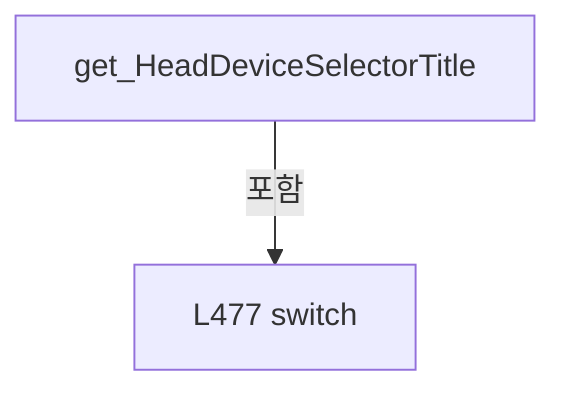

변경 전 점검: 입력/반환 타입, 위 호출자, 예외/취소 경로, 공유 상태와 저장·전송 소비자를 함께 확인합니다. 값의 단위나 물리 방향을 이름만으로 확정하지 않습니다.

### PropertyDeclaration `SelectedAxisRow` · L490–513

[Drilling.UI/Menu/Menus/CMenuMonitor.cs:490–513](https://github.com/kjuws10-rgb/A3Drilling/blob/0219666f9053b907d96d7e0aa7d0c6c1be3a73d4/Drilling.UI/Menu/Menus/CMenuMonitor.cs#L490-L513)

| 항목 | 실제 추출 값 |
| --- | --- |
| 서명 | Drilling.UI.Menu.Menus.ST_MONITOR_AXIS_ROW? Drilling.UI.Menu.Menus.CMenuMonitor.SelectedAxisRow |
| 접근/수식자 | Public / public |
| 반환/값 타입 | Drilling.UI.Menu.Menus.ST_MONITOR_AXIS_ROW? |
| 소속 타입 | NamedType:Drilling.UI.Menu.Menus.CMenuMonitor |

현재 부분 분석에서 직접 연결된 호출자는 없습니다. XAML/이벤트/인터페이스·델리게이트·외부 진입을 추가 확인해야 하며, 미사용으로 판정한 것이 아닙니다.

변경 전 점검: 입력/반환 타입, 위 호출자, 예외/취소 경로, 공유 상태와 저장·전송 소비자를 함께 확인합니다. 값의 단위나 물리 방향을 이름만으로 확정하지 않습니다.

### GetAccessorDeclaration `get_SelectedAxisRow` · L492–500

[Drilling.UI/Menu/Menus/CMenuMonitor.cs:492–500](https://github.com/kjuws10-rgb/A3Drilling/blob/0219666f9053b907d96d7e0aa7d0c6c1be3a73d4/Drilling.UI/Menu/Menus/CMenuMonitor.cs#L492-L500)

| 항목 | 실제 추출 값 |
| --- | --- |
| 서명 | Drilling.UI.Menu.Menus.ST_MONITOR_AXIS_ROW? Drilling.UI.Menu.Menus.CMenuMonitor.SelectedAxisRow.get |
| 접근/수식자 | Public / get |
| 반환/값 타입 | Drilling.UI.Menu.Menus.ST_MONITOR_AXIS_ROW? |
| 소속 타입 | NamedType:Drilling.UI.Menu.Menus.CMenuMonitor |

현재 부분 분석에서 직접 연결된 호출자는 없습니다. XAML/이벤트/인터페이스·델리게이트·외부 진입을 추가 확인해야 하며, 미사용으로 판정한 것이 아닙니다.

호출하는 대상과 해석 범위:

| 원본 행 | 표현식 | 분석 상태 | 대상/소스 위치 |
| --- | --- | --- | --- |
| 499 | AxisRows.FirstOrDefault | resolved | Drilling.UI.Menu.Menus.ST_MONITOR_AXIS_ROW? System.Collections.Generic.IEnumerable<Drilling.UI.Menu.Menus.ST_MONITOR_AXIS_ROW>.FirstOrDefault<Drilling.UI.Menu.Menus.ST_MONITOR_AXIS_ROW>(System.Func<Drilling.UI.Menu.Menus.ST_MONITOR_AXIS_ROW, bool>) |

본문의 실제 연산·분기·예외·반환 순서(원문 위치 순):

| 원본 행 | 종류 | 주석 해설 |
| --- | --- | --- |
| 499 | call | 함수·델리게이트 또는 객체 생성자를 호출합니다: AxisRows.FirstOrDefault(MatchesItem) |
| 499 | return | 호출자에게 값 또는 제어를 반환합니다: return AxisRows.FirstOrDefault(MatchesItem); |

변경 전 점검: 입력/반환 타입, 위 호출자, 예외/취소 경로, 공유 상태와 저장·전송 소비자를 함께 확인합니다. 값의 단위나 물리 방향을 이름만으로 확정하지 않습니다.

### LocalFunctionStatement `MatchesItem` · L494–497

[Drilling.UI/Menu/Menus/CMenuMonitor.cs:494–497](https://github.com/kjuws10-rgb/A3Drilling/blob/0219666f9053b907d96d7e0aa7d0c6c1be3a73d4/Drilling.UI/Menu/Menus/CMenuMonitor.cs#L494-L497)

| 항목 | 실제 추출 값 |
| --- | --- |
| 서명 | bool MatchesItem(Drilling.UI.Menu.Menus.ST_MONITOR_AXIS_ROW) |
| 접근/수식자 | Private /  |
| 반환/값 타입 | bool |
| 소속 타입 | NamedType:Drilling.UI.Menu.Menus.CMenuMonitor |

입력 계약:

| 이름 | 타입 | 전달 | 선택/기본값 |
| --- | --- | --- | --- |
| row | Drilling.UI.Menu.Menus.ST_MONITOR_AXIS_ROW | None | False /  |

현재 부분 분석에서 직접 연결된 호출자는 없습니다. XAML/이벤트/인터페이스·델리게이트·외부 진입을 추가 확인해야 하며, 미사용으로 판정한 것이 아닙니다.

호출하는 대상과 해석 범위:

| 원본 행 | 표현식 | 분석 상태 | 대상/소스 위치 |
| --- | --- | --- | --- |
| 496 | row.AxisId.Equals | resolved | bool string.Equals(string?, System.StringComparison) |

본문의 실제 연산·분기·예외·반환 순서(원문 위치 순):

| 원본 행 | 종류 | 주석 해설 |
| --- | --- | --- |
| 496 | call | 함수·델리게이트 또는 객체 생성자를 호출합니다: row.AxisId.Equals(_selectedAxisId, StringComparison.OrdinalIgnoreCase) |
| 496 | return | 호출자에게 값 또는 제어를 반환합니다: return row.AxisId.Equals(_selectedAxisId, StringComparison.OrdinalIgnoreCase); |

변경 전 점검: 입력/반환 타입, 위 호출자, 예외/취소 경로, 공유 상태와 저장·전송 소비자를 함께 확인합니다. 값의 단위나 물리 방향을 이름만으로 확정하지 않습니다.

### SetAccessorDeclaration `set_SelectedAxisRow` · L502–512

[Drilling.UI/Menu/Menus/CMenuMonitor.cs:502–512](https://github.com/kjuws10-rgb/A3Drilling/blob/0219666f9053b907d96d7e0aa7d0c6c1be3a73d4/Drilling.UI/Menu/Menus/CMenuMonitor.cs#L502-L512)

| 항목 | 실제 추출 값 |
| --- | --- |
| 서명 | void Drilling.UI.Menu.Menus.CMenuMonitor.SelectedAxisRow.set |
| 접근/수식자 | Public / set |
| 반환/값 타입 | void |
| 소속 타입 | NamedType:Drilling.UI.Menu.Menus.CMenuMonitor |

입력 계약:

| 이름 | 타입 | 전달 | 선택/기본값 |
| --- | --- | --- | --- |
| value | Drilling.UI.Menu.Menus.ST_MONITOR_AXIS_ROW? | None | False /  |

현재 부분 분석에서 직접 연결된 호출자는 없습니다. XAML/이벤트/인터페이스·델리게이트·외부 진입을 추가 확인해야 하며, 미사용으로 판정한 것이 아닙니다.

호출하는 대상과 해석 범위:

| 원본 행 | 표현식 | 분석 상태 | 대상/소스 위치 |
| --- | --- | --- | --- |
| 504 | string.IsNullOrWhiteSpace | resolved | bool string.IsNullOrWhiteSpace(string?) |
| 504 | value.AxisId.Equals | resolved | bool string.Equals(string?, System.StringComparison) |
| 510 | OnPropertyChanged | resolved | void Drilling.UI.Menu.CBindingBase.OnPropertyChanged(string?) · Drilling.UI/Menu/CBindingBase.cs:790 |
| 510 | nameof | unresolved | None |
| 511 | OnPropertyChanged | resolved | void Drilling.UI.Menu.CBindingBase.OnPropertyChanged(string?) · Drilling.UI/Menu/CBindingBase.cs:790 |
| 511 | nameof | unresolved | None |

본문의 실제 연산·분기·예외·반환 순서(원문 위치 순):

| 원본 행 | 종류 | 주석 해설 |
| --- | --- | --- |
| 504 | call | 함수·델리게이트 또는 객체 생성자를 호출합니다: string.IsNullOrWhiteSpace(value.AxisId) |
| 504 | call | 함수·델리게이트 또는 객체 생성자를 호출합니다: value.AxisId.Equals(_selectedAxisId, StringComparison.OrdinalIgnoreCase) |
| 504 | if | 조건에 따라 분기합니다: if (value is null &#124;&#124; string.IsNullOrWhiteSpace(value.AxisId) &#124;&#124; value.AxisId.Equals(_selectedAxisId, StringComparison.OrdinalIgnoreCase)) |
| 506 | return | 호출자에게 값 또는 제어를 반환합니다: return; |
| 509 | assignment | 값을 대상에 대입합니다: _selectedAxisId = value.AxisId |
| 510 | call | 함수·델리게이트 또는 객체 생성자를 호출합니다: OnPropertyChanged(nameof(SelectedAxisId)) |
| 510 | call | 함수·델리게이트 또는 객체 생성자를 호출합니다: nameof(SelectedAxisId) |
| 511 | call | 함수·델리게이트 또는 객체 생성자를 호출합니다: OnPropertyChanged(nameof(SelectedAxisRow)) |
| 511 | call | 함수·델리게이트 또는 객체 생성자를 호출합니다: nameof(SelectedAxisRow) |

제어 구문의 포함 구조(실제 실행 순서/CFG가 아닌 구문 탐색 그림):

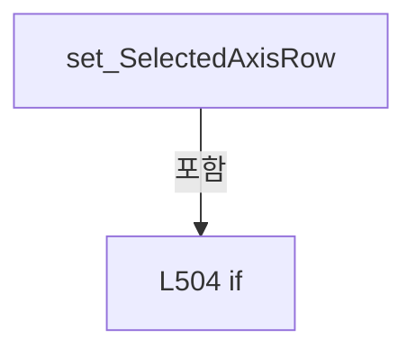

변경 전 점검: 입력/반환 타입, 위 호출자, 예외/취소 경로, 공유 상태와 저장·전송 소비자를 함께 확인합니다. 값의 단위나 물리 방향을 이름만으로 확정하지 않습니다.

### PropertyDeclaration `IsMotor` · L515–521

[Drilling.UI/Menu/Menus/CMenuMonitor.cs:515–521](https://github.com/kjuws10-rgb/A3Drilling/blob/0219666f9053b907d96d7e0aa7d0c6c1be3a73d4/Drilling.UI/Menu/Menus/CMenuMonitor.cs#L515-L521)

| 항목 | 실제 추출 값 |
| --- | --- |
| 서명 | bool Drilling.UI.Menu.Menus.CMenuMonitor.IsMotor |
| 접근/수식자 | Public / public |
| 반환/값 타입 | bool |
| 소속 타입 | NamedType:Drilling.UI.Menu.Menus.CMenuMonitor |

현재 부분 분석에서 직접 연결된 호출자는 없습니다. XAML/이벤트/인터페이스·델리게이트·외부 진입을 추가 확인해야 하며, 미사용으로 판정한 것이 아닙니다.

변경 전 점검: 입력/반환 타입, 위 호출자, 예외/취소 경로, 공유 상태와 저장·전송 소비자를 함께 확인합니다. 값의 단위나 물리 방향을 이름만으로 확정하지 않습니다.

### GetAccessorDeclaration `get_IsMotor` · L517–520

[Drilling.UI/Menu/Menus/CMenuMonitor.cs:517–520](https://github.com/kjuws10-rgb/A3Drilling/blob/0219666f9053b907d96d7e0aa7d0c6c1be3a73d4/Drilling.UI/Menu/Menus/CMenuMonitor.cs#L517-L520)

| 항목 | 실제 추출 값 |
| --- | --- |
| 서명 | bool Drilling.UI.Menu.Menus.CMenuMonitor.IsMotor.get |
| 접근/수식자 | Public / get |
| 반환/값 타입 | bool |
| 소속 타입 | NamedType:Drilling.UI.Menu.Menus.CMenuMonitor |

현재 부분 분석에서 직접 연결된 호출자는 없습니다. XAML/이벤트/인터페이스·델리게이트·외부 진입을 추가 확인해야 하며, 미사용으로 판정한 것이 아닙니다.

본문의 실제 연산·분기·예외·반환 순서(원문 위치 순):

| 원본 행 | 종류 | 주석 해설 |
| --- | --- | --- |
| 519 | return | 호출자에게 값 또는 제어를 반환합니다: return SelectedTab == "XPS"; |

변경 전 점검: 입력/반환 타입, 위 호출자, 예외/취소 경로, 공유 상태와 저장·전송 소비자를 함께 확인합니다. 값의 단위나 물리 방향을 이름만으로 확정하지 않습니다.

### PropertyDeclaration `IsLaser` · L523–529

[Drilling.UI/Menu/Menus/CMenuMonitor.cs:523–529](https://github.com/kjuws10-rgb/A3Drilling/blob/0219666f9053b907d96d7e0aa7d0c6c1be3a73d4/Drilling.UI/Menu/Menus/CMenuMonitor.cs#L523-L529)

| 항목 | 실제 추출 값 |
| --- | --- |
| 서명 | bool Drilling.UI.Menu.Menus.CMenuMonitor.IsLaser |
| 접근/수식자 | Public / public |
| 반환/값 타입 | bool |
| 소속 타입 | NamedType:Drilling.UI.Menu.Menus.CMenuMonitor |

현재 부분 분석에서 직접 연결된 호출자는 없습니다. XAML/이벤트/인터페이스·델리게이트·외부 진입을 추가 확인해야 하며, 미사용으로 판정한 것이 아닙니다.

변경 전 점검: 입력/반환 타입, 위 호출자, 예외/취소 경로, 공유 상태와 저장·전송 소비자를 함께 확인합니다. 값의 단위나 물리 방향을 이름만으로 확정하지 않습니다.

### GetAccessorDeclaration `get_IsLaser` · L525–528

[Drilling.UI/Menu/Menus/CMenuMonitor.cs:525–528](https://github.com/kjuws10-rgb/A3Drilling/blob/0219666f9053b907d96d7e0aa7d0c6c1be3a73d4/Drilling.UI/Menu/Menus/CMenuMonitor.cs#L525-L528)

| 항목 | 실제 추출 값 |
| --- | --- |
| 서명 | bool Drilling.UI.Menu.Menus.CMenuMonitor.IsLaser.get |
| 접근/수식자 | Public / get |
| 반환/값 타입 | bool |
| 소속 타입 | NamedType:Drilling.UI.Menu.Menus.CMenuMonitor |

현재 부분 분석에서 직접 연결된 호출자는 없습니다. XAML/이벤트/인터페이스·델리게이트·외부 진입을 추가 확인해야 하며, 미사용으로 판정한 것이 아닙니다.

본문의 실제 연산·분기·예외·반환 순서(원문 위치 순):

| 원본 행 | 종류 | 주석 해설 |
| --- | --- | --- |
| 527 | return | 호출자에게 값 또는 제어를 반환합니다: return SelectedTab == "LASER"; |

변경 전 점검: 입력/반환 타입, 위 호출자, 예외/취소 경로, 공유 상태와 저장·전송 소비자를 함께 확인합니다. 값의 단위나 물리 방향을 이름만으로 확정하지 않습니다.

### PropertyDeclaration `IsAttenuator` · L531–537

[Drilling.UI/Menu/Menus/CMenuMonitor.cs:531–537](https://github.com/kjuws10-rgb/A3Drilling/blob/0219666f9053b907d96d7e0aa7d0c6c1be3a73d4/Drilling.UI/Menu/Menus/CMenuMonitor.cs#L531-L537)

| 항목 | 실제 추출 값 |
| --- | --- |
| 서명 | bool Drilling.UI.Menu.Menus.CMenuMonitor.IsAttenuator |
| 접근/수식자 | Public / public |
| 반환/값 타입 | bool |
| 소속 타입 | NamedType:Drilling.UI.Menu.Menus.CMenuMonitor |

현재 부분 분석에서 직접 연결된 호출자는 없습니다. XAML/이벤트/인터페이스·델리게이트·외부 진입을 추가 확인해야 하며, 미사용으로 판정한 것이 아닙니다.

변경 전 점검: 입력/반환 타입, 위 호출자, 예외/취소 경로, 공유 상태와 저장·전송 소비자를 함께 확인합니다. 값의 단위나 물리 방향을 이름만으로 확정하지 않습니다.

### GetAccessorDeclaration `get_IsAttenuator` · L533–536

[Drilling.UI/Menu/Menus/CMenuMonitor.cs:533–536](https://github.com/kjuws10-rgb/A3Drilling/blob/0219666f9053b907d96d7e0aa7d0c6c1be3a73d4/Drilling.UI/Menu/Menus/CMenuMonitor.cs#L533-L536)

| 항목 | 실제 추출 값 |
| --- | --- |
| 서명 | bool Drilling.UI.Menu.Menus.CMenuMonitor.IsAttenuator.get |
| 접근/수식자 | Public / get |
| 반환/값 타입 | bool |
| 소속 타입 | NamedType:Drilling.UI.Menu.Menus.CMenuMonitor |

현재 부분 분석에서 직접 연결된 호출자는 없습니다. XAML/이벤트/인터페이스·델리게이트·외부 진입을 추가 확인해야 하며, 미사용으로 판정한 것이 아닙니다.

본문의 실제 연산·분기·예외·반환 순서(원문 위치 순):

| 원본 행 | 종류 | 주석 해설 |
| --- | --- | --- |
| 535 | return | 호출자에게 값 또는 제어를 반환합니다: return SelectedTab == "ATTENUATOR"; |

변경 전 점검: 입력/반환 타입, 위 호출자, 예외/취소 경로, 공유 상태와 저장·전송 소비자를 함께 확인합니다. 값의 단위나 물리 방향을 이름만으로 확정하지 않습니다.

### PropertyDeclaration `IsBet` · L539–545

[Drilling.UI/Menu/Menus/CMenuMonitor.cs:539–545](https://github.com/kjuws10-rgb/A3Drilling/blob/0219666f9053b907d96d7e0aa7d0c6c1be3a73d4/Drilling.UI/Menu/Menus/CMenuMonitor.cs#L539-L545)

| 항목 | 실제 추출 값 |
| --- | --- |
| 서명 | bool Drilling.UI.Menu.Menus.CMenuMonitor.IsBet |
| 접근/수식자 | Public / public |
| 반환/값 타입 | bool |
| 소속 타입 | NamedType:Drilling.UI.Menu.Menus.CMenuMonitor |

현재 부분 분석에서 직접 연결된 호출자는 없습니다. XAML/이벤트/인터페이스·델리게이트·외부 진입을 추가 확인해야 하며, 미사용으로 판정한 것이 아닙니다.

변경 전 점검: 입력/반환 타입, 위 호출자, 예외/취소 경로, 공유 상태와 저장·전송 소비자를 함께 확인합니다. 값의 단위나 물리 방향을 이름만으로 확정하지 않습니다.

### GetAccessorDeclaration `get_IsBet` · L541–544

[Drilling.UI/Menu/Menus/CMenuMonitor.cs:541–544](https://github.com/kjuws10-rgb/A3Drilling/blob/0219666f9053b907d96d7e0aa7d0c6c1be3a73d4/Drilling.UI/Menu/Menus/CMenuMonitor.cs#L541-L544)

| 항목 | 실제 추출 값 |
| --- | --- |
| 서명 | bool Drilling.UI.Menu.Menus.CMenuMonitor.IsBet.get |
| 접근/수식자 | Public / get |
| 반환/값 타입 | bool |
| 소속 타입 | NamedType:Drilling.UI.Menu.Menus.CMenuMonitor |

현재 부분 분석에서 직접 연결된 호출자는 없습니다. XAML/이벤트/인터페이스·델리게이트·외부 진입을 추가 확인해야 하며, 미사용으로 판정한 것이 아닙니다.

본문의 실제 연산·분기·예외·반환 순서(원문 위치 순):

| 원본 행 | 종류 | 주석 해설 |
| --- | --- | --- |
| 543 | return | 호출자에게 값 또는 제어를 반환합니다: return SelectedTab == "BET"; |

변경 전 점검: 입력/반환 타입, 위 호출자, 예외/취소 경로, 공유 상태와 저장·전송 소비자를 함께 확인합니다. 값의 단위나 물리 방향을 이름만으로 확정하지 않습니다.

### PropertyDeclaration `IsPowerMeter` · L547–553

[Drilling.UI/Menu/Menus/CMenuMonitor.cs:547–553](https://github.com/kjuws10-rgb/A3Drilling/blob/0219666f9053b907d96d7e0aa7d0c6c1be3a73d4/Drilling.UI/Menu/Menus/CMenuMonitor.cs#L547-L553)

| 항목 | 실제 추출 값 |
| --- | --- |
| 서명 | bool Drilling.UI.Menu.Menus.CMenuMonitor.IsPowerMeter |
| 접근/수식자 | Public / public |
| 반환/값 타입 | bool |
| 소속 타입 | NamedType:Drilling.UI.Menu.Menus.CMenuMonitor |

현재 부분 분석에서 직접 연결된 호출자는 없습니다. XAML/이벤트/인터페이스·델리게이트·외부 진입을 추가 확인해야 하며, 미사용으로 판정한 것이 아닙니다.

변경 전 점검: 입력/반환 타입, 위 호출자, 예외/취소 경로, 공유 상태와 저장·전송 소비자를 함께 확인합니다. 값의 단위나 물리 방향을 이름만으로 확정하지 않습니다.

### GetAccessorDeclaration `get_IsPowerMeter` · L549–552

[Drilling.UI/Menu/Menus/CMenuMonitor.cs:549–552](https://github.com/kjuws10-rgb/A3Drilling/blob/0219666f9053b907d96d7e0aa7d0c6c1be3a73d4/Drilling.UI/Menu/Menus/CMenuMonitor.cs#L549-L552)

| 항목 | 실제 추출 값 |
| --- | --- |
| 서명 | bool Drilling.UI.Menu.Menus.CMenuMonitor.IsPowerMeter.get |
| 접근/수식자 | Public / get |
| 반환/값 타입 | bool |
| 소속 타입 | NamedType:Drilling.UI.Menu.Menus.CMenuMonitor |

현재 부분 분석에서 직접 연결된 호출자는 없습니다. XAML/이벤트/인터페이스·델리게이트·외부 진입을 추가 확인해야 하며, 미사용으로 판정한 것이 아닙니다.

본문의 실제 연산·분기·예외·반환 순서(원문 위치 순):

| 원본 행 | 종류 | 주석 해설 |
| --- | --- | --- |
| 551 | return | 호출자에게 값 또는 제어를 반환합니다: return SelectedTab == "POWER METER"; |

변경 전 점검: 입력/반환 타입, 위 호출자, 예외/취소 경로, 공유 상태와 저장·전송 소비자를 함께 확인합니다. 값의 단위나 물리 방향을 이름만으로 확정하지 않습니다.

### PropertyDeclaration `IsPicoMotor` · L555–561

[Drilling.UI/Menu/Menus/CMenuMonitor.cs:555–561](https://github.com/kjuws10-rgb/A3Drilling/blob/0219666f9053b907d96d7e0aa7d0c6c1be3a73d4/Drilling.UI/Menu/Menus/CMenuMonitor.cs#L555-L561)

| 항목 | 실제 추출 값 |
| --- | --- |
| 서명 | bool Drilling.UI.Menu.Menus.CMenuMonitor.IsPicoMotor |
| 접근/수식자 | Public / public |
| 반환/값 타입 | bool |
| 소속 타입 | NamedType:Drilling.UI.Menu.Menus.CMenuMonitor |

현재 부분 분석에서 직접 연결된 호출자는 없습니다. XAML/이벤트/인터페이스·델리게이트·외부 진입을 추가 확인해야 하며, 미사용으로 판정한 것이 아닙니다.

변경 전 점검: 입력/반환 타입, 위 호출자, 예외/취소 경로, 공유 상태와 저장·전송 소비자를 함께 확인합니다. 값의 단위나 물리 방향을 이름만으로 확정하지 않습니다.

### GetAccessorDeclaration `get_IsPicoMotor` · L557–560

[Drilling.UI/Menu/Menus/CMenuMonitor.cs:557–560](https://github.com/kjuws10-rgb/A3Drilling/blob/0219666f9053b907d96d7e0aa7d0c6c1be3a73d4/Drilling.UI/Menu/Menus/CMenuMonitor.cs#L557-L560)

| 항목 | 실제 추출 값 |
| --- | --- |
| 서명 | bool Drilling.UI.Menu.Menus.CMenuMonitor.IsPicoMotor.get |
| 접근/수식자 | Public / get |
| 반환/값 타입 | bool |
| 소속 타입 | NamedType:Drilling.UI.Menu.Menus.CMenuMonitor |

현재 부분 분석에서 직접 연결된 호출자는 없습니다. XAML/이벤트/인터페이스·델리게이트·외부 진입을 추가 확인해야 하며, 미사용으로 판정한 것이 아닙니다.

본문의 실제 연산·분기·예외·반환 순서(원문 위치 순):

| 원본 행 | 종류 | 주석 해설 |
| --- | --- | --- |
| 559 | return | 호출자에게 값 또는 제어를 반환합니다: return SelectedTab == "PICO MOTOR"; |

변경 전 점검: 입력/반환 타입, 위 호출자, 예외/취소 경로, 공유 상태와 저장·전송 소비자를 함께 확인합니다. 값의 단위나 물리 방향을 이름만으로 확정하지 않습니다.

### PropertyDeclaration `PicoConnectionButtons` · L563–569

[Drilling.UI/Menu/Menus/CMenuMonitor.cs:563–569](https://github.com/kjuws10-rgb/A3Drilling/blob/0219666f9053b907d96d7e0aa7d0c6c1be3a73d4/Drilling.UI/Menu/Menus/CMenuMonitor.cs#L563-L569)

| 항목 | 실제 추출 값 |
| --- | --- |
| 서명 | System.Collections.Generic.IReadOnlyList<Drilling.UI.Menu.Menus.ST_MONITOR_OPERATION_BUTTON> Drilling.UI.Menu.Menus.CMenuMonitor.PicoConnectionButtons |
| 접근/수식자 | Public / public |
| 반환/값 타입 | System.Collections.Generic.IReadOnlyList<Drilling.UI.Menu.Menus.ST_MONITOR_OPERATION_BUTTON> |
| 소속 타입 | NamedType:Drilling.UI.Menu.Menus.CMenuMonitor |

현재 부분 분석에서 직접 연결된 호출자는 없습니다. XAML/이벤트/인터페이스·델리게이트·외부 진입을 추가 확인해야 하며, 미사용으로 판정한 것이 아닙니다.

변경 전 점검: 입력/반환 타입, 위 호출자, 예외/취소 경로, 공유 상태와 저장·전송 소비자를 함께 확인합니다. 값의 단위나 물리 방향을 이름만으로 확정하지 않습니다.

### GetAccessorDeclaration `get_PicoConnectionButtons` · L565–568

[Drilling.UI/Menu/Menus/CMenuMonitor.cs:565–568](https://github.com/kjuws10-rgb/A3Drilling/blob/0219666f9053b907d96d7e0aa7d0c6c1be3a73d4/Drilling.UI/Menu/Menus/CMenuMonitor.cs#L565-L568)

| 항목 | 실제 추출 값 |
| --- | --- |
| 서명 | System.Collections.Generic.IReadOnlyList<Drilling.UI.Menu.Menus.ST_MONITOR_OPERATION_BUTTON> Drilling.UI.Menu.Menus.CMenuMonitor.PicoConnectionButtons.get |
| 접근/수식자 | Public / get |
| 반환/값 타입 | System.Collections.Generic.IReadOnlyList<Drilling.UI.Menu.Menus.ST_MONITOR_OPERATION_BUTTON> |
| 소속 타입 | NamedType:Drilling.UI.Menu.Menus.CMenuMonitor |

현재 부분 분석에서 직접 연결된 호출자는 없습니다. XAML/이벤트/인터페이스·델리게이트·외부 진입을 추가 확인해야 하며, 미사용으로 판정한 것이 아닙니다.

호출하는 대상과 해석 범위:

| 원본 행 | 표현식 | 분석 상태 | 대상/소스 위치 |
| --- | --- | --- | --- |
| 567 | new | resolved | Drilling.UI.Menu.Menus.ST_MONITOR_OPERATION_BUTTON.ST_MONITOR_OPERATION_BUTTON(string, string, string, string) · Drilling.UI/Menu/Menus/CMenuMonitor.cs:7316 |
| 567 | new | resolved | Drilling.UI.Menu.Menus.ST_MONITOR_OPERATION_BUTTON.ST_MONITOR_OPERATION_BUTTON(string, string, string, string) · Drilling.UI/Menu/Menus/CMenuMonitor.cs:7316 |

본문의 실제 연산·분기·예외·반환 순서(원문 위치 순):

| 원본 행 | 종류 | 주석 해설 |
| --- | --- | --- |
| 567 | call | 함수·델리게이트 또는 객체 생성자를 호출합니다: new("CONNECT", "Servo", _picoMotorIsConnected ? "Dark" : "Green") |
| 567 | call | 함수·델리게이트 또는 객체 생성자를 호출합니다: new("DISCONNECT", "Stop", _picoMotorIsConnected ? "Red" : "Dark") |
| 567 | conditional-expression | 조건에 따라 결과식을 선택합니다: _picoMotorIsConnected ? "Dark" : "Green" |
| 567 | conditional-expression | 조건에 따라 결과식을 선택합니다: _picoMotorIsConnected ? "Red" : "Dark" |
| 567 | return | 호출자에게 값 또는 제어를 반환합니다: return[new("CONNECT", "Servo", _picoMotorIsConnected ? "Dark" : "Green"), new("DISCONNECT", "Stop", _picoMotorIsConnected ? "Red" : "Dark")]; |

변경 전 점검: 입력/반환 타입, 위 호출자, 예외/취소 경로, 공유 상태와 저장·전송 소비자를 함께 확인합니다. 값의 단위나 물리 방향을 이름만으로 확정하지 않습니다.

### PropertyDeclaration `PicoMotorSelectButtons` · L571–582

[Drilling.UI/Menu/Menus/CMenuMonitor.cs:571–582](https://github.com/kjuws10-rgb/A3Drilling/blob/0219666f9053b907d96d7e0aa7d0c6c1be3a73d4/Drilling.UI/Menu/Menus/CMenuMonitor.cs#L571-L582)

| 항목 | 실제 추출 값 |
| --- | --- |
| 서명 | System.Collections.Generic.IReadOnlyList<Drilling.UI.Menu.Menus.ST_MONITOR_OPERATION_BUTTON> Drilling.UI.Menu.Menus.CMenuMonitor.PicoMotorSelectButtons |
| 접근/수식자 | Public / public |
| 반환/값 타입 | System.Collections.Generic.IReadOnlyList<Drilling.UI.Menu.Menus.ST_MONITOR_OPERATION_BUTTON> |
| 소속 타입 | NamedType:Drilling.UI.Menu.Menus.CMenuMonitor |

현재 부분 분석에서 직접 연결된 호출자는 없습니다. XAML/이벤트/인터페이스·델리게이트·외부 진입을 추가 확인해야 하며, 미사용으로 판정한 것이 아닙니다.

변경 전 점검: 입력/반환 타입, 위 호출자, 예외/취소 경로, 공유 상태와 저장·전송 소비자를 함께 확인합니다. 값의 단위나 물리 방향을 이름만으로 확정하지 않습니다.

### GetAccessorDeclaration `get_PicoMotorSelectButtons` · L573–581

[Drilling.UI/Menu/Menus/CMenuMonitor.cs:573–581](https://github.com/kjuws10-rgb/A3Drilling/blob/0219666f9053b907d96d7e0aa7d0c6c1be3a73d4/Drilling.UI/Menu/Menus/CMenuMonitor.cs#L573-L581)

| 항목 | 실제 추출 값 |
| --- | --- |
| 서명 | System.Collections.Generic.IReadOnlyList<Drilling.UI.Menu.Menus.ST_MONITOR_OPERATION_BUTTON> Drilling.UI.Menu.Menus.CMenuMonitor.PicoMotorSelectButtons.get |
| 접근/수식자 | Public / get |
| 반환/값 타입 | System.Collections.Generic.IReadOnlyList<Drilling.UI.Menu.Menus.ST_MONITOR_OPERATION_BUTTON> |
| 소속 타입 | NamedType:Drilling.UI.Menu.Menus.CMenuMonitor |

현재 부분 분석에서 직접 연결된 호출자는 없습니다. XAML/이벤트/인터페이스·델리게이트·외부 진입을 추가 확인해야 하며, 미사용으로 판정한 것이 아닙니다.

호출하는 대상과 해석 범위:

| 원본 행 | 표현식 | 분석 상태 | 대상/소스 위치 |
| --- | --- | --- | --- |
| 580 | Enumerable.Range(1, 4).Select(BuildMonitor).ToArray | resolved | Drilling.UI.Menu.Menus.ST_MONITOR_OPERATION_BUTTON[] System.Collections.Generic.IEnumerable<Drilling.UI.Menu.Menus.ST_MONITOR_OPERATION_BUTTON>.ToArray<Drilling.UI.Menu.Menus.ST_MONITOR_OPERATION_BUTTON>() |
| 580 | Enumerable.Range(1, 4).Select | resolved | System.Collections.Generic.IEnumerable<Drilling.UI.Menu.Menus.ST_MONITOR_OPERATION_BUTTON> System.Collections.Generic.IEnumerable<int>.Select<int, Drilling.UI.Menu.Menus.ST_MONITOR_OPERATION_BUTTON>(System.Func<int, Drilling.UI.Menu.Menus.ST_MONITOR_OPERATION_BUTTON>) |
| 580 | Enumerable.Range | resolved | System.Collections.Generic.IEnumerable<int> System.Linq.Enumerable.Range(int, int) |

본문의 실제 연산·분기·예외·반환 순서(원문 위치 순):

| 원본 행 | 종류 | 주석 해설 |
| --- | --- | --- |
| 580 | call | 함수·델리게이트 또는 객체 생성자를 호출합니다: Enumerable.Range(1, 4).Select(BuildMonitor).ToArray() |
| 580 | call | 함수·델리게이트 또는 객체 생성자를 호출합니다: Enumerable.Range(1, 4).Select(BuildMonitor) |
| 580 | call | 함수·델리게이트 또는 객체 생성자를 호출합니다: Enumerable.Range(1, 4) |
| 580 | return | 호출자에게 값 또는 제어를 반환합니다: return Enumerable.Range(1, 4).Select(BuildMonitor).ToArray(); |

변경 전 점검: 입력/반환 타입, 위 호출자, 예외/취소 경로, 공유 상태와 저장·전송 소비자를 함께 확인합니다. 값의 단위나 물리 방향을 이름만으로 확정하지 않습니다.

### LocalFunctionStatement `BuildMonitor` · L575–578

[Drilling.UI/Menu/Menus/CMenuMonitor.cs:575–578](https://github.com/kjuws10-rgb/A3Drilling/blob/0219666f9053b907d96d7e0aa7d0c6c1be3a73d4/Drilling.UI/Menu/Menus/CMenuMonitor.cs#L575-L578)

| 항목 | 실제 추출 값 |
| --- | --- |
| 서명 | Drilling.UI.Menu.Menus.ST_MONITOR_OPERATION_BUTTON BuildMonitor(int) |
| 접근/수식자 | Private /  |
| 반환/값 타입 | Drilling.UI.Menu.Menus.ST_MONITOR_OPERATION_BUTTON |
| 소속 타입 | NamedType:Drilling.UI.Menu.Menus.CMenuMonitor |

입력 계약:

| 이름 | 타입 | 전달 | 선택/기본값 |
| --- | --- | --- | --- |
| number | int | None | False /  |

현재 부분 분석에서 직접 연결된 호출자는 없습니다. XAML/이벤트/인터페이스·델리게이트·외부 진입을 추가 확인해야 하며, 미사용으로 판정한 것이 아닙니다.

호출하는 대상과 해석 범위:

| 원본 행 | 표현식 | 분석 상태 | 대상/소스 위치 |
| --- | --- | --- | --- |
| 577 | new ST_MONITOR_OPERATION_BUTTON | resolved | Drilling.UI.Menu.Menus.ST_MONITOR_OPERATION_BUTTON.ST_MONITOR_OPERATION_BUTTON(string, string, string, string) · Drilling.UI/Menu/Menus/CMenuMonitor.cs:7316 |

본문의 실제 연산·분기·예외·반환 순서(원문 위치 순):

| 원본 행 | 종류 | 주석 해설 |
| --- | --- | --- |
| 577 | call | 함수·델리게이트 또는 객체 생성자를 호출합니다: new ST_MONITOR_OPERATION_BUTTON($"MOTOR {number}", "Move", _selectedPicoMotorNo == number ? "Blue" : "Dark") |
| 577 | conditional-expression | 조건에 따라 결과식을 선택합니다: _selectedPicoMotorNo == number ? "Blue" : "Dark" |
| 577 | return | 호출자에게 값 또는 제어를 반환합니다: return new ST_MONITOR_OPERATION_BUTTON($"MOTOR {number}", "Move", _selectedPicoMotorNo == number ? "Blue" : "Dark"); |

변경 전 점검: 입력/반환 타입, 위 호출자, 예외/취소 경로, 공유 상태와 저장·전송 소비자를 함께 확인합니다. 값의 단위나 물리 방향을 이름만으로 확정하지 않습니다.

### PropertyDeclaration `PicoMotionStopButtons` · L584–590

[Drilling.UI/Menu/Menus/CMenuMonitor.cs:584–590](https://github.com/kjuws10-rgb/A3Drilling/blob/0219666f9053b907d96d7e0aa7d0c6c1be3a73d4/Drilling.UI/Menu/Menus/CMenuMonitor.cs#L584-L590)

| 항목 | 실제 추출 값 |
| --- | --- |
| 서명 | System.Collections.Generic.IReadOnlyList<Drilling.UI.Menu.Menus.ST_MONITOR_OPERATION_BUTTON> Drilling.UI.Menu.Menus.CMenuMonitor.PicoMotionStopButtons |
| 접근/수식자 | Public / public |
| 반환/값 타입 | System.Collections.Generic.IReadOnlyList<Drilling.UI.Menu.Menus.ST_MONITOR_OPERATION_BUTTON> |
| 소속 타입 | NamedType:Drilling.UI.Menu.Menus.CMenuMonitor |

현재 부분 분석에서 직접 연결된 호출자는 없습니다. XAML/이벤트/인터페이스·델리게이트·외부 진입을 추가 확인해야 하며, 미사용으로 판정한 것이 아닙니다.

변경 전 점검: 입력/반환 타입, 위 호출자, 예외/취소 경로, 공유 상태와 저장·전송 소비자를 함께 확인합니다. 값의 단위나 물리 방향을 이름만으로 확정하지 않습니다.

### GetAccessorDeclaration `get_PicoMotionStopButtons` · L586–589

[Drilling.UI/Menu/Menus/CMenuMonitor.cs:586–589](https://github.com/kjuws10-rgb/A3Drilling/blob/0219666f9053b907d96d7e0aa7d0c6c1be3a73d4/Drilling.UI/Menu/Menus/CMenuMonitor.cs#L586-L589)

| 항목 | 실제 추출 값 |
| --- | --- |
| 서명 | System.Collections.Generic.IReadOnlyList<Drilling.UI.Menu.Menus.ST_MONITOR_OPERATION_BUTTON> Drilling.UI.Menu.Menus.CMenuMonitor.PicoMotionStopButtons.get |
| 접근/수식자 | Public / get |
| 반환/값 타입 | System.Collections.Generic.IReadOnlyList<Drilling.UI.Menu.Menus.ST_MONITOR_OPERATION_BUTTON> |
| 소속 타입 | NamedType:Drilling.UI.Menu.Menus.CMenuMonitor |

현재 부분 분석에서 직접 연결된 호출자는 없습니다. XAML/이벤트/인터페이스·델리게이트·외부 진입을 추가 확인해야 하며, 미사용으로 판정한 것이 아닙니다.

호출하는 대상과 해석 범위:

| 원본 행 | 표현식 | 분석 상태 | 대상/소스 위치 |
| --- | --- | --- | --- |
| 588 | new | resolved | Drilling.UI.Menu.Menus.ST_MONITOR_OPERATION_BUTTON.ST_MONITOR_OPERATION_BUTTON(string, string, string, string) · Drilling.UI/Menu/Menus/CMenuMonitor.cs:7316 |

본문의 실제 연산·분기·예외·반환 순서(원문 위치 순):

| 원본 행 | 종류 | 주석 해설 |
| --- | --- | --- |
| 588 | call | 함수·델리게이트 또는 객체 생성자를 호출합니다: new("STOP MOTION", "Stop", "Red") |
| 588 | return | 호출자에게 값 또는 제어를 반환합니다: return[new("STOP MOTION", "Stop", "Red")]; |

변경 전 점검: 입력/반환 타입, 위 호출자, 예외/취소 경로, 공유 상태와 저장·전송 소비자를 함께 확인합니다. 값의 단위나 물리 방향을 이름만으로 확정하지 않습니다.

### PropertyDeclaration `PicoMotionMoveButtons` · L592–598

[Drilling.UI/Menu/Menus/CMenuMonitor.cs:592–598](https://github.com/kjuws10-rgb/A3Drilling/blob/0219666f9053b907d96d7e0aa7d0c6c1be3a73d4/Drilling.UI/Menu/Menus/CMenuMonitor.cs#L592-L598)

| 항목 | 실제 추출 값 |
| --- | --- |
| 서명 | System.Collections.Generic.IReadOnlyList<Drilling.UI.Menu.Menus.ST_MONITOR_OPERATION_BUTTON> Drilling.UI.Menu.Menus.CMenuMonitor.PicoMotionMoveButtons |
| 접근/수식자 | Public / public |
| 반환/값 타입 | System.Collections.Generic.IReadOnlyList<Drilling.UI.Menu.Menus.ST_MONITOR_OPERATION_BUTTON> |
| 소속 타입 | NamedType:Drilling.UI.Menu.Menus.CMenuMonitor |

현재 부분 분석에서 직접 연결된 호출자는 없습니다. XAML/이벤트/인터페이스·델리게이트·외부 진입을 추가 확인해야 하며, 미사용으로 판정한 것이 아닙니다.

변경 전 점검: 입력/반환 타입, 위 호출자, 예외/취소 경로, 공유 상태와 저장·전송 소비자를 함께 확인합니다. 값의 단위나 물리 방향을 이름만으로 확정하지 않습니다.

### GetAccessorDeclaration `get_PicoMotionMoveButtons` · L594–597

[Drilling.UI/Menu/Menus/CMenuMonitor.cs:594–597](https://github.com/kjuws10-rgb/A3Drilling/blob/0219666f9053b907d96d7e0aa7d0c6c1be3a73d4/Drilling.UI/Menu/Menus/CMenuMonitor.cs#L594-L597)

| 항목 | 실제 추출 값 |
| --- | --- |
| 서명 | System.Collections.Generic.IReadOnlyList<Drilling.UI.Menu.Menus.ST_MONITOR_OPERATION_BUTTON> Drilling.UI.Menu.Menus.CMenuMonitor.PicoMotionMoveButtons.get |
| 접근/수식자 | Public / get |
| 반환/값 타입 | System.Collections.Generic.IReadOnlyList<Drilling.UI.Menu.Menus.ST_MONITOR_OPERATION_BUTTON> |
| 소속 타입 | NamedType:Drilling.UI.Menu.Menus.CMenuMonitor |

현재 부분 분석에서 직접 연결된 호출자는 없습니다. XAML/이벤트/인터페이스·델리게이트·외부 진입을 추가 확인해야 하며, 미사용으로 판정한 것이 아닙니다.

호출하는 대상과 해석 범위:

| 원본 행 | 표현식 | 분석 상태 | 대상/소스 위치 |
| --- | --- | --- | --- |
| 596 | new | resolved | Drilling.UI.Menu.Menus.ST_MONITOR_OPERATION_BUTTON.ST_MONITOR_OPERATION_BUTTON(string, string, string, string) · Drilling.UI/Menu/Menus/CMenuMonitor.cs:7316 |
| 596 | new | resolved | Drilling.UI.Menu.Menus.ST_MONITOR_OPERATION_BUTTON.ST_MONITOR_OPERATION_BUTTON(string, string, string, string) · Drilling.UI/Menu/Menus/CMenuMonitor.cs:7316 |

본문의 실제 연산·분기·예외·반환 순서(원문 위치 순):

| 원본 행 | 종류 | 주석 해설 |
| --- | --- | --- |
| 596 | call | 함수·델리게이트 또는 객체 생성자를 호출합니다: new("HOME", "Home", "Blue") |
| 596 | call | 함수·델리게이트 또는 객체 생성자를 호출합니다: new("ABS MOVE", "Abs", "Blue") |
| 596 | return | 호출자에게 값 또는 제어를 반환합니다: return[new("HOME", "Home", "Blue"), new("ABS MOVE", "Abs", "Blue")]; |

변경 전 점검: 입력/반환 타입, 위 호출자, 예외/취소 경로, 공유 상태와 저장·전송 소비자를 함께 확인합니다. 값의 단위나 물리 방향을 이름만으로 확정하지 않습니다.

### PropertyDeclaration `PicoMotionJogButtons` · L600–606

[Drilling.UI/Menu/Menus/CMenuMonitor.cs:600–606](https://github.com/kjuws10-rgb/A3Drilling/blob/0219666f9053b907d96d7e0aa7d0c6c1be3a73d4/Drilling.UI/Menu/Menus/CMenuMonitor.cs#L600-L606)

| 항목 | 실제 추출 값 |
| --- | --- |
| 서명 | System.Collections.Generic.IReadOnlyList<Drilling.UI.Menu.Menus.ST_MONITOR_OPERATION_BUTTON> Drilling.UI.Menu.Menus.CMenuMonitor.PicoMotionJogButtons |
| 접근/수식자 | Public / public |
| 반환/값 타입 | System.Collections.Generic.IReadOnlyList<Drilling.UI.Menu.Menus.ST_MONITOR_OPERATION_BUTTON> |
| 소속 타입 | NamedType:Drilling.UI.Menu.Menus.CMenuMonitor |

현재 부분 분석에서 직접 연결된 호출자는 없습니다. XAML/이벤트/인터페이스·델리게이트·외부 진입을 추가 확인해야 하며, 미사용으로 판정한 것이 아닙니다.

변경 전 점검: 입력/반환 타입, 위 호출자, 예외/취소 경로, 공유 상태와 저장·전송 소비자를 함께 확인합니다. 값의 단위나 물리 방향을 이름만으로 확정하지 않습니다.

### GetAccessorDeclaration `get_PicoMotionJogButtons` · L602–605

[Drilling.UI/Menu/Menus/CMenuMonitor.cs:602–605](https://github.com/kjuws10-rgb/A3Drilling/blob/0219666f9053b907d96d7e0aa7d0c6c1be3a73d4/Drilling.UI/Menu/Menus/CMenuMonitor.cs#L602-L605)

| 항목 | 실제 추출 값 |
| --- | --- |
| 서명 | System.Collections.Generic.IReadOnlyList<Drilling.UI.Menu.Menus.ST_MONITOR_OPERATION_BUTTON> Drilling.UI.Menu.Menus.CMenuMonitor.PicoMotionJogButtons.get |
| 접근/수식자 | Public / get |
| 반환/값 타입 | System.Collections.Generic.IReadOnlyList<Drilling.UI.Menu.Menus.ST_MONITOR_OPERATION_BUTTON> |
| 소속 타입 | NamedType:Drilling.UI.Menu.Menus.CMenuMonitor |

현재 부분 분석에서 직접 연결된 호출자는 없습니다. XAML/이벤트/인터페이스·델리게이트·외부 진입을 추가 확인해야 하며, 미사용으로 판정한 것이 아닙니다.

호출하는 대상과 해석 범위:

| 원본 행 | 표현식 | 분석 상태 | 대상/소스 위치 |
| --- | --- | --- | --- |
| 604 | new | resolved | Drilling.UI.Menu.Menus.ST_MONITOR_OPERATION_BUTTON.ST_MONITOR_OPERATION_BUTTON(string, string, string, string) · Drilling.UI/Menu/Menus/CMenuMonitor.cs:7316 |
| 604 | new | resolved | Drilling.UI.Menu.Menus.ST_MONITOR_OPERATION_BUTTON.ST_MONITOR_OPERATION_BUTTON(string, string, string, string) · Drilling.UI/Menu/Menus/CMenuMonitor.cs:7316 |

본문의 실제 연산·분기·예외·반환 순서(원문 위치 순):

| 원본 행 | 종류 | 주석 해설 |
| --- | --- | --- |
| 604 | call | 함수·델리게이트 또는 객체 생성자를 호출합니다: new("JOG -", "Rel", "Dark") |
| 604 | call | 함수·델리게이트 또는 객체 생성자를 호출합니다: new("JOG +", "Rel", "Blue") |
| 604 | return | 호출자에게 값 또는 제어를 반환합니다: return[new("JOG -", "Rel", "Dark"), new("JOG +", "Rel", "Blue")]; |

변경 전 점검: 입력/반환 타입, 위 호출자, 예외/취소 경로, 공유 상태와 저장·전송 소비자를 함께 확인합니다. 값의 단위나 물리 방향을 이름만으로 확정하지 않습니다.

### PropertyDeclaration `PicoMotionRelButtons` · L608–614

[Drilling.UI/Menu/Menus/CMenuMonitor.cs:608–614](https://github.com/kjuws10-rgb/A3Drilling/blob/0219666f9053b907d96d7e0aa7d0c6c1be3a73d4/Drilling.UI/Menu/Menus/CMenuMonitor.cs#L608-L614)

| 항목 | 실제 추출 값 |
| --- | --- |
| 서명 | System.Collections.Generic.IReadOnlyList<Drilling.UI.Menu.Menus.ST_MONITOR_OPERATION_BUTTON> Drilling.UI.Menu.Menus.CMenuMonitor.PicoMotionRelButtons |
| 접근/수식자 | Public / public |
| 반환/값 타입 | System.Collections.Generic.IReadOnlyList<Drilling.UI.Menu.Menus.ST_MONITOR_OPERATION_BUTTON> |
| 소속 타입 | NamedType:Drilling.UI.Menu.Menus.CMenuMonitor |

현재 부분 분석에서 직접 연결된 호출자는 없습니다. XAML/이벤트/인터페이스·델리게이트·외부 진입을 추가 확인해야 하며, 미사용으로 판정한 것이 아닙니다.

변경 전 점검: 입력/반환 타입, 위 호출자, 예외/취소 경로, 공유 상태와 저장·전송 소비자를 함께 확인합니다. 값의 단위나 물리 방향을 이름만으로 확정하지 않습니다.

### GetAccessorDeclaration `get_PicoMotionRelButtons` · L610–613

[Drilling.UI/Menu/Menus/CMenuMonitor.cs:610–613](https://github.com/kjuws10-rgb/A3Drilling/blob/0219666f9053b907d96d7e0aa7d0c6c1be3a73d4/Drilling.UI/Menu/Menus/CMenuMonitor.cs#L610-L613)

| 항목 | 실제 추출 값 |
| --- | --- |
| 서명 | System.Collections.Generic.IReadOnlyList<Drilling.UI.Menu.Menus.ST_MONITOR_OPERATION_BUTTON> Drilling.UI.Menu.Menus.CMenuMonitor.PicoMotionRelButtons.get |
| 접근/수식자 | Public / get |
| 반환/값 타입 | System.Collections.Generic.IReadOnlyList<Drilling.UI.Menu.Menus.ST_MONITOR_OPERATION_BUTTON> |
| 소속 타입 | NamedType:Drilling.UI.Menu.Menus.CMenuMonitor |

현재 부분 분석에서 직접 연결된 호출자는 없습니다. XAML/이벤트/인터페이스·델리게이트·외부 진입을 추가 확인해야 하며, 미사용으로 판정한 것이 아닙니다.

호출하는 대상과 해석 범위:

| 원본 행 | 표현식 | 분석 상태 | 대상/소스 위치 |
| --- | --- | --- | --- |
| 612 | new | resolved | Drilling.UI.Menu.Menus.ST_MONITOR_OPERATION_BUTTON.ST_MONITOR_OPERATION_BUTTON(string, string, string, string) · Drilling.UI/Menu/Menus/CMenuMonitor.cs:7316 |
| 612 | new | resolved | Drilling.UI.Menu.Menus.ST_MONITOR_OPERATION_BUTTON.ST_MONITOR_OPERATION_BUTTON(string, string, string, string) · Drilling.UI/Menu/Menus/CMenuMonitor.cs:7316 |

본문의 실제 연산·분기·예외·반환 순서(원문 위치 순):

| 원본 행 | 종류 | 주석 해설 |
| --- | --- | --- |
| 612 | call | 함수·델리게이트 또는 객체 생성자를 호출합니다: new("REL -", "Rel", "Dark") |
| 612 | call | 함수·델리게이트 또는 객체 생성자를 호출합니다: new("REL +", "Rel", "Blue") |
| 612 | return | 호출자에게 값 또는 제어를 반환합니다: return[new("REL -", "Rel", "Dark"), new("REL +", "Rel", "Blue")]; |

변경 전 점검: 입력/반환 타입, 위 호출자, 예외/취소 경로, 공유 상태와 저장·전송 소비자를 함께 확인합니다. 값의 단위나 물리 방향을 이름만으로 확정하지 않습니다.

### PropertyDeclaration `PicoAllMotorSelectButtons` · L616–627

[Drilling.UI/Menu/Menus/CMenuMonitor.cs:616–627](https://github.com/kjuws10-rgb/A3Drilling/blob/0219666f9053b907d96d7e0aa7d0c6c1be3a73d4/Drilling.UI/Menu/Menus/CMenuMonitor.cs#L616-L627)

| 항목 | 실제 추출 값 |
| --- | --- |
| 서명 | System.Collections.Generic.IReadOnlyList<Drilling.UI.Menu.Menus.ST_MONITOR_OPERATION_BUTTON> Drilling.UI.Menu.Menus.CMenuMonitor.PicoAllMotorSelectButtons |
| 접근/수식자 | Public / public |
| 반환/값 타입 | System.Collections.Generic.IReadOnlyList<Drilling.UI.Menu.Menus.ST_MONITOR_OPERATION_BUTTON> |
| 소속 타입 | NamedType:Drilling.UI.Menu.Menus.CMenuMonitor |

현재 부분 분석에서 직접 연결된 호출자는 없습니다. XAML/이벤트/인터페이스·델리게이트·외부 진입을 추가 확인해야 하며, 미사용으로 판정한 것이 아닙니다.

변경 전 점검: 입력/반환 타입, 위 호출자, 예외/취소 경로, 공유 상태와 저장·전송 소비자를 함께 확인합니다. 값의 단위나 물리 방향을 이름만으로 확정하지 않습니다.

### GetAccessorDeclaration `get_PicoAllMotorSelectButtons` · L618–626

[Drilling.UI/Menu/Menus/CMenuMonitor.cs:618–626](https://github.com/kjuws10-rgb/A3Drilling/blob/0219666f9053b907d96d7e0aa7d0c6c1be3a73d4/Drilling.UI/Menu/Menus/CMenuMonitor.cs#L618-L626)

| 항목 | 실제 추출 값 |
| --- | --- |
| 서명 | System.Collections.Generic.IReadOnlyList<Drilling.UI.Menu.Menus.ST_MONITOR_OPERATION_BUTTON> Drilling.UI.Menu.Menus.CMenuMonitor.PicoAllMotorSelectButtons.get |
| 접근/수식자 | Public / get |
| 반환/값 타입 | System.Collections.Generic.IReadOnlyList<Drilling.UI.Menu.Menus.ST_MONITOR_OPERATION_BUTTON> |
| 소속 타입 | NamedType:Drilling.UI.Menu.Menus.CMenuMonitor |

현재 부분 분석에서 직접 연결된 호출자는 없습니다. XAML/이벤트/인터페이스·델리게이트·외부 진입을 추가 확인해야 하며, 미사용으로 판정한 것이 아닙니다.

호출하는 대상과 해석 범위:

| 원본 행 | 표현식 | 분석 상태 | 대상/소스 위치 |
| --- | --- | --- | --- |
| 625 | Enumerable.Range(1, 4).Select(BuildMonitor).ToArray | resolved | Drilling.UI.Menu.Menus.ST_MONITOR_OPERATION_BUTTON[] System.Collections.Generic.IEnumerable<Drilling.UI.Menu.Menus.ST_MONITOR_OPERATION_BUTTON>.ToArray<Drilling.UI.Menu.Menus.ST_MONITOR_OPERATION_BUTTON>() |
| 625 | Enumerable.Range(1, 4).Select | resolved | System.Collections.Generic.IEnumerable<Drilling.UI.Menu.Menus.ST_MONITOR_OPERATION_BUTTON> System.Collections.Generic.IEnumerable<int>.Select<int, Drilling.UI.Menu.Menus.ST_MONITOR_OPERATION_BUTTON>(System.Func<int, Drilling.UI.Menu.Menus.ST_MONITOR_OPERATION_BUTTON>) |
| 625 | Enumerable.Range | resolved | System.Collections.Generic.IEnumerable<int> System.Linq.Enumerable.Range(int, int) |

본문의 실제 연산·분기·예외·반환 순서(원문 위치 순):

| 원본 행 | 종류 | 주석 해설 |
| --- | --- | --- |
| 625 | call | 함수·델리게이트 또는 객체 생성자를 호출합니다: Enumerable.Range(1, 4).Select(BuildMonitor).ToArray() |
| 625 | call | 함수·델리게이트 또는 객체 생성자를 호출합니다: Enumerable.Range(1, 4).Select(BuildMonitor) |
| 625 | call | 함수·델리게이트 또는 객체 생성자를 호출합니다: Enumerable.Range(1, 4) |
| 625 | return | 호출자에게 값 또는 제어를 반환합니다: return Enumerable.Range(1, 4).Select(BuildMonitor).ToArray(); |

변경 전 점검: 입력/반환 타입, 위 호출자, 예외/취소 경로, 공유 상태와 저장·전송 소비자를 함께 확인합니다. 값의 단위나 물리 방향을 이름만으로 확정하지 않습니다.

### LocalFunctionStatement `BuildMonitor` · L620–623

[Drilling.UI/Menu/Menus/CMenuMonitor.cs:620–623](https://github.com/kjuws10-rgb/A3Drilling/blob/0219666f9053b907d96d7e0aa7d0c6c1be3a73d4/Drilling.UI/Menu/Menus/CMenuMonitor.cs#L620-L623)

| 항목 | 실제 추출 값 |
| --- | --- |
| 서명 | Drilling.UI.Menu.Menus.ST_MONITOR_OPERATION_BUTTON BuildMonitor(int) |
| 접근/수식자 | Private /  |
| 반환/값 타입 | Drilling.UI.Menu.Menus.ST_MONITOR_OPERATION_BUTTON |
| 소속 타입 | NamedType:Drilling.UI.Menu.Menus.CMenuMonitor |

입력 계약:

| 이름 | 타입 | 전달 | 선택/기본값 |
| --- | --- | --- | --- |
| number | int | None | False /  |

현재 부분 분석에서 직접 연결된 호출자는 없습니다. XAML/이벤트/인터페이스·델리게이트·외부 진입을 추가 확인해야 하며, 미사용으로 판정한 것이 아닙니다.

호출하는 대상과 해석 범위:

| 원본 행 | 표현식 | 분석 상태 | 대상/소스 위치 |
| --- | --- | --- | --- |
| 622 | new ST_MONITOR_OPERATION_BUTTON | resolved | Drilling.UI.Menu.Menus.ST_MONITOR_OPERATION_BUTTON.ST_MONITOR_OPERATION_BUTTON(string, string, string, string) · Drilling.UI/Menu/Menus/CMenuMonitor.cs:7316 |
| 622 | _picoAllMoveMotorNos.Contains | resolved | bool System.Collections.Generic.HashSet<int>.Contains(int) |

본문의 실제 연산·분기·예외·반환 순서(원문 위치 순):

| 원본 행 | 종류 | 주석 해설 |
| --- | --- | --- |
| 622 | call | 함수·델리게이트 또는 객체 생성자를 호출합니다: new ST_MONITOR_OPERATION_BUTTON($"MOTOR {number}", "Move", _picoAllMoveMotorNos.Contains(number) ? "Blue" : "Dark", $"ALL MOTOR {number}") |
| 622 | call | 함수·델리게이트 또는 객체 생성자를 호출합니다: _picoAllMoveMotorNos.Contains(number) |
| 622 | conditional-expression | 조건에 따라 결과식을 선택합니다: _picoAllMoveMotorNos.Contains(number) ? "Blue" : "Dark" |
| 622 | return | 호출자에게 값 또는 제어를 반환합니다: return new ST_MONITOR_OPERATION_BUTTON($"MOTOR {number}", "Move", _picoAllMoveMotorNos.Contains(number) ? "Blue" : "Dark", $"ALL MOTOR {number}"); |

변경 전 점검: 입력/반환 타입, 위 호출자, 예외/취소 경로, 공유 상태와 저장·전송 소비자를 함께 확인합니다. 값의 단위나 물리 방향을 이름만으로 확정하지 않습니다.

### PropertyDeclaration `PicoAllMotorCommandButtons` · L629–635

[Drilling.UI/Menu/Menus/CMenuMonitor.cs:629–635](https://github.com/kjuws10-rgb/A3Drilling/blob/0219666f9053b907d96d7e0aa7d0c6c1be3a73d4/Drilling.UI/Menu/Menus/CMenuMonitor.cs#L629-L635)

| 항목 | 실제 추출 값 |
| --- | --- |
| 서명 | System.Collections.Generic.IReadOnlyList<Drilling.UI.Menu.Menus.ST_MONITOR_OPERATION_BUTTON> Drilling.UI.Menu.Menus.CMenuMonitor.PicoAllMotorCommandButtons |
| 접근/수식자 | Public / public |
| 반환/값 타입 | System.Collections.Generic.IReadOnlyList<Drilling.UI.Menu.Menus.ST_MONITOR_OPERATION_BUTTON> |
| 소속 타입 | NamedType:Drilling.UI.Menu.Menus.CMenuMonitor |

현재 부분 분석에서 직접 연결된 호출자는 없습니다. XAML/이벤트/인터페이스·델리게이트·외부 진입을 추가 확인해야 하며, 미사용으로 판정한 것이 아닙니다.

변경 전 점검: 입력/반환 타입, 위 호출자, 예외/취소 경로, 공유 상태와 저장·전송 소비자를 함께 확인합니다. 값의 단위나 물리 방향을 이름만으로 확정하지 않습니다.

### GetAccessorDeclaration `get_PicoAllMotorCommandButtons` · L631–634

[Drilling.UI/Menu/Menus/CMenuMonitor.cs:631–634](https://github.com/kjuws10-rgb/A3Drilling/blob/0219666f9053b907d96d7e0aa7d0c6c1be3a73d4/Drilling.UI/Menu/Menus/CMenuMonitor.cs#L631-L634)

| 항목 | 실제 추출 값 |
| --- | --- |
| 서명 | System.Collections.Generic.IReadOnlyList<Drilling.UI.Menu.Menus.ST_MONITOR_OPERATION_BUTTON> Drilling.UI.Menu.Menus.CMenuMonitor.PicoAllMotorCommandButtons.get |
| 접근/수식자 | Public / get |
| 반환/값 타입 | System.Collections.Generic.IReadOnlyList<Drilling.UI.Menu.Menus.ST_MONITOR_OPERATION_BUTTON> |
| 소속 타입 | NamedType:Drilling.UI.Menu.Menus.CMenuMonitor |

현재 부분 분석에서 직접 연결된 호출자는 없습니다. XAML/이벤트/인터페이스·델리게이트·외부 진입을 추가 확인해야 하며, 미사용으로 판정한 것이 아닙니다.

호출하는 대상과 해석 범위:

| 원본 행 | 표현식 | 분석 상태 | 대상/소스 위치 |
| --- | --- | --- | --- |
| 633 | new | resolved | Drilling.UI.Menu.Menus.ST_MONITOR_OPERATION_BUTTON.ST_MONITOR_OPERATION_BUTTON(string, string, string, string) · Drilling.UI/Menu/Menus/CMenuMonitor.cs:7316 |
| 633 | new | resolved | Drilling.UI.Menu.Menus.ST_MONITOR_OPERATION_BUTTON.ST_MONITOR_OPERATION_BUTTON(string, string, string, string) · Drilling.UI/Menu/Menus/CMenuMonitor.cs:7316 |

본문의 실제 연산·분기·예외·반환 순서(원문 위치 순):

| 원본 행 | 종류 | 주석 해설 |
| --- | --- | --- |
| 633 | call | 함수·델리게이트 또는 객체 생성자를 호출합니다: new("START", "Run", "Green") |
| 633 | call | 함수·델리게이트 또는 객체 생성자를 호출합니다: new("STOP", "Stop", "Red") |
| 633 | return | 호출자에게 값 또는 제어를 반환합니다: return[new("START", "Run", "Green"), new("STOP", "Stop", "Red")]; |

변경 전 점검: 입력/반환 타입, 위 호출자, 예외/취소 경로, 공유 상태와 저장·전송 소비자를 함께 확인합니다. 값의 단위나 물리 방향을 이름만으로 확정하지 않습니다.

### PropertyDeclaration `PicoErrorRows` · L637–643

[Drilling.UI/Menu/Menus/CMenuMonitor.cs:637–643](https://github.com/kjuws10-rgb/A3Drilling/blob/0219666f9053b907d96d7e0aa7d0c6c1be3a73d4/Drilling.UI/Menu/Menus/CMenuMonitor.cs#L637-L643)

| 항목 | 실제 추출 값 |
| --- | --- |
| 서명 | System.Collections.Generic.IReadOnlyList<Drilling.UI.Menu.Menus.ST_MONITOR_PARAMETER_ROW> Drilling.UI.Menu.Menus.CMenuMonitor.PicoErrorRows |
| 접근/수식자 | Public / public |
| 반환/값 타입 | System.Collections.Generic.IReadOnlyList<Drilling.UI.Menu.Menus.ST_MONITOR_PARAMETER_ROW> |
| 소속 타입 | NamedType:Drilling.UI.Menu.Menus.CMenuMonitor |

현재 부분 분석에서 직접 연결된 호출자는 없습니다. XAML/이벤트/인터페이스·델리게이트·외부 진입을 추가 확인해야 하며, 미사용으로 판정한 것이 아닙니다.

변경 전 점검: 입력/반환 타입, 위 호출자, 예외/취소 경로, 공유 상태와 저장·전송 소비자를 함께 확인합니다. 값의 단위나 물리 방향을 이름만으로 확정하지 않습니다.

### GetAccessorDeclaration `get_PicoErrorRows` · L639–642

[Drilling.UI/Menu/Menus/CMenuMonitor.cs:639–642](https://github.com/kjuws10-rgb/A3Drilling/blob/0219666f9053b907d96d7e0aa7d0c6c1be3a73d4/Drilling.UI/Menu/Menus/CMenuMonitor.cs#L639-L642)

| 항목 | 실제 추출 값 |
| --- | --- |
| 서명 | System.Collections.Generic.IReadOnlyList<Drilling.UI.Menu.Menus.ST_MONITOR_PARAMETER_ROW> Drilling.UI.Menu.Menus.CMenuMonitor.PicoErrorRows.get |
| 접근/수식자 | Public / get |
| 반환/값 타입 | System.Collections.Generic.IReadOnlyList<Drilling.UI.Menu.Menus.ST_MONITOR_PARAMETER_ROW> |
| 소속 타입 | NamedType:Drilling.UI.Menu.Menus.CMenuMonitor |

현재 부분 분석에서 직접 연결된 호출자는 없습니다. XAML/이벤트/인터페이스·델리게이트·외부 진입을 추가 확인해야 하며, 미사용으로 판정한 것이 아닙니다.

호출하는 대상과 해석 범위:

| 원본 행 | 표현식 | 분석 상태 | 대상/소스 위치 |
| --- | --- | --- | --- |
| 641 | CreatePicoErrorRows | resolved | System.Collections.Generic.IReadOnlyList<Drilling.UI.Menu.Menus.ST_MONITOR_PARAMETER_ROW> Drilling.UI.Menu.Menus.CMenuMonitor.CreatePicoErrorRows() · Drilling.UI/Menu/Menus/CMenuMonitor.cs:6371 |

본문의 실제 연산·분기·예외·반환 순서(원문 위치 순):

| 원본 행 | 종류 | 주석 해설 |
| --- | --- | --- |
| 641 | call | 함수·델리게이트 또는 객체 생성자를 호출합니다: CreatePicoErrorRows() |
| 641 | return | 호출자에게 값 또는 제어를 반환합니다: return CreatePicoErrorRows(); |

변경 전 점검: 입력/반환 타입, 위 호출자, 예외/취소 경로, 공유 상태와 저장·전송 소비자를 함께 확인합니다. 값의 단위나 물리 방향을 이름만으로 확정하지 않습니다.

### PropertyDeclaration `IsProduct` · L645–651

[Drilling.UI/Menu/Menus/CMenuMonitor.cs:645–651](https://github.com/kjuws10-rgb/A3Drilling/blob/0219666f9053b907d96d7e0aa7d0c6c1be3a73d4/Drilling.UI/Menu/Menus/CMenuMonitor.cs#L645-L651)

| 항목 | 실제 추출 값 |
| --- | --- |
| 서명 | bool Drilling.UI.Menu.Menus.CMenuMonitor.IsProduct |
| 접근/수식자 | Public / public |
| 반환/값 타입 | bool |
| 소속 타입 | NamedType:Drilling.UI.Menu.Menus.CMenuMonitor |

현재 부분 분석에서 직접 연결된 호출자는 없습니다. XAML/이벤트/인터페이스·델리게이트·외부 진입을 추가 확인해야 하며, 미사용으로 판정한 것이 아닙니다.

변경 전 점검: 입력/반환 타입, 위 호출자, 예외/취소 경로, 공유 상태와 저장·전송 소비자를 함께 확인합니다. 값의 단위나 물리 방향을 이름만으로 확정하지 않습니다.

### GetAccessorDeclaration `get_IsProduct` · L647–650

[Drilling.UI/Menu/Menus/CMenuMonitor.cs:647–650](https://github.com/kjuws10-rgb/A3Drilling/blob/0219666f9053b907d96d7e0aa7d0c6c1be3a73d4/Drilling.UI/Menu/Menus/CMenuMonitor.cs#L647-L650)

| 항목 | 실제 추출 값 |
| --- | --- |
| 서명 | bool Drilling.UI.Menu.Menus.CMenuMonitor.IsProduct.get |
| 접근/수식자 | Public / get |
| 반환/값 타입 | bool |
| 소속 타입 | NamedType:Drilling.UI.Menu.Menus.CMenuMonitor |

현재 부분 분석에서 직접 연결된 호출자는 없습니다. XAML/이벤트/인터페이스·델리게이트·외부 진입을 추가 확인해야 하며, 미사용으로 판정한 것이 아닙니다.

본문의 실제 연산·분기·예외·반환 순서(원문 위치 순):

| 원본 행 | 종류 | 주석 해설 |
| --- | --- | --- |
| 649 | return | 호출자에게 값 또는 제어를 반환합니다: return SelectedTab == "PRODUCT"; |

변경 전 점검: 입력/반환 타입, 위 호출자, 예외/취소 경로, 공유 상태와 저장·전송 소비자를 함께 확인합니다. 값의 단위나 물리 방향을 이름만으로 확정하지 않습니다.

### PropertyDeclaration `IsMelsec` · L653–659

[Drilling.UI/Menu/Menus/CMenuMonitor.cs:653–659](https://github.com/kjuws10-rgb/A3Drilling/blob/0219666f9053b907d96d7e0aa7d0c6c1be3a73d4/Drilling.UI/Menu/Menus/CMenuMonitor.cs#L653-L659)

| 항목 | 실제 추출 값 |
| --- | --- |
| 서명 | bool Drilling.UI.Menu.Menus.CMenuMonitor.IsMelsec |
| 접근/수식자 | Public / public |
| 반환/값 타입 | bool |
| 소속 타입 | NamedType:Drilling.UI.Menu.Menus.CMenuMonitor |

현재 부분 분석에서 직접 연결된 호출자는 없습니다. XAML/이벤트/인터페이스·델리게이트·외부 진입을 추가 확인해야 하며, 미사용으로 판정한 것이 아닙니다.

변경 전 점검: 입력/반환 타입, 위 호출자, 예외/취소 경로, 공유 상태와 저장·전송 소비자를 함께 확인합니다. 값의 단위나 물리 방향을 이름만으로 확정하지 않습니다.

### GetAccessorDeclaration `get_IsMelsec` · L655–658

[Drilling.UI/Menu/Menus/CMenuMonitor.cs:655–658](https://github.com/kjuws10-rgb/A3Drilling/blob/0219666f9053b907d96d7e0aa7d0c6c1be3a73d4/Drilling.UI/Menu/Menus/CMenuMonitor.cs#L655-L658)

| 항목 | 실제 추출 값 |
| --- | --- |
| 서명 | bool Drilling.UI.Menu.Menus.CMenuMonitor.IsMelsec.get |
| 접근/수식자 | Public / get |
| 반환/값 타입 | bool |
| 소속 타입 | NamedType:Drilling.UI.Menu.Menus.CMenuMonitor |

현재 부분 분석에서 직접 연결된 호출자는 없습니다. XAML/이벤트/인터페이스·델리게이트·외부 진입을 추가 확인해야 하며, 미사용으로 판정한 것이 아닙니다.

본문의 실제 연산·분기·예외·반환 순서(원문 위치 순):

| 원본 행 | 종류 | 주석 해설 |
| --- | --- | --- |
| 657 | return | 호출자에게 값 또는 제어를 반환합니다: return SelectedTab == "MELSEC"; |

변경 전 점검: 입력/반환 타입, 위 호출자, 예외/취소 경로, 공유 상태와 저장·전송 소비자를 함께 확인합니다. 값의 단위나 물리 방향을 이름만으로 확정하지 않습니다.

### PropertyDeclaration `IsMelsecWriteLockVisible` · L661–667

[Drilling.UI/Menu/Menus/CMenuMonitor.cs:661–667](https://github.com/kjuws10-rgb/A3Drilling/blob/0219666f9053b907d96d7e0aa7d0c6c1be3a73d4/Drilling.UI/Menu/Menus/CMenuMonitor.cs#L661-L667)

| 항목 | 실제 추출 값 |
| --- | --- |
| 서명 | bool Drilling.UI.Menu.Menus.CMenuMonitor.IsMelsecWriteLockVisible |
| 접근/수식자 | Public / public |
| 반환/값 타입 | bool |
| 소속 타입 | NamedType:Drilling.UI.Menu.Menus.CMenuMonitor |

현재 부분 분석에서 직접 연결된 호출자는 없습니다. XAML/이벤트/인터페이스·델리게이트·외부 진입을 추가 확인해야 하며, 미사용으로 판정한 것이 아닙니다.

변경 전 점검: 입력/반환 타입, 위 호출자, 예외/취소 경로, 공유 상태와 저장·전송 소비자를 함께 확인합니다. 값의 단위나 물리 방향을 이름만으로 확정하지 않습니다.

### GetAccessorDeclaration `get_IsMelsecWriteLockVisible` · L663–666

[Drilling.UI/Menu/Menus/CMenuMonitor.cs:663–666](https://github.com/kjuws10-rgb/A3Drilling/blob/0219666f9053b907d96d7e0aa7d0c6c1be3a73d4/Drilling.UI/Menu/Menus/CMenuMonitor.cs#L663-L666)

| 항목 | 실제 추출 값 |
| --- | --- |
| 서명 | bool Drilling.UI.Menu.Menus.CMenuMonitor.IsMelsecWriteLockVisible.get |
| 접근/수식자 | Public / get |
| 반환/값 타입 | bool |
| 소속 타입 | NamedType:Drilling.UI.Menu.Menus.CMenuMonitor |

현재 부분 분석에서 직접 연결된 호출자는 없습니다. XAML/이벤트/인터페이스·델리게이트·외부 진입을 추가 확인해야 하며, 미사용으로 판정한 것이 아닙니다.

본문의 실제 연산·분기·예외·반환 순서(원문 위치 순):

| 원본 행 | 종류 | 주석 해설 |
| --- | --- | --- |
| 665 | return | 호출자에게 값 또는 제어를 반환합니다: return _isMelsecWriteLockVisible; |

변경 전 점검: 입력/반환 타입, 위 호출자, 예외/취소 경로, 공유 상태와 저장·전송 소비자를 함께 확인합니다. 값의 단위나 물리 방향을 이름만으로 확정하지 않습니다.

### PropertyDeclaration `IsMelsecWriteUnlocked` · L669–675

[Drilling.UI/Menu/Menus/CMenuMonitor.cs:669–675](https://github.com/kjuws10-rgb/A3Drilling/blob/0219666f9053b907d96d7e0aa7d0c6c1be3a73d4/Drilling.UI/Menu/Menus/CMenuMonitor.cs#L669-L675)

| 항목 | 실제 추출 값 |
| --- | --- |
| 서명 | bool Drilling.UI.Menu.Menus.CMenuMonitor.IsMelsecWriteUnlocked |
| 접근/수식자 | Public / public |
| 반환/값 타입 | bool |
| 소속 타입 | NamedType:Drilling.UI.Menu.Menus.CMenuMonitor |

현재 부분 분석에서 직접 연결된 호출자는 없습니다. XAML/이벤트/인터페이스·델리게이트·외부 진입을 추가 확인해야 하며, 미사용으로 판정한 것이 아닙니다.

변경 전 점검: 입력/반환 타입, 위 호출자, 예외/취소 경로, 공유 상태와 저장·전송 소비자를 함께 확인합니다. 값의 단위나 물리 방향을 이름만으로 확정하지 않습니다.

### GetAccessorDeclaration `get_IsMelsecWriteUnlocked` · L671–674

[Drilling.UI/Menu/Menus/CMenuMonitor.cs:671–674](https://github.com/kjuws10-rgb/A3Drilling/blob/0219666f9053b907d96d7e0aa7d0c6c1be3a73d4/Drilling.UI/Menu/Menus/CMenuMonitor.cs#L671-L674)

| 항목 | 실제 추출 값 |
| --- | --- |
| 서명 | bool Drilling.UI.Menu.Menus.CMenuMonitor.IsMelsecWriteUnlocked.get |
| 접근/수식자 | Public / get |
| 반환/값 타입 | bool |
| 소속 타입 | NamedType:Drilling.UI.Menu.Menus.CMenuMonitor |

현재 부분 분석에서 직접 연결된 호출자는 없습니다. XAML/이벤트/인터페이스·델리게이트·외부 진입을 추가 확인해야 하며, 미사용으로 판정한 것이 아닙니다.

본문의 실제 연산·분기·예외·반환 순서(원문 위치 순):

| 원본 행 | 종류 | 주석 해설 |
| --- | --- | --- |
| 673 | return | 호출자에게 값 또는 제어를 반환합니다: return _isMelsecWriteUnlocked; |

변경 전 점검: 입력/반환 타입, 위 호출자, 예외/취소 경로, 공유 상태와 저장·전송 소비자를 함께 확인합니다. 값의 단위나 물리 방향을 이름만으로 확정하지 않습니다.

### PropertyDeclaration `MelsecWriteLockText` · L677–683

[Drilling.UI/Menu/Menus/CMenuMonitor.cs:677–683](https://github.com/kjuws10-rgb/A3Drilling/blob/0219666f9053b907d96d7e0aa7d0c6c1be3a73d4/Drilling.UI/Menu/Menus/CMenuMonitor.cs#L677-L683)

| 항목 | 실제 추출 값 |
| --- | --- |
| 서명 | string Drilling.UI.Menu.Menus.CMenuMonitor.MelsecWriteLockText |
| 접근/수식자 | Public / public |
| 반환/값 타입 | string |
| 소속 타입 | NamedType:Drilling.UI.Menu.Menus.CMenuMonitor |

현재 부분 분석에서 직접 연결된 호출자는 없습니다. XAML/이벤트/인터페이스·델리게이트·외부 진입을 추가 확인해야 하며, 미사용으로 판정한 것이 아닙니다.

변경 전 점검: 입력/반환 타입, 위 호출자, 예외/취소 경로, 공유 상태와 저장·전송 소비자를 함께 확인합니다. 값의 단위나 물리 방향을 이름만으로 확정하지 않습니다.

### GetAccessorDeclaration `get_MelsecWriteLockText` · L679–682

[Drilling.UI/Menu/Menus/CMenuMonitor.cs:679–682](https://github.com/kjuws10-rgb/A3Drilling/blob/0219666f9053b907d96d7e0aa7d0c6c1be3a73d4/Drilling.UI/Menu/Menus/CMenuMonitor.cs#L679-L682)

| 항목 | 실제 추출 값 |
| --- | --- |
| 서명 | string Drilling.UI.Menu.Menus.CMenuMonitor.MelsecWriteLockText.get |
| 접근/수식자 | Public / get |
| 반환/값 타입 | string |
| 소속 타입 | NamedType:Drilling.UI.Menu.Menus.CMenuMonitor |

현재 부분 분석에서 직접 연결된 호출자는 없습니다. XAML/이벤트/인터페이스·델리게이트·외부 진입을 추가 확인해야 하며, 미사용으로 판정한 것이 아닙니다.

본문의 실제 연산·분기·예외·반환 순서(원문 위치 순):

| 원본 행 | 종류 | 주석 해설 |
| --- | --- | --- |
| 681 | conditional-expression | 조건에 따라 결과식을 선택합니다: _isMelsecWriteUnlocked ? "WRITE UNLOCK" : "WRITE LOCK" |
| 681 | return | 호출자에게 값 또는 제어를 반환합니다: return _isMelsecWriteUnlocked ? "WRITE UNLOCK" : "WRITE LOCK"; |

변경 전 점검: 입력/반환 타입, 위 호출자, 예외/취소 경로, 공유 상태와 저장·전송 소비자를 함께 확인합니다. 값의 단위나 물리 방향을 이름만으로 확정하지 않습니다.

### MethodDeclaration `ToggleMelsecWriteLockVisibility` · L685–702

[Drilling.UI/Menu/Menus/CMenuMonitor.cs:685–702](https://github.com/kjuws10-rgb/A3Drilling/blob/0219666f9053b907d96d7e0aa7d0c6c1be3a73d4/Drilling.UI/Menu/Menus/CMenuMonitor.cs#L685-L702)

| 항목 | 실제 추출 값 |
| --- | --- |
| 서명 | void Drilling.UI.Menu.Menus.CMenuMonitor.ToggleMelsecWriteLockVisibility() |
| 접근/수식자 | Public / public |
| 반환/값 타입 | void |
| 소속 타입 | NamedType:Drilling.UI.Menu.Menus.CMenuMonitor |

정적 호출자로 확인된 위치:

| 호출 파일/행 | 호출 표현식 | 런타임 분기 가능 |
| --- | --- | --- |
| [Drilling.UI/Views/CMonitorView.xaml.cs:84–84](https://github.com/kjuws10-rgb/A3Drilling/blob/0219666f9053b907d96d7e0aa7d0c6c1be3a73d4/Drilling.UI/Views/CMonitorView.xaml.cs#L84-L84) | monitor.ToggleMelsecWriteLockVisibility | False |

호출하는 대상과 해석 범위:

| 원본 행 | 표현식 | 분석 상태 | 대상/소스 위치 |
| --- | --- | --- | --- |
| 694 | ResetMelsecWriteLock | resolved | void Drilling.UI.Menu.Menus.CMenuMonitor.ResetMelsecWriteLock() · Drilling.UI/Menu/Menus/CMenuMonitor.cs:3005 |
| 695 | _setStatusMessage | resolved · 동적 구현 선택 가능 | void System.Action<string>.Invoke(string) |
| 700 | NotifyMonitorLiveProperties | resolved | void Drilling.UI.Menu.Menus.CMenuMonitor.NotifyMonitorLiveProperties(params string[]) · Drilling.UI/Menu/Menus/CMenuMonitor.cs:1886 |
| 700 | nameof | unresolved | None |
| 701 | _setStatusMessage | resolved · 동적 구현 선택 가능 | void System.Action<string>.Invoke(string) |

본문의 실제 연산·분기·예외·반환 순서(원문 위치 순):

| 원본 행 | 종류 | 주석 해설 |
| --- | --- | --- |
| 687 | if | 조건에 따라 분기합니다: if (!IsMelsec) |
| 689 | return | 호출자에게 값 또는 제어를 반환합니다: return; |
| 692 | if | 조건에 따라 분기합니다: if (_isMelsecWriteLockVisible) |
| 694 | call | 함수·델리게이트 또는 객체 생성자를 호출합니다: ResetMelsecWriteLock() |
| 695 | call | 함수·델리게이트 또는 객체 생성자를 호출합니다: _setStatusMessage("MELSEC WRITE locked and lock control hidden.") |
| 696 | return | 호출자에게 값 또는 제어를 반환합니다: return; |
| 699 | assignment | 값을 대상에 대입합니다: _isMelsecWriteLockVisible = true |
| 700 | call | 함수·델리게이트 또는 객체 생성자를 호출합니다: NotifyMonitorLiveProperties(nameof(IsMelsecWriteLockVisible)) |
| 700 | call | 함수·델리게이트 또는 객체 생성자를 호출합니다: nameof(IsMelsecWriteLockVisible) |
| 701 | call | 함수·델리게이트 또는 객체 생성자를 호출합니다: _setStatusMessage("MELSEC WRITE lock control displayed.") |

제어 구문의 포함 구조(실제 실행 순서/CFG가 아닌 구문 탐색 그림):

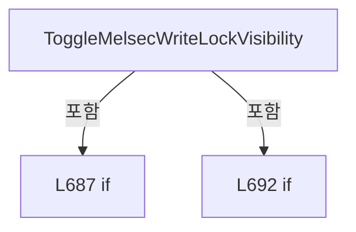

변경 전 점검: 입력/반환 타입, 위 호출자, 예외/취소 경로, 공유 상태와 저장·전송 소비자를 함께 확인합니다. 값의 단위나 물리 방향을 이름만으로 확정하지 않습니다.

### MethodDeclaration `HideAndLockMelsecWrite` · L704–707

[Drilling.UI/Menu/Menus/CMenuMonitor.cs:704–707](https://github.com/kjuws10-rgb/A3Drilling/blob/0219666f9053b907d96d7e0aa7d0c6c1be3a73d4/Drilling.UI/Menu/Menus/CMenuMonitor.cs#L704-L707)

| 항목 | 실제 추출 값 |
| --- | --- |
| 서명 | void Drilling.UI.Menu.Menus.CMenuMonitor.HideAndLockMelsecWrite() |
| 접근/수식자 | Public / public |
| 반환/값 타입 | void |
| 소속 타입 | NamedType:Drilling.UI.Menu.Menus.CMenuMonitor |

정적 호출자로 확인된 위치:

| 호출 파일/행 | 호출 표현식 | 런타임 분기 가능 |
| --- | --- | --- |
| [Drilling.UI/Views/CMonitorView.xaml.cs:66–66](https://github.com/kjuws10-rgb/A3Drilling/blob/0219666f9053b907d96d7e0aa7d0c6c1be3a73d4/Drilling.UI/Views/CMonitorView.xaml.cs#L66-L66) | .HideAndLockMelsecWrite | False |
| [Drilling.UI/Views/CMonitorView.xaml.cs:102–102](https://github.com/kjuws10-rgb/A3Drilling/blob/0219666f9053b907d96d7e0aa7d0c6c1be3a73d4/Drilling.UI/Views/CMonitorView.xaml.cs#L102-L102) | .HideAndLockMelsecWrite | False |

호출하는 대상과 해석 범위:

| 원본 행 | 표현식 | 분석 상태 | 대상/소스 위치 |
| --- | --- | --- | --- |
| 706 | ResetMelsecWriteLock | resolved | void Drilling.UI.Menu.Menus.CMenuMonitor.ResetMelsecWriteLock() · Drilling.UI/Menu/Menus/CMenuMonitor.cs:3005 |

본문의 실제 연산·분기·예외·반환 순서(원문 위치 순):

| 원본 행 | 종류 | 주석 해설 |
| --- | --- | --- |
| 706 | call | 함수·델리게이트 또는 객체 생성자를 호출합니다: ResetMelsecWriteLock() |

변경 전 점검: 입력/반환 타입, 위 호출자, 예외/취소 경로, 공유 상태와 저장·전송 소비자를 함께 확인합니다. 값의 단위나 물리 방향을 이름만으로 확정하지 않습니다.

### PropertyDeclaration `LogViewer` · L709–709

[Drilling.UI/Menu/Menus/CMenuMonitor.cs:709–709](https://github.com/kjuws10-rgb/A3Drilling/blob/0219666f9053b907d96d7e0aa7d0c6c1be3a73d4/Drilling.UI/Menu/Menus/CMenuMonitor.cs#L709-L709)

| 항목 | 실제 추출 값 |
| --- | --- |
| 서명 | Drilling.UI.Menu.Menus.CMonitorLogViewerPanel Drilling.UI.Menu.Menus.CMenuMonitor.LogViewer |
| 접근/수식자 | Public / public |
| 반환/값 타입 | Drilling.UI.Menu.Menus.CMonitorLogViewerPanel |
| 소속 타입 | NamedType:Drilling.UI.Menu.Menus.CMenuMonitor |

현재 부분 분석에서 직접 연결된 호출자는 없습니다. XAML/이벤트/인터페이스·델리게이트·외부 진입을 추가 확인해야 하며, 미사용으로 판정한 것이 아닙니다.

변경 전 점검: 입력/반환 타입, 위 호출자, 예외/취소 경로, 공유 상태와 저장·전송 소비자를 함께 확인합니다. 값의 단위나 물리 방향을 이름만으로 확정하지 않습니다.

### GetAccessorDeclaration `get_LogViewer` · L709–709

[Drilling.UI/Menu/Menus/CMenuMonitor.cs:709–709](https://github.com/kjuws10-rgb/A3Drilling/blob/0219666f9053b907d96d7e0aa7d0c6c1be3a73d4/Drilling.UI/Menu/Menus/CMenuMonitor.cs#L709-L709)

| 항목 | 실제 추출 값 |
| --- | --- |
| 서명 | Drilling.UI.Menu.Menus.CMonitorLogViewerPanel Drilling.UI.Menu.Menus.CMenuMonitor.LogViewer.get |
| 접근/수식자 | Public / get |
| 반환/값 타입 | Drilling.UI.Menu.Menus.CMonitorLogViewerPanel |
| 소속 타입 | NamedType:Drilling.UI.Menu.Menus.CMenuMonitor |

현재 부분 분석에서 직접 연결된 호출자는 없습니다. XAML/이벤트/인터페이스·델리게이트·외부 진입을 추가 확인해야 하며, 미사용으로 판정한 것이 아닙니다.

변경 전 점검: 입력/반환 타입, 위 호출자, 예외/취소 경로, 공유 상태와 저장·전송 소비자를 함께 확인합니다. 값의 단위나 물리 방향을 이름만으로 확정하지 않습니다.

### PropertyDeclaration `IsLogViewer` · L710–710

[Drilling.UI/Menu/Menus/CMenuMonitor.cs:710–710](https://github.com/kjuws10-rgb/A3Drilling/blob/0219666f9053b907d96d7e0aa7d0c6c1be3a73d4/Drilling.UI/Menu/Menus/CMenuMonitor.cs#L710-L710)

| 항목 | 실제 추출 값 |
| --- | --- |
| 서명 | bool Drilling.UI.Menu.Menus.CMenuMonitor.IsLogViewer |
| 접근/수식자 | Public / public |
| 반환/값 타입 | bool |
| 소속 타입 | NamedType:Drilling.UI.Menu.Menus.CMenuMonitor |

현재 부분 분석에서 직접 연결된 호출자는 없습니다. XAML/이벤트/인터페이스·델리게이트·외부 진입을 추가 확인해야 하며, 미사용으로 판정한 것이 아닙니다.

변경 전 점검: 입력/반환 타입, 위 호출자, 예외/취소 경로, 공유 상태와 저장·전송 소비자를 함께 확인합니다. 값의 단위나 물리 방향을 이름만으로 확정하지 않습니다.

### PropertyDeclaration `IsCoordinateViewer` · L712–718

[Drilling.UI/Menu/Menus/CMenuMonitor.cs:712–718](https://github.com/kjuws10-rgb/A3Drilling/blob/0219666f9053b907d96d7e0aa7d0c6c1be3a73d4/Drilling.UI/Menu/Menus/CMenuMonitor.cs#L712-L718)

| 항목 | 실제 추출 값 |
| --- | --- |
| 서명 | bool Drilling.UI.Menu.Menus.CMenuMonitor.IsCoordinateViewer |
| 접근/수식자 | Public / public |
| 반환/값 타입 | bool |
| 소속 타입 | NamedType:Drilling.UI.Menu.Menus.CMenuMonitor |

현재 부분 분석에서 직접 연결된 호출자는 없습니다. XAML/이벤트/인터페이스·델리게이트·외부 진입을 추가 확인해야 하며, 미사용으로 판정한 것이 아닙니다.

변경 전 점검: 입력/반환 타입, 위 호출자, 예외/취소 경로, 공유 상태와 저장·전송 소비자를 함께 확인합니다. 값의 단위나 물리 방향을 이름만으로 확정하지 않습니다.

### GetAccessorDeclaration `get_IsCoordinateViewer` · L714–717

[Drilling.UI/Menu/Menus/CMenuMonitor.cs:714–717](https://github.com/kjuws10-rgb/A3Drilling/blob/0219666f9053b907d96d7e0aa7d0c6c1be3a73d4/Drilling.UI/Menu/Menus/CMenuMonitor.cs#L714-L717)

| 항목 | 실제 추출 값 |
| --- | --- |
| 서명 | bool Drilling.UI.Menu.Menus.CMenuMonitor.IsCoordinateViewer.get |
| 접근/수식자 | Public / get |
| 반환/값 타입 | bool |
| 소속 타입 | NamedType:Drilling.UI.Menu.Menus.CMenuMonitor |

현재 부분 분석에서 직접 연결된 호출자는 없습니다. XAML/이벤트/인터페이스·델리게이트·외부 진입을 추가 확인해야 하며, 미사용으로 판정한 것이 아닙니다.

본문의 실제 연산·분기·예외·반환 순서(원문 위치 순):

| 원본 행 | 종류 | 주석 해설 |
| --- | --- | --- |
| 716 | return | 호출자에게 값 또는 제어를 반환합니다: return SelectedTab == "COORDINATE VIEWER"; |

변경 전 점검: 입력/반환 타입, 위 호출자, 예외/취소 경로, 공유 상태와 저장·전송 소비자를 함께 확인합니다. 값의 단위나 물리 방향을 이름만으로 확정하지 않습니다.

### PropertyDeclaration `IsControlDevice` · L720–726

[Drilling.UI/Menu/Menus/CMenuMonitor.cs:720–726](https://github.com/kjuws10-rgb/A3Drilling/blob/0219666f9053b907d96d7e0aa7d0c6c1be3a73d4/Drilling.UI/Menu/Menus/CMenuMonitor.cs#L720-L726)

| 항목 | 실제 추출 값 |
| --- | --- |
| 서명 | bool Drilling.UI.Menu.Menus.CMenuMonitor.IsControlDevice |
| 접근/수식자 | Public / public |
| 반환/값 타입 | bool |
| 소속 타입 | NamedType:Drilling.UI.Menu.Menus.CMenuMonitor |

현재 부분 분석에서 직접 연결된 호출자는 없습니다. XAML/이벤트/인터페이스·델리게이트·외부 진입을 추가 확인해야 하며, 미사용으로 판정한 것이 아닙니다.

변경 전 점검: 입력/반환 타입, 위 호출자, 예외/취소 경로, 공유 상태와 저장·전송 소비자를 함께 확인합니다. 값의 단위나 물리 방향을 이름만으로 확정하지 않습니다.

### GetAccessorDeclaration `get_IsControlDevice` · L722–725

[Drilling.UI/Menu/Menus/CMenuMonitor.cs:722–725](https://github.com/kjuws10-rgb/A3Drilling/blob/0219666f9053b907d96d7e0aa7d0c6c1be3a73d4/Drilling.UI/Menu/Menus/CMenuMonitor.cs#L722-L725)

| 항목 | 실제 추출 값 |
| --- | --- |
| 서명 | bool Drilling.UI.Menu.Menus.CMenuMonitor.IsControlDevice.get |
| 접근/수식자 | Public / get |
| 반환/값 타입 | bool |
| 소속 타입 | NamedType:Drilling.UI.Menu.Menus.CMenuMonitor |

현재 부분 분석에서 직접 연결된 호출자는 없습니다. XAML/이벤트/인터페이스·델리게이트·외부 진입을 추가 확인해야 하며, 미사용으로 판정한 것이 아닙니다.

본문의 실제 연산·분기·예외·반환 순서(원문 위치 순):

| 원본 행 | 종류 | 주석 해설 |
| --- | --- | --- |
| 724 | return | 호출자에게 값 또는 제어를 반환합니다: return false; |

변경 전 점검: 입력/반환 타입, 위 호출자, 예외/취소 경로, 공유 상태와 저장·전송 소비자를 함께 확인합니다. 값의 단위나 물리 방향을 이름만으로 확정하지 않습니다.

### PropertyDeclaration `IsGenericDevice` · L728–734

[Drilling.UI/Menu/Menus/CMenuMonitor.cs:728–734](https://github.com/kjuws10-rgb/A3Drilling/blob/0219666f9053b907d96d7e0aa7d0c6c1be3a73d4/Drilling.UI/Menu/Menus/CMenuMonitor.cs#L728-L734)

| 항목 | 실제 추출 값 |
| --- | --- |
| 서명 | bool Drilling.UI.Menu.Menus.CMenuMonitor.IsGenericDevice |
| 접근/수식자 | Public / public |
| 반환/값 타입 | bool |
| 소속 타입 | NamedType:Drilling.UI.Menu.Menus.CMenuMonitor |

현재 부분 분석에서 직접 연결된 호출자는 없습니다. XAML/이벤트/인터페이스·델리게이트·외부 진입을 추가 확인해야 하며, 미사용으로 판정한 것이 아닙니다.

변경 전 점검: 입력/반환 타입, 위 호출자, 예외/취소 경로, 공유 상태와 저장·전송 소비자를 함께 확인합니다. 값의 단위나 물리 방향을 이름만으로 확정하지 않습니다.

### GetAccessorDeclaration `get_IsGenericDevice` · L730–733

[Drilling.UI/Menu/Menus/CMenuMonitor.cs:730–733](https://github.com/kjuws10-rgb/A3Drilling/blob/0219666f9053b907d96d7e0aa7d0c6c1be3a73d4/Drilling.UI/Menu/Menus/CMenuMonitor.cs#L730-L733)

| 항목 | 실제 추출 값 |
| --- | --- |
| 서명 | bool Drilling.UI.Menu.Menus.CMenuMonitor.IsGenericDevice.get |
| 접근/수식자 | Public / get |
| 반환/값 타입 | bool |
| 소속 타입 | NamedType:Drilling.UI.Menu.Menus.CMenuMonitor |

현재 부분 분석에서 직접 연결된 호출자는 없습니다. XAML/이벤트/인터페이스·델리게이트·외부 진입을 추가 확인해야 하며, 미사용으로 판정한 것이 아닙니다.

본문의 실제 연산·분기·예외·반환 순서(원문 위치 순):

| 원본 행 | 종류 | 주석 해설 |
| --- | --- | --- |
| 732 | return | 호출자에게 값 또는 제어를 반환합니다: return !IsMotor && !IsLaser && !IsAttenuator && !IsBet && !IsPowerMeter && !IsPicoMotor && !IsProduct && !IsMelsec && !IsCoordinateViewer && !IsLogViewer; |

변경 전 점검: 입력/반환 타입, 위 호출자, 예외/취소 경로, 공유 상태와 저장·전송 소비자를 함께 확인합니다. 값의 단위나 물리 방향을 이름만으로 확정하지 않습니다.

### MethodDeclaration `SetPollingActive` · L736–739

[Drilling.UI/Menu/Menus/CMenuMonitor.cs:736–739](https://github.com/kjuws10-rgb/A3Drilling/blob/0219666f9053b907d96d7e0aa7d0c6c1be3a73d4/Drilling.UI/Menu/Menus/CMenuMonitor.cs#L736-L739)

| 항목 | 실제 추출 값 |
| --- | --- |
| 서명 | void Drilling.UI.Menu.Menus.CMenuMonitor.SetPollingActive(bool) |
| 접근/수식자 | Public / public |
| 반환/값 타입 | void |
| 소속 타입 | NamedType:Drilling.UI.Menu.Menus.CMenuMonitor |

입력 계약:

| 이름 | 타입 | 전달 | 선택/기본값 |
| --- | --- | --- | --- |
| active | bool | None | False /  |

정적 호출자로 확인된 위치:

| 호출 파일/행 | 호출 표현식 | 런타임 분기 가능 |
| --- | --- | --- |
| [Drilling.UI/CRootView.cs:372–372](https://github.com/kjuws10-rgb/A3Drilling/blob/0219666f9053b907d96d7e0aa7d0c6c1be3a73d4/Drilling.UI/CRootView.cs#L372-L372) | monitor.SetPollingActive | False |

호출하는 대상과 해석 범위:

| 원본 행 | 표현식 | 분석 상태 | 대상/소스 위치 |
| --- | --- | --- | --- |
| 738 | _statusPollingService.SetActive | resolved | void Drilling.UI.Menu.Menus.CMonitorStatusPollingService.SetActive(bool) · Drilling.UI/Menu/Menus/CMonitorStatusPollingService.cs:46 |

본문의 실제 연산·분기·예외·반환 순서(원문 위치 순):

| 원본 행 | 종류 | 주석 해설 |
| --- | --- | --- |
| 738 | call | 함수·델리게이트 또는 객체 생성자를 호출합니다: _statusPollingService.SetActive(active && !IsLogViewer) |

변경 전 점검: 입력/반환 타입, 위 호출자, 예외/취소 경로, 공유 상태와 저장·전송 소비자를 함께 확인합니다. 값의 단위나 물리 방향을 이름만으로 확정하지 않습니다.

### MethodDeclaration `Build` · L741–886

[Drilling.UI/Menu/Menus/CMenuMonitor.cs:741–886](https://github.com/kjuws10-rgb/A3Drilling/blob/0219666f9053b907d96d7e0aa7d0c6c1be3a73d4/Drilling.UI/Menu/Menus/CMenuMonitor.cs#L741-L886)

| 항목 | 실제 추출 값 |
| --- | --- |
| 서명 | System.Threading.Tasks.Task<Drilling.UI.Menu.Menus.CScreenViewModel> Drilling.UI.Menu.Menus.CMenuMonitor.Build(System.Threading.CancellationToken) |
| 접근/수식자 | Public / public, override, async |
| 반환/값 타입 | System.Threading.Tasks.Task<Drilling.UI.Menu.Menus.CScreenViewModel> |
| 소속 타입 | NamedType:Drilling.UI.Menu.Menus.CMenuMonitor |

입력 계약:

| 이름 | 타입 | 전달 | 선택/기본값 |
| --- | --- | --- | --- |
| cancellationToken | System.Threading.CancellationToken | None | True / null |

현재 부분 분석에서 직접 연결된 호출자는 없습니다. XAML/이벤트/인터페이스·델리게이트·외부 진입을 추가 확인해야 하며, 미사용으로 판정한 것이 아닙니다.

호출하는 대상과 해석 범위:

| 원본 행 | 표현식 | 분석 상태 | 대상/소스 위치 |
| --- | --- | --- | --- |
| 743 | NormalizeMonitorScreenTab | resolved | string Drilling.UI.Menu.Menus.CMenuMonitor.NormalizeMonitorScreenTab(string?) · Drilling.UI/Menu/Menus/CMenuMonitor.cs:1965 |
| 743 | _selectedTabAccessor | resolved · 동적 구현 선택 가능 | string System.Func<string>.Invoke() |
| 745 | BuildLogViewerScreen | resolved | Drilling.UI.Menu.Menus.CScreenViewModel Drilling.UI.Menu.Menus.CMenuMonitor.BuildLogViewerScreen() · Drilling.UI/Menu/Menus/CMenuMonitor.cs:2642 |
| 746 | Math.Clamp | resolved | int System.Math.Clamp(int, int, int) |
| 747 | Math.Clamp | resolved | int System.Math.Clamp(int, int, int) |
| 748 | Math.Clamp | resolved | int System.Math.Clamp(int, int, int) |
| 749 | LoadEnabledHeadDeviceNumbers | resolved | System.Collections.Generic.IReadOnlyList<int> Drilling.UI.Menu.Menus.CMenuMonitor.LoadEnabledHeadDeviceNumbers(System.Threading.CancellationToken) · Drilling.UI/Menu/Menus/CMenuMonitor.cs:2385 |
| 750 | NormalizeHeadDeviceSelections | resolved | void Drilling.UI.Menu.Menus.CMenuMonitor.NormalizeHeadDeviceSelections() · Drilling.UI/Menu/Menus/CMenuMonitor.cs:2405 |
| 754 | SavePowerMeterSettingValues | resolved | void Drilling.UI.Menu.Menus.CMenuMonitor.SavePowerMeterSettingValues() · Drilling.UI/Menu/Menus/CMenuMonitor.cs:5866 |
| 755 | NormalizePowerMeterSelection | resolved | void Drilling.UI.Menu.Menus.CMenuMonitor.NormalizePowerMeterSelection() · Drilling.UI/Menu/Menus/CMenuMonitor.cs:6405 |
| 760 | BuildCoordinateViewerScreen | resolved | System.Threading.Tasks.Task<Drilling.UI.Menu.Menus.CScreenViewModel> Drilling.UI.Menu.Menus.CMenuMonitor.BuildCoordinateViewerScreen(System.Threading.CancellationToken) · Drilling.UI/Menu/Menus/CMenuMonitor.cs:2682 |
| 763 | UpdatePollingContext | resolved | void Drilling.UI.Menu.Menus.CMenuMonitor.UpdatePollingContext(string) · Drilling.UI/Menu/Menus/CMenuMonitor.cs:1133 |
| 764 | _statusPollingService.Start | resolved | void Drilling.UI.Menu.Menus.CMonitorStatusPollingService.Start() · Drilling.UI/Menu/Menus/CMonitorStatusPollingService.cs:32 |
| 765 | _statusPollingService.GetSnapshot | resolved | Drilling.UI.Menu.Menus.ST_MONITOR_STATUS_SNAPSHOT Drilling.UI.Menu.Menus.CMonitorStatusPollingService.GetSnapshot() · Drilling.UI/Menu/Menus/CMonitorStatusPollingService.cs:54 |
| 768 | RefreshPowerMeterSnapshotFromCache | resolved | Drilling.UI.Menu.Menus.ST_MONITOR_STATUS_SNAPSHOT Drilling.UI.Menu.Menus.CMenuMonitor.RefreshPowerMeterSnapshotFromCache(Drilling.UI.Menu.Menus.ST_MONITOR_STATUS_SNAPSHOT, System.Threading.CancellationToken) · Drilling.UI/Menu/Menus/CMenuMonitor.cs:1122 |
| 773 | _interfaceManager.LoadBETData | resolved | System.Threading.Tasks.Task<System.Collections.Generic.IReadOnlyList<Drilling.Common.Interface.ST_BET_TABLE_DATA>> Drilling.Common.Interface.CInterfaceManager.LoadBETData(System.Threading.CancellationToken) · Drilling.Common/Interface/CInterfaceManager.cs:1385 |
| 777 | Math.Clamp | resolved | int System.Math.Clamp(int, int, int) |
| 783 | UpdatePowerMeterGraph | resolved | void Drilling.UI.Menu.Menus.CMenuMonitor.UpdatePowerMeterGraph() · Drilling.UI/Menu/Menus/CMenuMonitor.cs:6172 |
| 786 | LoadProductDisplay | resolved | System.Threading.Tasks.Task<(Drilling.Common.Product.ST_PRODUCT_DATA? Product, System.Collections.Generic.IReadOnlyList<Drilling.Common.Product.ST_PRODUCT_HISTORY> History, string Error)> Drilling.UI.Menu.Menus.CMenuMonitor.LoadProductDisplay(System.Threading.CancellationToken) · Drilling.UI/Menu/Menus/CMenuMonitor.cs:4410 |
| 787 | LoadProductRecipeDefinition | resolved | System.Threading.Tasks.Task<Drilling.Common.Managers.ST_RECIPE_DEFINITION?> Drilling.UI.Menu.Menus.CMenuMonitor.LoadProductRecipeDefinition(string, System.Threading.CancellationToken) · Drilling.UI/Menu/Menus/CMenuMonitor.cs:4530 |
| 793 | MonitorTabs.Select(BuildMonitor).ToArray | resolved | Drilling.UI.Menu.Menus.ST_MONITOR_TAB[] System.Collections.Generic.IEnumerable<Drilling.UI.Menu.Menus.ST_MONITOR_TAB>.ToArray<Drilling.UI.Menu.Menus.ST_MONITOR_TAB>() |
| 793 | MonitorTabs.Select | resolved | System.Collections.Generic.IEnumerable<Drilling.UI.Menu.Menus.ST_MONITOR_TAB> System.Collections.Generic.IEnumerable<string>.Select<string, Drilling.UI.Menu.Menus.ST_MONITOR_TAB>(System.Func<string, Drilling.UI.Menu.Menus.ST_MONITOR_TAB>) |
| 794 | CreateMelsecGroups | resolved | System.Collections.Generic.IReadOnlyList<Drilling.UI.Menu.Menus.ST_MONITOR_MELSEC_GROUP> Drilling.UI.Menu.Menus.CMenuMonitor.CreateMelsecGroups(string) · Drilling.UI/Menu/Menus/CMenuMonitor.cs:4262 |
| 795 | SaveMelsecWriteValues | resolved | void Drilling.UI.Menu.Menus.CMenuMonitor.SaveMelsecWriteValues() · Drilling.UI/Menu/Menus/CMenuMonitor.cs:4397 |
| 796 | CreateMelsecRows | resolved | System.Collections.Generic.IReadOnlyList<Drilling.UI.Menu.Menus.ST_MONITOR_MELSEC_ROW> Drilling.UI.Menu.Menus.CMenuMonitor.CreateMelsecRows(string, System.Collections.Generic.IReadOnlyDictionary<string, Drilling.UI.Menu.Menus.ST_MONITOR_MELSEC_VALUE>) · Drilling.UI/Menu/Menus/CMenuMonitor.cs:4309 |
| 800 | SaveOperationFieldValues | resolved | void Drilling.UI.Menu.Menus.CMenuMonitor.SaveOperationFieldValues(string) · Drilling.UI/Menu/Menus/CMenuMonitor.cs:2351 |
| 803 | CreateOperationFields | resolved | System.Collections.Generic.IReadOnlyList<Drilling.UI.Menu.Menus.ST_MONITOR_PARAMETER_ROW> Drilling.UI.Menu.Menus.CMenuMonitor.CreateOperationFields(string, Drilling.Common.Interface.ST_PICO_MOTOR_STATUS) · Drilling.UI/Menu/Menus/CMenuMonitor.cs:2288 |
| 806 | CreateAxisRows | resolved | System.Collections.Generic.IReadOnlyList<Drilling.UI.Menu.Menus.ST_MONITOR_AXIS_ROW> Drilling.UI.Menu.Menus.CMenuMonitor.CreateAxisRows(Drilling.Common.Managers.ST_DEVICE_STATUS, string) · Drilling.UI/Menu/Menus/CMenuMonitor.cs:6266 |
| 812 | axisRows.Any | resolved | bool System.Collections.Generic.IEnumerable<Drilling.UI.Menu.Menus.ST_MONITOR_AXIS_ROW>.Any<Drilling.UI.Menu.Menus.ST_MONITOR_AXIS_ROW>(System.Func<Drilling.UI.Menu.Menus.ST_MONITOR_AXIS_ROW, bool>) |
| 815 | CreateAxisRows | resolved | System.Collections.Generic.IReadOnlyList<Drilling.UI.Menu.Menus.ST_MONITOR_AXIS_ROW> Drilling.UI.Menu.Menus.CMenuMonitor.CreateAxisRows(Drilling.Common.Managers.ST_DEVICE_STATUS, string) · Drilling.UI/Menu/Menus/CMenuMonitor.cs:6266 |
| 820 | UpdateMultiMoveAxisRows | resolved | void Drilling.UI.Menu.Menus.CMenuMonitor.UpdateMultiMoveAxisRows(Drilling.Common.Managers.ST_DEVICE_STATUS) · Drilling.UI/Menu/Menus/CMenuMonitor.cs:6289 |
| 827 | CreateHeadSelectRows | resolved | System.Collections.Generic.IReadOnlyList<Drilling.UI.Menu.Menus.ST_MONITOR_HEAD_SELECT_ROW> Drilling.UI.Menu.Menus.CMenuMonitor.CreateHeadSelectRows(string, int, Drilling.Common.Interface.EN_EQP_MODULE?, string) · Drilling.UI/Menu/Menus/CMenuMonitor.cs:2493 |
| 827 | GetSelectedHeadNumber | resolved | int Drilling.UI.Menu.Menus.CMenuMonitor.GetSelectedHeadNumber(string) · Drilling.UI/Menu/Menus/CMenuMonitor.cs:2364 |
| 827 | GetHeadDeviceModule | resolved | Drilling.Common.Interface.EN_EQP_MODULE? Drilling.UI.Menu.Menus.CMenuMonitor.GetHeadDeviceModule(string) · Drilling.UI/Menu/Menus/CMenuMonitor.cs:2458 |
| 827 | GetHeadDeviceNickPrefix | resolved | string Drilling.UI.Menu.Menus.CMenuMonitor.GetHeadDeviceNickPrefix(string) · Drilling.UI/Menu/Menus/CMenuMonitor.cs:2479 |
| 828 | CreateLaserControlRows | resolved | System.Collections.Generic.IReadOnlyList<Drilling.UI.Menu.Menus.ST_MONITOR_LASER_CONTROL_ROW> Drilling.UI.Menu.Menus.CMenuMonitor.CreateLaserControlRows(string, Drilling.Common.Interface.ST_LASER_STATUS, Drilling.Common.Interface.ST_TALON_STATUS, System.Collections.Generic.IReadOnlyList<Drilling.UI.Menu.Menus.ST_MONITOR_PARAMETER_ROW>) · Drilling.UI/Menu/Menus/CMenuMonitor.cs:6489 |
| 829 | CreateAttenuatorStatusItems | resolved | System.Collections.Generic.IReadOnlyList<Drilling.UI.Menu.Menus.ST_MONITOR_SUMMARY_ITEM> Drilling.UI.Menu.Menus.CMenuMonitor.CreateAttenuatorStatusItems(string, Drilling.Common.Managers.ST_DEVICE_STATUS) · Drilling.UI/Menu/Menus/CMenuMonitor.cs:6582 |
| 830 | CreateAttenuatorSettingItems | resolved | System.Collections.Generic.IReadOnlyList<Drilling.UI.Menu.Menus.ST_MONITOR_SUMMARY_ITEM> Drilling.UI.Menu.Menus.CMenuMonitor.CreateAttenuatorSettingItems(string, Drilling.Common.Managers.ST_DEVICE_STATUS) · Drilling.UI/Menu/Menus/CMenuMonitor.cs:6600 |
| 831 | ApplyProductDetails | resolved | void Drilling.UI.Menu.Menus.CMenuMonitor.ApplyProductDetails(Drilling.Common.Product.ST_PRODUCT_DATA?, string, Drilling.Common.Managers.ST_RECIPE_DEFINITION?) · Drilling.UI/Menu/Menus/CMenuMonitor.cs:4582 |
| 832 | Apply | resolved | void Drilling.UI.Menu.Menus.CMenuMonitor.Apply(System.Collections.Generic.IReadOnlyList<Drilling.UI.Menu.Menus.ST_SCREEN_SECTION>, string, string, string, string, string, string, string, System.Collections.Generic.IReadOnlyList<Drilling.UI.Menu.Menus.ST_MONITOR_TAB>, System.Collections.Generic.IReadOnlyList<Drilling.UI.Menu.Menus.ST_MONITOR_AXIS_ROW>, System.Collections.Generic.IReadOnlyList<Drilling.UI.Menu.Menus.ST_MONITOR_STATUS_ROW>, System.Collections.Generic.IReadOnlyList<Drilling.UI.Menu.Menus.ST_MONITOR_OPERATION_BUTTON>, System.Collections.Generic.IReadOnlyList<Drilling.UI.Menu.Menus.ST_MONITOR_PARAMETER_ROW>, System.Collections.Generic.IReadOnlyList<Drilling.UI.Menu.Menus.ST_MONITOR_PARAMETER_ROW>, System.Collections.Generic.IReadOnlyList<Drilling.UI.Menu.Menus.ST_MONITOR_BET_TABLE_ROW>, System.Collections.Generic.IReadOnlyList<Drilling.UI.Menu.Menus.ST_MONITOR_TREND_POINT>, System.Collections.Generic.IReadOnlyList<Drilling.UI.Menu.Menus.ST_MONITOR_SUMMARY_ITEM>, System.Collections.Generic.IReadOnlyList<Drilling.UI.Menu.Menus.ST_MONITOR_POSITION_ROW>, System.Collections.Generic.IReadOnlyList<Drilling.UI.Menu.Menus.ST_MONITOR_PRODUCT_ITEM>, System.Collections.Generic.IReadOnlyList<Drilling.UI.Menu.Menus.ST_MONITOR_PRODUCT_HISTORY_ROW>, System.Collections.Generic.IReadOnlyList<Drilling.UI.Menu.Menus.ST_PWM_SETTING_ROW>, System.Collections.Generic.IReadOnlyList<Drilling.UI.Menu.Menus.ST_PWM_DEVICE_ROW>, System.Collections.Generic.IReadOnlyList<Drilling.UI.Menu.Menus.ST_MONITOR_OPERATION_BUTTON>, System.Collections.Generic.IReadOnlyList<Drilling.UI.Menu.Menus.ST_POWER_METER_TUNE_ROW>, PointCollection, double, string, string, string) · Drilling.UI/Menu/Menus/CMenuMonitor.cs:1667 |
| 833 | CreateTabSections | resolved | System.Collections.Generic.IReadOnlyList<Drilling.UI.Menu.Menus.ST_SCREEN_SECTION> Drilling.UI.Menu.Menus.CMenuMonitor.CreateTabSections(System.Collections.Generic.IReadOnlyList<Drilling.UI.Menu.Menus.ST_MONITOR_TAB>) · Drilling.UI/Menu/Menus/CMenuMonitor.cs:1955 |
| 835 | GetMonitorTabDisplayName | resolved | string Drilling.UI.Menu.Menus.CMenuMonitor.GetMonitorTabDisplayName(string) · Drilling.UI/Menu/Menus/CMenuMonitor.cs:2523 |
| 836 | GetSubtitle | resolved | string Drilling.UI.Menu.Menus.CMenuMonitor.GetSubtitle(string) · Drilling.UI/Menu/Menus/CMenuMonitor.cs:1987 |
| 837 | GetStatusPanelTitle | resolved | string Drilling.UI.Menu.Menus.CMenuMonitor.GetStatusPanelTitle(string) · Drilling.UI/Menu/Menus/CMenuMonitor.cs:2004 |
| 838 | GetOperationPanelTitle | resolved | string Drilling.UI.Menu.Menus.CMenuMonitor.GetOperationPanelTitle(string) · Drilling.UI/Menu/Menus/CMenuMonitor.cs:2020 |
| 839 | GetParameterPanelTitle | resolved | string Drilling.UI.Menu.Menus.CMenuMonitor.GetParameterPanelTitle(string) · Drilling.UI/Menu/Menus/CMenuMonitor.cs:2035 |
| 840 | GetTrendPanelTitle | resolved | string Drilling.UI.Menu.Menus.CMenuMonitor.GetTrendPanelTitle(string) · Drilling.UI/Menu/Menus/CMenuMonitor.cs:2051 |
| 843 | CreateStatusRows | resolved | System.Collections.Generic.IReadOnlyList<Drilling.UI.Menu.Menus.ST_MONITOR_STATUS_ROW> Drilling.UI.Menu.Menus.CMenuMonitor.CreateStatusRows(string, Drilling.Common.Managers.ST_DEVICE_STATUS, System.Collections.Generic.IReadOnlyList<Drilling.Common.Interface.ST_DEVICE_COMM_STATUS>, string?, Drilling.Common.Interface.ST_TALON_STATUS?) · Drilling.UI/Menu/Menus/CMenuMonitor.cs:2065 |
| 843 | GetSelectedHeadConnectionText | resolved | string? Drilling.UI.Menu.Menus.CMenuMonitor.GetSelectedHeadConnectionText(string) · Drilling.UI/Menu/Menus/CMenuMonitor.cs:2435 |
| 844 | CreateOperationButtons | resolved | System.Collections.Generic.IReadOnlyList<Drilling.UI.Menu.Menus.ST_MONITOR_OPERATION_BUTTON> Drilling.UI.Menu.Menus.CMenuMonitor.CreateOperationButtons(string, Drilling.Common.Interface.ST_LASER_STATUS, Drilling.Common.Interface.ST_TALON_STATUS) · Drilling.UI/Menu/Menus/CMenuMonitor.cs:2202 |
| 846 | CreateParameterRows | resolved | System.Collections.Generic.IReadOnlyList<Drilling.UI.Menu.Menus.ST_MONITOR_PARAMETER_ROW> Drilling.UI.Menu.Menus.CMenuMonitor.CreateParameterRows(string) · Drilling.UI/Menu/Menus/CMenuMonitor.cs:2223 |
| 847 | CreateBetTableRows | resolved | System.Collections.Generic.IReadOnlyList<Drilling.UI.Menu.Menus.ST_MONITOR_BET_TABLE_ROW> Drilling.UI.Menu.Menus.CMenuMonitor.CreateBetTableRows(string, System.Collections.Generic.IReadOnlyList<Drilling.Common.Interface.ST_BET_TABLE_DATA>, Drilling.Common.Managers.ST_DEVICE_STATUS) · Drilling.UI/Menu/Menus/CMenuMonitor.cs:6529 |
| 848 | CreateTrendPoints | resolved | System.Collections.Generic.IReadOnlyList<Drilling.UI.Menu.Menus.ST_MONITOR_TREND_POINT> Drilling.UI.Menu.Menus.CMenuMonitor.CreateTrendPoints(string) · Drilling.UI/Menu/Menus/CMenuMonitor.cs:2536 |
| 849 | CreateSummaryItems | resolved | System.Collections.Generic.IReadOnlyList<Drilling.UI.Menu.Menus.ST_MONITOR_SUMMARY_ITEM> Drilling.UI.Menu.Menus.CMenuMonitor.CreateSummaryItems(string, Drilling.Common.Managers.ST_DEVICE_STATUS) · Drilling.UI/Menu/Menus/CMenuMonitor.cs:2545 |
| 850 | CreatePositionRows | resolved | System.Collections.Generic.IReadOnlyList<Drilling.UI.Menu.Menus.ST_MONITOR_POSITION_ROW> Drilling.UI.Menu.Menus.CMenuMonitor.CreatePositionRows(string, Drilling.Common.Managers.ST_DEVICE_STATUS) · Drilling.UI/Menu/Menus/CMenuMonitor.cs:6617 |
| 851 | CreateProductItems | resolved | System.Collections.Generic.IReadOnlyList<Drilling.UI.Menu.Menus.ST_MONITOR_PRODUCT_ITEM> Drilling.UI.Menu.Menus.CMenuMonitor.CreateProductItems(Drilling.Common.Product.ST_PRODUCT_DATA?, string) · Drilling.UI/Menu/Menus/CMenuMonitor.cs:4557 |
| 852 | CreateProductHistoryRows | resolved | System.Collections.Generic.IReadOnlyList<Drilling.UI.Menu.Menus.ST_MONITOR_PRODUCT_HISTORY_ROW> Drilling.UI.Menu.Menus.CMenuMonitor.CreateProductHistoryRows(System.Collections.Generic.IReadOnlyList<Drilling.Common.Product.ST_PRODUCT_HISTORY>) · Drilling.UI/Menu/Menus/CMenuMonitor.cs:4740 |
| 853 | CreatePwmSettingRows | resolved | System.Collections.Generic.IReadOnlyList<Drilling.UI.Menu.Menus.ST_PWM_SETTING_ROW> Drilling.UI.Menu.Menus.CMenuMonitor.CreatePwmSettingRows(string) · Drilling.UI/Menu/Menus/CMenuMonitor.cs:6651 |
| 854 | CreatePwmDeviceRows | resolved | System.Collections.Generic.IReadOnlyList<Drilling.UI.Menu.Menus.ST_PWM_DEVICE_ROW> Drilling.UI.Menu.Menus.CMenuMonitor.CreatePwmDeviceRows(string, Drilling.Common.Managers.ST_DEVICE_STATUS) · Drilling.UI/Menu/Menus/CMenuMonitor.cs:6674 |
| 855 | CreatePwmRunButtons | resolved | System.Collections.Generic.IReadOnlyList<Drilling.UI.Menu.Menus.ST_MONITOR_OPERATION_BUTTON> Drilling.UI.Menu.Menus.CMenuMonitor.CreatePwmRunButtons(string) · Drilling.UI/Menu/Menus/CMenuMonitor.cs:6693 |
| 864 | SetMelsecRows | resolved | void Drilling.UI.Menu.Menus.CMenuMonitor.SetMelsecRows(System.Collections.Generic.IReadOnlyList<Drilling.UI.Menu.Menus.ST_MONITOR_MELSEC_ROW>) · Drilling.UI/Menu/Menus/CMenuMonitor.cs:4363 |
| 865 | ApplyCoordinateViewerData | resolved | void Drilling.UI.Menu.Menus.CMenuMonitor.ApplyCoordinateViewerData(Drilling.UI.Menu.Menus.ST_MONITOR_COORDINATE_VIEWER_DATA) · Drilling.UI/Menu/Menus/CMenuMonitor.cs:3767 |
| 868 | CreatePicoMotorStatusRows | resolved | System.Collections.Generic.IReadOnlyList<Drilling.UI.Menu.Menus.ST_MONITOR_STATUS_ROW> Drilling.UI.Menu.Menus.CMenuMonitor.CreatePicoMotorStatusRows(Drilling.Common.Interface.ST_PICO_MOTOR_STATUS) · Drilling.UI/Menu/Menus/CMenuMonitor.cs:6355 |
| 869 | CreatePicoMotorOperationButtons | resolved | System.Collections.Generic.IReadOnlyList<Drilling.UI.Menu.Menus.ST_MONITOR_OPERATION_BUTTON> Drilling.UI.Menu.Menus.CMenuMonitor.CreatePicoMotorOperationButtons() · Drilling.UI/Menu/Menus/CMenuMonitor.cs:6334 |
| 870 | CreatePicoErrorRows | resolved | System.Collections.Generic.IReadOnlyList<Drilling.UI.Menu.Menus.ST_MONITOR_PARAMETER_ROW> Drilling.UI.Menu.Menus.CMenuMonitor.CreatePicoErrorRows() · Drilling.UI/Menu/Menus/CMenuMonitor.cs:6371 |
| 871 | CreatePicoMotorPositionRows | resolved | System.Collections.Generic.IReadOnlyList<Drilling.UI.Menu.Menus.ST_MONITOR_POSITION_ROW> Drilling.UI.Menu.Menus.CMenuMonitor.CreatePicoMotorPositionRows(Drilling.Common.Interface.ST_PICO_MOTOR_STATUS) · Drilling.UI/Menu/Menus/CMenuMonitor.cs:6395 |
| 874 | CreateLiveRefreshHash | resolved | int Drilling.UI.Menu.Menus.CMenuMonitor.CreateLiveRefreshHash(string, Drilling.UI.Menu.Menus.ST_MONITOR_STATUS_SNAPSHOT) · Drilling.UI/Menu/Menus/CMenuMonitor.cs:1049 |
| 885 | new CScreenViewModel | resolved | Drilling.UI.Menu.Menus.CScreenViewModel.CScreenViewModel(Drilling.UI.Menu.Menus.EN_MENU, string, string, System.Collections.Generic.IReadOnlyList<Drilling.UI.Menu.Menus.ST_DISPLAY_ITEM>, System.Collections.Generic.IReadOnlyList<Drilling.UI.Menu.Menus.ST_SCREEN_SECTION>, bool, Drilling.UI.Menu.Menus.CMenuMain?, Drilling.UI.Menu.Menus.CMenuManual?, Drilling.UI.Menu.Menus.CMenuRecipe?, Drilling.UI.Menu.Menus.CMenuSetting?, Drilling.UI.Menu.Menus.CMenuAlarm?, Drilling.UI.Menu.Menus.CMenuMonitor?, Drilling.UI.Menu.Menus.CMenuReview?, Drilling.UI.Menu.Menus.CMenuCorrection?, Drilling.UI.Menu.Menus.CMenuPm?) · Drilling.UI/Menu/Menus/CMenuBase.cs:411 |
| 885 | new | resolved | Drilling.UI.Menu.Menus.ST_DISPLAY_ITEM.ST_DISPLAY_ITEM(string, string, string) · Drilling.UI/Menu/Menus/CMenuBase.cs:43 |
| 885 | new | resolved | Drilling.UI.Menu.Menus.ST_SCREEN_SECTION.ST_SCREEN_SECTION(string, System.Collections.Generic.IReadOnlyList<Drilling.UI.Menu.Menus.ST_DISPLAY_ITEM>) · Drilling.UI/Menu/Menus/CMenuBase.cs:410 |
| 885 | AxisRows.Select(BuildDisplay).ToArray | resolved | Drilling.UI.Menu.Menus.ST_DISPLAY_ITEM[] System.Collections.Generic.IEnumerable<Drilling.UI.Menu.Menus.ST_DISPLAY_ITEM>.ToArray<Drilling.UI.Menu.Menus.ST_DISPLAY_ITEM>() |
| 885 | AxisRows.Select | resolved | System.Collections.Generic.IEnumerable<Drilling.UI.Menu.Menus.ST_DISPLAY_ITEM> System.Collections.Generic.IEnumerable<Drilling.UI.Menu.Menus.ST_MONITOR_AXIS_ROW>.Select<Drilling.UI.Menu.Menus.ST_MONITOR_AXIS_ROW, Drilling.UI.Menu.Menus.ST_DISPLAY_ITEM>(System.Func<Drilling.UI.Menu.Menus.ST_MONITOR_AXIS_ROW, Drilling.UI.Menu.Menus.ST_DISPLAY_ITEM>) |
| 885 | new | resolved | Drilling.UI.Menu.Menus.ST_SCREEN_SECTION.ST_SCREEN_SECTION(string, System.Collections.Generic.IReadOnlyList<Drilling.UI.Menu.Menus.ST_DISPLAY_ITEM>) · Drilling.UI/Menu/Menus/CMenuBase.cs:410 |
| 885 | StatusRows.Select(BuildDisplay2).ToArray | resolved | Drilling.UI.Menu.Menus.ST_DISPLAY_ITEM[] System.Collections.Generic.IEnumerable<Drilling.UI.Menu.Menus.ST_DISPLAY_ITEM>.ToArray<Drilling.UI.Menu.Menus.ST_DISPLAY_ITEM>() |
| 885 | StatusRows.Select | resolved | System.Collections.Generic.IEnumerable<Drilling.UI.Menu.Menus.ST_DISPLAY_ITEM> System.Collections.Generic.IEnumerable<Drilling.UI.Menu.Menus.ST_MONITOR_STATUS_ROW>.Select<Drilling.UI.Menu.Menus.ST_MONITOR_STATUS_ROW, Drilling.UI.Menu.Menus.ST_DISPLAY_ITEM>(System.Func<Drilling.UI.Menu.Menus.ST_MONITOR_STATUS_ROW, Drilling.UI.Menu.Menus.ST_DISPLAY_ITEM>) |

본문의 실제 연산·분기·예외·반환 순서(원문 위치 순):

| 원본 행 | 종류 | 주석 해설 |
| --- | --- | --- |
| 743 | call | 함수·델리게이트 또는 객체 생성자를 호출합니다: NormalizeMonitorScreenTab(_selectedTabAccessor()) |
| 743 | call | 함수·델리게이트 또는 객체 생성자를 호출합니다: _selectedTabAccessor() |
| 743 | local-declaration | 지역 변수를 선언합니다: var selectedTab = NormalizeMonitorScreenTab(_selectedTabAccessor()); |
| 743 | variable-initializer | 변수의 초기값을 지정합니다: selectedTab = NormalizeMonitorScreenTab(_selectedTabAccessor()) |
| 744 | if | 조건에 따라 분기합니다: if (selectedTab == "LOG VIEWER") |
| 745 | call | 함수·델리게이트 또는 객체 생성자를 호출합니다: BuildLogViewerScreen() |
| 745 | return | 호출자에게 값 또는 제어를 반환합니다: return BuildLogViewerScreen(); |
| 746 | assignment | 값을 대상에 대입합니다: _selectedLaserNumber = Math.Clamp(_selectedLaserNumber, 0, LaserHeadCount - 1) |
| 746 | call | 함수·델리게이트 또는 객체 생성자를 호출합니다: Math.Clamp(_selectedLaserNumber, 0, LaserHeadCount - 1) |
| 747 | assignment | 값을 대상에 대입합니다: _selectedAttenuatorNumber = Math.Clamp(_selectedAttenuatorNumber, 0, LaserHeadCount - 1) |
| 747 | call | 함수·델리게이트 또는 객체 생성자를 호출합니다: Math.Clamp(_selectedAttenuatorNumber, 0, LaserHeadCount - 1) |
| 748 | assignment | 값을 대상에 대입합니다: _selectedBetNumber = Math.Clamp(_selectedBetNumber, 0, LaserHeadCount - 1) |
| 748 | call | 함수·델리게이트 또는 객체 생성자를 호출합니다: Math.Clamp(_selectedBetNumber, 0, LaserHeadCount - 1) |
| 749 | assignment | 값을 대상에 대입합니다: _enabledHeadDeviceNumbers = LoadEnabledHeadDeviceNumbers(cancellationToken) |
| 749 | call | 함수·델리게이트 또는 객체 생성자를 호출합니다: LoadEnabledHeadDeviceNumbers(cancellationToken) |
| 750 | call | 함수·델리게이트 또는 객체 생성자를 호출합니다: NormalizeHeadDeviceSelections() |
| 751 | if | 조건에 따라 분기합니다: if (selectedTab is "LASER" or "POWER METER") |
| 753 | if | 조건에 따라 분기합니다: if (PwmSettingRows.Count > 0) |
| 754 | call | 함수·델리게이트 또는 객체 생성자를 호출합니다: SavePowerMeterSettingValues() |
| 755 | call | 함수·델리게이트 또는 객체 생성자를 호출합니다: NormalizePowerMeterSelection() |
| 758 | if | 조건에 따라 분기합니다: if (selectedTab == "COORDINATE VIEWER") |
| 760 | await | 비동기 완료를 기다립니다: await BuildCoordinateViewerScreen(cancellationToken) |
| 760 | call | 함수·델리게이트 또는 객체 생성자를 호출합니다: BuildCoordinateViewerScreen(cancellationToken) |
| 760 | return | 호출자에게 값 또는 제어를 반환합니다: return await BuildCoordinateViewerScreen(cancellationToken); |
| 763 | call | 함수·델리게이트 또는 객체 생성자를 호출합니다: UpdatePollingContext(selectedTab) |
| 764 | call | 함수·델리게이트 또는 객체 생성자를 호출합니다: _statusPollingService.Start() |
| 765 | call | 함수·델리게이트 또는 객체 생성자를 호출합니다: _statusPollingService.GetSnapshot() |
| 765 | local-declaration | 지역 변수를 선언합니다: var monitorSnapshot = _statusPollingService.GetSnapshot(); |
| 765 | variable-initializer | 변수의 초기값을 지정합니다: monitorSnapshot = _statusPollingService.GetSnapshot() |
| 766 | if | 조건에 따라 분기합니다: if (selectedTab is "LASER" or "POWER METER") |
| 768 | assignment | 값을 대상에 대입합니다: monitorSnapshot = RefreshPowerMeterSnapshotFromCache(monitorSnapshot, cancellationToken) |
| 768 | call | 함수·델리게이트 또는 객체 생성자를 호출합니다: RefreshPowerMeterSnapshotFromCache(monitorSnapshot, cancellationToken) |
| 771 | local-declaration | 지역 변수를 선언합니다: var snapshot = monitorSnapshot.DeviceStatus; |
| 771 | variable-initializer | 변수의 초기값을 지정합니다: snapshot = monitorSnapshot.DeviceStatus |
| 772 | local-declaration | 지역 변수를 선언합니다: var communication = monitorSnapshot.Communication; |
| 772 | variable-initializer | 변수의 초기값을 지정합니다: communication = monitorSnapshot.Communication |
| 773 | await | 비동기 완료를 기다립니다: await _interfaceManager.LoadBETData(cancellationToken) |
| 773 | call | 함수·델리게이트 또는 객체 생성자를 호출합니다: _interfaceManager.LoadBETData(cancellationToken) |
| 773 | conditional-expression | 조건에 따라 결과식을 선택합니다: selectedTab == "BET" ? await _interfaceManager.LoadBETData(cancellationToken) : [] |
| 773 | local-declaration | 지역 변수를 선언합니다: var betTable = selectedTab == "BET" ? await _interfaceManager.LoadBETData(cancellationToken) : []; |
| 773 | variable-initializer | 변수의 초기값을 지정합니다: betTable = selectedTab == "BET" ? await _interfaceManager.LoadBETData(cancellationToken) : [] |
| 774 | conditional-expression | 조건에 따라 결과식을 선택합니다: selectedTab == "PICO MOTOR" ? monitorSnapshot.PicoMotorStatus : ST_PICO_MOTOR_STATUS.Empty |
| 774 | local-declaration | 지역 변수를 선언합니다: var picoMotorStatus = selectedTab == "PICO MOTOR" ? monitorSnapshot.PicoMotorStatus : ST_PICO_MOTOR_STATUS.Empty; |
| 774 | variable-initializer | 변수의 초기값을 지정합니다: picoMotorStatus = selectedTab == "PICO MOTOR" ? monitorSnapshot.PicoMotorStatus : ST_PICO_MOTOR_STATUS.Empty |
| 775 | if | 조건에 따라 분기합니다: if (selectedTab == "PICO MOTOR") |
| 777 | assignment | 값을 대상에 대입합니다: _selectedPicoMotorNo = Math.Clamp(picoMotorStatus.SelectedMotorNo, 1, 4) |
| 777 | call | 함수·델리게이트 또는 객체 생성자를 호출합니다: Math.Clamp(picoMotorStatus.SelectedMotorNo, 1, 4) |
| 778 | assignment | 값을 대상에 대입합니다: _picoMotorIsConnected = picoMotorStatus.IsConnected |
| 781 | if | 조건에 따라 분기합니다: if (selectedTab == "POWER METER") |
| 783 | call | 함수·델리게이트 또는 객체 생성자를 호출합니다: UpdatePowerMeterGraph() |
| 786 | assignment | 값을 대상에 대입합니다: var(product, productHistory, productError) = selectedTab == "PRODUCT" ? await LoadProductDisplay(cancellationToken) : (null, [], "") |
| 786 | await | 비동기 완료를 기다립니다: await LoadProductDisplay(cancellationToken) |
| 786 | call | 함수·델리게이트 또는 객체 생성자를 호출합니다: LoadProductDisplay(cancellationToken) |
| 786 | conditional-expression | 조건에 따라 결과식을 선택합니다: selectedTab == "PRODUCT" ? await LoadProductDisplay(cancellationToken) : (null, [], "") |
| 787 | await | 비동기 완료를 기다립니다: await LoadProductRecipeDefinition(product.RecipeId, cancellationToken) |
| 787 | call | 함수·델리게이트 또는 객체 생성자를 호출합니다: LoadProductRecipeDefinition(product.RecipeId, cancellationToken) |
| 787 | conditional-expression | 조건에 따라 결과식을 선택합니다: product is null ? null : await LoadProductRecipeDefinition(product.RecipeId, cancellationToken) |
| 787 | local-declaration | 지역 변수를 선언합니다: var productRecipeDefinition = product is null ? null : await LoadProductRecipeDefinition(product.RecipeId, cancellationToken); |
| 787 | variable-initializer | 변수의 초기값을 지정합니다: productRecipeDefinition = product is null ? null : await LoadProductRecipeDefinition(product.RecipeId, cancellationToken) |
| 793 | call | 함수·델리게이트 또는 객체 생성자를 호출합니다: MonitorTabs.Select(BuildMonitor).ToArray() |
| 793 | call | 함수·델리게이트 또는 객체 생성자를 호출합니다: MonitorTabs.Select(BuildMonitor) |
| 793 | local-declaration | 지역 변수를 선언합니다: var tabs = MonitorTabs.Select(BuildMonitor).ToArray(); |
| 793 | variable-initializer | 변수의 초기값을 지정합니다: tabs = MonitorTabs.Select(BuildMonitor).ToArray() |
| 794 | call | 함수·델리게이트 또는 객체 생성자를 호출합니다: CreateMelsecGroups(selectedTab) |
| 794 | local-declaration | 지역 변수를 선언합니다: var melsecGroups = CreateMelsecGroups(selectedTab); |
| 794 | variable-initializer | 변수의 초기값을 지정합니다: melsecGroups = CreateMelsecGroups(selectedTab) |
| 795 | call | 함수·델리게이트 또는 객체 생성자를 호출합니다: SaveMelsecWriteValues() |
| 796 | call | 함수·델리게이트 또는 객체 생성자를 호출합니다: CreateMelsecRows(selectedTab, monitorSnapshot.MelsecValues) |
| 796 | local-declaration | 지역 변수를 선언합니다: var melsecRows = CreateMelsecRows(selectedTab, monitorSnapshot.MelsecValues); |
| 796 | variable-initializer | 변수의 초기값을 지정합니다: melsecRows = CreateMelsecRows(selectedTab, monitorSnapshot.MelsecValues) |
| 797 | local-declaration | 지역 변수를 선언합니다: var coordinateViewerData = ST_MONITOR_COORDINATE_VIEWER_DATA.Empty; |
| 797 | variable-initializer | 변수의 초기값을 지정합니다: coordinateViewerData = ST_MONITOR_COORDINATE_VIEWER_DATA.Empty |
| 798 | if | 조건에 따라 분기합니다: if (OperationFields.Count > 0 && SelectedTab == selectedTab) |
| 800 | call | 함수·델리게이트 또는 객체 생성자를 호출합니다: SaveOperationFieldValues(selectedTab) |
| 803 | call | 함수·델리게이트 또는 객체 생성자를 호출합니다: CreateOperationFields(selectedTab, picoMotorStatus) |
| 803 | local-declaration | 지역 변수를 선언합니다: var operationFields = CreateOperationFields(selectedTab, picoMotorStatus); |
| 803 | variable-initializer | 변수의 초기값을 지정합니다: operationFields = CreateOperationFields(selectedTab, picoMotorStatus) |
| 804 | conditional-expression | 조건에 따라 결과식을 선택합니다: selectedTab == "LASER" ? monitorSnapshot.TalonStatus : ST_TALON_STATUS.Empty |
| 804 | local-declaration | 지역 변수를 선언합니다: var talonStatus = selectedTab == "LASER" ? monitorSnapshot.TalonStatus : ST_TALON_STATUS.Empty; |
| 804 | variable-initializer | 변수의 초기값을 지정합니다: talonStatus = selectedTab == "LASER" ? monitorSnapshot.TalonStatus : ST_TALON_STATUS.Empty |
| 805 | local-declaration | 지역 변수를 선언합니다: var selectedLaserStatus = snapshot.Laser; |
| 805 | variable-initializer | 변수의 초기값을 지정합니다: selectedLaserStatus = snapshot.Laser |
| 806 | call | 함수·델리게이트 또는 객체 생성자를 호출합니다: CreateAxisRows(snapshot, _selectedAxisId) |
| 806 | local-declaration | 지역 변수를 선언합니다: var axisRows = CreateAxisRows(snapshot, _selectedAxisId); |
| 806 | variable-initializer | 변수의 초기값을 지정합니다: axisRows = CreateAxisRows(snapshot, _selectedAxisId) |
| 812 | call | 함수·델리게이트 또는 객체 생성자를 호출합니다: axisRows.Any(IsIsSelected) |
| 812 | if | 조건에 따라 분기합니다: if (axisRows.Count > 0 && !axisRows.Any(IsIsSelected)) |
| 814 | assignment | 값을 대상에 대입합니다: _selectedAxisId = axisRows[0].AxisId |
| 815 | assignment | 값을 대상에 대입합니다: axisRows = CreateAxisRows(snapshot, _selectedAxisId) |
| 815 | call | 함수·델리게이트 또는 객체 생성자를 호출합니다: CreateAxisRows(snapshot, _selectedAxisId) |
| 818 | if | 조건에 따라 분기합니다: if (selectedTab == "XPS") |
| 820 | call | 함수·델리게이트 또는 객체 생성자를 호출합니다: UpdateMultiMoveAxisRows(snapshot) |
| 822 | else | 앞 조건이 거짓인 경로입니다: else |
| 824 | assignment | 값을 대상에 대입합니다: MultiMoveAxisRows = [] |
| 827 | assignment | 값을 대상에 대입합니다: HeadSelectRows = CreateHeadSelectRows(selectedTab, GetSelectedHeadNumber(selectedTab), GetHeadDeviceModule(selectedTab), GetHeadDeviceNickPrefix(selectedTab)) |
| 827 | call | 함수·델리게이트 또는 객체 생성자를 호출합니다: CreateHeadSelectRows(selectedTab, GetSelectedHeadNumber(selectedTab), GetHeadDeviceModule(selectedTab), GetHeadDeviceNickPrefix(selectedTab)) |
| 827 | call | 함수·델리게이트 또는 객체 생성자를 호출합니다: GetSelectedHeadNumber(selectedTab) |
| 827 | call | 함수·델리게이트 또는 객체 생성자를 호출합니다: GetHeadDeviceModule(selectedTab) |
| 827 | call | 함수·델리게이트 또는 객체 생성자를 호출합니다: GetHeadDeviceNickPrefix(selectedTab) |
| 828 | assignment | 값을 대상에 대입합니다: LaserControlRows = CreateLaserControlRows(selectedTab, selectedLaserStatus, talonStatus, operationFields) |
| 828 | call | 함수·델리게이트 또는 객체 생성자를 호출합니다: CreateLaserControlRows(selectedTab, selectedLaserStatus, talonStatus, operationFields) |
| 829 | assignment | 값을 대상에 대입합니다: AttenuatorStatusItems = CreateAttenuatorStatusItems(selectedTab, snapshot) |
| 829 | call | 함수·델리게이트 또는 객체 생성자를 호출합니다: CreateAttenuatorStatusItems(selectedTab, snapshot) |
| 830 | assignment | 값을 대상에 대입합니다: AttenuatorSettingItems = CreateAttenuatorSettingItems(selectedTab, snapshot) |
| 830 | call | 함수·델리게이트 또는 객체 생성자를 호출합니다: CreateAttenuatorSettingItems(selectedTab, snapshot) |
| 831 | call | 함수·델리게이트 또는 객체 생성자를 호출합니다: ApplyProductDetails(product, productError, productRecipeDefinition) |
| 832 | call | 함수·델리게이트 또는 객체 생성자를 호출합니다: Apply( CreateTabSections(tabs), selectedTab, $"MONITOR / {GetMonitorTabDisplayName(selectedTab)}", GetSubtitle(selectedTab), GetStatusPanelTitle(selectedTab), GetOperationPanelTitle(selectedTab), GetParameterPanelTitle(s… |
| 833 | call | 함수·델리게이트 또는 객체 생성자를 호출합니다: CreateTabSections(tabs) |
| 835 | call | 함수·델리게이트 또는 객체 생성자를 호출합니다: GetMonitorTabDisplayName(selectedTab) |
| 836 | call | 함수·델리게이트 또는 객체 생성자를 호출합니다: GetSubtitle(selectedTab) |
| 837 | call | 함수·델리게이트 또는 객체 생성자를 호출합니다: GetStatusPanelTitle(selectedTab) |
| 838 | call | 함수·델리게이트 또는 객체 생성자를 호출합니다: GetOperationPanelTitle(selectedTab) |
| 839 | call | 함수·델리게이트 또는 객체 생성자를 호출합니다: GetParameterPanelTitle(selectedTab) |
| 840 | call | 함수·델리게이트 또는 객체 생성자를 호출합니다: GetTrendPanelTitle(selectedTab) |
| 843 | call | 함수·델리게이트 또는 객체 생성자를 호출합니다: CreateStatusRows(selectedTab, snapshot, communication, GetSelectedHeadConnectionText(selectedTab), talonStatus) |
| 843 | call | 함수·델리게이트 또는 객체 생성자를 호출합니다: GetSelectedHeadConnectionText(selectedTab) |
| 844 | call | 함수·델리게이트 또는 객체 생성자를 호출합니다: CreateOperationButtons(selectedTab, selectedLaserStatus, talonStatus) |
| 846 | call | 함수·델리게이트 또는 객체 생성자를 호출합니다: CreateParameterRows(selectedTab) |
| 847 | call | 함수·델리게이트 또는 객체 생성자를 호출합니다: CreateBetTableRows(selectedTab, betTable, snapshot) |
| 848 | call | 함수·델리게이트 또는 객체 생성자를 호출합니다: CreateTrendPoints(selectedTab) |
| 849 | call | 함수·델리게이트 또는 객체 생성자를 호출합니다: CreateSummaryItems(selectedTab, snapshot) |
| 850 | call | 함수·델리게이트 또는 객체 생성자를 호출합니다: CreatePositionRows(selectedTab, snapshot) |
| 851 | call | 함수·델리게이트 또는 객체 생성자를 호출합니다: CreateProductItems(product, productError) |
| 852 | call | 함수·델리게이트 또는 객체 생성자를 호출합니다: CreateProductHistoryRows(productHistory) |
| 853 | call | 함수·델리게이트 또는 객체 생성자를 호출합니다: CreatePwmSettingRows(selectedTab) |
| 854 | call | 함수·델리게이트 또는 객체 생성자를 호출합니다: CreatePwmDeviceRows(selectedTab, snapshot) |
| 855 | call | 함수·델리게이트 또는 객체 생성자를 호출합니다: CreatePwmRunButtons(selectedTab) |
| 863 | assignment | 값을 대상에 대입합니다: MelsecGroups = melsecGroups |
| 864 | call | 함수·델리게이트 또는 객체 생성자를 호출합니다: SetMelsecRows(melsecRows) |
| 865 | call | 함수·델리게이트 또는 객체 생성자를 호출합니다: ApplyCoordinateViewerData(coordinateViewerData) |
| 866 | if | 조건에 따라 분기합니다: if (selectedTab == "PICO MOTOR") |
| 868 | assignment | 값을 대상에 대입합니다: StatusRows = CreatePicoMotorStatusRows(picoMotorStatus) |
| 868 | call | 함수·델리게이트 또는 객체 생성자를 호출합니다: CreatePicoMotorStatusRows(picoMotorStatus) |
| 869 | assignment | 값을 대상에 대입합니다: OperationButtons = CreatePicoMotorOperationButtons() |
| 869 | call | 함수·델리게이트 또는 객체 생성자를 호출합니다: CreatePicoMotorOperationButtons() |
| 870 | assignment | 값을 대상에 대입합니다: ParameterRows = CreatePicoErrorRows() |
| 870 | call | 함수·델리게이트 또는 객체 생성자를 호출합니다: CreatePicoErrorRows() |
| 871 | assignment | 값을 대상에 대입합니다: PositionRows = CreatePicoMotorPositionRows(picoMotorStatus) |
| 871 | call | 함수·델리게이트 또는 객체 생성자를 호출합니다: CreatePicoMotorPositionRows(picoMotorStatus) |
| 874 | assignment | 값을 대상에 대입합니다: _lastLiveRefreshHash = CreateLiveRefreshHash(selectedTab, monitorSnapshot) |
| 874 | call | 함수·델리게이트 또는 객체 생성자를 호출합니다: CreateLiveRefreshHash(selectedTab, monitorSnapshot) |
| 885 | call | 함수·델리게이트 또는 객체 생성자를 호출합니다: new CScreenViewModel(EN_MENU.Monitor, Title, Subtitle, [new("Tab", selectedTab)], [new("XPS", AxisRows.Select(BuildDisplay).ToArray()), new("LASER", StatusRows.Select(BuildDisplay2).ToArray())], monitor: this) |
| 885 | call | 함수·델리게이트 또는 객체 생성자를 호출합니다: new("Tab", selectedTab) |
| 885 | call | 함수·델리게이트 또는 객체 생성자를 호출합니다: new("XPS", AxisRows.Select(BuildDisplay).ToArray()) |
| 885 | call | 함수·델리게이트 또는 객체 생성자를 호출합니다: AxisRows.Select(BuildDisplay).ToArray() |
| 885 | call | 함수·델리게이트 또는 객체 생성자를 호출합니다: AxisRows.Select(BuildDisplay) |
| 885 | call | 함수·델리게이트 또는 객체 생성자를 호출합니다: new("LASER", StatusRows.Select(BuildDisplay2).ToArray()) |
| 885 | call | 함수·델리게이트 또는 객체 생성자를 호출합니다: StatusRows.Select(BuildDisplay2).ToArray() |
| 885 | call | 함수·델리게이트 또는 객체 생성자를 호출합니다: StatusRows.Select(BuildDisplay2) |
| 885 | return | 호출자에게 값 또는 제어를 반환합니다: return new CScreenViewModel(EN_MENU.Monitor, Title, Subtitle, [new("Tab", selectedTab)], [new("XPS", AxisRows.Select(BuildDisplay).ToArray()), new("LASER", StatusRows.Select(BuildDisplay2).ToArray())], monitor: this); |

제어 구문의 포함 구조(실제 실행 순서/CFG가 아닌 구문 탐색 그림):

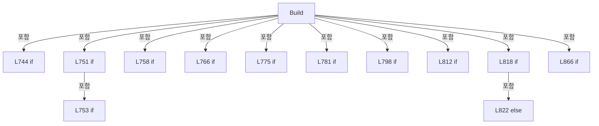

변경 전 점검: 입력/반환 타입, 위 호출자, 예외/취소 경로, 공유 상태와 저장·전송 소비자를 함께 확인합니다. 값의 단위나 물리 방향을 이름만으로 확정하지 않습니다.

### LocalFunctionStatement `BuildMonitor` · L788–791

[Drilling.UI/Menu/Menus/CMenuMonitor.cs:788–791](https://github.com/kjuws10-rgb/A3Drilling/blob/0219666f9053b907d96d7e0aa7d0c6c1be3a73d4/Drilling.UI/Menu/Menus/CMenuMonitor.cs#L788-L791)

| 항목 | 실제 추출 값 |
| --- | --- |
| 서명 | Drilling.UI.Menu.Menus.ST_MONITOR_TAB BuildMonitor(string) |
| 접근/수식자 | Private /  |
| 반환/값 타입 | Drilling.UI.Menu.Menus.ST_MONITOR_TAB |
| 소속 타입 | NamedType:Drilling.UI.Menu.Menus.CMenuMonitor |

입력 계약:

| 이름 | 타입 | 전달 | 선택/기본값 |
| --- | --- | --- | --- |
| tab | string | None | False /  |

현재 부분 분석에서 직접 연결된 호출자는 없습니다. XAML/이벤트/인터페이스·델리게이트·외부 진입을 추가 확인해야 하며, 미사용으로 판정한 것이 아닙니다.

호출하는 대상과 해석 범위:

| 원본 행 | 표현식 | 분석 상태 | 대상/소스 위치 |
| --- | --- | --- | --- |
| 790 | new ST_MONITOR_TAB | resolved | Drilling.UI.Menu.Menus.ST_MONITOR_TAB.ST_MONITOR_TAB(string, bool) · Drilling.UI/Menu/Menus/CMenuMonitor.cs:6782 |
| 790 | GetMonitorTabDisplayName | resolved | string Drilling.UI.Menu.Menus.CMenuMonitor.GetMonitorTabDisplayName(string) · Drilling.UI/Menu/Menus/CMenuMonitor.cs:2523 |

본문의 실제 연산·분기·예외·반환 순서(원문 위치 순):

| 원본 행 | 종류 | 주석 해설 |
| --- | --- | --- |
| 790 | call | 함수·델리게이트 또는 객체 생성자를 호출합니다: new ST_MONITOR_TAB(GetMonitorTabDisplayName(tab), tab == selectedTab) |
| 790 | call | 함수·델리게이트 또는 객체 생성자를 호출합니다: GetMonitorTabDisplayName(tab) |
| 790 | return | 호출자에게 값 또는 제어를 반환합니다: return new ST_MONITOR_TAB(GetMonitorTabDisplayName(tab), tab == selectedTab); |

변경 전 점검: 입력/반환 타입, 위 호출자, 예외/취소 경로, 공유 상태와 저장·전송 소비자를 함께 확인합니다. 값의 단위나 물리 방향을 이름만으로 확정하지 않습니다.

### LocalFunctionStatement `IsIsSelected` · L807–810

[Drilling.UI/Menu/Menus/CMenuMonitor.cs:807–810](https://github.com/kjuws10-rgb/A3Drilling/blob/0219666f9053b907d96d7e0aa7d0c6c1be3a73d4/Drilling.UI/Menu/Menus/CMenuMonitor.cs#L807-L810)

| 항목 | 실제 추출 값 |
| --- | --- |
| 서명 | bool IsIsSelected(Drilling.UI.Menu.Menus.ST_MONITOR_AXIS_ROW) |
| 접근/수식자 | Private /  |
| 반환/값 타입 | bool |
| 소속 타입 | NamedType:Drilling.UI.Menu.Menus.CMenuMonitor |

입력 계약:

| 이름 | 타입 | 전달 | 선택/기본값 |
| --- | --- | --- | --- |
| row | Drilling.UI.Menu.Menus.ST_MONITOR_AXIS_ROW | None | False /  |

현재 부분 분석에서 직접 연결된 호출자는 없습니다. XAML/이벤트/인터페이스·델리게이트·외부 진입을 추가 확인해야 하며, 미사용으로 판정한 것이 아닙니다.

본문의 실제 연산·분기·예외·반환 순서(원문 위치 순):

| 원본 행 | 종류 | 주석 해설 |
| --- | --- | --- |
| 809 | return | 호출자에게 값 또는 제어를 반환합니다: return row.IsSelected; |

변경 전 점검: 입력/반환 타입, 위 호출자, 예외/취소 경로, 공유 상태와 저장·전송 소비자를 함께 확인합니다. 값의 단위나 물리 방향을 이름만으로 확정하지 않습니다.

### LocalFunctionStatement `BuildDisplay` · L875–878

[Drilling.UI/Menu/Menus/CMenuMonitor.cs:875–878](https://github.com/kjuws10-rgb/A3Drilling/blob/0219666f9053b907d96d7e0aa7d0c6c1be3a73d4/Drilling.UI/Menu/Menus/CMenuMonitor.cs#L875-L878)

| 항목 | 실제 추출 값 |
| --- | --- |
| 서명 | Drilling.UI.Menu.Menus.ST_DISPLAY_ITEM BuildDisplay(Drilling.UI.Menu.Menus.ST_MONITOR_AXIS_ROW) |
| 접근/수식자 | Private /  |
| 반환/값 타입 | Drilling.UI.Menu.Menus.ST_DISPLAY_ITEM |
| 소속 타입 | NamedType:Drilling.UI.Menu.Menus.CMenuMonitor |

입력 계약:

| 이름 | 타입 | 전달 | 선택/기본값 |
| --- | --- | --- | --- |
| row | Drilling.UI.Menu.Menus.ST_MONITOR_AXIS_ROW | None | False /  |

현재 부분 분석에서 직접 연결된 호출자는 없습니다. XAML/이벤트/인터페이스·델리게이트·외부 진입을 추가 확인해야 하며, 미사용으로 판정한 것이 아닙니다.

호출하는 대상과 해석 범위:

| 원본 행 | 표현식 | 분석 상태 | 대상/소스 위치 |
| --- | --- | --- | --- |
| 877 | new ST_DISPLAY_ITEM | resolved | Drilling.UI.Menu.Menus.ST_DISPLAY_ITEM.ST_DISPLAY_ITEM(string, string, string) · Drilling.UI/Menu/Menus/CMenuBase.cs:43 |

본문의 실제 연산·분기·예외·반환 순서(원문 위치 순):

| 원본 행 | 종류 | 주석 해설 |
| --- | --- | --- |
| 877 | call | 함수·델리게이트 또는 객체 생성자를 호출합니다: new ST_DISPLAY_ITEM(row.Axis, row.CurrentPosition, row.Alarm) |
| 877 | return | 호출자에게 값 또는 제어를 반환합니다: return new ST_DISPLAY_ITEM(row.Axis, row.CurrentPosition, row.Alarm); |

변경 전 점검: 입력/반환 타입, 위 호출자, 예외/취소 경로, 공유 상태와 저장·전송 소비자를 함께 확인합니다. 값의 단위나 물리 방향을 이름만으로 확정하지 않습니다.

### LocalFunctionStatement `BuildDisplay2` · L880–883

[Drilling.UI/Menu/Menus/CMenuMonitor.cs:880–883](https://github.com/kjuws10-rgb/A3Drilling/blob/0219666f9053b907d96d7e0aa7d0c6c1be3a73d4/Drilling.UI/Menu/Menus/CMenuMonitor.cs#L880-L883)

| 항목 | 실제 추출 값 |
| --- | --- |
| 서명 | Drilling.UI.Menu.Menus.ST_DISPLAY_ITEM BuildDisplay2(Drilling.UI.Menu.Menus.ST_MONITOR_STATUS_ROW) |
| 접근/수식자 | Private /  |
| 반환/값 타입 | Drilling.UI.Menu.Menus.ST_DISPLAY_ITEM |
| 소속 타입 | NamedType:Drilling.UI.Menu.Menus.CMenuMonitor |

입력 계약:

| 이름 | 타입 | 전달 | 선택/기본값 |
| --- | --- | --- | --- |
| row | Drilling.UI.Menu.Menus.ST_MONITOR_STATUS_ROW | None | False /  |

현재 부분 분석에서 직접 연결된 호출자는 없습니다. XAML/이벤트/인터페이스·델리게이트·외부 진입을 추가 확인해야 하며, 미사용으로 판정한 것이 아닙니다.

호출하는 대상과 해석 범위:

| 원본 행 | 표현식 | 분석 상태 | 대상/소스 위치 |
| --- | --- | --- | --- |
| 882 | new ST_DISPLAY_ITEM | resolved | Drilling.UI.Menu.Menus.ST_DISPLAY_ITEM.ST_DISPLAY_ITEM(string, string, string) · Drilling.UI/Menu/Menus/CMenuBase.cs:43 |

본문의 실제 연산·분기·예외·반환 순서(원문 위치 순):

| 원본 행 | 종류 | 주석 해설 |
| --- | --- | --- |
| 882 | call | 함수·델리게이트 또는 객체 생성자를 호출합니다: new ST_DISPLAY_ITEM(row.Item, row.Value, row.State) |
| 882 | return | 호출자에게 값 또는 제어를 반환합니다: return new ST_DISPLAY_ITEM(row.Item, row.Value, row.State); |

변경 전 점검: 입력/반환 타입, 위 호출자, 예외/취소 경로, 공유 상태와 저장·전송 소비자를 함께 확인합니다. 값의 단위나 물리 방향을 이름만으로 확정하지 않습니다.

### MethodDeclaration `RefreshLiveData` · L888–1047

[Drilling.UI/Menu/Menus/CMenuMonitor.cs:888–1047](https://github.com/kjuws10-rgb/A3Drilling/blob/0219666f9053b907d96d7e0aa7d0c6c1be3a73d4/Drilling.UI/Menu/Menus/CMenuMonitor.cs#L888-L1047)

| 항목 | 실제 추출 값 |
| --- | --- |
| 서명 | System.Threading.Tasks.Task Drilling.UI.Menu.Menus.CMenuMonitor.RefreshLiveData(System.Threading.CancellationToken) |
| 접근/수식자 | Public / public |
| 반환/값 타입 | System.Threading.Tasks.Task |
| 소속 타입 | NamedType:Drilling.UI.Menu.Menus.CMenuMonitor |

입력 계약:

| 이름 | 타입 | 전달 | 선택/기본값 |
| --- | --- | --- | --- |
| cancellationToken | System.Threading.CancellationToken | None | True / null |

정적 호출자로 확인된 위치:

| 호출 파일/행 | 호출 표현식 | 런타임 분기 가능 |
| --- | --- | --- |
| [Drilling.UI/CRootView.cs:962–962](https://github.com/kjuws10-rgb/A3Drilling/blob/0219666f9053b907d96d7e0aa7d0c6c1be3a73d4/Drilling.UI/CRootView.cs#L962-L962) | monitor.RefreshLiveData | False |

호출하는 대상과 해석 범위:

| 원본 행 | 표현식 | 분석 상태 | 대상/소스 위치 |
| --- | --- | --- | --- |
| 903 | NormalizeMonitorScreenTab | resolved | string Drilling.UI.Menu.Menus.CMenuMonitor.NormalizeMonitorScreenTab(string?) · Drilling.UI/Menu/Menus/CMenuMonitor.cs:1965 |
| 903 | _selectedTabAccessor | resolved · 동적 구현 선택 가능 | string System.Func<string>.Invoke() |
| 904 | selectedTab.Equals | resolved | bool string.Equals(string?, System.StringComparison) |
| 916 | SaveOperationFieldValues | resolved | void Drilling.UI.Menu.Menus.CMenuMonitor.SaveOperationFieldValues(string) · Drilling.UI/Menu/Menus/CMenuMonitor.cs:2351 |
| 921 | SavePowerMeterSettingValues | resolved | void Drilling.UI.Menu.Menus.CMenuMonitor.SavePowerMeterSettingValues() · Drilling.UI/Menu/Menus/CMenuMonitor.cs:5866 |
| 924 | LoadEnabledHeadDeviceNumbers | resolved | System.Collections.Generic.IReadOnlyList<int> Drilling.UI.Menu.Menus.CMenuMonitor.LoadEnabledHeadDeviceNumbers(System.Threading.CancellationToken) · Drilling.UI/Menu/Menus/CMenuMonitor.cs:2385 |
| 925 | NormalizeHeadDeviceSelections | resolved | void Drilling.UI.Menu.Menus.CMenuMonitor.NormalizeHeadDeviceSelections() · Drilling.UI/Menu/Menus/CMenuMonitor.cs:2405 |
| 928 | NormalizePowerMeterSelection | resolved | void Drilling.UI.Menu.Menus.CMenuMonitor.NormalizePowerMeterSelection() · Drilling.UI/Menu/Menus/CMenuMonitor.cs:6405 |
| 931 | UpdatePollingContext | resolved | void Drilling.UI.Menu.Menus.CMenuMonitor.UpdatePollingContext(string) · Drilling.UI/Menu/Menus/CMenuMonitor.cs:1133 |
| 932 | _statusPollingService.Start | resolved | void Drilling.UI.Menu.Menus.CMonitorStatusPollingService.Start() · Drilling.UI/Menu/Menus/CMonitorStatusPollingService.cs:32 |
| 933 | _statusPollingService.GetSnapshot | resolved | Drilling.UI.Menu.Menus.ST_MONITOR_STATUS_SNAPSHOT Drilling.UI.Menu.Menus.CMonitorStatusPollingService.GetSnapshot() · Drilling.UI/Menu/Menus/CMonitorStatusPollingService.cs:54 |
| 936 | RefreshPowerMeterSnapshotFromCache | resolved | Drilling.UI.Menu.Menus.ST_MONITOR_STATUS_SNAPSHOT Drilling.UI.Menu.Menus.CMenuMonitor.RefreshPowerMeterSnapshotFromCache(Drilling.UI.Menu.Menus.ST_MONITOR_STATUS_SNAPSHOT, System.Threading.CancellationToken) · Drilling.UI/Menu/Menus/CMenuMonitor.cs:1122 |
| 939 | CreateLiveRefreshHash | resolved | int Drilling.UI.Menu.Menus.CMenuMonitor.CreateLiveRefreshHash(string, Drilling.UI.Menu.Menus.ST_MONITOR_STATUS_SNAPSHOT) · Drilling.UI/Menu/Menus/CMenuMonitor.cs:1049 |
| 951 | Math.Clamp | resolved | int System.Math.Clamp(int, int, int) |
| 953 | CreatePicoMotorStatusRows | resolved | System.Collections.Generic.IReadOnlyList<Drilling.UI.Menu.Menus.ST_MONITOR_STATUS_ROW> Drilling.UI.Menu.Menus.CMenuMonitor.CreatePicoMotorStatusRows(Drilling.Common.Interface.ST_PICO_MOTOR_STATUS) · Drilling.UI/Menu/Menus/CMenuMonitor.cs:6355 |
| 954 | CreatePicoErrorRows | resolved | System.Collections.Generic.IReadOnlyList<Drilling.UI.Menu.Menus.ST_MONITOR_PARAMETER_ROW> Drilling.UI.Menu.Menus.CMenuMonitor.CreatePicoErrorRows() · Drilling.UI/Menu/Menus/CMenuMonitor.cs:6371 |
| 955 | CreatePicoMotorPositionRows | resolved | System.Collections.Generic.IReadOnlyList<Drilling.UI.Menu.Menus.ST_MONITOR_POSITION_ROW> Drilling.UI.Menu.Menus.CMenuMonitor.CreatePicoMotorPositionRows(Drilling.Common.Interface.ST_PICO_MOTOR_STATUS) · Drilling.UI/Menu/Menus/CMenuMonitor.cs:6395 |
| 956 | UpdatePicoMotorOperationFields | resolved | void Drilling.UI.Menu.Menus.CMenuMonitor.UpdatePicoMotorOperationFields(Drilling.Common.Interface.ST_PICO_MOTOR_STATUS) · Drilling.UI/Menu/Menus/CMenuMonitor.cs:5625 |
| 957 | NotifyMonitorLiveProperties | resolved | void Drilling.UI.Menu.Menus.CMenuMonitor.NotifyMonitorLiveProperties(params string[]) · Drilling.UI/Menu/Menus/CMenuMonitor.cs:1886 |
| 957 | nameof | unresolved | None |
| 957 | nameof | unresolved | None |
| 957 | nameof | unresolved | None |
| 957 | nameof | unresolved | None |
| 957 | nameof | unresolved | None |
| 957 | nameof | unresolved | None |
| 965 | CreateStatusRows | resolved | System.Collections.Generic.IReadOnlyList<Drilling.UI.Menu.Menus.ST_MONITOR_STATUS_ROW> Drilling.UI.Menu.Menus.CMenuMonitor.CreateStatusRows(string, Drilling.Common.Managers.ST_DEVICE_STATUS, System.Collections.Generic.IReadOnlyList<Drilling.Common.Interface.ST_DEVICE_COMM_STATUS>, string?, Drilling.Common.Interface.ST_TALON_STATUS?) · Drilling.UI/Menu/Menus/CMenuMonitor.cs:2065 |
| 965 | GetSelectedHeadConnectionText | resolved | string? Drilling.UI.Menu.Menus.CMenuMonitor.GetSelectedHeadConnectionText(string) · Drilling.UI/Menu/Menus/CMenuMonitor.cs:2435 |
| 966 | CreateOperationButtons | resolved | System.Collections.Generic.IReadOnlyList<Drilling.UI.Menu.Menus.ST_MONITOR_OPERATION_BUTTON> Drilling.UI.Menu.Menus.CMenuMonitor.CreateOperationButtons(string, Drilling.Common.Interface.ST_LASER_STATUS, Drilling.Common.Interface.ST_TALON_STATUS) · Drilling.UI/Menu/Menus/CMenuMonitor.cs:2202 |
| 967 | CreateHeadSelectRows | resolved | System.Collections.Generic.IReadOnlyList<Drilling.UI.Menu.Menus.ST_MONITOR_HEAD_SELECT_ROW> Drilling.UI.Menu.Menus.CMenuMonitor.CreateHeadSelectRows(string, int, Drilling.Common.Interface.EN_EQP_MODULE?, string) · Drilling.UI/Menu/Menus/CMenuMonitor.cs:2493 |
| 968 | CreateLaserControlRows | resolved | System.Collections.Generic.IReadOnlyList<Drilling.UI.Menu.Menus.ST_MONITOR_LASER_CONTROL_ROW> Drilling.UI.Menu.Menus.CMenuMonitor.CreateLaserControlRows(string, Drilling.Common.Interface.ST_LASER_STATUS, Drilling.Common.Interface.ST_TALON_STATUS, System.Collections.Generic.IReadOnlyList<Drilling.UI.Menu.Menus.ST_MONITOR_PARAMETER_ROW>) · Drilling.UI/Menu/Menus/CMenuMonitor.cs:6489 |
| 969 | CreateSummaryItems | resolved | System.Collections.Generic.IReadOnlyList<Drilling.UI.Menu.Menus.ST_MONITOR_SUMMARY_ITEM> Drilling.UI.Menu.Menus.CMenuMonitor.CreateSummaryItems(string, Drilling.Common.Managers.ST_DEVICE_STATUS) · Drilling.UI/Menu/Menus/CMenuMonitor.cs:2545 |
| 970 | CreatePwmSettingRows | resolved | System.Collections.Generic.IReadOnlyList<Drilling.UI.Menu.Menus.ST_PWM_SETTING_ROW> Drilling.UI.Menu.Menus.CMenuMonitor.CreatePwmSettingRows(string) · Drilling.UI/Menu/Menus/CMenuMonitor.cs:6651 |
| 971 | CreatePwmDeviceRows | resolved | System.Collections.Generic.IReadOnlyList<Drilling.UI.Menu.Menus.ST_PWM_DEVICE_ROW> Drilling.UI.Menu.Menus.CMenuMonitor.CreatePwmDeviceRows(string, Drilling.Common.Managers.ST_DEVICE_STATUS) · Drilling.UI/Menu/Menus/CMenuMonitor.cs:6674 |
| 972 | NotifyMonitorLiveProperties | resolved | void Drilling.UI.Menu.Menus.CMenuMonitor.NotifyMonitorLiveProperties(params string[]) · Drilling.UI/Menu/Menus/CMenuMonitor.cs:1886 |
| 972 | nameof | unresolved | None |
| 972 | nameof | unresolved | None |
| 972 | nameof | unresolved | None |
| 972 | nameof | unresolved | None |
| 972 | nameof | unresolved | None |
| 972 | nameof | unresolved | None |
| 972 | nameof | unresolved | None |
| 972 | nameof | unresolved | None |
| 976 | CreateStatusRows | resolved | System.Collections.Generic.IReadOnlyList<Drilling.UI.Menu.Menus.ST_MONITOR_STATUS_ROW> Drilling.UI.Menu.Menus.CMenuMonitor.CreateStatusRows(string, Drilling.Common.Managers.ST_DEVICE_STATUS, System.Collections.Generic.IReadOnlyList<Drilling.Common.Interface.ST_DEVICE_COMM_STATUS>, string?, Drilling.Common.Interface.ST_TALON_STATUS?) · Drilling.UI/Menu/Menus/CMenuMonitor.cs:2065 |
| 976 | GetSelectedHeadConnectionText | resolved | string? Drilling.UI.Menu.Menus.CMenuMonitor.GetSelectedHeadConnectionText(string) · Drilling.UI/Menu/Menus/CMenuMonitor.cs:2435 |
| 980 | CreateAxisRows | resolved | System.Collections.Generic.IReadOnlyList<Drilling.UI.Menu.Menus.ST_MONITOR_AXIS_ROW> Drilling.UI.Menu.Menus.CMenuMonitor.CreateAxisRows(Drilling.Common.Managers.ST_DEVICE_STATUS, string) · Drilling.UI/Menu/Menus/CMenuMonitor.cs:6266 |
| 981 | axisRows.Any | resolved | bool System.Collections.Generic.IEnumerable<Drilling.UI.Menu.Menus.ST_MONITOR_AXIS_ROW>.Any<Drilling.UI.Menu.Menus.ST_MONITOR_AXIS_ROW>(System.Func<Drilling.UI.Menu.Menus.ST_MONITOR_AXIS_ROW, bool>) |
| 984 | CreateAxisRows | resolved | System.Collections.Generic.IReadOnlyList<Drilling.UI.Menu.Menus.ST_MONITOR_AXIS_ROW> Drilling.UI.Menu.Menus.CMenuMonitor.CreateAxisRows(Drilling.Common.Managers.ST_DEVICE_STATUS, string) · Drilling.UI/Menu/Menus/CMenuMonitor.cs:6266 |
| 985 | OnPropertyChanged | resolved | void Drilling.UI.Menu.CBindingBase.OnPropertyChanged(string?) · Drilling.UI/Menu/CBindingBase.cs:790 |
| 985 | nameof | unresolved | None |
| 986 | OnPropertyChanged | resolved | void Drilling.UI.Menu.CBindingBase.OnPropertyChanged(string?) · Drilling.UI/Menu/CBindingBase.cs:790 |
| 986 | nameof | unresolved | None |
| 990 | UpdateMultiMoveAxisRows | resolved | void Drilling.UI.Menu.Menus.CMenuMonitor.UpdateMultiMoveAxisRows(Drilling.Common.Managers.ST_DEVICE_STATUS) · Drilling.UI/Menu/Menus/CMenuMonitor.cs:6289 |
| 991 | NotifyMonitorLiveProperties | resolved | void Drilling.UI.Menu.Menus.CMenuMonitor.NotifyMonitorLiveProperties(params string[]) · Drilling.UI/Menu/Menus/CMenuMonitor.cs:1886 |
| 991 | nameof | unresolved | None |
| 991 | nameof | unresolved | None |
| 991 | nameof | unresolved | None |
| 991 | nameof | unresolved | None |
| 994 | CreateHeadSelectRows | resolved | System.Collections.Generic.IReadOnlyList<Drilling.UI.Menu.Menus.ST_MONITOR_HEAD_SELECT_ROW> Drilling.UI.Menu.Menus.CMenuMonitor.CreateHeadSelectRows(string, int, Drilling.Common.Interface.EN_EQP_MODULE?, string) · Drilling.UI/Menu/Menus/CMenuMonitor.cs:2493 |
| 995 | CreateSummaryItems | resolved | System.Collections.Generic.IReadOnlyList<Drilling.UI.Menu.Menus.ST_MONITOR_SUMMARY_ITEM> Drilling.UI.Menu.Menus.CMenuMonitor.CreateSummaryItems(string, Drilling.Common.Managers.ST_DEVICE_STATUS) · Drilling.UI/Menu/Menus/CMenuMonitor.cs:2545 |
| 996 | CreateAttenuatorStatusItems | resolved | System.Collections.Generic.IReadOnlyList<Drilling.UI.Menu.Menus.ST_MONITOR_SUMMARY_ITEM> Drilling.UI.Menu.Menus.CMenuMonitor.CreateAttenuatorStatusItems(string, Drilling.Common.Managers.ST_DEVICE_STATUS) · Drilling.UI/Menu/Menus/CMenuMonitor.cs:6582 |
| 997 | CreateAttenuatorSettingItems | resolved | System.Collections.Generic.IReadOnlyList<Drilling.UI.Menu.Menus.ST_MONITOR_SUMMARY_ITEM> Drilling.UI.Menu.Menus.CMenuMonitor.CreateAttenuatorSettingItems(string, Drilling.Common.Managers.ST_DEVICE_STATUS) · Drilling.UI/Menu/Menus/CMenuMonitor.cs:6600 |
| 998 | CreatePositionRows | resolved | System.Collections.Generic.IReadOnlyList<Drilling.UI.Menu.Menus.ST_MONITOR_POSITION_ROW> Drilling.UI.Menu.Menus.CMenuMonitor.CreatePositionRows(string, Drilling.Common.Managers.ST_DEVICE_STATUS) · Drilling.UI/Menu/Menus/CMenuMonitor.cs:6617 |
| 999 | NotifyMonitorLiveProperties | resolved | void Drilling.UI.Menu.Menus.CMenuMonitor.NotifyMonitorLiveProperties(params string[]) · Drilling.UI/Menu/Menus/CMenuMonitor.cs:1886 |
| 999 | nameof | unresolved | None |
| 999 | nameof | unresolved | None |
| 999 | nameof | unresolved | None |
| 999 | nameof | unresolved | None |
| 999 | nameof | unresolved | None |
| 999 | nameof | unresolved | None |
| 999 | nameof | unresolved | None |
| 1002 | CreateHeadSelectRows | resolved | System.Collections.Generic.IReadOnlyList<Drilling.UI.Menu.Menus.ST_MONITOR_HEAD_SELECT_ROW> Drilling.UI.Menu.Menus.CMenuMonitor.CreateHeadSelectRows(string, int, Drilling.Common.Interface.EN_EQP_MODULE?, string) · Drilling.UI/Menu/Menus/CMenuMonitor.cs:2493 |
| 1003 | CreateSummaryItems | resolved | System.Collections.Generic.IReadOnlyList<Drilling.UI.Menu.Menus.ST_MONITOR_SUMMARY_ITEM> Drilling.UI.Menu.Menus.CMenuMonitor.CreateSummaryItems(string, Drilling.Common.Managers.ST_DEVICE_STATUS) · Drilling.UI/Menu/Menus/CMenuMonitor.cs:2545 |
| 1004 | CreatePositionRows | resolved | System.Collections.Generic.IReadOnlyList<Drilling.UI.Menu.Menus.ST_MONITOR_POSITION_ROW> Drilling.UI.Menu.Menus.CMenuMonitor.CreatePositionRows(string, Drilling.Common.Managers.ST_DEVICE_STATUS) · Drilling.UI/Menu/Menus/CMenuMonitor.cs:6617 |
| 1005 | NotifyMonitorLiveProperties | resolved | void Drilling.UI.Menu.Menus.CMenuMonitor.NotifyMonitorLiveProperties(params string[]) · Drilling.UI/Menu/Menus/CMenuMonitor.cs:1886 |
| 1005 | nameof | unresolved | None |
| 1005 | nameof | unresolved | None |
| 1005 | nameof | unresolved | None |
| 1005 | nameof | unresolved | None |
| 1005 | nameof | unresolved | None |
| 1008 | UpdatePowerMeterGraph | resolved | void Drilling.UI.Menu.Menus.CMenuMonitor.UpdatePowerMeterGraph() · Drilling.UI/Menu/Menus/CMenuMonitor.cs:6172 |
| 1009 | CreateHeadSelectRows | resolved | System.Collections.Generic.IReadOnlyList<Drilling.UI.Menu.Menus.ST_MONITOR_HEAD_SELECT_ROW> Drilling.UI.Menu.Menus.CMenuMonitor.CreateHeadSelectRows(string, int, Drilling.Common.Interface.EN_EQP_MODULE?, string) · Drilling.UI/Menu/Menus/CMenuMonitor.cs:2493 |
| 1010 | CreateSummaryItems | resolved | System.Collections.Generic.IReadOnlyList<Drilling.UI.Menu.Menus.ST_MONITOR_SUMMARY_ITEM> Drilling.UI.Menu.Menus.CMenuMonitor.CreateSummaryItems(string, Drilling.Common.Managers.ST_DEVICE_STATUS) · Drilling.UI/Menu/Menus/CMenuMonitor.cs:2545 |
| 1011 | CreatePwmSettingRows | resolved | System.Collections.Generic.IReadOnlyList<Drilling.UI.Menu.Menus.ST_PWM_SETTING_ROW> Drilling.UI.Menu.Menus.CMenuMonitor.CreatePwmSettingRows(string) · Drilling.UI/Menu/Menus/CMenuMonitor.cs:6651 |
| 1012 | CreatePwmDeviceRows | resolved | System.Collections.Generic.IReadOnlyList<Drilling.UI.Menu.Menus.ST_PWM_DEVICE_ROW> Drilling.UI.Menu.Menus.CMenuMonitor.CreatePwmDeviceRows(string, Drilling.Common.Managers.ST_DEVICE_STATUS) · Drilling.UI/Menu/Menus/CMenuMonitor.cs:6674 |
| 1013 | CreatePwmRunButtons | resolved | System.Collections.Generic.IReadOnlyList<Drilling.UI.Menu.Menus.ST_MONITOR_OPERATION_BUTTON> Drilling.UI.Menu.Menus.CMenuMonitor.CreatePwmRunButtons(string) · Drilling.UI/Menu/Menus/CMenuMonitor.cs:6693 |
| 1014 | NotifyMonitorLiveProperties | resolved | void Drilling.UI.Menu.Menus.CMenuMonitor.NotifyMonitorLiveProperties(params string[]) · Drilling.UI/Menu/Menus/CMenuMonitor.cs:1886 |
| 1015 | nameof | unresolved | None |
| 1016 | nameof | unresolved | None |
| 1017 | nameof | unresolved | None |
| 1018 | nameof | unresolved | None |
| 1019 | nameof | unresolved | None |
| 1020 | nameof | unresolved | None |
| 1021 | nameof | unresolved | None |
| 1022 | nameof | unresolved | None |
| 1023 | nameof | unresolved | None |
| 1024 | nameof | unresolved | None |
| 1025 | nameof | unresolved | None |
| 1026 | nameof | unresolved | None |
| 1027 | nameof | unresolved | None |
| 1028 | nameof | unresolved | None |
| 1029 | nameof | unresolved | None |
| 1033 | UpdateMelsecReadValues | resolved | void Drilling.UI.Menu.Menus.CMenuMonitor.UpdateMelsecReadValues(System.Collections.Generic.IReadOnlyDictionary<string, Drilling.UI.Menu.Menus.ST_MONITOR_MELSEC_VALUE>) · Drilling.UI/Menu/Menus/CMenuMonitor.cs:4380 |
| 1034 | NotifyMonitorLiveProperties | resolved | void Drilling.UI.Menu.Menus.CMenuMonitor.NotifyMonitorLiveProperties(params string[]) · Drilling.UI/Menu/Menus/CMenuMonitor.cs:1886 |
| 1034 | nameof | unresolved | None |
| 1037 | NotifyMonitorLiveProperties | resolved | void Drilling.UI.Menu.Menus.CMenuMonitor.NotifyMonitorLiveProperties(params string[]) · Drilling.UI/Menu/Menus/CMenuMonitor.cs:1886 |
| 1037 | nameof | unresolved | None |

본문의 실제 연산·분기·예외·반환 순서(원문 위치 순):

| 원본 행 | 종류 | 주석 해설 |
| --- | --- | --- |
| 890 | if | 조건에 따라 분기합니다: if (_liveRefreshRunning) |
| 892 | return | 호출자에게 값 또는 제어를 반환합니다: return Task.CompletedTask; |
| 895 | assignment | 값을 대상에 대입합니다: _liveRefreshRunning = true |
| 901 | try | 예외 처리 범위입니다: try |
| 903 | call | 함수·델리게이트 또는 객체 생성자를 호출합니다: NormalizeMonitorScreenTab(_selectedTabAccessor()) |
| 903 | call | 함수·델리게이트 또는 객체 생성자를 호출합니다: _selectedTabAccessor() |
| 903 | local-declaration | 지역 변수를 선언합니다: var selectedTab = NormalizeMonitorScreenTab(_selectedTabAccessor()); |
| 903 | variable-initializer | 변수의 초기값을 지정합니다: selectedTab = NormalizeMonitorScreenTab(_selectedTabAccessor()) |
| 904 | call | 함수·델리게이트 또는 객체 생성자를 호출합니다: selectedTab.Equals(SelectedTab, StringComparison.OrdinalIgnoreCase) |
| 904 | if | 조건에 따라 분기합니다: if (!selectedTab.Equals(SelectedTab, StringComparison.OrdinalIgnoreCase)) |
| 906 | return | 호출자에게 값 또는 제어를 반환합니다: return Task.CompletedTask; |
| 909 | if | 조건에 따라 분기합니다: if (selectedTab is "COORDINATE VIEWER" or "LOG VIEWER") |
| 911 | return | 호출자에게 값 또는 제어를 반환합니다: return Task.CompletedTask; |
| 914 | if | 조건에 따라 분기합니다: if (OperationFields.Count > 0) |
| 916 | call | 함수·델리게이트 또는 객체 생성자를 호출합니다: SaveOperationFieldValues(selectedTab) |
| 919 | if | 조건에 따라 분기합니다: if ((selectedTab is "LASER" or "POWER METER") && PwmSettingRows.Count > 0) |
| 921 | call | 함수·델리게이트 또는 객체 생성자를 호출합니다: SavePowerMeterSettingValues() |
| 924 | assignment | 값을 대상에 대입합니다: _enabledHeadDeviceNumbers = LoadEnabledHeadDeviceNumbers(cancellationToken) |
| 924 | call | 함수·델리게이트 또는 객체 생성자를 호출합니다: LoadEnabledHeadDeviceNumbers(cancellationToken) |
| 925 | call | 함수·델리게이트 또는 객체 생성자를 호출합니다: NormalizeHeadDeviceSelections() |
| 926 | if | 조건에 따라 분기합니다: if (selectedTab is "LASER" or "POWER METER") |
| 928 | call | 함수·델리게이트 또는 객체 생성자를 호출합니다: NormalizePowerMeterSelection() |
| 931 | call | 함수·델리게이트 또는 객체 생성자를 호출합니다: UpdatePollingContext(selectedTab) |
| 932 | call | 함수·델리게이트 또는 객체 생성자를 호출합니다: _statusPollingService.Start() |
| 933 | call | 함수·델리게이트 또는 객체 생성자를 호출합니다: _statusPollingService.GetSnapshot() |
| 933 | local-declaration | 지역 변수를 선언합니다: var monitorSnapshot = _statusPollingService.GetSnapshot(); |
| 933 | variable-initializer | 변수의 초기값을 지정합니다: monitorSnapshot = _statusPollingService.GetSnapshot() |
| 934 | if | 조건에 따라 분기합니다: if (selectedTab is "LASER" or "POWER METER") |
| 936 | assignment | 값을 대상에 대입합니다: monitorSnapshot = RefreshPowerMeterSnapshotFromCache(monitorSnapshot, cancellationToken) |
| 936 | call | 함수·델리게이트 또는 객체 생성자를 호출합니다: RefreshPowerMeterSnapshotFromCache(monitorSnapshot, cancellationToken) |
| 939 | call | 함수·델리게이트 또는 객체 생성자를 호출합니다: CreateLiveRefreshHash(selectedTab, monitorSnapshot) |
| 939 | local-declaration | 지역 변수를 선언합니다: var liveRefreshHash = CreateLiveRefreshHash(selectedTab, monitorSnapshot); |
| 939 | variable-initializer | 변수의 초기값을 지정합니다: liveRefreshHash = CreateLiveRefreshHash(selectedTab, monitorSnapshot) |
| 940 | if | 조건에 따라 분기합니다: if (_lastLiveRefreshHash == liveRefreshHash) |
| 942 | return | 호출자에게 값 또는 제어를 반환합니다: return Task.CompletedTask; |
| 945 | assignment | 값을 대상에 대입합니다: _lastLiveRefreshHash = liveRefreshHash |
| 946 | local-declaration | 지역 변수를 선언합니다: var snapshot = monitorSnapshot.DeviceStatus; |
| 946 | variable-initializer | 변수의 초기값을 지정합니다: snapshot = monitorSnapshot.DeviceStatus |
| 947 | local-declaration | 지역 변수를 선언합니다: var communication = monitorSnapshot.Communication; |
| 947 | variable-initializer | 변수의 초기값을 지정합니다: communication = monitorSnapshot.Communication |
| 948 | if | 조건에 따라 분기합니다: if (selectedTab == "PICO MOTOR") |
| 950 | local-declaration | 지역 변수를 선언합니다: var picoStatus = monitorSnapshot.PicoMotorStatus; |
| 950 | variable-initializer | 변수의 초기값을 지정합니다: picoStatus = monitorSnapshot.PicoMotorStatus |
| 951 | assignment | 값을 대상에 대입합니다: _selectedPicoMotorNo = Math.Clamp(picoStatus.SelectedMotorNo, 1, 4) |
| 951 | call | 함수·델리게이트 또는 객체 생성자를 호출합니다: Math.Clamp(picoStatus.SelectedMotorNo, 1, 4) |
| 952 | assignment | 값을 대상에 대입합니다: _picoMotorIsConnected = picoStatus.IsConnected |
| 953 | assignment | 값을 대상에 대입합니다: StatusRows = CreatePicoMotorStatusRows(picoStatus) |
| 953 | call | 함수·델리게이트 또는 객체 생성자를 호출합니다: CreatePicoMotorStatusRows(picoStatus) |
| 954 | assignment | 값을 대상에 대입합니다: ParameterRows = CreatePicoErrorRows() |
| 954 | call | 함수·델리게이트 또는 객체 생성자를 호출합니다: CreatePicoErrorRows() |
| 955 | assignment | 값을 대상에 대입합니다: PositionRows = CreatePicoMotorPositionRows(picoStatus) |
| 955 | call | 함수·델리게이트 또는 객체 생성자를 호출합니다: CreatePicoMotorPositionRows(picoStatus) |
| 956 | call | 함수·델리게이트 또는 객체 생성자를 호출합니다: UpdatePicoMotorOperationFields(picoStatus) |
| 957 | call | 함수·델리게이트 또는 객체 생성자를 호출합니다: NotifyMonitorLiveProperties(nameof(StatusRows), nameof(ParameterRows), nameof(PositionRows), nameof(OperationFields), nameof(PicoConnectionButtons), nameof(PicoMotorSelectButtons)) |
| 957 | call | 함수·델리게이트 또는 객체 생성자를 호출합니다: nameof(StatusRows) |
| 957 | call | 함수·델리게이트 또는 객체 생성자를 호출합니다: nameof(ParameterRows) |
| 957 | call | 함수·델리게이트 또는 객체 생성자를 호출합니다: nameof(PositionRows) |
| 957 | call | 함수·델리게이트 또는 객체 생성자를 호출합니다: nameof(OperationFields) |
| 957 | call | 함수·델리게이트 또는 객체 생성자를 호출합니다: nameof(PicoConnectionButtons) |
| 957 | call | 함수·델리게이트 또는 객체 생성자를 호출합니다: nameof(PicoMotorSelectButtons) |
| 958 | return | 호출자에게 값 또는 제어를 반환합니다: return Task.CompletedTask; |
| 961 | if | 조건에 따라 분기합니다: if (selectedTab == "LASER") |
| 963 | local-declaration | 지역 변수를 선언합니다: var talonStatus = monitorSnapshot.TalonStatus; |
| 963 | variable-initializer | 변수의 초기값을 지정합니다: talonStatus = monitorSnapshot.TalonStatus |
| 964 | local-declaration | 지역 변수를 선언합니다: var selectedLaserStatus = snapshot.Laser; |
| 964 | variable-initializer | 변수의 초기값을 지정합니다: selectedLaserStatus = snapshot.Laser |
| 965 | assignment | 값을 대상에 대입합니다: StatusRows = CreateStatusRows(selectedTab, snapshot, communication, GetSelectedHeadConnectionText(selectedTab), talonStatus) |
| 965 | call | 함수·델리게이트 또는 객체 생성자를 호출합니다: CreateStatusRows(selectedTab, snapshot, communication, GetSelectedHeadConnectionText(selectedTab), talonStatus) |
| 965 | call | 함수·델리게이트 또는 객체 생성자를 호출합니다: GetSelectedHeadConnectionText(selectedTab) |
| 966 | assignment | 값을 대상에 대입합니다: OperationButtons = CreateOperationButtons(selectedTab, selectedLaserStatus, talonStatus) |
| 966 | call | 함수·델리게이트 또는 객체 생성자를 호출합니다: CreateOperationButtons(selectedTab, selectedLaserStatus, talonStatus) |
| 967 | assignment | 값을 대상에 대입합니다: HeadSelectRows = CreateHeadSelectRows(selectedTab, _selectedLaserNumber, EN_EQP_MODULE.TalonLaser, "TALON") |
| 967 | call | 함수·델리게이트 또는 객체 생성자를 호출합니다: CreateHeadSelectRows(selectedTab, _selectedLaserNumber, EN_EQP_MODULE.TalonLaser, "TALON") |
| 968 | assignment | 값을 대상에 대입합니다: LaserControlRows = CreateLaserControlRows(selectedTab, selectedLaserStatus, talonStatus, OperationFields) |
| 968 | call | 함수·델리게이트 또는 객체 생성자를 호출합니다: CreateLaserControlRows(selectedTab, selectedLaserStatus, talonStatus, OperationFields) |
| 969 | assignment | 값을 대상에 대입합니다: SummaryItems = CreateSummaryItems(selectedTab, snapshot) |
| 969 | call | 함수·델리게이트 또는 객체 생성자를 호출합니다: CreateSummaryItems(selectedTab, snapshot) |
| 970 | assignment | 값을 대상에 대입합니다: PwmSettingRows = CreatePwmSettingRows(selectedTab) |
| 970 | call | 함수·델리게이트 또는 객체 생성자를 호출합니다: CreatePwmSettingRows(selectedTab) |
| 971 | assignment | 값을 대상에 대입합니다: PwmDeviceRows = CreatePwmDeviceRows(selectedTab, snapshot) |
| 971 | call | 함수·델리게이트 또는 객체 생성자를 호출합니다: CreatePwmDeviceRows(selectedTab, snapshot) |
| 972 | call | 함수·델리게이트 또는 객체 생성자를 호출합니다: NotifyMonitorLiveProperties(nameof(StatusRows), nameof(OperationButtons), nameof(HeadSelectRows), nameof(LaserControlRows), nameof(SelectedHeadDeviceName), nameof(SummaryItems), nameof(PwmSettingRows), nameof(PwmDeviceRo… |
| 972 | call | 함수·델리게이트 또는 객체 생성자를 호출합니다: nameof(StatusRows) |
| 972 | call | 함수·델리게이트 또는 객체 생성자를 호출합니다: nameof(OperationButtons) |
| 972 | call | 함수·델리게이트 또는 객체 생성자를 호출합니다: nameof(HeadSelectRows) |
| 972 | call | 함수·델리게이트 또는 객체 생성자를 호출합니다: nameof(LaserControlRows) |
| 972 | call | 함수·델리게이트 또는 객체 생성자를 호출합니다: nameof(SelectedHeadDeviceName) |
| 972 | call | 함수·델리게이트 또는 객체 생성자를 호출합니다: nameof(SummaryItems) |
| 972 | call | 함수·델리게이트 또는 객체 생성자를 호출합니다: nameof(PwmSettingRows) |
| 972 | call | 함수·델리게이트 또는 객체 생성자를 호출합니다: nameof(PwmDeviceRows) |
| 973 | return | 호출자에게 값 또는 제어를 반환합니다: return Task.CompletedTask; |
| 976 | assignment | 값을 대상에 대입합니다: StatusRows = CreateStatusRows(selectedTab, snapshot, communication, GetSelectedHeadConnectionText(selectedTab), ST_TALON_STATUS.Empty) |
| 976 | call | 함수·델리게이트 또는 객체 생성자를 호출합니다: CreateStatusRows(selectedTab, snapshot, communication, GetSelectedHeadConnectionText(selectedTab), ST_TALON_STATUS.Empty) |
| 976 | call | 함수·델리게이트 또는 객체 생성자를 호출합니다: GetSelectedHeadConnectionText(selectedTab) |
| 977 | switch | 값에 따라 분기합니다: switch (selectedTab) |
| 979 | case | 분기값/패턴의 구간입니다: case "XPS": |
| 980 | call | 함수·델리게이트 또는 객체 생성자를 호출합니다: CreateAxisRows(snapshot, _selectedAxisId) |
| 980 | local-declaration | 지역 변수를 선언합니다: var axisRows = CreateAxisRows(snapshot, _selectedAxisId); |
| 980 | variable-initializer | 변수의 초기값을 지정합니다: axisRows = CreateAxisRows(snapshot, _selectedAxisId) |
| 981 | call | 함수·델리게이트 또는 객체 생성자를 호출합니다: axisRows.Any(IsIsSelected) |
| 981 | if | 조건에 따라 분기합니다: if (axisRows.Count > 0 && !axisRows.Any(IsIsSelected)) |
| 983 | assignment | 값을 대상에 대입합니다: _selectedAxisId = axisRows[0].AxisId |
| 984 | assignment | 값을 대상에 대입합니다: axisRows = CreateAxisRows(snapshot, _selectedAxisId) |
| 984 | call | 함수·델리게이트 또는 객체 생성자를 호출합니다: CreateAxisRows(snapshot, _selectedAxisId) |
| 985 | call | 함수·델리게이트 또는 객체 생성자를 호출합니다: OnPropertyChanged(nameof(SelectedAxisId)) |
| 985 | call | 함수·델리게이트 또는 객체 생성자를 호출합니다: nameof(SelectedAxisId) |
| 986 | call | 함수·델리게이트 또는 객체 생성자를 호출합니다: OnPropertyChanged(nameof(SelectedAxisRow)) |
| 986 | call | 함수·델리게이트 또는 객체 생성자를 호출합니다: nameof(SelectedAxisRow) |
| 989 | assignment | 값을 대상에 대입합니다: AxisRows = axisRows |
| 990 | call | 함수·델리게이트 또는 객체 생성자를 호출합니다: UpdateMultiMoveAxisRows(snapshot) |
| 991 | call | 함수·델리게이트 또는 객체 생성자를 호출합니다: NotifyMonitorLiveProperties(nameof(AxisRows), nameof(MultiMoveAxisRows), nameof(StatusRows), nameof(SelectedAxisRow)) |
| 991 | call | 함수·델리게이트 또는 객체 생성자를 호출합니다: nameof(AxisRows) |
| 991 | call | 함수·델리게이트 또는 객체 생성자를 호출합니다: nameof(MultiMoveAxisRows) |
| 991 | call | 함수·델리게이트 또는 객체 생성자를 호출합니다: nameof(StatusRows) |
| 991 | call | 함수·델리게이트 또는 객체 생성자를 호출합니다: nameof(SelectedAxisRow) |
| 992 | break | 해당 반복/분기 구간을 종료합니다: break; |
| 993 | case | 분기값/패턴의 구간입니다: case "ATTENUATOR": |
| 994 | assignment | 값을 대상에 대입합니다: HeadSelectRows = CreateHeadSelectRows(selectedTab, _selectedAttenuatorNumber, EN_EQP_MODULE.Attenuator, "ATT") |
| 994 | call | 함수·델리게이트 또는 객체 생성자를 호출합니다: CreateHeadSelectRows(selectedTab, _selectedAttenuatorNumber, EN_EQP_MODULE.Attenuator, "ATT") |
| 995 | assignment | 값을 대상에 대입합니다: SummaryItems = CreateSummaryItems(selectedTab, snapshot) |
| 995 | call | 함수·델리게이트 또는 객체 생성자를 호출합니다: CreateSummaryItems(selectedTab, snapshot) |
| 996 | assignment | 값을 대상에 대입합니다: AttenuatorStatusItems = CreateAttenuatorStatusItems(selectedTab, snapshot) |
| 996 | call | 함수·델리게이트 또는 객체 생성자를 호출합니다: CreateAttenuatorStatusItems(selectedTab, snapshot) |
| 997 | assignment | 값을 대상에 대입합니다: AttenuatorSettingItems = CreateAttenuatorSettingItems(selectedTab, snapshot) |
| 997 | call | 함수·델리게이트 또는 객체 생성자를 호출합니다: CreateAttenuatorSettingItems(selectedTab, snapshot) |
| 998 | assignment | 값을 대상에 대입합니다: PositionRows = CreatePositionRows(selectedTab, snapshot) |
| 998 | call | 함수·델리게이트 또는 객체 생성자를 호출합니다: CreatePositionRows(selectedTab, snapshot) |
| 999 | call | 함수·델리게이트 또는 객체 생성자를 호출합니다: NotifyMonitorLiveProperties(nameof(StatusRows), nameof(HeadSelectRows), nameof(SelectedHeadDeviceName), nameof(SummaryItems), nameof(AttenuatorStatusItems), nameof(AttenuatorSettingItems), nameof(PositionRows)) |
| 999 | call | 함수·델리게이트 또는 객체 생성자를 호출합니다: nameof(StatusRows) |
| 999 | call | 함수·델리게이트 또는 객체 생성자를 호출합니다: nameof(HeadSelectRows) |
| 999 | call | 함수·델리게이트 또는 객체 생성자를 호출합니다: nameof(SelectedHeadDeviceName) |
| 999 | call | 함수·델리게이트 또는 객체 생성자를 호출합니다: nameof(SummaryItems) |
| 999 | call | 함수·델리게이트 또는 객체 생성자를 호출합니다: nameof(AttenuatorStatusItems) |
| 999 | call | 함수·델리게이트 또는 객체 생성자를 호출합니다: nameof(AttenuatorSettingItems) |
| 999 | call | 함수·델리게이트 또는 객체 생성자를 호출합니다: nameof(PositionRows) |
| 1000 | break | 해당 반복/분기 구간을 종료합니다: break; |
| 1001 | case | 분기값/패턴의 구간입니다: case "BET": |
| 1002 | assignment | 값을 대상에 대입합니다: HeadSelectRows = CreateHeadSelectRows(selectedTab, _selectedBetNumber, EN_EQP_MODULE.Bet, "BET") |
| 1002 | call | 함수·델리게이트 또는 객체 생성자를 호출합니다: CreateHeadSelectRows(selectedTab, _selectedBetNumber, EN_EQP_MODULE.Bet, "BET") |
| 1003 | assignment | 값을 대상에 대입합니다: SummaryItems = CreateSummaryItems(selectedTab, snapshot) |
| 1003 | call | 함수·델리게이트 또는 객체 생성자를 호출합니다: CreateSummaryItems(selectedTab, snapshot) |
| 1004 | assignment | 값을 대상에 대입합니다: PositionRows = CreatePositionRows(selectedTab, snapshot) |
| 1004 | call | 함수·델리게이트 또는 객체 생성자를 호출합니다: CreatePositionRows(selectedTab, snapshot) |
| 1005 | call | 함수·델리게이트 또는 객체 생성자를 호출합니다: NotifyMonitorLiveProperties(nameof(StatusRows), nameof(HeadSelectRows), nameof(SelectedHeadDeviceName), nameof(SummaryItems), nameof(PositionRows)) |
| 1005 | call | 함수·델리게이트 또는 객체 생성자를 호출합니다: nameof(StatusRows) |
| 1005 | call | 함수·델리게이트 또는 객체 생성자를 호출합니다: nameof(HeadSelectRows) |
| 1005 | call | 함수·델리게이트 또는 객체 생성자를 호출합니다: nameof(SelectedHeadDeviceName) |
| 1005 | call | 함수·델리게이트 또는 객체 생성자를 호출합니다: nameof(SummaryItems) |
| 1005 | call | 함수·델리게이트 또는 객체 생성자를 호출합니다: nameof(PositionRows) |
| 1006 | break | 해당 반복/분기 구간을 종료합니다: break; |
| 1007 | case | 분기값/패턴의 구간입니다: case "POWER METER": |
| 1008 | call | 함수·델리게이트 또는 객체 생성자를 호출합니다: UpdatePowerMeterGraph() |
| 1009 | assignment | 값을 대상에 대입합니다: HeadSelectRows = CreateHeadSelectRows(selectedTab, _selectedAttenuatorNumber, EN_EQP_MODULE.Attenuator, "ATT") |
| 1009 | call | 함수·델리게이트 또는 객체 생성자를 호출합니다: CreateHeadSelectRows(selectedTab, _selectedAttenuatorNumber, EN_EQP_MODULE.Attenuator, "ATT") |
| 1010 | assignment | 값을 대상에 대입합니다: SummaryItems = CreateSummaryItems(selectedTab, snapshot) |
| 1010 | call | 함수·델리게이트 또는 객체 생성자를 호출합니다: CreateSummaryItems(selectedTab, snapshot) |
| 1011 | assignment | 값을 대상에 대입합니다: PwmSettingRows = CreatePwmSettingRows(selectedTab) |
| 1011 | call | 함수·델리게이트 또는 객체 생성자를 호출합니다: CreatePwmSettingRows(selectedTab) |
| 1012 | assignment | 값을 대상에 대입합니다: PwmDeviceRows = CreatePwmDeviceRows(selectedTab, snapshot) |
| 1012 | call | 함수·델리게이트 또는 객체 생성자를 호출합니다: CreatePwmDeviceRows(selectedTab, snapshot) |
| 1013 | assignment | 값을 대상에 대입합니다: PwmRunButtons = CreatePwmRunButtons(selectedTab) |
| 1013 | call | 함수·델리게이트 또는 객체 생성자를 호출합니다: CreatePwmRunButtons(selectedTab) |
| 1014 | call | 함수·델리게이트 또는 객체 생성자를 호출합니다: NotifyMonitorLiveProperties( nameof(StatusRows), nameof(HeadSelectRows), nameof(SelectedHeadDeviceName), nameof(SummaryItems), nameof(PwmSettingRows), nameof(PwmDeviceRows), nameof(PwmRunButtons), nameof(PowerMeterTuneRo… |
| 1015 | call | 함수·델리게이트 또는 객체 생성자를 호출합니다: nameof(StatusRows) |
| 1016 | call | 함수·델리게이트 또는 객체 생성자를 호출합니다: nameof(HeadSelectRows) |
| 1017 | call | 함수·델리게이트 또는 객체 생성자를 호출합니다: nameof(SelectedHeadDeviceName) |
| 1018 | call | 함수·델리게이트 또는 객체 생성자를 호출합니다: nameof(SummaryItems) |
| 1019 | call | 함수·델리게이트 또는 객체 생성자를 호출합니다: nameof(PwmSettingRows) |
| 1020 | call | 함수·델리게이트 또는 객체 생성자를 호출합니다: nameof(PwmDeviceRows) |
| 1021 | call | 함수·델리게이트 또는 객체 생성자를 호출합니다: nameof(PwmRunButtons) |
| 1022 | call | 함수·델리게이트 또는 객체 생성자를 호출합니다: nameof(PowerMeterTuneRows) |
| 1023 | call | 함수·델리게이트 또는 객체 생성자를 호출합니다: nameof(PowerMeterGraphLine) |
| 1024 | call | 함수·델리게이트 또는 객체 생성자를 호출합니다: nameof(PowerMeterTargetLineY) |
| 1025 | call | 함수·델리게이트 또는 객체 생성자를 호출합니다: nameof(PowerMeterGraphMinText) |
| 1026 | call | 함수·델리게이트 또는 객체 생성자를 호출합니다: nameof(PowerMeterGraphMaxText) |
| 1027 | call | 함수·델리게이트 또는 객체 생성자를 호출합니다: nameof(PowerMeterGraphTargetText) |
| 1028 | call | 함수·델리게이트 또는 객체 생성자를 호출합니다: nameof(PowerMeterTuneState) |
| 1029 | call | 함수·델리게이트 또는 객체 생성자를 호출합니다: nameof(PowerMeterTuneMessage) |
| 1031 | break | 해당 반복/분기 구간을 종료합니다: break; |
| 1032 | case | 분기값/패턴의 구간입니다: case "MELSEC": |
| 1033 | call | 함수·델리게이트 또는 객체 생성자를 호출합니다: UpdateMelsecReadValues(monitorSnapshot.MelsecValues) |
| 1034 | call | 함수·델리게이트 또는 객체 생성자를 호출합니다: NotifyMonitorLiveProperties(nameof(StatusRows)) |
| 1034 | call | 함수·델리게이트 또는 객체 생성자를 호출합니다: nameof(StatusRows) |
| 1035 | break | 해당 반복/분기 구간을 종료합니다: break; |
| 1036 | case | 분기값/패턴의 구간입니다: default: |
| 1037 | call | 함수·델리게이트 또는 객체 생성자를 호출합니다: NotifyMonitorLiveProperties(nameof(StatusRows)) |
| 1037 | call | 함수·델리게이트 또는 객체 생성자를 호출합니다: nameof(StatusRows) |
| 1038 | break | 해당 반복/분기 구간을 종료합니다: break; |
| 1041 | finally | 종료 정리 구간입니다: finally |
| 1043 | assignment | 값을 대상에 대입합니다: _liveRefreshRunning = false |
| 1046 | return | 호출자에게 값 또는 제어를 반환합니다: return Task.CompletedTask; |

제어 구문의 포함 구조(실제 실행 순서/CFG가 아닌 구문 탐색 그림):


변경 전 점검: 입력/반환 타입, 위 호출자, 예외/취소 경로, 공유 상태와 저장·전송 소비자를 함께 확인합니다. 값의 단위나 물리 방향을 이름만으로 확정하지 않습니다.

### LocalFunctionStatement `IsIsSelected` · L896–899

[Drilling.UI/Menu/Menus/CMenuMonitor.cs:896–899](https://github.com/kjuws10-rgb/A3Drilling/blob/0219666f9053b907d96d7e0aa7d0c6c1be3a73d4/Drilling.UI/Menu/Menus/CMenuMonitor.cs#L896-L899)

| 항목 | 실제 추출 값 |
| --- | --- |
| 서명 | bool IsIsSelected(Drilling.UI.Menu.Menus.ST_MONITOR_AXIS_ROW) |
| 접근/수식자 | Private /  |
| 반환/값 타입 | bool |
| 소속 타입 | NamedType:Drilling.UI.Menu.Menus.CMenuMonitor |

입력 계약:

| 이름 | 타입 | 전달 | 선택/기본값 |
| --- | --- | --- | --- |
| row | Drilling.UI.Menu.Menus.ST_MONITOR_AXIS_ROW | None | False /  |

현재 부분 분석에서 직접 연결된 호출자는 없습니다. XAML/이벤트/인터페이스·델리게이트·외부 진입을 추가 확인해야 하며, 미사용으로 판정한 것이 아닙니다.

본문의 실제 연산·분기·예외·반환 순서(원문 위치 순):

| 원본 행 | 종류 | 주석 해설 |
| --- | --- | --- |
| 898 | return | 호출자에게 값 또는 제어를 반환합니다: return row.IsSelected; |

변경 전 점검: 입력/반환 타입, 위 호출자, 예외/취소 경로, 공유 상태와 저장·전송 소비자를 함께 확인합니다. 값의 단위나 물리 방향을 이름만으로 확정하지 않습니다.

### MethodDeclaration `CreateLiveRefreshHash` · L1049–1098

[Drilling.UI/Menu/Menus/CMenuMonitor.cs:1049–1098](https://github.com/kjuws10-rgb/A3Drilling/blob/0219666f9053b907d96d7e0aa7d0c6c1be3a73d4/Drilling.UI/Menu/Menus/CMenuMonitor.cs#L1049-L1098)

| 항목 | 실제 추출 값 |
| --- | --- |
| 서명 | int Drilling.UI.Menu.Menus.CMenuMonitor.CreateLiveRefreshHash(string, Drilling.UI.Menu.Menus.ST_MONITOR_STATUS_SNAPSHOT) |
| 접근/수식자 | Private / private |
| 반환/값 타입 | int |
| 소속 타입 | NamedType:Drilling.UI.Menu.Menus.CMenuMonitor |

입력 계약:

| 이름 | 타입 | 전달 | 선택/기본값 |
| --- | --- | --- | --- |
| selectedTab | string | None | False /  |
| monitorSnapshot | Drilling.UI.Menu.Menus.ST_MONITOR_STATUS_SNAPSHOT | None | False /  |

정적 호출자로 확인된 위치:

| 호출 파일/행 | 호출 표현식 | 런타임 분기 가능 |
| --- | --- | --- |
| [Drilling.UI/Menu/Menus/CMenuMonitor.cs:874–874](https://github.com/kjuws10-rgb/A3Drilling/blob/0219666f9053b907d96d7e0aa7d0c6c1be3a73d4/Drilling.UI/Menu/Menus/CMenuMonitor.cs#L874-L874) | CreateLiveRefreshHash | False |
| [Drilling.UI/Menu/Menus/CMenuMonitor.cs:939–939](https://github.com/kjuws10-rgb/A3Drilling/blob/0219666f9053b907d96d7e0aa7d0c6c1be3a73d4/Drilling.UI/Menu/Menus/CMenuMonitor.cs#L939-L939) | CreateLiveRefreshHash | False |

호출하는 대상과 해석 범위:

| 원본 행 | 표현식 | 분석 상태 | 대상/소스 위치 |
| --- | --- | --- | --- |
| 1051 | new HashCode | resolved | System.HashCode.HashCode() |
| 1052 | hash.Add | resolved | void System.HashCode.Add<string>(string, System.Collections.Generic.IEqualityComparer<string>?) |
| 1053 | AddSequenceHash | resolved | void Drilling.UI.Menu.Menus.CMenuMonitor.AddSequenceHash<Drilling.Common.Interface.ST_DEVICE_COMM_STATUS>(ref System.HashCode, System.Collections.Generic.IEnumerable<Drilling.Common.Interface.ST_DEVICE_COMM_STATUS>) · Drilling.UI/Menu/Menus/CMenuMonitor.cs:1100 |
| 1058 | hash.Add | resolved | void System.HashCode.Add<string>(string, System.Collections.Generic.IEqualityComparer<string>?) |
| 1059 | AddSequenceHash | resolved | void Drilling.UI.Menu.Menus.CMenuMonitor.AddSequenceHash<Drilling.Common.Motion.ST_MOTOR_AXIS_STATUS>(ref System.HashCode, System.Collections.Generic.IEnumerable<Drilling.Common.Motion.ST_MOTOR_AXIS_STATUS>) · Drilling.UI/Menu/Menus/CMenuMonitor.cs:1100 |
| 1062 | hash.Add | resolved | void System.HashCode.Add<int>(int) |
| 1063 | hash.Add | resolved | void System.HashCode.Add<Drilling.Common.Interface.ST_LASER_STATUS>(Drilling.Common.Interface.ST_LASER_STATUS) |
| 1064 | hash.Add | resolved | void System.HashCode.Add<Drilling.Common.Interface.ST_TALON_STATUS>(Drilling.Common.Interface.ST_TALON_STATUS) |
| 1065 | hash.Add | resolved | void System.HashCode.Add<int>(int) |
| 1066 | hash.Add | resolved | void System.HashCode.Add<Drilling.Common.Managers.ST_POWER_METER_STATUS>(Drilling.Common.Managers.ST_POWER_METER_STATUS) |
| 1069 | hash.Add | resolved | void System.HashCode.Add<int>(int) |
| 1070 | hash.Add | resolved | void System.HashCode.Add<Drilling.Common.Interface.ST_ATTENUATOR_STATUS>(Drilling.Common.Interface.ST_ATTENUATOR_STATUS) |
| 1073 | hash.Add | resolved | void System.HashCode.Add<int>(int) |
| 1074 | hash.Add | resolved | void System.HashCode.Add<Drilling.Common.Interface.ST_BET_STATUS>(Drilling.Common.Interface.ST_BET_STATUS) |
| 1077 | hash.Add | resolved | void System.HashCode.Add<int>(int) |
| 1078 | hash.Add | resolved | void System.HashCode.Add<int>(int) |
| 1079 | hash.Add | resolved | void System.HashCode.Add<string>(string, System.Collections.Generic.IEqualityComparer<string>?) |
| 1080 | hash.Add | resolved | void System.HashCode.Add<string>(string, System.Collections.Generic.IEqualityComparer<string>?) |
| 1081 | hash.Add | resolved | void System.HashCode.Add<int>(int) |
| 1082 | hash.Add | resolved | void System.HashCode.Add<Drilling.Common.Managers.ST_POWER_METER_STATUS>(Drilling.Common.Managers.ST_POWER_METER_STATUS) |
| 1085 | hash.Add | resolved | void System.HashCode.Add<int>(int) |
| 1086 | hash.Add | resolved | void System.HashCode.Add<Drilling.Common.Interface.ST_PICO_MOTOR_STATUS>(Drilling.Common.Interface.ST_PICO_MOTOR_STATUS) |
| 1089 | hash.Add | resolved | void System.HashCode.Add<string>(string, System.Collections.Generic.IEqualityComparer<string>?) |
| 1090 | AddMelsecValuesHash | resolved | void Drilling.UI.Menu.Menus.CMenuMonitor.AddMelsecValuesHash(ref System.HashCode, System.Collections.Generic.IReadOnlyDictionary<string, Drilling.UI.Menu.Menus.ST_MONITOR_MELSEC_VALUE>) · Drilling.UI/Menu/Menus/CMenuMonitor.cs:1108 |
| 1093 | hash.Add | resolved | void System.HashCode.Add<Drilling.Common.Managers.ST_DEVICE_STATUS>(Drilling.Common.Managers.ST_DEVICE_STATUS) |
| 1097 | hash.ToHashCode | resolved | int System.HashCode.ToHashCode() |

본문의 실제 연산·분기·예외·반환 순서(원문 위치 순):

| 원본 행 | 종류 | 주석 해설 |
| --- | --- | --- |
| 1051 | call | 함수·델리게이트 또는 객체 생성자를 호출합니다: new HashCode() |
| 1051 | local-declaration | 지역 변수를 선언합니다: var hash = new HashCode(); |
| 1051 | variable-initializer | 변수의 초기값을 지정합니다: hash = new HashCode() |
| 1052 | call | 함수·델리게이트 또는 객체 생성자를 호출합니다: hash.Add(selectedTab, StringComparer.OrdinalIgnoreCase) |
| 1053 | call | 함수·델리게이트 또는 객체 생성자를 호출합니다: AddSequenceHash(ref hash, monitorSnapshot.Communication) |
| 1054 | local-declaration | 지역 변수를 선언합니다: var snapshot = monitorSnapshot.DeviceStatus; |
| 1054 | variable-initializer | 변수의 초기값을 지정합니다: snapshot = monitorSnapshot.DeviceStatus |
| 1055 | switch | 값에 따라 분기합니다: switch (selectedTab) |
| 1057 | case | 분기값/패턴의 구간입니다: case "XPS": |
| 1058 | call | 함수·델리게이트 또는 객체 생성자를 호출합니다: hash.Add(_selectedAxisId, StringComparer.OrdinalIgnoreCase) |
| 1059 | call | 함수·델리게이트 또는 객체 생성자를 호출합니다: AddSequenceHash(ref hash, snapshot.Motors) |
| 1060 | break | 해당 반복/분기 구간을 종료합니다: break; |
| 1061 | case | 분기값/패턴의 구간입니다: case "LASER": |
| 1062 | call | 함수·델리게이트 또는 객체 생성자를 호출합니다: hash.Add(_selectedLaserNumber) |
| 1063 | call | 함수·델리게이트 또는 객체 생성자를 호출합니다: hash.Add(snapshot.Laser) |
| 1064 | call | 함수·델리게이트 또는 객체 생성자를 호출합니다: hash.Add(monitorSnapshot.TalonStatus) |
| 1065 | call | 함수·델리게이트 또는 객체 생성자를 호출합니다: hash.Add(_selectedPowerMeterNumber) |
| 1066 | call | 함수·델리게이트 또는 객체 생성자를 호출합니다: hash.Add(snapshot.PowerMeter) |
| 1067 | break | 해당 반복/분기 구간을 종료합니다: break; |
| 1068 | case | 분기값/패턴의 구간입니다: case "ATTENUATOR": |
| 1069 | call | 함수·델리게이트 또는 객체 생성자를 호출합니다: hash.Add(_selectedAttenuatorNumber) |
| 1070 | call | 함수·델리게이트 또는 객체 생성자를 호출합니다: hash.Add(snapshot.Attenuator) |
| 1071 | break | 해당 반복/분기 구간을 종료합니다: break; |
| 1072 | case | 분기값/패턴의 구간입니다: case "BET": |
| 1073 | call | 함수·델리게이트 또는 객체 생성자를 호출합니다: hash.Add(_selectedBetNumber) |
| 1074 | call | 함수·델리게이트 또는 객체 생성자를 호출합니다: hash.Add(snapshot.Bet) |
| 1075 | break | 해당 반복/분기 구간을 종료합니다: break; |
| 1076 | case | 분기값/패턴의 구간입니다: case "POWER METER": |
| 1077 | call | 함수·델리게이트 또는 객체 생성자를 호출합니다: hash.Add(_selectedAttenuatorNumber) |
| 1078 | call | 함수·델리게이트 또는 객체 생성자를 호출합니다: hash.Add(_selectedPowerMeterNumber) |
| 1079 | call | 함수·델리게이트 또는 객체 생성자를 호출합니다: hash.Add(_powerMeterTuneState, StringComparer.OrdinalIgnoreCase) |
| 1080 | call | 함수·델리게이트 또는 객체 생성자를 호출합니다: hash.Add(_powerMeterTuneMessage, StringComparer.OrdinalIgnoreCase) |
| 1081 | call | 함수·델리게이트 또는 객체 생성자를 호출합니다: hash.Add(_powerMeterTuneSamples.Count) |
| 1082 | call | 함수·델리게이트 또는 객체 생성자를 호출합니다: hash.Add(snapshot.PowerMeter) |
| 1083 | break | 해당 반복/분기 구간을 종료합니다: break; |
| 1084 | case | 분기값/패턴의 구간입니다: case "PICO MOTOR": |
| 1085 | call | 함수·델리게이트 또는 객체 생성자를 호출합니다: hash.Add(_selectedPicoMotorNo) |
| 1086 | call | 함수·델리게이트 또는 객체 생성자를 호출합니다: hash.Add(monitorSnapshot.PicoMotorStatus) |
| 1087 | break | 해당 반복/분기 구간을 종료합니다: break; |
| 1088 | case | 분기값/패턴의 구간입니다: case "MELSEC": |
| 1089 | call | 함수·델리게이트 또는 객체 생성자를 호출합니다: hash.Add(_selectedMelsecGroup, StringComparer.OrdinalIgnoreCase) |
| 1090 | call | 함수·델리게이트 또는 객체 생성자를 호출합니다: AddMelsecValuesHash(ref hash, monitorSnapshot.MelsecValues) |
| 1091 | break | 해당 반복/분기 구간을 종료합니다: break; |
| 1092 | case | 분기값/패턴의 구간입니다: default: |
| 1093 | call | 함수·델리게이트 또는 객체 생성자를 호출합니다: hash.Add(snapshot) |
| 1094 | break | 해당 반복/분기 구간을 종료합니다: break; |
| 1097 | call | 함수·델리게이트 또는 객체 생성자를 호출합니다: hash.ToHashCode() |
| 1097 | return | 호출자에게 값 또는 제어를 반환합니다: return hash.ToHashCode(); |

제어 구문의 포함 구조(실제 실행 순서/CFG가 아닌 구문 탐색 그림):

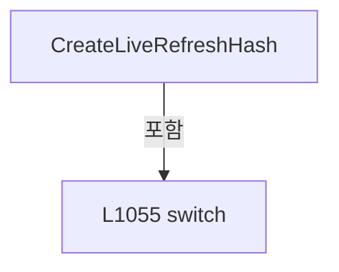

변경 전 점검: 입력/반환 타입, 위 호출자, 예외/취소 경로, 공유 상태와 저장·전송 소비자를 함께 확인합니다. 값의 단위나 물리 방향을 이름만으로 확정하지 않습니다.

### MethodDeclaration `AddSequenceHash` · L1100–1106

[Drilling.UI/Menu/Menus/CMenuMonitor.cs:1100–1106](https://github.com/kjuws10-rgb/A3Drilling/blob/0219666f9053b907d96d7e0aa7d0c6c1be3a73d4/Drilling.UI/Menu/Menus/CMenuMonitor.cs#L1100-L1106)

| 항목 | 실제 추출 값 |
| --- | --- |
| 서명 | void Drilling.UI.Menu.Menus.CMenuMonitor.AddSequenceHash<T>(ref System.HashCode, System.Collections.Generic.IEnumerable<T>) |
| 접근/수식자 | Private / private, static |
| 반환/값 타입 | void |
| 소속 타입 | NamedType:Drilling.UI.Menu.Menus.CMenuMonitor |

입력 계약:

| 이름 | 타입 | 전달 | 선택/기본값 |
| --- | --- | --- | --- |
| hash | System.HashCode | Ref | False /  |
| values | System.Collections.Generic.IEnumerable<T> | None | False /  |

정적 호출자로 확인된 위치:

| 호출 파일/행 | 호출 표현식 | 런타임 분기 가능 |
| --- | --- | --- |
| [Drilling.UI/Menu/Menus/CMenuMonitor.cs:1053–1053](https://github.com/kjuws10-rgb/A3Drilling/blob/0219666f9053b907d96d7e0aa7d0c6c1be3a73d4/Drilling.UI/Menu/Menus/CMenuMonitor.cs#L1053-L1053) | AddSequenceHash | False |
| [Drilling.UI/Menu/Menus/CMenuMonitor.cs:1059–1059](https://github.com/kjuws10-rgb/A3Drilling/blob/0219666f9053b907d96d7e0aa7d0c6c1be3a73d4/Drilling.UI/Menu/Menus/CMenuMonitor.cs#L1059-L1059) | AddSequenceHash | False |

호출하는 대상과 해석 범위:

| 원본 행 | 표현식 | 분석 상태 | 대상/소스 위치 |
| --- | --- | --- | --- |
| 1104 | hash.Add | resolved | void System.HashCode.Add<T>(T) |

본문의 실제 연산·분기·예외·반환 순서(원문 위치 순):

| 원본 행 | 종류 | 주석 해설 |
| --- | --- | --- |
| 1102 | foreach | 컬렉션 요소를 순회합니다: foreach (var value in values) |
| 1104 | call | 함수·델리게이트 또는 객체 생성자를 호출합니다: hash.Add(value) |

제어 구문의 포함 구조(실제 실행 순서/CFG가 아닌 구문 탐색 그림):

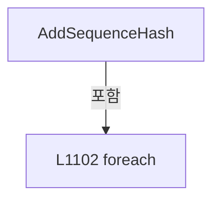

변경 전 점검: 입력/반환 타입, 위 호출자, 예외/취소 경로, 공유 상태와 저장·전송 소비자를 함께 확인합니다. 값의 단위나 물리 방향을 이름만으로 확정하지 않습니다.

### MethodDeclaration `AddMelsecValuesHash` · L1108–1115

[Drilling.UI/Menu/Menus/CMenuMonitor.cs:1108–1115](https://github.com/kjuws10-rgb/A3Drilling/blob/0219666f9053b907d96d7e0aa7d0c6c1be3a73d4/Drilling.UI/Menu/Menus/CMenuMonitor.cs#L1108-L1115)

| 항목 | 실제 추출 값 |
| --- | --- |
| 서명 | void Drilling.UI.Menu.Menus.CMenuMonitor.AddMelsecValuesHash(ref System.HashCode, System.Collections.Generic.IReadOnlyDictionary<string, Drilling.UI.Menu.Menus.ST_MONITOR_MELSEC_VALUE>) |
| 접근/수식자 | Private / private, static |
| 반환/값 타입 | void |
| 소속 타입 | NamedType:Drilling.UI.Menu.Menus.CMenuMonitor |

입력 계약:

| 이름 | 타입 | 전달 | 선택/기본값 |
| --- | --- | --- | --- |
| hash | System.HashCode | Ref | False /  |
| values | System.Collections.Generic.IReadOnlyDictionary<string, Drilling.UI.Menu.Menus.ST_MONITOR_MELSEC_VALUE> | None | False /  |

정적 호출자로 확인된 위치:

| 호출 파일/행 | 호출 표현식 | 런타임 분기 가능 |
| --- | --- | --- |
| [Drilling.UI/Menu/Menus/CMenuMonitor.cs:1090–1090](https://github.com/kjuws10-rgb/A3Drilling/blob/0219666f9053b907d96d7e0aa7d0c6c1be3a73d4/Drilling.UI/Menu/Menus/CMenuMonitor.cs#L1090-L1090) | AddMelsecValuesHash | False |

호출하는 대상과 해석 범위:

| 원본 행 | 표현식 | 분석 상태 | 대상/소스 위치 |
| --- | --- | --- | --- |
| 1110 | values.OrderBy | resolved | System.Linq.IOrderedEnumerable<System.Collections.Generic.KeyValuePair<string, Drilling.UI.Menu.Menus.ST_MONITOR_MELSEC_VALUE>> System.Collections.Generic.IEnumerable<System.Collections.Generic.KeyValuePair<string, Drilling.UI.Menu.Menus.ST_MONITOR_MELSEC_VALUE>>.OrderBy<System.Collections.Generic.KeyValuePair<string, Drilling.UI.Menu.Menus.ST_MONITOR_MELSEC_VALUE>, string>(System.Func<System.Collections.Generic.KeyValuePair<string, Drilling.UI.Menu.Menus.ST_MONITOR_MELSEC_VALUE>, string>, System.Collections.Generic.IComparer<string>?) |
| 1112 | hash.Add | resolved | void System.HashCode.Add<string>(string, System.Collections.Generic.IEqualityComparer<string>?) |
| 1113 | hash.Add | resolved | void System.HashCode.Add<Drilling.UI.Menu.Menus.ST_MONITOR_MELSEC_VALUE>(Drilling.UI.Menu.Menus.ST_MONITOR_MELSEC_VALUE) |

본문의 실제 연산·분기·예외·반환 순서(원문 위치 순):

| 원본 행 | 종류 | 주석 해설 |
| --- | --- | --- |
| 1110 | call | 함수·델리게이트 또는 객체 생성자를 호출합니다: values.OrderBy(GetMelsecValueKey, StringComparer.OrdinalIgnoreCase) |
| 1110 | foreach | 컬렉션 요소를 순회합니다: foreach (var item in values.OrderBy(GetMelsecValueKey, StringComparer.OrdinalIgnoreCase)) |
| 1112 | call | 함수·델리게이트 또는 객체 생성자를 호출합니다: hash.Add(item.Key, StringComparer.OrdinalIgnoreCase) |
| 1113 | call | 함수·델리게이트 또는 객체 생성자를 호출합니다: hash.Add(item.Value) |

제어 구문의 포함 구조(실제 실행 순서/CFG가 아닌 구문 탐색 그림):


변경 전 점검: 입력/반환 타입, 위 호출자, 예외/취소 경로, 공유 상태와 저장·전송 소비자를 함께 확인합니다. 값의 단위나 물리 방향을 이름만으로 확정하지 않습니다.

### MethodDeclaration `GetMelsecValueKey` · L1117–1120

[Drilling.UI/Menu/Menus/CMenuMonitor.cs:1117–1120](https://github.com/kjuws10-rgb/A3Drilling/blob/0219666f9053b907d96d7e0aa7d0c6c1be3a73d4/Drilling.UI/Menu/Menus/CMenuMonitor.cs#L1117-L1120)

| 항목 | 실제 추출 값 |
| --- | --- |
| 서명 | string Drilling.UI.Menu.Menus.CMenuMonitor.GetMelsecValueKey(System.Collections.Generic.KeyValuePair<string, Drilling.UI.Menu.Menus.ST_MONITOR_MELSEC_VALUE>) |
| 접근/수식자 | Private / private, static |
| 반환/값 타입 | string |
| 소속 타입 | NamedType:Drilling.UI.Menu.Menus.CMenuMonitor |

입력 계약:

| 이름 | 타입 | 전달 | 선택/기본값 |
| --- | --- | --- | --- |
| item | System.Collections.Generic.KeyValuePair<string, Drilling.UI.Menu.Menus.ST_MONITOR_MELSEC_VALUE> | None | False /  |

현재 부분 분석에서 직접 연결된 호출자는 없습니다. XAML/이벤트/인터페이스·델리게이트·외부 진입을 추가 확인해야 하며, 미사용으로 판정한 것이 아닙니다.

본문의 실제 연산·분기·예외·반환 순서(원문 위치 순):

| 원본 행 | 종류 | 주석 해설 |
| --- | --- | --- |
| 1119 | return | 호출자에게 값 또는 제어를 반환합니다: return item.Key; |

변경 전 점검: 입력/반환 타입, 위 호출자, 예외/취소 경로, 공유 상태와 저장·전송 소비자를 함께 확인합니다. 값의 단위나 물리 방향을 이름만으로 확정하지 않습니다.

### MethodDeclaration `RefreshPowerMeterSnapshotFromCache` · L1122–1131

[Drilling.UI/Menu/Menus/CMenuMonitor.cs:1122–1131](https://github.com/kjuws10-rgb/A3Drilling/blob/0219666f9053b907d96d7e0aa7d0c6c1be3a73d4/Drilling.UI/Menu/Menus/CMenuMonitor.cs#L1122-L1131)

| 항목 | 실제 추출 값 |
| --- | --- |
| 서명 | Drilling.UI.Menu.Menus.ST_MONITOR_STATUS_SNAPSHOT Drilling.UI.Menu.Menus.CMenuMonitor.RefreshPowerMeterSnapshotFromCache(Drilling.UI.Menu.Menus.ST_MONITOR_STATUS_SNAPSHOT, System.Threading.CancellationToken) |
| 접근/수식자 | Private / private |
| 반환/값 타입 | Drilling.UI.Menu.Menus.ST_MONITOR_STATUS_SNAPSHOT |
| 소속 타입 | NamedType:Drilling.UI.Menu.Menus.CMenuMonitor |

입력 계약:

| 이름 | 타입 | 전달 | 선택/기본값 |
| --- | --- | --- | --- |
| monitorSnapshot | Drilling.UI.Menu.Menus.ST_MONITOR_STATUS_SNAPSHOT | None | False /  |
| cancellationToken | System.Threading.CancellationToken | None | False /  |

정적 호출자로 확인된 위치:

| 호출 파일/행 | 호출 표현식 | 런타임 분기 가능 |
| --- | --- | --- |
| [Drilling.UI/Menu/Menus/CMenuMonitor.cs:768–768](https://github.com/kjuws10-rgb/A3Drilling/blob/0219666f9053b907d96d7e0aa7d0c6c1be3a73d4/Drilling.UI/Menu/Menus/CMenuMonitor.cs#L768-L768) | RefreshPowerMeterSnapshotFromCache | False |
| [Drilling.UI/Menu/Menus/CMenuMonitor.cs:936–936](https://github.com/kjuws10-rgb/A3Drilling/blob/0219666f9053b907d96d7e0aa7d0c6c1be3a73d4/Drilling.UI/Menu/Menus/CMenuMonitor.cs#L936-L936) | RefreshPowerMeterSnapshotFromCache | False |

호출하는 대상과 해석 범위:

| 원본 행 | 표현식 | 분석 상태 | 대상/소스 위치 |
| --- | --- | --- | --- |
| 1128 | _interfaceManager.GetPowerMeterStatus | resolved | Drilling.Common.Managers.ST_POWER_METER_STATUS Drilling.Common.Interface.CInterfaceManager.GetPowerMeterStatus(int, System.Threading.CancellationToken) · Drilling.Common/Interface/CInterfaceManager.cs:1401 |

본문의 실제 연산·분기·예외·반환 순서(원문 위치 순):

| 원본 행 | 종류 | 주석 해설 |
| --- | --- | --- |
| 1124 | return | 호출자에게 값 또는 제어를 반환합니다: return monitorSnapshot with { DeviceStatus = monitorSnapshot.DeviceStatus with { PowerMeter = _interfaceManager.GetPowerMeterStatus(_selectedPowerMeterNumber, cancellationToken) } }; |
| 1126 | assignment | 값을 대상에 대입합니다: DeviceStatus = monitorSnapshot.DeviceStatus with { PowerMeter = _interfaceManager.GetPowerMeterStatus(_selectedPowerMeterNumber, cancellationToken) } |
| 1128 | assignment | 값을 대상에 대입합니다: PowerMeter = _interfaceManager.GetPowerMeterStatus(_selectedPowerMeterNumber, cancellationToken) |
| 1128 | call | 함수·델리게이트 또는 객체 생성자를 호출합니다: _interfaceManager.GetPowerMeterStatus(_selectedPowerMeterNumber, cancellationToken) |

변경 전 점검: 입력/반환 타입, 위 호출자, 예외/취소 경로, 공유 상태와 저장·전송 소비자를 함께 확인합니다. 값의 단위나 물리 방향을 이름만으로 확정하지 않습니다.

### MethodDeclaration `UpdatePollingContext` · L1133–1137

[Drilling.UI/Menu/Menus/CMenuMonitor.cs:1133–1137](https://github.com/kjuws10-rgb/A3Drilling/blob/0219666f9053b907d96d7e0aa7d0c6c1be3a73d4/Drilling.UI/Menu/Menus/CMenuMonitor.cs#L1133-L1137)

| 항목 | 실제 추출 값 |
| --- | --- |
| 서명 | void Drilling.UI.Menu.Menus.CMenuMonitor.UpdatePollingContext(string) |
| 접근/수식자 | Private / private |
| 반환/값 타입 | void |
| 소속 타입 | NamedType:Drilling.UI.Menu.Menus.CMenuMonitor |

입력 계약:

| 이름 | 타입 | 전달 | 선택/기본값 |
| --- | --- | --- | --- |
| selectedTab | string | None | False /  |

정적 호출자로 확인된 위치:

| 호출 파일/행 | 호출 표현식 | 런타임 분기 가능 |
| --- | --- | --- |
| [Drilling.UI/Menu/Menus/CMenuMonitor.cs:763–763](https://github.com/kjuws10-rgb/A3Drilling/blob/0219666f9053b907d96d7e0aa7d0c6c1be3a73d4/Drilling.UI/Menu/Menus/CMenuMonitor.cs#L763-L763) | UpdatePollingContext | False |
| [Drilling.UI/Menu/Menus/CMenuMonitor.cs:931–931](https://github.com/kjuws10-rgb/A3Drilling/blob/0219666f9053b907d96d7e0aa7d0c6c1be3a73d4/Drilling.UI/Menu/Menus/CMenuMonitor.cs#L931-L931) | UpdatePollingContext | False |
| [Drilling.UI/Menu/Menus/CMenuMonitor.cs:2935–2935](https://github.com/kjuws10-rgb/A3Drilling/blob/0219666f9053b907d96d7e0aa7d0c6c1be3a73d4/Drilling.UI/Menu/Menus/CMenuMonitor.cs#L2935-L2935) | UpdatePollingContext | False |

호출하는 대상과 해석 범위:

| 원본 행 | 표현식 | 분석 상태 | 대상/소스 위치 |
| --- | --- | --- | --- |
| 1135 | IsHeadDeviceTab | resolved | bool Drilling.UI.Menu.Menus.CMenuMonitor.IsHeadDeviceTab(string) · Drilling.UI/Menu/Menus/CMenuMonitor.cs:2474 |
| 1136 | _statusPollingService.UpdateContext | resolved | void Drilling.UI.Menu.Menus.CMonitorStatusPollingService.UpdateContext(string, int, int, int, string) · Drilling.UI/Menu/Menus/CMonitorStatusPollingService.cs:37 |

본문의 실제 연산·분기·예외·반환 순서(원문 위치 순):

| 원본 행 | 종류 | 주석 해설 |
| --- | --- | --- |
| 1135 | call | 함수·델리게이트 또는 객체 생성자를 호출합니다: IsHeadDeviceTab(selectedTab) |
| 1135 | conditional-expression | 조건에 따라 결과식을 선택합니다: IsHeadDeviceTab(selectedTab) && _enabledHeadDeviceNumbers.Count == 0 ? "PRODUCT" : selectedTab |
| 1135 | local-declaration | 지역 변수를 선언합니다: var pollingTab = IsHeadDeviceTab(selectedTab) && _enabledHeadDeviceNumbers.Count == 0 ? "PRODUCT" : selectedTab; |
| 1135 | variable-initializer | 변수의 초기값을 지정합니다: pollingTab = IsHeadDeviceTab(selectedTab) && _enabledHeadDeviceNumbers.Count == 0 ? "PRODUCT" : selectedTab |
| 1136 | call | 함수·델리게이트 또는 객체 생성자를 호출합니다: _statusPollingService.UpdateContext(pollingTab, _selectedLaserNumber, _selectedAttenuatorNumber, _selectedBetNumber, selectedTab == "MELSEC" ? _selectedMelsecGroup : "ALL") |
| 1136 | conditional-expression | 조건에 따라 결과식을 선택합니다: selectedTab == "MELSEC" ? _selectedMelsecGroup : "ALL" |

변경 전 점검: 입력/반환 타입, 위 호출자, 예외/취소 경로, 공유 상태와 저장·전송 소비자를 함께 확인합니다. 값의 단위나 물리 방향을 이름만으로 확정하지 않습니다.

### MethodDeclaration `GetDeviceStatus` · L1139–1142

[Drilling.UI/Menu/Menus/CMenuMonitor.cs:1139–1142](https://github.com/kjuws10-rgb/A3Drilling/blob/0219666f9053b907d96d7e0aa7d0c6c1be3a73d4/Drilling.UI/Menu/Menus/CMenuMonitor.cs#L1139-L1142)

| 항목 | 실제 추출 값 |
| --- | --- |
| 서명 | System.Threading.Tasks.Task<Drilling.Common.Managers.ST_DEVICE_STATUS> Drilling.UI.Menu.Menus.CMenuMonitor.GetDeviceStatus(System.Threading.CancellationToken) |
| 접근/수식자 | Private / private |
| 반환/값 타입 | System.Threading.Tasks.Task<Drilling.Common.Managers.ST_DEVICE_STATUS> |
| 소속 타입 | NamedType:Drilling.UI.Menu.Menus.CMenuMonitor |

입력 계약:

| 이름 | 타입 | 전달 | 선택/기본값 |
| --- | --- | --- | --- |
| cancellationToken | System.Threading.CancellationToken | None | False /  |

정적 호출자로 확인된 위치:

| 호출 파일/행 | 호출 표현식 | 런타임 분기 가능 |
| --- | --- | --- |
| [Drilling.UI/Menu/Menus/CMenuMonitor.cs:5096–5096](https://github.com/kjuws10-rgb/A3Drilling/blob/0219666f9053b907d96d7e0aa7d0c6c1be3a73d4/Drilling.UI/Menu/Menus/CMenuMonitor.cs#L5096-L5096) | GetDeviceStatus | False |

호출하는 대상과 해석 범위:

| 원본 행 | 표현식 | 분석 상태 | 대상/소스 위치 |
| --- | --- | --- | --- |
| 1141 | GetDeviceStatus | resolved | System.Threading.Tasks.Task<Drilling.Common.Managers.ST_DEVICE_STATUS> Drilling.UI.Menu.Menus.CMenuMonitor.GetDeviceStatus(string, System.Threading.CancellationToken) · Drilling.UI/Menu/Menus/CMenuMonitor.cs:1144 |

본문의 실제 연산·분기·예외·반환 순서(원문 위치 순):

| 원본 행 | 종류 | 주석 해설 |
| --- | --- | --- |
| 1141 | call | 함수·델리게이트 또는 객체 생성자를 호출합니다: GetDeviceStatus("ALL", cancellationToken) |
| 1141 | return | 호출자에게 값 또는 제어를 반환합니다: return GetDeviceStatus("ALL", cancellationToken); |

변경 전 점검: 입력/반환 타입, 위 호출자, 예외/취소 경로, 공유 상태와 저장·전송 소비자를 함께 확인합니다. 값의 단위나 물리 방향을 이름만으로 확정하지 않습니다.

### MethodDeclaration `GetDeviceStatus` · L1144–1154

[Drilling.UI/Menu/Menus/CMenuMonitor.cs:1144–1154](https://github.com/kjuws10-rgb/A3Drilling/blob/0219666f9053b907d96d7e0aa7d0c6c1be3a73d4/Drilling.UI/Menu/Menus/CMenuMonitor.cs#L1144-L1154)

| 항목 | 실제 추출 값 |
| --- | --- |
| 서명 | System.Threading.Tasks.Task<Drilling.Common.Managers.ST_DEVICE_STATUS> Drilling.UI.Menu.Menus.CMenuMonitor.GetDeviceStatus(string, System.Threading.CancellationToken) |
| 접근/수식자 | Private / private |
| 반환/값 타입 | System.Threading.Tasks.Task<Drilling.Common.Managers.ST_DEVICE_STATUS> |
| 소속 타입 | NamedType:Drilling.UI.Menu.Menus.CMenuMonitor |

입력 계약:

| 이름 | 타입 | 전달 | 선택/기본값 |
| --- | --- | --- | --- |
| selectedTab | string | None | False /  |
| cancellationToken | System.Threading.CancellationToken | None | False /  |

정적 호출자로 확인된 위치:

| 호출 파일/행 | 호출 표현식 | 런타임 분기 가능 |
| --- | --- | --- |
| [Drilling.UI/Menu/Menus/CMenuMonitor.cs:1141–1141](https://github.com/kjuws10-rgb/A3Drilling/blob/0219666f9053b907d96d7e0aa7d0c6c1be3a73d4/Drilling.UI/Menu/Menus/CMenuMonitor.cs#L1141-L1141) | GetDeviceStatus | False |

호출하는 대상과 해석 범위:

| 원본 행 | 표현식 | 분석 상태 | 대상/소스 위치 |
| --- | --- | --- | --- |
| 1146 | NormalizeMonitorTab | resolved | string Drilling.UI.Menu.Menus.CMenuMonitor.NormalizeMonitorTab(string?) · Drilling.UI/Menu/Menus/CMenuMonitor.cs:1971 |
| 1148 | _motionManager.GetAxisStatus | resolved | System.Collections.Generic.IReadOnlyList<Drilling.Common.Motion.ST_MOTOR_AXIS_STATUS> Drilling.Common.Motion.CMotionManager.GetAxisStatus(System.Threading.CancellationToken) · Drilling.Common/Motion/CMotionManager.cs:146 |
| 1149 | _interfaceManager.GetLaserStatus | resolved | Drilling.Common.Interface.ST_LASER_STATUS Drilling.Common.Interface.CInterfaceManager.GetLaserStatus(int, System.Threading.CancellationToken) · Drilling.Common/Interface/CInterfaceManager.cs:856 |
| 1149 | CreateEmptyLaserStatus | resolved | Drilling.Common.Interface.ST_LASER_STATUS Drilling.UI.Menu.Menus.CMenuMonitor.CreateEmptyLaserStatus() · Drilling.UI/Menu/Menus/CMenuMonitor.cs:1156 |
| 1150 | _interfaceManager.GetAttenuatorStatus | resolved | Drilling.Common.Interface.ST_ATTENUATOR_STATUS Drilling.Common.Interface.CInterfaceManager.GetAttenuatorStatus(int, System.Threading.CancellationToken) · Drilling.Common/Interface/CInterfaceManager.cs:1014 |
| 1150 | CreateEmptyAttenuatorStatus | resolved | Drilling.Common.Interface.ST_ATTENUATOR_STATUS Drilling.UI.Menu.Menus.CMenuMonitor.CreateEmptyAttenuatorStatus() · Drilling.UI/Menu/Menus/CMenuMonitor.cs:1161 |
| 1151 | _interfaceManager.GetBETStatus | resolved | Drilling.Common.Interface.ST_BET_STATUS Drilling.Common.Interface.CInterfaceManager.GetBETStatus(int, System.Threading.CancellationToken) · Drilling.Common/Interface/CInterfaceManager.cs:1254 |
| 1151 | CreateEmptyBETStatus | resolved | Drilling.Common.Interface.ST_BET_STATUS Drilling.UI.Menu.Menus.CMenuMonitor.CreateEmptyBETStatus() · Drilling.UI/Menu/Menus/CMenuMonitor.cs:1166 |
| 1152 | _interfaceManager.GetPowerMeterStatus | resolved | Drilling.Common.Managers.ST_POWER_METER_STATUS Drilling.Common.Interface.CInterfaceManager.GetPowerMeterStatus(int, System.Threading.CancellationToken) · Drilling.Common/Interface/CInterfaceManager.cs:1401 |
| 1153 | Task.FromResult | resolved | System.Threading.Tasks.Task<Drilling.Common.Managers.ST_DEVICE_STATUS> System.Threading.Tasks.Task.FromResult<Drilling.Common.Managers.ST_DEVICE_STATUS>(Drilling.Common.Managers.ST_DEVICE_STATUS) |
| 1153 | new ST_DEVICE_STATUS | resolved | Drilling.Common.Managers.ST_DEVICE_STATUS.ST_DEVICE_STATUS(System.Collections.Generic.IReadOnlyList<Drilling.Common.Motion.ST_IO_STATUS>, System.Collections.Generic.IReadOnlyList<Drilling.Common.Motion.ST_MOTOR_AXIS_STATUS>, Drilling.Common.Interface.ST_LASER_STATUS, Drilling.Common.Interface.ST_ATTENUATOR_STATUS, Drilling.Common.Interface.ST_BET_STATUS, Drilling.Common.Managers.ST_POWER_METER_STATUS) · Drilling.Common/Managers/CManager.cs:734 |

본문의 실제 연산·분기·예외·반환 순서(원문 위치 순):

| 원본 행 | 종류 | 주석 해설 |
| --- | --- | --- |
| 1146 | call | 함수·델리게이트 또는 객체 생성자를 호출합니다: NormalizeMonitorTab(selectedTab) |
| 1146 | local-declaration | 지역 변수를 선언합니다: var tab = NormalizeMonitorTab(selectedTab); |
| 1146 | variable-initializer | 변수의 초기값을 지정합니다: tab = NormalizeMonitorTab(selectedTab) |
| 1147 | local-declaration | 지역 변수를 선언합니다: IReadOnlyList<ST_IO_STATUS> io = []; |
| 1147 | variable-initializer | 변수의 초기값을 지정합니다: io = [] |
| 1148 | call | 함수·델리게이트 또는 객체 생성자를 호출합니다: _motionManager.GetAxisStatus(cancellationToken) |
| 1148 | conditional-expression | 조건에 따라 결과식을 선택합니다: tab is "ALL" or "XPS" ? _motionManager.GetAxisStatus(cancellationToken) : [] |
| 1148 | local-declaration | 지역 변수를 선언합니다: var motors = tab is "ALL" or "XPS" ? _motionManager.GetAxisStatus(cancellationToken) : []; |
| 1148 | variable-initializer | 변수의 초기값을 지정합니다: motors = tab is "ALL" or "XPS" ? _motionManager.GetAxisStatus(cancellationToken) : [] |
| 1149 | call | 함수·델리게이트 또는 객체 생성자를 호출합니다: _interfaceManager.GetLaserStatus(_selectedLaserNumber, cancellationToken) |
| 1149 | call | 함수·델리게이트 또는 객체 생성자를 호출합니다: CreateEmptyLaserStatus() |
| 1149 | conditional-expression | 조건에 따라 결과식을 선택합니다: tab is "ALL" ? _interfaceManager.GetLaserStatus(_selectedLaserNumber, cancellationToken) : CreateEmptyLaserStatus() |
| 1149 | local-declaration | 지역 변수를 선언합니다: var laserStatus = tab is "ALL" ? _interfaceManager.GetLaserStatus(_selectedLaserNumber, cancellationToken) : CreateEmptyLaserStatus(); |
| 1149 | variable-initializer | 변수의 초기값을 지정합니다: laserStatus = tab is "ALL" ? _interfaceManager.GetLaserStatus(_selectedLaserNumber, cancellationToken) : CreateEmptyLaserStatus() |
| 1150 | call | 함수·델리게이트 또는 객체 생성자를 호출합니다: _interfaceManager.GetAttenuatorStatus(_selectedAttenuatorNumber, cancellationToken) |
| 1150 | call | 함수·델리게이트 또는 객체 생성자를 호출합니다: CreateEmptyAttenuatorStatus() |
| 1150 | conditional-expression | 조건에 따라 결과식을 선택합니다: tab is "ALL" or "ATTENUATOR" ? _interfaceManager.GetAttenuatorStatus(_selectedAttenuatorNumber, cancellationToken) : CreateEmptyAttenuatorStatus() |
| 1150 | local-declaration | 지역 변수를 선언합니다: var attenuatorStatus = tab is "ALL" or "ATTENUATOR" ? _interfaceManager.GetAttenuatorStatus(_selectedAttenuatorNumber, cancellationToken) : CreateEmptyAttenuatorStatus(); |
| 1150 | variable-initializer | 변수의 초기값을 지정합니다: attenuatorStatus = tab is "ALL" or "ATTENUATOR" ? _interfaceManager.GetAttenuatorStatus(_selectedAttenuatorNumber, cancellationToken) : CreateEmptyAttenuatorStatus() |
| 1151 | call | 함수·델리게이트 또는 객체 생성자를 호출합니다: _interfaceManager.GetBETStatus(_selectedBetNumber, cancellationToken) |
| 1151 | call | 함수·델리게이트 또는 객체 생성자를 호출합니다: CreateEmptyBETStatus() |
| 1151 | conditional-expression | 조건에 따라 결과식을 선택합니다: tab is "ALL" or "BET" ? _interfaceManager.GetBETStatus(_selectedBetNumber, cancellationToken) : CreateEmptyBETStatus() |
| 1151 | local-declaration | 지역 변수를 선언합니다: var betStatus = tab is "ALL" or "BET" ? _interfaceManager.GetBETStatus(_selectedBetNumber, cancellationToken) : CreateEmptyBETStatus(); |
| 1151 | variable-initializer | 변수의 초기값을 지정합니다: betStatus = tab is "ALL" or "BET" ? _interfaceManager.GetBETStatus(_selectedBetNumber, cancellationToken) : CreateEmptyBETStatus() |
| 1152 | call | 함수·델리게이트 또는 객체 생성자를 호출합니다: _interfaceManager.GetPowerMeterStatus(_selectedPowerMeterNumber, cancellationToken) |
| 1152 | conditional-expression | 조건에 따라 결과식을 선택합니다: tab is "ALL" or "POWER METER" ? _interfaceManager.GetPowerMeterStatus(_selectedPowerMeterNumber, cancellationToken) : ST_POWER_METER_STATUS.Empty |
| 1152 | local-declaration | 지역 변수를 선언합니다: var powerMeterStatus = tab is "ALL" or "POWER METER" ? _interfaceManager.GetPowerMeterStatus(_selectedPowerMeterNumber, cancellationToken) : ST_POWER_METER_STATUS.Empty; |
| 1152 | variable-initializer | 변수의 초기값을 지정합니다: powerMeterStatus = tab is "ALL" or "POWER METER" ? _interfaceManager.GetPowerMeterStatus(_selectedPowerMeterNumber, cancellationToken) : ST_POWER_METER_STATUS.Empty |
| 1153 | call | 함수·델리게이트 또는 객체 생성자를 호출합니다: Task.FromResult(new ST_DEVICE_STATUS(io, motors, laserStatus, attenuatorStatus, betStatus, powerMeterStatus)) |
| 1153 | call | 함수·델리게이트 또는 객체 생성자를 호출합니다: new ST_DEVICE_STATUS(io, motors, laserStatus, attenuatorStatus, betStatus, powerMeterStatus) |
| 1153 | return | 호출자에게 값 또는 제어를 반환합니다: return Task.FromResult(new ST_DEVICE_STATUS(io, motors, laserStatus, attenuatorStatus, betStatus, powerMeterStatus)); |

변경 전 점검: 입력/반환 타입, 위 호출자, 예외/취소 경로, 공유 상태와 저장·전송 소비자를 함께 확인합니다. 값의 단위나 물리 방향을 이름만으로 확정하지 않습니다.

### MethodDeclaration `CreateEmptyLaserStatus` · L1156–1159

[Drilling.UI/Menu/Menus/CMenuMonitor.cs:1156–1159](https://github.com/kjuws10-rgb/A3Drilling/blob/0219666f9053b907d96d7e0aa7d0c6c1be3a73d4/Drilling.UI/Menu/Menus/CMenuMonitor.cs#L1156-L1159)

| 항목 | 실제 추출 값 |
| --- | --- |
| 서명 | Drilling.Common.Interface.ST_LASER_STATUS Drilling.UI.Menu.Menus.CMenuMonitor.CreateEmptyLaserStatus() |
| 접근/수식자 | Private / private, static |
| 반환/값 타입 | Drilling.Common.Interface.ST_LASER_STATUS |
| 소속 타입 | NamedType:Drilling.UI.Menu.Menus.CMenuMonitor |

정적 호출자로 확인된 위치:

| 호출 파일/행 | 호출 표현식 | 런타임 분기 가능 |
| --- | --- | --- |
| [Drilling.UI/Menu/Menus/CMenuMonitor.cs:1149–1149](https://github.com/kjuws10-rgb/A3Drilling/blob/0219666f9053b907d96d7e0aa7d0c6c1be3a73d4/Drilling.UI/Menu/Menus/CMenuMonitor.cs#L1149-L1149) | CreateEmptyLaserStatus | False |

호출하는 대상과 해석 범위:

| 원본 행 | 표현식 | 분석 상태 | 대상/소스 위치 |
| --- | --- | --- | --- |
| 1158 | new ST_LASER_STATUS | resolved | Drilling.Common.Interface.ST_LASER_STATUS.ST_LASER_STATUS(bool, bool, bool, double) · Drilling.Common/Interface/Serial/CTalonLaser.cs:367 |

본문의 실제 연산·분기·예외·반환 순서(원문 위치 순):

| 원본 행 | 종류 | 주석 해설 |
| --- | --- | --- |
| 1158 | call | 함수·델리게이트 또는 객체 생성자를 호출합니다: new ST_LASER_STATUS(false, false, false, 0.0) |
| 1158 | return | 호출자에게 값 또는 제어를 반환합니다: return new ST_LASER_STATUS(false, false, false, 0.0); |

변경 전 점검: 입력/반환 타입, 위 호출자, 예외/취소 경로, 공유 상태와 저장·전송 소비자를 함께 확인합니다. 값의 단위나 물리 방향을 이름만으로 확정하지 않습니다.

### MethodDeclaration `CreateEmptyAttenuatorStatus` · L1161–1164

[Drilling.UI/Menu/Menus/CMenuMonitor.cs:1161–1164](https://github.com/kjuws10-rgb/A3Drilling/blob/0219666f9053b907d96d7e0aa7d0c6c1be3a73d4/Drilling.UI/Menu/Menus/CMenuMonitor.cs#L1161-L1164)

| 항목 | 실제 추출 값 |
| --- | --- |
| 서명 | Drilling.Common.Interface.ST_ATTENUATOR_STATUS Drilling.UI.Menu.Menus.CMenuMonitor.CreateEmptyAttenuatorStatus() |
| 접근/수식자 | Private / private, static |
| 반환/값 타입 | Drilling.Common.Interface.ST_ATTENUATOR_STATUS |
| 소속 타입 | NamedType:Drilling.UI.Menu.Menus.CMenuMonitor |

정적 호출자로 확인된 위치:

| 호출 파일/행 | 호출 표현식 | 런타임 분기 가능 |
| --- | --- | --- |
| [Drilling.UI/Menu/Menus/CMenuMonitor.cs:1150–1150](https://github.com/kjuws10-rgb/A3Drilling/blob/0219666f9053b907d96d7e0aa7d0c6c1be3a73d4/Drilling.UI/Menu/Menus/CMenuMonitor.cs#L1150-L1150) | CreateEmptyAttenuatorStatus | False |

호출하는 대상과 해석 범위:

| 원본 행 | 표현식 | 분석 상태 | 대상/소스 위치 |
| --- | --- | --- | --- |
| 1163 | new ST_ATTENUATOR_STATUS | resolved | Drilling.Common.Interface.ST_ATTENUATOR_STATUS.ST_ATTENUATOR_STATUS(double, double, string, bool, Drilling.Common.Interface.EN_CONEX_AGP_ERROR, System.DateTimeOffset?, int?, double?, double?, double?, double?, double?) · Drilling.Common/Interface/Serial/CConex_AGP.cs:549 |

본문의 실제 연산·분기·예외·반환 순서(원문 위치 순):

| 원본 행 | 종류 | 주석 해설 |
| --- | --- | --- |
| 1163 | call | 함수·델리게이트 또는 객체 생성자를 호출합니다: new ST_ATTENUATOR_STATUS(0.0, 0.0, "IDLE", false) |
| 1163 | return | 호출자에게 값 또는 제어를 반환합니다: return new ST_ATTENUATOR_STATUS(0.0, 0.0, "IDLE", false); |

변경 전 점검: 입력/반환 타입, 위 호출자, 예외/취소 경로, 공유 상태와 저장·전송 소비자를 함께 확인합니다. 값의 단위나 물리 방향을 이름만으로 확정하지 않습니다.

### MethodDeclaration `CreateEmptyBETStatus` · L1166–1169

[Drilling.UI/Menu/Menus/CMenuMonitor.cs:1166–1169](https://github.com/kjuws10-rgb/A3Drilling/blob/0219666f9053b907d96d7e0aa7d0c6c1be3a73d4/Drilling.UI/Menu/Menus/CMenuMonitor.cs#L1166-L1169)

| 항목 | 실제 추출 값 |
| --- | --- |
| 서명 | Drilling.Common.Interface.ST_BET_STATUS Drilling.UI.Menu.Menus.CMenuMonitor.CreateEmptyBETStatus() |
| 접근/수식자 | Private / private, static |
| 반환/값 타입 | Drilling.Common.Interface.ST_BET_STATUS |
| 소속 타입 | NamedType:Drilling.UI.Menu.Menus.CMenuMonitor |

정적 호출자로 확인된 위치:

| 호출 파일/행 | 호출 표현식 | 런타임 분기 가능 |
| --- | --- | --- |
| [Drilling.UI/Menu/Menus/CMenuMonitor.cs:1151–1151](https://github.com/kjuws10-rgb/A3Drilling/blob/0219666f9053b907d96d7e0aa7d0c6c1be3a73d4/Drilling.UI/Menu/Menus/CMenuMonitor.cs#L1151-L1151) | CreateEmptyBETStatus | False |

호출하는 대상과 해석 범위:

| 원본 행 | 표현식 | 분석 상태 | 대상/소스 위치 |
| --- | --- | --- | --- |
| 1168 | new ST_BET_STATUS | resolved | Drilling.Common.Interface.ST_BET_STATUS.ST_BET_STATUS(double, double, double, double, double, double, bool, bool, bool, bool, bool, Drilling.Common.Interface.EN_BET_ERROR, System.DateTimeOffset?, string) · Drilling.Common/Interface/Serial/CBeamExpander.cs:449 |

본문의 실제 연산·분기·예외·반환 순서(원문 위치 순):

| 원본 행 | 종류 | 주석 해설 |
| --- | --- | --- |
| 1168 | call | 함수·델리게이트 또는 객체 생성자를 호출합니다: new ST_BET_STATUS(0.0, 0.0, 0.0, 0.0, 0.0, 0.0, false, false, false, false, false) |
| 1168 | return | 호출자에게 값 또는 제어를 반환합니다: return new ST_BET_STATUS(0.0, 0.0, 0.0, 0.0, 0.0, 0.0, false, false, false, false, false); |

변경 전 점검: 입력/반환 타입, 위 호출자, 예외/취소 경로, 공유 상태와 저장·전송 소비자를 함께 확인합니다. 값의 단위나 물리 방향을 이름만으로 확정하지 않습니다.

### MethodDeclaration `SelectTab` · L1171–1188

[Drilling.UI/Menu/Menus/CMenuMonitor.cs:1171–1188](https://github.com/kjuws10-rgb/A3Drilling/blob/0219666f9053b907d96d7e0aa7d0c6c1be3a73d4/Drilling.UI/Menu/Menus/CMenuMonitor.cs#L1171-L1188)

| 항목 | 실제 추출 값 |
| --- | --- |
| 서명 | System.Threading.Tasks.Task Drilling.UI.Menu.Menus.CMenuMonitor.SelectTab(object?) |
| 접근/수식자 | Private / private, async |
| 반환/값 타입 | System.Threading.Tasks.Task |
| 소속 타입 | NamedType:Drilling.UI.Menu.Menus.CMenuMonitor |

입력 계약:

| 이름 | 타입 | 전달 | 선택/기본값 |
| --- | --- | --- | --- |
| parameter | object? | None | False /  |

정적 호출자로 확인된 위치:

| 호출 파일/행 | 호출 표현식 | 런타임 분기 가능 |
| --- | --- | --- |
| [Drilling.UI/Menu/Menus/CMenuMonitor.cs:231–231](https://github.com/kjuws10-rgb/A3Drilling/blob/0219666f9053b907d96d7e0aa7d0c6c1be3a73d4/Drilling.UI/Menu/Menus/CMenuMonitor.cs#L231-L231) | SelectTab | False |

호출하는 대상과 해석 범위:

| 원본 행 | 표현식 | 분석 상태 | 대상/소스 위치 |
| --- | --- | --- | --- |
| 1173 | string.IsNullOrWhiteSpace | resolved | bool string.IsNullOrWhiteSpace(string?) |
| 1178 | NormalizeMonitorScreenTab | resolved | string Drilling.UI.Menu.Menus.CMenuMonitor.NormalizeMonitorScreenTab(string?) · Drilling.UI/Menu/Menus/CMenuMonitor.cs:1965 |
| 1179 | selectedTab.Equals | resolved | bool string.Equals(string?, System.StringComparison) |
| 1181 | ResetMelsecWriteLock | resolved | void Drilling.UI.Menu.Menus.CMenuMonitor.ResetMelsecWriteLock() · Drilling.UI/Menu/Menus/CMenuMonitor.cs:3005 |
| 1184 | _selectedTabSetter | resolved · 동적 구현 선택 가능 | void System.Action<string>.Invoke(string) |
| 1185 | _setStatusMessage | resolved · 동적 구현 선택 가능 | void System.Action<string>.Invoke(string) |
| 1186 | _refreshShellStatus | resolved · 동적 구현 선택 가능 | void System.Action.Invoke() |
| 1187 | _refreshCurrentScreen | resolved · 동적 구현 선택 가능 | System.Threading.Tasks.Task System.Func<System.Threading.Tasks.Task>.Invoke() |

본문의 실제 연산·분기·예외·반환 순서(원문 위치 순):

| 원본 행 | 종류 | 주석 해설 |
| --- | --- | --- |
| 1173 | call | 함수·델리게이트 또는 객체 생성자를 호출합니다: string.IsNullOrWhiteSpace(tab) |
| 1173 | if | 조건에 따라 분기합니다: if (parameter is not string tab &#124;&#124; string.IsNullOrWhiteSpace(tab)) |
| 1175 | return | 호출자에게 값 또는 제어를 반환합니다: return; |
| 1178 | call | 함수·델리게이트 또는 객체 생성자를 호출합니다: NormalizeMonitorScreenTab(tab) |
| 1178 | local-declaration | 지역 변수를 선언합니다: var selectedTab = NormalizeMonitorScreenTab(tab); |
| 1178 | variable-initializer | 변수의 초기값을 지정합니다: selectedTab = NormalizeMonitorScreenTab(tab) |
| 1179 | call | 함수·델리게이트 또는 객체 생성자를 호출합니다: selectedTab.Equals("MELSEC", StringComparison.OrdinalIgnoreCase) |
| 1179 | if | 조건에 따라 분기합니다: if (!selectedTab.Equals("MELSEC", StringComparison.OrdinalIgnoreCase)) |
| 1181 | call | 함수·델리게이트 또는 객체 생성자를 호출합니다: ResetMelsecWriteLock() |
| 1184 | call | 함수·델리게이트 또는 객체 생성자를 호출합니다: _selectedTabSetter(selectedTab) |
| 1185 | call | 함수·델리게이트 또는 객체 생성자를 호출합니다: _setStatusMessage($"Monitor tab {selectedTab} selected.") |
| 1186 | call | 함수·델리게이트 또는 객체 생성자를 호출합니다: _refreshShellStatus() |
| 1187 | await | 비동기 완료를 기다립니다: await _refreshCurrentScreen() |
| 1187 | call | 함수·델리게이트 또는 객체 생성자를 호출합니다: _refreshCurrentScreen() |

제어 구문의 포함 구조(실제 실행 순서/CFG가 아닌 구문 탐색 그림):

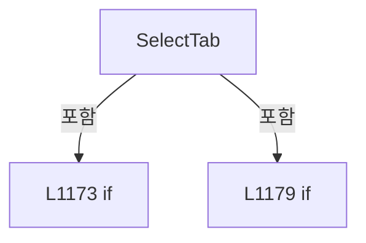

변경 전 점검: 입력/반환 타입, 위 호출자, 예외/취소 경로, 공유 상태와 저장·전송 소비자를 함께 확인합니다. 값의 단위나 물리 방향을 이름만으로 확정하지 않습니다.

### MethodDeclaration `SelectHeadDevice` · L1190–1243

[Drilling.UI/Menu/Menus/CMenuMonitor.cs:1190–1243](https://github.com/kjuws10-rgb/A3Drilling/blob/0219666f9053b907d96d7e0aa7d0c6c1be3a73d4/Drilling.UI/Menu/Menus/CMenuMonitor.cs#L1190-L1243)

| 항목 | 실제 추출 값 |
| --- | --- |
| 서명 | System.Threading.Tasks.Task Drilling.UI.Menu.Menus.CMenuMonitor.SelectHeadDevice(object?) |
| 접근/수식자 | Private / private, async |
| 반환/값 타입 | System.Threading.Tasks.Task |
| 소속 타입 | NamedType:Drilling.UI.Menu.Menus.CMenuMonitor |

입력 계약:

| 이름 | 타입 | 전달 | 선택/기본값 |
| --- | --- | --- | --- |
| parameter | object? | None | False /  |

정적 호출자로 확인된 위치:

| 호출 파일/행 | 호출 표현식 | 런타임 분기 가능 |
| --- | --- | --- |
| [Drilling.UI/Menu/Menus/CMenuMonitor.cs:237–237](https://github.com/kjuws10-rgb/A3Drilling/blob/0219666f9053b907d96d7e0aa7d0c6c1be3a73d4/Drilling.UI/Menu/Menus/CMenuMonitor.cs#L237-L237) | SelectHeadDevice | False |

호출하는 대상과 해석 범위:

| 원본 행 | 표현식 | 분석 상태 | 대상/소스 위치 |
| --- | --- | --- | --- |
| 1192 | TryNotifyPowerMeterTuneLocked | resolved | bool Drilling.UI.Menu.Menus.CMenuMonitor.TryNotifyPowerMeterTuneLocked(string) · Drilling.UI/Menu/Menus/CMenuMonitor.cs:5852 |
| 1197 | CanSelectHeadDevice | resolved | bool Drilling.UI.Menu.Menus.CMenuMonitor.CanSelectHeadDevice(object?) · Drilling.UI/Menu/Menus/CMenuMonitor.cs:1258 |
| 1206 | int.TryParse | resolved | bool int.TryParse(string?, System.Globalization.NumberStyles, System.IFormatProvider?, out int) |
| 1207 | GetSelectedHeadNumber | resolved | int Drilling.UI.Menu.Menus.CMenuMonitor.GetSelectedHeadNumber(string) · Drilling.UI/Menu/Menus/CMenuMonitor.cs:2364 |
| 1208 | Math.Clamp | resolved | int System.Math.Clamp(int, int, int) |
| 1209 | LoadEnabledHeadDeviceNumbers | resolved | System.Collections.Generic.IReadOnlyList<int> Drilling.UI.Menu.Menus.CMenuMonitor.LoadEnabledHeadDeviceNumbers(System.Threading.CancellationToken) · Drilling.UI/Menu/Menus/CMenuMonitor.cs:2385 |
| 1212 | _setStatusMessage | resolved · 동적 구현 선택 가능 | void System.Action<string>.Invoke(string) |
| 1213 | _refreshShellStatus | resolved · 동적 구현 선택 가능 | void System.Action.Invoke() |
| 1214 | _refreshCurrentScreen | resolved · 동적 구현 선택 가능 | System.Threading.Tasks.Task System.Func<System.Threading.Tasks.Task>.Invoke() |
| 1218 | _enabledHeadDeviceNumbers.Contains | resolved | bool System.Collections.Generic.IEnumerable<int>.Contains<int>(int) |
| 1220 | _setStatusMessage | resolved · 동적 구현 선택 가능 | void System.Action<string>.Invoke(string) |
| 1221 | _refreshShellStatus | resolved · 동적 구현 선택 가능 | void System.Action.Invoke() |
| 1222 | _refreshCurrentScreen | resolved · 동적 구현 선택 가능 | System.Threading.Tasks.Task System.Func<System.Threading.Tasks.Task>.Invoke() |
| 1240 | _setStatusMessage | resolved · 동적 구현 선택 가능 | void System.Action<string>.Invoke(string) |
| 1241 | _refreshShellStatus | resolved · 동적 구현 선택 가능 | void System.Action.Invoke() |
| 1242 | _refreshCurrentScreen | resolved · 동적 구현 선택 가능 | System.Threading.Tasks.Task System.Func<System.Threading.Tasks.Task>.Invoke() |

본문의 실제 연산·분기·예외·반환 순서(원문 위치 순):

| 원본 행 | 종류 | 주석 해설 |
| --- | --- | --- |
| 1192 | call | 함수·델리게이트 또는 객체 생성자를 호출합니다: TryNotifyPowerMeterTuneLocked("ATT HEAD 선택") |
| 1192 | if | 조건에 따라 분기합니다: if (SelectedTab == "POWER METER" && TryNotifyPowerMeterTuneLocked("ATT HEAD 선택")) |
| 1194 | return | 호출자에게 값 또는 제어를 반환합니다: return; |
| 1197 | call | 함수·델리게이트 또는 객체 생성자를 호출합니다: CanSelectHeadDevice(parameter) |
| 1197 | if | 조건에 따라 분기합니다: if (!CanSelectHeadDevice(parameter)) |
| 1199 | return | 호출자에게 값 또는 제어를 반환합니다: return; |
| 1202 | local-declaration | 지역 변수를 선언합니다: var number = parameter switch { ST_MONITOR_HEAD_SELECT_ROW row => row.Number, int value => value, string text when int.TryParse(text, NumberStyles.Integer, CultureInfo.InvariantCulture, out var value) => value, _ => GetSelectedHea |
| 1202 | switch-expression | 값별 결과식을 선택합니다: parameter switch { ST_MONITOR_HEAD_SELECT_ROW row => row.Number, int value => value, string text when int.TryParse(text, NumberStyles.Integer, CultureInfo.InvariantCulture, out var value) => value, _ => GetSelectedHeadNumber(Selec |
| 1202 | variable-initializer | 변수의 초기값을 지정합니다: number = parameter switch { ST_MONITOR_HEAD_SELECT_ROW row => row.Number, int value => value, string text when int.TryParse(text, NumberStyles.Integer, CultureInfo.InvariantCulture, out var value) => value, _ => GetSelectedHeadNum |
| 1206 | call | 함수·델리게이트 또는 객체 생성자를 호출합니다: int.TryParse(text, NumberStyles.Integer, CultureInfo.InvariantCulture, out var value) |
| 1207 | call | 함수·델리게이트 또는 객체 생성자를 호출합니다: GetSelectedHeadNumber(SelectedTab) |
| 1208 | assignment | 값을 대상에 대입합니다: number = Math.Clamp(number, 0, LaserHeadCount - 1) |
| 1208 | call | 함수·델리게이트 또는 객체 생성자를 호출합니다: Math.Clamp(number, 0, LaserHeadCount - 1) |
| 1209 | assignment | 값을 대상에 대입합니다: _enabledHeadDeviceNumbers = LoadEnabledHeadDeviceNumbers(CancellationToken.None) |
| 1209 | call | 함수·델리게이트 또는 객체 생성자를 호출합니다: LoadEnabledHeadDeviceNumbers(CancellationToken.None) |
| 1210 | if | 조건에 따라 분기합니다: if (_enabledHeadDeviceNumbers.Count == 0) |
| 1212 | call | 함수·델리게이트 또는 객체 생성자를 호출합니다: _setStatusMessage("No monitor head is enabled. Check Hxx_USE option settings.") |
| 1213 | call | 함수·델리게이트 또는 객체 생성자를 호출합니다: _refreshShellStatus() |
| 1214 | await | 비동기 완료를 기다립니다: await _refreshCurrentScreen() |
| 1214 | call | 함수·델리게이트 또는 객체 생성자를 호출합니다: _refreshCurrentScreen() |
| 1215 | return | 호출자에게 값 또는 제어를 반환합니다: return; |
| 1218 | call | 함수·델리게이트 또는 객체 생성자를 호출합니다: _enabledHeadDeviceNumbers.Contains(number) |
| 1218 | if | 조건에 따라 분기합니다: if (!_enabledHeadDeviceNumbers.Contains(number)) |
| 1220 | call | 함수·델리게이트 또는 객체 생성자를 호출합니다: _setStatusMessage($"Monitor {SelectedTab} H{number + 1:00} is disabled by H{number + 1:00}_USE.") |
| 1221 | call | 함수·델리게이트 또는 객체 생성자를 호출합니다: _refreshShellStatus() |
| 1222 | await | 비동기 완료를 기다립니다: await _refreshCurrentScreen() |
| 1222 | call | 함수·델리게이트 또는 객체 생성자를 호출합니다: _refreshCurrentScreen() |
| 1223 | return | 호출자에게 값 또는 제어를 반환합니다: return; |
| 1226 | switch | 값에 따라 분기합니다: switch (SelectedTab) |
| 1228 | case | 분기값/패턴의 구간입니다: case "ATTENUATOR": |
| 1229 | case | 분기값/패턴의 구간입니다: case "POWER METER": |
| 1230 | assignment | 값을 대상에 대입합니다: _selectedAttenuatorNumber = number |
| 1231 | break | 해당 반복/분기 구간을 종료합니다: break; |
| 1232 | case | 분기값/패턴의 구간입니다: case "BET": |
| 1233 | assignment | 값을 대상에 대입합니다: _selectedBetNumber = number |
| 1234 | break | 해당 반복/분기 구간을 종료합니다: break; |
| 1235 | case | 분기값/패턴의 구간입니다: default: |
| 1236 | assignment | 값을 대상에 대입합니다: _selectedLaserNumber = number |
| 1237 | break | 해당 반복/분기 구간을 종료합니다: break; |
| 1240 | call | 함수·델리게이트 또는 객체 생성자를 호출합니다: _setStatusMessage($"Monitor {SelectedTab} H{number + 1:00} selected.") |
| 1241 | call | 함수·델리게이트 또는 객체 생성자를 호출합니다: _refreshShellStatus() |
| 1242 | await | 비동기 완료를 기다립니다: await _refreshCurrentScreen() |
| 1242 | call | 함수·델리게이트 또는 객체 생성자를 호출합니다: _refreshCurrentScreen() |

제어 구문의 포함 구조(실제 실행 순서/CFG가 아닌 구문 탐색 그림):

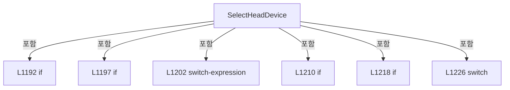

변경 전 점검: 입력/반환 타입, 위 호출자, 예외/취소 경로, 공유 상태와 저장·전송 소비자를 함께 확인합니다. 값의 단위나 물리 방향을 이름만으로 확정하지 않습니다.

### MethodDeclaration `EnsureMonitorWriteCommandAllowed` · L1245–1256

[Drilling.UI/Menu/Menus/CMenuMonitor.cs:1245–1256](https://github.com/kjuws10-rgb/A3Drilling/blob/0219666f9053b907d96d7e0aa7d0c6c1be3a73d4/Drilling.UI/Menu/Menus/CMenuMonitor.cs#L1245-L1256)

| 항목 | 실제 추출 값 |
| --- | --- |
| 서명 | bool Drilling.UI.Menu.Menus.CMenuMonitor.EnsureMonitorWriteCommandAllowed(string) |
| 접근/수식자 | Private / private |
| 반환/값 타입 | bool |
| 소속 타입 | NamedType:Drilling.UI.Menu.Menus.CMenuMonitor |

입력 계약:

| 이름 | 타입 | 전달 | 선택/기본값 |
| --- | --- | --- | --- |
| actionName | string | None | False /  |

정적 호출자로 확인된 위치:

| 호출 파일/행 | 호출 표현식 | 런타임 분기 가능 |
| --- | --- | --- |
| [Drilling.UI/Menu/Menus/CMenuMonitor.cs:1278–1278](https://github.com/kjuws10-rgb/A3Drilling/blob/0219666f9053b907d96d7e0aa7d0c6c1be3a73d4/Drilling.UI/Menu/Menus/CMenuMonitor.cs#L1278-L1278) | EnsureMonitorWriteCommandAllowed | False |
| [Drilling.UI/Menu/Menus/CMenuMonitor.cs:2948–2948](https://github.com/kjuws10-rgb/A3Drilling/blob/0219666f9053b907d96d7e0aa7d0c6c1be3a73d4/Drilling.UI/Menu/Menus/CMenuMonitor.cs#L2948-L2948) | EnsureMonitorWriteCommandAllowed | False |
| [Drilling.UI/Menu/Menus/CMenuMonitor.cs:2995–2995](https://github.com/kjuws10-rgb/A3Drilling/blob/0219666f9053b907d96d7e0aa7d0c6c1be3a73d4/Drilling.UI/Menu/Menus/CMenuMonitor.cs#L2995-L2995) | EnsureMonitorWriteCommandAllowed | False |
| [Drilling.UI/Menu/Menus/CMenuMonitor.cs:4431–4431](https://github.com/kjuws10-rgb/A3Drilling/blob/0219666f9053b907d96d7e0aa7d0c6c1be3a73d4/Drilling.UI/Menu/Menus/CMenuMonitor.cs#L4431-L4431) | EnsureMonitorWriteCommandAllowed | False |
| [Drilling.UI/Menu/Menus/CMenuMonitor.cs:4500–4500](https://github.com/kjuws10-rgb/A3Drilling/blob/0219666f9053b907d96d7e0aa7d0c6c1be3a73d4/Drilling.UI/Menu/Menus/CMenuMonitor.cs#L4500-L4500) | EnsureMonitorWriteCommandAllowed | False |
| [Drilling.UI/Menu/Menus/CMenuMonitor.cs:5474–5474](https://github.com/kjuws10-rgb/A3Drilling/blob/0219666f9053b907d96d7e0aa7d0c6c1be3a73d4/Drilling.UI/Menu/Menus/CMenuMonitor.cs#L5474-L5474) | EnsureMonitorWriteCommandAllowed | False |
| [Drilling.UI/Menu/Menus/CMenuMonitor.cs:5508–5508](https://github.com/kjuws10-rgb/A3Drilling/blob/0219666f9053b907d96d7e0aa7d0c6c1be3a73d4/Drilling.UI/Menu/Menus/CMenuMonitor.cs#L5508-L5508) | EnsureMonitorWriteCommandAllowed | False |

호출하는 대상과 해석 범위:

| 원본 행 | 표현식 | 분석 상태 | 대상/소스 위치 |
| --- | --- | --- | --- |
| 1247 | _canExecuteMonitorWriteCommand | resolved · 동적 구현 선택 가능 | bool System.Func<bool>.Invoke() |
| 1253 | _setStatusMessage | resolved · 동적 구현 선택 가능 | void System.Action<string>.Invoke(string) |
| 1253 | message.Replace | resolved | string string.Replace(string, string?) |
| 1254 | CRecipeConfirmDialog.ShowWarning | resolved | void Drilling.UI.Popup.CRecipeConfirmDialog.ShowWarning(string, string, Window?) · Drilling.UI/Popup/CRecipeConfirmDialog.xaml.cs:110 |

본문의 실제 연산·분기·예외·반환 순서(원문 위치 순):

| 원본 행 | 종류 | 주석 해설 |
| --- | --- | --- |
| 1247 | call | 함수·델리게이트 또는 객체 생성자를 호출합니다: _canExecuteMonitorWriteCommand() |
| 1247 | if | 조건에 따라 분기합니다: if (_canExecuteMonitorWriteCommand()) |
| 1249 | return | 호출자에게 값 또는 제어를 반환합니다: return true; |
| 1252 | local-declaration | 지역 변수를 선언합니다: var message = $"{actionName}은 Manual Mode에서만 사용할 수 있습니다.\nAuto Mode에서는 Monitor 화면의 조회와 Polling만 가능합니다."; |
| 1252 | variable-initializer | 변수의 초기값을 지정합니다: message = $"{actionName}은 Manual Mode에서만 사용할 수 있습니다.\nAuto Mode에서는 Monitor 화면의 조회와 Polling만 가능합니다." |
| 1253 | call | 함수·델리게이트 또는 객체 생성자를 호출합니다: _setStatusMessage(message.Replace(Environment.NewLine, " ")) |
| 1253 | call | 함수·델리게이트 또는 객체 생성자를 호출합니다: message.Replace(Environment.NewLine, " ") |
| 1254 | call | 함수·델리게이트 또는 객체 생성자를 호출합니다: CRecipeConfirmDialog.ShowWarning("Monitor 제어 불가", message) |
| 1255 | return | 호출자에게 값 또는 제어를 반환합니다: return false; |

제어 구문의 포함 구조(실제 실행 순서/CFG가 아닌 구문 탐색 그림):


변경 전 점검: 입력/반환 타입, 위 호출자, 예외/취소 경로, 공유 상태와 저장·전송 소비자를 함께 확인합니다. 값의 단위나 물리 방향을 이름만으로 확정하지 않습니다.

### MethodDeclaration `CanSelectHeadDevice` · L1258–1267

[Drilling.UI/Menu/Menus/CMenuMonitor.cs:1258–1267](https://github.com/kjuws10-rgb/A3Drilling/blob/0219666f9053b907d96d7e0aa7d0c6c1be3a73d4/Drilling.UI/Menu/Menus/CMenuMonitor.cs#L1258-L1267)

| 항목 | 실제 추출 값 |
| --- | --- |
| 서명 | bool Drilling.UI.Menu.Menus.CMenuMonitor.CanSelectHeadDevice(object?) |
| 접근/수식자 | Private / private |
| 반환/값 타입 | bool |
| 소속 타입 | NamedType:Drilling.UI.Menu.Menus.CMenuMonitor |

입력 계약:

| 이름 | 타입 | 전달 | 선택/기본값 |
| --- | --- | --- | --- |
| parameter | object? | None | False /  |

정적 호출자로 확인된 위치:

| 호출 파일/행 | 호출 표현식 | 런타임 분기 가능 |
| --- | --- | --- |
| [Drilling.UI/Menu/Menus/CMenuMonitor.cs:242–242](https://github.com/kjuws10-rgb/A3Drilling/blob/0219666f9053b907d96d7e0aa7d0c6c1be3a73d4/Drilling.UI/Menu/Menus/CMenuMonitor.cs#L242-L242) | CanSelectHeadDevice | False |
| [Drilling.UI/Menu/Menus/CMenuMonitor.cs:1197–1197](https://github.com/kjuws10-rgb/A3Drilling/blob/0219666f9053b907d96d7e0aa7d0c6c1be3a73d4/Drilling.UI/Menu/Menus/CMenuMonitor.cs#L1197-L1197) | CanSelectHeadDevice | False |

호출하는 대상과 해석 범위:

| 원본 행 | 표현식 | 분석 상태 | 대상/소스 위치 |
| --- | --- | --- | --- |
| 1263 | _enabledHeadDeviceNumbers.Contains | resolved | bool System.Collections.Generic.IEnumerable<int>.Contains<int>(int) |
| 1263 | Math.Clamp | resolved | int System.Math.Clamp(int, int, int) |
| 1264 | int.TryParse | resolved | bool int.TryParse(string?, System.Globalization.NumberStyles, System.IFormatProvider?, out int) |
| 1264 | _enabledHeadDeviceNumbers.Contains | resolved | bool System.Collections.Generic.IEnumerable<int>.Contains<int>(int) |
| 1264 | Math.Clamp | resolved | int System.Math.Clamp(int, int, int) |

본문의 실제 연산·분기·예외·반환 순서(원문 위치 순):

| 원본 행 | 종류 | 주석 해설 |
| --- | --- | --- |
| 1260 | return | 호출자에게 값 또는 제어를 반환합니다: return parameter switch { ST_MONITOR_HEAD_SELECT_ROW row => row.IsEnabled, int number => _enabledHeadDeviceNumbers.Contains(Math.Clamp(number, 0, LaserHeadCount - 1)), string text when int.TryParse(text, NumberStyles.Integer, Cult |
| 1260 | switch-expression | 값별 결과식을 선택합니다: parameter switch { ST_MONITOR_HEAD_SELECT_ROW row => row.IsEnabled, int number => _enabledHeadDeviceNumbers.Contains(Math.Clamp(number, 0, LaserHeadCount - 1)), string text when int.TryParse(text, NumberStyles.Integer, CultureInfo |
| 1263 | call | 함수·델리게이트 또는 객체 생성자를 호출합니다: _enabledHeadDeviceNumbers.Contains(Math.Clamp(number, 0, LaserHeadCount - 1)) |
| 1263 | call | 함수·델리게이트 또는 객체 생성자를 호출합니다: Math.Clamp(number, 0, LaserHeadCount - 1) |
| 1264 | call | 함수·델리게이트 또는 객체 생성자를 호출합니다: int.TryParse(text, NumberStyles.Integer, CultureInfo.InvariantCulture, out var number) |
| 1264 | call | 함수·델리게이트 또는 객체 생성자를 호출합니다: _enabledHeadDeviceNumbers.Contains(Math.Clamp(number, 0, LaserHeadCount - 1)) |
| 1264 | call | 함수·델리게이트 또는 객체 생성자를 호출합니다: Math.Clamp(number, 0, LaserHeadCount - 1) |

제어 구문의 포함 구조(실제 실행 순서/CFG가 아닌 구문 탐색 그림):

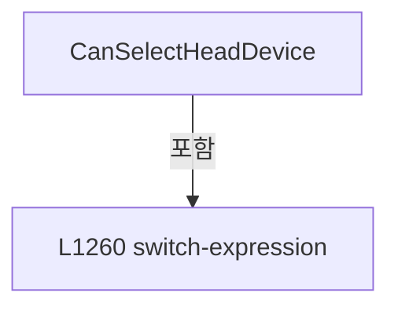

변경 전 점검: 입력/반환 타입, 위 호출자, 예외/취소 경로, 공유 상태와 저장·전송 소비자를 함께 확인합니다. 값의 단위나 물리 방향을 이름만으로 확정하지 않습니다.

### MethodDeclaration `ExecuteOperation` · L1269–1343

[Drilling.UI/Menu/Menus/CMenuMonitor.cs:1269–1343](https://github.com/kjuws10-rgb/A3Drilling/blob/0219666f9053b907d96d7e0aa7d0c6c1be3a73d4/Drilling.UI/Menu/Menus/CMenuMonitor.cs#L1269-L1343)

| 항목 | 실제 추출 값 |
| --- | --- |
| 서명 | System.Threading.Tasks.Task Drilling.UI.Menu.Menus.CMenuMonitor.ExecuteOperation(object?) |
| 접근/수식자 | Private / private, async |
| 반환/값 타입 | System.Threading.Tasks.Task |
| 소속 타입 | NamedType:Drilling.UI.Menu.Menus.CMenuMonitor |

입력 계약:

| 이름 | 타입 | 전달 | 선택/기본값 |
| --- | --- | --- | --- |
| parameter | object? | None | False /  |

정적 호출자로 확인된 위치:

| 호출 파일/행 | 호출 표현식 | 런타임 분기 가능 |
| --- | --- | --- |
| [Drilling.UI/Menu/Menus/CMenuMonitor.cs:248–248](https://github.com/kjuws10-rgb/A3Drilling/blob/0219666f9053b907d96d7e0aa7d0c6c1be3a73d4/Drilling.UI/Menu/Menus/CMenuMonitor.cs#L248-L248) | ExecuteOperation | False |

호출하는 대상과 해석 범위:

| 원본 행 | 표현식 | 분석 상태 | 대상/소스 위치 |
| --- | --- | --- | --- |
| 1271 | GetMonitorOperationLabel | resolved | string Drilling.UI.Menu.Menus.CMenuMonitor.GetMonitorOperationLabel(object?) · Drilling.UI/Menu/Menus/CMenuMonitor.cs:1650 |
| 1273 | string.IsNullOrWhiteSpace | resolved | bool string.IsNullOrWhiteSpace(string?) |
| 1278 | EnsureMonitorWriteCommandAllowed | resolved | bool Drilling.UI.Menu.Menus.CMenuMonitor.EnsureMonitorWriteCommandAllowed(string) · Drilling.UI/Menu/Menus/CMenuMonitor.cs:1245 |
| 1283 | NormalizeMonitorOperation | resolved | string Drilling.UI.Menu.Menus.CMenuMonitor.NormalizeMonitorOperation(string) · Drilling.UI/Menu/Menus/CMenuMonitor.cs:1662 |
| 1284 | TryNotifyPowerMeterTuneLocked | resolved | bool Drilling.UI.Menu.Menus.CMenuMonitor.TryNotifyPowerMeterTuneLocked(string) · Drilling.UI/Menu/Menus/CMenuMonitor.cs:5852 |
| 1289 | MultiMoveAxisRows.Any | resolved | bool System.Collections.Generic.IEnumerable<Drilling.UI.Menu.Menus.ST_MONITOR_MULTI_MOVE_AXIS_ROW>.Any<Drilling.UI.Menu.Menus.ST_MONITOR_MULTI_MOVE_AXIS_ROW>(System.Func<Drilling.UI.Menu.Menus.ST_MONITOR_MULTI_MOVE_AXIS_ROW, bool>) |
| 1291 | _setStatusMessage | resolved · 동적 구현 선택 가능 | void System.Action<string>.Invoke(string) |
| 1299 | _setStatusMessage | resolved · 동적 구현 선택 가능 | void System.Action<string>.Invoke(string) |
| 1303 | Math.Max | resolved | int System.Math.Max(int, int) |
| 1303 | Math.Round | resolved | double System.Math.Round(double) |
| 1303 | ReadOperationField | resolved | double Drilling.UI.Menu.Menus.CMenuMonitor.ReadOperationField(string, double) · Drilling.UI/Menu/Menus/CMenuMonitor.cs:1627 |
| 1305 | _setStatusMessage | resolved · 동적 구현 선택 가능 | void System.Action<string>.Invoke(string) |
| 1311 | RequiresOperationConfirmation | resolved | bool Drilling.UI.Menu.Menus.CMenuMonitor.RequiresOperationConfirmation(string, string) · Drilling.UI/Menu/Menus/CMenuMonitor.cs:1345 |
| 1311 | CRecipeConfirmDialog.ShowConfirmation | resolved | bool Drilling.UI.Popup.CRecipeConfirmDialog.ShowConfirmation(string, string, string, bool) · Drilling.UI/Popup/CRecipeConfirmDialog.xaml.cs:12 |
| 1311 | GetOperationConfirmationTitle | resolved | string Drilling.UI.Menu.Menus.CMenuMonitor.GetOperationConfirmationTitle(string) · Drilling.UI/Menu/Menus/CMenuMonitor.cs:1367 |
| 1311 | GetOperationConfirmationText | resolved | string Drilling.UI.Menu.Menus.CMenuMonitor.GetOperationConfirmationText(string) · Drilling.UI/Menu/Menus/CMenuMonitor.cs:1381 |
| 1316 | SaveOperationFieldValues | resolved | void Drilling.UI.Menu.Menus.CMenuMonitor.SaveOperationFieldValues(string) · Drilling.UI/Menu/Menus/CMenuMonitor.cs:2351 |
| 1319 | SavePowerMeterSettingValues | resolved | void Drilling.UI.Menu.Menus.CMenuMonitor.SavePowerMeterSettingValues() · Drilling.UI/Menu/Menus/CMenuMonitor.cs:5866 |
| 1324 | ExecuteMotorOperation | resolved | System.Threading.Tasks.Task<Drilling.Common.Interface.ST_DEVICE_COMMAND_RESULT> Drilling.UI.Menu.Menus.CMenuMonitor.ExecuteMotorOperation(string) · Drilling.UI/Menu/Menus/CMenuMonitor.cs:4852 |
| 1325 | ExecutePowerMeterOperation | resolved | System.Threading.Tasks.Task<Drilling.Common.Interface.ST_DEVICE_COMMAND_RESULT> Drilling.UI.Menu.Menus.CMenuMonitor.ExecutePowerMeterOperation(string) · Drilling.UI/Menu/Menus/CMenuMonitor.cs:5324 |
| 1326 | ExecuteLaserOperation | resolved | System.Threading.Tasks.Task<Drilling.Common.Interface.ST_DEVICE_COMMAND_RESULT> Drilling.UI.Menu.Menus.CMenuMonitor.ExecuteLaserOperation(string) · Drilling.UI/Menu/Menus/CMenuMonitor.cs:5111 |
| 1327 | ExecuteAttenuatorOperation | resolved | System.Threading.Tasks.Task<Drilling.Common.Interface.ST_DEVICE_COMMAND_RESULT> Drilling.UI.Menu.Menus.CMenuMonitor.ExecuteAttenuatorOperation(string) · Drilling.UI/Menu/Menus/CMenuMonitor.cs:5146 |
| 1328 | ExecuteBETOperation | resolved | System.Threading.Tasks.Task<Drilling.Common.Interface.ST_DEVICE_COMMAND_RESULT> Drilling.UI.Menu.Menus.CMenuMonitor.ExecuteBETOperation(string) · Drilling.UI/Menu/Menus/CMenuMonitor.cs:5275 |
| 1329 | ExecutePowerMeterOperation | resolved | System.Threading.Tasks.Task<Drilling.Common.Interface.ST_DEVICE_COMMAND_RESULT> Drilling.UI.Menu.Menus.CMenuMonitor.ExecutePowerMeterOperation(string) · Drilling.UI/Menu/Menus/CMenuMonitor.cs:5324 |
| 1330 | ExecutePicoMotorOperation | resolved | System.Threading.Tasks.Task<Drilling.Common.Interface.ST_DEVICE_COMMAND_RESULT> Drilling.UI.Menu.Menus.CMenuMonitor.ExecutePicoMotorOperation(string) · Drilling.UI/Menu/Menus/CMenuMonitor.cs:5365 |
| 1331 | new ST_DEVICE_COMMAND_RESULT | resolved | Drilling.Common.Interface.ST_DEVICE_COMMAND_RESULT.ST_DEVICE_COMMAND_RESULT(bool, string) · Drilling.Common/Interface/CInterfaceManager.cs:2964 |
| 1332 | _setStatusMessage | resolved · 동적 구현 선택 가능 | void System.Action<string>.Invoke(string) |
| 1335 | _statusPollingService.RefreshMotorNow | resolved | void Drilling.UI.Menu.Menus.CMonitorStatusPollingService.RefreshMotorNow(System.Threading.CancellationToken) · Drilling.UI/Menu/Menus/CMonitorStatusPollingService.cs:64 |
| 1340 | _refreshShellStatus | resolved · 동적 구현 선택 가능 | void System.Action.Invoke() |
| 1341 | _refreshCurrentScreen | resolved · 동적 구현 선택 가능 | System.Threading.Tasks.Task System.Func<System.Threading.Tasks.Task>.Invoke() |

본문의 실제 연산·분기·예외·반환 순서(원문 위치 순):

| 원본 행 | 종류 | 주석 해설 |
| --- | --- | --- |
| 1271 | call | 함수·델리게이트 또는 객체 생성자를 호출합니다: GetMonitorOperationLabel(parameter) |
| 1271 | local-declaration | 지역 변수를 선언합니다: var label = GetMonitorOperationLabel(parameter); |
| 1271 | variable-initializer | 변수의 초기값을 지정합니다: label = GetMonitorOperationLabel(parameter) |
| 1272 | local-declaration | 지역 변수를 선언합니다: var isPowerMeterCommand = parameter is ST_PWM_DEVICE_ROW; |
| 1272 | variable-initializer | 변수의 초기값을 지정합니다: isPowerMeterCommand = parameter is ST_PWM_DEVICE_ROW |
| 1273 | call | 함수·델리게이트 또는 객체 생성자를 호출합니다: string.IsNullOrWhiteSpace(label) |
| 1273 | if | 조건에 따라 분기합니다: if (string.IsNullOrWhiteSpace(label)) |
| 1275 | return | 호출자에게 값 또는 제어를 반환합니다: return; |
| 1278 | call | 함수·델리게이트 또는 객체 생성자를 호출합니다: EnsureMonitorWriteCommandAllowed($"{SelectedTab} {label}") |
| 1278 | if | 조건에 따라 분기합니다: if (!EnsureMonitorWriteCommandAllowed($"{SelectedTab} {label}")) |
| 1280 | return | 호출자에게 값 또는 제어를 반환합니다: return; |
| 1283 | call | 함수·델리게이트 또는 객체 생성자를 호출합니다: NormalizeMonitorOperation(label) |
| 1283 | local-declaration | 지역 변수를 선언합니다: var confirmationKey = NormalizeMonitorOperation(label); |
| 1283 | variable-initializer | 변수의 초기값을 지정합니다: confirmationKey = NormalizeMonitorOperation(label) |
| 1284 | call | 함수·델리게이트 또는 객체 생성자를 호출합니다: TryNotifyPowerMeterTuneLocked("DEVICE COMMAND") |
| 1284 | if | 조건에 따라 분기합니다: if ((isPowerMeterCommand &#124;&#124; SelectedTab == "POWER METER") && confirmationKey != "STOP" && TryNotifyPowerMeterTuneLocked("DEVICE COMMAND")) |
| 1286 | return | 호출자에게 값 또는 제어를 반환합니다: return; |
| 1289 | call | 함수·델리게이트 또는 객체 생성자를 호출합니다: MultiMoveAxisRows.Any(row => row.IsSelected) |
| 1289 | if | 조건에 따라 분기합니다: if (SelectedTab == "XPS" && confirmationKey == "MULTIABSMOVE" && !MultiMoveAxisRows.Any(row => row.IsSelected)) |
| 1291 | call | 함수·델리게이트 또는 객체 생성자를 호출합니다: _setStatusMessage("Scanner tilt move skipped. Select at least one axis.") |
| 1292 | return | 호출자에게 값 또는 제어를 반환합니다: return; |
| 1295 | if | 조건에 따라 분기합니다: if (SelectedTab == "PICO MOTOR" && confirmationKey == "START") |
| 1297 | if | 조건에 따라 분기합니다: if (_picoAllMoveMotorNos.Count == 0) |
| 1299 | call | 함수·델리게이트 또는 객체 생성자를 호출합니다: _setStatusMessage("DOE tilt start skipped. Select at least one motor.") |
| 1300 | return | 호출자에게 값 또는 제어를 반환합니다: return; |
| 1303 | call | 함수·델리게이트 또는 객체 생성자를 호출합니다: Math.Max(0, (int)Math.Round(ReadOperationField("Set Count", 0))) |
| 1303 | call | 함수·델리게이트 또는 객체 생성자를 호출합니다: Math.Round(ReadOperationField("Set Count", 0)) |
| 1303 | call | 함수·델리게이트 또는 객체 생성자를 호출합니다: ReadOperationField("Set Count", 0) |
| 1303 | if | 조건에 따라 분기합니다: if (Math.Max(0, (int)Math.Round(ReadOperationField("Set Count", 0))) <= 0) |
| 1305 | call | 함수·델리게이트 또는 객체 생성자를 호출합니다: _setStatusMessage("DOE tilt start skipped. Set Count must be greater than 0.") |
| 1306 | return | 호출자에게 값 또는 제어를 반환합니다: return; |
| 1310 | local-declaration | 지역 변수를 선언합니다: var isAttenuatorReset = SelectedTab == "ATTENUATOR" && confirmationKey == "RESET"; |
| 1310 | variable-initializer | 변수의 초기값을 지정합니다: isAttenuatorReset = SelectedTab == "ATTENUATOR" && confirmationKey == "RESET" |
| 1311 | call | 함수·델리게이트 또는 객체 생성자를 호출합니다: RequiresOperationConfirmation(SelectedTab, label) |
| 1311 | call | 함수·델리게이트 또는 객체 생성자를 호출합니다: CRecipeConfirmDialog.ShowConfirmation(isAttenuatorReset ? "감쇠기 초기화" : GetOperationConfirmationTitle(SelectedTab), GetOperationConfirmationText(label), isAttenuatorReset ? "초기화" : "확인") |
| 1311 | call | 함수·델리게이트 또는 객체 생성자를 호출합니다: GetOperationConfirmationTitle(SelectedTab) |
| 1311 | call | 함수·델리게이트 또는 객체 생성자를 호출합니다: GetOperationConfirmationText(label) |
| 1311 | conditional-expression | 조건에 따라 결과식을 선택합니다: isAttenuatorReset ? "감쇠기 초기화" : GetOperationConfirmationTitle(SelectedTab) |
| 1311 | conditional-expression | 조건에 따라 결과식을 선택합니다: isAttenuatorReset ? "초기화" : "확인" |
| 1311 | if | 조건에 따라 분기합니다: if (RequiresOperationConfirmation(SelectedTab, label) && !CRecipeConfirmDialog.ShowConfirmation(isAttenuatorReset ? "감쇠기 초기화" : GetOperationConfirmationTitle(SelectedTab), GetOperationConfirmationText(label), isAttenuatorRes…) |
| 1313 | return | 호출자에게 값 또는 제어를 반환합니다: return; |
| 1316 | call | 함수·델리게이트 또는 객체 생성자를 호출합니다: SaveOperationFieldValues(SelectedTab) |
| 1317 | if | 조건에 따라 분기합니다: if (isPowerMeterCommand &#124;&#124; SelectedTab == "POWER METER") |
| 1319 | call | 함수·델리게이트 또는 객체 생성자를 호출합니다: SavePowerMeterSettingValues() |
| 1322 | local-declaration | 지역 변수를 선언합니다: var result = SelectedTab switch { "XPS" => await ExecuteMotorOperation(label), "LASER" when isPowerMeterCommand => await ExecutePowerMeterOperation(label), "LASER" => await ExecuteLaserOperation(label), "ATTENUATOR" => await Execu |
| 1322 | switch-expression | 값별 결과식을 선택합니다: SelectedTab switch { "XPS" => await ExecuteMotorOperation(label), "LASER" when isPowerMeterCommand => await ExecutePowerMeterOperation(label), "LASER" => await ExecuteLaserOperation(label), "ATTENUATOR" => await ExecuteAttenuatorO |
| 1322 | variable-initializer | 변수의 초기값을 지정합니다: result = SelectedTab switch { "XPS" => await ExecuteMotorOperation(label), "LASER" when isPowerMeterCommand => await ExecutePowerMeterOperation(label), "LASER" => await ExecuteLaserOperation(label), "ATTENUATOR" => await ExecuteAt |
| 1324 | await | 비동기 완료를 기다립니다: await ExecuteMotorOperation(label) |
| 1324 | call | 함수·델리게이트 또는 객체 생성자를 호출합니다: ExecuteMotorOperation(label) |
| 1325 | await | 비동기 완료를 기다립니다: await ExecutePowerMeterOperation(label) |
| 1325 | call | 함수·델리게이트 또는 객체 생성자를 호출합니다: ExecutePowerMeterOperation(label) |
| 1326 | await | 비동기 완료를 기다립니다: await ExecuteLaserOperation(label) |
| 1326 | call | 함수·델리게이트 또는 객체 생성자를 호출합니다: ExecuteLaserOperation(label) |
| 1327 | await | 비동기 완료를 기다립니다: await ExecuteAttenuatorOperation(label) |
| 1327 | call | 함수·델리게이트 또는 객체 생성자를 호출합니다: ExecuteAttenuatorOperation(label) |
| 1328 | await | 비동기 완료를 기다립니다: await ExecuteBETOperation(label) |
| 1328 | call | 함수·델리게이트 또는 객체 생성자를 호출합니다: ExecuteBETOperation(label) |
| 1329 | await | 비동기 완료를 기다립니다: await ExecutePowerMeterOperation(label) |
| 1329 | call | 함수·델리게이트 또는 객체 생성자를 호출합니다: ExecutePowerMeterOperation(label) |
| 1330 | await | 비동기 완료를 기다립니다: await ExecutePicoMotorOperation(label) |
| 1330 | call | 함수·델리게이트 또는 객체 생성자를 호출합니다: ExecutePicoMotorOperation(label) |
| 1331 | call | 함수·델리게이트 또는 객체 생성자를 호출합니다: new ST_DEVICE_COMMAND_RESULT(false, $"Monitor {SelectedTab} command is not connected yet: {label}") |
| 1332 | call | 함수·델리게이트 또는 객체 생성자를 호출합니다: _setStatusMessage(result.Message) |
| 1333 | if | 조건에 따라 분기합니다: if (SelectedTab == "XPS") |
| 1335 | call | 함수·델리게이트 또는 객체 생성자를 호출합니다: _statusPollingService.RefreshMotorNow() |
| 1338 | if | 조건에 따라 분기합니다: if (SelectedTab is "XPS" or "LASER" or "ATTENUATOR" or "BET" or "POWER METER" or "PICO MOTOR") |
| 1340 | call | 함수·델리게이트 또는 객체 생성자를 호출합니다: _refreshShellStatus() |
| 1341 | await | 비동기 완료를 기다립니다: await _refreshCurrentScreen() |
| 1341 | call | 함수·델리게이트 또는 객체 생성자를 호출합니다: _refreshCurrentScreen() |

제어 구문의 포함 구조(실제 실행 순서/CFG가 아닌 구문 탐색 그림):

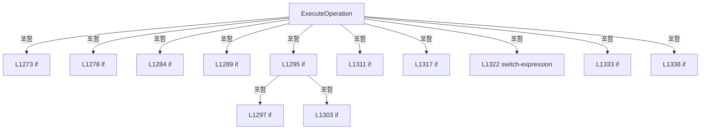

변경 전 점검: 입력/반환 타입, 위 호출자, 예외/취소 경로, 공유 상태와 저장·전송 소비자를 함께 확인합니다. 값의 단위나 물리 방향을 이름만으로 확정하지 않습니다.

### MethodDeclaration `RequiresOperationConfirmation` · L1345–1365

[Drilling.UI/Menu/Menus/CMenuMonitor.cs:1345–1365](https://github.com/kjuws10-rgb/A3Drilling/blob/0219666f9053b907d96d7e0aa7d0c6c1be3a73d4/Drilling.UI/Menu/Menus/CMenuMonitor.cs#L1345-L1365)

| 항목 | 실제 추출 값 |
| --- | --- |
| 서명 | bool Drilling.UI.Menu.Menus.CMenuMonitor.RequiresOperationConfirmation(string, string) |
| 접근/수식자 | Private / private, static |
| 반환/값 타입 | bool |
| 소속 타입 | NamedType:Drilling.UI.Menu.Menus.CMenuMonitor |

입력 계약:

| 이름 | 타입 | 전달 | 선택/기본값 |
| --- | --- | --- | --- |
| tab | string | None | False /  |
| label | string | None | False /  |

정적 호출자로 확인된 위치:

| 호출 파일/행 | 호출 표현식 | 런타임 분기 가능 |
| --- | --- | --- |
| [Drilling.UI/Menu/Menus/CMenuMonitor.cs:1311–1311](https://github.com/kjuws10-rgb/A3Drilling/blob/0219666f9053b907d96d7e0aa7d0c6c1be3a73d4/Drilling.UI/Menu/Menus/CMenuMonitor.cs#L1311-L1311) | RequiresOperationConfirmation | False |

호출하는 대상과 해석 범위:

| 원본 행 | 표현식 | 분석 상태 | 대상/소스 위치 |
| --- | --- | --- | --- |
| 1347 | NormalizeMonitorOperation | resolved | string Drilling.UI.Menu.Menus.CMenuMonitor.NormalizeMonitorOperation(string) · Drilling.UI/Menu/Menus/CMenuMonitor.cs:1662 |
| 1357 | key.StartsWith | resolved | bool string.StartsWith(string, System.StringComparison) |

본문의 실제 연산·분기·예외·반환 순서(원문 위치 순):

| 원본 행 | 종류 | 주석 해설 |
| --- | --- | --- |
| 1347 | call | 함수·델리게이트 또는 객체 생성자를 호출합니다: NormalizeMonitorOperation(label) |
| 1347 | local-declaration | 지역 변수를 선언합니다: var key = NormalizeMonitorOperation(label); |
| 1347 | variable-initializer | 변수의 초기값을 지정합니다: key = NormalizeMonitorOperation(label) |
| 1348 | switch | 값에 따라 분기합니다: switch (tab) |
| 1350 | case | 분기값/패턴의 구간입니다: case "XPS": |
| 1351 | return | 호출자에게 값 또는 제어를 반환합니다: return key is "SERVOON" or "SERVOOFF" or "HOME" or "ABSMOVE" or "RELMOVE" or "MULTIABSMOVE"; |
| 1352 | case | 분기값/패턴의 구간입니다: case "LASER": |
| 1353 | return | 호출자에게 값 또는 제어를 반환합니다: return key is "LASERON" or "LASEROFF" or "SHUTTEROPEN" or "SHUTTERCLOSE" or "GATEON" or "GATEOFF" or "EXTGATEENABLE" or "EXTGATEDISABLE" or "SETQSW" or "SETEPRF" or "SETSHG" or "SETQMODE"; |
| 1354 | case | 분기값/패턴의 구간입니다: case "ATTENUATOR": |
| 1355 | return | 호출자에게 값 또는 제어를 반환합니다: return key is "HOME" or "RESET" or "MOVEABS" or "MOVEREL" or "SETHOMETYPE" or "SETNEGLIMIT" or "SETPOSLIMIT" or "SETIGAIN" or "SETPGAIN" or "SETIF"; |
| 1356 | case | 분기값/패턴의 구간입니다: case "BET": |
| 1357 | call | 함수·델리게이트 또는 객체 생성자를 호출합니다: key.StartsWith("MOVETABLE", StringComparison.OrdinalIgnoreCase) |
| 1357 | return | 호출자에게 값 또는 제어를 반환합니다: return key is "HOME" or "MOVEMAG" or "MOVEDIV" or "SAVETABLE" or "MOVE" &#124;&#124; key.StartsWith("MOVETABLE", StringComparison.OrdinalIgnoreCase); |
| 1358 | case | 분기값/패턴의 구간입니다: case "POWER METER": |
| 1359 | return | 호출자에게 값 또는 제어를 반환합니다: return key == "START"; |
| 1360 | case | 분기값/패턴의 구간입니다: case "PICO MOTOR": |
| 1361 | return | 호출자에게 값 또는 제어를 반환합니다: return key is "CONNECT" or "DISCONNECT" or "SETVEL" or "SETVELOCITY" or "PICOSETVEL" or "SETACC" or "SETACCELERATION" or "PICOSETACC" or "HOME" or "ABSMOVE" or "START"; |
| 1362 | case | 분기값/패턴의 구간입니다: default: |
| 1363 | return | 호출자에게 값 또는 제어를 반환합니다: return false; |

제어 구문의 포함 구조(실제 실행 순서/CFG가 아닌 구문 탐색 그림):

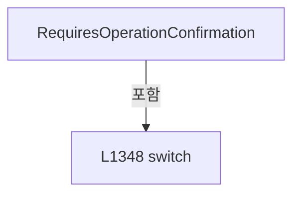

변경 전 점검: 입력/반환 타입, 위 호출자, 예외/취소 경로, 공유 상태와 저장·전송 소비자를 함께 확인합니다. 값의 단위나 물리 방향을 이름만으로 확정하지 않습니다.

### MethodDeclaration `GetOperationConfirmationTitle` · L1367–1379

[Drilling.UI/Menu/Menus/CMenuMonitor.cs:1367–1379](https://github.com/kjuws10-rgb/A3Drilling/blob/0219666f9053b907d96d7e0aa7d0c6c1be3a73d4/Drilling.UI/Menu/Menus/CMenuMonitor.cs#L1367-L1379)

| 항목 | 실제 추출 값 |
| --- | --- |
| 서명 | string Drilling.UI.Menu.Menus.CMenuMonitor.GetOperationConfirmationTitle(string) |
| 접근/수식자 | Private / private, static |
| 반환/값 타입 | string |
| 소속 타입 | NamedType:Drilling.UI.Menu.Menus.CMenuMonitor |

입력 계약:

| 이름 | 타입 | 전달 | 선택/기본값 |
| --- | --- | --- | --- |
| tab | string | None | False /  |

정적 호출자로 확인된 위치:

| 호출 파일/행 | 호출 표현식 | 런타임 분기 가능 |
| --- | --- | --- |
| [Drilling.UI/Menu/Menus/CMenuMonitor.cs:1311–1311](https://github.com/kjuws10-rgb/A3Drilling/blob/0219666f9053b907d96d7e0aa7d0c6c1be3a73d4/Drilling.UI/Menu/Menus/CMenuMonitor.cs#L1311-L1311) | GetOperationConfirmationTitle | False |

본문의 실제 연산·분기·예외·반환 순서(원문 위치 순):

| 원본 행 | 종류 | 주석 해설 |
| --- | --- | --- |
| 1369 | return | 호출자에게 값 또는 제어를 반환합니다: return tab switch { "XPS" => "스캐너 틸트 제어", "LASER" => "레이저 제어", "ATTENUATOR" => "감쇠기 제어", "BET" => "BET 제어", "POWER METER" => "PowerMeter 제어", "PICO MOTOR" => "DOE 틸트 제어", _ => "장비 제어" }; |
| 1369 | switch-expression | 값별 결과식을 선택합니다: tab switch { "XPS" => "스캐너 틸트 제어", "LASER" => "레이저 제어", "ATTENUATOR" => "감쇠기 제어", "BET" => "BET 제어", "POWER METER" => "PowerMeter 제어", "PICO MOTOR" => "DOE 틸트 제어", _ => "장비 제어" } |

제어 구문의 포함 구조(실제 실행 순서/CFG가 아닌 구문 탐색 그림):


변경 전 점검: 입력/반환 타입, 위 호출자, 예외/취소 경로, 공유 상태와 저장·전송 소비자를 함께 확인합니다. 값의 단위나 물리 방향을 이름만으로 확정하지 않습니다.

### MethodDeclaration `GetOperationConfirmationText` · L1381–1592

[Drilling.UI/Menu/Menus/CMenuMonitor.cs:1381–1592](https://github.com/kjuws10-rgb/A3Drilling/blob/0219666f9053b907d96d7e0aa7d0c6c1be3a73d4/Drilling.UI/Menu/Menus/CMenuMonitor.cs#L1381-L1592)

| 항목 | 실제 추출 값 |
| --- | --- |
| 서명 | string Drilling.UI.Menu.Menus.CMenuMonitor.GetOperationConfirmationText(string) |
| 접근/수식자 | Private / private |
| 반환/값 타입 | string |
| 소속 타입 | NamedType:Drilling.UI.Menu.Menus.CMenuMonitor |

입력 계약:

| 이름 | 타입 | 전달 | 선택/기본값 |
| --- | --- | --- | --- |
| label | string | None | False /  |

정적 호출자로 확인된 위치:

| 호출 파일/행 | 호출 표현식 | 런타임 분기 가능 |
| --- | --- | --- |
| [Drilling.UI/Menu/Menus/CMenuMonitor.cs:1311–1311](https://github.com/kjuws10-rgb/A3Drilling/blob/0219666f9053b907d96d7e0aa7d0c6c1be3a73d4/Drilling.UI/Menu/Menus/CMenuMonitor.cs#L1311-L1311) | GetOperationConfirmationText | False |

호출하는 대상과 해석 범위:

| 원본 행 | 표현식 | 분석 상태 | 대상/소스 위치 |
| --- | --- | --- | --- |
| 1383 | NormalizeMonitorOperation | resolved | string Drilling.UI.Menu.Menus.CMenuMonitor.NormalizeMonitorOperation(string) · Drilling.UI/Menu/Menus/CMenuMonitor.cs:1662 |
| 1393 | ReadOperationField("ABS Target Position", 0.0).ToString | resolved | string double.ToString(string?, System.IFormatProvider?) |
| 1393 | ReadOperationField | resolved | double Drilling.UI.Menu.Menus.CMenuMonitor.ReadOperationField(string, double) · Drilling.UI/Menu/Menus/CMenuMonitor.cs:1627 |
| 1398 | ReadOperationField("REL Distance", 0.0).ToString | resolved | string double.ToString(string?, System.IFormatProvider?) |
| 1398 | ReadOperationField | resolved | double Drilling.UI.Menu.Menus.CMenuMonitor.ReadOperationField(string, double) · Drilling.UI/Menu/Menus/CMenuMonitor.cs:1627 |
| 1403 | MultiMoveAxisRows.Where(row => row.IsSelected).Select(row => $"{row.Axis} = {row.TargetPosition} mm").ToArray | resolved | string[] System.Collections.Generic.IEnumerable<string>.ToArray<string>() |
| 1403 | MultiMoveAxisRows.Where(row => row.IsSelected).Select | resolved | System.Collections.Generic.IEnumerable<string> System.Collections.Generic.IEnumerable<Drilling.UI.Menu.Menus.ST_MONITOR_MULTI_MOVE_AXIS_ROW>.Select<Drilling.UI.Menu.Menus.ST_MONITOR_MULTI_MOVE_AXIS_ROW, string>(System.Func<Drilling.UI.Menu.Menus.ST_MONITOR_MULTI_MOVE_AXIS_ROW, string>) |
| 1403 | MultiMoveAxisRows.Where | resolved | System.Collections.Generic.IEnumerable<Drilling.UI.Menu.Menus.ST_MONITOR_MULTI_MOVE_AXIS_ROW> System.Collections.Generic.IEnumerable<Drilling.UI.Menu.Menus.ST_MONITOR_MULTI_MOVE_AXIS_ROW>.Where<Drilling.UI.Menu.Menus.ST_MONITOR_MULTI_MOVE_AXIS_ROW>(System.Func<Drilling.UI.Menu.Menus.ST_MONITOR_MULTI_MOVE_AXIS_ROW, bool>) |
| 1404 | string.Join | resolved | string string.Join(string?, params string?[]) |
| 1412 | ReadOperationField("QSW", 20000.0).ToString | resolved | string double.ToString(string?, System.IFormatProvider?) |
| 1412 | ReadOperationField | resolved | double Drilling.UI.Menu.Menus.CMenuMonitor.ReadOperationField(string, double) · Drilling.UI/Menu/Menus/CMenuMonitor.cs:1627 |
| 1417 | ReadOperationField("EPRF", 20000.0).ToString | resolved | string double.ToString(string?, System.IFormatProvider?) |
| 1417 | ReadOperationField | resolved | double Drilling.UI.Menu.Menus.CMenuMonitor.ReadOperationField(string, double) · Drilling.UI/Menu/Menus/CMenuMonitor.cs:1627 |
| 1422 | ReadOperationField("SHG Count", 0.0).ToString | resolved | string double.ToString(string?, System.IFormatProvider?) |
| 1422 | ReadOperationField | resolved | double Drilling.UI.Menu.Menus.CMenuMonitor.ReadOperationField(string, double) · Drilling.UI/Menu/Menus/CMenuMonitor.cs:1627 |
| 1427 | ReadOperationField("Q Mode", 0.0).ToString | resolved | string double.ToString(string?, System.IFormatProvider?) |
| 1427 | ReadOperationField | resolved | double Drilling.UI.Menu.Menus.CMenuMonitor.ReadOperationField(string, double) · Drilling.UI/Menu/Menus/CMenuMonitor.cs:1627 |
| 1440 | ReadOperationField("Target Position", 55.0).ToString | resolved | string double.ToString(string?, System.IFormatProvider?) |
| 1440 | ReadOperationField | resolved | double Drilling.UI.Menu.Menus.CMenuMonitor.ReadOperationField(string, double) · Drilling.UI/Menu/Menus/CMenuMonitor.cs:1627 |
| 1445 | ReadOperationField("Relative Move", 0.0).ToString | resolved | string double.ToString(string?, System.IFormatProvider?) |
| 1445 | ReadOperationField | resolved | double Drilling.UI.Menu.Menus.CMenuMonitor.ReadOperationField(string, double) · Drilling.UI/Menu/Menus/CMenuMonitor.cs:1627 |
| 1455 | OperationFields.FirstOrDefault | resolved | Drilling.UI.Menu.Menus.ST_MONITOR_PARAMETER_ROW? System.Collections.Generic.IEnumerable<Drilling.UI.Menu.Menus.ST_MONITOR_PARAMETER_ROW>.FirstOrDefault<Drilling.UI.Menu.Menus.ST_MONITOR_PARAMETER_ROW>(System.Func<Drilling.UI.Menu.Menus.ST_MONITOR_PARAMETER_ROW, bool>) |
| 1455 | field.Parameter.Equals | resolved | bool string.Equals(string?, System.StringComparison) |
| 1456 | string.IsNullOrWhiteSpace | resolved | bool string.IsNullOrWhiteSpace(string?) |
| 1456 | FormatHomeTypeOption | resolved | string Drilling.UI.Menu.Menus.CMenuMonitor.FormatHomeTypeOption(int) · Drilling.UI/Menu/Menus/CMenuMonitor.cs:6729 |
| 1462 | ReadOperationField("Negative Limit", 0.0).ToString | resolved | string double.ToString(string?, System.IFormatProvider?) |
| 1462 | ReadOperationField | resolved | double Drilling.UI.Menu.Menus.CMenuMonitor.ReadOperationField(string, double) · Drilling.UI/Menu/Menus/CMenuMonitor.cs:1627 |
| 1467 | ReadOperationField("Positive Limit", 360.0).ToString | resolved | string double.ToString(string?, System.IFormatProvider?) |
| 1467 | ReadOperationField | resolved | double Drilling.UI.Menu.Menus.CMenuMonitor.ReadOperationField(string, double) · Drilling.UI/Menu/Menus/CMenuMonitor.cs:1627 |
| 1472 | ReadOperationField("I Gain", 800.0).ToString | resolved | string double.ToString(string?, System.IFormatProvider?) |
| 1472 | ReadOperationField | resolved | double Drilling.UI.Menu.Menus.CMenuMonitor.ReadOperationField(string, double) · Drilling.UI/Menu/Menus/CMenuMonitor.cs:1627 |
| 1477 | ReadOperationField("P Gain", 10.0).ToString | resolved | string double.ToString(string?, System.IFormatProvider?) |
| 1477 | ReadOperationField | resolved | double Drilling.UI.Menu.Menus.CMenuMonitor.ReadOperationField(string, double) · Drilling.UI/Menu/Menus/CMenuMonitor.cs:1627 |
| 1482 | ReadOperationField("Interpolation Factor", 1000.0).ToString | resolved | string double.ToString(string?, System.IFormatProvider?) |
| 1482 | ReadOperationField | resolved | double Drilling.UI.Menu.Menus.CMenuMonitor.ReadOperationField(string, double) · Drilling.UI/Menu/Menus/CMenuMonitor.cs:1627 |
| 1495 | ReadOperationField("Target MAG POS", 1020.0).ToString | resolved | string double.ToString(string?, System.IFormatProvider?) |
| 1495 | ReadOperationField | resolved | double Drilling.UI.Menu.Menus.CMenuMonitor.ReadOperationField(string, double) · Drilling.UI/Menu/Menus/CMenuMonitor.cs:1627 |
| 1500 | ReadOperationField("Target DIV POS", 1626.0).ToString | resolved | string double.ToString(string?, System.IFormatProvider?) |
| 1500 | ReadOperationField | resolved | double Drilling.UI.Menu.Menus.CMenuMonitor.ReadOperationField(string, double) · Drilling.UI/Menu/Menus/CMenuMonitor.cs:1627 |
| 1503 | key.StartsWith | resolved | bool string.StartsWith(string, System.StringComparison) |
| 1506 | BetTableRows.FirstOrDefault | resolved | Drilling.UI.Menu.Menus.ST_MONITOR_BET_TABLE_ROW? System.Collections.Generic.IEnumerable<Drilling.UI.Menu.Menus.ST_MONITOR_BET_TABLE_ROW>.FirstOrDefault<Drilling.UI.Menu.Menus.ST_MONITOR_BET_TABLE_ROW>(System.Func<Drilling.UI.Menu.Menus.ST_MONITOR_BET_TABLE_ROW, bool>) |
| 1506 | row.No.Equals | resolved | bool string.Equals(string?, System.StringComparison) |
| 1509 | string.IsNullOrWhiteSpace | resolved | bool string.IsNullOrWhiteSpace(string?) |
| 1519 | ReadPwmSetting | resolved | double Drilling.UI.Menu.Menus.CMenuMonitor.ReadPwmSetting(string, double) · Drilling.UI/Menu/Menus/CMenuMonitor.cs:6260 |
| 1520 | ReadPwmText | resolved | string Drilling.UI.Menu.Menus.CMenuMonitor.ReadPwmText(string, string) · Drilling.UI/Menu/Menus/CMenuMonitor.cs:6239 |
| 1521 | targetPower.ToString | resolved | string double.ToString(string?, System.IFormatProvider?) |
| 1527 | ReadOperationField("Set Velocity", 0.0).ToString | resolved | string double.ToString(string?, System.IFormatProvider?) |
| 1527 | ReadOperationField | resolved | double Drilling.UI.Menu.Menus.CMenuMonitor.ReadOperationField(string, double) · Drilling.UI/Menu/Menus/CMenuMonitor.cs:1627 |
| 1532 | ReadOperationField("Set Acceleration", 0.0).ToString | resolved | string double.ToString(string?, System.IFormatProvider?) |
| 1532 | ReadOperationField | resolved | double Drilling.UI.Menu.Menus.CMenuMonitor.ReadOperationField(string, double) · Drilling.UI/Menu/Menus/CMenuMonitor.cs:1627 |
| 1542 | ReadOperationField("Absolute Move", 0.0).ToString | resolved | string double.ToString(string?, System.IFormatProvider?) |
| 1542 | ReadOperationField | resolved | double Drilling.UI.Menu.Menus.CMenuMonitor.ReadOperationField(string, double) · Drilling.UI/Menu/Menus/CMenuMonitor.cs:1627 |
| 1547 | _picoAllMoveMotorNos.OrderBy(number => number).Select(number => number.ToString(CultureInfo.InvariantCulture)).ToArray | resolved | string[] System.Collections.Generic.IEnumerable<string>.ToArray<string>() |
| 1547 | _picoAllMoveMotorNos.OrderBy(number => number).Select | resolved | System.Collections.Generic.IEnumerable<string> System.Collections.Generic.IEnumerable<int>.Select<int, string>(System.Func<int, string>) |
| 1547 | _picoAllMoveMotorNos.OrderBy | resolved | System.Linq.IOrderedEnumerable<int> System.Collections.Generic.IEnumerable<int>.OrderBy<int, int>(System.Func<int, int>) |
| 1547 | number.ToString | resolved | string int.ToString(System.IFormatProvider?) |
| 1548 | string.Join | resolved | string string.Join(string?, params string?[]) |
| 1549 | ReadOperationField("Position", 0.0).ToString | resolved | string double.ToString(string?, System.IFormatProvider?) |
| 1549 | ReadOperationField | resolved | double Drilling.UI.Menu.Menus.CMenuMonitor.ReadOperationField(string, double) · Drilling.UI/Menu/Menus/CMenuMonitor.cs:1627 |
| 1550 | Math.Max | resolved | int System.Math.Max(int, int) |
| 1550 | Math.Round | resolved | double System.Math.Round(double) |
| 1550 | ReadOperationField | resolved | double Drilling.UI.Menu.Menus.CMenuMonitor.ReadOperationField(string, double) · Drilling.UI/Menu/Menus/CMenuMonitor.cs:1627 |
| 1590 | key.StartsWith | resolved | bool string.StartsWith(string, System.StringComparison) |

본문의 실제 연산·분기·예외·반환 순서(원문 위치 순):

| 원본 행 | 종류 | 주석 해설 |
| --- | --- | --- |
| 1383 | call | 함수·델리게이트 또는 객체 생성자를 호출합니다: NormalizeMonitorOperation(label) |
| 1383 | local-declaration | 지역 변수를 선언합니다: var key = NormalizeMonitorOperation(label); |
| 1383 | variable-initializer | 변수의 초기값을 지정합니다: key = NormalizeMonitorOperation(label) |
| 1384 | if | 조건에 따라 분기합니다: if (SelectedTab == "XPS") |
| 1386 | if | 조건에 따라 분기합니다: if (key == "HOME") |
| 1388 | return | 호출자에게 값 또는 제어를 반환합니다: return $"{_selectedAxisId}축을 원점으로 복귀하시겠습니까?"; |
| 1391 | if | 조건에 따라 분기합니다: if (key == "ABSMOVE") |
| 1393 | call | 함수·델리게이트 또는 객체 생성자를 호출합니다: ReadOperationField("ABS Target Position", 0.0).ToString("0.###", CultureInfo.InvariantCulture) |
| 1393 | call | 함수·델리게이트 또는 객체 생성자를 호출합니다: ReadOperationField("ABS Target Position", 0.0) |
| 1393 | return | 호출자에게 값 또는 제어를 반환합니다: return $"{_selectedAxisId}축을 {ReadOperationField("ABS Target Position", 0.0).ToString("0.###", CultureInfo.InvariantCulture)} mm 위치로 이동하시겠습니까?"; |
| 1396 | if | 조건에 따라 분기합니다: if (key == "RELMOVE") |
| 1398 | call | 함수·델리게이트 또는 객체 생성자를 호출합니다: ReadOperationField("REL Distance", 0.0).ToString("+0.###;-0.###;0", CultureInfo.InvariantCulture) |
| 1398 | call | 함수·델리게이트 또는 객체 생성자를 호출합니다: ReadOperationField("REL Distance", 0.0) |
| 1398 | return | 호출자에게 값 또는 제어를 반환합니다: return $"{_selectedAxisId}축을 현재 위치에서 {ReadOperationField("REL Distance", 0.0).ToString("+0.###;-0.###;0", CultureInfo.InvariantCulture)} mm 이동하시겠습니까?"; |
| 1401 | if | 조건에 따라 분기합니다: if (key == "MULTIABSMOVE") |
| 1403 | call | 함수·델리게이트 또는 객체 생성자를 호출합니다: MultiMoveAxisRows.Where(row => row.IsSelected).Select(row => $"{row.Axis} = {row.TargetPosition} mm").ToArray() |
| 1403 | call | 함수·델리게이트 또는 객체 생성자를 호출합니다: MultiMoveAxisRows.Where(row => row.IsSelected).Select(row => $"{row.Axis} = {row.TargetPosition} mm") |
| 1403 | call | 함수·델리게이트 또는 객체 생성자를 호출합니다: MultiMoveAxisRows.Where(row => row.IsSelected) |
| 1403 | local-declaration | 지역 변수를 선언합니다: var targets = MultiMoveAxisRows.Where(row => row.IsSelected).Select(row => $"{row.Axis} = {row.TargetPosition} mm").ToArray(); |
| 1403 | variable-initializer | 변수의 초기값을 지정합니다: targets = MultiMoveAxisRows.Where(row => row.IsSelected).Select(row => $"{row.Axis} = {row.TargetPosition} mm").ToArray() |
| 1404 | call | 함수·델리게이트 또는 객체 생성자를 호출합니다: string.Join(", ", targets) |
| 1404 | conditional-expression | 조건에 따라 결과식을 선택합니다: targets.Length == 0 ? "선택한 축이 없습니다." : $"선택한 축을 {string.Join(", ", targets)} 위치로 이동하시겠습니까?" |
| 1404 | return | 호출자에게 값 또는 제어를 반환합니다: return targets.Length == 0 ? "선택한 축이 없습니다." : $"선택한 축을 {string.Join(", ", targets)} 위치로 이동하시겠습니까?"; |
| 1408 | if | 조건에 따라 분기합니다: if (SelectedTab == "LASER") |
| 1410 | if | 조건에 따라 분기합니다: if (key == "SETQSW") |
| 1412 | call | 함수·델리게이트 또는 객체 생성자를 호출합니다: ReadOperationField("QSW", 20000.0).ToString("0.###", CultureInfo.InvariantCulture) |
| 1412 | call | 함수·델리게이트 또는 객체 생성자를 호출합니다: ReadOperationField("QSW", 20000.0) |
| 1412 | return | 호출자에게 값 또는 제어를 반환합니다: return $"QSW 값을 {ReadOperationField("QSW", 20000.0).ToString("0.###", CultureInfo.InvariantCulture)} Hz로 설정하시겠습니까?"; |
| 1415 | if | 조건에 따라 분기합니다: if (key == "SETEPRF") |
| 1417 | call | 함수·델리게이트 또는 객체 생성자를 호출합니다: ReadOperationField("EPRF", 20000.0).ToString("0.###", CultureInfo.InvariantCulture) |
| 1417 | call | 함수·델리게이트 또는 객체 생성자를 호출합니다: ReadOperationField("EPRF", 20000.0) |
| 1417 | return | 호출자에게 값 또는 제어를 반환합니다: return $"EPRF 값을 {ReadOperationField("EPRF", 20000.0).ToString("0.###", CultureInfo.InvariantCulture)} Hz로 설정하시겠습니까?"; |
| 1420 | if | 조건에 따라 분기합니다: if (key == "SETSHG") |
| 1422 | call | 함수·델리게이트 또는 객체 생성자를 호출합니다: ReadOperationField("SHG Count", 0.0).ToString("0", CultureInfo.InvariantCulture) |
| 1422 | call | 함수·델리게이트 또는 객체 생성자를 호출합니다: ReadOperationField("SHG Count", 0.0) |
| 1422 | return | 호출자에게 값 또는 제어를 반환합니다: return $"SHG 값을 {ReadOperationField("SHG Count", 0.0).ToString("0", CultureInfo.InvariantCulture)} count로 설정하시겠습니까?"; |
| 1425 | if | 조건에 따라 분기합니다: if (key == "SETQMODE") |
| 1427 | call | 함수·델리게이트 또는 객체 생성자를 호출합니다: ReadOperationField("Q Mode", 0.0).ToString("0", CultureInfo.InvariantCulture) |
| 1427 | call | 함수·델리게이트 또는 객체 생성자를 호출합니다: ReadOperationField("Q Mode", 0.0) |
| 1427 | return | 호출자에게 값 또는 제어를 반환합니다: return $"Q MODE 값을 {ReadOperationField("Q Mode", 0.0).ToString("0", CultureInfo.InvariantCulture)}으로 설정하시겠습니까?"; |
| 1431 | if | 조건에 따라 분기합니다: if (SelectedTab == "ATTENUATOR") |
| 1433 | if | 조건에 따라 분기합니다: if (key == "HOME") |
| 1435 | return | 호출자에게 값 또는 제어를 반환합니다: return "감쇠기를 원점으로 복귀하시겠습니까?"; |
| 1438 | if | 조건에 따라 분기합니다: if (key == "MOVEABS") |
| 1440 | call | 함수·델리게이트 또는 객체 생성자를 호출합니다: ReadOperationField("Target Position", 55.0).ToString("0.000", CultureInfo.InvariantCulture) |
| 1440 | call | 함수·델리게이트 또는 객체 생성자를 호출합니다: ReadOperationField("Target Position", 55.0) |
| 1440 | return | 호출자에게 값 또는 제어를 반환합니다: return $"감쇠기를 {ReadOperationField("Target Position", 55.0).ToString("0.000", CultureInfo.InvariantCulture)}° 위치로 이동하시겠습니까?"; |
| 1443 | if | 조건에 따라 분기합니다: if (key == "MOVEREL") |
| 1445 | call | 함수·델리게이트 또는 객체 생성자를 호출합니다: ReadOperationField("Relative Move", 0.0).ToString("+0.000;-0.000;0.000", CultureInfo.InvariantCulture) |
| 1445 | call | 함수·델리게이트 또는 객체 생성자를 호출합니다: ReadOperationField("Relative Move", 0.0) |
| 1445 | return | 호출자에게 값 또는 제어를 반환합니다: return $"감쇠기를 현재 위치에서 {ReadOperationField("Relative Move", 0.0).ToString("+0.000;-0.000;0.000", CultureInfo.InvariantCulture)}° 이동하시겠습니까?"; |
| 1448 | if | 조건에 따라 분기합니다: if (key is "RESET" or "RESETALARM") |
| 1450 | return | 호출자에게 값 또는 제어를 반환합니다: return "감쇠기를 초기화하시겠습니까?\n초기화 후에는 원점 복귀가 필요합니다."; |
| 1453 | if | 조건에 따라 분기합니다: if (key == "SETHOMETYPE") |
| 1455 | call | 함수·델리게이트 또는 객체 생성자를 호출합니다: OperationFields.FirstOrDefault(field => field.Parameter.Equals("Home Type", StringComparison.OrdinalIgnoreCase)) |
| 1455 | call | 함수·델리게이트 또는 객체 생성자를 호출합니다: field.Parameter.Equals("Home Type", StringComparison.OrdinalIgnoreCase) |
| 1455 | local-declaration | 지역 변수를 선언합니다: var homeType = OperationFields.FirstOrDefault(field => field.Parameter.Equals("Home Type", StringComparison.OrdinalIgnoreCase))?.Value; |
| 1455 | variable-initializer | 변수의 초기값을 지정합니다: homeType = OperationFields.FirstOrDefault(field => field.Parameter.Equals("Home Type", StringComparison.OrdinalIgnoreCase))?.Value |
| 1456 | call | 함수·델리게이트 또는 객체 생성자를 호출합니다: string.IsNullOrWhiteSpace(homeType) |
| 1456 | call | 함수·델리게이트 또는 객체 생성자를 호출합니다: FormatHomeTypeOption(4) |
| 1456 | conditional-expression | 조건에 따라 결과식을 선택합니다: string.IsNullOrWhiteSpace(homeType) ? FormatHomeTypeOption(4) : homeType |
| 1456 | local-declaration | 지역 변수를 선언합니다: var displayValue = string.IsNullOrWhiteSpace(homeType) ? FormatHomeTypeOption(4) : homeType; |
| 1456 | variable-initializer | 변수의 초기값을 지정합니다: displayValue = string.IsNullOrWhiteSpace(homeType) ? FormatHomeTypeOption(4) : homeType |
| 1457 | return | 호출자에게 값 또는 제어를 반환합니다: return $"원점 방식을 설정하시겠습니까?\n원점 방식: {displayValue}"; |
| 1460 | if | 조건에 따라 분기합니다: if (key is "SETNEGLIMIT" or "SETNEGATIVELIMIT" or "SETNEGATIVESOFTWARELIMIT") |
| 1462 | call | 함수·델리게이트 또는 객체 생성자를 호출합니다: ReadOperationField("Negative Limit", 0.0).ToString("0.000", CultureInfo.InvariantCulture) |
| 1462 | call | 함수·델리게이트 또는 객체 생성자를 호출합니다: ReadOperationField("Negative Limit", 0.0) |
| 1462 | return | 호출자에게 값 또는 제어를 반환합니다: return $"음(-) 방향 이동 한계값을 {ReadOperationField("Negative Limit", 0.0).ToString("0.000", CultureInfo.InvariantCulture)}°로 설정하시겠습니까?"; |
| 1465 | if | 조건에 따라 분기합니다: if (key is "SETPOSLIMIT" or "SETPOSITIVELIMIT" or "SETPOSITIVESOFTWARELIMIT") |
| 1467 | call | 함수·델리게이트 또는 객체 생성자를 호출합니다: ReadOperationField("Positive Limit", 360.0).ToString("0.000", CultureInfo.InvariantCulture) |
| 1467 | call | 함수·델리게이트 또는 객체 생성자를 호출합니다: ReadOperationField("Positive Limit", 360.0) |
| 1467 | return | 호출자에게 값 또는 제어를 반환합니다: return $"양(+) 방향 이동 한계값을 {ReadOperationField("Positive Limit", 360.0).ToString("0.000", CultureInfo.InvariantCulture)}°로 설정하시겠습니까?"; |
| 1470 | if | 조건에 따라 분기합니다: if (key == "SETIGAIN") |
| 1472 | call | 함수·델리게이트 또는 객체 생성자를 호출합니다: ReadOperationField("I Gain", 800.0).ToString("0.000", CultureInfo.InvariantCulture) |
| 1472 | call | 함수·델리게이트 또는 객체 생성자를 호출합니다: ReadOperationField("I Gain", 800.0) |
| 1472 | return | 호출자에게 값 또는 제어를 반환합니다: return $"I Gain 값을 {ReadOperationField("I Gain", 800.0).ToString("0.000", CultureInfo.InvariantCulture)}으로 설정하시겠습니까?"; |
| 1475 | if | 조건에 따라 분기합니다: if (key == "SETPGAIN") |
| 1477 | call | 함수·델리게이트 또는 객체 생성자를 호출합니다: ReadOperationField("P Gain", 10.0).ToString("0.000", CultureInfo.InvariantCulture) |
| 1477 | call | 함수·델리게이트 또는 객체 생성자를 호출합니다: ReadOperationField("P Gain", 10.0) |
| 1477 | return | 호출자에게 값 또는 제어를 반환합니다: return $"P Gain 값을 {ReadOperationField("P Gain", 10.0).ToString("0.000", CultureInfo.InvariantCulture)}으로 설정하시겠습니까?"; |
| 1480 | if | 조건에 따라 분기합니다: if (key is "SETIF" or "SETINTERPOLATIONFACTOR") |
| 1482 | call | 함수·델리게이트 또는 객체 생성자를 호출합니다: ReadOperationField("Interpolation Factor", 1000.0).ToString("0.000", CultureInfo.InvariantCulture) |
| 1482 | call | 함수·델리게이트 또는 객체 생성자를 호출합니다: ReadOperationField("Interpolation Factor", 1000.0) |
| 1482 | return | 호출자에게 값 또는 제어를 반환합니다: return $"보간 계수를 {ReadOperationField("Interpolation Factor", 1000.0).ToString("0.000", CultureInfo.InvariantCulture)}으로 설정하시겠습니까?"; |
| 1486 | if | 조건에 따라 분기합니다: if (SelectedTab == "BET") |
| 1488 | if | 조건에 따라 분기합니다: if (key == "HOME") |
| 1490 | return | 호출자에게 값 또는 제어를 반환합니다: return "BET를 원점으로 복귀하시겠습니까?"; |
| 1493 | if | 조건에 따라 분기합니다: if (key == "MOVEMAG") |
| 1495 | call | 함수·델리게이트 또는 객체 생성자를 호출합니다: ReadOperationField("Target MAG POS", 1020.0).ToString("0.###", CultureInfo.InvariantCulture) |
| 1495 | call | 함수·델리게이트 또는 객체 생성자를 호출합니다: ReadOperationField("Target MAG POS", 1020.0) |
| 1495 | return | 호출자에게 값 또는 제어를 반환합니다: return $"MAG를 {ReadOperationField("Target MAG POS", 1020.0).ToString("0.###", CultureInfo.InvariantCulture)} step 위치로 이동하시겠습니까?"; |
| 1498 | if | 조건에 따라 분기합니다: if (key == "MOVEDIV") |
| 1500 | call | 함수·델리게이트 또는 객체 생성자를 호출합니다: ReadOperationField("Target DIV POS", 1626.0).ToString("0.###", CultureInfo.InvariantCulture) |
| 1500 | call | 함수·델리게이트 또는 객체 생성자를 호출합니다: ReadOperationField("Target DIV POS", 1626.0) |
| 1500 | return | 호출자에게 값 또는 제어를 반환합니다: return $"DIV를 {ReadOperationField("Target DIV POS", 1626.0).ToString("0.###", CultureInfo.InvariantCulture)} step 위치로 이동하시겠습니까?"; |
| 1503 | call | 함수·델리게이트 또는 객체 생성자를 호출합니다: key.StartsWith("MOVETABLE", StringComparison.OrdinalIgnoreCase) |
| 1503 | if | 조건에 따라 분기합니다: if (key.StartsWith("MOVETABLE", StringComparison.OrdinalIgnoreCase)) |
| 1505 | local-declaration | 지역 변수를 선언합니다: var tableNo = key["MOVETABLE".Length..]; |
| 1505 | variable-initializer | 변수의 초기값을 지정합니다: tableNo = key["MOVETABLE".Length..] |
| 1506 | call | 함수·델리게이트 또는 객체 생성자를 호출합니다: BetTableRows.FirstOrDefault(row => row.No.Equals(tableNo, StringComparison.OrdinalIgnoreCase)) |
| 1506 | call | 함수·델리게이트 또는 객체 생성자를 호출합니다: row.No.Equals(tableNo, StringComparison.OrdinalIgnoreCase) |
| 1506 | local-declaration | 지역 변수를 선언합니다: var selectedRow = BetTableRows.FirstOrDefault(row => row.No.Equals(tableNo, StringComparison.OrdinalIgnoreCase)); |
| 1506 | variable-initializer | 변수의 초기값을 지정합니다: selectedRow = BetTableRows.FirstOrDefault(row => row.No.Equals(tableNo, StringComparison.OrdinalIgnoreCase)) |
| 1507 | if | 조건에 따라 분기합니다: if (selectedRow is not null) |
| 1509 | call | 함수·델리게이트 또는 객체 생성자를 호출합니다: string.IsNullOrWhiteSpace(selectedRow.Description) |
| 1509 | conditional-expression | 조건에 따라 결과식을 선택합니다: string.IsNullOrWhiteSpace(selectedRow.Description) ? $"테이블 {selectedRow.No}" : selectedRow.Description |
| 1509 | local-declaration | 지역 변수를 선언합니다: var description = string.IsNullOrWhiteSpace(selectedRow.Description) ? $"테이블 {selectedRow.No}" : selectedRow.Description; |
| 1509 | variable-initializer | 변수의 초기값을 지정합니다: description = string.IsNullOrWhiteSpace(selectedRow.Description) ? $"테이블 {selectedRow.No}" : selectedRow.Description |
| 1510 | return | 호출자에게 값 또는 제어를 반환합니다: return $"{description} 위치로 이동하시겠습니까?\nMAG = {selectedRow.Mag} step, DIV = {selectedRow.Div} step"; |
| 1515 | if | 조건에 따라 분기합니다: if (SelectedTab == "POWER METER") |
| 1517 | if | 조건에 따라 분기합니다: if (key == "START") |
| 1519 | call | 함수·델리게이트 또는 객체 생성자를 호출합니다: ReadPwmSetting("TARGET POWER", 1.2) |
| 1519 | local-declaration | 지역 변수를 선언합니다: var targetPower = ReadPwmSetting("TARGET POWER", 1.2); |
| 1519 | variable-initializer | 변수의 초기값을 지정합니다: targetPower = ReadPwmSetting("TARGET POWER", 1.2) |
| 1520 | call | 함수·델리게이트 또는 객체 생성자를 호출합니다: ReadPwmText("TOLERANCE MODE", "FINE") |
| 1520 | local-declaration | 지역 변수를 선언합니다: var mode = ReadPwmText("TOLERANCE MODE", "FINE"); |
| 1520 | variable-initializer | 변수의 초기값을 지정합니다: mode = ReadPwmText("TOLERANCE MODE", "FINE") |
| 1521 | call | 함수·델리게이트 또는 객체 생성자를 호출합니다: targetPower.ToString("0.####", CultureInfo.InvariantCulture) |
| 1521 | return | 호출자에게 값 또는 제어를 반환합니다: return $"H{_selectedAttenuatorNumber + 1:00} ATT를 조절해서 {targetPower.ToString("0.####", CultureInfo.InvariantCulture)} W 목표 파워를 찾으시겠습니까?\n모드: {mode}"; |
| 1525 | if | 조건에 따라 분기합니다: if (SelectedTab == "PICO MOTOR" && key is "SETVEL" or "SETVELOCITY" or "PICOSETVEL") |
| 1527 | call | 함수·델리게이트 또는 객체 생성자를 호출합니다: ReadOperationField("Set Velocity", 0.0).ToString("0.00", CultureInfo.InvariantCulture) |
| 1527 | call | 함수·델리게이트 또는 객체 생성자를 호출합니다: ReadOperationField("Set Velocity", 0.0) |
| 1527 | return | 호출자에게 값 또는 제어를 반환합니다: return $"모터 {_selectedPicoMotorNo}: 속도를 {ReadOperationField("Set Velocity", 0.0).ToString("0.00", CultureInfo.InvariantCulture)} mm/sec로 설정하시겠습니까?"; |
| 1530 | if | 조건에 따라 분기합니다: if (SelectedTab == "PICO MOTOR" && key is "SETACC" or "SETACCELERATION" or "PICOSETACC") |
| 1532 | call | 함수·델리게이트 또는 객체 생성자를 호출합니다: ReadOperationField("Set Acceleration", 0.0).ToString("0.00", CultureInfo.InvariantCulture) |
| 1532 | call | 함수·델리게이트 또는 객체 생성자를 호출합니다: ReadOperationField("Set Acceleration", 0.0) |
| 1532 | return | 호출자에게 값 또는 제어를 반환합니다: return $"모터 {_selectedPicoMotorNo}: 가속도를 {ReadOperationField("Set Acceleration", 0.0).ToString("0.00", CultureInfo.InvariantCulture)} msec로 설정하시겠습니까?"; |
| 1535 | if | 조건에 따라 분기합니다: if (SelectedTab == "PICO MOTOR" && key == "HOME") |
| 1537 | return | 호출자에게 값 또는 제어를 반환합니다: return $"모터 {_selectedPicoMotorNo}: 원점으로 복귀하시겠습니까?"; |
| 1540 | if | 조건에 따라 분기합니다: if (SelectedTab == "PICO MOTOR" && key == "ABSMOVE") |
| 1542 | call | 함수·델리게이트 또는 객체 생성자를 호출합니다: ReadOperationField("Absolute Move", 0.0).ToString("0.###", CultureInfo.InvariantCulture) |
| 1542 | call | 함수·델리게이트 또는 객체 생성자를 호출합니다: ReadOperationField("Absolute Move", 0.0) |
| 1542 | return | 호출자에게 값 또는 제어를 반환합니다: return $"모터 {_selectedPicoMotorNo}: {ReadOperationField("Absolute Move", 0.0).ToString("0.###", CultureInfo.InvariantCulture)} mm 위치로 이동하시겠습니까?"; |
| 1545 | if | 조건에 따라 분기합니다: if (SelectedTab == "PICO MOTOR" && key == "START") |
| 1547 | call | 함수·델리게이트 또는 객체 생성자를 호출합니다: _picoAllMoveMotorNos.OrderBy(number => number).Select(number => number.ToString(CultureInfo.InvariantCulture)).ToArray() |
| 1547 | call | 함수·델리게이트 또는 객체 생성자를 호출합니다: _picoAllMoveMotorNos.OrderBy(number => number).Select(number => number.ToString(CultureInfo.InvariantCulture)) |
| 1547 | call | 함수·델리게이트 또는 객체 생성자를 호출합니다: _picoAllMoveMotorNos.OrderBy(number => number) |
| 1547 | call | 함수·델리게이트 또는 객체 생성자를 호출합니다: number.ToString(CultureInfo.InvariantCulture) |
| 1547 | local-declaration | 지역 변수를 선언합니다: var motors = _picoAllMoveMotorNos.OrderBy(number => number).Select(number => number.ToString(CultureInfo.InvariantCulture)).ToArray(); |
| 1547 | variable-initializer | 변수의 초기값을 지정합니다: motors = _picoAllMoveMotorNos.OrderBy(number => number).Select(number => number.ToString(CultureInfo.InvariantCulture)).ToArray() |
| 1548 | call | 함수·델리게이트 또는 객체 생성자를 호출합니다: string.Join(", ", motors) |
| 1548 | conditional-expression | 조건에 따라 결과식을 선택합니다: motors.Length == 0 ? "선택한 모터 없음" : $"모터 {string.Join(", ", motors)}" |
| 1548 | local-declaration | 지역 변수를 선언합니다: var motorText = motors.Length == 0 ? "선택한 모터 없음" : $"모터 {string.Join(", ", motors)}"; |
| 1548 | variable-initializer | 변수의 초기값을 지정합니다: motorText = motors.Length == 0 ? "선택한 모터 없음" : $"모터 {string.Join(", ", motors)}" |
| 1549 | call | 함수·델리게이트 또는 객체 생성자를 호출합니다: ReadOperationField("Position", 0.0).ToString("0.###", CultureInfo.InvariantCulture) |
| 1549 | call | 함수·델리게이트 또는 객체 생성자를 호출합니다: ReadOperationField("Position", 0.0) |
| 1549 | local-declaration | 지역 변수를 선언합니다: var position = ReadOperationField("Position", 0.0).ToString("0.###", CultureInfo.InvariantCulture); |
| 1549 | variable-initializer | 변수의 초기값을 지정합니다: position = ReadOperationField("Position", 0.0).ToString("0.###", CultureInfo.InvariantCulture) |
| 1550 | call | 함수·델리게이트 또는 객체 생성자를 호출합니다: Math.Max(0, (int)Math.Round(ReadOperationField("Set Count", 0))) |
| 1550 | call | 함수·델리게이트 또는 객체 생성자를 호출합니다: Math.Round(ReadOperationField("Set Count", 0)) |
| 1550 | call | 함수·델리게이트 또는 객체 생성자를 호출합니다: ReadOperationField("Set Count", 0) |
| 1550 | local-declaration | 지역 변수를 선언합니다: var setCount = Math.Max(0, (int)Math.Round(ReadOperationField("Set Count", 0))); |
| 1550 | variable-initializer | 변수의 초기값을 지정합니다: setCount = Math.Max(0, (int)Math.Round(ReadOperationField("Set Count", 0))) |
| 1551 | return | 호출자에게 값 또는 제어를 반환합니다: return $"설정한 DOE 틸트 동작을 시작하시겠습니까?\n대상: {motorText}\n위치: {position} mm, 반복: {setCount}회"; |
| 1554 | return | 호출자에게 값 또는 제어를 반환합니다: return key switch { "SERVOON" => "서보를 켜시겠습니까?", "SERVOOFF" => "서보를 끄시겠습니까?", "HOME" => "원점 복귀를 실행하시겠습니까?", "ABSMOVE" or "MULTIABSMOVE" => "절대 위치로 이동하시겠습니까?", "RELMOVE" => "상대 위치로 이동하시겠습니까?", "LASERON" => "레이저를 켜시겠습니까?", "LASEROFF" |
| 1554 | switch-expression | 값별 결과식을 선택합니다: key switch { "SERVOON" => "서보를 켜시겠습니까?", "SERVOOFF" => "서보를 끄시겠습니까?", "HOME" => "원점 복귀를 실행하시겠습니까?", "ABSMOVE" or "MULTIABSMOVE" => "절대 위치로 이동하시겠습니까?", "RELMOVE" => "상대 위치로 이동하시겠습니까?", "LASERON" => "레이저를 켜시겠습니까?", "LASEROFF" => "레이 |
| 1590 | call | 함수·델리게이트 또는 객체 생성자를 호출합니다: key.StartsWith("MOVETABLE", StringComparison.OrdinalIgnoreCase) |

제어 구문의 포함 구조(실제 실행 순서/CFG가 아닌 구문 탐색 그림):


변경 전 점검: 입력/반환 타입, 위 호출자, 예외/취소 경로, 공유 상태와 저장·전송 소비자를 함께 확인합니다. 값의 단위나 물리 방향을 이름만으로 확정하지 않습니다.

### MethodDeclaration `SetOperationFieldValue` · L1594–1606

[Drilling.UI/Menu/Menus/CMenuMonitor.cs:1594–1606](https://github.com/kjuws10-rgb/A3Drilling/blob/0219666f9053b907d96d7e0aa7d0c6c1be3a73d4/Drilling.UI/Menu/Menus/CMenuMonitor.cs#L1594-L1606)

| 항목 | 실제 추출 값 |
| --- | --- |
| 서명 | void Drilling.UI.Menu.Menus.CMenuMonitor.SetOperationFieldValue(string, string) |
| 접근/수식자 | Private / private |
| 반환/값 타입 | void |
| 소속 타입 | NamedType:Drilling.UI.Menu.Menus.CMenuMonitor |

입력 계약:

| 이름 | 타입 | 전달 | 선택/기본값 |
| --- | --- | --- | --- |
| parameter | string | None | False /  |
| value | string | None | False /  |

정적 호출자로 확인된 위치:

| 호출 파일/행 | 호출 표현식 | 런타임 분기 가능 |
| --- | --- | --- |
| [Drilling.UI/Menu/Menus/CMenuMonitor.cs:5461–5461](https://github.com/kjuws10-rgb/A3Drilling/blob/0219666f9053b907d96d7e0aa7d0c6c1be3a73d4/Drilling.UI/Menu/Menus/CMenuMonitor.cs#L5461-L5461) | SetOperationFieldValue | False |
| [Drilling.UI/Menu/Menus/CMenuMonitor.cs:5465–5465](https://github.com/kjuws10-rgb/A3Drilling/blob/0219666f9053b907d96d7e0aa7d0c6c1be3a73d4/Drilling.UI/Menu/Menus/CMenuMonitor.cs#L5465-L5465) | SetOperationFieldValue | False |
| [Drilling.UI/Menu/Menus/CMenuMonitor.cs:5627–5627](https://github.com/kjuws10-rgb/A3Drilling/blob/0219666f9053b907d96d7e0aa7d0c6c1be3a73d4/Drilling.UI/Menu/Menus/CMenuMonitor.cs#L5627-L5627) | SetOperationFieldValue | False |
| [Drilling.UI/Menu/Menus/CMenuMonitor.cs:5628–5628](https://github.com/kjuws10-rgb/A3Drilling/blob/0219666f9053b907d96d7e0aa7d0c6c1be3a73d4/Drilling.UI/Menu/Menus/CMenuMonitor.cs#L5628-L5628) | SetOperationFieldValue | False |
| [Drilling.UI/Menu/Menus/CMenuMonitor.cs:5629–5629](https://github.com/kjuws10-rgb/A3Drilling/blob/0219666f9053b907d96d7e0aa7d0c6c1be3a73d4/Drilling.UI/Menu/Menus/CMenuMonitor.cs#L5629-L5629) | SetOperationFieldValue | False |
| [Drilling.UI/Menu/Menus/CMenuMonitor.cs:5630–5630](https://github.com/kjuws10-rgb/A3Drilling/blob/0219666f9053b907d96d7e0aa7d0c6c1be3a73d4/Drilling.UI/Menu/Menus/CMenuMonitor.cs#L5630-L5630) | SetOperationFieldValue | False |

호출하는 대상과 해석 범위:

| 원본 행 | 표현식 | 분석 상태 | 대상/소스 위치 |
| --- | --- | --- | --- |
| 1601 | OperationFields.FirstOrDefault | resolved | Drilling.UI.Menu.Menus.ST_MONITOR_PARAMETER_ROW? System.Collections.Generic.IEnumerable<Drilling.UI.Menu.Menus.ST_MONITOR_PARAMETER_ROW>.FirstOrDefault<Drilling.UI.Menu.Menus.ST_MONITOR_PARAMETER_ROW>(System.Func<Drilling.UI.Menu.Menus.ST_MONITOR_PARAMETER_ROW, bool>) |

본문의 실제 연산·분기·예외·반환 순서(원문 위치 순):

| 원본 행 | 종류 | 주석 해설 |
| --- | --- | --- |
| 1601 | call | 함수·델리게이트 또는 객체 생성자를 호출합니다: OperationFields.FirstOrDefault(MatchesItem) |
| 1601 | local-declaration | 지역 변수를 선언합니다: var field = OperationFields.FirstOrDefault(MatchesItem); |
| 1601 | variable-initializer | 변수의 초기값을 지정합니다: field = OperationFields.FirstOrDefault(MatchesItem) |
| 1602 | if | 조건에 따라 분기합니다: if (field is not null) |
| 1604 | assignment | 값을 대상에 대입합니다: field.Value = value |

제어 구문의 포함 구조(실제 실행 순서/CFG가 아닌 구문 탐색 그림):

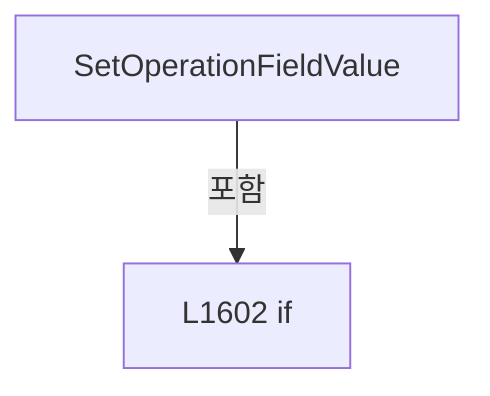

변경 전 점검: 입력/반환 타입, 위 호출자, 예외/취소 경로, 공유 상태와 저장·전송 소비자를 함께 확인합니다. 값의 단위나 물리 방향을 이름만으로 확정하지 않습니다.

### LocalFunctionStatement `MatchesItem` · L1596–1599

[Drilling.UI/Menu/Menus/CMenuMonitor.cs:1596–1599](https://github.com/kjuws10-rgb/A3Drilling/blob/0219666f9053b907d96d7e0aa7d0c6c1be3a73d4/Drilling.UI/Menu/Menus/CMenuMonitor.cs#L1596-L1599)

| 항목 | 실제 추출 값 |
| --- | --- |
| 서명 | bool MatchesItem(Drilling.UI.Menu.Menus.ST_MONITOR_PARAMETER_ROW) |
| 접근/수식자 | Private /  |
| 반환/값 타입 | bool |
| 소속 타입 | NamedType:Drilling.UI.Menu.Menus.CMenuMonitor |

입력 계약:

| 이름 | 타입 | 전달 | 선택/기본값 |
| --- | --- | --- | --- |
| item | Drilling.UI.Menu.Menus.ST_MONITOR_PARAMETER_ROW | None | False /  |

현재 부분 분석에서 직접 연결된 호출자는 없습니다. XAML/이벤트/인터페이스·델리게이트·외부 진입을 추가 확인해야 하며, 미사용으로 판정한 것이 아닙니다.

호출하는 대상과 해석 범위:

| 원본 행 | 표현식 | 분석 상태 | 대상/소스 위치 |
| --- | --- | --- | --- |
| 1598 | item.Parameter.Equals | resolved | bool string.Equals(string?, System.StringComparison) |

본문의 실제 연산·분기·예외·반환 순서(원문 위치 순):

| 원본 행 | 종류 | 주석 해설 |
| --- | --- | --- |
| 1598 | call | 함수·델리게이트 또는 객체 생성자를 호출합니다: item.Parameter.Equals(parameter, StringComparison.OrdinalIgnoreCase) |
| 1598 | return | 호출자에게 값 또는 제어를 반환합니다: return item.Parameter.Equals(parameter, StringComparison.OrdinalIgnoreCase); |

변경 전 점검: 입력/반환 타입, 위 호출자, 예외/취소 경로, 공유 상태와 저장·전송 소비자를 함께 확인합니다. 값의 단위나 물리 방향을 이름만으로 확정하지 않습니다.

### PropertyDeclaration `InitialAttPosition` · L1622–1622

[Drilling.UI/Menu/Menus/CMenuMonitor.cs:1622–1622](https://github.com/kjuws10-rgb/A3Drilling/blob/0219666f9053b907d96d7e0aa7d0c6c1be3a73d4/Drilling.UI/Menu/Menus/CMenuMonitor.cs#L1622-L1622)

| 항목 | 실제 추출 값 |
| --- | --- |
| 서명 | double Drilling.UI.Menu.Menus.CMenuMonitor.ST_POWER_METER_TUNE_SETTINGS.InitialAttPosition |
| 접근/수식자 | Public / public |
| 반환/값 타입 | double |
| 소속 타입 | NamedType:Drilling.UI.Menu.Menus.CMenuMonitor.ST_POWER_METER_TUNE_SETTINGS |

현재 부분 분석에서 직접 연결된 호출자는 없습니다. XAML/이벤트/인터페이스·델리게이트·외부 진입을 추가 확인해야 하며, 미사용으로 판정한 것이 아닙니다.

변경 전 점검: 입력/반환 타입, 위 호출자, 예외/취소 경로, 공유 상태와 저장·전송 소비자를 함께 확인합니다. 값의 단위나 물리 방향을 이름만으로 확정하지 않습니다.

### GetAccessorDeclaration `get_InitialAttPosition` · L1622–1622

[Drilling.UI/Menu/Menus/CMenuMonitor.cs:1622–1622](https://github.com/kjuws10-rgb/A3Drilling/blob/0219666f9053b907d96d7e0aa7d0c6c1be3a73d4/Drilling.UI/Menu/Menus/CMenuMonitor.cs#L1622-L1622)

| 항목 | 실제 추출 값 |
| --- | --- |
| 서명 | double Drilling.UI.Menu.Menus.CMenuMonitor.ST_POWER_METER_TUNE_SETTINGS.InitialAttPosition.get |
| 접근/수식자 | Public / get |
| 반환/값 타입 | double |
| 소속 타입 | NamedType:Drilling.UI.Menu.Menus.CMenuMonitor.ST_POWER_METER_TUNE_SETTINGS |

현재 부분 분석에서 직접 연결된 호출자는 없습니다. XAML/이벤트/인터페이스·델리게이트·외부 진입을 추가 확인해야 하며, 미사용으로 판정한 것이 아닙니다.

변경 전 점검: 입력/반환 타입, 위 호출자, 예외/취소 경로, 공유 상태와 저장·전송 소비자를 함께 확인합니다. 값의 단위나 물리 방향을 이름만으로 확정하지 않습니다.

### InitAccessorDeclaration `set_InitialAttPosition` · L1622–1622

[Drilling.UI/Menu/Menus/CMenuMonitor.cs:1622–1622](https://github.com/kjuws10-rgb/A3Drilling/blob/0219666f9053b907d96d7e0aa7d0c6c1be3a73d4/Drilling.UI/Menu/Menus/CMenuMonitor.cs#L1622-L1622)

| 항목 | 실제 추출 값 |
| --- | --- |
| 서명 | void Drilling.UI.Menu.Menus.CMenuMonitor.ST_POWER_METER_TUNE_SETTINGS.InitialAttPosition.init |
| 접근/수식자 | Public / init |
| 반환/값 타입 | void |
| 소속 타입 | NamedType:Drilling.UI.Menu.Menus.CMenuMonitor.ST_POWER_METER_TUNE_SETTINGS |

입력 계약:

| 이름 | 타입 | 전달 | 선택/기본값 |
| --- | --- | --- | --- |
| value | double | None | False /  |

현재 부분 분석에서 직접 연결된 호출자는 없습니다. XAML/이벤트/인터페이스·델리게이트·외부 진입을 추가 확인해야 하며, 미사용으로 판정한 것이 아닙니다.

변경 전 점검: 입력/반환 타입, 위 호출자, 예외/취소 경로, 공유 상태와 저장·전송 소비자를 함께 확인합니다. 값의 단위나 물리 방향을 이름만으로 확정하지 않습니다.

### MethodDeclaration `ReadOperationField` · L1627–1637

[Drilling.UI/Menu/Menus/CMenuMonitor.cs:1627–1637](https://github.com/kjuws10-rgb/A3Drilling/blob/0219666f9053b907d96d7e0aa7d0c6c1be3a73d4/Drilling.UI/Menu/Menus/CMenuMonitor.cs#L1627-L1637)

| 항목 | 실제 추출 값 |
| --- | --- |
| 서명 | double Drilling.UI.Menu.Menus.CMenuMonitor.ReadOperationField(string, double) |
| 접근/수식자 | Private / private |
| 반환/값 타입 | double |
| 소속 타입 | NamedType:Drilling.UI.Menu.Menus.CMenuMonitor |

입력 계약:

| 이름 | 타입 | 전달 | 선택/기본값 |
| --- | --- | --- | --- |
| parameter | string | None | False /  |
| defaultValue | double | None | False /  |

정적 호출자로 확인된 위치:

| 호출 파일/행 | 호출 표현식 | 런타임 분기 가능 |
| --- | --- | --- |
| [Drilling.UI/Menu/Menus/CMenuMonitor.cs:1303–1303](https://github.com/kjuws10-rgb/A3Drilling/blob/0219666f9053b907d96d7e0aa7d0c6c1be3a73d4/Drilling.UI/Menu/Menus/CMenuMonitor.cs#L1303-L1303) | ReadOperationField | False |
| [Drilling.UI/Menu/Menus/CMenuMonitor.cs:1393–1393](https://github.com/kjuws10-rgb/A3Drilling/blob/0219666f9053b907d96d7e0aa7d0c6c1be3a73d4/Drilling.UI/Menu/Menus/CMenuMonitor.cs#L1393-L1393) | ReadOperationField | False |
| [Drilling.UI/Menu/Menus/CMenuMonitor.cs:1398–1398](https://github.com/kjuws10-rgb/A3Drilling/blob/0219666f9053b907d96d7e0aa7d0c6c1be3a73d4/Drilling.UI/Menu/Menus/CMenuMonitor.cs#L1398-L1398) | ReadOperationField | False |
| [Drilling.UI/Menu/Menus/CMenuMonitor.cs:1412–1412](https://github.com/kjuws10-rgb/A3Drilling/blob/0219666f9053b907d96d7e0aa7d0c6c1be3a73d4/Drilling.UI/Menu/Menus/CMenuMonitor.cs#L1412-L1412) | ReadOperationField | False |
| [Drilling.UI/Menu/Menus/CMenuMonitor.cs:1417–1417](https://github.com/kjuws10-rgb/A3Drilling/blob/0219666f9053b907d96d7e0aa7d0c6c1be3a73d4/Drilling.UI/Menu/Menus/CMenuMonitor.cs#L1417-L1417) | ReadOperationField | False |
| [Drilling.UI/Menu/Menus/CMenuMonitor.cs:1422–1422](https://github.com/kjuws10-rgb/A3Drilling/blob/0219666f9053b907d96d7e0aa7d0c6c1be3a73d4/Drilling.UI/Menu/Menus/CMenuMonitor.cs#L1422-L1422) | ReadOperationField | False |
| [Drilling.UI/Menu/Menus/CMenuMonitor.cs:1427–1427](https://github.com/kjuws10-rgb/A3Drilling/blob/0219666f9053b907d96d7e0aa7d0c6c1be3a73d4/Drilling.UI/Menu/Menus/CMenuMonitor.cs#L1427-L1427) | ReadOperationField | False |
| [Drilling.UI/Menu/Menus/CMenuMonitor.cs:1440–1440](https://github.com/kjuws10-rgb/A3Drilling/blob/0219666f9053b907d96d7e0aa7d0c6c1be3a73d4/Drilling.UI/Menu/Menus/CMenuMonitor.cs#L1440-L1440) | ReadOperationField | False |
| [Drilling.UI/Menu/Menus/CMenuMonitor.cs:1445–1445](https://github.com/kjuws10-rgb/A3Drilling/blob/0219666f9053b907d96d7e0aa7d0c6c1be3a73d4/Drilling.UI/Menu/Menus/CMenuMonitor.cs#L1445-L1445) | ReadOperationField | False |
| [Drilling.UI/Menu/Menus/CMenuMonitor.cs:1462–1462](https://github.com/kjuws10-rgb/A3Drilling/blob/0219666f9053b907d96d7e0aa7d0c6c1be3a73d4/Drilling.UI/Menu/Menus/CMenuMonitor.cs#L1462-L1462) | ReadOperationField | False |
| [Drilling.UI/Menu/Menus/CMenuMonitor.cs:1467–1467](https://github.com/kjuws10-rgb/A3Drilling/blob/0219666f9053b907d96d7e0aa7d0c6c1be3a73d4/Drilling.UI/Menu/Menus/CMenuMonitor.cs#L1467-L1467) | ReadOperationField | False |
| [Drilling.UI/Menu/Menus/CMenuMonitor.cs:1472–1472](https://github.com/kjuws10-rgb/A3Drilling/blob/0219666f9053b907d96d7e0aa7d0c6c1be3a73d4/Drilling.UI/Menu/Menus/CMenuMonitor.cs#L1472-L1472) | ReadOperationField | False |
| [Drilling.UI/Menu/Menus/CMenuMonitor.cs:1477–1477](https://github.com/kjuws10-rgb/A3Drilling/blob/0219666f9053b907d96d7e0aa7d0c6c1be3a73d4/Drilling.UI/Menu/Menus/CMenuMonitor.cs#L1477-L1477) | ReadOperationField | False |
| [Drilling.UI/Menu/Menus/CMenuMonitor.cs:1482–1482](https://github.com/kjuws10-rgb/A3Drilling/blob/0219666f9053b907d96d7e0aa7d0c6c1be3a73d4/Drilling.UI/Menu/Menus/CMenuMonitor.cs#L1482-L1482) | ReadOperationField | False |
| [Drilling.UI/Menu/Menus/CMenuMonitor.cs:1495–1495](https://github.com/kjuws10-rgb/A3Drilling/blob/0219666f9053b907d96d7e0aa7d0c6c1be3a73d4/Drilling.UI/Menu/Menus/CMenuMonitor.cs#L1495-L1495) | ReadOperationField | False |
| [Drilling.UI/Menu/Menus/CMenuMonitor.cs:1500–1500](https://github.com/kjuws10-rgb/A3Drilling/blob/0219666f9053b907d96d7e0aa7d0c6c1be3a73d4/Drilling.UI/Menu/Menus/CMenuMonitor.cs#L1500-L1500) | ReadOperationField | False |
| [Drilling.UI/Menu/Menus/CMenuMonitor.cs:1527–1527](https://github.com/kjuws10-rgb/A3Drilling/blob/0219666f9053b907d96d7e0aa7d0c6c1be3a73d4/Drilling.UI/Menu/Menus/CMenuMonitor.cs#L1527-L1527) | ReadOperationField | False |
| [Drilling.UI/Menu/Menus/CMenuMonitor.cs:1532–1532](https://github.com/kjuws10-rgb/A3Drilling/blob/0219666f9053b907d96d7e0aa7d0c6c1be3a73d4/Drilling.UI/Menu/Menus/CMenuMonitor.cs#L1532-L1532) | ReadOperationField | False |
| [Drilling.UI/Menu/Menus/CMenuMonitor.cs:1542–1542](https://github.com/kjuws10-rgb/A3Drilling/blob/0219666f9053b907d96d7e0aa7d0c6c1be3a73d4/Drilling.UI/Menu/Menus/CMenuMonitor.cs#L1542-L1542) | ReadOperationField | False |
| [Drilling.UI/Menu/Menus/CMenuMonitor.cs:1549–1549](https://github.com/kjuws10-rgb/A3Drilling/blob/0219666f9053b907d96d7e0aa7d0c6c1be3a73d4/Drilling.UI/Menu/Menus/CMenuMonitor.cs#L1549-L1549) | ReadOperationField | False |
| [Drilling.UI/Menu/Menus/CMenuMonitor.cs:1550–1550](https://github.com/kjuws10-rgb/A3Drilling/blob/0219666f9053b907d96d7e0aa7d0c6c1be3a73d4/Drilling.UI/Menu/Menus/CMenuMonitor.cs#L1550-L1550) | ReadOperationField | False |
| [Drilling.UI/Menu/Menus/CMenuMonitor.cs:4870–4870](https://github.com/kjuws10-rgb/A3Drilling/blob/0219666f9053b907d96d7e0aa7d0c6c1be3a73d4/Drilling.UI/Menu/Menus/CMenuMonitor.cs#L4870-L4870) | ReadOperationField | False |
| [Drilling.UI/Menu/Menus/CMenuMonitor.cs:4871–4871](https://github.com/kjuws10-rgb/A3Drilling/blob/0219666f9053b907d96d7e0aa7d0c6c1be3a73d4/Drilling.UI/Menu/Menus/CMenuMonitor.cs#L4871-L4871) | ReadOperationField | False |
| [Drilling.UI/Menu/Menus/CMenuMonitor.cs:4969–4969](https://github.com/kjuws10-rgb/A3Drilling/blob/0219666f9053b907d96d7e0aa7d0c6c1be3a73d4/Drilling.UI/Menu/Menus/CMenuMonitor.cs#L4969-L4969) | ReadOperationField | False |
| [Drilling.UI/Menu/Menus/CMenuMonitor.cs:4970–4970](https://github.com/kjuws10-rgb/A3Drilling/blob/0219666f9053b907d96d7e0aa7d0c6c1be3a73d4/Drilling.UI/Menu/Menus/CMenuMonitor.cs#L4970-L4970) | ReadOperationField | False |
| [Drilling.UI/Menu/Menus/CMenuMonitor.cs:5056–5056](https://github.com/kjuws10-rgb/A3Drilling/blob/0219666f9053b907d96d7e0aa7d0c6c1be3a73d4/Drilling.UI/Menu/Menus/CMenuMonitor.cs#L5056-L5056) | ReadOperationField | False |
| [Drilling.UI/Menu/Menus/CMenuMonitor.cs:5057–5057](https://github.com/kjuws10-rgb/A3Drilling/blob/0219666f9053b907d96d7e0aa7d0c6c1be3a73d4/Drilling.UI/Menu/Menus/CMenuMonitor.cs#L5057-L5057) | ReadOperationField | False |
| [Drilling.UI/Menu/Menus/CMenuMonitor.cs:5130–5130](https://github.com/kjuws10-rgb/A3Drilling/blob/0219666f9053b907d96d7e0aa7d0c6c1be3a73d4/Drilling.UI/Menu/Menus/CMenuMonitor.cs#L5130-L5130) | ReadOperationField | False |
| [Drilling.UI/Menu/Menus/CMenuMonitor.cs:5131–5131](https://github.com/kjuws10-rgb/A3Drilling/blob/0219666f9053b907d96d7e0aa7d0c6c1be3a73d4/Drilling.UI/Menu/Menus/CMenuMonitor.cs#L5131-L5131) | ReadOperationField | False |
| [Drilling.UI/Menu/Menus/CMenuMonitor.cs:5132–5132](https://github.com/kjuws10-rgb/A3Drilling/blob/0219666f9053b907d96d7e0aa7d0c6c1be3a73d4/Drilling.UI/Menu/Menus/CMenuMonitor.cs#L5132-L5132) | ReadOperationField | False |
| [Drilling.UI/Menu/Menus/CMenuMonitor.cs:5133–5133](https://github.com/kjuws10-rgb/A3Drilling/blob/0219666f9053b907d96d7e0aa7d0c6c1be3a73d4/Drilling.UI/Menu/Menus/CMenuMonitor.cs#L5133-L5133) | ReadOperationField | False |
| [Drilling.UI/Menu/Menus/CMenuMonitor.cs:5162–5162](https://github.com/kjuws10-rgb/A3Drilling/blob/0219666f9053b907d96d7e0aa7d0c6c1be3a73d4/Drilling.UI/Menu/Menus/CMenuMonitor.cs#L5162-L5162) | ReadOperationField | False |
| [Drilling.UI/Menu/Menus/CMenuMonitor.cs:5163–5163](https://github.com/kjuws10-rgb/A3Drilling/blob/0219666f9053b907d96d7e0aa7d0c6c1be3a73d4/Drilling.UI/Menu/Menus/CMenuMonitor.cs#L5163-L5163) | ReadOperationField | False |
| [Drilling.UI/Menu/Menus/CMenuMonitor.cs:5164–5164](https://github.com/kjuws10-rgb/A3Drilling/blob/0219666f9053b907d96d7e0aa7d0c6c1be3a73d4/Drilling.UI/Menu/Menus/CMenuMonitor.cs#L5164-L5164) | ReadOperationField | False |
| [Drilling.UI/Menu/Menus/CMenuMonitor.cs:5165–5165](https://github.com/kjuws10-rgb/A3Drilling/blob/0219666f9053b907d96d7e0aa7d0c6c1be3a73d4/Drilling.UI/Menu/Menus/CMenuMonitor.cs#L5165-L5165) | ReadOperationField | False |
| [Drilling.UI/Menu/Menus/CMenuMonitor.cs:5166–5166](https://github.com/kjuws10-rgb/A3Drilling/blob/0219666f9053b907d96d7e0aa7d0c6c1be3a73d4/Drilling.UI/Menu/Menus/CMenuMonitor.cs#L5166-L5166) | ReadOperationField | False |
| [Drilling.UI/Menu/Menus/CMenuMonitor.cs:5167–5167](https://github.com/kjuws10-rgb/A3Drilling/blob/0219666f9053b907d96d7e0aa7d0c6c1be3a73d4/Drilling.UI/Menu/Menus/CMenuMonitor.cs#L5167-L5167) | ReadOperationField | False |
| [Drilling.UI/Menu/Menus/CMenuMonitor.cs:5168–5168](https://github.com/kjuws10-rgb/A3Drilling/blob/0219666f9053b907d96d7e0aa7d0c6c1be3a73d4/Drilling.UI/Menu/Menus/CMenuMonitor.cs#L5168-L5168) | ReadOperationField | False |
| [Drilling.UI/Menu/Menus/CMenuMonitor.cs:5169–5169](https://github.com/kjuws10-rgb/A3Drilling/blob/0219666f9053b907d96d7e0aa7d0c6c1be3a73d4/Drilling.UI/Menu/Menus/CMenuMonitor.cs#L5169-L5169) | ReadOperationField | False |
| [Drilling.UI/Menu/Menus/CMenuMonitor.cs:5304–5304](https://github.com/kjuws10-rgb/A3Drilling/blob/0219666f9053b907d96d7e0aa7d0c6c1be3a73d4/Drilling.UI/Menu/Menus/CMenuMonitor.cs#L5304-L5304) | ReadOperationField | False |
| [Drilling.UI/Menu/Menus/CMenuMonitor.cs:5305–5305](https://github.com/kjuws10-rgb/A3Drilling/blob/0219666f9053b907d96d7e0aa7d0c6c1be3a73d4/Drilling.UI/Menu/Menus/CMenuMonitor.cs#L5305-L5305) | ReadOperationField | False |
| [Drilling.UI/Menu/Menus/CMenuMonitor.cs:5405–5405](https://github.com/kjuws10-rgb/A3Drilling/blob/0219666f9053b907d96d7e0aa7d0c6c1be3a73d4/Drilling.UI/Menu/Menus/CMenuMonitor.cs#L5405-L5405) | ReadOperationField | False |
| [Drilling.UI/Menu/Menus/CMenuMonitor.cs:5406–5406](https://github.com/kjuws10-rgb/A3Drilling/blob/0219666f9053b907d96d7e0aa7d0c6c1be3a73d4/Drilling.UI/Menu/Menus/CMenuMonitor.cs#L5406-L5406) | ReadOperationField | False |
| [Drilling.UI/Menu/Menus/CMenuMonitor.cs:5428–5428](https://github.com/kjuws10-rgb/A3Drilling/blob/0219666f9053b907d96d7e0aa7d0c6c1be3a73d4/Drilling.UI/Menu/Menus/CMenuMonitor.cs#L5428-L5428) | ReadOperationField | False |
| [Drilling.UI/Menu/Menus/CMenuMonitor.cs:5428–5428](https://github.com/kjuws10-rgb/A3Drilling/blob/0219666f9053b907d96d7e0aa7d0c6c1be3a73d4/Drilling.UI/Menu/Menus/CMenuMonitor.cs#L5428-L5428) | ReadOperationField | False |
| [Drilling.UI/Menu/Menus/CMenuMonitor.cs:5429–5429](https://github.com/kjuws10-rgb/A3Drilling/blob/0219666f9053b907d96d7e0aa7d0c6c1be3a73d4/Drilling.UI/Menu/Menus/CMenuMonitor.cs#L5429-L5429) | ReadOperationField | False |
| [Drilling.UI/Menu/Menus/CMenuMonitor.cs:5430–5430](https://github.com/kjuws10-rgb/A3Drilling/blob/0219666f9053b907d96d7e0aa7d0c6c1be3a73d4/Drilling.UI/Menu/Menus/CMenuMonitor.cs#L5430-L5430) | ReadOperationField | False |
| [Drilling.UI/Menu/Menus/CMenuMonitor.cs:5431–5431](https://github.com/kjuws10-rgb/A3Drilling/blob/0219666f9053b907d96d7e0aa7d0c6c1be3a73d4/Drilling.UI/Menu/Menus/CMenuMonitor.cs#L5431-L5431) | ReadOperationField | False |

호출하는 대상과 해석 범위:

| 원본 행 | 표현식 | 분석 상태 | 대상/소스 위치 |
| --- | --- | --- | --- |
| 1634 | OperationFields.FirstOrDefault | resolved | Drilling.UI.Menu.Menus.ST_MONITOR_PARAMETER_ROW? System.Collections.Generic.IEnumerable<Drilling.UI.Menu.Menus.ST_MONITOR_PARAMETER_ROW>.FirstOrDefault<Drilling.UI.Menu.Menus.ST_MONITOR_PARAMETER_ROW>(System.Func<Drilling.UI.Menu.Menus.ST_MONITOR_PARAMETER_ROW, bool>) |
| 1635 | NormalizeOperationNumericValue | resolved | string Drilling.UI.Menu.Menus.CMenuMonitor.NormalizeOperationNumericValue(string?) · Drilling.UI/Menu/Menus/CMenuMonitor.cs:2628 |
| 1636 | double.TryParse | resolved | bool double.TryParse(string?, System.Globalization.NumberStyles, System.IFormatProvider?, out double) |

본문의 실제 연산·분기·예외·반환 순서(원문 위치 순):

| 원본 행 | 종류 | 주석 해설 |
| --- | --- | --- |
| 1634 | call | 함수·델리게이트 또는 객체 생성자를 호출합니다: OperationFields.FirstOrDefault(MatchesItem) |
| 1634 | local-declaration | 지역 변수를 선언합니다: var value = OperationFields.FirstOrDefault(MatchesItem)?.Value; |
| 1634 | variable-initializer | 변수의 초기값을 지정합니다: value = OperationFields.FirstOrDefault(MatchesItem)?.Value |
| 1635 | call | 함수·델리게이트 또는 객체 생성자를 호출합니다: NormalizeOperationNumericValue(value) |
| 1635 | local-declaration | 지역 변수를 선언합니다: var numericValue = NormalizeOperationNumericValue(value); |
| 1635 | variable-initializer | 변수의 초기값을 지정합니다: numericValue = NormalizeOperationNumericValue(value) |
| 1636 | call | 함수·델리게이트 또는 객체 생성자를 호출합니다: double.TryParse(numericValue, NumberStyles.Float, CultureInfo.InvariantCulture, out var result) |
| 1636 | conditional-expression | 조건에 따라 결과식을 선택합니다: double.TryParse(numericValue, NumberStyles.Float, CultureInfo.InvariantCulture, out var result) ? result : defaultValue |
| 1636 | return | 호출자에게 값 또는 제어를 반환합니다: return double.TryParse(numericValue, NumberStyles.Float, CultureInfo.InvariantCulture, out var result) ? result : defaultValue; |

변경 전 점검: 입력/반환 타입, 위 호출자, 예외/취소 경로, 공유 상태와 저장·전송 소비자를 함께 확인합니다. 값의 단위나 물리 방향을 이름만으로 확정하지 않습니다.

### LocalFunctionStatement `MatchesItem` · L1629–1632

[Drilling.UI/Menu/Menus/CMenuMonitor.cs:1629–1632](https://github.com/kjuws10-rgb/A3Drilling/blob/0219666f9053b907d96d7e0aa7d0c6c1be3a73d4/Drilling.UI/Menu/Menus/CMenuMonitor.cs#L1629-L1632)

| 항목 | 실제 추출 값 |
| --- | --- |
| 서명 | bool MatchesItem(Drilling.UI.Menu.Menus.ST_MONITOR_PARAMETER_ROW) |
| 접근/수식자 | Private /  |
| 반환/값 타입 | bool |
| 소속 타입 | NamedType:Drilling.UI.Menu.Menus.CMenuMonitor |

입력 계약:

| 이름 | 타입 | 전달 | 선택/기본값 |
| --- | --- | --- | --- |
| field | Drilling.UI.Menu.Menus.ST_MONITOR_PARAMETER_ROW | None | False /  |

현재 부분 분석에서 직접 연결된 호출자는 없습니다. XAML/이벤트/인터페이스·델리게이트·외부 진입을 추가 확인해야 하며, 미사용으로 판정한 것이 아닙니다.

호출하는 대상과 해석 범위:

| 원본 행 | 표현식 | 분석 상태 | 대상/소스 위치 |
| --- | --- | --- | --- |
| 1631 | field.Parameter.Equals | resolved | bool string.Equals(string?, System.StringComparison) |

본문의 실제 연산·분기·예외·반환 순서(원문 위치 순):

| 원본 행 | 종류 | 주석 해설 |
| --- | --- | --- |
| 1631 | call | 함수·델리게이트 또는 객체 생성자를 호출합니다: field.Parameter.Equals(parameter, StringComparison.OrdinalIgnoreCase) |
| 1631 | return | 호출자에게 값 또는 제어를 반환합니다: return field.Parameter.Equals(parameter, StringComparison.OrdinalIgnoreCase); |

변경 전 점검: 입력/반환 타입, 위 호출자, 예외/취소 경로, 공유 상태와 저장·전송 소비자를 함께 확인합니다. 값의 단위나 물리 방향을 이름만으로 확정하지 않습니다.

### MethodDeclaration `TryReadPositiveOperationField` · L1639–1648

[Drilling.UI/Menu/Menus/CMenuMonitor.cs:1639–1648](https://github.com/kjuws10-rgb/A3Drilling/blob/0219666f9053b907d96d7e0aa7d0c6c1be3a73d4/Drilling.UI/Menu/Menus/CMenuMonitor.cs#L1639-L1648)

| 항목 | 실제 추출 값 |
| --- | --- |
| 서명 | bool Drilling.UI.Menu.Menus.CMenuMonitor.TryReadPositiveOperationField(string, out double) |
| 접근/수식자 | Private / private |
| 반환/값 타입 | bool |
| 소속 타입 | NamedType:Drilling.UI.Menu.Menus.CMenuMonitor |

입력 계약:

| 이름 | 타입 | 전달 | 선택/기본값 |
| --- | --- | --- | --- |
| parameter | string | None | False /  |
| value | double | Out | False /  |

정적 호출자로 확인된 위치:

| 호출 파일/행 | 호출 표현식 | 런타임 분기 가능 |
| --- | --- | --- |
| [Drilling.UI/Menu/Menus/CMenuMonitor.cs:4917–4917](https://github.com/kjuws10-rgb/A3Drilling/blob/0219666f9053b907d96d7e0aa7d0c6c1be3a73d4/Drilling.UI/Menu/Menus/CMenuMonitor.cs#L4917-L4917) | TryReadPositiveOperationField | False |
| [Drilling.UI/Menu/Menus/CMenuMonitor.cs:4917–4917](https://github.com/kjuws10-rgb/A3Drilling/blob/0219666f9053b907d96d7e0aa7d0c6c1be3a73d4/Drilling.UI/Menu/Menus/CMenuMonitor.cs#L4917-L4917) | TryReadPositiveOperationField | False |

호출하는 대상과 해석 범위:

| 원본 행 | 표현식 | 분석 상태 | 대상/소스 위치 |
| --- | --- | --- | --- |
| 1646 | OperationFields.FirstOrDefault | resolved | Drilling.UI.Menu.Menus.ST_MONITOR_PARAMETER_ROW? System.Collections.Generic.IEnumerable<Drilling.UI.Menu.Menus.ST_MONITOR_PARAMETER_ROW>.FirstOrDefault<Drilling.UI.Menu.Menus.ST_MONITOR_PARAMETER_ROW>(System.Func<Drilling.UI.Menu.Menus.ST_MONITOR_PARAMETER_ROW, bool>) |
| 1647 | double.TryParse | resolved | bool double.TryParse(string?, System.Globalization.NumberStyles, System.IFormatProvider?, out double) |
| 1647 | double.IsFinite | resolved | bool double.IsFinite(double) |

본문의 실제 연산·분기·예외·반환 순서(원문 위치 순):

| 원본 행 | 종류 | 주석 해설 |
| --- | --- | --- |
| 1646 | call | 함수·델리게이트 또는 객체 생성자를 호출합니다: OperationFields.FirstOrDefault(MatchesItem) |
| 1646 | local-declaration | 지역 변수를 선언합니다: var text = OperationFields.FirstOrDefault(MatchesItem)?.Value; |
| 1646 | variable-initializer | 변수의 초기값을 지정합니다: text = OperationFields.FirstOrDefault(MatchesItem)?.Value |
| 1647 | call | 함수·델리게이트 또는 객체 생성자를 호출합니다: double.TryParse(text, NumberStyles.Float, CultureInfo.InvariantCulture, out value) |
| 1647 | call | 함수·델리게이트 또는 객체 생성자를 호출합니다: double.IsFinite(value) |
| 1647 | return | 호출자에게 값 또는 제어를 반환합니다: return double.TryParse(text, NumberStyles.Float, CultureInfo.InvariantCulture, out value) && double.IsFinite(value) && value > 0.0; |

변경 전 점검: 입력/반환 타입, 위 호출자, 예외/취소 경로, 공유 상태와 저장·전송 소비자를 함께 확인합니다. 값의 단위나 물리 방향을 이름만으로 확정하지 않습니다.

### LocalFunctionStatement `MatchesItem` · L1641–1644

[Drilling.UI/Menu/Menus/CMenuMonitor.cs:1641–1644](https://github.com/kjuws10-rgb/A3Drilling/blob/0219666f9053b907d96d7e0aa7d0c6c1be3a73d4/Drilling.UI/Menu/Menus/CMenuMonitor.cs#L1641-L1644)

| 항목 | 실제 추출 값 |
| --- | --- |
| 서명 | bool MatchesItem(Drilling.UI.Menu.Menus.ST_MONITOR_PARAMETER_ROW) |
| 접근/수식자 | Private /  |
| 반환/값 타입 | bool |
| 소속 타입 | NamedType:Drilling.UI.Menu.Menus.CMenuMonitor |

입력 계약:

| 이름 | 타입 | 전달 | 선택/기본값 |
| --- | --- | --- | --- |
| field | Drilling.UI.Menu.Menus.ST_MONITOR_PARAMETER_ROW | None | False /  |

현재 부분 분석에서 직접 연결된 호출자는 없습니다. XAML/이벤트/인터페이스·델리게이트·외부 진입을 추가 확인해야 하며, 미사용으로 판정한 것이 아닙니다.

호출하는 대상과 해석 범위:

| 원본 행 | 표현식 | 분석 상태 | 대상/소스 위치 |
| --- | --- | --- | --- |
| 1643 | field.Parameter.Equals | resolved | bool string.Equals(string?, System.StringComparison) |

본문의 실제 연산·분기·예외·반환 순서(원문 위치 순):

| 원본 행 | 종류 | 주석 해설 |
| --- | --- | --- |
| 1643 | call | 함수·델리게이트 또는 객체 생성자를 호출합니다: field.Parameter.Equals(parameter, StringComparison.OrdinalIgnoreCase) |
| 1643 | return | 호출자에게 값 또는 제어를 반환합니다: return field.Parameter.Equals(parameter, StringComparison.OrdinalIgnoreCase); |

변경 전 점검: 입력/반환 타입, 위 호출자, 예외/취소 경로, 공유 상태와 저장·전송 소비자를 함께 확인합니다. 값의 단위나 물리 방향을 이름만으로 확정하지 않습니다.

### MethodDeclaration `GetMonitorOperationLabel` · L1650–1660

[Drilling.UI/Menu/Menus/CMenuMonitor.cs:1650–1660](https://github.com/kjuws10-rgb/A3Drilling/blob/0219666f9053b907d96d7e0aa7d0c6c1be3a73d4/Drilling.UI/Menu/Menus/CMenuMonitor.cs#L1650-L1660)

| 항목 | 실제 추출 값 |
| --- | --- |
| 서명 | string Drilling.UI.Menu.Menus.CMenuMonitor.GetMonitorOperationLabel(object?) |
| 접근/수식자 | Private / private, static |
| 반환/값 타입 | string |
| 소속 타입 | NamedType:Drilling.UI.Menu.Menus.CMenuMonitor |

입력 계약:

| 이름 | 타입 | 전달 | 선택/기본값 |
| --- | --- | --- | --- |
| parameter | object? | None | False /  |

정적 호출자로 확인된 위치:

| 호출 파일/행 | 호출 표현식 | 런타임 분기 가능 |
| --- | --- | --- |
| [Drilling.UI/Menu/Menus/CMenuMonitor.cs:1271–1271](https://github.com/kjuws10-rgb/A3Drilling/blob/0219666f9053b907d96d7e0aa7d0c6c1be3a73d4/Drilling.UI/Menu/Menus/CMenuMonitor.cs#L1271-L1271) | GetMonitorOperationLabel | False |
| [Drilling.UI/Menu/Menus/CMenuMonitor.cs:5485–5485](https://github.com/kjuws10-rgb/A3Drilling/blob/0219666f9053b907d96d7e0aa7d0c6c1be3a73d4/Drilling.UI/Menu/Menus/CMenuMonitor.cs#L5485-L5485) | GetMonitorOperationLabel | False |

호출하는 대상과 해석 범위:

| 원본 행 | 표현식 | 분석 상태 | 대상/소스 위치 |
| --- | --- | --- | --- |
| 1654 | string.IsNullOrWhiteSpace | resolved | bool string.IsNullOrWhiteSpace(string?) |

본문의 실제 연산·분기·예외·반환 순서(원문 위치 순):

| 원본 행 | 종류 | 주석 해설 |
| --- | --- | --- |
| 1652 | return | 호출자에게 값 또는 제어를 반환합니다: return parameter switch { ST_MONITOR_OPERATION_BUTTON button => string.IsNullOrWhiteSpace(button.CommandKey) ? button.Label : button.CommandKey, ST_MONITOR_BET_TABLE_ROW row => row.MoveCommandLabel, ST_PWM_DEVICE_ROW row => row.Co |
| 1652 | switch-expression | 값별 결과식을 선택합니다: parameter switch { ST_MONITOR_OPERATION_BUTTON button => string.IsNullOrWhiteSpace(button.CommandKey) ? button.Label : button.CommandKey, ST_MONITOR_BET_TABLE_ROW row => row.MoveCommandLabel, ST_PWM_DEVICE_ROW row => row.Command,  |
| 1654 | call | 함수·델리게이트 또는 객체 생성자를 호출합니다: string.IsNullOrWhiteSpace(button.CommandKey) |
| 1654 | conditional-expression | 조건에 따라 결과식을 선택합니다: string.IsNullOrWhiteSpace(button.CommandKey) ? button.Label : button.CommandKey |

제어 구문의 포함 구조(실제 실행 순서/CFG가 아닌 구문 탐색 그림):

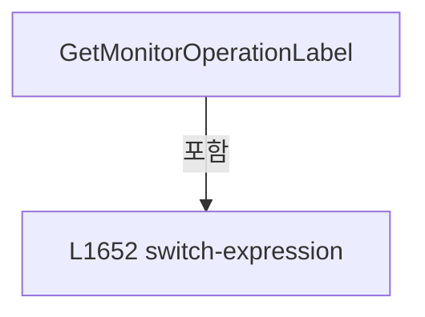

변경 전 점검: 입력/반환 타입, 위 호출자, 예외/취소 경로, 공유 상태와 저장·전송 소비자를 함께 확인합니다. 값의 단위나 물리 방향을 이름만으로 확정하지 않습니다.

### MethodDeclaration `NormalizeMonitorOperation` · L1662–1665

[Drilling.UI/Menu/Menus/CMenuMonitor.cs:1662–1665](https://github.com/kjuws10-rgb/A3Drilling/blob/0219666f9053b907d96d7e0aa7d0c6c1be3a73d4/Drilling.UI/Menu/Menus/CMenuMonitor.cs#L1662-L1665)

| 항목 | 실제 추출 값 |
| --- | --- |
| 서명 | string Drilling.UI.Menu.Menus.CMenuMonitor.NormalizeMonitorOperation(string) |
| 접근/수식자 | Private / private, static |
| 반환/값 타입 | string |
| 소속 타입 | NamedType:Drilling.UI.Menu.Menus.CMenuMonitor |

입력 계약:

| 이름 | 타입 | 전달 | 선택/기본값 |
| --- | --- | --- | --- |
| label | string | None | False /  |

정적 호출자로 확인된 위치:

| 호출 파일/행 | 호출 표현식 | 런타임 분기 가능 |
| --- | --- | --- |
| [Drilling.UI/Menu/Menus/CMenuMonitor.cs:1283–1283](https://github.com/kjuws10-rgb/A3Drilling/blob/0219666f9053b907d96d7e0aa7d0c6c1be3a73d4/Drilling.UI/Menu/Menus/CMenuMonitor.cs#L1283-L1283) | NormalizeMonitorOperation | False |
| [Drilling.UI/Menu/Menus/CMenuMonitor.cs:1347–1347](https://github.com/kjuws10-rgb/A3Drilling/blob/0219666f9053b907d96d7e0aa7d0c6c1be3a73d4/Drilling.UI/Menu/Menus/CMenuMonitor.cs#L1347-L1347) | NormalizeMonitorOperation | False |
| [Drilling.UI/Menu/Menus/CMenuMonitor.cs:1383–1383](https://github.com/kjuws10-rgb/A3Drilling/blob/0219666f9053b907d96d7e0aa7d0c6c1be3a73d4/Drilling.UI/Menu/Menus/CMenuMonitor.cs#L1383-L1383) | NormalizeMonitorOperation | False |
| [Drilling.UI/Menu/Menus/CMenuMonitor.cs:4854–4854](https://github.com/kjuws10-rgb/A3Drilling/blob/0219666f9053b907d96d7e0aa7d0c6c1be3a73d4/Drilling.UI/Menu/Menus/CMenuMonitor.cs#L4854-L4854) | NormalizeMonitorOperation | False |
| [Drilling.UI/Menu/Menus/CMenuMonitor.cs:5113–5113](https://github.com/kjuws10-rgb/A3Drilling/blob/0219666f9053b907d96d7e0aa7d0c6c1be3a73d4/Drilling.UI/Menu/Menus/CMenuMonitor.cs#L5113-L5113) | NormalizeMonitorOperation | False |
| [Drilling.UI/Menu/Menus/CMenuMonitor.cs:5148–5148](https://github.com/kjuws10-rgb/A3Drilling/blob/0219666f9053b907d96d7e0aa7d0c6c1be3a73d4/Drilling.UI/Menu/Menus/CMenuMonitor.cs#L5148-L5148) | NormalizeMonitorOperation | False |
| [Drilling.UI/Menu/Menus/CMenuMonitor.cs:5277–5277](https://github.com/kjuws10-rgb/A3Drilling/blob/0219666f9053b907d96d7e0aa7d0c6c1be3a73d4/Drilling.UI/Menu/Menus/CMenuMonitor.cs#L5277-L5277) | NormalizeMonitorOperation | False |
| [Drilling.UI/Menu/Menus/CMenuMonitor.cs:5326–5326](https://github.com/kjuws10-rgb/A3Drilling/blob/0219666f9053b907d96d7e0aa7d0c6c1be3a73d4/Drilling.UI/Menu/Menus/CMenuMonitor.cs#L5326-L5326) | NormalizeMonitorOperation | False |
| [Drilling.UI/Menu/Menus/CMenuMonitor.cs:5367–5367](https://github.com/kjuws10-rgb/A3Drilling/blob/0219666f9053b907d96d7e0aa7d0c6c1be3a73d4/Drilling.UI/Menu/Menus/CMenuMonitor.cs#L5367-L5367) | NormalizeMonitorOperation | False |

호출하는 대상과 해석 범위:

| 원본 행 | 표현식 | 분석 상태 | 대상/소스 위치 |
| --- | --- | --- | --- |
| 1664 | label.Replace("\r", "", StringComparison.OrdinalIgnoreCase).Replace("\n", "", StringComparison.OrdinalIgnoreCase).Replace(" ", "", StringComparison.OrdinalIgnoreCase).Replace("_", "", StringComparison.OrdinalIgnoreCase).Replace("-", "", StringComparison.OrdinalIgnoreCase).Trim().ToUpperInvariant | resolved | string string.ToUpperInvariant() |
| 1664 | label.Replace("\r", "", StringComparison.OrdinalIgnoreCase).Replace("\n", "", StringComparison.OrdinalIgnoreCase).Replace(" ", "", StringComparison.OrdinalIgnoreCase).Replace("_", "", StringComparison.OrdinalIgnoreCase).Replace("-", "", StringComparison.OrdinalIgnoreCase).Trim | resolved | string string.Trim() |
| 1664 | label.Replace("\r", "", StringComparison.OrdinalIgnoreCase).Replace("\n", "", StringComparison.OrdinalIgnoreCase).Replace(" ", "", StringComparison.OrdinalIgnoreCase).Replace("_", "", StringComparison.OrdinalIgnoreCase).Replace | resolved | string string.Replace(string, string?, System.StringComparison) |
| 1664 | label.Replace("\r", "", StringComparison.OrdinalIgnoreCase).Replace("\n", "", StringComparison.OrdinalIgnoreCase).Replace(" ", "", StringComparison.OrdinalIgnoreCase).Replace | resolved | string string.Replace(string, string?, System.StringComparison) |
| 1664 | label.Replace("\r", "", StringComparison.OrdinalIgnoreCase).Replace("\n", "", StringComparison.OrdinalIgnoreCase).Replace | resolved | string string.Replace(string, string?, System.StringComparison) |
| 1664 | label.Replace("\r", "", StringComparison.OrdinalIgnoreCase).Replace | resolved | string string.Replace(string, string?, System.StringComparison) |
| 1664 | label.Replace | resolved | string string.Replace(string, string?, System.StringComparison) |

본문의 실제 연산·분기·예외·반환 순서(원문 위치 순):

| 원본 행 | 종류 | 주석 해설 |
| --- | --- | --- |
| 1664 | call | 함수·델리게이트 또는 객체 생성자를 호출합니다: label.Replace("\r", "", StringComparison.OrdinalIgnoreCase).Replace("\n", "", StringComparison.OrdinalIgnoreCase).Replace(" ", "", StringComparison.OrdinalIgnoreCase).Replace("_", "", StringComparison.OrdinalIgnoreCase).… |
| 1664 | call | 함수·델리게이트 또는 객체 생성자를 호출합니다: label.Replace("\r", "", StringComparison.OrdinalIgnoreCase).Replace("\n", "", StringComparison.OrdinalIgnoreCase).Replace(" ", "", StringComparison.OrdinalIgnoreCase).Replace("_", "", StringComparison.OrdinalIgnoreCase).… |
| 1664 | call | 함수·델리게이트 또는 객체 생성자를 호출합니다: label.Replace("\r", "", StringComparison.OrdinalIgnoreCase).Replace("\n", "", StringComparison.OrdinalIgnoreCase).Replace(" ", "", StringComparison.OrdinalIgnoreCase).Replace("_", "", StringComparison.OrdinalIgnoreCase).… |
| 1664 | call | 함수·델리게이트 또는 객체 생성자를 호출합니다: label.Replace("\r", "", StringComparison.OrdinalIgnoreCase).Replace("\n", "", StringComparison.OrdinalIgnoreCase).Replace(" ", "", StringComparison.OrdinalIgnoreCase).Replace("_", "", StringComparison.OrdinalIgnoreCase) |
| 1664 | call | 함수·델리게이트 또는 객체 생성자를 호출합니다: label.Replace("\r", "", StringComparison.OrdinalIgnoreCase).Replace("\n", "", StringComparison.OrdinalIgnoreCase).Replace(" ", "", StringComparison.OrdinalIgnoreCase) |
| 1664 | call | 함수·델리게이트 또는 객체 생성자를 호출합니다: label.Replace("\r", "", StringComparison.OrdinalIgnoreCase).Replace("\n", "", StringComparison.OrdinalIgnoreCase) |
| 1664 | call | 함수·델리게이트 또는 객체 생성자를 호출합니다: label.Replace("\r", "", StringComparison.OrdinalIgnoreCase) |
| 1664 | return | 호출자에게 값 또는 제어를 반환합니다: return label.Replace("\r", "", StringComparison.OrdinalIgnoreCase).Replace("\n", "", StringComparison.OrdinalIgnoreCase).Replace(" ", "", StringComparison.OrdinalIgnoreCase).Replace("_", "", StringComparison.OrdinalIgnoreCase).Rep |

변경 전 점검: 입력/반환 타입, 위 호출자, 예외/취소 경로, 공유 상태와 저장·전송 소비자를 함께 확인합니다. 값의 단위나 물리 방향을 이름만으로 확정하지 않습니다.

### MethodDeclaration `Apply` · L1667–1729

[Drilling.UI/Menu/Menus/CMenuMonitor.cs:1667–1729](https://github.com/kjuws10-rgb/A3Drilling/blob/0219666f9053b907d96d7e0aa7d0c6c1be3a73d4/Drilling.UI/Menu/Menus/CMenuMonitor.cs#L1667-L1729)

| 항목 | 실제 추출 값 |
| --- | --- |
| 서명 | void Drilling.UI.Menu.Menus.CMenuMonitor.Apply(System.Collections.Generic.IReadOnlyList<Drilling.UI.Menu.Menus.ST_SCREEN_SECTION>, string, string, string, string, string, string, string, System.Collections.Generic.IReadOnlyList<Drilling.UI.Menu.Menus.ST_MONITOR_TAB>, System.Collections.Generic.IReadOnlyList<Drilling.UI.Menu.Menus.ST_MONITOR_AXIS_ROW>, System.Collections.Generic.IReadOnlyList<Drilling.UI.Menu.Menus.ST_MONITOR_STATUS_ROW>, System.Collections.Generic.IReadOnlyList<Drilling.UI.Menu.Menus.ST_MONITOR_OPERATION_BUTTON>, System.Collections.Generic.IReadOnlyList<Drilling.UI.Menu.Menus.ST_MONITOR_PARAMETER_ROW>, System.Collections.Generic.IReadOnlyList<Drilling.UI.Menu.Menus.ST_MONITOR_PARAMETER_ROW>, System.Collections.Generic.IReadOnlyList<Drilling.UI.Menu.Menus.ST_MONITOR_BET_TABLE_ROW>, System.Collections.Generic.IReadOnlyList<Drilling.UI.Menu.Menus.ST_MONITOR_TREND_POINT>, System.Collections.Generic.IReadOnlyList<Drilling.UI.Menu.Menus.ST_MONITOR_SUMMARY_ITEM>, System.Collections.Generic.IReadOnlyList<Drilling.UI.Menu.Menus.ST_MONITOR_POSITION_ROW>, System.Collections.Generic.IReadOnlyList<Drilling.UI.Menu.Menus.ST_MONITOR_PRODUCT_ITEM>, System.Collections.Generic.IReadOnlyList<Drilling.UI.Menu.Menus.ST_MONITOR_PRODUCT_HISTORY_ROW>, System.Collections.Generic.IReadOnlyList<Drilling.UI.Menu.Menus.ST_PWM_SETTING_ROW>, System.Collections.Generic.IReadOnlyList<Drilling.UI.Menu.Menus.ST_PWM_DEVICE_ROW>, System.Collections.Generic.IReadOnlyList<Drilling.UI.Menu.Menus.ST_MONITOR_OPERATION_BUTTON>, System.Collections.Generic.IReadOnlyList<Drilling.UI.Menu.Menus.ST_POWER_METER_TUNE_ROW>, PointCollection, double, string, string, string) |
| 접근/수식자 | Private / private |
| 반환/값 타입 | void |
| 소속 타입 | NamedType:Drilling.UI.Menu.Menus.CMenuMonitor |

입력 계약:

| 이름 | 타입 | 전달 | 선택/기본값 |
| --- | --- | --- | --- |
| deviceTabs | System.Collections.Generic.IReadOnlyList<Drilling.UI.Menu.Menus.ST_SCREEN_SECTION> | None | False /  |
| selectedTab | string | None | False /  |
| title | string | None | False /  |
| subtitle | string | None | False /  |
| statusPanelTitle | string | None | False /  |
| operationPanelTitle | string | None | False /  |
| parameterPanelTitle | string | None | False /  |
| trendPanelTitle | string | None | False /  |
| tabs | System.Collections.Generic.IReadOnlyList<Drilling.UI.Menu.Menus.ST_MONITOR_TAB> | None | False /  |
| axisRows | System.Collections.Generic.IReadOnlyList<Drilling.UI.Menu.Menus.ST_MONITOR_AXIS_ROW> | None | False /  |
| statusRows | System.Collections.Generic.IReadOnlyList<Drilling.UI.Menu.Menus.ST_MONITOR_STATUS_ROW> | None | False /  |
| operationButtons | System.Collections.Generic.IReadOnlyList<Drilling.UI.Menu.Menus.ST_MONITOR_OPERATION_BUTTON> | None | False /  |
| operationFields | System.Collections.Generic.IReadOnlyList<Drilling.UI.Menu.Menus.ST_MONITOR_PARAMETER_ROW> | None | False /  |
| parameterRows | System.Collections.Generic.IReadOnlyList<Drilling.UI.Menu.Menus.ST_MONITOR_PARAMETER_ROW> | None | False /  |
| betTableRows | System.Collections.Generic.IReadOnlyList<Drilling.UI.Menu.Menus.ST_MONITOR_BET_TABLE_ROW> | None | False /  |
| trendPoints | System.Collections.Generic.IReadOnlyList<Drilling.UI.Menu.Menus.ST_MONITOR_TREND_POINT> | None | False /  |
| summaryItems | System.Collections.Generic.IReadOnlyList<Drilling.UI.Menu.Menus.ST_MONITOR_SUMMARY_ITEM> | None | False /  |
| positionRows | System.Collections.Generic.IReadOnlyList<Drilling.UI.Menu.Menus.ST_MONITOR_POSITION_ROW> | None | False /  |
| productItems | System.Collections.Generic.IReadOnlyList<Drilling.UI.Menu.Menus.ST_MONITOR_PRODUCT_ITEM> | None | False /  |
| productHistoryRows | System.Collections.Generic.IReadOnlyList<Drilling.UI.Menu.Menus.ST_MONITOR_PRODUCT_HISTORY_ROW> | None | False /  |
| pwmSettingRows | System.Collections.Generic.IReadOnlyList<Drilling.UI.Menu.Menus.ST_PWM_SETTING_ROW> | None | False /  |
| pwmDeviceRows | System.Collections.Generic.IReadOnlyList<Drilling.UI.Menu.Menus.ST_PWM_DEVICE_ROW> | None | False /  |
| pwmRunButtons | System.Collections.Generic.IReadOnlyList<Drilling.UI.Menu.Menus.ST_MONITOR_OPERATION_BUTTON> | None | False /  |
| powerMeterTuneRows | System.Collections.Generic.IReadOnlyList<Drilling.UI.Menu.Menus.ST_POWER_METER_TUNE_ROW> | None | False /  |
| powerMeterGraphLine | PointCollection | None | False /  |
| powerMeterTargetLineY | double | None | False /  |
| powerMeterGraphMinText | string | None | False /  |
| powerMeterGraphMaxText | string | None | False /  |
| powerMeterGraphTargetText | string | None | False /  |

정적 호출자로 확인된 위치:

| 호출 파일/행 | 호출 표현식 | 런타임 분기 가능 |
| --- | --- | --- |
| [Drilling.UI/Menu/Menus/CMenuMonitor.cs:832–862](https://github.com/kjuws10-rgb/A3Drilling/blob/0219666f9053b907d96d7e0aa7d0c6c1be3a73d4/Drilling.UI/Menu/Menus/CMenuMonitor.cs#L832-L862) | Apply | False |
| [Drilling.UI/Menu/Menus/CMenuMonitor.cs:2648–2678](https://github.com/kjuws10-rgb/A3Drilling/blob/0219666f9053b907d96d7e0aa7d0c6c1be3a73d4/Drilling.UI/Menu/Menus/CMenuMonitor.cs#L2648-L2678) | Apply | False |
| [Drilling.UI/Menu/Menus/CMenuMonitor.cs:2698–2728](https://github.com/kjuws10-rgb/A3Drilling/blob/0219666f9053b907d96d7e0aa7d0c6c1be3a73d4/Drilling.UI/Menu/Menus/CMenuMonitor.cs#L2698-L2728) | Apply | False |

호출하는 대상과 해석 범위:

| 원본 행 | 표현식 | 분석 상태 | 대상/소스 위치 |
| --- | --- | --- | --- |
| 1728 | NotifyMonitorScreenProperties | resolved | void Drilling.UI.Menu.Menus.CMenuMonitor.NotifyMonitorScreenProperties() · Drilling.UI/Menu/Menus/CMenuMonitor.cs:1731 |

본문의 실제 연산·분기·예외·반환 순서(원문 위치 순):

| 원본 행 | 종류 | 주석 해설 |
| --- | --- | --- |
| 1699 | assignment | 값을 대상에 대입합니다: DeviceTabs = deviceTabs |
| 1700 | assignment | 값을 대상에 대입합니다: SelectedTab = selectedTab |
| 1701 | assignment | 값을 대상에 대입합니다: Title = title |
| 1702 | assignment | 값을 대상에 대입합니다: Subtitle = subtitle |
| 1703 | assignment | 값을 대상에 대입합니다: StatusPanelTitle = statusPanelTitle |
| 1704 | assignment | 값을 대상에 대입합니다: OperationPanelTitle = operationPanelTitle |
| 1705 | assignment | 값을 대상에 대입합니다: ParameterPanelTitle = parameterPanelTitle |
| 1706 | assignment | 값을 대상에 대입합니다: TrendPanelTitle = trendPanelTitle |
| 1707 | assignment | 값을 대상에 대입합니다: Tabs = tabs |
| 1708 | assignment | 값을 대상에 대입합니다: AxisRows = axisRows |
| 1709 | assignment | 값을 대상에 대입합니다: StatusRows = statusRows |
| 1710 | assignment | 값을 대상에 대입합니다: OperationButtons = operationButtons |
| 1711 | assignment | 값을 대상에 대입합니다: OperationFields = operationFields |
| 1712 | assignment | 값을 대상에 대입합니다: ParameterRows = parameterRows |
| 1713 | assignment | 값을 대상에 대입합니다: BetTableRows = betTableRows |
| 1714 | assignment | 값을 대상에 대입합니다: TrendPoints = trendPoints |
| 1715 | assignment | 값을 대상에 대입합니다: SummaryItems = summaryItems |
| 1716 | assignment | 값을 대상에 대입합니다: PositionRows = positionRows |
| 1717 | assignment | 값을 대상에 대입합니다: ProductItems = productItems |
| 1718 | assignment | 값을 대상에 대입합니다: ProductHistoryRows = productHistoryRows |
| 1719 | assignment | 값을 대상에 대입합니다: PwmSettingRows = pwmSettingRows |
| 1720 | assignment | 값을 대상에 대입합니다: PwmDeviceRows = pwmDeviceRows |
| 1721 | assignment | 값을 대상에 대입합니다: PwmRunButtons = pwmRunButtons |
| 1722 | assignment | 값을 대상에 대입합니다: PowerMeterTuneRows = powerMeterTuneRows |
| 1723 | assignment | 값을 대상에 대입합니다: PowerMeterGraphLine = powerMeterGraphLine |
| 1724 | assignment | 값을 대상에 대입합니다: PowerMeterTargetLineY = powerMeterTargetLineY |
| 1725 | assignment | 값을 대상에 대입합니다: PowerMeterGraphMinText = powerMeterGraphMinText |
| 1726 | assignment | 값을 대상에 대입합니다: PowerMeterGraphMaxText = powerMeterGraphMaxText |
| 1727 | assignment | 값을 대상에 대입합니다: PowerMeterGraphTargetText = powerMeterGraphTargetText |
| 1728 | call | 함수·델리게이트 또는 객체 생성자를 호출합니다: NotifyMonitorScreenProperties() |

변경 전 점검: 입력/반환 타입, 위 호출자, 예외/취소 경로, 공유 상태와 저장·전송 소비자를 함께 확인합니다. 값의 단위나 물리 방향을 이름만으로 확정하지 않습니다.

### MethodDeclaration `NotifyMonitorScreenProperties` · L1731–1884

[Drilling.UI/Menu/Menus/CMenuMonitor.cs:1731–1884](https://github.com/kjuws10-rgb/A3Drilling/blob/0219666f9053b907d96d7e0aa7d0c6c1be3a73d4/Drilling.UI/Menu/Menus/CMenuMonitor.cs#L1731-L1884)

| 항목 | 실제 추출 값 |
| --- | --- |
| 서명 | void Drilling.UI.Menu.Menus.CMenuMonitor.NotifyMonitorScreenProperties() |
| 접근/수식자 | Private / private |
| 반환/값 타입 | void |
| 소속 타입 | NamedType:Drilling.UI.Menu.Menus.CMenuMonitor |

정적 호출자로 확인된 위치:

| 호출 파일/행 | 호출 표현식 | 런타임 분기 가능 |
| --- | --- | --- |
| [Drilling.UI/Menu/Menus/CMenuMonitor.cs:1728–1728](https://github.com/kjuws10-rgb/A3Drilling/blob/0219666f9053b907d96d7e0aa7d0c6c1be3a73d4/Drilling.UI/Menu/Menus/CMenuMonitor.cs#L1728-L1728) | NotifyMonitorScreenProperties | False |

호출하는 대상과 해석 범위:

| 원본 행 | 표현식 | 분석 상태 | 대상/소스 위치 |
| --- | --- | --- | --- |
| 1733 | NotifyMonitorLiveProperties | resolved | void Drilling.UI.Menu.Menus.CMenuMonitor.NotifyMonitorLiveProperties(params string[]) · Drilling.UI/Menu/Menus/CMenuMonitor.cs:1886 |
| 1734 | nameof | unresolved | None |
| 1735 | nameof | unresolved | None |
| 1736 | nameof | unresolved | None |
| 1737 | nameof | unresolved | None |
| 1738 | nameof | unresolved | None |
| 1739 | nameof | unresolved | None |
| 1740 | nameof | unresolved | None |
| 1741 | nameof | unresolved | None |
| 1742 | nameof | unresolved | None |
| 1743 | nameof | unresolved | None |
| 1744 | nameof | unresolved | None |
| 1745 | nameof | unresolved | None |
| 1746 | nameof | unresolved | None |
| 1747 | nameof | unresolved | None |
| 1748 | nameof | unresolved | None |
| 1749 | nameof | unresolved | None |
| 1750 | nameof | unresolved | None |
| 1751 | nameof | unresolved | None |
| 1752 | nameof | unresolved | None |
| 1753 | nameof | unresolved | None |
| 1754 | nameof | unresolved | None |
| 1755 | nameof | unresolved | None |
| 1760 | NotifyMonitorLiveProperties | resolved | void Drilling.UI.Menu.Menus.CMenuMonitor.NotifyMonitorLiveProperties(params string[]) · Drilling.UI/Menu/Menus/CMenuMonitor.cs:1886 |
| 1761 | nameof | unresolved | None |
| 1762 | nameof | unresolved | None |
| 1763 | nameof | unresolved | None |
| 1764 | nameof | unresolved | None |
| 1765 | nameof | unresolved | None |
| 1766 | nameof | unresolved | None |
| 1767 | nameof | unresolved | None |
| 1768 | nameof | unresolved | None |
| 1769 | nameof | unresolved | None |
| 1770 | nameof | unresolved | None |
| 1774 | NotifyMonitorLiveProperties | resolved | void Drilling.UI.Menu.Menus.CMenuMonitor.NotifyMonitorLiveProperties(params string[]) · Drilling.UI/Menu/Menus/CMenuMonitor.cs:1886 |
| 1775 | nameof | unresolved | None |
| 1776 | nameof | unresolved | None |
| 1777 | nameof | unresolved | None |
| 1778 | nameof | unresolved | None |
| 1779 | nameof | unresolved | None |
| 1780 | nameof | unresolved | None |
| 1781 | nameof | unresolved | None |
| 1782 | nameof | unresolved | None |
| 1783 | nameof | unresolved | None |
| 1784 | nameof | unresolved | None |
| 1788 | NotifyMonitorLiveProperties | resolved | void Drilling.UI.Menu.Menus.CMenuMonitor.NotifyMonitorLiveProperties(params string[]) · Drilling.UI/Menu/Menus/CMenuMonitor.cs:1886 |
| 1789 | nameof | unresolved | None |
| 1790 | nameof | unresolved | None |
| 1791 | nameof | unresolved | None |
| 1792 | nameof | unresolved | None |
| 1793 | nameof | unresolved | None |
| 1794 | nameof | unresolved | None |
| 1795 | nameof | unresolved | None |
| 1796 | nameof | unresolved | None |
| 1797 | nameof | unresolved | None |
| 1798 | nameof | unresolved | None |
| 1802 | NotifyMonitorLiveProperties | resolved | void Drilling.UI.Menu.Menus.CMenuMonitor.NotifyMonitorLiveProperties(params string[]) · Drilling.UI/Menu/Menus/CMenuMonitor.cs:1886 |
| 1803 | nameof | unresolved | None |
| 1804 | nameof | unresolved | None |
| 1805 | nameof | unresolved | None |
| 1806 | nameof | unresolved | None |
| 1807 | nameof | unresolved | None |
| 1808 | nameof | unresolved | None |
| 1809 | nameof | unresolved | None |
| 1810 | nameof | unresolved | None |
| 1811 | nameof | unresolved | None |
| 1815 | NotifyMonitorLiveProperties | resolved | void Drilling.UI.Menu.Menus.CMenuMonitor.NotifyMonitorLiveProperties(params string[]) · Drilling.UI/Menu/Menus/CMenuMonitor.cs:1886 |
| 1816 | nameof | unresolved | None |
| 1817 | nameof | unresolved | None |
| 1818 | nameof | unresolved | None |
| 1819 | nameof | unresolved | None |
| 1820 | nameof | unresolved | None |
| 1821 | nameof | unresolved | None |
| 1822 | nameof | unresolved | None |
| 1823 | nameof | unresolved | None |
| 1824 | nameof | unresolved | None |
| 1825 | nameof | unresolved | None |
| 1826 | nameof | unresolved | None |
| 1827 | nameof | unresolved | None |
| 1828 | nameof | unresolved | None |
| 1829 | nameof | unresolved | None |
| 1830 | nameof | unresolved | None |
| 1831 | nameof | unresolved | None |
| 1832 | nameof | unresolved | None |
| 1833 | nameof | unresolved | None |
| 1837 | NotifyMonitorLiveProperties | resolved | void Drilling.UI.Menu.Menus.CMenuMonitor.NotifyMonitorLiveProperties(params string[]) · Drilling.UI/Menu/Menus/CMenuMonitor.cs:1886 |
| 1838 | nameof | unresolved | None |
| 1839 | nameof | unresolved | None |
| 1840 | nameof | unresolved | None |
| 1841 | nameof | unresolved | None |
| 1842 | nameof | unresolved | None |
| 1843 | nameof | unresolved | None |
| 1844 | nameof | unresolved | None |
| 1845 | nameof | unresolved | None |
| 1846 | nameof | unresolved | None |
| 1850 | NotifyMonitorLiveProperties | resolved | void Drilling.UI.Menu.Menus.CMenuMonitor.NotifyMonitorLiveProperties(params string[]) · Drilling.UI/Menu/Menus/CMenuMonitor.cs:1886 |
| 1851 | nameof | unresolved | None |
| 1852 | nameof | unresolved | None |
| 1853 | nameof | unresolved | None |
| 1854 | nameof | unresolved | None |
| 1855 | nameof | unresolved | None |
| 1856 | nameof | unresolved | None |
| 1857 | nameof | unresolved | None |
| 1858 | nameof | unresolved | None |
| 1859 | nameof | unresolved | None |
| 1860 | nameof | unresolved | None |
| 1864 | NotifyMonitorLiveProperties | resolved | void Drilling.UI.Menu.Menus.CMenuMonitor.NotifyMonitorLiveProperties(params string[]) · Drilling.UI/Menu/Menus/CMenuMonitor.cs:1886 |
| 1865 | nameof | unresolved | None |
| 1866 | nameof | unresolved | None |
| 1867 | nameof | unresolved | None |
| 1868 | nameof | unresolved | None |
| 1869 | nameof | unresolved | None |
| 1870 | nameof | unresolved | None |
| 1871 | nameof | unresolved | None |
| 1872 | nameof | unresolved | None |
| 1873 | nameof | unresolved | None |
| 1874 | nameof | unresolved | None |
| 1878 | NotifyCoordinateViewerProperties | resolved | void Drilling.UI.Menu.Menus.CMenuMonitor.NotifyCoordinateViewerProperties() · Drilling.UI/Menu/Menus/CMenuMonitor.cs:3794 |
| 1881 | NotifyMonitorLiveProperties | resolved | void Drilling.UI.Menu.Menus.CMenuMonitor.NotifyMonitorLiveProperties(params string[]) · Drilling.UI/Menu/Menus/CMenuMonitor.cs:1886 |
| 1881 | nameof | unresolved | None |
| 1881 | nameof | unresolved | None |
| 1881 | nameof | unresolved | None |
| 1881 | nameof | unresolved | None |
| 1881 | nameof | unresolved | None |
| 1881 | nameof | unresolved | None |

본문의 실제 연산·분기·예외·반환 순서(원문 위치 순):

| 원본 행 | 종류 | 주석 해설 |
| --- | --- | --- |
| 1733 | call | 함수·델리게이트 또는 객체 생성자를 호출합니다: NotifyMonitorLiveProperties( nameof(DeviceTabs), nameof(SelectedTab), nameof(Title), nameof(Subtitle), nameof(StatusPanelTitle), nameof(OperationPanelTitle), nameof(ParameterPanelTitle), nameof(TrendPanelTitle), nameof(T… |
| 1734 | call | 함수·델리게이트 또는 객체 생성자를 호출합니다: nameof(DeviceTabs) |
| 1735 | call | 함수·델리게이트 또는 객체 생성자를 호출합니다: nameof(SelectedTab) |
| 1736 | call | 함수·델리게이트 또는 객체 생성자를 호출합니다: nameof(Title) |
| 1737 | call | 함수·델리게이트 또는 객체 생성자를 호출합니다: nameof(Subtitle) |
| 1738 | call | 함수·델리게이트 또는 객체 생성자를 호출합니다: nameof(StatusPanelTitle) |
| 1739 | call | 함수·델리게이트 또는 객체 생성자를 호출합니다: nameof(OperationPanelTitle) |
| 1740 | call | 함수·델리게이트 또는 객체 생성자를 호출합니다: nameof(ParameterPanelTitle) |
| 1741 | call | 함수·델리게이트 또는 객체 생성자를 호출합니다: nameof(TrendPanelTitle) |
| 1742 | call | 함수·델리게이트 또는 객체 생성자를 호출합니다: nameof(Tabs) |
| 1743 | call | 함수·델리게이트 또는 객체 생성자를 호출합니다: nameof(IsMotor) |
| 1744 | call | 함수·델리게이트 또는 객체 생성자를 호출합니다: nameof(IsLaser) |
| 1745 | call | 함수·델리게이트 또는 객체 생성자를 호출합니다: nameof(IsAttenuator) |
| 1746 | call | 함수·델리게이트 또는 객체 생성자를 호출합니다: nameof(IsBet) |
| 1747 | call | 함수·델리게이트 또는 객체 생성자를 호출합니다: nameof(IsPowerMeter) |
| 1748 | call | 함수·델리게이트 또는 객체 생성자를 호출합니다: nameof(IsProduct) |
| 1749 | call | 함수·델리게이트 또는 객체 생성자를 호출합니다: nameof(IsMelsec) |
| 1750 | call | 함수·델리게이트 또는 객체 생성자를 호출합니다: nameof(IsCoordinateViewer) |
| 1751 | call | 함수·델리게이트 또는 객체 생성자를 호출합니다: nameof(IsLogViewer) |
| 1752 | call | 함수·델리게이트 또는 객체 생성자를 호출합니다: nameof(IsGenericDevice) |
| 1753 | call | 함수·델리게이트 또는 객체 생성자를 호출합니다: nameof(SelectedLaserName) |
| 1754 | call | 함수·델리게이트 또는 객체 생성자를 호출합니다: nameof(SelectedHeadDeviceName) |
| 1755 | call | 함수·델리게이트 또는 객체 생성자를 호출합니다: nameof(HeadDeviceSelectorTitle) |
| 1757 | switch | 값에 따라 분기합니다: switch (SelectedTab) |
| 1759 | case | 분기값/패턴의 구간입니다: case "XPS": |
| 1760 | call | 함수·델리게이트 또는 객체 생성자를 호출합니다: NotifyMonitorLiveProperties( nameof(AxisRows), nameof(SelectedAxisId), nameof(SelectedAxisRow), nameof(MultiMoveAxisRows), nameof(StatusRows), nameof(OperationButtons), nameof(OperationFields), nameof(ParameterRows), nam… |
| 1761 | call | 함수·델리게이트 또는 객체 생성자를 호출합니다: nameof(AxisRows) |
| 1762 | call | 함수·델리게이트 또는 객체 생성자를 호출합니다: nameof(SelectedAxisId) |
| 1763 | call | 함수·델리게이트 또는 객체 생성자를 호출합니다: nameof(SelectedAxisRow) |
| 1764 | call | 함수·델리게이트 또는 객체 생성자를 호출합니다: nameof(MultiMoveAxisRows) |
| 1765 | call | 함수·델리게이트 또는 객체 생성자를 호출합니다: nameof(StatusRows) |
| 1766 | call | 함수·델리게이트 또는 객체 생성자를 호출합니다: nameof(OperationButtons) |
| 1767 | call | 함수·델리게이트 또는 객체 생성자를 호출합니다: nameof(OperationFields) |
| 1768 | call | 함수·델리게이트 또는 객체 생성자를 호출합니다: nameof(ParameterRows) |
| 1769 | call | 함수·델리게이트 또는 객체 생성자를 호출합니다: nameof(PositionRows) |
| 1770 | call | 함수·델리게이트 또는 객체 생성자를 호출합니다: nameof(SummaryItems) |
| 1772 | break | 해당 반복/분기 구간을 종료합니다: break; |
| 1773 | case | 분기값/패턴의 구간입니다: case "LASER": |
| 1774 | call | 함수·델리게이트 또는 객체 생성자를 호출합니다: NotifyMonitorLiveProperties( nameof(StatusRows), nameof(OperationButtons), nameof(OperationFields), nameof(HeadSelectRows), nameof(LaserControlRows), nameof(ParameterRows), nameof(TrendPoints), nameof(SummaryItems), name… |
| 1775 | call | 함수·델리게이트 또는 객체 생성자를 호출합니다: nameof(StatusRows) |
| 1776 | call | 함수·델리게이트 또는 객체 생성자를 호출합니다: nameof(OperationButtons) |
| 1777 | call | 함수·델리게이트 또는 객체 생성자를 호출합니다: nameof(OperationFields) |
| 1778 | call | 함수·델리게이트 또는 객체 생성자를 호출합니다: nameof(HeadSelectRows) |
| 1779 | call | 함수·델리게이트 또는 객체 생성자를 호출합니다: nameof(LaserControlRows) |
| 1780 | call | 함수·델리게이트 또는 객체 생성자를 호출합니다: nameof(ParameterRows) |
| 1781 | call | 함수·델리게이트 또는 객체 생성자를 호출합니다: nameof(TrendPoints) |
| 1782 | call | 함수·델리게이트 또는 객체 생성자를 호출합니다: nameof(SummaryItems) |
| 1783 | call | 함수·델리게이트 또는 객체 생성자를 호출합니다: nameof(PwmSettingRows) |
| 1784 | call | 함수·델리게이트 또는 객체 생성자를 호출합니다: nameof(PwmDeviceRows) |
| 1786 | break | 해당 반복/분기 구간을 종료합니다: break; |
| 1787 | case | 분기값/패턴의 구간입니다: case "ATTENUATOR": |
| 1788 | call | 함수·델리게이트 또는 객체 생성자를 호출합니다: NotifyMonitorLiveProperties( nameof(StatusRows), nameof(OperationButtons), nameof(OperationFields), nameof(HeadSelectRows), nameof(ParameterRows), nameof(TrendPoints), nameof(SummaryItems), nameof(AttenuatorStatusItems),… |
| 1789 | call | 함수·델리게이트 또는 객체 생성자를 호출합니다: nameof(StatusRows) |
| 1790 | call | 함수·델리게이트 또는 객체 생성자를 호출합니다: nameof(OperationButtons) |
| 1791 | call | 함수·델리게이트 또는 객체 생성자를 호출합니다: nameof(OperationFields) |
| 1792 | call | 함수·델리게이트 또는 객체 생성자를 호출합니다: nameof(HeadSelectRows) |
| 1793 | call | 함수·델리게이트 또는 객체 생성자를 호출합니다: nameof(ParameterRows) |
| 1794 | call | 함수·델리게이트 또는 객체 생성자를 호출합니다: nameof(TrendPoints) |
| 1795 | call | 함수·델리게이트 또는 객체 생성자를 호출합니다: nameof(SummaryItems) |
| 1796 | call | 함수·델리게이트 또는 객체 생성자를 호출합니다: nameof(AttenuatorStatusItems) |
| 1797 | call | 함수·델리게이트 또는 객체 생성자를 호출합니다: nameof(AttenuatorSettingItems) |
| 1798 | call | 함수·델리게이트 또는 객체 생성자를 호출합니다: nameof(PositionRows) |
| 1800 | break | 해당 반복/분기 구간을 종료합니다: break; |
| 1801 | case | 분기값/패턴의 구간입니다: case "BET": |
| 1802 | call | 함수·델리게이트 또는 객체 생성자를 호출합니다: NotifyMonitorLiveProperties( nameof(StatusRows), nameof(OperationButtons), nameof(OperationFields), nameof(HeadSelectRows), nameof(ParameterRows), nameof(BetTableRows), nameof(TrendPoints), nameof(SummaryItems), nameof(P… |
| 1803 | call | 함수·델리게이트 또는 객체 생성자를 호출합니다: nameof(StatusRows) |
| 1804 | call | 함수·델리게이트 또는 객체 생성자를 호출합니다: nameof(OperationButtons) |
| 1805 | call | 함수·델리게이트 또는 객체 생성자를 호출합니다: nameof(OperationFields) |
| 1806 | call | 함수·델리게이트 또는 객체 생성자를 호출합니다: nameof(HeadSelectRows) |
| 1807 | call | 함수·델리게이트 또는 객체 생성자를 호출합니다: nameof(ParameterRows) |
| 1808 | call | 함수·델리게이트 또는 객체 생성자를 호출합니다: nameof(BetTableRows) |
| 1809 | call | 함수·델리게이트 또는 객체 생성자를 호출합니다: nameof(TrendPoints) |
| 1810 | call | 함수·델리게이트 또는 객체 생성자를 호출합니다: nameof(SummaryItems) |
| 1811 | call | 함수·델리게이트 또는 객체 생성자를 호출합니다: nameof(PositionRows) |
| 1813 | break | 해당 반복/분기 구간을 종료합니다: break; |
| 1814 | case | 분기값/패턴의 구간입니다: case "POWER METER": |
| 1815 | call | 함수·델리게이트 또는 객체 생성자를 호출합니다: NotifyMonitorLiveProperties( nameof(StatusRows), nameof(OperationButtons), nameof(OperationFields), nameof(HeadSelectRows), nameof(ParameterRows), nameof(TrendPoints), nameof(SummaryItems), nameof(PwmSettingRows), nameof… |
| 1816 | call | 함수·델리게이트 또는 객체 생성자를 호출합니다: nameof(StatusRows) |
| 1817 | call | 함수·델리게이트 또는 객체 생성자를 호출합니다: nameof(OperationButtons) |
| 1818 | call | 함수·델리게이트 또는 객체 생성자를 호출합니다: nameof(OperationFields) |
| 1819 | call | 함수·델리게이트 또는 객체 생성자를 호출합니다: nameof(HeadSelectRows) |
| 1820 | call | 함수·델리게이트 또는 객체 생성자를 호출합니다: nameof(ParameterRows) |
| 1821 | call | 함수·델리게이트 또는 객체 생성자를 호출합니다: nameof(TrendPoints) |
| 1822 | call | 함수·델리게이트 또는 객체 생성자를 호출합니다: nameof(SummaryItems) |
| 1823 | call | 함수·델리게이트 또는 객체 생성자를 호출합니다: nameof(PwmSettingRows) |
| 1824 | call | 함수·델리게이트 또는 객체 생성자를 호출합니다: nameof(PwmDeviceRows) |
| 1825 | call | 함수·델리게이트 또는 객체 생성자를 호출합니다: nameof(PwmRunButtons) |
| 1826 | call | 함수·델리게이트 또는 객체 생성자를 호출합니다: nameof(PowerMeterTuneRows) |
| 1827 | call | 함수·델리게이트 또는 객체 생성자를 호출합니다: nameof(PowerMeterGraphLine) |
| 1828 | call | 함수·델리게이트 또는 객체 생성자를 호출합니다: nameof(PowerMeterTargetLineY) |
| 1829 | call | 함수·델리게이트 또는 객체 생성자를 호출합니다: nameof(PowerMeterGraphMinText) |
| 1830 | call | 함수·델리게이트 또는 객체 생성자를 호출합니다: nameof(PowerMeterGraphMaxText) |
| 1831 | call | 함수·델리게이트 또는 객체 생성자를 호출합니다: nameof(PowerMeterGraphTargetText) |
| 1832 | call | 함수·델리게이트 또는 객체 생성자를 호출합니다: nameof(PowerMeterTuneState) |
| 1833 | call | 함수·델리게이트 또는 객체 생성자를 호출합니다: nameof(PowerMeterTuneMessage) |
| 1835 | break | 해당 반복/분기 구간을 종료합니다: break; |
| 1836 | case | 분기값/패턴의 구간입니다: case "PICO MOTOR": |
| 1837 | call | 함수·델리게이트 또는 객체 생성자를 호출합니다: NotifyMonitorLiveProperties( nameof(StatusRows), nameof(OperationButtons), nameof(OperationFields), nameof(ParameterRows), nameof(PositionRows), nameof(SummaryItems), nameof(PicoConnectionButtons), nameof(PicoMotorSelect… |
| 1838 | call | 함수·델리게이트 또는 객체 생성자를 호출합니다: nameof(StatusRows) |
| 1839 | call | 함수·델리게이트 또는 객체 생성자를 호출합니다: nameof(OperationButtons) |
| 1840 | call | 함수·델리게이트 또는 객체 생성자를 호출합니다: nameof(OperationFields) |
| 1841 | call | 함수·델리게이트 또는 객체 생성자를 호출합니다: nameof(ParameterRows) |
| 1842 | call | 함수·델리게이트 또는 객체 생성자를 호출합니다: nameof(PositionRows) |
| 1843 | call | 함수·델리게이트 또는 객체 생성자를 호출합니다: nameof(SummaryItems) |
| 1844 | call | 함수·델리게이트 또는 객체 생성자를 호출합니다: nameof(PicoConnectionButtons) |
| 1845 | call | 함수·델리게이트 또는 객체 생성자를 호출합니다: nameof(PicoMotorSelectButtons) |
| 1846 | call | 함수·델리게이트 또는 객체 생성자를 호출합니다: nameof(PicoAllMotorSelectButtons) |
| 1848 | break | 해당 반복/분기 구간을 종료합니다: break; |
| 1849 | case | 분기값/패턴의 구간입니다: case "PRODUCT": |
| 1850 | call | 함수·델리게이트 또는 객체 생성자를 호출합니다: NotifyMonitorLiveProperties( nameof(SummaryItems), nameof(ProductItems), nameof(ProductHistoryRows), nameof(ProductGlassItems), nameof(ProductAlignItems), nameof(ProductDistortionItems), nameof(ProductProcessItems), name… |
| 1851 | call | 함수·델리게이트 또는 객체 생성자를 호출합니다: nameof(SummaryItems) |
| 1852 | call | 함수·델리게이트 또는 객체 생성자를 호출합니다: nameof(ProductItems) |
| 1853 | call | 함수·델리게이트 또는 객체 생성자를 호출합니다: nameof(ProductHistoryRows) |
| 1854 | call | 함수·델리게이트 또는 객체 생성자를 호출합니다: nameof(ProductGlassItems) |
| 1855 | call | 함수·델리게이트 또는 객체 생성자를 호출합니다: nameof(ProductAlignItems) |
| 1856 | call | 함수·델리게이트 또는 객체 생성자를 호출합니다: nameof(ProductDistortionItems) |
| 1857 | call | 함수·델리게이트 또는 객체 생성자를 호출합니다: nameof(ProductProcessItems) |
| 1858 | call | 함수·델리게이트 또는 객체 생성자를 호출합니다: nameof(ProductRecipeItems) |
| 1859 | call | 함수·델리게이트 또는 객체 생성자를 호출합니다: nameof(ProductReviewItems) |
| 1860 | call | 함수·델리게이트 또는 객체 생성자를 호출합니다: nameof(ProductReviewRows) |
| 1862 | break | 해당 반복/분기 구간을 종료합니다: break; |
| 1863 | case | 분기값/패턴의 구간입니다: case "MELSEC": |
| 1864 | call | 함수·델리게이트 또는 객체 생성자를 호출합니다: NotifyMonitorLiveProperties( nameof(StatusRows), nameof(OperationButtons), nameof(OperationFields), nameof(ParameterRows), nameof(SummaryItems), nameof(MelsecGroups), nameof(SelectedMelsecGroupOption), nameof(MelsecRows)… |
| 1865 | call | 함수·델리게이트 또는 객체 생성자를 호출합니다: nameof(StatusRows) |
| 1866 | call | 함수·델리게이트 또는 객체 생성자를 호출합니다: nameof(OperationButtons) |
| 1867 | call | 함수·델리게이트 또는 객체 생성자를 호출합니다: nameof(OperationFields) |
| 1868 | call | 함수·델리게이트 또는 객체 생성자를 호출합니다: nameof(ParameterRows) |
| 1869 | call | 함수·델리게이트 또는 객체 생성자를 호출합니다: nameof(SummaryItems) |
| 1870 | call | 함수·델리게이트 또는 객체 생성자를 호출합니다: nameof(MelsecGroups) |
| 1871 | call | 함수·델리게이트 또는 객체 생성자를 호출합니다: nameof(SelectedMelsecGroupOption) |
| 1872 | call | 함수·델리게이트 또는 객체 생성자를 호출합니다: nameof(MelsecRows) |
| 1873 | call | 함수·델리게이트 또는 객체 생성자를 호출합니다: nameof(MelsecReadRows) |
| 1874 | call | 함수·델리게이트 또는 객체 생성자를 호출합니다: nameof(MelsecWriteRows) |
| 1876 | break | 해당 반복/분기 구간을 종료합니다: break; |
| 1877 | case | 분기값/패턴의 구간입니다: case "COORDINATE VIEWER": |
| 1878 | call | 함수·델리게이트 또는 객체 생성자를 호출합니다: NotifyCoordinateViewerProperties() |
| 1879 | break | 해당 반복/분기 구간을 종료합니다: break; |
| 1880 | case | 분기값/패턴의 구간입니다: default: |
| 1881 | call | 함수·델리게이트 또는 객체 생성자를 호출합니다: NotifyMonitorLiveProperties(nameof(StatusRows), nameof(OperationButtons), nameof(OperationFields), nameof(ParameterRows), nameof(TrendPoints), nameof(SummaryItems)) |
| 1881 | call | 함수·델리게이트 또는 객체 생성자를 호출합니다: nameof(StatusRows) |
| 1881 | call | 함수·델리게이트 또는 객체 생성자를 호출합니다: nameof(OperationButtons) |
| 1881 | call | 함수·델리게이트 또는 객체 생성자를 호출합니다: nameof(OperationFields) |
| 1881 | call | 함수·델리게이트 또는 객체 생성자를 호출합니다: nameof(ParameterRows) |
| 1881 | call | 함수·델리게이트 또는 객체 생성자를 호출합니다: nameof(TrendPoints) |
| 1881 | call | 함수·델리게이트 또는 객체 생성자를 호출합니다: nameof(SummaryItems) |
| 1882 | break | 해당 반복/분기 구간을 종료합니다: break; |

제어 구문의 포함 구조(실제 실행 순서/CFG가 아닌 구문 탐색 그림):

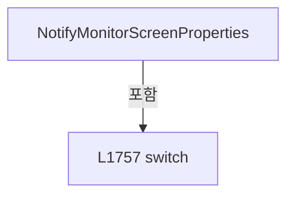

변경 전 점검: 입력/반환 타입, 위 호출자, 예외/취소 경로, 공유 상태와 저장·전송 소비자를 함께 확인합니다. 값의 단위나 물리 방향을 이름만으로 확정하지 않습니다.

### MethodDeclaration `NotifyMonitorLiveProperties` · L1886–1899

[Drilling.UI/Menu/Menus/CMenuMonitor.cs:1886–1899](https://github.com/kjuws10-rgb/A3Drilling/blob/0219666f9053b907d96d7e0aa7d0c6c1be3a73d4/Drilling.UI/Menu/Menus/CMenuMonitor.cs#L1886-L1899)

| 항목 | 실제 추출 값 |
| --- | --- |
| 서명 | void Drilling.UI.Menu.Menus.CMenuMonitor.NotifyMonitorLiveProperties(params string[]) |
| 접근/수식자 | Private / private |
| 반환/값 타입 | void |
| 소속 타입 | NamedType:Drilling.UI.Menu.Menus.CMenuMonitor |

입력 계약:

| 이름 | 타입 | 전달 | 선택/기본값 |
| --- | --- | --- | --- |
| propertyNames | string[] | None | False /  |

정적 호출자로 확인된 위치:

| 호출 파일/행 | 호출 표현식 | 런타임 분기 가능 |
| --- | --- | --- |
| [Drilling.UI/Menu/Menus/CMenuMonitor.cs:700–700](https://github.com/kjuws10-rgb/A3Drilling/blob/0219666f9053b907d96d7e0aa7d0c6c1be3a73d4/Drilling.UI/Menu/Menus/CMenuMonitor.cs#L700-L700) | NotifyMonitorLiveProperties | False |
| [Drilling.UI/Menu/Menus/CMenuMonitor.cs:957–957](https://github.com/kjuws10-rgb/A3Drilling/blob/0219666f9053b907d96d7e0aa7d0c6c1be3a73d4/Drilling.UI/Menu/Menus/CMenuMonitor.cs#L957-L957) | NotifyMonitorLiveProperties | False |
| [Drilling.UI/Menu/Menus/CMenuMonitor.cs:972–972](https://github.com/kjuws10-rgb/A3Drilling/blob/0219666f9053b907d96d7e0aa7d0c6c1be3a73d4/Drilling.UI/Menu/Menus/CMenuMonitor.cs#L972-L972) | NotifyMonitorLiveProperties | False |
| [Drilling.UI/Menu/Menus/CMenuMonitor.cs:991–991](https://github.com/kjuws10-rgb/A3Drilling/blob/0219666f9053b907d96d7e0aa7d0c6c1be3a73d4/Drilling.UI/Menu/Menus/CMenuMonitor.cs#L991-L991) | NotifyMonitorLiveProperties | False |
| [Drilling.UI/Menu/Menus/CMenuMonitor.cs:999–999](https://github.com/kjuws10-rgb/A3Drilling/blob/0219666f9053b907d96d7e0aa7d0c6c1be3a73d4/Drilling.UI/Menu/Menus/CMenuMonitor.cs#L999-L999) | NotifyMonitorLiveProperties | False |
| [Drilling.UI/Menu/Menus/CMenuMonitor.cs:1005–1005](https://github.com/kjuws10-rgb/A3Drilling/blob/0219666f9053b907d96d7e0aa7d0c6c1be3a73d4/Drilling.UI/Menu/Menus/CMenuMonitor.cs#L1005-L1005) | NotifyMonitorLiveProperties | False |
| [Drilling.UI/Menu/Menus/CMenuMonitor.cs:1014–1030](https://github.com/kjuws10-rgb/A3Drilling/blob/0219666f9053b907d96d7e0aa7d0c6c1be3a73d4/Drilling.UI/Menu/Menus/CMenuMonitor.cs#L1014-L1030) | NotifyMonitorLiveProperties | False |
| [Drilling.UI/Menu/Menus/CMenuMonitor.cs:1034–1034](https://github.com/kjuws10-rgb/A3Drilling/blob/0219666f9053b907d96d7e0aa7d0c6c1be3a73d4/Drilling.UI/Menu/Menus/CMenuMonitor.cs#L1034-L1034) | NotifyMonitorLiveProperties | False |
| [Drilling.UI/Menu/Menus/CMenuMonitor.cs:1037–1037](https://github.com/kjuws10-rgb/A3Drilling/blob/0219666f9053b907d96d7e0aa7d0c6c1be3a73d4/Drilling.UI/Menu/Menus/CMenuMonitor.cs#L1037-L1037) | NotifyMonitorLiveProperties | False |
| [Drilling.UI/Menu/Menus/CMenuMonitor.cs:1733–1756](https://github.com/kjuws10-rgb/A3Drilling/blob/0219666f9053b907d96d7e0aa7d0c6c1be3a73d4/Drilling.UI/Menu/Menus/CMenuMonitor.cs#L1733-L1756) | NotifyMonitorLiveProperties | False |
| [Drilling.UI/Menu/Menus/CMenuMonitor.cs:1760–1771](https://github.com/kjuws10-rgb/A3Drilling/blob/0219666f9053b907d96d7e0aa7d0c6c1be3a73d4/Drilling.UI/Menu/Menus/CMenuMonitor.cs#L1760-L1771) | NotifyMonitorLiveProperties | False |
| [Drilling.UI/Menu/Menus/CMenuMonitor.cs:1774–1785](https://github.com/kjuws10-rgb/A3Drilling/blob/0219666f9053b907d96d7e0aa7d0c6c1be3a73d4/Drilling.UI/Menu/Menus/CMenuMonitor.cs#L1774-L1785) | NotifyMonitorLiveProperties | False |
| [Drilling.UI/Menu/Menus/CMenuMonitor.cs:1788–1799](https://github.com/kjuws10-rgb/A3Drilling/blob/0219666f9053b907d96d7e0aa7d0c6c1be3a73d4/Drilling.UI/Menu/Menus/CMenuMonitor.cs#L1788-L1799) | NotifyMonitorLiveProperties | False |
| [Drilling.UI/Menu/Menus/CMenuMonitor.cs:1802–1812](https://github.com/kjuws10-rgb/A3Drilling/blob/0219666f9053b907d96d7e0aa7d0c6c1be3a73d4/Drilling.UI/Menu/Menus/CMenuMonitor.cs#L1802-L1812) | NotifyMonitorLiveProperties | False |
| [Drilling.UI/Menu/Menus/CMenuMonitor.cs:1815–1834](https://github.com/kjuws10-rgb/A3Drilling/blob/0219666f9053b907d96d7e0aa7d0c6c1be3a73d4/Drilling.UI/Menu/Menus/CMenuMonitor.cs#L1815-L1834) | NotifyMonitorLiveProperties | False |
| [Drilling.UI/Menu/Menus/CMenuMonitor.cs:1837–1847](https://github.com/kjuws10-rgb/A3Drilling/blob/0219666f9053b907d96d7e0aa7d0c6c1be3a73d4/Drilling.UI/Menu/Menus/CMenuMonitor.cs#L1837-L1847) | NotifyMonitorLiveProperties | False |
| [Drilling.UI/Menu/Menus/CMenuMonitor.cs:1850–1861](https://github.com/kjuws10-rgb/A3Drilling/blob/0219666f9053b907d96d7e0aa7d0c6c1be3a73d4/Drilling.UI/Menu/Menus/CMenuMonitor.cs#L1850-L1861) | NotifyMonitorLiveProperties | False |
| [Drilling.UI/Menu/Menus/CMenuMonitor.cs:1864–1875](https://github.com/kjuws10-rgb/A3Drilling/blob/0219666f9053b907d96d7e0aa7d0c6c1be3a73d4/Drilling.UI/Menu/Menus/CMenuMonitor.cs#L1864-L1875) | NotifyMonitorLiveProperties | False |
| [Drilling.UI/Menu/Menus/CMenuMonitor.cs:1881–1881](https://github.com/kjuws10-rgb/A3Drilling/blob/0219666f9053b907d96d7e0aa7d0c6c1be3a73d4/Drilling.UI/Menu/Menus/CMenuMonitor.cs#L1881-L1881) | NotifyMonitorLiveProperties | False |
| [Drilling.UI/Menu/Menus/CMenuMonitor.cs:3002–3002](https://github.com/kjuws10-rgb/A3Drilling/blob/0219666f9053b907d96d7e0aa7d0c6c1be3a73d4/Drilling.UI/Menu/Menus/CMenuMonitor.cs#L3002-L3002) | NotifyMonitorLiveProperties | False |
| [Drilling.UI/Menu/Menus/CMenuMonitor.cs:3009–3009](https://github.com/kjuws10-rgb/A3Drilling/blob/0219666f9053b907d96d7e0aa7d0c6c1be3a73d4/Drilling.UI/Menu/Menus/CMenuMonitor.cs#L3009-L3009) | NotifyMonitorLiveProperties | False |
| [Drilling.UI/Menu/Menus/CMenuMonitor.cs:3101–3101](https://github.com/kjuws10-rgb/A3Drilling/blob/0219666f9053b907d96d7e0aa7d0c6c1be3a73d4/Drilling.UI/Menu/Menus/CMenuMonitor.cs#L3101-L3101) | NotifyMonitorLiveProperties | False |
| [Drilling.UI/Menu/Menus/CMenuMonitor.cs:3796–3826](https://github.com/kjuws10-rgb/A3Drilling/blob/0219666f9053b907d96d7e0aa7d0c6c1be3a73d4/Drilling.UI/Menu/Menus/CMenuMonitor.cs#L3796-L3826) | NotifyMonitorLiveProperties | False |
| [Drilling.UI/Menu/Menus/CMenuMonitor.cs:5621–5621](https://github.com/kjuws10-rgb/A3Drilling/blob/0219666f9053b907d96d7e0aa7d0c6c1be3a73d4/Drilling.UI/Menu/Menus/CMenuMonitor.cs#L5621-L5621) | NotifyMonitorLiveProperties | False |
| [Drilling.UI/Menu/Menus/CMenuMonitor.cs:5831–5843](https://github.com/kjuws10-rgb/A3Drilling/blob/0219666f9053b907d96d7e0aa7d0c6c1be3a73d4/Drilling.UI/Menu/Menus/CMenuMonitor.cs#L5831-L5843) | NotifyMonitorLiveProperties | False |

호출하는 대상과 해석 범위:

| 원본 행 | 표현식 | 분석 상태 | 대상/소스 위치 |
| --- | --- | --- | --- |
| 1890 | GetLivePropertyValue | resolved | object? Drilling.UI.Menu.Menus.CMenuMonitor.GetLivePropertyValue(string) · Drilling.UI/Menu/Menus/CMenuMonitor.cs:1901 |
| 1891 | _lastNotifiedLiveValues.TryGetValue | resolved | bool System.Collections.Generic.Dictionary<string, object?>.TryGetValue(string, out object?) |
| 1891 | LiveValuesEqual | resolved | bool Drilling.UI.Menu.Menus.CMenuMonitor.LiveValuesEqual(object?, object?) · Drilling.UI/Menu/Menus/CMenuMonitor.cs:1916 |
| 1897 | OnPropertyChanged | resolved | void Drilling.UI.Menu.CBindingBase.OnPropertyChanged(string?) · Drilling.UI/Menu/CBindingBase.cs:790 |

본문의 실제 연산·분기·예외·반환 순서(원문 위치 순):

| 원본 행 | 종류 | 주석 해설 |
| --- | --- | --- |
| 1888 | foreach | 컬렉션 요소를 순회합니다: foreach (var propertyName in propertyNames) |
| 1890 | call | 함수·델리게이트 또는 객체 생성자를 호출합니다: GetLivePropertyValue(propertyName) |
| 1890 | local-declaration | 지역 변수를 선언합니다: var currentValue = GetLivePropertyValue(propertyName); |
| 1890 | variable-initializer | 변수의 초기값을 지정합니다: currentValue = GetLivePropertyValue(propertyName) |
| 1891 | call | 함수·델리게이트 또는 객체 생성자를 호출합니다: _lastNotifiedLiveValues.TryGetValue(propertyName, out var previousValue) |
| 1891 | call | 함수·델리게이트 또는 객체 생성자를 호출합니다: LiveValuesEqual(previousValue, currentValue) |
| 1891 | if | 조건에 따라 분기합니다: if (_lastNotifiedLiveValues.TryGetValue(propertyName, out var previousValue) && LiveValuesEqual(previousValue, currentValue)) |
| 1893 | continue | 다음 반복으로 진행합니다: continue; |
| 1896 | assignment | 값을 대상에 대입합니다: _lastNotifiedLiveValues[propertyName] = currentValue |
| 1897 | call | 함수·델리게이트 또는 객체 생성자를 호출합니다: OnPropertyChanged(propertyName) |

제어 구문의 포함 구조(실제 실행 순서/CFG가 아닌 구문 탐색 그림):

```mermaid
flowchart TD
 M["NotifyMonitorLiveProperties"]
 N0["L1888 foreach"]
 M -->|포함| N0
 N1["L1891 if"]
 N0 -->|포함| N1
```

변경 전 점검: 입력/반환 타입, 위 호출자, 예외/취소 경로, 공유 상태와 저장·전송 소비자를 함께 확인합니다. 값의 단위나 물리 방향을 이름만으로 확정하지 않습니다.

### MethodDeclaration `GetLivePropertyValue` · L1901–1914

[Drilling.UI/Menu/Menus/CMenuMonitor.cs:1901–1914](https://github.com/kjuws10-rgb/A3Drilling/blob/0219666f9053b907d96d7e0aa7d0c6c1be3a73d4/Drilling.UI/Menu/Menus/CMenuMonitor.cs#L1901-L1914)

| 항목 | 실제 추출 값 |
| --- | --- |
| 서명 | object? Drilling.UI.Menu.Menus.CMenuMonitor.GetLivePropertyValue(string) |
| 접근/수식자 | Private / private |
| 반환/값 타입 | object? |
| 소속 타입 | NamedType:Drilling.UI.Menu.Menus.CMenuMonitor |

입력 계약:

| 이름 | 타입 | 전달 | 선택/기본값 |
| --- | --- | --- | --- |
| propertyName | string | None | False /  |

정적 호출자로 확인된 위치:

| 호출 파일/행 | 호출 표현식 | 런타임 분기 가능 |
| --- | --- | --- |
| [Drilling.UI/Menu/Menus/CMenuMonitor.cs:1890–1890](https://github.com/kjuws10-rgb/A3Drilling/blob/0219666f9053b907d96d7e0aa7d0c6c1be3a73d4/Drilling.UI/Menu/Menus/CMenuMonitor.cs#L1890-L1890) | GetLivePropertyValue | False |

호출하는 대상과 해석 범위:

| 원본 행 | 표현식 | 분석 상태 | 대상/소스 위치 |
| --- | --- | --- | --- |
| 1906 | LivePropertyCache.TryGetValue | resolved | bool System.Collections.Generic.Dictionary<string, System.Reflection.PropertyInfo?>.TryGetValue(string, out System.Reflection.PropertyInfo?) |
| 1908 | typeof(CMenuMonitor).GetProperty | resolved | System.Reflection.PropertyInfo? System.Type.GetProperty(string) |
| 1913 | .GetValue | resolved | object? System.Reflection.PropertyInfo.GetValue(object?) |

본문의 실제 연산·분기·예외·반환 순서(원문 위치 순):

| 원본 행 | 종류 | 주석 해설 |
| --- | --- | --- |
| 1903 | local-declaration | 지역 변수를 선언합니다: PropertyInfo? property; |
| 1904 | lock | 공유 상태의 임계 구역에 진입합니다: lock (LivePropertyCacheLock) |
| 1906 | call | 함수·델리게이트 또는 객체 생성자를 호출합니다: LivePropertyCache.TryGetValue(propertyName, out property) |
| 1906 | if | 조건에 따라 분기합니다: if (!LivePropertyCache.TryGetValue(propertyName, out property)) |
| 1908 | assignment | 값을 대상에 대입합니다: property = typeof(CMenuMonitor).GetProperty(propertyName) |
| 1908 | call | 함수·델리게이트 또는 객체 생성자를 호출합니다: typeof(CMenuMonitor).GetProperty(propertyName) |
| 1909 | assignment | 값을 대상에 대입합니다: LivePropertyCache[propertyName] = property |
| 1913 | call | 함수·델리게이트 또는 객체 생성자를 호출합니다: .GetValue(this) |
| 1913 | return | 호출자에게 값 또는 제어를 반환합니다: return property?.GetValue(this); |

제어 구문의 포함 구조(실제 실행 순서/CFG가 아닌 구문 탐색 그림):

```mermaid
flowchart TD
 M["GetLivePropertyValue"]
 N0["L1904 lock"]
 M -->|포함| N0
 N1["L1906 if"]
 N0 -->|포함| N1
```

변경 전 점검: 입력/반환 타입, 위 호출자, 예외/취소 경로, 공유 상태와 저장·전송 소비자를 함께 확인합니다. 값의 단위나 물리 방향을 이름만으로 확정하지 않습니다.

### MethodDeclaration `LiveValuesEqual` · L1916–1934

[Drilling.UI/Menu/Menus/CMenuMonitor.cs:1916–1934](https://github.com/kjuws10-rgb/A3Drilling/blob/0219666f9053b907d96d7e0aa7d0c6c1be3a73d4/Drilling.UI/Menu/Menus/CMenuMonitor.cs#L1916-L1934)

| 항목 | 실제 추출 값 |
| --- | --- |
| 서명 | bool Drilling.UI.Menu.Menus.CMenuMonitor.LiveValuesEqual(object?, object?) |
| 접근/수식자 | Private / private, static |
| 반환/값 타입 | bool |
| 소속 타입 | NamedType:Drilling.UI.Menu.Menus.CMenuMonitor |

입력 계약:

| 이름 | 타입 | 전달 | 선택/기본값 |
| --- | --- | --- | --- |
| previousValue | object? | None | False /  |
| currentValue | object? | None | False /  |

정적 호출자로 확인된 위치:

| 호출 파일/행 | 호출 표현식 | 런타임 분기 가능 |
| --- | --- | --- |
| [Drilling.UI/Menu/Menus/CMenuMonitor.cs:1891–1891](https://github.com/kjuws10-rgb/A3Drilling/blob/0219666f9053b907d96d7e0aa7d0c6c1be3a73d4/Drilling.UI/Menu/Menus/CMenuMonitor.cs#L1891-L1891) | LiveValuesEqual | False |

호출하는 대상과 해석 범위:

| 원본 행 | 표현식 | 분석 상태 | 대상/소스 위치 |
| --- | --- | --- | --- |
| 1918 | ReferenceEquals | resolved | bool object.ReferenceEquals(object?, object?) |
| 1918 | Equals | resolved | bool object.Equals(object?, object?) |
| 1928 | TryGetEnumerableCount | resolved | bool Drilling.UI.Menu.Menus.CMenuMonitor.TryGetEnumerableCount(System.Collections.IEnumerable, out int) · Drilling.UI/Menu/Menus/CMenuMonitor.cs:1936 |
| 1928 | TryGetEnumerableCount | resolved | bool Drilling.UI.Menu.Menus.CMenuMonitor.TryGetEnumerableCount(System.Collections.IEnumerable, out int) · Drilling.UI/Menu/Menus/CMenuMonitor.cs:1936 |
| 1933 | previousItems.Cast<object?>().SequenceEqual | resolved | bool System.Collections.Generic.IEnumerable<object?>.SequenceEqual<object?>(System.Collections.Generic.IEnumerable<object?>) |
| 1933 | previousItems.Cast<object?> | resolved | System.Collections.Generic.IEnumerable<object?> System.Collections.IEnumerable.Cast<object?>() |
| 1933 | currentItems.Cast<object?> | resolved | System.Collections.Generic.IEnumerable<object?> System.Collections.IEnumerable.Cast<object?>() |

본문의 실제 연산·분기·예외·반환 순서(원문 위치 순):

| 원본 행 | 종류 | 주석 해설 |
| --- | --- | --- |
| 1918 | call | 함수·델리게이트 또는 객체 생성자를 호출합니다: ReferenceEquals(previousValue, currentValue) |
| 1918 | call | 함수·델리게이트 또는 객체 생성자를 호출합니다: Equals(previousValue, currentValue) |
| 1918 | if | 조건에 따라 분기합니다: if (ReferenceEquals(previousValue, currentValue) &#124;&#124; Equals(previousValue, currentValue)) |
| 1920 | return | 호출자에게 값 또는 제어를 반환합니다: return true; |
| 1923 | if | 조건에 따라 분기합니다: if (previousValue is string &#124;&#124; currentValue is string &#124;&#124; previousValue is not IEnumerable previousItems &#124;&#124; currentValue is not IEnumerable currentItems) |
| 1925 | return | 호출자에게 값 또는 제어를 반환합니다: return false; |
| 1928 | call | 함수·델리게이트 또는 객체 생성자를 호출합니다: TryGetEnumerableCount(previousItems, out var previousCount) |
| 1928 | call | 함수·델리게이트 또는 객체 생성자를 호출합니다: TryGetEnumerableCount(currentItems, out var currentCount) |
| 1928 | if | 조건에 따라 분기합니다: if (TryGetEnumerableCount(previousItems, out var previousCount) && TryGetEnumerableCount(currentItems, out var currentCount) && previousCount != currentCount) |
| 1930 | return | 호출자에게 값 또는 제어를 반환합니다: return false; |
| 1933 | call | 함수·델리게이트 또는 객체 생성자를 호출합니다: previousItems.Cast<object?>().SequenceEqual(currentItems.Cast<object?>()) |
| 1933 | call | 함수·델리게이트 또는 객체 생성자를 호출합니다: previousItems.Cast<object?>() |
| 1933 | call | 함수·델리게이트 또는 객체 생성자를 호출합니다: currentItems.Cast<object?>() |
| 1933 | return | 호출자에게 값 또는 제어를 반환합니다: return previousItems.Cast<object?>().SequenceEqual(currentItems.Cast<object?>()); |

제어 구문의 포함 구조(실제 실행 순서/CFG가 아닌 구문 탐색 그림):

```mermaid
flowchart TD
 M["LiveValuesEqual"]
 N0["L1918 if"]
 M -->|포함| N0
 N1["L1923 if"]
 M -->|포함| N1
 N2["L1928 if"]
 M -->|포함| N2
```

변경 전 점검: 입력/반환 타입, 위 호출자, 예외/취소 경로, 공유 상태와 저장·전송 소비자를 함께 확인합니다. 값의 단위나 물리 방향을 이름만으로 확정하지 않습니다.

### MethodDeclaration `TryGetEnumerableCount` · L1936–1953

[Drilling.UI/Menu/Menus/CMenuMonitor.cs:1936–1953](https://github.com/kjuws10-rgb/A3Drilling/blob/0219666f9053b907d96d7e0aa7d0c6c1be3a73d4/Drilling.UI/Menu/Menus/CMenuMonitor.cs#L1936-L1953)

| 항목 | 실제 추출 값 |
| --- | --- |
| 서명 | bool Drilling.UI.Menu.Menus.CMenuMonitor.TryGetEnumerableCount(System.Collections.IEnumerable, out int) |
| 접근/수식자 | Private / private, static |
| 반환/값 타입 | bool |
| 소속 타입 | NamedType:Drilling.UI.Menu.Menus.CMenuMonitor |

입력 계약:

| 이름 | 타입 | 전달 | 선택/기본값 |
| --- | --- | --- | --- |
| items | System.Collections.IEnumerable | None | False /  |
| count | int | Out | False /  |

정적 호출자로 확인된 위치:

| 호출 파일/행 | 호출 표현식 | 런타임 분기 가능 |
| --- | --- | --- |
| [Drilling.UI/Menu/Menus/CMenuMonitor.cs:1928–1928](https://github.com/kjuws10-rgb/A3Drilling/blob/0219666f9053b907d96d7e0aa7d0c6c1be3a73d4/Drilling.UI/Menu/Menus/CMenuMonitor.cs#L1928-L1928) | TryGetEnumerableCount | False |
| [Drilling.UI/Menu/Menus/CMenuMonitor.cs:1928–1928](https://github.com/kjuws10-rgb/A3Drilling/blob/0219666f9053b907d96d7e0aa7d0c6c1be3a73d4/Drilling.UI/Menu/Menus/CMenuMonitor.cs#L1928-L1928) | TryGetEnumerableCount | False |

호출하는 대상과 해석 범위:

| 원본 행 | 표현식 | 분석 상태 | 대상/소스 위치 |
| --- | --- | --- | --- |
| 1944 | items.GetType().GetProperty | resolved | System.Reflection.PropertyInfo? System.Type.GetProperty(string, System.Reflection.BindingFlags) |
| 1944 | items.GetType | resolved | System.Type object.GetType() |
| 1945 | countProperty.GetValue | resolved | object? System.Reflection.PropertyInfo.GetValue(object?) |

본문의 실제 연산·분기·예외·반환 순서(원문 위치 순):

| 원본 행 | 종류 | 주석 해설 |
| --- | --- | --- |
| 1938 | if | 조건에 따라 분기합니다: if (items is ICollection collection) |
| 1940 | assignment | 값을 대상에 대입합니다: count = collection.Count |
| 1941 | return | 호출자에게 값 또는 제어를 반환합니다: return true; |
| 1944 | call | 함수·델리게이트 또는 객체 생성자를 호출합니다: items.GetType().GetProperty("Count", BindingFlags.Instance &#124; BindingFlags.Public) |
| 1944 | call | 함수·델리게이트 또는 객체 생성자를 호출합니다: items.GetType() |
| 1944 | local-declaration | 지역 변수를 선언합니다: var countProperty = items.GetType().GetProperty("Count", BindingFlags.Instance &#124; BindingFlags.Public); |
| 1944 | variable-initializer | 변수의 초기값을 지정합니다: countProperty = items.GetType().GetProperty("Count", BindingFlags.Instance &#124; BindingFlags.Public) |
| 1945 | call | 함수·델리게이트 또는 객체 생성자를 호출합니다: countProperty.GetValue(items) |
| 1945 | if | 조건에 따라 분기합니다: if (countProperty?.PropertyType == typeof(int) && countProperty.GetValue(items)is int value) |
| 1947 | assignment | 값을 대상에 대입합니다: count = value |
| 1948 | return | 호출자에게 값 또는 제어를 반환합니다: return true; |
| 1951 | assignment | 값을 대상에 대입합니다: count = 0 |
| 1952 | return | 호출자에게 값 또는 제어를 반환합니다: return false; |

제어 구문의 포함 구조(실제 실행 순서/CFG가 아닌 구문 탐색 그림):

```mermaid
flowchart TD
 M["TryGetEnumerableCount"]
 N0["L1938 if"]
 M -->|포함| N0
 N1["L1945 if"]
 M -->|포함| N1
```

변경 전 점검: 입력/반환 타입, 위 호출자, 예외/취소 경로, 공유 상태와 저장·전송 소비자를 함께 확인합니다. 값의 단위나 물리 방향을 이름만으로 확정하지 않습니다.

### MethodDeclaration `CreateTabSections` · L1955–1963

[Drilling.UI/Menu/Menus/CMenuMonitor.cs:1955–1963](https://github.com/kjuws10-rgb/A3Drilling/blob/0219666f9053b907d96d7e0aa7d0c6c1be3a73d4/Drilling.UI/Menu/Menus/CMenuMonitor.cs#L1955-L1963)

| 항목 | 실제 추출 값 |
| --- | --- |
| 서명 | System.Collections.Generic.IReadOnlyList<Drilling.UI.Menu.Menus.ST_SCREEN_SECTION> Drilling.UI.Menu.Menus.CMenuMonitor.CreateTabSections(System.Collections.Generic.IReadOnlyList<Drilling.UI.Menu.Menus.ST_MONITOR_TAB>) |
| 접근/수식자 | Private / private, static |
| 반환/값 타입 | System.Collections.Generic.IReadOnlyList<Drilling.UI.Menu.Menus.ST_SCREEN_SECTION> |
| 소속 타입 | NamedType:Drilling.UI.Menu.Menus.CMenuMonitor |

입력 계약:

| 이름 | 타입 | 전달 | 선택/기본값 |
| --- | --- | --- | --- |
| tabs | System.Collections.Generic.IReadOnlyList<Drilling.UI.Menu.Menus.ST_MONITOR_TAB> | None | False /  |

정적 호출자로 확인된 위치:

| 호출 파일/행 | 호출 표현식 | 런타임 분기 가능 |
| --- | --- | --- |
| [Drilling.UI/Menu/Menus/CMenuMonitor.cs:833–833](https://github.com/kjuws10-rgb/A3Drilling/blob/0219666f9053b907d96d7e0aa7d0c6c1be3a73d4/Drilling.UI/Menu/Menus/CMenuMonitor.cs#L833-L833) | CreateTabSections | False |
| [Drilling.UI/Menu/Menus/CMenuMonitor.cs:2649–2649](https://github.com/kjuws10-rgb/A3Drilling/blob/0219666f9053b907d96d7e0aa7d0c6c1be3a73d4/Drilling.UI/Menu/Menus/CMenuMonitor.cs#L2649-L2649) | CreateTabSections | False |
| [Drilling.UI/Menu/Menus/CMenuMonitor.cs:2699–2699](https://github.com/kjuws10-rgb/A3Drilling/blob/0219666f9053b907d96d7e0aa7d0c6c1be3a73d4/Drilling.UI/Menu/Menus/CMenuMonitor.cs#L2699-L2699) | CreateTabSections | False |

호출하는 대상과 해석 범위:

| 원본 행 | 표현식 | 분석 상태 | 대상/소스 위치 |
| --- | --- | --- | --- |
| 1962 | tabs.Select(BuildSCREEN_SECTION).ToArray | resolved | Drilling.UI.Menu.Menus.ST_SCREEN_SECTION[] System.Collections.Generic.IEnumerable<Drilling.UI.Menu.Menus.ST_SCREEN_SECTION>.ToArray<Drilling.UI.Menu.Menus.ST_SCREEN_SECTION>() |
| 1962 | tabs.Select | resolved | System.Collections.Generic.IEnumerable<Drilling.UI.Menu.Menus.ST_SCREEN_SECTION> System.Collections.Generic.IEnumerable<Drilling.UI.Menu.Menus.ST_MONITOR_TAB>.Select<Drilling.UI.Menu.Menus.ST_MONITOR_TAB, Drilling.UI.Menu.Menus.ST_SCREEN_SECTION>(System.Func<Drilling.UI.Menu.Menus.ST_MONITOR_TAB, Drilling.UI.Menu.Menus.ST_SCREEN_SECTION>) |

본문의 실제 연산·분기·예외·반환 순서(원문 위치 순):

| 원본 행 | 종류 | 주석 해설 |
| --- | --- | --- |
| 1962 | call | 함수·델리게이트 또는 객체 생성자를 호출합니다: tabs.Select(BuildSCREEN_SECTION).ToArray() |
| 1962 | call | 함수·델리게이트 또는 객체 생성자를 호출합니다: tabs.Select(BuildSCREEN_SECTION) |
| 1962 | return | 호출자에게 값 또는 제어를 반환합니다: return tabs.Select(BuildSCREEN_SECTION).ToArray(); |

변경 전 점검: 입력/반환 타입, 위 호출자, 예외/취소 경로, 공유 상태와 저장·전송 소비자를 함께 확인합니다. 값의 단위나 물리 방향을 이름만으로 확정하지 않습니다.

### LocalFunctionStatement `BuildSCREEN_SECTION` · L1957–1960

[Drilling.UI/Menu/Menus/CMenuMonitor.cs:1957–1960](https://github.com/kjuws10-rgb/A3Drilling/blob/0219666f9053b907d96d7e0aa7d0c6c1be3a73d4/Drilling.UI/Menu/Menus/CMenuMonitor.cs#L1957-L1960)

| 항목 | 실제 추출 값 |
| --- | --- |
| 서명 | Drilling.UI.Menu.Menus.ST_SCREEN_SECTION BuildSCREEN_SECTION(Drilling.UI.Menu.Menus.ST_MONITOR_TAB) |
| 접근/수식자 | Private /  |
| 반환/값 타입 | Drilling.UI.Menu.Menus.ST_SCREEN_SECTION |
| 소속 타입 | NamedType:Drilling.UI.Menu.Menus.CMenuMonitor |

입력 계약:

| 이름 | 타입 | 전달 | 선택/기본값 |
| --- | --- | --- | --- |
| tab | Drilling.UI.Menu.Menus.ST_MONITOR_TAB | None | False /  |

현재 부분 분석에서 직접 연결된 호출자는 없습니다. XAML/이벤트/인터페이스·델리게이트·외부 진입을 추가 확인해야 하며, 미사용으로 판정한 것이 아닙니다.

호출하는 대상과 해석 범위:

| 원본 행 | 표현식 | 분석 상태 | 대상/소스 위치 |
| --- | --- | --- | --- |
| 1959 | new ST_SCREEN_SECTION | resolved | Drilling.UI.Menu.Menus.ST_SCREEN_SECTION.ST_SCREEN_SECTION(string, System.Collections.Generic.IReadOnlyList<Drilling.UI.Menu.Menus.ST_DISPLAY_ITEM>) · Drilling.UI/Menu/Menus/CMenuBase.cs:410 |
| 1959 | Array.Empty<ST_DISPLAY_ITEM> | resolved | Drilling.UI.Menu.Menus.ST_DISPLAY_ITEM[] System.Array.Empty<Drilling.UI.Menu.Menus.ST_DISPLAY_ITEM>() |

본문의 실제 연산·분기·예외·반환 순서(원문 위치 순):

| 원본 행 | 종류 | 주석 해설 |
| --- | --- | --- |
| 1959 | call | 함수·델리게이트 또는 객체 생성자를 호출합니다: new ST_SCREEN_SECTION(tab.Name, Array.Empty<ST_DISPLAY_ITEM>()) |
| 1959 | call | 함수·델리게이트 또는 객체 생성자를 호출합니다: Array.Empty<ST_DISPLAY_ITEM>() |
| 1959 | return | 호출자에게 값 또는 제어를 반환합니다: return new ST_SCREEN_SECTION(tab.Name, Array.Empty<ST_DISPLAY_ITEM>()); |

변경 전 점검: 입력/반환 타입, 위 호출자, 예외/취소 경로, 공유 상태와 저장·전송 소비자를 함께 확인합니다. 값의 단위나 물리 방향을 이름만으로 확정하지 않습니다.

### MethodDeclaration `NormalizeMonitorScreenTab` · L1965–1969

[Drilling.UI/Menu/Menus/CMenuMonitor.cs:1965–1969](https://github.com/kjuws10-rgb/A3Drilling/blob/0219666f9053b907d96d7e0aa7d0c6c1be3a73d4/Drilling.UI/Menu/Menus/CMenuMonitor.cs#L1965-L1969)

| 항목 | 실제 추출 값 |
| --- | --- |
| 서명 | string Drilling.UI.Menu.Menus.CMenuMonitor.NormalizeMonitorScreenTab(string?) |
| 접근/수식자 | Private / private, static |
| 반환/값 타입 | string |
| 소속 타입 | NamedType:Drilling.UI.Menu.Menus.CMenuMonitor |

입력 계약:

| 이름 | 타입 | 전달 | 선택/기본값 |
| --- | --- | --- | --- |
| tab | string? | None | False /  |

정적 호출자로 확인된 위치:

| 호출 파일/행 | 호출 표현식 | 런타임 분기 가능 |
| --- | --- | --- |
| [Drilling.UI/Menu/Menus/CMenuMonitor.cs:743–743](https://github.com/kjuws10-rgb/A3Drilling/blob/0219666f9053b907d96d7e0aa7d0c6c1be3a73d4/Drilling.UI/Menu/Menus/CMenuMonitor.cs#L743-L743) | NormalizeMonitorScreenTab | False |
| [Drilling.UI/Menu/Menus/CMenuMonitor.cs:903–903](https://github.com/kjuws10-rgb/A3Drilling/blob/0219666f9053b907d96d7e0aa7d0c6c1be3a73d4/Drilling.UI/Menu/Menus/CMenuMonitor.cs#L903-L903) | NormalizeMonitorScreenTab | False |
| [Drilling.UI/Menu/Menus/CMenuMonitor.cs:1178–1178](https://github.com/kjuws10-rgb/A3Drilling/blob/0219666f9053b907d96d7e0aa7d0c6c1be3a73d4/Drilling.UI/Menu/Menus/CMenuMonitor.cs#L1178-L1178) | NormalizeMonitorScreenTab | False |

호출하는 대상과 해석 범위:

| 원본 행 | 표현식 | 분석 상태 | 대상/소스 위치 |
| --- | --- | --- | --- |
| 1967 | NormalizeMonitorTab | resolved | string Drilling.UI.Menu.Menus.CMenuMonitor.NormalizeMonitorTab(string?) · Drilling.UI/Menu/Menus/CMenuMonitor.cs:1971 |

본문의 실제 연산·분기·예외·반환 순서(원문 위치 순):

| 원본 행 | 종류 | 주석 해설 |
| --- | --- | --- |
| 1967 | call | 함수·델리게이트 또는 객체 생성자를 호출합니다: NormalizeMonitorTab(tab) |
| 1967 | local-declaration | 지역 변수를 선언합니다: var normalized = NormalizeMonitorTab(tab); |
| 1967 | variable-initializer | 변수의 초기값을 지정합니다: normalized = NormalizeMonitorTab(tab) |
| 1968 | conditional-expression | 조건에 따라 결과식을 선택합니다: normalized == "POWER METER" ? "LASER" : normalized |
| 1968 | return | 호출자에게 값 또는 제어를 반환합니다: return normalized == "POWER METER" ? "LASER" : normalized; |

변경 전 점검: 입력/반환 타입, 위 호출자, 예외/취소 경로, 공유 상태와 저장·전송 소비자를 함께 확인합니다. 값의 단위나 물리 방향을 이름만으로 확정하지 않습니다.

### MethodDeclaration `NormalizeMonitorTab` · L1971–1985

[Drilling.UI/Menu/Menus/CMenuMonitor.cs:1971–1985](https://github.com/kjuws10-rgb/A3Drilling/blob/0219666f9053b907d96d7e0aa7d0c6c1be3a73d4/Drilling.UI/Menu/Menus/CMenuMonitor.cs#L1971-L1985)

| 항목 | 실제 추출 값 |
| --- | --- |
| 서명 | string Drilling.UI.Menu.Menus.CMenuMonitor.NormalizeMonitorTab(string?) |
| 접근/수식자 | Private / private, static |
| 반환/값 타입 | string |
| 소속 타입 | NamedType:Drilling.UI.Menu.Menus.CMenuMonitor |

입력 계약:

| 이름 | 타입 | 전달 | 선택/기본값 |
| --- | --- | --- | --- |
| tab | string? | None | False /  |

정적 호출자로 확인된 위치:

| 호출 파일/행 | 호출 표현식 | 런타임 분기 가능 |
| --- | --- | --- |
| [Drilling.UI/Menu/Menus/CMenuMonitor.cs:1146–1146](https://github.com/kjuws10-rgb/A3Drilling/blob/0219666f9053b907d96d7e0aa7d0c6c1be3a73d4/Drilling.UI/Menu/Menus/CMenuMonitor.cs#L1146-L1146) | NormalizeMonitorTab | False |
| [Drilling.UI/Menu/Menus/CMenuMonitor.cs:1967–1967](https://github.com/kjuws10-rgb/A3Drilling/blob/0219666f9053b907d96d7e0aa7d0c6c1be3a73d4/Drilling.UI/Menu/Menus/CMenuMonitor.cs#L1967-L1967) | NormalizeMonitorTab | False |
| [Drilling.UI/Menu/Menus/CMenuMonitor.cs:2361–2361](https://github.com/kjuws10-rgb/A3Drilling/blob/0219666f9053b907d96d7e0aa7d0c6c1be3a73d4/Drilling.UI/Menu/Menus/CMenuMonitor.cs#L2361-L2361) | NormalizeMonitorTab | False |
| [Drilling.UI/Menu/Menus/CMenuMonitor.cs:2366–2366](https://github.com/kjuws10-rgb/A3Drilling/blob/0219666f9053b907d96d7e0aa7d0c6c1be3a73d4/Drilling.UI/Menu/Menus/CMenuMonitor.cs#L2366-L2366) | NormalizeMonitorTab | False |
| [Drilling.UI/Menu/Menus/CMenuMonitor.cs:2420–2420](https://github.com/kjuws10-rgb/A3Drilling/blob/0219666f9053b907d96d7e0aa7d0c6c1be3a73d4/Drilling.UI/Menu/Menus/CMenuMonitor.cs#L2420-L2420) | NormalizeMonitorTab | False |
| [Drilling.UI/Menu/Menus/CMenuMonitor.cs:2437–2437](https://github.com/kjuws10-rgb/A3Drilling/blob/0219666f9053b907d96d7e0aa7d0c6c1be3a73d4/Drilling.UI/Menu/Menus/CMenuMonitor.cs#L2437-L2437) | NormalizeMonitorTab | False |
| [Drilling.UI/Menu/Menus/CMenuMonitor.cs:2460–2460](https://github.com/kjuws10-rgb/A3Drilling/blob/0219666f9053b907d96d7e0aa7d0c6c1be3a73d4/Drilling.UI/Menu/Menus/CMenuMonitor.cs#L2460-L2460) | NormalizeMonitorTab | False |
| [Drilling.UI/Menu/Menus/CMenuMonitor.cs:2476–2476](https://github.com/kjuws10-rgb/A3Drilling/blob/0219666f9053b907d96d7e0aa7d0c6c1be3a73d4/Drilling.UI/Menu/Menus/CMenuMonitor.cs#L2476-L2476) | NormalizeMonitorTab | False |
| [Drilling.UI/Menu/Menus/CMenuMonitor.cs:2481–2481](https://github.com/kjuws10-rgb/A3Drilling/blob/0219666f9053b907d96d7e0aa7d0c6c1be3a73d4/Drilling.UI/Menu/Menus/CMenuMonitor.cs#L2481-L2481) | NormalizeMonitorTab | False |

호출하는 대상과 해석 범위:

| 원본 행 | 표현식 | 분석 상태 | 대상/소스 위치 |
| --- | --- | --- | --- |
| 1973 | (tab ?? "PRODUCT").Trim().ToUpperInvariant | resolved | string string.ToUpperInvariant() |
| 1973 | (tab ?? "PRODUCT").Trim | resolved | string string.Trim() |

본문의 실제 연산·분기·예외·반환 순서(원문 위치 순):

| 원본 행 | 종류 | 주석 해설 |
| --- | --- | --- |
| 1973 | call | 함수·델리게이트 또는 객체 생성자를 호출합니다: (tab ?? "PRODUCT").Trim().ToUpperInvariant() |
| 1973 | call | 함수·델리게이트 또는 객체 생성자를 호출합니다: (tab ?? "PRODUCT").Trim() |
| 1973 | local-declaration | 지역 변수를 선언합니다: var normalized = (tab ?? "PRODUCT").Trim().ToUpperInvariant(); |
| 1973 | variable-initializer | 변수의 초기값을 지정합니다: normalized = (tab ?? "PRODUCT").Trim().ToUpperInvariant() |
| 1974 | return | 호출자에게 값 또는 제어를 반환합니다: return normalized switch { "ATT" => "ATTENUATOR", "LASER/POWERMETER" => "LASER", "POWER" or "POWERMETER" or "POWER_METER" => "POWER METER", "MOTOR" or "XPS" or "SCANNERTILT" or "SCANNER TILT" or "SCANNER_TILT" => "XPS", "PICO" or  |
| 1974 | switch-expression | 값별 결과식을 선택합니다: normalized switch { "ATT" => "ATTENUATOR", "LASER/POWERMETER" => "LASER", "POWER" or "POWERMETER" or "POWER_METER" => "POWER METER", "MOTOR" or "XPS" or "SCANNERTILT" or "SCANNER TILT" or "SCANNER_TILT" => "XPS", "PICO" or "PICOMO |

제어 구문의 포함 구조(실제 실행 순서/CFG가 아닌 구문 탐색 그림):

```mermaid
flowchart TD
 M["NormalizeMonitorTab"]
 N0["L1974 switch-expression"]
 M -->|포함| N0
```

변경 전 점검: 입력/반환 타입, 위 호출자, 예외/취소 경로, 공유 상태와 저장·전송 소비자를 함께 확인합니다. 값의 단위나 물리 방향을 이름만으로 확정하지 않습니다.

### MethodDeclaration `GetSubtitle` · L1987–2002

[Drilling.UI/Menu/Menus/CMenuMonitor.cs:1987–2002](https://github.com/kjuws10-rgb/A3Drilling/blob/0219666f9053b907d96d7e0aa7d0c6c1be3a73d4/Drilling.UI/Menu/Menus/CMenuMonitor.cs#L1987-L2002)

| 항목 | 실제 추출 값 |
| --- | --- |
| 서명 | string Drilling.UI.Menu.Menus.CMenuMonitor.GetSubtitle(string) |
| 접근/수식자 | Private / private, static |
| 반환/값 타입 | string |
| 소속 타입 | NamedType:Drilling.UI.Menu.Menus.CMenuMonitor |

입력 계약:

| 이름 | 타입 | 전달 | 선택/기본값 |
| --- | --- | --- | --- |
| tab | string | None | False /  |

정적 호출자로 확인된 위치:

| 호출 파일/행 | 호출 표현식 | 런타임 분기 가능 |
| --- | --- | --- |
| [Drilling.UI/Menu/Menus/CMenuMonitor.cs:836–836](https://github.com/kjuws10-rgb/A3Drilling/blob/0219666f9053b907d96d7e0aa7d0c6c1be3a73d4/Drilling.UI/Menu/Menus/CMenuMonitor.cs#L836-L836) | GetSubtitle | False |
| [Drilling.UI/Menu/Menus/CMenuMonitor.cs:2702–2702](https://github.com/kjuws10-rgb/A3Drilling/blob/0219666f9053b907d96d7e0aa7d0c6c1be3a73d4/Drilling.UI/Menu/Menus/CMenuMonitor.cs#L2702-L2702) | GetSubtitle | False |

본문의 실제 연산·분기·예외·반환 순서(원문 위치 순):

| 원본 행 | 종류 | 주석 해설 |
| --- | --- | --- |
| 1989 | return | 호출자에게 값 또는 제어를 반환합니다: return tab switch { "XPS" => "Newport XPS axis position monitor and service operation", "LASER" => "Talon laser control and one-shot PowerMeter queries", "ATTENUATOR" => "Conex AGP attenuator position monitor and service operation |
| 1989 | switch-expression | 값별 결과식을 선택합니다: tab switch { "XPS" => "Newport XPS axis position monitor and service operation", "LASER" => "Talon laser control and one-shot PowerMeter queries", "ATTENUATOR" => "Conex AGP attenuator position monitor and service operation", "BET |

제어 구문의 포함 구조(실제 실행 순서/CFG가 아닌 구문 탐색 그림):

```mermaid
flowchart TD
 M["GetSubtitle"]
 N0["L1989 switch-expression"]
 M -->|포함| N0
```

변경 전 점검: 입력/반환 타입, 위 호출자, 예외/취소 경로, 공유 상태와 저장·전송 소비자를 함께 확인합니다. 값의 단위나 물리 방향을 이름만으로 확정하지 않습니다.

### MethodDeclaration `GetStatusPanelTitle` · L2004–2018

[Drilling.UI/Menu/Menus/CMenuMonitor.cs:2004–2018](https://github.com/kjuws10-rgb/A3Drilling/blob/0219666f9053b907d96d7e0aa7d0c6c1be3a73d4/Drilling.UI/Menu/Menus/CMenuMonitor.cs#L2004-L2018)

| 항목 | 실제 추출 값 |
| --- | --- |
| 서명 | string Drilling.UI.Menu.Menus.CMenuMonitor.GetStatusPanelTitle(string) |
| 접근/수식자 | Private / private, static |
| 반환/값 타입 | string |
| 소속 타입 | NamedType:Drilling.UI.Menu.Menus.CMenuMonitor |

입력 계약:

| 이름 | 타입 | 전달 | 선택/기본값 |
| --- | --- | --- | --- |
| tab | string | None | False /  |

정적 호출자로 확인된 위치:

| 호출 파일/행 | 호출 표현식 | 런타임 분기 가능 |
| --- | --- | --- |
| [Drilling.UI/Menu/Menus/CMenuMonitor.cs:837–837](https://github.com/kjuws10-rgb/A3Drilling/blob/0219666f9053b907d96d7e0aa7d0c6c1be3a73d4/Drilling.UI/Menu/Menus/CMenuMonitor.cs#L837-L837) | GetStatusPanelTitle | False |
| [Drilling.UI/Menu/Menus/CMenuMonitor.cs:2703–2703](https://github.com/kjuws10-rgb/A3Drilling/blob/0219666f9053b907d96d7e0aa7d0c6c1be3a73d4/Drilling.UI/Menu/Menus/CMenuMonitor.cs#L2703-L2703) | GetStatusPanelTitle | False |

본문의 실제 연산·분기·예외·반환 순서(원문 위치 순):

| 원본 행 | 종류 | 주석 해설 |
| --- | --- | --- |
| 2006 | return | 호출자에게 값 또는 제어를 반환합니다: return tab switch { "LASER" => "Laser Status", "ATTENUATOR" => "Attenuator Status", "BET" => "BET Status", "POWER METER" => "PowerMeter Status", "XPS" => "XPS Status", "PICO MOTOR" => "PicoMotor Status", "PRODUCT" => "Product Stat |
| 2006 | switch-expression | 값별 결과식을 선택합니다: tab switch { "LASER" => "Laser Status", "ATTENUATOR" => "Attenuator Status", "BET" => "BET Status", "POWER METER" => "PowerMeter Status", "XPS" => "XPS Status", "PICO MOTOR" => "PicoMotor Status", "PRODUCT" => "Product Status", "M |

제어 구문의 포함 구조(실제 실행 순서/CFG가 아닌 구문 탐색 그림):

```mermaid
flowchart TD
 M["GetStatusPanelTitle"]
 N0["L2006 switch-expression"]
 M -->|포함| N0
```

변경 전 점검: 입력/반환 타입, 위 호출자, 예외/취소 경로, 공유 상태와 저장·전송 소비자를 함께 확인합니다. 값의 단위나 물리 방향을 이름만으로 확정하지 않습니다.

### MethodDeclaration `GetOperationPanelTitle` · L2020–2033

[Drilling.UI/Menu/Menus/CMenuMonitor.cs:2020–2033](https://github.com/kjuws10-rgb/A3Drilling/blob/0219666f9053b907d96d7e0aa7d0c6c1be3a73d4/Drilling.UI/Menu/Menus/CMenuMonitor.cs#L2020-L2033)

| 항목 | 실제 추출 값 |
| --- | --- |
| 서명 | string Drilling.UI.Menu.Menus.CMenuMonitor.GetOperationPanelTitle(string) |
| 접근/수식자 | Private / private, static |
| 반환/값 타입 | string |
| 소속 타입 | NamedType:Drilling.UI.Menu.Menus.CMenuMonitor |

입력 계약:

| 이름 | 타입 | 전달 | 선택/기본값 |
| --- | --- | --- | --- |
| tab | string | None | False /  |

정적 호출자로 확인된 위치:

| 호출 파일/행 | 호출 표현식 | 런타임 분기 가능 |
| --- | --- | --- |
| [Drilling.UI/Menu/Menus/CMenuMonitor.cs:838–838](https://github.com/kjuws10-rgb/A3Drilling/blob/0219666f9053b907d96d7e0aa7d0c6c1be3a73d4/Drilling.UI/Menu/Menus/CMenuMonitor.cs#L838-L838) | GetOperationPanelTitle | False |
| [Drilling.UI/Menu/Menus/CMenuMonitor.cs:2704–2704](https://github.com/kjuws10-rgb/A3Drilling/blob/0219666f9053b907d96d7e0aa7d0c6c1be3a73d4/Drilling.UI/Menu/Menus/CMenuMonitor.cs#L2704-L2704) | GetOperationPanelTitle | False |

본문의 실제 연산·분기·예외·반환 순서(원문 위치 순):

| 원본 행 | 종류 | 주석 해설 |
| --- | --- | --- |
| 2022 | return | 호출자에게 값 또는 제어를 반환합니다: return tab switch { "XPS" => "XPS Axis Operation", "LASER" => "Laser Operation", "ATTENUATOR" => "Attenuator Operation", "BET" => "BET Operation", "POWER METER" => "PowerMeter Operation", "PICO MOTOR" => "PicoMotor Operation", "ME |
| 2022 | switch-expression | 값별 결과식을 선택합니다: tab switch { "XPS" => "XPS Axis Operation", "LASER" => "Laser Operation", "ATTENUATOR" => "Attenuator Operation", "BET" => "BET Operation", "POWER METER" => "PowerMeter Operation", "PICO MOTOR" => "PicoMotor Operation", "MELSEC" = |

제어 구문의 포함 구조(실제 실행 순서/CFG가 아닌 구문 탐색 그림):

```mermaid
flowchart TD
 M["GetOperationPanelTitle"]
 N0["L2022 switch-expression"]
 M -->|포함| N0
```

변경 전 점검: 입력/반환 타입, 위 호출자, 예외/취소 경로, 공유 상태와 저장·전송 소비자를 함께 확인합니다. 값의 단위나 물리 방향을 이름만으로 확정하지 않습니다.

### MethodDeclaration `GetParameterPanelTitle` · L2035–2049

[Drilling.UI/Menu/Menus/CMenuMonitor.cs:2035–2049](https://github.com/kjuws10-rgb/A3Drilling/blob/0219666f9053b907d96d7e0aa7d0c6c1be3a73d4/Drilling.UI/Menu/Menus/CMenuMonitor.cs#L2035-L2049)

| 항목 | 실제 추출 값 |
| --- | --- |
| 서명 | string Drilling.UI.Menu.Menus.CMenuMonitor.GetParameterPanelTitle(string) |
| 접근/수식자 | Private / private, static |
| 반환/값 타입 | string |
| 소속 타입 | NamedType:Drilling.UI.Menu.Menus.CMenuMonitor |

입력 계약:

| 이름 | 타입 | 전달 | 선택/기본값 |
| --- | --- | --- | --- |
| tab | string | None | False /  |

정적 호출자로 확인된 위치:

| 호출 파일/행 | 호출 표현식 | 런타임 분기 가능 |
| --- | --- | --- |
| [Drilling.UI/Menu/Menus/CMenuMonitor.cs:839–839](https://github.com/kjuws10-rgb/A3Drilling/blob/0219666f9053b907d96d7e0aa7d0c6c1be3a73d4/Drilling.UI/Menu/Menus/CMenuMonitor.cs#L839-L839) | GetParameterPanelTitle | False |
| [Drilling.UI/Menu/Menus/CMenuMonitor.cs:2705–2705](https://github.com/kjuws10-rgb/A3Drilling/blob/0219666f9053b907d96d7e0aa7d0c6c1be3a73d4/Drilling.UI/Menu/Menus/CMenuMonitor.cs#L2705-L2705) | GetParameterPanelTitle | False |

본문의 실제 연산·분기·예외·반환 순서(원문 위치 순):

| 원본 행 | 종류 | 주석 해설 |
| --- | --- | --- |
| 2037 | return | 호출자에게 값 또는 제어를 반환합니다: return tab switch { "XPS" => "XPS Motion Profile", "LASER" => "Laser Parameter", "ATTENUATOR" => "Attenuator Parameter", "BET" => "BET Table", "POWER METER" => "PowerMeter Parameter", "PICO MOTOR" => "PicoMotor Position", "PRODUCT |
| 2037 | switch-expression | 값별 결과식을 선택합니다: tab switch { "XPS" => "XPS Motion Profile", "LASER" => "Laser Parameter", "ATTENUATOR" => "Attenuator Parameter", "BET" => "BET Table", "POWER METER" => "PowerMeter Parameter", "PICO MOTOR" => "PicoMotor Position", "PRODUCT" => "P |

제어 구문의 포함 구조(실제 실행 순서/CFG가 아닌 구문 탐색 그림):

```mermaid
flowchart TD
 M["GetParameterPanelTitle"]
 N0["L2037 switch-expression"]
 M -->|포함| N0
```

변경 전 점검: 입력/반환 타입, 위 호출자, 예외/취소 경로, 공유 상태와 저장·전송 소비자를 함께 확인합니다. 값의 단위나 물리 방향을 이름만으로 확정하지 않습니다.

### MethodDeclaration `GetTrendPanelTitle` · L2051–2063

[Drilling.UI/Menu/Menus/CMenuMonitor.cs:2051–2063](https://github.com/kjuws10-rgb/A3Drilling/blob/0219666f9053b907d96d7e0aa7d0c6c1be3a73d4/Drilling.UI/Menu/Menus/CMenuMonitor.cs#L2051-L2063)

| 항목 | 실제 추출 값 |
| --- | --- |
| 서명 | string Drilling.UI.Menu.Menus.CMenuMonitor.GetTrendPanelTitle(string) |
| 접근/수식자 | Private / private, static |
| 반환/값 타입 | string |
| 소속 타입 | NamedType:Drilling.UI.Menu.Menus.CMenuMonitor |

입력 계약:

| 이름 | 타입 | 전달 | 선택/기본값 |
| --- | --- | --- | --- |
| tab | string | None | False /  |

정적 호출자로 확인된 위치:

| 호출 파일/행 | 호출 표현식 | 런타임 분기 가능 |
| --- | --- | --- |
| [Drilling.UI/Menu/Menus/CMenuMonitor.cs:840–840](https://github.com/kjuws10-rgb/A3Drilling/blob/0219666f9053b907d96d7e0aa7d0c6c1be3a73d4/Drilling.UI/Menu/Menus/CMenuMonitor.cs#L840-L840) | GetTrendPanelTitle | False |
| [Drilling.UI/Menu/Menus/CMenuMonitor.cs:2706–2706](https://github.com/kjuws10-rgb/A3Drilling/blob/0219666f9053b907d96d7e0aa7d0c6c1be3a73d4/Drilling.UI/Menu/Menus/CMenuMonitor.cs#L2706-L2706) | GetTrendPanelTitle | False |

본문의 실제 연산·분기·예외·반환 순서(원문 위치 순):

| 원본 행 | 종류 | 주석 해설 |
| --- | --- | --- |
| 2053 | return | 호출자에게 값 또는 제어를 반환합니다: return tab switch { "LASER" => "Laser Trend", "ATTENUATOR" => "Current Position", "BET" => "Beam Expander Position", "POWER METER" => "Power Trend", "PICO MOTOR" => "Motor Position", "MELSEC" => "MELSEC Signal", _ => "Signal Trend |
| 2053 | switch-expression | 값별 결과식을 선택합니다: tab switch { "LASER" => "Laser Trend", "ATTENUATOR" => "Current Position", "BET" => "Beam Expander Position", "POWER METER" => "Power Trend", "PICO MOTOR" => "Motor Position", "MELSEC" => "MELSEC Signal", _ => "Signal Trend" } |

제어 구문의 포함 구조(실제 실행 순서/CFG가 아닌 구문 탐색 그림):

```mermaid
flowchart TD
 M["GetTrendPanelTitle"]
 N0["L2053 switch-expression"]
 M -->|포함| N0
```

변경 전 점검: 입력/반환 타입, 위 호출자, 예외/취소 경로, 공유 상태와 저장·전송 소비자를 함께 확인합니다. 값의 단위나 물리 방향을 이름만으로 확정하지 않습니다.

### MethodDeclaration `CreateStatusRows` · L2065–2165

[Drilling.UI/Menu/Menus/CMenuMonitor.cs:2065–2165](https://github.com/kjuws10-rgb/A3Drilling/blob/0219666f9053b907d96d7e0aa7d0c6c1be3a73d4/Drilling.UI/Menu/Menus/CMenuMonitor.cs#L2065-L2165)

| 항목 | 실제 추출 값 |
| --- | --- |
| 서명 | System.Collections.Generic.IReadOnlyList<Drilling.UI.Menu.Menus.ST_MONITOR_STATUS_ROW> Drilling.UI.Menu.Menus.CMenuMonitor.CreateStatusRows(string, Drilling.Common.Managers.ST_DEVICE_STATUS, System.Collections.Generic.IReadOnlyList<Drilling.Common.Interface.ST_DEVICE_COMM_STATUS>, string?, Drilling.Common.Interface.ST_TALON_STATUS?) |
| 접근/수식자 | Private / private, static |
| 반환/값 타입 | System.Collections.Generic.IReadOnlyList<Drilling.UI.Menu.Menus.ST_MONITOR_STATUS_ROW> |
| 소속 타입 | NamedType:Drilling.UI.Menu.Menus.CMenuMonitor |

입력 계약:

| 이름 | 타입 | 전달 | 선택/기본값 |
| --- | --- | --- | --- |
| tab | string | None | False /  |
| snapshot | Drilling.Common.Managers.ST_DEVICE_STATUS | None | False /  |
| communication | System.Collections.Generic.IReadOnlyList<Drilling.Common.Interface.ST_DEVICE_COMM_STATUS> | None | False /  |
| selectedConnectionText | string? | None | True / null |
| talonStatus | Drilling.Common.Interface.ST_TALON_STATUS? | None | True / null |

정적 호출자로 확인된 위치:

| 호출 파일/행 | 호출 표현식 | 런타임 분기 가능 |
| --- | --- | --- |
| [Drilling.UI/Menu/Menus/CMenuMonitor.cs:843–843](https://github.com/kjuws10-rgb/A3Drilling/blob/0219666f9053b907d96d7e0aa7d0c6c1be3a73d4/Drilling.UI/Menu/Menus/CMenuMonitor.cs#L843-L843) | CreateStatusRows | False |
| [Drilling.UI/Menu/Menus/CMenuMonitor.cs:965–965](https://github.com/kjuws10-rgb/A3Drilling/blob/0219666f9053b907d96d7e0aa7d0c6c1be3a73d4/Drilling.UI/Menu/Menus/CMenuMonitor.cs#L965-L965) | CreateStatusRows | False |
| [Drilling.UI/Menu/Menus/CMenuMonitor.cs:976–976](https://github.com/kjuws10-rgb/A3Drilling/blob/0219666f9053b907d96d7e0aa7d0c6c1be3a73d4/Drilling.UI/Menu/Menus/CMenuMonitor.cs#L976-L976) | CreateStatusRows | False |

호출하는 대상과 해석 범위:

| 원본 행 | 표현식 | 분석 상태 | 대상/소스 위치 |
| --- | --- | --- | --- |
| 2073 | GetMonitorModule | resolved | Drilling.Common.Interface.EN_EQP_MODULE? Drilling.UI.Menu.Menus.CMenuMonitor.GetMonitorModule(string) · Drilling.UI/Menu/Menus/CMenuMonitor.cs:2167 |
| 2074 | string.IsNullOrWhiteSpace | resolved | bool string.IsNullOrWhiteSpace(string?) |
| 2074 | ToCommunicationText | resolved | string Drilling.UI.Menu.Menus.CMenuMonitor.ToCommunicationText(Drilling.Common.Interface.EN_COMM_STATE) · Drilling.UI/Menu/Menus/CMenuMonitor.cs:2192 |
| 2074 | GetModuleState | resolved | Drilling.Common.Interface.EN_COMM_STATE Drilling.UI.Menu.Menus.CMenuMonitor.GetModuleState(System.Collections.Generic.IReadOnlyList<Drilling.Common.Interface.ST_DEVICE_COMM_STATUS>, Drilling.Common.Interface.EN_EQP_MODULE) · Drilling.UI/Menu/Menus/CMenuMonitor.cs:2182 |
| 2079 | new | resolved | Drilling.UI.Menu.Menus.ST_MONITOR_STATUS_ROW.ST_MONITOR_STATUS_ROW(string, string, string, string, string) · Drilling.UI/Menu/Menus/CMenuMonitor.cs:7286 |
| 2079 | snapshot.Laser.OutputPower.ToString | resolved | string double.ToString(string?) |
| 2080 | new | resolved | Drilling.UI.Menu.Menus.ST_MONITOR_STATUS_ROW.ST_MONITOR_STATUS_ROW(string, string, string, string, string) · Drilling.UI/Menu/Menus/CMenuMonitor.cs:7286 |
| 2081 | new | resolved | Drilling.UI.Menu.Menus.ST_MONITOR_STATUS_ROW.ST_MONITOR_STATUS_ROW(string, string, string, string, string) · Drilling.UI/Menu/Menus/CMenuMonitor.cs:7286 |
| 2082 | new | resolved | Drilling.UI.Menu.Menus.ST_MONITOR_STATUS_ROW.ST_MONITOR_STATUS_ROW(string, string, string, string, string) · Drilling.UI/Menu/Menus/CMenuMonitor.cs:7286 |
| 2083 | new | resolved | Drilling.UI.Menu.Menus.ST_MONITOR_STATUS_ROW.ST_MONITOR_STATUS_ROW(string, string, string, string, string) · Drilling.UI/Menu/Menus/CMenuMonitor.cs:7286 |
| 2084 | new | resolved | Drilling.UI.Menu.Menus.ST_MONITOR_STATUS_ROW.ST_MONITOR_STATUS_ROW(string, string, string, string, string) · Drilling.UI/Menu/Menus/CMenuMonitor.cs:7286 |
| 2085 | new | resolved | Drilling.UI.Menu.Menus.ST_MONITOR_STATUS_ROW.ST_MONITOR_STATUS_ROW(string, string, string, string, string) · Drilling.UI/Menu/Menus/CMenuMonitor.cs:7286 |
| 2086 | new | resolved | Drilling.UI.Menu.Menus.ST_MONITOR_STATUS_ROW.ST_MONITOR_STATUS_ROW(string, string, string, string, string) · Drilling.UI/Menu/Menus/CMenuMonitor.cs:7286 |
| 2087 | new | resolved | Drilling.UI.Menu.Menus.ST_MONITOR_STATUS_ROW.ST_MONITOR_STATUS_ROW(string, string, string, string, string) · Drilling.UI/Menu/Menus/CMenuMonitor.cs:7286 |
| 2090 | new | resolved | Drilling.UI.Menu.Menus.ST_MONITOR_STATUS_ROW.ST_MONITOR_STATUS_ROW(string, string, string, string, string) · Drilling.UI/Menu/Menus/CMenuMonitor.cs:7286 |
| 2091 | new | resolved | Drilling.UI.Menu.Menus.ST_MONITOR_STATUS_ROW.ST_MONITOR_STATUS_ROW(string, string, string, string, string) · Drilling.UI/Menu/Menus/CMenuMonitor.cs:7286 |
| 2091 | snapshot.Attenuator.CurrentPosition.ToString | resolved | string double.ToString(string?, System.IFormatProvider?) |
| 2092 | new | resolved | Drilling.UI.Menu.Menus.ST_MONITOR_STATUS_ROW.ST_MONITOR_STATUS_ROW(string, string, string, string, string) · Drilling.UI/Menu/Menus/CMenuMonitor.cs:7286 |
| 2092 | snapshot.Attenuator.TargetPosition.ToString | resolved | string double.ToString(string?, System.IFormatProvider?) |
| 2093 | new | resolved | Drilling.UI.Menu.Menus.ST_MONITOR_STATUS_ROW.ST_MONITOR_STATUS_ROW(string, string, string, string, string) · Drilling.UI/Menu/Menus/CMenuMonitor.cs:7286 |
| 2094 | new | resolved | Drilling.UI.Menu.Menus.ST_MONITOR_STATUS_ROW.ST_MONITOR_STATUS_ROW(string, string, string, string, string) · Drilling.UI/Menu/Menus/CMenuMonitor.cs:7286 |
| 2096 | IsInPosition | resolved | bool Drilling.UI.Menu.Menus.CMenuMonitor.IsInPosition(double, double) · Drilling.UI/Menu/Menus/CMenuMonitor.cs:6749 |
| 2097 | IsInPosition | resolved | bool Drilling.UI.Menu.Menus.CMenuMonitor.IsInPosition(double, double) · Drilling.UI/Menu/Menus/CMenuMonitor.cs:6749 |
| 2101 | new | resolved | Drilling.UI.Menu.Menus.ST_MONITOR_STATUS_ROW.ST_MONITOR_STATUS_ROW(string, string, string, string, string) · Drilling.UI/Menu/Menus/CMenuMonitor.cs:7286 |
| 2101 | FormatHomeType | resolved | string Drilling.UI.Menu.Menus.CMenuMonitor.FormatHomeType(int?) · Drilling.UI/Menu/Menus/CMenuMonitor.cs:6724 |
| 2101 | FormatKnownState | resolved | string Drilling.UI.Menu.Menus.CMenuMonitor.FormatKnownState<int>(int?) · Drilling.UI/Menu/Menus/CMenuMonitor.cs:6718 |
| 2102 | new | resolved | Drilling.UI.Menu.Menus.ST_MONITOR_STATUS_ROW.ST_MONITOR_STATUS_ROW(string, string, string, string, string) · Drilling.UI/Menu/Menus/CMenuMonitor.cs:7286 |
| 2102 | FormatNullableDouble | resolved | string Drilling.UI.Menu.Menus.CMenuMonitor.FormatNullableDouble(double?) · Drilling.UI/Menu/Menus/CMenuMonitor.cs:6708 |
| 2102 | FormatKnownState | resolved | string Drilling.UI.Menu.Menus.CMenuMonitor.FormatKnownState<double>(double?) · Drilling.UI/Menu/Menus/CMenuMonitor.cs:6718 |
| 2103 | new | resolved | Drilling.UI.Menu.Menus.ST_MONITOR_STATUS_ROW.ST_MONITOR_STATUS_ROW(string, string, string, string, string) · Drilling.UI/Menu/Menus/CMenuMonitor.cs:7286 |
| 2103 | FormatNullableDouble | resolved | string Drilling.UI.Menu.Menus.CMenuMonitor.FormatNullableDouble(double?) · Drilling.UI/Menu/Menus/CMenuMonitor.cs:6708 |
| 2103 | FormatKnownState | resolved | string Drilling.UI.Menu.Menus.CMenuMonitor.FormatKnownState<double>(double?) · Drilling.UI/Menu/Menus/CMenuMonitor.cs:6718 |
| 2104 | new | resolved | Drilling.UI.Menu.Menus.ST_MONITOR_STATUS_ROW.ST_MONITOR_STATUS_ROW(string, string, string, string, string) · Drilling.UI/Menu/Menus/CMenuMonitor.cs:7286 |
| 2104 | FormatNullableDouble | resolved | string Drilling.UI.Menu.Menus.CMenuMonitor.FormatNullableDouble(double?) · Drilling.UI/Menu/Menus/CMenuMonitor.cs:6708 |
| 2104 | FormatKnownState | resolved | string Drilling.UI.Menu.Menus.CMenuMonitor.FormatKnownState<double>(double?) · Drilling.UI/Menu/Menus/CMenuMonitor.cs:6718 |
| 2105 | new | resolved | Drilling.UI.Menu.Menus.ST_MONITOR_STATUS_ROW.ST_MONITOR_STATUS_ROW(string, string, string, string, string) · Drilling.UI/Menu/Menus/CMenuMonitor.cs:7286 |
| 2105 | FormatNullableDouble | resolved | string Drilling.UI.Menu.Menus.CMenuMonitor.FormatNullableDouble(double?) · Drilling.UI/Menu/Menus/CMenuMonitor.cs:6708 |
| 2105 | FormatKnownState | resolved | string Drilling.UI.Menu.Menus.CMenuMonitor.FormatKnownState<double>(double?) · Drilling.UI/Menu/Menus/CMenuMonitor.cs:6718 |
| 2106 | new | resolved | Drilling.UI.Menu.Menus.ST_MONITOR_STATUS_ROW.ST_MONITOR_STATUS_ROW(string, string, string, string, string) · Drilling.UI/Menu/Menus/CMenuMonitor.cs:7286 |
| 2106 | FormatNullableDouble | resolved | string Drilling.UI.Menu.Menus.CMenuMonitor.FormatNullableDouble(double?) · Drilling.UI/Menu/Menus/CMenuMonitor.cs:6708 |
| 2106 | FormatKnownState | resolved | string Drilling.UI.Menu.Menus.CMenuMonitor.FormatKnownState<double>(double?) · Drilling.UI/Menu/Menus/CMenuMonitor.cs:6718 |
| 2107 | new | resolved | Drilling.UI.Menu.Menus.ST_MONITOR_STATUS_ROW.ST_MONITOR_STATUS_ROW(string, string, string, string, string) · Drilling.UI/Menu/Menus/CMenuMonitor.cs:7286 |
| 2107 | snapshot.Attenuator.LastError.ToString | resolved · 동적 구현 선택 가능 | string System.Enum.ToString() |
| 2108 | new | resolved | Drilling.UI.Menu.Menus.ST_MONITOR_STATUS_ROW.ST_MONITOR_STATUS_ROW(string, string, string, string, string) · Drilling.UI/Menu/Menus/CMenuMonitor.cs:7286 |
| 2111 | new | resolved | Drilling.UI.Menu.Menus.ST_MONITOR_STATUS_ROW.ST_MONITOR_STATUS_ROW(string, string, string, string, string) · Drilling.UI/Menu/Menus/CMenuMonitor.cs:7286 |
| 2112 | new | resolved | Drilling.UI.Menu.Menus.ST_MONITOR_STATUS_ROW.ST_MONITOR_STATUS_ROW(string, string, string, string, string) · Drilling.UI/Menu/Menus/CMenuMonitor.cs:7286 |
| 2113 | new | resolved | Drilling.UI.Menu.Menus.ST_MONITOR_STATUS_ROW.ST_MONITOR_STATUS_ROW(string, string, string, string, string) · Drilling.UI/Menu/Menus/CMenuMonitor.cs:7286 |
| 2113 | FormatBETStep | resolved | string Drilling.UI.Menu.Menus.CMenuMonitor.FormatBETStep(double) · Drilling.UI/Menu/Menus/CMenuMonitor.cs:6744 |
| 2114 | new | resolved | Drilling.UI.Menu.Menus.ST_MONITOR_STATUS_ROW.ST_MONITOR_STATUS_ROW(string, string, string, string, string) · Drilling.UI/Menu/Menus/CMenuMonitor.cs:7286 |
| 2114 | FormatBETStep | resolved | string Drilling.UI.Menu.Menus.CMenuMonitor.FormatBETStep(double) · Drilling.UI/Menu/Menus/CMenuMonitor.cs:6744 |
| 2115 | new | resolved | Drilling.UI.Menu.Menus.ST_MONITOR_STATUS_ROW.ST_MONITOR_STATUS_ROW(string, string, string, string, string) · Drilling.UI/Menu/Menus/CMenuMonitor.cs:7286 |
| 2115 | FormatBETStep | resolved | string Drilling.UI.Menu.Menus.CMenuMonitor.FormatBETStep(double) · Drilling.UI/Menu/Menus/CMenuMonitor.cs:6744 |
| 2116 | new | resolved | Drilling.UI.Menu.Menus.ST_MONITOR_STATUS_ROW.ST_MONITOR_STATUS_ROW(string, string, string, string, string) · Drilling.UI/Menu/Menus/CMenuMonitor.cs:7286 |
| 2116 | FormatBETStep | resolved | string Drilling.UI.Menu.Menus.CMenuMonitor.FormatBETStep(double) · Drilling.UI/Menu/Menus/CMenuMonitor.cs:6744 |
| 2117 | new | resolved | Drilling.UI.Menu.Menus.ST_MONITOR_STATUS_ROW.ST_MONITOR_STATUS_ROW(string, string, string, string, string) · Drilling.UI/Menu/Menus/CMenuMonitor.cs:7286 |
| 2118 | new | resolved | Drilling.UI.Menu.Menus.ST_MONITOR_STATUS_ROW.ST_MONITOR_STATUS_ROW(string, string, string, string, string) · Drilling.UI/Menu/Menus/CMenuMonitor.cs:7286 |
| 2119 | new | resolved | Drilling.UI.Menu.Menus.ST_MONITOR_STATUS_ROW.ST_MONITOR_STATUS_ROW(string, string, string, string, string) · Drilling.UI/Menu/Menus/CMenuMonitor.cs:7286 |
| 2120 | new | resolved | Drilling.UI.Menu.Menus.ST_MONITOR_STATUS_ROW.ST_MONITOR_STATUS_ROW(string, string, string, string, string) · Drilling.UI/Menu/Menus/CMenuMonitor.cs:7286 |
| 2121 | new | resolved | Drilling.UI.Menu.Menus.ST_MONITOR_STATUS_ROW.ST_MONITOR_STATUS_ROW(string, string, string, string, string) · Drilling.UI/Menu/Menus/CMenuMonitor.cs:7286 |
| 2121 | string.IsNullOrWhiteSpace | resolved | bool string.IsNullOrWhiteSpace(string?) |
| 2122 | new | resolved | Drilling.UI.Menu.Menus.ST_MONITOR_STATUS_ROW.ST_MONITOR_STATUS_ROW(string, string, string, string, string) · Drilling.UI/Menu/Menus/CMenuMonitor.cs:7286 |
| 2125 | new | resolved | Drilling.UI.Menu.Menus.ST_MONITOR_STATUS_ROW.ST_MONITOR_STATUS_ROW(string, string, string, string, string) · Drilling.UI/Menu/Menus/CMenuMonitor.cs:7286 |
| 2126 | new | resolved | Drilling.UI.Menu.Menus.ST_MONITOR_STATUS_ROW.ST_MONITOR_STATUS_ROW(string, string, string, string, string) · Drilling.UI/Menu/Menus/CMenuMonitor.cs:7286 |
| 2126 | string.IsNullOrWhiteSpace | resolved | bool string.IsNullOrWhiteSpace(string?) |
| 2127 | new | resolved | Drilling.UI.Menu.Menus.ST_MONITOR_STATUS_ROW.ST_MONITOR_STATUS_ROW(string, string, string, string, string) · Drilling.UI/Menu/Menus/CMenuMonitor.cs:7286 |
| 2130 | string.IsNullOrWhiteSpace | resolved | bool string.IsNullOrWhiteSpace(string?) |
| 2134 | new | resolved | Drilling.UI.Menu.Menus.ST_MONITOR_STATUS_ROW.ST_MONITOR_STATUS_ROW(string, string, string, string, string) · Drilling.UI/Menu/Menus/CMenuMonitor.cs:7286 |
| 2134 | snapshot.PowerMeter.MeasuredPower.ToString | resolved | string double.ToString(string?, System.IFormatProvider?) |
| 2135 | new | resolved | Drilling.UI.Menu.Menus.ST_MONITOR_STATUS_ROW.ST_MONITOR_STATUS_ROW(string, string, string, string, string) · Drilling.UI/Menu/Menus/CMenuMonitor.cs:7286 |
| 2135 | snapshot.PowerMeter.AveragePower.ToString | resolved | string double.ToString(string?, System.IFormatProvider?) |
| 2136 | new | resolved | Drilling.UI.Menu.Menus.ST_MONITOR_STATUS_ROW.ST_MONITOR_STATUS_ROW(string, string, string, string, string) · Drilling.UI/Menu/Menus/CMenuMonitor.cs:7286 |
| 2136 | snapshot.PowerMeter.MinPower.ToString | resolved | string double.ToString(string?, System.IFormatProvider?) |
| 2137 | new | resolved | Drilling.UI.Menu.Menus.ST_MONITOR_STATUS_ROW.ST_MONITOR_STATUS_ROW(string, string, string, string, string) · Drilling.UI/Menu/Menus/CMenuMonitor.cs:7286 |
| 2137 | snapshot.PowerMeter.MaxPower.ToString | resolved | string double.ToString(string?, System.IFormatProvider?) |
| 2138 | new | resolved | Drilling.UI.Menu.Menus.ST_MONITOR_STATUS_ROW.ST_MONITOR_STATUS_ROW(string, string, string, string, string) · Drilling.UI/Menu/Menus/CMenuMonitor.cs:7286 |
| 2138 | snapshot.PowerMeter.WaveLengthNm.ToString | resolved | string double.ToString(string?, System.IFormatProvider?) |
| 2139 | new | resolved | Drilling.UI.Menu.Menus.ST_MONITOR_STATUS_ROW.ST_MONITOR_STATUS_ROW(string, string, string, string, string) · Drilling.UI/Menu/Menus/CMenuMonitor.cs:7286 |
| 2139 | snapshot.PowerMeter.BeamPositionX.ToString | resolved | string double.ToString(string?, System.IFormatProvider?) |
| 2140 | new | resolved | Drilling.UI.Menu.Menus.ST_MONITOR_STATUS_ROW.ST_MONITOR_STATUS_ROW(string, string, string, string, string) · Drilling.UI/Menu/Menus/CMenuMonitor.cs:7286 |
| 2140 | snapshot.PowerMeter.BeamPositionY.ToString | resolved | string double.ToString(string?, System.IFormatProvider?) |
| 2141 | new | resolved | Drilling.UI.Menu.Menus.ST_MONITOR_STATUS_ROW.ST_MONITOR_STATUS_ROW(string, string, string, string, string) · Drilling.UI/Menu/Menus/CMenuMonitor.cs:7286 |
| 2141 | snapshot.PowerMeter.SampleCount.ToString | resolved | string int.ToString(System.IFormatProvider?) |
| 2142 | new | resolved | Drilling.UI.Menu.Menus.ST_MONITOR_STATUS_ROW.ST_MONITOR_STATUS_ROW(string, string, string, string, string) · Drilling.UI/Menu/Menus/CMenuMonitor.cs:7286 |
| 2143 | new | resolved | Drilling.UI.Menu.Menus.ST_MONITOR_STATUS_ROW.ST_MONITOR_STATUS_ROW(string, string, string, string, string) · Drilling.UI/Menu/Menus/CMenuMonitor.cs:7286 |
| 2145 | string.IsNullOrWhiteSpace | resolved | bool string.IsNullOrWhiteSpace(string?) |
| 2152 | new | resolved | Drilling.UI.Menu.Menus.ST_MONITOR_STATUS_ROW.ST_MONITOR_STATUS_ROW(string, string, string, string, string) · Drilling.UI/Menu/Menus/CMenuMonitor.cs:7286 |
| 2153 | new | resolved | Drilling.UI.Menu.Menus.ST_MONITOR_STATUS_ROW.ST_MONITOR_STATUS_ROW(string, string, string, string, string) · Drilling.UI/Menu/Menus/CMenuMonitor.cs:7286 |
| 2154 | new | resolved | Drilling.UI.Menu.Menus.ST_MONITOR_STATUS_ROW.ST_MONITOR_STATUS_ROW(string, string, string, string, string) · Drilling.UI/Menu/Menus/CMenuMonitor.cs:7286 |
| 2155 | new | resolved | Drilling.UI.Menu.Menus.ST_MONITOR_STATUS_ROW.ST_MONITOR_STATUS_ROW(string, string, string, string, string) · Drilling.UI/Menu/Menus/CMenuMonitor.cs:7286 |
| 2156 | new | resolved | Drilling.UI.Menu.Menus.ST_MONITOR_STATUS_ROW.ST_MONITOR_STATUS_ROW(string, string, string, string, string) · Drilling.UI/Menu/Menus/CMenuMonitor.cs:7286 |
| 2159 | new | resolved | Drilling.UI.Menu.Menus.ST_MONITOR_STATUS_ROW.ST_MONITOR_STATUS_ROW(string, string, string, string, string) · Drilling.UI/Menu/Menus/CMenuMonitor.cs:7286 |
| 2160 | new | resolved | Drilling.UI.Menu.Menus.ST_MONITOR_STATUS_ROW.ST_MONITOR_STATUS_ROW(string, string, string, string, string) · Drilling.UI/Menu/Menus/CMenuMonitor.cs:7286 |
| 2161 | new | resolved | Drilling.UI.Menu.Menus.ST_MONITOR_STATUS_ROW.ST_MONITOR_STATUS_ROW(string, string, string, string, string) · Drilling.UI/Menu/Menus/CMenuMonitor.cs:7286 |
| 2162 | new | resolved | Drilling.UI.Menu.Menus.ST_MONITOR_STATUS_ROW.ST_MONITOR_STATUS_ROW(string, string, string, string, string) · Drilling.UI/Menu/Menus/CMenuMonitor.cs:7286 |

본문의 실제 연산·분기·예외·반환 순서(원문 위치 순):

| 원본 행 | 종류 | 주석 해설 |
| --- | --- | --- |
| 2073 | call | 함수·델리게이트 또는 객체 생성자를 호출합니다: GetMonitorModule(tab) |
| 2073 | local-declaration | 지역 변수를 선언합니다: var module = GetMonitorModule(tab); |
| 2073 | variable-initializer | 변수의 초기값을 지정합니다: module = GetMonitorModule(tab) |
| 2074 | call | 함수·델리게이트 또는 객체 생성자를 호출합니다: string.IsNullOrWhiteSpace(selectedConnectionText) |
| 2074 | call | 함수·델리게이트 또는 객체 생성자를 호출합니다: ToCommunicationText(GetModuleState(communication, module.Value)) |
| 2074 | call | 함수·델리게이트 또는 객체 생성자를 호출합니다: GetModuleState(communication, module.Value) |
| 2074 | conditional-expression | 조건에 따라 결과식을 선택합니다: !string.IsNullOrWhiteSpace(selectedConnectionText) ? selectedConnectionText : module is null ? "-" : ToCommunicationText(GetModuleState(communication, module.Value)) |
| 2074 | conditional-expression | 조건에 따라 결과식을 선택합니다: module is null ? "-" : ToCommunicationText(GetModuleState(communication, module.Value)) |
| 2074 | local-declaration | 지역 변수를 선언합니다: var communicationText = !string.IsNullOrWhiteSpace(selectedConnectionText) ? selectedConnectionText : module is null ? "-" : ToCommunicationText(GetModuleState(communication, module.Value)); |
| 2074 | variable-initializer | 변수의 초기값을 지정합니다: communicationText = !string.IsNullOrWhiteSpace(selectedConnectionText) ? selectedConnectionText : module is null ? "-" : ToCommunicationText(GetModuleState(communication, module.Value)) |
| 2075 | local-declaration | 지역 변수를 선언합니다: var laserTalonStatus = talonStatus ?? ST_TALON_STATUS.Empty; |
| 2075 | variable-initializer | 변수의 초기값을 지정합니다: laserTalonStatus = talonStatus ?? ST_TALON_STATUS.Empty |
| 2076 | return | 호출자에게 값 또는 제어를 반환합니다: return tab switch { "LASER" => [ new("Output Power", snapshot.Laser.OutputPower.ToString("F3"), snapshot.Laser.PowerOn ? "ON" : "SAFE", "W", "Measured output power"), new("Set Power", "1.200", "-", "W", "Target output power"), new |
| 2076 | switch-expression | 값별 결과식을 선택합니다: tab switch { "LASER" => [ new("Output Power", snapshot.Laser.OutputPower.ToString("F3"), snapshot.Laser.PowerOn ? "ON" : "SAFE", "W", "Measured output power"), new("Set Power", "1.200", "-", "W", "Target output power"), new("Frequ |
| 2079 | call | 함수·델리게이트 또는 객체 생성자를 호출합니다: new("Output Power", snapshot.Laser.OutputPower.ToString("F3"), snapshot.Laser.PowerOn ? "ON" : "SAFE", "W", "Measured output power") |
| 2079 | call | 함수·델리게이트 또는 객체 생성자를 호출합니다: snapshot.Laser.OutputPower.ToString("F3") |
| 2079 | conditional-expression | 조건에 따라 결과식을 선택합니다: snapshot.Laser.PowerOn ? "ON" : "SAFE" |
| 2080 | call | 함수·델리게이트 또는 객체 생성자를 호출합니다: new("Set Power", "1.200", "-", "W", "Target output power") |
| 2081 | call | 함수·델리게이트 또는 객체 생성자를 호출합니다: new("Frequency", "20.000", "-", "kHz", "Pulse frequency") |
| 2082 | call | 함수·델리게이트 또는 객체 생성자를 호출합니다: new("Gate", snapshot.Laser.GateOn ? "OPEN" : "CLOSE", snapshot.Laser.GateOn ? "OPEN" : "CLOSE", "-", "Laser gate state") |
| 2082 | conditional-expression | 조건에 따라 결과식을 선택합니다: snapshot.Laser.GateOn ? "OPEN" : "CLOSE" |
| 2082 | conditional-expression | 조건에 따라 결과식을 선택합니다: snapshot.Laser.GateOn ? "OPEN" : "CLOSE" |
| 2083 | call | 함수·델리게이트 또는 객체 생성자를 호출합니다: new("Ext Gate", laserTalonStatus.ExtGateEnable ? "ENABLED" : "DISABLED", laserTalonStatus.ExtGateEnable ? "ENABLED" : "DISABLED", "-", "Laser external gate input setting") |
| 2083 | conditional-expression | 조건에 따라 결과식을 선택합니다: laserTalonStatus.ExtGateEnable ? "ENABLED" : "DISABLED" |
| 2083 | conditional-expression | 조건에 따라 결과식을 선택합니다: laserTalonStatus.ExtGateEnable ? "ENABLED" : "DISABLED" |
| 2084 | call | 함수·델리게이트 또는 객체 생성자를 호출합니다: new("Shutter", snapshot.Laser.ShutterOpen ? "OPEN" : "CLOSE", snapshot.Laser.ShutterOpen ? "OPEN" : "CLOSE", "-", "Laser shutter state") |
| 2084 | conditional-expression | 조건에 따라 결과식을 선택합니다: snapshot.Laser.ShutterOpen ? "OPEN" : "CLOSE" |
| 2084 | conditional-expression | 조건에 따라 결과식을 선택합니다: snapshot.Laser.ShutterOpen ? "OPEN" : "CLOSE" |
| 2085 | call | 함수·델리게이트 또는 객체 생성자를 호출합니다: new("Laser Mode", snapshot.Laser.PowerOn ? "ON" : "SAFE", snapshot.Laser.PowerOn ? "ON" : "SAFE", "-", "Laser operating mode") |
| 2085 | conditional-expression | 조건에 따라 결과식을 선택합니다: snapshot.Laser.PowerOn ? "ON" : "SAFE" |
| 2085 | conditional-expression | 조건에 따라 결과식을 선택합니다: snapshot.Laser.PowerOn ? "ON" : "SAFE" |
| 2086 | call | 함수·델리게이트 또는 객체 생성자를 호출합니다: new("Diode State", "OK", "OK", "-", "Diode status") |
| 2087 | call | 함수·델리게이트 또는 객체 생성자를 호출합니다: new("Temperature", "24.6", "OK", "C", "Laser head temperature") |
| 2090 | call | 함수·델리게이트 또는 객체 생성자를 호출합니다: new("Controller", "CONEX_AGP", "OK", "-", "Attenuator controller") |
| 2091 | call | 함수·델리게이트 또는 객체 생성자를 호출합니다: new("Current Position", snapshot.Attenuator.CurrentPosition.ToString("F3", CultureInfo.InvariantCulture), "OK", "DEG", "Current attenuator position") |
| 2091 | call | 함수·델리게이트 또는 객체 생성자를 호출합니다: snapshot.Attenuator.CurrentPosition.ToString("F3", CultureInfo.InvariantCulture) |
| 2092 | call | 함수·델리게이트 또는 객체 생성자를 호출합니다: new("Target Position", snapshot.Attenuator.TargetPosition.ToString("F3", CultureInfo.InvariantCulture), "OK", "DEG", "Target attenuator position") |
| 2092 | call | 함수·델리게이트 또는 객체 생성자를 호출합니다: snapshot.Attenuator.TargetPosition.ToString("F3", CultureInfo.InvariantCulture) |
| 2093 | call | 함수·델리게이트 또는 객체 생성자를 호출합니다: new("Moving", snapshot.Attenuator.CommandState, snapshot.Attenuator.CommandState, "-", "Motion state") |
| 2094 | call | 함수·델리게이트 또는 객체 생성자를 호출합니다: new( "In Position", IsInPosition(snapshot.Attenuator.CurrentPosition, snapshot.Attenuator.TargetPosition) ? "YES" : "NO", IsInPosition(snapshot.Attenuator.CurrentPosition, snapshot.Attenuator.TargetPosition) ? "YES" : "W… |
| 2096 | call | 함수·델리게이트 또는 객체 생성자를 호출합니다: IsInPosition(snapshot.Attenuator.CurrentPosition, snapshot.Attenuator.TargetPosition) |
| 2096 | conditional-expression | 조건에 따라 결과식을 선택합니다: IsInPosition(snapshot.Attenuator.CurrentPosition, snapshot.Attenuator.TargetPosition) ? "YES" : "NO" |
| 2097 | call | 함수·델리게이트 또는 객체 생성자를 호출합니다: IsInPosition(snapshot.Attenuator.CurrentPosition, snapshot.Attenuator.TargetPosition) |
| 2097 | conditional-expression | 조건에 따라 결과식을 선택합니다: IsInPosition(snapshot.Attenuator.CurrentPosition, snapshot.Attenuator.TargetPosition) ? "YES" : "WARN" |
| 2101 | call | 함수·델리게이트 또는 객체 생성자를 호출합니다: new("Home Type", FormatHomeType(snapshot.Attenuator.HomeType), FormatKnownState(snapshot.Attenuator.HomeType), "-", "CONEX-AGP HT home search type") |
| 2101 | call | 함수·델리게이트 또는 객체 생성자를 호출합니다: FormatHomeType(snapshot.Attenuator.HomeType) |
| 2101 | call | 함수·델리게이트 또는 객체 생성자를 호출합니다: FormatKnownState(snapshot.Attenuator.HomeType) |
| 2102 | call | 함수·델리게이트 또는 객체 생성자를 호출합니다: new("Negative SW Limit", FormatNullableDouble(snapshot.Attenuator.NegativeSoftwareLimit), FormatKnownState(snapshot.Attenuator.NegativeSoftwareLimit), "DEG", "CONEX-AGP SL negative software limit") |
| 2102 | call | 함수·델리게이트 또는 객체 생성자를 호출합니다: FormatNullableDouble(snapshot.Attenuator.NegativeSoftwareLimit) |
| 2102 | call | 함수·델리게이트 또는 객체 생성자를 호출합니다: FormatKnownState(snapshot.Attenuator.NegativeSoftwareLimit) |
| 2103 | call | 함수·델리게이트 또는 객체 생성자를 호출합니다: new("Positive SW Limit", FormatNullableDouble(snapshot.Attenuator.PositiveSoftwareLimit), FormatKnownState(snapshot.Attenuator.PositiveSoftwareLimit), "DEG", "CONEX-AGP SR positive software limit") |
| 2103 | call | 함수·델리게이트 또는 객체 생성자를 호출합니다: FormatNullableDouble(snapshot.Attenuator.PositiveSoftwareLimit) |
| 2103 | call | 함수·델리게이트 또는 객체 생성자를 호출합니다: FormatKnownState(snapshot.Attenuator.PositiveSoftwareLimit) |
| 2104 | call | 함수·델리게이트 또는 객체 생성자를 호출합니다: new("I Gain", FormatNullableDouble(snapshot.Attenuator.IGain), FormatKnownState(snapshot.Attenuator.IGain), "-", "CONEX-AGP KI integral gain") |
| 2104 | call | 함수·델리게이트 또는 객체 생성자를 호출합니다: FormatNullableDouble(snapshot.Attenuator.IGain) |
| 2104 | call | 함수·델리게이트 또는 객체 생성자를 호출합니다: FormatKnownState(snapshot.Attenuator.IGain) |
| 2105 | call | 함수·델리게이트 또는 객체 생성자를 호출합니다: new("P Gain", FormatNullableDouble(snapshot.Attenuator.PGain), FormatKnownState(snapshot.Attenuator.PGain), "-", "CONEX-AGP KP proportional gain") |
| 2105 | call | 함수·델리게이트 또는 객체 생성자를 호출합니다: FormatNullableDouble(snapshot.Attenuator.PGain) |
| 2105 | call | 함수·델리게이트 또는 객체 생성자를 호출합니다: FormatKnownState(snapshot.Attenuator.PGain) |
| 2106 | call | 함수·델리게이트 또는 객체 생성자를 호출합니다: new("Interpolation Factor", FormatNullableDouble(snapshot.Attenuator.InterpolationFactor), FormatKnownState(snapshot.Attenuator.InterpolationFactor), "-", "CONEX-AGP IF interpolation factor") |
| 2106 | call | 함수·델리게이트 또는 객체 생성자를 호출합니다: FormatNullableDouble(snapshot.Attenuator.InterpolationFactor) |
| 2106 | call | 함수·델리게이트 또는 객체 생성자를 호출합니다: FormatKnownState(snapshot.Attenuator.InterpolationFactor) |
| 2107 | call | 함수·델리게이트 또는 객체 생성자를 호출합니다: new("Last Error", snapshot.Attenuator.LastError.ToString(), snapshot.Attenuator.LastError == EN_CONEX_AGP_ERROR.Ok ? "OK" : "ERROR", "-", "Last CONEX-AGP command error") |
| 2107 | call | 함수·델리게이트 또는 객체 생성자를 호출합니다: snapshot.Attenuator.LastError.ToString() |
| 2107 | conditional-expression | 조건에 따라 결과식을 선택합니다: snapshot.Attenuator.LastError == EN_CONEX_AGP_ERROR.Ok ? "OK" : "ERROR" |
| 2108 | call | 함수·델리게이트 또는 객체 생성자를 호출합니다: new("Last Command", snapshot.Attenuator.CommandState, "OK", "-", "Last command name") |
| 2111 | call | 함수·델리게이트 또는 객체 생성자를 호출합니다: new("Connection", communicationText, communicationText, "-", "Beam expander controller link") |
| 2112 | call | 함수·델리게이트 또는 객체 생성자를 호출합니다: new("Controller", "BET_CTRL", "OK", "-", "Beam expander controller") |
| 2113 | call | 함수·델리게이트 또는 객체 생성자를 호출합니다: new("MAG POS", FormatBETStep(snapshot.Bet.CurrentMagnification), "", "step", "Current MAG motor position") |
| 2113 | call | 함수·델리게이트 또는 객체 생성자를 호출합니다: FormatBETStep(snapshot.Bet.CurrentMagnification) |
| 2114 | call | 함수·델리게이트 또는 객체 생성자를 호출합니다: new("DIV POS", FormatBETStep(snapshot.Bet.CurrentDivergence), "", "step", "Current DIV motor position") |
| 2114 | call | 함수·델리게이트 또는 객체 생성자를 호출합니다: FormatBETStep(snapshot.Bet.CurrentDivergence) |
| 2115 | call | 함수·델리게이트 또는 객체 생성자를 호출합니다: new("Target MAG POS", FormatBETStep(snapshot.Bet.TargetMagnification), "", "step", "Target MAG motor position") |
| 2115 | call | 함수·델리게이트 또는 객체 생성자를 호출합니다: FormatBETStep(snapshot.Bet.TargetMagnification) |
| 2116 | call | 함수·델리게이트 또는 객체 생성자를 호출합니다: new("Target DIV POS", FormatBETStep(snapshot.Bet.TargetDivergence), "", "step", "Target DIV motor position") |
| 2116 | call | 함수·델리게이트 또는 객체 생성자를 호출합니다: FormatBETStep(snapshot.Bet.TargetDivergence) |
| 2117 | call | 함수·델리게이트 또는 객체 생성자를 호출합니다: new("Moving", snapshot.Bet.IsMoving ? "MOVING" : "IDLE", snapshot.Bet.IsMoving ? "MOVING" : "IDLE", "-", "Motion state") |
| 2117 | conditional-expression | 조건에 따라 결과식을 선택합니다: snapshot.Bet.IsMoving ? "MOVING" : "IDLE" |
| 2117 | conditional-expression | 조건에 따라 결과식을 선택합니다: snapshot.Bet.IsMoving ? "MOVING" : "IDLE" |
| 2118 | call | 함수·델리게이트 또는 객체 생성자를 호출합니다: new("Mag Home", snapshot.Bet.MagHomeCompleted ? "DONE" : "NO", snapshot.Bet.MagHomeCompleted ? "DONE" : "WARN", "-", "Magnification home state") |
| 2118 | conditional-expression | 조건에 따라 결과식을 선택합니다: snapshot.Bet.MagHomeCompleted ? "DONE" : "NO" |
| 2118 | conditional-expression | 조건에 따라 결과식을 선택합니다: snapshot.Bet.MagHomeCompleted ? "DONE" : "WARN" |
| 2119 | call | 함수·델리게이트 또는 객체 생성자를 호출합니다: new("Div Home", snapshot.Bet.DivHomeCompleted ? "DONE" : "NO", snapshot.Bet.DivHomeCompleted ? "DONE" : "WARN", "-", "Divergence home state") |
| 2119 | conditional-expression | 조건에 따라 결과식을 선택합니다: snapshot.Bet.DivHomeCompleted ? "DONE" : "NO" |
| 2119 | conditional-expression | 조건에 따라 결과식을 선택합니다: snapshot.Bet.DivHomeCompleted ? "DONE" : "WARN" |
| 2120 | call | 함수·델리게이트 또는 객체 생성자를 호출합니다: new("Alarm Code", snapshot.Bet.AlarmOn ? "1" : "0", snapshot.Bet.AlarmOn ? "ALARM" : "OK", "-", "Current alarm code") |
| 2120 | conditional-expression | 조건에 따라 결과식을 선택합니다: snapshot.Bet.AlarmOn ? "1" : "0" |
| 2120 | conditional-expression | 조건에 따라 결과식을 선택합니다: snapshot.Bet.AlarmOn ? "ALARM" : "OK" |
| 2121 | call | 함수·델리게이트 또는 객체 생성자를 호출합니다: new("Last Command", string.IsNullOrWhiteSpace(snapshot.Bet.LastCommand) ? "-" : snapshot.Bet.LastCommand, "", "-", "Last command name") |
| 2121 | call | 함수·델리게이트 또는 객체 생성자를 호출합니다: string.IsNullOrWhiteSpace(snapshot.Bet.LastCommand) |
| 2121 | conditional-expression | 조건에 따라 결과식을 선택합니다: string.IsNullOrWhiteSpace(snapshot.Bet.LastCommand) ? "-" : snapshot.Bet.LastCommand |
| 2122 | call | 함수·델리게이트 또는 객체 생성자를 호출합니다: new("Communication State", communicationText, communicationText, "-", "Communication status") |
| 2125 | call | 함수·델리게이트 또는 객체 생성자를 호출합니다: new("Connection", communicationText, communicationText, "-", "Power meter controller connection") |
| 2126 | call | 함수·델리게이트 또는 객체 생성자를 호출합니다: new("Model", snapshot.PowerMeter.ModelName, string.IsNullOrWhiteSpace(snapshot.PowerMeter.ModelName) ? "WARN" : "OK", "-", "Power meter model") |
| 2126 | call | 함수·델리게이트 또는 객체 생성자를 호출합니다: string.IsNullOrWhiteSpace(snapshot.PowerMeter.ModelName) |
| 2126 | conditional-expression | 조건에 따라 결과식을 선택합니다: string.IsNullOrWhiteSpace(snapshot.PowerMeter.ModelName) ? "WARN" : "OK" |
| 2127 | call | 함수·델리게이트 또는 객체 생성자를 호출합니다: new( "Serial No", snapshot.PowerMeter.SerialNumber, string.IsNullOrWhiteSpace(snapshot.PowerMeter.SerialNumber) &#124;&#124; snapshot.PowerMeter.SerialNumber == "-" ? "WARN" : "OK", "-", "Power meter serial number" ) |
| 2130 | call | 함수·델리게이트 또는 객체 생성자를 호출합니다: string.IsNullOrWhiteSpace(snapshot.PowerMeter.SerialNumber) |
| 2130 | conditional-expression | 조건에 따라 결과식을 선택합니다: string.IsNullOrWhiteSpace(snapshot.PowerMeter.SerialNumber) &#124;&#124; snapshot.PowerMeter.SerialNumber == "-" ? "WARN" : "OK" |
| 2134 | call | 함수·델리게이트 또는 객체 생성자를 호출합니다: new("Current Power", snapshot.PowerMeter.MeasuredPower.ToString("F4", CultureInfo.InvariantCulture), "OK", snapshot.PowerMeter.Unit, "Latest measured power") |
| 2134 | call | 함수·델리게이트 또는 객체 생성자를 호출합니다: snapshot.PowerMeter.MeasuredPower.ToString("F4", CultureInfo.InvariantCulture) |
| 2135 | call | 함수·델리게이트 또는 객체 생성자를 호출합니다: new("Average Power", snapshot.PowerMeter.AveragePower.ToString("F4", CultureInfo.InvariantCulture), "OK", snapshot.PowerMeter.Unit, "Average measured power") |
| 2135 | call | 함수·델리게이트 또는 객체 생성자를 호출합니다: snapshot.PowerMeter.AveragePower.ToString("F4", CultureInfo.InvariantCulture) |
| 2136 | call | 함수·델리게이트 또는 객체 생성자를 호출합니다: new("Min Power", snapshot.PowerMeter.MinPower.ToString("F4", CultureInfo.InvariantCulture), "OK", snapshot.PowerMeter.Unit, "Minimum measured power") |
| 2136 | call | 함수·델리게이트 또는 객체 생성자를 호출합니다: snapshot.PowerMeter.MinPower.ToString("F4", CultureInfo.InvariantCulture) |
| 2137 | call | 함수·델리게이트 또는 객체 생성자를 호출합니다: new("Max Power", snapshot.PowerMeter.MaxPower.ToString("F4", CultureInfo.InvariantCulture), "OK", snapshot.PowerMeter.Unit, "Maximum measured power") |
| 2137 | call | 함수·델리게이트 또는 객체 생성자를 호출합니다: snapshot.PowerMeter.MaxPower.ToString("F4", CultureInfo.InvariantCulture) |
| 2138 | call | 함수·델리게이트 또는 객체 생성자를 호출합니다: new("WaveLength", snapshot.PowerMeter.WaveLengthNm.ToString("F1", CultureInfo.InvariantCulture), "OK", "nm", "Sensor wavelength setting") |
| 2138 | call | 함수·델리게이트 또는 객체 생성자를 호출합니다: snapshot.PowerMeter.WaveLengthNm.ToString("F1", CultureInfo.InvariantCulture) |
| 2139 | call | 함수·델리게이트 또는 객체 생성자를 호출합니다: new("Beam Pos X", snapshot.PowerMeter.BeamPositionX.ToString("F3", CultureInfo.InvariantCulture), "OK", "mm", "Measured beam X position") |
| 2139 | call | 함수·델리게이트 또는 객체 생성자를 호출합니다: snapshot.PowerMeter.BeamPositionX.ToString("F3", CultureInfo.InvariantCulture) |
| 2140 | call | 함수·델리게이트 또는 객체 생성자를 호출합니다: new("Beam Pos Y", snapshot.PowerMeter.BeamPositionY.ToString("F3", CultureInfo.InvariantCulture), "OK", "mm", "Measured beam Y position") |
| 2140 | call | 함수·델리게이트 또는 객체 생성자를 호출합니다: snapshot.PowerMeter.BeamPositionY.ToString("F3", CultureInfo.InvariantCulture) |
| 2141 | call | 함수·델리게이트 또는 객체 생성자를 호출합니다: new("Measure Count", snapshot.PowerMeter.SampleCount.ToString(CultureInfo.InvariantCulture), "OK", "ea", "Accumulated measure count") |
| 2141 | call | 함수·델리게이트 또는 객체 생성자를 호출합니다: snapshot.PowerMeter.SampleCount.ToString(CultureInfo.InvariantCulture) |
| 2142 | call | 함수·델리게이트 또는 객체 생성자를 호출합니다: new("Measure State", snapshot.PowerMeter.IsMeasuring ? "RUN" : "IDLE", snapshot.PowerMeter.IsMeasuring ? "RUN" : "IDLE", "-", "Measurement state") |
| 2142 | conditional-expression | 조건에 따라 결과식을 선택합니다: snapshot.PowerMeter.IsMeasuring ? "RUN" : "IDLE" |
| 2142 | conditional-expression | 조건에 따라 결과식을 선택합니다: snapshot.PowerMeter.IsMeasuring ? "RUN" : "IDLE" |
| 2143 | call | 함수·델리게이트 또는 객체 생성자를 호출합니다: new( "Last Command", string.IsNullOrWhiteSpace(snapshot.PowerMeter.LastCommand) ? "-" : snapshot.PowerMeter.LastCommand, snapshot.PowerMeter.LastError == EN_POWER_METER_ERROR.Ok ? "OK" : "ERROR", "-", "Last command name"… |
| 2145 | call | 함수·델리게이트 또는 객체 생성자를 호출합니다: string.IsNullOrWhiteSpace(snapshot.PowerMeter.LastCommand) |
| 2145 | conditional-expression | 조건에 따라 결과식을 선택합니다: string.IsNullOrWhiteSpace(snapshot.PowerMeter.LastCommand) ? "-" : snapshot.PowerMeter.LastCommand |
| 2146 | conditional-expression | 조건에 따라 결과식을 선택합니다: snapshot.PowerMeter.LastError == EN_POWER_METER_ERROR.Ok ? "OK" : "ERROR" |
| 2152 | call | 함수·델리게이트 또는 객체 생성자를 호출합니다: new("Connection", communicationText, communicationText, "-", "MELSEC PLC connection") |
| 2153 | call | 함수·델리게이트 또는 객체 생성자를 호출합니다: new("Device", "MELSEC_0", communicationText, "-", "Selected MELSEC device") |
| 2154 | call | 함수·델리게이트 또는 객체 생성자를 호출합니다: new("Map Source", "JHMI_MELSEC_MAP.csv", "OK", "-", "MELSEC map file") |
| 2155 | call | 함수·델리게이트 또는 객체 생성자를 호출합니다: new("Read", "ID based", "READY", "-", "Read by map ID") |
| 2156 | call | 함수·델리게이트 또는 객체 생성자를 호출합니다: new("Write", "ACCESS W/RW", "READY", "-", "Write is enabled only for writable rows") |
| 2159 | call | 함수·델리게이트 또는 객체 생성자를 호출합니다: new("System Mode", "SIM", "SIM", "-", "Device-free monitor mode") |
| 2160 | call | 함수·델리게이트 또는 객체 생성자를 호출합니다: new("Update Rate", "500", "OK", "ms", "Monitor refresh interval") |
| 2161 | call | 함수·델리게이트 또는 객체 생성자를 호출합니다: new("Data Source", "Simulation", "OK", "-", "Current data provider") |
| 2162 | call | 함수·델리게이트 또는 객체 생성자를 호출합니다: new("Operator", "Engineer", "OK", "-", "Current user level") |

제어 구문의 포함 구조(실제 실행 순서/CFG가 아닌 구문 탐색 그림):

```mermaid
flowchart TD
 M["CreateStatusRows"]
 N0["L2076 switch-expression"]
 M -->|포함| N0
```

변경 전 점검: 입력/반환 타입, 위 호출자, 예외/취소 경로, 공유 상태와 저장·전송 소비자를 함께 확인합니다. 값의 단위나 물리 방향을 이름만으로 확정하지 않습니다.

### MethodDeclaration `GetMonitorModule` · L2167–2180

[Drilling.UI/Menu/Menus/CMenuMonitor.cs:2167–2180](https://github.com/kjuws10-rgb/A3Drilling/blob/0219666f9053b907d96d7e0aa7d0c6c1be3a73d4/Drilling.UI/Menu/Menus/CMenuMonitor.cs#L2167-L2180)

| 항목 | 실제 추출 값 |
| --- | --- |
| 서명 | Drilling.Common.Interface.EN_EQP_MODULE? Drilling.UI.Menu.Menus.CMenuMonitor.GetMonitorModule(string) |
| 접근/수식자 | Private / private, static |
| 반환/값 타입 | Drilling.Common.Interface.EN_EQP_MODULE? |
| 소속 타입 | NamedType:Drilling.UI.Menu.Menus.CMenuMonitor |

입력 계약:

| 이름 | 타입 | 전달 | 선택/기본값 |
| --- | --- | --- | --- |
| tab | string | None | False /  |

정적 호출자로 확인된 위치:

| 호출 파일/행 | 호출 표현식 | 런타임 분기 가능 |
| --- | --- | --- |
| [Drilling.UI/Menu/Menus/CMenuMonitor.cs:2073–2073](https://github.com/kjuws10-rgb/A3Drilling/blob/0219666f9053b907d96d7e0aa7d0c6c1be3a73d4/Drilling.UI/Menu/Menus/CMenuMonitor.cs#L2073-L2073) | GetMonitorModule | False |

본문의 실제 연산·분기·예외·반환 순서(원문 위치 순):

| 원본 행 | 종류 | 주석 해설 |
| --- | --- | --- |
| 2169 | return | 호출자에게 값 또는 제어를 반환합니다: return tab switch { "XPS" => EN_EQP_MODULE.Motion, "LASER" => EN_EQP_MODULE.TalonLaser, "ATTENUATOR" => EN_EQP_MODULE.Attenuator, "BET" => EN_EQP_MODULE.Bet, "POWER METER" => EN_EQP_MODULE.PowerMeter, "PICO MOTOR" => EN_EQP_MODULE |
| 2169 | switch-expression | 값별 결과식을 선택합니다: tab switch { "XPS" => EN_EQP_MODULE.Motion, "LASER" => EN_EQP_MODULE.TalonLaser, "ATTENUATOR" => EN_EQP_MODULE.Attenuator, "BET" => EN_EQP_MODULE.Bet, "POWER METER" => EN_EQP_MODULE.PowerMeter, "PICO MOTOR" => EN_EQP_MODULE.PicoMo |

제어 구문의 포함 구조(실제 실행 순서/CFG가 아닌 구문 탐색 그림):

```mermaid
flowchart TD
 M["GetMonitorModule"]
 N0["L2169 switch-expression"]
 M -->|포함| N0
```

변경 전 점검: 입력/반환 타입, 위 호출자, 예외/취소 경로, 공유 상태와 저장·전송 소비자를 함께 확인합니다. 값의 단위나 물리 방향을 이름만으로 확정하지 않습니다.

### MethodDeclaration `GetModuleState` · L2182–2190

[Drilling.UI/Menu/Menus/CMenuMonitor.cs:2182–2190](https://github.com/kjuws10-rgb/A3Drilling/blob/0219666f9053b907d96d7e0aa7d0c6c1be3a73d4/Drilling.UI/Menu/Menus/CMenuMonitor.cs#L2182-L2190)

| 항목 | 실제 추출 값 |
| --- | --- |
| 서명 | Drilling.Common.Interface.EN_COMM_STATE Drilling.UI.Menu.Menus.CMenuMonitor.GetModuleState(System.Collections.Generic.IReadOnlyList<Drilling.Common.Interface.ST_DEVICE_COMM_STATUS>, Drilling.Common.Interface.EN_EQP_MODULE) |
| 접근/수식자 | Private / private, static |
| 반환/값 타입 | Drilling.Common.Interface.EN_COMM_STATE |
| 소속 타입 | NamedType:Drilling.UI.Menu.Menus.CMenuMonitor |

입력 계약:

| 이름 | 타입 | 전달 | 선택/기본값 |
| --- | --- | --- | --- |
| communication | System.Collections.Generic.IReadOnlyList<Drilling.Common.Interface.ST_DEVICE_COMM_STATUS> | None | False /  |
| module | Drilling.Common.Interface.EN_EQP_MODULE | None | False /  |

정적 호출자로 확인된 위치:

| 호출 파일/행 | 호출 표현식 | 런타임 분기 가능 |
| --- | --- | --- |
| [Drilling.UI/Menu/Menus/CMenuMonitor.cs:2074–2074](https://github.com/kjuws10-rgb/A3Drilling/blob/0219666f9053b907d96d7e0aa7d0c6c1be3a73d4/Drilling.UI/Menu/Menus/CMenuMonitor.cs#L2074-L2074) | GetModuleState | False |

호출하는 대상과 해석 범위:

| 원본 행 | 표현식 | 분석 상태 | 대상/소스 위치 |
| --- | --- | --- | --- |
| 2189 | communication.FirstOrDefault | resolved | Drilling.Common.Interface.ST_DEVICE_COMM_STATUS? System.Collections.Generic.IEnumerable<Drilling.Common.Interface.ST_DEVICE_COMM_STATUS>.FirstOrDefault<Drilling.Common.Interface.ST_DEVICE_COMM_STATUS>(System.Func<Drilling.Common.Interface.ST_DEVICE_COMM_STATUS, bool>) |

본문의 실제 연산·분기·예외·반환 순서(원문 위치 순):

| 원본 행 | 종류 | 주석 해설 |
| --- | --- | --- |
| 2189 | call | 함수·델리게이트 또는 객체 생성자를 호출합니다: communication.FirstOrDefault(MatchesItem) |
| 2189 | return | 호출자에게 값 또는 제어를 반환합니다: return communication.FirstOrDefault(MatchesItem)?.ConnectionState ?? EN_COMM_STATE.Offline; |

변경 전 점검: 입력/반환 타입, 위 호출자, 예외/취소 경로, 공유 상태와 저장·전송 소비자를 함께 확인합니다. 값의 단위나 물리 방향을 이름만으로 확정하지 않습니다.

### LocalFunctionStatement `MatchesItem` · L2184–2187

[Drilling.UI/Menu/Menus/CMenuMonitor.cs:2184–2187](https://github.com/kjuws10-rgb/A3Drilling/blob/0219666f9053b907d96d7e0aa7d0c6c1be3a73d4/Drilling.UI/Menu/Menus/CMenuMonitor.cs#L2184-L2187)

| 항목 | 실제 추출 값 |
| --- | --- |
| 서명 | bool MatchesItem(Drilling.Common.Interface.ST_DEVICE_COMM_STATUS) |
| 접근/수식자 | Private /  |
| 반환/값 타입 | bool |
| 소속 타입 | NamedType:Drilling.UI.Menu.Menus.CMenuMonitor |

입력 계약:

| 이름 | 타입 | 전달 | 선택/기본값 |
| --- | --- | --- | --- |
| status | Drilling.Common.Interface.ST_DEVICE_COMM_STATUS | None | False /  |

현재 부분 분석에서 직접 연결된 호출자는 없습니다. XAML/이벤트/인터페이스·델리게이트·외부 진입을 추가 확인해야 하며, 미사용으로 판정한 것이 아닙니다.

본문의 실제 연산·분기·예외·반환 순서(원문 위치 순):

| 원본 행 | 종류 | 주석 해설 |
| --- | --- | --- |
| 2186 | return | 호출자에게 값 또는 제어를 반환합니다: return status.Module == module; |

변경 전 점검: 입력/반환 타입, 위 호출자, 예외/취소 경로, 공유 상태와 저장·전송 소비자를 함께 확인합니다. 값의 단위나 물리 방향을 이름만으로 확정하지 않습니다.

### MethodDeclaration `ToCommunicationText` · L2192–2200

[Drilling.UI/Menu/Menus/CMenuMonitor.cs:2192–2200](https://github.com/kjuws10-rgb/A3Drilling/blob/0219666f9053b907d96d7e0aa7d0c6c1be3a73d4/Drilling.UI/Menu/Menus/CMenuMonitor.cs#L2192-L2200)

| 항목 | 실제 추출 값 |
| --- | --- |
| 서명 | string Drilling.UI.Menu.Menus.CMenuMonitor.ToCommunicationText(Drilling.Common.Interface.EN_COMM_STATE) |
| 접근/수식자 | Private / private, static |
| 반환/값 타입 | string |
| 소속 타입 | NamedType:Drilling.UI.Menu.Menus.CMenuMonitor |

입력 계약:

| 이름 | 타입 | 전달 | 선택/기본값 |
| --- | --- | --- | --- |
| state | Drilling.Common.Interface.EN_COMM_STATE | None | False /  |

정적 호출자로 확인된 위치:

| 호출 파일/행 | 호출 표현식 | 런타임 분기 가능 |
| --- | --- | --- |
| [Drilling.UI/Menu/Menus/CMenuMonitor.cs:2074–2074](https://github.com/kjuws10-rgb/A3Drilling/blob/0219666f9053b907d96d7e0aa7d0c6c1be3a73d4/Drilling.UI/Menu/Menus/CMenuMonitor.cs#L2074-L2074) | ToCommunicationText | False |
| [Drilling.UI/Menu/Menus/CMenuMonitor.cs:2455–2455](https://github.com/kjuws10-rgb/A3Drilling/blob/0219666f9053b907d96d7e0aa7d0c6c1be3a73d4/Drilling.UI/Menu/Menus/CMenuMonitor.cs#L2455-L2455) | ToCommunicationText | False |
| [Drilling.UI/Menu/Menus/CMenuMonitor.cs:2515–2515](https://github.com/kjuws10-rgb/A3Drilling/blob/0219666f9053b907d96d7e0aa7d0c6c1be3a73d4/Drilling.UI/Menu/Menus/CMenuMonitor.cs#L2515-L2515) | ToCommunicationText | False |
| [Drilling.UI/Menu/Menus/CMenuMonitor.cs:6486–6486](https://github.com/kjuws10-rgb/A3Drilling/blob/0219666f9053b907d96d7e0aa7d0c6c1be3a73d4/Drilling.UI/Menu/Menus/CMenuMonitor.cs#L6486-L6486) | ToCommunicationText | False |

본문의 실제 연산·분기·예외·반환 순서(원문 위치 순):

| 원본 행 | 종류 | 주석 해설 |
| --- | --- | --- |
| 2194 | return | 호출자에게 값 또는 제어를 반환합니다: return state switch { EN_COMM_STATE.Online => "ONLINE", EN_COMM_STATE.Simulation => "SIMULATION", _ => "OFFLINE" }; |
| 2194 | switch-expression | 값별 결과식을 선택합니다: state switch { EN_COMM_STATE.Online => "ONLINE", EN_COMM_STATE.Simulation => "SIMULATION", _ => "OFFLINE" } |

제어 구문의 포함 구조(실제 실행 순서/CFG가 아닌 구문 탐색 그림):

```mermaid
flowchart TD
 M["ToCommunicationText"]
 N0["L2194 switch-expression"]
 M -->|포함| N0
```

변경 전 점검: 입력/반환 타입, 위 호출자, 예외/취소 경로, 공유 상태와 저장·전송 소비자를 함께 확인합니다. 값의 단위나 물리 방향을 이름만으로 확정하지 않습니다.

### MethodDeclaration `CreateOperationButtons` · L2202–2221

[Drilling.UI/Menu/Menus/CMenuMonitor.cs:2202–2221](https://github.com/kjuws10-rgb/A3Drilling/blob/0219666f9053b907d96d7e0aa7d0c6c1be3a73d4/Drilling.UI/Menu/Menus/CMenuMonitor.cs#L2202-L2221)

| 항목 | 실제 추출 값 |
| --- | --- |
| 서명 | System.Collections.Generic.IReadOnlyList<Drilling.UI.Menu.Menus.ST_MONITOR_OPERATION_BUTTON> Drilling.UI.Menu.Menus.CMenuMonitor.CreateOperationButtons(string, Drilling.Common.Interface.ST_LASER_STATUS, Drilling.Common.Interface.ST_TALON_STATUS) |
| 접근/수식자 | Private / private, static |
| 반환/값 타입 | System.Collections.Generic.IReadOnlyList<Drilling.UI.Menu.Menus.ST_MONITOR_OPERATION_BUTTON> |
| 소속 타입 | NamedType:Drilling.UI.Menu.Menus.CMenuMonitor |

입력 계약:

| 이름 | 타입 | 전달 | 선택/기본값 |
| --- | --- | --- | --- |
| tab | string | None | False /  |
| laserStatus | Drilling.Common.Interface.ST_LASER_STATUS | None | False /  |
| talonStatus | Drilling.Common.Interface.ST_TALON_STATUS | None | False /  |

정적 호출자로 확인된 위치:

| 호출 파일/행 | 호출 표현식 | 런타임 분기 가능 |
| --- | --- | --- |
| [Drilling.UI/Menu/Menus/CMenuMonitor.cs:844–844](https://github.com/kjuws10-rgb/A3Drilling/blob/0219666f9053b907d96d7e0aa7d0c6c1be3a73d4/Drilling.UI/Menu/Menus/CMenuMonitor.cs#L844-L844) | CreateOperationButtons | False |
| [Drilling.UI/Menu/Menus/CMenuMonitor.cs:966–966](https://github.com/kjuws10-rgb/A3Drilling/blob/0219666f9053b907d96d7e0aa7d0c6c1be3a73d4/Drilling.UI/Menu/Menus/CMenuMonitor.cs#L966-L966) | CreateOperationButtons | False |

호출하는 대상과 해석 범위:

| 원본 행 | 표현식 | 분석 상태 | 대상/소스 위치 |
| --- | --- | --- | --- |
| 2207 | new | resolved | Drilling.UI.Menu.Menus.ST_MONITOR_OPERATION_BUTTON.ST_MONITOR_OPERATION_BUTTON(string, string, string, string) · Drilling.UI/Menu/Menus/CMenuMonitor.cs:7316 |
| 2208 | new | resolved | Drilling.UI.Menu.Menus.ST_MONITOR_OPERATION_BUTTON.ST_MONITOR_OPERATION_BUTTON(string, string, string, string) · Drilling.UI/Menu/Menus/CMenuMonitor.cs:7316 |
| 2209 | new | resolved | Drilling.UI.Menu.Menus.ST_MONITOR_OPERATION_BUTTON.ST_MONITOR_OPERATION_BUTTON(string, string, string, string) · Drilling.UI/Menu/Menus/CMenuMonitor.cs:7316 |
| 2210 | new | resolved | Drilling.UI.Menu.Menus.ST_MONITOR_OPERATION_BUTTON.ST_MONITOR_OPERATION_BUTTON(string, string, string, string) · Drilling.UI/Menu/Menus/CMenuMonitor.cs:7316 |
| 2211 | new | resolved | Drilling.UI.Menu.Menus.ST_MONITOR_OPERATION_BUTTON.ST_MONITOR_OPERATION_BUTTON(string, string, string, string) · Drilling.UI/Menu/Menus/CMenuMonitor.cs:7316 |
| 2212 | new | resolved | Drilling.UI.Menu.Menus.ST_MONITOR_OPERATION_BUTTON.ST_MONITOR_OPERATION_BUTTON(string, string, string, string) · Drilling.UI/Menu/Menus/CMenuMonitor.cs:7316 |
| 2213 | new | resolved | Drilling.UI.Menu.Menus.ST_MONITOR_OPERATION_BUTTON.ST_MONITOR_OPERATION_BUTTON(string, string, string, string) · Drilling.UI/Menu/Menus/CMenuMonitor.cs:7316 |
| 2214 | new | resolved | Drilling.UI.Menu.Menus.ST_MONITOR_OPERATION_BUTTON.ST_MONITOR_OPERATION_BUTTON(string, string, string, string) · Drilling.UI/Menu/Menus/CMenuMonitor.cs:7316 |
| 2216 | CreateLaserOperationButtons | resolved | System.Collections.Generic.IReadOnlyList<Drilling.UI.Menu.Menus.ST_MONITOR_OPERATION_BUTTON> Drilling.UI.Menu.Menus.CMenuMonitor.CreateLaserOperationButtons(Drilling.Common.Interface.ST_LASER_STATUS, Drilling.Common.Interface.ST_TALON_STATUS) · Drilling.UI/Menu/Menus/CMenuMonitor.cs:6320 |
| 2217 | new | resolved | Drilling.UI.Menu.Menus.ST_MONITOR_OPERATION_BUTTON.ST_MONITOR_OPERATION_BUTTON(string, string, string, string) · Drilling.UI/Menu/Menus/CMenuMonitor.cs:7316 |
| 2217 | new | resolved | Drilling.UI.Menu.Menus.ST_MONITOR_OPERATION_BUTTON.ST_MONITOR_OPERATION_BUTTON(string, string, string, string) · Drilling.UI/Menu/Menus/CMenuMonitor.cs:7316 |
| 2217 | new | resolved | Drilling.UI.Menu.Menus.ST_MONITOR_OPERATION_BUTTON.ST_MONITOR_OPERATION_BUTTON(string, string, string, string) · Drilling.UI/Menu/Menus/CMenuMonitor.cs:7316 |
| 2217 | new | resolved | Drilling.UI.Menu.Menus.ST_MONITOR_OPERATION_BUTTON.ST_MONITOR_OPERATION_BUTTON(string, string, string, string) · Drilling.UI/Menu/Menus/CMenuMonitor.cs:7316 |
| 2217 | new | resolved | Drilling.UI.Menu.Menus.ST_MONITOR_OPERATION_BUTTON.ST_MONITOR_OPERATION_BUTTON(string, string, string, string) · Drilling.UI/Menu/Menus/CMenuMonitor.cs:7316 |
| 2218 | new | resolved | Drilling.UI.Menu.Menus.ST_MONITOR_OPERATION_BUTTON.ST_MONITOR_OPERATION_BUTTON(string, string, string, string) · Drilling.UI/Menu/Menus/CMenuMonitor.cs:7316 |
| 2218 | new | resolved | Drilling.UI.Menu.Menus.ST_MONITOR_OPERATION_BUTTON.ST_MONITOR_OPERATION_BUTTON(string, string, string, string) · Drilling.UI/Menu/Menus/CMenuMonitor.cs:7316 |
| 2218 | new | resolved | Drilling.UI.Menu.Menus.ST_MONITOR_OPERATION_BUTTON.ST_MONITOR_OPERATION_BUTTON(string, string, string, string) · Drilling.UI/Menu/Menus/CMenuMonitor.cs:7316 |
| 2219 | new | resolved | Drilling.UI.Menu.Menus.ST_MONITOR_OPERATION_BUTTON.ST_MONITOR_OPERATION_BUTTON(string, string, string, string) · Drilling.UI/Menu/Menus/CMenuMonitor.cs:7316 |
| 2219 | new | resolved | Drilling.UI.Menu.Menus.ST_MONITOR_OPERATION_BUTTON.ST_MONITOR_OPERATION_BUTTON(string, string, string, string) · Drilling.UI/Menu/Menus/CMenuMonitor.cs:7316 |

본문의 실제 연산·분기·예외·반환 순서(원문 위치 순):

| 원본 행 | 종류 | 주석 해설 |
| --- | --- | --- |
| 2204 | return | 호출자에게 값 또는 제어를 반환합니다: return tab switch { "XPS" => [ new("SERVO ON", "Servo", "Green"), new("SERVO OFF", "Servo", "Dark"), new("HOME", "Home", "Blue"), new("ABS MOVE", "Abs", "Blue"), new("REL MOVE", "Rel", "Dark"), new("STOP", "Stop", "Red"), new("RES |
| 2204 | switch-expression | 값별 결과식을 선택합니다: tab switch { "XPS" => [ new("SERVO ON", "Servo", "Green"), new("SERVO OFF", "Servo", "Dark"), new("HOME", "Home", "Blue"), new("ABS MOVE", "Abs", "Blue"), new("REL MOVE", "Rel", "Dark"), new("STOP", "Stop", "Red"), new("RESET ALAR |
| 2207 | call | 함수·델리게이트 또는 객체 생성자를 호출합니다: new("SERVO ON", "Servo", "Green") |
| 2208 | call | 함수·델리게이트 또는 객체 생성자를 호출합니다: new("SERVO OFF", "Servo", "Dark") |
| 2209 | call | 함수·델리게이트 또는 객체 생성자를 호출합니다: new("HOME", "Home", "Blue") |
| 2210 | call | 함수·델리게이트 또는 객체 생성자를 호출합니다: new("ABS MOVE", "Abs", "Blue") |
| 2211 | call | 함수·델리게이트 또는 객체 생성자를 호출합니다: new("REL MOVE", "Rel", "Dark") |
| 2212 | call | 함수·델리게이트 또는 객체 생성자를 호출합니다: new("STOP", "Stop", "Red") |
| 2213 | call | 함수·델리게이트 또는 객체 생성자를 호출합니다: new("RESET ALARM", "Alarm", "Dark") |
| 2214 | call | 함수·델리게이트 또는 객체 생성자를 호출합니다: new("REFRESH", "Refresh", "Dark") |
| 2216 | call | 함수·델리게이트 또는 객체 생성자를 호출합니다: CreateLaserOperationButtons(laserStatus, talonStatus) |
| 2217 | call | 함수·델리게이트 또는 객체 생성자를 호출합니다: new("MOVE ABS", "Move", "Blue") |
| 2217 | call | 함수·델리게이트 또는 객체 생성자를 호출합니다: new("MOVE REL", "Move", "Blue") |
| 2217 | call | 함수·델리게이트 또는 객체 생성자를 호출합니다: new("HOME", "Home", "Blue") |
| 2217 | call | 함수·델리게이트 또는 객체 생성자를 호출합니다: new("STOP", "Stop", "Red") |
| 2217 | call | 함수·델리게이트 또는 객체 생성자를 호출합니다: new("RESET", "Reset", "Dark") |
| 2218 | call | 함수·델리게이트 또는 객체 생성자를 호출합니다: new("HOME", "Home", "Blue") |
| 2218 | call | 함수·델리게이트 또는 객체 생성자를 호출합니다: new("STOP", "Stop", "Red") |
| 2218 | call | 함수·델리게이트 또는 객체 생성자를 호출합니다: new("RESET ALARM", "Alarm", "Dark") |
| 2219 | call | 함수·델리게이트 또는 객체 생성자를 호출합니다: new("REFRESH", "Refresh", "Blue") |
| 2219 | call | 함수·델리게이트 또는 객체 생성자를 호출합니다: new("RESET", "Reset", "Dark") |

제어 구문의 포함 구조(실제 실행 순서/CFG가 아닌 구문 탐색 그림):

```mermaid
flowchart TD
 M["CreateOperationButtons"]
 N0["L2204 switch-expression"]
 M -->|포함| N0
```

변경 전 점검: 입력/반환 타입, 위 호출자, 예외/취소 경로, 공유 상태와 저장·전송 소비자를 함께 확인합니다. 값의 단위나 물리 방향을 이름만으로 확정하지 않습니다.

### MethodDeclaration `CreateParameterRows` · L2223–2286

[Drilling.UI/Menu/Menus/CMenuMonitor.cs:2223–2286](https://github.com/kjuws10-rgb/A3Drilling/blob/0219666f9053b907d96d7e0aa7d0c6c1be3a73d4/Drilling.UI/Menu/Menus/CMenuMonitor.cs#L2223-L2286)

| 항목 | 실제 추출 값 |
| --- | --- |
| 서명 | System.Collections.Generic.IReadOnlyList<Drilling.UI.Menu.Menus.ST_MONITOR_PARAMETER_ROW> Drilling.UI.Menu.Menus.CMenuMonitor.CreateParameterRows(string) |
| 접근/수식자 | Private / private, static |
| 반환/값 타입 | System.Collections.Generic.IReadOnlyList<Drilling.UI.Menu.Menus.ST_MONITOR_PARAMETER_ROW> |
| 소속 타입 | NamedType:Drilling.UI.Menu.Menus.CMenuMonitor |

입력 계약:

| 이름 | 타입 | 전달 | 선택/기본값 |
| --- | --- | --- | --- |
| tab | string | None | False /  |

정적 호출자로 확인된 위치:

| 호출 파일/행 | 호출 표현식 | 런타임 분기 가능 |
| --- | --- | --- |
| [Drilling.UI/Menu/Menus/CMenuMonitor.cs:846–846](https://github.com/kjuws10-rgb/A3Drilling/blob/0219666f9053b907d96d7e0aa7d0c6c1be3a73d4/Drilling.UI/Menu/Menus/CMenuMonitor.cs#L846-L846) | CreateParameterRows | False |

호출하는 대상과 해석 범위:

| 원본 행 | 표현식 | 분석 상태 | 대상/소스 위치 |
| --- | --- | --- | --- |
| 2229 | new | resolved | Drilling.UI.Menu.Menus.ST_MONITOR_PARAMETER_ROW.ST_MONITOR_PARAMETER_ROW(string, string, string, string, string, System.Collections.Generic.IReadOnlyList<string>?) · Drilling.UI/Menu/Menus/CMenuMonitor.cs:7505 |
| 2230 | new | resolved | Drilling.UI.Menu.Menus.ST_MONITOR_PARAMETER_ROW.ST_MONITOR_PARAMETER_ROW(string, string, string, string, string, System.Collections.Generic.IReadOnlyList<string>?) · Drilling.UI/Menu/Menus/CMenuMonitor.cs:7505 |
| 2231 | new | resolved | Drilling.UI.Menu.Menus.ST_MONITOR_PARAMETER_ROW.ST_MONITOR_PARAMETER_ROW(string, string, string, string, string, System.Collections.Generic.IReadOnlyList<string>?) · Drilling.UI/Menu/Menus/CMenuMonitor.cs:7505 |
| 2232 | new | resolved | Drilling.UI.Menu.Menus.ST_MONITOR_PARAMETER_ROW.ST_MONITOR_PARAMETER_ROW(string, string, string, string, string, System.Collections.Generic.IReadOnlyList<string>?) · Drilling.UI/Menu/Menus/CMenuMonitor.cs:7505 |
| 2233 | new | resolved | Drilling.UI.Menu.Menus.ST_MONITOR_PARAMETER_ROW.ST_MONITOR_PARAMETER_ROW(string, string, string, string, string, System.Collections.Generic.IReadOnlyList<string>?) · Drilling.UI/Menu/Menus/CMenuMonitor.cs:7505 |
| 2234 | new | resolved | Drilling.UI.Menu.Menus.ST_MONITOR_PARAMETER_ROW.ST_MONITOR_PARAMETER_ROW(string, string, string, string, string, System.Collections.Generic.IReadOnlyList<string>?) · Drilling.UI/Menu/Menus/CMenuMonitor.cs:7505 |
| 2235 | new | resolved | Drilling.UI.Menu.Menus.ST_MONITOR_PARAMETER_ROW.ST_MONITOR_PARAMETER_ROW(string, string, string, string, string, System.Collections.Generic.IReadOnlyList<string>?) · Drilling.UI/Menu/Menus/CMenuMonitor.cs:7505 |
| 2236 | new | resolved | Drilling.UI.Menu.Menus.ST_MONITOR_PARAMETER_ROW.ST_MONITOR_PARAMETER_ROW(string, string, string, string, string, System.Collections.Generic.IReadOnlyList<string>?) · Drilling.UI/Menu/Menus/CMenuMonitor.cs:7505 |
| 2237 | new | resolved | Drilling.UI.Menu.Menus.ST_MONITOR_PARAMETER_ROW.ST_MONITOR_PARAMETER_ROW(string, string, string, string, string, System.Collections.Generic.IReadOnlyList<string>?) · Drilling.UI/Menu/Menus/CMenuMonitor.cs:7505 |
| 2240 | new | resolved | Drilling.UI.Menu.Menus.ST_MONITOR_PARAMETER_ROW.ST_MONITOR_PARAMETER_ROW(string, string, string, string, string, System.Collections.Generic.IReadOnlyList<string>?) · Drilling.UI/Menu/Menus/CMenuMonitor.cs:7505 |
| 2241 | new | resolved | Drilling.UI.Menu.Menus.ST_MONITOR_PARAMETER_ROW.ST_MONITOR_PARAMETER_ROW(string, string, string, string, string, System.Collections.Generic.IReadOnlyList<string>?) · Drilling.UI/Menu/Menus/CMenuMonitor.cs:7505 |
| 2242 | new | resolved | Drilling.UI.Menu.Menus.ST_MONITOR_PARAMETER_ROW.ST_MONITOR_PARAMETER_ROW(string, string, string, string, string, System.Collections.Generic.IReadOnlyList<string>?) · Drilling.UI/Menu/Menus/CMenuMonitor.cs:7505 |
| 2243 | new | resolved | Drilling.UI.Menu.Menus.ST_MONITOR_PARAMETER_ROW.ST_MONITOR_PARAMETER_ROW(string, string, string, string, string, System.Collections.Generic.IReadOnlyList<string>?) · Drilling.UI/Menu/Menus/CMenuMonitor.cs:7505 |
| 2244 | new | resolved | Drilling.UI.Menu.Menus.ST_MONITOR_PARAMETER_ROW.ST_MONITOR_PARAMETER_ROW(string, string, string, string, string, System.Collections.Generic.IReadOnlyList<string>?) · Drilling.UI/Menu/Menus/CMenuMonitor.cs:7505 |
| 2247 | new | resolved | Drilling.UI.Menu.Menus.ST_MONITOR_PARAMETER_ROW.ST_MONITOR_PARAMETER_ROW(string, string, string, string, string, System.Collections.Generic.IReadOnlyList<string>?) · Drilling.UI/Menu/Menus/CMenuMonitor.cs:7505 |
| 2248 | new | resolved | Drilling.UI.Menu.Menus.ST_MONITOR_PARAMETER_ROW.ST_MONITOR_PARAMETER_ROW(string, string, string, string, string, System.Collections.Generic.IReadOnlyList<string>?) · Drilling.UI/Menu/Menus/CMenuMonitor.cs:7505 |
| 2249 | new | resolved | Drilling.UI.Menu.Menus.ST_MONITOR_PARAMETER_ROW.ST_MONITOR_PARAMETER_ROW(string, string, string, string, string, System.Collections.Generic.IReadOnlyList<string>?) · Drilling.UI/Menu/Menus/CMenuMonitor.cs:7505 |
| 2250 | new | resolved | Drilling.UI.Menu.Menus.ST_MONITOR_PARAMETER_ROW.ST_MONITOR_PARAMETER_ROW(string, string, string, string, string, System.Collections.Generic.IReadOnlyList<string>?) · Drilling.UI/Menu/Menus/CMenuMonitor.cs:7505 |
| 2251 | new | resolved | Drilling.UI.Menu.Menus.ST_MONITOR_PARAMETER_ROW.ST_MONITOR_PARAMETER_ROW(string, string, string, string, string, System.Collections.Generic.IReadOnlyList<string>?) · Drilling.UI/Menu/Menus/CMenuMonitor.cs:7505 |
| 2252 | new | resolved | Drilling.UI.Menu.Menus.ST_MONITOR_PARAMETER_ROW.ST_MONITOR_PARAMETER_ROW(string, string, string, string, string, System.Collections.Generic.IReadOnlyList<string>?) · Drilling.UI/Menu/Menus/CMenuMonitor.cs:7505 |
| 2253 | new | resolved | Drilling.UI.Menu.Menus.ST_MONITOR_PARAMETER_ROW.ST_MONITOR_PARAMETER_ROW(string, string, string, string, string, System.Collections.Generic.IReadOnlyList<string>?) · Drilling.UI/Menu/Menus/CMenuMonitor.cs:7505 |
| 2254 | new | resolved | Drilling.UI.Menu.Menus.ST_MONITOR_PARAMETER_ROW.ST_MONITOR_PARAMETER_ROW(string, string, string, string, string, System.Collections.Generic.IReadOnlyList<string>?) · Drilling.UI/Menu/Menus/CMenuMonitor.cs:7505 |
| 2255 | new | resolved | Drilling.UI.Menu.Menus.ST_MONITOR_PARAMETER_ROW.ST_MONITOR_PARAMETER_ROW(string, string, string, string, string, System.Collections.Generic.IReadOnlyList<string>?) · Drilling.UI/Menu/Menus/CMenuMonitor.cs:7505 |
| 2256 | new | resolved | Drilling.UI.Menu.Menus.ST_MONITOR_PARAMETER_ROW.ST_MONITOR_PARAMETER_ROW(string, string, string, string, string, System.Collections.Generic.IReadOnlyList<string>?) · Drilling.UI/Menu/Menus/CMenuMonitor.cs:7505 |
| 2257 | new | resolved | Drilling.UI.Menu.Menus.ST_MONITOR_PARAMETER_ROW.ST_MONITOR_PARAMETER_ROW(string, string, string, string, string, System.Collections.Generic.IReadOnlyList<string>?) · Drilling.UI/Menu/Menus/CMenuMonitor.cs:7505 |
| 2260 | new | resolved | Drilling.UI.Menu.Menus.ST_MONITOR_PARAMETER_ROW.ST_MONITOR_PARAMETER_ROW(string, string, string, string, string, System.Collections.Generic.IReadOnlyList<string>?) · Drilling.UI/Menu/Menus/CMenuMonitor.cs:7505 |
| 2261 | new | resolved | Drilling.UI.Menu.Menus.ST_MONITOR_PARAMETER_ROW.ST_MONITOR_PARAMETER_ROW(string, string, string, string, string, System.Collections.Generic.IReadOnlyList<string>?) · Drilling.UI/Menu/Menus/CMenuMonitor.cs:7505 |
| 2262 | new | resolved | Drilling.UI.Menu.Menus.ST_MONITOR_PARAMETER_ROW.ST_MONITOR_PARAMETER_ROW(string, string, string, string, string, System.Collections.Generic.IReadOnlyList<string>?) · Drilling.UI/Menu/Menus/CMenuMonitor.cs:7505 |
| 2263 | new | resolved | Drilling.UI.Menu.Menus.ST_MONITOR_PARAMETER_ROW.ST_MONITOR_PARAMETER_ROW(string, string, string, string, string, System.Collections.Generic.IReadOnlyList<string>?) · Drilling.UI/Menu/Menus/CMenuMonitor.cs:7505 |
| 2264 | new | resolved | Drilling.UI.Menu.Menus.ST_MONITOR_PARAMETER_ROW.ST_MONITOR_PARAMETER_ROW(string, string, string, string, string, System.Collections.Generic.IReadOnlyList<string>?) · Drilling.UI/Menu/Menus/CMenuMonitor.cs:7505 |
| 2265 | new | resolved | Drilling.UI.Menu.Menus.ST_MONITOR_PARAMETER_ROW.ST_MONITOR_PARAMETER_ROW(string, string, string, string, string, System.Collections.Generic.IReadOnlyList<string>?) · Drilling.UI/Menu/Menus/CMenuMonitor.cs:7505 |
| 2266 | new | resolved | Drilling.UI.Menu.Menus.ST_MONITOR_PARAMETER_ROW.ST_MONITOR_PARAMETER_ROW(string, string, string, string, string, System.Collections.Generic.IReadOnlyList<string>?) · Drilling.UI/Menu/Menus/CMenuMonitor.cs:7505 |
| 2267 | new | resolved | Drilling.UI.Menu.Menus.ST_MONITOR_PARAMETER_ROW.ST_MONITOR_PARAMETER_ROW(string, string, string, string, string, System.Collections.Generic.IReadOnlyList<string>?) · Drilling.UI/Menu/Menus/CMenuMonitor.cs:7505 |
| 2268 | new | resolved | Drilling.UI.Menu.Menus.ST_MONITOR_PARAMETER_ROW.ST_MONITOR_PARAMETER_ROW(string, string, string, string, string, System.Collections.Generic.IReadOnlyList<string>?) · Drilling.UI/Menu/Menus/CMenuMonitor.cs:7505 |
| 2269 | new | resolved | Drilling.UI.Menu.Menus.ST_MONITOR_PARAMETER_ROW.ST_MONITOR_PARAMETER_ROW(string, string, string, string, string, System.Collections.Generic.IReadOnlyList<string>?) · Drilling.UI/Menu/Menus/CMenuMonitor.cs:7505 |
| 2270 | new | resolved | Drilling.UI.Menu.Menus.ST_MONITOR_PARAMETER_ROW.ST_MONITOR_PARAMETER_ROW(string, string, string, string, string, System.Collections.Generic.IReadOnlyList<string>?) · Drilling.UI/Menu/Menus/CMenuMonitor.cs:7505 |
| 2271 | new | resolved | Drilling.UI.Menu.Menus.ST_MONITOR_PARAMETER_ROW.ST_MONITOR_PARAMETER_ROW(string, string, string, string, string, System.Collections.Generic.IReadOnlyList<string>?) · Drilling.UI/Menu/Menus/CMenuMonitor.cs:7505 |
| 2274 | new | resolved | Drilling.UI.Menu.Menus.ST_MONITOR_PARAMETER_ROW.ST_MONITOR_PARAMETER_ROW(string, string, string, string, string, System.Collections.Generic.IReadOnlyList<string>?) · Drilling.UI/Menu/Menus/CMenuMonitor.cs:7505 |
| 2275 | new | resolved | Drilling.UI.Menu.Menus.ST_MONITOR_PARAMETER_ROW.ST_MONITOR_PARAMETER_ROW(string, string, string, string, string, System.Collections.Generic.IReadOnlyList<string>?) · Drilling.UI/Menu/Menus/CMenuMonitor.cs:7505 |
| 2276 | new | resolved | Drilling.UI.Menu.Menus.ST_MONITOR_PARAMETER_ROW.ST_MONITOR_PARAMETER_ROW(string, string, string, string, string, System.Collections.Generic.IReadOnlyList<string>?) · Drilling.UI/Menu/Menus/CMenuMonitor.cs:7505 |
| 2277 | new | resolved | Drilling.UI.Menu.Menus.ST_MONITOR_PARAMETER_ROW.ST_MONITOR_PARAMETER_ROW(string, string, string, string, string, System.Collections.Generic.IReadOnlyList<string>?) · Drilling.UI/Menu/Menus/CMenuMonitor.cs:7505 |
| 2278 | new | resolved | Drilling.UI.Menu.Menus.ST_MONITOR_PARAMETER_ROW.ST_MONITOR_PARAMETER_ROW(string, string, string, string, string, System.Collections.Generic.IReadOnlyList<string>?) · Drilling.UI/Menu/Menus/CMenuMonitor.cs:7505 |
| 2279 | new | resolved | Drilling.UI.Menu.Menus.ST_MONITOR_PARAMETER_ROW.ST_MONITOR_PARAMETER_ROW(string, string, string, string, string, System.Collections.Generic.IReadOnlyList<string>?) · Drilling.UI/Menu/Menus/CMenuMonitor.cs:7505 |
| 2280 | new | resolved | Drilling.UI.Menu.Menus.ST_MONITOR_PARAMETER_ROW.ST_MONITOR_PARAMETER_ROW(string, string, string, string, string, System.Collections.Generic.IReadOnlyList<string>?) · Drilling.UI/Menu/Menus/CMenuMonitor.cs:7505 |
| 2281 | new | resolved | Drilling.UI.Menu.Menus.ST_MONITOR_PARAMETER_ROW.ST_MONITOR_PARAMETER_ROW(string, string, string, string, string, System.Collections.Generic.IReadOnlyList<string>?) · Drilling.UI/Menu/Menus/CMenuMonitor.cs:7505 |
| 2282 | new | resolved | Drilling.UI.Menu.Menus.ST_MONITOR_PARAMETER_ROW.ST_MONITOR_PARAMETER_ROW(string, string, string, string, string, System.Collections.Generic.IReadOnlyList<string>?) · Drilling.UI/Menu/Menus/CMenuMonitor.cs:7505 |
| 2284 | new | resolved | Drilling.UI.Menu.Menus.ST_MONITOR_PARAMETER_ROW.ST_MONITOR_PARAMETER_ROW(string, string, string, string, string, System.Collections.Generic.IReadOnlyList<string>?) · Drilling.UI/Menu/Menus/CMenuMonitor.cs:7505 |
| 2284 | new | resolved | Drilling.UI.Menu.Menus.ST_MONITOR_PARAMETER_ROW.ST_MONITOR_PARAMETER_ROW(string, string, string, string, string, System.Collections.Generic.IReadOnlyList<string>?) · Drilling.UI/Menu/Menus/CMenuMonitor.cs:7505 |

본문의 실제 연산·분기·예외·반환 순서(원문 위치 순):

| 원본 행 | 종류 | 주석 해설 |
| --- | --- | --- |
| 2225 | return | 호출자에게 값 또는 제어를 반환합니다: return tab switch { "XPS" => [], "LASER" => [ new("Laser Power", "1.200", "W", "Warn"), new("Frequency", "20.000", "kHz", "Warn"), new("Mark Speed", "900", "mm/s", "Warn"), new("Jump Speed", "1500", "mm/s"), new("Laser On Delay",  |
| 2225 | switch-expression | 값별 결과식을 선택합니다: tab switch { "XPS" => [], "LASER" => [ new("Laser Power", "1.200", "W", "Warn"), new("Frequency", "20.000", "kHz", "Warn"), new("Mark Speed", "900", "mm/s", "Warn"), new("Jump Speed", "1500", "mm/s"), new("Laser On Delay", "8", "u |
| 2229 | call | 함수·델리게이트 또는 객체 생성자를 호출합니다: new("Laser Power", "1.200", "W", "Warn") |
| 2230 | call | 함수·델리게이트 또는 객체 생성자를 호출합니다: new("Frequency", "20.000", "kHz", "Warn") |
| 2231 | call | 함수·델리게이트 또는 객체 생성자를 호출합니다: new("Mark Speed", "900", "mm/s", "Warn") |
| 2232 | call | 함수·델리게이트 또는 객체 생성자를 호출합니다: new("Jump Speed", "1500", "mm/s") |
| 2233 | call | 함수·델리게이트 또는 객체 생성자를 호출합니다: new("Laser On Delay", "8", "us", "Warn") |
| 2234 | call | 함수·델리게이트 또는 객체 생성자를 호출합니다: new("Laser Off Delay", "12", "us", "Warn") |
| 2235 | call | 함수·델리게이트 또는 객체 생성자를 호출합니다: new("Shot Count", "48000", "count") |
| 2236 | call | 함수·델리게이트 또는 객체 생성자를 호출합니다: new("Time Mode", "10", "ms") |
| 2237 | call | 함수·델리게이트 또는 객체 생성자를 호출합니다: new("Count Mode", "48000", "count") |
| 2240 | call | 함수·델리게이트 또는 객체 생성자를 호출합니다: new("Process Target Position", "55.000", "DEG", "Warn") |
| 2241 | call | 함수·델리게이트 또는 객체 생성자를 호출합니다: new("Position Tolerance", "0.100", "DEG", "Warn") |
| 2242 | call | 함수·델리게이트 또는 객체 생성자를 호출합니다: new("Negative Limit", "-120.000", "DEG") |
| 2243 | call | 함수·델리게이트 또는 객체 생성자를 호출합니다: new("Positive Limit", "360.000", "DEG") |
| 2244 | call | 함수·델리게이트 또는 객체 생성자를 호출합니다: new("Move Timeout", "30.000", "sec", "Warn") |
| 2247 | call | 함수·델리게이트 또는 객체 생성자를 호출합니다: new("Default Magnification", "1.000", "x", "Warn") |
| 2248 | call | 함수·델리게이트 또는 객체 생성자를 호출합니다: new("Default Divergence", "1.000", "x", "Warn") |
| 2249 | call | 함수·델리게이트 또는 객체 생성자를 호출합니다: new("Mag Move Speed", "0.250", "x/sec", "Warn") |
| 2250 | call | 함수·델리게이트 또는 객체 생성자를 호출합니다: new("Div Move Speed", "0.250", "x/sec", "Warn") |
| 2251 | call | 함수·델리게이트 또는 객체 생성자를 호출합니다: new("Mag Tolerance", "0.001", "x") |
| 2252 | call | 함수·델리게이트 또는 객체 생성자를 호출합니다: new("Div Tolerance", "0.001", "x") |
| 2253 | call | 함수·델리게이트 또는 객체 생성자를 호출합니다: new("Positive Limit", "4.000", "x") |
| 2254 | call | 함수·델리게이트 또는 객체 생성자를 호출합니다: new("Negative Limit", "0.250", "x") |
| 2255 | call | 함수·델리게이트 또는 객체 생성자를 호출합니다: new("Move Timeout", "20.000", "sec", "Warn") |
| 2256 | call | 함수·델리게이트 또는 객체 생성자를 호출합니다: new("On Delay", "20", "ms") |
| 2257 | call | 함수·델리게이트 또는 객체 생성자를 호출합니다: new("Off Delay", "20", "ms") |
| 2260 | call | 함수·델리게이트 또는 객체 생성자를 호출합니다: new("WaveLength", "355.0", "nm", "Warn") |
| 2261 | call | 함수·델리게이트 또는 객체 생성자를 호출합니다: new("Power High Limit", "1.5000", "W", "Warn") |
| 2262 | call | 함수·델리게이트 또는 객체 생성자를 호출합니다: new("Power Low Limit", "0.8000", "W", "Warn") |
| 2263 | call | 함수·델리게이트 또는 객체 생성자를 호출합니다: new("Average Count", "10", "count", "Warn") |
| 2264 | call | 함수·델리게이트 또는 객체 생성자를 호출합니다: new("Measure Time", "1000", "ms") |
| 2265 | call | 함수·델리게이트 또는 객체 생성자를 호출합니다: new("Measure Interval", "100", "ms") |
| 2266 | call | 함수·델리게이트 또는 객체 생성자를 호출합니다: new("Stage Move Timeout", "30.000", "sec", "Warn") |
| 2267 | call | 함수·델리게이트 또는 객체 생성자를 호출합니다: new("Stage X Target", "0.000", "mm") |
| 2268 | call | 함수·델리게이트 또는 객체 생성자를 호출합니다: new("Stage Y Target", "0.000", "mm") |
| 2269 | call | 함수·델리게이트 또는 객체 생성자를 호출합니다: new("Stage Z Target", "0.000", "mm") |
| 2270 | call | 함수·델리게이트 또는 객체 생성자를 호출합니다: new("Read Command", "pw?", "-") |
| 2271 | call | 함수·델리게이트 또는 객체 생성자를 호출합니다: new("Position Command", "pos", "-") |
| 2274 | call | 함수·델리게이트 또는 객체 생성자를 호출합니다: new("Map File", "JHMI_MELSEC_MAP.csv", "-") |
| 2275 | call | 함수·델리게이트 또는 객체 생성자를 호출합니다: new("Call Rule", "ID", "-", "Accent") |
| 2276 | call | 함수·델리게이트 또는 객체 생성자를 호출합니다: new("Bit Write", "ON/OFF or 1/0", "-") |
| 2277 | call | 함수·델리게이트 또는 객체 생성자를 호출합니다: new("Numeric Write", "Invariant Number", "-") |
| 2278 | call | 함수·델리게이트 또는 객체 생성자를 호출합니다: new("Read Access", "R / RW", "-") |
| 2279 | call | 함수·델리게이트 또는 객체 생성자를 호출합니다: new("Write Access", "W / RW", "-") |
| 2280 | call | 함수·델리게이트 또는 객체 생성자를 호출합니다: new("Read Scale", "CSV READ_SCALE (multiply)", "-") |
| 2281 | call | 함수·델리게이트 또는 객체 생성자를 호출합니다: new("Write Scale", "CSV WRITE_SCALE (multiply)", "-") |
| 2282 | call | 함수·델리게이트 또는 객체 생성자를 호출합니다: new("Device No", "MELSEC instance number", "-") |
| 2284 | call | 함수·델리게이트 또는 객체 생성자를 호출합니다: new("Refresh Interval", "500", "ms", "Warn") |
| 2284 | call | 함수·델리게이트 또는 객체 생성자를 호출합니다: new("Log Retention", "30", "day") |

제어 구문의 포함 구조(실제 실행 순서/CFG가 아닌 구문 탐색 그림):

```mermaid
flowchart TD
 M["CreateParameterRows"]
 N0["L2225 switch-expression"]
 M -->|포함| N0
```

변경 전 점검: 입력/반환 타입, 위 호출자, 예외/취소 경로, 공유 상태와 저장·전송 소비자를 함께 확인합니다. 값의 단위나 물리 방향을 이름만으로 확정하지 않습니다.

### MethodDeclaration `CreateOperationFields` · L2288–2343

[Drilling.UI/Menu/Menus/CMenuMonitor.cs:2288–2343](https://github.com/kjuws10-rgb/A3Drilling/blob/0219666f9053b907d96d7e0aa7d0c6c1be3a73d4/Drilling.UI/Menu/Menus/CMenuMonitor.cs#L2288-L2343)

| 항목 | 실제 추출 값 |
| --- | --- |
| 서명 | System.Collections.Generic.IReadOnlyList<Drilling.UI.Menu.Menus.ST_MONITOR_PARAMETER_ROW> Drilling.UI.Menu.Menus.CMenuMonitor.CreateOperationFields(string, Drilling.Common.Interface.ST_PICO_MOTOR_STATUS) |
| 접근/수식자 | Private / private |
| 반환/값 타입 | System.Collections.Generic.IReadOnlyList<Drilling.UI.Menu.Menus.ST_MONITOR_PARAMETER_ROW> |
| 소속 타입 | NamedType:Drilling.UI.Menu.Menus.CMenuMonitor |

입력 계약:

| 이름 | 타입 | 전달 | 선택/기본값 |
| --- | --- | --- | --- |
| tab | string | None | False /  |
| picoStatus | Drilling.Common.Interface.ST_PICO_MOTOR_STATUS | None | False /  |

정적 호출자로 확인된 위치:

| 호출 파일/행 | 호출 표현식 | 런타임 분기 가능 |
| --- | --- | --- |
| [Drilling.UI/Menu/Menus/CMenuMonitor.cs:803–803](https://github.com/kjuws10-rgb/A3Drilling/blob/0219666f9053b907d96d7e0aa7d0c6c1be3a73d4/Drilling.UI/Menu/Menus/CMenuMonitor.cs#L803-L803) | CreateOperationFields | False |

호출하는 대상과 해석 범위:

| 원본 행 | 표현식 | 분석 상태 | 대상/소스 위치 |
| --- | --- | --- | --- |
| 2293 | CreateOperationField | resolved | Drilling.UI.Menu.Menus.ST_MONITOR_PARAMETER_ROW Drilling.UI.Menu.Menus.CMenuMonitor.CreateOperationField(string, string, string, string, string, System.Collections.Generic.IReadOnlyList<string>?) · Drilling.UI/Menu/Menus/CMenuMonitor.cs:2345 |
| 2294 | CreateOperationField | resolved | Drilling.UI.Menu.Menus.ST_MONITOR_PARAMETER_ROW Drilling.UI.Menu.Menus.CMenuMonitor.CreateOperationField(string, string, string, string, string, System.Collections.Generic.IReadOnlyList<string>?) · Drilling.UI/Menu/Menus/CMenuMonitor.cs:2345 |
| 2295 | CreateOperationField | resolved | Drilling.UI.Menu.Menus.ST_MONITOR_PARAMETER_ROW Drilling.UI.Menu.Menus.CMenuMonitor.CreateOperationField(string, string, string, string, string, System.Collections.Generic.IReadOnlyList<string>?) · Drilling.UI/Menu/Menus/CMenuMonitor.cs:2345 |
| 2296 | CreateOperationField | resolved | Drilling.UI.Menu.Menus.ST_MONITOR_PARAMETER_ROW Drilling.UI.Menu.Menus.CMenuMonitor.CreateOperationField(string, string, string, string, string, System.Collections.Generic.IReadOnlyList<string>?) · Drilling.UI/Menu/Menus/CMenuMonitor.cs:2345 |
| 2297 | CreateOperationField | resolved | Drilling.UI.Menu.Menus.ST_MONITOR_PARAMETER_ROW Drilling.UI.Menu.Menus.CMenuMonitor.CreateOperationField(string, string, string, string, string, System.Collections.Generic.IReadOnlyList<string>?) · Drilling.UI/Menu/Menus/CMenuMonitor.cs:2345 |
| 2298 | CreateOperationField | resolved | Drilling.UI.Menu.Menus.ST_MONITOR_PARAMETER_ROW Drilling.UI.Menu.Menus.CMenuMonitor.CreateOperationField(string, string, string, string, string, System.Collections.Generic.IReadOnlyList<string>?) · Drilling.UI/Menu/Menus/CMenuMonitor.cs:2345 |
| 2299 | CreateOperationField | resolved | Drilling.UI.Menu.Menus.ST_MONITOR_PARAMETER_ROW Drilling.UI.Menu.Menus.CMenuMonitor.CreateOperationField(string, string, string, string, string, System.Collections.Generic.IReadOnlyList<string>?) · Drilling.UI/Menu/Menus/CMenuMonitor.cs:2345 |
| 2300 | CreateOperationField | resolved | Drilling.UI.Menu.Menus.ST_MONITOR_PARAMETER_ROW Drilling.UI.Menu.Menus.CMenuMonitor.CreateOperationField(string, string, string, string, string, System.Collections.Generic.IReadOnlyList<string>?) · Drilling.UI/Menu/Menus/CMenuMonitor.cs:2345 |
| 2301 | CreateOperationField | resolved | Drilling.UI.Menu.Menus.ST_MONITOR_PARAMETER_ROW Drilling.UI.Menu.Menus.CMenuMonitor.CreateOperationField(string, string, string, string, string, System.Collections.Generic.IReadOnlyList<string>?) · Drilling.UI/Menu/Menus/CMenuMonitor.cs:2345 |
| 2302 | CreateOperationField | resolved | Drilling.UI.Menu.Menus.ST_MONITOR_PARAMETER_ROW Drilling.UI.Menu.Menus.CMenuMonitor.CreateOperationField(string, string, string, string, string, System.Collections.Generic.IReadOnlyList<string>?) · Drilling.UI/Menu/Menus/CMenuMonitor.cs:2345 |
| 2305 | CreateOperationField | resolved | Drilling.UI.Menu.Menus.ST_MONITOR_PARAMETER_ROW Drilling.UI.Menu.Menus.CMenuMonitor.CreateOperationField(string, string, string, string, string, System.Collections.Generic.IReadOnlyList<string>?) · Drilling.UI/Menu/Menus/CMenuMonitor.cs:2345 |
| 2306 | CreateOperationField | resolved | Drilling.UI.Menu.Menus.ST_MONITOR_PARAMETER_ROW Drilling.UI.Menu.Menus.CMenuMonitor.CreateOperationField(string, string, string, string, string, System.Collections.Generic.IReadOnlyList<string>?) · Drilling.UI/Menu/Menus/CMenuMonitor.cs:2345 |
| 2307 | CreateOperationField | resolved | Drilling.UI.Menu.Menus.ST_MONITOR_PARAMETER_ROW Drilling.UI.Menu.Menus.CMenuMonitor.CreateOperationField(string, string, string, string, string, System.Collections.Generic.IReadOnlyList<string>?) · Drilling.UI/Menu/Menus/CMenuMonitor.cs:2345 |
| 2308 | CreateOperationField | resolved | Drilling.UI.Menu.Menus.ST_MONITOR_PARAMETER_ROW Drilling.UI.Menu.Menus.CMenuMonitor.CreateOperationField(string, string, string, string, string, System.Collections.Generic.IReadOnlyList<string>?) · Drilling.UI/Menu/Menus/CMenuMonitor.cs:2345 |
| 2311 | CreateOperationField | resolved | Drilling.UI.Menu.Menus.ST_MONITOR_PARAMETER_ROW Drilling.UI.Menu.Menus.CMenuMonitor.CreateOperationField(string, string, string, string, string, System.Collections.Generic.IReadOnlyList<string>?) · Drilling.UI/Menu/Menus/CMenuMonitor.cs:2345 |
| 2312 | CreateOperationField | resolved | Drilling.UI.Menu.Menus.ST_MONITOR_PARAMETER_ROW Drilling.UI.Menu.Menus.CMenuMonitor.CreateOperationField(string, string, string, string, string, System.Collections.Generic.IReadOnlyList<string>?) · Drilling.UI/Menu/Menus/CMenuMonitor.cs:2345 |
| 2313 | CreateOperationField | resolved | Drilling.UI.Menu.Menus.ST_MONITOR_PARAMETER_ROW Drilling.UI.Menu.Menus.CMenuMonitor.CreateOperationField(string, string, string, string, string, System.Collections.Generic.IReadOnlyList<string>?) · Drilling.UI/Menu/Menus/CMenuMonitor.cs:2345 |
| 2313 | FormatHomeTypeOption | resolved | string Drilling.UI.Menu.Menus.CMenuMonitor.FormatHomeTypeOption(int) · Drilling.UI/Menu/Menus/CMenuMonitor.cs:6729 |
| 2314 | CreateOperationField | resolved | Drilling.UI.Menu.Menus.ST_MONITOR_PARAMETER_ROW Drilling.UI.Menu.Menus.CMenuMonitor.CreateOperationField(string, string, string, string, string, System.Collections.Generic.IReadOnlyList<string>?) · Drilling.UI/Menu/Menus/CMenuMonitor.cs:2345 |
| 2315 | CreateOperationField | resolved | Drilling.UI.Menu.Menus.ST_MONITOR_PARAMETER_ROW Drilling.UI.Menu.Menus.CMenuMonitor.CreateOperationField(string, string, string, string, string, System.Collections.Generic.IReadOnlyList<string>?) · Drilling.UI/Menu/Menus/CMenuMonitor.cs:2345 |
| 2316 | CreateOperationField | resolved | Drilling.UI.Menu.Menus.ST_MONITOR_PARAMETER_ROW Drilling.UI.Menu.Menus.CMenuMonitor.CreateOperationField(string, string, string, string, string, System.Collections.Generic.IReadOnlyList<string>?) · Drilling.UI/Menu/Menus/CMenuMonitor.cs:2345 |
| 2317 | CreateOperationField | resolved | Drilling.UI.Menu.Menus.ST_MONITOR_PARAMETER_ROW Drilling.UI.Menu.Menus.CMenuMonitor.CreateOperationField(string, string, string, string, string, System.Collections.Generic.IReadOnlyList<string>?) · Drilling.UI/Menu/Menus/CMenuMonitor.cs:2345 |
| 2318 | CreateOperationField | resolved | Drilling.UI.Menu.Menus.ST_MONITOR_PARAMETER_ROW Drilling.UI.Menu.Menus.CMenuMonitor.CreateOperationField(string, string, string, string, string, System.Collections.Generic.IReadOnlyList<string>?) · Drilling.UI/Menu/Menus/CMenuMonitor.cs:2345 |
| 2320 | CreateOperationField | resolved | Drilling.UI.Menu.Menus.ST_MONITOR_PARAMETER_ROW Drilling.UI.Menu.Menus.CMenuMonitor.CreateOperationField(string, string, string, string, string, System.Collections.Generic.IReadOnlyList<string>?) · Drilling.UI/Menu/Menus/CMenuMonitor.cs:2345 |
| 2320 | CreateOperationField | resolved | Drilling.UI.Menu.Menus.ST_MONITOR_PARAMETER_ROW Drilling.UI.Menu.Menus.CMenuMonitor.CreateOperationField(string, string, string, string, string, System.Collections.Generic.IReadOnlyList<string>?) · Drilling.UI/Menu/Menus/CMenuMonitor.cs:2345 |
| 2322 | CreateOperationField | resolved | Drilling.UI.Menu.Menus.ST_MONITOR_PARAMETER_ROW Drilling.UI.Menu.Menus.CMenuMonitor.CreateOperationField(string, string, string, string, string, System.Collections.Generic.IReadOnlyList<string>?) · Drilling.UI/Menu/Menus/CMenuMonitor.cs:2345 |
| 2323 | CreateOperationField | resolved | Drilling.UI.Menu.Menus.ST_MONITOR_PARAMETER_ROW Drilling.UI.Menu.Menus.CMenuMonitor.CreateOperationField(string, string, string, string, string, System.Collections.Generic.IReadOnlyList<string>?) · Drilling.UI/Menu/Menus/CMenuMonitor.cs:2345 |
| 2324 | CreateOperationField | resolved | Drilling.UI.Menu.Menus.ST_MONITOR_PARAMETER_ROW Drilling.UI.Menu.Menus.CMenuMonitor.CreateOperationField(string, string, string, string, string, System.Collections.Generic.IReadOnlyList<string>?) · Drilling.UI/Menu/Menus/CMenuMonitor.cs:2345 |
| 2325 | CreateOperationField | resolved | Drilling.UI.Menu.Menus.ST_MONITOR_PARAMETER_ROW Drilling.UI.Menu.Menus.CMenuMonitor.CreateOperationField(string, string, string, string, string, System.Collections.Generic.IReadOnlyList<string>?) · Drilling.UI/Menu/Menus/CMenuMonitor.cs:2345 |
| 2326 | CreateOperationField | resolved | Drilling.UI.Menu.Menus.ST_MONITOR_PARAMETER_ROW Drilling.UI.Menu.Menus.CMenuMonitor.CreateOperationField(string, string, string, string, string, System.Collections.Generic.IReadOnlyList<string>?) · Drilling.UI/Menu/Menus/CMenuMonitor.cs:2345 |
| 2327 | CreateOperationField | resolved | Drilling.UI.Menu.Menus.ST_MONITOR_PARAMETER_ROW Drilling.UI.Menu.Menus.CMenuMonitor.CreateOperationField(string, string, string, string, string, System.Collections.Generic.IReadOnlyList<string>?) · Drilling.UI/Menu/Menus/CMenuMonitor.cs:2345 |
| 2330 | new | resolved | Drilling.UI.Menu.Menus.ST_MONITOR_PARAMETER_ROW.ST_MONITOR_PARAMETER_ROW(string, string, string, string, string, System.Collections.Generic.IReadOnlyList<string>?) · Drilling.UI/Menu/Menus/CMenuMonitor.cs:7505 |
| 2330 | picoStatus.CurrentVelocity.ToString | resolved | string double.ToString(string?, System.IFormatProvider?) |
| 2331 | CreateOperationField | resolved | Drilling.UI.Menu.Menus.ST_MONITOR_PARAMETER_ROW Drilling.UI.Menu.Menus.CMenuMonitor.CreateOperationField(string, string, string, string, string, System.Collections.Generic.IReadOnlyList<string>?) · Drilling.UI/Menu/Menus/CMenuMonitor.cs:2345 |
| 2332 | new | resolved | Drilling.UI.Menu.Menus.ST_MONITOR_PARAMETER_ROW.ST_MONITOR_PARAMETER_ROW(string, string, string, string, string, System.Collections.Generic.IReadOnlyList<string>?) · Drilling.UI/Menu/Menus/CMenuMonitor.cs:7505 |
| 2332 | picoStatus.CurrentAcceleration.ToString | resolved | string double.ToString(string?, System.IFormatProvider?) |
| 2333 | CreateOperationField | resolved | Drilling.UI.Menu.Menus.ST_MONITOR_PARAMETER_ROW Drilling.UI.Menu.Menus.CMenuMonitor.CreateOperationField(string, string, string, string, string, System.Collections.Generic.IReadOnlyList<string>?) · Drilling.UI/Menu/Menus/CMenuMonitor.cs:2345 |
| 2334 | new | resolved | Drilling.UI.Menu.Menus.ST_MONITOR_PARAMETER_ROW.ST_MONITOR_PARAMETER_ROW(string, string, string, string, string, System.Collections.Generic.IReadOnlyList<string>?) · Drilling.UI/Menu/Menus/CMenuMonitor.cs:7505 |
| 2334 | picoStatus.HomePosition.ToString | resolved | string long.ToString(System.IFormatProvider?) |
| 2335 | CreateOperationField | resolved | Drilling.UI.Menu.Menus.ST_MONITOR_PARAMETER_ROW Drilling.UI.Menu.Menus.CMenuMonitor.CreateOperationField(string, string, string, string, string, System.Collections.Generic.IReadOnlyList<string>?) · Drilling.UI/Menu/Menus/CMenuMonitor.cs:2345 |
| 2336 | CreateOperationField | resolved | Drilling.UI.Menu.Menus.ST_MONITOR_PARAMETER_ROW Drilling.UI.Menu.Menus.CMenuMonitor.CreateOperationField(string, string, string, string, string, System.Collections.Generic.IReadOnlyList<string>?) · Drilling.UI/Menu/Menus/CMenuMonitor.cs:2345 |
| 2337 | new | resolved | Drilling.UI.Menu.Menus.ST_MONITOR_PARAMETER_ROW.ST_MONITOR_PARAMETER_ROW(string, string, string, string, string, System.Collections.Generic.IReadOnlyList<string>?) · Drilling.UI/Menu/Menus/CMenuMonitor.cs:7505 |
| 2337 | picoStatus.AllMoveCurrentCount.ToString | resolved | string int.ToString(System.IFormatProvider?) |
| 2338 | CreateOperationField | resolved | Drilling.UI.Menu.Menus.ST_MONITOR_PARAMETER_ROW Drilling.UI.Menu.Menus.CMenuMonitor.CreateOperationField(string, string, string, string, string, System.Collections.Generic.IReadOnlyList<string>?) · Drilling.UI/Menu/Menus/CMenuMonitor.cs:2345 |
| 2339 | CreateOperationField | resolved | Drilling.UI.Menu.Menus.ST_MONITOR_PARAMETER_ROW Drilling.UI.Menu.Menus.CMenuMonitor.CreateOperationField(string, string, string, string, string, System.Collections.Generic.IReadOnlyList<string>?) · Drilling.UI/Menu/Menus/CMenuMonitor.cs:2345 |
| 2341 | CreateOperationField | resolved | Drilling.UI.Menu.Menus.ST_MONITOR_PARAMETER_ROW Drilling.UI.Menu.Menus.CMenuMonitor.CreateOperationField(string, string, string, string, string, System.Collections.Generic.IReadOnlyList<string>?) · Drilling.UI/Menu/Menus/CMenuMonitor.cs:2345 |
| 2341 | CreateOperationField | resolved | Drilling.UI.Menu.Menus.ST_MONITOR_PARAMETER_ROW Drilling.UI.Menu.Menus.CMenuMonitor.CreateOperationField(string, string, string, string, string, System.Collections.Generic.IReadOnlyList<string>?) · Drilling.UI/Menu/Menus/CMenuMonitor.cs:2345 |

본문의 실제 연산·분기·예외·반환 순서(원문 위치 순):

| 원본 행 | 종류 | 주석 해설 |
| --- | --- | --- |
| 2290 | return | 호출자에게 값 또는 제어를 반환합니다: return tab switch { "XPS" => [ CreateOperationField(tab, "ABS Target Position", "0.000", "mm"), CreateOperationField(tab, "ABS Speed", "10.000", "mm/sec"), CreateOperationField(tab, "ABS Acceleration", "100.000", "mm/sec2"), Creat |
| 2290 | switch-expression | 값별 결과식을 선택합니다: tab switch { "XPS" => [ CreateOperationField(tab, "ABS Target Position", "0.000", "mm"), CreateOperationField(tab, "ABS Speed", "10.000", "mm/sec"), CreateOperationField(tab, "ABS Acceleration", "100.000", "mm/sec2"), CreateOperat |
| 2293 | call | 함수·델리게이트 또는 객체 생성자를 호출합니다: CreateOperationField(tab, "ABS Target Position", "0.000", "mm") |
| 2294 | call | 함수·델리게이트 또는 객체 생성자를 호출합니다: CreateOperationField(tab, "ABS Speed", "10.000", "mm/sec") |
| 2295 | call | 함수·델리게이트 또는 객체 생성자를 호출합니다: CreateOperationField(tab, "ABS Acceleration", "100.000", "mm/sec2") |
| 2296 | call | 함수·델리게이트 또는 객체 생성자를 호출합니다: CreateOperationField(tab, "REL Distance", "0.000", "mm") |
| 2297 | call | 함수·델리게이트 또는 객체 생성자를 호출합니다: CreateOperationField(tab, "REL Speed", "10.000", "mm/sec") |
| 2298 | call | 함수·델리게이트 또는 객체 생성자를 호출합니다: CreateOperationField(tab, "REL Acceleration", "100.000", "mm/sec2") |
| 2299 | call | 함수·델리게이트 또는 객체 생성자를 호출합니다: CreateOperationField(tab, "Jog Speed", "10.000", "mm/sec") |
| 2300 | call | 함수·델리게이트 또는 객체 생성자를 호출합니다: CreateOperationField(tab, "Jog Acceleration", "100.000", "mm/sec2") |
| 2301 | call | 함수·델리게이트 또는 객체 생성자를 호출합니다: CreateOperationField(tab, "Multi Speed", "10.000", "mm/sec") |
| 2302 | call | 함수·델리게이트 또는 객체 생성자를 호출합니다: CreateOperationField(tab, "Multi Acceleration", "100.000", "mm/sec2") |
| 2305 | call | 함수·델리게이트 또는 객체 생성자를 호출합니다: CreateOperationField(tab, "QSW", "20000", "Hz") |
| 2306 | call | 함수·델리게이트 또는 객체 생성자를 호출합니다: CreateOperationField(tab, "EPRF", "20000", "Hz") |
| 2307 | call | 함수·델리게이트 또는 객체 생성자를 호출합니다: CreateOperationField(tab, "SHG Count", "0", "count") |
| 2308 | call | 함수·델리게이트 또는 객체 생성자를 호출합니다: CreateOperationField(tab, "Q Mode", "0", "-") |
| 2311 | call | 함수·델리게이트 또는 객체 생성자를 호출합니다: CreateOperationField(tab, "Target Position", "55.000", "DEG", "MOVE ABS") |
| 2312 | call | 함수·델리게이트 또는 객체 생성자를 호출합니다: CreateOperationField(tab, "Relative Move", "0.000", "DEG", "MOVE REL") |
| 2313 | call | 함수·델리게이트 또는 객체 생성자를 호출합니다: CreateOperationField(tab, "Home Type", FormatHomeTypeOption(4), "-", "SET HOME TYPE", HomeTypeOptions) |
| 2313 | call | 함수·델리게이트 또는 객체 생성자를 호출합니다: FormatHomeTypeOption(4) |
| 2314 | call | 함수·델리게이트 또는 객체 생성자를 호출합니다: CreateOperationField(tab, "Negative Limit", "0.000", "DEG", "SET NEG LIMIT") |
| 2315 | call | 함수·델리게이트 또는 객체 생성자를 호출합니다: CreateOperationField(tab, "Positive Limit", "360.000", "DEG", "SET POS LIMIT") |
| 2316 | call | 함수·델리게이트 또는 객체 생성자를 호출합니다: CreateOperationField(tab, "I Gain", "800.000", "-", "SET I GAIN") |
| 2317 | call | 함수·델리게이트 또는 객체 생성자를 호출합니다: CreateOperationField(tab, "P Gain", "10.000", "-", "SET P GAIN") |
| 2318 | call | 함수·델리게이트 또는 객체 생성자를 호출합니다: CreateOperationField(tab, "Interpolation Factor", "1000.000", "-", "SET IF") |
| 2320 | call | 함수·델리게이트 또는 객체 생성자를 호출합니다: CreateOperationField(tab, "Target MAG POS", "1020", "step") |
| 2320 | call | 함수·델리게이트 또는 객체 생성자를 호출합니다: CreateOperationField(tab, "Target DIV POS", "1626", "step") |
| 2322 | call | 함수·델리게이트 또는 객체 생성자를 호출합니다: CreateOperationField(tab, "WaveLength", "355.0", "nm") |
| 2323 | call | 함수·델리게이트 또는 객체 생성자를 호출합니다: CreateOperationField(tab, "Stage X", "0.000", "mm") |
| 2324 | call | 함수·델리게이트 또는 객체 생성자를 호출합니다: CreateOperationField(tab, "Stage Y", "0.000", "mm") |
| 2325 | call | 함수·델리게이트 또는 객체 생성자를 호출합니다: CreateOperationField(tab, "Stage Z", "0.000", "mm") |
| 2326 | call | 함수·델리게이트 또는 객체 생성자를 호출합니다: CreateOperationField(tab, "Measure Time", "1000", "ms") |
| 2327 | call | 함수·델리게이트 또는 객체 생성자를 호출합니다: CreateOperationField(tab, "Measure Count", "10", "ea") |
| 2330 | call | 함수·델리게이트 또는 객체 생성자를 호출합니다: new("Current Velocity", picoStatus.CurrentVelocity.ToString("F2", CultureInfo.InvariantCulture), "mm/sec") |
| 2330 | call | 함수·델리게이트 또는 객체 생성자를 호출합니다: picoStatus.CurrentVelocity.ToString("F2", CultureInfo.InvariantCulture) |
| 2331 | call | 함수·델리게이트 또는 객체 생성자를 호출합니다: CreateOperationField(tab, "Set Velocity", "0.00", "mm/sec") |
| 2332 | call | 함수·델리게이트 또는 객체 생성자를 호출합니다: new("Current Acceleration", picoStatus.CurrentAcceleration.ToString("F2", CultureInfo.InvariantCulture), "msec") |
| 2332 | call | 함수·델리게이트 또는 객체 생성자를 호출합니다: picoStatus.CurrentAcceleration.ToString("F2", CultureInfo.InvariantCulture) |
| 2333 | call | 함수·델리게이트 또는 객체 생성자를 호출합니다: CreateOperationField(tab, "Set Acceleration", "0.00", "msec") |
| 2334 | call | 함수·델리게이트 또는 객체 생성자를 호출합니다: new("Home Position", picoStatus.HomePosition.ToString(CultureInfo.InvariantCulture), "step") |
| 2334 | call | 함수·델리게이트 또는 객체 생성자를 호출합니다: picoStatus.HomePosition.ToString(CultureInfo.InvariantCulture) |
| 2335 | call | 함수·델리게이트 또는 객체 생성자를 호출합니다: CreateOperationField(tab, "Relative Move", "0.000", "mm") |
| 2336 | call | 함수·델리게이트 또는 객체 생성자를 호출합니다: CreateOperationField(tab, "Absolute Move", "0.000", "mm") |
| 2337 | call | 함수·델리게이트 또는 객체 생성자를 호출합니다: new("Cur Count", picoStatus.AllMoveCurrentCount.ToString(CultureInfo.InvariantCulture), "count") |
| 2337 | call | 함수·델리게이트 또는 객체 생성자를 호출합니다: picoStatus.AllMoveCurrentCount.ToString(CultureInfo.InvariantCulture) |
| 2338 | call | 함수·델리게이트 또는 객체 생성자를 호출합니다: CreateOperationField(tab, "Set Count", "1", "count") |
| 2339 | call | 함수·델리게이트 또는 객체 생성자를 호출합니다: CreateOperationField(tab, "Position", "0.000", "mm") |
| 2341 | call | 함수·델리게이트 또는 객체 생성자를 호출합니다: CreateOperationField(tab, "Refresh Interval", "500", "ms") |
| 2341 | call | 함수·델리게이트 또는 객체 생성자를 호출합니다: CreateOperationField(tab, "Timeout", "3000", "ms") |

제어 구문의 포함 구조(실제 실행 순서/CFG가 아닌 구문 탐색 그림):

```mermaid
flowchart TD
 M["CreateOperationFields"]
 N0["L2290 switch-expression"]
 M -->|포함| N0
```

변경 전 점검: 입력/반환 타입, 위 호출자, 예외/취소 경로, 공유 상태와 저장·전송 소비자를 함께 확인합니다. 값의 단위나 물리 방향을 이름만으로 확정하지 않습니다.

### MethodDeclaration `CreateOperationField` · L2345–2349

[Drilling.UI/Menu/Menus/CMenuMonitor.cs:2345–2349](https://github.com/kjuws10-rgb/A3Drilling/blob/0219666f9053b907d96d7e0aa7d0c6c1be3a73d4/Drilling.UI/Menu/Menus/CMenuMonitor.cs#L2345-L2349)

| 항목 | 실제 추출 값 |
| --- | --- |
| 서명 | Drilling.UI.Menu.Menus.ST_MONITOR_PARAMETER_ROW Drilling.UI.Menu.Menus.CMenuMonitor.CreateOperationField(string, string, string, string, string, System.Collections.Generic.IReadOnlyList<string>?) |
| 접근/수식자 | Private / private |
| 반환/값 타입 | Drilling.UI.Menu.Menus.ST_MONITOR_PARAMETER_ROW |
| 소속 타입 | NamedType:Drilling.UI.Menu.Menus.CMenuMonitor |

입력 계약:

| 이름 | 타입 | 전달 | 선택/기본값 |
| --- | --- | --- | --- |
| tab | string | None | False /  |
| parameter | string | None | False /  |
| defaultValue | string | None | False /  |
| unit | string | None | False /  |
| commandLabel | string | None | True / "" |
| valueOptions | System.Collections.Generic.IReadOnlyList<string>? | None | True / null |

정적 호출자로 확인된 위치:

| 호출 파일/행 | 호출 표현식 | 런타임 분기 가능 |
| --- | --- | --- |
| [Drilling.UI/Menu/Menus/CMenuMonitor.cs:2293–2293](https://github.com/kjuws10-rgb/A3Drilling/blob/0219666f9053b907d96d7e0aa7d0c6c1be3a73d4/Drilling.UI/Menu/Menus/CMenuMonitor.cs#L2293-L2293) | CreateOperationField | False |
| [Drilling.UI/Menu/Menus/CMenuMonitor.cs:2294–2294](https://github.com/kjuws10-rgb/A3Drilling/blob/0219666f9053b907d96d7e0aa7d0c6c1be3a73d4/Drilling.UI/Menu/Menus/CMenuMonitor.cs#L2294-L2294) | CreateOperationField | False |
| [Drilling.UI/Menu/Menus/CMenuMonitor.cs:2295–2295](https://github.com/kjuws10-rgb/A3Drilling/blob/0219666f9053b907d96d7e0aa7d0c6c1be3a73d4/Drilling.UI/Menu/Menus/CMenuMonitor.cs#L2295-L2295) | CreateOperationField | False |
| [Drilling.UI/Menu/Menus/CMenuMonitor.cs:2296–2296](https://github.com/kjuws10-rgb/A3Drilling/blob/0219666f9053b907d96d7e0aa7d0c6c1be3a73d4/Drilling.UI/Menu/Menus/CMenuMonitor.cs#L2296-L2296) | CreateOperationField | False |
| [Drilling.UI/Menu/Menus/CMenuMonitor.cs:2297–2297](https://github.com/kjuws10-rgb/A3Drilling/blob/0219666f9053b907d96d7e0aa7d0c6c1be3a73d4/Drilling.UI/Menu/Menus/CMenuMonitor.cs#L2297-L2297) | CreateOperationField | False |
| [Drilling.UI/Menu/Menus/CMenuMonitor.cs:2298–2298](https://github.com/kjuws10-rgb/A3Drilling/blob/0219666f9053b907d96d7e0aa7d0c6c1be3a73d4/Drilling.UI/Menu/Menus/CMenuMonitor.cs#L2298-L2298) | CreateOperationField | False |
| [Drilling.UI/Menu/Menus/CMenuMonitor.cs:2299–2299](https://github.com/kjuws10-rgb/A3Drilling/blob/0219666f9053b907d96d7e0aa7d0c6c1be3a73d4/Drilling.UI/Menu/Menus/CMenuMonitor.cs#L2299-L2299) | CreateOperationField | False |
| [Drilling.UI/Menu/Menus/CMenuMonitor.cs:2300–2300](https://github.com/kjuws10-rgb/A3Drilling/blob/0219666f9053b907d96d7e0aa7d0c6c1be3a73d4/Drilling.UI/Menu/Menus/CMenuMonitor.cs#L2300-L2300) | CreateOperationField | False |
| [Drilling.UI/Menu/Menus/CMenuMonitor.cs:2301–2301](https://github.com/kjuws10-rgb/A3Drilling/blob/0219666f9053b907d96d7e0aa7d0c6c1be3a73d4/Drilling.UI/Menu/Menus/CMenuMonitor.cs#L2301-L2301) | CreateOperationField | False |
| [Drilling.UI/Menu/Menus/CMenuMonitor.cs:2302–2302](https://github.com/kjuws10-rgb/A3Drilling/blob/0219666f9053b907d96d7e0aa7d0c6c1be3a73d4/Drilling.UI/Menu/Menus/CMenuMonitor.cs#L2302-L2302) | CreateOperationField | False |
| [Drilling.UI/Menu/Menus/CMenuMonitor.cs:2305–2305](https://github.com/kjuws10-rgb/A3Drilling/blob/0219666f9053b907d96d7e0aa7d0c6c1be3a73d4/Drilling.UI/Menu/Menus/CMenuMonitor.cs#L2305-L2305) | CreateOperationField | False |
| [Drilling.UI/Menu/Menus/CMenuMonitor.cs:2306–2306](https://github.com/kjuws10-rgb/A3Drilling/blob/0219666f9053b907d96d7e0aa7d0c6c1be3a73d4/Drilling.UI/Menu/Menus/CMenuMonitor.cs#L2306-L2306) | CreateOperationField | False |
| [Drilling.UI/Menu/Menus/CMenuMonitor.cs:2307–2307](https://github.com/kjuws10-rgb/A3Drilling/blob/0219666f9053b907d96d7e0aa7d0c6c1be3a73d4/Drilling.UI/Menu/Menus/CMenuMonitor.cs#L2307-L2307) | CreateOperationField | False |
| [Drilling.UI/Menu/Menus/CMenuMonitor.cs:2308–2308](https://github.com/kjuws10-rgb/A3Drilling/blob/0219666f9053b907d96d7e0aa7d0c6c1be3a73d4/Drilling.UI/Menu/Menus/CMenuMonitor.cs#L2308-L2308) | CreateOperationField | False |
| [Drilling.UI/Menu/Menus/CMenuMonitor.cs:2311–2311](https://github.com/kjuws10-rgb/A3Drilling/blob/0219666f9053b907d96d7e0aa7d0c6c1be3a73d4/Drilling.UI/Menu/Menus/CMenuMonitor.cs#L2311-L2311) | CreateOperationField | False |
| [Drilling.UI/Menu/Menus/CMenuMonitor.cs:2312–2312](https://github.com/kjuws10-rgb/A3Drilling/blob/0219666f9053b907d96d7e0aa7d0c6c1be3a73d4/Drilling.UI/Menu/Menus/CMenuMonitor.cs#L2312-L2312) | CreateOperationField | False |
| [Drilling.UI/Menu/Menus/CMenuMonitor.cs:2313–2313](https://github.com/kjuws10-rgb/A3Drilling/blob/0219666f9053b907d96d7e0aa7d0c6c1be3a73d4/Drilling.UI/Menu/Menus/CMenuMonitor.cs#L2313-L2313) | CreateOperationField | False |
| [Drilling.UI/Menu/Menus/CMenuMonitor.cs:2314–2314](https://github.com/kjuws10-rgb/A3Drilling/blob/0219666f9053b907d96d7e0aa7d0c6c1be3a73d4/Drilling.UI/Menu/Menus/CMenuMonitor.cs#L2314-L2314) | CreateOperationField | False |
| [Drilling.UI/Menu/Menus/CMenuMonitor.cs:2315–2315](https://github.com/kjuws10-rgb/A3Drilling/blob/0219666f9053b907d96d7e0aa7d0c6c1be3a73d4/Drilling.UI/Menu/Menus/CMenuMonitor.cs#L2315-L2315) | CreateOperationField | False |
| [Drilling.UI/Menu/Menus/CMenuMonitor.cs:2316–2316](https://github.com/kjuws10-rgb/A3Drilling/blob/0219666f9053b907d96d7e0aa7d0c6c1be3a73d4/Drilling.UI/Menu/Menus/CMenuMonitor.cs#L2316-L2316) | CreateOperationField | False |
| [Drilling.UI/Menu/Menus/CMenuMonitor.cs:2317–2317](https://github.com/kjuws10-rgb/A3Drilling/blob/0219666f9053b907d96d7e0aa7d0c6c1be3a73d4/Drilling.UI/Menu/Menus/CMenuMonitor.cs#L2317-L2317) | CreateOperationField | False |
| [Drilling.UI/Menu/Menus/CMenuMonitor.cs:2318–2318](https://github.com/kjuws10-rgb/A3Drilling/blob/0219666f9053b907d96d7e0aa7d0c6c1be3a73d4/Drilling.UI/Menu/Menus/CMenuMonitor.cs#L2318-L2318) | CreateOperationField | False |
| [Drilling.UI/Menu/Menus/CMenuMonitor.cs:2320–2320](https://github.com/kjuws10-rgb/A3Drilling/blob/0219666f9053b907d96d7e0aa7d0c6c1be3a73d4/Drilling.UI/Menu/Menus/CMenuMonitor.cs#L2320-L2320) | CreateOperationField | False |
| [Drilling.UI/Menu/Menus/CMenuMonitor.cs:2320–2320](https://github.com/kjuws10-rgb/A3Drilling/blob/0219666f9053b907d96d7e0aa7d0c6c1be3a73d4/Drilling.UI/Menu/Menus/CMenuMonitor.cs#L2320-L2320) | CreateOperationField | False |
| [Drilling.UI/Menu/Menus/CMenuMonitor.cs:2322–2322](https://github.com/kjuws10-rgb/A3Drilling/blob/0219666f9053b907d96d7e0aa7d0c6c1be3a73d4/Drilling.UI/Menu/Menus/CMenuMonitor.cs#L2322-L2322) | CreateOperationField | False |
| [Drilling.UI/Menu/Menus/CMenuMonitor.cs:2323–2323](https://github.com/kjuws10-rgb/A3Drilling/blob/0219666f9053b907d96d7e0aa7d0c6c1be3a73d4/Drilling.UI/Menu/Menus/CMenuMonitor.cs#L2323-L2323) | CreateOperationField | False |
| [Drilling.UI/Menu/Menus/CMenuMonitor.cs:2324–2324](https://github.com/kjuws10-rgb/A3Drilling/blob/0219666f9053b907d96d7e0aa7d0c6c1be3a73d4/Drilling.UI/Menu/Menus/CMenuMonitor.cs#L2324-L2324) | CreateOperationField | False |
| [Drilling.UI/Menu/Menus/CMenuMonitor.cs:2325–2325](https://github.com/kjuws10-rgb/A3Drilling/blob/0219666f9053b907d96d7e0aa7d0c6c1be3a73d4/Drilling.UI/Menu/Menus/CMenuMonitor.cs#L2325-L2325) | CreateOperationField | False |
| [Drilling.UI/Menu/Menus/CMenuMonitor.cs:2326–2326](https://github.com/kjuws10-rgb/A3Drilling/blob/0219666f9053b907d96d7e0aa7d0c6c1be3a73d4/Drilling.UI/Menu/Menus/CMenuMonitor.cs#L2326-L2326) | CreateOperationField | False |
| [Drilling.UI/Menu/Menus/CMenuMonitor.cs:2327–2327](https://github.com/kjuws10-rgb/A3Drilling/blob/0219666f9053b907d96d7e0aa7d0c6c1be3a73d4/Drilling.UI/Menu/Menus/CMenuMonitor.cs#L2327-L2327) | CreateOperationField | False |
| [Drilling.UI/Menu/Menus/CMenuMonitor.cs:2331–2331](https://github.com/kjuws10-rgb/A3Drilling/blob/0219666f9053b907d96d7e0aa7d0c6c1be3a73d4/Drilling.UI/Menu/Menus/CMenuMonitor.cs#L2331-L2331) | CreateOperationField | False |
| [Drilling.UI/Menu/Menus/CMenuMonitor.cs:2333–2333](https://github.com/kjuws10-rgb/A3Drilling/blob/0219666f9053b907d96d7e0aa7d0c6c1be3a73d4/Drilling.UI/Menu/Menus/CMenuMonitor.cs#L2333-L2333) | CreateOperationField | False |
| [Drilling.UI/Menu/Menus/CMenuMonitor.cs:2335–2335](https://github.com/kjuws10-rgb/A3Drilling/blob/0219666f9053b907d96d7e0aa7d0c6c1be3a73d4/Drilling.UI/Menu/Menus/CMenuMonitor.cs#L2335-L2335) | CreateOperationField | False |
| [Drilling.UI/Menu/Menus/CMenuMonitor.cs:2336–2336](https://github.com/kjuws10-rgb/A3Drilling/blob/0219666f9053b907d96d7e0aa7d0c6c1be3a73d4/Drilling.UI/Menu/Menus/CMenuMonitor.cs#L2336-L2336) | CreateOperationField | False |
| [Drilling.UI/Menu/Menus/CMenuMonitor.cs:2338–2338](https://github.com/kjuws10-rgb/A3Drilling/blob/0219666f9053b907d96d7e0aa7d0c6c1be3a73d4/Drilling.UI/Menu/Menus/CMenuMonitor.cs#L2338-L2338) | CreateOperationField | False |
| [Drilling.UI/Menu/Menus/CMenuMonitor.cs:2339–2339](https://github.com/kjuws10-rgb/A3Drilling/blob/0219666f9053b907d96d7e0aa7d0c6c1be3a73d4/Drilling.UI/Menu/Menus/CMenuMonitor.cs#L2339-L2339) | CreateOperationField | False |
| [Drilling.UI/Menu/Menus/CMenuMonitor.cs:2341–2341](https://github.com/kjuws10-rgb/A3Drilling/blob/0219666f9053b907d96d7e0aa7d0c6c1be3a73d4/Drilling.UI/Menu/Menus/CMenuMonitor.cs#L2341-L2341) | CreateOperationField | False |
| [Drilling.UI/Menu/Menus/CMenuMonitor.cs:2341–2341](https://github.com/kjuws10-rgb/A3Drilling/blob/0219666f9053b907d96d7e0aa7d0c6c1be3a73d4/Drilling.UI/Menu/Menus/CMenuMonitor.cs#L2341-L2341) | CreateOperationField | False |

호출하는 대상과 해석 범위:

| 원본 행 | 표현식 | 분석 상태 | 대상/소스 위치 |
| --- | --- | --- | --- |
| 2347 | _operationFieldValues.TryGetValue | resolved | bool System.Collections.Generic.Dictionary<string, string>.TryGetValue(string, out string) |
| 2347 | CreateOperationFieldKey | resolved | string Drilling.UI.Menu.Menus.CMenuMonitor.CreateOperationFieldKey(string, string) · Drilling.UI/Menu/Menus/CMenuMonitor.cs:2359 |
| 2347 | NormalizeOperationFieldValue | resolved | string? Drilling.UI.Menu.Menus.CMenuMonitor.NormalizeOperationFieldValue(string?, System.Collections.Generic.IReadOnlyList<string>?) · Drilling.UI/Menu/Menus/CMenuMonitor.cs:2597 |
| 2348 | new ST_MONITOR_PARAMETER_ROW | resolved | Drilling.UI.Menu.Menus.ST_MONITOR_PARAMETER_ROW.ST_MONITOR_PARAMETER_ROW(string, string, string, string, string, System.Collections.Generic.IReadOnlyList<string>?) · Drilling.UI/Menu/Menus/CMenuMonitor.cs:7505 |

본문의 실제 연산·분기·예외·반환 순서(원문 위치 순):

| 원본 행 | 종류 | 주석 해설 |
| --- | --- | --- |
| 2347 | call | 함수·델리게이트 또는 객체 생성자를 호출합니다: _operationFieldValues.TryGetValue(CreateOperationFieldKey(tab, parameter), out var storedValue) |
| 2347 | call | 함수·델리게이트 또는 객체 생성자를 호출합니다: CreateOperationFieldKey(tab, parameter) |
| 2347 | call | 함수·델리게이트 또는 객체 생성자를 호출합니다: NormalizeOperationFieldValue(storedValue, valueOptions) |
| 2347 | conditional-expression | 조건에 따라 결과식을 선택합니다: _operationFieldValues.TryGetValue(CreateOperationFieldKey(tab, parameter), out var storedValue) ? NormalizeOperationFieldValue(storedValue, valueOptions) ?? defaultValue : defaultValue |
| 2347 | local-declaration | 지역 변수를 선언합니다: var value = _operationFieldValues.TryGetValue(CreateOperationFieldKey(tab, parameter), out var storedValue) ? NormalizeOperationFieldValue(storedValue, valueOptions) ?? defaultValue : defaultValue; |
| 2347 | variable-initializer | 변수의 초기값을 지정합니다: value = _operationFieldValues.TryGetValue(CreateOperationFieldKey(tab, parameter), out var storedValue) ? NormalizeOperationFieldValue(storedValue, valueOptions) ?? defaultValue : defaultValue |
| 2348 | call | 함수·델리게이트 또는 객체 생성자를 호출합니다: new ST_MONITOR_PARAMETER_ROW(parameter, value, unit, commandLabel: commandLabel, valueOptions: valueOptions ?? []) |
| 2348 | return | 호출자에게 값 또는 제어를 반환합니다: return new ST_MONITOR_PARAMETER_ROW(parameter, value, unit, commandLabel: commandLabel, valueOptions: valueOptions ?? []); |

변경 전 점검: 입력/반환 타입, 위 호출자, 예외/취소 경로, 공유 상태와 저장·전송 소비자를 함께 확인합니다. 값의 단위나 물리 방향을 이름만으로 확정하지 않습니다.

### MethodDeclaration `SaveOperationFieldValues` · L2351–2357

[Drilling.UI/Menu/Menus/CMenuMonitor.cs:2351–2357](https://github.com/kjuws10-rgb/A3Drilling/blob/0219666f9053b907d96d7e0aa7d0c6c1be3a73d4/Drilling.UI/Menu/Menus/CMenuMonitor.cs#L2351-L2357)

| 항목 | 실제 추출 값 |
| --- | --- |
| 서명 | void Drilling.UI.Menu.Menus.CMenuMonitor.SaveOperationFieldValues(string) |
| 접근/수식자 | Private / private |
| 반환/값 타입 | void |
| 소속 타입 | NamedType:Drilling.UI.Menu.Menus.CMenuMonitor |

입력 계약:

| 이름 | 타입 | 전달 | 선택/기본값 |
| --- | --- | --- | --- |
| tab | string | None | False /  |

정적 호출자로 확인된 위치:

| 호출 파일/행 | 호출 표현식 | 런타임 분기 가능 |
| --- | --- | --- |
| [Drilling.UI/Menu/Menus/CMenuMonitor.cs:800–800](https://github.com/kjuws10-rgb/A3Drilling/blob/0219666f9053b907d96d7e0aa7d0c6c1be3a73d4/Drilling.UI/Menu/Menus/CMenuMonitor.cs#L800-L800) | SaveOperationFieldValues | False |
| [Drilling.UI/Menu/Menus/CMenuMonitor.cs:916–916](https://github.com/kjuws10-rgb/A3Drilling/blob/0219666f9053b907d96d7e0aa7d0c6c1be3a73d4/Drilling.UI/Menu/Menus/CMenuMonitor.cs#L916-L916) | SaveOperationFieldValues | False |
| [Drilling.UI/Menu/Menus/CMenuMonitor.cs:1316–1316](https://github.com/kjuws10-rgb/A3Drilling/blob/0219666f9053b907d96d7e0aa7d0c6c1be3a73d4/Drilling.UI/Menu/Menus/CMenuMonitor.cs#L1316-L1316) | SaveOperationFieldValues | False |
| [Drilling.UI/Menu/Menus/CMenuMonitor.cs:4949–4949](https://github.com/kjuws10-rgb/A3Drilling/blob/0219666f9053b907d96d7e0aa7d0c6c1be3a73d4/Drilling.UI/Menu/Menus/CMenuMonitor.cs#L4949-L4949) | SaveOperationFieldValues | False |

호출하는 대상과 해석 범위:

| 원본 행 | 표현식 | 분석 상태 | 대상/소스 위치 |
| --- | --- | --- | --- |
| 2355 | CreateOperationFieldKey | resolved | string Drilling.UI.Menu.Menus.CMenuMonitor.CreateOperationFieldKey(string, string) · Drilling.UI/Menu/Menus/CMenuMonitor.cs:2359 |

본문의 실제 연산·분기·예외·반환 순서(원문 위치 순):

| 원본 행 | 종류 | 주석 해설 |
| --- | --- | --- |
| 2353 | foreach | 컬렉션 요소를 순회합니다: foreach (var field in OperationFields) |
| 2355 | assignment | 값을 대상에 대입합니다: _operationFieldValues[CreateOperationFieldKey(tab, field.Parameter)] = field.Value |
| 2355 | call | 함수·델리게이트 또는 객체 생성자를 호출합니다: CreateOperationFieldKey(tab, field.Parameter) |

제어 구문의 포함 구조(실제 실행 순서/CFG가 아닌 구문 탐색 그림):

```mermaid
flowchart TD
 M["SaveOperationFieldValues"]
 N0["L2353 foreach"]
 M -->|포함| N0
```

변경 전 점검: 입력/반환 타입, 위 호출자, 예외/취소 경로, 공유 상태와 저장·전송 소비자를 함께 확인합니다. 값의 단위나 물리 방향을 이름만으로 확정하지 않습니다.

### MethodDeclaration `CreateOperationFieldKey` · L2359–2362

[Drilling.UI/Menu/Menus/CMenuMonitor.cs:2359–2362](https://github.com/kjuws10-rgb/A3Drilling/blob/0219666f9053b907d96d7e0aa7d0c6c1be3a73d4/Drilling.UI/Menu/Menus/CMenuMonitor.cs#L2359-L2362)

| 항목 | 실제 추출 값 |
| --- | --- |
| 서명 | string Drilling.UI.Menu.Menus.CMenuMonitor.CreateOperationFieldKey(string, string) |
| 접근/수식자 | Private / private, static |
| 반환/값 타입 | string |
| 소속 타입 | NamedType:Drilling.UI.Menu.Menus.CMenuMonitor |

입력 계약:

| 이름 | 타입 | 전달 | 선택/기본값 |
| --- | --- | --- | --- |
| tab | string | None | False /  |
| parameter | string | None | False /  |

정적 호출자로 확인된 위치:

| 호출 파일/행 | 호출 표현식 | 런타임 분기 가능 |
| --- | --- | --- |
| [Drilling.UI/Menu/Menus/CMenuMonitor.cs:2347–2347](https://github.com/kjuws10-rgb/A3Drilling/blob/0219666f9053b907d96d7e0aa7d0c6c1be3a73d4/Drilling.UI/Menu/Menus/CMenuMonitor.cs#L2347-L2347) | CreateOperationFieldKey | False |
| [Drilling.UI/Menu/Menus/CMenuMonitor.cs:2355–2355](https://github.com/kjuws10-rgb/A3Drilling/blob/0219666f9053b907d96d7e0aa7d0c6c1be3a73d4/Drilling.UI/Menu/Menus/CMenuMonitor.cs#L2355-L2355) | CreateOperationFieldKey | False |
| [Drilling.UI/Menu/Menus/CMenuMonitor.cs:5246–5246](https://github.com/kjuws10-rgb/A3Drilling/blob/0219666f9053b907d96d7e0aa7d0c6c1be3a73d4/Drilling.UI/Menu/Menus/CMenuMonitor.cs#L5246-L5246) | CreateOperationFieldKey | False |
| [Drilling.UI/Menu/Menus/CMenuMonitor.cs:5251–5251](https://github.com/kjuws10-rgb/A3Drilling/blob/0219666f9053b907d96d7e0aa7d0c6c1be3a73d4/Drilling.UI/Menu/Menus/CMenuMonitor.cs#L5251-L5251) | CreateOperationFieldKey | False |
| [Drilling.UI/Menu/Menus/CMenuMonitor.cs:5256–5256](https://github.com/kjuws10-rgb/A3Drilling/blob/0219666f9053b907d96d7e0aa7d0c6c1be3a73d4/Drilling.UI/Menu/Menus/CMenuMonitor.cs#L5256-L5256) | CreateOperationFieldKey | False |
| [Drilling.UI/Menu/Menus/CMenuMonitor.cs:5261–5261](https://github.com/kjuws10-rgb/A3Drilling/blob/0219666f9053b907d96d7e0aa7d0c6c1be3a73d4/Drilling.UI/Menu/Menus/CMenuMonitor.cs#L5261-L5261) | CreateOperationFieldKey | False |
| [Drilling.UI/Menu/Menus/CMenuMonitor.cs:5266–5266](https://github.com/kjuws10-rgb/A3Drilling/blob/0219666f9053b907d96d7e0aa7d0c6c1be3a73d4/Drilling.UI/Menu/Menus/CMenuMonitor.cs#L5266-L5266) | CreateOperationFieldKey | False |
| [Drilling.UI/Menu/Menus/CMenuMonitor.cs:5271–5271](https://github.com/kjuws10-rgb/A3Drilling/blob/0219666f9053b907d96d7e0aa7d0c6c1be3a73d4/Drilling.UI/Menu/Menus/CMenuMonitor.cs#L5271-L5271) | CreateOperationFieldKey | False |
| [Drilling.UI/Menu/Menus/CMenuMonitor.cs:5870–5870](https://github.com/kjuws10-rgb/A3Drilling/blob/0219666f9053b907d96d7e0aa7d0c6c1be3a73d4/Drilling.UI/Menu/Menus/CMenuMonitor.cs#L5870-L5870) | CreateOperationFieldKey | False |
| [Drilling.UI/Menu/Menus/CMenuMonitor.cs:5878–5878](https://github.com/kjuws10-rgb/A3Drilling/blob/0219666f9053b907d96d7e0aa7d0c6c1be3a73d4/Drilling.UI/Menu/Menus/CMenuMonitor.cs#L5878-L5878) | CreateOperationFieldKey | False |
| [Drilling.UI/Menu/Menus/CMenuMonitor.cs:6410–6410](https://github.com/kjuws10-rgb/A3Drilling/blob/0219666f9053b907d96d7e0aa7d0c6c1be3a73d4/Drilling.UI/Menu/Menus/CMenuMonitor.cs#L6410-L6410) | CreateOperationFieldKey | False |
| [Drilling.UI/Menu/Menus/CMenuMonitor.cs:6415–6415](https://github.com/kjuws10-rgb/A3Drilling/blob/0219666f9053b907d96d7e0aa7d0c6c1be3a73d4/Drilling.UI/Menu/Menus/CMenuMonitor.cs#L6415-L6415) | CreateOperationFieldKey | False |

호출하는 대상과 해석 범위:

| 원본 행 | 표현식 | 분석 상태 | 대상/소스 위치 |
| --- | --- | --- | --- |
| 2361 | NormalizeMonitorTab | resolved | string Drilling.UI.Menu.Menus.CMenuMonitor.NormalizeMonitorTab(string?) · Drilling.UI/Menu/Menus/CMenuMonitor.cs:1971 |
| 2361 | parameter.Trim().ToUpperInvariant | resolved | string string.ToUpperInvariant() |
| 2361 | parameter.Trim | resolved | string string.Trim() |

본문의 실제 연산·분기·예외·반환 순서(원문 위치 순):

| 원본 행 | 종류 | 주석 해설 |
| --- | --- | --- |
| 2361 | call | 함수·델리게이트 또는 객체 생성자를 호출합니다: NormalizeMonitorTab(tab) |
| 2361 | call | 함수·델리게이트 또는 객체 생성자를 호출합니다: parameter.Trim().ToUpperInvariant() |
| 2361 | call | 함수·델리게이트 또는 객체 생성자를 호출합니다: parameter.Trim() |
| 2361 | return | 호출자에게 값 또는 제어를 반환합니다: return $"{NormalizeMonitorTab(tab)}::{parameter.Trim().ToUpperInvariant()}"; |

변경 전 점검: 입력/반환 타입, 위 호출자, 예외/취소 경로, 공유 상태와 저장·전송 소비자를 함께 확인합니다. 값의 단위나 물리 방향을 이름만으로 확정하지 않습니다.

### MethodDeclaration `GetSelectedHeadNumber` · L2364–2376

[Drilling.UI/Menu/Menus/CMenuMonitor.cs:2364–2376](https://github.com/kjuws10-rgb/A3Drilling/blob/0219666f9053b907d96d7e0aa7d0c6c1be3a73d4/Drilling.UI/Menu/Menus/CMenuMonitor.cs#L2364-L2376)

| 항목 | 실제 추출 값 |
| --- | --- |
| 서명 | int Drilling.UI.Menu.Menus.CMenuMonitor.GetSelectedHeadNumber(string) |
| 접근/수식자 | Private / private |
| 반환/값 타입 | int |
| 소속 타입 | NamedType:Drilling.UI.Menu.Menus.CMenuMonitor |

입력 계약:

| 이름 | 타입 | 전달 | 선택/기본값 |
| --- | --- | --- | --- |
| tab | string | None | False /  |

정적 호출자로 확인된 위치:

| 호출 파일/행 | 호출 표현식 | 런타임 분기 가능 |
| --- | --- | --- |
| [Drilling.UI/Menu/Menus/CMenuMonitor.cs:469–469](https://github.com/kjuws10-rgb/A3Drilling/blob/0219666f9053b907d96d7e0aa7d0c6c1be3a73d4/Drilling.UI/Menu/Menus/CMenuMonitor.cs#L469-L469) | GetSelectedHeadNumber | False |
| [Drilling.UI/Menu/Menus/CMenuMonitor.cs:827–827](https://github.com/kjuws10-rgb/A3Drilling/blob/0219666f9053b907d96d7e0aa7d0c6c1be3a73d4/Drilling.UI/Menu/Menus/CMenuMonitor.cs#L827-L827) | GetSelectedHeadNumber | False |
| [Drilling.UI/Menu/Menus/CMenuMonitor.cs:1207–1207](https://github.com/kjuws10-rgb/A3Drilling/blob/0219666f9053b907d96d7e0aa7d0c6c1be3a73d4/Drilling.UI/Menu/Menus/CMenuMonitor.cs#L1207-L1207) | GetSelectedHeadNumber | False |
| [Drilling.UI/Menu/Menus/CMenuMonitor.cs:2448–2448](https://github.com/kjuws10-rgb/A3Drilling/blob/0219666f9053b907d96d7e0aa7d0c6c1be3a73d4/Drilling.UI/Menu/Menus/CMenuMonitor.cs#L2448-L2448) | GetSelectedHeadNumber | False |

호출하는 대상과 해석 범위:

| 원본 행 | 표현식 | 분석 상태 | 대상/소스 위치 |
| --- | --- | --- | --- |
| 2366 | NormalizeMonitorTab | resolved | string Drilling.UI.Menu.Menus.CMenuMonitor.NormalizeMonitorTab(string?) · Drilling.UI/Menu/Menus/CMenuMonitor.cs:1971 |

본문의 실제 연산·분기·예외·반환 순서(원문 위치 순):

| 원본 행 | 종류 | 주석 해설 |
| --- | --- | --- |
| 2366 | call | 함수·델리게이트 또는 객체 생성자를 호출합니다: NormalizeMonitorTab(tab) |
| 2366 | switch | 값에 따라 분기합니다: switch (NormalizeMonitorTab(tab)) |
| 2368 | case | 분기값/패턴의 구간입니다: case "ATTENUATOR": |
| 2369 | case | 분기값/패턴의 구간입니다: case "POWER METER": |
| 2370 | return | 호출자에게 값 또는 제어를 반환합니다: return _selectedAttenuatorNumber; |
| 2371 | case | 분기값/패턴의 구간입니다: case "BET": |
| 2372 | return | 호출자에게 값 또는 제어를 반환합니다: return _selectedBetNumber; |
| 2373 | case | 분기값/패턴의 구간입니다: default: |
| 2374 | return | 호출자에게 값 또는 제어를 반환합니다: return _selectedLaserNumber; |

제어 구문의 포함 구조(실제 실행 순서/CFG가 아닌 구문 탐색 그림):

```mermaid
flowchart TD
 M["GetSelectedHeadNumber"]
 N0["L2366 switch"]
 M -->|포함| N0
```

변경 전 점검: 입력/반환 타입, 위 호출자, 예외/취소 경로, 공유 상태와 저장·전송 소비자를 함께 확인합니다. 값의 단위나 물리 방향을 이름만으로 확정하지 않습니다.

### MethodDeclaration `FormatSelectedHeadDeviceName` · L2378–2383

[Drilling.UI/Menu/Menus/CMenuMonitor.cs:2378–2383](https://github.com/kjuws10-rgb/A3Drilling/blob/0219666f9053b907d96d7e0aa7d0c6c1be3a73d4/Drilling.UI/Menu/Menus/CMenuMonitor.cs#L2378-L2383)

| 항목 | 실제 추출 값 |
| --- | --- |
| 서명 | string Drilling.UI.Menu.Menus.CMenuMonitor.FormatSelectedHeadDeviceName(int) |
| 접근/수식자 | Private / private |
| 반환/값 타입 | string |
| 소속 타입 | NamedType:Drilling.UI.Menu.Menus.CMenuMonitor |

입력 계약:

| 이름 | 타입 | 전달 | 선택/기본값 |
| --- | --- | --- | --- |
| number | int | None | False /  |

정적 호출자로 확인된 위치:

| 호출 파일/행 | 호출 표현식 | 런타임 분기 가능 |
| --- | --- | --- |
| [Drilling.UI/Menu/Menus/CMenuMonitor.cs:461–461](https://github.com/kjuws10-rgb/A3Drilling/blob/0219666f9053b907d96d7e0aa7d0c6c1be3a73d4/Drilling.UI/Menu/Menus/CMenuMonitor.cs#L461-L461) | FormatSelectedHeadDeviceName | False |
| [Drilling.UI/Menu/Menus/CMenuMonitor.cs:469–469](https://github.com/kjuws10-rgb/A3Drilling/blob/0219666f9053b907d96d7e0aa7d0c6c1be3a73d4/Drilling.UI/Menu/Menus/CMenuMonitor.cs#L469-L469) | FormatSelectedHeadDeviceName | False |

호출하는 대상과 해석 범위:

| 원본 행 | 표현식 | 분석 상태 | 대상/소스 위치 |
| --- | --- | --- | --- |
| 2380 | Math.Clamp | resolved | int System.Math.Clamp(int, int, int) |
| 2382 | _enabledHeadDeviceNumbers.Contains | resolved | bool System.Collections.Generic.IEnumerable<int>.Contains<int>(int) |

본문의 실제 연산·분기·예외·반환 순서(원문 위치 순):

| 원본 행 | 종류 | 주석 해설 |
| --- | --- | --- |
| 2380 | call | 함수·델리게이트 또는 객체 생성자를 호출합니다: Math.Clamp(number, 0, LaserHeadCount - 1) |
| 2380 | local-declaration | 지역 변수를 선언합니다: var normalizedNumber = Math.Clamp(number, 0, LaserHeadCount - 1); |
| 2380 | variable-initializer | 변수의 초기값을 지정합니다: normalizedNumber = Math.Clamp(number, 0, LaserHeadCount - 1) |
| 2381 | local-declaration | 지역 변수를 선언합니다: var name = $"H{normalizedNumber + 1:00}"; |
| 2381 | variable-initializer | 변수의 초기값을 지정합니다: name = $"H{normalizedNumber + 1:00}" |
| 2382 | call | 함수·델리게이트 또는 객체 생성자를 호출합니다: _enabledHeadDeviceNumbers.Contains(normalizedNumber) |
| 2382 | conditional-expression | 조건에 따라 결과식을 선택합니다: _enabledHeadDeviceNumbers.Contains(normalizedNumber) ? name : $"{name} NOT USE" |
| 2382 | return | 호출자에게 값 또는 제어를 반환합니다: return _enabledHeadDeviceNumbers.Contains(normalizedNumber) ? name : $"{name} NOT USE"; |

변경 전 점검: 입력/반환 타입, 위 호출자, 예외/취소 경로, 공유 상태와 저장·전송 소비자를 함께 확인합니다. 값의 단위나 물리 방향을 이름만으로 확정하지 않습니다.

### MethodDeclaration `LoadEnabledHeadDeviceNumbers` · L2385–2403

[Drilling.UI/Menu/Menus/CMenuMonitor.cs:2385–2403](https://github.com/kjuws10-rgb/A3Drilling/blob/0219666f9053b907d96d7e0aa7d0c6c1be3a73d4/Drilling.UI/Menu/Menus/CMenuMonitor.cs#L2385-L2403)

| 항목 | 실제 추출 값 |
| --- | --- |
| 서명 | System.Collections.Generic.IReadOnlyList<int> Drilling.UI.Menu.Menus.CMenuMonitor.LoadEnabledHeadDeviceNumbers(System.Threading.CancellationToken) |
| 접근/수식자 | Private / private |
| 반환/값 타입 | System.Collections.Generic.IReadOnlyList<int> |
| 소속 타입 | NamedType:Drilling.UI.Menu.Menus.CMenuMonitor |

입력 계약:

| 이름 | 타입 | 전달 | 선택/기본값 |
| --- | --- | --- | --- |
| cancellationToken | System.Threading.CancellationToken | None | False /  |

정적 호출자로 확인된 위치:

| 호출 파일/행 | 호출 표현식 | 런타임 분기 가능 |
| --- | --- | --- |
| [Drilling.UI/Menu/Menus/CMenuMonitor.cs:749–749](https://github.com/kjuws10-rgb/A3Drilling/blob/0219666f9053b907d96d7e0aa7d0c6c1be3a73d4/Drilling.UI/Menu/Menus/CMenuMonitor.cs#L749-L749) | LoadEnabledHeadDeviceNumbers | False |
| [Drilling.UI/Menu/Menus/CMenuMonitor.cs:924–924](https://github.com/kjuws10-rgb/A3Drilling/blob/0219666f9053b907d96d7e0aa7d0c6c1be3a73d4/Drilling.UI/Menu/Menus/CMenuMonitor.cs#L924-L924) | LoadEnabledHeadDeviceNumbers | False |
| [Drilling.UI/Menu/Menus/CMenuMonitor.cs:1209–1209](https://github.com/kjuws10-rgb/A3Drilling/blob/0219666f9053b907d96d7e0aa7d0c6c1be3a73d4/Drilling.UI/Menu/Menus/CMenuMonitor.cs#L1209-L1209) | LoadEnabledHeadDeviceNumbers | False |

호출하는 대상과 해석 범위:

| 원본 행 | 표현식 | 분석 상태 | 대상/소스 위치 |
| --- | --- | --- | --- |
| 2389 | _settingManager.LoadSection | resolved | System.Collections.Generic.IReadOnlyList<Drilling.Common.Managers.ST_SYSTEM_PARAMETER> Drilling.Common.Managers.CSettingManager.LoadSection(Drilling.Common.Managers.EN_SETTING_TAB, System.Threading.CancellationToken) · Drilling.Common/Managers/CSettingManager.cs:26 |
| 2390 | CScannerStatusSnapshotReader.BuildEnabledHeadNumbers | resolved | System.Collections.Generic.IReadOnlyList<int> Drilling.UI.Menu.Menus.CScannerStatusSnapshotReader.BuildEnabledHeadNumbers(System.Collections.Generic.IReadOnlyList<Drilling.Common.Managers.ST_SYSTEM_PARAMETER>, int) · Drilling.UI/Menu/Menus/CScannerStatusSnapshotReader.cs:126 |
| 2391 | new List<int> | resolved | System.Collections.Generic.List<int>.List(int) |
| 2394 | numbers.Add | resolved | void System.Collections.Generic.List<int>.Add(int) |

본문의 실제 연산·분기·예외·반환 순서(원문 위치 순):

| 원본 행 | 종류 | 주석 해설 |
| --- | --- | --- |
| 2387 | try | 예외 처리 범위입니다: try |
| 2389 | call | 함수·델리게이트 또는 객체 생성자를 호출합니다: _settingManager.LoadSection(EN_SETTING_TAB.Option, cancellationToken) |
| 2389 | local-declaration | 지역 변수를 선언합니다: var settings = _settingManager.LoadSection(EN_SETTING_TAB.Option, cancellationToken); |
| 2389 | variable-initializer | 변수의 초기값을 지정합니다: settings = _settingManager.LoadSection(EN_SETTING_TAB.Option, cancellationToken) |
| 2390 | call | 함수·델리게이트 또는 객체 생성자를 호출합니다: CScannerStatusSnapshotReader.BuildEnabledHeadNumbers(settings, LaserHeadCount) |
| 2390 | local-declaration | 지역 변수를 선언합니다: var enabledHeadNos = CScannerStatusSnapshotReader.BuildEnabledHeadNumbers(settings, LaserHeadCount); |
| 2390 | variable-initializer | 변수의 초기값을 지정합니다: enabledHeadNos = CScannerStatusSnapshotReader.BuildEnabledHeadNumbers(settings, LaserHeadCount) |
| 2391 | call | 함수·델리게이트 또는 객체 생성자를 호출합니다: new List<int>(enabledHeadNos.Count) |
| 2391 | local-declaration | 지역 변수를 선언합니다: var numbers = new List<int>(enabledHeadNos.Count); |
| 2391 | variable-initializer | 변수의 초기값을 지정합니다: numbers = new List<int>(enabledHeadNos.Count) |
| 2392 | foreach | 컬렉션 요소를 순회합니다: foreach (var headNo in enabledHeadNos) |
| 2394 | call | 함수·델리게이트 또는 객체 생성자를 호출합니다: numbers.Add(headNo - 1) |
| 2397 | return | 호출자에게 값 또는 제어를 반환합니다: return numbers; |
| 2399 | catch | 지정 예외를 처리합니다: catch (Exception exception) when (exception is InvalidDataException or IOException) |
| 2401 | return | 호출자에게 값 또는 제어를 반환합니다: return[0, 1, 2, 3, 4, 5, 6, 7]; |

제어 구문의 포함 구조(실제 실행 순서/CFG가 아닌 구문 탐색 그림):

```mermaid
flowchart TD
 M["LoadEnabledHeadDeviceNumbers"]
 N0["L2387 try"]
 M -->|포함| N0
 N1["L2392 foreach"]
 N0 -->|포함| N1
 N2["L2399 catch"]
 N0 -->|포함| N2
```

변경 전 점검: 입력/반환 타입, 위 호출자, 예외/취소 경로, 공유 상태와 저장·전송 소비자를 함께 확인합니다. 값의 단위나 물리 방향을 이름만으로 확정하지 않습니다.

### MethodDeclaration `NormalizeHeadDeviceSelections` · L2405–2410

[Drilling.UI/Menu/Menus/CMenuMonitor.cs:2405–2410](https://github.com/kjuws10-rgb/A3Drilling/blob/0219666f9053b907d96d7e0aa7d0c6c1be3a73d4/Drilling.UI/Menu/Menus/CMenuMonitor.cs#L2405-L2410)

| 항목 | 실제 추출 값 |
| --- | --- |
| 서명 | void Drilling.UI.Menu.Menus.CMenuMonitor.NormalizeHeadDeviceSelections() |
| 접근/수식자 | Private / private |
| 반환/값 타입 | void |
| 소속 타입 | NamedType:Drilling.UI.Menu.Menus.CMenuMonitor |

정적 호출자로 확인된 위치:

| 호출 파일/행 | 호출 표현식 | 런타임 분기 가능 |
| --- | --- | --- |
| [Drilling.UI/Menu/Menus/CMenuMonitor.cs:750–750](https://github.com/kjuws10-rgb/A3Drilling/blob/0219666f9053b907d96d7e0aa7d0c6c1be3a73d4/Drilling.UI/Menu/Menus/CMenuMonitor.cs#L750-L750) | NormalizeHeadDeviceSelections | False |
| [Drilling.UI/Menu/Menus/CMenuMonitor.cs:925–925](https://github.com/kjuws10-rgb/A3Drilling/blob/0219666f9053b907d96d7e0aa7d0c6c1be3a73d4/Drilling.UI/Menu/Menus/CMenuMonitor.cs#L925-L925) | NormalizeHeadDeviceSelections | False |

호출하는 대상과 해석 범위:

| 원본 행 | 표현식 | 분석 상태 | 대상/소스 위치 |
| --- | --- | --- | --- |
| 2407 | NormalizeHeadDeviceNumber | resolved | int Drilling.UI.Menu.Menus.CMenuMonitor.NormalizeHeadDeviceNumber(int) · Drilling.UI/Menu/Menus/CMenuMonitor.cs:2412 |
| 2408 | NormalizeHeadDeviceNumber | resolved | int Drilling.UI.Menu.Menus.CMenuMonitor.NormalizeHeadDeviceNumber(int) · Drilling.UI/Menu/Menus/CMenuMonitor.cs:2412 |
| 2409 | NormalizeHeadDeviceNumber | resolved | int Drilling.UI.Menu.Menus.CMenuMonitor.NormalizeHeadDeviceNumber(int) · Drilling.UI/Menu/Menus/CMenuMonitor.cs:2412 |

본문의 실제 연산·분기·예외·반환 순서(원문 위치 순):

| 원본 행 | 종류 | 주석 해설 |
| --- | --- | --- |
| 2407 | assignment | 값을 대상에 대입합니다: _selectedLaserNumber = NormalizeHeadDeviceNumber(_selectedLaserNumber) |
| 2407 | call | 함수·델리게이트 또는 객체 생성자를 호출합니다: NormalizeHeadDeviceNumber(_selectedLaserNumber) |
| 2408 | assignment | 값을 대상에 대입합니다: _selectedAttenuatorNumber = NormalizeHeadDeviceNumber(_selectedAttenuatorNumber) |
| 2408 | call | 함수·델리게이트 또는 객체 생성자를 호출합니다: NormalizeHeadDeviceNumber(_selectedAttenuatorNumber) |
| 2409 | assignment | 값을 대상에 대입합니다: _selectedBetNumber = NormalizeHeadDeviceNumber(_selectedBetNumber) |
| 2409 | call | 함수·델리게이트 또는 객체 생성자를 호출합니다: NormalizeHeadDeviceNumber(_selectedBetNumber) |

변경 전 점검: 입력/반환 타입, 위 호출자, 예외/취소 경로, 공유 상태와 저장·전송 소비자를 함께 확인합니다. 값의 단위나 물리 방향을 이름만으로 확정하지 않습니다.

### MethodDeclaration `NormalizeHeadDeviceNumber` · L2412–2416

[Drilling.UI/Menu/Menus/CMenuMonitor.cs:2412–2416](https://github.com/kjuws10-rgb/A3Drilling/blob/0219666f9053b907d96d7e0aa7d0c6c1be3a73d4/Drilling.UI/Menu/Menus/CMenuMonitor.cs#L2412-L2416)

| 항목 | 실제 추출 값 |
| --- | --- |
| 서명 | int Drilling.UI.Menu.Menus.CMenuMonitor.NormalizeHeadDeviceNumber(int) |
| 접근/수식자 | Private / private |
| 반환/값 타입 | int |
| 소속 타입 | NamedType:Drilling.UI.Menu.Menus.CMenuMonitor |

입력 계약:

| 이름 | 타입 | 전달 | 선택/기본값 |
| --- | --- | --- | --- |
| number | int | None | False /  |

정적 호출자로 확인된 위치:

| 호출 파일/행 | 호출 표현식 | 런타임 분기 가능 |
| --- | --- | --- |
| [Drilling.UI/Menu/Menus/CMenuMonitor.cs:2407–2407](https://github.com/kjuws10-rgb/A3Drilling/blob/0219666f9053b907d96d7e0aa7d0c6c1be3a73d4/Drilling.UI/Menu/Menus/CMenuMonitor.cs#L2407-L2407) | NormalizeHeadDeviceNumber | False |
| [Drilling.UI/Menu/Menus/CMenuMonitor.cs:2408–2408](https://github.com/kjuws10-rgb/A3Drilling/blob/0219666f9053b907d96d7e0aa7d0c6c1be3a73d4/Drilling.UI/Menu/Menus/CMenuMonitor.cs#L2408-L2408) | NormalizeHeadDeviceNumber | False |
| [Drilling.UI/Menu/Menus/CMenuMonitor.cs:2409–2409](https://github.com/kjuws10-rgb/A3Drilling/blob/0219666f9053b907d96d7e0aa7d0c6c1be3a73d4/Drilling.UI/Menu/Menus/CMenuMonitor.cs#L2409-L2409) | NormalizeHeadDeviceNumber | False |

호출하는 대상과 해석 범위:

| 원본 행 | 표현식 | 분석 상태 | 대상/소스 위치 |
| --- | --- | --- | --- |
| 2414 | Math.Clamp | resolved | int System.Math.Clamp(int, int, int) |
| 2415 | _enabledHeadDeviceNumbers.Contains | resolved | bool System.Collections.Generic.IEnumerable<int>.Contains<int>(int) |

본문의 실제 연산·분기·예외·반환 순서(원문 위치 순):

| 원본 행 | 종류 | 주석 해설 |
| --- | --- | --- |
| 2414 | call | 함수·델리게이트 또는 객체 생성자를 호출합니다: Math.Clamp(number, 0, LaserHeadCount - 1) |
| 2414 | local-declaration | 지역 변수를 선언합니다: var normalizedNumber = Math.Clamp(number, 0, LaserHeadCount - 1); |
| 2414 | variable-initializer | 변수의 초기값을 지정합니다: normalizedNumber = Math.Clamp(number, 0, LaserHeadCount - 1) |
| 2415 | call | 함수·델리게이트 또는 객체 생성자를 호출합니다: _enabledHeadDeviceNumbers.Contains(normalizedNumber) |
| 2415 | conditional-expression | 조건에 따라 결과식을 선택합니다: _enabledHeadDeviceNumbers.Count == 0 &#124;&#124; _enabledHeadDeviceNumbers.Contains(normalizedNumber) ? normalizedNumber : _enabledHeadDeviceNumbers[0] |
| 2415 | return | 호출자에게 값 또는 제어를 반환합니다: return _enabledHeadDeviceNumbers.Count == 0 &#124;&#124; _enabledHeadDeviceNumbers.Contains(normalizedNumber) ? normalizedNumber : _enabledHeadDeviceNumbers[0]; |

변경 전 점검: 입력/반환 타입, 위 호출자, 예외/취소 경로, 공유 상태와 저장·전송 소비자를 함께 확인합니다. 값의 단위나 물리 방향을 이름만으로 확정하지 않습니다.

### MethodDeclaration `GetSelectedHeadInterfaceData` · L2418–2433

[Drilling.UI/Menu/Menus/CMenuMonitor.cs:2418–2433](https://github.com/kjuws10-rgb/A3Drilling/blob/0219666f9053b907d96d7e0aa7d0c6c1be3a73d4/Drilling.UI/Menu/Menus/CMenuMonitor.cs#L2418-L2433)

| 항목 | 실제 추출 값 |
| --- | --- |
| 서명 | Drilling.Common.Interface.ST_INTERFACE_DATA? Drilling.UI.Menu.Menus.CMenuMonitor.GetSelectedHeadInterfaceData(string) |
| 접근/수식자 | Private / private |
| 반환/값 타입 | Drilling.Common.Interface.ST_INTERFACE_DATA? |
| 소속 타입 | NamedType:Drilling.UI.Menu.Menus.CMenuMonitor |

입력 계약:

| 이름 | 타입 | 전달 | 선택/기본값 |
| --- | --- | --- | --- |
| tab | string | None | False /  |

현재 부분 분석에서 직접 연결된 호출자는 없습니다. XAML/이벤트/인터페이스·델리게이트·외부 진입을 추가 확인해야 하며, 미사용으로 판정한 것이 아닙니다.

호출하는 대상과 해석 범위:

| 원본 행 | 표현식 | 분석 상태 | 대상/소스 위치 |
| --- | --- | --- | --- |
| 2420 | NormalizeMonitorTab | resolved | string Drilling.UI.Menu.Menus.CMenuMonitor.NormalizeMonitorTab(string?) · Drilling.UI/Menu/Menus/CMenuMonitor.cs:1971 |
| 2423 | _interfaceManager.GetInterfaceData | resolved | Drilling.Common.Interface.ST_INTERFACE_DATA? Drilling.Common.Interface.CInterfaceManager.GetInterfaceData(Drilling.Common.Interface.EN_EQP_MODULE, int) · Drilling.Common/Interface/CInterfaceManager.cs:348 |
| 2425 | _interfaceManager.GetInterfaceData | resolved | Drilling.Common.Interface.ST_INTERFACE_DATA? Drilling.Common.Interface.CInterfaceManager.GetInterfaceData(Drilling.Common.Interface.EN_EQP_MODULE, int) · Drilling.Common/Interface/CInterfaceManager.cs:348 |
| 2427 | _interfaceManager.GetInterfaceData | resolved | Drilling.Common.Interface.ST_INTERFACE_DATA? Drilling.Common.Interface.CInterfaceManager.GetInterfaceData(Drilling.Common.Interface.EN_EQP_MODULE, int) · Drilling.Common/Interface/CInterfaceManager.cs:348 |
| 2429 | _interfaceManager.GetInterfaceData | resolved | Drilling.Common.Interface.ST_INTERFACE_DATA? Drilling.Common.Interface.CInterfaceManager.GetInterfaceData(Drilling.Common.Interface.EN_EQP_MODULE, int) · Drilling.Common/Interface/CInterfaceManager.cs:348 |

본문의 실제 연산·분기·예외·반환 순서(원문 위치 순):

| 원본 행 | 종류 | 주석 해설 |
| --- | --- | --- |
| 2420 | call | 함수·델리게이트 또는 객체 생성자를 호출합니다: NormalizeMonitorTab(tab) |
| 2420 | switch | 값에 따라 분기합니다: switch (NormalizeMonitorTab(tab)) |
| 2422 | case | 분기값/패턴의 구간입니다: case "LASER": |
| 2423 | call | 함수·델리게이트 또는 객체 생성자를 호출합니다: _interfaceManager.GetInterfaceData(EN_EQP_MODULE.TalonLaser, _selectedLaserNumber) |
| 2423 | return | 호출자에게 값 또는 제어를 반환합니다: return _interfaceManager.GetInterfaceData(EN_EQP_MODULE.TalonLaser, _selectedLaserNumber); |
| 2424 | case | 분기값/패턴의 구간입니다: case "ATTENUATOR": |
| 2425 | call | 함수·델리게이트 또는 객체 생성자를 호출합니다: _interfaceManager.GetInterfaceData(EN_EQP_MODULE.Attenuator, _selectedAttenuatorNumber) |
| 2425 | return | 호출자에게 값 또는 제어를 반환합니다: return _interfaceManager.GetInterfaceData(EN_EQP_MODULE.Attenuator, _selectedAttenuatorNumber); |
| 2426 | case | 분기값/패턴의 구간입니다: case "POWER METER": |
| 2427 | call | 함수·델리게이트 또는 객체 생성자를 호출합니다: _interfaceManager.GetInterfaceData(EN_EQP_MODULE.PowerMeter, _selectedPowerMeterNumber) |
| 2427 | return | 호출자에게 값 또는 제어를 반환합니다: return _interfaceManager.GetInterfaceData(EN_EQP_MODULE.PowerMeter, _selectedPowerMeterNumber); |
| 2428 | case | 분기값/패턴의 구간입니다: case "BET": |
| 2429 | call | 함수·델리게이트 또는 객체 생성자를 호출합니다: _interfaceManager.GetInterfaceData(EN_EQP_MODULE.Bet, _selectedBetNumber) |
| 2429 | return | 호출자에게 값 또는 제어를 반환합니다: return _interfaceManager.GetInterfaceData(EN_EQP_MODULE.Bet, _selectedBetNumber); |
| 2430 | case | 분기값/패턴의 구간입니다: default: |
| 2431 | return | 호출자에게 값 또는 제어를 반환합니다: return null; |

제어 구문의 포함 구조(실제 실행 순서/CFG가 아닌 구문 탐색 그림):

```mermaid
flowchart TD
 M["GetSelectedHeadInterfaceData"]
 N0["L2420 switch"]
 M -->|포함| N0
```

변경 전 점검: 입력/반환 타입, 위 호출자, 예외/취소 경로, 공유 상태와 저장·전송 소비자를 함께 확인합니다. 값의 단위나 물리 방향을 이름만으로 확정하지 않습니다.

### MethodDeclaration `GetSelectedHeadConnectionText` · L2435–2456

[Drilling.UI/Menu/Menus/CMenuMonitor.cs:2435–2456](https://github.com/kjuws10-rgb/A3Drilling/blob/0219666f9053b907d96d7e0aa7d0c6c1be3a73d4/Drilling.UI/Menu/Menus/CMenuMonitor.cs#L2435-L2456)

| 항목 | 실제 추출 값 |
| --- | --- |
| 서명 | string? Drilling.UI.Menu.Menus.CMenuMonitor.GetSelectedHeadConnectionText(string) |
| 접근/수식자 | Private / private |
| 반환/값 타입 | string? |
| 소속 타입 | NamedType:Drilling.UI.Menu.Menus.CMenuMonitor |

입력 계약:

| 이름 | 타입 | 전달 | 선택/기본값 |
| --- | --- | --- | --- |
| tab | string | None | False /  |

정적 호출자로 확인된 위치:

| 호출 파일/행 | 호출 표현식 | 런타임 분기 가능 |
| --- | --- | --- |
| [Drilling.UI/Menu/Menus/CMenuMonitor.cs:843–843](https://github.com/kjuws10-rgb/A3Drilling/blob/0219666f9053b907d96d7e0aa7d0c6c1be3a73d4/Drilling.UI/Menu/Menus/CMenuMonitor.cs#L843-L843) | GetSelectedHeadConnectionText | False |
| [Drilling.UI/Menu/Menus/CMenuMonitor.cs:965–965](https://github.com/kjuws10-rgb/A3Drilling/blob/0219666f9053b907d96d7e0aa7d0c6c1be3a73d4/Drilling.UI/Menu/Menus/CMenuMonitor.cs#L965-L965) | GetSelectedHeadConnectionText | False |
| [Drilling.UI/Menu/Menus/CMenuMonitor.cs:976–976](https://github.com/kjuws10-rgb/A3Drilling/blob/0219666f9053b907d96d7e0aa7d0c6c1be3a73d4/Drilling.UI/Menu/Menus/CMenuMonitor.cs#L976-L976) | GetSelectedHeadConnectionText | False |

호출하는 대상과 해석 범위:

| 원본 행 | 표현식 | 분석 상태 | 대상/소스 위치 |
| --- | --- | --- | --- |
| 2437 | NormalizeMonitorTab | resolved | string Drilling.UI.Menu.Menus.CMenuMonitor.NormalizeMonitorTab(string?) · Drilling.UI/Menu/Menus/CMenuMonitor.cs:1971 |
| 2439 | GetSelectedPowerMeterConnectionText | resolved | string Drilling.UI.Menu.Menus.CMenuMonitor.GetSelectedPowerMeterConnectionText() · Drilling.UI/Menu/Menus/CMenuMonitor.cs:6478 |
| 2442 | GetHeadDeviceModule | resolved | Drilling.Common.Interface.EN_EQP_MODULE? Drilling.UI.Menu.Menus.CMenuMonitor.GetHeadDeviceModule(string) · Drilling.UI/Menu/Menus/CMenuMonitor.cs:2458 |
| 2448 | GetSelectedHeadNumber | resolved | int Drilling.UI.Menu.Menus.CMenuMonitor.GetSelectedHeadNumber(string) · Drilling.UI/Menu/Menus/CMenuMonitor.cs:2364 |
| 2454 | _interfaceManager.GetInterfaceCommunicationList(module.Value).FirstOrDefault | resolved | Drilling.Common.Interface.ST_INTERFACE_COMM_STATUS? System.Collections.Generic.IEnumerable<Drilling.Common.Interface.ST_INTERFACE_COMM_STATUS>.FirstOrDefault<Drilling.Common.Interface.ST_INTERFACE_COMM_STATUS>(System.Func<Drilling.Common.Interface.ST_INTERFACE_COMM_STATUS, bool>) |
| 2454 | _interfaceManager.GetInterfaceCommunicationList | resolved | System.Collections.Generic.IReadOnlyList<Drilling.Common.Interface.ST_INTERFACE_COMM_STATUS> Drilling.Common.Interface.CInterfaceManager.GetInterfaceCommunicationList(Drilling.Common.Interface.EN_EQP_MODULE?) · Drilling.Common/Interface/CInterfaceManager.cs:472 |
| 2455 | ToCommunicationText | resolved | string Drilling.UI.Menu.Menus.CMenuMonitor.ToCommunicationText(Drilling.Common.Interface.EN_COMM_STATE) · Drilling.UI/Menu/Menus/CMenuMonitor.cs:2192 |

본문의 실제 연산·분기·예외·반환 순서(원문 위치 순):

| 원본 행 | 종류 | 주석 해설 |
| --- | --- | --- |
| 2437 | call | 함수·델리게이트 또는 객체 생성자를 호출합니다: NormalizeMonitorTab(tab) |
| 2437 | if | 조건에 따라 분기합니다: if (NormalizeMonitorTab(tab) == "POWER METER") |
| 2439 | call | 함수·델리게이트 또는 객체 생성자를 호출합니다: GetSelectedPowerMeterConnectionText() |
| 2439 | return | 호출자에게 값 또는 제어를 반환합니다: return GetSelectedPowerMeterConnectionText(); |
| 2442 | call | 함수·델리게이트 또는 객체 생성자를 호출합니다: GetHeadDeviceModule(tab) |
| 2442 | local-declaration | 지역 변수를 선언합니다: var module = GetHeadDeviceModule(tab); |
| 2442 | variable-initializer | 변수의 초기값을 지정합니다: module = GetHeadDeviceModule(tab) |
| 2443 | if | 조건에 따라 분기합니다: if (module is null) |
| 2445 | return | 호출자에게 값 또는 제어를 반환합니다: return null; |
| 2448 | call | 함수·델리게이트 또는 객체 생성자를 호출합니다: GetSelectedHeadNumber(tab) |
| 2448 | local-declaration | 지역 변수를 선언합니다: var number = GetSelectedHeadNumber(tab); |
| 2448 | variable-initializer | 변수의 초기값을 지정합니다: number = GetSelectedHeadNumber(tab) |
| 2454 | call | 함수·델리게이트 또는 객체 생성자를 호출합니다: _interfaceManager.GetInterfaceCommunicationList(module.Value).FirstOrDefault(MatchesItem) |
| 2454 | call | 함수·델리게이트 또는 객체 생성자를 호출합니다: _interfaceManager.GetInterfaceCommunicationList(module.Value) |
| 2454 | local-declaration | 지역 변수를 선언합니다: var status = _interfaceManager.GetInterfaceCommunicationList(module.Value).FirstOrDefault(MatchesItem); |
| 2454 | variable-initializer | 변수의 초기값을 지정합니다: status = _interfaceManager.GetInterfaceCommunicationList(module.Value).FirstOrDefault(MatchesItem) |
| 2455 | call | 함수·델리게이트 또는 객체 생성자를 호출합니다: ToCommunicationText(status.ConnectionState) |
| 2455 | conditional-expression | 조건에 따라 결과식을 선택합니다: status is null ? "OFFLINE" : ToCommunicationText(status.ConnectionState) |
| 2455 | return | 호출자에게 값 또는 제어를 반환합니다: return status is null ? "OFFLINE" : ToCommunicationText(status.ConnectionState); |

제어 구문의 포함 구조(실제 실행 순서/CFG가 아닌 구문 탐색 그림):

```mermaid
flowchart TD
 M["GetSelectedHeadConnectionText"]
 N0["L2437 if"]
 M -->|포함| N0
 N1["L2443 if"]
 M -->|포함| N1
```

변경 전 점검: 입력/반환 타입, 위 호출자, 예외/취소 경로, 공유 상태와 저장·전송 소비자를 함께 확인합니다. 값의 단위나 물리 방향을 이름만으로 확정하지 않습니다.

### LocalFunctionStatement `MatchesItem` · L2449–2452

[Drilling.UI/Menu/Menus/CMenuMonitor.cs:2449–2452](https://github.com/kjuws10-rgb/A3Drilling/blob/0219666f9053b907d96d7e0aa7d0c6c1be3a73d4/Drilling.UI/Menu/Menus/CMenuMonitor.cs#L2449-L2452)

| 항목 | 실제 추출 값 |
| --- | --- |
| 서명 | bool MatchesItem(Drilling.Common.Interface.ST_INTERFACE_COMM_STATUS) |
| 접근/수식자 | Private /  |
| 반환/값 타입 | bool |
| 소속 타입 | NamedType:Drilling.UI.Menu.Menus.CMenuMonitor |

입력 계약:

| 이름 | 타입 | 전달 | 선택/기본값 |
| --- | --- | --- | --- |
| item | Drilling.Common.Interface.ST_INTERFACE_COMM_STATUS | None | False /  |

현재 부분 분석에서 직접 연결된 호출자는 없습니다. XAML/이벤트/인터페이스·델리게이트·외부 진입을 추가 확인해야 하며, 미사용으로 판정한 것이 아닙니다.

본문의 실제 연산·분기·예외·반환 순서(원문 위치 순):

| 원본 행 | 종류 | 주석 해설 |
| --- | --- | --- |
| 2451 | return | 호출자에게 값 또는 제어를 반환합니다: return item.Number == number; |

변경 전 점검: 입력/반환 타입, 위 호출자, 예외/취소 경로, 공유 상태와 저장·전송 소비자를 함께 확인합니다. 값의 단위나 물리 방향을 이름만으로 확정하지 않습니다.

### MethodDeclaration `GetHeadDeviceModule` · L2458–2472

[Drilling.UI/Menu/Menus/CMenuMonitor.cs:2458–2472](https://github.com/kjuws10-rgb/A3Drilling/blob/0219666f9053b907d96d7e0aa7d0c6c1be3a73d4/Drilling.UI/Menu/Menus/CMenuMonitor.cs#L2458-L2472)

| 항목 | 실제 추출 값 |
| --- | --- |
| 서명 | Drilling.Common.Interface.EN_EQP_MODULE? Drilling.UI.Menu.Menus.CMenuMonitor.GetHeadDeviceModule(string) |
| 접근/수식자 | Private / private, static |
| 반환/값 타입 | Drilling.Common.Interface.EN_EQP_MODULE? |
| 소속 타입 | NamedType:Drilling.UI.Menu.Menus.CMenuMonitor |

입력 계약:

| 이름 | 타입 | 전달 | 선택/기본값 |
| --- | --- | --- | --- |
| tab | string | None | False /  |

정적 호출자로 확인된 위치:

| 호출 파일/행 | 호출 표현식 | 런타임 분기 가능 |
| --- | --- | --- |
| [Drilling.UI/Menu/Menus/CMenuMonitor.cs:827–827](https://github.com/kjuws10-rgb/A3Drilling/blob/0219666f9053b907d96d7e0aa7d0c6c1be3a73d4/Drilling.UI/Menu/Menus/CMenuMonitor.cs#L827-L827) | GetHeadDeviceModule | False |
| [Drilling.UI/Menu/Menus/CMenuMonitor.cs:2442–2442](https://github.com/kjuws10-rgb/A3Drilling/blob/0219666f9053b907d96d7e0aa7d0c6c1be3a73d4/Drilling.UI/Menu/Menus/CMenuMonitor.cs#L2442-L2442) | GetHeadDeviceModule | False |

호출하는 대상과 해석 범위:

| 원본 행 | 표현식 | 분석 상태 | 대상/소스 위치 |
| --- | --- | --- | --- |
| 2460 | NormalizeMonitorTab | resolved | string Drilling.UI.Menu.Menus.CMenuMonitor.NormalizeMonitorTab(string?) · Drilling.UI/Menu/Menus/CMenuMonitor.cs:1971 |

본문의 실제 연산·분기·예외·반환 순서(원문 위치 순):

| 원본 행 | 종류 | 주석 해설 |
| --- | --- | --- |
| 2460 | call | 함수·델리게이트 또는 객체 생성자를 호출합니다: NormalizeMonitorTab(tab) |
| 2460 | switch | 값에 따라 분기합니다: switch (NormalizeMonitorTab(tab)) |
| 2462 | case | 분기값/패턴의 구간입니다: case "LASER": |
| 2463 | return | 호출자에게 값 또는 제어를 반환합니다: return EN_EQP_MODULE.TalonLaser; |
| 2464 | case | 분기값/패턴의 구간입니다: case "ATTENUATOR": |
| 2465 | case | 분기값/패턴의 구간입니다: case "POWER METER": |
| 2466 | return | 호출자에게 값 또는 제어를 반환합니다: return EN_EQP_MODULE.Attenuator; |
| 2467 | case | 분기값/패턴의 구간입니다: case "BET": |
| 2468 | return | 호출자에게 값 또는 제어를 반환합니다: return EN_EQP_MODULE.Bet; |
| 2469 | case | 분기값/패턴의 구간입니다: default: |
| 2470 | return | 호출자에게 값 또는 제어를 반환합니다: return null; |

제어 구문의 포함 구조(실제 실행 순서/CFG가 아닌 구문 탐색 그림):

```mermaid
flowchart TD
 M["GetHeadDeviceModule"]
 N0["L2460 switch"]
 M -->|포함| N0
```

변경 전 점검: 입력/반환 타입, 위 호출자, 예외/취소 경로, 공유 상태와 저장·전송 소비자를 함께 확인합니다. 값의 단위나 물리 방향을 이름만으로 확정하지 않습니다.

### MethodDeclaration `IsHeadDeviceTab` · L2474–2477

[Drilling.UI/Menu/Menus/CMenuMonitor.cs:2474–2477](https://github.com/kjuws10-rgb/A3Drilling/blob/0219666f9053b907d96d7e0aa7d0c6c1be3a73d4/Drilling.UI/Menu/Menus/CMenuMonitor.cs#L2474-L2477)

| 항목 | 실제 추출 값 |
| --- | --- |
| 서명 | bool Drilling.UI.Menu.Menus.CMenuMonitor.IsHeadDeviceTab(string) |
| 접근/수식자 | Private / private, static |
| 반환/값 타입 | bool |
| 소속 타입 | NamedType:Drilling.UI.Menu.Menus.CMenuMonitor |

입력 계약:

| 이름 | 타입 | 전달 | 선택/기본값 |
| --- | --- | --- | --- |
| tab | string | None | False /  |

정적 호출자로 확인된 위치:

| 호출 파일/행 | 호출 표현식 | 런타임 분기 가능 |
| --- | --- | --- |
| [Drilling.UI/Menu/Menus/CMenuMonitor.cs:1135–1135](https://github.com/kjuws10-rgb/A3Drilling/blob/0219666f9053b907d96d7e0aa7d0c6c1be3a73d4/Drilling.UI/Menu/Menus/CMenuMonitor.cs#L1135-L1135) | IsHeadDeviceTab | False |

호출하는 대상과 해석 범위:

| 원본 행 | 표현식 | 분석 상태 | 대상/소스 위치 |
| --- | --- | --- | --- |
| 2476 | NormalizeMonitorTab | resolved | string Drilling.UI.Menu.Menus.CMenuMonitor.NormalizeMonitorTab(string?) · Drilling.UI/Menu/Menus/CMenuMonitor.cs:1971 |

본문의 실제 연산·분기·예외·반환 순서(원문 위치 순):

| 원본 행 | 종류 | 주석 해설 |
| --- | --- | --- |
| 2476 | call | 함수·델리게이트 또는 객체 생성자를 호출합니다: NormalizeMonitorTab(tab) |
| 2476 | return | 호출자에게 값 또는 제어를 반환합니다: return NormalizeMonitorTab(tab)is "LASER" or "ATTENUATOR" or "BET" or "POWER METER"; |

변경 전 점검: 입력/반환 타입, 위 호출자, 예외/취소 경로, 공유 상태와 저장·전송 소비자를 함께 확인합니다. 값의 단위나 물리 방향을 이름만으로 확정하지 않습니다.

### MethodDeclaration `GetHeadDeviceNickPrefix` · L2479–2491

[Drilling.UI/Menu/Menus/CMenuMonitor.cs:2479–2491](https://github.com/kjuws10-rgb/A3Drilling/blob/0219666f9053b907d96d7e0aa7d0c6c1be3a73d4/Drilling.UI/Menu/Menus/CMenuMonitor.cs#L2479-L2491)

| 항목 | 실제 추출 값 |
| --- | --- |
| 서명 | string Drilling.UI.Menu.Menus.CMenuMonitor.GetHeadDeviceNickPrefix(string) |
| 접근/수식자 | Private / private, static |
| 반환/값 타입 | string |
| 소속 타입 | NamedType:Drilling.UI.Menu.Menus.CMenuMonitor |

입력 계약:

| 이름 | 타입 | 전달 | 선택/기본값 |
| --- | --- | --- | --- |
| tab | string | None | False /  |

정적 호출자로 확인된 위치:

| 호출 파일/행 | 호출 표현식 | 런타임 분기 가능 |
| --- | --- | --- |
| [Drilling.UI/Menu/Menus/CMenuMonitor.cs:827–827](https://github.com/kjuws10-rgb/A3Drilling/blob/0219666f9053b907d96d7e0aa7d0c6c1be3a73d4/Drilling.UI/Menu/Menus/CMenuMonitor.cs#L827-L827) | GetHeadDeviceNickPrefix | False |

호출하는 대상과 해석 범위:

| 원본 행 | 표현식 | 분석 상태 | 대상/소스 위치 |
| --- | --- | --- | --- |
| 2481 | NormalizeMonitorTab | resolved | string Drilling.UI.Menu.Menus.CMenuMonitor.NormalizeMonitorTab(string?) · Drilling.UI/Menu/Menus/CMenuMonitor.cs:1971 |

본문의 실제 연산·분기·예외·반환 순서(원문 위치 순):

| 원본 행 | 종류 | 주석 해설 |
| --- | --- | --- |
| 2481 | call | 함수·델리게이트 또는 객체 생성자를 호출합니다: NormalizeMonitorTab(tab) |
| 2481 | switch | 값에 따라 분기합니다: switch (NormalizeMonitorTab(tab)) |
| 2483 | case | 분기값/패턴의 구간입니다: case "ATTENUATOR": |
| 2484 | case | 분기값/패턴의 구간입니다: case "POWER METER": |
| 2485 | return | 호출자에게 값 또는 제어를 반환합니다: return "ATT"; |
| 2486 | case | 분기값/패턴의 구간입니다: case "BET": |
| 2487 | return | 호출자에게 값 또는 제어를 반환합니다: return "BET"; |
| 2488 | case | 분기값/패턴의 구간입니다: default: |
| 2489 | return | 호출자에게 값 또는 제어를 반환합니다: return "TALON"; |

제어 구문의 포함 구조(실제 실행 순서/CFG가 아닌 구문 탐색 그림):

```mermaid
flowchart TD
 M["GetHeadDeviceNickPrefix"]
 N0["L2481 switch"]
 M -->|포함| N0
```

변경 전 점검: 입력/반환 타입, 위 호출자, 예외/취소 경로, 공유 상태와 저장·전송 소비자를 함께 확인합니다. 값의 단위나 물리 방향을 이름만으로 확정하지 않습니다.

### MethodDeclaration `CreateHeadSelectRows` · L2493–2521

[Drilling.UI/Menu/Menus/CMenuMonitor.cs:2493–2521](https://github.com/kjuws10-rgb/A3Drilling/blob/0219666f9053b907d96d7e0aa7d0c6c1be3a73d4/Drilling.UI/Menu/Menus/CMenuMonitor.cs#L2493-L2521)

| 항목 | 실제 추출 값 |
| --- | --- |
| 서명 | System.Collections.Generic.IReadOnlyList<Drilling.UI.Menu.Menus.ST_MONITOR_HEAD_SELECT_ROW> Drilling.UI.Menu.Menus.CMenuMonitor.CreateHeadSelectRows(string, int, Drilling.Common.Interface.EN_EQP_MODULE?, string) |
| 접근/수식자 | Private / private |
| 반환/값 타입 | System.Collections.Generic.IReadOnlyList<Drilling.UI.Menu.Menus.ST_MONITOR_HEAD_SELECT_ROW> |
| 소속 타입 | NamedType:Drilling.UI.Menu.Menus.CMenuMonitor |

입력 계약:

| 이름 | 타입 | 전달 | 선택/기본값 |
| --- | --- | --- | --- |
| tab | string | None | False /  |
| selectedHeadNumber | int | None | False /  |
| module | Drilling.Common.Interface.EN_EQP_MODULE? | None | False /  |
| nickPrefix | string | None | False /  |

정적 호출자로 확인된 위치:

| 호출 파일/행 | 호출 표현식 | 런타임 분기 가능 |
| --- | --- | --- |
| [Drilling.UI/Menu/Menus/CMenuMonitor.cs:827–827](https://github.com/kjuws10-rgb/A3Drilling/blob/0219666f9053b907d96d7e0aa7d0c6c1be3a73d4/Drilling.UI/Menu/Menus/CMenuMonitor.cs#L827-L827) | CreateHeadSelectRows | False |
| [Drilling.UI/Menu/Menus/CMenuMonitor.cs:967–967](https://github.com/kjuws10-rgb/A3Drilling/blob/0219666f9053b907d96d7e0aa7d0c6c1be3a73d4/Drilling.UI/Menu/Menus/CMenuMonitor.cs#L967-L967) | CreateHeadSelectRows | False |
| [Drilling.UI/Menu/Menus/CMenuMonitor.cs:994–994](https://github.com/kjuws10-rgb/A3Drilling/blob/0219666f9053b907d96d7e0aa7d0c6c1be3a73d4/Drilling.UI/Menu/Menus/CMenuMonitor.cs#L994-L994) | CreateHeadSelectRows | False |
| [Drilling.UI/Menu/Menus/CMenuMonitor.cs:1002–1002](https://github.com/kjuws10-rgb/A3Drilling/blob/0219666f9053b907d96d7e0aa7d0c6c1be3a73d4/Drilling.UI/Menu/Menus/CMenuMonitor.cs#L1002-L1002) | CreateHeadSelectRows | False |
| [Drilling.UI/Menu/Menus/CMenuMonitor.cs:1009–1009](https://github.com/kjuws10-rgb/A3Drilling/blob/0219666f9053b907d96d7e0aa7d0c6c1be3a73d4/Drilling.UI/Menu/Menus/CMenuMonitor.cs#L1009-L1009) | CreateHeadSelectRows | False |

호출하는 대상과 해석 범위:

| 원본 행 | 표현식 | 분석 상태 | 대상/소스 위치 |
| --- | --- | --- | --- |
| 2510 | _interfaceManager.GetInterfaceCommunicationList(module.Value).ToDictionary | resolved | System.Collections.Generic.Dictionary<int, Drilling.Common.Interface.ST_INTERFACE_COMM_STATUS> System.Collections.Generic.IEnumerable<Drilling.Common.Interface.ST_INTERFACE_COMM_STATUS>.ToDictionary<Drilling.Common.Interface.ST_INTERFACE_COMM_STATUS, int, Drilling.Common.Interface.ST_INTERFACE_COMM_STATUS>(System.Func<Drilling.Common.Interface.ST_INTERFACE_COMM_STATUS, int>, System.Func<Drilling.Common.Interface.ST_INTERFACE_COMM_STATUS, Drilling.Common.Interface.ST_INTERFACE_COMM_STATUS>) |
| 2510 | _interfaceManager.GetInterfaceCommunicationList | resolved | System.Collections.Generic.IReadOnlyList<Drilling.Common.Interface.ST_INTERFACE_COMM_STATUS> Drilling.Common.Interface.CInterfaceManager.GetInterfaceCommunicationList(Drilling.Common.Interface.EN_EQP_MODULE?) · Drilling.Common/Interface/CInterfaceManager.cs:472 |
| 2520 | Enumerable.Range(0, LaserHeadCount).Select(BuildMonitor).ToArray | resolved | Drilling.UI.Menu.Menus.ST_MONITOR_HEAD_SELECT_ROW[] System.Collections.Generic.IEnumerable<Drilling.UI.Menu.Menus.ST_MONITOR_HEAD_SELECT_ROW>.ToArray<Drilling.UI.Menu.Menus.ST_MONITOR_HEAD_SELECT_ROW>() |
| 2520 | Enumerable.Range(0, LaserHeadCount).Select | resolved | System.Collections.Generic.IEnumerable<Drilling.UI.Menu.Menus.ST_MONITOR_HEAD_SELECT_ROW> System.Collections.Generic.IEnumerable<int>.Select<int, Drilling.UI.Menu.Menus.ST_MONITOR_HEAD_SELECT_ROW>(System.Func<int, Drilling.UI.Menu.Menus.ST_MONITOR_HEAD_SELECT_ROW>) |
| 2520 | Enumerable.Range | resolved | System.Collections.Generic.IEnumerable<int> System.Linq.Enumerable.Range(int, int) |

본문의 실제 연산·분기·예외·반환 순서(원문 위치 순):

| 원본 행 | 종류 | 주석 해설 |
| --- | --- | --- |
| 2495 | if | 조건에 따라 분기합니다: if (module is null) |
| 2497 | return | 호출자에게 값 또는 제어를 반환합니다: return[]; |
| 2510 | call | 함수·델리게이트 또는 객체 생성자를 호출합니다: _interfaceManager.GetInterfaceCommunicationList(module.Value).ToDictionary(SelectNumber, SelectStatus) |
| 2510 | call | 함수·델리게이트 또는 객체 생성자를 호출합니다: _interfaceManager.GetInterfaceCommunicationList(module.Value) |
| 2510 | local-declaration | 지역 변수를 선언합니다: var communicationMap = _interfaceManager.GetInterfaceCommunicationList(module.Value).ToDictionary(SelectNumber, SelectStatus); |
| 2510 | variable-initializer | 변수의 초기값을 지정합니다: communicationMap = _interfaceManager.GetInterfaceCommunicationList(module.Value).ToDictionary(SelectNumber, SelectStatus) |
| 2520 | call | 함수·델리게이트 또는 객체 생성자를 호출합니다: Enumerable.Range(0, LaserHeadCount).Select(BuildMonitor).ToArray() |
| 2520 | call | 함수·델리게이트 또는 객체 생성자를 호출합니다: Enumerable.Range(0, LaserHeadCount).Select(BuildMonitor) |
| 2520 | call | 함수·델리게이트 또는 객체 생성자를 호출합니다: Enumerable.Range(0, LaserHeadCount) |
| 2520 | return | 호출자에게 값 또는 제어를 반환합니다: return Enumerable.Range(0, LaserHeadCount).Select(BuildMonitor).ToArray(); |

제어 구문의 포함 구조(실제 실행 순서/CFG가 아닌 구문 탐색 그림):

```mermaid
flowchart TD
 M["CreateHeadSelectRows"]
 N0["L2495 if"]
 M -->|포함| N0
```

변경 전 점검: 입력/반환 타입, 위 호출자, 예외/취소 경로, 공유 상태와 저장·전송 소비자를 함께 확인합니다. 값의 단위나 물리 방향을 이름만으로 확정하지 않습니다.

### LocalFunctionStatement `SelectNumber` · L2500–2503

[Drilling.UI/Menu/Menus/CMenuMonitor.cs:2500–2503](https://github.com/kjuws10-rgb/A3Drilling/blob/0219666f9053b907d96d7e0aa7d0c6c1be3a73d4/Drilling.UI/Menu/Menus/CMenuMonitor.cs#L2500-L2503)

| 항목 | 실제 추출 값 |
| --- | --- |
| 서명 | int SelectNumber(Drilling.Common.Interface.ST_INTERFACE_COMM_STATUS) |
| 접근/수식자 | Private /  |
| 반환/값 타입 | int |
| 소속 타입 | NamedType:Drilling.UI.Menu.Menus.CMenuMonitor |

입력 계약:

| 이름 | 타입 | 전달 | 선택/기본값 |
| --- | --- | --- | --- |
| status | Drilling.Common.Interface.ST_INTERFACE_COMM_STATUS | None | False /  |

현재 부분 분석에서 직접 연결된 호출자는 없습니다. XAML/이벤트/인터페이스·델리게이트·외부 진입을 추가 확인해야 하며, 미사용으로 판정한 것이 아닙니다.

본문의 실제 연산·분기·예외·반환 순서(원문 위치 순):

| 원본 행 | 종류 | 주석 해설 |
| --- | --- | --- |
| 2502 | return | 호출자에게 값 또는 제어를 반환합니다: return status.Number; |

변경 전 점검: 입력/반환 타입, 위 호출자, 예외/취소 경로, 공유 상태와 저장·전송 소비자를 함께 확인합니다. 값의 단위나 물리 방향을 이름만으로 확정하지 않습니다.

### LocalFunctionStatement `SelectStatus` · L2505–2508

[Drilling.UI/Menu/Menus/CMenuMonitor.cs:2505–2508](https://github.com/kjuws10-rgb/A3Drilling/blob/0219666f9053b907d96d7e0aa7d0c6c1be3a73d4/Drilling.UI/Menu/Menus/CMenuMonitor.cs#L2505-L2508)

| 항목 | 실제 추출 값 |
| --- | --- |
| 서명 | Drilling.Common.Interface.ST_INTERFACE_COMM_STATUS SelectStatus(Drilling.Common.Interface.ST_INTERFACE_COMM_STATUS) |
| 접근/수식자 | Private /  |
| 반환/값 타입 | Drilling.Common.Interface.ST_INTERFACE_COMM_STATUS |
| 소속 타입 | NamedType:Drilling.UI.Menu.Menus.CMenuMonitor |

입력 계약:

| 이름 | 타입 | 전달 | 선택/기본값 |
| --- | --- | --- | --- |
| status | Drilling.Common.Interface.ST_INTERFACE_COMM_STATUS | None | False /  |

현재 부분 분석에서 직접 연결된 호출자는 없습니다. XAML/이벤트/인터페이스·델리게이트·외부 진입을 추가 확인해야 하며, 미사용으로 판정한 것이 아닙니다.

본문의 실제 연산·분기·예외·반환 순서(원문 위치 순):

| 원본 행 | 종류 | 주석 해설 |
| --- | --- | --- |
| 2507 | return | 호출자에게 값 또는 제어를 반환합니다: return status; |

변경 전 점검: 입력/반환 타입, 위 호출자, 예외/취소 경로, 공유 상태와 저장·전송 소비자를 함께 확인합니다. 값의 단위나 물리 방향을 이름만으로 확정하지 않습니다.

### LocalFunctionStatement `BuildMonitor` · L2511–2518

[Drilling.UI/Menu/Menus/CMenuMonitor.cs:2511–2518](https://github.com/kjuws10-rgb/A3Drilling/blob/0219666f9053b907d96d7e0aa7d0c6c1be3a73d4/Drilling.UI/Menu/Menus/CMenuMonitor.cs#L2511-L2518)

| 항목 | 실제 추출 값 |
| --- | --- |
| 서명 | Drilling.UI.Menu.Menus.ST_MONITOR_HEAD_SELECT_ROW BuildMonitor(int) |
| 접근/수식자 | Private /  |
| 반환/값 타입 | Drilling.UI.Menu.Menus.ST_MONITOR_HEAD_SELECT_ROW |
| 소속 타입 | NamedType:Drilling.UI.Menu.Menus.CMenuMonitor |

입력 계약:

| 이름 | 타입 | 전달 | 선택/기본값 |
| --- | --- | --- | --- |
| number | int | None | False /  |

현재 부분 분석에서 직접 연결된 호출자는 없습니다. XAML/이벤트/인터페이스·델리게이트·외부 진입을 추가 확인해야 하며, 미사용으로 판정한 것이 아닙니다.

호출하는 대상과 해석 범위:

| 원본 행 | 표현식 | 분석 상태 | 대상/소스 위치 |
| --- | --- | --- | --- |
| 2513 | _enabledHeadDeviceNumbers.Contains | resolved | bool System.Collections.Generic.IEnumerable<int>.Contains<int>(int) |
| 2514 | communicationMap.TryGetValue | resolved | bool System.Collections.Generic.Dictionary<int, Drilling.Common.Interface.ST_INTERFACE_COMM_STATUS>.TryGetValue(int, out Drilling.Common.Interface.ST_INTERFACE_COMM_STATUS) |
| 2515 | ToCommunicationText | resolved | string Drilling.UI.Menu.Menus.CMenuMonitor.ToCommunicationText(Drilling.Common.Interface.EN_COMM_STATE) · Drilling.UI/Menu/Menus/CMenuMonitor.cs:2192 |
| 2516 | string.IsNullOrWhiteSpace | resolved | bool string.IsNullOrWhiteSpace(string?) |
| 2517 | new ST_MONITOR_HEAD_SELECT_ROW | resolved | Drilling.UI.Menu.Menus.ST_MONITOR_HEAD_SELECT_ROW.ST_MONITOR_HEAD_SELECT_ROW(int, string, string, string, bool, bool, bool) · Drilling.UI/Menu/Menus/CMenuMonitor.cs:7355 |

본문의 실제 연산·분기·예외·반환 순서(원문 위치 순):

| 원본 행 | 종류 | 주석 해설 |
| --- | --- | --- |
| 2513 | call | 함수·델리게이트 또는 객체 생성자를 호출합니다: _enabledHeadDeviceNumbers.Contains(number) |
| 2513 | local-declaration | 지역 변수를 선언합니다: var isEnabled = _enabledHeadDeviceNumbers.Contains(number); |
| 2513 | variable-initializer | 변수의 초기값을 지정합니다: isEnabled = _enabledHeadDeviceNumbers.Contains(number) |
| 2514 | call | 함수·델리게이트 또는 객체 생성자를 호출합니다: communicationMap.TryGetValue(number, out var status) |
| 2514 | local-declaration | 지역 변수를 선언합니다: var registered = communicationMap.TryGetValue(number, out var status); |
| 2514 | variable-initializer | 변수의 초기값을 지정합니다: registered = communicationMap.TryGetValue(number, out var status) |
| 2515 | call | 함수·델리게이트 또는 객체 생성자를 호출합니다: ToCommunicationText(status!.ConnectionState) |
| 2515 | conditional-expression | 조건에 따라 결과식을 선택합니다: isEnabled ? registered ? ToCommunicationText(status!.ConnectionState) : "OFFLINE" : "NOT USE" |
| 2515 | conditional-expression | 조건에 따라 결과식을 선택합니다: registered ? ToCommunicationText(status!.ConnectionState) : "OFFLINE" |
| 2515 | local-declaration | 지역 변수를 선언합니다: var state = isEnabled ? registered ? ToCommunicationText(status!.ConnectionState) : "OFFLINE" : "NOT USE"; |
| 2515 | variable-initializer | 변수의 초기값을 지정합니다: state = isEnabled ? registered ? ToCommunicationText(status!.ConnectionState) : "OFFLINE" : "NOT USE" |
| 2516 | call | 함수·델리게이트 또는 객체 생성자를 호출합니다: string.IsNullOrWhiteSpace(status!.NickName) |
| 2516 | conditional-expression | 조건에 따라 결과식을 선택합니다: registered && !string.IsNullOrWhiteSpace(status!.NickName) ? status.NickName : $"{nickPrefix}_{number}" |
| 2516 | local-declaration | 지역 변수를 선언합니다: var nickName = registered && !string.IsNullOrWhiteSpace(status!.NickName) ? status.NickName : $"{nickPrefix}_{number}"; |
| 2516 | variable-initializer | 변수의 초기값을 지정합니다: nickName = registered && !string.IsNullOrWhiteSpace(status!.NickName) ? status.NickName : $"{nickPrefix}_{number}" |
| 2517 | call | 함수·델리게이트 또는 객체 생성자를 호출합니다: new ST_MONITOR_HEAD_SELECT_ROW(number, $"H{number + 1:00}", nickName, state, registered, isEnabled && number == selectedHeadNumber, isEnabled) |
| 2517 | return | 호출자에게 값 또는 제어를 반환합니다: return new ST_MONITOR_HEAD_SELECT_ROW(number, $"H{number + 1:00}", nickName, state, registered, isEnabled && number == selectedHeadNumber, isEnabled); |

변경 전 점검: 입력/반환 타입, 위 호출자, 예외/취소 경로, 공유 상태와 저장·전송 소비자를 함께 확인합니다. 값의 단위나 물리 방향을 이름만으로 확정하지 않습니다.

### MethodDeclaration `GetMonitorTabDisplayName` · L2523–2534

[Drilling.UI/Menu/Menus/CMenuMonitor.cs:2523–2534](https://github.com/kjuws10-rgb/A3Drilling/blob/0219666f9053b907d96d7e0aa7d0c6c1be3a73d4/Drilling.UI/Menu/Menus/CMenuMonitor.cs#L2523-L2534)

| 항목 | 실제 추출 값 |
| --- | --- |
| 서명 | string Drilling.UI.Menu.Menus.CMenuMonitor.GetMonitorTabDisplayName(string) |
| 접근/수식자 | Private / private, static |
| 반환/값 타입 | string |
| 소속 타입 | NamedType:Drilling.UI.Menu.Menus.CMenuMonitor |

입력 계약:

| 이름 | 타입 | 전달 | 선택/기본값 |
| --- | --- | --- | --- |
| tab | string | None | False /  |

정적 호출자로 확인된 위치:

| 호출 파일/행 | 호출 표현식 | 런타임 분기 가능 |
| --- | --- | --- |
| [Drilling.UI/Menu/Menus/CMenuMonitor.cs:790–790](https://github.com/kjuws10-rgb/A3Drilling/blob/0219666f9053b907d96d7e0aa7d0c6c1be3a73d4/Drilling.UI/Menu/Menus/CMenuMonitor.cs#L790-L790) | GetMonitorTabDisplayName | False |
| [Drilling.UI/Menu/Menus/CMenuMonitor.cs:835–835](https://github.com/kjuws10-rgb/A3Drilling/blob/0219666f9053b907d96d7e0aa7d0c6c1be3a73d4/Drilling.UI/Menu/Menus/CMenuMonitor.cs#L835-L835) | GetMonitorTabDisplayName | False |
| [Drilling.UI/Menu/Menus/CMenuMonitor.cs:2647–2647](https://github.com/kjuws10-rgb/A3Drilling/blob/0219666f9053b907d96d7e0aa7d0c6c1be3a73d4/Drilling.UI/Menu/Menus/CMenuMonitor.cs#L2647-L2647) | GetMonitorTabDisplayName | False |
| [Drilling.UI/Menu/Menus/CMenuMonitor.cs:2688–2688](https://github.com/kjuws10-rgb/A3Drilling/blob/0219666f9053b907d96d7e0aa7d0c6c1be3a73d4/Drilling.UI/Menu/Menus/CMenuMonitor.cs#L2688-L2688) | GetMonitorTabDisplayName | False |
| [Drilling.UI/Menu/Menus/CMenuMonitor.cs:2701–2701](https://github.com/kjuws10-rgb/A3Drilling/blob/0219666f9053b907d96d7e0aa7d0c6c1be3a73d4/Drilling.UI/Menu/Menus/CMenuMonitor.cs#L2701-L2701) | GetMonitorTabDisplayName | False |

본문의 실제 연산·분기·예외·반환 순서(원문 위치 순):

| 원본 행 | 종류 | 주석 해설 |
| --- | --- | --- |
| 2525 | return | 호출자에게 값 또는 제어를 반환합니다: return tab switch { "LASER" => "LASER/POWERMETER", "POWER METER" => "POWERMETER", "XPS" => "SCANNER TILT", "PICO MOTOR" => "DOE TILT", "COORDINATE VIEWER" => "COORDINATE VIEWER", _ => tab }; |
| 2525 | switch-expression | 값별 결과식을 선택합니다: tab switch { "LASER" => "LASER/POWERMETER", "POWER METER" => "POWERMETER", "XPS" => "SCANNER TILT", "PICO MOTOR" => "DOE TILT", "COORDINATE VIEWER" => "COORDINATE VIEWER", _ => tab } |

제어 구문의 포함 구조(실제 실행 순서/CFG가 아닌 구문 탐색 그림):

```mermaid
flowchart TD
 M["GetMonitorTabDisplayName"]
 N0["L2525 switch-expression"]
 M -->|포함| N0
```

변경 전 점검: 입력/반환 타입, 위 호출자, 예외/취소 경로, 공유 상태와 저장·전송 소비자를 함께 확인합니다. 값의 단위나 물리 방향을 이름만으로 확정하지 않습니다.

### MethodDeclaration `CreateTrendPoints` · L2536–2543

[Drilling.UI/Menu/Menus/CMenuMonitor.cs:2536–2543](https://github.com/kjuws10-rgb/A3Drilling/blob/0219666f9053b907d96d7e0aa7d0c6c1be3a73d4/Drilling.UI/Menu/Menus/CMenuMonitor.cs#L2536-L2543)

| 항목 | 실제 추출 값 |
| --- | --- |
| 서명 | System.Collections.Generic.IReadOnlyList<Drilling.UI.Menu.Menus.ST_MONITOR_TREND_POINT> Drilling.UI.Menu.Menus.CMenuMonitor.CreateTrendPoints(string) |
| 접근/수식자 | Private / private, static |
| 반환/값 타입 | System.Collections.Generic.IReadOnlyList<Drilling.UI.Menu.Menus.ST_MONITOR_TREND_POINT> |
| 소속 타입 | NamedType:Drilling.UI.Menu.Menus.CMenuMonitor |

입력 계약:

| 이름 | 타입 | 전달 | 선택/기본값 |
| --- | --- | --- | --- |
| tab | string | None | False /  |

정적 호출자로 확인된 위치:

| 호출 파일/행 | 호출 표현식 | 런타임 분기 가능 |
| --- | --- | --- |
| [Drilling.UI/Menu/Menus/CMenuMonitor.cs:848–848](https://github.com/kjuws10-rgb/A3Drilling/blob/0219666f9053b907d96d7e0aa7d0c6c1be3a73d4/Drilling.UI/Menu/Menus/CMenuMonitor.cs#L848-L848) | CreateTrendPoints | False |

호출하는 대상과 해석 범위:

| 원본 행 | 표현식 | 분석 상태 | 대상/소스 위치 |
| --- | --- | --- | --- |
| 2540 | new | resolved | Drilling.UI.Menu.Menus.ST_MONITOR_TREND_POINT.ST_MONITOR_TREND_POINT(string, double, double, double) · Drilling.UI/Menu/Menus/CMenuMonitor.cs:7796 |
| 2540 | new | resolved | Drilling.UI.Menu.Menus.ST_MONITOR_TREND_POINT.ST_MONITOR_TREND_POINT(string, double, double, double) · Drilling.UI/Menu/Menus/CMenuMonitor.cs:7796 |
| 2540 | new | resolved | Drilling.UI.Menu.Menus.ST_MONITOR_TREND_POINT.ST_MONITOR_TREND_POINT(string, double, double, double) · Drilling.UI/Menu/Menus/CMenuMonitor.cs:7796 |
| 2540 | new | resolved | Drilling.UI.Menu.Menus.ST_MONITOR_TREND_POINT.ST_MONITOR_TREND_POINT(string, double, double, double) · Drilling.UI/Menu/Menus/CMenuMonitor.cs:7796 |
| 2540 | new | resolved | Drilling.UI.Menu.Menus.ST_MONITOR_TREND_POINT.ST_MONITOR_TREND_POINT(string, double, double, double) · Drilling.UI/Menu/Menus/CMenuMonitor.cs:7796 |
| 2540 | new | resolved | Drilling.UI.Menu.Menus.ST_MONITOR_TREND_POINT.ST_MONITOR_TREND_POINT(string, double, double, double) · Drilling.UI/Menu/Menus/CMenuMonitor.cs:7796 |
| 2541 | new | resolved | Drilling.UI.Menu.Menus.ST_MONITOR_TREND_POINT.ST_MONITOR_TREND_POINT(string, double, double, double) · Drilling.UI/Menu/Menus/CMenuMonitor.cs:7796 |
| 2541 | new | resolved | Drilling.UI.Menu.Menus.ST_MONITOR_TREND_POINT.ST_MONITOR_TREND_POINT(string, double, double, double) · Drilling.UI/Menu/Menus/CMenuMonitor.cs:7796 |
| 2541 | new | resolved | Drilling.UI.Menu.Menus.ST_MONITOR_TREND_POINT.ST_MONITOR_TREND_POINT(string, double, double, double) · Drilling.UI/Menu/Menus/CMenuMonitor.cs:7796 |
| 2541 | new | resolved | Drilling.UI.Menu.Menus.ST_MONITOR_TREND_POINT.ST_MONITOR_TREND_POINT(string, double, double, double) · Drilling.UI/Menu/Menus/CMenuMonitor.cs:7796 |
| 2541 | new | resolved | Drilling.UI.Menu.Menus.ST_MONITOR_TREND_POINT.ST_MONITOR_TREND_POINT(string, double, double, double) · Drilling.UI/Menu/Menus/CMenuMonitor.cs:7796 |
| 2541 | new | resolved | Drilling.UI.Menu.Menus.ST_MONITOR_TREND_POINT.ST_MONITOR_TREND_POINT(string, double, double, double) · Drilling.UI/Menu/Menus/CMenuMonitor.cs:7796 |

본문의 실제 연산·분기·예외·반환 순서(원문 위치 순):

| 원본 행 | 종류 | 주석 해설 |
| --- | --- | --- |
| 2538 | return | 호출자에게 값 또는 제어를 반환합니다: return tab switch { "POWER METER" => [new("09:54", 126, 130, 134), new("10:00", 124, 129, 132), new("10:06", 128, 131, 136), new("10:12", 122, 128, 131), new("10:18", 125, 130, 135), new("10:24", 127, 132, 138)], _ => [new("09:54" |
| 2538 | switch-expression | 값별 결과식을 선택합니다: tab switch { "POWER METER" => [new("09:54", 126, 130, 134), new("10:00", 124, 129, 132), new("10:06", 128, 131, 136), new("10:12", 122, 128, 131), new("10:18", 125, 130, 135), new("10:24", 127, 132, 138)], _ => [new("09:54", 112,  |
| 2540 | call | 함수·델리게이트 또는 객체 생성자를 호출합니다: new("09:54", 126, 130, 134) |
| 2540 | call | 함수·델리게이트 또는 객체 생성자를 호출합니다: new("10:00", 124, 129, 132) |
| 2540 | call | 함수·델리게이트 또는 객체 생성자를 호출합니다: new("10:06", 128, 131, 136) |
| 2540 | call | 함수·델리게이트 또는 객체 생성자를 호출합니다: new("10:12", 122, 128, 131) |
| 2540 | call | 함수·델리게이트 또는 객체 생성자를 호출합니다: new("10:18", 125, 130, 135) |
| 2540 | call | 함수·델리게이트 또는 객체 생성자를 호출합니다: new("10:24", 127, 132, 138) |
| 2541 | call | 함수·델리게이트 또는 객체 생성자를 호출합니다: new("09:54", 112, 134, 0) |
| 2541 | call | 함수·델리게이트 또는 객체 생성자를 호출합니다: new("10:00", 110, 132, 0) |
| 2541 | call | 함수·델리게이트 또는 객체 생성자를 호출합니다: new("10:06", 108, 134, 0) |
| 2541 | call | 함수·델리게이트 또는 객체 생성자를 호출합니다: new("10:12", 106, 132, 0) |
| 2541 | call | 함수·델리게이트 또는 객체 생성자를 호출합니다: new("10:18", 108, 133, 0) |
| 2541 | call | 함수·델리게이트 또는 객체 생성자를 호출합니다: new("10:24", 107, 132, 0) |

제어 구문의 포함 구조(실제 실행 순서/CFG가 아닌 구문 탐색 그림):

```mermaid
flowchart TD
 M["CreateTrendPoints"]
 N0["L2538 switch-expression"]
 M -->|포함| N0
```

변경 전 점검: 입력/반환 타입, 위 호출자, 예외/취소 경로, 공유 상태와 저장·전송 소비자를 함께 확인합니다. 값의 단위나 물리 방향을 이름만으로 확정하지 않습니다.

### MethodDeclaration `CreateSummaryItems` · L2545–2575

[Drilling.UI/Menu/Menus/CMenuMonitor.cs:2545–2575](https://github.com/kjuws10-rgb/A3Drilling/blob/0219666f9053b907d96d7e0aa7d0c6c1be3a73d4/Drilling.UI/Menu/Menus/CMenuMonitor.cs#L2545-L2575)

| 항목 | 실제 추출 값 |
| --- | --- |
| 서명 | System.Collections.Generic.IReadOnlyList<Drilling.UI.Menu.Menus.ST_MONITOR_SUMMARY_ITEM> Drilling.UI.Menu.Menus.CMenuMonitor.CreateSummaryItems(string, Drilling.Common.Managers.ST_DEVICE_STATUS) |
| 접근/수식자 | Private / private, static |
| 반환/값 타입 | System.Collections.Generic.IReadOnlyList<Drilling.UI.Menu.Menus.ST_MONITOR_SUMMARY_ITEM> |
| 소속 타입 | NamedType:Drilling.UI.Menu.Menus.CMenuMonitor |

입력 계약:

| 이름 | 타입 | 전달 | 선택/기본값 |
| --- | --- | --- | --- |
| tab | string | None | False /  |
| snapshot | Drilling.Common.Managers.ST_DEVICE_STATUS | None | False /  |

정적 호출자로 확인된 위치:

| 호출 파일/행 | 호출 표현식 | 런타임 분기 가능 |
| --- | --- | --- |
| [Drilling.UI/Menu/Menus/CMenuMonitor.cs:849–849](https://github.com/kjuws10-rgb/A3Drilling/blob/0219666f9053b907d96d7e0aa7d0c6c1be3a73d4/Drilling.UI/Menu/Menus/CMenuMonitor.cs#L849-L849) | CreateSummaryItems | False |
| [Drilling.UI/Menu/Menus/CMenuMonitor.cs:969–969](https://github.com/kjuws10-rgb/A3Drilling/blob/0219666f9053b907d96d7e0aa7d0c6c1be3a73d4/Drilling.UI/Menu/Menus/CMenuMonitor.cs#L969-L969) | CreateSummaryItems | False |
| [Drilling.UI/Menu/Menus/CMenuMonitor.cs:995–995](https://github.com/kjuws10-rgb/A3Drilling/blob/0219666f9053b907d96d7e0aa7d0c6c1be3a73d4/Drilling.UI/Menu/Menus/CMenuMonitor.cs#L995-L995) | CreateSummaryItems | False |
| [Drilling.UI/Menu/Menus/CMenuMonitor.cs:1003–1003](https://github.com/kjuws10-rgb/A3Drilling/blob/0219666f9053b907d96d7e0aa7d0c6c1be3a73d4/Drilling.UI/Menu/Menus/CMenuMonitor.cs#L1003-L1003) | CreateSummaryItems | False |
| [Drilling.UI/Menu/Menus/CMenuMonitor.cs:1010–1010](https://github.com/kjuws10-rgb/A3Drilling/blob/0219666f9053b907d96d7e0aa7d0c6c1be3a73d4/Drilling.UI/Menu/Menus/CMenuMonitor.cs#L1010-L1010) | CreateSummaryItems | False |
| [Drilling.UI/Menu/Menus/CMenuMonitor.cs:5828–5828](https://github.com/kjuws10-rgb/A3Drilling/blob/0219666f9053b907d96d7e0aa7d0c6c1be3a73d4/Drilling.UI/Menu/Menus/CMenuMonitor.cs#L5828-L5828) | CreateSummaryItems | False |

호출하는 대상과 해석 범위:

| 원본 행 | 표현식 | 분석 상태 | 대상/소스 위치 |
| --- | --- | --- | --- |
| 2549 | new | resolved | Drilling.UI.Menu.Menus.ST_MONITOR_SUMMARY_ITEM.ST_MONITOR_SUMMARY_ITEM(string, string, string, string) · Drilling.UI/Menu/Menus/CMenuMonitor.cs:7797 |
| 2549 | snapshot.Laser.OutputPower.ToString | resolved | string double.ToString(string?) |
| 2549 | new | resolved | Drilling.UI.Menu.Menus.ST_MONITOR_SUMMARY_ITEM.ST_MONITOR_SUMMARY_ITEM(string, string, string, string) · Drilling.UI/Menu/Menus/CMenuMonitor.cs:7797 |
| 2551 | new | resolved | Drilling.UI.Menu.Menus.ST_MONITOR_SUMMARY_ITEM.ST_MONITOR_SUMMARY_ITEM(string, string, string, string) · Drilling.UI/Menu/Menus/CMenuMonitor.cs:7797 |
| 2551 | snapshot.Attenuator.CurrentPosition.ToString | resolved | string double.ToString(string?, System.IFormatProvider?) |
| 2552 | new | resolved | Drilling.UI.Menu.Menus.ST_MONITOR_SUMMARY_ITEM.ST_MONITOR_SUMMARY_ITEM(string, string, string, string) · Drilling.UI/Menu/Menus/CMenuMonitor.cs:7797 |
| 2552 | snapshot.Attenuator.TargetPosition.ToString | resolved | string double.ToString(string?, System.IFormatProvider?) |
| 2553 | new | resolved | Drilling.UI.Menu.Menus.ST_MONITOR_SUMMARY_ITEM.ST_MONITOR_SUMMARY_ITEM(string, string, string, string) · Drilling.UI/Menu/Menus/CMenuMonitor.cs:7797 |
| 2553 | IsAttenuatorMoving | resolved | bool Drilling.UI.Menu.Menus.CMenuMonitor.IsAttenuatorMoving(string) · Drilling.UI/Menu/Menus/CMenuMonitor.cs:6754 |
| 2554 | new | resolved | Drilling.UI.Menu.Menus.ST_MONITOR_SUMMARY_ITEM.ST_MONITOR_SUMMARY_ITEM(string, string, string, string) · Drilling.UI/Menu/Menus/CMenuMonitor.cs:7797 |
| 2554 | FormatHomeType | resolved | string Drilling.UI.Menu.Menus.CMenuMonitor.FormatHomeType(int?) · Drilling.UI/Menu/Menus/CMenuMonitor.cs:6724 |
| 2554 | FormatKnownState | resolved | string Drilling.UI.Menu.Menus.CMenuMonitor.FormatKnownState<int>(int?) · Drilling.UI/Menu/Menus/CMenuMonitor.cs:6718 |
| 2555 | new | resolved | Drilling.UI.Menu.Menus.ST_MONITOR_SUMMARY_ITEM.ST_MONITOR_SUMMARY_ITEM(string, string, string, string) · Drilling.UI/Menu/Menus/CMenuMonitor.cs:7797 |
| 2555 | FormatNullableDouble | resolved | string Drilling.UI.Menu.Menus.CMenuMonitor.FormatNullableDouble(double?) · Drilling.UI/Menu/Menus/CMenuMonitor.cs:6708 |
| 2555 | FormatKnownState | resolved | string Drilling.UI.Menu.Menus.CMenuMonitor.FormatKnownState<double>(double?) · Drilling.UI/Menu/Menus/CMenuMonitor.cs:6718 |
| 2556 | new | resolved | Drilling.UI.Menu.Menus.ST_MONITOR_SUMMARY_ITEM.ST_MONITOR_SUMMARY_ITEM(string, string, string, string) · Drilling.UI/Menu/Menus/CMenuMonitor.cs:7797 |
| 2556 | FormatNullableDouble | resolved | string Drilling.UI.Menu.Menus.CMenuMonitor.FormatNullableDouble(double?) · Drilling.UI/Menu/Menus/CMenuMonitor.cs:6708 |
| 2556 | FormatKnownState | resolved | string Drilling.UI.Menu.Menus.CMenuMonitor.FormatKnownState<double>(double?) · Drilling.UI/Menu/Menus/CMenuMonitor.cs:6718 |
| 2557 | new | resolved | Drilling.UI.Menu.Menus.ST_MONITOR_SUMMARY_ITEM.ST_MONITOR_SUMMARY_ITEM(string, string, string, string) · Drilling.UI/Menu/Menus/CMenuMonitor.cs:7797 |
| 2557 | FormatNullableDouble | resolved | string Drilling.UI.Menu.Menus.CMenuMonitor.FormatNullableDouble(double?) · Drilling.UI/Menu/Menus/CMenuMonitor.cs:6708 |
| 2557 | FormatKnownState | resolved | string Drilling.UI.Menu.Menus.CMenuMonitor.FormatKnownState<double>(double?) · Drilling.UI/Menu/Menus/CMenuMonitor.cs:6718 |
| 2558 | new | resolved | Drilling.UI.Menu.Menus.ST_MONITOR_SUMMARY_ITEM.ST_MONITOR_SUMMARY_ITEM(string, string, string, string) · Drilling.UI/Menu/Menus/CMenuMonitor.cs:7797 |
| 2558 | FormatNullableDouble | resolved | string Drilling.UI.Menu.Menus.CMenuMonitor.FormatNullableDouble(double?) · Drilling.UI/Menu/Menus/CMenuMonitor.cs:6708 |
| 2558 | FormatKnownState | resolved | string Drilling.UI.Menu.Menus.CMenuMonitor.FormatKnownState<double>(double?) · Drilling.UI/Menu/Menus/CMenuMonitor.cs:6718 |
| 2559 | new | resolved | Drilling.UI.Menu.Menus.ST_MONITOR_SUMMARY_ITEM.ST_MONITOR_SUMMARY_ITEM(string, string, string, string) · Drilling.UI/Menu/Menus/CMenuMonitor.cs:7797 |
| 2559 | FormatNullableDouble | resolved | string Drilling.UI.Menu.Menus.CMenuMonitor.FormatNullableDouble(double?) · Drilling.UI/Menu/Menus/CMenuMonitor.cs:6708 |
| 2559 | FormatKnownState | resolved | string Drilling.UI.Menu.Menus.CMenuMonitor.FormatKnownState<double>(double?) · Drilling.UI/Menu/Menus/CMenuMonitor.cs:6718 |
| 2562 | new | resolved | Drilling.UI.Menu.Menus.ST_MONITOR_SUMMARY_ITEM.ST_MONITOR_SUMMARY_ITEM(string, string, string, string) · Drilling.UI/Menu/Menus/CMenuMonitor.cs:7797 |
| 2562 | FormatBETStep | resolved | string Drilling.UI.Menu.Menus.CMenuMonitor.FormatBETStep(double) · Drilling.UI/Menu/Menus/CMenuMonitor.cs:6744 |
| 2563 | new | resolved | Drilling.UI.Menu.Menus.ST_MONITOR_SUMMARY_ITEM.ST_MONITOR_SUMMARY_ITEM(string, string, string, string) · Drilling.UI/Menu/Menus/CMenuMonitor.cs:7797 |
| 2563 | FormatBETStep | resolved | string Drilling.UI.Menu.Menus.CMenuMonitor.FormatBETStep(double) · Drilling.UI/Menu/Menus/CMenuMonitor.cs:6744 |
| 2564 | new | resolved | Drilling.UI.Menu.Menus.ST_MONITOR_SUMMARY_ITEM.ST_MONITOR_SUMMARY_ITEM(string, string, string, string) · Drilling.UI/Menu/Menus/CMenuMonitor.cs:7797 |
| 2565 | new | resolved | Drilling.UI.Menu.Menus.ST_MONITOR_SUMMARY_ITEM.ST_MONITOR_SUMMARY_ITEM(string, string, string, string) · Drilling.UI/Menu/Menus/CMenuMonitor.cs:7797 |
| 2568 | new | resolved | Drilling.UI.Menu.Menus.ST_MONITOR_SUMMARY_ITEM.ST_MONITOR_SUMMARY_ITEM(string, string, string, string) · Drilling.UI/Menu/Menus/CMenuMonitor.cs:7797 |
| 2568 | snapshot.PowerMeter.MeasuredPower.ToString | resolved | string double.ToString(string?, System.IFormatProvider?) |
| 2569 | new | resolved | Drilling.UI.Menu.Menus.ST_MONITOR_SUMMARY_ITEM.ST_MONITOR_SUMMARY_ITEM(string, string, string, string) · Drilling.UI/Menu/Menus/CMenuMonitor.cs:7797 |
| 2569 | snapshot.PowerMeter.AveragePower.ToString | resolved | string double.ToString(string?, System.IFormatProvider?) |
| 2570 | new | resolved | Drilling.UI.Menu.Menus.ST_MONITOR_SUMMARY_ITEM.ST_MONITOR_SUMMARY_ITEM(string, string, string, string) · Drilling.UI/Menu/Menus/CMenuMonitor.cs:7797 |
| 2570 | snapshot.PowerMeter.MaxPower.ToString | resolved | string double.ToString(string?, System.IFormatProvider?) |
| 2571 | new | resolved | Drilling.UI.Menu.Menus.ST_MONITOR_SUMMARY_ITEM.ST_MONITOR_SUMMARY_ITEM(string, string, string, string) · Drilling.UI/Menu/Menus/CMenuMonitor.cs:7797 |
| 2571 | snapshot.PowerMeter.MinPower.ToString | resolved | string double.ToString(string?, System.IFormatProvider?) |

본문의 실제 연산·분기·예외·반환 순서(원문 위치 순):

| 원본 행 | 종류 | 주석 해설 |
| --- | --- | --- |
| 2547 | return | 호출자에게 값 또는 제어를 반환합니다: return tab switch { "LASER" => [new("Output Power", snapshot.Laser.OutputPower.ToString("F3"), "W", "Accent"), new("Temperature", "24.6", "C", "Warn")], "ATTENUATOR" => [ new("Cur Pos", snapshot.Attenuator.CurrentPosition.ToString |
| 2547 | switch-expression | 값별 결과식을 선택합니다: tab switch { "LASER" => [new("Output Power", snapshot.Laser.OutputPower.ToString("F3"), "W", "Accent"), new("Temperature", "24.6", "C", "Warn")], "ATTENUATOR" => [ new("Cur Pos", snapshot.Attenuator.CurrentPosition.ToString("F3",  |
| 2549 | call | 함수·델리게이트 또는 객체 생성자를 호출합니다: new("Output Power", snapshot.Laser.OutputPower.ToString("F3"), "W", "Accent") |
| 2549 | call | 함수·델리게이트 또는 객체 생성자를 호출합니다: snapshot.Laser.OutputPower.ToString("F3") |
| 2549 | call | 함수·델리게이트 또는 객체 생성자를 호출합니다: new("Temperature", "24.6", "C", "Warn") |
| 2551 | call | 함수·델리게이트 또는 객체 생성자를 호출합니다: new("Cur Pos", snapshot.Attenuator.CurrentPosition.ToString("F3", CultureInfo.InvariantCulture), "DEG", "Accent") |
| 2551 | call | 함수·델리게이트 또는 객체 생성자를 호출합니다: snapshot.Attenuator.CurrentPosition.ToString("F3", CultureInfo.InvariantCulture) |
| 2552 | call | 함수·델리게이트 또는 객체 생성자를 호출합니다: new("Target", snapshot.Attenuator.TargetPosition.ToString("F3", CultureInfo.InvariantCulture), "DEG", "Warn") |
| 2552 | call | 함수·델리게이트 또는 객체 생성자를 호출합니다: snapshot.Attenuator.TargetPosition.ToString("F3", CultureInfo.InvariantCulture) |
| 2553 | call | 함수·델리게이트 또는 객체 생성자를 호출합니다: new("State", snapshot.Attenuator.CommandState, "", IsAttenuatorMoving(snapshot.Attenuator.CommandState) ? "Warn" : "Ok") |
| 2553 | call | 함수·델리게이트 또는 객체 생성자를 호출합니다: IsAttenuatorMoving(snapshot.Attenuator.CommandState) |
| 2553 | conditional-expression | 조건에 따라 결과식을 선택합니다: IsAttenuatorMoving(snapshot.Attenuator.CommandState) ? "Warn" : "Ok" |
| 2554 | call | 함수·델리게이트 또는 객체 생성자를 호출합니다: new("Home Type", FormatHomeType(snapshot.Attenuator.HomeType), "", FormatKnownState(snapshot.Attenuator.HomeType) == "OK" ? "Ok" : "Warn") |
| 2554 | call | 함수·델리게이트 또는 객체 생성자를 호출합니다: FormatHomeType(snapshot.Attenuator.HomeType) |
| 2554 | call | 함수·델리게이트 또는 객체 생성자를 호출합니다: FormatKnownState(snapshot.Attenuator.HomeType) |
| 2554 | conditional-expression | 조건에 따라 결과식을 선택합니다: FormatKnownState(snapshot.Attenuator.HomeType) == "OK" ? "Ok" : "Warn" |
| 2555 | call | 함수·델리게이트 또는 객체 생성자를 호출합니다: new("Neg Limit", FormatNullableDouble(snapshot.Attenuator.NegativeSoftwareLimit), "DEG", FormatKnownState(snapshot.Attenuator.NegativeSoftwareLimit) == "OK" ? "Ok" : "Warn") |
| 2555 | call | 함수·델리게이트 또는 객체 생성자를 호출합니다: FormatNullableDouble(snapshot.Attenuator.NegativeSoftwareLimit) |
| 2555 | call | 함수·델리게이트 또는 객체 생성자를 호출합니다: FormatKnownState(snapshot.Attenuator.NegativeSoftwareLimit) |
| 2555 | conditional-expression | 조건에 따라 결과식을 선택합니다: FormatKnownState(snapshot.Attenuator.NegativeSoftwareLimit) == "OK" ? "Ok" : "Warn" |
| 2556 | call | 함수·델리게이트 또는 객체 생성자를 호출합니다: new("Pos Limit", FormatNullableDouble(snapshot.Attenuator.PositiveSoftwareLimit), "DEG", FormatKnownState(snapshot.Attenuator.PositiveSoftwareLimit) == "OK" ? "Ok" : "Warn") |
| 2556 | call | 함수·델리게이트 또는 객체 생성자를 호출합니다: FormatNullableDouble(snapshot.Attenuator.PositiveSoftwareLimit) |
| 2556 | call | 함수·델리게이트 또는 객체 생성자를 호출합니다: FormatKnownState(snapshot.Attenuator.PositiveSoftwareLimit) |
| 2556 | conditional-expression | 조건에 따라 결과식을 선택합니다: FormatKnownState(snapshot.Attenuator.PositiveSoftwareLimit) == "OK" ? "Ok" : "Warn" |
| 2557 | call | 함수·델리게이트 또는 객체 생성자를 호출합니다: new("I Gain", FormatNullableDouble(snapshot.Attenuator.IGain), "", FormatKnownState(snapshot.Attenuator.IGain) == "OK" ? "Ok" : "Warn") |
| 2557 | call | 함수·델리게이트 또는 객체 생성자를 호출합니다: FormatNullableDouble(snapshot.Attenuator.IGain) |
| 2557 | call | 함수·델리게이트 또는 객체 생성자를 호출합니다: FormatKnownState(snapshot.Attenuator.IGain) |
| 2557 | conditional-expression | 조건에 따라 결과식을 선택합니다: FormatKnownState(snapshot.Attenuator.IGain) == "OK" ? "Ok" : "Warn" |
| 2558 | call | 함수·델리게이트 또는 객체 생성자를 호출합니다: new("P Gain", FormatNullableDouble(snapshot.Attenuator.PGain), "", FormatKnownState(snapshot.Attenuator.PGain) == "OK" ? "Ok" : "Warn") |
| 2558 | call | 함수·델리게이트 또는 객체 생성자를 호출합니다: FormatNullableDouble(snapshot.Attenuator.PGain) |
| 2558 | call | 함수·델리게이트 또는 객체 생성자를 호출합니다: FormatKnownState(snapshot.Attenuator.PGain) |
| 2558 | conditional-expression | 조건에 따라 결과식을 선택합니다: FormatKnownState(snapshot.Attenuator.PGain) == "OK" ? "Ok" : "Warn" |
| 2559 | call | 함수·델리게이트 또는 객체 생성자를 호출합니다: new("Interpolation", FormatNullableDouble(snapshot.Attenuator.InterpolationFactor), "", FormatKnownState(snapshot.Attenuator.InterpolationFactor) == "OK" ? "Ok" : "Warn") |
| 2559 | call | 함수·델리게이트 또는 객체 생성자를 호출합니다: FormatNullableDouble(snapshot.Attenuator.InterpolationFactor) |
| 2559 | call | 함수·델리게이트 또는 객체 생성자를 호출합니다: FormatKnownState(snapshot.Attenuator.InterpolationFactor) |
| 2559 | conditional-expression | 조건에 따라 결과식을 선택합니다: FormatKnownState(snapshot.Attenuator.InterpolationFactor) == "OK" ? "Ok" : "Warn" |
| 2562 | call | 함수·델리게이트 또는 객체 생성자를 호출합니다: new("MAG Pos", FormatBETStep(snapshot.Bet.CurrentMagnification), "step", "Accent") |
| 2562 | call | 함수·델리게이트 또는 객체 생성자를 호출합니다: FormatBETStep(snapshot.Bet.CurrentMagnification) |
| 2563 | call | 함수·델리게이트 또는 객체 생성자를 호출합니다: new("DIV Pos", FormatBETStep(snapshot.Bet.CurrentDivergence), "step", "Accent") |
| 2563 | call | 함수·델리게이트 또는 객체 생성자를 호출합니다: FormatBETStep(snapshot.Bet.CurrentDivergence) |
| 2564 | call | 함수·델리게이트 또는 객체 생성자를 호출합니다: new("State", snapshot.Bet.IsMoving ? "MOVING" : "IDLE", "", snapshot.Bet.IsMoving ? "Warn" : "Ok") |
| 2564 | conditional-expression | 조건에 따라 결과식을 선택합니다: snapshot.Bet.IsMoving ? "MOVING" : "IDLE" |
| 2564 | conditional-expression | 조건에 따라 결과식을 선택합니다: snapshot.Bet.IsMoving ? "Warn" : "Ok" |
| 2565 | call | 함수·델리게이트 또는 객체 생성자를 호출합니다: new("Alarm", snapshot.Bet.AlarmOn ? "OCCUR" : "CLEAR", "", snapshot.Bet.AlarmOn ? "Warn" : "Ok") |
| 2565 | conditional-expression | 조건에 따라 결과식을 선택합니다: snapshot.Bet.AlarmOn ? "OCCUR" : "CLEAR" |
| 2565 | conditional-expression | 조건에 따라 결과식을 선택합니다: snapshot.Bet.AlarmOn ? "Warn" : "Ok" |
| 2568 | call | 함수·델리게이트 또는 객체 생성자를 호출합니다: new("Current Power", snapshot.PowerMeter.MeasuredPower.ToString("F4", CultureInfo.InvariantCulture), snapshot.PowerMeter.Unit, "Accent") |
| 2568 | call | 함수·델리게이트 또는 객체 생성자를 호출합니다: snapshot.PowerMeter.MeasuredPower.ToString("F4", CultureInfo.InvariantCulture) |
| 2569 | call | 함수·델리게이트 또는 객체 생성자를 호출합니다: new("Average", snapshot.PowerMeter.AveragePower.ToString("F4", CultureInfo.InvariantCulture), snapshot.PowerMeter.Unit, "Ok") |
| 2569 | call | 함수·델리게이트 또는 객체 생성자를 호출합니다: snapshot.PowerMeter.AveragePower.ToString("F4", CultureInfo.InvariantCulture) |
| 2570 | call | 함수·델리게이트 또는 객체 생성자를 호출합니다: new("Max", snapshot.PowerMeter.MaxPower.ToString("F4", CultureInfo.InvariantCulture), snapshot.PowerMeter.Unit, "Warn") |
| 2570 | call | 함수·델리게이트 또는 객체 생성자를 호출합니다: snapshot.PowerMeter.MaxPower.ToString("F4", CultureInfo.InvariantCulture) |
| 2571 | call | 함수·델리게이트 또는 객체 생성자를 호출합니다: new("Min", snapshot.PowerMeter.MinPower.ToString("F4", CultureInfo.InvariantCulture), snapshot.PowerMeter.Unit, "Accent") |
| 2571 | call | 함수·델리게이트 또는 객체 생성자를 호출합니다: snapshot.PowerMeter.MinPower.ToString("F4", CultureInfo.InvariantCulture) |

제어 구문의 포함 구조(실제 실행 순서/CFG가 아닌 구문 탐색 그림):

```mermaid
flowchart TD
 M["CreateSummaryItems"]
 N0["L2547 switch-expression"]
 M -->|포함| N0
```

변경 전 점검: 입력/반환 타입, 위 호출자, 예외/취소 경로, 공유 상태와 저장·전송 소비자를 함께 확인합니다. 값의 단위나 물리 방향을 이름만으로 확정하지 않습니다.

### MethodDeclaration `ResultTone` · L2577–2585

[Drilling.UI/Menu/Menus/CMenuMonitor.cs:2577–2585](https://github.com/kjuws10-rgb/A3Drilling/blob/0219666f9053b907d96d7e0aa7d0c6c1be3a73d4/Drilling.UI/Menu/Menus/CMenuMonitor.cs#L2577-L2585)

| 항목 | 실제 추출 값 |
| --- | --- |
| 서명 | string Drilling.UI.Menu.Menus.CMenuMonitor.ResultTone(string) |
| 접근/수식자 | Private / private, static |
| 반환/값 타입 | string |
| 소속 타입 | NamedType:Drilling.UI.Menu.Menus.CMenuMonitor |

입력 계약:

| 이름 | 타입 | 전달 | 선택/기본값 |
| --- | --- | --- | --- |
| result | string | None | False /  |

정적 호출자로 확인된 위치:

| 호출 파일/행 | 호출 표현식 | 런타임 분기 가능 |
| --- | --- | --- |
| [Drilling.UI/Menu/Menus/CMenuMonitor.cs:4632–4632](https://github.com/kjuws10-rgb/A3Drilling/blob/0219666f9053b907d96d7e0aa7d0c6c1be3a73d4/Drilling.UI/Menu/Menus/CMenuMonitor.cs#L4632-L4632) | ResultTone | False |
| [Drilling.UI/Menu/Menus/CMenuMonitor.cs:4639–4639](https://github.com/kjuws10-rgb/A3Drilling/blob/0219666f9053b907d96d7e0aa7d0c6c1be3a73d4/Drilling.UI/Menu/Menus/CMenuMonitor.cs#L4639-L4639) | ResultTone | False |

호출하는 대상과 해석 범위:

| 원본 행 | 표현식 | 분석 상태 | 대상/소스 위치 |
| --- | --- | --- | --- |
| 2579 | result.Trim().ToUpperInvariant | resolved | string string.ToUpperInvariant() |
| 2579 | result.Trim | resolved | string string.Trim() |

본문의 실제 연산·분기·예외·반환 순서(원문 위치 순):

| 원본 행 | 종류 | 주석 해설 |
| --- | --- | --- |
| 2579 | call | 함수·델리게이트 또는 객체 생성자를 호출합니다: result.Trim().ToUpperInvariant() |
| 2579 | call | 함수·델리게이트 또는 객체 생성자를 호출합니다: result.Trim() |
| 2579 | return | 호출자에게 값 또는 제어를 반환합니다: return result.Trim().ToUpperInvariant() switch { "OK" => "Ok", "NG" => "Error", _ => "Warn" }; |
| 2579 | switch-expression | 값별 결과식을 선택합니다: result.Trim().ToUpperInvariant() switch { "OK" => "Ok", "NG" => "Error", _ => "Warn" } |

제어 구문의 포함 구조(실제 실행 순서/CFG가 아닌 구문 탐색 그림):

```mermaid
flowchart TD
 M["ResultTone"]
 N0["L2579 switch-expression"]
 M -->|포함| N0
```

변경 전 점검: 입력/반환 타입, 위 호출자, 예외/취소 경로, 공유 상태와 저장·전송 소비자를 함께 확인합니다. 값의 단위나 물리 방향을 이름만으로 확정하지 않습니다.

### MethodDeclaration `FormatProductDouble` · L2587–2590

[Drilling.UI/Menu/Menus/CMenuMonitor.cs:2587–2590](https://github.com/kjuws10-rgb/A3Drilling/blob/0219666f9053b907d96d7e0aa7d0c6c1be3a73d4/Drilling.UI/Menu/Menus/CMenuMonitor.cs#L2587-L2590)

| 항목 | 실제 추출 값 |
| --- | --- |
| 서명 | string Drilling.UI.Menu.Menus.CMenuMonitor.FormatProductDouble(double?) |
| 접근/수식자 | Private / private, static |
| 반환/값 타입 | string |
| 소속 타입 | NamedType:Drilling.UI.Menu.Menus.CMenuMonitor |

입력 계약:

| 이름 | 타입 | 전달 | 선택/기본값 |
| --- | --- | --- | --- |
| value | double? | None | False /  |

정적 호출자로 확인된 위치:

| 호출 파일/행 | 호출 표현식 | 런타임 분기 가능 |
| --- | --- | --- |
| [Drilling.UI/Menu/Menus/CMenuMonitor.cs:4633–4633](https://github.com/kjuws10-rgb/A3Drilling/blob/0219666f9053b907d96d7e0aa7d0c6c1be3a73d4/Drilling.UI/Menu/Menus/CMenuMonitor.cs#L4633-L4633) | FormatProductDouble | False |
| [Drilling.UI/Menu/Menus/CMenuMonitor.cs:4634–4634](https://github.com/kjuws10-rgb/A3Drilling/blob/0219666f9053b907d96d7e0aa7d0c6c1be3a73d4/Drilling.UI/Menu/Menus/CMenuMonitor.cs#L4634-L4634) | FormatProductDouble | False |
| [Drilling.UI/Menu/Menus/CMenuMonitor.cs:4635–4635](https://github.com/kjuws10-rgb/A3Drilling/blob/0219666f9053b907d96d7e0aa7d0c6c1be3a73d4/Drilling.UI/Menu/Menus/CMenuMonitor.cs#L4635-L4635) | FormatProductDouble | False |
| [Drilling.UI/Menu/Menus/CMenuMonitor.cs:4640–4640](https://github.com/kjuws10-rgb/A3Drilling/blob/0219666f9053b907d96d7e0aa7d0c6c1be3a73d4/Drilling.UI/Menu/Menus/CMenuMonitor.cs#L4640-L4640) | FormatProductDouble | False |

호출하는 대상과 해석 범위:

| 원본 행 | 표현식 | 분석 상태 | 대상/소스 위치 |
| --- | --- | --- | --- |
| 2589 | .ToString | resolved | string double.ToString(string?, System.IFormatProvider?) |

본문의 실제 연산·분기·예외·반환 순서(원문 위치 순):

| 원본 행 | 종류 | 주석 해설 |
| --- | --- | --- |
| 2589 | call | 함수·델리게이트 또는 객체 생성자를 호출합니다: .ToString("G", CultureInfo.InvariantCulture) |
| 2589 | return | 호출자에게 값 또는 제어를 반환합니다: return value?.ToString("G", CultureInfo.InvariantCulture) ?? "-"; |

변경 전 점검: 입력/반환 타입, 위 호출자, 예외/취소 경로, 공유 상태와 저장·전송 소비자를 함께 확인합니다. 값의 단위나 물리 방향을 이름만으로 확정하지 않습니다.

### MethodDeclaration `OnOffText` · L2592–2595

[Drilling.UI/Menu/Menus/CMenuMonitor.cs:2592–2595](https://github.com/kjuws10-rgb/A3Drilling/blob/0219666f9053b907d96d7e0aa7d0c6c1be3a73d4/Drilling.UI/Menu/Menus/CMenuMonitor.cs#L2592-L2595)

| 항목 | 실제 추출 값 |
| --- | --- |
| 서명 | string Drilling.UI.Menu.Menus.CMenuMonitor.OnOffText(bool) |
| 접근/수식자 | Private / private, static |
| 반환/값 타입 | string |
| 소속 타입 | NamedType:Drilling.UI.Menu.Menus.CMenuMonitor |

입력 계약:

| 이름 | 타입 | 전달 | 선택/기본값 |
| --- | --- | --- | --- |
| value | bool | None | False /  |

정적 호출자로 확인된 위치:

| 호출 파일/행 | 호출 표현식 | 런타임 분기 가능 |
| --- | --- | --- |
| [Drilling.UI/Menu/Menus/CMenuMonitor.cs:6277–6277](https://github.com/kjuws10-rgb/A3Drilling/blob/0219666f9053b907d96d7e0aa7d0c6c1be3a73d4/Drilling.UI/Menu/Menus/CMenuMonitor.cs#L6277-L6277) | OnOffText | False |

본문의 실제 연산·분기·예외·반환 순서(원문 위치 순):

| 원본 행 | 종류 | 주석 해설 |
| --- | --- | --- |
| 2594 | conditional-expression | 조건에 따라 결과식을 선택합니다: value ? "ON" : "OFF" |
| 2594 | return | 호출자에게 값 또는 제어를 반환합니다: return value ? "ON" : "OFF"; |

변경 전 점검: 입력/반환 타입, 위 호출자, 예외/취소 경로, 공유 상태와 저장·전송 소비자를 함께 확인합니다. 값의 단위나 물리 방향을 이름만으로 확정하지 않습니다.

### MethodDeclaration `NormalizeOperationFieldValue` · L2597–2626

[Drilling.UI/Menu/Menus/CMenuMonitor.cs:2597–2626](https://github.com/kjuws10-rgb/A3Drilling/blob/0219666f9053b907d96d7e0aa7d0c6c1be3a73d4/Drilling.UI/Menu/Menus/CMenuMonitor.cs#L2597-L2626)

| 항목 | 실제 추출 값 |
| --- | --- |
| 서명 | string? Drilling.UI.Menu.Menus.CMenuMonitor.NormalizeOperationFieldValue(string?, System.Collections.Generic.IReadOnlyList<string>?) |
| 접근/수식자 | Private / private, static |
| 반환/값 타입 | string? |
| 소속 타입 | NamedType:Drilling.UI.Menu.Menus.CMenuMonitor |

입력 계약:

| 이름 | 타입 | 전달 | 선택/기본값 |
| --- | --- | --- | --- |
| value | string? | None | False /  |
| valueOptions | System.Collections.Generic.IReadOnlyList<string>? | None | False /  |

정적 호출자로 확인된 위치:

| 호출 파일/행 | 호출 표현식 | 런타임 분기 가능 |
| --- | --- | --- |
| [Drilling.UI/Menu/Menus/CMenuMonitor.cs:2347–2347](https://github.com/kjuws10-rgb/A3Drilling/blob/0219666f9053b907d96d7e0aa7d0c6c1be3a73d4/Drilling.UI/Menu/Menus/CMenuMonitor.cs#L2347-L2347) | NormalizeOperationFieldValue | False |

호출하는 대상과 해석 범위:

| 원본 행 | 표현식 | 분석 상태 | 대상/소스 위치 |
| --- | --- | --- | --- |
| 2599 | string.IsNullOrWhiteSpace | resolved | bool string.IsNullOrWhiteSpace(string?) |
| 2614 | valueOptions.Any | resolved | bool System.Collections.Generic.IEnumerable<string>.Any<string>(System.Func<string, bool>) |
| 2619 | NormalizeOperationNumericValue | resolved | string Drilling.UI.Menu.Menus.CMenuMonitor.NormalizeOperationNumericValue(string?) · Drilling.UI/Menu/Menus/CMenuMonitor.cs:2628 |
| 2625 | valueOptions.FirstOrDefault | resolved | string? System.Collections.Generic.IEnumerable<string>.FirstOrDefault<string>(System.Func<string, bool>) |

본문의 실제 연산·분기·예외·반환 순서(원문 위치 순):

| 원본 행 | 종류 | 주석 해설 |
| --- | --- | --- |
| 2599 | call | 함수·델리게이트 또는 객체 생성자를 호출합니다: string.IsNullOrWhiteSpace(value) |
| 2599 | if | 조건에 따라 분기합니다: if (string.IsNullOrWhiteSpace(value)) |
| 2601 | return | 호출자에게 값 또는 제어를 반환합니다: return null; |
| 2604 | if | 조건에 따라 분기합니다: if (valueOptions is null &#124;&#124; valueOptions.Count == 0) |
| 2606 | return | 호출자에게 값 또는 제어를 반환합니다: return value; |
| 2614 | call | 함수·델리게이트 또는 객체 생성자를 호출합니다: valueOptions.Any(MatchesItem) |
| 2614 | if | 조건에 따라 분기합니다: if (valueOptions.Any(MatchesItem)) |
| 2616 | return | 호출자에게 값 또는 제어를 반환합니다: return value; |
| 2619 | call | 함수·델리게이트 또는 객체 생성자를 호출합니다: NormalizeOperationNumericValue(value) |
| 2619 | local-declaration | 지역 변수를 선언합니다: var numericValue = NormalizeOperationNumericValue(value); |
| 2619 | variable-initializer | 변수의 초기값을 지정합니다: numericValue = NormalizeOperationNumericValue(value) |
| 2625 | call | 함수·델리게이트 또는 객체 생성자를 호출합니다: valueOptions.FirstOrDefault(MatchesItem2) |
| 2625 | return | 호출자에게 값 또는 제어를 반환합니다: return valueOptions.FirstOrDefault(MatchesItem2); |

제어 구문의 포함 구조(실제 실행 순서/CFG가 아닌 구문 탐색 그림):

```mermaid
flowchart TD
 M["NormalizeOperationFieldValue"]
 N0["L2599 if"]
 M -->|포함| N0
 N1["L2604 if"]
 M -->|포함| N1
 N2["L2614 if"]
 M -->|포함| N2
```

변경 전 점검: 입력/반환 타입, 위 호출자, 예외/취소 경로, 공유 상태와 저장·전송 소비자를 함께 확인합니다. 값의 단위나 물리 방향을 이름만으로 확정하지 않습니다.

### LocalFunctionStatement `MatchesItem` · L2609–2612

[Drilling.UI/Menu/Menus/CMenuMonitor.cs:2609–2612](https://github.com/kjuws10-rgb/A3Drilling/blob/0219666f9053b907d96d7e0aa7d0c6c1be3a73d4/Drilling.UI/Menu/Menus/CMenuMonitor.cs#L2609-L2612)

| 항목 | 실제 추출 값 |
| --- | --- |
| 서명 | bool MatchesItem(string) |
| 접근/수식자 | Private /  |
| 반환/값 타입 | bool |
| 소속 타입 | NamedType:Drilling.UI.Menu.Menus.CMenuMonitor |

입력 계약:

| 이름 | 타입 | 전달 | 선택/기본값 |
| --- | --- | --- | --- |
| option | string | None | False /  |

현재 부분 분석에서 직접 연결된 호출자는 없습니다. XAML/이벤트/인터페이스·델리게이트·외부 진입을 추가 확인해야 하며, 미사용으로 판정한 것이 아닙니다.

호출하는 대상과 해석 범위:

| 원본 행 | 표현식 | 분석 상태 | 대상/소스 위치 |
| --- | --- | --- | --- |
| 2611 | option.Equals | resolved | bool string.Equals(string?, System.StringComparison) |

본문의 실제 연산·분기·예외·반환 순서(원문 위치 순):

| 원본 행 | 종류 | 주석 해설 |
| --- | --- | --- |
| 2611 | call | 함수·델리게이트 또는 객체 생성자를 호출합니다: option.Equals(value, StringComparison.OrdinalIgnoreCase) |
| 2611 | return | 호출자에게 값 또는 제어를 반환합니다: return option.Equals(value, StringComparison.OrdinalIgnoreCase); |

변경 전 점검: 입력/반환 타입, 위 호출자, 예외/취소 경로, 공유 상태와 저장·전송 소비자를 함께 확인합니다. 값의 단위나 물리 방향을 이름만으로 확정하지 않습니다.

### LocalFunctionStatement `MatchesItem2` · L2620–2623

[Drilling.UI/Menu/Menus/CMenuMonitor.cs:2620–2623](https://github.com/kjuws10-rgb/A3Drilling/blob/0219666f9053b907d96d7e0aa7d0c6c1be3a73d4/Drilling.UI/Menu/Menus/CMenuMonitor.cs#L2620-L2623)

| 항목 | 실제 추출 값 |
| --- | --- |
| 서명 | bool MatchesItem2(string) |
| 접근/수식자 | Private /  |
| 반환/값 타입 | bool |
| 소속 타입 | NamedType:Drilling.UI.Menu.Menus.CMenuMonitor |

입력 계약:

| 이름 | 타입 | 전달 | 선택/기본값 |
| --- | --- | --- | --- |
| option | string | None | False /  |

현재 부분 분석에서 직접 연결된 호출자는 없습니다. XAML/이벤트/인터페이스·델리게이트·외부 진입을 추가 확인해야 하며, 미사용으로 판정한 것이 아닙니다.

호출하는 대상과 해석 범위:

| 원본 행 | 표현식 | 분석 상태 | 대상/소스 위치 |
| --- | --- | --- | --- |
| 2622 | NormalizeOperationNumericValue(option).Equals | resolved | bool string.Equals(string?, System.StringComparison) |
| 2622 | NormalizeOperationNumericValue | resolved | string Drilling.UI.Menu.Menus.CMenuMonitor.NormalizeOperationNumericValue(string?) · Drilling.UI/Menu/Menus/CMenuMonitor.cs:2628 |

본문의 실제 연산·분기·예외·반환 순서(원문 위치 순):

| 원본 행 | 종류 | 주석 해설 |
| --- | --- | --- |
| 2622 | call | 함수·델리게이트 또는 객체 생성자를 호출합니다: NormalizeOperationNumericValue(option).Equals(numericValue, StringComparison.OrdinalIgnoreCase) |
| 2622 | call | 함수·델리게이트 또는 객체 생성자를 호출합니다: NormalizeOperationNumericValue(option) |
| 2622 | return | 호출자에게 값 또는 제어를 반환합니다: return NormalizeOperationNumericValue(option).Equals(numericValue, StringComparison.OrdinalIgnoreCase); |

변경 전 점검: 입력/반환 타입, 위 호출자, 예외/취소 경로, 공유 상태와 저장·전송 소비자를 함께 확인합니다. 값의 단위나 물리 방향을 이름만으로 확정하지 않습니다.

### MethodDeclaration `NormalizeOperationNumericValue` · L2628–2638

[Drilling.UI/Menu/Menus/CMenuMonitor.cs:2628–2638](https://github.com/kjuws10-rgb/A3Drilling/blob/0219666f9053b907d96d7e0aa7d0c6c1be3a73d4/Drilling.UI/Menu/Menus/CMenuMonitor.cs#L2628-L2638)

| 항목 | 실제 추출 값 |
| --- | --- |
| 서명 | string Drilling.UI.Menu.Menus.CMenuMonitor.NormalizeOperationNumericValue(string?) |
| 접근/수식자 | Private / private, static |
| 반환/값 타입 | string |
| 소속 타입 | NamedType:Drilling.UI.Menu.Menus.CMenuMonitor |

입력 계약:

| 이름 | 타입 | 전달 | 선택/기본값 |
| --- | --- | --- | --- |
| value | string? | None | False /  |

정적 호출자로 확인된 위치:

| 호출 파일/행 | 호출 표현식 | 런타임 분기 가능 |
| --- | --- | --- |
| [Drilling.UI/Menu/Menus/CMenuMonitor.cs:1635–1635](https://github.com/kjuws10-rgb/A3Drilling/blob/0219666f9053b907d96d7e0aa7d0c6c1be3a73d4/Drilling.UI/Menu/Menus/CMenuMonitor.cs#L1635-L1635) | NormalizeOperationNumericValue | False |
| [Drilling.UI/Menu/Menus/CMenuMonitor.cs:2619–2619](https://github.com/kjuws10-rgb/A3Drilling/blob/0219666f9053b907d96d7e0aa7d0c6c1be3a73d4/Drilling.UI/Menu/Menus/CMenuMonitor.cs#L2619-L2619) | NormalizeOperationNumericValue | False |
| [Drilling.UI/Menu/Menus/CMenuMonitor.cs:2622–2622](https://github.com/kjuws10-rgb/A3Drilling/blob/0219666f9053b907d96d7e0aa7d0c6c1be3a73d4/Drilling.UI/Menu/Menus/CMenuMonitor.cs#L2622-L2622) | NormalizeOperationNumericValue | False |

호출하는 대상과 해석 범위:

| 원본 행 | 표현식 | 분석 상태 | 대상/소스 위치 |
| --- | --- | --- | --- |
| 2630 | string.IsNullOrWhiteSpace | resolved | bool string.IsNullOrWhiteSpace(string?) |
| 2635 | value.Trim | resolved | string string.Trim() |
| 2636 | trimmed.IndexOf | resolved | int string.IndexOf(char, System.StringComparison) |
| 2637 | trimmed[..separatorIndex].Trim | resolved | string string.Trim() |

본문의 실제 연산·분기·예외·반환 순서(원문 위치 순):

| 원본 행 | 종류 | 주석 해설 |
| --- | --- | --- |
| 2630 | call | 함수·델리게이트 또는 객체 생성자를 호출합니다: string.IsNullOrWhiteSpace(value) |
| 2630 | if | 조건에 따라 분기합니다: if (string.IsNullOrWhiteSpace(value)) |
| 2632 | return | 호출자에게 값 또는 제어를 반환합니다: return ""; |
| 2635 | call | 함수·델리게이트 또는 객체 생성자를 호출합니다: value.Trim() |
| 2635 | local-declaration | 지역 변수를 선언합니다: var trimmed = value.Trim(); |
| 2635 | variable-initializer | 변수의 초기값을 지정합니다: trimmed = value.Trim() |
| 2636 | call | 함수·델리게이트 또는 객체 생성자를 호출합니다: trimmed.IndexOf(':', StringComparison.Ordinal) |
| 2636 | local-declaration | 지역 변수를 선언합니다: var separatorIndex = trimmed.IndexOf(':', StringComparison.Ordinal); |
| 2636 | variable-initializer | 변수의 초기값을 지정합니다: separatorIndex = trimmed.IndexOf(':', StringComparison.Ordinal) |
| 2637 | call | 함수·델리게이트 또는 객체 생성자를 호출합니다: trimmed[..separatorIndex].Trim() |
| 2637 | conditional-expression | 조건에 따라 결과식을 선택합니다: separatorIndex > 0 ? trimmed[..separatorIndex].Trim() : trimmed |
| 2637 | return | 호출자에게 값 또는 제어를 반환합니다: return separatorIndex > 0 ? trimmed[..separatorIndex].Trim() : trimmed; |

제어 구문의 포함 구조(실제 실행 순서/CFG가 아닌 구문 탐색 그림):

```mermaid
flowchart TD
 M["NormalizeOperationNumericValue"]
 N0["L2630 if"]
 M -->|포함| N0
```

변경 전 점검: 입력/반환 타입, 위 호출자, 예외/취소 경로, 공유 상태와 저장·전송 소비자를 함께 확인합니다. 값의 단위나 물리 방향을 이름만으로 확정하지 않습니다.

### MethodDeclaration `BuildLogViewerScreen` · L2642–2680

[Drilling.UI/Menu/Menus/CMenuMonitor.cs:2642–2680](https://github.com/kjuws10-rgb/A3Drilling/blob/0219666f9053b907d96d7e0aa7d0c6c1be3a73d4/Drilling.UI/Menu/Menus/CMenuMonitor.cs#L2642-L2680)

| 항목 | 실제 추출 값 |
| --- | --- |
| 서명 | Drilling.UI.Menu.Menus.CScreenViewModel Drilling.UI.Menu.Menus.CMenuMonitor.BuildLogViewerScreen() |
| 접근/수식자 | Private / private |
| 반환/값 타입 | Drilling.UI.Menu.Menus.CScreenViewModel |
| 소속 타입 | NamedType:Drilling.UI.Menu.Menus.CMenuMonitor |

정적 호출자로 확인된 위치:

| 호출 파일/행 | 호출 표현식 | 런타임 분기 가능 |
| --- | --- | --- |
| [Drilling.UI/Menu/Menus/CMenuMonitor.cs:745–745](https://github.com/kjuws10-rgb/A3Drilling/blob/0219666f9053b907d96d7e0aa7d0c6c1be3a73d4/Drilling.UI/Menu/Menus/CMenuMonitor.cs#L745-L745) | BuildLogViewerScreen | False |

호출하는 대상과 해석 범위:

| 원본 행 | 표현식 | 분석 상태 | 대상/소스 위치 |
| --- | --- | --- | --- |
| 2645 | _statusPollingService.SetActive | resolved | void Drilling.UI.Menu.Menus.CMonitorStatusPollingService.SetActive(bool) · Drilling.UI/Menu/Menus/CMonitorStatusPollingService.cs:46 |
| 2647 | MonitorTabs.Select(tab => new ST_MONITOR_TAB(GetMonitorTabDisplayName(tab), tab == selectedTab)).ToArray | resolved | Drilling.UI.Menu.Menus.ST_MONITOR_TAB[] System.Collections.Generic.IEnumerable<Drilling.UI.Menu.Menus.ST_MONITOR_TAB>.ToArray<Drilling.UI.Menu.Menus.ST_MONITOR_TAB>() |
| 2647 | MonitorTabs.Select | resolved | System.Collections.Generic.IEnumerable<Drilling.UI.Menu.Menus.ST_MONITOR_TAB> System.Collections.Generic.IEnumerable<string>.Select<string, Drilling.UI.Menu.Menus.ST_MONITOR_TAB>(System.Func<string, Drilling.UI.Menu.Menus.ST_MONITOR_TAB>) |
| 2647 | new ST_MONITOR_TAB | resolved | Drilling.UI.Menu.Menus.ST_MONITOR_TAB.ST_MONITOR_TAB(string, bool) · Drilling.UI/Menu/Menus/CMenuMonitor.cs:6782 |
| 2647 | GetMonitorTabDisplayName | resolved | string Drilling.UI.Menu.Menus.CMenuMonitor.GetMonitorTabDisplayName(string) · Drilling.UI/Menu/Menus/CMenuMonitor.cs:2523 |
| 2648 | Apply | resolved | void Drilling.UI.Menu.Menus.CMenuMonitor.Apply(System.Collections.Generic.IReadOnlyList<Drilling.UI.Menu.Menus.ST_SCREEN_SECTION>, string, string, string, string, string, string, string, System.Collections.Generic.IReadOnlyList<Drilling.UI.Menu.Menus.ST_MONITOR_TAB>, System.Collections.Generic.IReadOnlyList<Drilling.UI.Menu.Menus.ST_MONITOR_AXIS_ROW>, System.Collections.Generic.IReadOnlyList<Drilling.UI.Menu.Menus.ST_MONITOR_STATUS_ROW>, System.Collections.Generic.IReadOnlyList<Drilling.UI.Menu.Menus.ST_MONITOR_OPERATION_BUTTON>, System.Collections.Generic.IReadOnlyList<Drilling.UI.Menu.Menus.ST_MONITOR_PARAMETER_ROW>, System.Collections.Generic.IReadOnlyList<Drilling.UI.Menu.Menus.ST_MONITOR_PARAMETER_ROW>, System.Collections.Generic.IReadOnlyList<Drilling.UI.Menu.Menus.ST_MONITOR_BET_TABLE_ROW>, System.Collections.Generic.IReadOnlyList<Drilling.UI.Menu.Menus.ST_MONITOR_TREND_POINT>, System.Collections.Generic.IReadOnlyList<Drilling.UI.Menu.Menus.ST_MONITOR_SUMMARY_ITEM>, System.Collections.Generic.IReadOnlyList<Drilling.UI.Menu.Menus.ST_MONITOR_POSITION_ROW>, System.Collections.Generic.IReadOnlyList<Drilling.UI.Menu.Menus.ST_MONITOR_PRODUCT_ITEM>, System.Collections.Generic.IReadOnlyList<Drilling.UI.Menu.Menus.ST_MONITOR_PRODUCT_HISTORY_ROW>, System.Collections.Generic.IReadOnlyList<Drilling.UI.Menu.Menus.ST_PWM_SETTING_ROW>, System.Collections.Generic.IReadOnlyList<Drilling.UI.Menu.Menus.ST_PWM_DEVICE_ROW>, System.Collections.Generic.IReadOnlyList<Drilling.UI.Menu.Menus.ST_MONITOR_OPERATION_BUTTON>, System.Collections.Generic.IReadOnlyList<Drilling.UI.Menu.Menus.ST_POWER_METER_TUNE_ROW>, PointCollection, double, string, string, string) · Drilling.UI/Menu/Menus/CMenuMonitor.cs:1667 |
| 2649 | CreateTabSections | resolved | System.Collections.Generic.IReadOnlyList<Drilling.UI.Menu.Menus.ST_SCREEN_SECTION> Drilling.UI.Menu.Menus.CMenuMonitor.CreateTabSections(System.Collections.Generic.IReadOnlyList<Drilling.UI.Menu.Menus.ST_MONITOR_TAB>) · Drilling.UI/Menu/Menus/CMenuMonitor.cs:1955 |
| 2673 | new PointCollection | unresolved | None |
| 2679 | new CScreenViewModel | resolved | Drilling.UI.Menu.Menus.CScreenViewModel.CScreenViewModel(Drilling.UI.Menu.Menus.EN_MENU, string, string, System.Collections.Generic.IReadOnlyList<Drilling.UI.Menu.Menus.ST_DISPLAY_ITEM>, System.Collections.Generic.IReadOnlyList<Drilling.UI.Menu.Menus.ST_SCREEN_SECTION>, bool, Drilling.UI.Menu.Menus.CMenuMain?, Drilling.UI.Menu.Menus.CMenuManual?, Drilling.UI.Menu.Menus.CMenuRecipe?, Drilling.UI.Menu.Menus.CMenuSetting?, Drilling.UI.Menu.Menus.CMenuAlarm?, Drilling.UI.Menu.Menus.CMenuMonitor?, Drilling.UI.Menu.Menus.CMenuReview?, Drilling.UI.Menu.Menus.CMenuCorrection?, Drilling.UI.Menu.Menus.CMenuPm?) · Drilling.UI/Menu/Menus/CMenuBase.cs:411 |

본문의 실제 연산·분기·예외·반환 순서(원문 위치 순):

| 원본 행 | 종류 | 주석 해설 |
| --- | --- | --- |
| 2644 | local-declaration | 지역 변수를 선언합니다: const string selectedTab = "LOG VIEWER"; |
| 2644 | variable-initializer | 변수의 초기값을 지정합니다: selectedTab = "LOG VIEWER" |
| 2645 | call | 함수·델리게이트 또는 객체 생성자를 호출합니다: _statusPollingService.SetActive(false) |
| 2646 | assignment | 값을 대상에 대입합니다: _lastLiveRefreshHash = null |
| 2647 | call | 함수·델리게이트 또는 객체 생성자를 호출합니다: MonitorTabs.Select(tab => new ST_MONITOR_TAB(GetMonitorTabDisplayName(tab), tab == selectedTab)).ToArray() |
| 2647 | call | 함수·델리게이트 또는 객체 생성자를 호출합니다: MonitorTabs.Select(tab => new ST_MONITOR_TAB(GetMonitorTabDisplayName(tab), tab == selectedTab)) |
| 2647 | call | 함수·델리게이트 또는 객체 생성자를 호출합니다: new ST_MONITOR_TAB(GetMonitorTabDisplayName(tab), tab == selectedTab) |
| 2647 | call | 함수·델리게이트 또는 객체 생성자를 호출합니다: GetMonitorTabDisplayName(tab) |
| 2647 | local-declaration | 지역 변수를 선언합니다: var tabs = MonitorTabs.Select(tab => new ST_MONITOR_TAB(GetMonitorTabDisplayName(tab), tab == selectedTab)).ToArray(); |
| 2647 | variable-initializer | 변수의 초기값을 지정합니다: tabs = MonitorTabs.Select(tab => new ST_MONITOR_TAB(GetMonitorTabDisplayName(tab), tab == selectedTab)).ToArray() |
| 2648 | call | 함수·델리게이트 또는 객체 생성자를 호출합니다: Apply( CreateTabSections(tabs), selectedTab, "MONITOR / LOG VIEWER", "Select a log file from the folder tree", "", "", "", "", tabs, [], [], [], [], [], [], [], [], [], [], [], [], [], [], [], new PointCollection(), Powe… |
| 2649 | call | 함수·델리게이트 또는 객체 생성자를 호출합니다: CreateTabSections(tabs) |
| 2673 | call | 함수·델리게이트 또는 객체 생성자를 호출합니다: new PointCollection() |
| 2679 | call | 함수·델리게이트 또는 객체 생성자를 호출합니다: new CScreenViewModel(EN_MENU.Monitor, Title, Subtitle, [], [], monitor: this) |
| 2679 | return | 호출자에게 값 또는 제어를 반환합니다: return new CScreenViewModel(EN_MENU.Monitor, Title, Subtitle, [], [], monitor: this); |

변경 전 점검: 입력/반환 타입, 위 호출자, 예외/취소 경로, 공유 상태와 저장·전송 소비자를 함께 확인합니다. 값의 단위나 물리 방향을 이름만으로 확정하지 않습니다.

### MethodDeclaration `BuildCoordinateViewerScreen` · L2682–2743

[Drilling.UI/Menu/Menus/CMenuMonitor.cs:2682–2743](https://github.com/kjuws10-rgb/A3Drilling/blob/0219666f9053b907d96d7e0aa7d0c6c1be3a73d4/Drilling.UI/Menu/Menus/CMenuMonitor.cs#L2682-L2743)

| 항목 | 실제 추출 값 |
| --- | --- |
| 서명 | System.Threading.Tasks.Task<Drilling.UI.Menu.Menus.CScreenViewModel> Drilling.UI.Menu.Menus.CMenuMonitor.BuildCoordinateViewerScreen(System.Threading.CancellationToken) |
| 접근/수식자 | Private / private, async |
| 반환/값 타입 | System.Threading.Tasks.Task<Drilling.UI.Menu.Menus.CScreenViewModel> |
| 소속 타입 | NamedType:Drilling.UI.Menu.Menus.CMenuMonitor |

입력 계약:

| 이름 | 타입 | 전달 | 선택/기본값 |
| --- | --- | --- | --- |
| cancellationToken | System.Threading.CancellationToken | None | False /  |

정적 호출자로 확인된 위치:

| 호출 파일/행 | 호출 표현식 | 런타임 분기 가능 |
| --- | --- | --- |
| [Drilling.UI/Menu/Menus/CMenuMonitor.cs:760–760](https://github.com/kjuws10-rgb/A3Drilling/blob/0219666f9053b907d96d7e0aa7d0c6c1be3a73d4/Drilling.UI/Menu/Menus/CMenuMonitor.cs#L760-L760) | BuildCoordinateViewerScreen | False |

호출하는 대상과 해석 범위:

| 원본 행 | 표현식 | 분석 상태 | 대상/소스 위치 |
| --- | --- | --- | --- |
| 2691 | MonitorTabs.Select(BuildMonitor).ToArray | resolved | Drilling.UI.Menu.Menus.ST_MONITOR_TAB[] System.Collections.Generic.IEnumerable<Drilling.UI.Menu.Menus.ST_MONITOR_TAB>.ToArray<Drilling.UI.Menu.Menus.ST_MONITOR_TAB>() |
| 2691 | MonitorTabs.Select | resolved | System.Collections.Generic.IEnumerable<Drilling.UI.Menu.Menus.ST_MONITOR_TAB> System.Collections.Generic.IEnumerable<string>.Select<string, Drilling.UI.Menu.Menus.ST_MONITOR_TAB>(System.Func<string, Drilling.UI.Menu.Menus.ST_MONITOR_TAB>) |
| 2692 | BuildCoordinateViewerData | resolved | System.Threading.Tasks.Task<Drilling.UI.Menu.Menus.ST_MONITOR_COORDINATE_VIEWER_DATA> Drilling.UI.Menu.Menus.CMenuMonitor.BuildCoordinateViewerData(System.Threading.CancellationToken) · Drilling.UI/Menu/Menus/CMenuMonitor.cs:3104 |
| 2697 | SetMelsecRows | resolved | void Drilling.UI.Menu.Menus.CMenuMonitor.SetMelsecRows(System.Collections.Generic.IReadOnlyList<Drilling.UI.Menu.Menus.ST_MONITOR_MELSEC_ROW>) · Drilling.UI/Menu/Menus/CMenuMonitor.cs:4363 |
| 2698 | Apply | resolved | void Drilling.UI.Menu.Menus.CMenuMonitor.Apply(System.Collections.Generic.IReadOnlyList<Drilling.UI.Menu.Menus.ST_SCREEN_SECTION>, string, string, string, string, string, string, string, System.Collections.Generic.IReadOnlyList<Drilling.UI.Menu.Menus.ST_MONITOR_TAB>, System.Collections.Generic.IReadOnlyList<Drilling.UI.Menu.Menus.ST_MONITOR_AXIS_ROW>, System.Collections.Generic.IReadOnlyList<Drilling.UI.Menu.Menus.ST_MONITOR_STATUS_ROW>, System.Collections.Generic.IReadOnlyList<Drilling.UI.Menu.Menus.ST_MONITOR_OPERATION_BUTTON>, System.Collections.Generic.IReadOnlyList<Drilling.UI.Menu.Menus.ST_MONITOR_PARAMETER_ROW>, System.Collections.Generic.IReadOnlyList<Drilling.UI.Menu.Menus.ST_MONITOR_PARAMETER_ROW>, System.Collections.Generic.IReadOnlyList<Drilling.UI.Menu.Menus.ST_MONITOR_BET_TABLE_ROW>, System.Collections.Generic.IReadOnlyList<Drilling.UI.Menu.Menus.ST_MONITOR_TREND_POINT>, System.Collections.Generic.IReadOnlyList<Drilling.UI.Menu.Menus.ST_MONITOR_SUMMARY_ITEM>, System.Collections.Generic.IReadOnlyList<Drilling.UI.Menu.Menus.ST_MONITOR_POSITION_ROW>, System.Collections.Generic.IReadOnlyList<Drilling.UI.Menu.Menus.ST_MONITOR_PRODUCT_ITEM>, System.Collections.Generic.IReadOnlyList<Drilling.UI.Menu.Menus.ST_MONITOR_PRODUCT_HISTORY_ROW>, System.Collections.Generic.IReadOnlyList<Drilling.UI.Menu.Menus.ST_PWM_SETTING_ROW>, System.Collections.Generic.IReadOnlyList<Drilling.UI.Menu.Menus.ST_PWM_DEVICE_ROW>, System.Collections.Generic.IReadOnlyList<Drilling.UI.Menu.Menus.ST_MONITOR_OPERATION_BUTTON>, System.Collections.Generic.IReadOnlyList<Drilling.UI.Menu.Menus.ST_POWER_METER_TUNE_ROW>, PointCollection, double, string, string, string) · Drilling.UI/Menu/Menus/CMenuMonitor.cs:1667 |
| 2699 | CreateTabSections | resolved | System.Collections.Generic.IReadOnlyList<Drilling.UI.Menu.Menus.ST_SCREEN_SECTION> Drilling.UI.Menu.Menus.CMenuMonitor.CreateTabSections(System.Collections.Generic.IReadOnlyList<Drilling.UI.Menu.Menus.ST_MONITOR_TAB>) · Drilling.UI/Menu/Menus/CMenuMonitor.cs:1955 |
| 2701 | GetMonitorTabDisplayName | resolved | string Drilling.UI.Menu.Menus.CMenuMonitor.GetMonitorTabDisplayName(string) · Drilling.UI/Menu/Menus/CMenuMonitor.cs:2523 |
| 2702 | GetSubtitle | resolved | string Drilling.UI.Menu.Menus.CMenuMonitor.GetSubtitle(string) · Drilling.UI/Menu/Menus/CMenuMonitor.cs:1987 |
| 2703 | GetStatusPanelTitle | resolved | string Drilling.UI.Menu.Menus.CMenuMonitor.GetStatusPanelTitle(string) · Drilling.UI/Menu/Menus/CMenuMonitor.cs:2004 |
| 2704 | GetOperationPanelTitle | resolved | string Drilling.UI.Menu.Menus.CMenuMonitor.GetOperationPanelTitle(string) · Drilling.UI/Menu/Menus/CMenuMonitor.cs:2020 |
| 2705 | GetParameterPanelTitle | resolved | string Drilling.UI.Menu.Menus.CMenuMonitor.GetParameterPanelTitle(string) · Drilling.UI/Menu/Menus/CMenuMonitor.cs:2035 |
| 2706 | GetTrendPanelTitle | resolved | string Drilling.UI.Menu.Menus.CMenuMonitor.GetTrendPanelTitle(string) · Drilling.UI/Menu/Menus/CMenuMonitor.cs:2051 |
| 2723 | new PointCollection | unresolved | None |
| 2729 | ApplyCoordinateViewerData | resolved | void Drilling.UI.Menu.Menus.CMenuMonitor.ApplyCoordinateViewerData(Drilling.UI.Menu.Menus.ST_MONITOR_COORDINATE_VIEWER_DATA) · Drilling.UI/Menu/Menus/CMenuMonitor.cs:3767 |
| 2735 | new CScreenViewModel | resolved | Drilling.UI.Menu.Menus.CScreenViewModel.CScreenViewModel(Drilling.UI.Menu.Menus.EN_MENU, string, string, System.Collections.Generic.IReadOnlyList<Drilling.UI.Menu.Menus.ST_DISPLAY_ITEM>, System.Collections.Generic.IReadOnlyList<Drilling.UI.Menu.Menus.ST_SCREEN_SECTION>, bool, Drilling.UI.Menu.Menus.CMenuMain?, Drilling.UI.Menu.Menus.CMenuManual?, Drilling.UI.Menu.Menus.CMenuRecipe?, Drilling.UI.Menu.Menus.CMenuSetting?, Drilling.UI.Menu.Menus.CMenuAlarm?, Drilling.UI.Menu.Menus.CMenuMonitor?, Drilling.UI.Menu.Menus.CMenuReview?, Drilling.UI.Menu.Menus.CMenuCorrection?, Drilling.UI.Menu.Menus.CMenuPm?) · Drilling.UI/Menu/Menus/CMenuBase.cs:411 |
| 2739 | new | resolved | Drilling.UI.Menu.Menus.ST_DISPLAY_ITEM.ST_DISPLAY_ITEM(string, string, string) · Drilling.UI/Menu/Menus/CMenuBase.cs:43 |
| 2739 | new | resolved | Drilling.UI.Menu.Menus.ST_DISPLAY_ITEM.ST_DISPLAY_ITEM(string, string, string) · Drilling.UI/Menu/Menus/CMenuBase.cs:43 |
| 2739 | new | resolved | Drilling.UI.Menu.Menus.ST_DISPLAY_ITEM.ST_DISPLAY_ITEM(string, string, string) · Drilling.UI/Menu/Menus/CMenuBase.cs:43 |
| 2740 | new | resolved | Drilling.UI.Menu.Menus.ST_SCREEN_SECTION.ST_SCREEN_SECTION(string, System.Collections.Generic.IReadOnlyList<Drilling.UI.Menu.Menus.ST_DISPLAY_ITEM>) · Drilling.UI/Menu/Menus/CMenuBase.cs:410 |
| 2740 | CoordinateValueRows.Take(8).Select(BuildDisplay).ToArray | resolved | Drilling.UI.Menu.Menus.ST_DISPLAY_ITEM[] System.Collections.Generic.IEnumerable<Drilling.UI.Menu.Menus.ST_DISPLAY_ITEM>.ToArray<Drilling.UI.Menu.Menus.ST_DISPLAY_ITEM>() |
| 2740 | CoordinateValueRows.Take(8).Select | resolved | System.Collections.Generic.IEnumerable<Drilling.UI.Menu.Menus.ST_DISPLAY_ITEM> System.Collections.Generic.IEnumerable<Drilling.UI.Menu.Menus.ST_MONITOR_COORDINATE_VALUE_ROW>.Select<Drilling.UI.Menu.Menus.ST_MONITOR_COORDINATE_VALUE_ROW, Drilling.UI.Menu.Menus.ST_DISPLAY_ITEM>(System.Func<Drilling.UI.Menu.Menus.ST_MONITOR_COORDINATE_VALUE_ROW, Drilling.UI.Menu.Menus.ST_DISPLAY_ITEM>) |
| 2740 | CoordinateValueRows.Take | resolved | System.Collections.Generic.IEnumerable<Drilling.UI.Menu.Menus.ST_MONITOR_COORDINATE_VALUE_ROW> System.Collections.Generic.IEnumerable<Drilling.UI.Menu.Menus.ST_MONITOR_COORDINATE_VALUE_ROW>.Take<Drilling.UI.Menu.Menus.ST_MONITOR_COORDINATE_VALUE_ROW>(int) |

본문의 실제 연산·분기·예외·반환 순서(원문 위치 순):

| 원본 행 | 종류 | 주석 해설 |
| --- | --- | --- |
| 2684 | local-declaration | 지역 변수를 선언합니다: var selectedTab = "COORDINATE VIEWER"; |
| 2684 | variable-initializer | 변수의 초기값을 지정합니다: selectedTab = "COORDINATE VIEWER" |
| 2685 | assignment | 값을 대상에 대입합니다: _lastLiveRefreshHash = null |
| 2691 | call | 함수·델리게이트 또는 객체 생성자를 호출합니다: MonitorTabs.Select(BuildMonitor).ToArray() |
| 2691 | call | 함수·델리게이트 또는 객체 생성자를 호출합니다: MonitorTabs.Select(BuildMonitor) |
| 2691 | local-declaration | 지역 변수를 선언합니다: var tabs = MonitorTabs.Select(BuildMonitor).ToArray(); |
| 2691 | variable-initializer | 변수의 초기값을 지정합니다: tabs = MonitorTabs.Select(BuildMonitor).ToArray() |
| 2692 | await | 비동기 완료를 기다립니다: await BuildCoordinateViewerData(cancellationToken) |
| 2692 | call | 함수·델리게이트 또는 객체 생성자를 호출합니다: BuildCoordinateViewerData(cancellationToken) |
| 2692 | local-declaration | 지역 변수를 선언합니다: var coordinateViewerData = await BuildCoordinateViewerData(cancellationToken); |
| 2692 | variable-initializer | 변수의 초기값을 지정합니다: coordinateViewerData = await BuildCoordinateViewerData(cancellationToken) |
| 2693 | assignment | 값을 대상에 대입합니다: HeadSelectRows = [] |
| 2694 | assignment | 값을 대상에 대입합니다: LaserControlRows = [] |
| 2695 | assignment | 값을 대상에 대입합니다: MultiMoveAxisRows = [] |
| 2696 | assignment | 값을 대상에 대입합니다: MelsecGroups = [] |
| 2697 | call | 함수·델리게이트 또는 객체 생성자를 호출합니다: SetMelsecRows([]) |
| 2698 | call | 함수·델리게이트 또는 객체 생성자를 호출합니다: Apply( CreateTabSections(tabs), selectedTab, $"MONITOR / {GetMonitorTabDisplayName(selectedTab)}", GetSubtitle(selectedTab), GetStatusPanelTitle(selectedTab), GetOperationPanelTitle(selectedTab), GetParameterPanelTitle(s… |
| 2699 | call | 함수·델리게이트 또는 객체 생성자를 호출합니다: CreateTabSections(tabs) |
| 2701 | call | 함수·델리게이트 또는 객체 생성자를 호출합니다: GetMonitorTabDisplayName(selectedTab) |
| 2702 | call | 함수·델리게이트 또는 객체 생성자를 호출합니다: GetSubtitle(selectedTab) |
| 2703 | call | 함수·델리게이트 또는 객체 생성자를 호출합니다: GetStatusPanelTitle(selectedTab) |
| 2704 | call | 함수·델리게이트 또는 객체 생성자를 호출합니다: GetOperationPanelTitle(selectedTab) |
| 2705 | call | 함수·델리게이트 또는 객체 생성자를 호출합니다: GetParameterPanelTitle(selectedTab) |
| 2706 | call | 함수·델리게이트 또는 객체 생성자를 호출합니다: GetTrendPanelTitle(selectedTab) |
| 2723 | call | 함수·델리게이트 또는 객체 생성자를 호출합니다: new PointCollection() |
| 2729 | call | 함수·델리게이트 또는 객체 생성자를 호출합니다: ApplyCoordinateViewerData(coordinateViewerData) |
| 2735 | call | 함수·델리게이트 또는 객체 생성자를 호출합니다: new CScreenViewModel( EN_MENU.Monitor, Title, Subtitle, [new("Tab", selectedTab), new("Basis", CoordinateSelectedBasisName), new("Cell", CoordinateSelectedCellName)], [new("COORDINATE VIEWER", CoordinateValueRows.Take(8)… |
| 2735 | return | 호출자에게 값 또는 제어를 반환합니다: return new CScreenViewModel( EN_MENU.Monitor, Title, Subtitle, [new("Tab", selectedTab), new("Basis", CoordinateSelectedBasisName), new("Cell", CoordinateSelectedCellName)], [new("COORDINATE VIEWER", CoordinateValueRows.Take(8).Se |
| 2739 | call | 함수·델리게이트 또는 객체 생성자를 호출합니다: new("Tab", selectedTab) |
| 2739 | call | 함수·델리게이트 또는 객체 생성자를 호출합니다: new("Basis", CoordinateSelectedBasisName) |
| 2739 | call | 함수·델리게이트 또는 객체 생성자를 호출합니다: new("Cell", CoordinateSelectedCellName) |
| 2740 | call | 함수·델리게이트 또는 객체 생성자를 호출합니다: new("COORDINATE VIEWER", CoordinateValueRows.Take(8).Select(BuildDisplay).ToArray()) |
| 2740 | call | 함수·델리게이트 또는 객체 생성자를 호출합니다: CoordinateValueRows.Take(8).Select(BuildDisplay).ToArray() |
| 2740 | call | 함수·델리게이트 또는 객체 생성자를 호출합니다: CoordinateValueRows.Take(8).Select(BuildDisplay) |
| 2740 | call | 함수·델리게이트 또는 객체 생성자를 호출합니다: CoordinateValueRows.Take(8) |

변경 전 점검: 입력/반환 타입, 위 호출자, 예외/취소 경로, 공유 상태와 저장·전송 소비자를 함께 확인합니다. 값의 단위나 물리 방향을 이름만으로 확정하지 않습니다.

### LocalFunctionStatement `BuildMonitor` · L2686–2689

[Drilling.UI/Menu/Menus/CMenuMonitor.cs:2686–2689](https://github.com/kjuws10-rgb/A3Drilling/blob/0219666f9053b907d96d7e0aa7d0c6c1be3a73d4/Drilling.UI/Menu/Menus/CMenuMonitor.cs#L2686-L2689)

| 항목 | 실제 추출 값 |
| --- | --- |
| 서명 | Drilling.UI.Menu.Menus.ST_MONITOR_TAB BuildMonitor(string) |
| 접근/수식자 | Private /  |
| 반환/값 타입 | Drilling.UI.Menu.Menus.ST_MONITOR_TAB |
| 소속 타입 | NamedType:Drilling.UI.Menu.Menus.CMenuMonitor |

입력 계약:

| 이름 | 타입 | 전달 | 선택/기본값 |
| --- | --- | --- | --- |
| tab | string | None | False /  |

현재 부분 분석에서 직접 연결된 호출자는 없습니다. XAML/이벤트/인터페이스·델리게이트·외부 진입을 추가 확인해야 하며, 미사용으로 판정한 것이 아닙니다.

호출하는 대상과 해석 범위:

| 원본 행 | 표현식 | 분석 상태 | 대상/소스 위치 |
| --- | --- | --- | --- |
| 2688 | new ST_MONITOR_TAB | resolved | Drilling.UI.Menu.Menus.ST_MONITOR_TAB.ST_MONITOR_TAB(string, bool) · Drilling.UI/Menu/Menus/CMenuMonitor.cs:6782 |
| 2688 | GetMonitorTabDisplayName | resolved | string Drilling.UI.Menu.Menus.CMenuMonitor.GetMonitorTabDisplayName(string) · Drilling.UI/Menu/Menus/CMenuMonitor.cs:2523 |

본문의 실제 연산·분기·예외·반환 순서(원문 위치 순):

| 원본 행 | 종류 | 주석 해설 |
| --- | --- | --- |
| 2688 | call | 함수·델리게이트 또는 객체 생성자를 호출합니다: new ST_MONITOR_TAB(GetMonitorTabDisplayName(tab), tab == selectedTab) |
| 2688 | call | 함수·델리게이트 또는 객체 생성자를 호출합니다: GetMonitorTabDisplayName(tab) |
| 2688 | return | 호출자에게 값 또는 제어를 반환합니다: return new ST_MONITOR_TAB(GetMonitorTabDisplayName(tab), tab == selectedTab); |

변경 전 점검: 입력/반환 타입, 위 호출자, 예외/취소 경로, 공유 상태와 저장·전송 소비자를 함께 확인합니다. 값의 단위나 물리 방향을 이름만으로 확정하지 않습니다.

### LocalFunctionStatement `BuildDisplay` · L2730–2733

[Drilling.UI/Menu/Menus/CMenuMonitor.cs:2730–2733](https://github.com/kjuws10-rgb/A3Drilling/blob/0219666f9053b907d96d7e0aa7d0c6c1be3a73d4/Drilling.UI/Menu/Menus/CMenuMonitor.cs#L2730-L2733)

| 항목 | 실제 추출 값 |
| --- | --- |
| 서명 | Drilling.UI.Menu.Menus.ST_DISPLAY_ITEM BuildDisplay(Drilling.UI.Menu.Menus.ST_MONITOR_COORDINATE_VALUE_ROW) |
| 접근/수식자 | Private /  |
| 반환/값 타입 | Drilling.UI.Menu.Menus.ST_DISPLAY_ITEM |
| 소속 타입 | NamedType:Drilling.UI.Menu.Menus.CMenuMonitor |

입력 계약:

| 이름 | 타입 | 전달 | 선택/기본값 |
| --- | --- | --- | --- |
| row | Drilling.UI.Menu.Menus.ST_MONITOR_COORDINATE_VALUE_ROW | None | False /  |

현재 부분 분석에서 직접 연결된 호출자는 없습니다. XAML/이벤트/인터페이스·델리게이트·외부 진입을 추가 확인해야 하며, 미사용으로 판정한 것이 아닙니다.

호출하는 대상과 해석 범위:

| 원본 행 | 표현식 | 분석 상태 | 대상/소스 위치 |
| --- | --- | --- | --- |
| 2732 | new ST_DISPLAY_ITEM | resolved | Drilling.UI.Menu.Menus.ST_DISPLAY_ITEM.ST_DISPLAY_ITEM(string, string, string) · Drilling.UI/Menu/Menus/CMenuBase.cs:43 |

본문의 실제 연산·분기·예외·반환 순서(원문 위치 순):

| 원본 행 | 종류 | 주석 해설 |
| --- | --- | --- |
| 2732 | call | 함수·델리게이트 또는 객체 생성자를 호출합니다: new ST_DISPLAY_ITEM(row.Parameter, row.Value, row.Unit) |
| 2732 | return | 호출자에게 값 또는 제어를 반환합니다: return new ST_DISPLAY_ITEM(row.Parameter, row.Value, row.Unit); |

변경 전 점검: 입력/반환 타입, 위 호출자, 예외/취소 경로, 공유 상태와 저장·전송 소비자를 함께 확인합니다. 값의 단위나 물리 방향을 이름만으로 확정하지 않습니다.

### MethodDeclaration `SelectCoordinateBasis` · L2745–2762

[Drilling.UI/Menu/Menus/CMenuMonitor.cs:2745–2762](https://github.com/kjuws10-rgb/A3Drilling/blob/0219666f9053b907d96d7e0aa7d0c6c1be3a73d4/Drilling.UI/Menu/Menus/CMenuMonitor.cs#L2745-L2762)

| 항목 | 실제 추출 값 |
| --- | --- |
| 서명 | System.Threading.Tasks.Task Drilling.UI.Menu.Menus.CMenuMonitor.SelectCoordinateBasis(object?) |
| 접근/수식자 | Private / private, async |
| 반환/값 타입 | System.Threading.Tasks.Task |
| 소속 타입 | NamedType:Drilling.UI.Menu.Menus.CMenuMonitor |

입력 계약:

| 이름 | 타입 | 전달 | 선택/기본값 |
| --- | --- | --- | --- |
| parameter | object? | None | False /  |

정적 호출자로 확인된 위치:

| 호출 파일/행 | 호출 표현식 | 런타임 분기 가능 |
| --- | --- | --- |
| [Drilling.UI/Menu/Menus/CMenuMonitor.cs:284–284](https://github.com/kjuws10-rgb/A3Drilling/blob/0219666f9053b907d96d7e0aa7d0c6c1be3a73d4/Drilling.UI/Menu/Menus/CMenuMonitor.cs#L284-L284) | SelectCoordinateBasis | False |

호출하는 대상과 해석 범위:

| 원본 행 | 표현식 | 분석 상태 | 대상/소스 위치 |
| --- | --- | --- | --- |
| 2753 | NormalizeCoordinateBasis | resolved | string Drilling.UI.Menu.Menus.CMenuMonitor.NormalizeCoordinateBasis(string) · Drilling.UI/Menu/Menus/CMenuMonitor.cs:4168 |
| 2754 | string.IsNullOrWhiteSpace | resolved | bool string.IsNullOrWhiteSpace(string?) |
| 2760 | _setStatusMessage | resolved · 동적 구현 선택 가능 | void System.Action<string>.Invoke(string) |
| 2760 | GetCoordinateBasisName | resolved | string Drilling.UI.Menu.Menus.CMenuMonitor.GetCoordinateBasisName(string) · Drilling.UI/Menu/Menus/CMenuMonitor.cs:4180 |
| 2761 | _refreshCurrentScreen | resolved · 동적 구현 선택 가능 | System.Threading.Tasks.Task System.Func<System.Threading.Tasks.Task>.Invoke() |

본문의 실제 연산·분기·예외·반환 순서(원문 위치 순):

| 원본 행 | 종류 | 주석 해설 |
| --- | --- | --- |
| 2747 | local-declaration | 지역 변수를 선언합니다: var basis = parameter switch { ST_MONITOR_COORDINATE_BASIS_OPTION option => option.Key, string text => text, _ => "" }; |
| 2747 | switch-expression | 값별 결과식을 선택합니다: parameter switch { ST_MONITOR_COORDINATE_BASIS_OPTION option => option.Key, string text => text, _ => "" } |
| 2747 | variable-initializer | 변수의 초기값을 지정합니다: basis = parameter switch { ST_MONITOR_COORDINATE_BASIS_OPTION option => option.Key, string text => text, _ => "" } |
| 2753 | call | 함수·델리게이트 또는 객체 생성자를 호출합니다: NormalizeCoordinateBasis(basis) |
| 2753 | local-declaration | 지역 변수를 선언합니다: var normalized = NormalizeCoordinateBasis(basis); |
| 2753 | variable-initializer | 변수의 초기값을 지정합니다: normalized = NormalizeCoordinateBasis(basis) |
| 2754 | call | 함수·델리게이트 또는 객체 생성자를 호출합니다: string.IsNullOrWhiteSpace(normalized) |
| 2754 | if | 조건에 따라 분기합니다: if (string.IsNullOrWhiteSpace(normalized)) |
| 2756 | return | 호출자에게 값 또는 제어를 반환합니다: return; |
| 2759 | assignment | 값을 대상에 대입합니다: _coordinateBasis = normalized |
| 2760 | call | 함수·델리게이트 또는 객체 생성자를 호출합니다: _setStatusMessage($"Coordinate viewer basis {GetCoordinateBasisName(normalized)} selected.") |
| 2760 | call | 함수·델리게이트 또는 객체 생성자를 호출합니다: GetCoordinateBasisName(normalized) |
| 2761 | await | 비동기 완료를 기다립니다: await _refreshCurrentScreen() |
| 2761 | call | 함수·델리게이트 또는 객체 생성자를 호출합니다: _refreshCurrentScreen() |

제어 구문의 포함 구조(실제 실행 순서/CFG가 아닌 구문 탐색 그림):

```mermaid
flowchart TD
 M["SelectCoordinateBasis"]
 N0["L2747 switch-expression"]
 M -->|포함| N0
 N1["L2754 if"]
 M -->|포함| N1
```

변경 전 점검: 입력/반환 타입, 위 호출자, 예외/취소 경로, 공유 상태와 저장·전송 소비자를 함께 확인합니다. 값의 단위나 물리 방향을 이름만으로 확정하지 않습니다.

### MethodDeclaration `SelectCoordinateCell` · L2764–2777

[Drilling.UI/Menu/Menus/CMenuMonitor.cs:2764–2777](https://github.com/kjuws10-rgb/A3Drilling/blob/0219666f9053b907d96d7e0aa7d0c6c1be3a73d4/Drilling.UI/Menu/Menus/CMenuMonitor.cs#L2764-L2777)

| 항목 | 실제 추출 값 |
| --- | --- |
| 서명 | System.Threading.Tasks.Task Drilling.UI.Menu.Menus.CMenuMonitor.SelectCoordinateCell(object?) |
| 접근/수식자 | Private / private, async |
| 반환/값 타입 | System.Threading.Tasks.Task |
| 소속 타입 | NamedType:Drilling.UI.Menu.Menus.CMenuMonitor |

입력 계약:

| 이름 | 타입 | 전달 | 선택/기본값 |
| --- | --- | --- | --- |
| parameter | object? | None | False /  |

정적 호출자로 확인된 위치:

| 호출 파일/행 | 호출 표현식 | 런타임 분기 가능 |
| --- | --- | --- |
| [Drilling.UI/Menu/Menus/CMenuMonitor.cs:290–290](https://github.com/kjuws10-rgb/A3Drilling/blob/0219666f9053b907d96d7e0aa7d0c6c1be3a73d4/Drilling.UI/Menu/Menus/CMenuMonitor.cs#L290-L290) | SelectCoordinateCell | False |

호출하는 대상과 해석 범위:

| 원본 행 | 표현식 | 분석 상태 | 대상/소스 위치 |
| --- | --- | --- | --- |
| 2769 | int.TryParse | resolved | bool int.TryParse(string?, System.Globalization.NumberStyles, System.IFormatProvider?, out int) |
| 2769 | text.Replace | resolved | string string.Replace(string, string?, System.StringComparison) |
| 2772 | Math.Max | resolved | int System.Math.Max(int, int) |
| 2775 | _setStatusMessage | resolved · 동적 구현 선택 가능 | void System.Action<string>.Invoke(string) |
| 2776 | _refreshCurrentScreen | resolved · 동적 구현 선택 가능 | System.Threading.Tasks.Task System.Func<System.Threading.Tasks.Task>.Invoke() |

본문의 실제 연산·분기·예외·반환 순서(원문 위치 순):

| 원본 행 | 종류 | 주석 해설 |
| --- | --- | --- |
| 2766 | local-declaration | 지역 변수를 선언합니다: var cellNo = parameter switch { int value => value, string text when int.TryParse(text.Replace("CELL", "", StringComparison.OrdinalIgnoreCase), NumberStyles.Integer, CultureInfo.InvariantCulture, out var value) => value, _ => _coo |
| 2766 | switch-expression | 값별 결과식을 선택합니다: parameter switch { int value => value, string text when int.TryParse(text.Replace("CELL", "", StringComparison.OrdinalIgnoreCase), NumberStyles.Integer, CultureInfo.InvariantCulture, out var value) => value, _ => _coordinateSelect |
| 2766 | variable-initializer | 변수의 초기값을 지정합니다: cellNo = parameter switch { int value => value, string text when int.TryParse(text.Replace("CELL", "", StringComparison.OrdinalIgnoreCase), NumberStyles.Integer, CultureInfo.InvariantCulture, out var value) => value, _ => _coordin |
| 2769 | call | 함수·델리게이트 또는 객체 생성자를 호출합니다: int.TryParse(text.Replace("CELL", "", StringComparison.OrdinalIgnoreCase), NumberStyles.Integer, CultureInfo.InvariantCulture, out var value) |
| 2769 | call | 함수·델리게이트 또는 객체 생성자를 호출합니다: text.Replace("CELL", "", StringComparison.OrdinalIgnoreCase) |
| 2772 | assignment | 값을 대상에 대입합니다: _coordinateSelectedCellNo = Math.Max(1, cellNo) |
| 2772 | call | 함수·델리게이트 또는 객체 생성자를 호출합니다: Math.Max(1, cellNo) |
| 2773 | assignment | 값을 대상에 대입합니다: _coordinateSelectedShotKey = "" |
| 2774 | assignment | 값을 대상에 대입합니다: _coordinateIsCellDetailVisible = true |
| 2775 | call | 함수·델리게이트 또는 객체 생성자를 호출합니다: _setStatusMessage($"Coordinate viewer Cell{_coordinateSelectedCellNo:000} selected.") |
| 2776 | await | 비동기 완료를 기다립니다: await _refreshCurrentScreen() |
| 2776 | call | 함수·델리게이트 또는 객체 생성자를 호출합니다: _refreshCurrentScreen() |

제어 구문의 포함 구조(실제 실행 순서/CFG가 아닌 구문 탐색 그림):

```mermaid
flowchart TD
 M["SelectCoordinateCell"]
 N0["L2766 switch-expression"]
 M -->|포함| N0
```

변경 전 점검: 입력/반환 타입, 위 호출자, 예외/취소 경로, 공유 상태와 저장·전송 소비자를 함께 확인합니다. 값의 단위나 물리 방향을 이름만으로 확정하지 않습니다.

### MethodDeclaration `SelectCoordinateShot` · L2779–2795

[Drilling.UI/Menu/Menus/CMenuMonitor.cs:2779–2795](https://github.com/kjuws10-rgb/A3Drilling/blob/0219666f9053b907d96d7e0aa7d0c6c1be3a73d4/Drilling.UI/Menu/Menus/CMenuMonitor.cs#L2779-L2795)

| 항목 | 실제 추출 값 |
| --- | --- |
| 서명 | System.Threading.Tasks.Task Drilling.UI.Menu.Menus.CMenuMonitor.SelectCoordinateShot(object?) |
| 접근/수식자 | Private / private, async |
| 반환/값 타입 | System.Threading.Tasks.Task |
| 소속 타입 | NamedType:Drilling.UI.Menu.Menus.CMenuMonitor |

입력 계약:

| 이름 | 타입 | 전달 | 선택/기본값 |
| --- | --- | --- | --- |
| parameter | object? | None | False /  |

정적 호출자로 확인된 위치:

| 호출 파일/행 | 호출 표현식 | 런타임 분기 가능 |
| --- | --- | --- |
| [Drilling.UI/Menu/Menus/CMenuMonitor.cs:296–296](https://github.com/kjuws10-rgb/A3Drilling/blob/0219666f9053b907d96d7e0aa7d0c6c1be3a73d4/Drilling.UI/Menu/Menus/CMenuMonitor.cs#L296-L296) | SelectCoordinateShot | False |
| [Drilling.UI/Menu/Menus/CMenuMonitor.cs:2801–2801](https://github.com/kjuws10-rgb/A3Drilling/blob/0219666f9053b907d96d7e0aa7d0c6c1be3a73d4/Drilling.UI/Menu/Menus/CMenuMonitor.cs#L2801-L2801) | SelectCoordinateShot | False |
| [Drilling.UI/Menu/Menus/CMenuMonitor.cs:2838–2838](https://github.com/kjuws10-rgb/A3Drilling/blob/0219666f9053b907d96d7e0aa7d0c6c1be3a73d4/Drilling.UI/Menu/Menus/CMenuMonitor.cs#L2838-L2838) | SelectCoordinateShot | False |

호출하는 대상과 해석 범위:

| 원본 행 | 표현식 | 분석 상태 | 대상/소스 위치 |
| --- | --- | --- | --- |
| 2787 | string.IsNullOrWhiteSpace | resolved | bool string.IsNullOrWhiteSpace(string?) |
| 2792 | shotKey.Trim | resolved | string string.Trim() |
| 2793 | _setStatusMessage | resolved · 동적 구현 선택 가능 | void System.Action<string>.Invoke(string) |
| 2794 | _refreshCurrentScreen | resolved · 동적 구현 선택 가능 | System.Threading.Tasks.Task System.Func<System.Threading.Tasks.Task>.Invoke() |

본문의 실제 연산·분기·예외·반환 순서(원문 위치 순):

| 원본 행 | 종류 | 주석 해설 |
| --- | --- | --- |
| 2781 | local-declaration | 지역 변수를 선언합니다: var shotKey = parameter switch { ST_MONITOR_COORDINATE_SHOT_BUTTON row => row.ShotKey, string text => text, _ => "" }; |
| 2781 | switch-expression | 값별 결과식을 선택합니다: parameter switch { ST_MONITOR_COORDINATE_SHOT_BUTTON row => row.ShotKey, string text => text, _ => "" } |
| 2781 | variable-initializer | 변수의 초기값을 지정합니다: shotKey = parameter switch { ST_MONITOR_COORDINATE_SHOT_BUTTON row => row.ShotKey, string text => text, _ => "" } |
| 2787 | call | 함수·델리게이트 또는 객체 생성자를 호출합니다: string.IsNullOrWhiteSpace(shotKey) |
| 2787 | if | 조건에 따라 분기합니다: if (string.IsNullOrWhiteSpace(shotKey)) |
| 2789 | return | 호출자에게 값 또는 제어를 반환합니다: return; |
| 2792 | assignment | 값을 대상에 대입합니다: _coordinateSelectedShotKey = shotKey.Trim() |
| 2792 | call | 함수·델리게이트 또는 객체 생성자를 호출합니다: shotKey.Trim() |
| 2793 | call | 함수·델리게이트 또는 객체 생성자를 호출합니다: _setStatusMessage($"Coordinate viewer {_coordinateSelectedShotKey} selected.") |
| 2794 | await | 비동기 완료를 기다립니다: await _refreshCurrentScreen() |
| 2794 | call | 함수·델리게이트 또는 객체 생성자를 호출합니다: _refreshCurrentScreen() |

제어 구문의 포함 구조(실제 실행 순서/CFG가 아닌 구문 탐색 그림):

```mermaid
flowchart TD
 M["SelectCoordinateShot"]
 N0["L2781 switch-expression"]
 M -->|포함| N0
 N1["L2787 if"]
 M -->|포함| N1
```

변경 전 점검: 입력/반환 타입, 위 호출자, 예외/취소 경로, 공유 상태와 저장·전송 소비자를 함께 확인합니다. 값의 단위나 물리 방향을 이름만으로 확정하지 않습니다.

### MethodDeclaration `SelectCoordinateShotFromGrid` · L2797–2807

[Drilling.UI/Menu/Menus/CMenuMonitor.cs:2797–2807](https://github.com/kjuws10-rgb/A3Drilling/blob/0219666f9053b907d96d7e0aa7d0c6c1be3a73d4/Drilling.UI/Menu/Menus/CMenuMonitor.cs#L2797-L2807)

| 항목 | 실제 추출 값 |
| --- | --- |
| 서명 | System.Threading.Tasks.Task Drilling.UI.Menu.Menus.CMenuMonitor.SelectCoordinateShotFromGrid(string) |
| 접근/수식자 | Public / public, async |
| 반환/값 타입 | System.Threading.Tasks.Task |
| 소속 타입 | NamedType:Drilling.UI.Menu.Menus.CMenuMonitor |

입력 계약:

| 이름 | 타입 | 전달 | 선택/기본값 |
| --- | --- | --- | --- |
| shotKey | string | None | False /  |

정적 호출자로 확인된 위치:

| 호출 파일/행 | 호출 표현식 | 런타임 분기 가능 |
| --- | --- | --- |
| [Drilling.UI/Views/CMonitorView.xaml.cs:185–185](https://github.com/kjuws10-rgb/A3Drilling/blob/0219666f9053b907d96d7e0aa7d0c6c1be3a73d4/Drilling.UI/Views/CMonitorView.xaml.cs#L185-L185) | monitor.SelectCoordinateShotFromGrid | False |

호출하는 대상과 해석 범위:

| 원본 행 | 표현식 | 분석 상태 | 대상/소스 위치 |
| --- | --- | --- | --- |
| 2801 | SelectCoordinateShot | resolved | System.Threading.Tasks.Task Drilling.UI.Menu.Menus.CMenuMonitor.SelectCoordinateShot(object?) · Drilling.UI/Menu/Menus/CMenuMonitor.cs:2779 |
| 2805 | _setStatusMessage | resolved · 동적 구현 선택 가능 | void System.Action<string>.Invoke(string) |

본문의 실제 연산·분기·예외·반환 순서(원문 위치 순):

| 원본 행 | 종류 | 주석 해설 |
| --- | --- | --- |
| 2799 | try | 예외 처리 범위입니다: try |
| 2801 | await | 비동기 완료를 기다립니다: await SelectCoordinateShot(shotKey) |
| 2801 | call | 함수·델리게이트 또는 객체 생성자를 호출합니다: SelectCoordinateShot(shotKey) |
| 2803 | catch | 지정 예외를 처리합니다: catch (Exception ex) |
| 2805 | call | 함수·델리게이트 또는 객체 생성자를 호출합니다: _setStatusMessage($"Coordinate shot selection failed. {ex.Message}") |

제어 구문의 포함 구조(실제 실행 순서/CFG가 아닌 구문 탐색 그림):

```mermaid
flowchart TD
 M["SelectCoordinateShotFromGrid"]
 N0["L2799 try"]
 M -->|포함| N0
 N1["L2803 catch"]
 N0 -->|포함| N1
```

변경 전 점검: 입력/반환 타입, 위 호출자, 예외/취소 경로, 공유 상태와 저장·전송 소비자를 함께 확인합니다. 값의 단위나 물리 방향을 이름만으로 확정하지 않습니다.

### MethodDeclaration `SelectCoordinateShotAt` · L2809–2848

[Drilling.UI/Menu/Menus/CMenuMonitor.cs:2809–2848](https://github.com/kjuws10-rgb/A3Drilling/blob/0219666f9053b907d96d7e0aa7d0c6c1be3a73d4/Drilling.UI/Menu/Menus/CMenuMonitor.cs#L2809-L2848)

| 항목 | 실제 추출 값 |
| --- | --- |
| 서명 | System.Threading.Tasks.Task Drilling.UI.Menu.Menus.CMenuMonitor.SelectCoordinateShotAt(double, double) |
| 접근/수식자 | Public / public, async |
| 반환/값 타입 | System.Threading.Tasks.Task |
| 소속 타입 | NamedType:Drilling.UI.Menu.Menus.CMenuMonitor |

입력 계약:

| 이름 | 타입 | 전달 | 선택/기본값 |
| --- | --- | --- | --- |
| x | double | None | False /  |
| y | double | None | False /  |

현재 부분 분석에서 직접 연결된 호출자는 없습니다. XAML/이벤트/인터페이스·델리게이트·외부 진입을 추가 확인해야 하며, 미사용으로 판정한 것이 아닙니다.

호출하는 대상과 해석 범위:

| 원본 행 | 표현식 | 분석 상태 | 대상/소스 위치 |
| --- | --- | --- | --- |
| 2822 | CCoordinateShotMapPreviewDrawing.TryResolveShot | resolved | bool Drilling.UI.Menu.Menus.CCoordinateShotMapPreviewDrawing.TryResolveShot(double, double, int, int, out int, out int) · Drilling.UI/Menu/Menus/CCoordinateShotMapPreviewDrawing.cs:116 |
| 2838 | SelectCoordinateShot | resolved | System.Threading.Tasks.Task Drilling.UI.Menu.Menus.CMenuMonitor.SelectCoordinateShot(object?) · Drilling.UI/Menu/Menus/CMenuMonitor.cs:2779 |
| 2842 | _setStatusMessage | resolved · 동적 구현 선택 가능 | void System.Action<string>.Invoke(string) |

본문의 실제 연산·분기·예외·반환 순서(원문 위치 순):

| 원본 행 | 종류 | 주석 해설 |
| --- | --- | --- |
| 2811 | local-declaration | 지역 변수를 선언합니다: ST_MONITOR_COORDINATE_SHOT_BUTTON? firstShot = null; |
| 2811 | variable-initializer | 변수의 초기값을 지정합니다: firstShot = null |
| 2812 | foreach | 컬렉션 요소를 순회합니다: foreach (var row in CoordinateShotMatrixRows) |
| 2814 | if | 조건에 따라 분기합니다: if (row.Shots.Count > 0) |
| 2816 | assignment | 값을 대상에 대입합니다: firstShot = row.Shots[0] |
| 2817 | break | 해당 반복/분기 구간을 종료합니다: break; |
| 2821 | if | 조건에 따라 분기합니다: if (firstShot is null &#124;&#124; !CCoordinateShotMapPreviewDrawing.TryResolveShot(x, y, firstShot.GroupCountX, firstShot.GroupCountY, out var groupColumn, out var groupRow)) |
| 2822 | call | 함수·델리게이트 또는 객체 생성자를 호출합니다: CCoordinateShotMapPreviewDrawing.TryResolveShot(x, y, firstShot.GroupCountX, firstShot.GroupCountY, out var groupColumn, out var groupRow) |
| 2824 | return | 호출자에게 값 또는 제어를 반환합니다: return; |
| 2827 | foreach | 컬렉션 요소를 순회합니다: foreach (var row in CoordinateShotMatrixRows) |
| 2829 | foreach | 컬렉션 요소를 순회합니다: foreach (var shot in row.Shots) |
| 2831 | if | 조건에 따라 분기합니다: if (shot.GroupColumn != groupColumn &#124;&#124; shot.GroupRow != groupRow) |
| 2833 | continue | 다음 반복으로 진행합니다: continue; |
| 2836 | try | 예외 처리 범위입니다: try |
| 2838 | await | 비동기 완료를 기다립니다: await SelectCoordinateShot(shot.ShotKey) |
| 2838 | call | 함수·델리게이트 또는 객체 생성자를 호출합니다: SelectCoordinateShot(shot.ShotKey) |
| 2840 | catch | 지정 예외를 처리합니다: catch (Exception ex) |
| 2842 | call | 함수·델리게이트 또는 객체 생성자를 호출합니다: _setStatusMessage($"Coordinate shot selection failed. {ex.Message}") |
| 2845 | return | 호출자에게 값 또는 제어를 반환합니다: return; |

제어 구문의 포함 구조(실제 실행 순서/CFG가 아닌 구문 탐색 그림):

```mermaid
flowchart TD
 M["SelectCoordinateShotAt"]
 N0["L2812 foreach"]
 M -->|포함| N0
 N1["L2814 if"]
 N0 -->|포함| N1
 N2["L2821 if"]
 M -->|포함| N2
 N3["L2827 foreach"]
 M -->|포함| N3
 N4["L2829 foreach"]
 N3 -->|포함| N4
 N5["L2831 if"]
 N4 -->|포함| N5
 N6["L2836 try"]
 N4 -->|포함| N6
 N7["L2840 catch"]
 N6 -->|포함| N7
```

변경 전 점검: 입력/반환 타입, 위 호출자, 예외/취소 경로, 공유 상태와 저장·전송 소비자를 함께 확인합니다. 값의 단위나 물리 방향을 이름만으로 확정하지 않습니다.

### MethodDeclaration `ToggleCoordinateOffset` · L2850–2870

[Drilling.UI/Menu/Menus/CMenuMonitor.cs:2850–2870](https://github.com/kjuws10-rgb/A3Drilling/blob/0219666f9053b907d96d7e0aa7d0c6c1be3a73d4/Drilling.UI/Menu/Menus/CMenuMonitor.cs#L2850-L2870)

| 항목 | 실제 추출 값 |
| --- | --- |
| 서명 | System.Threading.Tasks.Task Drilling.UI.Menu.Menus.CMenuMonitor.ToggleCoordinateOffset(object?) |
| 접근/수식자 | Private / private, async |
| 반환/값 타입 | System.Threading.Tasks.Task |
| 소속 타입 | NamedType:Drilling.UI.Menu.Menus.CMenuMonitor |

입력 계약:

| 이름 | 타입 | 전달 | 선택/기본값 |
| --- | --- | --- | --- |
| parameter | object? | None | False /  |

정적 호출자로 확인된 위치:

| 호출 파일/행 | 호출 표현식 | 런타임 분기 가능 |
| --- | --- | --- |
| [Drilling.UI/Menu/Menus/CMenuMonitor.cs:302–302](https://github.com/kjuws10-rgb/A3Drilling/blob/0219666f9053b907d96d7e0aa7d0c6c1be3a73d4/Drilling.UI/Menu/Menus/CMenuMonitor.cs#L302-L302) | ToggleCoordinateOffset | False |

호출하는 대상과 해석 범위:

| 원본 행 | 표현식 | 분석 상태 | 대상/소스 위치 |
| --- | --- | --- | --- |
| 2858 | string.IsNullOrWhiteSpace | resolved | bool string.IsNullOrWhiteSpace(string?) |
| 2863 | _coordinateSelectedOffsetKeys.Add | resolved | bool System.Collections.Generic.HashSet<string>.Add(string) |
| 2865 | _coordinateSelectedOffsetKeys.Remove | resolved | bool System.Collections.Generic.HashSet<string>.Remove(string) |
| 2868 | _setStatusMessage | resolved · 동적 구현 선택 가능 | void System.Action<string>.Invoke(string) |
| 2868 | _coordinateSelectedOffsetKeys.Contains | resolved | bool System.Collections.Generic.HashSet<string>.Contains(string) |
| 2869 | _refreshCurrentScreen | resolved · 동적 구현 선택 가능 | System.Threading.Tasks.Task System.Func<System.Threading.Tasks.Task>.Invoke() |

본문의 실제 연산·분기·예외·반환 순서(원문 위치 순):

| 원본 행 | 종류 | 주석 해설 |
| --- | --- | --- |
| 2852 | local-declaration | 지역 변수를 선언합니다: var key = parameter switch { ST_MONITOR_COORDINATE_CALCULATION_ROW row when row.IsSelectable => row.Key, string text => text, _ => "" }; |
| 2852 | switch-expression | 값별 결과식을 선택합니다: parameter switch { ST_MONITOR_COORDINATE_CALCULATION_ROW row when row.IsSelectable => row.Key, string text => text, _ => "" } |
| 2852 | variable-initializer | 변수의 초기값을 지정합니다: key = parameter switch { ST_MONITOR_COORDINATE_CALCULATION_ROW row when row.IsSelectable => row.Key, string text => text, _ => "" } |
| 2858 | call | 함수·델리게이트 또는 객체 생성자를 호출합니다: string.IsNullOrWhiteSpace(key) |
| 2858 | if | 조건에 따라 분기합니다: if (string.IsNullOrWhiteSpace(key)) |
| 2860 | return | 호출자에게 값 또는 제어를 반환합니다: return; |
| 2863 | call | 함수·델리게이트 또는 객체 생성자를 호출합니다: _coordinateSelectedOffsetKeys.Add(key) |
| 2863 | if | 조건에 따라 분기합니다: if (!_coordinateSelectedOffsetKeys.Add(key)) |
| 2865 | call | 함수·델리게이트 또는 객체 생성자를 호출합니다: _coordinateSelectedOffsetKeys.Remove(key) |
| 2868 | call | 함수·델리게이트 또는 객체 생성자를 호출합니다: _setStatusMessage($"Coordinate offset {key} {(_coordinateSelectedOffsetKeys.Contains(key) ? "included" : "excluded")}.") |
| 2868 | call | 함수·델리게이트 또는 객체 생성자를 호출합니다: _coordinateSelectedOffsetKeys.Contains(key) |
| 2868 | conditional-expression | 조건에 따라 결과식을 선택합니다: _coordinateSelectedOffsetKeys.Contains(key) ? "included" : "excluded" |
| 2869 | await | 비동기 완료를 기다립니다: await _refreshCurrentScreen() |
| 2869 | call | 함수·델리게이트 또는 객체 생성자를 호출합니다: _refreshCurrentScreen() |

제어 구문의 포함 구조(실제 실행 순서/CFG가 아닌 구문 탐색 그림):

```mermaid
flowchart TD
 M["ToggleCoordinateOffset"]
 N0["L2852 switch-expression"]
 M -->|포함| N0
 N1["L2858 if"]
 M -->|포함| N1
 N2["L2863 if"]
 M -->|포함| N2
```

변경 전 점검: 입력/반환 타입, 위 호출자, 예외/취소 경로, 공유 상태와 저장·전송 소비자를 함께 확인합니다. 값의 단위나 물리 방향을 이름만으로 확정하지 않습니다.

### MethodDeclaration `ApplyCoordinateOffsetPreviewRange` · L2872–2895

[Drilling.UI/Menu/Menus/CMenuMonitor.cs:2872–2895](https://github.com/kjuws10-rgb/A3Drilling/blob/0219666f9053b907d96d7e0aa7d0c6c1be3a73d4/Drilling.UI/Menu/Menus/CMenuMonitor.cs#L2872-L2895)

| 항목 | 실제 추출 값 |
| --- | --- |
| 서명 | System.Threading.Tasks.Task Drilling.UI.Menu.Menus.CMenuMonitor.ApplyCoordinateOffsetPreviewRange() |
| 접근/수식자 | Private / private, async |
| 반환/값 타입 | System.Threading.Tasks.Task |
| 소속 타입 | NamedType:Drilling.UI.Menu.Menus.CMenuMonitor |

정적 호출자로 확인된 위치:

| 호출 파일/행 | 호출 표현식 | 런타임 분기 가능 |
| --- | --- | --- |
| [Drilling.UI/Menu/Menus/CMenuMonitor.cs:308–308](https://github.com/kjuws10-rgb/A3Drilling/blob/0219666f9053b907d96d7e0aa7d0c6c1be3a73d4/Drilling.UI/Menu/Menus/CMenuMonitor.cs#L308-L308) | ApplyCoordinateOffsetPreviewRange | False |

호출하는 대상과 해석 범위:

| 원본 행 | 표현식 | 분석 상태 | 대상/소스 위치 |
| --- | --- | --- | --- |
| 2874 | TryParseCoordinatePreviewRangeValue | resolved | bool Drilling.UI.Menu.Menus.CMenuMonitor.TryParseCoordinatePreviewRangeValue(string, out double) · Drilling.UI/Menu/Menus/CMenuMonitor.cs:2897 |
| 2875 | TryParseCoordinatePreviewRangeValue | resolved | bool Drilling.UI.Menu.Menus.CMenuMonitor.TryParseCoordinatePreviewRangeValue(string, out double) · Drilling.UI/Menu/Menus/CMenuMonitor.cs:2897 |
| 2876 | double.IsFinite | resolved | bool double.IsFinite(double) |
| 2877 | double.IsFinite | resolved | bool double.IsFinite(double) |
| 2882 | _setStatusMessage | resolved · 동적 구현 선택 가능 | void System.Action<string>.Invoke(string) |
| 2888 | minimum.ToString | resolved | string double.ToString(string?, System.IFormatProvider?) |
| 2889 | maximum.ToString | resolved | string double.ToString(string?, System.IFormatProvider?) |
| 2890 | OnPropertyChanged | resolved | void Drilling.UI.Menu.CBindingBase.OnPropertyChanged(string?) · Drilling.UI/Menu/CBindingBase.cs:790 |
| 2890 | nameof | unresolved | None |
| 2891 | OnPropertyChanged | resolved | void Drilling.UI.Menu.CBindingBase.OnPropertyChanged(string?) · Drilling.UI/Menu/CBindingBase.cs:790 |
| 2891 | nameof | unresolved | None |
| 2892 | OnPropertyChanged | resolved | void Drilling.UI.Menu.CBindingBase.OnPropertyChanged(string?) · Drilling.UI/Menu/CBindingBase.cs:790 |
| 2892 | nameof | unresolved | None |
| 2893 | _setStatusMessage | resolved · 동적 구현 선택 가능 | void System.Action<string>.Invoke(string) |
| 2894 | _refreshCurrentScreen | resolved · 동적 구현 선택 가능 | System.Threading.Tasks.Task System.Func<System.Threading.Tasks.Task>.Invoke() |

본문의 실제 연산·분기·예외·반환 순서(원문 위치 순):

| 원본 행 | 종류 | 주석 해설 |
| --- | --- | --- |
| 2874 | call | 함수·델리게이트 또는 객체 생성자를 호출합니다: TryParseCoordinatePreviewRangeValue(_coordinateOffsetPreviewMinimumText, out var minimum) |
| 2874 | if | 조건에 따라 분기합니다: if (!TryParseCoordinatePreviewRangeValue(_coordinateOffsetPreviewMinimumText, out var minimum) &#124;&#124; !TryParseCoordinatePreviewRangeValue(_coordinateOffsetPreviewMaximumText, out var maximum) &#124;&#124; !double.IsFinite(minimum) &#124;&#124; !do…) |
| 2875 | call | 함수·델리게이트 또는 객체 생성자를 호출합니다: TryParseCoordinatePreviewRangeValue(_coordinateOffsetPreviewMaximumText, out var maximum) |
| 2876 | call | 함수·델리게이트 또는 객체 생성자를 호출합니다: double.IsFinite(minimum) |
| 2877 | call | 함수·델리게이트 또는 객체 생성자를 호출합니다: double.IsFinite(maximum) |
| 2882 | call | 함수·델리게이트 또는 객체 생성자를 호출합니다: _setStatusMessage("Coordinate preview range는 MIN < 0 < MAX인 유한한 mm 값으로 입력해 주세요.") |
| 2883 | return | 호출자에게 값 또는 제어를 반환합니다: return; |
| 2886 | assignment | 값을 대상에 대입합니다: _coordinateOffsetPreviewMinimum = minimum |
| 2887 | assignment | 값을 대상에 대입합니다: _coordinateOffsetPreviewMaximum = maximum |
| 2888 | assignment | 값을 대상에 대입합니다: _coordinateOffsetPreviewMinimumText = minimum.ToString("0.###", CultureInfo.InvariantCulture) |
| 2888 | call | 함수·델리게이트 또는 객체 생성자를 호출합니다: minimum.ToString("0.###", CultureInfo.InvariantCulture) |
| 2889 | assignment | 값을 대상에 대입합니다: _coordinateOffsetPreviewMaximumText = maximum.ToString("0.###", CultureInfo.InvariantCulture) |
| 2889 | call | 함수·델리게이트 또는 객체 생성자를 호출합니다: maximum.ToString("0.###", CultureInfo.InvariantCulture) |
| 2890 | call | 함수·델리게이트 또는 객체 생성자를 호출합니다: OnPropertyChanged(nameof(CoordinateOffsetPreviewMinimumText)) |
| 2890 | call | 함수·델리게이트 또는 객체 생성자를 호출합니다: nameof(CoordinateOffsetPreviewMinimumText) |
| 2891 | call | 함수·델리게이트 또는 객체 생성자를 호출합니다: OnPropertyChanged(nameof(CoordinateOffsetPreviewMaximumText)) |
| 2891 | call | 함수·델리게이트 또는 객체 생성자를 호출합니다: nameof(CoordinateOffsetPreviewMaximumText) |
| 2892 | call | 함수·델리게이트 또는 객체 생성자를 호출합니다: OnPropertyChanged(nameof(CoordinateOffsetPreviewGridText)) |
| 2892 | call | 함수·델리게이트 또는 객체 생성자를 호출합니다: nameof(CoordinateOffsetPreviewGridText) |
| 2893 | call | 함수·델리게이트 또는 객체 생성자를 호출합니다: _setStatusMessage($"Coordinate preview range {_coordinateOffsetPreviewMinimumText} ~ {_coordinateOffsetPreviewMaximumText} mm / {CoordinateOffsetPreviewGridText}.") |
| 2894 | await | 비동기 완료를 기다립니다: await _refreshCurrentScreen() |
| 2894 | call | 함수·델리게이트 또는 객체 생성자를 호출합니다: _refreshCurrentScreen() |

제어 구문의 포함 구조(실제 실행 순서/CFG가 아닌 구문 탐색 그림):

```mermaid
flowchart TD
 M["ApplyCoordinateOffsetPreviewRange"]
 N0["L2874 if"]
 M -->|포함| N0
```

변경 전 점검: 입력/반환 타입, 위 호출자, 예외/취소 경로, 공유 상태와 저장·전송 소비자를 함께 확인합니다. 값의 단위나 물리 방향을 이름만으로 확정하지 않습니다.

### MethodDeclaration `TryParseCoordinatePreviewRangeValue` · L2897–2901

[Drilling.UI/Menu/Menus/CMenuMonitor.cs:2897–2901](https://github.com/kjuws10-rgb/A3Drilling/blob/0219666f9053b907d96d7e0aa7d0c6c1be3a73d4/Drilling.UI/Menu/Menus/CMenuMonitor.cs#L2897-L2901)

| 항목 | 실제 추출 값 |
| --- | --- |
| 서명 | bool Drilling.UI.Menu.Menus.CMenuMonitor.TryParseCoordinatePreviewRangeValue(string, out double) |
| 접근/수식자 | Private / private, static |
| 반환/값 타입 | bool |
| 소속 타입 | NamedType:Drilling.UI.Menu.Menus.CMenuMonitor |

입력 계약:

| 이름 | 타입 | 전달 | 선택/기본값 |
| --- | --- | --- | --- |
| text | string | None | False /  |
| value | double | Out | False /  |

정적 호출자로 확인된 위치:

| 호출 파일/행 | 호출 표현식 | 런타임 분기 가능 |
| --- | --- | --- |
| [Drilling.UI/Menu/Menus/CMenuMonitor.cs:2874–2874](https://github.com/kjuws10-rgb/A3Drilling/blob/0219666f9053b907d96d7e0aa7d0c6c1be3a73d4/Drilling.UI/Menu/Menus/CMenuMonitor.cs#L2874-L2874) | TryParseCoordinatePreviewRangeValue | False |
| [Drilling.UI/Menu/Menus/CMenuMonitor.cs:2875–2875](https://github.com/kjuws10-rgb/A3Drilling/blob/0219666f9053b907d96d7e0aa7d0c6c1be3a73d4/Drilling.UI/Menu/Menus/CMenuMonitor.cs#L2875-L2875) | TryParseCoordinatePreviewRangeValue | False |

호출하는 대상과 해석 범위:

| 원본 행 | 표현식 | 분석 상태 | 대상/소스 위치 |
| --- | --- | --- | --- |
| 2899 | double.TryParse | resolved | bool double.TryParse(string?, System.Globalization.NumberStyles, System.IFormatProvider?, out double) |
| 2900 | double.TryParse | resolved | bool double.TryParse(string?, System.Globalization.NumberStyles, System.IFormatProvider?, out double) |

본문의 실제 연산·분기·예외·반환 순서(원문 위치 순):

| 원본 행 | 종류 | 주석 해설 |
| --- | --- | --- |
| 2899 | call | 함수·델리게이트 또는 객체 생성자를 호출합니다: double.TryParse(text, NumberStyles.Float, CultureInfo.InvariantCulture, out value) |
| 2899 | return | 호출자에게 값 또는 제어를 반환합니다: return double.TryParse(text, NumberStyles.Float, CultureInfo.InvariantCulture, out value) &#124;&#124; double.TryParse(text, NumberStyles.Float, CultureInfo.CurrentCulture, out value); |
| 2900 | call | 함수·델리게이트 또는 객체 생성자를 호출합니다: double.TryParse(text, NumberStyles.Float, CultureInfo.CurrentCulture, out value) |

변경 전 점검: 입력/반환 타입, 위 호출자, 예외/취소 경로, 공유 상태와 저장·전송 소비자를 함께 확인합니다. 값의 단위나 물리 방향을 이름만으로 확정하지 않습니다.

### MethodDeclaration `BackToCoordinateGlassPreview` · L2903–2910

[Drilling.UI/Menu/Menus/CMenuMonitor.cs:2903–2910](https://github.com/kjuws10-rgb/A3Drilling/blob/0219666f9053b907d96d7e0aa7d0c6c1be3a73d4/Drilling.UI/Menu/Menus/CMenuMonitor.cs#L2903-L2910)

| 항목 | 실제 추출 값 |
| --- | --- |
| 서명 | System.Threading.Tasks.Task Drilling.UI.Menu.Menus.CMenuMonitor.BackToCoordinateGlassPreview() |
| 접근/수식자 | Private / private, async |
| 반환/값 타입 | System.Threading.Tasks.Task |
| 소속 타입 | NamedType:Drilling.UI.Menu.Menus.CMenuMonitor |

정적 호출자로 확인된 위치:

| 호출 파일/행 | 호출 표현식 | 런타임 분기 가능 |
| --- | --- | --- |
| [Drilling.UI/Menu/Menus/CMenuMonitor.cs:314–314](https://github.com/kjuws10-rgb/A3Drilling/blob/0219666f9053b907d96d7e0aa7d0c6c1be3a73d4/Drilling.UI/Menu/Menus/CMenuMonitor.cs#L314-L314) | BackToCoordinateGlassPreview | False |

호출하는 대상과 해석 범위:

| 원본 행 | 표현식 | 분석 상태 | 대상/소스 위치 |
| --- | --- | --- | --- |
| 2908 | _setStatusMessage | resolved · 동적 구현 선택 가능 | void System.Action<string>.Invoke(string) |
| 2909 | _refreshCurrentScreen | resolved · 동적 구현 선택 가능 | System.Threading.Tasks.Task System.Func<System.Threading.Tasks.Task>.Invoke() |

본문의 실제 연산·분기·예외·반환 순서(원문 위치 순):

| 원본 행 | 종류 | 주석 해설 |
| --- | --- | --- |
| 2905 | assignment | 값을 대상에 대입합니다: _coordinateIsCellDetailVisible = false |
| 2906 | assignment | 값을 대상에 대입합니다: _coordinateSelectedCellNo = 0 |
| 2907 | assignment | 값을 대상에 대입합니다: _coordinateSelectedShotKey = "" |
| 2908 | call | 함수·델리게이트 또는 객체 생성자를 호출합니다: _setStatusMessage("Coordinate viewer glass preview selected.") |
| 2909 | await | 비동기 완료를 기다립니다: await _refreshCurrentScreen() |
| 2909 | call | 함수·델리게이트 또는 객체 생성자를 호출합니다: _refreshCurrentScreen() |

변경 전 점검: 입력/반환 타입, 위 호출자, 예외/취소 경로, 공유 상태와 저장·전송 소비자를 함께 확인합니다. 값의 단위나 물리 방향을 이름만으로 확정하지 않습니다.

### MethodDeclaration `SelectMelsecGroup` · L2912–2939

[Drilling.UI/Menu/Menus/CMenuMonitor.cs:2912–2939](https://github.com/kjuws10-rgb/A3Drilling/blob/0219666f9053b907d96d7e0aa7d0c6c1be3a73d4/Drilling.UI/Menu/Menus/CMenuMonitor.cs#L2912-L2939)

| 항목 | 실제 추출 값 |
| --- | --- |
| 서명 | System.Threading.Tasks.Task Drilling.UI.Menu.Menus.CMenuMonitor.SelectMelsecGroup(object?) |
| 접근/수식자 | Private / private, async |
| 반환/값 타입 | System.Threading.Tasks.Task |
| 소속 타입 | NamedType:Drilling.UI.Menu.Menus.CMenuMonitor |

입력 계약:

| 이름 | 타입 | 전달 | 선택/기본값 |
| --- | --- | --- | --- |
| parameter | object? | None | False /  |

정적 호출자로 확인된 위치:

| 호출 파일/행 | 호출 표현식 | 런타임 분기 가능 |
| --- | --- | --- |
| [Drilling.UI/Menu/Menus/CMenuMonitor.cs:254–254](https://github.com/kjuws10-rgb/A3Drilling/blob/0219666f9053b907d96d7e0aa7d0c6c1be3a73d4/Drilling.UI/Menu/Menus/CMenuMonitor.cs#L254-L254) | SelectMelsecGroup | False |

호출하는 대상과 해석 범위:

| 원본 행 | 표현식 | 분석 상태 | 대상/소스 위치 |
| --- | --- | --- | --- |
| 2919 | string.IsNullOrWhiteSpace | resolved | bool string.IsNullOrWhiteSpace(string?) |
| 2921 | groupName.Trim | resolved | string string.Trim() |
| 2928 | MelsecGroups.Any | resolved | bool System.Collections.Generic.IEnumerable<Drilling.UI.Menu.Menus.ST_MONITOR_MELSEC_GROUP>.Any<Drilling.UI.Menu.Menus.ST_MONITOR_MELSEC_GROUP>(System.Func<Drilling.UI.Menu.Menus.ST_MONITOR_MELSEC_GROUP, bool>) |
| 2928 | item.Name.Equals | resolved | bool string.Equals(string?, System.StringComparison) |
| 2935 | UpdatePollingContext | resolved | void Drilling.UI.Menu.Menus.CMenuMonitor.UpdatePollingContext(string) · Drilling.UI/Menu/Menus/CMenuMonitor.cs:1133 |
| 2936 | _statusPollingService.RefreshMelsecNow | resolved | void Drilling.UI.Menu.Menus.CMonitorStatusPollingService.RefreshMelsecNow() · Drilling.UI/Menu/Menus/CMonitorStatusPollingService.cs:62 |
| 2937 | _setStatusMessage | resolved · 동적 구현 선택 가능 | void System.Action<string>.Invoke(string) |
| 2938 | _refreshCurrentScreen | resolved · 동적 구현 선택 가능 | System.Threading.Tasks.Task System.Func<System.Threading.Tasks.Task>.Invoke() |

본문의 실제 연산·분기·예외·반환 순서(원문 위치 순):

| 원본 행 | 종류 | 주석 해설 |
| --- | --- | --- |
| 2914 | local-declaration | 지역 변수를 선언합니다: string selectedGroup; |
| 2915 | if | 조건에 따라 분기합니다: if (parameter is ST_MONITOR_MELSEC_GROUP group) |
| 2917 | assignment | 값을 대상에 대입합니다: selectedGroup = group.Name |
| 2919 | call | 함수·델리게이트 또는 객체 생성자를 호출합니다: string.IsNullOrWhiteSpace(groupName) |
| 2919 | else | 앞 조건이 거짓인 경로입니다: else |
| 2919 | if | 조건에 따라 분기합니다: if (parameter is string groupName && !string.IsNullOrWhiteSpace(groupName)) |
| 2921 | assignment | 값을 대상에 대입합니다: selectedGroup = groupName.Trim() |
| 2921 | call | 함수·델리게이트 또는 객체 생성자를 호출합니다: groupName.Trim() |
| 2923 | else | 앞 조건이 거짓인 경로입니다: else |
| 2925 | return | 호출자에게 값 또는 제어를 반환합니다: return; |
| 2928 | call | 함수·델리게이트 또는 객체 생성자를 호출합니다: MelsecGroups.Any(item => item.Name.Equals(selectedGroup, StringComparison.OrdinalIgnoreCase)) |
| 2928 | call | 함수·델리게이트 또는 객체 생성자를 호출합니다: item.Name.Equals(selectedGroup, StringComparison.OrdinalIgnoreCase) |
| 2928 | if | 조건에 따라 분기합니다: if (!MelsecGroups.Any(item => item.Name.Equals(selectedGroup, StringComparison.OrdinalIgnoreCase))) |
| 2930 | assignment | 값을 대상에 대입합니다: selectedGroup = "ALL" |
| 2933 | assignment | 값을 대상에 대입합니다: _selectedMelsecGroup = selectedGroup |
| 2934 | assignment | 값을 대상에 대입합니다: SelectedMelsecGroupOption = selectedGroup |
| 2935 | call | 함수·델리게이트 또는 객체 생성자를 호출합니다: UpdatePollingContext("MELSEC") |
| 2936 | call | 함수·델리게이트 또는 객체 생성자를 호출합니다: _statusPollingService.RefreshMelsecNow() |
| 2937 | call | 함수·델리게이트 또는 객체 생성자를 호출합니다: _setStatusMessage($"MELSEC group {_selectedMelsecGroup} refreshed.") |
| 2938 | await | 비동기 완료를 기다립니다: await _refreshCurrentScreen() |
| 2938 | call | 함수·델리게이트 또는 객체 생성자를 호출합니다: _refreshCurrentScreen() |

제어 구문의 포함 구조(실제 실행 순서/CFG가 아닌 구문 탐색 그림):

```mermaid
flowchart TD
 M["SelectMelsecGroup"]
 N0["L2915 if"]
 M -->|포함| N0
 N1["L2919 else"]
 N0 -->|포함| N1
 N2["L2919 if"]
 N0 -->|포함| N2
 N3["L2923 else"]
 N1 -->|포함| N3
 N4["L2928 if"]
 M -->|포함| N4
```

변경 전 점검: 입력/반환 타입, 위 호출자, 예외/취소 경로, 공유 상태와 저장·전송 소비자를 함께 확인합니다. 값의 단위나 물리 방향을 이름만으로 확정하지 않습니다.

### MethodDeclaration `WriteMelsec` · L2941–2986

[Drilling.UI/Menu/Menus/CMenuMonitor.cs:2941–2986](https://github.com/kjuws10-rgb/A3Drilling/blob/0219666f9053b907d96d7e0aa7d0c6c1be3a73d4/Drilling.UI/Menu/Menus/CMenuMonitor.cs#L2941-L2986)

| 항목 | 실제 추출 값 |
| --- | --- |
| 서명 | System.Threading.Tasks.Task Drilling.UI.Menu.Menus.CMenuMonitor.WriteMelsec(object?) |
| 접근/수식자 | Private / private, async |
| 반환/값 타입 | System.Threading.Tasks.Task |
| 소속 타입 | NamedType:Drilling.UI.Menu.Menus.CMenuMonitor |

입력 계약:

| 이름 | 타입 | 전달 | 선택/기본값 |
| --- | --- | --- | --- |
| parameter | object? | None | False /  |

정적 호출자로 확인된 위치:

| 호출 파일/행 | 호출 표현식 | 런타임 분기 가능 |
| --- | --- | --- |
| [Drilling.UI/Menu/Menus/CMenuMonitor.cs:260–260](https://github.com/kjuws10-rgb/A3Drilling/blob/0219666f9053b907d96d7e0aa7d0c6c1be3a73d4/Drilling.UI/Menu/Menus/CMenuMonitor.cs#L260-L260) | WriteMelsec | False |

호출하는 대상과 해석 범위:

| 원본 행 | 표현식 | 분석 상태 | 대상/소스 위치 |
| --- | --- | --- | --- |
| 2948 | EnsureMonitorWriteCommandAllowed | resolved | bool Drilling.UI.Menu.Menus.CMenuMonitor.EnsureMonitorWriteCommandAllowed(string) · Drilling.UI/Menu/Menus/CMenuMonitor.cs:1245 |
| 2956 | _setStatusMessage | resolved · 동적 구현 선택 가능 | void System.Action<string>.Invoke(string) |
| 2956 | message.Replace | resolved | string string.Replace(string, string?) |
| 2957 | CRecipeConfirmDialog.ShowWarning | resolved | void Drilling.UI.Popup.CRecipeConfirmDialog.ShowWarning(string, string, Window?) · Drilling.UI/Popup/CRecipeConfirmDialog.xaml.cs:110 |
| 2961 | ValidateMelsecWrite | resolved | string? Drilling.UI.Menu.Menus.CMenuMonitor.ValidateMelsecWrite(Drilling.UI.Menu.Menus.ST_MONITOR_MELSEC_ROW) · Drilling.UI/Menu/Menus/CMenuMonitor.cs:3012 |
| 2962 | string.IsNullOrWhiteSpace | resolved | bool string.IsNullOrWhiteSpace(string?) |
| 2964 | _setStatusMessage | resolved · 동적 구현 선택 가능 | void System.Action<string>.Invoke(string) |
| 2968 | CRecipeConfirmDialog.ShowConfirmation | resolved | bool Drilling.UI.Popup.CRecipeConfirmDialog.ShowConfirmation(string, string, string, bool) · Drilling.UI/Popup/CRecipeConfirmDialog.xaml.cs:12 |
| 2978 | Task.Run | resolved | System.Threading.Tasks.Task<Drilling.Common.Interface.ST_DEVICE_COMMAND_RESULT> System.Threading.Tasks.Task.Run<Drilling.Common.Interface.ST_DEVICE_COMMAND_RESULT>(System.Func<Drilling.Common.Interface.ST_DEVICE_COMMAND_RESULT>) |
| 2981 | RefreshMelsecCacheDisplay | resolved | void Drilling.UI.Menu.Menus.CMenuMonitor.RefreshMelsecCacheDisplay() · Drilling.UI/Menu/Menus/CMenuMonitor.cs:3096 |
| 2984 | _setStatusMessage | resolved · 동적 구현 선택 가능 | void System.Action<string>.Invoke(string) |
| 2985 | _refreshShellStatus | resolved · 동적 구현 선택 가능 | void System.Action.Invoke() |

본문의 실제 연산·분기·예외·반환 순서(원문 위치 순):

| 원본 행 | 종류 | 주석 해설 |
| --- | --- | --- |
| 2943 | if | 조건에 따라 분기합니다: if (parameter is not ST_MONITOR_MELSEC_ROW row) |
| 2945 | return | 호출자에게 값 또는 제어를 반환합니다: return; |
| 2948 | call | 함수·델리게이트 또는 객체 생성자를 호출합니다: EnsureMonitorWriteCommandAllowed("MELSEC WRITE") |
| 2948 | if | 조건에 따라 분기합니다: if (!EnsureMonitorWriteCommandAllowed("MELSEC WRITE")) |
| 2950 | return | 호출자에게 값 또는 제어를 반환합니다: return; |
| 2953 | if | 조건에 따라 분기합니다: if (!_isMelsecWriteUnlocked) |
| 2955 | local-declaration | 지역 변수를 선언합니다: const string message = "MELSEC WRITE LOCK 상태입니다.\n관리자에게 문의하세요."; |
| 2955 | variable-initializer | 변수의 초기값을 지정합니다: message = "MELSEC WRITE LOCK 상태입니다.\n관리자에게 문의하세요." |
| 2956 | call | 함수·델리게이트 또는 객체 생성자를 호출합니다: _setStatusMessage(message.Replace(Environment.NewLine, " ")) |
| 2956 | call | 함수·델리게이트 또는 객체 생성자를 호출합니다: message.Replace(Environment.NewLine, " ") |
| 2957 | call | 함수·델리게이트 또는 객체 생성자를 호출합니다: CRecipeConfirmDialog.ShowWarning("MELSEC WRITE LOCK", message) |
| 2958 | return | 호출자에게 값 또는 제어를 반환합니다: return; |
| 2961 | call | 함수·델리게이트 또는 객체 생성자를 호출합니다: ValidateMelsecWrite(row) |
| 2961 | local-declaration | 지역 변수를 선언합니다: var validationError = ValidateMelsecWrite(row); |
| 2961 | variable-initializer | 변수의 초기값을 지정합니다: validationError = ValidateMelsecWrite(row) |
| 2962 | call | 함수·델리게이트 또는 객체 생성자를 호출합니다: string.IsNullOrWhiteSpace(validationError) |
| 2962 | if | 조건에 따라 분기합니다: if (!string.IsNullOrWhiteSpace(validationError)) |
| 2964 | call | 함수·델리게이트 또는 객체 생성자를 호출합니다: _setStatusMessage(validationError) |
| 2965 | return | 호출자에게 값 또는 제어를 반환합니다: return; |
| 2968 | call | 함수·델리게이트 또는 객체 생성자를 호출합니다: CRecipeConfirmDialog.ShowConfirmation("MELSEC 쓰기", $"{row.Id} 주소에 {row.WriteValue} 값을 쓰시겠습니까?") |
| 2968 | if | 조건에 따라 분기합니다: if (!CRecipeConfirmDialog.ShowConfirmation("MELSEC 쓰기", $"{row.Id} 주소에 {row.WriteValue} 값을 쓰시겠습니까?")) |
| 2970 | return | 호출자에게 값 또는 제어를 반환합니다: return; |
| 2978 | await | 비동기 완료를 기다립니다: await Task.Run(ExecuteMelsecWriteCallback) |
| 2978 | call | 함수·델리게이트 또는 객체 생성자를 호출합니다: Task.Run(ExecuteMelsecWriteCallback) |
| 2978 | local-declaration | 지역 변수를 선언합니다: var result = await Task.Run(ExecuteMelsecWriteCallback); |
| 2978 | variable-initializer | 변수의 초기값을 지정합니다: result = await Task.Run(ExecuteMelsecWriteCallback) |
| 2979 | if | 조건에 따라 분기합니다: if (result.IsSuccess) |
| 2981 | call | 함수·델리게이트 또는 객체 생성자를 호출합니다: RefreshMelsecCacheDisplay() |
| 2984 | call | 함수·델리게이트 또는 객체 생성자를 호출합니다: _setStatusMessage(result.Message) |
| 2985 | call | 함수·델리게이트 또는 객체 생성자를 호출합니다: _refreshShellStatus() |

제어 구문의 포함 구조(실제 실행 순서/CFG가 아닌 구문 탐색 그림):

```mermaid
flowchart TD
 M["WriteMelsec"]
 N0["L2943 if"]
 M -->|포함| N0
 N1["L2948 if"]
 M -->|포함| N1
 N2["L2953 if"]
 M -->|포함| N2
 N3["L2962 if"]
 M -->|포함| N3
 N4["L2968 if"]
 M -->|포함| N4
 N5["L2979 if"]
 M -->|포함| N5
```

변경 전 점검: 입력/반환 타입, 위 호출자, 예외/취소 경로, 공유 상태와 저장·전송 소비자를 함께 확인합니다. 값의 단위나 물리 방향을 이름만으로 확정하지 않습니다.

### LocalFunctionStatement `ExecuteMelsecWriteCallback` · L2973–2976

[Drilling.UI/Menu/Menus/CMenuMonitor.cs:2973–2976](https://github.com/kjuws10-rgb/A3Drilling/blob/0219666f9053b907d96d7e0aa7d0c6c1be3a73d4/Drilling.UI/Menu/Menus/CMenuMonitor.cs#L2973-L2976)

| 항목 | 실제 추출 값 |
| --- | --- |
| 서명 | Drilling.Common.Interface.ST_DEVICE_COMMAND_RESULT ExecuteMelsecWriteCallback() |
| 접근/수식자 | Private /  |
| 반환/값 타입 | Drilling.Common.Interface.ST_DEVICE_COMMAND_RESULT |
| 소속 타입 | NamedType:Drilling.UI.Menu.Menus.CMenuMonitor |

현재 부분 분석에서 직접 연결된 호출자는 없습니다. XAML/이벤트/인터페이스·델리게이트·외부 진입을 추가 확인해야 하며, 미사용으로 판정한 것이 아닙니다.

호출하는 대상과 해석 범위:

| 원본 행 | 표현식 | 분석 상태 | 대상/소스 위치 |
| --- | --- | --- | --- |
| 2975 | ExecuteMelsecWrite | resolved | Drilling.Common.Interface.ST_DEVICE_COMMAND_RESULT Drilling.UI.Menu.Menus.CMenuMonitor.ExecuteMelsecWrite(Drilling.UI.Menu.Menus.ST_MONITOR_MELSEC_ROW) · Drilling.UI/Menu/Menus/CMenuMonitor.cs:3054 |

본문의 실제 연산·분기·예외·반환 순서(원문 위치 순):

| 원본 행 | 종류 | 주석 해설 |
| --- | --- | --- |
| 2975 | call | 함수·델리게이트 또는 객체 생성자를 호출합니다: ExecuteMelsecWrite(row) |
| 2975 | return | 호출자에게 값 또는 제어를 반환합니다: return ExecuteMelsecWrite(row); |

변경 전 점검: 입력/반환 타입, 위 호출자, 예외/취소 경로, 공유 상태와 저장·전송 소비자를 함께 확인합니다. 값의 단위나 물리 방향을 이름만으로 확정하지 않습니다.

### MethodDeclaration `ToggleMelsecWriteLock` · L2988–3003

[Drilling.UI/Menu/Menus/CMenuMonitor.cs:2988–3003](https://github.com/kjuws10-rgb/A3Drilling/blob/0219666f9053b907d96d7e0aa7d0c6c1be3a73d4/Drilling.UI/Menu/Menus/CMenuMonitor.cs#L2988-L3003)

| 항목 | 실제 추출 값 |
| --- | --- |
| 서명 | void Drilling.UI.Menu.Menus.CMenuMonitor.ToggleMelsecWriteLock() |
| 접근/수식자 | Private / private |
| 반환/값 타입 | void |
| 소속 타입 | NamedType:Drilling.UI.Menu.Menus.CMenuMonitor |

정적 호출자로 확인된 위치:

| 호출 파일/행 | 호출 표현식 | 런타임 분기 가능 |
| --- | --- | --- |
| [Drilling.UI/Menu/Menus/CMenuMonitor.cs:266–266](https://github.com/kjuws10-rgb/A3Drilling/blob/0219666f9053b907d96d7e0aa7d0c6c1be3a73d4/Drilling.UI/Menu/Menus/CMenuMonitor.cs#L266-L266) | ToggleMelsecWriteLock | False |

호출하는 대상과 해석 범위:

| 원본 행 | 표현식 | 분석 상태 | 대상/소스 위치 |
| --- | --- | --- | --- |
| 2995 | EnsureMonitorWriteCommandAllowed | resolved | bool Drilling.UI.Menu.Menus.CMenuMonitor.EnsureMonitorWriteCommandAllowed(string) · Drilling.UI/Menu/Menus/CMenuMonitor.cs:1245 |
| 3001 | _setStatusMessage | resolved · 동적 구현 선택 가능 | void System.Action<string>.Invoke(string) |
| 3002 | NotifyMonitorLiveProperties | resolved | void Drilling.UI.Menu.Menus.CMenuMonitor.NotifyMonitorLiveProperties(params string[]) · Drilling.UI/Menu/Menus/CMenuMonitor.cs:1886 |
| 3002 | nameof | unresolved | None |
| 3002 | nameof | unresolved | None |

본문의 실제 연산·분기·예외·반환 순서(원문 위치 순):

| 원본 행 | 종류 | 주석 해설 |
| --- | --- | --- |
| 2990 | if | 조건에 따라 분기합니다: if (!IsMelsec &#124;&#124; !_isMelsecWriteLockVisible) |
| 2992 | return | 호출자에게 값 또는 제어를 반환합니다: return; |
| 2995 | call | 함수·델리게이트 또는 객체 생성자를 호출합니다: EnsureMonitorWriteCommandAllowed("MELSEC WRITE LOCK") |
| 2995 | if | 조건에 따라 분기합니다: if (!EnsureMonitorWriteCommandAllowed("MELSEC WRITE LOCK")) |
| 2997 | return | 호출자에게 값 또는 제어를 반환합니다: return; |
| 3000 | assignment | 값을 대상에 대입합니다: _isMelsecWriteUnlocked = !_isMelsecWriteUnlocked |
| 3001 | call | 함수·델리게이트 또는 객체 생성자를 호출합니다: _setStatusMessage(_isMelsecWriteUnlocked ? "MELSEC WRITE unlocked." : "MELSEC WRITE locked.") |
| 3001 | conditional-expression | 조건에 따라 결과식을 선택합니다: _isMelsecWriteUnlocked ? "MELSEC WRITE unlocked." : "MELSEC WRITE locked." |
| 3002 | call | 함수·델리게이트 또는 객체 생성자를 호출합니다: NotifyMonitorLiveProperties(nameof(IsMelsecWriteUnlocked), nameof(MelsecWriteLockText)) |
| 3002 | call | 함수·델리게이트 또는 객체 생성자를 호출합니다: nameof(IsMelsecWriteUnlocked) |
| 3002 | call | 함수·델리게이트 또는 객체 생성자를 호출합니다: nameof(MelsecWriteLockText) |

제어 구문의 포함 구조(실제 실행 순서/CFG가 아닌 구문 탐색 그림):

```mermaid
flowchart TD
 M["ToggleMelsecWriteLock"]
 N0["L2990 if"]
 M -->|포함| N0
 N1["L2995 if"]
 M -->|포함| N1
```

변경 전 점검: 입력/반환 타입, 위 호출자, 예외/취소 경로, 공유 상태와 저장·전송 소비자를 함께 확인합니다. 값의 단위나 물리 방향을 이름만으로 확정하지 않습니다.

### MethodDeclaration `ResetMelsecWriteLock` · L3005–3010

[Drilling.UI/Menu/Menus/CMenuMonitor.cs:3005–3010](https://github.com/kjuws10-rgb/A3Drilling/blob/0219666f9053b907d96d7e0aa7d0c6c1be3a73d4/Drilling.UI/Menu/Menus/CMenuMonitor.cs#L3005-L3010)

| 항목 | 실제 추출 값 |
| --- | --- |
| 서명 | void Drilling.UI.Menu.Menus.CMenuMonitor.ResetMelsecWriteLock() |
| 접근/수식자 | Private / private |
| 반환/값 타입 | void |
| 소속 타입 | NamedType:Drilling.UI.Menu.Menus.CMenuMonitor |

정적 호출자로 확인된 위치:

| 호출 파일/행 | 호출 표현식 | 런타임 분기 가능 |
| --- | --- | --- |
| [Drilling.UI/Menu/Menus/CMenuMonitor.cs:694–694](https://github.com/kjuws10-rgb/A3Drilling/blob/0219666f9053b907d96d7e0aa7d0c6c1be3a73d4/Drilling.UI/Menu/Menus/CMenuMonitor.cs#L694-L694) | ResetMelsecWriteLock | False |
| [Drilling.UI/Menu/Menus/CMenuMonitor.cs:706–706](https://github.com/kjuws10-rgb/A3Drilling/blob/0219666f9053b907d96d7e0aa7d0c6c1be3a73d4/Drilling.UI/Menu/Menus/CMenuMonitor.cs#L706-L706) | ResetMelsecWriteLock | False |
| [Drilling.UI/Menu/Menus/CMenuMonitor.cs:1181–1181](https://github.com/kjuws10-rgb/A3Drilling/blob/0219666f9053b907d96d7e0aa7d0c6c1be3a73d4/Drilling.UI/Menu/Menus/CMenuMonitor.cs#L1181-L1181) | ResetMelsecWriteLock | False |

호출하는 대상과 해석 범위:

| 원본 행 | 표현식 | 분석 상태 | 대상/소스 위치 |
| --- | --- | --- | --- |
| 3009 | NotifyMonitorLiveProperties | resolved | void Drilling.UI.Menu.Menus.CMenuMonitor.NotifyMonitorLiveProperties(params string[]) · Drilling.UI/Menu/Menus/CMenuMonitor.cs:1886 |
| 3009 | nameof | unresolved | None |
| 3009 | nameof | unresolved | None |
| 3009 | nameof | unresolved | None |

본문의 실제 연산·분기·예외·반환 순서(원문 위치 순):

| 원본 행 | 종류 | 주석 해설 |
| --- | --- | --- |
| 3007 | assignment | 값을 대상에 대입합니다: _isMelsecWriteUnlocked = false |
| 3008 | assignment | 값을 대상에 대입합니다: _isMelsecWriteLockVisible = false |
| 3009 | call | 함수·델리게이트 또는 객체 생성자를 호출합니다: NotifyMonitorLiveProperties(nameof(IsMelsecWriteUnlocked), nameof(IsMelsecWriteLockVisible), nameof(MelsecWriteLockText)) |
| 3009 | call | 함수·델리게이트 또는 객체 생성자를 호출합니다: nameof(IsMelsecWriteUnlocked) |
| 3009 | call | 함수·델리게이트 또는 객체 생성자를 호출합니다: nameof(IsMelsecWriteLockVisible) |
| 3009 | call | 함수·델리게이트 또는 객체 생성자를 호출합니다: nameof(MelsecWriteLockText) |

변경 전 점검: 입력/반환 타입, 위 호출자, 예외/취소 경로, 공유 상태와 저장·전송 소비자를 함께 확인합니다. 값의 단위나 물리 방향을 이름만으로 확정하지 않습니다.

### MethodDeclaration `ValidateMelsecWrite` · L3012–3052

[Drilling.UI/Menu/Menus/CMenuMonitor.cs:3012–3052](https://github.com/kjuws10-rgb/A3Drilling/blob/0219666f9053b907d96d7e0aa7d0c6c1be3a73d4/Drilling.UI/Menu/Menus/CMenuMonitor.cs#L3012-L3052)

| 항목 | 실제 추출 값 |
| --- | --- |
| 서명 | string? Drilling.UI.Menu.Menus.CMenuMonitor.ValidateMelsecWrite(Drilling.UI.Menu.Menus.ST_MONITOR_MELSEC_ROW) |
| 접근/수식자 | Private / private, static |
| 반환/값 타입 | string? |
| 소속 타입 | NamedType:Drilling.UI.Menu.Menus.CMenuMonitor |

입력 계약:

| 이름 | 타입 | 전달 | 선택/기본값 |
| --- | --- | --- | --- |
| row | Drilling.UI.Menu.Menus.ST_MONITOR_MELSEC_ROW | None | False /  |

정적 호출자로 확인된 위치:

| 호출 파일/행 | 호출 표현식 | 런타임 분기 가능 |
| --- | --- | --- |
| [Drilling.UI/Menu/Menus/CMenuMonitor.cs:2961–2961](https://github.com/kjuws10-rgb/A3Drilling/blob/0219666f9053b907d96d7e0aa7d0c6c1be3a73d4/Drilling.UI/Menu/Menus/CMenuMonitor.cs#L2961-L2961) | ValidateMelsecWrite | False |

호출하는 대상과 해석 범위:

| 원본 행 | 표현식 | 분석 상태 | 대상/소스 위치 |
| --- | --- | --- | --- |
| 3019 | row.WriteValue.Trim | resolved | string string.Trim() |
| 3020 | string.IsNullOrWhiteSpace | resolved | bool string.IsNullOrWhiteSpace(string?) |
| 3020 | row.DataType.Equals | resolved | bool string.Equals(string?, System.StringComparison) |
| 3030 | ParseMelsecBit | resolved | bool Drilling.UI.Menu.Menus.CMenuMonitor.ParseMelsecBit(string) · Drilling.UI/Menu/Menus/CMenuMonitor.cs:4791 |
| 3034 | int.Parse | resolved | int int.Parse(string, System.Globalization.NumberStyles, System.IFormatProvider?) |
| 3038 | double.Parse | resolved | double double.Parse(string, System.Globalization.NumberStyles, System.IFormatProvider?) |

본문의 실제 연산·분기·예외·반환 순서(원문 위치 순):

| 원본 행 | 종류 | 주석 해설 |
| --- | --- | --- |
| 3014 | if | 조건에 따라 분기합니다: if (!row.CanWrite) |
| 3016 | return | 호출자에게 값 또는 제어를 반환합니다: return $"MELSEC WRITE is blocked by ACCESS={row.Access}: {row.Id}"; |
| 3019 | call | 함수·델리게이트 또는 객체 생성자를 호출합니다: row.WriteValue.Trim() |
| 3019 | local-declaration | 지역 변수를 선언합니다: var value = row.WriteValue.Trim(); |
| 3019 | variable-initializer | 변수의 초기값을 지정합니다: value = row.WriteValue.Trim() |
| 3020 | call | 함수·델리게이트 또는 객체 생성자를 호출합니다: string.IsNullOrWhiteSpace(value) |
| 3020 | call | 함수·델리게이트 또는 객체 생성자를 호출합니다: row.DataType.Equals("STRING", StringComparison.OrdinalIgnoreCase) |
| 3020 | if | 조건에 따라 분기합니다: if (string.IsNullOrWhiteSpace(value) && !row.DataType.Equals("STRING", StringComparison.OrdinalIgnoreCase)) |
| 3022 | return | 호출자에게 값 또는 제어를 반환합니다: return $"MELSEC WRITE value is empty: {row.Id}"; |
| 3025 | try | 예외 처리 범위입니다: try |
| 3027 | switch | 값에 따라 분기합니다: switch (row.DataType) |
| 3029 | case | 분기값/패턴의 구간입니다: case "BIT": |
| 3030 | assignment | 값을 대상에 대입합니다: _ = ParseMelsecBit(value) |
| 3030 | call | 함수·델리게이트 또는 객체 생성자를 호출합니다: ParseMelsecBit(value) |
| 3031 | break | 해당 반복/분기 구간을 종료합니다: break; |
| 3032 | case | 분기값/패턴의 구간입니다: case "WORD": |
| 3033 | case | 분기값/패턴의 구간입니다: case "DWORD": |
| 3034 | assignment | 값을 대상에 대입합니다: _ = int.Parse(value, NumberStyles.Integer, CultureInfo.InvariantCulture) |
| 3034 | call | 함수·델리게이트 또는 객체 생성자를 호출합니다: int.Parse(value, NumberStyles.Integer, CultureInfo.InvariantCulture) |
| 3035 | break | 해당 반복/분기 구간을 종료합니다: break; |
| 3036 | case | 분기값/패턴의 구간입니다: case "DOUBLE": |
| 3037 | case | 분기값/패턴의 구간입니다: case "FLOAT": |
| 3038 | assignment | 값을 대상에 대입합니다: _ = double.Parse(value, NumberStyles.Float, CultureInfo.InvariantCulture) |
| 3038 | call | 함수·델리게이트 또는 객체 생성자를 호출합니다: double.Parse(value, NumberStyles.Float, CultureInfo.InvariantCulture) |
| 3039 | break | 해당 반복/분기 구간을 종료합니다: break; |
| 3040 | case | 분기값/패턴의 구간입니다: case "STRING": |
| 3041 | break | 해당 반복/분기 구간을 종료합니다: break; |
| 3042 | case | 분기값/패턴의 구간입니다: default: |
| 3043 | return | 호출자에게 값 또는 제어를 반환합니다: return $"Unsupported MELSEC write type: {row.DataType}"; |
| 3046 | catch | 지정 예외를 처리합니다: catch (Exception ex) when (ex is FormatException or OverflowException) |
| 3048 | return | 호출자에게 값 또는 제어를 반환합니다: return $"MELSEC WRITE {row.Id} value is invalid. {ex.Message}"; |
| 3051 | return | 호출자에게 값 또는 제어를 반환합니다: return null; |

제어 구문의 포함 구조(실제 실행 순서/CFG가 아닌 구문 탐색 그림):

```mermaid
flowchart TD
 M["ValidateMelsecWrite"]
 N0["L3014 if"]
 M -->|포함| N0
 N1["L3020 if"]
 M -->|포함| N1
 N2["L3025 try"]
 M -->|포함| N2
 N3["L3027 switch"]
 N2 -->|포함| N3
 N4["L3046 catch"]
 N2 -->|포함| N4
```

변경 전 점검: 입력/반환 타입, 위 호출자, 예외/취소 경로, 공유 상태와 저장·전송 소비자를 함께 확인합니다. 값의 단위나 물리 방향을 이름만으로 확정하지 않습니다.

### MethodDeclaration `ExecuteMelsecWrite` · L3054–3094

[Drilling.UI/Menu/Menus/CMenuMonitor.cs:3054–3094](https://github.com/kjuws10-rgb/A3Drilling/blob/0219666f9053b907d96d7e0aa7d0c6c1be3a73d4/Drilling.UI/Menu/Menus/CMenuMonitor.cs#L3054-L3094)

| 항목 | 실제 추출 값 |
| --- | --- |
| 서명 | Drilling.Common.Interface.ST_DEVICE_COMMAND_RESULT Drilling.UI.Menu.Menus.CMenuMonitor.ExecuteMelsecWrite(Drilling.UI.Menu.Menus.ST_MONITOR_MELSEC_ROW) |
| 접근/수식자 | Private / private |
| 반환/값 타입 | Drilling.Common.Interface.ST_DEVICE_COMMAND_RESULT |
| 소속 타입 | NamedType:Drilling.UI.Menu.Menus.CMenuMonitor |

입력 계약:

| 이름 | 타입 | 전달 | 선택/기본값 |
| --- | --- | --- | --- |
| row | Drilling.UI.Menu.Menus.ST_MONITOR_MELSEC_ROW | None | False /  |

정적 호출자로 확인된 위치:

| 호출 파일/행 | 호출 표현식 | 런타임 분기 가능 |
| --- | --- | --- |
| [Drilling.UI/Menu/Menus/CMenuMonitor.cs:2975–2975](https://github.com/kjuws10-rgb/A3Drilling/blob/0219666f9053b907d96d7e0aa7d0c6c1be3a73d4/Drilling.UI/Menu/Menus/CMenuMonitor.cs#L2975-L2975) | ExecuteMelsecWrite | False |

호출하는 대상과 해석 범위:

| 원본 행 | 표현식 | 분석 상태 | 대상/소스 위치 |
| --- | --- | --- | --- |
| 3060 | new ST_DEVICE_COMMAND_RESULT | resolved | Drilling.Common.Interface.ST_DEVICE_COMMAND_RESULT.ST_DEVICE_COMMAND_RESULT(bool, string) · Drilling.Common/Interface/CInterfaceManager.cs:2964 |
| 3063 | row.WriteValue.Trim | resolved | string string.Trim() |
| 3068 | _interfaceManager.Melsec.WriteBit | resolved | void Drilling.Common.Interface.CMelsec.WriteBit(string, bool, System.Threading.CancellationToken) · Drilling.Common/Interface/Melsec/CMelsec.cs:351 |
| 3068 | ParseMelsecBit | resolved | bool Drilling.UI.Menu.Menus.CMenuMonitor.ParseMelsecBit(string) · Drilling.UI/Menu/Menus/CMenuMonitor.cs:4791 |
| 3072 | _interfaceManager.Melsec.WriteWord | resolved | void Drilling.Common.Interface.CMelsec.WriteWord(string, double, System.Threading.CancellationToken) · Drilling.Common/Interface/Melsec/CMelsec.cs:371 |
| 3072 | double.Parse | resolved | double double.Parse(string, System.Globalization.NumberStyles, System.IFormatProvider?) |
| 3076 | _interfaceManager.Melsec.WriteDouble | resolved | void Drilling.Common.Interface.CMelsec.WriteDouble(string, double, System.Threading.CancellationToken) · Drilling.Common/Interface/Melsec/CMelsec.cs:391 |
| 3076 | double.Parse | resolved | double double.Parse(string, System.Globalization.NumberStyles, System.IFormatProvider?) |
| 3077 | row.Id.StartsWith | resolved | bool string.StartsWith(string, System.StringComparison) |
| 3078 | int.TryParse | resolved | bool int.TryParse(string?, System.Globalization.NumberStyles, System.IFormatProvider?, out int) |
| 3079 | _interfaceManager.Melsec.ReadDouble | resolved | double Drilling.Common.Interface.CMelsec.ReadDouble(string, System.Threading.CancellationToken) · Drilling.Common/Interface/Melsec/CMelsec.cs:377 |
| 3082 | _interfaceManager.Melsec.WriteString | resolved | void Drilling.Common.Interface.CMelsec.WriteString(string, string, System.Threading.CancellationToken) · Drilling.Common/Interface/Melsec/CMelsec.cs:411 |
| 3085 | new InvalidOperationException | resolved | System.InvalidOperationException.InvalidOperationException(string?) |
| 3088 | new ST_DEVICE_COMMAND_RESULT | resolved | Drilling.Common.Interface.ST_DEVICE_COMMAND_RESULT.ST_DEVICE_COMMAND_RESULT(bool, string) · Drilling.Common/Interface/CInterfaceManager.cs:2964 |
| 3092 | new ST_DEVICE_COMMAND_RESULT | resolved | Drilling.Common.Interface.ST_DEVICE_COMMAND_RESULT.ST_DEVICE_COMMAND_RESULT(bool, string) · Drilling.Common/Interface/CInterfaceManager.cs:2964 |

본문의 실제 연산·분기·예외·반환 순서(원문 위치 순):

| 원본 행 | 종류 | 주석 해설 |
| --- | --- | --- |
| 3056 | try | 예외 처리 범위입니다: try |
| 3058 | if | 조건에 따라 분기합니다: if (!row.CanWrite) |
| 3060 | call | 함수·델리게이트 또는 객체 생성자를 호출합니다: new ST_DEVICE_COMMAND_RESULT(false, $"MELSEC WRITE is blocked by ACCESS={row.Access}: {row.Id}") |
| 3060 | return | 호출자에게 값 또는 제어를 반환합니다: return new ST_DEVICE_COMMAND_RESULT(false, $"MELSEC WRITE is blocked by ACCESS={row.Access}: {row.Id}"); |
| 3063 | call | 함수·델리게이트 또는 객체 생성자를 호출합니다: row.WriteValue.Trim() |
| 3063 | local-declaration | 지역 변수를 선언합니다: var value = row.WriteValue.Trim(); |
| 3063 | variable-initializer | 변수의 초기값을 지정합니다: value = row.WriteValue.Trim() |
| 3064 | assignment | 값을 대상에 대입합니다: _melsecWriteValues[row.Id] = value |
| 3065 | switch | 값에 따라 분기합니다: switch (row.DataType) |
| 3067 | case | 분기값/패턴의 구간입니다: case "BIT": |
| 3068 | call | 함수·델리게이트 또는 객체 생성자를 호출합니다: _interfaceManager.Melsec.WriteBit(row.Id, ParseMelsecBit(value)) |
| 3068 | call | 함수·델리게이트 또는 객체 생성자를 호출합니다: ParseMelsecBit(value) |
| 3069 | break | 해당 반복/분기 구간을 종료합니다: break; |
| 3070 | case | 분기값/패턴의 구간입니다: case "WORD": |
| 3071 | case | 분기값/패턴의 구간입니다: case "DWORD": |
| 3072 | call | 함수·델리게이트 또는 객체 생성자를 호출합니다: _interfaceManager.Melsec.WriteWord(row.Id, double.Parse(value, NumberStyles.Float, CultureInfo.InvariantCulture)) |
| 3072 | call | 함수·델리게이트 또는 객체 생성자를 호출합니다: double.Parse(value, NumberStyles.Float, CultureInfo.InvariantCulture) |
| 3073 | break | 해당 반복/분기 구간을 종료합니다: break; |
| 3074 | case | 분기값/패턴의 구간입니다: case "DOUBLE": |
| 3075 | case | 분기값/패턴의 구간입니다: case "FLOAT": |
| 3076 | call | 함수·델리게이트 또는 객체 생성자를 호출합니다: _interfaceManager.Melsec.WriteDouble(row.Id, double.Parse(value, NumberStyles.Float, CultureInfo.InvariantCulture)) |
| 3076 | call | 함수·델리게이트 또는 객체 생성자를 호출합니다: double.Parse(value, NumberStyles.Float, CultureInfo.InvariantCulture) |
| 3077 | call | 함수·델리게이트 또는 객체 생성자를 호출합니다: row.Id.StartsWith("IOF_POS_ARRAY_", StringComparison.OrdinalIgnoreCase) |
| 3077 | if | 조건에 따라 분기합니다: if (row.Id.StartsWith("IOF_POS_ARRAY_", StringComparison.OrdinalIgnoreCase) && int.TryParse(row.Id[14..], NumberStyles.None, CultureInfo.InvariantCulture, out _)) |
| 3078 | call | 함수·델리게이트 또는 객체 생성자를 호출합니다: int.TryParse(row.Id[14..], NumberStyles.None, CultureInfo.InvariantCulture, out _) |
| 3079 | call | 함수·델리게이트 또는 객체 생성자를 호출합니다: _interfaceManager.Melsec.ReadDouble(row.Id) |
| 3080 | break | 해당 반복/분기 구간을 종료합니다: break; |
| 3081 | case | 분기값/패턴의 구간입니다: case "STRING": |
| 3082 | call | 함수·델리게이트 또는 객체 생성자를 호출합니다: _interfaceManager.Melsec.WriteString(row.Id, value) |
| 3083 | break | 해당 반복/분기 구간을 종료합니다: break; |
| 3084 | case | 분기값/패턴의 구간입니다: default: |
| 3085 | call | 함수·델리게이트 또는 객체 생성자를 호출합니다: new InvalidOperationException($"Unsupported MELSEC write type: {row.DataType}") |
| 3085 | throw | 예외를 발생/전달합니다: throw new InvalidOperationException($"Unsupported MELSEC write type: {row.DataType}"); |
| 3088 | call | 함수·델리게이트 또는 객체 생성자를 호출합니다: new ST_DEVICE_COMMAND_RESULT(true, $"MELSEC WRITE {row.Id}({row.Address}) = {value}") |
| 3088 | return | 호출자에게 값 또는 제어를 반환합니다: return new ST_DEVICE_COMMAND_RESULT(true, $"MELSEC WRITE {row.Id}({row.Address}) = {value}"); |
| 3090 | catch | 지정 예외를 처리합니다: catch (Exception ex) when (ex is InvalidOperationException or NotSupportedException or TimeoutException or IOException or FormatException or ArgumentOutOfRangeException or OverflowException) |
| 3092 | call | 함수·델리게이트 또는 객체 생성자를 호출합니다: new ST_DEVICE_COMMAND_RESULT(false, $"MELSEC WRITE {row.Id} failed. {ex.Message}") |
| 3092 | return | 호출자에게 값 또는 제어를 반환합니다: return new ST_DEVICE_COMMAND_RESULT(false, $"MELSEC WRITE {row.Id} failed. {ex.Message}"); |

제어 구문의 포함 구조(실제 실행 순서/CFG가 아닌 구문 탐색 그림):

```mermaid
flowchart TD
 M["ExecuteMelsecWrite"]
 N0["L3056 try"]
 M -->|포함| N0
 N1["L3058 if"]
 N0 -->|포함| N1
 N2["L3065 switch"]
 N0 -->|포함| N2
 N3["L3077 if"]
 N2 -->|포함| N3
 N4["L3090 catch"]
 N0 -->|포함| N4
```

변경 전 점검: 입력/반환 타입, 위 호출자, 예외/취소 경로, 공유 상태와 저장·전송 소비자를 함께 확인합니다. 값의 단위나 물리 방향을 이름만으로 확정하지 않습니다.

### MethodDeclaration `RefreshMelsecCacheDisplay` · L3096–3102

[Drilling.UI/Menu/Menus/CMenuMonitor.cs:3096–3102](https://github.com/kjuws10-rgb/A3Drilling/blob/0219666f9053b907d96d7e0aa7d0c6c1be3a73d4/Drilling.UI/Menu/Menus/CMenuMonitor.cs#L3096-L3102)

| 항목 | 실제 추출 값 |
| --- | --- |
| 서명 | void Drilling.UI.Menu.Menus.CMenuMonitor.RefreshMelsecCacheDisplay() |
| 접근/수식자 | Private / private |
| 반환/값 타입 | void |
| 소속 타입 | NamedType:Drilling.UI.Menu.Menus.CMenuMonitor |

정적 호출자로 확인된 위치:

| 호출 파일/행 | 호출 표현식 | 런타임 분기 가능 |
| --- | --- | --- |
| [Drilling.UI/Menu/Menus/CMenuMonitor.cs:2981–2981](https://github.com/kjuws10-rgb/A3Drilling/blob/0219666f9053b907d96d7e0aa7d0c6c1be3a73d4/Drilling.UI/Menu/Menus/CMenuMonitor.cs#L2981-L2981) | RefreshMelsecCacheDisplay | False |

호출하는 대상과 해석 범위:

| 원본 행 | 표현식 | 분석 상태 | 대상/소스 위치 |
| --- | --- | --- | --- |
| 3098 | _statusPollingService.RefreshMelsecNow | resolved | void Drilling.UI.Menu.Menus.CMonitorStatusPollingService.RefreshMelsecNow() · Drilling.UI/Menu/Menus/CMonitorStatusPollingService.cs:62 |
| 3099 | _statusPollingService.GetSnapshot | resolved | Drilling.UI.Menu.Menus.ST_MONITOR_STATUS_SNAPSHOT Drilling.UI.Menu.Menus.CMonitorStatusPollingService.GetSnapshot() · Drilling.UI/Menu/Menus/CMonitorStatusPollingService.cs:54 |
| 3100 | UpdateMelsecReadValues | resolved | void Drilling.UI.Menu.Menus.CMenuMonitor.UpdateMelsecReadValues(System.Collections.Generic.IReadOnlyDictionary<string, Drilling.UI.Menu.Menus.ST_MONITOR_MELSEC_VALUE>) · Drilling.UI/Menu/Menus/CMenuMonitor.cs:4380 |
| 3101 | NotifyMonitorLiveProperties | resolved | void Drilling.UI.Menu.Menus.CMenuMonitor.NotifyMonitorLiveProperties(params string[]) · Drilling.UI/Menu/Menus/CMenuMonitor.cs:1886 |
| 3101 | nameof | unresolved | None |

본문의 실제 연산·분기·예외·반환 순서(원문 위치 순):

| 원본 행 | 종류 | 주석 해설 |
| --- | --- | --- |
| 3098 | call | 함수·델리게이트 또는 객체 생성자를 호출합니다: _statusPollingService.RefreshMelsecNow() |
| 3099 | call | 함수·델리게이트 또는 객체 생성자를 호출합니다: _statusPollingService.GetSnapshot() |
| 3099 | local-declaration | 지역 변수를 선언합니다: var values = _statusPollingService.GetSnapshot().MelsecValues; |
| 3099 | variable-initializer | 변수의 초기값을 지정합니다: values = _statusPollingService.GetSnapshot().MelsecValues |
| 3100 | call | 함수·델리게이트 또는 객체 생성자를 호출합니다: UpdateMelsecReadValues(values) |
| 3101 | call | 함수·델리게이트 또는 객체 생성자를 호출합니다: NotifyMonitorLiveProperties(nameof(StatusRows)) |
| 3101 | call | 함수·델리게이트 또는 객체 생성자를 호출합니다: nameof(StatusRows) |

변경 전 점검: 입력/반환 타입, 위 호출자, 예외/취소 경로, 공유 상태와 저장·전송 소비자를 함께 확인합니다. 값의 단위나 물리 방향을 이름만으로 확정하지 않습니다.

### MethodDeclaration `BuildCoordinateViewerData` · L3104–3325

[Drilling.UI/Menu/Menus/CMenuMonitor.cs:3104–3325](https://github.com/kjuws10-rgb/A3Drilling/blob/0219666f9053b907d96d7e0aa7d0c6c1be3a73d4/Drilling.UI/Menu/Menus/CMenuMonitor.cs#L3104-L3325)

| 항목 | 실제 추출 값 |
| --- | --- |
| 서명 | System.Threading.Tasks.Task<Drilling.UI.Menu.Menus.ST_MONITOR_COORDINATE_VIEWER_DATA> Drilling.UI.Menu.Menus.CMenuMonitor.BuildCoordinateViewerData(System.Threading.CancellationToken) |
| 접근/수식자 | Private / private, async |
| 반환/값 타입 | System.Threading.Tasks.Task<Drilling.UI.Menu.Menus.ST_MONITOR_COORDINATE_VIEWER_DATA> |
| 소속 타입 | NamedType:Drilling.UI.Menu.Menus.CMenuMonitor |

입력 계약:

| 이름 | 타입 | 전달 | 선택/기본값 |
| --- | --- | --- | --- |
| cancellationToken | System.Threading.CancellationToken | None | False /  |

정적 호출자로 확인된 위치:

| 호출 파일/행 | 호출 표현식 | 런타임 분기 가능 |
| --- | --- | --- |
| [Drilling.UI/Menu/Menus/CMenuMonitor.cs:2692–2692](https://github.com/kjuws10-rgb/A3Drilling/blob/0219666f9053b907d96d7e0aa7d0c6c1be3a73d4/Drilling.UI/Menu/Menus/CMenuMonitor.cs#L2692-L2692) | BuildCoordinateViewerData | False |

호출하는 대상과 해석 범위:

| 원본 행 | 표현식 | 분석 상태 | 대상/소스 위치 |
| --- | --- | --- | --- |
| 3106 | LoadSelectedCoordinateRecipe | resolved | System.Threading.Tasks.Task<Drilling.Common.Managers.ST_RECIPE_DEFINITION?> Drilling.UI.Menu.Menus.CMenuMonitor.LoadSelectedCoordinateRecipe(System.Threading.CancellationToken) · Drilling.UI/Menu/Menus/CMenuMonitor.cs:3327 |
| 3107 | new List<ST_SYSTEM_PARAMETER> | resolved | System.Collections.Generic.List<Drilling.Common.Managers.ST_SYSTEM_PARAMETER>.List() |
| 3108 | settings.AddRange | resolved | void System.Collections.Generic.List<Drilling.Common.Managers.ST_SYSTEM_PARAMETER>.AddRange(System.Collections.Generic.IEnumerable<Drilling.Common.Managers.ST_SYSTEM_PARAMETER>) |
| 3108 | _settingManager.LoadSection | resolved | System.Collections.Generic.IReadOnlyList<Drilling.Common.Managers.ST_SYSTEM_PARAMETER> Drilling.Common.Managers.CSettingManager.LoadSection(Drilling.Common.Managers.EN_SETTING_TAB, System.Threading.CancellationToken) · Drilling.Common/Managers/CSettingManager.cs:26 |
| 3109 | settings.AddRange | resolved | void System.Collections.Generic.List<Drilling.Common.Managers.ST_SYSTEM_PARAMETER>.AddRange(System.Collections.Generic.IEnumerable<Drilling.Common.Managers.ST_SYSTEM_PARAMETER>) |
| 3109 | _settingManager.LoadSection | resolved | System.Collections.Generic.IReadOnlyList<Drilling.Common.Managers.ST_SYSTEM_PARAMETER> Drilling.Common.Managers.CSettingManager.LoadSection(Drilling.Common.Managers.EN_SETTING_TAB, System.Threading.CancellationToken) · Drilling.Common/Managers/CSettingManager.cs:26 |
| 3110 | NormalizeCoordinateBasis | resolved | string Drilling.UI.Menu.Menus.CMenuMonitor.NormalizeCoordinateBasis(string) · Drilling.UI/Menu/Menus/CMenuMonitor.cs:4168 |
| 3111 | string.IsNullOrWhiteSpace | resolved | bool string.IsNullOrWhiteSpace(string?) |
| 3114 | new ST_MONITOR_COORDINATE_VIEWER_DATA | resolved | Drilling.UI.Menu.Menus.ST_MONITOR_COORDINATE_VIEWER_DATA.ST_MONITOR_COORDINATE_VIEWER_DATA(System.Collections.Generic.IReadOnlyList<Drilling.UI.Menu.Menus.ST_MONITOR_COORDINATE_BASIS_OPTION>, System.Collections.Generic.IReadOnlyList<Drilling.UI.Menu.Menus.ST_MONITOR_COORDINATE_VALUE_ROW>, ImageSource?, System.Collections.Generic.IReadOnlyList<Drilling.UI.Menu.Menus.ST_CELL_PREVIEW_LABEL>, System.Collections.Generic.IReadOnlyList<Drilling.UI.Menu.Menus.ST_MONITOR_COORDINATE_SHOT_MATRIX_ROW>, ImageSource?, double, double, System.Collections.Generic.IReadOnlyList<Drilling.UI.Menu.Menus.ST_MONITOR_COORDINATE_CALCULATION_ROW>, System.Collections.Generic.IReadOnlyList<Drilling.UI.Menu.Menus.ST_MONITOR_COORDINATE_SHOT_COORDINATE_ROW>, ImageSource?, string, string, string, string, string, string, string) · Drilling.UI/Menu/Menus/CMenuMonitor.cs:6783 |
| 3115 | CreateCoordinateBasisOptions | resolved | System.Collections.Generic.IReadOnlyList<Drilling.UI.Menu.Menus.ST_MONITOR_COORDINATE_BASIS_OPTION> Drilling.UI.Menu.Menus.CMenuMonitor.CreateCoordinateBasisOptions(string) · Drilling.UI/Menu/Menus/CMenuMonitor.cs:3829 |
| 3116 | new | resolved | Drilling.UI.Menu.Menus.ST_MONITOR_COORDINATE_VALUE_ROW.ST_MONITOR_COORDINATE_VALUE_ROW(string, string, string, string, string, string) · Drilling.UI/Menu/Menus/CMenuMonitor.cs:6834 |
| 3131 | GetCoordinateBasisName | resolved | string Drilling.UI.Menu.Menus.CMenuMonitor.GetCoordinateBasisName(string) · Drilling.UI/Menu/Menus/CMenuMonitor.cs:4180 |
| 3132 | GetCoordinateBasisDescription | resolved | string Drilling.UI.Menu.Menus.CMenuMonitor.GetCoordinateBasisDescription(string) · Drilling.UI/Menu/Menus/CMenuMonitor.cs:4191 |
| 3136 | BuildCoordinateParameterMap | resolved | System.Collections.Generic.Dictionary<string, string> Drilling.UI.Menu.Menus.CMenuMonitor.BuildCoordinateParameterMap(Drilling.Common.Managers.ST_RECIPE_DEFINITION, System.Collections.Generic.IReadOnlyList<Drilling.Common.Managers.ST_SYSTEM_PARAMETER>) · Drilling.UI/Menu/Menus/CMenuMonitor.cs:3344 |
| 3137 | _reviewOffsetFile.LoadLatest | resolved | System.Threading.Tasks.Task<Drilling.Common.Review.ST_REVIEW_OFFSET_FILE_DATA> Drilling.Common.Review.CReviewOffsetFileBase.LoadLatest(string, System.Threading.CancellationToken) · Drilling.Common/Review/CReviewManager.cs:4397 |
| 3138 | CMenuCorrection.ApplyReviewOffsetsToOutputViewerParameters | resolved | void Drilling.UI.Menu.Menus.CMenuCorrection.ApplyReviewOffsetsToOutputViewerParameters(System.Collections.Generic.IDictionary<string, string>, Drilling.Common.Review.ST_REVIEW_OFFSET_FILE_DATA) · Drilling.UI/Menu/Menus/CMenuCorrection.cs:1113 |
| 3139 | Math.Max | resolved | int System.Math.Max(int, int) |
| 3139 | ReadCoordinateInt | resolved | int Drilling.UI.Menu.Menus.CMenuMonitor.ReadCoordinateInt(System.Collections.Generic.IReadOnlyDictionary<string, string>, int, string) · Drilling.UI/Menu/Menus/CMenuMonitor.cs:4123 |
| 3142 | Math.Clamp | resolved | int System.Math.Clamp(int, int, int) |
| 3142 | Math.Max | resolved | int System.Math.Max(int, int) |
| 3151 | BuildCoordinateValueRows(recipe, settings, recipeCellCount, parameterMap).ToList | resolved | System.Collections.Generic.List<Drilling.UI.Menu.Menus.ST_MONITOR_COORDINATE_VALUE_ROW> System.Collections.Generic.IEnumerable<Drilling.UI.Menu.Menus.ST_MONITOR_COORDINATE_VALUE_ROW>.ToList<Drilling.UI.Menu.Menus.ST_MONITOR_COORDINATE_VALUE_ROW>() |
| 3151 | BuildCoordinateValueRows | resolved | System.Collections.Generic.IReadOnlyList<Drilling.UI.Menu.Menus.ST_MONITOR_COORDINATE_VALUE_ROW> Drilling.UI.Menu.Menus.CMenuMonitor.BuildCoordinateValueRows(Drilling.Common.Managers.ST_RECIPE_DEFINITION, System.Collections.Generic.IReadOnlyList<Drilling.Common.Managers.ST_SYSTEM_PARAMETER>, int, System.Collections.Generic.IReadOnlyDictionary<string, string>) · Drilling.UI/Menu/Menus/CMenuMonitor.cs:3373 |
| 3156 | CShotCoordinatePlanBuilder.Build | resolved | Drilling.Common.Recipe.ST_SHOT_COORDINATE_PLAN Drilling.Common.Recipe.CShotCoordinatePlanBuilder.Build(System.Collections.Generic.IReadOnlyDictionary<string, string>) · Drilling.Common/Recipe/CShotCoordinatePlanBuilder.cs:11 |
| 3160 | valueRows.Insert | resolved | void System.Collections.Generic.List<Drilling.UI.Menu.Menus.ST_MONITOR_COORDINATE_VALUE_ROW>.Insert(int, Drilling.UI.Menu.Menus.ST_MONITOR_COORDINATE_VALUE_ROW) |
| 3160 | new ST_MONITOR_COORDINATE_VALUE_ROW | resolved | Drilling.UI.Menu.Menus.ST_MONITOR_COORDINATE_VALUE_ROW.ST_MONITOR_COORDINATE_VALUE_ROW(string, string, string, string, string, string) · Drilling.UI/Menu/Menus/CMenuMonitor.cs:6834 |
| 3164 | Math.Max | resolved | int System.Math.Max(int, int) |
| 3164 | ReadCoordinateInt | resolved | int Drilling.UI.Menu.Menus.CMenuMonitor.ReadCoordinateInt(System.Collections.Generic.IReadOnlyDictionary<string, string>, int, string) · Drilling.UI/Menu/Menus/CMenuMonitor.cs:4123 |
| 3167 | Math.Clamp | resolved | int System.Math.Clamp(int, int, int) |
| 3167 | Math.Max | resolved | int System.Math.Max(int, int) |
| 3197 | new ST_COORDINATE_SHOT_MAP_RENDER | resolved | Drilling.UI.Menu.Menus.ST_COORDINATE_SHOT_MAP_RENDER.ST_COORDINATE_SHOT_MAP_RENDER(ImageSource?, double, double) · Drilling.UI/Menu/Menus/CCoordinateShotMapPreviewDrawing.cs:230 |
| 3206 | coordinatePlan.Shots.Where(MatchesCellNo).OrderBy(SelectGroupRow).ThenBy(SelectGroupColumn).ThenBy(SelectCellShotNo).ToArray | resolved | Drilling.Common.Recipe.ST_HEAD_SHOT_POINT[] System.Collections.Generic.IEnumerable<Drilling.Common.Recipe.ST_HEAD_SHOT_POINT>.ToArray<Drilling.Common.Recipe.ST_HEAD_SHOT_POINT>() |
| 3206 | coordinatePlan.Shots.Where(MatchesCellNo).OrderBy(SelectGroupRow).ThenBy(SelectGroupColumn).ThenBy | resolved | System.Linq.IOrderedEnumerable<Drilling.Common.Recipe.ST_HEAD_SHOT_POINT> System.Linq.IOrderedEnumerable<Drilling.Common.Recipe.ST_HEAD_SHOT_POINT>.ThenBy<Drilling.Common.Recipe.ST_HEAD_SHOT_POINT, int>(System.Func<Drilling.Common.Recipe.ST_HEAD_SHOT_POINT, int>) |
| 3206 | coordinatePlan.Shots.Where(MatchesCellNo).OrderBy(SelectGroupRow).ThenBy | resolved | System.Linq.IOrderedEnumerable<Drilling.Common.Recipe.ST_HEAD_SHOT_POINT> System.Linq.IOrderedEnumerable<Drilling.Common.Recipe.ST_HEAD_SHOT_POINT>.ThenBy<Drilling.Common.Recipe.ST_HEAD_SHOT_POINT, int>(System.Func<Drilling.Common.Recipe.ST_HEAD_SHOT_POINT, int>) |
| 3206 | coordinatePlan.Shots.Where(MatchesCellNo).OrderBy | resolved | System.Linq.IOrderedEnumerable<Drilling.Common.Recipe.ST_HEAD_SHOT_POINT> System.Collections.Generic.IEnumerable<Drilling.Common.Recipe.ST_HEAD_SHOT_POINT>.OrderBy<Drilling.Common.Recipe.ST_HEAD_SHOT_POINT, int>(System.Func<Drilling.Common.Recipe.ST_HEAD_SHOT_POINT, int>) |
| 3206 | coordinatePlan.Shots.Where | resolved | System.Collections.Generic.IEnumerable<Drilling.Common.Recipe.ST_HEAD_SHOT_POINT> System.Collections.Generic.IEnumerable<Drilling.Common.Recipe.ST_HEAD_SHOT_POINT>.Where<Drilling.Common.Recipe.ST_HEAD_SHOT_POINT>(System.Func<Drilling.Common.Recipe.ST_HEAD_SHOT_POINT, bool>) |
| 3216 | string.IsNullOrWhiteSpace | resolved | bool string.IsNullOrWhiteSpace(string?) |
| 3216 | selectedCellShots.Any | resolved | bool System.Collections.Generic.IEnumerable<Drilling.Common.Recipe.ST_HEAD_SHOT_POINT>.Any<Drilling.Common.Recipe.ST_HEAD_SHOT_POINT>(System.Func<Drilling.Common.Recipe.ST_HEAD_SHOT_POINT, bool>) |
| 3221 | selectedCellShots.FirstOrDefault | resolved | Drilling.Common.Recipe.ST_HEAD_SHOT_POINT? System.Collections.Generic.IEnumerable<Drilling.Common.Recipe.ST_HEAD_SHOT_POINT>.FirstOrDefault<Drilling.Common.Recipe.ST_HEAD_SHOT_POINT>(System.Func<Drilling.Common.Recipe.ST_HEAD_SHOT_POINT, bool>) |
| 3222 | BuildCoordinateShotMatrixRows | resolved | System.Collections.Generic.IReadOnlyList<Drilling.UI.Menu.Menus.ST_MONITOR_COORDINATE_SHOT_MATRIX_ROW> Drilling.UI.Menu.Menus.CMenuMonitor.BuildCoordinateShotMatrixRows(Drilling.Common.Recipe.ST_SHOT_COORDINATE_PLAN, System.Collections.Generic.IReadOnlyDictionary<string, string>) · Drilling.UI/Menu/Menus/CMenuMonitor.cs:3664 |
| 3223 | shotMatrixRows .SelectMany(row => row.Shots) .ToDictionary | resolved | System.Collections.Generic.Dictionary<string, Drilling.UI.Menu.Menus.ST_MONITOR_COORDINATE_SHOT_BUTTON> System.Collections.Generic.IEnumerable<Drilling.UI.Menu.Menus.ST_MONITOR_COORDINATE_SHOT_BUTTON>.ToDictionary<Drilling.UI.Menu.Menus.ST_MONITOR_COORDINATE_SHOT_BUTTON, string>(System.Func<Drilling.UI.Menu.Menus.ST_MONITOR_COORDINATE_SHOT_BUTTON, string>, System.Collections.Generic.IEqualityComparer<string>?) |
| 3223 | shotMatrixRows .SelectMany | resolved | System.Collections.Generic.IEnumerable<Drilling.UI.Menu.Menus.ST_MONITOR_COORDINATE_SHOT_BUTTON> System.Collections.Generic.IEnumerable<Drilling.UI.Menu.Menus.ST_MONITOR_COORDINATE_SHOT_MATRIX_ROW>.SelectMany<Drilling.UI.Menu.Menus.ST_MONITOR_COORDINATE_SHOT_MATRIX_ROW, Drilling.UI.Menu.Menus.ST_MONITOR_COORDINATE_SHOT_BUTTON>(System.Func<Drilling.UI.Menu.Menus.ST_MONITOR_COORDINATE_SHOT_MATRIX_ROW, System.Collections.Generic.IEnumerable<Drilling.UI.Menu.Menus.ST_MONITOR_COORDINATE_SHOT_BUTTON>>) |
| 3226 | new List<ST_MONITOR_COORDINATE_SHOT_COORDINATE_ROW> | resolved | System.Collections.Generic.List<Drilling.UI.Menu.Menus.ST_MONITOR_COORDINATE_SHOT_COORDINATE_ROW>.List(int) |
| 3232 | BuildCoordinateCalculationRows | resolved | Drilling.UI.Menu.Menus.ST_MONITOR_COORDINATE_CALCULATION_RESULT Drilling.UI.Menu.Menus.CMenuMonitor.BuildCoordinateCalculationRows(Drilling.Common.Recipe.ST_HEAD_SHOT_POINT, System.Collections.Generic.IReadOnlyDictionary<string, string>) · Drilling.UI/Menu/Menus/CMenuMonitor.cs:3474 |
| 3235 | shotStates.TryGetValue | resolved | bool System.Collections.Generic.Dictionary<string, Drilling.UI.Menu.Menus.ST_MONITOR_COORDINATE_SHOT_BUTTON>.TryGetValue(string, out Drilling.UI.Menu.Menus.ST_MONITOR_COORDINATE_SHOT_BUTTON) |
| 3241 | shot.ShotKey.Equals | resolved | bool string.Equals(string?, System.StringComparison) |
| 3242 | coordinateRows.Add | resolved | void System.Collections.Generic.List<Drilling.UI.Menu.Menus.ST_MONITOR_COORDINATE_SHOT_COORDINATE_ROW>.Add(Drilling.UI.Menu.Menus.ST_MONITOR_COORDINATE_SHOT_COORDINATE_ROW) |
| 3242 | new ST_MONITOR_COORDINATE_SHOT_COORDINATE_ROW | resolved | Drilling.UI.Menu.Menus.ST_MONITOR_COORDINATE_SHOT_COORDINATE_ROW.ST_MONITOR_COORDINATE_SHOT_COORDINATE_ROW(string, string, string, string, string, string, bool) · Drilling.UI/Menu/Menus/CMenuMonitor.cs:6836 |
| 3244 | CReviewShotNameFormatter.ToMatrixName | resolved | string Drilling.Common.Review.CReviewShotNameFormatter.ToMatrixName(int, int) · Drilling.Common/Review/CReviewManager.cs:4141 |
| 3246 | FormatCoordinateValue | resolved | string Drilling.UI.Menu.Menus.CMenuMonitor.FormatCoordinateValue(double) · Drilling.UI/Menu/Menus/CMenuMonitor.cs:4257 |
| 3247 | FormatCoordinateValue | resolved | string Drilling.UI.Menu.Menus.CMenuMonitor.FormatCoordinateValue(double) · Drilling.UI/Menu/Menus/CMenuMonitor.cs:4257 |
| 3264 | InsertCoordinateSelectedShotRows | resolved | void Drilling.UI.Menu.Menus.CMenuMonitor.InsertCoordinateSelectedShotRows(System.Collections.Generic.IList<Drilling.UI.Menu.Menus.ST_MONITOR_COORDINATE_VALUE_ROW>, System.Collections.Generic.IReadOnlyList<Drilling.UI.Menu.Menus.ST_MONITOR_COORDINATE_VALUE_ROW>) · Drilling.UI/Menu/Menus/CMenuMonitor.cs:3439 |
| 3264 | BuildCoordinateSelectedShotRows | resolved | System.Collections.Generic.IReadOnlyList<Drilling.UI.Menu.Menus.ST_MONITOR_COORDINATE_VALUE_ROW> Drilling.UI.Menu.Menus.CMenuMonitor.BuildCoordinateSelectedShotRows(Drilling.Common.Recipe.ST_HEAD_SHOT_POINT, System.Collections.Generic.IReadOnlyDictionary<string, string>) · Drilling.UI/Menu/Menus/CMenuMonitor.cs:3448 |
| 3268 | CCoordinateOffsetPreviewDrawing.CreateReviewCamera | resolved | ImageSource Drilling.UI.Menu.Menus.CCoordinateOffsetPreviewDrawing.CreateReviewCamera(string, string, double, double, double, double, Vector, Vector, double, double) · Drilling.UI/Menu/Menus/CCoordinateOffsetPreviewDrawing.cs:86 |
| 3279 | FormatCoordinateValue | resolved | string Drilling.UI.Menu.Menus.CMenuMonitor.FormatCoordinateValue(double) · Drilling.UI/Menu/Menus/CMenuMonitor.cs:4257 |
| 3279 | FormatCoordinateValue | resolved | string Drilling.UI.Menu.Menus.CMenuMonitor.FormatCoordinateValue(double) · Drilling.UI/Menu/Menus/CMenuMonitor.cs:4257 |
| 3279 | FormatCoordinateValue | resolved | string Drilling.UI.Menu.Menus.CMenuMonitor.FormatCoordinateValue(double) · Drilling.UI/Menu/Menus/CMenuMonitor.cs:4257 |
| 3279 | FormatCoordinateValue | resolved | string Drilling.UI.Menu.Menus.CMenuMonitor.FormatCoordinateValue(double) · Drilling.UI/Menu/Menus/CMenuMonitor.cs:4257 |
| 3283 | CCoordinateOffsetPreviewDrawing.Create | resolved | ImageSource Drilling.UI.Menu.Menus.CCoordinateOffsetPreviewDrawing.Create(string, string, double, double, Vector, Vector, double, double) · Drilling.UI/Menu/Menus/CCoordinateOffsetPreviewDrawing.cs:16 |
| 3292 | FormatCoordinateValue | resolved | string Drilling.UI.Menu.Menus.CMenuMonitor.FormatCoordinateValue(double) · Drilling.UI/Menu/Menus/CMenuMonitor.cs:4257 |
| 3292 | FormatCoordinateValue | resolved | string Drilling.UI.Menu.Menus.CMenuMonitor.FormatCoordinateValue(double) · Drilling.UI/Menu/Menus/CMenuMonitor.cs:4257 |
| 3292 | FormatCoordinateValue | resolved | string Drilling.UI.Menu.Menus.CMenuMonitor.FormatCoordinateValue(double) · Drilling.UI/Menu/Menus/CMenuMonitor.cs:4257 |
| 3292 | FormatCoordinateValue | resolved | string Drilling.UI.Menu.Menus.CMenuMonitor.FormatCoordinateValue(double) · Drilling.UI/Menu/Menus/CMenuMonitor.cs:4257 |
| 3294 | CReviewShotNameFormatter.ToMatrixName | resolved | string Drilling.Common.Review.CReviewShotNameFormatter.ToMatrixName(int, int) · Drilling.Common/Review/CReviewManager.cs:4141 |
| 3297 | BuildCoordinateShotMap | resolved | Drilling.UI.Menu.Menus.ST_COORDINATE_SHOT_MAP_RENDER Drilling.UI.Menu.Menus.CMenuMonitor.BuildCoordinateShotMap(System.Collections.Generic.IReadOnlyList<Drilling.UI.Menu.Menus.ST_MONITOR_COORDINATE_SHOT_MATRIX_ROW>, string) · Drilling.UI/Menu/Menus/CMenuMonitor.cs:3719 |
| 3301 | CMenuCorrection.BuildOutputViewerGlassPreview | resolved | Drilling.UI.Menu.Menus.ST_CORRECTION_OFFSET_VIEWER_PREVIEW Drilling.UI.Menu.Menus.CMenuCorrection.BuildOutputViewerGlassPreview(System.Collections.Generic.IReadOnlyDictionary<string, string>, int, int) · Drilling.UI/Menu/Menus/CMenuCorrection.cs:1118 |
| 3305 | new ST_MONITOR_COORDINATE_VIEWER_DATA | resolved | Drilling.UI.Menu.Menus.ST_MONITOR_COORDINATE_VIEWER_DATA.ST_MONITOR_COORDINATE_VIEWER_DATA(System.Collections.Generic.IReadOnlyList<Drilling.UI.Menu.Menus.ST_MONITOR_COORDINATE_BASIS_OPTION>, System.Collections.Generic.IReadOnlyList<Drilling.UI.Menu.Menus.ST_MONITOR_COORDINATE_VALUE_ROW>, ImageSource?, System.Collections.Generic.IReadOnlyList<Drilling.UI.Menu.Menus.ST_CELL_PREVIEW_LABEL>, System.Collections.Generic.IReadOnlyList<Drilling.UI.Menu.Menus.ST_MONITOR_COORDINATE_SHOT_MATRIX_ROW>, ImageSource?, double, double, System.Collections.Generic.IReadOnlyList<Drilling.UI.Menu.Menus.ST_MONITOR_COORDINATE_CALCULATION_ROW>, System.Collections.Generic.IReadOnlyList<Drilling.UI.Menu.Menus.ST_MONITOR_COORDINATE_SHOT_COORDINATE_ROW>, ImageSource?, string, string, string, string, string, string, string) · Drilling.UI/Menu/Menus/CMenuMonitor.cs:6783 |
| 3306 | CreateCoordinateBasisOptions | resolved | System.Collections.Generic.IReadOnlyList<Drilling.UI.Menu.Menus.ST_MONITOR_COORDINATE_BASIS_OPTION> Drilling.UI.Menu.Menus.CMenuMonitor.CreateCoordinateBasisOptions(string) · Drilling.UI/Menu/Menus/CMenuMonitor.cs:3829 |
| 3322 | GetCoordinateBasisName | resolved | string Drilling.UI.Menu.Menus.CMenuMonitor.GetCoordinateBasisName(string) · Drilling.UI/Menu/Menus/CMenuMonitor.cs:4180 |
| 3323 | GetCoordinateBasisDescription | resolved | string Drilling.UI.Menu.Menus.CMenuMonitor.GetCoordinateBasisDescription(string) · Drilling.UI/Menu/Menus/CMenuMonitor.cs:4191 |

본문의 실제 연산·분기·예외·반환 순서(원문 위치 순):

| 원본 행 | 종류 | 주석 해설 |
| --- | --- | --- |
| 3106 | await | 비동기 완료를 기다립니다: await LoadSelectedCoordinateRecipe(cancellationToken) |
| 3106 | call | 함수·델리게이트 또는 객체 생성자를 호출합니다: LoadSelectedCoordinateRecipe(cancellationToken) |
| 3106 | local-declaration | 지역 변수를 선언합니다: var recipe = await LoadSelectedCoordinateRecipe(cancellationToken); |
| 3106 | variable-initializer | 변수의 초기값을 지정합니다: recipe = await LoadSelectedCoordinateRecipe(cancellationToken) |
| 3107 | call | 함수·델리게이트 또는 객체 생성자를 호출합니다: new List<ST_SYSTEM_PARAMETER>() |
| 3107 | local-declaration | 지역 변수를 선언합니다: var settings = new List<ST_SYSTEM_PARAMETER>(); |
| 3107 | variable-initializer | 변수의 초기값을 지정합니다: settings = new List<ST_SYSTEM_PARAMETER>() |
| 3108 | call | 함수·델리게이트 또는 객체 생성자를 호출합니다: settings.AddRange(_settingManager.LoadSection(EN_SETTING_TAB.Option, cancellationToken)) |
| 3108 | call | 함수·델리게이트 또는 객체 생성자를 호출합니다: _settingManager.LoadSection(EN_SETTING_TAB.Option, cancellationToken) |
| 3109 | call | 함수·델리게이트 또는 객체 생성자를 호출합니다: settings.AddRange(_settingManager.LoadSection(EN_SETTING_TAB.Motor, cancellationToken)) |
| 3109 | call | 함수·델리게이트 또는 객체 생성자를 호출합니다: _settingManager.LoadSection(EN_SETTING_TAB.Motor, cancellationToken) |
| 3110 | call | 함수·델리게이트 또는 객체 생성자를 호출합니다: NormalizeCoordinateBasis(_coordinateBasis) |
| 3110 | local-declaration | 지역 변수를 선언합니다: var basis = NormalizeCoordinateBasis(_coordinateBasis); |
| 3110 | variable-initializer | 변수의 초기값을 지정합니다: basis = NormalizeCoordinateBasis(_coordinateBasis) |
| 3111 | assignment | 값을 대상에 대입합니다: _coordinateBasis = string.IsNullOrWhiteSpace(basis) ? "DESIGN" : basis |
| 3111 | call | 함수·델리게이트 또는 객체 생성자를 호출합니다: string.IsNullOrWhiteSpace(basis) |
| 3111 | conditional-expression | 조건에 따라 결과식을 선택합니다: string.IsNullOrWhiteSpace(basis) ? "DESIGN" : basis |
| 3112 | if | 조건에 따라 분기합니다: if (recipe is null) |
| 3114 | call | 함수·델리게이트 또는 객체 생성자를 호출합니다: new ST_MONITOR_COORDINATE_VIEWER_DATA( CreateCoordinateBasisOptions(_coordinateBasis), [new("RECIPE", "SELECTED", "Recipe", "-", "", "No recipe is loaded.")], null, [], [], null, 680.0, 420.0, [], [], null, "0 Cells / 0 … |
| 3114 | return | 호출자에게 값 또는 제어를 반환합니다: return new ST_MONITOR_COORDINATE_VIEWER_DATA( CreateCoordinateBasisOptions(_coordinateBasis), [new("RECIPE", "SELECTED", "Recipe", "-", "", "No recipe is loaded.")], null, [], [], null, 680.0, 420.0, [], [], null, "0 Cells / 0 Sho |
| 3115 | call | 함수·델리게이트 또는 객체 생성자를 호출합니다: CreateCoordinateBasisOptions(_coordinateBasis) |
| 3116 | call | 함수·델리게이트 또는 객체 생성자를 호출합니다: new("RECIPE", "SELECTED", "Recipe", "-", "", "No recipe is loaded.") |
| 3131 | call | 함수·델리게이트 또는 객체 생성자를 호출합니다: GetCoordinateBasisName(_coordinateBasis) |
| 3132 | call | 함수·델리게이트 또는 객체 생성자를 호출합니다: GetCoordinateBasisDescription(_coordinateBasis) |
| 3136 | call | 함수·델리게이트 또는 객체 생성자를 호출합니다: BuildCoordinateParameterMap(recipe, settings) |
| 3136 | local-declaration | 지역 변수를 선언합니다: var parameterMap = BuildCoordinateParameterMap(recipe, settings); |
| 3136 | variable-initializer | 변수의 초기값을 지정합니다: parameterMap = BuildCoordinateParameterMap(recipe, settings) |
| 3137 | await | 비동기 완료를 기다립니다: await _reviewOffsetFile.LoadLatest(recipe.Id, cancellationToken) |
| 3137 | call | 함수·델리게이트 또는 객체 생성자를 호출합니다: _reviewOffsetFile.LoadLatest(recipe.Id, cancellationToken) |
| 3137 | local-declaration | 지역 변수를 선언합니다: var reviewOffsetFile = await _reviewOffsetFile.LoadLatest(recipe.Id, cancellationToken); |
| 3137 | variable-initializer | 변수의 초기값을 지정합니다: reviewOffsetFile = await _reviewOffsetFile.LoadLatest(recipe.Id, cancellationToken) |
| 3138 | call | 함수·델리게이트 또는 객체 생성자를 호출합니다: CMenuCorrection.ApplyReviewOffsetsToOutputViewerParameters(parameterMap, reviewOffsetFile) |
| 3139 | call | 함수·델리게이트 또는 객체 생성자를 호출합니다: Math.Max(CCellPatternCalculator.MinCellCount, ReadCoordinateInt(parameterMap, CCellPatternCalculator.MinCellCount, "MAX_CELL_NUMBER")) |
| 3139 | call | 함수·델리게이트 또는 객체 생성자를 호출합니다: ReadCoordinateInt(parameterMap, CCellPatternCalculator.MinCellCount, "MAX_CELL_NUMBER") |
| 3139 | local-declaration | 지역 변수를 선언합니다: var recipeCellCount = Math.Max(CCellPatternCalculator.MinCellCount, ReadCoordinateInt(parameterMap, CCellPatternCalculator.MinCellCount, "MAX_CELL_NUMBER")); |
| 3139 | variable-initializer | 변수의 초기값을 지정합니다: recipeCellCount = Math.Max(CCellPatternCalculator.MinCellCount, ReadCoordinateInt(parameterMap, CCellPatternCalculator.MinCellCount, "MAX_CELL_NUMBER")) |
| 3140 | if | 조건에 따라 분기합니다: if (_coordinateIsCellDetailVisible) |
| 3142 | assignment | 값을 대상에 대입합니다: _coordinateSelectedCellNo = Math.Clamp(Math.Max(1, _coordinateSelectedCellNo), 1, recipeCellCount) |
| 3142 | call | 함수·델리게이트 또는 객체 생성자를 호출합니다: Math.Clamp(Math.Max(1, _coordinateSelectedCellNo), 1, recipeCellCount) |
| 3142 | call | 함수·델리게이트 또는 객체 생성자를 호출합니다: Math.Max(1, _coordinateSelectedCellNo) |
| 3144 | else | 앞 조건이 거짓인 경로입니다: else |
| 3146 | assignment | 값을 대상에 대입합니다: _coordinateSelectedCellNo = 0 |
| 3147 | assignment | 값을 대상에 대입합니다: _coordinateSelectedShotKey = "" |
| 3150 | local-declaration | 지역 변수를 선언합니다: ST_SHOT_COORDINATE_PLAN? coordinatePlan = null; |
| 3150 | variable-initializer | 변수의 초기값을 지정합니다: coordinatePlan = null |
| 3151 | call | 함수·델리게이트 또는 객체 생성자를 호출합니다: BuildCoordinateValueRows(recipe, settings, recipeCellCount, parameterMap).ToList() |
| 3151 | call | 함수·델리게이트 또는 객체 생성자를 호출합니다: BuildCoordinateValueRows(recipe, settings, recipeCellCount, parameterMap) |
| 3151 | local-declaration | 지역 변수를 선언합니다: var valueRows = BuildCoordinateValueRows(recipe, settings, recipeCellCount, parameterMap).ToList(); |
| 3151 | variable-initializer | 변수의 초기값을 지정합니다: valueRows = BuildCoordinateValueRows(recipe, settings, recipeCellCount, parameterMap).ToList() |
| 3152 | if | 조건에 따라 분기합니다: if (_coordinateIsCellDetailVisible) |
| 3154 | try | 예외 처리 범위입니다: try |
| 3156 | assignment | 값을 대상에 대입합니다: coordinatePlan = CShotCoordinatePlanBuilder.Build(parameterMap) |
| 3156 | call | 함수·델리게이트 또는 객체 생성자를 호출합니다: CShotCoordinatePlanBuilder.Build(parameterMap) |
| 3158 | catch | 지정 예외를 처리합니다: catch (Exception ex) |
| 3160 | call | 함수·델리게이트 또는 객체 생성자를 호출합니다: valueRows.Insert(0, new ST_MONITOR_COORDINATE_VALUE_ROW("PLAN", "ERROR", "Coordinate Plan", ex.Message, "", "CShotCoordinatePlanBuilder.Build")) |
| 3160 | call | 함수·델리게이트 또는 객체 생성자를 호출합니다: new ST_MONITOR_COORDINATE_VALUE_ROW("PLAN", "ERROR", "Coordinate Plan", ex.Message, "", "CShotCoordinatePlanBuilder.Build") |
| 3164 | call | 함수·델리게이트 또는 객체 생성자를 호출합니다: Math.Max(CCellPatternCalculator.MinCellCount, coordinatePlan?.CellCount ?? ReadCoordinateInt(parameterMap, CCellPatternCalculator.MinCellCount, "MAX_CELL_NUMBER")) |
| 3164 | call | 함수·델리게이트 또는 객체 생성자를 호출합니다: ReadCoordinateInt(parameterMap, CCellPatternCalculator.MinCellCount, "MAX_CELL_NUMBER") |
| 3164 | local-declaration | 지역 변수를 선언합니다: var cellCount = Math.Max(CCellPatternCalculator.MinCellCount, coordinatePlan?.CellCount ?? ReadCoordinateInt(parameterMap, CCellPatternCalculator.MinCellCount, "MAX_CELL_NUMBER")); |
| 3164 | variable-initializer | 변수의 초기값을 지정합니다: cellCount = Math.Max(CCellPatternCalculator.MinCellCount, coordinatePlan?.CellCount ?? ReadCoordinateInt(parameterMap, CCellPatternCalculator.MinCellCount, "MAX_CELL_NUMBER")) |
| 3165 | if | 조건에 따라 분기합니다: if (_coordinateIsCellDetailVisible) |
| 3167 | assignment | 값을 대상에 대입합니다: _coordinateSelectedCellNo = Math.Clamp(Math.Max(1, _coordinateSelectedCellNo), 1, cellCount) |
| 3167 | call | 함수·델리게이트 또는 객체 생성자를 호출합니다: Math.Clamp(Math.Max(1, _coordinateSelectedCellNo), 1, cellCount) |
| 3167 | call | 함수·델리게이트 또는 객체 생성자를 호출합니다: Math.Max(1, _coordinateSelectedCellNo) |
| 3169 | else | 앞 조건이 거짓인 경로입니다: else |
| 3171 | assignment | 값을 대상에 대입합니다: _coordinateSelectedCellNo = 0 |
| 3172 | assignment | 값을 대상에 대입합니다: _coordinateSelectedShotKey = "" |
| 3195 | local-declaration | 지역 변수를 선언합니다: ST_HEAD_SHOT_POINT? selectedShot = null; |
| 3195 | variable-initializer | 변수의 초기값을 지정합니다: selectedShot = null |
| 3196 | local-declaration | 지역 변수를 선언합니다: IReadOnlyList<ST_MONITOR_COORDINATE_SHOT_MATRIX_ROW> shotMatrixRows = []; |
| 3196 | variable-initializer | 변수의 초기값을 지정합니다: shotMatrixRows = [] |
| 3197 | call | 함수·델리게이트 또는 객체 생성자를 호출합니다: new ST_COORDINATE_SHOT_MAP_RENDER(null, 680.0, 420.0) |
| 3197 | local-declaration | 지역 변수를 선언합니다: var shotMap = new ST_COORDINATE_SHOT_MAP_RENDER(null, 680.0, 420.0); |
| 3197 | variable-initializer | 변수의 초기값을 지정합니다: shotMap = new ST_COORDINATE_SHOT_MAP_RENDER(null, 680.0, 420.0) |
| 3198 | local-declaration | 지역 변수를 선언합니다: IReadOnlyList<ST_MONITOR_COORDINATE_CALCULATION_ROW> calculationRows = []; |
| 3198 | variable-initializer | 변수의 초기값을 지정합니다: calculationRows = [] |
| 3199 | local-declaration | 지역 변수를 선언합니다: IReadOnlyList<ST_MONITOR_COORDINATE_SHOT_COORDINATE_ROW> shotCoordinateRows = []; |
| 3199 | variable-initializer | 변수의 초기값을 지정합니다: shotCoordinateRows = [] |
| 3200 | local-declaration | 지역 변수를 선언합니다: var calculationSummary = "Select a cell and shot."; |
| 3200 | variable-initializer | 변수의 초기값을 지정합니다: calculationSummary = "Select a cell and shot." |
| 3201 | local-declaration | 지역 변수를 선언합니다: var shotCoordinateSummary = "Select a cell to view all shot coordinates."; |
| 3201 | variable-initializer | 변수의 초기값을 지정합니다: shotCoordinateSummary = "Select a cell to view all shot coordinates." |
| 3202 | local-declaration | 지역 변수를 선언합니다: ImageSource? offsetPreviewImage = null; |
| 3202 | variable-initializer | 변수의 초기값을 지정합니다: offsetPreviewImage = null |
| 3203 | local-declaration | 지역 변수를 선언합니다: var offsetPreviewSummary = "Select a shot to compare its basis position."; |
| 3203 | variable-initializer | 변수의 초기값을 지정합니다: offsetPreviewSummary = "Select a shot to compare its basis position." |
| 3204 | if | 조건에 따라 분기합니다: if (_coordinateIsCellDetailVisible && coordinatePlan is not null) |
| 3206 | call | 함수·델리게이트 또는 객체 생성자를 호출합니다: coordinatePlan.Shots.Where(MatchesCellNo).OrderBy(SelectGroupRow).ThenBy(SelectGroupColumn).ThenBy(SelectCellShotNo).ToArray() |
| 3206 | call | 함수·델리게이트 또는 객체 생성자를 호출합니다: coordinatePlan.Shots.Where(MatchesCellNo).OrderBy(SelectGroupRow).ThenBy(SelectGroupColumn).ThenBy(SelectCellShotNo) |
| 3206 | call | 함수·델리게이트 또는 객체 생성자를 호출합니다: coordinatePlan.Shots.Where(MatchesCellNo).OrderBy(SelectGroupRow).ThenBy(SelectGroupColumn) |
| 3206 | call | 함수·델리게이트 또는 객체 생성자를 호출합니다: coordinatePlan.Shots.Where(MatchesCellNo).OrderBy(SelectGroupRow) |
| 3206 | call | 함수·델리게이트 또는 객체 생성자를 호출합니다: coordinatePlan.Shots.Where(MatchesCellNo) |
| 3206 | local-declaration | 지역 변수를 선언합니다: var selectedCellShots = coordinatePlan.Shots.Where(MatchesCellNo).OrderBy(SelectGroupRow).ThenBy(SelectGroupColumn).ThenBy(SelectCellShotNo).ToArray(); |
| 3206 | variable-initializer | 변수의 초기값을 지정합니다: selectedCellShots = coordinatePlan.Shots.Where(MatchesCellNo).OrderBy(SelectGroupRow).ThenBy(SelectGroupColumn).ThenBy(SelectCellShotNo).ToArray() |
| 3212 | if | 조건에 따라 분기합니다: if (selectedCellShots.Length == 0) |
| 3214 | assignment | 값을 대상에 대입합니다: _coordinateSelectedShotKey = "" |
| 3216 | call | 함수·델리게이트 또는 객체 생성자를 호출합니다: string.IsNullOrWhiteSpace(_coordinateSelectedShotKey) |
| 3216 | call | 함수·델리게이트 또는 객체 생성자를 호출합니다: selectedCellShots.Any(MatchesItem) |
| 3216 | else | 앞 조건이 거짓인 경로입니다: else |
| 3216 | if | 조건에 따라 분기합니다: if (!string.IsNullOrWhiteSpace(_coordinateSelectedShotKey) && !selectedCellShots.Any(MatchesItem)) |
| 3218 | assignment | 값을 대상에 대입합니다: _coordinateSelectedShotKey = "" |
| 3221 | assignment | 값을 대상에 대입합니다: selectedShot = selectedCellShots.FirstOrDefault(MatchesItem) |
| 3221 | call | 함수·델리게이트 또는 객체 생성자를 호출합니다: selectedCellShots.FirstOrDefault(MatchesItem) |
| 3222 | assignment | 값을 대상에 대입합니다: shotMatrixRows = BuildCoordinateShotMatrixRows(coordinatePlan, parameterMap) |
| 3222 | call | 함수·델리게이트 또는 객체 생성자를 호출합니다: BuildCoordinateShotMatrixRows(coordinatePlan, parameterMap) |
| 3223 | call | 함수·델리게이트 또는 객체 생성자를 호출합니다: shotMatrixRows .SelectMany(row => row.Shots) |
| 3223 | call | 함수·델리게이트 또는 객체 생성자를 호출합니다: shotMatrixRows .SelectMany(row => row.Shots) .ToDictionary(shot => shot.ShotKey, StringComparer.OrdinalIgnoreCase) |
| 3223 | local-declaration | 지역 변수를 선언합니다: var shotStates = shotMatrixRows .SelectMany(row => row.Shots) .ToDictionary(shot => shot.ShotKey, StringComparer.OrdinalIgnoreCase); |
| 3223 | variable-initializer | 변수의 초기값을 지정합니다: shotStates = shotMatrixRows .SelectMany(row => row.Shots) .ToDictionary(shot => shot.ShotKey, StringComparer.OrdinalIgnoreCase) |
| 3226 | call | 함수·델리게이트 또는 객체 생성자를 호출합니다: new List<ST_MONITOR_COORDINATE_SHOT_COORDINATE_ROW>(selectedCellShots.Length) |
| 3226 | local-declaration | 지역 변수를 선언합니다: var coordinateRows = new List<ST_MONITOR_COORDINATE_SHOT_COORDINATE_ROW>(selectedCellShots.Length); |
| 3226 | variable-initializer | 변수의 초기값을 지정합니다: coordinateRows = new List<ST_MONITOR_COORDINATE_SHOT_COORDINATE_ROW>(selectedCellShots.Length) |
| 3227 | local-declaration | 지역 변수를 선언합니다: ST_MONITOR_COORDINATE_CALCULATION_RESULT? selectedCalculation = null; |
| 3227 | variable-initializer | 변수의 초기값을 지정합니다: selectedCalculation = null |
| 3228 | local-declaration | 지역 변수를 선언합니다: string? xAxisLabel = null; |
| 3228 | variable-initializer | 변수의 초기값을 지정합니다: xAxisLabel = null |
| 3229 | local-declaration | 지역 변수를 선언합니다: string? yAxisLabel = null; |
| 3229 | variable-initializer | 변수의 초기값을 지정합니다: yAxisLabel = null |
| 3230 | foreach | 컬렉션 요소를 순회합니다: foreach (var shot in selectedCellShots) |
| 3232 | call | 함수·델리게이트 또는 객체 생성자를 호출합니다: BuildCoordinateCalculationRows(shot, parameterMap) |
| 3232 | local-declaration | 지역 변수를 선언합니다: var calculation = BuildCoordinateCalculationRows(shot, parameterMap); |
| 3232 | variable-initializer | 변수의 초기값을 지정합니다: calculation = BuildCoordinateCalculationRows(shot, parameterMap) |
| 3233 | assignment | 값을 대상에 대입합니다: xAxisLabel ??= calculation.XAxisLabel |
| 3234 | assignment | 값을 대상에 대입합니다: yAxisLabel ??= calculation.YAxisLabel |
| 3235 | call | 함수·델리게이트 또는 객체 생성자를 호출합니다: shotStates.TryGetValue(shot.ShotKey, out var shotState) |
| 3236 | conditional-expression | 조건에 따라 결과식을 선택합니다: shotState?.IsMasked == true ? "MASKING" : shotState?.IsChessSkipped == true ? "CHESS" : "SHOT" |
| 3236 | local-declaration | 지역 변수를 선언합니다: var state = shotState?.IsMasked == true ? "MASKING" : shotState?.IsChessSkipped == true ? "CHESS" : "SHOT"; |
| 3236 | variable-initializer | 변수의 초기값을 지정합니다: state = shotState?.IsMasked == true ? "MASKING" : shotState?.IsChessSkipped == true ? "CHESS" : "SHOT" |
| 3238 | conditional-expression | 조건에 따라 결과식을 선택합니다: shotState?.IsChessSkipped == true ? "CHESS" : "SHOT" |
| 3241 | call | 함수·델리게이트 또는 객체 생성자를 호출합니다: shot.ShotKey.Equals(_coordinateSelectedShotKey, StringComparison.OrdinalIgnoreCase) |
| 3241 | local-declaration | 지역 변수를 선언합니다: var isSelected = shot.ShotKey.Equals(_coordinateSelectedShotKey, StringComparison.OrdinalIgnoreCase); |
| 3241 | variable-initializer | 변수의 초기값을 지정합니다: isSelected = shot.ShotKey.Equals(_coordinateSelectedShotKey, StringComparison.OrdinalIgnoreCase) |
| 3242 | call | 함수·델리게이트 또는 객체 생성자를 호출합니다: coordinateRows.Add(new ST_MONITOR_COORDINATE_SHOT_COORDINATE_ROW( shot.ShotKey, CReviewShotNameFormatter.ToMatrixName(shot.CellShotNo, shot.GroupCountX), $"H{shot.HeadNo:00}", FormatCoordinateValue(calculation.AppliedX),… |
| 3242 | call | 함수·델리게이트 또는 객체 생성자를 호출합니다: new ST_MONITOR_COORDINATE_SHOT_COORDINATE_ROW( shot.ShotKey, CReviewShotNameFormatter.ToMatrixName(shot.CellShotNo, shot.GroupCountX), $"H{shot.HeadNo:00}", FormatCoordinateValue(calculation.AppliedX), FormatCoordinateVa… |
| 3244 | call | 함수·델리게이트 또는 객체 생성자를 호출합니다: CReviewShotNameFormatter.ToMatrixName(shot.CellShotNo, shot.GroupCountX) |
| 3246 | call | 함수·델리게이트 또는 객체 생성자를 호출합니다: FormatCoordinateValue(calculation.AppliedX) |
| 3247 | call | 함수·델리게이트 또는 객체 생성자를 호출합니다: FormatCoordinateValue(calculation.AppliedY) |
| 3250 | if | 조건에 따라 분기합니다: if (isSelected) |
| 3252 | assignment | 값을 대상에 대입합니다: selectedCalculation = calculation |
| 3256 | assignment | 값을 대상에 대입합니다: shotCoordinateRows = coordinateRows |
| 3257 | if | 조건에 따라 분기합니다: if (coordinateRows.Count > 0) |
| 3259 | assignment | 값을 대상에 대입합니다: shotCoordinateSummary = $"{coordinateRows.Count:N0} SHOTS / {xAxisLabel} / {yAxisLabel}" |
| 3262 | if | 조건에 따라 분기합니다: if (selectedShot is not null && selectedCalculation is not null) |
| 3264 | call | 함수·델리게이트 또는 객체 생성자를 호출합니다: InsertCoordinateSelectedShotRows(valueRows, BuildCoordinateSelectedShotRows(selectedShot, parameterMap)) |
| 3264 | call | 함수·델리게이트 또는 객체 생성자를 호출합니다: BuildCoordinateSelectedShotRows(selectedShot, parameterMap) |
| 3265 | assignment | 값을 대상에 대입합니다: calculationRows = selectedCalculation.Rows |
| 3266 | if | 조건에 따라 분기합니다: if (selectedCalculation.IsReviewCamera) |
| 3268 | assignment | 값을 대상에 대입합니다: offsetPreviewImage = CCoordinateOffsetPreviewDrawing.CreateReviewCamera( selectedCalculation.XAxisLabel, selectedCalculation.YAxisLabel, selectedCalculation.MachiningDeltaX, selectedCalculation.MachiningDeltaY, selectedCalculation |
| 3268 | call | 함수·델리게이트 또는 객체 생성자를 호출합니다: CCoordinateOffsetPreviewDrawing.CreateReviewCamera( selectedCalculation.XAxisLabel, selectedCalculation.YAxisLabel, selectedCalculation.MachiningDeltaX, selectedCalculation.MachiningDeltaY, selectedCalculation.DeltaX, se… |
| 3279 | assignment | 값을 대상에 대입합니다: offsetPreviewSummary = $"MACHINING {selectedCalculation.XAxisLabel} {FormatCoordinateValue(selectedCalculation.BaseX + selectedCalculation.MachiningDeltaX)} / {selectedCalculation.YAxisLabel} {FormatCoordinateValue(selectedCalcula |
| 3279 | call | 함수·델리게이트 또는 객체 생성자를 호출합니다: FormatCoordinateValue(selectedCalculation.BaseX + selectedCalculation.MachiningDeltaX) |
| 3279 | call | 함수·델리게이트 또는 객체 생성자를 호출합니다: FormatCoordinateValue(selectedCalculation.BaseY + selectedCalculation.MachiningDeltaY) |
| 3279 | call | 함수·델리게이트 또는 객체 생성자를 호출합니다: FormatCoordinateValue(selectedCalculation.AppliedX) |
| 3279 | call | 함수·델리게이트 또는 객체 생성자를 호출합니다: FormatCoordinateValue(selectedCalculation.AppliedY) |
| 3281 | else | 앞 조건이 거짓인 경로입니다: else |
| 3283 | assignment | 값을 대상에 대입합니다: offsetPreviewImage = CCoordinateOffsetPreviewDrawing.Create( selectedCalculation.XAxisLabel, selectedCalculation.YAxisLabel, selectedCalculation.DeltaX, selectedCalculation.DeltaY, selectedCalculation.XPositiveDirection, selectedC |
| 3283 | call | 함수·델리게이트 또는 객체 생성자를 호출합니다: CCoordinateOffsetPreviewDrawing.Create( selectedCalculation.XAxisLabel, selectedCalculation.YAxisLabel, selectedCalculation.DeltaX, selectedCalculation.DeltaY, selectedCalculation.XPositiveDirection, selectedCalculation.… |
| 3292 | assignment | 값을 대상에 대입합니다: offsetPreviewSummary = $"BASE {selectedCalculation.XAxisLabel} {FormatCoordinateValue(selectedCalculation.BaseX)} / {selectedCalculation.YAxisLabel} {FormatCoordinateValue(selectedCalculation.BaseY)} -> APPLIED {selectedCalculatio |
| 3292 | call | 함수·델리게이트 또는 객체 생성자를 호출합니다: FormatCoordinateValue(selectedCalculation.BaseX) |
| 3292 | call | 함수·델리게이트 또는 객체 생성자를 호출합니다: FormatCoordinateValue(selectedCalculation.BaseY) |
| 3292 | call | 함수·델리게이트 또는 객체 생성자를 호출합니다: FormatCoordinateValue(selectedCalculation.AppliedX) |
| 3292 | call | 함수·델리게이트 또는 객체 생성자를 호출합니다: FormatCoordinateValue(selectedCalculation.AppliedY) |
| 3294 | assignment | 값을 대상에 대입합니다: calculationSummary = $"CELL{selectedShot.CellNo:000} / {CReviewShotNameFormatter.ToMatrixName(selectedShot.CellShotNo, selectedShot.GroupCountX)} / H{selectedShot.HeadNo:00}" |
| 3294 | call | 함수·델리게이트 또는 객체 생성자를 호출합니다: CReviewShotNameFormatter.ToMatrixName(selectedShot.CellShotNo, selectedShot.GroupCountX) |
| 3297 | assignment | 값을 대상에 대입합니다: shotMap = BuildCoordinateShotMap(shotMatrixRows, _coordinateSelectedShotKey) |
| 3297 | call | 함수·델리게이트 또는 객체 생성자를 호출합니다: BuildCoordinateShotMap(shotMatrixRows, _coordinateSelectedShotKey) |
| 3300 | conditional-expression | 조건에 따라 결과식을 선택합니다: _coordinateIsCellDetailVisible ? _coordinateSelectedCellNo : 0 |
| 3300 | local-declaration | 지역 변수를 선언합니다: var currentCellNo = _coordinateIsCellDetailVisible ? _coordinateSelectedCellNo : 0; |
| 3300 | variable-initializer | 변수의 초기값을 지정합니다: currentCellNo = _coordinateIsCellDetailVisible ? _coordinateSelectedCellNo : 0 |
| 3301 | call | 함수·델리게이트 또는 객체 생성자를 호출합니다: CMenuCorrection.BuildOutputViewerGlassPreview( parameterMap, cellCount, currentCellNo) |
| 3301 | local-declaration | 지역 변수를 선언합니다: var glassPreview = CMenuCorrection.BuildOutputViewerGlassPreview( parameterMap, cellCount, currentCellNo); |
| 3301 | variable-initializer | 변수의 초기값을 지정합니다: glassPreview = CMenuCorrection.BuildOutputViewerGlassPreview( parameterMap, cellCount, currentCellNo) |
| 3305 | call | 함수·델리게이트 또는 객체 생성자를 호출합니다: new ST_MONITOR_COORDINATE_VIEWER_DATA( CreateCoordinateBasisOptions(_coordinateBasis), valueRows, glassPreview.Image, glassPreview.CellLabels, shotMatrixRows, shotMap.Image, shotMap.Width, shotMap.Height, calculationRows… |
| 3305 | return | 호출자에게 값 또는 제어를 반환합니다: return new ST_MONITOR_COORDINATE_VIEWER_DATA( CreateCoordinateBasisOptions(_coordinateBasis), valueRows, glassPreview.Image, glassPreview.CellLabels, shotMatrixRows, shotMap.Image, shotMap.Width, shotMap.Height, calculationRows, s |
| 3306 | call | 함수·델리게이트 또는 객체 생성자를 호출합니다: CreateCoordinateBasisOptions(_coordinateBasis) |
| 3322 | call | 함수·델리게이트 또는 객체 생성자를 호출합니다: GetCoordinateBasisName(_coordinateBasis) |
| 3323 | call | 함수·델리게이트 또는 객체 생성자를 호출합니다: GetCoordinateBasisDescription(_coordinateBasis) |

제어 구문의 포함 구조(실제 실행 순서/CFG가 아닌 구문 탐색 그림):

```mermaid
flowchart TD
 M["BuildCoordinateViewerData"]
 N0["L3112 if"]
 M -->|포함| N0
 N1["L3140 if"]
 M -->|포함| N1
 N2["L3144 else"]
 N1 -->|포함| N2
 N3["L3152 if"]
 M -->|포함| N3
 N4["L3154 try"]
 N3 -->|포함| N4
 N5["L3158 catch"]
 N4 -->|포함| N5
 N6["L3165 if"]
 M -->|포함| N6
 N7["L3169 else"]
 N6 -->|포함| N7
 N8["L3204 if"]
 M -->|포함| N8
 N9["L3212 if"]
 N8 -->|포함| N9
 N10["L3216 else"]
 N9 -->|포함| N10
 N11["L3216 if"]
 N9 -->|포함| N11
 N12["L3230 foreach"]
 N8 -->|포함| N12
 N13["L3250 if"]
 N12 -->|포함| N13
 N14["L3257 if"]
 N8 -->|포함| N14
 N15["L3262 if"]
 N8 -->|포함| N15
 N16["L3266 if"]
 N15 -->|포함| N16
 N17["L3281 else"]
 N16 -->|포함| N17
```

변경 전 점검: 입력/반환 타입, 위 호출자, 예외/취소 경로, 공유 상태와 저장·전송 소비자를 함께 확인합니다. 값의 단위나 물리 방향을 이름만으로 확정하지 않습니다.

### LocalFunctionStatement `MatchesCellNo` · L3175–3178

[Drilling.UI/Menu/Menus/CMenuMonitor.cs:3175–3178](https://github.com/kjuws10-rgb/A3Drilling/blob/0219666f9053b907d96d7e0aa7d0c6c1be3a73d4/Drilling.UI/Menu/Menus/CMenuMonitor.cs#L3175-L3178)

| 항목 | 실제 추출 값 |
| --- | --- |
| 서명 | bool MatchesCellNo(Drilling.Common.Recipe.ST_HEAD_SHOT_POINT) |
| 접근/수식자 | Private /  |
| 반환/값 타입 | bool |
| 소속 타입 | NamedType:Drilling.UI.Menu.Menus.CMenuMonitor |

입력 계약:

| 이름 | 타입 | 전달 | 선택/기본값 |
| --- | --- | --- | --- |
| shot | Drilling.Common.Recipe.ST_HEAD_SHOT_POINT | None | False /  |

현재 부분 분석에서 직접 연결된 호출자는 없습니다. XAML/이벤트/인터페이스·델리게이트·외부 진입을 추가 확인해야 하며, 미사용으로 판정한 것이 아닙니다.

본문의 실제 연산·분기·예외·반환 순서(원문 위치 순):

| 원본 행 | 종류 | 주석 해설 |
| --- | --- | --- |
| 3177 | return | 호출자에게 값 또는 제어를 반환합니다: return shot.CellNo == _coordinateSelectedCellNo; |

변경 전 점검: 입력/반환 타입, 위 호출자, 예외/취소 경로, 공유 상태와 저장·전송 소비자를 함께 확인합니다. 값의 단위나 물리 방향을 이름만으로 확정하지 않습니다.

### LocalFunctionStatement `SelectGroupRow` · L3180–3183

[Drilling.UI/Menu/Menus/CMenuMonitor.cs:3180–3183](https://github.com/kjuws10-rgb/A3Drilling/blob/0219666f9053b907d96d7e0aa7d0c6c1be3a73d4/Drilling.UI/Menu/Menus/CMenuMonitor.cs#L3180-L3183)

| 항목 | 실제 추출 값 |
| --- | --- |
| 서명 | int SelectGroupRow(Drilling.Common.Recipe.ST_HEAD_SHOT_POINT) |
| 접근/수식자 | Private /  |
| 반환/값 타입 | int |
| 소속 타입 | NamedType:Drilling.UI.Menu.Menus.CMenuMonitor |

입력 계약:

| 이름 | 타입 | 전달 | 선택/기본값 |
| --- | --- | --- | --- |
| shot | Drilling.Common.Recipe.ST_HEAD_SHOT_POINT | None | False /  |

현재 부분 분석에서 직접 연결된 호출자는 없습니다. XAML/이벤트/인터페이스·델리게이트·외부 진입을 추가 확인해야 하며, 미사용으로 판정한 것이 아닙니다.

본문의 실제 연산·분기·예외·반환 순서(원문 위치 순):

| 원본 행 | 종류 | 주석 해설 |
| --- | --- | --- |
| 3182 | return | 호출자에게 값 또는 제어를 반환합니다: return shot.GroupRow; |

변경 전 점검: 입력/반환 타입, 위 호출자, 예외/취소 경로, 공유 상태와 저장·전송 소비자를 함께 확인합니다. 값의 단위나 물리 방향을 이름만으로 확정하지 않습니다.

### LocalFunctionStatement `SelectGroupColumn` · L3185–3188

[Drilling.UI/Menu/Menus/CMenuMonitor.cs:3185–3188](https://github.com/kjuws10-rgb/A3Drilling/blob/0219666f9053b907d96d7e0aa7d0c6c1be3a73d4/Drilling.UI/Menu/Menus/CMenuMonitor.cs#L3185-L3188)

| 항목 | 실제 추출 값 |
| --- | --- |
| 서명 | int SelectGroupColumn(Drilling.Common.Recipe.ST_HEAD_SHOT_POINT) |
| 접근/수식자 | Private /  |
| 반환/값 타입 | int |
| 소속 타입 | NamedType:Drilling.UI.Menu.Menus.CMenuMonitor |

입력 계약:

| 이름 | 타입 | 전달 | 선택/기본값 |
| --- | --- | --- | --- |
| shot | Drilling.Common.Recipe.ST_HEAD_SHOT_POINT | None | False /  |

현재 부분 분석에서 직접 연결된 호출자는 없습니다. XAML/이벤트/인터페이스·델리게이트·외부 진입을 추가 확인해야 하며, 미사용으로 판정한 것이 아닙니다.

본문의 실제 연산·분기·예외·반환 순서(원문 위치 순):

| 원본 행 | 종류 | 주석 해설 |
| --- | --- | --- |
| 3187 | return | 호출자에게 값 또는 제어를 반환합니다: return shot.GroupColumn; |

변경 전 점검: 입력/반환 타입, 위 호출자, 예외/취소 경로, 공유 상태와 저장·전송 소비자를 함께 확인합니다. 값의 단위나 물리 방향을 이름만으로 확정하지 않습니다.

### LocalFunctionStatement `SelectCellShotNo` · L3190–3193

[Drilling.UI/Menu/Menus/CMenuMonitor.cs:3190–3193](https://github.com/kjuws10-rgb/A3Drilling/blob/0219666f9053b907d96d7e0aa7d0c6c1be3a73d4/Drilling.UI/Menu/Menus/CMenuMonitor.cs#L3190-L3193)

| 항목 | 실제 추출 값 |
| --- | --- |
| 서명 | int SelectCellShotNo(Drilling.Common.Recipe.ST_HEAD_SHOT_POINT) |
| 접근/수식자 | Private /  |
| 반환/값 타입 | int |
| 소속 타입 | NamedType:Drilling.UI.Menu.Menus.CMenuMonitor |

입력 계약:

| 이름 | 타입 | 전달 | 선택/기본값 |
| --- | --- | --- | --- |
| shot | Drilling.Common.Recipe.ST_HEAD_SHOT_POINT | None | False /  |

현재 부분 분석에서 직접 연결된 호출자는 없습니다. XAML/이벤트/인터페이스·델리게이트·외부 진입을 추가 확인해야 하며, 미사용으로 판정한 것이 아닙니다.

본문의 실제 연산·분기·예외·반환 순서(원문 위치 순):

| 원본 행 | 종류 | 주석 해설 |
| --- | --- | --- |
| 3192 | return | 호출자에게 값 또는 제어를 반환합니다: return shot.CellShotNo; |

변경 전 점검: 입력/반환 타입, 위 호출자, 예외/취소 경로, 공유 상태와 저장·전송 소비자를 함께 확인합니다. 값의 단위나 물리 방향을 이름만으로 확정하지 않습니다.

### LocalFunctionStatement `MatchesItem` · L3207–3210

[Drilling.UI/Menu/Menus/CMenuMonitor.cs:3207–3210](https://github.com/kjuws10-rgb/A3Drilling/blob/0219666f9053b907d96d7e0aa7d0c6c1be3a73d4/Drilling.UI/Menu/Menus/CMenuMonitor.cs#L3207-L3210)

| 항목 | 실제 추출 값 |
| --- | --- |
| 서명 | bool MatchesItem(Drilling.Common.Recipe.ST_HEAD_SHOT_POINT) |
| 접근/수식자 | Private /  |
| 반환/값 타입 | bool |
| 소속 타입 | NamedType:Drilling.UI.Menu.Menus.CMenuMonitor |

입력 계약:

| 이름 | 타입 | 전달 | 선택/기본값 |
| --- | --- | --- | --- |
| shot | Drilling.Common.Recipe.ST_HEAD_SHOT_POINT | None | False /  |

현재 부분 분석에서 직접 연결된 호출자는 없습니다. XAML/이벤트/인터페이스·델리게이트·외부 진입을 추가 확인해야 하며, 미사용으로 판정한 것이 아닙니다.

호출하는 대상과 해석 범위:

| 원본 행 | 표현식 | 분석 상태 | 대상/소스 위치 |
| --- | --- | --- | --- |
| 3209 | shot.ShotKey.Equals | resolved | bool string.Equals(string?, System.StringComparison) |

본문의 실제 연산·분기·예외·반환 순서(원문 위치 순):

| 원본 행 | 종류 | 주석 해설 |
| --- | --- | --- |
| 3209 | call | 함수·델리게이트 또는 객체 생성자를 호출합니다: shot.ShotKey.Equals(_coordinateSelectedShotKey, StringComparison.OrdinalIgnoreCase) |
| 3209 | return | 호출자에게 값 또는 제어를 반환합니다: return shot.ShotKey.Equals(_coordinateSelectedShotKey, StringComparison.OrdinalIgnoreCase); |

변경 전 점검: 입력/반환 타입, 위 호출자, 예외/취소 경로, 공유 상태와 저장·전송 소비자를 함께 확인합니다. 값의 단위나 물리 방향을 이름만으로 확정하지 않습니다.

### MethodDeclaration `LoadSelectedCoordinateRecipe` · L3327–3342

[Drilling.UI/Menu/Menus/CMenuMonitor.cs:3327–3342](https://github.com/kjuws10-rgb/A3Drilling/blob/0219666f9053b907d96d7e0aa7d0c6c1be3a73d4/Drilling.UI/Menu/Menus/CMenuMonitor.cs#L3327-L3342)

| 항목 | 실제 추출 값 |
| --- | --- |
| 서명 | System.Threading.Tasks.Task<Drilling.Common.Managers.ST_RECIPE_DEFINITION?> Drilling.UI.Menu.Menus.CMenuMonitor.LoadSelectedCoordinateRecipe(System.Threading.CancellationToken) |
| 접근/수식자 | Private / private, async |
| 반환/값 타입 | System.Threading.Tasks.Task<Drilling.Common.Managers.ST_RECIPE_DEFINITION?> |
| 소속 타입 | NamedType:Drilling.UI.Menu.Menus.CMenuMonitor |

입력 계약:

| 이름 | 타입 | 전달 | 선택/기본값 |
| --- | --- | --- | --- |
| cancellationToken | System.Threading.CancellationToken | None | False /  |

정적 호출자로 확인된 위치:

| 호출 파일/행 | 호출 표현식 | 런타임 분기 가능 |
| --- | --- | --- |
| [Drilling.UI/Menu/Menus/CMenuMonitor.cs:3106–3106](https://github.com/kjuws10-rgb/A3Drilling/blob/0219666f9053b907d96d7e0aa7d0c6c1be3a73d4/Drilling.UI/Menu/Menus/CMenuMonitor.cs#L3106-L3106) | LoadSelectedCoordinateRecipe | False |

호출하는 대상과 해석 범위:

| 원본 행 | 표현식 | 분석 상태 | 대상/소스 위치 |
| --- | --- | --- | --- |
| 3329 | _recipeManager.LoadRecipes | resolved | System.Threading.Tasks.Task<System.Collections.Generic.IReadOnlyList<Drilling.Common.Managers.ST_RECIPE_DEFINITION>> Drilling.Common.Managers.CRecipeManager.LoadRecipes(System.Threading.CancellationToken) · Drilling.Common/Managers/CRecipeManager.cs:40 |
| 3330 | (_selectedRecipeIdProvider() ?? "").Trim | resolved | string string.Trim() |
| 3330 | _selectedRecipeIdProvider | resolved · 동적 구현 선택 가능 | string System.Func<string>.Invoke() |
| 3341 | recipes.FirstOrDefault | resolved | Drilling.Common.Managers.ST_RECIPE_DEFINITION? System.Collections.Generic.IEnumerable<Drilling.Common.Managers.ST_RECIPE_DEFINITION>.FirstOrDefault<Drilling.Common.Managers.ST_RECIPE_DEFINITION>(System.Func<Drilling.Common.Managers.ST_RECIPE_DEFINITION, bool>) |
| 3341 | recipes.FirstOrDefault | resolved | Drilling.Common.Managers.ST_RECIPE_DEFINITION? System.Collections.Generic.IEnumerable<Drilling.Common.Managers.ST_RECIPE_DEFINITION>.FirstOrDefault<Drilling.Common.Managers.ST_RECIPE_DEFINITION>(System.Func<Drilling.Common.Managers.ST_RECIPE_DEFINITION, bool>) |
| 3341 | recipes.FirstOrDefault | resolved | Drilling.Common.Managers.ST_RECIPE_DEFINITION? System.Collections.Generic.IEnumerable<Drilling.Common.Managers.ST_RECIPE_DEFINITION>.FirstOrDefault<Drilling.Common.Managers.ST_RECIPE_DEFINITION>() |

본문의 실제 연산·분기·예외·반환 순서(원문 위치 순):

| 원본 행 | 종류 | 주석 해설 |
| --- | --- | --- |
| 3329 | await | 비동기 완료를 기다립니다: await _recipeManager.LoadRecipes(cancellationToken) |
| 3329 | call | 함수·델리게이트 또는 객체 생성자를 호출합니다: _recipeManager.LoadRecipes(cancellationToken) |
| 3329 | local-declaration | 지역 변수를 선언합니다: var recipes = await _recipeManager.LoadRecipes(cancellationToken); |
| 3329 | variable-initializer | 변수의 초기값을 지정합니다: recipes = await _recipeManager.LoadRecipes(cancellationToken) |
| 3330 | call | 함수·델리게이트 또는 객체 생성자를 호출합니다: (_selectedRecipeIdProvider() ?? "").Trim() |
| 3330 | call | 함수·델리게이트 또는 객체 생성자를 호출합니다: _selectedRecipeIdProvider() |
| 3330 | local-declaration | 지역 변수를 선언합니다: var selectedRecipeId = (_selectedRecipeIdProvider() ?? "").Trim(); |
| 3330 | variable-initializer | 변수의 초기값을 지정합니다: selectedRecipeId = (_selectedRecipeIdProvider() ?? "").Trim() |
| 3341 | call | 함수·델리게이트 또는 객체 생성자를 호출합니다: recipes.FirstOrDefault(MatchesItem) |
| 3341 | call | 함수·델리게이트 또는 객체 생성자를 호출합니다: recipes.FirstOrDefault(MatchesItem2) |
| 3341 | call | 함수·델리게이트 또는 객체 생성자를 호출합니다: recipes.FirstOrDefault() |
| 3341 | return | 호출자에게 값 또는 제어를 반환합니다: return recipes.FirstOrDefault(MatchesItem) ?? recipes.FirstOrDefault(MatchesItem2) ?? recipes.FirstOrDefault(); |

변경 전 점검: 입력/반환 타입, 위 호출자, 예외/취소 경로, 공유 상태와 저장·전송 소비자를 함께 확인합니다. 값의 단위나 물리 방향을 이름만으로 확정하지 않습니다.

### LocalFunctionStatement `MatchesItem` · L3331–3334

[Drilling.UI/Menu/Menus/CMenuMonitor.cs:3331–3334](https://github.com/kjuws10-rgb/A3Drilling/blob/0219666f9053b907d96d7e0aa7d0c6c1be3a73d4/Drilling.UI/Menu/Menus/CMenuMonitor.cs#L3331-L3334)

| 항목 | 실제 추출 값 |
| --- | --- |
| 서명 | bool MatchesItem(Drilling.Common.Managers.ST_RECIPE_DEFINITION) |
| 접근/수식자 | Private /  |
| 반환/값 타입 | bool |
| 소속 타입 | NamedType:Drilling.UI.Menu.Menus.CMenuMonitor |

입력 계약:

| 이름 | 타입 | 전달 | 선택/기본값 |
| --- | --- | --- | --- |
| recipe | Drilling.Common.Managers.ST_RECIPE_DEFINITION | None | False /  |

현재 부분 분석에서 직접 연결된 호출자는 없습니다. XAML/이벤트/인터페이스·델리게이트·외부 진입을 추가 확인해야 하며, 미사용으로 판정한 것이 아닙니다.

호출하는 대상과 해석 범위:

| 원본 행 | 표현식 | 분석 상태 | 대상/소스 위치 |
| --- | --- | --- | --- |
| 3333 | recipe.Id.Equals | resolved | bool string.Equals(string?, System.StringComparison) |

본문의 실제 연산·분기·예외·반환 순서(원문 위치 순):

| 원본 행 | 종류 | 주석 해설 |
| --- | --- | --- |
| 3333 | call | 함수·델리게이트 또는 객체 생성자를 호출합니다: recipe.Id.Equals(selectedRecipeId, StringComparison.OrdinalIgnoreCase) |
| 3333 | return | 호출자에게 값 또는 제어를 반환합니다: return recipe.Id.Equals(selectedRecipeId, StringComparison.OrdinalIgnoreCase); |

변경 전 점검: 입력/반환 타입, 위 호출자, 예외/취소 경로, 공유 상태와 저장·전송 소비자를 함께 확인합니다. 값의 단위나 물리 방향을 이름만으로 확정하지 않습니다.

### LocalFunctionStatement `MatchesItem2` · L3336–3339

[Drilling.UI/Menu/Menus/CMenuMonitor.cs:3336–3339](https://github.com/kjuws10-rgb/A3Drilling/blob/0219666f9053b907d96d7e0aa7d0c6c1be3a73d4/Drilling.UI/Menu/Menus/CMenuMonitor.cs#L3336-L3339)

| 항목 | 실제 추출 값 |
| --- | --- |
| 서명 | bool MatchesItem2(Drilling.Common.Managers.ST_RECIPE_DEFINITION) |
| 접근/수식자 | Private /  |
| 반환/값 타입 | bool |
| 소속 타입 | NamedType:Drilling.UI.Menu.Menus.CMenuMonitor |

입력 계약:

| 이름 | 타입 | 전달 | 선택/기본값 |
| --- | --- | --- | --- |
| recipe | Drilling.Common.Managers.ST_RECIPE_DEFINITION | None | False /  |

현재 부분 분석에서 직접 연결된 호출자는 없습니다. XAML/이벤트/인터페이스·델리게이트·외부 진입을 추가 확인해야 하며, 미사용으로 판정한 것이 아닙니다.

호출하는 대상과 해석 범위:

| 원본 행 | 표현식 | 분석 상태 | 대상/소스 위치 |
| --- | --- | --- | --- |
| 3338 | recipe.Name.Equals | resolved | bool string.Equals(string?, System.StringComparison) |

본문의 실제 연산·분기·예외·반환 순서(원문 위치 순):

| 원본 행 | 종류 | 주석 해설 |
| --- | --- | --- |
| 3338 | call | 함수·델리게이트 또는 객체 생성자를 호출합니다: recipe.Name.Equals(selectedRecipeId, StringComparison.OrdinalIgnoreCase) |
| 3338 | return | 호출자에게 값 또는 제어를 반환합니다: return recipe.Name.Equals(selectedRecipeId, StringComparison.OrdinalIgnoreCase); |

변경 전 점검: 입력/반환 타입, 위 호출자, 예외/취소 경로, 공유 상태와 저장·전송 소비자를 함께 확인합니다. 값의 단위나 물리 방향을 이름만으로 확정하지 않습니다.

### MethodDeclaration `BuildCoordinateParameterMap` · L3344–3361

[Drilling.UI/Menu/Menus/CMenuMonitor.cs:3344–3361](https://github.com/kjuws10-rgb/A3Drilling/blob/0219666f9053b907d96d7e0aa7d0c6c1be3a73d4/Drilling.UI/Menu/Menus/CMenuMonitor.cs#L3344-L3361)

| 항목 | 실제 추출 값 |
| --- | --- |
| 서명 | System.Collections.Generic.Dictionary<string, string> Drilling.UI.Menu.Menus.CMenuMonitor.BuildCoordinateParameterMap(Drilling.Common.Managers.ST_RECIPE_DEFINITION, System.Collections.Generic.IReadOnlyList<Drilling.Common.Managers.ST_SYSTEM_PARAMETER>) |
| 접근/수식자 | Private / private, static |
| 반환/값 타입 | System.Collections.Generic.Dictionary<string, string> |
| 소속 타입 | NamedType:Drilling.UI.Menu.Menus.CMenuMonitor |

입력 계약:

| 이름 | 타입 | 전달 | 선택/기본값 |
| --- | --- | --- | --- |
| recipe | Drilling.Common.Managers.ST_RECIPE_DEFINITION | None | False /  |
| settings | System.Collections.Generic.IReadOnlyList<Drilling.Common.Managers.ST_SYSTEM_PARAMETER> | None | False /  |

정적 호출자로 확인된 위치:

| 호출 파일/행 | 호출 표현식 | 런타임 분기 가능 |
| --- | --- | --- |
| [Drilling.UI/Menu/Menus/CMenuMonitor.cs:3136–3136](https://github.com/kjuws10-rgb/A3Drilling/blob/0219666f9053b907d96d7e0aa7d0c6c1be3a73d4/Drilling.UI/Menu/Menus/CMenuMonitor.cs#L3136-L3136) | BuildCoordinateParameterMap | False |

호출하는 대상과 해석 범위:

| 원본 행 | 표현식 | 분석 상태 | 대상/소스 위치 |
| --- | --- | --- | --- |
| 3346 | new Dictionary<string, string> | resolved | System.Collections.Generic.Dictionary<string, string>.Dictionary(System.Collections.Generic.IEqualityComparer<string>?) |
| 3349 | SetCoordinateParameter | resolved | void Drilling.UI.Menu.Menus.CMenuMonitor.SetCoordinateParameter(System.Collections.Generic.IDictionary<string, string>, string, string) · Drilling.UI/Menu/Menus/CMenuMonitor.cs:3363 |
| 3350 | SetCoordinateParameter | resolved | void Drilling.UI.Menu.Menus.CMenuMonitor.SetCoordinateParameter(System.Collections.Generic.IDictionary<string, string>, string, string) · Drilling.UI/Menu/Menus/CMenuMonitor.cs:3363 |
| 3355 | SetCoordinateParameter | resolved | void Drilling.UI.Menu.Menus.CMenuMonitor.SetCoordinateParameter(System.Collections.Generic.IDictionary<string, string>, string, string) · Drilling.UI/Menu/Menus/CMenuMonitor.cs:3363 |
| 3356 | SetCoordinateParameter | resolved | void Drilling.UI.Menu.Menus.CMenuMonitor.SetCoordinateParameter(System.Collections.Generic.IDictionary<string, string>, string, string) · Drilling.UI/Menu/Menus/CMenuMonitor.cs:3363 |
| 3359 | parameters.TryAdd | resolved | bool System.Collections.Generic.Dictionary<string, string>.TryAdd(string, string) |

본문의 실제 연산·분기·예외·반환 순서(원문 위치 순):

| 원본 행 | 종류 | 주석 해설 |
| --- | --- | --- |
| 3346 | call | 함수·델리게이트 또는 객체 생성자를 호출합니다: new Dictionary<string, string>(StringComparer.OrdinalIgnoreCase) |
| 3346 | local-declaration | 지역 변수를 선언합니다: var parameters = new Dictionary<string, string>(StringComparer.OrdinalIgnoreCase); |
| 3346 | variable-initializer | 변수의 초기값을 지정합니다: parameters = new Dictionary<string, string>(StringComparer.OrdinalIgnoreCase) |
| 3347 | foreach | 컬렉션 요소를 순회합니다: foreach (var parameter in recipe.Parameters) |
| 3349 | call | 함수·델리게이트 또는 객체 생성자를 호출합니다: SetCoordinateParameter(parameters, parameter.Key, parameter.Value) |
| 3350 | call | 함수·델리게이트 또는 객체 생성자를 호출합니다: SetCoordinateParameter(parameters, parameter.Name, parameter.Value) |
| 3353 | foreach | 컬렉션 요소를 순회합니다: foreach (var setting in settings) |
| 3355 | call | 함수·델리게이트 또는 객체 생성자를 호출합니다: SetCoordinateParameter(parameters, setting.Key, setting.Value) |
| 3356 | call | 함수·델리게이트 또는 객체 생성자를 호출합니다: SetCoordinateParameter(parameters, setting.Name, setting.Value) |
| 3359 | call | 함수·델리게이트 또는 객체 생성자를 호출합니다: parameters.TryAdd("HEAD_COUNT", "8") |
| 3360 | return | 호출자에게 값 또는 제어를 반환합니다: return parameters; |

제어 구문의 포함 구조(실제 실행 순서/CFG가 아닌 구문 탐색 그림):

```mermaid
flowchart TD
 M["BuildCoordinateParameterMap"]
 N0["L3347 foreach"]
 M -->|포함| N0
 N1["L3353 foreach"]
 M -->|포함| N1
```

변경 전 점검: 입력/반환 타입, 위 호출자, 예외/취소 경로, 공유 상태와 저장·전송 소비자를 함께 확인합니다. 값의 단위나 물리 방향을 이름만으로 확정하지 않습니다.

### MethodDeclaration `SetCoordinateParameter` · L3363–3371

[Drilling.UI/Menu/Menus/CMenuMonitor.cs:3363–3371](https://github.com/kjuws10-rgb/A3Drilling/blob/0219666f9053b907d96d7e0aa7d0c6c1be3a73d4/Drilling.UI/Menu/Menus/CMenuMonitor.cs#L3363-L3371)

| 항목 | 실제 추출 값 |
| --- | --- |
| 서명 | void Drilling.UI.Menu.Menus.CMenuMonitor.SetCoordinateParameter(System.Collections.Generic.IDictionary<string, string>, string, string) |
| 접근/수식자 | Private / private, static |
| 반환/값 타입 | void |
| 소속 타입 | NamedType:Drilling.UI.Menu.Menus.CMenuMonitor |

입력 계약:

| 이름 | 타입 | 전달 | 선택/기본값 |
| --- | --- | --- | --- |
| parameters | System.Collections.Generic.IDictionary<string, string> | None | False /  |
| key | string | None | False /  |
| value | string | None | False /  |

정적 호출자로 확인된 위치:

| 호출 파일/행 | 호출 표현식 | 런타임 분기 가능 |
| --- | --- | --- |
| [Drilling.UI/Menu/Menus/CMenuMonitor.cs:3349–3349](https://github.com/kjuws10-rgb/A3Drilling/blob/0219666f9053b907d96d7e0aa7d0c6c1be3a73d4/Drilling.UI/Menu/Menus/CMenuMonitor.cs#L3349-L3349) | SetCoordinateParameter | False |
| [Drilling.UI/Menu/Menus/CMenuMonitor.cs:3350–3350](https://github.com/kjuws10-rgb/A3Drilling/blob/0219666f9053b907d96d7e0aa7d0c6c1be3a73d4/Drilling.UI/Menu/Menus/CMenuMonitor.cs#L3350-L3350) | SetCoordinateParameter | False |
| [Drilling.UI/Menu/Menus/CMenuMonitor.cs:3355–3355](https://github.com/kjuws10-rgb/A3Drilling/blob/0219666f9053b907d96d7e0aa7d0c6c1be3a73d4/Drilling.UI/Menu/Menus/CMenuMonitor.cs#L3355-L3355) | SetCoordinateParameter | False |
| [Drilling.UI/Menu/Menus/CMenuMonitor.cs:3356–3356](https://github.com/kjuws10-rgb/A3Drilling/blob/0219666f9053b907d96d7e0aa7d0c6c1be3a73d4/Drilling.UI/Menu/Menus/CMenuMonitor.cs#L3356-L3356) | SetCoordinateParameter | False |

호출하는 대상과 해석 범위:

| 원본 행 | 표현식 | 분석 상태 | 대상/소스 위치 |
| --- | --- | --- | --- |
| 3365 | string.IsNullOrWhiteSpace | resolved | bool string.IsNullOrWhiteSpace(string?) |
| 3370 | key.Trim | resolved | string string.Trim() |

본문의 실제 연산·분기·예외·반환 순서(원문 위치 순):

| 원본 행 | 종류 | 주석 해설 |
| --- | --- | --- |
| 3365 | call | 함수·델리게이트 또는 객체 생성자를 호출합니다: string.IsNullOrWhiteSpace(key) |
| 3365 | if | 조건에 따라 분기합니다: if (string.IsNullOrWhiteSpace(key)) |
| 3367 | return | 호출자에게 값 또는 제어를 반환합니다: return; |
| 3370 | assignment | 값을 대상에 대입합니다: parameters[key.Trim()] = value |
| 3370 | call | 함수·델리게이트 또는 객체 생성자를 호출합니다: key.Trim() |

제어 구문의 포함 구조(실제 실행 순서/CFG가 아닌 구문 탐색 그림):

```mermaid
flowchart TD
 M["SetCoordinateParameter"]
 N0["L3365 if"]
 M -->|포함| N0
```

변경 전 점검: 입력/반환 타입, 위 호출자, 예외/취소 경로, 공유 상태와 저장·전송 소비자를 함께 확인합니다. 값의 단위나 물리 방향을 이름만으로 확정하지 않습니다.

### MethodDeclaration `BuildCoordinateValueRows` · L3373–3437

[Drilling.UI/Menu/Menus/CMenuMonitor.cs:3373–3437](https://github.com/kjuws10-rgb/A3Drilling/blob/0219666f9053b907d96d7e0aa7d0c6c1be3a73d4/Drilling.UI/Menu/Menus/CMenuMonitor.cs#L3373-L3437)

| 항목 | 실제 추출 값 |
| --- | --- |
| 서명 | System.Collections.Generic.IReadOnlyList<Drilling.UI.Menu.Menus.ST_MONITOR_COORDINATE_VALUE_ROW> Drilling.UI.Menu.Menus.CMenuMonitor.BuildCoordinateValueRows(Drilling.Common.Managers.ST_RECIPE_DEFINITION, System.Collections.Generic.IReadOnlyList<Drilling.Common.Managers.ST_SYSTEM_PARAMETER>, int, System.Collections.Generic.IReadOnlyDictionary<string, string>) |
| 접근/수식자 | Private / private |
| 반환/값 타입 | System.Collections.Generic.IReadOnlyList<Drilling.UI.Menu.Menus.ST_MONITOR_COORDINATE_VALUE_ROW> |
| 소속 타입 | NamedType:Drilling.UI.Menu.Menus.CMenuMonitor |

입력 계약:

| 이름 | 타입 | 전달 | 선택/기본값 |
| --- | --- | --- | --- |
| recipe | Drilling.Common.Managers.ST_RECIPE_DEFINITION | None | False /  |
| settings | System.Collections.Generic.IReadOnlyList<Drilling.Common.Managers.ST_SYSTEM_PARAMETER> | None | False /  |
| cellCount | int | None | False /  |
| parameters | System.Collections.Generic.IReadOnlyDictionary<string, string> | None | False /  |

정적 호출자로 확인된 위치:

| 호출 파일/행 | 호출 표현식 | 런타임 분기 가능 |
| --- | --- | --- |
| [Drilling.UI/Menu/Menus/CMenuMonitor.cs:3151–3151](https://github.com/kjuws10-rgb/A3Drilling/blob/0219666f9053b907d96d7e0aa7d0c6c1be3a73d4/Drilling.UI/Menu/Menus/CMenuMonitor.cs#L3151-L3151) | BuildCoordinateValueRows | False |

호출하는 대상과 해석 범위:

| 원본 행 | 표현식 | 분석 상태 | 대상/소스 위치 |
| --- | --- | --- | --- |
| 3375 | new List<ST_MONITOR_COORDINATE_VALUE_ROW> | resolved | System.Collections.Generic.List<Drilling.UI.Menu.Menus.ST_MONITOR_COORDINATE_VALUE_ROW>.List() |
| 3377 | new | resolved | Drilling.UI.Menu.Menus.ST_MONITOR_COORDINATE_VALUE_ROW.ST_MONITOR_COORDINATE_VALUE_ROW(string, string, string, string, string, string) · Drilling.UI/Menu/Menus/CMenuMonitor.cs:6834 |
| 3401 | rows.AddRange | resolved | void System.Collections.Generic.List<Drilling.UI.Menu.Menus.ST_MONITOR_COORDINATE_VALUE_ROW>.AddRange(System.Collections.Generic.IEnumerable<Drilling.UI.Menu.Menus.ST_MONITOR_COORDINATE_VALUE_ROW>) |
| 3401 | settings.Where(IsCoordinateSetting).OrderBy(SelectSection).ThenBy(SelectDisplayOrder).Select | resolved | System.Collections.Generic.IEnumerable<Drilling.UI.Menu.Menus.ST_MONITOR_COORDINATE_VALUE_ROW> System.Collections.Generic.IEnumerable<Drilling.Common.Managers.ST_SYSTEM_PARAMETER>.Select<Drilling.Common.Managers.ST_SYSTEM_PARAMETER, Drilling.UI.Menu.Menus.ST_MONITOR_COORDINATE_VALUE_ROW>(System.Func<Drilling.Common.Managers.ST_SYSTEM_PARAMETER, Drilling.UI.Menu.Menus.ST_MONITOR_COORDINATE_VALUE_ROW>) |
| 3401 | settings.Where(IsCoordinateSetting).OrderBy(SelectSection).ThenBy | resolved | System.Linq.IOrderedEnumerable<Drilling.Common.Managers.ST_SYSTEM_PARAMETER> System.Linq.IOrderedEnumerable<Drilling.Common.Managers.ST_SYSTEM_PARAMETER>.ThenBy<Drilling.Common.Managers.ST_SYSTEM_PARAMETER, int>(System.Func<Drilling.Common.Managers.ST_SYSTEM_PARAMETER, int>) |
| 3401 | settings.Where(IsCoordinateSetting).OrderBy | resolved | System.Linq.IOrderedEnumerable<Drilling.Common.Managers.ST_SYSTEM_PARAMETER> System.Collections.Generic.IEnumerable<Drilling.Common.Managers.ST_SYSTEM_PARAMETER>.OrderBy<Drilling.Common.Managers.ST_SYSTEM_PARAMETER, Drilling.Common.Managers.EN_SETTING_TAB>(System.Func<Drilling.Common.Managers.ST_SYSTEM_PARAMETER, Drilling.Common.Managers.EN_SETTING_TAB>) |
| 3401 | settings.Where | resolved | System.Collections.Generic.IEnumerable<Drilling.Common.Managers.ST_SYSTEM_PARAMETER> System.Collections.Generic.IEnumerable<Drilling.Common.Managers.ST_SYSTEM_PARAMETER>.Where<Drilling.Common.Managers.ST_SYSTEM_PARAMETER>(System.Func<Drilling.Common.Managers.ST_SYSTEM_PARAMETER, bool>) |
| 3434 | rows.AddRange | resolved | void System.Collections.Generic.List<Drilling.UI.Menu.Menus.ST_MONITOR_COORDINATE_VALUE_ROW>.AddRange(System.Collections.Generic.IEnumerable<Drilling.UI.Menu.Menus.ST_MONITOR_COORDINATE_VALUE_ROW>) |
| 3434 | recipe.Parameters.Where(MatchesRecipe).OrderBy(SelectTab).ThenBy(SelectGroup).ThenBy(SelectDisplayOrder2).Select | resolved | System.Collections.Generic.IEnumerable<Drilling.UI.Menu.Menus.ST_MONITOR_COORDINATE_VALUE_ROW> System.Collections.Generic.IEnumerable<Drilling.Common.Managers.ST_RECIPE_PARAMETER>.Select<Drilling.Common.Managers.ST_RECIPE_PARAMETER, Drilling.UI.Menu.Menus.ST_MONITOR_COORDINATE_VALUE_ROW>(System.Func<Drilling.Common.Managers.ST_RECIPE_PARAMETER, Drilling.UI.Menu.Menus.ST_MONITOR_COORDINATE_VALUE_ROW>) |
| 3434 | recipe.Parameters.Where(MatchesRecipe).OrderBy(SelectTab).ThenBy(SelectGroup).ThenBy | resolved | System.Linq.IOrderedEnumerable<Drilling.Common.Managers.ST_RECIPE_PARAMETER> System.Linq.IOrderedEnumerable<Drilling.Common.Managers.ST_RECIPE_PARAMETER>.ThenBy<Drilling.Common.Managers.ST_RECIPE_PARAMETER, int>(System.Func<Drilling.Common.Managers.ST_RECIPE_PARAMETER, int>) |
| 3434 | recipe.Parameters.Where(MatchesRecipe).OrderBy(SelectTab).ThenBy | resolved | System.Linq.IOrderedEnumerable<Drilling.Common.Managers.ST_RECIPE_PARAMETER> System.Linq.IOrderedEnumerable<Drilling.Common.Managers.ST_RECIPE_PARAMETER>.ThenBy<Drilling.Common.Managers.ST_RECIPE_PARAMETER, string>(System.Func<Drilling.Common.Managers.ST_RECIPE_PARAMETER, string>) |
| 3434 | recipe.Parameters.Where(MatchesRecipe).OrderBy | resolved | System.Linq.IOrderedEnumerable<Drilling.Common.Managers.ST_RECIPE_PARAMETER> System.Collections.Generic.IEnumerable<Drilling.Common.Managers.ST_RECIPE_PARAMETER>.OrderBy<Drilling.Common.Managers.ST_RECIPE_PARAMETER, string>(System.Func<Drilling.Common.Managers.ST_RECIPE_PARAMETER, string>) |
| 3434 | recipe.Parameters.Where | resolved | System.Collections.Generic.IEnumerable<Drilling.Common.Managers.ST_RECIPE_PARAMETER> System.Collections.Generic.IEnumerable<Drilling.Common.Managers.ST_RECIPE_PARAMETER>.Where<Drilling.Common.Managers.ST_RECIPE_PARAMETER>(System.Func<Drilling.Common.Managers.ST_RECIPE_PARAMETER, bool>) |
| 3435 | rows.AddRange | resolved | void System.Collections.Generic.List<Drilling.UI.Menu.Menus.ST_MONITOR_COORDINATE_VALUE_ROW>.AddRange(System.Collections.Generic.IEnumerable<Drilling.UI.Menu.Menus.ST_MONITOR_COORDINATE_VALUE_ROW>) |
| 3435 | BuildCoordinateCalculatedRows | resolved | System.Collections.Generic.IReadOnlyList<Drilling.UI.Menu.Menus.ST_MONITOR_COORDINATE_VALUE_ROW> Drilling.UI.Menu.Menus.CMenuMonitor.BuildCoordinateCalculatedRows(System.Collections.Generic.IReadOnlyDictionary<string, string>) · Drilling.UI/Menu/Menus/CMenuMonitor.cs:3642 |

본문의 실제 연산·분기·예외·반환 순서(원문 위치 순):

| 원본 행 | 종류 | 주석 해설 |
| --- | --- | --- |
| 3375 | call | 함수·델리게이트 또는 객체 생성자를 호출합니다: new List<ST_MONITOR_COORDINATE_VALUE_ROW> { new("RECIPE", "SELECTED", "Recipe", $"{recipe.Id} / {recipe.Name}", "", "RECIPE_ID") } |
| 3375 | local-declaration | 지역 변수를 선언합니다: var rows = new List<ST_MONITOR_COORDINATE_VALUE_ROW> { new("RECIPE", "SELECTED", "Recipe", $"{recipe.Id} / {recipe.Name}", "", "RECIPE_ID") }; |
| 3375 | variable-initializer | 변수의 초기값을 지정합니다: rows = new List<ST_MONITOR_COORDINATE_VALUE_ROW> { new("RECIPE", "SELECTED", "Recipe", $"{recipe.Id} / {recipe.Name}", "", "RECIPE_ID") } |
| 3377 | call | 함수·델리게이트 또는 객체 생성자를 호출합니다: new("RECIPE", "SELECTED", "Recipe", $"{recipe.Id} / {recipe.Name}", "", "RECIPE_ID") |
| 3401 | call | 함수·델리게이트 또는 객체 생성자를 호출합니다: rows.AddRange(settings.Where(IsCoordinateSetting).OrderBy(SelectSection).ThenBy(SelectDisplayOrder).Select(BuildMonitor)) |
| 3401 | call | 함수·델리게이트 또는 객체 생성자를 호출합니다: settings.Where(IsCoordinateSetting).OrderBy(SelectSection).ThenBy(SelectDisplayOrder).Select(BuildMonitor) |
| 3401 | call | 함수·델리게이트 또는 객체 생성자를 호출합니다: settings.Where(IsCoordinateSetting).OrderBy(SelectSection).ThenBy(SelectDisplayOrder) |
| 3401 | call | 함수·델리게이트 또는 객체 생성자를 호출합니다: settings.Where(IsCoordinateSetting).OrderBy(SelectSection) |
| 3401 | call | 함수·델리게이트 또는 객체 생성자를 호출합니다: settings.Where(IsCoordinateSetting) |
| 3434 | call | 함수·델리게이트 또는 객체 생성자를 호출합니다: rows.AddRange(recipe.Parameters.Where(MatchesRecipe).OrderBy(SelectTab).ThenBy(SelectGroup).ThenBy(SelectDisplayOrder2).Select(BuildMonitor2)) |
| 3434 | call | 함수·델리게이트 또는 객체 생성자를 호출합니다: recipe.Parameters.Where(MatchesRecipe).OrderBy(SelectTab).ThenBy(SelectGroup).ThenBy(SelectDisplayOrder2).Select(BuildMonitor2) |
| 3434 | call | 함수·델리게이트 또는 객체 생성자를 호출합니다: recipe.Parameters.Where(MatchesRecipe).OrderBy(SelectTab).ThenBy(SelectGroup).ThenBy(SelectDisplayOrder2) |
| 3434 | call | 함수·델리게이트 또는 객체 생성자를 호출합니다: recipe.Parameters.Where(MatchesRecipe).OrderBy(SelectTab).ThenBy(SelectGroup) |
| 3434 | call | 함수·델리게이트 또는 객체 생성자를 호출합니다: recipe.Parameters.Where(MatchesRecipe).OrderBy(SelectTab) |
| 3434 | call | 함수·델리게이트 또는 객체 생성자를 호출합니다: recipe.Parameters.Where(MatchesRecipe) |
| 3435 | call | 함수·델리게이트 또는 객체 생성자를 호출합니다: rows.AddRange(BuildCoordinateCalculatedRows(parameters)) |
| 3435 | call | 함수·델리게이트 또는 객체 생성자를 호출합니다: BuildCoordinateCalculatedRows(parameters) |
| 3436 | return | 호출자에게 값 또는 제어를 반환합니다: return rows; |

변경 전 점검: 입력/반환 타입, 위 호출자, 예외/취소 경로, 공유 상태와 저장·전송 소비자를 함께 확인합니다. 값의 단위나 물리 방향을 이름만으로 확정하지 않습니다.

### LocalFunctionStatement `SelectSection` · L3379–3382

[Drilling.UI/Menu/Menus/CMenuMonitor.cs:3379–3382](https://github.com/kjuws10-rgb/A3Drilling/blob/0219666f9053b907d96d7e0aa7d0c6c1be3a73d4/Drilling.UI/Menu/Menus/CMenuMonitor.cs#L3379-L3382)

| 항목 | 실제 추출 값 |
| --- | --- |
| 서명 | Drilling.Common.Managers.EN_SETTING_TAB SelectSection(Drilling.Common.Managers.ST_SYSTEM_PARAMETER) |
| 접근/수식자 | Private /  |
| 반환/값 타입 | Drilling.Common.Managers.EN_SETTING_TAB |
| 소속 타입 | NamedType:Drilling.UI.Menu.Menus.CMenuMonitor |

입력 계약:

| 이름 | 타입 | 전달 | 선택/기본값 |
| --- | --- | --- | --- |
| setting | Drilling.Common.Managers.ST_SYSTEM_PARAMETER | None | False /  |

현재 부분 분석에서 직접 연결된 호출자는 없습니다. XAML/이벤트/인터페이스·델리게이트·외부 진입을 추가 확인해야 하며, 미사용으로 판정한 것이 아닙니다.

본문의 실제 연산·분기·예외·반환 순서(원문 위치 순):

| 원본 행 | 종류 | 주석 해설 |
| --- | --- | --- |
| 3381 | return | 호출자에게 값 또는 제어를 반환합니다: return setting.Section; |

변경 전 점검: 입력/반환 타입, 위 호출자, 예외/취소 경로, 공유 상태와 저장·전송 소비자를 함께 확인합니다. 값의 단위나 물리 방향을 이름만으로 확정하지 않습니다.

### LocalFunctionStatement `SelectDisplayOrder` · L3384–3387

[Drilling.UI/Menu/Menus/CMenuMonitor.cs:3384–3387](https://github.com/kjuws10-rgb/A3Drilling/blob/0219666f9053b907d96d7e0aa7d0c6c1be3a73d4/Drilling.UI/Menu/Menus/CMenuMonitor.cs#L3384-L3387)

| 항목 | 실제 추출 값 |
| --- | --- |
| 서명 | int SelectDisplayOrder(Drilling.Common.Managers.ST_SYSTEM_PARAMETER) |
| 접근/수식자 | Private /  |
| 반환/값 타입 | int |
| 소속 타입 | NamedType:Drilling.UI.Menu.Menus.CMenuMonitor |

입력 계약:

| 이름 | 타입 | 전달 | 선택/기본값 |
| --- | --- | --- | --- |
| setting | Drilling.Common.Managers.ST_SYSTEM_PARAMETER | None | False /  |

현재 부분 분석에서 직접 연결된 호출자는 없습니다. XAML/이벤트/인터페이스·델리게이트·외부 진입을 추가 확인해야 하며, 미사용으로 판정한 것이 아닙니다.

본문의 실제 연산·분기·예외·반환 순서(원문 위치 순):

| 원본 행 | 종류 | 주석 해설 |
| --- | --- | --- |
| 3386 | return | 호출자에게 값 또는 제어를 반환합니다: return setting.DisplayOrder; |

변경 전 점검: 입력/반환 타입, 위 호출자, 예외/취소 경로, 공유 상태와 저장·전송 소비자를 함께 확인합니다. 값의 단위나 물리 방향을 이름만으로 확정하지 않습니다.

### LocalFunctionStatement `BuildMonitor` · L3389–3399

[Drilling.UI/Menu/Menus/CMenuMonitor.cs:3389–3399](https://github.com/kjuws10-rgb/A3Drilling/blob/0219666f9053b907d96d7e0aa7d0c6c1be3a73d4/Drilling.UI/Menu/Menus/CMenuMonitor.cs#L3389-L3399)

| 항목 | 실제 추출 값 |
| --- | --- |
| 서명 | Drilling.UI.Menu.Menus.ST_MONITOR_COORDINATE_VALUE_ROW BuildMonitor(Drilling.Common.Managers.ST_SYSTEM_PARAMETER) |
| 접근/수식자 | Private /  |
| 반환/값 타입 | Drilling.UI.Menu.Menus.ST_MONITOR_COORDINATE_VALUE_ROW |
| 소속 타입 | NamedType:Drilling.UI.Menu.Menus.CMenuMonitor |

입력 계약:

| 이름 | 타입 | 전달 | 선택/기본값 |
| --- | --- | --- | --- |
| setting | Drilling.Common.Managers.ST_SYSTEM_PARAMETER | None | False /  |

현재 부분 분석에서 직접 연결된 호출자는 없습니다. XAML/이벤트/인터페이스·델리게이트·외부 진입을 추가 확인해야 하며, 미사용으로 판정한 것이 아닙니다.

호출하는 대상과 해석 범위:

| 원본 행 | 표현식 | 분석 상태 | 대상/소스 위치 |
| --- | --- | --- | --- |
| 3391 | new ST_MONITOR_COORDINATE_VALUE_ROW | resolved | Drilling.UI.Menu.Menus.ST_MONITOR_COORDINATE_VALUE_ROW.ST_MONITOR_COORDINATE_VALUE_ROW(string, string, string, string, string, string) · Drilling.UI/Menu/Menus/CMenuMonitor.cs:6834 |
| 3393 | string.IsNullOrWhiteSpace | resolved | bool string.IsNullOrWhiteSpace(string?) |
| 3394 | GetCoordinateDisplayName | resolved | string Drilling.UI.Menu.Menus.CMenuMonitor.GetCoordinateDisplayName(string, string) · Drilling.UI/Menu/Menus/CMenuMonitor.cs:4069 |
| 3397 | GetCoordinateDisplayKey | resolved | string Drilling.UI.Menu.Menus.CMenuMonitor.GetCoordinateDisplayKey(string, string) · Drilling.UI/Menu/Menus/CMenuMonitor.cs:4090 |

본문의 실제 연산·분기·예외·반환 순서(원문 위치 순):

| 원본 행 | 종류 | 주석 해설 |
| --- | --- | --- |
| 3391 | call | 함수·델리게이트 또는 객체 생성자를 호출합니다: new ST_MONITOR_COORDINATE_VALUE_ROW( "SETTING", string.IsNullOrWhiteSpace(setting.Group) ? "-" : setting.Group, GetCoordinateDisplayName(setting.Name, setting.Key), setting.Value, setting.Unit, GetCoordinateDisplayKey(se… |
| 3391 | return | 호출자에게 값 또는 제어를 반환합니다: return new ST_MONITOR_COORDINATE_VALUE_ROW( "SETTING", string.IsNullOrWhiteSpace(setting.Group) ? "-" : setting.Group, GetCoordinateDisplayName(setting.Name, setting.Key), setting.Value, setting.Unit, GetCoordinateDisplayKey(setti |
| 3393 | call | 함수·델리게이트 또는 객체 생성자를 호출합니다: string.IsNullOrWhiteSpace(setting.Group) |
| 3393 | conditional-expression | 조건에 따라 결과식을 선택합니다: string.IsNullOrWhiteSpace(setting.Group) ? "-" : setting.Group |
| 3394 | call | 함수·델리게이트 또는 객체 생성자를 호출합니다: GetCoordinateDisplayName(setting.Name, setting.Key) |
| 3397 | call | 함수·델리게이트 또는 객체 생성자를 호출합니다: GetCoordinateDisplayKey(setting.Key, setting.Name) |

변경 전 점검: 입력/반환 타입, 위 호출자, 예외/취소 경로, 공유 상태와 저장·전송 소비자를 함께 확인합니다. 값의 단위나 물리 방향을 이름만으로 확정하지 않습니다.

### LocalFunctionStatement `MatchesRecipe` · L3402–3405

[Drilling.UI/Menu/Menus/CMenuMonitor.cs:3402–3405](https://github.com/kjuws10-rgb/A3Drilling/blob/0219666f9053b907d96d7e0aa7d0c6c1be3a73d4/Drilling.UI/Menu/Menus/CMenuMonitor.cs#L3402-L3405)

| 항목 | 실제 추출 값 |
| --- | --- |
| 서명 | bool MatchesRecipe(Drilling.Common.Managers.ST_RECIPE_PARAMETER) |
| 접근/수식자 | Private /  |
| 반환/값 타입 | bool |
| 소속 타입 | NamedType:Drilling.UI.Menu.Menus.CMenuMonitor |

입력 계약:

| 이름 | 타입 | 전달 | 선택/기본값 |
| --- | --- | --- | --- |
| parameter | Drilling.Common.Managers.ST_RECIPE_PARAMETER | None | False /  |

현재 부분 분석에서 직접 연결된 호출자는 없습니다. XAML/이벤트/인터페이스·델리게이트·외부 진입을 추가 확인해야 하며, 미사용으로 판정한 것이 아닙니다.

호출하는 대상과 해석 범위:

| 원본 행 | 표현식 | 분석 상태 | 대상/소스 위치 |
| --- | --- | --- | --- |
| 3404 | IsCoordinateRecipeParameter | resolved | bool Drilling.UI.Menu.Menus.CMenuMonitor.IsCoordinateRecipeParameter(Drilling.Common.Managers.ST_RECIPE_PARAMETER, int) · Drilling.UI/Menu/Menus/CMenuMonitor.cs:4021 |

본문의 실제 연산·분기·예외·반환 순서(원문 위치 순):

| 원본 행 | 종류 | 주석 해설 |
| --- | --- | --- |
| 3404 | call | 함수·델리게이트 또는 객체 생성자를 호출합니다: IsCoordinateRecipeParameter(parameter, cellCount) |
| 3404 | return | 호출자에게 값 또는 제어를 반환합니다: return IsCoordinateRecipeParameter(parameter, cellCount); |

변경 전 점검: 입력/반환 타입, 위 호출자, 예외/취소 경로, 공유 상태와 저장·전송 소비자를 함께 확인합니다. 값의 단위나 물리 방향을 이름만으로 확정하지 않습니다.

### LocalFunctionStatement `SelectTab` · L3407–3410

[Drilling.UI/Menu/Menus/CMenuMonitor.cs:3407–3410](https://github.com/kjuws10-rgb/A3Drilling/blob/0219666f9053b907d96d7e0aa7d0c6c1be3a73d4/Drilling.UI/Menu/Menus/CMenuMonitor.cs#L3407-L3410)

| 항목 | 실제 추출 값 |
| --- | --- |
| 서명 | string SelectTab(Drilling.Common.Managers.ST_RECIPE_PARAMETER) |
| 접근/수식자 | Private /  |
| 반환/값 타입 | string |
| 소속 타입 | NamedType:Drilling.UI.Menu.Menus.CMenuMonitor |

입력 계약:

| 이름 | 타입 | 전달 | 선택/기본값 |
| --- | --- | --- | --- |
| parameter | Drilling.Common.Managers.ST_RECIPE_PARAMETER | None | False /  |

현재 부분 분석에서 직접 연결된 호출자는 없습니다. XAML/이벤트/인터페이스·델리게이트·외부 진입을 추가 확인해야 하며, 미사용으로 판정한 것이 아닙니다.

본문의 실제 연산·분기·예외·반환 순서(원문 위치 순):

| 원본 행 | 종류 | 주석 해설 |
| --- | --- | --- |
| 3409 | return | 호출자에게 값 또는 제어를 반환합니다: return parameter.Tab; |

변경 전 점검: 입력/반환 타입, 위 호출자, 예외/취소 경로, 공유 상태와 저장·전송 소비자를 함께 확인합니다. 값의 단위나 물리 방향을 이름만으로 확정하지 않습니다.

### LocalFunctionStatement `SelectGroup` · L3412–3415

[Drilling.UI/Menu/Menus/CMenuMonitor.cs:3412–3415](https://github.com/kjuws10-rgb/A3Drilling/blob/0219666f9053b907d96d7e0aa7d0c6c1be3a73d4/Drilling.UI/Menu/Menus/CMenuMonitor.cs#L3412-L3415)

| 항목 | 실제 추출 값 |
| --- | --- |
| 서명 | string SelectGroup(Drilling.Common.Managers.ST_RECIPE_PARAMETER) |
| 접근/수식자 | Private /  |
| 반환/값 타입 | string |
| 소속 타입 | NamedType:Drilling.UI.Menu.Menus.CMenuMonitor |

입력 계약:

| 이름 | 타입 | 전달 | 선택/기본값 |
| --- | --- | --- | --- |
| parameter | Drilling.Common.Managers.ST_RECIPE_PARAMETER | None | False /  |

현재 부분 분석에서 직접 연결된 호출자는 없습니다. XAML/이벤트/인터페이스·델리게이트·외부 진입을 추가 확인해야 하며, 미사용으로 판정한 것이 아닙니다.

본문의 실제 연산·분기·예외·반환 순서(원문 위치 순):

| 원본 행 | 종류 | 주석 해설 |
| --- | --- | --- |
| 3414 | return | 호출자에게 값 또는 제어를 반환합니다: return parameter.Group; |

변경 전 점검: 입력/반환 타입, 위 호출자, 예외/취소 경로, 공유 상태와 저장·전송 소비자를 함께 확인합니다. 값의 단위나 물리 방향을 이름만으로 확정하지 않습니다.

### LocalFunctionStatement `SelectDisplayOrder2` · L3417–3420

[Drilling.UI/Menu/Menus/CMenuMonitor.cs:3417–3420](https://github.com/kjuws10-rgb/A3Drilling/blob/0219666f9053b907d96d7e0aa7d0c6c1be3a73d4/Drilling.UI/Menu/Menus/CMenuMonitor.cs#L3417-L3420)

| 항목 | 실제 추출 값 |
| --- | --- |
| 서명 | int SelectDisplayOrder2(Drilling.Common.Managers.ST_RECIPE_PARAMETER) |
| 접근/수식자 | Private /  |
| 반환/값 타입 | int |
| 소속 타입 | NamedType:Drilling.UI.Menu.Menus.CMenuMonitor |

입력 계약:

| 이름 | 타입 | 전달 | 선택/기본값 |
| --- | --- | --- | --- |
| parameter | Drilling.Common.Managers.ST_RECIPE_PARAMETER | None | False /  |

현재 부분 분석에서 직접 연결된 호출자는 없습니다. XAML/이벤트/인터페이스·델리게이트·외부 진입을 추가 확인해야 하며, 미사용으로 판정한 것이 아닙니다.

본문의 실제 연산·분기·예외·반환 순서(원문 위치 순):

| 원본 행 | 종류 | 주석 해설 |
| --- | --- | --- |
| 3419 | return | 호출자에게 값 또는 제어를 반환합니다: return parameter.DisplayOrder; |

변경 전 점검: 입력/반환 타입, 위 호출자, 예외/취소 경로, 공유 상태와 저장·전송 소비자를 함께 확인합니다. 값의 단위나 물리 방향을 이름만으로 확정하지 않습니다.

### LocalFunctionStatement `BuildMonitor2` · L3422–3432

[Drilling.UI/Menu/Menus/CMenuMonitor.cs:3422–3432](https://github.com/kjuws10-rgb/A3Drilling/blob/0219666f9053b907d96d7e0aa7d0c6c1be3a73d4/Drilling.UI/Menu/Menus/CMenuMonitor.cs#L3422-L3432)

| 항목 | 실제 추출 값 |
| --- | --- |
| 서명 | Drilling.UI.Menu.Menus.ST_MONITOR_COORDINATE_VALUE_ROW BuildMonitor2(Drilling.Common.Managers.ST_RECIPE_PARAMETER) |
| 접근/수식자 | Private /  |
| 반환/값 타입 | Drilling.UI.Menu.Menus.ST_MONITOR_COORDINATE_VALUE_ROW |
| 소속 타입 | NamedType:Drilling.UI.Menu.Menus.CMenuMonitor |

입력 계약:

| 이름 | 타입 | 전달 | 선택/기본값 |
| --- | --- | --- | --- |
| parameter | Drilling.Common.Managers.ST_RECIPE_PARAMETER | None | False /  |

현재 부분 분석에서 직접 연결된 호출자는 없습니다. XAML/이벤트/인터페이스·델리게이트·외부 진입을 추가 확인해야 하며, 미사용으로 판정한 것이 아닙니다.

호출하는 대상과 해석 범위:

| 원본 행 | 표현식 | 분석 상태 | 대상/소스 위치 |
| --- | --- | --- | --- |
| 3424 | new ST_MONITOR_COORDINATE_VALUE_ROW | resolved | Drilling.UI.Menu.Menus.ST_MONITOR_COORDINATE_VALUE_ROW.ST_MONITOR_COORDINATE_VALUE_ROW(string, string, string, string, string, string) · Drilling.UI/Menu/Menus/CMenuMonitor.cs:6834 |
| 3426 | string.IsNullOrWhiteSpace | resolved | bool string.IsNullOrWhiteSpace(string?) |
| 3427 | GetCoordinateRecipeDisplayName | resolved | string Drilling.UI.Menu.Menus.CMenuMonitor.GetCoordinateRecipeDisplayName(string, string) · Drilling.UI/Menu/Menus/CMenuMonitor.cs:4079 |
| 3430 | GetCoordinateDisplayKey | resolved | string Drilling.UI.Menu.Menus.CMenuMonitor.GetCoordinateDisplayKey(string, string) · Drilling.UI/Menu/Menus/CMenuMonitor.cs:4090 |

본문의 실제 연산·분기·예외·반환 순서(원문 위치 순):

| 원본 행 | 종류 | 주석 해설 |
| --- | --- | --- |
| 3424 | call | 함수·델리게이트 또는 객체 생성자를 호출합니다: new ST_MONITOR_COORDINATE_VALUE_ROW( "RECIPE", string.IsNullOrWhiteSpace(parameter.Group) ? "-" : parameter.Group, GetCoordinateRecipeDisplayName(parameter.Name, parameter.Key), parameter.Value, parameter.Unit, GetCoordi… |
| 3424 | return | 호출자에게 값 또는 제어를 반환합니다: return new ST_MONITOR_COORDINATE_VALUE_ROW( "RECIPE", string.IsNullOrWhiteSpace(parameter.Group) ? "-" : parameter.Group, GetCoordinateRecipeDisplayName(parameter.Name, parameter.Key), parameter.Value, parameter.Unit, GetCoordinat |
| 3426 | call | 함수·델리게이트 또는 객체 생성자를 호출합니다: string.IsNullOrWhiteSpace(parameter.Group) |
| 3426 | conditional-expression | 조건에 따라 결과식을 선택합니다: string.IsNullOrWhiteSpace(parameter.Group) ? "-" : parameter.Group |
| 3427 | call | 함수·델리게이트 또는 객체 생성자를 호출합니다: GetCoordinateRecipeDisplayName(parameter.Name, parameter.Key) |
| 3430 | call | 함수·델리게이트 또는 객체 생성자를 호출합니다: GetCoordinateDisplayKey(parameter.Key, parameter.Name) |

변경 전 점검: 입력/반환 타입, 위 호출자, 예외/취소 경로, 공유 상태와 저장·전송 소비자를 함께 확인합니다. 값의 단위나 물리 방향을 이름만으로 확정하지 않습니다.

### MethodDeclaration `InsertCoordinateSelectedShotRows` · L3439–3446

[Drilling.UI/Menu/Menus/CMenuMonitor.cs:3439–3446](https://github.com/kjuws10-rgb/A3Drilling/blob/0219666f9053b907d96d7e0aa7d0c6c1be3a73d4/Drilling.UI/Menu/Menus/CMenuMonitor.cs#L3439-L3446)

| 항목 | 실제 추출 값 |
| --- | --- |
| 서명 | void Drilling.UI.Menu.Menus.CMenuMonitor.InsertCoordinateSelectedShotRows(System.Collections.Generic.IList<Drilling.UI.Menu.Menus.ST_MONITOR_COORDINATE_VALUE_ROW>, System.Collections.Generic.IReadOnlyList<Drilling.UI.Menu.Menus.ST_MONITOR_COORDINATE_VALUE_ROW>) |
| 접근/수식자 | Private / private, static |
| 반환/값 타입 | void |
| 소속 타입 | NamedType:Drilling.UI.Menu.Menus.CMenuMonitor |

입력 계약:

| 이름 | 타입 | 전달 | 선택/기본값 |
| --- | --- | --- | --- |
| rows | System.Collections.Generic.IList<Drilling.UI.Menu.Menus.ST_MONITOR_COORDINATE_VALUE_ROW> | None | False /  |
| selectedShotRows | System.Collections.Generic.IReadOnlyList<Drilling.UI.Menu.Menus.ST_MONITOR_COORDINATE_VALUE_ROW> | None | False /  |

정적 호출자로 확인된 위치:

| 호출 파일/행 | 호출 표현식 | 런타임 분기 가능 |
| --- | --- | --- |
| [Drilling.UI/Menu/Menus/CMenuMonitor.cs:3264–3264](https://github.com/kjuws10-rgb/A3Drilling/blob/0219666f9053b907d96d7e0aa7d0c6c1be3a73d4/Drilling.UI/Menu/Menus/CMenuMonitor.cs#L3264-L3264) | InsertCoordinateSelectedShotRows | False |

호출하는 대상과 해석 범위:

| 원본 행 | 표현식 | 분석 상태 | 대상/소스 위치 |
| --- | --- | --- | --- |
| 3444 | rows.Insert | resolved · 동적 구현 선택 가능 | void System.Collections.Generic.IList<Drilling.UI.Menu.Menus.ST_MONITOR_COORDINATE_VALUE_ROW>.Insert(int, Drilling.UI.Menu.Menus.ST_MONITOR_COORDINATE_VALUE_ROW) |

본문의 실제 연산·분기·예외·반환 순서(원문 위치 순):

| 원본 행 | 종류 | 주석 해설 |
| --- | --- | --- |
| 3441 | conditional-expression | 조건에 따라 결과식을 선택합니다: rows.Count > 0 ? 1 : 0 |
| 3441 | local-declaration | 지역 변수를 선언합니다: var insertIndex = rows.Count > 0 ? 1 : 0; |
| 3441 | variable-initializer | 변수의 초기값을 지정합니다: insertIndex = rows.Count > 0 ? 1 : 0 |
| 3442 | variable-initializer | 변수의 초기값을 지정합니다: index = 0 |
| 3442 | for | 초기화·조건·증감이 있는 반복입니다: for (var index = 0; index < selectedShotRows.Count; index++) |
| 3444 | call | 함수·델리게이트 또는 객체 생성자를 호출합니다: rows.Insert(insertIndex + index, selectedShotRows[index]) |

제어 구문의 포함 구조(실제 실행 순서/CFG가 아닌 구문 탐색 그림):

```mermaid
flowchart TD
 M["InsertCoordinateSelectedShotRows"]
 N0["L3442 for"]
 M -->|포함| N0
```

변경 전 점검: 입력/반환 타입, 위 호출자, 예외/취소 경로, 공유 상태와 저장·전송 소비자를 함께 확인합니다. 값의 단위나 물리 방향을 이름만으로 확정하지 않습니다.

### MethodDeclaration `BuildCoordinateSelectedShotRows` · L3448–3472

[Drilling.UI/Menu/Menus/CMenuMonitor.cs:3448–3472](https://github.com/kjuws10-rgb/A3Drilling/blob/0219666f9053b907d96d7e0aa7d0c6c1be3a73d4/Drilling.UI/Menu/Menus/CMenuMonitor.cs#L3448-L3472)

| 항목 | 실제 추출 값 |
| --- | --- |
| 서명 | System.Collections.Generic.IReadOnlyList<Drilling.UI.Menu.Menus.ST_MONITOR_COORDINATE_VALUE_ROW> Drilling.UI.Menu.Menus.CMenuMonitor.BuildCoordinateSelectedShotRows(Drilling.Common.Recipe.ST_HEAD_SHOT_POINT, System.Collections.Generic.IReadOnlyDictionary<string, string>) |
| 접근/수식자 | Private / private |
| 반환/값 타입 | System.Collections.Generic.IReadOnlyList<Drilling.UI.Menu.Menus.ST_MONITOR_COORDINATE_VALUE_ROW> |
| 소속 타입 | NamedType:Drilling.UI.Menu.Menus.CMenuMonitor |

입력 계약:

| 이름 | 타입 | 전달 | 선택/기본값 |
| --- | --- | --- | --- |
| point | Drilling.Common.Recipe.ST_HEAD_SHOT_POINT | None | False /  |
| parameters | System.Collections.Generic.IReadOnlyDictionary<string, string> | None | False /  |

정적 호출자로 확인된 위치:

| 호출 파일/행 | 호출 표현식 | 런타임 분기 가능 |
| --- | --- | --- |
| [Drilling.UI/Menu/Menus/CMenuMonitor.cs:3264–3264](https://github.com/kjuws10-rgb/A3Drilling/blob/0219666f9053b907d96d7e0aa7d0c6c1be3a73d4/Drilling.UI/Menu/Menus/CMenuMonitor.cs#L3264-L3264) | BuildCoordinateSelectedShotRows | False |

호출하는 대상과 해석 범위:

| 원본 행 | 표현식 | 분석 상태 | 대상/소스 위치 |
| --- | --- | --- | --- |
| 3450 | NormalizeCoordinateBasis | resolved | string Drilling.UI.Menu.Menus.CMenuMonitor.NormalizeCoordinateBasis(string) · Drilling.UI/Menu/Menus/CMenuMonitor.cs:4168 |
| 3454 | new | resolved | Drilling.UI.Menu.Menus.ST_MONITOR_COORDINATE_VALUE_ROW.ST_MONITOR_COORDINATE_VALUE_ROW(string, string, string, string, string, string) · Drilling.UI/Menu/Menus/CMenuMonitor.cs:6834 |
| 3455 | new | resolved | Drilling.UI.Menu.Menus.ST_MONITOR_COORDINATE_VALUE_ROW.ST_MONITOR_COORDINATE_VALUE_ROW(string, string, string, string, string, string) · Drilling.UI/Menu/Menus/CMenuMonitor.cs:6834 |
| 3455 | FormatCoordinateValue | resolved | string Drilling.UI.Menu.Menus.CMenuMonitor.FormatCoordinateValue(double) · Drilling.UI/Menu/Menus/CMenuMonitor.cs:4257 |
| 3456 | new | resolved | Drilling.UI.Menu.Menus.ST_MONITOR_COORDINATE_VALUE_ROW.ST_MONITOR_COORDINATE_VALUE_ROW(string, string, string, string, string, string) · Drilling.UI/Menu/Menus/CMenuMonitor.cs:6834 |
| 3456 | FormatCoordinateValue | resolved | string Drilling.UI.Menu.Menus.CMenuMonitor.FormatCoordinateValue(double) · Drilling.UI/Menu/Menus/CMenuMonitor.cs:4257 |
| 3462 | new | resolved | Drilling.UI.Menu.Menus.ST_MONITOR_COORDINATE_VALUE_ROW.ST_MONITOR_COORDINATE_VALUE_ROW(string, string, string, string, string, string) · Drilling.UI/Menu/Menus/CMenuMonitor.cs:6834 |
| 3462 | FormatCoordinateValue | resolved | string Drilling.UI.Menu.Menus.CMenuMonitor.FormatCoordinateValue(double) · Drilling.UI/Menu/Menus/CMenuMonitor.cs:4257 |
| 3462 | new | resolved | Drilling.UI.Menu.Menus.ST_MONITOR_COORDINATE_VALUE_ROW.ST_MONITOR_COORDINATE_VALUE_ROW(string, string, string, string, string, string) · Drilling.UI/Menu/Menus/CMenuMonitor.cs:6834 |
| 3462 | FormatCoordinateValue | resolved | string Drilling.UI.Menu.Menus.CMenuMonitor.FormatCoordinateValue(double) · Drilling.UI/Menu/Menus/CMenuMonitor.cs:4257 |
| 3462 | GetAbsoluteStageY | resolved | double Drilling.UI.Menu.Menus.CMenuMonitor.GetAbsoluteStageY(Drilling.Common.Recipe.ST_HEAD_SHOT_POINT, System.Collections.Generic.IReadOnlyDictionary<string, string>) · Drilling.UI/Menu/Menus/CMenuMonitor.cs:4230 |
| 3467 | GetReviewCameraPosition | resolved | (double CameraX, double StageY) Drilling.UI.Menu.Menus.CMenuMonitor.GetReviewCameraPosition(Drilling.Common.Recipe.ST_HEAD_SHOT_POINT, System.Collections.Generic.IReadOnlyDictionary<string, string>) · Drilling.UI/Menu/Menus/CMenuMonitor.cs:4217 |
| 3468 | new | resolved | Drilling.UI.Menu.Menus.ST_MONITOR_COORDINATE_VALUE_ROW.ST_MONITOR_COORDINATE_VALUE_ROW(string, string, string, string, string, string) · Drilling.UI/Menu/Menus/CMenuMonitor.cs:6834 |
| 3468 | FormatCoordinateValue | resolved | string Drilling.UI.Menu.Menus.CMenuMonitor.FormatCoordinateValue(double) · Drilling.UI/Menu/Menus/CMenuMonitor.cs:4257 |
| 3468 | new | resolved | Drilling.UI.Menu.Menus.ST_MONITOR_COORDINATE_VALUE_ROW.ST_MONITOR_COORDINATE_VALUE_ROW(string, string, string, string, string, string) · Drilling.UI/Menu/Menus/CMenuMonitor.cs:6834 |
| 3468 | FormatCoordinateValue | resolved | string Drilling.UI.Menu.Menus.CMenuMonitor.FormatCoordinateValue(double) · Drilling.UI/Menu/Menus/CMenuMonitor.cs:4257 |
| 3471 | new | resolved | Drilling.UI.Menu.Menus.ST_MONITOR_COORDINATE_VALUE_ROW.ST_MONITOR_COORDINATE_VALUE_ROW(string, string, string, string, string, string) · Drilling.UI/Menu/Menus/CMenuMonitor.cs:6834 |
| 3471 | FormatCoordinateValue | resolved | string Drilling.UI.Menu.Menus.CMenuMonitor.FormatCoordinateValue(double) · Drilling.UI/Menu/Menus/CMenuMonitor.cs:4257 |
| 3471 | GetOffsetAppliedDesignPosition | resolved | (double X, double Y) Drilling.UI.Menu.Menus.CMenuMonitor.GetOffsetAppliedDesignPosition(Drilling.Common.Recipe.ST_HEAD_SHOT_POINT) · Drilling.UI/Menu/Menus/CMenuMonitor.cs:4225 |
| 3471 | new | resolved | Drilling.UI.Menu.Menus.ST_MONITOR_COORDINATE_VALUE_ROW.ST_MONITOR_COORDINATE_VALUE_ROW(string, string, string, string, string, string) · Drilling.UI/Menu/Menus/CMenuMonitor.cs:6834 |
| 3471 | FormatCoordinateValue | resolved | string Drilling.UI.Menu.Menus.CMenuMonitor.FormatCoordinateValue(double) · Drilling.UI/Menu/Menus/CMenuMonitor.cs:4257 |
| 3471 | GetOffsetAppliedDesignPosition | resolved | (double X, double Y) Drilling.UI.Menu.Menus.CMenuMonitor.GetOffsetAppliedDesignPosition(Drilling.Common.Recipe.ST_HEAD_SHOT_POINT) · Drilling.UI/Menu/Menus/CMenuMonitor.cs:4225 |

본문의 실제 연산·분기·예외·반환 순서(원문 위치 순):

| 원본 행 | 종류 | 주석 해설 |
| --- | --- | --- |
| 3450 | call | 함수·델리게이트 또는 객체 생성자를 호출합니다: NormalizeCoordinateBasis(_coordinateBasis) |
| 3450 | local-declaration | 지역 변수를 선언합니다: var basis = NormalizeCoordinateBasis(_coordinateBasis); |
| 3450 | variable-initializer | 변수의 초기값을 지정합니다: basis = NormalizeCoordinateBasis(_coordinateBasis) |
| 3451 | if | 조건에 따라 분기합니다: if (basis == "SCANNER") |
| 3453 | return | 호출자에게 값 또는 제어를 반환합니다: return[ new("CALC", "SELECTED SHOT", "Head", point.HeadNo > 0 ? $"H{point.HeadNo:00}" : "-", "", "CALC_SELECTED_HEAD"), new("CALC", "SELECTED SHOT", "GX", FormatCoordinateValue(point.ScannerGx), "mm", "ST_HEAD_SHOT_POINT.ScannerGx |
| 3454 | call | 함수·델리게이트 또는 객체 생성자를 호출합니다: new("CALC", "SELECTED SHOT", "Head", point.HeadNo > 0 ? $"H{point.HeadNo:00}" : "-", "", "CALC_SELECTED_HEAD") |
| 3454 | conditional-expression | 조건에 따라 결과식을 선택합니다: point.HeadNo > 0 ? $"H{point.HeadNo:00}" : "-" |
| 3455 | call | 함수·델리게이트 또는 객체 생성자를 호출합니다: new("CALC", "SELECTED SHOT", "GX", FormatCoordinateValue(point.ScannerGx), "mm", "ST_HEAD_SHOT_POINT.ScannerGx") |
| 3455 | call | 함수·델리게이트 또는 객체 생성자를 호출합니다: FormatCoordinateValue(point.ScannerGx) |
| 3456 | call | 함수·델리게이트 또는 객체 생성자를 호출합니다: new("CALC", "SELECTED SHOT", "GY", FormatCoordinateValue(point.ScannerGy), "mm", "ST_HEAD_SHOT_POINT.ScannerGy") |
| 3456 | call | 함수·델리게이트 또는 객체 생성자를 호출합니다: FormatCoordinateValue(point.ScannerGy) |
| 3460 | if | 조건에 따라 분기합니다: if (basis == "STAGE") |
| 3462 | call | 함수·델리게이트 또는 객체 생성자를 호출합니다: new("CALC", "SELECTED SHOT", "Stage X", FormatCoordinateValue(point.StageX), "mm", "ST_HEAD_SHOT_POINT.StageX") |
| 3462 | call | 함수·델리게이트 또는 객체 생성자를 호출합니다: FormatCoordinateValue(point.StageX) |
| 3462 | call | 함수·델리게이트 또는 객체 생성자를 호출합니다: new("CALC", "SELECTED SHOT", "Stage Y", FormatCoordinateValue(GetAbsoluteStageY(point, parameters)), "mm", "CALC_ABSOLUTE_STAGE_Y") |
| 3462 | call | 함수·델리게이트 또는 객체 생성자를 호출합니다: FormatCoordinateValue(GetAbsoluteStageY(point, parameters)) |
| 3462 | call | 함수·델리게이트 또는 객체 생성자를 호출합니다: GetAbsoluteStageY(point, parameters) |
| 3462 | return | 호출자에게 값 또는 제어를 반환합니다: return[new("CALC", "SELECTED SHOT", "Stage X", FormatCoordinateValue(point.StageX), "mm", "ST_HEAD_SHOT_POINT.StageX"), new("CALC", "SELECTED SHOT", "Stage Y", FormatCoordinateValue(GetAbsoluteStageY(point, parameters)), "mm", "CA |
| 3465 | if | 조건에 따라 분기합니다: if (basis == "REVIEW_CAMERA") |
| 3467 | call | 함수·델리게이트 또는 객체 생성자를 호출합니다: GetReviewCameraPosition(point, parameters) |
| 3467 | local-declaration | 지역 변수를 선언합니다: var reviewPosition = GetReviewCameraPosition(point, parameters); |
| 3467 | variable-initializer | 변수의 초기값을 지정합니다: reviewPosition = GetReviewCameraPosition(point, parameters) |
| 3468 | call | 함수·델리게이트 또는 객체 생성자를 호출합니다: new("CALC", "SELECTED SHOT", "Review X", FormatCoordinateValue(reviewPosition.CameraX), "mm", "CALC_REVIEW_CAMERA_X") |
| 3468 | call | 함수·델리게이트 또는 객체 생성자를 호출합니다: FormatCoordinateValue(reviewPosition.CameraX) |
| 3468 | call | 함수·델리게이트 또는 객체 생성자를 호출합니다: new("CALC", "SELECTED SHOT", "Stage Y", FormatCoordinateValue(reviewPosition.StageY), "mm", "CALC_REVIEW_STAGE_Y") |
| 3468 | call | 함수·델리게이트 또는 객체 생성자를 호출합니다: FormatCoordinateValue(reviewPosition.StageY) |
| 3468 | return | 호출자에게 값 또는 제어를 반환합니다: return[new("CALC", "SELECTED SHOT", "Review X", FormatCoordinateValue(reviewPosition.CameraX), "mm", "CALC_REVIEW_CAMERA_X"), new("CALC", "SELECTED SHOT", "Stage Y", FormatCoordinateValue(reviewPosition.StageY), "mm", "CALC_REVIEW |
| 3471 | call | 함수·델리게이트 또는 객체 생성자를 호출합니다: new("CALC", "SELECTED SHOT", "Design X", FormatCoordinateValue(GetOffsetAppliedDesignPosition(point).X), "mm", "CALC_DESIGN_X") |
| 3471 | call | 함수·델리게이트 또는 객체 생성자를 호출합니다: FormatCoordinateValue(GetOffsetAppliedDesignPosition(point).X) |
| 3471 | call | 함수·델리게이트 또는 객체 생성자를 호출합니다: GetOffsetAppliedDesignPosition(point) |
| 3471 | call | 함수·델리게이트 또는 객체 생성자를 호출합니다: new("CALC", "SELECTED SHOT", "Design Y", FormatCoordinateValue(GetOffsetAppliedDesignPosition(point).Y), "mm", "CALC_DESIGN_Y") |
| 3471 | call | 함수·델리게이트 또는 객체 생성자를 호출합니다: FormatCoordinateValue(GetOffsetAppliedDesignPosition(point).Y) |
| 3471 | call | 함수·델리게이트 또는 객체 생성자를 호출합니다: GetOffsetAppliedDesignPosition(point) |
| 3471 | return | 호출자에게 값 또는 제어를 반환합니다: return[new("CALC", "SELECTED SHOT", "Design X", FormatCoordinateValue(GetOffsetAppliedDesignPosition(point).X), "mm", "CALC_DESIGN_X"), new("CALC", "SELECTED SHOT", "Design Y", FormatCoordinateValue(GetOffsetAppliedDesignPosition( |

제어 구문의 포함 구조(실제 실행 순서/CFG가 아닌 구문 탐색 그림):

```mermaid
flowchart TD
 M["BuildCoordinateSelectedShotRows"]
 N0["L3451 if"]
 M -->|포함| N0
 N1["L3460 if"]
 M -->|포함| N1
 N2["L3465 if"]
 M -->|포함| N2
```

변경 전 점검: 입력/반환 타입, 위 호출자, 예외/취소 경로, 공유 상태와 저장·전송 소비자를 함께 확인합니다. 값의 단위나 물리 방향을 이름만으로 확정하지 않습니다.

### MethodDeclaration `BuildCoordinateCalculationRows` · L3474–3640

[Drilling.UI/Menu/Menus/CMenuMonitor.cs:3474–3640](https://github.com/kjuws10-rgb/A3Drilling/blob/0219666f9053b907d96d7e0aa7d0c6c1be3a73d4/Drilling.UI/Menu/Menus/CMenuMonitor.cs#L3474-L3640)

| 항목 | 실제 추출 값 |
| --- | --- |
| 서명 | Drilling.UI.Menu.Menus.ST_MONITOR_COORDINATE_CALCULATION_RESULT Drilling.UI.Menu.Menus.CMenuMonitor.BuildCoordinateCalculationRows(Drilling.Common.Recipe.ST_HEAD_SHOT_POINT, System.Collections.Generic.IReadOnlyDictionary<string, string>) |
| 접근/수식자 | Private / private |
| 반환/값 타입 | Drilling.UI.Menu.Menus.ST_MONITOR_COORDINATE_CALCULATION_RESULT |
| 소속 타입 | NamedType:Drilling.UI.Menu.Menus.CMenuMonitor |

입력 계약:

| 이름 | 타입 | 전달 | 선택/기본값 |
| --- | --- | --- | --- |
| point | Drilling.Common.Recipe.ST_HEAD_SHOT_POINT | None | False /  |
| parameters | System.Collections.Generic.IReadOnlyDictionary<string, string> | None | False /  |

정적 호출자로 확인된 위치:

| 호출 파일/행 | 호출 표현식 | 런타임 분기 가능 |
| --- | --- | --- |
| [Drilling.UI/Menu/Menus/CMenuMonitor.cs:3232–3232](https://github.com/kjuws10-rgb/A3Drilling/blob/0219666f9053b907d96d7e0aa7d0c6c1be3a73d4/Drilling.UI/Menu/Menus/CMenuMonitor.cs#L3232-L3232) | BuildCoordinateCalculationRows | False |

호출하는 대상과 해석 범위:

| 원본 행 | 표현식 | 분석 상태 | 대상/소스 위치 |
| --- | --- | --- | --- |
| 3478 | NormalizeCoordinateBasis | resolved | string Drilling.UI.Menu.Menus.CMenuMonitor.NormalizeCoordinateBasis(string) · Drilling.UI/Menu/Menus/CMenuMonitor.cs:4168 |
| 3479 | CScannerAxisTransform.Read | resolved | Drilling.Common.Recipe.ST_SCANNER_AXIS_TRANSFORM Drilling.Common.Recipe.CScannerAxisTransform.Read(System.Collections.Generic.IReadOnlyDictionary<string, string>, int) · Drilling.Common/Recipe/CShotCoordinatePlanBuilder.cs:1262 |
| 3480 | ReadCoordinateDirection | resolved | double Drilling.UI.Menu.Menus.CMenuMonitor.ReadCoordinateDirection(System.Collections.Generic.IReadOnlyDictionary<string, string>, double, params string[]) · Drilling.UI/Menu/Menus/CMenuMonitor.cs:4162 |
| 3481 | scannerTransform.Apply | resolved | (double X, double Y) Drilling.Common.Recipe.ST_SCANNER_AXIS_TRANSFORM.Apply(double, double) · Drilling.Common/Recipe/CShotCoordinatePlanBuilder.cs:1233 |
| 3482 | scannerTransform.Apply | resolved | (double X, double Y) Drilling.Common.Recipe.ST_SCANNER_AXIS_TRANSFORM.Apply(double, double) · Drilling.Common/Recipe/CShotCoordinatePlanBuilder.cs:1233 |
| 3483 | CScannerAxisTransform.ScannerOffsetToDesign | resolved | (double X, double Y) Drilling.Common.Recipe.CScannerAxisTransform.ScannerOffsetToDesign(System.Collections.Generic.IReadOnlyDictionary<string, string>, int, double, double) · Drilling.Common/Recipe/CShotCoordinatePlanBuilder.cs:1295 |
| 3488 | CScannerAxisTransform.ScannerOffsetToDesign | resolved | (double X, double Y) Drilling.Common.Recipe.CScannerAxisTransform.ScannerOffsetToDesign(System.Collections.Generic.IReadOnlyDictionary<string, string>, int, double, double) · Drilling.Common/Recipe/CShotCoordinatePlanBuilder.cs:1295 |
| 3520 | new Vector | unresolved | None |
| 3521 | new Vector | unresolved | None |
| 3528 | CScannerAxisTransform.ScannerOffsetToDesign | resolved | (double X, double Y) Drilling.Common.Recipe.CScannerAxisTransform.ScannerOffsetToDesign(System.Collections.Generic.IReadOnlyDictionary<string, string>, int, double, double) · Drilling.Common/Recipe/CShotCoordinatePlanBuilder.cs:1295 |
| 3533 | CScannerAxisTransform.ScannerOffsetToDesign | resolved | (double X, double Y) Drilling.Common.Recipe.CScannerAxisTransform.ScannerOffsetToDesign(System.Collections.Generic.IReadOnlyDictionary<string, string>, int, double, double) · Drilling.Common/Recipe/CShotCoordinatePlanBuilder.cs:1295 |
| 3538 | new Vector | unresolved | None |
| 3539 | new Vector | unresolved | None |
| 3543 | GetReviewCameraPosition | resolved | (double CameraX, double StageY) Drilling.UI.Menu.Menus.CMenuMonitor.GetReviewCameraPosition(Drilling.Common.Recipe.ST_HEAD_SHOT_POINT, System.Collections.Generic.IReadOnlyDictionary<string, string>) · Drilling.UI/Menu/Menus/CMenuMonitor.cs:4217 |
| 3548 | new Vector | unresolved | None |
| 3558 | new List<ST_MONITOR_COORDINATE_CALCULATION_ROW> | resolved | System.Collections.Generic.List<Drilling.UI.Menu.Menus.ST_MONITOR_COORDINATE_CALCULATION_ROW>.List(int) |
| 3560 | new | resolved | Drilling.UI.Menu.Menus.ST_MONITOR_COORDINATE_CALCULATION_ROW.ST_MONITOR_COORDINATE_CALCULATION_ROW(string, string, string, string, string, string, bool, bool, bool) · Drilling.UI/Menu/Menus/CMenuMonitor.cs:6844 |
| 3560 | FormatCoordinateValue | resolved | string Drilling.UI.Menu.Menus.CMenuMonitor.FormatCoordinateValue(double) · Drilling.UI/Menu/Menus/CMenuMonitor.cs:4257 |
| 3560 | FormatCoordinateValue | resolved | string Drilling.UI.Menu.Menus.CMenuMonitor.FormatCoordinateValue(double) · Drilling.UI/Menu/Menus/CMenuMonitor.cs:4257 |
| 3560 | GetCoordinateBasisName | resolved | string Drilling.UI.Menu.Menus.CMenuMonitor.GetCoordinateBasisName(string) · Drilling.UI/Menu/Menus/CMenuMonitor.cs:4180 |
| 3569 | ConvertOffset | resolved | (double X, double Y) ConvertOffset(double, double, double, double) · Drilling.UI/Menu/Menus/CMenuMonitor.cs:3506 |
| 3577 | _coordinateSelectedOffsetKeys.Contains | resolved | bool System.Collections.Generic.HashSet<string>.Contains(string) |
| 3584 | rows.Add | resolved | void System.Collections.Generic.List<Drilling.UI.Menu.Menus.ST_MONITOR_COORDINATE_CALCULATION_ROW>.Add(Drilling.UI.Menu.Menus.ST_MONITOR_COORDINATE_CALCULATION_ROW) |
| 3584 | new ST_MONITOR_COORDINATE_CALCULATION_ROW | resolved | Drilling.UI.Menu.Menus.ST_MONITOR_COORDINATE_CALCULATION_ROW.ST_MONITOR_COORDINATE_CALCULATION_ROW(string, string, string, string, string, string, bool, bool, bool) · Drilling.UI/Menu/Menus/CMenuMonitor.cs:6844 |
| 3587 | FormatCoordinateValue | resolved | string Drilling.UI.Menu.Menus.CMenuMonitor.FormatCoordinateValue(double) · Drilling.UI/Menu/Menus/CMenuMonitor.cs:4257 |
| 3588 | FormatCoordinateValue | resolved | string Drilling.UI.Menu.Menus.CMenuMonitor.FormatCoordinateValue(double) · Drilling.UI/Menu/Menus/CMenuMonitor.cs:4257 |
| 3599 | rows.Add | resolved | void System.Collections.Generic.List<Drilling.UI.Menu.Menus.ST_MONITOR_COORDINATE_CALCULATION_ROW>.Add(Drilling.UI.Menu.Menus.ST_MONITOR_COORDINATE_CALCULATION_ROW) |
| 3599 | new ST_MONITOR_COORDINATE_CALCULATION_ROW | resolved | Drilling.UI.Menu.Menus.ST_MONITOR_COORDINATE_CALCULATION_ROW.ST_MONITOR_COORDINATE_CALCULATION_ROW(string, string, string, string, string, string, bool, bool, bool) · Drilling.UI/Menu/Menus/CMenuMonitor.cs:6844 |
| 3602 | FormatCoordinateValue | resolved | string Drilling.UI.Menu.Menus.CMenuMonitor.FormatCoordinateValue(double) · Drilling.UI/Menu/Menus/CMenuMonitor.cs:4257 |
| 3603 | FormatCoordinateValue | resolved | string Drilling.UI.Menu.Menus.CMenuMonitor.FormatCoordinateValue(double) · Drilling.UI/Menu/Menus/CMenuMonitor.cs:4257 |
| 3613 | rows.Add | resolved | void System.Collections.Generic.List<Drilling.UI.Menu.Menus.ST_MONITOR_COORDINATE_CALCULATION_ROW>.Add(Drilling.UI.Menu.Menus.ST_MONITOR_COORDINATE_CALCULATION_ROW) |
| 3613 | new ST_MONITOR_COORDINATE_CALCULATION_ROW | resolved | Drilling.UI.Menu.Menus.ST_MONITOR_COORDINATE_CALCULATION_ROW.ST_MONITOR_COORDINATE_CALCULATION_ROW(string, string, string, string, string, string, bool, bool, bool) · Drilling.UI/Menu/Menus/CMenuMonitor.cs:6844 |
| 3616 | FormatCoordinateValue | resolved | string Drilling.UI.Menu.Menus.CMenuMonitor.FormatCoordinateValue(double) · Drilling.UI/Menu/Menus/CMenuMonitor.cs:4257 |
| 3617 | FormatCoordinateValue | resolved | string Drilling.UI.Menu.Menus.CMenuMonitor.FormatCoordinateValue(double) · Drilling.UI/Menu/Menus/CMenuMonitor.cs:4257 |
| 3623 | new ST_MONITOR_COORDINATE_CALCULATION_RESULT | resolved | Drilling.UI.Menu.Menus.ST_MONITOR_COORDINATE_CALCULATION_RESULT.ST_MONITOR_COORDINATE_CALCULATION_RESULT(System.Collections.Generic.IReadOnlyList<Drilling.UI.Menu.Menus.ST_MONITOR_COORDINATE_CALCULATION_ROW>, string, string, double, double, double, double, double, double, Vector, Vector) · Drilling.UI/Menu/Menus/CMenuMonitor.cs:6854 |

본문의 실제 연산·분기·예외·반환 순서(원문 위치 순):

| 원본 행 | 종류 | 주석 해설 |
| --- | --- | --- |
| 3478 | call | 함수·델리게이트 또는 객체 생성자를 호출합니다: NormalizeCoordinateBasis(_coordinateBasis) |
| 3478 | local-declaration | 지역 변수를 선언합니다: var basis = NormalizeCoordinateBasis(_coordinateBasis); |
| 3478 | variable-initializer | 변수의 초기값을 지정합니다: basis = NormalizeCoordinateBasis(_coordinateBasis) |
| 3479 | call | 함수·델리게이트 또는 객체 생성자를 호출합니다: CScannerAxisTransform.Read(parameters, point.HeadNo) |
| 3479 | local-declaration | 지역 변수를 선언합니다: var scannerTransform = CScannerAxisTransform.Read(parameters, point.HeadNo); |
| 3479 | variable-initializer | 변수의 초기값을 지정합니다: scannerTransform = CScannerAxisTransform.Read(parameters, point.HeadNo) |
| 3480 | call | 함수·델리게이트 또는 객체 생성자를 호출합니다: ReadCoordinateDirection(parameters, -1.0, "STAGE_SCAN_DIRECTION_Y") |
| 3480 | local-declaration | 지역 변수를 선언합니다: var stageScanDirectionY = ReadCoordinateDirection(parameters, -1.0, "STAGE_SCAN_DIRECTION_Y"); |
| 3480 | variable-initializer | 변수의 초기값을 지정합니다: stageScanDirectionY = ReadCoordinateDirection(parameters, -1.0, "STAGE_SCAN_DIRECTION_Y") |
| 3481 | call | 함수·델리게이트 또는 객체 생성자를 호출합니다: scannerTransform.Apply(point.HeadDefaultOffsetX, -point.HeadDefaultOffsetY) |
| 3481 | local-declaration | 지역 변수를 선언합니다: var headDefaultScannerOffset = scannerTransform.Apply(point.HeadDefaultOffsetX, -point.HeadDefaultOffsetY); |
| 3481 | variable-initializer | 변수의 초기값을 지정합니다: headDefaultScannerOffset = scannerTransform.Apply(point.HeadDefaultOffsetX, -point.HeadDefaultOffsetY) |
| 3482 | call | 함수·델리게이트 또는 객체 생성자를 호출합니다: scannerTransform.Apply(point.FirstBeamOffsetX, -point.FirstBeamOffsetY) |
| 3482 | local-declaration | 지역 변수를 선언합니다: var firstBeamScannerOffset = scannerTransform.Apply(point.FirstBeamOffsetX, -point.FirstBeamOffsetY); |
| 3482 | variable-initializer | 변수의 초기값을 지정합니다: firstBeamScannerOffset = scannerTransform.Apply(point.FirstBeamOffsetX, -point.FirstBeamOffsetY) |
| 3483 | call | 함수·델리게이트 또는 객체 생성자를 호출합니다: CScannerAxisTransform.ScannerOffsetToDesign( parameters, point.HeadNo, point.RecipeOffsetX, point.RecipeOffsetY) |
| 3483 | local-declaration | 지역 변수를 선언합니다: var recipeDesignOffset = CScannerAxisTransform.ScannerOffsetToDesign( parameters, point.HeadNo, point.RecipeOffsetX, point.RecipeOffsetY); |
| 3483 | variable-initializer | 변수의 초기값을 지정합니다: recipeDesignOffset = CScannerAxisTransform.ScannerOffsetToDesign( parameters, point.HeadNo, point.RecipeOffsetX, point.RecipeOffsetY) |
| 3488 | call | 함수·델리게이트 또는 객체 생성자를 호출합니다: CScannerAxisTransform.ScannerOffsetToDesign( parameters, point.HeadNo, point.ReviewOffsetX, point.ReviewOffsetY) |
| 3488 | local-declaration | 지역 변수를 선언합니다: var reviewDesignOffset = CScannerAxisTransform.ScannerOffsetToDesign( parameters, point.HeadNo, point.ReviewOffsetX, point.ReviewOffsetY); |
| 3488 | variable-initializer | 변수의 초기값을 지정합니다: reviewDesignOffset = CScannerAxisTransform.ScannerOffsetToDesign( parameters, point.HeadNo, point.ReviewOffsetX, point.ReviewOffsetY) |
| 3493 | local-declaration | 지역 변수를 선언합니다: var scannerBaseX = point.ScannerGx - point.FinalScannerOffsetX - point.ShiftScannerOffsetX; |
| 3493 | variable-initializer | 변수의 초기값을 지정합니다: scannerBaseX = point.ScannerGx - point.FinalScannerOffsetX - point.ShiftScannerOffsetX |
| 3494 | local-declaration | 지역 변수를 선언합니다: var scannerBaseY = point.ScannerGy - point.FinalScannerOffsetY - point.ShiftScannerOffsetY; |
| 3494 | variable-initializer | 변수의 초기값을 지정합니다: scannerBaseY = point.ScannerGy - point.FinalScannerOffsetY - point.ShiftScannerOffsetY |
| 3496 | local-declaration | 지역 변수를 선언합니다: var components = new (string Key, string Name, double DesignX, double DesignY, double ScannerX, double ScannerY, string Description)[] { ("RECIPE", "RECIPE OFFSET", recipeDesignOffset.X, recipeDesignOffset.Y, point.RecipeOffsetX,  |
| 3496 | variable-initializer | 변수의 초기값을 지정합니다: components = new (string Key, string Name, double DesignX, double DesignY, double ScannerX, double ScannerY, string Description)[] { ("RECIPE", "RECIPE OFFSET", recipeDesignOffset.X, recipeDesignOffset.Y, point.RecipeOffsetX, poin |
| 3516 | local-declaration | 지역 변수를 선언합니다: double baseX; |
| 3517 | local-declaration | 지역 변수를 선언합니다: double baseY; |
| 3518 | local-declaration | 지역 변수를 선언합니다: string xAxisLabel; |
| 3519 | local-declaration | 지역 변수를 선언합니다: string yAxisLabel; |
| 3520 | call | 함수·델리게이트 또는 객체 생성자를 호출합니다: new Vector(1.0, 0.0) |
| 3520 | local-declaration | 지역 변수를 선언합니다: var xPositiveDirection = new Vector(1.0, 0.0); |
| 3520 | variable-initializer | 변수의 초기값을 지정합니다: xPositiveDirection = new Vector(1.0, 0.0) |
| 3521 | call | 함수·델리게이트 또는 객체 생성자를 호출합니다: new Vector(0.0, 1.0) |
| 3521 | local-declaration | 지역 변수를 선언합니다: var yPositiveDirection = new Vector(0.0, 1.0); |
| 3521 | variable-initializer | 변수의 초기값을 지정합니다: yPositiveDirection = new Vector(0.0, 1.0) |
| 3522 | if | 조건에 따라 분기합니다: if (basis == "SCANNER") |
| 3524 | assignment | 값을 대상에 대입합니다: baseX = scannerBaseX |
| 3525 | assignment | 값을 대상에 대입합니다: baseY = scannerBaseY |
| 3526 | assignment | 값을 대상에 대입합니다: xAxisLabel = $"H{point.HeadNo:00} GX" |
| 3527 | assignment | 값을 대상에 대입합니다: yAxisLabel = $"H{point.HeadNo:00} GY" |
| 3528 | call | 함수·델리게이트 또는 객체 생성자를 호출합니다: CScannerAxisTransform.ScannerOffsetToDesign( parameters, point.HeadNo, 1.0, 0.0) |
| 3528 | local-declaration | 지역 변수를 선언합니다: var scannerXDesignDirection = CScannerAxisTransform.ScannerOffsetToDesign( parameters, point.HeadNo, 1.0, 0.0); |
| 3528 | variable-initializer | 변수의 초기값을 지정합니다: scannerXDesignDirection = CScannerAxisTransform.ScannerOffsetToDesign( parameters, point.HeadNo, 1.0, 0.0) |
| 3533 | call | 함수·델리게이트 또는 객체 생성자를 호출합니다: CScannerAxisTransform.ScannerOffsetToDesign( parameters, point.HeadNo, 0.0, 1.0) |
| 3533 | local-declaration | 지역 변수를 선언합니다: var scannerYDesignDirection = CScannerAxisTransform.ScannerOffsetToDesign( parameters, point.HeadNo, 0.0, 1.0); |
| 3533 | variable-initializer | 변수의 초기값을 지정합니다: scannerYDesignDirection = CScannerAxisTransform.ScannerOffsetToDesign( parameters, point.HeadNo, 0.0, 1.0) |
| 3538 | assignment | 값을 대상에 대입합니다: xPositiveDirection = new Vector(scannerXDesignDirection.X, scannerXDesignDirection.Y) |
| 3538 | call | 함수·델리게이트 또는 객체 생성자를 호출합니다: new Vector(scannerXDesignDirection.X, scannerXDesignDirection.Y) |
| 3539 | assignment | 값을 대상에 대입합니다: yPositiveDirection = new Vector(scannerYDesignDirection.X, scannerYDesignDirection.Y) |
| 3539 | call | 함수·델리게이트 또는 객체 생성자를 호출합니다: new Vector(scannerYDesignDirection.X, scannerYDesignDirection.Y) |
| 3541 | else | 앞 조건이 거짓인 경로입니다: else |
| 3541 | if | 조건에 따라 분기합니다: if (basis == "REVIEW_CAMERA") |
| 3543 | call | 함수·델리게이트 또는 객체 생성자를 호출합니다: GetReviewCameraPosition(point, parameters) |
| 3543 | local-declaration | 지역 변수를 선언합니다: var reviewPosition = GetReviewCameraPosition(point, parameters); |
| 3543 | variable-initializer | 변수의 초기값을 지정합니다: reviewPosition = GetReviewCameraPosition(point, parameters) |
| 3544 | assignment | 값을 대상에 대입합니다: baseX = reviewPosition.CameraX |
| 3545 | assignment | 값을 대상에 대입합니다: baseY = reviewPosition.StageY |
| 3546 | assignment | 값을 대상에 대입합니다: xAxisLabel = "REVIEW X" |
| 3547 | assignment | 값을 대상에 대입합니다: yAxisLabel = "STAGE Y" |
| 3548 | assignment | 값을 대상에 대입합니다: yPositiveDirection = new Vector(0.0, stageScanDirectionY) |
| 3548 | call | 함수·델리게이트 또는 객체 생성자를 호출합니다: new Vector(0.0, stageScanDirectionY) |
| 3550 | else | 앞 조건이 거짓인 경로입니다: else |
| 3552 | assignment | 값을 대상에 대입합니다: baseX = point.DesignX |
| 3553 | assignment | 값을 대상에 대입합니다: baseY = point.DesignY |
| 3554 | assignment | 값을 대상에 대입합니다: xAxisLabel = "DESIGN X" |
| 3555 | assignment | 값을 대상에 대입합니다: yAxisLabel = "DESIGN Y" |
| 3558 | call | 함수·델리게이트 또는 객체 생성자를 호출합니다: new List<ST_MONITOR_COORDINATE_CALCULATION_ROW>(components.Length + 2) { new("BASE", "BASE POSITION", FormatCoordinateValue(baseX), FormatCoordinateValue(baseY), "mm", $"{GetCoordinateBasisName(basis)} position before se… |
| 3558 | local-declaration | 지역 변수를 선언합니다: var rows = new List<ST_MONITOR_COORDINATE_CALCULATION_ROW>(components.Length + 2) { new("BASE", "BASE POSITION", FormatCoordinateValue(baseX), FormatCoordinateValue(baseY), "mm", $"{GetCoordinateBasisName(basis)} position before s |
| 3558 | variable-initializer | 변수의 초기값을 지정합니다: rows = new List<ST_MONITOR_COORDINATE_CALCULATION_ROW>(components.Length + 2) { new("BASE", "BASE POSITION", FormatCoordinateValue(baseX), FormatCoordinateValue(baseY), "mm", $"{GetCoordinateBasisName(basis)} position before selec |
| 3560 | call | 함수·델리게이트 또는 객체 생성자를 호출합니다: new("BASE", "BASE POSITION", FormatCoordinateValue(baseX), FormatCoordinateValue(baseY), "mm", $"{GetCoordinateBasisName(basis)} position before selectable offsets", false, false) |
| 3560 | call | 함수·델리게이트 또는 객체 생성자를 호출합니다: FormatCoordinateValue(baseX) |
| 3560 | call | 함수·델리게이트 또는 객체 생성자를 호출합니다: FormatCoordinateValue(baseY) |
| 3560 | call | 함수·델리게이트 또는 객체 생성자를 호출합니다: GetCoordinateBasisName(basis) |
| 3562 | local-declaration | 지역 변수를 선언합니다: var isReviewCamera = basis == "REVIEW_CAMERA"; |
| 3562 | variable-initializer | 변수의 초기값을 지정합니다: isReviewCamera = basis == "REVIEW_CAMERA" |
| 3563 | local-declaration | 지역 변수를 선언합니다: var deltaX = 0.0; |
| 3563 | variable-initializer | 변수의 초기값을 지정합니다: deltaX = 0.0 |
| 3564 | local-declaration | 지역 변수를 선언합니다: var deltaY = 0.0; |
| 3564 | variable-initializer | 변수의 초기값을 지정합니다: deltaY = 0.0 |
| 3565 | local-declaration | 지역 변수를 선언합니다: var machiningDeltaX = 0.0; |
| 3565 | variable-initializer | 변수의 초기값을 지정합니다: machiningDeltaX = 0.0 |
| 3566 | local-declaration | 지역 변수를 선언합니다: var machiningDeltaY = 0.0; |
| 3566 | variable-initializer | 변수의 초기값을 지정합니다: machiningDeltaY = 0.0 |
| 3567 | foreach | 컬렉션 요소를 순회합니다: foreach (var component in components) |
| 3569 | call | 함수·델리게이트 또는 객체 생성자를 호출합니다: ConvertOffset(component.DesignX, component.DesignY, component.ScannerX, component.ScannerY) |
| 3569 | local-declaration | 지역 변수를 선언합니다: var converted = ConvertOffset(component.DesignX, component.DesignY, component.ScannerX, component.ScannerY); |
| 3569 | variable-initializer | 변수의 초기값을 지정합니다: converted = ConvertOffset(component.DesignX, component.DesignY, component.ScannerX, component.ScannerY) |
| 3570 | if | 조건에 따라 분기합니다: if (isReviewCamera) |
| 3572 | compound-assignment-or-event-subscription | 복합 대입 또는 이벤트 구독/해지 표현입니다: machiningDeltaX += converted.X |
| 3573 | compound-assignment-or-event-subscription | 복합 대입 또는 이벤트 구독/해지 표현입니다: machiningDeltaY += converted.Y |
| 3576 | local-declaration | 지역 변수를 선언합니다: var selectable = !isReviewCamera &#124;&#124; component.Key == "SHIFT"; |
| 3576 | variable-initializer | 변수의 초기값을 지정합니다: selectable = !isReviewCamera &#124;&#124; component.Key == "SHIFT" |
| 3577 | call | 함수·델리게이트 또는 객체 생성자를 호출합니다: _coordinateSelectedOffsetKeys.Contains(component.Key) |
| 3577 | local-declaration | 지역 변수를 선언합니다: var selected = selectable && _coordinateSelectedOffsetKeys.Contains(component.Key); |
| 3577 | variable-initializer | 변수의 초기값을 지정합니다: selected = selectable && _coordinateSelectedOffsetKeys.Contains(component.Key) |
| 3578 | if | 조건에 따라 분기합니다: if (selected) |
| 3580 | compound-assignment-or-event-subscription | 복합 대입 또는 이벤트 구독/해지 표현입니다: deltaX += converted.X |
| 3581 | compound-assignment-or-event-subscription | 복합 대입 또는 이벤트 구독/해지 표현입니다: deltaY += converted.Y |
| 3584 | call | 함수·델리게이트 또는 객체 생성자를 호출합니다: rows.Add(new ST_MONITOR_COORDINATE_CALCULATION_ROW( component.Key, component.Name, FormatCoordinateValue(converted.X), FormatCoordinateValue(converted.Y), "mm", isReviewCamera && component.Key != "SHIFT" ? $"{component.D… |
| 3584 | call | 함수·델리게이트 또는 객체 생성자를 호출합니다: new ST_MONITOR_COORDINATE_CALCULATION_ROW( component.Key, component.Name, FormatCoordinateValue(converted.X), FormatCoordinateValue(converted.Y), "mm", isReviewCamera && component.Key != "SHIFT" ? $"{component.Descriptio… |
| 3587 | call | 함수·델리게이트 또는 객체 생성자를 호출합니다: FormatCoordinateValue(converted.X) |
| 3588 | call | 함수·델리게이트 또는 객체 생성자를 호출합니다: FormatCoordinateValue(converted.Y) |
| 3590 | conditional-expression | 조건에 따라 결과식을 선택합니다: isReviewCamera && component.Key != "SHIFT" ? $"{component.Description}; machining point only, Review Camera position unchanged" : component.Description |
| 3597 | if | 조건에 따라 분기합니다: if (isReviewCamera) |
| 3599 | call | 함수·델리게이트 또는 객체 생성자를 호출합니다: rows.Add(new ST_MONITOR_COORDINATE_CALCULATION_ROW( "MACHINING_RESULT", "MACHINING POINT", FormatCoordinateValue(baseX + machiningDeltaX), FormatCoordinateValue(baseY + machiningDeltaY), "mm", "Machining point including … |
| 3599 | call | 함수·델리게이트 또는 객체 생성자를 호출합니다: new ST_MONITOR_COORDINATE_CALCULATION_ROW( "MACHINING_RESULT", "MACHINING POINT", FormatCoordinateValue(baseX + machiningDeltaX), FormatCoordinateValue(baseY + machiningDeltaY), "mm", "Machining point including process o… |
| 3602 | call | 함수·델리게이트 또는 객체 생성자를 호출합니다: FormatCoordinateValue(baseX + machiningDeltaX) |
| 3603 | call | 함수·델리게이트 또는 객체 생성자를 호출합니다: FormatCoordinateValue(baseY + machiningDeltaY) |
| 3611 | local-declaration | 지역 변수를 선언합니다: var appliedX = baseX + deltaX; |
| 3611 | variable-initializer | 변수의 초기값을 지정합니다: appliedX = baseX + deltaX |
| 3612 | local-declaration | 지역 변수를 선언합니다: var appliedY = baseY + deltaY; |
| 3612 | variable-initializer | 변수의 초기값을 지정합니다: appliedY = baseY + deltaY |
| 3613 | call | 함수·델리게이트 또는 객체 생성자를 호출합니다: rows.Add(new ST_MONITOR_COORDINATE_CALCULATION_ROW( "RESULT", isReviewCamera ? "INSPECTION POSITION" : "APPLIED POSITION", FormatCoordinateValue(appliedX), FormatCoordinateValue(appliedY), "mm", isReviewCamera ? "Review … |
| 3613 | call | 함수·델리게이트 또는 객체 생성자를 호출합니다: new ST_MONITOR_COORDINATE_CALCULATION_ROW( "RESULT", isReviewCamera ? "INSPECTION POSITION" : "APPLIED POSITION", FormatCoordinateValue(appliedX), FormatCoordinateValue(appliedY), "mm", isReviewCamera ? "Review Camera ta… |
| 3615 | conditional-expression | 조건에 따라 결과식을 선택합니다: isReviewCamera ? "INSPECTION POSITION" : "APPLIED POSITION" |
| 3616 | call | 함수·델리게이트 또는 객체 생성자를 호출합니다: FormatCoordinateValue(appliedX) |
| 3617 | call | 함수·델리게이트 또는 객체 생성자를 호출합니다: FormatCoordinateValue(appliedY) |
| 3619 | conditional-expression | 조건에 따라 결과식을 선택합니다: isReviewCamera ? "Review Camera target: base position + selected Shift Offset only" : "Base position + selected offsets" |
| 3623 | call | 함수·델리게이트 또는 객체 생성자를 호출합니다: new ST_MONITOR_COORDINATE_CALCULATION_RESULT( rows, xAxisLabel, yAxisLabel, baseX, baseY, appliedX, appliedY, deltaX, deltaY, xPositiveDirection, yPositiveDirection) { IsReviewCamera = isReviewCamera, MachiningDeltaX = m… |
| 3623 | return | 호출자에게 값 또는 제어를 반환합니다: return new ST_MONITOR_COORDINATE_CALCULATION_RESULT( rows, xAxisLabel, yAxisLabel, baseX, baseY, appliedX, appliedY, deltaX, deltaY, xPositiveDirection, yPositiveDirection) { IsReviewCamera = isReviewCamera, MachiningDeltaX = mach |
| 3636 | assignment | 값을 대상에 대입합니다: IsReviewCamera = isReviewCamera |
| 3637 | assignment | 값을 대상에 대입합니다: MachiningDeltaX = machiningDeltaX |
| 3638 | assignment | 값을 대상에 대입합니다: MachiningDeltaY = machiningDeltaY |

제어 구문의 포함 구조(실제 실행 순서/CFG가 아닌 구문 탐색 그림):

```mermaid
flowchart TD
 M["BuildCoordinateCalculationRows"]
 N0["L3522 if"]
 M -->|포함| N0
 N1["L3541 else"]
 N0 -->|포함| N1
 N2["L3541 if"]
 N0 -->|포함| N2
 N3["L3550 else"]
 N1 -->|포함| N3
 N4["L3567 foreach"]
 M -->|포함| N4
 N5["L3570 if"]
 N4 -->|포함| N5
 N6["L3578 if"]
 N4 -->|포함| N6
 N7["L3597 if"]
 M -->|포함| N7
```

변경 전 점검: 입력/반환 타입, 위 호출자, 예외/취소 경로, 공유 상태와 저장·전송 소비자를 함께 확인합니다. 값의 단위나 물리 방향을 이름만으로 확정하지 않습니다.

### LocalFunctionStatement `ConvertOffset` · L3506–3514

[Drilling.UI/Menu/Menus/CMenuMonitor.cs:3506–3514](https://github.com/kjuws10-rgb/A3Drilling/blob/0219666f9053b907d96d7e0aa7d0c6c1be3a73d4/Drilling.UI/Menu/Menus/CMenuMonitor.cs#L3506-L3514)

| 항목 | 실제 추출 값 |
| --- | --- |
| 서명 | (double X, double Y) ConvertOffset(double, double, double, double) |
| 접근/수식자 | Private /  |
| 반환/값 타입 | (double X, double Y) |
| 소속 타입 | NamedType:Drilling.UI.Menu.Menus.CMenuMonitor |

입력 계약:

| 이름 | 타입 | 전달 | 선택/기본값 |
| --- | --- | --- | --- |
| designX | double | None | False /  |
| designY | double | None | False /  |
| scannerX | double | None | False /  |
| scannerY | double | None | False /  |

정적 호출자로 확인된 위치:

| 호출 파일/행 | 호출 표현식 | 런타임 분기 가능 |
| --- | --- | --- |
| [Drilling.UI/Menu/Menus/CMenuMonitor.cs:3569–3569](https://github.com/kjuws10-rgb/A3Drilling/blob/0219666f9053b907d96d7e0aa7d0c6c1be3a73d4/Drilling.UI/Menu/Menus/CMenuMonitor.cs#L3569-L3569) | ConvertOffset | False |

본문의 실제 연산·분기·예외·반환 순서(원문 위치 순):

| 원본 행 | 종류 | 주석 해설 |
| --- | --- | --- |
| 3508 | return | 호출자에게 값 또는 제어를 반환합니다: return basis switch { "SCANNER" => (scannerX, scannerY), "REVIEW_CAMERA" => (designX, stageScanDirectionY * designY), _ => (designX, designY) }; |
| 3508 | switch-expression | 값별 결과식을 선택합니다: basis switch { "SCANNER" => (scannerX, scannerY), "REVIEW_CAMERA" => (designX, stageScanDirectionY * designY), _ => (designX, designY) } |

제어 구문의 포함 구조(실제 실행 순서/CFG가 아닌 구문 탐색 그림):

```mermaid
flowchart TD
 M["ConvertOffset"]
 N0["L3508 switch-expression"]
 M -->|포함| N0
```

변경 전 점검: 입력/반환 타입, 위 호출자, 예외/취소 경로, 공유 상태와 저장·전송 소비자를 함께 확인합니다. 값의 단위나 물리 방향을 이름만으로 확정하지 않습니다.

### MethodDeclaration `BuildCoordinateCalculatedRows` · L3642–3662

[Drilling.UI/Menu/Menus/CMenuMonitor.cs:3642–3662](https://github.com/kjuws10-rgb/A3Drilling/blob/0219666f9053b907d96d7e0aa7d0c6c1be3a73d4/Drilling.UI/Menu/Menus/CMenuMonitor.cs#L3642-L3662)

| 항목 | 실제 추출 값 |
| --- | --- |
| 서명 | System.Collections.Generic.IReadOnlyList<Drilling.UI.Menu.Menus.ST_MONITOR_COORDINATE_VALUE_ROW> Drilling.UI.Menu.Menus.CMenuMonitor.BuildCoordinateCalculatedRows(System.Collections.Generic.IReadOnlyDictionary<string, string>) |
| 접근/수식자 | Private / private |
| 반환/값 타입 | System.Collections.Generic.IReadOnlyList<Drilling.UI.Menu.Menus.ST_MONITOR_COORDINATE_VALUE_ROW> |
| 소속 타입 | NamedType:Drilling.UI.Menu.Menus.CMenuMonitor |

입력 계약:

| 이름 | 타입 | 전달 | 선택/기본값 |
| --- | --- | --- | --- |
| parameters | System.Collections.Generic.IReadOnlyDictionary<string, string> | None | False /  |

정적 호출자로 확인된 위치:

| 호출 파일/행 | 호출 표현식 | 런타임 분기 가능 |
| --- | --- | --- |
| [Drilling.UI/Menu/Menus/CMenuMonitor.cs:3435–3435](https://github.com/kjuws10-rgb/A3Drilling/blob/0219666f9053b907d96d7e0aa7d0c6c1be3a73d4/Drilling.UI/Menu/Menus/CMenuMonitor.cs#L3435-L3435) | BuildCoordinateCalculatedRows | False |

호출하는 대상과 해석 범위:

| 원본 행 | 표현식 | 분석 상태 | 대상/소스 위치 |
| --- | --- | --- | --- |
| 3644 | NormalizeCoordinateBasis | resolved | string Drilling.UI.Menu.Menus.CMenuMonitor.NormalizeCoordinateBasis(string) · Drilling.UI/Menu/Menus/CMenuMonitor.cs:4168 |
| 3649 | ReadCoordinateDouble | resolved | double Drilling.UI.Menu.Menus.CMenuMonitor.ReadCoordinateDouble(System.Collections.Generic.IReadOnlyDictionary<string, string>, double, params string[]) · Drilling.UI/Menu/Menus/CMenuMonitor.cs:4149 |
| 3650 | ReadCoordinateDouble | resolved | double Drilling.UI.Menu.Menus.CMenuMonitor.ReadCoordinateDouble(System.Collections.Generic.IReadOnlyDictionary<string, string>, double, params string[]) · Drilling.UI/Menu/Menus/CMenuMonitor.cs:4149 |
| 3651 | ReadCoordinateDouble | resolved | double Drilling.UI.Menu.Menus.CMenuMonitor.ReadCoordinateDouble(System.Collections.Generic.IReadOnlyDictionary<string, string>, double, params string[]) · Drilling.UI/Menu/Menus/CMenuMonitor.cs:4149 |
| 3652 | ReadCoordinateDouble | resolved | double Drilling.UI.Menu.Menus.CMenuMonitor.ReadCoordinateDouble(System.Collections.Generic.IReadOnlyDictionary<string, string>, double, params string[]) · Drilling.UI/Menu/Menus/CMenuMonitor.cs:4149 |
| 3653 | ReadCoordinateDouble | resolved | double Drilling.UI.Menu.Menus.CMenuMonitor.ReadCoordinateDouble(System.Collections.Generic.IReadOnlyDictionary<string, string>, double, params string[]) · Drilling.UI/Menu/Menus/CMenuMonitor.cs:4149 |
| 3658 | new | resolved | Drilling.UI.Menu.Menus.ST_MONITOR_COORDINATE_VALUE_ROW.ST_MONITOR_COORDINATE_VALUE_ROW(string, string, string, string, string, string) · Drilling.UI/Menu/Menus/CMenuMonitor.cs:6834 |
| 3658 | FormatCoordinateValue | resolved | string Drilling.UI.Menu.Menus.CMenuMonitor.FormatCoordinateValue(double) · Drilling.UI/Menu/Menus/CMenuMonitor.cs:4257 |
| 3659 | new | resolved | Drilling.UI.Menu.Menus.ST_MONITOR_COORDINATE_VALUE_ROW.ST_MONITOR_COORDINATE_VALUE_ROW(string, string, string, string, string, string) · Drilling.UI/Menu/Menus/CMenuMonitor.cs:6834 |
| 3659 | FormatCoordinateValue | resolved | string Drilling.UI.Menu.Menus.CMenuMonitor.FormatCoordinateValue(double) · Drilling.UI/Menu/Menus/CMenuMonitor.cs:4257 |
| 3660 | new | resolved | Drilling.UI.Menu.Menus.ST_MONITOR_COORDINATE_VALUE_ROW.ST_MONITOR_COORDINATE_VALUE_ROW(string, string, string, string, string, string) · Drilling.UI/Menu/Menus/CMenuMonitor.cs:6834 |
| 3660 | FormatCoordinateValue | resolved | string Drilling.UI.Menu.Menus.CMenuMonitor.FormatCoordinateValue(double) · Drilling.UI/Menu/Menus/CMenuMonitor.cs:4257 |

본문의 실제 연산·분기·예외·반환 순서(원문 위치 순):

| 원본 행 | 종류 | 주석 해설 |
| --- | --- | --- |
| 3644 | call | 함수·델리게이트 또는 객체 생성자를 호출합니다: NormalizeCoordinateBasis(_coordinateBasis) |
| 3644 | if | 조건에 따라 분기합니다: if (NormalizeCoordinateBasis(_coordinateBasis) != "STAGE") |
| 3646 | return | 호출자에게 값 또는 제어를 반환합니다: return[]; |
| 3649 | call | 함수·델리게이트 또는 객체 생성자를 호출합니다: ReadCoordinateDouble(parameters, 0.0, "REVIEW_CAMERA_ALIGN_KEY_POS_Y") |
| 3649 | local-declaration | 지역 변수를 선언합니다: var reviewCameraAlignKeyPosY = ReadCoordinateDouble(parameters, 0.0, "REVIEW_CAMERA_ALIGN_KEY_POS_Y"); |
| 3649 | variable-initializer | 변수의 초기값을 지정합니다: reviewCameraAlignKeyPosY = ReadCoordinateDouble(parameters, 0.0, "REVIEW_CAMERA_ALIGN_KEY_POS_Y") |
| 3650 | call | 함수·델리게이트 또는 객체 생성자를 호출합니다: ReadCoordinateDouble(parameters, 0.0, "REVIEW_TO_HEAD1_GAP_Y") |
| 3650 | local-declaration | 지역 변수를 선언합니다: var reviewToHead1GapY = ReadCoordinateDouble(parameters, 0.0, "REVIEW_TO_HEAD1_GAP_Y"); |
| 3650 | variable-initializer | 변수의 초기값을 지정합니다: reviewToHead1GapY = ReadCoordinateDouble(parameters, 0.0, "REVIEW_TO_HEAD1_GAP_Y") |
| 3651 | call | 함수·델리게이트 또는 객체 생성자를 호출합니다: ReadCoordinateDouble(parameters, 0.0, "HeadGapY") |
| 3651 | local-declaration | 지역 변수를 선언합니다: var headGapY = ReadCoordinateDouble(parameters, 0.0, "HeadGapY"); |
| 3651 | variable-initializer | 변수의 초기값을 지정합니다: headGapY = ReadCoordinateDouble(parameters, 0.0, "HeadGapY") |
| 3652 | call | 함수·델리게이트 또는 객체 생성자를 호출합니다: ReadCoordinateDouble(parameters, 0.0, "AK_MARGIN_X") |
| 3652 | local-declaration | 지역 변수를 선언합니다: var akMarginX = ReadCoordinateDouble(parameters, 0.0, "AK_MARGIN_X"); |
| 3652 | variable-initializer | 변수의 초기값을 지정합니다: akMarginX = ReadCoordinateDouble(parameters, 0.0, "AK_MARGIN_X") |
| 3653 | call | 함수·델리게이트 또는 객체 생성자를 호출합니다: ReadCoordinateDouble(parameters, 0.0, "H01_AK_POSITION_X") |
| 3653 | local-declaration | 지역 변수를 선언합니다: var h01AkPositionX = ReadCoordinateDouble(parameters, 0.0, "H01_AK_POSITION_X"); |
| 3653 | variable-initializer | 변수의 초기값을 지정합니다: h01AkPositionX = ReadCoordinateDouble(parameters, 0.0, "H01_AK_POSITION_X") |
| 3654 | local-declaration | 지역 변수를 선언합니다: var head1AkStageY = reviewCameraAlignKeyPosY + reviewToHead1GapY; |
| 3654 | variable-initializer | 변수의 초기값을 지정합니다: head1AkStageY = reviewCameraAlignKeyPosY + reviewToHead1GapY |
| 3655 | local-declaration | 지역 변수를 선언합니다: var evenHeadAkStageY = head1AkStageY + headGapY; |
| 3655 | variable-initializer | 변수의 초기값을 지정합니다: evenHeadAkStageY = head1AkStageY + headGapY |
| 3656 | local-declaration | 지역 변수를 선언합니다: var h01CenterX = akMarginX + h01AkPositionX; |
| 3656 | variable-initializer | 변수의 초기값을 지정합니다: h01CenterX = akMarginX + h01AkPositionX |
| 3657 | return | 호출자에게 값 또는 제어를 반환합니다: return[ new("CALC", "STAGE", "H01/H03/H05/H07 AK Stage Y", FormatCoordinateValue(head1AkStageY), "mm", "REVIEW_CAMERA_ALIGN_KEY_POS_Y + REVIEW_TO_HEAD1_GAP_Y"), new("CALC", "STAGE", "H02/H04/H06/H08 AK Stage Y", FormatCoordinateVa |
| 3658 | call | 함수·델리게이트 또는 객체 생성자를 호출합니다: new("CALC", "STAGE", "H01/H03/H05/H07 AK Stage Y", FormatCoordinateValue(head1AkStageY), "mm", "REVIEW_CAMERA_ALIGN_KEY_POS_Y + REVIEW_TO_HEAD1_GAP_Y") |
| 3658 | call | 함수·델리게이트 또는 객체 생성자를 호출합니다: FormatCoordinateValue(head1AkStageY) |
| 3659 | call | 함수·델리게이트 또는 객체 생성자를 호출합니다: new("CALC", "STAGE", "H02/H04/H06/H08 AK Stage Y", FormatCoordinateValue(evenHeadAkStageY), "mm", "HEAD1_AK_STAGE_Y + HeadGapY") |
| 3659 | call | 함수·델리게이트 또는 객체 생성자를 호출합니다: FormatCoordinateValue(evenHeadAkStageY) |
| 3660 | call | 함수·델리게이트 또는 객체 생성자를 호출합니다: new("CALC", "STAGE", "H01 Center X From AK", FormatCoordinateValue(h01CenterX), "mm", "AK_MARGIN_X + H01_AK_POSITION_X") |
| 3660 | call | 함수·델리게이트 또는 객체 생성자를 호출합니다: FormatCoordinateValue(h01CenterX) |

제어 구문의 포함 구조(실제 실행 순서/CFG가 아닌 구문 탐색 그림):

```mermaid
flowchart TD
 M["BuildCoordinateCalculatedRows"]
 N0["L3644 if"]
 M -->|포함| N0
```

변경 전 점검: 입력/반환 타입, 위 호출자, 예외/취소 경로, 공유 상태와 저장·전송 소비자를 함께 확인합니다. 값의 단위나 물리 방향을 이름만으로 확정하지 않습니다.

### MethodDeclaration `BuildCoordinateShotMatrixRows` · L3664–3717

[Drilling.UI/Menu/Menus/CMenuMonitor.cs:3664–3717](https://github.com/kjuws10-rgb/A3Drilling/blob/0219666f9053b907d96d7e0aa7d0c6c1be3a73d4/Drilling.UI/Menu/Menus/CMenuMonitor.cs#L3664-L3717)

| 항목 | 실제 추출 값 |
| --- | --- |
| 서명 | System.Collections.Generic.IReadOnlyList<Drilling.UI.Menu.Menus.ST_MONITOR_COORDINATE_SHOT_MATRIX_ROW> Drilling.UI.Menu.Menus.CMenuMonitor.BuildCoordinateShotMatrixRows(Drilling.Common.Recipe.ST_SHOT_COORDINATE_PLAN, System.Collections.Generic.IReadOnlyDictionary<string, string>) |
| 접근/수식자 | Private / private |
| 반환/값 타입 | System.Collections.Generic.IReadOnlyList<Drilling.UI.Menu.Menus.ST_MONITOR_COORDINATE_SHOT_MATRIX_ROW> |
| 소속 타입 | NamedType:Drilling.UI.Menu.Menus.CMenuMonitor |

입력 계약:

| 이름 | 타입 | 전달 | 선택/기본값 |
| --- | --- | --- | --- |
| coordinatePlan | Drilling.Common.Recipe.ST_SHOT_COORDINATE_PLAN | None | False /  |
| parameters | System.Collections.Generic.IReadOnlyDictionary<string, string> | None | False /  |

정적 호출자로 확인된 위치:

| 호출 파일/행 | 호출 표현식 | 런타임 분기 가능 |
| --- | --- | --- |
| [Drilling.UI/Menu/Menus/CMenuMonitor.cs:3222–3222](https://github.com/kjuws10-rgb/A3Drilling/blob/0219666f9053b907d96d7e0aa7d0c6c1be3a73d4/Drilling.UI/Menu/Menus/CMenuMonitor.cs#L3222-L3222) | BuildCoordinateShotMatrixRows | False |

호출하는 대상과 해석 범위:

| 원본 행 | 표현식 | 분석 상태 | 대상/소스 위치 |
| --- | --- | --- | --- |
| 3666 | CRecipeShotMaskingPlan.Build | resolved | Drilling.Common.Recipe.CRecipeShotMaskingPlan Drilling.Common.Recipe.CRecipeShotMaskingPlan.Build(System.Collections.Generic.IReadOnlyDictionary<string, string>) · Drilling.Common/Recipe/CShotCoordinatePlanBuilder.cs:836 |
| 3716 | coordinatePlan.Shots.Where(MatchesCellNo).GroupBy(SelectGroupRow).OrderBy(SelectKey).Select(BuildMonitor2).ToArray | resolved | Drilling.UI.Menu.Menus.ST_MONITOR_COORDINATE_SHOT_MATRIX_ROW[] System.Collections.Generic.IEnumerable<Drilling.UI.Menu.Menus.ST_MONITOR_COORDINATE_SHOT_MATRIX_ROW>.ToArray<Drilling.UI.Menu.Menus.ST_MONITOR_COORDINATE_SHOT_MATRIX_ROW>() |
| 3716 | coordinatePlan.Shots.Where(MatchesCellNo).GroupBy(SelectGroupRow).OrderBy(SelectKey).Select | resolved | System.Collections.Generic.IEnumerable<Drilling.UI.Menu.Menus.ST_MONITOR_COORDINATE_SHOT_MATRIX_ROW> System.Collections.Generic.IEnumerable<System.Linq.IGrouping<int, Drilling.Common.Recipe.ST_HEAD_SHOT_POINT>>.Select<System.Linq.IGrouping<int, Drilling.Common.Recipe.ST_HEAD_SHOT_POINT>, Drilling.UI.Menu.Menus.ST_MONITOR_COORDINATE_SHOT_MATRIX_ROW>(System.Func<System.Linq.IGrouping<int, Drilling.Common.Recipe.ST_HEAD_SHOT_POINT>, Drilling.UI.Menu.Menus.ST_MONITOR_COORDINATE_SHOT_MATRIX_ROW>) |
| 3716 | coordinatePlan.Shots.Where(MatchesCellNo).GroupBy(SelectGroupRow).OrderBy | resolved | System.Linq.IOrderedEnumerable<System.Linq.IGrouping<int, Drilling.Common.Recipe.ST_HEAD_SHOT_POINT>> System.Collections.Generic.IEnumerable<System.Linq.IGrouping<int, Drilling.Common.Recipe.ST_HEAD_SHOT_POINT>>.OrderBy<System.Linq.IGrouping<int, Drilling.Common.Recipe.ST_HEAD_SHOT_POINT>, int>(System.Func<System.Linq.IGrouping<int, Drilling.Common.Recipe.ST_HEAD_SHOT_POINT>, int>) |
| 3716 | coordinatePlan.Shots.Where(MatchesCellNo).GroupBy | resolved | System.Collections.Generic.IEnumerable<System.Linq.IGrouping<int, Drilling.Common.Recipe.ST_HEAD_SHOT_POINT>> System.Collections.Generic.IEnumerable<Drilling.Common.Recipe.ST_HEAD_SHOT_POINT>.GroupBy<Drilling.Common.Recipe.ST_HEAD_SHOT_POINT, int>(System.Func<Drilling.Common.Recipe.ST_HEAD_SHOT_POINT, int>) |
| 3716 | coordinatePlan.Shots.Where | resolved | System.Collections.Generic.IEnumerable<Drilling.Common.Recipe.ST_HEAD_SHOT_POINT> System.Collections.Generic.IEnumerable<Drilling.Common.Recipe.ST_HEAD_SHOT_POINT>.Where<Drilling.Common.Recipe.ST_HEAD_SHOT_POINT>(System.Func<Drilling.Common.Recipe.ST_HEAD_SHOT_POINT, bool>) |

본문의 실제 연산·분기·예외·반환 순서(원문 위치 순):

| 원본 행 | 종류 | 주석 해설 |
| --- | --- | --- |
| 3666 | call | 함수·델리게이트 또는 객체 생성자를 호출합니다: CRecipeShotMaskingPlan.Build(parameters) |
| 3666 | local-declaration | 지역 변수를 선언합니다: var shotMaskingPlan = CRecipeShotMaskingPlan.Build(parameters); |
| 3666 | variable-initializer | 변수의 초기값을 지정합니다: shotMaskingPlan = CRecipeShotMaskingPlan.Build(parameters) |
| 3716 | call | 함수·델리게이트 또는 객체 생성자를 호출합니다: coordinatePlan.Shots.Where(MatchesCellNo).GroupBy(SelectGroupRow).OrderBy(SelectKey).Select(BuildMonitor2).ToArray() |
| 3716 | call | 함수·델리게이트 또는 객체 생성자를 호출합니다: coordinatePlan.Shots.Where(MatchesCellNo).GroupBy(SelectGroupRow).OrderBy(SelectKey).Select(BuildMonitor2) |
| 3716 | call | 함수·델리게이트 또는 객체 생성자를 호출합니다: coordinatePlan.Shots.Where(MatchesCellNo).GroupBy(SelectGroupRow).OrderBy(SelectKey) |
| 3716 | call | 함수·델리게이트 또는 객체 생성자를 호출합니다: coordinatePlan.Shots.Where(MatchesCellNo).GroupBy(SelectGroupRow) |
| 3716 | call | 함수·델리게이트 또는 객체 생성자를 호출합니다: coordinatePlan.Shots.Where(MatchesCellNo) |
| 3716 | return | 호출자에게 값 또는 제어를 반환합니다: return coordinatePlan.Shots.Where(MatchesCellNo).GroupBy(SelectGroupRow).OrderBy(SelectKey).Select(BuildMonitor2).ToArray(); |

변경 전 점검: 입력/반환 타입, 위 호출자, 예외/취소 경로, 공유 상태와 저장·전송 소비자를 함께 확인합니다. 값의 단위나 물리 방향을 이름만으로 확정하지 않습니다.

### LocalFunctionStatement `MatchesCellNo` · L3667–3670

[Drilling.UI/Menu/Menus/CMenuMonitor.cs:3667–3670](https://github.com/kjuws10-rgb/A3Drilling/blob/0219666f9053b907d96d7e0aa7d0c6c1be3a73d4/Drilling.UI/Menu/Menus/CMenuMonitor.cs#L3667-L3670)

| 항목 | 실제 추출 값 |
| --- | --- |
| 서명 | bool MatchesCellNo(Drilling.Common.Recipe.ST_HEAD_SHOT_POINT) |
| 접근/수식자 | Private /  |
| 반환/값 타입 | bool |
| 소속 타입 | NamedType:Drilling.UI.Menu.Menus.CMenuMonitor |

입력 계약:

| 이름 | 타입 | 전달 | 선택/기본값 |
| --- | --- | --- | --- |
| shot | Drilling.Common.Recipe.ST_HEAD_SHOT_POINT | None | False /  |

현재 부분 분석에서 직접 연결된 호출자는 없습니다. XAML/이벤트/인터페이스·델리게이트·외부 진입을 추가 확인해야 하며, 미사용으로 판정한 것이 아닙니다.

본문의 실제 연산·분기·예외·반환 순서(원문 위치 순):

| 원본 행 | 종류 | 주석 해설 |
| --- | --- | --- |
| 3669 | return | 호출자에게 값 또는 제어를 반환합니다: return shot.CellNo == _coordinateSelectedCellNo; |

변경 전 점검: 입력/반환 타입, 위 호출자, 예외/취소 경로, 공유 상태와 저장·전송 소비자를 함께 확인합니다. 값의 단위나 물리 방향을 이름만으로 확정하지 않습니다.

### LocalFunctionStatement `SelectGroupRow` · L3672–3675

[Drilling.UI/Menu/Menus/CMenuMonitor.cs:3672–3675](https://github.com/kjuws10-rgb/A3Drilling/blob/0219666f9053b907d96d7e0aa7d0c6c1be3a73d4/Drilling.UI/Menu/Menus/CMenuMonitor.cs#L3672-L3675)

| 항목 | 실제 추출 값 |
| --- | --- |
| 서명 | int SelectGroupRow(Drilling.Common.Recipe.ST_HEAD_SHOT_POINT) |
| 접근/수식자 | Private /  |
| 반환/값 타입 | int |
| 소속 타입 | NamedType:Drilling.UI.Menu.Menus.CMenuMonitor |

입력 계약:

| 이름 | 타입 | 전달 | 선택/기본값 |
| --- | --- | --- | --- |
| shot | Drilling.Common.Recipe.ST_HEAD_SHOT_POINT | None | False /  |

현재 부분 분석에서 직접 연결된 호출자는 없습니다. XAML/이벤트/인터페이스·델리게이트·외부 진입을 추가 확인해야 하며, 미사용으로 판정한 것이 아닙니다.

본문의 실제 연산·분기·예외·반환 순서(원문 위치 순):

| 원본 행 | 종류 | 주석 해설 |
| --- | --- | --- |
| 3674 | return | 호출자에게 값 또는 제어를 반환합니다: return shot.GroupRow; |

변경 전 점검: 입력/반환 타입, 위 호출자, 예외/취소 경로, 공유 상태와 저장·전송 소비자를 함께 확인합니다. 값의 단위나 물리 방향을 이름만으로 확정하지 않습니다.

### LocalFunctionStatement `SelectKey` · L3677–3680

[Drilling.UI/Menu/Menus/CMenuMonitor.cs:3677–3680](https://github.com/kjuws10-rgb/A3Drilling/blob/0219666f9053b907d96d7e0aa7d0c6c1be3a73d4/Drilling.UI/Menu/Menus/CMenuMonitor.cs#L3677-L3680)

| 항목 | 실제 추출 값 |
| --- | --- |
| 서명 | int SelectKey(System.Linq.IGrouping<int, Drilling.Common.Recipe.ST_HEAD_SHOT_POINT>) |
| 접근/수식자 | Private /  |
| 반환/값 타입 | int |
| 소속 타입 | NamedType:Drilling.UI.Menu.Menus.CMenuMonitor |

입력 계약:

| 이름 | 타입 | 전달 | 선택/기본값 |
| --- | --- | --- | --- |
| group | System.Linq.IGrouping<int, Drilling.Common.Recipe.ST_HEAD_SHOT_POINT> | None | False /  |

현재 부분 분석에서 직접 연결된 호출자는 없습니다. XAML/이벤트/인터페이스·델리게이트·외부 진입을 추가 확인해야 하며, 미사용으로 판정한 것이 아닙니다.

본문의 실제 연산·분기·예외·반환 순서(원문 위치 순):

| 원본 행 | 종류 | 주석 해설 |
| --- | --- | --- |
| 3679 | return | 호출자에게 값 또는 제어를 반환합니다: return group.Key; |

변경 전 점검: 입력/반환 타입, 위 호출자, 예외/취소 경로, 공유 상태와 저장·전송 소비자를 함께 확인합니다. 값의 단위나 물리 방향을 이름만으로 확정하지 않습니다.

### LocalFunctionStatement `SelectGroupColumn` · L3682–3685

[Drilling.UI/Menu/Menus/CMenuMonitor.cs:3682–3685](https://github.com/kjuws10-rgb/A3Drilling/blob/0219666f9053b907d96d7e0aa7d0c6c1be3a73d4/Drilling.UI/Menu/Menus/CMenuMonitor.cs#L3682-L3685)

| 항목 | 실제 추출 값 |
| --- | --- |
| 서명 | int SelectGroupColumn(Drilling.Common.Recipe.ST_HEAD_SHOT_POINT) |
| 접근/수식자 | Private /  |
| 반환/값 타입 | int |
| 소속 타입 | NamedType:Drilling.UI.Menu.Menus.CMenuMonitor |

입력 계약:

| 이름 | 타입 | 전달 | 선택/기본값 |
| --- | --- | --- | --- |
| shot | Drilling.Common.Recipe.ST_HEAD_SHOT_POINT | None | False /  |

현재 부분 분석에서 직접 연결된 호출자는 없습니다. XAML/이벤트/인터페이스·델리게이트·외부 진입을 추가 확인해야 하며, 미사용으로 판정한 것이 아닙니다.

본문의 실제 연산·분기·예외·반환 순서(원문 위치 순):

| 원본 행 | 종류 | 주석 해설 |
| --- | --- | --- |
| 3684 | return | 호출자에게 값 또는 제어를 반환합니다: return shot.GroupColumn; |

변경 전 점검: 입력/반환 타입, 위 호출자, 예외/취소 경로, 공유 상태와 저장·전송 소비자를 함께 확인합니다. 값의 단위나 물리 방향을 이름만으로 확정하지 않습니다.

### LocalFunctionStatement `SelectCellShotNo` · L3687–3690

[Drilling.UI/Menu/Menus/CMenuMonitor.cs:3687–3690](https://github.com/kjuws10-rgb/A3Drilling/blob/0219666f9053b907d96d7e0aa7d0c6c1be3a73d4/Drilling.UI/Menu/Menus/CMenuMonitor.cs#L3687-L3690)

| 항목 | 실제 추출 값 |
| --- | --- |
| 서명 | int SelectCellShotNo(Drilling.Common.Recipe.ST_HEAD_SHOT_POINT) |
| 접근/수식자 | Private /  |
| 반환/값 타입 | int |
| 소속 타입 | NamedType:Drilling.UI.Menu.Menus.CMenuMonitor |

입력 계약:

| 이름 | 타입 | 전달 | 선택/기본값 |
| --- | --- | --- | --- |
| shot | Drilling.Common.Recipe.ST_HEAD_SHOT_POINT | None | False /  |

현재 부분 분석에서 직접 연결된 호출자는 없습니다. XAML/이벤트/인터페이스·델리게이트·외부 진입을 추가 확인해야 하며, 미사용으로 판정한 것이 아닙니다.

본문의 실제 연산·분기·예외·반환 순서(원문 위치 순):

| 원본 행 | 종류 | 주석 해설 |
| --- | --- | --- |
| 3689 | return | 호출자에게 값 또는 제어를 반환합니다: return shot.CellShotNo; |

변경 전 점검: 입력/반환 타입, 위 호출자, 예외/취소 경로, 공유 상태와 저장·전송 소비자를 함께 확인합니다. 값의 단위나 물리 방향을 이름만으로 확정하지 않습니다.

### LocalFunctionStatement `BuildMonitor` · L3692–3709

[Drilling.UI/Menu/Menus/CMenuMonitor.cs:3692–3709](https://github.com/kjuws10-rgb/A3Drilling/blob/0219666f9053b907d96d7e0aa7d0c6c1be3a73d4/Drilling.UI/Menu/Menus/CMenuMonitor.cs#L3692-L3709)

| 항목 | 실제 추출 값 |
| --- | --- |
| 서명 | Drilling.UI.Menu.Menus.ST_MONITOR_COORDINATE_SHOT_BUTTON BuildMonitor(Drilling.Common.Recipe.ST_HEAD_SHOT_POINT) |
| 접근/수식자 | Private /  |
| 반환/값 타입 | Drilling.UI.Menu.Menus.ST_MONITOR_COORDINATE_SHOT_BUTTON |
| 소속 타입 | NamedType:Drilling.UI.Menu.Menus.CMenuMonitor |

입력 계약:

| 이름 | 타입 | 전달 | 선택/기본값 |
| --- | --- | --- | --- |
| shot | Drilling.Common.Recipe.ST_HEAD_SHOT_POINT | None | False /  |

현재 부분 분석에서 직접 연결된 호출자는 없습니다. XAML/이벤트/인터페이스·델리게이트·외부 진입을 추가 확인해야 하며, 미사용으로 판정한 것이 아닙니다.

호출하는 대상과 해석 범위:

| 원본 행 | 표현식 | 분석 상태 | 대상/소스 위치 |
| --- | --- | --- | --- |
| 3694 | shotMaskingPlan.EvaluateShot | resolved | Drilling.Common.Recipe.ST_RECIPE_SHOT_MASKING_RESULT Drilling.Common.Recipe.CRecipeShotMaskingPlan.EvaluateShot(Drilling.Common.Recipe.ST_HEAD_SHOT_POINT) · Drilling.Common/Recipe/CShotCoordinatePlanBuilder.cs:876 |
| 3695 | new ST_MONITOR_COORDINATE_SHOT_BUTTON | resolved | Drilling.UI.Menu.Menus.ST_MONITOR_COORDINATE_SHOT_BUTTON.ST_MONITOR_COORDINATE_SHOT_BUTTON(string, string, string, string, bool, bool, bool, int, int, int, int, Drilling.UI.Menu.CButtonCommand) · Drilling.UI/Menu/Menus/CMenuMonitor.cs:6871 |
| 3697 | CReviewShotNameFormatter.ToMatrixName | resolved | string Drilling.Common.Review.CReviewShotNameFormatter.ToMatrixName(int, int) · Drilling.Common/Review/CReviewManager.cs:4141 |
| 3699 | CreateCoordinateShotButtonDetail | resolved | string Drilling.UI.Menu.Menus.CMenuMonitor.CreateCoordinateShotButtonDetail(Drilling.Common.Recipe.ST_HEAD_SHOT_POINT, System.Collections.Generic.IReadOnlyDictionary<string, string>) · Drilling.UI/Menu/Menus/CMenuMonitor.cs:3742 |
| 3700 | shot.ShotKey.Equals | resolved | bool string.Equals(string?, System.StringComparison) |

본문의 실제 연산·분기·예외·반환 순서(원문 위치 순):

| 원본 행 | 종류 | 주석 해설 |
| --- | --- | --- |
| 3694 | call | 함수·델리게이트 또는 객체 생성자를 호출합니다: shotMaskingPlan.EvaluateShot(shot) |
| 3694 | local-declaration | 지역 변수를 선언합니다: var maskingState = shotMaskingPlan.EvaluateShot(shot); |
| 3694 | variable-initializer | 변수의 초기값을 지정합니다: maskingState = shotMaskingPlan.EvaluateShot(shot) |
| 3695 | call | 함수·델리게이트 또는 객체 생성자를 호출합니다: new ST_MONITOR_COORDINATE_SHOT_BUTTON( shot.ShotKey, CReviewShotNameFormatter.ToMatrixName(shot.CellShotNo, shot.GroupCountX), shot.HeadNo > 0 ? $"H{shot.HeadNo:00}" : "-", CreateCoordinateShotButtonDetail(shot, paramete… |
| 3695 | return | 호출자에게 값 또는 제어를 반환합니다: return new ST_MONITOR_COORDINATE_SHOT_BUTTON( shot.ShotKey, CReviewShotNameFormatter.ToMatrixName(shot.CellShotNo, shot.GroupCountX), shot.HeadNo > 0 ? $"H{shot.HeadNo:00}" : "-", CreateCoordinateShotButtonDetail(shot, parameters) |
| 3697 | call | 함수·델리게이트 또는 객체 생성자를 호출합니다: CReviewShotNameFormatter.ToMatrixName(shot.CellShotNo, shot.GroupCountX) |
| 3698 | conditional-expression | 조건에 따라 결과식을 선택합니다: shot.HeadNo > 0 ? $"H{shot.HeadNo:00}" : "-" |
| 3699 | call | 함수·델리게이트 또는 객체 생성자를 호출합니다: CreateCoordinateShotButtonDetail(shot, parameters) |
| 3700 | call | 함수·델리게이트 또는 객체 생성자를 호출합니다: shot.ShotKey.Equals(_coordinateSelectedShotKey, StringComparison.OrdinalIgnoreCase) |

변경 전 점검: 입력/반환 타입, 위 호출자, 예외/취소 경로, 공유 상태와 저장·전송 소비자를 함께 확인합니다. 값의 단위나 물리 방향을 이름만으로 확정하지 않습니다.

### LocalFunctionStatement `BuildMonitor2` · L3711–3714

[Drilling.UI/Menu/Menus/CMenuMonitor.cs:3711–3714](https://github.com/kjuws10-rgb/A3Drilling/blob/0219666f9053b907d96d7e0aa7d0c6c1be3a73d4/Drilling.UI/Menu/Menus/CMenuMonitor.cs#L3711-L3714)

| 항목 | 실제 추출 값 |
| --- | --- |
| 서명 | Drilling.UI.Menu.Menus.ST_MONITOR_COORDINATE_SHOT_MATRIX_ROW BuildMonitor2(System.Linq.IGrouping<int, Drilling.Common.Recipe.ST_HEAD_SHOT_POINT>) |
| 접근/수식자 | Private /  |
| 반환/값 타입 | Drilling.UI.Menu.Menus.ST_MONITOR_COORDINATE_SHOT_MATRIX_ROW |
| 소속 타입 | NamedType:Drilling.UI.Menu.Menus.CMenuMonitor |

입력 계약:

| 이름 | 타입 | 전달 | 선택/기본값 |
| --- | --- | --- | --- |
| group | System.Linq.IGrouping<int, Drilling.Common.Recipe.ST_HEAD_SHOT_POINT> | None | False /  |

현재 부분 분석에서 직접 연결된 호출자는 없습니다. XAML/이벤트/인터페이스·델리게이트·외부 진입을 추가 확인해야 하며, 미사용으로 판정한 것이 아닙니다.

호출하는 대상과 해석 범위:

| 원본 행 | 표현식 | 분석 상태 | 대상/소스 위치 |
| --- | --- | --- | --- |
| 3713 | new ST_MONITOR_COORDINATE_SHOT_MATRIX_ROW | resolved | Drilling.UI.Menu.Menus.ST_MONITOR_COORDINATE_SHOT_MATRIX_ROW.ST_MONITOR_COORDINATE_SHOT_MATRIX_ROW(int, System.Collections.Generic.IReadOnlyList<Drilling.UI.Menu.Menus.ST_MONITOR_COORDINATE_SHOT_BUTTON>) · Drilling.UI/Menu/Menus/CMenuMonitor.cs:6835 |
| 3713 | group.OrderBy(SelectGroupColumn).ThenBy(SelectCellShotNo).Select(BuildMonitor).ToArray | resolved | Drilling.UI.Menu.Menus.ST_MONITOR_COORDINATE_SHOT_BUTTON[] System.Collections.Generic.IEnumerable<Drilling.UI.Menu.Menus.ST_MONITOR_COORDINATE_SHOT_BUTTON>.ToArray<Drilling.UI.Menu.Menus.ST_MONITOR_COORDINATE_SHOT_BUTTON>() |
| 3713 | group.OrderBy(SelectGroupColumn).ThenBy(SelectCellShotNo).Select | resolved | System.Collections.Generic.IEnumerable<Drilling.UI.Menu.Menus.ST_MONITOR_COORDINATE_SHOT_BUTTON> System.Collections.Generic.IEnumerable<Drilling.Common.Recipe.ST_HEAD_SHOT_POINT>.Select<Drilling.Common.Recipe.ST_HEAD_SHOT_POINT, Drilling.UI.Menu.Menus.ST_MONITOR_COORDINATE_SHOT_BUTTON>(System.Func<Drilling.Common.Recipe.ST_HEAD_SHOT_POINT, Drilling.UI.Menu.Menus.ST_MONITOR_COORDINATE_SHOT_BUTTON>) |
| 3713 | group.OrderBy(SelectGroupColumn).ThenBy | resolved | System.Linq.IOrderedEnumerable<Drilling.Common.Recipe.ST_HEAD_SHOT_POINT> System.Linq.IOrderedEnumerable<Drilling.Common.Recipe.ST_HEAD_SHOT_POINT>.ThenBy<Drilling.Common.Recipe.ST_HEAD_SHOT_POINT, int>(System.Func<Drilling.Common.Recipe.ST_HEAD_SHOT_POINT, int>) |
| 3713 | group.OrderBy | resolved | System.Linq.IOrderedEnumerable<Drilling.Common.Recipe.ST_HEAD_SHOT_POINT> System.Collections.Generic.IEnumerable<Drilling.Common.Recipe.ST_HEAD_SHOT_POINT>.OrderBy<Drilling.Common.Recipe.ST_HEAD_SHOT_POINT, int>(System.Func<Drilling.Common.Recipe.ST_HEAD_SHOT_POINT, int>) |

본문의 실제 연산·분기·예외·반환 순서(원문 위치 순):

| 원본 행 | 종류 | 주석 해설 |
| --- | --- | --- |
| 3713 | call | 함수·델리게이트 또는 객체 생성자를 호출합니다: new ST_MONITOR_COORDINATE_SHOT_MATRIX_ROW(group.Key + 1, group.OrderBy(SelectGroupColumn).ThenBy(SelectCellShotNo).Select(BuildMonitor).ToArray()) |
| 3713 | call | 함수·델리게이트 또는 객체 생성자를 호출합니다: group.OrderBy(SelectGroupColumn).ThenBy(SelectCellShotNo).Select(BuildMonitor).ToArray() |
| 3713 | call | 함수·델리게이트 또는 객체 생성자를 호출합니다: group.OrderBy(SelectGroupColumn).ThenBy(SelectCellShotNo).Select(BuildMonitor) |
| 3713 | call | 함수·델리게이트 또는 객체 생성자를 호출합니다: group.OrderBy(SelectGroupColumn).ThenBy(SelectCellShotNo) |
| 3713 | call | 함수·델리게이트 또는 객체 생성자를 호출합니다: group.OrderBy(SelectGroupColumn) |
| 3713 | return | 호출자에게 값 또는 제어를 반환합니다: return new ST_MONITOR_COORDINATE_SHOT_MATRIX_ROW(group.Key + 1, group.OrderBy(SelectGroupColumn).ThenBy(SelectCellShotNo).Select(BuildMonitor).ToArray()); |

변경 전 점검: 입력/반환 타입, 위 호출자, 예외/취소 경로, 공유 상태와 저장·전송 소비자를 함께 확인합니다. 값의 단위나 물리 방향을 이름만으로 확정하지 않습니다.

### MethodDeclaration `BuildCoordinateShotMap` · L3719–3740

[Drilling.UI/Menu/Menus/CMenuMonitor.cs:3719–3740](https://github.com/kjuws10-rgb/A3Drilling/blob/0219666f9053b907d96d7e0aa7d0c6c1be3a73d4/Drilling.UI/Menu/Menus/CMenuMonitor.cs#L3719-L3740)

| 항목 | 실제 추출 값 |
| --- | --- |
| 서명 | Drilling.UI.Menu.Menus.ST_COORDINATE_SHOT_MAP_RENDER Drilling.UI.Menu.Menus.CMenuMonitor.BuildCoordinateShotMap(System.Collections.Generic.IReadOnlyList<Drilling.UI.Menu.Menus.ST_MONITOR_COORDINATE_SHOT_MATRIX_ROW>, string) |
| 접근/수식자 | Private / private, static |
| 반환/값 타입 | Drilling.UI.Menu.Menus.ST_COORDINATE_SHOT_MAP_RENDER |
| 소속 타입 | NamedType:Drilling.UI.Menu.Menus.CMenuMonitor |

입력 계약:

| 이름 | 타입 | 전달 | 선택/기본값 |
| --- | --- | --- | --- |
| shotMatrixRows | System.Collections.Generic.IReadOnlyList<Drilling.UI.Menu.Menus.ST_MONITOR_COORDINATE_SHOT_MATRIX_ROW> | None | False /  |
| selectedShotKey | string | None | False /  |

정적 호출자로 확인된 위치:

| 호출 파일/행 | 호출 표현식 | 런타임 분기 가능 |
| --- | --- | --- |
| [Drilling.UI/Menu/Menus/CMenuMonitor.cs:3297–3297](https://github.com/kjuws10-rgb/A3Drilling/blob/0219666f9053b907d96d7e0aa7d0c6c1be3a73d4/Drilling.UI/Menu/Menus/CMenuMonitor.cs#L3297-L3297) | BuildCoordinateShotMap | False |

호출하는 대상과 해석 범위:

| 원본 행 | 표현식 | 분석 상태 | 대상/소스 위치 |
| --- | --- | --- | --- |
| 3723 | new List<ST_COORDINATE_SHOT_MAP_POINT> | resolved | System.Collections.Generic.List<Drilling.UI.Menu.Menus.ST_COORDINATE_SHOT_MAP_POINT>.List() |
| 3728 | points.Add | resolved | void System.Collections.Generic.List<Drilling.UI.Menu.Menus.ST_COORDINATE_SHOT_MAP_POINT>.Add(Drilling.UI.Menu.Menus.ST_COORDINATE_SHOT_MAP_POINT) |
| 3728 | new ST_COORDINATE_SHOT_MAP_POINT | resolved | Drilling.UI.Menu.Menus.ST_COORDINATE_SHOT_MAP_POINT.ST_COORDINATE_SHOT_MAP_POINT(string, int, int, int, int, bool, bool) · Drilling.UI/Menu/Menus/CCoordinateShotMapPreviewDrawing.cs:221 |
| 3739 | CCoordinateShotMapPreviewDrawing.Create | resolved | Drilling.UI.Menu.Menus.ST_COORDINATE_SHOT_MAP_RENDER Drilling.UI.Menu.Menus.CCoordinateShotMapPreviewDrawing.Create(System.Collections.Generic.IReadOnlyList<Drilling.UI.Menu.Menus.ST_COORDINATE_SHOT_MAP_POINT>, string) · Drilling.UI/Menu/Menus/CCoordinateShotMapPreviewDrawing.cs:14 |

본문의 실제 연산·분기·예외·반환 순서(원문 위치 순):

| 원본 행 | 종류 | 주석 해설 |
| --- | --- | --- |
| 3723 | call | 함수·델리게이트 또는 객체 생성자를 호출합니다: new List<ST_COORDINATE_SHOT_MAP_POINT>() |
| 3723 | local-declaration | 지역 변수를 선언합니다: var points = new List<ST_COORDINATE_SHOT_MAP_POINT>(); |
| 3723 | variable-initializer | 변수의 초기값을 지정합니다: points = new List<ST_COORDINATE_SHOT_MAP_POINT>() |
| 3724 | foreach | 컬렉션 요소를 순회합니다: foreach (var row in shotMatrixRows) |
| 3726 | foreach | 컬렉션 요소를 순회합니다: foreach (var shot in row.Shots) |
| 3728 | call | 함수·델리게이트 또는 객체 생성자를 호출합니다: points.Add(new ST_COORDINATE_SHOT_MAP_POINT( shot.ShotKey, shot.GroupColumn, shot.GroupRow, shot.GroupCountX, shot.GroupCountY, shot.IsMasked, shot.IsChessSkipped)) |
| 3728 | call | 함수·델리게이트 또는 객체 생성자를 호출합니다: new ST_COORDINATE_SHOT_MAP_POINT( shot.ShotKey, shot.GroupColumn, shot.GroupRow, shot.GroupCountX, shot.GroupCountY, shot.IsMasked, shot.IsChessSkipped) |
| 3739 | call | 함수·델리게이트 또는 객체 생성자를 호출합니다: CCoordinateShotMapPreviewDrawing.Create(points, selectedShotKey) |
| 3739 | return | 호출자에게 값 또는 제어를 반환합니다: return CCoordinateShotMapPreviewDrawing.Create(points, selectedShotKey); |

제어 구문의 포함 구조(실제 실행 순서/CFG가 아닌 구문 탐색 그림):

```mermaid
flowchart TD
 M["BuildCoordinateShotMap"]
 N0["L3724 foreach"]
 M -->|포함| N0
 N1["L3726 foreach"]
 N0 -->|포함| N1
```

변경 전 점검: 입력/반환 타입, 위 호출자, 예외/취소 경로, 공유 상태와 저장·전송 소비자를 함께 확인합니다. 값의 단위나 물리 방향을 이름만으로 확정하지 않습니다.

### MethodDeclaration `CreateCoordinateShotButtonDetail` · L3742–3765

[Drilling.UI/Menu/Menus/CMenuMonitor.cs:3742–3765](https://github.com/kjuws10-rgb/A3Drilling/blob/0219666f9053b907d96d7e0aa7d0c6c1be3a73d4/Drilling.UI/Menu/Menus/CMenuMonitor.cs#L3742-L3765)

| 항목 | 실제 추출 값 |
| --- | --- |
| 서명 | string Drilling.UI.Menu.Menus.CMenuMonitor.CreateCoordinateShotButtonDetail(Drilling.Common.Recipe.ST_HEAD_SHOT_POINT, System.Collections.Generic.IReadOnlyDictionary<string, string>) |
| 접근/수식자 | Private / private |
| 반환/값 타입 | string |
| 소속 타입 | NamedType:Drilling.UI.Menu.Menus.CMenuMonitor |

입력 계약:

| 이름 | 타입 | 전달 | 선택/기본값 |
| --- | --- | --- | --- |
| point | Drilling.Common.Recipe.ST_HEAD_SHOT_POINT | None | False /  |
| parameters | System.Collections.Generic.IReadOnlyDictionary<string, string> | None | False /  |

정적 호출자로 확인된 위치:

| 호출 파일/행 | 호출 표현식 | 런타임 분기 가능 |
| --- | --- | --- |
| [Drilling.UI/Menu/Menus/CMenuMonitor.cs:3699–3699](https://github.com/kjuws10-rgb/A3Drilling/blob/0219666f9053b907d96d7e0aa7d0c6c1be3a73d4/Drilling.UI/Menu/Menus/CMenuMonitor.cs#L3699-L3699) | CreateCoordinateShotButtonDetail | False |

호출하는 대상과 해석 범위:

| 원본 행 | 표현식 | 분석 상태 | 대상/소스 위치 |
| --- | --- | --- | --- |
| 3745 | NormalizeCoordinateBasis | resolved | string Drilling.UI.Menu.Menus.CMenuMonitor.NormalizeCoordinateBasis(string) · Drilling.UI/Menu/Menus/CMenuMonitor.cs:4168 |
| 3747 | GetAbsoluteStageY | resolved | double Drilling.UI.Menu.Menus.CMenuMonitor.GetAbsoluteStageY(Drilling.Common.Recipe.ST_HEAD_SHOT_POINT, System.Collections.Generic.IReadOnlyDictionary<string, string>) · Drilling.UI/Menu/Menus/CMenuMonitor.cs:4230 |
| 3748 | FormatCoordinateValue | resolved | string Drilling.UI.Menu.Menus.CMenuMonitor.FormatCoordinateValue(double) · Drilling.UI/Menu/Menus/CMenuMonitor.cs:4257 |
| 3751 | NormalizeCoordinateBasis | resolved | string Drilling.UI.Menu.Menus.CMenuMonitor.NormalizeCoordinateBasis(string) · Drilling.UI/Menu/Menus/CMenuMonitor.cs:4168 |
| 3753 | GetViewerScannerPosition | resolved | (double Gx, double Gy) Drilling.UI.Menu.Menus.CMenuMonitor.GetViewerScannerPosition(Drilling.Common.Recipe.ST_HEAD_SHOT_POINT) · Drilling.UI/Menu/Menus/CMenuMonitor.cs:4212 |
| 3754 | FormatCoordinateValue | resolved | string Drilling.UI.Menu.Menus.CMenuMonitor.FormatCoordinateValue(double) · Drilling.UI/Menu/Menus/CMenuMonitor.cs:4257 |
| 3754 | FormatCoordinateValue | resolved | string Drilling.UI.Menu.Menus.CMenuMonitor.FormatCoordinateValue(double) · Drilling.UI/Menu/Menus/CMenuMonitor.cs:4257 |
| 3757 | NormalizeCoordinateBasis | resolved | string Drilling.UI.Menu.Menus.CMenuMonitor.NormalizeCoordinateBasis(string) · Drilling.UI/Menu/Menus/CMenuMonitor.cs:4168 |
| 3759 | GetReviewCameraPosition | resolved | (double CameraX, double StageY) Drilling.UI.Menu.Menus.CMenuMonitor.GetReviewCameraPosition(Drilling.Common.Recipe.ST_HEAD_SHOT_POINT, System.Collections.Generic.IReadOnlyDictionary<string, string>) · Drilling.UI/Menu/Menus/CMenuMonitor.cs:4217 |
| 3760 | FormatCoordinateValue | resolved | string Drilling.UI.Menu.Menus.CMenuMonitor.FormatCoordinateValue(double) · Drilling.UI/Menu/Menus/CMenuMonitor.cs:4257 |
| 3760 | FormatCoordinateValue | resolved | string Drilling.UI.Menu.Menus.CMenuMonitor.FormatCoordinateValue(double) · Drilling.UI/Menu/Menus/CMenuMonitor.cs:4257 |
| 3763 | GetCoordinateBasisPosition | resolved | (double X, double Y) Drilling.UI.Menu.Menus.CMenuMonitor.GetCoordinateBasisPosition(string, Drilling.Common.Recipe.ST_HEAD_SHOT_POINT) · Drilling.UI/Menu/Menus/CMenuMonitor.cs:4202 |
| 3764 | FormatCoordinateValue | resolved | string Drilling.UI.Menu.Menus.CMenuMonitor.FormatCoordinateValue(double) · Drilling.UI/Menu/Menus/CMenuMonitor.cs:4257 |
| 3764 | FormatCoordinateValue | resolved | string Drilling.UI.Menu.Menus.CMenuMonitor.FormatCoordinateValue(double) · Drilling.UI/Menu/Menus/CMenuMonitor.cs:4257 |

본문의 실제 연산·분기·예외·반환 순서(원문 위치 순):

| 원본 행 | 종류 | 주석 해설 |
| --- | --- | --- |
| 3744 | conditional-expression | 조건에 따라 결과식을 선택합니다: point.HeadNo > 0 ? $"H{point.HeadNo:00}" : "-" |
| 3744 | local-declaration | 지역 변수를 선언합니다: var headName = point.HeadNo > 0 ? $"H{point.HeadNo:00}" : "-"; |
| 3744 | variable-initializer | 변수의 초기값을 지정합니다: headName = point.HeadNo > 0 ? $"H{point.HeadNo:00}" : "-" |
| 3745 | call | 함수·델리게이트 또는 객체 생성자를 호출합니다: NormalizeCoordinateBasis(_coordinateBasis) |
| 3745 | if | 조건에 따라 분기합니다: if (NormalizeCoordinateBasis(_coordinateBasis) == "STAGE") |
| 3747 | call | 함수·델리게이트 또는 객체 생성자를 호출합니다: GetAbsoluteStageY(point, parameters) |
| 3747 | local-declaration | 지역 변수를 선언합니다: var stageY = GetAbsoluteStageY(point, parameters); |
| 3747 | variable-initializer | 변수의 초기값을 지정합니다: stageY = GetAbsoluteStageY(point, parameters) |
| 3748 | call | 함수·델리게이트 또는 객체 생성자를 호출합니다: FormatCoordinateValue(stageY) |
| 3748 | return | 호출자에게 값 또는 제어를 반환합니다: return $"{headName}\nStage Y\n{FormatCoordinateValue(stageY)}"; |
| 3751 | call | 함수·델리게이트 또는 객체 생성자를 호출합니다: NormalizeCoordinateBasis(_coordinateBasis) |
| 3751 | if | 조건에 따라 분기합니다: if (NormalizeCoordinateBasis(_coordinateBasis) == "SCANNER") |
| 3753 | call | 함수·델리게이트 또는 객체 생성자를 호출합니다: GetViewerScannerPosition(point) |
| 3753 | local-declaration | 지역 변수를 선언합니다: var scannerPosition = GetViewerScannerPosition(point); |
| 3753 | variable-initializer | 변수의 초기값을 지정합니다: scannerPosition = GetViewerScannerPosition(point) |
| 3754 | call | 함수·델리게이트 또는 객체 생성자를 호출합니다: FormatCoordinateValue(scannerPosition.Gx) |
| 3754 | call | 함수·델리게이트 또는 객체 생성자를 호출합니다: FormatCoordinateValue(scannerPosition.Gy) |
| 3754 | return | 호출자에게 값 또는 제어를 반환합니다: return $"{headName}\nGX {FormatCoordinateValue(scannerPosition.Gx)}\nGY {FormatCoordinateValue(scannerPosition.Gy)}"; |
| 3757 | call | 함수·델리게이트 또는 객체 생성자를 호출합니다: NormalizeCoordinateBasis(_coordinateBasis) |
| 3757 | if | 조건에 따라 분기합니다: if (NormalizeCoordinateBasis(_coordinateBasis) == "REVIEW_CAMERA") |
| 3759 | call | 함수·델리게이트 또는 객체 생성자를 호출합니다: GetReviewCameraPosition(point, parameters) |
| 3759 | local-declaration | 지역 변수를 선언합니다: var reviewPosition = GetReviewCameraPosition(point, parameters); |
| 3759 | variable-initializer | 변수의 초기값을 지정합니다: reviewPosition = GetReviewCameraPosition(point, parameters) |
| 3760 | call | 함수·델리게이트 또는 객체 생성자를 호출합니다: FormatCoordinateValue(reviewPosition.CameraX) |
| 3760 | call | 함수·델리게이트 또는 객체 생성자를 호출합니다: FormatCoordinateValue(reviewPosition.StageY) |
| 3760 | return | 호출자에게 값 또는 제어를 반환합니다: return $"{headName}\nReview X {FormatCoordinateValue(reviewPosition.CameraX)}\nStage Y {FormatCoordinateValue(reviewPosition.StageY)}"; |
| 3763 | call | 함수·델리게이트 또는 객체 생성자를 호출합니다: GetCoordinateBasisPosition(_coordinateBasis, point) |
| 3763 | local-declaration | 지역 변수를 선언합니다: var basisPosition = GetCoordinateBasisPosition(_coordinateBasis, point); |
| 3763 | variable-initializer | 변수의 초기값을 지정합니다: basisPosition = GetCoordinateBasisPosition(_coordinateBasis, point) |
| 3764 | call | 함수·델리게이트 또는 객체 생성자를 호출합니다: FormatCoordinateValue(basisPosition.X) |
| 3764 | call | 함수·델리게이트 또는 객체 생성자를 호출합니다: FormatCoordinateValue(basisPosition.Y) |
| 3764 | return | 호출자에게 값 또는 제어를 반환합니다: return $"{headName}\nX {FormatCoordinateValue(basisPosition.X)}\nY {FormatCoordinateValue(basisPosition.Y)}"; |

제어 구문의 포함 구조(실제 실행 순서/CFG가 아닌 구문 탐색 그림):

```mermaid
flowchart TD
 M["CreateCoordinateShotButtonDetail"]
 N0["L3745 if"]
 M -->|포함| N0
 N1["L3751 if"]
 M -->|포함| N1
 N2["L3757 if"]
 M -->|포함| N2
```

변경 전 점검: 입력/반환 타입, 위 호출자, 예외/취소 경로, 공유 상태와 저장·전송 소비자를 함께 확인합니다. 값의 단위나 물리 방향을 이름만으로 확정하지 않습니다.

### MethodDeclaration `ApplyCoordinateViewerData` · L3767–3792

[Drilling.UI/Menu/Menus/CMenuMonitor.cs:3767–3792](https://github.com/kjuws10-rgb/A3Drilling/blob/0219666f9053b907d96d7e0aa7d0c6c1be3a73d4/Drilling.UI/Menu/Menus/CMenuMonitor.cs#L3767-L3792)

| 항목 | 실제 추출 값 |
| --- | --- |
| 서명 | void Drilling.UI.Menu.Menus.CMenuMonitor.ApplyCoordinateViewerData(Drilling.UI.Menu.Menus.ST_MONITOR_COORDINATE_VIEWER_DATA) |
| 접근/수식자 | Private / private |
| 반환/값 타입 | void |
| 소속 타입 | NamedType:Drilling.UI.Menu.Menus.CMenuMonitor |

입력 계약:

| 이름 | 타입 | 전달 | 선택/기본값 |
| --- | --- | --- | --- |
| data | Drilling.UI.Menu.Menus.ST_MONITOR_COORDINATE_VIEWER_DATA | None | False /  |

정적 호출자로 확인된 위치:

| 호출 파일/행 | 호출 표현식 | 런타임 분기 가능 |
| --- | --- | --- |
| [Drilling.UI/Menu/Menus/CMenuMonitor.cs:865–865](https://github.com/kjuws10-rgb/A3Drilling/blob/0219666f9053b907d96d7e0aa7d0c6c1be3a73d4/Drilling.UI/Menu/Menus/CMenuMonitor.cs#L865-L865) | ApplyCoordinateViewerData | False |
| [Drilling.UI/Menu/Menus/CMenuMonitor.cs:2729–2729](https://github.com/kjuws10-rgb/A3Drilling/blob/0219666f9053b907d96d7e0aa7d0c6c1be3a73d4/Drilling.UI/Menu/Menus/CMenuMonitor.cs#L2729-L2729) | ApplyCoordinateViewerData | False |

호출하는 대상과 해석 범위:

| 원본 행 | 표현식 | 분석 상태 | 대상/소스 위치 |
| --- | --- | --- | --- |
| 3779 | data.ShotCoordinateRows.FirstOrDefault | resolved | Drilling.UI.Menu.Menus.ST_MONITOR_COORDINATE_SHOT_COORDINATE_ROW? System.Collections.Generic.IEnumerable<Drilling.UI.Menu.Menus.ST_MONITOR_COORDINATE_SHOT_COORDINATE_ROW>.FirstOrDefault<Drilling.UI.Menu.Menus.ST_MONITOR_COORDINATE_SHOT_COORDINATE_ROW>(System.Func<Drilling.UI.Menu.Menus.ST_MONITOR_COORDINATE_SHOT_COORDINATE_ROW, bool>) |
| 3790 | NotifyCoordinateViewerProperties | resolved | void Drilling.UI.Menu.Menus.CMenuMonitor.NotifyCoordinateViewerProperties() · Drilling.UI/Menu/Menus/CMenuMonitor.cs:3794 |

본문의 실제 연산·분기·예외·반환 순서(원문 위치 순):

| 원본 행 | 종류 | 주석 해설 |
| --- | --- | --- |
| 3769 | assignment | 값을 대상에 대입합니다: CoordinateBasisOptions = data.BasisOptions |
| 3770 | assignment | 값을 대상에 대입합니다: CoordinateValueRows = data.ValueRows |
| 3771 | assignment | 값을 대상에 대입합니다: CoordinateGlassPreviewImage = data.GlassPreviewImage |
| 3772 | assignment | 값을 대상에 대입합니다: CoordinateCellPreviewLabels = data.CellPreviewLabels |
| 3773 | assignment | 값을 대상에 대입합니다: CoordinateShotMatrixRows = data.ShotMatrixRows |
| 3774 | assignment | 값을 대상에 대입합니다: CoordinateShotMapImage = data.ShotMapImage |
| 3775 | assignment | 값을 대상에 대입합니다: CoordinateShotMapSurfaceWidth = data.ShotMapSurfaceWidth |
| 3776 | assignment | 값을 대상에 대입합니다: CoordinateShotMapSurfaceHeight = data.ShotMapSurfaceHeight |
| 3777 | assignment | 값을 대상에 대입합니다: CoordinateCalculationRows = data.CalculationRows |
| 3778 | assignment | 값을 대상에 대입합니다: CoordinateShotCoordinateRows = data.ShotCoordinateRows |
| 3779 | assignment | 값을 대상에 대입합니다: CoordinateSelectedShotCoordinateRow = data.ShotCoordinateRows.FirstOrDefault(row => row.IsSelected) |
| 3779 | call | 함수·델리게이트 또는 객체 생성자를 호출합니다: data.ShotCoordinateRows.FirstOrDefault(row => row.IsSelected) |
| 3780 | assignment | 값을 대상에 대입합니다: CoordinateShotCoordinateSummary = data.ShotCoordinateSummary |
| 3781 | assignment | 값을 대상에 대입합니다: CoordinateOffsetPreviewImage = data.OffsetPreviewImage |
| 3782 | assignment | 값을 대상에 대입합니다: CoordinateGlassPreviewSummary = data.GlassPreviewSummary |
| 3783 | assignment | 값을 대상에 대입합니다: CoordinateCalculationSummary = data.CalculationSummary |
| 3784 | assignment | 값을 대상에 대입합니다: CoordinateOffsetPreviewSummary = data.OffsetPreviewSummary |
| 3785 | assignment | 값을 대상에 대입합니다: CoordinateSelectedRecipeName = data.RecipeName |
| 3786 | assignment | 값을 대상에 대입합니다: CoordinateSelectedBasisName = data.BasisName |
| 3787 | assignment | 값을 대상에 대입합니다: CoordinateBasisDescription = data.BasisDescription |
| 3788 | if | 조건에 따라 분기합니다: if (SelectedTab == "COORDINATE VIEWER") |
| 3790 | call | 함수·델리게이트 또는 객체 생성자를 호출합니다: NotifyCoordinateViewerProperties() |

제어 구문의 포함 구조(실제 실행 순서/CFG가 아닌 구문 탐색 그림):

```mermaid
flowchart TD
 M["ApplyCoordinateViewerData"]
 N0["L3788 if"]
 M -->|포함| N0
```

변경 전 점검: 입력/반환 타입, 위 호출자, 예외/취소 경로, 공유 상태와 저장·전송 소비자를 함께 확인합니다. 값의 단위나 물리 방향을 이름만으로 확정하지 않습니다.

### MethodDeclaration `NotifyCoordinateViewerProperties` · L3794–3827

[Drilling.UI/Menu/Menus/CMenuMonitor.cs:3794–3827](https://github.com/kjuws10-rgb/A3Drilling/blob/0219666f9053b907d96d7e0aa7d0c6c1be3a73d4/Drilling.UI/Menu/Menus/CMenuMonitor.cs#L3794-L3827)

| 항목 | 실제 추출 값 |
| --- | --- |
| 서명 | void Drilling.UI.Menu.Menus.CMenuMonitor.NotifyCoordinateViewerProperties() |
| 접근/수식자 | Private / private |
| 반환/값 타입 | void |
| 소속 타입 | NamedType:Drilling.UI.Menu.Menus.CMenuMonitor |

정적 호출자로 확인된 위치:

| 호출 파일/행 | 호출 표현식 | 런타임 분기 가능 |
| --- | --- | --- |
| [Drilling.UI/Menu/Menus/CMenuMonitor.cs:1878–1878](https://github.com/kjuws10-rgb/A3Drilling/blob/0219666f9053b907d96d7e0aa7d0c6c1be3a73d4/Drilling.UI/Menu/Menus/CMenuMonitor.cs#L1878-L1878) | NotifyCoordinateViewerProperties | False |
| [Drilling.UI/Menu/Menus/CMenuMonitor.cs:3790–3790](https://github.com/kjuws10-rgb/A3Drilling/blob/0219666f9053b907d96d7e0aa7d0c6c1be3a73d4/Drilling.UI/Menu/Menus/CMenuMonitor.cs#L3790-L3790) | NotifyCoordinateViewerProperties | False |

호출하는 대상과 해석 범위:

| 원본 행 | 표현식 | 분석 상태 | 대상/소스 위치 |
| --- | --- | --- | --- |
| 3796 | NotifyMonitorLiveProperties | resolved | void Drilling.UI.Menu.Menus.CMenuMonitor.NotifyMonitorLiveProperties(params string[]) · Drilling.UI/Menu/Menus/CMenuMonitor.cs:1886 |
| 3797 | nameof | unresolved | None |
| 3798 | nameof | unresolved | None |
| 3799 | nameof | unresolved | None |
| 3800 | nameof | unresolved | None |
| 3801 | nameof | unresolved | None |
| 3802 | nameof | unresolved | None |
| 3803 | nameof | unresolved | None |
| 3804 | nameof | unresolved | None |
| 3805 | nameof | unresolved | None |
| 3806 | nameof | unresolved | None |
| 3807 | nameof | unresolved | None |
| 3808 | nameof | unresolved | None |
| 3809 | nameof | unresolved | None |
| 3810 | nameof | unresolved | None |
| 3811 | nameof | unresolved | None |
| 3812 | nameof | unresolved | None |
| 3813 | nameof | unresolved | None |
| 3814 | nameof | unresolved | None |
| 3815 | nameof | unresolved | None |
| 3816 | nameof | unresolved | None |
| 3817 | nameof | unresolved | None |
| 3818 | nameof | unresolved | None |
| 3819 | nameof | unresolved | None |
| 3820 | nameof | unresolved | None |
| 3821 | nameof | unresolved | None |
| 3822 | nameof | unresolved | None |
| 3823 | nameof | unresolved | None |
| 3824 | nameof | unresolved | None |
| 3825 | nameof | unresolved | None |

본문의 실제 연산·분기·예외·반환 순서(원문 위치 순):

| 원본 행 | 종류 | 주석 해설 |
| --- | --- | --- |
| 3796 | call | 함수·델리게이트 또는 객체 생성자를 호출합니다: NotifyMonitorLiveProperties( nameof(CoordinateBasisOptions), nameof(CoordinateValueRows), nameof(CoordinateGlassPreviewImage), nameof(CoordinateCellPreviewLabels), nameof(CoordinateShotMatrixRows), nameof(CoordinateShotM… |
| 3797 | call | 함수·델리게이트 또는 객체 생성자를 호출합니다: nameof(CoordinateBasisOptions) |
| 3798 | call | 함수·델리게이트 또는 객체 생성자를 호출합니다: nameof(CoordinateValueRows) |
| 3799 | call | 함수·델리게이트 또는 객체 생성자를 호출합니다: nameof(CoordinateGlassPreviewImage) |
| 3800 | call | 함수·델리게이트 또는 객체 생성자를 호출합니다: nameof(CoordinateCellPreviewLabels) |
| 3801 | call | 함수·델리게이트 또는 객체 생성자를 호출합니다: nameof(CoordinateShotMatrixRows) |
| 3802 | call | 함수·델리게이트 또는 객체 생성자를 호출합니다: nameof(CoordinateShotMapImage) |
| 3803 | call | 함수·델리게이트 또는 객체 생성자를 호출합니다: nameof(CoordinateShotMapSurfaceWidth) |
| 3804 | call | 함수·델리게이트 또는 객체 생성자를 호출합니다: nameof(CoordinateShotMapSurfaceHeight) |
| 3805 | call | 함수·델리게이트 또는 객체 생성자를 호출합니다: nameof(CoordinateHasShotMap) |
| 3806 | call | 함수·델리게이트 또는 객체 생성자를 호출합니다: nameof(CoordinateCalculationRows) |
| 3807 | call | 함수·델리게이트 또는 객체 생성자를 호출합니다: nameof(CoordinateShotCoordinateRows) |
| 3808 | call | 함수·델리게이트 또는 객체 생성자를 호출합니다: nameof(CoordinateSelectedShotCoordinateRow) |
| 3809 | call | 함수·델리게이트 또는 객체 생성자를 호출합니다: nameof(CoordinateShotCoordinateSummary) |
| 3810 | call | 함수·델리게이트 또는 객체 생성자를 호출합니다: nameof(CoordinateHasShotCoordinateRows) |
| 3811 | call | 함수·델리게이트 또는 객체 생성자를 호출합니다: nameof(CoordinateOffsetPreviewImage) |
| 3812 | call | 함수·델리게이트 또는 객체 생성자를 호출합니다: nameof(CoordinateOffsetPreviewMinimumText) |
| 3813 | call | 함수·델리게이트 또는 객체 생성자를 호출합니다: nameof(CoordinateOffsetPreviewMaximumText) |
| 3814 | call | 함수·델리게이트 또는 객체 생성자를 호출합니다: nameof(CoordinateOffsetPreviewGridText) |
| 3815 | call | 함수·델리게이트 또는 객체 생성자를 호출합니다: nameof(CoordinateGlassPreviewSummary) |
| 3816 | call | 함수·델리게이트 또는 객체 생성자를 호출합니다: nameof(CoordinateCalculationSummary) |
| 3817 | call | 함수·델리게이트 또는 객체 생성자를 호출합니다: nameof(CoordinateOffsetPreviewSummary) |
| 3818 | call | 함수·델리게이트 또는 객체 생성자를 호출합니다: nameof(CoordinateHasCalculationRows) |
| 3819 | call | 함수·델리게이트 또는 객체 생성자를 호출합니다: nameof(CoordinateIsGlassPreviewVisible) |
| 3820 | call | 함수·델리게이트 또는 객체 생성자를 호출합니다: nameof(CoordinateIsCellDetailVisible) |
| 3821 | call | 함수·델리게이트 또는 객체 생성자를 호출합니다: nameof(CoordinateSelectedRecipeName) |
| 3822 | call | 함수·델리게이트 또는 객체 생성자를 호출합니다: nameof(CoordinateSelectedBasisName) |
| 3823 | call | 함수·델리게이트 또는 객체 생성자를 호출합니다: nameof(CoordinateBasisDescription) |
| 3824 | call | 함수·델리게이트 또는 객체 생성자를 호출합니다: nameof(CoordinateSelectedCellName) |
| 3825 | call | 함수·델리게이트 또는 객체 생성자를 호출합니다: nameof(CoordinateSelectedShotName) |

변경 전 점검: 입력/반환 타입, 위 호출자, 예외/취소 경로, 공유 상태와 저장·전송 소비자를 함께 확인합니다. 값의 단위나 물리 방향을 이름만으로 확정하지 않습니다.

### MethodDeclaration `CreateCoordinateBasisOptions` · L3829–3836

[Drilling.UI/Menu/Menus/CMenuMonitor.cs:3829–3836](https://github.com/kjuws10-rgb/A3Drilling/blob/0219666f9053b907d96d7e0aa7d0c6c1be3a73d4/Drilling.UI/Menu/Menus/CMenuMonitor.cs#L3829-L3836)

| 항목 | 실제 추출 값 |
| --- | --- |
| 서명 | System.Collections.Generic.IReadOnlyList<Drilling.UI.Menu.Menus.ST_MONITOR_COORDINATE_BASIS_OPTION> Drilling.UI.Menu.Menus.CMenuMonitor.CreateCoordinateBasisOptions(string) |
| 접근/수식자 | Private / private, static |
| 반환/값 타입 | System.Collections.Generic.IReadOnlyList<Drilling.UI.Menu.Menus.ST_MONITOR_COORDINATE_BASIS_OPTION> |
| 소속 타입 | NamedType:Drilling.UI.Menu.Menus.CMenuMonitor |

입력 계약:

| 이름 | 타입 | 전달 | 선택/기본값 |
| --- | --- | --- | --- |
| selectedBasis | string | None | False /  |

정적 호출자로 확인된 위치:

| 호출 파일/행 | 호출 표현식 | 런타임 분기 가능 |
| --- | --- | --- |
| [Drilling.UI/Menu/Menus/CMenuMonitor.cs:3115–3115](https://github.com/kjuws10-rgb/A3Drilling/blob/0219666f9053b907d96d7e0aa7d0c6c1be3a73d4/Drilling.UI/Menu/Menus/CMenuMonitor.cs#L3115-L3115) | CreateCoordinateBasisOptions | False |
| [Drilling.UI/Menu/Menus/CMenuMonitor.cs:3306–3306](https://github.com/kjuws10-rgb/A3Drilling/blob/0219666f9053b907d96d7e0aa7d0c6c1be3a73d4/Drilling.UI/Menu/Menus/CMenuMonitor.cs#L3306-L3306) | CreateCoordinateBasisOptions | False |

호출하는 대상과 해석 범위:

| 원본 행 | 표현식 | 분석 상태 | 대상/소스 위치 |
| --- | --- | --- | --- |
| 3832 | CreateCoordinateBasisOption | resolved | Drilling.UI.Menu.Menus.ST_MONITOR_COORDINATE_BASIS_OPTION Drilling.UI.Menu.Menus.CMenuMonitor.CreateCoordinateBasisOption(string, string) · Drilling.UI/Menu/Menus/CMenuMonitor.cs:3838 |
| 3833 | CreateCoordinateBasisOption | resolved | Drilling.UI.Menu.Menus.ST_MONITOR_COORDINATE_BASIS_OPTION Drilling.UI.Menu.Menus.CMenuMonitor.CreateCoordinateBasisOption(string, string) · Drilling.UI/Menu/Menus/CMenuMonitor.cs:3838 |
| 3834 | CreateCoordinateBasisOption | resolved | Drilling.UI.Menu.Menus.ST_MONITOR_COORDINATE_BASIS_OPTION Drilling.UI.Menu.Menus.CMenuMonitor.CreateCoordinateBasisOption(string, string) · Drilling.UI/Menu/Menus/CMenuMonitor.cs:3838 |

본문의 실제 연산·분기·예외·반환 순서(원문 위치 순):

| 원본 행 | 종류 | 주석 해설 |
| --- | --- | --- |
| 3831 | return | 호출자에게 값 또는 제어를 반환합니다: return[ CreateCoordinateBasisOption("DESIGN", selectedBasis), CreateCoordinateBasisOption("SCANNER", selectedBasis), CreateCoordinateBasisOption("REVIEW_CAMERA", selectedBasis) ]; |
| 3832 | call | 함수·델리게이트 또는 객체 생성자를 호출합니다: CreateCoordinateBasisOption("DESIGN", selectedBasis) |
| 3833 | call | 함수·델리게이트 또는 객체 생성자를 호출합니다: CreateCoordinateBasisOption("SCANNER", selectedBasis) |
| 3834 | call | 함수·델리게이트 또는 객체 생성자를 호출합니다: CreateCoordinateBasisOption("REVIEW_CAMERA", selectedBasis) |

변경 전 점검: 입력/반환 타입, 위 호출자, 예외/취소 경로, 공유 상태와 저장·전송 소비자를 함께 확인합니다. 값의 단위나 물리 방향을 이름만으로 확정하지 않습니다.

### MethodDeclaration `CreateCoordinateBasisOption` · L3838–3841

[Drilling.UI/Menu/Menus/CMenuMonitor.cs:3838–3841](https://github.com/kjuws10-rgb/A3Drilling/blob/0219666f9053b907d96d7e0aa7d0c6c1be3a73d4/Drilling.UI/Menu/Menus/CMenuMonitor.cs#L3838-L3841)

| 항목 | 실제 추출 값 |
| --- | --- |
| 서명 | Drilling.UI.Menu.Menus.ST_MONITOR_COORDINATE_BASIS_OPTION Drilling.UI.Menu.Menus.CMenuMonitor.CreateCoordinateBasisOption(string, string) |
| 접근/수식자 | Private / private, static |
| 반환/값 타입 | Drilling.UI.Menu.Menus.ST_MONITOR_COORDINATE_BASIS_OPTION |
| 소속 타입 | NamedType:Drilling.UI.Menu.Menus.CMenuMonitor |

입력 계약:

| 이름 | 타입 | 전달 | 선택/기본값 |
| --- | --- | --- | --- |
| key | string | None | False /  |
| selectedBasis | string | None | False /  |

정적 호출자로 확인된 위치:

| 호출 파일/행 | 호출 표현식 | 런타임 분기 가능 |
| --- | --- | --- |
| [Drilling.UI/Menu/Menus/CMenuMonitor.cs:3832–3832](https://github.com/kjuws10-rgb/A3Drilling/blob/0219666f9053b907d96d7e0aa7d0c6c1be3a73d4/Drilling.UI/Menu/Menus/CMenuMonitor.cs#L3832-L3832) | CreateCoordinateBasisOption | False |
| [Drilling.UI/Menu/Menus/CMenuMonitor.cs:3833–3833](https://github.com/kjuws10-rgb/A3Drilling/blob/0219666f9053b907d96d7e0aa7d0c6c1be3a73d4/Drilling.UI/Menu/Menus/CMenuMonitor.cs#L3833-L3833) | CreateCoordinateBasisOption | False |
| [Drilling.UI/Menu/Menus/CMenuMonitor.cs:3834–3834](https://github.com/kjuws10-rgb/A3Drilling/blob/0219666f9053b907d96d7e0aa7d0c6c1be3a73d4/Drilling.UI/Menu/Menus/CMenuMonitor.cs#L3834-L3834) | CreateCoordinateBasisOption | False |

호출하는 대상과 해석 범위:

| 원본 행 | 표현식 | 분석 상태 | 대상/소스 위치 |
| --- | --- | --- | --- |
| 3840 | new ST_MONITOR_COORDINATE_BASIS_OPTION | resolved | Drilling.UI.Menu.Menus.ST_MONITOR_COORDINATE_BASIS_OPTION.ST_MONITOR_COORDINATE_BASIS_OPTION(string, string, string, bool) · Drilling.UI/Menu/Menus/CMenuMonitor.cs:6807 |
| 3840 | GetCoordinateBasisName | resolved | string Drilling.UI.Menu.Menus.CMenuMonitor.GetCoordinateBasisName(string) · Drilling.UI/Menu/Menus/CMenuMonitor.cs:4180 |
| 3840 | GetCoordinateBasisDescription | resolved | string Drilling.UI.Menu.Menus.CMenuMonitor.GetCoordinateBasisDescription(string) · Drilling.UI/Menu/Menus/CMenuMonitor.cs:4191 |
| 3840 | key.Equals | resolved | bool string.Equals(string?, System.StringComparison) |

본문의 실제 연산·분기·예외·반환 순서(원문 위치 순):

| 원본 행 | 종류 | 주석 해설 |
| --- | --- | --- |
| 3840 | call | 함수·델리게이트 또는 객체 생성자를 호출합니다: new ST_MONITOR_COORDINATE_BASIS_OPTION(key, GetCoordinateBasisName(key), GetCoordinateBasisDescription(key), key.Equals(selectedBasis, StringComparison.OrdinalIgnoreCase)) |
| 3840 | call | 함수·델리게이트 또는 객체 생성자를 호출합니다: GetCoordinateBasisName(key) |
| 3840 | call | 함수·델리게이트 또는 객체 생성자를 호출합니다: GetCoordinateBasisDescription(key) |
| 3840 | call | 함수·델리게이트 또는 객체 생성자를 호출합니다: key.Equals(selectedBasis, StringComparison.OrdinalIgnoreCase) |
| 3840 | return | 호출자에게 값 또는 제어를 반환합니다: return new ST_MONITOR_COORDINATE_BASIS_OPTION(key, GetCoordinateBasisName(key), GetCoordinateBasisDescription(key), key.Equals(selectedBasis, StringComparison.OrdinalIgnoreCase)); |

변경 전 점검: 입력/반환 타입, 위 호출자, 예외/취소 경로, 공유 상태와 저장·전송 소비자를 함께 확인합니다. 값의 단위나 물리 방향을 이름만으로 확정하지 않습니다.

### MethodDeclaration `CreateCoordinateAxisIndicators` · L3843–3868

[Drilling.UI/Menu/Menus/CMenuMonitor.cs:3843–3868](https://github.com/kjuws10-rgb/A3Drilling/blob/0219666f9053b907d96d7e0aa7d0c6c1be3a73d4/Drilling.UI/Menu/Menus/CMenuMonitor.cs#L3843-L3868)

| 항목 | 실제 추출 값 |
| --- | --- |
| 서명 | System.Collections.Generic.IReadOnlyList<Drilling.UI.Menu.Menus.ST_REVIEW_GLASS_AXIS_INDICATOR> Drilling.UI.Menu.Menus.CMenuMonitor.CreateCoordinateAxisIndicators(string, System.Collections.Generic.IReadOnlyDictionary<string, string>) |
| 접근/수식자 | Private / private, static |
| 반환/값 타입 | System.Collections.Generic.IReadOnlyList<Drilling.UI.Menu.Menus.ST_REVIEW_GLASS_AXIS_INDICATOR> |
| 소속 타입 | NamedType:Drilling.UI.Menu.Menus.CMenuMonitor |

입력 계약:

| 이름 | 타입 | 전달 | 선택/기본값 |
| --- | --- | --- | --- |
| basis | string | None | False /  |
| parameters | System.Collections.Generic.IReadOnlyDictionary<string, string> | None | False /  |

현재 부분 분석에서 직접 연결된 호출자는 없습니다. XAML/이벤트/인터페이스·델리게이트·외부 진입을 추가 확인해야 하며, 미사용으로 판정한 것이 아닙니다.

호출하는 대상과 해석 범위:

| 원본 행 | 표현식 | 분석 상태 | 대상/소스 위치 |
| --- | --- | --- | --- |
| 3845 | NormalizeCoordinateBasis | resolved | string Drilling.UI.Menu.Menus.CMenuMonitor.NormalizeCoordinateBasis(string) · Drilling.UI/Menu/Menus/CMenuMonitor.cs:4168 |
| 3848 | new ST_REVIEW_GLASS_AXIS_INDICATOR | resolved | Drilling.UI.Menu.Menus.ST_REVIEW_GLASS_AXIS_INDICATOR.ST_REVIEW_GLASS_AXIS_INDICATOR(string, string, bool, bool, string, string) · Drilling.UI/Menu/Menus/CReviewGlassPreviewBuilder.cs:1867 |
| 3853 | ReadCoordinateDirection | resolved | double Drilling.UI.Menu.Menus.CMenuMonitor.ReadCoordinateDirection(System.Collections.Generic.IReadOnlyDictionary<string, string>, double, params string[]) · Drilling.UI/Menu/Menus/CMenuMonitor.cs:4162 |
| 3854 | new ST_REVIEW_GLASS_AXIS_INDICATOR | resolved | Drilling.UI.Menu.Menus.ST_REVIEW_GLASS_AXIS_INDICATOR.ST_REVIEW_GLASS_AXIS_INDICATOR(string, string, bool, bool, string, string) · Drilling.UI/Menu/Menus/CReviewGlassPreviewBuilder.cs:1867 |
| 3859 | CreateScannerAxisIndicators | resolved | System.Collections.Generic.IReadOnlyList<Drilling.UI.Menu.Menus.ST_REVIEW_GLASS_AXIS_INDICATOR> Drilling.UI.Menu.Menus.CMenuMonitor.CreateScannerAxisIndicators(System.Collections.Generic.IReadOnlyDictionary<string, string>) · Drilling.UI/Menu/Menus/CMenuMonitor.cs:3870 |
| 3864 | new ST_REVIEW_GLASS_AXIS_INDICATOR | resolved | Drilling.UI.Menu.Menus.ST_REVIEW_GLASS_AXIS_INDICATOR.ST_REVIEW_GLASS_AXIS_INDICATOR(string, string, bool, bool, string, string) · Drilling.UI/Menu/Menus/CReviewGlassPreviewBuilder.cs:1867 |

본문의 실제 연산·분기·예외·반환 순서(원문 위치 순):

| 원본 행 | 종류 | 주석 해설 |
| --- | --- | --- |
| 3845 | call | 함수·델리게이트 또는 객체 생성자를 호출합니다: NormalizeCoordinateBasis(basis) |
| 3845 | local-declaration | 지역 변수를 선언합니다: var normalizedBasis = NormalizeCoordinateBasis(basis); |
| 3845 | variable-initializer | 변수의 초기값을 지정합니다: normalizedBasis = NormalizeCoordinateBasis(basis) |
| 3846 | if | 조건에 따라 분기합니다: if (normalizedBasis == "DESIGN") |
| 3848 | call | 함수·델리게이트 또는 객체 생성자를 호출합니다: new ST_REVIEW_GLASS_AXIS_INDICATOR("X+", "Y+", true, true) |
| 3848 | return | 호출자에게 값 또는 제어를 반환합니다: return[new ST_REVIEW_GLASS_AXIS_INDICATOR("X+", "Y+", true, true)]; |
| 3851 | if | 조건에 따라 분기합니다: if (normalizedBasis == "STAGE") |
| 3853 | call | 함수·델리게이트 또는 객체 생성자를 호출합니다: ReadCoordinateDirection(parameters, -1.0, "STAGE_SCAN_DIRECTION_Y") |
| 3853 | local-declaration | 지역 변수를 선언합니다: var stageScanDirectionY = ReadCoordinateDirection(parameters, -1.0, "STAGE_SCAN_DIRECTION_Y"); |
| 3853 | variable-initializer | 변수의 초기값을 지정합니다: stageScanDirectionY = ReadCoordinateDirection(parameters, -1.0, "STAGE_SCAN_DIRECTION_Y") |
| 3854 | call | 함수·델리게이트 또는 객체 생성자를 호출합니다: new ST_REVIEW_GLASS_AXIS_INDICATOR("", "Y+", true, stageScanDirectionY > 0.0) |
| 3854 | return | 호출자에게 값 또는 제어를 반환합니다: return[new ST_REVIEW_GLASS_AXIS_INDICATOR("", "Y+", true, stageScanDirectionY > 0.0)]; |
| 3857 | if | 조건에 따라 분기합니다: if (normalizedBasis == "SCANNER") |
| 3859 | call | 함수·델리게이트 또는 객체 생성자를 호출합니다: CreateScannerAxisIndicators(parameters) |
| 3859 | return | 호출자에게 값 또는 제어를 반환합니다: return CreateScannerAxisIndicators(parameters); |
| 3862 | if | 조건에 따라 분기합니다: if (normalizedBasis == "REVIEW_CAMERA") |
| 3864 | call | 함수·델리게이트 또는 객체 생성자를 호출합니다: new ST_REVIEW_GLASS_AXIS_INDICATOR("Review X+", "", true, true) |
| 3864 | return | 호출자에게 값 또는 제어를 반환합니다: return[new ST_REVIEW_GLASS_AXIS_INDICATOR("Review X+", "", true, true)]; |
| 3867 | return | 호출자에게 값 또는 제어를 반환합니다: return[]; |

제어 구문의 포함 구조(실제 실행 순서/CFG가 아닌 구문 탐색 그림):

```mermaid
flowchart TD
 M["CreateCoordinateAxisIndicators"]
 N0["L3846 if"]
 M -->|포함| N0
 N1["L3851 if"]
 M -->|포함| N1
 N2["L3857 if"]
 M -->|포함| N2
 N3["L3862 if"]
 M -->|포함| N3
```

변경 전 점검: 입력/반환 타입, 위 호출자, 예외/취소 경로, 공유 상태와 저장·전송 소비자를 함께 확인합니다. 값의 단위나 물리 방향을 이름만으로 확정하지 않습니다.

### MethodDeclaration `CreateScannerAxisIndicators` · L3870–3901

[Drilling.UI/Menu/Menus/CMenuMonitor.cs:3870–3901](https://github.com/kjuws10-rgb/A3Drilling/blob/0219666f9053b907d96d7e0aa7d0c6c1be3a73d4/Drilling.UI/Menu/Menus/CMenuMonitor.cs#L3870-L3901)

| 항목 | 실제 추출 값 |
| --- | --- |
| 서명 | System.Collections.Generic.IReadOnlyList<Drilling.UI.Menu.Menus.ST_REVIEW_GLASS_AXIS_INDICATOR> Drilling.UI.Menu.Menus.CMenuMonitor.CreateScannerAxisIndicators(System.Collections.Generic.IReadOnlyDictionary<string, string>) |
| 접근/수식자 | Private / private, static |
| 반환/값 타입 | System.Collections.Generic.IReadOnlyList<Drilling.UI.Menu.Menus.ST_REVIEW_GLASS_AXIS_INDICATOR> |
| 소속 타입 | NamedType:Drilling.UI.Menu.Menus.CMenuMonitor |

입력 계약:

| 이름 | 타입 | 전달 | 선택/기본값 |
| --- | --- | --- | --- |
| parameters | System.Collections.Generic.IReadOnlyDictionary<string, string> | None | False /  |

정적 호출자로 확인된 위치:

| 호출 파일/행 | 호출 표현식 | 런타임 분기 가능 |
| --- | --- | --- |
| [Drilling.UI/Menu/Menus/CMenuMonitor.cs:3859–3859](https://github.com/kjuws10-rgb/A3Drilling/blob/0219666f9053b907d96d7e0aa7d0c6c1be3a73d4/Drilling.UI/Menu/Menus/CMenuMonitor.cs#L3859-L3859) | CreateScannerAxisIndicators | False |

호출하는 대상과 해석 범위:

| 원본 행 | 표현식 | 분석 상태 | 대상/소스 위치 |
| --- | --- | --- | --- |
| 3872 | Math.Clamp | resolved | int System.Math.Clamp(int, int, int) |
| 3872 | ReadCoordinateInt | resolved | int Drilling.UI.Menu.Menus.CMenuMonitor.ReadCoordinateInt(System.Collections.Generic.IReadOnlyDictionary<string, string>, int, string) · Drilling.UI/Menu/Menus/CMenuMonitor.cs:4123 |
| 3873 | new List<ST_SCANNER_AXIS_INDICATOR_GROUP> | resolved | System.Collections.Generic.List<Drilling.UI.Menu.Menus.ST_SCANNER_AXIS_INDICATOR_GROUP>.List() |
| 3876 | ReadCoordinateOnOff | resolved | bool Drilling.UI.Menu.Menus.CMenuMonitor.ReadCoordinateOnOff(System.Collections.Generic.IReadOnlyDictionary<string, string>, bool, string) · Drilling.UI/Menu/Menus/CMenuMonitor.cs:4128 |
| 3881 | CScannerAxisTransform.Read | resolved | Drilling.Common.Recipe.ST_SCANNER_AXIS_TRANSFORM Drilling.Common.Recipe.CScannerAxisTransform.Read(System.Collections.Generic.IReadOnlyDictionary<string, string>, int) · Drilling.Common/Recipe/CShotCoordinatePlanBuilder.cs:1262 |
| 3882 | FindScannerAxisIndicatorGroupIndex | resolved | int Drilling.UI.Menu.Menus.CMenuMonitor.FindScannerAxisIndicatorGroupIndex(System.Collections.Generic.IReadOnlyList<Drilling.UI.Menu.Menus.ST_SCANNER_AXIS_INDICATOR_GROUP>, Drilling.Common.Recipe.ST_SCANNER_AXIS_TRANSFORM) · Drilling.UI/Menu/Menus/CMenuMonitor.cs:3903 |
| 3885 | groups.Add | resolved | void System.Collections.Generic.List<Drilling.UI.Menu.Menus.ST_SCANNER_AXIS_INDICATOR_GROUP>.Add(Drilling.UI.Menu.Menus.ST_SCANNER_AXIS_INDICATOR_GROUP) |
| 3885 | new ST_SCANNER_AXIS_INDICATOR_GROUP | resolved | Drilling.UI.Menu.Menus.ST_SCANNER_AXIS_INDICATOR_GROUP.ST_SCANNER_AXIS_INDICATOR_GROUP(Drilling.Common.Recipe.ST_SCANNER_AXIS_TRANSFORM, int) · Drilling.UI/Menu/Menus/CMenuMonitor.cs:6930 |
| 3889 | groups[groupIndex].HeadNos.Add | resolved | void System.Collections.Generic.List<int>.Add(int) |
| 3892 | new List<ST_REVIEW_GLASS_AXIS_INDICATOR> | resolved | System.Collections.Generic.List<Drilling.UI.Menu.Menus.ST_REVIEW_GLASS_AXIS_INDICATOR>.List(int) |
| 3893 | new List<string> | resolved | System.Collections.Generic.List<string>.List(int) |
| 3897 | indicators.Add | resolved | void System.Collections.Generic.List<Drilling.UI.Menu.Menus.ST_REVIEW_GLASS_AXIS_INDICATOR>.Add(Drilling.UI.Menu.Menus.ST_REVIEW_GLASS_AXIS_INDICATOR) |
| 3897 | CreateScannerAxisIndicator | resolved | Drilling.UI.Menu.Menus.ST_REVIEW_GLASS_AXIS_INDICATOR Drilling.UI.Menu.Menus.CMenuMonitor.CreateScannerAxisIndicator(Drilling.Common.Recipe.ST_SCANNER_AXIS_TRANSFORM, string, System.Collections.Generic.IList<string>) · Drilling.UI/Menu/Menus/CMenuMonitor.cs:3916 |
| 3897 | FormatScannerAxisIndicatorTitle | resolved | string Drilling.UI.Menu.Menus.CMenuMonitor.FormatScannerAxisIndicatorTitle(System.Collections.Generic.IReadOnlyList<int>) · Drilling.UI/Menu/Menus/CMenuMonitor.cs:3983 |

본문의 실제 연산·분기·예외·반환 순서(원문 위치 순):

| 원본 행 | 종류 | 주석 해설 |
| --- | --- | --- |
| 3872 | call | 함수·델리게이트 또는 객체 생성자를 호출합니다: Math.Clamp(ReadCoordinateInt(parameters, 8, "HEAD_COUNT"), 1, 8) |
| 3872 | call | 함수·델리게이트 또는 객체 생성자를 호출합니다: ReadCoordinateInt(parameters, 8, "HEAD_COUNT") |
| 3872 | local-declaration | 지역 변수를 선언합니다: var headCount = Math.Clamp(ReadCoordinateInt(parameters, 8, "HEAD_COUNT"), 1, 8); |
| 3872 | variable-initializer | 변수의 초기값을 지정합니다: headCount = Math.Clamp(ReadCoordinateInt(parameters, 8, "HEAD_COUNT"), 1, 8) |
| 3873 | call | 함수·델리게이트 또는 객체 생성자를 호출합니다: new List<ST_SCANNER_AXIS_INDICATOR_GROUP>() |
| 3873 | local-declaration | 지역 변수를 선언합니다: var groups = new List<ST_SCANNER_AXIS_INDICATOR_GROUP>(); |
| 3873 | variable-initializer | 변수의 초기값을 지정합니다: groups = new List<ST_SCANNER_AXIS_INDICATOR_GROUP>() |
| 3874 | variable-initializer | 변수의 초기값을 지정합니다: headNo = 1 |
| 3874 | for | 초기화·조건·증감이 있는 반복입니다: for (var headNo = 1; headNo <= headCount; headNo++) |
| 3876 | call | 함수·델리게이트 또는 객체 생성자를 호출합니다: ReadCoordinateOnOff(parameters, true, $"H{headNo:00}_USE") |
| 3876 | if | 조건에 따라 분기합니다: if (!ReadCoordinateOnOff(parameters, true, $"H{headNo:00}_USE")) |
| 3878 | continue | 다음 반복으로 진행합니다: continue; |
| 3881 | call | 함수·델리게이트 또는 객체 생성자를 호출합니다: CScannerAxisTransform.Read(parameters, headNo) |
| 3881 | local-declaration | 지역 변수를 선언합니다: var transform = CScannerAxisTransform.Read(parameters, headNo); |
| 3881 | variable-initializer | 변수의 초기값을 지정합니다: transform = CScannerAxisTransform.Read(parameters, headNo) |
| 3882 | call | 함수·델리게이트 또는 객체 생성자를 호출합니다: FindScannerAxisIndicatorGroupIndex(groups, transform) |
| 3882 | local-declaration | 지역 변수를 선언합니다: var groupIndex = FindScannerAxisIndicatorGroupIndex(groups, transform); |
| 3882 | variable-initializer | 변수의 초기값을 지정합니다: groupIndex = FindScannerAxisIndicatorGroupIndex(groups, transform) |
| 3883 | if | 조건에 따라 분기합니다: if (groupIndex < 0) |
| 3885 | call | 함수·델리게이트 또는 객체 생성자를 호출합니다: groups.Add(new ST_SCANNER_AXIS_INDICATOR_GROUP(transform, headNo)) |
| 3885 | call | 함수·델리게이트 또는 객체 생성자를 호출합니다: new ST_SCANNER_AXIS_INDICATOR_GROUP(transform, headNo) |
| 3886 | continue | 다음 반복으로 진행합니다: continue; |
| 3889 | call | 함수·델리게이트 또는 객체 생성자를 호출합니다: groups[groupIndex].HeadNos.Add(headNo) |
| 3892 | call | 함수·델리게이트 또는 객체 생성자를 호출합니다: new List<ST_REVIEW_GLASS_AXIS_INDICATOR>(groups.Count) |
| 3892 | local-declaration | 지역 변수를 선언합니다: var indicators = new List<ST_REVIEW_GLASS_AXIS_INDICATOR>(groups.Count); |
| 3892 | variable-initializer | 변수의 초기값을 지정합니다: indicators = new List<ST_REVIEW_GLASS_AXIS_INDICATOR>(groups.Count) |
| 3893 | call | 함수·델리게이트 또는 객체 생성자를 호출합니다: new List<string>(groups.Count) |
| 3893 | local-declaration | 지역 변수를 선언합니다: var usedAnchors = new List<string>(groups.Count); |
| 3893 | variable-initializer | 변수의 초기값을 지정합니다: usedAnchors = new List<string>(groups.Count) |
| 3894 | variable-initializer | 변수의 초기값을 지정합니다: index = 0 |
| 3894 | for | 초기화·조건·증감이 있는 반복입니다: for (var index = 0; index < groups.Count; index++) |
| 3896 | local-declaration | 지역 변수를 선언합니다: var group = groups[index]; |
| 3896 | variable-initializer | 변수의 초기값을 지정합니다: group = groups[index] |
| 3897 | call | 함수·델리게이트 또는 객체 생성자를 호출합니다: indicators.Add(CreateScannerAxisIndicator(group.Transform, FormatScannerAxisIndicatorTitle(group.HeadNos), usedAnchors)) |
| 3897 | call | 함수·델리게이트 또는 객체 생성자를 호출합니다: CreateScannerAxisIndicator(group.Transform, FormatScannerAxisIndicatorTitle(group.HeadNos), usedAnchors) |
| 3897 | call | 함수·델리게이트 또는 객체 생성자를 호출합니다: FormatScannerAxisIndicatorTitle(group.HeadNos) |
| 3900 | return | 호출자에게 값 또는 제어를 반환합니다: return indicators; |

제어 구문의 포함 구조(실제 실행 순서/CFG가 아닌 구문 탐색 그림):

```mermaid
flowchart TD
 M["CreateScannerAxisIndicators"]
 N0["L3874 for"]
 M -->|포함| N0
 N1["L3876 if"]
 N0 -->|포함| N1
 N2["L3883 if"]
 N0 -->|포함| N2
 N3["L3894 for"]
 M -->|포함| N3
```

변경 전 점검: 입력/반환 타입, 위 호출자, 예외/취소 경로, 공유 상태와 저장·전송 소비자를 함께 확인합니다. 값의 단위나 물리 방향을 이름만으로 확정하지 않습니다.

### MethodDeclaration `FindScannerAxisIndicatorGroupIndex` · L3903–3914

[Drilling.UI/Menu/Menus/CMenuMonitor.cs:3903–3914](https://github.com/kjuws10-rgb/A3Drilling/blob/0219666f9053b907d96d7e0aa7d0c6c1be3a73d4/Drilling.UI/Menu/Menus/CMenuMonitor.cs#L3903-L3914)

| 항목 | 실제 추출 값 |
| --- | --- |
| 서명 | int Drilling.UI.Menu.Menus.CMenuMonitor.FindScannerAxisIndicatorGroupIndex(System.Collections.Generic.IReadOnlyList<Drilling.UI.Menu.Menus.ST_SCANNER_AXIS_INDICATOR_GROUP>, Drilling.Common.Recipe.ST_SCANNER_AXIS_TRANSFORM) |
| 접근/수식자 | Private / private, static |
| 반환/값 타입 | int |
| 소속 타입 | NamedType:Drilling.UI.Menu.Menus.CMenuMonitor |

입력 계약:

| 이름 | 타입 | 전달 | 선택/기본값 |
| --- | --- | --- | --- |
| groups | System.Collections.Generic.IReadOnlyList<Drilling.UI.Menu.Menus.ST_SCANNER_AXIS_INDICATOR_GROUP> | None | False /  |
| transform | Drilling.Common.Recipe.ST_SCANNER_AXIS_TRANSFORM | None | False /  |

정적 호출자로 확인된 위치:

| 호출 파일/행 | 호출 표현식 | 런타임 분기 가능 |
| --- | --- | --- |
| [Drilling.UI/Menu/Menus/CMenuMonitor.cs:3882–3882](https://github.com/kjuws10-rgb/A3Drilling/blob/0219666f9053b907d96d7e0aa7d0c6c1be3a73d4/Drilling.UI/Menu/Menus/CMenuMonitor.cs#L3882-L3882) | FindScannerAxisIndicatorGroupIndex | False |

본문의 실제 연산·분기·예외·반환 순서(원문 위치 순):

| 원본 행 | 종류 | 주석 해설 |
| --- | --- | --- |
| 3905 | variable-initializer | 변수의 초기값을 지정합니다: index = 0 |
| 3905 | for | 초기화·조건·증감이 있는 반복입니다: for (var index = 0; index < groups.Count; index++) |
| 3907 | if | 조건에 따라 분기합니다: if (groups[index].Transform == transform) |
| 3909 | return | 호출자에게 값 또는 제어를 반환합니다: return index; |
| 3913 | return | 호출자에게 값 또는 제어를 반환합니다: return -1; |

제어 구문의 포함 구조(실제 실행 순서/CFG가 아닌 구문 탐색 그림):

```mermaid
flowchart TD
 M["FindScannerAxisIndicatorGroupIndex"]
 N0["L3905 for"]
 M -->|포함| N0
 N1["L3907 if"]
 N0 -->|포함| N1
```

변경 전 점검: 입력/반환 타입, 위 호출자, 예외/취소 경로, 공유 상태와 저장·전송 소비자를 함께 확인합니다. 값의 단위나 물리 방향을 이름만으로 확정하지 않습니다.

### MethodDeclaration `CreateScannerAxisIndicator` · L3916–3926

[Drilling.UI/Menu/Menus/CMenuMonitor.cs:3916–3926](https://github.com/kjuws10-rgb/A3Drilling/blob/0219666f9053b907d96d7e0aa7d0c6c1be3a73d4/Drilling.UI/Menu/Menus/CMenuMonitor.cs#L3916-L3926)

| 항목 | 실제 추출 값 |
| --- | --- |
| 서명 | Drilling.UI.Menu.Menus.ST_REVIEW_GLASS_AXIS_INDICATOR Drilling.UI.Menu.Menus.CMenuMonitor.CreateScannerAxisIndicator(Drilling.Common.Recipe.ST_SCANNER_AXIS_TRANSFORM, string, System.Collections.Generic.IList<string>) |
| 접근/수식자 | Private / private, static |
| 반환/값 타입 | Drilling.UI.Menu.Menus.ST_REVIEW_GLASS_AXIS_INDICATOR |
| 소속 타입 | NamedType:Drilling.UI.Menu.Menus.CMenuMonitor |

입력 계약:

| 이름 | 타입 | 전달 | 선택/기본값 |
| --- | --- | --- | --- |
| transform | Drilling.Common.Recipe.ST_SCANNER_AXIS_TRANSFORM | None | False /  |
| title | string | None | False /  |
| usedAnchors | System.Collections.Generic.IList<string> | None | False /  |

정적 호출자로 확인된 위치:

| 호출 파일/행 | 호출 표현식 | 런타임 분기 가능 |
| --- | --- | --- |
| [Drilling.UI/Menu/Menus/CMenuMonitor.cs:3897–3897](https://github.com/kjuws10-rgb/A3Drilling/blob/0219666f9053b907d96d7e0aa7d0c6c1be3a73d4/Drilling.UI/Menu/Menus/CMenuMonitor.cs#L3897-L3897) | CreateScannerAxisIndicator | False |

호출하는 대상과 해석 범위:

| 원본 행 | 표현식 | 분석 상태 | 대상/소스 위치 |
| --- | --- | --- | --- |
| 3918 | transform.Apply | resolved | (double X, double Y) Drilling.Common.Recipe.ST_SCANNER_AXIS_TRANSFORM.Apply(double, double) · Drilling.Common/Recipe/CShotCoordinatePlanBuilder.cs:1233 |
| 3919 | transform.Apply | resolved | (double X, double Y) Drilling.Common.Recipe.ST_SCANNER_AXIS_TRANSFORM.Apply(double, double) · Drilling.Common/Recipe/CShotCoordinatePlanBuilder.cs:1233 |
| 3920 | Math.Abs | resolved | double System.Math.Abs(double) |
| 3920 | Math.Abs | resolved | double System.Math.Abs(double) |
| 3921 | Math.Abs | resolved | double System.Math.Abs(double) |
| 3921 | Math.Abs | resolved | double System.Math.Abs(double) |
| 3922 | Math.Abs | resolved | double System.Math.Abs(double) |
| 3922 | Math.Abs | resolved | double System.Math.Abs(double) |
| 3923 | Math.Abs | resolved | double System.Math.Abs(double) |
| 3923 | Math.Abs | resolved | double System.Math.Abs(double) |
| 3924 | ReserveScannerAxisIndicatorAnchor | resolved | string Drilling.UI.Menu.Menus.CMenuMonitor.ReserveScannerAxisIndicatorAnchor(string, System.Collections.Generic.IList<string>) · Drilling.UI/Menu/Menus/CMenuMonitor.cs:3948 |
| 3924 | GetScannerAxisIndicatorAnchor | resolved | string Drilling.UI.Menu.Menus.CMenuMonitor.GetScannerAxisIndicatorAnchor(bool, bool) · Drilling.UI/Menu/Menus/CMenuMonitor.cs:3928 |
| 3925 | new ST_REVIEW_GLASS_AXIS_INDICATOR | resolved | Drilling.UI.Menu.Menus.ST_REVIEW_GLASS_AXIS_INDICATOR.ST_REVIEW_GLASS_AXIS_INDICATOR(string, string, bool, bool, string, string) · Drilling.UI/Menu/Menus/CReviewGlassPreviewBuilder.cs:1867 |

본문의 실제 연산·분기·예외·반환 순서(원문 위치 순):

| 원본 행 | 종류 | 주석 해설 |
| --- | --- | --- |
| 3918 | call | 함수·델리게이트 또는 객체 생성자를 호출합니다: transform.Apply(1.0, 0.0) |
| 3918 | local-declaration | 지역 변수를 선언합니다: var scannerXVector = transform.Apply(1.0, 0.0); |
| 3918 | variable-initializer | 변수의 초기값을 지정합니다: scannerXVector = transform.Apply(1.0, 0.0) |
| 3919 | call | 함수·델리게이트 또는 객체 생성자를 호출합니다: transform.Apply(0.0, 1.0) |
| 3919 | local-declaration | 지역 변수를 선언합니다: var scannerYVector = transform.Apply(0.0, 1.0); |
| 3919 | variable-initializer | 변수의 초기값을 지정합니다: scannerYVector = transform.Apply(0.0, 1.0) |
| 3920 | call | 함수·델리게이트 또는 객체 생성자를 호출합니다: Math.Abs(scannerXVector.X) |
| 3920 | call | 함수·델리게이트 또는 객체 생성자를 호출합니다: Math.Abs(scannerXVector.Y) |
| 3920 | conditional-expression | 조건에 따라 결과식을 선택합니다: Math.Abs(scannerXVector.X) >= Math.Abs(scannerXVector.Y) ? "GX+" : "GY+" |
| 3920 | local-declaration | 지역 변수를 선언합니다: var xLabel = Math.Abs(scannerXVector.X) >= Math.Abs(scannerXVector.Y) ? "GX+" : "GY+"; |
| 3920 | variable-initializer | 변수의 초기값을 지정합니다: xLabel = Math.Abs(scannerXVector.X) >= Math.Abs(scannerXVector.Y) ? "GX+" : "GY+" |
| 3921 | call | 함수·델리게이트 또는 객체 생성자를 호출합니다: Math.Abs(scannerYVector.Y) |
| 3921 | call | 함수·델리게이트 또는 객체 생성자를 호출합니다: Math.Abs(scannerYVector.X) |
| 3921 | conditional-expression | 조건에 따라 결과식을 선택합니다: Math.Abs(scannerYVector.Y) >= Math.Abs(scannerYVector.X) ? "GY+" : "GX+" |
| 3921 | local-declaration | 지역 변수를 선언합니다: var yLabel = Math.Abs(scannerYVector.Y) >= Math.Abs(scannerYVector.X) ? "GY+" : "GX+"; |
| 3921 | variable-initializer | 변수의 초기값을 지정합니다: yLabel = Math.Abs(scannerYVector.Y) >= Math.Abs(scannerYVector.X) ? "GY+" : "GX+" |
| 3922 | call | 함수·델리게이트 또는 객체 생성자를 호출합니다: Math.Abs(scannerXVector.X) |
| 3922 | call | 함수·델리게이트 또는 객체 생성자를 호출합니다: Math.Abs(scannerXVector.Y) |
| 3922 | conditional-expression | 조건에 따라 결과식을 선택합니다: Math.Abs(scannerXVector.X) >= Math.Abs(scannerXVector.Y) ? scannerXVector.X >= 0.0 : scannerXVector.Y >= 0.0 |
| 3922 | local-declaration | 지역 변수를 선언합니다: var xPositiveRight = Math.Abs(scannerXVector.X) >= Math.Abs(scannerXVector.Y) ? scannerXVector.X >= 0.0 : scannerXVector.Y >= 0.0; |
| 3922 | variable-initializer | 변수의 초기값을 지정합니다: xPositiveRight = Math.Abs(scannerXVector.X) >= Math.Abs(scannerXVector.Y) ? scannerXVector.X >= 0.0 : scannerXVector.Y >= 0.0 |
| 3923 | call | 함수·델리게이트 또는 객체 생성자를 호출합니다: Math.Abs(scannerYVector.Y) |
| 3923 | call | 함수·델리게이트 또는 객체 생성자를 호출합니다: Math.Abs(scannerYVector.X) |
| 3923 | conditional-expression | 조건에 따라 결과식을 선택합니다: Math.Abs(scannerYVector.Y) >= Math.Abs(scannerYVector.X) ? scannerYVector.Y >= 0.0 : scannerYVector.X >= 0.0 |
| 3923 | local-declaration | 지역 변수를 선언합니다: var yPositiveDown = Math.Abs(scannerYVector.Y) >= Math.Abs(scannerYVector.X) ? scannerYVector.Y >= 0.0 : scannerYVector.X >= 0.0; |
| 3923 | variable-initializer | 변수의 초기값을 지정합니다: yPositiveDown = Math.Abs(scannerYVector.Y) >= Math.Abs(scannerYVector.X) ? scannerYVector.Y >= 0.0 : scannerYVector.X >= 0.0 |
| 3924 | call | 함수·델리게이트 또는 객체 생성자를 호출합니다: ReserveScannerAxisIndicatorAnchor(GetScannerAxisIndicatorAnchor(xPositiveRight, yPositiveDown), usedAnchors) |
| 3924 | call | 함수·델리게이트 또는 객체 생성자를 호출합니다: GetScannerAxisIndicatorAnchor(xPositiveRight, yPositiveDown) |
| 3924 | local-declaration | 지역 변수를 선언합니다: var anchor = ReserveScannerAxisIndicatorAnchor(GetScannerAxisIndicatorAnchor(xPositiveRight, yPositiveDown), usedAnchors); |
| 3924 | variable-initializer | 변수의 초기값을 지정합니다: anchor = ReserveScannerAxisIndicatorAnchor(GetScannerAxisIndicatorAnchor(xPositiveRight, yPositiveDown), usedAnchors) |
| 3925 | call | 함수·델리게이트 또는 객체 생성자를 호출합니다: new ST_REVIEW_GLASS_AXIS_INDICATOR(xLabel, yLabel, xPositiveRight, yPositiveDown, anchor, title) |
| 3925 | return | 호출자에게 값 또는 제어를 반환합니다: return new ST_REVIEW_GLASS_AXIS_INDICATOR(xLabel, yLabel, xPositiveRight, yPositiveDown, anchor, title); |

변경 전 점검: 입력/반환 타입, 위 호출자, 예외/취소 경로, 공유 상태와 저장·전송 소비자를 함께 확인합니다. 값의 단위나 물리 방향을 이름만으로 확정하지 않습니다.

### MethodDeclaration `GetScannerAxisIndicatorAnchor` · L3928–3946

[Drilling.UI/Menu/Menus/CMenuMonitor.cs:3928–3946](https://github.com/kjuws10-rgb/A3Drilling/blob/0219666f9053b907d96d7e0aa7d0c6c1be3a73d4/Drilling.UI/Menu/Menus/CMenuMonitor.cs#L3928-L3946)

| 항목 | 실제 추출 값 |
| --- | --- |
| 서명 | string Drilling.UI.Menu.Menus.CMenuMonitor.GetScannerAxisIndicatorAnchor(bool, bool) |
| 접근/수식자 | Private / private, static |
| 반환/값 타입 | string |
| 소속 타입 | NamedType:Drilling.UI.Menu.Menus.CMenuMonitor |

입력 계약:

| 이름 | 타입 | 전달 | 선택/기본값 |
| --- | --- | --- | --- |
| xPositiveRight | bool | None | False /  |
| yPositiveDown | bool | None | False /  |

정적 호출자로 확인된 위치:

| 호출 파일/행 | 호출 표현식 | 런타임 분기 가능 |
| --- | --- | --- |
| [Drilling.UI/Menu/Menus/CMenuMonitor.cs:3924–3924](https://github.com/kjuws10-rgb/A3Drilling/blob/0219666f9053b907d96d7e0aa7d0c6c1be3a73d4/Drilling.UI/Menu/Menus/CMenuMonitor.cs#L3924-L3924) | GetScannerAxisIndicatorAnchor | False |

본문의 실제 연산·분기·예외·반환 순서(원문 위치 순):

| 원본 행 | 종류 | 주석 해설 |
| --- | --- | --- |
| 3930 | if | 조건에 따라 분기합니다: if (xPositiveRight && yPositiveDown) |
| 3932 | return | 호출자에게 값 또는 제어를 반환합니다: return "TOP_LEFT"; |
| 3935 | if | 조건에 따라 분기합니다: if (!xPositiveRight && yPositiveDown) |
| 3937 | return | 호출자에게 값 또는 제어를 반환합니다: return "TOP_RIGHT"; |
| 3940 | if | 조건에 따라 분기합니다: if (xPositiveRight) |
| 3942 | return | 호출자에게 값 또는 제어를 반환합니다: return "BOTTOM_LEFT"; |
| 3945 | return | 호출자에게 값 또는 제어를 반환합니다: return "BOTTOM_RIGHT"; |

제어 구문의 포함 구조(실제 실행 순서/CFG가 아닌 구문 탐색 그림):

```mermaid
flowchart TD
 M["GetScannerAxisIndicatorAnchor"]
 N0["L3930 if"]
 M -->|포함| N0
 N1["L3935 if"]
 M -->|포함| N1
 N2["L3940 if"]
 M -->|포함| N2
```

변경 전 점검: 입력/반환 타입, 위 호출자, 예외/취소 경로, 공유 상태와 저장·전송 소비자를 함께 확인합니다. 값의 단위나 물리 방향을 이름만으로 확정하지 않습니다.

### MethodDeclaration `ReserveScannerAxisIndicatorAnchor` · L3948–3968

[Drilling.UI/Menu/Menus/CMenuMonitor.cs:3948–3968](https://github.com/kjuws10-rgb/A3Drilling/blob/0219666f9053b907d96d7e0aa7d0c6c1be3a73d4/Drilling.UI/Menu/Menus/CMenuMonitor.cs#L3948-L3968)

| 항목 | 실제 추출 값 |
| --- | --- |
| 서명 | string Drilling.UI.Menu.Menus.CMenuMonitor.ReserveScannerAxisIndicatorAnchor(string, System.Collections.Generic.IList<string>) |
| 접근/수식자 | Private / private, static |
| 반환/값 타입 | string |
| 소속 타입 | NamedType:Drilling.UI.Menu.Menus.CMenuMonitor |

입력 계약:

| 이름 | 타입 | 전달 | 선택/기본값 |
| --- | --- | --- | --- |
| preferredAnchor | string | None | False /  |
| usedAnchors | System.Collections.Generic.IList<string> | None | False /  |

정적 호출자로 확인된 위치:

| 호출 파일/행 | 호출 표현식 | 런타임 분기 가능 |
| --- | --- | --- |
| [Drilling.UI/Menu/Menus/CMenuMonitor.cs:3924–3924](https://github.com/kjuws10-rgb/A3Drilling/blob/0219666f9053b907d96d7e0aa7d0c6c1be3a73d4/Drilling.UI/Menu/Menus/CMenuMonitor.cs#L3924-L3924) | ReserveScannerAxisIndicatorAnchor | False |

호출하는 대상과 해석 범위:

| 원본 행 | 표현식 | 분석 상태 | 대상/소스 위치 |
| --- | --- | --- | --- |
| 3950 | ContainsScannerAxisIndicatorAnchor | resolved | bool Drilling.UI.Menu.Menus.CMenuMonitor.ContainsScannerAxisIndicatorAnchor(System.Collections.Generic.IList<string>, string) · Drilling.UI/Menu/Menus/CMenuMonitor.cs:3970 |
| 3952 | usedAnchors.Add | resolved · 동적 구현 선택 가능 | void System.Collections.Generic.ICollection<string>.Add(string) |
| 3959 | ContainsScannerAxisIndicatorAnchor | resolved | bool Drilling.UI.Menu.Menus.CMenuMonitor.ContainsScannerAxisIndicatorAnchor(System.Collections.Generic.IList<string>, string) · Drilling.UI/Menu/Menus/CMenuMonitor.cs:3970 |
| 3961 | usedAnchors.Add | resolved · 동적 구현 선택 가능 | void System.Collections.Generic.ICollection<string>.Add(string) |
| 3966 | usedAnchors.Add | resolved · 동적 구현 선택 가능 | void System.Collections.Generic.ICollection<string>.Add(string) |

본문의 실제 연산·분기·예외·반환 순서(원문 위치 순):

| 원본 행 | 종류 | 주석 해설 |
| --- | --- | --- |
| 3950 | call | 함수·델리게이트 또는 객체 생성자를 호출합니다: ContainsScannerAxisIndicatorAnchor(usedAnchors, preferredAnchor) |
| 3950 | if | 조건에 따라 분기합니다: if (!ContainsScannerAxisIndicatorAnchor(usedAnchors, preferredAnchor)) |
| 3952 | call | 함수·델리게이트 또는 객체 생성자를 호출합니다: usedAnchors.Add(preferredAnchor) |
| 3953 | return | 호출자에게 값 또는 제어를 반환합니다: return preferredAnchor; |
| 3956 | local-declaration | 지역 변수를 선언합니다: string[] anchors = ["TOP_LEFT", "TOP_RIGHT", "BOTTOM_LEFT", "BOTTOM_RIGHT"]; |
| 3956 | variable-initializer | 변수의 초기값을 지정합니다: anchors = ["TOP_LEFT", "TOP_RIGHT", "BOTTOM_LEFT", "BOTTOM_RIGHT"] |
| 3957 | variable-initializer | 변수의 초기값을 지정합니다: index = 0 |
| 3957 | for | 초기화·조건·증감이 있는 반복입니다: for (var index = 0; index < anchors.Length; index++) |
| 3959 | call | 함수·델리게이트 또는 객체 생성자를 호출합니다: ContainsScannerAxisIndicatorAnchor(usedAnchors, anchors[index]) |
| 3959 | if | 조건에 따라 분기합니다: if (!ContainsScannerAxisIndicatorAnchor(usedAnchors, anchors[index])) |
| 3961 | call | 함수·델리게이트 또는 객체 생성자를 호출합니다: usedAnchors.Add(anchors[index]) |
| 3962 | return | 호출자에게 값 또는 제어를 반환합니다: return anchors[index]; |
| 3966 | call | 함수·델리게이트 또는 객체 생성자를 호출합니다: usedAnchors.Add(preferredAnchor) |
| 3967 | return | 호출자에게 값 또는 제어를 반환합니다: return preferredAnchor; |

제어 구문의 포함 구조(실제 실행 순서/CFG가 아닌 구문 탐색 그림):

```mermaid
flowchart TD
 M["ReserveScannerAxisIndicatorAnchor"]
 N0["L3950 if"]
 M -->|포함| N0
 N1["L3957 for"]
 M -->|포함| N1
 N2["L3959 if"]
 N1 -->|포함| N2
```

변경 전 점검: 입력/반환 타입, 위 호출자, 예외/취소 경로, 공유 상태와 저장·전송 소비자를 함께 확인합니다. 값의 단위나 물리 방향을 이름만으로 확정하지 않습니다.

### MethodDeclaration `ContainsScannerAxisIndicatorAnchor` · L3970–3981

[Drilling.UI/Menu/Menus/CMenuMonitor.cs:3970–3981](https://github.com/kjuws10-rgb/A3Drilling/blob/0219666f9053b907d96d7e0aa7d0c6c1be3a73d4/Drilling.UI/Menu/Menus/CMenuMonitor.cs#L3970-L3981)

| 항목 | 실제 추출 값 |
| --- | --- |
| 서명 | bool Drilling.UI.Menu.Menus.CMenuMonitor.ContainsScannerAxisIndicatorAnchor(System.Collections.Generic.IList<string>, string) |
| 접근/수식자 | Private / private, static |
| 반환/값 타입 | bool |
| 소속 타입 | NamedType:Drilling.UI.Menu.Menus.CMenuMonitor |

입력 계약:

| 이름 | 타입 | 전달 | 선택/기본값 |
| --- | --- | --- | --- |
| usedAnchors | System.Collections.Generic.IList<string> | None | False /  |
| anchor | string | None | False /  |

정적 호출자로 확인된 위치:

| 호출 파일/행 | 호출 표현식 | 런타임 분기 가능 |
| --- | --- | --- |
| [Drilling.UI/Menu/Menus/CMenuMonitor.cs:3950–3950](https://github.com/kjuws10-rgb/A3Drilling/blob/0219666f9053b907d96d7e0aa7d0c6c1be3a73d4/Drilling.UI/Menu/Menus/CMenuMonitor.cs#L3950-L3950) | ContainsScannerAxisIndicatorAnchor | False |
| [Drilling.UI/Menu/Menus/CMenuMonitor.cs:3959–3959](https://github.com/kjuws10-rgb/A3Drilling/blob/0219666f9053b907d96d7e0aa7d0c6c1be3a73d4/Drilling.UI/Menu/Menus/CMenuMonitor.cs#L3959-L3959) | ContainsScannerAxisIndicatorAnchor | False |

호출하는 대상과 해석 범위:

| 원본 행 | 표현식 | 분석 상태 | 대상/소스 위치 |
| --- | --- | --- | --- |
| 3974 | usedAnchors[index].Equals | resolved | bool string.Equals(string?, System.StringComparison) |

본문의 실제 연산·분기·예외·반환 순서(원문 위치 순):

| 원본 행 | 종류 | 주석 해설 |
| --- | --- | --- |
| 3972 | variable-initializer | 변수의 초기값을 지정합니다: index = 0 |
| 3972 | for | 초기화·조건·증감이 있는 반복입니다: for (var index = 0; index < usedAnchors.Count; index++) |
| 3974 | call | 함수·델리게이트 또는 객체 생성자를 호출합니다: usedAnchors[index].Equals(anchor, StringComparison.OrdinalIgnoreCase) |
| 3974 | if | 조건에 따라 분기합니다: if (usedAnchors[index].Equals(anchor, StringComparison.OrdinalIgnoreCase)) |
| 3976 | return | 호출자에게 값 또는 제어를 반환합니다: return true; |
| 3980 | return | 호출자에게 값 또는 제어를 반환합니다: return false; |

제어 구문의 포함 구조(실제 실행 순서/CFG가 아닌 구문 탐색 그림):

```mermaid
flowchart TD
 M["ContainsScannerAxisIndicatorAnchor"]
 N0["L3972 for"]
 M -->|포함| N0
 N1["L3974 if"]
 N0 -->|포함| N1
```

변경 전 점검: 입력/반환 타입, 위 호출자, 예외/취소 경로, 공유 상태와 저장·전송 소비자를 함께 확인합니다. 값의 단위나 물리 방향을 이름만으로 확정하지 않습니다.

### MethodDeclaration `FormatScannerAxisIndicatorTitle` · L3983–3997

[Drilling.UI/Menu/Menus/CMenuMonitor.cs:3983–3997](https://github.com/kjuws10-rgb/A3Drilling/blob/0219666f9053b907d96d7e0aa7d0c6c1be3a73d4/Drilling.UI/Menu/Menus/CMenuMonitor.cs#L3983-L3997)

| 항목 | 실제 추출 값 |
| --- | --- |
| 서명 | string Drilling.UI.Menu.Menus.CMenuMonitor.FormatScannerAxisIndicatorTitle(System.Collections.Generic.IReadOnlyList<int>) |
| 접근/수식자 | Private / private, static |
| 반환/값 타입 | string |
| 소속 타입 | NamedType:Drilling.UI.Menu.Menus.CMenuMonitor |

입력 계약:

| 이름 | 타입 | 전달 | 선택/기본값 |
| --- | --- | --- | --- |
| headNos | System.Collections.Generic.IReadOnlyList<int> | None | False /  |

정적 호출자로 확인된 위치:

| 호출 파일/행 | 호출 표현식 | 런타임 분기 가능 |
| --- | --- | --- |
| [Drilling.UI/Menu/Menus/CMenuMonitor.cs:3897–3897](https://github.com/kjuws10-rgb/A3Drilling/blob/0219666f9053b907d96d7e0aa7d0c6c1be3a73d4/Drilling.UI/Menu/Menus/CMenuMonitor.cs#L3897-L3897) | FormatScannerAxisIndicatorTitle | False |

호출하는 대상과 해석 범위:

| 원본 행 | 표현식 | 분석 상태 | 대상/소스 위치 |
| --- | --- | --- | --- |
| 3990 | new List<string> | resolved | System.Collections.Generic.List<string>.List(int) |
| 3993 | labels.Add | resolved | void System.Collections.Generic.List<string>.Add(string) |
| 3996 | string.Join | resolved | string string.Join(string?, System.Collections.Generic.IEnumerable<string?>) |

본문의 실제 연산·분기·예외·반환 순서(원문 위치 순):

| 원본 행 | 종류 | 주석 해설 |
| --- | --- | --- |
| 3985 | if | 조건에 따라 분기합니다: if (headNos.Count == 0) |
| 3987 | return | 호출자에게 값 또는 제어를 반환합니다: return "-"; |
| 3990 | call | 함수·델리게이트 또는 객체 생성자를 호출합니다: new List<string>(headNos.Count) |
| 3990 | local-declaration | 지역 변수를 선언합니다: var labels = new List<string>(headNos.Count); |
| 3990 | variable-initializer | 변수의 초기값을 지정합니다: labels = new List<string>(headNos.Count) |
| 3991 | variable-initializer | 변수의 초기값을 지정합니다: index = 0 |
| 3991 | for | 초기화·조건·증감이 있는 반복입니다: for (var index = 0; index < headNos.Count; index++) |
| 3993 | call | 함수·델리게이트 또는 객체 생성자를 호출합니다: labels.Add(index == 0 ? $"H{headNos[index]:00}" : $"{headNos[index]:00}") |
| 3993 | conditional-expression | 조건에 따라 결과식을 선택합니다: index == 0 ? $"H{headNos[index]:00}" : $"{headNos[index]:00}" |
| 3996 | call | 함수·델리게이트 또는 객체 생성자를 호출합니다: string.Join("/", labels) |
| 3996 | return | 호출자에게 값 또는 제어를 반환합니다: return string.Join("/", labels); |

제어 구문의 포함 구조(실제 실행 순서/CFG가 아닌 구문 탐색 그림):

```mermaid
flowchart TD
 M["FormatScannerAxisIndicatorTitle"]
 N0["L3985 if"]
 M -->|포함| N0
 N1["L3991 for"]
 M -->|포함| N1
```

변경 전 점검: 입력/반환 타입, 위 호출자, 예외/취소 경로, 공유 상태와 저장·전송 소비자를 함께 확인합니다. 값의 단위나 물리 방향을 이름만으로 확정하지 않습니다.

### MethodDeclaration `IsCoordinateSetting` · L3999–4019

[Drilling.UI/Menu/Menus/CMenuMonitor.cs:3999–4019](https://github.com/kjuws10-rgb/A3Drilling/blob/0219666f9053b907d96d7e0aa7d0c6c1be3a73d4/Drilling.UI/Menu/Menus/CMenuMonitor.cs#L3999-L4019)

| 항목 | 실제 추출 값 |
| --- | --- |
| 서명 | bool Drilling.UI.Menu.Menus.CMenuMonitor.IsCoordinateSetting(Drilling.Common.Managers.ST_SYSTEM_PARAMETER) |
| 접근/수식자 | Private / private |
| 반환/값 타입 | bool |
| 소속 타입 | NamedType:Drilling.UI.Menu.Menus.CMenuMonitor |

입력 계약:

| 이름 | 타입 | 전달 | 선택/기본값 |
| --- | --- | --- | --- |
| setting | Drilling.Common.Managers.ST_SYSTEM_PARAMETER | None | False /  |

현재 부분 분석에서 직접 연결된 호출자는 없습니다. XAML/이벤트/인터페이스·델리게이트·외부 진입을 추가 확인해야 하며, 미사용으로 판정한 것이 아닙니다.

호출하는 대상과 해석 범위:

| 원본 행 | 표현식 | 분석 상태 | 대상/소스 위치 |
| --- | --- | --- | --- |
| 4001 | NormalizeCoordinateKey | resolved | string Drilling.UI.Menu.Menus.CMenuMonitor.NormalizeCoordinateKey(string) · Drilling.UI/Menu/Menus/CMenuMonitor.cs:4100 |
| 4001 | GetCoordinateDisplayKey | resolved | string Drilling.UI.Menu.Menus.CMenuMonitor.GetCoordinateDisplayKey(string, string) · Drilling.UI/Menu/Menus/CMenuMonitor.cs:4090 |
| 4002 | IsCoordinateOffsetKey | resolved | bool Drilling.UI.Menu.Menus.CMenuMonitor.IsCoordinateOffsetKey(string) · Drilling.UI/Menu/Menus/CMenuMonitor.cs:4064 |
| 4007 | NormalizeCoordinateBasis | resolved | string Drilling.UI.Menu.Menus.CMenuMonitor.NormalizeCoordinateBasis(string) · Drilling.UI/Menu/Menus/CMenuMonitor.cs:4168 |
| 4010 | key.Contains | resolved | bool string.Contains(string, System.StringComparison) |
| 4010 | key.Contains | resolved | bool string.Contains(string, System.StringComparison) |
| 4010 | key.Contains | resolved | bool string.Contains(string, System.StringComparison) |
| 4010 | key.Contains | resolved | bool string.Contains(string, System.StringComparison) |
| 4010 | key.Contains | resolved | bool string.Contains(string, System.StringComparison) |
| 4015 | key.Contains | resolved | bool string.Contains(string, System.StringComparison) |
| 4015 | key.Contains | resolved | bool string.Contains(string, System.StringComparison) |
| 4015 | key.Contains | resolved | bool string.Contains(string, System.StringComparison) |
| 4015 | key.Contains | resolved | bool string.Contains(string, System.StringComparison) |
| 4015 | key.Contains | resolved | bool string.Contains(string, System.StringComparison) |
| 4015 | key.Contains | resolved | bool string.Contains(string, System.StringComparison) |
| 4015 | key.Contains | resolved | bool string.Contains(string, System.StringComparison) |
| 4015 | key.Contains | resolved | bool string.Contains(string, System.StringComparison) |

본문의 실제 연산·분기·예외·반환 순서(원문 위치 순):

| 원본 행 | 종류 | 주석 해설 |
| --- | --- | --- |
| 4001 | call | 함수·델리게이트 또는 객체 생성자를 호출합니다: NormalizeCoordinateKey(GetCoordinateDisplayKey(setting.Key, setting.Name)) |
| 4001 | call | 함수·델리게이트 또는 객체 생성자를 호출합니다: GetCoordinateDisplayKey(setting.Key, setting.Name) |
| 4001 | local-declaration | 지역 변수를 선언합니다: var key = NormalizeCoordinateKey(GetCoordinateDisplayKey(setting.Key, setting.Name)); |
| 4001 | variable-initializer | 변수의 초기값을 지정합니다: key = NormalizeCoordinateKey(GetCoordinateDisplayKey(setting.Key, setting.Name)) |
| 4002 | call | 함수·델리게이트 또는 객체 생성자를 호출합니다: IsCoordinateOffsetKey(key) |
| 4002 | if | 조건에 따라 분기합니다: if (IsCoordinateOffsetKey(key)) |
| 4004 | return | 호출자에게 값 또는 제어를 반환합니다: return false; |
| 4007 | call | 함수·델리게이트 또는 객체 생성자를 호출합니다: NormalizeCoordinateBasis(_coordinateBasis) |
| 4007 | local-declaration | 지역 변수를 선언합니다: var basis = NormalizeCoordinateBasis(_coordinateBasis); |
| 4007 | variable-initializer | 변수의 초기값을 지정합니다: basis = NormalizeCoordinateBasis(_coordinateBasis) |
| 4008 | if | 조건에 따라 분기합니다: if (basis == "STAGE") |
| 4010 | call | 함수·델리게이트 또는 객체 생성자를 호출합니다: key.Contains("STAGESTARTPOS", StringComparison.OrdinalIgnoreCase) |
| 4010 | call | 함수·델리게이트 또는 객체 생성자를 호출합니다: key.Contains("STAGESCANDIRECTION", StringComparison.OrdinalIgnoreCase) |
| 4010 | call | 함수·델리게이트 또는 객체 생성자를 호출합니다: key.Contains("HEADGAP", StringComparison.OrdinalIgnoreCase) |
| 4010 | call | 함수·델리게이트 또는 객체 생성자를 호출합니다: key.Contains("REVIEWTOHEAD", StringComparison.OrdinalIgnoreCase) |
| 4010 | call | 함수·델리게이트 또는 객체 생성자를 호출합니다: key.Contains("AKPOSITION", StringComparison.OrdinalIgnoreCase) |
| 4010 | return | 호출자에게 값 또는 제어를 반환합니다: return key.Contains("STAGESTARTPOS", StringComparison.OrdinalIgnoreCase) &#124;&#124; key.Contains("STAGESCANDIRECTION", StringComparison.OrdinalIgnoreCase) &#124;&#124; key.Contains("HEADGAP", StringComparison.OrdinalIgnoreCase) &#124;&#124; key.Contains("REV |
| 4013 | if | 조건에 따라 분기합니다: if (basis == "SCANNER") |
| 4015 | call | 함수·델리게이트 또는 객체 생성자를 호출합니다: key.Contains("HEADGAP", StringComparison.OrdinalIgnoreCase) |
| 4015 | call | 함수·델리게이트 또는 객체 생성자를 호출합니다: key.Contains("REVIEWTOHEAD", StringComparison.OrdinalIgnoreCase) |
| 4015 | call | 함수·델리게이트 또는 객체 생성자를 호출합니다: key.Contains("AKPOSITION", StringComparison.OrdinalIgnoreCase) |
| 4015 | call | 함수·델리게이트 또는 객체 생성자를 호출합니다: key.Contains("SCANENCODER", StringComparison.OrdinalIgnoreCase) |
| 4015 | call | 함수·델리게이트 또는 객체 생성자를 호출합니다: key.Contains("STAGESCANDIRECTION", StringComparison.OrdinalIgnoreCase) |
| 4015 | call | 함수·델리게이트 또는 객체 생성자를 호출합니다: key.Contains("SCANNERXYFLIP", StringComparison.OrdinalIgnoreCase) |
| 4015 | call | 함수·델리게이트 또는 객체 생성자를 호출합니다: key.Contains("SCANNERXFLIP", StringComparison.OrdinalIgnoreCase) |
| 4015 | call | 함수·델리게이트 또는 객체 생성자를 호출합니다: key.Contains("SCANNERYFLIP", StringComparison.OrdinalIgnoreCase) |
| 4015 | return | 호출자에게 값 또는 제어를 반환합니다: return key.Contains("HEADGAP", StringComparison.OrdinalIgnoreCase) &#124;&#124; key.Contains("REVIEWTOHEAD", StringComparison.OrdinalIgnoreCase) &#124;&#124; key.Contains("AKPOSITION", StringComparison.OrdinalIgnoreCase) &#124;&#124; key.Contains("SCANENCODER" |
| 4018 | return | 호출자에게 값 또는 제어를 반환합니다: return false; |

제어 구문의 포함 구조(실제 실행 순서/CFG가 아닌 구문 탐색 그림):

```mermaid
flowchart TD
 M["IsCoordinateSetting"]
 N0["L4002 if"]
 M -->|포함| N0
 N1["L4008 if"]
 M -->|포함| N1
 N2["L4013 if"]
 M -->|포함| N2
```

변경 전 점검: 입력/반환 타입, 위 호출자, 예외/취소 경로, 공유 상태와 저장·전송 소비자를 함께 확인합니다. 값의 단위나 물리 방향을 이름만으로 확정하지 않습니다.

### MethodDeclaration `IsCoordinateRecipeParameter` · L4021–4057

[Drilling.UI/Menu/Menus/CMenuMonitor.cs:4021–4057](https://github.com/kjuws10-rgb/A3Drilling/blob/0219666f9053b907d96d7e0aa7d0c6c1be3a73d4/Drilling.UI/Menu/Menus/CMenuMonitor.cs#L4021-L4057)

| 항목 | 실제 추출 값 |
| --- | --- |
| 서명 | bool Drilling.UI.Menu.Menus.CMenuMonitor.IsCoordinateRecipeParameter(Drilling.Common.Managers.ST_RECIPE_PARAMETER, int) |
| 접근/수식자 | Private / private |
| 반환/값 타입 | bool |
| 소속 타입 | NamedType:Drilling.UI.Menu.Menus.CMenuMonitor |

입력 계약:

| 이름 | 타입 | 전달 | 선택/기본값 |
| --- | --- | --- | --- |
| parameter | Drilling.Common.Managers.ST_RECIPE_PARAMETER | None | False /  |
| cellCount | int | None | False /  |

정적 호출자로 확인된 위치:

| 호출 파일/행 | 호출 표현식 | 런타임 분기 가능 |
| --- | --- | --- |
| [Drilling.UI/Menu/Menus/CMenuMonitor.cs:3404–3404](https://github.com/kjuws10-rgb/A3Drilling/blob/0219666f9053b907d96d7e0aa7d0c6c1be3a73d4/Drilling.UI/Menu/Menus/CMenuMonitor.cs#L3404-L3404) | IsCoordinateRecipeParameter | False |

호출하는 대상과 해석 범위:

| 원본 행 | 표현식 | 분석 상태 | 대상/소스 위치 |
| --- | --- | --- | --- |
| 4023 | NormalizeCoordinateKey | resolved | string Drilling.UI.Menu.Menus.CMenuMonitor.NormalizeCoordinateKey(string) · Drilling.UI/Menu/Menus/CMenuMonitor.cs:4100 |
| 4023 | GetCoordinateDisplayKey | resolved | string Drilling.UI.Menu.Menus.CMenuMonitor.GetCoordinateDisplayKey(string, string) · Drilling.UI/Menu/Menus/CMenuMonitor.cs:4090 |
| 4024 | NormalizeCoordinateBasis | resolved | string Drilling.UI.Menu.Menus.CMenuMonitor.NormalizeCoordinateBasis(string) · Drilling.UI/Menu/Menus/CMenuMonitor.cs:4168 |
| 4025 | IsCoordinateOffsetKey | resolved | bool Drilling.UI.Menu.Menus.CMenuMonitor.IsCoordinateOffsetKey(string) · Drilling.UI/Menu/Menus/CMenuMonitor.cs:4064 |
| 4027 | IsSelectedCoordinateCellParameter | resolved | bool Drilling.UI.Menu.Menus.CMenuMonitor.IsSelectedCoordinateCellParameter(string) · Drilling.UI/Menu/Menus/CMenuMonitor.cs:4059 |
| 4050 | key.StartsWith | resolved | bool string.StartsWith(string, System.StringComparison) |
| 4055 | TryGetCoordinateCellNo | resolved | bool Drilling.UI.Menu.Menus.CMenuMonitor.TryGetCoordinateCellNo(string, out int) · Drilling.UI/Menu/Menus/CMenuMonitor.cs:4105 |
| 4055 | key.Contains | resolved | bool string.Contains(string, System.StringComparison) |
| 4055 | key.Contains | resolved | bool string.Contains(string, System.StringComparison) |
| 4055 | key.Contains | resolved | bool string.Contains(string, System.StringComparison) |
| 4055 | key.Contains | resolved | bool string.Contains(string, System.StringComparison) |
| 4055 | key.Contains | resolved | bool string.Contains(string, System.StringComparison) |
| 4055 | key.Contains | resolved | bool string.Contains(string, System.StringComparison) |

본문의 실제 연산·분기·예외·반환 순서(원문 위치 순):

| 원본 행 | 종류 | 주석 해설 |
| --- | --- | --- |
| 4023 | call | 함수·델리게이트 또는 객체 생성자를 호출합니다: NormalizeCoordinateKey(GetCoordinateDisplayKey(parameter.Key, parameter.Name)) |
| 4023 | call | 함수·델리게이트 또는 객체 생성자를 호출합니다: GetCoordinateDisplayKey(parameter.Key, parameter.Name) |
| 4023 | local-declaration | 지역 변수를 선언합니다: var key = NormalizeCoordinateKey(GetCoordinateDisplayKey(parameter.Key, parameter.Name)); |
| 4023 | variable-initializer | 변수의 초기값을 지정합니다: key = NormalizeCoordinateKey(GetCoordinateDisplayKey(parameter.Key, parameter.Name)) |
| 4024 | call | 함수·델리게이트 또는 객체 생성자를 호출합니다: NormalizeCoordinateBasis(_coordinateBasis) |
| 4024 | local-declaration | 지역 변수를 선언합니다: var basis = NormalizeCoordinateBasis(_coordinateBasis); |
| 4024 | variable-initializer | 변수의 초기값을 지정합니다: basis = NormalizeCoordinateBasis(_coordinateBasis) |
| 4025 | call | 함수·델리게이트 또는 객체 생성자를 호출합니다: IsCoordinateOffsetKey(key) |
| 4025 | if | 조건에 따라 분기합니다: if (IsCoordinateOffsetKey(key)) |
| 4027 | call | 함수·델리게이트 또는 객체 생성자를 호출합니다: IsSelectedCoordinateCellParameter(key) |
| 4027 | return | 호출자에게 값 또는 제어를 반환합니다: return basis == "DESIGN" && _coordinateIsCellDetailVisible && IsSelectedCoordinateCellParameter(key); |
| 4030 | if | 조건에 따라 분기합니다: if (key is "AKMARGINX" or "AKMARGINY") |
| 4032 | return | 호출자에게 값 또는 제어를 반환합니다: return basis is "DESIGN" or "STAGE" or "SCANNER" or "REVIEW_CAMERA"; |
| 4035 | if | 조건에 따라 분기합니다: if (key is "ESCEDGETOGLASSEDGE" or "GLASSCENTERTOSCANNERCENTER") |
| 4037 | return | 호출자에게 값 또는 제어를 반환합니다: return basis is "STAGE" or "SCANNER" or "REVIEW_CAMERA"; |
| 4040 | if | 조건에 따라 분기합니다: if (key is "HEADCOUNT" or "CELLCOUNT" or "GLASSSIZEX" or "GLASSSIZEY") |
| 4042 | return | 호출자에게 값 또는 제어를 반환합니다: return basis is "DESIGN" or "SCANNER" or "REVIEW_CAMERA"; |
| 4045 | if | 조건에 따라 분기합니다: if (key is "REVIEWCAMERAALIGNKEYPOSX" or "REVIEWCAMERAALIGNKEYPOSY") |
| 4047 | return | 호출자에게 값 또는 제어를 반환합니다: return basis is "STAGE" or "REVIEW_CAMERA"; |
| 4050 | call | 함수·델리게이트 또는 객체 생성자를 호출합니다: key.StartsWith("DISTORTIONKEY", StringComparison.OrdinalIgnoreCase) |
| 4050 | if | 조건에 따라 분기합니다: if (key.StartsWith("DISTORTIONKEY", StringComparison.OrdinalIgnoreCase)) |
| 4052 | return | 호출자에게 값 또는 제어를 반환합니다: return basis is "DESIGN" or "REVIEW_CAMERA"; |
| 4055 | call | 함수·델리게이트 또는 객체 생성자를 호출합니다: TryGetCoordinateCellNo(key, out var cellNo) |
| 4055 | call | 함수·델리게이트 또는 객체 생성자를 호출합니다: key.Contains("ALIGNTO1STPIXEL", StringComparison.OrdinalIgnoreCase) |
| 4055 | call | 함수·델리게이트 또는 객체 생성자를 호출합니다: key.Contains("HOLECOUNT", StringComparison.OrdinalIgnoreCase) |
| 4055 | call | 함수·델리게이트 또는 객체 생성자를 호출합니다: key.Contains("NUMOFPIXEL", StringComparison.OrdinalIgnoreCase) |
| 4055 | call | 함수·델리게이트 또는 객체 생성자를 호출합니다: key.Contains("PITCH", StringComparison.OrdinalIgnoreCase) |
| 4055 | call | 함수·델리게이트 또는 객체 생성자를 호출합니다: key.Contains("PIXELSIZE", StringComparison.OrdinalIgnoreCase) |
| 4055 | call | 함수·델리게이트 또는 객체 생성자를 호출합니다: key.Contains("ROTATION", StringComparison.OrdinalIgnoreCase) |
| 4055 | local-declaration | 지역 변수를 선언합니다: var isCellGeometry = TryGetCoordinateCellNo(key, out var cellNo) && cellNo >= 1 && cellNo <= cellCount && (!_coordinateIsCellDetailVisible &#124;&#124; cellNo == _coordinateSelectedCellNo) && (key.Contains("ALIGNTO1STPIXEL", StringCompariso |
| 4055 | variable-initializer | 변수의 초기값을 지정합니다: isCellGeometry = TryGetCoordinateCellNo(key, out var cellNo) && cellNo >= 1 && cellNo <= cellCount && (!_coordinateIsCellDetailVisible &#124;&#124; cellNo == _coordinateSelectedCellNo) && (key.Contains("ALIGNTO1STPIXEL", StringComparison.Or |
| 4056 | return | 호출자에게 값 또는 제어를 반환합니다: return isCellGeometry && basis is "DESIGN" or "SCANNER" or "REVIEW_CAMERA"; |

제어 구문의 포함 구조(실제 실행 순서/CFG가 아닌 구문 탐색 그림):

```mermaid
flowchart TD
 M["IsCoordinateRecipeParameter"]
 N0["L4025 if"]
 M -->|포함| N0
 N1["L4030 if"]
 M -->|포함| N1
 N2["L4035 if"]
 M -->|포함| N2
 N3["L4040 if"]
 M -->|포함| N3
 N4["L4045 if"]
 M -->|포함| N4
 N5["L4050 if"]
 M -->|포함| N5
```

변경 전 점검: 입력/반환 타입, 위 호출자, 예외/취소 경로, 공유 상태와 저장·전송 소비자를 함께 확인합니다. 값의 단위나 물리 방향을 이름만으로 확정하지 않습니다.

### MethodDeclaration `IsSelectedCoordinateCellParameter` · L4059–4062

[Drilling.UI/Menu/Menus/CMenuMonitor.cs:4059–4062](https://github.com/kjuws10-rgb/A3Drilling/blob/0219666f9053b907d96d7e0aa7d0c6c1be3a73d4/Drilling.UI/Menu/Menus/CMenuMonitor.cs#L4059-L4062)

| 항목 | 실제 추출 값 |
| --- | --- |
| 서명 | bool Drilling.UI.Menu.Menus.CMenuMonitor.IsSelectedCoordinateCellParameter(string) |
| 접근/수식자 | Private / private |
| 반환/값 타입 | bool |
| 소속 타입 | NamedType:Drilling.UI.Menu.Menus.CMenuMonitor |

입력 계약:

| 이름 | 타입 | 전달 | 선택/기본값 |
| --- | --- | --- | --- |
| normalizedKey | string | None | False /  |

정적 호출자로 확인된 위치:

| 호출 파일/행 | 호출 표현식 | 런타임 분기 가능 |
| --- | --- | --- |
| [Drilling.UI/Menu/Menus/CMenuMonitor.cs:4027–4027](https://github.com/kjuws10-rgb/A3Drilling/blob/0219666f9053b907d96d7e0aa7d0c6c1be3a73d4/Drilling.UI/Menu/Menus/CMenuMonitor.cs#L4027-L4027) | IsSelectedCoordinateCellParameter | False |

호출하는 대상과 해석 범위:

| 원본 행 | 표현식 | 분석 상태 | 대상/소스 위치 |
| --- | --- | --- | --- |
| 4061 | TryGetCoordinateCellNo | resolved | bool Drilling.UI.Menu.Menus.CMenuMonitor.TryGetCoordinateCellNo(string, out int) · Drilling.UI/Menu/Menus/CMenuMonitor.cs:4105 |

본문의 실제 연산·분기·예외·반환 순서(원문 위치 순):

| 원본 행 | 종류 | 주석 해설 |
| --- | --- | --- |
| 4061 | call | 함수·델리게이트 또는 객체 생성자를 호출합니다: TryGetCoordinateCellNo(normalizedKey, out var cellNo) |
| 4061 | return | 호출자에게 값 또는 제어를 반환합니다: return TryGetCoordinateCellNo(normalizedKey, out var cellNo) && cellNo == _coordinateSelectedCellNo; |

변경 전 점검: 입력/반환 타입, 위 호출자, 예외/취소 경로, 공유 상태와 저장·전송 소비자를 함께 확인합니다. 값의 단위나 물리 방향을 이름만으로 확정하지 않습니다.

### MethodDeclaration `IsCoordinateOffsetKey` · L4064–4067

[Drilling.UI/Menu/Menus/CMenuMonitor.cs:4064–4067](https://github.com/kjuws10-rgb/A3Drilling/blob/0219666f9053b907d96d7e0aa7d0c6c1be3a73d4/Drilling.UI/Menu/Menus/CMenuMonitor.cs#L4064-L4067)

| 항목 | 실제 추출 값 |
| --- | --- |
| 서명 | bool Drilling.UI.Menu.Menus.CMenuMonitor.IsCoordinateOffsetKey(string) |
| 접근/수식자 | Private / private, static |
| 반환/값 타입 | bool |
| 소속 타입 | NamedType:Drilling.UI.Menu.Menus.CMenuMonitor |

입력 계약:

| 이름 | 타입 | 전달 | 선택/기본값 |
| --- | --- | --- | --- |
| normalizedKey | string | None | False /  |

정적 호출자로 확인된 위치:

| 호출 파일/행 | 호출 표현식 | 런타임 분기 가능 |
| --- | --- | --- |
| [Drilling.UI/Menu/Menus/CMenuMonitor.cs:4002–4002](https://github.com/kjuws10-rgb/A3Drilling/blob/0219666f9053b907d96d7e0aa7d0c6c1be3a73d4/Drilling.UI/Menu/Menus/CMenuMonitor.cs#L4002-L4002) | IsCoordinateOffsetKey | False |
| [Drilling.UI/Menu/Menus/CMenuMonitor.cs:4025–4025](https://github.com/kjuws10-rgb/A3Drilling/blob/0219666f9053b907d96d7e0aa7d0c6c1be3a73d4/Drilling.UI/Menu/Menus/CMenuMonitor.cs#L4025-L4025) | IsCoordinateOffsetKey | False |

호출하는 대상과 해석 범위:

| 원본 행 | 표현식 | 분석 상태 | 대상/소스 위치 |
| --- | --- | --- | --- |
| 4066 | normalizedKey.Contains | resolved | bool string.Contains(string, System.StringComparison) |

본문의 실제 연산·분기·예외·반환 순서(원문 위치 순):

| 원본 행 | 종류 | 주석 해설 |
| --- | --- | --- |
| 4066 | call | 함수·델리게이트 또는 객체 생성자를 호출합니다: normalizedKey.Contains("OFFSET", StringComparison.OrdinalIgnoreCase) |
| 4066 | return | 호출자에게 값 또는 제어를 반환합니다: return normalizedKey.Contains("OFFSET", StringComparison.OrdinalIgnoreCase); |

변경 전 점검: 입력/반환 타입, 위 호출자, 예외/취소 경로, 공유 상태와 저장·전송 소비자를 함께 확인합니다. 값의 단위나 물리 방향을 이름만으로 확정하지 않습니다.

### MethodDeclaration `GetCoordinateDisplayName` · L4069–4077

[Drilling.UI/Menu/Menus/CMenuMonitor.cs:4069–4077](https://github.com/kjuws10-rgb/A3Drilling/blob/0219666f9053b907d96d7e0aa7d0c6c1be3a73d4/Drilling.UI/Menu/Menus/CMenuMonitor.cs#L4069-L4077)

| 항목 | 실제 추출 값 |
| --- | --- |
| 서명 | string Drilling.UI.Menu.Menus.CMenuMonitor.GetCoordinateDisplayName(string, string) |
| 접근/수식자 | Private / private, static |
| 반환/값 타입 | string |
| 소속 타입 | NamedType:Drilling.UI.Menu.Menus.CMenuMonitor |

입력 계약:

| 이름 | 타입 | 전달 | 선택/기본값 |
| --- | --- | --- | --- |
| name | string | None | False /  |
| key | string | None | False /  |

정적 호출자로 확인된 위치:

| 호출 파일/행 | 호출 표현식 | 런타임 분기 가능 |
| --- | --- | --- |
| [Drilling.UI/Menu/Menus/CMenuMonitor.cs:3394–3394](https://github.com/kjuws10-rgb/A3Drilling/blob/0219666f9053b907d96d7e0aa7d0c6c1be3a73d4/Drilling.UI/Menu/Menus/CMenuMonitor.cs#L3394-L3394) | GetCoordinateDisplayName | False |
| [Drilling.UI/Menu/Menus/CMenuMonitor.cs:4087–4087](https://github.com/kjuws10-rgb/A3Drilling/blob/0219666f9053b907d96d7e0aa7d0c6c1be3a73d4/Drilling.UI/Menu/Menus/CMenuMonitor.cs#L4087-L4087) | GetCoordinateDisplayName | False |

호출하는 대상과 해석 범위:

| 원본 행 | 표현식 | 분석 상태 | 대상/소스 위치 |
| --- | --- | --- | --- |
| 4071 | string.IsNullOrWhiteSpace | resolved | bool string.IsNullOrWhiteSpace(string?) |
| 4073 | name.Trim | resolved | string string.Trim() |
| 4076 | string.IsNullOrWhiteSpace | resolved | bool string.IsNullOrWhiteSpace(string?) |
| 4076 | key.Trim | resolved | string string.Trim() |

본문의 실제 연산·분기·예외·반환 순서(원문 위치 순):

| 원본 행 | 종류 | 주석 해설 |
| --- | --- | --- |
| 4071 | call | 함수·델리게이트 또는 객체 생성자를 호출합니다: string.IsNullOrWhiteSpace(name) |
| 4071 | if | 조건에 따라 분기합니다: if (!string.IsNullOrWhiteSpace(name)) |
| 4073 | call | 함수·델리게이트 또는 객체 생성자를 호출합니다: name.Trim() |
| 4073 | return | 호출자에게 값 또는 제어를 반환합니다: return name.Trim(); |
| 4076 | call | 함수·델리게이트 또는 객체 생성자를 호출합니다: string.IsNullOrWhiteSpace(key) |
| 4076 | call | 함수·델리게이트 또는 객체 생성자를 호출합니다: key.Trim() |
| 4076 | conditional-expression | 조건에 따라 결과식을 선택합니다: string.IsNullOrWhiteSpace(key) ? "-" : key.Trim() |
| 4076 | return | 호출자에게 값 또는 제어를 반환합니다: return string.IsNullOrWhiteSpace(key) ? "-" : key.Trim(); |

제어 구문의 포함 구조(실제 실행 순서/CFG가 아닌 구문 탐색 그림):

```mermaid
flowchart TD
 M["GetCoordinateDisplayName"]
 N0["L4071 if"]
 M -->|포함| N0
```

변경 전 점검: 입력/반환 타입, 위 호출자, 예외/취소 경로, 공유 상태와 저장·전송 소비자를 함께 확인합니다. 값의 단위나 물리 방향을 이름만으로 확정하지 않습니다.

### MethodDeclaration `GetCoordinateRecipeDisplayName` · L4079–4088

[Drilling.UI/Menu/Menus/CMenuMonitor.cs:4079–4088](https://github.com/kjuws10-rgb/A3Drilling/blob/0219666f9053b907d96d7e0aa7d0c6c1be3a73d4/Drilling.UI/Menu/Menus/CMenuMonitor.cs#L4079-L4088)

| 항목 | 실제 추출 값 |
| --- | --- |
| 서명 | string Drilling.UI.Menu.Menus.CMenuMonitor.GetCoordinateRecipeDisplayName(string, string) |
| 접근/수식자 | Private / private, static |
| 반환/값 타입 | string |
| 소속 타입 | NamedType:Drilling.UI.Menu.Menus.CMenuMonitor |

입력 계약:

| 이름 | 타입 | 전달 | 선택/기본값 |
| --- | --- | --- | --- |
| name | string | None | False /  |
| key | string | None | False /  |

정적 호출자로 확인된 위치:

| 호출 파일/행 | 호출 표현식 | 런타임 분기 가능 |
| --- | --- | --- |
| [Drilling.UI/Menu/Menus/CMenuMonitor.cs:3427–3427](https://github.com/kjuws10-rgb/A3Drilling/blob/0219666f9053b907d96d7e0aa7d0c6c1be3a73d4/Drilling.UI/Menu/Menus/CMenuMonitor.cs#L3427-L3427) | GetCoordinateRecipeDisplayName | False |

호출하는 대상과 해석 범위:

| 원본 행 | 표현식 | 분석 상태 | 대상/소스 위치 |
| --- | --- | --- | --- |
| 4081 | GetCoordinateDisplayKey | resolved | string Drilling.UI.Menu.Menus.CMenuMonitor.GetCoordinateDisplayKey(string, string) · Drilling.UI/Menu/Menus/CMenuMonitor.cs:4090 |
| 4082 | NormalizeCoordinateKey(displayKey).StartsWith | resolved | bool string.StartsWith(string, System.StringComparison) |
| 4082 | NormalizeCoordinateKey | resolved | string Drilling.UI.Menu.Menus.CMenuMonitor.NormalizeCoordinateKey(string) · Drilling.UI/Menu/Menus/CMenuMonitor.cs:4100 |
| 4087 | GetCoordinateDisplayName | resolved | string Drilling.UI.Menu.Menus.CMenuMonitor.GetCoordinateDisplayName(string, string) · Drilling.UI/Menu/Menus/CMenuMonitor.cs:4069 |

본문의 실제 연산·분기·예외·반환 순서(원문 위치 순):

| 원본 행 | 종류 | 주석 해설 |
| --- | --- | --- |
| 4081 | call | 함수·델리게이트 또는 객체 생성자를 호출합니다: GetCoordinateDisplayKey(key, name) |
| 4081 | local-declaration | 지역 변수를 선언합니다: var displayKey = GetCoordinateDisplayKey(key, name); |
| 4081 | variable-initializer | 변수의 초기값을 지정합니다: displayKey = GetCoordinateDisplayKey(key, name) |
| 4082 | call | 함수·델리게이트 또는 객체 생성자를 호출합니다: NormalizeCoordinateKey(displayKey).StartsWith("CELL", StringComparison.OrdinalIgnoreCase) |
| 4082 | call | 함수·델리게이트 또는 객체 생성자를 호출합니다: NormalizeCoordinateKey(displayKey) |
| 4082 | if | 조건에 따라 분기합니다: if (NormalizeCoordinateKey(displayKey).StartsWith("CELL", StringComparison.OrdinalIgnoreCase)) |
| 4084 | return | 호출자에게 값 또는 제어를 반환합니다: return displayKey; |
| 4087 | call | 함수·델리게이트 또는 객체 생성자를 호출합니다: GetCoordinateDisplayName(name, key) |
| 4087 | return | 호출자에게 값 또는 제어를 반환합니다: return GetCoordinateDisplayName(name, key); |

제어 구문의 포함 구조(실제 실행 순서/CFG가 아닌 구문 탐색 그림):

```mermaid
flowchart TD
 M["GetCoordinateRecipeDisplayName"]
 N0["L4082 if"]
 M -->|포함| N0
```

변경 전 점검: 입력/반환 타입, 위 호출자, 예외/취소 경로, 공유 상태와 저장·전송 소비자를 함께 확인합니다. 값의 단위나 물리 방향을 이름만으로 확정하지 않습니다.

### MethodDeclaration `GetCoordinateDisplayKey` · L4090–4098

[Drilling.UI/Menu/Menus/CMenuMonitor.cs:4090–4098](https://github.com/kjuws10-rgb/A3Drilling/blob/0219666f9053b907d96d7e0aa7d0c6c1be3a73d4/Drilling.UI/Menu/Menus/CMenuMonitor.cs#L4090-L4098)

| 항목 | 실제 추출 값 |
| --- | --- |
| 서명 | string Drilling.UI.Menu.Menus.CMenuMonitor.GetCoordinateDisplayKey(string, string) |
| 접근/수식자 | Private / private, static |
| 반환/값 타입 | string |
| 소속 타입 | NamedType:Drilling.UI.Menu.Menus.CMenuMonitor |

입력 계약:

| 이름 | 타입 | 전달 | 선택/기본값 |
| --- | --- | --- | --- |
| key | string | None | False /  |
| name | string | None | False /  |

정적 호출자로 확인된 위치:

| 호출 파일/행 | 호출 표현식 | 런타임 분기 가능 |
| --- | --- | --- |
| [Drilling.UI/Menu/Menus/CMenuMonitor.cs:3397–3397](https://github.com/kjuws10-rgb/A3Drilling/blob/0219666f9053b907d96d7e0aa7d0c6c1be3a73d4/Drilling.UI/Menu/Menus/CMenuMonitor.cs#L3397-L3397) | GetCoordinateDisplayKey | False |
| [Drilling.UI/Menu/Menus/CMenuMonitor.cs:3430–3430](https://github.com/kjuws10-rgb/A3Drilling/blob/0219666f9053b907d96d7e0aa7d0c6c1be3a73d4/Drilling.UI/Menu/Menus/CMenuMonitor.cs#L3430-L3430) | GetCoordinateDisplayKey | False |
| [Drilling.UI/Menu/Menus/CMenuMonitor.cs:4001–4001](https://github.com/kjuws10-rgb/A3Drilling/blob/0219666f9053b907d96d7e0aa7d0c6c1be3a73d4/Drilling.UI/Menu/Menus/CMenuMonitor.cs#L4001-L4001) | GetCoordinateDisplayKey | False |
| [Drilling.UI/Menu/Menus/CMenuMonitor.cs:4023–4023](https://github.com/kjuws10-rgb/A3Drilling/blob/0219666f9053b907d96d7e0aa7d0c6c1be3a73d4/Drilling.UI/Menu/Menus/CMenuMonitor.cs#L4023-L4023) | GetCoordinateDisplayKey | False |
| [Drilling.UI/Menu/Menus/CMenuMonitor.cs:4081–4081](https://github.com/kjuws10-rgb/A3Drilling/blob/0219666f9053b907d96d7e0aa7d0c6c1be3a73d4/Drilling.UI/Menu/Menus/CMenuMonitor.cs#L4081-L4081) | GetCoordinateDisplayKey | False |

호출하는 대상과 해석 범위:

| 원본 행 | 표현식 | 분석 상태 | 대상/소스 위치 |
| --- | --- | --- | --- |
| 4092 | string.IsNullOrWhiteSpace | resolved | bool string.IsNullOrWhiteSpace(string?) |
| 4094 | key.Trim | resolved | string string.Trim() |
| 4097 | string.IsNullOrWhiteSpace | resolved | bool string.IsNullOrWhiteSpace(string?) |
| 4097 | name.Trim | resolved | string string.Trim() |

본문의 실제 연산·분기·예외·반환 순서(원문 위치 순):

| 원본 행 | 종류 | 주석 해설 |
| --- | --- | --- |
| 4092 | call | 함수·델리게이트 또는 객체 생성자를 호출합니다: string.IsNullOrWhiteSpace(key) |
| 4092 | if | 조건에 따라 분기합니다: if (!string.IsNullOrWhiteSpace(key)) |
| 4094 | call | 함수·델리게이트 또는 객체 생성자를 호출합니다: key.Trim() |
| 4094 | return | 호출자에게 값 또는 제어를 반환합니다: return key.Trim(); |
| 4097 | call | 함수·델리게이트 또는 객체 생성자를 호출합니다: string.IsNullOrWhiteSpace(name) |
| 4097 | call | 함수·델리게이트 또는 객체 생성자를 호출합니다: name.Trim() |
| 4097 | conditional-expression | 조건에 따라 결과식을 선택합니다: string.IsNullOrWhiteSpace(name) ? "" : name.Trim() |
| 4097 | return | 호출자에게 값 또는 제어를 반환합니다: return string.IsNullOrWhiteSpace(name) ? "" : name.Trim(); |

제어 구문의 포함 구조(실제 실행 순서/CFG가 아닌 구문 탐색 그림):

```mermaid
flowchart TD
 M["GetCoordinateDisplayKey"]
 N0["L4092 if"]
 M -->|포함| N0
```

변경 전 점검: 입력/반환 타입, 위 호출자, 예외/취소 경로, 공유 상태와 저장·전송 소비자를 함께 확인합니다. 값의 단위나 물리 방향을 이름만으로 확정하지 않습니다.

### MethodDeclaration `NormalizeCoordinateKey` · L4100–4103

[Drilling.UI/Menu/Menus/CMenuMonitor.cs:4100–4103](https://github.com/kjuws10-rgb/A3Drilling/blob/0219666f9053b907d96d7e0aa7d0c6c1be3a73d4/Drilling.UI/Menu/Menus/CMenuMonitor.cs#L4100-L4103)

| 항목 | 실제 추출 값 |
| --- | --- |
| 서명 | string Drilling.UI.Menu.Menus.CMenuMonitor.NormalizeCoordinateKey(string) |
| 접근/수식자 | Private / private, static |
| 반환/값 타입 | string |
| 소속 타입 | NamedType:Drilling.UI.Menu.Menus.CMenuMonitor |

입력 계약:

| 이름 | 타입 | 전달 | 선택/기본값 |
| --- | --- | --- | --- |
| key | string | None | False /  |

정적 호출자로 확인된 위치:

| 호출 파일/행 | 호출 표현식 | 런타임 분기 가능 |
| --- | --- | --- |
| [Drilling.UI/Menu/Menus/CMenuMonitor.cs:4001–4001](https://github.com/kjuws10-rgb/A3Drilling/blob/0219666f9053b907d96d7e0aa7d0c6c1be3a73d4/Drilling.UI/Menu/Menus/CMenuMonitor.cs#L4001-L4001) | NormalizeCoordinateKey | False |
| [Drilling.UI/Menu/Menus/CMenuMonitor.cs:4023–4023](https://github.com/kjuws10-rgb/A3Drilling/blob/0219666f9053b907d96d7e0aa7d0c6c1be3a73d4/Drilling.UI/Menu/Menus/CMenuMonitor.cs#L4023-L4023) | NormalizeCoordinateKey | False |
| [Drilling.UI/Menu/Menus/CMenuMonitor.cs:4082–4082](https://github.com/kjuws10-rgb/A3Drilling/blob/0219666f9053b907d96d7e0aa7d0c6c1be3a73d4/Drilling.UI/Menu/Menus/CMenuMonitor.cs#L4082-L4082) | NormalizeCoordinateKey | False |

호출하는 대상과 해석 범위:

| 원본 행 | 표현식 | 분석 상태 | 대상/소스 위치 |
| --- | --- | --- | --- |
| 4102 | key.Replace("_", "", StringComparison.OrdinalIgnoreCase).Replace(" ", "", StringComparison.OrdinalIgnoreCase).Replace("-", "", StringComparison.OrdinalIgnoreCase).Trim().ToUpperInvariant | resolved | string string.ToUpperInvariant() |
| 4102 | key.Replace("_", "", StringComparison.OrdinalIgnoreCase).Replace(" ", "", StringComparison.OrdinalIgnoreCase).Replace("-", "", StringComparison.OrdinalIgnoreCase).Trim | resolved | string string.Trim() |
| 4102 | key.Replace("_", "", StringComparison.OrdinalIgnoreCase).Replace(" ", "", StringComparison.OrdinalIgnoreCase).Replace | resolved | string string.Replace(string, string?, System.StringComparison) |
| 4102 | key.Replace("_", "", StringComparison.OrdinalIgnoreCase).Replace | resolved | string string.Replace(string, string?, System.StringComparison) |
| 4102 | key.Replace | resolved | string string.Replace(string, string?, System.StringComparison) |

본문의 실제 연산·분기·예외·반환 순서(원문 위치 순):

| 원본 행 | 종류 | 주석 해설 |
| --- | --- | --- |
| 4102 | call | 함수·델리게이트 또는 객체 생성자를 호출합니다: key.Replace("_", "", StringComparison.OrdinalIgnoreCase).Replace(" ", "", StringComparison.OrdinalIgnoreCase).Replace("-", "", StringComparison.OrdinalIgnoreCase).Trim().ToUpperInvariant() |
| 4102 | call | 함수·델리게이트 또는 객체 생성자를 호출합니다: key.Replace("_", "", StringComparison.OrdinalIgnoreCase).Replace(" ", "", StringComparison.OrdinalIgnoreCase).Replace("-", "", StringComparison.OrdinalIgnoreCase).Trim() |
| 4102 | call | 함수·델리게이트 또는 객체 생성자를 호출합니다: key.Replace("_", "", StringComparison.OrdinalIgnoreCase).Replace(" ", "", StringComparison.OrdinalIgnoreCase).Replace("-", "", StringComparison.OrdinalIgnoreCase) |
| 4102 | call | 함수·델리게이트 또는 객체 생성자를 호출합니다: key.Replace("_", "", StringComparison.OrdinalIgnoreCase).Replace(" ", "", StringComparison.OrdinalIgnoreCase) |
| 4102 | call | 함수·델리게이트 또는 객체 생성자를 호출합니다: key.Replace("_", "", StringComparison.OrdinalIgnoreCase) |
| 4102 | return | 호출자에게 값 또는 제어를 반환합니다: return key.Replace("_", "", StringComparison.OrdinalIgnoreCase).Replace(" ", "", StringComparison.OrdinalIgnoreCase).Replace("-", "", StringComparison.OrdinalIgnoreCase).Trim().ToUpperInvariant(); |

변경 전 점검: 입력/반환 타입, 위 호출자, 예외/취소 경로, 공유 상태와 저장·전송 소비자를 함께 확인합니다. 값의 단위나 물리 방향을 이름만으로 확정하지 않습니다.

### MethodDeclaration `TryGetCoordinateCellNo` · L4105–4121

[Drilling.UI/Menu/Menus/CMenuMonitor.cs:4105–4121](https://github.com/kjuws10-rgb/A3Drilling/blob/0219666f9053b907d96d7e0aa7d0c6c1be3a73d4/Drilling.UI/Menu/Menus/CMenuMonitor.cs#L4105-L4121)

| 항목 | 실제 추출 값 |
| --- | --- |
| 서명 | bool Drilling.UI.Menu.Menus.CMenuMonitor.TryGetCoordinateCellNo(string, out int) |
| 접근/수식자 | Private / private, static |
| 반환/값 타입 | bool |
| 소속 타입 | NamedType:Drilling.UI.Menu.Menus.CMenuMonitor |

입력 계약:

| 이름 | 타입 | 전달 | 선택/기본값 |
| --- | --- | --- | --- |
| normalizedKey | string | None | False /  |
| cellNo | int | Out | False /  |

정적 호출자로 확인된 위치:

| 호출 파일/행 | 호출 표현식 | 런타임 분기 가능 |
| --- | --- | --- |
| [Drilling.UI/Menu/Menus/CMenuMonitor.cs:4055–4055](https://github.com/kjuws10-rgb/A3Drilling/blob/0219666f9053b907d96d7e0aa7d0c6c1be3a73d4/Drilling.UI/Menu/Menus/CMenuMonitor.cs#L4055-L4055) | TryGetCoordinateCellNo | False |
| [Drilling.UI/Menu/Menus/CMenuMonitor.cs:4061–4061](https://github.com/kjuws10-rgb/A3Drilling/blob/0219666f9053b907d96d7e0aa7d0c6c1be3a73d4/Drilling.UI/Menu/Menus/CMenuMonitor.cs#L4061-L4061) | TryGetCoordinateCellNo | False |

호출하는 대상과 해석 범위:

| 원본 행 | 표현식 | 분석 상태 | 대상/소스 위치 |
| --- | --- | --- | --- |
| 4108 | normalizedKey.StartsWith | resolved | bool string.StartsWith(string, System.StringComparison) |
| 4115 | char.IsDigit | resolved | bool char.IsDigit(char) |
| 4120 | int.TryParse | resolved | bool int.TryParse(string?, System.Globalization.NumberStyles, System.IFormatProvider?, out int) |

본문의 실제 연산·분기·예외·반환 순서(원문 위치 순):

| 원본 행 | 종류 | 주석 해설 |
| --- | --- | --- |
| 4107 | assignment | 값을 대상에 대입합니다: cellNo = 0 |
| 4108 | call | 함수·델리게이트 또는 객체 생성자를 호출합니다: normalizedKey.StartsWith("CELL", StringComparison.OrdinalIgnoreCase) |
| 4108 | if | 조건에 따라 분기합니다: if (!normalizedKey.StartsWith("CELL", StringComparison.OrdinalIgnoreCase)) |
| 4110 | return | 호출자에게 값 또는 제어를 반환합니다: return false; |
| 4113 | local-declaration | 지역 변수를 선언합니다: var start = 4; |
| 4113 | variable-initializer | 변수의 초기값을 지정합니다: start = 4 |
| 4114 | local-declaration | 지역 변수를 선언합니다: var end = start; |
| 4114 | variable-initializer | 변수의 초기값을 지정합니다: end = start |
| 4115 | call | 함수·델리게이트 또는 객체 생성자를 호출합니다: char.IsDigit(normalizedKey[end]) |
| 4115 | while | 조건을 먼저 확인하며 반복합니다: while (end < normalizedKey.Length && char.IsDigit(normalizedKey[end])) |
| 4120 | call | 함수·델리게이트 또는 객체 생성자를 호출합니다: int.TryParse(normalizedKey[start..end], NumberStyles.Integer, CultureInfo.InvariantCulture, out cellNo) |
| 4120 | return | 호출자에게 값 또는 제어를 반환합니다: return end > start && int.TryParse(normalizedKey[start..end], NumberStyles.Integer, CultureInfo.InvariantCulture, out cellNo); |

제어 구문의 포함 구조(실제 실행 순서/CFG가 아닌 구문 탐색 그림):

```mermaid
flowchart TD
 M["TryGetCoordinateCellNo"]
 N0["L4108 if"]
 M -->|포함| N0
 N1["L4115 while"]
 M -->|포함| N1
```

변경 전 점검: 입력/반환 타입, 위 호출자, 예외/취소 경로, 공유 상태와 저장·전송 소비자를 함께 확인합니다. 값의 단위나 물리 방향을 이름만으로 확정하지 않습니다.

### MethodDeclaration `ReadCoordinateInt` · L4123–4126

[Drilling.UI/Menu/Menus/CMenuMonitor.cs:4123–4126](https://github.com/kjuws10-rgb/A3Drilling/blob/0219666f9053b907d96d7e0aa7d0c6c1be3a73d4/Drilling.UI/Menu/Menus/CMenuMonitor.cs#L4123-L4126)

| 항목 | 실제 추출 값 |
| --- | --- |
| 서명 | int Drilling.UI.Menu.Menus.CMenuMonitor.ReadCoordinateInt(System.Collections.Generic.IReadOnlyDictionary<string, string>, int, string) |
| 접근/수식자 | Private / private, static |
| 반환/값 타입 | int |
| 소속 타입 | NamedType:Drilling.UI.Menu.Menus.CMenuMonitor |

입력 계약:

| 이름 | 타입 | 전달 | 선택/기본값 |
| --- | --- | --- | --- |
| parameters | System.Collections.Generic.IReadOnlyDictionary<string, string> | None | False /  |
| defaultValue | int | None | False /  |
| key | string | None | False /  |

정적 호출자로 확인된 위치:

| 호출 파일/행 | 호출 표현식 | 런타임 분기 가능 |
| --- | --- | --- |
| [Drilling.UI/Menu/Menus/CMenuMonitor.cs:3139–3139](https://github.com/kjuws10-rgb/A3Drilling/blob/0219666f9053b907d96d7e0aa7d0c6c1be3a73d4/Drilling.UI/Menu/Menus/CMenuMonitor.cs#L3139-L3139) | ReadCoordinateInt | False |
| [Drilling.UI/Menu/Menus/CMenuMonitor.cs:3164–3164](https://github.com/kjuws10-rgb/A3Drilling/blob/0219666f9053b907d96d7e0aa7d0c6c1be3a73d4/Drilling.UI/Menu/Menus/CMenuMonitor.cs#L3164-L3164) | ReadCoordinateInt | False |
| [Drilling.UI/Menu/Menus/CMenuMonitor.cs:3872–3872](https://github.com/kjuws10-rgb/A3Drilling/blob/0219666f9053b907d96d7e0aa7d0c6c1be3a73d4/Drilling.UI/Menu/Menus/CMenuMonitor.cs#L3872-L3872) | ReadCoordinateInt | False |

호출하는 대상과 해석 범위:

| 원본 행 | 표현식 | 분석 상태 | 대상/소스 위치 |
| --- | --- | --- | --- |
| 4125 | parameters.TryGetValue | resolved · 동적 구현 선택 가능 | bool System.Collections.Generic.IReadOnlyDictionary<string, string>.TryGetValue(string, out string) |
| 4125 | int.TryParse | resolved | bool int.TryParse(string?, System.Globalization.NumberStyles, System.IFormatProvider?, out int) |

본문의 실제 연산·분기·예외·반환 순서(원문 위치 순):

| 원본 행 | 종류 | 주석 해설 |
| --- | --- | --- |
| 4125 | call | 함수·델리게이트 또는 객체 생성자를 호출합니다: parameters.TryGetValue(key, out var value) |
| 4125 | call | 함수·델리게이트 또는 객체 생성자를 호출합니다: int.TryParse(value, NumberStyles.Integer, CultureInfo.InvariantCulture, out var parsed) |
| 4125 | conditional-expression | 조건에 따라 결과식을 선택합니다: parameters.TryGetValue(key, out var value) && int.TryParse(value, NumberStyles.Integer, CultureInfo.InvariantCulture, out var parsed) ? parsed : defaultValue |
| 4125 | return | 호출자에게 값 또는 제어를 반환합니다: return parameters.TryGetValue(key, out var value) && int.TryParse(value, NumberStyles.Integer, CultureInfo.InvariantCulture, out var parsed) ? parsed : defaultValue; |

변경 전 점검: 입력/반환 타입, 위 호출자, 예외/취소 경로, 공유 상태와 저장·전송 소비자를 함께 확인합니다. 값의 단위나 물리 방향을 이름만으로 확정하지 않습니다.

### MethodDeclaration `ReadCoordinateOnOff` · L4128–4147

[Drilling.UI/Menu/Menus/CMenuMonitor.cs:4128–4147](https://github.com/kjuws10-rgb/A3Drilling/blob/0219666f9053b907d96d7e0aa7d0c6c1be3a73d4/Drilling.UI/Menu/Menus/CMenuMonitor.cs#L4128-L4147)

| 항목 | 실제 추출 값 |
| --- | --- |
| 서명 | bool Drilling.UI.Menu.Menus.CMenuMonitor.ReadCoordinateOnOff(System.Collections.Generic.IReadOnlyDictionary<string, string>, bool, string) |
| 접근/수식자 | Private / private, static |
| 반환/값 타입 | bool |
| 소속 타입 | NamedType:Drilling.UI.Menu.Menus.CMenuMonitor |

입력 계약:

| 이름 | 타입 | 전달 | 선택/기본값 |
| --- | --- | --- | --- |
| parameters | System.Collections.Generic.IReadOnlyDictionary<string, string> | None | False /  |
| defaultValue | bool | None | False /  |
| key | string | None | False /  |

정적 호출자로 확인된 위치:

| 호출 파일/행 | 호출 표현식 | 런타임 분기 가능 |
| --- | --- | --- |
| [Drilling.UI/Menu/Menus/CMenuMonitor.cs:3876–3876](https://github.com/kjuws10-rgb/A3Drilling/blob/0219666f9053b907d96d7e0aa7d0c6c1be3a73d4/Drilling.UI/Menu/Menus/CMenuMonitor.cs#L3876-L3876) | ReadCoordinateOnOff | False |

호출하는 대상과 해석 범위:

| 원본 행 | 표현식 | 분석 상태 | 대상/소스 위치 |
| --- | --- | --- | --- |
| 4130 | parameters.TryGetValue | resolved · 동적 구현 선택 가능 | bool System.Collections.Generic.IReadOnlyDictionary<string, string>.TryGetValue(string, out string) |
| 4130 | string.IsNullOrWhiteSpace | resolved | bool string.IsNullOrWhiteSpace(string?) |
| 4135 | value.Trim().ToUpperInvariant | resolved | string string.ToUpperInvariant() |
| 4135 | value.Trim | resolved | string string.Trim() |

본문의 실제 연산·분기·예외·반환 순서(원문 위치 순):

| 원본 행 | 종류 | 주석 해설 |
| --- | --- | --- |
| 4130 | call | 함수·델리게이트 또는 객체 생성자를 호출합니다: parameters.TryGetValue(key, out var value) |
| 4130 | call | 함수·델리게이트 또는 객체 생성자를 호출합니다: string.IsNullOrWhiteSpace(value) |
| 4130 | if | 조건에 따라 분기합니다: if (!parameters.TryGetValue(key, out var value) &#124;&#124; string.IsNullOrWhiteSpace(value)) |
| 4132 | return | 호출자에게 값 또는 제어를 반환합니다: return defaultValue; |
| 4135 | call | 함수·델리게이트 또는 객체 생성자를 호출합니다: value.Trim().ToUpperInvariant() |
| 4135 | call | 함수·델리게이트 또는 객체 생성자를 호출합니다: value.Trim() |
| 4135 | local-declaration | 지역 변수를 선언합니다: var normalized = value.Trim().ToUpperInvariant(); |
| 4135 | variable-initializer | 변수의 초기값을 지정합니다: normalized = value.Trim().ToUpperInvariant() |
| 4136 | if | 조건에 따라 분기합니다: if (normalized is "ON" or "TRUE" or "1" or "YES") |
| 4138 | return | 호출자에게 값 또는 제어를 반환합니다: return true; |
| 4141 | if | 조건에 따라 분기합니다: if (normalized is "OFF" or "FALSE" or "0" or "NO") |
| 4143 | return | 호출자에게 값 또는 제어를 반환합니다: return false; |
| 4146 | return | 호출자에게 값 또는 제어를 반환합니다: return defaultValue; |

제어 구문의 포함 구조(실제 실행 순서/CFG가 아닌 구문 탐색 그림):

```mermaid
flowchart TD
 M["ReadCoordinateOnOff"]
 N0["L4130 if"]
 M -->|포함| N0
 N1["L4136 if"]
 M -->|포함| N1
 N2["L4141 if"]
 M -->|포함| N2
```

변경 전 점검: 입력/반환 타입, 위 호출자, 예외/취소 경로, 공유 상태와 저장·전송 소비자를 함께 확인합니다. 값의 단위나 물리 방향을 이름만으로 확정하지 않습니다.

### MethodDeclaration `ReadCoordinateDouble` · L4149–4160

[Drilling.UI/Menu/Menus/CMenuMonitor.cs:4149–4160](https://github.com/kjuws10-rgb/A3Drilling/blob/0219666f9053b907d96d7e0aa7d0c6c1be3a73d4/Drilling.UI/Menu/Menus/CMenuMonitor.cs#L4149-L4160)

| 항목 | 실제 추출 값 |
| --- | --- |
| 서명 | double Drilling.UI.Menu.Menus.CMenuMonitor.ReadCoordinateDouble(System.Collections.Generic.IReadOnlyDictionary<string, string>, double, params string[]) |
| 접근/수식자 | Private / private, static |
| 반환/값 타입 | double |
| 소속 타입 | NamedType:Drilling.UI.Menu.Menus.CMenuMonitor |

입력 계약:

| 이름 | 타입 | 전달 | 선택/기본값 |
| --- | --- | --- | --- |
| parameters | System.Collections.Generic.IReadOnlyDictionary<string, string> | None | False /  |
| defaultValue | double | None | False /  |
| keys | string[] | None | False /  |

정적 호출자로 확인된 위치:

| 호출 파일/행 | 호출 표현식 | 런타임 분기 가능 |
| --- | --- | --- |
| [Drilling.UI/Menu/Menus/CMenuMonitor.cs:3649–3649](https://github.com/kjuws10-rgb/A3Drilling/blob/0219666f9053b907d96d7e0aa7d0c6c1be3a73d4/Drilling.UI/Menu/Menus/CMenuMonitor.cs#L3649-L3649) | ReadCoordinateDouble | False |
| [Drilling.UI/Menu/Menus/CMenuMonitor.cs:3650–3650](https://github.com/kjuws10-rgb/A3Drilling/blob/0219666f9053b907d96d7e0aa7d0c6c1be3a73d4/Drilling.UI/Menu/Menus/CMenuMonitor.cs#L3650-L3650) | ReadCoordinateDouble | False |
| [Drilling.UI/Menu/Menus/CMenuMonitor.cs:3651–3651](https://github.com/kjuws10-rgb/A3Drilling/blob/0219666f9053b907d96d7e0aa7d0c6c1be3a73d4/Drilling.UI/Menu/Menus/CMenuMonitor.cs#L3651-L3651) | ReadCoordinateDouble | False |
| [Drilling.UI/Menu/Menus/CMenuMonitor.cs:3652–3652](https://github.com/kjuws10-rgb/A3Drilling/blob/0219666f9053b907d96d7e0aa7d0c6c1be3a73d4/Drilling.UI/Menu/Menus/CMenuMonitor.cs#L3652-L3652) | ReadCoordinateDouble | False |
| [Drilling.UI/Menu/Menus/CMenuMonitor.cs:3653–3653](https://github.com/kjuws10-rgb/A3Drilling/blob/0219666f9053b907d96d7e0aa7d0c6c1be3a73d4/Drilling.UI/Menu/Menus/CMenuMonitor.cs#L3653-L3653) | ReadCoordinateDouble | False |
| [Drilling.UI/Menu/Menus/CMenuMonitor.cs:4164–4164](https://github.com/kjuws10-rgb/A3Drilling/blob/0219666f9053b907d96d7e0aa7d0c6c1be3a73d4/Drilling.UI/Menu/Menus/CMenuMonitor.cs#L4164-L4164) | ReadCoordinateDouble | False |
| [Drilling.UI/Menu/Menus/CMenuMonitor.cs:4219–4219](https://github.com/kjuws10-rgb/A3Drilling/blob/0219666f9053b907d96d7e0aa7d0c6c1be3a73d4/Drilling.UI/Menu/Menus/CMenuMonitor.cs#L4219-L4219) | ReadCoordinateDouble | False |
| [Drilling.UI/Menu/Menus/CMenuMonitor.cs:4220–4220](https://github.com/kjuws10-rgb/A3Drilling/blob/0219666f9053b907d96d7e0aa7d0c6c1be3a73d4/Drilling.UI/Menu/Menus/CMenuMonitor.cs#L4220-L4220) | ReadCoordinateDouble | False |
| [Drilling.UI/Menu/Menus/CMenuMonitor.cs:4238–4238](https://github.com/kjuws10-rgb/A3Drilling/blob/0219666f9053b907d96d7e0aa7d0c6c1be3a73d4/Drilling.UI/Menu/Menus/CMenuMonitor.cs#L4238-L4238) | ReadCoordinateDouble | False |
| [Drilling.UI/Menu/Menus/CMenuMonitor.cs:4239–4239](https://github.com/kjuws10-rgb/A3Drilling/blob/0219666f9053b907d96d7e0aa7d0c6c1be3a73d4/Drilling.UI/Menu/Menus/CMenuMonitor.cs#L4239-L4239) | ReadCoordinateDouble | False |
| [Drilling.UI/Menu/Menus/CMenuMonitor.cs:4240–4240](https://github.com/kjuws10-rgb/A3Drilling/blob/0219666f9053b907d96d7e0aa7d0c6c1be3a73d4/Drilling.UI/Menu/Menus/CMenuMonitor.cs#L4240-L4240) | ReadCoordinateDouble | False |
| [Drilling.UI/Menu/Menus/CMenuMonitor.cs:4247–4247](https://github.com/kjuws10-rgb/A3Drilling/blob/0219666f9053b907d96d7e0aa7d0c6c1be3a73d4/Drilling.UI/Menu/Menus/CMenuMonitor.cs#L4247-L4247) | ReadCoordinateDouble | False |
| [Drilling.UI/Menu/Menus/CMenuMonitor.cs:4253–4253](https://github.com/kjuws10-rgb/A3Drilling/blob/0219666f9053b907d96d7e0aa7d0c6c1be3a73d4/Drilling.UI/Menu/Menus/CMenuMonitor.cs#L4253-L4253) | ReadCoordinateDouble | False |

호출하는 대상과 해석 범위:

| 원본 행 | 표현식 | 분석 상태 | 대상/소스 위치 |
| --- | --- | --- | --- |
| 4153 | parameters.TryGetValue | resolved · 동적 구현 선택 가능 | bool System.Collections.Generic.IReadOnlyDictionary<string, string>.TryGetValue(string, out string) |
| 4153 | double.TryParse | resolved | bool double.TryParse(string?, System.Globalization.NumberStyles, System.IFormatProvider?, out double) |

본문의 실제 연산·분기·예외·반환 순서(원문 위치 순):

| 원본 행 | 종류 | 주석 해설 |
| --- | --- | --- |
| 4151 | foreach | 컬렉션 요소를 순회합니다: foreach (var key in keys) |
| 4153 | call | 함수·델리게이트 또는 객체 생성자를 호출합니다: parameters.TryGetValue(key, out var value) |
| 4153 | call | 함수·델리게이트 또는 객체 생성자를 호출합니다: double.TryParse(value, NumberStyles.Float, CultureInfo.InvariantCulture, out var parsed) |
| 4153 | if | 조건에 따라 분기합니다: if (parameters.TryGetValue(key, out var value) && double.TryParse(value, NumberStyles.Float, CultureInfo.InvariantCulture, out var parsed)) |
| 4155 | return | 호출자에게 값 또는 제어를 반환합니다: return parsed; |
| 4159 | return | 호출자에게 값 또는 제어를 반환합니다: return defaultValue; |

제어 구문의 포함 구조(실제 실행 순서/CFG가 아닌 구문 탐색 그림):

```mermaid
flowchart TD
 M["ReadCoordinateDouble"]
 N0["L4151 foreach"]
 M -->|포함| N0
 N1["L4153 if"]
 N0 -->|포함| N1
```

변경 전 점검: 입력/반환 타입, 위 호출자, 예외/취소 경로, 공유 상태와 저장·전송 소비자를 함께 확인합니다. 값의 단위나 물리 방향을 이름만으로 확정하지 않습니다.

### MethodDeclaration `ReadCoordinateDirection` · L4162–4166

[Drilling.UI/Menu/Menus/CMenuMonitor.cs:4162–4166](https://github.com/kjuws10-rgb/A3Drilling/blob/0219666f9053b907d96d7e0aa7d0c6c1be3a73d4/Drilling.UI/Menu/Menus/CMenuMonitor.cs#L4162-L4166)

| 항목 | 실제 추출 값 |
| --- | --- |
| 서명 | double Drilling.UI.Menu.Menus.CMenuMonitor.ReadCoordinateDirection(System.Collections.Generic.IReadOnlyDictionary<string, string>, double, params string[]) |
| 접근/수식자 | Private / private, static |
| 반환/값 타입 | double |
| 소속 타입 | NamedType:Drilling.UI.Menu.Menus.CMenuMonitor |

입력 계약:

| 이름 | 타입 | 전달 | 선택/기본값 |
| --- | --- | --- | --- |
| parameters | System.Collections.Generic.IReadOnlyDictionary<string, string> | None | False /  |
| defaultValue | double | None | False /  |
| keys | string[] | None | False /  |

정적 호출자로 확인된 위치:

| 호출 파일/행 | 호출 표현식 | 런타임 분기 가능 |
| --- | --- | --- |
| [Drilling.UI/Menu/Menus/CMenuMonitor.cs:3480–3480](https://github.com/kjuws10-rgb/A3Drilling/blob/0219666f9053b907d96d7e0aa7d0c6c1be3a73d4/Drilling.UI/Menu/Menus/CMenuMonitor.cs#L3480-L3480) | ReadCoordinateDirection | False |
| [Drilling.UI/Menu/Menus/CMenuMonitor.cs:3853–3853](https://github.com/kjuws10-rgb/A3Drilling/blob/0219666f9053b907d96d7e0aa7d0c6c1be3a73d4/Drilling.UI/Menu/Menus/CMenuMonitor.cs#L3853-L3853) | ReadCoordinateDirection | False |
| [Drilling.UI/Menu/Menus/CMenuMonitor.cs:4221–4221](https://github.com/kjuws10-rgb/A3Drilling/blob/0219666f9053b907d96d7e0aa7d0c6c1be3a73d4/Drilling.UI/Menu/Menus/CMenuMonitor.cs#L4221-L4221) | ReadCoordinateDirection | False |
| [Drilling.UI/Menu/Menus/CMenuMonitor.cs:4232–4232](https://github.com/kjuws10-rgb/A3Drilling/blob/0219666f9053b907d96d7e0aa7d0c6c1be3a73d4/Drilling.UI/Menu/Menus/CMenuMonitor.cs#L4232-L4232) | ReadCoordinateDirection | False |

호출하는 대상과 해석 범위:

| 원본 행 | 표현식 | 분석 상태 | 대상/소스 위치 |
| --- | --- | --- | --- |
| 4164 | ReadCoordinateDouble | resolved | double Drilling.UI.Menu.Menus.CMenuMonitor.ReadCoordinateDouble(System.Collections.Generic.IReadOnlyDictionary<string, string>, double, params string[]) · Drilling.UI/Menu/Menus/CMenuMonitor.cs:4149 |

본문의 실제 연산·분기·예외·반환 순서(원문 위치 순):

| 원본 행 | 종류 | 주석 해설 |
| --- | --- | --- |
| 4164 | call | 함수·델리게이트 또는 객체 생성자를 호출합니다: ReadCoordinateDouble(parameters, defaultValue, keys) |
| 4164 | local-declaration | 지역 변수를 선언합니다: var value = ReadCoordinateDouble(parameters, defaultValue, keys); |
| 4164 | variable-initializer | 변수의 초기값을 지정합니다: value = ReadCoordinateDouble(parameters, defaultValue, keys) |
| 4165 | conditional-expression | 조건에 따라 결과식을 선택합니다: value < 0.0 ? -1.0 : 1.0 |
| 4165 | return | 호출자에게 값 또는 제어를 반환합니다: return value < 0.0 ? -1.0 : 1.0; |

변경 전 점검: 입력/반환 타입, 위 호출자, 예외/취소 경로, 공유 상태와 저장·전송 소비자를 함께 확인합니다. 값의 단위나 물리 방향을 이름만으로 확정하지 않습니다.

### MethodDeclaration `NormalizeCoordinateBasis` · L4168–4178

[Drilling.UI/Menu/Menus/CMenuMonitor.cs:4168–4178](https://github.com/kjuws10-rgb/A3Drilling/blob/0219666f9053b907d96d7e0aa7d0c6c1be3a73d4/Drilling.UI/Menu/Menus/CMenuMonitor.cs#L4168-L4178)

| 항목 | 실제 추출 값 |
| --- | --- |
| 서명 | string Drilling.UI.Menu.Menus.CMenuMonitor.NormalizeCoordinateBasis(string) |
| 접근/수식자 | Private / private, static |
| 반환/값 타입 | string |
| 소속 타입 | NamedType:Drilling.UI.Menu.Menus.CMenuMonitor |

입력 계약:

| 이름 | 타입 | 전달 | 선택/기본값 |
| --- | --- | --- | --- |
| basis | string | None | False /  |

정적 호출자로 확인된 위치:

| 호출 파일/행 | 호출 표현식 | 런타임 분기 가능 |
| --- | --- | --- |
| [Drilling.UI/Menu/Menus/CMenuMonitor.cs:2753–2753](https://github.com/kjuws10-rgb/A3Drilling/blob/0219666f9053b907d96d7e0aa7d0c6c1be3a73d4/Drilling.UI/Menu/Menus/CMenuMonitor.cs#L2753-L2753) | NormalizeCoordinateBasis | False |
| [Drilling.UI/Menu/Menus/CMenuMonitor.cs:3110–3110](https://github.com/kjuws10-rgb/A3Drilling/blob/0219666f9053b907d96d7e0aa7d0c6c1be3a73d4/Drilling.UI/Menu/Menus/CMenuMonitor.cs#L3110-L3110) | NormalizeCoordinateBasis | False |
| [Drilling.UI/Menu/Menus/CMenuMonitor.cs:3450–3450](https://github.com/kjuws10-rgb/A3Drilling/blob/0219666f9053b907d96d7e0aa7d0c6c1be3a73d4/Drilling.UI/Menu/Menus/CMenuMonitor.cs#L3450-L3450) | NormalizeCoordinateBasis | False |
| [Drilling.UI/Menu/Menus/CMenuMonitor.cs:3478–3478](https://github.com/kjuws10-rgb/A3Drilling/blob/0219666f9053b907d96d7e0aa7d0c6c1be3a73d4/Drilling.UI/Menu/Menus/CMenuMonitor.cs#L3478-L3478) | NormalizeCoordinateBasis | False |
| [Drilling.UI/Menu/Menus/CMenuMonitor.cs:3644–3644](https://github.com/kjuws10-rgb/A3Drilling/blob/0219666f9053b907d96d7e0aa7d0c6c1be3a73d4/Drilling.UI/Menu/Menus/CMenuMonitor.cs#L3644-L3644) | NormalizeCoordinateBasis | False |
| [Drilling.UI/Menu/Menus/CMenuMonitor.cs:3745–3745](https://github.com/kjuws10-rgb/A3Drilling/blob/0219666f9053b907d96d7e0aa7d0c6c1be3a73d4/Drilling.UI/Menu/Menus/CMenuMonitor.cs#L3745-L3745) | NormalizeCoordinateBasis | False |
| [Drilling.UI/Menu/Menus/CMenuMonitor.cs:3751–3751](https://github.com/kjuws10-rgb/A3Drilling/blob/0219666f9053b907d96d7e0aa7d0c6c1be3a73d4/Drilling.UI/Menu/Menus/CMenuMonitor.cs#L3751-L3751) | NormalizeCoordinateBasis | False |
| [Drilling.UI/Menu/Menus/CMenuMonitor.cs:3757–3757](https://github.com/kjuws10-rgb/A3Drilling/blob/0219666f9053b907d96d7e0aa7d0c6c1be3a73d4/Drilling.UI/Menu/Menus/CMenuMonitor.cs#L3757-L3757) | NormalizeCoordinateBasis | False |
| [Drilling.UI/Menu/Menus/CMenuMonitor.cs:3845–3845](https://github.com/kjuws10-rgb/A3Drilling/blob/0219666f9053b907d96d7e0aa7d0c6c1be3a73d4/Drilling.UI/Menu/Menus/CMenuMonitor.cs#L3845-L3845) | NormalizeCoordinateBasis | False |
| [Drilling.UI/Menu/Menus/CMenuMonitor.cs:4007–4007](https://github.com/kjuws10-rgb/A3Drilling/blob/0219666f9053b907d96d7e0aa7d0c6c1be3a73d4/Drilling.UI/Menu/Menus/CMenuMonitor.cs#L4007-L4007) | NormalizeCoordinateBasis | False |
| [Drilling.UI/Menu/Menus/CMenuMonitor.cs:4024–4024](https://github.com/kjuws10-rgb/A3Drilling/blob/0219666f9053b907d96d7e0aa7d0c6c1be3a73d4/Drilling.UI/Menu/Menus/CMenuMonitor.cs#L4024-L4024) | NormalizeCoordinateBasis | False |
| [Drilling.UI/Menu/Menus/CMenuMonitor.cs:4182–4182](https://github.com/kjuws10-rgb/A3Drilling/blob/0219666f9053b907d96d7e0aa7d0c6c1be3a73d4/Drilling.UI/Menu/Menus/CMenuMonitor.cs#L4182-L4182) | NormalizeCoordinateBasis | False |
| [Drilling.UI/Menu/Menus/CMenuMonitor.cs:4193–4193](https://github.com/kjuws10-rgb/A3Drilling/blob/0219666f9053b907d96d7e0aa7d0c6c1be3a73d4/Drilling.UI/Menu/Menus/CMenuMonitor.cs#L4193-L4193) | NormalizeCoordinateBasis | False |
| [Drilling.UI/Menu/Menus/CMenuMonitor.cs:4204–4204](https://github.com/kjuws10-rgb/A3Drilling/blob/0219666f9053b907d96d7e0aa7d0c6c1be3a73d4/Drilling.UI/Menu/Menus/CMenuMonitor.cs#L4204-L4204) | NormalizeCoordinateBasis | False |

호출하는 대상과 해석 범위:

| 원본 행 | 표현식 | 분석 상태 | 대상/소스 위치 |
| --- | --- | --- | --- |
| 4170 | (basis ?? "").Trim().Replace("_", " ", StringComparison.OrdinalIgnoreCase).ToUpperInvariant | resolved | string string.ToUpperInvariant() |
| 4170 | (basis ?? "").Trim().Replace | resolved | string string.Replace(string, string?, System.StringComparison) |
| 4170 | (basis ?? "").Trim | resolved | string string.Trim() |

본문의 실제 연산·분기·예외·반환 순서(원문 위치 순):

| 원본 행 | 종류 | 주석 해설 |
| --- | --- | --- |
| 4170 | call | 함수·델리게이트 또는 객체 생성자를 호출합니다: (basis ?? "").Trim().Replace("_", " ", StringComparison.OrdinalIgnoreCase).ToUpperInvariant() |
| 4170 | call | 함수·델리게이트 또는 객체 생성자를 호출합니다: (basis ?? "").Trim().Replace("_", " ", StringComparison.OrdinalIgnoreCase) |
| 4170 | call | 함수·델리게이트 또는 객체 생성자를 호출합니다: (basis ?? "").Trim() |
| 4170 | local-declaration | 지역 변수를 선언합니다: var normalized = (basis ?? "").Trim().Replace("_", " ", StringComparison.OrdinalIgnoreCase).ToUpperInvariant(); |
| 4170 | variable-initializer | 변수의 초기값을 지정합니다: normalized = (basis ?? "").Trim().Replace("_", " ", StringComparison.OrdinalIgnoreCase).ToUpperInvariant() |
| 4171 | return | 호출자에게 값 또는 제어를 반환합니다: return normalized switch { "DESIGN" => "DESIGN", "HEAD" or "SCANNER" => "SCANNER", "CAMERA" or "VISION" or "REVIEW CAMERA" or "REVIEWCAMERA" => "REVIEW_CAMERA", _ => "" }; |
| 4171 | switch-expression | 값별 결과식을 선택합니다: normalized switch { "DESIGN" => "DESIGN", "HEAD" or "SCANNER" => "SCANNER", "CAMERA" or "VISION" or "REVIEW CAMERA" or "REVIEWCAMERA" => "REVIEW_CAMERA", _ => "" } |

제어 구문의 포함 구조(실제 실행 순서/CFG가 아닌 구문 탐색 그림):

```mermaid
flowchart TD
 M["NormalizeCoordinateBasis"]
 N0["L4171 switch-expression"]
 M -->|포함| N0
```

변경 전 점검: 입력/반환 타입, 위 호출자, 예외/취소 경로, 공유 상태와 저장·전송 소비자를 함께 확인합니다. 값의 단위나 물리 방향을 이름만으로 확정하지 않습니다.

### MethodDeclaration `GetCoordinateBasisName` · L4180–4189

[Drilling.UI/Menu/Menus/CMenuMonitor.cs:4180–4189](https://github.com/kjuws10-rgb/A3Drilling/blob/0219666f9053b907d96d7e0aa7d0c6c1be3a73d4/Drilling.UI/Menu/Menus/CMenuMonitor.cs#L4180-L4189)

| 항목 | 실제 추출 값 |
| --- | --- |
| 서명 | string Drilling.UI.Menu.Menus.CMenuMonitor.GetCoordinateBasisName(string) |
| 접근/수식자 | Private / private, static |
| 반환/값 타입 | string |
| 소속 타입 | NamedType:Drilling.UI.Menu.Menus.CMenuMonitor |

입력 계약:

| 이름 | 타입 | 전달 | 선택/기본값 |
| --- | --- | --- | --- |
| basis | string | None | False /  |

정적 호출자로 확인된 위치:

| 호출 파일/행 | 호출 표현식 | 런타임 분기 가능 |
| --- | --- | --- |
| [Drilling.UI/Menu/Menus/CMenuMonitor.cs:2760–2760](https://github.com/kjuws10-rgb/A3Drilling/blob/0219666f9053b907d96d7e0aa7d0c6c1be3a73d4/Drilling.UI/Menu/Menus/CMenuMonitor.cs#L2760-L2760) | GetCoordinateBasisName | False |
| [Drilling.UI/Menu/Menus/CMenuMonitor.cs:3131–3131](https://github.com/kjuws10-rgb/A3Drilling/blob/0219666f9053b907d96d7e0aa7d0c6c1be3a73d4/Drilling.UI/Menu/Menus/CMenuMonitor.cs#L3131-L3131) | GetCoordinateBasisName | False |
| [Drilling.UI/Menu/Menus/CMenuMonitor.cs:3322–3322](https://github.com/kjuws10-rgb/A3Drilling/blob/0219666f9053b907d96d7e0aa7d0c6c1be3a73d4/Drilling.UI/Menu/Menus/CMenuMonitor.cs#L3322-L3322) | GetCoordinateBasisName | False |
| [Drilling.UI/Menu/Menus/CMenuMonitor.cs:3560–3560](https://github.com/kjuws10-rgb/A3Drilling/blob/0219666f9053b907d96d7e0aa7d0c6c1be3a73d4/Drilling.UI/Menu/Menus/CMenuMonitor.cs#L3560-L3560) | GetCoordinateBasisName | False |
| [Drilling.UI/Menu/Menus/CMenuMonitor.cs:3840–3840](https://github.com/kjuws10-rgb/A3Drilling/blob/0219666f9053b907d96d7e0aa7d0c6c1be3a73d4/Drilling.UI/Menu/Menus/CMenuMonitor.cs#L3840-L3840) | GetCoordinateBasisName | False |

호출하는 대상과 해석 범위:

| 원본 행 | 표현식 | 분석 상태 | 대상/소스 위치 |
| --- | --- | --- | --- |
| 4182 | NormalizeCoordinateBasis | resolved | string Drilling.UI.Menu.Menus.CMenuMonitor.NormalizeCoordinateBasis(string) · Drilling.UI/Menu/Menus/CMenuMonitor.cs:4168 |

본문의 실제 연산·분기·예외·반환 순서(원문 위치 순):

| 원본 행 | 종류 | 주석 해설 |
| --- | --- | --- |
| 4182 | call | 함수·델리게이트 또는 객체 생성자를 호출합니다: NormalizeCoordinateBasis(basis) |
| 4182 | return | 호출자에게 값 또는 제어를 반환합니다: return NormalizeCoordinateBasis(basis) switch { "STAGE" => "Stage", "SCANNER" => "Scanner", "REVIEW_CAMERA" => "Review Camera", _ => "Design" }; |
| 4182 | switch-expression | 값별 결과식을 선택합니다: NormalizeCoordinateBasis(basis) switch { "STAGE" => "Stage", "SCANNER" => "Scanner", "REVIEW_CAMERA" => "Review Camera", _ => "Design" } |

제어 구문의 포함 구조(실제 실행 순서/CFG가 아닌 구문 탐색 그림):

```mermaid
flowchart TD
 M["GetCoordinateBasisName"]
 N0["L4182 switch-expression"]
 M -->|포함| N0
```

변경 전 점검: 입력/반환 타입, 위 호출자, 예외/취소 경로, 공유 상태와 저장·전송 소비자를 함께 확인합니다. 값의 단위나 물리 방향을 이름만으로 확정하지 않습니다.

### MethodDeclaration `GetCoordinateBasisDescription` · L4191–4200

[Drilling.UI/Menu/Menus/CMenuMonitor.cs:4191–4200](https://github.com/kjuws10-rgb/A3Drilling/blob/0219666f9053b907d96d7e0aa7d0c6c1be3a73d4/Drilling.UI/Menu/Menus/CMenuMonitor.cs#L4191-L4200)

| 항목 | 실제 추출 값 |
| --- | --- |
| 서명 | string Drilling.UI.Menu.Menus.CMenuMonitor.GetCoordinateBasisDescription(string) |
| 접근/수식자 | Private / private, static |
| 반환/값 타입 | string |
| 소속 타입 | NamedType:Drilling.UI.Menu.Menus.CMenuMonitor |

입력 계약:

| 이름 | 타입 | 전달 | 선택/기본값 |
| --- | --- | --- | --- |
| basis | string | None | False /  |

정적 호출자로 확인된 위치:

| 호출 파일/행 | 호출 표현식 | 런타임 분기 가능 |
| --- | --- | --- |
| [Drilling.UI/Menu/Menus/CMenuMonitor.cs:3132–3132](https://github.com/kjuws10-rgb/A3Drilling/blob/0219666f9053b907d96d7e0aa7d0c6c1be3a73d4/Drilling.UI/Menu/Menus/CMenuMonitor.cs#L3132-L3132) | GetCoordinateBasisDescription | False |
| [Drilling.UI/Menu/Menus/CMenuMonitor.cs:3323–3323](https://github.com/kjuws10-rgb/A3Drilling/blob/0219666f9053b907d96d7e0aa7d0c6c1be3a73d4/Drilling.UI/Menu/Menus/CMenuMonitor.cs#L3323-L3323) | GetCoordinateBasisDescription | False |
| [Drilling.UI/Menu/Menus/CMenuMonitor.cs:3840–3840](https://github.com/kjuws10-rgb/A3Drilling/blob/0219666f9053b907d96d7e0aa7d0c6c1be3a73d4/Drilling.UI/Menu/Menus/CMenuMonitor.cs#L3840-L3840) | GetCoordinateBasisDescription | False |

호출하는 대상과 해석 범위:

| 원본 행 | 표현식 | 분석 상태 | 대상/소스 위치 |
| --- | --- | --- | --- |
| 4193 | NormalizeCoordinateBasis | resolved | string Drilling.UI.Menu.Menus.CMenuMonitor.NormalizeCoordinateBasis(string) · Drilling.UI/Menu/Menus/CMenuMonitor.cs:4168 |

본문의 실제 연산·분기·예외·반환 순서(원문 위치 순):

| 원본 행 | 종류 | 주석 해설 |
| --- | --- | --- |
| 4193 | call | 함수·델리게이트 또는 객체 생성자를 호출합니다: NormalizeCoordinateBasis(basis) |
| 4193 | return | 호출자에게 값 또는 제어를 반환합니다: return NormalizeCoordinateBasis(basis) switch { "STAGE" => "Stage coordinate used for process movement", "SCANNER" => "Head local scanner coordinate: GX / GY", "REVIEW_CAMERA" => "Review X and stage Y target coordinate", _ => "Rec |
| 4193 | switch-expression | 값별 결과식을 선택합니다: NormalizeCoordinateBasis(basis) switch { "STAGE" => "Stage coordinate used for process movement", "SCANNER" => "Head local scanner coordinate: GX / GY", "REVIEW_CAMERA" => "Review X and stage Y target coordinate", _ => "Recipe des |

제어 구문의 포함 구조(실제 실행 순서/CFG가 아닌 구문 탐색 그림):

```mermaid
flowchart TD
 M["GetCoordinateBasisDescription"]
 N0["L4193 switch-expression"]
 M -->|포함| N0
```

변경 전 점검: 입력/반환 타입, 위 호출자, 예외/취소 경로, 공유 상태와 저장·전송 소비자를 함께 확인합니다. 값의 단위나 물리 방향을 이름만으로 확정하지 않습니다.

### MethodDeclaration `GetCoordinateBasisPosition` · L4202–4210

[Drilling.UI/Menu/Menus/CMenuMonitor.cs:4202–4210](https://github.com/kjuws10-rgb/A3Drilling/blob/0219666f9053b907d96d7e0aa7d0c6c1be3a73d4/Drilling.UI/Menu/Menus/CMenuMonitor.cs#L4202-L4210)

| 항목 | 실제 추출 값 |
| --- | --- |
| 서명 | (double X, double Y) Drilling.UI.Menu.Menus.CMenuMonitor.GetCoordinateBasisPosition(string, Drilling.Common.Recipe.ST_HEAD_SHOT_POINT) |
| 접근/수식자 | Private / private, static |
| 반환/값 타입 | (double X, double Y) |
| 소속 타입 | NamedType:Drilling.UI.Menu.Menus.CMenuMonitor |

입력 계약:

| 이름 | 타입 | 전달 | 선택/기본값 |
| --- | --- | --- | --- |
| basis | string | None | False /  |
| point | Drilling.Common.Recipe.ST_HEAD_SHOT_POINT | None | False /  |

정적 호출자로 확인된 위치:

| 호출 파일/행 | 호출 표현식 | 런타임 분기 가능 |
| --- | --- | --- |
| [Drilling.UI/Menu/Menus/CMenuMonitor.cs:3763–3763](https://github.com/kjuws10-rgb/A3Drilling/blob/0219666f9053b907d96d7e0aa7d0c6c1be3a73d4/Drilling.UI/Menu/Menus/CMenuMonitor.cs#L3763-L3763) | GetCoordinateBasisPosition | False |

호출하는 대상과 해석 범위:

| 원본 행 | 표현식 | 분석 상태 | 대상/소스 위치 |
| --- | --- | --- | --- |
| 4204 | NormalizeCoordinateBasis | resolved | string Drilling.UI.Menu.Menus.CMenuMonitor.NormalizeCoordinateBasis(string) · Drilling.UI/Menu/Menus/CMenuMonitor.cs:4168 |
| 4207 | GetViewerScannerPosition | resolved | (double Gx, double Gy) Drilling.UI.Menu.Menus.CMenuMonitor.GetViewerScannerPosition(Drilling.Common.Recipe.ST_HEAD_SHOT_POINT) · Drilling.UI/Menu/Menus/CMenuMonitor.cs:4212 |
| 4209 | GetOffsetAppliedDesignPosition | resolved | (double X, double Y) Drilling.UI.Menu.Menus.CMenuMonitor.GetOffsetAppliedDesignPosition(Drilling.Common.Recipe.ST_HEAD_SHOT_POINT) · Drilling.UI/Menu/Menus/CMenuMonitor.cs:4225 |

본문의 실제 연산·분기·예외·반환 순서(원문 위치 순):

| 원본 행 | 종류 | 주석 해설 |
| --- | --- | --- |
| 4204 | call | 함수·델리게이트 또는 객체 생성자를 호출합니다: NormalizeCoordinateBasis(basis) |
| 4204 | return | 호출자에게 값 또는 제어를 반환합니다: return NormalizeCoordinateBasis(basis) switch { "STAGE" => (point.StageX, point.StageY), "SCANNER" => GetViewerScannerPosition(point), "REVIEW_CAMERA" => (point.DesignX, point.DesignY), _ => GetOffsetAppliedDesignPosition(point)}; |
| 4204 | switch-expression | 값별 결과식을 선택합니다: NormalizeCoordinateBasis(basis) switch { "STAGE" => (point.StageX, point.StageY), "SCANNER" => GetViewerScannerPosition(point), "REVIEW_CAMERA" => (point.DesignX, point.DesignY), _ => GetOffsetAppliedDesignPosition(point)} |
| 4207 | call | 함수·델리게이트 또는 객체 생성자를 호출합니다: GetViewerScannerPosition(point) |
| 4209 | call | 함수·델리게이트 또는 객체 생성자를 호출합니다: GetOffsetAppliedDesignPosition(point) |

제어 구문의 포함 구조(실제 실행 순서/CFG가 아닌 구문 탐색 그림):

```mermaid
flowchart TD
 M["GetCoordinateBasisPosition"]
 N0["L4204 switch-expression"]
 M -->|포함| N0
```

변경 전 점검: 입력/반환 타입, 위 호출자, 예외/취소 경로, 공유 상태와 저장·전송 소비자를 함께 확인합니다. 값의 단위나 물리 방향을 이름만으로 확정하지 않습니다.

### MethodDeclaration `GetViewerScannerPosition` · L4212–4215

[Drilling.UI/Menu/Menus/CMenuMonitor.cs:4212–4215](https://github.com/kjuws10-rgb/A3Drilling/blob/0219666f9053b907d96d7e0aa7d0c6c1be3a73d4/Drilling.UI/Menu/Menus/CMenuMonitor.cs#L4212-L4215)

| 항목 | 실제 추출 값 |
| --- | --- |
| 서명 | (double Gx, double Gy) Drilling.UI.Menu.Menus.CMenuMonitor.GetViewerScannerPosition(Drilling.Common.Recipe.ST_HEAD_SHOT_POINT) |
| 접근/수식자 | Private / private, static |
| 반환/값 타입 | (double Gx, double Gy) |
| 소속 타입 | NamedType:Drilling.UI.Menu.Menus.CMenuMonitor |

입력 계약:

| 이름 | 타입 | 전달 | 선택/기본값 |
| --- | --- | --- | --- |
| point | Drilling.Common.Recipe.ST_HEAD_SHOT_POINT | None | False /  |

정적 호출자로 확인된 위치:

| 호출 파일/행 | 호출 표현식 | 런타임 분기 가능 |
| --- | --- | --- |
| [Drilling.UI/Menu/Menus/CMenuMonitor.cs:3753–3753](https://github.com/kjuws10-rgb/A3Drilling/blob/0219666f9053b907d96d7e0aa7d0c6c1be3a73d4/Drilling.UI/Menu/Menus/CMenuMonitor.cs#L3753-L3753) | GetViewerScannerPosition | False |
| [Drilling.UI/Menu/Menus/CMenuMonitor.cs:4207–4207](https://github.com/kjuws10-rgb/A3Drilling/blob/0219666f9053b907d96d7e0aa7d0c6c1be3a73d4/Drilling.UI/Menu/Menus/CMenuMonitor.cs#L4207-L4207) | GetViewerScannerPosition | False |

본문의 실제 연산·분기·예외·반환 순서(원문 위치 순):

| 원본 행 | 종류 | 주석 해설 |
| --- | --- | --- |
| 4214 | return | 호출자에게 값 또는 제어를 반환합니다: return (point.ScannerGx, point.ScannerGy); |

변경 전 점검: 입력/반환 타입, 위 호출자, 예외/취소 경로, 공유 상태와 저장·전송 소비자를 함께 확인합니다. 값의 단위나 물리 방향을 이름만으로 확정하지 않습니다.

### MethodDeclaration `GetReviewCameraPosition` · L4217–4223

[Drilling.UI/Menu/Menus/CMenuMonitor.cs:4217–4223](https://github.com/kjuws10-rgb/A3Drilling/blob/0219666f9053b907d96d7e0aa7d0c6c1be3a73d4/Drilling.UI/Menu/Menus/CMenuMonitor.cs#L4217-L4223)

| 항목 | 실제 추출 값 |
| --- | --- |
| 서명 | (double CameraX, double StageY) Drilling.UI.Menu.Menus.CMenuMonitor.GetReviewCameraPosition(Drilling.Common.Recipe.ST_HEAD_SHOT_POINT, System.Collections.Generic.IReadOnlyDictionary<string, string>) |
| 접근/수식자 | Private / private, static |
| 반환/값 타입 | (double CameraX, double StageY) |
| 소속 타입 | NamedType:Drilling.UI.Menu.Menus.CMenuMonitor |

입력 계약:

| 이름 | 타입 | 전달 | 선택/기본값 |
| --- | --- | --- | --- |
| point | Drilling.Common.Recipe.ST_HEAD_SHOT_POINT | None | False /  |
| parameters | System.Collections.Generic.IReadOnlyDictionary<string, string> | None | False /  |

정적 호출자로 확인된 위치:

| 호출 파일/행 | 호출 표현식 | 런타임 분기 가능 |
| --- | --- | --- |
| [Drilling.UI/Menu/Menus/CMenuMonitor.cs:3467–3467](https://github.com/kjuws10-rgb/A3Drilling/blob/0219666f9053b907d96d7e0aa7d0c6c1be3a73d4/Drilling.UI/Menu/Menus/CMenuMonitor.cs#L3467-L3467) | GetReviewCameraPosition | False |
| [Drilling.UI/Menu/Menus/CMenuMonitor.cs:3543–3543](https://github.com/kjuws10-rgb/A3Drilling/blob/0219666f9053b907d96d7e0aa7d0c6c1be3a73d4/Drilling.UI/Menu/Menus/CMenuMonitor.cs#L3543-L3543) | GetReviewCameraPosition | False |
| [Drilling.UI/Menu/Menus/CMenuMonitor.cs:3759–3759](https://github.com/kjuws10-rgb/A3Drilling/blob/0219666f9053b907d96d7e0aa7d0c6c1be3a73d4/Drilling.UI/Menu/Menus/CMenuMonitor.cs#L3759-L3759) | GetReviewCameraPosition | False |

호출하는 대상과 해석 범위:

| 원본 행 | 표현식 | 분석 상태 | 대상/소스 위치 |
| --- | --- | --- | --- |
| 4219 | ReadCoordinateDouble | resolved | double Drilling.UI.Menu.Menus.CMenuMonitor.ReadCoordinateDouble(System.Collections.Generic.IReadOnlyDictionary<string, string>, double, params string[]) · Drilling.UI/Menu/Menus/CMenuMonitor.cs:4149 |
| 4220 | ReadCoordinateDouble | resolved | double Drilling.UI.Menu.Menus.CMenuMonitor.ReadCoordinateDouble(System.Collections.Generic.IReadOnlyDictionary<string, string>, double, params string[]) · Drilling.UI/Menu/Menus/CMenuMonitor.cs:4149 |
| 4221 | ReadCoordinateDirection | resolved | double Drilling.UI.Menu.Menus.CMenuMonitor.ReadCoordinateDirection(System.Collections.Generic.IReadOnlyDictionary<string, string>, double, params string[]) · Drilling.UI/Menu/Menus/CMenuMonitor.cs:4162 |
| 4222 | GetDesignXFromAlignKey | resolved | double Drilling.UI.Menu.Menus.CMenuMonitor.GetDesignXFromAlignKey(Drilling.Common.Recipe.ST_HEAD_SHOT_POINT, System.Collections.Generic.IReadOnlyDictionary<string, string>) · Drilling.UI/Menu/Menus/CMenuMonitor.cs:4251 |
| 4222 | GetDesignYFromAlignKey | resolved | double Drilling.UI.Menu.Menus.CMenuMonitor.GetDesignYFromAlignKey(Drilling.Common.Recipe.ST_HEAD_SHOT_POINT, System.Collections.Generic.IReadOnlyDictionary<string, string>) · Drilling.UI/Menu/Menus/CMenuMonitor.cs:4245 |

본문의 실제 연산·분기·예외·반환 순서(원문 위치 순):

| 원본 행 | 종류 | 주석 해설 |
| --- | --- | --- |
| 4219 | call | 함수·델리게이트 또는 객체 생성자를 호출합니다: ReadCoordinateDouble(parameters, 0.0, "REVIEW_CAMERA_ALIGN_KEY_POS_X") |
| 4219 | local-declaration | 지역 변수를 선언합니다: var reviewCameraAlignKeyPosX = ReadCoordinateDouble(parameters, 0.0, "REVIEW_CAMERA_ALIGN_KEY_POS_X"); |
| 4219 | variable-initializer | 변수의 초기값을 지정합니다: reviewCameraAlignKeyPosX = ReadCoordinateDouble(parameters, 0.0, "REVIEW_CAMERA_ALIGN_KEY_POS_X") |
| 4220 | call | 함수·델리게이트 또는 객체 생성자를 호출합니다: ReadCoordinateDouble(parameters, 0.0, "REVIEW_CAMERA_ALIGN_KEY_POS_Y") |
| 4220 | local-declaration | 지역 변수를 선언합니다: var reviewCameraAlignKeyPosY = ReadCoordinateDouble(parameters, 0.0, "REVIEW_CAMERA_ALIGN_KEY_POS_Y"); |
| 4220 | variable-initializer | 변수의 초기값을 지정합니다: reviewCameraAlignKeyPosY = ReadCoordinateDouble(parameters, 0.0, "REVIEW_CAMERA_ALIGN_KEY_POS_Y") |
| 4221 | call | 함수·델리게이트 또는 객체 생성자를 호출합니다: ReadCoordinateDirection(parameters, -1.0, "STAGE_SCAN_DIRECTION_Y") |
| 4221 | local-declaration | 지역 변수를 선언합니다: var stageScanDirectionY = ReadCoordinateDirection(parameters, -1.0, "STAGE_SCAN_DIRECTION_Y"); |
| 4221 | variable-initializer | 변수의 초기값을 지정합니다: stageScanDirectionY = ReadCoordinateDirection(parameters, -1.0, "STAGE_SCAN_DIRECTION_Y") |
| 4222 | call | 함수·델리게이트 또는 객체 생성자를 호출합니다: GetDesignXFromAlignKey(point, parameters) |
| 4222 | call | 함수·델리게이트 또는 객체 생성자를 호출합니다: GetDesignYFromAlignKey(point, parameters) |
| 4222 | return | 호출자에게 값 또는 제어를 반환합니다: return (reviewCameraAlignKeyPosX + GetDesignXFromAlignKey(point, parameters), reviewCameraAlignKeyPosY + (stageScanDirectionY * GetDesignYFromAlignKey(point, parameters))); |

변경 전 점검: 입력/반환 타입, 위 호출자, 예외/취소 경로, 공유 상태와 저장·전송 소비자를 함께 확인합니다. 값의 단위나 물리 방향을 이름만으로 확정하지 않습니다.

### MethodDeclaration `GetOffsetAppliedDesignPosition` · L4225–4228

[Drilling.UI/Menu/Menus/CMenuMonitor.cs:4225–4228](https://github.com/kjuws10-rgb/A3Drilling/blob/0219666f9053b907d96d7e0aa7d0c6c1be3a73d4/Drilling.UI/Menu/Menus/CMenuMonitor.cs#L4225-L4228)

| 항목 | 실제 추출 값 |
| --- | --- |
| 서명 | (double X, double Y) Drilling.UI.Menu.Menus.CMenuMonitor.GetOffsetAppliedDesignPosition(Drilling.Common.Recipe.ST_HEAD_SHOT_POINT) |
| 접근/수식자 | Private / private, static |
| 반환/값 타입 | (double X, double Y) |
| 소속 타입 | NamedType:Drilling.UI.Menu.Menus.CMenuMonitor |

입력 계약:

| 이름 | 타입 | 전달 | 선택/기본값 |
| --- | --- | --- | --- |
| point | Drilling.Common.Recipe.ST_HEAD_SHOT_POINT | None | False /  |

정적 호출자로 확인된 위치:

| 호출 파일/행 | 호출 표현식 | 런타임 분기 가능 |
| --- | --- | --- |
| [Drilling.UI/Menu/Menus/CMenuMonitor.cs:3471–3471](https://github.com/kjuws10-rgb/A3Drilling/blob/0219666f9053b907d96d7e0aa7d0c6c1be3a73d4/Drilling.UI/Menu/Menus/CMenuMonitor.cs#L3471-L3471) | GetOffsetAppliedDesignPosition | False |
| [Drilling.UI/Menu/Menus/CMenuMonitor.cs:3471–3471](https://github.com/kjuws10-rgb/A3Drilling/blob/0219666f9053b907d96d7e0aa7d0c6c1be3a73d4/Drilling.UI/Menu/Menus/CMenuMonitor.cs#L3471-L3471) | GetOffsetAppliedDesignPosition | False |
| [Drilling.UI/Menu/Menus/CMenuMonitor.cs:4209–4209](https://github.com/kjuws10-rgb/A3Drilling/blob/0219666f9053b907d96d7e0aa7d0c6c1be3a73d4/Drilling.UI/Menu/Menus/CMenuMonitor.cs#L4209-L4209) | GetOffsetAppliedDesignPosition | False |

본문의 실제 연산·분기·예외·반환 순서(원문 위치 순):

| 원본 행 | 종류 | 주석 해설 |
| --- | --- | --- |
| 4227 | return | 호출자에게 값 또는 제어를 반환합니다: return (point.DesignX + point.RecipeOffsetX + point.ReviewOffsetX, point.DesignY + point.RecipeOffsetY + point.ReviewOffsetY); |

변경 전 점검: 입력/반환 타입, 위 호출자, 예외/취소 경로, 공유 상태와 저장·전송 소비자를 함께 확인합니다. 값의 단위나 물리 방향을 이름만으로 확정하지 않습니다.

### MethodDeclaration `GetAbsoluteStageY` · L4230–4234

[Drilling.UI/Menu/Menus/CMenuMonitor.cs:4230–4234](https://github.com/kjuws10-rgb/A3Drilling/blob/0219666f9053b907d96d7e0aa7d0c6c1be3a73d4/Drilling.UI/Menu/Menus/CMenuMonitor.cs#L4230-L4234)

| 항목 | 실제 추출 값 |
| --- | --- |
| 서명 | double Drilling.UI.Menu.Menus.CMenuMonitor.GetAbsoluteStageY(Drilling.Common.Recipe.ST_HEAD_SHOT_POINT, System.Collections.Generic.IReadOnlyDictionary<string, string>) |
| 접근/수식자 | Private / private, static |
| 반환/값 타입 | double |
| 소속 타입 | NamedType:Drilling.UI.Menu.Menus.CMenuMonitor |

입력 계약:

| 이름 | 타입 | 전달 | 선택/기본값 |
| --- | --- | --- | --- |
| point | Drilling.Common.Recipe.ST_HEAD_SHOT_POINT | None | False /  |
| parameters | System.Collections.Generic.IReadOnlyDictionary<string, string> | None | False /  |

정적 호출자로 확인된 위치:

| 호출 파일/행 | 호출 표현식 | 런타임 분기 가능 |
| --- | --- | --- |
| [Drilling.UI/Menu/Menus/CMenuMonitor.cs:3462–3462](https://github.com/kjuws10-rgb/A3Drilling/blob/0219666f9053b907d96d7e0aa7d0c6c1be3a73d4/Drilling.UI/Menu/Menus/CMenuMonitor.cs#L3462-L3462) | GetAbsoluteStageY | False |
| [Drilling.UI/Menu/Menus/CMenuMonitor.cs:3747–3747](https://github.com/kjuws10-rgb/A3Drilling/blob/0219666f9053b907d96d7e0aa7d0c6c1be3a73d4/Drilling.UI/Menu/Menus/CMenuMonitor.cs#L3747-L3747) | GetAbsoluteStageY | False |

호출하는 대상과 해석 범위:

| 원본 행 | 표현식 | 분석 상태 | 대상/소스 위치 |
| --- | --- | --- | --- |
| 4232 | ReadCoordinateDirection | resolved | double Drilling.UI.Menu.Menus.CMenuMonitor.ReadCoordinateDirection(System.Collections.Generic.IReadOnlyDictionary<string, string>, double, params string[]) · Drilling.UI/Menu/Menus/CMenuMonitor.cs:4162 |
| 4233 | GetHeadAlignKeyStageY | resolved | double Drilling.UI.Menu.Menus.CMenuMonitor.GetHeadAlignKeyStageY(int, System.Collections.Generic.IReadOnlyDictionary<string, string>) · Drilling.UI/Menu/Menus/CMenuMonitor.cs:4236 |
| 4233 | GetDesignYFromAlignKey | resolved | double Drilling.UI.Menu.Menus.CMenuMonitor.GetDesignYFromAlignKey(Drilling.Common.Recipe.ST_HEAD_SHOT_POINT, System.Collections.Generic.IReadOnlyDictionary<string, string>) · Drilling.UI/Menu/Menus/CMenuMonitor.cs:4245 |

본문의 실제 연산·분기·예외·반환 순서(원문 위치 순):

| 원본 행 | 종류 | 주석 해설 |
| --- | --- | --- |
| 4232 | call | 함수·델리게이트 또는 객체 생성자를 호출합니다: ReadCoordinateDirection(parameters, -1.0, "STAGE_SCAN_DIRECTION_Y") |
| 4232 | local-declaration | 지역 변수를 선언합니다: var stageScanDirectionY = ReadCoordinateDirection(parameters, -1.0, "STAGE_SCAN_DIRECTION_Y"); |
| 4232 | variable-initializer | 변수의 초기값을 지정합니다: stageScanDirectionY = ReadCoordinateDirection(parameters, -1.0, "STAGE_SCAN_DIRECTION_Y") |
| 4233 | call | 함수·델리게이트 또는 객체 생성자를 호출합니다: GetHeadAlignKeyStageY(point.HeadNo, parameters) |
| 4233 | call | 함수·델리게이트 또는 객체 생성자를 호출합니다: GetDesignYFromAlignKey(point, parameters) |
| 4233 | return | 호출자에게 값 또는 제어를 반환합니다: return GetHeadAlignKeyStageY(point.HeadNo, parameters) + (stageScanDirectionY * GetDesignYFromAlignKey(point, parameters)); |

변경 전 점검: 입력/반환 타입, 위 호출자, 예외/취소 경로, 공유 상태와 저장·전송 소비자를 함께 확인합니다. 값의 단위나 물리 방향을 이름만으로 확정하지 않습니다.

### MethodDeclaration `GetHeadAlignKeyStageY` · L4236–4243

[Drilling.UI/Menu/Menus/CMenuMonitor.cs:4236–4243](https://github.com/kjuws10-rgb/A3Drilling/blob/0219666f9053b907d96d7e0aa7d0c6c1be3a73d4/Drilling.UI/Menu/Menus/CMenuMonitor.cs#L4236-L4243)

| 항목 | 실제 추출 값 |
| --- | --- |
| 서명 | double Drilling.UI.Menu.Menus.CMenuMonitor.GetHeadAlignKeyStageY(int, System.Collections.Generic.IReadOnlyDictionary<string, string>) |
| 접근/수식자 | Private / private, static |
| 반환/값 타입 | double |
| 소속 타입 | NamedType:Drilling.UI.Menu.Menus.CMenuMonitor |

입력 계약:

| 이름 | 타입 | 전달 | 선택/기본값 |
| --- | --- | --- | --- |
| headNo | int | None | False /  |
| parameters | System.Collections.Generic.IReadOnlyDictionary<string, string> | None | False /  |

정적 호출자로 확인된 위치:

| 호출 파일/행 | 호출 표현식 | 런타임 분기 가능 |
| --- | --- | --- |
| [Drilling.UI/Menu/Menus/CMenuMonitor.cs:4233–4233](https://github.com/kjuws10-rgb/A3Drilling/blob/0219666f9053b907d96d7e0aa7d0c6c1be3a73d4/Drilling.UI/Menu/Menus/CMenuMonitor.cs#L4233-L4233) | GetHeadAlignKeyStageY | False |

호출하는 대상과 해석 범위:

| 원본 행 | 표현식 | 분석 상태 | 대상/소스 위치 |
| --- | --- | --- | --- |
| 4238 | ReadCoordinateDouble | resolved | double Drilling.UI.Menu.Menus.CMenuMonitor.ReadCoordinateDouble(System.Collections.Generic.IReadOnlyDictionary<string, string>, double, params string[]) · Drilling.UI/Menu/Menus/CMenuMonitor.cs:4149 |
| 4239 | ReadCoordinateDouble | resolved | double Drilling.UI.Menu.Menus.CMenuMonitor.ReadCoordinateDouble(System.Collections.Generic.IReadOnlyDictionary<string, string>, double, params string[]) · Drilling.UI/Menu/Menus/CMenuMonitor.cs:4149 |
| 4240 | ReadCoordinateDouble | resolved | double Drilling.UI.Menu.Menus.CMenuMonitor.ReadCoordinateDouble(System.Collections.Generic.IReadOnlyDictionary<string, string>, double, params string[]) · Drilling.UI/Menu/Menus/CMenuMonitor.cs:4149 |

본문의 실제 연산·분기·예외·반환 순서(원문 위치 순):

| 원본 행 | 종류 | 주석 해설 |
| --- | --- | --- |
| 4238 | call | 함수·델리게이트 또는 객체 생성자를 호출합니다: ReadCoordinateDouble(parameters, 0.0, "REVIEW_CAMERA_ALIGN_KEY_POS_Y") |
| 4238 | local-declaration | 지역 변수를 선언합니다: var reviewCameraAlignKeyPosY = ReadCoordinateDouble(parameters, 0.0, "REVIEW_CAMERA_ALIGN_KEY_POS_Y"); |
| 4238 | variable-initializer | 변수의 초기값을 지정합니다: reviewCameraAlignKeyPosY = ReadCoordinateDouble(parameters, 0.0, "REVIEW_CAMERA_ALIGN_KEY_POS_Y") |
| 4239 | call | 함수·델리게이트 또는 객체 생성자를 호출합니다: ReadCoordinateDouble(parameters, 0.0, "REVIEW_TO_HEAD1_GAP_Y") |
| 4239 | local-declaration | 지역 변수를 선언합니다: var reviewToHead1GapY = ReadCoordinateDouble(parameters, 0.0, "REVIEW_TO_HEAD1_GAP_Y"); |
| 4239 | variable-initializer | 변수의 초기값을 지정합니다: reviewToHead1GapY = ReadCoordinateDouble(parameters, 0.0, "REVIEW_TO_HEAD1_GAP_Y") |
| 4240 | call | 함수·델리게이트 또는 객체 생성자를 호출합니다: ReadCoordinateDouble(parameters, 0.0, "HeadGapY") |
| 4240 | local-declaration | 지역 변수를 선언합니다: var headGapY = ReadCoordinateDouble(parameters, 0.0, "HeadGapY"); |
| 4240 | variable-initializer | 변수의 초기값을 지정합니다: headGapY = ReadCoordinateDouble(parameters, 0.0, "HeadGapY") |
| 4241 | local-declaration | 지역 변수를 선언합니다: var head1AlignKeyStageY = reviewCameraAlignKeyPosY + reviewToHead1GapY; |
| 4241 | variable-initializer | 변수의 초기값을 지정합니다: head1AlignKeyStageY = reviewCameraAlignKeyPosY + reviewToHead1GapY |
| 4242 | conditional-expression | 조건에 따라 결과식을 선택합니다: headNo > 0 && headNo % 2 == 0 ? head1AlignKeyStageY + headGapY : head1AlignKeyStageY |
| 4242 | return | 호출자에게 값 또는 제어를 반환합니다: return headNo > 0 && headNo % 2 == 0 ? head1AlignKeyStageY + headGapY : head1AlignKeyStageY; |

변경 전 점검: 입력/반환 타입, 위 호출자, 예외/취소 경로, 공유 상태와 저장·전송 소비자를 함께 확인합니다. 값의 단위나 물리 방향을 이름만으로 확정하지 않습니다.

### MethodDeclaration `GetDesignYFromAlignKey` · L4245–4249

[Drilling.UI/Menu/Menus/CMenuMonitor.cs:4245–4249](https://github.com/kjuws10-rgb/A3Drilling/blob/0219666f9053b907d96d7e0aa7d0c6c1be3a73d4/Drilling.UI/Menu/Menus/CMenuMonitor.cs#L4245-L4249)

| 항목 | 실제 추출 값 |
| --- | --- |
| 서명 | double Drilling.UI.Menu.Menus.CMenuMonitor.GetDesignYFromAlignKey(Drilling.Common.Recipe.ST_HEAD_SHOT_POINT, System.Collections.Generic.IReadOnlyDictionary<string, string>) |
| 접근/수식자 | Private / private, static |
| 반환/값 타입 | double |
| 소속 타입 | NamedType:Drilling.UI.Menu.Menus.CMenuMonitor |

입력 계약:

| 이름 | 타입 | 전달 | 선택/기본값 |
| --- | --- | --- | --- |
| point | Drilling.Common.Recipe.ST_HEAD_SHOT_POINT | None | False /  |
| parameters | System.Collections.Generic.IReadOnlyDictionary<string, string> | None | False /  |

정적 호출자로 확인된 위치:

| 호출 파일/행 | 호출 표현식 | 런타임 분기 가능 |
| --- | --- | --- |
| [Drilling.UI/Menu/Menus/CMenuMonitor.cs:4222–4222](https://github.com/kjuws10-rgb/A3Drilling/blob/0219666f9053b907d96d7e0aa7d0c6c1be3a73d4/Drilling.UI/Menu/Menus/CMenuMonitor.cs#L4222-L4222) | GetDesignYFromAlignKey | False |
| [Drilling.UI/Menu/Menus/CMenuMonitor.cs:4233–4233](https://github.com/kjuws10-rgb/A3Drilling/blob/0219666f9053b907d96d7e0aa7d0c6c1be3a73d4/Drilling.UI/Menu/Menus/CMenuMonitor.cs#L4233-L4233) | GetDesignYFromAlignKey | False |

호출하는 대상과 해석 범위:

| 원본 행 | 표현식 | 분석 상태 | 대상/소스 위치 |
| --- | --- | --- | --- |
| 4247 | ReadCoordinateDouble | resolved | double Drilling.UI.Menu.Menus.CMenuMonitor.ReadCoordinateDouble(System.Collections.Generic.IReadOnlyDictionary<string, string>, double, params string[]) · Drilling.UI/Menu/Menus/CMenuMonitor.cs:4149 |

본문의 실제 연산·분기·예외·반환 순서(원문 위치 순):

| 원본 행 | 종류 | 주석 해설 |
| --- | --- | --- |
| 4247 | call | 함수·델리게이트 또는 객체 생성자를 호출합니다: ReadCoordinateDouble(parameters, 0.0, "AK_MARGIN_Y") |
| 4247 | local-declaration | 지역 변수를 선언합니다: var akMarginY = ReadCoordinateDouble(parameters, 0.0, "AK_MARGIN_Y"); |
| 4247 | variable-initializer | 변수의 초기값을 지정합니다: akMarginY = ReadCoordinateDouble(parameters, 0.0, "AK_MARGIN_Y") |
| 4248 | return | 호출자에게 값 또는 제어를 반환합니다: return point.DesignY - akMarginY; |

변경 전 점검: 입력/반환 타입, 위 호출자, 예외/취소 경로, 공유 상태와 저장·전송 소비자를 함께 확인합니다. 값의 단위나 물리 방향을 이름만으로 확정하지 않습니다.

### MethodDeclaration `GetDesignXFromAlignKey` · L4251–4255

[Drilling.UI/Menu/Menus/CMenuMonitor.cs:4251–4255](https://github.com/kjuws10-rgb/A3Drilling/blob/0219666f9053b907d96d7e0aa7d0c6c1be3a73d4/Drilling.UI/Menu/Menus/CMenuMonitor.cs#L4251-L4255)

| 항목 | 실제 추출 값 |
| --- | --- |
| 서명 | double Drilling.UI.Menu.Menus.CMenuMonitor.GetDesignXFromAlignKey(Drilling.Common.Recipe.ST_HEAD_SHOT_POINT, System.Collections.Generic.IReadOnlyDictionary<string, string>) |
| 접근/수식자 | Private / private, static |
| 반환/값 타입 | double |
| 소속 타입 | NamedType:Drilling.UI.Menu.Menus.CMenuMonitor |

입력 계약:

| 이름 | 타입 | 전달 | 선택/기본값 |
| --- | --- | --- | --- |
| point | Drilling.Common.Recipe.ST_HEAD_SHOT_POINT | None | False /  |
| parameters | System.Collections.Generic.IReadOnlyDictionary<string, string> | None | False /  |

정적 호출자로 확인된 위치:

| 호출 파일/행 | 호출 표현식 | 런타임 분기 가능 |
| --- | --- | --- |
| [Drilling.UI/Menu/Menus/CMenuMonitor.cs:4222–4222](https://github.com/kjuws10-rgb/A3Drilling/blob/0219666f9053b907d96d7e0aa7d0c6c1be3a73d4/Drilling.UI/Menu/Menus/CMenuMonitor.cs#L4222-L4222) | GetDesignXFromAlignKey | False |

호출하는 대상과 해석 범위:

| 원본 행 | 표현식 | 분석 상태 | 대상/소스 위치 |
| --- | --- | --- | --- |
| 4253 | ReadCoordinateDouble | resolved | double Drilling.UI.Menu.Menus.CMenuMonitor.ReadCoordinateDouble(System.Collections.Generic.IReadOnlyDictionary<string, string>, double, params string[]) · Drilling.UI/Menu/Menus/CMenuMonitor.cs:4149 |

본문의 실제 연산·분기·예외·반환 순서(원문 위치 순):

| 원본 행 | 종류 | 주석 해설 |
| --- | --- | --- |
| 4253 | call | 함수·델리게이트 또는 객체 생성자를 호출합니다: ReadCoordinateDouble(parameters, 0.0, "AK_MARGIN_X") |
| 4253 | local-declaration | 지역 변수를 선언합니다: var akMarginX = ReadCoordinateDouble(parameters, 0.0, "AK_MARGIN_X"); |
| 4253 | variable-initializer | 변수의 초기값을 지정합니다: akMarginX = ReadCoordinateDouble(parameters, 0.0, "AK_MARGIN_X") |
| 4254 | return | 호출자에게 값 또는 제어를 반환합니다: return point.DesignX - akMarginX; |

변경 전 점검: 입력/반환 타입, 위 호출자, 예외/취소 경로, 공유 상태와 저장·전송 소비자를 함께 확인합니다. 값의 단위나 물리 방향을 이름만으로 확정하지 않습니다.

### MethodDeclaration `FormatCoordinateValue` · L4257–4260

[Drilling.UI/Menu/Menus/CMenuMonitor.cs:4257–4260](https://github.com/kjuws10-rgb/A3Drilling/blob/0219666f9053b907d96d7e0aa7d0c6c1be3a73d4/Drilling.UI/Menu/Menus/CMenuMonitor.cs#L4257-L4260)

| 항목 | 실제 추출 값 |
| --- | --- |
| 서명 | string Drilling.UI.Menu.Menus.CMenuMonitor.FormatCoordinateValue(double) |
| 접근/수식자 | Private / private, static |
| 반환/값 타입 | string |
| 소속 타입 | NamedType:Drilling.UI.Menu.Menus.CMenuMonitor |

입력 계약:

| 이름 | 타입 | 전달 | 선택/기본값 |
| --- | --- | --- | --- |
| value | double | None | False /  |

정적 호출자로 확인된 위치:

| 호출 파일/행 | 호출 표현식 | 런타임 분기 가능 |
| --- | --- | --- |
| [Drilling.UI/Menu/Menus/CMenuMonitor.cs:3246–3246](https://github.com/kjuws10-rgb/A3Drilling/blob/0219666f9053b907d96d7e0aa7d0c6c1be3a73d4/Drilling.UI/Menu/Menus/CMenuMonitor.cs#L3246-L3246) | FormatCoordinateValue | False |
| [Drilling.UI/Menu/Menus/CMenuMonitor.cs:3247–3247](https://github.com/kjuws10-rgb/A3Drilling/blob/0219666f9053b907d96d7e0aa7d0c6c1be3a73d4/Drilling.UI/Menu/Menus/CMenuMonitor.cs#L3247-L3247) | FormatCoordinateValue | False |
| [Drilling.UI/Menu/Menus/CMenuMonitor.cs:3279–3279](https://github.com/kjuws10-rgb/A3Drilling/blob/0219666f9053b907d96d7e0aa7d0c6c1be3a73d4/Drilling.UI/Menu/Menus/CMenuMonitor.cs#L3279-L3279) | FormatCoordinateValue | False |
| [Drilling.UI/Menu/Menus/CMenuMonitor.cs:3279–3279](https://github.com/kjuws10-rgb/A3Drilling/blob/0219666f9053b907d96d7e0aa7d0c6c1be3a73d4/Drilling.UI/Menu/Menus/CMenuMonitor.cs#L3279-L3279) | FormatCoordinateValue | False |
| [Drilling.UI/Menu/Menus/CMenuMonitor.cs:3279–3279](https://github.com/kjuws10-rgb/A3Drilling/blob/0219666f9053b907d96d7e0aa7d0c6c1be3a73d4/Drilling.UI/Menu/Menus/CMenuMonitor.cs#L3279-L3279) | FormatCoordinateValue | False |
| [Drilling.UI/Menu/Menus/CMenuMonitor.cs:3279–3279](https://github.com/kjuws10-rgb/A3Drilling/blob/0219666f9053b907d96d7e0aa7d0c6c1be3a73d4/Drilling.UI/Menu/Menus/CMenuMonitor.cs#L3279-L3279) | FormatCoordinateValue | False |
| [Drilling.UI/Menu/Menus/CMenuMonitor.cs:3292–3292](https://github.com/kjuws10-rgb/A3Drilling/blob/0219666f9053b907d96d7e0aa7d0c6c1be3a73d4/Drilling.UI/Menu/Menus/CMenuMonitor.cs#L3292-L3292) | FormatCoordinateValue | False |
| [Drilling.UI/Menu/Menus/CMenuMonitor.cs:3292–3292](https://github.com/kjuws10-rgb/A3Drilling/blob/0219666f9053b907d96d7e0aa7d0c6c1be3a73d4/Drilling.UI/Menu/Menus/CMenuMonitor.cs#L3292-L3292) | FormatCoordinateValue | False |
| [Drilling.UI/Menu/Menus/CMenuMonitor.cs:3292–3292](https://github.com/kjuws10-rgb/A3Drilling/blob/0219666f9053b907d96d7e0aa7d0c6c1be3a73d4/Drilling.UI/Menu/Menus/CMenuMonitor.cs#L3292-L3292) | FormatCoordinateValue | False |
| [Drilling.UI/Menu/Menus/CMenuMonitor.cs:3292–3292](https://github.com/kjuws10-rgb/A3Drilling/blob/0219666f9053b907d96d7e0aa7d0c6c1be3a73d4/Drilling.UI/Menu/Menus/CMenuMonitor.cs#L3292-L3292) | FormatCoordinateValue | False |
| [Drilling.UI/Menu/Menus/CMenuMonitor.cs:3455–3455](https://github.com/kjuws10-rgb/A3Drilling/blob/0219666f9053b907d96d7e0aa7d0c6c1be3a73d4/Drilling.UI/Menu/Menus/CMenuMonitor.cs#L3455-L3455) | FormatCoordinateValue | False |
| [Drilling.UI/Menu/Menus/CMenuMonitor.cs:3456–3456](https://github.com/kjuws10-rgb/A3Drilling/blob/0219666f9053b907d96d7e0aa7d0c6c1be3a73d4/Drilling.UI/Menu/Menus/CMenuMonitor.cs#L3456-L3456) | FormatCoordinateValue | False |
| [Drilling.UI/Menu/Menus/CMenuMonitor.cs:3462–3462](https://github.com/kjuws10-rgb/A3Drilling/blob/0219666f9053b907d96d7e0aa7d0c6c1be3a73d4/Drilling.UI/Menu/Menus/CMenuMonitor.cs#L3462-L3462) | FormatCoordinateValue | False |
| [Drilling.UI/Menu/Menus/CMenuMonitor.cs:3462–3462](https://github.com/kjuws10-rgb/A3Drilling/blob/0219666f9053b907d96d7e0aa7d0c6c1be3a73d4/Drilling.UI/Menu/Menus/CMenuMonitor.cs#L3462-L3462) | FormatCoordinateValue | False |
| [Drilling.UI/Menu/Menus/CMenuMonitor.cs:3468–3468](https://github.com/kjuws10-rgb/A3Drilling/blob/0219666f9053b907d96d7e0aa7d0c6c1be3a73d4/Drilling.UI/Menu/Menus/CMenuMonitor.cs#L3468-L3468) | FormatCoordinateValue | False |
| [Drilling.UI/Menu/Menus/CMenuMonitor.cs:3468–3468](https://github.com/kjuws10-rgb/A3Drilling/blob/0219666f9053b907d96d7e0aa7d0c6c1be3a73d4/Drilling.UI/Menu/Menus/CMenuMonitor.cs#L3468-L3468) | FormatCoordinateValue | False |
| [Drilling.UI/Menu/Menus/CMenuMonitor.cs:3471–3471](https://github.com/kjuws10-rgb/A3Drilling/blob/0219666f9053b907d96d7e0aa7d0c6c1be3a73d4/Drilling.UI/Menu/Menus/CMenuMonitor.cs#L3471-L3471) | FormatCoordinateValue | False |
| [Drilling.UI/Menu/Menus/CMenuMonitor.cs:3471–3471](https://github.com/kjuws10-rgb/A3Drilling/blob/0219666f9053b907d96d7e0aa7d0c6c1be3a73d4/Drilling.UI/Menu/Menus/CMenuMonitor.cs#L3471-L3471) | FormatCoordinateValue | False |
| [Drilling.UI/Menu/Menus/CMenuMonitor.cs:3560–3560](https://github.com/kjuws10-rgb/A3Drilling/blob/0219666f9053b907d96d7e0aa7d0c6c1be3a73d4/Drilling.UI/Menu/Menus/CMenuMonitor.cs#L3560-L3560) | FormatCoordinateValue | False |
| [Drilling.UI/Menu/Menus/CMenuMonitor.cs:3560–3560](https://github.com/kjuws10-rgb/A3Drilling/blob/0219666f9053b907d96d7e0aa7d0c6c1be3a73d4/Drilling.UI/Menu/Menus/CMenuMonitor.cs#L3560-L3560) | FormatCoordinateValue | False |
| [Drilling.UI/Menu/Menus/CMenuMonitor.cs:3587–3587](https://github.com/kjuws10-rgb/A3Drilling/blob/0219666f9053b907d96d7e0aa7d0c6c1be3a73d4/Drilling.UI/Menu/Menus/CMenuMonitor.cs#L3587-L3587) | FormatCoordinateValue | False |
| [Drilling.UI/Menu/Menus/CMenuMonitor.cs:3588–3588](https://github.com/kjuws10-rgb/A3Drilling/blob/0219666f9053b907d96d7e0aa7d0c6c1be3a73d4/Drilling.UI/Menu/Menus/CMenuMonitor.cs#L3588-L3588) | FormatCoordinateValue | False |
| [Drilling.UI/Menu/Menus/CMenuMonitor.cs:3602–3602](https://github.com/kjuws10-rgb/A3Drilling/blob/0219666f9053b907d96d7e0aa7d0c6c1be3a73d4/Drilling.UI/Menu/Menus/CMenuMonitor.cs#L3602-L3602) | FormatCoordinateValue | False |
| [Drilling.UI/Menu/Menus/CMenuMonitor.cs:3603–3603](https://github.com/kjuws10-rgb/A3Drilling/blob/0219666f9053b907d96d7e0aa7d0c6c1be3a73d4/Drilling.UI/Menu/Menus/CMenuMonitor.cs#L3603-L3603) | FormatCoordinateValue | False |
| [Drilling.UI/Menu/Menus/CMenuMonitor.cs:3616–3616](https://github.com/kjuws10-rgb/A3Drilling/blob/0219666f9053b907d96d7e0aa7d0c6c1be3a73d4/Drilling.UI/Menu/Menus/CMenuMonitor.cs#L3616-L3616) | FormatCoordinateValue | False |
| [Drilling.UI/Menu/Menus/CMenuMonitor.cs:3617–3617](https://github.com/kjuws10-rgb/A3Drilling/blob/0219666f9053b907d96d7e0aa7d0c6c1be3a73d4/Drilling.UI/Menu/Menus/CMenuMonitor.cs#L3617-L3617) | FormatCoordinateValue | False |
| [Drilling.UI/Menu/Menus/CMenuMonitor.cs:3658–3658](https://github.com/kjuws10-rgb/A3Drilling/blob/0219666f9053b907d96d7e0aa7d0c6c1be3a73d4/Drilling.UI/Menu/Menus/CMenuMonitor.cs#L3658-L3658) | FormatCoordinateValue | False |
| [Drilling.UI/Menu/Menus/CMenuMonitor.cs:3659–3659](https://github.com/kjuws10-rgb/A3Drilling/blob/0219666f9053b907d96d7e0aa7d0c6c1be3a73d4/Drilling.UI/Menu/Menus/CMenuMonitor.cs#L3659-L3659) | FormatCoordinateValue | False |
| [Drilling.UI/Menu/Menus/CMenuMonitor.cs:3660–3660](https://github.com/kjuws10-rgb/A3Drilling/blob/0219666f9053b907d96d7e0aa7d0c6c1be3a73d4/Drilling.UI/Menu/Menus/CMenuMonitor.cs#L3660-L3660) | FormatCoordinateValue | False |
| [Drilling.UI/Menu/Menus/CMenuMonitor.cs:3748–3748](https://github.com/kjuws10-rgb/A3Drilling/blob/0219666f9053b907d96d7e0aa7d0c6c1be3a73d4/Drilling.UI/Menu/Menus/CMenuMonitor.cs#L3748-L3748) | FormatCoordinateValue | False |
| [Drilling.UI/Menu/Menus/CMenuMonitor.cs:3754–3754](https://github.com/kjuws10-rgb/A3Drilling/blob/0219666f9053b907d96d7e0aa7d0c6c1be3a73d4/Drilling.UI/Menu/Menus/CMenuMonitor.cs#L3754-L3754) | FormatCoordinateValue | False |
| [Drilling.UI/Menu/Menus/CMenuMonitor.cs:3754–3754](https://github.com/kjuws10-rgb/A3Drilling/blob/0219666f9053b907d96d7e0aa7d0c6c1be3a73d4/Drilling.UI/Menu/Menus/CMenuMonitor.cs#L3754-L3754) | FormatCoordinateValue | False |
| [Drilling.UI/Menu/Menus/CMenuMonitor.cs:3760–3760](https://github.com/kjuws10-rgb/A3Drilling/blob/0219666f9053b907d96d7e0aa7d0c6c1be3a73d4/Drilling.UI/Menu/Menus/CMenuMonitor.cs#L3760-L3760) | FormatCoordinateValue | False |
| [Drilling.UI/Menu/Menus/CMenuMonitor.cs:3760–3760](https://github.com/kjuws10-rgb/A3Drilling/blob/0219666f9053b907d96d7e0aa7d0c6c1be3a73d4/Drilling.UI/Menu/Menus/CMenuMonitor.cs#L3760-L3760) | FormatCoordinateValue | False |
| [Drilling.UI/Menu/Menus/CMenuMonitor.cs:3764–3764](https://github.com/kjuws10-rgb/A3Drilling/blob/0219666f9053b907d96d7e0aa7d0c6c1be3a73d4/Drilling.UI/Menu/Menus/CMenuMonitor.cs#L3764-L3764) | FormatCoordinateValue | False |
| [Drilling.UI/Menu/Menus/CMenuMonitor.cs:3764–3764](https://github.com/kjuws10-rgb/A3Drilling/blob/0219666f9053b907d96d7e0aa7d0c6c1be3a73d4/Drilling.UI/Menu/Menus/CMenuMonitor.cs#L3764-L3764) | FormatCoordinateValue | False |

호출하는 대상과 해석 범위:

| 원본 행 | 표현식 | 분석 상태 | 대상/소스 위치 |
| --- | --- | --- | --- |
| 4259 | value.ToString | resolved | string double.ToString(string?, System.IFormatProvider?) |

본문의 실제 연산·분기·예외·반환 순서(원문 위치 순):

| 원본 행 | 종류 | 주석 해설 |
| --- | --- | --- |
| 4259 | call | 함수·델리게이트 또는 객체 생성자를 호출합니다: value.ToString("F4", CultureInfo.InvariantCulture) |
| 4259 | return | 호출자에게 값 또는 제어를 반환합니다: return value.ToString("F4", CultureInfo.InvariantCulture); |

변경 전 점검: 입력/반환 타입, 위 호출자, 예외/취소 경로, 공유 상태와 저장·전송 소비자를 함께 확인합니다. 값의 단위나 물리 방향을 이름만으로 확정하지 않습니다.

### MethodDeclaration `CreateMelsecGroups` · L4262–4307

[Drilling.UI/Menu/Menus/CMenuMonitor.cs:4262–4307](https://github.com/kjuws10-rgb/A3Drilling/blob/0219666f9053b907d96d7e0aa7d0c6c1be3a73d4/Drilling.UI/Menu/Menus/CMenuMonitor.cs#L4262-L4307)

| 항목 | 실제 추출 값 |
| --- | --- |
| 서명 | System.Collections.Generic.IReadOnlyList<Drilling.UI.Menu.Menus.ST_MONITOR_MELSEC_GROUP> Drilling.UI.Menu.Menus.CMenuMonitor.CreateMelsecGroups(string) |
| 접근/수식자 | Private / private |
| 반환/값 타입 | System.Collections.Generic.IReadOnlyList<Drilling.UI.Menu.Menus.ST_MONITOR_MELSEC_GROUP> |
| 소속 타입 | NamedType:Drilling.UI.Menu.Menus.CMenuMonitor |

입력 계약:

| 이름 | 타입 | 전달 | 선택/기본값 |
| --- | --- | --- | --- |
| tab | string | None | False /  |

정적 호출자로 확인된 위치:

| 호출 파일/행 | 호출 표현식 | 런타임 분기 가능 |
| --- | --- | --- |
| [Drilling.UI/Menu/Menus/CMenuMonitor.cs:794–794](https://github.com/kjuws10-rgb/A3Drilling/blob/0219666f9053b907d96d7e0aa7d0c6c1be3a73d4/Drilling.UI/Menu/Menus/CMenuMonitor.cs#L794-L794) | CreateMelsecGroups | False |

호출하는 대상과 해석 범위:

| 원본 행 | 표현식 | 분석 상태 | 대상/소스 위치 |
| --- | --- | --- | --- |
| 4284 | _interfaceManager.Melsec.Map.ToArray | resolved | Drilling.Common.Interface.ST_MELSEC_MAP_DATA[] System.Collections.Generic.IEnumerable<Drilling.Common.Interface.ST_MELSEC_MAP_DATA>.ToArray<Drilling.Common.Interface.ST_MELSEC_MAP_DATA>() |
| 4285 | monitorMap.Select(SelectGroup).Where(ShouldIncludeItem).Distinct(StringComparer.OrdinalIgnoreCase).OrderBy(SelectGroup2, StringComparer.OrdinalIgnoreCase).ToArray | resolved | string[] System.Collections.Generic.IEnumerable<string>.ToArray<string>() |
| 4285 | monitorMap.Select(SelectGroup).Where(ShouldIncludeItem).Distinct(StringComparer.OrdinalIgnoreCase).OrderBy | resolved | System.Linq.IOrderedEnumerable<string> System.Collections.Generic.IEnumerable<string>.OrderBy<string, string>(System.Func<string, string>, System.Collections.Generic.IComparer<string>?) |
| 4285 | monitorMap.Select(SelectGroup).Where(ShouldIncludeItem).Distinct | resolved | System.Collections.Generic.IEnumerable<string> System.Collections.Generic.IEnumerable<string>.Distinct<string>(System.Collections.Generic.IEqualityComparer<string>?) |
| 4285 | monitorMap.Select(SelectGroup).Where | resolved | System.Collections.Generic.IEnumerable<string> System.Collections.Generic.IEnumerable<string>.Where<string>(System.Func<string, bool>) |
| 4285 | monitorMap.Select | resolved | System.Collections.Generic.IEnumerable<string> System.Collections.Generic.IEnumerable<Drilling.Common.Interface.ST_MELSEC_MAP_DATA>.Select<Drilling.Common.Interface.ST_MELSEC_MAP_DATA, string>(System.Func<Drilling.Common.Interface.ST_MELSEC_MAP_DATA, string>) |
| 4286 | _selectedMelsecGroup.Equals | resolved | bool string.Equals(string?, System.StringComparison) |
| 4286 | mapGroups.Contains | resolved | bool System.ReadOnlySpan<string>.Contains<string>(string, System.Collections.Generic.IEqualityComparer<string>?) |
| 4290 | _selectedMelsecGroupOption.Equals | resolved | bool string.Equals(string?, System.StringComparison) |
| 4290 | mapGroups.Contains | resolved | bool System.ReadOnlySpan<string>.Contains<string>(string, System.Collections.Generic.IEqualityComparer<string>?) |
| 4303 | new[] { "ALL" }.Concat(mapGroups).Select(BuildMonitor).ToArray | resolved | Drilling.UI.Menu.Menus.ST_MONITOR_MELSEC_GROUP[] System.Collections.Generic.IEnumerable<Drilling.UI.Menu.Menus.ST_MONITOR_MELSEC_GROUP>.ToArray<Drilling.UI.Menu.Menus.ST_MONITOR_MELSEC_GROUP>() |
| 4303 | new[] { "ALL" }.Concat(mapGroups).Select | resolved | System.Collections.Generic.IEnumerable<Drilling.UI.Menu.Menus.ST_MONITOR_MELSEC_GROUP> System.Collections.Generic.IEnumerable<string>.Select<string, Drilling.UI.Menu.Menus.ST_MONITOR_MELSEC_GROUP>(System.Func<string, Drilling.UI.Menu.Menus.ST_MONITOR_MELSEC_GROUP>) |
| 4303 | new[] { "ALL" }.Concat | resolved | System.Collections.Generic.IEnumerable<string> System.Collections.Generic.IEnumerable<string>.Concat<string>(System.Collections.Generic.IEnumerable<string>) |

본문의 실제 연산·분기·예외·반환 순서(원문 위치 순):

| 원본 행 | 종류 | 주석 해설 |
| --- | --- | --- |
| 4264 | if | 조건에 따라 분기합니다: if (tab != "MELSEC") |
| 4266 | return | 호출자에게 값 또는 제어를 반환합니다: return[]; |
| 4284 | call | 함수·델리게이트 또는 객체 생성자를 호출합니다: _interfaceManager.Melsec.Map.ToArray() |
| 4284 | local-declaration | 지역 변수를 선언합니다: var monitorMap = _interfaceManager.Melsec.Map.ToArray(); |
| 4284 | variable-initializer | 변수의 초기값을 지정합니다: monitorMap = _interfaceManager.Melsec.Map.ToArray() |
| 4285 | call | 함수·델리게이트 또는 객체 생성자를 호출합니다: monitorMap.Select(SelectGroup).Where(ShouldIncludeItem).Distinct(StringComparer.OrdinalIgnoreCase).OrderBy(SelectGroup2, StringComparer.OrdinalIgnoreCase).ToArray() |
| 4285 | call | 함수·델리게이트 또는 객체 생성자를 호출합니다: monitorMap.Select(SelectGroup).Where(ShouldIncludeItem).Distinct(StringComparer.OrdinalIgnoreCase).OrderBy(SelectGroup2, StringComparer.OrdinalIgnoreCase) |
| 4285 | call | 함수·델리게이트 또는 객체 생성자를 호출합니다: monitorMap.Select(SelectGroup).Where(ShouldIncludeItem).Distinct(StringComparer.OrdinalIgnoreCase) |
| 4285 | call | 함수·델리게이트 또는 객체 생성자를 호출합니다: monitorMap.Select(SelectGroup).Where(ShouldIncludeItem) |
| 4285 | call | 함수·델리게이트 또는 객체 생성자를 호출합니다: monitorMap.Select(SelectGroup) |
| 4285 | local-declaration | 지역 변수를 선언합니다: var mapGroups = monitorMap.Select(SelectGroup).Where(ShouldIncludeItem).Distinct(StringComparer.OrdinalIgnoreCase).OrderBy(SelectGroup2, StringComparer.OrdinalIgnoreCase).ToArray(); |
| 4285 | variable-initializer | 변수의 초기값을 지정합니다: mapGroups = monitorMap.Select(SelectGroup).Where(ShouldIncludeItem).Distinct(StringComparer.OrdinalIgnoreCase).OrderBy(SelectGroup2, StringComparer.OrdinalIgnoreCase).ToArray() |
| 4286 | call | 함수·델리게이트 또는 객체 생성자를 호출합니다: _selectedMelsecGroup.Equals("ALL", StringComparison.OrdinalIgnoreCase) |
| 4286 | call | 함수·델리게이트 또는 객체 생성자를 호출합니다: mapGroups.Contains(_selectedMelsecGroup, StringComparer.OrdinalIgnoreCase) |
| 4286 | if | 조건에 따라 분기합니다: if (!_selectedMelsecGroup.Equals("ALL", StringComparison.OrdinalIgnoreCase) && !mapGroups.Contains(_selectedMelsecGroup, StringComparer.OrdinalIgnoreCase)) |
| 4288 | assignment | 값을 대상에 대입합니다: _selectedMelsecGroup = "ALL" |
| 4290 | call | 함수·델리게이트 또는 객체 생성자를 호출합니다: _selectedMelsecGroupOption.Equals("ALL", StringComparison.OrdinalIgnoreCase) |
| 4290 | call | 함수·델리게이트 또는 객체 생성자를 호출합니다: mapGroups.Contains(_selectedMelsecGroupOption, StringComparer.OrdinalIgnoreCase) |
| 4290 | if | 조건에 따라 분기합니다: if (!_selectedMelsecGroupOption.Equals("ALL", StringComparison.OrdinalIgnoreCase) && !mapGroups.Contains(_selectedMelsecGroupOption, StringComparer.OrdinalIgnoreCase)) |
| 4292 | assignment | 값을 대상에 대입합니다: SelectedMelsecGroupOption = "ALL" |
| 4303 | call | 함수·델리게이트 또는 객체 생성자를 호출합니다: new[] { "ALL" }.Concat(mapGroups).Select(BuildMonitor).ToArray() |
| 4303 | call | 함수·델리게이트 또는 객체 생성자를 호출합니다: new[] { "ALL" }.Concat(mapGroups).Select(BuildMonitor) |
| 4303 | call | 함수·델리게이트 또는 객체 생성자를 호출합니다: new[] { "ALL" }.Concat(mapGroups) |
| 4303 | return | 호출자에게 값 또는 제어를 반환합니다: return new[] { "ALL" }.Concat(mapGroups).Select(BuildMonitor).ToArray(); |

제어 구문의 포함 구조(실제 실행 순서/CFG가 아닌 구문 탐색 그림):

```mermaid
flowchart TD
 M["CreateMelsecGroups"]
 N0["L4264 if"]
 M -->|포함| N0
 N1["L4286 if"]
 M -->|포함| N1
 N2["L4290 if"]
 M -->|포함| N2
```

변경 전 점검: 입력/반환 타입, 위 호출자, 예외/취소 경로, 공유 상태와 저장·전송 소비자를 함께 확인합니다. 값의 단위나 물리 방향을 이름만으로 확정하지 않습니다.

### LocalFunctionStatement `SelectGroup` · L4269–4272

[Drilling.UI/Menu/Menus/CMenuMonitor.cs:4269–4272](https://github.com/kjuws10-rgb/A3Drilling/blob/0219666f9053b907d96d7e0aa7d0c6c1be3a73d4/Drilling.UI/Menu/Menus/CMenuMonitor.cs#L4269-L4272)

| 항목 | 실제 추출 값 |
| --- | --- |
| 서명 | string SelectGroup(Drilling.Common.Interface.ST_MELSEC_MAP_DATA) |
| 접근/수식자 | Private /  |
| 반환/값 타입 | string |
| 소속 타입 | NamedType:Drilling.UI.Menu.Menus.CMenuMonitor |

입력 계약:

| 이름 | 타입 | 전달 | 선택/기본값 |
| --- | --- | --- | --- |
| data | Drilling.Common.Interface.ST_MELSEC_MAP_DATA | None | False /  |

현재 부분 분석에서 직접 연결된 호출자는 없습니다. XAML/이벤트/인터페이스·델리게이트·외부 진입을 추가 확인해야 하며, 미사용으로 판정한 것이 아닙니다.

본문의 실제 연산·분기·예외·반환 순서(원문 위치 순):

| 원본 행 | 종류 | 주석 해설 |
| --- | --- | --- |
| 4271 | return | 호출자에게 값 또는 제어를 반환합니다: return data.Group; |

변경 전 점검: 입력/반환 타입, 위 호출자, 예외/취소 경로, 공유 상태와 저장·전송 소비자를 함께 확인합니다. 값의 단위나 물리 방향을 이름만으로 확정하지 않습니다.

### LocalFunctionStatement `ShouldIncludeItem` · L4274–4277

[Drilling.UI/Menu/Menus/CMenuMonitor.cs:4274–4277](https://github.com/kjuws10-rgb/A3Drilling/blob/0219666f9053b907d96d7e0aa7d0c6c1be3a73d4/Drilling.UI/Menu/Menus/CMenuMonitor.cs#L4274-L4277)

| 항목 | 실제 추출 값 |
| --- | --- |
| 서명 | bool ShouldIncludeItem(string) |
| 접근/수식자 | Private /  |
| 반환/값 타입 | bool |
| 소속 타입 | NamedType:Drilling.UI.Menu.Menus.CMenuMonitor |

입력 계약:

| 이름 | 타입 | 전달 | 선택/기본값 |
| --- | --- | --- | --- |
| group | string | None | False /  |

현재 부분 분석에서 직접 연결된 호출자는 없습니다. XAML/이벤트/인터페이스·델리게이트·외부 진입을 추가 확인해야 하며, 미사용으로 판정한 것이 아닙니다.

호출하는 대상과 해석 범위:

| 원본 행 | 표현식 | 분석 상태 | 대상/소스 위치 |
| --- | --- | --- | --- |
| 4276 | string.IsNullOrWhiteSpace | resolved | bool string.IsNullOrWhiteSpace(string?) |

본문의 실제 연산·분기·예외·반환 순서(원문 위치 순):

| 원본 행 | 종류 | 주석 해설 |
| --- | --- | --- |
| 4276 | call | 함수·델리게이트 또는 객체 생성자를 호출합니다: string.IsNullOrWhiteSpace(group) |
| 4276 | return | 호출자에게 값 또는 제어를 반환합니다: return !string.IsNullOrWhiteSpace(group); |

변경 전 점검: 입력/반환 타입, 위 호출자, 예외/취소 경로, 공유 상태와 저장·전송 소비자를 함께 확인합니다. 값의 단위나 물리 방향을 이름만으로 확정하지 않습니다.

### LocalFunctionStatement `SelectGroup2` · L4279–4282

[Drilling.UI/Menu/Menus/CMenuMonitor.cs:4279–4282](https://github.com/kjuws10-rgb/A3Drilling/blob/0219666f9053b907d96d7e0aa7d0c6c1be3a73d4/Drilling.UI/Menu/Menus/CMenuMonitor.cs#L4279-L4282)

| 항목 | 실제 추출 값 |
| --- | --- |
| 서명 | string SelectGroup2(string) |
| 접근/수식자 | Private /  |
| 반환/값 타입 | string |
| 소속 타입 | NamedType:Drilling.UI.Menu.Menus.CMenuMonitor |

입력 계약:

| 이름 | 타입 | 전달 | 선택/기본값 |
| --- | --- | --- | --- |
| group | string | None | False /  |

현재 부분 분석에서 직접 연결된 호출자는 없습니다. XAML/이벤트/인터페이스·델리게이트·외부 진입을 추가 확인해야 하며, 미사용으로 판정한 것이 아닙니다.

본문의 실제 연산·분기·예외·반환 순서(원문 위치 순):

| 원본 행 | 종류 | 주석 해설 |
| --- | --- | --- |
| 4281 | return | 호출자에게 값 또는 제어를 반환합니다: return group; |

변경 전 점검: 입력/반환 타입, 위 호출자, 예외/취소 경로, 공유 상태와 저장·전송 소비자를 함께 확인합니다. 값의 단위나 물리 방향을 이름만으로 확정하지 않습니다.

### LocalFunctionStatement `BuildMonitor` · L4295–4301

[Drilling.UI/Menu/Menus/CMenuMonitor.cs:4295–4301](https://github.com/kjuws10-rgb/A3Drilling/blob/0219666f9053b907d96d7e0aa7d0c6c1be3a73d4/Drilling.UI/Menu/Menus/CMenuMonitor.cs#L4295-L4301)

| 항목 | 실제 추출 값 |
| --- | --- |
| 서명 | Drilling.UI.Menu.Menus.ST_MONITOR_MELSEC_GROUP BuildMonitor(string) |
| 접근/수식자 | Private /  |
| 반환/값 타입 | Drilling.UI.Menu.Menus.ST_MONITOR_MELSEC_GROUP |
| 소속 타입 | NamedType:Drilling.UI.Menu.Menus.CMenuMonitor |

입력 계약:

| 이름 | 타입 | 전달 | 선택/기본값 |
| --- | --- | --- | --- |
| group | string | None | False /  |

현재 부분 분석에서 직접 연결된 호출자는 없습니다. XAML/이벤트/인터페이스·델리게이트·외부 진입을 추가 확인해야 하며, 미사용으로 판정한 것이 아닙니다.

호출하는 대상과 해석 범위:

| 원본 행 | 표현식 | 분석 상태 | 대상/소스 위치 |
| --- | --- | --- | --- |
| 4297 | group.Equals | resolved | bool string.Equals(string?, System.StringComparison) |
| 4299 | monitorMap.Count | resolved | int System.Collections.Generic.IEnumerable<Drilling.Common.Interface.ST_MELSEC_MAP_DATA>.Count<Drilling.Common.Interface.ST_MELSEC_MAP_DATA>(System.Func<Drilling.Common.Interface.ST_MELSEC_MAP_DATA, bool>) |
| 4299 | data.Group.Equals | resolved | bool string.Equals(string?, System.StringComparison) |
| 4300 | new ST_MONITOR_MELSEC_GROUP | resolved | Drilling.UI.Menu.Menus.ST_MONITOR_MELSEC_GROUP.ST_MONITOR_MELSEC_GROUP(string, bool, int) · Drilling.UI/Menu/Menus/CMenuMonitor.cs:6993 |
| 4300 | group.Equals | resolved | bool string.Equals(string?, System.StringComparison) |

본문의 실제 연산·분기·예외·반환 순서(원문 위치 순):

| 원본 행 | 종류 | 주석 해설 |
| --- | --- | --- |
| 4297 | call | 함수·델리게이트 또는 객체 생성자를 호출합니다: group.Equals("ALL", StringComparison.OrdinalIgnoreCase) |
| 4297 | conditional-expression | 조건에 따라 결과식을 선택합니다: group.Equals("ALL", StringComparison.OrdinalIgnoreCase) ? monitorMap.Length : monitorMap.Count(data => data.Group.Equals(group, StringComparison.OrdinalIgnoreCase)) |
| 4297 | local-declaration | 지역 변수를 선언합니다: var count = group.Equals("ALL", StringComparison.OrdinalIgnoreCase) ? monitorMap.Length : monitorMap.Count(data => data.Group.Equals(group, StringComparison.OrdinalIgnoreCase)); |
| 4297 | variable-initializer | 변수의 초기값을 지정합니다: count = group.Equals("ALL", StringComparison.OrdinalIgnoreCase) ? monitorMap.Length : monitorMap.Count(data => data.Group.Equals(group, StringComparison.OrdinalIgnoreCase)) |
| 4299 | call | 함수·델리게이트 또는 객체 생성자를 호출합니다: monitorMap.Count(data => data.Group.Equals(group, StringComparison.OrdinalIgnoreCase)) |
| 4299 | call | 함수·델리게이트 또는 객체 생성자를 호출합니다: data.Group.Equals(group, StringComparison.OrdinalIgnoreCase) |
| 4300 | call | 함수·델리게이트 또는 객체 생성자를 호출합니다: new ST_MONITOR_MELSEC_GROUP(group, group.Equals(_selectedMelsecGroup, StringComparison.OrdinalIgnoreCase), count) |
| 4300 | call | 함수·델리게이트 또는 객체 생성자를 호출합니다: group.Equals(_selectedMelsecGroup, StringComparison.OrdinalIgnoreCase) |
| 4300 | return | 호출자에게 값 또는 제어를 반환합니다: return new ST_MONITOR_MELSEC_GROUP(group, group.Equals(_selectedMelsecGroup, StringComparison.OrdinalIgnoreCase), count); |

변경 전 점검: 입력/반환 타입, 위 호출자, 예외/취소 경로, 공유 상태와 저장·전송 소비자를 함께 확인합니다. 값의 단위나 물리 방향을 이름만으로 확정하지 않습니다.

### MethodDeclaration `CreateMelsecRows` · L4309–4361

[Drilling.UI/Menu/Menus/CMenuMonitor.cs:4309–4361](https://github.com/kjuws10-rgb/A3Drilling/blob/0219666f9053b907d96d7e0aa7d0c6c1be3a73d4/Drilling.UI/Menu/Menus/CMenuMonitor.cs#L4309-L4361)

| 항목 | 실제 추출 값 |
| --- | --- |
| 서명 | System.Collections.Generic.IReadOnlyList<Drilling.UI.Menu.Menus.ST_MONITOR_MELSEC_ROW> Drilling.UI.Menu.Menus.CMenuMonitor.CreateMelsecRows(string, System.Collections.Generic.IReadOnlyDictionary<string, Drilling.UI.Menu.Menus.ST_MONITOR_MELSEC_VALUE>) |
| 접근/수식자 | Private / private |
| 반환/값 타입 | System.Collections.Generic.IReadOnlyList<Drilling.UI.Menu.Menus.ST_MONITOR_MELSEC_ROW> |
| 소속 타입 | NamedType:Drilling.UI.Menu.Menus.CMenuMonitor |

입력 계약:

| 이름 | 타입 | 전달 | 선택/기본값 |
| --- | --- | --- | --- |
| tab | string | None | False /  |
| values | System.Collections.Generic.IReadOnlyDictionary<string, Drilling.UI.Menu.Menus.ST_MONITOR_MELSEC_VALUE> | None | False /  |

정적 호출자로 확인된 위치:

| 호출 파일/행 | 호출 표현식 | 런타임 분기 가능 |
| --- | --- | --- |
| [Drilling.UI/Menu/Menus/CMenuMonitor.cs:796–796](https://github.com/kjuws10-rgb/A3Drilling/blob/0219666f9053b907d96d7e0aa7d0c6c1be3a73d4/Drilling.UI/Menu/Menus/CMenuMonitor.cs#L796-L796) | CreateMelsecRows | False |

호출하는 대상과 해석 범위:

| 원본 행 | 표현식 | 분석 상태 | 대상/소스 위치 |
| --- | --- | --- | --- |
| 4316 | _selectedMelsecGroup.Equals | resolved | bool string.Equals(string?, System.StringComparison) |
| 4318 | _interfaceManager.Melsec.GetMapList | resolved | System.Collections.Generic.IReadOnlyList<Drilling.Common.Interface.ST_MELSEC_MAP_DATA> Drilling.Common.Interface.CMelsec.GetMapList(string) · Drilling.Common/Interface/Melsec/CMelsec.cs:298 |
| 4360 | rows.OrderBy(SelectGroup, StringComparer.OrdinalIgnoreCase).ThenBy(SelectDeviceNo).ThenBy(SelectId, StringComparer.OrdinalIgnoreCase).Select(BuildMonitor).ToArray | resolved | Drilling.UI.Menu.Menus.ST_MONITOR_MELSEC_ROW[] System.Collections.Generic.IEnumerable<Drilling.UI.Menu.Menus.ST_MONITOR_MELSEC_ROW>.ToArray<Drilling.UI.Menu.Menus.ST_MONITOR_MELSEC_ROW>() |
| 4360 | rows.OrderBy(SelectGroup, StringComparer.OrdinalIgnoreCase).ThenBy(SelectDeviceNo).ThenBy(SelectId, StringComparer.OrdinalIgnoreCase).Select | resolved | System.Collections.Generic.IEnumerable<Drilling.UI.Menu.Menus.ST_MONITOR_MELSEC_ROW> System.Collections.Generic.IEnumerable<Drilling.Common.Interface.ST_MELSEC_MAP_DATA>.Select<Drilling.Common.Interface.ST_MELSEC_MAP_DATA, Drilling.UI.Menu.Menus.ST_MONITOR_MELSEC_ROW>(System.Func<Drilling.Common.Interface.ST_MELSEC_MAP_DATA, Drilling.UI.Menu.Menus.ST_MONITOR_MELSEC_ROW>) |
| 4360 | rows.OrderBy(SelectGroup, StringComparer.OrdinalIgnoreCase).ThenBy(SelectDeviceNo).ThenBy | resolved | System.Linq.IOrderedEnumerable<Drilling.Common.Interface.ST_MELSEC_MAP_DATA> System.Linq.IOrderedEnumerable<Drilling.Common.Interface.ST_MELSEC_MAP_DATA>.ThenBy<Drilling.Common.Interface.ST_MELSEC_MAP_DATA, string>(System.Func<Drilling.Common.Interface.ST_MELSEC_MAP_DATA, string>, System.Collections.Generic.IComparer<string>?) |
| 4360 | rows.OrderBy(SelectGroup, StringComparer.OrdinalIgnoreCase).ThenBy | resolved | System.Linq.IOrderedEnumerable<Drilling.Common.Interface.ST_MELSEC_MAP_DATA> System.Linq.IOrderedEnumerable<Drilling.Common.Interface.ST_MELSEC_MAP_DATA>.ThenBy<Drilling.Common.Interface.ST_MELSEC_MAP_DATA, int>(System.Func<Drilling.Common.Interface.ST_MELSEC_MAP_DATA, int>) |
| 4360 | rows.OrderBy | resolved | System.Linq.IOrderedEnumerable<Drilling.Common.Interface.ST_MELSEC_MAP_DATA> System.Collections.Generic.IEnumerable<Drilling.Common.Interface.ST_MELSEC_MAP_DATA>.OrderBy<Drilling.Common.Interface.ST_MELSEC_MAP_DATA, string>(System.Func<Drilling.Common.Interface.ST_MELSEC_MAP_DATA, string>, System.Collections.Generic.IComparer<string>?) |

본문의 실제 연산·분기·예외·반환 순서(원문 위치 순):

| 원본 행 | 종류 | 주석 해설 |
| --- | --- | --- |
| 4311 | if | 조건에 따라 분기합니다: if (tab != "MELSEC") |
| 4313 | return | 호출자에게 값 또는 제어를 반환합니다: return[]; |
| 4316 | call | 함수·델리게이트 또는 객체 생성자를 호출합니다: _selectedMelsecGroup.Equals("ALL", StringComparison.OrdinalIgnoreCase) |
| 4316 | conditional-expression | 조건에 따라 결과식을 선택합니다: _selectedMelsecGroup.Equals("ALL", StringComparison.OrdinalIgnoreCase) ? _interfaceManager.Melsec.Map : _interfaceManager.Melsec.GetMapList(_selectedMelsecGroup) |
| 4316 | local-declaration | 지역 변수를 선언합니다: var rows = (_selectedMelsecGroup.Equals("ALL", StringComparison.OrdinalIgnoreCase) ? _interfaceManager.Melsec.Map : _interfaceManager.Melsec.GetMapList(_selectedMelsecGroup)); |
| 4316 | variable-initializer | 변수의 초기값을 지정합니다: rows = (_selectedMelsecGroup.Equals("ALL", StringComparison.OrdinalIgnoreCase) ? _interfaceManager.Melsec.Map : _interfaceManager.Melsec.GetMapList(_selectedMelsecGroup)) |
| 4318 | call | 함수·델리게이트 또는 객체 생성자를 호출합니다: _interfaceManager.Melsec.GetMapList(_selectedMelsecGroup) |
| 4360 | call | 함수·델리게이트 또는 객체 생성자를 호출합니다: rows.OrderBy(SelectGroup, StringComparer.OrdinalIgnoreCase).ThenBy(SelectDeviceNo).ThenBy(SelectId, StringComparer.OrdinalIgnoreCase).Select(BuildMonitor).ToArray() |
| 4360 | call | 함수·델리게이트 또는 객체 생성자를 호출합니다: rows.OrderBy(SelectGroup, StringComparer.OrdinalIgnoreCase).ThenBy(SelectDeviceNo).ThenBy(SelectId, StringComparer.OrdinalIgnoreCase).Select(BuildMonitor) |
| 4360 | call | 함수·델리게이트 또는 객체 생성자를 호출합니다: rows.OrderBy(SelectGroup, StringComparer.OrdinalIgnoreCase).ThenBy(SelectDeviceNo).ThenBy(SelectId, StringComparer.OrdinalIgnoreCase) |
| 4360 | call | 함수·델리게이트 또는 객체 생성자를 호출합니다: rows.OrderBy(SelectGroup, StringComparer.OrdinalIgnoreCase).ThenBy(SelectDeviceNo) |
| 4360 | call | 함수·델리게이트 또는 객체 생성자를 호출합니다: rows.OrderBy(SelectGroup, StringComparer.OrdinalIgnoreCase) |
| 4360 | return | 호출자에게 값 또는 제어를 반환합니다: return rows.OrderBy(SelectGroup, StringComparer.OrdinalIgnoreCase).ThenBy(SelectDeviceNo).ThenBy(SelectId, StringComparer.OrdinalIgnoreCase).Select(BuildMonitor).ToArray(); |

제어 구문의 포함 구조(실제 실행 순서/CFG가 아닌 구문 탐색 그림):

```mermaid
flowchart TD
 M["CreateMelsecRows"]
 N0["L4311 if"]
 M -->|포함| N0
```

변경 전 점검: 입력/반환 타입, 위 호출자, 예외/취소 경로, 공유 상태와 저장·전송 소비자를 함께 확인합니다. 값의 단위나 물리 방향을 이름만으로 확정하지 않습니다.

### LocalFunctionStatement `SelectGroup` · L4319–4322

[Drilling.UI/Menu/Menus/CMenuMonitor.cs:4319–4322](https://github.com/kjuws10-rgb/A3Drilling/blob/0219666f9053b907d96d7e0aa7d0c6c1be3a73d4/Drilling.UI/Menu/Menus/CMenuMonitor.cs#L4319-L4322)

| 항목 | 실제 추출 값 |
| --- | --- |
| 서명 | string SelectGroup(Drilling.Common.Interface.ST_MELSEC_MAP_DATA) |
| 접근/수식자 | Private /  |
| 반환/값 타입 | string |
| 소속 타입 | NamedType:Drilling.UI.Menu.Menus.CMenuMonitor |

입력 계약:

| 이름 | 타입 | 전달 | 선택/기본값 |
| --- | --- | --- | --- |
| data | Drilling.Common.Interface.ST_MELSEC_MAP_DATA | None | False /  |

현재 부분 분석에서 직접 연결된 호출자는 없습니다. XAML/이벤트/인터페이스·델리게이트·외부 진입을 추가 확인해야 하며, 미사용으로 판정한 것이 아닙니다.

본문의 실제 연산·분기·예외·반환 순서(원문 위치 순):

| 원본 행 | 종류 | 주석 해설 |
| --- | --- | --- |
| 4321 | return | 호출자에게 값 또는 제어를 반환합니다: return data.Group; |

변경 전 점검: 입력/반환 타입, 위 호출자, 예외/취소 경로, 공유 상태와 저장·전송 소비자를 함께 확인합니다. 값의 단위나 물리 방향을 이름만으로 확정하지 않습니다.

### LocalFunctionStatement `SelectDeviceNo` · L4324–4327

[Drilling.UI/Menu/Menus/CMenuMonitor.cs:4324–4327](https://github.com/kjuws10-rgb/A3Drilling/blob/0219666f9053b907d96d7e0aa7d0c6c1be3a73d4/Drilling.UI/Menu/Menus/CMenuMonitor.cs#L4324-L4327)

| 항목 | 실제 추출 값 |
| --- | --- |
| 서명 | int SelectDeviceNo(Drilling.Common.Interface.ST_MELSEC_MAP_DATA) |
| 접근/수식자 | Private /  |
| 반환/값 타입 | int |
| 소속 타입 | NamedType:Drilling.UI.Menu.Menus.CMenuMonitor |

입력 계약:

| 이름 | 타입 | 전달 | 선택/기본값 |
| --- | --- | --- | --- |
| data | Drilling.Common.Interface.ST_MELSEC_MAP_DATA | None | False /  |

현재 부분 분석에서 직접 연결된 호출자는 없습니다. XAML/이벤트/인터페이스·델리게이트·외부 진입을 추가 확인해야 하며, 미사용으로 판정한 것이 아닙니다.

본문의 실제 연산·분기·예외·반환 순서(원문 위치 순):

| 원본 행 | 종류 | 주석 해설 |
| --- | --- | --- |
| 4326 | return | 호출자에게 값 또는 제어를 반환합니다: return data.DeviceNo; |

변경 전 점검: 입력/반환 타입, 위 호출자, 예외/취소 경로, 공유 상태와 저장·전송 소비자를 함께 확인합니다. 값의 단위나 물리 방향을 이름만으로 확정하지 않습니다.

### LocalFunctionStatement `SelectId` · L4329–4335

[Drilling.UI/Menu/Menus/CMenuMonitor.cs:4329–4335](https://github.com/kjuws10-rgb/A3Drilling/blob/0219666f9053b907d96d7e0aa7d0c6c1be3a73d4/Drilling.UI/Menu/Menus/CMenuMonitor.cs#L4329-L4335)

| 항목 | 실제 추출 값 |
| --- | --- |
| 서명 | string SelectId(Drilling.Common.Interface.ST_MELSEC_MAP_DATA) |
| 접근/수식자 | Private /  |
| 반환/값 타입 | string |
| 소속 타입 | NamedType:Drilling.UI.Menu.Menus.CMenuMonitor |

입력 계약:

| 이름 | 타입 | 전달 | 선택/기본값 |
| --- | --- | --- | --- |
| data | Drilling.Common.Interface.ST_MELSEC_MAP_DATA | None | False /  |

현재 부분 분석에서 직접 연결된 호출자는 없습니다. XAML/이벤트/인터페이스·델리게이트·외부 진입을 추가 확인해야 하며, 미사용으로 판정한 것이 아닙니다.

호출하는 대상과 해석 범위:

| 원본 행 | 표현식 | 분석 상태 | 대상/소스 위치 |
| --- | --- | --- | --- |
| 4332 | data.Id.StartsWith | resolved | bool string.StartsWith(string, System.StringComparison) |
| 4333 | int.TryParse | resolved | bool int.TryParse(string?, System.Globalization.NumberStyles, System.IFormatProvider?, out int) |
| 4334 | index.ToString | resolved | string int.ToString(string?, System.IFormatProvider?) |

본문의 실제 연산·분기·예외·반환 순서(원문 위치 순):

| 원본 행 | 종류 | 주석 해설 |
| --- | --- | --- |
| 4331 | local-declaration | 지역 변수를 선언합니다: const string prefix = "IOF_POS_ARRAY_"; |
| 4331 | variable-initializer | 변수의 초기값을 지정합니다: prefix = "IOF_POS_ARRAY_" |
| 4332 | call | 함수·델리게이트 또는 객체 생성자를 호출합니다: data.Id.StartsWith(prefix, StringComparison.OrdinalIgnoreCase) |
| 4332 | conditional-expression | 조건에 따라 결과식을 선택합니다: data.Id.StartsWith(prefix, StringComparison.OrdinalIgnoreCase) && int.TryParse(data.Id[prefix.Length..], NumberStyles.None, CultureInfo.InvariantCulture, out var index) ? prefix + index.ToString("D4", CultureInfo.InvariantCulture) |
| 4332 | return | 호출자에게 값 또는 제어를 반환합니다: return data.Id.StartsWith(prefix, StringComparison.OrdinalIgnoreCase) && int.TryParse(data.Id[prefix.Length..], NumberStyles.None, CultureInfo.InvariantCulture, out var index) ? prefix + index.ToString("D4", CultureInfo.InvariantC |
| 4333 | call | 함수·델리게이트 또는 객체 생성자를 호출합니다: int.TryParse(data.Id[prefix.Length..], NumberStyles.None, CultureInfo.InvariantCulture, out var index) |
| 4334 | call | 함수·델리게이트 또는 객체 생성자를 호출합니다: index.ToString("D4", CultureInfo.InvariantCulture) |

변경 전 점검: 입력/반환 타입, 위 호출자, 예외/취소 경로, 공유 상태와 저장·전송 소비자를 함께 확인합니다. 값의 단위나 물리 방향을 이름만으로 확정하지 않습니다.

### LocalFunctionStatement `BuildMonitor` · L4337–4358

[Drilling.UI/Menu/Menus/CMenuMonitor.cs:4337–4358](https://github.com/kjuws10-rgb/A3Drilling/blob/0219666f9053b907d96d7e0aa7d0c6c1be3a73d4/Drilling.UI/Menu/Menus/CMenuMonitor.cs#L4337-L4358)

| 항목 | 실제 추출 값 |
| --- | --- |
| 서명 | Drilling.UI.Menu.Menus.ST_MONITOR_MELSEC_ROW BuildMonitor(Drilling.Common.Interface.ST_MELSEC_MAP_DATA) |
| 접근/수식자 | Private /  |
| 반환/값 타입 | Drilling.UI.Menu.Menus.ST_MONITOR_MELSEC_ROW |
| 소속 타입 | NamedType:Drilling.UI.Menu.Menus.CMenuMonitor |

입력 계약:

| 이름 | 타입 | 전달 | 선택/기본값 |
| --- | --- | --- | --- |
| data | Drilling.Common.Interface.ST_MELSEC_MAP_DATA | None | False /  |

현재 부분 분석에서 직접 연결된 호출자는 없습니다. XAML/이벤트/인터페이스·델리게이트·외부 진입을 추가 확인해야 하며, 미사용으로 판정한 것이 아닙니다.

호출하는 대상과 해석 범위:

| 원본 행 | 표현식 | 분석 상태 | 대상/소스 위치 |
| --- | --- | --- | --- |
| 4339 | values.TryGetValue | resolved · 동적 구현 선택 가능 | bool System.Collections.Generic.IReadOnlyDictionary<string, Drilling.UI.Menu.Menus.ST_MONITOR_MELSEC_VALUE>.TryGetValue(string, out Drilling.UI.Menu.Menus.ST_MONITOR_MELSEC_VALUE) |
| 4340 | new ST_MONITOR_MELSEC_ROW | resolved | Drilling.UI.Menu.Menus.ST_MONITOR_MELSEC_ROW.ST_MONITOR_MELSEC_ROW(string, string, string, string, string, string, string, string, string, string, string, string, string, string, string, string) · Drilling.UI/Menu/Menus/CMenuMonitor.cs:7002 |
| 4344 | data.DeviceNo.ToString | resolved | string int.ToString(System.IFormatProvider?) |
| 4346 | data.DataType.ToString().ToUpperInvariant | resolved | string string.ToUpperInvariant() |
| 4346 | data.DataType.ToString | resolved · 동적 구현 선택 가능 | string System.Enum.ToString() |
| 4347 | data.Direction.ToString().ToUpperInvariant | resolved | string string.ToUpperInvariant() |
| 4347 | data.Direction.ToString | resolved · 동적 구현 선택 가능 | string System.Enum.ToString() |
| 4348 | MelsecAccessText | resolved | string Drilling.UI.Menu.Menus.CMenuMonitor.MelsecAccessText(Drilling.Common.Interface.EN_MELSEC_ACCESS) · Drilling.UI/Menu/Menus/CMenuMonitor.cs:4800 |
| 4349 | data.ReadScale.ToString | resolved | string double.ToString(string?, System.IFormatProvider?) |
| 4350 | data.WriteScale.ToString | resolved | string double.ToString(string?, System.IFormatProvider?) |
| 4351 | data.Length.ToString | resolved | string int.ToString(System.IFormatProvider?) |
| 4352 | data.PollMs.ToString | resolved | string int.ToString(System.IFormatProvider?) |
| 4354 | MelsecWriteValue | resolved | string Drilling.UI.Menu.Menus.CMenuMonitor.MelsecWriteValue(Drilling.Common.Interface.ST_MELSEC_MAP_DATA) · Drilling.UI/Menu/Menus/CMenuMonitor.cs:4825 |
| 4355 | MelsecRowState | resolved | string Drilling.UI.Menu.Menus.CMenuMonitor.MelsecRowState(Drilling.Common.Interface.ST_MELSEC_MAP_DATA) · Drilling.UI/Menu/Menus/CMenuMonitor.cs:4835 |

본문의 실제 연산·분기·예외·반환 순서(원문 위치 순):

| 원본 행 | 종류 | 주석 해설 |
| --- | --- | --- |
| 4339 | call | 함수·델리게이트 또는 객체 생성자를 호출합니다: values.TryGetValue(data.Id, out var value) |
| 4340 | call | 함수·델리게이트 또는 객체 생성자를 호출합니다: new ST_MONITOR_MELSEC_ROW( data.Id, data.Group, data.Name, data.DeviceNo.ToString(CultureInfo.InvariantCulture), data.Address, data.DataType.ToString().ToUpperInvariant(), data.Direction.ToString().ToUpperInvariant(), Me… |
| 4340 | return | 호출자에게 값 또는 제어를 반환합니다: return new ST_MONITOR_MELSEC_ROW( data.Id, data.Group, data.Name, data.DeviceNo.ToString(CultureInfo.InvariantCulture), data.Address, data.DataType.ToString().ToUpperInvariant(), data.Direction.ToString().ToUpperInvariant(), Melse |
| 4344 | call | 함수·델리게이트 또는 객체 생성자를 호출합니다: data.DeviceNo.ToString(CultureInfo.InvariantCulture) |
| 4346 | call | 함수·델리게이트 또는 객체 생성자를 호출합니다: data.DataType.ToString().ToUpperInvariant() |
| 4346 | call | 함수·델리게이트 또는 객체 생성자를 호출합니다: data.DataType.ToString() |
| 4347 | call | 함수·델리게이트 또는 객체 생성자를 호출합니다: data.Direction.ToString().ToUpperInvariant() |
| 4347 | call | 함수·델리게이트 또는 객체 생성자를 호출합니다: data.Direction.ToString() |
| 4348 | call | 함수·델리게이트 또는 객체 생성자를 호출합니다: MelsecAccessText(data.Access) |
| 4349 | call | 함수·델리게이트 또는 객체 생성자를 호출합니다: data.ReadScale.ToString("G", CultureInfo.InvariantCulture) |
| 4350 | call | 함수·델리게이트 또는 객체 생성자를 호출합니다: data.WriteScale.ToString("G", CultureInfo.InvariantCulture) |
| 4351 | call | 함수·델리게이트 또는 객체 생성자를 호출합니다: data.Length.ToString(CultureInfo.InvariantCulture) |
| 4352 | call | 함수·델리게이트 또는 객체 생성자를 호출합니다: data.PollMs.ToString(CultureInfo.InvariantCulture) |
| 4352 | conditional-expression | 조건에 따라 결과식을 선택합니다: data.PollMs <= 0 ? "-" : data.PollMs.ToString(CultureInfo.InvariantCulture) |
| 4354 | call | 함수·델리게이트 또는 객체 생성자를 호출합니다: MelsecWriteValue(data) |
| 4355 | call | 함수·델리게이트 또는 객체 생성자를 호출합니다: MelsecRowState(data) |

변경 전 점검: 입력/반환 타입, 위 호출자, 예외/취소 경로, 공유 상태와 저장·전송 소비자를 함께 확인합니다. 값의 단위나 물리 방향을 이름만으로 확정하지 않습니다.

### MethodDeclaration `SetMelsecRows` · L4363–4378

[Drilling.UI/Menu/Menus/CMenuMonitor.cs:4363–4378](https://github.com/kjuws10-rgb/A3Drilling/blob/0219666f9053b907d96d7e0aa7d0c6c1be3a73d4/Drilling.UI/Menu/Menus/CMenuMonitor.cs#L4363-L4378)

| 항목 | 실제 추출 값 |
| --- | --- |
| 서명 | void Drilling.UI.Menu.Menus.CMenuMonitor.SetMelsecRows(System.Collections.Generic.IReadOnlyList<Drilling.UI.Menu.Menus.ST_MONITOR_MELSEC_ROW>) |
| 접근/수식자 | Private / private |
| 반환/값 타입 | void |
| 소속 타입 | NamedType:Drilling.UI.Menu.Menus.CMenuMonitor |

입력 계약:

| 이름 | 타입 | 전달 | 선택/기본값 |
| --- | --- | --- | --- |
| rows | System.Collections.Generic.IReadOnlyList<Drilling.UI.Menu.Menus.ST_MONITOR_MELSEC_ROW> | None | False /  |

정적 호출자로 확인된 위치:

| 호출 파일/행 | 호출 표현식 | 런타임 분기 가능 |
| --- | --- | --- |
| [Drilling.UI/Menu/Menus/CMenuMonitor.cs:864–864](https://github.com/kjuws10-rgb/A3Drilling/blob/0219666f9053b907d96d7e0aa7d0c6c1be3a73d4/Drilling.UI/Menu/Menus/CMenuMonitor.cs#L864-L864) | SetMelsecRows | False |
| [Drilling.UI/Menu/Menus/CMenuMonitor.cs:2697–2697](https://github.com/kjuws10-rgb/A3Drilling/blob/0219666f9053b907d96d7e0aa7d0c6c1be3a73d4/Drilling.UI/Menu/Menus/CMenuMonitor.cs#L2697-L2697) | SetMelsecRows | False |

호출하는 대상과 해석 범위:

| 원본 행 | 표현식 | 분석 상태 | 대상/소스 위치 |
| --- | --- | --- | --- |
| 4371 | rows.Where(ShouldIncludeItem).ToArray | resolved | Drilling.UI.Menu.Menus.ST_MONITOR_MELSEC_ROW[] System.Collections.Generic.IEnumerable<Drilling.UI.Menu.Menus.ST_MONITOR_MELSEC_ROW>.ToArray<Drilling.UI.Menu.Menus.ST_MONITOR_MELSEC_ROW>() |
| 4371 | rows.Where | resolved | System.Collections.Generic.IEnumerable<Drilling.UI.Menu.Menus.ST_MONITOR_MELSEC_ROW> System.Collections.Generic.IEnumerable<Drilling.UI.Menu.Menus.ST_MONITOR_MELSEC_ROW>.Where<Drilling.UI.Menu.Menus.ST_MONITOR_MELSEC_ROW>(System.Func<Drilling.UI.Menu.Menus.ST_MONITOR_MELSEC_ROW, bool>) |
| 4377 | rows.Where(IsCanWrite).ToArray | resolved | Drilling.UI.Menu.Menus.ST_MONITOR_MELSEC_ROW[] System.Collections.Generic.IEnumerable<Drilling.UI.Menu.Menus.ST_MONITOR_MELSEC_ROW>.ToArray<Drilling.UI.Menu.Menus.ST_MONITOR_MELSEC_ROW>() |
| 4377 | rows.Where | resolved | System.Collections.Generic.IEnumerable<Drilling.UI.Menu.Menus.ST_MONITOR_MELSEC_ROW> System.Collections.Generic.IEnumerable<Drilling.UI.Menu.Menus.ST_MONITOR_MELSEC_ROW>.Where<Drilling.UI.Menu.Menus.ST_MONITOR_MELSEC_ROW>(System.Func<Drilling.UI.Menu.Menus.ST_MONITOR_MELSEC_ROW, bool>) |

본문의 실제 연산·분기·예외·반환 순서(원문 위치 순):

| 원본 행 | 종류 | 주석 해설 |
| --- | --- | --- |
| 4365 | assignment | 값을 대상에 대입합니다: MelsecRows = rows |
| 4371 | assignment | 값을 대상에 대입합니다: MelsecReadRows = rows.Where(ShouldIncludeItem).ToArray() |
| 4371 | call | 함수·델리게이트 또는 객체 생성자를 호출합니다: rows.Where(ShouldIncludeItem).ToArray() |
| 4371 | call | 함수·델리게이트 또는 객체 생성자를 호출합니다: rows.Where(ShouldIncludeItem) |
| 4377 | assignment | 값을 대상에 대입합니다: MelsecWriteRows = rows.Where(IsCanWrite).ToArray() |
| 4377 | call | 함수·델리게이트 또는 객체 생성자를 호출합니다: rows.Where(IsCanWrite).ToArray() |
| 4377 | call | 함수·델리게이트 또는 객체 생성자를 호출합니다: rows.Where(IsCanWrite) |

변경 전 점검: 입력/반환 타입, 위 호출자, 예외/취소 경로, 공유 상태와 저장·전송 소비자를 함께 확인합니다. 값의 단위나 물리 방향을 이름만으로 확정하지 않습니다.

### LocalFunctionStatement `ShouldIncludeItem` · L4366–4369

[Drilling.UI/Menu/Menus/CMenuMonitor.cs:4366–4369](https://github.com/kjuws10-rgb/A3Drilling/blob/0219666f9053b907d96d7e0aa7d0c6c1be3a73d4/Drilling.UI/Menu/Menus/CMenuMonitor.cs#L4366-L4369)

| 항목 | 실제 추출 값 |
| --- | --- |
| 서명 | bool ShouldIncludeItem(Drilling.UI.Menu.Menus.ST_MONITOR_MELSEC_ROW) |
| 접근/수식자 | Private /  |
| 반환/값 타입 | bool |
| 소속 타입 | NamedType:Drilling.UI.Menu.Menus.CMenuMonitor |

입력 계약:

| 이름 | 타입 | 전달 | 선택/기본값 |
| --- | --- | --- | --- |
| row | Drilling.UI.Menu.Menus.ST_MONITOR_MELSEC_ROW | None | False /  |

현재 부분 분석에서 직접 연결된 호출자는 없습니다. XAML/이벤트/인터페이스·델리게이트·외부 진입을 추가 확인해야 하며, 미사용으로 판정한 것이 아닙니다.

본문의 실제 연산·분기·예외·반환 순서(원문 위치 순):

| 원본 행 | 종류 | 주석 해설 |
| --- | --- | --- |
| 4368 | return | 호출자에게 값 또는 제어를 반환합니다: return row.CanRead && !row.CanWrite; |

변경 전 점검: 입력/반환 타입, 위 호출자, 예외/취소 경로, 공유 상태와 저장·전송 소비자를 함께 확인합니다. 값의 단위나 물리 방향을 이름만으로 확정하지 않습니다.

### LocalFunctionStatement `IsCanWrite` · L4372–4375

[Drilling.UI/Menu/Menus/CMenuMonitor.cs:4372–4375](https://github.com/kjuws10-rgb/A3Drilling/blob/0219666f9053b907d96d7e0aa7d0c6c1be3a73d4/Drilling.UI/Menu/Menus/CMenuMonitor.cs#L4372-L4375)

| 항목 | 실제 추출 값 |
| --- | --- |
| 서명 | bool IsCanWrite(Drilling.UI.Menu.Menus.ST_MONITOR_MELSEC_ROW) |
| 접근/수식자 | Private /  |
| 반환/값 타입 | bool |
| 소속 타입 | NamedType:Drilling.UI.Menu.Menus.CMenuMonitor |

입력 계약:

| 이름 | 타입 | 전달 | 선택/기본값 |
| --- | --- | --- | --- |
| row | Drilling.UI.Menu.Menus.ST_MONITOR_MELSEC_ROW | None | False /  |

현재 부분 분석에서 직접 연결된 호출자는 없습니다. XAML/이벤트/인터페이스·델리게이트·외부 진입을 추가 확인해야 하며, 미사용으로 판정한 것이 아닙니다.

본문의 실제 연산·분기·예외·반환 순서(원문 위치 순):

| 원본 행 | 종류 | 주석 해설 |
| --- | --- | --- |
| 4374 | return | 호출자에게 값 또는 제어를 반환합니다: return row.CanWrite; |

변경 전 점검: 입력/반환 타입, 위 호출자, 예외/취소 경로, 공유 상태와 저장·전송 소비자를 함께 확인합니다. 값의 단위나 물리 방향을 이름만으로 확정하지 않습니다.

### MethodDeclaration `UpdateMelsecReadValues` · L4380–4395

[Drilling.UI/Menu/Menus/CMenuMonitor.cs:4380–4395](https://github.com/kjuws10-rgb/A3Drilling/blob/0219666f9053b907d96d7e0aa7d0c6c1be3a73d4/Drilling.UI/Menu/Menus/CMenuMonitor.cs#L4380-L4395)

| 항목 | 실제 추출 값 |
| --- | --- |
| 서명 | void Drilling.UI.Menu.Menus.CMenuMonitor.UpdateMelsecReadValues(System.Collections.Generic.IReadOnlyDictionary<string, Drilling.UI.Menu.Menus.ST_MONITOR_MELSEC_VALUE>) |
| 접근/수식자 | Private / private |
| 반환/값 타입 | void |
| 소속 타입 | NamedType:Drilling.UI.Menu.Menus.CMenuMonitor |

입력 계약:

| 이름 | 타입 | 전달 | 선택/기본값 |
| --- | --- | --- | --- |
| values | System.Collections.Generic.IReadOnlyDictionary<string, Drilling.UI.Menu.Menus.ST_MONITOR_MELSEC_VALUE> | None | False /  |

정적 호출자로 확인된 위치:

| 호출 파일/행 | 호출 표현식 | 런타임 분기 가능 |
| --- | --- | --- |
| [Drilling.UI/Menu/Menus/CMenuMonitor.cs:1033–1033](https://github.com/kjuws10-rgb/A3Drilling/blob/0219666f9053b907d96d7e0aa7d0c6c1be3a73d4/Drilling.UI/Menu/Menus/CMenuMonitor.cs#L1033-L1033) | UpdateMelsecReadValues | False |
| [Drilling.UI/Menu/Menus/CMenuMonitor.cs:3100–3100](https://github.com/kjuws10-rgb/A3Drilling/blob/0219666f9053b907d96d7e0aa7d0c6c1be3a73d4/Drilling.UI/Menu/Menus/CMenuMonitor.cs#L3100-L3100) | UpdateMelsecReadValues | False |

호출하는 대상과 해석 범위:

| 원본 행 | 표현식 | 분석 상태 | 대상/소스 위치 |
| --- | --- | --- | --- |
| 4386 | values.TryGetValue | resolved · 동적 구현 선택 가능 | bool System.Collections.Generic.IReadOnlyDictionary<string, Drilling.UI.Menu.Menus.ST_MONITOR_MELSEC_VALUE>.TryGetValue(string, out Drilling.UI.Menu.Menus.ST_MONITOR_MELSEC_VALUE) |
| 4388 | row.UpdateReadValue | resolved | void Drilling.UI.Menu.Menus.ST_MONITOR_MELSEC_ROW.UpdateReadValue(string, string) · Drilling.UI/Menu/Menus/CMenuMonitor.cs:7054 |
| 4392 | row.UpdateReadValue | resolved | void Drilling.UI.Menu.Menus.ST_MONITOR_MELSEC_ROW.UpdateReadValue(string, string) · Drilling.UI/Menu/Menus/CMenuMonitor.cs:7054 |

본문의 실제 연산·분기·예외·반환 순서(원문 위치 순):

| 원본 행 | 종류 | 주석 해설 |
| --- | --- | --- |
| 4384 | foreach | 컬렉션 요소를 순회합니다: foreach (var row in MelsecRows) |
| 4386 | call | 함수·델리게이트 또는 객체 생성자를 호출합니다: values.TryGetValue(row.Id, out var value) |
| 4386 | if | 조건에 따라 분기합니다: if (values.TryGetValue(row.Id, out var value)) |
| 4388 | call | 함수·델리게이트 또는 객체 생성자를 호출합니다: row.UpdateReadValue(value.Value, value.State) |
| 4390 | else | 앞 조건이 거짓인 경로입니다: else |
| 4390 | if | 조건에 따라 분기합니다: if (row.CanRead) |
| 4392 | call | 함수·델리게이트 또는 객체 생성자를 호출합니다: row.UpdateReadValue("-", "WAIT") |

제어 구문의 포함 구조(실제 실행 순서/CFG가 아닌 구문 탐색 그림):

```mermaid
flowchart TD
 M["UpdateMelsecReadValues"]
 N0["L4384 foreach"]
 M -->|포함| N0
 N1["L4386 if"]
 N0 -->|포함| N1
 N2["L4390 else"]
 N1 -->|포함| N2
 N3["L4390 if"]
 N1 -->|포함| N3
```

변경 전 점검: 입력/반환 타입, 위 호출자, 예외/취소 경로, 공유 상태와 저장·전송 소비자를 함께 확인합니다. 값의 단위나 물리 방향을 이름만으로 확정하지 않습니다.

### MethodDeclaration `SaveMelsecWriteValues` · L4397–4408

[Drilling.UI/Menu/Menus/CMenuMonitor.cs:4397–4408](https://github.com/kjuws10-rgb/A3Drilling/blob/0219666f9053b907d96d7e0aa7d0c6c1be3a73d4/Drilling.UI/Menu/Menus/CMenuMonitor.cs#L4397-L4408)

| 항목 | 실제 추출 값 |
| --- | --- |
| 서명 | void Drilling.UI.Menu.Menus.CMenuMonitor.SaveMelsecWriteValues() |
| 접근/수식자 | Private / private |
| 반환/값 타입 | void |
| 소속 타입 | NamedType:Drilling.UI.Menu.Menus.CMenuMonitor |

정적 호출자로 확인된 위치:

| 호출 파일/행 | 호출 표현식 | 런타임 분기 가능 |
| --- | --- | --- |
| [Drilling.UI/Menu/Menus/CMenuMonitor.cs:795–795](https://github.com/kjuws10-rgb/A3Drilling/blob/0219666f9053b907d96d7e0aa7d0c6c1be3a73d4/Drilling.UI/Menu/Menus/CMenuMonitor.cs#L795-L795) | SaveMelsecWriteValues | False |

호출하는 대상과 해석 범위:

| 원본 행 | 표현식 | 분석 상태 | 대상/소스 위치 |
| --- | --- | --- | --- |
| 4404 | MelsecRows.Where | resolved | System.Collections.Generic.IEnumerable<Drilling.UI.Menu.Menus.ST_MONITOR_MELSEC_ROW> System.Collections.Generic.IEnumerable<Drilling.UI.Menu.Menus.ST_MONITOR_MELSEC_ROW>.Where<Drilling.UI.Menu.Menus.ST_MONITOR_MELSEC_ROW>(System.Func<Drilling.UI.Menu.Menus.ST_MONITOR_MELSEC_ROW, bool>) |

본문의 실제 연산·분기·예외·반환 순서(원문 위치 순):

| 원본 행 | 종류 | 주석 해설 |
| --- | --- | --- |
| 4404 | call | 함수·델리게이트 또는 객체 생성자를 호출합니다: MelsecRows.Where(IsCanWrite) |
| 4404 | conditional-expression | 조건에 따라 결과식을 선택합니다: MelsecWriteRows.Count > 0 ? MelsecWriteRows : MelsecRows.Where(IsCanWrite) |
| 4404 | foreach | 컬렉션 요소를 순회합니다: foreach (var row in MelsecWriteRows.Count > 0 ? MelsecWriteRows : MelsecRows.Where(IsCanWrite)) |
| 4406 | assignment | 값을 대상에 대입합니다: _melsecWriteValues[row.Id] = row.WriteValue |

제어 구문의 포함 구조(실제 실행 순서/CFG가 아닌 구문 탐색 그림):

```mermaid
flowchart TD
 M["SaveMelsecWriteValues"]
 N0["L4404 foreach"]
 M -->|포함| N0
```

변경 전 점검: 입력/반환 타입, 위 호출자, 예외/취소 경로, 공유 상태와 저장·전송 소비자를 함께 확인합니다. 값의 단위나 물리 방향을 이름만으로 확정하지 않습니다.

### LocalFunctionStatement `IsCanWrite` · L4399–4402

[Drilling.UI/Menu/Menus/CMenuMonitor.cs:4399–4402](https://github.com/kjuws10-rgb/A3Drilling/blob/0219666f9053b907d96d7e0aa7d0c6c1be3a73d4/Drilling.UI/Menu/Menus/CMenuMonitor.cs#L4399-L4402)

| 항목 | 실제 추출 값 |
| --- | --- |
| 서명 | bool IsCanWrite(Drilling.UI.Menu.Menus.ST_MONITOR_MELSEC_ROW) |
| 접근/수식자 | Private /  |
| 반환/값 타입 | bool |
| 소속 타입 | NamedType:Drilling.UI.Menu.Menus.CMenuMonitor |

입력 계약:

| 이름 | 타입 | 전달 | 선택/기본값 |
| --- | --- | --- | --- |
| row | Drilling.UI.Menu.Menus.ST_MONITOR_MELSEC_ROW | None | False /  |

현재 부분 분석에서 직접 연결된 호출자는 없습니다. XAML/이벤트/인터페이스·델리게이트·외부 진입을 추가 확인해야 하며, 미사용으로 판정한 것이 아닙니다.

본문의 실제 연산·분기·예외·반환 순서(원문 위치 순):

| 원본 행 | 종류 | 주석 해설 |
| --- | --- | --- |
| 4401 | return | 호출자에게 값 또는 제어를 반환합니다: return row.CanWrite; |

변경 전 점검: 입력/반환 타입, 위 호출자, 예외/취소 경로, 공유 상태와 저장·전송 소비자를 함께 확인합니다. 값의 단위나 물리 방향을 이름만으로 확정하지 않습니다.

### MethodDeclaration `LoadProductDisplay` · L4410–4427

[Drilling.UI/Menu/Menus/CMenuMonitor.cs:4410–4427](https://github.com/kjuws10-rgb/A3Drilling/blob/0219666f9053b907d96d7e0aa7d0c6c1be3a73d4/Drilling.UI/Menu/Menus/CMenuMonitor.cs#L4410-L4427)

| 항목 | 실제 추출 값 |
| --- | --- |
| 서명 | System.Threading.Tasks.Task<(Drilling.Common.Product.ST_PRODUCT_DATA? Product, System.Collections.Generic.IReadOnlyList<Drilling.Common.Product.ST_PRODUCT_HISTORY> History, string Error)> Drilling.UI.Menu.Menus.CMenuMonitor.LoadProductDisplay(System.Threading.CancellationToken) |
| 접근/수식자 | Private / private, async |
| 반환/값 타입 | System.Threading.Tasks.Task<(Drilling.Common.Product.ST_PRODUCT_DATA? Product, System.Collections.Generic.IReadOnlyList<Drilling.Common.Product.ST_PRODUCT_HISTORY> History, string Error)> |
| 소속 타입 | NamedType:Drilling.UI.Menu.Menus.CMenuMonitor |

입력 계약:

| 이름 | 타입 | 전달 | 선택/기본값 |
| --- | --- | --- | --- |
| cancellationToken | System.Threading.CancellationToken | None | False /  |

정적 호출자로 확인된 위치:

| 호출 파일/행 | 호출 표현식 | 런타임 분기 가능 |
| --- | --- | --- |
| [Drilling.UI/Menu/Menus/CMenuMonitor.cs:786–786](https://github.com/kjuws10-rgb/A3Drilling/blob/0219666f9053b907d96d7e0aa7d0c6c1be3a73d4/Drilling.UI/Menu/Menus/CMenuMonitor.cs#L786-L786) | LoadProductDisplay | False |

호출하는 대상과 해석 범위:

| 원본 행 | 표현식 | 분석 상태 | 대상/소스 위치 |
| --- | --- | --- | --- |
| 4414 | _productManager.LoadActive | resolved | System.Threading.Tasks.Task<Drilling.Common.Product.ST_PRODUCT_DATA?> Drilling.Common.Product.CProductManager.LoadActive(System.Threading.CancellationToken) · Drilling.Common/Product/CProductManager.cs:25 |
| 4416 | Task.Run | resolved | System.Threading.Tasks.Task<System.Collections.Generic.IReadOnlyList<Drilling.Common.Product.ST_PRODUCT_HISTORY>> System.Threading.Tasks.Task.Run<System.Collections.Generic.IReadOnlyList<Drilling.Common.Product.ST_PRODUCT_HISTORY>>(System.Func<System.Threading.Tasks.Task<System.Collections.Generic.IReadOnlyList<Drilling.Common.Product.ST_PRODUCT_HISTORY>>?>, System.Threading.CancellationToken) |
| 4416 | _productManager.LoadHistory | resolved | System.Threading.Tasks.Task<System.Collections.Generic.IReadOnlyList<Drilling.Common.Product.ST_PRODUCT_HISTORY>> Drilling.Common.Product.CProductManager.LoadHistory(int, int, System.Threading.CancellationToken) · Drilling.Common/Product/CProductManager.cs:762 |

본문의 실제 연산·분기·예외·반환 순서(원문 위치 순):

| 원본 행 | 종류 | 주석 해설 |
| --- | --- | --- |
| 4412 | try | 예외 처리 범위입니다: try |
| 4414 | await | 비동기 완료를 기다립니다: await _productManager.LoadActive(cancellationToken) |
| 4414 | call | 함수·델리게이트 또는 객체 생성자를 호출합니다: _productManager.LoadActive(cancellationToken) |
| 4414 | local-declaration | 지역 변수를 선언합니다: var product = _productManager.Current ?? await _productManager.LoadActive(cancellationToken); |
| 4414 | variable-initializer | 변수의 초기값을 지정합니다: product = _productManager.Current ?? await _productManager.LoadActive(cancellationToken) |
| 4416 | await | 비동기 완료를 기다립니다: await Task.Run(() => _productManager.LoadHistory(80, 14, cancellationToken), cancellationToken) |
| 4416 | call | 함수·델리게이트 또는 객체 생성자를 호출합니다: Task.Run(() => _productManager.LoadHistory(80, 14, cancellationToken), cancellationToken) |
| 4416 | call | 함수·델리게이트 또는 객체 생성자를 호출합니다: _productManager.LoadHistory(80, 14, cancellationToken) |
| 4416 | local-declaration | 지역 변수를 선언합니다: var history = await Task.Run(() => _productManager.LoadHistory(80, 14, cancellationToken), cancellationToken); |
| 4416 | variable-initializer | 변수의 초기값을 지정합니다: history = await Task.Run(() => _productManager.LoadHistory(80, 14, cancellationToken), cancellationToken) |
| 4417 | return | 호출자에게 값 또는 제어를 반환합니다: return (product, history, ""); |
| 4419 | catch | 지정 예외를 처리합니다: catch (OperationCanceledException) |
| 4421 | throw | 예외를 발생/전달합니다: throw; |
| 4423 | catch | 지정 예외를 처리합니다: catch (Exception ex) |
| 4425 | return | 호출자에게 값 또는 제어를 반환합니다: return (null, [], ex.Message); |

제어 구문의 포함 구조(실제 실행 순서/CFG가 아닌 구문 탐색 그림):

```mermaid
flowchart TD
 M["LoadProductDisplay"]
 N0["L4412 try"]
 M -->|포함| N0
 N1["L4419 catch"]
 N0 -->|포함| N1
 N2["L4423 catch"]
 N0 -->|포함| N2
```

변경 전 점검: 입력/반환 타입, 위 호출자, 예외/취소 경로, 공유 상태와 저장·전송 소비자를 함께 확인합니다. 값의 단위나 물리 방향을 이름만으로 확정하지 않습니다.

### MethodDeclaration `CreateGlass` · L4429–4496

[Drilling.UI/Menu/Menus/CMenuMonitor.cs:4429–4496](https://github.com/kjuws10-rgb/A3Drilling/blob/0219666f9053b907d96d7e0aa7d0c6c1be3a73d4/Drilling.UI/Menu/Menus/CMenuMonitor.cs#L4429-L4496)

| 항목 | 실제 추출 값 |
| --- | --- |
| 서명 | System.Threading.Tasks.Task Drilling.UI.Menu.Menus.CMenuMonitor.CreateGlass() |
| 접근/수식자 | Private / private, async |
| 반환/값 타입 | System.Threading.Tasks.Task |
| 소속 타입 | NamedType:Drilling.UI.Menu.Menus.CMenuMonitor |

정적 호출자로 확인된 위치:

| 호출 파일/행 | 호출 표현식 | 런타임 분기 가능 |
| --- | --- | --- |
| [Drilling.UI/Menu/Menus/CMenuMonitor.cs:320–320](https://github.com/kjuws10-rgb/A3Drilling/blob/0219666f9053b907d96d7e0aa7d0c6c1be3a73d4/Drilling.UI/Menu/Menus/CMenuMonitor.cs#L320-L320) | CreateGlass | False |

호출하는 대상과 해석 범위:

| 원본 행 | 표현식 | 분석 상태 | 대상/소스 위치 |
| --- | --- | --- | --- |
| 4431 | EnsureMonitorWriteCommandAllowed | resolved | bool Drilling.UI.Menu.Menus.CMenuMonitor.EnsureMonitorWriteCommandAllowed(string) · Drilling.UI/Menu/Menus/CMenuMonitor.cs:1245 |
| 4438 | _productManager.LoadActive | resolved | System.Threading.Tasks.Task<Drilling.Common.Product.ST_PRODUCT_DATA?> Drilling.Common.Product.CProductManager.LoadActive(System.Threading.CancellationToken) · Drilling.Common/Product/CProductManager.cs:25 |
| 4443 | MessageBox.Show | unresolved | None |
| 4448 | CRecipeConfirmDialog.ShowGlassDataSourceChoice | resolved | Drilling.UI.Popup.EN_GLASS_DATA_SOURCE_CHOICE Drilling.UI.Popup.CRecipeConfirmDialog.ShowGlassDataSourceChoice() · Drilling.UI/Popup/CRecipeConfirmDialog.xaml.cs:51 |
| 4461 | new CancellationTokenSource | resolved | System.Threading.CancellationTokenSource.CancellationTokenSource(System.TimeSpan) |
| 4461 | TimeSpan.FromSeconds | resolved | System.TimeSpan System.TimeSpan.FromSeconds(long) |
| 4462 | CStageGlassDataMap.ReadAsync | resolved | System.Threading.Tasks.Task<Drilling.Common.Interface.ST_STAGE_GLASS_DATA_SNAPSHOT> Drilling.Common.Interface.CStageGlassDataMap.ReadAsync(Drilling.Common.Interface.CMelsec, System.Threading.CancellationToken) · Drilling.Common/Interface/Melsec/CStageGlassDataMap.cs:87 |
| 4476 | new Dictionary<string, string> | resolved | System.Collections.Generic.Dictionary<string, string>.Dictionary(System.Collections.Generic.IEqualityComparer<string>?) |
| 4480 | _productManager.CreateProduct | resolved | System.Threading.Tasks.Task<Drilling.Common.Product.ST_PRODUCT_DATA> Drilling.Common.Product.CProductManager.CreateProduct(string, string, string, string, System.Collections.Generic.IReadOnlyDictionary<string, string>, System.Collections.Generic.IReadOnlyDictionary<int, int>, System.Threading.CancellationToken, System.Collections.Generic.IReadOnlyDictionary<string, string>?) · Drilling.Common/Product/CProductManager.cs:129 |
| 4485 | new Dictionary<string, string> | resolved | System.Collections.Generic.Dictionary<string, string>.Dictionary(System.Collections.Generic.IEqualityComparer<string>?) |
| 4486 | new Dictionary<int, int> | resolved | System.Collections.Generic.Dictionary<int, int>.Dictionary() |
| 4489 | _refreshCurrentScreen | resolved · 동적 구현 선택 가능 | System.Threading.Tasks.Task System.Func<System.Threading.Tasks.Task>.Invoke() |
| 4490 | MessageBox.Show | unresolved | None |
| 4494 | MessageBox.Show | unresolved | None |

본문의 실제 연산·분기·예외·반환 순서(원문 위치 순):

| 원본 행 | 종류 | 주석 해설 |
| --- | --- | --- |
| 4431 | call | 함수·델리게이트 또는 객체 생성자를 호출합니다: EnsureMonitorWriteCommandAllowed("Glass 생성") |
| 4431 | if | 조건에 따라 분기합니다: if (!EnsureMonitorWriteCommandAllowed("Glass 생성")) |
| 4433 | return | 호출자에게 값 또는 제어를 반환합니다: return; |
| 4436 | try | 예외 처리 범위입니다: try |
| 4438 | await | 비동기 완료를 기다립니다: await _productManager.LoadActive(CancellationToken.None) |
| 4438 | call | 함수·델리게이트 또는 객체 생성자를 호출합니다: _productManager.LoadActive(CancellationToken.None) |
| 4438 | local-declaration | 지역 변수를 선언합니다: var activeProduct = _productManager.Current ?? await _productManager.LoadActive(CancellationToken.None); |
| 4438 | variable-initializer | 변수의 초기값을 지정합니다: activeProduct = _productManager.Current ?? await _productManager.LoadActive(CancellationToken.None) |
| 4439 | if | 조건에 따라 분기합니다: if (activeProduct is not null) |
| 4441 | if | 조건에 따라 분기합니다: if (activeProduct.State != EN_PRODUCT_STATE.Completed) |
| 4443 | call | 함수·델리게이트 또는 객체 생성자를 호출합니다: MessageBox.Show(Application.Current?.MainWindow, "현재 Glass를 삭제한 후 새 Glass를 생성할 수 있습니다.", "Glass 생성", MessageBoxButton.OK, MessageBoxImage.Information) |
| 4444 | return | 호출자에게 값 또는 제어를 반환합니다: return; |
| 4448 | call | 함수·델리게이트 또는 객체 생성자를 호출합니다: CRecipeConfirmDialog.ShowGlassDataSourceChoice() |
| 4448 | local-declaration | 지역 변수를 선언합니다: var source = CRecipeConfirmDialog.ShowGlassDataSourceChoice(); |
| 4448 | variable-initializer | 변수의 초기값을 지정합니다: source = CRecipeConfirmDialog.ShowGlassDataSourceChoice() |
| 4449 | if | 조건에 따라 분기합니다: if (source == EN_GLASS_DATA_SOURCE_CHOICE.Cancel) |
| 4451 | return | 호출자에게 값 또는 제어를 반환합니다: return; |
| 4454 | local-declaration | 지역 변수를 선언합니다: string glassId; |
| 4455 | local-declaration | 지역 변수를 선언합니다: string lotId; |
| 4456 | local-declaration | 지역 변수를 선언합니다: string ppid; |
| 4457 | local-declaration | 지역 변수를 선언합니다: IReadOnlyDictionary<string, string> productFields; |
| 4458 | local-declaration | 지역 변수를 선언합니다: string sourceText; |
| 4459 | if | 조건에 따라 분기합니다: if (source == EN_GLASS_DATA_SOURCE_CHOICE.StagePcData) |
| 4461 | call | 함수·델리게이트 또는 객체 생성자를 호출합니다: new CancellationTokenSource(TimeSpan.FromSeconds(10)) |
| 4461 | call | 함수·델리게이트 또는 객체 생성자를 호출합니다: TimeSpan.FromSeconds(10) |
| 4461 | using-declaration | 정리할 자원을 선언합니다: using var timeout = new CancellationTokenSource(TimeSpan.FromSeconds(10)); |
| 4461 | variable-initializer | 변수의 초기값을 지정합니다: timeout = new CancellationTokenSource(TimeSpan.FromSeconds(10)) |
| 4462 | await | 비동기 완료를 기다립니다: await CStageGlassDataMap.ReadAsync(_interfaceManager.Melsec, timeout.Token) |
| 4462 | call | 함수·델리게이트 또는 객체 생성자를 호출합니다: CStageGlassDataMap.ReadAsync(_interfaceManager.Melsec, timeout.Token) |
| 4462 | local-declaration | 지역 변수를 선언합니다: var stageData = await CStageGlassDataMap.ReadAsync(_interfaceManager.Melsec, timeout.Token); |
| 4462 | variable-initializer | 변수의 초기값을 지정합니다: stageData = await CStageGlassDataMap.ReadAsync(_interfaceManager.Melsec, timeout.Token) |
| 4463 | assignment | 값을 대상에 대입합니다: glassId = stageData.GlassId |
| 4464 | assignment | 값을 대상에 대입합니다: lotId = stageData.LotId |
| 4465 | assignment | 값을 대상에 대입합니다: ppid = stageData.Ppid |
| 4466 | assignment | 값을 대상에 대입합니다: productFields = stageData.Values |
| 4467 | assignment | 값을 대상에 대입합니다: sourceText = "STAGE PC DATA" |
| 4469 | else | 앞 조건이 거짓인 경로입니다: else |
| 4471 | local-declaration | 지역 변수를 선언합니다: var isSimulation = _interfaceManager.IsSimulation && _motionManager.IsSimulation; |
| 4471 | variable-initializer | 변수의 초기값을 지정합니다: isSimulation = _interfaceManager.IsSimulation && _motionManager.IsSimulation |
| 4472 | conditional-expression | 조건에 따라 결과식을 선택합니다: isSimulation ? "SIM" : "DUMMY" |
| 4472 | local-declaration | 지역 변수를 선언합니다: var glassIdPrefix = isSimulation ? "SIM" : "DUMMY"; |
| 4472 | variable-initializer | 변수의 초기값을 지정합니다: glassIdPrefix = isSimulation ? "SIM" : "DUMMY" |
| 4473 | assignment | 값을 대상에 대입합니다: glassId = $"{glassIdPrefix}_{DateTimeOffset.Now:yyyyMMdd_HHmmssfff}" |
| 4474 | assignment | 값을 대상에 대입합니다: lotId = "" |
| 4475 | assignment | 값을 대상에 대입합니다: ppid = "" |
| 4476 | assignment | 값을 대상에 대입합니다: productFields = new Dictionary<string, string>(StringComparer.OrdinalIgnoreCase) |
| 4476 | call | 함수·델리게이트 또는 객체 생성자를 호출합니다: new Dictionary<string, string>(StringComparer.OrdinalIgnoreCase) |
| 4477 | assignment | 값을 대상에 대입합니다: sourceText = "DUMMY" |
| 4480 | await | 비동기 완료를 기다립니다: await _productManager.CreateProduct( "", glassId, lotId, ppid, new Dictionary<string, string>(StringComparer.OrdinalIgnoreCase), new Dictionary<int, int>(), CancellationToken.None, productFields) |
| 4480 | call | 함수·델리게이트 또는 객체 생성자를 호출합니다: _productManager.CreateProduct( "", glassId, lotId, ppid, new Dictionary<string, string>(StringComparer.OrdinalIgnoreCase), new Dictionary<int, int>(), CancellationToken.None, productFields) |
| 4485 | call | 함수·델리게이트 또는 객체 생성자를 호출합니다: new Dictionary<string, string>(StringComparer.OrdinalIgnoreCase) |
| 4486 | call | 함수·델리게이트 또는 객체 생성자를 호출합니다: new Dictionary<int, int>() |
| 4489 | await | 비동기 완료를 기다립니다: await _refreshCurrentScreen() |
| 4489 | call | 함수·델리게이트 또는 객체 생성자를 호출합니다: _refreshCurrentScreen() |
| 4490 | call | 함수·델리게이트 또는 객체 생성자를 호출합니다: MessageBox.Show(Application.Current?.MainWindow, $"Glass {glassId} 생성이 완료되었습니다.\nData Source : {sourceText}", "Glass 생성 완료", MessageBoxButton.OK, MessageBoxImage.Information) |
| 4492 | catch | 지정 예외를 처리합니다: catch (Exception ex) |
| 4494 | call | 함수·델리게이트 또는 객체 생성자를 호출합니다: MessageBox.Show(Application.Current?.MainWindow, $"Glass를 생성하지 못했습니다.\n{ex.Message}", "Glass 생성 실패", MessageBoxButton.OK, MessageBoxImage.Warning) |

제어 구문의 포함 구조(실제 실행 순서/CFG가 아닌 구문 탐색 그림):

```mermaid
flowchart TD
 M["CreateGlass"]
 N0["L4431 if"]
 M -->|포함| N0
 N1["L4436 try"]
 M -->|포함| N1
 N2["L4439 if"]
 N1 -->|포함| N2
 N3["L4441 if"]
 N2 -->|포함| N3
 N4["L4449 if"]
 N1 -->|포함| N4
 N5["L4459 if"]
 N1 -->|포함| N5
 N6["L4469 else"]
 N5 -->|포함| N6
 N7["L4492 catch"]
 N1 -->|포함| N7
```

변경 전 점검: 입력/반환 타입, 위 호출자, 예외/취소 경로, 공유 상태와 저장·전송 소비자를 함께 확인합니다. 값의 단위나 물리 방향을 이름만으로 확정하지 않습니다.

### MethodDeclaration `DeleteGlass` · L4498–4528

[Drilling.UI/Menu/Menus/CMenuMonitor.cs:4498–4528](https://github.com/kjuws10-rgb/A3Drilling/blob/0219666f9053b907d96d7e0aa7d0c6c1be3a73d4/Drilling.UI/Menu/Menus/CMenuMonitor.cs#L4498-L4528)

| 항목 | 실제 추출 값 |
| --- | --- |
| 서명 | System.Threading.Tasks.Task Drilling.UI.Menu.Menus.CMenuMonitor.DeleteGlass() |
| 접근/수식자 | Private / private, async |
| 반환/값 타입 | System.Threading.Tasks.Task |
| 소속 타입 | NamedType:Drilling.UI.Menu.Menus.CMenuMonitor |

정적 호출자로 확인된 위치:

| 호출 파일/행 | 호출 표현식 | 런타임 분기 가능 |
| --- | --- | --- |
| [Drilling.UI/Menu/Menus/CMenuMonitor.cs:326–326](https://github.com/kjuws10-rgb/A3Drilling/blob/0219666f9053b907d96d7e0aa7d0c6c1be3a73d4/Drilling.UI/Menu/Menus/CMenuMonitor.cs#L326-L326) | DeleteGlass | False |

호출하는 대상과 해석 범위:

| 원본 행 | 표현식 | 분석 상태 | 대상/소스 위치 |
| --- | --- | --- | --- |
| 4500 | EnsureMonitorWriteCommandAllowed | resolved | bool Drilling.UI.Menu.Menus.CMenuMonitor.EnsureMonitorWriteCommandAllowed(string) · Drilling.UI/Menu/Menus/CMenuMonitor.cs:1245 |
| 4507 | _productManager.LoadActive | resolved | System.Threading.Tasks.Task<Drilling.Common.Product.ST_PRODUCT_DATA?> Drilling.Common.Product.CProductManager.LoadActive(System.Threading.CancellationToken) · Drilling.Common/Product/CProductManager.cs:25 |
| 4510 | MessageBox.Show | unresolved | None |
| 4514 | string.IsNullOrWhiteSpace | resolved | bool string.IsNullOrWhiteSpace(string?) |
| 4515 | CRecipeConfirmDialog.ShowConfirmation | resolved | bool Drilling.UI.Popup.CRecipeConfirmDialog.ShowConfirmation(string, string, string, bool) · Drilling.UI/Popup/CRecipeConfirmDialog.xaml.cs:12 |
| 4520 | _productManager.DeleteProduct | resolved | System.Threading.Tasks.Task Drilling.Common.Product.CProductManager.DeleteProduct(string, System.Threading.CancellationToken) · Drilling.Common/Product/CProductManager.cs:705 |
| 4521 | _refreshCurrentScreen | resolved · 동적 구현 선택 가능 | System.Threading.Tasks.Task System.Func<System.Threading.Tasks.Task>.Invoke() |
| 4522 | MessageBox.Show | unresolved | None |
| 4526 | MessageBox.Show | unresolved | None |

본문의 실제 연산·분기·예외·반환 순서(원문 위치 순):

| 원본 행 | 종류 | 주석 해설 |
| --- | --- | --- |
| 4500 | call | 함수·델리게이트 또는 객체 생성자를 호출합니다: EnsureMonitorWriteCommandAllowed("Glass 삭제") |
| 4500 | if | 조건에 따라 분기합니다: if (!EnsureMonitorWriteCommandAllowed("Glass 삭제")) |
| 4502 | return | 호출자에게 값 또는 제어를 반환합니다: return; |
| 4505 | try | 예외 처리 범위입니다: try |
| 4507 | await | 비동기 완료를 기다립니다: await _productManager.LoadActive(CancellationToken.None) |
| 4507 | call | 함수·델리게이트 또는 객체 생성자를 호출합니다: _productManager.LoadActive(CancellationToken.None) |
| 4507 | local-declaration | 지역 변수를 선언합니다: var product = _productManager.Current ?? await _productManager.LoadActive(CancellationToken.None); |
| 4507 | variable-initializer | 변수의 초기값을 지정합니다: product = _productManager.Current ?? await _productManager.LoadActive(CancellationToken.None) |
| 4508 | if | 조건에 따라 분기합니다: if (product is null) |
| 4510 | call | 함수·델리게이트 또는 객체 생성자를 호출합니다: MessageBox.Show(Application.Current?.MainWindow, "삭제할 Glass가 없습니다.", "Glass 삭제", MessageBoxButton.OK, MessageBoxImage.Information) |
| 4511 | return | 호출자에게 값 또는 제어를 반환합니다: return; |
| 4514 | call | 함수·델리게이트 또는 객체 생성자를 호출합니다: string.IsNullOrWhiteSpace(product.PanelId) |
| 4514 | conditional-expression | 조건에 따라 결과식을 선택합니다: string.IsNullOrWhiteSpace(product.PanelId) ? "현재 Glass" : $"Glass {product.PanelId}" |
| 4514 | local-declaration | 지역 변수를 선언합니다: var glassId = string.IsNullOrWhiteSpace(product.PanelId) ? "현재 Glass" : $"Glass {product.PanelId}"; |
| 4514 | variable-initializer | 변수의 초기값을 지정합니다: glassId = string.IsNullOrWhiteSpace(product.PanelId) ? "현재 Glass" : $"Glass {product.PanelId}" |
| 4515 | call | 함수·델리게이트 또는 객체 생성자를 호출합니다: CRecipeConfirmDialog.ShowConfirmation("Glass 삭제", $"{glassId}를 삭제하시겠습니까?", "삭제", useDangerStyle: true) |
| 4515 | if | 조건에 따라 분기합니다: if (!CRecipeConfirmDialog.ShowConfirmation("Glass 삭제", $"{glassId}를 삭제하시겠습니까?", "삭제", useDangerStyle: true)) |
| 4517 | return | 호출자에게 값 또는 제어를 반환합니다: return; |
| 4520 | await | 비동기 완료를 기다립니다: await _productManager.DeleteProduct(product.GlassId, CancellationToken.None) |
| 4520 | call | 함수·델리게이트 또는 객체 생성자를 호출합니다: _productManager.DeleteProduct(product.GlassId, CancellationToken.None) |
| 4521 | await | 비동기 완료를 기다립니다: await _refreshCurrentScreen() |
| 4521 | call | 함수·델리게이트 또는 객체 생성자를 호출합니다: _refreshCurrentScreen() |
| 4522 | call | 함수·델리게이트 또는 객체 생성자를 호출합니다: MessageBox.Show(Application.Current?.MainWindow, $"{glassId} 삭제가 완료되었습니다.", "Glass 삭제 완료", MessageBoxButton.OK, MessageBoxImage.Information) |
| 4524 | catch | 지정 예외를 처리합니다: catch (Exception ex) |
| 4526 | call | 함수·델리게이트 또는 객체 생성자를 호출합니다: MessageBox.Show(Application.Current?.MainWindow, $"Glass를 삭제하지 못했습니다.\n{ex.Message}", "Glass 삭제 실패", MessageBoxButton.OK, MessageBoxImage.Warning) |

제어 구문의 포함 구조(실제 실행 순서/CFG가 아닌 구문 탐색 그림):

```mermaid
flowchart TD
 M["DeleteGlass"]
 N0["L4500 if"]
 M -->|포함| N0
 N1["L4505 try"]
 M -->|포함| N1
 N2["L4508 if"]
 N1 -->|포함| N2
 N3["L4515 if"]
 N1 -->|포함| N3
 N4["L4524 catch"]
 N1 -->|포함| N4
```

변경 전 점검: 입력/반환 타입, 위 호출자, 예외/취소 경로, 공유 상태와 저장·전송 소비자를 함께 확인합니다. 값의 단위나 물리 방향을 이름만으로 확정하지 않습니다.

### MethodDeclaration `LoadProductRecipeDefinition` · L4530–4555

[Drilling.UI/Menu/Menus/CMenuMonitor.cs:4530–4555](https://github.com/kjuws10-rgb/A3Drilling/blob/0219666f9053b907d96d7e0aa7d0c6c1be3a73d4/Drilling.UI/Menu/Menus/CMenuMonitor.cs#L4530-L4555)

| 항목 | 실제 추출 값 |
| --- | --- |
| 서명 | System.Threading.Tasks.Task<Drilling.Common.Managers.ST_RECIPE_DEFINITION?> Drilling.UI.Menu.Menus.CMenuMonitor.LoadProductRecipeDefinition(string, System.Threading.CancellationToken) |
| 접근/수식자 | Private / private, async |
| 반환/값 타입 | System.Threading.Tasks.Task<Drilling.Common.Managers.ST_RECIPE_DEFINITION?> |
| 소속 타입 | NamedType:Drilling.UI.Menu.Menus.CMenuMonitor |

입력 계약:

| 이름 | 타입 | 전달 | 선택/기본값 |
| --- | --- | --- | --- |
| recipeId | string | None | False /  |
| cancellationToken | System.Threading.CancellationToken | None | False /  |

정적 호출자로 확인된 위치:

| 호출 파일/행 | 호출 표현식 | 런타임 분기 가능 |
| --- | --- | --- |
| [Drilling.UI/Menu/Menus/CMenuMonitor.cs:787–787](https://github.com/kjuws10-rgb/A3Drilling/blob/0219666f9053b907d96d7e0aa7d0c6c1be3a73d4/Drilling.UI/Menu/Menus/CMenuMonitor.cs#L787-L787) | LoadProductRecipeDefinition | False |

호출하는 대상과 해석 범위:

| 원본 행 | 표현식 | 분석 상태 | 대상/소스 위치 |
| --- | --- | --- | --- |
| 4539 | string.IsNullOrWhiteSpace | resolved | bool string.IsNullOrWhiteSpace(string?) |
| 4544 | _recipeManager.LoadRecipes | resolved | System.Threading.Tasks.Task<System.Collections.Generic.IReadOnlyList<Drilling.Common.Managers.ST_RECIPE_DEFINITION>> Drilling.Common.Managers.CRecipeManager.LoadRecipes(System.Threading.CancellationToken) · Drilling.Common/Managers/CRecipeManager.cs:40 |
| 4545 | recipes.FirstOrDefault | resolved | Drilling.Common.Managers.ST_RECIPE_DEFINITION? System.Collections.Generic.IEnumerable<Drilling.Common.Managers.ST_RECIPE_DEFINITION>.FirstOrDefault<Drilling.Common.Managers.ST_RECIPE_DEFINITION>(System.Func<Drilling.Common.Managers.ST_RECIPE_DEFINITION, bool>) |

본문의 실제 연산·분기·예외·반환 순서(원문 위치 순):

| 원본 행 | 종류 | 주석 해설 |
| --- | --- | --- |
| 4537 | try | 예외 처리 범위입니다: try |
| 4539 | call | 함수·델리게이트 또는 객체 생성자를 호출합니다: string.IsNullOrWhiteSpace(recipeId) |
| 4539 | if | 조건에 따라 분기합니다: if (string.IsNullOrWhiteSpace(recipeId)) |
| 4541 | return | 호출자에게 값 또는 제어를 반환합니다: return null; |
| 4544 | await | 비동기 완료를 기다립니다: await _recipeManager.LoadRecipes(cancellationToken) |
| 4544 | call | 함수·델리게이트 또는 객체 생성자를 호출합니다: _recipeManager.LoadRecipes(cancellationToken) |
| 4544 | local-declaration | 지역 변수를 선언합니다: var recipes = await _recipeManager.LoadRecipes(cancellationToken); |
| 4544 | variable-initializer | 변수의 초기값을 지정합니다: recipes = await _recipeManager.LoadRecipes(cancellationToken) |
| 4545 | call | 함수·델리게이트 또는 객체 생성자를 호출합니다: recipes.FirstOrDefault(MatchesItem) |
| 4545 | return | 호출자에게 값 또는 제어를 반환합니다: return recipes.FirstOrDefault(MatchesItem); |
| 4547 | catch | 지정 예외를 처리합니다: catch (OperationCanceledException) |
| 4549 | throw | 예외를 발생/전달합니다: throw; |
| 4551 | catch | 지정 예외를 처리합니다: catch  |
| 4553 | return | 호출자에게 값 또는 제어를 반환합니다: return null; |

제어 구문의 포함 구조(실제 실행 순서/CFG가 아닌 구문 탐색 그림):

```mermaid
flowchart TD
 M["LoadProductRecipeDefinition"]
 N0["L4537 try"]
 M -->|포함| N0
 N1["L4539 if"]
 N0 -->|포함| N1
 N2["L4547 catch"]
 N0 -->|포함| N2
 N3["L4551 catch"]
 N0 -->|포함| N3
```

변경 전 점검: 입력/반환 타입, 위 호출자, 예외/취소 경로, 공유 상태와 저장·전송 소비자를 함께 확인합니다. 값의 단위나 물리 방향을 이름만으로 확정하지 않습니다.

### LocalFunctionStatement `MatchesItem` · L4532–4535

[Drilling.UI/Menu/Menus/CMenuMonitor.cs:4532–4535](https://github.com/kjuws10-rgb/A3Drilling/blob/0219666f9053b907d96d7e0aa7d0c6c1be3a73d4/Drilling.UI/Menu/Menus/CMenuMonitor.cs#L4532-L4535)

| 항목 | 실제 추출 값 |
| --- | --- |
| 서명 | bool MatchesItem(Drilling.Common.Managers.ST_RECIPE_DEFINITION) |
| 접근/수식자 | Private /  |
| 반환/값 타입 | bool |
| 소속 타입 | NamedType:Drilling.UI.Menu.Menus.CMenuMonitor |

입력 계약:

| 이름 | 타입 | 전달 | 선택/기본값 |
| --- | --- | --- | --- |
| recipe | Drilling.Common.Managers.ST_RECIPE_DEFINITION | None | False /  |

현재 부분 분석에서 직접 연결된 호출자는 없습니다. XAML/이벤트/인터페이스·델리게이트·외부 진입을 추가 확인해야 하며, 미사용으로 판정한 것이 아닙니다.

호출하는 대상과 해석 범위:

| 원본 행 | 표현식 | 분석 상태 | 대상/소스 위치 |
| --- | --- | --- | --- |
| 4534 | recipe.Id.Equals | resolved | bool string.Equals(string?, System.StringComparison) |
| 4534 | recipe.Name.Equals | resolved | bool string.Equals(string?, System.StringComparison) |

본문의 실제 연산·분기·예외·반환 순서(원문 위치 순):

| 원본 행 | 종류 | 주석 해설 |
| --- | --- | --- |
| 4534 | call | 함수·델리게이트 또는 객체 생성자를 호출합니다: recipe.Id.Equals(recipeId, StringComparison.OrdinalIgnoreCase) |
| 4534 | call | 함수·델리게이트 또는 객체 생성자를 호출합니다: recipe.Name.Equals(recipeId, StringComparison.OrdinalIgnoreCase) |
| 4534 | return | 호출자에게 값 또는 제어를 반환합니다: return recipe.Id.Equals(recipeId, StringComparison.OrdinalIgnoreCase) &#124;&#124; recipe.Name.Equals(recipeId, StringComparison.OrdinalIgnoreCase); |

변경 전 점검: 입력/반환 타입, 위 호출자, 예외/취소 경로, 공유 상태와 저장·전송 소비자를 함께 확인합니다. 값의 단위나 물리 방향을 이름만으로 확정하지 않습니다.

### MethodDeclaration `CreateProductItems` · L4557–4580

[Drilling.UI/Menu/Menus/CMenuMonitor.cs:4557–4580](https://github.com/kjuws10-rgb/A3Drilling/blob/0219666f9053b907d96d7e0aa7d0c6c1be3a73d4/Drilling.UI/Menu/Menus/CMenuMonitor.cs#L4557-L4580)

| 항목 | 실제 추출 값 |
| --- | --- |
| 서명 | System.Collections.Generic.IReadOnlyList<Drilling.UI.Menu.Menus.ST_MONITOR_PRODUCT_ITEM> Drilling.UI.Menu.Menus.CMenuMonitor.CreateProductItems(Drilling.Common.Product.ST_PRODUCT_DATA?, string) |
| 접근/수식자 | Private / private, static |
| 반환/값 타입 | System.Collections.Generic.IReadOnlyList<Drilling.UI.Menu.Menus.ST_MONITOR_PRODUCT_ITEM> |
| 소속 타입 | NamedType:Drilling.UI.Menu.Menus.CMenuMonitor |

입력 계약:

| 이름 | 타입 | 전달 | 선택/기본값 |
| --- | --- | --- | --- |
| product | Drilling.Common.Product.ST_PRODUCT_DATA? | None | False /  |
| error | string | None | False /  |

정적 호출자로 확인된 위치:

| 호출 파일/행 | 호출 표현식 | 런타임 분기 가능 |
| --- | --- | --- |
| [Drilling.UI/Menu/Menus/CMenuMonitor.cs:851–851](https://github.com/kjuws10-rgb/A3Drilling/blob/0219666f9053b907d96d7e0aa7d0c6c1be3a73d4/Drilling.UI/Menu/Menus/CMenuMonitor.cs#L851-L851) | CreateProductItems | False |

호출하는 대상과 해석 범위:

| 원본 행 | 표현식 | 분석 상태 | 대상/소스 위치 |
| --- | --- | --- | --- |
| 4559 | string.IsNullOrWhiteSpace | resolved | bool string.IsNullOrWhiteSpace(string?) |
| 4561 | new | resolved | Drilling.UI.Menu.Menus.ST_MONITOR_PRODUCT_ITEM.ST_MONITOR_PRODUCT_ITEM(string, string, string) · Drilling.UI/Menu/Menus/CMenuMonitor.cs:6943 |
| 4561 | new | resolved | Drilling.UI.Menu.Menus.ST_MONITOR_PRODUCT_ITEM.ST_MONITOR_PRODUCT_ITEM(string, string, string) · Drilling.UI/Menu/Menus/CMenuMonitor.cs:6943 |
| 4566 | new | resolved | Drilling.UI.Menu.Menus.ST_MONITOR_PRODUCT_ITEM.ST_MONITOR_PRODUCT_ITEM(string, string, string) · Drilling.UI/Menu/Menus/CMenuMonitor.cs:6943 |
| 4566 | new | resolved | Drilling.UI.Menu.Menus.ST_MONITOR_PRODUCT_ITEM.ST_MONITOR_PRODUCT_ITEM(string, string, string) · Drilling.UI/Menu/Menus/CMenuMonitor.cs:6943 |
| 4570 | new | resolved | Drilling.UI.Menu.Menus.ST_MONITOR_PRODUCT_ITEM.ST_MONITOR_PRODUCT_ITEM(string, string, string) · Drilling.UI/Menu/Menus/CMenuMonitor.cs:6943 |
| 4571 | new | resolved | Drilling.UI.Menu.Menus.ST_MONITOR_PRODUCT_ITEM.ST_MONITOR_PRODUCT_ITEM(string, string, string) · Drilling.UI/Menu/Menus/CMenuMonitor.cs:6943 |
| 4572 | new | resolved | Drilling.UI.Menu.Menus.ST_MONITOR_PRODUCT_ITEM.ST_MONITOR_PRODUCT_ITEM(string, string, string) · Drilling.UI/Menu/Menus/CMenuMonitor.cs:6943 |
| 4573 | new | resolved | Drilling.UI.Menu.Menus.ST_MONITOR_PRODUCT_ITEM.ST_MONITOR_PRODUCT_ITEM(string, string, string) · Drilling.UI/Menu/Menus/CMenuMonitor.cs:6943 |
| 4574 | new | resolved | Drilling.UI.Menu.Menus.ST_MONITOR_PRODUCT_ITEM.ST_MONITOR_PRODUCT_ITEM(string, string, string) · Drilling.UI/Menu/Menus/CMenuMonitor.cs:6943 |
| 4574 | product.State.ToString().ToUpperInvariant | resolved | string string.ToUpperInvariant() |
| 4574 | product.State.ToString | resolved · 동적 구현 선택 가능 | string System.Enum.ToString() |
| 4574 | ProductStateTone | resolved | string Drilling.UI.Menu.Menus.CMenuMonitor.ProductStateTone(Drilling.Common.Product.EN_PRODUCT_STATE, Drilling.Common.Product.EN_PRODUCT_RESULT) · Drilling.UI/Menu/Menus/CMenuMonitor.cs:4755 |
| 4575 | new | resolved | Drilling.UI.Menu.Menus.ST_MONITOR_PRODUCT_ITEM.ST_MONITOR_PRODUCT_ITEM(string, string, string) · Drilling.UI/Menu/Menus/CMenuMonitor.cs:6943 |
| 4575 | product.Result.ToString().ToUpperInvariant | resolved | string string.ToUpperInvariant() |
| 4575 | product.Result.ToString | resolved · 동적 구현 선택 가능 | string System.Enum.ToString() |
| 4575 | ProductResultTone | resolved | string Drilling.UI.Menu.Menus.CMenuMonitor.ProductResultTone(Drilling.Common.Product.EN_PRODUCT_RESULT) · Drilling.UI/Menu/Menus/CMenuMonitor.cs:4776 |
| 4576 | new | resolved | Drilling.UI.Menu.Menus.ST_MONITOR_PRODUCT_ITEM.ST_MONITOR_PRODUCT_ITEM(string, string, string) · Drilling.UI/Menu/Menus/CMenuMonitor.cs:6943 |
| 4576 | FormatProductDateTime | resolved | string Drilling.UI.Menu.Menus.CMenuMonitor.FormatProductDateTime(System.DateTimeOffset?) · Drilling.UI/Menu/Menus/CMenuMonitor.cs:4786 |
| 4577 | new | resolved | Drilling.UI.Menu.Menus.ST_MONITOR_PRODUCT_ITEM.ST_MONITOR_PRODUCT_ITEM(string, string, string) · Drilling.UI/Menu/Menus/CMenuMonitor.cs:6943 |
| 4577 | FormatProductDateTime | resolved | string Drilling.UI.Menu.Menus.CMenuMonitor.FormatProductDateTime(System.DateTimeOffset?) · Drilling.UI/Menu/Menus/CMenuMonitor.cs:4786 |
| 4578 | new | resolved | Drilling.UI.Menu.Menus.ST_MONITOR_PRODUCT_ITEM.ST_MONITOR_PRODUCT_ITEM(string, string, string) · Drilling.UI/Menu/Menus/CMenuMonitor.cs:6943 |
| 4578 | FormatProductDateTime | resolved | string Drilling.UI.Menu.Menus.CMenuMonitor.FormatProductDateTime(System.DateTimeOffset?) · Drilling.UI/Menu/Menus/CMenuMonitor.cs:4786 |

본문의 실제 연산·분기·예외·반환 순서(원문 위치 순):

| 원본 행 | 종류 | 주석 해설 |
| --- | --- | --- |
| 4559 | call | 함수·델리게이트 또는 객체 생성자를 호출합니다: string.IsNullOrWhiteSpace(error) |
| 4559 | if | 조건에 따라 분기합니다: if (!string.IsNullOrWhiteSpace(error)) |
| 4561 | call | 함수·델리게이트 또는 객체 생성자를 호출합니다: new("State", "DATA ERROR", "Error") |
| 4561 | call | 함수·델리게이트 또는 객체 생성자를 호출합니다: new("Message", error, "Error") |
| 4561 | return | 호출자에게 값 또는 제어를 반환합니다: return[new("State", "DATA ERROR", "Error"), new("Message", error, "Error")]; |
| 4564 | if | 조건에 따라 분기합니다: if (product is null) |
| 4566 | call | 함수·델리게이트 또는 객체 생성자를 호출합니다: new("State", "NO ACTIVE PRODUCT", "Warn") |
| 4566 | call | 함수·델리게이트 또는 객체 생성자를 호출합니다: new("Result", "-", "Normal") |
| 4566 | return | 호출자에게 값 또는 제어를 반환합니다: return[new("State", "NO ACTIVE PRODUCT", "Warn"), new("Result", "-", "Normal")]; |
| 4569 | return | 호출자에게 값 또는 제어를 반환합니다: return[ new("Glass ID", product.PanelId, "Normal"), new("Lot ID", product.LotId, "Normal"), new("Process ID", product.ProcessId, "Normal"), new("Recipe", product.RecipeId, "Accent"), new("State", product.State.ToString().ToUpperIn |
| 4570 | call | 함수·델리게이트 또는 객체 생성자를 호출합니다: new("Glass ID", product.PanelId, "Normal") |
| 4571 | call | 함수·델리게이트 또는 객체 생성자를 호출합니다: new("Lot ID", product.LotId, "Normal") |
| 4572 | call | 함수·델리게이트 또는 객체 생성자를 호출합니다: new("Process ID", product.ProcessId, "Normal") |
| 4573 | call | 함수·델리게이트 또는 객체 생성자를 호출합니다: new("Recipe", product.RecipeId, "Accent") |
| 4574 | call | 함수·델리게이트 또는 객체 생성자를 호출합니다: new("State", product.State.ToString().ToUpperInvariant(), ProductStateTone(product.State, product.Result)) |
| 4574 | call | 함수·델리게이트 또는 객체 생성자를 호출합니다: product.State.ToString().ToUpperInvariant() |
| 4574 | call | 함수·델리게이트 또는 객체 생성자를 호출합니다: product.State.ToString() |
| 4574 | call | 함수·델리게이트 또는 객체 생성자를 호출합니다: ProductStateTone(product.State, product.Result) |
| 4575 | call | 함수·델리게이트 또는 객체 생성자를 호출합니다: new("Result", product.Result.ToString().ToUpperInvariant(), ProductResultTone(product.Result)) |
| 4575 | call | 함수·델리게이트 또는 객체 생성자를 호출합니다: product.Result.ToString().ToUpperInvariant() |
| 4575 | call | 함수·델리게이트 또는 객체 생성자를 호출합니다: product.Result.ToString() |
| 4575 | call | 함수·델리게이트 또는 객체 생성자를 호출합니다: ProductResultTone(product.Result) |
| 4576 | call | 함수·델리게이트 또는 객체 생성자를 호출합니다: new("Created", FormatProductDateTime(product.CreatedAt), "Normal") |
| 4576 | call | 함수·델리게이트 또는 객체 생성자를 호출합니다: FormatProductDateTime(product.CreatedAt) |
| 4577 | call | 함수·델리게이트 또는 객체 생성자를 호출합니다: new("Started", FormatProductDateTime(product.StartedAt), "Normal") |
| 4577 | call | 함수·델리게이트 또는 객체 생성자를 호출합니다: FormatProductDateTime(product.StartedAt) |
| 4578 | call | 함수·델리게이트 또는 객체 생성자를 호출합니다: new("Completed", FormatProductDateTime(product.CompletedAt), "Normal") |
| 4578 | call | 함수·델리게이트 또는 객체 생성자를 호출합니다: FormatProductDateTime(product.CompletedAt) |

제어 구문의 포함 구조(실제 실행 순서/CFG가 아닌 구문 탐색 그림):

```mermaid
flowchart TD
 M["CreateProductItems"]
 N0["L4559 if"]
 M -->|포함| N0
 N1["L4564 if"]
 M -->|포함| N1
```

변경 전 점검: 입력/반환 타입, 위 호출자, 예외/취소 경로, 공유 상태와 저장·전송 소비자를 함께 확인합니다. 값의 단위나 물리 방향을 이름만으로 확정하지 않습니다.

### MethodDeclaration `ApplyProductDetails` · L4582–4705

[Drilling.UI/Menu/Menus/CMenuMonitor.cs:4582–4705](https://github.com/kjuws10-rgb/A3Drilling/blob/0219666f9053b907d96d7e0aa7d0c6c1be3a73d4/Drilling.UI/Menu/Menus/CMenuMonitor.cs#L4582-L4705)

| 항목 | 실제 추출 값 |
| --- | --- |
| 서명 | void Drilling.UI.Menu.Menus.CMenuMonitor.ApplyProductDetails(Drilling.Common.Product.ST_PRODUCT_DATA?, string, Drilling.Common.Managers.ST_RECIPE_DEFINITION?) |
| 접근/수식자 | Private / private |
| 반환/값 타입 | void |
| 소속 타입 | NamedType:Drilling.UI.Menu.Menus.CMenuMonitor |

입력 계약:

| 이름 | 타입 | 전달 | 선택/기본값 |
| --- | --- | --- | --- |
| product | Drilling.Common.Product.ST_PRODUCT_DATA? | None | False /  |
| error | string | None | False /  |
| recipeDefinition | Drilling.Common.Managers.ST_RECIPE_DEFINITION? | None | False /  |

정적 호출자로 확인된 위치:

| 호출 파일/행 | 호출 표현식 | 런타임 분기 가능 |
| --- | --- | --- |
| [Drilling.UI/Menu/Menus/CMenuMonitor.cs:831–831](https://github.com/kjuws10-rgb/A3Drilling/blob/0219666f9053b907d96d7e0aa7d0c6c1be3a73d4/Drilling.UI/Menu/Menus/CMenuMonitor.cs#L831-L831) | ApplyProductDetails | False |

호출하는 대상과 해석 범위:

| 원본 행 | 표현식 | 분석 상태 | 대상/소스 위치 |
| --- | --- | --- | --- |
| 4584 | string.IsNullOrWhiteSpace | resolved | bool string.IsNullOrWhiteSpace(string?) |
| 4586 | CreateProductDataErrorItems | resolved | System.Collections.Generic.IReadOnlyList<Drilling.UI.Menu.Menus.ST_MONITOR_PRODUCT_ITEM> Drilling.UI.Menu.Menus.CMenuMonitor.CreateProductDataErrorItems(string) · Drilling.UI/Menu/Menus/CMenuMonitor.cs:4723 |
| 4592 | new | resolved | Drilling.UI.Menu.Menus.ST_MONITOR_PRODUCT_ITEM.ST_MONITOR_PRODUCT_ITEM(string, string, string) · Drilling.UI/Menu/Menus/CMenuMonitor.cs:6943 |
| 4592 | new | resolved | Drilling.UI.Menu.Menus.ST_MONITOR_PRODUCT_ITEM.ST_MONITOR_PRODUCT_ITEM(string, string, string) · Drilling.UI/Menu/Menus/CMenuMonitor.cs:6943 |
| 4592 | new | resolved | Drilling.UI.Menu.Menus.ST_MONITOR_PRODUCT_ITEM.ST_MONITOR_PRODUCT_ITEM(string, string, string) · Drilling.UI/Menu/Menus/CMenuMonitor.cs:6943 |
| 4601 | new | resolved | Drilling.UI.Menu.Menus.ST_MONITOR_PRODUCT_ITEM.ST_MONITOR_PRODUCT_ITEM(string, string, string) · Drilling.UI/Menu/Menus/CMenuMonitor.cs:6943 |
| 4619 | CStageGlassDataMap.ProductFieldNames .Select(name => new ST_MONITOR_PRODUCT_ITEM(name, ProductValue(name), name.Equals("PPID", StringComparison.OrdinalIgnoreCase) ? "Accent" : "Normal")) .ToList | resolved | System.Collections.Generic.List<Drilling.UI.Menu.Menus.ST_MONITOR_PRODUCT_ITEM> System.Collections.Generic.IEnumerable<Drilling.UI.Menu.Menus.ST_MONITOR_PRODUCT_ITEM>.ToList<Drilling.UI.Menu.Menus.ST_MONITOR_PRODUCT_ITEM>() |
| 4619 | CStageGlassDataMap.ProductFieldNames .Select | resolved | System.Collections.Generic.IEnumerable<Drilling.UI.Menu.Menus.ST_MONITOR_PRODUCT_ITEM> System.Collections.Generic.IEnumerable<string>.Select<string, Drilling.UI.Menu.Menus.ST_MONITOR_PRODUCT_ITEM>(System.Func<string, Drilling.UI.Menu.Menus.ST_MONITOR_PRODUCT_ITEM>) |
| 4620 | new ST_MONITOR_PRODUCT_ITEM | resolved | Drilling.UI.Menu.Menus.ST_MONITOR_PRODUCT_ITEM.ST_MONITOR_PRODUCT_ITEM(string, string, string) · Drilling.UI/Menu/Menus/CMenuMonitor.cs:6943 |
| 4620 | ProductValue | resolved | string ProductValue(string) · Drilling.UI/Menu/Menus/CMenuMonitor.cs:4613 |
| 4620 | name.Equals | resolved | bool string.Equals(string?, System.StringComparison) |
| 4622 | glassItems.Add | resolved | void System.Collections.Generic.List<Drilling.UI.Menu.Menus.ST_MONITOR_PRODUCT_ITEM>.Add(Drilling.UI.Menu.Menus.ST_MONITOR_PRODUCT_ITEM) |
| 4622 | new | resolved | Drilling.UI.Menu.Menus.ST_MONITOR_PRODUCT_ITEM.ST_MONITOR_PRODUCT_ITEM(string, string, string) · Drilling.UI/Menu/Menus/CMenuMonitor.cs:6943 |
| 4622 | ProductValue | resolved | string ProductValue(string) · Drilling.UI/Menu/Menus/CMenuMonitor.cs:4613 |
| 4623 | glassItems.Add | resolved | void System.Collections.Generic.List<Drilling.UI.Menu.Menus.ST_MONITOR_PRODUCT_ITEM>.Add(Drilling.UI.Menu.Menus.ST_MONITOR_PRODUCT_ITEM) |
| 4623 | new | resolved | Drilling.UI.Menu.Menus.ST_MONITOR_PRODUCT_ITEM.ST_MONITOR_PRODUCT_ITEM(string, string, string) · Drilling.UI/Menu/Menus/CMenuMonitor.cs:6943 |
| 4623 | product.State.ToString().ToUpperInvariant | resolved | string string.ToUpperInvariant() |
| 4623 | product.State.ToString | resolved · 동적 구현 선택 가능 | string System.Enum.ToString() |
| 4623 | ProductStateTone | resolved | string Drilling.UI.Menu.Menus.CMenuMonitor.ProductStateTone(Drilling.Common.Product.EN_PRODUCT_STATE, Drilling.Common.Product.EN_PRODUCT_RESULT) · Drilling.UI/Menu/Menus/CMenuMonitor.cs:4755 |
| 4624 | glassItems.Add | resolved | void System.Collections.Generic.List<Drilling.UI.Menu.Menus.ST_MONITOR_PRODUCT_ITEM>.Add(Drilling.UI.Menu.Menus.ST_MONITOR_PRODUCT_ITEM) |
| 4624 | new | resolved | Drilling.UI.Menu.Menus.ST_MONITOR_PRODUCT_ITEM.ST_MONITOR_PRODUCT_ITEM(string, string, string) · Drilling.UI/Menu/Menus/CMenuMonitor.cs:6943 |
| 4624 | product.Result.ToString().ToUpperInvariant | resolved | string string.ToUpperInvariant() |
| 4624 | product.Result.ToString | resolved · 동적 구현 선택 가능 | string System.Enum.ToString() |
| 4624 | ProductResultTone | resolved | string Drilling.UI.Menu.Menus.CMenuMonitor.ProductResultTone(Drilling.Common.Product.EN_PRODUCT_RESULT) · Drilling.UI/Menu/Menus/CMenuMonitor.cs:4776 |
| 4625 | glassItems.Add | resolved | void System.Collections.Generic.List<Drilling.UI.Menu.Menus.ST_MONITOR_PRODUCT_ITEM>.Add(Drilling.UI.Menu.Menus.ST_MONITOR_PRODUCT_ITEM) |
| 4625 | new | resolved | Drilling.UI.Menu.Menus.ST_MONITOR_PRODUCT_ITEM.ST_MONITOR_PRODUCT_ITEM(string, string, string) · Drilling.UI/Menu/Menus/CMenuMonitor.cs:6943 |
| 4625 | FormatProductDateTime | resolved | string Drilling.UI.Menu.Menus.CMenuMonitor.FormatProductDateTime(System.DateTimeOffset?) · Drilling.UI/Menu/Menus/CMenuMonitor.cs:4786 |
| 4626 | glassItems.Add | resolved | void System.Collections.Generic.List<Drilling.UI.Menu.Menus.ST_MONITOR_PRODUCT_ITEM>.Add(Drilling.UI.Menu.Menus.ST_MONITOR_PRODUCT_ITEM) |
| 4626 | new | resolved | Drilling.UI.Menu.Menus.ST_MONITOR_PRODUCT_ITEM.ST_MONITOR_PRODUCT_ITEM(string, string, string) · Drilling.UI/Menu/Menus/CMenuMonitor.cs:6943 |
| 4626 | FormatProductDateTime | resolved | string Drilling.UI.Menu.Menus.CMenuMonitor.FormatProductDateTime(System.DateTimeOffset?) · Drilling.UI/Menu/Menus/CMenuMonitor.cs:4786 |
| 4627 | glassItems.Add | resolved | void System.Collections.Generic.List<Drilling.UI.Menu.Menus.ST_MONITOR_PRODUCT_ITEM>.Add(Drilling.UI.Menu.Menus.ST_MONITOR_PRODUCT_ITEM) |
| 4627 | new | resolved | Drilling.UI.Menu.Menus.ST_MONITOR_PRODUCT_ITEM.ST_MONITOR_PRODUCT_ITEM(string, string, string) · Drilling.UI/Menu/Menus/CMenuMonitor.cs:6943 |
| 4627 | FormatProductDateTime | resolved | string Drilling.UI.Menu.Menus.CMenuMonitor.FormatProductDateTime(System.DateTimeOffset?) · Drilling.UI/Menu/Menus/CMenuMonitor.cs:4786 |
| 4628 | glassItems.Add | resolved | void System.Collections.Generic.List<Drilling.UI.Menu.Menus.ST_MONITOR_PRODUCT_ITEM>.Add(Drilling.UI.Menu.Menus.ST_MONITOR_PRODUCT_ITEM) |
| 4628 | new | resolved | Drilling.UI.Menu.Menus.ST_MONITOR_PRODUCT_ITEM.ST_MONITOR_PRODUCT_ITEM(string, string, string) · Drilling.UI/Menu/Menus/CMenuMonitor.cs:6943 |
| 4628 | ProductValue | resolved | string ProductValue(string) · Drilling.UI/Menu/Menus/CMenuMonitor.cs:4613 |
| 4631 | ProcessItem | resolved | Drilling.UI.Menu.Menus.ST_MONITOR_PRODUCT_ITEM Drilling.UI.Menu.Menus.CMenuMonitor.ProcessItem(string, Drilling.Common.Product.EN_PRODUCT_PROCESS_STATE) · Drilling.UI/Menu/Menus/CMenuMonitor.cs:4728 |
| 4632 | new | resolved | Drilling.UI.Menu.Menus.ST_MONITOR_PRODUCT_ITEM.ST_MONITOR_PRODUCT_ITEM(string, string, string) · Drilling.UI/Menu/Menus/CMenuMonitor.cs:6943 |
| 4632 | ResultTone | resolved | string Drilling.UI.Menu.Menus.CMenuMonitor.ResultTone(string) · Drilling.UI/Menu/Menus/CMenuMonitor.cs:2577 |
| 4633 | new | resolved | Drilling.UI.Menu.Menus.ST_MONITOR_PRODUCT_ITEM.ST_MONITOR_PRODUCT_ITEM(string, string, string) · Drilling.UI/Menu/Menus/CMenuMonitor.cs:6943 |
| 4633 | FormatProductDouble | resolved | string Drilling.UI.Menu.Menus.CMenuMonitor.FormatProductDouble(double?) · Drilling.UI/Menu/Menus/CMenuMonitor.cs:2587 |
| 4634 | new | resolved | Drilling.UI.Menu.Menus.ST_MONITOR_PRODUCT_ITEM.ST_MONITOR_PRODUCT_ITEM(string, string, string) · Drilling.UI/Menu/Menus/CMenuMonitor.cs:6943 |
| 4634 | FormatProductDouble | resolved | string Drilling.UI.Menu.Menus.CMenuMonitor.FormatProductDouble(double?) · Drilling.UI/Menu/Menus/CMenuMonitor.cs:2587 |
| 4635 | new | resolved | Drilling.UI.Menu.Menus.ST_MONITOR_PRODUCT_ITEM.ST_MONITOR_PRODUCT_ITEM(string, string, string) · Drilling.UI/Menu/Menus/CMenuMonitor.cs:6943 |
| 4635 | FormatProductDouble | resolved | string Drilling.UI.Menu.Menus.CMenuMonitor.FormatProductDouble(double?) · Drilling.UI/Menu/Menus/CMenuMonitor.cs:2587 |
| 4638 | ProcessItem | resolved | Drilling.UI.Menu.Menus.ST_MONITOR_PRODUCT_ITEM Drilling.UI.Menu.Menus.CMenuMonitor.ProcessItem(string, Drilling.Common.Product.EN_PRODUCT_PROCESS_STATE) · Drilling.UI/Menu/Menus/CMenuMonitor.cs:4728 |
| 4639 | new | resolved | Drilling.UI.Menu.Menus.ST_MONITOR_PRODUCT_ITEM.ST_MONITOR_PRODUCT_ITEM(string, string, string) · Drilling.UI/Menu/Menus/CMenuMonitor.cs:6943 |
| 4639 | ResultTone | resolved | string Drilling.UI.Menu.Menus.CMenuMonitor.ResultTone(string) · Drilling.UI/Menu/Menus/CMenuMonitor.cs:2577 |
| 4640 | new | resolved | Drilling.UI.Menu.Menus.ST_MONITOR_PRODUCT_ITEM.ST_MONITOR_PRODUCT_ITEM(string, string, string) · Drilling.UI/Menu/Menus/CMenuMonitor.cs:6943 |
| 4640 | FormatProductDouble | resolved | string Drilling.UI.Menu.Menus.CMenuMonitor.FormatProductDouble(double?) · Drilling.UI/Menu/Menus/CMenuMonitor.cs:2587 |
| 4643 | new | resolved | Drilling.UI.Menu.Menus.ST_MONITOR_PRODUCT_ITEM.ST_MONITOR_PRODUCT_ITEM(string, string, string) · Drilling.UI/Menu/Menus/CMenuMonitor.cs:6943 |
| 4644 | new | resolved | Drilling.UI.Menu.Menus.ST_MONITOR_PRODUCT_ITEM.ST_MONITOR_PRODUCT_ITEM(string, string, string) · Drilling.UI/Menu/Menus/CMenuMonitor.cs:6943 |
| 4644 | product.State.ToString().ToUpperInvariant | resolved | string string.ToUpperInvariant() |
| 4644 | product.State.ToString | resolved · 동적 구현 선택 가능 | string System.Enum.ToString() |
| 4644 | ProductStateTone | resolved | string Drilling.UI.Menu.Menus.CMenuMonitor.ProductStateTone(Drilling.Common.Product.EN_PRODUCT_STATE, Drilling.Common.Product.EN_PRODUCT_RESULT) · Drilling.UI/Menu/Menus/CMenuMonitor.cs:4755 |
| 4645 | new | resolved | Drilling.UI.Menu.Menus.ST_MONITOR_PRODUCT_ITEM.ST_MONITOR_PRODUCT_ITEM(string, string, string) · Drilling.UI/Menu/Menus/CMenuMonitor.cs:6943 |
| 4645 | FormatProductDateTime | resolved | string Drilling.UI.Menu.Menus.CMenuMonitor.FormatProductDateTime(System.DateTimeOffset?) · Drilling.UI/Menu/Menus/CMenuMonitor.cs:4786 |
| 4646 | new | resolved | Drilling.UI.Menu.Menus.ST_MONITOR_PRODUCT_ITEM.ST_MONITOR_PRODUCT_ITEM(string, string, string) · Drilling.UI/Menu/Menus/CMenuMonitor.cs:6943 |
| 4646 | FormatProductDateTime | resolved | string Drilling.UI.Menu.Menus.CMenuMonitor.FormatProductDateTime(System.DateTimeOffset?) · Drilling.UI/Menu/Menus/CMenuMonitor.cs:4786 |
| 4668 | .Parameters.Where(HasKey).GroupBy(SelectRecipeParameterKey, StringComparer.OrdinalIgnoreCase).ToDictionary | resolved | System.Collections.Generic.Dictionary<string, string> System.Collections.Generic.IEnumerable<System.Linq.IGrouping<string, Drilling.Common.Managers.ST_RECIPE_PARAMETER>>.ToDictionary<System.Linq.IGrouping<string, Drilling.Common.Managers.ST_RECIPE_PARAMETER>, string, string>(System.Func<System.Linq.IGrouping<string, Drilling.Common.Managers.ST_RECIPE_PARAMETER>, string>, System.Func<System.Linq.IGrouping<string, Drilling.Common.Managers.ST_RECIPE_PARAMETER>, string>, System.Collections.Generic.IEqualityComparer<string>?) |
| 4668 | .Parameters.Where(HasKey).GroupBy | resolved | System.Collections.Generic.IEnumerable<System.Linq.IGrouping<string, Drilling.Common.Managers.ST_RECIPE_PARAMETER>> System.Collections.Generic.IEnumerable<Drilling.Common.Managers.ST_RECIPE_PARAMETER>.GroupBy<Drilling.Common.Managers.ST_RECIPE_PARAMETER, string>(System.Func<Drilling.Common.Managers.ST_RECIPE_PARAMETER, string>, System.Collections.Generic.IEqualityComparer<string>?) |
| 4668 | .Parameters.Where | resolved | System.Collections.Generic.IEnumerable<Drilling.Common.Managers.ST_RECIPE_PARAMETER> System.Collections.Generic.IEnumerable<Drilling.Common.Managers.ST_RECIPE_PARAMETER>.Where<Drilling.Common.Managers.ST_RECIPE_PARAMETER>(System.Func<Drilling.Common.Managers.ST_RECIPE_PARAMETER, bool>) |
| 4674 | product.Recipe.Parameters.Select(BuildMonitor).ToArray | resolved | Drilling.UI.Menu.Menus.ST_MONITOR_PRODUCT_ITEM[] System.Collections.Generic.IEnumerable<Drilling.UI.Menu.Menus.ST_MONITOR_PRODUCT_ITEM>.ToArray<Drilling.UI.Menu.Menus.ST_MONITOR_PRODUCT_ITEM>() |
| 4674 | product.Recipe.Parameters.Select | resolved | System.Collections.Generic.IEnumerable<Drilling.UI.Menu.Menus.ST_MONITOR_PRODUCT_ITEM> System.Collections.Generic.IEnumerable<System.Collections.Generic.KeyValuePair<string, string>>.Select<System.Collections.Generic.KeyValuePair<string, string>, Drilling.UI.Menu.Menus.ST_MONITOR_PRODUCT_ITEM>(System.Func<System.Collections.Generic.KeyValuePair<string, string>, Drilling.UI.Menu.Menus.ST_MONITOR_PRODUCT_ITEM>) |
| 4676 | ProcessItem | resolved | Drilling.UI.Menu.Menus.ST_MONITOR_PRODUCT_ITEM Drilling.UI.Menu.Menus.CMenuMonitor.ProcessItem(string, Drilling.Common.Product.EN_PRODUCT_PROCESS_STATE) · Drilling.UI/Menu/Menus/CMenuMonitor.cs:4728 |
| 4677 | new | resolved | Drilling.UI.Menu.Menus.ST_MONITOR_PRODUCT_ITEM.ST_MONITOR_PRODUCT_ITEM(string, string, string) · Drilling.UI/Menu/Menus/CMenuMonitor.cs:6943 |
| 4677 | FormatProductDateTime | resolved | string Drilling.UI.Menu.Menus.CMenuMonitor.FormatProductDateTime(System.DateTimeOffset?) · Drilling.UI/Menu/Menus/CMenuMonitor.cs:4786 |
| 4678 | new | resolved | Drilling.UI.Menu.Menus.ST_MONITOR_PRODUCT_ITEM.ST_MONITOR_PRODUCT_ITEM(string, string, string) · Drilling.UI/Menu/Menus/CMenuMonitor.cs:6943 |
| 4678 | product.Review.Results.Count.ToString | resolved | string int.ToString(System.IFormatProvider?) |
| 4704 | product.Review.Results.OrderBy(SelectCellNo).ThenBy(SelectShotKey, StringComparer.OrdinalIgnoreCase).Select(BuildMonitor2).ToArray | resolved | Drilling.UI.Menu.Menus.ST_MONITOR_PRODUCT_REVIEW_ROW[] System.Collections.Generic.IEnumerable<Drilling.UI.Menu.Menus.ST_MONITOR_PRODUCT_REVIEW_ROW>.ToArray<Drilling.UI.Menu.Menus.ST_MONITOR_PRODUCT_REVIEW_ROW>() |
| 4704 | product.Review.Results.OrderBy(SelectCellNo).ThenBy(SelectShotKey, StringComparer.OrdinalIgnoreCase).Select | resolved | System.Collections.Generic.IEnumerable<Drilling.UI.Menu.Menus.ST_MONITOR_PRODUCT_REVIEW_ROW> System.Collections.Generic.IEnumerable<Drilling.Common.Product.ST_PRODUCT_REVIEW_RESULT>.Select<Drilling.Common.Product.ST_PRODUCT_REVIEW_RESULT, Drilling.UI.Menu.Menus.ST_MONITOR_PRODUCT_REVIEW_ROW>(System.Func<Drilling.Common.Product.ST_PRODUCT_REVIEW_RESULT, Drilling.UI.Menu.Menus.ST_MONITOR_PRODUCT_REVIEW_ROW>) |
| 4704 | product.Review.Results.OrderBy(SelectCellNo).ThenBy | resolved | System.Linq.IOrderedEnumerable<Drilling.Common.Product.ST_PRODUCT_REVIEW_RESULT> System.Linq.IOrderedEnumerable<Drilling.Common.Product.ST_PRODUCT_REVIEW_RESULT>.ThenBy<Drilling.Common.Product.ST_PRODUCT_REVIEW_RESULT, string>(System.Func<Drilling.Common.Product.ST_PRODUCT_REVIEW_RESULT, string>, System.Collections.Generic.IComparer<string>?) |
| 4704 | product.Review.Results.OrderBy | resolved | System.Linq.IOrderedEnumerable<Drilling.Common.Product.ST_PRODUCT_REVIEW_RESULT> System.Collections.Generic.IEnumerable<Drilling.Common.Product.ST_PRODUCT_REVIEW_RESULT>.OrderBy<Drilling.Common.Product.ST_PRODUCT_REVIEW_RESULT, int>(System.Func<Drilling.Common.Product.ST_PRODUCT_REVIEW_RESULT, int>) |

본문의 실제 연산·분기·예외·반환 순서(원문 위치 순):

| 원본 행 | 종류 | 주석 해설 |
| --- | --- | --- |
| 4584 | call | 함수·델리게이트 또는 객체 생성자를 호출합니다: string.IsNullOrWhiteSpace(error) |
| 4584 | if | 조건에 따라 분기합니다: if (!string.IsNullOrWhiteSpace(error)) |
| 4586 | call | 함수·델리게이트 또는 객체 생성자를 호출합니다: CreateProductDataErrorItems(error) |
| 4586 | local-declaration | 지역 변수를 선언합니다: var errorItems = CreateProductDataErrorItems(error); |
| 4586 | variable-initializer | 변수의 초기값을 지정합니다: errorItems = CreateProductDataErrorItems(error) |
| 4587 | assignment | 값을 대상에 대입합니다: ProductGlassItems = errorItems |
| 4588 | assignment | 값을 대상에 대입합니다: ProductAlignItems = errorItems |
| 4589 | assignment | 값을 대상에 대입합니다: ProductDistortionItems = errorItems |
| 4590 | assignment | 값을 대상에 대입합니다: ProductProcessItems = errorItems |
| 4591 | assignment | 값을 대상에 대입합니다: ProductRecipeItems = errorItems |
| 4592 | assignment | 값을 대상에 대입합니다: ProductReviewItems = [new("State", "DATA ERROR", "Error"), new("Recovery", "CHECK DATA", "Error"), new("Message", error, "Error")] |
| 4592 | call | 함수·델리게이트 또는 객체 생성자를 호출합니다: new("State", "DATA ERROR", "Error") |
| 4592 | call | 함수·델리게이트 또는 객체 생성자를 호출합니다: new("Recovery", "CHECK DATA", "Error") |
| 4592 | call | 함수·델리게이트 또는 객체 생성자를 호출합니다: new("Message", error, "Error") |
| 4593 | assignment | 값을 대상에 대입합니다: ProductReviewRows = [] |
| 4594 | return | 호출자에게 값 또는 제어를 반환합니다: return; |
| 4597 | if | 조건에 따라 분기합니다: if (product is null) |
| 4599 | local-declaration | 지역 변수를 선언합니다: var emptyItems = new ST_MONITOR_PRODUCT_ITEM[] { new("State", "NO ACTIVE PRODUCT", "Warn") }; |
| 4599 | variable-initializer | 변수의 초기값을 지정합니다: emptyItems = new ST_MONITOR_PRODUCT_ITEM[] { new("State", "NO ACTIVE PRODUCT", "Warn") } |
| 4601 | call | 함수·델리게이트 또는 객체 생성자를 호출합니다: new("State", "NO ACTIVE PRODUCT", "Warn") |
| 4603 | assignment | 값을 대상에 대입합니다: ProductGlassItems = emptyItems |
| 4604 | assignment | 값을 대상에 대입합니다: ProductAlignItems = emptyItems |
| 4605 | assignment | 값을 대상에 대입합니다: ProductDistortionItems = emptyItems |
| 4606 | assignment | 값을 대상에 대입합니다: ProductProcessItems = emptyItems |
| 4607 | assignment | 값을 대상에 대입합니다: ProductRecipeItems = emptyItems |
| 4608 | assignment | 값을 대상에 대입합니다: ProductReviewItems = emptyItems |
| 4609 | assignment | 값을 대상에 대입합니다: ProductReviewRows = [] |
| 4610 | return | 호출자에게 값 또는 제어를 반환합니다: return; |
| 4619 | call | 함수·델리게이트 또는 객체 생성자를 호출합니다: CStageGlassDataMap.ProductFieldNames .Select(name => new ST_MONITOR_PRODUCT_ITEM(name, ProductValue(name), name.Equals("PPID", StringComparison.OrdinalIgnoreCase) ? "Accent" : "Normal")) |
| 4619 | call | 함수·델리게이트 또는 객체 생성자를 호출합니다: CStageGlassDataMap.ProductFieldNames .Select(name => new ST_MONITOR_PRODUCT_ITEM(name, ProductValue(name), name.Equals("PPID", StringComparison.OrdinalIgnoreCase) ? "Accent" : "Normal")) .ToList() |
| 4619 | local-declaration | 지역 변수를 선언합니다: var glassItems = CStageGlassDataMap.ProductFieldNames .Select(name => new ST_MONITOR_PRODUCT_ITEM(name, ProductValue(name), name.Equals("PPID", StringComparison.OrdinalIgnoreCase) ? "Accent" : "Normal")) .ToList(); |
| 4619 | variable-initializer | 변수의 초기값을 지정합니다: glassItems = CStageGlassDataMap.ProductFieldNames .Select(name => new ST_MONITOR_PRODUCT_ITEM(name, ProductValue(name), name.Equals("PPID", StringComparison.OrdinalIgnoreCase) ? "Accent" : "Normal")) .ToList() |
| 4620 | call | 함수·델리게이트 또는 객체 생성자를 호출합니다: new ST_MONITOR_PRODUCT_ITEM(name, ProductValue(name), name.Equals("PPID", StringComparison.OrdinalIgnoreCase) ? "Accent" : "Normal") |
| 4620 | call | 함수·델리게이트 또는 객체 생성자를 호출합니다: ProductValue(name) |
| 4620 | call | 함수·델리게이트 또는 객체 생성자를 호출합니다: name.Equals("PPID", StringComparison.OrdinalIgnoreCase) |
| 4620 | conditional-expression | 조건에 따라 결과식을 선택합니다: name.Equals("PPID", StringComparison.OrdinalIgnoreCase) ? "Accent" : "Normal" |
| 4622 | call | 함수·델리게이트 또는 객체 생성자를 호출합니다: glassItems.Add(new("PROCESS_ID", ProductValue("PROCESS_ID"), "Normal")) |
| 4622 | call | 함수·델리게이트 또는 객체 생성자를 호출합니다: new("PROCESS_ID", ProductValue("PROCESS_ID"), "Normal") |
| 4622 | call | 함수·델리게이트 또는 객체 생성자를 호출합니다: ProductValue("PROCESS_ID") |
| 4623 | call | 함수·델리게이트 또는 객체 생성자를 호출합니다: glassItems.Add(new("PRODUCT_STATE", product.State.ToString().ToUpperInvariant(), ProductStateTone(product.State, product.Result))) |
| 4623 | call | 함수·델리게이트 또는 객체 생성자를 호출합니다: new("PRODUCT_STATE", product.State.ToString().ToUpperInvariant(), ProductStateTone(product.State, product.Result)) |
| 4623 | call | 함수·델리게이트 또는 객체 생성자를 호출합니다: product.State.ToString().ToUpperInvariant() |
| 4623 | call | 함수·델리게이트 또는 객체 생성자를 호출합니다: product.State.ToString() |
| 4623 | call | 함수·델리게이트 또는 객체 생성자를 호출합니다: ProductStateTone(product.State, product.Result) |
| 4624 | call | 함수·델리게이트 또는 객체 생성자를 호출합니다: glassItems.Add(new("PRODUCT_RESULT", product.Result.ToString().ToUpperInvariant(), ProductResultTone(product.Result))) |
| 4624 | call | 함수·델리게이트 또는 객체 생성자를 호출합니다: new("PRODUCT_RESULT", product.Result.ToString().ToUpperInvariant(), ProductResultTone(product.Result)) |
| 4624 | call | 함수·델리게이트 또는 객체 생성자를 호출합니다: product.Result.ToString().ToUpperInvariant() |
| 4624 | call | 함수·델리게이트 또는 객체 생성자를 호출합니다: product.Result.ToString() |
| 4624 | call | 함수·델리게이트 또는 객체 생성자를 호출합니다: ProductResultTone(product.Result) |
| 4625 | call | 함수·델리게이트 또는 객체 생성자를 호출합니다: glassItems.Add(new("CREATED_AT", FormatProductDateTime(product.CreatedAt), "Normal")) |
| 4625 | call | 함수·델리게이트 또는 객체 생성자를 호출합니다: new("CREATED_AT", FormatProductDateTime(product.CreatedAt), "Normal") |
| 4625 | call | 함수·델리게이트 또는 객체 생성자를 호출합니다: FormatProductDateTime(product.CreatedAt) |
| 4626 | call | 함수·델리게이트 또는 객체 생성자를 호출합니다: glassItems.Add(new("STARTED_AT", FormatProductDateTime(product.StartedAt), "Normal")) |
| 4626 | call | 함수·델리게이트 또는 객체 생성자를 호출합니다: new("STARTED_AT", FormatProductDateTime(product.StartedAt), "Normal") |
| 4626 | call | 함수·델리게이트 또는 객체 생성자를 호출합니다: FormatProductDateTime(product.StartedAt) |
| 4627 | call | 함수·델리게이트 또는 객체 생성자를 호출합니다: glassItems.Add(new("COMPLETED_AT", FormatProductDateTime(product.CompletedAt), "Normal")) |
| 4627 | call | 함수·델리게이트 또는 객체 생성자를 호출합니다: new("COMPLETED_AT", FormatProductDateTime(product.CompletedAt), "Normal") |
| 4627 | call | 함수·델리게이트 또는 객체 생성자를 호출합니다: FormatProductDateTime(product.CompletedAt) |
| 4628 | call | 함수·델리게이트 또는 객체 생성자를 호출합니다: glassItems.Add(new("PROCESS_STEP", ProductValue("PROCESS_STEP"), "Normal")) |
| 4628 | call | 함수·델리게이트 또는 객체 생성자를 호출합니다: new("PROCESS_STEP", ProductValue("PROCESS_STEP"), "Normal") |
| 4628 | call | 함수·델리게이트 또는 객체 생성자를 호출합니다: ProductValue("PROCESS_STEP") |
| 4629 | assignment | 값을 대상에 대입합니다: ProductGlassItems = glassItems |
| 4630 | assignment | 값을 대상에 대입합니다: ProductAlignItems = [ ProcessItem("State", product.Align.State), new("Result", product.Align.Result, ResultTone(product.Align.Result)), new("Offset X", FormatProductDouble(product.Align.OffsetX), "Normal"), new("Offset Y", FormatP |
| 4631 | call | 함수·델리게이트 또는 객체 생성자를 호출합니다: ProcessItem("State", product.Align.State) |
| 4632 | call | 함수·델리게이트 또는 객체 생성자를 호출합니다: new("Result", product.Align.Result, ResultTone(product.Align.Result)) |
| 4632 | call | 함수·델리게이트 또는 객체 생성자를 호출합니다: ResultTone(product.Align.Result) |
| 4633 | call | 함수·델리게이트 또는 객체 생성자를 호출합니다: new("Offset X", FormatProductDouble(product.Align.OffsetX), "Normal") |
| 4633 | call | 함수·델리게이트 또는 객체 생성자를 호출합니다: FormatProductDouble(product.Align.OffsetX) |
| 4634 | call | 함수·델리게이트 또는 객체 생성자를 호출합니다: new("Offset Y", FormatProductDouble(product.Align.OffsetY), "Normal") |
| 4634 | call | 함수·델리게이트 또는 객체 생성자를 호출합니다: FormatProductDouble(product.Align.OffsetY) |
| 4635 | call | 함수·델리게이트 또는 객체 생성자를 호출합니다: new("Rotation", FormatProductDouble(product.Align.Rotation), "Normal") |
| 4635 | call | 함수·델리게이트 또는 객체 생성자를 호출합니다: FormatProductDouble(product.Align.Rotation) |
| 4637 | assignment | 값을 대상에 대입합니다: ProductDistortionItems = [ ProcessItem("State", product.Distortion.State), new("Result", product.Distortion.Result, ResultTone(product.Distortion.Result)), new("Max DA", FormatProductDouble(product.Distortion.MaxDa), "Normal") ] |
| 4638 | call | 함수·델리게이트 또는 객체 생성자를 호출합니다: ProcessItem("State", product.Distortion.State) |
| 4639 | call | 함수·델리게이트 또는 객체 생성자를 호출합니다: new("Result", product.Distortion.Result, ResultTone(product.Distortion.Result)) |
| 4639 | call | 함수·델리게이트 또는 객체 생성자를 호출합니다: ResultTone(product.Distortion.Result) |
| 4640 | call | 함수·델리게이트 또는 객체 생성자를 호출합니다: new("Max DA", FormatProductDouble(product.Distortion.MaxDa), "Normal") |
| 4640 | call | 함수·델리게이트 또는 객체 생성자를 호출합니다: FormatProductDouble(product.Distortion.MaxDa) |
| 4642 | assignment | 값을 대상에 대입합니다: ProductProcessItems = [ new("Process ID", product.ProcessId, "Accent"), new("State", product.State.ToString().ToUpperInvariant(), ProductStateTone(product.State, product.Result)), new("Started", FormatProductDateTime(product.Start |
| 4643 | call | 함수·델리게이트 또는 객체 생성자를 호출합니다: new("Process ID", product.ProcessId, "Accent") |
| 4644 | call | 함수·델리게이트 또는 객체 생성자를 호출합니다: new("State", product.State.ToString().ToUpperInvariant(), ProductStateTone(product.State, product.Result)) |
| 4644 | call | 함수·델리게이트 또는 객체 생성자를 호출합니다: product.State.ToString().ToUpperInvariant() |
| 4644 | call | 함수·델리게이트 또는 객체 생성자를 호출합니다: product.State.ToString() |
| 4644 | call | 함수·델리게이트 또는 객체 생성자를 호출합니다: ProductStateTone(product.State, product.Result) |
| 4645 | call | 함수·델리게이트 또는 객체 생성자를 호출합니다: new("Started", FormatProductDateTime(product.StartedAt), "Normal") |
| 4645 | call | 함수·델리게이트 또는 객체 생성자를 호출합니다: FormatProductDateTime(product.StartedAt) |
| 4646 | call | 함수·델리게이트 또는 객체 생성자를 호출합니다: new("Completed", FormatProductDateTime(product.CompletedAt), "Normal") |
| 4646 | call | 함수·델리게이트 또는 객체 생성자를 호출합니다: FormatProductDateTime(product.CompletedAt) |
| 4668 | call | 함수·델리게이트 또는 객체 생성자를 호출합니다: .Parameters.Where(HasKey).GroupBy(SelectRecipeParameterKey, StringComparer.OrdinalIgnoreCase).ToDictionary(SelectRecipeParameterGroupKey, SelectValue, StringComparer.OrdinalIgnoreCase) |
| 4668 | call | 함수·델리게이트 또는 객체 생성자를 호출합니다: .Parameters.Where(HasKey).GroupBy(SelectRecipeParameterKey, StringComparer.OrdinalIgnoreCase) |
| 4668 | call | 함수·델리게이트 또는 객체 생성자를 호출합니다: .Parameters.Where(HasKey) |
| 4668 | local-declaration | 지역 변수를 선언합니다: var recipeDisplayNames = recipeDefinition?.Parameters.Where(HasKey).GroupBy(SelectRecipeParameterKey, StringComparer.OrdinalIgnoreCase).ToDictionary(SelectRecipeParameterGroupKey, SelectValue, StringComparer.OrdinalIgnoreCase); |
| 4668 | variable-initializer | 변수의 초기값을 지정합니다: recipeDisplayNames = recipeDefinition?.Parameters.Where(HasKey).GroupBy(SelectRecipeParameterKey, StringComparer.OrdinalIgnoreCase).ToDictionary(SelectRecipeParameterGroupKey, SelectValue, StringComparer.OrdinalIgnoreCase) |
| 4674 | assignment | 값을 대상에 대입합니다: ProductRecipeItems = product.Recipe.Parameters.Select(BuildMonitor).ToArray() |
| 4674 | call | 함수·델리게이트 또는 객체 생성자를 호출합니다: product.Recipe.Parameters.Select(BuildMonitor).ToArray() |
| 4674 | call | 함수·델리게이트 또는 객체 생성자를 호출합니다: product.Recipe.Parameters.Select(BuildMonitor) |
| 4675 | assignment | 값을 대상에 대입합니다: ProductReviewItems = [ ProcessItem("State", product.Review.State), new("Saved At", FormatProductDateTime(product.Review.SavedAt), "Normal"), new("Result Count", product.Review.Results.Count.ToString(CultureInfo.InvariantCulture),  |
| 4676 | call | 함수·델리게이트 또는 객체 생성자를 호출합니다: ProcessItem("State", product.Review.State) |
| 4677 | call | 함수·델리게이트 또는 객체 생성자를 호출합니다: new("Saved At", FormatProductDateTime(product.Review.SavedAt), "Normal") |
| 4677 | call | 함수·델리게이트 또는 객체 생성자를 호출합니다: FormatProductDateTime(product.Review.SavedAt) |
| 4678 | call | 함수·델리게이트 또는 객체 생성자를 호출합니다: new("Result Count", product.Review.Results.Count.ToString(CultureInfo.InvariantCulture), "Normal") |
| 4678 | call | 함수·델리게이트 또는 객체 생성자를 호출합니다: product.Review.Results.Count.ToString(CultureInfo.InvariantCulture) |
| 4704 | assignment | 값을 대상에 대입합니다: ProductReviewRows = product.Review.Results.OrderBy(SelectCellNo).ThenBy(SelectShotKey, StringComparer.OrdinalIgnoreCase).Select(BuildMonitor2).ToArray() |
| 4704 | call | 함수·델리게이트 또는 객체 생성자를 호출합니다: product.Review.Results.OrderBy(SelectCellNo).ThenBy(SelectShotKey, StringComparer.OrdinalIgnoreCase).Select(BuildMonitor2).ToArray() |
| 4704 | call | 함수·델리게이트 또는 객체 생성자를 호출합니다: product.Review.Results.OrderBy(SelectCellNo).ThenBy(SelectShotKey, StringComparer.OrdinalIgnoreCase).Select(BuildMonitor2) |
| 4704 | call | 함수·델리게이트 또는 객체 생성자를 호출합니다: product.Review.Results.OrderBy(SelectCellNo).ThenBy(SelectShotKey, StringComparer.OrdinalIgnoreCase) |
| 4704 | call | 함수·델리게이트 또는 객체 생성자를 호출합니다: product.Review.Results.OrderBy(SelectCellNo) |

제어 구문의 포함 구조(실제 실행 순서/CFG가 아닌 구문 탐색 그림):

```mermaid
flowchart TD
 M["ApplyProductDetails"]
 N0["L4584 if"]
 M -->|포함| N0
 N1["L4597 if"]
 M -->|포함| N1
```

변경 전 점검: 입력/반환 타입, 위 호출자, 예외/취소 경로, 공유 상태와 저장·전송 소비자를 함께 확인합니다. 값의 단위나 물리 방향을 이름만으로 확정하지 않습니다.

### LocalFunctionStatement `ProductValue` · L4613–4617

[Drilling.UI/Menu/Menus/CMenuMonitor.cs:4613–4617](https://github.com/kjuws10-rgb/A3Drilling/blob/0219666f9053b907d96d7e0aa7d0c6c1be3a73d4/Drilling.UI/Menu/Menus/CMenuMonitor.cs#L4613-L4617)

| 항목 | 실제 추출 값 |
| --- | --- |
| 서명 | string ProductValue(string) |
| 접근/수식자 | Private /  |
| 반환/값 타입 | string |
| 소속 타입 | NamedType:Drilling.UI.Menu.Menus.CMenuMonitor |

입력 계약:

| 이름 | 타입 | 전달 | 선택/기본값 |
| --- | --- | --- | --- |
| name | string | None | False /  |

정적 호출자로 확인된 위치:

| 호출 파일/행 | 호출 표현식 | 런타임 분기 가능 |
| --- | --- | --- |
| [Drilling.UI/Menu/Menus/CMenuMonitor.cs:4620–4620](https://github.com/kjuws10-rgb/A3Drilling/blob/0219666f9053b907d96d7e0aa7d0c6c1be3a73d4/Drilling.UI/Menu/Menus/CMenuMonitor.cs#L4620-L4620) | ProductValue | False |
| [Drilling.UI/Menu/Menus/CMenuMonitor.cs:4622–4622](https://github.com/kjuws10-rgb/A3Drilling/blob/0219666f9053b907d96d7e0aa7d0c6c1be3a73d4/Drilling.UI/Menu/Menus/CMenuMonitor.cs#L4622-L4622) | ProductValue | False |
| [Drilling.UI/Menu/Menus/CMenuMonitor.cs:4628–4628](https://github.com/kjuws10-rgb/A3Drilling/blob/0219666f9053b907d96d7e0aa7d0c6c1be3a73d4/Drilling.UI/Menu/Menus/CMenuMonitor.cs#L4628-L4628) | ProductValue | False |

호출하는 대상과 해석 범위:

| 원본 행 | 표현식 | 분석 상태 | 대상/소스 위치 |
| --- | --- | --- | --- |
| 4615 | product.Product.Get | resolved | string Drilling.Common.Product.ST_PRODUCT_INFO.Get(string) · Drilling.Common/Product/CProductManager.cs:963 |
| 4616 | string.IsNullOrWhiteSpace | resolved | bool string.IsNullOrWhiteSpace(string?) |

본문의 실제 연산·분기·예외·반환 순서(원문 위치 순):

| 원본 행 | 종류 | 주석 해설 |
| --- | --- | --- |
| 4615 | call | 함수·델리게이트 또는 객체 생성자를 호출합니다: product.Product.Get(name) |
| 4615 | local-declaration | 지역 변수를 선언합니다: var value = product.Product.Get(name); |
| 4615 | variable-initializer | 변수의 초기값을 지정합니다: value = product.Product.Get(name) |
| 4616 | call | 함수·델리게이트 또는 객체 생성자를 호출합니다: string.IsNullOrWhiteSpace(value) |
| 4616 | conditional-expression | 조건에 따라 결과식을 선택합니다: string.IsNullOrWhiteSpace(value) ? "-" : value |
| 4616 | return | 호출자에게 값 또는 제어를 반환합니다: return string.IsNullOrWhiteSpace(value) ? "-" : value; |

변경 전 점검: 입력/반환 타입, 위 호출자, 예외/취소 경로, 공유 상태와 저장·전송 소비자를 함께 확인합니다. 값의 단위나 물리 방향을 이름만으로 확정하지 않습니다.

### LocalFunctionStatement `HasKey` · L4648–4651

[Drilling.UI/Menu/Menus/CMenuMonitor.cs:4648–4651](https://github.com/kjuws10-rgb/A3Drilling/blob/0219666f9053b907d96d7e0aa7d0c6c1be3a73d4/Drilling.UI/Menu/Menus/CMenuMonitor.cs#L4648-L4651)

| 항목 | 실제 추출 값 |
| --- | --- |
| 서명 | bool HasKey(Drilling.Common.Managers.ST_RECIPE_PARAMETER) |
| 접근/수식자 | Private /  |
| 반환/값 타입 | bool |
| 소속 타입 | NamedType:Drilling.UI.Menu.Menus.CMenuMonitor |

입력 계약:

| 이름 | 타입 | 전달 | 선택/기본값 |
| --- | --- | --- | --- |
| parameter | Drilling.Common.Managers.ST_RECIPE_PARAMETER | None | False /  |

현재 부분 분석에서 직접 연결된 호출자는 없습니다. XAML/이벤트/인터페이스·델리게이트·외부 진입을 추가 확인해야 하며, 미사용으로 판정한 것이 아닙니다.

호출하는 대상과 해석 범위:

| 원본 행 | 표현식 | 분석 상태 | 대상/소스 위치 |
| --- | --- | --- | --- |
| 4650 | string.IsNullOrWhiteSpace | resolved | bool string.IsNullOrWhiteSpace(string?) |

본문의 실제 연산·분기·예외·반환 순서(원문 위치 순):

| 원본 행 | 종류 | 주석 해설 |
| --- | --- | --- |
| 4650 | call | 함수·델리게이트 또는 객체 생성자를 호출합니다: string.IsNullOrWhiteSpace(parameter.Key) |
| 4650 | return | 호출자에게 값 또는 제어를 반환합니다: return !string.IsNullOrWhiteSpace(parameter.Key); |

변경 전 점검: 입력/반환 타입, 위 호출자, 예외/취소 경로, 공유 상태와 저장·전송 소비자를 함께 확인합니다. 값의 단위나 물리 방향을 이름만으로 확정하지 않습니다.

### LocalFunctionStatement `SelectRecipeParameterKey` · L4653–4656

[Drilling.UI/Menu/Menus/CMenuMonitor.cs:4653–4656](https://github.com/kjuws10-rgb/A3Drilling/blob/0219666f9053b907d96d7e0aa7d0c6c1be3a73d4/Drilling.UI/Menu/Menus/CMenuMonitor.cs#L4653-L4656)

| 항목 | 실제 추출 값 |
| --- | --- |
| 서명 | string SelectRecipeParameterKey(Drilling.Common.Managers.ST_RECIPE_PARAMETER) |
| 접근/수식자 | Private /  |
| 반환/값 타입 | string |
| 소속 타입 | NamedType:Drilling.UI.Menu.Menus.CMenuMonitor |

입력 계약:

| 이름 | 타입 | 전달 | 선택/기본값 |
| --- | --- | --- | --- |
| parameter | Drilling.Common.Managers.ST_RECIPE_PARAMETER | None | False /  |

현재 부분 분석에서 직접 연결된 호출자는 없습니다. XAML/이벤트/인터페이스·델리게이트·외부 진입을 추가 확인해야 하며, 미사용으로 판정한 것이 아닙니다.

본문의 실제 연산·분기·예외·반환 순서(원문 위치 순):

| 원본 행 | 종류 | 주석 해설 |
| --- | --- | --- |
| 4655 | return | 호출자에게 값 또는 제어를 반환합니다: return parameter.Key; |

변경 전 점검: 입력/반환 타입, 위 호출자, 예외/취소 경로, 공유 상태와 저장·전송 소비자를 함께 확인합니다. 값의 단위나 물리 방향을 이름만으로 확정하지 않습니다.

### LocalFunctionStatement `SelectRecipeParameterGroupKey` · L4658–4661

[Drilling.UI/Menu/Menus/CMenuMonitor.cs:4658–4661](https://github.com/kjuws10-rgb/A3Drilling/blob/0219666f9053b907d96d7e0aa7d0c6c1be3a73d4/Drilling.UI/Menu/Menus/CMenuMonitor.cs#L4658-L4661)

| 항목 | 실제 추출 값 |
| --- | --- |
| 서명 | string SelectRecipeParameterGroupKey(System.Linq.IGrouping<string, Drilling.Common.Managers.ST_RECIPE_PARAMETER>) |
| 접근/수식자 | Private /  |
| 반환/값 타입 | string |
| 소속 타입 | NamedType:Drilling.UI.Menu.Menus.CMenuMonitor |

입력 계약:

| 이름 | 타입 | 전달 | 선택/기본값 |
| --- | --- | --- | --- |
| group | System.Linq.IGrouping<string, Drilling.Common.Managers.ST_RECIPE_PARAMETER> | None | False /  |

현재 부분 분석에서 직접 연결된 호출자는 없습니다. XAML/이벤트/인터페이스·델리게이트·외부 진입을 추가 확인해야 하며, 미사용으로 판정한 것이 아닙니다.

본문의 실제 연산·분기·예외·반환 순서(원문 위치 순):

| 원본 행 | 종류 | 주석 해설 |
| --- | --- | --- |
| 4660 | return | 호출자에게 값 또는 제어를 반환합니다: return group.Key; |

변경 전 점검: 입력/반환 타입, 위 호출자, 예외/취소 경로, 공유 상태와 저장·전송 소비자를 함께 확인합니다. 값의 단위나 물리 방향을 이름만으로 확정하지 않습니다.

### LocalFunctionStatement `SelectValue` · L4663–4666

[Drilling.UI/Menu/Menus/CMenuMonitor.cs:4663–4666](https://github.com/kjuws10-rgb/A3Drilling/blob/0219666f9053b907d96d7e0aa7d0c6c1be3a73d4/Drilling.UI/Menu/Menus/CMenuMonitor.cs#L4663-L4666)

| 항목 | 실제 추출 값 |
| --- | --- |
| 서명 | string SelectValue(System.Linq.IGrouping<string, Drilling.Common.Managers.ST_RECIPE_PARAMETER>) |
| 접근/수식자 | Private /  |
| 반환/값 타입 | string |
| 소속 타입 | NamedType:Drilling.UI.Menu.Menus.CMenuMonitor |

입력 계약:

| 이름 | 타입 | 전달 | 선택/기본값 |
| --- | --- | --- | --- |
| group | System.Linq.IGrouping<string, Drilling.Common.Managers.ST_RECIPE_PARAMETER> | None | False /  |

현재 부분 분석에서 직접 연결된 호출자는 없습니다. XAML/이벤트/인터페이스·델리게이트·외부 진입을 추가 확인해야 하며, 미사용으로 판정한 것이 아닙니다.

호출하는 대상과 해석 범위:

| 원본 행 | 표현식 | 분석 상태 | 대상/소스 위치 |
| --- | --- | --- | --- |
| 4665 | group.First | resolved | Drilling.Common.Managers.ST_RECIPE_PARAMETER System.Collections.Generic.IEnumerable<Drilling.Common.Managers.ST_RECIPE_PARAMETER>.First<Drilling.Common.Managers.ST_RECIPE_PARAMETER>() |

본문의 실제 연산·분기·예외·반환 순서(원문 위치 순):

| 원본 행 | 종류 | 주석 해설 |
| --- | --- | --- |
| 4665 | call | 함수·델리게이트 또는 객체 생성자를 호출합니다: group.First() |
| 4665 | return | 호출자에게 값 또는 제어를 반환합니다: return group.First().Name; |

변경 전 점검: 입력/반환 타입, 위 호출자, 예외/취소 경로, 공유 상태와 저장·전송 소비자를 함께 확인합니다. 값의 단위나 물리 방향을 이름만으로 확정하지 않습니다.

### LocalFunctionStatement `BuildMonitor` · L4669–4672

[Drilling.UI/Menu/Menus/CMenuMonitor.cs:4669–4672](https://github.com/kjuws10-rgb/A3Drilling/blob/0219666f9053b907d96d7e0aa7d0c6c1be3a73d4/Drilling.UI/Menu/Menus/CMenuMonitor.cs#L4669-L4672)

| 항목 | 실제 추출 값 |
| --- | --- |
| 서명 | Drilling.UI.Menu.Menus.ST_MONITOR_PRODUCT_ITEM BuildMonitor(System.Collections.Generic.KeyValuePair<string, string>) |
| 접근/수식자 | Private /  |
| 반환/값 타입 | Drilling.UI.Menu.Menus.ST_MONITOR_PRODUCT_ITEM |
| 소속 타입 | NamedType:Drilling.UI.Menu.Menus.CMenuMonitor |

입력 계약:

| 이름 | 타입 | 전달 | 선택/기본값 |
| --- | --- | --- | --- |
| parameter | System.Collections.Generic.KeyValuePair<string, string> | None | False /  |

현재 부분 분석에서 직접 연결된 호출자는 없습니다. XAML/이벤트/인터페이스·델리게이트·외부 진입을 추가 확인해야 하며, 미사용으로 판정한 것이 아닙니다.

호출하는 대상과 해석 범위:

| 원본 행 | 표현식 | 분석 상태 | 대상/소스 위치 |
| --- | --- | --- | --- |
| 4671 | new ST_MONITOR_PRODUCT_ITEM | resolved | Drilling.UI.Menu.Menus.ST_MONITOR_PRODUCT_ITEM.ST_MONITOR_PRODUCT_ITEM(string, string, string) · Drilling.UI/Menu/Menus/CMenuMonitor.cs:6943 |
| 4671 | GetRecipeDisplayName | resolved | string Drilling.UI.Menu.Menus.CMenuMonitor.GetRecipeDisplayName(string, System.Collections.Generic.IReadOnlyDictionary<string, string>?) · Drilling.UI/Menu/Menus/CMenuMonitor.cs:4707 |
| 4671 | string.IsNullOrWhiteSpace | resolved | bool string.IsNullOrWhiteSpace(string?) |

본문의 실제 연산·분기·예외·반환 순서(원문 위치 순):

| 원본 행 | 종류 | 주석 해설 |
| --- | --- | --- |
| 4671 | call | 함수·델리게이트 또는 객체 생성자를 호출합니다: new ST_MONITOR_PRODUCT_ITEM(GetRecipeDisplayName(parameter.Key, recipeDisplayNames), string.IsNullOrWhiteSpace(parameter.Value) ? "-" : parameter.Value, "Normal") |
| 4671 | call | 함수·델리게이트 또는 객체 생성자를 호출합니다: GetRecipeDisplayName(parameter.Key, recipeDisplayNames) |
| 4671 | call | 함수·델리게이트 또는 객체 생성자를 호출합니다: string.IsNullOrWhiteSpace(parameter.Value) |
| 4671 | conditional-expression | 조건에 따라 결과식을 선택합니다: string.IsNullOrWhiteSpace(parameter.Value) ? "-" : parameter.Value |
| 4671 | return | 호출자에게 값 또는 제어를 반환합니다: return new ST_MONITOR_PRODUCT_ITEM(GetRecipeDisplayName(parameter.Key, recipeDisplayNames), string.IsNullOrWhiteSpace(parameter.Value) ? "-" : parameter.Value, "Normal"); |

변경 전 점검: 입력/반환 타입, 위 호출자, 예외/취소 경로, 공유 상태와 저장·전송 소비자를 함께 확인합니다. 값의 단위나 물리 방향을 이름만으로 확정하지 않습니다.

### LocalFunctionStatement `SelectCellNo` · L4680–4683

[Drilling.UI/Menu/Menus/CMenuMonitor.cs:4680–4683](https://github.com/kjuws10-rgb/A3Drilling/blob/0219666f9053b907d96d7e0aa7d0c6c1be3a73d4/Drilling.UI/Menu/Menus/CMenuMonitor.cs#L4680-L4683)

| 항목 | 실제 추출 값 |
| --- | --- |
| 서명 | int SelectCellNo(Drilling.Common.Product.ST_PRODUCT_REVIEW_RESULT) |
| 접근/수식자 | Private /  |
| 반환/값 타입 | int |
| 소속 타입 | NamedType:Drilling.UI.Menu.Menus.CMenuMonitor |

입력 계약:

| 이름 | 타입 | 전달 | 선택/기본값 |
| --- | --- | --- | --- |
| result | Drilling.Common.Product.ST_PRODUCT_REVIEW_RESULT | None | False /  |

현재 부분 분석에서 직접 연결된 호출자는 없습니다. XAML/이벤트/인터페이스·델리게이트·외부 진입을 추가 확인해야 하며, 미사용으로 판정한 것이 아닙니다.

본문의 실제 연산·분기·예외·반환 순서(원문 위치 순):

| 원본 행 | 종류 | 주석 해설 |
| --- | --- | --- |
| 4682 | return | 호출자에게 값 또는 제어를 반환합니다: return result.CellNo; |

변경 전 점검: 입력/반환 타입, 위 호출자, 예외/취소 경로, 공유 상태와 저장·전송 소비자를 함께 확인합니다. 값의 단위나 물리 방향을 이름만으로 확정하지 않습니다.

### LocalFunctionStatement `SelectShotKey` · L4685–4688

[Drilling.UI/Menu/Menus/CMenuMonitor.cs:4685–4688](https://github.com/kjuws10-rgb/A3Drilling/blob/0219666f9053b907d96d7e0aa7d0c6c1be3a73d4/Drilling.UI/Menu/Menus/CMenuMonitor.cs#L4685-L4688)

| 항목 | 실제 추출 값 |
| --- | --- |
| 서명 | string SelectShotKey(Drilling.Common.Product.ST_PRODUCT_REVIEW_RESULT) |
| 접근/수식자 | Private /  |
| 반환/값 타입 | string |
| 소속 타입 | NamedType:Drilling.UI.Menu.Menus.CMenuMonitor |

입력 계약:

| 이름 | 타입 | 전달 | 선택/기본값 |
| --- | --- | --- | --- |
| result | Drilling.Common.Product.ST_PRODUCT_REVIEW_RESULT | None | False /  |

현재 부분 분석에서 직접 연결된 호출자는 없습니다. XAML/이벤트/인터페이스·델리게이트·외부 진입을 추가 확인해야 하며, 미사용으로 판정한 것이 아닙니다.

본문의 실제 연산·분기·예외·반환 순서(원문 위치 순):

| 원본 행 | 종류 | 주석 해설 |
| --- | --- | --- |
| 4687 | return | 호출자에게 값 또는 제어를 반환합니다: return result.ShotKey; |

변경 전 점검: 입력/반환 타입, 위 호출자, 예외/취소 경로, 공유 상태와 저장·전송 소비자를 함께 확인합니다. 값의 단위나 물리 방향을 이름만으로 확정하지 않습니다.

### LocalFunctionStatement `BuildMonitor2` · L4690–4702

[Drilling.UI/Menu/Menus/CMenuMonitor.cs:4690–4702](https://github.com/kjuws10-rgb/A3Drilling/blob/0219666f9053b907d96d7e0aa7d0c6c1be3a73d4/Drilling.UI/Menu/Menus/CMenuMonitor.cs#L4690-L4702)

| 항목 | 실제 추출 값 |
| --- | --- |
| 서명 | Drilling.UI.Menu.Menus.ST_MONITOR_PRODUCT_REVIEW_ROW BuildMonitor2(Drilling.Common.Product.ST_PRODUCT_REVIEW_RESULT) |
| 접근/수식자 | Private /  |
| 반환/값 타입 | Drilling.UI.Menu.Menus.ST_MONITOR_PRODUCT_REVIEW_ROW |
| 소속 타입 | NamedType:Drilling.UI.Menu.Menus.CMenuMonitor |

입력 계약:

| 이름 | 타입 | 전달 | 선택/기본값 |
| --- | --- | --- | --- |
| result | Drilling.Common.Product.ST_PRODUCT_REVIEW_RESULT | None | False /  |

현재 부분 분석에서 직접 연결된 호출자는 없습니다. XAML/이벤트/인터페이스·델리게이트·외부 진입을 추가 확인해야 하며, 미사용으로 판정한 것이 아닙니다.

호출하는 대상과 해석 범위:

| 원본 행 | 표현식 | 분석 상태 | 대상/소스 위치 |
| --- | --- | --- | --- |
| 4692 | new ST_MONITOR_PRODUCT_REVIEW_ROW | resolved | Drilling.UI.Menu.Menus.ST_MONITOR_PRODUCT_REVIEW_ROW.ST_MONITOR_PRODUCT_REVIEW_ROW(string, string, string, string, string, string, string, string) · Drilling.UI/Menu/Menus/CMenuMonitor.cs:6961 |
| 4694 | FormatReviewShotName | resolved | string Drilling.UI.Menu.Menus.CMenuMonitor.FormatReviewShotName(string, int) · Drilling.UI/Menu/Menus/CMenuMonitor.cs:4717 |
| 4695 | result.HeadNo.ToString | resolved | string int.ToString(System.IFormatProvider?) |
| 4696 | result.CellNo.ToString | resolved | string int.ToString(System.IFormatProvider?) |
| 4697 | result.BeamNo.ToString | resolved | string int.ToString(System.IFormatProvider?) |
| 4698 | result.ErrorX.ToString | resolved | string double.ToString(string?, System.IFormatProvider?) |
| 4699 | result.ErrorY.ToString | resolved | string double.ToString(string?, System.IFormatProvider?) |

본문의 실제 연산·분기·예외·반환 순서(원문 위치 순):

| 원본 행 | 종류 | 주석 해설 |
| --- | --- | --- |
| 4692 | call | 함수·델리게이트 또는 객체 생성자를 호출합니다: new ST_MONITOR_PRODUCT_REVIEW_ROW( result.ShotKey, FormatReviewShotName(result.ShotKey, result.CellNo), result.HeadNo.ToString(CultureInfo.InvariantCulture), result.CellNo.ToString(CultureInfo.InvariantCulture), result.B… |
| 4692 | return | 호출자에게 값 또는 제어를 반환합니다: return new ST_MONITOR_PRODUCT_REVIEW_ROW( result.ShotKey, FormatReviewShotName(result.ShotKey, result.CellNo), result.HeadNo.ToString(CultureInfo.InvariantCulture), result.CellNo.ToString(CultureInfo.InvariantCulture), result.Beam |
| 4694 | call | 함수·델리게이트 또는 객체 생성자를 호출합니다: FormatReviewShotName(result.ShotKey, result.CellNo) |
| 4695 | call | 함수·델리게이트 또는 객체 생성자를 호출합니다: result.HeadNo.ToString(CultureInfo.InvariantCulture) |
| 4696 | call | 함수·델리게이트 또는 객체 생성자를 호출합니다: result.CellNo.ToString(CultureInfo.InvariantCulture) |
| 4697 | call | 함수·델리게이트 또는 객체 생성자를 호출합니다: result.BeamNo.ToString(CultureInfo.InvariantCulture) |
| 4697 | conditional-expression | 조건에 따라 결과식을 선택합니다: result.BeamNo > 0 ? result.BeamNo.ToString(CultureInfo.InvariantCulture) : "-" |
| 4698 | call | 함수·델리게이트 또는 객체 생성자를 호출합니다: result.ErrorX.ToString("F6", CultureInfo.InvariantCulture) |
| 4699 | call | 함수·델리게이트 또는 객체 생성자를 호출합니다: result.ErrorY.ToString("F6", CultureInfo.InvariantCulture) |

변경 전 점검: 입력/반환 타입, 위 호출자, 예외/취소 경로, 공유 상태와 저장·전송 소비자를 함께 확인합니다. 값의 단위나 물리 방향을 이름만으로 확정하지 않습니다.

### MethodDeclaration `GetRecipeDisplayName` · L4707–4715

[Drilling.UI/Menu/Menus/CMenuMonitor.cs:4707–4715](https://github.com/kjuws10-rgb/A3Drilling/blob/0219666f9053b907d96d7e0aa7d0c6c1be3a73d4/Drilling.UI/Menu/Menus/CMenuMonitor.cs#L4707-L4715)

| 항목 | 실제 추출 값 |
| --- | --- |
| 서명 | string Drilling.UI.Menu.Menus.CMenuMonitor.GetRecipeDisplayName(string, System.Collections.Generic.IReadOnlyDictionary<string, string>?) |
| 접근/수식자 | Private / private, static |
| 반환/값 타입 | string |
| 소속 타입 | NamedType:Drilling.UI.Menu.Menus.CMenuMonitor |

입력 계약:

| 이름 | 타입 | 전달 | 선택/기본값 |
| --- | --- | --- | --- |
| key | string | None | False /  |
| displayNames | System.Collections.Generic.IReadOnlyDictionary<string, string>? | None | False /  |

정적 호출자로 확인된 위치:

| 호출 파일/행 | 호출 표현식 | 런타임 분기 가능 |
| --- | --- | --- |
| [Drilling.UI/Menu/Menus/CMenuMonitor.cs:4671–4671](https://github.com/kjuws10-rgb/A3Drilling/blob/0219666f9053b907d96d7e0aa7d0c6c1be3a73d4/Drilling.UI/Menu/Menus/CMenuMonitor.cs#L4671-L4671) | GetRecipeDisplayName | False |

호출하는 대상과 해석 범위:

| 원본 행 | 표현식 | 분석 상태 | 대상/소스 위치 |
| --- | --- | --- | --- |
| 4709 | displayNames.TryGetValue | resolved · 동적 구현 선택 가능 | bool System.Collections.Generic.IReadOnlyDictionary<string, string>.TryGetValue(string, out string) |
| 4709 | string.IsNullOrWhiteSpace | resolved | bool string.IsNullOrWhiteSpace(string?) |

본문의 실제 연산·분기·예외·반환 순서(원문 위치 순):

| 원본 행 | 종류 | 주석 해설 |
| --- | --- | --- |
| 4709 | call | 함수·델리게이트 또는 객체 생성자를 호출합니다: displayNames.TryGetValue(key, out var displayName) |
| 4709 | call | 함수·델리게이트 또는 객체 생성자를 호출합니다: string.IsNullOrWhiteSpace(displayName) |
| 4709 | if | 조건에 따라 분기합니다: if (displayNames is not null && displayNames.TryGetValue(key, out var displayName) && !string.IsNullOrWhiteSpace(displayName)) |
| 4711 | return | 호출자에게 값 또는 제어를 반환합니다: return displayName; |
| 4714 | return | 호출자에게 값 또는 제어를 반환합니다: return key; |

제어 구문의 포함 구조(실제 실행 순서/CFG가 아닌 구문 탐색 그림):

```mermaid
flowchart TD
 M["GetRecipeDisplayName"]
 N0["L4709 if"]
 M -->|포함| N0
```

변경 전 점검: 입력/반환 타입, 위 호출자, 예외/취소 경로, 공유 상태와 저장·전송 소비자를 함께 확인합니다. 값의 단위나 물리 방향을 이름만으로 확정하지 않습니다.

### MethodDeclaration `FormatReviewShotName` · L4717–4721

[Drilling.UI/Menu/Menus/CMenuMonitor.cs:4717–4721](https://github.com/kjuws10-rgb/A3Drilling/blob/0219666f9053b907d96d7e0aa7d0c6c1be3a73d4/Drilling.UI/Menu/Menus/CMenuMonitor.cs#L4717-L4721)

| 항목 | 실제 추출 값 |
| --- | --- |
| 서명 | string Drilling.UI.Menu.Menus.CMenuMonitor.FormatReviewShotName(string, int) |
| 접근/수식자 | Private / private, static |
| 반환/값 타입 | string |
| 소속 타입 | NamedType:Drilling.UI.Menu.Menus.CMenuMonitor |

입력 계약:

| 이름 | 타입 | 전달 | 선택/기본값 |
| --- | --- | --- | --- |
| shotKey | string | None | False /  |
| cellNo | int | None | False /  |

정적 호출자로 확인된 위치:

| 호출 파일/행 | 호출 표현식 | 런타임 분기 가능 |
| --- | --- | --- |
| [Drilling.UI/Menu/Menus/CMenuMonitor.cs:4694–4694](https://github.com/kjuws10-rgb/A3Drilling/blob/0219666f9053b907d96d7e0aa7d0c6c1be3a73d4/Drilling.UI/Menu/Menus/CMenuMonitor.cs#L4694-L4694) | FormatReviewShotName | False |

호출하는 대상과 해석 범위:

| 원본 행 | 표현식 | 분석 상태 | 대상/소스 위치 |
| --- | --- | --- | --- |
| 4720 | shotKey.StartsWith | resolved | bool string.StartsWith(string, System.StringComparison) |

본문의 실제 연산·분기·예외·반환 순서(원문 위치 순):

| 원본 행 | 종류 | 주석 해설 |
| --- | --- | --- |
| 4719 | local-declaration | 지역 변수를 선언합니다: var prefix = $"CELL{cellNo}_"; |
| 4719 | variable-initializer | 변수의 초기값을 지정합니다: prefix = $"CELL{cellNo}_" |
| 4720 | call | 함수·델리게이트 또는 객체 생성자를 호출합니다: shotKey.StartsWith(prefix, StringComparison.OrdinalIgnoreCase) |
| 4720 | conditional-expression | 조건에 따라 결과식을 선택합니다: shotKey.StartsWith(prefix, StringComparison.OrdinalIgnoreCase) ? shotKey[prefix.Length..] : shotKey |
| 4720 | return | 호출자에게 값 또는 제어를 반환합니다: return shotKey.StartsWith(prefix, StringComparison.OrdinalIgnoreCase) ? shotKey[prefix.Length..] : shotKey; |

변경 전 점검: 입력/반환 타입, 위 호출자, 예외/취소 경로, 공유 상태와 저장·전송 소비자를 함께 확인합니다. 값의 단위나 물리 방향을 이름만으로 확정하지 않습니다.

### MethodDeclaration `CreateProductDataErrorItems` · L4723–4726

[Drilling.UI/Menu/Menus/CMenuMonitor.cs:4723–4726](https://github.com/kjuws10-rgb/A3Drilling/blob/0219666f9053b907d96d7e0aa7d0c6c1be3a73d4/Drilling.UI/Menu/Menus/CMenuMonitor.cs#L4723-L4726)

| 항목 | 실제 추출 값 |
| --- | --- |
| 서명 | System.Collections.Generic.IReadOnlyList<Drilling.UI.Menu.Menus.ST_MONITOR_PRODUCT_ITEM> Drilling.UI.Menu.Menus.CMenuMonitor.CreateProductDataErrorItems(string) |
| 접근/수식자 | Private / private, static |
| 반환/값 타입 | System.Collections.Generic.IReadOnlyList<Drilling.UI.Menu.Menus.ST_MONITOR_PRODUCT_ITEM> |
| 소속 타입 | NamedType:Drilling.UI.Menu.Menus.CMenuMonitor |

입력 계약:

| 이름 | 타입 | 전달 | 선택/기본값 |
| --- | --- | --- | --- |
| message | string | None | False /  |

정적 호출자로 확인된 위치:

| 호출 파일/행 | 호출 표현식 | 런타임 분기 가능 |
| --- | --- | --- |
| [Drilling.UI/Menu/Menus/CMenuMonitor.cs:4586–4586](https://github.com/kjuws10-rgb/A3Drilling/blob/0219666f9053b907d96d7e0aa7d0c6c1be3a73d4/Drilling.UI/Menu/Menus/CMenuMonitor.cs#L4586-L4586) | CreateProductDataErrorItems | False |

호출하는 대상과 해석 범위:

| 원본 행 | 표현식 | 분석 상태 | 대상/소스 위치 |
| --- | --- | --- | --- |
| 4725 | new | resolved | Drilling.UI.Menu.Menus.ST_MONITOR_PRODUCT_ITEM.ST_MONITOR_PRODUCT_ITEM(string, string, string) · Drilling.UI/Menu/Menus/CMenuMonitor.cs:6943 |
| 4725 | new | resolved | Drilling.UI.Menu.Menus.ST_MONITOR_PRODUCT_ITEM.ST_MONITOR_PRODUCT_ITEM(string, string, string) · Drilling.UI/Menu/Menus/CMenuMonitor.cs:6943 |

본문의 실제 연산·분기·예외·반환 순서(원문 위치 순):

| 원본 행 | 종류 | 주석 해설 |
| --- | --- | --- |
| 4725 | call | 함수·델리게이트 또는 객체 생성자를 호출합니다: new("State", "DATA ERROR", "Error") |
| 4725 | call | 함수·델리게이트 또는 객체 생성자를 호출합니다: new("Message", message, "Error") |
| 4725 | return | 호출자에게 값 또는 제어를 반환합니다: return[new("State", "DATA ERROR", "Error"), new("Message", message, "Error")]; |

변경 전 점검: 입력/반환 타입, 위 호출자, 예외/취소 경로, 공유 상태와 저장·전송 소비자를 함께 확인합니다. 값의 단위나 물리 방향을 이름만으로 확정하지 않습니다.

### MethodDeclaration `ProcessItem` · L4728–4738

[Drilling.UI/Menu/Menus/CMenuMonitor.cs:4728–4738](https://github.com/kjuws10-rgb/A3Drilling/blob/0219666f9053b907d96d7e0aa7d0c6c1be3a73d4/Drilling.UI/Menu/Menus/CMenuMonitor.cs#L4728-L4738)

| 항목 | 실제 추출 값 |
| --- | --- |
| 서명 | Drilling.UI.Menu.Menus.ST_MONITOR_PRODUCT_ITEM Drilling.UI.Menu.Menus.CMenuMonitor.ProcessItem(string, Drilling.Common.Product.EN_PRODUCT_PROCESS_STATE) |
| 접근/수식자 | Private / private, static |
| 반환/값 타입 | Drilling.UI.Menu.Menus.ST_MONITOR_PRODUCT_ITEM |
| 소속 타입 | NamedType:Drilling.UI.Menu.Menus.CMenuMonitor |

입력 계약:

| 이름 | 타입 | 전달 | 선택/기본값 |
| --- | --- | --- | --- |
| name | string | None | False /  |
| state | Drilling.Common.Product.EN_PRODUCT_PROCESS_STATE | None | False /  |

정적 호출자로 확인된 위치:

| 호출 파일/행 | 호출 표현식 | 런타임 분기 가능 |
| --- | --- | --- |
| [Drilling.UI/Menu/Menus/CMenuMonitor.cs:4631–4631](https://github.com/kjuws10-rgb/A3Drilling/blob/0219666f9053b907d96d7e0aa7d0c6c1be3a73d4/Drilling.UI/Menu/Menus/CMenuMonitor.cs#L4631-L4631) | ProcessItem | False |
| [Drilling.UI/Menu/Menus/CMenuMonitor.cs:4638–4638](https://github.com/kjuws10-rgb/A3Drilling/blob/0219666f9053b907d96d7e0aa7d0c6c1be3a73d4/Drilling.UI/Menu/Menus/CMenuMonitor.cs#L4638-L4638) | ProcessItem | False |
| [Drilling.UI/Menu/Menus/CMenuMonitor.cs:4676–4676](https://github.com/kjuws10-rgb/A3Drilling/blob/0219666f9053b907d96d7e0aa7d0c6c1be3a73d4/Drilling.UI/Menu/Menus/CMenuMonitor.cs#L4676-L4676) | ProcessItem | False |

호출하는 대상과 해석 범위:

| 원본 행 | 표현식 | 분석 상태 | 대상/소스 위치 |
| --- | --- | --- | --- |
| 4730 | new | resolved | Drilling.UI.Menu.Menus.ST_MONITOR_PRODUCT_ITEM.ST_MONITOR_PRODUCT_ITEM(string, string, string) · Drilling.UI/Menu/Menus/CMenuMonitor.cs:6943 |
| 4730 | state.ToString().ToUpperInvariant | resolved | string string.ToUpperInvariant() |
| 4730 | state.ToString | resolved · 동적 구현 선택 가능 | string System.Enum.ToString() |

본문의 실제 연산·분기·예외·반환 순서(원문 위치 순):

| 원본 행 | 종류 | 주석 해설 |
| --- | --- | --- |
| 4730 | call | 함수·델리게이트 또는 객체 생성자를 호출합니다: state.ToString().ToUpperInvariant() |
| 4730 | call | 함수·델리게이트 또는 객체 생성자를 호출합니다: state.ToString() |
| 4730 | call | 함수·델리게이트 또는 객체 생성자를 호출합니다: new(name, state.ToString().ToUpperInvariant(), state switch { EN_PRODUCT_PROCESS_STATE.Completed => "Ok", EN_PRODUCT_PROCESS_STATE.Running => "Accent", EN_PRODUCT_PROCESS_STATE.Stopped => "Warn", EN_PRODUCT_PROCESS_STATE… |
| 4730 | return | 호출자에게 값 또는 제어를 반환합니다: return new(name, state.ToString().ToUpperInvariant(), state switch { EN_PRODUCT_PROCESS_STATE.Completed => "Ok", EN_PRODUCT_PROCESS_STATE.Running => "Accent", EN_PRODUCT_PROCESS_STATE.Stopped => "Warn", EN_PRODUCT_PROCESS_STATE.Er |
| 4730 | switch-expression | 값별 결과식을 선택합니다: state switch { EN_PRODUCT_PROCESS_STATE.Completed => "Ok", EN_PRODUCT_PROCESS_STATE.Running => "Accent", EN_PRODUCT_PROCESS_STATE.Stopped => "Warn", EN_PRODUCT_PROCESS_STATE.Error => "Error", _ => "Warn" } |

제어 구문의 포함 구조(실제 실행 순서/CFG가 아닌 구문 탐색 그림):

```mermaid
flowchart TD
 M["ProcessItem"]
 N0["L4730 switch-expression"]
 M -->|포함| N0
```

변경 전 점검: 입력/반환 타입, 위 호출자, 예외/취소 경로, 공유 상태와 저장·전송 소비자를 함께 확인합니다. 값의 단위나 물리 방향을 이름만으로 확정하지 않습니다.

### MethodDeclaration `CreateProductHistoryRows` · L4740–4753

[Drilling.UI/Menu/Menus/CMenuMonitor.cs:4740–4753](https://github.com/kjuws10-rgb/A3Drilling/blob/0219666f9053b907d96d7e0aa7d0c6c1be3a73d4/Drilling.UI/Menu/Menus/CMenuMonitor.cs#L4740-L4753)

| 항목 | 실제 추출 값 |
| --- | --- |
| 서명 | System.Collections.Generic.IReadOnlyList<Drilling.UI.Menu.Menus.ST_MONITOR_PRODUCT_HISTORY_ROW> Drilling.UI.Menu.Menus.CMenuMonitor.CreateProductHistoryRows(System.Collections.Generic.IReadOnlyList<Drilling.Common.Product.ST_PRODUCT_HISTORY>) |
| 접근/수식자 | Private / private, static |
| 반환/값 타입 | System.Collections.Generic.IReadOnlyList<Drilling.UI.Menu.Menus.ST_MONITOR_PRODUCT_HISTORY_ROW> |
| 소속 타입 | NamedType:Drilling.UI.Menu.Menus.CMenuMonitor |

입력 계약:

| 이름 | 타입 | 전달 | 선택/기본값 |
| --- | --- | --- | --- |
| history | System.Collections.Generic.IReadOnlyList<Drilling.Common.Product.ST_PRODUCT_HISTORY> | None | False /  |

정적 호출자로 확인된 위치:

| 호출 파일/행 | 호출 표현식 | 런타임 분기 가능 |
| --- | --- | --- |
| [Drilling.UI/Menu/Menus/CMenuMonitor.cs:852–852](https://github.com/kjuws10-rgb/A3Drilling/blob/0219666f9053b907d96d7e0aa7d0c6c1be3a73d4/Drilling.UI/Menu/Menus/CMenuMonitor.cs#L852-L852) | CreateProductHistoryRows | False |

호출하는 대상과 해석 범위:

| 원본 행 | 표현식 | 분석 상태 | 대상/소스 위치 |
| --- | --- | --- | --- |
| 4752 | history.OrderByDescending(SelectOccurredAt).Select(BuildMonitor).ToArray | resolved | Drilling.UI.Menu.Menus.ST_MONITOR_PRODUCT_HISTORY_ROW[] System.Collections.Generic.IEnumerable<Drilling.UI.Menu.Menus.ST_MONITOR_PRODUCT_HISTORY_ROW>.ToArray<Drilling.UI.Menu.Menus.ST_MONITOR_PRODUCT_HISTORY_ROW>() |
| 4752 | history.OrderByDescending(SelectOccurredAt).Select | resolved | System.Collections.Generic.IEnumerable<Drilling.UI.Menu.Menus.ST_MONITOR_PRODUCT_HISTORY_ROW> System.Collections.Generic.IEnumerable<Drilling.Common.Product.ST_PRODUCT_HISTORY>.Select<Drilling.Common.Product.ST_PRODUCT_HISTORY, Drilling.UI.Menu.Menus.ST_MONITOR_PRODUCT_HISTORY_ROW>(System.Func<Drilling.Common.Product.ST_PRODUCT_HISTORY, Drilling.UI.Menu.Menus.ST_MONITOR_PRODUCT_HISTORY_ROW>) |
| 4752 | history.OrderByDescending | resolved | System.Linq.IOrderedEnumerable<Drilling.Common.Product.ST_PRODUCT_HISTORY> System.Collections.Generic.IEnumerable<Drilling.Common.Product.ST_PRODUCT_HISTORY>.OrderByDescending<Drilling.Common.Product.ST_PRODUCT_HISTORY, System.DateTimeOffset>(System.Func<Drilling.Common.Product.ST_PRODUCT_HISTORY, System.DateTimeOffset>) |

본문의 실제 연산·분기·예외·반환 순서(원문 위치 순):

| 원본 행 | 종류 | 주석 해설 |
| --- | --- | --- |
| 4752 | call | 함수·델리게이트 또는 객체 생성자를 호출합니다: history.OrderByDescending(SelectOccurredAt).Select(BuildMonitor).ToArray() |
| 4752 | call | 함수·델리게이트 또는 객체 생성자를 호출합니다: history.OrderByDescending(SelectOccurredAt).Select(BuildMonitor) |
| 4752 | call | 함수·델리게이트 또는 객체 생성자를 호출합니다: history.OrderByDescending(SelectOccurredAt) |
| 4752 | return | 호출자에게 값 또는 제어를 반환합니다: return history.OrderByDescending(SelectOccurredAt).Select(BuildMonitor).ToArray(); |

변경 전 점검: 입력/반환 타입, 위 호출자, 예외/취소 경로, 공유 상태와 저장·전송 소비자를 함께 확인합니다. 값의 단위나 물리 방향을 이름만으로 확정하지 않습니다.

### LocalFunctionStatement `SelectOccurredAt` · L4742–4745

[Drilling.UI/Menu/Menus/CMenuMonitor.cs:4742–4745](https://github.com/kjuws10-rgb/A3Drilling/blob/0219666f9053b907d96d7e0aa7d0c6c1be3a73d4/Drilling.UI/Menu/Menus/CMenuMonitor.cs#L4742-L4745)

| 항목 | 실제 추출 값 |
| --- | --- |
| 서명 | System.DateTimeOffset SelectOccurredAt(Drilling.Common.Product.ST_PRODUCT_HISTORY) |
| 접근/수식자 | Private /  |
| 반환/값 타입 | System.DateTimeOffset |
| 소속 타입 | NamedType:Drilling.UI.Menu.Menus.CMenuMonitor |

입력 계약:

| 이름 | 타입 | 전달 | 선택/기본값 |
| --- | --- | --- | --- |
| item | Drilling.Common.Product.ST_PRODUCT_HISTORY | None | False /  |

현재 부분 분석에서 직접 연결된 호출자는 없습니다. XAML/이벤트/인터페이스·델리게이트·외부 진입을 추가 확인해야 하며, 미사용으로 판정한 것이 아닙니다.

본문의 실제 연산·분기·예외·반환 순서(원문 위치 순):

| 원본 행 | 종류 | 주석 해설 |
| --- | --- | --- |
| 4744 | return | 호출자에게 값 또는 제어를 반환합니다: return item.OccurredAt; |

변경 전 점검: 입력/반환 타입, 위 호출자, 예외/취소 경로, 공유 상태와 저장·전송 소비자를 함께 확인합니다. 값의 단위나 물리 방향을 이름만으로 확정하지 않습니다.

### LocalFunctionStatement `BuildMonitor` · L4747–4750

[Drilling.UI/Menu/Menus/CMenuMonitor.cs:4747–4750](https://github.com/kjuws10-rgb/A3Drilling/blob/0219666f9053b907d96d7e0aa7d0c6c1be3a73d4/Drilling.UI/Menu/Menus/CMenuMonitor.cs#L4747-L4750)

| 항목 | 실제 추출 값 |
| --- | --- |
| 서명 | Drilling.UI.Menu.Menus.ST_MONITOR_PRODUCT_HISTORY_ROW BuildMonitor(Drilling.Common.Product.ST_PRODUCT_HISTORY) |
| 접근/수식자 | Private /  |
| 반환/값 타입 | Drilling.UI.Menu.Menus.ST_MONITOR_PRODUCT_HISTORY_ROW |
| 소속 타입 | NamedType:Drilling.UI.Menu.Menus.CMenuMonitor |

입력 계약:

| 이름 | 타입 | 전달 | 선택/기본값 |
| --- | --- | --- | --- |
| item | Drilling.Common.Product.ST_PRODUCT_HISTORY | None | False /  |

현재 부분 분석에서 직접 연결된 호출자는 없습니다. XAML/이벤트/인터페이스·델리게이트·외부 진입을 추가 확인해야 하며, 미사용으로 판정한 것이 아닙니다.

호출하는 대상과 해석 범위:

| 원본 행 | 표현식 | 분석 상태 | 대상/소스 위치 |
| --- | --- | --- | --- |
| 4749 | new ST_MONITOR_PRODUCT_HISTORY_ROW | resolved | Drilling.UI.Menu.Menus.ST_MONITOR_PRODUCT_HISTORY_ROW.ST_MONITOR_PRODUCT_HISTORY_ROW(string, string, string, string, string, string, string) · Drilling.UI/Menu/Menus/CMenuMonitor.cs:6977 |
| 4749 | item.OccurredAt.ToString | resolved | string System.DateTimeOffset.ToString(string?, System.IFormatProvider?) |

본문의 실제 연산·분기·예외·반환 순서(원문 위치 순):

| 원본 행 | 종류 | 주석 해설 |
| --- | --- | --- |
| 4749 | call | 함수·델리게이트 또는 객체 생성자를 호출합니다: new ST_MONITOR_PRODUCT_HISTORY_ROW(item.OccurredAt.ToString("yyyy-MM-dd HH:mm:ss", CultureInfo.InvariantCulture), item.GlassId, item.RecipeId, item.Action, item.State, item.Result, item.Detail) |
| 4749 | call | 함수·델리게이트 또는 객체 생성자를 호출합니다: item.OccurredAt.ToString("yyyy-MM-dd HH:mm:ss", CultureInfo.InvariantCulture) |
| 4749 | return | 호출자에게 값 또는 제어를 반환합니다: return new ST_MONITOR_PRODUCT_HISTORY_ROW(item.OccurredAt.ToString("yyyy-MM-dd HH:mm:ss", CultureInfo.InvariantCulture), item.GlassId, item.RecipeId, item.Action, item.State, item.Result, item.Detail); |

변경 전 점검: 입력/반환 타입, 위 호출자, 예외/취소 경로, 공유 상태와 저장·전송 소비자를 함께 확인합니다. 값의 단위나 물리 방향을 이름만으로 확정하지 않습니다.

### MethodDeclaration `ProductStateTone` · L4755–4774

[Drilling.UI/Menu/Menus/CMenuMonitor.cs:4755–4774](https://github.com/kjuws10-rgb/A3Drilling/blob/0219666f9053b907d96d7e0aa7d0c6c1be3a73d4/Drilling.UI/Menu/Menus/CMenuMonitor.cs#L4755-L4774)

| 항목 | 실제 추출 값 |
| --- | --- |
| 서명 | string Drilling.UI.Menu.Menus.CMenuMonitor.ProductStateTone(Drilling.Common.Product.EN_PRODUCT_STATE, Drilling.Common.Product.EN_PRODUCT_RESULT) |
| 접근/수식자 | Private / private, static |
| 반환/값 타입 | string |
| 소속 타입 | NamedType:Drilling.UI.Menu.Menus.CMenuMonitor |

입력 계약:

| 이름 | 타입 | 전달 | 선택/기본값 |
| --- | --- | --- | --- |
| state | Drilling.Common.Product.EN_PRODUCT_STATE | None | False /  |
| result | Drilling.Common.Product.EN_PRODUCT_RESULT | None | False /  |

정적 호출자로 확인된 위치:

| 호출 파일/행 | 호출 표현식 | 런타임 분기 가능 |
| --- | --- | --- |
| [Drilling.UI/Menu/Menus/CMenuMonitor.cs:4574–4574](https://github.com/kjuws10-rgb/A3Drilling/blob/0219666f9053b907d96d7e0aa7d0c6c1be3a73d4/Drilling.UI/Menu/Menus/CMenuMonitor.cs#L4574-L4574) | ProductStateTone | False |
| [Drilling.UI/Menu/Menus/CMenuMonitor.cs:4623–4623](https://github.com/kjuws10-rgb/A3Drilling/blob/0219666f9053b907d96d7e0aa7d0c6c1be3a73d4/Drilling.UI/Menu/Menus/CMenuMonitor.cs#L4623-L4623) | ProductStateTone | False |
| [Drilling.UI/Menu/Menus/CMenuMonitor.cs:4644–4644](https://github.com/kjuws10-rgb/A3Drilling/blob/0219666f9053b907d96d7e0aa7d0c6c1be3a73d4/Drilling.UI/Menu/Menus/CMenuMonitor.cs#L4644-L4644) | ProductStateTone | False |

본문의 실제 연산·분기·예외·반환 순서(원문 위치 순):

| 원본 행 | 종류 | 주석 해설 |
| --- | --- | --- |
| 4757 | if | 조건에 따라 분기합니다: if (result == EN_PRODUCT_RESULT.NG) |
| 4759 | return | 호출자에게 값 또는 제어를 반환합니다: return "Error"; |
| 4762 | if | 조건에 따라 분기합니다: if (result == EN_PRODUCT_RESULT.Skipped) |
| 4764 | return | 호출자에게 값 또는 제어를 반환합니다: return "Warn"; |
| 4767 | return | 호출자에게 값 또는 제어를 반환합니다: return state switch { EN_PRODUCT_STATE.Running => "Accent", EN_PRODUCT_STATE.Completed => "Ok", EN_PRODUCT_STATE.Error or EN_PRODUCT_STATE.Scrapped or EN_PRODUCT_STATE.Stopped => "Error", _ => "Warn" }; |
| 4767 | switch-expression | 값별 결과식을 선택합니다: state switch { EN_PRODUCT_STATE.Running => "Accent", EN_PRODUCT_STATE.Completed => "Ok", EN_PRODUCT_STATE.Error or EN_PRODUCT_STATE.Scrapped or EN_PRODUCT_STATE.Stopped => "Error", _ => "Warn" } |

제어 구문의 포함 구조(실제 실행 순서/CFG가 아닌 구문 탐색 그림):

```mermaid
flowchart TD
 M["ProductStateTone"]
 N0["L4757 if"]
 M -->|포함| N0
 N1["L4762 if"]
 M -->|포함| N1
 N2["L4767 switch-expression"]
 M -->|포함| N2
```

변경 전 점검: 입력/반환 타입, 위 호출자, 예외/취소 경로, 공유 상태와 저장·전송 소비자를 함께 확인합니다. 값의 단위나 물리 방향을 이름만으로 확정하지 않습니다.

### MethodDeclaration `ProductResultTone` · L4776–4784

[Drilling.UI/Menu/Menus/CMenuMonitor.cs:4776–4784](https://github.com/kjuws10-rgb/A3Drilling/blob/0219666f9053b907d96d7e0aa7d0c6c1be3a73d4/Drilling.UI/Menu/Menus/CMenuMonitor.cs#L4776-L4784)

| 항목 | 실제 추출 값 |
| --- | --- |
| 서명 | string Drilling.UI.Menu.Menus.CMenuMonitor.ProductResultTone(Drilling.Common.Product.EN_PRODUCT_RESULT) |
| 접근/수식자 | Private / private, static |
| 반환/값 타입 | string |
| 소속 타입 | NamedType:Drilling.UI.Menu.Menus.CMenuMonitor |

입력 계약:

| 이름 | 타입 | 전달 | 선택/기본값 |
| --- | --- | --- | --- |
| result | Drilling.Common.Product.EN_PRODUCT_RESULT | None | False /  |

정적 호출자로 확인된 위치:

| 호출 파일/행 | 호출 표현식 | 런타임 분기 가능 |
| --- | --- | --- |
| [Drilling.UI/Menu/Menus/CMenuMonitor.cs:4575–4575](https://github.com/kjuws10-rgb/A3Drilling/blob/0219666f9053b907d96d7e0aa7d0c6c1be3a73d4/Drilling.UI/Menu/Menus/CMenuMonitor.cs#L4575-L4575) | ProductResultTone | False |
| [Drilling.UI/Menu/Menus/CMenuMonitor.cs:4624–4624](https://github.com/kjuws10-rgb/A3Drilling/blob/0219666f9053b907d96d7e0aa7d0c6c1be3a73d4/Drilling.UI/Menu/Menus/CMenuMonitor.cs#L4624-L4624) | ProductResultTone | False |

본문의 실제 연산·분기·예외·반환 순서(원문 위치 순):

| 원본 행 | 종류 | 주석 해설 |
| --- | --- | --- |
| 4778 | return | 호출자에게 값 또는 제어를 반환합니다: return result switch { EN_PRODUCT_RESULT.OK => "Ok", EN_PRODUCT_RESULT.NG => "Error", _ => "Warn" }; |
| 4778 | switch-expression | 값별 결과식을 선택합니다: result switch { EN_PRODUCT_RESULT.OK => "Ok", EN_PRODUCT_RESULT.NG => "Error", _ => "Warn" } |

제어 구문의 포함 구조(실제 실행 순서/CFG가 아닌 구문 탐색 그림):

```mermaid
flowchart TD
 M["ProductResultTone"]
 N0["L4778 switch-expression"]
 M -->|포함| N0
```

변경 전 점검: 입력/반환 타입, 위 호출자, 예외/취소 경로, 공유 상태와 저장·전송 소비자를 함께 확인합니다. 값의 단위나 물리 방향을 이름만으로 확정하지 않습니다.

### MethodDeclaration `FormatProductDateTime` · L4786–4789

[Drilling.UI/Menu/Menus/CMenuMonitor.cs:4786–4789](https://github.com/kjuws10-rgb/A3Drilling/blob/0219666f9053b907d96d7e0aa7d0c6c1be3a73d4/Drilling.UI/Menu/Menus/CMenuMonitor.cs#L4786-L4789)

| 항목 | 실제 추출 값 |
| --- | --- |
| 서명 | string Drilling.UI.Menu.Menus.CMenuMonitor.FormatProductDateTime(System.DateTimeOffset?) |
| 접근/수식자 | Private / private, static |
| 반환/값 타입 | string |
| 소속 타입 | NamedType:Drilling.UI.Menu.Menus.CMenuMonitor |

입력 계약:

| 이름 | 타입 | 전달 | 선택/기본값 |
| --- | --- | --- | --- |
| value | System.DateTimeOffset? | None | False /  |

정적 호출자로 확인된 위치:

| 호출 파일/행 | 호출 표현식 | 런타임 분기 가능 |
| --- | --- | --- |
| [Drilling.UI/Menu/Menus/CMenuMonitor.cs:4576–4576](https://github.com/kjuws10-rgb/A3Drilling/blob/0219666f9053b907d96d7e0aa7d0c6c1be3a73d4/Drilling.UI/Menu/Menus/CMenuMonitor.cs#L4576-L4576) | FormatProductDateTime | False |
| [Drilling.UI/Menu/Menus/CMenuMonitor.cs:4577–4577](https://github.com/kjuws10-rgb/A3Drilling/blob/0219666f9053b907d96d7e0aa7d0c6c1be3a73d4/Drilling.UI/Menu/Menus/CMenuMonitor.cs#L4577-L4577) | FormatProductDateTime | False |
| [Drilling.UI/Menu/Menus/CMenuMonitor.cs:4578–4578](https://github.com/kjuws10-rgb/A3Drilling/blob/0219666f9053b907d96d7e0aa7d0c6c1be3a73d4/Drilling.UI/Menu/Menus/CMenuMonitor.cs#L4578-L4578) | FormatProductDateTime | False |
| [Drilling.UI/Menu/Menus/CMenuMonitor.cs:4625–4625](https://github.com/kjuws10-rgb/A3Drilling/blob/0219666f9053b907d96d7e0aa7d0c6c1be3a73d4/Drilling.UI/Menu/Menus/CMenuMonitor.cs#L4625-L4625) | FormatProductDateTime | False |
| [Drilling.UI/Menu/Menus/CMenuMonitor.cs:4626–4626](https://github.com/kjuws10-rgb/A3Drilling/blob/0219666f9053b907d96d7e0aa7d0c6c1be3a73d4/Drilling.UI/Menu/Menus/CMenuMonitor.cs#L4626-L4626) | FormatProductDateTime | False |
| [Drilling.UI/Menu/Menus/CMenuMonitor.cs:4627–4627](https://github.com/kjuws10-rgb/A3Drilling/blob/0219666f9053b907d96d7e0aa7d0c6c1be3a73d4/Drilling.UI/Menu/Menus/CMenuMonitor.cs#L4627-L4627) | FormatProductDateTime | False |
| [Drilling.UI/Menu/Menus/CMenuMonitor.cs:4645–4645](https://github.com/kjuws10-rgb/A3Drilling/blob/0219666f9053b907d96d7e0aa7d0c6c1be3a73d4/Drilling.UI/Menu/Menus/CMenuMonitor.cs#L4645-L4645) | FormatProductDateTime | False |
| [Drilling.UI/Menu/Menus/CMenuMonitor.cs:4646–4646](https://github.com/kjuws10-rgb/A3Drilling/blob/0219666f9053b907d96d7e0aa7d0c6c1be3a73d4/Drilling.UI/Menu/Menus/CMenuMonitor.cs#L4646-L4646) | FormatProductDateTime | False |
| [Drilling.UI/Menu/Menus/CMenuMonitor.cs:4677–4677](https://github.com/kjuws10-rgb/A3Drilling/blob/0219666f9053b907d96d7e0aa7d0c6c1be3a73d4/Drilling.UI/Menu/Menus/CMenuMonitor.cs#L4677-L4677) | FormatProductDateTime | False |

호출하는 대상과 해석 범위:

| 원본 행 | 표현식 | 분석 상태 | 대상/소스 위치 |
| --- | --- | --- | --- |
| 4788 | .ToString | resolved | string System.DateTimeOffset.ToString(string?, System.IFormatProvider?) |

본문의 실제 연산·분기·예외·반환 순서(원문 위치 순):

| 원본 행 | 종류 | 주석 해설 |
| --- | --- | --- |
| 4788 | call | 함수·델리게이트 또는 객체 생성자를 호출합니다: .ToString("yyyy-MM-dd HH:mm:ss", CultureInfo.InvariantCulture) |
| 4788 | return | 호출자에게 값 또는 제어를 반환합니다: return value?.ToString("yyyy-MM-dd HH:mm:ss", CultureInfo.InvariantCulture) ?? "-"; |

변경 전 점검: 입력/반환 타입, 위 호출자, 예외/취소 경로, 공유 상태와 저장·전송 소비자를 함께 확인합니다. 값의 단위나 물리 방향을 이름만으로 확정하지 않습니다.

### MethodDeclaration `ParseMelsecBit` · L4791–4798

[Drilling.UI/Menu/Menus/CMenuMonitor.cs:4791–4798](https://github.com/kjuws10-rgb/A3Drilling/blob/0219666f9053b907d96d7e0aa7d0c6c1be3a73d4/Drilling.UI/Menu/Menus/CMenuMonitor.cs#L4791-L4798)

| 항목 | 실제 추출 값 |
| --- | --- |
| 서명 | bool Drilling.UI.Menu.Menus.CMenuMonitor.ParseMelsecBit(string) |
| 접근/수식자 | Private / private, static |
| 반환/값 타입 | bool |
| 소속 타입 | NamedType:Drilling.UI.Menu.Menus.CMenuMonitor |

입력 계약:

| 이름 | 타입 | 전달 | 선택/기본값 |
| --- | --- | --- | --- |
| value | string | None | False /  |

정적 호출자로 확인된 위치:

| 호출 파일/행 | 호출 표현식 | 런타임 분기 가능 |
| --- | --- | --- |
| [Drilling.UI/Menu/Menus/CMenuMonitor.cs:3030–3030](https://github.com/kjuws10-rgb/A3Drilling/blob/0219666f9053b907d96d7e0aa7d0c6c1be3a73d4/Drilling.UI/Menu/Menus/CMenuMonitor.cs#L3030-L3030) | ParseMelsecBit | False |
| [Drilling.UI/Menu/Menus/CMenuMonitor.cs:3068–3068](https://github.com/kjuws10-rgb/A3Drilling/blob/0219666f9053b907d96d7e0aa7d0c6c1be3a73d4/Drilling.UI/Menu/Menus/CMenuMonitor.cs#L3068-L3068) | ParseMelsecBit | False |

호출하는 대상과 해석 범위:

| 원본 행 | 표현식 | 분석 상태 | 대상/소스 위치 |
| --- | --- | --- | --- |
| 4793 | value.Trim().ToUpperInvariant | resolved | string string.ToUpperInvariant() |
| 4793 | value.Trim | resolved | string string.Trim() |
| 4797 | new FormatException | resolved | System.FormatException.FormatException(string?) |

본문의 실제 연산·분기·예외·반환 순서(원문 위치 순):

| 원본 행 | 종류 | 주석 해설 |
| --- | --- | --- |
| 4793 | call | 함수·델리게이트 또는 객체 생성자를 호출합니다: value.Trim().ToUpperInvariant() |
| 4793 | call | 함수·델리게이트 또는 객체 생성자를 호출합니다: value.Trim() |
| 4793 | return | 호출자에게 값 또는 제어를 반환합니다: return value.Trim().ToUpperInvariant() switch { "1" or "TRUE" or "ON" or "YES" => true, "0" or "FALSE" or "OFF" or "NO" => false, _ => throw new FormatException($"MELSEC BIT value must be ON/OFF or 1/0: {value}")}; |
| 4793 | switch-expression | 값별 결과식을 선택합니다: value.Trim().ToUpperInvariant() switch { "1" or "TRUE" or "ON" or "YES" => true, "0" or "FALSE" or "OFF" or "NO" => false, _ => throw new FormatException($"MELSEC BIT value must be ON/OFF or 1/0: {value}")} |
| 4797 | call | 함수·델리게이트 또는 객체 생성자를 호출합니다: new FormatException($"MELSEC BIT value must be ON/OFF or 1/0: {value}") |
| 4797 | throw | 예외를 발생/전달합니다: throw new FormatException($"MELSEC BIT value must be ON/OFF or 1/0: {value}") |

제어 구문의 포함 구조(실제 실행 순서/CFG가 아닌 구문 탐색 그림):

```mermaid
flowchart TD
 M["ParseMelsecBit"]
 N0["L4793 switch-expression"]
 M -->|포함| N0
```

변경 전 점검: 입력/반환 타입, 위 호출자, 예외/취소 경로, 공유 상태와 저장·전송 소비자를 함께 확인합니다. 값의 단위나 물리 방향을 이름만으로 확정하지 않습니다.

### MethodDeclaration `MelsecAccessText` · L4800–4808

[Drilling.UI/Menu/Menus/CMenuMonitor.cs:4800–4808](https://github.com/kjuws10-rgb/A3Drilling/blob/0219666f9053b907d96d7e0aa7d0c6c1be3a73d4/Drilling.UI/Menu/Menus/CMenuMonitor.cs#L4800-L4808)

| 항목 | 실제 추출 값 |
| --- | --- |
| 서명 | string Drilling.UI.Menu.Menus.CMenuMonitor.MelsecAccessText(Drilling.Common.Interface.EN_MELSEC_ACCESS) |
| 접근/수식자 | Private / private, static |
| 반환/값 타입 | string |
| 소속 타입 | NamedType:Drilling.UI.Menu.Menus.CMenuMonitor |

입력 계약:

| 이름 | 타입 | 전달 | 선택/기본값 |
| --- | --- | --- | --- |
| access | Drilling.Common.Interface.EN_MELSEC_ACCESS | None | False /  |

정적 호출자로 확인된 위치:

| 호출 파일/행 | 호출 표현식 | 런타임 분기 가능 |
| --- | --- | --- |
| [Drilling.UI/Menu/Menus/CMenuMonitor.cs:4348–4348](https://github.com/kjuws10-rgb/A3Drilling/blob/0219666f9053b907d96d7e0aa7d0c6c1be3a73d4/Drilling.UI/Menu/Menus/CMenuMonitor.cs#L4348-L4348) | MelsecAccessText | False |

호출하는 대상과 해석 범위:

| 원본 행 | 표현식 | 분석 상태 | 대상/소스 위치 |
| --- | --- | --- | --- |
| 4807 | access.ToString().ToUpperInvariant | resolved | string string.ToUpperInvariant() |
| 4807 | access.ToString | resolved · 동적 구현 선택 가능 | string System.Enum.ToString() |

본문의 실제 연산·분기·예외·반환 순서(원문 위치 순):

| 원본 행 | 종류 | 주석 해설 |
| --- | --- | --- |
| 4802 | return | 호출자에게 값 또는 제어를 반환합니다: return access switch { EN_MELSEC_ACCESS.Read => "R", EN_MELSEC_ACCESS.Write => "W", EN_MELSEC_ACCESS.ReadWrite => "RW", _ => access.ToString().ToUpperInvariant()}; |
| 4802 | switch-expression | 값별 결과식을 선택합니다: access switch { EN_MELSEC_ACCESS.Read => "R", EN_MELSEC_ACCESS.Write => "W", EN_MELSEC_ACCESS.ReadWrite => "RW", _ => access.ToString().ToUpperInvariant()} |
| 4807 | call | 함수·델리게이트 또는 객체 생성자를 호출합니다: access.ToString().ToUpperInvariant() |
| 4807 | call | 함수·델리게이트 또는 객체 생성자를 호출합니다: access.ToString() |

제어 구문의 포함 구조(실제 실행 순서/CFG가 아닌 구문 탐색 그림):

```mermaid
flowchart TD
 M["MelsecAccessText"]
 N0["L4802 switch-expression"]
 M -->|포함| N0
```

변경 전 점검: 입력/반환 타입, 위 호출자, 예외/취소 경로, 공유 상태와 저장·전송 소비자를 함께 확인합니다. 값의 단위나 물리 방향을 이름만으로 확정하지 않습니다.

### MethodDeclaration `DefaultMelsecWriteValue` · L4810–4823

[Drilling.UI/Menu/Menus/CMenuMonitor.cs:4810–4823](https://github.com/kjuws10-rgb/A3Drilling/blob/0219666f9053b907d96d7e0aa7d0c6c1be3a73d4/Drilling.UI/Menu/Menus/CMenuMonitor.cs#L4810-L4823)

| 항목 | 실제 추출 값 |
| --- | --- |
| 서명 | string Drilling.UI.Menu.Menus.CMenuMonitor.DefaultMelsecWriteValue(Drilling.Common.Interface.ST_MELSEC_MAP_DATA) |
| 접근/수식자 | Private / private, static |
| 반환/값 타입 | string |
| 소속 타입 | NamedType:Drilling.UI.Menu.Menus.CMenuMonitor |

입력 계약:

| 이름 | 타입 | 전달 | 선택/기본값 |
| --- | --- | --- | --- |
| data | Drilling.Common.Interface.ST_MELSEC_MAP_DATA | None | False /  |

정적 호출자로 확인된 위치:

| 호출 파일/행 | 호출 표현식 | 런타임 분기 가능 |
| --- | --- | --- |
| [Drilling.UI/Menu/Menus/CMenuMonitor.cs:4832–4832](https://github.com/kjuws10-rgb/A3Drilling/blob/0219666f9053b907d96d7e0aa7d0c6c1be3a73d4/Drilling.UI/Menu/Menus/CMenuMonitor.cs#L4832-L4832) | DefaultMelsecWriteValue | False |

본문의 실제 연산·분기·예외·반환 순서(원문 위치 순):

| 원본 행 | 종류 | 주석 해설 |
| --- | --- | --- |
| 4812 | if | 조건에 따라 분기합니다: if (data.Access == EN_MELSEC_ACCESS.Read) |
| 4814 | return | 호출자에게 값 또는 제어를 반환합니다: return ""; |
| 4817 | return | 호출자에게 값 또는 제어를 반환합니다: return data.DataType switch { EN_MELSEC_DATA_TYPE.Bit => "ON", EN_MELSEC_DATA_TYPE.String => "", _ => "0" }; |
| 4817 | switch-expression | 값별 결과식을 선택합니다: data.DataType switch { EN_MELSEC_DATA_TYPE.Bit => "ON", EN_MELSEC_DATA_TYPE.String => "", _ => "0" } |

제어 구문의 포함 구조(실제 실행 순서/CFG가 아닌 구문 탐색 그림):

```mermaid
flowchart TD
 M["DefaultMelsecWriteValue"]
 N0["L4812 if"]
 M -->|포함| N0
 N1["L4817 switch-expression"]
 M -->|포함| N1
```

변경 전 점검: 입력/반환 타입, 위 호출자, 예외/취소 경로, 공유 상태와 저장·전송 소비자를 함께 확인합니다. 값의 단위나 물리 방향을 이름만으로 확정하지 않습니다.

### MethodDeclaration `MelsecWriteValue` · L4825–4833

[Drilling.UI/Menu/Menus/CMenuMonitor.cs:4825–4833](https://github.com/kjuws10-rgb/A3Drilling/blob/0219666f9053b907d96d7e0aa7d0c6c1be3a73d4/Drilling.UI/Menu/Menus/CMenuMonitor.cs#L4825-L4833)

| 항목 | 실제 추출 값 |
| --- | --- |
| 서명 | string Drilling.UI.Menu.Menus.CMenuMonitor.MelsecWriteValue(Drilling.Common.Interface.ST_MELSEC_MAP_DATA) |
| 접근/수식자 | Private / private |
| 반환/값 타입 | string |
| 소속 타입 | NamedType:Drilling.UI.Menu.Menus.CMenuMonitor |

입력 계약:

| 이름 | 타입 | 전달 | 선택/기본값 |
| --- | --- | --- | --- |
| data | Drilling.Common.Interface.ST_MELSEC_MAP_DATA | None | False /  |

정적 호출자로 확인된 위치:

| 호출 파일/행 | 호출 표현식 | 런타임 분기 가능 |
| --- | --- | --- |
| [Drilling.UI/Menu/Menus/CMenuMonitor.cs:4354–4354](https://github.com/kjuws10-rgb/A3Drilling/blob/0219666f9053b907d96d7e0aa7d0c6c1be3a73d4/Drilling.UI/Menu/Menus/CMenuMonitor.cs#L4354-L4354) | MelsecWriteValue | False |

호출하는 대상과 해석 범위:

| 원본 행 | 표현식 | 분석 상태 | 대상/소스 위치 |
| --- | --- | --- | --- |
| 4832 | _melsecWriteValues.TryGetValue | resolved | bool System.Collections.Generic.Dictionary<string, string>.TryGetValue(string, out string) |
| 4832 | DefaultMelsecWriteValue | resolved | string Drilling.UI.Menu.Menus.CMenuMonitor.DefaultMelsecWriteValue(Drilling.Common.Interface.ST_MELSEC_MAP_DATA) · Drilling.UI/Menu/Menus/CMenuMonitor.cs:4810 |

본문의 실제 연산·분기·예외·반환 순서(원문 위치 순):

| 원본 행 | 종류 | 주석 해설 |
| --- | --- | --- |
| 4827 | if | 조건에 따라 분기합니다: if (data.Access == EN_MELSEC_ACCESS.Read) |
| 4829 | return | 호출자에게 값 또는 제어를 반환합니다: return ""; |
| 4832 | call | 함수·델리게이트 또는 객체 생성자를 호출합니다: _melsecWriteValues.TryGetValue(data.Id, out var value) |
| 4832 | call | 함수·델리게이트 또는 객체 생성자를 호출합니다: DefaultMelsecWriteValue(data) |
| 4832 | conditional-expression | 조건에 따라 결과식을 선택합니다: _melsecWriteValues.TryGetValue(data.Id, out var value) ? value : DefaultMelsecWriteValue(data) |
| 4832 | return | 호출자에게 값 또는 제어를 반환합니다: return _melsecWriteValues.TryGetValue(data.Id, out var value) ? value : DefaultMelsecWriteValue(data); |

제어 구문의 포함 구조(실제 실행 순서/CFG가 아닌 구문 탐색 그림):

```mermaid
flowchart TD
 M["MelsecWriteValue"]
 N0["L4827 if"]
 M -->|포함| N0
```

변경 전 점검: 입력/반환 타입, 위 호출자, 예외/취소 경로, 공유 상태와 저장·전송 소비자를 함께 확인합니다. 값의 단위나 물리 방향을 이름만으로 확정하지 않습니다.

### MethodDeclaration `MelsecRowState` · L4835–4848

[Drilling.UI/Menu/Menus/CMenuMonitor.cs:4835–4848](https://github.com/kjuws10-rgb/A3Drilling/blob/0219666f9053b907d96d7e0aa7d0c6c1be3a73d4/Drilling.UI/Menu/Menus/CMenuMonitor.cs#L4835-L4848)

| 항목 | 실제 추출 값 |
| --- | --- |
| 서명 | string Drilling.UI.Menu.Menus.CMenuMonitor.MelsecRowState(Drilling.Common.Interface.ST_MELSEC_MAP_DATA) |
| 접근/수식자 | Private / private, static |
| 반환/값 타입 | string |
| 소속 타입 | NamedType:Drilling.UI.Menu.Menus.CMenuMonitor |

입력 계약:

| 이름 | 타입 | 전달 | 선택/기본값 |
| --- | --- | --- | --- |
| data | Drilling.Common.Interface.ST_MELSEC_MAP_DATA | None | False /  |

정적 호출자로 확인된 위치:

| 호출 파일/행 | 호출 표현식 | 런타임 분기 가능 |
| --- | --- | --- |
| [Drilling.UI/Menu/Menus/CMenuMonitor.cs:4355–4355](https://github.com/kjuws10-rgb/A3Drilling/blob/0219666f9053b907d96d7e0aa7d0c6c1be3a73d4/Drilling.UI/Menu/Menus/CMenuMonitor.cs#L4355-L4355) | MelsecRowState | False |

본문의 실제 연산·분기·예외·반환 순서(원문 위치 순):

| 원본 행 | 종류 | 주석 해설 |
| --- | --- | --- |
| 4837 | if | 조건에 따라 분기합니다: if (!data.Use) |
| 4839 | return | 호출자에게 값 또는 제어를 반환합니다: return "DISABLED"; |
| 4842 | return | 호출자에게 값 또는 제어를 반환합니다: return data.Access switch { EN_MELSEC_ACCESS.Read => "READ", EN_MELSEC_ACCESS.Write => "WRITE", _ => "READY" }; |
| 4842 | switch-expression | 값별 결과식을 선택합니다: data.Access switch { EN_MELSEC_ACCESS.Read => "READ", EN_MELSEC_ACCESS.Write => "WRITE", _ => "READY" } |

제어 구문의 포함 구조(실제 실행 순서/CFG가 아닌 구문 탐색 그림):

```mermaid
flowchart TD
 M["MelsecRowState"]
 N0["L4837 if"]
 M -->|포함| N0
 N1["L4842 switch-expression"]
 M -->|포함| N1
```

변경 전 점검: 입력/반환 타입, 위 호출자, 예외/취소 경로, 공유 상태와 저장·전송 소비자를 함께 확인합니다. 값의 단위나 물리 방향을 이름만으로 확정하지 않습니다.

### MethodDeclaration `ExecuteMotorOperation` · L4852–4902

[Drilling.UI/Menu/Menus/CMenuMonitor.cs:4852–4902](https://github.com/kjuws10-rgb/A3Drilling/blob/0219666f9053b907d96d7e0aa7d0c6c1be3a73d4/Drilling.UI/Menu/Menus/CMenuMonitor.cs#L4852-L4902)

| 항목 | 실제 추출 값 |
| --- | --- |
| 서명 | System.Threading.Tasks.Task<Drilling.Common.Interface.ST_DEVICE_COMMAND_RESULT> Drilling.UI.Menu.Menus.CMenuMonitor.ExecuteMotorOperation(string) |
| 접근/수식자 | Private / private, async |
| 반환/값 타입 | System.Threading.Tasks.Task<Drilling.Common.Interface.ST_DEVICE_COMMAND_RESULT> |
| 소속 타입 | NamedType:Drilling.UI.Menu.Menus.CMenuMonitor |

입력 계약:

| 이름 | 타입 | 전달 | 선택/기본값 |
| --- | --- | --- | --- |
| label | string | None | False /  |

정적 호출자로 확인된 위치:

| 호출 파일/행 | 호출 표현식 | 런타임 분기 가능 |
| --- | --- | --- |
| [Drilling.UI/Menu/Menus/CMenuMonitor.cs:1324–1324](https://github.com/kjuws10-rgb/A3Drilling/blob/0219666f9053b907d96d7e0aa7d0c6c1be3a73d4/Drilling.UI/Menu/Menus/CMenuMonitor.cs#L1324-L1324) | ExecuteMotorOperation | False |

호출하는 대상과 해석 범위:

| 원본 행 | 표현식 | 분석 상태 | 대상/소스 위치 |
| --- | --- | --- | --- |
| 4854 | NormalizeMonitorOperation | resolved | string Drilling.UI.Menu.Menus.CMenuMonitor.NormalizeMonitorOperation(string) · Drilling.UI/Menu/Menus/CMenuMonitor.cs:1662 |
| 4857 | ExecuteXpsMultiMove | resolved | System.Threading.Tasks.Task<Drilling.Common.Interface.ST_DEVICE_COMMAND_RESULT> Drilling.UI.Menu.Menus.CMenuMonitor.ExecuteXpsMultiMove() · Drilling.UI/Menu/Menus/CMenuMonitor.cs:4904 |
| 4862 | new ST_DEVICE_COMMAND_RESULT | resolved | Drilling.Common.Interface.ST_DEVICE_COMMAND_RESULT.ST_DEVICE_COMMAND_RESULT(bool, string) · Drilling.Common/Interface/CInterfaceManager.cs:2964 |
| 4870 | ReadOperationField | resolved | double Drilling.UI.Menu.Menus.CMenuMonitor.ReadOperationField(string, double) · Drilling.UI/Menu/Menus/CMenuMonitor.cs:1627 |
| 4871 | ReadOperationField | resolved | double Drilling.UI.Menu.Menus.CMenuMonitor.ReadOperationField(string, double) · Drilling.UI/Menu/Menus/CMenuMonitor.cs:1627 |
| 4875 | string.IsNullOrWhiteSpace | resolved | bool string.IsNullOrWhiteSpace(string?) |
| 4877 | new ST_DEVICE_COMMAND_RESULT | resolved | Drilling.Common.Interface.ST_DEVICE_COMMAND_RESULT.ST_DEVICE_COMMAND_RESULT(bool, string) · Drilling.Common/Interface/CInterfaceManager.cs:2964 |
| 4882 | GetMotorManualMoveBlockDetail | resolved | System.Threading.Tasks.Task<string> Drilling.UI.Menu.Menus.CMenuMonitor.GetMotorManualMoveBlockDetail(System.Threading.CancellationToken) · Drilling.UI/Menu/Menus/CMenuMonitor.cs:5094 |
| 4883 | string.IsNullOrWhiteSpace | resolved | bool string.IsNullOrWhiteSpace(string?) |
| 4885 | new ST_DEVICE_COMMAND_RESULT | resolved | Drilling.Common.Interface.ST_DEVICE_COMMAND_RESULT.ST_DEVICE_COMMAND_RESULT(bool, string) · Drilling.Common/Interface/CInterfaceManager.cs:2964 |
| 4892 | ApplyXpsMoveProfile | resolved | System.Threading.Tasks.Task<Drilling.Common.Interface.ST_DEVICE_COMMAND_RESULT> Drilling.UI.Menu.Menus.CMenuMonitor.ApplyXpsMoveProfile(string) · Drilling.UI/Menu/Menus/CMenuMonitor.cs:5054 |
| 4899 | _motionManager.ExecuteMotionCommand | resolved | System.Threading.Tasks.Task<Drilling.Common.Interface.ST_DEVICE_COMMAND_RESULT> Drilling.Common.Motion.CMotionManager.ExecuteMotionCommand(string, Drilling.Common.Motion.EN_MOTION_COMMAND, double, System.Threading.CancellationToken, double?) · Drilling.Common/Motion/CMotionManager.cs:427 |
| 4901 | new ST_DEVICE_COMMAND_RESULT | resolved | Drilling.Common.Interface.ST_DEVICE_COMMAND_RESULT.ST_DEVICE_COMMAND_RESULT(bool, string) · Drilling.Common/Interface/CInterfaceManager.cs:2964 |

본문의 실제 연산·분기·예외·반환 순서(원문 위치 순):

| 원본 행 | 종류 | 주석 해설 |
| --- | --- | --- |
| 4854 | call | 함수·델리게이트 또는 객체 생성자를 호출합니다: NormalizeMonitorOperation(label) |
| 4854 | local-declaration | 지역 변수를 선언합니다: var key = NormalizeMonitorOperation(label); |
| 4854 | variable-initializer | 변수의 초기값을 지정합니다: key = NormalizeMonitorOperation(label) |
| 4855 | if | 조건에 따라 분기합니다: if (key == "MULTIABSMOVE") |
| 4857 | await | 비동기 완료를 기다립니다: await ExecuteXpsMultiMove() |
| 4857 | call | 함수·델리게이트 또는 객체 생성자를 호출합니다: ExecuteXpsMultiMove() |
| 4857 | return | 호출자에게 값 또는 제어를 반환합니다: return await ExecuteXpsMultiMove(); |
| 4860 | if | 조건에 따라 분기합니다: if (key == "REFRESH") |
| 4862 | call | 함수·델리게이트 또는 객체 생성자를 호출합니다: new ST_DEVICE_COMMAND_RESULT(true, $"Motion {_selectedAxisId} status refreshed.") |
| 4862 | return | 호출자에게 값 또는 제어를 반환합니다: return new ST_DEVICE_COMMAND_RESULT(true, $"Motion {_selectedAxisId} status refreshed."); |
| 4865 | local-declaration | 지역 변수를 선언합니다: var command = key switch { "SERVOON" => (Command: EN_MOTION_COMMAND.ServoOn, Parameter: 0.0, Name: "SERVO ON"), "SERVOOFF" => (Command: EN_MOTION_COMMAND.ServoOff, Parameter: 0.0, Name: "SERVO OFF"), "HOME" => (Command: EN_MOTION_ |
| 4865 | switch-expression | 값별 결과식을 선택합니다: key switch { "SERVOON" => (Command: EN_MOTION_COMMAND.ServoOn, Parameter: 0.0, Name: "SERVO ON"), "SERVOOFF" => (Command: EN_MOTION_COMMAND.ServoOff, Parameter: 0.0, Name: "SERVO OFF"), "HOME" => (Command: EN_MOTION_COMMAND.Home,  |
| 4865 | variable-initializer | 변수의 초기값을 지정합니다: command = key switch { "SERVOON" => (Command: EN_MOTION_COMMAND.ServoOn, Parameter: 0.0, Name: "SERVO ON"), "SERVOOFF" => (Command: EN_MOTION_COMMAND.ServoOff, Parameter: 0.0, Name: "SERVO OFF"), "HOME" => (Command: EN_MOTION_COMM |
| 4870 | call | 함수·델리게이트 또는 객체 생성자를 호출합니다: ReadOperationField("ABS Target Position", 0.0) |
| 4871 | call | 함수·델리게이트 또는 객체 생성자를 호출합니다: ReadOperationField("REL Distance", 0.0) |
| 4875 | call | 함수·델리게이트 또는 객체 생성자를 호출합니다: string.IsNullOrWhiteSpace(command.Name) |
| 4875 | if | 조건에 따라 분기합니다: if (string.IsNullOrWhiteSpace(command.Name)) |
| 4877 | call | 함수·델리게이트 또는 객체 생성자를 호출합니다: new ST_DEVICE_COMMAND_RESULT(false, $"Unknown motion monitor command: {label}") |
| 4877 | return | 호출자에게 값 또는 제어를 반환합니다: return new ST_DEVICE_COMMAND_RESULT(false, $"Unknown motion monitor command: {label}"); |
| 4880 | if | 조건에 따라 분기합니다: if (command.Command is EN_MOTION_COMMAND.Home or EN_MOTION_COMMAND.MoveAbs or EN_MOTION_COMMAND.MoveRel) |
| 4882 | await | 비동기 완료를 기다립니다: await GetMotorManualMoveBlockDetail() |
| 4882 | call | 함수·델리게이트 또는 객체 생성자를 호출합니다: GetMotorManualMoveBlockDetail() |
| 4882 | local-declaration | 지역 변수를 선언합니다: var blockDetail = await GetMotorManualMoveBlockDetail(); |
| 4882 | variable-initializer | 변수의 초기값을 지정합니다: blockDetail = await GetMotorManualMoveBlockDetail() |
| 4883 | call | 함수·델리게이트 또는 객체 생성자를 호출합니다: string.IsNullOrWhiteSpace(blockDetail) |
| 4883 | if | 조건에 따라 분기합니다: if (!string.IsNullOrWhiteSpace(blockDetail)) |
| 4885 | call | 함수·델리게이트 또는 객체 생성자를 호출합니다: new ST_DEVICE_COMMAND_RESULT(false, $"Motion {_selectedAxisId} {command.Name} blocked by InterLock. {blockDetail}") |
| 4885 | return | 호출자에게 값 또는 제어를 반환합니다: return new ST_DEVICE_COMMAND_RESULT(false, $"Motion {_selectedAxisId} {command.Name} blocked by InterLock. {blockDetail}"); |
| 4889 | if | 조건에 따라 분기합니다: if (command.Command is EN_MOTION_COMMAND.MoveAbs or EN_MOTION_COMMAND.MoveRel) |
| 4891 | conditional-expression | 조건에 따라 결과식을 선택합니다: command.Command == EN_MOTION_COMMAND.MoveAbs ? "ABS" : "REL" |
| 4891 | local-declaration | 지역 변수를 선언합니다: var profileName = command.Command == EN_MOTION_COMMAND.MoveAbs ? "ABS" : "REL"; |
| 4891 | variable-initializer | 변수의 초기값을 지정합니다: profileName = command.Command == EN_MOTION_COMMAND.MoveAbs ? "ABS" : "REL" |
| 4892 | await | 비동기 완료를 기다립니다: await ApplyXpsMoveProfile(profileName) |
| 4892 | call | 함수·델리게이트 또는 객체 생성자를 호출합니다: ApplyXpsMoveProfile(profileName) |
| 4892 | local-declaration | 지역 변수를 선언합니다: var profileResult = await ApplyXpsMoveProfile(profileName); |
| 4892 | variable-initializer | 변수의 초기값을 지정합니다: profileResult = await ApplyXpsMoveProfile(profileName) |
| 4893 | if | 조건에 따라 분기합니다: if (!profileResult.IsSuccess) |
| 4895 | return | 호출자에게 값 또는 제어를 반환합니다: return profileResult; |
| 4899 | await | 비동기 완료를 기다립니다: await _motionManager.ExecuteMotionCommand(_selectedAxisId, command.Command, command.Parameter) |
| 4899 | call | 함수·델리게이트 또는 객체 생성자를 호출합니다: _motionManager.ExecuteMotionCommand(_selectedAxisId, command.Command, command.Parameter) |
| 4899 | local-declaration | 지역 변수를 선언합니다: var result = await _motionManager.ExecuteMotionCommand(_selectedAxisId, command.Command, command.Parameter); |
| 4899 | variable-initializer | 변수의 초기값을 지정합니다: result = await _motionManager.ExecuteMotionCommand(_selectedAxisId, command.Command, command.Parameter) |
| 4900 | conditional-expression | 조건에 따라 결과식을 선택합니다: result.IsSuccess ? $"Motion {_selectedAxisId} {command.Name} command OK." : result.Message |
| 4900 | local-declaration | 지역 변수를 선언합니다: var message = result.IsSuccess ? $"Motion {_selectedAxisId} {command.Name} command OK." : result.Message; |
| 4900 | variable-initializer | 변수의 초기값을 지정합니다: message = result.IsSuccess ? $"Motion {_selectedAxisId} {command.Name} command OK." : result.Message |
| 4901 | call | 함수·델리게이트 또는 객체 생성자를 호출합니다: new ST_DEVICE_COMMAND_RESULT(result.IsSuccess, message) |
| 4901 | return | 호출자에게 값 또는 제어를 반환합니다: return new ST_DEVICE_COMMAND_RESULT(result.IsSuccess, message); |

제어 구문의 포함 구조(실제 실행 순서/CFG가 아닌 구문 탐색 그림):

```mermaid
flowchart TD
 M["ExecuteMotorOperation"]
 N0["L4855 if"]
 M -->|포함| N0
 N1["L4860 if"]
 M -->|포함| N1
 N2["L4865 switch-expression"]
 M -->|포함| N2
 N3["L4875 if"]
 M -->|포함| N3
 N4["L4880 if"]
 M -->|포함| N4
 N5["L4883 if"]
 N4 -->|포함| N5
 N6["L4889 if"]
 M -->|포함| N6
 N7["L4893 if"]
 N6 -->|포함| N7
```

변경 전 점검: 입력/반환 타입, 위 호출자, 예외/취소 경로, 공유 상태와 저장·전송 소비자를 함께 확인합니다. 값의 단위나 물리 방향을 이름만으로 확정하지 않습니다.

### MethodDeclaration `ExecuteXpsMultiMove` · L4904–4940

[Drilling.UI/Menu/Menus/CMenuMonitor.cs:4904–4940](https://github.com/kjuws10-rgb/A3Drilling/blob/0219666f9053b907d96d7e0aa7d0c6c1be3a73d4/Drilling.UI/Menu/Menus/CMenuMonitor.cs#L4904-L4940)

| 항목 | 실제 추출 값 |
| --- | --- |
| 서명 | System.Threading.Tasks.Task<Drilling.Common.Interface.ST_DEVICE_COMMAND_RESULT> Drilling.UI.Menu.Menus.CMenuMonitor.ExecuteXpsMultiMove() |
| 접근/수식자 | Private / private, async |
| 반환/값 타입 | System.Threading.Tasks.Task<Drilling.Common.Interface.ST_DEVICE_COMMAND_RESULT> |
| 소속 타입 | NamedType:Drilling.UI.Menu.Menus.CMenuMonitor |

정적 호출자로 확인된 위치:

| 호출 파일/행 | 호출 표현식 | 런타임 분기 가능 |
| --- | --- | --- |
| [Drilling.UI/Menu/Menus/CMenuMonitor.cs:4857–4857](https://github.com/kjuws10-rgb/A3Drilling/blob/0219666f9053b907d96d7e0aa7d0c6c1be3a73d4/Drilling.UI/Menu/Menus/CMenuMonitor.cs#L4857-L4857) | ExecuteXpsMultiMove | False |

호출하는 대상과 해석 범위:

| 원본 행 | 표현식 | 분석 상태 | 대상/소스 위치 |
| --- | --- | --- | --- |
| 4911 | MultiMoveAxisRows.Where(IsIsSelected).ToArray | resolved | Drilling.UI.Menu.Menus.ST_MONITOR_MULTI_MOVE_AXIS_ROW[] System.Collections.Generic.IEnumerable<Drilling.UI.Menu.Menus.ST_MONITOR_MULTI_MOVE_AXIS_ROW>.ToArray<Drilling.UI.Menu.Menus.ST_MONITOR_MULTI_MOVE_AXIS_ROW>() |
| 4911 | MultiMoveAxisRows.Where | resolved | System.Collections.Generic.IEnumerable<Drilling.UI.Menu.Menus.ST_MONITOR_MULTI_MOVE_AXIS_ROW> System.Collections.Generic.IEnumerable<Drilling.UI.Menu.Menus.ST_MONITOR_MULTI_MOVE_AXIS_ROW>.Where<Drilling.UI.Menu.Menus.ST_MONITOR_MULTI_MOVE_AXIS_ROW>(System.Func<Drilling.UI.Menu.Menus.ST_MONITOR_MULTI_MOVE_AXIS_ROW, bool>) |
| 4914 | new ST_DEVICE_COMMAND_RESULT | resolved | Drilling.Common.Interface.ST_DEVICE_COMMAND_RESULT.ST_DEVICE_COMMAND_RESULT(bool, string) · Drilling.Common/Interface/CInterfaceManager.cs:2964 |
| 4917 | TryReadPositiveOperationField | resolved | bool Drilling.UI.Menu.Menus.CMenuMonitor.TryReadPositiveOperationField(string, out double) · Drilling.UI/Menu/Menus/CMenuMonitor.cs:1639 |
| 4917 | TryReadPositiveOperationField | resolved | bool Drilling.UI.Menu.Menus.CMenuMonitor.TryReadPositiveOperationField(string, out double) · Drilling.UI/Menu/Menus/CMenuMonitor.cs:1639 |
| 4919 | new ST_DEVICE_COMMAND_RESULT | resolved | Drilling.Common.Interface.ST_DEVICE_COMMAND_RESULT.ST_DEVICE_COMMAND_RESULT(bool, string) · Drilling.Common/Interface/CInterfaceManager.cs:2964 |
| 4922 | new List<ST_MOTION_ABS_MOVE_REQUEST> | resolved | System.Collections.Generic.List<Drilling.Common.Motion.ST_MOTION_ABS_MOVE_REQUEST>.List(int) |
| 4925 | double.TryParse | resolved | bool double.TryParse(string?, System.Globalization.NumberStyles, System.IFormatProvider?, out double) |
| 4925 | double.IsFinite | resolved | bool double.IsFinite(double) |
| 4927 | new ST_DEVICE_COMMAND_RESULT | resolved | Drilling.Common.Interface.ST_DEVICE_COMMAND_RESULT.ST_DEVICE_COMMAND_RESULT(bool, string) · Drilling.Common/Interface/CInterfaceManager.cs:2964 |
| 4930 | requests.Add | resolved | void System.Collections.Generic.List<Drilling.Common.Motion.ST_MOTION_ABS_MOVE_REQUEST>.Add(Drilling.Common.Motion.ST_MOTION_ABS_MOVE_REQUEST) |
| 4930 | new ST_MOTION_ABS_MOVE_REQUEST | resolved | Drilling.Common.Motion.ST_MOTION_ABS_MOVE_REQUEST.ST_MOTION_ABS_MOVE_REQUEST(string, double, double, double) · Drilling.Common/Motion/CMotionManager.cs:1743 |
| 4933 | GetMotorManualMoveBlockDetail | resolved | System.Threading.Tasks.Task<string> Drilling.UI.Menu.Menus.CMenuMonitor.GetMotorManualMoveBlockDetail(System.Threading.CancellationToken) · Drilling.UI/Menu/Menus/CMenuMonitor.cs:5094 |
| 4934 | string.IsNullOrWhiteSpace | resolved | bool string.IsNullOrWhiteSpace(string?) |
| 4936 | new ST_DEVICE_COMMAND_RESULT | resolved | Drilling.Common.Interface.ST_DEVICE_COMMAND_RESULT.ST_DEVICE_COMMAND_RESULT(bool, string) · Drilling.Common/Interface/CInterfaceManager.cs:2964 |
| 4939 | _motionManager.ExecuteAbsoluteMoves | resolved | System.Threading.Tasks.Task<Drilling.Common.Interface.ST_DEVICE_COMMAND_RESULT> Drilling.Common.Motion.CMotionManager.ExecuteAbsoluteMoves(System.Collections.Generic.IReadOnlyList<Drilling.Common.Motion.ST_MOTION_ABS_MOVE_REQUEST>, System.Threading.CancellationToken) · Drilling.Common/Motion/CMotionManager.cs:440 |

본문의 실제 연산·분기·예외·반환 순서(원문 위치 순):

| 원본 행 | 종류 | 주석 해설 |
| --- | --- | --- |
| 4911 | call | 함수·델리게이트 또는 객체 생성자를 호출합니다: MultiMoveAxisRows.Where(IsIsSelected).ToArray() |
| 4911 | call | 함수·델리게이트 또는 객체 생성자를 호출합니다: MultiMoveAxisRows.Where(IsIsSelected) |
| 4911 | local-declaration | 지역 변수를 선언합니다: var selectedRows = MultiMoveAxisRows.Where(IsIsSelected).ToArray(); |
| 4911 | variable-initializer | 변수의 초기값을 지정합니다: selectedRows = MultiMoveAxisRows.Where(IsIsSelected).ToArray() |
| 4912 | if | 조건에 따라 분기합니다: if (selectedRows.Length == 0) |
| 4914 | call | 함수·델리게이트 또는 객체 생성자를 호출합니다: new ST_DEVICE_COMMAND_RESULT(false, "Select at least one XPS axis for MULTI MOVE.") |
| 4914 | return | 호출자에게 값 또는 제어를 반환합니다: return new ST_DEVICE_COMMAND_RESULT(false, "Select at least one XPS axis for MULTI MOVE."); |
| 4917 | call | 함수·델리게이트 또는 객체 생성자를 호출합니다: TryReadPositiveOperationField("Multi Speed", out var speed) |
| 4917 | call | 함수·델리게이트 또는 객체 생성자를 호출합니다: TryReadPositiveOperationField("Multi Acceleration", out var acceleration) |
| 4917 | if | 조건에 따라 분기합니다: if (!TryReadPositiveOperationField("Multi Speed", out var speed) &#124;&#124; !TryReadPositiveOperationField("Multi Acceleration", out var acceleration)) |
| 4919 | call | 함수·델리게이트 또는 객체 생성자를 호출합니다: new ST_DEVICE_COMMAND_RESULT(false, "XPS MULTI MOVE speed and acceleration must be greater than 0.") |
| 4919 | return | 호출자에게 값 또는 제어를 반환합니다: return new ST_DEVICE_COMMAND_RESULT(false, "XPS MULTI MOVE speed and acceleration must be greater than 0."); |
| 4922 | call | 함수·델리게이트 또는 객체 생성자를 호출합니다: new List<ST_MOTION_ABS_MOVE_REQUEST>(selectedRows.Length) |
| 4922 | local-declaration | 지역 변수를 선언합니다: var requests = new List<ST_MOTION_ABS_MOVE_REQUEST>(selectedRows.Length); |
| 4922 | variable-initializer | 변수의 초기값을 지정합니다: requests = new List<ST_MOTION_ABS_MOVE_REQUEST>(selectedRows.Length) |
| 4923 | foreach | 컬렉션 요소를 순회합니다: foreach (var row in selectedRows) |
| 4925 | call | 함수·델리게이트 또는 객체 생성자를 호출합니다: double.TryParse(row.TargetPosition, NumberStyles.Float, CultureInfo.InvariantCulture, out var targetPosition) |
| 4925 | call | 함수·델리게이트 또는 객체 생성자를 호출합니다: double.IsFinite(targetPosition) |
| 4925 | if | 조건에 따라 분기합니다: if (!double.TryParse(row.TargetPosition, NumberStyles.Float, CultureInfo.InvariantCulture, out var targetPosition) &#124;&#124; !double.IsFinite(targetPosition)) |
| 4927 | call | 함수·델리게이트 또는 객체 생성자를 호출합니다: new ST_DEVICE_COMMAND_RESULT(false, $"XPS MULTI MOVE target is invalid. Axis={row.Axis}, Target={row.TargetPosition}") |
| 4927 | return | 호출자에게 값 또는 제어를 반환합니다: return new ST_DEVICE_COMMAND_RESULT(false, $"XPS MULTI MOVE target is invalid. Axis={row.Axis}, Target={row.TargetPosition}"); |
| 4930 | call | 함수·델리게이트 또는 객체 생성자를 호출합니다: requests.Add(new ST_MOTION_ABS_MOVE_REQUEST(row.AxisId, targetPosition, speed, acceleration)) |
| 4930 | call | 함수·델리게이트 또는 객체 생성자를 호출합니다: new ST_MOTION_ABS_MOVE_REQUEST(row.AxisId, targetPosition, speed, acceleration) |
| 4933 | await | 비동기 완료를 기다립니다: await GetMotorManualMoveBlockDetail() |
| 4933 | call | 함수·델리게이트 또는 객체 생성자를 호출합니다: GetMotorManualMoveBlockDetail() |
| 4933 | local-declaration | 지역 변수를 선언합니다: var blockDetail = await GetMotorManualMoveBlockDetail(); |
| 4933 | variable-initializer | 변수의 초기값을 지정합니다: blockDetail = await GetMotorManualMoveBlockDetail() |
| 4934 | call | 함수·델리게이트 또는 객체 생성자를 호출합니다: string.IsNullOrWhiteSpace(blockDetail) |
| 4934 | if | 조건에 따라 분기합니다: if (!string.IsNullOrWhiteSpace(blockDetail)) |
| 4936 | call | 함수·델리게이트 또는 객체 생성자를 호출합니다: new ST_DEVICE_COMMAND_RESULT(false, $"XPS MULTI MOVE blocked by InterLock. {blockDetail}") |
| 4936 | return | 호출자에게 값 또는 제어를 반환합니다: return new ST_DEVICE_COMMAND_RESULT(false, $"XPS MULTI MOVE blocked by InterLock. {blockDetail}"); |
| 4939 | await | 비동기 완료를 기다립니다: await _motionManager.ExecuteAbsoluteMoves(requests) |
| 4939 | call | 함수·델리게이트 또는 객체 생성자를 호출합니다: _motionManager.ExecuteAbsoluteMoves(requests) |
| 4939 | return | 호출자에게 값 또는 제어를 반환합니다: return await _motionManager.ExecuteAbsoluteMoves(requests); |

제어 구문의 포함 구조(실제 실행 순서/CFG가 아닌 구문 탐색 그림):

```mermaid
flowchart TD
 M["ExecuteXpsMultiMove"]
 N0["L4912 if"]
 M -->|포함| N0
 N1["L4917 if"]
 M -->|포함| N1
 N2["L4923 foreach"]
 M -->|포함| N2
 N3["L4925 if"]
 N2 -->|포함| N3
 N4["L4934 if"]
 M -->|포함| N4
```

변경 전 점검: 입력/반환 타입, 위 호출자, 예외/취소 경로, 공유 상태와 저장·전송 소비자를 함께 확인합니다. 값의 단위나 물리 방향을 이름만으로 확정하지 않습니다.

### LocalFunctionStatement `IsIsSelected` · L4906–4909

[Drilling.UI/Menu/Menus/CMenuMonitor.cs:4906–4909](https://github.com/kjuws10-rgb/A3Drilling/blob/0219666f9053b907d96d7e0aa7d0c6c1be3a73d4/Drilling.UI/Menu/Menus/CMenuMonitor.cs#L4906-L4909)

| 항목 | 실제 추출 값 |
| --- | --- |
| 서명 | bool IsIsSelected(Drilling.UI.Menu.Menus.ST_MONITOR_MULTI_MOVE_AXIS_ROW) |
| 접근/수식자 | Private /  |
| 반환/값 타입 | bool |
| 소속 타입 | NamedType:Drilling.UI.Menu.Menus.CMenuMonitor |

입력 계약:

| 이름 | 타입 | 전달 | 선택/기본값 |
| --- | --- | --- | --- |
| row | Drilling.UI.Menu.Menus.ST_MONITOR_MULTI_MOVE_AXIS_ROW | None | False /  |

현재 부분 분석에서 직접 연결된 호출자는 없습니다. XAML/이벤트/인터페이스·델리게이트·외부 진입을 추가 확인해야 하며, 미사용으로 판정한 것이 아닙니다.

본문의 실제 연산·분기·예외·반환 순서(원문 위치 순):

| 원본 행 | 종류 | 주석 해설 |
| --- | --- | --- |
| 4908 | return | 호출자에게 값 또는 제어를 반환합니다: return row.IsSelected; |

변경 전 점검: 입력/반환 타입, 위 호출자, 예외/취소 경로, 공유 상태와 저장·전송 소비자를 함께 확인합니다. 값의 단위나 물리 방향을 이름만으로 확정하지 않습니다.

### MethodDeclaration `StartXpsJog` · L4942–5010

[Drilling.UI/Menu/Menus/CMenuMonitor.cs:4942–5010](https://github.com/kjuws10-rgb/A3Drilling/blob/0219666f9053b907d96d7e0aa7d0c6c1be3a73d4/Drilling.UI/Menu/Menus/CMenuMonitor.cs#L4942-L5010)

| 항목 | 실제 추출 값 |
| --- | --- |
| 서명 | System.Threading.Tasks.Task Drilling.UI.Menu.Menus.CMenuMonitor.StartXpsJog(bool) |
| 접근/수식자 | Public / public, async |
| 반환/값 타입 | System.Threading.Tasks.Task |
| 소속 타입 | NamedType:Drilling.UI.Menu.Menus.CMenuMonitor |

입력 계약:

| 이름 | 타입 | 전달 | 선택/기본값 |
| --- | --- | --- | --- |
| positive | bool | None | False /  |

정적 호출자로 확인된 위치:

| 호출 파일/행 | 호출 표현식 | 런타임 분기 가능 |
| --- | --- | --- |
| [Drilling.UI/Views/CMonitorView.xaml.cs:446–446](https://github.com/kjuws10-rgb/A3Drilling/blob/0219666f9053b907d96d7e0aa7d0c6c1be3a73d4/Drilling.UI/Views/CMonitorView.xaml.cs#L446-L446) | monitor.StartXpsJog | False |

호출하는 대상과 해석 범위:

| 원본 행 | 표현식 | 분석 상태 | 대상/소스 위치 |
| --- | --- | --- | --- |
| 4949 | SaveOperationFieldValues | resolved | void Drilling.UI.Menu.Menus.CMenuMonitor.SaveOperationFieldValues(string) · Drilling.UI/Menu/Menus/CMenuMonitor.cs:2351 |
| 4954 | new CancellationTokenSource | resolved | System.Threading.CancellationTokenSource.CancellationTokenSource() |
| 4955 | CancelXpsJogStart | resolved | void Drilling.UI.Menu.Menus.CMenuMonitor.CancelXpsJogStart(System.Threading.CancellationTokenSource?) · Drilling.UI/Menu/Menus/CMenuMonitor.cs:5082 |
| 4955 | Interlocked.Exchange | resolved | System.Threading.CancellationTokenSource? System.Threading.Interlocked.Exchange<System.Threading.CancellationTokenSource?>(ref System.Threading.CancellationTokenSource?, System.Threading.CancellationTokenSource?) |
| 4960 | GetMotorManualMoveBlockDetail | resolved | System.Threading.Tasks.Task<string> Drilling.UI.Menu.Menus.CMenuMonitor.GetMotorManualMoveBlockDetail(System.Threading.CancellationToken) · Drilling.UI/Menu/Menus/CMenuMonitor.cs:5094 |
| 4961 | cancellationToken.ThrowIfCancellationRequested | resolved | void System.Threading.CancellationToken.ThrowIfCancellationRequested() |
| 4962 | string.IsNullOrWhiteSpace | resolved | bool string.IsNullOrWhiteSpace(string?) |
| 4964 | CancelXpsJogRequest | resolved | void Drilling.UI.Menu.Menus.CMenuMonitor.CancelXpsJogRequest(int) · Drilling.UI/Menu/Menus/CMenuMonitor.cs:5071 |
| 4965 | _setStatusMessage | resolved · 동적 구현 선택 가능 | void System.Action<string>.Invoke(string) |
| 4969 | Math.Abs | resolved | double System.Math.Abs(double) |
| 4969 | ReadOperationField | resolved | double Drilling.UI.Menu.Menus.CMenuMonitor.ReadOperationField(string, double) · Drilling.UI/Menu/Menus/CMenuMonitor.cs:1627 |
| 4970 | Math.Abs | resolved | double System.Math.Abs(double) |
| 4970 | ReadOperationField | resolved | double Drilling.UI.Menu.Menus.CMenuMonitor.ReadOperationField(string, double) · Drilling.UI/Menu/Menus/CMenuMonitor.cs:1627 |
| 4973 | CancelXpsJogRequest | resolved | void Drilling.UI.Menu.Menus.CMenuMonitor.CancelXpsJogRequest(int) · Drilling.UI/Menu/Menus/CMenuMonitor.cs:5071 |
| 4974 | _setStatusMessage | resolved · 동적 구현 선택 가능 | void System.Action<string>.Invoke(string) |
| 4979 | _xpsJogCommandLock.WaitAsync | resolved | System.Threading.Tasks.Task System.Threading.SemaphoreSlim.WaitAsync(System.Threading.CancellationToken) |
| 4981 | IsCurrentXpsJogRequest | resolved | bool Drilling.UI.Menu.Menus.CMenuMonitor.IsCurrentXpsJogRequest(int, string) · Drilling.UI/Menu/Menus/CMenuMonitor.cs:5066 |
| 4986 | _motionManager.ExecuteMotionCommand | resolved | System.Threading.Tasks.Task<Drilling.Common.Interface.ST_DEVICE_COMMAND_RESULT> Drilling.Common.Motion.CMotionManager.ExecuteMotionCommand(string, Drilling.Common.Motion.EN_MOTION_COMMAND, double, System.Threading.CancellationToken, double?) · Drilling.Common/Motion/CMotionManager.cs:427 |
| 4987 | cancellationToken.ThrowIfCancellationRequested | resolved | void System.Threading.CancellationToken.ThrowIfCancellationRequested() |
| 4988 | IsCurrentXpsJogRequest | resolved | bool Drilling.UI.Menu.Menus.CMenuMonitor.IsCurrentXpsJogRequest(int, string) · Drilling.UI/Menu/Menus/CMenuMonitor.cs:5066 |
| 4993 | _setStatusMessage | resolved · 동적 구현 선택 가능 | void System.Action<string>.Invoke(string) |
| 4994 | _refreshShellStatus | resolved · 동적 구현 선택 가능 | void System.Action.Invoke() |
| 5004 | _xpsJogCommandLock.Release | resolved | int System.Threading.SemaphoreSlim.Release() |
| 5007 | Interlocked.CompareExchange | resolved | System.Threading.CancellationTokenSource? System.Threading.Interlocked.CompareExchange<System.Threading.CancellationTokenSource?>(ref System.Threading.CancellationTokenSource?, System.Threading.CancellationTokenSource?, System.Threading.CancellationTokenSource?) |
| 5008 | startCancellation.Dispose | resolved | void System.Threading.CancellationTokenSource.Dispose() |

본문의 실제 연산·분기·예외·반환 순서(원문 위치 순):

| 원본 행 | 종류 | 주석 해설 |
| --- | --- | --- |
| 4944 | if | 조건에 따라 분기합니다: if (SelectedTab != "XPS") |
| 4946 | return | 호출자에게 값 또는 제어를 반환합니다: return; |
| 4949 | call | 함수·델리게이트 또는 객체 생성자를 호출합니다: SaveOperationFieldValues(SelectedTab) |
| 4950 | local-declaration | 지역 변수를 선언합니다: var requestVersion = ++_xpsJogRequestVersion; |
| 4950 | variable-initializer | 변수의 초기값을 지정합니다: requestVersion = ++_xpsJogRequestVersion |
| 4951 | local-declaration | 지역 변수를 선언합니다: var axisId = _selectedAxisId; |
| 4951 | variable-initializer | 변수의 초기값을 지정합니다: axisId = _selectedAxisId |
| 4952 | assignment | 값을 대상에 대입합니다: _xpsJogRequested = true |
| 4953 | assignment | 값을 대상에 대입합니다: _xpsJogAxisId = axisId |
| 4954 | call | 함수·델리게이트 또는 객체 생성자를 호출합니다: new CancellationTokenSource() |
| 4954 | local-declaration | 지역 변수를 선언합니다: var startCancellation = new CancellationTokenSource(); |
| 4954 | variable-initializer | 변수의 초기값을 지정합니다: startCancellation = new CancellationTokenSource() |
| 4955 | call | 함수·델리게이트 또는 객체 생성자를 호출합니다: CancelXpsJogStart(Interlocked.Exchange(ref _xpsJogStartCancellationSource, startCancellation)) |
| 4955 | call | 함수·델리게이트 또는 객체 생성자를 호출합니다: Interlocked.Exchange(ref _xpsJogStartCancellationSource, startCancellation) |
| 4956 | local-declaration | 지역 변수를 선언합니다: var cancellationToken = startCancellation.Token; |
| 4956 | variable-initializer | 변수의 초기값을 지정합니다: cancellationToken = startCancellation.Token |
| 4957 | local-declaration | 지역 변수를 선언합니다: var commandLockTaken = false; |
| 4957 | variable-initializer | 변수의 초기값을 지정합니다: commandLockTaken = false |
| 4958 | try | 예외 처리 범위입니다: try |
| 4960 | await | 비동기 완료를 기다립니다: await GetMotorManualMoveBlockDetail(cancellationToken) |
| 4960 | call | 함수·델리게이트 또는 객체 생성자를 호출합니다: GetMotorManualMoveBlockDetail(cancellationToken) |
| 4960 | local-declaration | 지역 변수를 선언합니다: var blockDetail = await GetMotorManualMoveBlockDetail(cancellationToken); |
| 4960 | variable-initializer | 변수의 초기값을 지정합니다: blockDetail = await GetMotorManualMoveBlockDetail(cancellationToken) |
| 4961 | call | 함수·델리게이트 또는 객체 생성자를 호출합니다: cancellationToken.ThrowIfCancellationRequested() |
| 4962 | call | 함수·델리게이트 또는 객체 생성자를 호출합니다: string.IsNullOrWhiteSpace(blockDetail) |
| 4962 | if | 조건에 따라 분기합니다: if (!string.IsNullOrWhiteSpace(blockDetail)) |
| 4964 | call | 함수·델리게이트 또는 객체 생성자를 호출합니다: CancelXpsJogRequest(requestVersion) |
| 4965 | call | 함수·델리게이트 또는 객체 생성자를 호출합니다: _setStatusMessage($"Motion {axisId} JOG blocked by InterLock. {blockDetail}") |
| 4966 | return | 호출자에게 값 또는 제어를 반환합니다: return; |
| 4969 | call | 함수·델리게이트 또는 객체 생성자를 호출합니다: Math.Abs(ReadOperationField("Jog Speed", 0.0)) |
| 4969 | call | 함수·델리게이트 또는 객체 생성자를 호출합니다: ReadOperationField("Jog Speed", 0.0) |
| 4969 | local-declaration | 지역 변수를 선언합니다: var velocity = Math.Abs(ReadOperationField("Jog Speed", 0.0)); |
| 4969 | variable-initializer | 변수의 초기값을 지정합니다: velocity = Math.Abs(ReadOperationField("Jog Speed", 0.0)) |
| 4970 | call | 함수·델리게이트 또는 객체 생성자를 호출합니다: Math.Abs(ReadOperationField("Jog Acceleration", 0.0)) |
| 4970 | call | 함수·델리게이트 또는 객체 생성자를 호출합니다: ReadOperationField("Jog Acceleration", 0.0) |
| 4970 | local-declaration | 지역 변수를 선언합니다: var acceleration = Math.Abs(ReadOperationField("Jog Acceleration", 0.0)); |
| 4970 | variable-initializer | 변수의 초기값을 지정합니다: acceleration = Math.Abs(ReadOperationField("Jog Acceleration", 0.0)) |
| 4971 | if | 조건에 따라 분기합니다: if (velocity <= 0.0 &#124;&#124; acceleration <= 0.0) |
| 4973 | call | 함수·델리게이트 또는 객체 생성자를 호출합니다: CancelXpsJogRequest(requestVersion) |
| 4974 | call | 함수·델리게이트 또는 객체 생성자를 호출합니다: _setStatusMessage("XPS JOG velocity and acceleration must be greater than 0.") |
| 4975 | return | 호출자에게 값 또는 제어를 반환합니다: return; |
| 4978 | conditional-expression | 조건에 따라 결과식을 선택합니다: positive ? EN_MOTION_COMMAND.JogPositive : EN_MOTION_COMMAND.JogNegative |
| 4978 | local-declaration | 지역 변수를 선언합니다: var command = positive ? EN_MOTION_COMMAND.JogPositive : EN_MOTION_COMMAND.JogNegative; |
| 4978 | variable-initializer | 변수의 초기값을 지정합니다: command = positive ? EN_MOTION_COMMAND.JogPositive : EN_MOTION_COMMAND.JogNegative |
| 4979 | await | 비동기 완료를 기다립니다: await _xpsJogCommandLock.WaitAsync(cancellationToken) |
| 4979 | call | 함수·델리게이트 또는 객체 생성자를 호출합니다: _xpsJogCommandLock.WaitAsync(cancellationToken) |
| 4980 | assignment | 값을 대상에 대입합니다: commandLockTaken = true |
| 4981 | call | 함수·델리게이트 또는 객체 생성자를 호출합니다: IsCurrentXpsJogRequest(requestVersion, axisId) |
| 4981 | if | 조건에 따라 분기합니다: if (!IsCurrentXpsJogRequest(requestVersion, axisId)) |
| 4983 | return | 호출자에게 값 또는 제어를 반환합니다: return; |
| 4986 | await | 비동기 완료를 기다립니다: await _motionManager.ExecuteMotionCommand(axisId, command, velocity, cancellationToken, parameter2: acceleration) |
| 4986 | call | 함수·델리게이트 또는 객체 생성자를 호출합니다: _motionManager.ExecuteMotionCommand(axisId, command, velocity, cancellationToken, parameter2: acceleration) |
| 4986 | local-declaration | 지역 변수를 선언합니다: var result = await _motionManager.ExecuteMotionCommand(axisId, command, velocity, cancellationToken, parameter2: acceleration); |
| 4986 | variable-initializer | 변수의 초기값을 지정합니다: result = await _motionManager.ExecuteMotionCommand(axisId, command, velocity, cancellationToken, parameter2: acceleration) |
| 4987 | call | 함수·델리게이트 또는 객체 생성자를 호출합니다: cancellationToken.ThrowIfCancellationRequested() |
| 4988 | call | 함수·델리게이트 또는 객체 생성자를 호출합니다: IsCurrentXpsJogRequest(requestVersion, axisId) |
| 4988 | if | 조건에 따라 분기합니다: if (!IsCurrentXpsJogRequest(requestVersion, axisId)) |
| 4990 | return | 호출자에게 값 또는 제어를 반환합니다: return; |
| 4993 | call | 함수·델리게이트 또는 객체 생성자를 호출합니다: _setStatusMessage(result.IsSuccess ? $"Motion {axisId} JOG {(positive ? "+" : "-")} started." : result.Message) |
| 4993 | conditional-expression | 조건에 따라 결과식을 선택합니다: result.IsSuccess ? $"Motion {axisId} JOG {(positive ? "+" : "-")} started." : result.Message |
| 4993 | conditional-expression | 조건에 따라 결과식을 선택합니다: positive ? "+" : "-" |
| 4994 | call | 함수·델리게이트 또는 객체 생성자를 호출합니다: _refreshShellStatus() |
| 4996 | catch | 지정 예외를 처리합니다: catch (OperationCanceledException) when (cancellationToken.IsCancellationRequested) |
| 5000 | finally | 종료 정리 구간입니다: finally |
| 5002 | if | 조건에 따라 분기합니다: if (commandLockTaken) |
| 5004 | call | 함수·델리게이트 또는 객체 생성자를 호출합니다: _xpsJogCommandLock.Release() |
| 5007 | assignment | 값을 대상에 대입합니다: _ = Interlocked.CompareExchange(ref _xpsJogStartCancellationSource, null, startCancellation) |
| 5007 | call | 함수·델리게이트 또는 객체 생성자를 호출합니다: Interlocked.CompareExchange(ref _xpsJogStartCancellationSource, null, startCancellation) |
| 5008 | call | 함수·델리게이트 또는 객체 생성자를 호출합니다: startCancellation.Dispose() |

제어 구문의 포함 구조(실제 실행 순서/CFG가 아닌 구문 탐색 그림):

```mermaid
flowchart TD
 M["StartXpsJog"]
 N0["L4944 if"]
 M -->|포함| N0
 N1["L4958 try"]
 M -->|포함| N1
 N2["L4962 if"]
 N1 -->|포함| N2
 N3["L4971 if"]
 N1 -->|포함| N3
 N4["L4981 if"]
 N1 -->|포함| N4
 N5["L4988 if"]
 N1 -->|포함| N5
 N6["L4996 catch"]
 N1 -->|포함| N6
 N7["L5000 finally"]
 N1 -->|포함| N7
 N8["L5002 if"]
 N7 -->|포함| N8
```

변경 전 점검: 입력/반환 타입, 위 호출자, 예외/취소 경로, 공유 상태와 저장·전송 소비자를 함께 확인합니다. 값의 단위나 물리 방향을 이름만으로 확정하지 않습니다.

### MethodDeclaration `StopXpsJog` · L5012–5046

[Drilling.UI/Menu/Menus/CMenuMonitor.cs:5012–5046](https://github.com/kjuws10-rgb/A3Drilling/blob/0219666f9053b907d96d7e0aa7d0c6c1be3a73d4/Drilling.UI/Menu/Menus/CMenuMonitor.cs#L5012-L5046)

| 항목 | 실제 추출 값 |
| --- | --- |
| 서명 | System.Threading.Tasks.Task Drilling.UI.Menu.Menus.CMenuMonitor.StopXpsJog() |
| 접근/수식자 | Public / public, async |
| 반환/값 타입 | System.Threading.Tasks.Task |
| 소속 타입 | NamedType:Drilling.UI.Menu.Menus.CMenuMonitor |

정적 호출자로 확인된 위치:

| 호출 파일/행 | 호출 표현식 | 런타임 분기 가능 |
| --- | --- | --- |
| [Drilling.UI/Views/CMonitorView.xaml.cs:450–450](https://github.com/kjuws10-rgb/A3Drilling/blob/0219666f9053b907d96d7e0aa7d0c6c1be3a73d4/Drilling.UI/Views/CMonitorView.xaml.cs#L450-L450) | monitor.StopXpsJog | False |

호출하는 대상과 해석 범위:

| 원본 행 | 표현식 | 분석 상태 | 대상/소스 위치 |
| --- | --- | --- | --- |
| 5019 | string.IsNullOrWhiteSpace | resolved | bool string.IsNullOrWhiteSpace(string?) |
| 5022 | CancelXpsJogStart | resolved | void Drilling.UI.Menu.Menus.CMenuMonitor.CancelXpsJogStart(System.Threading.CancellationTokenSource?) · Drilling.UI/Menu/Menus/CMenuMonitor.cs:5082 |
| 5022 | Volatile.Read | resolved | System.Threading.CancellationTokenSource? System.Threading.Volatile.Read<System.Threading.CancellationTokenSource?>(ref readonly System.Threading.CancellationTokenSource?) |
| 5029 | string.IsNullOrWhiteSpace | resolved | bool string.IsNullOrWhiteSpace(string?) |
| 5033 | _motionManager.ExecuteMotionCommand | resolved | System.Threading.Tasks.Task<Drilling.Common.Interface.ST_DEVICE_COMMAND_RESULT> Drilling.Common.Motion.CMotionManager.ExecuteMotionCommand(string, Drilling.Common.Motion.EN_MOTION_COMMAND, double, System.Threading.CancellationToken, double?) · Drilling.Common/Motion/CMotionManager.cs:427 |
| 5038 | _xpsJogAxisId.Equals | resolved | bool string.Equals(string?, System.StringComparison) |
| 5044 | _setStatusMessage | resolved · 동적 구현 선택 가능 | void System.Action<string>.Invoke(string) |
| 5045 | _refreshShellStatus | resolved · 동적 구현 선택 가능 | void System.Action.Invoke() |

본문의 실제 연산·분기·예외·반환 순서(원문 위치 순):

| 원본 행 | 종류 | 주석 해설 |
| --- | --- | --- |
| 5014 | if | 조건에 따라 분기합니다: if (SelectedTab != "XPS") |
| 5016 | return | 호출자에게 값 또는 제어를 반환합니다: return; |
| 5019 | call | 함수·델리게이트 또는 객체 생성자를 호출합니다: string.IsNullOrWhiteSpace(_xpsJogAxisId) |
| 5019 | local-declaration | 지역 변수를 선언합니다: var hasJogTarget = _xpsJogRequested &#124;&#124; !string.IsNullOrWhiteSpace(_xpsJogAxisId); |
| 5019 | variable-initializer | 변수의 초기값을 지정합니다: hasJogTarget = _xpsJogRequested &#124;&#124; !string.IsNullOrWhiteSpace(_xpsJogAxisId) |
| 5020 | assignment | 값을 대상에 대입합니다: _xpsJogRequested = false |
| 5022 | call | 함수·델리게이트 또는 객체 생성자를 호출합니다: CancelXpsJogStart(Volatile.Read(ref _xpsJogStartCancellationSource)) |
| 5022 | call | 함수·델리게이트 또는 객체 생성자를 호출합니다: Volatile.Read(ref _xpsJogStartCancellationSource) |
| 5023 | if | 조건에 따라 분기합니다: if (_xpsJogStopPending &#124;&#124; !hasJogTarget) |
| 5025 | return | 호출자에게 값 또는 제어를 반환합니다: return; |
| 5028 | assignment | 값을 대상에 대입합니다: _xpsJogStopPending = true |
| 5029 | call | 함수·델리게이트 또는 객체 생성자를 호출합니다: string.IsNullOrWhiteSpace(_xpsJogAxisId) |
| 5029 | conditional-expression | 조건에 따라 결과식을 선택합니다: string.IsNullOrWhiteSpace(_xpsJogAxisId) ? _selectedAxisId : _xpsJogAxisId |
| 5029 | local-declaration | 지역 변수를 선언합니다: var axisId = string.IsNullOrWhiteSpace(_xpsJogAxisId) ? _selectedAxisId : _xpsJogAxisId; |
| 5029 | variable-initializer | 변수의 초기값을 지정합니다: axisId = string.IsNullOrWhiteSpace(_xpsJogAxisId) ? _selectedAxisId : _xpsJogAxisId |
| 5030 | local-declaration | 지역 변수를 선언합니다: ST_DEVICE_COMMAND_RESULT result; |
| 5031 | try | 예외 처리 범위입니다: try |
| 5033 | assignment | 값을 대상에 대입합니다: result = await _motionManager.ExecuteMotionCommand(axisId, EN_MOTION_COMMAND.JogStop, cancellationToken: CancellationToken.None) |
| 5033 | await | 비동기 완료를 기다립니다: await _motionManager.ExecuteMotionCommand(axisId, EN_MOTION_COMMAND.JogStop, cancellationToken: CancellationToken.None) |
| 5033 | call | 함수·델리게이트 또는 객체 생성자를 호출합니다: _motionManager.ExecuteMotionCommand(axisId, EN_MOTION_COMMAND.JogStop, cancellationToken: CancellationToken.None) |
| 5035 | finally | 종료 정리 구간입니다: finally |
| 5037 | assignment | 값을 대상에 대입합니다: _xpsJogStopPending = false |
| 5038 | call | 함수·델리게이트 또는 객체 생성자를 호출합니다: _xpsJogAxisId.Equals(axisId, StringComparison.OrdinalIgnoreCase) |
| 5038 | if | 조건에 따라 분기합니다: if (!_xpsJogRequested && _xpsJogAxisId.Equals(axisId, StringComparison.OrdinalIgnoreCase)) |
| 5040 | assignment | 값을 대상에 대입합니다: _xpsJogAxisId = "" |
| 5044 | call | 함수·델리게이트 또는 객체 생성자를 호출합니다: _setStatusMessage(result.IsSuccess ? $"Motion {axisId} JOG stopped." : result.Message) |
| 5044 | conditional-expression | 조건에 따라 결과식을 선택합니다: result.IsSuccess ? $"Motion {axisId} JOG stopped." : result.Message |
| 5045 | call | 함수·델리게이트 또는 객체 생성자를 호출합니다: _refreshShellStatus() |

제어 구문의 포함 구조(실제 실행 순서/CFG가 아닌 구문 탐색 그림):

```mermaid
flowchart TD
 M["StopXpsJog"]
 N0["L5014 if"]
 M -->|포함| N0
 N1["L5023 if"]
 M -->|포함| N1
 N2["L5031 try"]
 M -->|포함| N2
 N3["L5035 finally"]
 N2 -->|포함| N3
 N4["L5038 if"]
 N3 -->|포함| N4
```

변경 전 점검: 입력/반환 타입, 위 호출자, 예외/취소 경로, 공유 상태와 저장·전송 소비자를 함께 확인합니다. 값의 단위나 물리 방향을 이름만으로 확정하지 않습니다.

### MethodDeclaration `ReportXpsJogFailure` · L5048–5052

[Drilling.UI/Menu/Menus/CMenuMonitor.cs:5048–5052](https://github.com/kjuws10-rgb/A3Drilling/blob/0219666f9053b907d96d7e0aa7d0c6c1be3a73d4/Drilling.UI/Menu/Menus/CMenuMonitor.cs#L5048-L5052)

| 항목 | 실제 추출 값 |
| --- | --- |
| 서명 | void Drilling.UI.Menu.Menus.CMenuMonitor.ReportXpsJogFailure(System.Exception) |
| 접근/수식자 | Public / public |
| 반환/값 타입 | void |
| 소속 타입 | NamedType:Drilling.UI.Menu.Menus.CMenuMonitor |

입력 계약:

| 이름 | 타입 | 전달 | 선택/기본값 |
| --- | --- | --- | --- |
| exception | System.Exception | None | False /  |

정적 호출자로 확인된 위치:

| 호출 파일/행 | 호출 표현식 | 런타임 분기 가능 |
| --- | --- | --- |
| [Drilling.UI/Views/CMonitorView.xaml.cs:459–459](https://github.com/kjuws10-rgb/A3Drilling/blob/0219666f9053b907d96d7e0aa7d0c6c1be3a73d4/Drilling.UI/Views/CMonitorView.xaml.cs#L459-L459) | monitor.ReportXpsJogFailure | False |

호출하는 대상과 해석 범위:

| 원본 행 | 표현식 | 분석 상태 | 대상/소스 위치 |
| --- | --- | --- | --- |
| 5050 | _setStatusMessage | resolved · 동적 구현 선택 가능 | void System.Action<string>.Invoke(string) |
| 5051 | _refreshShellStatus | resolved · 동적 구현 선택 가능 | void System.Action.Invoke() |

본문의 실제 연산·분기·예외·반환 순서(원문 위치 순):

| 원본 행 | 종류 | 주석 해설 |
| --- | --- | --- |
| 5050 | call | 함수·델리게이트 또는 객체 생성자를 호출합니다: _setStatusMessage($"XPS JOG command failed. {exception.Message}") |
| 5051 | call | 함수·델리게이트 또는 객체 생성자를 호출합니다: _refreshShellStatus() |

변경 전 점검: 입력/반환 타입, 위 호출자, 예외/취소 경로, 공유 상태와 저장·전송 소비자를 함께 확인합니다. 값의 단위나 물리 방향을 이름만으로 확정하지 않습니다.

### MethodDeclaration `ApplyXpsMoveProfile` · L5054–5064

[Drilling.UI/Menu/Menus/CMenuMonitor.cs:5054–5064](https://github.com/kjuws10-rgb/A3Drilling/blob/0219666f9053b907d96d7e0aa7d0c6c1be3a73d4/Drilling.UI/Menu/Menus/CMenuMonitor.cs#L5054-L5064)

| 항목 | 실제 추출 값 |
| --- | --- |
| 서명 | System.Threading.Tasks.Task<Drilling.Common.Interface.ST_DEVICE_COMMAND_RESULT> Drilling.UI.Menu.Menus.CMenuMonitor.ApplyXpsMoveProfile(string) |
| 접근/수식자 | Private / private, async |
| 반환/값 타입 | System.Threading.Tasks.Task<Drilling.Common.Interface.ST_DEVICE_COMMAND_RESULT> |
| 소속 타입 | NamedType:Drilling.UI.Menu.Menus.CMenuMonitor |

입력 계약:

| 이름 | 타입 | 전달 | 선택/기본값 |
| --- | --- | --- | --- |
| profileName | string | None | False /  |

정적 호출자로 확인된 위치:

| 호출 파일/행 | 호출 표현식 | 런타임 분기 가능 |
| --- | --- | --- |
| [Drilling.UI/Menu/Menus/CMenuMonitor.cs:4892–4892](https://github.com/kjuws10-rgb/A3Drilling/blob/0219666f9053b907d96d7e0aa7d0c6c1be3a73d4/Drilling.UI/Menu/Menus/CMenuMonitor.cs#L4892-L4892) | ApplyXpsMoveProfile | False |

호출하는 대상과 해석 범위:

| 원본 행 | 표현식 | 분석 상태 | 대상/소스 위치 |
| --- | --- | --- | --- |
| 5056 | Math.Abs | resolved | double System.Math.Abs(double) |
| 5056 | ReadOperationField | resolved | double Drilling.UI.Menu.Menus.CMenuMonitor.ReadOperationField(string, double) · Drilling.UI/Menu/Menus/CMenuMonitor.cs:1627 |
| 5057 | Math.Abs | resolved | double System.Math.Abs(double) |
| 5057 | ReadOperationField | resolved | double Drilling.UI.Menu.Menus.CMenuMonitor.ReadOperationField(string, double) · Drilling.UI/Menu/Menus/CMenuMonitor.cs:1627 |
| 5060 | new ST_DEVICE_COMMAND_RESULT | resolved | Drilling.Common.Interface.ST_DEVICE_COMMAND_RESULT.ST_DEVICE_COMMAND_RESULT(bool, string) · Drilling.Common/Interface/CInterfaceManager.cs:2964 |
| 5063 | _motionManager.ExecuteMotionCommand | resolved | System.Threading.Tasks.Task<Drilling.Common.Interface.ST_DEVICE_COMMAND_RESULT> Drilling.Common.Motion.CMotionManager.ExecuteMotionCommand(string, Drilling.Common.Motion.EN_MOTION_COMMAND, double, System.Threading.CancellationToken, double?) · Drilling.Common/Motion/CMotionManager.cs:427 |

본문의 실제 연산·분기·예외·반환 순서(원문 위치 순):

| 원본 행 | 종류 | 주석 해설 |
| --- | --- | --- |
| 5056 | call | 함수·델리게이트 또는 객체 생성자를 호출합니다: Math.Abs(ReadOperationField($"{profileName} Speed", 0.0)) |
| 5056 | call | 함수·델리게이트 또는 객체 생성자를 호출합니다: ReadOperationField($"{profileName} Speed", 0.0) |
| 5056 | local-declaration | 지역 변수를 선언합니다: var velocity = Math.Abs(ReadOperationField($"{profileName} Speed", 0.0)); |
| 5056 | variable-initializer | 변수의 초기값을 지정합니다: velocity = Math.Abs(ReadOperationField($"{profileName} Speed", 0.0)) |
| 5057 | call | 함수·델리게이트 또는 객체 생성자를 호출합니다: Math.Abs(ReadOperationField($"{profileName} Acceleration", 0.0)) |
| 5057 | call | 함수·델리게이트 또는 객체 생성자를 호출합니다: ReadOperationField($"{profileName} Acceleration", 0.0) |
| 5057 | local-declaration | 지역 변수를 선언합니다: var acceleration = Math.Abs(ReadOperationField($"{profileName} Acceleration", 0.0)); |
| 5057 | variable-initializer | 변수의 초기값을 지정합니다: acceleration = Math.Abs(ReadOperationField($"{profileName} Acceleration", 0.0)) |
| 5058 | if | 조건에 따라 분기합니다: if (velocity <= 0.0 &#124;&#124; acceleration <= 0.0) |
| 5060 | call | 함수·델리게이트 또는 객체 생성자를 호출합니다: new ST_DEVICE_COMMAND_RESULT(false, "XPS move velocity and acceleration must be greater than 0.") |
| 5060 | return | 호출자에게 값 또는 제어를 반환합니다: return new ST_DEVICE_COMMAND_RESULT(false, "XPS move velocity and acceleration must be greater than 0."); |
| 5063 | await | 비동기 완료를 기다립니다: await _motionManager.ExecuteMotionCommand(_selectedAxisId, EN_MOTION_COMMAND.SetProfile, velocity, parameter2: acceleration) |
| 5063 | call | 함수·델리게이트 또는 객체 생성자를 호출합니다: _motionManager.ExecuteMotionCommand(_selectedAxisId, EN_MOTION_COMMAND.SetProfile, velocity, parameter2: acceleration) |
| 5063 | return | 호출자에게 값 또는 제어를 반환합니다: return await _motionManager.ExecuteMotionCommand(_selectedAxisId, EN_MOTION_COMMAND.SetProfile, velocity, parameter2: acceleration); |

제어 구문의 포함 구조(실제 실행 순서/CFG가 아닌 구문 탐색 그림):

```mermaid
flowchart TD
 M["ApplyXpsMoveProfile"]
 N0["L5058 if"]
 M -->|포함| N0
```

변경 전 점검: 입력/반환 타입, 위 호출자, 예외/취소 경로, 공유 상태와 저장·전송 소비자를 함께 확인합니다. 값의 단위나 물리 방향을 이름만으로 확정하지 않습니다.

### MethodDeclaration `IsCurrentXpsJogRequest` · L5066–5069

[Drilling.UI/Menu/Menus/CMenuMonitor.cs:5066–5069](https://github.com/kjuws10-rgb/A3Drilling/blob/0219666f9053b907d96d7e0aa7d0c6c1be3a73d4/Drilling.UI/Menu/Menus/CMenuMonitor.cs#L5066-L5069)

| 항목 | 실제 추출 값 |
| --- | --- |
| 서명 | bool Drilling.UI.Menu.Menus.CMenuMonitor.IsCurrentXpsJogRequest(int, string) |
| 접근/수식자 | Private / private |
| 반환/값 타입 | bool |
| 소속 타입 | NamedType:Drilling.UI.Menu.Menus.CMenuMonitor |

입력 계약:

| 이름 | 타입 | 전달 | 선택/기본값 |
| --- | --- | --- | --- |
| requestVersion | int | None | False /  |
| axisId | string | None | False /  |

정적 호출자로 확인된 위치:

| 호출 파일/행 | 호출 표현식 | 런타임 분기 가능 |
| --- | --- | --- |
| [Drilling.UI/Menu/Menus/CMenuMonitor.cs:4981–4981](https://github.com/kjuws10-rgb/A3Drilling/blob/0219666f9053b907d96d7e0aa7d0c6c1be3a73d4/Drilling.UI/Menu/Menus/CMenuMonitor.cs#L4981-L4981) | IsCurrentXpsJogRequest | False |
| [Drilling.UI/Menu/Menus/CMenuMonitor.cs:4988–4988](https://github.com/kjuws10-rgb/A3Drilling/blob/0219666f9053b907d96d7e0aa7d0c6c1be3a73d4/Drilling.UI/Menu/Menus/CMenuMonitor.cs#L4988-L4988) | IsCurrentXpsJogRequest | False |

호출하는 대상과 해석 범위:

| 원본 행 | 표현식 | 분석 상태 | 대상/소스 위치 |
| --- | --- | --- | --- |
| 5068 | _xpsJogAxisId.Equals | resolved | bool string.Equals(string?, System.StringComparison) |

본문의 실제 연산·분기·예외·반환 순서(원문 위치 순):

| 원본 행 | 종류 | 주석 해설 |
| --- | --- | --- |
| 5068 | call | 함수·델리게이트 또는 객체 생성자를 호출합니다: _xpsJogAxisId.Equals(axisId, StringComparison.OrdinalIgnoreCase) |
| 5068 | return | 호출자에게 값 또는 제어를 반환합니다: return _xpsJogRequested && requestVersion == _xpsJogRequestVersion && _xpsJogAxisId.Equals(axisId, StringComparison.OrdinalIgnoreCase); |

변경 전 점검: 입력/반환 타입, 위 호출자, 예외/취소 경로, 공유 상태와 저장·전송 소비자를 함께 확인합니다. 값의 단위나 물리 방향을 이름만으로 확정하지 않습니다.

### MethodDeclaration `CancelXpsJogRequest` · L5071–5080

[Drilling.UI/Menu/Menus/CMenuMonitor.cs:5071–5080](https://github.com/kjuws10-rgb/A3Drilling/blob/0219666f9053b907d96d7e0aa7d0c6c1be3a73d4/Drilling.UI/Menu/Menus/CMenuMonitor.cs#L5071-L5080)

| 항목 | 실제 추출 값 |
| --- | --- |
| 서명 | void Drilling.UI.Menu.Menus.CMenuMonitor.CancelXpsJogRequest(int) |
| 접근/수식자 | Private / private |
| 반환/값 타입 | void |
| 소속 타입 | NamedType:Drilling.UI.Menu.Menus.CMenuMonitor |

입력 계약:

| 이름 | 타입 | 전달 | 선택/기본값 |
| --- | --- | --- | --- |
| requestVersion | int | None | False /  |

정적 호출자로 확인된 위치:

| 호출 파일/행 | 호출 표현식 | 런타임 분기 가능 |
| --- | --- | --- |
| [Drilling.UI/Menu/Menus/CMenuMonitor.cs:4964–4964](https://github.com/kjuws10-rgb/A3Drilling/blob/0219666f9053b907d96d7e0aa7d0c6c1be3a73d4/Drilling.UI/Menu/Menus/CMenuMonitor.cs#L4964-L4964) | CancelXpsJogRequest | False |
| [Drilling.UI/Menu/Menus/CMenuMonitor.cs:4973–4973](https://github.com/kjuws10-rgb/A3Drilling/blob/0219666f9053b907d96d7e0aa7d0c6c1be3a73d4/Drilling.UI/Menu/Menus/CMenuMonitor.cs#L4973-L4973) | CancelXpsJogRequest | False |

본문의 실제 연산·분기·예외·반환 순서(원문 위치 순):

| 원본 행 | 종류 | 주석 해설 |
| --- | --- | --- |
| 5073 | if | 조건에 따라 분기합니다: if (requestVersion != _xpsJogRequestVersion) |
| 5075 | return | 호출자에게 값 또는 제어를 반환합니다: return; |
| 5078 | assignment | 값을 대상에 대입합니다: _xpsJogRequested = false |
| 5079 | assignment | 값을 대상에 대입합니다: _xpsJogAxisId = "" |

제어 구문의 포함 구조(실제 실행 순서/CFG가 아닌 구문 탐색 그림):

```mermaid
flowchart TD
 M["CancelXpsJogRequest"]
 N0["L5073 if"]
 M -->|포함| N0
```

변경 전 점검: 입력/반환 타입, 위 호출자, 예외/취소 경로, 공유 상태와 저장·전송 소비자를 함께 확인합니다. 값의 단위나 물리 방향을 이름만으로 확정하지 않습니다.

### MethodDeclaration `CancelXpsJogStart` · L5082–5092

[Drilling.UI/Menu/Menus/CMenuMonitor.cs:5082–5092](https://github.com/kjuws10-rgb/A3Drilling/blob/0219666f9053b907d96d7e0aa7d0c6c1be3a73d4/Drilling.UI/Menu/Menus/CMenuMonitor.cs#L5082-L5092)

| 항목 | 실제 추출 값 |
| --- | --- |
| 서명 | void Drilling.UI.Menu.Menus.CMenuMonitor.CancelXpsJogStart(System.Threading.CancellationTokenSource?) |
| 접근/수식자 | Private / private, static |
| 반환/값 타입 | void |
| 소속 타입 | NamedType:Drilling.UI.Menu.Menus.CMenuMonitor |

입력 계약:

| 이름 | 타입 | 전달 | 선택/기본값 |
| --- | --- | --- | --- |
| cancellationSource | System.Threading.CancellationTokenSource? | None | False /  |

정적 호출자로 확인된 위치:

| 호출 파일/행 | 호출 표현식 | 런타임 분기 가능 |
| --- | --- | --- |
| [Drilling.UI/Menu/Menus/CMenuMonitor.cs:4955–4955](https://github.com/kjuws10-rgb/A3Drilling/blob/0219666f9053b907d96d7e0aa7d0c6c1be3a73d4/Drilling.UI/Menu/Menus/CMenuMonitor.cs#L4955-L4955) | CancelXpsJogStart | False |
| [Drilling.UI/Menu/Menus/CMenuMonitor.cs:5022–5022](https://github.com/kjuws10-rgb/A3Drilling/blob/0219666f9053b907d96d7e0aa7d0c6c1be3a73d4/Drilling.UI/Menu/Menus/CMenuMonitor.cs#L5022-L5022) | CancelXpsJogStart | False |

호출하는 대상과 해석 범위:

| 원본 행 | 표현식 | 분석 상태 | 대상/소스 위치 |
| --- | --- | --- | --- |
| 5086 | .Cancel | resolved | void System.Threading.CancellationTokenSource.Cancel() |

본문의 실제 연산·분기·예외·반환 순서(원문 위치 순):

| 원본 행 | 종류 | 주석 해설 |
| --- | --- | --- |
| 5084 | try | 예외 처리 범위입니다: try |
| 5086 | call | 함수·델리게이트 또는 객체 생성자를 호출합니다: .Cancel() |
| 5088 | catch | 지정 예외를 처리합니다: catch (ObjectDisposedException) |

제어 구문의 포함 구조(실제 실행 순서/CFG가 아닌 구문 탐색 그림):

```mermaid
flowchart TD
 M["CancelXpsJogStart"]
 N0["L5084 try"]
 M -->|포함| N0
 N1["L5088 catch"]
 N0 -->|포함| N1
```

변경 전 점검: 입력/반환 타입, 위 호출자, 예외/취소 경로, 공유 상태와 저장·전송 소비자를 함께 확인합니다. 값의 단위나 물리 방향을 이름만으로 확정하지 않습니다.

### MethodDeclaration `GetMotorManualMoveBlockDetail` · L5094–5109

[Drilling.UI/Menu/Menus/CMenuMonitor.cs:5094–5109](https://github.com/kjuws10-rgb/A3Drilling/blob/0219666f9053b907d96d7e0aa7d0c6c1be3a73d4/Drilling.UI/Menu/Menus/CMenuMonitor.cs#L5094-L5109)

| 항목 | 실제 추출 값 |
| --- | --- |
| 서명 | System.Threading.Tasks.Task<string> Drilling.UI.Menu.Menus.CMenuMonitor.GetMotorManualMoveBlockDetail(System.Threading.CancellationToken) |
| 접근/수식자 | Private / private, async |
| 반환/값 타입 | System.Threading.Tasks.Task<string> |
| 소속 타입 | NamedType:Drilling.UI.Menu.Menus.CMenuMonitor |

입력 계약:

| 이름 | 타입 | 전달 | 선택/기본값 |
| --- | --- | --- | --- |
| cancellationToken | System.Threading.CancellationToken | None | True / null |

정적 호출자로 확인된 위치:

| 호출 파일/행 | 호출 표현식 | 런타임 분기 가능 |
| --- | --- | --- |
| [Drilling.UI/Menu/Menus/CMenuMonitor.cs:4882–4882](https://github.com/kjuws10-rgb/A3Drilling/blob/0219666f9053b907d96d7e0aa7d0c6c1be3a73d4/Drilling.UI/Menu/Menus/CMenuMonitor.cs#L4882-L4882) | GetMotorManualMoveBlockDetail | False |
| [Drilling.UI/Menu/Menus/CMenuMonitor.cs:4933–4933](https://github.com/kjuws10-rgb/A3Drilling/blob/0219666f9053b907d96d7e0aa7d0c6c1be3a73d4/Drilling.UI/Menu/Menus/CMenuMonitor.cs#L4933-L4933) | GetMotorManualMoveBlockDetail | False |
| [Drilling.UI/Menu/Menus/CMenuMonitor.cs:4960–4960](https://github.com/kjuws10-rgb/A3Drilling/blob/0219666f9053b907d96d7e0aa7d0c6c1be3a73d4/Drilling.UI/Menu/Menus/CMenuMonitor.cs#L4960-L4960) | GetMotorManualMoveBlockDetail | False |

호출하는 대상과 해석 범위:

| 원본 행 | 표현식 | 분석 상태 | 대상/소스 위치 |
| --- | --- | --- | --- |
| 5096 | _interLockManager.Evaluate | resolved | Drilling.Common.InterLock.ST_INTERLOCK_SUMMARY Drilling.Common.InterLock.CInterLockManager.Evaluate(Drilling.Common.Managers.ST_DEVICE_STATUS) · Drilling.Common/InterLock/CInterLockManager.cs:28 |
| 5096 | GetDeviceStatus | resolved | System.Threading.Tasks.Task<Drilling.Common.Managers.ST_DEVICE_STATUS> Drilling.UI.Menu.Menus.CMenuMonitor.GetDeviceStatus(System.Threading.CancellationToken) · Drilling.UI/Menu/Menus/CMenuMonitor.cs:1139 |
| 5107 | interLock.Items.FirstOrDefault | resolved | Drilling.Common.InterLock.ST_INTERLOCK_ITEM? System.Collections.Generic.IEnumerable<Drilling.Common.InterLock.ST_INTERLOCK_ITEM>.FirstOrDefault<Drilling.Common.InterLock.ST_INTERLOCK_ITEM>(System.Func<Drilling.Common.InterLock.ST_INTERLOCK_ITEM, bool>) |

본문의 실제 연산·분기·예외·반환 순서(원문 위치 순):

| 원본 행 | 종류 | 주석 해설 |
| --- | --- | --- |
| 5096 | await | 비동기 완료를 기다립니다: await GetDeviceStatus(cancellationToken) |
| 5096 | call | 함수·델리게이트 또는 객체 생성자를 호출합니다: _interLockManager.Evaluate(await GetDeviceStatus(cancellationToken)) |
| 5096 | call | 함수·델리게이트 또는 객체 생성자를 호출합니다: GetDeviceStatus(cancellationToken) |
| 5096 | local-declaration | 지역 변수를 선언합니다: var interLock = _interLockManager.Evaluate(await GetDeviceStatus(cancellationToken)); |
| 5096 | variable-initializer | 변수의 초기값을 지정합니다: interLock = _interLockManager.Evaluate(await GetDeviceStatus(cancellationToken)) |
| 5097 | if | 조건에 따라 분기합니다: if (interLock.CanManualMove) |
| 5099 | return | 호출자에게 값 또는 제어를 반환합니다: return ""; |
| 5107 | call | 함수·델리게이트 또는 객체 생성자를 호출합니다: interLock.Items.FirstOrDefault(MatchesItem) |
| 5107 | local-declaration | 지역 변수를 선언합니다: var blockedItem = interLock.Items.FirstOrDefault(MatchesItem); |
| 5107 | variable-initializer | 변수의 초기값을 지정합니다: blockedItem = interLock.Items.FirstOrDefault(MatchesItem) |
| 5108 | conditional-expression | 조건에 따라 결과식을 선택합니다: blockedItem is null ? "InterLock is not ready." : $"{blockedItem.Signal}: {blockedItem.Detail}" |
| 5108 | return | 호출자에게 값 또는 제어를 반환합니다: return blockedItem is null ? "InterLock is not ready." : $"{blockedItem.Signal}: {blockedItem.Detail}"; |

제어 구문의 포함 구조(실제 실행 순서/CFG가 아닌 구문 탐색 그림):

```mermaid
flowchart TD
 M["GetMotorManualMoveBlockDetail"]
 N0["L5097 if"]
 M -->|포함| N0
```

변경 전 점검: 입력/반환 타입, 위 호출자, 예외/취소 경로, 공유 상태와 저장·전송 소비자를 함께 확인합니다. 값의 단위나 물리 방향을 이름만으로 확정하지 않습니다.

### LocalFunctionStatement `MatchesItem` · L5102–5105

[Drilling.UI/Menu/Menus/CMenuMonitor.cs:5102–5105](https://github.com/kjuws10-rgb/A3Drilling/blob/0219666f9053b907d96d7e0aa7d0c6c1be3a73d4/Drilling.UI/Menu/Menus/CMenuMonitor.cs#L5102-L5105)

| 항목 | 실제 추출 값 |
| --- | --- |
| 서명 | bool MatchesItem(Drilling.Common.InterLock.ST_INTERLOCK_ITEM) |
| 접근/수식자 | Private /  |
| 반환/값 타입 | bool |
| 소속 타입 | NamedType:Drilling.UI.Menu.Menus.CMenuMonitor |

입력 계약:

| 이름 | 타입 | 전달 | 선택/기본값 |
| --- | --- | --- | --- |
| item | Drilling.Common.InterLock.ST_INTERLOCK_ITEM | None | False /  |

현재 부분 분석에서 직접 연결된 호출자는 없습니다. XAML/이벤트/인터페이스·델리게이트·외부 진입을 추가 확인해야 하며, 미사용으로 판정한 것이 아닙니다.

본문의 실제 연산·분기·예외·반환 순서(원문 위치 순):

| 원본 행 | 종류 | 주석 해설 |
| --- | --- | --- |
| 5104 | return | 호출자에게 값 또는 제어를 반환합니다: return item.Level != EN_INTERLOCK_LEVEL.Ok; |

변경 전 점검: 입력/반환 타입, 위 호출자, 예외/취소 경로, 공유 상태와 저장·전송 소비자를 함께 확인합니다. 값의 단위나 물리 방향을 이름만으로 확정하지 않습니다.

### MethodDeclaration `ExecuteLaserOperation` · L5111–5144

[Drilling.UI/Menu/Menus/CMenuMonitor.cs:5111–5144](https://github.com/kjuws10-rgb/A3Drilling/blob/0219666f9053b907d96d7e0aa7d0c6c1be3a73d4/Drilling.UI/Menu/Menus/CMenuMonitor.cs#L5111-L5144)

| 항목 | 실제 추출 값 |
| --- | --- |
| 서명 | System.Threading.Tasks.Task<Drilling.Common.Interface.ST_DEVICE_COMMAND_RESULT> Drilling.UI.Menu.Menus.CMenuMonitor.ExecuteLaserOperation(string) |
| 접근/수식자 | Private / private, async |
| 반환/값 타입 | System.Threading.Tasks.Task<Drilling.Common.Interface.ST_DEVICE_COMMAND_RESULT> |
| 소속 타입 | NamedType:Drilling.UI.Menu.Menus.CMenuMonitor |

입력 계약:

| 이름 | 타입 | 전달 | 선택/기본값 |
| --- | --- | --- | --- |
| label | string | None | False /  |

정적 호출자로 확인된 위치:

| 호출 파일/행 | 호출 표현식 | 런타임 분기 가능 |
| --- | --- | --- |
| [Drilling.UI/Menu/Menus/CMenuMonitor.cs:1326–1326](https://github.com/kjuws10-rgb/A3Drilling/blob/0219666f9053b907d96d7e0aa7d0c6c1be3a73d4/Drilling.UI/Menu/Menus/CMenuMonitor.cs#L1326-L1326) | ExecuteLaserOperation | False |

호출하는 대상과 해석 범위:

| 원본 행 | 표현식 | 분석 상태 | 대상/소스 위치 |
| --- | --- | --- | --- |
| 5113 | NormalizeMonitorOperation | resolved | string Drilling.UI.Menu.Menus.CMenuMonitor.NormalizeMonitorOperation(string) · Drilling.UI/Menu/Menus/CMenuMonitor.cs:1662 |
| 5116 | _interfaceManager.RefreshTalonLaserStatus | resolved | Drilling.Common.Interface.ST_TALON_STATUS Drilling.Common.Interface.CInterfaceManager.RefreshTalonLaserStatus(int, System.Threading.CancellationToken) · Drilling.Common/Interface/CInterfaceManager.cs:968 |
| 5117 | new ST_DEVICE_COMMAND_RESULT | resolved | Drilling.Common.Interface.ST_DEVICE_COMMAND_RESULT.ST_DEVICE_COMMAND_RESULT(bool, string) · Drilling.Common/Interface/CInterfaceManager.cs:2964 |
| 5117 | status.OutputPower.ToString | resolved | string double.ToString(string?, System.IFormatProvider?) |
| 5130 | ReadOperationField | resolved | double Drilling.UI.Menu.Menus.CMenuMonitor.ReadOperationField(string, double) · Drilling.UI/Menu/Menus/CMenuMonitor.cs:1627 |
| 5131 | ReadOperationField | resolved | double Drilling.UI.Menu.Menus.CMenuMonitor.ReadOperationField(string, double) · Drilling.UI/Menu/Menus/CMenuMonitor.cs:1627 |
| 5132 | ReadOperationField | resolved | double Drilling.UI.Menu.Menus.CMenuMonitor.ReadOperationField(string, double) · Drilling.UI/Menu/Menus/CMenuMonitor.cs:1627 |
| 5133 | ReadOperationField | resolved | double Drilling.UI.Menu.Menus.CMenuMonitor.ReadOperationField(string, double) · Drilling.UI/Menu/Menus/CMenuMonitor.cs:1627 |
| 5136 | string.IsNullOrWhiteSpace | resolved | bool string.IsNullOrWhiteSpace(string?) |
| 5138 | new ST_DEVICE_COMMAND_RESULT | resolved | Drilling.Common.Interface.ST_DEVICE_COMMAND_RESULT.ST_DEVICE_COMMAND_RESULT(bool, string) · Drilling.Common/Interface/CInterfaceManager.cs:2964 |
| 5141 | _interfaceManager.ExecuteTalonLaserCommand | resolved | System.Threading.Tasks.Task<Drilling.Common.Interface.ST_DEVICE_COMMAND_RESULT> Drilling.Common.Interface.CInterfaceManager.ExecuteTalonLaserCommand(int, Drilling.Common.Interface.EN_TALON_COMMAND, double, System.Threading.CancellationToken, bool) · Drilling.Common/Interface/CInterfaceManager.cs:900 |
| 5143 | new ST_DEVICE_COMMAND_RESULT | resolved | Drilling.Common.Interface.ST_DEVICE_COMMAND_RESULT.ST_DEVICE_COMMAND_RESULT(bool, string) · Drilling.Common/Interface/CInterfaceManager.cs:2964 |

본문의 실제 연산·분기·예외·반환 순서(원문 위치 순):

| 원본 행 | 종류 | 주석 해설 |
| --- | --- | --- |
| 5113 | call | 함수·델리게이트 또는 객체 생성자를 호출합니다: NormalizeMonitorOperation(label) |
| 5113 | local-declaration | 지역 변수를 선언합니다: var key = NormalizeMonitorOperation(label); |
| 5113 | variable-initializer | 변수의 초기값을 지정합니다: key = NormalizeMonitorOperation(label) |
| 5114 | if | 조건에 따라 분기합니다: if (key == "REFRESH") |
| 5116 | call | 함수·델리게이트 또는 객체 생성자를 호출합니다: _interfaceManager.RefreshTalonLaserStatus(_selectedLaserNumber) |
| 5116 | local-declaration | 지역 변수를 선언합니다: var status = _interfaceManager.RefreshTalonLaserStatus(_selectedLaserNumber); |
| 5116 | variable-initializer | 변수의 초기값을 지정합니다: status = _interfaceManager.RefreshTalonLaserStatus(_selectedLaserNumber) |
| 5117 | call | 함수·델리게이트 또는 객체 생성자를 호출합니다: new ST_DEVICE_COMMAND_RESULT(true, $"{SelectedLaserName} Talon laser refreshed. Power {status.OutputPower.ToString("F3", CultureInfo.InvariantCulture)} W.") |
| 5117 | call | 함수·델리게이트 또는 객체 생성자를 호출합니다: status.OutputPower.ToString("F3", CultureInfo.InvariantCulture) |
| 5117 | return | 호출자에게 값 또는 제어를 반환합니다: return new ST_DEVICE_COMMAND_RESULT(true, $"{SelectedLaserName} Talon laser refreshed. Power {status.OutputPower.ToString("F3", CultureInfo.InvariantCulture)} W."); |
| 5120 | local-declaration | 지역 변수를 선언합니다: var command = key switch { "LASERON" => (Command: EN_TALON_COMMAND.SetLaserOnOff, Parameter: 1.0, Name: "LASER ON"), "LASEROFF" => (Command: EN_TALON_COMMAND.SetLaserOnOff, Parameter: 0.0, Name: "LASER OFF"), "GATEON" => (Command: |
| 5120 | switch-expression | 값별 결과식을 선택합니다: key switch { "LASERON" => (Command: EN_TALON_COMMAND.SetLaserOnOff, Parameter: 1.0, Name: "LASER ON"), "LASEROFF" => (Command: EN_TALON_COMMAND.SetLaserOnOff, Parameter: 0.0, Name: "LASER OFF"), "GATEON" => (Command: EN_TALON_COMM |
| 5120 | variable-initializer | 변수의 초기값을 지정합니다: command = key switch { "LASERON" => (Command: EN_TALON_COMMAND.SetLaserOnOff, Parameter: 1.0, Name: "LASER ON"), "LASEROFF" => (Command: EN_TALON_COMMAND.SetLaserOnOff, Parameter: 0.0, Name: "LASER OFF"), "GATEON" => (Command: EN_ |
| 5130 | call | 함수·델리게이트 또는 객체 생성자를 호출합니다: ReadOperationField("QSW", 20000.0) |
| 5131 | call | 함수·델리게이트 또는 객체 생성자를 호출합니다: ReadOperationField("EPRF", 20000.0) |
| 5132 | call | 함수·델리게이트 또는 객체 생성자를 호출합니다: ReadOperationField("SHG Count", 0.0) |
| 5133 | call | 함수·델리게이트 또는 객체 생성자를 호출합니다: ReadOperationField("Q Mode", 0.0) |
| 5136 | call | 함수·델리게이트 또는 객체 생성자를 호출합니다: string.IsNullOrWhiteSpace(command.Name) |
| 5136 | if | 조건에 따라 분기합니다: if (string.IsNullOrWhiteSpace(command.Name)) |
| 5138 | call | 함수·델리게이트 또는 객체 생성자를 호출합니다: new ST_DEVICE_COMMAND_RESULT(false, $"Unknown Talon monitor command: {label}") |
| 5138 | return | 호출자에게 값 또는 제어를 반환합니다: return new ST_DEVICE_COMMAND_RESULT(false, $"Unknown Talon monitor command: {label}"); |
| 5141 | await | 비동기 완료를 기다립니다: await _interfaceManager.ExecuteTalonLaserCommand(_selectedLaserNumber, command.Command, command.Parameter) |
| 5141 | call | 함수·델리게이트 또는 객체 생성자를 호출합니다: _interfaceManager.ExecuteTalonLaserCommand(_selectedLaserNumber, command.Command, command.Parameter) |
| 5141 | local-declaration | 지역 변수를 선언합니다: var result = await _interfaceManager.ExecuteTalonLaserCommand(_selectedLaserNumber, command.Command, command.Parameter); |
| 5141 | variable-initializer | 변수의 초기값을 지정합니다: result = await _interfaceManager.ExecuteTalonLaserCommand(_selectedLaserNumber, command.Command, command.Parameter) |
| 5142 | conditional-expression | 조건에 따라 결과식을 선택합니다: result.IsSuccess ? $"{SelectedLaserName} Talon {command.Name} command OK. Response: {result.Message}" : $"{SelectedLaserName} Talon {command.Name} command failed. {result.Message}" |
| 5142 | local-declaration | 지역 변수를 선언합니다: var message = result.IsSuccess ? $"{SelectedLaserName} Talon {command.Name} command OK. Response: {result.Message}" : $"{SelectedLaserName} Talon {command.Name} command failed. {result.Message}"; |
| 5142 | variable-initializer | 변수의 초기값을 지정합니다: message = result.IsSuccess ? $"{SelectedLaserName} Talon {command.Name} command OK. Response: {result.Message}" : $"{SelectedLaserName} Talon {command.Name} command failed. {result.Message}" |
| 5143 | call | 함수·델리게이트 또는 객체 생성자를 호출합니다: new ST_DEVICE_COMMAND_RESULT(result.IsSuccess, message) |
| 5143 | return | 호출자에게 값 또는 제어를 반환합니다: return new ST_DEVICE_COMMAND_RESULT(result.IsSuccess, message); |

제어 구문의 포함 구조(실제 실행 순서/CFG가 아닌 구문 탐색 그림):

```mermaid
flowchart TD
 M["ExecuteLaserOperation"]
 N0["L5114 if"]
 M -->|포함| N0
 N1["L5120 switch-expression"]
 M -->|포함| N1
 N2["L5136 if"]
 M -->|포함| N2
```

변경 전 점검: 입력/반환 타입, 위 호출자, 예외/취소 경로, 공유 상태와 저장·전송 소비자를 함께 확인합니다. 값의 단위나 물리 방향을 이름만으로 확정하지 않습니다.

### MethodDeclaration `ExecuteAttenuatorOperation` · L5146–5183

[Drilling.UI/Menu/Menus/CMenuMonitor.cs:5146–5183](https://github.com/kjuws10-rgb/A3Drilling/blob/0219666f9053b907d96d7e0aa7d0c6c1be3a73d4/Drilling.UI/Menu/Menus/CMenuMonitor.cs#L5146-L5183)

| 항목 | 실제 추출 값 |
| --- | --- |
| 서명 | System.Threading.Tasks.Task<Drilling.Common.Interface.ST_DEVICE_COMMAND_RESULT> Drilling.UI.Menu.Menus.CMenuMonitor.ExecuteAttenuatorOperation(string) |
| 접근/수식자 | Private / private, async |
| 반환/값 타입 | System.Threading.Tasks.Task<Drilling.Common.Interface.ST_DEVICE_COMMAND_RESULT> |
| 소속 타입 | NamedType:Drilling.UI.Menu.Menus.CMenuMonitor |

입력 계약:

| 이름 | 타입 | 전달 | 선택/기본값 |
| --- | --- | --- | --- |
| label | string | None | False /  |

정적 호출자로 확인된 위치:

| 호출 파일/행 | 호출 표현식 | 런타임 분기 가능 |
| --- | --- | --- |
| [Drilling.UI/Menu/Menus/CMenuMonitor.cs:1327–1327](https://github.com/kjuws10-rgb/A3Drilling/blob/0219666f9053b907d96d7e0aa7d0c6c1be3a73d4/Drilling.UI/Menu/Menus/CMenuMonitor.cs#L1327-L1327) | ExecuteAttenuatorOperation | False |

호출하는 대상과 해석 범위:

| 원본 행 | 표현식 | 분석 상태 | 대상/소스 위치 |
| --- | --- | --- | --- |
| 5148 | NormalizeMonitorOperation | resolved | string Drilling.UI.Menu.Menus.CMenuMonitor.NormalizeMonitorOperation(string) · Drilling.UI/Menu/Menus/CMenuMonitor.cs:1662 |
| 5151 | Task.Run | resolved | System.Threading.Tasks.Task<Drilling.Common.Interface.ST_ATTENUATOR_STATUS> System.Threading.Tasks.Task.Run<Drilling.Common.Interface.ST_ATTENUATOR_STATUS>(System.Func<Drilling.Common.Interface.ST_ATTENUATOR_STATUS>) |
| 5151 | _interfaceManager.RefreshAttenuatorStatus | resolved | Drilling.Common.Interface.ST_ATTENUATOR_STATUS Drilling.Common.Interface.CInterfaceManager.RefreshAttenuatorStatus(int, System.Threading.CancellationToken) · Drilling.Common/Interface/CInterfaceManager.cs:1137 |
| 5152 | new ST_DEVICE_COMMAND_RESULT | resolved | Drilling.Common.Interface.ST_DEVICE_COMMAND_RESULT.ST_DEVICE_COMMAND_RESULT(bool, string) · Drilling.Common/Interface/CInterfaceManager.cs:2964 |
| 5152 | status.CurrentPosition.ToString | resolved | string double.ToString(string?, System.IFormatProvider?) |
| 5157 | ReadAttenuatorSettings | resolved | System.Threading.Tasks.Task<Drilling.Common.Interface.ST_DEVICE_COMMAND_RESULT> Drilling.UI.Menu.Menus.CMenuMonitor.ReadAttenuatorSettings() · Drilling.UI/Menu/Menus/CMenuMonitor.cs:5193 |
| 5162 | ReadOperationField | resolved | double Drilling.UI.Menu.Menus.CMenuMonitor.ReadOperationField(string, double) · Drilling.UI/Menu/Menus/CMenuMonitor.cs:1627 |
| 5163 | ReadOperationField | resolved | double Drilling.UI.Menu.Menus.CMenuMonitor.ReadOperationField(string, double) · Drilling.UI/Menu/Menus/CMenuMonitor.cs:1627 |
| 5164 | ReadOperationField | resolved | double Drilling.UI.Menu.Menus.CMenuMonitor.ReadOperationField(string, double) · Drilling.UI/Menu/Menus/CMenuMonitor.cs:1627 |
| 5165 | ReadOperationField | resolved | double Drilling.UI.Menu.Menus.CMenuMonitor.ReadOperationField(string, double) · Drilling.UI/Menu/Menus/CMenuMonitor.cs:1627 |
| 5166 | ReadOperationField | resolved | double Drilling.UI.Menu.Menus.CMenuMonitor.ReadOperationField(string, double) · Drilling.UI/Menu/Menus/CMenuMonitor.cs:1627 |
| 5167 | ReadOperationField | resolved | double Drilling.UI.Menu.Menus.CMenuMonitor.ReadOperationField(string, double) · Drilling.UI/Menu/Menus/CMenuMonitor.cs:1627 |
| 5168 | ReadOperationField | resolved | double Drilling.UI.Menu.Menus.CMenuMonitor.ReadOperationField(string, double) · Drilling.UI/Menu/Menus/CMenuMonitor.cs:1627 |
| 5169 | ReadOperationField | resolved | double Drilling.UI.Menu.Menus.CMenuMonitor.ReadOperationField(string, double) · Drilling.UI/Menu/Menus/CMenuMonitor.cs:1627 |
| 5174 | string.IsNullOrWhiteSpace | resolved | bool string.IsNullOrWhiteSpace(string?) |
| 5176 | new ST_DEVICE_COMMAND_RESULT | resolved | Drilling.Common.Interface.ST_DEVICE_COMMAND_RESULT.ST_DEVICE_COMMAND_RESULT(bool, string) · Drilling.Common/Interface/CInterfaceManager.cs:2964 |
| 5179 | _interfaceManager.ExecuteAttenuatorCommand | resolved | System.Threading.Tasks.Task<Drilling.Common.Interface.ST_DEVICE_COMMAND_RESULT> Drilling.Common.Interface.CInterfaceManager.ExecuteAttenuatorCommand(int, Drilling.Common.Interface.EN_ATTENUATOR_COMMAND, double, System.Threading.CancellationToken, bool) · Drilling.Common/Interface/CInterfaceManager.cs:1034 |
| 5180 | ShowAttenuatorLimitMessage | resolved | void Drilling.UI.Menu.Menus.CMenuMonitor.ShowAttenuatorLimitMessage(Drilling.Common.Interface.ST_DEVICE_COMMAND_RESULT) · Drilling.UI/Menu/Menus/CMenuMonitor.cs:5185 |
| 5182 | new ST_DEVICE_COMMAND_RESULT | resolved | Drilling.Common.Interface.ST_DEVICE_COMMAND_RESULT.ST_DEVICE_COMMAND_RESULT(bool, string) · Drilling.Common/Interface/CInterfaceManager.cs:2964 |

본문의 실제 연산·분기·예외·반환 순서(원문 위치 순):

| 원본 행 | 종류 | 주석 해설 |
| --- | --- | --- |
| 5148 | call | 함수·델리게이트 또는 객체 생성자를 호출합니다: NormalizeMonitorOperation(label) |
| 5148 | local-declaration | 지역 변수를 선언합니다: var key = NormalizeMonitorOperation(label); |
| 5148 | variable-initializer | 변수의 초기값을 지정합니다: key = NormalizeMonitorOperation(label) |
| 5149 | if | 조건에 따라 분기합니다: if (key == "REFRESH") |
| 5151 | await | 비동기 완료를 기다립니다: await Task.Run(() => _interfaceManager.RefreshAttenuatorStatus(_selectedAttenuatorNumber)) |
| 5151 | call | 함수·델리게이트 또는 객체 생성자를 호출합니다: Task.Run(() => _interfaceManager.RefreshAttenuatorStatus(_selectedAttenuatorNumber)) |
| 5151 | call | 함수·델리게이트 또는 객체 생성자를 호출합니다: _interfaceManager.RefreshAttenuatorStatus(_selectedAttenuatorNumber) |
| 5151 | local-declaration | 지역 변수를 선언합니다: var status = await Task.Run(() => _interfaceManager.RefreshAttenuatorStatus(_selectedAttenuatorNumber)); |
| 5151 | variable-initializer | 변수의 초기값을 지정합니다: status = await Task.Run(() => _interfaceManager.RefreshAttenuatorStatus(_selectedAttenuatorNumber)) |
| 5152 | call | 함수·델리게이트 또는 객체 생성자를 호출합니다: new ST_DEVICE_COMMAND_RESULT(true, $"H{_selectedAttenuatorNumber + 1:00} CONEX_AGP refreshed. Position {status.CurrentPosition.ToString("F3", CultureInfo.InvariantCulture)} DEG.") |
| 5152 | call | 함수·델리게이트 또는 객체 생성자를 호출합니다: status.CurrentPosition.ToString("F3", CultureInfo.InvariantCulture) |
| 5152 | return | 호출자에게 값 또는 제어를 반환합니다: return new ST_DEVICE_COMMAND_RESULT(true, $"H{_selectedAttenuatorNumber + 1:00} CONEX_AGP refreshed. Position {status.CurrentPosition.ToString("F3", CultureInfo.InvariantCulture)} DEG."); |
| 5155 | if | 조건에 따라 분기합니다: if (key is "READSETTINGS" or "READCONFIG") |
| 5157 | await | 비동기 완료를 기다립니다: await ReadAttenuatorSettings() |
| 5157 | call | 함수·델리게이트 또는 객체 생성자를 호출합니다: ReadAttenuatorSettings() |
| 5157 | return | 호출자에게 값 또는 제어를 반환합니다: return await ReadAttenuatorSettings(); |
| 5160 | local-declaration | 지역 변수를 선언합니다: var command = key switch { "MOVEABS" => (Command: EN_ATTENUATOR_COMMAND.MoveAbs, Parameter: ReadOperationField("Target Position", 55.0), Name: "MOVE ABS"), "MOVEREL" => (Command: EN_ATTENUATOR_COMMAND.MoveRel, Parameter: ReadOpera |
| 5160 | switch-expression | 값별 결과식을 선택합니다: key switch { "MOVEABS" => (Command: EN_ATTENUATOR_COMMAND.MoveAbs, Parameter: ReadOperationField("Target Position", 55.0), Name: "MOVE ABS"), "MOVEREL" => (Command: EN_ATTENUATOR_COMMAND.MoveRel, Parameter: ReadOperationField("Rel |
| 5160 | variable-initializer | 변수의 초기값을 지정합니다: command = key switch { "MOVEABS" => (Command: EN_ATTENUATOR_COMMAND.MoveAbs, Parameter: ReadOperationField("Target Position", 55.0), Name: "MOVE ABS"), "MOVEREL" => (Command: EN_ATTENUATOR_COMMAND.MoveRel, Parameter: ReadOperation |
| 5162 | call | 함수·델리게이트 또는 객체 생성자를 호출합니다: ReadOperationField("Target Position", 55.0) |
| 5163 | call | 함수·델리게이트 또는 객체 생성자를 호출합니다: ReadOperationField("Relative Move", 0.0) |
| 5164 | call | 함수·델리게이트 또는 객체 생성자를 호출합니다: ReadOperationField("Home Type", 4.0) |
| 5165 | call | 함수·델리게이트 또는 객체 생성자를 호출합니다: ReadOperationField("Negative Limit", 0.0) |
| 5166 | call | 함수·델리게이트 또는 객체 생성자를 호출합니다: ReadOperationField("Positive Limit", 360.0) |
| 5167 | call | 함수·델리게이트 또는 객체 생성자를 호출합니다: ReadOperationField("I Gain", 800.0) |
| 5168 | call | 함수·델리게이트 또는 객체 생성자를 호출합니다: ReadOperationField("P Gain", 10.0) |
| 5169 | call | 함수·델리게이트 또는 객체 생성자를 호출합니다: ReadOperationField("Interpolation Factor", 1000.0) |
| 5174 | call | 함수·델리게이트 또는 객체 생성자를 호출합니다: string.IsNullOrWhiteSpace(command.Name) |
| 5174 | if | 조건에 따라 분기합니다: if (string.IsNullOrWhiteSpace(command.Name)) |
| 5176 | call | 함수·델리게이트 또는 객체 생성자를 호출합니다: new ST_DEVICE_COMMAND_RESULT(false, $"Unknown CONEX_AGP monitor command: {label}") |
| 5176 | return | 호출자에게 값 또는 제어를 반환합니다: return new ST_DEVICE_COMMAND_RESULT(false, $"Unknown CONEX_AGP monitor command: {label}"); |
| 5179 | await | 비동기 완료를 기다립니다: await _interfaceManager.ExecuteAttenuatorCommand(_selectedAttenuatorNumber, command.Command, command.Parameter) |
| 5179 | call | 함수·델리게이트 또는 객체 생성자를 호출합니다: _interfaceManager.ExecuteAttenuatorCommand(_selectedAttenuatorNumber, command.Command, command.Parameter) |
| 5179 | local-declaration | 지역 변수를 선언합니다: var result = await _interfaceManager.ExecuteAttenuatorCommand(_selectedAttenuatorNumber, command.Command, command.Parameter); |
| 5179 | variable-initializer | 변수의 초기값을 지정합니다: result = await _interfaceManager.ExecuteAttenuatorCommand(_selectedAttenuatorNumber, command.Command, command.Parameter) |
| 5180 | call | 함수·델리게이트 또는 객체 생성자를 호출합니다: ShowAttenuatorLimitMessage(result) |
| 5181 | conditional-expression | 조건에 따라 결과식을 선택합니다: result.IsSuccess ? $"H{_selectedAttenuatorNumber + 1:00} CONEX_AGP {command.Name} command OK. Response: {result.Message}" : $"H{_selectedAttenuatorNumber + 1:00} CONEX_AGP {command.Name} command failed. {result.Message}" |
| 5181 | local-declaration | 지역 변수를 선언합니다: var message = result.IsSuccess ? $"H{_selectedAttenuatorNumber + 1:00} CONEX_AGP {command.Name} command OK. Response: {result.Message}" : $"H{_selectedAttenuatorNumber + 1:00} CONEX_AGP {command.Name} command failed. {result.Messa |
| 5181 | variable-initializer | 변수의 초기값을 지정합니다: message = result.IsSuccess ? $"H{_selectedAttenuatorNumber + 1:00} CONEX_AGP {command.Name} command OK. Response: {result.Message}" : $"H{_selectedAttenuatorNumber + 1:00} CONEX_AGP {command.Name} command failed. {result.Message}" |
| 5182 | call | 함수·델리게이트 또는 객체 생성자를 호출합니다: new ST_DEVICE_COMMAND_RESULT(result.IsSuccess, message) |
| 5182 | return | 호출자에게 값 또는 제어를 반환합니다: return new ST_DEVICE_COMMAND_RESULT(result.IsSuccess, message); |

제어 구문의 포함 구조(실제 실행 순서/CFG가 아닌 구문 탐색 그림):

```mermaid
flowchart TD
 M["ExecuteAttenuatorOperation"]
 N0["L5149 if"]
 M -->|포함| N0
 N1["L5155 if"]
 M -->|포함| N1
 N2["L5160 switch-expression"]
 M -->|포함| N2
 N3["L5174 if"]
 M -->|포함| N3
```

변경 전 점검: 입력/반환 타입, 위 호출자, 예외/취소 경로, 공유 상태와 저장·전송 소비자를 함께 확인합니다. 값의 단위나 물리 방향을 이름만으로 확정하지 않습니다.

### MethodDeclaration `ShowAttenuatorLimitMessage` · L5185–5191

[Drilling.UI/Menu/Menus/CMenuMonitor.cs:5185–5191](https://github.com/kjuws10-rgb/A3Drilling/blob/0219666f9053b907d96d7e0aa7d0c6c1be3a73d4/Drilling.UI/Menu/Menus/CMenuMonitor.cs#L5185-L5191)

| 항목 | 실제 추출 값 |
| --- | --- |
| 서명 | void Drilling.UI.Menu.Menus.CMenuMonitor.ShowAttenuatorLimitMessage(Drilling.Common.Interface.ST_DEVICE_COMMAND_RESULT) |
| 접근/수식자 | Private / private, static |
| 반환/값 타입 | void |
| 소속 타입 | NamedType:Drilling.UI.Menu.Menus.CMenuMonitor |

입력 계약:

| 이름 | 타입 | 전달 | 선택/기본값 |
| --- | --- | --- | --- |
| result | Drilling.Common.Interface.ST_DEVICE_COMMAND_RESULT | None | False /  |

정적 호출자로 확인된 위치:

| 호출 파일/행 | 호출 표현식 | 런타임 분기 가능 |
| --- | --- | --- |
| [Drilling.UI/Menu/Menus/CMenuMonitor.cs:5180–5180](https://github.com/kjuws10-rgb/A3Drilling/blob/0219666f9053b907d96d7e0aa7d0c6c1be3a73d4/Drilling.UI/Menu/Menus/CMenuMonitor.cs#L5180-L5180) | ShowAttenuatorLimitMessage | False |
| [Drilling.UI/Menu/Menus/CMenuMonitor.cs:5698–5698](https://github.com/kjuws10-rgb/A3Drilling/blob/0219666f9053b907d96d7e0aa7d0c6c1be3a73d4/Drilling.UI/Menu/Menus/CMenuMonitor.cs#L5698-L5698) | ShowAttenuatorLimitMessage | False |

호출하는 대상과 해석 범위:

| 원본 행 | 표현식 | 분석 상태 | 대상/소스 위치 |
| --- | --- | --- | --- |
| 5187 | result.Message.StartsWith | resolved | bool string.StartsWith(string, System.StringComparison) |
| 5189 | CRecipeConfirmDialog.ShowWarning | resolved | void Drilling.UI.Popup.CRecipeConfirmDialog.ShowWarning(string, string, Window?) · Drilling.UI/Popup/CRecipeConfirmDialog.xaml.cs:110 |

본문의 실제 연산·분기·예외·반환 순서(원문 위치 순):

| 원본 행 | 종류 | 주석 해설 |
| --- | --- | --- |
| 5187 | call | 함수·델리게이트 또는 객체 생성자를 호출합니다: result.Message.StartsWith(CInterfaceManager.AttenuatorSoftwareLimitMessagePrefix, StringComparison.Ordinal) |
| 5187 | if | 조건에 따라 분기합니다: if (!result.IsSuccess && result.Message.StartsWith(CInterfaceManager.AttenuatorSoftwareLimitMessagePrefix, StringComparison.Ordinal)) |
| 5189 | call | 함수·델리게이트 또는 객체 생성자를 호출합니다: CRecipeConfirmDialog.ShowWarning("Attenuator SW Limit", result.Message) |

제어 구문의 포함 구조(실제 실행 순서/CFG가 아닌 구문 탐색 그림):

```mermaid
flowchart TD
 M["ShowAttenuatorLimitMessage"]
 N0["L5187 if"]
 M -->|포함| N0
```

변경 전 점검: 입력/반환 타입, 위 호출자, 예외/취소 경로, 공유 상태와 저장·전송 소비자를 함께 확인합니다. 값의 단위나 물리 방향을 이름만으로 확정하지 않습니다.

### MethodDeclaration `ReadAttenuatorSettings` · L5193–5239

[Drilling.UI/Menu/Menus/CMenuMonitor.cs:5193–5239](https://github.com/kjuws10-rgb/A3Drilling/blob/0219666f9053b907d96d7e0aa7d0c6c1be3a73d4/Drilling.UI/Menu/Menus/CMenuMonitor.cs#L5193-L5239)

| 항목 | 실제 추출 값 |
| --- | --- |
| 서명 | System.Threading.Tasks.Task<Drilling.Common.Interface.ST_DEVICE_COMMAND_RESULT> Drilling.UI.Menu.Menus.CMenuMonitor.ReadAttenuatorSettings() |
| 접근/수식자 | Private / private, async |
| 반환/값 타입 | System.Threading.Tasks.Task<Drilling.Common.Interface.ST_DEVICE_COMMAND_RESULT> |
| 소속 타입 | NamedType:Drilling.UI.Menu.Menus.CMenuMonitor |

정적 호출자로 확인된 위치:

| 호출 파일/행 | 호출 표현식 | 런타임 분기 가능 |
| --- | --- | --- |
| [Drilling.UI/Menu/Menus/CMenuMonitor.cs:5157–5157](https://github.com/kjuws10-rgb/A3Drilling/blob/0219666f9053b907d96d7e0aa7d0c6c1be3a73d4/Drilling.UI/Menu/Menus/CMenuMonitor.cs#L5157-L5157) | ReadAttenuatorSettings | False |

호출하는 대상과 해석 범위:

| 원본 행 | 표현식 | 분석 상태 | 대상/소스 위치 |
| --- | --- | --- | --- |
| 5195 | Task.Run | resolved | System.Threading.Tasks.Task<Drilling.Common.Interface.ST_ATTENUATOR_STATUS> System.Threading.Tasks.Task.Run<Drilling.Common.Interface.ST_ATTENUATOR_STATUS>(System.Func<Drilling.Common.Interface.ST_ATTENUATOR_STATUS>) |
| 5195 | _interfaceManager.RefreshAttenuatorStatus | resolved | Drilling.Common.Interface.ST_ATTENUATOR_STATUS Drilling.Common.Interface.CInterfaceManager.RefreshAttenuatorStatus(int, System.Threading.CancellationToken) · Drilling.Common/Interface/CInterfaceManager.cs:1137 |
| 5196 | currentStatus.CommandState.Trim().ToUpperInvariant | resolved | string string.ToUpperInvariant() |
| 5196 | currentStatus.CommandState.Trim | resolved | string string.Trim() |
| 5218 | new ST_DEVICE_COMMAND_RESULT | resolved | Drilling.Common.Interface.ST_DEVICE_COMMAND_RESULT.ST_DEVICE_COMMAND_RESULT(bool, string) · Drilling.Common/Interface/CInterfaceManager.cs:2964 |
| 5221 | new List<string> | resolved | System.Collections.Generic.List<string>.List() |
| 5224 | _interfaceManager.ExecuteAttenuatorCommand | resolved | System.Threading.Tasks.Task<Drilling.Common.Interface.ST_DEVICE_COMMAND_RESULT> Drilling.Common.Interface.CInterfaceManager.ExecuteAttenuatorCommand(int, Drilling.Common.Interface.EN_ATTENUATOR_COMMAND, double, System.Threading.CancellationToken, bool) · Drilling.Common/Interface/CInterfaceManager.cs:1034 |
| 5227 | failures.Add | resolved | void System.Collections.Generic.List<string>.Add(string) |
| 5231 | Task.Run | resolved | System.Threading.Tasks.Task<Drilling.Common.Interface.ST_ATTENUATOR_STATUS> System.Threading.Tasks.Task.Run<Drilling.Common.Interface.ST_ATTENUATOR_STATUS>(System.Func<Drilling.Common.Interface.ST_ATTENUATOR_STATUS>) |
| 5231 | _interfaceManager.RefreshAttenuatorStatus | resolved | Drilling.Common.Interface.ST_ATTENUATOR_STATUS Drilling.Common.Interface.CInterfaceManager.RefreshAttenuatorStatus(int, System.Threading.CancellationToken) · Drilling.Common/Interface/CInterfaceManager.cs:1137 |
| 5232 | StoreAttenuatorConfigurationFields | resolved | void Drilling.UI.Menu.Menus.CMenuMonitor.StoreAttenuatorConfigurationFields(Drilling.Common.Interface.ST_ATTENUATOR_STATUS) · Drilling.UI/Menu/Menus/CMenuMonitor.cs:5241 |
| 5235 | new ST_DEVICE_COMMAND_RESULT | resolved | Drilling.Common.Interface.ST_DEVICE_COMMAND_RESULT.ST_DEVICE_COMMAND_RESULT(bool, string) · Drilling.Common/Interface/CInterfaceManager.cs:2964 |
| 5235 | string.Join | resolved | string string.Join(string?, System.Collections.Generic.IEnumerable<string?>) |
| 5238 | new ST_DEVICE_COMMAND_RESULT | resolved | Drilling.Common.Interface.ST_DEVICE_COMMAND_RESULT.ST_DEVICE_COMMAND_RESULT(bool, string) · Drilling.Common/Interface/CInterfaceManager.cs:2964 |

본문의 실제 연산·분기·예외·반환 순서(원문 위치 순):

| 원본 행 | 종류 | 주석 해설 |
| --- | --- | --- |
| 5195 | await | 비동기 완료를 기다립니다: await Task.Run(() => _interfaceManager.RefreshAttenuatorStatus(_selectedAttenuatorNumber)) |
| 5195 | call | 함수·델리게이트 또는 객체 생성자를 호출합니다: Task.Run(() => _interfaceManager.RefreshAttenuatorStatus(_selectedAttenuatorNumber)) |
| 5195 | call | 함수·델리게이트 또는 객체 생성자를 호출합니다: _interfaceManager.RefreshAttenuatorStatus(_selectedAttenuatorNumber) |
| 5195 | local-declaration | 지역 변수를 선언합니다: var currentStatus = await Task.Run(() => _interfaceManager.RefreshAttenuatorStatus(_selectedAttenuatorNumber)); |
| 5195 | variable-initializer | 변수의 초기값을 지정합니다: currentStatus = await Task.Run(() => _interfaceManager.RefreshAttenuatorStatus(_selectedAttenuatorNumber)) |
| 5196 | call | 함수·델리게이트 또는 객체 생성자를 호출합니다: currentStatus.CommandState.Trim().ToUpperInvariant() |
| 5196 | call | 함수·델리게이트 또는 객체 생성자를 호출합니다: currentStatus.CommandState.Trim() |
| 5196 | local-declaration | 지역 변수를 선언합니다: var state = currentStatus.CommandState.Trim().ToUpperInvariant(); |
| 5196 | variable-initializer | 변수의 초기값을 지정합니다: state = currentStatus.CommandState.Trim().ToUpperInvariant() |
| 5197 | local-declaration | 지역 변수를 선언합니다: (EN_ATTENUATOR_COMMAND Command, string Name)[] commands = state switch { "NOT_REFERENCED" => [ (EN_ATTENUATOR_COMMAND.GetHomeType, "HOME TYPE"), (EN_ATTENUATOR_COMMAND.GetIGain, "I GAIN"), (EN_ATTENUATOR_COMMAND.GetPGain, "P GAIN" |
| 5197 | switch-expression | 값별 결과식을 선택합니다: state switch { "NOT_REFERENCED" => [ (EN_ATTENUATOR_COMMAND.GetHomeType, "HOME TYPE"), (EN_ATTENUATOR_COMMAND.GetIGain, "I GAIN"), (EN_ATTENUATOR_COMMAND.GetPGain, "P GAIN"), (EN_ATTENUATOR_COMMAND.GetInterpolationFactor, "INTERPO |
| 5197 | variable-initializer | 변수의 초기값을 지정합니다: commands = state switch { "NOT_REFERENCED" => [ (EN_ATTENUATOR_COMMAND.GetHomeType, "HOME TYPE"), (EN_ATTENUATOR_COMMAND.GetIGain, "I GAIN"), (EN_ATTENUATOR_COMMAND.GetPGain, "P GAIN"), (EN_ATTENUATOR_COMMAND.GetInterpolationFacto |
| 5216 | if | 조건에 따라 분기합니다: if (commands.Length == 0) |
| 5218 | call | 함수·델리게이트 또는 객체 생성자를 호출합니다: new ST_DEVICE_COMMAND_RESULT(false, $"H{_selectedAttenuatorNumber + 1:00} CONEX_AGP READ SETTINGS is not allowed in {state} state.") |
| 5218 | return | 호출자에게 값 또는 제어를 반환합니다: return new ST_DEVICE_COMMAND_RESULT(false, $"H{_selectedAttenuatorNumber + 1:00} CONEX_AGP READ SETTINGS is not allowed in {state} state."); |
| 5221 | call | 함수·델리게이트 또는 객체 생성자를 호출합니다: new List<string>() |
| 5221 | local-declaration | 지역 변수를 선언합니다: var failures = new List<string>(); |
| 5221 | variable-initializer | 변수의 초기값을 지정합니다: failures = new List<string>() |
| 5222 | foreach | 컬렉션 요소를 순회합니다: foreach (var command in commands) |
| 5224 | await | 비동기 완료를 기다립니다: await _interfaceManager.ExecuteAttenuatorCommand(_selectedAttenuatorNumber, command.Command) |
| 5224 | call | 함수·델리게이트 또는 객체 생성자를 호출합니다: _interfaceManager.ExecuteAttenuatorCommand(_selectedAttenuatorNumber, command.Command) |
| 5224 | local-declaration | 지역 변수를 선언합니다: var result = await _interfaceManager.ExecuteAttenuatorCommand(_selectedAttenuatorNumber, command.Command); |
| 5224 | variable-initializer | 변수의 초기값을 지정합니다: result = await _interfaceManager.ExecuteAttenuatorCommand(_selectedAttenuatorNumber, command.Command) |
| 5225 | if | 조건에 따라 분기합니다: if (!result.IsSuccess) |
| 5227 | call | 함수·델리게이트 또는 객체 생성자를 호출합니다: failures.Add($"{command.Name}: {result.Message}") |
| 5231 | await | 비동기 완료를 기다립니다: await Task.Run(() => _interfaceManager.RefreshAttenuatorStatus(_selectedAttenuatorNumber)) |
| 5231 | call | 함수·델리게이트 또는 객체 생성자를 호출합니다: Task.Run(() => _interfaceManager.RefreshAttenuatorStatus(_selectedAttenuatorNumber)) |
| 5231 | call | 함수·델리게이트 또는 객체 생성자를 호출합니다: _interfaceManager.RefreshAttenuatorStatus(_selectedAttenuatorNumber) |
| 5231 | local-declaration | 지역 변수를 선언합니다: var status = await Task.Run(() => _interfaceManager.RefreshAttenuatorStatus(_selectedAttenuatorNumber)); |
| 5231 | variable-initializer | 변수의 초기값을 지정합니다: status = await Task.Run(() => _interfaceManager.RefreshAttenuatorStatus(_selectedAttenuatorNumber)) |
| 5232 | call | 함수·델리게이트 또는 객체 생성자를 호출합니다: StoreAttenuatorConfigurationFields(status) |
| 5233 | if | 조건에 따라 분기합니다: if (failures.Count > 0) |
| 5235 | call | 함수·델리게이트 또는 객체 생성자를 호출합니다: new ST_DEVICE_COMMAND_RESULT(false, $"H{_selectedAttenuatorNumber + 1:00} CONEX_AGP READ SETTINGS partial failed. {string.Join(" / ", failures)}") |
| 5235 | call | 함수·델리게이트 또는 객체 생성자를 호출합니다: string.Join(" / ", failures) |
| 5235 | return | 호출자에게 값 또는 제어를 반환합니다: return new ST_DEVICE_COMMAND_RESULT(false, $"H{_selectedAttenuatorNumber + 1:00} CONEX_AGP READ SETTINGS partial failed. {string.Join(" / ", failures)}"); |
| 5238 | call | 함수·델리게이트 또는 객체 생성자를 호출합니다: new ST_DEVICE_COMMAND_RESULT(true, $"H{_selectedAttenuatorNumber + 1:00} CONEX_AGP READ SETTINGS command OK.") |
| 5238 | return | 호출자에게 값 또는 제어를 반환합니다: return new ST_DEVICE_COMMAND_RESULT(true, $"H{_selectedAttenuatorNumber + 1:00} CONEX_AGP READ SETTINGS command OK."); |

제어 구문의 포함 구조(실제 실행 순서/CFG가 아닌 구문 탐색 그림):

```mermaid
flowchart TD
 M["ReadAttenuatorSettings"]
 N0["L5197 switch-expression"]
 M -->|포함| N0
 N1["L5216 if"]
 M -->|포함| N1
 N2["L5222 foreach"]
 M -->|포함| N2
 N3["L5225 if"]
 N2 -->|포함| N3
 N4["L5233 if"]
 M -->|포함| N4
```

변경 전 점검: 입력/반환 타입, 위 호출자, 예외/취소 경로, 공유 상태와 저장·전송 소비자를 함께 확인합니다. 값의 단위나 물리 방향을 이름만으로 확정하지 않습니다.

### MethodDeclaration `StoreAttenuatorConfigurationFields` · L5241–5273

[Drilling.UI/Menu/Menus/CMenuMonitor.cs:5241–5273](https://github.com/kjuws10-rgb/A3Drilling/blob/0219666f9053b907d96d7e0aa7d0c6c1be3a73d4/Drilling.UI/Menu/Menus/CMenuMonitor.cs#L5241-L5273)

| 항목 | 실제 추출 값 |
| --- | --- |
| 서명 | void Drilling.UI.Menu.Menus.CMenuMonitor.StoreAttenuatorConfigurationFields(Drilling.Common.Interface.ST_ATTENUATOR_STATUS) |
| 접근/수식자 | Private / private |
| 반환/값 타입 | void |
| 소속 타입 | NamedType:Drilling.UI.Menu.Menus.CMenuMonitor |

입력 계약:

| 이름 | 타입 | 전달 | 선택/기본값 |
| --- | --- | --- | --- |
| status | Drilling.Common.Interface.ST_ATTENUATOR_STATUS | None | False /  |

정적 호출자로 확인된 위치:

| 호출 파일/행 | 호출 표현식 | 런타임 분기 가능 |
| --- | --- | --- |
| [Drilling.UI/Menu/Menus/CMenuMonitor.cs:5232–5232](https://github.com/kjuws10-rgb/A3Drilling/blob/0219666f9053b907d96d7e0aa7d0c6c1be3a73d4/Drilling.UI/Menu/Menus/CMenuMonitor.cs#L5232-L5232) | StoreAttenuatorConfigurationFields | False |

호출하는 대상과 해석 범위:

| 원본 행 | 표현식 | 분석 상태 | 대상/소스 위치 |
| --- | --- | --- | --- |
| 5246 | CreateOperationFieldKey | resolved | string Drilling.UI.Menu.Menus.CMenuMonitor.CreateOperationFieldKey(string, string) · Drilling.UI/Menu/Menus/CMenuMonitor.cs:2359 |
| 5246 | FormatHomeTypeOption | resolved | string Drilling.UI.Menu.Menus.CMenuMonitor.FormatHomeTypeOption(int) · Drilling.UI/Menu/Menus/CMenuMonitor.cs:6729 |
| 5251 | CreateOperationFieldKey | resolved | string Drilling.UI.Menu.Menus.CMenuMonitor.CreateOperationFieldKey(string, string) · Drilling.UI/Menu/Menus/CMenuMonitor.cs:2359 |
| 5251 | status.NegativeSoftwareLimit.Value.ToString | resolved | string double.ToString(string?, System.IFormatProvider?) |
| 5256 | CreateOperationFieldKey | resolved | string Drilling.UI.Menu.Menus.CMenuMonitor.CreateOperationFieldKey(string, string) · Drilling.UI/Menu/Menus/CMenuMonitor.cs:2359 |
| 5256 | status.PositiveSoftwareLimit.Value.ToString | resolved | string double.ToString(string?, System.IFormatProvider?) |
| 5261 | CreateOperationFieldKey | resolved | string Drilling.UI.Menu.Menus.CMenuMonitor.CreateOperationFieldKey(string, string) · Drilling.UI/Menu/Menus/CMenuMonitor.cs:2359 |
| 5261 | status.IGain.Value.ToString | resolved | string double.ToString(string?, System.IFormatProvider?) |
| 5266 | CreateOperationFieldKey | resolved | string Drilling.UI.Menu.Menus.CMenuMonitor.CreateOperationFieldKey(string, string) · Drilling.UI/Menu/Menus/CMenuMonitor.cs:2359 |
| 5266 | status.PGain.Value.ToString | resolved | string double.ToString(string?, System.IFormatProvider?) |
| 5271 | CreateOperationFieldKey | resolved | string Drilling.UI.Menu.Menus.CMenuMonitor.CreateOperationFieldKey(string, string) · Drilling.UI/Menu/Menus/CMenuMonitor.cs:2359 |
| 5271 | status.InterpolationFactor.Value.ToString | resolved | string double.ToString(string?, System.IFormatProvider?) |

본문의 실제 연산·분기·예외·반환 순서(원문 위치 순):

| 원본 행 | 종류 | 주석 해설 |
| --- | --- | --- |
| 5243 | local-declaration | 지역 변수를 선언합니다: var tab = "ATTENUATOR"; |
| 5243 | variable-initializer | 변수의 초기값을 지정합니다: tab = "ATTENUATOR" |
| 5244 | if | 조건에 따라 분기합니다: if (status.HomeType.HasValue) |
| 5246 | assignment | 값을 대상에 대입합니다: _operationFieldValues[CreateOperationFieldKey(tab, "Home Type")] = FormatHomeTypeOption(status.HomeType.Value) |
| 5246 | call | 함수·델리게이트 또는 객체 생성자를 호출합니다: CreateOperationFieldKey(tab, "Home Type") |
| 5246 | call | 함수·델리게이트 또는 객체 생성자를 호출합니다: FormatHomeTypeOption(status.HomeType.Value) |
| 5249 | if | 조건에 따라 분기합니다: if (status.NegativeSoftwareLimit.HasValue) |
| 5251 | assignment | 값을 대상에 대입합니다: _operationFieldValues[CreateOperationFieldKey(tab, "Negative Limit")] = status.NegativeSoftwareLimit.Value.ToString("F3", CultureInfo.InvariantCulture) |
| 5251 | call | 함수·델리게이트 또는 객체 생성자를 호출합니다: CreateOperationFieldKey(tab, "Negative Limit") |
| 5251 | call | 함수·델리게이트 또는 객체 생성자를 호출합니다: status.NegativeSoftwareLimit.Value.ToString("F3", CultureInfo.InvariantCulture) |
| 5254 | if | 조건에 따라 분기합니다: if (status.PositiveSoftwareLimit.HasValue) |
| 5256 | assignment | 값을 대상에 대입합니다: _operationFieldValues[CreateOperationFieldKey(tab, "Positive Limit")] = status.PositiveSoftwareLimit.Value.ToString("F3", CultureInfo.InvariantCulture) |
| 5256 | call | 함수·델리게이트 또는 객체 생성자를 호출합니다: CreateOperationFieldKey(tab, "Positive Limit") |
| 5256 | call | 함수·델리게이트 또는 객체 생성자를 호출합니다: status.PositiveSoftwareLimit.Value.ToString("F3", CultureInfo.InvariantCulture) |
| 5259 | if | 조건에 따라 분기합니다: if (status.IGain.HasValue) |
| 5261 | assignment | 값을 대상에 대입합니다: _operationFieldValues[CreateOperationFieldKey(tab, "I Gain")] = status.IGain.Value.ToString("F3", CultureInfo.InvariantCulture) |
| 5261 | call | 함수·델리게이트 또는 객체 생성자를 호출합니다: CreateOperationFieldKey(tab, "I Gain") |
| 5261 | call | 함수·델리게이트 또는 객체 생성자를 호출합니다: status.IGain.Value.ToString("F3", CultureInfo.InvariantCulture) |
| 5264 | if | 조건에 따라 분기합니다: if (status.PGain.HasValue) |
| 5266 | assignment | 값을 대상에 대입합니다: _operationFieldValues[CreateOperationFieldKey(tab, "P Gain")] = status.PGain.Value.ToString("F3", CultureInfo.InvariantCulture) |
| 5266 | call | 함수·델리게이트 또는 객체 생성자를 호출합니다: CreateOperationFieldKey(tab, "P Gain") |
| 5266 | call | 함수·델리게이트 또는 객체 생성자를 호출합니다: status.PGain.Value.ToString("F3", CultureInfo.InvariantCulture) |
| 5269 | if | 조건에 따라 분기합니다: if (status.InterpolationFactor.HasValue) |
| 5271 | assignment | 값을 대상에 대입합니다: _operationFieldValues[CreateOperationFieldKey(tab, "Interpolation Factor")] = status.InterpolationFactor.Value.ToString("F3", CultureInfo.InvariantCulture) |
| 5271 | call | 함수·델리게이트 또는 객체 생성자를 호출합니다: CreateOperationFieldKey(tab, "Interpolation Factor") |
| 5271 | call | 함수·델리게이트 또는 객체 생성자를 호출합니다: status.InterpolationFactor.Value.ToString("F3", CultureInfo.InvariantCulture) |

제어 구문의 포함 구조(실제 실행 순서/CFG가 아닌 구문 탐색 그림):

```mermaid
flowchart TD
 M["StoreAttenuatorConfigurationFields"]
 N0["L5244 if"]
 M -->|포함| N0
 N1["L5249 if"]
 M -->|포함| N1
 N2["L5254 if"]
 M -->|포함| N2
 N3["L5259 if"]
 M -->|포함| N3
 N4["L5264 if"]
 M -->|포함| N4
 N5["L5269 if"]
 M -->|포함| N5
```

변경 전 점검: 입력/반환 타입, 위 호출자, 예외/취소 경로, 공유 상태와 저장·전송 소비자를 함께 확인합니다. 값의 단위나 물리 방향을 이름만으로 확정하지 않습니다.

### MethodDeclaration `ExecuteBETOperation` · L5275–5322

[Drilling.UI/Menu/Menus/CMenuMonitor.cs:5275–5322](https://github.com/kjuws10-rgb/A3Drilling/blob/0219666f9053b907d96d7e0aa7d0c6c1be3a73d4/Drilling.UI/Menu/Menus/CMenuMonitor.cs#L5275-L5322)

| 항목 | 실제 추출 값 |
| --- | --- |
| 서명 | System.Threading.Tasks.Task<Drilling.Common.Interface.ST_DEVICE_COMMAND_RESULT> Drilling.UI.Menu.Menus.CMenuMonitor.ExecuteBETOperation(string) |
| 접근/수식자 | Private / private, async |
| 반환/값 타입 | System.Threading.Tasks.Task<Drilling.Common.Interface.ST_DEVICE_COMMAND_RESULT> |
| 소속 타입 | NamedType:Drilling.UI.Menu.Menus.CMenuMonitor |

입력 계약:

| 이름 | 타입 | 전달 | 선택/기본값 |
| --- | --- | --- | --- |
| label | string | None | False /  |

정적 호출자로 확인된 위치:

| 호출 파일/행 | 호출 표현식 | 런타임 분기 가능 |
| --- | --- | --- |
| [Drilling.UI/Menu/Menus/CMenuMonitor.cs:1328–1328](https://github.com/kjuws10-rgb/A3Drilling/blob/0219666f9053b907d96d7e0aa7d0c6c1be3a73d4/Drilling.UI/Menu/Menus/CMenuMonitor.cs#L1328-L1328) | ExecuteBETOperation | False |

호출하는 대상과 해석 범위:

| 원본 행 | 표현식 | 분석 상태 | 대상/소스 위치 |
| --- | --- | --- | --- |
| 5277 | NormalizeMonitorOperation | resolved | string Drilling.UI.Menu.Menus.CMenuMonitor.NormalizeMonitorOperation(string) · Drilling.UI/Menu/Menus/CMenuMonitor.cs:1662 |
| 5280 | Task.Run | resolved | System.Threading.Tasks.Task<Drilling.Common.Interface.ST_BET_STATUS> System.Threading.Tasks.Task.Run<Drilling.Common.Interface.ST_BET_STATUS>(System.Func<Drilling.Common.Interface.ST_BET_STATUS>) |
| 5280 | _interfaceManager.RefreshBETStatus | resolved | Drilling.Common.Interface.ST_BET_STATUS Drilling.Common.Interface.CInterfaceManager.RefreshBETStatus(int, System.Threading.CancellationToken) · Drilling.Common/Interface/CInterfaceManager.cs:1358 |
| 5281 | new ST_DEVICE_COMMAND_RESULT | resolved | Drilling.Common.Interface.ST_DEVICE_COMMAND_RESULT.ST_DEVICE_COMMAND_RESULT(bool, string) · Drilling.Common/Interface/CInterfaceManager.cs:2964 |
| 5281 | status.CurrentMagnification.ToString | resolved | string double.ToString(string?, System.IFormatProvider?) |
| 5281 | status.CurrentDivergence.ToString | resolved | string double.ToString(string?, System.IFormatProvider?) |
| 5286 | _interfaceManager.SaveBETData | resolved | System.Threading.Tasks.Task Drilling.Common.Interface.CInterfaceManager.SaveBETData(System.Collections.Generic.IReadOnlyList<Drilling.Common.Interface.ST_BET_TABLE_DATA>, System.Threading.CancellationToken) · Drilling.Common/Interface/CInterfaceManager.cs:1390 |
| 5286 | CreateBETTableData | resolved | System.Collections.Generic.IReadOnlyList<Drilling.Common.Interface.ST_BET_TABLE_DATA> Drilling.UI.Menu.Menus.CMenuMonitor.CreateBETTableData(System.Collections.Generic.IReadOnlyList<Drilling.UI.Menu.Menus.ST_MONITOR_BET_TABLE_ROW>) · Drilling.UI/Menu/Menus/CMenuMonitor.cs:6557 |
| 5287 | new ST_DEVICE_COMMAND_RESULT | resolved | Drilling.Common.Interface.ST_DEVICE_COMMAND_RESULT.ST_DEVICE_COMMAND_RESULT(bool, string) · Drilling.Common/Interface/CInterfaceManager.cs:2964 |
| 5290 | key.StartsWith | resolved | bool string.StartsWith(string, System.StringComparison) |
| 5293 | int.TryParse | resolved | bool int.TryParse(string?, System.Globalization.NumberStyles, System.IFormatProvider?, out int) |
| 5295 | new ST_DEVICE_COMMAND_RESULT | resolved | Drilling.Common.Interface.ST_DEVICE_COMMAND_RESULT.ST_DEVICE_COMMAND_RESULT(bool, string) · Drilling.Common/Interface/CInterfaceManager.cs:2964 |
| 5298 | Math.Max | resolved | int System.Math.Max(int, int) |
| 5299 | _interfaceManager.ExecuteBETCommand | resolved | System.Threading.Tasks.Task<Drilling.Common.Interface.ST_DEVICE_COMMAND_RESULT> Drilling.Common.Interface.CInterfaceManager.ExecuteBETCommand(int, Drilling.Common.Interface.EN_BET_COMMAND, double, double, System.Threading.CancellationToken, bool) · Drilling.Common/Interface/CInterfaceManager.cs:1270 |
| 5301 | new ST_DEVICE_COMMAND_RESULT | resolved | Drilling.Common.Interface.ST_DEVICE_COMMAND_RESULT.ST_DEVICE_COMMAND_RESULT(bool, string) · Drilling.Common/Interface/CInterfaceManager.cs:2964 |
| 5304 | ReadOperationField | resolved | double Drilling.UI.Menu.Menus.CMenuMonitor.ReadOperationField(string, double) · Drilling.UI/Menu/Menus/CMenuMonitor.cs:1627 |
| 5305 | ReadOperationField | resolved | double Drilling.UI.Menu.Menus.CMenuMonitor.ReadOperationField(string, double) · Drilling.UI/Menu/Menus/CMenuMonitor.cs:1627 |
| 5314 | string.IsNullOrWhiteSpace | resolved | bool string.IsNullOrWhiteSpace(string?) |
| 5316 | new ST_DEVICE_COMMAND_RESULT | resolved | Drilling.Common.Interface.ST_DEVICE_COMMAND_RESULT.ST_DEVICE_COMMAND_RESULT(bool, string) · Drilling.Common/Interface/CInterfaceManager.cs:2964 |
| 5319 | _interfaceManager.ExecuteBETCommand | resolved | System.Threading.Tasks.Task<Drilling.Common.Interface.ST_DEVICE_COMMAND_RESULT> Drilling.Common.Interface.CInterfaceManager.ExecuteBETCommand(int, Drilling.Common.Interface.EN_BET_COMMAND, double, double, System.Threading.CancellationToken, bool) · Drilling.Common/Interface/CInterfaceManager.cs:1270 |
| 5321 | new ST_DEVICE_COMMAND_RESULT | resolved | Drilling.Common.Interface.ST_DEVICE_COMMAND_RESULT.ST_DEVICE_COMMAND_RESULT(bool, string) · Drilling.Common/Interface/CInterfaceManager.cs:2964 |

본문의 실제 연산·분기·예외·반환 순서(원문 위치 순):

| 원본 행 | 종류 | 주석 해설 |
| --- | --- | --- |
| 5277 | call | 함수·델리게이트 또는 객체 생성자를 호출합니다: NormalizeMonitorOperation(label) |
| 5277 | local-declaration | 지역 변수를 선언합니다: var key = NormalizeMonitorOperation(label); |
| 5277 | variable-initializer | 변수의 초기값을 지정합니다: key = NormalizeMonitorOperation(label) |
| 5278 | if | 조건에 따라 분기합니다: if (key == "REFRESH") |
| 5280 | await | 비동기 완료를 기다립니다: await Task.Run(() => _interfaceManager.RefreshBETStatus(_selectedBetNumber)) |
| 5280 | call | 함수·델리게이트 또는 객체 생성자를 호출합니다: Task.Run(() => _interfaceManager.RefreshBETStatus(_selectedBetNumber)) |
| 5280 | call | 함수·델리게이트 또는 객체 생성자를 호출합니다: _interfaceManager.RefreshBETStatus(_selectedBetNumber) |
| 5280 | local-declaration | 지역 변수를 선언합니다: var status = await Task.Run(() => _interfaceManager.RefreshBETStatus(_selectedBetNumber)); |
| 5280 | variable-initializer | 변수의 초기값을 지정합니다: status = await Task.Run(() => _interfaceManager.RefreshBETStatus(_selectedBetNumber)) |
| 5281 | call | 함수·델리게이트 또는 객체 생성자를 호출합니다: new ST_DEVICE_COMMAND_RESULT(true, $"H{_selectedBetNumber + 1:00} BET refreshed. MAG {status.CurrentMagnification.ToString("F3", CultureInfo.InvariantCulture)}, DIV {status.CurrentDivergence.ToString("F3", CultureInfo.In… |
| 5281 | call | 함수·델리게이트 또는 객체 생성자를 호출합니다: status.CurrentMagnification.ToString("F3", CultureInfo.InvariantCulture) |
| 5281 | call | 함수·델리게이트 또는 객체 생성자를 호출합니다: status.CurrentDivergence.ToString("F3", CultureInfo.InvariantCulture) |
| 5281 | return | 호출자에게 값 또는 제어를 반환합니다: return new ST_DEVICE_COMMAND_RESULT(true, $"H{_selectedBetNumber + 1:00} BET refreshed. MAG {status.CurrentMagnification.ToString("F3", CultureInfo.InvariantCulture)}, DIV {status.CurrentDivergence.ToString("F3", CultureInfo.Invar |
| 5284 | if | 조건에 따라 분기합니다: if (key == "SAVETABLE") |
| 5286 | await | 비동기 완료를 기다립니다: await _interfaceManager.SaveBETData(CreateBETTableData(BetTableRows)) |
| 5286 | call | 함수·델리게이트 또는 객체 생성자를 호출합니다: _interfaceManager.SaveBETData(CreateBETTableData(BetTableRows)) |
| 5286 | call | 함수·델리게이트 또는 객체 생성자를 호출합니다: CreateBETTableData(BetTableRows) |
| 5287 | call | 함수·델리게이트 또는 객체 생성자를 호출합니다: new ST_DEVICE_COMMAND_RESULT(true, "BET TABLE saved to JHMI_BET.csv.") |
| 5287 | return | 호출자에게 값 또는 제어를 반환합니다: return new ST_DEVICE_COMMAND_RESULT(true, "BET TABLE saved to JHMI_BET.csv."); |
| 5290 | call | 함수·델리게이트 또는 객체 생성자를 호출합니다: key.StartsWith("MOVETABLE", StringComparison.OrdinalIgnoreCase) |
| 5290 | if | 조건에 따라 분기합니다: if (key.StartsWith("MOVETABLE", StringComparison.OrdinalIgnoreCase)) |
| 5292 | local-declaration | 지역 변수를 선언합니다: var tableNoText = key["MOVETABLE".Length..]; |
| 5292 | variable-initializer | 변수의 초기값을 지정합니다: tableNoText = key["MOVETABLE".Length..] |
| 5293 | call | 함수·델리게이트 또는 객체 생성자를 호출합니다: int.TryParse(tableNoText, NumberStyles.Integer, CultureInfo.InvariantCulture, out var tableNo) |
| 5293 | if | 조건에 따라 분기합니다: if (!int.TryParse(tableNoText, NumberStyles.Integer, CultureInfo.InvariantCulture, out var tableNo)) |
| 5295 | call | 함수·델리게이트 또는 객체 생성자를 호출합니다: new ST_DEVICE_COMMAND_RESULT(false, $"Unknown BET table move command: {label}") |
| 5295 | return | 호출자에게 값 또는 제어를 반환합니다: return new ST_DEVICE_COMMAND_RESULT(false, $"Unknown BET table move command: {label}"); |
| 5298 | call | 함수·델리게이트 또는 객체 생성자를 호출합니다: Math.Max(0, tableNo) |
| 5298 | local-declaration | 지역 변수를 선언합니다: var tableIndex = Math.Max(0, tableNo); |
| 5298 | variable-initializer | 변수의 초기값을 지정합니다: tableIndex = Math.Max(0, tableNo) |
| 5299 | await | 비동기 완료를 기다립니다: await _interfaceManager.ExecuteBETCommand(_selectedBetNumber, EN_BET_COMMAND.MoveTable, tableIndex) |
| 5299 | call | 함수·델리게이트 또는 객체 생성자를 호출합니다: _interfaceManager.ExecuteBETCommand(_selectedBetNumber, EN_BET_COMMAND.MoveTable, tableIndex) |
| 5299 | local-declaration | 지역 변수를 선언합니다: var tableResult = await _interfaceManager.ExecuteBETCommand(_selectedBetNumber, EN_BET_COMMAND.MoveTable, tableIndex); |
| 5299 | variable-initializer | 변수의 초기값을 지정합니다: tableResult = await _interfaceManager.ExecuteBETCommand(_selectedBetNumber, EN_BET_COMMAND.MoveTable, tableIndex) |
| 5300 | conditional-expression | 조건에 따라 결과식을 선택합니다: tableResult.IsSuccess ? $"H{_selectedBetNumber + 1:00} BET MOVE TABLE {tableIndex} command OK. Response: {tableResult.Message}" : $"H{_selectedBetNumber + 1:00} BET MOVE TABLE {tableIndex} command failed. {tableResult.Message}" |
| 5300 | local-declaration | 지역 변수를 선언합니다: var tableMessage = tableResult.IsSuccess ? $"H{_selectedBetNumber + 1:00} BET MOVE TABLE {tableIndex} command OK. Response: {tableResult.Message}" : $"H{_selectedBetNumber + 1:00} BET MOVE TABLE {tableIndex} command failed. {table |
| 5300 | variable-initializer | 변수의 초기값을 지정합니다: tableMessage = tableResult.IsSuccess ? $"H{_selectedBetNumber + 1:00} BET MOVE TABLE {tableIndex} command OK. Response: {tableResult.Message}" : $"H{_selectedBetNumber + 1:00} BET MOVE TABLE {tableIndex} command failed. {tableResu |
| 5301 | call | 함수·델리게이트 또는 객체 생성자를 호출합니다: new ST_DEVICE_COMMAND_RESULT(tableResult.IsSuccess, tableMessage) |
| 5301 | return | 호출자에게 값 또는 제어를 반환합니다: return new ST_DEVICE_COMMAND_RESULT(tableResult.IsSuccess, tableMessage); |
| 5304 | call | 함수·델리게이트 또는 객체 생성자를 호출합니다: ReadOperationField("Target MAG POS", 1020.0) |
| 5304 | local-declaration | 지역 변수를 선언합니다: var targetMag = ReadOperationField("Target MAG POS", 1020.0); |
| 5304 | variable-initializer | 변수의 초기값을 지정합니다: targetMag = ReadOperationField("Target MAG POS", 1020.0) |
| 5305 | call | 함수·델리게이트 또는 객체 생성자를 호출합니다: ReadOperationField("Target DIV POS", 1626.0) |
| 5305 | local-declaration | 지역 변수를 선언합니다: var targetDiv = ReadOperationField("Target DIV POS", 1626.0); |
| 5305 | variable-initializer | 변수의 초기값을 지정합니다: targetDiv = ReadOperationField("Target DIV POS", 1626.0) |
| 5306 | local-declaration | 지역 변수를 선언합니다: var command = key switch { "SETMAG" or "MOVEMAG" => (Command: EN_BET_COMMAND.MoveMagnification, Parameter1: targetMag, Parameter2: 0.0, Name: "MOVE MAG"), "SETDIV" or "MOVEDIV" => (Command: EN_BET_COMMAND.MoveDivergence, Parameter |
| 5306 | switch-expression | 값별 결과식을 선택합니다: key switch { "SETMAG" or "MOVEMAG" => (Command: EN_BET_COMMAND.MoveMagnification, Parameter1: targetMag, Parameter2: 0.0, Name: "MOVE MAG"), "SETDIV" or "MOVEDIV" => (Command: EN_BET_COMMAND.MoveDivergence, Parameter1: 0.0, Parame |
| 5306 | variable-initializer | 변수의 초기값을 지정합니다: command = key switch { "SETMAG" or "MOVEMAG" => (Command: EN_BET_COMMAND.MoveMagnification, Parameter1: targetMag, Parameter2: 0.0, Name: "MOVE MAG"), "SETDIV" or "MOVEDIV" => (Command: EN_BET_COMMAND.MoveDivergence, Parameter1: 0 |
| 5314 | call | 함수·델리게이트 또는 객체 생성자를 호출합니다: string.IsNullOrWhiteSpace(command.Name) |
| 5314 | if | 조건에 따라 분기합니다: if (string.IsNullOrWhiteSpace(command.Name)) |
| 5316 | call | 함수·델리게이트 또는 객체 생성자를 호출합니다: new ST_DEVICE_COMMAND_RESULT(false, $"Unknown BET monitor command: {label}") |
| 5316 | return | 호출자에게 값 또는 제어를 반환합니다: return new ST_DEVICE_COMMAND_RESULT(false, $"Unknown BET monitor command: {label}"); |
| 5319 | await | 비동기 완료를 기다립니다: await _interfaceManager.ExecuteBETCommand(_selectedBetNumber, command.Command, command.Parameter1, command.Parameter2) |
| 5319 | call | 함수·델리게이트 또는 객체 생성자를 호출합니다: _interfaceManager.ExecuteBETCommand(_selectedBetNumber, command.Command, command.Parameter1, command.Parameter2) |
| 5319 | local-declaration | 지역 변수를 선언합니다: var result = await _interfaceManager.ExecuteBETCommand(_selectedBetNumber, command.Command, command.Parameter1, command.Parameter2); |
| 5319 | variable-initializer | 변수의 초기값을 지정합니다: result = await _interfaceManager.ExecuteBETCommand(_selectedBetNumber, command.Command, command.Parameter1, command.Parameter2) |
| 5320 | conditional-expression | 조건에 따라 결과식을 선택합니다: result.IsSuccess ? $"H{_selectedBetNumber + 1:00} BET {command.Name} command OK. Response: {result.Message}" : $"H{_selectedBetNumber + 1:00} BET {command.Name} command failed. {result.Message}" |
| 5320 | local-declaration | 지역 변수를 선언합니다: var message = result.IsSuccess ? $"H{_selectedBetNumber + 1:00} BET {command.Name} command OK. Response: {result.Message}" : $"H{_selectedBetNumber + 1:00} BET {command.Name} command failed. {result.Message}"; |
| 5320 | variable-initializer | 변수의 초기값을 지정합니다: message = result.IsSuccess ? $"H{_selectedBetNumber + 1:00} BET {command.Name} command OK. Response: {result.Message}" : $"H{_selectedBetNumber + 1:00} BET {command.Name} command failed. {result.Message}" |
| 5321 | call | 함수·델리게이트 또는 객체 생성자를 호출합니다: new ST_DEVICE_COMMAND_RESULT(result.IsSuccess, message) |
| 5321 | return | 호출자에게 값 또는 제어를 반환합니다: return new ST_DEVICE_COMMAND_RESULT(result.IsSuccess, message); |

제어 구문의 포함 구조(실제 실행 순서/CFG가 아닌 구문 탐색 그림):

```mermaid
flowchart TD
 M["ExecuteBETOperation"]
 N0["L5278 if"]
 M -->|포함| N0
 N1["L5284 if"]
 M -->|포함| N1
 N2["L5290 if"]
 M -->|포함| N2
 N3["L5293 if"]
 N2 -->|포함| N3
 N4["L5306 switch-expression"]
 M -->|포함| N4
 N5["L5314 if"]
 M -->|포함| N5
```

변경 전 점검: 입력/반환 타입, 위 호출자, 예외/취소 경로, 공유 상태와 저장·전송 소비자를 함께 확인합니다. 값의 단위나 물리 방향을 이름만으로 확정하지 않습니다.

### MethodDeclaration `ExecutePowerMeterOperation` · L5324–5363

[Drilling.UI/Menu/Menus/CMenuMonitor.cs:5324–5363](https://github.com/kjuws10-rgb/A3Drilling/blob/0219666f9053b907d96d7e0aa7d0c6c1be3a73d4/Drilling.UI/Menu/Menus/CMenuMonitor.cs#L5324-L5363)

| 항목 | 실제 추출 값 |
| --- | --- |
| 서명 | System.Threading.Tasks.Task<Drilling.Common.Interface.ST_DEVICE_COMMAND_RESULT> Drilling.UI.Menu.Menus.CMenuMonitor.ExecutePowerMeterOperation(string) |
| 접근/수식자 | Private / private, async |
| 반환/값 타입 | System.Threading.Tasks.Task<Drilling.Common.Interface.ST_DEVICE_COMMAND_RESULT> |
| 소속 타입 | NamedType:Drilling.UI.Menu.Menus.CMenuMonitor |

입력 계약:

| 이름 | 타입 | 전달 | 선택/기본값 |
| --- | --- | --- | --- |
| label | string | None | False /  |

정적 호출자로 확인된 위치:

| 호출 파일/행 | 호출 표현식 | 런타임 분기 가능 |
| --- | --- | --- |
| [Drilling.UI/Menu/Menus/CMenuMonitor.cs:1325–1325](https://github.com/kjuws10-rgb/A3Drilling/blob/0219666f9053b907d96d7e0aa7d0c6c1be3a73d4/Drilling.UI/Menu/Menus/CMenuMonitor.cs#L1325-L1325) | ExecutePowerMeterOperation | False |
| [Drilling.UI/Menu/Menus/CMenuMonitor.cs:1329–1329](https://github.com/kjuws10-rgb/A3Drilling/blob/0219666f9053b907d96d7e0aa7d0c6c1be3a73d4/Drilling.UI/Menu/Menus/CMenuMonitor.cs#L1329-L1329) | ExecutePowerMeterOperation | False |

호출하는 대상과 해석 범위:

| 원본 행 | 표현식 | 분석 상태 | 대상/소스 위치 |
| --- | --- | --- | --- |
| 5326 | NormalizeMonitorOperation | resolved | string Drilling.UI.Menu.Menus.CMenuMonitor.NormalizeMonitorOperation(string) · Drilling.UI/Menu/Menus/CMenuMonitor.cs:1662 |
| 5327 | SavePowerMeterSettingValues | resolved | void Drilling.UI.Menu.Menus.CMenuMonitor.SavePowerMeterSettingValues() · Drilling.UI/Menu/Menus/CMenuMonitor.cs:5866 |
| 5328 | NormalizePowerMeterSelection | resolved | void Drilling.UI.Menu.Menus.CMenuMonitor.NormalizePowerMeterSelection() · Drilling.UI/Menu/Menus/CMenuMonitor.cs:6405 |
| 5329 | _interfaceManager.SetPowerMeterSimulationAttenuator | resolved | void Drilling.Common.Interface.CInterfaceManager.SetPowerMeterSimulationAttenuator(int, int) · Drilling.Common/Interface/CInterfaceManager.cs:1406 |
| 5332 | _interfaceManager.RefreshPowerMeterStatus | resolved | Drilling.Common.Managers.ST_POWER_METER_STATUS Drilling.Common.Interface.CInterfaceManager.RefreshPowerMeterStatus(int, System.Threading.CancellationToken) · Drilling.Common/Interface/CInterfaceManager.cs:1476 |
| 5333 | new ST_DEVICE_COMMAND_RESULT | resolved | Drilling.Common.Interface.ST_DEVICE_COMMAND_RESULT.ST_DEVICE_COMMAND_RESULT(bool, string) · Drilling.Common/Interface/CInterfaceManager.cs:2964 |
| 5333 | status.MeasuredPower.ToString | resolved | string double.ToString(string?, System.IFormatProvider?) |
| 5338 | RunPowerMeterTuneSequence | resolved | System.Threading.Tasks.Task<Drilling.Common.Interface.ST_DEVICE_COMMAND_RESULT> Drilling.UI.Menu.Menus.CMenuMonitor.RunPowerMeterTuneSequence() · Drilling.UI/Menu/Menus/CMenuMonitor.cs:5633 |
| 5343 | StopPowerMeterTuneSequence | resolved | System.Threading.Tasks.Task<Drilling.Common.Interface.ST_DEVICE_COMMAND_RESULT> Drilling.UI.Menu.Menus.CMenuMonitor.StopPowerMeterTuneSequence() · Drilling.UI/Menu/Menus/CMenuMonitor.cs:5761 |
| 5355 | string.IsNullOrWhiteSpace | resolved | bool string.IsNullOrWhiteSpace(string?) |
| 5357 | new ST_DEVICE_COMMAND_RESULT | resolved | Drilling.Common.Interface.ST_DEVICE_COMMAND_RESULT.ST_DEVICE_COMMAND_RESULT(bool, string) · Drilling.Common/Interface/CInterfaceManager.cs:2964 |
| 5360 | _interfaceManager.ExecutePowerMeterCommand | resolved | System.Threading.Tasks.Task<Drilling.Common.Interface.ST_DEVICE_COMMAND_RESULT> Drilling.Common.Interface.CInterfaceManager.ExecutePowerMeterCommand(int, Drilling.Common.Interface.EN_POWER_METER_COMMAND, double, System.Threading.CancellationToken) · Drilling.Common/Interface/CInterfaceManager.cs:1422 |
| 5362 | new ST_DEVICE_COMMAND_RESULT | resolved | Drilling.Common.Interface.ST_DEVICE_COMMAND_RESULT.ST_DEVICE_COMMAND_RESULT(bool, string) · Drilling.Common/Interface/CInterfaceManager.cs:2964 |

본문의 실제 연산·분기·예외·반환 순서(원문 위치 순):

| 원본 행 | 종류 | 주석 해설 |
| --- | --- | --- |
| 5326 | call | 함수·델리게이트 또는 객체 생성자를 호출합니다: NormalizeMonitorOperation(label) |
| 5326 | local-declaration | 지역 변수를 선언합니다: var key = NormalizeMonitorOperation(label); |
| 5326 | variable-initializer | 변수의 초기값을 지정합니다: key = NormalizeMonitorOperation(label) |
| 5327 | call | 함수·델리게이트 또는 객체 생성자를 호출합니다: SavePowerMeterSettingValues() |
| 5328 | call | 함수·델리게이트 또는 객체 생성자를 호출합니다: NormalizePowerMeterSelection() |
| 5329 | call | 함수·델리게이트 또는 객체 생성자를 호출합니다: _interfaceManager.SetPowerMeterSimulationAttenuator(_selectedPowerMeterNumber, _selectedAttenuatorNumber) |
| 5330 | if | 조건에 따라 분기합니다: if (key == "REFRESH") |
| 5332 | call | 함수·델리게이트 또는 객체 생성자를 호출합니다: _interfaceManager.RefreshPowerMeterStatus(_selectedPowerMeterNumber) |
| 5332 | local-declaration | 지역 변수를 선언합니다: var status = _interfaceManager.RefreshPowerMeterStatus(_selectedPowerMeterNumber); |
| 5332 | variable-initializer | 변수의 초기값을 지정합니다: status = _interfaceManager.RefreshPowerMeterStatus(_selectedPowerMeterNumber) |
| 5333 | call | 함수·델리게이트 또는 객체 생성자를 호출합니다: new ST_DEVICE_COMMAND_RESULT(true, $"PowerMeter refreshed. Power {status.MeasuredPower.ToString("F4", CultureInfo.InvariantCulture)} {status.Unit}.") |
| 5333 | call | 함수·델리게이트 또는 객체 생성자를 호출합니다: status.MeasuredPower.ToString("F4", CultureInfo.InvariantCulture) |
| 5333 | return | 호출자에게 값 또는 제어를 반환합니다: return new ST_DEVICE_COMMAND_RESULT(true, $"PowerMeter refreshed. Power {status.MeasuredPower.ToString("F4", CultureInfo.InvariantCulture)} {status.Unit}."); |
| 5336 | if | 조건에 따라 분기합니다: if (key == "START") |
| 5338 | await | 비동기 완료를 기다립니다: await RunPowerMeterTuneSequence() |
| 5338 | call | 함수·델리게이트 또는 객체 생성자를 호출합니다: RunPowerMeterTuneSequence() |
| 5338 | return | 호출자에게 값 또는 제어를 반환합니다: return await RunPowerMeterTuneSequence(); |
| 5341 | if | 조건에 따라 분기합니다: if (key == "STOP") |
| 5343 | await | 비동기 완료를 기다립니다: await StopPowerMeterTuneSequence() |
| 5343 | call | 함수·델리게이트 또는 객체 생성자를 호출합니다: StopPowerMeterTuneSequence() |
| 5343 | return | 호출자에게 값 또는 제어를 반환합니다: return await StopPowerMeterTuneSequence(); |
| 5346 | local-declaration | 지역 변수를 선언합니다: var command = key switch { "GETMODEL" => (Command: EN_POWER_METER_COMMAND.QueryHardwareDescription, Parameter: 0.0, Name: "GET MODEL"), "GETPOWER" or "READPOWER" => (Command: EN_POWER_METER_COMMAND.ReadPower, Parameter: 0.0, Name: |
| 5346 | switch-expression | 값별 결과식을 선택합니다: key switch { "GETMODEL" => (Command: EN_POWER_METER_COMMAND.QueryHardwareDescription, Parameter: 0.0, Name: "GET MODEL"), "GETPOWER" or "READPOWER" => (Command: EN_POWER_METER_COMMAND.ReadPower, Parameter: 0.0, Name: "GET POWER"), |
| 5346 | variable-initializer | 변수의 초기값을 지정합니다: command = key switch { "GETMODEL" => (Command: EN_POWER_METER_COMMAND.QueryHardwareDescription, Parameter: 0.0, Name: "GET MODEL"), "GETPOWER" or "READPOWER" => (Command: EN_POWER_METER_COMMAND.ReadPower, Parameter: 0.0, Name: "GE |
| 5355 | call | 함수·델리게이트 또는 객체 생성자를 호출합니다: string.IsNullOrWhiteSpace(command.Name) |
| 5355 | if | 조건에 따라 분기합니다: if (string.IsNullOrWhiteSpace(command.Name)) |
| 5357 | call | 함수·델리게이트 또는 객체 생성자를 호출합니다: new ST_DEVICE_COMMAND_RESULT(false, $"Unknown PowerMeter monitor command: {label}") |
| 5357 | return | 호출자에게 값 또는 제어를 반환합니다: return new ST_DEVICE_COMMAND_RESULT(false, $"Unknown PowerMeter monitor command: {label}"); |
| 5360 | await | 비동기 완료를 기다립니다: await _interfaceManager.ExecutePowerMeterCommand(_selectedPowerMeterNumber, command.Command, command.Parameter) |
| 5360 | call | 함수·델리게이트 또는 객체 생성자를 호출합니다: _interfaceManager.ExecutePowerMeterCommand(_selectedPowerMeterNumber, command.Command, command.Parameter) |
| 5360 | local-declaration | 지역 변수를 선언합니다: var result = await _interfaceManager.ExecutePowerMeterCommand(_selectedPowerMeterNumber, command.Command, command.Parameter); |
| 5360 | variable-initializer | 변수의 초기값을 지정합니다: result = await _interfaceManager.ExecutePowerMeterCommand(_selectedPowerMeterNumber, command.Command, command.Parameter) |
| 5361 | conditional-expression | 조건에 따라 결과식을 선택합니다: result.IsSuccess ? $"PowerMeter {command.Name} command OK. Response: {result.Message}" : $"PowerMeter {command.Name} command failed. {result.Message}" |
| 5361 | local-declaration | 지역 변수를 선언합니다: var message = result.IsSuccess ? $"PowerMeter {command.Name} command OK. Response: {result.Message}" : $"PowerMeter {command.Name} command failed. {result.Message}"; |
| 5361 | variable-initializer | 변수의 초기값을 지정합니다: message = result.IsSuccess ? $"PowerMeter {command.Name} command OK. Response: {result.Message}" : $"PowerMeter {command.Name} command failed. {result.Message}" |
| 5362 | call | 함수·델리게이트 또는 객체 생성자를 호출합니다: new ST_DEVICE_COMMAND_RESULT(result.IsSuccess, message) |
| 5362 | return | 호출자에게 값 또는 제어를 반환합니다: return new ST_DEVICE_COMMAND_RESULT(result.IsSuccess, message); |

제어 구문의 포함 구조(실제 실행 순서/CFG가 아닌 구문 탐색 그림):

```mermaid
flowchart TD
 M["ExecutePowerMeterOperation"]
 N0["L5330 if"]
 M -->|포함| N0
 N1["L5336 if"]
 M -->|포함| N1
 N2["L5341 if"]
 M -->|포함| N2
 N3["L5346 switch-expression"]
 M -->|포함| N3
 N4["L5355 if"]
 M -->|포함| N4
```

변경 전 점검: 입력/반환 타입, 위 호출자, 예외/취소 경로, 공유 상태와 저장·전송 소비자를 함께 확인합니다. 값의 단위나 물리 방향을 이름만으로 확정하지 않습니다.

### MethodDeclaration `ExecutePicoMotorOperation` · L5365–5470

[Drilling.UI/Menu/Menus/CMenuMonitor.cs:5365–5470](https://github.com/kjuws10-rgb/A3Drilling/blob/0219666f9053b907d96d7e0aa7d0c6c1be3a73d4/Drilling.UI/Menu/Menus/CMenuMonitor.cs#L5365-L5470)

| 항목 | 실제 추출 값 |
| --- | --- |
| 서명 | System.Threading.Tasks.Task<Drilling.Common.Interface.ST_DEVICE_COMMAND_RESULT> Drilling.UI.Menu.Menus.CMenuMonitor.ExecutePicoMotorOperation(string) |
| 접근/수식자 | Private / private, async |
| 반환/값 타입 | System.Threading.Tasks.Task<Drilling.Common.Interface.ST_DEVICE_COMMAND_RESULT> |
| 소속 타입 | NamedType:Drilling.UI.Menu.Menus.CMenuMonitor |

입력 계약:

| 이름 | 타입 | 전달 | 선택/기본값 |
| --- | --- | --- | --- |
| label | string | None | False /  |

정적 호출자로 확인된 위치:

| 호출 파일/행 | 호출 표현식 | 런타임 분기 가능 |
| --- | --- | --- |
| [Drilling.UI/Menu/Menus/CMenuMonitor.cs:1330–1330](https://github.com/kjuws10-rgb/A3Drilling/blob/0219666f9053b907d96d7e0aa7d0c6c1be3a73d4/Drilling.UI/Menu/Menus/CMenuMonitor.cs#L1330-L1330) | ExecutePicoMotorOperation | False |

호출하는 대상과 해석 범위:

| 원본 행 | 표현식 | 분석 상태 | 대상/소스 위치 |
| --- | --- | --- | --- |
| 5367 | NormalizeMonitorOperation | resolved | string Drilling.UI.Menu.Menus.CMenuMonitor.NormalizeMonitorOperation(string) · Drilling.UI/Menu/Menus/CMenuMonitor.cs:1662 |
| 5371 | _picoAllMoveMotorNos.Add | resolved | bool System.Collections.Generic.HashSet<int>.Add(int) |
| 5373 | _picoAllMoveMotorNos.Remove | resolved | bool System.Collections.Generic.HashSet<int>.Remove(int) |
| 5376 | OnPropertyChanged | resolved | void Drilling.UI.Menu.CBindingBase.OnPropertyChanged(string?) · Drilling.UI/Menu/CBindingBase.cs:790 |
| 5376 | nameof | unresolved | None |
| 5377 | new ST_DEVICE_COMMAND_RESULT | resolved | Drilling.Common.Interface.ST_DEVICE_COMMAND_RESULT.ST_DEVICE_COMMAND_RESULT(bool, string) · Drilling.Common/Interface/CInterfaceManager.cs:2964 |
| 5383 | OnPropertyChanged | resolved | void Drilling.UI.Menu.CBindingBase.OnPropertyChanged(string?) · Drilling.UI/Menu/CBindingBase.cs:790 |
| 5383 | nameof | unresolved | None |
| 5384 | _interfaceManager.ExecutePicoMotorCommand | resolved | System.Threading.Tasks.Task<Drilling.Common.Interface.ST_DEVICE_COMMAND_RESULT> Drilling.Common.Interface.CInterfaceManager.ExecutePicoMotorCommand(Drilling.Common.Interface.EN_PICO_MOTOR_COMMAND, int, double, System.Threading.CancellationToken) · Drilling.Common/Interface/CInterfaceManager.cs:1546 |
| 5396 | new ST_DEVICE_COMMAND_RESULT | resolved | Drilling.Common.Interface.ST_DEVICE_COMMAND_RESULT.ST_DEVICE_COMMAND_RESULT(bool, string) · Drilling.Common/Interface/CInterfaceManager.cs:2964 |
| 5401 | new ST_DEVICE_COMMAND_RESULT | resolved | Drilling.Common.Interface.ST_DEVICE_COMMAND_RESULT.ST_DEVICE_COMMAND_RESULT(bool, string) · Drilling.Common/Interface/CInterfaceManager.cs:2964 |
| 5404 | _picoAllMoveMotorNos.OrderBy(SelectNumber).ToArray | resolved | int[] System.Collections.Generic.IEnumerable<int>.ToArray<int>() |
| 5404 | _picoAllMoveMotorNos.OrderBy | resolved | System.Linq.IOrderedEnumerable<int> System.Collections.Generic.IEnumerable<int>.OrderBy<int, int>(System.Func<int, int>) |
| 5405 | Math.Max | resolved | int System.Math.Max(int, int) |
| 5405 | Math.Round | resolved | double System.Math.Round(double) |
| 5405 | ReadOperationField | resolved | double Drilling.UI.Menu.Menus.CMenuMonitor.ReadOperationField(string, double) · Drilling.UI/Menu/Menus/CMenuMonitor.cs:1627 |
| 5406 | ReadOperationField | resolved | double Drilling.UI.Menu.Menus.CMenuMonitor.ReadOperationField(string, double) · Drilling.UI/Menu/Menus/CMenuMonitor.cs:1627 |
| 5409 | new ST_DEVICE_COMMAND_RESULT | resolved | Drilling.Common.Interface.ST_DEVICE_COMMAND_RESULT.ST_DEVICE_COMMAND_RESULT(bool, string) · Drilling.Common/Interface/CInterfaceManager.cs:2964 |
| 5414 | new ST_DEVICE_COMMAND_RESULT | resolved | Drilling.Common.Interface.ST_DEVICE_COMMAND_RESULT.ST_DEVICE_COMMAND_RESULT(bool, string) · Drilling.Common/Interface/CInterfaceManager.cs:2964 |
| 5417 | RunPicoMotorAllMove | resolved | System.Threading.Tasks.Task Drilling.UI.Menu.Menus.CMenuMonitor.RunPicoMotorAllMove(System.Collections.Generic.IReadOnlyList<int>, double, int) · Drilling.UI/Menu/Menus/CMenuMonitor.cs:5560 |
| 5418 | new ST_DEVICE_COMMAND_RESULT | resolved | Drilling.Common.Interface.ST_DEVICE_COMMAND_RESULT.ST_DEVICE_COMMAND_RESULT(bool, string) · Drilling.Common/Interface/CInterfaceManager.cs:2964 |
| 5428 | label.Contains | resolved | bool string.Contains(char, System.StringComparison) |
| 5428 | Math.Abs | resolved | double System.Math.Abs(double) |
| 5428 | ReadOperationField | resolved | double Drilling.UI.Menu.Menus.CMenuMonitor.ReadOperationField(string, double) · Drilling.UI/Menu/Menus/CMenuMonitor.cs:1627 |
| 5428 | Math.Abs | resolved | double System.Math.Abs(double) |
| 5428 | ReadOperationField | resolved | double Drilling.UI.Menu.Menus.CMenuMonitor.ReadOperationField(string, double) · Drilling.UI/Menu/Menus/CMenuMonitor.cs:1627 |
| 5429 | ReadOperationField | resolved | double Drilling.UI.Menu.Menus.CMenuMonitor.ReadOperationField(string, double) · Drilling.UI/Menu/Menus/CMenuMonitor.cs:1627 |
| 5430 | ReadOperationField | resolved | double Drilling.UI.Menu.Menus.CMenuMonitor.ReadOperationField(string, double) · Drilling.UI/Menu/Menus/CMenuMonitor.cs:1627 |
| 5431 | ReadOperationField | resolved | double Drilling.UI.Menu.Menus.CMenuMonitor.ReadOperationField(string, double) · Drilling.UI/Menu/Menus/CMenuMonitor.cs:1627 |
| 5436 | new ST_DEVICE_COMMAND_RESULT | resolved | Drilling.Common.Interface.ST_DEVICE_COMMAND_RESULT.ST_DEVICE_COMMAND_RESULT(bool, string) · Drilling.Common/Interface/CInterfaceManager.cs:2964 |
| 5441 | new ST_DEVICE_COMMAND_RESULT | resolved | Drilling.Common.Interface.ST_DEVICE_COMMAND_RESULT.ST_DEVICE_COMMAND_RESULT(bool, string) · Drilling.Common/Interface/CInterfaceManager.cs:2964 |
| 5447 | new ST_DEVICE_COMMAND_RESULT | resolved | Drilling.Common.Interface.ST_DEVICE_COMMAND_RESULT.ST_DEVICE_COMMAND_RESULT(bool, string) · Drilling.Common/Interface/CInterfaceManager.cs:2964 |
| 5452 | RunPicoMotorPositionMove | resolved | System.Threading.Tasks.Task Drilling.UI.Menu.Menus.CMenuMonitor.RunPicoMotorPositionMove(Drilling.Common.Interface.EN_PICO_MOTOR_COMMAND, int, double) · Drilling.UI/Menu/Menus/CMenuMonitor.cs:5584 |
| 5453 | new ST_DEVICE_COMMAND_RESULT | resolved | Drilling.Common.Interface.ST_DEVICE_COMMAND_RESULT.ST_DEVICE_COMMAND_RESULT(bool, string) · Drilling.Common/Interface/CInterfaceManager.cs:2964 |
| 5456 | _interfaceManager.ExecutePicoMotorCommand | resolved | System.Threading.Tasks.Task<Drilling.Common.Interface.ST_DEVICE_COMMAND_RESULT> Drilling.Common.Interface.CInterfaceManager.ExecutePicoMotorCommand(Drilling.Common.Interface.EN_PICO_MOTOR_COMMAND, int, double, System.Threading.CancellationToken) · Drilling.Common/Interface/CInterfaceManager.cs:1546 |
| 5461 | SetOperationFieldValue | resolved | void Drilling.UI.Menu.Menus.CMenuMonitor.SetOperationFieldValue(string, string) · Drilling.UI/Menu/Menus/CMenuMonitor.cs:1594 |
| 5465 | SetOperationFieldValue | resolved | void Drilling.UI.Menu.Menus.CMenuMonitor.SetOperationFieldValue(string, string) · Drilling.UI/Menu/Menus/CMenuMonitor.cs:1594 |

본문의 실제 연산·분기·예외·반환 순서(원문 위치 순):

| 원본 행 | 종류 | 주석 해설 |
| --- | --- | --- |
| 5367 | call | 함수·델리게이트 또는 객체 생성자를 호출합니다: NormalizeMonitorOperation(label) |
| 5367 | local-declaration | 지역 변수를 선언합니다: var key = NormalizeMonitorOperation(label); |
| 5367 | variable-initializer | 변수의 초기값을 지정합니다: key = NormalizeMonitorOperation(label) |
| 5368 | if | 조건에 따라 분기합니다: if (key is "ALLMOTOR1" or "ALLMOTOR2" or "ALLMOTOR3" or "ALLMOTOR4") |
| 5370 | local-declaration | 지역 변수를 선언합니다: var motorNo = key[^1] - '0'; |
| 5370 | variable-initializer | 변수의 초기값을 지정합니다: motorNo = key[^1] - '0' |
| 5371 | call | 함수·델리게이트 또는 객체 생성자를 호출합니다: _picoAllMoveMotorNos.Add(motorNo) |
| 5371 | if | 조건에 따라 분기합니다: if (!_picoAllMoveMotorNos.Add(motorNo)) |
| 5373 | call | 함수·델리게이트 또는 객체 생성자를 호출합니다: _picoAllMoveMotorNos.Remove(motorNo) |
| 5376 | call | 함수·델리게이트 또는 객체 생성자를 호출합니다: OnPropertyChanged(nameof(PicoAllMotorSelectButtons)) |
| 5376 | call | 함수·델리게이트 또는 객체 생성자를 호출합니다: nameof(PicoAllMotorSelectButtons) |
| 5377 | call | 함수·델리게이트 또는 객체 생성자를 호출합니다: new ST_DEVICE_COMMAND_RESULT(true, $"PICO_MOTOR ALL MOVE MOTOR {motorNo} selection changed.") |
| 5377 | return | 호출자에게 값 또는 제어를 반환합니다: return new ST_DEVICE_COMMAND_RESULT(true, $"PICO_MOTOR ALL MOVE MOTOR {motorNo} selection changed."); |
| 5380 | if | 조건에 따라 분기합니다: if (key is "MOTOR1" or "MOTOR2" or "MOTOR3" or "MOTOR4") |
| 5382 | assignment | 값을 대상에 대입합니다: _selectedPicoMotorNo = key[^1] - '0' |
| 5383 | call | 함수·델리게이트 또는 객체 생성자를 호출합니다: OnPropertyChanged(nameof(PicoMotorSelectButtons)) |
| 5383 | call | 함수·델리게이트 또는 객체 생성자를 호출합니다: nameof(PicoMotorSelectButtons) |
| 5384 | await | 비동기 완료를 기다립니다: await _interfaceManager.ExecutePicoMotorCommand(EN_PICO_MOTOR_COMMAND.SelectMotor, _selectedPicoMotorNo) |
| 5384 | call | 함수·델리게이트 또는 객체 생성자를 호출합니다: _interfaceManager.ExecutePicoMotorCommand(EN_PICO_MOTOR_COMMAND.SelectMotor, _selectedPicoMotorNo) |
| 5384 | return | 호출자에게 값 또는 제어를 반환합니다: return await _interfaceManager.ExecutePicoMotorCommand(EN_PICO_MOTOR_COMMAND.SelectMotor, _selectedPicoMotorNo); |
| 5392 | if | 조건에 따라 분기합니다: if (key == "START") |
| 5394 | if | 조건에 따라 분기합니다: if (!_picoMotorIsConnected) |
| 5396 | call | 함수·델리게이트 또는 객체 생성자를 호출합니다: new ST_DEVICE_COMMAND_RESULT(false, "PICO_MOTOR is disconnected. Connect first.") |
| 5396 | return | 호출자에게 값 또는 제어를 반환합니다: return new ST_DEVICE_COMMAND_RESULT(false, "PICO_MOTOR is disconnected. Connect first."); |
| 5399 | if | 조건에 따라 분기합니다: if (_picoAllMoveTask is { IsCompleted: false }) |
| 5401 | call | 함수·델리게이트 또는 객체 생성자를 호출합니다: new ST_DEVICE_COMMAND_RESULT(false, "PICO_MOTOR ALL_MOVE is already running.") |
| 5401 | return | 호출자에게 값 또는 제어를 반환합니다: return new ST_DEVICE_COMMAND_RESULT(false, "PICO_MOTOR ALL_MOVE is already running."); |
| 5404 | call | 함수·델리게이트 또는 객체 생성자를 호출합니다: _picoAllMoveMotorNos.OrderBy(SelectNumber).ToArray() |
| 5404 | call | 함수·델리게이트 또는 객체 생성자를 호출합니다: _picoAllMoveMotorNos.OrderBy(SelectNumber) |
| 5404 | local-declaration | 지역 변수를 선언합니다: var selectedMotors = _picoAllMoveMotorNos.OrderBy(SelectNumber).ToArray(); |
| 5404 | variable-initializer | 변수의 초기값을 지정합니다: selectedMotors = _picoAllMoveMotorNos.OrderBy(SelectNumber).ToArray() |
| 5405 | call | 함수·델리게이트 또는 객체 생성자를 호출합니다: Math.Max(0, (int)Math.Round(ReadOperationField("Set Count", 0))) |
| 5405 | call | 함수·델리게이트 또는 객체 생성자를 호출합니다: Math.Round(ReadOperationField("Set Count", 0)) |
| 5405 | call | 함수·델리게이트 또는 객체 생성자를 호출합니다: ReadOperationField("Set Count", 0) |
| 5405 | local-declaration | 지역 변수를 선언합니다: var setCount = Math.Max(0, (int)Math.Round(ReadOperationField("Set Count", 0))); |
| 5405 | variable-initializer | 변수의 초기값을 지정합니다: setCount = Math.Max(0, (int)Math.Round(ReadOperationField("Set Count", 0))) |
| 5406 | call | 함수·델리게이트 또는 객체 생성자를 호출합니다: ReadOperationField("Position", 0.0) |
| 5406 | local-declaration | 지역 변수를 선언합니다: var position = ReadOperationField("Position", 0.0); |
| 5406 | variable-initializer | 변수의 초기값을 지정합니다: position = ReadOperationField("Position", 0.0) |
| 5407 | if | 조건에 따라 분기합니다: if (selectedMotors.Length == 0) |
| 5409 | call | 함수·델리게이트 또는 객체 생성자를 호출합니다: new ST_DEVICE_COMMAND_RESULT(false, "Select at least one motor for PICO_MOTOR ALL_MOVE.") |
| 5409 | return | 호출자에게 값 또는 제어를 반환합니다: return new ST_DEVICE_COMMAND_RESULT(false, "Select at least one motor for PICO_MOTOR ALL_MOVE."); |
| 5412 | if | 조건에 따라 분기합니다: if (setCount <= 0) |
| 5414 | call | 함수·델리게이트 또는 객체 생성자를 호출합니다: new ST_DEVICE_COMMAND_RESULT(false, "PICO_MOTOR ALL_MOVE Set Count must be greater than 0.") |
| 5414 | return | 호출자에게 값 또는 제어를 반환합니다: return new ST_DEVICE_COMMAND_RESULT(false, "PICO_MOTOR ALL_MOVE Set Count must be greater than 0."); |
| 5417 | assignment | 값을 대상에 대입합니다: _picoAllMoveTask = RunPicoMotorAllMove(selectedMotors, position, setCount) |
| 5417 | call | 함수·델리게이트 또는 객체 생성자를 호출합니다: RunPicoMotorAllMove(selectedMotors, position, setCount) |
| 5418 | call | 함수·델리게이트 또는 객체 생성자를 호출합니다: new ST_DEVICE_COMMAND_RESULT(true, "PICO_MOTOR ALL_MOVE started.") |
| 5418 | return | 호출자에게 값 또는 제어를 반환합니다: return new ST_DEVICE_COMMAND_RESULT(true, "PICO_MOTOR ALL_MOVE started."); |
| 5421 | local-declaration | 지역 변수를 선언합니다: var command = key switch { "CONNECT" => (EN_PICO_MOTOR_COMMAND.Connect, 0.0), "DISCONNECT" => (EN_PICO_MOTOR_COMMAND.Disconnect, 0.0), "HOME" => (EN_PICO_MOTOR_COMMAND.Home, 0.0), "STOPMOTION" => (EN_PICO_MOTOR_COMMAND.StopMotion, |
| 5421 | switch-expression | 값별 결과식을 선택합니다: key switch { "CONNECT" => (EN_PICO_MOTOR_COMMAND.Connect, 0.0), "DISCONNECT" => (EN_PICO_MOTOR_COMMAND.Disconnect, 0.0), "HOME" => (EN_PICO_MOTOR_COMMAND.Home, 0.0), "STOPMOTION" => (EN_PICO_MOTOR_COMMAND.StopMotion, 0.0), "STOP"  |
| 5421 | variable-initializer | 변수의 초기값을 지정합니다: command = key switch { "CONNECT" => (EN_PICO_MOTOR_COMMAND.Connect, 0.0), "DISCONNECT" => (EN_PICO_MOTOR_COMMAND.Disconnect, 0.0), "HOME" => (EN_PICO_MOTOR_COMMAND.Home, 0.0), "STOPMOTION" => (EN_PICO_MOTOR_COMMAND.StopMotion, 0.0 |
| 5428 | call | 함수·델리게이트 또는 객체 생성자를 호출합니다: label.Contains('+', StringComparison.Ordinal) |
| 5428 | call | 함수·델리게이트 또는 객체 생성자를 호출합니다: Math.Abs(ReadOperationField("Relative Move", 0.0)) |
| 5428 | call | 함수·델리게이트 또는 객체 생성자를 호출합니다: ReadOperationField("Relative Move", 0.0) |
| 5428 | call | 함수·델리게이트 또는 객체 생성자를 호출합니다: Math.Abs(ReadOperationField("Relative Move", 0.0)) |
| 5428 | call | 함수·델리게이트 또는 객체 생성자를 호출합니다: ReadOperationField("Relative Move", 0.0) |
| 5428 | conditional-expression | 조건에 따라 결과식을 선택합니다: label.Contains('+', StringComparison.Ordinal) ? (EN_PICO_MOTOR_COMMAND.MoveRelativePositive, Math.Abs(ReadOperationField("Relative Move", 0.0))) : (EN_PICO_MOTOR_COMMAND.MoveRelativeNegative, Math.Abs(ReadOperationField("Relative  |
| 5429 | call | 함수·델리게이트 또는 객체 생성자를 호출합니다: ReadOperationField("Absolute Move", 0.0) |
| 5430 | call | 함수·델리게이트 또는 객체 생성자를 호출합니다: ReadOperationField("Set Velocity", 0.0) |
| 5431 | call | 함수·델리게이트 또는 객체 생성자를 호출합니다: ReadOperationField("Set Acceleration", 0.0) |
| 5434 | if | 조건에 따라 분기합니다: if ((int)command.Item1 < 0) |
| 5436 | call | 함수·델리게이트 또는 객체 생성자를 호출합니다: new ST_DEVICE_COMMAND_RESULT(false, $"Unknown PicoMotor command: {label}") |
| 5436 | return | 호출자에게 값 또는 제어를 반환합니다: return new ST_DEVICE_COMMAND_RESULT(false, $"Unknown PicoMotor command: {label}"); |
| 5439 | if | 조건에 따라 분기합니다: if (!_picoMotorIsConnected && command.Item1 is not EN_PICO_MOTOR_COMMAND.Connect and not EN_PICO_MOTOR_COMMAND.Disconnect and not EN_PICO_MOTOR_COMMAND.SelectMotor) |
| 5441 | call | 함수·델리게이트 또는 객체 생성자를 호출합니다: new ST_DEVICE_COMMAND_RESULT(false, "PICO_MOTOR is disconnected. Connect first.") |
| 5441 | return | 호출자에게 값 또는 제어를 반환합니다: return new ST_DEVICE_COMMAND_RESULT(false, "PICO_MOTOR is disconnected. Connect first."); |
| 5444 | local-declaration | 지역 변수를 선언합니다: var isPositionMove = command.Item1 is EN_PICO_MOTOR_COMMAND.Home or EN_PICO_MOTOR_COMMAND.MoveRelativeNegative or EN_PICO_MOTOR_COMMAND.MoveRelativePositive or EN_PICO_MOTOR_COMMAND.MoveAbsolute; |
| 5444 | variable-initializer | 변수의 초기값을 지정합니다: isPositionMove = command.Item1 is EN_PICO_MOTOR_COMMAND.Home or EN_PICO_MOTOR_COMMAND.MoveRelativeNegative or EN_PICO_MOTOR_COMMAND.MoveRelativePositive or EN_PICO_MOTOR_COMMAND.MoveAbsolute |
| 5445 | if | 조건에 따라 분기합니다: if (isPositionMove && _picoMotionTask is { IsCompleted: false }) |
| 5447 | call | 함수·델리게이트 또는 객체 생성자를 호출합니다: new ST_DEVICE_COMMAND_RESULT(false, "PICO_MOTOR motion is already running.") |
| 5447 | return | 호출자에게 값 또는 제어를 반환합니다: return new ST_DEVICE_COMMAND_RESULT(false, "PICO_MOTOR motion is already running."); |
| 5450 | if | 조건에 따라 분기합니다: if (isPositionMove) |
| 5452 | assignment | 값을 대상에 대입합니다: _picoMotionTask = RunPicoMotorPositionMove(command.Item1, _selectedPicoMotorNo, command.Item2) |
| 5452 | call | 함수·델리게이트 또는 객체 생성자를 호출합니다: RunPicoMotorPositionMove(command.Item1, _selectedPicoMotorNo, command.Item2) |
| 5453 | call | 함수·델리게이트 또는 객체 생성자를 호출합니다: new ST_DEVICE_COMMAND_RESULT(true, $"PICO_MOTOR {label} started.") |
| 5453 | return | 호출자에게 값 또는 제어를 반환합니다: return new ST_DEVICE_COMMAND_RESULT(true, $"PICO_MOTOR {label} started."); |
| 5456 | await | 비동기 완료를 기다립니다: await _interfaceManager.ExecutePicoMotorCommand(command.Item1, _selectedPicoMotorNo, command.Item2) |
| 5456 | call | 함수·델리게이트 또는 객체 생성자를 호출합니다: _interfaceManager.ExecutePicoMotorCommand(command.Item1, _selectedPicoMotorNo, command.Item2) |
| 5456 | local-declaration | 지역 변수를 선언합니다: var result = await _interfaceManager.ExecutePicoMotorCommand(command.Item1, _selectedPicoMotorNo, command.Item2); |
| 5456 | variable-initializer | 변수의 초기값을 지정합니다: result = await _interfaceManager.ExecutePicoMotorCommand(command.Item1, _selectedPicoMotorNo, command.Item2) |
| 5457 | if | 조건에 따라 분기합니다: if (result.IsSuccess) |
| 5459 | if | 조건에 따라 분기합니다: if (command.Item1 == EN_PICO_MOTOR_COMMAND.SetVelocity) |
| 5461 | call | 함수·델리게이트 또는 객체 생성자를 호출합니다: SetOperationFieldValue("Set Velocity", "0.00") |
| 5463 | else | 앞 조건이 거짓인 경로입니다: else |
| 5463 | if | 조건에 따라 분기합니다: if (command.Item1 == EN_PICO_MOTOR_COMMAND.SetAcceleration) |
| 5465 | call | 함수·델리게이트 또는 객체 생성자를 호출합니다: SetOperationFieldValue("Set Acceleration", "0.00") |
| 5469 | return | 호출자에게 값 또는 제어를 반환합니다: return result; |

제어 구문의 포함 구조(실제 실행 순서/CFG가 아닌 구문 탐색 그림):

```mermaid
flowchart TD
 M["ExecutePicoMotorOperation"]
 N0["L5368 if"]
 M -->|포함| N0
 N1["L5371 if"]
 N0 -->|포함| N1
 N2["L5380 if"]
 M -->|포함| N2
 N3["L5392 if"]
 M -->|포함| N3
 N4["L5394 if"]
 N3 -->|포함| N4
 N5["L5399 if"]
 N3 -->|포함| N5
 N6["L5407 if"]
 N3 -->|포함| N6
 N7["L5412 if"]
 N3 -->|포함| N7
 N8["L5421 switch-expression"]
 M -->|포함| N8
 N9["L5434 if"]
 M -->|포함| N9
 N10["L5439 if"]
 M -->|포함| N10
 N11["L5445 if"]
 M -->|포함| N11
 N12["L5450 if"]
 M -->|포함| N12
 N13["L5457 if"]
 M -->|포함| N13
 N14["L5459 if"]
 N13 -->|포함| N14
 N15["L5463 else"]
 N14 -->|포함| N15
 N16["L5463 if"]
 N14 -->|포함| N16
```

변경 전 점검: 입력/반환 타입, 위 호출자, 예외/취소 경로, 공유 상태와 저장·전송 소비자를 함께 확인합니다. 값의 단위나 물리 방향을 이름만으로 확정하지 않습니다.

### LocalFunctionStatement `SelectNumber` · L5387–5390

[Drilling.UI/Menu/Menus/CMenuMonitor.cs:5387–5390](https://github.com/kjuws10-rgb/A3Drilling/blob/0219666f9053b907d96d7e0aa7d0c6c1be3a73d4/Drilling.UI/Menu/Menus/CMenuMonitor.cs#L5387-L5390)

| 항목 | 실제 추출 값 |
| --- | --- |
| 서명 | int SelectNumber(int) |
| 접근/수식자 | Private /  |
| 반환/값 타입 | int |
| 소속 타입 | NamedType:Drilling.UI.Menu.Menus.CMenuMonitor |

입력 계약:

| 이름 | 타입 | 전달 | 선택/기본값 |
| --- | --- | --- | --- |
| number | int | None | False /  |

현재 부분 분석에서 직접 연결된 호출자는 없습니다. XAML/이벤트/인터페이스·델리게이트·외부 진입을 추가 확인해야 하며, 미사용으로 판정한 것이 아닙니다.

본문의 실제 연산·분기·예외·반환 순서(원문 위치 순):

| 원본 행 | 종류 | 주석 해설 |
| --- | --- | --- |
| 5389 | return | 호출자에게 값 또는 제어를 반환합니다: return number; |

변경 전 점검: 입력/반환 타입, 위 호출자, 예외/취소 경로, 공유 상태와 저장·전송 소비자를 함께 확인합니다. 값의 단위나 물리 방향을 이름만으로 확정하지 않습니다.

### MethodDeclaration `StartPicoJog` · L5472–5504

[Drilling.UI/Menu/Menus/CMenuMonitor.cs:5472–5504](https://github.com/kjuws10-rgb/A3Drilling/blob/0219666f9053b907d96d7e0aa7d0c6c1be3a73d4/Drilling.UI/Menu/Menus/CMenuMonitor.cs#L5472-L5504)

| 항목 | 실제 추출 값 |
| --- | --- |
| 서명 | System.Threading.Tasks.Task Drilling.UI.Menu.Menus.CMenuMonitor.StartPicoJog(object?) |
| 접근/수식자 | Private / private, async |
| 반환/값 타입 | System.Threading.Tasks.Task |
| 소속 타입 | NamedType:Drilling.UI.Menu.Menus.CMenuMonitor |

입력 계약:

| 이름 | 타입 | 전달 | 선택/기본값 |
| --- | --- | --- | --- |
| parameter | object? | None | False /  |

정적 호출자로 확인된 위치:

| 호출 파일/행 | 호출 표현식 | 런타임 분기 가능 |
| --- | --- | --- |
| [Drilling.UI/Menu/Menus/CMenuMonitor.cs:272–272](https://github.com/kjuws10-rgb/A3Drilling/blob/0219666f9053b907d96d7e0aa7d0c6c1be3a73d4/Drilling.UI/Menu/Menus/CMenuMonitor.cs#L272-L272) | StartPicoJog | False |

호출하는 대상과 해석 범위:

| 원본 행 | 표현식 | 분석 상태 | 대상/소스 위치 |
| --- | --- | --- | --- |
| 5474 | EnsureMonitorWriteCommandAllowed | resolved | bool Drilling.UI.Menu.Menus.CMenuMonitor.EnsureMonitorWriteCommandAllowed(string) · Drilling.UI/Menu/Menus/CMenuMonitor.cs:1245 |
| 5481 | _setStatusMessage | resolved · 동적 구현 선택 가능 | void System.Action<string>.Invoke(string) |
| 5485 | GetMonitorOperationLabel | resolved | string Drilling.UI.Menu.Menus.CMenuMonitor.GetMonitorOperationLabel(object?) · Drilling.UI/Menu/Menus/CMenuMonitor.cs:1650 |
| 5486 | label.Contains | resolved | bool string.Contains(char, System.StringComparison) |
| 5487 | _picoJogCommandLock.WaitAsync | resolved | System.Threading.Tasks.Task System.Threading.SemaphoreSlim.WaitAsync() |
| 5490 | .Cancel | resolved | void System.Threading.CancellationTokenSource.Cancel() |
| 5491 | .Dispose | resolved | void System.Threading.CancellationTokenSource.Dispose() |
| 5492 | new CancellationTokenSource | resolved | System.Threading.CancellationTokenSource.CancellationTokenSource() |
| 5493 | _interfaceManager.ExecutePicoMotorCommand | resolved | System.Threading.Tasks.Task<Drilling.Common.Interface.ST_DEVICE_COMMAND_RESULT> Drilling.Common.Interface.CInterfaceManager.ExecutePicoMotorCommand(Drilling.Common.Interface.EN_PICO_MOTOR_COMMAND, int, double, System.Threading.CancellationToken) · Drilling.Common/Interface/CInterfaceManager.cs:1546 |
| 5494 | _setStatusMessage | resolved · 동적 구현 선택 가능 | void System.Action<string>.Invoke(string) |
| 5495 | IsPicoMotorSimulation | resolved | bool Drilling.UI.Menu.Menus.CMenuMonitor.IsPicoMotorSimulation() · Drilling.UI/Menu/Menus/CMenuMonitor.cs:5533 |
| 5497 | RunPicoJogSimulation | resolved | System.Threading.Tasks.Task Drilling.UI.Menu.Menus.CMenuMonitor.RunPicoJogSimulation(Drilling.Common.Interface.EN_PICO_MOTOR_COMMAND, System.Threading.CancellationToken) · Drilling.UI/Menu/Menus/CMenuMonitor.cs:5544 |
| 5502 | _picoJogCommandLock.Release | resolved | int System.Threading.SemaphoreSlim.Release() |

본문의 실제 연산·분기·예외·반환 순서(원문 위치 순):

| 원본 행 | 종류 | 주석 해설 |
| --- | --- | --- |
| 5474 | call | 함수·델리게이트 또는 객체 생성자를 호출합니다: EnsureMonitorWriteCommandAllowed("PICO_MOTOR JOG") |
| 5474 | if | 조건에 따라 분기합니다: if (!EnsureMonitorWriteCommandAllowed("PICO_MOTOR JOG")) |
| 5476 | return | 호출자에게 값 또는 제어를 반환합니다: return; |
| 5479 | if | 조건에 따라 분기합니다: if (SelectedTab != "PICO MOTOR" &#124;&#124; !_picoMotorIsConnected) |
| 5481 | call | 함수·델리게이트 또는 객체 생성자를 호출합니다: _setStatusMessage("PICO_MOTOR is disconnected. Connect first.") |
| 5482 | return | 호출자에게 값 또는 제어를 반환합니다: return; |
| 5485 | call | 함수·델리게이트 또는 객체 생성자를 호출합니다: GetMonitorOperationLabel(parameter) |
| 5485 | local-declaration | 지역 변수를 선언합니다: var label = GetMonitorOperationLabel(parameter); |
| 5485 | variable-initializer | 변수의 초기값을 지정합니다: label = GetMonitorOperationLabel(parameter) |
| 5486 | call | 함수·델리게이트 또는 객체 생성자를 호출합니다: label.Contains('+', StringComparison.Ordinal) |
| 5486 | conditional-expression | 조건에 따라 결과식을 선택합니다: label.Contains('+', StringComparison.Ordinal) ? EN_PICO_MOTOR_COMMAND.JogPositive : EN_PICO_MOTOR_COMMAND.JogNegative |
| 5486 | local-declaration | 지역 변수를 선언합니다: var command = label.Contains('+', StringComparison.Ordinal) ? EN_PICO_MOTOR_COMMAND.JogPositive : EN_PICO_MOTOR_COMMAND.JogNegative; |
| 5486 | variable-initializer | 변수의 초기값을 지정합니다: command = label.Contains('+', StringComparison.Ordinal) ? EN_PICO_MOTOR_COMMAND.JogPositive : EN_PICO_MOTOR_COMMAND.JogNegative |
| 5487 | await | 비동기 완료를 기다립니다: await _picoJogCommandLock.WaitAsync() |
| 5487 | call | 함수·델리게이트 또는 객체 생성자를 호출합니다: _picoJogCommandLock.WaitAsync() |
| 5488 | try | 예외 처리 범위입니다: try |
| 5490 | call | 함수·델리게이트 또는 객체 생성자를 호출합니다: .Cancel() |
| 5491 | call | 함수·델리게이트 또는 객체 생성자를 호출합니다: .Dispose() |
| 5492 | assignment | 값을 대상에 대입합니다: _picoJogCancellationSource = new CancellationTokenSource() |
| 5492 | call | 함수·델리게이트 또는 객체 생성자를 호출합니다: new CancellationTokenSource() |
| 5493 | await | 비동기 완료를 기다립니다: await _interfaceManager.ExecutePicoMotorCommand(command, _selectedPicoMotorNo) |
| 5493 | call | 함수·델리게이트 또는 객체 생성자를 호출합니다: _interfaceManager.ExecutePicoMotorCommand(command, _selectedPicoMotorNo) |
| 5493 | local-declaration | 지역 변수를 선언합니다: var result = await _interfaceManager.ExecutePicoMotorCommand(command, _selectedPicoMotorNo); |
| 5493 | variable-initializer | 변수의 초기값을 지정합니다: result = await _interfaceManager.ExecutePicoMotorCommand(command, _selectedPicoMotorNo) |
| 5494 | call | 함수·델리게이트 또는 객체 생성자를 호출합니다: _setStatusMessage(result.IsSuccess ? $"PICO_MOTOR {label} started." : $"PICO_MOTOR {label} failed. {result.Message}") |
| 5494 | conditional-expression | 조건에 따라 결과식을 선택합니다: result.IsSuccess ? $"PICO_MOTOR {label} started." : $"PICO_MOTOR {label} failed. {result.Message}" |
| 5495 | call | 함수·델리게이트 또는 객체 생성자를 호출합니다: IsPicoMotorSimulation() |
| 5495 | if | 조건에 따라 분기합니다: if (result.IsSuccess && IsPicoMotorSimulation()) |
| 5497 | assignment | 값을 대상에 대입합니다: _ = RunPicoJogSimulation(command, _picoJogCancellationSource.Token) |
| 5497 | call | 함수·델리게이트 또는 객체 생성자를 호출합니다: RunPicoJogSimulation(command, _picoJogCancellationSource.Token) |
| 5500 | finally | 종료 정리 구간입니다: finally |
| 5502 | call | 함수·델리게이트 또는 객체 생성자를 호출합니다: _picoJogCommandLock.Release() |

제어 구문의 포함 구조(실제 실행 순서/CFG가 아닌 구문 탐색 그림):

```mermaid
flowchart TD
 M["StartPicoJog"]
 N0["L5474 if"]
 M -->|포함| N0
 N1["L5479 if"]
 M -->|포함| N1
 N2["L5488 try"]
 M -->|포함| N2
 N3["L5495 if"]
 N2 -->|포함| N3
 N4["L5500 finally"]
 N2 -->|포함| N4
```

변경 전 점검: 입력/반환 타입, 위 호출자, 예외/취소 경로, 공유 상태와 저장·전송 소비자를 함께 확인합니다. 값의 단위나 물리 방향을 이름만으로 확정하지 않습니다.

### MethodDeclaration `StopPicoJog` · L5506–5531

[Drilling.UI/Menu/Menus/CMenuMonitor.cs:5506–5531](https://github.com/kjuws10-rgb/A3Drilling/blob/0219666f9053b907d96d7e0aa7d0c6c1be3a73d4/Drilling.UI/Menu/Menus/CMenuMonitor.cs#L5506-L5531)

| 항목 | 실제 추출 값 |
| --- | --- |
| 서명 | System.Threading.Tasks.Task Drilling.UI.Menu.Menus.CMenuMonitor.StopPicoJog() |
| 접근/수식자 | Private / private, async |
| 반환/값 타입 | System.Threading.Tasks.Task |
| 소속 타입 | NamedType:Drilling.UI.Menu.Menus.CMenuMonitor |

정적 호출자로 확인된 위치:

| 호출 파일/행 | 호출 표현식 | 런타임 분기 가능 |
| --- | --- | --- |
| [Drilling.UI/Menu/Menus/CMenuMonitor.cs:278–278](https://github.com/kjuws10-rgb/A3Drilling/blob/0219666f9053b907d96d7e0aa7d0c6c1be3a73d4/Drilling.UI/Menu/Menus/CMenuMonitor.cs#L278-L278) | StopPicoJog | False |

호출하는 대상과 해석 범위:

| 원본 행 | 표현식 | 분석 상태 | 대상/소스 위치 |
| --- | --- | --- | --- |
| 5508 | EnsureMonitorWriteCommandAllowed | resolved | bool Drilling.UI.Menu.Menus.CMenuMonitor.EnsureMonitorWriteCommandAllowed(string) · Drilling.UI/Menu/Menus/CMenuMonitor.cs:1245 |
| 5518 | _picoJogCommandLock.WaitAsync | resolved | System.Threading.Tasks.Task System.Threading.SemaphoreSlim.WaitAsync() |
| 5521 | .Cancel | resolved | void System.Threading.CancellationTokenSource.Cancel() |
| 5522 | .Dispose | resolved | void System.Threading.CancellationTokenSource.Dispose() |
| 5524 | _interfaceManager.ExecutePicoMotorCommand | resolved | System.Threading.Tasks.Task<Drilling.Common.Interface.ST_DEVICE_COMMAND_RESULT> Drilling.Common.Interface.CInterfaceManager.ExecutePicoMotorCommand(Drilling.Common.Interface.EN_PICO_MOTOR_COMMAND, int, double, System.Threading.CancellationToken) · Drilling.Common/Interface/CInterfaceManager.cs:1546 |
| 5525 | _setStatusMessage | resolved · 동적 구현 선택 가능 | void System.Action<string>.Invoke(string) |
| 5529 | _picoJogCommandLock.Release | resolved | int System.Threading.SemaphoreSlim.Release() |

본문의 실제 연산·분기·예외·반환 순서(원문 위치 순):

| 원본 행 | 종류 | 주석 해설 |
| --- | --- | --- |
| 5508 | call | 함수·델리게이트 또는 객체 생성자를 호출합니다: EnsureMonitorWriteCommandAllowed("PICO_MOTOR JOG STOP") |
| 5508 | if | 조건에 따라 분기합니다: if (!EnsureMonitorWriteCommandAllowed("PICO_MOTOR JOG STOP")) |
| 5510 | return | 호출자에게 값 또는 제어를 반환합니다: return; |
| 5513 | if | 조건에 따라 분기합니다: if (SelectedTab != "PICO MOTOR") |
| 5515 | return | 호출자에게 값 또는 제어를 반환합니다: return; |
| 5518 | await | 비동기 완료를 기다립니다: await _picoJogCommandLock.WaitAsync() |
| 5518 | call | 함수·델리게이트 또는 객체 생성자를 호출합니다: _picoJogCommandLock.WaitAsync() |
| 5519 | try | 예외 처리 범위입니다: try |
| 5521 | call | 함수·델리게이트 또는 객체 생성자를 호출합니다: .Cancel() |
| 5522 | call | 함수·델리게이트 또는 객체 생성자를 호출합니다: .Dispose() |
| 5523 | assignment | 값을 대상에 대입합니다: _picoJogCancellationSource = null |
| 5524 | await | 비동기 완료를 기다립니다: await _interfaceManager.ExecutePicoMotorCommand(EN_PICO_MOTOR_COMMAND.StopMotion, _selectedPicoMotorNo) |
| 5524 | call | 함수·델리게이트 또는 객체 생성자를 호출합니다: _interfaceManager.ExecutePicoMotorCommand(EN_PICO_MOTOR_COMMAND.StopMotion, _selectedPicoMotorNo) |
| 5524 | local-declaration | 지역 변수를 선언합니다: var result = await _interfaceManager.ExecutePicoMotorCommand(EN_PICO_MOTOR_COMMAND.StopMotion, _selectedPicoMotorNo); |
| 5524 | variable-initializer | 변수의 초기값을 지정합니다: result = await _interfaceManager.ExecutePicoMotorCommand(EN_PICO_MOTOR_COMMAND.StopMotion, _selectedPicoMotorNo) |
| 5525 | call | 함수·델리게이트 또는 객체 생성자를 호출합니다: _setStatusMessage(result.IsSuccess ? "PICO_MOTOR JOG stopped." : $"PICO_MOTOR JOG stop failed. {result.Message}") |
| 5525 | conditional-expression | 조건에 따라 결과식을 선택합니다: result.IsSuccess ? "PICO_MOTOR JOG stopped." : $"PICO_MOTOR JOG stop failed. {result.Message}" |
| 5527 | finally | 종료 정리 구간입니다: finally |
| 5529 | call | 함수·델리게이트 또는 객체 생성자를 호출합니다: _picoJogCommandLock.Release() |

제어 구문의 포함 구조(실제 실행 순서/CFG가 아닌 구문 탐색 그림):

```mermaid
flowchart TD
 M["StopPicoJog"]
 N0["L5508 if"]
 M -->|포함| N0
 N1["L5513 if"]
 M -->|포함| N1
 N2["L5519 try"]
 M -->|포함| N2
 N3["L5527 finally"]
 N2 -->|포함| N3
```

변경 전 점검: 입력/반환 타입, 위 호출자, 예외/취소 경로, 공유 상태와 저장·전송 소비자를 함께 확인합니다. 값의 단위나 물리 방향을 이름만으로 확정하지 않습니다.

### MethodDeclaration `IsPicoMotorSimulation` · L5533–5542

[Drilling.UI/Menu/Menus/CMenuMonitor.cs:5533–5542](https://github.com/kjuws10-rgb/A3Drilling/blob/0219666f9053b907d96d7e0aa7d0c6c1be3a73d4/Drilling.UI/Menu/Menus/CMenuMonitor.cs#L5533-L5542)

| 항목 | 실제 추출 값 |
| --- | --- |
| 서명 | bool Drilling.UI.Menu.Menus.CMenuMonitor.IsPicoMotorSimulation() |
| 접근/수식자 | Private / private |
| 반환/값 타입 | bool |
| 소속 타입 | NamedType:Drilling.UI.Menu.Menus.CMenuMonitor |

정적 호출자로 확인된 위치:

| 호출 파일/행 | 호출 표현식 | 런타임 분기 가능 |
| --- | --- | --- |
| [Drilling.UI/Menu/Menus/CMenuMonitor.cs:5495–5495](https://github.com/kjuws10-rgb/A3Drilling/blob/0219666f9053b907d96d7e0aa7d0c6c1be3a73d4/Drilling.UI/Menu/Menus/CMenuMonitor.cs#L5495-L5495) | IsPicoMotorSimulation | False |

호출하는 대상과 해석 범위:

| 원본 행 | 표현식 | 분석 상태 | 대상/소스 위치 |
| --- | --- | --- | --- |
| 5540 | _interfaceManager.GetInterfaceList(EN_EQP_MODULE.PicoMotor).OrderBy(SelectNumber).FirstOrDefault | resolved | Drilling.Common.Interface.ST_INTERFACE_DATA? System.Collections.Generic.IEnumerable<Drilling.Common.Interface.ST_INTERFACE_DATA>.FirstOrDefault<Drilling.Common.Interface.ST_INTERFACE_DATA>() |
| 5540 | _interfaceManager.GetInterfaceList(EN_EQP_MODULE.PicoMotor).OrderBy | resolved | System.Linq.IOrderedEnumerable<Drilling.Common.Interface.ST_INTERFACE_DATA> System.Collections.Generic.IEnumerable<Drilling.Common.Interface.ST_INTERFACE_DATA>.OrderBy<Drilling.Common.Interface.ST_INTERFACE_DATA, int>(System.Func<Drilling.Common.Interface.ST_INTERFACE_DATA, int>) |
| 5540 | _interfaceManager.GetInterfaceList | resolved | System.Collections.Generic.IReadOnlyList<Drilling.Common.Interface.ST_INTERFACE_DATA> Drilling.Common.Interface.CInterfaceManager.GetInterfaceList(Drilling.Common.Interface.EN_EQP_MODULE?) · Drilling.Common/Interface/CInterfaceManager.cs:442 |
| 5541 | _interfaceManager.IsSimul | resolved | bool Drilling.Common.Interface.CInterfaceManager.IsSimul(Drilling.Common.Interface.EN_EQP_MODULE, int) · Drilling.Common/Interface/CInterfaceManager.cs:343 |

본문의 실제 연산·분기·예외·반환 순서(원문 위치 순):

| 원본 행 | 종류 | 주석 해설 |
| --- | --- | --- |
| 5540 | call | 함수·델리게이트 또는 객체 생성자를 호출합니다: _interfaceManager.GetInterfaceList(EN_EQP_MODULE.PicoMotor).OrderBy(SelectNumber).FirstOrDefault() |
| 5540 | call | 함수·델리게이트 또는 객체 생성자를 호출합니다: _interfaceManager.GetInterfaceList(EN_EQP_MODULE.PicoMotor).OrderBy(SelectNumber) |
| 5540 | call | 함수·델리게이트 또는 객체 생성자를 호출합니다: _interfaceManager.GetInterfaceList(EN_EQP_MODULE.PicoMotor) |
| 5540 | local-declaration | 지역 변수를 선언합니다: var data = _interfaceManager.GetInterfaceList(EN_EQP_MODULE.PicoMotor).OrderBy(SelectNumber).FirstOrDefault(); |
| 5540 | variable-initializer | 변수의 초기값을 지정합니다: data = _interfaceManager.GetInterfaceList(EN_EQP_MODULE.PicoMotor).OrderBy(SelectNumber).FirstOrDefault() |
| 5541 | call | 함수·델리게이트 또는 객체 생성자를 호출합니다: _interfaceManager.IsSimul(data.Device, data.Number) |
| 5541 | return | 호출자에게 값 또는 제어를 반환합니다: return data is not null && _interfaceManager.IsSimul(data.Device, data.Number); |

변경 전 점검: 입력/반환 타입, 위 호출자, 예외/취소 경로, 공유 상태와 저장·전송 소비자를 함께 확인합니다. 값의 단위나 물리 방향을 이름만으로 확정하지 않습니다.

### LocalFunctionStatement `SelectNumber` · L5535–5538

[Drilling.UI/Menu/Menus/CMenuMonitor.cs:5535–5538](https://github.com/kjuws10-rgb/A3Drilling/blob/0219666f9053b907d96d7e0aa7d0c6c1be3a73d4/Drilling.UI/Menu/Menus/CMenuMonitor.cs#L5535-L5538)

| 항목 | 실제 추출 값 |
| --- | --- |
| 서명 | int SelectNumber(Drilling.Common.Interface.ST_INTERFACE_DATA) |
| 접근/수식자 | Private /  |
| 반환/값 타입 | int |
| 소속 타입 | NamedType:Drilling.UI.Menu.Menus.CMenuMonitor |

입력 계약:

| 이름 | 타입 | 전달 | 선택/기본값 |
| --- | --- | --- | --- |
| item | Drilling.Common.Interface.ST_INTERFACE_DATA | None | False /  |

현재 부분 분석에서 직접 연결된 호출자는 없습니다. XAML/이벤트/인터페이스·델리게이트·외부 진입을 추가 확인해야 하며, 미사용으로 판정한 것이 아닙니다.

본문의 실제 연산·분기·예외·반환 순서(원문 위치 순):

| 원본 행 | 종류 | 주석 해설 |
| --- | --- | --- |
| 5537 | return | 호출자에게 값 또는 제어를 반환합니다: return item.Number; |

변경 전 점검: 입력/반환 타입, 위 호출자, 예외/취소 경로, 공유 상태와 저장·전송 소비자를 함께 확인합니다. 값의 단위나 물리 방향을 이름만으로 확정하지 않습니다.

### MethodDeclaration `RunPicoJogSimulation` · L5544–5558

[Drilling.UI/Menu/Menus/CMenuMonitor.cs:5544–5558](https://github.com/kjuws10-rgb/A3Drilling/blob/0219666f9053b907d96d7e0aa7d0c6c1be3a73d4/Drilling.UI/Menu/Menus/CMenuMonitor.cs#L5544-L5558)

| 항목 | 실제 추출 값 |
| --- | --- |
| 서명 | System.Threading.Tasks.Task Drilling.UI.Menu.Menus.CMenuMonitor.RunPicoJogSimulation(Drilling.Common.Interface.EN_PICO_MOTOR_COMMAND, System.Threading.CancellationToken) |
| 접근/수식자 | Private / private, async |
| 반환/값 타입 | System.Threading.Tasks.Task |
| 소속 타입 | NamedType:Drilling.UI.Menu.Menus.CMenuMonitor |

입력 계약:

| 이름 | 타입 | 전달 | 선택/기본값 |
| --- | --- | --- | --- |
| command | Drilling.Common.Interface.EN_PICO_MOTOR_COMMAND | None | False /  |
| cancellationToken | System.Threading.CancellationToken | None | False /  |

정적 호출자로 확인된 위치:

| 호출 파일/행 | 호출 표현식 | 런타임 분기 가능 |
| --- | --- | --- |
| [Drilling.UI/Menu/Menus/CMenuMonitor.cs:5497–5497](https://github.com/kjuws10-rgb/A3Drilling/blob/0219666f9053b907d96d7e0aa7d0c6c1be3a73d4/Drilling.UI/Menu/Menus/CMenuMonitor.cs#L5497-L5497) | RunPicoJogSimulation | False |

호출하는 대상과 해석 범위:

| 원본 행 | 표현식 | 분석 상태 | 대상/소스 위치 |
| --- | --- | --- | --- |
| 5550 | Task.Delay | resolved | System.Threading.Tasks.Task System.Threading.Tasks.Task.Delay(int, System.Threading.CancellationToken) |
| 5551 | _interfaceManager.ExecutePicoMotorCommand | resolved | System.Threading.Tasks.Task<Drilling.Common.Interface.ST_DEVICE_COMMAND_RESULT> Drilling.Common.Interface.CInterfaceManager.ExecutePicoMotorCommand(Drilling.Common.Interface.EN_PICO_MOTOR_COMMAND, int, double, System.Threading.CancellationToken) · Drilling.Common/Interface/CInterfaceManager.cs:1546 |
| 5552 | RefreshPicoMotorValuesIfVisible | resolved | System.Threading.Tasks.Task Drilling.UI.Menu.Menus.CMenuMonitor.RefreshPicoMotorValuesIfVisible(System.Threading.CancellationToken) · Drilling.UI/Menu/Menus/CMenuMonitor.cs:5608 |

본문의 실제 연산·분기·예외·반환 순서(원문 위치 순):

| 원본 행 | 종류 | 주석 해설 |
| --- | --- | --- |
| 5546 | try | 예외 처리 범위입니다: try |
| 5548 | while | 조건을 먼저 확인하며 반복합니다: while (!cancellationToken.IsCancellationRequested && SelectedTab == "PICO MOTOR") |
| 5550 | await | 비동기 완료를 기다립니다: await Task.Delay(300, cancellationToken) |
| 5550 | call | 함수·델리게이트 또는 객체 생성자를 호출합니다: Task.Delay(300, cancellationToken) |
| 5551 | await | 비동기 완료를 기다립니다: await _interfaceManager.ExecutePicoMotorCommand(command, _selectedPicoMotorNo, 0.001, cancellationToken) |
| 5551 | call | 함수·델리게이트 또는 객체 생성자를 호출합니다: _interfaceManager.ExecutePicoMotorCommand(command, _selectedPicoMotorNo, 0.001, cancellationToken) |
| 5552 | await | 비동기 완료를 기다립니다: await RefreshPicoMotorValuesIfVisible(cancellationToken) |
| 5552 | call | 함수·델리게이트 또는 객체 생성자를 호출합니다: RefreshPicoMotorValuesIfVisible(cancellationToken) |
| 5555 | catch | 지정 예외를 처리합니다: catch (OperationCanceledException) |

제어 구문의 포함 구조(실제 실행 순서/CFG가 아닌 구문 탐색 그림):

```mermaid
flowchart TD
 M["RunPicoJogSimulation"]
 N0["L5546 try"]
 M -->|포함| N0
 N1["L5548 while"]
 N0 -->|포함| N1
 N2["L5555 catch"]
 N0 -->|포함| N2
```

변경 전 점검: 입력/반환 타입, 위 호출자, 예외/취소 경로, 공유 상태와 저장·전송 소비자를 함께 확인합니다. 값의 단위나 물리 방향을 이름만으로 확정하지 않습니다.

### MethodDeclaration `RunPicoMotorAllMove` · L5560–5582

[Drilling.UI/Menu/Menus/CMenuMonitor.cs:5560–5582](https://github.com/kjuws10-rgb/A3Drilling/blob/0219666f9053b907d96d7e0aa7d0c6c1be3a73d4/Drilling.UI/Menu/Menus/CMenuMonitor.cs#L5560-L5582)

| 항목 | 실제 추출 값 |
| --- | --- |
| 서명 | System.Threading.Tasks.Task Drilling.UI.Menu.Menus.CMenuMonitor.RunPicoMotorAllMove(System.Collections.Generic.IReadOnlyList<int>, double, int) |
| 접근/수식자 | Private / private, async |
| 반환/값 타입 | System.Threading.Tasks.Task |
| 소속 타입 | NamedType:Drilling.UI.Menu.Menus.CMenuMonitor |

입력 계약:

| 이름 | 타입 | 전달 | 선택/기본값 |
| --- | --- | --- | --- |
| selectedMotors | System.Collections.Generic.IReadOnlyList<int> | None | False /  |
| position | double | None | False /  |
| setCount | int | None | False /  |

정적 호출자로 확인된 위치:

| 호출 파일/행 | 호출 표현식 | 런타임 분기 가능 |
| --- | --- | --- |
| [Drilling.UI/Menu/Menus/CMenuMonitor.cs:5417–5417](https://github.com/kjuws10-rgb/A3Drilling/blob/0219666f9053b907d96d7e0aa7d0c6c1be3a73d4/Drilling.UI/Menu/Menus/CMenuMonitor.cs#L5417-L5417) | RunPicoMotorAllMove | False |

호출하는 대상과 해석 범위:

| 원본 행 | 표현식 | 분석 상태 | 대상/소스 위치 |
| --- | --- | --- | --- |
| 5564 | _interfaceManager.ExecutePicoMotorAllMove | resolved | System.Threading.Tasks.Task<Drilling.Common.Interface.ST_DEVICE_COMMAND_RESULT> Drilling.Common.Interface.CInterfaceManager.ExecutePicoMotorAllMove(System.Collections.Generic.IReadOnlyCollection<int>, double, int, System.Threading.CancellationToken) · Drilling.Common/Interface/CInterfaceManager.cs:1589 |
| 5567 | Task.Delay | resolved | System.Threading.Tasks.Task System.Threading.Tasks.Task.Delay(int) |
| 5568 | RefreshPicoMotorValuesIfVisible | resolved | System.Threading.Tasks.Task Drilling.UI.Menu.Menus.CMenuMonitor.RefreshPicoMotorValuesIfVisible(System.Threading.CancellationToken) · Drilling.UI/Menu/Menus/CMenuMonitor.cs:5608 |
| 5572 | _setStatusMessage | resolved · 동적 구현 선택 가능 | void System.Action<string>.Invoke(string) |
| 5576 | _setStatusMessage | resolved · 동적 구현 선택 가능 | void System.Action<string>.Invoke(string) |
| 5580 | RefreshPicoMotorValuesIfVisible | resolved | System.Threading.Tasks.Task Drilling.UI.Menu.Menus.CMenuMonitor.RefreshPicoMotorValuesIfVisible(System.Threading.CancellationToken) · Drilling.UI/Menu/Menus/CMenuMonitor.cs:5608 |

본문의 실제 연산·분기·예외·반환 순서(원문 위치 순):

| 원본 행 | 종류 | 주석 해설 |
| --- | --- | --- |
| 5562 | try | 예외 처리 범위입니다: try |
| 5564 | call | 함수·델리게이트 또는 객체 생성자를 호출합니다: _interfaceManager.ExecutePicoMotorAllMove(selectedMotors, position, setCount) |
| 5564 | local-declaration | 지역 변수를 선언합니다: var operation = _interfaceManager.ExecutePicoMotorAllMove(selectedMotors, position, setCount); |
| 5564 | variable-initializer | 변수의 초기값을 지정합니다: operation = _interfaceManager.ExecutePicoMotorAllMove(selectedMotors, position, setCount) |
| 5565 | while | 조건을 먼저 확인하며 반복합니다: while (!operation.IsCompleted) |
| 5567 | await | 비동기 완료를 기다립니다: await Task.Delay(500) |
| 5567 | call | 함수·델리게이트 또는 객체 생성자를 호출합니다: Task.Delay(500) |
| 5568 | await | 비동기 완료를 기다립니다: await RefreshPicoMotorValuesIfVisible(CancellationToken.None) |
| 5568 | call | 함수·델리게이트 또는 객체 생성자를 호출합니다: RefreshPicoMotorValuesIfVisible(CancellationToken.None) |
| 5571 | await | 비동기 완료를 기다립니다: await operation |
| 5571 | local-declaration | 지역 변수를 선언합니다: var result = await operation; |
| 5571 | variable-initializer | 변수의 초기값을 지정합니다: result = await operation |
| 5572 | call | 함수·델리게이트 또는 객체 생성자를 호출합니다: _setStatusMessage(result.Message) |
| 5574 | catch | 지정 예외를 처리합니다: catch (Exception ex) |
| 5576 | call | 함수·델리게이트 또는 객체 생성자를 호출합니다: _setStatusMessage($"PICO_MOTOR ALL_MOVE failed. {ex.Message}") |
| 5578 | finally | 종료 정리 구간입니다: finally |
| 5580 | await | 비동기 완료를 기다립니다: await RefreshPicoMotorValuesIfVisible(CancellationToken.None) |
| 5580 | call | 함수·델리게이트 또는 객체 생성자를 호출합니다: RefreshPicoMotorValuesIfVisible(CancellationToken.None) |

제어 구문의 포함 구조(실제 실행 순서/CFG가 아닌 구문 탐색 그림):

```mermaid
flowchart TD
 M["RunPicoMotorAllMove"]
 N0["L5562 try"]
 M -->|포함| N0
 N1["L5565 while"]
 N0 -->|포함| N1
 N2["L5574 catch"]
 N0 -->|포함| N2
 N3["L5578 finally"]
 N0 -->|포함| N3
```

변경 전 점검: 입력/반환 타입, 위 호출자, 예외/취소 경로, 공유 상태와 저장·전송 소비자를 함께 확인합니다. 값의 단위나 물리 방향을 이름만으로 확정하지 않습니다.

### MethodDeclaration `RunPicoMotorPositionMove` · L5584–5606

[Drilling.UI/Menu/Menus/CMenuMonitor.cs:5584–5606](https://github.com/kjuws10-rgb/A3Drilling/blob/0219666f9053b907d96d7e0aa7d0c6c1be3a73d4/Drilling.UI/Menu/Menus/CMenuMonitor.cs#L5584-L5606)

| 항목 | 실제 추출 값 |
| --- | --- |
| 서명 | System.Threading.Tasks.Task Drilling.UI.Menu.Menus.CMenuMonitor.RunPicoMotorPositionMove(Drilling.Common.Interface.EN_PICO_MOTOR_COMMAND, int, double) |
| 접근/수식자 | Private / private, async |
| 반환/값 타입 | System.Threading.Tasks.Task |
| 소속 타입 | NamedType:Drilling.UI.Menu.Menus.CMenuMonitor |

입력 계약:

| 이름 | 타입 | 전달 | 선택/기본값 |
| --- | --- | --- | --- |
| command | Drilling.Common.Interface.EN_PICO_MOTOR_COMMAND | None | False /  |
| motorNo | int | None | False /  |
| parameter | double | None | False /  |

정적 호출자로 확인된 위치:

| 호출 파일/행 | 호출 표현식 | 런타임 분기 가능 |
| --- | --- | --- |
| [Drilling.UI/Menu/Menus/CMenuMonitor.cs:5452–5452](https://github.com/kjuws10-rgb/A3Drilling/blob/0219666f9053b907d96d7e0aa7d0c6c1be3a73d4/Drilling.UI/Menu/Menus/CMenuMonitor.cs#L5452-L5452) | RunPicoMotorPositionMove | False |

호출하는 대상과 해석 범위:

| 원본 행 | 표현식 | 분석 상태 | 대상/소스 위치 |
| --- | --- | --- | --- |
| 5588 | _interfaceManager.ExecutePicoMotorCommand | resolved | System.Threading.Tasks.Task<Drilling.Common.Interface.ST_DEVICE_COMMAND_RESULT> Drilling.Common.Interface.CInterfaceManager.ExecutePicoMotorCommand(Drilling.Common.Interface.EN_PICO_MOTOR_COMMAND, int, double, System.Threading.CancellationToken) · Drilling.Common/Interface/CInterfaceManager.cs:1546 |
| 5591 | Task.Delay | resolved | System.Threading.Tasks.Task System.Threading.Tasks.Task.Delay(int) |
| 5592 | RefreshPicoMotorValuesIfVisible | resolved | System.Threading.Tasks.Task Drilling.UI.Menu.Menus.CMenuMonitor.RefreshPicoMotorValuesIfVisible(System.Threading.CancellationToken) · Drilling.UI/Menu/Menus/CMenuMonitor.cs:5608 |
| 5596 | _setStatusMessage | resolved · 동적 구현 선택 가능 | void System.Action<string>.Invoke(string) |
| 5600 | _setStatusMessage | resolved · 동적 구현 선택 가능 | void System.Action<string>.Invoke(string) |
| 5604 | RefreshPicoMotorValuesIfVisible | resolved | System.Threading.Tasks.Task Drilling.UI.Menu.Menus.CMenuMonitor.RefreshPicoMotorValuesIfVisible(System.Threading.CancellationToken) · Drilling.UI/Menu/Menus/CMenuMonitor.cs:5608 |

본문의 실제 연산·분기·예외·반환 순서(원문 위치 순):

| 원본 행 | 종류 | 주석 해설 |
| --- | --- | --- |
| 5586 | try | 예외 처리 범위입니다: try |
| 5588 | call | 함수·델리게이트 또는 객체 생성자를 호출합니다: _interfaceManager.ExecutePicoMotorCommand(command, motorNo, parameter) |
| 5588 | local-declaration | 지역 변수를 선언합니다: var operation = _interfaceManager.ExecutePicoMotorCommand(command, motorNo, parameter); |
| 5588 | variable-initializer | 변수의 초기값을 지정합니다: operation = _interfaceManager.ExecutePicoMotorCommand(command, motorNo, parameter) |
| 5589 | while | 조건을 먼저 확인하며 반복합니다: while (!operation.IsCompleted) |
| 5591 | await | 비동기 완료를 기다립니다: await Task.Delay(100) |
| 5591 | call | 함수·델리게이트 또는 객체 생성자를 호출합니다: Task.Delay(100) |
| 5592 | await | 비동기 완료를 기다립니다: await RefreshPicoMotorValuesIfVisible(CancellationToken.None) |
| 5592 | call | 함수·델리게이트 또는 객체 생성자를 호출합니다: RefreshPicoMotorValuesIfVisible(CancellationToken.None) |
| 5595 | await | 비동기 완료를 기다립니다: await operation |
| 5595 | local-declaration | 지역 변수를 선언합니다: var result = await operation; |
| 5595 | variable-initializer | 변수의 초기값을 지정합니다: result = await operation |
| 5596 | call | 함수·델리게이트 또는 객체 생성자를 호출합니다: _setStatusMessage(result.Message) |
| 5598 | catch | 지정 예외를 처리합니다: catch (Exception ex) |
| 5600 | call | 함수·델리게이트 또는 객체 생성자를 호출합니다: _setStatusMessage($"PICO_MOTOR motion failed. {ex.Message}") |
| 5602 | finally | 종료 정리 구간입니다: finally |
| 5604 | await | 비동기 완료를 기다립니다: await RefreshPicoMotorValuesIfVisible(CancellationToken.None) |
| 5604 | call | 함수·델리게이트 또는 객체 생성자를 호출합니다: RefreshPicoMotorValuesIfVisible(CancellationToken.None) |

제어 구문의 포함 구조(실제 실행 순서/CFG가 아닌 구문 탐색 그림):

```mermaid
flowchart TD
 M["RunPicoMotorPositionMove"]
 N0["L5586 try"]
 M -->|포함| N0
 N1["L5589 while"]
 N0 -->|포함| N1
 N2["L5598 catch"]
 N0 -->|포함| N2
 N3["L5602 finally"]
 N0 -->|포함| N3
```

변경 전 점검: 입력/반환 타입, 위 호출자, 예외/취소 경로, 공유 상태와 저장·전송 소비자를 함께 확인합니다. 값의 단위나 물리 방향을 이름만으로 확정하지 않습니다.

### MethodDeclaration `RefreshPicoMotorValuesIfVisible` · L5608–5623

[Drilling.UI/Menu/Menus/CMenuMonitor.cs:5608–5623](https://github.com/kjuws10-rgb/A3Drilling/blob/0219666f9053b907d96d7e0aa7d0c6c1be3a73d4/Drilling.UI/Menu/Menus/CMenuMonitor.cs#L5608-L5623)

| 항목 | 실제 추출 값 |
| --- | --- |
| 서명 | System.Threading.Tasks.Task Drilling.UI.Menu.Menus.CMenuMonitor.RefreshPicoMotorValuesIfVisible(System.Threading.CancellationToken) |
| 접근/수식자 | Private / private |
| 반환/값 타입 | System.Threading.Tasks.Task |
| 소속 타입 | NamedType:Drilling.UI.Menu.Menus.CMenuMonitor |

입력 계약:

| 이름 | 타입 | 전달 | 선택/기본값 |
| --- | --- | --- | --- |
| cancellationToken | System.Threading.CancellationToken | None | False /  |

정적 호출자로 확인된 위치:

| 호출 파일/행 | 호출 표현식 | 런타임 분기 가능 |
| --- | --- | --- |
| [Drilling.UI/Menu/Menus/CMenuMonitor.cs:5552–5552](https://github.com/kjuws10-rgb/A3Drilling/blob/0219666f9053b907d96d7e0aa7d0c6c1be3a73d4/Drilling.UI/Menu/Menus/CMenuMonitor.cs#L5552-L5552) | RefreshPicoMotorValuesIfVisible | False |
| [Drilling.UI/Menu/Menus/CMenuMonitor.cs:5568–5568](https://github.com/kjuws10-rgb/A3Drilling/blob/0219666f9053b907d96d7e0aa7d0c6c1be3a73d4/Drilling.UI/Menu/Menus/CMenuMonitor.cs#L5568-L5568) | RefreshPicoMotorValuesIfVisible | False |
| [Drilling.UI/Menu/Menus/CMenuMonitor.cs:5580–5580](https://github.com/kjuws10-rgb/A3Drilling/blob/0219666f9053b907d96d7e0aa7d0c6c1be3a73d4/Drilling.UI/Menu/Menus/CMenuMonitor.cs#L5580-L5580) | RefreshPicoMotorValuesIfVisible | False |
| [Drilling.UI/Menu/Menus/CMenuMonitor.cs:5592–5592](https://github.com/kjuws10-rgb/A3Drilling/blob/0219666f9053b907d96d7e0aa7d0c6c1be3a73d4/Drilling.UI/Menu/Menus/CMenuMonitor.cs#L5592-L5592) | RefreshPicoMotorValuesIfVisible | False |
| [Drilling.UI/Menu/Menus/CMenuMonitor.cs:5604–5604](https://github.com/kjuws10-rgb/A3Drilling/blob/0219666f9053b907d96d7e0aa7d0c6c1be3a73d4/Drilling.UI/Menu/Menus/CMenuMonitor.cs#L5604-L5604) | RefreshPicoMotorValuesIfVisible | False |

호출하는 대상과 해석 범위:

| 원본 행 | 표현식 | 분석 상태 | 대상/소스 위치 |
| --- | --- | --- | --- |
| 5615 | _interfaceManager.GetPicoMotorStatus | resolved | Drilling.Common.Interface.ST_PICO_MOTOR_STATUS Drilling.Common.Interface.CInterfaceManager.GetPicoMotorStatus(System.Threading.CancellationToken) · Drilling.Common/Interface/CInterfaceManager.cs:1482 |
| 5616 | Math.Clamp | resolved | int System.Math.Clamp(int, int, int) |
| 5618 | CreatePicoMotorStatusRows | resolved | System.Collections.Generic.IReadOnlyList<Drilling.UI.Menu.Menus.ST_MONITOR_STATUS_ROW> Drilling.UI.Menu.Menus.CMenuMonitor.CreatePicoMotorStatusRows(Drilling.Common.Interface.ST_PICO_MOTOR_STATUS) · Drilling.UI/Menu/Menus/CMenuMonitor.cs:6355 |
| 5619 | CreatePicoMotorPositionRows | resolved | System.Collections.Generic.IReadOnlyList<Drilling.UI.Menu.Menus.ST_MONITOR_POSITION_ROW> Drilling.UI.Menu.Menus.CMenuMonitor.CreatePicoMotorPositionRows(Drilling.Common.Interface.ST_PICO_MOTOR_STATUS) · Drilling.UI/Menu/Menus/CMenuMonitor.cs:6395 |
| 5620 | UpdatePicoMotorOperationFields | resolved | void Drilling.UI.Menu.Menus.CMenuMonitor.UpdatePicoMotorOperationFields(Drilling.Common.Interface.ST_PICO_MOTOR_STATUS) · Drilling.UI/Menu/Menus/CMenuMonitor.cs:5625 |
| 5621 | NotifyMonitorLiveProperties | resolved | void Drilling.UI.Menu.Menus.CMenuMonitor.NotifyMonitorLiveProperties(params string[]) · Drilling.UI/Menu/Menus/CMenuMonitor.cs:1886 |
| 5621 | nameof | unresolved | None |
| 5621 | nameof | unresolved | None |
| 5621 | nameof | unresolved | None |
| 5621 | nameof | unresolved | None |
| 5621 | nameof | unresolved | None |

본문의 실제 연산·분기·예외·반환 순서(원문 위치 순):

| 원본 행 | 종류 | 주석 해설 |
| --- | --- | --- |
| 5610 | if | 조건에 따라 분기합니다: if (SelectedTab != "PICO MOTOR") |
| 5612 | return | 호출자에게 값 또는 제어를 반환합니다: return Task.CompletedTask; |
| 5615 | call | 함수·델리게이트 또는 객체 생성자를 호출합니다: _interfaceManager.GetPicoMotorStatus(cancellationToken) |
| 5615 | local-declaration | 지역 변수를 선언합니다: var status = _interfaceManager.GetPicoMotorStatus(cancellationToken); |
| 5615 | variable-initializer | 변수의 초기값을 지정합니다: status = _interfaceManager.GetPicoMotorStatus(cancellationToken) |
| 5616 | assignment | 값을 대상에 대입합니다: _selectedPicoMotorNo = Math.Clamp(status.SelectedMotorNo, 1, 4) |
| 5616 | call | 함수·델리게이트 또는 객체 생성자를 호출합니다: Math.Clamp(status.SelectedMotorNo, 1, 4) |
| 5617 | assignment | 값을 대상에 대입합니다: _picoMotorIsConnected = status.IsConnected |
| 5618 | assignment | 값을 대상에 대입합니다: StatusRows = CreatePicoMotorStatusRows(status) |
| 5618 | call | 함수·델리게이트 또는 객체 생성자를 호출합니다: CreatePicoMotorStatusRows(status) |
| 5619 | assignment | 값을 대상에 대입합니다: PositionRows = CreatePicoMotorPositionRows(status) |
| 5619 | call | 함수·델리게이트 또는 객체 생성자를 호출합니다: CreatePicoMotorPositionRows(status) |
| 5620 | call | 함수·델리게이트 또는 객체 생성자를 호출합니다: UpdatePicoMotorOperationFields(status) |
| 5621 | call | 함수·델리게이트 또는 객체 생성자를 호출합니다: NotifyMonitorLiveProperties(nameof(StatusRows), nameof(PositionRows), nameof(OperationFields), nameof(PicoConnectionButtons), nameof(PicoMotorSelectButtons)) |
| 5621 | call | 함수·델리게이트 또는 객체 생성자를 호출합니다: nameof(StatusRows) |
| 5621 | call | 함수·델리게이트 또는 객체 생성자를 호출합니다: nameof(PositionRows) |
| 5621 | call | 함수·델리게이트 또는 객체 생성자를 호출합니다: nameof(OperationFields) |
| 5621 | call | 함수·델리게이트 또는 객체 생성자를 호출합니다: nameof(PicoConnectionButtons) |
| 5621 | call | 함수·델리게이트 또는 객체 생성자를 호출합니다: nameof(PicoMotorSelectButtons) |
| 5622 | return | 호출자에게 값 또는 제어를 반환합니다: return Task.CompletedTask; |

제어 구문의 포함 구조(실제 실행 순서/CFG가 아닌 구문 탐색 그림):

```mermaid
flowchart TD
 M["RefreshPicoMotorValuesIfVisible"]
 N0["L5610 if"]
 M -->|포함| N0
```

변경 전 점검: 입력/반환 타입, 위 호출자, 예외/취소 경로, 공유 상태와 저장·전송 소비자를 함께 확인합니다. 값의 단위나 물리 방향을 이름만으로 확정하지 않습니다.

### MethodDeclaration `UpdatePicoMotorOperationFields` · L5625–5631

[Drilling.UI/Menu/Menus/CMenuMonitor.cs:5625–5631](https://github.com/kjuws10-rgb/A3Drilling/blob/0219666f9053b907d96d7e0aa7d0c6c1be3a73d4/Drilling.UI/Menu/Menus/CMenuMonitor.cs#L5625-L5631)

| 항목 | 실제 추출 값 |
| --- | --- |
| 서명 | void Drilling.UI.Menu.Menus.CMenuMonitor.UpdatePicoMotorOperationFields(Drilling.Common.Interface.ST_PICO_MOTOR_STATUS) |
| 접근/수식자 | Private / private |
| 반환/값 타입 | void |
| 소속 타입 | NamedType:Drilling.UI.Menu.Menus.CMenuMonitor |

입력 계약:

| 이름 | 타입 | 전달 | 선택/기본값 |
| --- | --- | --- | --- |
| status | Drilling.Common.Interface.ST_PICO_MOTOR_STATUS | None | False /  |

정적 호출자로 확인된 위치:

| 호출 파일/행 | 호출 표현식 | 런타임 분기 가능 |
| --- | --- | --- |
| [Drilling.UI/Menu/Menus/CMenuMonitor.cs:956–956](https://github.com/kjuws10-rgb/A3Drilling/blob/0219666f9053b907d96d7e0aa7d0c6c1be3a73d4/Drilling.UI/Menu/Menus/CMenuMonitor.cs#L956-L956) | UpdatePicoMotorOperationFields | False |
| [Drilling.UI/Menu/Menus/CMenuMonitor.cs:5620–5620](https://github.com/kjuws10-rgb/A3Drilling/blob/0219666f9053b907d96d7e0aa7d0c6c1be3a73d4/Drilling.UI/Menu/Menus/CMenuMonitor.cs#L5620-L5620) | UpdatePicoMotorOperationFields | False |

호출하는 대상과 해석 범위:

| 원본 행 | 표현식 | 분석 상태 | 대상/소스 위치 |
| --- | --- | --- | --- |
| 5627 | SetOperationFieldValue | resolved | void Drilling.UI.Menu.Menus.CMenuMonitor.SetOperationFieldValue(string, string) · Drilling.UI/Menu/Menus/CMenuMonitor.cs:1594 |
| 5627 | status.CurrentVelocity.ToString | resolved | string double.ToString(string?, System.IFormatProvider?) |
| 5628 | SetOperationFieldValue | resolved | void Drilling.UI.Menu.Menus.CMenuMonitor.SetOperationFieldValue(string, string) · Drilling.UI/Menu/Menus/CMenuMonitor.cs:1594 |
| 5628 | status.CurrentAcceleration.ToString | resolved | string double.ToString(string?, System.IFormatProvider?) |
| 5629 | SetOperationFieldValue | resolved | void Drilling.UI.Menu.Menus.CMenuMonitor.SetOperationFieldValue(string, string) · Drilling.UI/Menu/Menus/CMenuMonitor.cs:1594 |
| 5629 | status.HomePosition.ToString | resolved | string long.ToString(System.IFormatProvider?) |
| 5630 | SetOperationFieldValue | resolved | void Drilling.UI.Menu.Menus.CMenuMonitor.SetOperationFieldValue(string, string) · Drilling.UI/Menu/Menus/CMenuMonitor.cs:1594 |
| 5630 | status.AllMoveCurrentCount.ToString | resolved | string int.ToString(System.IFormatProvider?) |

본문의 실제 연산·분기·예외·반환 순서(원문 위치 순):

| 원본 행 | 종류 | 주석 해설 |
| --- | --- | --- |
| 5627 | call | 함수·델리게이트 또는 객체 생성자를 호출합니다: SetOperationFieldValue("Current Velocity", status.CurrentVelocity.ToString("F2", CultureInfo.InvariantCulture)) |
| 5627 | call | 함수·델리게이트 또는 객체 생성자를 호출합니다: status.CurrentVelocity.ToString("F2", CultureInfo.InvariantCulture) |
| 5628 | call | 함수·델리게이트 또는 객체 생성자를 호출합니다: SetOperationFieldValue("Current Acceleration", status.CurrentAcceleration.ToString("F2", CultureInfo.InvariantCulture)) |
| 5628 | call | 함수·델리게이트 또는 객체 생성자를 호출합니다: status.CurrentAcceleration.ToString("F2", CultureInfo.InvariantCulture) |
| 5629 | call | 함수·델리게이트 또는 객체 생성자를 호출합니다: SetOperationFieldValue("Home Position", status.HomePosition.ToString(CultureInfo.InvariantCulture)) |
| 5629 | call | 함수·델리게이트 또는 객체 생성자를 호출합니다: status.HomePosition.ToString(CultureInfo.InvariantCulture) |
| 5630 | call | 함수·델리게이트 또는 객체 생성자를 호출합니다: SetOperationFieldValue("Cur Count", status.AllMoveCurrentCount.ToString(CultureInfo.InvariantCulture)) |
| 5630 | call | 함수·델리게이트 또는 객체 생성자를 호출합니다: status.AllMoveCurrentCount.ToString(CultureInfo.InvariantCulture) |

변경 전 점검: 입력/반환 타입, 위 호출자, 예외/취소 경로, 공유 상태와 저장·전송 소비자를 함께 확인합니다. 값의 단위나 물리 방향을 이름만으로 확정하지 않습니다.

### MethodDeclaration `RunPowerMeterTuneSequence` · L5633–5759

[Drilling.UI/Menu/Menus/CMenuMonitor.cs:5633–5759](https://github.com/kjuws10-rgb/A3Drilling/blob/0219666f9053b907d96d7e0aa7d0c6c1be3a73d4/Drilling.UI/Menu/Menus/CMenuMonitor.cs#L5633-L5759)

| 항목 | 실제 추출 값 |
| --- | --- |
| 서명 | System.Threading.Tasks.Task<Drilling.Common.Interface.ST_DEVICE_COMMAND_RESULT> Drilling.UI.Menu.Menus.CMenuMonitor.RunPowerMeterTuneSequence() |
| 접근/수식자 | Private / private, async |
| 반환/값 타입 | System.Threading.Tasks.Task<Drilling.Common.Interface.ST_DEVICE_COMMAND_RESULT> |
| 소속 타입 | NamedType:Drilling.UI.Menu.Menus.CMenuMonitor |

정적 호출자로 확인된 위치:

| 호출 파일/행 | 호출 표현식 | 런타임 분기 가능 |
| --- | --- | --- |
| [Drilling.UI/Menu/Menus/CMenuMonitor.cs:5338–5338](https://github.com/kjuws10-rgb/A3Drilling/blob/0219666f9053b907d96d7e0aa7d0c6c1be3a73d4/Drilling.UI/Menu/Menus/CMenuMonitor.cs#L5338-L5338) | RunPowerMeterTuneSequence | False |

호출하는 대상과 해석 범위:

| 원본 행 | 표현식 | 분석 상태 | 대상/소스 위치 |
| --- | --- | --- | --- |
| 5637 | new ST_DEVICE_COMMAND_RESULT | resolved | Drilling.Common.Interface.ST_DEVICE_COMMAND_RESULT.ST_DEVICE_COMMAND_RESULT(bool, string) · Drilling.Common/Interface/CInterfaceManager.cs:2964 |
| 5640 | SavePowerMeterSettingValues | resolved | void Drilling.UI.Menu.Menus.CMenuMonitor.SavePowerMeterSettingValues() · Drilling.UI/Menu/Menus/CMenuMonitor.cs:5866 |
| 5641 | NormalizePowerMeterSelection | resolved | void Drilling.UI.Menu.Menus.CMenuMonitor.NormalizePowerMeterSelection() · Drilling.UI/Menu/Menus/CMenuMonitor.cs:6405 |
| 5642 | _enabledHeadDeviceNumbers.Contains | resolved | bool System.Collections.Generic.IEnumerable<int>.Contains<int>(int) |
| 5644 | new ST_DEVICE_COMMAND_RESULT | resolved | Drilling.Common.Interface.ST_DEVICE_COMMAND_RESULT.ST_DEVICE_COMMAND_RESULT(bool, string) · Drilling.Common/Interface/CInterfaceManager.cs:2964 |
| 5647 | _interfaceManager.GetInterfaceData | resolved | Drilling.Common.Interface.ST_INTERFACE_DATA? Drilling.Common.Interface.CInterfaceManager.GetInterfaceData(Drilling.Common.Interface.EN_EQP_MODULE, int) · Drilling.Common/Interface/CInterfaceManager.cs:348 |
| 5649 | new ST_DEVICE_COMMAND_RESULT | resolved | Drilling.Common.Interface.ST_DEVICE_COMMAND_RESULT.ST_DEVICE_COMMAND_RESULT(bool, string) · Drilling.Common/Interface/CInterfaceManager.cs:2964 |
| 5652 | _interfaceManager.GetInterfaceData | resolved | Drilling.Common.Interface.ST_INTERFACE_DATA? Drilling.Common.Interface.CInterfaceManager.GetInterfaceData(Drilling.Common.Interface.EN_EQP_MODULE, int) · Drilling.Common/Interface/CInterfaceManager.cs:348 |
| 5654 | new ST_DEVICE_COMMAND_RESULT | resolved | Drilling.Common.Interface.ST_DEVICE_COMMAND_RESULT.ST_DEVICE_COMMAND_RESULT(bool, string) · Drilling.Common/Interface/CInterfaceManager.cs:2964 |
| 5657 | TryCreatePowerMeterTuneSettings | resolved | bool Drilling.UI.Menu.Menus.CMenuMonitor.TryCreatePowerMeterTuneSettings(out Drilling.UI.Menu.Menus.CMenuMonitor.ST_POWER_METER_TUNE_SETTINGS, out string) · Drilling.UI/Menu/Menus/CMenuMonitor.cs:5776 |
| 5659 | new ST_DEVICE_COMMAND_RESULT | resolved | Drilling.Common.Interface.ST_DEVICE_COMMAND_RESULT.ST_DEVICE_COMMAND_RESULT(bool, string) · Drilling.Common/Interface/CInterfaceManager.cs:2964 |
| 5669 | Task.Run | resolved | System.Threading.Tasks.Task<Drilling.Common.Interface.ST_ATTENUATOR_STATUS> System.Threading.Tasks.Task.Run<Drilling.Common.Interface.ST_ATTENUATOR_STATUS>(System.Func<Drilling.Common.Interface.ST_ATTENUATOR_STATUS>) |
| 5672 | NormalizePowerMeterTuneAtt | resolved | double Drilling.UI.Menu.Menus.CMenuMonitor.NormalizePowerMeterTuneAtt(double, Drilling.UI.Menu.Menus.CMenuMonitor.ST_POWER_METER_TUNE_SETTINGS) · Drilling.UI/Menu/Menus/CMenuMonitor.cs:6147 |
| 5674 | _interfaceManager.SetPowerMeterSimulationAttenuator | resolved | void Drilling.Common.Interface.CInterfaceManager.SetPowerMeterSimulationAttenuator(int, int) · Drilling.Common/Interface/CInterfaceManager.cs:1406 |
| 5675 | new CancellationTokenSource | resolved | System.Threading.CancellationTokenSource.CancellationTokenSource() |
| 5679 | _powerMeterTuneSamples.Clear | resolved | void System.Collections.Generic.List<Drilling.UI.Menu.Menus.ST_POWER_METER_TUNE_SAMPLE>.Clear() |
| 5681 | SetPowerMeterTuneState | resolved | void Drilling.UI.Menu.Menus.CMenuMonitor.SetPowerMeterTuneState(string, string) · Drilling.UI/Menu/Menus/CMenuMonitor.cs:5846 |
| 5681 | settings.TargetPower.ToString | resolved | string double.ToString(string?, System.IFormatProvider?) |
| 5682 | RefreshPowerMeterTuneDisplay | resolved | void Drilling.UI.Menu.Menus.CMenuMonitor.RefreshPowerMeterTuneDisplay() · Drilling.UI/Menu/Menus/CMenuMonitor.cs:5819 |
| 5691 | cancellationToken.ThrowIfCancellationRequested | resolved | void System.Threading.CancellationToken.ThrowIfCancellationRequested() |
| 5692 | SelectNextPowerMeterTuneAtt | resolved | double Drilling.UI.Menu.Menus.CMenuMonitor.SelectNextPowerMeterTuneAtt(Drilling.UI.Menu.Menus.CMenuMonitor.ST_POWER_METER_TUNE_SETTINGS, System.Collections.Generic.IReadOnlyList<Drilling.UI.Menu.Menus.ST_POWER_METER_TUNE_SAMPLE>) · Drilling.UI/Menu/Menus/CMenuMonitor.cs:5923 |
| 5693 | SetPowerMeterTuneState | resolved | void Drilling.UI.Menu.Menus.CMenuMonitor.SetPowerMeterTuneState(string, string) · Drilling.UI/Menu/Menus/CMenuMonitor.cs:5846 |
| 5693 | targetAtt.ToString | resolved | string double.ToString(string?, System.IFormatProvider?) |
| 5694 | RefreshPowerMeterTuneDisplay | resolved | void Drilling.UI.Menu.Menus.CMenuMonitor.RefreshPowerMeterTuneDisplay() · Drilling.UI/Menu/Menus/CMenuMonitor.cs:5819 |
| 5695 | _interfaceManager.ExecuteAttenuatorCommand | resolved | System.Threading.Tasks.Task<Drilling.Common.Interface.ST_DEVICE_COMMAND_RESULT> Drilling.Common.Interface.CInterfaceManager.ExecuteAttenuatorCommand(int, Drilling.Common.Interface.EN_ATTENUATOR_COMMAND, double, System.Threading.CancellationToken, bool) · Drilling.Common/Interface/CInterfaceManager.cs:1034 |
| 5698 | ShowAttenuatorLimitMessage | resolved | void Drilling.UI.Menu.Menus.CMenuMonitor.ShowAttenuatorLimitMessage(Drilling.Common.Interface.ST_DEVICE_COMMAND_RESULT) · Drilling.UI/Menu/Menus/CMenuMonitor.cs:5185 |
| 5699 | SetPowerMeterTuneState | resolved | void Drilling.UI.Menu.Menus.CMenuMonitor.SetPowerMeterTuneState(string, string) · Drilling.UI/Menu/Menus/CMenuMonitor.cs:5846 |
| 5699 | targetAtt.ToString | resolved | string double.ToString(string?, System.IFormatProvider?) |
| 5700 | RefreshPowerMeterTuneDisplay | resolved | void Drilling.UI.Menu.Menus.CMenuMonitor.RefreshPowerMeterTuneDisplay() · Drilling.UI/Menu/Menus/CMenuMonitor.cs:5819 |
| 5701 | new ST_DEVICE_COMMAND_RESULT | resolved | Drilling.Common.Interface.ST_DEVICE_COMMAND_RESULT.ST_DEVICE_COMMAND_RESULT(bool, string) · Drilling.Common/Interface/CInterfaceManager.cs:2964 |
| 5704 | DelayPowerMeterStep | resolved | System.Threading.Tasks.Task Drilling.UI.Menu.Menus.CMenuMonitor.DelayPowerMeterStep(int, System.Threading.CancellationToken) · Drilling.UI/Menu/Menus/CMenuMonitor.cs:6231 |
| 5705 | ReadPowerMeterAverage | resolved | System.Threading.Tasks.Task<Drilling.UI.Menu.Menus.CMenuMonitor.ST_POWER_METER_READ_RESULT> Drilling.UI.Menu.Menus.CMenuMonitor.ReadPowerMeterAverage(int, int, int, System.Threading.CancellationToken) · Drilling.UI/Menu/Menus/CMenuMonitor.cs:5797 |
| 5708 | SetPowerMeterTuneState | resolved | void Drilling.UI.Menu.Menus.CMenuMonitor.SetPowerMeterTuneState(string, string) · Drilling.UI/Menu/Menus/CMenuMonitor.cs:5846 |
| 5709 | RefreshPowerMeterTuneDisplay | resolved | void Drilling.UI.Menu.Menus.CMenuMonitor.RefreshPowerMeterTuneDisplay() · Drilling.UI/Menu/Menus/CMenuMonitor.cs:5819 |
| 5710 | new ST_DEVICE_COMMAND_RESULT | resolved | Drilling.Common.Interface.ST_DEVICE_COMMAND_RESULT.ST_DEVICE_COMMAND_RESULT(bool, string) · Drilling.Common/Interface/CInterfaceManager.cs:2964 |
| 5714 | Math.Abs | resolved | double System.Math.Abs(double) |
| 5716 | _powerMeterTuneSamples.Add | resolved | void System.Collections.Generic.List<Drilling.UI.Menu.Menus.ST_POWER_METER_TUNE_SAMPLE>.Add(Drilling.UI.Menu.Menus.ST_POWER_METER_TUNE_SAMPLE) |
| 5716 | new ST_POWER_METER_TUNE_SAMPLE | resolved | Drilling.UI.Menu.Menus.ST_POWER_METER_TUNE_SAMPLE.ST_POWER_METER_TUNE_SAMPLE(int, double, double, double, string) · Drilling.UI/Menu/Menus/CMenuMonitor.cs:7664 |
| 5724 | RefreshPowerMeterTuneDisplay | resolved | void Drilling.UI.Menu.Menus.CMenuMonitor.RefreshPowerMeterTuneDisplay() · Drilling.UI/Menu/Menus/CMenuMonitor.cs:5819 |
| 5727 | SetPowerMeterTuneState | resolved | void Drilling.UI.Menu.Menus.CMenuMonitor.SetPowerMeterTuneState(string, string) · Drilling.UI/Menu/Menus/CMenuMonitor.cs:5846 |
| 5727 | targetAtt.ToString | resolved | string double.ToString(string?, System.IFormatProvider?) |
| 5727 | powerResult.Power.ToString | resolved | string double.ToString(string?, System.IFormatProvider?) |
| 5727 | error.ToString | resolved | string double.ToString(string?, System.IFormatProvider?) |
| 5728 | RefreshPowerMeterTuneDisplay | resolved | void Drilling.UI.Menu.Menus.CMenuMonitor.RefreshPowerMeterTuneDisplay() · Drilling.UI/Menu/Menus/CMenuMonitor.cs:5819 |
| 5729 | new ST_DEVICE_COMMAND_RESULT | resolved | Drilling.Common.Interface.ST_DEVICE_COMMAND_RESULT.ST_DEVICE_COMMAND_RESULT(bool, string) · Drilling.Common/Interface/CInterfaceManager.cs:2964 |
| 5733 | SetPowerMeterTuneState | resolved | void Drilling.UI.Menu.Menus.CMenuMonitor.SetPowerMeterTuneState(string, string) · Drilling.UI/Menu/Menus/CMenuMonitor.cs:5846 |
| 5733 | bestAtt.ToString | resolved | string double.ToString(string?, System.IFormatProvider?) |
| 5733 | bestPower.ToString | resolved | string double.ToString(string?, System.IFormatProvider?) |
| 5733 | bestError.ToString | resolved | string double.ToString(string?, System.IFormatProvider?) |
| 5734 | RefreshPowerMeterTuneDisplay | resolved | void Drilling.UI.Menu.Menus.CMenuMonitor.RefreshPowerMeterTuneDisplay() · Drilling.UI/Menu/Menus/CMenuMonitor.cs:5819 |
| 5735 | new ST_DEVICE_COMMAND_RESULT | resolved | Drilling.Common.Interface.ST_DEVICE_COMMAND_RESULT.ST_DEVICE_COMMAND_RESULT(bool, string) · Drilling.Common/Interface/CInterfaceManager.cs:2964 |
| 5739 | SetPowerMeterTuneState | resolved | void Drilling.UI.Menu.Menus.CMenuMonitor.SetPowerMeterTuneState(string, string) · Drilling.UI/Menu/Menus/CMenuMonitor.cs:5846 |
| 5740 | RefreshPowerMeterTuneDisplay | resolved | void Drilling.UI.Menu.Menus.CMenuMonitor.RefreshPowerMeterTuneDisplay() · Drilling.UI/Menu/Menus/CMenuMonitor.cs:5819 |
| 5741 | new ST_DEVICE_COMMAND_RESULT | resolved | Drilling.Common.Interface.ST_DEVICE_COMMAND_RESULT.ST_DEVICE_COMMAND_RESULT(bool, string) · Drilling.Common/Interface/CInterfaceManager.cs:2964 |
| 5745 | ReferenceEquals | resolved | bool object.ReferenceEquals(object?, object?) |
| 5747 | _powerMeterTuneCts.Dispose | resolved | void System.Threading.CancellationTokenSource.Dispose() |
| 5753 | SetPowerMeterTuneState | resolved | void Drilling.UI.Menu.Menus.CMenuMonitor.SetPowerMeterTuneState(string, string) · Drilling.UI/Menu/Menus/CMenuMonitor.cs:5846 |
| 5756 | RefreshPowerMeterTuneDisplay | resolved | void Drilling.UI.Menu.Menus.CMenuMonitor.RefreshPowerMeterTuneDisplay() · Drilling.UI/Menu/Menus/CMenuMonitor.cs:5819 |

본문의 실제 연산·분기·예외·반환 순서(원문 위치 순):

| 원본 행 | 종류 | 주석 해설 |
| --- | --- | --- |
| 5635 | if | 조건에 따라 분기합니다: if (_powerMeterTuneCts is not null) |
| 5637 | call | 함수·델리게이트 또는 객체 생성자를 호출합니다: new ST_DEVICE_COMMAND_RESULT(false, "PowerMeter target tune is already running.") |
| 5637 | return | 호출자에게 값 또는 제어를 반환합니다: return new ST_DEVICE_COMMAND_RESULT(false, "PowerMeter target tune is already running."); |
| 5640 | call | 함수·델리게이트 또는 객체 생성자를 호출합니다: SavePowerMeterSettingValues() |
| 5641 | call | 함수·델리게이트 또는 객체 생성자를 호출합니다: NormalizePowerMeterSelection() |
| 5642 | call | 함수·델리게이트 또는 객체 생성자를 호출합니다: _enabledHeadDeviceNumbers.Contains(_selectedAttenuatorNumber) |
| 5642 | if | 조건에 따라 분기합니다: if (!_enabledHeadDeviceNumbers.Contains(_selectedAttenuatorNumber)) |
| 5644 | call | 함수·델리게이트 또는 객체 생성자를 호출합니다: new ST_DEVICE_COMMAND_RESULT(false, $"PowerMeter tune skipped. H{_selectedAttenuatorNumber + 1:00} is disabled by H{_selectedAttenuatorNumber + 1:00}_USE.") |
| 5644 | return | 호출자에게 값 또는 제어를 반환합니다: return new ST_DEVICE_COMMAND_RESULT(false, $"PowerMeter tune skipped. H{_selectedAttenuatorNumber + 1:00} is disabled by H{_selectedAttenuatorNumber + 1:00}_USE."); |
| 5647 | call | 함수·델리게이트 또는 객체 생성자를 호출합니다: _interfaceManager.GetInterfaceData(EN_EQP_MODULE.Attenuator, _selectedAttenuatorNumber) |
| 5647 | if | 조건에 따라 분기합니다: if (_interfaceManager.GetInterfaceData(EN_EQP_MODULE.Attenuator, _selectedAttenuatorNumber)is null) |
| 5649 | call | 함수·델리게이트 또는 객체 생성자를 호출합니다: new ST_DEVICE_COMMAND_RESULT(false, $"PowerMeter tune skipped. H{_selectedAttenuatorNumber + 1:00} ATT interface is not registered.") |
| 5649 | return | 호출자에게 값 또는 제어를 반환합니다: return new ST_DEVICE_COMMAND_RESULT(false, $"PowerMeter tune skipped. H{_selectedAttenuatorNumber + 1:00} ATT interface is not registered."); |
| 5652 | call | 함수·델리게이트 또는 객체 생성자를 호출합니다: _interfaceManager.GetInterfaceData(EN_EQP_MODULE.PowerMeter, _selectedPowerMeterNumber) |
| 5652 | if | 조건에 따라 분기합니다: if (_interfaceManager.GetInterfaceData(EN_EQP_MODULE.PowerMeter, _selectedPowerMeterNumber)is null) |
| 5654 | call | 함수·델리게이트 또는 객체 생성자를 호출합니다: new ST_DEVICE_COMMAND_RESULT(false, $"PowerMeter tune skipped. POWER METER {_selectedPowerMeterNumber + 1:00} interface is not registered.") |
| 5654 | return | 호출자에게 값 또는 제어를 반환합니다: return new ST_DEVICE_COMMAND_RESULT(false, $"PowerMeter tune skipped. POWER METER {_selectedPowerMeterNumber + 1:00} interface is not registered."); |
| 5657 | call | 함수·델리게이트 또는 객체 생성자를 호출합니다: TryCreatePowerMeterTuneSettings(out var settings, out var validationError) |
| 5657 | if | 조건에 따라 분기합니다: if (!TryCreatePowerMeterTuneSettings(out var settings, out var validationError)) |
| 5659 | call | 함수·델리게이트 또는 객체 생성자를 호출합니다: new ST_DEVICE_COMMAND_RESULT(false, validationError) |
| 5659 | return | 호출자에게 값 또는 제어를 반환합니다: return new ST_DEVICE_COMMAND_RESULT(false, validationError); |
| 5662 | local-declaration | 지역 변수를 선언합니다: var tuneAttenuatorNumber = _selectedAttenuatorNumber; |
| 5662 | variable-initializer | 변수의 초기값을 지정합니다: tuneAttenuatorNumber = _selectedAttenuatorNumber |
| 5663 | local-declaration | 지역 변수를 선언합니다: var tunePowerMeterNumber = _selectedPowerMeterNumber; |
| 5663 | variable-initializer | 변수의 초기값을 지정합니다: tunePowerMeterNumber = _selectedPowerMeterNumber |
| 5669 | await | 비동기 완료를 기다립니다: await Task.Run(ReadTuneAttenuatorStatus) |
| 5669 | call | 함수·델리게이트 또는 객체 생성자를 호출합니다: Task.Run(ReadTuneAttenuatorStatus) |
| 5669 | local-declaration | 지역 변수를 선언합니다: var currentAttenuatorStatus = await Task.Run(ReadTuneAttenuatorStatus); |
| 5669 | variable-initializer | 변수의 초기값을 지정합니다: currentAttenuatorStatus = await Task.Run(ReadTuneAttenuatorStatus) |
| 5670 | assignment | 값을 대상에 대입합니다: settings = settings with { InitialAttPosition = NormalizePowerMeterTuneAtt(currentAttenuatorStatus.CurrentPosition, settings) } |
| 5672 | assignment | 값을 대상에 대입합니다: InitialAttPosition = NormalizePowerMeterTuneAtt(currentAttenuatorStatus.CurrentPosition, settings) |
| 5672 | call | 함수·델리게이트 또는 객체 생성자를 호출합니다: NormalizePowerMeterTuneAtt(currentAttenuatorStatus.CurrentPosition, settings) |
| 5674 | call | 함수·델리게이트 또는 객체 생성자를 호출합니다: _interfaceManager.SetPowerMeterSimulationAttenuator(tunePowerMeterNumber, tuneAttenuatorNumber) |
| 5675 | call | 함수·델리게이트 또는 객체 생성자를 호출합니다: new CancellationTokenSource() |
| 5675 | local-declaration | 지역 변수를 선언합니다: var tuneCts = new CancellationTokenSource(); |
| 5675 | variable-initializer | 변수의 초기값을 지정합니다: tuneCts = new CancellationTokenSource() |
| 5676 | assignment | 값을 대상에 대입합니다: _powerMeterTuneCts = tuneCts |
| 5677 | assignment | 값을 대상에 대입합니다: _powerMeterTuneAttenuatorNumber = tuneAttenuatorNumber |
| 5678 | assignment | 값을 대상에 대입합니다: _powerMeterTunePowerMeterNumber = tunePowerMeterNumber |
| 5679 | call | 함수·델리게이트 또는 객체 생성자를 호출합니다: _powerMeterTuneSamples.Clear() |
| 5680 | assignment | 값을 대상에 대입합니다: _powerMeterTargetPower = settings.TargetPower |
| 5681 | call | 함수·델리게이트 또는 객체 생성자를 호출합니다: SetPowerMeterTuneState("RUN", $"H{tuneAttenuatorNumber + 1:00} ATT / POWER METER {tunePowerMeterNumber + 1:00} target {settings.TargetPower.ToString("F4", CultureInfo.InvariantCulture)} W tune started.") |
| 5681 | call | 함수·델리게이트 또는 객체 생성자를 호출합니다: settings.TargetPower.ToString("F4", CultureInfo.InvariantCulture) |
| 5682 | call | 함수·델리게이트 또는 객체 생성자를 호출합니다: RefreshPowerMeterTuneDisplay() |
| 5683 | local-declaration | 지역 변수를 선언합니다: var cancellationToken = tuneCts.Token; |
| 5683 | variable-initializer | 변수의 초기값을 지정합니다: cancellationToken = tuneCts.Token |
| 5684 | try | 예외 처리 범위입니다: try |
| 5686 | local-declaration | 지역 변수를 선언합니다: var bestAtt = settings.AttMinimum; |
| 5686 | variable-initializer | 변수의 초기값을 지정합니다: bestAtt = settings.AttMinimum |
| 5687 | local-declaration | 지역 변수를 선언합니다: var bestPower = 0.0; |
| 5687 | variable-initializer | 변수의 초기값을 지정합니다: bestPower = 0.0 |
| 5688 | local-declaration | 지역 변수를 선언합니다: var bestError = double.MaxValue; |
| 5688 | variable-initializer | 변수의 초기값을 지정합니다: bestError = double.MaxValue |
| 5689 | variable-initializer | 변수의 초기값을 지정합니다: attempt = 1 |
| 5689 | for | 초기화·조건·증감이 있는 반복입니다: for (var attempt = 1; attempt <= settings.MaxIterations; attempt++) |
| 5691 | call | 함수·델리게이트 또는 객체 생성자를 호출합니다: cancellationToken.ThrowIfCancellationRequested() |
| 5692 | call | 함수·델리게이트 또는 객체 생성자를 호출합니다: SelectNextPowerMeterTuneAtt(settings, _powerMeterTuneSamples) |
| 5692 | local-declaration | 지역 변수를 선언합니다: var targetAtt = SelectNextPowerMeterTuneAtt(settings, _powerMeterTuneSamples); |
| 5692 | variable-initializer | 변수의 초기값을 지정합니다: targetAtt = SelectNextPowerMeterTuneAtt(settings, _powerMeterTuneSamples) |
| 5693 | call | 함수·델리게이트 또는 객체 생성자를 호출합니다: SetPowerMeterTuneState("RUN", $"Attempt {attempt:00}: ATT {targetAtt.ToString("F4", CultureInfo.InvariantCulture)} DEG 측정 중.") |
| 5693 | call | 함수·델리게이트 또는 객체 생성자를 호출합니다: targetAtt.ToString("F4", CultureInfo.InvariantCulture) |
| 5694 | call | 함수·델리게이트 또는 객체 생성자를 호출합니다: RefreshPowerMeterTuneDisplay() |
| 5695 | await | 비동기 완료를 기다립니다: await _interfaceManager.ExecuteAttenuatorCommand(tuneAttenuatorNumber, EN_ATTENUATOR_COMMAND.MoveAbs, targetAtt, cancellationToken) |
| 5695 | call | 함수·델리게이트 또는 객체 생성자를 호출합니다: _interfaceManager.ExecuteAttenuatorCommand(tuneAttenuatorNumber, EN_ATTENUATOR_COMMAND.MoveAbs, targetAtt, cancellationToken) |
| 5695 | local-declaration | 지역 변수를 선언합니다: var moveResult = await _interfaceManager.ExecuteAttenuatorCommand(tuneAttenuatorNumber, EN_ATTENUATOR_COMMAND.MoveAbs, targetAtt, cancellationToken); |
| 5695 | variable-initializer | 변수의 초기값을 지정합니다: moveResult = await _interfaceManager.ExecuteAttenuatorCommand(tuneAttenuatorNumber, EN_ATTENUATOR_COMMAND.MoveAbs, targetAtt, cancellationToken) |
| 5696 | if | 조건에 따라 분기합니다: if (!moveResult.IsSuccess) |
| 5698 | call | 함수·델리게이트 또는 객체 생성자를 호출합니다: ShowAttenuatorLimitMessage(moveResult) |
| 5699 | call | 함수·델리게이트 또는 객체 생성자를 호출합니다: SetPowerMeterTuneState("ERROR", $"ATT move failed at {targetAtt.ToString("F4", CultureInfo.InvariantCulture)} DEG. {moveResult.Message}") |
| 5699 | call | 함수·델리게이트 또는 객체 생성자를 호출합니다: targetAtt.ToString("F4", CultureInfo.InvariantCulture) |
| 5700 | call | 함수·델리게이트 또는 객체 생성자를 호출합니다: RefreshPowerMeterTuneDisplay() |
| 5701 | call | 함수·델리게이트 또는 객체 생성자를 호출합니다: new ST_DEVICE_COMMAND_RESULT(false, _powerMeterTuneMessage) |
| 5701 | return | 호출자에게 값 또는 제어를 반환합니다: return new ST_DEVICE_COMMAND_RESULT(false, _powerMeterTuneMessage); |
| 5704 | await | 비동기 완료를 기다립니다: await DelayPowerMeterStep(settings.SettleTimeMs, cancellationToken) |
| 5704 | call | 함수·델리게이트 또는 객체 생성자를 호출합니다: DelayPowerMeterStep(settings.SettleTimeMs, cancellationToken) |
| 5705 | await | 비동기 완료를 기다립니다: await ReadPowerMeterAverage(tunePowerMeterNumber, settings.MeasureCount, settings.MeasureIntervalMs, cancellationToken) |
| 5705 | call | 함수·델리게이트 또는 객체 생성자를 호출합니다: ReadPowerMeterAverage(tunePowerMeterNumber, settings.MeasureCount, settings.MeasureIntervalMs, cancellationToken) |
| 5705 | local-declaration | 지역 변수를 선언합니다: var powerResult = await ReadPowerMeterAverage(tunePowerMeterNumber, settings.MeasureCount, settings.MeasureIntervalMs, cancellationToken); |
| 5705 | variable-initializer | 변수의 초기값을 지정합니다: powerResult = await ReadPowerMeterAverage(tunePowerMeterNumber, settings.MeasureCount, settings.MeasureIntervalMs, cancellationToken) |
| 5706 | if | 조건에 따라 분기합니다: if (!powerResult.IsSuccess) |
| 5708 | call | 함수·델리게이트 또는 객체 생성자를 호출합니다: SetPowerMeterTuneState("ERROR", powerResult.Message) |
| 5709 | call | 함수·델리게이트 또는 객체 생성자를 호출합니다: RefreshPowerMeterTuneDisplay() |
| 5710 | call | 함수·델리게이트 또는 객체 생성자를 호출합니다: new ST_DEVICE_COMMAND_RESULT(false, powerResult.Message) |
| 5710 | return | 호출자에게 값 또는 제어를 반환합니다: return new ST_DEVICE_COMMAND_RESULT(false, powerResult.Message); |
| 5713 | local-declaration | 지역 변수를 선언합니다: var error = powerResult.Power - settings.TargetPower; |
| 5713 | variable-initializer | 변수의 초기값을 지정합니다: error = powerResult.Power - settings.TargetPower |
| 5714 | call | 함수·델리게이트 또는 객체 생성자를 호출합니다: Math.Abs(error) |
| 5714 | local-declaration | 지역 변수를 선언합니다: var absError = Math.Abs(error); |
| 5714 | variable-initializer | 변수의 초기값을 지정합니다: absError = Math.Abs(error) |
| 5715 | conditional-expression | 조건에 따라 결과식을 선택합니다: absError <= settings.ToleranceW ? "OK" : error < 0.0 ? "LOW" : "HIGH" |
| 5715 | conditional-expression | 조건에 따라 결과식을 선택합니다: error < 0.0 ? "LOW" : "HIGH" |
| 5715 | local-declaration | 지역 변수를 선언합니다: var resultText = absError <= settings.ToleranceW ? "OK" : error < 0.0 ? "LOW" : "HIGH"; |
| 5715 | variable-initializer | 변수의 초기값을 지정합니다: resultText = absError <= settings.ToleranceW ? "OK" : error < 0.0 ? "LOW" : "HIGH" |
| 5716 | call | 함수·델리게이트 또는 객체 생성자를 호출합니다: _powerMeterTuneSamples.Add(new ST_POWER_METER_TUNE_SAMPLE(attempt, targetAtt, powerResult.Power, error, resultText)) |
| 5716 | call | 함수·델리게이트 또는 객체 생성자를 호출합니다: new ST_POWER_METER_TUNE_SAMPLE(attempt, targetAtt, powerResult.Power, error, resultText) |
| 5717 | if | 조건에 따라 분기합니다: if (absError < bestError) |
| 5719 | assignment | 값을 대상에 대입합니다: bestAtt = targetAtt |
| 5720 | assignment | 값을 대상에 대입합니다: bestPower = powerResult.Power |
| 5721 | assignment | 값을 대상에 대입합니다: bestError = absError |
| 5724 | call | 함수·델리게이트 또는 객체 생성자를 호출합니다: RefreshPowerMeterTuneDisplay() |
| 5725 | if | 조건에 따라 분기합니다: if (absError <= settings.ToleranceW) |
| 5727 | call | 함수·델리게이트 또는 객체 생성자를 호출합니다: SetPowerMeterTuneState("OK", $"Target reached. ATT={targetAtt.ToString("F4", CultureInfo.InvariantCulture)} DEG, Power={powerResult.Power.ToString("F4", CultureInfo.InvariantCulture)} W, Error={error.ToString("+0.0000;-0… |
| 5727 | call | 함수·델리게이트 또는 객체 생성자를 호출합니다: targetAtt.ToString("F4", CultureInfo.InvariantCulture) |
| 5727 | call | 함수·델리게이트 또는 객체 생성자를 호출합니다: powerResult.Power.ToString("F4", CultureInfo.InvariantCulture) |
| 5727 | call | 함수·델리게이트 또는 객체 생성자를 호출합니다: error.ToString("+0.0000;-0.0000;0.0000", CultureInfo.InvariantCulture) |
| 5728 | call | 함수·델리게이트 또는 객체 생성자를 호출합니다: RefreshPowerMeterTuneDisplay() |
| 5729 | call | 함수·델리게이트 또는 객체 생성자를 호출합니다: new ST_DEVICE_COMMAND_RESULT(true, _powerMeterTuneMessage) |
| 5729 | return | 호출자에게 값 또는 제어를 반환합니다: return new ST_DEVICE_COMMAND_RESULT(true, _powerMeterTuneMessage); |
| 5733 | call | 함수·델리게이트 또는 객체 생성자를 호출합니다: SetPowerMeterTuneState("WARN", $"Target tolerance not reached. Best ATT={bestAtt.ToString("F4", CultureInfo.InvariantCulture)} DEG, Power={bestPower.ToString("F4", CultureInfo.InvariantCulture)} W, AbsError={bestError.To… |
| 5733 | call | 함수·델리게이트 또는 객체 생성자를 호출합니다: bestAtt.ToString("F4", CultureInfo.InvariantCulture) |
| 5733 | call | 함수·델리게이트 또는 객체 생성자를 호출합니다: bestPower.ToString("F4", CultureInfo.InvariantCulture) |
| 5733 | call | 함수·델리게이트 또는 객체 생성자를 호출합니다: bestError.ToString("F4", CultureInfo.InvariantCulture) |
| 5734 | call | 함수·델리게이트 또는 객체 생성자를 호출합니다: RefreshPowerMeterTuneDisplay() |
| 5735 | call | 함수·델리게이트 또는 객체 생성자를 호출합니다: new ST_DEVICE_COMMAND_RESULT(false, _powerMeterTuneMessage) |
| 5735 | return | 호출자에게 값 또는 제어를 반환합니다: return new ST_DEVICE_COMMAND_RESULT(false, _powerMeterTuneMessage); |
| 5737 | catch | 지정 예외를 처리합니다: catch (OperationCanceledException) |
| 5739 | call | 함수·델리게이트 또는 객체 생성자를 호출합니다: SetPowerMeterTuneState("STOPPED", "PowerMeter target tune stopped.") |
| 5740 | call | 함수·델리게이트 또는 객체 생성자를 호출합니다: RefreshPowerMeterTuneDisplay() |
| 5741 | call | 함수·델리게이트 또는 객체 생성자를 호출합니다: new ST_DEVICE_COMMAND_RESULT(false, _powerMeterTuneMessage) |
| 5741 | return | 호출자에게 값 또는 제어를 반환합니다: return new ST_DEVICE_COMMAND_RESULT(false, _powerMeterTuneMessage); |
| 5743 | finally | 종료 정리 구간입니다: finally |
| 5745 | call | 함수·델리게이트 또는 객체 생성자를 호출합니다: ReferenceEquals(_powerMeterTuneCts, tuneCts) |
| 5745 | if | 조건에 따라 분기합니다: if (ReferenceEquals(_powerMeterTuneCts, tuneCts)) |
| 5747 | call | 함수·델리게이트 또는 객체 생성자를 호출합니다: _powerMeterTuneCts.Dispose() |
| 5748 | assignment | 값을 대상에 대입합니다: _powerMeterTuneCts = null |
| 5749 | assignment | 값을 대상에 대입합니다: _powerMeterTuneAttenuatorNumber = -1 |
| 5750 | assignment | 값을 대상에 대입합니다: _powerMeterTunePowerMeterNumber = -1 |
| 5751 | if | 조건에 따라 분기합니다: if (_powerMeterTuneState == "RUN") |
| 5753 | call | 함수·델리게이트 또는 객체 생성자를 호출합니다: SetPowerMeterTuneState("IDLE", "PowerMeter target tune is idle.") |
| 5756 | call | 함수·델리게이트 또는 객체 생성자를 호출합니다: RefreshPowerMeterTuneDisplay() |

제어 구문의 포함 구조(실제 실행 순서/CFG가 아닌 구문 탐색 그림):

```mermaid
flowchart TD
 M["RunPowerMeterTuneSequence"]
 N0["L5635 if"]
 M -->|포함| N0
 N1["L5642 if"]
 M -->|포함| N1
 N2["L5647 if"]
 M -->|포함| N2
 N3["L5652 if"]
 M -->|포함| N3
 N4["L5657 if"]
 M -->|포함| N4
 N5["L5684 try"]
 M -->|포함| N5
 N6["L5689 for"]
 N5 -->|포함| N6
 N7["L5696 if"]
 N6 -->|포함| N7
 N8["L5706 if"]
 N6 -->|포함| N8
 N9["L5717 if"]
 N6 -->|포함| N9
 N10["L5725 if"]
 N6 -->|포함| N10
 N11["L5737 catch"]
 N5 -->|포함| N11
 N12["L5743 finally"]
 N5 -->|포함| N12
 N13["L5745 if"]
 N12 -->|포함| N13
 N14["L5751 if"]
 N13 -->|포함| N14
```

변경 전 점검: 입력/반환 타입, 위 호출자, 예외/취소 경로, 공유 상태와 저장·전송 소비자를 함께 확인합니다. 값의 단위나 물리 방향을 이름만으로 확정하지 않습니다.

### LocalFunctionStatement `ReadTuneAttenuatorStatus` · L5664–5667

[Drilling.UI/Menu/Menus/CMenuMonitor.cs:5664–5667](https://github.com/kjuws10-rgb/A3Drilling/blob/0219666f9053b907d96d7e0aa7d0c6c1be3a73d4/Drilling.UI/Menu/Menus/CMenuMonitor.cs#L5664-L5667)

| 항목 | 실제 추출 값 |
| --- | --- |
| 서명 | Drilling.Common.Interface.ST_ATTENUATOR_STATUS ReadTuneAttenuatorStatus() |
| 접근/수식자 | Private /  |
| 반환/값 타입 | Drilling.Common.Interface.ST_ATTENUATOR_STATUS |
| 소속 타입 | NamedType:Drilling.UI.Menu.Menus.CMenuMonitor |

현재 부분 분석에서 직접 연결된 호출자는 없습니다. XAML/이벤트/인터페이스·델리게이트·외부 진입을 추가 확인해야 하며, 미사용으로 판정한 것이 아닙니다.

호출하는 대상과 해석 범위:

| 원본 행 | 표현식 | 분석 상태 | 대상/소스 위치 |
| --- | --- | --- | --- |
| 5666 | _interfaceManager.GetAttenuatorStatus | resolved | Drilling.Common.Interface.ST_ATTENUATOR_STATUS Drilling.Common.Interface.CInterfaceManager.GetAttenuatorStatus(int, System.Threading.CancellationToken) · Drilling.Common/Interface/CInterfaceManager.cs:1014 |

본문의 실제 연산·분기·예외·반환 순서(원문 위치 순):

| 원본 행 | 종류 | 주석 해설 |
| --- | --- | --- |
| 5666 | call | 함수·델리게이트 또는 객체 생성자를 호출합니다: _interfaceManager.GetAttenuatorStatus(tuneAttenuatorNumber, CancellationToken.None) |
| 5666 | return | 호출자에게 값 또는 제어를 반환합니다: return _interfaceManager.GetAttenuatorStatus(tuneAttenuatorNumber, CancellationToken.None); |

변경 전 점검: 입력/반환 타입, 위 호출자, 예외/취소 경로, 공유 상태와 저장·전송 소비자를 함께 확인합니다. 값의 단위나 물리 방향을 이름만으로 확정하지 않습니다.

### MethodDeclaration `StopPowerMeterTuneSequence` · L5761–5774

[Drilling.UI/Menu/Menus/CMenuMonitor.cs:5761–5774](https://github.com/kjuws10-rgb/A3Drilling/blob/0219666f9053b907d96d7e0aa7d0c6c1be3a73d4/Drilling.UI/Menu/Menus/CMenuMonitor.cs#L5761-L5774)

| 항목 | 실제 추출 값 |
| --- | --- |
| 서명 | System.Threading.Tasks.Task<Drilling.Common.Interface.ST_DEVICE_COMMAND_RESULT> Drilling.UI.Menu.Menus.CMenuMonitor.StopPowerMeterTuneSequence() |
| 접근/수식자 | Private / private, async |
| 반환/값 타입 | System.Threading.Tasks.Task<Drilling.Common.Interface.ST_DEVICE_COMMAND_RESULT> |
| 소속 타입 | NamedType:Drilling.UI.Menu.Menus.CMenuMonitor |

정적 호출자로 확인된 위치:

| 호출 파일/행 | 호출 표현식 | 런타임 분기 가능 |
| --- | --- | --- |
| [Drilling.UI/Menu/Menus/CMenuMonitor.cs:5343–5343](https://github.com/kjuws10-rgb/A3Drilling/blob/0219666f9053b907d96d7e0aa7d0c6c1be3a73d4/Drilling.UI/Menu/Menus/CMenuMonitor.cs#L5343-L5343) | StopPowerMeterTuneSequence | False |

호출하는 대상과 해석 범위:

| 원본 행 | 표현식 | 분석 상태 | 대상/소스 위치 |
| --- | --- | --- | --- |
| 5765 | new ST_DEVICE_COMMAND_RESULT | resolved | Drilling.Common.Interface.ST_DEVICE_COMMAND_RESULT.ST_DEVICE_COMMAND_RESULT(bool, string) · Drilling.Common/Interface/CInterfaceManager.cs:2964 |
| 5768 | _powerMeterTuneCts.Cancel | resolved | void System.Threading.CancellationTokenSource.Cancel() |
| 5769 | SetPowerMeterTuneState | resolved | void Drilling.UI.Menu.Menus.CMenuMonitor.SetPowerMeterTuneState(string, string) · Drilling.UI/Menu/Menus/CMenuMonitor.cs:5846 |
| 5770 | RefreshPowerMeterTuneDisplay | resolved | void Drilling.UI.Menu.Menus.CMenuMonitor.RefreshPowerMeterTuneDisplay() · Drilling.UI/Menu/Menus/CMenuMonitor.cs:5819 |
| 5772 | _interfaceManager.ExecuteAttenuatorCommand | resolved | System.Threading.Tasks.Task<Drilling.Common.Interface.ST_DEVICE_COMMAND_RESULT> Drilling.Common.Interface.CInterfaceManager.ExecuteAttenuatorCommand(int, Drilling.Common.Interface.EN_ATTENUATOR_COMMAND, double, System.Threading.CancellationToken, bool) · Drilling.Common/Interface/CInterfaceManager.cs:1034 |
| 5773 | new ST_DEVICE_COMMAND_RESULT | resolved | Drilling.Common.Interface.ST_DEVICE_COMMAND_RESULT.ST_DEVICE_COMMAND_RESULT(bool, string) · Drilling.Common/Interface/CInterfaceManager.cs:2964 |
| 5773 | new ST_DEVICE_COMMAND_RESULT | resolved | Drilling.Common.Interface.ST_DEVICE_COMMAND_RESULT.ST_DEVICE_COMMAND_RESULT(bool, string) · Drilling.Common/Interface/CInterfaceManager.cs:2964 |

본문의 실제 연산·분기·예외·반환 순서(원문 위치 순):

| 원본 행 | 종류 | 주석 해설 |
| --- | --- | --- |
| 5763 | if | 조건에 따라 분기합니다: if (_powerMeterTuneCts is null) |
| 5765 | call | 함수·델리게이트 또는 객체 생성자를 호출합니다: new ST_DEVICE_COMMAND_RESULT(false, "PowerMeter target tune is not running.") |
| 5765 | return | 호출자에게 값 또는 제어를 반환합니다: return new ST_DEVICE_COMMAND_RESULT(false, "PowerMeter target tune is not running."); |
| 5768 | call | 함수·델리게이트 또는 객체 생성자를 호출합니다: _powerMeterTuneCts.Cancel() |
| 5769 | call | 함수·델리게이트 또는 객체 생성자를 호출합니다: SetPowerMeterTuneState("STOPPING", "PowerMeter target tune stop requested.") |
| 5770 | call | 함수·델리게이트 또는 객체 생성자를 호출합니다: RefreshPowerMeterTuneDisplay() |
| 5771 | conditional-expression | 조건에 따라 결과식을 선택합니다: _powerMeterTuneAttenuatorNumber >= 0 ? _powerMeterTuneAttenuatorNumber : _selectedAttenuatorNumber |
| 5771 | local-declaration | 지역 변수를 선언합니다: var stopAttenuatorNumber = _powerMeterTuneAttenuatorNumber >= 0 ? _powerMeterTuneAttenuatorNumber : _selectedAttenuatorNumber; |
| 5771 | variable-initializer | 변수의 초기값을 지정합니다: stopAttenuatorNumber = _powerMeterTuneAttenuatorNumber >= 0 ? _powerMeterTuneAttenuatorNumber : _selectedAttenuatorNumber |
| 5772 | await | 비동기 완료를 기다립니다: await _interfaceManager.ExecuteAttenuatorCommand(stopAttenuatorNumber, EN_ATTENUATOR_COMMAND.Stop, cancellationToken: CancellationToken.None) |
| 5772 | call | 함수·델리게이트 또는 객체 생성자를 호출합니다: _interfaceManager.ExecuteAttenuatorCommand(stopAttenuatorNumber, EN_ATTENUATOR_COMMAND.Stop, cancellationToken: CancellationToken.None) |
| 5772 | local-declaration | 지역 변수를 선언합니다: var stopResult = await _interfaceManager.ExecuteAttenuatorCommand(stopAttenuatorNumber, EN_ATTENUATOR_COMMAND.Stop, cancellationToken: CancellationToken.None); |
| 5772 | variable-initializer | 변수의 초기값을 지정합니다: stopResult = await _interfaceManager.ExecuteAttenuatorCommand(stopAttenuatorNumber, EN_ATTENUATOR_COMMAND.Stop, cancellationToken: CancellationToken.None) |
| 5773 | call | 함수·델리게이트 또는 객체 생성자를 호출합니다: new ST_DEVICE_COMMAND_RESULT(true, "PowerMeter tune stop requested. ATT stop command sent.") |
| 5773 | call | 함수·델리게이트 또는 객체 생성자를 호출합니다: new ST_DEVICE_COMMAND_RESULT(true, $"PowerMeter tune stop requested. ATT stop command failed: {stopResult.Message}") |
| 5773 | conditional-expression | 조건에 따라 결과식을 선택합니다: stopResult.IsSuccess ? new ST_DEVICE_COMMAND_RESULT(true, "PowerMeter tune stop requested. ATT stop command sent.") : new ST_DEVICE_COMMAND_RESULT(true, $"PowerMeter tune stop requested. ATT stop command failed: {stopResult.Messag |
| 5773 | return | 호출자에게 값 또는 제어를 반환합니다: return stopResult.IsSuccess ? new ST_DEVICE_COMMAND_RESULT(true, "PowerMeter tune stop requested. ATT stop command sent.") : new ST_DEVICE_COMMAND_RESULT(true, $"PowerMeter tune stop requested. ATT stop command failed: {stopResult |

제어 구문의 포함 구조(실제 실행 순서/CFG가 아닌 구문 탐색 그림):

```mermaid
flowchart TD
 M["StopPowerMeterTuneSequence"]
 N0["L5763 if"]
 M -->|포함| N0
```

변경 전 점검: 입력/반환 타입, 위 호출자, 예외/취소 경로, 공유 상태와 저장·전송 소비자를 함께 확인합니다. 값의 단위나 물리 방향을 이름만으로 확정하지 않습니다.

### MethodDeclaration `TryCreatePowerMeterTuneSettings` · L5776–5795

[Drilling.UI/Menu/Menus/CMenuMonitor.cs:5776–5795](https://github.com/kjuws10-rgb/A3Drilling/blob/0219666f9053b907d96d7e0aa7d0c6c1be3a73d4/Drilling.UI/Menu/Menus/CMenuMonitor.cs#L5776-L5795)

| 항목 | 실제 추출 값 |
| --- | --- |
| 서명 | bool Drilling.UI.Menu.Menus.CMenuMonitor.TryCreatePowerMeterTuneSettings(out Drilling.UI.Menu.Menus.CMenuMonitor.ST_POWER_METER_TUNE_SETTINGS, out string) |
| 접근/수식자 | Private / private |
| 반환/값 타입 | bool |
| 소속 타입 | NamedType:Drilling.UI.Menu.Menus.CMenuMonitor |

입력 계약:

| 이름 | 타입 | 전달 | 선택/기본값 |
| --- | --- | --- | --- |
| settings | Drilling.UI.Menu.Menus.CMenuMonitor.ST_POWER_METER_TUNE_SETTINGS | Out | False /  |
| error | string | Out | False /  |

정적 호출자로 확인된 위치:

| 호출 파일/행 | 호출 표현식 | 런타임 분기 가능 |
| --- | --- | --- |
| [Drilling.UI/Menu/Menus/CMenuMonitor.cs:5657–5657](https://github.com/kjuws10-rgb/A3Drilling/blob/0219666f9053b907d96d7e0aa7d0c6c1be3a73d4/Drilling.UI/Menu/Menus/CMenuMonitor.cs#L5657-L5657) | TryCreatePowerMeterTuneSettings | False |

호출하는 대상과 해석 범위:

| 원본 행 | 표현식 | 분석 상태 | 대상/소스 위치 |
| --- | --- | --- | --- |
| 5778 | ReadPwmSetting | resolved | double Drilling.UI.Menu.Menus.CMenuMonitor.ReadPwmSetting(string, double) · Drilling.UI/Menu/Menus/CMenuMonitor.cs:6260 |
| 5779 | NormalizePowerMeterMode | resolved | string Drilling.UI.Menu.Menus.CMenuMonitor.NormalizePowerMeterMode(string) · Drilling.UI/Menu/Menus/CMenuMonitor.cs:5891 |
| 5779 | ReadPwmText | resolved | string Drilling.UI.Menu.Menus.CMenuMonitor.ReadPwmText(string, string) · Drilling.UI/Menu/Menus/CMenuMonitor.cs:6239 |
| 5780 | GetPowerMeterTuneProfile | resolved | Drilling.UI.Menu.Menus.CMenuMonitor.ST_POWER_METER_TUNE_PROFILE Drilling.UI.Menu.Menus.CMenuMonitor.GetPowerMeterTuneProfile(string) · Drilling.UI/Menu/Menus/CMenuMonitor.cs:5897 |
| 5783 | ReadPwmInt | resolved | int Drilling.UI.Menu.Menus.CMenuMonitor.ReadPwmInt(string, int) · Drilling.UI/Menu/Menus/CMenuMonitor.cs:6249 |
| 5783 | GetPowerMeterDefaultSettleTime | resolved | int Drilling.UI.Menu.Menus.CMenuMonitor.GetPowerMeterDefaultSettleTime(string) · Drilling.UI/Menu/Menus/CMenuMonitor.cs:5910 |
| 5784 | ReadPwmInt | resolved | int Drilling.UI.Menu.Menus.CMenuMonitor.ReadPwmInt(string, int) · Drilling.UI/Menu/Menus/CMenuMonitor.cs:6249 |
| 5784 | ReadPwmInt | resolved | int Drilling.UI.Menu.Menus.CMenuMonitor.ReadPwmInt(string, int) · Drilling.UI/Menu/Menus/CMenuMonitor.cs:6249 |
| 5785 | ReadPwmInt | resolved | int Drilling.UI.Menu.Menus.CMenuMonitor.ReadPwmInt(string, int) · Drilling.UI/Menu/Menus/CMenuMonitor.cs:6249 |
| 5786 | new ST_POWER_METER_TUNE_SETTINGS | resolved | Drilling.UI.Menu.Menus.CMenuMonitor.ST_POWER_METER_TUNE_SETTINGS.ST_POWER_METER_TUNE_SETTINGS(double, string, double, int, double, double, int, int, int) · Drilling.UI/Menu/Menus/CMenuMonitor.cs:1610 |
| 5786 | Math.Max | resolved | int System.Math.Max(int, int) |
| 5786 | Math.Max | resolved | int System.Math.Max(int, int) |
| 5786 | Math.Max | resolved | int System.Math.Max(int, int) |
| 5788 | double.IsFinite | resolved | bool double.IsFinite(double) |

본문의 실제 연산·분기·예외·반환 순서(원문 위치 순):

| 원본 행 | 종류 | 주석 해설 |
| --- | --- | --- |
| 5778 | call | 함수·델리게이트 또는 객체 생성자를 호출합니다: ReadPwmSetting("TARGET POWER", 1.2) |
| 5778 | local-declaration | 지역 변수를 선언합니다: var targetPower = ReadPwmSetting("TARGET POWER", 1.2); |
| 5778 | variable-initializer | 변수의 초기값을 지정합니다: targetPower = ReadPwmSetting("TARGET POWER", 1.2) |
| 5779 | call | 함수·델리게이트 또는 객체 생성자를 호출합니다: NormalizePowerMeterMode(ReadPwmText("TOLERANCE MODE", "FINE")) |
| 5779 | call | 함수·델리게이트 또는 객체 생성자를 호출합니다: ReadPwmText("TOLERANCE MODE", "FINE") |
| 5779 | local-declaration | 지역 변수를 선언합니다: var mode = NormalizePowerMeterMode(ReadPwmText("TOLERANCE MODE", "FINE")); |
| 5779 | variable-initializer | 변수의 초기값을 지정합니다: mode = NormalizePowerMeterMode(ReadPwmText("TOLERANCE MODE", "FINE")) |
| 5780 | call | 함수·델리게이트 또는 객체 생성자를 호출합니다: GetPowerMeterTuneProfile(mode) |
| 5780 | local-declaration | 지역 변수를 선언합니다: var profile = GetPowerMeterTuneProfile(mode); |
| 5780 | variable-initializer | 변수의 초기값을 지정합니다: profile = GetPowerMeterTuneProfile(mode) |
| 5781 | local-declaration | 지역 변수를 선언합니다: var attMin = 0.0; |
| 5781 | variable-initializer | 변수의 초기값을 지정합니다: attMin = 0.0 |
| 5782 | local-declaration | 지역 변수를 선언합니다: var attMax = 360.0; |
| 5782 | variable-initializer | 변수의 초기값을 지정합니다: attMax = 360.0 |
| 5783 | call | 함수·델리게이트 또는 객체 생성자를 호출합니다: ReadPwmInt("SETTLE TIME", GetPowerMeterDefaultSettleTime(mode)) |
| 5783 | call | 함수·델리게이트 또는 객체 생성자를 호출합니다: GetPowerMeterDefaultSettleTime(mode) |
| 5783 | local-declaration | 지역 변수를 선언합니다: var settleTimeMs = ReadPwmInt("SETTLE TIME", GetPowerMeterDefaultSettleTime(mode)); |
| 5783 | variable-initializer | 변수의 초기값을 지정합니다: settleTimeMs = ReadPwmInt("SETTLE TIME", GetPowerMeterDefaultSettleTime(mode)) |
| 5784 | call | 함수·델리게이트 또는 객체 생성자를 호출합니다: ReadPwmInt("MEASURE COUNT", ReadPwmInt("SAMPLE COUNT", 1)) |
| 5784 | call | 함수·델리게이트 또는 객체 생성자를 호출합니다: ReadPwmInt("SAMPLE COUNT", 1) |
| 5784 | local-declaration | 지역 변수를 선언합니다: var measureCount = ReadPwmInt("MEASURE COUNT", ReadPwmInt("SAMPLE COUNT", 1)); |
| 5784 | variable-initializer | 변수의 초기값을 지정합니다: measureCount = ReadPwmInt("MEASURE COUNT", ReadPwmInt("SAMPLE COUNT", 1)) |
| 5785 | call | 함수·델리게이트 또는 객체 생성자를 호출합니다: ReadPwmInt("MEASURE INTERVAL", 100) |
| 5785 | local-declaration | 지역 변수를 선언합니다: var measureIntervalMs = ReadPwmInt("MEASURE INTERVAL", 100); |
| 5785 | variable-initializer | 변수의 초기값을 지정합니다: measureIntervalMs = ReadPwmInt("MEASURE INTERVAL", 100) |
| 5786 | assignment | 값을 대상에 대입합니다: settings = new ST_POWER_METER_TUNE_SETTINGS(targetPower, mode, profile.ToleranceW, profile.MaxIterations, attMin, attMax, Math.Max(0, settleTimeMs), Math.Max(1, measureCount), Math.Max(0, measureIntervalMs)) |
| 5786 | call | 함수·델리게이트 또는 객체 생성자를 호출합니다: new ST_POWER_METER_TUNE_SETTINGS(targetPower, mode, profile.ToleranceW, profile.MaxIterations, attMin, attMax, Math.Max(0, settleTimeMs), Math.Max(1, measureCount), Math.Max(0, measureIntervalMs)) |
| 5786 | call | 함수·델리게이트 또는 객체 생성자를 호출합니다: Math.Max(0, settleTimeMs) |
| 5786 | call | 함수·델리게이트 또는 객체 생성자를 호출합니다: Math.Max(1, measureCount) |
| 5786 | call | 함수·델리게이트 또는 객체 생성자를 호출합니다: Math.Max(0, measureIntervalMs) |
| 5787 | assignment | 값을 대상에 대입합니다: error = "" |
| 5788 | call | 함수·델리게이트 또는 객체 생성자를 호출합니다: double.IsFinite(targetPower) |
| 5788 | if | 조건에 따라 분기합니다: if (!double.IsFinite(targetPower) &#124;&#124; targetPower <= 0.0) |
| 5790 | assignment | 값을 대상에 대입합니다: error = "Target Power must be greater than 0 W." |
| 5791 | return | 호출자에게 값 또는 제어를 반환합니다: return false; |
| 5794 | return | 호출자에게 값 또는 제어를 반환합니다: return true; |

제어 구문의 포함 구조(실제 실행 순서/CFG가 아닌 구문 탐색 그림):

```mermaid
flowchart TD
 M["TryCreatePowerMeterTuneSettings"]
 N0["L5788 if"]
 M -->|포함| N0
```

변경 전 점검: 입력/반환 타입, 위 호출자, 예외/취소 경로, 공유 상태와 저장·전송 소비자를 함께 확인합니다. 값의 단위나 물리 방향을 이름만으로 확정하지 않습니다.

### MethodDeclaration `ReadPowerMeterAverage` · L5797–5817

[Drilling.UI/Menu/Menus/CMenuMonitor.cs:5797–5817](https://github.com/kjuws10-rgb/A3Drilling/blob/0219666f9053b907d96d7e0aa7d0c6c1be3a73d4/Drilling.UI/Menu/Menus/CMenuMonitor.cs#L5797-L5817)

| 항목 | 실제 추출 값 |
| --- | --- |
| 서명 | System.Threading.Tasks.Task<Drilling.UI.Menu.Menus.CMenuMonitor.ST_POWER_METER_READ_RESULT> Drilling.UI.Menu.Menus.CMenuMonitor.ReadPowerMeterAverage(int, int, int, System.Threading.CancellationToken) |
| 접근/수식자 | Private / private, async |
| 반환/값 타입 | System.Threading.Tasks.Task<Drilling.UI.Menu.Menus.CMenuMonitor.ST_POWER_METER_READ_RESULT> |
| 소속 타입 | NamedType:Drilling.UI.Menu.Menus.CMenuMonitor |

입력 계약:

| 이름 | 타입 | 전달 | 선택/기본값 |
| --- | --- | --- | --- |
| powerMeterNumber | int | None | False /  |
| measureCount | int | None | False /  |
| measureIntervalMs | int | None | False /  |
| cancellationToken | System.Threading.CancellationToken | None | False /  |

정적 호출자로 확인된 위치:

| 호출 파일/행 | 호출 표현식 | 런타임 분기 가능 |
| --- | --- | --- |
| [Drilling.UI/Menu/Menus/CMenuMonitor.cs:5705–5705](https://github.com/kjuws10-rgb/A3Drilling/blob/0219666f9053b907d96d7e0aa7d0c6c1be3a73d4/Drilling.UI/Menu/Menus/CMenuMonitor.cs#L5705-L5705) | ReadPowerMeterAverage | False |

호출하는 대상과 해석 범위:

| 원본 행 | 표현식 | 분석 상태 | 대상/소스 위치 |
| --- | --- | --- | --- |
| 5799 | new List<double> | resolved | System.Collections.Generic.List<double>.List(int) |
| 5802 | cancellationToken.ThrowIfCancellationRequested | resolved | void System.Threading.CancellationToken.ThrowIfCancellationRequested() |
| 5803 | _interfaceManager.ExecutePowerMeterCommand | resolved | System.Threading.Tasks.Task<Drilling.Common.Interface.ST_DEVICE_COMMAND_RESULT> Drilling.Common.Interface.CInterfaceManager.ExecutePowerMeterCommand(int, Drilling.Common.Interface.EN_POWER_METER_COMMAND, double, System.Threading.CancellationToken) · Drilling.Common/Interface/CInterfaceManager.cs:1422 |
| 5806 | new ST_POWER_METER_READ_RESULT | resolved | Drilling.UI.Menu.Menus.CMenuMonitor.ST_POWER_METER_READ_RESULT.ST_POWER_METER_READ_RESULT(bool, double, string) · Drilling.UI/Menu/Menus/CMenuMonitor.cs:1625 |
| 5809 | samples.Add | resolved | void System.Collections.Generic.List<double>.Add(double) |
| 5809 | _interfaceManager.GetPowerMeterStatus | resolved | Drilling.Common.Managers.ST_POWER_METER_STATUS Drilling.Common.Interface.CInterfaceManager.GetPowerMeterStatus(int, System.Threading.CancellationToken) · Drilling.Common/Interface/CInterfaceManager.cs:1401 |
| 5812 | DelayPowerMeterStep | resolved | System.Threading.Tasks.Task Drilling.UI.Menu.Menus.CMenuMonitor.DelayPowerMeterStep(int, System.Threading.CancellationToken) · Drilling.UI/Menu/Menus/CMenuMonitor.cs:6231 |
| 5816 | new ST_POWER_METER_READ_RESULT | resolved | Drilling.UI.Menu.Menus.CMenuMonitor.ST_POWER_METER_READ_RESULT.ST_POWER_METER_READ_RESULT(bool, double, string) · Drilling.UI/Menu/Menus/CMenuMonitor.cs:1625 |
| 5816 | samples.Average | resolved | double System.Collections.Generic.IEnumerable<double>.Average() |

본문의 실제 연산·분기·예외·반환 순서(원문 위치 순):

| 원본 행 | 종류 | 주석 해설 |
| --- | --- | --- |
| 5799 | call | 함수·델리게이트 또는 객체 생성자를 호출합니다: new List<double>(measureCount) |
| 5799 | local-declaration | 지역 변수를 선언합니다: var samples = new List<double>(measureCount); |
| 5799 | variable-initializer | 변수의 초기값을 지정합니다: samples = new List<double>(measureCount) |
| 5800 | variable-initializer | 변수의 초기값을 지정합니다: sampleIndex = 0 |
| 5800 | for | 초기화·조건·증감이 있는 반복입니다: for (var sampleIndex = 0; sampleIndex < measureCount; sampleIndex++) |
| 5802 | call | 함수·델리게이트 또는 객체 생성자를 호출합니다: cancellationToken.ThrowIfCancellationRequested() |
| 5803 | await | 비동기 완료를 기다립니다: await _interfaceManager.ExecutePowerMeterCommand(powerMeterNumber, EN_POWER_METER_COMMAND.ReadPower, cancellationToken: cancellationToken) |
| 5803 | call | 함수·델리게이트 또는 객체 생성자를 호출합니다: _interfaceManager.ExecutePowerMeterCommand(powerMeterNumber, EN_POWER_METER_COMMAND.ReadPower, cancellationToken: cancellationToken) |
| 5803 | local-declaration | 지역 변수를 선언합니다: var readResult = await _interfaceManager.ExecutePowerMeterCommand(powerMeterNumber, EN_POWER_METER_COMMAND.ReadPower, cancellationToken: cancellationToken); |
| 5803 | variable-initializer | 변수의 초기값을 지정합니다: readResult = await _interfaceManager.ExecutePowerMeterCommand(powerMeterNumber, EN_POWER_METER_COMMAND.ReadPower, cancellationToken: cancellationToken) |
| 5804 | if | 조건에 따라 분기합니다: if (!readResult.IsSuccess) |
| 5806 | call | 함수·델리게이트 또는 객체 생성자를 호출합니다: new ST_POWER_METER_READ_RESULT(false, 0.0, $"PowerMeter read failed. {readResult.Message}") |
| 5806 | return | 호출자에게 값 또는 제어를 반환합니다: return new ST_POWER_METER_READ_RESULT(false, 0.0, $"PowerMeter read failed. {readResult.Message}"); |
| 5809 | call | 함수·델리게이트 또는 객체 생성자를 호출합니다: samples.Add(_interfaceManager.GetPowerMeterStatus(powerMeterNumber, cancellationToken).MeasuredPower) |
| 5809 | call | 함수·델리게이트 또는 객체 생성자를 호출합니다: _interfaceManager.GetPowerMeterStatus(powerMeterNumber, cancellationToken) |
| 5810 | if | 조건에 따라 분기합니다: if (sampleIndex + 1 < measureCount) |
| 5812 | await | 비동기 완료를 기다립니다: await DelayPowerMeterStep(measureIntervalMs, cancellationToken) |
| 5812 | call | 함수·델리게이트 또는 객체 생성자를 호출합니다: DelayPowerMeterStep(measureIntervalMs, cancellationToken) |
| 5816 | call | 함수·델리게이트 또는 객체 생성자를 호출합니다: new ST_POWER_METER_READ_RESULT(true, samples.Average(), "") |
| 5816 | call | 함수·델리게이트 또는 객체 생성자를 호출합니다: samples.Average() |
| 5816 | return | 호출자에게 값 또는 제어를 반환합니다: return new ST_POWER_METER_READ_RESULT(true, samples.Average(), ""); |

제어 구문의 포함 구조(실제 실행 순서/CFG가 아닌 구문 탐색 그림):

```mermaid
flowchart TD
 M["ReadPowerMeterAverage"]
 N0["L5800 for"]
 M -->|포함| N0
 N1["L5804 if"]
 N0 -->|포함| N1
 N2["L5810 if"]
 N0 -->|포함| N2
```

변경 전 점검: 입력/반환 타입, 위 호출자, 예외/취소 경로, 공유 상태와 저장·전송 소비자를 함께 확인합니다. 값의 단위나 물리 방향을 이름만으로 확정하지 않습니다.

### MethodDeclaration `RefreshPowerMeterTuneDisplay` · L5819–5844

[Drilling.UI/Menu/Menus/CMenuMonitor.cs:5819–5844](https://github.com/kjuws10-rgb/A3Drilling/blob/0219666f9053b907d96d7e0aa7d0c6c1be3a73d4/Drilling.UI/Menu/Menus/CMenuMonitor.cs#L5819-L5844)

| 항목 | 실제 추출 값 |
| --- | --- |
| 서명 | void Drilling.UI.Menu.Menus.CMenuMonitor.RefreshPowerMeterTuneDisplay() |
| 접근/수식자 | Private / private |
| 반환/값 타입 | void |
| 소속 타입 | NamedType:Drilling.UI.Menu.Menus.CMenuMonitor |

정적 호출자로 확인된 위치:

| 호출 파일/행 | 호출 표현식 | 런타임 분기 가능 |
| --- | --- | --- |
| [Drilling.UI/Menu/Menus/CMenuMonitor.cs:5682–5682](https://github.com/kjuws10-rgb/A3Drilling/blob/0219666f9053b907d96d7e0aa7d0c6c1be3a73d4/Drilling.UI/Menu/Menus/CMenuMonitor.cs#L5682-L5682) | RefreshPowerMeterTuneDisplay | False |
| [Drilling.UI/Menu/Menus/CMenuMonitor.cs:5694–5694](https://github.com/kjuws10-rgb/A3Drilling/blob/0219666f9053b907d96d7e0aa7d0c6c1be3a73d4/Drilling.UI/Menu/Menus/CMenuMonitor.cs#L5694-L5694) | RefreshPowerMeterTuneDisplay | False |
| [Drilling.UI/Menu/Menus/CMenuMonitor.cs:5700–5700](https://github.com/kjuws10-rgb/A3Drilling/blob/0219666f9053b907d96d7e0aa7d0c6c1be3a73d4/Drilling.UI/Menu/Menus/CMenuMonitor.cs#L5700-L5700) | RefreshPowerMeterTuneDisplay | False |
| [Drilling.UI/Menu/Menus/CMenuMonitor.cs:5709–5709](https://github.com/kjuws10-rgb/A3Drilling/blob/0219666f9053b907d96d7e0aa7d0c6c1be3a73d4/Drilling.UI/Menu/Menus/CMenuMonitor.cs#L5709-L5709) | RefreshPowerMeterTuneDisplay | False |
| [Drilling.UI/Menu/Menus/CMenuMonitor.cs:5724–5724](https://github.com/kjuws10-rgb/A3Drilling/blob/0219666f9053b907d96d7e0aa7d0c6c1be3a73d4/Drilling.UI/Menu/Menus/CMenuMonitor.cs#L5724-L5724) | RefreshPowerMeterTuneDisplay | False |
| [Drilling.UI/Menu/Menus/CMenuMonitor.cs:5728–5728](https://github.com/kjuws10-rgb/A3Drilling/blob/0219666f9053b907d96d7e0aa7d0c6c1be3a73d4/Drilling.UI/Menu/Menus/CMenuMonitor.cs#L5728-L5728) | RefreshPowerMeterTuneDisplay | False |
| [Drilling.UI/Menu/Menus/CMenuMonitor.cs:5734–5734](https://github.com/kjuws10-rgb/A3Drilling/blob/0219666f9053b907d96d7e0aa7d0c6c1be3a73d4/Drilling.UI/Menu/Menus/CMenuMonitor.cs#L5734-L5734) | RefreshPowerMeterTuneDisplay | False |
| [Drilling.UI/Menu/Menus/CMenuMonitor.cs:5740–5740](https://github.com/kjuws10-rgb/A3Drilling/blob/0219666f9053b907d96d7e0aa7d0c6c1be3a73d4/Drilling.UI/Menu/Menus/CMenuMonitor.cs#L5740-L5740) | RefreshPowerMeterTuneDisplay | False |
| [Drilling.UI/Menu/Menus/CMenuMonitor.cs:5756–5756](https://github.com/kjuws10-rgb/A3Drilling/blob/0219666f9053b907d96d7e0aa7d0c6c1be3a73d4/Drilling.UI/Menu/Menus/CMenuMonitor.cs#L5756-L5756) | RefreshPowerMeterTuneDisplay | False |
| [Drilling.UI/Menu/Menus/CMenuMonitor.cs:5770–5770](https://github.com/kjuws10-rgb/A3Drilling/blob/0219666f9053b907d96d7e0aa7d0c6c1be3a73d4/Drilling.UI/Menu/Menus/CMenuMonitor.cs#L5770-L5770) | RefreshPowerMeterTuneDisplay | False |

호출하는 대상과 해석 범위:

| 원본 행 | 표현식 | 분석 상태 | 대상/소스 위치 |
| --- | --- | --- | --- |
| 5821 | UpdatePowerMeterGraph | resolved | void Drilling.UI.Menu.Menus.CMenuMonitor.UpdatePowerMeterGraph() · Drilling.UI/Menu/Menus/CMenuMonitor.cs:6172 |
| 5822 | _statusPollingService.GetSnapshot | resolved | Drilling.UI.Menu.Menus.ST_MONITOR_STATUS_SNAPSHOT Drilling.UI.Menu.Menus.CMonitorStatusPollingService.GetSnapshot() · Drilling.UI/Menu/Menus/CMonitorStatusPollingService.cs:54 |
| 5826 | _interfaceManager.GetPowerMeterStatus | resolved | Drilling.Common.Managers.ST_POWER_METER_STATUS Drilling.Common.Interface.CInterfaceManager.GetPowerMeterStatus(int, System.Threading.CancellationToken) · Drilling.Common/Interface/CInterfaceManager.cs:1401 |
| 5828 | CreateSummaryItems | resolved | System.Collections.Generic.IReadOnlyList<Drilling.UI.Menu.Menus.ST_MONITOR_SUMMARY_ITEM> Drilling.UI.Menu.Menus.CMenuMonitor.CreateSummaryItems(string, Drilling.Common.Managers.ST_DEVICE_STATUS) · Drilling.UI/Menu/Menus/CMenuMonitor.cs:2545 |
| 5829 | CreatePwmDeviceRows | resolved | System.Collections.Generic.IReadOnlyList<Drilling.UI.Menu.Menus.ST_PWM_DEVICE_ROW> Drilling.UI.Menu.Menus.CMenuMonitor.CreatePwmDeviceRows(string, Drilling.Common.Managers.ST_DEVICE_STATUS) · Drilling.UI/Menu/Menus/CMenuMonitor.cs:6674 |
| 5830 | CreatePwmRunButtons | resolved | System.Collections.Generic.IReadOnlyList<Drilling.UI.Menu.Menus.ST_MONITOR_OPERATION_BUTTON> Drilling.UI.Menu.Menus.CMenuMonitor.CreatePwmRunButtons(string) · Drilling.UI/Menu/Menus/CMenuMonitor.cs:6693 |
| 5831 | NotifyMonitorLiveProperties | resolved | void Drilling.UI.Menu.Menus.CMenuMonitor.NotifyMonitorLiveProperties(params string[]) · Drilling.UI/Menu/Menus/CMenuMonitor.cs:1886 |
| 5832 | nameof | unresolved | None |
| 5833 | nameof | unresolved | None |
| 5834 | nameof | unresolved | None |
| 5835 | nameof | unresolved | None |
| 5836 | nameof | unresolved | None |
| 5837 | nameof | unresolved | None |
| 5838 | nameof | unresolved | None |
| 5839 | nameof | unresolved | None |
| 5840 | nameof | unresolved | None |
| 5841 | nameof | unresolved | None |
| 5842 | nameof | unresolved | None |

본문의 실제 연산·분기·예외·반환 순서(원문 위치 순):

| 원본 행 | 종류 | 주석 해설 |
| --- | --- | --- |
| 5821 | call | 함수·델리게이트 또는 객체 생성자를 호출합니다: UpdatePowerMeterGraph() |
| 5822 | call | 함수·델리게이트 또는 객체 생성자를 호출합니다: _statusPollingService.GetSnapshot() |
| 5822 | local-declaration | 지역 변수를 선언합니다: var monitorSnapshot = _statusPollingService.GetSnapshot(); |
| 5822 | variable-initializer | 변수의 초기값을 지정합니다: monitorSnapshot = _statusPollingService.GetSnapshot() |
| 5823 | conditional-expression | 조건에 따라 결과식을 선택합니다: _powerMeterTunePowerMeterNumber >= 0 ? _powerMeterTunePowerMeterNumber : _selectedPowerMeterNumber |
| 5823 | local-declaration | 지역 변수를 선언합니다: var displayPowerMeterNumber = _powerMeterTunePowerMeterNumber >= 0 ? _powerMeterTunePowerMeterNumber : _selectedPowerMeterNumber; |
| 5823 | variable-initializer | 변수의 초기값을 지정합니다: displayPowerMeterNumber = _powerMeterTunePowerMeterNumber >= 0 ? _powerMeterTunePowerMeterNumber : _selectedPowerMeterNumber |
| 5824 | local-declaration | 지역 변수를 선언합니다: var snapshot = monitorSnapshot.DeviceStatus with { PowerMeter = _interfaceManager.GetPowerMeterStatus(displayPowerMeterNumber) }; |
| 5824 | variable-initializer | 변수의 초기값을 지정합니다: snapshot = monitorSnapshot.DeviceStatus with { PowerMeter = _interfaceManager.GetPowerMeterStatus(displayPowerMeterNumber) } |
| 5826 | assignment | 값을 대상에 대입합니다: PowerMeter = _interfaceManager.GetPowerMeterStatus(displayPowerMeterNumber) |
| 5826 | call | 함수·델리게이트 또는 객체 생성자를 호출합니다: _interfaceManager.GetPowerMeterStatus(displayPowerMeterNumber) |
| 5828 | assignment | 값을 대상에 대입합니다: SummaryItems = CreateSummaryItems("POWER METER", snapshot) |
| 5828 | call | 함수·델리게이트 또는 객체 생성자를 호출합니다: CreateSummaryItems("POWER METER", snapshot) |
| 5829 | assignment | 값을 대상에 대입합니다: PwmDeviceRows = CreatePwmDeviceRows("POWER METER", snapshot) |
| 5829 | call | 함수·델리게이트 또는 객체 생성자를 호출합니다: CreatePwmDeviceRows("POWER METER", snapshot) |
| 5830 | assignment | 값을 대상에 대입합니다: PwmRunButtons = CreatePwmRunButtons("POWER METER") |
| 5830 | call | 함수·델리게이트 또는 객체 생성자를 호출합니다: CreatePwmRunButtons("POWER METER") |
| 5831 | call | 함수·델리게이트 또는 객체 생성자를 호출합니다: NotifyMonitorLiveProperties( nameof(SummaryItems), nameof(PwmDeviceRows), nameof(PwmRunButtons), nameof(PowerMeterTuneRows), nameof(PowerMeterGraphLine), nameof(PowerMeterTargetLineY), nameof(PowerMeterGraphMinText), nam… |
| 5832 | call | 함수·델리게이트 또는 객체 생성자를 호출합니다: nameof(SummaryItems) |
| 5833 | call | 함수·델리게이트 또는 객체 생성자를 호출합니다: nameof(PwmDeviceRows) |
| 5834 | call | 함수·델리게이트 또는 객체 생성자를 호출합니다: nameof(PwmRunButtons) |
| 5835 | call | 함수·델리게이트 또는 객체 생성자를 호출합니다: nameof(PowerMeterTuneRows) |
| 5836 | call | 함수·델리게이트 또는 객체 생성자를 호출합니다: nameof(PowerMeterGraphLine) |
| 5837 | call | 함수·델리게이트 또는 객체 생성자를 호출합니다: nameof(PowerMeterTargetLineY) |
| 5838 | call | 함수·델리게이트 또는 객체 생성자를 호출합니다: nameof(PowerMeterGraphMinText) |
| 5839 | call | 함수·델리게이트 또는 객체 생성자를 호출합니다: nameof(PowerMeterGraphMaxText) |
| 5840 | call | 함수·델리게이트 또는 객체 생성자를 호출합니다: nameof(PowerMeterGraphTargetText) |
| 5841 | call | 함수·델리게이트 또는 객체 생성자를 호출합니다: nameof(PowerMeterTuneState) |
| 5842 | call | 함수·델리게이트 또는 객체 생성자를 호출합니다: nameof(PowerMeterTuneMessage) |

변경 전 점검: 입력/반환 타입, 위 호출자, 예외/취소 경로, 공유 상태와 저장·전송 소비자를 함께 확인합니다. 값의 단위나 물리 방향을 이름만으로 확정하지 않습니다.

### MethodDeclaration `SetPowerMeterTuneState` · L5846–5850

[Drilling.UI/Menu/Menus/CMenuMonitor.cs:5846–5850](https://github.com/kjuws10-rgb/A3Drilling/blob/0219666f9053b907d96d7e0aa7d0c6c1be3a73d4/Drilling.UI/Menu/Menus/CMenuMonitor.cs#L5846-L5850)

| 항목 | 실제 추출 값 |
| --- | --- |
| 서명 | void Drilling.UI.Menu.Menus.CMenuMonitor.SetPowerMeterTuneState(string, string) |
| 접근/수식자 | Private / private |
| 반환/값 타입 | void |
| 소속 타입 | NamedType:Drilling.UI.Menu.Menus.CMenuMonitor |

입력 계약:

| 이름 | 타입 | 전달 | 선택/기본값 |
| --- | --- | --- | --- |
| state | string | None | False /  |
| message | string | None | False /  |

정적 호출자로 확인된 위치:

| 호출 파일/행 | 호출 표현식 | 런타임 분기 가능 |
| --- | --- | --- |
| [Drilling.UI/Menu/Menus/CMenuMonitor.cs:5681–5681](https://github.com/kjuws10-rgb/A3Drilling/blob/0219666f9053b907d96d7e0aa7d0c6c1be3a73d4/Drilling.UI/Menu/Menus/CMenuMonitor.cs#L5681-L5681) | SetPowerMeterTuneState | False |
| [Drilling.UI/Menu/Menus/CMenuMonitor.cs:5693–5693](https://github.com/kjuws10-rgb/A3Drilling/blob/0219666f9053b907d96d7e0aa7d0c6c1be3a73d4/Drilling.UI/Menu/Menus/CMenuMonitor.cs#L5693-L5693) | SetPowerMeterTuneState | False |
| [Drilling.UI/Menu/Menus/CMenuMonitor.cs:5699–5699](https://github.com/kjuws10-rgb/A3Drilling/blob/0219666f9053b907d96d7e0aa7d0c6c1be3a73d4/Drilling.UI/Menu/Menus/CMenuMonitor.cs#L5699-L5699) | SetPowerMeterTuneState | False |
| [Drilling.UI/Menu/Menus/CMenuMonitor.cs:5708–5708](https://github.com/kjuws10-rgb/A3Drilling/blob/0219666f9053b907d96d7e0aa7d0c6c1be3a73d4/Drilling.UI/Menu/Menus/CMenuMonitor.cs#L5708-L5708) | SetPowerMeterTuneState | False |
| [Drilling.UI/Menu/Menus/CMenuMonitor.cs:5727–5727](https://github.com/kjuws10-rgb/A3Drilling/blob/0219666f9053b907d96d7e0aa7d0c6c1be3a73d4/Drilling.UI/Menu/Menus/CMenuMonitor.cs#L5727-L5727) | SetPowerMeterTuneState | False |
| [Drilling.UI/Menu/Menus/CMenuMonitor.cs:5733–5733](https://github.com/kjuws10-rgb/A3Drilling/blob/0219666f9053b907d96d7e0aa7d0c6c1be3a73d4/Drilling.UI/Menu/Menus/CMenuMonitor.cs#L5733-L5733) | SetPowerMeterTuneState | False |
| [Drilling.UI/Menu/Menus/CMenuMonitor.cs:5739–5739](https://github.com/kjuws10-rgb/A3Drilling/blob/0219666f9053b907d96d7e0aa7d0c6c1be3a73d4/Drilling.UI/Menu/Menus/CMenuMonitor.cs#L5739-L5739) | SetPowerMeterTuneState | False |
| [Drilling.UI/Menu/Menus/CMenuMonitor.cs:5753–5753](https://github.com/kjuws10-rgb/A3Drilling/blob/0219666f9053b907d96d7e0aa7d0c6c1be3a73d4/Drilling.UI/Menu/Menus/CMenuMonitor.cs#L5753-L5753) | SetPowerMeterTuneState | False |
| [Drilling.UI/Menu/Menus/CMenuMonitor.cs:5769–5769](https://github.com/kjuws10-rgb/A3Drilling/blob/0219666f9053b907d96d7e0aa7d0c6c1be3a73d4/Drilling.UI/Menu/Menus/CMenuMonitor.cs#L5769-L5769) | SetPowerMeterTuneState | False |

본문의 실제 연산·분기·예외·반환 순서(원문 위치 순):

| 원본 행 | 종류 | 주석 해설 |
| --- | --- | --- |
| 5848 | assignment | 값을 대상에 대입합니다: _powerMeterTuneState = state |
| 5849 | assignment | 값을 대상에 대입합니다: _powerMeterTuneMessage = message |

변경 전 점검: 입력/반환 타입, 위 호출자, 예외/취소 경로, 공유 상태와 저장·전송 소비자를 함께 확인합니다. 값의 단위나 물리 방향을 이름만으로 확정하지 않습니다.

### MethodDeclaration `TryNotifyPowerMeterTuneLocked` · L5852–5864

[Drilling.UI/Menu/Menus/CMenuMonitor.cs:5852–5864](https://github.com/kjuws10-rgb/A3Drilling/blob/0219666f9053b907d96d7e0aa7d0c6c1be3a73d4/Drilling.UI/Menu/Menus/CMenuMonitor.cs#L5852-L5864)

| 항목 | 실제 추출 값 |
| --- | --- |
| 서명 | bool Drilling.UI.Menu.Menus.CMenuMonitor.TryNotifyPowerMeterTuneLocked(string) |
| 접근/수식자 | Public / public |
| 반환/값 타입 | bool |
| 소속 타입 | NamedType:Drilling.UI.Menu.Menus.CMenuMonitor |

입력 계약:

| 이름 | 타입 | 전달 | 선택/기본값 |
| --- | --- | --- | --- |
| actionName | string | None | False /  |

정적 호출자로 확인된 위치:

| 호출 파일/행 | 호출 표현식 | 런타임 분기 가능 |
| --- | --- | --- |
| [Drilling.UI/Menu/Menus/CMenuMonitor.cs:1192–1192](https://github.com/kjuws10-rgb/A3Drilling/blob/0219666f9053b907d96d7e0aa7d0c6c1be3a73d4/Drilling.UI/Menu/Menus/CMenuMonitor.cs#L1192-L1192) | TryNotifyPowerMeterTuneLocked | False |
| [Drilling.UI/Menu/Menus/CMenuMonitor.cs:1284–1284](https://github.com/kjuws10-rgb/A3Drilling/blob/0219666f9053b907d96d7e0aa7d0c6c1be3a73d4/Drilling.UI/Menu/Menus/CMenuMonitor.cs#L1284-L1284) | TryNotifyPowerMeterTuneLocked | False |
| [Drilling.UI/Views/CMonitorView.xaml.cs:270–270](https://github.com/kjuws10-rgb/A3Drilling/blob/0219666f9053b907d96d7e0aa7d0c6c1be3a73d4/Drilling.UI/Views/CMonitorView.xaml.cs#L270-L270) | .TryNotifyPowerMeterTuneLocked | False |
| [Drilling.UI/Views/CMonitorView.xaml.cs:288–288](https://github.com/kjuws10-rgb/A3Drilling/blob/0219666f9053b907d96d7e0aa7d0c6c1be3a73d4/Drilling.UI/Views/CMonitorView.xaml.cs#L288-L288) | .TryNotifyPowerMeterTuneLocked | False |
| [Drilling.UI/Views/CMonitorView.xaml.cs:302–302](https://github.com/kjuws10-rgb/A3Drilling/blob/0219666f9053b907d96d7e0aa7d0c6c1be3a73d4/Drilling.UI/Views/CMonitorView.xaml.cs#L302-L302) | .TryNotifyPowerMeterTuneLocked | False |
| [Drilling.UI/Views/CMonitorView.xaml.cs:311–311](https://github.com/kjuws10-rgb/A3Drilling/blob/0219666f9053b907d96d7e0aa7d0c6c1be3a73d4/Drilling.UI/Views/CMonitorView.xaml.cs#L311-L311) | .TryNotifyPowerMeterTuneLocked | False |
| [Drilling.UI/Views/CMonitorView.xaml.cs:320–320](https://github.com/kjuws10-rgb/A3Drilling/blob/0219666f9053b907d96d7e0aa7d0c6c1be3a73d4/Drilling.UI/Views/CMonitorView.xaml.cs#L320-L320) | .TryNotifyPowerMeterTuneLocked | False |

호출하는 대상과 해석 범위:

| 원본 행 | 표현식 | 분석 상태 | 대상/소스 위치 |
| --- | --- | --- | --- |
| 5860 | MessageBox.Show | unresolved | None |
| 5861 | _setStatusMessage | resolved · 동적 구현 선택 가능 | void System.Action<string>.Invoke(string) |
| 5861 | message.Replace | resolved | string string.Replace(string, string?) |
| 5862 | _refreshShellStatus | resolved · 동적 구현 선택 가능 | void System.Action.Invoke() |

본문의 실제 연산·분기·예외·반환 순서(원문 위치 순):

| 원본 행 | 종류 | 주석 해설 |
| --- | --- | --- |
| 5854 | if | 조건에 따라 분기합니다: if (!IsPowerMeterTuneRunning) |
| 5856 | return | 호출자에게 값 또는 제어를 반환합니다: return false; |
| 5859 | local-declaration | 지역 변수를 선언합니다: var message = $"PowerMeter 측정 중에는 {actionName}을(를) 사용할 수 없습니다.{Environment.NewLine}STOP 후 다시 시도하세요."; |
| 5859 | variable-initializer | 변수의 초기값을 지정합니다: message = $"PowerMeter 측정 중에는 {actionName}을(를) 사용할 수 없습니다.{Environment.NewLine}STOP 후 다시 시도하세요." |
| 5860 | call | 함수·델리게이트 또는 객체 생성자를 호출합니다: MessageBox.Show(Application.Current?.MainWindow, message, "PowerMeter 측정 중", MessageBoxButton.OK, MessageBoxImage.Information) |
| 5861 | call | 함수·델리게이트 또는 객체 생성자를 호출합니다: _setStatusMessage(message.Replace(Environment.NewLine, " ")) |
| 5861 | call | 함수·델리게이트 또는 객체 생성자를 호출합니다: message.Replace(Environment.NewLine, " ") |
| 5862 | call | 함수·델리게이트 또는 객체 생성자를 호출합니다: _refreshShellStatus() |
| 5863 | return | 호출자에게 값 또는 제어를 반환합니다: return true; |

제어 구문의 포함 구조(실제 실행 순서/CFG가 아닌 구문 탐색 그림):

```mermaid
flowchart TD
 M["TryNotifyPowerMeterTuneLocked"]
 N0["L5854 if"]
 M -->|포함| N0
```

변경 전 점검: 입력/반환 타입, 위 호출자, 예외/취소 경로, 공유 상태와 저장·전송 소비자를 함께 확인합니다. 값의 단위나 물리 방향을 이름만으로 확정하지 않습니다.

### MethodDeclaration `SavePowerMeterSettingValues` · L5866–5874

[Drilling.UI/Menu/Menus/CMenuMonitor.cs:5866–5874](https://github.com/kjuws10-rgb/A3Drilling/blob/0219666f9053b907d96d7e0aa7d0c6c1be3a73d4/Drilling.UI/Menu/Menus/CMenuMonitor.cs#L5866-L5874)

| 항목 | 실제 추출 값 |
| --- | --- |
| 서명 | void Drilling.UI.Menu.Menus.CMenuMonitor.SavePowerMeterSettingValues() |
| 접근/수식자 | Private / private |
| 반환/값 타입 | void |
| 소속 타입 | NamedType:Drilling.UI.Menu.Menus.CMenuMonitor |

정적 호출자로 확인된 위치:

| 호출 파일/행 | 호출 표현식 | 런타임 분기 가능 |
| --- | --- | --- |
| [Drilling.UI/Menu/Menus/CMenuMonitor.cs:754–754](https://github.com/kjuws10-rgb/A3Drilling/blob/0219666f9053b907d96d7e0aa7d0c6c1be3a73d4/Drilling.UI/Menu/Menus/CMenuMonitor.cs#L754-L754) | SavePowerMeterSettingValues | False |
| [Drilling.UI/Menu/Menus/CMenuMonitor.cs:921–921](https://github.com/kjuws10-rgb/A3Drilling/blob/0219666f9053b907d96d7e0aa7d0c6c1be3a73d4/Drilling.UI/Menu/Menus/CMenuMonitor.cs#L921-L921) | SavePowerMeterSettingValues | False |
| [Drilling.UI/Menu/Menus/CMenuMonitor.cs:1319–1319](https://github.com/kjuws10-rgb/A3Drilling/blob/0219666f9053b907d96d7e0aa7d0c6c1be3a73d4/Drilling.UI/Menu/Menus/CMenuMonitor.cs#L1319-L1319) | SavePowerMeterSettingValues | False |
| [Drilling.UI/Menu/Menus/CMenuMonitor.cs:5327–5327](https://github.com/kjuws10-rgb/A3Drilling/blob/0219666f9053b907d96d7e0aa7d0c6c1be3a73d4/Drilling.UI/Menu/Menus/CMenuMonitor.cs#L5327-L5327) | SavePowerMeterSettingValues | False |
| [Drilling.UI/Menu/Menus/CMenuMonitor.cs:5640–5640](https://github.com/kjuws10-rgb/A3Drilling/blob/0219666f9053b907d96d7e0aa7d0c6c1be3a73d4/Drilling.UI/Menu/Menus/CMenuMonitor.cs#L5640-L5640) | SavePowerMeterSettingValues | False |

호출하는 대상과 해석 범위:

| 원본 행 | 표현식 | 분석 상태 | 대상/소스 위치 |
| --- | --- | --- | --- |
| 5870 | CreateOperationFieldKey | resolved | string Drilling.UI.Menu.Menus.CMenuMonitor.CreateOperationFieldKey(string, string) · Drilling.UI/Menu/Menus/CMenuMonitor.cs:2359 |
| 5873 | NormalizePowerMeterSelection | resolved | void Drilling.UI.Menu.Menus.CMenuMonitor.NormalizePowerMeterSelection() · Drilling.UI/Menu/Menus/CMenuMonitor.cs:6405 |

본문의 실제 연산·분기·예외·반환 순서(원문 위치 순):

| 원본 행 | 종류 | 주석 해설 |
| --- | --- | --- |
| 5868 | foreach | 컬렉션 요소를 순회합니다: foreach (var row in PwmSettingRows) |
| 5870 | assignment | 값을 대상에 대입합니다: _operationFieldValues[CreateOperationFieldKey("POWER METER", row.Parameter)] = row.Value |
| 5870 | call | 함수·델리게이트 또는 객체 생성자를 호출합니다: CreateOperationFieldKey("POWER METER", row.Parameter) |
| 5873 | call | 함수·델리게이트 또는 객체 생성자를 호출합니다: NormalizePowerMeterSelection() |

제어 구문의 포함 구조(실제 실행 순서/CFG가 아닌 구문 탐색 그림):

```mermaid
flowchart TD
 M["SavePowerMeterSettingValues"]
 N0["L5868 foreach"]
 M -->|포함| N0
```

변경 전 점검: 입력/반환 타입, 위 호출자, 예외/취소 경로, 공유 상태와 저장·전송 소비자를 함께 확인합니다. 값의 단위나 물리 방향을 이름만으로 확정하지 않습니다.

### MethodDeclaration `GetPowerMeterSettingValue` · L5876–5879

[Drilling.UI/Menu/Menus/CMenuMonitor.cs:5876–5879](https://github.com/kjuws10-rgb/A3Drilling/blob/0219666f9053b907d96d7e0aa7d0c6c1be3a73d4/Drilling.UI/Menu/Menus/CMenuMonitor.cs#L5876-L5879)

| 항목 | 실제 추출 값 |
| --- | --- |
| 서명 | string Drilling.UI.Menu.Menus.CMenuMonitor.GetPowerMeterSettingValue(string, string) |
| 접근/수식자 | Private / private |
| 반환/값 타입 | string |
| 소속 타입 | NamedType:Drilling.UI.Menu.Menus.CMenuMonitor |

입력 계약:

| 이름 | 타입 | 전달 | 선택/기본값 |
| --- | --- | --- | --- |
| parameter | string | None | False /  |
| defaultValue | string | None | False /  |

정적 호출자로 확인된 위치:

| 호출 파일/행 | 호출 표현식 | 런타임 분기 가능 |
| --- | --- | --- |
| [Drilling.UI/Menu/Menus/CMenuMonitor.cs:6663–6663](https://github.com/kjuws10-rgb/A3Drilling/blob/0219666f9053b907d96d7e0aa7d0c6c1be3a73d4/Drilling.UI/Menu/Menus/CMenuMonitor.cs#L6663-L6663) | GetPowerMeterSettingValue | False |
| [Drilling.UI/Menu/Menus/CMenuMonitor.cs:6666–6666](https://github.com/kjuws10-rgb/A3Drilling/blob/0219666f9053b907d96d7e0aa7d0c6c1be3a73d4/Drilling.UI/Menu/Menus/CMenuMonitor.cs#L6666-L6666) | GetPowerMeterSettingValue | False |
| [Drilling.UI/Menu/Menus/CMenuMonitor.cs:6668–6668](https://github.com/kjuws10-rgb/A3Drilling/blob/0219666f9053b907d96d7e0aa7d0c6c1be3a73d4/Drilling.UI/Menu/Menus/CMenuMonitor.cs#L6668-L6668) | GetPowerMeterSettingValue | False |
| [Drilling.UI/Menu/Menus/CMenuMonitor.cs:6669–6669](https://github.com/kjuws10-rgb/A3Drilling/blob/0219666f9053b907d96d7e0aa7d0c6c1be3a73d4/Drilling.UI/Menu/Menus/CMenuMonitor.cs#L6669-L6669) | GetPowerMeterSettingValue | False |
| [Drilling.UI/Menu/Menus/CMenuMonitor.cs:6669–6669](https://github.com/kjuws10-rgb/A3Drilling/blob/0219666f9053b907d96d7e0aa7d0c6c1be3a73d4/Drilling.UI/Menu/Menus/CMenuMonitor.cs#L6669-L6669) | GetPowerMeterSettingValue | False |
| [Drilling.UI/Menu/Menus/CMenuMonitor.cs:6670–6670](https://github.com/kjuws10-rgb/A3Drilling/blob/0219666f9053b907d96d7e0aa7d0c6c1be3a73d4/Drilling.UI/Menu/Menus/CMenuMonitor.cs#L6670-L6670) | GetPowerMeterSettingValue | False |

호출하는 대상과 해석 범위:

| 원본 행 | 표현식 | 분석 상태 | 대상/소스 위치 |
| --- | --- | --- | --- |
| 5878 | _operationFieldValues.TryGetValue | resolved | bool System.Collections.Generic.Dictionary<string, string>.TryGetValue(string, out string) |
| 5878 | CreateOperationFieldKey | resolved | string Drilling.UI.Menu.Menus.CMenuMonitor.CreateOperationFieldKey(string, string) · Drilling.UI/Menu/Menus/CMenuMonitor.cs:2359 |
| 5878 | NormalizePowerMeterSettingValue | resolved | string? Drilling.UI.Menu.Menus.CMenuMonitor.NormalizePowerMeterSettingValue(string, string) · Drilling.UI/Menu/Menus/CMenuMonitor.cs:5881 |

본문의 실제 연산·분기·예외·반환 순서(원문 위치 순):

| 원본 행 | 종류 | 주석 해설 |
| --- | --- | --- |
| 5878 | call | 함수·델리게이트 또는 객체 생성자를 호출합니다: _operationFieldValues.TryGetValue(CreateOperationFieldKey("POWER METER", parameter), out var value) |
| 5878 | call | 함수·델리게이트 또는 객체 생성자를 호출합니다: CreateOperationFieldKey("POWER METER", parameter) |
| 5878 | call | 함수·델리게이트 또는 객체 생성자를 호출합니다: NormalizePowerMeterSettingValue(parameter, value) |
| 5878 | conditional-expression | 조건에 따라 결과식을 선택합니다: _operationFieldValues.TryGetValue(CreateOperationFieldKey("POWER METER", parameter), out var value) ? NormalizePowerMeterSettingValue(parameter, value) ?? defaultValue : defaultValue |
| 5878 | return | 호출자에게 값 또는 제어를 반환합니다: return _operationFieldValues.TryGetValue(CreateOperationFieldKey("POWER METER", parameter), out var value) ? NormalizePowerMeterSettingValue(parameter, value) ?? defaultValue : defaultValue; |

변경 전 점검: 입력/반환 타입, 위 호출자, 예외/취소 경로, 공유 상태와 저장·전송 소비자를 함께 확인합니다. 값의 단위나 물리 방향을 이름만으로 확정하지 않습니다.

### MethodDeclaration `NormalizePowerMeterSettingValue` · L5881–5889

[Drilling.UI/Menu/Menus/CMenuMonitor.cs:5881–5889](https://github.com/kjuws10-rgb/A3Drilling/blob/0219666f9053b907d96d7e0aa7d0c6c1be3a73d4/Drilling.UI/Menu/Menus/CMenuMonitor.cs#L5881-L5889)

| 항목 | 실제 추출 값 |
| --- | --- |
| 서명 | string? Drilling.UI.Menu.Menus.CMenuMonitor.NormalizePowerMeterSettingValue(string, string) |
| 접근/수식자 | Private / private, static |
| 반환/값 타입 | string? |
| 소속 타입 | NamedType:Drilling.UI.Menu.Menus.CMenuMonitor |

입력 계약:

| 이름 | 타입 | 전달 | 선택/기본값 |
| --- | --- | --- | --- |
| parameter | string | None | False /  |
| value | string | None | False /  |

정적 호출자로 확인된 위치:

| 호출 파일/행 | 호출 표현식 | 런타임 분기 가능 |
| --- | --- | --- |
| [Drilling.UI/Menu/Menus/CMenuMonitor.cs:5878–5878](https://github.com/kjuws10-rgb/A3Drilling/blob/0219666f9053b907d96d7e0aa7d0c6c1be3a73d4/Drilling.UI/Menu/Menus/CMenuMonitor.cs#L5878-L5878) | NormalizePowerMeterSettingValue | False |

호출하는 대상과 해석 범위:

| 원본 행 | 표현식 | 분석 상태 | 대상/소스 위치 |
| --- | --- | --- | --- |
| 5883 | parameter.Equals | resolved | bool string.Equals(string?, System.StringComparison) |
| 5885 | string.IsNullOrWhiteSpace | resolved | bool string.IsNullOrWhiteSpace(string?) |
| 5885 | value.Trim | resolved | string string.Trim() |
| 5888 | NormalizePowerMeterMode | resolved | string Drilling.UI.Menu.Menus.CMenuMonitor.NormalizePowerMeterMode(string) · Drilling.UI/Menu/Menus/CMenuMonitor.cs:5891 |

본문의 실제 연산·분기·예외·반환 순서(원문 위치 순):

| 원본 행 | 종류 | 주석 해설 |
| --- | --- | --- |
| 5883 | call | 함수·델리게이트 또는 객체 생성자를 호출합니다: parameter.Equals("TOLERANCE MODE", StringComparison.OrdinalIgnoreCase) |
| 5883 | if | 조건에 따라 분기합니다: if (!parameter.Equals("TOLERANCE MODE", StringComparison.OrdinalIgnoreCase)) |
| 5885 | call | 함수·델리게이트 또는 객체 생성자를 호출합니다: string.IsNullOrWhiteSpace(value) |
| 5885 | call | 함수·델리게이트 또는 객체 생성자를 호출합니다: value.Trim() |
| 5885 | conditional-expression | 조건에 따라 결과식을 선택합니다: string.IsNullOrWhiteSpace(value) ? null : value.Trim() |
| 5885 | return | 호출자에게 값 또는 제어를 반환합니다: return string.IsNullOrWhiteSpace(value) ? null : value.Trim(); |
| 5888 | call | 함수·델리게이트 또는 객체 생성자를 호출합니다: NormalizePowerMeterMode(value) |
| 5888 | return | 호출자에게 값 또는 제어를 반환합니다: return NormalizePowerMeterMode(value); |

제어 구문의 포함 구조(실제 실행 순서/CFG가 아닌 구문 탐색 그림):

```mermaid
flowchart TD
 M["NormalizePowerMeterSettingValue"]
 N0["L5883 if"]
 M -->|포함| N0
```

변경 전 점검: 입력/반환 타입, 위 호출자, 예외/취소 경로, 공유 상태와 저장·전송 소비자를 함께 확인합니다. 값의 단위나 물리 방향을 이름만으로 확정하지 않습니다.

### MethodDeclaration `NormalizePowerMeterMode` · L5891–5895

[Drilling.UI/Menu/Menus/CMenuMonitor.cs:5891–5895](https://github.com/kjuws10-rgb/A3Drilling/blob/0219666f9053b907d96d7e0aa7d0c6c1be3a73d4/Drilling.UI/Menu/Menus/CMenuMonitor.cs#L5891-L5895)

| 항목 | 실제 추출 값 |
| --- | --- |
| 서명 | string Drilling.UI.Menu.Menus.CMenuMonitor.NormalizePowerMeterMode(string) |
| 접근/수식자 | Private / private, static |
| 반환/값 타입 | string |
| 소속 타입 | NamedType:Drilling.UI.Menu.Menus.CMenuMonitor |

입력 계약:

| 이름 | 타입 | 전달 | 선택/기본값 |
| --- | --- | --- | --- |
| value | string | None | False /  |

정적 호출자로 확인된 위치:

| 호출 파일/행 | 호출 표현식 | 런타임 분기 가능 |
| --- | --- | --- |
| [Drilling.UI/Menu/Menus/CMenuMonitor.cs:5779–5779](https://github.com/kjuws10-rgb/A3Drilling/blob/0219666f9053b907d96d7e0aa7d0c6c1be3a73d4/Drilling.UI/Menu/Menus/CMenuMonitor.cs#L5779-L5779) | NormalizePowerMeterMode | False |
| [Drilling.UI/Menu/Menus/CMenuMonitor.cs:5888–5888](https://github.com/kjuws10-rgb/A3Drilling/blob/0219666f9053b907d96d7e0aa7d0c6c1be3a73d4/Drilling.UI/Menu/Menus/CMenuMonitor.cs#L5888-L5888) | NormalizePowerMeterMode | False |
| [Drilling.UI/Menu/Menus/CMenuMonitor.cs:5899–5899](https://github.com/kjuws10-rgb/A3Drilling/blob/0219666f9053b907d96d7e0aa7d0c6c1be3a73d4/Drilling.UI/Menu/Menus/CMenuMonitor.cs#L5899-L5899) | NormalizePowerMeterMode | False |
| [Drilling.UI/Menu/Menus/CMenuMonitor.cs:5912–5912](https://github.com/kjuws10-rgb/A3Drilling/blob/0219666f9053b907d96d7e0aa7d0c6c1be3a73d4/Drilling.UI/Menu/Menus/CMenuMonitor.cs#L5912-L5912) | NormalizePowerMeterMode | False |
| [Drilling.UI/Menu/Menus/CMenuMonitor.cs:6663–6663](https://github.com/kjuws10-rgb/A3Drilling/blob/0219666f9053b907d96d7e0aa7d0c6c1be3a73d4/Drilling.UI/Menu/Menus/CMenuMonitor.cs#L6663-L6663) | NormalizePowerMeterMode | False |

호출하는 대상과 해석 범위:

| 원본 행 | 표현식 | 분석 상태 | 대상/소스 위치 |
| --- | --- | --- | --- |
| 5893 | value.Trim().ToUpperInvariant | resolved | string string.ToUpperInvariant() |
| 5893 | value.Trim | resolved | string string.Trim() |

본문의 실제 연산·분기·예외·반환 순서(원문 위치 순):

| 원본 행 | 종류 | 주석 해설 |
| --- | --- | --- |
| 5893 | call | 함수·델리게이트 또는 객체 생성자를 호출합니다: value.Trim().ToUpperInvariant() |
| 5893 | call | 함수·델리게이트 또는 객체 생성자를 호출합니다: value.Trim() |
| 5893 | local-declaration | 지역 변수를 선언합니다: var mode = value.Trim().ToUpperInvariant(); |
| 5893 | variable-initializer | 변수의 초기값을 지정합니다: mode = value.Trim().ToUpperInvariant() |
| 5894 | conditional-expression | 조건에 따라 결과식을 선택합니다: mode is "ROUGH" or "FINE" or "DETAIL" ? mode : "FINE" |
| 5894 | return | 호출자에게 값 또는 제어를 반환합니다: return mode is "ROUGH" or "FINE" or "DETAIL" ? mode : "FINE"; |

변경 전 점검: 입력/반환 타입, 위 호출자, 예외/취소 경로, 공유 상태와 저장·전송 소비자를 함께 확인합니다. 값의 단위나 물리 방향을 이름만으로 확정하지 않습니다.

### MethodDeclaration `GetPowerMeterTuneProfile` · L5897–5908

[Drilling.UI/Menu/Menus/CMenuMonitor.cs:5897–5908](https://github.com/kjuws10-rgb/A3Drilling/blob/0219666f9053b907d96d7e0aa7d0c6c1be3a73d4/Drilling.UI/Menu/Menus/CMenuMonitor.cs#L5897-L5908)

| 항목 | 실제 추출 값 |
| --- | --- |
| 서명 | Drilling.UI.Menu.Menus.CMenuMonitor.ST_POWER_METER_TUNE_PROFILE Drilling.UI.Menu.Menus.CMenuMonitor.GetPowerMeterTuneProfile(string) |
| 접근/수식자 | Private / private, static |
| 반환/값 타입 | Drilling.UI.Menu.Menus.CMenuMonitor.ST_POWER_METER_TUNE_PROFILE |
| 소속 타입 | NamedType:Drilling.UI.Menu.Menus.CMenuMonitor |

입력 계약:

| 이름 | 타입 | 전달 | 선택/기본값 |
| --- | --- | --- | --- |
| mode | string | None | False /  |

정적 호출자로 확인된 위치:

| 호출 파일/행 | 호출 표현식 | 런타임 분기 가능 |
| --- | --- | --- |
| [Drilling.UI/Menu/Menus/CMenuMonitor.cs:5780–5780](https://github.com/kjuws10-rgb/A3Drilling/blob/0219666f9053b907d96d7e0aa7d0c6c1be3a73d4/Drilling.UI/Menu/Menus/CMenuMonitor.cs#L5780-L5780) | GetPowerMeterTuneProfile | False |
| [Drilling.UI/Menu/Menus/CMenuMonitor.cs:6168–6168](https://github.com/kjuws10-rgb/A3Drilling/blob/0219666f9053b907d96d7e0aa7d0c6c1be3a73d4/Drilling.UI/Menu/Menus/CMenuMonitor.cs#L6168-L6168) | GetPowerMeterTuneProfile | False |

호출하는 대상과 해석 범위:

| 원본 행 | 표현식 | 분석 상태 | 대상/소스 위치 |
| --- | --- | --- | --- |
| 5899 | NormalizePowerMeterMode | resolved | string Drilling.UI.Menu.Menus.CMenuMonitor.NormalizePowerMeterMode(string) · Drilling.UI/Menu/Menus/CMenuMonitor.cs:5891 |
| 5902 | new ST_POWER_METER_TUNE_PROFILE | resolved | Drilling.UI.Menu.Menus.CMenuMonitor.ST_POWER_METER_TUNE_PROFILE.ST_POWER_METER_TUNE_PROFILE(string, double, int) · Drilling.UI/Menu/Menus/CMenuMonitor.cs:1609 |
| 5904 | new ST_POWER_METER_TUNE_PROFILE | resolved | Drilling.UI.Menu.Menus.CMenuMonitor.ST_POWER_METER_TUNE_PROFILE.ST_POWER_METER_TUNE_PROFILE(string, double, int) · Drilling.UI/Menu/Menus/CMenuMonitor.cs:1609 |
| 5906 | new ST_POWER_METER_TUNE_PROFILE | resolved | Drilling.UI.Menu.Menus.CMenuMonitor.ST_POWER_METER_TUNE_PROFILE.ST_POWER_METER_TUNE_PROFILE(string, double, int) · Drilling.UI/Menu/Menus/CMenuMonitor.cs:1609 |

본문의 실제 연산·분기·예외·반환 순서(원문 위치 순):

| 원본 행 | 종류 | 주석 해설 |
| --- | --- | --- |
| 5899 | call | 함수·델리게이트 또는 객체 생성자를 호출합니다: NormalizePowerMeterMode(mode) |
| 5899 | switch | 값에 따라 분기합니다: switch (NormalizePowerMeterMode(mode)) |
| 5901 | case | 분기값/패턴의 구간입니다: case "ROUGH": |
| 5902 | call | 함수·델리게이트 또는 객체 생성자를 호출합니다: new ST_POWER_METER_TUNE_PROFILE("ROUGH", 0.0500, 8) |
| 5902 | return | 호출자에게 값 또는 제어를 반환합니다: return new ST_POWER_METER_TUNE_PROFILE("ROUGH", 0.0500, 8); |
| 5903 | case | 분기값/패턴의 구간입니다: case "DETAIL": |
| 5904 | call | 함수·델리게이트 또는 객체 생성자를 호출합니다: new ST_POWER_METER_TUNE_PROFILE("DETAIL", 0.0030, 18) |
| 5904 | return | 호출자에게 값 또는 제어를 반환합니다: return new ST_POWER_METER_TUNE_PROFILE("DETAIL", 0.0030, 18); |
| 5905 | case | 분기값/패턴의 구간입니다: default: |
| 5906 | call | 함수·델리게이트 또는 객체 생성자를 호출합니다: new ST_POWER_METER_TUNE_PROFILE("FINE", 0.0100, 12) |
| 5906 | return | 호출자에게 값 또는 제어를 반환합니다: return new ST_POWER_METER_TUNE_PROFILE("FINE", 0.0100, 12); |

제어 구문의 포함 구조(실제 실행 순서/CFG가 아닌 구문 탐색 그림):

```mermaid
flowchart TD
 M["GetPowerMeterTuneProfile"]
 N0["L5899 switch"]
 M -->|포함| N0
```

변경 전 점검: 입력/반환 타입, 위 호출자, 예외/취소 경로, 공유 상태와 저장·전송 소비자를 함께 확인합니다. 값의 단위나 물리 방향을 이름만으로 확정하지 않습니다.

### MethodDeclaration `GetPowerMeterDefaultSettleTime` · L5910–5921

[Drilling.UI/Menu/Menus/CMenuMonitor.cs:5910–5921](https://github.com/kjuws10-rgb/A3Drilling/blob/0219666f9053b907d96d7e0aa7d0c6c1be3a73d4/Drilling.UI/Menu/Menus/CMenuMonitor.cs#L5910-L5921)

| 항목 | 실제 추출 값 |
| --- | --- |
| 서명 | int Drilling.UI.Menu.Menus.CMenuMonitor.GetPowerMeterDefaultSettleTime(string) |
| 접근/수식자 | Private / private, static |
| 반환/값 타입 | int |
| 소속 타입 | NamedType:Drilling.UI.Menu.Menus.CMenuMonitor |

입력 계약:

| 이름 | 타입 | 전달 | 선택/기본값 |
| --- | --- | --- | --- |
| mode | string | None | False /  |

정적 호출자로 확인된 위치:

| 호출 파일/행 | 호출 표현식 | 런타임 분기 가능 |
| --- | --- | --- |
| [Drilling.UI/Menu/Menus/CMenuMonitor.cs:5783–5783](https://github.com/kjuws10-rgb/A3Drilling/blob/0219666f9053b907d96d7e0aa7d0c6c1be3a73d4/Drilling.UI/Menu/Menus/CMenuMonitor.cs#L5783-L5783) | GetPowerMeterDefaultSettleTime | False |
| [Drilling.UI/Menu/Menus/CMenuMonitor.cs:6668–6668](https://github.com/kjuws10-rgb/A3Drilling/blob/0219666f9053b907d96d7e0aa7d0c6c1be3a73d4/Drilling.UI/Menu/Menus/CMenuMonitor.cs#L6668-L6668) | GetPowerMeterDefaultSettleTime | False |

호출하는 대상과 해석 범위:

| 원본 행 | 표현식 | 분석 상태 | 대상/소스 위치 |
| --- | --- | --- | --- |
| 5912 | NormalizePowerMeterMode | resolved | string Drilling.UI.Menu.Menus.CMenuMonitor.NormalizePowerMeterMode(string) · Drilling.UI/Menu/Menus/CMenuMonitor.cs:5891 |

본문의 실제 연산·분기·예외·반환 순서(원문 위치 순):

| 원본 행 | 종류 | 주석 해설 |
| --- | --- | --- |
| 5912 | call | 함수·델리게이트 또는 객체 생성자를 호출합니다: NormalizePowerMeterMode(mode) |
| 5912 | switch | 값에 따라 분기합니다: switch (NormalizePowerMeterMode(mode)) |
| 5914 | case | 분기값/패턴의 구간입니다: case "ROUGH": |
| 5915 | return | 호출자에게 값 또는 제어를 반환합니다: return 200; |
| 5916 | case | 분기값/패턴의 구간입니다: case "DETAIL": |
| 5917 | return | 호출자에게 값 또는 제어를 반환합니다: return 500; |
| 5918 | case | 분기값/패턴의 구간입니다: default: |
| 5919 | return | 호출자에게 값 또는 제어를 반환합니다: return 300; |

제어 구문의 포함 구조(실제 실행 순서/CFG가 아닌 구문 탐색 그림):

```mermaid
flowchart TD
 M["GetPowerMeterDefaultSettleTime"]
 N0["L5912 switch"]
 M -->|포함| N0
```

변경 전 점검: 입력/반환 타입, 위 호출자, 예외/취소 경로, 공유 상태와 저장·전송 소비자를 함께 확인합니다. 값의 단위나 물리 방향을 이름만으로 확정하지 않습니다.

### MethodDeclaration `SelectNextPowerMeterTuneAtt` · L5923–5941

[Drilling.UI/Menu/Menus/CMenuMonitor.cs:5923–5941](https://github.com/kjuws10-rgb/A3Drilling/blob/0219666f9053b907d96d7e0aa7d0c6c1be3a73d4/Drilling.UI/Menu/Menus/CMenuMonitor.cs#L5923-L5941)

| 항목 | 실제 추출 값 |
| --- | --- |
| 서명 | double Drilling.UI.Menu.Menus.CMenuMonitor.SelectNextPowerMeterTuneAtt(Drilling.UI.Menu.Menus.CMenuMonitor.ST_POWER_METER_TUNE_SETTINGS, System.Collections.Generic.IReadOnlyList<Drilling.UI.Menu.Menus.ST_POWER_METER_TUNE_SAMPLE>) |
| 접근/수식자 | Private / private, static |
| 반환/값 타입 | double |
| 소속 타입 | NamedType:Drilling.UI.Menu.Menus.CMenuMonitor |

입력 계약:

| 이름 | 타입 | 전달 | 선택/기본값 |
| --- | --- | --- | --- |
| settings | Drilling.UI.Menu.Menus.CMenuMonitor.ST_POWER_METER_TUNE_SETTINGS | None | False /  |
| samples | System.Collections.Generic.IReadOnlyList<Drilling.UI.Menu.Menus.ST_POWER_METER_TUNE_SAMPLE> | None | False /  |

정적 호출자로 확인된 위치:

| 호출 파일/행 | 호출 표현식 | 런타임 분기 가능 |
| --- | --- | --- |
| [Drilling.UI/Menu/Menus/CMenuMonitor.cs:5692–5692](https://github.com/kjuws10-rgb/A3Drilling/blob/0219666f9053b907d96d7e0aa7d0c6c1be3a73d4/Drilling.UI/Menu/Menus/CMenuMonitor.cs#L5692-L5692) | SelectNextPowerMeterTuneAtt | False |

호출하는 대상과 해석 범위:

| 원본 행 | 표현식 | 분석 상태 | 대상/소스 위치 |
| --- | --- | --- | --- |
| 5927 | NormalizePowerMeterTuneAtt | resolved | double Drilling.UI.Menu.Menus.CMenuMonitor.NormalizePowerMeterTuneAtt(double, Drilling.UI.Menu.Menus.CMenuMonitor.ST_POWER_METER_TUNE_SETTINGS) · Drilling.UI/Menu/Menus/CMenuMonitor.cs:6147 |
| 5930 | TryFindPowerMeterTuneBracket | resolved | bool Drilling.UI.Menu.Menus.CMenuMonitor.TryFindPowerMeterTuneBracket(System.Collections.Generic.IReadOnlyList<Drilling.UI.Menu.Menus.ST_POWER_METER_TUNE_SAMPLE>, out Drilling.UI.Menu.Menus.ST_POWER_METER_TUNE_SAMPLE?, out Drilling.UI.Menu.Menus.ST_POWER_METER_TUNE_SAMPLE?) · Drilling.UI/Menu/Menus/CMenuMonitor.cs:5943 |
| 5932 | CalculatePowerMeterBracketCandidate | resolved | double Drilling.UI.Menu.Menus.CMenuMonitor.CalculatePowerMeterBracketCandidate(Drilling.UI.Menu.Menus.ST_POWER_METER_TUNE_SAMPLE, Drilling.UI.Menu.Menus.ST_POWER_METER_TUNE_SAMPLE) · Drilling.UI/Menu/Menus/CMenuMonitor.cs:5974 |
| 5933 | EnsurePowerMeterTuneCandidate | resolved | double Drilling.UI.Menu.Menus.CMenuMonitor.EnsurePowerMeterTuneCandidate(double, Drilling.UI.Menu.Menus.CMenuMonitor.ST_POWER_METER_TUNE_SETTINGS, System.Collections.Generic.IReadOnlyList<Drilling.UI.Menu.Menus.ST_POWER_METER_TUNE_SAMPLE>) · Drilling.UI/Menu/Menus/CMenuMonitor.cs:6063 |
| 5936 | FindBestPowerMeterTuneSample | resolved | Drilling.UI.Menu.Menus.ST_POWER_METER_TUNE_SAMPLE Drilling.UI.Menu.Menus.CMenuMonitor.FindBestPowerMeterTuneSample(System.Collections.Generic.IReadOnlyList<Drilling.UI.Menu.Menus.ST_POWER_METER_TUNE_SAMPLE>) · Drilling.UI/Menu/Menus/CMenuMonitor.cs:5999 |
| 5937 | SelectPowerMeterTuneDirection | resolved | int Drilling.UI.Menu.Menus.CMenuMonitor.SelectPowerMeterTuneDirection(Drilling.UI.Menu.Menus.CMenuMonitor.ST_POWER_METER_TUNE_SETTINGS, System.Collections.Generic.IReadOnlyList<Drilling.UI.Menu.Menus.ST_POWER_METER_TUNE_SAMPLE>, Drilling.UI.Menu.Menus.ST_POWER_METER_TUNE_SAMPLE) · Drilling.UI/Menu/Menus/CMenuMonitor.cs:6018 |
| 5940 | EnsurePowerMeterTuneCandidate | resolved | double Drilling.UI.Menu.Menus.CMenuMonitor.EnsurePowerMeterTuneCandidate(double, Drilling.UI.Menu.Menus.CMenuMonitor.ST_POWER_METER_TUNE_SETTINGS, System.Collections.Generic.IReadOnlyList<Drilling.UI.Menu.Menus.ST_POWER_METER_TUNE_SAMPLE>) · Drilling.UI/Menu/Menus/CMenuMonitor.cs:6063 |

본문의 실제 연산·분기·예외·반환 순서(원문 위치 순):

| 원본 행 | 종류 | 주석 해설 |
| --- | --- | --- |
| 5925 | if | 조건에 따라 분기합니다: if (samples.Count == 0) |
| 5927 | call | 함수·델리게이트 또는 객체 생성자를 호출합니다: NormalizePowerMeterTuneAtt(settings.InitialAttPosition, settings) |
| 5927 | return | 호출자에게 값 또는 제어를 반환합니다: return NormalizePowerMeterTuneAtt(settings.InitialAttPosition, settings); |
| 5930 | call | 함수·델리게이트 또는 객체 생성자를 호출합니다: TryFindPowerMeterTuneBracket(samples, out var firstBracketSample, out var secondBracketSample) |
| 5930 | if | 조건에 따라 분기합니다: if (TryFindPowerMeterTuneBracket(samples, out var firstBracketSample, out var secondBracketSample) && firstBracketSample is not null && secondBracketSample is not null) |
| 5932 | call | 함수·델리게이트 또는 객체 생성자를 호출합니다: CalculatePowerMeterBracketCandidate(firstBracketSample, secondBracketSample) |
| 5932 | local-declaration | 지역 변수를 선언합니다: var bracketCandidate = CalculatePowerMeterBracketCandidate(firstBracketSample, secondBracketSample); |
| 5932 | variable-initializer | 변수의 초기값을 지정합니다: bracketCandidate = CalculatePowerMeterBracketCandidate(firstBracketSample, secondBracketSample) |
| 5933 | call | 함수·델리게이트 또는 객체 생성자를 호출합니다: EnsurePowerMeterTuneCandidate(bracketCandidate, settings, samples) |
| 5933 | return | 호출자에게 값 또는 제어를 반환합니다: return EnsurePowerMeterTuneCandidate(bracketCandidate, settings, samples); |
| 5936 | call | 함수·델리게이트 또는 객체 생성자를 호출합니다: FindBestPowerMeterTuneSample(samples) |
| 5936 | local-declaration | 지역 변수를 선언합니다: var bestSample = FindBestPowerMeterTuneSample(samples); |
| 5936 | variable-initializer | 변수의 초기값을 지정합니다: bestSample = FindBestPowerMeterTuneSample(samples) |
| 5937 | call | 함수·델리게이트 또는 객체 생성자를 호출합니다: SelectPowerMeterTuneDirection(settings, samples, bestSample) |
| 5937 | local-declaration | 지역 변수를 선언합니다: var direction = SelectPowerMeterTuneDirection(settings, samples, bestSample); |
| 5937 | variable-initializer | 변수의 초기값을 지정합니다: direction = SelectPowerMeterTuneDirection(settings, samples, bestSample) |
| 5938 | conditional-expression | 조건에 따라 결과식을 선택합니다: direction > 0 ? settings.AttMaximum : settings.AttMinimum |
| 5938 | local-declaration | 지역 변수를 선언합니다: var boundary = direction > 0 ? settings.AttMaximum : settings.AttMinimum; |
| 5938 | variable-initializer | 변수의 초기값을 지정합니다: boundary = direction > 0 ? settings.AttMaximum : settings.AttMinimum |
| 5939 | local-declaration | 지역 변수를 선언합니다: var candidate = (bestSample.AttPosition + boundary) / 2.0; |
| 5939 | variable-initializer | 변수의 초기값을 지정합니다: candidate = (bestSample.AttPosition + boundary) / 2.0 |
| 5940 | call | 함수·델리게이트 또는 객체 생성자를 호출합니다: EnsurePowerMeterTuneCandidate(candidate, settings, samples) |
| 5940 | return | 호출자에게 값 또는 제어를 반환합니다: return EnsurePowerMeterTuneCandidate(candidate, settings, samples); |

제어 구문의 포함 구조(실제 실행 순서/CFG가 아닌 구문 탐색 그림):

```mermaid
flowchart TD
 M["SelectNextPowerMeterTuneAtt"]
 N0["L5925 if"]
 M -->|포함| N0
 N1["L5930 if"]
 M -->|포함| N1
```

변경 전 점검: 입력/반환 타입, 위 호출자, 예외/취소 경로, 공유 상태와 저장·전송 소비자를 함께 확인합니다. 값의 단위나 물리 방향을 이름만으로 확정하지 않습니다.

### MethodDeclaration `TryFindPowerMeterTuneBracket` · L5943–5972

[Drilling.UI/Menu/Menus/CMenuMonitor.cs:5943–5972](https://github.com/kjuws10-rgb/A3Drilling/blob/0219666f9053b907d96d7e0aa7d0c6c1be3a73d4/Drilling.UI/Menu/Menus/CMenuMonitor.cs#L5943-L5972)

| 항목 | 실제 추출 값 |
| --- | --- |
| 서명 | bool Drilling.UI.Menu.Menus.CMenuMonitor.TryFindPowerMeterTuneBracket(System.Collections.Generic.IReadOnlyList<Drilling.UI.Menu.Menus.ST_POWER_METER_TUNE_SAMPLE>, out Drilling.UI.Menu.Menus.ST_POWER_METER_TUNE_SAMPLE?, out Drilling.UI.Menu.Menus.ST_POWER_METER_TUNE_SAMPLE?) |
| 접근/수식자 | Private / private, static |
| 반환/값 타입 | bool |
| 소속 타입 | NamedType:Drilling.UI.Menu.Menus.CMenuMonitor |

입력 계약:

| 이름 | 타입 | 전달 | 선택/기본값 |
| --- | --- | --- | --- |
| samples | System.Collections.Generic.IReadOnlyList<Drilling.UI.Menu.Menus.ST_POWER_METER_TUNE_SAMPLE> | None | False /  |
| firstSample | Drilling.UI.Menu.Menus.ST_POWER_METER_TUNE_SAMPLE? | Out | False /  |
| secondSample | Drilling.UI.Menu.Menus.ST_POWER_METER_TUNE_SAMPLE? | Out | False /  |

정적 호출자로 확인된 위치:

| 호출 파일/행 | 호출 표현식 | 런타임 분기 가능 |
| --- | --- | --- |
| [Drilling.UI/Menu/Menus/CMenuMonitor.cs:5930–5930](https://github.com/kjuws10-rgb/A3Drilling/blob/0219666f9053b907d96d7e0aa7d0c6c1be3a73d4/Drilling.UI/Menu/Menus/CMenuMonitor.cs#L5930-L5930) | TryFindPowerMeterTuneBracket | False |

호출하는 대상과 해석 범위:

| 원본 행 | 표현식 | 분석 상태 | 대상/소스 위치 |
| --- | --- | --- | --- |
| 5954 | Math.Sign | resolved | int System.Math.Sign(double) |
| 5954 | Math.Sign | resolved | int System.Math.Sign(double) |
| 5959 | Math.Abs | resolved | double System.Math.Abs(double) |

본문의 실제 연산·분기·예외·반환 순서(원문 위치 순):

| 원본 행 | 종류 | 주석 해설 |
| --- | --- | --- |
| 5945 | assignment | 값을 대상에 대입합니다: firstSample = null |
| 5946 | assignment | 값을 대상에 대입합니다: secondSample = null |
| 5947 | local-declaration | 지역 변수를 선언합니다: var bestWidth = double.MaxValue; |
| 5947 | variable-initializer | 변수의 초기값을 지정합니다: bestWidth = double.MaxValue |
| 5948 | variable-initializer | 변수의 초기값을 지정합니다: firstIndex = 0 |
| 5948 | for | 초기화·조건·증감이 있는 반복입니다: for (var firstIndex = 0; firstIndex < samples.Count; firstIndex++) |
| 5950 | variable-initializer | 변수의 초기값을 지정합니다: secondIndex = firstIndex + 1 |
| 5950 | for | 초기화·조건·증감이 있는 반복입니다: for (var secondIndex = firstIndex + 1; secondIndex < samples.Count; secondIndex++) |
| 5952 | local-declaration | 지역 변수를 선언합니다: var first = samples[firstIndex]; |
| 5952 | variable-initializer | 변수의 초기값을 지정합니다: first = samples[firstIndex] |
| 5953 | local-declaration | 지역 변수를 선언합니다: var second = samples[secondIndex]; |
| 5953 | variable-initializer | 변수의 초기값을 지정합니다: second = samples[secondIndex] |
| 5954 | call | 함수·델리게이트 또는 객체 생성자를 호출합니다: Math.Sign(first.Error) |
| 5954 | call | 함수·델리게이트 또는 객체 생성자를 호출합니다: Math.Sign(second.Error) |
| 5954 | if | 조건에 따라 분기합니다: if (Math.Sign(first.Error) == Math.Sign(second.Error)) |
| 5956 | continue | 다음 반복으로 진행합니다: continue; |
| 5959 | call | 함수·델리게이트 또는 객체 생성자를 호출합니다: Math.Abs(first.AttPosition - second.AttPosition) |
| 5959 | local-declaration | 지역 변수를 선언합니다: var width = Math.Abs(first.AttPosition - second.AttPosition); |
| 5959 | variable-initializer | 변수의 초기값을 지정합니다: width = Math.Abs(first.AttPosition - second.AttPosition) |
| 5960 | if | 조건에 따라 분기합니다: if (width >= bestWidth) |
| 5962 | continue | 다음 반복으로 진행합니다: continue; |
| 5965 | assignment | 값을 대상에 대입합니다: bestWidth = width |
| 5966 | assignment | 값을 대상에 대입합니다: firstSample = first |
| 5967 | assignment | 값을 대상에 대입합니다: secondSample = second |
| 5971 | return | 호출자에게 값 또는 제어를 반환합니다: return firstSample is not null && secondSample is not null; |

제어 구문의 포함 구조(실제 실행 순서/CFG가 아닌 구문 탐색 그림):

```mermaid
flowchart TD
 M["TryFindPowerMeterTuneBracket"]
 N0["L5948 for"]
 M -->|포함| N0
 N1["L5950 for"]
 N0 -->|포함| N1
 N2["L5954 if"]
 N1 -->|포함| N2
 N3["L5960 if"]
 N1 -->|포함| N3
```

변경 전 점검: 입력/반환 타입, 위 호출자, 예외/취소 경로, 공유 상태와 저장·전송 소비자를 함께 확인합니다. 값의 단위나 물리 방향을 이름만으로 확정하지 않습니다.

### MethodDeclaration `CalculatePowerMeterBracketCandidate` · L5974–5997

[Drilling.UI/Menu/Menus/CMenuMonitor.cs:5974–5997](https://github.com/kjuws10-rgb/A3Drilling/blob/0219666f9053b907d96d7e0aa7d0c6c1be3a73d4/Drilling.UI/Menu/Menus/CMenuMonitor.cs#L5974-L5997)

| 항목 | 실제 추출 값 |
| --- | --- |
| 서명 | double Drilling.UI.Menu.Menus.CMenuMonitor.CalculatePowerMeterBracketCandidate(Drilling.UI.Menu.Menus.ST_POWER_METER_TUNE_SAMPLE, Drilling.UI.Menu.Menus.ST_POWER_METER_TUNE_SAMPLE) |
| 접근/수식자 | Private / private, static |
| 반환/값 타입 | double |
| 소속 타입 | NamedType:Drilling.UI.Menu.Menus.CMenuMonitor |

입력 계약:

| 이름 | 타입 | 전달 | 선택/기본값 |
| --- | --- | --- | --- |
| firstSample | Drilling.UI.Menu.Menus.ST_POWER_METER_TUNE_SAMPLE | None | False /  |
| secondSample | Drilling.UI.Menu.Menus.ST_POWER_METER_TUNE_SAMPLE | None | False /  |

정적 호출자로 확인된 위치:

| 호출 파일/행 | 호출 표현식 | 런타임 분기 가능 |
| --- | --- | --- |
| [Drilling.UI/Menu/Menus/CMenuMonitor.cs:5932–5932](https://github.com/kjuws10-rgb/A3Drilling/blob/0219666f9053b907d96d7e0aa7d0c6c1be3a73d4/Drilling.UI/Menu/Menus/CMenuMonitor.cs#L5932-L5932) | CalculatePowerMeterBracketCandidate | False |

호출하는 대상과 해석 범위:

| 원본 행 | 표현식 | 분석 상태 | 대상/소스 위치 |
| --- | --- | --- | --- |
| 5976 | Math.Min | resolved | double System.Math.Min(double, double) |
| 5977 | Math.Max | resolved | double System.Math.Max(double, double) |
| 5979 | Math.Abs | resolved | double System.Math.Abs(double) |
| 5985 | double.IsFinite | resolved | bool double.IsFinite(double) |
| 5990 | Math.Max | resolved | double System.Math.Max(double, double) |
| 5996 | Math.Clamp | resolved | double System.Math.Clamp(double, double, double) |

본문의 실제 연산·분기·예외·반환 순서(원문 위치 순):

| 원본 행 | 종류 | 주석 해설 |
| --- | --- | --- |
| 5976 | call | 함수·델리게이트 또는 객체 생성자를 호출합니다: Math.Min(firstSample.AttPosition, secondSample.AttPosition) |
| 5976 | local-declaration | 지역 변수를 선언합니다: var minimum = Math.Min(firstSample.AttPosition, secondSample.AttPosition); |
| 5976 | variable-initializer | 변수의 초기값을 지정합니다: minimum = Math.Min(firstSample.AttPosition, secondSample.AttPosition) |
| 5977 | call | 함수·델리게이트 또는 객체 생성자를 호출합니다: Math.Max(firstSample.AttPosition, secondSample.AttPosition) |
| 5977 | local-declaration | 지역 변수를 선언합니다: var maximum = Math.Max(firstSample.AttPosition, secondSample.AttPosition); |
| 5977 | variable-initializer | 변수의 초기값을 지정합니다: maximum = Math.Max(firstSample.AttPosition, secondSample.AttPosition) |
| 5978 | local-declaration | 지역 변수를 선언합니다: var errorDelta = secondSample.Error - firstSample.Error; |
| 5978 | variable-initializer | 변수의 초기값을 지정합니다: errorDelta = secondSample.Error - firstSample.Error |
| 5979 | call | 함수·델리게이트 또는 객체 생성자를 호출합니다: Math.Abs(errorDelta) |
| 5979 | if | 조건에 따라 분기합니다: if (Math.Abs(errorDelta) < 0.000000001) |
| 5981 | return | 호출자에게 값 또는 제어를 반환합니다: return (minimum + maximum) / 2.0; |
| 5984 | local-declaration | 지역 변수를 선언합니다: var candidate = firstSample.AttPosition - firstSample.Error * (secondSample.AttPosition - firstSample.AttPosition) / errorDelta; |
| 5984 | variable-initializer | 변수의 초기값을 지정합니다: candidate = firstSample.AttPosition - firstSample.Error * (secondSample.AttPosition - firstSample.AttPosition) / errorDelta |
| 5985 | call | 함수·델리게이트 또는 객체 생성자를 호출합니다: double.IsFinite(candidate) |
| 5985 | if | 조건에 따라 분기합니다: if (!double.IsFinite(candidate)) |
| 5987 | return | 호출자에게 값 또는 제어를 반환합니다: return (minimum + maximum) / 2.0; |
| 5990 | call | 함수·델리게이트 또는 객체 생성자를 호출합니다: Math.Max((maximum - minimum) * 0.1, 0.0001) |
| 5990 | local-declaration | 지역 변수를 선언합니다: var guard = Math.Max((maximum - minimum) * 0.1, 0.0001); |
| 5990 | variable-initializer | 변수의 초기값을 지정합니다: guard = Math.Max((maximum - minimum) * 0.1, 0.0001) |
| 5991 | if | 조건에 따라 분기합니다: if (maximum - minimum <= guard * 2.0) |
| 5993 | return | 호출자에게 값 또는 제어를 반환합니다: return (minimum + maximum) / 2.0; |
| 5996 | call | 함수·델리게이트 또는 객체 생성자를 호출합니다: Math.Clamp(candidate, minimum + guard, maximum - guard) |
| 5996 | return | 호출자에게 값 또는 제어를 반환합니다: return Math.Clamp(candidate, minimum + guard, maximum - guard); |

제어 구문의 포함 구조(실제 실행 순서/CFG가 아닌 구문 탐색 그림):

```mermaid
flowchart TD
 M["CalculatePowerMeterBracketCandidate"]
 N0["L5979 if"]
 M -->|포함| N0
 N1["L5985 if"]
 M -->|포함| N1
 N2["L5991 if"]
 M -->|포함| N2
```

변경 전 점검: 입력/반환 타입, 위 호출자, 예외/취소 경로, 공유 상태와 저장·전송 소비자를 함께 확인합니다. 값의 단위나 물리 방향을 이름만으로 확정하지 않습니다.

### MethodDeclaration `FindBestPowerMeterTuneSample` · L5999–6016

[Drilling.UI/Menu/Menus/CMenuMonitor.cs:5999–6016](https://github.com/kjuws10-rgb/A3Drilling/blob/0219666f9053b907d96d7e0aa7d0c6c1be3a73d4/Drilling.UI/Menu/Menus/CMenuMonitor.cs#L5999-L6016)

| 항목 | 실제 추출 값 |
| --- | --- |
| 서명 | Drilling.UI.Menu.Menus.ST_POWER_METER_TUNE_SAMPLE Drilling.UI.Menu.Menus.CMenuMonitor.FindBestPowerMeterTuneSample(System.Collections.Generic.IReadOnlyList<Drilling.UI.Menu.Menus.ST_POWER_METER_TUNE_SAMPLE>) |
| 접근/수식자 | Private / private, static |
| 반환/값 타입 | Drilling.UI.Menu.Menus.ST_POWER_METER_TUNE_SAMPLE |
| 소속 타입 | NamedType:Drilling.UI.Menu.Menus.CMenuMonitor |

입력 계약:

| 이름 | 타입 | 전달 | 선택/기본값 |
| --- | --- | --- | --- |
| samples | System.Collections.Generic.IReadOnlyList<Drilling.UI.Menu.Menus.ST_POWER_METER_TUNE_SAMPLE> | None | False /  |

정적 호출자로 확인된 위치:

| 호출 파일/행 | 호출 표현식 | 런타임 분기 가능 |
| --- | --- | --- |
| [Drilling.UI/Menu/Menus/CMenuMonitor.cs:5936–5936](https://github.com/kjuws10-rgb/A3Drilling/blob/0219666f9053b907d96d7e0aa7d0c6c1be3a73d4/Drilling.UI/Menu/Menus/CMenuMonitor.cs#L5936-L5936) | FindBestPowerMeterTuneSample | False |

호출하는 대상과 해석 범위:

| 원본 행 | 표현식 | 분석 상태 | 대상/소스 위치 |
| --- | --- | --- | --- |
| 6002 | Math.Abs | resolved | double System.Math.Abs(double) |
| 6005 | Math.Abs | resolved | double System.Math.Abs(double) |

본문의 실제 연산·분기·예외·반환 순서(원문 위치 순):

| 원본 행 | 종류 | 주석 해설 |
| --- | --- | --- |
| 6001 | local-declaration | 지역 변수를 선언합니다: var bestSample = samples[0]; |
| 6001 | variable-initializer | 변수의 초기값을 지정합니다: bestSample = samples[0] |
| 6002 | call | 함수·델리게이트 또는 객체 생성자를 호출합니다: Math.Abs(bestSample.Error) |
| 6002 | local-declaration | 지역 변수를 선언합니다: var bestError = Math.Abs(bestSample.Error); |
| 6002 | variable-initializer | 변수의 초기값을 지정합니다: bestError = Math.Abs(bestSample.Error) |
| 6003 | variable-initializer | 변수의 초기값을 지정합니다: index = 1 |
| 6003 | for | 초기화·조건·증감이 있는 반복입니다: for (var index = 1; index < samples.Count; index++) |
| 6005 | call | 함수·델리게이트 또는 객체 생성자를 호출합니다: Math.Abs(samples[index].Error) |
| 6005 | local-declaration | 지역 변수를 선언합니다: var error = Math.Abs(samples[index].Error); |
| 6005 | variable-initializer | 변수의 초기값을 지정합니다: error = Math.Abs(samples[index].Error) |
| 6006 | if | 조건에 따라 분기합니다: if (error >= bestError) |
| 6008 | continue | 다음 반복으로 진행합니다: continue; |
| 6011 | assignment | 값을 대상에 대입합니다: bestSample = samples[index] |
| 6012 | assignment | 값을 대상에 대입합니다: bestError = error |
| 6015 | return | 호출자에게 값 또는 제어를 반환합니다: return bestSample; |

제어 구문의 포함 구조(실제 실행 순서/CFG가 아닌 구문 탐색 그림):

```mermaid
flowchart TD
 M["FindBestPowerMeterTuneSample"]
 N0["L6003 for"]
 M -->|포함| N0
 N1["L6006 if"]
 N0 -->|포함| N1
```

변경 전 점검: 입력/반환 타입, 위 호출자, 예외/취소 경로, 공유 상태와 저장·전송 소비자를 함께 확인합니다. 값의 단위나 물리 방향을 이름만으로 확정하지 않습니다.

### MethodDeclaration `SelectPowerMeterTuneDirection` · L6018–6061

[Drilling.UI/Menu/Menus/CMenuMonitor.cs:6018–6061](https://github.com/kjuws10-rgb/A3Drilling/blob/0219666f9053b907d96d7e0aa7d0c6c1be3a73d4/Drilling.UI/Menu/Menus/CMenuMonitor.cs#L6018-L6061)

| 항목 | 실제 추출 값 |
| --- | --- |
| 서명 | int Drilling.UI.Menu.Menus.CMenuMonitor.SelectPowerMeterTuneDirection(Drilling.UI.Menu.Menus.CMenuMonitor.ST_POWER_METER_TUNE_SETTINGS, System.Collections.Generic.IReadOnlyList<Drilling.UI.Menu.Menus.ST_POWER_METER_TUNE_SAMPLE>, Drilling.UI.Menu.Menus.ST_POWER_METER_TUNE_SAMPLE) |
| 접근/수식자 | Private / private, static |
| 반환/값 타입 | int |
| 소속 타입 | NamedType:Drilling.UI.Menu.Menus.CMenuMonitor |

입력 계약:

| 이름 | 타입 | 전달 | 선택/기본값 |
| --- | --- | --- | --- |
| settings | Drilling.UI.Menu.Menus.CMenuMonitor.ST_POWER_METER_TUNE_SETTINGS | None | False /  |
| samples | System.Collections.Generic.IReadOnlyList<Drilling.UI.Menu.Menus.ST_POWER_METER_TUNE_SAMPLE> | None | False /  |
| bestSample | Drilling.UI.Menu.Menus.ST_POWER_METER_TUNE_SAMPLE | None | False /  |

정적 호출자로 확인된 위치:

| 호출 파일/행 | 호출 표현식 | 런타임 분기 가능 |
| --- | --- | --- |
| [Drilling.UI/Menu/Menus/CMenuMonitor.cs:5937–5937](https://github.com/kjuws10-rgb/A3Drilling/blob/0219666f9053b907d96d7e0aa7d0c6c1be3a73d4/Drilling.UI/Menu/Menus/CMenuMonitor.cs#L5937-L5937) | SelectPowerMeterTuneDirection | False |

호출하는 대상과 해석 범위:

| 원본 행 | 표현식 | 분석 상태 | 대상/소스 위치 |
| --- | --- | --- | --- |
| 6036 | Math.Abs | resolved | double System.Math.Abs(double) |
| 6050 | double.IsFinite | resolved | bool double.IsFinite(double) |
| 6050 | Math.Abs | resolved | double System.Math.Abs(double) |
| 6053 | double.IsFinite | resolved | bool double.IsFinite(double) |
| 6053 | Math.Abs | resolved | double System.Math.Abs(double) |

본문의 실제 연산·분기·예외·반환 순서(원문 위치 순):

| 원본 행 | 종류 | 주석 해설 |
| --- | --- | --- |
| 6020 | if | 조건에 따라 분기합니다: if (samples.Count == 1) |
| 6022 | conditional-expression | 조건에 따라 결과식을 선택합니다: bestSample.Error < 0.0 ? 1 : -1 |
| 6022 | return | 호출자에게 값 또는 제어를 반환합니다: return bestSample.Error < 0.0 ? 1 : -1; |
| 6025 | local-declaration | 지역 변수를 선언합니다: var nearestSampleFound = false; |
| 6025 | variable-initializer | 변수의 초기값을 지정합니다: nearestSampleFound = false |
| 6026 | local-declaration | 지역 변수를 선언합니다: var nearestSample = bestSample; |
| 6026 | variable-initializer | 변수의 초기값을 지정합니다: nearestSample = bestSample |
| 6027 | local-declaration | 지역 변수를 선언합니다: var nearestDistance = double.MaxValue; |
| 6027 | variable-initializer | 변수의 초기값을 지정합니다: nearestDistance = double.MaxValue |
| 6028 | variable-initializer | 변수의 초기값을 지정합니다: index = 0 |
| 6028 | for | 초기화·조건·증감이 있는 반복입니다: for (var index = 0; index < samples.Count; index++) |
| 6030 | local-declaration | 지역 변수를 선언합니다: var sample = samples[index]; |
| 6030 | variable-initializer | 변수의 초기값을 지정합니다: sample = samples[index] |
| 6031 | if | 조건에 따라 분기합니다: if (sample.Attempt == bestSample.Attempt) |
| 6033 | continue | 다음 반복으로 진행합니다: continue; |
| 6036 | call | 함수·델리게이트 또는 객체 생성자를 호출합니다: Math.Abs(sample.AttPosition - bestSample.AttPosition) |
| 6036 | local-declaration | 지역 변수를 선언합니다: var distance = Math.Abs(sample.AttPosition - bestSample.AttPosition); |
| 6036 | variable-initializer | 변수의 초기값을 지정합니다: distance = Math.Abs(sample.AttPosition - bestSample.AttPosition) |
| 6037 | if | 조건에 따라 분기합니다: if (distance < 0.0001 &#124;&#124; distance >= nearestDistance) |
| 6039 | continue | 다음 반복으로 진행합니다: continue; |
| 6042 | assignment | 값을 대상에 대입합니다: nearestSample = sample |
| 6043 | assignment | 값을 대상에 대입합니다: nearestDistance = distance |
| 6044 | assignment | 값을 대상에 대입합니다: nearestSampleFound = true |
| 6047 | if | 조건에 따라 분기합니다: if (nearestSampleFound) |
| 6049 | local-declaration | 지역 변수를 선언합니다: var slope = (bestSample.Error - nearestSample.Error) / (bestSample.AttPosition - nearestSample.AttPosition); |
| 6049 | variable-initializer | 변수의 초기값을 지정합니다: slope = (bestSample.Error - nearestSample.Error) / (bestSample.AttPosition - nearestSample.AttPosition) |
| 6050 | call | 함수·델리게이트 또는 객체 생성자를 호출합니다: double.IsFinite(slope) |
| 6050 | call | 함수·델리게이트 또는 객체 생성자를 호출합니다: Math.Abs(slope) |
| 6050 | if | 조건에 따라 분기합니다: if (double.IsFinite(slope) && Math.Abs(slope) >= 0.000000001) |
| 6052 | local-declaration | 지역 변수를 선언합니다: var predictedMove = -bestSample.Error / slope; |
| 6052 | variable-initializer | 변수의 초기값을 지정합니다: predictedMove = -bestSample.Error / slope |
| 6053 | call | 함수·델리게이트 또는 객체 생성자를 호출합니다: double.IsFinite(predictedMove) |
| 6053 | call | 함수·델리게이트 또는 객체 생성자를 호출합니다: Math.Abs(predictedMove) |
| 6053 | if | 조건에 따라 분기합니다: if (double.IsFinite(predictedMove) && Math.Abs(predictedMove) >= 0.0001) |
| 6055 | conditional-expression | 조건에 따라 결과식을 선택합니다: predictedMove > 0.0 ? 1 : -1 |
| 6055 | return | 호출자에게 값 또는 제어를 반환합니다: return predictedMove > 0.0 ? 1 : -1; |
| 6060 | conditional-expression | 조건에 따라 결과식을 선택합니다: bestSample.Error < 0.0 ? 1 : -1 |
| 6060 | return | 호출자에게 값 또는 제어를 반환합니다: return bestSample.Error < 0.0 ? 1 : -1; |

제어 구문의 포함 구조(실제 실행 순서/CFG가 아닌 구문 탐색 그림):

```mermaid
flowchart TD
 M["SelectPowerMeterTuneDirection"]
 N0["L6020 if"]
 M -->|포함| N0
 N1["L6028 for"]
 M -->|포함| N1
 N2["L6031 if"]
 N1 -->|포함| N2
 N3["L6037 if"]
 N1 -->|포함| N3
 N4["L6047 if"]
 M -->|포함| N4
 N5["L6050 if"]
 N4 -->|포함| N5
 N6["L6053 if"]
 N5 -->|포함| N6
```

변경 전 점검: 입력/반환 타입, 위 호출자, 예외/취소 경로, 공유 상태와 저장·전송 소비자를 함께 확인합니다. 값의 단위나 물리 방향을 이름만으로 확정하지 않습니다.

### MethodDeclaration `EnsurePowerMeterTuneCandidate` · L6063–6077

[Drilling.UI/Menu/Menus/CMenuMonitor.cs:6063–6077](https://github.com/kjuws10-rgb/A3Drilling/blob/0219666f9053b907d96d7e0aa7d0c6c1be3a73d4/Drilling.UI/Menu/Menus/CMenuMonitor.cs#L6063-L6077)

| 항목 | 실제 추출 값 |
| --- | --- |
| 서명 | double Drilling.UI.Menu.Menus.CMenuMonitor.EnsurePowerMeterTuneCandidate(double, Drilling.UI.Menu.Menus.CMenuMonitor.ST_POWER_METER_TUNE_SETTINGS, System.Collections.Generic.IReadOnlyList<Drilling.UI.Menu.Menus.ST_POWER_METER_TUNE_SAMPLE>) |
| 접근/수식자 | Private / private, static |
| 반환/값 타입 | double |
| 소속 타입 | NamedType:Drilling.UI.Menu.Menus.CMenuMonitor |

입력 계약:

| 이름 | 타입 | 전달 | 선택/기본값 |
| --- | --- | --- | --- |
| candidate | double | None | False /  |
| settings | Drilling.UI.Menu.Menus.CMenuMonitor.ST_POWER_METER_TUNE_SETTINGS | None | False /  |
| samples | System.Collections.Generic.IReadOnlyList<Drilling.UI.Menu.Menus.ST_POWER_METER_TUNE_SAMPLE> | None | False /  |

정적 호출자로 확인된 위치:

| 호출 파일/행 | 호출 표현식 | 런타임 분기 가능 |
| --- | --- | --- |
| [Drilling.UI/Menu/Menus/CMenuMonitor.cs:5933–5933](https://github.com/kjuws10-rgb/A3Drilling/blob/0219666f9053b907d96d7e0aa7d0c6c1be3a73d4/Drilling.UI/Menu/Menus/CMenuMonitor.cs#L5933-L5933) | EnsurePowerMeterTuneCandidate | False |
| [Drilling.UI/Menu/Menus/CMenuMonitor.cs:5940–5940](https://github.com/kjuws10-rgb/A3Drilling/blob/0219666f9053b907d96d7e0aa7d0c6c1be3a73d4/Drilling.UI/Menu/Menus/CMenuMonitor.cs#L5940-L5940) | EnsurePowerMeterTuneCandidate | False |

호출하는 대상과 해석 범위:

| 원본 행 | 표현식 | 분석 상태 | 대상/소스 위치 |
| --- | --- | --- | --- |
| 6065 | NormalizePowerMeterTuneAtt | resolved | double Drilling.UI.Menu.Menus.CMenuMonitor.NormalizePowerMeterTuneAtt(double, Drilling.UI.Menu.Menus.CMenuMonitor.ST_POWER_METER_TUNE_SETTINGS) · Drilling.UI/Menu/Menus/CMenuMonitor.cs:6147 |
| 6066 | IsPowerMeterTuneAttSampled | resolved | bool Drilling.UI.Menu.Menus.CMenuMonitor.IsPowerMeterTuneAttSampled(double, System.Collections.Generic.IReadOnlyList<Drilling.UI.Menu.Menus.ST_POWER_METER_TUNE_SAMPLE>) · Drilling.UI/Menu/Menus/CMenuMonitor.cs:6134 |
| 6071 | TrySelectPowerMeterLargestGapCandidate | resolved | bool Drilling.UI.Menu.Menus.CMenuMonitor.TrySelectPowerMeterLargestGapCandidate(Drilling.UI.Menu.Menus.CMenuMonitor.ST_POWER_METER_TUNE_SETTINGS, System.Collections.Generic.IReadOnlyList<Drilling.UI.Menu.Menus.ST_POWER_METER_TUNE_SAMPLE>, out double) · Drilling.UI/Menu/Menus/CMenuMonitor.cs:6079 |

본문의 실제 연산·분기·예외·반환 순서(원문 위치 순):

| 원본 행 | 종류 | 주석 해설 |
| --- | --- | --- |
| 6065 | assignment | 값을 대상에 대입합니다: candidate = NormalizePowerMeterTuneAtt(candidate, settings) |
| 6065 | call | 함수·델리게이트 또는 객체 생성자를 호출합니다: NormalizePowerMeterTuneAtt(candidate, settings) |
| 6066 | call | 함수·델리게이트 또는 객체 생성자를 호출합니다: IsPowerMeterTuneAttSampled(candidate, samples) |
| 6066 | if | 조건에 따라 분기합니다: if (!IsPowerMeterTuneAttSampled(candidate, samples)) |
| 6068 | return | 호출자에게 값 또는 제어를 반환합니다: return candidate; |
| 6071 | call | 함수·델리게이트 또는 객체 생성자를 호출합니다: TrySelectPowerMeterLargestGapCandidate(settings, samples, out var fallbackCandidate) |
| 6071 | if | 조건에 따라 분기합니다: if (TrySelectPowerMeterLargestGapCandidate(settings, samples, out var fallbackCandidate)) |
| 6073 | return | 호출자에게 값 또는 제어를 반환합니다: return fallbackCandidate; |
| 6076 | return | 호출자에게 값 또는 제어를 반환합니다: return candidate; |

제어 구문의 포함 구조(실제 실행 순서/CFG가 아닌 구문 탐색 그림):

```mermaid
flowchart TD
 M["EnsurePowerMeterTuneCandidate"]
 N0["L6066 if"]
 M -->|포함| N0
 N1["L6071 if"]
 M -->|포함| N1
```

변경 전 점검: 입력/반환 타입, 위 호출자, 예외/취소 경로, 공유 상태와 저장·전송 소비자를 함께 확인합니다. 값의 단위나 물리 방향을 이름만으로 확정하지 않습니다.

### MethodDeclaration `TrySelectPowerMeterLargestGapCandidate` · L6079–6119

[Drilling.UI/Menu/Menus/CMenuMonitor.cs:6079–6119](https://github.com/kjuws10-rgb/A3Drilling/blob/0219666f9053b907d96d7e0aa7d0c6c1be3a73d4/Drilling.UI/Menu/Menus/CMenuMonitor.cs#L6079-L6119)

| 항목 | 실제 추출 값 |
| --- | --- |
| 서명 | bool Drilling.UI.Menu.Menus.CMenuMonitor.TrySelectPowerMeterLargestGapCandidate(Drilling.UI.Menu.Menus.CMenuMonitor.ST_POWER_METER_TUNE_SETTINGS, System.Collections.Generic.IReadOnlyList<Drilling.UI.Menu.Menus.ST_POWER_METER_TUNE_SAMPLE>, out double) |
| 접근/수식자 | Private / private, static |
| 반환/값 타입 | bool |
| 소속 타입 | NamedType:Drilling.UI.Menu.Menus.CMenuMonitor |

입력 계약:

| 이름 | 타입 | 전달 | 선택/기본값 |
| --- | --- | --- | --- |
| settings | Drilling.UI.Menu.Menus.CMenuMonitor.ST_POWER_METER_TUNE_SETTINGS | None | False /  |
| samples | System.Collections.Generic.IReadOnlyList<Drilling.UI.Menu.Menus.ST_POWER_METER_TUNE_SAMPLE> | None | False /  |
| candidate | double | Out | False /  |

정적 호출자로 확인된 위치:

| 호출 파일/행 | 호출 표현식 | 런타임 분기 가능 |
| --- | --- | --- |
| [Drilling.UI/Menu/Menus/CMenuMonitor.cs:6071–6071](https://github.com/kjuws10-rgb/A3Drilling/blob/0219666f9053b907d96d7e0aa7d0c6c1be3a73d4/Drilling.UI/Menu/Menus/CMenuMonitor.cs#L6071-L6071) | TrySelectPowerMeterLargestGapCandidate | False |

호출하는 대상과 해석 범위:

| 원본 행 | 표현식 | 분석 상태 | 대상/소스 위치 |
| --- | --- | --- | --- |
| 6081 | NormalizePowerMeterTuneAtt | resolved | double Drilling.UI.Menu.Menus.CMenuMonitor.NormalizePowerMeterTuneAtt(double, Drilling.UI.Menu.Menus.CMenuMonitor.ST_POWER_METER_TUNE_SETTINGS) · Drilling.UI/Menu/Menus/CMenuMonitor.cs:6147 |
| 6082 | new List<double> | resolved | System.Collections.Generic.List<double>.List(int) |
| 6084 | NormalizePowerMeterTuneAtt | resolved | double Drilling.UI.Menu.Menus.CMenuMonitor.NormalizePowerMeterTuneAtt(double, Drilling.UI.Menu.Menus.CMenuMonitor.ST_POWER_METER_TUNE_SETTINGS) · Drilling.UI/Menu/Menus/CMenuMonitor.cs:6147 |
| 6085 | NormalizePowerMeterTuneAtt | resolved | double Drilling.UI.Menu.Menus.CMenuMonitor.NormalizePowerMeterTuneAtt(double, Drilling.UI.Menu.Menus.CMenuMonitor.ST_POWER_METER_TUNE_SETTINGS) · Drilling.UI/Menu/Menus/CMenuMonitor.cs:6147 |
| 6089 | NormalizePowerMeterTuneAtt | resolved | double Drilling.UI.Menu.Menus.CMenuMonitor.NormalizePowerMeterTuneAtt(double, Drilling.UI.Menu.Menus.CMenuMonitor.ST_POWER_METER_TUNE_SETTINGS) · Drilling.UI/Menu/Menus/CMenuMonitor.cs:6147 |
| 6090 | ContainsPowerMeterTunePosition | resolved | bool Drilling.UI.Menu.Menus.CMenuMonitor.ContainsPowerMeterTunePosition(System.Collections.Generic.IReadOnlyList<double>, double) · Drilling.UI/Menu/Menus/CMenuMonitor.cs:6121 |
| 6092 | positions.Add | resolved | void System.Collections.Generic.List<double>.Add(double) |
| 6096 | positions.Sort | resolved | void System.Collections.Generic.List<double>.Sort() |
| 6107 | NormalizePowerMeterTuneAtt | resolved | double Drilling.UI.Menu.Menus.CMenuMonitor.NormalizePowerMeterTuneAtt(double, Drilling.UI.Menu.Menus.CMenuMonitor.ST_POWER_METER_TUNE_SETTINGS) · Drilling.UI/Menu/Menus/CMenuMonitor.cs:6147 |
| 6108 | IsPowerMeterTuneAttSampled | resolved | bool Drilling.UI.Menu.Menus.CMenuMonitor.IsPowerMeterTuneAttSampled(double, System.Collections.Generic.IReadOnlyList<Drilling.UI.Menu.Menus.ST_POWER_METER_TUNE_SAMPLE>) · Drilling.UI/Menu/Menus/CMenuMonitor.cs:6134 |

본문의 실제 연산·분기·예외·반환 순서(원문 위치 순):

| 원본 행 | 종류 | 주석 해설 |
| --- | --- | --- |
| 6081 | assignment | 값을 대상에 대입합니다: candidate = NormalizePowerMeterTuneAtt((settings.AttMinimum + settings.AttMaximum) / 2.0, settings) |
| 6081 | call | 함수·델리게이트 또는 객체 생성자를 호출합니다: NormalizePowerMeterTuneAtt((settings.AttMinimum + settings.AttMaximum) / 2.0, settings) |
| 6082 | call | 함수·델리게이트 또는 객체 생성자를 호출합니다: new List<double>(samples.Count + 2) { NormalizePowerMeterTuneAtt(settings.AttMinimum, settings), NormalizePowerMeterTuneAtt(settings.AttMaximum, settings) } |
| 6082 | local-declaration | 지역 변수를 선언합니다: var positions = new List<double>(samples.Count + 2) { NormalizePowerMeterTuneAtt(settings.AttMinimum, settings), NormalizePowerMeterTuneAtt(settings.AttMaximum, settings) }; |
| 6082 | variable-initializer | 변수의 초기값을 지정합니다: positions = new List<double>(samples.Count + 2) { NormalizePowerMeterTuneAtt(settings.AttMinimum, settings), NormalizePowerMeterTuneAtt(settings.AttMaximum, settings) } |
| 6084 | call | 함수·델리게이트 또는 객체 생성자를 호출합니다: NormalizePowerMeterTuneAtt(settings.AttMinimum, settings) |
| 6085 | call | 함수·델리게이트 또는 객체 생성자를 호출합니다: NormalizePowerMeterTuneAtt(settings.AttMaximum, settings) |
| 6087 | foreach | 컬렉션 요소를 순회합니다: foreach (var sample in samples) |
| 6089 | call | 함수·델리게이트 또는 객체 생성자를 호출합니다: NormalizePowerMeterTuneAtt(sample.AttPosition, settings) |
| 6089 | local-declaration | 지역 변수를 선언합니다: var position = NormalizePowerMeterTuneAtt(sample.AttPosition, settings); |
| 6089 | variable-initializer | 변수의 초기값을 지정합니다: position = NormalizePowerMeterTuneAtt(sample.AttPosition, settings) |
| 6090 | call | 함수·델리게이트 또는 객체 생성자를 호출합니다: ContainsPowerMeterTunePosition(positions, position) |
| 6090 | if | 조건에 따라 분기합니다: if (!ContainsPowerMeterTunePosition(positions, position)) |
| 6092 | call | 함수·델리게이트 또는 객체 생성자를 호출합니다: positions.Add(position) |
| 6096 | call | 함수·델리게이트 또는 객체 생성자를 호출합니다: positions.Sort() |
| 6097 | local-declaration | 지역 변수를 선언합니다: var bestGap = 0.0; |
| 6097 | variable-initializer | 변수의 초기값을 지정합니다: bestGap = 0.0 |
| 6098 | local-declaration | 지역 변수를 선언합니다: var found = false; |
| 6098 | variable-initializer | 변수의 초기값을 지정합니다: found = false |
| 6099 | variable-initializer | 변수의 초기값을 지정합니다: index = 0 |
| 6099 | for | 초기화·조건·증감이 있는 반복입니다: for (var index = 0; index + 1 < positions.Count; index++) |
| 6101 | local-declaration | 지역 변수를 선언합니다: var gap = positions[index + 1] - positions[index]; |
| 6101 | variable-initializer | 변수의 초기값을 지정합니다: gap = positions[index + 1] - positions[index] |
| 6102 | if | 조건에 따라 분기합니다: if (gap <= bestGap &#124;&#124; gap < 0.0002) |
| 6104 | continue | 다음 반복으로 진행합니다: continue; |
| 6107 | call | 함수·델리게이트 또는 객체 생성자를 호출합니다: NormalizePowerMeterTuneAtt((positions[index] + positions[index + 1]) / 2.0, settings) |
| 6107 | local-declaration | 지역 변수를 선언합니다: var midpoint = NormalizePowerMeterTuneAtt((positions[index] + positions[index + 1]) / 2.0, settings); |
| 6107 | variable-initializer | 변수의 초기값을 지정합니다: midpoint = NormalizePowerMeterTuneAtt((positions[index] + positions[index + 1]) / 2.0, settings) |
| 6108 | call | 함수·델리게이트 또는 객체 생성자를 호출합니다: IsPowerMeterTuneAttSampled(midpoint, samples) |
| 6108 | if | 조건에 따라 분기합니다: if (IsPowerMeterTuneAttSampled(midpoint, samples)) |
| 6110 | continue | 다음 반복으로 진행합니다: continue; |
| 6113 | assignment | 값을 대상에 대입합니다: bestGap = gap |
| 6114 | assignment | 값을 대상에 대입합니다: candidate = midpoint |
| 6115 | assignment | 값을 대상에 대입합니다: found = true |
| 6118 | return | 호출자에게 값 또는 제어를 반환합니다: return found; |

제어 구문의 포함 구조(실제 실행 순서/CFG가 아닌 구문 탐색 그림):

```mermaid
flowchart TD
 M["TrySelectPowerMeterLargestGapCandidate"]
 N0["L6087 foreach"]
 M -->|포함| N0
 N1["L6090 if"]
 N0 -->|포함| N1
 N2["L6099 for"]
 M -->|포함| N2
 N3["L6102 if"]
 N2 -->|포함| N3
 N4["L6108 if"]
 N2 -->|포함| N4
```

변경 전 점검: 입력/반환 타입, 위 호출자, 예외/취소 경로, 공유 상태와 저장·전송 소비자를 함께 확인합니다. 값의 단위나 물리 방향을 이름만으로 확정하지 않습니다.

### MethodDeclaration `ContainsPowerMeterTunePosition` · L6121–6132

[Drilling.UI/Menu/Menus/CMenuMonitor.cs:6121–6132](https://github.com/kjuws10-rgb/A3Drilling/blob/0219666f9053b907d96d7e0aa7d0c6c1be3a73d4/Drilling.UI/Menu/Menus/CMenuMonitor.cs#L6121-L6132)

| 항목 | 실제 추출 값 |
| --- | --- |
| 서명 | bool Drilling.UI.Menu.Menus.CMenuMonitor.ContainsPowerMeterTunePosition(System.Collections.Generic.IReadOnlyList<double>, double) |
| 접근/수식자 | Private / private, static |
| 반환/값 타입 | bool |
| 소속 타입 | NamedType:Drilling.UI.Menu.Menus.CMenuMonitor |

입력 계약:

| 이름 | 타입 | 전달 | 선택/기본값 |
| --- | --- | --- | --- |
| positions | System.Collections.Generic.IReadOnlyList<double> | None | False /  |
| position | double | None | False /  |

정적 호출자로 확인된 위치:

| 호출 파일/행 | 호출 표현식 | 런타임 분기 가능 |
| --- | --- | --- |
| [Drilling.UI/Menu/Menus/CMenuMonitor.cs:6090–6090](https://github.com/kjuws10-rgb/A3Drilling/blob/0219666f9053b907d96d7e0aa7d0c6c1be3a73d4/Drilling.UI/Menu/Menus/CMenuMonitor.cs#L6090-L6090) | ContainsPowerMeterTunePosition | False |

호출하는 대상과 해석 범위:

| 원본 행 | 표현식 | 분석 상태 | 대상/소스 위치 |
| --- | --- | --- | --- |
| 6125 | Math.Abs | resolved | double System.Math.Abs(double) |

본문의 실제 연산·분기·예외·반환 순서(원문 위치 순):

| 원본 행 | 종류 | 주석 해설 |
| --- | --- | --- |
| 6123 | variable-initializer | 변수의 초기값을 지정합니다: index = 0 |
| 6123 | for | 초기화·조건·증감이 있는 반복입니다: for (var index = 0; index < positions.Count; index++) |
| 6125 | call | 함수·델리게이트 또는 객체 생성자를 호출합니다: Math.Abs(positions[index] - position) |
| 6125 | if | 조건에 따라 분기합니다: if (Math.Abs(positions[index] - position) < 0.0001) |
| 6127 | return | 호출자에게 값 또는 제어를 반환합니다: return true; |
| 6131 | return | 호출자에게 값 또는 제어를 반환합니다: return false; |

제어 구문의 포함 구조(실제 실행 순서/CFG가 아닌 구문 탐색 그림):

```mermaid
flowchart TD
 M["ContainsPowerMeterTunePosition"]
 N0["L6123 for"]
 M -->|포함| N0
 N1["L6125 if"]
 N0 -->|포함| N1
```

변경 전 점검: 입력/반환 타입, 위 호출자, 예외/취소 경로, 공유 상태와 저장·전송 소비자를 함께 확인합니다. 값의 단위나 물리 방향을 이름만으로 확정하지 않습니다.

### MethodDeclaration `IsPowerMeterTuneAttSampled` · L6134–6145

[Drilling.UI/Menu/Menus/CMenuMonitor.cs:6134–6145](https://github.com/kjuws10-rgb/A3Drilling/blob/0219666f9053b907d96d7e0aa7d0c6c1be3a73d4/Drilling.UI/Menu/Menus/CMenuMonitor.cs#L6134-L6145)

| 항목 | 실제 추출 값 |
| --- | --- |
| 서명 | bool Drilling.UI.Menu.Menus.CMenuMonitor.IsPowerMeterTuneAttSampled(double, System.Collections.Generic.IReadOnlyList<Drilling.UI.Menu.Menus.ST_POWER_METER_TUNE_SAMPLE>) |
| 접근/수식자 | Private / private, static |
| 반환/값 타입 | bool |
| 소속 타입 | NamedType:Drilling.UI.Menu.Menus.CMenuMonitor |

입력 계약:

| 이름 | 타입 | 전달 | 선택/기본값 |
| --- | --- | --- | --- |
| candidate | double | None | False /  |
| samples | System.Collections.Generic.IReadOnlyList<Drilling.UI.Menu.Menus.ST_POWER_METER_TUNE_SAMPLE> | None | False /  |

정적 호출자로 확인된 위치:

| 호출 파일/행 | 호출 표현식 | 런타임 분기 가능 |
| --- | --- | --- |
| [Drilling.UI/Menu/Menus/CMenuMonitor.cs:6066–6066](https://github.com/kjuws10-rgb/A3Drilling/blob/0219666f9053b907d96d7e0aa7d0c6c1be3a73d4/Drilling.UI/Menu/Menus/CMenuMonitor.cs#L6066-L6066) | IsPowerMeterTuneAttSampled | False |
| [Drilling.UI/Menu/Menus/CMenuMonitor.cs:6108–6108](https://github.com/kjuws10-rgb/A3Drilling/blob/0219666f9053b907d96d7e0aa7d0c6c1be3a73d4/Drilling.UI/Menu/Menus/CMenuMonitor.cs#L6108-L6108) | IsPowerMeterTuneAttSampled | False |

호출하는 대상과 해석 범위:

| 원본 행 | 표현식 | 분석 상태 | 대상/소스 위치 |
| --- | --- | --- | --- |
| 6138 | Math.Abs | resolved | double System.Math.Abs(double) |

본문의 실제 연산·분기·예외·반환 순서(원문 위치 순):

| 원본 행 | 종류 | 주석 해설 |
| --- | --- | --- |
| 6136 | variable-initializer | 변수의 초기값을 지정합니다: index = 0 |
| 6136 | for | 초기화·조건·증감이 있는 반복입니다: for (var index = 0; index < samples.Count; index++) |
| 6138 | call | 함수·델리게이트 또는 객체 생성자를 호출합니다: Math.Abs(samples[index].AttPosition - candidate) |
| 6138 | if | 조건에 따라 분기합니다: if (Math.Abs(samples[index].AttPosition - candidate) < 0.0001) |
| 6140 | return | 호출자에게 값 또는 제어를 반환합니다: return true; |
| 6144 | return | 호출자에게 값 또는 제어를 반환합니다: return false; |

제어 구문의 포함 구조(실제 실행 순서/CFG가 아닌 구문 탐색 그림):

```mermaid
flowchart TD
 M["IsPowerMeterTuneAttSampled"]
 N0["L6136 for"]
 M -->|포함| N0
 N1["L6138 if"]
 N0 -->|포함| N1
```

변경 전 점검: 입력/반환 타입, 위 호출자, 예외/취소 경로, 공유 상태와 저장·전송 소비자를 함께 확인합니다. 값의 단위나 물리 방향을 이름만으로 확정하지 않습니다.

### MethodDeclaration `NormalizePowerMeterTuneAtt` · L6147–6155

[Drilling.UI/Menu/Menus/CMenuMonitor.cs:6147–6155](https://github.com/kjuws10-rgb/A3Drilling/blob/0219666f9053b907d96d7e0aa7d0c6c1be3a73d4/Drilling.UI/Menu/Menus/CMenuMonitor.cs#L6147-L6155)

| 항목 | 실제 추출 값 |
| --- | --- |
| 서명 | double Drilling.UI.Menu.Menus.CMenuMonitor.NormalizePowerMeterTuneAtt(double, Drilling.UI.Menu.Menus.CMenuMonitor.ST_POWER_METER_TUNE_SETTINGS) |
| 접근/수식자 | Private / private, static |
| 반환/값 타입 | double |
| 소속 타입 | NamedType:Drilling.UI.Menu.Menus.CMenuMonitor |

입력 계약:

| 이름 | 타입 | 전달 | 선택/기본값 |
| --- | --- | --- | --- |
| value | double | None | False /  |
| settings | Drilling.UI.Menu.Menus.CMenuMonitor.ST_POWER_METER_TUNE_SETTINGS | None | False /  |

정적 호출자로 확인된 위치:

| 호출 파일/행 | 호출 표현식 | 런타임 분기 가능 |
| --- | --- | --- |
| [Drilling.UI/Menu/Menus/CMenuMonitor.cs:5672–5672](https://github.com/kjuws10-rgb/A3Drilling/blob/0219666f9053b907d96d7e0aa7d0c6c1be3a73d4/Drilling.UI/Menu/Menus/CMenuMonitor.cs#L5672-L5672) | NormalizePowerMeterTuneAtt | False |
| [Drilling.UI/Menu/Menus/CMenuMonitor.cs:5927–5927](https://github.com/kjuws10-rgb/A3Drilling/blob/0219666f9053b907d96d7e0aa7d0c6c1be3a73d4/Drilling.UI/Menu/Menus/CMenuMonitor.cs#L5927-L5927) | NormalizePowerMeterTuneAtt | False |
| [Drilling.UI/Menu/Menus/CMenuMonitor.cs:6065–6065](https://github.com/kjuws10-rgb/A3Drilling/blob/0219666f9053b907d96d7e0aa7d0c6c1be3a73d4/Drilling.UI/Menu/Menus/CMenuMonitor.cs#L6065-L6065) | NormalizePowerMeterTuneAtt | False |
| [Drilling.UI/Menu/Menus/CMenuMonitor.cs:6081–6081](https://github.com/kjuws10-rgb/A3Drilling/blob/0219666f9053b907d96d7e0aa7d0c6c1be3a73d4/Drilling.UI/Menu/Menus/CMenuMonitor.cs#L6081-L6081) | NormalizePowerMeterTuneAtt | False |
| [Drilling.UI/Menu/Menus/CMenuMonitor.cs:6084–6084](https://github.com/kjuws10-rgb/A3Drilling/blob/0219666f9053b907d96d7e0aa7d0c6c1be3a73d4/Drilling.UI/Menu/Menus/CMenuMonitor.cs#L6084-L6084) | NormalizePowerMeterTuneAtt | False |
| [Drilling.UI/Menu/Menus/CMenuMonitor.cs:6085–6085](https://github.com/kjuws10-rgb/A3Drilling/blob/0219666f9053b907d96d7e0aa7d0c6c1be3a73d4/Drilling.UI/Menu/Menus/CMenuMonitor.cs#L6085-L6085) | NormalizePowerMeterTuneAtt | False |
| [Drilling.UI/Menu/Menus/CMenuMonitor.cs:6089–6089](https://github.com/kjuws10-rgb/A3Drilling/blob/0219666f9053b907d96d7e0aa7d0c6c1be3a73d4/Drilling.UI/Menu/Menus/CMenuMonitor.cs#L6089-L6089) | NormalizePowerMeterTuneAtt | False |
| [Drilling.UI/Menu/Menus/CMenuMonitor.cs:6107–6107](https://github.com/kjuws10-rgb/A3Drilling/blob/0219666f9053b907d96d7e0aa7d0c6c1be3a73d4/Drilling.UI/Menu/Menus/CMenuMonitor.cs#L6107-L6107) | NormalizePowerMeterTuneAtt | False |

호출하는 대상과 해석 범위:

| 원본 행 | 표현식 | 분석 상태 | 대상/소스 위치 |
| --- | --- | --- | --- |
| 6149 | double.IsFinite | resolved | bool double.IsFinite(double) |
| 6154 | Math.Round | resolved | double System.Math.Round(double, int, System.MidpointRounding) |
| 6154 | Math.Clamp | resolved | double System.Math.Clamp(double, double, double) |

본문의 실제 연산·분기·예외·반환 순서(원문 위치 순):

| 원본 행 | 종류 | 주석 해설 |
| --- | --- | --- |
| 6149 | call | 함수·델리게이트 또는 객체 생성자를 호출합니다: double.IsFinite(value) |
| 6149 | if | 조건에 따라 분기합니다: if (!double.IsFinite(value)) |
| 6151 | assignment | 값을 대상에 대입합니다: value = (settings.AttMinimum + settings.AttMaximum) / 2.0 |
| 6154 | call | 함수·델리게이트 또는 객체 생성자를 호출합니다: Math.Round(Math.Clamp(value, settings.AttMinimum, settings.AttMaximum), 4, MidpointRounding.AwayFromZero) |
| 6154 | call | 함수·델리게이트 또는 객체 생성자를 호출합니다: Math.Clamp(value, settings.AttMinimum, settings.AttMaximum) |
| 6154 | return | 호출자에게 값 또는 제어를 반환합니다: return Math.Round(Math.Clamp(value, settings.AttMinimum, settings.AttMaximum), 4, MidpointRounding.AwayFromZero); |

제어 구문의 포함 구조(실제 실행 순서/CFG가 아닌 구문 탐색 그림):

```mermaid
flowchart TD
 M["NormalizePowerMeterTuneAtt"]
 N0["L6149 if"]
 M -->|포함| N0
```

변경 전 점검: 입력/반환 타입, 위 호출자, 예외/취소 경로, 공유 상태와 저장·전송 소비자를 함께 확인합니다. 값의 단위나 물리 방향을 이름만으로 확정하지 않습니다.

### MethodDeclaration `CreatePowerMeterTuneProfileRows` · L6157–6164

[Drilling.UI/Menu/Menus/CMenuMonitor.cs:6157–6164](https://github.com/kjuws10-rgb/A3Drilling/blob/0219666f9053b907d96d7e0aa7d0c6c1be3a73d4/Drilling.UI/Menu/Menus/CMenuMonitor.cs#L6157-L6164)

| 항목 | 실제 추출 값 |
| --- | --- |
| 서명 | System.Collections.Generic.IReadOnlyList<Drilling.UI.Menu.Menus.ST_POWER_METER_TUNE_PROFILE_ROW> Drilling.UI.Menu.Menus.CMenuMonitor.CreatePowerMeterTuneProfileRows() |
| 접근/수식자 | Private / private, static |
| 반환/값 타입 | System.Collections.Generic.IReadOnlyList<Drilling.UI.Menu.Menus.ST_POWER_METER_TUNE_PROFILE_ROW> |
| 소속 타입 | NamedType:Drilling.UI.Menu.Menus.CMenuMonitor |

정적 호출자로 확인된 위치:

| 호출 파일/행 | 호출 표현식 | 런타임 분기 가능 |
| --- | --- | --- |
| [Drilling.UI/Menu/Menus/CMenuMonitor.cs:186–186](https://github.com/kjuws10-rgb/A3Drilling/blob/0219666f9053b907d96d7e0aa7d0c6c1be3a73d4/Drilling.UI/Menu/Menus/CMenuMonitor.cs#L186-L186) | CreatePowerMeterTuneProfileRows | False |

호출하는 대상과 해석 범위:

| 원본 행 | 표현식 | 분석 상태 | 대상/소스 위치 |
| --- | --- | --- | --- |
| 6159 | new List<ST_POWER_METER_TUNE_PROFILE_ROW> | resolved | System.Collections.Generic.List<Drilling.UI.Menu.Menus.ST_POWER_METER_TUNE_PROFILE_ROW>.List(int) |
| 6160 | AddPowerMeterTuneProfileRow | resolved | void Drilling.UI.Menu.Menus.CMenuMonitor.AddPowerMeterTuneProfileRow(System.Collections.Generic.List<Drilling.UI.Menu.Menus.ST_POWER_METER_TUNE_PROFILE_ROW>, string) · Drilling.UI/Menu/Menus/CMenuMonitor.cs:6166 |
| 6161 | AddPowerMeterTuneProfileRow | resolved | void Drilling.UI.Menu.Menus.CMenuMonitor.AddPowerMeterTuneProfileRow(System.Collections.Generic.List<Drilling.UI.Menu.Menus.ST_POWER_METER_TUNE_PROFILE_ROW>, string) · Drilling.UI/Menu/Menus/CMenuMonitor.cs:6166 |
| 6162 | AddPowerMeterTuneProfileRow | resolved | void Drilling.UI.Menu.Menus.CMenuMonitor.AddPowerMeterTuneProfileRow(System.Collections.Generic.List<Drilling.UI.Menu.Menus.ST_POWER_METER_TUNE_PROFILE_ROW>, string) · Drilling.UI/Menu/Menus/CMenuMonitor.cs:6166 |

본문의 실제 연산·분기·예외·반환 순서(원문 위치 순):

| 원본 행 | 종류 | 주석 해설 |
| --- | --- | --- |
| 6159 | call | 함수·델리게이트 또는 객체 생성자를 호출합니다: new List<ST_POWER_METER_TUNE_PROFILE_ROW>(3) |
| 6159 | local-declaration | 지역 변수를 선언합니다: var rows = new List<ST_POWER_METER_TUNE_PROFILE_ROW>(3); |
| 6159 | variable-initializer | 변수의 초기값을 지정합니다: rows = new List<ST_POWER_METER_TUNE_PROFILE_ROW>(3) |
| 6160 | call | 함수·델리게이트 또는 객체 생성자를 호출합니다: AddPowerMeterTuneProfileRow(rows, "ROUGH") |
| 6161 | call | 함수·델리게이트 또는 객체 생성자를 호출합니다: AddPowerMeterTuneProfileRow(rows, "FINE") |
| 6162 | call | 함수·델리게이트 또는 객체 생성자를 호출합니다: AddPowerMeterTuneProfileRow(rows, "DETAIL") |
| 6163 | return | 호출자에게 값 또는 제어를 반환합니다: return rows; |

변경 전 점검: 입력/반환 타입, 위 호출자, 예외/취소 경로, 공유 상태와 저장·전송 소비자를 함께 확인합니다. 값의 단위나 물리 방향을 이름만으로 확정하지 않습니다.

### MethodDeclaration `AddPowerMeterTuneProfileRow` · L6166–6170

[Drilling.UI/Menu/Menus/CMenuMonitor.cs:6166–6170](https://github.com/kjuws10-rgb/A3Drilling/blob/0219666f9053b907d96d7e0aa7d0c6c1be3a73d4/Drilling.UI/Menu/Menus/CMenuMonitor.cs#L6166-L6170)

| 항목 | 실제 추출 값 |
| --- | --- |
| 서명 | void Drilling.UI.Menu.Menus.CMenuMonitor.AddPowerMeterTuneProfileRow(System.Collections.Generic.List<Drilling.UI.Menu.Menus.ST_POWER_METER_TUNE_PROFILE_ROW>, string) |
| 접근/수식자 | Private / private, static |
| 반환/값 타입 | void |
| 소속 타입 | NamedType:Drilling.UI.Menu.Menus.CMenuMonitor |

입력 계약:

| 이름 | 타입 | 전달 | 선택/기본값 |
| --- | --- | --- | --- |
| rows | System.Collections.Generic.List<Drilling.UI.Menu.Menus.ST_POWER_METER_TUNE_PROFILE_ROW> | None | False /  |
| mode | string | None | False /  |

정적 호출자로 확인된 위치:

| 호출 파일/행 | 호출 표현식 | 런타임 분기 가능 |
| --- | --- | --- |
| [Drilling.UI/Menu/Menus/CMenuMonitor.cs:6160–6160](https://github.com/kjuws10-rgb/A3Drilling/blob/0219666f9053b907d96d7e0aa7d0c6c1be3a73d4/Drilling.UI/Menu/Menus/CMenuMonitor.cs#L6160-L6160) | AddPowerMeterTuneProfileRow | False |
| [Drilling.UI/Menu/Menus/CMenuMonitor.cs:6161–6161](https://github.com/kjuws10-rgb/A3Drilling/blob/0219666f9053b907d96d7e0aa7d0c6c1be3a73d4/Drilling.UI/Menu/Menus/CMenuMonitor.cs#L6161-L6161) | AddPowerMeterTuneProfileRow | False |
| [Drilling.UI/Menu/Menus/CMenuMonitor.cs:6162–6162](https://github.com/kjuws10-rgb/A3Drilling/blob/0219666f9053b907d96d7e0aa7d0c6c1be3a73d4/Drilling.UI/Menu/Menus/CMenuMonitor.cs#L6162-L6162) | AddPowerMeterTuneProfileRow | False |

호출하는 대상과 해석 범위:

| 원본 행 | 표현식 | 분석 상태 | 대상/소스 위치 |
| --- | --- | --- | --- |
| 6168 | GetPowerMeterTuneProfile | resolved | Drilling.UI.Menu.Menus.CMenuMonitor.ST_POWER_METER_TUNE_PROFILE Drilling.UI.Menu.Menus.CMenuMonitor.GetPowerMeterTuneProfile(string) · Drilling.UI/Menu/Menus/CMenuMonitor.cs:5897 |
| 6169 | rows.Add | resolved | void System.Collections.Generic.List<Drilling.UI.Menu.Menus.ST_POWER_METER_TUNE_PROFILE_ROW>.Add(Drilling.UI.Menu.Menus.ST_POWER_METER_TUNE_PROFILE_ROW) |
| 6169 | new ST_POWER_METER_TUNE_PROFILE_ROW | resolved | Drilling.UI.Menu.Menus.ST_POWER_METER_TUNE_PROFILE_ROW.ST_POWER_METER_TUNE_PROFILE_ROW(string, string, string, string) · Drilling.UI/Menu/Menus/CMenuMonitor.cs:7689 |
| 6169 | profile.ToleranceW.ToString | resolved | string double.ToString(string?, System.IFormatProvider?) |
| 6169 | profile.MaxIterations.ToString | resolved | string int.ToString(System.IFormatProvider?) |

본문의 실제 연산·분기·예외·반환 순서(원문 위치 순):

| 원본 행 | 종류 | 주석 해설 |
| --- | --- | --- |
| 6168 | call | 함수·델리게이트 또는 객체 생성자를 호출합니다: GetPowerMeterTuneProfile(mode) |
| 6168 | local-declaration | 지역 변수를 선언합니다: var profile = GetPowerMeterTuneProfile(mode); |
| 6168 | variable-initializer | 변수의 초기값을 지정합니다: profile = GetPowerMeterTuneProfile(mode) |
| 6169 | call | 함수·델리게이트 또는 객체 생성자를 호출합니다: rows.Add(new ST_POWER_METER_TUNE_PROFILE_ROW(profile.Mode, "+/- " + profile.ToleranceW.ToString("F4", CultureInfo.InvariantCulture) + " W", profile.MaxIterations.ToString(CultureInfo.InvariantCulture), "0 - 360 DEG")) |
| 6169 | call | 함수·델리게이트 또는 객체 생성자를 호출합니다: new ST_POWER_METER_TUNE_PROFILE_ROW(profile.Mode, "+/- " + profile.ToleranceW.ToString("F4", CultureInfo.InvariantCulture) + " W", profile.MaxIterations.ToString(CultureInfo.InvariantCulture), "0 - 360 DEG") |
| 6169 | call | 함수·델리게이트 또는 객체 생성자를 호출합니다: profile.ToleranceW.ToString("F4", CultureInfo.InvariantCulture) |
| 6169 | call | 함수·델리게이트 또는 객체 생성자를 호출합니다: profile.MaxIterations.ToString(CultureInfo.InvariantCulture) |

변경 전 점검: 입력/반환 타입, 위 호출자, 예외/취소 경로, 공유 상태와 저장·전송 소비자를 함께 확인합니다. 값의 단위나 물리 방향을 이름만으로 확정하지 않습니다.

### MethodDeclaration `UpdatePowerMeterGraph` · L6172–6181

[Drilling.UI/Menu/Menus/CMenuMonitor.cs:6172–6181](https://github.com/kjuws10-rgb/A3Drilling/blob/0219666f9053b907d96d7e0aa7d0c6c1be3a73d4/Drilling.UI/Menu/Menus/CMenuMonitor.cs#L6172-L6181)

| 항목 | 실제 추출 값 |
| --- | --- |
| 서명 | void Drilling.UI.Menu.Menus.CMenuMonitor.UpdatePowerMeterGraph() |
| 접근/수식자 | Private / private |
| 반환/값 타입 | void |
| 소속 타입 | NamedType:Drilling.UI.Menu.Menus.CMenuMonitor |

정적 호출자로 확인된 위치:

| 호출 파일/행 | 호출 표현식 | 런타임 분기 가능 |
| --- | --- | --- |
| [Drilling.UI/Menu/Menus/CMenuMonitor.cs:783–783](https://github.com/kjuws10-rgb/A3Drilling/blob/0219666f9053b907d96d7e0aa7d0c6c1be3a73d4/Drilling.UI/Menu/Menus/CMenuMonitor.cs#L783-L783) | UpdatePowerMeterGraph | False |
| [Drilling.UI/Menu/Menus/CMenuMonitor.cs:1008–1008](https://github.com/kjuws10-rgb/A3Drilling/blob/0219666f9053b907d96d7e0aa7d0c6c1be3a73d4/Drilling.UI/Menu/Menus/CMenuMonitor.cs#L1008-L1008) | UpdatePowerMeterGraph | False |
| [Drilling.UI/Menu/Menus/CMenuMonitor.cs:5821–5821](https://github.com/kjuws10-rgb/A3Drilling/blob/0219666f9053b907d96d7e0aa7d0c6c1be3a73d4/Drilling.UI/Menu/Menus/CMenuMonitor.cs#L5821-L5821) | UpdatePowerMeterGraph | False |

호출하는 대상과 해석 범위:

| 원본 행 | 표현식 | 분석 상태 | 대상/소스 위치 |
| --- | --- | --- | --- |
| 6174 | CreatePowerMeterTuneRows | resolved | System.Collections.Generic.IReadOnlyList<Drilling.UI.Menu.Menus.ST_POWER_METER_TUNE_ROW> Drilling.UI.Menu.Menus.CMenuMonitor.CreatePowerMeterTuneRows(System.Collections.Generic.IReadOnlyList<Drilling.UI.Menu.Menus.ST_POWER_METER_TUNE_SAMPLE>, double) · Drilling.UI/Menu/Menus/CMenuMonitor.cs:6183 |
| 6175 | CreatePowerMeterGraph | resolved | Drilling.UI.Menu.Menus.CMenuMonitor.ST_POWER_METER_GRAPH_DATA Drilling.UI.Menu.Menus.CMenuMonitor.CreatePowerMeterGraph(System.Collections.Generic.IReadOnlyList<Drilling.UI.Menu.Menus.ST_POWER_METER_TUNE_SAMPLE>, double) · Drilling.UI/Menu/Menus/CMenuMonitor.cs:6201 |

본문의 실제 연산·분기·예외·반환 순서(원문 위치 순):

| 원본 행 | 종류 | 주석 해설 |
| --- | --- | --- |
| 6174 | assignment | 값을 대상에 대입합니다: PowerMeterTuneRows = CreatePowerMeterTuneRows(_powerMeterTuneSamples, _powerMeterTargetPower) |
| 6174 | call | 함수·델리게이트 또는 객체 생성자를 호출합니다: CreatePowerMeterTuneRows(_powerMeterTuneSamples, _powerMeterTargetPower) |
| 6175 | call | 함수·델리게이트 또는 객체 생성자를 호출합니다: CreatePowerMeterGraph(_powerMeterTuneSamples, _powerMeterTargetPower) |
| 6175 | local-declaration | 지역 변수를 선언합니다: var graph = CreatePowerMeterGraph(_powerMeterTuneSamples, _powerMeterTargetPower); |
| 6175 | variable-initializer | 변수의 초기값을 지정합니다: graph = CreatePowerMeterGraph(_powerMeterTuneSamples, _powerMeterTargetPower) |
| 6176 | assignment | 값을 대상에 대입합니다: PowerMeterGraphLine = graph.Line |
| 6177 | assignment | 값을 대상에 대입합니다: PowerMeterTargetLineY = graph.TargetLineY |
| 6178 | assignment | 값을 대상에 대입합니다: PowerMeterGraphMinText = graph.MinText |
| 6179 | assignment | 값을 대상에 대입합니다: PowerMeterGraphMaxText = graph.MaxText |
| 6180 | assignment | 값을 대상에 대입합니다: PowerMeterGraphTargetText = graph.TargetText |

변경 전 점검: 입력/반환 타입, 위 호출자, 예외/취소 경로, 공유 상태와 저장·전송 소비자를 함께 확인합니다. 값의 단위나 물리 방향을 이름만으로 확정하지 않습니다.

### MethodDeclaration `CreatePowerMeterTuneRows` · L6183–6199

[Drilling.UI/Menu/Menus/CMenuMonitor.cs:6183–6199](https://github.com/kjuws10-rgb/A3Drilling/blob/0219666f9053b907d96d7e0aa7d0c6c1be3a73d4/Drilling.UI/Menu/Menus/CMenuMonitor.cs#L6183-L6199)

| 항목 | 실제 추출 값 |
| --- | --- |
| 서명 | System.Collections.Generic.IReadOnlyList<Drilling.UI.Menu.Menus.ST_POWER_METER_TUNE_ROW> Drilling.UI.Menu.Menus.CMenuMonitor.CreatePowerMeterTuneRows(System.Collections.Generic.IReadOnlyList<Drilling.UI.Menu.Menus.ST_POWER_METER_TUNE_SAMPLE>, double) |
| 접근/수식자 | Private / private, static |
| 반환/값 타입 | System.Collections.Generic.IReadOnlyList<Drilling.UI.Menu.Menus.ST_POWER_METER_TUNE_ROW> |
| 소속 타입 | NamedType:Drilling.UI.Menu.Menus.CMenuMonitor |

입력 계약:

| 이름 | 타입 | 전달 | 선택/기본값 |
| --- | --- | --- | --- |
| samples | System.Collections.Generic.IReadOnlyList<Drilling.UI.Menu.Menus.ST_POWER_METER_TUNE_SAMPLE> | None | False /  |
| targetPower | double | None | False /  |

정적 호출자로 확인된 위치:

| 호출 파일/행 | 호출 표현식 | 런타임 분기 가능 |
| --- | --- | --- |
| [Drilling.UI/Menu/Menus/CMenuMonitor.cs:6174–6174](https://github.com/kjuws10-rgb/A3Drilling/blob/0219666f9053b907d96d7e0aa7d0c6c1be3a73d4/Drilling.UI/Menu/Menus/CMenuMonitor.cs#L6174-L6174) | CreatePowerMeterTuneRows | False |

호출하는 대상과 해석 범위:

| 원본 행 | 표현식 | 분석 상태 | 대상/소스 위치 |
| --- | --- | --- | --- |
| 6185 | new List<ST_POWER_METER_TUNE_ROW> | resolved | System.Collections.Generic.List<Drilling.UI.Menu.Menus.ST_POWER_METER_TUNE_ROW>.List(int) |
| 6188 | rows.Add | resolved | void System.Collections.Generic.List<Drilling.UI.Menu.Menus.ST_POWER_METER_TUNE_ROW>.Add(Drilling.UI.Menu.Menus.ST_POWER_METER_TUNE_ROW) |
| 6188 | new ST_POWER_METER_TUNE_ROW | resolved | Drilling.UI.Menu.Menus.ST_POWER_METER_TUNE_ROW.ST_POWER_METER_TUNE_ROW(string, string, string, string, string, string) · Drilling.UI/Menu/Menus/CMenuMonitor.cs:7665 |
| 6189 | sample.Attempt.ToString | resolved | string int.ToString(string?, System.IFormatProvider?) |
| 6190 | sample.AttPosition.ToString | resolved | string double.ToString(string?, System.IFormatProvider?) |
| 6191 | targetPower.ToString | resolved | string double.ToString(string?, System.IFormatProvider?) |
| 6192 | sample.Power.ToString | resolved | string double.ToString(string?, System.IFormatProvider?) |
| 6193 | sample.Error.ToString | resolved | string double.ToString(string?, System.IFormatProvider?) |

본문의 실제 연산·분기·예외·반환 순서(원문 위치 순):

| 원본 행 | 종류 | 주석 해설 |
| --- | --- | --- |
| 6185 | call | 함수·델리게이트 또는 객체 생성자를 호출합니다: new List<ST_POWER_METER_TUNE_ROW>(samples.Count) |
| 6185 | local-declaration | 지역 변수를 선언합니다: var rows = new List<ST_POWER_METER_TUNE_ROW>(samples.Count); |
| 6185 | variable-initializer | 변수의 초기값을 지정합니다: rows = new List<ST_POWER_METER_TUNE_ROW>(samples.Count) |
| 6186 | foreach | 컬렉션 요소를 순회합니다: foreach (var sample in samples) |
| 6188 | call | 함수·델리게이트 또는 객체 생성자를 호출합니다: rows.Add(new ST_POWER_METER_TUNE_ROW( sample.Attempt.ToString("00", CultureInfo.InvariantCulture), sample.AttPosition.ToString("F4", CultureInfo.InvariantCulture), targetPower.ToString("F4", CultureInfo.InvariantCulture)… |
| 6188 | call | 함수·델리게이트 또는 객체 생성자를 호출합니다: new ST_POWER_METER_TUNE_ROW( sample.Attempt.ToString("00", CultureInfo.InvariantCulture), sample.AttPosition.ToString("F4", CultureInfo.InvariantCulture), targetPower.ToString("F4", CultureInfo.InvariantCulture), sample.… |
| 6189 | call | 함수·델리게이트 또는 객체 생성자를 호출합니다: sample.Attempt.ToString("00", CultureInfo.InvariantCulture) |
| 6190 | call | 함수·델리게이트 또는 객체 생성자를 호출합니다: sample.AttPosition.ToString("F4", CultureInfo.InvariantCulture) |
| 6191 | call | 함수·델리게이트 또는 객체 생성자를 호출합니다: targetPower.ToString("F4", CultureInfo.InvariantCulture) |
| 6192 | call | 함수·델리게이트 또는 객체 생성자를 호출합니다: sample.Power.ToString("F4", CultureInfo.InvariantCulture) |
| 6193 | call | 함수·델리게이트 또는 객체 생성자를 호출합니다: sample.Error.ToString("+0.0000;-0.0000;0.0000", CultureInfo.InvariantCulture) |
| 6198 | return | 호출자에게 값 또는 제어를 반환합니다: return rows; |

제어 구문의 포함 구조(실제 실행 순서/CFG가 아닌 구문 탐색 그림):

```mermaid
flowchart TD
 M["CreatePowerMeterTuneRows"]
 N0["L6186 foreach"]
 M -->|포함| N0
```

변경 전 점검: 입력/반환 타입, 위 호출자, 예외/취소 경로, 공유 상태와 저장·전송 소비자를 함께 확인합니다. 값의 단위나 물리 방향을 이름만으로 확정하지 않습니다.

### MethodDeclaration `CreatePowerMeterGraph` · L6201–6229

[Drilling.UI/Menu/Menus/CMenuMonitor.cs:6201–6229](https://github.com/kjuws10-rgb/A3Drilling/blob/0219666f9053b907d96d7e0aa7d0c6c1be3a73d4/Drilling.UI/Menu/Menus/CMenuMonitor.cs#L6201-L6229)

| 항목 | 실제 추출 값 |
| --- | --- |
| 서명 | Drilling.UI.Menu.Menus.CMenuMonitor.ST_POWER_METER_GRAPH_DATA Drilling.UI.Menu.Menus.CMenuMonitor.CreatePowerMeterGraph(System.Collections.Generic.IReadOnlyList<Drilling.UI.Menu.Menus.ST_POWER_METER_TUNE_SAMPLE>, double) |
| 접근/수식자 | Private / private, static |
| 반환/값 타입 | Drilling.UI.Menu.Menus.CMenuMonitor.ST_POWER_METER_GRAPH_DATA |
| 소속 타입 | NamedType:Drilling.UI.Menu.Menus.CMenuMonitor |

입력 계약:

| 이름 | 타입 | 전달 | 선택/기본값 |
| --- | --- | --- | --- |
| samples | System.Collections.Generic.IReadOnlyList<Drilling.UI.Menu.Menus.ST_POWER_METER_TUNE_SAMPLE> | None | False /  |
| targetPower | double | None | False /  |

정적 호출자로 확인된 위치:

| 호출 파일/행 | 호출 표현식 | 런타임 분기 가능 |
| --- | --- | --- |
| [Drilling.UI/Menu/Menus/CMenuMonitor.cs:6175–6175](https://github.com/kjuws10-rgb/A3Drilling/blob/0219666f9053b907d96d7e0aa7d0c6c1be3a73d4/Drilling.UI/Menu/Menus/CMenuMonitor.cs#L6175-L6175) | CreatePowerMeterGraph | False |

호출하는 대상과 해석 범위:

| 원본 행 | 표현식 | 분석 상태 | 대상/소스 위치 |
| --- | --- | --- | --- |
| 6206 | Math.Max | resolved | double System.Math.Max(double, double) |
| 6206 | Math.Abs | resolved | double System.Math.Abs(double) |
| 6211 | new PointCollection | unresolved | None |
| 6216 | Math.Clamp | resolved | double System.Math.Clamp(double, double, double) |
| 6217 | points.Add | unresolved | None |
| 6217 | new Point | unresolved | None |
| 6222 | new ST_POWER_METER_GRAPH_DATA | resolved | Drilling.UI.Menu.Menus.CMenuMonitor.ST_POWER_METER_GRAPH_DATA.ST_POWER_METER_GRAPH_DATA(PointCollection, double, string, string, string) · Drilling.UI/Menu/Menus/CMenuMonitor.cs:1626 |
| 6225 | minPower.ToString | resolved | string double.ToString(string?, System.IFormatProvider?) |
| 6226 | maxPower.ToString | resolved | string double.ToString(string?, System.IFormatProvider?) |
| 6227 | targetPower.ToString | resolved | string double.ToString(string?, System.IFormatProvider?) |

본문의 실제 연산·분기·예외·반환 순서(원문 위치 순):

| 원본 행 | 종류 | 주석 해설 |
| --- | --- | --- |
| 6203 | local-declaration | 지역 변수를 선언합니다: var halfRange = PowerMeterGraphMinimumHalfRange; |
| 6203 | variable-initializer | 변수의 초기값을 지정합니다: halfRange = PowerMeterGraphMinimumHalfRange |
| 6204 | foreach | 컬렉션 요소를 순회합니다: foreach (var sample in samples) |
| 6206 | assignment | 값을 대상에 대입합니다: halfRange = Math.Max(halfRange, Math.Abs(sample.Power - targetPower)) |
| 6206 | call | 함수·델리게이트 또는 객체 생성자를 호출합니다: Math.Max(halfRange, Math.Abs(sample.Power - targetPower)) |
| 6206 | call | 함수·델리게이트 또는 객체 생성자를 호출합니다: Math.Abs(sample.Power - targetPower) |
| 6209 | assignment | 값을 대상에 대입합니다: halfRange *= 1.15 |
| 6210 | local-declaration | 지역 변수를 선언합니다: var targetY = PowerMeterGraphHeight / 2.0; |
| 6210 | variable-initializer | 변수의 초기값을 지정합니다: targetY = PowerMeterGraphHeight / 2.0 |
| 6211 | call | 함수·델리게이트 또는 객체 생성자를 호출합니다: new PointCollection() |
| 6211 | local-declaration | 지역 변수를 선언합니다: var points = new PointCollection(); |
| 6211 | variable-initializer | 변수의 초기값을 지정합니다: points = new PointCollection() |
| 6212 | variable-initializer | 변수의 초기값을 지정합니다: index = 0 |
| 6212 | for | 초기화·조건·증감이 있는 반복입니다: for (var index = 0; index < samples.Count; index++) |
| 6214 | conditional-expression | 조건에 따라 결과식을 선택합니다: samples.Count == 1 ? PowerMeterGraphWidth / 2.0 : (PowerMeterGraphWidth * index) / (samples.Count - 1) |
| 6214 | local-declaration | 지역 변수를 선언합니다: var x = samples.Count == 1 ? PowerMeterGraphWidth / 2.0 : (PowerMeterGraphWidth * index) / (samples.Count - 1); |
| 6214 | variable-initializer | 변수의 초기값을 지정합니다: x = samples.Count == 1 ? PowerMeterGraphWidth / 2.0 : (PowerMeterGraphWidth * index) / (samples.Count - 1) |
| 6215 | local-declaration | 지역 변수를 선언합니다: var y = targetY - ((samples[index].Power - targetPower) / halfRange * targetY); |
| 6215 | variable-initializer | 변수의 초기값을 지정합니다: y = targetY - ((samples[index].Power - targetPower) / halfRange * targetY) |
| 6216 | assignment | 값을 대상에 대입합니다: y = Math.Clamp(y, 0.0, PowerMeterGraphHeight) |
| 6216 | call | 함수·델리게이트 또는 객체 생성자를 호출합니다: Math.Clamp(y, 0.0, PowerMeterGraphHeight) |
| 6217 | call | 함수·델리게이트 또는 객체 생성자를 호출합니다: points.Add(new Point(x, y)) |
| 6217 | call | 함수·델리게이트 또는 객체 생성자를 호출합니다: new Point(x, y) |
| 6220 | local-declaration | 지역 변수를 선언합니다: var minPower = targetPower - halfRange; |
| 6220 | variable-initializer | 변수의 초기값을 지정합니다: minPower = targetPower - halfRange |
| 6221 | local-declaration | 지역 변수를 선언합니다: var maxPower = targetPower + halfRange; |
| 6221 | variable-initializer | 변수의 초기값을 지정합니다: maxPower = targetPower + halfRange |
| 6222 | call | 함수·델리게이트 또는 객체 생성자를 호출합니다: new ST_POWER_METER_GRAPH_DATA( points, targetY, minPower.ToString("F4", CultureInfo.InvariantCulture) + " W", maxPower.ToString("F4", CultureInfo.InvariantCulture) + " W", "TARGET POWER " + targetPower.ToString("F4", Cul… |
| 6222 | return | 호출자에게 값 또는 제어를 반환합니다: return new ST_POWER_METER_GRAPH_DATA( points, targetY, minPower.ToString("F4", CultureInfo.InvariantCulture) + " W", maxPower.ToString("F4", CultureInfo.InvariantCulture) + " W", "TARGET POWER " + targetPower.ToString("F4", Cultur |
| 6225 | call | 함수·델리게이트 또는 객체 생성자를 호출합니다: minPower.ToString("F4", CultureInfo.InvariantCulture) |
| 6226 | call | 함수·델리게이트 또는 객체 생성자를 호출합니다: maxPower.ToString("F4", CultureInfo.InvariantCulture) |
| 6227 | call | 함수·델리게이트 또는 객체 생성자를 호출합니다: targetPower.ToString("F4", CultureInfo.InvariantCulture) |

제어 구문의 포함 구조(실제 실행 순서/CFG가 아닌 구문 탐색 그림):

```mermaid
flowchart TD
 M["CreatePowerMeterGraph"]
 N0["L6204 foreach"]
 M -->|포함| N0
 N1["L6212 for"]
 M -->|포함| N1
```

변경 전 점검: 입력/반환 타입, 위 호출자, 예외/취소 경로, 공유 상태와 저장·전송 소비자를 함께 확인합니다. 값의 단위나 물리 방향을 이름만으로 확정하지 않습니다.

### MethodDeclaration `DelayPowerMeterStep` · L6231–6237

[Drilling.UI/Menu/Menus/CMenuMonitor.cs:6231–6237](https://github.com/kjuws10-rgb/A3Drilling/blob/0219666f9053b907d96d7e0aa7d0c6c1be3a73d4/Drilling.UI/Menu/Menus/CMenuMonitor.cs#L6231-L6237)

| 항목 | 실제 추출 값 |
| --- | --- |
| 서명 | System.Threading.Tasks.Task Drilling.UI.Menu.Menus.CMenuMonitor.DelayPowerMeterStep(int, System.Threading.CancellationToken) |
| 접근/수식자 | Private / private, static, async |
| 반환/값 타입 | System.Threading.Tasks.Task |
| 소속 타입 | NamedType:Drilling.UI.Menu.Menus.CMenuMonitor |

입력 계약:

| 이름 | 타입 | 전달 | 선택/기본값 |
| --- | --- | --- | --- |
| milliseconds | int | None | False /  |
| cancellationToken | System.Threading.CancellationToken | None | False /  |

정적 호출자로 확인된 위치:

| 호출 파일/행 | 호출 표현식 | 런타임 분기 가능 |
| --- | --- | --- |
| [Drilling.UI/Menu/Menus/CMenuMonitor.cs:5704–5704](https://github.com/kjuws10-rgb/A3Drilling/blob/0219666f9053b907d96d7e0aa7d0c6c1be3a73d4/Drilling.UI/Menu/Menus/CMenuMonitor.cs#L5704-L5704) | DelayPowerMeterStep | False |
| [Drilling.UI/Menu/Menus/CMenuMonitor.cs:5812–5812](https://github.com/kjuws10-rgb/A3Drilling/blob/0219666f9053b907d96d7e0aa7d0c6c1be3a73d4/Drilling.UI/Menu/Menus/CMenuMonitor.cs#L5812-L5812) | DelayPowerMeterStep | False |

호출하는 대상과 해석 범위:

| 원본 행 | 표현식 | 분석 상태 | 대상/소스 위치 |
| --- | --- | --- | --- |
| 6235 | Task.Delay | resolved | System.Threading.Tasks.Task System.Threading.Tasks.Task.Delay(int, System.Threading.CancellationToken) |

본문의 실제 연산·분기·예외·반환 순서(원문 위치 순):

| 원본 행 | 종류 | 주석 해설 |
| --- | --- | --- |
| 6233 | if | 조건에 따라 분기합니다: if (milliseconds > 0) |
| 6235 | await | 비동기 완료를 기다립니다: await Task.Delay(milliseconds, cancellationToken) |
| 6235 | call | 함수·델리게이트 또는 객체 생성자를 호출합니다: Task.Delay(milliseconds, cancellationToken) |

제어 구문의 포함 구조(실제 실행 순서/CFG가 아닌 구문 탐색 그림):

```mermaid
flowchart TD
 M["DelayPowerMeterStep"]
 N0["L6233 if"]
 M -->|포함| N0
```

변경 전 점검: 입력/반환 타입, 위 호출자, 예외/취소 경로, 공유 상태와 저장·전송 소비자를 함께 확인합니다. 값의 단위나 물리 방향을 이름만으로 확정하지 않습니다.

### MethodDeclaration `ReadPwmText` · L6239–6247

[Drilling.UI/Menu/Menus/CMenuMonitor.cs:6239–6247](https://github.com/kjuws10-rgb/A3Drilling/blob/0219666f9053b907d96d7e0aa7d0c6c1be3a73d4/Drilling.UI/Menu/Menus/CMenuMonitor.cs#L6239-L6247)

| 항목 | 실제 추출 값 |
| --- | --- |
| 서명 | string Drilling.UI.Menu.Menus.CMenuMonitor.ReadPwmText(string, string) |
| 접근/수식자 | Private / private |
| 반환/값 타입 | string |
| 소속 타입 | NamedType:Drilling.UI.Menu.Menus.CMenuMonitor |

입력 계약:

| 이름 | 타입 | 전달 | 선택/기본값 |
| --- | --- | --- | --- |
| parameter | string | None | False /  |
| defaultValue | string | None | False /  |

정적 호출자로 확인된 위치:

| 호출 파일/행 | 호출 표현식 | 런타임 분기 가능 |
| --- | --- | --- |
| [Drilling.UI/Menu/Menus/CMenuMonitor.cs:1520–1520](https://github.com/kjuws10-rgb/A3Drilling/blob/0219666f9053b907d96d7e0aa7d0c6c1be3a73d4/Drilling.UI/Menu/Menus/CMenuMonitor.cs#L1520-L1520) | ReadPwmText | False |
| [Drilling.UI/Menu/Menus/CMenuMonitor.cs:5779–5779](https://github.com/kjuws10-rgb/A3Drilling/blob/0219666f9053b907d96d7e0aa7d0c6c1be3a73d4/Drilling.UI/Menu/Menus/CMenuMonitor.cs#L5779-L5779) | ReadPwmText | False |
| [Drilling.UI/Menu/Menus/CMenuMonitor.cs:6251–6251](https://github.com/kjuws10-rgb/A3Drilling/blob/0219666f9053b907d96d7e0aa7d0c6c1be3a73d4/Drilling.UI/Menu/Menus/CMenuMonitor.cs#L6251-L6251) | ReadPwmText | False |
| [Drilling.UI/Menu/Menus/CMenuMonitor.cs:6262–6262](https://github.com/kjuws10-rgb/A3Drilling/blob/0219666f9053b907d96d7e0aa7d0c6c1be3a73d4/Drilling.UI/Menu/Menus/CMenuMonitor.cs#L6262-L6262) | ReadPwmText | False |

호출하는 대상과 해석 범위:

| 원본 행 | 표현식 | 분석 상태 | 대상/소스 위치 |
| --- | --- | --- | --- |
| 6246 | PwmSettingRows.FirstOrDefault | resolved | Drilling.UI.Menu.Menus.ST_PWM_SETTING_ROW? System.Collections.Generic.IEnumerable<Drilling.UI.Menu.Menus.ST_PWM_SETTING_ROW>.FirstOrDefault<Drilling.UI.Menu.Menus.ST_PWM_SETTING_ROW>(System.Func<Drilling.UI.Menu.Menus.ST_PWM_SETTING_ROW, bool>) |
| 6246 | .Value.Trim | resolved | string string.Trim() |

본문의 실제 연산·분기·예외·반환 순서(원문 위치 순):

| 원본 행 | 종류 | 주석 해설 |
| --- | --- | --- |
| 6246 | call | 함수·델리게이트 또는 객체 생성자를 호출합니다: PwmSettingRows.FirstOrDefault(MatchesItem) |
| 6246 | call | 함수·델리게이트 또는 객체 생성자를 호출합니다: .Value.Trim() |
| 6246 | conditional-expression | 조건에 따라 결과식을 선택합니다: PwmSettingRows.FirstOrDefault(MatchesItem)?.Value.Trim()is { Length: > 0 } value ? value : defaultValue |
| 6246 | return | 호출자에게 값 또는 제어를 반환합니다: return PwmSettingRows.FirstOrDefault(MatchesItem)?.Value.Trim()is { Length: > 0 } value ? value : defaultValue; |

변경 전 점검: 입력/반환 타입, 위 호출자, 예외/취소 경로, 공유 상태와 저장·전송 소비자를 함께 확인합니다. 값의 단위나 물리 방향을 이름만으로 확정하지 않습니다.

### LocalFunctionStatement `MatchesItem` · L6241–6244

[Drilling.UI/Menu/Menus/CMenuMonitor.cs:6241–6244](https://github.com/kjuws10-rgb/A3Drilling/blob/0219666f9053b907d96d7e0aa7d0c6c1be3a73d4/Drilling.UI/Menu/Menus/CMenuMonitor.cs#L6241-L6244)

| 항목 | 실제 추출 값 |
| --- | --- |
| 서명 | bool MatchesItem(Drilling.UI.Menu.Menus.ST_PWM_SETTING_ROW) |
| 접근/수식자 | Private /  |
| 반환/값 타입 | bool |
| 소속 타입 | NamedType:Drilling.UI.Menu.Menus.CMenuMonitor |

입력 계약:

| 이름 | 타입 | 전달 | 선택/기본값 |
| --- | --- | --- | --- |
| row | Drilling.UI.Menu.Menus.ST_PWM_SETTING_ROW | None | False /  |

현재 부분 분석에서 직접 연결된 호출자는 없습니다. XAML/이벤트/인터페이스·델리게이트·외부 진입을 추가 확인해야 하며, 미사용으로 판정한 것이 아닙니다.

호출하는 대상과 해석 범위:

| 원본 행 | 표현식 | 분석 상태 | 대상/소스 위치 |
| --- | --- | --- | --- |
| 6243 | row.Parameter.Equals | resolved | bool string.Equals(string?, System.StringComparison) |

본문의 실제 연산·분기·예외·반환 순서(원문 위치 순):

| 원본 행 | 종류 | 주석 해설 |
| --- | --- | --- |
| 6243 | call | 함수·델리게이트 또는 객체 생성자를 호출합니다: row.Parameter.Equals(parameter, StringComparison.OrdinalIgnoreCase) |
| 6243 | return | 호출자에게 값 또는 제어를 반환합니다: return row.Parameter.Equals(parameter, StringComparison.OrdinalIgnoreCase); |

변경 전 점검: 입력/반환 타입, 위 호출자, 예외/취소 경로, 공유 상태와 저장·전송 소비자를 함께 확인합니다. 값의 단위나 물리 방향을 이름만으로 확정하지 않습니다.

### MethodDeclaration `ReadPwmInt` · L6249–6258

[Drilling.UI/Menu/Menus/CMenuMonitor.cs:6249–6258](https://github.com/kjuws10-rgb/A3Drilling/blob/0219666f9053b907d96d7e0aa7d0c6c1be3a73d4/Drilling.UI/Menu/Menus/CMenuMonitor.cs#L6249-L6258)

| 항목 | 실제 추출 값 |
| --- | --- |
| 서명 | int Drilling.UI.Menu.Menus.CMenuMonitor.ReadPwmInt(string, int) |
| 접근/수식자 | Private / private |
| 반환/값 타입 | int |
| 소속 타입 | NamedType:Drilling.UI.Menu.Menus.CMenuMonitor |

입력 계약:

| 이름 | 타입 | 전달 | 선택/기본값 |
| --- | --- | --- | --- |
| parameter | string | None | False /  |
| defaultValue | int | None | False /  |

정적 호출자로 확인된 위치:

| 호출 파일/행 | 호출 표현식 | 런타임 분기 가능 |
| --- | --- | --- |
| [Drilling.UI/Menu/Menus/CMenuMonitor.cs:5783–5783](https://github.com/kjuws10-rgb/A3Drilling/blob/0219666f9053b907d96d7e0aa7d0c6c1be3a73d4/Drilling.UI/Menu/Menus/CMenuMonitor.cs#L5783-L5783) | ReadPwmInt | False |
| [Drilling.UI/Menu/Menus/CMenuMonitor.cs:5784–5784](https://github.com/kjuws10-rgb/A3Drilling/blob/0219666f9053b907d96d7e0aa7d0c6c1be3a73d4/Drilling.UI/Menu/Menus/CMenuMonitor.cs#L5784-L5784) | ReadPwmInt | False |
| [Drilling.UI/Menu/Menus/CMenuMonitor.cs:5784–5784](https://github.com/kjuws10-rgb/A3Drilling/blob/0219666f9053b907d96d7e0aa7d0c6c1be3a73d4/Drilling.UI/Menu/Menus/CMenuMonitor.cs#L5784-L5784) | ReadPwmInt | False |
| [Drilling.UI/Menu/Menus/CMenuMonitor.cs:5785–5785](https://github.com/kjuws10-rgb/A3Drilling/blob/0219666f9053b907d96d7e0aa7d0c6c1be3a73d4/Drilling.UI/Menu/Menus/CMenuMonitor.cs#L5785-L5785) | ReadPwmInt | False |

호출하는 대상과 해석 범위:

| 원본 행 | 표현식 | 분석 상태 | 대상/소스 위치 |
| --- | --- | --- | --- |
| 6251 | ReadPwmText | resolved | string Drilling.UI.Menu.Menus.CMenuMonitor.ReadPwmText(string, string) · Drilling.UI/Menu/Menus/CMenuMonitor.cs:6239 |
| 6251 | defaultValue.ToString | resolved | string int.ToString(System.IFormatProvider?) |
| 6252 | int.TryParse | resolved | bool int.TryParse(string?, System.Globalization.NumberStyles, System.IFormatProvider?, out int) |
| 6257 | double.TryParse | resolved | bool double.TryParse(string?, System.Globalization.NumberStyles, System.IFormatProvider?, out double) |
| 6257 | Math.Round | resolved | double System.Math.Round(double, System.MidpointRounding) |

본문의 실제 연산·분기·예외·반환 순서(원문 위치 순):

| 원본 행 | 종류 | 주석 해설 |
| --- | --- | --- |
| 6251 | call | 함수·델리게이트 또는 객체 생성자를 호출합니다: ReadPwmText(parameter, defaultValue.ToString(CultureInfo.InvariantCulture)) |
| 6251 | call | 함수·델리게이트 또는 객체 생성자를 호출합니다: defaultValue.ToString(CultureInfo.InvariantCulture) |
| 6251 | local-declaration | 지역 변수를 선언합니다: var value = ReadPwmText(parameter, defaultValue.ToString(CultureInfo.InvariantCulture)); |
| 6251 | variable-initializer | 변수의 초기값을 지정합니다: value = ReadPwmText(parameter, defaultValue.ToString(CultureInfo.InvariantCulture)) |
| 6252 | call | 함수·델리게이트 또는 객체 생성자를 호출합니다: int.TryParse(value, NumberStyles.Integer &#124; NumberStyles.AllowThousands, CultureInfo.InvariantCulture, out var result) |
| 6252 | if | 조건에 따라 분기합니다: if (int.TryParse(value, NumberStyles.Integer &#124; NumberStyles.AllowThousands, CultureInfo.InvariantCulture, out var result)) |
| 6254 | return | 호출자에게 값 또는 제어를 반환합니다: return result; |
| 6257 | call | 함수·델리게이트 또는 객체 생성자를 호출합니다: double.TryParse(value, NumberStyles.Float &#124; NumberStyles.AllowThousands, CultureInfo.InvariantCulture, out var doubleResult) |
| 6257 | call | 함수·델리게이트 또는 객체 생성자를 호출합니다: Math.Round(doubleResult, MidpointRounding.AwayFromZero) |
| 6257 | conditional-expression | 조건에 따라 결과식을 선택합니다: double.TryParse(value, NumberStyles.Float &#124; NumberStyles.AllowThousands, CultureInfo.InvariantCulture, out var doubleResult) ? (int)Math.Round(doubleResult, MidpointRounding.AwayFromZero) : defaultValue |
| 6257 | return | 호출자에게 값 또는 제어를 반환합니다: return double.TryParse(value, NumberStyles.Float &#124; NumberStyles.AllowThousands, CultureInfo.InvariantCulture, out var doubleResult) ? (int)Math.Round(doubleResult, MidpointRounding.AwayFromZero) : defaultValue; |

제어 구문의 포함 구조(실제 실행 순서/CFG가 아닌 구문 탐색 그림):

```mermaid
flowchart TD
 M["ReadPwmInt"]
 N0["L6252 if"]
 M -->|포함| N0
```

변경 전 점검: 입력/반환 타입, 위 호출자, 예외/취소 경로, 공유 상태와 저장·전송 소비자를 함께 확인합니다. 값의 단위나 물리 방향을 이름만으로 확정하지 않습니다.

### MethodDeclaration `ReadPwmSetting` · L6260–6264

[Drilling.UI/Menu/Menus/CMenuMonitor.cs:6260–6264](https://github.com/kjuws10-rgb/A3Drilling/blob/0219666f9053b907d96d7e0aa7d0c6c1be3a73d4/Drilling.UI/Menu/Menus/CMenuMonitor.cs#L6260-L6264)

| 항목 | 실제 추출 값 |
| --- | --- |
| 서명 | double Drilling.UI.Menu.Menus.CMenuMonitor.ReadPwmSetting(string, double) |
| 접근/수식자 | Private / private |
| 반환/값 타입 | double |
| 소속 타입 | NamedType:Drilling.UI.Menu.Menus.CMenuMonitor |

입력 계약:

| 이름 | 타입 | 전달 | 선택/기본값 |
| --- | --- | --- | --- |
| parameter | string | None | False /  |
| defaultValue | double | None | False /  |

정적 호출자로 확인된 위치:

| 호출 파일/행 | 호출 표현식 | 런타임 분기 가능 |
| --- | --- | --- |
| [Drilling.UI/Menu/Menus/CMenuMonitor.cs:1519–1519](https://github.com/kjuws10-rgb/A3Drilling/blob/0219666f9053b907d96d7e0aa7d0c6c1be3a73d4/Drilling.UI/Menu/Menus/CMenuMonitor.cs#L1519-L1519) | ReadPwmSetting | False |
| [Drilling.UI/Menu/Menus/CMenuMonitor.cs:5778–5778](https://github.com/kjuws10-rgb/A3Drilling/blob/0219666f9053b907d96d7e0aa7d0c6c1be3a73d4/Drilling.UI/Menu/Menus/CMenuMonitor.cs#L5778-L5778) | ReadPwmSetting | False |

호출하는 대상과 해석 범위:

| 원본 행 | 표현식 | 분석 상태 | 대상/소스 위치 |
| --- | --- | --- | --- |
| 6262 | ReadPwmText | resolved | string Drilling.UI.Menu.Menus.CMenuMonitor.ReadPwmText(string, string) · Drilling.UI/Menu/Menus/CMenuMonitor.cs:6239 |
| 6262 | defaultValue.ToString | resolved | string double.ToString(System.IFormatProvider?) |
| 6263 | double.TryParse | resolved | bool double.TryParse(string?, System.Globalization.NumberStyles, System.IFormatProvider?, out double) |

본문의 실제 연산·분기·예외·반환 순서(원문 위치 순):

| 원본 행 | 종류 | 주석 해설 |
| --- | --- | --- |
| 6262 | call | 함수·델리게이트 또는 객체 생성자를 호출합니다: ReadPwmText(parameter, defaultValue.ToString(CultureInfo.InvariantCulture)) |
| 6262 | call | 함수·델리게이트 또는 객체 생성자를 호출합니다: defaultValue.ToString(CultureInfo.InvariantCulture) |
| 6262 | local-declaration | 지역 변수를 선언합니다: var value = ReadPwmText(parameter, defaultValue.ToString(CultureInfo.InvariantCulture)); |
| 6262 | variable-initializer | 변수의 초기값을 지정합니다: value = ReadPwmText(parameter, defaultValue.ToString(CultureInfo.InvariantCulture)) |
| 6263 | call | 함수·델리게이트 또는 객체 생성자를 호출합니다: double.TryParse(value, NumberStyles.Float &#124; NumberStyles.AllowThousands, CultureInfo.InvariantCulture, out var result) |
| 6263 | conditional-expression | 조건에 따라 결과식을 선택합니다: double.TryParse(value, NumberStyles.Float &#124; NumberStyles.AllowThousands, CultureInfo.InvariantCulture, out var result) ? result : defaultValue |
| 6263 | return | 호출자에게 값 또는 제어를 반환합니다: return double.TryParse(value, NumberStyles.Float &#124; NumberStyles.AllowThousands, CultureInfo.InvariantCulture, out var result) ? result : defaultValue; |

변경 전 점검: 입력/반환 타입, 위 호출자, 예외/취소 경로, 공유 상태와 저장·전송 소비자를 함께 확인합니다. 값의 단위나 물리 방향을 이름만으로 확정하지 않습니다.

### MethodDeclaration `CreateAxisRows` · L6266–6287

[Drilling.UI/Menu/Menus/CMenuMonitor.cs:6266–6287](https://github.com/kjuws10-rgb/A3Drilling/blob/0219666f9053b907d96d7e0aa7d0c6c1be3a73d4/Drilling.UI/Menu/Menus/CMenuMonitor.cs#L6266-L6287)

| 항목 | 실제 추출 값 |
| --- | --- |
| 서명 | System.Collections.Generic.IReadOnlyList<Drilling.UI.Menu.Menus.ST_MONITOR_AXIS_ROW> Drilling.UI.Menu.Menus.CMenuMonitor.CreateAxisRows(Drilling.Common.Managers.ST_DEVICE_STATUS, string) |
| 접근/수식자 | Private / private, static |
| 반환/값 타입 | System.Collections.Generic.IReadOnlyList<Drilling.UI.Menu.Menus.ST_MONITOR_AXIS_ROW> |
| 소속 타입 | NamedType:Drilling.UI.Menu.Menus.CMenuMonitor |

입력 계약:

| 이름 | 타입 | 전달 | 선택/기본값 |
| --- | --- | --- | --- |
| snapshot | Drilling.Common.Managers.ST_DEVICE_STATUS | None | False /  |
| selectedAxisId | string | None | False /  |

정적 호출자로 확인된 위치:

| 호출 파일/행 | 호출 표현식 | 런타임 분기 가능 |
| --- | --- | --- |
| [Drilling.UI/Menu/Menus/CMenuMonitor.cs:806–806](https://github.com/kjuws10-rgb/A3Drilling/blob/0219666f9053b907d96d7e0aa7d0c6c1be3a73d4/Drilling.UI/Menu/Menus/CMenuMonitor.cs#L806-L806) | CreateAxisRows | False |
| [Drilling.UI/Menu/Menus/CMenuMonitor.cs:815–815](https://github.com/kjuws10-rgb/A3Drilling/blob/0219666f9053b907d96d7e0aa7d0c6c1be3a73d4/Drilling.UI/Menu/Menus/CMenuMonitor.cs#L815-L815) | CreateAxisRows | False |
| [Drilling.UI/Menu/Menus/CMenuMonitor.cs:980–980](https://github.com/kjuws10-rgb/A3Drilling/blob/0219666f9053b907d96d7e0aa7d0c6c1be3a73d4/Drilling.UI/Menu/Menus/CMenuMonitor.cs#L980-L980) | CreateAxisRows | False |
| [Drilling.UI/Menu/Menus/CMenuMonitor.cs:984–984](https://github.com/kjuws10-rgb/A3Drilling/blob/0219666f9053b907d96d7e0aa7d0c6c1be3a73d4/Drilling.UI/Menu/Menus/CMenuMonitor.cs#L984-L984) | CreateAxisRows | False |

호출하는 대상과 해석 범위:

| 원본 행 | 표현식 | 분석 상태 | 대상/소스 위치 |
| --- | --- | --- | --- |
| 6286 | snapshot.Motors.Select(BuildMonitor).ToArray | resolved | Drilling.UI.Menu.Menus.ST_MONITOR_AXIS_ROW[] System.Collections.Generic.IEnumerable<Drilling.UI.Menu.Menus.ST_MONITOR_AXIS_ROW>.ToArray<Drilling.UI.Menu.Menus.ST_MONITOR_AXIS_ROW>() |
| 6286 | snapshot.Motors.Select | resolved | System.Collections.Generic.IEnumerable<Drilling.UI.Menu.Menus.ST_MONITOR_AXIS_ROW> System.Collections.Generic.IEnumerable<Drilling.Common.Motion.ST_MOTOR_AXIS_STATUS>.Select<Drilling.Common.Motion.ST_MOTOR_AXIS_STATUS, Drilling.UI.Menu.Menus.ST_MONITOR_AXIS_ROW>(System.Func<Drilling.Common.Motion.ST_MOTOR_AXIS_STATUS, Drilling.UI.Menu.Menus.ST_MONITOR_AXIS_ROW>) |

본문의 실제 연산·분기·예외·반환 순서(원문 위치 순):

| 원본 행 | 종류 | 주석 해설 |
| --- | --- | --- |
| 6286 | call | 함수·델리게이트 또는 객체 생성자를 호출합니다: snapshot.Motors.Select(BuildMonitor).ToArray() |
| 6286 | call | 함수·델리게이트 또는 객체 생성자를 호출합니다: snapshot.Motors.Select(BuildMonitor) |
| 6286 | return | 호출자에게 값 또는 제어를 반환합니다: return snapshot.Motors.Select(BuildMonitor).ToArray(); |

변경 전 점검: 입력/반환 타입, 위 호출자, 예외/취소 경로, 공유 상태와 저장·전송 소비자를 함께 확인합니다. 값의 단위나 물리 방향을 이름만으로 확정하지 않습니다.

### LocalFunctionStatement `BuildMonitor` · L6268–6284

[Drilling.UI/Menu/Menus/CMenuMonitor.cs:6268–6284](https://github.com/kjuws10-rgb/A3Drilling/blob/0219666f9053b907d96d7e0aa7d0c6c1be3a73d4/Drilling.UI/Menu/Menus/CMenuMonitor.cs#L6268-L6284)

| 항목 | 실제 추출 값 |
| --- | --- |
| 서명 | Drilling.UI.Menu.Menus.ST_MONITOR_AXIS_ROW BuildMonitor(Drilling.Common.Motion.ST_MOTOR_AXIS_STATUS) |
| 접근/수식자 | Private /  |
| 반환/값 타입 | Drilling.UI.Menu.Menus.ST_MONITOR_AXIS_ROW |
| 소속 타입 | NamedType:Drilling.UI.Menu.Menus.CMenuMonitor |

입력 계약:

| 이름 | 타입 | 전달 | 선택/기본값 |
| --- | --- | --- | --- |
| axis | Drilling.Common.Motion.ST_MOTOR_AXIS_STATUS | None | False /  |

현재 부분 분석에서 직접 연결된 호출자는 없습니다. XAML/이벤트/인터페이스·델리게이트·외부 진입을 추가 확인해야 하며, 미사용으로 판정한 것이 아닙니다.

호출하는 대상과 해석 범위:

| 원본 행 | 표현식 | 분석 상태 | 대상/소스 위치 |
| --- | --- | --- | --- |
| 6270 | new ST_MONITOR_AXIS_ROW | resolved | Drilling.UI.Menu.Menus.ST_MONITOR_AXIS_ROW.ST_MONITOR_AXIS_ROW(string, string, string, string, string, string, string, string, string, string, string, bool) · Drilling.UI/Menu/Menus/CMenuMonitor.cs:7141 |
| 6272 | axis.AxisNo.ToString | resolved | string int.ToString(System.IFormatProvider?) |
| 6274 | FormatAxisPosition | resolved | string Drilling.UI.Menu.Menus.CMenuMonitor.FormatAxisPosition(string, double) · Drilling.UI/Menu/Menus/CMenuMonitor.cs:6703 |
| 6275 | FormatAxisFeedback | resolved | string Drilling.UI.Menu.Menus.CMenuMonitor.FormatAxisFeedback(double) · Drilling.UI/Menu/Menus/CMenuMonitor.cs:6739 |
| 6276 | FormatAxisFeedback | resolved | string Drilling.UI.Menu.Menus.CMenuMonitor.FormatAxisFeedback(double) · Drilling.UI/Menu/Menus/CMenuMonitor.cs:6739 |
| 6277 | OnOffText | resolved | string Drilling.UI.Menu.Menus.CMenuMonitor.OnOffText(bool) · Drilling.UI/Menu/Menus/CMenuMonitor.cs:2592 |
| 6282 | axis.AxisId.Equals | resolved | bool string.Equals(string?, System.StringComparison) |

본문의 실제 연산·분기·예외·반환 순서(원문 위치 순):

| 원본 행 | 종류 | 주석 해설 |
| --- | --- | --- |
| 6270 | call | 함수·델리게이트 또는 객체 생성자를 호출합니다: new ST_MONITOR_AXIS_ROW( axis.AxisId, axis.AxisNo >= 0 ? axis.AxisNo.ToString(CultureInfo.InvariantCulture) : axis.AxisId, axis.Name, FormatAxisPosition(axis.AxisId, axis.CurrentPosition), FormatAxisFeedback(axis.Feedbac… |
| 6270 | return | 호출자에게 값 또는 제어를 반환합니다: return new ST_MONITOR_AXIS_ROW( axis.AxisId, axis.AxisNo >= 0 ? axis.AxisNo.ToString(CultureInfo.InvariantCulture) : axis.AxisId, axis.Name, FormatAxisPosition(axis.AxisId, axis.CurrentPosition), FormatAxisFeedback(axis.FeedbackVe |
| 6272 | call | 함수·델리게이트 또는 객체 생성자를 호출합니다: axis.AxisNo.ToString(CultureInfo.InvariantCulture) |
| 6272 | conditional-expression | 조건에 따라 결과식을 선택합니다: axis.AxisNo >= 0 ? axis.AxisNo.ToString(CultureInfo.InvariantCulture) : axis.AxisId |
| 6274 | call | 함수·델리게이트 또는 객체 생성자를 호출합니다: FormatAxisPosition(axis.AxisId, axis.CurrentPosition) |
| 6275 | call | 함수·델리게이트 또는 객체 생성자를 호출합니다: FormatAxisFeedback(axis.FeedbackVelocity) |
| 6276 | call | 함수·델리게이트 또는 객체 생성자를 호출합니다: FormatAxisFeedback(axis.FeedbackAcceleration) |
| 6277 | call | 함수·델리게이트 또는 객체 생성자를 호출합니다: OnOffText(axis.ServoOn) |
| 6278 | conditional-expression | 조건에 따라 결과식을 선택합니다: axis.HomeCompleted ? "YES" : "NO" |
| 6279 | conditional-expression | 조건에 따라 결과식을 선택합니다: axis.LimitPlusOn ? "ON" : "OK" |
| 6280 | conditional-expression | 조건에 따라 결과식을 선택합니다: axis.LimitMinusOn ? "ON" : "OK" |
| 6281 | conditional-expression | 조건에 따라 결과식을 선택합니다: axis.AlarmOn ? "ALARM" : "OK" |
| 6282 | call | 함수·델리게이트 또는 객체 생성자를 호출합니다: axis.AxisId.Equals(selectedAxisId, StringComparison.OrdinalIgnoreCase) |

변경 전 점검: 입력/반환 타입, 위 호출자, 예외/취소 경로, 공유 상태와 저장·전송 소비자를 함께 확인합니다. 값의 단위나 물리 방향을 이름만으로 확정하지 않습니다.

### MethodDeclaration `UpdateMultiMoveAxisRows` · L6289–6318

[Drilling.UI/Menu/Menus/CMenuMonitor.cs:6289–6318](https://github.com/kjuws10-rgb/A3Drilling/blob/0219666f9053b907d96d7e0aa7d0c6c1be3a73d4/Drilling.UI/Menu/Menus/CMenuMonitor.cs#L6289-L6318)

| 항목 | 실제 추출 값 |
| --- | --- |
| 서명 | void Drilling.UI.Menu.Menus.CMenuMonitor.UpdateMultiMoveAxisRows(Drilling.Common.Managers.ST_DEVICE_STATUS) |
| 접근/수식자 | Private / private |
| 반환/값 타입 | void |
| 소속 타입 | NamedType:Drilling.UI.Menu.Menus.CMenuMonitor |

입력 계약:

| 이름 | 타입 | 전달 | 선택/기본값 |
| --- | --- | --- | --- |
| snapshot | Drilling.Common.Managers.ST_DEVICE_STATUS | None | False /  |

정적 호출자로 확인된 위치:

| 호출 파일/행 | 호출 표현식 | 런타임 분기 가능 |
| --- | --- | --- |
| [Drilling.UI/Menu/Menus/CMenuMonitor.cs:820–820](https://github.com/kjuws10-rgb/A3Drilling/blob/0219666f9053b907d96d7e0aa7d0c6c1be3a73d4/Drilling.UI/Menu/Menus/CMenuMonitor.cs#L820-L820) | UpdateMultiMoveAxisRows | False |
| [Drilling.UI/Menu/Menus/CMenuMonitor.cs:990–990](https://github.com/kjuws10-rgb/A3Drilling/blob/0219666f9053b907d96d7e0aa7d0c6c1be3a73d4/Drilling.UI/Menu/Menus/CMenuMonitor.cs#L990-L990) | UpdateMultiMoveAxisRows | False |

호출하는 대상과 해석 범위:

| 원본 행 | 표현식 | 분석 상태 | 대상/소스 위치 |
| --- | --- | --- | --- |
| 6296 | MultiMoveAxisRows.ToDictionary | resolved | System.Collections.Generic.Dictionary<string, Drilling.UI.Menu.Menus.ST_MONITOR_MULTI_MOVE_AXIS_ROW> System.Collections.Generic.IEnumerable<Drilling.UI.Menu.Menus.ST_MONITOR_MULTI_MOVE_AXIS_ROW>.ToDictionary<Drilling.UI.Menu.Menus.ST_MONITOR_MULTI_MOVE_AXIS_ROW, string>(System.Func<Drilling.UI.Menu.Menus.ST_MONITOR_MULTI_MOVE_AXIS_ROW, string>, System.Collections.Generic.IEqualityComparer<string>?) |
| 6297 | new List<ST_MONITOR_MULTI_MOVE_AXIS_ROW> | resolved | System.Collections.Generic.List<Drilling.UI.Menu.Menus.ST_MONITOR_MULTI_MOVE_AXIS_ROW>.List(int) |
| 6303 | snapshot.Motors.OrderBy | resolved | System.Linq.IOrderedEnumerable<Drilling.Common.Motion.ST_MOTOR_AXIS_STATUS> System.Collections.Generic.IEnumerable<Drilling.Common.Motion.ST_MOTOR_AXIS_STATUS>.OrderBy<Drilling.Common.Motion.ST_MOTOR_AXIS_STATUS, int>(System.Func<Drilling.Common.Motion.ST_MOTOR_AXIS_STATUS, int>) |
| 6305 | axis.AxisNo.ToString | resolved | string int.ToString(System.IFormatProvider?) |
| 6306 | FormatAxisPosition | resolved | string Drilling.UI.Menu.Menus.CMenuMonitor.FormatAxisPosition(string, double) · Drilling.UI/Menu/Menus/CMenuMonitor.cs:6703 |
| 6307 | existingRows.TryGetValue | resolved | bool System.Collections.Generic.Dictionary<string, Drilling.UI.Menu.Menus.ST_MONITOR_MULTI_MOVE_AXIS_ROW>.TryGetValue(string, out Drilling.UI.Menu.Menus.ST_MONITOR_MULTI_MOVE_AXIS_ROW) |
| 6309 | existingRow.UpdateCurrentPosition | resolved | void Drilling.UI.Menu.Menus.ST_MONITOR_MULTI_MOVE_AXIS_ROW.UpdateCurrentPosition(string) · Drilling.UI/Menu/Menus/CMenuMonitor.cs:7280 |
| 6310 | rows.Add | resolved | void System.Collections.Generic.List<Drilling.UI.Menu.Menus.ST_MONITOR_MULTI_MOVE_AXIS_ROW>.Add(Drilling.UI.Menu.Menus.ST_MONITOR_MULTI_MOVE_AXIS_ROW) |
| 6314 | rows.Add | resolved | void System.Collections.Generic.List<Drilling.UI.Menu.Menus.ST_MONITOR_MULTI_MOVE_AXIS_ROW>.Add(Drilling.UI.Menu.Menus.ST_MONITOR_MULTI_MOVE_AXIS_ROW) |
| 6314 | new ST_MONITOR_MULTI_MOVE_AXIS_ROW | resolved | Drilling.UI.Menu.Menus.ST_MONITOR_MULTI_MOVE_AXIS_ROW.ST_MONITOR_MULTI_MOVE_AXIS_ROW(string, string, string, string, string) · Drilling.UI/Menu/Menus/CMenuMonitor.cs:7210 |
| 6314 | axis.CurrentPosition.ToString | resolved | string double.ToString(string?, System.IFormatProvider?) |

본문의 실제 연산·분기·예외·반환 순서(원문 위치 순):

| 원본 행 | 종류 | 주석 해설 |
| --- | --- | --- |
| 6296 | call | 함수·델리게이트 또는 객체 생성자를 호출합니다: MultiMoveAxisRows.ToDictionary(SelectAxisId, StringComparer.OrdinalIgnoreCase) |
| 6296 | local-declaration | 지역 변수를 선언합니다: var existingRows = MultiMoveAxisRows.ToDictionary(SelectAxisId, StringComparer.OrdinalIgnoreCase); |
| 6296 | variable-initializer | 변수의 초기값을 지정합니다: existingRows = MultiMoveAxisRows.ToDictionary(SelectAxisId, StringComparer.OrdinalIgnoreCase) |
| 6297 | call | 함수·델리게이트 또는 객체 생성자를 호출합니다: new List<ST_MONITOR_MULTI_MOVE_AXIS_ROW>(snapshot.Motors.Count) |
| 6297 | local-declaration | 지역 변수를 선언합니다: var rows = new List<ST_MONITOR_MULTI_MOVE_AXIS_ROW>(snapshot.Motors.Count); |
| 6297 | variable-initializer | 변수의 초기값을 지정합니다: rows = new List<ST_MONITOR_MULTI_MOVE_AXIS_ROW>(snapshot.Motors.Count) |
| 6303 | call | 함수·델리게이트 또는 객체 생성자를 호출합니다: snapshot.Motors.OrderBy(SelectAxisNo) |
| 6303 | foreach | 컬렉션 요소를 순회합니다: foreach (var axis in snapshot.Motors.OrderBy(SelectAxisNo)) |
| 6305 | call | 함수·델리게이트 또는 객체 생성자를 호출합니다: axis.AxisNo.ToString(CultureInfo.InvariantCulture) |
| 6305 | conditional-expression | 조건에 따라 결과식을 선택합니다: axis.AxisNo >= 0 ? axis.AxisNo.ToString(CultureInfo.InvariantCulture) : axis.AxisId |
| 6305 | local-declaration | 지역 변수를 선언합니다: var axisNo = axis.AxisNo >= 0 ? axis.AxisNo.ToString(CultureInfo.InvariantCulture) : axis.AxisId; |
| 6305 | variable-initializer | 변수의 초기값을 지정합니다: axisNo = axis.AxisNo >= 0 ? axis.AxisNo.ToString(CultureInfo.InvariantCulture) : axis.AxisId |
| 6306 | call | 함수·델리게이트 또는 객체 생성자를 호출합니다: FormatAxisPosition(axis.AxisId, axis.CurrentPosition) |
| 6306 | local-declaration | 지역 변수를 선언합니다: var currentPosition = FormatAxisPosition(axis.AxisId, axis.CurrentPosition); |
| 6306 | variable-initializer | 변수의 초기값을 지정합니다: currentPosition = FormatAxisPosition(axis.AxisId, axis.CurrentPosition) |
| 6307 | call | 함수·델리게이트 또는 객체 생성자를 호출합니다: existingRows.TryGetValue(axis.AxisId, out var existingRow) |
| 6307 | if | 조건에 따라 분기합니다: if (existingRows.TryGetValue(axis.AxisId, out var existingRow)) |
| 6309 | call | 함수·델리게이트 또는 객체 생성자를 호출합니다: existingRow.UpdateCurrentPosition(currentPosition) |
| 6310 | call | 함수·델리게이트 또는 객체 생성자를 호출합니다: rows.Add(existingRow) |
| 6311 | continue | 다음 반복으로 진행합니다: continue; |
| 6314 | call | 함수·델리게이트 또는 객체 생성자를 호출합니다: rows.Add(new ST_MONITOR_MULTI_MOVE_AXIS_ROW(axis.AxisId, axisNo, axis.Name, currentPosition, axis.CurrentPosition.ToString("F3", CultureInfo.InvariantCulture))) |
| 6314 | call | 함수·델리게이트 또는 객체 생성자를 호출합니다: new ST_MONITOR_MULTI_MOVE_AXIS_ROW(axis.AxisId, axisNo, axis.Name, currentPosition, axis.CurrentPosition.ToString("F3", CultureInfo.InvariantCulture)) |
| 6314 | call | 함수·델리게이트 또는 객체 생성자를 호출합니다: axis.CurrentPosition.ToString("F3", CultureInfo.InvariantCulture) |
| 6317 | assignment | 값을 대상에 대입합니다: MultiMoveAxisRows = rows |

제어 구문의 포함 구조(실제 실행 순서/CFG가 아닌 구문 탐색 그림):

```mermaid
flowchart TD
 M["UpdateMultiMoveAxisRows"]
 N0["L6303 foreach"]
 M -->|포함| N0
 N1["L6307 if"]
 N0 -->|포함| N1
```

변경 전 점검: 입력/반환 타입, 위 호출자, 예외/취소 경로, 공유 상태와 저장·전송 소비자를 함께 확인합니다. 값의 단위나 물리 방향을 이름만으로 확정하지 않습니다.

### LocalFunctionStatement `SelectAxisId` · L6291–6294

[Drilling.UI/Menu/Menus/CMenuMonitor.cs:6291–6294](https://github.com/kjuws10-rgb/A3Drilling/blob/0219666f9053b907d96d7e0aa7d0c6c1be3a73d4/Drilling.UI/Menu/Menus/CMenuMonitor.cs#L6291-L6294)

| 항목 | 실제 추출 값 |
| --- | --- |
| 서명 | string SelectAxisId(Drilling.UI.Menu.Menus.ST_MONITOR_MULTI_MOVE_AXIS_ROW) |
| 접근/수식자 | Private /  |
| 반환/값 타입 | string |
| 소속 타입 | NamedType:Drilling.UI.Menu.Menus.CMenuMonitor |

입력 계약:

| 이름 | 타입 | 전달 | 선택/기본값 |
| --- | --- | --- | --- |
| row | Drilling.UI.Menu.Menus.ST_MONITOR_MULTI_MOVE_AXIS_ROW | None | False /  |

현재 부분 분석에서 직접 연결된 호출자는 없습니다. XAML/이벤트/인터페이스·델리게이트·외부 진입을 추가 확인해야 하며, 미사용으로 판정한 것이 아닙니다.

본문의 실제 연산·분기·예외·반환 순서(원문 위치 순):

| 원본 행 | 종류 | 주석 해설 |
| --- | --- | --- |
| 6293 | return | 호출자에게 값 또는 제어를 반환합니다: return row.AxisId; |

변경 전 점검: 입력/반환 타입, 위 호출자, 예외/취소 경로, 공유 상태와 저장·전송 소비자를 함께 확인합니다. 값의 단위나 물리 방향을 이름만으로 확정하지 않습니다.

### LocalFunctionStatement `SelectAxisNo` · L6298–6301

[Drilling.UI/Menu/Menus/CMenuMonitor.cs:6298–6301](https://github.com/kjuws10-rgb/A3Drilling/blob/0219666f9053b907d96d7e0aa7d0c6c1be3a73d4/Drilling.UI/Menu/Menus/CMenuMonitor.cs#L6298-L6301)

| 항목 | 실제 추출 값 |
| --- | --- |
| 서명 | int SelectAxisNo(Drilling.Common.Motion.ST_MOTOR_AXIS_STATUS) |
| 접근/수식자 | Private /  |
| 반환/값 타입 | int |
| 소속 타입 | NamedType:Drilling.UI.Menu.Menus.CMenuMonitor |

입력 계약:

| 이름 | 타입 | 전달 | 선택/기본값 |
| --- | --- | --- | --- |
| axis | Drilling.Common.Motion.ST_MOTOR_AXIS_STATUS | None | False /  |

현재 부분 분석에서 직접 연결된 호출자는 없습니다. XAML/이벤트/인터페이스·델리게이트·외부 진입을 추가 확인해야 하며, 미사용으로 판정한 것이 아닙니다.

본문의 실제 연산·분기·예외·반환 순서(원문 위치 순):

| 원본 행 | 종류 | 주석 해설 |
| --- | --- | --- |
| 6300 | return | 호출자에게 값 또는 제어를 반환합니다: return axis.AxisNo; |

변경 전 점검: 입력/반환 타입, 위 호출자, 예외/취소 경로, 공유 상태와 저장·전송 소비자를 함께 확인합니다. 값의 단위나 물리 방향을 이름만으로 확정하지 않습니다.

### MethodDeclaration `CreateLaserOperationButtons` · L6320–6332

[Drilling.UI/Menu/Menus/CMenuMonitor.cs:6320–6332](https://github.com/kjuws10-rgb/A3Drilling/blob/0219666f9053b907d96d7e0aa7d0c6c1be3a73d4/Drilling.UI/Menu/Menus/CMenuMonitor.cs#L6320-L6332)

| 항목 | 실제 추출 값 |
| --- | --- |
| 서명 | System.Collections.Generic.IReadOnlyList<Drilling.UI.Menu.Menus.ST_MONITOR_OPERATION_BUTTON> Drilling.UI.Menu.Menus.CMenuMonitor.CreateLaserOperationButtons(Drilling.Common.Interface.ST_LASER_STATUS, Drilling.Common.Interface.ST_TALON_STATUS) |
| 접근/수식자 | Private / private, static |
| 반환/값 타입 | System.Collections.Generic.IReadOnlyList<Drilling.UI.Menu.Menus.ST_MONITOR_OPERATION_BUTTON> |
| 소속 타입 | NamedType:Drilling.UI.Menu.Menus.CMenuMonitor |

입력 계약:

| 이름 | 타입 | 전달 | 선택/기본값 |
| --- | --- | --- | --- |
| status | Drilling.Common.Interface.ST_LASER_STATUS | None | False /  |
| talonStatus | Drilling.Common.Interface.ST_TALON_STATUS | None | False /  |

정적 호출자로 확인된 위치:

| 호출 파일/행 | 호출 표현식 | 런타임 분기 가능 |
| --- | --- | --- |
| [Drilling.UI/Menu/Menus/CMenuMonitor.cs:2216–2216](https://github.com/kjuws10-rgb/A3Drilling/blob/0219666f9053b907d96d7e0aa7d0c6c1be3a73d4/Drilling.UI/Menu/Menus/CMenuMonitor.cs#L2216-L2216) | CreateLaserOperationButtons | False |

호출하는 대상과 해석 범위:

| 원본 행 | 표현식 | 분석 상태 | 대상/소스 위치 |
| --- | --- | --- | --- |
| 6323 | new | resolved | Drilling.UI.Menu.Menus.ST_MONITOR_OPERATION_BUTTON.ST_MONITOR_OPERATION_BUTTON(string, string, string, string) · Drilling.UI/Menu/Menus/CMenuMonitor.cs:7316 |
| 6324 | new | resolved | Drilling.UI.Menu.Menus.ST_MONITOR_OPERATION_BUTTON.ST_MONITOR_OPERATION_BUTTON(string, string, string, string) · Drilling.UI/Menu/Menus/CMenuMonitor.cs:7316 |
| 6325 | new | resolved | Drilling.UI.Menu.Menus.ST_MONITOR_OPERATION_BUTTON.ST_MONITOR_OPERATION_BUTTON(string, string, string, string) · Drilling.UI/Menu/Menus/CMenuMonitor.cs:7316 |
| 6326 | new | resolved | Drilling.UI.Menu.Menus.ST_MONITOR_OPERATION_BUTTON.ST_MONITOR_OPERATION_BUTTON(string, string, string, string) · Drilling.UI/Menu/Menus/CMenuMonitor.cs:7316 |
| 6327 | new | resolved | Drilling.UI.Menu.Menus.ST_MONITOR_OPERATION_BUTTON.ST_MONITOR_OPERATION_BUTTON(string, string, string, string) · Drilling.UI/Menu/Menus/CMenuMonitor.cs:7316 |
| 6328 | new | resolved | Drilling.UI.Menu.Menus.ST_MONITOR_OPERATION_BUTTON.ST_MONITOR_OPERATION_BUTTON(string, string, string, string) · Drilling.UI/Menu/Menus/CMenuMonitor.cs:7316 |
| 6329 | new | resolved | Drilling.UI.Menu.Menus.ST_MONITOR_OPERATION_BUTTON.ST_MONITOR_OPERATION_BUTTON(string, string, string, string) · Drilling.UI/Menu/Menus/CMenuMonitor.cs:7316 |
| 6330 | new | resolved | Drilling.UI.Menu.Menus.ST_MONITOR_OPERATION_BUTTON.ST_MONITOR_OPERATION_BUTTON(string, string, string, string) · Drilling.UI/Menu/Menus/CMenuMonitor.cs:7316 |

본문의 실제 연산·분기·예외·반환 순서(원문 위치 순):

| 원본 행 | 종류 | 주석 해설 |
| --- | --- | --- |
| 6322 | return | 호출자에게 값 또는 제어를 반환합니다: return[ new("LASER ON", "", status.PowerOn ? "Green" : "Dark"), new("SHUTTER OPEN", "", status.ShutterOpen ? "Green" : "Dark"), new("GATE ON", "", status.GateOn ? "Green" : "Dark"), new("EXT GATE ENABLE", "", talonStatus.ExtGateEn |
| 6323 | call | 함수·델리게이트 또는 객체 생성자를 호출합니다: new("LASER ON", "", status.PowerOn ? "Green" : "Dark") |
| 6323 | conditional-expression | 조건에 따라 결과식을 선택합니다: status.PowerOn ? "Green" : "Dark" |
| 6324 | call | 함수·델리게이트 또는 객체 생성자를 호출합니다: new("SHUTTER OPEN", "", status.ShutterOpen ? "Green" : "Dark") |
| 6324 | conditional-expression | 조건에 따라 결과식을 선택합니다: status.ShutterOpen ? "Green" : "Dark" |
| 6325 | call | 함수·델리게이트 또는 객체 생성자를 호출합니다: new("GATE ON", "", status.GateOn ? "Green" : "Dark") |
| 6325 | conditional-expression | 조건에 따라 결과식을 선택합니다: status.GateOn ? "Green" : "Dark" |
| 6326 | call | 함수·델리게이트 또는 객체 생성자를 호출합니다: new("EXT GATE ENABLE", "", talonStatus.ExtGateEnable ? "Green" : "Dark") |
| 6326 | conditional-expression | 조건에 따라 결과식을 선택합니다: talonStatus.ExtGateEnable ? "Green" : "Dark" |
| 6327 | call | 함수·델리게이트 또는 객체 생성자를 호출합니다: new("LASER OFF", "", status.PowerOn ? "Dark" : "Red") |
| 6327 | conditional-expression | 조건에 따라 결과식을 선택합니다: status.PowerOn ? "Dark" : "Red" |
| 6328 | call | 함수·델리게이트 또는 객체 생성자를 호출합니다: new("SHUTTER CLOSE", "", status.ShutterOpen ? "Dark" : "Red") |
| 6328 | conditional-expression | 조건에 따라 결과식을 선택합니다: status.ShutterOpen ? "Dark" : "Red" |
| 6329 | call | 함수·델리게이트 또는 객체 생성자를 호출합니다: new("GATE OFF", "", status.GateOn ? "Dark" : "Red") |
| 6329 | conditional-expression | 조건에 따라 결과식을 선택합니다: status.GateOn ? "Dark" : "Red" |
| 6330 | call | 함수·델리게이트 또는 객체 생성자를 호출합니다: new("EXT GATE DISABLE", "", talonStatus.ExtGateEnable ? "Dark" : "Red") |
| 6330 | conditional-expression | 조건에 따라 결과식을 선택합니다: talonStatus.ExtGateEnable ? "Dark" : "Red" |

변경 전 점검: 입력/반환 타입, 위 호출자, 예외/취소 경로, 공유 상태와 저장·전송 소비자를 함께 확인합니다. 값의 단위나 물리 방향을 이름만으로 확정하지 않습니다.

### MethodDeclaration `CreatePicoMotorOperationButtons` · L6334–6353

[Drilling.UI/Menu/Menus/CMenuMonitor.cs:6334–6353](https://github.com/kjuws10-rgb/A3Drilling/blob/0219666f9053b907d96d7e0aa7d0c6c1be3a73d4/Drilling.UI/Menu/Menus/CMenuMonitor.cs#L6334-L6353)

| 항목 | 실제 추출 값 |
| --- | --- |
| 서명 | System.Collections.Generic.IReadOnlyList<Drilling.UI.Menu.Menus.ST_MONITOR_OPERATION_BUTTON> Drilling.UI.Menu.Menus.CMenuMonitor.CreatePicoMotorOperationButtons() |
| 접근/수식자 | Private / private |
| 반환/값 타입 | System.Collections.Generic.IReadOnlyList<Drilling.UI.Menu.Menus.ST_MONITOR_OPERATION_BUTTON> |
| 소속 타입 | NamedType:Drilling.UI.Menu.Menus.CMenuMonitor |

정적 호출자로 확인된 위치:

| 호출 파일/행 | 호출 표현식 | 런타임 분기 가능 |
| --- | --- | --- |
| [Drilling.UI/Menu/Menus/CMenuMonitor.cs:869–869](https://github.com/kjuws10-rgb/A3Drilling/blob/0219666f9053b907d96d7e0aa7d0c6c1be3a73d4/Drilling.UI/Menu/Menus/CMenuMonitor.cs#L869-L869) | CreatePicoMotorOperationButtons | False |

호출하는 대상과 해석 범위:

| 원본 행 | 표현식 | 분석 상태 | 대상/소스 위치 |
| --- | --- | --- | --- |
| 6339 | new | resolved | Drilling.UI.Menu.Menus.ST_MONITOR_OPERATION_BUTTON.ST_MONITOR_OPERATION_BUTTON(string, string, string, string) · Drilling.UI/Menu/Menus/CMenuMonitor.cs:7316 |
| 6340 | new | resolved | Drilling.UI.Menu.Menus.ST_MONITOR_OPERATION_BUTTON.ST_MONITOR_OPERATION_BUTTON(string, string, string, string) · Drilling.UI/Menu/Menus/CMenuMonitor.cs:7316 |
| 6341 | new | resolved | Drilling.UI.Menu.Menus.ST_MONITOR_OPERATION_BUTTON.ST_MONITOR_OPERATION_BUTTON(string, string, string, string) · Drilling.UI/Menu/Menus/CMenuMonitor.cs:7316 |
| 6342 | new | resolved | Drilling.UI.Menu.Menus.ST_MONITOR_OPERATION_BUTTON.ST_MONITOR_OPERATION_BUTTON(string, string, string, string) · Drilling.UI/Menu/Menus/CMenuMonitor.cs:7316 |
| 6343 | new | resolved | Drilling.UI.Menu.Menus.ST_MONITOR_OPERATION_BUTTON.ST_MONITOR_OPERATION_BUTTON(string, string, string, string) · Drilling.UI/Menu/Menus/CMenuMonitor.cs:7316 |
| 6344 | new | resolved | Drilling.UI.Menu.Menus.ST_MONITOR_OPERATION_BUTTON.ST_MONITOR_OPERATION_BUTTON(string, string, string, string) · Drilling.UI/Menu/Menus/CMenuMonitor.cs:7316 |
| 6345 | new | resolved | Drilling.UI.Menu.Menus.ST_MONITOR_OPERATION_BUTTON.ST_MONITOR_OPERATION_BUTTON(string, string, string, string) · Drilling.UI/Menu/Menus/CMenuMonitor.cs:7316 |
| 6346 | new | resolved | Drilling.UI.Menu.Menus.ST_MONITOR_OPERATION_BUTTON.ST_MONITOR_OPERATION_BUTTON(string, string, string, string) · Drilling.UI/Menu/Menus/CMenuMonitor.cs:7316 |
| 6347 | new | resolved | Drilling.UI.Menu.Menus.ST_MONITOR_OPERATION_BUTTON.ST_MONITOR_OPERATION_BUTTON(string, string, string, string) · Drilling.UI/Menu/Menus/CMenuMonitor.cs:7316 |
| 6349 | new | resolved | Drilling.UI.Menu.Menus.ST_MONITOR_OPERATION_BUTTON.ST_MONITOR_OPERATION_BUTTON(string, string, string, string) · Drilling.UI/Menu/Menus/CMenuMonitor.cs:7316 |
| 6350 | new | resolved | Drilling.UI.Menu.Menus.ST_MONITOR_OPERATION_BUTTON.ST_MONITOR_OPERATION_BUTTON(string, string, string, string) · Drilling.UI/Menu/Menus/CMenuMonitor.cs:7316 |
| 6351 | new | resolved | Drilling.UI.Menu.Menus.ST_MONITOR_OPERATION_BUTTON.ST_MONITOR_OPERATION_BUTTON(string, string, string, string) · Drilling.UI/Menu/Menus/CMenuMonitor.cs:7316 |

본문의 실제 연산·분기·예외·반환 순서(원문 위치 순):

| 원본 행 | 종류 | 주석 해설 |
| --- | --- | --- |
| 6336 | return | 호출자에게 값 또는 제어를 반환합니다: return[ ..PicoConnectionButtons, ..PicoMotorSelectButtons, new("SET VEL", "Save", "Blue"), new("SET ACC", "Save", "Blue"), new("STOP MOTION", "Stop", "Red"), new("HOME", "Home", "Blue"), new("ABS MOVE", "Abs", "Blue"), new("JOG -" |
| 6339 | call | 함수·델리게이트 또는 객체 생성자를 호출합니다: new("SET VEL", "Save", "Blue") |
| 6340 | call | 함수·델리게이트 또는 객체 생성자를 호출합니다: new("SET ACC", "Save", "Blue") |
| 6341 | call | 함수·델리게이트 또는 객체 생성자를 호출합니다: new("STOP MOTION", "Stop", "Red") |
| 6342 | call | 함수·델리게이트 또는 객체 생성자를 호출합니다: new("HOME", "Home", "Blue") |
| 6343 | call | 함수·델리게이트 또는 객체 생성자를 호출합니다: new("ABS MOVE", "Abs", "Blue") |
| 6344 | call | 함수·델리게이트 또는 객체 생성자를 호출합니다: new("JOG -", "Rel", "Dark") |
| 6345 | call | 함수·델리게이트 또는 객체 생성자를 호출합니다: new("JOG +", "Rel", "Dark") |
| 6346 | call | 함수·델리게이트 또는 객체 생성자를 호출합니다: new("REL -", "Rel", "Dark") |
| 6347 | call | 함수·델리게이트 또는 객체 생성자를 호출합니다: new("REL +", "Rel", "Blue") |
| 6349 | call | 함수·델리게이트 또는 객체 생성자를 호출합니다: new("START", "Run", "Green") |
| 6350 | call | 함수·델리게이트 또는 객체 생성자를 호출합니다: new("STOP", "Stop", "Red") |
| 6351 | call | 함수·델리게이트 또는 객체 생성자를 호출합니다: new("REFRESH", "Refresh", "Dark") |

변경 전 점검: 입력/반환 타입, 위 호출자, 예외/취소 경로, 공유 상태와 저장·전송 소비자를 함께 확인합니다. 값의 단위나 물리 방향을 이름만으로 확정하지 않습니다.

### MethodDeclaration `CreatePicoMotorStatusRows` · L6355–6369

[Drilling.UI/Menu/Menus/CMenuMonitor.cs:6355–6369](https://github.com/kjuws10-rgb/A3Drilling/blob/0219666f9053b907d96d7e0aa7d0c6c1be3a73d4/Drilling.UI/Menu/Menus/CMenuMonitor.cs#L6355-L6369)

| 항목 | 실제 추출 값 |
| --- | --- |
| 서명 | System.Collections.Generic.IReadOnlyList<Drilling.UI.Menu.Menus.ST_MONITOR_STATUS_ROW> Drilling.UI.Menu.Menus.CMenuMonitor.CreatePicoMotorStatusRows(Drilling.Common.Interface.ST_PICO_MOTOR_STATUS) |
| 접근/수식자 | Private / private, static |
| 반환/값 타입 | System.Collections.Generic.IReadOnlyList<Drilling.UI.Menu.Menus.ST_MONITOR_STATUS_ROW> |
| 소속 타입 | NamedType:Drilling.UI.Menu.Menus.CMenuMonitor |

입력 계약:

| 이름 | 타입 | 전달 | 선택/기본값 |
| --- | --- | --- | --- |
| status | Drilling.Common.Interface.ST_PICO_MOTOR_STATUS | None | False /  |

정적 호출자로 확인된 위치:

| 호출 파일/행 | 호출 표현식 | 런타임 분기 가능 |
| --- | --- | --- |
| [Drilling.UI/Menu/Menus/CMenuMonitor.cs:868–868](https://github.com/kjuws10-rgb/A3Drilling/blob/0219666f9053b907d96d7e0aa7d0c6c1be3a73d4/Drilling.UI/Menu/Menus/CMenuMonitor.cs#L868-L868) | CreatePicoMotorStatusRows | False |
| [Drilling.UI/Menu/Menus/CMenuMonitor.cs:953–953](https://github.com/kjuws10-rgb/A3Drilling/blob/0219666f9053b907d96d7e0aa7d0c6c1be3a73d4/Drilling.UI/Menu/Menus/CMenuMonitor.cs#L953-L953) | CreatePicoMotorStatusRows | False |
| [Drilling.UI/Menu/Menus/CMenuMonitor.cs:5618–5618](https://github.com/kjuws10-rgb/A3Drilling/blob/0219666f9053b907d96d7e0aa7d0c6c1be3a73d4/Drilling.UI/Menu/Menus/CMenuMonitor.cs#L5618-L5618) | CreatePicoMotorStatusRows | False |

호출하는 대상과 해석 범위:

| 원본 행 | 표현식 | 분석 상태 | 대상/소스 위치 |
| --- | --- | --- | --- |
| 6358 | new | resolved | Drilling.UI.Menu.Menus.ST_MONITOR_STATUS_ROW.ST_MONITOR_STATUS_ROW(string, string, string, string, string) · Drilling.UI/Menu/Menus/CMenuMonitor.cs:7286 |
| 6359 | new | resolved | Drilling.UI.Menu.Menus.ST_MONITOR_STATUS_ROW.ST_MONITOR_STATUS_ROW(string, string, string, string, string) · Drilling.UI/Menu/Menus/CMenuMonitor.cs:7286 |
| 6360 | new | resolved | Drilling.UI.Menu.Menus.ST_MONITOR_STATUS_ROW.ST_MONITOR_STATUS_ROW(string, string, string, string, string) · Drilling.UI/Menu/Menus/CMenuMonitor.cs:7286 |
| 6360 | status.Motor1Position.ToString | resolved | string double.ToString(string?, System.IFormatProvider?) |
| 6361 | new | resolved | Drilling.UI.Menu.Menus.ST_MONITOR_STATUS_ROW.ST_MONITOR_STATUS_ROW(string, string, string, string, string) · Drilling.UI/Menu/Menus/CMenuMonitor.cs:7286 |
| 6361 | status.Motor2Position.ToString | resolved | string double.ToString(string?, System.IFormatProvider?) |
| 6362 | new | resolved | Drilling.UI.Menu.Menus.ST_MONITOR_STATUS_ROW.ST_MONITOR_STATUS_ROW(string, string, string, string, string) · Drilling.UI/Menu/Menus/CMenuMonitor.cs:7286 |
| 6362 | status.Motor3Position.ToString | resolved | string double.ToString(string?, System.IFormatProvider?) |
| 6363 | new | resolved | Drilling.UI.Menu.Menus.ST_MONITOR_STATUS_ROW.ST_MONITOR_STATUS_ROW(string, string, string, string, string) · Drilling.UI/Menu/Menus/CMenuMonitor.cs:7286 |
| 6363 | status.Motor4Position.ToString | resolved | string double.ToString(string?, System.IFormatProvider?) |
| 6364 | new | resolved | Drilling.UI.Menu.Menus.ST_MONITOR_STATUS_ROW.ST_MONITOR_STATUS_ROW(string, string, string, string, string) · Drilling.UI/Menu/Menus/CMenuMonitor.cs:7286 |
| 6364 | status.CurrentVelocity.ToString | resolved | string double.ToString(string?, System.IFormatProvider?) |
| 6365 | new | resolved | Drilling.UI.Menu.Menus.ST_MONITOR_STATUS_ROW.ST_MONITOR_STATUS_ROW(string, string, string, string, string) · Drilling.UI/Menu/Menus/CMenuMonitor.cs:7286 |
| 6365 | status.CurrentAcceleration.ToString | resolved | string double.ToString(string?, System.IFormatProvider?) |
| 6366 | new | resolved | Drilling.UI.Menu.Menus.ST_MONITOR_STATUS_ROW.ST_MONITOR_STATUS_ROW(string, string, string, string, string) · Drilling.UI/Menu/Menus/CMenuMonitor.cs:7286 |
| 6367 | new | resolved | Drilling.UI.Menu.Menus.ST_MONITOR_STATUS_ROW.ST_MONITOR_STATUS_ROW(string, string, string, string, string) · Drilling.UI/Menu/Menus/CMenuMonitor.cs:7286 |
| 6367 | status.ErrorCode.ToString | resolved | string int.ToString(System.IFormatProvider?) |
| 6367 | status.LastError.ToString | resolved · 동적 구현 선택 가능 | string System.Enum.ToString() |

본문의 실제 연산·분기·예외·반환 순서(원문 위치 순):

| 원본 행 | 종류 | 주석 해설 |
| --- | --- | --- |
| 6357 | return | 호출자에게 값 또는 제어를 반환합니다: return[ new("Connection", status.IsConnected ? "CONNECTED" : "DISCONNECTED", status.IsConnected ? "ONLINE" : "OFFLINE", "-", "PicoMotor controller connection"), new("Controller", status.Controller, status.CommOk ? "OK" : "ERROR",  |
| 6358 | call | 함수·델리게이트 또는 객체 생성자를 호출합니다: new("Connection", status.IsConnected ? "CONNECTED" : "DISCONNECTED", status.IsConnected ? "ONLINE" : "OFFLINE", "-", "PicoMotor controller connection") |
| 6358 | conditional-expression | 조건에 따라 결과식을 선택합니다: status.IsConnected ? "CONNECTED" : "DISCONNECTED" |
| 6358 | conditional-expression | 조건에 따라 결과식을 선택합니다: status.IsConnected ? "ONLINE" : "OFFLINE" |
| 6359 | call | 함수·델리게이트 또는 객체 생성자를 호출합니다: new("Controller", status.Controller, status.CommOk ? "OK" : "ERROR", "-", "Controller identification") |
| 6359 | conditional-expression | 조건에 따라 결과식을 선택합니다: status.CommOk ? "OK" : "ERROR" |
| 6360 | call | 함수·델리게이트 또는 객체 생성자를 호출합니다: new("Motor 1 Position", status.Motor1Position.ToString("F3", CultureInfo.InvariantCulture), "OK", "mm", "Motor 1 position") |
| 6360 | call | 함수·델리게이트 또는 객체 생성자를 호출합니다: status.Motor1Position.ToString("F3", CultureInfo.InvariantCulture) |
| 6361 | call | 함수·델리게이트 또는 객체 생성자를 호출합니다: new("Motor 2 Position", status.Motor2Position.ToString("F3", CultureInfo.InvariantCulture), "OK", "mm", "Motor 2 position") |
| 6361 | call | 함수·델리게이트 또는 객체 생성자를 호출합니다: status.Motor2Position.ToString("F3", CultureInfo.InvariantCulture) |
| 6362 | call | 함수·델리게이트 또는 객체 생성자를 호출합니다: new("Motor 3 Position", status.Motor3Position.ToString("F3", CultureInfo.InvariantCulture), "OK", "mm", "Motor 3 position") |
| 6362 | call | 함수·델리게이트 또는 객체 생성자를 호출합니다: status.Motor3Position.ToString("F3", CultureInfo.InvariantCulture) |
| 6363 | call | 함수·델리게이트 또는 객체 생성자를 호출합니다: new("Motor 4 Position", status.Motor4Position.ToString("F3", CultureInfo.InvariantCulture), "OK", "mm", "Motor 4 position") |
| 6363 | call | 함수·델리게이트 또는 객체 생성자를 호출합니다: status.Motor4Position.ToString("F3", CultureInfo.InvariantCulture) |
| 6364 | call | 함수·델리게이트 또는 객체 생성자를 호출합니다: new("Current Velocity", status.CurrentVelocity.ToString("F2", CultureInfo.InvariantCulture), "OK", "mm/sec", "Current velocity") |
| 6364 | call | 함수·델리게이트 또는 객체 생성자를 호출합니다: status.CurrentVelocity.ToString("F2", CultureInfo.InvariantCulture) |
| 6365 | call | 함수·델리게이트 또는 객체 생성자를 호출합니다: new("Current Acceleration", status.CurrentAcceleration.ToString("F2", CultureInfo.InvariantCulture), "OK", "msec", "Current acceleration") |
| 6365 | call | 함수·델리게이트 또는 객체 생성자를 호출합니다: status.CurrentAcceleration.ToString("F2", CultureInfo.InvariantCulture) |
| 6366 | call | 함수·델리게이트 또는 객체 생성자를 호출합니다: new("Motion State", status.MotionState, status.MotionState, "-", "Motion state") |
| 6367 | call | 함수·델리게이트 또는 객체 생성자를 호출합니다: new("Error Code", status.ErrorCode.ToString(CultureInfo.InvariantCulture), status.ErrorCode == 0 ? "OK" : "ERROR", "-", status.LastError.ToString()) |
| 6367 | call | 함수·델리게이트 또는 객체 생성자를 호출합니다: status.ErrorCode.ToString(CultureInfo.InvariantCulture) |
| 6367 | call | 함수·델리게이트 또는 객체 생성자를 호출합니다: status.LastError.ToString() |
| 6367 | conditional-expression | 조건에 따라 결과식을 선택합니다: status.ErrorCode == 0 ? "OK" : "ERROR" |

변경 전 점검: 입력/반환 타입, 위 호출자, 예외/취소 경로, 공유 상태와 저장·전송 소비자를 함께 확인합니다. 값의 단위나 물리 방향을 이름만으로 확정하지 않습니다.

### MethodDeclaration `CreatePicoErrorRows` · L6371–6383

[Drilling.UI/Menu/Menus/CMenuMonitor.cs:6371–6383](https://github.com/kjuws10-rgb/A3Drilling/blob/0219666f9053b907d96d7e0aa7d0c6c1be3a73d4/Drilling.UI/Menu/Menus/CMenuMonitor.cs#L6371-L6383)

| 항목 | 실제 추출 값 |
| --- | --- |
| 서명 | System.Collections.Generic.IReadOnlyList<Drilling.UI.Menu.Menus.ST_MONITOR_PARAMETER_ROW> Drilling.UI.Menu.Menus.CMenuMonitor.CreatePicoErrorRows() |
| 접근/수식자 | Private / private, static |
| 반환/값 타입 | System.Collections.Generic.IReadOnlyList<Drilling.UI.Menu.Menus.ST_MONITOR_PARAMETER_ROW> |
| 소속 타입 | NamedType:Drilling.UI.Menu.Menus.CMenuMonitor |

정적 호출자로 확인된 위치:

| 호출 파일/행 | 호출 표현식 | 런타임 분기 가능 |
| --- | --- | --- |
| [Drilling.UI/Menu/Menus/CMenuMonitor.cs:641–641](https://github.com/kjuws10-rgb/A3Drilling/blob/0219666f9053b907d96d7e0aa7d0c6c1be3a73d4/Drilling.UI/Menu/Menus/CMenuMonitor.cs#L641-L641) | CreatePicoErrorRows | False |
| [Drilling.UI/Menu/Menus/CMenuMonitor.cs:870–870](https://github.com/kjuws10-rgb/A3Drilling/blob/0219666f9053b907d96d7e0aa7d0c6c1be3a73d4/Drilling.UI/Menu/Menus/CMenuMonitor.cs#L870-L870) | CreatePicoErrorRows | False |
| [Drilling.UI/Menu/Menus/CMenuMonitor.cs:954–954](https://github.com/kjuws10-rgb/A3Drilling/blob/0219666f9053b907d96d7e0aa7d0c6c1be3a73d4/Drilling.UI/Menu/Menus/CMenuMonitor.cs#L954-L954) | CreatePicoErrorRows | False |

호출하는 대상과 해석 범위:

| 원본 행 | 표현식 | 분석 상태 | 대상/소스 위치 |
| --- | --- | --- | --- |
| 6374 | new | resolved | Drilling.UI.Menu.Menus.ST_MONITOR_PARAMETER_ROW.ST_MONITOR_PARAMETER_ROW(string, string, string, string, string, System.Collections.Generic.IReadOnlyList<string>?) · Drilling.UI/Menu/Menus/CMenuMonitor.cs:7505 |
| 6375 | new | resolved | Drilling.UI.Menu.Menus.ST_MONITOR_PARAMETER_ROW.ST_MONITOR_PARAMETER_ROW(string, string, string, string, string, System.Collections.Generic.IReadOnlyList<string>?) · Drilling.UI/Menu/Menus/CMenuMonitor.cs:7505 |
| 6376 | new | resolved | Drilling.UI.Menu.Menus.ST_MONITOR_PARAMETER_ROW.ST_MONITOR_PARAMETER_ROW(string, string, string, string, string, System.Collections.Generic.IReadOnlyList<string>?) · Drilling.UI/Menu/Menus/CMenuMonitor.cs:7505 |
| 6377 | new | resolved | Drilling.UI.Menu.Menus.ST_MONITOR_PARAMETER_ROW.ST_MONITOR_PARAMETER_ROW(string, string, string, string, string, System.Collections.Generic.IReadOnlyList<string>?) · Drilling.UI/Menu/Menus/CMenuMonitor.cs:7505 |
| 6378 | new | resolved | Drilling.UI.Menu.Menus.ST_MONITOR_PARAMETER_ROW.ST_MONITOR_PARAMETER_ROW(string, string, string, string, string, System.Collections.Generic.IReadOnlyList<string>?) · Drilling.UI/Menu/Menus/CMenuMonitor.cs:7505 |
| 6379 | new | resolved | Drilling.UI.Menu.Menus.ST_MONITOR_PARAMETER_ROW.ST_MONITOR_PARAMETER_ROW(string, string, string, string, string, System.Collections.Generic.IReadOnlyList<string>?) · Drilling.UI/Menu/Menus/CMenuMonitor.cs:7505 |
| 6380 | new | resolved | Drilling.UI.Menu.Menus.ST_MONITOR_PARAMETER_ROW.ST_MONITOR_PARAMETER_ROW(string, string, string, string, string, System.Collections.Generic.IReadOnlyList<string>?) · Drilling.UI/Menu/Menus/CMenuMonitor.cs:7505 |
| 6381 | new | resolved | Drilling.UI.Menu.Menus.ST_MONITOR_PARAMETER_ROW.ST_MONITOR_PARAMETER_ROW(string, string, string, string, string, System.Collections.Generic.IReadOnlyList<string>?) · Drilling.UI/Menu/Menus/CMenuMonitor.cs:7505 |

본문의 실제 연산·분기·예외·반환 순서(원문 위치 순):

| 원본 행 | 종류 | 주석 해설 |
| --- | --- | --- |
| 6373 | return | 호출자에게 값 또는 제어를 반환합니다: return[ new("0", "YASKAWA_ERROR_NO_ERROR", "-", "Ok"), new("1", "YASKAWA_ERROR_OVER_TEMP", "-", "Normal"), new("2", "YASKAWA_ERROR_COMMAND_NOT_EXIST", "-", "Normal"), new("3", "YASKAWA_ERROR_PARAMETER_OUT_OF_RANGE", "-", "Normal") |
| 6374 | call | 함수·델리게이트 또는 객체 생성자를 호출합니다: new("0", "YASKAWA_ERROR_NO_ERROR", "-", "Ok") |
| 6375 | call | 함수·델리게이트 또는 객체 생성자를 호출합니다: new("1", "YASKAWA_ERROR_OVER_TEMP", "-", "Normal") |
| 6376 | call | 함수·델리게이트 또는 객체 생성자를 호출합니다: new("2", "YASKAWA_ERROR_COMMAND_NOT_EXIST", "-", "Normal") |
| 6377 | call | 함수·델리게이트 또는 객체 생성자를 호출합니다: new("3", "YASKAWA_ERROR_PARAMETER_OUT_OF_RANGE", "-", "Normal") |
| 6378 | call | 함수·델리게이트 또는 객체 생성자를 호출합니다: new("4", "YASKAWA_ERROR_AXIS_NO_OUT_OF_RANGE", "-", "Normal") |
| 6379 | call | 함수·델리게이트 또는 객체 생성자를 호출합니다: new("5", "YASKAWA_ERROR_EEPROM_WRITE_FAIL", "-", "Normal") |
| 6380 | call | 함수·델리게이트 또는 객체 생성자를 호출합니다: new("6", "YASKAWA_ERROR_EEPROM_READ_FAIL", "-", "Normal") |
| 6381 | call | 함수·델리게이트 또는 객체 생성자를 호출합니다: new("7", "YASKAWA_ERROR_AXIS_NO_MISSING", "-", "Normal") |

변경 전 점검: 입력/반환 타입, 위 호출자, 예외/취소 경로, 공유 상태와 저장·전송 소비자를 함께 확인합니다. 값의 단위나 물리 방향을 이름만으로 확정하지 않습니다.

### MethodDeclaration `CreatePicoMotorParameterRows` · L6385–6393

[Drilling.UI/Menu/Menus/CMenuMonitor.cs:6385–6393](https://github.com/kjuws10-rgb/A3Drilling/blob/0219666f9053b907d96d7e0aa7d0c6c1be3a73d4/Drilling.UI/Menu/Menus/CMenuMonitor.cs#L6385-L6393)

| 항목 | 실제 추출 값 |
| --- | --- |
| 서명 | System.Collections.Generic.IReadOnlyList<Drilling.UI.Menu.Menus.ST_MONITOR_PARAMETER_ROW> Drilling.UI.Menu.Menus.CMenuMonitor.CreatePicoMotorParameterRows(Drilling.Common.Interface.ST_PICO_MOTOR_STATUS) |
| 접근/수식자 | Private / private, static |
| 반환/값 타입 | System.Collections.Generic.IReadOnlyList<Drilling.UI.Menu.Menus.ST_MONITOR_PARAMETER_ROW> |
| 소속 타입 | NamedType:Drilling.UI.Menu.Menus.CMenuMonitor |

입력 계약:

| 이름 | 타입 | 전달 | 선택/기본값 |
| --- | --- | --- | --- |
| status | Drilling.Common.Interface.ST_PICO_MOTOR_STATUS | None | False /  |

현재 부분 분석에서 직접 연결된 호출자는 없습니다. XAML/이벤트/인터페이스·델리게이트·외부 진입을 추가 확인해야 하며, 미사용으로 판정한 것이 아닙니다.

호출하는 대상과 해석 범위:

| 원본 행 | 표현식 | 분석 상태 | 대상/소스 위치 |
| --- | --- | --- | --- |
| 6388 | new | resolved | Drilling.UI.Menu.Menus.ST_MONITOR_PARAMETER_ROW.ST_MONITOR_PARAMETER_ROW(string, string, string, string, string, System.Collections.Generic.IReadOnlyList<string>?) · Drilling.UI/Menu/Menus/CMenuMonitor.cs:7505 |
| 6388 | status.CurrentVelocity.ToString | resolved | string double.ToString(string?, System.IFormatProvider?) |
| 6389 | new | resolved | Drilling.UI.Menu.Menus.ST_MONITOR_PARAMETER_ROW.ST_MONITOR_PARAMETER_ROW(string, string, string, string, string, System.Collections.Generic.IReadOnlyList<string>?) · Drilling.UI/Menu/Menus/CMenuMonitor.cs:7505 |
| 6389 | status.CurrentAcceleration.ToString | resolved | string double.ToString(string?, System.IFormatProvider?) |
| 6390 | new | resolved | Drilling.UI.Menu.Menus.ST_MONITOR_PARAMETER_ROW.ST_MONITOR_PARAMETER_ROW(string, string, string, string, string, System.Collections.Generic.IReadOnlyList<string>?) · Drilling.UI/Menu/Menus/CMenuMonitor.cs:7505 |
| 6390 | CPicoMotor.StepToMillimeter(status.HomePosition).ToString | resolved | string double.ToString(string?, System.IFormatProvider?) |
| 6390 | CPicoMotor.StepToMillimeter | resolved | double Drilling.Common.Interface.CPicoMotor.StepToMillimeter(long) · Drilling.Common/Interface/PicoMotor/CPicoMotor.cs:36 |
| 6391 | new | resolved | Drilling.UI.Menu.Menus.ST_MONITOR_PARAMETER_ROW.ST_MONITOR_PARAMETER_ROW(string, string, string, string, string, System.Collections.Generic.IReadOnlyList<string>?) · Drilling.UI/Menu/Menus/CMenuMonitor.cs:7505 |
| 6391 | CPicoMotor.StepPerMillimeter.ToString | resolved | string int.ToString(System.IFormatProvider?) |

본문의 실제 연산·분기·예외·반환 순서(원문 위치 순):

| 원본 행 | 종류 | 주석 해설 |
| --- | --- | --- |
| 6387 | return | 호출자에게 값 또는 제어를 반환합니다: return[ new("Velocity", status.CurrentVelocity.ToString("F6", CultureInfo.InvariantCulture), "mm/s"), new("Acceleration", status.CurrentAcceleration.ToString("F6", CultureInfo.InvariantCulture), "mm/s2"), new("Home Position", CPic |
| 6388 | call | 함수·델리게이트 또는 객체 생성자를 호출합니다: new("Velocity", status.CurrentVelocity.ToString("F6", CultureInfo.InvariantCulture), "mm/s") |
| 6388 | call | 함수·델리게이트 또는 객체 생성자를 호출합니다: status.CurrentVelocity.ToString("F6", CultureInfo.InvariantCulture) |
| 6389 | call | 함수·델리게이트 또는 객체 생성자를 호출합니다: new("Acceleration", status.CurrentAcceleration.ToString("F6", CultureInfo.InvariantCulture), "mm/s2") |
| 6389 | call | 함수·델리게이트 또는 객체 생성자를 호출합니다: status.CurrentAcceleration.ToString("F6", CultureInfo.InvariantCulture) |
| 6390 | call | 함수·델리게이트 또는 객체 생성자를 호출합니다: new("Home Position", CPicoMotor.StepToMillimeter(status.HomePosition).ToString("F6", CultureInfo.InvariantCulture), "mm") |
| 6390 | call | 함수·델리게이트 또는 객체 생성자를 호출합니다: CPicoMotor.StepToMillimeter(status.HomePosition).ToString("F6", CultureInfo.InvariantCulture) |
| 6390 | call | 함수·델리게이트 또는 객체 생성자를 호출합니다: CPicoMotor.StepToMillimeter(status.HomePosition) |
| 6391 | call | 함수·델리게이트 또는 객체 생성자를 호출합니다: new("Step Scale", CPicoMotor.StepPerMillimeter.ToString(CultureInfo.InvariantCulture), "step/mm") |
| 6391 | call | 함수·델리게이트 또는 객체 생성자를 호출합니다: CPicoMotor.StepPerMillimeter.ToString(CultureInfo.InvariantCulture) |

변경 전 점검: 입력/반환 타입, 위 호출자, 예외/취소 경로, 공유 상태와 저장·전송 소비자를 함께 확인합니다. 값의 단위나 물리 방향을 이름만으로 확정하지 않습니다.

### MethodDeclaration `CreatePicoMotorPositionRows` · L6395–6403

[Drilling.UI/Menu/Menus/CMenuMonitor.cs:6395–6403](https://github.com/kjuws10-rgb/A3Drilling/blob/0219666f9053b907d96d7e0aa7d0c6c1be3a73d4/Drilling.UI/Menu/Menus/CMenuMonitor.cs#L6395-L6403)

| 항목 | 실제 추출 값 |
| --- | --- |
| 서명 | System.Collections.Generic.IReadOnlyList<Drilling.UI.Menu.Menus.ST_MONITOR_POSITION_ROW> Drilling.UI.Menu.Menus.CMenuMonitor.CreatePicoMotorPositionRows(Drilling.Common.Interface.ST_PICO_MOTOR_STATUS) |
| 접근/수식자 | Private / private, static |
| 반환/값 타입 | System.Collections.Generic.IReadOnlyList<Drilling.UI.Menu.Menus.ST_MONITOR_POSITION_ROW> |
| 소속 타입 | NamedType:Drilling.UI.Menu.Menus.CMenuMonitor |

입력 계약:

| 이름 | 타입 | 전달 | 선택/기본값 |
| --- | --- | --- | --- |
| status | Drilling.Common.Interface.ST_PICO_MOTOR_STATUS | None | False /  |

정적 호출자로 확인된 위치:

| 호출 파일/행 | 호출 표현식 | 런타임 분기 가능 |
| --- | --- | --- |
| [Drilling.UI/Menu/Menus/CMenuMonitor.cs:871–871](https://github.com/kjuws10-rgb/A3Drilling/blob/0219666f9053b907d96d7e0aa7d0c6c1be3a73d4/Drilling.UI/Menu/Menus/CMenuMonitor.cs#L871-L871) | CreatePicoMotorPositionRows | False |
| [Drilling.UI/Menu/Menus/CMenuMonitor.cs:955–955](https://github.com/kjuws10-rgb/A3Drilling/blob/0219666f9053b907d96d7e0aa7d0c6c1be3a73d4/Drilling.UI/Menu/Menus/CMenuMonitor.cs#L955-L955) | CreatePicoMotorPositionRows | False |
| [Drilling.UI/Menu/Menus/CMenuMonitor.cs:5619–5619](https://github.com/kjuws10-rgb/A3Drilling/blob/0219666f9053b907d96d7e0aa7d0c6c1be3a73d4/Drilling.UI/Menu/Menus/CMenuMonitor.cs#L5619-L5619) | CreatePicoMotorPositionRows | False |

호출하는 대상과 해석 범위:

| 원본 행 | 표현식 | 분석 상태 | 대상/소스 위치 |
| --- | --- | --- | --- |
| 6398 | new | resolved | Drilling.UI.Menu.Menus.ST_MONITOR_POSITION_ROW.ST_MONITOR_POSITION_ROW(string, string, string, string) · Drilling.UI/Menu/Menus/CMenuMonitor.cs:7814 |
| 6398 | status.Motor1Position.ToString | resolved | string double.ToString(string?, System.IFormatProvider?) |
| 6399 | new | resolved | Drilling.UI.Menu.Menus.ST_MONITOR_POSITION_ROW.ST_MONITOR_POSITION_ROW(string, string, string, string) · Drilling.UI/Menu/Menus/CMenuMonitor.cs:7814 |
| 6399 | status.Motor2Position.ToString | resolved | string double.ToString(string?, System.IFormatProvider?) |
| 6400 | new | resolved | Drilling.UI.Menu.Menus.ST_MONITOR_POSITION_ROW.ST_MONITOR_POSITION_ROW(string, string, string, string) · Drilling.UI/Menu/Menus/CMenuMonitor.cs:7814 |
| 6400 | status.Motor3Position.ToString | resolved | string double.ToString(string?, System.IFormatProvider?) |
| 6401 | new | resolved | Drilling.UI.Menu.Menus.ST_MONITOR_POSITION_ROW.ST_MONITOR_POSITION_ROW(string, string, string, string) · Drilling.UI/Menu/Menus/CMenuMonitor.cs:7814 |
| 6401 | status.Motor4Position.ToString | resolved | string double.ToString(string?, System.IFormatProvider?) |

본문의 실제 연산·분기·예외·반환 순서(원문 위치 순):

| 원본 행 | 종류 | 주석 해설 |
| --- | --- | --- |
| 6397 | return | 호출자에게 값 또는 제어를 반환합니다: return[ new("Motor 1", status.Motor1Position.ToString("F6", CultureInfo.InvariantCulture), "mm", status.SelectedMotorNo == 1 ? "Accent" : "Ok"), new("Motor 2", status.Motor2Position.ToString("F6", CultureInfo.InvariantCulture), "m |
| 6398 | call | 함수·델리게이트 또는 객체 생성자를 호출합니다: new("Motor 1", status.Motor1Position.ToString("F6", CultureInfo.InvariantCulture), "mm", status.SelectedMotorNo == 1 ? "Accent" : "Ok") |
| 6398 | call | 함수·델리게이트 또는 객체 생성자를 호출합니다: status.Motor1Position.ToString("F6", CultureInfo.InvariantCulture) |
| 6398 | conditional-expression | 조건에 따라 결과식을 선택합니다: status.SelectedMotorNo == 1 ? "Accent" : "Ok" |
| 6399 | call | 함수·델리게이트 또는 객체 생성자를 호출합니다: new("Motor 2", status.Motor2Position.ToString("F6", CultureInfo.InvariantCulture), "mm", status.SelectedMotorNo == 2 ? "Accent" : "Ok") |
| 6399 | call | 함수·델리게이트 또는 객체 생성자를 호출합니다: status.Motor2Position.ToString("F6", CultureInfo.InvariantCulture) |
| 6399 | conditional-expression | 조건에 따라 결과식을 선택합니다: status.SelectedMotorNo == 2 ? "Accent" : "Ok" |
| 6400 | call | 함수·델리게이트 또는 객체 생성자를 호출합니다: new("Motor 3", status.Motor3Position.ToString("F6", CultureInfo.InvariantCulture), "mm", status.SelectedMotorNo == 3 ? "Accent" : "Ok") |
| 6400 | call | 함수·델리게이트 또는 객체 생성자를 호출합니다: status.Motor3Position.ToString("F6", CultureInfo.InvariantCulture) |
| 6400 | conditional-expression | 조건에 따라 결과식을 선택합니다: status.SelectedMotorNo == 3 ? "Accent" : "Ok" |
| 6401 | call | 함수·델리게이트 또는 객체 생성자를 호출합니다: new("Motor 4", status.Motor4Position.ToString("F6", CultureInfo.InvariantCulture), "mm", status.SelectedMotorNo == 4 ? "Accent" : "Ok") |
| 6401 | call | 함수·델리게이트 또는 객체 생성자를 호출합니다: status.Motor4Position.ToString("F6", CultureInfo.InvariantCulture) |
| 6401 | conditional-expression | 조건에 따라 결과식을 선택합니다: status.SelectedMotorNo == 4 ? "Accent" : "Ok" |

변경 전 점검: 입력/반환 타입, 위 호출자, 예외/취소 경로, 공유 상태와 저장·전송 소비자를 함께 확인합니다. 값의 단위나 물리 방향을 이름만으로 확정하지 않습니다.

### MethodDeclaration `NormalizePowerMeterSelection` · L6405–6411

[Drilling.UI/Menu/Menus/CMenuMonitor.cs:6405–6411](https://github.com/kjuws10-rgb/A3Drilling/blob/0219666f9053b907d96d7e0aa7d0c6c1be3a73d4/Drilling.UI/Menu/Menus/CMenuMonitor.cs#L6405-L6411)

| 항목 | 실제 추출 값 |
| --- | --- |
| 서명 | void Drilling.UI.Menu.Menus.CMenuMonitor.NormalizePowerMeterSelection() |
| 접근/수식자 | Private / private |
| 반환/값 타입 | void |
| 소속 타입 | NamedType:Drilling.UI.Menu.Menus.CMenuMonitor |

정적 호출자로 확인된 위치:

| 호출 파일/행 | 호출 표현식 | 런타임 분기 가능 |
| --- | --- | --- |
| [Drilling.UI/Menu/Menus/CMenuMonitor.cs:755–755](https://github.com/kjuws10-rgb/A3Drilling/blob/0219666f9053b907d96d7e0aa7d0c6c1be3a73d4/Drilling.UI/Menu/Menus/CMenuMonitor.cs#L755-L755) | NormalizePowerMeterSelection | False |
| [Drilling.UI/Menu/Menus/CMenuMonitor.cs:928–928](https://github.com/kjuws10-rgb/A3Drilling/blob/0219666f9053b907d96d7e0aa7d0c6c1be3a73d4/Drilling.UI/Menu/Menus/CMenuMonitor.cs#L928-L928) | NormalizePowerMeterSelection | False |
| [Drilling.UI/Menu/Menus/CMenuMonitor.cs:5328–5328](https://github.com/kjuws10-rgb/A3Drilling/blob/0219666f9053b907d96d7e0aa7d0c6c1be3a73d4/Drilling.UI/Menu/Menus/CMenuMonitor.cs#L5328-L5328) | NormalizePowerMeterSelection | False |
| [Drilling.UI/Menu/Menus/CMenuMonitor.cs:5641–5641](https://github.com/kjuws10-rgb/A3Drilling/blob/0219666f9053b907d96d7e0aa7d0c6c1be3a73d4/Drilling.UI/Menu/Menus/CMenuMonitor.cs#L5641-L5641) | NormalizePowerMeterSelection | False |
| [Drilling.UI/Menu/Menus/CMenuMonitor.cs:5873–5873](https://github.com/kjuws10-rgb/A3Drilling/blob/0219666f9053b907d96d7e0aa7d0c6c1be3a73d4/Drilling.UI/Menu/Menus/CMenuMonitor.cs#L5873-L5873) | NormalizePowerMeterSelection | False |
| [Drilling.UI/Menu/Menus/CMenuMonitor.cs:6658–6658](https://github.com/kjuws10-rgb/A3Drilling/blob/0219666f9053b907d96d7e0aa7d0c6c1be3a73d4/Drilling.UI/Menu/Menus/CMenuMonitor.cs#L6658-L6658) | NormalizePowerMeterSelection | False |

호출하는 대상과 해석 범위:

| 원본 행 | 표현식 | 분석 상태 | 대상/소스 위치 |
| --- | --- | --- | --- |
| 6407 | CreatePowerMeterOptions | resolved | System.Collections.Generic.IReadOnlyList<Drilling.UI.Menu.Menus.CMenuMonitor.ST_POWER_METER_OPTION> Drilling.UI.Menu.Menus.CMenuMonitor.CreatePowerMeterOptions() · Drilling.UI/Menu/Menus/CMenuMonitor.cs:6435 |
| 6408 | ResolvePowerMeterOption | resolved | Drilling.UI.Menu.Menus.CMenuMonitor.ST_POWER_METER_OPTION Drilling.UI.Menu.Menus.CMenuMonitor.ResolvePowerMeterOption(System.Collections.Generic.IReadOnlyList<Drilling.UI.Menu.Menus.CMenuMonitor.ST_POWER_METER_OPTION>) · Drilling.UI/Menu/Menus/CMenuMonitor.cs:6413 |
| 6410 | CreateOperationFieldKey | resolved | string Drilling.UI.Menu.Menus.CMenuMonitor.CreateOperationFieldKey(string, string) · Drilling.UI/Menu/Menus/CMenuMonitor.cs:2359 |

본문의 실제 연산·분기·예외·반환 순서(원문 위치 순):

| 원본 행 | 종류 | 주석 해설 |
| --- | --- | --- |
| 6407 | call | 함수·델리게이트 또는 객체 생성자를 호출합니다: CreatePowerMeterOptions() |
| 6407 | local-declaration | 지역 변수를 선언합니다: var options = CreatePowerMeterOptions(); |
| 6407 | variable-initializer | 변수의 초기값을 지정합니다: options = CreatePowerMeterOptions() |
| 6408 | call | 함수·델리게이트 또는 객체 생성자를 호출합니다: ResolvePowerMeterOption(options) |
| 6408 | local-declaration | 지역 변수를 선언합니다: var selectedOption = ResolvePowerMeterOption(options); |
| 6408 | variable-initializer | 변수의 초기값을 지정합니다: selectedOption = ResolvePowerMeterOption(options) |
| 6409 | assignment | 값을 대상에 대입합니다: _selectedPowerMeterNumber = selectedOption.Number |
| 6410 | assignment | 값을 대상에 대입합니다: _operationFieldValues[CreateOperationFieldKey("POWER METER", "POWER METER")] = selectedOption.DisplayText |
| 6410 | call | 함수·델리게이트 또는 객체 생성자를 호출합니다: CreateOperationFieldKey("POWER METER", "POWER METER") |

변경 전 점검: 입력/반환 타입, 위 호출자, 예외/취소 경로, 공유 상태와 저장·전송 소비자를 함께 확인합니다. 값의 단위나 물리 방향을 이름만으로 확정하지 않습니다.

### MethodDeclaration `ResolvePowerMeterOption` · L6413–6433

[Drilling.UI/Menu/Menus/CMenuMonitor.cs:6413–6433](https://github.com/kjuws10-rgb/A3Drilling/blob/0219666f9053b907d96d7e0aa7d0c6c1be3a73d4/Drilling.UI/Menu/Menus/CMenuMonitor.cs#L6413-L6433)

| 항목 | 실제 추출 값 |
| --- | --- |
| 서명 | Drilling.UI.Menu.Menus.CMenuMonitor.ST_POWER_METER_OPTION Drilling.UI.Menu.Menus.CMenuMonitor.ResolvePowerMeterOption(System.Collections.Generic.IReadOnlyList<Drilling.UI.Menu.Menus.CMenuMonitor.ST_POWER_METER_OPTION>) |
| 접근/수식자 | Private / private |
| 반환/값 타입 | Drilling.UI.Menu.Menus.CMenuMonitor.ST_POWER_METER_OPTION |
| 소속 타입 | NamedType:Drilling.UI.Menu.Menus.CMenuMonitor |

입력 계약:

| 이름 | 타입 | 전달 | 선택/기본값 |
| --- | --- | --- | --- |
| options | System.Collections.Generic.IReadOnlyList<Drilling.UI.Menu.Menus.CMenuMonitor.ST_POWER_METER_OPTION> | None | False /  |

정적 호출자로 확인된 위치:

| 호출 파일/행 | 호출 표현식 | 런타임 분기 가능 |
| --- | --- | --- |
| [Drilling.UI/Menu/Menus/CMenuMonitor.cs:6408–6408](https://github.com/kjuws10-rgb/A3Drilling/blob/0219666f9053b907d96d7e0aa7d0c6c1be3a73d4/Drilling.UI/Menu/Menus/CMenuMonitor.cs#L6408-L6408) | ResolvePowerMeterOption | False |
| [Drilling.UI/Menu/Menus/CMenuMonitor.cs:6660–6660](https://github.com/kjuws10-rgb/A3Drilling/blob/0219666f9053b907d96d7e0aa7d0c6c1be3a73d4/Drilling.UI/Menu/Menus/CMenuMonitor.cs#L6660-L6660) | ResolvePowerMeterOption | False |

호출하는 대상과 해석 범위:

| 원본 행 | 표현식 | 분석 상태 | 대상/소스 위치 |
| --- | --- | --- | --- |
| 6415 | _operationFieldValues.TryGetValue | resolved | bool System.Collections.Generic.Dictionary<string, string>.TryGetValue(string, out string) |
| 6415 | CreateOperationFieldKey | resolved | string Drilling.UI.Menu.Menus.CMenuMonitor.CreateOperationFieldKey(string, string) · Drilling.UI/Menu/Menus/CMenuMonitor.cs:2359 |
| 6418 | option.DisplayText.Equals | resolved | bool string.Equals(string?, System.StringComparison) |
| 6432 | new ST_POWER_METER_OPTION | resolved | Drilling.UI.Menu.Menus.CMenuMonitor.ST_POWER_METER_OPTION.ST_POWER_METER_OPTION(int, string) · Drilling.UI/Menu/Menus/CMenuMonitor.cs:1608 |
| 6432 | CreatePowerMeterOptionText | resolved | string Drilling.UI.Menu.Menus.CMenuMonitor.CreatePowerMeterOptionText(int, string) · Drilling.UI/Menu/Menus/CMenuMonitor.cs:6472 |

본문의 실제 연산·분기·예외·반환 순서(원문 위치 순):

| 원본 행 | 종류 | 주석 해설 |
| --- | --- | --- |
| 6415 | call | 함수·델리게이트 또는 객체 생성자를 호출합니다: _operationFieldValues.TryGetValue(CreateOperationFieldKey("POWER METER", "POWER METER"), out var value) |
| 6415 | call | 함수·델리게이트 또는 객체 생성자를 호출합니다: CreateOperationFieldKey("POWER METER", "POWER METER") |
| 6415 | conditional-expression | 조건에 따라 결과식을 선택합니다: _operationFieldValues.TryGetValue(CreateOperationFieldKey("POWER METER", "POWER METER"), out var value) ? value : "" |
| 6415 | local-declaration | 지역 변수를 선언합니다: var storedValue = _operationFieldValues.TryGetValue(CreateOperationFieldKey("POWER METER", "POWER METER"), out var value) ? value : ""; |
| 6415 | variable-initializer | 변수의 초기값을 지정합니다: storedValue = _operationFieldValues.TryGetValue(CreateOperationFieldKey("POWER METER", "POWER METER"), out var value) ? value : "" |
| 6416 | foreach | 컬렉션 요소를 순회합니다: foreach (var option in options) |
| 6418 | call | 함수·델리게이트 또는 객체 생성자를 호출합니다: option.DisplayText.Equals(storedValue, StringComparison.OrdinalIgnoreCase) |
| 6418 | if | 조건에 따라 분기합니다: if (option.DisplayText.Equals(storedValue, StringComparison.OrdinalIgnoreCase)) |
| 6420 | return | 호출자에게 값 또는 제어를 반환합니다: return option; |
| 6424 | foreach | 컬렉션 요소를 순회합니다: foreach (var option in options) |
| 6426 | if | 조건에 따라 분기합니다: if (option.Number == _selectedPowerMeterNumber) |
| 6428 | return | 호출자에게 값 또는 제어를 반환합니다: return option; |
| 6432 | call | 함수·델리게이트 또는 객체 생성자를 호출합니다: new ST_POWER_METER_OPTION(0, CreatePowerMeterOptionText(0, "NOT REGISTERED")) |
| 6432 | call | 함수·델리게이트 또는 객체 생성자를 호출합니다: CreatePowerMeterOptionText(0, "NOT REGISTERED") |
| 6432 | conditional-expression | 조건에 따라 결과식을 선택합니다: options.Count == 0 ? new ST_POWER_METER_OPTION(0, CreatePowerMeterOptionText(0, "NOT REGISTERED")) : options[0] |
| 6432 | return | 호출자에게 값 또는 제어를 반환합니다: return options.Count == 0 ? new ST_POWER_METER_OPTION(0, CreatePowerMeterOptionText(0, "NOT REGISTERED")) : options[0]; |

제어 구문의 포함 구조(실제 실행 순서/CFG가 아닌 구문 탐색 그림):

```mermaid
flowchart TD
 M["ResolvePowerMeterOption"]
 N0["L6416 foreach"]
 M -->|포함| N0
 N1["L6418 if"]
 N0 -->|포함| N1
 N2["L6424 foreach"]
 M -->|포함| N2
 N3["L6426 if"]
 N2 -->|포함| N3
```

변경 전 점검: 입력/반환 타입, 위 호출자, 예외/취소 경로, 공유 상태와 저장·전송 소비자를 함께 확인합니다. 값의 단위나 물리 방향을 이름만으로 확정하지 않습니다.

### MethodDeclaration `CreatePowerMeterOptions` · L6435–6449

[Drilling.UI/Menu/Menus/CMenuMonitor.cs:6435–6449](https://github.com/kjuws10-rgb/A3Drilling/blob/0219666f9053b907d96d7e0aa7d0c6c1be3a73d4/Drilling.UI/Menu/Menus/CMenuMonitor.cs#L6435-L6449)

| 항목 | 실제 추출 값 |
| --- | --- |
| 서명 | System.Collections.Generic.IReadOnlyList<Drilling.UI.Menu.Menus.CMenuMonitor.ST_POWER_METER_OPTION> Drilling.UI.Menu.Menus.CMenuMonitor.CreatePowerMeterOptions() |
| 접근/수식자 | Private / private |
| 반환/값 타입 | System.Collections.Generic.IReadOnlyList<Drilling.UI.Menu.Menus.CMenuMonitor.ST_POWER_METER_OPTION> |
| 소속 타입 | NamedType:Drilling.UI.Menu.Menus.CMenuMonitor |

정적 호출자로 확인된 위치:

| 호출 파일/행 | 호출 표현식 | 런타임 분기 가능 |
| --- | --- | --- |
| [Drilling.UI/Menu/Menus/CMenuMonitor.cs:6407–6407](https://github.com/kjuws10-rgb/A3Drilling/blob/0219666f9053b907d96d7e0aa7d0c6c1be3a73d4/Drilling.UI/Menu/Menus/CMenuMonitor.cs#L6407-L6407) | CreatePowerMeterOptions | False |
| [Drilling.UI/Menu/Menus/CMenuMonitor.cs:6659–6659](https://github.com/kjuws10-rgb/A3Drilling/blob/0219666f9053b907d96d7e0aa7d0c6c1be3a73d4/Drilling.UI/Menu/Menus/CMenuMonitor.cs#L6659-L6659) | CreatePowerMeterOptions | False |

호출하는 대상과 해석 범위:

| 원본 행 | 표현식 | 분석 상태 | 대상/소스 위치 |
| --- | --- | --- | --- |
| 6437 | new List<ST_POWER_METER_OPTION> | resolved | System.Collections.Generic.List<Drilling.UI.Menu.Menus.CMenuMonitor.ST_POWER_METER_OPTION>.List() |
| 6438 | _interfaceManager.GetInterfaceCommunicationList(EN_EQP_MODULE.PowerMeter).OrderBy(GetPowerMeterStatusNumber).ThenBy | resolved | System.Linq.IOrderedEnumerable<Drilling.Common.Interface.ST_INTERFACE_COMM_STATUS> System.Linq.IOrderedEnumerable<Drilling.Common.Interface.ST_INTERFACE_COMM_STATUS>.ThenBy<Drilling.Common.Interface.ST_INTERFACE_COMM_STATUS, string>(System.Func<Drilling.Common.Interface.ST_INTERFACE_COMM_STATUS, string>, System.Collections.Generic.IComparer<string>?) |
| 6438 | _interfaceManager.GetInterfaceCommunicationList(EN_EQP_MODULE.PowerMeter).OrderBy | resolved | System.Linq.IOrderedEnumerable<Drilling.Common.Interface.ST_INTERFACE_COMM_STATUS> System.Collections.Generic.IEnumerable<Drilling.Common.Interface.ST_INTERFACE_COMM_STATUS>.OrderBy<Drilling.Common.Interface.ST_INTERFACE_COMM_STATUS, int>(System.Func<Drilling.Common.Interface.ST_INTERFACE_COMM_STATUS, int>) |
| 6438 | _interfaceManager.GetInterfaceCommunicationList | resolved | System.Collections.Generic.IReadOnlyList<Drilling.Common.Interface.ST_INTERFACE_COMM_STATUS> Drilling.Common.Interface.CInterfaceManager.GetInterfaceCommunicationList(Drilling.Common.Interface.EN_EQP_MODULE?) · Drilling.Common/Interface/CInterfaceManager.cs:472 |
| 6440 | options.Add | resolved | void System.Collections.Generic.List<Drilling.UI.Menu.Menus.CMenuMonitor.ST_POWER_METER_OPTION>.Add(Drilling.UI.Menu.Menus.CMenuMonitor.ST_POWER_METER_OPTION) |
| 6440 | new ST_POWER_METER_OPTION | resolved | Drilling.UI.Menu.Menus.CMenuMonitor.ST_POWER_METER_OPTION.ST_POWER_METER_OPTION(int, string) · Drilling.UI/Menu/Menus/CMenuMonitor.cs:1608 |
| 6440 | CreatePowerMeterOptionText | resolved | string Drilling.UI.Menu.Menus.CMenuMonitor.CreatePowerMeterOptionText(int, string) · Drilling.UI/Menu/Menus/CMenuMonitor.cs:6472 |
| 6445 | options.Add | resolved | void System.Collections.Generic.List<Drilling.UI.Menu.Menus.CMenuMonitor.ST_POWER_METER_OPTION>.Add(Drilling.UI.Menu.Menus.CMenuMonitor.ST_POWER_METER_OPTION) |
| 6445 | new ST_POWER_METER_OPTION | resolved | Drilling.UI.Menu.Menus.CMenuMonitor.ST_POWER_METER_OPTION.ST_POWER_METER_OPTION(int, string) · Drilling.UI/Menu/Menus/CMenuMonitor.cs:1608 |
| 6445 | CreatePowerMeterOptionText | resolved | string Drilling.UI.Menu.Menus.CMenuMonitor.CreatePowerMeterOptionText(int, string) · Drilling.UI/Menu/Menus/CMenuMonitor.cs:6472 |

본문의 실제 연산·분기·예외·반환 순서(원문 위치 순):

| 원본 행 | 종류 | 주석 해설 |
| --- | --- | --- |
| 6437 | call | 함수·델리게이트 또는 객체 생성자를 호출합니다: new List<ST_POWER_METER_OPTION>() |
| 6437 | local-declaration | 지역 변수를 선언합니다: var options = new List<ST_POWER_METER_OPTION>(); |
| 6437 | variable-initializer | 변수의 초기값을 지정합니다: options = new List<ST_POWER_METER_OPTION>() |
| 6438 | call | 함수·델리게이트 또는 객체 생성자를 호출합니다: _interfaceManager.GetInterfaceCommunicationList(EN_EQP_MODULE.PowerMeter).OrderBy(GetPowerMeterStatusNumber).ThenBy(GetPowerMeterStatusNickName, StringComparer.OrdinalIgnoreCase) |
| 6438 | call | 함수·델리게이트 또는 객체 생성자를 호출합니다: _interfaceManager.GetInterfaceCommunicationList(EN_EQP_MODULE.PowerMeter).OrderBy(GetPowerMeterStatusNumber) |
| 6438 | call | 함수·델리게이트 또는 객체 생성자를 호출합니다: _interfaceManager.GetInterfaceCommunicationList(EN_EQP_MODULE.PowerMeter) |
| 6438 | foreach | 컬렉션 요소를 순회합니다: foreach (var status in _interfaceManager.GetInterfaceCommunicationList(EN_EQP_MODULE.PowerMeter).OrderBy(GetPowerMeterStatusNumber).ThenBy(GetPowerMeterStatusNickName, StringComparer.OrdinalIgnoreCase)) |
| 6440 | call | 함수·델리게이트 또는 객체 생성자를 호출합니다: options.Add(new ST_POWER_METER_OPTION(status.Number, CreatePowerMeterOptionText(status.Number, status.NickName))) |
| 6440 | call | 함수·델리게이트 또는 객체 생성자를 호출합니다: new ST_POWER_METER_OPTION(status.Number, CreatePowerMeterOptionText(status.Number, status.NickName)) |
| 6440 | call | 함수·델리게이트 또는 객체 생성자를 호출합니다: CreatePowerMeterOptionText(status.Number, status.NickName) |
| 6443 | if | 조건에 따라 분기합니다: if (options.Count == 0) |
| 6445 | call | 함수·델리게이트 또는 객체 생성자를 호출합니다: options.Add(new ST_POWER_METER_OPTION(0, CreatePowerMeterOptionText(0, "NOT REGISTERED"))) |
| 6445 | call | 함수·델리게이트 또는 객체 생성자를 호출합니다: new ST_POWER_METER_OPTION(0, CreatePowerMeterOptionText(0, "NOT REGISTERED")) |
| 6445 | call | 함수·델리게이트 또는 객체 생성자를 호출합니다: CreatePowerMeterOptionText(0, "NOT REGISTERED") |
| 6448 | return | 호출자에게 값 또는 제어를 반환합니다: return options; |

제어 구문의 포함 구조(실제 실행 순서/CFG가 아닌 구문 탐색 그림):

```mermaid
flowchart TD
 M["CreatePowerMeterOptions"]
 N0["L6438 foreach"]
 M -->|포함| N0
 N1["L6443 if"]
 M -->|포함| N1
```

변경 전 점검: 입력/반환 타입, 위 호출자, 예외/취소 경로, 공유 상태와 저장·전송 소비자를 함께 확인합니다. 값의 단위나 물리 방향을 이름만으로 확정하지 않습니다.

### MethodDeclaration `CreatePowerMeterOptionTexts` · L6451–6460

[Drilling.UI/Menu/Menus/CMenuMonitor.cs:6451–6460](https://github.com/kjuws10-rgb/A3Drilling/blob/0219666f9053b907d96d7e0aa7d0c6c1be3a73d4/Drilling.UI/Menu/Menus/CMenuMonitor.cs#L6451-L6460)

| 항목 | 실제 추출 값 |
| --- | --- |
| 서명 | System.Collections.Generic.IReadOnlyList<string> Drilling.UI.Menu.Menus.CMenuMonitor.CreatePowerMeterOptionTexts(System.Collections.Generic.IReadOnlyList<Drilling.UI.Menu.Menus.CMenuMonitor.ST_POWER_METER_OPTION>) |
| 접근/수식자 | Private / private, static |
| 반환/값 타입 | System.Collections.Generic.IReadOnlyList<string> |
| 소속 타입 | NamedType:Drilling.UI.Menu.Menus.CMenuMonitor |

입력 계약:

| 이름 | 타입 | 전달 | 선택/기본값 |
| --- | --- | --- | --- |
| options | System.Collections.Generic.IReadOnlyList<Drilling.UI.Menu.Menus.CMenuMonitor.ST_POWER_METER_OPTION> | None | False /  |

정적 호출자로 확인된 위치:

| 호출 파일/행 | 호출 표현식 | 런타임 분기 가능 |
| --- | --- | --- |
| [Drilling.UI/Menu/Menus/CMenuMonitor.cs:6662–6662](https://github.com/kjuws10-rgb/A3Drilling/blob/0219666f9053b907d96d7e0aa7d0c6c1be3a73d4/Drilling.UI/Menu/Menus/CMenuMonitor.cs#L6662-L6662) | CreatePowerMeterOptionTexts | False |
| [Drilling.UI/Menu/Menus/CMenuMonitor.cs:6665–6665](https://github.com/kjuws10-rgb/A3Drilling/blob/0219666f9053b907d96d7e0aa7d0c6c1be3a73d4/Drilling.UI/Menu/Menus/CMenuMonitor.cs#L6665-L6665) | CreatePowerMeterOptionTexts | False |

호출하는 대상과 해석 범위:

| 원본 행 | 표현식 | 분석 상태 | 대상/소스 위치 |
| --- | --- | --- | --- |
| 6453 | new List<string> | resolved | System.Collections.Generic.List<string>.List(int) |
| 6456 | texts.Add | resolved | void System.Collections.Generic.List<string>.Add(string) |

본문의 실제 연산·분기·예외·반환 순서(원문 위치 순):

| 원본 행 | 종류 | 주석 해설 |
| --- | --- | --- |
| 6453 | call | 함수·델리게이트 또는 객체 생성자를 호출합니다: new List<string>(options.Count) |
| 6453 | local-declaration | 지역 변수를 선언합니다: var texts = new List<string>(options.Count); |
| 6453 | variable-initializer | 변수의 초기값을 지정합니다: texts = new List<string>(options.Count) |
| 6454 | foreach | 컬렉션 요소를 순회합니다: foreach (var option in options) |
| 6456 | call | 함수·델리게이트 또는 객체 생성자를 호출합니다: texts.Add(option.DisplayText) |
| 6459 | return | 호출자에게 값 또는 제어를 반환합니다: return texts; |

제어 구문의 포함 구조(실제 실행 순서/CFG가 아닌 구문 탐색 그림):

```mermaid
flowchart TD
 M["CreatePowerMeterOptionTexts"]
 N0["L6454 foreach"]
 M -->|포함| N0
```

변경 전 점검: 입력/반환 타입, 위 호출자, 예외/취소 경로, 공유 상태와 저장·전송 소비자를 함께 확인합니다. 값의 단위나 물리 방향을 이름만으로 확정하지 않습니다.

### MethodDeclaration `GetPowerMeterStatusNumber` · L6462–6465

[Drilling.UI/Menu/Menus/CMenuMonitor.cs:6462–6465](https://github.com/kjuws10-rgb/A3Drilling/blob/0219666f9053b907d96d7e0aa7d0c6c1be3a73d4/Drilling.UI/Menu/Menus/CMenuMonitor.cs#L6462-L6465)

| 항목 | 실제 추출 값 |
| --- | --- |
| 서명 | int Drilling.UI.Menu.Menus.CMenuMonitor.GetPowerMeterStatusNumber(Drilling.Common.Interface.ST_INTERFACE_COMM_STATUS) |
| 접근/수식자 | Private / private, static |
| 반환/값 타입 | int |
| 소속 타입 | NamedType:Drilling.UI.Menu.Menus.CMenuMonitor |

입력 계약:

| 이름 | 타입 | 전달 | 선택/기본값 |
| --- | --- | --- | --- |
| status | Drilling.Common.Interface.ST_INTERFACE_COMM_STATUS | None | False /  |

현재 부분 분석에서 직접 연결된 호출자는 없습니다. XAML/이벤트/인터페이스·델리게이트·외부 진입을 추가 확인해야 하며, 미사용으로 판정한 것이 아닙니다.

본문의 실제 연산·분기·예외·반환 순서(원문 위치 순):

| 원본 행 | 종류 | 주석 해설 |
| --- | --- | --- |
| 6464 | return | 호출자에게 값 또는 제어를 반환합니다: return status.Number; |

변경 전 점검: 입력/반환 타입, 위 호출자, 예외/취소 경로, 공유 상태와 저장·전송 소비자를 함께 확인합니다. 값의 단위나 물리 방향을 이름만으로 확정하지 않습니다.

### MethodDeclaration `GetPowerMeterStatusNickName` · L6467–6470

[Drilling.UI/Menu/Menus/CMenuMonitor.cs:6467–6470](https://github.com/kjuws10-rgb/A3Drilling/blob/0219666f9053b907d96d7e0aa7d0c6c1be3a73d4/Drilling.UI/Menu/Menus/CMenuMonitor.cs#L6467-L6470)

| 항목 | 실제 추출 값 |
| --- | --- |
| 서명 | string Drilling.UI.Menu.Menus.CMenuMonitor.GetPowerMeterStatusNickName(Drilling.Common.Interface.ST_INTERFACE_COMM_STATUS) |
| 접근/수식자 | Private / private, static |
| 반환/값 타입 | string |
| 소속 타입 | NamedType:Drilling.UI.Menu.Menus.CMenuMonitor |

입력 계약:

| 이름 | 타입 | 전달 | 선택/기본값 |
| --- | --- | --- | --- |
| status | Drilling.Common.Interface.ST_INTERFACE_COMM_STATUS | None | False /  |

현재 부분 분석에서 직접 연결된 호출자는 없습니다. XAML/이벤트/인터페이스·델리게이트·외부 진입을 추가 확인해야 하며, 미사용으로 판정한 것이 아닙니다.

본문의 실제 연산·분기·예외·반환 순서(원문 위치 순):

| 원본 행 | 종류 | 주석 해설 |
| --- | --- | --- |
| 6469 | return | 호출자에게 값 또는 제어를 반환합니다: return status.NickName; |

변경 전 점검: 입력/반환 타입, 위 호출자, 예외/취소 경로, 공유 상태와 저장·전송 소비자를 함께 확인합니다. 값의 단위나 물리 방향을 이름만으로 확정하지 않습니다.

### MethodDeclaration `CreatePowerMeterOptionText` · L6472–6476

[Drilling.UI/Menu/Menus/CMenuMonitor.cs:6472–6476](https://github.com/kjuws10-rgb/A3Drilling/blob/0219666f9053b907d96d7e0aa7d0c6c1be3a73d4/Drilling.UI/Menu/Menus/CMenuMonitor.cs#L6472-L6476)

| 항목 | 실제 추출 값 |
| --- | --- |
| 서명 | string Drilling.UI.Menu.Menus.CMenuMonitor.CreatePowerMeterOptionText(int, string) |
| 접근/수식자 | Private / private, static |
| 반환/값 타입 | string |
| 소속 타입 | NamedType:Drilling.UI.Menu.Menus.CMenuMonitor |

입력 계약:

| 이름 | 타입 | 전달 | 선택/기본값 |
| --- | --- | --- | --- |
| number | int | None | False /  |
| nickName | string | None | False /  |

정적 호출자로 확인된 위치:

| 호출 파일/행 | 호출 표현식 | 런타임 분기 가능 |
| --- | --- | --- |
| [Drilling.UI/Menu/Menus/CMenuMonitor.cs:6432–6432](https://github.com/kjuws10-rgb/A3Drilling/blob/0219666f9053b907d96d7e0aa7d0c6c1be3a73d4/Drilling.UI/Menu/Menus/CMenuMonitor.cs#L6432-L6432) | CreatePowerMeterOptionText | False |
| [Drilling.UI/Menu/Menus/CMenuMonitor.cs:6440–6440](https://github.com/kjuws10-rgb/A3Drilling/blob/0219666f9053b907d96d7e0aa7d0c6c1be3a73d4/Drilling.UI/Menu/Menus/CMenuMonitor.cs#L6440-L6440) | CreatePowerMeterOptionText | False |
| [Drilling.UI/Menu/Menus/CMenuMonitor.cs:6445–6445](https://github.com/kjuws10-rgb/A3Drilling/blob/0219666f9053b907d96d7e0aa7d0c6c1be3a73d4/Drilling.UI/Menu/Menus/CMenuMonitor.cs#L6445-L6445) | CreatePowerMeterOptionText | False |

호출하는 대상과 해석 범위:

| 원본 행 | 표현식 | 분석 상태 | 대상/소스 위치 |
| --- | --- | --- | --- |
| 6474 | string.IsNullOrWhiteSpace | resolved | bool string.IsNullOrWhiteSpace(string?) |
| 6474 | nickName.Trim | resolved | string string.Trim() |

본문의 실제 연산·분기·예외·반환 순서(원문 위치 순):

| 원본 행 | 종류 | 주석 해설 |
| --- | --- | --- |
| 6474 | call | 함수·델리게이트 또는 객체 생성자를 호출합니다: string.IsNullOrWhiteSpace(nickName) |
| 6474 | call | 함수·델리게이트 또는 객체 생성자를 호출합니다: nickName.Trim() |
| 6474 | conditional-expression | 조건에 따라 결과식을 선택합니다: string.IsNullOrWhiteSpace(nickName) ? "-" : nickName.Trim() |
| 6474 | local-declaration | 지역 변수를 선언합니다: var displayName = string.IsNullOrWhiteSpace(nickName) ? "-" : nickName.Trim(); |
| 6474 | variable-initializer | 변수의 초기값을 지정합니다: displayName = string.IsNullOrWhiteSpace(nickName) ? "-" : nickName.Trim() |
| 6475 | return | 호출자에게 값 또는 제어를 반환합니다: return $"POWER METER {number + 1:00} - {displayName}"; |

변경 전 점검: 입력/반환 타입, 위 호출자, 예외/취소 경로, 공유 상태와 저장·전송 소비자를 함께 확인합니다. 값의 단위나 물리 방향을 이름만으로 확정하지 않습니다.

### MethodDeclaration `GetSelectedPowerMeterConnectionText` · L6478–6487

[Drilling.UI/Menu/Menus/CMenuMonitor.cs:6478–6487](https://github.com/kjuws10-rgb/A3Drilling/blob/0219666f9053b907d96d7e0aa7d0c6c1be3a73d4/Drilling.UI/Menu/Menus/CMenuMonitor.cs#L6478-L6487)

| 항목 | 실제 추출 값 |
| --- | --- |
| 서명 | string Drilling.UI.Menu.Menus.CMenuMonitor.GetSelectedPowerMeterConnectionText() |
| 접근/수식자 | Private / private |
| 반환/값 타입 | string |
| 소속 타입 | NamedType:Drilling.UI.Menu.Menus.CMenuMonitor |

정적 호출자로 확인된 위치:

| 호출 파일/행 | 호출 표현식 | 런타임 분기 가능 |
| --- | --- | --- |
| [Drilling.UI/Menu/Menus/CMenuMonitor.cs:2439–2439](https://github.com/kjuws10-rgb/A3Drilling/blob/0219666f9053b907d96d7e0aa7d0c6c1be3a73d4/Drilling.UI/Menu/Menus/CMenuMonitor.cs#L2439-L2439) | GetSelectedPowerMeterConnectionText | False |

호출하는 대상과 해석 범위:

| 원본 행 | 표현식 | 분석 상태 | 대상/소스 위치 |
| --- | --- | --- | --- |
| 6485 | _interfaceManager.GetInterfaceCommunicationList(EN_EQP_MODULE.PowerMeter).FirstOrDefault | resolved | Drilling.Common.Interface.ST_INTERFACE_COMM_STATUS? System.Collections.Generic.IEnumerable<Drilling.Common.Interface.ST_INTERFACE_COMM_STATUS>.FirstOrDefault<Drilling.Common.Interface.ST_INTERFACE_COMM_STATUS>(System.Func<Drilling.Common.Interface.ST_INTERFACE_COMM_STATUS, bool>) |
| 6485 | _interfaceManager.GetInterfaceCommunicationList | resolved | System.Collections.Generic.IReadOnlyList<Drilling.Common.Interface.ST_INTERFACE_COMM_STATUS> Drilling.Common.Interface.CInterfaceManager.GetInterfaceCommunicationList(Drilling.Common.Interface.EN_EQP_MODULE?) · Drilling.Common/Interface/CInterfaceManager.cs:472 |
| 6486 | ToCommunicationText | resolved | string Drilling.UI.Menu.Menus.CMenuMonitor.ToCommunicationText(Drilling.Common.Interface.EN_COMM_STATE) · Drilling.UI/Menu/Menus/CMenuMonitor.cs:2192 |

본문의 실제 연산·분기·예외·반환 순서(원문 위치 순):

| 원본 행 | 종류 | 주석 해설 |
| --- | --- | --- |
| 6485 | call | 함수·델리게이트 또는 객체 생성자를 호출합니다: _interfaceManager.GetInterfaceCommunicationList(EN_EQP_MODULE.PowerMeter).FirstOrDefault(IsSelectedPowerMeter) |
| 6485 | call | 함수·델리게이트 또는 객체 생성자를 호출합니다: _interfaceManager.GetInterfaceCommunicationList(EN_EQP_MODULE.PowerMeter) |
| 6485 | local-declaration | 지역 변수를 선언합니다: var status = _interfaceManager.GetInterfaceCommunicationList(EN_EQP_MODULE.PowerMeter).FirstOrDefault(IsSelectedPowerMeter); |
| 6485 | variable-initializer | 변수의 초기값을 지정합니다: status = _interfaceManager.GetInterfaceCommunicationList(EN_EQP_MODULE.PowerMeter).FirstOrDefault(IsSelectedPowerMeter) |
| 6486 | call | 함수·델리게이트 또는 객체 생성자를 호출합니다: ToCommunicationText(status.ConnectionState) |
| 6486 | conditional-expression | 조건에 따라 결과식을 선택합니다: status is null ? "OFFLINE" : ToCommunicationText(status.ConnectionState) |
| 6486 | return | 호출자에게 값 또는 제어를 반환합니다: return status is null ? "OFFLINE" : ToCommunicationText(status.ConnectionState); |

변경 전 점검: 입력/반환 타입, 위 호출자, 예외/취소 경로, 공유 상태와 저장·전송 소비자를 함께 확인합니다. 값의 단위나 물리 방향을 이름만으로 확정하지 않습니다.

### LocalFunctionStatement `IsSelectedPowerMeter` · L6480–6483

[Drilling.UI/Menu/Menus/CMenuMonitor.cs:6480–6483](https://github.com/kjuws10-rgb/A3Drilling/blob/0219666f9053b907d96d7e0aa7d0c6c1be3a73d4/Drilling.UI/Menu/Menus/CMenuMonitor.cs#L6480-L6483)

| 항목 | 실제 추출 값 |
| --- | --- |
| 서명 | bool IsSelectedPowerMeter(Drilling.Common.Interface.ST_INTERFACE_COMM_STATUS) |
| 접근/수식자 | Private /  |
| 반환/값 타입 | bool |
| 소속 타입 | NamedType:Drilling.UI.Menu.Menus.CMenuMonitor |

입력 계약:

| 이름 | 타입 | 전달 | 선택/기본값 |
| --- | --- | --- | --- |
| item | Drilling.Common.Interface.ST_INTERFACE_COMM_STATUS | None | False /  |

현재 부분 분석에서 직접 연결된 호출자는 없습니다. XAML/이벤트/인터페이스·델리게이트·외부 진입을 추가 확인해야 하며, 미사용으로 판정한 것이 아닙니다.

본문의 실제 연산·분기·예외·반환 순서(원문 위치 순):

| 원본 행 | 종류 | 주석 해설 |
| --- | --- | --- |
| 6482 | return | 호출자에게 값 또는 제어를 반환합니다: return item.Number == _selectedPowerMeterNumber; |

변경 전 점검: 입력/반환 타입, 위 호출자, 예외/취소 경로, 공유 상태와 저장·전송 소비자를 함께 확인합니다. 값의 단위나 물리 방향을 이름만으로 확정하지 않습니다.

### MethodDeclaration `CreateLaserControlRows` · L6489–6521

[Drilling.UI/Menu/Menus/CMenuMonitor.cs:6489–6521](https://github.com/kjuws10-rgb/A3Drilling/blob/0219666f9053b907d96d7e0aa7d0c6c1be3a73d4/Drilling.UI/Menu/Menus/CMenuMonitor.cs#L6489-L6521)

| 항목 | 실제 추출 값 |
| --- | --- |
| 서명 | System.Collections.Generic.IReadOnlyList<Drilling.UI.Menu.Menus.ST_MONITOR_LASER_CONTROL_ROW> Drilling.UI.Menu.Menus.CMenuMonitor.CreateLaserControlRows(string, Drilling.Common.Interface.ST_LASER_STATUS, Drilling.Common.Interface.ST_TALON_STATUS, System.Collections.Generic.IReadOnlyList<Drilling.UI.Menu.Menus.ST_MONITOR_PARAMETER_ROW>) |
| 접근/수식자 | Private / private |
| 반환/값 타입 | System.Collections.Generic.IReadOnlyList<Drilling.UI.Menu.Menus.ST_MONITOR_LASER_CONTROL_ROW> |
| 소속 타입 | NamedType:Drilling.UI.Menu.Menus.CMenuMonitor |

입력 계약:

| 이름 | 타입 | 전달 | 선택/기본값 |
| --- | --- | --- | --- |
| tab | string | None | False /  |
| laserStatus | Drilling.Common.Interface.ST_LASER_STATUS | None | False /  |
| talonStatus | Drilling.Common.Interface.ST_TALON_STATUS | None | False /  |
| operationFields | System.Collections.Generic.IReadOnlyList<Drilling.UI.Menu.Menus.ST_MONITOR_PARAMETER_ROW> | None | False /  |

정적 호출자로 확인된 위치:

| 호출 파일/행 | 호출 표현식 | 런타임 분기 가능 |
| --- | --- | --- |
| [Drilling.UI/Menu/Menus/CMenuMonitor.cs:828–828](https://github.com/kjuws10-rgb/A3Drilling/blob/0219666f9053b907d96d7e0aa7d0c6c1be3a73d4/Drilling.UI/Menu/Menus/CMenuMonitor.cs#L828-L828) | CreateLaserControlRows | False |
| [Drilling.UI/Menu/Menus/CMenuMonitor.cs:968–968](https://github.com/kjuws10-rgb/A3Drilling/blob/0219666f9053b907d96d7e0aa7d0c6c1be3a73d4/Drilling.UI/Menu/Menus/CMenuMonitor.cs#L968-L968) | CreateLaserControlRows | False |

호출하는 대상과 해석 범위:

| 원본 행 | 표현식 | 분석 상태 | 대상/소스 위치 |
| --- | --- | --- | --- |
| 6501 | operationFields.ToDictionary | resolved | System.Collections.Generic.Dictionary<string, Drilling.UI.Menu.Menus.ST_MONITOR_PARAMETER_ROW> System.Collections.Generic.IEnumerable<Drilling.UI.Menu.Menus.ST_MONITOR_PARAMETER_ROW>.ToDictionary<Drilling.UI.Menu.Menus.ST_MONITOR_PARAMETER_ROW, string>(System.Func<Drilling.UI.Menu.Menus.ST_MONITOR_PARAMETER_ROW, string>, System.Collections.Generic.IEqualityComparer<string>?) |
| 6507 | ReadLaserThgHourLimit | resolved | int Drilling.UI.Menu.Menus.CMenuMonitor.ReadLaserThgHourLimit() · Drilling.UI/Menu/Menus/CMenuMonitor.cs:6523 |
| 6510 | new | resolved | Drilling.UI.Menu.Menus.ST_MONITOR_LASER_CONTROL_ROW.ST_MONITOR_LASER_CONTROL_ROW(string, string, string, Drilling.UI.Menu.Menus.ST_MONITOR_PARAMETER_ROW, string, string, string, bool) · Drilling.UI/Menu/Menus/CMenuMonitor.cs:7433 |
| 6510 | talonStatus.DiodeCurrent.ToString | resolved | string double.ToString(string?, System.IFormatProvider?) |
| 6510 | new ST_MONITOR_PARAMETER_ROW | resolved | Drilling.UI.Menu.Menus.ST_MONITOR_PARAMETER_ROW.ST_MONITOR_PARAMETER_ROW(string, string, string, string, string, System.Collections.Generic.IReadOnlyList<string>?) · Drilling.UI/Menu/Menus/CMenuMonitor.cs:7505 |
| 6511 | new | resolved | Drilling.UI.Menu.Menus.ST_MONITOR_LASER_CONTROL_ROW.ST_MONITOR_LASER_CONTROL_ROW(string, string, string, Drilling.UI.Menu.Menus.ST_MONITOR_PARAMETER_ROW, string, string, string, bool) · Drilling.UI/Menu/Menus/CMenuMonitor.cs:7433 |
| 6511 | talonStatus.DiodeTemp.ToString | resolved | string double.ToString(string?, System.IFormatProvider?) |
| 6511 | new ST_MONITOR_PARAMETER_ROW | resolved | Drilling.UI.Menu.Menus.ST_MONITOR_PARAMETER_ROW.ST_MONITOR_PARAMETER_ROW(string, string, string, string, string, System.Collections.Generic.IReadOnlyList<string>?) · Drilling.UI/Menu/Menus/CMenuMonitor.cs:7505 |
| 6512 | new | resolved | Drilling.UI.Menu.Menus.ST_MONITOR_LASER_CONTROL_ROW.ST_MONITOR_LASER_CONTROL_ROW(string, string, string, Drilling.UI.Menu.Menus.ST_MONITOR_PARAMETER_ROW, string, string, string, bool) · Drilling.UI/Menu/Menus/CMenuMonitor.cs:7433 |
| 6512 | talonStatus.TowerTemp.ToString | resolved | string double.ToString(string?, System.IFormatProvider?) |
| 6512 | new ST_MONITOR_PARAMETER_ROW | resolved | Drilling.UI.Menu.Menus.ST_MONITOR_PARAMETER_ROW.ST_MONITOR_PARAMETER_ROW(string, string, string, string, string, System.Collections.Generic.IReadOnlyList<string>?) · Drilling.UI/Menu/Menus/CMenuMonitor.cs:7505 |
| 6513 | new | resolved | Drilling.UI.Menu.Menus.ST_MONITOR_LASER_CONTROL_ROW.ST_MONITOR_LASER_CONTROL_ROW(string, string, string, Drilling.UI.Menu.Menus.ST_MONITOR_PARAMETER_ROW, string, string, string, bool) · Drilling.UI/Menu/Menus/CMenuMonitor.cs:7433 |
| 6513 | laserStatus.OutputPower.ToString | resolved | string double.ToString(string?, System.IFormatProvider?) |
| 6513 | new ST_MONITOR_PARAMETER_ROW | resolved | Drilling.UI.Menu.Menus.ST_MONITOR_PARAMETER_ROW.ST_MONITOR_PARAMETER_ROW(string, string, string, string, string, System.Collections.Generic.IReadOnlyList<string>?) · Drilling.UI/Menu/Menus/CMenuMonitor.cs:7505 |
| 6514 | new | resolved | Drilling.UI.Menu.Menus.ST_MONITOR_LASER_CONTROL_ROW.ST_MONITOR_LASER_CONTROL_ROW(string, string, string, Drilling.UI.Menu.Menus.ST_MONITOR_PARAMETER_ROW, string, string, string, bool) · Drilling.UI/Menu/Menus/CMenuMonitor.cs:7433 |
| 6514 | talonStatus.ThgSpot.ToString | resolved | string int.ToString(System.IFormatProvider?) |
| 6514 | new ST_MONITOR_PARAMETER_ROW | resolved | Drilling.UI.Menu.Menus.ST_MONITOR_PARAMETER_ROW.ST_MONITOR_PARAMETER_ROW(string, string, string, string, string, System.Collections.Generic.IReadOnlyList<string>?) · Drilling.UI/Menu/Menus/CMenuMonitor.cs:7505 |
| 6515 | new | resolved | Drilling.UI.Menu.Menus.ST_MONITOR_LASER_CONTROL_ROW.ST_MONITOR_LASER_CONTROL_ROW(string, string, string, Drilling.UI.Menu.Menus.ST_MONITOR_PARAMETER_ROW, string, string, string, bool) · Drilling.UI/Menu/Menus/CMenuMonitor.cs:7433 |
| 6515 | talonStatus.ThgHour.ToString | resolved | string double.ToString(string?, System.IFormatProvider?) |
| 6515 | new ST_MONITOR_PARAMETER_ROW | resolved | Drilling.UI.Menu.Menus.ST_MONITOR_PARAMETER_ROW.ST_MONITOR_PARAMETER_ROW(string, string, string, string, string, System.Collections.Generic.IReadOnlyList<string>?) · Drilling.UI/Menu/Menus/CMenuMonitor.cs:7505 |
| 6516 | new | resolved | Drilling.UI.Menu.Menus.ST_MONITOR_LASER_CONTROL_ROW.ST_MONITOR_LASER_CONTROL_ROW(string, string, string, Drilling.UI.Menu.Menus.ST_MONITOR_PARAMETER_ROW, string, string, string, bool) · Drilling.UI/Menu/Menus/CMenuMonitor.cs:7433 |
| 6516 | talonStatus.Qsw.ToString | resolved | string int.ToString(System.IFormatProvider?) |
| 6516 | Field | resolved | Drilling.UI.Menu.Menus.ST_MONITOR_PARAMETER_ROW Field(string) · Drilling.UI/Menu/Menus/CMenuMonitor.cs:6502 |
| 6517 | new | resolved | Drilling.UI.Menu.Menus.ST_MONITOR_LASER_CONTROL_ROW.ST_MONITOR_LASER_CONTROL_ROW(string, string, string, Drilling.UI.Menu.Menus.ST_MONITOR_PARAMETER_ROW, string, string, string, bool) · Drilling.UI/Menu/Menus/CMenuMonitor.cs:7433 |
| 6517 | talonStatus.Eprf.ToString | resolved | string int.ToString(System.IFormatProvider?) |
| 6517 | Field | resolved | Drilling.UI.Menu.Menus.ST_MONITOR_PARAMETER_ROW Field(string) · Drilling.UI/Menu/Menus/CMenuMonitor.cs:6502 |
| 6518 | new | resolved | Drilling.UI.Menu.Menus.ST_MONITOR_LASER_CONTROL_ROW.ST_MONITOR_LASER_CONTROL_ROW(string, string, string, Drilling.UI.Menu.Menus.ST_MONITOR_PARAMETER_ROW, string, string, string, bool) · Drilling.UI/Menu/Menus/CMenuMonitor.cs:7433 |
| 6518 | talonStatus.ShgReadBackCount.ToString | resolved | string uint.ToString(System.IFormatProvider?) |
| 6518 | Field | resolved | Drilling.UI.Menu.Menus.ST_MONITOR_PARAMETER_ROW Field(string) · Drilling.UI/Menu/Menus/CMenuMonitor.cs:6502 |
| 6519 | new | resolved | Drilling.UI.Menu.Menus.ST_MONITOR_LASER_CONTROL_ROW.ST_MONITOR_LASER_CONTROL_ROW(string, string, string, Drilling.UI.Menu.Menus.ST_MONITOR_PARAMETER_ROW, string, string, string, bool) · Drilling.UI/Menu/Menus/CMenuMonitor.cs:7433 |
| 6519 | talonStatus.QMode.ToString | resolved | string int.ToString(System.IFormatProvider?) |
| 6519 | Field | resolved | Drilling.UI.Menu.Menus.ST_MONITOR_PARAMETER_ROW Field(string) · Drilling.UI/Menu/Menus/CMenuMonitor.cs:6502 |

본문의 실제 연산·분기·예외·반환 순서(원문 위치 순):

| 원본 행 | 종류 | 주석 해설 |
| --- | --- | --- |
| 6491 | if | 조건에 따라 분기합니다: if (tab != "LASER") |
| 6493 | return | 호출자에게 값 또는 제어를 반환합니다: return[]; |
| 6501 | call | 함수·델리게이트 또는 객체 생성자를 호출합니다: operationFields.ToDictionary(SelectParameter, StringComparer.OrdinalIgnoreCase) |
| 6501 | local-declaration | 지역 변수를 선언합니다: var fields = operationFields.ToDictionary(SelectParameter, StringComparer.OrdinalIgnoreCase); |
| 6501 | variable-initializer | 변수의 초기값을 지정합니다: fields = operationFields.ToDictionary(SelectParameter, StringComparer.OrdinalIgnoreCase) |
| 6507 | call | 함수·델리게이트 또는 객체 생성자를 호출합니다: ReadLaserThgHourLimit() |
| 6507 | local-declaration | 지역 변수를 선언합니다: var thgHourLimit = ReadLaserThgHourLimit(); |
| 6507 | variable-initializer | 변수의 초기값을 지정합니다: thgHourLimit = ReadLaserThgHourLimit() |
| 6508 | conditional-expression | 조건에 따라 결과식을 선택합니다: talonStatus.ThgHour >= thgHourLimit ? "Error" : "Dark" |
| 6508 | local-declaration | 지역 변수를 선언합니다: var thgHourTone = talonStatus.ThgHour >= thgHourLimit ? "Error" : "Dark"; |
| 6508 | variable-initializer | 변수의 초기값을 지정합니다: thgHourTone = talonStatus.ThgHour >= thgHourLimit ? "Error" : "Dark" |
| 6509 | return | 호출자에게 값 또는 제어를 반환합니다: return[ new("Diode Current", talonStatus.DiodeCurrent.ToString("F4", CultureInfo.InvariantCulture), "A", new ST_MONITOR_PARAMETER_ROW("Diode Current", "-", "-"), "-", "READ ONLY", "Dark", false), new("Diode Temp", talonStatus.Diod |
| 6510 | call | 함수·델리게이트 또는 객체 생성자를 호출합니다: new("Diode Current", talonStatus.DiodeCurrent.ToString("F4", CultureInfo.InvariantCulture), "A", new ST_MONITOR_PARAMETER_ROW("Diode Current", "-", "-"), "-", "READ ONLY", "Dark", false) |
| 6510 | call | 함수·델리게이트 또는 객체 생성자를 호출합니다: talonStatus.DiodeCurrent.ToString("F4", CultureInfo.InvariantCulture) |
| 6510 | call | 함수·델리게이트 또는 객체 생성자를 호출합니다: new ST_MONITOR_PARAMETER_ROW("Diode Current", "-", "-") |
| 6511 | call | 함수·델리게이트 또는 객체 생성자를 호출합니다: new("Diode Temp", talonStatus.DiodeTemp.ToString("F4", CultureInfo.InvariantCulture), "C", new ST_MONITOR_PARAMETER_ROW("Diode Temp", "-", "-"), "-", "READ ONLY", "Dark", false) |
| 6511 | call | 함수·델리게이트 또는 객체 생성자를 호출합니다: talonStatus.DiodeTemp.ToString("F4", CultureInfo.InvariantCulture) |
| 6511 | call | 함수·델리게이트 또는 객체 생성자를 호출합니다: new ST_MONITOR_PARAMETER_ROW("Diode Temp", "-", "-") |
| 6512 | call | 함수·델리게이트 또는 객체 생성자를 호출합니다: new("Tower Temp", talonStatus.TowerTemp.ToString("F4", CultureInfo.InvariantCulture), "C", new ST_MONITOR_PARAMETER_ROW("Tower Temp", "-", "-"), "-", "READ ONLY", "Dark", false) |
| 6512 | call | 함수·델리게이트 또는 객체 생성자를 호출합니다: talonStatus.TowerTemp.ToString("F4", CultureInfo.InvariantCulture) |
| 6512 | call | 함수·델리게이트 또는 객체 생성자를 호출합니다: new ST_MONITOR_PARAMETER_ROW("Tower Temp", "-", "-") |
| 6513 | call | 함수·델리게이트 또는 객체 생성자를 호출합니다: new("Output Power", laserStatus.OutputPower.ToString("F4", CultureInfo.InvariantCulture), "W", new ST_MONITOR_PARAMETER_ROW("Output Power", "-", "-"), "-", "READ ONLY", "Dark", false) |
| 6513 | call | 함수·델리게이트 또는 객체 생성자를 호출합니다: laserStatus.OutputPower.ToString("F4", CultureInfo.InvariantCulture) |
| 6513 | call | 함수·델리게이트 또는 객체 생성자를 호출합니다: new ST_MONITOR_PARAMETER_ROW("Output Power", "-", "-") |
| 6514 | call | 함수·델리게이트 또는 객체 생성자를 호출합니다: new("THG Spot", talonStatus.ThgSpot.ToString(CultureInfo.InvariantCulture), "count", new ST_MONITOR_PARAMETER_ROW("THG Spot", "-", "-"), "-", "READ ONLY", "Dark", false) |
| 6514 | call | 함수·델리게이트 또는 객체 생성자를 호출합니다: talonStatus.ThgSpot.ToString(CultureInfo.InvariantCulture) |
| 6514 | call | 함수·델리게이트 또는 객체 생성자를 호출합니다: new ST_MONITOR_PARAMETER_ROW("THG Spot", "-", "-") |
| 6515 | call | 함수·델리게이트 또는 객체 생성자를 호출합니다: new("THG Hour", talonStatus.ThgHour.ToString("F1", CultureInfo.InvariantCulture), $"h / {thgHourLimit} h", new ST_MONITOR_PARAMETER_ROW("THG Hour", "-", "-"), "-", "READ ONLY", thgHourTone, false) |
| 6515 | call | 함수·델리게이트 또는 객체 생성자를 호출합니다: talonStatus.ThgHour.ToString("F1", CultureInfo.InvariantCulture) |
| 6515 | call | 함수·델리게이트 또는 객체 생성자를 호출합니다: new ST_MONITOR_PARAMETER_ROW("THG Hour", "-", "-") |
| 6516 | call | 함수·델리게이트 또는 객체 생성자를 호출합니다: new("QSW", talonStatus.Qsw.ToString(CultureInfo.InvariantCulture), "Hz", Field("QSW"), "Hz", "SET QSW", "Warn") |
| 6516 | call | 함수·델리게이트 또는 객체 생성자를 호출합니다: talonStatus.Qsw.ToString(CultureInfo.InvariantCulture) |
| 6516 | call | 함수·델리게이트 또는 객체 생성자를 호출합니다: Field("QSW") |
| 6517 | call | 함수·델리게이트 또는 객체 생성자를 호출합니다: new("EPRF", talonStatus.Eprf.ToString(CultureInfo.InvariantCulture), "Hz", Field("EPRF"), "Hz", "SET EPRF") |
| 6517 | call | 함수·델리게이트 또는 객체 생성자를 호출합니다: talonStatus.Eprf.ToString(CultureInfo.InvariantCulture) |
| 6517 | call | 함수·델리게이트 또는 객체 생성자를 호출합니다: Field("EPRF") |
| 6518 | call | 함수·델리게이트 또는 객체 생성자를 호출합니다: new("SHG Count", talonStatus.ShgReadBackCount.ToString(CultureInfo.InvariantCulture), "count", Field("SHG Count"), "count", "SET SHG") |
| 6518 | call | 함수·델리게이트 또는 객체 생성자를 호출합니다: talonStatus.ShgReadBackCount.ToString(CultureInfo.InvariantCulture) |
| 6518 | call | 함수·델리게이트 또는 객체 생성자를 호출합니다: Field("SHG Count") |
| 6519 | call | 함수·델리게이트 또는 객체 생성자를 호출합니다: new("Q Mode", talonStatus.QMode.ToString(CultureInfo.InvariantCulture), "-", Field("Q Mode"), "-", "SET Q MODE") |
| 6519 | call | 함수·델리게이트 또는 객체 생성자를 호출합니다: talonStatus.QMode.ToString(CultureInfo.InvariantCulture) |
| 6519 | call | 함수·델리게이트 또는 객체 생성자를 호출합니다: Field("Q Mode") |

제어 구문의 포함 구조(실제 실행 순서/CFG가 아닌 구문 탐색 그림):

```mermaid
flowchart TD
 M["CreateLaserControlRows"]
 N0["L6491 if"]
 M -->|포함| N0
```

변경 전 점검: 입력/반환 타입, 위 호출자, 예외/취소 경로, 공유 상태와 저장·전송 소비자를 함께 확인합니다. 값의 단위나 물리 방향을 이름만으로 확정하지 않습니다.

### LocalFunctionStatement `SelectParameter` · L6496–6499

[Drilling.UI/Menu/Menus/CMenuMonitor.cs:6496–6499](https://github.com/kjuws10-rgb/A3Drilling/blob/0219666f9053b907d96d7e0aa7d0c6c1be3a73d4/Drilling.UI/Menu/Menus/CMenuMonitor.cs#L6496-L6499)

| 항목 | 실제 추출 값 |
| --- | --- |
| 서명 | string SelectParameter(Drilling.UI.Menu.Menus.ST_MONITOR_PARAMETER_ROW) |
| 접근/수식자 | Private /  |
| 반환/값 타입 | string |
| 소속 타입 | NamedType:Drilling.UI.Menu.Menus.CMenuMonitor |

입력 계약:

| 이름 | 타입 | 전달 | 선택/기본값 |
| --- | --- | --- | --- |
| field | Drilling.UI.Menu.Menus.ST_MONITOR_PARAMETER_ROW | None | False /  |

현재 부분 분석에서 직접 연결된 호출자는 없습니다. XAML/이벤트/인터페이스·델리게이트·외부 진입을 추가 확인해야 하며, 미사용으로 판정한 것이 아닙니다.

본문의 실제 연산·분기·예외·반환 순서(원문 위치 순):

| 원본 행 | 종류 | 주석 해설 |
| --- | --- | --- |
| 6498 | return | 호출자에게 값 또는 제어를 반환합니다: return field.Parameter; |

변경 전 점검: 입력/반환 타입, 위 호출자, 예외/취소 경로, 공유 상태와 저장·전송 소비자를 함께 확인합니다. 값의 단위나 물리 방향을 이름만으로 확정하지 않습니다.

### LocalFunctionStatement `Field` · L6502–6505

[Drilling.UI/Menu/Menus/CMenuMonitor.cs:6502–6505](https://github.com/kjuws10-rgb/A3Drilling/blob/0219666f9053b907d96d7e0aa7d0c6c1be3a73d4/Drilling.UI/Menu/Menus/CMenuMonitor.cs#L6502-L6505)

| 항목 | 실제 추출 값 |
| --- | --- |
| 서명 | Drilling.UI.Menu.Menus.ST_MONITOR_PARAMETER_ROW Field(string) |
| 접근/수식자 | Private /  |
| 반환/값 타입 | Drilling.UI.Menu.Menus.ST_MONITOR_PARAMETER_ROW |
| 소속 타입 | NamedType:Drilling.UI.Menu.Menus.CMenuMonitor |

입력 계약:

| 이름 | 타입 | 전달 | 선택/기본값 |
| --- | --- | --- | --- |
| parameter | string | None | False /  |

정적 호출자로 확인된 위치:

| 호출 파일/행 | 호출 표현식 | 런타임 분기 가능 |
| --- | --- | --- |
| [Drilling.UI/Menu/Menus/CMenuMonitor.cs:6516–6516](https://github.com/kjuws10-rgb/A3Drilling/blob/0219666f9053b907d96d7e0aa7d0c6c1be3a73d4/Drilling.UI/Menu/Menus/CMenuMonitor.cs#L6516-L6516) | Field | False |
| [Drilling.UI/Menu/Menus/CMenuMonitor.cs:6517–6517](https://github.com/kjuws10-rgb/A3Drilling/blob/0219666f9053b907d96d7e0aa7d0c6c1be3a73d4/Drilling.UI/Menu/Menus/CMenuMonitor.cs#L6517-L6517) | Field | False |
| [Drilling.UI/Menu/Menus/CMenuMonitor.cs:6518–6518](https://github.com/kjuws10-rgb/A3Drilling/blob/0219666f9053b907d96d7e0aa7d0c6c1be3a73d4/Drilling.UI/Menu/Menus/CMenuMonitor.cs#L6518-L6518) | Field | False |
| [Drilling.UI/Menu/Menus/CMenuMonitor.cs:6519–6519](https://github.com/kjuws10-rgb/A3Drilling/blob/0219666f9053b907d96d7e0aa7d0c6c1be3a73d4/Drilling.UI/Menu/Menus/CMenuMonitor.cs#L6519-L6519) | Field | False |

호출하는 대상과 해석 범위:

| 원본 행 | 표현식 | 분석 상태 | 대상/소스 위치 |
| --- | --- | --- | --- |
| 6504 | fields.TryGetValue | resolved | bool System.Collections.Generic.Dictionary<string, Drilling.UI.Menu.Menus.ST_MONITOR_PARAMETER_ROW>.TryGetValue(string, out Drilling.UI.Menu.Menus.ST_MONITOR_PARAMETER_ROW) |
| 6504 | new ST_MONITOR_PARAMETER_ROW | resolved | Drilling.UI.Menu.Menus.ST_MONITOR_PARAMETER_ROW.ST_MONITOR_PARAMETER_ROW(string, string, string, string, string, System.Collections.Generic.IReadOnlyList<string>?) · Drilling.UI/Menu/Menus/CMenuMonitor.cs:7505 |

본문의 실제 연산·분기·예외·반환 순서(원문 위치 순):

| 원본 행 | 종류 | 주석 해설 |
| --- | --- | --- |
| 6504 | call | 함수·델리게이트 또는 객체 생성자를 호출합니다: fields.TryGetValue(parameter, out var field) |
| 6504 | call | 함수·델리게이트 또는 객체 생성자를 호출합니다: new ST_MONITOR_PARAMETER_ROW(parameter, "", "") |
| 6504 | conditional-expression | 조건에 따라 결과식을 선택합니다: fields.TryGetValue(parameter, out var field) ? field : new ST_MONITOR_PARAMETER_ROW(parameter, "", "") |
| 6504 | return | 호출자에게 값 또는 제어를 반환합니다: return fields.TryGetValue(parameter, out var field) ? field : new ST_MONITOR_PARAMETER_ROW(parameter, "", ""); |

변경 전 점검: 입력/반환 타입, 위 호출자, 예외/취소 경로, 공유 상태와 저장·전송 소비자를 함께 확인합니다. 값의 단위나 물리 방향을 이름만으로 확정하지 않습니다.

### MethodDeclaration `ReadLaserThgHourLimit` · L6523–6527

[Drilling.UI/Menu/Menus/CMenuMonitor.cs:6523–6527](https://github.com/kjuws10-rgb/A3Drilling/blob/0219666f9053b907d96d7e0aa7d0c6c1be3a73d4/Drilling.UI/Menu/Menus/CMenuMonitor.cs#L6523-L6527)

| 항목 | 실제 추출 값 |
| --- | --- |
| 서명 | int Drilling.UI.Menu.Menus.CMenuMonitor.ReadLaserThgHourLimit() |
| 접근/수식자 | Private / private |
| 반환/값 타입 | int |
| 소속 타입 | NamedType:Drilling.UI.Menu.Menus.CMenuMonitor |

정적 호출자로 확인된 위치:

| 호출 파일/행 | 호출 표현식 | 런타임 분기 가능 |
| --- | --- | --- |
| [Drilling.UI/Menu/Menus/CMenuMonitor.cs:6507–6507](https://github.com/kjuws10-rgb/A3Drilling/blob/0219666f9053b907d96d7e0aa7d0c6c1be3a73d4/Drilling.UI/Menu/Menus/CMenuMonitor.cs#L6507-L6507) | ReadLaserThgHourLimit | False |

호출하는 대상과 해석 범위:

| 원본 행 | 표현식 | 분석 상태 | 대상/소스 위치 |
| --- | --- | --- | --- |
| 6525 | _settingManager.GetValue | resolved | string Drilling.Common.Managers.CSettingManager.GetValue(Drilling.Common.Managers.EN_SETTING_TAB, string, string, System.Threading.CancellationToken) · Drilling.Common/Managers/CSettingManager.cs:60 |
| 6526 | int.TryParse | resolved | bool int.TryParse(string?, System.Globalization.NumberStyles, System.IFormatProvider?, out int) |

본문의 실제 연산·분기·예외·반환 순서(원문 위치 순):

| 원본 행 | 종류 | 주석 해설 |
| --- | --- | --- |
| 6525 | call | 함수·델리게이트 또는 객체 생성자를 호출합니다: _settingManager.GetValue(EN_SETTING_TAB.Option, "LASER_THG_HOUR_LIMIT", "0") |
| 6525 | local-declaration | 지역 변수를 선언합니다: var value = _settingManager.GetValue(EN_SETTING_TAB.Option, "LASER_THG_HOUR_LIMIT", "0"); |
| 6525 | variable-initializer | 변수의 초기값을 지정합니다: value = _settingManager.GetValue(EN_SETTING_TAB.Option, "LASER_THG_HOUR_LIMIT", "0") |
| 6526 | call | 함수·델리게이트 또는 객체 생성자를 호출합니다: int.TryParse(value, NumberStyles.Integer, CultureInfo.InvariantCulture, out var parsed) |
| 6526 | conditional-expression | 조건에 따라 결과식을 선택합니다: int.TryParse(value, NumberStyles.Integer, CultureInfo.InvariantCulture, out var parsed) ? parsed : 0 |
| 6526 | return | 호출자에게 값 또는 제어를 반환합니다: return int.TryParse(value, NumberStyles.Integer, CultureInfo.InvariantCulture, out var parsed) ? parsed : 0; |

변경 전 점검: 입력/반환 타입, 위 호출자, 예외/취소 경로, 공유 상태와 저장·전송 소비자를 함께 확인합니다. 값의 단위나 물리 방향을 이름만으로 확정하지 않습니다.

### MethodDeclaration `CreateBetTableRows` · L6529–6555

[Drilling.UI/Menu/Menus/CMenuMonitor.cs:6529–6555](https://github.com/kjuws10-rgb/A3Drilling/blob/0219666f9053b907d96d7e0aa7d0c6c1be3a73d4/Drilling.UI/Menu/Menus/CMenuMonitor.cs#L6529-L6555)

| 항목 | 실제 추출 값 |
| --- | --- |
| 서명 | System.Collections.Generic.IReadOnlyList<Drilling.UI.Menu.Menus.ST_MONITOR_BET_TABLE_ROW> Drilling.UI.Menu.Menus.CMenuMonitor.CreateBetTableRows(string, System.Collections.Generic.IReadOnlyList<Drilling.Common.Interface.ST_BET_TABLE_DATA>, Drilling.Common.Managers.ST_DEVICE_STATUS) |
| 접근/수식자 | Private / private, static |
| 반환/값 타입 | System.Collections.Generic.IReadOnlyList<Drilling.UI.Menu.Menus.ST_MONITOR_BET_TABLE_ROW> |
| 소속 타입 | NamedType:Drilling.UI.Menu.Menus.CMenuMonitor |

입력 계약:

| 이름 | 타입 | 전달 | 선택/기본값 |
| --- | --- | --- | --- |
| tab | string | None | False /  |
| table | System.Collections.Generic.IReadOnlyList<Drilling.Common.Interface.ST_BET_TABLE_DATA> | None | False /  |
| snapshot | Drilling.Common.Managers.ST_DEVICE_STATUS | None | False /  |

정적 호출자로 확인된 위치:

| 호출 파일/행 | 호출 표현식 | 런타임 분기 가능 |
| --- | --- | --- |
| [Drilling.UI/Menu/Menus/CMenuMonitor.cs:847–847](https://github.com/kjuws10-rgb/A3Drilling/blob/0219666f9053b907d96d7e0aa7d0c6c1be3a73d4/Drilling.UI/Menu/Menus/CMenuMonitor.cs#L847-L847) | CreateBetTableRows | False |

호출하는 대상과 해석 범위:

| 원본 행 | 표현식 | 분석 상태 | 대상/소스 위치 |
| --- | --- | --- | --- |
| 6554 | table.OrderBy(SelectIndex).Select(BuildMonitor).ToArray | resolved | Drilling.UI.Menu.Menus.ST_MONITOR_BET_TABLE_ROW[] System.Collections.Generic.IEnumerable<Drilling.UI.Menu.Menus.ST_MONITOR_BET_TABLE_ROW>.ToArray<Drilling.UI.Menu.Menus.ST_MONITOR_BET_TABLE_ROW>() |
| 6554 | table.OrderBy(SelectIndex).Select | resolved | System.Collections.Generic.IEnumerable<Drilling.UI.Menu.Menus.ST_MONITOR_BET_TABLE_ROW> System.Collections.Generic.IEnumerable<Drilling.Common.Interface.ST_BET_TABLE_DATA>.Select<Drilling.Common.Interface.ST_BET_TABLE_DATA, Drilling.UI.Menu.Menus.ST_MONITOR_BET_TABLE_ROW>(System.Func<Drilling.Common.Interface.ST_BET_TABLE_DATA, Drilling.UI.Menu.Menus.ST_MONITOR_BET_TABLE_ROW>) |
| 6554 | table.OrderBy | resolved | System.Linq.IOrderedEnumerable<Drilling.Common.Interface.ST_BET_TABLE_DATA> System.Collections.Generic.IEnumerable<Drilling.Common.Interface.ST_BET_TABLE_DATA>.OrderBy<Drilling.Common.Interface.ST_BET_TABLE_DATA, int>(System.Func<Drilling.Common.Interface.ST_BET_TABLE_DATA, int>) |

본문의 실제 연산·분기·예외·반환 순서(원문 위치 순):

| 원본 행 | 종류 | 주석 해설 |
| --- | --- | --- |
| 6531 | if | 조건에 따라 분기합니다: if (tab != "BET") |
| 6533 | return | 호출자에게 값 또는 제어를 반환합니다: return[]; |
| 6554 | call | 함수·델리게이트 또는 객체 생성자를 호출합니다: table.OrderBy(SelectIndex).Select(BuildMonitor).ToArray() |
| 6554 | call | 함수·델리게이트 또는 객체 생성자를 호출합니다: table.OrderBy(SelectIndex).Select(BuildMonitor) |
| 6554 | call | 함수·델리게이트 또는 객체 생성자를 호출합니다: table.OrderBy(SelectIndex) |
| 6554 | return | 호출자에게 값 또는 제어를 반환합니다: return table.OrderBy(SelectIndex).Select(BuildMonitor).ToArray(); |

제어 구문의 포함 구조(실제 실행 순서/CFG가 아닌 구문 탐색 그림):

```mermaid
flowchart TD
 M["CreateBetTableRows"]
 N0["L6531 if"]
 M -->|포함| N0
```

변경 전 점검: 입력/반환 타입, 위 호출자, 예외/취소 경로, 공유 상태와 저장·전송 소비자를 함께 확인합니다. 값의 단위나 물리 방향을 이름만으로 확정하지 않습니다.

### LocalFunctionStatement `SelectIndex` · L6536–6539

[Drilling.UI/Menu/Menus/CMenuMonitor.cs:6536–6539](https://github.com/kjuws10-rgb/A3Drilling/blob/0219666f9053b907d96d7e0aa7d0c6c1be3a73d4/Drilling.UI/Menu/Menus/CMenuMonitor.cs#L6536-L6539)

| 항목 | 실제 추출 값 |
| --- | --- |
| 서명 | int SelectIndex(Drilling.Common.Interface.ST_BET_TABLE_DATA) |
| 접근/수식자 | Private /  |
| 반환/값 타입 | int |
| 소속 타입 | NamedType:Drilling.UI.Menu.Menus.CMenuMonitor |

입력 계약:

| 이름 | 타입 | 전달 | 선택/기본값 |
| --- | --- | --- | --- |
| row | Drilling.Common.Interface.ST_BET_TABLE_DATA | None | False /  |

현재 부분 분석에서 직접 연결된 호출자는 없습니다. XAML/이벤트/인터페이스·델리게이트·외부 진입을 추가 확인해야 하며, 미사용으로 판정한 것이 아닙니다.

본문의 실제 연산·분기·예외·반환 순서(원문 위치 순):

| 원본 행 | 종류 | 주석 해설 |
| --- | --- | --- |
| 6538 | return | 호출자에게 값 또는 제어를 반환합니다: return row.Index; |

변경 전 점검: 입력/반환 타입, 위 호출자, 예외/취소 경로, 공유 상태와 저장·전송 소비자를 함께 확인합니다. 값의 단위나 물리 방향을 이름만으로 확정하지 않습니다.

### LocalFunctionStatement `BuildMonitor` · L6541–6552

[Drilling.UI/Menu/Menus/CMenuMonitor.cs:6541–6552](https://github.com/kjuws10-rgb/A3Drilling/blob/0219666f9053b907d96d7e0aa7d0c6c1be3a73d4/Drilling.UI/Menu/Menus/CMenuMonitor.cs#L6541-L6552)

| 항목 | 실제 추출 값 |
| --- | --- |
| 서명 | Drilling.UI.Menu.Menus.ST_MONITOR_BET_TABLE_ROW BuildMonitor(Drilling.Common.Interface.ST_BET_TABLE_DATA) |
| 접근/수식자 | Private /  |
| 반환/값 타입 | Drilling.UI.Menu.Menus.ST_MONITOR_BET_TABLE_ROW |
| 소속 타입 | NamedType:Drilling.UI.Menu.Menus.CMenuMonitor |

입력 계약:

| 이름 | 타입 | 전달 | 선택/기본값 |
| --- | --- | --- | --- |
| row | Drilling.Common.Interface.ST_BET_TABLE_DATA | None | False /  |

현재 부분 분석에서 직접 연결된 호출자는 없습니다. XAML/이벤트/인터페이스·델리게이트·외부 진입을 추가 확인해야 하며, 미사용으로 판정한 것이 아닙니다.

호출하는 대상과 해석 범위:

| 원본 행 | 표현식 | 분석 상태 | 대상/소스 위치 |
| --- | --- | --- | --- |
| 6543 | IsInPosition | resolved | bool Drilling.UI.Menu.Menus.CMenuMonitor.IsInPosition(double, double) · Drilling.UI/Menu/Menus/CMenuMonitor.cs:6749 |
| 6543 | IsInPosition | resolved | bool Drilling.UI.Menu.Menus.CMenuMonitor.IsInPosition(double, double) · Drilling.UI/Menu/Menus/CMenuMonitor.cs:6749 |
| 6544 | new ST_MONITOR_BET_TABLE_ROW | resolved | Drilling.UI.Menu.Menus.ST_MONITOR_BET_TABLE_ROW.ST_MONITOR_BET_TABLE_ROW(string, string, string, string, string, bool) · Drilling.UI/Menu/Menus/CMenuMonitor.cs:7559 |
| 6545 | row.Index.ToString | resolved | string int.ToString(System.IFormatProvider?) |
| 6547 | row.Magnification.ToString | resolved | string int.ToString(System.IFormatProvider?) |
| 6548 | row.Divergence.ToString | resolved | string int.ToString(System.IFormatProvider?) |

본문의 실제 연산·분기·예외·반환 순서(원문 위치 순):

| 원본 행 | 종류 | 주석 해설 |
| --- | --- | --- |
| 6543 | call | 함수·델리게이트 또는 객체 생성자를 호출합니다: IsInPosition(row.Magnification, snapshot.Bet.CurrentMagnification) |
| 6543 | call | 함수·델리게이트 또는 객체 생성자를 호출합니다: IsInPosition(row.Divergence, snapshot.Bet.CurrentDivergence) |
| 6543 | local-declaration | 지역 변수를 선언합니다: var active = IsInPosition(row.Magnification, snapshot.Bet.CurrentMagnification) && IsInPosition(row.Divergence, snapshot.Bet.CurrentDivergence); |
| 6543 | variable-initializer | 변수의 초기값을 지정합니다: active = IsInPosition(row.Magnification, snapshot.Bet.CurrentMagnification) && IsInPosition(row.Divergence, snapshot.Bet.CurrentDivergence) |
| 6544 | call | 함수·델리게이트 또는 객체 생성자를 호출합니다: new ST_MONITOR_BET_TABLE_ROW( row.Index.ToString(CultureInfo.InvariantCulture), row.Description, row.Magnification.ToString(CultureInfo.InvariantCulture), row.Divergence.ToString(CultureInfo.InvariantCulture), active ? "… |
| 6544 | return | 호출자에게 값 또는 제어를 반환합니다: return new ST_MONITOR_BET_TABLE_ROW( row.Index.ToString(CultureInfo.InvariantCulture), row.Description, row.Magnification.ToString(CultureInfo.InvariantCulture), row.Divergence.ToString(CultureInfo.InvariantCulture), active ? "ACT |
| 6545 | call | 함수·델리게이트 또는 객체 생성자를 호출합니다: row.Index.ToString(CultureInfo.InvariantCulture) |
| 6547 | call | 함수·델리게이트 또는 객체 생성자를 호출합니다: row.Magnification.ToString(CultureInfo.InvariantCulture) |
| 6548 | call | 함수·델리게이트 또는 객체 생성자를 호출합니다: row.Divergence.ToString(CultureInfo.InvariantCulture) |
| 6549 | conditional-expression | 조건에 따라 결과식을 선택합니다: active ? "ACTIVE" : "" |

변경 전 점검: 입력/반환 타입, 위 호출자, 예외/취소 경로, 공유 상태와 저장·전송 소비자를 함께 확인합니다. 값의 단위나 물리 방향을 이름만으로 확정하지 않습니다.

### MethodDeclaration `CreateBETTableData` · L6557–6570

[Drilling.UI/Menu/Menus/CMenuMonitor.cs:6557–6570](https://github.com/kjuws10-rgb/A3Drilling/blob/0219666f9053b907d96d7e0aa7d0c6c1be3a73d4/Drilling.UI/Menu/Menus/CMenuMonitor.cs#L6557-L6570)

| 항목 | 실제 추출 값 |
| --- | --- |
| 서명 | System.Collections.Generic.IReadOnlyList<Drilling.Common.Interface.ST_BET_TABLE_DATA> Drilling.UI.Menu.Menus.CMenuMonitor.CreateBETTableData(System.Collections.Generic.IReadOnlyList<Drilling.UI.Menu.Menus.ST_MONITOR_BET_TABLE_ROW>) |
| 접근/수식자 | Private / private, static |
| 반환/값 타입 | System.Collections.Generic.IReadOnlyList<Drilling.Common.Interface.ST_BET_TABLE_DATA> |
| 소속 타입 | NamedType:Drilling.UI.Menu.Menus.CMenuMonitor |

입력 계약:

| 이름 | 타입 | 전달 | 선택/기본값 |
| --- | --- | --- | --- |
| rows | System.Collections.Generic.IReadOnlyList<Drilling.UI.Menu.Menus.ST_MONITOR_BET_TABLE_ROW> | None | False /  |

정적 호출자로 확인된 위치:

| 호출 파일/행 | 호출 표현식 | 런타임 분기 가능 |
| --- | --- | --- |
| [Drilling.UI/Menu/Menus/CMenuMonitor.cs:5286–5286](https://github.com/kjuws10-rgb/A3Drilling/blob/0219666f9053b907d96d7e0aa7d0c6c1be3a73d4/Drilling.UI/Menu/Menus/CMenuMonitor.cs#L5286-L5286) | CreateBETTableData | False |

호출하는 대상과 해석 범위:

| 원본 행 | 표현식 | 분석 상태 | 대상/소스 위치 |
| --- | --- | --- | --- |
| 6569 | rows.Select(BuildBet).OrderBy(SelectIndex).ToArray | resolved | Drilling.Common.Interface.ST_BET_TABLE_DATA[] System.Collections.Generic.IEnumerable<Drilling.Common.Interface.ST_BET_TABLE_DATA>.ToArray<Drilling.Common.Interface.ST_BET_TABLE_DATA>() |
| 6569 | rows.Select(BuildBet).OrderBy | resolved | System.Linq.IOrderedEnumerable<Drilling.Common.Interface.ST_BET_TABLE_DATA> System.Collections.Generic.IEnumerable<Drilling.Common.Interface.ST_BET_TABLE_DATA>.OrderBy<Drilling.Common.Interface.ST_BET_TABLE_DATA, int>(System.Func<Drilling.Common.Interface.ST_BET_TABLE_DATA, int>) |
| 6569 | rows.Select | resolved | System.Collections.Generic.IEnumerable<Drilling.Common.Interface.ST_BET_TABLE_DATA> System.Collections.Generic.IEnumerable<Drilling.UI.Menu.Menus.ST_MONITOR_BET_TABLE_ROW>.Select<Drilling.UI.Menu.Menus.ST_MONITOR_BET_TABLE_ROW, Drilling.Common.Interface.ST_BET_TABLE_DATA>(System.Func<Drilling.UI.Menu.Menus.ST_MONITOR_BET_TABLE_ROW, int, Drilling.Common.Interface.ST_BET_TABLE_DATA>) |

본문의 실제 연산·분기·예외·반환 순서(원문 위치 순):

| 원본 행 | 종류 | 주석 해설 |
| --- | --- | --- |
| 6569 | call | 함수·델리게이트 또는 객체 생성자를 호출합니다: rows.Select(BuildBet).OrderBy(SelectIndex).ToArray() |
| 6569 | call | 함수·델리게이트 또는 객체 생성자를 호출합니다: rows.Select(BuildBet).OrderBy(SelectIndex) |
| 6569 | call | 함수·델리게이트 또는 객체 생성자를 호출합니다: rows.Select(BuildBet) |
| 6569 | return | 호출자에게 값 또는 제어를 반환합니다: return rows.Select(BuildBet).OrderBy(SelectIndex).ToArray(); |

변경 전 점검: 입력/반환 타입, 위 호출자, 예외/취소 경로, 공유 상태와 저장·전송 소비자를 함께 확인합니다. 값의 단위나 물리 방향을 이름만으로 확정하지 않습니다.

### LocalFunctionStatement `BuildBet` · L6559–6562

[Drilling.UI/Menu/Menus/CMenuMonitor.cs:6559–6562](https://github.com/kjuws10-rgb/A3Drilling/blob/0219666f9053b907d96d7e0aa7d0c6c1be3a73d4/Drilling.UI/Menu/Menus/CMenuMonitor.cs#L6559-L6562)

| 항목 | 실제 추출 값 |
| --- | --- |
| 서명 | Drilling.Common.Interface.ST_BET_TABLE_DATA BuildBet(Drilling.UI.Menu.Menus.ST_MONITOR_BET_TABLE_ROW, int) |
| 접근/수식자 | Private /  |
| 반환/값 타입 | Drilling.Common.Interface.ST_BET_TABLE_DATA |
| 소속 타입 | NamedType:Drilling.UI.Menu.Menus.CMenuMonitor |

입력 계약:

| 이름 | 타입 | 전달 | 선택/기본값 |
| --- | --- | --- | --- |
| row | Drilling.UI.Menu.Menus.ST_MONITOR_BET_TABLE_ROW | None | False /  |
| order | int | None | False /  |

현재 부분 분석에서 직접 연결된 호출자는 없습니다. XAML/이벤트/인터페이스·델리게이트·외부 진입을 추가 확인해야 하며, 미사용으로 판정한 것이 아닙니다.

호출하는 대상과 해석 범위:

| 원본 행 | 표현식 | 분석 상태 | 대상/소스 위치 |
| --- | --- | --- | --- |
| 6561 | new ST_BET_TABLE_DATA | resolved | Drilling.Common.Interface.ST_BET_TABLE_DATA.ST_BET_TABLE_DATA(int, int, int, string) · Drilling.Common/Interface/Serial/CBeamExpander.cs:465 |
| 6561 | ReadBETInt | resolved | int Drilling.UI.Menu.Menus.CMenuMonitor.ReadBETInt(string, int) · Drilling.UI/Menu/Menus/CMenuMonitor.cs:6572 |
| 6561 | ReadBETStep | resolved | int Drilling.UI.Menu.Menus.CMenuMonitor.ReadBETStep(string) · Drilling.UI/Menu/Menus/CMenuMonitor.cs:6577 |
| 6561 | ReadBETStep | resolved | int Drilling.UI.Menu.Menus.CMenuMonitor.ReadBETStep(string) · Drilling.UI/Menu/Menus/CMenuMonitor.cs:6577 |
| 6561 | .Trim | resolved | string string.Trim() |

본문의 실제 연산·분기·예외·반환 순서(원문 위치 순):

| 원본 행 | 종류 | 주석 해설 |
| --- | --- | --- |
| 6561 | call | 함수·델리게이트 또는 객체 생성자를 호출합니다: new ST_BET_TABLE_DATA(ReadBETInt(row.No, order), ReadBETStep(row.Mag), ReadBETStep(row.Div), row.Description?.Trim() ?? "") |
| 6561 | call | 함수·델리게이트 또는 객체 생성자를 호출합니다: ReadBETInt(row.No, order) |
| 6561 | call | 함수·델리게이트 또는 객체 생성자를 호출합니다: ReadBETStep(row.Mag) |
| 6561 | call | 함수·델리게이트 또는 객체 생성자를 호출합니다: ReadBETStep(row.Div) |
| 6561 | call | 함수·델리게이트 또는 객체 생성자를 호출합니다: .Trim() |
| 6561 | return | 호출자에게 값 또는 제어를 반환합니다: return new ST_BET_TABLE_DATA(ReadBETInt(row.No, order), ReadBETStep(row.Mag), ReadBETStep(row.Div), row.Description?.Trim() ?? ""); |

변경 전 점검: 입력/반환 타입, 위 호출자, 예외/취소 경로, 공유 상태와 저장·전송 소비자를 함께 확인합니다. 값의 단위나 물리 방향을 이름만으로 확정하지 않습니다.

### LocalFunctionStatement `SelectIndex` · L6564–6567

[Drilling.UI/Menu/Menus/CMenuMonitor.cs:6564–6567](https://github.com/kjuws10-rgb/A3Drilling/blob/0219666f9053b907d96d7e0aa7d0c6c1be3a73d4/Drilling.UI/Menu/Menus/CMenuMonitor.cs#L6564-L6567)

| 항목 | 실제 추출 값 |
| --- | --- |
| 서명 | int SelectIndex(Drilling.Common.Interface.ST_BET_TABLE_DATA) |
| 접근/수식자 | Private /  |
| 반환/값 타입 | int |
| 소속 타입 | NamedType:Drilling.UI.Menu.Menus.CMenuMonitor |

입력 계약:

| 이름 | 타입 | 전달 | 선택/기본값 |
| --- | --- | --- | --- |
| row | Drilling.Common.Interface.ST_BET_TABLE_DATA | None | False /  |

현재 부분 분석에서 직접 연결된 호출자는 없습니다. XAML/이벤트/인터페이스·델리게이트·외부 진입을 추가 확인해야 하며, 미사용으로 판정한 것이 아닙니다.

본문의 실제 연산·분기·예외·반환 순서(원문 위치 순):

| 원본 행 | 종류 | 주석 해설 |
| --- | --- | --- |
| 6566 | return | 호출자에게 값 또는 제어를 반환합니다: return row.Index; |

변경 전 점검: 입력/반환 타입, 위 호출자, 예외/취소 경로, 공유 상태와 저장·전송 소비자를 함께 확인합니다. 값의 단위나 물리 방향을 이름만으로 확정하지 않습니다.

### MethodDeclaration `ReadBETInt` · L6572–6575

[Drilling.UI/Menu/Menus/CMenuMonitor.cs:6572–6575](https://github.com/kjuws10-rgb/A3Drilling/blob/0219666f9053b907d96d7e0aa7d0c6c1be3a73d4/Drilling.UI/Menu/Menus/CMenuMonitor.cs#L6572-L6575)

| 항목 | 실제 추출 값 |
| --- | --- |
| 서명 | int Drilling.UI.Menu.Menus.CMenuMonitor.ReadBETInt(string, int) |
| 접근/수식자 | Private / private, static |
| 반환/값 타입 | int |
| 소속 타입 | NamedType:Drilling.UI.Menu.Menus.CMenuMonitor |

입력 계약:

| 이름 | 타입 | 전달 | 선택/기본값 |
| --- | --- | --- | --- |
| value | string | None | False /  |
| defaultValue | int | None | False /  |

정적 호출자로 확인된 위치:

| 호출 파일/행 | 호출 표현식 | 런타임 분기 가능 |
| --- | --- | --- |
| [Drilling.UI/Menu/Menus/CMenuMonitor.cs:6561–6561](https://github.com/kjuws10-rgb/A3Drilling/blob/0219666f9053b907d96d7e0aa7d0c6c1be3a73d4/Drilling.UI/Menu/Menus/CMenuMonitor.cs#L6561-L6561) | ReadBETInt | False |

호출하는 대상과 해석 범위:

| 원본 행 | 표현식 | 분석 상태 | 대상/소스 위치 |
| --- | --- | --- | --- |
| 6574 | int.TryParse | resolved | bool int.TryParse(string?, System.Globalization.NumberStyles, System.IFormatProvider?, out int) |

본문의 실제 연산·분기·예외·반환 순서(원문 위치 순):

| 원본 행 | 종류 | 주석 해설 |
| --- | --- | --- |
| 6574 | call | 함수·델리게이트 또는 객체 생성자를 호출합니다: int.TryParse(value, NumberStyles.Integer, CultureInfo.InvariantCulture, out var result) |
| 6574 | conditional-expression | 조건에 따라 결과식을 선택합니다: int.TryParse(value, NumberStyles.Integer, CultureInfo.InvariantCulture, out var result) ? result : defaultValue |
| 6574 | return | 호출자에게 값 또는 제어를 반환합니다: return int.TryParse(value, NumberStyles.Integer, CultureInfo.InvariantCulture, out var result) ? result : defaultValue; |

변경 전 점검: 입력/반환 타입, 위 호출자, 예외/취소 경로, 공유 상태와 저장·전송 소비자를 함께 확인합니다. 값의 단위나 물리 방향을 이름만으로 확정하지 않습니다.

### MethodDeclaration `ReadBETStep` · L6577–6580

[Drilling.UI/Menu/Menus/CMenuMonitor.cs:6577–6580](https://github.com/kjuws10-rgb/A3Drilling/blob/0219666f9053b907d96d7e0aa7d0c6c1be3a73d4/Drilling.UI/Menu/Menus/CMenuMonitor.cs#L6577-L6580)

| 항목 | 실제 추출 값 |
| --- | --- |
| 서명 | int Drilling.UI.Menu.Menus.CMenuMonitor.ReadBETStep(string) |
| 접근/수식자 | Private / private, static |
| 반환/값 타입 | int |
| 소속 타입 | NamedType:Drilling.UI.Menu.Menus.CMenuMonitor |

입력 계약:

| 이름 | 타입 | 전달 | 선택/기본값 |
| --- | --- | --- | --- |
| value | string | None | False /  |

정적 호출자로 확인된 위치:

| 호출 파일/행 | 호출 표현식 | 런타임 분기 가능 |
| --- | --- | --- |
| [Drilling.UI/Menu/Menus/CMenuMonitor.cs:6561–6561](https://github.com/kjuws10-rgb/A3Drilling/blob/0219666f9053b907d96d7e0aa7d0c6c1be3a73d4/Drilling.UI/Menu/Menus/CMenuMonitor.cs#L6561-L6561) | ReadBETStep | False |
| [Drilling.UI/Menu/Menus/CMenuMonitor.cs:6561–6561](https://github.com/kjuws10-rgb/A3Drilling/blob/0219666f9053b907d96d7e0aa7d0c6c1be3a73d4/Drilling.UI/Menu/Menus/CMenuMonitor.cs#L6561-L6561) | ReadBETStep | False |

호출하는 대상과 해석 범위:

| 원본 행 | 표현식 | 분석 상태 | 대상/소스 위치 |
| --- | --- | --- | --- |
| 6579 | double.TryParse | resolved | bool double.TryParse(string?, System.Globalization.NumberStyles, System.IFormatProvider?, out double) |
| 6579 | Math.Clamp | resolved | int System.Math.Clamp(int, int, int) |
| 6579 | Math.Round | resolved | double System.Math.Round(double) |

본문의 실제 연산·분기·예외·반환 순서(원문 위치 순):

| 원본 행 | 종류 | 주석 해설 |
| --- | --- | --- |
| 6579 | call | 함수·델리게이트 또는 객체 생성자를 호출합니다: double.TryParse(value, NumberStyles.Float, CultureInfo.InvariantCulture, out var result) |
| 6579 | call | 함수·델리게이트 또는 객체 생성자를 호출합니다: Math.Clamp((int)Math.Round(result), 0, 4500) |
| 6579 | call | 함수·델리게이트 또는 객체 생성자를 호출합니다: Math.Round(result) |
| 6579 | conditional-expression | 조건에 따라 결과식을 선택합니다: double.TryParse(value, NumberStyles.Float, CultureInfo.InvariantCulture, out var result) ? Math.Clamp((int)Math.Round(result), 0, 4500) : 0 |
| 6579 | return | 호출자에게 값 또는 제어를 반환합니다: return double.TryParse(value, NumberStyles.Float, CultureInfo.InvariantCulture, out var result) ? Math.Clamp((int)Math.Round(result), 0, 4500) : 0; |

변경 전 점검: 입력/반환 타입, 위 호출자, 예외/취소 경로, 공유 상태와 저장·전송 소비자를 함께 확인합니다. 값의 단위나 물리 방향을 이름만으로 확정하지 않습니다.

### MethodDeclaration `CreateAttenuatorStatusItems` · L6582–6598

[Drilling.UI/Menu/Menus/CMenuMonitor.cs:6582–6598](https://github.com/kjuws10-rgb/A3Drilling/blob/0219666f9053b907d96d7e0aa7d0c6c1be3a73d4/Drilling.UI/Menu/Menus/CMenuMonitor.cs#L6582-L6598)

| 항목 | 실제 추출 값 |
| --- | --- |
| 서명 | System.Collections.Generic.IReadOnlyList<Drilling.UI.Menu.Menus.ST_MONITOR_SUMMARY_ITEM> Drilling.UI.Menu.Menus.CMenuMonitor.CreateAttenuatorStatusItems(string, Drilling.Common.Managers.ST_DEVICE_STATUS) |
| 접근/수식자 | Private / private, static |
| 반환/값 타입 | System.Collections.Generic.IReadOnlyList<Drilling.UI.Menu.Menus.ST_MONITOR_SUMMARY_ITEM> |
| 소속 타입 | NamedType:Drilling.UI.Menu.Menus.CMenuMonitor |

입력 계약:

| 이름 | 타입 | 전달 | 선택/기본값 |
| --- | --- | --- | --- |
| tab | string | None | False /  |
| snapshot | Drilling.Common.Managers.ST_DEVICE_STATUS | None | False /  |

정적 호출자로 확인된 위치:

| 호출 파일/행 | 호출 표현식 | 런타임 분기 가능 |
| --- | --- | --- |
| [Drilling.UI/Menu/Menus/CMenuMonitor.cs:829–829](https://github.com/kjuws10-rgb/A3Drilling/blob/0219666f9053b907d96d7e0aa7d0c6c1be3a73d4/Drilling.UI/Menu/Menus/CMenuMonitor.cs#L829-L829) | CreateAttenuatorStatusItems | False |
| [Drilling.UI/Menu/Menus/CMenuMonitor.cs:996–996](https://github.com/kjuws10-rgb/A3Drilling/blob/0219666f9053b907d96d7e0aa7d0c6c1be3a73d4/Drilling.UI/Menu/Menus/CMenuMonitor.cs#L996-L996) | CreateAttenuatorStatusItems | False |

호출하는 대상과 해석 범위:

| 원본 행 | 표현식 | 분석 상태 | 대상/소스 위치 |
| --- | --- | --- | --- |
| 6584 | tab.Equals | resolved | bool string.Equals(string?, System.StringComparison) |
| 6589 | IsInPosition | resolved | bool Drilling.UI.Menu.Menus.CMenuMonitor.IsInPosition(double, double) · Drilling.UI/Menu/Menus/CMenuMonitor.cs:6749 |
| 6590 | IsAttenuatorMoving | resolved | bool Drilling.UI.Menu.Menus.CMenuMonitor.IsAttenuatorMoving(string) · Drilling.UI/Menu/Menus/CMenuMonitor.cs:6754 |
| 6593 | new | resolved | Drilling.UI.Menu.Menus.ST_MONITOR_SUMMARY_ITEM.ST_MONITOR_SUMMARY_ITEM(string, string, string, string) · Drilling.UI/Menu/Menus/CMenuMonitor.cs:7797 |
| 6593 | snapshot.Attenuator.CurrentPosition.ToString | resolved | string double.ToString(string?, System.IFormatProvider?) |
| 6594 | new | resolved | Drilling.UI.Menu.Menus.ST_MONITOR_SUMMARY_ITEM.ST_MONITOR_SUMMARY_ITEM(string, string, string, string) · Drilling.UI/Menu/Menus/CMenuMonitor.cs:7797 |
| 6595 | new | resolved | Drilling.UI.Menu.Menus.ST_MONITOR_SUMMARY_ITEM.ST_MONITOR_SUMMARY_ITEM(string, string, string, string) · Drilling.UI/Menu/Menus/CMenuMonitor.cs:7797 |
| 6596 | new | resolved | Drilling.UI.Menu.Menus.ST_MONITOR_SUMMARY_ITEM.ST_MONITOR_SUMMARY_ITEM(string, string, string, string) · Drilling.UI/Menu/Menus/CMenuMonitor.cs:7797 |

본문의 실제 연산·분기·예외·반환 순서(원문 위치 순):

| 원본 행 | 종류 | 주석 해설 |
| --- | --- | --- |
| 6584 | call | 함수·델리게이트 또는 객체 생성자를 호출합니다: tab.Equals("ATTENUATOR", StringComparison.OrdinalIgnoreCase) |
| 6584 | if | 조건에 따라 분기합니다: if (!tab.Equals("ATTENUATOR", StringComparison.OrdinalIgnoreCase)) |
| 6586 | return | 호출자에게 값 또는 제어를 반환합니다: return[]; |
| 6589 | call | 함수·델리게이트 또는 객체 생성자를 호출합니다: IsInPosition(snapshot.Attenuator.CurrentPosition, snapshot.Attenuator.TargetPosition) |
| 6589 | local-declaration | 지역 변수를 선언합니다: var inPosition = IsInPosition(snapshot.Attenuator.CurrentPosition, snapshot.Attenuator.TargetPosition); |
| 6589 | variable-initializer | 변수의 초기값을 지정합니다: inPosition = IsInPosition(snapshot.Attenuator.CurrentPosition, snapshot.Attenuator.TargetPosition) |
| 6590 | call | 함수·델리게이트 또는 객체 생성자를 호출합니다: IsAttenuatorMoving(snapshot.Attenuator.CommandState) |
| 6590 | local-declaration | 지역 변수를 선언합니다: var moving = IsAttenuatorMoving(snapshot.Attenuator.CommandState); |
| 6590 | variable-initializer | 변수의 초기값을 지정합니다: moving = IsAttenuatorMoving(snapshot.Attenuator.CommandState) |
| 6591 | local-declaration | 지역 변수를 선언합니다: var alarmOn = !snapshot.Attenuator.CommOk &#124;&#124; snapshot.Attenuator.LastError != EN_CONEX_AGP_ERROR.Ok; |
| 6591 | variable-initializer | 변수의 초기값을 지정합니다: alarmOn = !snapshot.Attenuator.CommOk &#124;&#124; snapshot.Attenuator.LastError != EN_CONEX_AGP_ERROR.Ok |
| 6592 | return | 호출자에게 값 또는 제어를 반환합니다: return[ new("Cur Pos", snapshot.Attenuator.CurrentPosition.ToString("F3", CultureInfo.InvariantCulture), "DEG", "Accent"), new("State", snapshot.Attenuator.CommandState, "", moving ? "Warn" : "Ok"), new("In Position", inPosition ? |
| 6593 | call | 함수·델리게이트 또는 객체 생성자를 호출합니다: new("Cur Pos", snapshot.Attenuator.CurrentPosition.ToString("F3", CultureInfo.InvariantCulture), "DEG", "Accent") |
| 6593 | call | 함수·델리게이트 또는 객체 생성자를 호출합니다: snapshot.Attenuator.CurrentPosition.ToString("F3", CultureInfo.InvariantCulture) |
| 6594 | call | 함수·델리게이트 또는 객체 생성자를 호출합니다: new("State", snapshot.Attenuator.CommandState, "", moving ? "Warn" : "Ok") |
| 6594 | conditional-expression | 조건에 따라 결과식을 선택합니다: moving ? "Warn" : "Ok" |
| 6595 | call | 함수·델리게이트 또는 객체 생성자를 호출합니다: new("In Position", inPosition ? "YES" : "NO", "", inPosition ? "Ok" : "Warn") |
| 6595 | conditional-expression | 조건에 따라 결과식을 선택합니다: inPosition ? "YES" : "NO" |
| 6595 | conditional-expression | 조건에 따라 결과식을 선택합니다: inPosition ? "Ok" : "Warn" |
| 6596 | call | 함수·델리게이트 또는 객체 생성자를 호출합니다: new("Alarm", alarmOn ? "OCCUR" : "CLEAR", "", alarmOn ? "Warn" : "Ok") |
| 6596 | conditional-expression | 조건에 따라 결과식을 선택합니다: alarmOn ? "OCCUR" : "CLEAR" |
| 6596 | conditional-expression | 조건에 따라 결과식을 선택합니다: alarmOn ? "Warn" : "Ok" |

제어 구문의 포함 구조(실제 실행 순서/CFG가 아닌 구문 탐색 그림):

```mermaid
flowchart TD
 M["CreateAttenuatorStatusItems"]
 N0["L6584 if"]
 M -->|포함| N0
```

변경 전 점검: 입력/반환 타입, 위 호출자, 예외/취소 경로, 공유 상태와 저장·전송 소비자를 함께 확인합니다. 값의 단위나 물리 방향을 이름만으로 확정하지 않습니다.

### MethodDeclaration `CreateAttenuatorSettingItems` · L6600–6615

[Drilling.UI/Menu/Menus/CMenuMonitor.cs:6600–6615](https://github.com/kjuws10-rgb/A3Drilling/blob/0219666f9053b907d96d7e0aa7d0c6c1be3a73d4/Drilling.UI/Menu/Menus/CMenuMonitor.cs#L6600-L6615)

| 항목 | 실제 추출 값 |
| --- | --- |
| 서명 | System.Collections.Generic.IReadOnlyList<Drilling.UI.Menu.Menus.ST_MONITOR_SUMMARY_ITEM> Drilling.UI.Menu.Menus.CMenuMonitor.CreateAttenuatorSettingItems(string, Drilling.Common.Managers.ST_DEVICE_STATUS) |
| 접근/수식자 | Private / private, static |
| 반환/값 타입 | System.Collections.Generic.IReadOnlyList<Drilling.UI.Menu.Menus.ST_MONITOR_SUMMARY_ITEM> |
| 소속 타입 | NamedType:Drilling.UI.Menu.Menus.CMenuMonitor |

입력 계약:

| 이름 | 타입 | 전달 | 선택/기본값 |
| --- | --- | --- | --- |
| tab | string | None | False /  |
| snapshot | Drilling.Common.Managers.ST_DEVICE_STATUS | None | False /  |

정적 호출자로 확인된 위치:

| 호출 파일/행 | 호출 표현식 | 런타임 분기 가능 |
| --- | --- | --- |
| [Drilling.UI/Menu/Menus/CMenuMonitor.cs:830–830](https://github.com/kjuws10-rgb/A3Drilling/blob/0219666f9053b907d96d7e0aa7d0c6c1be3a73d4/Drilling.UI/Menu/Menus/CMenuMonitor.cs#L830-L830) | CreateAttenuatorSettingItems | False |
| [Drilling.UI/Menu/Menus/CMenuMonitor.cs:997–997](https://github.com/kjuws10-rgb/A3Drilling/blob/0219666f9053b907d96d7e0aa7d0c6c1be3a73d4/Drilling.UI/Menu/Menus/CMenuMonitor.cs#L997-L997) | CreateAttenuatorSettingItems | False |

호출하는 대상과 해석 범위:

| 원본 행 | 표현식 | 분석 상태 | 대상/소스 위치 |
| --- | --- | --- | --- |
| 6602 | tab.Equals | resolved | bool string.Equals(string?, System.StringComparison) |
| 6608 | new | resolved | Drilling.UI.Menu.Menus.ST_MONITOR_SUMMARY_ITEM.ST_MONITOR_SUMMARY_ITEM(string, string, string, string) · Drilling.UI/Menu/Menus/CMenuMonitor.cs:7797 |
| 6608 | FormatHomeType | resolved | string Drilling.UI.Menu.Menus.CMenuMonitor.FormatHomeType(int?) · Drilling.UI/Menu/Menus/CMenuMonitor.cs:6724 |
| 6608 | FormatKnownState | resolved | string Drilling.UI.Menu.Menus.CMenuMonitor.FormatKnownState<int>(int?) · Drilling.UI/Menu/Menus/CMenuMonitor.cs:6718 |
| 6609 | new | resolved | Drilling.UI.Menu.Menus.ST_MONITOR_SUMMARY_ITEM.ST_MONITOR_SUMMARY_ITEM(string, string, string, string) · Drilling.UI/Menu/Menus/CMenuMonitor.cs:7797 |
| 6609 | FormatNullableDouble | resolved | string Drilling.UI.Menu.Menus.CMenuMonitor.FormatNullableDouble(double?) · Drilling.UI/Menu/Menus/CMenuMonitor.cs:6708 |
| 6609 | FormatKnownState | resolved | string Drilling.UI.Menu.Menus.CMenuMonitor.FormatKnownState<double>(double?) · Drilling.UI/Menu/Menus/CMenuMonitor.cs:6718 |
| 6610 | new | resolved | Drilling.UI.Menu.Menus.ST_MONITOR_SUMMARY_ITEM.ST_MONITOR_SUMMARY_ITEM(string, string, string, string) · Drilling.UI/Menu/Menus/CMenuMonitor.cs:7797 |
| 6610 | FormatNullableDouble | resolved | string Drilling.UI.Menu.Menus.CMenuMonitor.FormatNullableDouble(double?) · Drilling.UI/Menu/Menus/CMenuMonitor.cs:6708 |
| 6610 | FormatKnownState | resolved | string Drilling.UI.Menu.Menus.CMenuMonitor.FormatKnownState<double>(double?) · Drilling.UI/Menu/Menus/CMenuMonitor.cs:6718 |
| 6611 | new | resolved | Drilling.UI.Menu.Menus.ST_MONITOR_SUMMARY_ITEM.ST_MONITOR_SUMMARY_ITEM(string, string, string, string) · Drilling.UI/Menu/Menus/CMenuMonitor.cs:7797 |
| 6611 | FormatNullableDouble | resolved | string Drilling.UI.Menu.Menus.CMenuMonitor.FormatNullableDouble(double?) · Drilling.UI/Menu/Menus/CMenuMonitor.cs:6708 |
| 6611 | FormatKnownState | resolved | string Drilling.UI.Menu.Menus.CMenuMonitor.FormatKnownState<double>(double?) · Drilling.UI/Menu/Menus/CMenuMonitor.cs:6718 |
| 6612 | new | resolved | Drilling.UI.Menu.Menus.ST_MONITOR_SUMMARY_ITEM.ST_MONITOR_SUMMARY_ITEM(string, string, string, string) · Drilling.UI/Menu/Menus/CMenuMonitor.cs:7797 |
| 6612 | FormatNullableDouble | resolved | string Drilling.UI.Menu.Menus.CMenuMonitor.FormatNullableDouble(double?) · Drilling.UI/Menu/Menus/CMenuMonitor.cs:6708 |
| 6612 | FormatKnownState | resolved | string Drilling.UI.Menu.Menus.CMenuMonitor.FormatKnownState<double>(double?) · Drilling.UI/Menu/Menus/CMenuMonitor.cs:6718 |
| 6613 | new | resolved | Drilling.UI.Menu.Menus.ST_MONITOR_SUMMARY_ITEM.ST_MONITOR_SUMMARY_ITEM(string, string, string, string) · Drilling.UI/Menu/Menus/CMenuMonitor.cs:7797 |
| 6613 | FormatNullableDouble | resolved | string Drilling.UI.Menu.Menus.CMenuMonitor.FormatNullableDouble(double?) · Drilling.UI/Menu/Menus/CMenuMonitor.cs:6708 |
| 6613 | FormatKnownState | resolved | string Drilling.UI.Menu.Menus.CMenuMonitor.FormatKnownState<double>(double?) · Drilling.UI/Menu/Menus/CMenuMonitor.cs:6718 |

본문의 실제 연산·분기·예외·반환 순서(원문 위치 순):

| 원본 행 | 종류 | 주석 해설 |
| --- | --- | --- |
| 6602 | call | 함수·델리게이트 또는 객체 생성자를 호출합니다: tab.Equals("ATTENUATOR", StringComparison.OrdinalIgnoreCase) |
| 6602 | if | 조건에 따라 분기합니다: if (!tab.Equals("ATTENUATOR", StringComparison.OrdinalIgnoreCase)) |
| 6604 | return | 호출자에게 값 또는 제어를 반환합니다: return[]; |
| 6607 | return | 호출자에게 값 또는 제어를 반환합니다: return[ new("Home Type", FormatHomeType(snapshot.Attenuator.HomeType), "", FormatKnownState(snapshot.Attenuator.HomeType) == "OK" ? "Ok" : "Warn"), new("Neg Limit", FormatNullableDouble(snapshot.Attenuator.NegativeSoftwareLimit),  |
| 6608 | call | 함수·델리게이트 또는 객체 생성자를 호출합니다: new("Home Type", FormatHomeType(snapshot.Attenuator.HomeType), "", FormatKnownState(snapshot.Attenuator.HomeType) == "OK" ? "Ok" : "Warn") |
| 6608 | call | 함수·델리게이트 또는 객체 생성자를 호출합니다: FormatHomeType(snapshot.Attenuator.HomeType) |
| 6608 | call | 함수·델리게이트 또는 객체 생성자를 호출합니다: FormatKnownState(snapshot.Attenuator.HomeType) |
| 6608 | conditional-expression | 조건에 따라 결과식을 선택합니다: FormatKnownState(snapshot.Attenuator.HomeType) == "OK" ? "Ok" : "Warn" |
| 6609 | call | 함수·델리게이트 또는 객체 생성자를 호출합니다: new("Neg Limit", FormatNullableDouble(snapshot.Attenuator.NegativeSoftwareLimit), "DEG", FormatKnownState(snapshot.Attenuator.NegativeSoftwareLimit) == "OK" ? "Ok" : "Warn") |
| 6609 | call | 함수·델리게이트 또는 객체 생성자를 호출합니다: FormatNullableDouble(snapshot.Attenuator.NegativeSoftwareLimit) |
| 6609 | call | 함수·델리게이트 또는 객체 생성자를 호출합니다: FormatKnownState(snapshot.Attenuator.NegativeSoftwareLimit) |
| 6609 | conditional-expression | 조건에 따라 결과식을 선택합니다: FormatKnownState(snapshot.Attenuator.NegativeSoftwareLimit) == "OK" ? "Ok" : "Warn" |
| 6610 | call | 함수·델리게이트 또는 객체 생성자를 호출합니다: new("Pos Limit", FormatNullableDouble(snapshot.Attenuator.PositiveSoftwareLimit), "DEG", FormatKnownState(snapshot.Attenuator.PositiveSoftwareLimit) == "OK" ? "Ok" : "Warn") |
| 6610 | call | 함수·델리게이트 또는 객체 생성자를 호출합니다: FormatNullableDouble(snapshot.Attenuator.PositiveSoftwareLimit) |
| 6610 | call | 함수·델리게이트 또는 객체 생성자를 호출합니다: FormatKnownState(snapshot.Attenuator.PositiveSoftwareLimit) |
| 6610 | conditional-expression | 조건에 따라 결과식을 선택합니다: FormatKnownState(snapshot.Attenuator.PositiveSoftwareLimit) == "OK" ? "Ok" : "Warn" |
| 6611 | call | 함수·델리게이트 또는 객체 생성자를 호출합니다: new("I Gain", FormatNullableDouble(snapshot.Attenuator.IGain), "", FormatKnownState(snapshot.Attenuator.IGain) == "OK" ? "Ok" : "Warn") |
| 6611 | call | 함수·델리게이트 또는 객체 생성자를 호출합니다: FormatNullableDouble(snapshot.Attenuator.IGain) |
| 6611 | call | 함수·델리게이트 또는 객체 생성자를 호출합니다: FormatKnownState(snapshot.Attenuator.IGain) |
| 6611 | conditional-expression | 조건에 따라 결과식을 선택합니다: FormatKnownState(snapshot.Attenuator.IGain) == "OK" ? "Ok" : "Warn" |
| 6612 | call | 함수·델리게이트 또는 객체 생성자를 호출합니다: new("P Gain", FormatNullableDouble(snapshot.Attenuator.PGain), "", FormatKnownState(snapshot.Attenuator.PGain) == "OK" ? "Ok" : "Warn") |
| 6612 | call | 함수·델리게이트 또는 객체 생성자를 호출합니다: FormatNullableDouble(snapshot.Attenuator.PGain) |
| 6612 | call | 함수·델리게이트 또는 객체 생성자를 호출합니다: FormatKnownState(snapshot.Attenuator.PGain) |
| 6612 | conditional-expression | 조건에 따라 결과식을 선택합니다: FormatKnownState(snapshot.Attenuator.PGain) == "OK" ? "Ok" : "Warn" |
| 6613 | call | 함수·델리게이트 또는 객체 생성자를 호출합니다: new("Interpolation", FormatNullableDouble(snapshot.Attenuator.InterpolationFactor), "", FormatKnownState(snapshot.Attenuator.InterpolationFactor) == "OK" ? "Ok" : "Warn") |
| 6613 | call | 함수·델리게이트 또는 객체 생성자를 호출합니다: FormatNullableDouble(snapshot.Attenuator.InterpolationFactor) |
| 6613 | call | 함수·델리게이트 또는 객체 생성자를 호출합니다: FormatKnownState(snapshot.Attenuator.InterpolationFactor) |
| 6613 | conditional-expression | 조건에 따라 결과식을 선택합니다: FormatKnownState(snapshot.Attenuator.InterpolationFactor) == "OK" ? "Ok" : "Warn" |

제어 구문의 포함 구조(실제 실행 순서/CFG가 아닌 구문 탐색 그림):

```mermaid
flowchart TD
 M["CreateAttenuatorSettingItems"]
 N0["L6602 if"]
 M -->|포함| N0
```

변경 전 점검: 입력/반환 타입, 위 호출자, 예외/취소 경로, 공유 상태와 저장·전송 소비자를 함께 확인합니다. 값의 단위나 물리 방향을 이름만으로 확정하지 않습니다.

### MethodDeclaration `CreatePositionRows` · L6617–6649

[Drilling.UI/Menu/Menus/CMenuMonitor.cs:6617–6649](https://github.com/kjuws10-rgb/A3Drilling/blob/0219666f9053b907d96d7e0aa7d0c6c1be3a73d4/Drilling.UI/Menu/Menus/CMenuMonitor.cs#L6617-L6649)

| 항목 | 실제 추출 값 |
| --- | --- |
| 서명 | System.Collections.Generic.IReadOnlyList<Drilling.UI.Menu.Menus.ST_MONITOR_POSITION_ROW> Drilling.UI.Menu.Menus.CMenuMonitor.CreatePositionRows(string, Drilling.Common.Managers.ST_DEVICE_STATUS) |
| 접근/수식자 | Private / private, static |
| 반환/값 타입 | System.Collections.Generic.IReadOnlyList<Drilling.UI.Menu.Menus.ST_MONITOR_POSITION_ROW> |
| 소속 타입 | NamedType:Drilling.UI.Menu.Menus.CMenuMonitor |

입력 계약:

| 이름 | 타입 | 전달 | 선택/기본값 |
| --- | --- | --- | --- |
| tab | string | None | False /  |
| snapshot | Drilling.Common.Managers.ST_DEVICE_STATUS | None | False /  |

정적 호출자로 확인된 위치:

| 호출 파일/행 | 호출 표현식 | 런타임 분기 가능 |
| --- | --- | --- |
| [Drilling.UI/Menu/Menus/CMenuMonitor.cs:850–850](https://github.com/kjuws10-rgb/A3Drilling/blob/0219666f9053b907d96d7e0aa7d0c6c1be3a73d4/Drilling.UI/Menu/Menus/CMenuMonitor.cs#L850-L850) | CreatePositionRows | False |
| [Drilling.UI/Menu/Menus/CMenuMonitor.cs:998–998](https://github.com/kjuws10-rgb/A3Drilling/blob/0219666f9053b907d96d7e0aa7d0c6c1be3a73d4/Drilling.UI/Menu/Menus/CMenuMonitor.cs#L998-L998) | CreatePositionRows | False |
| [Drilling.UI/Menu/Menus/CMenuMonitor.cs:1004–1004](https://github.com/kjuws10-rgb/A3Drilling/blob/0219666f9053b907d96d7e0aa7d0c6c1be3a73d4/Drilling.UI/Menu/Menus/CMenuMonitor.cs#L1004-L1004) | CreatePositionRows | False |

호출하는 대상과 해석 범위:

| 원본 행 | 표현식 | 분석 상태 | 대상/소스 위치 |
| --- | --- | --- | --- |
| 6622 | new | resolved | Drilling.UI.Menu.Menus.ST_MONITOR_POSITION_ROW.ST_MONITOR_POSITION_ROW(string, string, string, string) · Drilling.UI/Menu/Menus/CMenuMonitor.cs:7814 |
| 6622 | FormatBETStep | resolved | string Drilling.UI.Menu.Menus.CMenuMonitor.FormatBETStep(double) · Drilling.UI/Menu/Menus/CMenuMonitor.cs:6744 |
| 6623 | new | resolved | Drilling.UI.Menu.Menus.ST_MONITOR_POSITION_ROW.ST_MONITOR_POSITION_ROW(string, string, string, string) · Drilling.UI/Menu/Menus/CMenuMonitor.cs:7814 |
| 6623 | FormatBETStep | resolved | string Drilling.UI.Menu.Menus.CMenuMonitor.FormatBETStep(double) · Drilling.UI/Menu/Menus/CMenuMonitor.cs:6744 |
| 6624 | new | resolved | Drilling.UI.Menu.Menus.ST_MONITOR_POSITION_ROW.ST_MONITOR_POSITION_ROW(string, string, string, string) · Drilling.UI/Menu/Menus/CMenuMonitor.cs:7814 |
| 6624 | FormatBETStep | resolved | string Drilling.UI.Menu.Menus.CMenuMonitor.FormatBETStep(double) · Drilling.UI/Menu/Menus/CMenuMonitor.cs:6744 |
| 6624 | Math.Abs | resolved | double System.Math.Abs(double) |
| 6625 | new | resolved | Drilling.UI.Menu.Menus.ST_MONITOR_POSITION_ROW.ST_MONITOR_POSITION_ROW(string, string, string, string) · Drilling.UI/Menu/Menus/CMenuMonitor.cs:7814 |
| 6625 | FormatBETStep | resolved | string Drilling.UI.Menu.Menus.CMenuMonitor.FormatBETStep(double) · Drilling.UI/Menu/Menus/CMenuMonitor.cs:6744 |
| 6625 | Math.Abs | resolved | double System.Math.Abs(double) |
| 6626 | new | resolved | Drilling.UI.Menu.Menus.ST_MONITOR_POSITION_ROW.ST_MONITOR_POSITION_ROW(string, string, string, string) · Drilling.UI/Menu/Menus/CMenuMonitor.cs:7814 |
| 6628 | IsInPosition | resolved | bool Drilling.UI.Menu.Menus.CMenuMonitor.IsInPosition(double, double) · Drilling.UI/Menu/Menus/CMenuMonitor.cs:6749 |
| 6628 | IsInPosition | resolved | bool Drilling.UI.Menu.Menus.CMenuMonitor.IsInPosition(double, double) · Drilling.UI/Menu/Menus/CMenuMonitor.cs:6749 |
| 6632 | new | resolved | Drilling.UI.Menu.Menus.ST_MONITOR_POSITION_ROW.ST_MONITOR_POSITION_ROW(string, string, string, string) · Drilling.UI/Menu/Menus/CMenuMonitor.cs:7814 |
| 6633 | new | resolved | Drilling.UI.Menu.Menus.ST_MONITOR_POSITION_ROW.ST_MONITOR_POSITION_ROW(string, string, string, string) · Drilling.UI/Menu/Menus/CMenuMonitor.cs:7814 |
| 6633 | DateTime.Now.ToString | resolved | string System.DateTime.ToString(string?) |
| 6643 | new | resolved | Drilling.UI.Menu.Menus.ST_MONITOR_POSITION_ROW.ST_MONITOR_POSITION_ROW(string, string, string, string) · Drilling.UI/Menu/Menus/CMenuMonitor.cs:7814 |
| 6643 | snapshot.Attenuator.TargetPosition.ToString | resolved | string double.ToString(string?) |
| 6644 | new | resolved | Drilling.UI.Menu.Menus.ST_MONITOR_POSITION_ROW.ST_MONITOR_POSITION_ROW(string, string, string, string) · Drilling.UI/Menu/Menus/CMenuMonitor.cs:7814 |
| 6644 | Math.Abs(snapshot.Attenuator.CurrentPosition - snapshot.Attenuator.TargetPosition).ToString | resolved | string double.ToString(string?) |
| 6644 | Math.Abs | resolved | double System.Math.Abs(double) |
| 6645 | new | resolved | Drilling.UI.Menu.Menus.ST_MONITOR_POSITION_ROW.ST_MONITOR_POSITION_ROW(string, string, string, string) · Drilling.UI/Menu/Menus/CMenuMonitor.cs:7814 |
| 6645 | IsInPosition | resolved | bool Drilling.UI.Menu.Menus.CMenuMonitor.IsInPosition(double, double) · Drilling.UI/Menu/Menus/CMenuMonitor.cs:6749 |
| 6646 | new | resolved | Drilling.UI.Menu.Menus.ST_MONITOR_POSITION_ROW.ST_MONITOR_POSITION_ROW(string, string, string, string) · Drilling.UI/Menu/Menus/CMenuMonitor.cs:7814 |
| 6647 | new | resolved | Drilling.UI.Menu.Menus.ST_MONITOR_POSITION_ROW.ST_MONITOR_POSITION_ROW(string, string, string, string) · Drilling.UI/Menu/Menus/CMenuMonitor.cs:7814 |
| 6647 | DateTime.Now.ToString | resolved | string System.DateTime.ToString(string?) |

본문의 실제 연산·분기·예외·반환 순서(원문 위치 순):

| 원본 행 | 종류 | 주석 해설 |
| --- | --- | --- |
| 6619 | if | 조건에 따라 분기합니다: if (tab == "BET") |
| 6621 | return | 호출자에게 값 또는 제어를 반환합니다: return[ new("Target Magnification", FormatBETStep(snapshot.Bet.TargetMagnification), "step", "Warn"), new("Target Divergence", FormatBETStep(snapshot.Bet.TargetDivergence), "step", "Warn"), new("Mag Error", FormatBETStep(Math.Abs( |
| 6622 | call | 함수·델리게이트 또는 객체 생성자를 호출합니다: new("Target Magnification", FormatBETStep(snapshot.Bet.TargetMagnification), "step", "Warn") |
| 6622 | call | 함수·델리게이트 또는 객체 생성자를 호출합니다: FormatBETStep(snapshot.Bet.TargetMagnification) |
| 6623 | call | 함수·델리게이트 또는 객체 생성자를 호출합니다: new("Target Divergence", FormatBETStep(snapshot.Bet.TargetDivergence), "step", "Warn") |
| 6623 | call | 함수·델리게이트 또는 객체 생성자를 호출합니다: FormatBETStep(snapshot.Bet.TargetDivergence) |
| 6624 | call | 함수·델리게이트 또는 객체 생성자를 호출합니다: new("Mag Error", FormatBETStep(Math.Abs(snapshot.Bet.CurrentMagnification - snapshot.Bet.TargetMagnification)), "step", "Warn") |
| 6624 | call | 함수·델리게이트 또는 객체 생성자를 호출합니다: FormatBETStep(Math.Abs(snapshot.Bet.CurrentMagnification - snapshot.Bet.TargetMagnification)) |
| 6624 | call | 함수·델리게이트 또는 객체 생성자를 호출합니다: Math.Abs(snapshot.Bet.CurrentMagnification - snapshot.Bet.TargetMagnification) |
| 6625 | call | 함수·델리게이트 또는 객체 생성자를 호출합니다: new("Div Error", FormatBETStep(Math.Abs(snapshot.Bet.CurrentDivergence - snapshot.Bet.TargetDivergence)), "step", "Warn") |
| 6625 | call | 함수·델리게이트 또는 객체 생성자를 호출합니다: FormatBETStep(Math.Abs(snapshot.Bet.CurrentDivergence - snapshot.Bet.TargetDivergence)) |
| 6625 | call | 함수·델리게이트 또는 객체 생성자를 호출합니다: Math.Abs(snapshot.Bet.CurrentDivergence - snapshot.Bet.TargetDivergence) |
| 6626 | call | 함수·델리게이트 또는 객체 생성자를 호출합니다: new( "In Position", IsInPosition(snapshot.Bet.CurrentMagnification, snapshot.Bet.TargetMagnification) && IsInPosition(snapshot.Bet.CurrentDivergence, snapshot.Bet.TargetDivergence) ? "YES" : "NO", "", "Ok" ) |
| 6628 | call | 함수·델리게이트 또는 객체 생성자를 호출합니다: IsInPosition(snapshot.Bet.CurrentMagnification, snapshot.Bet.TargetMagnification) |
| 6628 | call | 함수·델리게이트 또는 객체 생성자를 호출합니다: IsInPosition(snapshot.Bet.CurrentDivergence, snapshot.Bet.TargetDivergence) |
| 6628 | conditional-expression | 조건에 따라 결과식을 선택합니다: IsInPosition(snapshot.Bet.CurrentMagnification, snapshot.Bet.TargetMagnification) && IsInPosition(snapshot.Bet.CurrentDivergence, snapshot.Bet.TargetDivergence) ? "YES" : "NO" |
| 6632 | call | 함수·델리게이트 또는 객체 생성자를 호출합니다: new("Moving", snapshot.Bet.IsMoving ? "MOVING" : "IDLE", "", "Ok") |
| 6632 | conditional-expression | 조건에 따라 결과식을 선택합니다: snapshot.Bet.IsMoving ? "MOVING" : "IDLE" |
| 6633 | call | 함수·델리게이트 또는 객체 생성자를 호출합니다: new("Last Update", DateTime.Now.ToString("yyyy-MM-dd HH:mm:ss"), "") |
| 6633 | call | 함수·델리게이트 또는 객체 생성자를 호출합니다: DateTime.Now.ToString("yyyy-MM-dd HH:mm:ss") |
| 6637 | if | 조건에 따라 분기합니다: if (tab != "ATTENUATOR") |
| 6639 | return | 호출자에게 값 또는 제어를 반환합니다: return[]; |
| 6642 | return | 호출자에게 값 또는 제어를 반환합니다: return[ new("Target Position", snapshot.Attenuator.TargetPosition.ToString("F3"), "DEG", "Warn"), new("Position Error", Math.Abs(snapshot.Attenuator.CurrentPosition - snapshot.Attenuator.TargetPosition).ToString("F3"), "DEG", "War |
| 6643 | call | 함수·델리게이트 또는 객체 생성자를 호출합니다: new("Target Position", snapshot.Attenuator.TargetPosition.ToString("F3"), "DEG", "Warn") |
| 6643 | call | 함수·델리게이트 또는 객체 생성자를 호출합니다: snapshot.Attenuator.TargetPosition.ToString("F3") |
| 6644 | call | 함수·델리게이트 또는 객체 생성자를 호출합니다: new("Position Error", Math.Abs(snapshot.Attenuator.CurrentPosition - snapshot.Attenuator.TargetPosition).ToString("F3"), "DEG", "Warn") |
| 6644 | call | 함수·델리게이트 또는 객체 생성자를 호출합니다: Math.Abs(snapshot.Attenuator.CurrentPosition - snapshot.Attenuator.TargetPosition).ToString("F3") |
| 6644 | call | 함수·델리게이트 또는 객체 생성자를 호출합니다: Math.Abs(snapshot.Attenuator.CurrentPosition - snapshot.Attenuator.TargetPosition) |
| 6645 | call | 함수·델리게이트 또는 객체 생성자를 호출합니다: new("In Position", IsInPosition(snapshot.Attenuator.CurrentPosition, snapshot.Attenuator.TargetPosition) ? "YES" : "NO", "", "Ok") |
| 6645 | call | 함수·델리게이트 또는 객체 생성자를 호출합니다: IsInPosition(snapshot.Attenuator.CurrentPosition, snapshot.Attenuator.TargetPosition) |
| 6645 | conditional-expression | 조건에 따라 결과식을 선택합니다: IsInPosition(snapshot.Attenuator.CurrentPosition, snapshot.Attenuator.TargetPosition) ? "YES" : "NO" |
| 6646 | call | 함수·델리게이트 또는 객체 생성자를 호출합니다: new("Moving", snapshot.Attenuator.CommandState, "", "Ok") |
| 6647 | call | 함수·델리게이트 또는 객체 생성자를 호출합니다: new("Last Update", DateTime.Now.ToString("yyyy-MM-dd HH:mm:ss"), "") |
| 6647 | call | 함수·델리게이트 또는 객체 생성자를 호출합니다: DateTime.Now.ToString("yyyy-MM-dd HH:mm:ss") |

제어 구문의 포함 구조(실제 실행 순서/CFG가 아닌 구문 탐색 그림):

```mermaid
flowchart TD
 M["CreatePositionRows"]
 N0["L6619 if"]
 M -->|포함| N0
 N1["L6637 if"]
 M -->|포함| N1
```

변경 전 점검: 입력/반환 타입, 위 호출자, 예외/취소 경로, 공유 상태와 저장·전송 소비자를 함께 확인합니다. 값의 단위나 물리 방향을 이름만으로 확정하지 않습니다.

### MethodDeclaration `CreatePwmSettingRows` · L6651–6672

[Drilling.UI/Menu/Menus/CMenuMonitor.cs:6651–6672](https://github.com/kjuws10-rgb/A3Drilling/blob/0219666f9053b907d96d7e0aa7d0c6c1be3a73d4/Drilling.UI/Menu/Menus/CMenuMonitor.cs#L6651-L6672)

| 항목 | 실제 추출 값 |
| --- | --- |
| 서명 | System.Collections.Generic.IReadOnlyList<Drilling.UI.Menu.Menus.ST_PWM_SETTING_ROW> Drilling.UI.Menu.Menus.CMenuMonitor.CreatePwmSettingRows(string) |
| 접근/수식자 | Private / private |
| 반환/값 타입 | System.Collections.Generic.IReadOnlyList<Drilling.UI.Menu.Menus.ST_PWM_SETTING_ROW> |
| 소속 타입 | NamedType:Drilling.UI.Menu.Menus.CMenuMonitor |

입력 계약:

| 이름 | 타입 | 전달 | 선택/기본값 |
| --- | --- | --- | --- |
| tab | string | None | False /  |

정적 호출자로 확인된 위치:

| 호출 파일/행 | 호출 표현식 | 런타임 분기 가능 |
| --- | --- | --- |
| [Drilling.UI/Menu/Menus/CMenuMonitor.cs:853–853](https://github.com/kjuws10-rgb/A3Drilling/blob/0219666f9053b907d96d7e0aa7d0c6c1be3a73d4/Drilling.UI/Menu/Menus/CMenuMonitor.cs#L853-L853) | CreatePwmSettingRows | False |
| [Drilling.UI/Menu/Menus/CMenuMonitor.cs:970–970](https://github.com/kjuws10-rgb/A3Drilling/blob/0219666f9053b907d96d7e0aa7d0c6c1be3a73d4/Drilling.UI/Menu/Menus/CMenuMonitor.cs#L970-L970) | CreatePwmSettingRows | False |
| [Drilling.UI/Menu/Menus/CMenuMonitor.cs:1011–1011](https://github.com/kjuws10-rgb/A3Drilling/blob/0219666f9053b907d96d7e0aa7d0c6c1be3a73d4/Drilling.UI/Menu/Menus/CMenuMonitor.cs#L1011-L1011) | CreatePwmSettingRows | False |

호출하는 대상과 해석 범위:

| 원본 행 | 표현식 | 분석 상태 | 대상/소스 위치 |
| --- | --- | --- | --- |
| 6658 | NormalizePowerMeterSelection | resolved | void Drilling.UI.Menu.Menus.CMenuMonitor.NormalizePowerMeterSelection() · Drilling.UI/Menu/Menus/CMenuMonitor.cs:6405 |
| 6659 | CreatePowerMeterOptions | resolved | System.Collections.Generic.IReadOnlyList<Drilling.UI.Menu.Menus.CMenuMonitor.ST_POWER_METER_OPTION> Drilling.UI.Menu.Menus.CMenuMonitor.CreatePowerMeterOptions() · Drilling.UI/Menu/Menus/CMenuMonitor.cs:6435 |
| 6660 | ResolvePowerMeterOption | resolved | Drilling.UI.Menu.Menus.CMenuMonitor.ST_POWER_METER_OPTION Drilling.UI.Menu.Menus.CMenuMonitor.ResolvePowerMeterOption(System.Collections.Generic.IReadOnlyList<Drilling.UI.Menu.Menus.CMenuMonitor.ST_POWER_METER_OPTION>) · Drilling.UI/Menu/Menus/CMenuMonitor.cs:6413 |
| 6662 | new | resolved | Drilling.UI.Menu.Menus.ST_PWM_SETTING_ROW.ST_PWM_SETTING_ROW(string, string, string, System.Collections.Generic.IReadOnlyList<string>?) · Drilling.UI/Menu/Menus/CMenuMonitor.cs:7703 |
| 6662 | CreatePowerMeterOptionTexts | resolved | System.Collections.Generic.IReadOnlyList<string> Drilling.UI.Menu.Menus.CMenuMonitor.CreatePowerMeterOptionTexts(System.Collections.Generic.IReadOnlyList<Drilling.UI.Menu.Menus.CMenuMonitor.ST_POWER_METER_OPTION>) · Drilling.UI/Menu/Menus/CMenuMonitor.cs:6451 |
| 6663 | NormalizePowerMeterMode | resolved | string Drilling.UI.Menu.Menus.CMenuMonitor.NormalizePowerMeterMode(string) · Drilling.UI/Menu/Menus/CMenuMonitor.cs:5891 |
| 6663 | GetPowerMeterSettingValue | resolved | string Drilling.UI.Menu.Menus.CMenuMonitor.GetPowerMeterSettingValue(string, string) · Drilling.UI/Menu/Menus/CMenuMonitor.cs:5876 |
| 6665 | new | resolved | Drilling.UI.Menu.Menus.ST_PWM_SETTING_ROW.ST_PWM_SETTING_ROW(string, string, string, System.Collections.Generic.IReadOnlyList<string>?) · Drilling.UI/Menu/Menus/CMenuMonitor.cs:7703 |
| 6665 | CreatePowerMeterOptionTexts | resolved | System.Collections.Generic.IReadOnlyList<string> Drilling.UI.Menu.Menus.CMenuMonitor.CreatePowerMeterOptionTexts(System.Collections.Generic.IReadOnlyList<Drilling.UI.Menu.Menus.CMenuMonitor.ST_POWER_METER_OPTION>) · Drilling.UI/Menu/Menus/CMenuMonitor.cs:6451 |
| 6666 | new | resolved | Drilling.UI.Menu.Menus.ST_PWM_SETTING_ROW.ST_PWM_SETTING_ROW(string, string, string, System.Collections.Generic.IReadOnlyList<string>?) · Drilling.UI/Menu/Menus/CMenuMonitor.cs:7703 |
| 6666 | GetPowerMeterSettingValue | resolved | string Drilling.UI.Menu.Menus.CMenuMonitor.GetPowerMeterSettingValue(string, string) · Drilling.UI/Menu/Menus/CMenuMonitor.cs:5876 |
| 6667 | new | resolved | Drilling.UI.Menu.Menus.ST_PWM_SETTING_ROW.ST_PWM_SETTING_ROW(string, string, string, System.Collections.Generic.IReadOnlyList<string>?) · Drilling.UI/Menu/Menus/CMenuMonitor.cs:7703 |
| 6668 | new | resolved | Drilling.UI.Menu.Menus.ST_PWM_SETTING_ROW.ST_PWM_SETTING_ROW(string, string, string, System.Collections.Generic.IReadOnlyList<string>?) · Drilling.UI/Menu/Menus/CMenuMonitor.cs:7703 |
| 6668 | GetPowerMeterSettingValue | resolved | string Drilling.UI.Menu.Menus.CMenuMonitor.GetPowerMeterSettingValue(string, string) · Drilling.UI/Menu/Menus/CMenuMonitor.cs:5876 |
| 6668 | GetPowerMeterDefaultSettleTime(mode).ToString | resolved | string int.ToString(System.IFormatProvider?) |
| 6668 | GetPowerMeterDefaultSettleTime | resolved | int Drilling.UI.Menu.Menus.CMenuMonitor.GetPowerMeterDefaultSettleTime(string) · Drilling.UI/Menu/Menus/CMenuMonitor.cs:5910 |
| 6669 | new | resolved | Drilling.UI.Menu.Menus.ST_PWM_SETTING_ROW.ST_PWM_SETTING_ROW(string, string, string, System.Collections.Generic.IReadOnlyList<string>?) · Drilling.UI/Menu/Menus/CMenuMonitor.cs:7703 |
| 6669 | GetPowerMeterSettingValue | resolved | string Drilling.UI.Menu.Menus.CMenuMonitor.GetPowerMeterSettingValue(string, string) · Drilling.UI/Menu/Menus/CMenuMonitor.cs:5876 |
| 6669 | GetPowerMeterSettingValue | resolved | string Drilling.UI.Menu.Menus.CMenuMonitor.GetPowerMeterSettingValue(string, string) · Drilling.UI/Menu/Menus/CMenuMonitor.cs:5876 |
| 6670 | new | resolved | Drilling.UI.Menu.Menus.ST_PWM_SETTING_ROW.ST_PWM_SETTING_ROW(string, string, string, System.Collections.Generic.IReadOnlyList<string>?) · Drilling.UI/Menu/Menus/CMenuMonitor.cs:7703 |
| 6670 | GetPowerMeterSettingValue | resolved | string Drilling.UI.Menu.Menus.CMenuMonitor.GetPowerMeterSettingValue(string, string) · Drilling.UI/Menu/Menus/CMenuMonitor.cs:5876 |

본문의 실제 연산·분기·예외·반환 순서(원문 위치 순):

| 원본 행 | 종류 | 주석 해설 |
| --- | --- | --- |
| 6653 | if | 조건에 따라 분기합니다: if (tab is not ("LASER" or "POWER METER")) |
| 6655 | return | 호출자에게 값 또는 제어를 반환합니다: return[]; |
| 6658 | call | 함수·델리게이트 또는 객체 생성자를 호출합니다: NormalizePowerMeterSelection() |
| 6659 | call | 함수·델리게이트 또는 객체 생성자를 호출합니다: CreatePowerMeterOptions() |
| 6659 | local-declaration | 지역 변수를 선언합니다: var powerMeterOptions = CreatePowerMeterOptions(); |
| 6659 | variable-initializer | 변수의 초기값을 지정합니다: powerMeterOptions = CreatePowerMeterOptions() |
| 6660 | call | 함수·델리게이트 또는 객체 생성자를 호출합니다: ResolvePowerMeterOption(powerMeterOptions) |
| 6660 | local-declaration | 지역 변수를 선언합니다: var selectedPowerMeter = ResolvePowerMeterOption(powerMeterOptions); |
| 6660 | variable-initializer | 변수의 초기값을 지정합니다: selectedPowerMeter = ResolvePowerMeterOption(powerMeterOptions) |
| 6661 | if | 조건에 따라 분기합니다: if (tab == "LASER") |
| 6662 | call | 함수·델리게이트 또는 객체 생성자를 호출합니다: new("POWER METER", selectedPowerMeter.DisplayText, "-", CreatePowerMeterOptionTexts(powerMeterOptions)) |
| 6662 | call | 함수·델리게이트 또는 객체 생성자를 호출합니다: CreatePowerMeterOptionTexts(powerMeterOptions) |
| 6662 | return | 호출자에게 값 또는 제어를 반환합니다: return[new("POWER METER", selectedPowerMeter.DisplayText, "-", CreatePowerMeterOptionTexts(powerMeterOptions))]; |
| 6663 | call | 함수·델리게이트 또는 객체 생성자를 호출합니다: NormalizePowerMeterMode(GetPowerMeterSettingValue("TOLERANCE MODE", "FINE")) |
| 6663 | call | 함수·델리게이트 또는 객체 생성자를 호출합니다: GetPowerMeterSettingValue("TOLERANCE MODE", "FINE") |
| 6663 | local-declaration | 지역 변수를 선언합니다: var mode = NormalizePowerMeterMode(GetPowerMeterSettingValue("TOLERANCE MODE", "FINE")); |
| 6663 | variable-initializer | 변수의 초기값을 지정합니다: mode = NormalizePowerMeterMode(GetPowerMeterSettingValue("TOLERANCE MODE", "FINE")) |
| 6664 | return | 호출자에게 값 또는 제어를 반환합니다: return[ new("POWER METER", selectedPowerMeter.DisplayText, "-", CreatePowerMeterOptionTexts(powerMeterOptions)), new("TARGET POWER", GetPowerMeterSettingValue("TARGET POWER", "1.2000"), "W"), new("TOLERANCE MODE", mode, "-"), new( |
| 6665 | call | 함수·델리게이트 또는 객체 생성자를 호출합니다: new("POWER METER", selectedPowerMeter.DisplayText, "-", CreatePowerMeterOptionTexts(powerMeterOptions)) |
| 6665 | call | 함수·델리게이트 또는 객체 생성자를 호출합니다: CreatePowerMeterOptionTexts(powerMeterOptions) |
| 6666 | call | 함수·델리게이트 또는 객체 생성자를 호출합니다: new("TARGET POWER", GetPowerMeterSettingValue("TARGET POWER", "1.2000"), "W") |
| 6666 | call | 함수·델리게이트 또는 객체 생성자를 호출합니다: GetPowerMeterSettingValue("TARGET POWER", "1.2000") |
| 6667 | call | 함수·델리게이트 또는 객체 생성자를 호출합니다: new("TOLERANCE MODE", mode, "-") |
| 6668 | call | 함수·델리게이트 또는 객체 생성자를 호출합니다: new("SETTLE TIME", GetPowerMeterSettingValue("SETTLE TIME", GetPowerMeterDefaultSettleTime(mode).ToString(CultureInfo.InvariantCulture)), "ms") |
| 6668 | call | 함수·델리게이트 또는 객체 생성자를 호출합니다: GetPowerMeterSettingValue("SETTLE TIME", GetPowerMeterDefaultSettleTime(mode).ToString(CultureInfo.InvariantCulture)) |
| 6668 | call | 함수·델리게이트 또는 객체 생성자를 호출합니다: GetPowerMeterDefaultSettleTime(mode).ToString(CultureInfo.InvariantCulture) |
| 6668 | call | 함수·델리게이트 또는 객체 생성자를 호출합니다: GetPowerMeterDefaultSettleTime(mode) |
| 6669 | call | 함수·델리게이트 또는 객체 생성자를 호출합니다: new("MEASURE COUNT", GetPowerMeterSettingValue("MEASURE COUNT", GetPowerMeterSettingValue("SAMPLE COUNT", "1")), "ea") |
| 6669 | call | 함수·델리게이트 또는 객체 생성자를 호출합니다: GetPowerMeterSettingValue("MEASURE COUNT", GetPowerMeterSettingValue("SAMPLE COUNT", "1")) |
| 6669 | call | 함수·델리게이트 또는 객체 생성자를 호출합니다: GetPowerMeterSettingValue("SAMPLE COUNT", "1") |
| 6670 | call | 함수·델리게이트 또는 객체 생성자를 호출합니다: new("MEASURE INTERVAL", GetPowerMeterSettingValue("MEASURE INTERVAL", "100"), "ms") |
| 6670 | call | 함수·델리게이트 또는 객체 생성자를 호출합니다: GetPowerMeterSettingValue("MEASURE INTERVAL", "100") |

제어 구문의 포함 구조(실제 실행 순서/CFG가 아닌 구문 탐색 그림):

```mermaid
flowchart TD
 M["CreatePwmSettingRows"]
 N0["L6653 if"]
 M -->|포함| N0
 N1["L6661 if"]
 M -->|포함| N1
```

변경 전 점검: 입력/반환 타입, 위 호출자, 예외/취소 경로, 공유 상태와 저장·전송 소비자를 함께 확인합니다. 값의 단위나 물리 방향을 이름만으로 확정하지 않습니다.

### MethodDeclaration `CreatePwmDeviceRows` · L6674–6691

[Drilling.UI/Menu/Menus/CMenuMonitor.cs:6674–6691](https://github.com/kjuws10-rgb/A3Drilling/blob/0219666f9053b907d96d7e0aa7d0c6c1be3a73d4/Drilling.UI/Menu/Menus/CMenuMonitor.cs#L6674-L6691)

| 항목 | 실제 추출 값 |
| --- | --- |
| 서명 | System.Collections.Generic.IReadOnlyList<Drilling.UI.Menu.Menus.ST_PWM_DEVICE_ROW> Drilling.UI.Menu.Menus.CMenuMonitor.CreatePwmDeviceRows(string, Drilling.Common.Managers.ST_DEVICE_STATUS) |
| 접근/수식자 | Private / private |
| 반환/값 타입 | System.Collections.Generic.IReadOnlyList<Drilling.UI.Menu.Menus.ST_PWM_DEVICE_ROW> |
| 소속 타입 | NamedType:Drilling.UI.Menu.Menus.CMenuMonitor |

입력 계약:

| 이름 | 타입 | 전달 | 선택/기본값 |
| --- | --- | --- | --- |
| tab | string | None | False /  |
| snapshot | Drilling.Common.Managers.ST_DEVICE_STATUS | None | False /  |

정적 호출자로 확인된 위치:

| 호출 파일/행 | 호출 표현식 | 런타임 분기 가능 |
| --- | --- | --- |
| [Drilling.UI/Menu/Menus/CMenuMonitor.cs:854–854](https://github.com/kjuws10-rgb/A3Drilling/blob/0219666f9053b907d96d7e0aa7d0c6c1be3a73d4/Drilling.UI/Menu/Menus/CMenuMonitor.cs#L854-L854) | CreatePwmDeviceRows | False |
| [Drilling.UI/Menu/Menus/CMenuMonitor.cs:971–971](https://github.com/kjuws10-rgb/A3Drilling/blob/0219666f9053b907d96d7e0aa7d0c6c1be3a73d4/Drilling.UI/Menu/Menus/CMenuMonitor.cs#L971-L971) | CreatePwmDeviceRows | False |
| [Drilling.UI/Menu/Menus/CMenuMonitor.cs:1012–1012](https://github.com/kjuws10-rgb/A3Drilling/blob/0219666f9053b907d96d7e0aa7d0c6c1be3a73d4/Drilling.UI/Menu/Menus/CMenuMonitor.cs#L1012-L1012) | CreatePwmDeviceRows | False |
| [Drilling.UI/Menu/Menus/CMenuMonitor.cs:5829–5829](https://github.com/kjuws10-rgb/A3Drilling/blob/0219666f9053b907d96d7e0aa7d0c6c1be3a73d4/Drilling.UI/Menu/Menus/CMenuMonitor.cs#L5829-L5829) | CreatePwmDeviceRows | False |

호출하는 대상과 해석 범위:

| 원본 행 | 표현식 | 분석 상태 | 대상/소스 위치 |
| --- | --- | --- | --- |
| 6681 | string.IsNullOrWhiteSpace | resolved | bool string.IsNullOrWhiteSpace(string?) |
| 6682 | snapshot.PowerMeter.MeasuredPower.ToString | resolved | string double.ToString(string?, System.IFormatProvider?) |
| 6683 | snapshot.PowerMeter.BeamPositionX.ToString | resolved | string double.ToString(string?, System.IFormatProvider?) |
| 6683 | snapshot.PowerMeter.BeamPositionY.ToString | resolved | string double.ToString(string?, System.IFormatProvider?) |
| 6685 | new | resolved | Drilling.UI.Menu.Menus.ST_PWM_DEVICE_ROW.ST_PWM_DEVICE_ROW(string, string, string, string) · Drilling.UI/Menu/Menus/CMenuMonitor.cs:7785 |
| 6686 | new | resolved | Drilling.UI.Menu.Menus.ST_PWM_DEVICE_ROW.ST_PWM_DEVICE_ROW(string, string, string, string) · Drilling.UI/Menu/Menus/CMenuMonitor.cs:7785 |
| 6687 | new | resolved | Drilling.UI.Menu.Menus.ST_PWM_DEVICE_ROW.ST_PWM_DEVICE_ROW(string, string, string, string) · Drilling.UI/Menu/Menus/CMenuMonitor.cs:7785 |
| 6687 | snapshot.PowerMeter.WaveLengthNm.ToString | resolved | string double.ToString(string?, System.IFormatProvider?) |
| 6688 | new | resolved | Drilling.UI.Menu.Menus.ST_PWM_DEVICE_ROW.ST_PWM_DEVICE_ROW(string, string, string, string) · Drilling.UI/Menu/Menus/CMenuMonitor.cs:7785 |
| 6689 | new | resolved | Drilling.UI.Menu.Menus.ST_PWM_DEVICE_ROW.ST_PWM_DEVICE_ROW(string, string, string, string) · Drilling.UI/Menu/Menus/CMenuMonitor.cs:7785 |

본문의 실제 연산·분기·예외·반환 순서(원문 위치 순):

| 원본 행 | 종류 | 주석 해설 |
| --- | --- | --- |
| 6676 | if | 조건에 따라 분기합니다: if (tab is not ("LASER" or "POWER METER")) |
| 6678 | return | 호출자에게 값 또는 제어를 반환합니다: return[]; |
| 6681 | call | 함수·델리게이트 또는 객체 생성자를 호출합니다: string.IsNullOrWhiteSpace(snapshot.PowerMeter.SerialNumber) |
| 6681 | conditional-expression | 조건에 따라 결과식을 선택합니다: string.IsNullOrWhiteSpace(snapshot.PowerMeter.SerialNumber) ? "-" : snapshot.PowerMeter.SerialNumber |
| 6681 | local-declaration | 지역 변수를 선언합니다: var serial = string.IsNullOrWhiteSpace(snapshot.PowerMeter.SerialNumber) ? "-" : snapshot.PowerMeter.SerialNumber; |
| 6681 | variable-initializer | 변수의 초기값을 지정합니다: serial = string.IsNullOrWhiteSpace(snapshot.PowerMeter.SerialNumber) ? "-" : snapshot.PowerMeter.SerialNumber |
| 6682 | call | 함수·델리게이트 또는 객체 생성자를 호출합니다: snapshot.PowerMeter.MeasuredPower.ToString("F4", CultureInfo.InvariantCulture) |
| 6682 | conditional-expression | 조건에 따라 결과식을 선택합니다: snapshot.PowerMeter.MeasuredPower <= 0 ? "-" : snapshot.PowerMeter.MeasuredPower.ToString("F4", CultureInfo.InvariantCulture) |
| 6682 | local-declaration | 지역 변수를 선언합니다: var power = snapshot.PowerMeter.MeasuredPower <= 0 ? "-" : snapshot.PowerMeter.MeasuredPower.ToString("F4", CultureInfo.InvariantCulture); |
| 6682 | variable-initializer | 변수의 초기값을 지정합니다: power = snapshot.PowerMeter.MeasuredPower <= 0 ? "-" : snapshot.PowerMeter.MeasuredPower.ToString("F4", CultureInfo.InvariantCulture) |
| 6683 | call | 함수·델리게이트 또는 객체 생성자를 호출합니다: snapshot.PowerMeter.BeamPositionX.ToString("F3", CultureInfo.InvariantCulture) |
| 6683 | call | 함수·델리게이트 또는 객체 생성자를 호출합니다: snapshot.PowerMeter.BeamPositionY.ToString("F3", CultureInfo.InvariantCulture) |
| 6683 | local-declaration | 지역 변수를 선언합니다: var beamPosition = $"{snapshot.PowerMeter.BeamPositionX.ToString("F3", CultureInfo.InvariantCulture)}, {snapshot.PowerMeter.BeamPositionY.ToString("F3", CultureInfo.InvariantCulture)}"; |
| 6683 | variable-initializer | 변수의 초기값을 지정합니다: beamPosition = $"{snapshot.PowerMeter.BeamPositionX.ToString("F3", CultureInfo.InvariantCulture)}, {snapshot.PowerMeter.BeamPositionY.ToString("F3", CultureInfo.InvariantCulture)}" |
| 6684 | return | 호출자에게 값 또는 제어를 반환합니다: return[ new("MODEL", snapshot.PowerMeter.ModelName, "-", "GET MODEL"), new("SERIAL", serial, "-", "GET SERIAL"), new("WAVELENGTH", snapshot.PowerMeter.WaveLengthNm.ToString("F1", CultureInfo.InvariantCulture), "nm", "GET WAVELENGT |
| 6685 | call | 함수·델리게이트 또는 객체 생성자를 호출합니다: new("MODEL", snapshot.PowerMeter.ModelName, "-", "GET MODEL") |
| 6686 | call | 함수·델리게이트 또는 객체 생성자를 호출합니다: new("SERIAL", serial, "-", "GET SERIAL") |
| 6687 | call | 함수·델리게이트 또는 객체 생성자를 호출합니다: new("WAVELENGTH", snapshot.PowerMeter.WaveLengthNm.ToString("F1", CultureInfo.InvariantCulture), "nm", "GET WAVELENGTH") |
| 6687 | call | 함수·델리게이트 또는 객체 생성자를 호출합니다: snapshot.PowerMeter.WaveLengthNm.ToString("F1", CultureInfo.InvariantCulture) |
| 6688 | call | 함수·델리게이트 또는 객체 생성자를 호출합니다: new("BEAM POS", beamPosition, "mm", "GET BEAM POS") |
| 6689 | call | 함수·델리게이트 또는 객체 생성자를 호출합니다: new("POWER", power, snapshot.PowerMeter.Unit, "GET POWER") |

제어 구문의 포함 구조(실제 실행 순서/CFG가 아닌 구문 탐색 그림):

```mermaid
flowchart TD
 M["CreatePwmDeviceRows"]
 N0["L6676 if"]
 M -->|포함| N0
```

변경 전 점검: 입력/반환 타입, 위 호출자, 예외/취소 경로, 공유 상태와 저장·전송 소비자를 함께 확인합니다. 값의 단위나 물리 방향을 이름만으로 확정하지 않습니다.

### MethodDeclaration `CreatePwmRunButtons` · L6693–6701

[Drilling.UI/Menu/Menus/CMenuMonitor.cs:6693–6701](https://github.com/kjuws10-rgb/A3Drilling/blob/0219666f9053b907d96d7e0aa7d0c6c1be3a73d4/Drilling.UI/Menu/Menus/CMenuMonitor.cs#L6693-L6701)

| 항목 | 실제 추출 값 |
| --- | --- |
| 서명 | System.Collections.Generic.IReadOnlyList<Drilling.UI.Menu.Menus.ST_MONITOR_OPERATION_BUTTON> Drilling.UI.Menu.Menus.CMenuMonitor.CreatePwmRunButtons(string) |
| 접근/수식자 | Private / private |
| 반환/값 타입 | System.Collections.Generic.IReadOnlyList<Drilling.UI.Menu.Menus.ST_MONITOR_OPERATION_BUTTON> |
| 소속 타입 | NamedType:Drilling.UI.Menu.Menus.CMenuMonitor |

입력 계약:

| 이름 | 타입 | 전달 | 선택/기본값 |
| --- | --- | --- | --- |
| tab | string | None | False /  |

정적 호출자로 확인된 위치:

| 호출 파일/행 | 호출 표현식 | 런타임 분기 가능 |
| --- | --- | --- |
| [Drilling.UI/Menu/Menus/CMenuMonitor.cs:855–855](https://github.com/kjuws10-rgb/A3Drilling/blob/0219666f9053b907d96d7e0aa7d0c6c1be3a73d4/Drilling.UI/Menu/Menus/CMenuMonitor.cs#L855-L855) | CreatePwmRunButtons | False |
| [Drilling.UI/Menu/Menus/CMenuMonitor.cs:1013–1013](https://github.com/kjuws10-rgb/A3Drilling/blob/0219666f9053b907d96d7e0aa7d0c6c1be3a73d4/Drilling.UI/Menu/Menus/CMenuMonitor.cs#L1013-L1013) | CreatePwmRunButtons | False |
| [Drilling.UI/Menu/Menus/CMenuMonitor.cs:5830–5830](https://github.com/kjuws10-rgb/A3Drilling/blob/0219666f9053b907d96d7e0aa7d0c6c1be3a73d4/Drilling.UI/Menu/Menus/CMenuMonitor.cs#L5830-L5830) | CreatePwmRunButtons | False |

호출하는 대상과 해석 범위:

| 원본 행 | 표현식 | 분석 상태 | 대상/소스 위치 |
| --- | --- | --- | --- |
| 6700 | new | resolved | Drilling.UI.Menu.Menus.ST_MONITOR_OPERATION_BUTTON.ST_MONITOR_OPERATION_BUTTON(string, string, string, string) · Drilling.UI/Menu/Menus/CMenuMonitor.cs:7316 |
| 6700 | new | resolved | Drilling.UI.Menu.Menus.ST_MONITOR_OPERATION_BUTTON.ST_MONITOR_OPERATION_BUTTON(string, string, string, string) · Drilling.UI/Menu/Menus/CMenuMonitor.cs:7316 |
| 6700 | new | resolved | Drilling.UI.Menu.Menus.ST_MONITOR_OPERATION_BUTTON.ST_MONITOR_OPERATION_BUTTON(string, string, string, string) · Drilling.UI/Menu/Menus/CMenuMonitor.cs:7316 |
| 6700 | new | resolved | Drilling.UI.Menu.Menus.ST_MONITOR_OPERATION_BUTTON.ST_MONITOR_OPERATION_BUTTON(string, string, string, string) · Drilling.UI/Menu/Menus/CMenuMonitor.cs:7316 |

본문의 실제 연산·분기·예외·반환 순서(원문 위치 순):

| 원본 행 | 종류 | 주석 해설 |
| --- | --- | --- |
| 6695 | if | 조건에 따라 분기합니다: if (tab != "POWER METER") |
| 6697 | return | 호출자에게 값 또는 제어를 반환합니다: return[]; |
| 6700 | call | 함수·델리게이트 또는 객체 생성자를 호출합니다: new("START", "Run", "Green") |
| 6700 | call | 함수·델리게이트 또는 객체 생성자를 호출합니다: new("STOP", "Stop", "Red") |
| 6700 | call | 함수·델리게이트 또는 객체 생성자를 호출합니다: new("START", "Run", "Dark") |
| 6700 | call | 함수·델리게이트 또는 객체 생성자를 호출합니다: new("STOP", "Stop", "Red") |
| 6700 | conditional-expression | 조건에 따라 결과식을 선택합니다: _powerMeterTuneCts is null ? [new("START", "Run", "Green"), new("STOP", "Stop", "Red")] : [new("START", "Run", "Dark"), new("STOP", "Stop", "Red")] |
| 6700 | return | 호출자에게 값 또는 제어를 반환합니다: return _powerMeterTuneCts is null ? [new("START", "Run", "Green"), new("STOP", "Stop", "Red")] : [new("START", "Run", "Dark"), new("STOP", "Stop", "Red")]; |

제어 구문의 포함 구조(실제 실행 순서/CFG가 아닌 구문 탐색 그림):

```mermaid
flowchart TD
 M["CreatePwmRunButtons"]
 N0["L6695 if"]
 M -->|포함| N0
```

변경 전 점검: 입력/반환 타입, 위 호출자, 예외/취소 경로, 공유 상태와 저장·전송 소비자를 함께 확인합니다. 값의 단위나 물리 방향을 이름만으로 확정하지 않습니다.

### MethodDeclaration `FormatAxisPosition` · L6703–6706

[Drilling.UI/Menu/Menus/CMenuMonitor.cs:6703–6706](https://github.com/kjuws10-rgb/A3Drilling/blob/0219666f9053b907d96d7e0aa7d0c6c1be3a73d4/Drilling.UI/Menu/Menus/CMenuMonitor.cs#L6703-L6706)

| 항목 | 실제 추출 값 |
| --- | --- |
| 서명 | string Drilling.UI.Menu.Menus.CMenuMonitor.FormatAxisPosition(string, double) |
| 접근/수식자 | Private / private, static |
| 반환/값 타입 | string |
| 소속 타입 | NamedType:Drilling.UI.Menu.Menus.CMenuMonitor |

입력 계약:

| 이름 | 타입 | 전달 | 선택/기본값 |
| --- | --- | --- | --- |
| axisId | string | None | False /  |
| value | double | None | False /  |

정적 호출자로 확인된 위치:

| 호출 파일/행 | 호출 표현식 | 런타임 분기 가능 |
| --- | --- | --- |
| [Drilling.UI/Menu/Menus/CMenuMonitor.cs:6274–6274](https://github.com/kjuws10-rgb/A3Drilling/blob/0219666f9053b907d96d7e0aa7d0c6c1be3a73d4/Drilling.UI/Menu/Menus/CMenuMonitor.cs#L6274-L6274) | FormatAxisPosition | False |
| [Drilling.UI/Menu/Menus/CMenuMonitor.cs:6306–6306](https://github.com/kjuws10-rgb/A3Drilling/blob/0219666f9053b907d96d7e0aa7d0c6c1be3a73d4/Drilling.UI/Menu/Menus/CMenuMonitor.cs#L6306-L6306) | FormatAxisPosition | False |

호출하는 대상과 해석 범위:

| 원본 행 | 표현식 | 분석 상태 | 대상/소스 위치 |
| --- | --- | --- | --- |
| 6705 | axisId.StartsWith | resolved | bool string.StartsWith(string, System.StringComparison) |
| 6705 | value.ToString | resolved | string double.ToString(string?) |

본문의 실제 연산·분기·예외·반환 순서(원문 위치 순):

| 원본 행 | 종류 | 주석 해설 |
| --- | --- | --- |
| 6705 | call | 함수·델리게이트 또는 객체 생성자를 호출합니다: axisId.StartsWith("BET_", StringComparison.OrdinalIgnoreCase) |
| 6705 | call | 함수·델리게이트 또는 객체 생성자를 호출합니다: value.ToString("F3") |
| 6705 | conditional-expression | 조건에 따라 결과식을 선택합니다: axisId.StartsWith("BET_", StringComparison.OrdinalIgnoreCase) ? $"{value:F3} step" : value.ToString("F3") |
| 6705 | return | 호출자에게 값 또는 제어를 반환합니다: return axisId.StartsWith("BET_", StringComparison.OrdinalIgnoreCase) ? $"{value:F3} step" : value.ToString("F3"); |

변경 전 점검: 입력/반환 타입, 위 호출자, 예외/취소 경로, 공유 상태와 저장·전송 소비자를 함께 확인합니다. 값의 단위나 물리 방향을 이름만으로 확정하지 않습니다.

### MethodDeclaration `FormatNullableDouble` · L6708–6711

[Drilling.UI/Menu/Menus/CMenuMonitor.cs:6708–6711](https://github.com/kjuws10-rgb/A3Drilling/blob/0219666f9053b907d96d7e0aa7d0c6c1be3a73d4/Drilling.UI/Menu/Menus/CMenuMonitor.cs#L6708-L6711)

| 항목 | 실제 추출 값 |
| --- | --- |
| 서명 | string Drilling.UI.Menu.Menus.CMenuMonitor.FormatNullableDouble(double?) |
| 접근/수식자 | Private / private, static |
| 반환/값 타입 | string |
| 소속 타입 | NamedType:Drilling.UI.Menu.Menus.CMenuMonitor |

입력 계약:

| 이름 | 타입 | 전달 | 선택/기본값 |
| --- | --- | --- | --- |
| value | double? | None | False /  |

정적 호출자로 확인된 위치:

| 호출 파일/행 | 호출 표현식 | 런타임 분기 가능 |
| --- | --- | --- |
| [Drilling.UI/Menu/Menus/CMenuMonitor.cs:2102–2102](https://github.com/kjuws10-rgb/A3Drilling/blob/0219666f9053b907d96d7e0aa7d0c6c1be3a73d4/Drilling.UI/Menu/Menus/CMenuMonitor.cs#L2102-L2102) | FormatNullableDouble | False |
| [Drilling.UI/Menu/Menus/CMenuMonitor.cs:2103–2103](https://github.com/kjuws10-rgb/A3Drilling/blob/0219666f9053b907d96d7e0aa7d0c6c1be3a73d4/Drilling.UI/Menu/Menus/CMenuMonitor.cs#L2103-L2103) | FormatNullableDouble | False |
| [Drilling.UI/Menu/Menus/CMenuMonitor.cs:2104–2104](https://github.com/kjuws10-rgb/A3Drilling/blob/0219666f9053b907d96d7e0aa7d0c6c1be3a73d4/Drilling.UI/Menu/Menus/CMenuMonitor.cs#L2104-L2104) | FormatNullableDouble | False |
| [Drilling.UI/Menu/Menus/CMenuMonitor.cs:2105–2105](https://github.com/kjuws10-rgb/A3Drilling/blob/0219666f9053b907d96d7e0aa7d0c6c1be3a73d4/Drilling.UI/Menu/Menus/CMenuMonitor.cs#L2105-L2105) | FormatNullableDouble | False |
| [Drilling.UI/Menu/Menus/CMenuMonitor.cs:2106–2106](https://github.com/kjuws10-rgb/A3Drilling/blob/0219666f9053b907d96d7e0aa7d0c6c1be3a73d4/Drilling.UI/Menu/Menus/CMenuMonitor.cs#L2106-L2106) | FormatNullableDouble | False |
| [Drilling.UI/Menu/Menus/CMenuMonitor.cs:2555–2555](https://github.com/kjuws10-rgb/A3Drilling/blob/0219666f9053b907d96d7e0aa7d0c6c1be3a73d4/Drilling.UI/Menu/Menus/CMenuMonitor.cs#L2555-L2555) | FormatNullableDouble | False |
| [Drilling.UI/Menu/Menus/CMenuMonitor.cs:2556–2556](https://github.com/kjuws10-rgb/A3Drilling/blob/0219666f9053b907d96d7e0aa7d0c6c1be3a73d4/Drilling.UI/Menu/Menus/CMenuMonitor.cs#L2556-L2556) | FormatNullableDouble | False |
| [Drilling.UI/Menu/Menus/CMenuMonitor.cs:2557–2557](https://github.com/kjuws10-rgb/A3Drilling/blob/0219666f9053b907d96d7e0aa7d0c6c1be3a73d4/Drilling.UI/Menu/Menus/CMenuMonitor.cs#L2557-L2557) | FormatNullableDouble | False |
| [Drilling.UI/Menu/Menus/CMenuMonitor.cs:2558–2558](https://github.com/kjuws10-rgb/A3Drilling/blob/0219666f9053b907d96d7e0aa7d0c6c1be3a73d4/Drilling.UI/Menu/Menus/CMenuMonitor.cs#L2558-L2558) | FormatNullableDouble | False |
| [Drilling.UI/Menu/Menus/CMenuMonitor.cs:2559–2559](https://github.com/kjuws10-rgb/A3Drilling/blob/0219666f9053b907d96d7e0aa7d0c6c1be3a73d4/Drilling.UI/Menu/Menus/CMenuMonitor.cs#L2559-L2559) | FormatNullableDouble | False |
| [Drilling.UI/Menu/Menus/CMenuMonitor.cs:6609–6609](https://github.com/kjuws10-rgb/A3Drilling/blob/0219666f9053b907d96d7e0aa7d0c6c1be3a73d4/Drilling.UI/Menu/Menus/CMenuMonitor.cs#L6609-L6609) | FormatNullableDouble | False |
| [Drilling.UI/Menu/Menus/CMenuMonitor.cs:6610–6610](https://github.com/kjuws10-rgb/A3Drilling/blob/0219666f9053b907d96d7e0aa7d0c6c1be3a73d4/Drilling.UI/Menu/Menus/CMenuMonitor.cs#L6610-L6610) | FormatNullableDouble | False |
| [Drilling.UI/Menu/Menus/CMenuMonitor.cs:6611–6611](https://github.com/kjuws10-rgb/A3Drilling/blob/0219666f9053b907d96d7e0aa7d0c6c1be3a73d4/Drilling.UI/Menu/Menus/CMenuMonitor.cs#L6611-L6611) | FormatNullableDouble | False |
| [Drilling.UI/Menu/Menus/CMenuMonitor.cs:6612–6612](https://github.com/kjuws10-rgb/A3Drilling/blob/0219666f9053b907d96d7e0aa7d0c6c1be3a73d4/Drilling.UI/Menu/Menus/CMenuMonitor.cs#L6612-L6612) | FormatNullableDouble | False |
| [Drilling.UI/Menu/Menus/CMenuMonitor.cs:6613–6613](https://github.com/kjuws10-rgb/A3Drilling/blob/0219666f9053b907d96d7e0aa7d0c6c1be3a73d4/Drilling.UI/Menu/Menus/CMenuMonitor.cs#L6613-L6613) | FormatNullableDouble | False |

호출하는 대상과 해석 범위:

| 원본 행 | 표현식 | 분석 상태 | 대상/소스 위치 |
| --- | --- | --- | --- |
| 6710 | value.Value.ToString | resolved | string double.ToString(string?, System.IFormatProvider?) |

본문의 실제 연산·분기·예외·반환 순서(원문 위치 순):

| 원본 행 | 종류 | 주석 해설 |
| --- | --- | --- |
| 6710 | call | 함수·델리게이트 또는 객체 생성자를 호출합니다: value.Value.ToString("F3", CultureInfo.InvariantCulture) |
| 6710 | conditional-expression | 조건에 따라 결과식을 선택합니다: value.HasValue ? value.Value.ToString("F3", CultureInfo.InvariantCulture) : "-" |
| 6710 | return | 호출자에게 값 또는 제어를 반환합니다: return value.HasValue ? value.Value.ToString("F3", CultureInfo.InvariantCulture) : "-"; |

변경 전 점검: 입력/반환 타입, 위 호출자, 예외/취소 경로, 공유 상태와 저장·전송 소비자를 함께 확인합니다. 값의 단위나 물리 방향을 이름만으로 확정하지 않습니다.

### MethodDeclaration `FormatNullableInt` · L6713–6716

[Drilling.UI/Menu/Menus/CMenuMonitor.cs:6713–6716](https://github.com/kjuws10-rgb/A3Drilling/blob/0219666f9053b907d96d7e0aa7d0c6c1be3a73d4/Drilling.UI/Menu/Menus/CMenuMonitor.cs#L6713-L6716)

| 항목 | 실제 추출 값 |
| --- | --- |
| 서명 | string Drilling.UI.Menu.Menus.CMenuMonitor.FormatNullableInt(int?) |
| 접근/수식자 | Private / private, static |
| 반환/값 타입 | string |
| 소속 타입 | NamedType:Drilling.UI.Menu.Menus.CMenuMonitor |

입력 계약:

| 이름 | 타입 | 전달 | 선택/기본값 |
| --- | --- | --- | --- |
| value | int? | None | False /  |

현재 부분 분석에서 직접 연결된 호출자는 없습니다. XAML/이벤트/인터페이스·델리게이트·외부 진입을 추가 확인해야 하며, 미사용으로 판정한 것이 아닙니다.

호출하는 대상과 해석 범위:

| 원본 행 | 표현식 | 분석 상태 | 대상/소스 위치 |
| --- | --- | --- | --- |
| 6715 | value.Value.ToString | resolved | string int.ToString(System.IFormatProvider?) |

본문의 실제 연산·분기·예외·반환 순서(원문 위치 순):

| 원본 행 | 종류 | 주석 해설 |
| --- | --- | --- |
| 6715 | call | 함수·델리게이트 또는 객체 생성자를 호출합니다: value.Value.ToString(CultureInfo.InvariantCulture) |
| 6715 | conditional-expression | 조건에 따라 결과식을 선택합니다: value.HasValue ? value.Value.ToString(CultureInfo.InvariantCulture) : "-" |
| 6715 | return | 호출자에게 값 또는 제어를 반환합니다: return value.HasValue ? value.Value.ToString(CultureInfo.InvariantCulture) : "-"; |

변경 전 점검: 입력/반환 타입, 위 호출자, 예외/취소 경로, 공유 상태와 저장·전송 소비자를 함께 확인합니다. 값의 단위나 물리 방향을 이름만으로 확정하지 않습니다.

### MethodDeclaration `FormatKnownState` · L6718–6722

[Drilling.UI/Menu/Menus/CMenuMonitor.cs:6718–6722](https://github.com/kjuws10-rgb/A3Drilling/blob/0219666f9053b907d96d7e0aa7d0c6c1be3a73d4/Drilling.UI/Menu/Menus/CMenuMonitor.cs#L6718-L6722)

| 항목 | 실제 추출 값 |
| --- | --- |
| 서명 | string Drilling.UI.Menu.Menus.CMenuMonitor.FormatKnownState<T>(T?) |
| 접근/수식자 | Private / private, static |
| 반환/값 타입 | string |
| 소속 타입 | NamedType:Drilling.UI.Menu.Menus.CMenuMonitor |

입력 계약:

| 이름 | 타입 | 전달 | 선택/기본값 |
| --- | --- | --- | --- |
| value | T? | None | False /  |

정적 호출자로 확인된 위치:

| 호출 파일/행 | 호출 표현식 | 런타임 분기 가능 |
| --- | --- | --- |
| [Drilling.UI/Menu/Menus/CMenuMonitor.cs:2101–2101](https://github.com/kjuws10-rgb/A3Drilling/blob/0219666f9053b907d96d7e0aa7d0c6c1be3a73d4/Drilling.UI/Menu/Menus/CMenuMonitor.cs#L2101-L2101) | FormatKnownState | False |
| [Drilling.UI/Menu/Menus/CMenuMonitor.cs:2102–2102](https://github.com/kjuws10-rgb/A3Drilling/blob/0219666f9053b907d96d7e0aa7d0c6c1be3a73d4/Drilling.UI/Menu/Menus/CMenuMonitor.cs#L2102-L2102) | FormatKnownState | False |
| [Drilling.UI/Menu/Menus/CMenuMonitor.cs:2103–2103](https://github.com/kjuws10-rgb/A3Drilling/blob/0219666f9053b907d96d7e0aa7d0c6c1be3a73d4/Drilling.UI/Menu/Menus/CMenuMonitor.cs#L2103-L2103) | FormatKnownState | False |
| [Drilling.UI/Menu/Menus/CMenuMonitor.cs:2104–2104](https://github.com/kjuws10-rgb/A3Drilling/blob/0219666f9053b907d96d7e0aa7d0c6c1be3a73d4/Drilling.UI/Menu/Menus/CMenuMonitor.cs#L2104-L2104) | FormatKnownState | False |
| [Drilling.UI/Menu/Menus/CMenuMonitor.cs:2105–2105](https://github.com/kjuws10-rgb/A3Drilling/blob/0219666f9053b907d96d7e0aa7d0c6c1be3a73d4/Drilling.UI/Menu/Menus/CMenuMonitor.cs#L2105-L2105) | FormatKnownState | False |
| [Drilling.UI/Menu/Menus/CMenuMonitor.cs:2106–2106](https://github.com/kjuws10-rgb/A3Drilling/blob/0219666f9053b907d96d7e0aa7d0c6c1be3a73d4/Drilling.UI/Menu/Menus/CMenuMonitor.cs#L2106-L2106) | FormatKnownState | False |
| [Drilling.UI/Menu/Menus/CMenuMonitor.cs:2554–2554](https://github.com/kjuws10-rgb/A3Drilling/blob/0219666f9053b907d96d7e0aa7d0c6c1be3a73d4/Drilling.UI/Menu/Menus/CMenuMonitor.cs#L2554-L2554) | FormatKnownState | False |
| [Drilling.UI/Menu/Menus/CMenuMonitor.cs:2555–2555](https://github.com/kjuws10-rgb/A3Drilling/blob/0219666f9053b907d96d7e0aa7d0c6c1be3a73d4/Drilling.UI/Menu/Menus/CMenuMonitor.cs#L2555-L2555) | FormatKnownState | False |
| [Drilling.UI/Menu/Menus/CMenuMonitor.cs:2556–2556](https://github.com/kjuws10-rgb/A3Drilling/blob/0219666f9053b907d96d7e0aa7d0c6c1be3a73d4/Drilling.UI/Menu/Menus/CMenuMonitor.cs#L2556-L2556) | FormatKnownState | False |
| [Drilling.UI/Menu/Menus/CMenuMonitor.cs:2557–2557](https://github.com/kjuws10-rgb/A3Drilling/blob/0219666f9053b907d96d7e0aa7d0c6c1be3a73d4/Drilling.UI/Menu/Menus/CMenuMonitor.cs#L2557-L2557) | FormatKnownState | False |
| [Drilling.UI/Menu/Menus/CMenuMonitor.cs:2558–2558](https://github.com/kjuws10-rgb/A3Drilling/blob/0219666f9053b907d96d7e0aa7d0c6c1be3a73d4/Drilling.UI/Menu/Menus/CMenuMonitor.cs#L2558-L2558) | FormatKnownState | False |
| [Drilling.UI/Menu/Menus/CMenuMonitor.cs:2559–2559](https://github.com/kjuws10-rgb/A3Drilling/blob/0219666f9053b907d96d7e0aa7d0c6c1be3a73d4/Drilling.UI/Menu/Menus/CMenuMonitor.cs#L2559-L2559) | FormatKnownState | False |
| [Drilling.UI/Menu/Menus/CMenuMonitor.cs:6608–6608](https://github.com/kjuws10-rgb/A3Drilling/blob/0219666f9053b907d96d7e0aa7d0c6c1be3a73d4/Drilling.UI/Menu/Menus/CMenuMonitor.cs#L6608-L6608) | FormatKnownState | False |
| [Drilling.UI/Menu/Menus/CMenuMonitor.cs:6609–6609](https://github.com/kjuws10-rgb/A3Drilling/blob/0219666f9053b907d96d7e0aa7d0c6c1be3a73d4/Drilling.UI/Menu/Menus/CMenuMonitor.cs#L6609-L6609) | FormatKnownState | False |
| [Drilling.UI/Menu/Menus/CMenuMonitor.cs:6610–6610](https://github.com/kjuws10-rgb/A3Drilling/blob/0219666f9053b907d96d7e0aa7d0c6c1be3a73d4/Drilling.UI/Menu/Menus/CMenuMonitor.cs#L6610-L6610) | FormatKnownState | False |
| [Drilling.UI/Menu/Menus/CMenuMonitor.cs:6611–6611](https://github.com/kjuws10-rgb/A3Drilling/blob/0219666f9053b907d96d7e0aa7d0c6c1be3a73d4/Drilling.UI/Menu/Menus/CMenuMonitor.cs#L6611-L6611) | FormatKnownState | False |
| [Drilling.UI/Menu/Menus/CMenuMonitor.cs:6612–6612](https://github.com/kjuws10-rgb/A3Drilling/blob/0219666f9053b907d96d7e0aa7d0c6c1be3a73d4/Drilling.UI/Menu/Menus/CMenuMonitor.cs#L6612-L6612) | FormatKnownState | False |
| [Drilling.UI/Menu/Menus/CMenuMonitor.cs:6613–6613](https://github.com/kjuws10-rgb/A3Drilling/blob/0219666f9053b907d96d7e0aa7d0c6c1be3a73d4/Drilling.UI/Menu/Menus/CMenuMonitor.cs#L6613-L6613) | FormatKnownState | False |

본문의 실제 연산·분기·예외·반환 순서(원문 위치 순):

| 원본 행 | 종류 | 주석 해설 |
| --- | --- | --- |
| 6721 | conditional-expression | 조건에 따라 결과식을 선택합니다: value.HasValue ? "OK" : "WAIT" |
| 6721 | return | 호출자에게 값 또는 제어를 반환합니다: return value.HasValue ? "OK" : "WAIT"; |

변경 전 점검: 입력/반환 타입, 위 호출자, 예외/취소 경로, 공유 상태와 저장·전송 소비자를 함께 확인합니다. 값의 단위나 물리 방향을 이름만으로 확정하지 않습니다.

### MethodDeclaration `FormatHomeType` · L6724–6727

[Drilling.UI/Menu/Menus/CMenuMonitor.cs:6724–6727](https://github.com/kjuws10-rgb/A3Drilling/blob/0219666f9053b907d96d7e0aa7d0c6c1be3a73d4/Drilling.UI/Menu/Menus/CMenuMonitor.cs#L6724-L6727)

| 항목 | 실제 추출 값 |
| --- | --- |
| 서명 | string Drilling.UI.Menu.Menus.CMenuMonitor.FormatHomeType(int?) |
| 접근/수식자 | Private / private, static |
| 반환/값 타입 | string |
| 소속 타입 | NamedType:Drilling.UI.Menu.Menus.CMenuMonitor |

입력 계약:

| 이름 | 타입 | 전달 | 선택/기본값 |
| --- | --- | --- | --- |
| value | int? | None | False /  |

정적 호출자로 확인된 위치:

| 호출 파일/행 | 호출 표현식 | 런타임 분기 가능 |
| --- | --- | --- |
| [Drilling.UI/Menu/Menus/CMenuMonitor.cs:2101–2101](https://github.com/kjuws10-rgb/A3Drilling/blob/0219666f9053b907d96d7e0aa7d0c6c1be3a73d4/Drilling.UI/Menu/Menus/CMenuMonitor.cs#L2101-L2101) | FormatHomeType | False |
| [Drilling.UI/Menu/Menus/CMenuMonitor.cs:2554–2554](https://github.com/kjuws10-rgb/A3Drilling/blob/0219666f9053b907d96d7e0aa7d0c6c1be3a73d4/Drilling.UI/Menu/Menus/CMenuMonitor.cs#L2554-L2554) | FormatHomeType | False |
| [Drilling.UI/Menu/Menus/CMenuMonitor.cs:6608–6608](https://github.com/kjuws10-rgb/A3Drilling/blob/0219666f9053b907d96d7e0aa7d0c6c1be3a73d4/Drilling.UI/Menu/Menus/CMenuMonitor.cs#L6608-L6608) | FormatHomeType | False |

호출하는 대상과 해석 범위:

| 원본 행 | 표현식 | 분석 상태 | 대상/소스 위치 |
| --- | --- | --- | --- |
| 6726 | FormatHomeTypeOption | resolved | string Drilling.UI.Menu.Menus.CMenuMonitor.FormatHomeTypeOption(int) · Drilling.UI/Menu/Menus/CMenuMonitor.cs:6729 |

본문의 실제 연산·분기·예외·반환 순서(원문 위치 순):

| 원본 행 | 종류 | 주석 해설 |
| --- | --- | --- |
| 6726 | call | 함수·델리게이트 또는 객체 생성자를 호출합니다: FormatHomeTypeOption(value.Value) |
| 6726 | conditional-expression | 조건에 따라 결과식을 선택합니다: value.HasValue ? FormatHomeTypeOption(value.Value) : "-" |
| 6726 | return | 호출자에게 값 또는 제어를 반환합니다: return value.HasValue ? FormatHomeTypeOption(value.Value) : "-"; |

변경 전 점검: 입력/반환 타입, 위 호출자, 예외/취소 경로, 공유 상태와 저장·전송 소비자를 함께 확인합니다. 값의 단위나 물리 방향을 이름만으로 확정하지 않습니다.

### MethodDeclaration `FormatHomeTypeOption` · L6729–6737

[Drilling.UI/Menu/Menus/CMenuMonitor.cs:6729–6737](https://github.com/kjuws10-rgb/A3Drilling/blob/0219666f9053b907d96d7e0aa7d0c6c1be3a73d4/Drilling.UI/Menu/Menus/CMenuMonitor.cs#L6729-L6737)

| 항목 | 실제 추출 값 |
| --- | --- |
| 서명 | string Drilling.UI.Menu.Menus.CMenuMonitor.FormatHomeTypeOption(int) |
| 접근/수식자 | Private / private, static |
| 반환/값 타입 | string |
| 소속 타입 | NamedType:Drilling.UI.Menu.Menus.CMenuMonitor |

입력 계약:

| 이름 | 타입 | 전달 | 선택/기본값 |
| --- | --- | --- | --- |
| value | int | None | False /  |

정적 호출자로 확인된 위치:

| 호출 파일/행 | 호출 표현식 | 런타임 분기 가능 |
| --- | --- | --- |
| [Drilling.UI/Menu/Menus/CMenuMonitor.cs:1456–1456](https://github.com/kjuws10-rgb/A3Drilling/blob/0219666f9053b907d96d7e0aa7d0c6c1be3a73d4/Drilling.UI/Menu/Menus/CMenuMonitor.cs#L1456-L1456) | FormatHomeTypeOption | False |
| [Drilling.UI/Menu/Menus/CMenuMonitor.cs:2313–2313](https://github.com/kjuws10-rgb/A3Drilling/blob/0219666f9053b907d96d7e0aa7d0c6c1be3a73d4/Drilling.UI/Menu/Menus/CMenuMonitor.cs#L2313-L2313) | FormatHomeTypeOption | False |
| [Drilling.UI/Menu/Menus/CMenuMonitor.cs:5246–5246](https://github.com/kjuws10-rgb/A3Drilling/blob/0219666f9053b907d96d7e0aa7d0c6c1be3a73d4/Drilling.UI/Menu/Menus/CMenuMonitor.cs#L5246-L5246) | FormatHomeTypeOption | False |
| [Drilling.UI/Menu/Menus/CMenuMonitor.cs:6726–6726](https://github.com/kjuws10-rgb/A3Drilling/blob/0219666f9053b907d96d7e0aa7d0c6c1be3a73d4/Drilling.UI/Menu/Menus/CMenuMonitor.cs#L6726-L6726) | FormatHomeTypeOption | False |

호출하는 대상과 해석 범위:

| 원본 행 | 표현식 | 분석 상태 | 대상/소스 위치 |
| --- | --- | --- | --- |
| 6736 | value.ToString | resolved | string int.ToString(System.IFormatProvider?) |

본문의 실제 연산·분기·예외·반환 순서(원문 위치 순):

| 원본 행 | 종류 | 주석 해설 |
| --- | --- | --- |
| 6731 | return | 호출자에게 값 또는 제어를 반환합니다: return value switch { 1 => "1: Current Position as HOME", 4 => "4: Negative End Limit as HOME", 5 => "5: End Run Offset Init (Service)", _ => $"{value.ToString(CultureInfo.InvariantCulture)}: Unknown"}; |
| 6731 | switch-expression | 값별 결과식을 선택합니다: value switch { 1 => "1: Current Position as HOME", 4 => "4: Negative End Limit as HOME", 5 => "5: End Run Offset Init (Service)", _ => $"{value.ToString(CultureInfo.InvariantCulture)}: Unknown"} |
| 6736 | call | 함수·델리게이트 또는 객체 생성자를 호출합니다: value.ToString(CultureInfo.InvariantCulture) |

제어 구문의 포함 구조(실제 실행 순서/CFG가 아닌 구문 탐색 그림):

```mermaid
flowchart TD
 M["FormatHomeTypeOption"]
 N0["L6731 switch-expression"]
 M -->|포함| N0
```

변경 전 점검: 입력/반환 타입, 위 호출자, 예외/취소 경로, 공유 상태와 저장·전송 소비자를 함께 확인합니다. 값의 단위나 물리 방향을 이름만으로 확정하지 않습니다.

### MethodDeclaration `FormatAxisFeedback` · L6739–6742

[Drilling.UI/Menu/Menus/CMenuMonitor.cs:6739–6742](https://github.com/kjuws10-rgb/A3Drilling/blob/0219666f9053b907d96d7e0aa7d0c6c1be3a73d4/Drilling.UI/Menu/Menus/CMenuMonitor.cs#L6739-L6742)

| 항목 | 실제 추출 값 |
| --- | --- |
| 서명 | string Drilling.UI.Menu.Menus.CMenuMonitor.FormatAxisFeedback(double) |
| 접근/수식자 | Private / private, static |
| 반환/값 타입 | string |
| 소속 타입 | NamedType:Drilling.UI.Menu.Menus.CMenuMonitor |

입력 계약:

| 이름 | 타입 | 전달 | 선택/기본값 |
| --- | --- | --- | --- |
| value | double | None | False /  |

정적 호출자로 확인된 위치:

| 호출 파일/행 | 호출 표현식 | 런타임 분기 가능 |
| --- | --- | --- |
| [Drilling.UI/Menu/Menus/CMenuMonitor.cs:6275–6275](https://github.com/kjuws10-rgb/A3Drilling/blob/0219666f9053b907d96d7e0aa7d0c6c1be3a73d4/Drilling.UI/Menu/Menus/CMenuMonitor.cs#L6275-L6275) | FormatAxisFeedback | False |
| [Drilling.UI/Menu/Menus/CMenuMonitor.cs:6276–6276](https://github.com/kjuws10-rgb/A3Drilling/blob/0219666f9053b907d96d7e0aa7d0c6c1be3a73d4/Drilling.UI/Menu/Menus/CMenuMonitor.cs#L6276-L6276) | FormatAxisFeedback | False |

호출하는 대상과 해석 범위:

| 원본 행 | 표현식 | 분석 상태 | 대상/소스 위치 |
| --- | --- | --- | --- |
| 6741 | value.ToString | resolved | string double.ToString(string?, System.IFormatProvider?) |

본문의 실제 연산·분기·예외·반환 순서(원문 위치 순):

| 원본 행 | 종류 | 주석 해설 |
| --- | --- | --- |
| 6741 | call | 함수·델리게이트 또는 객체 생성자를 호출합니다: value.ToString("F3", CultureInfo.InvariantCulture) |
| 6741 | return | 호출자에게 값 또는 제어를 반환합니다: return value.ToString("F3", CultureInfo.InvariantCulture); |

변경 전 점검: 입력/반환 타입, 위 호출자, 예외/취소 경로, 공유 상태와 저장·전송 소비자를 함께 확인합니다. 값의 단위나 물리 방향을 이름만으로 확정하지 않습니다.

### MethodDeclaration `FormatBETStep` · L6744–6747

[Drilling.UI/Menu/Menus/CMenuMonitor.cs:6744–6747](https://github.com/kjuws10-rgb/A3Drilling/blob/0219666f9053b907d96d7e0aa7d0c6c1be3a73d4/Drilling.UI/Menu/Menus/CMenuMonitor.cs#L6744-L6747)

| 항목 | 실제 추출 값 |
| --- | --- |
| 서명 | string Drilling.UI.Menu.Menus.CMenuMonitor.FormatBETStep(double) |
| 접근/수식자 | Private / private, static |
| 반환/값 타입 | string |
| 소속 타입 | NamedType:Drilling.UI.Menu.Menus.CMenuMonitor |

입력 계약:

| 이름 | 타입 | 전달 | 선택/기본값 |
| --- | --- | --- | --- |
| value | double | None | False /  |

정적 호출자로 확인된 위치:

| 호출 파일/행 | 호출 표현식 | 런타임 분기 가능 |
| --- | --- | --- |
| [Drilling.UI/Menu/Menus/CMenuMonitor.cs:2113–2113](https://github.com/kjuws10-rgb/A3Drilling/blob/0219666f9053b907d96d7e0aa7d0c6c1be3a73d4/Drilling.UI/Menu/Menus/CMenuMonitor.cs#L2113-L2113) | FormatBETStep | False |
| [Drilling.UI/Menu/Menus/CMenuMonitor.cs:2114–2114](https://github.com/kjuws10-rgb/A3Drilling/blob/0219666f9053b907d96d7e0aa7d0c6c1be3a73d4/Drilling.UI/Menu/Menus/CMenuMonitor.cs#L2114-L2114) | FormatBETStep | False |
| [Drilling.UI/Menu/Menus/CMenuMonitor.cs:2115–2115](https://github.com/kjuws10-rgb/A3Drilling/blob/0219666f9053b907d96d7e0aa7d0c6c1be3a73d4/Drilling.UI/Menu/Menus/CMenuMonitor.cs#L2115-L2115) | FormatBETStep | False |
| [Drilling.UI/Menu/Menus/CMenuMonitor.cs:2116–2116](https://github.com/kjuws10-rgb/A3Drilling/blob/0219666f9053b907d96d7e0aa7d0c6c1be3a73d4/Drilling.UI/Menu/Menus/CMenuMonitor.cs#L2116-L2116) | FormatBETStep | False |
| [Drilling.UI/Menu/Menus/CMenuMonitor.cs:2562–2562](https://github.com/kjuws10-rgb/A3Drilling/blob/0219666f9053b907d96d7e0aa7d0c6c1be3a73d4/Drilling.UI/Menu/Menus/CMenuMonitor.cs#L2562-L2562) | FormatBETStep | False |
| [Drilling.UI/Menu/Menus/CMenuMonitor.cs:2563–2563](https://github.com/kjuws10-rgb/A3Drilling/blob/0219666f9053b907d96d7e0aa7d0c6c1be3a73d4/Drilling.UI/Menu/Menus/CMenuMonitor.cs#L2563-L2563) | FormatBETStep | False |
| [Drilling.UI/Menu/Menus/CMenuMonitor.cs:6622–6622](https://github.com/kjuws10-rgb/A3Drilling/blob/0219666f9053b907d96d7e0aa7d0c6c1be3a73d4/Drilling.UI/Menu/Menus/CMenuMonitor.cs#L6622-L6622) | FormatBETStep | False |
| [Drilling.UI/Menu/Menus/CMenuMonitor.cs:6623–6623](https://github.com/kjuws10-rgb/A3Drilling/blob/0219666f9053b907d96d7e0aa7d0c6c1be3a73d4/Drilling.UI/Menu/Menus/CMenuMonitor.cs#L6623-L6623) | FormatBETStep | False |
| [Drilling.UI/Menu/Menus/CMenuMonitor.cs:6624–6624](https://github.com/kjuws10-rgb/A3Drilling/blob/0219666f9053b907d96d7e0aa7d0c6c1be3a73d4/Drilling.UI/Menu/Menus/CMenuMonitor.cs#L6624-L6624) | FormatBETStep | False |
| [Drilling.UI/Menu/Menus/CMenuMonitor.cs:6625–6625](https://github.com/kjuws10-rgb/A3Drilling/blob/0219666f9053b907d96d7e0aa7d0c6c1be3a73d4/Drilling.UI/Menu/Menus/CMenuMonitor.cs#L6625-L6625) | FormatBETStep | False |

호출하는 대상과 해석 범위:

| 원본 행 | 표현식 | 분석 상태 | 대상/소스 위치 |
| --- | --- | --- | --- |
| 6746 | Math.Clamp((int)Math.Round(value), 0, 4500).ToString | resolved | string int.ToString(System.IFormatProvider?) |
| 6746 | Math.Clamp | resolved | int System.Math.Clamp(int, int, int) |
| 6746 | Math.Round | resolved | double System.Math.Round(double) |

본문의 실제 연산·분기·예외·반환 순서(원문 위치 순):

| 원본 행 | 종류 | 주석 해설 |
| --- | --- | --- |
| 6746 | call | 함수·델리게이트 또는 객체 생성자를 호출합니다: Math.Clamp((int)Math.Round(value), 0, 4500).ToString(CultureInfo.InvariantCulture) |
| 6746 | call | 함수·델리게이트 또는 객체 생성자를 호출합니다: Math.Clamp((int)Math.Round(value), 0, 4500) |
| 6746 | call | 함수·델리게이트 또는 객체 생성자를 호출합니다: Math.Round(value) |
| 6746 | return | 호출자에게 값 또는 제어를 반환합니다: return Math.Clamp((int)Math.Round(value), 0, 4500).ToString(CultureInfo.InvariantCulture); |

변경 전 점검: 입력/반환 타입, 위 호출자, 예외/취소 경로, 공유 상태와 저장·전송 소비자를 함께 확인합니다. 값의 단위나 물리 방향을 이름만으로 확정하지 않습니다.

### MethodDeclaration `IsInPosition` · L6749–6752

[Drilling.UI/Menu/Menus/CMenuMonitor.cs:6749–6752](https://github.com/kjuws10-rgb/A3Drilling/blob/0219666f9053b907d96d7e0aa7d0c6c1be3a73d4/Drilling.UI/Menu/Menus/CMenuMonitor.cs#L6749-L6752)

| 항목 | 실제 추출 값 |
| --- | --- |
| 서명 | bool Drilling.UI.Menu.Menus.CMenuMonitor.IsInPosition(double, double) |
| 접근/수식자 | Private / private, static |
| 반환/값 타입 | bool |
| 소속 타입 | NamedType:Drilling.UI.Menu.Menus.CMenuMonitor |

입력 계약:

| 이름 | 타입 | 전달 | 선택/기본값 |
| --- | --- | --- | --- |
| current | double | None | False /  |
| target | double | None | False /  |

정적 호출자로 확인된 위치:

| 호출 파일/행 | 호출 표현식 | 런타임 분기 가능 |
| --- | --- | --- |
| [Drilling.UI/Menu/Menus/CMenuMonitor.cs:2096–2096](https://github.com/kjuws10-rgb/A3Drilling/blob/0219666f9053b907d96d7e0aa7d0c6c1be3a73d4/Drilling.UI/Menu/Menus/CMenuMonitor.cs#L2096-L2096) | IsInPosition | False |
| [Drilling.UI/Menu/Menus/CMenuMonitor.cs:2097–2097](https://github.com/kjuws10-rgb/A3Drilling/blob/0219666f9053b907d96d7e0aa7d0c6c1be3a73d4/Drilling.UI/Menu/Menus/CMenuMonitor.cs#L2097-L2097) | IsInPosition | False |
| [Drilling.UI/Menu/Menus/CMenuMonitor.cs:6543–6543](https://github.com/kjuws10-rgb/A3Drilling/blob/0219666f9053b907d96d7e0aa7d0c6c1be3a73d4/Drilling.UI/Menu/Menus/CMenuMonitor.cs#L6543-L6543) | IsInPosition | False |
| [Drilling.UI/Menu/Menus/CMenuMonitor.cs:6543–6543](https://github.com/kjuws10-rgb/A3Drilling/blob/0219666f9053b907d96d7e0aa7d0c6c1be3a73d4/Drilling.UI/Menu/Menus/CMenuMonitor.cs#L6543-L6543) | IsInPosition | False |
| [Drilling.UI/Menu/Menus/CMenuMonitor.cs:6589–6589](https://github.com/kjuws10-rgb/A3Drilling/blob/0219666f9053b907d96d7e0aa7d0c6c1be3a73d4/Drilling.UI/Menu/Menus/CMenuMonitor.cs#L6589-L6589) | IsInPosition | False |
| [Drilling.UI/Menu/Menus/CMenuMonitor.cs:6628–6628](https://github.com/kjuws10-rgb/A3Drilling/blob/0219666f9053b907d96d7e0aa7d0c6c1be3a73d4/Drilling.UI/Menu/Menus/CMenuMonitor.cs#L6628-L6628) | IsInPosition | False |
| [Drilling.UI/Menu/Menus/CMenuMonitor.cs:6628–6628](https://github.com/kjuws10-rgb/A3Drilling/blob/0219666f9053b907d96d7e0aa7d0c6c1be3a73d4/Drilling.UI/Menu/Menus/CMenuMonitor.cs#L6628-L6628) | IsInPosition | False |
| [Drilling.UI/Menu/Menus/CMenuMonitor.cs:6645–6645](https://github.com/kjuws10-rgb/A3Drilling/blob/0219666f9053b907d96d7e0aa7d0c6c1be3a73d4/Drilling.UI/Menu/Menus/CMenuMonitor.cs#L6645-L6645) | IsInPosition | False |

호출하는 대상과 해석 범위:

| 원본 행 | 표현식 | 분석 상태 | 대상/소스 위치 |
| --- | --- | --- | --- |
| 6751 | Math.Abs | resolved | double System.Math.Abs(double) |

본문의 실제 연산·분기·예외·반환 순서(원문 위치 순):

| 원본 행 | 종류 | 주석 해설 |
| --- | --- | --- |
| 6751 | call | 함수·델리게이트 또는 객체 생성자를 호출합니다: Math.Abs(current - target) |
| 6751 | return | 호출자에게 값 또는 제어를 반환합니다: return Math.Abs(current - target) <= 0.001; |

변경 전 점검: 입력/반환 타입, 위 호출자, 예외/취소 경로, 공유 상태와 저장·전송 소비자를 함께 확인합니다. 값의 단위나 물리 방향을 이름만으로 확정하지 않습니다.

### MethodDeclaration `IsAttenuatorMoving` · L6754–6757

[Drilling.UI/Menu/Menus/CMenuMonitor.cs:6754–6757](https://github.com/kjuws10-rgb/A3Drilling/blob/0219666f9053b907d96d7e0aa7d0c6c1be3a73d4/Drilling.UI/Menu/Menus/CMenuMonitor.cs#L6754-L6757)

| 항목 | 실제 추출 값 |
| --- | --- |
| 서명 | bool Drilling.UI.Menu.Menus.CMenuMonitor.IsAttenuatorMoving(string) |
| 접근/수식자 | Private / private, static |
| 반환/값 타입 | bool |
| 소속 타입 | NamedType:Drilling.UI.Menu.Menus.CMenuMonitor |

입력 계약:

| 이름 | 타입 | 전달 | 선택/기본값 |
| --- | --- | --- | --- |
| state | string | None | False /  |

정적 호출자로 확인된 위치:

| 호출 파일/행 | 호출 표현식 | 런타임 분기 가능 |
| --- | --- | --- |
| [Drilling.UI/Menu/Menus/CMenuMonitor.cs:2553–2553](https://github.com/kjuws10-rgb/A3Drilling/blob/0219666f9053b907d96d7e0aa7d0c6c1be3a73d4/Drilling.UI/Menu/Menus/CMenuMonitor.cs#L2553-L2553) | IsAttenuatorMoving | False |
| [Drilling.UI/Menu/Menus/CMenuMonitor.cs:6590–6590](https://github.com/kjuws10-rgb/A3Drilling/blob/0219666f9053b907d96d7e0aa7d0c6c1be3a73d4/Drilling.UI/Menu/Menus/CMenuMonitor.cs#L6590-L6590) | IsAttenuatorMoving | False |

호출하는 대상과 해석 범위:

| 원본 행 | 표현식 | 분석 상태 | 대상/소스 위치 |
| --- | --- | --- | --- |
| 6756 | state.Contains | resolved | bool string.Contains(string, System.StringComparison) |
| 6756 | state.Contains | resolved | bool string.Contains(string, System.StringComparison) |

본문의 실제 연산·분기·예외·반환 순서(원문 위치 순):

| 원본 행 | 종류 | 주석 해설 |
| --- | --- | --- |
| 6756 | call | 함수·델리게이트 또는 객체 생성자를 호출합니다: state.Contains("MOV", StringComparison.OrdinalIgnoreCase) |
| 6756 | call | 함수·델리게이트 또는 객체 생성자를 호출합니다: state.Contains("HOM", StringComparison.OrdinalIgnoreCase) |
| 6756 | return | 호출자에게 값 또는 제어를 반환합니다: return state.Contains("MOV", StringComparison.OrdinalIgnoreCase) &#124;&#124; state.Contains("HOM", StringComparison.OrdinalIgnoreCase); |

변경 전 점검: 입력/반환 타입, 위 호출자, 예외/취소 경로, 공유 상태와 저장·전송 소비자를 함께 확인합니다. 값의 단위나 물리 방향을 이름만으로 확정하지 않습니다.

### MethodDeclaration `NumericValue` · L6763–6773

[Drilling.UI/Menu/Menus/CMenuMonitor.cs:6763–6773](https://github.com/kjuws10-rgb/A3Drilling/blob/0219666f9053b907d96d7e0aa7d0c6c1be3a73d4/Drilling.UI/Menu/Menus/CMenuMonitor.cs#L6763-L6773)

| 항목 | 실제 추출 값 |
| --- | --- |
| 서명 | double Drilling.UI.Menu.Menus.CMelsecCachePresentation.NumericValue(object?) |
| 접근/수식자 | Public / public, static |
| 반환/값 타입 | double |
| 소속 타입 | NamedType:Drilling.UI.Menu.Menus.CMelsecCachePresentation |

입력 계약:

| 이름 | 타입 | 전달 | 선택/기본값 |
| --- | --- | --- | --- |
| value | object? | None | False /  |

정적 호출자로 확인된 위치:

| 호출 파일/행 | 호출 표현식 | 런타임 분기 가능 |
| --- | --- | --- |
| [Drilling.UI/Menu/Menus/CMenuMain.cs:2828–2828](https://github.com/kjuws10-rgb/A3Drilling/blob/0219666f9053b907d96d7e0aa7d0c6c1be3a73d4/Drilling.UI/Menu/Menus/CMenuMain.cs#L2828-L2828) | CMelsecCachePresentation.NumericValue | False |
| [Drilling.UI/Menu/Menus/CMenuMain.cs:4204–4204](https://github.com/kjuws10-rgb/A3Drilling/blob/0219666f9053b907d96d7e0aa7d0c6c1be3a73d4/Drilling.UI/Menu/Menus/CMenuMain.cs#L4204-L4204) | CMelsecCachePresentation.NumericValue | False |
| [Drilling.UI/Menu/Menus/CMenuManual.cs:6910–6910](https://github.com/kjuws10-rgb/A3Drilling/blob/0219666f9053b907d96d7e0aa7d0c6c1be3a73d4/Drilling.UI/Menu/Menus/CMenuManual.cs#L6910-L6910) | CMelsecCachePresentation.NumericValue | False |
| [Drilling.UI/Menu/Menus/CMenuManual.cs:7369–7369](https://github.com/kjuws10-rgb/A3Drilling/blob/0219666f9053b907d96d7e0aa7d0c6c1be3a73d4/Drilling.UI/Menu/Menus/CMenuManual.cs#L7369-L7369) | CMelsecCachePresentation.NumericValue | False |
| [Drilling.UI/Menu/Menus/CMenuManual.cs:7847–7847](https://github.com/kjuws10-rgb/A3Drilling/blob/0219666f9053b907d96d7e0aa7d0c6c1be3a73d4/Drilling.UI/Menu/Menus/CMenuManual.cs#L7847-L7847) | CMelsecCachePresentation.NumericValue | False |
| [Drilling.UI/Menu/Menus/CMonitorStatusPollingService.cs:353–353](https://github.com/kjuws10-rgb/A3Drilling/blob/0219666f9053b907d96d7e0aa7d0c6c1be3a73d4/Drilling.UI/Menu/Menus/CMonitorStatusPollingService.cs#L353-L353) | CMelsecCachePresentation.NumericValue | False |
| [Drilling.UI/Menu/Menus/CMonitorStatusPollingService.cs:354–354](https://github.com/kjuws10-rgb/A3Drilling/blob/0219666f9053b907d96d7e0aa7d0c6c1be3a73d4/Drilling.UI/Menu/Menus/CMonitorStatusPollingService.cs#L354-L354) | CMelsecCachePresentation.NumericValue | False |

본문의 실제 연산·분기·예외·반환 순서(원문 위치 순):

| 원본 행 | 종류 | 주석 해설 |
| --- | --- | --- |
| 6763 | switch-expression | 값별 결과식을 선택합니다: value switch { double number => number, float number => number, int number => number, uint number => number, short number => number, ushort number => number, long number => number, _ => double.NaN } |

제어 구문의 포함 구조(실제 실행 순서/CFG가 아닌 구문 탐색 그림):

```mermaid
flowchart TD
 M["NumericValue"]
 N0["L6763 switch-expression"]
 M -->|포함| N0
```

변경 전 점검: 입력/반환 타입, 위 호출자, 예외/취소 경로, 공유 상태와 저장·전송 소비자를 함께 확인합니다. 값의 단위나 물리 방향을 이름만으로 확정하지 않습니다.

### MethodDeclaration `Describe` · L6774–6779

[Drilling.UI/Menu/Menus/CMenuMonitor.cs:6774–6779](https://github.com/kjuws10-rgb/A3Drilling/blob/0219666f9053b907d96d7e0aa7d0c6c1be3a73d4/Drilling.UI/Menu/Menus/CMenuMonitor.cs#L6774-L6779)

| 항목 | 실제 추출 값 |
| --- | --- |
| 서명 | string Drilling.UI.Menu.Menus.CMelsecCachePresentation.Describe(Drilling.Common.Interface.ST_MELSEC_CACHED_VALUE) |
| 접근/수식자 | Public / public, static |
| 반환/값 타입 | string |
| 소속 타입 | NamedType:Drilling.UI.Menu.Menus.CMelsecCachePresentation |

입력 계약:

| 이름 | 타입 | 전달 | 선택/기본값 |
| --- | --- | --- | --- |
| value | Drilling.Common.Interface.ST_MELSEC_CACHED_VALUE | None | False /  |

정적 호출자로 확인된 위치:

| 호출 파일/행 | 호출 표현식 | 런타임 분기 가능 |
| --- | --- | --- |
| [Drilling.UI/Menu/Menus/CMenuMain.cs:4201–4201](https://github.com/kjuws10-rgb/A3Drilling/blob/0219666f9053b907d96d7e0aa7d0c6c1be3a73d4/Drilling.UI/Menu/Menus/CMenuMain.cs#L4201-L4201) | CMelsecCachePresentation.Describe | False |
| [Drilling.UI/Menu/Menus/CMenuMain.cs:4210–4210](https://github.com/kjuws10-rgb/A3Drilling/blob/0219666f9053b907d96d7e0aa7d0c6c1be3a73d4/Drilling.UI/Menu/Menus/CMenuMain.cs#L4210-L4210) | CMelsecCachePresentation.Describe | False |
| [Drilling.UI/Menu/Menus/CMenuManual.cs:6901–6901](https://github.com/kjuws10-rgb/A3Drilling/blob/0219666f9053b907d96d7e0aa7d0c6c1be3a73d4/Drilling.UI/Menu/Menus/CMenuManual.cs#L6901-L6901) | CMelsecCachePresentation.Describe | False |
| [Drilling.UI/Menu/Menus/CMenuManual.cs:7360–7360](https://github.com/kjuws10-rgb/A3Drilling/blob/0219666f9053b907d96d7e0aa7d0c6c1be3a73d4/Drilling.UI/Menu/Menus/CMenuManual.cs#L7360-L7360) | CMelsecCachePresentation.Describe | False |
| [Drilling.UI/Menu/Menus/CMenuManual.cs:7850–7850](https://github.com/kjuws10-rgb/A3Drilling/blob/0219666f9053b907d96d7e0aa7d0c6c1be3a73d4/Drilling.UI/Menu/Menus/CMenuManual.cs#L7850-L7850) | CMelsecCachePresentation.Describe | False |
| [Drilling.UI/Menu/Menus/CMenuManual.cs:7854–7854](https://github.com/kjuws10-rgb/A3Drilling/blob/0219666f9053b907d96d7e0aa7d0c6c1be3a73d4/Drilling.UI/Menu/Menus/CMenuManual.cs#L7854-L7854) | CMelsecCachePresentation.Describe | False |
| [Drilling.UI/Menu/Menus/CMonitorStatusPollingService.cs:310–310](https://github.com/kjuws10-rgb/A3Drilling/blob/0219666f9053b907d96d7e0aa7d0c6c1be3a73d4/Drilling.UI/Menu/Menus/CMonitorStatusPollingService.cs#L310-L310) | CMelsecCachePresentation.Describe | False |

호출하는 대상과 해석 범위:

| 원본 행 | 표현식 | 분석 상태 | 대상/소스 위치 |
| --- | --- | --- | --- |
| 6776 | value.State.ToString().ToUpperInvariant | resolved | string string.ToUpperInvariant() |
| 6776 | value.State.ToString | resolved · 동적 구현 선택 가능 | string System.Enum.ToString() |
| 6777 | string.IsNullOrWhiteSpace | resolved | bool string.IsNullOrWhiteSpace(string?) |
| 6778 | updatedAt.ToLocalTime | resolved | System.DateTimeOffset System.DateTimeOffset.ToLocalTime() |

본문의 실제 연산·분기·예외·반환 순서(원문 위치 순):

| 원본 행 | 종류 | 주석 해설 |
| --- | --- | --- |
| 6776 | call | 함수·델리게이트 또는 객체 생성자를 호출합니다: value.State.ToString().ToUpperInvariant() |
| 6776 | call | 함수·델리게이트 또는 객체 생성자를 호출합니다: value.State.ToString() |
| 6776 | local-declaration | 지역 변수를 선언합니다: var state = value.State.ToString().ToUpperInvariant(); |
| 6776 | variable-initializer | 변수의 초기값을 지정합니다: state = value.State.ToString().ToUpperInvariant() |
| 6777 | call | 함수·델리게이트 또는 객체 생성자를 호출합니다: string.IsNullOrWhiteSpace(value.ErrorMessage) |
| 6777 | conditional-expression | 조건에 따라 결과식을 선택합니다: string.IsNullOrWhiteSpace(value.ErrorMessage) ? state : $"{state}: {value.ErrorMessage}" |
| 6777 | local-declaration | 지역 변수를 선언합니다: var message = string.IsNullOrWhiteSpace(value.ErrorMessage) ? state : $"{state}: {value.ErrorMessage}"; |
| 6777 | variable-initializer | 변수의 초기값을 지정합니다: message = string.IsNullOrWhiteSpace(value.ErrorMessage) ? state : $"{state}: {value.ErrorMessage}" |
| 6778 | call | 함수·델리게이트 또는 객체 생성자를 호출합니다: updatedAt.ToLocalTime() |
| 6778 | conditional-expression | 조건에 따라 결과식을 선택합니다: value.UpdatedAt is { } updatedAt ? $"{message} &#124; Last received: {updatedAt.ToLocalTime():yyyy-MM-dd HH:mm:ss.fff}" : message |
| 6778 | return | 호출자에게 값 또는 제어를 반환합니다: return value.UpdatedAt is { } updatedAt ? $"{message} &#124; Last received: {updatedAt.ToLocalTime():yyyy-MM-dd HH:mm:ss.fff}" : message; |

변경 전 점검: 입력/반환 타입, 위 호출자, 예외/취소 경로, 공유 상태와 저장·전송 소비자를 함께 확인합니다. 값의 단위나 물리 방향을 이름만으로 확정하지 않습니다.

### PropertyDeclaration `Empty` · L6804–6804

[Drilling.UI/Menu/Menus/CMenuMonitor.cs:6804–6804](https://github.com/kjuws10-rgb/A3Drilling/blob/0219666f9053b907d96d7e0aa7d0c6c1be3a73d4/Drilling.UI/Menu/Menus/CMenuMonitor.cs#L6804-L6804)

| 항목 | 실제 추출 값 |
| --- | --- |
| 서명 | Drilling.UI.Menu.Menus.ST_MONITOR_COORDINATE_VIEWER_DATA Drilling.UI.Menu.Menus.ST_MONITOR_COORDINATE_VIEWER_DATA.Empty |
| 접근/수식자 | Public / public, static |
| 반환/값 타입 | Drilling.UI.Menu.Menus.ST_MONITOR_COORDINATE_VIEWER_DATA |
| 소속 타입 | NamedType:Drilling.UI.Menu.Menus.ST_MONITOR_COORDINATE_VIEWER_DATA |

현재 부분 분석에서 직접 연결된 호출자는 없습니다. XAML/이벤트/인터페이스·델리게이트·외부 진입을 추가 확인해야 하며, 미사용으로 판정한 것이 아닙니다.

호출하는 대상과 해석 범위:

| 원본 행 | 표현식 | 분석 상태 | 대상/소스 위치 |
| --- | --- | --- | --- |
| 6804 | new | resolved | Drilling.UI.Menu.Menus.ST_MONITOR_COORDINATE_VIEWER_DATA.ST_MONITOR_COORDINATE_VIEWER_DATA(System.Collections.Generic.IReadOnlyList<Drilling.UI.Menu.Menus.ST_MONITOR_COORDINATE_BASIS_OPTION>, System.Collections.Generic.IReadOnlyList<Drilling.UI.Menu.Menus.ST_MONITOR_COORDINATE_VALUE_ROW>, ImageSource?, System.Collections.Generic.IReadOnlyList<Drilling.UI.Menu.Menus.ST_CELL_PREVIEW_LABEL>, System.Collections.Generic.IReadOnlyList<Drilling.UI.Menu.Menus.ST_MONITOR_COORDINATE_SHOT_MATRIX_ROW>, ImageSource?, double, double, System.Collections.Generic.IReadOnlyList<Drilling.UI.Menu.Menus.ST_MONITOR_COORDINATE_CALCULATION_ROW>, System.Collections.Generic.IReadOnlyList<Drilling.UI.Menu.Menus.ST_MONITOR_COORDINATE_SHOT_COORDINATE_ROW>, ImageSource?, string, string, string, string, string, string, string) · Drilling.UI/Menu/Menus/CMenuMonitor.cs:6783 |

본문의 실제 연산·분기·예외·반환 순서(원문 위치 순):

| 원본 행 | 종류 | 주석 해설 |
| --- | --- | --- |
| 6804 | call | 함수·델리게이트 또는 객체 생성자를 호출합니다: new([], [], null, [], [], null, 680.0, 420.0, [], [], null, "0 Cells / 0 Shot Centers", "Select a cell and shot.", "Select a cell to view all shot coordinates.", "Select a shot to compare its basis position.", "-", "Desi… |

변경 전 점검: 입력/반환 타입, 위 호출자, 예외/취소 경로, 공유 상태와 저장·전송 소비자를 함께 확인합니다. 값의 단위나 물리 방향을 이름만으로 확정하지 않습니다.

### GetAccessorDeclaration `get_Empty` · L6804–6804

[Drilling.UI/Menu/Menus/CMenuMonitor.cs:6804–6804](https://github.com/kjuws10-rgb/A3Drilling/blob/0219666f9053b907d96d7e0aa7d0c6c1be3a73d4/Drilling.UI/Menu/Menus/CMenuMonitor.cs#L6804-L6804)

| 항목 | 실제 추출 값 |
| --- | --- |
| 서명 | Drilling.UI.Menu.Menus.ST_MONITOR_COORDINATE_VIEWER_DATA Drilling.UI.Menu.Menus.ST_MONITOR_COORDINATE_VIEWER_DATA.Empty.get |
| 접근/수식자 | Public / get |
| 반환/값 타입 | Drilling.UI.Menu.Menus.ST_MONITOR_COORDINATE_VIEWER_DATA |
| 소속 타입 | NamedType:Drilling.UI.Menu.Menus.ST_MONITOR_COORDINATE_VIEWER_DATA |

현재 부분 분석에서 직접 연결된 호출자는 없습니다. XAML/이벤트/인터페이스·델리게이트·외부 진입을 추가 확인해야 하며, 미사용으로 판정한 것이 아닙니다.

변경 전 점검: 입력/반환 타입, 위 호출자, 예외/취소 경로, 공유 상태와 저장·전송 소비자를 함께 확인합니다. 값의 단위나 물리 방향을 이름만으로 확정하지 않습니다.

### PropertyDeclaration `BackgroundBrush` · L6809–6815

[Drilling.UI/Menu/Menus/CMenuMonitor.cs:6809–6815](https://github.com/kjuws10-rgb/A3Drilling/blob/0219666f9053b907d96d7e0aa7d0c6c1be3a73d4/Drilling.UI/Menu/Menus/CMenuMonitor.cs#L6809-L6815)

| 항목 | 실제 추출 값 |
| --- | --- |
| 서명 | Brush Drilling.UI.Menu.Menus.ST_MONITOR_COORDINATE_BASIS_OPTION.BackgroundBrush |
| 접근/수식자 | Public / public |
| 반환/값 타입 | Brush |
| 소속 타입 | NamedType:Drilling.UI.Menu.Menus.ST_MONITOR_COORDINATE_BASIS_OPTION |

현재 부분 분석에서 직접 연결된 호출자는 없습니다. XAML/이벤트/인터페이스·델리게이트·외부 진입을 추가 확인해야 하며, 미사용으로 판정한 것이 아닙니다.

변경 전 점검: 입력/반환 타입, 위 호출자, 예외/취소 경로, 공유 상태와 저장·전송 소비자를 함께 확인합니다. 값의 단위나 물리 방향을 이름만으로 확정하지 않습니다.

### GetAccessorDeclaration `get_BackgroundBrush` · L6811–6814

[Drilling.UI/Menu/Menus/CMenuMonitor.cs:6811–6814](https://github.com/kjuws10-rgb/A3Drilling/blob/0219666f9053b907d96d7e0aa7d0c6c1be3a73d4/Drilling.UI/Menu/Menus/CMenuMonitor.cs#L6811-L6814)

| 항목 | 실제 추출 값 |
| --- | --- |
| 서명 | Brush Drilling.UI.Menu.Menus.ST_MONITOR_COORDINATE_BASIS_OPTION.BackgroundBrush.get |
| 접근/수식자 | Public / get |
| 반환/값 타입 | Brush |
| 소속 타입 | NamedType:Drilling.UI.Menu.Menus.ST_MONITOR_COORDINATE_BASIS_OPTION |

현재 부분 분석에서 직접 연결된 호출자는 없습니다. XAML/이벤트/인터페이스·델리게이트·외부 진입을 추가 확인해야 하며, 미사용으로 판정한 것이 아닙니다.

본문의 실제 연산·분기·예외·반환 순서(원문 위치 순):

| 원본 행 | 종류 | 주석 해설 |
| --- | --- | --- |
| 6813 | conditional-expression | 조건에 따라 결과식을 선택합니다: IsSelected ? CStatusBrush.CommandBlue : CStatusBrush.CommandDark |
| 6813 | return | 호출자에게 값 또는 제어를 반환합니다: return IsSelected ? CStatusBrush.CommandBlue : CStatusBrush.CommandDark; |

변경 전 점검: 입력/반환 타입, 위 호출자, 예외/취소 경로, 공유 상태와 저장·전송 소비자를 함께 확인합니다. 값의 단위나 물리 방향을 이름만으로 확정하지 않습니다.

### PropertyDeclaration `BorderBrush` · L6817–6823

[Drilling.UI/Menu/Menus/CMenuMonitor.cs:6817–6823](https://github.com/kjuws10-rgb/A3Drilling/blob/0219666f9053b907d96d7e0aa7d0c6c1be3a73d4/Drilling.UI/Menu/Menus/CMenuMonitor.cs#L6817-L6823)

| 항목 | 실제 추출 값 |
| --- | --- |
| 서명 | Brush Drilling.UI.Menu.Menus.ST_MONITOR_COORDINATE_BASIS_OPTION.BorderBrush |
| 접근/수식자 | Public / public |
| 반환/값 타입 | Brush |
| 소속 타입 | NamedType:Drilling.UI.Menu.Menus.ST_MONITOR_COORDINATE_BASIS_OPTION |

현재 부분 분석에서 직접 연결된 호출자는 없습니다. XAML/이벤트/인터페이스·델리게이트·외부 진입을 추가 확인해야 하며, 미사용으로 판정한 것이 아닙니다.

변경 전 점검: 입력/반환 타입, 위 호출자, 예외/취소 경로, 공유 상태와 저장·전송 소비자를 함께 확인합니다. 값의 단위나 물리 방향을 이름만으로 확정하지 않습니다.

### GetAccessorDeclaration `get_BorderBrush` · L6819–6822

[Drilling.UI/Menu/Menus/CMenuMonitor.cs:6819–6822](https://github.com/kjuws10-rgb/A3Drilling/blob/0219666f9053b907d96d7e0aa7d0c6c1be3a73d4/Drilling.UI/Menu/Menus/CMenuMonitor.cs#L6819-L6822)

| 항목 | 실제 추출 값 |
| --- | --- |
| 서명 | Brush Drilling.UI.Menu.Menus.ST_MONITOR_COORDINATE_BASIS_OPTION.BorderBrush.get |
| 접근/수식자 | Public / get |
| 반환/값 타입 | Brush |
| 소속 타입 | NamedType:Drilling.UI.Menu.Menus.ST_MONITOR_COORDINATE_BASIS_OPTION |

현재 부분 분석에서 직접 연결된 호출자는 없습니다. XAML/이벤트/인터페이스·델리게이트·외부 진입을 추가 확인해야 하며, 미사용으로 판정한 것이 아닙니다.

본문의 실제 연산·분기·예외·반환 순서(원문 위치 순):

| 원본 행 | 종류 | 주석 해설 |
| --- | --- | --- |
| 6821 | conditional-expression | 조건에 따라 결과식을 선택합니다: IsSelected ? CStatusBrush.CommandBlueBorder : CStatusBrush.CommandDarkBorder |
| 6821 | return | 호출자에게 값 또는 제어를 반환합니다: return IsSelected ? CStatusBrush.CommandBlueBorder : CStatusBrush.CommandDarkBorder; |

변경 전 점검: 입력/반환 타입, 위 호출자, 예외/취소 경로, 공유 상태와 저장·전송 소비자를 함께 확인합니다. 값의 단위나 물리 방향을 이름만으로 확정하지 않습니다.

### PropertyDeclaration `TextBrush` · L6825–6831

[Drilling.UI/Menu/Menus/CMenuMonitor.cs:6825–6831](https://github.com/kjuws10-rgb/A3Drilling/blob/0219666f9053b907d96d7e0aa7d0c6c1be3a73d4/Drilling.UI/Menu/Menus/CMenuMonitor.cs#L6825-L6831)

| 항목 | 실제 추출 값 |
| --- | --- |
| 서명 | Brush Drilling.UI.Menu.Menus.ST_MONITOR_COORDINATE_BASIS_OPTION.TextBrush |
| 접근/수식자 | Public / public |
| 반환/값 타입 | Brush |
| 소속 타입 | NamedType:Drilling.UI.Menu.Menus.ST_MONITOR_COORDINATE_BASIS_OPTION |

현재 부분 분석에서 직접 연결된 호출자는 없습니다. XAML/이벤트/인터페이스·델리게이트·외부 진입을 추가 확인해야 하며, 미사용으로 판정한 것이 아닙니다.

변경 전 점검: 입력/반환 타입, 위 호출자, 예외/취소 경로, 공유 상태와 저장·전송 소비자를 함께 확인합니다. 값의 단위나 물리 방향을 이름만으로 확정하지 않습니다.

### GetAccessorDeclaration `get_TextBrush` · L6827–6830

[Drilling.UI/Menu/Menus/CMenuMonitor.cs:6827–6830](https://github.com/kjuws10-rgb/A3Drilling/blob/0219666f9053b907d96d7e0aa7d0c6c1be3a73d4/Drilling.UI/Menu/Menus/CMenuMonitor.cs#L6827-L6830)

| 항목 | 실제 추출 값 |
| --- | --- |
| 서명 | Brush Drilling.UI.Menu.Menus.ST_MONITOR_COORDINATE_BASIS_OPTION.TextBrush.get |
| 접근/수식자 | Public / get |
| 반환/값 타입 | Brush |
| 소속 타입 | NamedType:Drilling.UI.Menu.Menus.ST_MONITOR_COORDINATE_BASIS_OPTION |

현재 부분 분석에서 직접 연결된 호출자는 없습니다. XAML/이벤트/인터페이스·델리게이트·외부 진입을 추가 확인해야 하며, 미사용으로 판정한 것이 아닙니다.

본문의 실제 연산·분기·예외·반환 순서(원문 위치 순):

| 원본 행 | 종류 | 주석 해설 |
| --- | --- | --- |
| 6829 | return | 호출자에게 값 또는 제어를 반환합니다: return Brushes.White; |

변경 전 점검: 입력/반환 타입, 위 호출자, 예외/취소 경로, 공유 상태와 저장·전송 소비자를 함께 확인합니다. 값의 단위나 물리 방향을 이름만으로 확정하지 않습니다.

### PropertyDeclaration `IsReviewCamera` · L6867–6867

[Drilling.UI/Menu/Menus/CMenuMonitor.cs:6867–6867](https://github.com/kjuws10-rgb/A3Drilling/blob/0219666f9053b907d96d7e0aa7d0c6c1be3a73d4/Drilling.UI/Menu/Menus/CMenuMonitor.cs#L6867-L6867)

| 항목 | 실제 추출 값 |
| --- | --- |
| 서명 | bool Drilling.UI.Menu.Menus.ST_MONITOR_COORDINATE_CALCULATION_RESULT.IsReviewCamera |
| 접근/수식자 | Public / public |
| 반환/값 타입 | bool |
| 소속 타입 | NamedType:Drilling.UI.Menu.Menus.ST_MONITOR_COORDINATE_CALCULATION_RESULT |

현재 부분 분석에서 직접 연결된 호출자는 없습니다. XAML/이벤트/인터페이스·델리게이트·외부 진입을 추가 확인해야 하며, 미사용으로 판정한 것이 아닙니다.

변경 전 점검: 입력/반환 타입, 위 호출자, 예외/취소 경로, 공유 상태와 저장·전송 소비자를 함께 확인합니다. 값의 단위나 물리 방향을 이름만으로 확정하지 않습니다.

### GetAccessorDeclaration `get_IsReviewCamera` · L6867–6867

[Drilling.UI/Menu/Menus/CMenuMonitor.cs:6867–6867](https://github.com/kjuws10-rgb/A3Drilling/blob/0219666f9053b907d96d7e0aa7d0c6c1be3a73d4/Drilling.UI/Menu/Menus/CMenuMonitor.cs#L6867-L6867)

| 항목 | 실제 추출 값 |
| --- | --- |
| 서명 | bool Drilling.UI.Menu.Menus.ST_MONITOR_COORDINATE_CALCULATION_RESULT.IsReviewCamera.get |
| 접근/수식자 | Public / get |
| 반환/값 타입 | bool |
| 소속 타입 | NamedType:Drilling.UI.Menu.Menus.ST_MONITOR_COORDINATE_CALCULATION_RESULT |

현재 부분 분석에서 직접 연결된 호출자는 없습니다. XAML/이벤트/인터페이스·델리게이트·외부 진입을 추가 확인해야 하며, 미사용으로 판정한 것이 아닙니다.

변경 전 점검: 입력/반환 타입, 위 호출자, 예외/취소 경로, 공유 상태와 저장·전송 소비자를 함께 확인합니다. 값의 단위나 물리 방향을 이름만으로 확정하지 않습니다.

### InitAccessorDeclaration `set_IsReviewCamera` · L6867–6867

[Drilling.UI/Menu/Menus/CMenuMonitor.cs:6867–6867](https://github.com/kjuws10-rgb/A3Drilling/blob/0219666f9053b907d96d7e0aa7d0c6c1be3a73d4/Drilling.UI/Menu/Menus/CMenuMonitor.cs#L6867-L6867)

| 항목 | 실제 추출 값 |
| --- | --- |
| 서명 | void Drilling.UI.Menu.Menus.ST_MONITOR_COORDINATE_CALCULATION_RESULT.IsReviewCamera.init |
| 접근/수식자 | Public / init |
| 반환/값 타입 | void |
| 소속 타입 | NamedType:Drilling.UI.Menu.Menus.ST_MONITOR_COORDINATE_CALCULATION_RESULT |

입력 계약:

| 이름 | 타입 | 전달 | 선택/기본값 |
| --- | --- | --- | --- |
| value | bool | None | False /  |

현재 부분 분석에서 직접 연결된 호출자는 없습니다. XAML/이벤트/인터페이스·델리게이트·외부 진입을 추가 확인해야 하며, 미사용으로 판정한 것이 아닙니다.

변경 전 점검: 입력/반환 타입, 위 호출자, 예외/취소 경로, 공유 상태와 저장·전송 소비자를 함께 확인합니다. 값의 단위나 물리 방향을 이름만으로 확정하지 않습니다.

### PropertyDeclaration `MachiningDeltaX` · L6868–6868

[Drilling.UI/Menu/Menus/CMenuMonitor.cs:6868–6868](https://github.com/kjuws10-rgb/A3Drilling/blob/0219666f9053b907d96d7e0aa7d0c6c1be3a73d4/Drilling.UI/Menu/Menus/CMenuMonitor.cs#L6868-L6868)

| 항목 | 실제 추출 값 |
| --- | --- |
| 서명 | double Drilling.UI.Menu.Menus.ST_MONITOR_COORDINATE_CALCULATION_RESULT.MachiningDeltaX |
| 접근/수식자 | Public / public |
| 반환/값 타입 | double |
| 소속 타입 | NamedType:Drilling.UI.Menu.Menus.ST_MONITOR_COORDINATE_CALCULATION_RESULT |

현재 부분 분석에서 직접 연결된 호출자는 없습니다. XAML/이벤트/인터페이스·델리게이트·외부 진입을 추가 확인해야 하며, 미사용으로 판정한 것이 아닙니다.

변경 전 점검: 입력/반환 타입, 위 호출자, 예외/취소 경로, 공유 상태와 저장·전송 소비자를 함께 확인합니다. 값의 단위나 물리 방향을 이름만으로 확정하지 않습니다.

### GetAccessorDeclaration `get_MachiningDeltaX` · L6868–6868

[Drilling.UI/Menu/Menus/CMenuMonitor.cs:6868–6868](https://github.com/kjuws10-rgb/A3Drilling/blob/0219666f9053b907d96d7e0aa7d0c6c1be3a73d4/Drilling.UI/Menu/Menus/CMenuMonitor.cs#L6868-L6868)

| 항목 | 실제 추출 값 |
| --- | --- |
| 서명 | double Drilling.UI.Menu.Menus.ST_MONITOR_COORDINATE_CALCULATION_RESULT.MachiningDeltaX.get |
| 접근/수식자 | Public / get |
| 반환/값 타입 | double |
| 소속 타입 | NamedType:Drilling.UI.Menu.Menus.ST_MONITOR_COORDINATE_CALCULATION_RESULT |

현재 부분 분석에서 직접 연결된 호출자는 없습니다. XAML/이벤트/인터페이스·델리게이트·외부 진입을 추가 확인해야 하며, 미사용으로 판정한 것이 아닙니다.

변경 전 점검: 입력/반환 타입, 위 호출자, 예외/취소 경로, 공유 상태와 저장·전송 소비자를 함께 확인합니다. 값의 단위나 물리 방향을 이름만으로 확정하지 않습니다.

### InitAccessorDeclaration `set_MachiningDeltaX` · L6868–6868

[Drilling.UI/Menu/Menus/CMenuMonitor.cs:6868–6868](https://github.com/kjuws10-rgb/A3Drilling/blob/0219666f9053b907d96d7e0aa7d0c6c1be3a73d4/Drilling.UI/Menu/Menus/CMenuMonitor.cs#L6868-L6868)

| 항목 | 실제 추출 값 |
| --- | --- |
| 서명 | void Drilling.UI.Menu.Menus.ST_MONITOR_COORDINATE_CALCULATION_RESULT.MachiningDeltaX.init |
| 접근/수식자 | Public / init |
| 반환/값 타입 | void |
| 소속 타입 | NamedType:Drilling.UI.Menu.Menus.ST_MONITOR_COORDINATE_CALCULATION_RESULT |

입력 계약:

| 이름 | 타입 | 전달 | 선택/기본값 |
| --- | --- | --- | --- |
| value | double | None | False /  |

현재 부분 분석에서 직접 연결된 호출자는 없습니다. XAML/이벤트/인터페이스·델리게이트·외부 진입을 추가 확인해야 하며, 미사용으로 판정한 것이 아닙니다.

변경 전 점검: 입력/반환 타입, 위 호출자, 예외/취소 경로, 공유 상태와 저장·전송 소비자를 함께 확인합니다. 값의 단위나 물리 방향을 이름만으로 확정하지 않습니다.

### PropertyDeclaration `MachiningDeltaY` · L6869–6869

[Drilling.UI/Menu/Menus/CMenuMonitor.cs:6869–6869](https://github.com/kjuws10-rgb/A3Drilling/blob/0219666f9053b907d96d7e0aa7d0c6c1be3a73d4/Drilling.UI/Menu/Menus/CMenuMonitor.cs#L6869-L6869)

| 항목 | 실제 추출 값 |
| --- | --- |
| 서명 | double Drilling.UI.Menu.Menus.ST_MONITOR_COORDINATE_CALCULATION_RESULT.MachiningDeltaY |
| 접근/수식자 | Public / public |
| 반환/값 타입 | double |
| 소속 타입 | NamedType:Drilling.UI.Menu.Menus.ST_MONITOR_COORDINATE_CALCULATION_RESULT |

현재 부분 분석에서 직접 연결된 호출자는 없습니다. XAML/이벤트/인터페이스·델리게이트·외부 진입을 추가 확인해야 하며, 미사용으로 판정한 것이 아닙니다.

변경 전 점검: 입력/반환 타입, 위 호출자, 예외/취소 경로, 공유 상태와 저장·전송 소비자를 함께 확인합니다. 값의 단위나 물리 방향을 이름만으로 확정하지 않습니다.

### GetAccessorDeclaration `get_MachiningDeltaY` · L6869–6869

[Drilling.UI/Menu/Menus/CMenuMonitor.cs:6869–6869](https://github.com/kjuws10-rgb/A3Drilling/blob/0219666f9053b907d96d7e0aa7d0c6c1be3a73d4/Drilling.UI/Menu/Menus/CMenuMonitor.cs#L6869-L6869)

| 항목 | 실제 추출 값 |
| --- | --- |
| 서명 | double Drilling.UI.Menu.Menus.ST_MONITOR_COORDINATE_CALCULATION_RESULT.MachiningDeltaY.get |
| 접근/수식자 | Public / get |
| 반환/값 타입 | double |
| 소속 타입 | NamedType:Drilling.UI.Menu.Menus.ST_MONITOR_COORDINATE_CALCULATION_RESULT |

현재 부분 분석에서 직접 연결된 호출자는 없습니다. XAML/이벤트/인터페이스·델리게이트·외부 진입을 추가 확인해야 하며, 미사용으로 판정한 것이 아닙니다.

변경 전 점검: 입력/반환 타입, 위 호출자, 예외/취소 경로, 공유 상태와 저장·전송 소비자를 함께 확인합니다. 값의 단위나 물리 방향을 이름만으로 확정하지 않습니다.

### InitAccessorDeclaration `set_MachiningDeltaY` · L6869–6869

[Drilling.UI/Menu/Menus/CMenuMonitor.cs:6869–6869](https://github.com/kjuws10-rgb/A3Drilling/blob/0219666f9053b907d96d7e0aa7d0c6c1be3a73d4/Drilling.UI/Menu/Menus/CMenuMonitor.cs#L6869-L6869)

| 항목 | 실제 추출 값 |
| --- | --- |
| 서명 | void Drilling.UI.Menu.Menus.ST_MONITOR_COORDINATE_CALCULATION_RESULT.MachiningDeltaY.init |
| 접근/수식자 | Public / init |
| 반환/값 타입 | void |
| 소속 타입 | NamedType:Drilling.UI.Menu.Menus.ST_MONITOR_COORDINATE_CALCULATION_RESULT |

입력 계약:

| 이름 | 타입 | 전달 | 선택/기본값 |
| --- | --- | --- | --- |
| value | double | None | False /  |

현재 부분 분석에서 직접 연결된 호출자는 없습니다. XAML/이벤트/인터페이스·델리게이트·외부 진입을 추가 확인해야 하며, 미사용으로 판정한 것이 아닙니다.

변경 전 점검: 입력/반환 타입, 위 호출자, 예외/취소 경로, 공유 상태와 저장·전송 소비자를 함께 확인합니다. 값의 단위나 물리 방향을 이름만으로 확정하지 않습니다.

### PropertyDeclaration `BorderBrush` · L6885–6896

[Drilling.UI/Menu/Menus/CMenuMonitor.cs:6885–6896](https://github.com/kjuws10-rgb/A3Drilling/blob/0219666f9053b907d96d7e0aa7d0c6c1be3a73d4/Drilling.UI/Menu/Menus/CMenuMonitor.cs#L6885-L6896)

| 항목 | 실제 추출 값 |
| --- | --- |
| 서명 | Brush Drilling.UI.Menu.Menus.ST_MONITOR_COORDINATE_SHOT_BUTTON.BorderBrush |
| 접근/수식자 | Public / public |
| 반환/값 타입 | Brush |
| 소속 타입 | NamedType:Drilling.UI.Menu.Menus.ST_MONITOR_COORDINATE_SHOT_BUTTON |

현재 부분 분석에서 직접 연결된 호출자는 없습니다. XAML/이벤트/인터페이스·델리게이트·외부 진입을 추가 확인해야 하며, 미사용으로 판정한 것이 아닙니다.

변경 전 점검: 입력/반환 타입, 위 호출자, 예외/취소 경로, 공유 상태와 저장·전송 소비자를 함께 확인합니다. 값의 단위나 물리 방향을 이름만으로 확정하지 않습니다.

### GetAccessorDeclaration `get_BorderBrush` · L6887–6895

[Drilling.UI/Menu/Menus/CMenuMonitor.cs:6887–6895](https://github.com/kjuws10-rgb/A3Drilling/blob/0219666f9053b907d96d7e0aa7d0c6c1be3a73d4/Drilling.UI/Menu/Menus/CMenuMonitor.cs#L6887-L6895)

| 항목 | 실제 추출 값 |
| --- | --- |
| 서명 | Brush Drilling.UI.Menu.Menus.ST_MONITOR_COORDINATE_SHOT_BUTTON.BorderBrush.get |
| 접근/수식자 | Public / get |
| 반환/값 타입 | Brush |
| 소속 타입 | NamedType:Drilling.UI.Menu.Menus.ST_MONITOR_COORDINATE_SHOT_BUTTON |

현재 부분 분석에서 직접 연결된 호출자는 없습니다. XAML/이벤트/인터페이스·델리게이트·외부 진입을 추가 확인해야 하며, 미사용으로 판정한 것이 아닙니다.

호출하는 대상과 해석 범위:

| 원본 행 | 표현식 | 분석 상태 | 대상/소스 위치 |
| --- | --- | --- | --- |
| 6891 | CStatusBrush.Frozen | resolved | SolidColorBrush Drilling.UI.Menu.Menus.CStatusBrush.Frozen(byte, byte, byte) · Drilling.UI/Menu/Menus/CMenuBase.cs:330 |
| 6894 | CStatusBrush.Frozen | resolved | SolidColorBrush Drilling.UI.Menu.Menus.CStatusBrush.Frozen(byte, byte, byte) · Drilling.UI/Menu/Menus/CMenuBase.cs:330 |

본문의 실제 연산·분기·예외·반환 순서(원문 위치 순):

| 원본 행 | 종류 | 주석 해설 |
| --- | --- | --- |
| 6889 | if | 조건에 따라 분기합니다: if (IsMasked) |
| 6891 | call | 함수·델리게이트 또는 객체 생성자를 호출합니다: CStatusBrush.Frozen(0xD7, 0x19, 0x20) |
| 6891 | return | 호출자에게 값 또는 제어를 반환합니다: return CStatusBrush.Frozen(0xD7, 0x19, 0x20); |
| 6894 | call | 함수·델리게이트 또는 객체 생성자를 호출합니다: CStatusBrush.Frozen(0x5B, 0x6F, 0x84) |
| 6894 | conditional-expression | 조건에 따라 결과식을 선택합니다: IsSelected ? CStatusBrush.Active : CStatusBrush.Frozen(0x5B, 0x6F, 0x84) |
| 6894 | return | 호출자에게 값 또는 제어를 반환합니다: return IsSelected ? CStatusBrush.Active : CStatusBrush.Frozen(0x5B, 0x6F, 0x84); |

제어 구문의 포함 구조(실제 실행 순서/CFG가 아닌 구문 탐색 그림):

```mermaid
flowchart TD
 M["get_BorderBrush"]
 N0["L6889 if"]
 M -->|포함| N0
```

변경 전 점검: 입력/반환 타입, 위 호출자, 예외/취소 경로, 공유 상태와 저장·전송 소비자를 함께 확인합니다. 값의 단위나 물리 방향을 이름만으로 확정하지 않습니다.

### PropertyDeclaration `BorderThickness` · L6898–6904

[Drilling.UI/Menu/Menus/CMenuMonitor.cs:6898–6904](https://github.com/kjuws10-rgb/A3Drilling/blob/0219666f9053b907d96d7e0aa7d0c6c1be3a73d4/Drilling.UI/Menu/Menus/CMenuMonitor.cs#L6898-L6904)

| 항목 | 실제 추출 값 |
| --- | --- |
| 서명 | Thickness Drilling.UI.Menu.Menus.ST_MONITOR_COORDINATE_SHOT_BUTTON.BorderThickness |
| 접근/수식자 | Public / public |
| 반환/값 타입 | Thickness |
| 소속 타입 | NamedType:Drilling.UI.Menu.Menus.ST_MONITOR_COORDINATE_SHOT_BUTTON |

현재 부분 분석에서 직접 연결된 호출자는 없습니다. XAML/이벤트/인터페이스·델리게이트·외부 진입을 추가 확인해야 하며, 미사용으로 판정한 것이 아닙니다.

변경 전 점검: 입력/반환 타입, 위 호출자, 예외/취소 경로, 공유 상태와 저장·전송 소비자를 함께 확인합니다. 값의 단위나 물리 방향을 이름만으로 확정하지 않습니다.

### GetAccessorDeclaration `get_BorderThickness` · L6900–6903

[Drilling.UI/Menu/Menus/CMenuMonitor.cs:6900–6903](https://github.com/kjuws10-rgb/A3Drilling/blob/0219666f9053b907d96d7e0aa7d0c6c1be3a73d4/Drilling.UI/Menu/Menus/CMenuMonitor.cs#L6900-L6903)

| 항목 | 실제 추출 값 |
| --- | --- |
| 서명 | Thickness Drilling.UI.Menu.Menus.ST_MONITOR_COORDINATE_SHOT_BUTTON.BorderThickness.get |
| 접근/수식자 | Public / get |
| 반환/값 타입 | Thickness |
| 소속 타입 | NamedType:Drilling.UI.Menu.Menus.ST_MONITOR_COORDINATE_SHOT_BUTTON |

현재 부분 분석에서 직접 연결된 호출자는 없습니다. XAML/이벤트/인터페이스·델리게이트·외부 진입을 추가 확인해야 하며, 미사용으로 판정한 것이 아닙니다.

호출하는 대상과 해석 범위:

| 원본 행 | 표현식 | 분석 상태 | 대상/소스 위치 |
| --- | --- | --- | --- |
| 6902 | new Thickness | unresolved | None |
| 6902 | new Thickness | unresolved | None |

본문의 실제 연산·분기·예외·반환 순서(원문 위치 순):

| 원본 행 | 종류 | 주석 해설 |
| --- | --- | --- |
| 6902 | call | 함수·델리게이트 또는 객체 생성자를 호출합니다: new Thickness(2.0) |
| 6902 | call | 함수·델리게이트 또는 객체 생성자를 호출합니다: new Thickness(1.0) |
| 6902 | conditional-expression | 조건에 따라 결과식을 선택합니다: IsMasked ? new Thickness(2.0) : new Thickness(1.0) |
| 6902 | return | 호출자에게 값 또는 제어를 반환합니다: return IsMasked ? new Thickness(2.0) : new Thickness(1.0); |

변경 전 점검: 입력/반환 타입, 위 호출자, 예외/취소 경로, 공유 상태와 저장·전송 소비자를 함께 확인합니다. 값의 단위나 물리 방향을 이름만으로 확정하지 않습니다.

### PropertyDeclaration `BackgroundBrush` · L6906–6917

[Drilling.UI/Menu/Menus/CMenuMonitor.cs:6906–6917](https://github.com/kjuws10-rgb/A3Drilling/blob/0219666f9053b907d96d7e0aa7d0c6c1be3a73d4/Drilling.UI/Menu/Menus/CMenuMonitor.cs#L6906-L6917)

| 항목 | 실제 추출 값 |
| --- | --- |
| 서명 | Brush Drilling.UI.Menu.Menus.ST_MONITOR_COORDINATE_SHOT_BUTTON.BackgroundBrush |
| 접근/수식자 | Public / public |
| 반환/값 타입 | Brush |
| 소속 타입 | NamedType:Drilling.UI.Menu.Menus.ST_MONITOR_COORDINATE_SHOT_BUTTON |

현재 부분 분석에서 직접 연결된 호출자는 없습니다. XAML/이벤트/인터페이스·델리게이트·외부 진입을 추가 확인해야 하며, 미사용으로 판정한 것이 아닙니다.

변경 전 점검: 입력/반환 타입, 위 호출자, 예외/취소 경로, 공유 상태와 저장·전송 소비자를 함께 확인합니다. 값의 단위나 물리 방향을 이름만으로 확정하지 않습니다.

### GetAccessorDeclaration `get_BackgroundBrush` · L6908–6916

[Drilling.UI/Menu/Menus/CMenuMonitor.cs:6908–6916](https://github.com/kjuws10-rgb/A3Drilling/blob/0219666f9053b907d96d7e0aa7d0c6c1be3a73d4/Drilling.UI/Menu/Menus/CMenuMonitor.cs#L6908-L6916)

| 항목 | 실제 추출 값 |
| --- | --- |
| 서명 | Brush Drilling.UI.Menu.Menus.ST_MONITOR_COORDINATE_SHOT_BUTTON.BackgroundBrush.get |
| 접근/수식자 | Public / get |
| 반환/값 타입 | Brush |
| 소속 타입 | NamedType:Drilling.UI.Menu.Menus.ST_MONITOR_COORDINATE_SHOT_BUTTON |

현재 부분 분석에서 직접 연결된 호출자는 없습니다. XAML/이벤트/인터페이스·델리게이트·외부 진입을 추가 확인해야 하며, 미사용으로 판정한 것이 아닙니다.

본문의 실제 연산·분기·예외·반환 순서(원문 위치 순):

| 원본 행 | 종류 | 주석 해설 |
| --- | --- | --- |
| 6910 | if | 조건에 따라 분기합니다: if (IsChessSkipped) |
| 6912 | conditional-expression | 조건에 따라 결과식을 선택합니다: IsSelected ? CStatusBrush.SoftSelectedBackground : CStatusBrush.ChessBackground |
| 6912 | return | 호출자에게 값 또는 제어를 반환합니다: return IsSelected ? CStatusBrush.SoftSelectedBackground : CStatusBrush.ChessBackground; |
| 6915 | conditional-expression | 조건에 따라 결과식을 선택합니다: IsSelected ? CStatusBrush.SoftSelectedBackground : CStatusBrush.CardBackground |
| 6915 | return | 호출자에게 값 또는 제어를 반환합니다: return IsSelected ? CStatusBrush.SoftSelectedBackground : CStatusBrush.CardBackground; |

제어 구문의 포함 구조(실제 실행 순서/CFG가 아닌 구문 탐색 그림):

```mermaid
flowchart TD
 M["get_BackgroundBrush"]
 N0["L6910 if"]
 M -->|포함| N0
```

변경 전 점검: 입력/반환 타입, 위 호출자, 예외/취소 경로, 공유 상태와 저장·전송 소비자를 함께 확인합니다. 값의 단위나 물리 방향을 이름만으로 확정하지 않습니다.

### PropertyDeclaration `DetailBrush` · L6919–6925

[Drilling.UI/Menu/Menus/CMenuMonitor.cs:6919–6925](https://github.com/kjuws10-rgb/A3Drilling/blob/0219666f9053b907d96d7e0aa7d0c6c1be3a73d4/Drilling.UI/Menu/Menus/CMenuMonitor.cs#L6919-L6925)

| 항목 | 실제 추출 값 |
| --- | --- |
| 서명 | Brush Drilling.UI.Menu.Menus.ST_MONITOR_COORDINATE_SHOT_BUTTON.DetailBrush |
| 접근/수식자 | Public / public |
| 반환/값 타입 | Brush |
| 소속 타입 | NamedType:Drilling.UI.Menu.Menus.ST_MONITOR_COORDINATE_SHOT_BUTTON |

현재 부분 분석에서 직접 연결된 호출자는 없습니다. XAML/이벤트/인터페이스·델리게이트·외부 진입을 추가 확인해야 하며, 미사용으로 판정한 것이 아닙니다.

변경 전 점검: 입력/반환 타입, 위 호출자, 예외/취소 경로, 공유 상태와 저장·전송 소비자를 함께 확인합니다. 값의 단위나 물리 방향을 이름만으로 확정하지 않습니다.

### GetAccessorDeclaration `get_DetailBrush` · L6921–6924

[Drilling.UI/Menu/Menus/CMenuMonitor.cs:6921–6924](https://github.com/kjuws10-rgb/A3Drilling/blob/0219666f9053b907d96d7e0aa7d0c6c1be3a73d4/Drilling.UI/Menu/Menus/CMenuMonitor.cs#L6921-L6924)

| 항목 | 실제 추출 값 |
| --- | --- |
| 서명 | Brush Drilling.UI.Menu.Menus.ST_MONITOR_COORDINATE_SHOT_BUTTON.DetailBrush.get |
| 접근/수식자 | Public / get |
| 반환/값 타입 | Brush |
| 소속 타입 | NamedType:Drilling.UI.Menu.Menus.ST_MONITOR_COORDINATE_SHOT_BUTTON |

현재 부분 분석에서 직접 연결된 호출자는 없습니다. XAML/이벤트/인터페이스·델리게이트·외부 진입을 추가 확인해야 하며, 미사용으로 판정한 것이 아닙니다.

본문의 실제 연산·분기·예외·반환 순서(원문 위치 순):

| 원본 행 | 종류 | 주석 해설 |
| --- | --- | --- |
| 6923 | return | 호출자에게 값 또는 제어를 반환합니다: return CStatusBrush.PrimaryText; |

변경 전 점검: 입력/반환 타입, 위 호출자, 예외/취소 경로, 공유 상태와 저장·전송 소비자를 함께 확인합니다. 값의 단위나 물리 방향을 이름만으로 확정하지 않습니다.

### ConstructorDeclaration `.ctor` · L6930–6937

[Drilling.UI/Menu/Menus/CMenuMonitor.cs:6930–6937](https://github.com/kjuws10-rgb/A3Drilling/blob/0219666f9053b907d96d7e0aa7d0c6c1be3a73d4/Drilling.UI/Menu/Menus/CMenuMonitor.cs#L6930-L6937)

| 항목 | 실제 추출 값 |
| --- | --- |
| 서명 | Drilling.UI.Menu.Menus.ST_SCANNER_AXIS_INDICATOR_GROUP.ST_SCANNER_AXIS_INDICATOR_GROUP(Drilling.Common.Recipe.ST_SCANNER_AXIS_TRANSFORM, int) |
| 접근/수식자 | Public / public |
| 반환/값 타입 | void |
| 소속 타입 | NamedType:Drilling.UI.Menu.Menus.ST_SCANNER_AXIS_INDICATOR_GROUP |

입력 계약:

| 이름 | 타입 | 전달 | 선택/기본값 |
| --- | --- | --- | --- |
| transform | Drilling.Common.Recipe.ST_SCANNER_AXIS_TRANSFORM | None | False /  |
| headNo | int | None | False /  |

정적 호출자로 확인된 위치:

| 호출 파일/행 | 호출 표현식 | 런타임 분기 가능 |
| --- | --- | --- |
| [Drilling.UI/Menu/Menus/CMenuMonitor.cs:3885–3885](https://github.com/kjuws10-rgb/A3Drilling/blob/0219666f9053b907d96d7e0aa7d0c6c1be3a73d4/Drilling.UI/Menu/Menus/CMenuMonitor.cs#L3885-L3885) | new ST_SCANNER_AXIS_INDICATOR_GROUP | False |

호출하는 대상과 해석 범위:

| 원본 행 | 표현식 | 분석 상태 | 대상/소스 위치 |
| --- | --- | --- | --- |
| 6933 | new List<int> | resolved | System.Collections.Generic.List<int>.List() |

본문의 실제 연산·분기·예외·반환 순서(원문 위치 순):

| 원본 행 | 종류 | 주석 해설 |
| --- | --- | --- |
| 6932 | assignment | 값을 대상에 대입합니다: Transform = transform |
| 6933 | assignment | 값을 대상에 대입합니다: HeadNos = new List<int> { headNo } |
| 6933 | call | 함수·델리게이트 또는 객체 생성자를 호출합니다: new List<int> { headNo } |

변경 전 점검: 입력/반환 타입, 위 호출자, 예외/취소 경로, 공유 상태와 저장·전송 소비자를 함께 확인합니다. 값의 단위나 물리 방향을 이름만으로 확정하지 않습니다.

### PropertyDeclaration `Transform` · L6939–6939

[Drilling.UI/Menu/Menus/CMenuMonitor.cs:6939–6939](https://github.com/kjuws10-rgb/A3Drilling/blob/0219666f9053b907d96d7e0aa7d0c6c1be3a73d4/Drilling.UI/Menu/Menus/CMenuMonitor.cs#L6939-L6939)

| 항목 | 실제 추출 값 |
| --- | --- |
| 서명 | Drilling.Common.Recipe.ST_SCANNER_AXIS_TRANSFORM Drilling.UI.Menu.Menus.ST_SCANNER_AXIS_INDICATOR_GROUP.Transform |
| 접근/수식자 | Public / public |
| 반환/값 타입 | Drilling.Common.Recipe.ST_SCANNER_AXIS_TRANSFORM |
| 소속 타입 | NamedType:Drilling.UI.Menu.Menus.ST_SCANNER_AXIS_INDICATOR_GROUP |

현재 부분 분석에서 직접 연결된 호출자는 없습니다. XAML/이벤트/인터페이스·델리게이트·외부 진입을 추가 확인해야 하며, 미사용으로 판정한 것이 아닙니다.

변경 전 점검: 입력/반환 타입, 위 호출자, 예외/취소 경로, 공유 상태와 저장·전송 소비자를 함께 확인합니다. 값의 단위나 물리 방향을 이름만으로 확정하지 않습니다.

### GetAccessorDeclaration `get_Transform` · L6939–6939

[Drilling.UI/Menu/Menus/CMenuMonitor.cs:6939–6939](https://github.com/kjuws10-rgb/A3Drilling/blob/0219666f9053b907d96d7e0aa7d0c6c1be3a73d4/Drilling.UI/Menu/Menus/CMenuMonitor.cs#L6939-L6939)

| 항목 | 실제 추출 값 |
| --- | --- |
| 서명 | Drilling.Common.Recipe.ST_SCANNER_AXIS_TRANSFORM Drilling.UI.Menu.Menus.ST_SCANNER_AXIS_INDICATOR_GROUP.Transform.get |
| 접근/수식자 | Public / get |
| 반환/값 타입 | Drilling.Common.Recipe.ST_SCANNER_AXIS_TRANSFORM |
| 소속 타입 | NamedType:Drilling.UI.Menu.Menus.ST_SCANNER_AXIS_INDICATOR_GROUP |

현재 부분 분석에서 직접 연결된 호출자는 없습니다. XAML/이벤트/인터페이스·델리게이트·외부 진입을 추가 확인해야 하며, 미사용으로 판정한 것이 아닙니다.

변경 전 점검: 입력/반환 타입, 위 호출자, 예외/취소 경로, 공유 상태와 저장·전송 소비자를 함께 확인합니다. 값의 단위나 물리 방향을 이름만으로 확정하지 않습니다.

### PropertyDeclaration `HeadNos` · L6940–6940

[Drilling.UI/Menu/Menus/CMenuMonitor.cs:6940–6940](https://github.com/kjuws10-rgb/A3Drilling/blob/0219666f9053b907d96d7e0aa7d0c6c1be3a73d4/Drilling.UI/Menu/Menus/CMenuMonitor.cs#L6940-L6940)

| 항목 | 실제 추출 값 |
| --- | --- |
| 서명 | System.Collections.Generic.List<int> Drilling.UI.Menu.Menus.ST_SCANNER_AXIS_INDICATOR_GROUP.HeadNos |
| 접근/수식자 | Public / public |
| 반환/값 타입 | System.Collections.Generic.List<int> |
| 소속 타입 | NamedType:Drilling.UI.Menu.Menus.ST_SCANNER_AXIS_INDICATOR_GROUP |

현재 부분 분석에서 직접 연결된 호출자는 없습니다. XAML/이벤트/인터페이스·델리게이트·외부 진입을 추가 확인해야 하며, 미사용으로 판정한 것이 아닙니다.

변경 전 점검: 입력/반환 타입, 위 호출자, 예외/취소 경로, 공유 상태와 저장·전송 소비자를 함께 확인합니다. 값의 단위나 물리 방향을 이름만으로 확정하지 않습니다.

### GetAccessorDeclaration `get_HeadNos` · L6940–6940

[Drilling.UI/Menu/Menus/CMenuMonitor.cs:6940–6940](https://github.com/kjuws10-rgb/A3Drilling/blob/0219666f9053b907d96d7e0aa7d0c6c1be3a73d4/Drilling.UI/Menu/Menus/CMenuMonitor.cs#L6940-L6940)

| 항목 | 실제 추출 값 |
| --- | --- |
| 서명 | System.Collections.Generic.List<int> Drilling.UI.Menu.Menus.ST_SCANNER_AXIS_INDICATOR_GROUP.HeadNos.get |
| 접근/수식자 | Public / get |
| 반환/값 타입 | System.Collections.Generic.List<int> |
| 소속 타입 | NamedType:Drilling.UI.Menu.Menus.ST_SCANNER_AXIS_INDICATOR_GROUP |

현재 부분 분석에서 직접 연결된 호출자는 없습니다. XAML/이벤트/인터페이스·델리게이트·외부 진입을 추가 확인해야 하며, 미사용으로 판정한 것이 아닙니다.

변경 전 점검: 입력/반환 타입, 위 호출자, 예외/취소 경로, 공유 상태와 저장·전송 소비자를 함께 확인합니다. 값의 단위나 물리 방향을 이름만으로 확정하지 않습니다.

### PropertyDeclaration `ValueBrush` · L6945–6958

[Drilling.UI/Menu/Menus/CMenuMonitor.cs:6945–6958](https://github.com/kjuws10-rgb/A3Drilling/blob/0219666f9053b907d96d7e0aa7d0c6c1be3a73d4/Drilling.UI/Menu/Menus/CMenuMonitor.cs#L6945-L6958)

| 항목 | 실제 추출 값 |
| --- | --- |
| 서명 | Brush Drilling.UI.Menu.Menus.ST_MONITOR_PRODUCT_ITEM.ValueBrush |
| 접근/수식자 | Public / public |
| 반환/값 타입 | Brush |
| 소속 타입 | NamedType:Drilling.UI.Menu.Menus.ST_MONITOR_PRODUCT_ITEM |

현재 부분 분석에서 직접 연결된 호출자는 없습니다. XAML/이벤트/인터페이스·델리게이트·외부 진입을 추가 확인해야 하며, 미사용으로 판정한 것이 아닙니다.

변경 전 점검: 입력/반환 타입, 위 호출자, 예외/취소 경로, 공유 상태와 저장·전송 소비자를 함께 확인합니다. 값의 단위나 물리 방향을 이름만으로 확정하지 않습니다.

### GetAccessorDeclaration `get_ValueBrush` · L6947–6957

[Drilling.UI/Menu/Menus/CMenuMonitor.cs:6947–6957](https://github.com/kjuws10-rgb/A3Drilling/blob/0219666f9053b907d96d7e0aa7d0c6c1be3a73d4/Drilling.UI/Menu/Menus/CMenuMonitor.cs#L6947-L6957)

| 항목 | 실제 추출 값 |
| --- | --- |
| 서명 | Brush Drilling.UI.Menu.Menus.ST_MONITOR_PRODUCT_ITEM.ValueBrush.get |
| 접근/수식자 | Public / get |
| 반환/값 타입 | Brush |
| 소속 타입 | NamedType:Drilling.UI.Menu.Menus.ST_MONITOR_PRODUCT_ITEM |

현재 부분 분석에서 직접 연결된 호출자는 없습니다. XAML/이벤트/인터페이스·델리게이트·외부 진입을 추가 확인해야 하며, 미사용으로 판정한 것이 아닙니다.

본문의 실제 연산·분기·예외·반환 순서(원문 위치 순):

| 원본 행 | 종류 | 주석 해설 |
| --- | --- | --- |
| 6949 | return | 호출자에게 값 또는 제어를 반환합니다: return Tone switch { "Accent" => CStatusBrush.Simul, "Warn" => CStatusBrush.Wait, "Ok" => CStatusBrush.Online, "Error" => CStatusBrush.Offline, _ => CStatusBrush.PrimaryText }; |
| 6949 | switch-expression | 값별 결과식을 선택합니다: Tone switch { "Accent" => CStatusBrush.Simul, "Warn" => CStatusBrush.Wait, "Ok" => CStatusBrush.Online, "Error" => CStatusBrush.Offline, _ => CStatusBrush.PrimaryText } |

제어 구문의 포함 구조(실제 실행 순서/CFG가 아닌 구문 탐색 그림):

```mermaid
flowchart TD
 M["get_ValueBrush"]
 N0["L6949 switch-expression"]
 M -->|포함| N0
```

변경 전 점검: 입력/반환 타입, 위 호출자, 예외/취소 경로, 공유 상태와 저장·전송 소비자를 함께 확인합니다. 값의 단위나 물리 방향을 이름만으로 확정하지 않습니다.

### PropertyDeclaration `JudgeBrush` · L6963–6974

[Drilling.UI/Menu/Menus/CMenuMonitor.cs:6963–6974](https://github.com/kjuws10-rgb/A3Drilling/blob/0219666f9053b907d96d7e0aa7d0c6c1be3a73d4/Drilling.UI/Menu/Menus/CMenuMonitor.cs#L6963-L6974)

| 항목 | 실제 추출 값 |
| --- | --- |
| 서명 | Brush Drilling.UI.Menu.Menus.ST_MONITOR_PRODUCT_REVIEW_ROW.JudgeBrush |
| 접근/수식자 | Public / public |
| 반환/값 타입 | Brush |
| 소속 타입 | NamedType:Drilling.UI.Menu.Menus.ST_MONITOR_PRODUCT_REVIEW_ROW |

현재 부분 분석에서 직접 연결된 호출자는 없습니다. XAML/이벤트/인터페이스·델리게이트·외부 진입을 추가 확인해야 하며, 미사용으로 판정한 것이 아닙니다.

변경 전 점검: 입력/반환 타입, 위 호출자, 예외/취소 경로, 공유 상태와 저장·전송 소비자를 함께 확인합니다. 값의 단위나 물리 방향을 이름만으로 확정하지 않습니다.

### GetAccessorDeclaration `get_JudgeBrush` · L6965–6973

[Drilling.UI/Menu/Menus/CMenuMonitor.cs:6965–6973](https://github.com/kjuws10-rgb/A3Drilling/blob/0219666f9053b907d96d7e0aa7d0c6c1be3a73d4/Drilling.UI/Menu/Menus/CMenuMonitor.cs#L6965-L6973)

| 항목 | 실제 추출 값 |
| --- | --- |
| 서명 | Brush Drilling.UI.Menu.Menus.ST_MONITOR_PRODUCT_REVIEW_ROW.JudgeBrush.get |
| 접근/수식자 | Public / get |
| 반환/값 타입 | Brush |
| 소속 타입 | NamedType:Drilling.UI.Menu.Menus.ST_MONITOR_PRODUCT_REVIEW_ROW |

현재 부분 분석에서 직접 연결된 호출자는 없습니다. XAML/이벤트/인터페이스·델리게이트·외부 진입을 추가 확인해야 하며, 미사용으로 판정한 것이 아닙니다.

호출하는 대상과 해석 범위:

| 원본 행 | 표현식 | 분석 상태 | 대상/소스 위치 |
| --- | --- | --- | --- |
| 6967 | Judge.Trim().ToUpperInvariant | resolved | string string.ToUpperInvariant() |
| 6967 | Judge.Trim | resolved | string string.Trim() |

본문의 실제 연산·분기·예외·반환 순서(원문 위치 순):

| 원본 행 | 종류 | 주석 해설 |
| --- | --- | --- |
| 6967 | call | 함수·델리게이트 또는 객체 생성자를 호출합니다: Judge.Trim().ToUpperInvariant() |
| 6967 | call | 함수·델리게이트 또는 객체 생성자를 호출합니다: Judge.Trim() |
| 6967 | return | 호출자에게 값 또는 제어를 반환합니다: return Judge.Trim().ToUpperInvariant() switch { "OK" => CStatusBrush.Online, "NG" => CStatusBrush.Offline, _ => CStatusBrush.Wait }; |
| 6967 | switch-expression | 값별 결과식을 선택합니다: Judge.Trim().ToUpperInvariant() switch { "OK" => CStatusBrush.Online, "NG" => CStatusBrush.Offline, _ => CStatusBrush.Wait } |

제어 구문의 포함 구조(실제 실행 순서/CFG가 아닌 구문 탐색 그림):

```mermaid
flowchart TD
 M["get_JudgeBrush"]
 N0["L6967 switch-expression"]
 M -->|포함| N0
```

변경 전 점검: 입력/반환 타입, 위 호출자, 예외/취소 경로, 공유 상태와 저장·전송 소비자를 함께 확인합니다. 값의 단위나 물리 방향을 이름만으로 확정하지 않습니다.

### PropertyDeclaration `ResultBrush` · L6979–6990

[Drilling.UI/Menu/Menus/CMenuMonitor.cs:6979–6990](https://github.com/kjuws10-rgb/A3Drilling/blob/0219666f9053b907d96d7e0aa7d0c6c1be3a73d4/Drilling.UI/Menu/Menus/CMenuMonitor.cs#L6979-L6990)

| 항목 | 실제 추출 값 |
| --- | --- |
| 서명 | Brush Drilling.UI.Menu.Menus.ST_MONITOR_PRODUCT_HISTORY_ROW.ResultBrush |
| 접근/수식자 | Public / public |
| 반환/값 타입 | Brush |
| 소속 타입 | NamedType:Drilling.UI.Menu.Menus.ST_MONITOR_PRODUCT_HISTORY_ROW |

현재 부분 분석에서 직접 연결된 호출자는 없습니다. XAML/이벤트/인터페이스·델리게이트·외부 진입을 추가 확인해야 하며, 미사용으로 판정한 것이 아닙니다.

변경 전 점검: 입력/반환 타입, 위 호출자, 예외/취소 경로, 공유 상태와 저장·전송 소비자를 함께 확인합니다. 값의 단위나 물리 방향을 이름만으로 확정하지 않습니다.

### GetAccessorDeclaration `get_ResultBrush` · L6981–6989

[Drilling.UI/Menu/Menus/CMenuMonitor.cs:6981–6989](https://github.com/kjuws10-rgb/A3Drilling/blob/0219666f9053b907d96d7e0aa7d0c6c1be3a73d4/Drilling.UI/Menu/Menus/CMenuMonitor.cs#L6981-L6989)

| 항목 | 실제 추출 값 |
| --- | --- |
| 서명 | Brush Drilling.UI.Menu.Menus.ST_MONITOR_PRODUCT_HISTORY_ROW.ResultBrush.get |
| 접근/수식자 | Public / get |
| 반환/값 타입 | Brush |
| 소속 타입 | NamedType:Drilling.UI.Menu.Menus.ST_MONITOR_PRODUCT_HISTORY_ROW |

현재 부분 분석에서 직접 연결된 호출자는 없습니다. XAML/이벤트/인터페이스·델리게이트·외부 진입을 추가 확인해야 하며, 미사용으로 판정한 것이 아닙니다.

호출하는 대상과 해석 범위:

| 원본 행 | 표현식 | 분석 상태 | 대상/소스 위치 |
| --- | --- | --- | --- |
| 6983 | Result.Trim().ToUpperInvariant | resolved | string string.ToUpperInvariant() |
| 6983 | Result.Trim | resolved | string string.Trim() |

본문의 실제 연산·분기·예외·반환 순서(원문 위치 순):

| 원본 행 | 종류 | 주석 해설 |
| --- | --- | --- |
| 6983 | call | 함수·델리게이트 또는 객체 생성자를 호출합니다: Result.Trim().ToUpperInvariant() |
| 6983 | call | 함수·델리게이트 또는 객체 생성자를 호출합니다: Result.Trim() |
| 6983 | return | 호출자에게 값 또는 제어를 반환합니다: return Result.Trim().ToUpperInvariant() switch { "OK" => CStatusBrush.Online, "NG" => CStatusBrush.Offline, _ => CStatusBrush.Wait }; |
| 6983 | switch-expression | 값별 결과식을 선택합니다: Result.Trim().ToUpperInvariant() switch { "OK" => CStatusBrush.Online, "NG" => CStatusBrush.Offline, _ => CStatusBrush.Wait } |

제어 구문의 포함 구조(실제 실행 순서/CFG가 아닌 구문 탐색 그림):

```mermaid
flowchart TD
 M["get_ResultBrush"]
 N0["L6983 switch-expression"]
 M -->|포함| N0
```

변경 전 점검: 입력/반환 타입, 위 호출자, 예외/취소 경로, 공유 상태와 저장·전송 소비자를 함께 확인합니다. 값의 단위나 물리 방향을 이름만으로 확정하지 않습니다.

### MethodDeclaration `ToString` · L6995–6995

[Drilling.UI/Menu/Menus/CMenuMonitor.cs:6995–6995](https://github.com/kjuws10-rgb/A3Drilling/blob/0219666f9053b907d96d7e0aa7d0c6c1be3a73d4/Drilling.UI/Menu/Menus/CMenuMonitor.cs#L6995-L6995)

| 항목 | 실제 추출 값 |
| --- | --- |
| 서명 | string Drilling.UI.Menu.Menus.ST_MONITOR_MELSEC_GROUP.ToString() |
| 접근/수식자 | Public / public, override |
| 반환/값 타입 | string |
| 소속 타입 | NamedType:Drilling.UI.Menu.Menus.ST_MONITOR_MELSEC_GROUP |

현재 부분 분석에서 직접 연결된 호출자는 없습니다. XAML/이벤트/인터페이스·델리게이트·외부 진입을 추가 확인해야 하며, 미사용으로 판정한 것이 아닙니다.

변경 전 점검: 입력/반환 타입, 위 호출자, 예외/취소 경로, 공유 상태와 저장·전송 소비자를 함께 확인합니다. 값의 단위나 물리 방향을 이름만으로 확정하지 않습니다.

### FieldDeclaration `_readValue` · L6999–6999

[Drilling.UI/Menu/Menus/CMenuMonitor.cs:6999–6999](https://github.com/kjuws10-rgb/A3Drilling/blob/0219666f9053b907d96d7e0aa7d0c6c1be3a73d4/Drilling.UI/Menu/Menus/CMenuMonitor.cs#L6999-L6999)

| 항목 | 실제 추출 값 |
| --- | --- |
| 서명 | string Drilling.UI.Menu.Menus.ST_MONITOR_MELSEC_ROW._readValue |
| 접근/수식자 | Private / private |
| 반환/값 타입 | string |
| 소속 타입 | NamedType:Drilling.UI.Menu.Menus.ST_MONITOR_MELSEC_ROW |

현재 부분 분석에서 직접 연결된 호출자는 없습니다. XAML/이벤트/인터페이스·델리게이트·외부 진입을 추가 확인해야 하며, 미사용으로 판정한 것이 아닙니다.

변경 전 점검: 입력/반환 타입, 위 호출자, 예외/취소 경로, 공유 상태와 저장·전송 소비자를 함께 확인합니다. 값의 단위나 물리 방향을 이름만으로 확정하지 않습니다.

### FieldDeclaration `_writeValue` · L7000–7000

[Drilling.UI/Menu/Menus/CMenuMonitor.cs:7000–7000](https://github.com/kjuws10-rgb/A3Drilling/blob/0219666f9053b907d96d7e0aa7d0c6c1be3a73d4/Drilling.UI/Menu/Menus/CMenuMonitor.cs#L7000-L7000)

| 항목 | 실제 추출 값 |
| --- | --- |
| 서명 | string Drilling.UI.Menu.Menus.ST_MONITOR_MELSEC_ROW._writeValue |
| 접근/수식자 | Private / private |
| 반환/값 타입 | string |
| 소속 타입 | NamedType:Drilling.UI.Menu.Menus.ST_MONITOR_MELSEC_ROW |

현재 부분 분석에서 직접 연결된 호출자는 없습니다. XAML/이벤트/인터페이스·델리게이트·외부 진입을 추가 확인해야 하며, 미사용으로 판정한 것이 아닙니다.

변경 전 점검: 입력/반환 타입, 위 호출자, 예외/취소 경로, 공유 상태와 저장·전송 소비자를 함께 확인합니다. 값의 단위나 물리 방향을 이름만으로 확정하지 않습니다.

### FieldDeclaration `_state` · L7001–7001

[Drilling.UI/Menu/Menus/CMenuMonitor.cs:7001–7001](https://github.com/kjuws10-rgb/A3Drilling/blob/0219666f9053b907d96d7e0aa7d0c6c1be3a73d4/Drilling.UI/Menu/Menus/CMenuMonitor.cs#L7001-L7001)

| 항목 | 실제 추출 값 |
| --- | --- |
| 서명 | string Drilling.UI.Menu.Menus.ST_MONITOR_MELSEC_ROW._state |
| 접근/수식자 | Private / private |
| 반환/값 타입 | string |
| 소속 타입 | NamedType:Drilling.UI.Menu.Menus.ST_MONITOR_MELSEC_ROW |

현재 부분 분석에서 직접 연결된 호출자는 없습니다. XAML/이벤트/인터페이스·델리게이트·외부 진입을 추가 확인해야 하며, 미사용으로 판정한 것이 아닙니다.

변경 전 점검: 입력/반환 타입, 위 호출자, 예외/취소 경로, 공유 상태와 저장·전송 소비자를 함께 확인합니다. 값의 단위나 물리 방향을 이름만으로 확정하지 않습니다.

### ConstructorDeclaration `.ctor` · L7002–7037

[Drilling.UI/Menu/Menus/CMenuMonitor.cs:7002–7037](https://github.com/kjuws10-rgb/A3Drilling/blob/0219666f9053b907d96d7e0aa7d0c6c1be3a73d4/Drilling.UI/Menu/Menus/CMenuMonitor.cs#L7002-L7037)

| 항목 | 실제 추출 값 |
| --- | --- |
| 서명 | Drilling.UI.Menu.Menus.ST_MONITOR_MELSEC_ROW.ST_MONITOR_MELSEC_ROW(string, string, string, string, string, string, string, string, string, string, string, string, string, string, string, string) |
| 접근/수식자 | Public / public |
| 반환/값 타입 | void |
| 소속 타입 | NamedType:Drilling.UI.Menu.Menus.ST_MONITOR_MELSEC_ROW |

입력 계약:

| 이름 | 타입 | 전달 | 선택/기본값 |
| --- | --- | --- | --- |
| id | string | None | False /  |
| group | string | None | False /  |
| name | string | None | False /  |
| deviceNo | string | None | False /  |
| address | string | None | False /  |
| dataType | string | None | False /  |
| direction | string | None | False /  |
| access | string | None | False /  |
| readScale | string | None | False /  |
| writeScale | string | None | False /  |
| length | string | None | False /  |
| pollMs | string | None | False /  |
| readValue | string | None | False /  |
| writeValue | string | None | False /  |
| state | string | None | False /  |
| description | string | None | False /  |

정적 호출자로 확인된 위치:

| 호출 파일/행 | 호출 표현식 | 런타임 분기 가능 |
| --- | --- | --- |
| [Drilling.UI/Menu/Menus/CMenuMonitor.cs:4340–4357](https://github.com/kjuws10-rgb/A3Drilling/blob/0219666f9053b907d96d7e0aa7d0c6c1be3a73d4/Drilling.UI/Menu/Menus/CMenuMonitor.cs#L4340-L4357) | new ST_MONITOR_MELSEC_ROW | False |

본문의 실제 연산·분기·예외·반환 순서(원문 위치 순):

| 원본 행 | 종류 | 주석 해설 |
| --- | --- | --- |
| 7021 | assignment | 값을 대상에 대입합니다: Id = id |
| 7022 | assignment | 값을 대상에 대입합니다: Group = group |
| 7023 | assignment | 값을 대상에 대입합니다: Name = name |
| 7024 | assignment | 값을 대상에 대입합니다: DeviceNo = deviceNo |
| 7025 | assignment | 값을 대상에 대입합니다: Address = address |
| 7026 | assignment | 값을 대상에 대입합니다: DataType = dataType |
| 7027 | assignment | 값을 대상에 대입합니다: Direction = direction |
| 7028 | assignment | 값을 대상에 대입합니다: Access = access |
| 7029 | assignment | 값을 대상에 대입합니다: ReadScale = readScale |
| 7030 | assignment | 값을 대상에 대입합니다: WriteScale = writeScale |
| 7031 | assignment | 값을 대상에 대입합니다: Length = length |
| 7032 | assignment | 값을 대상에 대입합니다: PollMs = pollMs |
| 7033 | assignment | 값을 대상에 대입합니다: _readValue = readValue |
| 7034 | assignment | 값을 대상에 대입합니다: _writeValue = writeValue |
| 7035 | assignment | 값을 대상에 대입합니다: _state = state |
| 7036 | assignment | 값을 대상에 대입합니다: Description = description |

변경 전 점검: 입력/반환 타입, 위 호출자, 예외/취소 경로, 공유 상태와 저장·전송 소비자를 함께 확인합니다. 값의 단위나 물리 방향을 이름만으로 확정하지 않습니다.

### PropertyDeclaration `Id` · L7039–7039

[Drilling.UI/Menu/Menus/CMenuMonitor.cs:7039–7039](https://github.com/kjuws10-rgb/A3Drilling/blob/0219666f9053b907d96d7e0aa7d0c6c1be3a73d4/Drilling.UI/Menu/Menus/CMenuMonitor.cs#L7039-L7039)

| 항목 | 실제 추출 값 |
| --- | --- |
| 서명 | string Drilling.UI.Menu.Menus.ST_MONITOR_MELSEC_ROW.Id |
| 접근/수식자 | Public / public |
| 반환/값 타입 | string |
| 소속 타입 | NamedType:Drilling.UI.Menu.Menus.ST_MONITOR_MELSEC_ROW |

현재 부분 분석에서 직접 연결된 호출자는 없습니다. XAML/이벤트/인터페이스·델리게이트·외부 진입을 추가 확인해야 하며, 미사용으로 판정한 것이 아닙니다.

변경 전 점검: 입력/반환 타입, 위 호출자, 예외/취소 경로, 공유 상태와 저장·전송 소비자를 함께 확인합니다. 값의 단위나 물리 방향을 이름만으로 확정하지 않습니다.

### GetAccessorDeclaration `get_Id` · L7039–7039

[Drilling.UI/Menu/Menus/CMenuMonitor.cs:7039–7039](https://github.com/kjuws10-rgb/A3Drilling/blob/0219666f9053b907d96d7e0aa7d0c6c1be3a73d4/Drilling.UI/Menu/Menus/CMenuMonitor.cs#L7039-L7039)

| 항목 | 실제 추출 값 |
| --- | --- |
| 서명 | string Drilling.UI.Menu.Menus.ST_MONITOR_MELSEC_ROW.Id.get |
| 접근/수식자 | Public / get |
| 반환/값 타입 | string |
| 소속 타입 | NamedType:Drilling.UI.Menu.Menus.ST_MONITOR_MELSEC_ROW |

현재 부분 분석에서 직접 연결된 호출자는 없습니다. XAML/이벤트/인터페이스·델리게이트·외부 진입을 추가 확인해야 하며, 미사용으로 판정한 것이 아닙니다.

변경 전 점검: 입력/반환 타입, 위 호출자, 예외/취소 경로, 공유 상태와 저장·전송 소비자를 함께 확인합니다. 값의 단위나 물리 방향을 이름만으로 확정하지 않습니다.

### PropertyDeclaration `Group` · L7040–7040

[Drilling.UI/Menu/Menus/CMenuMonitor.cs:7040–7040](https://github.com/kjuws10-rgb/A3Drilling/blob/0219666f9053b907d96d7e0aa7d0c6c1be3a73d4/Drilling.UI/Menu/Menus/CMenuMonitor.cs#L7040-L7040)

| 항목 | 실제 추출 값 |
| --- | --- |
| 서명 | string Drilling.UI.Menu.Menus.ST_MONITOR_MELSEC_ROW.Group |
| 접근/수식자 | Public / public |
| 반환/값 타입 | string |
| 소속 타입 | NamedType:Drilling.UI.Menu.Menus.ST_MONITOR_MELSEC_ROW |

현재 부분 분석에서 직접 연결된 호출자는 없습니다. XAML/이벤트/인터페이스·델리게이트·외부 진입을 추가 확인해야 하며, 미사용으로 판정한 것이 아닙니다.

변경 전 점검: 입력/반환 타입, 위 호출자, 예외/취소 경로, 공유 상태와 저장·전송 소비자를 함께 확인합니다. 값의 단위나 물리 방향을 이름만으로 확정하지 않습니다.

### GetAccessorDeclaration `get_Group` · L7040–7040

[Drilling.UI/Menu/Menus/CMenuMonitor.cs:7040–7040](https://github.com/kjuws10-rgb/A3Drilling/blob/0219666f9053b907d96d7e0aa7d0c6c1be3a73d4/Drilling.UI/Menu/Menus/CMenuMonitor.cs#L7040-L7040)

| 항목 | 실제 추출 값 |
| --- | --- |
| 서명 | string Drilling.UI.Menu.Menus.ST_MONITOR_MELSEC_ROW.Group.get |
| 접근/수식자 | Public / get |
| 반환/값 타입 | string |
| 소속 타입 | NamedType:Drilling.UI.Menu.Menus.ST_MONITOR_MELSEC_ROW |

현재 부분 분석에서 직접 연결된 호출자는 없습니다. XAML/이벤트/인터페이스·델리게이트·외부 진입을 추가 확인해야 하며, 미사용으로 판정한 것이 아닙니다.

변경 전 점검: 입력/반환 타입, 위 호출자, 예외/취소 경로, 공유 상태와 저장·전송 소비자를 함께 확인합니다. 값의 단위나 물리 방향을 이름만으로 확정하지 않습니다.

### PropertyDeclaration `Name` · L7041–7041

[Drilling.UI/Menu/Menus/CMenuMonitor.cs:7041–7041](https://github.com/kjuws10-rgb/A3Drilling/blob/0219666f9053b907d96d7e0aa7d0c6c1be3a73d4/Drilling.UI/Menu/Menus/CMenuMonitor.cs#L7041-L7041)

| 항목 | 실제 추출 값 |
| --- | --- |
| 서명 | string Drilling.UI.Menu.Menus.ST_MONITOR_MELSEC_ROW.Name |
| 접근/수식자 | Public / public |
| 반환/값 타입 | string |
| 소속 타입 | NamedType:Drilling.UI.Menu.Menus.ST_MONITOR_MELSEC_ROW |

현재 부분 분석에서 직접 연결된 호출자는 없습니다. XAML/이벤트/인터페이스·델리게이트·외부 진입을 추가 확인해야 하며, 미사용으로 판정한 것이 아닙니다.

변경 전 점검: 입력/반환 타입, 위 호출자, 예외/취소 경로, 공유 상태와 저장·전송 소비자를 함께 확인합니다. 값의 단위나 물리 방향을 이름만으로 확정하지 않습니다.

### GetAccessorDeclaration `get_Name` · L7041–7041

[Drilling.UI/Menu/Menus/CMenuMonitor.cs:7041–7041](https://github.com/kjuws10-rgb/A3Drilling/blob/0219666f9053b907d96d7e0aa7d0c6c1be3a73d4/Drilling.UI/Menu/Menus/CMenuMonitor.cs#L7041-L7041)

| 항목 | 실제 추출 값 |
| --- | --- |
| 서명 | string Drilling.UI.Menu.Menus.ST_MONITOR_MELSEC_ROW.Name.get |
| 접근/수식자 | Public / get |
| 반환/값 타입 | string |
| 소속 타입 | NamedType:Drilling.UI.Menu.Menus.ST_MONITOR_MELSEC_ROW |

현재 부분 분석에서 직접 연결된 호출자는 없습니다. XAML/이벤트/인터페이스·델리게이트·외부 진입을 추가 확인해야 하며, 미사용으로 판정한 것이 아닙니다.

변경 전 점검: 입력/반환 타입, 위 호출자, 예외/취소 경로, 공유 상태와 저장·전송 소비자를 함께 확인합니다. 값의 단위나 물리 방향을 이름만으로 확정하지 않습니다.

### PropertyDeclaration `DeviceNo` · L7042–7042

[Drilling.UI/Menu/Menus/CMenuMonitor.cs:7042–7042](https://github.com/kjuws10-rgb/A3Drilling/blob/0219666f9053b907d96d7e0aa7d0c6c1be3a73d4/Drilling.UI/Menu/Menus/CMenuMonitor.cs#L7042-L7042)

| 항목 | 실제 추출 값 |
| --- | --- |
| 서명 | string Drilling.UI.Menu.Menus.ST_MONITOR_MELSEC_ROW.DeviceNo |
| 접근/수식자 | Public / public |
| 반환/값 타입 | string |
| 소속 타입 | NamedType:Drilling.UI.Menu.Menus.ST_MONITOR_MELSEC_ROW |

현재 부분 분석에서 직접 연결된 호출자는 없습니다. XAML/이벤트/인터페이스·델리게이트·외부 진입을 추가 확인해야 하며, 미사용으로 판정한 것이 아닙니다.

변경 전 점검: 입력/반환 타입, 위 호출자, 예외/취소 경로, 공유 상태와 저장·전송 소비자를 함께 확인합니다. 값의 단위나 물리 방향을 이름만으로 확정하지 않습니다.

### GetAccessorDeclaration `get_DeviceNo` · L7042–7042

[Drilling.UI/Menu/Menus/CMenuMonitor.cs:7042–7042](https://github.com/kjuws10-rgb/A3Drilling/blob/0219666f9053b907d96d7e0aa7d0c6c1be3a73d4/Drilling.UI/Menu/Menus/CMenuMonitor.cs#L7042-L7042)

| 항목 | 실제 추출 값 |
| --- | --- |
| 서명 | string Drilling.UI.Menu.Menus.ST_MONITOR_MELSEC_ROW.DeviceNo.get |
| 접근/수식자 | Public / get |
| 반환/값 타입 | string |
| 소속 타입 | NamedType:Drilling.UI.Menu.Menus.ST_MONITOR_MELSEC_ROW |

현재 부분 분석에서 직접 연결된 호출자는 없습니다. XAML/이벤트/인터페이스·델리게이트·외부 진입을 추가 확인해야 하며, 미사용으로 판정한 것이 아닙니다.

변경 전 점검: 입력/반환 타입, 위 호출자, 예외/취소 경로, 공유 상태와 저장·전송 소비자를 함께 확인합니다. 값의 단위나 물리 방향을 이름만으로 확정하지 않습니다.

### PropertyDeclaration `Address` · L7043–7043

[Drilling.UI/Menu/Menus/CMenuMonitor.cs:7043–7043](https://github.com/kjuws10-rgb/A3Drilling/blob/0219666f9053b907d96d7e0aa7d0c6c1be3a73d4/Drilling.UI/Menu/Menus/CMenuMonitor.cs#L7043-L7043)

| 항목 | 실제 추출 값 |
| --- | --- |
| 서명 | string Drilling.UI.Menu.Menus.ST_MONITOR_MELSEC_ROW.Address |
| 접근/수식자 | Public / public |
| 반환/값 타입 | string |
| 소속 타입 | NamedType:Drilling.UI.Menu.Menus.ST_MONITOR_MELSEC_ROW |

현재 부분 분석에서 직접 연결된 호출자는 없습니다. XAML/이벤트/인터페이스·델리게이트·외부 진입을 추가 확인해야 하며, 미사용으로 판정한 것이 아닙니다.

변경 전 점검: 입력/반환 타입, 위 호출자, 예외/취소 경로, 공유 상태와 저장·전송 소비자를 함께 확인합니다. 값의 단위나 물리 방향을 이름만으로 확정하지 않습니다.

### GetAccessorDeclaration `get_Address` · L7043–7043

[Drilling.UI/Menu/Menus/CMenuMonitor.cs:7043–7043](https://github.com/kjuws10-rgb/A3Drilling/blob/0219666f9053b907d96d7e0aa7d0c6c1be3a73d4/Drilling.UI/Menu/Menus/CMenuMonitor.cs#L7043-L7043)

| 항목 | 실제 추출 값 |
| --- | --- |
| 서명 | string Drilling.UI.Menu.Menus.ST_MONITOR_MELSEC_ROW.Address.get |
| 접근/수식자 | Public / get |
| 반환/값 타입 | string |
| 소속 타입 | NamedType:Drilling.UI.Menu.Menus.ST_MONITOR_MELSEC_ROW |

현재 부분 분석에서 직접 연결된 호출자는 없습니다. XAML/이벤트/인터페이스·델리게이트·외부 진입을 추가 확인해야 하며, 미사용으로 판정한 것이 아닙니다.

변경 전 점검: 입력/반환 타입, 위 호출자, 예외/취소 경로, 공유 상태와 저장·전송 소비자를 함께 확인합니다. 값의 단위나 물리 방향을 이름만으로 확정하지 않습니다.

### PropertyDeclaration `DataType` · L7044–7044

[Drilling.UI/Menu/Menus/CMenuMonitor.cs:7044–7044](https://github.com/kjuws10-rgb/A3Drilling/blob/0219666f9053b907d96d7e0aa7d0c6c1be3a73d4/Drilling.UI/Menu/Menus/CMenuMonitor.cs#L7044-L7044)

| 항목 | 실제 추출 값 |
| --- | --- |
| 서명 | string Drilling.UI.Menu.Menus.ST_MONITOR_MELSEC_ROW.DataType |
| 접근/수식자 | Public / public |
| 반환/값 타입 | string |
| 소속 타입 | NamedType:Drilling.UI.Menu.Menus.ST_MONITOR_MELSEC_ROW |

현재 부분 분석에서 직접 연결된 호출자는 없습니다. XAML/이벤트/인터페이스·델리게이트·외부 진입을 추가 확인해야 하며, 미사용으로 판정한 것이 아닙니다.

변경 전 점검: 입력/반환 타입, 위 호출자, 예외/취소 경로, 공유 상태와 저장·전송 소비자를 함께 확인합니다. 값의 단위나 물리 방향을 이름만으로 확정하지 않습니다.

### GetAccessorDeclaration `get_DataType` · L7044–7044

[Drilling.UI/Menu/Menus/CMenuMonitor.cs:7044–7044](https://github.com/kjuws10-rgb/A3Drilling/blob/0219666f9053b907d96d7e0aa7d0c6c1be3a73d4/Drilling.UI/Menu/Menus/CMenuMonitor.cs#L7044-L7044)

| 항목 | 실제 추출 값 |
| --- | --- |
| 서명 | string Drilling.UI.Menu.Menus.ST_MONITOR_MELSEC_ROW.DataType.get |
| 접근/수식자 | Public / get |
| 반환/값 타입 | string |
| 소속 타입 | NamedType:Drilling.UI.Menu.Menus.ST_MONITOR_MELSEC_ROW |

현재 부분 분석에서 직접 연결된 호출자는 없습니다. XAML/이벤트/인터페이스·델리게이트·외부 진입을 추가 확인해야 하며, 미사용으로 판정한 것이 아닙니다.

변경 전 점검: 입력/반환 타입, 위 호출자, 예외/취소 경로, 공유 상태와 저장·전송 소비자를 함께 확인합니다. 값의 단위나 물리 방향을 이름만으로 확정하지 않습니다.

### PropertyDeclaration `Direction` · L7045–7045

[Drilling.UI/Menu/Menus/CMenuMonitor.cs:7045–7045](https://github.com/kjuws10-rgb/A3Drilling/blob/0219666f9053b907d96d7e0aa7d0c6c1be3a73d4/Drilling.UI/Menu/Menus/CMenuMonitor.cs#L7045-L7045)

| 항목 | 실제 추출 값 |
| --- | --- |
| 서명 | string Drilling.UI.Menu.Menus.ST_MONITOR_MELSEC_ROW.Direction |
| 접근/수식자 | Public / public |
| 반환/값 타입 | string |
| 소속 타입 | NamedType:Drilling.UI.Menu.Menus.ST_MONITOR_MELSEC_ROW |

현재 부분 분석에서 직접 연결된 호출자는 없습니다. XAML/이벤트/인터페이스·델리게이트·외부 진입을 추가 확인해야 하며, 미사용으로 판정한 것이 아닙니다.

변경 전 점검: 입력/반환 타입, 위 호출자, 예외/취소 경로, 공유 상태와 저장·전송 소비자를 함께 확인합니다. 값의 단위나 물리 방향을 이름만으로 확정하지 않습니다.

### GetAccessorDeclaration `get_Direction` · L7045–7045

[Drilling.UI/Menu/Menus/CMenuMonitor.cs:7045–7045](https://github.com/kjuws10-rgb/A3Drilling/blob/0219666f9053b907d96d7e0aa7d0c6c1be3a73d4/Drilling.UI/Menu/Menus/CMenuMonitor.cs#L7045-L7045)

| 항목 | 실제 추출 값 |
| --- | --- |
| 서명 | string Drilling.UI.Menu.Menus.ST_MONITOR_MELSEC_ROW.Direction.get |
| 접근/수식자 | Public / get |
| 반환/값 타입 | string |
| 소속 타입 | NamedType:Drilling.UI.Menu.Menus.ST_MONITOR_MELSEC_ROW |

현재 부분 분석에서 직접 연결된 호출자는 없습니다. XAML/이벤트/인터페이스·델리게이트·외부 진입을 추가 확인해야 하며, 미사용으로 판정한 것이 아닙니다.

변경 전 점검: 입력/반환 타입, 위 호출자, 예외/취소 경로, 공유 상태와 저장·전송 소비자를 함께 확인합니다. 값의 단위나 물리 방향을 이름만으로 확정하지 않습니다.

### PropertyDeclaration `Access` · L7046–7046

[Drilling.UI/Menu/Menus/CMenuMonitor.cs:7046–7046](https://github.com/kjuws10-rgb/A3Drilling/blob/0219666f9053b907d96d7e0aa7d0c6c1be3a73d4/Drilling.UI/Menu/Menus/CMenuMonitor.cs#L7046-L7046)

| 항목 | 실제 추출 값 |
| --- | --- |
| 서명 | string Drilling.UI.Menu.Menus.ST_MONITOR_MELSEC_ROW.Access |
| 접근/수식자 | Public / public |
| 반환/값 타입 | string |
| 소속 타입 | NamedType:Drilling.UI.Menu.Menus.ST_MONITOR_MELSEC_ROW |

현재 부분 분석에서 직접 연결된 호출자는 없습니다. XAML/이벤트/인터페이스·델리게이트·외부 진입을 추가 확인해야 하며, 미사용으로 판정한 것이 아닙니다.

변경 전 점검: 입력/반환 타입, 위 호출자, 예외/취소 경로, 공유 상태와 저장·전송 소비자를 함께 확인합니다. 값의 단위나 물리 방향을 이름만으로 확정하지 않습니다.

### GetAccessorDeclaration `get_Access` · L7046–7046

[Drilling.UI/Menu/Menus/CMenuMonitor.cs:7046–7046](https://github.com/kjuws10-rgb/A3Drilling/blob/0219666f9053b907d96d7e0aa7d0c6c1be3a73d4/Drilling.UI/Menu/Menus/CMenuMonitor.cs#L7046-L7046)

| 항목 | 실제 추출 값 |
| --- | --- |
| 서명 | string Drilling.UI.Menu.Menus.ST_MONITOR_MELSEC_ROW.Access.get |
| 접근/수식자 | Public / get |
| 반환/값 타입 | string |
| 소속 타입 | NamedType:Drilling.UI.Menu.Menus.ST_MONITOR_MELSEC_ROW |

현재 부분 분석에서 직접 연결된 호출자는 없습니다. XAML/이벤트/인터페이스·델리게이트·외부 진입을 추가 확인해야 하며, 미사용으로 판정한 것이 아닙니다.

변경 전 점검: 입력/반환 타입, 위 호출자, 예외/취소 경로, 공유 상태와 저장·전송 소비자를 함께 확인합니다. 값의 단위나 물리 방향을 이름만으로 확정하지 않습니다.

### PropertyDeclaration `ReadScale` · L7047–7047

[Drilling.UI/Menu/Menus/CMenuMonitor.cs:7047–7047](https://github.com/kjuws10-rgb/A3Drilling/blob/0219666f9053b907d96d7e0aa7d0c6c1be3a73d4/Drilling.UI/Menu/Menus/CMenuMonitor.cs#L7047-L7047)

| 항목 | 실제 추출 값 |
| --- | --- |
| 서명 | string Drilling.UI.Menu.Menus.ST_MONITOR_MELSEC_ROW.ReadScale |
| 접근/수식자 | Public / public |
| 반환/값 타입 | string |
| 소속 타입 | NamedType:Drilling.UI.Menu.Menus.ST_MONITOR_MELSEC_ROW |

현재 부분 분석에서 직접 연결된 호출자는 없습니다. XAML/이벤트/인터페이스·델리게이트·외부 진입을 추가 확인해야 하며, 미사용으로 판정한 것이 아닙니다.

변경 전 점검: 입력/반환 타입, 위 호출자, 예외/취소 경로, 공유 상태와 저장·전송 소비자를 함께 확인합니다. 값의 단위나 물리 방향을 이름만으로 확정하지 않습니다.

### GetAccessorDeclaration `get_ReadScale` · L7047–7047

[Drilling.UI/Menu/Menus/CMenuMonitor.cs:7047–7047](https://github.com/kjuws10-rgb/A3Drilling/blob/0219666f9053b907d96d7e0aa7d0c6c1be3a73d4/Drilling.UI/Menu/Menus/CMenuMonitor.cs#L7047-L7047)

| 항목 | 실제 추출 값 |
| --- | --- |
| 서명 | string Drilling.UI.Menu.Menus.ST_MONITOR_MELSEC_ROW.ReadScale.get |
| 접근/수식자 | Public / get |
| 반환/값 타입 | string |
| 소속 타입 | NamedType:Drilling.UI.Menu.Menus.ST_MONITOR_MELSEC_ROW |

현재 부분 분석에서 직접 연결된 호출자는 없습니다. XAML/이벤트/인터페이스·델리게이트·외부 진입을 추가 확인해야 하며, 미사용으로 판정한 것이 아닙니다.

변경 전 점검: 입력/반환 타입, 위 호출자, 예외/취소 경로, 공유 상태와 저장·전송 소비자를 함께 확인합니다. 값의 단위나 물리 방향을 이름만으로 확정하지 않습니다.

### PropertyDeclaration `WriteScale` · L7048–7048

[Drilling.UI/Menu/Menus/CMenuMonitor.cs:7048–7048](https://github.com/kjuws10-rgb/A3Drilling/blob/0219666f9053b907d96d7e0aa7d0c6c1be3a73d4/Drilling.UI/Menu/Menus/CMenuMonitor.cs#L7048-L7048)

| 항목 | 실제 추출 값 |
| --- | --- |
| 서명 | string Drilling.UI.Menu.Menus.ST_MONITOR_MELSEC_ROW.WriteScale |
| 접근/수식자 | Public / public |
| 반환/값 타입 | string |
| 소속 타입 | NamedType:Drilling.UI.Menu.Menus.ST_MONITOR_MELSEC_ROW |

현재 부분 분석에서 직접 연결된 호출자는 없습니다. XAML/이벤트/인터페이스·델리게이트·외부 진입을 추가 확인해야 하며, 미사용으로 판정한 것이 아닙니다.

변경 전 점검: 입력/반환 타입, 위 호출자, 예외/취소 경로, 공유 상태와 저장·전송 소비자를 함께 확인합니다. 값의 단위나 물리 방향을 이름만으로 확정하지 않습니다.

### GetAccessorDeclaration `get_WriteScale` · L7048–7048

[Drilling.UI/Menu/Menus/CMenuMonitor.cs:7048–7048](https://github.com/kjuws10-rgb/A3Drilling/blob/0219666f9053b907d96d7e0aa7d0c6c1be3a73d4/Drilling.UI/Menu/Menus/CMenuMonitor.cs#L7048-L7048)

| 항목 | 실제 추출 값 |
| --- | --- |
| 서명 | string Drilling.UI.Menu.Menus.ST_MONITOR_MELSEC_ROW.WriteScale.get |
| 접근/수식자 | Public / get |
| 반환/값 타입 | string |
| 소속 타입 | NamedType:Drilling.UI.Menu.Menus.ST_MONITOR_MELSEC_ROW |

현재 부분 분석에서 직접 연결된 호출자는 없습니다. XAML/이벤트/인터페이스·델리게이트·외부 진입을 추가 확인해야 하며, 미사용으로 판정한 것이 아닙니다.

변경 전 점검: 입력/반환 타입, 위 호출자, 예외/취소 경로, 공유 상태와 저장·전송 소비자를 함께 확인합니다. 값의 단위나 물리 방향을 이름만으로 확정하지 않습니다.

### PropertyDeclaration `Length` · L7049–7049

[Drilling.UI/Menu/Menus/CMenuMonitor.cs:7049–7049](https://github.com/kjuws10-rgb/A3Drilling/blob/0219666f9053b907d96d7e0aa7d0c6c1be3a73d4/Drilling.UI/Menu/Menus/CMenuMonitor.cs#L7049-L7049)

| 항목 | 실제 추출 값 |
| --- | --- |
| 서명 | string Drilling.UI.Menu.Menus.ST_MONITOR_MELSEC_ROW.Length |
| 접근/수식자 | Public / public |
| 반환/값 타입 | string |
| 소속 타입 | NamedType:Drilling.UI.Menu.Menus.ST_MONITOR_MELSEC_ROW |

현재 부분 분석에서 직접 연결된 호출자는 없습니다. XAML/이벤트/인터페이스·델리게이트·외부 진입을 추가 확인해야 하며, 미사용으로 판정한 것이 아닙니다.

변경 전 점검: 입력/반환 타입, 위 호출자, 예외/취소 경로, 공유 상태와 저장·전송 소비자를 함께 확인합니다. 값의 단위나 물리 방향을 이름만으로 확정하지 않습니다.

### GetAccessorDeclaration `get_Length` · L7049–7049

[Drilling.UI/Menu/Menus/CMenuMonitor.cs:7049–7049](https://github.com/kjuws10-rgb/A3Drilling/blob/0219666f9053b907d96d7e0aa7d0c6c1be3a73d4/Drilling.UI/Menu/Menus/CMenuMonitor.cs#L7049-L7049)

| 항목 | 실제 추출 값 |
| --- | --- |
| 서명 | string Drilling.UI.Menu.Menus.ST_MONITOR_MELSEC_ROW.Length.get |
| 접근/수식자 | Public / get |
| 반환/값 타입 | string |
| 소속 타입 | NamedType:Drilling.UI.Menu.Menus.ST_MONITOR_MELSEC_ROW |

현재 부분 분석에서 직접 연결된 호출자는 없습니다. XAML/이벤트/인터페이스·델리게이트·외부 진입을 추가 확인해야 하며, 미사용으로 판정한 것이 아닙니다.

변경 전 점검: 입력/반환 타입, 위 호출자, 예외/취소 경로, 공유 상태와 저장·전송 소비자를 함께 확인합니다. 값의 단위나 물리 방향을 이름만으로 확정하지 않습니다.

### PropertyDeclaration `PollMs` · L7050–7050

[Drilling.UI/Menu/Menus/CMenuMonitor.cs:7050–7050](https://github.com/kjuws10-rgb/A3Drilling/blob/0219666f9053b907d96d7e0aa7d0c6c1be3a73d4/Drilling.UI/Menu/Menus/CMenuMonitor.cs#L7050-L7050)

| 항목 | 실제 추출 값 |
| --- | --- |
| 서명 | string Drilling.UI.Menu.Menus.ST_MONITOR_MELSEC_ROW.PollMs |
| 접근/수식자 | Public / public |
| 반환/값 타입 | string |
| 소속 타입 | NamedType:Drilling.UI.Menu.Menus.ST_MONITOR_MELSEC_ROW |

현재 부분 분석에서 직접 연결된 호출자는 없습니다. XAML/이벤트/인터페이스·델리게이트·외부 진입을 추가 확인해야 하며, 미사용으로 판정한 것이 아닙니다.

변경 전 점검: 입력/반환 타입, 위 호출자, 예외/취소 경로, 공유 상태와 저장·전송 소비자를 함께 확인합니다. 값의 단위나 물리 방향을 이름만으로 확정하지 않습니다.

### GetAccessorDeclaration `get_PollMs` · L7050–7050

[Drilling.UI/Menu/Menus/CMenuMonitor.cs:7050–7050](https://github.com/kjuws10-rgb/A3Drilling/blob/0219666f9053b907d96d7e0aa7d0c6c1be3a73d4/Drilling.UI/Menu/Menus/CMenuMonitor.cs#L7050-L7050)

| 항목 | 실제 추출 값 |
| --- | --- |
| 서명 | string Drilling.UI.Menu.Menus.ST_MONITOR_MELSEC_ROW.PollMs.get |
| 접근/수식자 | Public / get |
| 반환/값 타입 | string |
| 소속 타입 | NamedType:Drilling.UI.Menu.Menus.ST_MONITOR_MELSEC_ROW |

현재 부분 분석에서 직접 연결된 호출자는 없습니다. XAML/이벤트/인터페이스·델리게이트·외부 진입을 추가 확인해야 하며, 미사용으로 판정한 것이 아닙니다.

변경 전 점검: 입력/반환 타입, 위 호출자, 예외/취소 경로, 공유 상태와 저장·전송 소비자를 함께 확인합니다. 값의 단위나 물리 방향을 이름만으로 확정하지 않습니다.

### PropertyDeclaration `ReadValue` · L7051–7051

[Drilling.UI/Menu/Menus/CMenuMonitor.cs:7051–7051](https://github.com/kjuws10-rgb/A3Drilling/blob/0219666f9053b907d96d7e0aa7d0c6c1be3a73d4/Drilling.UI/Menu/Menus/CMenuMonitor.cs#L7051-L7051)

| 항목 | 실제 추출 값 |
| --- | --- |
| 서명 | string Drilling.UI.Menu.Menus.ST_MONITOR_MELSEC_ROW.ReadValue |
| 접근/수식자 | Public / public |
| 반환/값 타입 | string |
| 소속 타입 | NamedType:Drilling.UI.Menu.Menus.ST_MONITOR_MELSEC_ROW |

현재 부분 분석에서 직접 연결된 호출자는 없습니다. XAML/이벤트/인터페이스·델리게이트·외부 진입을 추가 확인해야 하며, 미사용으로 판정한 것이 아닙니다.

변경 전 점검: 입력/반환 타입, 위 호출자, 예외/취소 경로, 공유 상태와 저장·전송 소비자를 함께 확인합니다. 값의 단위나 물리 방향을 이름만으로 확정하지 않습니다.

### PropertyDeclaration `WriteValue` · L7052–7052

[Drilling.UI/Menu/Menus/CMenuMonitor.cs:7052–7052](https://github.com/kjuws10-rgb/A3Drilling/blob/0219666f9053b907d96d7e0aa7d0c6c1be3a73d4/Drilling.UI/Menu/Menus/CMenuMonitor.cs#L7052-L7052)

| 항목 | 실제 추출 값 |
| --- | --- |
| 서명 | string Drilling.UI.Menu.Menus.ST_MONITOR_MELSEC_ROW.WriteValue |
| 접근/수식자 | Public / public |
| 반환/값 타입 | string |
| 소속 타입 | NamedType:Drilling.UI.Menu.Menus.ST_MONITOR_MELSEC_ROW |

현재 부분 분석에서 직접 연결된 호출자는 없습니다. XAML/이벤트/인터페이스·델리게이트·외부 진입을 추가 확인해야 하며, 미사용으로 판정한 것이 아닙니다.

변경 전 점검: 입력/반환 타입, 위 호출자, 예외/취소 경로, 공유 상태와 저장·전송 소비자를 함께 확인합니다. 값의 단위나 물리 방향을 이름만으로 확정하지 않습니다.

### GetAccessorDeclaration `get_WriteValue` · L7052–7052

[Drilling.UI/Menu/Menus/CMenuMonitor.cs:7052–7052](https://github.com/kjuws10-rgb/A3Drilling/blob/0219666f9053b907d96d7e0aa7d0c6c1be3a73d4/Drilling.UI/Menu/Menus/CMenuMonitor.cs#L7052-L7052)

| 항목 | 실제 추출 값 |
| --- | --- |
| 서명 | string Drilling.UI.Menu.Menus.ST_MONITOR_MELSEC_ROW.WriteValue.get |
| 접근/수식자 | Public / get |
| 반환/값 타입 | string |
| 소속 타입 | NamedType:Drilling.UI.Menu.Menus.ST_MONITOR_MELSEC_ROW |

현재 부분 분석에서 직접 연결된 호출자는 없습니다. XAML/이벤트/인터페이스·델리게이트·외부 진입을 추가 확인해야 하며, 미사용으로 판정한 것이 아닙니다.

변경 전 점검: 입력/반환 타입, 위 호출자, 예외/취소 경로, 공유 상태와 저장·전송 소비자를 함께 확인합니다. 값의 단위나 물리 방향을 이름만으로 확정하지 않습니다.

### SetAccessorDeclaration `set_WriteValue` · L7052–7052

[Drilling.UI/Menu/Menus/CMenuMonitor.cs:7052–7052](https://github.com/kjuws10-rgb/A3Drilling/blob/0219666f9053b907d96d7e0aa7d0c6c1be3a73d4/Drilling.UI/Menu/Menus/CMenuMonitor.cs#L7052-L7052)

| 항목 | 실제 추출 값 |
| --- | --- |
| 서명 | void Drilling.UI.Menu.Menus.ST_MONITOR_MELSEC_ROW.WriteValue.set |
| 접근/수식자 | Public / set |
| 반환/값 타입 | void |
| 소속 타입 | NamedType:Drilling.UI.Menu.Menus.ST_MONITOR_MELSEC_ROW |

입력 계약:

| 이름 | 타입 | 전달 | 선택/기본값 |
| --- | --- | --- | --- |
| value | string | None | False /  |

현재 부분 분석에서 직접 연결된 호출자는 없습니다. XAML/이벤트/인터페이스·델리게이트·외부 진입을 추가 확인해야 하며, 미사용으로 판정한 것이 아닙니다.

호출하는 대상과 해석 범위:

| 원본 행 | 표현식 | 분석 상태 | 대상/소스 위치 |
| --- | --- | --- | --- |
| 7052 | SetProperty | resolved | bool Drilling.UI.Menu.CBindingBase.SetProperty<string>(ref string, string, string?) · Drilling.UI/Menu/CBindingBase.cs:766 |

본문의 실제 연산·분기·예외·반환 순서(원문 위치 순):

| 원본 행 | 종류 | 주석 해설 |
| --- | --- | --- |
| 7052 | call | 함수·델리게이트 또는 객체 생성자를 호출합니다: SetProperty(ref _writeValue, value) |

변경 전 점검: 입력/반환 타입, 위 호출자, 예외/취소 경로, 공유 상태와 저장·전송 소비자를 함께 확인합니다. 값의 단위나 물리 방향을 이름만으로 확정하지 않습니다.

### MethodDeclaration `UpdateReadValue` · L7054–7067

[Drilling.UI/Menu/Menus/CMenuMonitor.cs:7054–7067](https://github.com/kjuws10-rgb/A3Drilling/blob/0219666f9053b907d96d7e0aa7d0c6c1be3a73d4/Drilling.UI/Menu/Menus/CMenuMonitor.cs#L7054-L7067)

| 항목 | 실제 추출 값 |
| --- | --- |
| 서명 | void Drilling.UI.Menu.Menus.ST_MONITOR_MELSEC_ROW.UpdateReadValue(string, string) |
| 접근/수식자 | Public / public |
| 반환/값 타입 | void |
| 소속 타입 | NamedType:Drilling.UI.Menu.Menus.ST_MONITOR_MELSEC_ROW |

입력 계약:

| 이름 | 타입 | 전달 | 선택/기본값 |
| --- | --- | --- | --- |
| value | string | None | False /  |
| state | string | None | False /  |

정적 호출자로 확인된 위치:

| 호출 파일/행 | 호출 표현식 | 런타임 분기 가능 |
| --- | --- | --- |
| [Drilling.UI/Menu/Menus/CMenuMonitor.cs:4388–4388](https://github.com/kjuws10-rgb/A3Drilling/blob/0219666f9053b907d96d7e0aa7d0c6c1be3a73d4/Drilling.UI/Menu/Menus/CMenuMonitor.cs#L4388-L4388) | row.UpdateReadValue | False |
| [Drilling.UI/Menu/Menus/CMenuMonitor.cs:4392–4392](https://github.com/kjuws10-rgb/A3Drilling/blob/0219666f9053b907d96d7e0aa7d0c6c1be3a73d4/Drilling.UI/Menu/Menus/CMenuMonitor.cs#L4392-L4392) | row.UpdateReadValue | False |

호출하는 대상과 해석 범위:

| 원본 행 | 표현식 | 분석 상태 | 대상/소스 위치 |
| --- | --- | --- | --- |
| 7056 | SetProperty | resolved | bool Drilling.UI.Menu.CBindingBase.SetProperty<string>(ref string, string, string?) · Drilling.UI/Menu/CBindingBase.cs:766 |
| 7056 | nameof | unresolved | None |
| 7057 | SetProperty | resolved | bool Drilling.UI.Menu.CBindingBase.SetProperty<string>(ref string, string, string?) · Drilling.UI/Menu/CBindingBase.cs:766 |
| 7057 | nameof | unresolved | None |
| 7060 | OnPropertyChanged | resolved | void Drilling.UI.Menu.CBindingBase.OnPropertyChanged(string?) · Drilling.UI/Menu/CBindingBase.cs:790 |
| 7060 | nameof | unresolved | None |
| 7065 | OnPropertyChanged | resolved | void Drilling.UI.Menu.CBindingBase.OnPropertyChanged(string?) · Drilling.UI/Menu/CBindingBase.cs:790 |
| 7065 | nameof | unresolved | None |

본문의 실제 연산·분기·예외·반환 순서(원문 위치 순):

| 원본 행 | 종류 | 주석 해설 |
| --- | --- | --- |
| 7056 | call | 함수·델리게이트 또는 객체 생성자를 호출합니다: SetProperty(ref _readValue, value, nameof(ReadValue)) |
| 7056 | call | 함수·델리게이트 또는 객체 생성자를 호출합니다: nameof(ReadValue) |
| 7056 | local-declaration | 지역 변수를 선언합니다: var valueChanged = SetProperty(ref _readValue, value, nameof(ReadValue)); |
| 7056 | variable-initializer | 변수의 초기값을 지정합니다: valueChanged = SetProperty(ref _readValue, value, nameof(ReadValue)) |
| 7057 | call | 함수·델리게이트 또는 객체 생성자를 호출합니다: SetProperty(ref _state, state, nameof(State)) |
| 7057 | call | 함수·델리게이트 또는 객체 생성자를 호출합니다: nameof(State) |
| 7057 | local-declaration | 지역 변수를 선언합니다: var stateChanged = SetProperty(ref _state, state, nameof(State)); |
| 7057 | variable-initializer | 변수의 초기값을 지정합니다: stateChanged = SetProperty(ref _state, state, nameof(State)) |
| 7058 | if | 조건에 따라 분기합니다: if (stateChanged) |
| 7060 | call | 함수·델리게이트 또는 객체 생성자를 호출합니다: OnPropertyChanged(nameof(StateBrush)) |
| 7060 | call | 함수·델리게이트 또는 객체 생성자를 호출합니다: nameof(StateBrush) |
| 7063 | if | 조건에 따라 분기합니다: if (valueChanged &#124;&#124; stateChanged) |
| 7065 | call | 함수·델리게이트 또는 객체 생성자를 호출합니다: OnPropertyChanged(nameof(ValueBrush)) |
| 7065 | call | 함수·델리게이트 또는 객체 생성자를 호출합니다: nameof(ValueBrush) |

제어 구문의 포함 구조(실제 실행 순서/CFG가 아닌 구문 탐색 그림):

```mermaid
flowchart TD
 M["UpdateReadValue"]
 N0["L7058 if"]
 M -->|포함| N0
 N1["L7063 if"]
 M -->|포함| N1
```

변경 전 점검: 입력/반환 타입, 위 호출자, 예외/취소 경로, 공유 상태와 저장·전송 소비자를 함께 확인합니다. 값의 단위나 물리 방향을 이름만으로 확정하지 않습니다.

### PropertyDeclaration `WriteValueOptions` · L7069–7075

[Drilling.UI/Menu/Menus/CMenuMonitor.cs:7069–7075](https://github.com/kjuws10-rgb/A3Drilling/blob/0219666f9053b907d96d7e0aa7d0c6c1be3a73d4/Drilling.UI/Menu/Menus/CMenuMonitor.cs#L7069-L7075)

| 항목 | 실제 추출 값 |
| --- | --- |
| 서명 | System.Collections.Generic.IReadOnlyList<string> Drilling.UI.Menu.Menus.ST_MONITOR_MELSEC_ROW.WriteValueOptions |
| 접근/수식자 | Public / public |
| 반환/값 타입 | System.Collections.Generic.IReadOnlyList<string> |
| 소속 타입 | NamedType:Drilling.UI.Menu.Menus.ST_MONITOR_MELSEC_ROW |

현재 부분 분석에서 직접 연결된 호출자는 없습니다. XAML/이벤트/인터페이스·델리게이트·외부 진입을 추가 확인해야 하며, 미사용으로 판정한 것이 아닙니다.

변경 전 점검: 입력/반환 타입, 위 호출자, 예외/취소 경로, 공유 상태와 저장·전송 소비자를 함께 확인합니다. 값의 단위나 물리 방향을 이름만으로 확정하지 않습니다.

### GetAccessorDeclaration `get_WriteValueOptions` · L7071–7074

[Drilling.UI/Menu/Menus/CMenuMonitor.cs:7071–7074](https://github.com/kjuws10-rgb/A3Drilling/blob/0219666f9053b907d96d7e0aa7d0c6c1be3a73d4/Drilling.UI/Menu/Menus/CMenuMonitor.cs#L7071-L7074)

| 항목 | 실제 추출 값 |
| --- | --- |
| 서명 | System.Collections.Generic.IReadOnlyList<string> Drilling.UI.Menu.Menus.ST_MONITOR_MELSEC_ROW.WriteValueOptions.get |
| 접근/수식자 | Public / get |
| 반환/값 타입 | System.Collections.Generic.IReadOnlyList<string> |
| 소속 타입 | NamedType:Drilling.UI.Menu.Menus.ST_MONITOR_MELSEC_ROW |

현재 부분 분석에서 직접 연결된 호출자는 없습니다. XAML/이벤트/인터페이스·델리게이트·외부 진입을 추가 확인해야 하며, 미사용으로 판정한 것이 아닙니다.

본문의 실제 연산·분기·예외·반환 순서(원문 위치 순):

| 원본 행 | 종류 | 주석 해설 |
| --- | --- | --- |
| 7073 | conditional-expression | 조건에 따라 결과식을 선택합니다: DataType == "BIT" ? ["ON", "OFF"] : [] |
| 7073 | return | 호출자에게 값 또는 제어를 반환합니다: return DataType == "BIT" ? ["ON", "OFF"] : []; |

변경 전 점검: 입력/반환 타입, 위 호출자, 예외/취소 경로, 공유 상태와 저장·전송 소비자를 함께 확인합니다. 값의 단위나 물리 방향을 이름만으로 확정하지 않습니다.

### PropertyDeclaration `UsesWriteSelection` · L7077–7083

[Drilling.UI/Menu/Menus/CMenuMonitor.cs:7077–7083](https://github.com/kjuws10-rgb/A3Drilling/blob/0219666f9053b907d96d7e0aa7d0c6c1be3a73d4/Drilling.UI/Menu/Menus/CMenuMonitor.cs#L7077-L7083)

| 항목 | 실제 추출 값 |
| --- | --- |
| 서명 | bool Drilling.UI.Menu.Menus.ST_MONITOR_MELSEC_ROW.UsesWriteSelection |
| 접근/수식자 | Public / public |
| 반환/값 타입 | bool |
| 소속 타입 | NamedType:Drilling.UI.Menu.Menus.ST_MONITOR_MELSEC_ROW |

현재 부분 분석에서 직접 연결된 호출자는 없습니다. XAML/이벤트/인터페이스·델리게이트·외부 진입을 추가 확인해야 하며, 미사용으로 판정한 것이 아닙니다.

변경 전 점검: 입력/반환 타입, 위 호출자, 예외/취소 경로, 공유 상태와 저장·전송 소비자를 함께 확인합니다. 값의 단위나 물리 방향을 이름만으로 확정하지 않습니다.

### GetAccessorDeclaration `get_UsesWriteSelection` · L7079–7082

[Drilling.UI/Menu/Menus/CMenuMonitor.cs:7079–7082](https://github.com/kjuws10-rgb/A3Drilling/blob/0219666f9053b907d96d7e0aa7d0c6c1be3a73d4/Drilling.UI/Menu/Menus/CMenuMonitor.cs#L7079-L7082)

| 항목 | 실제 추출 값 |
| --- | --- |
| 서명 | bool Drilling.UI.Menu.Menus.ST_MONITOR_MELSEC_ROW.UsesWriteSelection.get |
| 접근/수식자 | Public / get |
| 반환/값 타입 | bool |
| 소속 타입 | NamedType:Drilling.UI.Menu.Menus.ST_MONITOR_MELSEC_ROW |

현재 부분 분석에서 직접 연결된 호출자는 없습니다. XAML/이벤트/인터페이스·델리게이트·외부 진입을 추가 확인해야 하며, 미사용으로 판정한 것이 아닙니다.

본문의 실제 연산·분기·예외·반환 순서(원문 위치 순):

| 원본 행 | 종류 | 주석 해설 |
| --- | --- | --- |
| 7081 | return | 호출자에게 값 또는 제어를 반환합니다: return WriteValueOptions.Count > 0; |

변경 전 점검: 입력/반환 타입, 위 호출자, 예외/취소 경로, 공유 상태와 저장·전송 소비자를 함께 확인합니다. 값의 단위나 물리 방향을 이름만으로 확정하지 않습니다.

### PropertyDeclaration `WriteInputType` · L7085–7097

[Drilling.UI/Menu/Menus/CMenuMonitor.cs:7085–7097](https://github.com/kjuws10-rgb/A3Drilling/blob/0219666f9053b907d96d7e0aa7d0c6c1be3a73d4/Drilling.UI/Menu/Menus/CMenuMonitor.cs#L7085-L7097)

| 항목 | 실제 추출 값 |
| --- | --- |
| 서명 | Drilling.Common.Managers.EN_RECIPE_DATA_TYPE Drilling.UI.Menu.Menus.ST_MONITOR_MELSEC_ROW.WriteInputType |
| 접근/수식자 | Public / public |
| 반환/값 타입 | Drilling.Common.Managers.EN_RECIPE_DATA_TYPE |
| 소속 타입 | NamedType:Drilling.UI.Menu.Menus.ST_MONITOR_MELSEC_ROW |

현재 부분 분석에서 직접 연결된 호출자는 없습니다. XAML/이벤트/인터페이스·델리게이트·외부 진입을 추가 확인해야 하며, 미사용으로 판정한 것이 아닙니다.

변경 전 점검: 입력/반환 타입, 위 호출자, 예외/취소 경로, 공유 상태와 저장·전송 소비자를 함께 확인합니다. 값의 단위나 물리 방향을 이름만으로 확정하지 않습니다.

### GetAccessorDeclaration `get_WriteInputType` · L7087–7096

[Drilling.UI/Menu/Menus/CMenuMonitor.cs:7087–7096](https://github.com/kjuws10-rgb/A3Drilling/blob/0219666f9053b907d96d7e0aa7d0c6c1be3a73d4/Drilling.UI/Menu/Menus/CMenuMonitor.cs#L7087-L7096)

| 항목 | 실제 추출 값 |
| --- | --- |
| 서명 | Drilling.Common.Managers.EN_RECIPE_DATA_TYPE Drilling.UI.Menu.Menus.ST_MONITOR_MELSEC_ROW.WriteInputType.get |
| 접근/수식자 | Public / get |
| 반환/값 타입 | Drilling.Common.Managers.EN_RECIPE_DATA_TYPE |
| 소속 타입 | NamedType:Drilling.UI.Menu.Menus.ST_MONITOR_MELSEC_ROW |

현재 부분 분석에서 직접 연결된 호출자는 없습니다. XAML/이벤트/인터페이스·델리게이트·외부 진입을 추가 확인해야 하며, 미사용으로 판정한 것이 아닙니다.

호출하는 대상과 해석 범위:

| 원본 행 | 표현식 | 분석 상태 | 대상/소스 위치 |
| --- | --- | --- | --- |
| 7091 | double.TryParse | resolved | bool double.TryParse(string?, System.Globalization.NumberStyles, System.IFormatProvider?, out double) |

본문의 실제 연산·분기·예외·반환 순서(원문 위치 순):

| 원본 행 | 종류 | 주석 해설 |
| --- | --- | --- |
| 7089 | return | 호출자에게 값 또는 제어를 반환합니다: return DataType switch { "WORD" or "DWORD" when double.TryParse(WriteScale, NumberStyles.Float, CultureInfo.InvariantCulture, out var scale) && scale != 1 => EN_RECIPE_DATA_TYPE.Double, "WORD" or "DWORD" => EN_RECIPE_DATA_TYPE.Int |
| 7089 | switch-expression | 값별 결과식을 선택합니다: DataType switch { "WORD" or "DWORD" when double.TryParse(WriteScale, NumberStyles.Float, CultureInfo.InvariantCulture, out var scale) && scale != 1 => EN_RECIPE_DATA_TYPE.Double, "WORD" or "DWORD" => EN_RECIPE_DATA_TYPE.Int, "DOUB |
| 7091 | call | 함수·델리게이트 또는 객체 생성자를 호출합니다: double.TryParse(WriteScale, NumberStyles.Float, CultureInfo.InvariantCulture, out var scale) |

제어 구문의 포함 구조(실제 실행 순서/CFG가 아닌 구문 탐색 그림):

```mermaid
flowchart TD
 M["get_WriteInputType"]
 N0["L7089 switch-expression"]
 M -->|포함| N0
```

변경 전 점검: 입력/반환 타입, 위 호출자, 예외/취소 경로, 공유 상태와 저장·전송 소비자를 함께 확인합니다. 값의 단위나 물리 방향을 이름만으로 확정하지 않습니다.

### PropertyDeclaration `State` · L7099–7099

[Drilling.UI/Menu/Menus/CMenuMonitor.cs:7099–7099](https://github.com/kjuws10-rgb/A3Drilling/blob/0219666f9053b907d96d7e0aa7d0c6c1be3a73d4/Drilling.UI/Menu/Menus/CMenuMonitor.cs#L7099-L7099)

| 항목 | 실제 추출 값 |
| --- | --- |
| 서명 | string Drilling.UI.Menu.Menus.ST_MONITOR_MELSEC_ROW.State |
| 접근/수식자 | Public / public |
| 반환/값 타입 | string |
| 소속 타입 | NamedType:Drilling.UI.Menu.Menus.ST_MONITOR_MELSEC_ROW |

현재 부분 분석에서 직접 연결된 호출자는 없습니다. XAML/이벤트/인터페이스·델리게이트·외부 진입을 추가 확인해야 하며, 미사용으로 판정한 것이 아닙니다.

변경 전 점검: 입력/반환 타입, 위 호출자, 예외/취소 경로, 공유 상태와 저장·전송 소비자를 함께 확인합니다. 값의 단위나 물리 방향을 이름만으로 확정하지 않습니다.

### PropertyDeclaration `Description` · L7100–7100

[Drilling.UI/Menu/Menus/CMenuMonitor.cs:7100–7100](https://github.com/kjuws10-rgb/A3Drilling/blob/0219666f9053b907d96d7e0aa7d0c6c1be3a73d4/Drilling.UI/Menu/Menus/CMenuMonitor.cs#L7100-L7100)

| 항목 | 실제 추출 값 |
| --- | --- |
| 서명 | string Drilling.UI.Menu.Menus.ST_MONITOR_MELSEC_ROW.Description |
| 접근/수식자 | Public / public |
| 반환/값 타입 | string |
| 소속 타입 | NamedType:Drilling.UI.Menu.Menus.ST_MONITOR_MELSEC_ROW |

현재 부분 분석에서 직접 연결된 호출자는 없습니다. XAML/이벤트/인터페이스·델리게이트·외부 진입을 추가 확인해야 하며, 미사용으로 판정한 것이 아닙니다.

변경 전 점검: 입력/반환 타입, 위 호출자, 예외/취소 경로, 공유 상태와 저장·전송 소비자를 함께 확인합니다. 값의 단위나 물리 방향을 이름만으로 확정하지 않습니다.

### GetAccessorDeclaration `get_Description` · L7100–7100

[Drilling.UI/Menu/Menus/CMenuMonitor.cs:7100–7100](https://github.com/kjuws10-rgb/A3Drilling/blob/0219666f9053b907d96d7e0aa7d0c6c1be3a73d4/Drilling.UI/Menu/Menus/CMenuMonitor.cs#L7100-L7100)

| 항목 | 실제 추출 값 |
| --- | --- |
| 서명 | string Drilling.UI.Menu.Menus.ST_MONITOR_MELSEC_ROW.Description.get |
| 접근/수식자 | Public / get |
| 반환/값 타입 | string |
| 소속 타입 | NamedType:Drilling.UI.Menu.Menus.ST_MONITOR_MELSEC_ROW |

현재 부분 분석에서 직접 연결된 호출자는 없습니다. XAML/이벤트/인터페이스·델리게이트·외부 진입을 추가 확인해야 하며, 미사용으로 판정한 것이 아닙니다.

변경 전 점검: 입력/반환 타입, 위 호출자, 예외/취소 경로, 공유 상태와 저장·전송 소비자를 함께 확인합니다. 값의 단위나 물리 방향을 이름만으로 확정하지 않습니다.

### PropertyDeclaration `CanRead` · L7102–7108

[Drilling.UI/Menu/Menus/CMenuMonitor.cs:7102–7108](https://github.com/kjuws10-rgb/A3Drilling/blob/0219666f9053b907d96d7e0aa7d0c6c1be3a73d4/Drilling.UI/Menu/Menus/CMenuMonitor.cs#L7102-L7108)

| 항목 | 실제 추출 값 |
| --- | --- |
| 서명 | bool Drilling.UI.Menu.Menus.ST_MONITOR_MELSEC_ROW.CanRead |
| 접근/수식자 | Public / public |
| 반환/값 타입 | bool |
| 소속 타입 | NamedType:Drilling.UI.Menu.Menus.ST_MONITOR_MELSEC_ROW |

현재 부분 분석에서 직접 연결된 호출자는 없습니다. XAML/이벤트/인터페이스·델리게이트·외부 진입을 추가 확인해야 하며, 미사용으로 판정한 것이 아닙니다.

변경 전 점검: 입력/반환 타입, 위 호출자, 예외/취소 경로, 공유 상태와 저장·전송 소비자를 함께 확인합니다. 값의 단위나 물리 방향을 이름만으로 확정하지 않습니다.

### GetAccessorDeclaration `get_CanRead` · L7104–7107

[Drilling.UI/Menu/Menus/CMenuMonitor.cs:7104–7107](https://github.com/kjuws10-rgb/A3Drilling/blob/0219666f9053b907d96d7e0aa7d0c6c1be3a73d4/Drilling.UI/Menu/Menus/CMenuMonitor.cs#L7104-L7107)

| 항목 | 실제 추출 값 |
| --- | --- |
| 서명 | bool Drilling.UI.Menu.Menus.ST_MONITOR_MELSEC_ROW.CanRead.get |
| 접근/수식자 | Public / get |
| 반환/값 타입 | bool |
| 소속 타입 | NamedType:Drilling.UI.Menu.Menus.ST_MONITOR_MELSEC_ROW |

현재 부분 분석에서 직접 연결된 호출자는 없습니다. XAML/이벤트/인터페이스·델리게이트·외부 진입을 추가 확인해야 하며, 미사용으로 판정한 것이 아닙니다.

본문의 실제 연산·분기·예외·반환 순서(원문 위치 순):

| 원본 행 | 종류 | 주석 해설 |
| --- | --- | --- |
| 7106 | return | 호출자에게 값 또는 제어를 반환합니다: return Access is "R" or "RW"; |

변경 전 점검: 입력/반환 타입, 위 호출자, 예외/취소 경로, 공유 상태와 저장·전송 소비자를 함께 확인합니다. 값의 단위나 물리 방향을 이름만으로 확정하지 않습니다.

### PropertyDeclaration `CanWrite` · L7110–7116

[Drilling.UI/Menu/Menus/CMenuMonitor.cs:7110–7116](https://github.com/kjuws10-rgb/A3Drilling/blob/0219666f9053b907d96d7e0aa7d0c6c1be3a73d4/Drilling.UI/Menu/Menus/CMenuMonitor.cs#L7110-L7116)

| 항목 | 실제 추출 값 |
| --- | --- |
| 서명 | bool Drilling.UI.Menu.Menus.ST_MONITOR_MELSEC_ROW.CanWrite |
| 접근/수식자 | Public / public |
| 반환/값 타입 | bool |
| 소속 타입 | NamedType:Drilling.UI.Menu.Menus.ST_MONITOR_MELSEC_ROW |

현재 부분 분석에서 직접 연결된 호출자는 없습니다. XAML/이벤트/인터페이스·델리게이트·외부 진입을 추가 확인해야 하며, 미사용으로 판정한 것이 아닙니다.

변경 전 점검: 입력/반환 타입, 위 호출자, 예외/취소 경로, 공유 상태와 저장·전송 소비자를 함께 확인합니다. 값의 단위나 물리 방향을 이름만으로 확정하지 않습니다.

### GetAccessorDeclaration `get_CanWrite` · L7112–7115

[Drilling.UI/Menu/Menus/CMenuMonitor.cs:7112–7115](https://github.com/kjuws10-rgb/A3Drilling/blob/0219666f9053b907d96d7e0aa7d0c6c1be3a73d4/Drilling.UI/Menu/Menus/CMenuMonitor.cs#L7112-L7115)

| 항목 | 실제 추출 값 |
| --- | --- |
| 서명 | bool Drilling.UI.Menu.Menus.ST_MONITOR_MELSEC_ROW.CanWrite.get |
| 접근/수식자 | Public / get |
| 반환/값 타입 | bool |
| 소속 타입 | NamedType:Drilling.UI.Menu.Menus.ST_MONITOR_MELSEC_ROW |

현재 부분 분석에서 직접 연결된 호출자는 없습니다. XAML/이벤트/인터페이스·델리게이트·외부 진입을 추가 확인해야 하며, 미사용으로 판정한 것이 아닙니다.

본문의 실제 연산·분기·예외·반환 순서(원문 위치 순):

| 원본 행 | 종류 | 주석 해설 |
| --- | --- | --- |
| 7114 | return | 호출자에게 값 또는 제어를 반환합니다: return Access is "W" or "RW"; |

변경 전 점검: 입력/반환 타입, 위 호출자, 예외/취소 경로, 공유 상태와 저장·전송 소비자를 함께 확인합니다. 값의 단위나 물리 방향을 이름만으로 확정하지 않습니다.

### PropertyDeclaration `StateBrush` · L7118–7130

[Drilling.UI/Menu/Menus/CMenuMonitor.cs:7118–7130](https://github.com/kjuws10-rgb/A3Drilling/blob/0219666f9053b907d96d7e0aa7d0c6c1be3a73d4/Drilling.UI/Menu/Menus/CMenuMonitor.cs#L7118-L7130)

| 항목 | 실제 추출 값 |
| --- | --- |
| 서명 | Brush Drilling.UI.Menu.Menus.ST_MONITOR_MELSEC_ROW.StateBrush |
| 접근/수식자 | Public / public |
| 반환/값 타입 | Brush |
| 소속 타입 | NamedType:Drilling.UI.Menu.Menus.ST_MONITOR_MELSEC_ROW |

현재 부분 분석에서 직접 연결된 호출자는 없습니다. XAML/이벤트/인터페이스·델리게이트·외부 진입을 추가 확인해야 하며, 미사용으로 판정한 것이 아닙니다.

변경 전 점검: 입력/반환 타입, 위 호출자, 예외/취소 경로, 공유 상태와 저장·전송 소비자를 함께 확인합니다. 값의 단위나 물리 방향을 이름만으로 확정하지 않습니다.

### GetAccessorDeclaration `get_StateBrush` · L7120–7129

[Drilling.UI/Menu/Menus/CMenuMonitor.cs:7120–7129](https://github.com/kjuws10-rgb/A3Drilling/blob/0219666f9053b907d96d7e0aa7d0c6c1be3a73d4/Drilling.UI/Menu/Menus/CMenuMonitor.cs#L7120-L7129)

| 항목 | 실제 추출 값 |
| --- | --- |
| 서명 | Brush Drilling.UI.Menu.Menus.ST_MONITOR_MELSEC_ROW.StateBrush.get |
| 접근/수식자 | Public / get |
| 반환/값 타입 | Brush |
| 소속 타입 | NamedType:Drilling.UI.Menu.Menus.ST_MONITOR_MELSEC_ROW |

현재 부분 분석에서 직접 연결된 호출자는 없습니다. XAML/이벤트/인터페이스·델리게이트·외부 진입을 추가 확인해야 하며, 미사용으로 판정한 것이 아닙니다.

호출하는 대상과 해석 범위:

| 원본 행 | 표현식 | 분석 상태 | 대상/소스 위치 |
| --- | --- | --- | --- |
| 7122 | State.Trim().ToUpperInvariant | resolved | string string.ToUpperInvariant() |
| 7122 | State.Trim | resolved | string string.Trim() |

본문의 실제 연산·분기·예외·반환 순서(원문 위치 순):

| 원본 행 | 종류 | 주석 해설 |
| --- | --- | --- |
| 7122 | call | 함수·델리게이트 또는 객체 생성자를 호출합니다: State.Trim().ToUpperInvariant() |
| 7122 | call | 함수·델리게이트 또는 객체 생성자를 호출합니다: State.Trim() |
| 7122 | return | 호출자에게 값 또는 제어를 반환합니다: return State.Trim().ToUpperInvariant() switch { "READY" or "READ" => CStatusBrush.Online, "WRITE" => CStatusBrush.Wait, "ERROR" => CStatusBrush.Offline, _ => CStatusBrush.Muted }; |
| 7122 | switch-expression | 값별 결과식을 선택합니다: State.Trim().ToUpperInvariant() switch { "READY" or "READ" => CStatusBrush.Online, "WRITE" => CStatusBrush.Wait, "ERROR" => CStatusBrush.Offline, _ => CStatusBrush.Muted } |

제어 구문의 포함 구조(실제 실행 순서/CFG가 아닌 구문 탐색 그림):

```mermaid
flowchart TD
 M["get_StateBrush"]
 N0["L7122 switch-expression"]
 M -->|포함| N0
```

변경 전 점검: 입력/반환 타입, 위 호출자, 예외/취소 경로, 공유 상태와 저장·전송 소비자를 함께 확인합니다. 값의 단위나 물리 방향을 이름만으로 확정하지 않습니다.

### PropertyDeclaration `ValueBrush` · L7132–7138

[Drilling.UI/Menu/Menus/CMenuMonitor.cs:7132–7138](https://github.com/kjuws10-rgb/A3Drilling/blob/0219666f9053b907d96d7e0aa7d0c6c1be3a73d4/Drilling.UI/Menu/Menus/CMenuMonitor.cs#L7132-L7138)

| 항목 | 실제 추출 값 |
| --- | --- |
| 서명 | Brush Drilling.UI.Menu.Menus.ST_MONITOR_MELSEC_ROW.ValueBrush |
| 접근/수식자 | Public / public |
| 반환/값 타입 | Brush |
| 소속 타입 | NamedType:Drilling.UI.Menu.Menus.ST_MONITOR_MELSEC_ROW |

현재 부분 분석에서 직접 연결된 호출자는 없습니다. XAML/이벤트/인터페이스·델리게이트·외부 진입을 추가 확인해야 하며, 미사용으로 판정한 것이 아닙니다.

변경 전 점검: 입력/반환 타입, 위 호출자, 예외/취소 경로, 공유 상태와 저장·전송 소비자를 함께 확인합니다. 값의 단위나 물리 방향을 이름만으로 확정하지 않습니다.

### GetAccessorDeclaration `get_ValueBrush` · L7134–7137

[Drilling.UI/Menu/Menus/CMenuMonitor.cs:7134–7137](https://github.com/kjuws10-rgb/A3Drilling/blob/0219666f9053b907d96d7e0aa7d0c6c1be3a73d4/Drilling.UI/Menu/Menus/CMenuMonitor.cs#L7134-L7137)

| 항목 | 실제 추출 값 |
| --- | --- |
| 서명 | Brush Drilling.UI.Menu.Menus.ST_MONITOR_MELSEC_ROW.ValueBrush.get |
| 접근/수식자 | Public / get |
| 반환/값 타입 | Brush |
| 소속 타입 | NamedType:Drilling.UI.Menu.Menus.ST_MONITOR_MELSEC_ROW |

현재 부분 분석에서 직접 연결된 호출자는 없습니다. XAML/이벤트/인터페이스·델리게이트·외부 진입을 추가 확인해야 하며, 미사용으로 판정한 것이 아닙니다.

호출하는 대상과 해석 범위:

| 원본 행 | 표현식 | 분석 상태 | 대상/소스 위치 |
| --- | --- | --- | --- |
| 7136 | State.Equals | resolved | bool string.Equals(string?, System.StringComparison) |
| 7136 | string.IsNullOrWhiteSpace | resolved | bool string.IsNullOrWhiteSpace(string?) |

본문의 실제 연산·분기·예외·반환 순서(원문 위치 순):

| 원본 행 | 종류 | 주석 해설 |
| --- | --- | --- |
| 7136 | call | 함수·델리게이트 또는 객체 생성자를 호출합니다: State.Equals("ERROR", StringComparison.OrdinalIgnoreCase) |
| 7136 | call | 함수·델리게이트 또는 객체 생성자를 호출합니다: string.IsNullOrWhiteSpace(ReadValue) |
| 7136 | conditional-expression | 조건에 따라 결과식을 선택합니다: State.Equals("ERROR", StringComparison.OrdinalIgnoreCase) ? CStatusBrush.Offline : string.IsNullOrWhiteSpace(ReadValue) &#124;&#124; ReadValue == "-" ? CStatusBrush.Muted : CStatusBrush.Simul |
| 7136 | conditional-expression | 조건에 따라 결과식을 선택합니다: string.IsNullOrWhiteSpace(ReadValue) &#124;&#124; ReadValue == "-" ? CStatusBrush.Muted : CStatusBrush.Simul |
| 7136 | return | 호출자에게 값 또는 제어를 반환합니다: return State.Equals("ERROR", StringComparison.OrdinalIgnoreCase) ? CStatusBrush.Offline : string.IsNullOrWhiteSpace(ReadValue) &#124;&#124; ReadValue == "-" ? CStatusBrush.Muted : CStatusBrush.Simul; |

변경 전 점검: 입력/반환 타입, 위 호출자, 예외/취소 경로, 공유 상태와 저장·전송 소비자를 함께 확인합니다. 값의 단위나 물리 방향을 이름만으로 확정하지 않습니다.

### PropertyDeclaration `ServoBrush` · L7156–7162

[Drilling.UI/Menu/Menus/CMenuMonitor.cs:7156–7162](https://github.com/kjuws10-rgb/A3Drilling/blob/0219666f9053b907d96d7e0aa7d0c6c1be3a73d4/Drilling.UI/Menu/Menus/CMenuMonitor.cs#L7156-L7162)

| 항목 | 실제 추출 값 |
| --- | --- |
| 서명 | Brush Drilling.UI.Menu.Menus.ST_MONITOR_AXIS_ROW.ServoBrush |
| 접근/수식자 | Public / public |
| 반환/값 타입 | Brush |
| 소속 타입 | NamedType:Drilling.UI.Menu.Menus.ST_MONITOR_AXIS_ROW |

현재 부분 분석에서 직접 연결된 호출자는 없습니다. XAML/이벤트/인터페이스·델리게이트·외부 진입을 추가 확인해야 하며, 미사용으로 판정한 것이 아닙니다.

변경 전 점검: 입력/반환 타입, 위 호출자, 예외/취소 경로, 공유 상태와 저장·전송 소비자를 함께 확인합니다. 값의 단위나 물리 방향을 이름만으로 확정하지 않습니다.

### GetAccessorDeclaration `get_ServoBrush` · L7158–7161

[Drilling.UI/Menu/Menus/CMenuMonitor.cs:7158–7161](https://github.com/kjuws10-rgb/A3Drilling/blob/0219666f9053b907d96d7e0aa7d0c6c1be3a73d4/Drilling.UI/Menu/Menus/CMenuMonitor.cs#L7158-L7161)

| 항목 | 실제 추출 값 |
| --- | --- |
| 서명 | Brush Drilling.UI.Menu.Menus.ST_MONITOR_AXIS_ROW.ServoBrush.get |
| 접근/수식자 | Public / get |
| 반환/값 타입 | Brush |
| 소속 타입 | NamedType:Drilling.UI.Menu.Menus.ST_MONITOR_AXIS_ROW |

현재 부분 분석에서 직접 연결된 호출자는 없습니다. XAML/이벤트/인터페이스·델리게이트·외부 진입을 추가 확인해야 하며, 미사용으로 판정한 것이 아닙니다.

호출하는 대상과 해석 범위:

| 원본 행 | 표현식 | 분석 상태 | 대상/소스 위치 |
| --- | --- | --- | --- |
| 7160 | Servo.Trim().ToUpperInvariant | resolved | string string.ToUpperInvariant() |
| 7160 | Servo.Trim | resolved | string string.Trim() |

본문의 실제 연산·분기·예외·반환 순서(원문 위치 순):

| 원본 행 | 종류 | 주석 해설 |
| --- | --- | --- |
| 7160 | call | 함수·델리게이트 또는 객체 생성자를 호출합니다: Servo.Trim().ToUpperInvariant() |
| 7160 | call | 함수·델리게이트 또는 객체 생성자를 호출합니다: Servo.Trim() |
| 7160 | conditional-expression | 조건에 따라 결과식을 선택합니다: Servo.Trim().ToUpperInvariant() == "ON" ? CStatusBrush.Online : CStatusBrush.Offline |
| 7160 | return | 호출자에게 값 또는 제어를 반환합니다: return Servo.Trim().ToUpperInvariant() == "ON" ? CStatusBrush.Online : CStatusBrush.Offline; |

변경 전 점검: 입력/반환 타입, 위 호출자, 예외/취소 경로, 공유 상태와 저장·전송 소비자를 함께 확인합니다. 값의 단위나 물리 방향을 이름만으로 확정하지 않습니다.

### PropertyDeclaration `HomeBrush` · L7164–7170

[Drilling.UI/Menu/Menus/CMenuMonitor.cs:7164–7170](https://github.com/kjuws10-rgb/A3Drilling/blob/0219666f9053b907d96d7e0aa7d0c6c1be3a73d4/Drilling.UI/Menu/Menus/CMenuMonitor.cs#L7164-L7170)

| 항목 | 실제 추출 값 |
| --- | --- |
| 서명 | Brush Drilling.UI.Menu.Menus.ST_MONITOR_AXIS_ROW.HomeBrush |
| 접근/수식자 | Public / public |
| 반환/값 타입 | Brush |
| 소속 타입 | NamedType:Drilling.UI.Menu.Menus.ST_MONITOR_AXIS_ROW |

현재 부분 분석에서 직접 연결된 호출자는 없습니다. XAML/이벤트/인터페이스·델리게이트·외부 진입을 추가 확인해야 하며, 미사용으로 판정한 것이 아닙니다.

변경 전 점검: 입력/반환 타입, 위 호출자, 예외/취소 경로, 공유 상태와 저장·전송 소비자를 함께 확인합니다. 값의 단위나 물리 방향을 이름만으로 확정하지 않습니다.

### GetAccessorDeclaration `get_HomeBrush` · L7166–7169

[Drilling.UI/Menu/Menus/CMenuMonitor.cs:7166–7169](https://github.com/kjuws10-rgb/A3Drilling/blob/0219666f9053b907d96d7e0aa7d0c6c1be3a73d4/Drilling.UI/Menu/Menus/CMenuMonitor.cs#L7166-L7169)

| 항목 | 실제 추출 값 |
| --- | --- |
| 서명 | Brush Drilling.UI.Menu.Menus.ST_MONITOR_AXIS_ROW.HomeBrush.get |
| 접근/수식자 | Public / get |
| 반환/값 타입 | Brush |
| 소속 타입 | NamedType:Drilling.UI.Menu.Menus.ST_MONITOR_AXIS_ROW |

현재 부분 분석에서 직접 연결된 호출자는 없습니다. XAML/이벤트/인터페이스·델리게이트·외부 진입을 추가 확인해야 하며, 미사용으로 판정한 것이 아닙니다.

호출하는 대상과 해석 범위:

| 원본 행 | 표현식 | 분석 상태 | 대상/소스 위치 |
| --- | --- | --- | --- |
| 7168 | Home.Trim().ToUpperInvariant | resolved | string string.ToUpperInvariant() |
| 7168 | Home.Trim | resolved | string string.Trim() |

본문의 실제 연산·분기·예외·반환 순서(원문 위치 순):

| 원본 행 | 종류 | 주석 해설 |
| --- | --- | --- |
| 7168 | call | 함수·델리게이트 또는 객체 생성자를 호출합니다: Home.Trim().ToUpperInvariant() |
| 7168 | call | 함수·델리게이트 또는 객체 생성자를 호출합니다: Home.Trim() |
| 7168 | conditional-expression | 조건에 따라 결과식을 선택합니다: Home.Trim().ToUpperInvariant() == "YES" ? CStatusBrush.Online : CStatusBrush.Offline |
| 7168 | return | 호출자에게 값 또는 제어를 반환합니다: return Home.Trim().ToUpperInvariant() == "YES" ? CStatusBrush.Online : CStatusBrush.Offline; |

변경 전 점검: 입력/반환 타입, 위 호출자, 예외/취소 경로, 공유 상태와 저장·전송 소비자를 함께 확인합니다. 값의 단위나 물리 방향을 이름만으로 확정하지 않습니다.

### PropertyDeclaration `LimitPlusBrush` · L7172–7178

[Drilling.UI/Menu/Menus/CMenuMonitor.cs:7172–7178](https://github.com/kjuws10-rgb/A3Drilling/blob/0219666f9053b907d96d7e0aa7d0c6c1be3a73d4/Drilling.UI/Menu/Menus/CMenuMonitor.cs#L7172-L7178)

| 항목 | 실제 추출 값 |
| --- | --- |
| 서명 | Brush Drilling.UI.Menu.Menus.ST_MONITOR_AXIS_ROW.LimitPlusBrush |
| 접근/수식자 | Public / public |
| 반환/값 타입 | Brush |
| 소속 타입 | NamedType:Drilling.UI.Menu.Menus.ST_MONITOR_AXIS_ROW |

현재 부분 분석에서 직접 연결된 호출자는 없습니다. XAML/이벤트/인터페이스·델리게이트·외부 진입을 추가 확인해야 하며, 미사용으로 판정한 것이 아닙니다.

변경 전 점검: 입력/반환 타입, 위 호출자, 예외/취소 경로, 공유 상태와 저장·전송 소비자를 함께 확인합니다. 값의 단위나 물리 방향을 이름만으로 확정하지 않습니다.

### GetAccessorDeclaration `get_LimitPlusBrush` · L7174–7177

[Drilling.UI/Menu/Menus/CMenuMonitor.cs:7174–7177](https://github.com/kjuws10-rgb/A3Drilling/blob/0219666f9053b907d96d7e0aa7d0c6c1be3a73d4/Drilling.UI/Menu/Menus/CMenuMonitor.cs#L7174-L7177)

| 항목 | 실제 추출 값 |
| --- | --- |
| 서명 | Brush Drilling.UI.Menu.Menus.ST_MONITOR_AXIS_ROW.LimitPlusBrush.get |
| 접근/수식자 | Public / get |
| 반환/값 타입 | Brush |
| 소속 타입 | NamedType:Drilling.UI.Menu.Menus.ST_MONITOR_AXIS_ROW |

현재 부분 분석에서 직접 연결된 호출자는 없습니다. XAML/이벤트/인터페이스·델리게이트·외부 진입을 추가 확인해야 하며, 미사용으로 판정한 것이 아닙니다.

호출하는 대상과 해석 범위:

| 원본 행 | 표현식 | 분석 상태 | 대상/소스 위치 |
| --- | --- | --- | --- |
| 7176 | LimitPlus.Trim().ToUpperInvariant | resolved | string string.ToUpperInvariant() |
| 7176 | LimitPlus.Trim | resolved | string string.Trim() |

본문의 실제 연산·분기·예외·반환 순서(원문 위치 순):

| 원본 행 | 종류 | 주석 해설 |
| --- | --- | --- |
| 7176 | call | 함수·델리게이트 또는 객체 생성자를 호출합니다: LimitPlus.Trim().ToUpperInvariant() |
| 7176 | call | 함수·델리게이트 또는 객체 생성자를 호출합니다: LimitPlus.Trim() |
| 7176 | conditional-expression | 조건에 따라 결과식을 선택합니다: LimitPlus.Trim().ToUpperInvariant() == "ON" ? CStatusBrush.Offline : CStatusBrush.Online |
| 7176 | return | 호출자에게 값 또는 제어를 반환합니다: return LimitPlus.Trim().ToUpperInvariant() == "ON" ? CStatusBrush.Offline : CStatusBrush.Online; |

변경 전 점검: 입력/반환 타입, 위 호출자, 예외/취소 경로, 공유 상태와 저장·전송 소비자를 함께 확인합니다. 값의 단위나 물리 방향을 이름만으로 확정하지 않습니다.

### PropertyDeclaration `LimitMinusBrush` · L7180–7186

[Drilling.UI/Menu/Menus/CMenuMonitor.cs:7180–7186](https://github.com/kjuws10-rgb/A3Drilling/blob/0219666f9053b907d96d7e0aa7d0c6c1be3a73d4/Drilling.UI/Menu/Menus/CMenuMonitor.cs#L7180-L7186)

| 항목 | 실제 추출 값 |
| --- | --- |
| 서명 | Brush Drilling.UI.Menu.Menus.ST_MONITOR_AXIS_ROW.LimitMinusBrush |
| 접근/수식자 | Public / public |
| 반환/값 타입 | Brush |
| 소속 타입 | NamedType:Drilling.UI.Menu.Menus.ST_MONITOR_AXIS_ROW |

현재 부분 분석에서 직접 연결된 호출자는 없습니다. XAML/이벤트/인터페이스·델리게이트·외부 진입을 추가 확인해야 하며, 미사용으로 판정한 것이 아닙니다.

변경 전 점검: 입력/반환 타입, 위 호출자, 예외/취소 경로, 공유 상태와 저장·전송 소비자를 함께 확인합니다. 값의 단위나 물리 방향을 이름만으로 확정하지 않습니다.

### GetAccessorDeclaration `get_LimitMinusBrush` · L7182–7185

[Drilling.UI/Menu/Menus/CMenuMonitor.cs:7182–7185](https://github.com/kjuws10-rgb/A3Drilling/blob/0219666f9053b907d96d7e0aa7d0c6c1be3a73d4/Drilling.UI/Menu/Menus/CMenuMonitor.cs#L7182-L7185)

| 항목 | 실제 추출 값 |
| --- | --- |
| 서명 | Brush Drilling.UI.Menu.Menus.ST_MONITOR_AXIS_ROW.LimitMinusBrush.get |
| 접근/수식자 | Public / get |
| 반환/값 타입 | Brush |
| 소속 타입 | NamedType:Drilling.UI.Menu.Menus.ST_MONITOR_AXIS_ROW |

현재 부분 분석에서 직접 연결된 호출자는 없습니다. XAML/이벤트/인터페이스·델리게이트·외부 진입을 추가 확인해야 하며, 미사용으로 판정한 것이 아닙니다.

호출하는 대상과 해석 범위:

| 원본 행 | 표현식 | 분석 상태 | 대상/소스 위치 |
| --- | --- | --- | --- |
| 7184 | LimitMinus.Trim().ToUpperInvariant | resolved | string string.ToUpperInvariant() |
| 7184 | LimitMinus.Trim | resolved | string string.Trim() |

본문의 실제 연산·분기·예외·반환 순서(원문 위치 순):

| 원본 행 | 종류 | 주석 해설 |
| --- | --- | --- |
| 7184 | call | 함수·델리게이트 또는 객체 생성자를 호출합니다: LimitMinus.Trim().ToUpperInvariant() |
| 7184 | call | 함수·델리게이트 또는 객체 생성자를 호출합니다: LimitMinus.Trim() |
| 7184 | conditional-expression | 조건에 따라 결과식을 선택합니다: LimitMinus.Trim().ToUpperInvariant() == "ON" ? CStatusBrush.Offline : CStatusBrush.Online |
| 7184 | return | 호출자에게 값 또는 제어를 반환합니다: return LimitMinus.Trim().ToUpperInvariant() == "ON" ? CStatusBrush.Offline : CStatusBrush.Online; |

변경 전 점검: 입력/반환 타입, 위 호출자, 예외/취소 경로, 공유 상태와 저장·전송 소비자를 함께 확인합니다. 값의 단위나 물리 방향을 이름만으로 확정하지 않습니다.

### PropertyDeclaration `AlarmBrush` · L7188–7194

[Drilling.UI/Menu/Menus/CMenuMonitor.cs:7188–7194](https://github.com/kjuws10-rgb/A3Drilling/blob/0219666f9053b907d96d7e0aa7d0c6c1be3a73d4/Drilling.UI/Menu/Menus/CMenuMonitor.cs#L7188-L7194)

| 항목 | 실제 추출 값 |
| --- | --- |
| 서명 | Brush Drilling.UI.Menu.Menus.ST_MONITOR_AXIS_ROW.AlarmBrush |
| 접근/수식자 | Public / public |
| 반환/값 타입 | Brush |
| 소속 타입 | NamedType:Drilling.UI.Menu.Menus.ST_MONITOR_AXIS_ROW |

현재 부분 분석에서 직접 연결된 호출자는 없습니다. XAML/이벤트/인터페이스·델리게이트·외부 진입을 추가 확인해야 하며, 미사용으로 판정한 것이 아닙니다.

변경 전 점검: 입력/반환 타입, 위 호출자, 예외/취소 경로, 공유 상태와 저장·전송 소비자를 함께 확인합니다. 값의 단위나 물리 방향을 이름만으로 확정하지 않습니다.

### GetAccessorDeclaration `get_AlarmBrush` · L7190–7193

[Drilling.UI/Menu/Menus/CMenuMonitor.cs:7190–7193](https://github.com/kjuws10-rgb/A3Drilling/blob/0219666f9053b907d96d7e0aa7d0c6c1be3a73d4/Drilling.UI/Menu/Menus/CMenuMonitor.cs#L7190-L7193)

| 항목 | 실제 추출 값 |
| --- | --- |
| 서명 | Brush Drilling.UI.Menu.Menus.ST_MONITOR_AXIS_ROW.AlarmBrush.get |
| 접근/수식자 | Public / get |
| 반환/값 타입 | Brush |
| 소속 타입 | NamedType:Drilling.UI.Menu.Menus.ST_MONITOR_AXIS_ROW |

현재 부분 분석에서 직접 연결된 호출자는 없습니다. XAML/이벤트/인터페이스·델리게이트·외부 진입을 추가 확인해야 하며, 미사용으로 판정한 것이 아닙니다.

호출하는 대상과 해석 범위:

| 원본 행 | 표현식 | 분석 상태 | 대상/소스 위치 |
| --- | --- | --- | --- |
| 7192 | Alarm.Trim().ToUpperInvariant | resolved | string string.ToUpperInvariant() |
| 7192 | Alarm.Trim | resolved | string string.Trim() |

본문의 실제 연산·분기·예외·반환 순서(원문 위치 순):

| 원본 행 | 종류 | 주석 해설 |
| --- | --- | --- |
| 7192 | call | 함수·델리게이트 또는 객체 생성자를 호출합니다: Alarm.Trim().ToUpperInvariant() |
| 7192 | call | 함수·델리게이트 또는 객체 생성자를 호출합니다: Alarm.Trim() |
| 7192 | conditional-expression | 조건에 따라 결과식을 선택합니다: Alarm.Trim().ToUpperInvariant() == "ALARM" ? CStatusBrush.Offline : CStatusBrush.Online |
| 7192 | return | 호출자에게 값 또는 제어를 반환합니다: return Alarm.Trim().ToUpperInvariant() == "ALARM" ? CStatusBrush.Offline : CStatusBrush.Online; |

변경 전 점검: 입력/반환 타입, 위 호출자, 예외/취소 경로, 공유 상태와 저장·전송 소비자를 함께 확인합니다. 값의 단위나 물리 방향을 이름만으로 확정하지 않습니다.

### PropertyDeclaration `RowBrush` · L7196–7202

[Drilling.UI/Menu/Menus/CMenuMonitor.cs:7196–7202](https://github.com/kjuws10-rgb/A3Drilling/blob/0219666f9053b907d96d7e0aa7d0c6c1be3a73d4/Drilling.UI/Menu/Menus/CMenuMonitor.cs#L7196-L7202)

| 항목 | 실제 추출 값 |
| --- | --- |
| 서명 | Brush Drilling.UI.Menu.Menus.ST_MONITOR_AXIS_ROW.RowBrush |
| 접근/수식자 | Public / public |
| 반환/값 타입 | Brush |
| 소속 타입 | NamedType:Drilling.UI.Menu.Menus.ST_MONITOR_AXIS_ROW |

현재 부분 분석에서 직접 연결된 호출자는 없습니다. XAML/이벤트/인터페이스·델리게이트·외부 진입을 추가 확인해야 하며, 미사용으로 판정한 것이 아닙니다.

변경 전 점검: 입력/반환 타입, 위 호출자, 예외/취소 경로, 공유 상태와 저장·전송 소비자를 함께 확인합니다. 값의 단위나 물리 방향을 이름만으로 확정하지 않습니다.

### GetAccessorDeclaration `get_RowBrush` · L7198–7201

[Drilling.UI/Menu/Menus/CMenuMonitor.cs:7198–7201](https://github.com/kjuws10-rgb/A3Drilling/blob/0219666f9053b907d96d7e0aa7d0c6c1be3a73d4/Drilling.UI/Menu/Menus/CMenuMonitor.cs#L7198-L7201)

| 항목 | 실제 추출 값 |
| --- | --- |
| 서명 | Brush Drilling.UI.Menu.Menus.ST_MONITOR_AXIS_ROW.RowBrush.get |
| 접근/수식자 | Public / get |
| 반환/값 타입 | Brush |
| 소속 타입 | NamedType:Drilling.UI.Menu.Menus.ST_MONITOR_AXIS_ROW |

현재 부분 분석에서 직접 연결된 호출자는 없습니다. XAML/이벤트/인터페이스·델리게이트·외부 진입을 추가 확인해야 하며, 미사용으로 판정한 것이 아닙니다.

본문의 실제 연산·분기·예외·반환 순서(원문 위치 순):

| 원본 행 | 종류 | 주석 해설 |
| --- | --- | --- |
| 7200 | conditional-expression | 조건에 따라 결과식을 선택합니다: IsSelected ? CStatusBrush.Active : CStatusBrush.PrimaryText |
| 7200 | return | 호출자에게 값 또는 제어를 반환합니다: return IsSelected ? CStatusBrush.Active : CStatusBrush.PrimaryText; |

변경 전 점검: 입력/반환 타입, 위 호출자, 예외/취소 경로, 공유 상태와 저장·전송 소비자를 함께 확인합니다. 값의 단위나 물리 방향을 이름만으로 확정하지 않습니다.

### FieldDeclaration `_isSelected` · L7207–7207

[Drilling.UI/Menu/Menus/CMenuMonitor.cs:7207–7207](https://github.com/kjuws10-rgb/A3Drilling/blob/0219666f9053b907d96d7e0aa7d0c6c1be3a73d4/Drilling.UI/Menu/Menus/CMenuMonitor.cs#L7207-L7207)

| 항목 | 실제 추출 값 |
| --- | --- |
| 서명 | bool Drilling.UI.Menu.Menus.ST_MONITOR_MULTI_MOVE_AXIS_ROW._isSelected |
| 접근/수식자 | Private / private |
| 반환/값 타입 | bool |
| 소속 타입 | NamedType:Drilling.UI.Menu.Menus.ST_MONITOR_MULTI_MOVE_AXIS_ROW |

현재 부분 분석에서 직접 연결된 호출자는 없습니다. XAML/이벤트/인터페이스·델리게이트·외부 진입을 추가 확인해야 하며, 미사용으로 판정한 것이 아닙니다.

변경 전 점검: 입력/반환 타입, 위 호출자, 예외/취소 경로, 공유 상태와 저장·전송 소비자를 함께 확인합니다. 값의 단위나 물리 방향을 이름만으로 확정하지 않습니다.

### FieldDeclaration `_currentPosition` · L7208–7208

[Drilling.UI/Menu/Menus/CMenuMonitor.cs:7208–7208](https://github.com/kjuws10-rgb/A3Drilling/blob/0219666f9053b907d96d7e0aa7d0c6c1be3a73d4/Drilling.UI/Menu/Menus/CMenuMonitor.cs#L7208-L7208)

| 항목 | 실제 추출 값 |
| --- | --- |
| 서명 | string Drilling.UI.Menu.Menus.ST_MONITOR_MULTI_MOVE_AXIS_ROW._currentPosition |
| 접근/수식자 | Private / private |
| 반환/값 타입 | string |
| 소속 타입 | NamedType:Drilling.UI.Menu.Menus.ST_MONITOR_MULTI_MOVE_AXIS_ROW |

현재 부분 분석에서 직접 연결된 호출자는 없습니다. XAML/이벤트/인터페이스·델리게이트·외부 진입을 추가 확인해야 하며, 미사용으로 판정한 것이 아닙니다.

변경 전 점검: 입력/반환 타입, 위 호출자, 예외/취소 경로, 공유 상태와 저장·전송 소비자를 함께 확인합니다. 값의 단위나 물리 방향을 이름만으로 확정하지 않습니다.

### FieldDeclaration `_targetPosition` · L7209–7209

[Drilling.UI/Menu/Menus/CMenuMonitor.cs:7209–7209](https://github.com/kjuws10-rgb/A3Drilling/blob/0219666f9053b907d96d7e0aa7d0c6c1be3a73d4/Drilling.UI/Menu/Menus/CMenuMonitor.cs#L7209-L7209)

| 항목 | 실제 추출 값 |
| --- | --- |
| 서명 | string Drilling.UI.Menu.Menus.ST_MONITOR_MULTI_MOVE_AXIS_ROW._targetPosition |
| 접근/수식자 | Private / private |
| 반환/값 타입 | string |
| 소속 타입 | NamedType:Drilling.UI.Menu.Menus.ST_MONITOR_MULTI_MOVE_AXIS_ROW |

현재 부분 분석에서 직접 연결된 호출자는 없습니다. XAML/이벤트/인터페이스·델리게이트·외부 진입을 추가 확인해야 하며, 미사용으로 판정한 것이 아닙니다.

변경 전 점검: 입력/반환 타입, 위 호출자, 예외/취소 경로, 공유 상태와 저장·전송 소비자를 함께 확인합니다. 값의 단위나 물리 방향을 이름만으로 확정하지 않습니다.

### ConstructorDeclaration `.ctor` · L7210–7217

[Drilling.UI/Menu/Menus/CMenuMonitor.cs:7210–7217](https://github.com/kjuws10-rgb/A3Drilling/blob/0219666f9053b907d96d7e0aa7d0c6c1be3a73d4/Drilling.UI/Menu/Menus/CMenuMonitor.cs#L7210-L7217)

| 항목 | 실제 추출 값 |
| --- | --- |
| 서명 | Drilling.UI.Menu.Menus.ST_MONITOR_MULTI_MOVE_AXIS_ROW.ST_MONITOR_MULTI_MOVE_AXIS_ROW(string, string, string, string, string) |
| 접근/수식자 | Public / public |
| 반환/값 타입 | void |
| 소속 타입 | NamedType:Drilling.UI.Menu.Menus.ST_MONITOR_MULTI_MOVE_AXIS_ROW |

입력 계약:

| 이름 | 타입 | 전달 | 선택/기본값 |
| --- | --- | --- | --- |
| axisId | string | None | False /  |
| axis | string | None | False /  |
| name | string | None | False /  |
| currentPosition | string | None | False /  |
| targetPosition | string | None | False /  |

정적 호출자로 확인된 위치:

| 호출 파일/행 | 호출 표현식 | 런타임 분기 가능 |
| --- | --- | --- |
| [Drilling.UI/Menu/Menus/CMenuMonitor.cs:6314–6314](https://github.com/kjuws10-rgb/A3Drilling/blob/0219666f9053b907d96d7e0aa7d0c6c1be3a73d4/Drilling.UI/Menu/Menus/CMenuMonitor.cs#L6314-L6314) | new ST_MONITOR_MULTI_MOVE_AXIS_ROW | False |

본문의 실제 연산·분기·예외·반환 순서(원문 위치 순):

| 원본 행 | 종류 | 주석 해설 |
| --- | --- | --- |
| 7212 | assignment | 값을 대상에 대입합니다: AxisId = axisId |
| 7213 | assignment | 값을 대상에 대입합니다: Axis = axis |
| 7214 | assignment | 값을 대상에 대입합니다: Name = name |
| 7215 | assignment | 값을 대상에 대입합니다: _currentPosition = currentPosition |
| 7216 | assignment | 값을 대상에 대입합니다: _targetPosition = targetPosition |

변경 전 점검: 입력/반환 타입, 위 호출자, 예외/취소 경로, 공유 상태와 저장·전송 소비자를 함께 확인합니다. 값의 단위나 물리 방향을 이름만으로 확정하지 않습니다.

### PropertyDeclaration `AxisId` · L7219–7219

[Drilling.UI/Menu/Menus/CMenuMonitor.cs:7219–7219](https://github.com/kjuws10-rgb/A3Drilling/blob/0219666f9053b907d96d7e0aa7d0c6c1be3a73d4/Drilling.UI/Menu/Menus/CMenuMonitor.cs#L7219-L7219)

| 항목 | 실제 추출 값 |
| --- | --- |
| 서명 | string Drilling.UI.Menu.Menus.ST_MONITOR_MULTI_MOVE_AXIS_ROW.AxisId |
| 접근/수식자 | Public / public |
| 반환/값 타입 | string |
| 소속 타입 | NamedType:Drilling.UI.Menu.Menus.ST_MONITOR_MULTI_MOVE_AXIS_ROW |

현재 부분 분석에서 직접 연결된 호출자는 없습니다. XAML/이벤트/인터페이스·델리게이트·외부 진입을 추가 확인해야 하며, 미사용으로 판정한 것이 아닙니다.

변경 전 점검: 입력/반환 타입, 위 호출자, 예외/취소 경로, 공유 상태와 저장·전송 소비자를 함께 확인합니다. 값의 단위나 물리 방향을 이름만으로 확정하지 않습니다.

### GetAccessorDeclaration `get_AxisId` · L7219–7219

[Drilling.UI/Menu/Menus/CMenuMonitor.cs:7219–7219](https://github.com/kjuws10-rgb/A3Drilling/blob/0219666f9053b907d96d7e0aa7d0c6c1be3a73d4/Drilling.UI/Menu/Menus/CMenuMonitor.cs#L7219-L7219)

| 항목 | 실제 추출 값 |
| --- | --- |
| 서명 | string Drilling.UI.Menu.Menus.ST_MONITOR_MULTI_MOVE_AXIS_ROW.AxisId.get |
| 접근/수식자 | Public / get |
| 반환/값 타입 | string |
| 소속 타입 | NamedType:Drilling.UI.Menu.Menus.ST_MONITOR_MULTI_MOVE_AXIS_ROW |

현재 부분 분석에서 직접 연결된 호출자는 없습니다. XAML/이벤트/인터페이스·델리게이트·외부 진입을 추가 확인해야 하며, 미사용으로 판정한 것이 아닙니다.

변경 전 점검: 입력/반환 타입, 위 호출자, 예외/취소 경로, 공유 상태와 저장·전송 소비자를 함께 확인합니다. 값의 단위나 물리 방향을 이름만으로 확정하지 않습니다.

### PropertyDeclaration `Axis` · L7220–7220

[Drilling.UI/Menu/Menus/CMenuMonitor.cs:7220–7220](https://github.com/kjuws10-rgb/A3Drilling/blob/0219666f9053b907d96d7e0aa7d0c6c1be3a73d4/Drilling.UI/Menu/Menus/CMenuMonitor.cs#L7220-L7220)

| 항목 | 실제 추출 값 |
| --- | --- |
| 서명 | string Drilling.UI.Menu.Menus.ST_MONITOR_MULTI_MOVE_AXIS_ROW.Axis |
| 접근/수식자 | Public / public |
| 반환/값 타입 | string |
| 소속 타입 | NamedType:Drilling.UI.Menu.Menus.ST_MONITOR_MULTI_MOVE_AXIS_ROW |

현재 부분 분석에서 직접 연결된 호출자는 없습니다. XAML/이벤트/인터페이스·델리게이트·외부 진입을 추가 확인해야 하며, 미사용으로 판정한 것이 아닙니다.

변경 전 점검: 입력/반환 타입, 위 호출자, 예외/취소 경로, 공유 상태와 저장·전송 소비자를 함께 확인합니다. 값의 단위나 물리 방향을 이름만으로 확정하지 않습니다.

### GetAccessorDeclaration `get_Axis` · L7220–7220

[Drilling.UI/Menu/Menus/CMenuMonitor.cs:7220–7220](https://github.com/kjuws10-rgb/A3Drilling/blob/0219666f9053b907d96d7e0aa7d0c6c1be3a73d4/Drilling.UI/Menu/Menus/CMenuMonitor.cs#L7220-L7220)

| 항목 | 실제 추출 값 |
| --- | --- |
| 서명 | string Drilling.UI.Menu.Menus.ST_MONITOR_MULTI_MOVE_AXIS_ROW.Axis.get |
| 접근/수식자 | Public / get |
| 반환/값 타입 | string |
| 소속 타입 | NamedType:Drilling.UI.Menu.Menus.ST_MONITOR_MULTI_MOVE_AXIS_ROW |

현재 부분 분석에서 직접 연결된 호출자는 없습니다. XAML/이벤트/인터페이스·델리게이트·외부 진입을 추가 확인해야 하며, 미사용으로 판정한 것이 아닙니다.

변경 전 점검: 입력/반환 타입, 위 호출자, 예외/취소 경로, 공유 상태와 저장·전송 소비자를 함께 확인합니다. 값의 단위나 물리 방향을 이름만으로 확정하지 않습니다.

### PropertyDeclaration `Name` · L7221–7221

[Drilling.UI/Menu/Menus/CMenuMonitor.cs:7221–7221](https://github.com/kjuws10-rgb/A3Drilling/blob/0219666f9053b907d96d7e0aa7d0c6c1be3a73d4/Drilling.UI/Menu/Menus/CMenuMonitor.cs#L7221-L7221)

| 항목 | 실제 추출 값 |
| --- | --- |
| 서명 | string Drilling.UI.Menu.Menus.ST_MONITOR_MULTI_MOVE_AXIS_ROW.Name |
| 접근/수식자 | Public / public |
| 반환/값 타입 | string |
| 소속 타입 | NamedType:Drilling.UI.Menu.Menus.ST_MONITOR_MULTI_MOVE_AXIS_ROW |

현재 부분 분석에서 직접 연결된 호출자는 없습니다. XAML/이벤트/인터페이스·델리게이트·외부 진입을 추가 확인해야 하며, 미사용으로 판정한 것이 아닙니다.

변경 전 점검: 입력/반환 타입, 위 호출자, 예외/취소 경로, 공유 상태와 저장·전송 소비자를 함께 확인합니다. 값의 단위나 물리 방향을 이름만으로 확정하지 않습니다.

### GetAccessorDeclaration `get_Name` · L7221–7221

[Drilling.UI/Menu/Menus/CMenuMonitor.cs:7221–7221](https://github.com/kjuws10-rgb/A3Drilling/blob/0219666f9053b907d96d7e0aa7d0c6c1be3a73d4/Drilling.UI/Menu/Menus/CMenuMonitor.cs#L7221-L7221)

| 항목 | 실제 추출 값 |
| --- | --- |
| 서명 | string Drilling.UI.Menu.Menus.ST_MONITOR_MULTI_MOVE_AXIS_ROW.Name.get |
| 접근/수식자 | Public / get |
| 반환/값 타입 | string |
| 소속 타입 | NamedType:Drilling.UI.Menu.Menus.ST_MONITOR_MULTI_MOVE_AXIS_ROW |

현재 부분 분석에서 직접 연결된 호출자는 없습니다. XAML/이벤트/인터페이스·델리게이트·외부 진입을 추가 확인해야 하며, 미사용으로 판정한 것이 아닙니다.

변경 전 점검: 입력/반환 타입, 위 호출자, 예외/취소 경로, 공유 상태와 저장·전송 소비자를 함께 확인합니다. 값의 단위나 물리 방향을 이름만으로 확정하지 않습니다.

### PropertyDeclaration `IsSelected` · L7223–7240

[Drilling.UI/Menu/Menus/CMenuMonitor.cs:7223–7240](https://github.com/kjuws10-rgb/A3Drilling/blob/0219666f9053b907d96d7e0aa7d0c6c1be3a73d4/Drilling.UI/Menu/Menus/CMenuMonitor.cs#L7223-L7240)

| 항목 | 실제 추출 값 |
| --- | --- |
| 서명 | bool Drilling.UI.Menu.Menus.ST_MONITOR_MULTI_MOVE_AXIS_ROW.IsSelected |
| 접근/수식자 | Public / public |
| 반환/값 타입 | bool |
| 소속 타입 | NamedType:Drilling.UI.Menu.Menus.ST_MONITOR_MULTI_MOVE_AXIS_ROW |

현재 부분 분석에서 직접 연결된 호출자는 없습니다. XAML/이벤트/인터페이스·델리게이트·외부 진입을 추가 확인해야 하며, 미사용으로 판정한 것이 아닙니다.

변경 전 점검: 입력/반환 타입, 위 호출자, 예외/취소 경로, 공유 상태와 저장·전송 소비자를 함께 확인합니다. 값의 단위나 물리 방향을 이름만으로 확정하지 않습니다.

### GetAccessorDeclaration `get_IsSelected` · L7225–7228

[Drilling.UI/Menu/Menus/CMenuMonitor.cs:7225–7228](https://github.com/kjuws10-rgb/A3Drilling/blob/0219666f9053b907d96d7e0aa7d0c6c1be3a73d4/Drilling.UI/Menu/Menus/CMenuMonitor.cs#L7225-L7228)

| 항목 | 실제 추출 값 |
| --- | --- |
| 서명 | bool Drilling.UI.Menu.Menus.ST_MONITOR_MULTI_MOVE_AXIS_ROW.IsSelected.get |
| 접근/수식자 | Public / get |
| 반환/값 타입 | bool |
| 소속 타입 | NamedType:Drilling.UI.Menu.Menus.ST_MONITOR_MULTI_MOVE_AXIS_ROW |

현재 부분 분석에서 직접 연결된 호출자는 없습니다. XAML/이벤트/인터페이스·델리게이트·외부 진입을 추가 확인해야 하며, 미사용으로 판정한 것이 아닙니다.

본문의 실제 연산·분기·예외·반환 순서(원문 위치 순):

| 원본 행 | 종류 | 주석 해설 |
| --- | --- | --- |
| 7227 | return | 호출자에게 값 또는 제어를 반환합니다: return _isSelected; |

변경 전 점검: 입력/반환 타입, 위 호출자, 예외/취소 경로, 공유 상태와 저장·전송 소비자를 함께 확인합니다. 값의 단위나 물리 방향을 이름만으로 확정하지 않습니다.

### SetAccessorDeclaration `set_IsSelected` · L7230–7239

[Drilling.UI/Menu/Menus/CMenuMonitor.cs:7230–7239](https://github.com/kjuws10-rgb/A3Drilling/blob/0219666f9053b907d96d7e0aa7d0c6c1be3a73d4/Drilling.UI/Menu/Menus/CMenuMonitor.cs#L7230-L7239)

| 항목 | 실제 추출 값 |
| --- | --- |
| 서명 | void Drilling.UI.Menu.Menus.ST_MONITOR_MULTI_MOVE_AXIS_ROW.IsSelected.set |
| 접근/수식자 | Public / set |
| 반환/값 타입 | void |
| 소속 타입 | NamedType:Drilling.UI.Menu.Menus.ST_MONITOR_MULTI_MOVE_AXIS_ROW |

입력 계약:

| 이름 | 타입 | 전달 | 선택/기본값 |
| --- | --- | --- | --- |
| value | bool | None | False /  |

현재 부분 분석에서 직접 연결된 호출자는 없습니다. XAML/이벤트/인터페이스·델리게이트·외부 진입을 추가 확인해야 하며, 미사용으로 판정한 것이 아닙니다.

호출하는 대상과 해석 범위:

| 원본 행 | 표현식 | 분석 상태 | 대상/소스 위치 |
| --- | --- | --- | --- |
| 7238 | OnPropertyChanged | resolved | void Drilling.UI.Menu.CBindingBase.OnPropertyChanged(string?) · Drilling.UI/Menu/CBindingBase.cs:790 |

본문의 실제 연산·분기·예외·반환 순서(원문 위치 순):

| 원본 행 | 종류 | 주석 해설 |
| --- | --- | --- |
| 7232 | if | 조건에 따라 분기합니다: if (_isSelected == value) |
| 7234 | return | 호출자에게 값 또는 제어를 반환합니다: return; |
| 7237 | assignment | 값을 대상에 대입합니다: _isSelected = value |
| 7238 | call | 함수·델리게이트 또는 객체 생성자를 호출합니다: OnPropertyChanged() |

제어 구문의 포함 구조(실제 실행 순서/CFG가 아닌 구문 탐색 그림):

```mermaid
flowchart TD
 M["set_IsSelected"]
 N0["L7232 if"]
 M -->|포함| N0
```

변경 전 점검: 입력/반환 타입, 위 호출자, 예외/취소 경로, 공유 상태와 저장·전송 소비자를 함께 확인합니다. 값의 단위나 물리 방향을 이름만으로 확정하지 않습니다.

### PropertyDeclaration `CurrentPosition` · L7242–7259

[Drilling.UI/Menu/Menus/CMenuMonitor.cs:7242–7259](https://github.com/kjuws10-rgb/A3Drilling/blob/0219666f9053b907d96d7e0aa7d0c6c1be3a73d4/Drilling.UI/Menu/Menus/CMenuMonitor.cs#L7242-L7259)

| 항목 | 실제 추출 값 |
| --- | --- |
| 서명 | string Drilling.UI.Menu.Menus.ST_MONITOR_MULTI_MOVE_AXIS_ROW.CurrentPosition |
| 접근/수식자 | Public / public |
| 반환/값 타입 | string |
| 소속 타입 | NamedType:Drilling.UI.Menu.Menus.ST_MONITOR_MULTI_MOVE_AXIS_ROW |

현재 부분 분석에서 직접 연결된 호출자는 없습니다. XAML/이벤트/인터페이스·델리게이트·외부 진입을 추가 확인해야 하며, 미사용으로 판정한 것이 아닙니다.

변경 전 점검: 입력/반환 타입, 위 호출자, 예외/취소 경로, 공유 상태와 저장·전송 소비자를 함께 확인합니다. 값의 단위나 물리 방향을 이름만으로 확정하지 않습니다.

### GetAccessorDeclaration `get_CurrentPosition` · L7244–7247

[Drilling.UI/Menu/Menus/CMenuMonitor.cs:7244–7247](https://github.com/kjuws10-rgb/A3Drilling/blob/0219666f9053b907d96d7e0aa7d0c6c1be3a73d4/Drilling.UI/Menu/Menus/CMenuMonitor.cs#L7244-L7247)

| 항목 | 실제 추출 값 |
| --- | --- |
| 서명 | string Drilling.UI.Menu.Menus.ST_MONITOR_MULTI_MOVE_AXIS_ROW.CurrentPosition.get |
| 접근/수식자 | Public / get |
| 반환/값 타입 | string |
| 소속 타입 | NamedType:Drilling.UI.Menu.Menus.ST_MONITOR_MULTI_MOVE_AXIS_ROW |

현재 부분 분석에서 직접 연결된 호출자는 없습니다. XAML/이벤트/인터페이스·델리게이트·외부 진입을 추가 확인해야 하며, 미사용으로 판정한 것이 아닙니다.

본문의 실제 연산·분기·예외·반환 순서(원문 위치 순):

| 원본 행 | 종류 | 주석 해설 |
| --- | --- | --- |
| 7246 | return | 호출자에게 값 또는 제어를 반환합니다: return _currentPosition; |

변경 전 점검: 입력/반환 타입, 위 호출자, 예외/취소 경로, 공유 상태와 저장·전송 소비자를 함께 확인합니다. 값의 단위나 물리 방향을 이름만으로 확정하지 않습니다.

### SetAccessorDeclaration `set_CurrentPosition` · L7249–7258

[Drilling.UI/Menu/Menus/CMenuMonitor.cs:7249–7258](https://github.com/kjuws10-rgb/A3Drilling/blob/0219666f9053b907d96d7e0aa7d0c6c1be3a73d4/Drilling.UI/Menu/Menus/CMenuMonitor.cs#L7249-L7258)

| 항목 | 실제 추출 값 |
| --- | --- |
| 서명 | void Drilling.UI.Menu.Menus.ST_MONITOR_MULTI_MOVE_AXIS_ROW.CurrentPosition.set |
| 접근/수식자 | Private / private, set |
| 반환/값 타입 | void |
| 소속 타입 | NamedType:Drilling.UI.Menu.Menus.ST_MONITOR_MULTI_MOVE_AXIS_ROW |

입력 계약:

| 이름 | 타입 | 전달 | 선택/기본값 |
| --- | --- | --- | --- |
| value | string | None | False /  |

현재 부분 분석에서 직접 연결된 호출자는 없습니다. XAML/이벤트/인터페이스·델리게이트·외부 진입을 추가 확인해야 하며, 미사용으로 판정한 것이 아닙니다.

호출하는 대상과 해석 범위:

| 원본 행 | 표현식 | 분석 상태 | 대상/소스 위치 |
| --- | --- | --- | --- |
| 7257 | OnPropertyChanged | resolved | void Drilling.UI.Menu.CBindingBase.OnPropertyChanged(string?) · Drilling.UI/Menu/CBindingBase.cs:790 |

본문의 실제 연산·분기·예외·반환 순서(원문 위치 순):

| 원본 행 | 종류 | 주석 해설 |
| --- | --- | --- |
| 7251 | if | 조건에 따라 분기합니다: if (_currentPosition == value) |
| 7253 | return | 호출자에게 값 또는 제어를 반환합니다: return; |
| 7256 | assignment | 값을 대상에 대입합니다: _currentPosition = value |
| 7257 | call | 함수·델리게이트 또는 객체 생성자를 호출합니다: OnPropertyChanged() |

제어 구문의 포함 구조(실제 실행 순서/CFG가 아닌 구문 탐색 그림):

```mermaid
flowchart TD
 M["set_CurrentPosition"]
 N0["L7251 if"]
 M -->|포함| N0
```

변경 전 점검: 입력/반환 타입, 위 호출자, 예외/취소 경로, 공유 상태와 저장·전송 소비자를 함께 확인합니다. 값의 단위나 물리 방향을 이름만으로 확정하지 않습니다.

### PropertyDeclaration `TargetPosition` · L7261–7278

[Drilling.UI/Menu/Menus/CMenuMonitor.cs:7261–7278](https://github.com/kjuws10-rgb/A3Drilling/blob/0219666f9053b907d96d7e0aa7d0c6c1be3a73d4/Drilling.UI/Menu/Menus/CMenuMonitor.cs#L7261-L7278)

| 항목 | 실제 추출 값 |
| --- | --- |
| 서명 | string Drilling.UI.Menu.Menus.ST_MONITOR_MULTI_MOVE_AXIS_ROW.TargetPosition |
| 접근/수식자 | Public / public |
| 반환/값 타입 | string |
| 소속 타입 | NamedType:Drilling.UI.Menu.Menus.ST_MONITOR_MULTI_MOVE_AXIS_ROW |

현재 부분 분석에서 직접 연결된 호출자는 없습니다. XAML/이벤트/인터페이스·델리게이트·외부 진입을 추가 확인해야 하며, 미사용으로 판정한 것이 아닙니다.

변경 전 점검: 입력/반환 타입, 위 호출자, 예외/취소 경로, 공유 상태와 저장·전송 소비자를 함께 확인합니다. 값의 단위나 물리 방향을 이름만으로 확정하지 않습니다.

### GetAccessorDeclaration `get_TargetPosition` · L7263–7266

[Drilling.UI/Menu/Menus/CMenuMonitor.cs:7263–7266](https://github.com/kjuws10-rgb/A3Drilling/blob/0219666f9053b907d96d7e0aa7d0c6c1be3a73d4/Drilling.UI/Menu/Menus/CMenuMonitor.cs#L7263-L7266)

| 항목 | 실제 추출 값 |
| --- | --- |
| 서명 | string Drilling.UI.Menu.Menus.ST_MONITOR_MULTI_MOVE_AXIS_ROW.TargetPosition.get |
| 접근/수식자 | Public / get |
| 반환/값 타입 | string |
| 소속 타입 | NamedType:Drilling.UI.Menu.Menus.ST_MONITOR_MULTI_MOVE_AXIS_ROW |

현재 부분 분석에서 직접 연결된 호출자는 없습니다. XAML/이벤트/인터페이스·델리게이트·외부 진입을 추가 확인해야 하며, 미사용으로 판정한 것이 아닙니다.

본문의 실제 연산·분기·예외·반환 순서(원문 위치 순):

| 원본 행 | 종류 | 주석 해설 |
| --- | --- | --- |
| 7265 | return | 호출자에게 값 또는 제어를 반환합니다: return _targetPosition; |

변경 전 점검: 입력/반환 타입, 위 호출자, 예외/취소 경로, 공유 상태와 저장·전송 소비자를 함께 확인합니다. 값의 단위나 물리 방향을 이름만으로 확정하지 않습니다.

### SetAccessorDeclaration `set_TargetPosition` · L7268–7277

[Drilling.UI/Menu/Menus/CMenuMonitor.cs:7268–7277](https://github.com/kjuws10-rgb/A3Drilling/blob/0219666f9053b907d96d7e0aa7d0c6c1be3a73d4/Drilling.UI/Menu/Menus/CMenuMonitor.cs#L7268-L7277)

| 항목 | 실제 추출 값 |
| --- | --- |
| 서명 | void Drilling.UI.Menu.Menus.ST_MONITOR_MULTI_MOVE_AXIS_ROW.TargetPosition.set |
| 접근/수식자 | Public / set |
| 반환/값 타입 | void |
| 소속 타입 | NamedType:Drilling.UI.Menu.Menus.ST_MONITOR_MULTI_MOVE_AXIS_ROW |

입력 계약:

| 이름 | 타입 | 전달 | 선택/기본값 |
| --- | --- | --- | --- |
| value | string | None | False /  |

현재 부분 분석에서 직접 연결된 호출자는 없습니다. XAML/이벤트/인터페이스·델리게이트·외부 진입을 추가 확인해야 하며, 미사용으로 판정한 것이 아닙니다.

호출하는 대상과 해석 범위:

| 원본 행 | 표현식 | 분석 상태 | 대상/소스 위치 |
| --- | --- | --- | --- |
| 7276 | OnPropertyChanged | resolved | void Drilling.UI.Menu.CBindingBase.OnPropertyChanged(string?) · Drilling.UI/Menu/CBindingBase.cs:790 |

본문의 실제 연산·분기·예외·반환 순서(원문 위치 순):

| 원본 행 | 종류 | 주석 해설 |
| --- | --- | --- |
| 7270 | if | 조건에 따라 분기합니다: if (_targetPosition == value) |
| 7272 | return | 호출자에게 값 또는 제어를 반환합니다: return; |
| 7275 | assignment | 값을 대상에 대입합니다: _targetPosition = value |
| 7276 | call | 함수·델리게이트 또는 객체 생성자를 호출합니다: OnPropertyChanged() |

제어 구문의 포함 구조(실제 실행 순서/CFG가 아닌 구문 탐색 그림):

```mermaid
flowchart TD
 M["set_TargetPosition"]
 N0["L7270 if"]
 M -->|포함| N0
```

변경 전 점검: 입력/반환 타입, 위 호출자, 예외/취소 경로, 공유 상태와 저장·전송 소비자를 함께 확인합니다. 값의 단위나 물리 방향을 이름만으로 확정하지 않습니다.

### MethodDeclaration `UpdateCurrentPosition` · L7280–7283

[Drilling.UI/Menu/Menus/CMenuMonitor.cs:7280–7283](https://github.com/kjuws10-rgb/A3Drilling/blob/0219666f9053b907d96d7e0aa7d0c6c1be3a73d4/Drilling.UI/Menu/Menus/CMenuMonitor.cs#L7280-L7283)

| 항목 | 실제 추출 값 |
| --- | --- |
| 서명 | void Drilling.UI.Menu.Menus.ST_MONITOR_MULTI_MOVE_AXIS_ROW.UpdateCurrentPosition(string) |
| 접근/수식자 | Public / public |
| 반환/값 타입 | void |
| 소속 타입 | NamedType:Drilling.UI.Menu.Menus.ST_MONITOR_MULTI_MOVE_AXIS_ROW |

입력 계약:

| 이름 | 타입 | 전달 | 선택/기본값 |
| --- | --- | --- | --- |
| currentPosition | string | None | False /  |

정적 호출자로 확인된 위치:

| 호출 파일/행 | 호출 표현식 | 런타임 분기 가능 |
| --- | --- | --- |
| [Drilling.UI/Menu/Menus/CMenuMonitor.cs:6309–6309](https://github.com/kjuws10-rgb/A3Drilling/blob/0219666f9053b907d96d7e0aa7d0c6c1be3a73d4/Drilling.UI/Menu/Menus/CMenuMonitor.cs#L6309-L6309) | existingRow.UpdateCurrentPosition | False |

본문의 실제 연산·분기·예외·반환 순서(원문 위치 순):

| 원본 행 | 종류 | 주석 해설 |
| --- | --- | --- |
| 7282 | assignment | 값을 대상에 대입합니다: CurrentPosition = currentPosition |

변경 전 점검: 입력/반환 타입, 위 호출자, 예외/취소 경로, 공유 상태와 저장·전송 소비자를 함께 확인합니다. 값의 단위나 물리 방향을 이름만으로 확정하지 않습니다.

### PropertyDeclaration `StateBrush` · L7288–7301

[Drilling.UI/Menu/Menus/CMenuMonitor.cs:7288–7301](https://github.com/kjuws10-rgb/A3Drilling/blob/0219666f9053b907d96d7e0aa7d0c6c1be3a73d4/Drilling.UI/Menu/Menus/CMenuMonitor.cs#L7288-L7301)

| 항목 | 실제 추출 값 |
| --- | --- |
| 서명 | Brush Drilling.UI.Menu.Menus.ST_MONITOR_STATUS_ROW.StateBrush |
| 접근/수식자 | Public / public |
| 반환/값 타입 | Brush |
| 소속 타입 | NamedType:Drilling.UI.Menu.Menus.ST_MONITOR_STATUS_ROW |

현재 부분 분석에서 직접 연결된 호출자는 없습니다. XAML/이벤트/인터페이스·델리게이트·외부 진입을 추가 확인해야 하며, 미사용으로 판정한 것이 아닙니다.

변경 전 점검: 입력/반환 타입, 위 호출자, 예외/취소 경로, 공유 상태와 저장·전송 소비자를 함께 확인합니다. 값의 단위나 물리 방향을 이름만으로 확정하지 않습니다.

### GetAccessorDeclaration `get_StateBrush` · L7290–7300

[Drilling.UI/Menu/Menus/CMenuMonitor.cs:7290–7300](https://github.com/kjuws10-rgb/A3Drilling/blob/0219666f9053b907d96d7e0aa7d0c6c1be3a73d4/Drilling.UI/Menu/Menus/CMenuMonitor.cs#L7290-L7300)

| 항목 | 실제 추출 값 |
| --- | --- |
| 서명 | Brush Drilling.UI.Menu.Menus.ST_MONITOR_STATUS_ROW.StateBrush.get |
| 접근/수식자 | Public / get |
| 반환/값 타입 | Brush |
| 소속 타입 | NamedType:Drilling.UI.Menu.Menus.ST_MONITOR_STATUS_ROW |

현재 부분 분석에서 직접 연결된 호출자는 없습니다. XAML/이벤트/인터페이스·델리게이트·외부 진입을 추가 확인해야 하며, 미사용으로 판정한 것이 아닙니다.

호출하는 대상과 해석 범위:

| 원본 행 | 표현식 | 분석 상태 | 대상/소스 위치 |
| --- | --- | --- | --- |
| 7292 | State.Trim().ToUpperInvariant | resolved | string string.ToUpperInvariant() |
| 7292 | State.Trim | resolved | string string.Trim() |

본문의 실제 연산·분기·예외·반환 순서(원문 위치 순):

| 원본 행 | 종류 | 주석 해설 |
| --- | --- | --- |
| 7292 | call | 함수·델리게이트 또는 객체 생성자를 호출합니다: State.Trim().ToUpperInvariant() |
| 7292 | call | 함수·델리게이트 또는 객체 생성자를 호출합니다: State.Trim() |
| 7292 | return | 호출자에게 값 또는 제어를 반환합니다: return State.Trim().ToUpperInvariant() switch { "ON" or "ONLINE" or "OK" or "READY" or "RUN" or "NORMAL" or "SAFE" or "YES" or "DONE" or "IDLE" or "ENABLED" => CStatusBrush.Online, "OFF" or "CLOSE" or "ERROR" or "ALARM" => CStatus |
| 7292 | switch-expression | 값별 결과식을 선택합니다: State.Trim().ToUpperInvariant() switch { "ON" or "ONLINE" or "OK" or "READY" or "RUN" or "NORMAL" or "SAFE" or "YES" or "DONE" or "IDLE" or "ENABLED" => CStatusBrush.Online, "OFF" or "CLOSE" or "ERROR" or "ALARM" => CStatusBrush.O |

제어 구문의 포함 구조(실제 실행 순서/CFG가 아닌 구문 탐색 그림):

```mermaid
flowchart TD
 M["get_StateBrush"]
 N0["L7292 switch-expression"]
 M -->|포함| N0
```

변경 전 점검: 입력/반환 타입, 위 호출자, 예외/취소 경로, 공유 상태와 저장·전송 소비자를 함께 확인합니다. 값의 단위나 물리 방향을 이름만으로 확정하지 않습니다.

### PropertyDeclaration `ValueBrush` · L7303–7313

[Drilling.UI/Menu/Menus/CMenuMonitor.cs:7303–7313](https://github.com/kjuws10-rgb/A3Drilling/blob/0219666f9053b907d96d7e0aa7d0c6c1be3a73d4/Drilling.UI/Menu/Menus/CMenuMonitor.cs#L7303-L7313)

| 항목 | 실제 추출 값 |
| --- | --- |
| 서명 | Brush Drilling.UI.Menu.Menus.ST_MONITOR_STATUS_ROW.ValueBrush |
| 접근/수식자 | Public / public |
| 반환/값 타입 | Brush |
| 소속 타입 | NamedType:Drilling.UI.Menu.Menus.ST_MONITOR_STATUS_ROW |

현재 부분 분석에서 직접 연결된 호출자는 없습니다. XAML/이벤트/인터페이스·델리게이트·외부 진입을 추가 확인해야 하며, 미사용으로 판정한 것이 아닙니다.

변경 전 점검: 입력/반환 타입, 위 호출자, 예외/취소 경로, 공유 상태와 저장·전송 소비자를 함께 확인합니다. 값의 단위나 물리 방향을 이름만으로 확정하지 않습니다.

### GetAccessorDeclaration `get_ValueBrush` · L7305–7312

[Drilling.UI/Menu/Menus/CMenuMonitor.cs:7305–7312](https://github.com/kjuws10-rgb/A3Drilling/blob/0219666f9053b907d96d7e0aa7d0c6c1be3a73d4/Drilling.UI/Menu/Menus/CMenuMonitor.cs#L7305-L7312)

| 항목 | 실제 추출 값 |
| --- | --- |
| 서명 | Brush Drilling.UI.Menu.Menus.ST_MONITOR_STATUS_ROW.ValueBrush.get |
| 접근/수식자 | Public / get |
| 반환/값 타입 | Brush |
| 소속 타입 | NamedType:Drilling.UI.Menu.Menus.ST_MONITOR_STATUS_ROW |

현재 부분 분석에서 직접 연결된 호출자는 없습니다. XAML/이벤트/인터페이스·델리게이트·외부 진입을 추가 확인해야 하며, 미사용으로 판정한 것이 아닙니다.

호출하는 대상과 해석 범위:

| 원본 행 | 표현식 | 분석 상태 | 대상/소스 위치 |
| --- | --- | --- | --- |
| 7307 | Value.Trim().ToUpperInvariant | resolved | string string.ToUpperInvariant() |
| 7307 | Value.Trim | resolved | string string.Trim() |

본문의 실제 연산·분기·예외·반환 순서(원문 위치 순):

| 원본 행 | 종류 | 주석 해설 |
| --- | --- | --- |
| 7307 | call | 함수·델리게이트 또는 객체 생성자를 호출합니다: Value.Trim().ToUpperInvariant() |
| 7307 | call | 함수·델리게이트 또는 객체 생성자를 호출합니다: Value.Trim() |
| 7307 | return | 호출자에게 값 또는 제어를 반환합니다: return Value.Trim().ToUpperInvariant() switch { "22.4" or "55.000" or "1.200" or "20.000" or "900" or "50.000" or "30.000" => CStatusBrush.Wait, _ => CStatusBrush.PrimaryText }; |
| 7307 | switch-expression | 값별 결과식을 선택합니다: Value.Trim().ToUpperInvariant() switch { "22.4" or "55.000" or "1.200" or "20.000" or "900" or "50.000" or "30.000" => CStatusBrush.Wait, _ => CStatusBrush.PrimaryText } |

제어 구문의 포함 구조(실제 실행 순서/CFG가 아닌 구문 탐색 그림):

```mermaid
flowchart TD
 M["get_ValueBrush"]
 N0["L7307 switch-expression"]
 M -->|포함| N0
```

변경 전 점검: 입력/반환 타입, 위 호출자, 예외/취소 경로, 공유 상태와 저장·전송 소비자를 함께 확인합니다. 값의 단위나 물리 방향을 이름만으로 확정하지 않습니다.

### PropertyDeclaration `BackgroundBrush` · L7318–7330

[Drilling.UI/Menu/Menus/CMenuMonitor.cs:7318–7330](https://github.com/kjuws10-rgb/A3Drilling/blob/0219666f9053b907d96d7e0aa7d0c6c1be3a73d4/Drilling.UI/Menu/Menus/CMenuMonitor.cs#L7318-L7330)

| 항목 | 실제 추출 값 |
| --- | --- |
| 서명 | Brush Drilling.UI.Menu.Menus.ST_MONITOR_OPERATION_BUTTON.BackgroundBrush |
| 접근/수식자 | Public / public |
| 반환/값 타입 | Brush |
| 소속 타입 | NamedType:Drilling.UI.Menu.Menus.ST_MONITOR_OPERATION_BUTTON |

현재 부분 분석에서 직접 연결된 호출자는 없습니다. XAML/이벤트/인터페이스·델리게이트·외부 진입을 추가 확인해야 하며, 미사용으로 판정한 것이 아닙니다.

변경 전 점검: 입력/반환 타입, 위 호출자, 예외/취소 경로, 공유 상태와 저장·전송 소비자를 함께 확인합니다. 값의 단위나 물리 방향을 이름만으로 확정하지 않습니다.

### GetAccessorDeclaration `get_BackgroundBrush` · L7320–7329

[Drilling.UI/Menu/Menus/CMenuMonitor.cs:7320–7329](https://github.com/kjuws10-rgb/A3Drilling/blob/0219666f9053b907d96d7e0aa7d0c6c1be3a73d4/Drilling.UI/Menu/Menus/CMenuMonitor.cs#L7320-L7329)

| 항목 | 실제 추출 값 |
| --- | --- |
| 서명 | Brush Drilling.UI.Menu.Menus.ST_MONITOR_OPERATION_BUTTON.BackgroundBrush.get |
| 접근/수식자 | Public / get |
| 반환/값 타입 | Brush |
| 소속 타입 | NamedType:Drilling.UI.Menu.Menus.ST_MONITOR_OPERATION_BUTTON |

현재 부분 분석에서 직접 연결된 호출자는 없습니다. XAML/이벤트/인터페이스·델리게이트·외부 진입을 추가 확인해야 하며, 미사용으로 판정한 것이 아닙니다.

본문의 실제 연산·분기·예외·반환 순서(원문 위치 순):

| 원본 행 | 종류 | 주석 해설 |
| --- | --- | --- |
| 7322 | return | 호출자에게 값 또는 제어를 반환합니다: return Tone switch { "Green" => CStatusBrush.CommandGreen, "Red" => CStatusBrush.CommandRed, "Blue" => CStatusBrush.CommandBlue, _ => CStatusBrush.CommandDark }; |
| 7322 | switch-expression | 값별 결과식을 선택합니다: Tone switch { "Green" => CStatusBrush.CommandGreen, "Red" => CStatusBrush.CommandRed, "Blue" => CStatusBrush.CommandBlue, _ => CStatusBrush.CommandDark } |

제어 구문의 포함 구조(실제 실행 순서/CFG가 아닌 구문 탐색 그림):

```mermaid
flowchart TD
 M["get_BackgroundBrush"]
 N0["L7322 switch-expression"]
 M -->|포함| N0
```

변경 전 점검: 입력/반환 타입, 위 호출자, 예외/취소 경로, 공유 상태와 저장·전송 소비자를 함께 확인합니다. 값의 단위나 물리 방향을 이름만으로 확정하지 않습니다.

### PropertyDeclaration `BorderBrush` · L7332–7344

[Drilling.UI/Menu/Menus/CMenuMonitor.cs:7332–7344](https://github.com/kjuws10-rgb/A3Drilling/blob/0219666f9053b907d96d7e0aa7d0c6c1be3a73d4/Drilling.UI/Menu/Menus/CMenuMonitor.cs#L7332-L7344)

| 항목 | 실제 추출 값 |
| --- | --- |
| 서명 | Brush Drilling.UI.Menu.Menus.ST_MONITOR_OPERATION_BUTTON.BorderBrush |
| 접근/수식자 | Public / public |
| 반환/값 타입 | Brush |
| 소속 타입 | NamedType:Drilling.UI.Menu.Menus.ST_MONITOR_OPERATION_BUTTON |

현재 부분 분석에서 직접 연결된 호출자는 없습니다. XAML/이벤트/인터페이스·델리게이트·외부 진입을 추가 확인해야 하며, 미사용으로 판정한 것이 아닙니다.

변경 전 점검: 입력/반환 타입, 위 호출자, 예외/취소 경로, 공유 상태와 저장·전송 소비자를 함께 확인합니다. 값의 단위나 물리 방향을 이름만으로 확정하지 않습니다.

### GetAccessorDeclaration `get_BorderBrush` · L7334–7343

[Drilling.UI/Menu/Menus/CMenuMonitor.cs:7334–7343](https://github.com/kjuws10-rgb/A3Drilling/blob/0219666f9053b907d96d7e0aa7d0c6c1be3a73d4/Drilling.UI/Menu/Menus/CMenuMonitor.cs#L7334-L7343)

| 항목 | 실제 추출 값 |
| --- | --- |
| 서명 | Brush Drilling.UI.Menu.Menus.ST_MONITOR_OPERATION_BUTTON.BorderBrush.get |
| 접근/수식자 | Public / get |
| 반환/값 타입 | Brush |
| 소속 타입 | NamedType:Drilling.UI.Menu.Menus.ST_MONITOR_OPERATION_BUTTON |

현재 부분 분석에서 직접 연결된 호출자는 없습니다. XAML/이벤트/인터페이스·델리게이트·외부 진입을 추가 확인해야 하며, 미사용으로 판정한 것이 아닙니다.

본문의 실제 연산·분기·예외·반환 순서(원문 위치 순):

| 원본 행 | 종류 | 주석 해설 |
| --- | --- | --- |
| 7336 | return | 호출자에게 값 또는 제어를 반환합니다: return Tone switch { "Green" => CStatusBrush.CommandGreenBorder, "Red" => CStatusBrush.CommandRedBorder, "Blue" => CStatusBrush.CommandBlueBorder, _ => CStatusBrush.CommandDarkBorder }; |
| 7336 | switch-expression | 값별 결과식을 선택합니다: Tone switch { "Green" => CStatusBrush.CommandGreenBorder, "Red" => CStatusBrush.CommandRedBorder, "Blue" => CStatusBrush.CommandBlueBorder, _ => CStatusBrush.CommandDarkBorder } |

제어 구문의 포함 구조(실제 실행 순서/CFG가 아닌 구문 탐색 그림):

```mermaid
flowchart TD
 M["get_BorderBrush"]
 N0["L7336 switch-expression"]
 M -->|포함| N0
```

변경 전 점검: 입력/반환 타입, 위 호출자, 예외/취소 경로, 공유 상태와 저장·전송 소비자를 함께 확인합니다. 값의 단위나 물리 방향을 이름만으로 확정하지 않습니다.

### PropertyDeclaration `IconGeometry` · L7346–7352

[Drilling.UI/Menu/Menus/CMenuMonitor.cs:7346–7352](https://github.com/kjuws10-rgb/A3Drilling/blob/0219666f9053b907d96d7e0aa7d0c6c1be3a73d4/Drilling.UI/Menu/Menus/CMenuMonitor.cs#L7346-L7352)

| 항목 | 실제 추출 값 |
| --- | --- |
| 서명 | Geometry Drilling.UI.Menu.Menus.ST_MONITOR_OPERATION_BUTTON.IconGeometry |
| 접근/수식자 | Public / public |
| 반환/값 타입 | Geometry |
| 소속 타입 | NamedType:Drilling.UI.Menu.Menus.ST_MONITOR_OPERATION_BUTTON |

현재 부분 분석에서 직접 연결된 호출자는 없습니다. XAML/이벤트/인터페이스·델리게이트·외부 진입을 추가 확인해야 하며, 미사용으로 판정한 것이 아닙니다.

변경 전 점검: 입력/반환 타입, 위 호출자, 예외/취소 경로, 공유 상태와 저장·전송 소비자를 함께 확인합니다. 값의 단위나 물리 방향을 이름만으로 확정하지 않습니다.

### GetAccessorDeclaration `get_IconGeometry` · L7348–7351

[Drilling.UI/Menu/Menus/CMenuMonitor.cs:7348–7351](https://github.com/kjuws10-rgb/A3Drilling/blob/0219666f9053b907d96d7e0aa7d0c6c1be3a73d4/Drilling.UI/Menu/Menus/CMenuMonitor.cs#L7348-L7351)

| 항목 | 실제 추출 값 |
| --- | --- |
| 서명 | Geometry Drilling.UI.Menu.Menus.ST_MONITOR_OPERATION_BUTTON.IconGeometry.get |
| 접근/수식자 | Public / get |
| 반환/값 타입 | Geometry |
| 소속 타입 | NamedType:Drilling.UI.Menu.Menus.ST_MONITOR_OPERATION_BUTTON |

현재 부분 분석에서 직접 연결된 호출자는 없습니다. XAML/이벤트/인터페이스·델리게이트·외부 진입을 추가 확인해야 하며, 미사용으로 판정한 것이 아닙니다.

호출하는 대상과 해석 범위:

| 원본 행 | 표현식 | 분석 상태 | 대상/소스 위치 |
| --- | --- | --- | --- |
| 7350 | CMonitorIcon.Get | resolved | Geometry Drilling.UI.Menu.Menus.CMonitorIcon.Get(string) · Drilling.UI/Menu/Menus/CMenuMonitor.cs:7858 |

본문의 실제 연산·분기·예외·반환 순서(원문 위치 순):

| 원본 행 | 종류 | 주석 해설 |
| --- | --- | --- |
| 7350 | call | 함수·델리게이트 또는 객체 생성자를 호출합니다: CMonitorIcon.Get(Icon) |
| 7350 | return | 호출자에게 값 또는 제어를 반환합니다: return CMonitorIcon.Get(Icon); |

변경 전 점검: 입력/반환 타입, 위 호출자, 예외/취소 경로, 공유 상태와 저장·전송 소비자를 함께 확인합니다. 값의 단위나 물리 방향을 이름만으로 확정하지 않습니다.

### PropertyDeclaration `StateBrush` · L7357–7369

[Drilling.UI/Menu/Menus/CMenuMonitor.cs:7357–7369](https://github.com/kjuws10-rgb/A3Drilling/blob/0219666f9053b907d96d7e0aa7d0c6c1be3a73d4/Drilling.UI/Menu/Menus/CMenuMonitor.cs#L7357-L7369)

| 항목 | 실제 추출 값 |
| --- | --- |
| 서명 | Brush Drilling.UI.Menu.Menus.ST_MONITOR_HEAD_SELECT_ROW.StateBrush |
| 접근/수식자 | Public / public |
| 반환/값 타입 | Brush |
| 소속 타입 | NamedType:Drilling.UI.Menu.Menus.ST_MONITOR_HEAD_SELECT_ROW |

현재 부분 분석에서 직접 연결된 호출자는 없습니다. XAML/이벤트/인터페이스·델리게이트·외부 진입을 추가 확인해야 하며, 미사용으로 판정한 것이 아닙니다.

변경 전 점검: 입력/반환 타입, 위 호출자, 예외/취소 경로, 공유 상태와 저장·전송 소비자를 함께 확인합니다. 값의 단위나 물리 방향을 이름만으로 확정하지 않습니다.

### GetAccessorDeclaration `get_StateBrush` · L7359–7368

[Drilling.UI/Menu/Menus/CMenuMonitor.cs:7359–7368](https://github.com/kjuws10-rgb/A3Drilling/blob/0219666f9053b907d96d7e0aa7d0c6c1be3a73d4/Drilling.UI/Menu/Menus/CMenuMonitor.cs#L7359-L7368)

| 항목 | 실제 추출 값 |
| --- | --- |
| 서명 | Brush Drilling.UI.Menu.Menus.ST_MONITOR_HEAD_SELECT_ROW.StateBrush.get |
| 접근/수식자 | Public / get |
| 반환/값 타입 | Brush |
| 소속 타입 | NamedType:Drilling.UI.Menu.Menus.ST_MONITOR_HEAD_SELECT_ROW |

현재 부분 분석에서 직접 연결된 호출자는 없습니다. XAML/이벤트/인터페이스·델리게이트·외부 진입을 추가 확인해야 하며, 미사용으로 판정한 것이 아닙니다.

호출하는 대상과 해석 범위:

| 원본 행 | 표현식 | 분석 상태 | 대상/소스 위치 |
| --- | --- | --- | --- |
| 7361 | State.Trim().ToUpperInvariant | resolved | string string.ToUpperInvariant() |
| 7361 | State.Trim | resolved | string string.Trim() |

본문의 실제 연산·분기·예외·반환 순서(원문 위치 순):

| 원본 행 | 종류 | 주석 해설 |
| --- | --- | --- |
| 7361 | call | 함수·델리게이트 또는 객체 생성자를 호출합니다: State.Trim().ToUpperInvariant() |
| 7361 | call | 함수·델리게이트 또는 객체 생성자를 호출합니다: State.Trim() |
| 7361 | return | 호출자에게 값 또는 제어를 반환합니다: return State.Trim().ToUpperInvariant() switch { "ONLINE" => CStatusBrush.Online, "SIMULATION" or "SIMUL" or "SIM" => CStatusBrush.Wait, "NOT USE" => CStatusBrush.Muted, _ => CStatusBrush.Offline }; |
| 7361 | switch-expression | 값별 결과식을 선택합니다: State.Trim().ToUpperInvariant() switch { "ONLINE" => CStatusBrush.Online, "SIMULATION" or "SIMUL" or "SIM" => CStatusBrush.Wait, "NOT USE" => CStatusBrush.Muted, _ => CStatusBrush.Offline } |

제어 구문의 포함 구조(실제 실행 순서/CFG가 아닌 구문 탐색 그림):

```mermaid
flowchart TD
 M["get_StateBrush"]
 N0["L7361 switch-expression"]
 M -->|포함| N0
```

변경 전 점검: 입력/반환 타입, 위 호출자, 예외/취소 경로, 공유 상태와 저장·전송 소비자를 함께 확인합니다. 값의 단위나 물리 방향을 이름만으로 확정하지 않습니다.

### PropertyDeclaration `StateTextBrush` · L7371–7377

[Drilling.UI/Menu/Menus/CMenuMonitor.cs:7371–7377](https://github.com/kjuws10-rgb/A3Drilling/blob/0219666f9053b907d96d7e0aa7d0c6c1be3a73d4/Drilling.UI/Menu/Menus/CMenuMonitor.cs#L7371-L7377)

| 항목 | 실제 추출 값 |
| --- | --- |
| 서명 | Brush Drilling.UI.Menu.Menus.ST_MONITOR_HEAD_SELECT_ROW.StateTextBrush |
| 접근/수식자 | Public / public |
| 반환/값 타입 | Brush |
| 소속 타입 | NamedType:Drilling.UI.Menu.Menus.ST_MONITOR_HEAD_SELECT_ROW |

현재 부분 분석에서 직접 연결된 호출자는 없습니다. XAML/이벤트/인터페이스·델리게이트·외부 진입을 추가 확인해야 하며, 미사용으로 판정한 것이 아닙니다.

변경 전 점검: 입력/반환 타입, 위 호출자, 예외/취소 경로, 공유 상태와 저장·전송 소비자를 함께 확인합니다. 값의 단위나 물리 방향을 이름만으로 확정하지 않습니다.

### GetAccessorDeclaration `get_StateTextBrush` · L7373–7376

[Drilling.UI/Menu/Menus/CMenuMonitor.cs:7373–7376](https://github.com/kjuws10-rgb/A3Drilling/blob/0219666f9053b907d96d7e0aa7d0c6c1be3a73d4/Drilling.UI/Menu/Menus/CMenuMonitor.cs#L7373-L7376)

| 항목 | 실제 추출 값 |
| --- | --- |
| 서명 | Brush Drilling.UI.Menu.Menus.ST_MONITOR_HEAD_SELECT_ROW.StateTextBrush.get |
| 접근/수식자 | Public / get |
| 반환/값 타입 | Brush |
| 소속 타입 | NamedType:Drilling.UI.Menu.Menus.ST_MONITOR_HEAD_SELECT_ROW |

현재 부분 분석에서 직접 연결된 호출자는 없습니다. XAML/이벤트/인터페이스·델리게이트·외부 진입을 추가 확인해야 하며, 미사용으로 판정한 것이 아닙니다.

본문의 실제 연산·분기·예외·반환 순서(원문 위치 순):

| 원본 행 | 종류 | 주석 해설 |
| --- | --- | --- |
| 7375 | return | 호출자에게 값 또는 제어를 반환합니다: return StateBrush; |

변경 전 점검: 입력/반환 타입, 위 호출자, 예외/취소 경로, 공유 상태와 저장·전송 소비자를 함께 확인합니다. 값의 단위나 물리 방향을 이름만으로 확정하지 않습니다.

### PropertyDeclaration `StateIndicatorBrush` · L7379–7385

[Drilling.UI/Menu/Menus/CMenuMonitor.cs:7379–7385](https://github.com/kjuws10-rgb/A3Drilling/blob/0219666f9053b907d96d7e0aa7d0c6c1be3a73d4/Drilling.UI/Menu/Menus/CMenuMonitor.cs#L7379-L7385)

| 항목 | 실제 추출 값 |
| --- | --- |
| 서명 | Brush Drilling.UI.Menu.Menus.ST_MONITOR_HEAD_SELECT_ROW.StateIndicatorBrush |
| 접근/수식자 | Public / public |
| 반환/값 타입 | Brush |
| 소속 타입 | NamedType:Drilling.UI.Menu.Menus.ST_MONITOR_HEAD_SELECT_ROW |

현재 부분 분석에서 직접 연결된 호출자는 없습니다. XAML/이벤트/인터페이스·델리게이트·외부 진입을 추가 확인해야 하며, 미사용으로 판정한 것이 아닙니다.

변경 전 점검: 입력/반환 타입, 위 호출자, 예외/취소 경로, 공유 상태와 저장·전송 소비자를 함께 확인합니다. 값의 단위나 물리 방향을 이름만으로 확정하지 않습니다.

### GetAccessorDeclaration `get_StateIndicatorBrush` · L7381–7384

[Drilling.UI/Menu/Menus/CMenuMonitor.cs:7381–7384](https://github.com/kjuws10-rgb/A3Drilling/blob/0219666f9053b907d96d7e0aa7d0c6c1be3a73d4/Drilling.UI/Menu/Menus/CMenuMonitor.cs#L7381-L7384)

| 항목 | 실제 추출 값 |
| --- | --- |
| 서명 | Brush Drilling.UI.Menu.Menus.ST_MONITOR_HEAD_SELECT_ROW.StateIndicatorBrush.get |
| 접근/수식자 | Public / get |
| 반환/값 타입 | Brush |
| 소속 타입 | NamedType:Drilling.UI.Menu.Menus.ST_MONITOR_HEAD_SELECT_ROW |

현재 부분 분석에서 직접 연결된 호출자는 없습니다. XAML/이벤트/인터페이스·델리게이트·외부 진입을 추가 확인해야 하며, 미사용으로 판정한 것이 아닙니다.

본문의 실제 연산·분기·예외·반환 순서(원문 위치 순):

| 원본 행 | 종류 | 주석 해설 |
| --- | --- | --- |
| 7383 | return | 호출자에게 값 또는 제어를 반환합니다: return StateBrush; |

변경 전 점검: 입력/반환 타입, 위 호출자, 예외/취소 경로, 공유 상태와 저장·전송 소비자를 함께 확인합니다. 값의 단위나 물리 방향을 이름만으로 확정하지 않습니다.

### PropertyDeclaration `BorderBrush` · L7387–7393

[Drilling.UI/Menu/Menus/CMenuMonitor.cs:7387–7393](https://github.com/kjuws10-rgb/A3Drilling/blob/0219666f9053b907d96d7e0aa7d0c6c1be3a73d4/Drilling.UI/Menu/Menus/CMenuMonitor.cs#L7387-L7393)

| 항목 | 실제 추출 값 |
| --- | --- |
| 서명 | Brush Drilling.UI.Menu.Menus.ST_MONITOR_HEAD_SELECT_ROW.BorderBrush |
| 접근/수식자 | Public / public |
| 반환/값 타입 | Brush |
| 소속 타입 | NamedType:Drilling.UI.Menu.Menus.ST_MONITOR_HEAD_SELECT_ROW |

현재 부분 분석에서 직접 연결된 호출자는 없습니다. XAML/이벤트/인터페이스·델리게이트·외부 진입을 추가 확인해야 하며, 미사용으로 판정한 것이 아닙니다.

변경 전 점검: 입력/반환 타입, 위 호출자, 예외/취소 경로, 공유 상태와 저장·전송 소비자를 함께 확인합니다. 값의 단위나 물리 방향을 이름만으로 확정하지 않습니다.

### GetAccessorDeclaration `get_BorderBrush` · L7389–7392

[Drilling.UI/Menu/Menus/CMenuMonitor.cs:7389–7392](https://github.com/kjuws10-rgb/A3Drilling/blob/0219666f9053b907d96d7e0aa7d0c6c1be3a73d4/Drilling.UI/Menu/Menus/CMenuMonitor.cs#L7389-L7392)

| 항목 | 실제 추출 값 |
| --- | --- |
| 서명 | Brush Drilling.UI.Menu.Menus.ST_MONITOR_HEAD_SELECT_ROW.BorderBrush.get |
| 접근/수식자 | Public / get |
| 반환/값 타입 | Brush |
| 소속 타입 | NamedType:Drilling.UI.Menu.Menus.ST_MONITOR_HEAD_SELECT_ROW |

현재 부분 분석에서 직접 연결된 호출자는 없습니다. XAML/이벤트/인터페이스·델리게이트·외부 진입을 추가 확인해야 하며, 미사용으로 판정한 것이 아닙니다.

본문의 실제 연산·분기·예외·반환 순서(원문 위치 순):

| 원본 행 | 종류 | 주석 해설 |
| --- | --- | --- |
| 7391 | conditional-expression | 조건에 따라 결과식을 선택합니다: IsEnabled && IsSelected ? CStatusBrush.Active : CStatusBrush.CommandDarkBorder |
| 7391 | return | 호출자에게 값 또는 제어를 반환합니다: return IsEnabled && IsSelected ? CStatusBrush.Active : CStatusBrush.CommandDarkBorder; |

변경 전 점검: 입력/반환 타입, 위 호출자, 예외/취소 경로, 공유 상태와 저장·전송 소비자를 함께 확인합니다. 값의 단위나 물리 방향을 이름만으로 확정하지 않습니다.

### PropertyDeclaration `BorderThicknessValue` · L7395–7401

[Drilling.UI/Menu/Menus/CMenuMonitor.cs:7395–7401](https://github.com/kjuws10-rgb/A3Drilling/blob/0219666f9053b907d96d7e0aa7d0c6c1be3a73d4/Drilling.UI/Menu/Menus/CMenuMonitor.cs#L7395-L7401)

| 항목 | 실제 추출 값 |
| --- | --- |
| 서명 | Thickness Drilling.UI.Menu.Menus.ST_MONITOR_HEAD_SELECT_ROW.BorderThicknessValue |
| 접근/수식자 | Public / public |
| 반환/값 타입 | Thickness |
| 소속 타입 | NamedType:Drilling.UI.Menu.Menus.ST_MONITOR_HEAD_SELECT_ROW |

현재 부분 분석에서 직접 연결된 호출자는 없습니다. XAML/이벤트/인터페이스·델리게이트·외부 진입을 추가 확인해야 하며, 미사용으로 판정한 것이 아닙니다.

변경 전 점검: 입력/반환 타입, 위 호출자, 예외/취소 경로, 공유 상태와 저장·전송 소비자를 함께 확인합니다. 값의 단위나 물리 방향을 이름만으로 확정하지 않습니다.

### GetAccessorDeclaration `get_BorderThicknessValue` · L7397–7400

[Drilling.UI/Menu/Menus/CMenuMonitor.cs:7397–7400](https://github.com/kjuws10-rgb/A3Drilling/blob/0219666f9053b907d96d7e0aa7d0c6c1be3a73d4/Drilling.UI/Menu/Menus/CMenuMonitor.cs#L7397-L7400)

| 항목 | 실제 추출 값 |
| --- | --- |
| 서명 | Thickness Drilling.UI.Menu.Menus.ST_MONITOR_HEAD_SELECT_ROW.BorderThicknessValue.get |
| 접근/수식자 | Public / get |
| 반환/값 타입 | Thickness |
| 소속 타입 | NamedType:Drilling.UI.Menu.Menus.ST_MONITOR_HEAD_SELECT_ROW |

현재 부분 분석에서 직접 연결된 호출자는 없습니다. XAML/이벤트/인터페이스·델리게이트·외부 진입을 추가 확인해야 하며, 미사용으로 판정한 것이 아닙니다.

호출하는 대상과 해석 범위:

| 원본 행 | 표현식 | 분석 상태 | 대상/소스 위치 |
| --- | --- | --- | --- |
| 7399 | new Thickness | unresolved | None |
| 7399 | new Thickness | unresolved | None |

본문의 실제 연산·분기·예외·반환 순서(원문 위치 순):

| 원본 행 | 종류 | 주석 해설 |
| --- | --- | --- |
| 7399 | call | 함수·델리게이트 또는 객체 생성자를 호출합니다: new Thickness(2.2) |
| 7399 | call | 함수·델리게이트 또는 객체 생성자를 호출합니다: new Thickness(1.0) |
| 7399 | conditional-expression | 조건에 따라 결과식을 선택합니다: IsSelected ? new Thickness(2.2) : new Thickness(1.0) |
| 7399 | return | 호출자에게 값 또는 제어를 반환합니다: return IsSelected ? new Thickness(2.2) : new Thickness(1.0); |

변경 전 점검: 입력/반환 타입, 위 호출자, 예외/취소 경로, 공유 상태와 저장·전송 소비자를 함께 확인합니다. 값의 단위나 물리 방향을 이름만으로 확정하지 않습니다.

### PropertyDeclaration `BackgroundBrush` · L7403–7409

[Drilling.UI/Menu/Menus/CMenuMonitor.cs:7403–7409](https://github.com/kjuws10-rgb/A3Drilling/blob/0219666f9053b907d96d7e0aa7d0c6c1be3a73d4/Drilling.UI/Menu/Menus/CMenuMonitor.cs#L7403-L7409)

| 항목 | 실제 추출 값 |
| --- | --- |
| 서명 | Brush Drilling.UI.Menu.Menus.ST_MONITOR_HEAD_SELECT_ROW.BackgroundBrush |
| 접근/수식자 | Public / public |
| 반환/값 타입 | Brush |
| 소속 타입 | NamedType:Drilling.UI.Menu.Menus.ST_MONITOR_HEAD_SELECT_ROW |

현재 부분 분석에서 직접 연결된 호출자는 없습니다. XAML/이벤트/인터페이스·델리게이트·외부 진입을 추가 확인해야 하며, 미사용으로 판정한 것이 아닙니다.

변경 전 점검: 입력/반환 타입, 위 호출자, 예외/취소 경로, 공유 상태와 저장·전송 소비자를 함께 확인합니다. 값의 단위나 물리 방향을 이름만으로 확정하지 않습니다.

### GetAccessorDeclaration `get_BackgroundBrush` · L7405–7408

[Drilling.UI/Menu/Menus/CMenuMonitor.cs:7405–7408](https://github.com/kjuws10-rgb/A3Drilling/blob/0219666f9053b907d96d7e0aa7d0c6c1be3a73d4/Drilling.UI/Menu/Menus/CMenuMonitor.cs#L7405-L7408)

| 항목 | 실제 추출 값 |
| --- | --- |
| 서명 | Brush Drilling.UI.Menu.Menus.ST_MONITOR_HEAD_SELECT_ROW.BackgroundBrush.get |
| 접근/수식자 | Public / get |
| 반환/값 타입 | Brush |
| 소속 타입 | NamedType:Drilling.UI.Menu.Menus.ST_MONITOR_HEAD_SELECT_ROW |

현재 부분 분석에서 직접 연결된 호출자는 없습니다. XAML/이벤트/인터페이스·델리게이트·외부 진입을 추가 확인해야 하며, 미사용으로 판정한 것이 아닙니다.

본문의 실제 연산·분기·예외·반환 순서(원문 위치 순):

| 원본 행 | 종류 | 주석 해설 |
| --- | --- | --- |
| 7407 | conditional-expression | 조건에 따라 결과식을 선택합니다: IsSelected ? CStatusBrush.SoftSelectedBackground : CStatusBrush.CardBackground |
| 7407 | return | 호출자에게 값 또는 제어를 반환합니다: return IsSelected ? CStatusBrush.SoftSelectedBackground : CStatusBrush.CardBackground; |

변경 전 점검: 입력/반환 타입, 위 호출자, 예외/취소 경로, 공유 상태와 저장·전송 소비자를 함께 확인합니다. 값의 단위나 물리 방향을 이름만으로 확정하지 않습니다.

### PropertyDeclaration `TextBrush` · L7411–7422

[Drilling.UI/Menu/Menus/CMenuMonitor.cs:7411–7422](https://github.com/kjuws10-rgb/A3Drilling/blob/0219666f9053b907d96d7e0aa7d0c6c1be3a73d4/Drilling.UI/Menu/Menus/CMenuMonitor.cs#L7411-L7422)

| 항목 | 실제 추출 값 |
| --- | --- |
| 서명 | Brush Drilling.UI.Menu.Menus.ST_MONITOR_HEAD_SELECT_ROW.TextBrush |
| 접근/수식자 | Public / public |
| 반환/값 타입 | Brush |
| 소속 타입 | NamedType:Drilling.UI.Menu.Menus.ST_MONITOR_HEAD_SELECT_ROW |

현재 부분 분석에서 직접 연결된 호출자는 없습니다. XAML/이벤트/인터페이스·델리게이트·외부 진입을 추가 확인해야 하며, 미사용으로 판정한 것이 아닙니다.

변경 전 점검: 입력/반환 타입, 위 호출자, 예외/취소 경로, 공유 상태와 저장·전송 소비자를 함께 확인합니다. 값의 단위나 물리 방향을 이름만으로 확정하지 않습니다.

### GetAccessorDeclaration `get_TextBrush` · L7413–7421

[Drilling.UI/Menu/Menus/CMenuMonitor.cs:7413–7421](https://github.com/kjuws10-rgb/A3Drilling/blob/0219666f9053b907d96d7e0aa7d0c6c1be3a73d4/Drilling.UI/Menu/Menus/CMenuMonitor.cs#L7413-L7421)

| 항목 | 실제 추출 값 |
| --- | --- |
| 서명 | Brush Drilling.UI.Menu.Menus.ST_MONITOR_HEAD_SELECT_ROW.TextBrush.get |
| 접근/수식자 | Public / get |
| 반환/값 타입 | Brush |
| 소속 타입 | NamedType:Drilling.UI.Menu.Menus.ST_MONITOR_HEAD_SELECT_ROW |

현재 부분 분석에서 직접 연결된 호출자는 없습니다. XAML/이벤트/인터페이스·델리게이트·외부 진입을 추가 확인해야 하며, 미사용으로 판정한 것이 아닙니다.

본문의 실제 연산·분기·예외·반환 순서(원문 위치 순):

| 원본 행 | 종류 | 주석 해설 |
| --- | --- | --- |
| 7415 | if | 조건에 따라 분기합니다: if (!IsEnabled &#124;&#124; !IsRegistered) |
| 7417 | return | 호출자에게 값 또는 제어를 반환합니다: return CStatusBrush.Muted; |
| 7420 | return | 호출자에게 값 또는 제어를 반환합니다: return CStatusBrush.PrimaryText; |

제어 구문의 포함 구조(실제 실행 순서/CFG가 아닌 구문 탐색 그림):

```mermaid
flowchart TD
 M["get_TextBrush"]
 N0["L7415 if"]
 M -->|포함| N0
```

변경 전 점검: 입력/반환 타입, 위 호출자, 예외/취소 경로, 공유 상태와 저장·전송 소비자를 함께 확인합니다. 값의 단위나 물리 방향을 이름만으로 확정하지 않습니다.

### PropertyDeclaration `ButtonOpacity` · L7424–7430

[Drilling.UI/Menu/Menus/CMenuMonitor.cs:7424–7430](https://github.com/kjuws10-rgb/A3Drilling/blob/0219666f9053b907d96d7e0aa7d0c6c1be3a73d4/Drilling.UI/Menu/Menus/CMenuMonitor.cs#L7424-L7430)

| 항목 | 실제 추출 값 |
| --- | --- |
| 서명 | double Drilling.UI.Menu.Menus.ST_MONITOR_HEAD_SELECT_ROW.ButtonOpacity |
| 접근/수식자 | Public / public |
| 반환/값 타입 | double |
| 소속 타입 | NamedType:Drilling.UI.Menu.Menus.ST_MONITOR_HEAD_SELECT_ROW |

현재 부분 분석에서 직접 연결된 호출자는 없습니다. XAML/이벤트/인터페이스·델리게이트·외부 진입을 추가 확인해야 하며, 미사용으로 판정한 것이 아닙니다.

변경 전 점검: 입력/반환 타입, 위 호출자, 예외/취소 경로, 공유 상태와 저장·전송 소비자를 함께 확인합니다. 값의 단위나 물리 방향을 이름만으로 확정하지 않습니다.

### GetAccessorDeclaration `get_ButtonOpacity` · L7426–7429

[Drilling.UI/Menu/Menus/CMenuMonitor.cs:7426–7429](https://github.com/kjuws10-rgb/A3Drilling/blob/0219666f9053b907d96d7e0aa7d0c6c1be3a73d4/Drilling.UI/Menu/Menus/CMenuMonitor.cs#L7426-L7429)

| 항목 | 실제 추출 값 |
| --- | --- |
| 서명 | double Drilling.UI.Menu.Menus.ST_MONITOR_HEAD_SELECT_ROW.ButtonOpacity.get |
| 접근/수식자 | Public / get |
| 반환/값 타입 | double |
| 소속 타입 | NamedType:Drilling.UI.Menu.Menus.ST_MONITOR_HEAD_SELECT_ROW |

현재 부분 분석에서 직접 연결된 호출자는 없습니다. XAML/이벤트/인터페이스·델리게이트·외부 진입을 추가 확인해야 하며, 미사용으로 판정한 것이 아닙니다.

본문의 실제 연산·분기·예외·반환 순서(원문 위치 순):

| 원본 행 | 종류 | 주석 해설 |
| --- | --- | --- |
| 7428 | return | 호출자에게 값 또는 제어를 반환합니다: return 1.0; |

변경 전 점검: 입력/반환 타입, 위 호출자, 예외/취소 경로, 공유 상태와 저장·전송 소비자를 함께 확인합니다. 값의 단위나 물리 방향을 이름만으로 확정하지 않습니다.

### PropertyDeclaration `CommandOpacity` · L7444–7450

[Drilling.UI/Menu/Menus/CMenuMonitor.cs:7444–7450](https://github.com/kjuws10-rgb/A3Drilling/blob/0219666f9053b907d96d7e0aa7d0c6c1be3a73d4/Drilling.UI/Menu/Menus/CMenuMonitor.cs#L7444-L7450)

| 항목 | 실제 추출 값 |
| --- | --- |
| 서명 | double Drilling.UI.Menu.Menus.ST_MONITOR_LASER_CONTROL_ROW.CommandOpacity |
| 접근/수식자 | Public / public |
| 반환/값 타입 | double |
| 소속 타입 | NamedType:Drilling.UI.Menu.Menus.ST_MONITOR_LASER_CONTROL_ROW |

현재 부분 분석에서 직접 연결된 호출자는 없습니다. XAML/이벤트/인터페이스·델리게이트·외부 진입을 추가 확인해야 하며, 미사용으로 판정한 것이 아닙니다.

변경 전 점검: 입력/반환 타입, 위 호출자, 예외/취소 경로, 공유 상태와 저장·전송 소비자를 함께 확인합니다. 값의 단위나 물리 방향을 이름만으로 확정하지 않습니다.

### GetAccessorDeclaration `get_CommandOpacity` · L7446–7449

[Drilling.UI/Menu/Menus/CMenuMonitor.cs:7446–7449](https://github.com/kjuws10-rgb/A3Drilling/blob/0219666f9053b907d96d7e0aa7d0c6c1be3a73d4/Drilling.UI/Menu/Menus/CMenuMonitor.cs#L7446-L7449)

| 항목 | 실제 추출 값 |
| --- | --- |
| 서명 | double Drilling.UI.Menu.Menus.ST_MONITOR_LASER_CONTROL_ROW.CommandOpacity.get |
| 접근/수식자 | Public / get |
| 반환/값 타입 | double |
| 소속 타입 | NamedType:Drilling.UI.Menu.Menus.ST_MONITOR_LASER_CONTROL_ROW |

현재 부분 분석에서 직접 연결된 호출자는 없습니다. XAML/이벤트/인터페이스·델리게이트·외부 진입을 추가 확인해야 하며, 미사용으로 판정한 것이 아닙니다.

본문의 실제 연산·분기·예외·반환 순서(원문 위치 순):

| 원본 행 | 종류 | 주석 해설 |
| --- | --- | --- |
| 7448 | conditional-expression | 조건에 따라 결과식을 선택합니다: CanCommand ? 1.0 : 0.5 |
| 7448 | return | 호출자에게 값 또는 제어를 반환합니다: return CanCommand ? 1.0 : 0.5; |

변경 전 점검: 입력/반환 타입, 위 호출자, 예외/취소 경로, 공유 상태와 저장·전송 소비자를 함께 확인합니다. 값의 단위나 물리 방향을 이름만으로 확정하지 않습니다.

### PropertyDeclaration `CurrentValueBrush` · L7452–7464

[Drilling.UI/Menu/Menus/CMenuMonitor.cs:7452–7464](https://github.com/kjuws10-rgb/A3Drilling/blob/0219666f9053b907d96d7e0aa7d0c6c1be3a73d4/Drilling.UI/Menu/Menus/CMenuMonitor.cs#L7452-L7464)

| 항목 | 실제 추출 값 |
| --- | --- |
| 서명 | Brush Drilling.UI.Menu.Menus.ST_MONITOR_LASER_CONTROL_ROW.CurrentValueBrush |
| 접근/수식자 | Public / public |
| 반환/값 타입 | Brush |
| 소속 타입 | NamedType:Drilling.UI.Menu.Menus.ST_MONITOR_LASER_CONTROL_ROW |

현재 부분 분석에서 직접 연결된 호출자는 없습니다. XAML/이벤트/인터페이스·델리게이트·외부 진입을 추가 확인해야 하며, 미사용으로 판정한 것이 아닙니다.

변경 전 점검: 입력/반환 타입, 위 호출자, 예외/취소 경로, 공유 상태와 저장·전송 소비자를 함께 확인합니다. 값의 단위나 물리 방향을 이름만으로 확정하지 않습니다.

### GetAccessorDeclaration `get_CurrentValueBrush` · L7454–7463

[Drilling.UI/Menu/Menus/CMenuMonitor.cs:7454–7463](https://github.com/kjuws10-rgb/A3Drilling/blob/0219666f9053b907d96d7e0aa7d0c6c1be3a73d4/Drilling.UI/Menu/Menus/CMenuMonitor.cs#L7454-L7463)

| 항목 | 실제 추출 값 |
| --- | --- |
| 서명 | Brush Drilling.UI.Menu.Menus.ST_MONITOR_LASER_CONTROL_ROW.CurrentValueBrush.get |
| 접근/수식자 | Public / get |
| 반환/값 타입 | Brush |
| 소속 타입 | NamedType:Drilling.UI.Menu.Menus.ST_MONITOR_LASER_CONTROL_ROW |

현재 부분 분석에서 직접 연결된 호출자는 없습니다. XAML/이벤트/인터페이스·델리게이트·외부 진입을 추가 확인해야 하며, 미사용으로 판정한 것이 아닙니다.

본문의 실제 연산·분기·예외·반환 순서(원문 위치 순):

| 원본 행 | 종류 | 주석 해설 |
| --- | --- | --- |
| 7456 | return | 호출자에게 값 또는 제어를 반환합니다: return Tone switch { "Warn" => CStatusBrush.Wait, "Ok" => CStatusBrush.Online, "Error" or "Red" => CStatusBrush.Offline, _ => CStatusBrush.PrimaryText }; |
| 7456 | switch-expression | 값별 결과식을 선택합니다: Tone switch { "Warn" => CStatusBrush.Wait, "Ok" => CStatusBrush.Online, "Error" or "Red" => CStatusBrush.Offline, _ => CStatusBrush.PrimaryText } |

제어 구문의 포함 구조(실제 실행 순서/CFG가 아닌 구문 탐색 그림):

```mermaid
flowchart TD
 M["get_CurrentValueBrush"]
 N0["L7456 switch-expression"]
 M -->|포함| N0
```

변경 전 점검: 입력/반환 타입, 위 호출자, 예외/취소 경로, 공유 상태와 저장·전송 소비자를 함께 확인합니다. 값의 단위나 물리 방향을 이름만으로 확정하지 않습니다.

### PropertyDeclaration `BackgroundBrush` · L7466–7478

[Drilling.UI/Menu/Menus/CMenuMonitor.cs:7466–7478](https://github.com/kjuws10-rgb/A3Drilling/blob/0219666f9053b907d96d7e0aa7d0c6c1be3a73d4/Drilling.UI/Menu/Menus/CMenuMonitor.cs#L7466-L7478)

| 항목 | 실제 추출 값 |
| --- | --- |
| 서명 | Brush Drilling.UI.Menu.Menus.ST_MONITOR_LASER_CONTROL_ROW.BackgroundBrush |
| 접근/수식자 | Public / public |
| 반환/값 타입 | Brush |
| 소속 타입 | NamedType:Drilling.UI.Menu.Menus.ST_MONITOR_LASER_CONTROL_ROW |

현재 부분 분석에서 직접 연결된 호출자는 없습니다. XAML/이벤트/인터페이스·델리게이트·외부 진입을 추가 확인해야 하며, 미사용으로 판정한 것이 아닙니다.

변경 전 점검: 입력/반환 타입, 위 호출자, 예외/취소 경로, 공유 상태와 저장·전송 소비자를 함께 확인합니다. 값의 단위나 물리 방향을 이름만으로 확정하지 않습니다.

### GetAccessorDeclaration `get_BackgroundBrush` · L7468–7477

[Drilling.UI/Menu/Menus/CMenuMonitor.cs:7468–7477](https://github.com/kjuws10-rgb/A3Drilling/blob/0219666f9053b907d96d7e0aa7d0c6c1be3a73d4/Drilling.UI/Menu/Menus/CMenuMonitor.cs#L7468-L7477)

| 항목 | 실제 추출 값 |
| --- | --- |
| 서명 | Brush Drilling.UI.Menu.Menus.ST_MONITOR_LASER_CONTROL_ROW.BackgroundBrush.get |
| 접근/수식자 | Public / get |
| 반환/값 타입 | Brush |
| 소속 타입 | NamedType:Drilling.UI.Menu.Menus.ST_MONITOR_LASER_CONTROL_ROW |

현재 부분 분석에서 직접 연결된 호출자는 없습니다. XAML/이벤트/인터페이스·델리게이트·외부 진입을 추가 확인해야 하며, 미사용으로 판정한 것이 아닙니다.

본문의 실제 연산·분기·예외·반환 순서(원문 위치 순):

| 원본 행 | 종류 | 주석 해설 |
| --- | --- | --- |
| 7470 | return | 호출자에게 값 또는 제어를 반환합니다: return Tone switch { "Green" => CStatusBrush.CommandGreen, "Red" => CStatusBrush.CommandRed, "Blue" or "Warn" => CStatusBrush.CommandBlue, _ => CStatusBrush.CommandDark }; |
| 7470 | switch-expression | 값별 결과식을 선택합니다: Tone switch { "Green" => CStatusBrush.CommandGreen, "Red" => CStatusBrush.CommandRed, "Blue" or "Warn" => CStatusBrush.CommandBlue, _ => CStatusBrush.CommandDark } |

제어 구문의 포함 구조(실제 실행 순서/CFG가 아닌 구문 탐색 그림):

```mermaid
flowchart TD
 M["get_BackgroundBrush"]
 N0["L7470 switch-expression"]
 M -->|포함| N0
```

변경 전 점검: 입력/반환 타입, 위 호출자, 예외/취소 경로, 공유 상태와 저장·전송 소비자를 함께 확인합니다. 값의 단위나 물리 방향을 이름만으로 확정하지 않습니다.

### PropertyDeclaration `BorderBrush` · L7480–7492

[Drilling.UI/Menu/Menus/CMenuMonitor.cs:7480–7492](https://github.com/kjuws10-rgb/A3Drilling/blob/0219666f9053b907d96d7e0aa7d0c6c1be3a73d4/Drilling.UI/Menu/Menus/CMenuMonitor.cs#L7480-L7492)

| 항목 | 실제 추출 값 |
| --- | --- |
| 서명 | Brush Drilling.UI.Menu.Menus.ST_MONITOR_LASER_CONTROL_ROW.BorderBrush |
| 접근/수식자 | Public / public |
| 반환/값 타입 | Brush |
| 소속 타입 | NamedType:Drilling.UI.Menu.Menus.ST_MONITOR_LASER_CONTROL_ROW |

현재 부분 분석에서 직접 연결된 호출자는 없습니다. XAML/이벤트/인터페이스·델리게이트·외부 진입을 추가 확인해야 하며, 미사용으로 판정한 것이 아닙니다.

변경 전 점검: 입력/반환 타입, 위 호출자, 예외/취소 경로, 공유 상태와 저장·전송 소비자를 함께 확인합니다. 값의 단위나 물리 방향을 이름만으로 확정하지 않습니다.

### GetAccessorDeclaration `get_BorderBrush` · L7482–7491

[Drilling.UI/Menu/Menus/CMenuMonitor.cs:7482–7491](https://github.com/kjuws10-rgb/A3Drilling/blob/0219666f9053b907d96d7e0aa7d0c6c1be3a73d4/Drilling.UI/Menu/Menus/CMenuMonitor.cs#L7482-L7491)

| 항목 | 실제 추출 값 |
| --- | --- |
| 서명 | Brush Drilling.UI.Menu.Menus.ST_MONITOR_LASER_CONTROL_ROW.BorderBrush.get |
| 접근/수식자 | Public / get |
| 반환/값 타입 | Brush |
| 소속 타입 | NamedType:Drilling.UI.Menu.Menus.ST_MONITOR_LASER_CONTROL_ROW |

현재 부분 분석에서 직접 연결된 호출자는 없습니다. XAML/이벤트/인터페이스·델리게이트·외부 진입을 추가 확인해야 하며, 미사용으로 판정한 것이 아닙니다.

본문의 실제 연산·분기·예외·반환 순서(원문 위치 순):

| 원본 행 | 종류 | 주석 해설 |
| --- | --- | --- |
| 7484 | return | 호출자에게 값 또는 제어를 반환합니다: return Tone switch { "Green" => CStatusBrush.CommandGreenBorder, "Red" => CStatusBrush.CommandRedBorder, "Blue" or "Warn" => CStatusBrush.CommandBlueBorder, _ => CStatusBrush.CommandDarkBorder }; |
| 7484 | switch-expression | 값별 결과식을 선택합니다: Tone switch { "Green" => CStatusBrush.CommandGreenBorder, "Red" => CStatusBrush.CommandRedBorder, "Blue" or "Warn" => CStatusBrush.CommandBlueBorder, _ => CStatusBrush.CommandDarkBorder } |

제어 구문의 포함 구조(실제 실행 순서/CFG가 아닌 구문 탐색 그림):

```mermaid
flowchart TD
 M["get_BorderBrush"]
 N0["L7484 switch-expression"]
 M -->|포함| N0
```

변경 전 점검: 입력/반환 타입, 위 호출자, 예외/취소 경로, 공유 상태와 저장·전송 소비자를 함께 확인합니다. 값의 단위나 물리 방향을 이름만으로 확정하지 않습니다.

### PropertyDeclaration `IconGeometry` · L7494–7500

[Drilling.UI/Menu/Menus/CMenuMonitor.cs:7494–7500](https://github.com/kjuws10-rgb/A3Drilling/blob/0219666f9053b907d96d7e0aa7d0c6c1be3a73d4/Drilling.UI/Menu/Menus/CMenuMonitor.cs#L7494-L7500)

| 항목 | 실제 추출 값 |
| --- | --- |
| 서명 | Geometry Drilling.UI.Menu.Menus.ST_MONITOR_LASER_CONTROL_ROW.IconGeometry |
| 접근/수식자 | Public / public |
| 반환/값 타입 | Geometry |
| 소속 타입 | NamedType:Drilling.UI.Menu.Menus.ST_MONITOR_LASER_CONTROL_ROW |

현재 부분 분석에서 직접 연결된 호출자는 없습니다. XAML/이벤트/인터페이스·델리게이트·외부 진입을 추가 확인해야 하며, 미사용으로 판정한 것이 아닙니다.

변경 전 점검: 입력/반환 타입, 위 호출자, 예외/취소 경로, 공유 상태와 저장·전송 소비자를 함께 확인합니다. 값의 단위나 물리 방향을 이름만으로 확정하지 않습니다.

### GetAccessorDeclaration `get_IconGeometry` · L7496–7499

[Drilling.UI/Menu/Menus/CMenuMonitor.cs:7496–7499](https://github.com/kjuws10-rgb/A3Drilling/blob/0219666f9053b907d96d7e0aa7d0c6c1be3a73d4/Drilling.UI/Menu/Menus/CMenuMonitor.cs#L7496-L7499)

| 항목 | 실제 추출 값 |
| --- | --- |
| 서명 | Geometry Drilling.UI.Menu.Menus.ST_MONITOR_LASER_CONTROL_ROW.IconGeometry.get |
| 접근/수식자 | Public / get |
| 반환/값 타입 | Geometry |
| 소속 타입 | NamedType:Drilling.UI.Menu.Menus.ST_MONITOR_LASER_CONTROL_ROW |

현재 부분 분석에서 직접 연결된 호출자는 없습니다. XAML/이벤트/인터페이스·델리게이트·외부 진입을 추가 확인해야 하며, 미사용으로 판정한 것이 아닙니다.

호출하는 대상과 해석 범위:

| 원본 행 | 표현식 | 분석 상태 | 대상/소스 위치 |
| --- | --- | --- | --- |
| 7498 | CMonitorIcon.Get | resolved | Geometry Drilling.UI.Menu.Menus.CMonitorIcon.Get(string) · Drilling.UI/Menu/Menus/CMenuMonitor.cs:7858 |

본문의 실제 연산·분기·예외·반환 순서(원문 위치 순):

| 원본 행 | 종류 | 주석 해설 |
| --- | --- | --- |
| 7498 | call | 함수·델리게이트 또는 객체 생성자를 호출합니다: CMonitorIcon.Get("Move") |
| 7498 | return | 호출자에게 값 또는 제어를 반환합니다: return CMonitorIcon.Get("Move"); |

변경 전 점검: 입력/반환 타입, 위 호출자, 예외/취소 경로, 공유 상태와 저장·전송 소비자를 함께 확인합니다. 값의 단위나 물리 방향을 이름만으로 확정하지 않습니다.

### ConstructorDeclaration `.ctor` · L7505–7513

[Drilling.UI/Menu/Menus/CMenuMonitor.cs:7505–7513](https://github.com/kjuws10-rgb/A3Drilling/blob/0219666f9053b907d96d7e0aa7d0c6c1be3a73d4/Drilling.UI/Menu/Menus/CMenuMonitor.cs#L7505-L7513)

| 항목 | 실제 추출 값 |
| --- | --- |
| 서명 | Drilling.UI.Menu.Menus.ST_MONITOR_PARAMETER_ROW.ST_MONITOR_PARAMETER_ROW(string, string, string, string, string, System.Collections.Generic.IReadOnlyList<string>?) |
| 접근/수식자 | Public / public |
| 반환/값 타입 | void |
| 소속 타입 | NamedType:Drilling.UI.Menu.Menus.ST_MONITOR_PARAMETER_ROW |

입력 계약:

| 이름 | 타입 | 전달 | 선택/기본값 |
| --- | --- | --- | --- |
| parameter | string | None | False /  |
| value | string | None | False /  |
| unit | string | None | False /  |
| state | string | None | True / "Normal" |
| commandLabel | string | None | True / "" |
| valueOptions | System.Collections.Generic.IReadOnlyList<string>? | None | True / null |

정적 호출자로 확인된 위치:

| 호출 파일/행 | 호출 표현식 | 런타임 분기 가능 |
| --- | --- | --- |
| [Drilling.UI/Menu/Menus/CMenuMonitor.cs:2229–2229](https://github.com/kjuws10-rgb/A3Drilling/blob/0219666f9053b907d96d7e0aa7d0c6c1be3a73d4/Drilling.UI/Menu/Menus/CMenuMonitor.cs#L2229-L2229) | new | False |
| [Drilling.UI/Menu/Menus/CMenuMonitor.cs:2230–2230](https://github.com/kjuws10-rgb/A3Drilling/blob/0219666f9053b907d96d7e0aa7d0c6c1be3a73d4/Drilling.UI/Menu/Menus/CMenuMonitor.cs#L2230-L2230) | new | False |
| [Drilling.UI/Menu/Menus/CMenuMonitor.cs:2231–2231](https://github.com/kjuws10-rgb/A3Drilling/blob/0219666f9053b907d96d7e0aa7d0c6c1be3a73d4/Drilling.UI/Menu/Menus/CMenuMonitor.cs#L2231-L2231) | new | False |
| [Drilling.UI/Menu/Menus/CMenuMonitor.cs:2232–2232](https://github.com/kjuws10-rgb/A3Drilling/blob/0219666f9053b907d96d7e0aa7d0c6c1be3a73d4/Drilling.UI/Menu/Menus/CMenuMonitor.cs#L2232-L2232) | new | False |
| [Drilling.UI/Menu/Menus/CMenuMonitor.cs:2233–2233](https://github.com/kjuws10-rgb/A3Drilling/blob/0219666f9053b907d96d7e0aa7d0c6c1be3a73d4/Drilling.UI/Menu/Menus/CMenuMonitor.cs#L2233-L2233) | new | False |
| [Drilling.UI/Menu/Menus/CMenuMonitor.cs:2234–2234](https://github.com/kjuws10-rgb/A3Drilling/blob/0219666f9053b907d96d7e0aa7d0c6c1be3a73d4/Drilling.UI/Menu/Menus/CMenuMonitor.cs#L2234-L2234) | new | False |
| [Drilling.UI/Menu/Menus/CMenuMonitor.cs:2235–2235](https://github.com/kjuws10-rgb/A3Drilling/blob/0219666f9053b907d96d7e0aa7d0c6c1be3a73d4/Drilling.UI/Menu/Menus/CMenuMonitor.cs#L2235-L2235) | new | False |
| [Drilling.UI/Menu/Menus/CMenuMonitor.cs:2236–2236](https://github.com/kjuws10-rgb/A3Drilling/blob/0219666f9053b907d96d7e0aa7d0c6c1be3a73d4/Drilling.UI/Menu/Menus/CMenuMonitor.cs#L2236-L2236) | new | False |
| [Drilling.UI/Menu/Menus/CMenuMonitor.cs:2237–2237](https://github.com/kjuws10-rgb/A3Drilling/blob/0219666f9053b907d96d7e0aa7d0c6c1be3a73d4/Drilling.UI/Menu/Menus/CMenuMonitor.cs#L2237-L2237) | new | False |
| [Drilling.UI/Menu/Menus/CMenuMonitor.cs:2240–2240](https://github.com/kjuws10-rgb/A3Drilling/blob/0219666f9053b907d96d7e0aa7d0c6c1be3a73d4/Drilling.UI/Menu/Menus/CMenuMonitor.cs#L2240-L2240) | new | False |
| [Drilling.UI/Menu/Menus/CMenuMonitor.cs:2241–2241](https://github.com/kjuws10-rgb/A3Drilling/blob/0219666f9053b907d96d7e0aa7d0c6c1be3a73d4/Drilling.UI/Menu/Menus/CMenuMonitor.cs#L2241-L2241) | new | False |
| [Drilling.UI/Menu/Menus/CMenuMonitor.cs:2242–2242](https://github.com/kjuws10-rgb/A3Drilling/blob/0219666f9053b907d96d7e0aa7d0c6c1be3a73d4/Drilling.UI/Menu/Menus/CMenuMonitor.cs#L2242-L2242) | new | False |
| [Drilling.UI/Menu/Menus/CMenuMonitor.cs:2243–2243](https://github.com/kjuws10-rgb/A3Drilling/blob/0219666f9053b907d96d7e0aa7d0c6c1be3a73d4/Drilling.UI/Menu/Menus/CMenuMonitor.cs#L2243-L2243) | new | False |
| [Drilling.UI/Menu/Menus/CMenuMonitor.cs:2244–2244](https://github.com/kjuws10-rgb/A3Drilling/blob/0219666f9053b907d96d7e0aa7d0c6c1be3a73d4/Drilling.UI/Menu/Menus/CMenuMonitor.cs#L2244-L2244) | new | False |
| [Drilling.UI/Menu/Menus/CMenuMonitor.cs:2247–2247](https://github.com/kjuws10-rgb/A3Drilling/blob/0219666f9053b907d96d7e0aa7d0c6c1be3a73d4/Drilling.UI/Menu/Menus/CMenuMonitor.cs#L2247-L2247) | new | False |
| [Drilling.UI/Menu/Menus/CMenuMonitor.cs:2248–2248](https://github.com/kjuws10-rgb/A3Drilling/blob/0219666f9053b907d96d7e0aa7d0c6c1be3a73d4/Drilling.UI/Menu/Menus/CMenuMonitor.cs#L2248-L2248) | new | False |
| [Drilling.UI/Menu/Menus/CMenuMonitor.cs:2249–2249](https://github.com/kjuws10-rgb/A3Drilling/blob/0219666f9053b907d96d7e0aa7d0c6c1be3a73d4/Drilling.UI/Menu/Menus/CMenuMonitor.cs#L2249-L2249) | new | False |
| [Drilling.UI/Menu/Menus/CMenuMonitor.cs:2250–2250](https://github.com/kjuws10-rgb/A3Drilling/blob/0219666f9053b907d96d7e0aa7d0c6c1be3a73d4/Drilling.UI/Menu/Menus/CMenuMonitor.cs#L2250-L2250) | new | False |
| [Drilling.UI/Menu/Menus/CMenuMonitor.cs:2251–2251](https://github.com/kjuws10-rgb/A3Drilling/blob/0219666f9053b907d96d7e0aa7d0c6c1be3a73d4/Drilling.UI/Menu/Menus/CMenuMonitor.cs#L2251-L2251) | new | False |
| [Drilling.UI/Menu/Menus/CMenuMonitor.cs:2252–2252](https://github.com/kjuws10-rgb/A3Drilling/blob/0219666f9053b907d96d7e0aa7d0c6c1be3a73d4/Drilling.UI/Menu/Menus/CMenuMonitor.cs#L2252-L2252) | new | False |
| [Drilling.UI/Menu/Menus/CMenuMonitor.cs:2253–2253](https://github.com/kjuws10-rgb/A3Drilling/blob/0219666f9053b907d96d7e0aa7d0c6c1be3a73d4/Drilling.UI/Menu/Menus/CMenuMonitor.cs#L2253-L2253) | new | False |
| [Drilling.UI/Menu/Menus/CMenuMonitor.cs:2254–2254](https://github.com/kjuws10-rgb/A3Drilling/blob/0219666f9053b907d96d7e0aa7d0c6c1be3a73d4/Drilling.UI/Menu/Menus/CMenuMonitor.cs#L2254-L2254) | new | False |
| [Drilling.UI/Menu/Menus/CMenuMonitor.cs:2255–2255](https://github.com/kjuws10-rgb/A3Drilling/blob/0219666f9053b907d96d7e0aa7d0c6c1be3a73d4/Drilling.UI/Menu/Menus/CMenuMonitor.cs#L2255-L2255) | new | False |
| [Drilling.UI/Menu/Menus/CMenuMonitor.cs:2256–2256](https://github.com/kjuws10-rgb/A3Drilling/blob/0219666f9053b907d96d7e0aa7d0c6c1be3a73d4/Drilling.UI/Menu/Menus/CMenuMonitor.cs#L2256-L2256) | new | False |
| [Drilling.UI/Menu/Menus/CMenuMonitor.cs:2257–2257](https://github.com/kjuws10-rgb/A3Drilling/blob/0219666f9053b907d96d7e0aa7d0c6c1be3a73d4/Drilling.UI/Menu/Menus/CMenuMonitor.cs#L2257-L2257) | new | False |
| [Drilling.UI/Menu/Menus/CMenuMonitor.cs:2260–2260](https://github.com/kjuws10-rgb/A3Drilling/blob/0219666f9053b907d96d7e0aa7d0c6c1be3a73d4/Drilling.UI/Menu/Menus/CMenuMonitor.cs#L2260-L2260) | new | False |
| [Drilling.UI/Menu/Menus/CMenuMonitor.cs:2261–2261](https://github.com/kjuws10-rgb/A3Drilling/blob/0219666f9053b907d96d7e0aa7d0c6c1be3a73d4/Drilling.UI/Menu/Menus/CMenuMonitor.cs#L2261-L2261) | new | False |
| [Drilling.UI/Menu/Menus/CMenuMonitor.cs:2262–2262](https://github.com/kjuws10-rgb/A3Drilling/blob/0219666f9053b907d96d7e0aa7d0c6c1be3a73d4/Drilling.UI/Menu/Menus/CMenuMonitor.cs#L2262-L2262) | new | False |
| [Drilling.UI/Menu/Menus/CMenuMonitor.cs:2263–2263](https://github.com/kjuws10-rgb/A3Drilling/blob/0219666f9053b907d96d7e0aa7d0c6c1be3a73d4/Drilling.UI/Menu/Menus/CMenuMonitor.cs#L2263-L2263) | new | False |
| [Drilling.UI/Menu/Menus/CMenuMonitor.cs:2264–2264](https://github.com/kjuws10-rgb/A3Drilling/blob/0219666f9053b907d96d7e0aa7d0c6c1be3a73d4/Drilling.UI/Menu/Menus/CMenuMonitor.cs#L2264-L2264) | new | False |
| [Drilling.UI/Menu/Menus/CMenuMonitor.cs:2265–2265](https://github.com/kjuws10-rgb/A3Drilling/blob/0219666f9053b907d96d7e0aa7d0c6c1be3a73d4/Drilling.UI/Menu/Menus/CMenuMonitor.cs#L2265-L2265) | new | False |
| [Drilling.UI/Menu/Menus/CMenuMonitor.cs:2266–2266](https://github.com/kjuws10-rgb/A3Drilling/blob/0219666f9053b907d96d7e0aa7d0c6c1be3a73d4/Drilling.UI/Menu/Menus/CMenuMonitor.cs#L2266-L2266) | new | False |
| [Drilling.UI/Menu/Menus/CMenuMonitor.cs:2267–2267](https://github.com/kjuws10-rgb/A3Drilling/blob/0219666f9053b907d96d7e0aa7d0c6c1be3a73d4/Drilling.UI/Menu/Menus/CMenuMonitor.cs#L2267-L2267) | new | False |
| [Drilling.UI/Menu/Menus/CMenuMonitor.cs:2268–2268](https://github.com/kjuws10-rgb/A3Drilling/blob/0219666f9053b907d96d7e0aa7d0c6c1be3a73d4/Drilling.UI/Menu/Menus/CMenuMonitor.cs#L2268-L2268) | new | False |
| [Drilling.UI/Menu/Menus/CMenuMonitor.cs:2269–2269](https://github.com/kjuws10-rgb/A3Drilling/blob/0219666f9053b907d96d7e0aa7d0c6c1be3a73d4/Drilling.UI/Menu/Menus/CMenuMonitor.cs#L2269-L2269) | new | False |
| [Drilling.UI/Menu/Menus/CMenuMonitor.cs:2270–2270](https://github.com/kjuws10-rgb/A3Drilling/blob/0219666f9053b907d96d7e0aa7d0c6c1be3a73d4/Drilling.UI/Menu/Menus/CMenuMonitor.cs#L2270-L2270) | new | False |
| [Drilling.UI/Menu/Menus/CMenuMonitor.cs:2271–2271](https://github.com/kjuws10-rgb/A3Drilling/blob/0219666f9053b907d96d7e0aa7d0c6c1be3a73d4/Drilling.UI/Menu/Menus/CMenuMonitor.cs#L2271-L2271) | new | False |
| [Drilling.UI/Menu/Menus/CMenuMonitor.cs:2274–2274](https://github.com/kjuws10-rgb/A3Drilling/blob/0219666f9053b907d96d7e0aa7d0c6c1be3a73d4/Drilling.UI/Menu/Menus/CMenuMonitor.cs#L2274-L2274) | new | False |
| [Drilling.UI/Menu/Menus/CMenuMonitor.cs:2275–2275](https://github.com/kjuws10-rgb/A3Drilling/blob/0219666f9053b907d96d7e0aa7d0c6c1be3a73d4/Drilling.UI/Menu/Menus/CMenuMonitor.cs#L2275-L2275) | new | False |
| [Drilling.UI/Menu/Menus/CMenuMonitor.cs:2276–2276](https://github.com/kjuws10-rgb/A3Drilling/blob/0219666f9053b907d96d7e0aa7d0c6c1be3a73d4/Drilling.UI/Menu/Menus/CMenuMonitor.cs#L2276-L2276) | new | False |
| [Drilling.UI/Menu/Menus/CMenuMonitor.cs:2277–2277](https://github.com/kjuws10-rgb/A3Drilling/blob/0219666f9053b907d96d7e0aa7d0c6c1be3a73d4/Drilling.UI/Menu/Menus/CMenuMonitor.cs#L2277-L2277) | new | False |
| [Drilling.UI/Menu/Menus/CMenuMonitor.cs:2278–2278](https://github.com/kjuws10-rgb/A3Drilling/blob/0219666f9053b907d96d7e0aa7d0c6c1be3a73d4/Drilling.UI/Menu/Menus/CMenuMonitor.cs#L2278-L2278) | new | False |
| [Drilling.UI/Menu/Menus/CMenuMonitor.cs:2279–2279](https://github.com/kjuws10-rgb/A3Drilling/blob/0219666f9053b907d96d7e0aa7d0c6c1be3a73d4/Drilling.UI/Menu/Menus/CMenuMonitor.cs#L2279-L2279) | new | False |
| [Drilling.UI/Menu/Menus/CMenuMonitor.cs:2280–2280](https://github.com/kjuws10-rgb/A3Drilling/blob/0219666f9053b907d96d7e0aa7d0c6c1be3a73d4/Drilling.UI/Menu/Menus/CMenuMonitor.cs#L2280-L2280) | new | False |
| [Drilling.UI/Menu/Menus/CMenuMonitor.cs:2281–2281](https://github.com/kjuws10-rgb/A3Drilling/blob/0219666f9053b907d96d7e0aa7d0c6c1be3a73d4/Drilling.UI/Menu/Menus/CMenuMonitor.cs#L2281-L2281) | new | False |
| [Drilling.UI/Menu/Menus/CMenuMonitor.cs:2282–2282](https://github.com/kjuws10-rgb/A3Drilling/blob/0219666f9053b907d96d7e0aa7d0c6c1be3a73d4/Drilling.UI/Menu/Menus/CMenuMonitor.cs#L2282-L2282) | new | False |
| [Drilling.UI/Menu/Menus/CMenuMonitor.cs:2284–2284](https://github.com/kjuws10-rgb/A3Drilling/blob/0219666f9053b907d96d7e0aa7d0c6c1be3a73d4/Drilling.UI/Menu/Menus/CMenuMonitor.cs#L2284-L2284) | new | False |
| [Drilling.UI/Menu/Menus/CMenuMonitor.cs:2284–2284](https://github.com/kjuws10-rgb/A3Drilling/blob/0219666f9053b907d96d7e0aa7d0c6c1be3a73d4/Drilling.UI/Menu/Menus/CMenuMonitor.cs#L2284-L2284) | new | False |
| [Drilling.UI/Menu/Menus/CMenuMonitor.cs:2330–2330](https://github.com/kjuws10-rgb/A3Drilling/blob/0219666f9053b907d96d7e0aa7d0c6c1be3a73d4/Drilling.UI/Menu/Menus/CMenuMonitor.cs#L2330-L2330) | new | False |
| [Drilling.UI/Menu/Menus/CMenuMonitor.cs:2332–2332](https://github.com/kjuws10-rgb/A3Drilling/blob/0219666f9053b907d96d7e0aa7d0c6c1be3a73d4/Drilling.UI/Menu/Menus/CMenuMonitor.cs#L2332-L2332) | new | False |
| [Drilling.UI/Menu/Menus/CMenuMonitor.cs:2334–2334](https://github.com/kjuws10-rgb/A3Drilling/blob/0219666f9053b907d96d7e0aa7d0c6c1be3a73d4/Drilling.UI/Menu/Menus/CMenuMonitor.cs#L2334-L2334) | new | False |
| [Drilling.UI/Menu/Menus/CMenuMonitor.cs:2337–2337](https://github.com/kjuws10-rgb/A3Drilling/blob/0219666f9053b907d96d7e0aa7d0c6c1be3a73d4/Drilling.UI/Menu/Menus/CMenuMonitor.cs#L2337-L2337) | new | False |
| [Drilling.UI/Menu/Menus/CMenuMonitor.cs:2348–2348](https://github.com/kjuws10-rgb/A3Drilling/blob/0219666f9053b907d96d7e0aa7d0c6c1be3a73d4/Drilling.UI/Menu/Menus/CMenuMonitor.cs#L2348-L2348) | new ST_MONITOR_PARAMETER_ROW | False |
| [Drilling.UI/Menu/Menus/CMenuMonitor.cs:6374–6374](https://github.com/kjuws10-rgb/A3Drilling/blob/0219666f9053b907d96d7e0aa7d0c6c1be3a73d4/Drilling.UI/Menu/Menus/CMenuMonitor.cs#L6374-L6374) | new | False |
| [Drilling.UI/Menu/Menus/CMenuMonitor.cs:6375–6375](https://github.com/kjuws10-rgb/A3Drilling/blob/0219666f9053b907d96d7e0aa7d0c6c1be3a73d4/Drilling.UI/Menu/Menus/CMenuMonitor.cs#L6375-L6375) | new | False |
| [Drilling.UI/Menu/Menus/CMenuMonitor.cs:6376–6376](https://github.com/kjuws10-rgb/A3Drilling/blob/0219666f9053b907d96d7e0aa7d0c6c1be3a73d4/Drilling.UI/Menu/Menus/CMenuMonitor.cs#L6376-L6376) | new | False |
| [Drilling.UI/Menu/Menus/CMenuMonitor.cs:6377–6377](https://github.com/kjuws10-rgb/A3Drilling/blob/0219666f9053b907d96d7e0aa7d0c6c1be3a73d4/Drilling.UI/Menu/Menus/CMenuMonitor.cs#L6377-L6377) | new | False |
| [Drilling.UI/Menu/Menus/CMenuMonitor.cs:6378–6378](https://github.com/kjuws10-rgb/A3Drilling/blob/0219666f9053b907d96d7e0aa7d0c6c1be3a73d4/Drilling.UI/Menu/Menus/CMenuMonitor.cs#L6378-L6378) | new | False |
| [Drilling.UI/Menu/Menus/CMenuMonitor.cs:6379–6379](https://github.com/kjuws10-rgb/A3Drilling/blob/0219666f9053b907d96d7e0aa7d0c6c1be3a73d4/Drilling.UI/Menu/Menus/CMenuMonitor.cs#L6379-L6379) | new | False |
| [Drilling.UI/Menu/Menus/CMenuMonitor.cs:6380–6380](https://github.com/kjuws10-rgb/A3Drilling/blob/0219666f9053b907d96d7e0aa7d0c6c1be3a73d4/Drilling.UI/Menu/Menus/CMenuMonitor.cs#L6380-L6380) | new | False |
| [Drilling.UI/Menu/Menus/CMenuMonitor.cs:6381–6381](https://github.com/kjuws10-rgb/A3Drilling/blob/0219666f9053b907d96d7e0aa7d0c6c1be3a73d4/Drilling.UI/Menu/Menus/CMenuMonitor.cs#L6381-L6381) | new | False |
| [Drilling.UI/Menu/Menus/CMenuMonitor.cs:6388–6388](https://github.com/kjuws10-rgb/A3Drilling/blob/0219666f9053b907d96d7e0aa7d0c6c1be3a73d4/Drilling.UI/Menu/Menus/CMenuMonitor.cs#L6388-L6388) | new | False |
| [Drilling.UI/Menu/Menus/CMenuMonitor.cs:6389–6389](https://github.com/kjuws10-rgb/A3Drilling/blob/0219666f9053b907d96d7e0aa7d0c6c1be3a73d4/Drilling.UI/Menu/Menus/CMenuMonitor.cs#L6389-L6389) | new | False |
| [Drilling.UI/Menu/Menus/CMenuMonitor.cs:6390–6390](https://github.com/kjuws10-rgb/A3Drilling/blob/0219666f9053b907d96d7e0aa7d0c6c1be3a73d4/Drilling.UI/Menu/Menus/CMenuMonitor.cs#L6390-L6390) | new | False |
| [Drilling.UI/Menu/Menus/CMenuMonitor.cs:6391–6391](https://github.com/kjuws10-rgb/A3Drilling/blob/0219666f9053b907d96d7e0aa7d0c6c1be3a73d4/Drilling.UI/Menu/Menus/CMenuMonitor.cs#L6391-L6391) | new | False |
| [Drilling.UI/Menu/Menus/CMenuMonitor.cs:6504–6504](https://github.com/kjuws10-rgb/A3Drilling/blob/0219666f9053b907d96d7e0aa7d0c6c1be3a73d4/Drilling.UI/Menu/Menus/CMenuMonitor.cs#L6504-L6504) | new ST_MONITOR_PARAMETER_ROW | False |
| [Drilling.UI/Menu/Menus/CMenuMonitor.cs:6510–6510](https://github.com/kjuws10-rgb/A3Drilling/blob/0219666f9053b907d96d7e0aa7d0c6c1be3a73d4/Drilling.UI/Menu/Menus/CMenuMonitor.cs#L6510-L6510) | new ST_MONITOR_PARAMETER_ROW | False |
| [Drilling.UI/Menu/Menus/CMenuMonitor.cs:6511–6511](https://github.com/kjuws10-rgb/A3Drilling/blob/0219666f9053b907d96d7e0aa7d0c6c1be3a73d4/Drilling.UI/Menu/Menus/CMenuMonitor.cs#L6511-L6511) | new ST_MONITOR_PARAMETER_ROW | False |
| [Drilling.UI/Menu/Menus/CMenuMonitor.cs:6512–6512](https://github.com/kjuws10-rgb/A3Drilling/blob/0219666f9053b907d96d7e0aa7d0c6c1be3a73d4/Drilling.UI/Menu/Menus/CMenuMonitor.cs#L6512-L6512) | new ST_MONITOR_PARAMETER_ROW | False |
| [Drilling.UI/Menu/Menus/CMenuMonitor.cs:6513–6513](https://github.com/kjuws10-rgb/A3Drilling/blob/0219666f9053b907d96d7e0aa7d0c6c1be3a73d4/Drilling.UI/Menu/Menus/CMenuMonitor.cs#L6513-L6513) | new ST_MONITOR_PARAMETER_ROW | False |
| [Drilling.UI/Menu/Menus/CMenuMonitor.cs:6514–6514](https://github.com/kjuws10-rgb/A3Drilling/blob/0219666f9053b907d96d7e0aa7d0c6c1be3a73d4/Drilling.UI/Menu/Menus/CMenuMonitor.cs#L6514-L6514) | new ST_MONITOR_PARAMETER_ROW | False |
| [Drilling.UI/Menu/Menus/CMenuMonitor.cs:6515–6515](https://github.com/kjuws10-rgb/A3Drilling/blob/0219666f9053b907d96d7e0aa7d0c6c1be3a73d4/Drilling.UI/Menu/Menus/CMenuMonitor.cs#L6515-L6515) | new ST_MONITOR_PARAMETER_ROW | False |

본문의 실제 연산·분기·예외·반환 순서(원문 위치 순):

| 원본 행 | 종류 | 주석 해설 |
| --- | --- | --- |
| 7507 | assignment | 값을 대상에 대입합니다: Parameter = parameter |
| 7508 | assignment | 값을 대상에 대입합니다: Value = value |
| 7509 | assignment | 값을 대상에 대입합니다: Unit = unit |
| 7510 | assignment | 값을 대상에 대입합니다: State = state |
| 7511 | assignment | 값을 대상에 대입합니다: CommandLabel = commandLabel |
| 7512 | assignment | 값을 대상에 대입합니다: ValueOptions = valueOptions ?? [] |

변경 전 점검: 입력/반환 타입, 위 호출자, 예외/취소 경로, 공유 상태와 저장·전송 소비자를 함께 확인합니다. 값의 단위나 물리 방향을 이름만으로 확정하지 않습니다.

### PropertyDeclaration `Parameter` · L7515–7515

[Drilling.UI/Menu/Menus/CMenuMonitor.cs:7515–7515](https://github.com/kjuws10-rgb/A3Drilling/blob/0219666f9053b907d96d7e0aa7d0c6c1be3a73d4/Drilling.UI/Menu/Menus/CMenuMonitor.cs#L7515-L7515)

| 항목 | 실제 추출 값 |
| --- | --- |
| 서명 | string Drilling.UI.Menu.Menus.ST_MONITOR_PARAMETER_ROW.Parameter |
| 접근/수식자 | Public / public |
| 반환/값 타입 | string |
| 소속 타입 | NamedType:Drilling.UI.Menu.Menus.ST_MONITOR_PARAMETER_ROW |

현재 부분 분석에서 직접 연결된 호출자는 없습니다. XAML/이벤트/인터페이스·델리게이트·외부 진입을 추가 확인해야 하며, 미사용으로 판정한 것이 아닙니다.

변경 전 점검: 입력/반환 타입, 위 호출자, 예외/취소 경로, 공유 상태와 저장·전송 소비자를 함께 확인합니다. 값의 단위나 물리 방향을 이름만으로 확정하지 않습니다.

### GetAccessorDeclaration `get_Parameter` · L7515–7515

[Drilling.UI/Menu/Menus/CMenuMonitor.cs:7515–7515](https://github.com/kjuws10-rgb/A3Drilling/blob/0219666f9053b907d96d7e0aa7d0c6c1be3a73d4/Drilling.UI/Menu/Menus/CMenuMonitor.cs#L7515-L7515)

| 항목 | 실제 추출 값 |
| --- | --- |
| 서명 | string Drilling.UI.Menu.Menus.ST_MONITOR_PARAMETER_ROW.Parameter.get |
| 접근/수식자 | Public / get |
| 반환/값 타입 | string |
| 소속 타입 | NamedType:Drilling.UI.Menu.Menus.ST_MONITOR_PARAMETER_ROW |

현재 부분 분석에서 직접 연결된 호출자는 없습니다. XAML/이벤트/인터페이스·델리게이트·외부 진입을 추가 확인해야 하며, 미사용으로 판정한 것이 아닙니다.

변경 전 점검: 입력/반환 타입, 위 호출자, 예외/취소 경로, 공유 상태와 저장·전송 소비자를 함께 확인합니다. 값의 단위나 물리 방향을 이름만으로 확정하지 않습니다.

### PropertyDeclaration `Value` · L7516–7516

[Drilling.UI/Menu/Menus/CMenuMonitor.cs:7516–7516](https://github.com/kjuws10-rgb/A3Drilling/blob/0219666f9053b907d96d7e0aa7d0c6c1be3a73d4/Drilling.UI/Menu/Menus/CMenuMonitor.cs#L7516-L7516)

| 항목 | 실제 추출 값 |
| --- | --- |
| 서명 | string Drilling.UI.Menu.Menus.ST_MONITOR_PARAMETER_ROW.Value |
| 접근/수식자 | Public / public |
| 반환/값 타입 | string |
| 소속 타입 | NamedType:Drilling.UI.Menu.Menus.ST_MONITOR_PARAMETER_ROW |

현재 부분 분석에서 직접 연결된 호출자는 없습니다. XAML/이벤트/인터페이스·델리게이트·외부 진입을 추가 확인해야 하며, 미사용으로 판정한 것이 아닙니다.

변경 전 점검: 입력/반환 타입, 위 호출자, 예외/취소 경로, 공유 상태와 저장·전송 소비자를 함께 확인합니다. 값의 단위나 물리 방향을 이름만으로 확정하지 않습니다.

### GetAccessorDeclaration `get_Value` · L7516–7516

[Drilling.UI/Menu/Menus/CMenuMonitor.cs:7516–7516](https://github.com/kjuws10-rgb/A3Drilling/blob/0219666f9053b907d96d7e0aa7d0c6c1be3a73d4/Drilling.UI/Menu/Menus/CMenuMonitor.cs#L7516-L7516)

| 항목 | 실제 추출 값 |
| --- | --- |
| 서명 | string Drilling.UI.Menu.Menus.ST_MONITOR_PARAMETER_ROW.Value.get |
| 접근/수식자 | Public / get |
| 반환/값 타입 | string |
| 소속 타입 | NamedType:Drilling.UI.Menu.Menus.ST_MONITOR_PARAMETER_ROW |

현재 부분 분석에서 직접 연결된 호출자는 없습니다. XAML/이벤트/인터페이스·델리게이트·외부 진입을 추가 확인해야 하며, 미사용으로 판정한 것이 아닙니다.

변경 전 점검: 입력/반환 타입, 위 호출자, 예외/취소 경로, 공유 상태와 저장·전송 소비자를 함께 확인합니다. 값의 단위나 물리 방향을 이름만으로 확정하지 않습니다.

### SetAccessorDeclaration `set_Value` · L7516–7516

[Drilling.UI/Menu/Menus/CMenuMonitor.cs:7516–7516](https://github.com/kjuws10-rgb/A3Drilling/blob/0219666f9053b907d96d7e0aa7d0c6c1be3a73d4/Drilling.UI/Menu/Menus/CMenuMonitor.cs#L7516-L7516)

| 항목 | 실제 추출 값 |
| --- | --- |
| 서명 | void Drilling.UI.Menu.Menus.ST_MONITOR_PARAMETER_ROW.Value.set |
| 접근/수식자 | Public / set |
| 반환/값 타입 | void |
| 소속 타입 | NamedType:Drilling.UI.Menu.Menus.ST_MONITOR_PARAMETER_ROW |

입력 계약:

| 이름 | 타입 | 전달 | 선택/기본값 |
| --- | --- | --- | --- |
| value | string | None | False /  |

현재 부분 분석에서 직접 연결된 호출자는 없습니다. XAML/이벤트/인터페이스·델리게이트·외부 진입을 추가 확인해야 하며, 미사용으로 판정한 것이 아닙니다.

변경 전 점검: 입력/반환 타입, 위 호출자, 예외/취소 경로, 공유 상태와 저장·전송 소비자를 함께 확인합니다. 값의 단위나 물리 방향을 이름만으로 확정하지 않습니다.

### PropertyDeclaration `Unit` · L7517–7517

[Drilling.UI/Menu/Menus/CMenuMonitor.cs:7517–7517](https://github.com/kjuws10-rgb/A3Drilling/blob/0219666f9053b907d96d7e0aa7d0c6c1be3a73d4/Drilling.UI/Menu/Menus/CMenuMonitor.cs#L7517-L7517)

| 항목 | 실제 추출 값 |
| --- | --- |
| 서명 | string Drilling.UI.Menu.Menus.ST_MONITOR_PARAMETER_ROW.Unit |
| 접근/수식자 | Public / public |
| 반환/값 타입 | string |
| 소속 타입 | NamedType:Drilling.UI.Menu.Menus.ST_MONITOR_PARAMETER_ROW |

현재 부분 분석에서 직접 연결된 호출자는 없습니다. XAML/이벤트/인터페이스·델리게이트·외부 진입을 추가 확인해야 하며, 미사용으로 판정한 것이 아닙니다.

변경 전 점검: 입력/반환 타입, 위 호출자, 예외/취소 경로, 공유 상태와 저장·전송 소비자를 함께 확인합니다. 값의 단위나 물리 방향을 이름만으로 확정하지 않습니다.

### GetAccessorDeclaration `get_Unit` · L7517–7517

[Drilling.UI/Menu/Menus/CMenuMonitor.cs:7517–7517](https://github.com/kjuws10-rgb/A3Drilling/blob/0219666f9053b907d96d7e0aa7d0c6c1be3a73d4/Drilling.UI/Menu/Menus/CMenuMonitor.cs#L7517-L7517)

| 항목 | 실제 추출 값 |
| --- | --- |
| 서명 | string Drilling.UI.Menu.Menus.ST_MONITOR_PARAMETER_ROW.Unit.get |
| 접근/수식자 | Public / get |
| 반환/값 타입 | string |
| 소속 타입 | NamedType:Drilling.UI.Menu.Menus.ST_MONITOR_PARAMETER_ROW |

현재 부분 분석에서 직접 연결된 호출자는 없습니다. XAML/이벤트/인터페이스·델리게이트·외부 진입을 추가 확인해야 하며, 미사용으로 판정한 것이 아닙니다.

변경 전 점검: 입력/반환 타입, 위 호출자, 예외/취소 경로, 공유 상태와 저장·전송 소비자를 함께 확인합니다. 값의 단위나 물리 방향을 이름만으로 확정하지 않습니다.

### PropertyDeclaration `State` · L7518–7518

[Drilling.UI/Menu/Menus/CMenuMonitor.cs:7518–7518](https://github.com/kjuws10-rgb/A3Drilling/blob/0219666f9053b907d96d7e0aa7d0c6c1be3a73d4/Drilling.UI/Menu/Menus/CMenuMonitor.cs#L7518-L7518)

| 항목 | 실제 추출 값 |
| --- | --- |
| 서명 | string Drilling.UI.Menu.Menus.ST_MONITOR_PARAMETER_ROW.State |
| 접근/수식자 | Public / public |
| 반환/값 타입 | string |
| 소속 타입 | NamedType:Drilling.UI.Menu.Menus.ST_MONITOR_PARAMETER_ROW |

현재 부분 분석에서 직접 연결된 호출자는 없습니다. XAML/이벤트/인터페이스·델리게이트·외부 진입을 추가 확인해야 하며, 미사용으로 판정한 것이 아닙니다.

변경 전 점검: 입력/반환 타입, 위 호출자, 예외/취소 경로, 공유 상태와 저장·전송 소비자를 함께 확인합니다. 값의 단위나 물리 방향을 이름만으로 확정하지 않습니다.

### GetAccessorDeclaration `get_State` · L7518–7518

[Drilling.UI/Menu/Menus/CMenuMonitor.cs:7518–7518](https://github.com/kjuws10-rgb/A3Drilling/blob/0219666f9053b907d96d7e0aa7d0c6c1be3a73d4/Drilling.UI/Menu/Menus/CMenuMonitor.cs#L7518-L7518)

| 항목 | 실제 추출 값 |
| --- | --- |
| 서명 | string Drilling.UI.Menu.Menus.ST_MONITOR_PARAMETER_ROW.State.get |
| 접근/수식자 | Public / get |
| 반환/값 타입 | string |
| 소속 타입 | NamedType:Drilling.UI.Menu.Menus.ST_MONITOR_PARAMETER_ROW |

현재 부분 분석에서 직접 연결된 호출자는 없습니다. XAML/이벤트/인터페이스·델리게이트·외부 진입을 추가 확인해야 하며, 미사용으로 판정한 것이 아닙니다.

변경 전 점검: 입력/반환 타입, 위 호출자, 예외/취소 경로, 공유 상태와 저장·전송 소비자를 함께 확인합니다. 값의 단위나 물리 방향을 이름만으로 확정하지 않습니다.

### PropertyDeclaration `CommandLabel` · L7519–7519

[Drilling.UI/Menu/Menus/CMenuMonitor.cs:7519–7519](https://github.com/kjuws10-rgb/A3Drilling/blob/0219666f9053b907d96d7e0aa7d0c6c1be3a73d4/Drilling.UI/Menu/Menus/CMenuMonitor.cs#L7519-L7519)

| 항목 | 실제 추출 값 |
| --- | --- |
| 서명 | string Drilling.UI.Menu.Menus.ST_MONITOR_PARAMETER_ROW.CommandLabel |
| 접근/수식자 | Public / public |
| 반환/값 타입 | string |
| 소속 타입 | NamedType:Drilling.UI.Menu.Menus.ST_MONITOR_PARAMETER_ROW |

현재 부분 분석에서 직접 연결된 호출자는 없습니다. XAML/이벤트/인터페이스·델리게이트·외부 진입을 추가 확인해야 하며, 미사용으로 판정한 것이 아닙니다.

변경 전 점검: 입력/반환 타입, 위 호출자, 예외/취소 경로, 공유 상태와 저장·전송 소비자를 함께 확인합니다. 값의 단위나 물리 방향을 이름만으로 확정하지 않습니다.

### GetAccessorDeclaration `get_CommandLabel` · L7519–7519

[Drilling.UI/Menu/Menus/CMenuMonitor.cs:7519–7519](https://github.com/kjuws10-rgb/A3Drilling/blob/0219666f9053b907d96d7e0aa7d0c6c1be3a73d4/Drilling.UI/Menu/Menus/CMenuMonitor.cs#L7519-L7519)

| 항목 | 실제 추출 값 |
| --- | --- |
| 서명 | string Drilling.UI.Menu.Menus.ST_MONITOR_PARAMETER_ROW.CommandLabel.get |
| 접근/수식자 | Public / get |
| 반환/값 타입 | string |
| 소속 타입 | NamedType:Drilling.UI.Menu.Menus.ST_MONITOR_PARAMETER_ROW |

현재 부분 분석에서 직접 연결된 호출자는 없습니다. XAML/이벤트/인터페이스·델리게이트·외부 진입을 추가 확인해야 하며, 미사용으로 판정한 것이 아닙니다.

변경 전 점검: 입력/반환 타입, 위 호출자, 예외/취소 경로, 공유 상태와 저장·전송 소비자를 함께 확인합니다. 값의 단위나 물리 방향을 이름만으로 확정하지 않습니다.

### PropertyDeclaration `HasCommand` · L7521–7527

[Drilling.UI/Menu/Menus/CMenuMonitor.cs:7521–7527](https://github.com/kjuws10-rgb/A3Drilling/blob/0219666f9053b907d96d7e0aa7d0c6c1be3a73d4/Drilling.UI/Menu/Menus/CMenuMonitor.cs#L7521-L7527)

| 항목 | 실제 추출 값 |
| --- | --- |
| 서명 | bool Drilling.UI.Menu.Menus.ST_MONITOR_PARAMETER_ROW.HasCommand |
| 접근/수식자 | Public / public |
| 반환/값 타입 | bool |
| 소속 타입 | NamedType:Drilling.UI.Menu.Menus.ST_MONITOR_PARAMETER_ROW |

현재 부분 분석에서 직접 연결된 호출자는 없습니다. XAML/이벤트/인터페이스·델리게이트·외부 진입을 추가 확인해야 하며, 미사용으로 판정한 것이 아닙니다.

변경 전 점검: 입력/반환 타입, 위 호출자, 예외/취소 경로, 공유 상태와 저장·전송 소비자를 함께 확인합니다. 값의 단위나 물리 방향을 이름만으로 확정하지 않습니다.

### GetAccessorDeclaration `get_HasCommand` · L7523–7526

[Drilling.UI/Menu/Menus/CMenuMonitor.cs:7523–7526](https://github.com/kjuws10-rgb/A3Drilling/blob/0219666f9053b907d96d7e0aa7d0c6c1be3a73d4/Drilling.UI/Menu/Menus/CMenuMonitor.cs#L7523-L7526)

| 항목 | 실제 추출 값 |
| --- | --- |
| 서명 | bool Drilling.UI.Menu.Menus.ST_MONITOR_PARAMETER_ROW.HasCommand.get |
| 접근/수식자 | Public / get |
| 반환/값 타입 | bool |
| 소속 타입 | NamedType:Drilling.UI.Menu.Menus.ST_MONITOR_PARAMETER_ROW |

현재 부분 분석에서 직접 연결된 호출자는 없습니다. XAML/이벤트/인터페이스·델리게이트·외부 진입을 추가 확인해야 하며, 미사용으로 판정한 것이 아닙니다.

호출하는 대상과 해석 범위:

| 원본 행 | 표현식 | 분석 상태 | 대상/소스 위치 |
| --- | --- | --- | --- |
| 7525 | string.IsNullOrWhiteSpace | resolved | bool string.IsNullOrWhiteSpace(string?) |

본문의 실제 연산·분기·예외·반환 순서(원문 위치 순):

| 원본 행 | 종류 | 주석 해설 |
| --- | --- | --- |
| 7525 | call | 함수·델리게이트 또는 객체 생성자를 호출합니다: string.IsNullOrWhiteSpace(CommandLabel) |
| 7525 | return | 호출자에게 값 또는 제어를 반환합니다: return !string.IsNullOrWhiteSpace(CommandLabel); |

변경 전 점검: 입력/반환 타입, 위 호출자, 예외/취소 경로, 공유 상태와 저장·전송 소비자를 함께 확인합니다. 값의 단위나 물리 방향을 이름만으로 확정하지 않습니다.

### PropertyDeclaration `ValueOptions` · L7529–7529

[Drilling.UI/Menu/Menus/CMenuMonitor.cs:7529–7529](https://github.com/kjuws10-rgb/A3Drilling/blob/0219666f9053b907d96d7e0aa7d0c6c1be3a73d4/Drilling.UI/Menu/Menus/CMenuMonitor.cs#L7529-L7529)

| 항목 | 실제 추출 값 |
| --- | --- |
| 서명 | System.Collections.Generic.IReadOnlyList<string> Drilling.UI.Menu.Menus.ST_MONITOR_PARAMETER_ROW.ValueOptions |
| 접근/수식자 | Public / public |
| 반환/값 타입 | System.Collections.Generic.IReadOnlyList<string> |
| 소속 타입 | NamedType:Drilling.UI.Menu.Menus.ST_MONITOR_PARAMETER_ROW |

현재 부분 분석에서 직접 연결된 호출자는 없습니다. XAML/이벤트/인터페이스·델리게이트·외부 진입을 추가 확인해야 하며, 미사용으로 판정한 것이 아닙니다.

변경 전 점검: 입력/반환 타입, 위 호출자, 예외/취소 경로, 공유 상태와 저장·전송 소비자를 함께 확인합니다. 값의 단위나 물리 방향을 이름만으로 확정하지 않습니다.

### GetAccessorDeclaration `get_ValueOptions` · L7529–7529

[Drilling.UI/Menu/Menus/CMenuMonitor.cs:7529–7529](https://github.com/kjuws10-rgb/A3Drilling/blob/0219666f9053b907d96d7e0aa7d0c6c1be3a73d4/Drilling.UI/Menu/Menus/CMenuMonitor.cs#L7529-L7529)

| 항목 | 실제 추출 값 |
| --- | --- |
| 서명 | System.Collections.Generic.IReadOnlyList<string> Drilling.UI.Menu.Menus.ST_MONITOR_PARAMETER_ROW.ValueOptions.get |
| 접근/수식자 | Public / get |
| 반환/값 타입 | System.Collections.Generic.IReadOnlyList<string> |
| 소속 타입 | NamedType:Drilling.UI.Menu.Menus.ST_MONITOR_PARAMETER_ROW |

현재 부분 분석에서 직접 연결된 호출자는 없습니다. XAML/이벤트/인터페이스·델리게이트·외부 진입을 추가 확인해야 하며, 미사용으로 판정한 것이 아닙니다.

변경 전 점검: 입력/반환 타입, 위 호출자, 예외/취소 경로, 공유 상태와 저장·전송 소비자를 함께 확인합니다. 값의 단위나 물리 방향을 이름만으로 확정하지 않습니다.

### PropertyDeclaration `UsesSelectionEditor` · L7531–7537

[Drilling.UI/Menu/Menus/CMenuMonitor.cs:7531–7537](https://github.com/kjuws10-rgb/A3Drilling/blob/0219666f9053b907d96d7e0aa7d0c6c1be3a73d4/Drilling.UI/Menu/Menus/CMenuMonitor.cs#L7531-L7537)

| 항목 | 실제 추출 값 |
| --- | --- |
| 서명 | bool Drilling.UI.Menu.Menus.ST_MONITOR_PARAMETER_ROW.UsesSelectionEditor |
| 접근/수식자 | Public / public |
| 반환/값 타입 | bool |
| 소속 타입 | NamedType:Drilling.UI.Menu.Menus.ST_MONITOR_PARAMETER_ROW |

현재 부분 분석에서 직접 연결된 호출자는 없습니다. XAML/이벤트/인터페이스·델리게이트·외부 진입을 추가 확인해야 하며, 미사용으로 판정한 것이 아닙니다.

변경 전 점검: 입력/반환 타입, 위 호출자, 예외/취소 경로, 공유 상태와 저장·전송 소비자를 함께 확인합니다. 값의 단위나 물리 방향을 이름만으로 확정하지 않습니다.

### GetAccessorDeclaration `get_UsesSelectionEditor` · L7533–7536

[Drilling.UI/Menu/Menus/CMenuMonitor.cs:7533–7536](https://github.com/kjuws10-rgb/A3Drilling/blob/0219666f9053b907d96d7e0aa7d0c6c1be3a73d4/Drilling.UI/Menu/Menus/CMenuMonitor.cs#L7533-L7536)

| 항목 | 실제 추출 값 |
| --- | --- |
| 서명 | bool Drilling.UI.Menu.Menus.ST_MONITOR_PARAMETER_ROW.UsesSelectionEditor.get |
| 접근/수식자 | Public / get |
| 반환/값 타입 | bool |
| 소속 타입 | NamedType:Drilling.UI.Menu.Menus.ST_MONITOR_PARAMETER_ROW |

현재 부분 분석에서 직접 연결된 호출자는 없습니다. XAML/이벤트/인터페이스·델리게이트·외부 진입을 추가 확인해야 하며, 미사용으로 판정한 것이 아닙니다.

본문의 실제 연산·분기·예외·반환 순서(원문 위치 순):

| 원본 행 | 종류 | 주석 해설 |
| --- | --- | --- |
| 7535 | return | 호출자에게 값 또는 제어를 반환합니다: return ValueOptions.Count > 0; |

변경 전 점검: 입력/반환 타입, 위 호출자, 예외/취소 경로, 공유 상태와 저장·전송 소비자를 함께 확인합니다. 값의 단위나 물리 방향을 이름만으로 확정하지 않습니다.

### PropertyDeclaration `ValueBrush` · L7539–7551

[Drilling.UI/Menu/Menus/CMenuMonitor.cs:7539–7551](https://github.com/kjuws10-rgb/A3Drilling/blob/0219666f9053b907d96d7e0aa7d0c6c1be3a73d4/Drilling.UI/Menu/Menus/CMenuMonitor.cs#L7539-L7551)

| 항목 | 실제 추출 값 |
| --- | --- |
| 서명 | Brush Drilling.UI.Menu.Menus.ST_MONITOR_PARAMETER_ROW.ValueBrush |
| 접근/수식자 | Public / public |
| 반환/값 타입 | Brush |
| 소속 타입 | NamedType:Drilling.UI.Menu.Menus.ST_MONITOR_PARAMETER_ROW |

현재 부분 분석에서 직접 연결된 호출자는 없습니다. XAML/이벤트/인터페이스·델리게이트·외부 진입을 추가 확인해야 하며, 미사용으로 판정한 것이 아닙니다.

변경 전 점검: 입력/반환 타입, 위 호출자, 예외/취소 경로, 공유 상태와 저장·전송 소비자를 함께 확인합니다. 값의 단위나 물리 방향을 이름만으로 확정하지 않습니다.

### GetAccessorDeclaration `get_ValueBrush` · L7541–7550

[Drilling.UI/Menu/Menus/CMenuMonitor.cs:7541–7550](https://github.com/kjuws10-rgb/A3Drilling/blob/0219666f9053b907d96d7e0aa7d0c6c1be3a73d4/Drilling.UI/Menu/Menus/CMenuMonitor.cs#L7541-L7550)

| 항목 | 실제 추출 값 |
| --- | --- |
| 서명 | Brush Drilling.UI.Menu.Menus.ST_MONITOR_PARAMETER_ROW.ValueBrush.get |
| 접근/수식자 | Public / get |
| 반환/값 타입 | Brush |
| 소속 타입 | NamedType:Drilling.UI.Menu.Menus.ST_MONITOR_PARAMETER_ROW |

현재 부분 분석에서 직접 연결된 호출자는 없습니다. XAML/이벤트/인터페이스·델리게이트·외부 진입을 추가 확인해야 하며, 미사용으로 판정한 것이 아닙니다.

본문의 실제 연산·분기·예외·반환 순서(원문 위치 순):

| 원본 행 | 종류 | 주석 해설 |
| --- | --- | --- |
| 7543 | return | 호출자에게 값 또는 제어를 반환합니다: return State switch { "Accent" => CStatusBrush.Simul, "Warn" => CStatusBrush.Wait, "Ok" => CStatusBrush.Online, _ => CStatusBrush.PrimaryText }; |
| 7543 | switch-expression | 값별 결과식을 선택합니다: State switch { "Accent" => CStatusBrush.Simul, "Warn" => CStatusBrush.Wait, "Ok" => CStatusBrush.Online, _ => CStatusBrush.PrimaryText } |

제어 구문의 포함 구조(실제 실행 순서/CFG가 아닌 구문 탐색 그림):

```mermaid
flowchart TD
 M["get_ValueBrush"]
 N0["L7543 switch-expression"]
 M -->|포함| N0
```

변경 전 점검: 입력/반환 타입, 위 호출자, 예외/취소 경로, 공유 상태와 저장·전송 소비자를 함께 확인합니다. 값의 단위나 물리 방향을 이름만으로 확정하지 않습니다.

### FieldDeclaration `DefaultRowBeamSize` · L7556–7556

[Drilling.UI/Menu/Menus/CMenuMonitor.cs:7556–7556](https://github.com/kjuws10-rgb/A3Drilling/blob/0219666f9053b907d96d7e0aa7d0c6c1be3a73d4/Drilling.UI/Menu/Menus/CMenuMonitor.cs#L7556-L7556)

| 항목 | 실제 추출 값 |
| --- | --- |
| 서명 | double Drilling.UI.Menu.Menus.ST_MONITOR_BET_TABLE_ROW.DefaultRowBeamSize |
| 접근/수식자 | Private / private, const |
| 반환/값 타입 | double |
| 소속 타입 | NamedType:Drilling.UI.Menu.Menus.ST_MONITOR_BET_TABLE_ROW |

현재 부분 분석에서 직접 연결된 호출자는 없습니다. XAML/이벤트/인터페이스·델리게이트·외부 진입을 추가 확인해야 하며, 미사용으로 판정한 것이 아닙니다.

본문의 실제 연산·분기·예외·반환 순서(원문 위치 순):

| 원본 행 | 종류 | 주석 해설 |
| --- | --- | --- |
| 7556 | variable-initializer | 변수의 초기값을 지정합니다: DefaultRowBeamSize = 32.64 |

변경 전 점검: 입력/반환 타입, 위 호출자, 예외/취소 경로, 공유 상태와 저장·전송 소비자를 함께 확인합니다. 값의 단위나 물리 방향을 이름만으로 확정하지 않습니다.

### FieldDeclaration `_mag` · L7557–7557

[Drilling.UI/Menu/Menus/CMenuMonitor.cs:7557–7557](https://github.com/kjuws10-rgb/A3Drilling/blob/0219666f9053b907d96d7e0aa7d0c6c1be3a73d4/Drilling.UI/Menu/Menus/CMenuMonitor.cs#L7557-L7557)

| 항목 | 실제 추출 값 |
| --- | --- |
| 서명 | string Drilling.UI.Menu.Menus.ST_MONITOR_BET_TABLE_ROW._mag |
| 접근/수식자 | Private / private |
| 반환/값 타입 | string |
| 소속 타입 | NamedType:Drilling.UI.Menu.Menus.ST_MONITOR_BET_TABLE_ROW |

현재 부분 분석에서 직접 연결된 호출자는 없습니다. XAML/이벤트/인터페이스·델리게이트·외부 진입을 추가 확인해야 하며, 미사용으로 판정한 것이 아닙니다.

변경 전 점검: 입력/반환 타입, 위 호출자, 예외/취소 경로, 공유 상태와 저장·전송 소비자를 함께 확인합니다. 값의 단위나 물리 방향을 이름만으로 확정하지 않습니다.

### FieldDeclaration `_div` · L7558–7558

[Drilling.UI/Menu/Menus/CMenuMonitor.cs:7558–7558](https://github.com/kjuws10-rgb/A3Drilling/blob/0219666f9053b907d96d7e0aa7d0c6c1be3a73d4/Drilling.UI/Menu/Menus/CMenuMonitor.cs#L7558-L7558)

| 항목 | 실제 추출 값 |
| --- | --- |
| 서명 | string Drilling.UI.Menu.Menus.ST_MONITOR_BET_TABLE_ROW._div |
| 접근/수식자 | Private / private |
| 반환/값 타입 | string |
| 소속 타입 | NamedType:Drilling.UI.Menu.Menus.ST_MONITOR_BET_TABLE_ROW |

현재 부분 분석에서 직접 연결된 호출자는 없습니다. XAML/이벤트/인터페이스·델리게이트·외부 진입을 추가 확인해야 하며, 미사용으로 판정한 것이 아닙니다.

변경 전 점검: 입력/반환 타입, 위 호출자, 예외/취소 경로, 공유 상태와 저장·전송 소비자를 함께 확인합니다. 값의 단위나 물리 방향을 이름만으로 확정하지 않습니다.

### ConstructorDeclaration `.ctor` · L7559–7567

[Drilling.UI/Menu/Menus/CMenuMonitor.cs:7559–7567](https://github.com/kjuws10-rgb/A3Drilling/blob/0219666f9053b907d96d7e0aa7d0c6c1be3a73d4/Drilling.UI/Menu/Menus/CMenuMonitor.cs#L7559-L7567)

| 항목 | 실제 추출 값 |
| --- | --- |
| 서명 | Drilling.UI.Menu.Menus.ST_MONITOR_BET_TABLE_ROW.ST_MONITOR_BET_TABLE_ROW(string, string, string, string, string, bool) |
| 접근/수식자 | Public / public |
| 반환/값 타입 | void |
| 소속 타입 | NamedType:Drilling.UI.Menu.Menus.ST_MONITOR_BET_TABLE_ROW |

입력 계약:

| 이름 | 타입 | 전달 | 선택/기본값 |
| --- | --- | --- | --- |
| no | string | None | False /  |
| description | string | None | False /  |
| mag | string | None | False /  |
| div | string | None | False /  |
| state | string | None | False /  |
| isSelected | bool | None | True / false |

정적 호출자로 확인된 위치:

| 호출 파일/행 | 호출 표현식 | 런타임 분기 가능 |
| --- | --- | --- |
| [Drilling.UI/Menu/Menus/CMenuMonitor.cs:6544–6551](https://github.com/kjuws10-rgb/A3Drilling/blob/0219666f9053b907d96d7e0aa7d0c6c1be3a73d4/Drilling.UI/Menu/Menus/CMenuMonitor.cs#L6544-L6551) | new ST_MONITOR_BET_TABLE_ROW | False |

본문의 실제 연산·분기·예외·반환 순서(원문 위치 순):

| 원본 행 | 종류 | 주석 해설 |
| --- | --- | --- |
| 7561 | assignment | 값을 대상에 대입합니다: No = no |
| 7562 | assignment | 값을 대상에 대입합니다: Description = description |
| 7563 | assignment | 값을 대상에 대입합니다: _mag = mag |
| 7564 | assignment | 값을 대상에 대입합니다: _div = div |
| 7565 | assignment | 값을 대상에 대입합니다: State = state |
| 7566 | assignment | 값을 대상에 대입합니다: IsSelected = isSelected |

변경 전 점검: 입력/반환 타입, 위 호출자, 예외/취소 경로, 공유 상태와 저장·전송 소비자를 함께 확인합니다. 값의 단위나 물리 방향을 이름만으로 확정하지 않습니다.

### PropertyDeclaration `No` · L7569–7569

[Drilling.UI/Menu/Menus/CMenuMonitor.cs:7569–7569](https://github.com/kjuws10-rgb/A3Drilling/blob/0219666f9053b907d96d7e0aa7d0c6c1be3a73d4/Drilling.UI/Menu/Menus/CMenuMonitor.cs#L7569-L7569)

| 항목 | 실제 추출 값 |
| --- | --- |
| 서명 | string Drilling.UI.Menu.Menus.ST_MONITOR_BET_TABLE_ROW.No |
| 접근/수식자 | Public / public |
| 반환/값 타입 | string |
| 소속 타입 | NamedType:Drilling.UI.Menu.Menus.ST_MONITOR_BET_TABLE_ROW |

현재 부분 분석에서 직접 연결된 호출자는 없습니다. XAML/이벤트/인터페이스·델리게이트·외부 진입을 추가 확인해야 하며, 미사용으로 판정한 것이 아닙니다.

변경 전 점검: 입력/반환 타입, 위 호출자, 예외/취소 경로, 공유 상태와 저장·전송 소비자를 함께 확인합니다. 값의 단위나 물리 방향을 이름만으로 확정하지 않습니다.

### GetAccessorDeclaration `get_No` · L7569–7569

[Drilling.UI/Menu/Menus/CMenuMonitor.cs:7569–7569](https://github.com/kjuws10-rgb/A3Drilling/blob/0219666f9053b907d96d7e0aa7d0c6c1be3a73d4/Drilling.UI/Menu/Menus/CMenuMonitor.cs#L7569-L7569)

| 항목 | 실제 추출 값 |
| --- | --- |
| 서명 | string Drilling.UI.Menu.Menus.ST_MONITOR_BET_TABLE_ROW.No.get |
| 접근/수식자 | Public / get |
| 반환/값 타입 | string |
| 소속 타입 | NamedType:Drilling.UI.Menu.Menus.ST_MONITOR_BET_TABLE_ROW |

현재 부분 분석에서 직접 연결된 호출자는 없습니다. XAML/이벤트/인터페이스·델리게이트·외부 진입을 추가 확인해야 하며, 미사용으로 판정한 것이 아닙니다.

변경 전 점검: 입력/반환 타입, 위 호출자, 예외/취소 경로, 공유 상태와 저장·전송 소비자를 함께 확인합니다. 값의 단위나 물리 방향을 이름만으로 확정하지 않습니다.

### SetAccessorDeclaration `set_No` · L7569–7569

[Drilling.UI/Menu/Menus/CMenuMonitor.cs:7569–7569](https://github.com/kjuws10-rgb/A3Drilling/blob/0219666f9053b907d96d7e0aa7d0c6c1be3a73d4/Drilling.UI/Menu/Menus/CMenuMonitor.cs#L7569-L7569)

| 항목 | 실제 추출 값 |
| --- | --- |
| 서명 | void Drilling.UI.Menu.Menus.ST_MONITOR_BET_TABLE_ROW.No.set |
| 접근/수식자 | Public / set |
| 반환/값 타입 | void |
| 소속 타입 | NamedType:Drilling.UI.Menu.Menus.ST_MONITOR_BET_TABLE_ROW |

입력 계약:

| 이름 | 타입 | 전달 | 선택/기본값 |
| --- | --- | --- | --- |
| value | string | None | False /  |

현재 부분 분석에서 직접 연결된 호출자는 없습니다. XAML/이벤트/인터페이스·델리게이트·외부 진입을 추가 확인해야 하며, 미사용으로 판정한 것이 아닙니다.

변경 전 점검: 입력/반환 타입, 위 호출자, 예외/취소 경로, 공유 상태와 저장·전송 소비자를 함께 확인합니다. 값의 단위나 물리 방향을 이름만으로 확정하지 않습니다.

### PropertyDeclaration `Description` · L7570–7570

[Drilling.UI/Menu/Menus/CMenuMonitor.cs:7570–7570](https://github.com/kjuws10-rgb/A3Drilling/blob/0219666f9053b907d96d7e0aa7d0c6c1be3a73d4/Drilling.UI/Menu/Menus/CMenuMonitor.cs#L7570-L7570)

| 항목 | 실제 추출 값 |
| --- | --- |
| 서명 | string Drilling.UI.Menu.Menus.ST_MONITOR_BET_TABLE_ROW.Description |
| 접근/수식자 | Public / public |
| 반환/값 타입 | string |
| 소속 타입 | NamedType:Drilling.UI.Menu.Menus.ST_MONITOR_BET_TABLE_ROW |

현재 부분 분석에서 직접 연결된 호출자는 없습니다. XAML/이벤트/인터페이스·델리게이트·외부 진입을 추가 확인해야 하며, 미사용으로 판정한 것이 아닙니다.

변경 전 점검: 입력/반환 타입, 위 호출자, 예외/취소 경로, 공유 상태와 저장·전송 소비자를 함께 확인합니다. 값의 단위나 물리 방향을 이름만으로 확정하지 않습니다.

### GetAccessorDeclaration `get_Description` · L7570–7570

[Drilling.UI/Menu/Menus/CMenuMonitor.cs:7570–7570](https://github.com/kjuws10-rgb/A3Drilling/blob/0219666f9053b907d96d7e0aa7d0c6c1be3a73d4/Drilling.UI/Menu/Menus/CMenuMonitor.cs#L7570-L7570)

| 항목 | 실제 추출 값 |
| --- | --- |
| 서명 | string Drilling.UI.Menu.Menus.ST_MONITOR_BET_TABLE_ROW.Description.get |
| 접근/수식자 | Public / get |
| 반환/값 타입 | string |
| 소속 타입 | NamedType:Drilling.UI.Menu.Menus.ST_MONITOR_BET_TABLE_ROW |

현재 부분 분석에서 직접 연결된 호출자는 없습니다. XAML/이벤트/인터페이스·델리게이트·외부 진입을 추가 확인해야 하며, 미사용으로 판정한 것이 아닙니다.

변경 전 점검: 입력/반환 타입, 위 호출자, 예외/취소 경로, 공유 상태와 저장·전송 소비자를 함께 확인합니다. 값의 단위나 물리 방향을 이름만으로 확정하지 않습니다.

### SetAccessorDeclaration `set_Description` · L7570–7570

[Drilling.UI/Menu/Menus/CMenuMonitor.cs:7570–7570](https://github.com/kjuws10-rgb/A3Drilling/blob/0219666f9053b907d96d7e0aa7d0c6c1be3a73d4/Drilling.UI/Menu/Menus/CMenuMonitor.cs#L7570-L7570)

| 항목 | 실제 추출 값 |
| --- | --- |
| 서명 | void Drilling.UI.Menu.Menus.ST_MONITOR_BET_TABLE_ROW.Description.set |
| 접근/수식자 | Public / set |
| 반환/값 타입 | void |
| 소속 타입 | NamedType:Drilling.UI.Menu.Menus.ST_MONITOR_BET_TABLE_ROW |

입력 계약:

| 이름 | 타입 | 전달 | 선택/기본값 |
| --- | --- | --- | --- |
| value | string | None | False /  |

현재 부분 분석에서 직접 연결된 호출자는 없습니다. XAML/이벤트/인터페이스·델리게이트·외부 진입을 추가 확인해야 하며, 미사용으로 판정한 것이 아닙니다.

변경 전 점검: 입력/반환 타입, 위 호출자, 예외/취소 경로, 공유 상태와 저장·전송 소비자를 함께 확인합니다. 값의 단위나 물리 방향을 이름만으로 확정하지 않습니다.

### PropertyDeclaration `Mag` · L7572–7590

[Drilling.UI/Menu/Menus/CMenuMonitor.cs:7572–7590](https://github.com/kjuws10-rgb/A3Drilling/blob/0219666f9053b907d96d7e0aa7d0c6c1be3a73d4/Drilling.UI/Menu/Menus/CMenuMonitor.cs#L7572-L7590)

| 항목 | 실제 추출 값 |
| --- | --- |
| 서명 | string Drilling.UI.Menu.Menus.ST_MONITOR_BET_TABLE_ROW.Mag |
| 접근/수식자 | Public / public |
| 반환/값 타입 | string |
| 소속 타입 | NamedType:Drilling.UI.Menu.Menus.ST_MONITOR_BET_TABLE_ROW |

현재 부분 분석에서 직접 연결된 호출자는 없습니다. XAML/이벤트/인터페이스·델리게이트·외부 진입을 추가 확인해야 하며, 미사용으로 판정한 것이 아닙니다.

변경 전 점검: 입력/반환 타입, 위 호출자, 예외/취소 경로, 공유 상태와 저장·전송 소비자를 함께 확인합니다. 값의 단위나 물리 방향을 이름만으로 확정하지 않습니다.

### GetAccessorDeclaration `get_Mag` · L7574–7577

[Drilling.UI/Menu/Menus/CMenuMonitor.cs:7574–7577](https://github.com/kjuws10-rgb/A3Drilling/blob/0219666f9053b907d96d7e0aa7d0c6c1be3a73d4/Drilling.UI/Menu/Menus/CMenuMonitor.cs#L7574-L7577)

| 항목 | 실제 추출 값 |
| --- | --- |
| 서명 | string Drilling.UI.Menu.Menus.ST_MONITOR_BET_TABLE_ROW.Mag.get |
| 접근/수식자 | Public / get |
| 반환/값 타입 | string |
| 소속 타입 | NamedType:Drilling.UI.Menu.Menus.ST_MONITOR_BET_TABLE_ROW |

현재 부분 분석에서 직접 연결된 호출자는 없습니다. XAML/이벤트/인터페이스·델리게이트·외부 진입을 추가 확인해야 하며, 미사용으로 판정한 것이 아닙니다.

본문의 실제 연산·분기·예외·반환 순서(원문 위치 순):

| 원본 행 | 종류 | 주석 해설 |
| --- | --- | --- |
| 7576 | return | 호출자에게 값 또는 제어를 반환합니다: return _mag; |

변경 전 점검: 입력/반환 타입, 위 호출자, 예외/취소 경로, 공유 상태와 저장·전송 소비자를 함께 확인합니다. 값의 단위나 물리 방향을 이름만으로 확정하지 않습니다.

### SetAccessorDeclaration `set_Mag` · L7579–7589

[Drilling.UI/Menu/Menus/CMenuMonitor.cs:7579–7589](https://github.com/kjuws10-rgb/A3Drilling/blob/0219666f9053b907d96d7e0aa7d0c6c1be3a73d4/Drilling.UI/Menu/Menus/CMenuMonitor.cs#L7579-L7589)

| 항목 | 실제 추출 값 |
| --- | --- |
| 서명 | void Drilling.UI.Menu.Menus.ST_MONITOR_BET_TABLE_ROW.Mag.set |
| 접근/수식자 | Public / set |
| 반환/값 타입 | void |
| 소속 타입 | NamedType:Drilling.UI.Menu.Menus.ST_MONITOR_BET_TABLE_ROW |

입력 계약:

| 이름 | 타입 | 전달 | 선택/기본값 |
| --- | --- | --- | --- |
| value | string | None | False /  |

현재 부분 분석에서 직접 연결된 호출자는 없습니다. XAML/이벤트/인터페이스·델리게이트·외부 진입을 추가 확인해야 하며, 미사용으로 판정한 것이 아닙니다.

호출하는 대상과 해석 범위:

| 원본 행 | 표현식 | 분석 상태 | 대상/소스 위치 |
| --- | --- | --- | --- |
| 7587 | OnPropertyChanged | resolved | void Drilling.UI.Menu.CBindingBase.OnPropertyChanged(string?) · Drilling.UI/Menu/CBindingBase.cs:790 |
| 7588 | OnPropertyChanged | resolved | void Drilling.UI.Menu.CBindingBase.OnPropertyChanged(string?) · Drilling.UI/Menu/CBindingBase.cs:790 |
| 7588 | nameof | unresolved | None |

본문의 실제 연산·분기·예외·반환 순서(원문 위치 순):

| 원본 행 | 종류 | 주석 해설 |
| --- | --- | --- |
| 7581 | if | 조건에 따라 분기합니다: if (_mag == value) |
| 7583 | return | 호출자에게 값 또는 제어를 반환합니다: return; |
| 7586 | assignment | 값을 대상에 대입합니다: _mag = value |
| 7587 | call | 함수·델리게이트 또는 객체 생성자를 호출합니다: OnPropertyChanged() |
| 7588 | call | 함수·델리게이트 또는 객체 생성자를 호출합니다: OnPropertyChanged(nameof(SpotSize)) |
| 7588 | call | 함수·델리게이트 또는 객체 생성자를 호출합니다: nameof(SpotSize) |

제어 구문의 포함 구조(실제 실행 순서/CFG가 아닌 구문 탐색 그림):

```mermaid
flowchart TD
 M["set_Mag"]
 N0["L7581 if"]
 M -->|포함| N0
```

변경 전 점검: 입력/반환 타입, 위 호출자, 예외/취소 경로, 공유 상태와 저장·전송 소비자를 함께 확인합니다. 값의 단위나 물리 방향을 이름만으로 확정하지 않습니다.

### PropertyDeclaration `Div` · L7592–7610

[Drilling.UI/Menu/Menus/CMenuMonitor.cs:7592–7610](https://github.com/kjuws10-rgb/A3Drilling/blob/0219666f9053b907d96d7e0aa7d0c6c1be3a73d4/Drilling.UI/Menu/Menus/CMenuMonitor.cs#L7592-L7610)

| 항목 | 실제 추출 값 |
| --- | --- |
| 서명 | string Drilling.UI.Menu.Menus.ST_MONITOR_BET_TABLE_ROW.Div |
| 접근/수식자 | Public / public |
| 반환/값 타입 | string |
| 소속 타입 | NamedType:Drilling.UI.Menu.Menus.ST_MONITOR_BET_TABLE_ROW |

현재 부분 분석에서 직접 연결된 호출자는 없습니다. XAML/이벤트/인터페이스·델리게이트·외부 진입을 추가 확인해야 하며, 미사용으로 판정한 것이 아닙니다.

변경 전 점검: 입력/반환 타입, 위 호출자, 예외/취소 경로, 공유 상태와 저장·전송 소비자를 함께 확인합니다. 값의 단위나 물리 방향을 이름만으로 확정하지 않습니다.

### GetAccessorDeclaration `get_Div` · L7594–7597

[Drilling.UI/Menu/Menus/CMenuMonitor.cs:7594–7597](https://github.com/kjuws10-rgb/A3Drilling/blob/0219666f9053b907d96d7e0aa7d0c6c1be3a73d4/Drilling.UI/Menu/Menus/CMenuMonitor.cs#L7594-L7597)

| 항목 | 실제 추출 값 |
| --- | --- |
| 서명 | string Drilling.UI.Menu.Menus.ST_MONITOR_BET_TABLE_ROW.Div.get |
| 접근/수식자 | Public / get |
| 반환/값 타입 | string |
| 소속 타입 | NamedType:Drilling.UI.Menu.Menus.ST_MONITOR_BET_TABLE_ROW |

현재 부분 분석에서 직접 연결된 호출자는 없습니다. XAML/이벤트/인터페이스·델리게이트·외부 진입을 추가 확인해야 하며, 미사용으로 판정한 것이 아닙니다.

본문의 실제 연산·분기·예외·반환 순서(원문 위치 순):

| 원본 행 | 종류 | 주석 해설 |
| --- | --- | --- |
| 7596 | return | 호출자에게 값 또는 제어를 반환합니다: return _div; |

변경 전 점검: 입력/반환 타입, 위 호출자, 예외/취소 경로, 공유 상태와 저장·전송 소비자를 함께 확인합니다. 값의 단위나 물리 방향을 이름만으로 확정하지 않습니다.

### SetAccessorDeclaration `set_Div` · L7599–7609

[Drilling.UI/Menu/Menus/CMenuMonitor.cs:7599–7609](https://github.com/kjuws10-rgb/A3Drilling/blob/0219666f9053b907d96d7e0aa7d0c6c1be3a73d4/Drilling.UI/Menu/Menus/CMenuMonitor.cs#L7599-L7609)

| 항목 | 실제 추출 값 |
| --- | --- |
| 서명 | void Drilling.UI.Menu.Menus.ST_MONITOR_BET_TABLE_ROW.Div.set |
| 접근/수식자 | Public / set |
| 반환/값 타입 | void |
| 소속 타입 | NamedType:Drilling.UI.Menu.Menus.ST_MONITOR_BET_TABLE_ROW |

입력 계약:

| 이름 | 타입 | 전달 | 선택/기본값 |
| --- | --- | --- | --- |
| value | string | None | False /  |

현재 부분 분석에서 직접 연결된 호출자는 없습니다. XAML/이벤트/인터페이스·델리게이트·외부 진입을 추가 확인해야 하며, 미사용으로 판정한 것이 아닙니다.

호출하는 대상과 해석 범위:

| 원본 행 | 표현식 | 분석 상태 | 대상/소스 위치 |
| --- | --- | --- | --- |
| 7607 | OnPropertyChanged | resolved | void Drilling.UI.Menu.CBindingBase.OnPropertyChanged(string?) · Drilling.UI/Menu/CBindingBase.cs:790 |
| 7608 | OnPropertyChanged | resolved | void Drilling.UI.Menu.CBindingBase.OnPropertyChanged(string?) · Drilling.UI/Menu/CBindingBase.cs:790 |
| 7608 | nameof | unresolved | None |

본문의 실제 연산·분기·예외·반환 순서(원문 위치 순):

| 원본 행 | 종류 | 주석 해설 |
| --- | --- | --- |
| 7601 | if | 조건에 따라 분기합니다: if (_div == value) |
| 7603 | return | 호출자에게 값 또는 제어를 반환합니다: return; |
| 7606 | assignment | 값을 대상에 대입합니다: _div = value |
| 7607 | call | 함수·델리게이트 또는 객체 생성자를 호출합니다: OnPropertyChanged() |
| 7608 | call | 함수·델리게이트 또는 객체 생성자를 호출합니다: OnPropertyChanged(nameof(SpotSize)) |
| 7608 | call | 함수·델리게이트 또는 객체 생성자를 호출합니다: nameof(SpotSize) |

제어 구문의 포함 구조(실제 실행 순서/CFG가 아닌 구문 탐색 그림):

```mermaid
flowchart TD
 M["set_Div"]
 N0["L7601 if"]
 M -->|포함| N0
```

변경 전 점검: 입력/반환 타입, 위 호출자, 예외/취소 경로, 공유 상태와 저장·전송 소비자를 함께 확인합니다. 값의 단위나 물리 방향을 이름만으로 확정하지 않습니다.

### PropertyDeclaration `SpotSize` · L7612–7618

[Drilling.UI/Menu/Menus/CMenuMonitor.cs:7612–7618](https://github.com/kjuws10-rgb/A3Drilling/blob/0219666f9053b907d96d7e0aa7d0c6c1be3a73d4/Drilling.UI/Menu/Menus/CMenuMonitor.cs#L7612-L7618)

| 항목 | 실제 추출 값 |
| --- | --- |
| 서명 | string Drilling.UI.Menu.Menus.ST_MONITOR_BET_TABLE_ROW.SpotSize |
| 접근/수식자 | Public / public |
| 반환/값 타입 | string |
| 소속 타입 | NamedType:Drilling.UI.Menu.Menus.ST_MONITOR_BET_TABLE_ROW |

현재 부분 분석에서 직접 연결된 호출자는 없습니다. XAML/이벤트/인터페이스·델리게이트·외부 진입을 추가 확인해야 하며, 미사용으로 판정한 것이 아닙니다.

변경 전 점검: 입력/반환 타입, 위 호출자, 예외/취소 경로, 공유 상태와 저장·전송 소비자를 함께 확인합니다. 값의 단위나 물리 방향을 이름만으로 확정하지 않습니다.

### GetAccessorDeclaration `get_SpotSize` · L7614–7617

[Drilling.UI/Menu/Menus/CMenuMonitor.cs:7614–7617](https://github.com/kjuws10-rgb/A3Drilling/blob/0219666f9053b907d96d7e0aa7d0c6c1be3a73d4/Drilling.UI/Menu/Menus/CMenuMonitor.cs#L7614-L7617)

| 항목 | 실제 추출 값 |
| --- | --- |
| 서명 | string Drilling.UI.Menu.Menus.ST_MONITOR_BET_TABLE_ROW.SpotSize.get |
| 접근/수식자 | Public / get |
| 반환/값 타입 | string |
| 소속 타입 | NamedType:Drilling.UI.Menu.Menus.ST_MONITOR_BET_TABLE_ROW |

현재 부분 분석에서 직접 연결된 호출자는 없습니다. XAML/이벤트/인터페이스·델리게이트·외부 진입을 추가 확인해야 하며, 미사용으로 판정한 것이 아닙니다.

호출하는 대상과 해석 범위:

| 원본 행 | 표현식 | 분석 상태 | 대상/소스 위치 |
| --- | --- | --- | --- |
| 7616 | CalculateSpotSizeText | resolved | string Drilling.UI.Menu.Menus.ST_MONITOR_BET_TABLE_ROW.CalculateSpotSizeText(string) · Drilling.UI/Menu/Menus/CMenuMonitor.cs:7653 |

본문의 실제 연산·분기·예외·반환 순서(원문 위치 순):

| 원본 행 | 종류 | 주석 해설 |
| --- | --- | --- |
| 7616 | call | 함수·델리게이트 또는 객체 생성자를 호출합니다: CalculateSpotSizeText(Mag) |
| 7616 | return | 호출자에게 값 또는 제어를 반환합니다: return CalculateSpotSizeText(Mag); |

변경 전 점검: 입력/반환 타입, 위 호출자, 예외/취소 경로, 공유 상태와 저장·전송 소비자를 함께 확인합니다. 값의 단위나 물리 방향을 이름만으로 확정하지 않습니다.

### PropertyDeclaration `State` · L7620–7620

[Drilling.UI/Menu/Menus/CMenuMonitor.cs:7620–7620](https://github.com/kjuws10-rgb/A3Drilling/blob/0219666f9053b907d96d7e0aa7d0c6c1be3a73d4/Drilling.UI/Menu/Menus/CMenuMonitor.cs#L7620-L7620)

| 항목 | 실제 추출 값 |
| --- | --- |
| 서명 | string Drilling.UI.Menu.Menus.ST_MONITOR_BET_TABLE_ROW.State |
| 접근/수식자 | Public / public |
| 반환/값 타입 | string |
| 소속 타입 | NamedType:Drilling.UI.Menu.Menus.ST_MONITOR_BET_TABLE_ROW |

현재 부분 분석에서 직접 연결된 호출자는 없습니다. XAML/이벤트/인터페이스·델리게이트·외부 진입을 추가 확인해야 하며, 미사용으로 판정한 것이 아닙니다.

변경 전 점검: 입력/반환 타입, 위 호출자, 예외/취소 경로, 공유 상태와 저장·전송 소비자를 함께 확인합니다. 값의 단위나 물리 방향을 이름만으로 확정하지 않습니다.

### GetAccessorDeclaration `get_State` · L7620–7620

[Drilling.UI/Menu/Menus/CMenuMonitor.cs:7620–7620](https://github.com/kjuws10-rgb/A3Drilling/blob/0219666f9053b907d96d7e0aa7d0c6c1be3a73d4/Drilling.UI/Menu/Menus/CMenuMonitor.cs#L7620-L7620)

| 항목 | 실제 추출 값 |
| --- | --- |
| 서명 | string Drilling.UI.Menu.Menus.ST_MONITOR_BET_TABLE_ROW.State.get |
| 접근/수식자 | Public / get |
| 반환/값 타입 | string |
| 소속 타입 | NamedType:Drilling.UI.Menu.Menus.ST_MONITOR_BET_TABLE_ROW |

현재 부분 분석에서 직접 연결된 호출자는 없습니다. XAML/이벤트/인터페이스·델리게이트·외부 진입을 추가 확인해야 하며, 미사용으로 판정한 것이 아닙니다.

변경 전 점검: 입력/반환 타입, 위 호출자, 예외/취소 경로, 공유 상태와 저장·전송 소비자를 함께 확인합니다. 값의 단위나 물리 방향을 이름만으로 확정하지 않습니다.

### SetAccessorDeclaration `set_State` · L7620–7620

[Drilling.UI/Menu/Menus/CMenuMonitor.cs:7620–7620](https://github.com/kjuws10-rgb/A3Drilling/blob/0219666f9053b907d96d7e0aa7d0c6c1be3a73d4/Drilling.UI/Menu/Menus/CMenuMonitor.cs#L7620-L7620)

| 항목 | 실제 추출 값 |
| --- | --- |
| 서명 | void Drilling.UI.Menu.Menus.ST_MONITOR_BET_TABLE_ROW.State.set |
| 접근/수식자 | Public / set |
| 반환/값 타입 | void |
| 소속 타입 | NamedType:Drilling.UI.Menu.Menus.ST_MONITOR_BET_TABLE_ROW |

입력 계약:

| 이름 | 타입 | 전달 | 선택/기본값 |
| --- | --- | --- | --- |
| value | string | None | False /  |

현재 부분 분석에서 직접 연결된 호출자는 없습니다. XAML/이벤트/인터페이스·델리게이트·외부 진입을 추가 확인해야 하며, 미사용으로 판정한 것이 아닙니다.

변경 전 점검: 입력/반환 타입, 위 호출자, 예외/취소 경로, 공유 상태와 저장·전송 소비자를 함께 확인합니다. 값의 단위나 물리 방향을 이름만으로 확정하지 않습니다.

### PropertyDeclaration `IsSelected` · L7621–7621

[Drilling.UI/Menu/Menus/CMenuMonitor.cs:7621–7621](https://github.com/kjuws10-rgb/A3Drilling/blob/0219666f9053b907d96d7e0aa7d0c6c1be3a73d4/Drilling.UI/Menu/Menus/CMenuMonitor.cs#L7621-L7621)

| 항목 | 실제 추출 값 |
| --- | --- |
| 서명 | bool Drilling.UI.Menu.Menus.ST_MONITOR_BET_TABLE_ROW.IsSelected |
| 접근/수식자 | Public / public |
| 반환/값 타입 | bool |
| 소속 타입 | NamedType:Drilling.UI.Menu.Menus.ST_MONITOR_BET_TABLE_ROW |

현재 부분 분석에서 직접 연결된 호출자는 없습니다. XAML/이벤트/인터페이스·델리게이트·외부 진입을 추가 확인해야 하며, 미사용으로 판정한 것이 아닙니다.

변경 전 점검: 입력/반환 타입, 위 호출자, 예외/취소 경로, 공유 상태와 저장·전송 소비자를 함께 확인합니다. 값의 단위나 물리 방향을 이름만으로 확정하지 않습니다.

### GetAccessorDeclaration `get_IsSelected` · L7621–7621

[Drilling.UI/Menu/Menus/CMenuMonitor.cs:7621–7621](https://github.com/kjuws10-rgb/A3Drilling/blob/0219666f9053b907d96d7e0aa7d0c6c1be3a73d4/Drilling.UI/Menu/Menus/CMenuMonitor.cs#L7621-L7621)

| 항목 | 실제 추출 값 |
| --- | --- |
| 서명 | bool Drilling.UI.Menu.Menus.ST_MONITOR_BET_TABLE_ROW.IsSelected.get |
| 접근/수식자 | Public / get |
| 반환/값 타입 | bool |
| 소속 타입 | NamedType:Drilling.UI.Menu.Menus.ST_MONITOR_BET_TABLE_ROW |

현재 부분 분석에서 직접 연결된 호출자는 없습니다. XAML/이벤트/인터페이스·델리게이트·외부 진입을 추가 확인해야 하며, 미사용으로 판정한 것이 아닙니다.

변경 전 점검: 입력/반환 타입, 위 호출자, 예외/취소 경로, 공유 상태와 저장·전송 소비자를 함께 확인합니다. 값의 단위나 물리 방향을 이름만으로 확정하지 않습니다.

### SetAccessorDeclaration `set_IsSelected` · L7621–7621

[Drilling.UI/Menu/Menus/CMenuMonitor.cs:7621–7621](https://github.com/kjuws10-rgb/A3Drilling/blob/0219666f9053b907d96d7e0aa7d0c6c1be3a73d4/Drilling.UI/Menu/Menus/CMenuMonitor.cs#L7621-L7621)

| 항목 | 실제 추출 값 |
| --- | --- |
| 서명 | void Drilling.UI.Menu.Menus.ST_MONITOR_BET_TABLE_ROW.IsSelected.set |
| 접근/수식자 | Public / set |
| 반환/값 타입 | void |
| 소속 타입 | NamedType:Drilling.UI.Menu.Menus.ST_MONITOR_BET_TABLE_ROW |

입력 계약:

| 이름 | 타입 | 전달 | 선택/기본값 |
| --- | --- | --- | --- |
| value | bool | None | False /  |

현재 부분 분석에서 직접 연결된 호출자는 없습니다. XAML/이벤트/인터페이스·델리게이트·외부 진입을 추가 확인해야 하며, 미사용으로 판정한 것이 아닙니다.

변경 전 점검: 입력/반환 타입, 위 호출자, 예외/취소 경로, 공유 상태와 저장·전송 소비자를 함께 확인합니다. 값의 단위나 물리 방향을 이름만으로 확정하지 않습니다.

### PropertyDeclaration `MoveCommandLabel` · L7623–7629

[Drilling.UI/Menu/Menus/CMenuMonitor.cs:7623–7629](https://github.com/kjuws10-rgb/A3Drilling/blob/0219666f9053b907d96d7e0aa7d0c6c1be3a73d4/Drilling.UI/Menu/Menus/CMenuMonitor.cs#L7623-L7629)

| 항목 | 실제 추출 값 |
| --- | --- |
| 서명 | string Drilling.UI.Menu.Menus.ST_MONITOR_BET_TABLE_ROW.MoveCommandLabel |
| 접근/수식자 | Public / public |
| 반환/값 타입 | string |
| 소속 타입 | NamedType:Drilling.UI.Menu.Menus.ST_MONITOR_BET_TABLE_ROW |

현재 부분 분석에서 직접 연결된 호출자는 없습니다. XAML/이벤트/인터페이스·델리게이트·외부 진입을 추가 확인해야 하며, 미사용으로 판정한 것이 아닙니다.

변경 전 점검: 입력/반환 타입, 위 호출자, 예외/취소 경로, 공유 상태와 저장·전송 소비자를 함께 확인합니다. 값의 단위나 물리 방향을 이름만으로 확정하지 않습니다.

### GetAccessorDeclaration `get_MoveCommandLabel` · L7625–7628

[Drilling.UI/Menu/Menus/CMenuMonitor.cs:7625–7628](https://github.com/kjuws10-rgb/A3Drilling/blob/0219666f9053b907d96d7e0aa7d0c6c1be3a73d4/Drilling.UI/Menu/Menus/CMenuMonitor.cs#L7625-L7628)

| 항목 | 실제 추출 값 |
| --- | --- |
| 서명 | string Drilling.UI.Menu.Menus.ST_MONITOR_BET_TABLE_ROW.MoveCommandLabel.get |
| 접근/수식자 | Public / get |
| 반환/값 타입 | string |
| 소속 타입 | NamedType:Drilling.UI.Menu.Menus.ST_MONITOR_BET_TABLE_ROW |

현재 부분 분석에서 직접 연결된 호출자는 없습니다. XAML/이벤트/인터페이스·델리게이트·외부 진입을 추가 확인해야 하며, 미사용으로 판정한 것이 아닙니다.

본문의 실제 연산·분기·예외·반환 순서(원문 위치 순):

| 원본 행 | 종류 | 주석 해설 |
| --- | --- | --- |
| 7627 | return | 호출자에게 값 또는 제어를 반환합니다: return $"MOVE TABLE {No}"; |

변경 전 점검: 입력/반환 타입, 위 호출자, 예외/취소 경로, 공유 상태와 저장·전송 소비자를 함께 확인합니다. 값의 단위나 물리 방향을 이름만으로 확정하지 않습니다.

### PropertyDeclaration `StateBrush` · L7631–7643

[Drilling.UI/Menu/Menus/CMenuMonitor.cs:7631–7643](https://github.com/kjuws10-rgb/A3Drilling/blob/0219666f9053b907d96d7e0aa7d0c6c1be3a73d4/Drilling.UI/Menu/Menus/CMenuMonitor.cs#L7631-L7643)

| 항목 | 실제 추출 값 |
| --- | --- |
| 서명 | Brush Drilling.UI.Menu.Menus.ST_MONITOR_BET_TABLE_ROW.StateBrush |
| 접근/수식자 | Public / public |
| 반환/값 타입 | Brush |
| 소속 타입 | NamedType:Drilling.UI.Menu.Menus.ST_MONITOR_BET_TABLE_ROW |

현재 부분 분석에서 직접 연결된 호출자는 없습니다. XAML/이벤트/인터페이스·델리게이트·외부 진입을 추가 확인해야 하며, 미사용으로 판정한 것이 아닙니다.

변경 전 점검: 입력/반환 타입, 위 호출자, 예외/취소 경로, 공유 상태와 저장·전송 소비자를 함께 확인합니다. 값의 단위나 물리 방향을 이름만으로 확정하지 않습니다.

### GetAccessorDeclaration `get_StateBrush` · L7633–7642

[Drilling.UI/Menu/Menus/CMenuMonitor.cs:7633–7642](https://github.com/kjuws10-rgb/A3Drilling/blob/0219666f9053b907d96d7e0aa7d0c6c1be3a73d4/Drilling.UI/Menu/Menus/CMenuMonitor.cs#L7633-L7642)

| 항목 | 실제 추출 값 |
| --- | --- |
| 서명 | Brush Drilling.UI.Menu.Menus.ST_MONITOR_BET_TABLE_ROW.StateBrush.get |
| 접근/수식자 | Public / get |
| 반환/값 타입 | Brush |
| 소속 타입 | NamedType:Drilling.UI.Menu.Menus.ST_MONITOR_BET_TABLE_ROW |

현재 부분 분석에서 직접 연결된 호출자는 없습니다. XAML/이벤트/인터페이스·델리게이트·외부 진입을 추가 확인해야 하며, 미사용으로 판정한 것이 아닙니다.

호출하는 대상과 해석 범위:

| 원본 행 | 표현식 | 분석 상태 | 대상/소스 위치 |
| --- | --- | --- | --- |
| 7635 | State.Trim().ToUpperInvariant | resolved | string string.ToUpperInvariant() |
| 7635 | State.Trim | resolved | string string.Trim() |

본문의 실제 연산·분기·예외·반환 순서(원문 위치 순):

| 원본 행 | 종류 | 주석 해설 |
| --- | --- | --- |
| 7635 | call | 함수·델리게이트 또는 객체 생성자를 호출합니다: State.Trim().ToUpperInvariant() |
| 7635 | call | 함수·델리게이트 또는 객체 생성자를 호출합니다: State.Trim() |
| 7635 | return | 호출자에게 값 또는 제어를 반환합니다: return State.Trim().ToUpperInvariant() switch { "ACTIVE" or "SELECTED" or "OK" => CStatusBrush.Online, "WARN" => CStatusBrush.Wait, "ERROR" => CStatusBrush.Offline, _ => CStatusBrush.PrimaryText }; |
| 7635 | switch-expression | 값별 결과식을 선택합니다: State.Trim().ToUpperInvariant() switch { "ACTIVE" or "SELECTED" or "OK" => CStatusBrush.Online, "WARN" => CStatusBrush.Wait, "ERROR" => CStatusBrush.Offline, _ => CStatusBrush.PrimaryText } |

제어 구문의 포함 구조(실제 실행 순서/CFG가 아닌 구문 탐색 그림):

```mermaid
flowchart TD
 M["get_StateBrush"]
 N0["L7635 switch-expression"]
 M -->|포함| N0
```

변경 전 점검: 입력/반환 타입, 위 호출자, 예외/취소 경로, 공유 상태와 저장·전송 소비자를 함께 확인합니다. 값의 단위나 물리 방향을 이름만으로 확정하지 않습니다.

### PropertyDeclaration `RowBrush` · L7645–7651

[Drilling.UI/Menu/Menus/CMenuMonitor.cs:7645–7651](https://github.com/kjuws10-rgb/A3Drilling/blob/0219666f9053b907d96d7e0aa7d0c6c1be3a73d4/Drilling.UI/Menu/Menus/CMenuMonitor.cs#L7645-L7651)

| 항목 | 실제 추출 값 |
| --- | --- |
| 서명 | Brush Drilling.UI.Menu.Menus.ST_MONITOR_BET_TABLE_ROW.RowBrush |
| 접근/수식자 | Public / public |
| 반환/값 타입 | Brush |
| 소속 타입 | NamedType:Drilling.UI.Menu.Menus.ST_MONITOR_BET_TABLE_ROW |

현재 부분 분석에서 직접 연결된 호출자는 없습니다. XAML/이벤트/인터페이스·델리게이트·외부 진입을 추가 확인해야 하며, 미사용으로 판정한 것이 아닙니다.

변경 전 점검: 입력/반환 타입, 위 호출자, 예외/취소 경로, 공유 상태와 저장·전송 소비자를 함께 확인합니다. 값의 단위나 물리 방향을 이름만으로 확정하지 않습니다.

### GetAccessorDeclaration `get_RowBrush` · L7647–7650

[Drilling.UI/Menu/Menus/CMenuMonitor.cs:7647–7650](https://github.com/kjuws10-rgb/A3Drilling/blob/0219666f9053b907d96d7e0aa7d0c6c1be3a73d4/Drilling.UI/Menu/Menus/CMenuMonitor.cs#L7647-L7650)

| 항목 | 실제 추출 값 |
| --- | --- |
| 서명 | Brush Drilling.UI.Menu.Menus.ST_MONITOR_BET_TABLE_ROW.RowBrush.get |
| 접근/수식자 | Public / get |
| 반환/값 타입 | Brush |
| 소속 타입 | NamedType:Drilling.UI.Menu.Menus.ST_MONITOR_BET_TABLE_ROW |

현재 부분 분석에서 직접 연결된 호출자는 없습니다. XAML/이벤트/인터페이스·델리게이트·외부 진입을 추가 확인해야 하며, 미사용으로 판정한 것이 아닙니다.

본문의 실제 연산·분기·예외·반환 순서(원문 위치 순):

| 원본 행 | 종류 | 주석 해설 |
| --- | --- | --- |
| 7649 | conditional-expression | 조건에 따라 결과식을 선택합니다: IsSelected ? CStatusBrush.Active : CStatusBrush.PrimaryText |
| 7649 | return | 호출자에게 값 또는 제어를 반환합니다: return IsSelected ? CStatusBrush.Active : CStatusBrush.PrimaryText; |

변경 전 점검: 입력/반환 타입, 위 호출자, 예외/취소 경로, 공유 상태와 저장·전송 소비자를 함께 확인합니다. 값의 단위나 물리 방향을 이름만으로 확정하지 않습니다.

### MethodDeclaration `CalculateSpotSizeText` · L7653–7661

[Drilling.UI/Menu/Menus/CMenuMonitor.cs:7653–7661](https://github.com/kjuws10-rgb/A3Drilling/blob/0219666f9053b907d96d7e0aa7d0c6c1be3a73d4/Drilling.UI/Menu/Menus/CMenuMonitor.cs#L7653-L7661)

| 항목 | 실제 추출 값 |
| --- | --- |
| 서명 | string Drilling.UI.Menu.Menus.ST_MONITOR_BET_TABLE_ROW.CalculateSpotSizeText(string) |
| 접근/수식자 | Private / private, static |
| 반환/값 타입 | string |
| 소속 타입 | NamedType:Drilling.UI.Menu.Menus.ST_MONITOR_BET_TABLE_ROW |

입력 계약:

| 이름 | 타입 | 전달 | 선택/기본값 |
| --- | --- | --- | --- |
| mag | string | None | False /  |

정적 호출자로 확인된 위치:

| 호출 파일/행 | 호출 표현식 | 런타임 분기 가능 |
| --- | --- | --- |
| [Drilling.UI/Menu/Menus/CMenuMonitor.cs:7616–7616](https://github.com/kjuws10-rgb/A3Drilling/blob/0219666f9053b907d96d7e0aa7d0c6c1be3a73d4/Drilling.UI/Menu/Menus/CMenuMonitor.cs#L7616-L7616) | CalculateSpotSizeText | False |

호출하는 대상과 해석 범위:

| 원본 행 | 표현식 | 분석 상태 | 대상/소스 위치 |
| --- | --- | --- | --- |
| 7655 | double.TryParse | resolved | bool double.TryParse(string?, System.Globalization.NumberStyles, System.IFormatProvider?, out double) |
| 7660 | (DefaultRowBeamSize / value / 1000.0).ToString | resolved | string double.ToString(string?, System.IFormatProvider?) |

본문의 실제 연산·분기·예외·반환 순서(원문 위치 순):

| 원본 행 | 종류 | 주석 해설 |
| --- | --- | --- |
| 7655 | call | 함수·델리게이트 또는 객체 생성자를 호출합니다: double.TryParse(mag, NumberStyles.Float, CultureInfo.InvariantCulture, out var value) |
| 7655 | if | 조건에 따라 분기합니다: if (!double.TryParse(mag, NumberStyles.Float, CultureInfo.InvariantCulture, out var value) &#124;&#124; value == 0.0) |
| 7657 | return | 호출자에게 값 또는 제어를 반환합니다: return "0.001000"; |
| 7660 | call | 함수·델리게이트 또는 객체 생성자를 호출합니다: (DefaultRowBeamSize / value / 1000.0).ToString("F6", CultureInfo.InvariantCulture) |
| 7660 | return | 호출자에게 값 또는 제어를 반환합니다: return (DefaultRowBeamSize / value / 1000.0).ToString("F6", CultureInfo.InvariantCulture); |

제어 구문의 포함 구조(실제 실행 순서/CFG가 아닌 구문 탐색 그림):

```mermaid
flowchart TD
 M["CalculateSpotSizeText"]
 N0["L7655 if"]
 M -->|포함| N0
```

변경 전 점검: 입력/반환 타입, 위 호출자, 예외/취소 경로, 공유 상태와 저장·전송 소비자를 함께 확인합니다. 값의 단위나 물리 방향을 이름만으로 확정하지 않습니다.

### PropertyDeclaration `ResultBrush` · L7667–7684

[Drilling.UI/Menu/Menus/CMenuMonitor.cs:7667–7684](https://github.com/kjuws10-rgb/A3Drilling/blob/0219666f9053b907d96d7e0aa7d0c6c1be3a73d4/Drilling.UI/Menu/Menus/CMenuMonitor.cs#L7667-L7684)

| 항목 | 실제 추출 값 |
| --- | --- |
| 서명 | Brush Drilling.UI.Menu.Menus.ST_POWER_METER_TUNE_ROW.ResultBrush |
| 접근/수식자 | Public / public |
| 반환/값 타입 | Brush |
| 소속 타입 | NamedType:Drilling.UI.Menu.Menus.ST_POWER_METER_TUNE_ROW |

현재 부분 분석에서 직접 연결된 호출자는 없습니다. XAML/이벤트/인터페이스·델리게이트·외부 진입을 추가 확인해야 하며, 미사용으로 판정한 것이 아닙니다.

변경 전 점검: 입력/반환 타입, 위 호출자, 예외/취소 경로, 공유 상태와 저장·전송 소비자를 함께 확인합니다. 값의 단위나 물리 방향을 이름만으로 확정하지 않습니다.

### GetAccessorDeclaration `get_ResultBrush` · L7669–7683

[Drilling.UI/Menu/Menus/CMenuMonitor.cs:7669–7683](https://github.com/kjuws10-rgb/A3Drilling/blob/0219666f9053b907d96d7e0aa7d0c6c1be3a73d4/Drilling.UI/Menu/Menus/CMenuMonitor.cs#L7669-L7683)

| 항목 | 실제 추출 값 |
| --- | --- |
| 서명 | Brush Drilling.UI.Menu.Menus.ST_POWER_METER_TUNE_ROW.ResultBrush.get |
| 접근/수식자 | Public / get |
| 반환/값 타입 | Brush |
| 소속 타입 | NamedType:Drilling.UI.Menu.Menus.ST_POWER_METER_TUNE_ROW |

현재 부분 분석에서 직접 연결된 호출자는 없습니다. XAML/이벤트/인터페이스·델리게이트·외부 진입을 추가 확인해야 하며, 미사용으로 판정한 것이 아닙니다.

호출하는 대상과 해석 범위:

| 원본 행 | 표현식 | 분석 상태 | 대상/소스 위치 |
| --- | --- | --- | --- |
| 7671 | Result.Trim().ToUpperInvariant | resolved | string string.ToUpperInvariant() |
| 7671 | Result.Trim | resolved | string string.Trim() |

본문의 실제 연산·분기·예외·반환 순서(원문 위치 순):

| 원본 행 | 종류 | 주석 해설 |
| --- | --- | --- |
| 7671 | call | 함수·델리게이트 또는 객체 생성자를 호출합니다: Result.Trim().ToUpperInvariant() |
| 7671 | call | 함수·델리게이트 또는 객체 생성자를 호출합니다: Result.Trim() |
| 7671 | switch | 값에 따라 분기합니다: switch (Result.Trim().ToUpperInvariant()) |
| 7673 | case | 분기값/패턴의 구간입니다: case "OK": |
| 7674 | return | 호출자에게 값 또는 제어를 반환합니다: return CStatusBrush.Online; |
| 7675 | case | 분기값/패턴의 구간입니다: case "LOW": |
| 7676 | case | 분기값/패턴의 구간입니다: case "HIGH": |
| 7677 | return | 호출자에게 값 또는 제어를 반환합니다: return CStatusBrush.Wait; |
| 7678 | case | 분기값/패턴의 구간입니다: case "ERROR": |
| 7679 | return | 호출자에게 값 또는 제어를 반환합니다: return CStatusBrush.Offline; |
| 7680 | case | 분기값/패턴의 구간입니다: default: |
| 7681 | return | 호출자에게 값 또는 제어를 반환합니다: return CStatusBrush.PrimaryText; |

제어 구문의 포함 구조(실제 실행 순서/CFG가 아닌 구문 탐색 그림):

```mermaid
flowchart TD
 M["get_ResultBrush"]
 N0["L7671 switch"]
 M -->|포함| N0
```

변경 전 점검: 입력/반환 타입, 위 호출자, 예외/취소 경로, 공유 상태와 저장·전송 소비자를 함께 확인합니다. 값의 단위나 물리 방향을 이름만으로 확정하지 않습니다.

### ConstructorDeclaration `.ctor` · L7689–7695

[Drilling.UI/Menu/Menus/CMenuMonitor.cs:7689–7695](https://github.com/kjuws10-rgb/A3Drilling/blob/0219666f9053b907d96d7e0aa7d0c6c1be3a73d4/Drilling.UI/Menu/Menus/CMenuMonitor.cs#L7689-L7695)

| 항목 | 실제 추출 값 |
| --- | --- |
| 서명 | Drilling.UI.Menu.Menus.ST_POWER_METER_TUNE_PROFILE_ROW.ST_POWER_METER_TUNE_PROFILE_ROW(string, string, string, string) |
| 접근/수식자 | Public / public |
| 반환/값 타입 | void |
| 소속 타입 | NamedType:Drilling.UI.Menu.Menus.ST_POWER_METER_TUNE_PROFILE_ROW |

입력 계약:

| 이름 | 타입 | 전달 | 선택/기본값 |
| --- | --- | --- | --- |
| mode | string | None | False /  |
| tolerance | string | None | False /  |
| maxTry | string | None | False /  |
| attRange | string | None | False /  |

정적 호출자로 확인된 위치:

| 호출 파일/행 | 호출 표현식 | 런타임 분기 가능 |
| --- | --- | --- |
| [Drilling.UI/Menu/Menus/CMenuMonitor.cs:6169–6169](https://github.com/kjuws10-rgb/A3Drilling/blob/0219666f9053b907d96d7e0aa7d0c6c1be3a73d4/Drilling.UI/Menu/Menus/CMenuMonitor.cs#L6169-L6169) | new ST_POWER_METER_TUNE_PROFILE_ROW | False |

본문의 실제 연산·분기·예외·반환 순서(원문 위치 순):

| 원본 행 | 종류 | 주석 해설 |
| --- | --- | --- |
| 7691 | assignment | 값을 대상에 대입합니다: Mode = mode |
| 7692 | assignment | 값을 대상에 대입합니다: Tolerance = tolerance |
| 7693 | assignment | 값을 대상에 대입합니다: MaxTry = maxTry |
| 7694 | assignment | 값을 대상에 대입합니다: AttRange = attRange |

변경 전 점검: 입력/반환 타입, 위 호출자, 예외/취소 경로, 공유 상태와 저장·전송 소비자를 함께 확인합니다. 값의 단위나 물리 방향을 이름만으로 확정하지 않습니다.

### PropertyDeclaration `Mode` · L7697–7697

[Drilling.UI/Menu/Menus/CMenuMonitor.cs:7697–7697](https://github.com/kjuws10-rgb/A3Drilling/blob/0219666f9053b907d96d7e0aa7d0c6c1be3a73d4/Drilling.UI/Menu/Menus/CMenuMonitor.cs#L7697-L7697)

| 항목 | 실제 추출 값 |
| --- | --- |
| 서명 | string Drilling.UI.Menu.Menus.ST_POWER_METER_TUNE_PROFILE_ROW.Mode |
| 접근/수식자 | Public / public |
| 반환/값 타입 | string |
| 소속 타입 | NamedType:Drilling.UI.Menu.Menus.ST_POWER_METER_TUNE_PROFILE_ROW |

현재 부분 분석에서 직접 연결된 호출자는 없습니다. XAML/이벤트/인터페이스·델리게이트·외부 진입을 추가 확인해야 하며, 미사용으로 판정한 것이 아닙니다.

변경 전 점검: 입력/반환 타입, 위 호출자, 예외/취소 경로, 공유 상태와 저장·전송 소비자를 함께 확인합니다. 값의 단위나 물리 방향을 이름만으로 확정하지 않습니다.

### GetAccessorDeclaration `get_Mode` · L7697–7697

[Drilling.UI/Menu/Menus/CMenuMonitor.cs:7697–7697](https://github.com/kjuws10-rgb/A3Drilling/blob/0219666f9053b907d96d7e0aa7d0c6c1be3a73d4/Drilling.UI/Menu/Menus/CMenuMonitor.cs#L7697-L7697)

| 항목 | 실제 추출 값 |
| --- | --- |
| 서명 | string Drilling.UI.Menu.Menus.ST_POWER_METER_TUNE_PROFILE_ROW.Mode.get |
| 접근/수식자 | Public / get |
| 반환/값 타입 | string |
| 소속 타입 | NamedType:Drilling.UI.Menu.Menus.ST_POWER_METER_TUNE_PROFILE_ROW |

현재 부분 분석에서 직접 연결된 호출자는 없습니다. XAML/이벤트/인터페이스·델리게이트·외부 진입을 추가 확인해야 하며, 미사용으로 판정한 것이 아닙니다.

변경 전 점검: 입력/반환 타입, 위 호출자, 예외/취소 경로, 공유 상태와 저장·전송 소비자를 함께 확인합니다. 값의 단위나 물리 방향을 이름만으로 확정하지 않습니다.

### PropertyDeclaration `Tolerance` · L7698–7698

[Drilling.UI/Menu/Menus/CMenuMonitor.cs:7698–7698](https://github.com/kjuws10-rgb/A3Drilling/blob/0219666f9053b907d96d7e0aa7d0c6c1be3a73d4/Drilling.UI/Menu/Menus/CMenuMonitor.cs#L7698-L7698)

| 항목 | 실제 추출 값 |
| --- | --- |
| 서명 | string Drilling.UI.Menu.Menus.ST_POWER_METER_TUNE_PROFILE_ROW.Tolerance |
| 접근/수식자 | Public / public |
| 반환/값 타입 | string |
| 소속 타입 | NamedType:Drilling.UI.Menu.Menus.ST_POWER_METER_TUNE_PROFILE_ROW |

현재 부분 분석에서 직접 연결된 호출자는 없습니다. XAML/이벤트/인터페이스·델리게이트·외부 진입을 추가 확인해야 하며, 미사용으로 판정한 것이 아닙니다.

변경 전 점검: 입력/반환 타입, 위 호출자, 예외/취소 경로, 공유 상태와 저장·전송 소비자를 함께 확인합니다. 값의 단위나 물리 방향을 이름만으로 확정하지 않습니다.

### GetAccessorDeclaration `get_Tolerance` · L7698–7698

[Drilling.UI/Menu/Menus/CMenuMonitor.cs:7698–7698](https://github.com/kjuws10-rgb/A3Drilling/blob/0219666f9053b907d96d7e0aa7d0c6c1be3a73d4/Drilling.UI/Menu/Menus/CMenuMonitor.cs#L7698-L7698)

| 항목 | 실제 추출 값 |
| --- | --- |
| 서명 | string Drilling.UI.Menu.Menus.ST_POWER_METER_TUNE_PROFILE_ROW.Tolerance.get |
| 접근/수식자 | Public / get |
| 반환/값 타입 | string |
| 소속 타입 | NamedType:Drilling.UI.Menu.Menus.ST_POWER_METER_TUNE_PROFILE_ROW |

현재 부분 분석에서 직접 연결된 호출자는 없습니다. XAML/이벤트/인터페이스·델리게이트·외부 진입을 추가 확인해야 하며, 미사용으로 판정한 것이 아닙니다.

변경 전 점검: 입력/반환 타입, 위 호출자, 예외/취소 경로, 공유 상태와 저장·전송 소비자를 함께 확인합니다. 값의 단위나 물리 방향을 이름만으로 확정하지 않습니다.

### PropertyDeclaration `MaxTry` · L7699–7699

[Drilling.UI/Menu/Menus/CMenuMonitor.cs:7699–7699](https://github.com/kjuws10-rgb/A3Drilling/blob/0219666f9053b907d96d7e0aa7d0c6c1be3a73d4/Drilling.UI/Menu/Menus/CMenuMonitor.cs#L7699-L7699)

| 항목 | 실제 추출 값 |
| --- | --- |
| 서명 | string Drilling.UI.Menu.Menus.ST_POWER_METER_TUNE_PROFILE_ROW.MaxTry |
| 접근/수식자 | Public / public |
| 반환/값 타입 | string |
| 소속 타입 | NamedType:Drilling.UI.Menu.Menus.ST_POWER_METER_TUNE_PROFILE_ROW |

현재 부분 분석에서 직접 연결된 호출자는 없습니다. XAML/이벤트/인터페이스·델리게이트·외부 진입을 추가 확인해야 하며, 미사용으로 판정한 것이 아닙니다.

변경 전 점검: 입력/반환 타입, 위 호출자, 예외/취소 경로, 공유 상태와 저장·전송 소비자를 함께 확인합니다. 값의 단위나 물리 방향을 이름만으로 확정하지 않습니다.

### GetAccessorDeclaration `get_MaxTry` · L7699–7699

[Drilling.UI/Menu/Menus/CMenuMonitor.cs:7699–7699](https://github.com/kjuws10-rgb/A3Drilling/blob/0219666f9053b907d96d7e0aa7d0c6c1be3a73d4/Drilling.UI/Menu/Menus/CMenuMonitor.cs#L7699-L7699)

| 항목 | 실제 추출 값 |
| --- | --- |
| 서명 | string Drilling.UI.Menu.Menus.ST_POWER_METER_TUNE_PROFILE_ROW.MaxTry.get |
| 접근/수식자 | Public / get |
| 반환/값 타입 | string |
| 소속 타입 | NamedType:Drilling.UI.Menu.Menus.ST_POWER_METER_TUNE_PROFILE_ROW |

현재 부분 분석에서 직접 연결된 호출자는 없습니다. XAML/이벤트/인터페이스·델리게이트·외부 진입을 추가 확인해야 하며, 미사용으로 판정한 것이 아닙니다.

변경 전 점검: 입력/반환 타입, 위 호출자, 예외/취소 경로, 공유 상태와 저장·전송 소비자를 함께 확인합니다. 값의 단위나 물리 방향을 이름만으로 확정하지 않습니다.

### PropertyDeclaration `AttRange` · L7700–7700

[Drilling.UI/Menu/Menus/CMenuMonitor.cs:7700–7700](https://github.com/kjuws10-rgb/A3Drilling/blob/0219666f9053b907d96d7e0aa7d0c6c1be3a73d4/Drilling.UI/Menu/Menus/CMenuMonitor.cs#L7700-L7700)

| 항목 | 실제 추출 값 |
| --- | --- |
| 서명 | string Drilling.UI.Menu.Menus.ST_POWER_METER_TUNE_PROFILE_ROW.AttRange |
| 접근/수식자 | Public / public |
| 반환/값 타입 | string |
| 소속 타입 | NamedType:Drilling.UI.Menu.Menus.ST_POWER_METER_TUNE_PROFILE_ROW |

현재 부분 분석에서 직접 연결된 호출자는 없습니다. XAML/이벤트/인터페이스·델리게이트·외부 진입을 추가 확인해야 하며, 미사용으로 판정한 것이 아닙니다.

변경 전 점검: 입력/반환 타입, 위 호출자, 예외/취소 경로, 공유 상태와 저장·전송 소비자를 함께 확인합니다. 값의 단위나 물리 방향을 이름만으로 확정하지 않습니다.

### GetAccessorDeclaration `get_AttRange` · L7700–7700

[Drilling.UI/Menu/Menus/CMenuMonitor.cs:7700–7700](https://github.com/kjuws10-rgb/A3Drilling/blob/0219666f9053b907d96d7e0aa7d0c6c1be3a73d4/Drilling.UI/Menu/Menus/CMenuMonitor.cs#L7700-L7700)

| 항목 | 실제 추출 값 |
| --- | --- |
| 서명 | string Drilling.UI.Menu.Menus.ST_POWER_METER_TUNE_PROFILE_ROW.AttRange.get |
| 접근/수식자 | Public / get |
| 반환/값 타입 | string |
| 소속 타입 | NamedType:Drilling.UI.Menu.Menus.ST_POWER_METER_TUNE_PROFILE_ROW |

현재 부분 분석에서 직접 연결된 호출자는 없습니다. XAML/이벤트/인터페이스·델리게이트·외부 진입을 추가 확인해야 하며, 미사용으로 판정한 것이 아닙니다.

변경 전 점검: 입력/반환 타입, 위 호출자, 예외/취소 경로, 공유 상태와 저장·전송 소비자를 함께 확인합니다. 값의 단위나 물리 방향을 이름만으로 확정하지 않습니다.

### FieldDeclaration `_value` · L7705–7705

[Drilling.UI/Menu/Menus/CMenuMonitor.cs:7705–7705](https://github.com/kjuws10-rgb/A3Drilling/blob/0219666f9053b907d96d7e0aa7d0c6c1be3a73d4/Drilling.UI/Menu/Menus/CMenuMonitor.cs#L7705-L7705)

| 항목 | 실제 추출 값 |
| --- | --- |
| 서명 | string Drilling.UI.Menu.Menus.ST_PWM_SETTING_ROW._value |
| 접근/수식자 | Private / private |
| 반환/값 타입 | string |
| 소속 타입 | NamedType:Drilling.UI.Menu.Menus.ST_PWM_SETTING_ROW |

현재 부분 분석에서 직접 연결된 호출자는 없습니다. XAML/이벤트/인터페이스·델리게이트·외부 진입을 추가 확인해야 하며, 미사용으로 판정한 것이 아닙니다.

본문의 실제 연산·분기·예외·반환 순서(원문 위치 순):

| 원본 행 | 종류 | 주석 해설 |
| --- | --- | --- |
| 7705 | variable-initializer | 변수의 초기값을 지정합니다: _value = value |

변경 전 점검: 입력/반환 타입, 위 호출자, 예외/취소 경로, 공유 상태와 저장·전송 소비자를 함께 확인합니다. 값의 단위나 물리 방향을 이름만으로 확정하지 않습니다.

### PropertyDeclaration `Parameter` · L7706–7706

[Drilling.UI/Menu/Menus/CMenuMonitor.cs:7706–7706](https://github.com/kjuws10-rgb/A3Drilling/blob/0219666f9053b907d96d7e0aa7d0c6c1be3a73d4/Drilling.UI/Menu/Menus/CMenuMonitor.cs#L7706-L7706)

| 항목 | 실제 추출 값 |
| --- | --- |
| 서명 | string Drilling.UI.Menu.Menus.ST_PWM_SETTING_ROW.Parameter |
| 접근/수식자 | Public / public |
| 반환/값 타입 | string |
| 소속 타입 | NamedType:Drilling.UI.Menu.Menus.ST_PWM_SETTING_ROW |

현재 부분 분석에서 직접 연결된 호출자는 없습니다. XAML/이벤트/인터페이스·델리게이트·외부 진입을 추가 확인해야 하며, 미사용으로 판정한 것이 아닙니다.

변경 전 점검: 입력/반환 타입, 위 호출자, 예외/취소 경로, 공유 상태와 저장·전송 소비자를 함께 확인합니다. 값의 단위나 물리 방향을 이름만으로 확정하지 않습니다.

### GetAccessorDeclaration `get_Parameter` · L7706–7706

[Drilling.UI/Menu/Menus/CMenuMonitor.cs:7706–7706](https://github.com/kjuws10-rgb/A3Drilling/blob/0219666f9053b907d96d7e0aa7d0c6c1be3a73d4/Drilling.UI/Menu/Menus/CMenuMonitor.cs#L7706-L7706)

| 항목 | 실제 추출 값 |
| --- | --- |
| 서명 | string Drilling.UI.Menu.Menus.ST_PWM_SETTING_ROW.Parameter.get |
| 접근/수식자 | Public / get |
| 반환/값 타입 | string |
| 소속 타입 | NamedType:Drilling.UI.Menu.Menus.ST_PWM_SETTING_ROW |

현재 부분 분석에서 직접 연결된 호출자는 없습니다. XAML/이벤트/인터페이스·델리게이트·외부 진입을 추가 확인해야 하며, 미사용으로 판정한 것이 아닙니다.

변경 전 점검: 입력/반환 타입, 위 호출자, 예외/취소 경로, 공유 상태와 저장·전송 소비자를 함께 확인합니다. 값의 단위나 물리 방향을 이름만으로 확정하지 않습니다.

### PropertyDeclaration `Value` · L7708–7725

[Drilling.UI/Menu/Menus/CMenuMonitor.cs:7708–7725](https://github.com/kjuws10-rgb/A3Drilling/blob/0219666f9053b907d96d7e0aa7d0c6c1be3a73d4/Drilling.UI/Menu/Menus/CMenuMonitor.cs#L7708-L7725)

| 항목 | 실제 추출 값 |
| --- | --- |
| 서명 | string Drilling.UI.Menu.Menus.ST_PWM_SETTING_ROW.Value |
| 접근/수식자 | Public / public |
| 반환/값 타입 | string |
| 소속 타입 | NamedType:Drilling.UI.Menu.Menus.ST_PWM_SETTING_ROW |

현재 부분 분석에서 직접 연결된 호출자는 없습니다. XAML/이벤트/인터페이스·델리게이트·외부 진입을 추가 확인해야 하며, 미사용으로 판정한 것이 아닙니다.

변경 전 점검: 입력/반환 타입, 위 호출자, 예외/취소 경로, 공유 상태와 저장·전송 소비자를 함께 확인합니다. 값의 단위나 물리 방향을 이름만으로 확정하지 않습니다.

### GetAccessorDeclaration `get_Value` · L7710–7713

[Drilling.UI/Menu/Menus/CMenuMonitor.cs:7710–7713](https://github.com/kjuws10-rgb/A3Drilling/blob/0219666f9053b907d96d7e0aa7d0c6c1be3a73d4/Drilling.UI/Menu/Menus/CMenuMonitor.cs#L7710-L7713)

| 항목 | 실제 추출 값 |
| --- | --- |
| 서명 | string Drilling.UI.Menu.Menus.ST_PWM_SETTING_ROW.Value.get |
| 접근/수식자 | Public / get |
| 반환/값 타입 | string |
| 소속 타입 | NamedType:Drilling.UI.Menu.Menus.ST_PWM_SETTING_ROW |

현재 부분 분석에서 직접 연결된 호출자는 없습니다. XAML/이벤트/인터페이스·델리게이트·외부 진입을 추가 확인해야 하며, 미사용으로 판정한 것이 아닙니다.

본문의 실제 연산·분기·예외·반환 순서(원문 위치 순):

| 원본 행 | 종류 | 주석 해설 |
| --- | --- | --- |
| 7712 | return | 호출자에게 값 또는 제어를 반환합니다: return _value; |

변경 전 점검: 입력/반환 타입, 위 호출자, 예외/취소 경로, 공유 상태와 저장·전송 소비자를 함께 확인합니다. 값의 단위나 물리 방향을 이름만으로 확정하지 않습니다.

### SetAccessorDeclaration `set_Value` · L7715–7724

[Drilling.UI/Menu/Menus/CMenuMonitor.cs:7715–7724](https://github.com/kjuws10-rgb/A3Drilling/blob/0219666f9053b907d96d7e0aa7d0c6c1be3a73d4/Drilling.UI/Menu/Menus/CMenuMonitor.cs#L7715-L7724)

| 항목 | 실제 추출 값 |
| --- | --- |
| 서명 | void Drilling.UI.Menu.Menus.ST_PWM_SETTING_ROW.Value.set |
| 접근/수식자 | Public / set |
| 반환/값 타입 | void |
| 소속 타입 | NamedType:Drilling.UI.Menu.Menus.ST_PWM_SETTING_ROW |

입력 계약:

| 이름 | 타입 | 전달 | 선택/기본값 |
| --- | --- | --- | --- |
| value | string | None | False /  |

현재 부분 분석에서 직접 연결된 호출자는 없습니다. XAML/이벤트/인터페이스·델리게이트·외부 진입을 추가 확인해야 하며, 미사용으로 판정한 것이 아닙니다.

호출하는 대상과 해석 범위:

| 원본 행 | 표현식 | 분석 상태 | 대상/소스 위치 |
| --- | --- | --- | --- |
| 7723 | OnPropertyChanged | resolved | void Drilling.UI.Menu.CBindingBase.OnPropertyChanged(string?) · Drilling.UI/Menu/CBindingBase.cs:790 |
| 7723 | nameof | unresolved | None |

본문의 실제 연산·분기·예외·반환 순서(원문 위치 순):

| 원본 행 | 종류 | 주석 해설 |
| --- | --- | --- |
| 7717 | if | 조건에 따라 분기합니다: if (_value == value) |
| 7719 | return | 호출자에게 값 또는 제어를 반환합니다: return; |
| 7722 | assignment | 값을 대상에 대입합니다: _value = value |
| 7723 | call | 함수·델리게이트 또는 객체 생성자를 호출합니다: OnPropertyChanged(nameof(Value)) |
| 7723 | call | 함수·델리게이트 또는 객체 생성자를 호출합니다: nameof(Value) |

제어 구문의 포함 구조(실제 실행 순서/CFG가 아닌 구문 탐색 그림):

```mermaid
flowchart TD
 M["set_Value"]
 N0["L7717 if"]
 M -->|포함| N0
```

변경 전 점검: 입력/반환 타입, 위 호출자, 예외/취소 경로, 공유 상태와 저장·전송 소비자를 함께 확인합니다. 값의 단위나 물리 방향을 이름만으로 확정하지 않습니다.

### PropertyDeclaration `Unit` · L7727–7727

[Drilling.UI/Menu/Menus/CMenuMonitor.cs:7727–7727](https://github.com/kjuws10-rgb/A3Drilling/blob/0219666f9053b907d96d7e0aa7d0c6c1be3a73d4/Drilling.UI/Menu/Menus/CMenuMonitor.cs#L7727-L7727)

| 항목 | 실제 추출 값 |
| --- | --- |
| 서명 | string Drilling.UI.Menu.Menus.ST_PWM_SETTING_ROW.Unit |
| 접근/수식자 | Public / public |
| 반환/값 타입 | string |
| 소속 타입 | NamedType:Drilling.UI.Menu.Menus.ST_PWM_SETTING_ROW |

현재 부분 분석에서 직접 연결된 호출자는 없습니다. XAML/이벤트/인터페이스·델리게이트·외부 진입을 추가 확인해야 하며, 미사용으로 판정한 것이 아닙니다.

변경 전 점검: 입력/반환 타입, 위 호출자, 예외/취소 경로, 공유 상태와 저장·전송 소비자를 함께 확인합니다. 값의 단위나 물리 방향을 이름만으로 확정하지 않습니다.

### GetAccessorDeclaration `get_Unit` · L7727–7727

[Drilling.UI/Menu/Menus/CMenuMonitor.cs:7727–7727](https://github.com/kjuws10-rgb/A3Drilling/blob/0219666f9053b907d96d7e0aa7d0c6c1be3a73d4/Drilling.UI/Menu/Menus/CMenuMonitor.cs#L7727-L7727)

| 항목 | 실제 추출 값 |
| --- | --- |
| 서명 | string Drilling.UI.Menu.Menus.ST_PWM_SETTING_ROW.Unit.get |
| 접근/수식자 | Public / get |
| 반환/값 타입 | string |
| 소속 타입 | NamedType:Drilling.UI.Menu.Menus.ST_PWM_SETTING_ROW |

현재 부분 분석에서 직접 연결된 호출자는 없습니다. XAML/이벤트/인터페이스·델리게이트·외부 진입을 추가 확인해야 하며, 미사용으로 판정한 것이 아닙니다.

변경 전 점검: 입력/반환 타입, 위 호출자, 예외/취소 경로, 공유 상태와 저장·전송 소비자를 함께 확인합니다. 값의 단위나 물리 방향을 이름만으로 확정하지 않습니다.

### PropertyDeclaration `ValueOptions` · L7729–7746

[Drilling.UI/Menu/Menus/CMenuMonitor.cs:7729–7746](https://github.com/kjuws10-rgb/A3Drilling/blob/0219666f9053b907d96d7e0aa7d0c6c1be3a73d4/Drilling.UI/Menu/Menus/CMenuMonitor.cs#L7729-L7746)

| 항목 | 실제 추출 값 |
| --- | --- |
| 서명 | System.Collections.Generic.IReadOnlyList<string> Drilling.UI.Menu.Menus.ST_PWM_SETTING_ROW.ValueOptions |
| 접근/수식자 | Public / public |
| 반환/값 타입 | System.Collections.Generic.IReadOnlyList<string> |
| 소속 타입 | NamedType:Drilling.UI.Menu.Menus.ST_PWM_SETTING_ROW |

현재 부분 분석에서 직접 연결된 호출자는 없습니다. XAML/이벤트/인터페이스·델리게이트·외부 진입을 추가 확인해야 하며, 미사용으로 판정한 것이 아닙니다.

변경 전 점검: 입력/반환 타입, 위 호출자, 예외/취소 경로, 공유 상태와 저장·전송 소비자를 함께 확인합니다. 값의 단위나 물리 방향을 이름만으로 확정하지 않습니다.

### GetAccessorDeclaration `get_ValueOptions` · L7731–7745

[Drilling.UI/Menu/Menus/CMenuMonitor.cs:7731–7745](https://github.com/kjuws10-rgb/A3Drilling/blob/0219666f9053b907d96d7e0aa7d0c6c1be3a73d4/Drilling.UI/Menu/Menus/CMenuMonitor.cs#L7731-L7745)

| 항목 | 실제 추출 값 |
| --- | --- |
| 서명 | System.Collections.Generic.IReadOnlyList<string> Drilling.UI.Menu.Menus.ST_PWM_SETTING_ROW.ValueOptions.get |
| 접근/수식자 | Public / get |
| 반환/값 타입 | System.Collections.Generic.IReadOnlyList<string> |
| 소속 타입 | NamedType:Drilling.UI.Menu.Menus.ST_PWM_SETTING_ROW |

현재 부분 분석에서 직접 연결된 호출자는 없습니다. XAML/이벤트/인터페이스·델리게이트·외부 진입을 추가 확인해야 하며, 미사용으로 판정한 것이 아닙니다.

호출하는 대상과 해석 범위:

| 원본 행 | 표현식 | 분석 상태 | 대상/소스 위치 |
| --- | --- | --- | --- |
| 7738 | Parameter.ToUpperInvariant | resolved | string string.ToUpperInvariant() |

본문의 실제 연산·분기·예외·반환 순서(원문 위치 순):

| 원본 행 | 종류 | 주석 해설 |
| --- | --- | --- |
| 7733 | if | 조건에 따라 분기합니다: if (valueOptions is not null) |
| 7735 | return | 호출자에게 값 또는 제어를 반환합니다: return valueOptions; |
| 7738 | call | 함수·델리게이트 또는 객체 생성자를 호출합니다: Parameter.ToUpperInvariant() |
| 7738 | switch | 값에 따라 분기합니다: switch (Parameter.ToUpperInvariant()) |
| 7740 | case | 분기값/패턴의 구간입니다: case "TOLERANCE MODE": |
| 7741 | return | 호출자에게 값 또는 제어를 반환합니다: return["ROUGH", "FINE", "DETAIL"]; |
| 7742 | case | 분기값/패턴의 구간입니다: default: |
| 7743 | return | 호출자에게 값 또는 제어를 반환합니다: return[]; |

제어 구문의 포함 구조(실제 실행 순서/CFG가 아닌 구문 탐색 그림):

```mermaid
flowchart TD
 M["get_ValueOptions"]
 N0["L7733 if"]
 M -->|포함| N0
 N1["L7738 switch"]
 M -->|포함| N1
```

변경 전 점검: 입력/반환 타입, 위 호출자, 예외/취소 경로, 공유 상태와 저장·전송 소비자를 함께 확인합니다. 값의 단위나 물리 방향을 이름만으로 확정하지 않습니다.

### PropertyDeclaration `UsesSelectionEditor` · L7748–7754

[Drilling.UI/Menu/Menus/CMenuMonitor.cs:7748–7754](https://github.com/kjuws10-rgb/A3Drilling/blob/0219666f9053b907d96d7e0aa7d0c6c1be3a73d4/Drilling.UI/Menu/Menus/CMenuMonitor.cs#L7748-L7754)

| 항목 | 실제 추출 값 |
| --- | --- |
| 서명 | bool Drilling.UI.Menu.Menus.ST_PWM_SETTING_ROW.UsesSelectionEditor |
| 접근/수식자 | Public / public |
| 반환/값 타입 | bool |
| 소속 타입 | NamedType:Drilling.UI.Menu.Menus.ST_PWM_SETTING_ROW |

현재 부분 분석에서 직접 연결된 호출자는 없습니다. XAML/이벤트/인터페이스·델리게이트·외부 진입을 추가 확인해야 하며, 미사용으로 판정한 것이 아닙니다.

변경 전 점검: 입력/반환 타입, 위 호출자, 예외/취소 경로, 공유 상태와 저장·전송 소비자를 함께 확인합니다. 값의 단위나 물리 방향을 이름만으로 확정하지 않습니다.

### GetAccessorDeclaration `get_UsesSelectionEditor` · L7750–7753

[Drilling.UI/Menu/Menus/CMenuMonitor.cs:7750–7753](https://github.com/kjuws10-rgb/A3Drilling/blob/0219666f9053b907d96d7e0aa7d0c6c1be3a73d4/Drilling.UI/Menu/Menus/CMenuMonitor.cs#L7750-L7753)

| 항목 | 실제 추출 값 |
| --- | --- |
| 서명 | bool Drilling.UI.Menu.Menus.ST_PWM_SETTING_ROW.UsesSelectionEditor.get |
| 접근/수식자 | Public / get |
| 반환/값 타입 | bool |
| 소속 타입 | NamedType:Drilling.UI.Menu.Menus.ST_PWM_SETTING_ROW |

현재 부분 분석에서 직접 연결된 호출자는 없습니다. XAML/이벤트/인터페이스·델리게이트·외부 진입을 추가 확인해야 하며, 미사용으로 판정한 것이 아닙니다.

본문의 실제 연산·분기·예외·반환 순서(원문 위치 순):

| 원본 행 | 종류 | 주석 해설 |
| --- | --- | --- |
| 7752 | return | 호출자에게 값 또는 제어를 반환합니다: return ValueOptions.Count > 0; |

변경 전 점검: 입력/반환 타입, 위 호출자, 예외/취소 경로, 공유 상태와 저장·전송 소비자를 함께 확인합니다. 값의 단위나 물리 방향을 이름만으로 확정하지 않습니다.

### PropertyDeclaration `DataType` · L7756–7774

[Drilling.UI/Menu/Menus/CMenuMonitor.cs:7756–7774](https://github.com/kjuws10-rgb/A3Drilling/blob/0219666f9053b907d96d7e0aa7d0c6c1be3a73d4/Drilling.UI/Menu/Menus/CMenuMonitor.cs#L7756-L7774)

| 항목 | 실제 추출 값 |
| --- | --- |
| 서명 | Drilling.Common.Managers.EN_RECIPE_DATA_TYPE Drilling.UI.Menu.Menus.ST_PWM_SETTING_ROW.DataType |
| 접근/수식자 | Public / public |
| 반환/값 타입 | Drilling.Common.Managers.EN_RECIPE_DATA_TYPE |
| 소속 타입 | NamedType:Drilling.UI.Menu.Menus.ST_PWM_SETTING_ROW |

현재 부분 분석에서 직접 연결된 호출자는 없습니다. XAML/이벤트/인터페이스·델리게이트·외부 진입을 추가 확인해야 하며, 미사용으로 판정한 것이 아닙니다.

변경 전 점검: 입력/반환 타입, 위 호출자, 예외/취소 경로, 공유 상태와 저장·전송 소비자를 함께 확인합니다. 값의 단위나 물리 방향을 이름만으로 확정하지 않습니다.

### GetAccessorDeclaration `get_DataType` · L7758–7773

[Drilling.UI/Menu/Menus/CMenuMonitor.cs:7758–7773](https://github.com/kjuws10-rgb/A3Drilling/blob/0219666f9053b907d96d7e0aa7d0c6c1be3a73d4/Drilling.UI/Menu/Menus/CMenuMonitor.cs#L7758-L7773)

| 항목 | 실제 추출 값 |
| --- | --- |
| 서명 | Drilling.Common.Managers.EN_RECIPE_DATA_TYPE Drilling.UI.Menu.Menus.ST_PWM_SETTING_ROW.DataType.get |
| 접근/수식자 | Public / get |
| 반환/값 타입 | Drilling.Common.Managers.EN_RECIPE_DATA_TYPE |
| 소속 타입 | NamedType:Drilling.UI.Menu.Menus.ST_PWM_SETTING_ROW |

현재 부분 분석에서 직접 연결된 호출자는 없습니다. XAML/이벤트/인터페이스·델리게이트·외부 진입을 추가 확인해야 하며, 미사용으로 판정한 것이 아닙니다.

호출하는 대상과 해석 범위:

| 원본 행 | 표현식 | 분석 상태 | 대상/소스 위치 |
| --- | --- | --- | --- |
| 7760 | Parameter.ToUpperInvariant | resolved | string string.ToUpperInvariant() |

본문의 실제 연산·분기·예외·반환 순서(원문 위치 순):

| 원본 행 | 종류 | 주석 해설 |
| --- | --- | --- |
| 7760 | call | 함수·델리게이트 또는 객체 생성자를 호출합니다: Parameter.ToUpperInvariant() |
| 7760 | switch | 값에 따라 분기합니다: switch (Parameter.ToUpperInvariant()) |
| 7762 | case | 분기값/패턴의 구간입니다: case "POWER METER": |
| 7763 | case | 분기값/패턴의 구간입니다: case "TOLERANCE MODE": |
| 7764 | return | 호출자에게 값 또는 제어를 반환합니다: return EN_RECIPE_DATA_TYPE.String; |
| 7765 | case | 분기값/패턴의 구간입니다: case "SETTLE TIME": |
| 7766 | case | 분기값/패턴의 구간입니다: case "MEASURE COUNT": |
| 7767 | case | 분기값/패턴의 구간입니다: case "SAMPLE COUNT": |
| 7768 | case | 분기값/패턴의 구간입니다: case "MEASURE INTERVAL": |
| 7769 | return | 호출자에게 값 또는 제어를 반환합니다: return EN_RECIPE_DATA_TYPE.Int; |
| 7770 | case | 분기값/패턴의 구간입니다: default: |
| 7771 | return | 호출자에게 값 또는 제어를 반환합니다: return EN_RECIPE_DATA_TYPE.Double; |

제어 구문의 포함 구조(실제 실행 순서/CFG가 아닌 구문 탐색 그림):

```mermaid
flowchart TD
 M["get_DataType"]
 N0["L7760 switch"]
 M -->|포함| N0
```

변경 전 점검: 입력/반환 타입, 위 호출자, 예외/취소 경로, 공유 상태와 저장·전송 소비자를 함께 확인합니다. 값의 단위나 물리 방향을 이름만으로 확정하지 않습니다.

### PropertyDeclaration `ValueBrush` · L7776–7782

[Drilling.UI/Menu/Menus/CMenuMonitor.cs:7776–7782](https://github.com/kjuws10-rgb/A3Drilling/blob/0219666f9053b907d96d7e0aa7d0c6c1be3a73d4/Drilling.UI/Menu/Menus/CMenuMonitor.cs#L7776-L7782)

| 항목 | 실제 추출 값 |
| --- | --- |
| 서명 | Brush Drilling.UI.Menu.Menus.ST_PWM_SETTING_ROW.ValueBrush |
| 접근/수식자 | Public / public |
| 반환/값 타입 | Brush |
| 소속 타입 | NamedType:Drilling.UI.Menu.Menus.ST_PWM_SETTING_ROW |

현재 부분 분석에서 직접 연결된 호출자는 없습니다. XAML/이벤트/인터페이스·델리게이트·외부 진입을 추가 확인해야 하며, 미사용으로 판정한 것이 아닙니다.

변경 전 점검: 입력/반환 타입, 위 호출자, 예외/취소 경로, 공유 상태와 저장·전송 소비자를 함께 확인합니다. 값의 단위나 물리 방향을 이름만으로 확정하지 않습니다.

### GetAccessorDeclaration `get_ValueBrush` · L7778–7781

[Drilling.UI/Menu/Menus/CMenuMonitor.cs:7778–7781](https://github.com/kjuws10-rgb/A3Drilling/blob/0219666f9053b907d96d7e0aa7d0c6c1be3a73d4/Drilling.UI/Menu/Menus/CMenuMonitor.cs#L7778-L7781)

| 항목 | 실제 추출 값 |
| --- | --- |
| 서명 | Brush Drilling.UI.Menu.Menus.ST_PWM_SETTING_ROW.ValueBrush.get |
| 접근/수식자 | Public / get |
| 반환/값 타입 | Brush |
| 소속 타입 | NamedType:Drilling.UI.Menu.Menus.ST_PWM_SETTING_ROW |

현재 부분 분석에서 직접 연결된 호출자는 없습니다. XAML/이벤트/인터페이스·델리게이트·외부 진입을 추가 확인해야 하며, 미사용으로 판정한 것이 아닙니다.

호출하는 대상과 해석 범위:

| 원본 행 | 표현식 | 분석 상태 | 대상/소스 위치 |
| --- | --- | --- | --- |
| 7780 | Parameter.Contains | resolved | bool string.Contains(string, System.StringComparison) |
| 7780 | Parameter.Contains | resolved | bool string.Contains(string, System.StringComparison) |
| 7780 | Parameter.Contains | resolved | bool string.Contains(string, System.StringComparison) |
| 7780 | Parameter.Contains | resolved | bool string.Contains(string, System.StringComparison) |

본문의 실제 연산·분기·예외·반환 순서(원문 위치 순):

| 원본 행 | 종류 | 주석 해설 |
| --- | --- | --- |
| 7780 | call | 함수·델리게이트 또는 객체 생성자를 호출합니다: Parameter.Contains("POWER", StringComparison.OrdinalIgnoreCase) |
| 7780 | call | 함수·델리게이트 또는 객체 생성자를 호출합니다: Parameter.Contains("ATT", StringComparison.OrdinalIgnoreCase) |
| 7780 | call | 함수·델리게이트 또는 객체 생성자를 호출합니다: Parameter.Contains("MODE", StringComparison.OrdinalIgnoreCase) |
| 7780 | call | 함수·델리게이트 또는 객체 생성자를 호출합니다: Parameter.Contains("WAVELENGTH", StringComparison.OrdinalIgnoreCase) |
| 7780 | conditional-expression | 조건에 따라 결과식을 선택합니다: Parameter.Contains("POWER", StringComparison.OrdinalIgnoreCase) &#124;&#124; Parameter.Contains("ATT", StringComparison.OrdinalIgnoreCase) &#124;&#124; Parameter.Contains("MODE", StringComparison.OrdinalIgnoreCase) &#124;&#124; Parameter.Contains("WAVELENGTH", |
| 7780 | return | 호출자에게 값 또는 제어를 반환합니다: return Parameter.Contains("POWER", StringComparison.OrdinalIgnoreCase) &#124;&#124; Parameter.Contains("ATT", StringComparison.OrdinalIgnoreCase) &#124;&#124; Parameter.Contains("MODE", StringComparison.OrdinalIgnoreCase) &#124;&#124; Parameter.Contains("WAVEL |

변경 전 점검: 입력/반환 타입, 위 호출자, 예외/취소 경로, 공유 상태와 저장·전송 소비자를 함께 확인합니다. 값의 단위나 물리 방향을 이름만으로 확정하지 않습니다.

### PropertyDeclaration `ValueBrush` · L7787–7793

[Drilling.UI/Menu/Menus/CMenuMonitor.cs:7787–7793](https://github.com/kjuws10-rgb/A3Drilling/blob/0219666f9053b907d96d7e0aa7d0c6c1be3a73d4/Drilling.UI/Menu/Menus/CMenuMonitor.cs#L7787-L7793)

| 항목 | 실제 추출 값 |
| --- | --- |
| 서명 | Brush Drilling.UI.Menu.Menus.ST_PWM_DEVICE_ROW.ValueBrush |
| 접근/수식자 | Public / public |
| 반환/값 타입 | Brush |
| 소속 타입 | NamedType:Drilling.UI.Menu.Menus.ST_PWM_DEVICE_ROW |

현재 부분 분석에서 직접 연결된 호출자는 없습니다. XAML/이벤트/인터페이스·델리게이트·외부 진입을 추가 확인해야 하며, 미사용으로 판정한 것이 아닙니다.

변경 전 점검: 입력/반환 타입, 위 호출자, 예외/취소 경로, 공유 상태와 저장·전송 소비자를 함께 확인합니다. 값의 단위나 물리 방향을 이름만으로 확정하지 않습니다.

### GetAccessorDeclaration `get_ValueBrush` · L7789–7792

[Drilling.UI/Menu/Menus/CMenuMonitor.cs:7789–7792](https://github.com/kjuws10-rgb/A3Drilling/blob/0219666f9053b907d96d7e0aa7d0c6c1be3a73d4/Drilling.UI/Menu/Menus/CMenuMonitor.cs#L7789-L7792)

| 항목 | 실제 추출 값 |
| --- | --- |
| 서명 | Brush Drilling.UI.Menu.Menus.ST_PWM_DEVICE_ROW.ValueBrush.get |
| 접근/수식자 | Public / get |
| 반환/값 타입 | Brush |
| 소속 타입 | NamedType:Drilling.UI.Menu.Menus.ST_PWM_DEVICE_ROW |

현재 부분 분석에서 직접 연결된 호출자는 없습니다. XAML/이벤트/인터페이스·델리게이트·외부 진입을 추가 확인해야 하며, 미사용으로 판정한 것이 아닙니다.

호출하는 대상과 해석 범위:

| 원본 행 | 표현식 | 분석 상태 | 대상/소스 위치 |
| --- | --- | --- | --- |
| 7791 | Item.Contains | resolved | bool string.Contains(string, System.StringComparison) |
| 7791 | Item.Contains | resolved | bool string.Contains(string, System.StringComparison) |

본문의 실제 연산·분기·예외·반환 순서(원문 위치 순):

| 원본 행 | 종류 | 주석 해설 |
| --- | --- | --- |
| 7791 | call | 함수·델리게이트 또는 객체 생성자를 호출합니다: Item.Contains("POWER", StringComparison.OrdinalIgnoreCase) |
| 7791 | call | 함수·델리게이트 또는 객체 생성자를 호출합니다: Item.Contains("WAVELENGTH", StringComparison.OrdinalIgnoreCase) |
| 7791 | conditional-expression | 조건에 따라 결과식을 선택합니다: Item.Contains("POWER", StringComparison.OrdinalIgnoreCase) &#124;&#124; Item.Contains("WAVELENGTH", StringComparison.OrdinalIgnoreCase) ? CStatusBrush.Wait : CStatusBrush.PrimaryText |
| 7791 | return | 호출자에게 값 또는 제어를 반환합니다: return Item.Contains("POWER", StringComparison.OrdinalIgnoreCase) &#124;&#124; Item.Contains("WAVELENGTH", StringComparison.OrdinalIgnoreCase) ? CStatusBrush.Wait : CStatusBrush.PrimaryText; |

변경 전 점검: 입력/반환 타입, 위 호출자, 예외/취소 경로, 공유 상태와 저장·전송 소비자를 함께 확인합니다. 값의 단위나 물리 방향을 이름만으로 확정하지 않습니다.

### PropertyDeclaration `ValueBrush` · L7799–7811

[Drilling.UI/Menu/Menus/CMenuMonitor.cs:7799–7811](https://github.com/kjuws10-rgb/A3Drilling/blob/0219666f9053b907d96d7e0aa7d0c6c1be3a73d4/Drilling.UI/Menu/Menus/CMenuMonitor.cs#L7799-L7811)

| 항목 | 실제 추출 값 |
| --- | --- |
| 서명 | Brush Drilling.UI.Menu.Menus.ST_MONITOR_SUMMARY_ITEM.ValueBrush |
| 접근/수식자 | Public / public |
| 반환/값 타입 | Brush |
| 소속 타입 | NamedType:Drilling.UI.Menu.Menus.ST_MONITOR_SUMMARY_ITEM |

현재 부분 분석에서 직접 연결된 호출자는 없습니다. XAML/이벤트/인터페이스·델리게이트·외부 진입을 추가 확인해야 하며, 미사용으로 판정한 것이 아닙니다.

변경 전 점검: 입력/반환 타입, 위 호출자, 예외/취소 경로, 공유 상태와 저장·전송 소비자를 함께 확인합니다. 값의 단위나 물리 방향을 이름만으로 확정하지 않습니다.

### GetAccessorDeclaration `get_ValueBrush` · L7801–7810

[Drilling.UI/Menu/Menus/CMenuMonitor.cs:7801–7810](https://github.com/kjuws10-rgb/A3Drilling/blob/0219666f9053b907d96d7e0aa7d0c6c1be3a73d4/Drilling.UI/Menu/Menus/CMenuMonitor.cs#L7801-L7810)

| 항목 | 실제 추출 값 |
| --- | --- |
| 서명 | Brush Drilling.UI.Menu.Menus.ST_MONITOR_SUMMARY_ITEM.ValueBrush.get |
| 접근/수식자 | Public / get |
| 반환/값 타입 | Brush |
| 소속 타입 | NamedType:Drilling.UI.Menu.Menus.ST_MONITOR_SUMMARY_ITEM |

현재 부분 분석에서 직접 연결된 호출자는 없습니다. XAML/이벤트/인터페이스·델리게이트·외부 진입을 추가 확인해야 하며, 미사용으로 판정한 것이 아닙니다.

본문의 실제 연산·분기·예외·반환 순서(원문 위치 순):

| 원본 행 | 종류 | 주석 해설 |
| --- | --- | --- |
| 7803 | return | 호출자에게 값 또는 제어를 반환합니다: return State switch { "Accent" => CStatusBrush.Simul, "Warn" => CStatusBrush.Wait, "Ok" => CStatusBrush.Online, _ => CStatusBrush.PrimaryText }; |
| 7803 | switch-expression | 값별 결과식을 선택합니다: State switch { "Accent" => CStatusBrush.Simul, "Warn" => CStatusBrush.Wait, "Ok" => CStatusBrush.Online, _ => CStatusBrush.PrimaryText } |

제어 구문의 포함 구조(실제 실행 순서/CFG가 아닌 구문 탐색 그림):

```mermaid
flowchart TD
 M["get_ValueBrush"]
 N0["L7803 switch-expression"]
 M -->|포함| N0
```

변경 전 점검: 입력/반환 타입, 위 호출자, 예외/취소 경로, 공유 상태와 저장·전송 소비자를 함께 확인합니다. 값의 단위나 물리 방향을 이름만으로 확정하지 않습니다.

### PropertyDeclaration `ValueBrush` · L7816–7828

[Drilling.UI/Menu/Menus/CMenuMonitor.cs:7816–7828](https://github.com/kjuws10-rgb/A3Drilling/blob/0219666f9053b907d96d7e0aa7d0c6c1be3a73d4/Drilling.UI/Menu/Menus/CMenuMonitor.cs#L7816-L7828)

| 항목 | 실제 추출 값 |
| --- | --- |
| 서명 | Brush Drilling.UI.Menu.Menus.ST_MONITOR_POSITION_ROW.ValueBrush |
| 접근/수식자 | Public / public |
| 반환/값 타입 | Brush |
| 소속 타입 | NamedType:Drilling.UI.Menu.Menus.ST_MONITOR_POSITION_ROW |

현재 부분 분석에서 직접 연결된 호출자는 없습니다. XAML/이벤트/인터페이스·델리게이트·외부 진입을 추가 확인해야 하며, 미사용으로 판정한 것이 아닙니다.

변경 전 점검: 입력/반환 타입, 위 호출자, 예외/취소 경로, 공유 상태와 저장·전송 소비자를 함께 확인합니다. 값의 단위나 물리 방향을 이름만으로 확정하지 않습니다.

### GetAccessorDeclaration `get_ValueBrush` · L7818–7827

[Drilling.UI/Menu/Menus/CMenuMonitor.cs:7818–7827](https://github.com/kjuws10-rgb/A3Drilling/blob/0219666f9053b907d96d7e0aa7d0c6c1be3a73d4/Drilling.UI/Menu/Menus/CMenuMonitor.cs#L7818-L7827)

| 항목 | 실제 추출 값 |
| --- | --- |
| 서명 | Brush Drilling.UI.Menu.Menus.ST_MONITOR_POSITION_ROW.ValueBrush.get |
| 접근/수식자 | Public / get |
| 반환/값 타입 | Brush |
| 소속 타입 | NamedType:Drilling.UI.Menu.Menus.ST_MONITOR_POSITION_ROW |

현재 부분 분석에서 직접 연결된 호출자는 없습니다. XAML/이벤트/인터페이스·델리게이트·외부 진입을 추가 확인해야 하며, 미사용으로 판정한 것이 아닙니다.

본문의 실제 연산·분기·예외·반환 순서(원문 위치 순):

| 원본 행 | 종류 | 주석 해설 |
| --- | --- | --- |
| 7820 | return | 호출자에게 값 또는 제어를 반환합니다: return State switch { "Accent" => CStatusBrush.Simul, "Warn" => CStatusBrush.Wait, "Ok" => CStatusBrush.Online, _ => CStatusBrush.PrimaryText }; |
| 7820 | switch-expression | 값별 결과식을 선택합니다: State switch { "Accent" => CStatusBrush.Simul, "Warn" => CStatusBrush.Wait, "Ok" => CStatusBrush.Online, _ => CStatusBrush.PrimaryText } |

제어 구문의 포함 구조(실제 실행 순서/CFG가 아닌 구문 탐색 그림):

```mermaid
flowchart TD
 M["get_ValueBrush"]
 N0["L7820 switch-expression"]
 M -->|포함| N0
```

변경 전 점검: 입력/반환 타입, 위 호출자, 예외/취소 경로, 공유 상태와 저장·전송 소비자를 함께 확인합니다. 값의 단위나 물리 방향을 이름만으로 확정하지 않습니다.

### FieldDeclaration `Icons` · L7833–7857

[Drilling.UI/Menu/Menus/CMenuMonitor.cs:7833–7857](https://github.com/kjuws10-rgb/A3Drilling/blob/0219666f9053b907d96d7e0aa7d0c6c1be3a73d4/Drilling.UI/Menu/Menus/CMenuMonitor.cs#L7833-L7857)

| 항목 | 실제 추출 값 |
| --- | --- |
| 서명 | System.Collections.Generic.IReadOnlyDictionary<string, Geometry> Drilling.UI.Menu.Menus.CMonitorIcon.Icons |
| 접근/수식자 | Private / private, static, readonly |
| 반환/값 타입 | System.Collections.Generic.IReadOnlyDictionary<string, Geometry> |
| 소속 타입 | NamedType:Drilling.UI.Menu.Menus.CMonitorIcon |

현재 부분 분석에서 직접 연결된 호출자는 없습니다. XAML/이벤트/인터페이스·델리게이트·외부 진입을 추가 확인해야 하며, 미사용으로 판정한 것이 아닙니다.

호출하는 대상과 해석 범위:

| 원본 행 | 표현식 | 분석 상태 | 대상/소스 위치 |
| --- | --- | --- | --- |
| 7833 | new Dictionary<string, Geometry> | resolved | System.Collections.Generic.Dictionary<string, Geometry>.Dictionary() |
| 7835 | Icon | resolved | Geometry Drilling.UI.Menu.Menus.CMonitorIcon.Icon(string) · Drilling.UI/Menu/Menus/CMenuMonitor.cs:7863 |
| 7836 | Icon | resolved | Geometry Drilling.UI.Menu.Menus.CMonitorIcon.Icon(string) · Drilling.UI/Menu/Menus/CMenuMonitor.cs:7863 |
| 7837 | Icon | resolved | Geometry Drilling.UI.Menu.Menus.CMonitorIcon.Icon(string) · Drilling.UI/Menu/Menus/CMenuMonitor.cs:7863 |
| 7838 | Icon | resolved | Geometry Drilling.UI.Menu.Menus.CMonitorIcon.Icon(string) · Drilling.UI/Menu/Menus/CMenuMonitor.cs:7863 |
| 7839 | Icon | resolved | Geometry Drilling.UI.Menu.Menus.CMonitorIcon.Icon(string) · Drilling.UI/Menu/Menus/CMenuMonitor.cs:7863 |
| 7840 | Icon | resolved | Geometry Drilling.UI.Menu.Menus.CMonitorIcon.Icon(string) · Drilling.UI/Menu/Menus/CMenuMonitor.cs:7863 |
| 7841 | Icon | resolved | Geometry Drilling.UI.Menu.Menus.CMonitorIcon.Icon(string) · Drilling.UI/Menu/Menus/CMenuMonitor.cs:7863 |
| 7842 | Icon | resolved | Geometry Drilling.UI.Menu.Menus.CMonitorIcon.Icon(string) · Drilling.UI/Menu/Menus/CMenuMonitor.cs:7863 |
| 7843 | Icon | resolved | Geometry Drilling.UI.Menu.Menus.CMonitorIcon.Icon(string) · Drilling.UI/Menu/Menus/CMenuMonitor.cs:7863 |
| 7844 | Icon | resolved | Geometry Drilling.UI.Menu.Menus.CMonitorIcon.Icon(string) · Drilling.UI/Menu/Menus/CMenuMonitor.cs:7863 |
| 7845 | Icon | resolved | Geometry Drilling.UI.Menu.Menus.CMonitorIcon.Icon(string) · Drilling.UI/Menu/Menus/CMenuMonitor.cs:7863 |
| 7846 | Icon | resolved | Geometry Drilling.UI.Menu.Menus.CMonitorIcon.Icon(string) · Drilling.UI/Menu/Menus/CMenuMonitor.cs:7863 |
| 7847 | Icon | resolved | Geometry Drilling.UI.Menu.Menus.CMonitorIcon.Icon(string) · Drilling.UI/Menu/Menus/CMenuMonitor.cs:7863 |
| 7848 | Icon | resolved | Geometry Drilling.UI.Menu.Menus.CMonitorIcon.Icon(string) · Drilling.UI/Menu/Menus/CMenuMonitor.cs:7863 |
| 7849 | Icon | resolved | Geometry Drilling.UI.Menu.Menus.CMonitorIcon.Icon(string) · Drilling.UI/Menu/Menus/CMenuMonitor.cs:7863 |
| 7850 | Icon | resolved | Geometry Drilling.UI.Menu.Menus.CMonitorIcon.Icon(string) · Drilling.UI/Menu/Menus/CMenuMonitor.cs:7863 |
| 7851 | Icon | resolved | Geometry Drilling.UI.Menu.Menus.CMonitorIcon.Icon(string) · Drilling.UI/Menu/Menus/CMenuMonitor.cs:7863 |
| 7852 | Icon | resolved | Geometry Drilling.UI.Menu.Menus.CMonitorIcon.Icon(string) · Drilling.UI/Menu/Menus/CMenuMonitor.cs:7863 |
| 7853 | Icon | resolved | Geometry Drilling.UI.Menu.Menus.CMonitorIcon.Icon(string) · Drilling.UI/Menu/Menus/CMenuMonitor.cs:7863 |
| 7854 | Icon | resolved | Geometry Drilling.UI.Menu.Menus.CMonitorIcon.Icon(string) · Drilling.UI/Menu/Menus/CMenuMonitor.cs:7863 |
| 7855 | Icon | resolved | Geometry Drilling.UI.Menu.Menus.CMonitorIcon.Icon(string) · Drilling.UI/Menu/Menus/CMenuMonitor.cs:7863 |
| 7856 | Icon | resolved | Geometry Drilling.UI.Menu.Menus.CMonitorIcon.Icon(string) · Drilling.UI/Menu/Menus/CMenuMonitor.cs:7863 |

본문의 실제 연산·분기·예외·반환 순서(원문 위치 순):

| 원본 행 | 종류 | 주석 해설 |
| --- | --- | --- |
| 7833 | call | 함수·델리게이트 또는 객체 생성자를 호출합니다: new Dictionary<string, Geometry> { ["Laser"] = Icon("M12,2 V8 M12,16 V22 M2,12 H8 M16,12 H22 M5,5 L9,9 M15,15 L19,19 M19,5 L15,9 M9,15 L5,19"), ["Gate"] = Icon("M4,8 H20 M4,16 H20 M7,8 V16 M17,8 V16"), ["Shutter"] = Icon… |
| 7833 | variable-initializer | 변수의 초기값을 지정합니다: Icons = new Dictionary<string, Geometry> { ["Laser"] = Icon("M12,2 V8 M12,16 V22 M2,12 H8 M16,12 H22 M5,5 L9,9 M15,15 L19,19 M19,5 L15,9 M9,15 L5,19"), ["Gate"] = Icon("M4,8 H20 M4,16 H20 M7,8 V16 M17,8 V16"), ["Shutter"] = Icon(" |
| 7835 | assignment | 값을 대상에 대입합니다: ["Laser"] = Icon("M12,2 V8 M12,16 V22 M2,12 H8 M16,12 H22 M5,5 L9,9 M15,15 L19,19 M19,5 L15,9 M9,15 L5,19") |
| 7835 | call | 함수·델리게이트 또는 객체 생성자를 호출합니다: Icon("M12,2 V8 M12,16 V22 M2,12 H8 M16,12 H22 M5,5 L9,9 M15,15 L19,19 M19,5 L15,9 M9,15 L5,19") |
| 7836 | assignment | 값을 대상에 대입합니다: ["Gate"] = Icon("M4,8 H20 M4,16 H20 M7,8 V16 M17,8 V16") |
| 7836 | call | 함수·델리게이트 또는 객체 생성자를 호출합니다: Icon("M4,8 H20 M4,16 H20 M7,8 V16 M17,8 V16") |
| 7837 | assignment | 값을 대상에 대입합니다: ["Shutter"] = Icon("M8,4 H16 V20 H8 Z M10,7 H14 M10,17 H14") |
| 7837 | call | 함수·델리게이트 또는 객체 생성자를 호출합니다: Icon("M8,4 H16 V20 H8 Z M10,7 H14 M10,17 H14") |
| 7838 | assignment | 값을 대상에 대입합니다: ["Reset"] = Icon("M18,9 C17,6 15,4 12,4 C8,4 5,7 5,11 C5,15 8,18 12,18 C15,18 17,16 18,14 M18,5 V9 H14") |
| 7838 | call | 함수·델리게이트 또는 객체 생성자를 호출합니다: Icon("M18,9 C17,6 15,4 12,4 C8,4 5,7 5,11 C5,15 8,18 12,18 C15,18 17,16 18,14 M18,5 V9 H14") |
| 7839 | assignment | 값을 대상에 대입합니다: ["Refresh"] = Icon("M18,9 C17,6 15,4 12,4 C8,4 5,7 5,11 C5,15 8,18 12,18 C15,18 17,16 18,14 M18,5 V9 H14") |
| 7839 | call | 함수·델리게이트 또는 객체 생성자를 호출합니다: Icon("M18,9 C17,6 15,4 12,4 C8,4 5,7 5,11 C5,15 8,18 12,18 C15,18 17,16 18,14 M18,5 V9 H14") |
| 7840 | assignment | 값을 대상에 대입합니다: ["Run"] = Icon("M8,5 L20,12 L8,19 Z") |
| 7840 | call | 함수·델리게이트 또는 객체 생성자를 호출합니다: Icon("M8,5 L20,12 L8,19 Z") |
| 7841 | assignment | 값을 대상에 대입합니다: ["Stop"] = Icon("M7,7 H17 V17 H7 Z") |
| 7841 | call | 함수·델리게이트 또는 객체 생성자를 호출합니다: Icon("M7,7 H17 V17 H7 Z") |
| 7842 | assignment | 값을 대상에 대입합니다: ["Pump"] = Icon("M7,12 C7,8 10,6 13,7 C17,8 19,12 17,15 C14,19 8,17 7,12 M13,7 V3 M10,20 H16") |
| 7842 | call | 함수·델리게이트 또는 객체 생성자를 호출합니다: Icon("M7,12 C7,8 10,6 13,7 C17,8 19,12 17,15 C14,19 8,17 7,12 M13,7 V3 M10,20 H16") |
| 7843 | assignment | 값을 대상에 대입합니다: ["Temp"] = Icon("M10,14 V5 C10,3.9 10.9,3 12,3 C13.1,3 14,3.9 14,5 V14 C15.2,14.7 16,16 16,17.5 C16,19.7 14.2,21 12,21 C9.8,21 8,19.7 8,17.5 C8,16 8.8,14.7 10,14 M12,8 V17") |
| 7843 | call | 함수·델리게이트 또는 객체 생성자를 호출합니다: Icon("M10,14 V5 C10,3.9 10.9,3 12,3 C13.1,3 14,3.9 14,5 V14 C15.2,14.7 16,16 16,17.5 C16,19.7 14.2,21 12,21 C9.8,21 8,19.7 8,17.5 C8,16 8.8,14.7 10,14 M12,8 V17") |
| 7844 | assignment | 값을 대상에 대입합니다: ["Move"] = Icon("M12,3 V21 M3,12 H21 M12,3 L9,6 M12,3 L15,6 M21,12 L18,9 M21,12 L18,15 M12,21 L9,18 M12,21 L15,18 M3,12 L6,9 M3,12 L6,15") |
| 7844 | call | 함수·델리게이트 또는 객체 생성자를 호출합니다: Icon("M12,3 V21 M3,12 H21 M12,3 L9,6 M12,3 L15,6 M21,12 L18,9 M21,12 L18,15 M12,21 L9,18 M12,21 L15,18 M3,12 L6,9 M3,12 L6,15") |
| 7845 | assignment | 값을 대상에 대입합니다: ["Home"] = Icon("M4,11 L12,4 L20,11 M6,10 V20 H10 V14 H14 V20 H18 V10") |
| 7845 | call | 함수·델리게이트 또는 객체 생성자를 호출합니다: Icon("M4,11 L12,4 L20,11 M6,10 V20 H10 V14 H14 V20 H18 V10") |
| 7846 | assignment | 값을 대상에 대입합니다: ["Servo"] = Icon("M12,4 A8,8 0 1 1 12,20 A8,8 0 1 1 12,4 M12,8 V12 L16,14") |
| 7846 | call | 함수·델리게이트 또는 객체 생성자를 호출합니다: Icon("M12,4 A8,8 0 1 1 12,20 A8,8 0 1 1 12,4 M12,8 V12 L16,14") |
| 7847 | assignment | 값을 대상에 대입합니다: ["Abs"] = Icon("M5,12 H19 M15,8 L19,12 L15,16 M9,8 L5,12 L9,16") |
| 7847 | call | 함수·델리게이트 또는 객체 생성자를 호출합니다: Icon("M5,12 H19 M15,8 L19,12 L15,16 M9,8 L5,12 L9,16") |
| 7848 | assignment | 값을 대상에 대입합니다: ["Rel"] = Icon("M6,6 H12 V12 H18 M18,12 L14,8 M18,12 L14,16") |
| 7848 | call | 함수·델리게이트 또는 객체 생성자를 호출합니다: Icon("M6,6 H12 V12 H18 M18,12 L14,8 M18,12 L14,16") |
| 7849 | assignment | 값을 대상에 대입합니다: ["Alarm"] = Icon("M12,3 L22,20 H2 Z M12,8 V13 M12,17 V18") |
| 7849 | call | 함수·델리게이트 또는 객체 생성자를 호출합니다: Icon("M12,3 L22,20 H2 Z M12,8 V13 M12,17 V18") |
| 7850 | assignment | 값을 대상에 대입합니다: ["Measure"] = Icon("M4,18 L9,8 L13,14 L17,5 L20,10 M4,20 H20") |
| 7850 | call | 함수·델리게이트 또는 객체 생성자를 호출합니다: Icon("M4,18 L9,8 L13,14 L17,5 L20,10 M4,20 H20") |
| 7851 | assignment | 값을 대상에 대입합니다: ["Wave"] = Icon("M3,12 C5,6 8,6 10,12 C12,18 15,18 17,12 C18,9 20,8 21,8") |
| 7851 | call | 함수·델리게이트 또는 객체 생성자를 호출합니다: Icon("M3,12 C5,6 8,6 10,12 C12,18 15,18 17,12 C18,9 20,8 21,8") |
| 7852 | assignment | 값을 대상에 대입합니다: ["Position"] = Icon("M12,3 A7,7 0 0 1 19,10 C19,15 12,21 12,21 C12,21 5,15 5,10 A7,7 0 0 1 12,3 M12,8 A2,2 0 1 1 12,12 A2,2 0 1 1 12,8") |
| 7852 | call | 함수·델리게이트 또는 객체 생성자를 호출합니다: Icon("M12,3 A7,7 0 0 1 19,10 C19,15 12,21 12,21 C12,21 5,15 5,10 A7,7 0 0 1 12,3 M12,8 A2,2 0 1 1 12,12 A2,2 0 1 1 12,8") |
| 7853 | assignment | 값을 대상에 대입합니다: ["Add"] = Icon("M12,5 V19 M5,12 H19") |
| 7853 | call | 함수·델리게이트 또는 객체 생성자를 호출합니다: Icon("M12,5 V19 M5,12 H19") |
| 7854 | assignment | 값을 대상에 대입합니다: ["Delete"] = Icon("M5,7 H19 M9,7 V5 H15 V7 M8,10 V19 M12,10 V19 M16,10 V19 M7,7 L8,21 H16 L17,7") |
| 7854 | call | 함수·델리게이트 또는 객체 생성자를 호출합니다: Icon("M5,7 H19 M9,7 V5 H15 V7 M8,10 V19 M12,10 V19 M16,10 V19 M7,7 L8,21 H16 L17,7") |
| 7855 | assignment | 값을 대상에 대입합니다: ["Save"] = Icon("M5,4 H17 L20,7 V20 H4 V4 H5 M8,4 V10 H16 V4 M8,20 V15 H16 V20") |
| 7855 | call | 함수·델리게이트 또는 객체 생성자를 호출합니다: Icon("M5,4 H17 L20,7 V20 H4 V4 H5 M8,4 V10 H16 V4 M8,20 V15 H16 V20") |
| 7856 | assignment | 값을 대상에 대입합니다: ["Edit"] = Icon("M4,17 V20 H7 L18,9 L15,6 L4,17 M14,7 L17,10") |
| 7856 | call | 함수·델리게이트 또는 객체 생성자를 호출합니다: Icon("M4,17 V20 H7 L18,9 L15,6 L4,17 M14,7 L17,10") |

변경 전 점검: 입력/반환 타입, 위 호출자, 예외/취소 경로, 공유 상태와 저장·전송 소비자를 함께 확인합니다. 값의 단위나 물리 방향을 이름만으로 확정하지 않습니다.

### MethodDeclaration `Get` · L7858–7861

[Drilling.UI/Menu/Menus/CMenuMonitor.cs:7858–7861](https://github.com/kjuws10-rgb/A3Drilling/blob/0219666f9053b907d96d7e0aa7d0c6c1be3a73d4/Drilling.UI/Menu/Menus/CMenuMonitor.cs#L7858-L7861)

| 항목 | 실제 추출 값 |
| --- | --- |
| 서명 | Geometry Drilling.UI.Menu.Menus.CMonitorIcon.Get(string) |
| 접근/수식자 | Public / public, static |
| 반환/값 타입 | Geometry |
| 소속 타입 | NamedType:Drilling.UI.Menu.Menus.CMonitorIcon |

입력 계약:

| 이름 | 타입 | 전달 | 선택/기본값 |
| --- | --- | --- | --- |
| icon | string | None | False /  |

정적 호출자로 확인된 위치:

| 호출 파일/행 | 호출 표현식 | 런타임 분기 가능 |
| --- | --- | --- |
| [Drilling.UI/Menu/Menus/CMenuMonitor.cs:7350–7350](https://github.com/kjuws10-rgb/A3Drilling/blob/0219666f9053b907d96d7e0aa7d0c6c1be3a73d4/Drilling.UI/Menu/Menus/CMenuMonitor.cs#L7350-L7350) | CMonitorIcon.Get | False |
| [Drilling.UI/Menu/Menus/CMenuMonitor.cs:7498–7498](https://github.com/kjuws10-rgb/A3Drilling/blob/0219666f9053b907d96d7e0aa7d0c6c1be3a73d4/Drilling.UI/Menu/Menus/CMenuMonitor.cs#L7498-L7498) | CMonitorIcon.Get | False |

호출하는 대상과 해석 범위:

| 원본 행 | 표현식 | 분석 상태 | 대상/소스 위치 |
| --- | --- | --- | --- |
| 7860 | Icons.TryGetValue | resolved · 동적 구현 선택 가능 | bool System.Collections.Generic.IReadOnlyDictionary<string, Geometry>.TryGetValue(string, out Geometry) |

본문의 실제 연산·분기·예외·반환 순서(원문 위치 순):

| 원본 행 | 종류 | 주석 해설 |
| --- | --- | --- |
| 7860 | call | 함수·델리게이트 또는 객체 생성자를 호출합니다: Icons.TryGetValue(icon, out var geometry) |
| 7860 | conditional-expression | 조건에 따라 결과식을 선택합니다: Icons.TryGetValue(icon, out var geometry) ? geometry : Geometry.Empty |
| 7860 | return | 호출자에게 값 또는 제어를 반환합니다: return Icons.TryGetValue(icon, out var geometry) ? geometry : Geometry.Empty; |

변경 전 점검: 입력/반환 타입, 위 호출자, 예외/취소 경로, 공유 상태와 저장·전송 소비자를 함께 확인합니다. 값의 단위나 물리 방향을 이름만으로 확정하지 않습니다.

### MethodDeclaration `Icon` · L7863–7868

[Drilling.UI/Menu/Menus/CMenuMonitor.cs:7863–7868](https://github.com/kjuws10-rgb/A3Drilling/blob/0219666f9053b907d96d7e0aa7d0c6c1be3a73d4/Drilling.UI/Menu/Menus/CMenuMonitor.cs#L7863-L7868)

| 항목 | 실제 추출 값 |
| --- | --- |
| 서명 | Geometry Drilling.UI.Menu.Menus.CMonitorIcon.Icon(string) |
| 접근/수식자 | Private / private, static |
| 반환/값 타입 | Geometry |
| 소속 타입 | NamedType:Drilling.UI.Menu.Menus.CMonitorIcon |

입력 계약:

| 이름 | 타입 | 전달 | 선택/기본값 |
| --- | --- | --- | --- |
| data | string | None | False /  |

정적 호출자로 확인된 위치:

| 호출 파일/행 | 호출 표현식 | 런타임 분기 가능 |
| --- | --- | --- |
| [Drilling.UI/Menu/Menus/CMenuMonitor.cs:7835–7835](https://github.com/kjuws10-rgb/A3Drilling/blob/0219666f9053b907d96d7e0aa7d0c6c1be3a73d4/Drilling.UI/Menu/Menus/CMenuMonitor.cs#L7835-L7835) | Icon | False |
| [Drilling.UI/Menu/Menus/CMenuMonitor.cs:7836–7836](https://github.com/kjuws10-rgb/A3Drilling/blob/0219666f9053b907d96d7e0aa7d0c6c1be3a73d4/Drilling.UI/Menu/Menus/CMenuMonitor.cs#L7836-L7836) | Icon | False |
| [Drilling.UI/Menu/Menus/CMenuMonitor.cs:7837–7837](https://github.com/kjuws10-rgb/A3Drilling/blob/0219666f9053b907d96d7e0aa7d0c6c1be3a73d4/Drilling.UI/Menu/Menus/CMenuMonitor.cs#L7837-L7837) | Icon | False |
| [Drilling.UI/Menu/Menus/CMenuMonitor.cs:7838–7838](https://github.com/kjuws10-rgb/A3Drilling/blob/0219666f9053b907d96d7e0aa7d0c6c1be3a73d4/Drilling.UI/Menu/Menus/CMenuMonitor.cs#L7838-L7838) | Icon | False |
| [Drilling.UI/Menu/Menus/CMenuMonitor.cs:7839–7839](https://github.com/kjuws10-rgb/A3Drilling/blob/0219666f9053b907d96d7e0aa7d0c6c1be3a73d4/Drilling.UI/Menu/Menus/CMenuMonitor.cs#L7839-L7839) | Icon | False |
| [Drilling.UI/Menu/Menus/CMenuMonitor.cs:7840–7840](https://github.com/kjuws10-rgb/A3Drilling/blob/0219666f9053b907d96d7e0aa7d0c6c1be3a73d4/Drilling.UI/Menu/Menus/CMenuMonitor.cs#L7840-L7840) | Icon | False |
| [Drilling.UI/Menu/Menus/CMenuMonitor.cs:7841–7841](https://github.com/kjuws10-rgb/A3Drilling/blob/0219666f9053b907d96d7e0aa7d0c6c1be3a73d4/Drilling.UI/Menu/Menus/CMenuMonitor.cs#L7841-L7841) | Icon | False |
| [Drilling.UI/Menu/Menus/CMenuMonitor.cs:7842–7842](https://github.com/kjuws10-rgb/A3Drilling/blob/0219666f9053b907d96d7e0aa7d0c6c1be3a73d4/Drilling.UI/Menu/Menus/CMenuMonitor.cs#L7842-L7842) | Icon | False |
| [Drilling.UI/Menu/Menus/CMenuMonitor.cs:7843–7843](https://github.com/kjuws10-rgb/A3Drilling/blob/0219666f9053b907d96d7e0aa7d0c6c1be3a73d4/Drilling.UI/Menu/Menus/CMenuMonitor.cs#L7843-L7843) | Icon | False |
| [Drilling.UI/Menu/Menus/CMenuMonitor.cs:7844–7844](https://github.com/kjuws10-rgb/A3Drilling/blob/0219666f9053b907d96d7e0aa7d0c6c1be3a73d4/Drilling.UI/Menu/Menus/CMenuMonitor.cs#L7844-L7844) | Icon | False |
| [Drilling.UI/Menu/Menus/CMenuMonitor.cs:7845–7845](https://github.com/kjuws10-rgb/A3Drilling/blob/0219666f9053b907d96d7e0aa7d0c6c1be3a73d4/Drilling.UI/Menu/Menus/CMenuMonitor.cs#L7845-L7845) | Icon | False |
| [Drilling.UI/Menu/Menus/CMenuMonitor.cs:7846–7846](https://github.com/kjuws10-rgb/A3Drilling/blob/0219666f9053b907d96d7e0aa7d0c6c1be3a73d4/Drilling.UI/Menu/Menus/CMenuMonitor.cs#L7846-L7846) | Icon | False |
| [Drilling.UI/Menu/Menus/CMenuMonitor.cs:7847–7847](https://github.com/kjuws10-rgb/A3Drilling/blob/0219666f9053b907d96d7e0aa7d0c6c1be3a73d4/Drilling.UI/Menu/Menus/CMenuMonitor.cs#L7847-L7847) | Icon | False |
| [Drilling.UI/Menu/Menus/CMenuMonitor.cs:7848–7848](https://github.com/kjuws10-rgb/A3Drilling/blob/0219666f9053b907d96d7e0aa7d0c6c1be3a73d4/Drilling.UI/Menu/Menus/CMenuMonitor.cs#L7848-L7848) | Icon | False |
| [Drilling.UI/Menu/Menus/CMenuMonitor.cs:7849–7849](https://github.com/kjuws10-rgb/A3Drilling/blob/0219666f9053b907d96d7e0aa7d0c6c1be3a73d4/Drilling.UI/Menu/Menus/CMenuMonitor.cs#L7849-L7849) | Icon | False |
| [Drilling.UI/Menu/Menus/CMenuMonitor.cs:7850–7850](https://github.com/kjuws10-rgb/A3Drilling/blob/0219666f9053b907d96d7e0aa7d0c6c1be3a73d4/Drilling.UI/Menu/Menus/CMenuMonitor.cs#L7850-L7850) | Icon | False |
| [Drilling.UI/Menu/Menus/CMenuMonitor.cs:7851–7851](https://github.com/kjuws10-rgb/A3Drilling/blob/0219666f9053b907d96d7e0aa7d0c6c1be3a73d4/Drilling.UI/Menu/Menus/CMenuMonitor.cs#L7851-L7851) | Icon | False |
| [Drilling.UI/Menu/Menus/CMenuMonitor.cs:7852–7852](https://github.com/kjuws10-rgb/A3Drilling/blob/0219666f9053b907d96d7e0aa7d0c6c1be3a73d4/Drilling.UI/Menu/Menus/CMenuMonitor.cs#L7852-L7852) | Icon | False |
| [Drilling.UI/Menu/Menus/CMenuMonitor.cs:7853–7853](https://github.com/kjuws10-rgb/A3Drilling/blob/0219666f9053b907d96d7e0aa7d0c6c1be3a73d4/Drilling.UI/Menu/Menus/CMenuMonitor.cs#L7853-L7853) | Icon | False |
| [Drilling.UI/Menu/Menus/CMenuMonitor.cs:7854–7854](https://github.com/kjuws10-rgb/A3Drilling/blob/0219666f9053b907d96d7e0aa7d0c6c1be3a73d4/Drilling.UI/Menu/Menus/CMenuMonitor.cs#L7854-L7854) | Icon | False |
| [Drilling.UI/Menu/Menus/CMenuMonitor.cs:7855–7855](https://github.com/kjuws10-rgb/A3Drilling/blob/0219666f9053b907d96d7e0aa7d0c6c1be3a73d4/Drilling.UI/Menu/Menus/CMenuMonitor.cs#L7855-L7855) | Icon | False |
| [Drilling.UI/Menu/Menus/CMenuMonitor.cs:7856–7856](https://github.com/kjuws10-rgb/A3Drilling/blob/0219666f9053b907d96d7e0aa7d0c6c1be3a73d4/Drilling.UI/Menu/Menus/CMenuMonitor.cs#L7856-L7856) | Icon | False |

호출하는 대상과 해석 범위:

| 원본 행 | 표현식 | 분석 상태 | 대상/소스 위치 |
| --- | --- | --- | --- |
| 7865 | Geometry.Parse | unresolved | None |
| 7866 | geometry.Freeze | unresolved | None |

본문의 실제 연산·분기·예외·반환 순서(원문 위치 순):

| 원본 행 | 종류 | 주석 해설 |
| --- | --- | --- |
| 7865 | call | 함수·델리게이트 또는 객체 생성자를 호출합니다: Geometry.Parse(data) |
| 7865 | local-declaration | 지역 변수를 선언합니다: var geometry = Geometry.Parse(data); |
| 7865 | variable-initializer | 변수의 초기값을 지정합니다: geometry = Geometry.Parse(data) |
| 7866 | call | 함수·델리게이트 또는 객체 생성자를 호출합니다: geometry.Freeze() |
| 7867 | return | 호출자에게 값 또는 제어를 반환합니다: return geometry; |

변경 전 점검: 입력/반환 타입, 위 호출자, 예외/취소 경로, 공유 상태와 저장·전송 소비자를 함께 확인합니다. 값의 단위나 물리 방향을 이름만으로 확정하지 않습니다.

## 구문·바인딩 한계

전체 WPF/벤더 SDK/프로젝트별 빌드 조건을 로드한 정식 빌드가 아닙니다. `resolved`는 이 부분 컴파일에서의 심볼 연결이며 virtual/interface/delegate/이벤트/Reflection/XAML의 실제 런타임 구현을 확정하지 않습니다. `candidate`와 `unresolved`는 후속 확인 대상으로 남깁니다.

## 원문 전체 주석 해설본

[원본 모든 행과 행별 해설 보기](../../../../annotated/Drilling.UI/Menu/Menus/CMenuMonitor.cs.annotated.txt)

원본을 빠뜨리거나 임의로 줄이지 않았습니다. `L000001 |` 표시는 원본 행 번호, `// 해설`은 별도 설명입니다. 실행용 소스가 아닌 문서입니다.

## 수정·재검증 체크

- 원본 Commit과 현재 작업 파일 SHA가 같은지 먼저 확인합니다. 다르면 이 문서를 과거 버전 자료로 취급합니다.
- 선언·직접 호출·이벤트/인터페이스 경계·설정 소비를 함께 확인합니다. 정적 연결의 빈 곳을 정상 경로로 추정하지 않습니다.
- 저장 형식/단위/식별자·재시도·취소·예외·롤백에 영향을 주는 변경은 상세 해설장과 호출자를 다시 검토합니다.
- 도구의 구문 추출과 별도 정적 추적 해설, 실제 빌드·시뮬레이션·실장비 검증 결과를 분리합니다.
