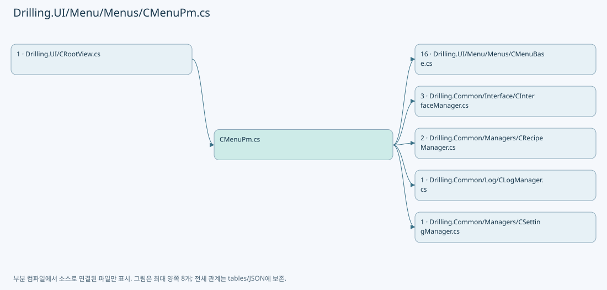
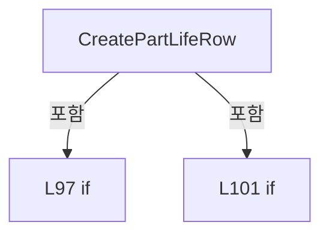
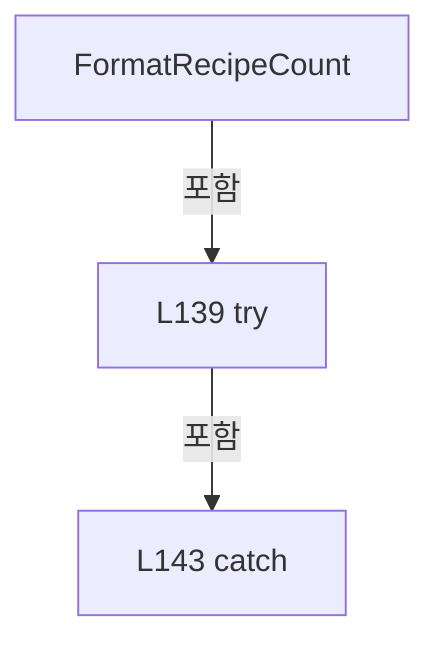
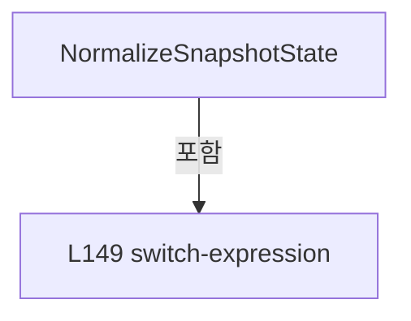

# Drilling.UI/Menu/Menus/CMenuPm.cs

| 항목 | 내용 |
| --- | --- |
| 원본 저장소 | https://github.com/kjuws10-rgb/A3Drilling.git |
| 원본 Commit | 28764c91d521777b8ee068dd7aaf2d3902ce9fe2 |
| 원본 SHA256 | 1393394dca1a9500052acf8e9238a1ce0db7006515a36cc5c68d3d88fccb3258 |
| 파일 분류 | code |
| 원본 크기/행 | 8,226 bytes / 190 physical lines |
| 인코딩 | utf-8-sig |
| 검토 범위 | 구문/부분 의미 분석에서 추출한 사실. 동작·물리 단위·실장비 합격을 보증하지 않습니다. |
| 원본 링크 | [고정 Commit 원본](https://github.com/kjuws10-rgb/A3Drilling/blob/28764c91d521777b8ee068dd7aaf2d3902ce9fe2/Drilling.UI/Menu/Menus/CMenuPm.cs) |

## 파일의 역할과 읽는 순서

WPF 화면·사용자 명령·표시 상태를 구성합니다. XAML 이벤트와 코드 비하인드, RootView의 조립 경로를 함께 추적합니다.

## 네임스페이스·타입·상속

| 타입 | 구분 | 원본 범위 | 선언/상속 |
| --- | --- | --- | --- |
| CMenuPm | ClassDeclaration | 9–179 | CMenuPm: CMenuBase |
| ST_PM_PART_LIFE_ROW | RecordDeclaration | 181–184 | ST_PM_PART_LIFE_ROW |
| ST_PM_HISTORY_ROW | RecordDeclaration | 186–190 | ST_PM_HISTORY_ROW |

## 멤버 빠른 목록

| 이름 | 종류 | 범위 | 서명 |
| --- | --- | --- | --- |
| LaserThgHourLimitKey | FieldDeclaration | L17–17 | string Drilling.UI.Menu.Menus.CMenuPm.LaserThgHourLimitKey |
| Menu | PropertyDeclaration | L19–25 | Drilling.UI.Menu.Menus.EN_MENU Drilling.UI.Menu.Menus.CMenuPm.Menu |
| get_Menu | GetAccessorDeclaration | L21–24 | Drilling.UI.Menu.Menus.EN_MENU Drilling.UI.Menu.Menus.CMenuPm.Menu.get |
| IsLocked | PropertyDeclaration | L27–27 | bool Drilling.UI.Menu.Menus.CMenuPm.IsLocked |
| get_IsLocked | GetAccessorDeclaration | L27–27 | bool Drilling.UI.Menu.Menus.CMenuPm.IsLocked.get |
| set_IsLocked | SetAccessorDeclaration | L27–27 | void Drilling.UI.Menu.Menus.CMenuPm.IsLocked.set |
| StartTime | PropertyDeclaration | L28–28 | string Drilling.UI.Menu.Menus.CMenuPm.StartTime |
| get_StartTime | GetAccessorDeclaration | L28–28 | string Drilling.UI.Menu.Menus.CMenuPm.StartTime.get |
| set_StartTime | SetAccessorDeclaration | L28–28 | void Drilling.UI.Menu.Menus.CMenuPm.StartTime.set |
| LockItems | PropertyDeclaration | L29–29 | System.Collections.Generic.IReadOnlyList<Drilling.UI.Menu.Menus.ST_DISPLAY_ITEM> Drilling.UI.Menu.Menus.CMenuPm.LockItems |
| get_LockItems | GetAccessorDeclaration | L29–29 | System.Collections.Generic.IReadOnlyList<Drilling.UI.Menu.Menus.ST_DISPLAY_ITEM> Drilling.UI.Menu.Menus.CMenuPm.LockItems.get |
| set_LockItems | SetAccessorDeclaration | L29–29 | void Drilling.UI.Menu.Menus.CMenuPm.LockItems.set |
| BlockedItems | PropertyDeclaration | L30–30 | System.Collections.Generic.IReadOnlyList<Drilling.UI.Menu.Menus.ST_DISPLAY_ITEM> Drilling.UI.Menu.Menus.CMenuPm.BlockedItems |
| get_BlockedItems | GetAccessorDeclaration | L30–30 | System.Collections.Generic.IReadOnlyList<Drilling.UI.Menu.Menus.ST_DISPLAY_ITEM> Drilling.UI.Menu.Menus.CMenuPm.BlockedItems.get |
| set_BlockedItems | SetAccessorDeclaration | L30–30 | void Drilling.UI.Menu.Menus.CMenuPm.BlockedItems.set |
| PartLifeRows | PropertyDeclaration | L31–31 | System.Collections.Generic.IReadOnlyList<Drilling.UI.Menu.Menus.ST_PM_PART_LIFE_ROW> Drilling.UI.Menu.Menus.CMenuPm.PartLifeRows |
| get_PartLifeRows | GetAccessorDeclaration | L31–31 | System.Collections.Generic.IReadOnlyList<Drilling.UI.Menu.Menus.ST_PM_PART_LIFE_ROW> Drilling.UI.Menu.Menus.CMenuPm.PartLifeRows.get |
| set_PartLifeRows | SetAccessorDeclaration | L31–31 | void Drilling.UI.Menu.Menus.CMenuPm.PartLifeRows.set |
| ProtectWindowItems | PropertyDeclaration | L32–32 | System.Collections.Generic.IReadOnlyList<Drilling.UI.Menu.Menus.ST_DISPLAY_ITEM> Drilling.UI.Menu.Menus.CMenuPm.ProtectWindowItems |
| get_ProtectWindowItems | GetAccessorDeclaration | L32–32 | System.Collections.Generic.IReadOnlyList<Drilling.UI.Menu.Menus.ST_DISPLAY_ITEM> Drilling.UI.Menu.Menus.CMenuPm.ProtectWindowItems.get |
| set_ProtectWindowItems | SetAccessorDeclaration | L32–32 | void Drilling.UI.Menu.Menus.CMenuPm.ProtectWindowItems.set |
| HistoryRows | PropertyDeclaration | L33–33 | System.Collections.Generic.IReadOnlyList<Drilling.UI.Menu.Menus.ST_PM_HISTORY_ROW> Drilling.UI.Menu.Menus.CMenuPm.HistoryRows |
| get_HistoryRows | GetAccessorDeclaration | L33–33 | System.Collections.Generic.IReadOnlyList<Drilling.UI.Menu.Menus.ST_PM_HISTORY_ROW> Drilling.UI.Menu.Menus.CMenuPm.HistoryRows.get |
| set_HistoryRows | SetAccessorDeclaration | L33–33 | void Drilling.UI.Menu.Menus.CMenuPm.HistoryRows.set |
| Build | MethodDeclaration | L35–60 | System.Threading.Tasks.Task<Drilling.UI.Menu.Menus.CScreenViewModel> Drilling.UI.Menu.Menus.CMenuPm.Build(System.Threading.CancellationToken) |
| Apply | MethodDeclaration | L62–78 | void Drilling.UI.Menu.Menus.CMenuPm.Apply(bool, string, System.Collections.Generic.IReadOnlyList<Drilling.UI.Menu.Menus.ST_DISPLAY_ITEM>, System.Collections.Generic.IReadOnlyList<Drilling.UI.Menu.Menus.ST_DISPLAY_ITEM>, System.Collections.Generic.IReadOnlyList<Drilling.UI.Menu.Menus.ST_PM_PART_LIFE_ROW>, System.Collections.Generic.IReadOnlyList<Drilling.UI.Menu.Menus.ST_DISPLAY_ITEM>, System.Collections.Generic.IReadOnlyList<Drilling.UI.Menu.Menus.ST_PM_HISTORY_ROW>) |
| CreatePartLifeRows | MethodDeclaration | L80–91 | System.Collections.Generic.IReadOnlyList<Drilling.UI.Menu.Menus.ST_PM_PART_LIFE_ROW> Drilling.UI.Menu.Menus.CMenuPm.CreatePartLifeRows(System.Threading.CancellationToken) |
| CreatePartLifeRow | MethodDeclaration | L93–109 | Drilling.UI.Menu.Menus.ST_PM_PART_LIFE_ROW Drilling.UI.Menu.Menus.CMenuPm.CreatePartLifeRow(int, double?, System.Collections.Generic.IReadOnlySet<int>) |
| ReadCrystalLimit | MethodDeclaration | L111–119 | double? Drilling.UI.Menu.Menus.CMenuPm.ReadCrystalLimit(System.Threading.CancellationToken) |
| CreateProtectWindowItems | MethodDeclaration | L121–135 | System.Threading.Tasks.Task<System.Collections.Generic.IReadOnlyList<Drilling.UI.Menu.Menus.ST_DISPLAY_ITEM>> Drilling.UI.Menu.Menus.CMenuPm.CreateProtectWindowItems(System.Threading.CancellationToken) |
| ReadRecipeValue | LocalFunctionStatement | L126–128 | string ReadRecipeValue(string) |
| FormatRecipeCount | MethodDeclaration | L137–147 | string Drilling.UI.Menu.Menus.CMenuPm.FormatRecipeCount(string, string) |
| NormalizeSnapshotState | MethodDeclaration | L149–156 | string Drilling.UI.Menu.Menus.CMenuPm.NormalizeSnapshotState(string) |
| CreateEmptyPartLifeRows | MethodDeclaration | L158–160 | System.Collections.Generic.IReadOnlyList<Drilling.UI.Menu.Menus.ST_PM_PART_LIFE_ROW> Drilling.UI.Menu.Menus.CMenuPm.CreateEmptyPartLifeRows() |
| CreateEmptyProtectWindowItems | MethodDeclaration | L162–166 | System.Collections.Generic.IReadOnlyList<Drilling.UI.Menu.Menus.ST_DISPLAY_ITEM> Drilling.UI.Menu.Menus.CMenuPm.CreateEmptyProtectWindowItems() |
| CreateHistoryRows | MethodDeclaration | L168–174 | System.Collections.Generic.IReadOnlyList<Drilling.UI.Menu.Menus.ST_PM_HISTORY_ROW> Drilling.UI.Menu.Menus.CMenuPm.CreateHistoryRows(System.Collections.Generic.IReadOnlyList<ST_PM_HISTORY_ENTRY>) |
| FormatDuration | MethodDeclaration | L176–178 | string Drilling.UI.Menu.Menus.CMenuPm.FormatDuration(System.TimeSpan) |

## 멤버별 상세 계약·호출·처리 해설

### FieldDeclaration `LaserThgHourLimitKey` · L17–17

[Drilling.UI/Menu/Menus/CMenuPm.cs:17–17](https://github.com/kjuws10-rgb/A3Drilling/blob/28764c91d521777b8ee068dd7aaf2d3902ce9fe2/Drilling.UI/Menu/Menus/CMenuPm.cs#L17-L17)

| 항목 | 실제 추출 값 |
| --- | --- |
| 서명 | string Drilling.UI.Menu.Menus.CMenuPm.LaserThgHourLimitKey |
| 접근/수식자 | Private / private, const |
| 반환/값 타입 | string |
| 소속 타입 | NamedType:Drilling.UI.Menu.Menus.CMenuPm |

현재 부분 분석에서 직접 연결된 호출자는 없습니다. XAML/이벤트/인터페이스·델리게이트·외부 진입을 추가 확인해야 하며, 미사용으로 판정한 것이 아닙니다.

본문의 실제 연산·분기·예외·반환 순서(원문 위치 순):

| 원본 행 | 종류 | 주석 해설 |
| --- | --- | --- |
| 17 | variable-initializer | 변수의 초기값을 지정합니다: LaserThgHourLimitKey = "LASER_THG_HOUR_LIMIT" |

변경 전 점검: 입력/반환 타입, 위 호출자, 예외/취소 경로, 공유 상태와 저장·전송 소비자를 함께 확인합니다. 값의 단위나 물리 방향을 이름만으로 확정하지 않습니다.

### PropertyDeclaration `Menu` · L19–25

[Drilling.UI/Menu/Menus/CMenuPm.cs:19–25](https://github.com/kjuws10-rgb/A3Drilling/blob/28764c91d521777b8ee068dd7aaf2d3902ce9fe2/Drilling.UI/Menu/Menus/CMenuPm.cs#L19-L25)

| 항목 | 실제 추출 값 |
| --- | --- |
| 서명 | Drilling.UI.Menu.Menus.EN_MENU Drilling.UI.Menu.Menus.CMenuPm.Menu |
| 접근/수식자 | Public / public, override |
| 반환/값 타입 | Drilling.UI.Menu.Menus.EN_MENU |
| 소속 타입 | NamedType:Drilling.UI.Menu.Menus.CMenuPm |

현재 부분 분석에서 직접 연결된 호출자는 없습니다. XAML/이벤트/인터페이스·델리게이트·외부 진입을 추가 확인해야 하며, 미사용으로 판정한 것이 아닙니다.

변경 전 점검: 입력/반환 타입, 위 호출자, 예외/취소 경로, 공유 상태와 저장·전송 소비자를 함께 확인합니다. 값의 단위나 물리 방향을 이름만으로 확정하지 않습니다.

### GetAccessorDeclaration `get_Menu` · L21–24

[Drilling.UI/Menu/Menus/CMenuPm.cs:21–24](https://github.com/kjuws10-rgb/A3Drilling/blob/28764c91d521777b8ee068dd7aaf2d3902ce9fe2/Drilling.UI/Menu/Menus/CMenuPm.cs#L21-L24)

| 항목 | 실제 추출 값 |
| --- | --- |
| 서명 | Drilling.UI.Menu.Menus.EN_MENU Drilling.UI.Menu.Menus.CMenuPm.Menu.get |
| 접근/수식자 | Public / get |
| 반환/값 타입 | Drilling.UI.Menu.Menus.EN_MENU |
| 소속 타입 | NamedType:Drilling.UI.Menu.Menus.CMenuPm |

현재 부분 분석에서 직접 연결된 호출자는 없습니다. XAML/이벤트/인터페이스·델리게이트·외부 진입을 추가 확인해야 하며, 미사용으로 판정한 것이 아닙니다.

본문의 실제 연산·분기·예외·반환 순서(원문 위치 순):

| 원본 행 | 종류 | 주석 해설 |
| --- | --- | --- |
| 23 | return | 호출자에게 값 또는 제어를 반환합니다: return EN_MENU.Pm; |

변경 전 점검: 입력/반환 타입, 위 호출자, 예외/취소 경로, 공유 상태와 저장·전송 소비자를 함께 확인합니다. 값의 단위나 물리 방향을 이름만으로 확정하지 않습니다.

### PropertyDeclaration `IsLocked` · L27–27

[Drilling.UI/Menu/Menus/CMenuPm.cs:27–27](https://github.com/kjuws10-rgb/A3Drilling/blob/28764c91d521777b8ee068dd7aaf2d3902ce9fe2/Drilling.UI/Menu/Menus/CMenuPm.cs#L27-L27)

| 항목 | 실제 추출 값 |
| --- | --- |
| 서명 | bool Drilling.UI.Menu.Menus.CMenuPm.IsLocked |
| 접근/수식자 | Public / public |
| 반환/값 타입 | bool |
| 소속 타입 | NamedType:Drilling.UI.Menu.Menus.CMenuPm |

현재 부분 분석에서 직접 연결된 호출자는 없습니다. XAML/이벤트/인터페이스·델리게이트·외부 진입을 추가 확인해야 하며, 미사용으로 판정한 것이 아닙니다.

변경 전 점검: 입력/반환 타입, 위 호출자, 예외/취소 경로, 공유 상태와 저장·전송 소비자를 함께 확인합니다. 값의 단위나 물리 방향을 이름만으로 확정하지 않습니다.

### GetAccessorDeclaration `get_IsLocked` · L27–27

[Drilling.UI/Menu/Menus/CMenuPm.cs:27–27](https://github.com/kjuws10-rgb/A3Drilling/blob/28764c91d521777b8ee068dd7aaf2d3902ce9fe2/Drilling.UI/Menu/Menus/CMenuPm.cs#L27-L27)

| 항목 | 실제 추출 값 |
| --- | --- |
| 서명 | bool Drilling.UI.Menu.Menus.CMenuPm.IsLocked.get |
| 접근/수식자 | Public / get |
| 반환/값 타입 | bool |
| 소속 타입 | NamedType:Drilling.UI.Menu.Menus.CMenuPm |

현재 부분 분석에서 직접 연결된 호출자는 없습니다. XAML/이벤트/인터페이스·델리게이트·외부 진입을 추가 확인해야 하며, 미사용으로 판정한 것이 아닙니다.

변경 전 점검: 입력/반환 타입, 위 호출자, 예외/취소 경로, 공유 상태와 저장·전송 소비자를 함께 확인합니다. 값의 단위나 물리 방향을 이름만으로 확정하지 않습니다.

### SetAccessorDeclaration `set_IsLocked` · L27–27

[Drilling.UI/Menu/Menus/CMenuPm.cs:27–27](https://github.com/kjuws10-rgb/A3Drilling/blob/28764c91d521777b8ee068dd7aaf2d3902ce9fe2/Drilling.UI/Menu/Menus/CMenuPm.cs#L27-L27)

| 항목 | 실제 추출 값 |
| --- | --- |
| 서명 | void Drilling.UI.Menu.Menus.CMenuPm.IsLocked.set |
| 접근/수식자 | Private / private, set |
| 반환/값 타입 | void |
| 소속 타입 | NamedType:Drilling.UI.Menu.Menus.CMenuPm |

입력 계약:

| 이름 | 타입 | 전달 | 선택/기본값 |
| --- | --- | --- | --- |
| value | bool | None | False /  |

현재 부분 분석에서 직접 연결된 호출자는 없습니다. XAML/이벤트/인터페이스·델리게이트·외부 진입을 추가 확인해야 하며, 미사용으로 판정한 것이 아닙니다.

변경 전 점검: 입력/반환 타입, 위 호출자, 예외/취소 경로, 공유 상태와 저장·전송 소비자를 함께 확인합니다. 값의 단위나 물리 방향을 이름만으로 확정하지 않습니다.

### PropertyDeclaration `StartTime` · L28–28

[Drilling.UI/Menu/Menus/CMenuPm.cs:28–28](https://github.com/kjuws10-rgb/A3Drilling/blob/28764c91d521777b8ee068dd7aaf2d3902ce9fe2/Drilling.UI/Menu/Menus/CMenuPm.cs#L28-L28)

| 항목 | 실제 추출 값 |
| --- | --- |
| 서명 | string Drilling.UI.Menu.Menus.CMenuPm.StartTime |
| 접근/수식자 | Public / public |
| 반환/값 타입 | string |
| 소속 타입 | NamedType:Drilling.UI.Menu.Menus.CMenuPm |

현재 부분 분석에서 직접 연결된 호출자는 없습니다. XAML/이벤트/인터페이스·델리게이트·외부 진입을 추가 확인해야 하며, 미사용으로 판정한 것이 아닙니다.

변경 전 점검: 입력/반환 타입, 위 호출자, 예외/취소 경로, 공유 상태와 저장·전송 소비자를 함께 확인합니다. 값의 단위나 물리 방향을 이름만으로 확정하지 않습니다.

### GetAccessorDeclaration `get_StartTime` · L28–28

[Drilling.UI/Menu/Menus/CMenuPm.cs:28–28](https://github.com/kjuws10-rgb/A3Drilling/blob/28764c91d521777b8ee068dd7aaf2d3902ce9fe2/Drilling.UI/Menu/Menus/CMenuPm.cs#L28-L28)

| 항목 | 실제 추출 값 |
| --- | --- |
| 서명 | string Drilling.UI.Menu.Menus.CMenuPm.StartTime.get |
| 접근/수식자 | Public / get |
| 반환/값 타입 | string |
| 소속 타입 | NamedType:Drilling.UI.Menu.Menus.CMenuPm |

현재 부분 분석에서 직접 연결된 호출자는 없습니다. XAML/이벤트/인터페이스·델리게이트·외부 진입을 추가 확인해야 하며, 미사용으로 판정한 것이 아닙니다.

변경 전 점검: 입력/반환 타입, 위 호출자, 예외/취소 경로, 공유 상태와 저장·전송 소비자를 함께 확인합니다. 값의 단위나 물리 방향을 이름만으로 확정하지 않습니다.

### SetAccessorDeclaration `set_StartTime` · L28–28

[Drilling.UI/Menu/Menus/CMenuPm.cs:28–28](https://github.com/kjuws10-rgb/A3Drilling/blob/28764c91d521777b8ee068dd7aaf2d3902ce9fe2/Drilling.UI/Menu/Menus/CMenuPm.cs#L28-L28)

| 항목 | 실제 추출 값 |
| --- | --- |
| 서명 | void Drilling.UI.Menu.Menus.CMenuPm.StartTime.set |
| 접근/수식자 | Private / private, set |
| 반환/값 타입 | void |
| 소속 타입 | NamedType:Drilling.UI.Menu.Menus.CMenuPm |

입력 계약:

| 이름 | 타입 | 전달 | 선택/기본값 |
| --- | --- | --- | --- |
| value | string | None | False /  |

현재 부분 분석에서 직접 연결된 호출자는 없습니다. XAML/이벤트/인터페이스·델리게이트·외부 진입을 추가 확인해야 하며, 미사용으로 판정한 것이 아닙니다.

변경 전 점검: 입력/반환 타입, 위 호출자, 예외/취소 경로, 공유 상태와 저장·전송 소비자를 함께 확인합니다. 값의 단위나 물리 방향을 이름만으로 확정하지 않습니다.

### PropertyDeclaration `LockItems` · L29–29

[Drilling.UI/Menu/Menus/CMenuPm.cs:29–29](https://github.com/kjuws10-rgb/A3Drilling/blob/28764c91d521777b8ee068dd7aaf2d3902ce9fe2/Drilling.UI/Menu/Menus/CMenuPm.cs#L29-L29)

| 항목 | 실제 추출 값 |
| --- | --- |
| 서명 | System.Collections.Generic.IReadOnlyList<Drilling.UI.Menu.Menus.ST_DISPLAY_ITEM> Drilling.UI.Menu.Menus.CMenuPm.LockItems |
| 접근/수식자 | Public / public |
| 반환/값 타입 | System.Collections.Generic.IReadOnlyList<Drilling.UI.Menu.Menus.ST_DISPLAY_ITEM> |
| 소속 타입 | NamedType:Drilling.UI.Menu.Menus.CMenuPm |

현재 부분 분석에서 직접 연결된 호출자는 없습니다. XAML/이벤트/인터페이스·델리게이트·외부 진입을 추가 확인해야 하며, 미사용으로 판정한 것이 아닙니다.

변경 전 점검: 입력/반환 타입, 위 호출자, 예외/취소 경로, 공유 상태와 저장·전송 소비자를 함께 확인합니다. 값의 단위나 물리 방향을 이름만으로 확정하지 않습니다.

### GetAccessorDeclaration `get_LockItems` · L29–29

[Drilling.UI/Menu/Menus/CMenuPm.cs:29–29](https://github.com/kjuws10-rgb/A3Drilling/blob/28764c91d521777b8ee068dd7aaf2d3902ce9fe2/Drilling.UI/Menu/Menus/CMenuPm.cs#L29-L29)

| 항목 | 실제 추출 값 |
| --- | --- |
| 서명 | System.Collections.Generic.IReadOnlyList<Drilling.UI.Menu.Menus.ST_DISPLAY_ITEM> Drilling.UI.Menu.Menus.CMenuPm.LockItems.get |
| 접근/수식자 | Public / get |
| 반환/값 타입 | System.Collections.Generic.IReadOnlyList<Drilling.UI.Menu.Menus.ST_DISPLAY_ITEM> |
| 소속 타입 | NamedType:Drilling.UI.Menu.Menus.CMenuPm |

현재 부분 분석에서 직접 연결된 호출자는 없습니다. XAML/이벤트/인터페이스·델리게이트·외부 진입을 추가 확인해야 하며, 미사용으로 판정한 것이 아닙니다.

변경 전 점검: 입력/반환 타입, 위 호출자, 예외/취소 경로, 공유 상태와 저장·전송 소비자를 함께 확인합니다. 값의 단위나 물리 방향을 이름만으로 확정하지 않습니다.

### SetAccessorDeclaration `set_LockItems` · L29–29

[Drilling.UI/Menu/Menus/CMenuPm.cs:29–29](https://github.com/kjuws10-rgb/A3Drilling/blob/28764c91d521777b8ee068dd7aaf2d3902ce9fe2/Drilling.UI/Menu/Menus/CMenuPm.cs#L29-L29)

| 항목 | 실제 추출 값 |
| --- | --- |
| 서명 | void Drilling.UI.Menu.Menus.CMenuPm.LockItems.set |
| 접근/수식자 | Private / private, set |
| 반환/값 타입 | void |
| 소속 타입 | NamedType:Drilling.UI.Menu.Menus.CMenuPm |

입력 계약:

| 이름 | 타입 | 전달 | 선택/기본값 |
| --- | --- | --- | --- |
| value | System.Collections.Generic.IReadOnlyList<Drilling.UI.Menu.Menus.ST_DISPLAY_ITEM> | None | False /  |

현재 부분 분석에서 직접 연결된 호출자는 없습니다. XAML/이벤트/인터페이스·델리게이트·외부 진입을 추가 확인해야 하며, 미사용으로 판정한 것이 아닙니다.

변경 전 점검: 입력/반환 타입, 위 호출자, 예외/취소 경로, 공유 상태와 저장·전송 소비자를 함께 확인합니다. 값의 단위나 물리 방향을 이름만으로 확정하지 않습니다.

### PropertyDeclaration `BlockedItems` · L30–30

[Drilling.UI/Menu/Menus/CMenuPm.cs:30–30](https://github.com/kjuws10-rgb/A3Drilling/blob/28764c91d521777b8ee068dd7aaf2d3902ce9fe2/Drilling.UI/Menu/Menus/CMenuPm.cs#L30-L30)

| 항목 | 실제 추출 값 |
| --- | --- |
| 서명 | System.Collections.Generic.IReadOnlyList<Drilling.UI.Menu.Menus.ST_DISPLAY_ITEM> Drilling.UI.Menu.Menus.CMenuPm.BlockedItems |
| 접근/수식자 | Public / public |
| 반환/값 타입 | System.Collections.Generic.IReadOnlyList<Drilling.UI.Menu.Menus.ST_DISPLAY_ITEM> |
| 소속 타입 | NamedType:Drilling.UI.Menu.Menus.CMenuPm |

현재 부분 분석에서 직접 연결된 호출자는 없습니다. XAML/이벤트/인터페이스·델리게이트·외부 진입을 추가 확인해야 하며, 미사용으로 판정한 것이 아닙니다.

변경 전 점검: 입력/반환 타입, 위 호출자, 예외/취소 경로, 공유 상태와 저장·전송 소비자를 함께 확인합니다. 값의 단위나 물리 방향을 이름만으로 확정하지 않습니다.

### GetAccessorDeclaration `get_BlockedItems` · L30–30

[Drilling.UI/Menu/Menus/CMenuPm.cs:30–30](https://github.com/kjuws10-rgb/A3Drilling/blob/28764c91d521777b8ee068dd7aaf2d3902ce9fe2/Drilling.UI/Menu/Menus/CMenuPm.cs#L30-L30)

| 항목 | 실제 추출 값 |
| --- | --- |
| 서명 | System.Collections.Generic.IReadOnlyList<Drilling.UI.Menu.Menus.ST_DISPLAY_ITEM> Drilling.UI.Menu.Menus.CMenuPm.BlockedItems.get |
| 접근/수식자 | Public / get |
| 반환/값 타입 | System.Collections.Generic.IReadOnlyList<Drilling.UI.Menu.Menus.ST_DISPLAY_ITEM> |
| 소속 타입 | NamedType:Drilling.UI.Menu.Menus.CMenuPm |

현재 부분 분석에서 직접 연결된 호출자는 없습니다. XAML/이벤트/인터페이스·델리게이트·외부 진입을 추가 확인해야 하며, 미사용으로 판정한 것이 아닙니다.

변경 전 점검: 입력/반환 타입, 위 호출자, 예외/취소 경로, 공유 상태와 저장·전송 소비자를 함께 확인합니다. 값의 단위나 물리 방향을 이름만으로 확정하지 않습니다.

### SetAccessorDeclaration `set_BlockedItems` · L30–30

[Drilling.UI/Menu/Menus/CMenuPm.cs:30–30](https://github.com/kjuws10-rgb/A3Drilling/blob/28764c91d521777b8ee068dd7aaf2d3902ce9fe2/Drilling.UI/Menu/Menus/CMenuPm.cs#L30-L30)

| 항목 | 실제 추출 값 |
| --- | --- |
| 서명 | void Drilling.UI.Menu.Menus.CMenuPm.BlockedItems.set |
| 접근/수식자 | Private / private, set |
| 반환/값 타입 | void |
| 소속 타입 | NamedType:Drilling.UI.Menu.Menus.CMenuPm |

입력 계약:

| 이름 | 타입 | 전달 | 선택/기본값 |
| --- | --- | --- | --- |
| value | System.Collections.Generic.IReadOnlyList<Drilling.UI.Menu.Menus.ST_DISPLAY_ITEM> | None | False /  |

현재 부분 분석에서 직접 연결된 호출자는 없습니다. XAML/이벤트/인터페이스·델리게이트·외부 진입을 추가 확인해야 하며, 미사용으로 판정한 것이 아닙니다.

변경 전 점검: 입력/반환 타입, 위 호출자, 예외/취소 경로, 공유 상태와 저장·전송 소비자를 함께 확인합니다. 값의 단위나 물리 방향을 이름만으로 확정하지 않습니다.

### PropertyDeclaration `PartLifeRows` · L31–31

[Drilling.UI/Menu/Menus/CMenuPm.cs:31–31](https://github.com/kjuws10-rgb/A3Drilling/blob/28764c91d521777b8ee068dd7aaf2d3902ce9fe2/Drilling.UI/Menu/Menus/CMenuPm.cs#L31-L31)

| 항목 | 실제 추출 값 |
| --- | --- |
| 서명 | System.Collections.Generic.IReadOnlyList<Drilling.UI.Menu.Menus.ST_PM_PART_LIFE_ROW> Drilling.UI.Menu.Menus.CMenuPm.PartLifeRows |
| 접근/수식자 | Public / public |
| 반환/값 타입 | System.Collections.Generic.IReadOnlyList<Drilling.UI.Menu.Menus.ST_PM_PART_LIFE_ROW> |
| 소속 타입 | NamedType:Drilling.UI.Menu.Menus.CMenuPm |

현재 부분 분석에서 직접 연결된 호출자는 없습니다. XAML/이벤트/인터페이스·델리게이트·외부 진입을 추가 확인해야 하며, 미사용으로 판정한 것이 아닙니다.

호출하는 대상과 해석 범위:

| 원본 행 | 표현식 | 분석 상태 | 대상/소스 위치 |
| --- | --- | --- | --- |
| 31 | CreateEmptyPartLifeRows | resolved | System.Collections.Generic.IReadOnlyList<Drilling.UI.Menu.Menus.ST_PM_PART_LIFE_ROW> Drilling.UI.Menu.Menus.CMenuPm.CreateEmptyPartLifeRows() · Drilling.UI/Menu/Menus/CMenuPm.cs:158 |

본문의 실제 연산·분기·예외·반환 순서(원문 위치 순):

| 원본 행 | 종류 | 주석 해설 |
| --- | --- | --- |
| 31 | call | 함수·델리게이트 또는 객체 생성자를 호출합니다: CreateEmptyPartLifeRows() |

변경 전 점검: 입력/반환 타입, 위 호출자, 예외/취소 경로, 공유 상태와 저장·전송 소비자를 함께 확인합니다. 값의 단위나 물리 방향을 이름만으로 확정하지 않습니다.

### GetAccessorDeclaration `get_PartLifeRows` · L31–31

[Drilling.UI/Menu/Menus/CMenuPm.cs:31–31](https://github.com/kjuws10-rgb/A3Drilling/blob/28764c91d521777b8ee068dd7aaf2d3902ce9fe2/Drilling.UI/Menu/Menus/CMenuPm.cs#L31-L31)

| 항목 | 실제 추출 값 |
| --- | --- |
| 서명 | System.Collections.Generic.IReadOnlyList<Drilling.UI.Menu.Menus.ST_PM_PART_LIFE_ROW> Drilling.UI.Menu.Menus.CMenuPm.PartLifeRows.get |
| 접근/수식자 | Public / get |
| 반환/값 타입 | System.Collections.Generic.IReadOnlyList<Drilling.UI.Menu.Menus.ST_PM_PART_LIFE_ROW> |
| 소속 타입 | NamedType:Drilling.UI.Menu.Menus.CMenuPm |

현재 부분 분석에서 직접 연결된 호출자는 없습니다. XAML/이벤트/인터페이스·델리게이트·외부 진입을 추가 확인해야 하며, 미사용으로 판정한 것이 아닙니다.

변경 전 점검: 입력/반환 타입, 위 호출자, 예외/취소 경로, 공유 상태와 저장·전송 소비자를 함께 확인합니다. 값의 단위나 물리 방향을 이름만으로 확정하지 않습니다.

### SetAccessorDeclaration `set_PartLifeRows` · L31–31

[Drilling.UI/Menu/Menus/CMenuPm.cs:31–31](https://github.com/kjuws10-rgb/A3Drilling/blob/28764c91d521777b8ee068dd7aaf2d3902ce9fe2/Drilling.UI/Menu/Menus/CMenuPm.cs#L31-L31)

| 항목 | 실제 추출 값 |
| --- | --- |
| 서명 | void Drilling.UI.Menu.Menus.CMenuPm.PartLifeRows.set |
| 접근/수식자 | Private / private, set |
| 반환/값 타입 | void |
| 소속 타입 | NamedType:Drilling.UI.Menu.Menus.CMenuPm |

입력 계약:

| 이름 | 타입 | 전달 | 선택/기본값 |
| --- | --- | --- | --- |
| value | System.Collections.Generic.IReadOnlyList<Drilling.UI.Menu.Menus.ST_PM_PART_LIFE_ROW> | None | False /  |

현재 부분 분석에서 직접 연결된 호출자는 없습니다. XAML/이벤트/인터페이스·델리게이트·외부 진입을 추가 확인해야 하며, 미사용으로 판정한 것이 아닙니다.

변경 전 점검: 입력/반환 타입, 위 호출자, 예외/취소 경로, 공유 상태와 저장·전송 소비자를 함께 확인합니다. 값의 단위나 물리 방향을 이름만으로 확정하지 않습니다.

### PropertyDeclaration `ProtectWindowItems` · L32–32

[Drilling.UI/Menu/Menus/CMenuPm.cs:32–32](https://github.com/kjuws10-rgb/A3Drilling/blob/28764c91d521777b8ee068dd7aaf2d3902ce9fe2/Drilling.UI/Menu/Menus/CMenuPm.cs#L32-L32)

| 항목 | 실제 추출 값 |
| --- | --- |
| 서명 | System.Collections.Generic.IReadOnlyList<Drilling.UI.Menu.Menus.ST_DISPLAY_ITEM> Drilling.UI.Menu.Menus.CMenuPm.ProtectWindowItems |
| 접근/수식자 | Public / public |
| 반환/값 타입 | System.Collections.Generic.IReadOnlyList<Drilling.UI.Menu.Menus.ST_DISPLAY_ITEM> |
| 소속 타입 | NamedType:Drilling.UI.Menu.Menus.CMenuPm |

현재 부분 분석에서 직접 연결된 호출자는 없습니다. XAML/이벤트/인터페이스·델리게이트·외부 진입을 추가 확인해야 하며, 미사용으로 판정한 것이 아닙니다.

호출하는 대상과 해석 범위:

| 원본 행 | 표현식 | 분석 상태 | 대상/소스 위치 |
| --- | --- | --- | --- |
| 32 | CreateEmptyProtectWindowItems | resolved | System.Collections.Generic.IReadOnlyList<Drilling.UI.Menu.Menus.ST_DISPLAY_ITEM> Drilling.UI.Menu.Menus.CMenuPm.CreateEmptyProtectWindowItems() · Drilling.UI/Menu/Menus/CMenuPm.cs:162 |

본문의 실제 연산·분기·예외·반환 순서(원문 위치 순):

| 원본 행 | 종류 | 주석 해설 |
| --- | --- | --- |
| 32 | call | 함수·델리게이트 또는 객체 생성자를 호출합니다: CreateEmptyProtectWindowItems() |

변경 전 점검: 입력/반환 타입, 위 호출자, 예외/취소 경로, 공유 상태와 저장·전송 소비자를 함께 확인합니다. 값의 단위나 물리 방향을 이름만으로 확정하지 않습니다.

### GetAccessorDeclaration `get_ProtectWindowItems` · L32–32

[Drilling.UI/Menu/Menus/CMenuPm.cs:32–32](https://github.com/kjuws10-rgb/A3Drilling/blob/28764c91d521777b8ee068dd7aaf2d3902ce9fe2/Drilling.UI/Menu/Menus/CMenuPm.cs#L32-L32)

| 항목 | 실제 추출 값 |
| --- | --- |
| 서명 | System.Collections.Generic.IReadOnlyList<Drilling.UI.Menu.Menus.ST_DISPLAY_ITEM> Drilling.UI.Menu.Menus.CMenuPm.ProtectWindowItems.get |
| 접근/수식자 | Public / get |
| 반환/값 타입 | System.Collections.Generic.IReadOnlyList<Drilling.UI.Menu.Menus.ST_DISPLAY_ITEM> |
| 소속 타입 | NamedType:Drilling.UI.Menu.Menus.CMenuPm |

현재 부분 분석에서 직접 연결된 호출자는 없습니다. XAML/이벤트/인터페이스·델리게이트·외부 진입을 추가 확인해야 하며, 미사용으로 판정한 것이 아닙니다.

변경 전 점검: 입력/반환 타입, 위 호출자, 예외/취소 경로, 공유 상태와 저장·전송 소비자를 함께 확인합니다. 값의 단위나 물리 방향을 이름만으로 확정하지 않습니다.

### SetAccessorDeclaration `set_ProtectWindowItems` · L32–32

[Drilling.UI/Menu/Menus/CMenuPm.cs:32–32](https://github.com/kjuws10-rgb/A3Drilling/blob/28764c91d521777b8ee068dd7aaf2d3902ce9fe2/Drilling.UI/Menu/Menus/CMenuPm.cs#L32-L32)

| 항목 | 실제 추출 값 |
| --- | --- |
| 서명 | void Drilling.UI.Menu.Menus.CMenuPm.ProtectWindowItems.set |
| 접근/수식자 | Private / private, set |
| 반환/값 타입 | void |
| 소속 타입 | NamedType:Drilling.UI.Menu.Menus.CMenuPm |

입력 계약:

| 이름 | 타입 | 전달 | 선택/기본값 |
| --- | --- | --- | --- |
| value | System.Collections.Generic.IReadOnlyList<Drilling.UI.Menu.Menus.ST_DISPLAY_ITEM> | None | False /  |

현재 부분 분석에서 직접 연결된 호출자는 없습니다. XAML/이벤트/인터페이스·델리게이트·외부 진입을 추가 확인해야 하며, 미사용으로 판정한 것이 아닙니다.

변경 전 점검: 입력/반환 타입, 위 호출자, 예외/취소 경로, 공유 상태와 저장·전송 소비자를 함께 확인합니다. 값의 단위나 물리 방향을 이름만으로 확정하지 않습니다.

### PropertyDeclaration `HistoryRows` · L33–33

[Drilling.UI/Menu/Menus/CMenuPm.cs:33–33](https://github.com/kjuws10-rgb/A3Drilling/blob/28764c91d521777b8ee068dd7aaf2d3902ce9fe2/Drilling.UI/Menu/Menus/CMenuPm.cs#L33-L33)

| 항목 | 실제 추출 값 |
| --- | --- |
| 서명 | System.Collections.Generic.IReadOnlyList<Drilling.UI.Menu.Menus.ST_PM_HISTORY_ROW> Drilling.UI.Menu.Menus.CMenuPm.HistoryRows |
| 접근/수식자 | Public / public |
| 반환/값 타입 | System.Collections.Generic.IReadOnlyList<Drilling.UI.Menu.Menus.ST_PM_HISTORY_ROW> |
| 소속 타입 | NamedType:Drilling.UI.Menu.Menus.CMenuPm |

현재 부분 분석에서 직접 연결된 호출자는 없습니다. XAML/이벤트/인터페이스·델리게이트·외부 진입을 추가 확인해야 하며, 미사용으로 판정한 것이 아닙니다.

변경 전 점검: 입력/반환 타입, 위 호출자, 예외/취소 경로, 공유 상태와 저장·전송 소비자를 함께 확인합니다. 값의 단위나 물리 방향을 이름만으로 확정하지 않습니다.

### GetAccessorDeclaration `get_HistoryRows` · L33–33

[Drilling.UI/Menu/Menus/CMenuPm.cs:33–33](https://github.com/kjuws10-rgb/A3Drilling/blob/28764c91d521777b8ee068dd7aaf2d3902ce9fe2/Drilling.UI/Menu/Menus/CMenuPm.cs#L33-L33)

| 항목 | 실제 추출 값 |
| --- | --- |
| 서명 | System.Collections.Generic.IReadOnlyList<Drilling.UI.Menu.Menus.ST_PM_HISTORY_ROW> Drilling.UI.Menu.Menus.CMenuPm.HistoryRows.get |
| 접근/수식자 | Public / get |
| 반환/값 타입 | System.Collections.Generic.IReadOnlyList<Drilling.UI.Menu.Menus.ST_PM_HISTORY_ROW> |
| 소속 타입 | NamedType:Drilling.UI.Menu.Menus.CMenuPm |

현재 부분 분석에서 직접 연결된 호출자는 없습니다. XAML/이벤트/인터페이스·델리게이트·외부 진입을 추가 확인해야 하며, 미사용으로 판정한 것이 아닙니다.

변경 전 점검: 입력/반환 타입, 위 호출자, 예외/취소 경로, 공유 상태와 저장·전송 소비자를 함께 확인합니다. 값의 단위나 물리 방향을 이름만으로 확정하지 않습니다.

### SetAccessorDeclaration `set_HistoryRows` · L33–33

[Drilling.UI/Menu/Menus/CMenuPm.cs:33–33](https://github.com/kjuws10-rgb/A3Drilling/blob/28764c91d521777b8ee068dd7aaf2d3902ce9fe2/Drilling.UI/Menu/Menus/CMenuPm.cs#L33-L33)

| 항목 | 실제 추출 값 |
| --- | --- |
| 서명 | void Drilling.UI.Menu.Menus.CMenuPm.HistoryRows.set |
| 접근/수식자 | Private / private, set |
| 반환/값 타입 | void |
| 소속 타입 | NamedType:Drilling.UI.Menu.Menus.CMenuPm |

입력 계약:

| 이름 | 타입 | 전달 | 선택/기본값 |
| --- | --- | --- | --- |
| value | System.Collections.Generic.IReadOnlyList<Drilling.UI.Menu.Menus.ST_PM_HISTORY_ROW> | None | False /  |

현재 부분 분석에서 직접 연결된 호출자는 없습니다. XAML/이벤트/인터페이스·델리게이트·외부 진입을 추가 확인해야 하며, 미사용으로 판정한 것이 아닙니다.

변경 전 점검: 입력/반환 타입, 위 호출자, 예외/취소 경로, 공유 상태와 저장·전송 소비자를 함께 확인합니다. 값의 단위나 물리 방향을 이름만으로 확정하지 않습니다.

### MethodDeclaration `Build` · L35–60

[Drilling.UI/Menu/Menus/CMenuPm.cs:35–60](https://github.com/kjuws10-rgb/A3Drilling/blob/28764c91d521777b8ee068dd7aaf2d3902ce9fe2/Drilling.UI/Menu/Menus/CMenuPm.cs#L35-L60)

| 항목 | 실제 추출 값 |
| --- | --- |
| 서명 | System.Threading.Tasks.Task<Drilling.UI.Menu.Menus.CScreenViewModel> Drilling.UI.Menu.Menus.CMenuPm.Build(System.Threading.CancellationToken) |
| 접근/수식자 | Public / public, override, async |
| 반환/값 타입 | System.Threading.Tasks.Task<Drilling.UI.Menu.Menus.CScreenViewModel> |
| 소속 타입 | NamedType:Drilling.UI.Menu.Menus.CMenuPm |

입력 계약:

| 이름 | 타입 | 전달 | 선택/기본값 |
| --- | --- | --- | --- |
| cancellationToken | System.Threading.CancellationToken | None | True / null |

현재 부분 분석에서 직접 연결된 호출자는 없습니다. XAML/이벤트/인터페이스·델리게이트·외부 진입을 추가 확인해야 하며, 미사용으로 판정한 것이 아닙니다.

호출하는 대상과 해석 범위:

| 원본 행 | 표현식 | 분석 상태 | 대상/소스 위치 |
| --- | --- | --- | --- |
| 37 | cancellationToken.ThrowIfCancellationRequested | resolved | void System.Threading.CancellationToken.ThrowIfCancellationRequested() |
| 38 | lockStatusProvider | resolved · 동적 구현 선택 가능 | Drilling.Common.Managers.ST_PM_LOCK_STATUS System.Func<Drilling.Common.Managers.ST_PM_LOCK_STATUS>.Invoke() |
| 39 | CreatePartLifeRows | resolved | System.Collections.Generic.IReadOnlyList<Drilling.UI.Menu.Menus.ST_PM_PART_LIFE_ROW> Drilling.UI.Menu.Menus.CMenuPm.CreatePartLifeRows(System.Threading.CancellationToken) · Drilling.UI/Menu/Menus/CMenuPm.cs:80 |
| 40 | CreateProtectWindowItems(cancellationToken).ConfigureAwait | resolved | System.Runtime.CompilerServices.ConfiguredTaskAwaitable<System.Collections.Generic.IReadOnlyList<Drilling.UI.Menu.Menus.ST_DISPLAY_ITEM>> System.Threading.Tasks.Task<System.Collections.Generic.IReadOnlyList<Drilling.UI.Menu.Menus.ST_DISPLAY_ITEM>>.ConfigureAwait(bool) |
| 40 | CreateProtectWindowItems | resolved | System.Threading.Tasks.Task<System.Collections.Generic.IReadOnlyList<Drilling.UI.Menu.Menus.ST_DISPLAY_ITEM>> Drilling.UI.Menu.Menus.CMenuPm.CreateProtectWindowItems(System.Threading.CancellationToken) · Drilling.UI/Menu/Menus/CMenuPm.cs:121 |
| 41 | CreateHistoryRows | candidate | OverloadResolutionFailure |
| 41 | logManager.ReadPmHistory | unresolved | None |
| 42 | .ToString | resolved | string System.DateTimeOffset.ToString(string?, System.IFormatProvider?) |
| 43 | DateTime.Now.ToString | resolved | string System.DateTime.ToString(string?, System.IFormatProvider?) |
| 44 | Apply | resolved | void Drilling.UI.Menu.Menus.CMenuPm.Apply(bool, string, System.Collections.Generic.IReadOnlyList<Drilling.UI.Menu.Menus.ST_DISPLAY_ITEM>, System.Collections.Generic.IReadOnlyList<Drilling.UI.Menu.Menus.ST_DISPLAY_ITEM>, System.Collections.Generic.IReadOnlyList<Drilling.UI.Menu.Menus.ST_PM_PART_LIFE_ROW>, System.Collections.Generic.IReadOnlyList<Drilling.UI.Menu.Menus.ST_DISPLAY_ITEM>, System.Collections.Generic.IReadOnlyList<Drilling.UI.Menu.Menus.ST_PM_HISTORY_ROW>) · Drilling.UI/Menu/Menus/CMenuPm.cs:62 |
| 47 | new | resolved | Drilling.UI.Menu.Menus.ST_DISPLAY_ITEM.ST_DISPLAY_ITEM(string, string, string) · Drilling.UI/Menu/Menus/CMenuBase.cs:43 |
| 47 | new | resolved | Drilling.UI.Menu.Menus.ST_DISPLAY_ITEM.ST_DISPLAY_ITEM(string, string, string) · Drilling.UI/Menu/Menus/CMenuBase.cs:43 |
| 47 | new | resolved | Drilling.UI.Menu.Menus.ST_DISPLAY_ITEM.ST_DISPLAY_ITEM(string, string, string) · Drilling.UI/Menu/Menus/CMenuBase.cs:43 |
| 48 | new | resolved | Drilling.UI.Menu.Menus.ST_DISPLAY_ITEM.ST_DISPLAY_ITEM(string, string, string) · Drilling.UI/Menu/Menus/CMenuBase.cs:43 |
| 48 | new | resolved | Drilling.UI.Menu.Menus.ST_DISPLAY_ITEM.ST_DISPLAY_ITEM(string, string, string) · Drilling.UI/Menu/Menus/CMenuBase.cs:43 |
| 48 | new | resolved | Drilling.UI.Menu.Menus.ST_DISPLAY_ITEM.ST_DISPLAY_ITEM(string, string, string) · Drilling.UI/Menu/Menus/CMenuBase.cs:43 |
| 52 | new CScreenViewModel | resolved | Drilling.UI.Menu.Menus.CScreenViewModel.CScreenViewModel(Drilling.UI.Menu.Menus.EN_MENU, string, string, System.Collections.Generic.IReadOnlyList<Drilling.UI.Menu.Menus.ST_DISPLAY_ITEM>, System.Collections.Generic.IReadOnlyList<Drilling.UI.Menu.Menus.ST_SCREEN_SECTION>, bool, Drilling.UI.Menu.Menus.CMenuMain?, Drilling.UI.Menu.Menus.CMenuManual?, Drilling.UI.Menu.Menus.CMenuRecipe?, Drilling.UI.Menu.Menus.CMenuSetting?, Drilling.UI.Menu.Menus.CMenuAlarm?, Drilling.UI.Menu.Menus.CMenuMonitor?, Drilling.UI.Menu.Menus.CMenuReview?, Drilling.UI.Menu.Menus.CMenuCorrection?, Drilling.UI.Menu.Menus.CMenuPm?) · Drilling.UI/Menu/Menus/CMenuBase.cs:411 |
| 56 | new | resolved | Drilling.UI.Menu.Menus.ST_DISPLAY_ITEM.ST_DISPLAY_ITEM(string, string, string) · Drilling.UI/Menu/Menus/CMenuBase.cs:43 |
| 56 | new | resolved | Drilling.UI.Menu.Menus.ST_DISPLAY_ITEM.ST_DISPLAY_ITEM(string, string, string) · Drilling.UI/Menu/Menus/CMenuBase.cs:43 |
| 56 | .ToString | resolved | string System.DateTimeOffset.ToString(string?) |
| 57 | new | resolved | Drilling.UI.Menu.Menus.ST_SCREEN_SECTION.ST_SCREEN_SECTION(string, System.Collections.Generic.IReadOnlyList<Drilling.UI.Menu.Menus.ST_DISPLAY_ITEM>) · Drilling.UI/Menu/Menus/CMenuBase.cs:410 |
| 57 | new | resolved | Drilling.UI.Menu.Menus.ST_DISPLAY_ITEM.ST_DISPLAY_ITEM(string, string, string) · Drilling.UI/Menu/Menus/CMenuBase.cs:43 |
| 57 | new | resolved | Drilling.UI.Menu.Menus.ST_DISPLAY_ITEM.ST_DISPLAY_ITEM(string, string, string) · Drilling.UI/Menu/Menus/CMenuBase.cs:43 |

본문의 실제 연산·분기·예외·반환 순서(원문 위치 순):

| 원본 행 | 종류 | 주석 해설 |
| --- | --- | --- |
| 37 | call | 함수·델리게이트 또는 객체 생성자를 호출합니다: cancellationToken.ThrowIfCancellationRequested() |
| 38 | call | 함수·델리게이트 또는 객체 생성자를 호출합니다: lockStatusProvider() |
| 38 | local-declaration | 지역 변수를 선언합니다: var current = lockStatusProvider(); |
| 38 | variable-initializer | 변수의 초기값을 지정합니다: current = lockStatusProvider() |
| 39 | call | 함수·델리게이트 또는 객체 생성자를 호출합니다: CreatePartLifeRows(cancellationToken) |
| 39 | local-declaration | 지역 변수를 선언합니다: var partLifeRows = CreatePartLifeRows(cancellationToken); |
| 39 | variable-initializer | 변수의 초기값을 지정합니다: partLifeRows = CreatePartLifeRows(cancellationToken) |
| 40 | await | 비동기 완료를 기다립니다: await CreateProtectWindowItems(cancellationToken).ConfigureAwait(false) |
| 40 | call | 함수·델리게이트 또는 객체 생성자를 호출합니다: CreateProtectWindowItems(cancellationToken).ConfigureAwait(false) |
| 40 | call | 함수·델리게이트 또는 객체 생성자를 호출합니다: CreateProtectWindowItems(cancellationToken) |
| 40 | local-declaration | 지역 변수를 선언합니다: var protectWindowItems = await CreateProtectWindowItems(cancellationToken).ConfigureAwait(false); |
| 40 | variable-initializer | 변수의 초기값을 지정합니다: protectWindowItems = await CreateProtectWindowItems(cancellationToken).ConfigureAwait(false) |
| 41 | call | 함수·델리게이트 또는 객체 생성자를 호출합니다: CreateHistoryRows(logManager.ReadPmHistory()) |
| 41 | call | 함수·델리게이트 또는 객체 생성자를 호출합니다: logManager.ReadPmHistory() |
| 41 | local-declaration | 지역 변수를 선언합니다: var historyRows = CreateHistoryRows(logManager.ReadPmHistory()); |
| 41 | variable-initializer | 변수의 초기값을 지정합니다: historyRows = CreateHistoryRows(logManager.ReadPmHistory()) |
| 42 | call | 함수·델리게이트 또는 객체 생성자를 호출합니다: .ToString("yyyy-MM-dd HH:mm:ss", CultureInfo.InvariantCulture) |
| 42 | local-declaration | 지역 변수를 선언합니다: var startTime = current.LockedAt?.ToString("yyyy-MM-dd HH:mm:ss", CultureInfo.InvariantCulture) ?? DateTime.Now.ToString("yyyy-MM-dd HH:mm:ss", CultureInfo.InvariantCulture); |
| 42 | variable-initializer | 변수의 초기값을 지정합니다: startTime = current.LockedAt?.ToString("yyyy-MM-dd HH:mm:ss", CultureInfo.InvariantCulture) ?? DateTime.Now.ToString("yyyy-MM-dd HH:mm:ss", CultureInfo.InvariantCulture) |
| 43 | call | 함수·델리게이트 또는 객체 생성자를 호출합니다: DateTime.Now.ToString("yyyy-MM-dd HH:mm:ss", CultureInfo.InvariantCulture) |
| 44 | call | 함수·델리게이트 또는 객체 생성자를 호출합니다: Apply( current.IsLocked, startTime, [new("Lock State", current.IsLocked ? "LOCKED" : "UNLOCKED"), new("Locked At", startTime), new("Exit", "Password required")], [new("Equipment Operation", "Blocked"), new("Manual Comman… |
| 47 | call | 함수·델리게이트 또는 객체 생성자를 호출합니다: new("Lock State", current.IsLocked ? "LOCKED" : "UNLOCKED") |
| 47 | call | 함수·델리게이트 또는 객체 생성자를 호출합니다: new("Locked At", startTime) |
| 47 | call | 함수·델리게이트 또는 객체 생성자를 호출합니다: new("Exit", "Password required") |
| 47 | conditional-expression | 조건에 따라 결과식을 선택합니다: current.IsLocked ? "LOCKED" : "UNLOCKED" |
| 48 | call | 함수·델리게이트 또는 객체 생성자를 호출합니다: new("Equipment Operation", "Blocked") |
| 48 | call | 함수·델리게이트 또는 객체 생성자를 호출합니다: new("Manual Command", "Blocked") |
| 48 | call | 함수·델리게이트 또는 객체 생성자를 호출합니다: new("Cycle Start", "Blocked") |
| 52 | call | 함수·델리게이트 또는 객체 생성자를 호출합니다: new CScreenViewModel( EN_MENU.Pm, "PM", "Operation lock screen. Password is required to exit PM.", [new("Lock", current.IsLocked ? "LOCKED" : "UNLOCKED"), new("Locked At", current.LockedAt?.ToString("HH:mm:ss") ?? "-")],… |
| 52 | return | 호출자에게 값 또는 제어를 반환합니다: return new CScreenViewModel( EN_MENU.Pm, "PM", "Operation lock screen. Password is required to exit PM.", [new("Lock", current.IsLocked ? "LOCKED" : "UNLOCKED"), new("Locked At", current.LockedAt?.ToString("HH:mm:ss") ?? "-")], [n |
| 56 | call | 함수·델리게이트 또는 객체 생성자를 호출합니다: new("Lock", current.IsLocked ? "LOCKED" : "UNLOCKED") |
| 56 | call | 함수·델리게이트 또는 객체 생성자를 호출합니다: new("Locked At", current.LockedAt?.ToString("HH:mm:ss") ?? "-") |
| 56 | call | 함수·델리게이트 또는 객체 생성자를 호출합니다: .ToString("HH:mm:ss") |
| 56 | conditional-expression | 조건에 따라 결과식을 선택합니다: current.IsLocked ? "LOCKED" : "UNLOCKED" |
| 57 | call | 함수·델리게이트 또는 객체 생성자를 호출합니다: new("Operation", [new("Equipment Control", "Blocked"), new("Exit PM", "Password required")]) |
| 57 | call | 함수·델리게이트 또는 객체 생성자를 호출합니다: new("Equipment Control", "Blocked") |
| 57 | call | 함수·델리게이트 또는 객체 생성자를 호출합니다: new("Exit PM", "Password required") |

변경 전 점검: 입력/반환 타입, 위 호출자, 예외/취소 경로, 공유 상태와 저장·전송 소비자를 함께 확인합니다. 값의 단위나 물리 방향을 이름만으로 확정하지 않습니다.

### MethodDeclaration `Apply` · L62–78

[Drilling.UI/Menu/Menus/CMenuPm.cs:62–78](https://github.com/kjuws10-rgb/A3Drilling/blob/28764c91d521777b8ee068dd7aaf2d3902ce9fe2/Drilling.UI/Menu/Menus/CMenuPm.cs#L62-L78)

| 항목 | 실제 추출 값 |
| --- | --- |
| 서명 | void Drilling.UI.Menu.Menus.CMenuPm.Apply(bool, string, System.Collections.Generic.IReadOnlyList<Drilling.UI.Menu.Menus.ST_DISPLAY_ITEM>, System.Collections.Generic.IReadOnlyList<Drilling.UI.Menu.Menus.ST_DISPLAY_ITEM>, System.Collections.Generic.IReadOnlyList<Drilling.UI.Menu.Menus.ST_PM_PART_LIFE_ROW>, System.Collections.Generic.IReadOnlyList<Drilling.UI.Menu.Menus.ST_DISPLAY_ITEM>, System.Collections.Generic.IReadOnlyList<Drilling.UI.Menu.Menus.ST_PM_HISTORY_ROW>) |
| 접근/수식자 | Private / private |
| 반환/값 타입 | void |
| 소속 타입 | NamedType:Drilling.UI.Menu.Menus.CMenuPm |

입력 계약:

| 이름 | 타입 | 전달 | 선택/기본값 |
| --- | --- | --- | --- |
| isLocked | bool | None | False /  |
| startTime | string | None | False /  |
| lockItems | System.Collections.Generic.IReadOnlyList<Drilling.UI.Menu.Menus.ST_DISPLAY_ITEM> | None | False /  |
| blockedItems | System.Collections.Generic.IReadOnlyList<Drilling.UI.Menu.Menus.ST_DISPLAY_ITEM> | None | False /  |
| partLifeRows | System.Collections.Generic.IReadOnlyList<Drilling.UI.Menu.Menus.ST_PM_PART_LIFE_ROW> | None | False /  |
| protectWindowItems | System.Collections.Generic.IReadOnlyList<Drilling.UI.Menu.Menus.ST_DISPLAY_ITEM> | None | False /  |
| historyRows | System.Collections.Generic.IReadOnlyList<Drilling.UI.Menu.Menus.ST_PM_HISTORY_ROW> | None | False /  |

정적 호출자로 확인된 위치:

| 호출 파일/행 | 호출 표현식 | 런타임 분기 가능 |
| --- | --- | --- |
| [Drilling.UI/Menu/Menus/CMenuPm.cs:44–51](https://github.com/kjuws10-rgb/A3Drilling/blob/28764c91d521777b8ee068dd7aaf2d3902ce9fe2/Drilling.UI/Menu/Menus/CMenuPm.cs#L44-L51) | Apply | False |

본문의 실제 연산·분기·예외·반환 순서(원문 위치 순):

| 원본 행 | 종류 | 주석 해설 |
| --- | --- | --- |
| 71 | assignment | 값을 대상에 대입합니다: IsLocked = isLocked |
| 72 | assignment | 값을 대상에 대입합니다: StartTime = startTime |
| 73 | assignment | 값을 대상에 대입합니다: LockItems = lockItems |
| 74 | assignment | 값을 대상에 대입합니다: BlockedItems = blockedItems |
| 75 | assignment | 값을 대상에 대입합니다: PartLifeRows = partLifeRows |
| 76 | assignment | 값을 대상에 대입합니다: ProtectWindowItems = protectWindowItems |
| 77 | assignment | 값을 대상에 대입합니다: HistoryRows = historyRows |

변경 전 점검: 입력/반환 타입, 위 호출자, 예외/취소 경로, 공유 상태와 저장·전송 소비자를 함께 확인합니다. 값의 단위나 물리 방향을 이름만으로 확정하지 않습니다.

### MethodDeclaration `CreatePartLifeRows` · L80–91

[Drilling.UI/Menu/Menus/CMenuPm.cs:80–91](https://github.com/kjuws10-rgb/A3Drilling/blob/28764c91d521777b8ee068dd7aaf2d3902ce9fe2/Drilling.UI/Menu/Menus/CMenuPm.cs#L80-L91)

| 항목 | 실제 추출 값 |
| --- | --- |
| 서명 | System.Collections.Generic.IReadOnlyList<Drilling.UI.Menu.Menus.ST_PM_PART_LIFE_ROW> Drilling.UI.Menu.Menus.CMenuPm.CreatePartLifeRows(System.Threading.CancellationToken) |
| 접근/수식자 | Private / private |
| 반환/값 타입 | System.Collections.Generic.IReadOnlyList<Drilling.UI.Menu.Menus.ST_PM_PART_LIFE_ROW> |
| 소속 타입 | NamedType:Drilling.UI.Menu.Menus.CMenuPm |

입력 계약:

| 이름 | 타입 | 전달 | 선택/기본값 |
| --- | --- | --- | --- |
| cancellationToken | System.Threading.CancellationToken | None | False /  |

정적 호출자로 확인된 위치:

| 호출 파일/행 | 호출 표현식 | 런타임 분기 가능 |
| --- | --- | --- |
| [Drilling.UI/Menu/Menus/CMenuPm.cs:39–39](https://github.com/kjuws10-rgb/A3Drilling/blob/28764c91d521777b8ee068dd7aaf2d3902ce9fe2/Drilling.UI/Menu/Menus/CMenuPm.cs#L39-L39) | CreatePartLifeRows | False |

호출하는 대상과 해석 범위:

| 원본 행 | 표현식 | 분석 상태 | 대상/소스 위치 |
| --- | --- | --- | --- |
| 82 | cancellationToken.ThrowIfCancellationRequested | resolved | void System.Threading.CancellationToken.ThrowIfCancellationRequested() |
| 83 | ReadCrystalLimit | resolved | double? Drilling.UI.Menu.Menus.CMenuPm.ReadCrystalLimit(System.Threading.CancellationToken) · Drilling.UI/Menu/Menus/CMenuPm.cs:111 |
| 84 | interfaceManager.GetInterfaceList(EN_EQP_MODULE.TalonLaser) .Select(item => item.Number) .ToHashSet | resolved | System.Collections.Generic.HashSet<int> System.Collections.Generic.IEnumerable<int>.ToHashSet<int>() |
| 84 | interfaceManager.GetInterfaceList(EN_EQP_MODULE.TalonLaser) .Select | resolved | System.Collections.Generic.IEnumerable<int> System.Collections.Generic.IEnumerable<Drilling.Common.Interface.ST_INTERFACE_DATA>.Select<Drilling.Common.Interface.ST_INTERFACE_DATA, int>(System.Func<Drilling.Common.Interface.ST_INTERFACE_DATA, int>) |
| 84 | interfaceManager.GetInterfaceList | resolved | System.Collections.Generic.IReadOnlyList<Drilling.Common.Interface.ST_INTERFACE_DATA> Drilling.Common.Interface.CInterfaceManager.GetInterfaceList(Drilling.Common.Interface.EN_EQP_MODULE?) · Drilling.Common/Interface/CInterfaceManager.cs:442 |
| 88 | Enumerable.Range(1, 8) .Select(headNo => CreatePartLifeRow(headNo, limit, laserNumbers)) .ToArray | resolved | Drilling.UI.Menu.Menus.ST_PM_PART_LIFE_ROW[] System.Collections.Generic.IEnumerable<Drilling.UI.Menu.Menus.ST_PM_PART_LIFE_ROW>.ToArray<Drilling.UI.Menu.Menus.ST_PM_PART_LIFE_ROW>() |
| 88 | Enumerable.Range(1, 8) .Select | resolved | System.Collections.Generic.IEnumerable<Drilling.UI.Menu.Menus.ST_PM_PART_LIFE_ROW> System.Collections.Generic.IEnumerable<int>.Select<int, Drilling.UI.Menu.Menus.ST_PM_PART_LIFE_ROW>(System.Func<int, Drilling.UI.Menu.Menus.ST_PM_PART_LIFE_ROW>) |
| 88 | Enumerable.Range | resolved | System.Collections.Generic.IEnumerable<int> System.Linq.Enumerable.Range(int, int) |
| 89 | CreatePartLifeRow | resolved | Drilling.UI.Menu.Menus.ST_PM_PART_LIFE_ROW Drilling.UI.Menu.Menus.CMenuPm.CreatePartLifeRow(int, double?, System.Collections.Generic.IReadOnlySet<int>) · Drilling.UI/Menu/Menus/CMenuPm.cs:93 |

본문의 실제 연산·분기·예외·반환 순서(원문 위치 순):

| 원본 행 | 종류 | 주석 해설 |
| --- | --- | --- |
| 82 | call | 함수·델리게이트 또는 객체 생성자를 호출합니다: cancellationToken.ThrowIfCancellationRequested() |
| 83 | call | 함수·델리게이트 또는 객체 생성자를 호출합니다: ReadCrystalLimit(cancellationToken) |
| 83 | local-declaration | 지역 변수를 선언합니다: var limit = ReadCrystalLimit(cancellationToken); |
| 83 | variable-initializer | 변수의 초기값을 지정합니다: limit = ReadCrystalLimit(cancellationToken) |
| 84 | call | 함수·델리게이트 또는 객체 생성자를 호출합니다: interfaceManager.GetInterfaceList(EN_EQP_MODULE.TalonLaser) |
| 84 | call | 함수·델리게이트 또는 객체 생성자를 호출합니다: interfaceManager.GetInterfaceList(EN_EQP_MODULE.TalonLaser) .Select(item => item.Number) |
| 84 | call | 함수·델리게이트 또는 객체 생성자를 호출합니다: interfaceManager.GetInterfaceList(EN_EQP_MODULE.TalonLaser) .Select(item => item.Number) .ToHashSet() |
| 84 | local-declaration | 지역 변수를 선언합니다: var laserNumbers = interfaceManager.GetInterfaceList(EN_EQP_MODULE.TalonLaser) .Select(item => item.Number) .ToHashSet(); |
| 84 | variable-initializer | 변수의 초기값을 지정합니다: laserNumbers = interfaceManager.GetInterfaceList(EN_EQP_MODULE.TalonLaser) .Select(item => item.Number) .ToHashSet() |
| 88 | call | 함수·델리게이트 또는 객체 생성자를 호출합니다: Enumerable.Range(1, 8) |
| 88 | call | 함수·델리게이트 또는 객체 생성자를 호출합니다: Enumerable.Range(1, 8) .Select(headNo => CreatePartLifeRow(headNo, limit, laserNumbers)) |
| 88 | call | 함수·델리게이트 또는 객체 생성자를 호출합니다: Enumerable.Range(1, 8) .Select(headNo => CreatePartLifeRow(headNo, limit, laserNumbers)) .ToArray() |
| 88 | return | 호출자에게 값 또는 제어를 반환합니다: return Enumerable.Range(1, 8) .Select(headNo => CreatePartLifeRow(headNo, limit, laserNumbers)) .ToArray(); |
| 89 | call | 함수·델리게이트 또는 객체 생성자를 호출합니다: CreatePartLifeRow(headNo, limit, laserNumbers) |

변경 전 점검: 입력/반환 타입, 위 호출자, 예외/취소 경로, 공유 상태와 저장·전송 소비자를 함께 확인합니다. 값의 단위나 물리 방향을 이름만으로 확정하지 않습니다.

### MethodDeclaration `CreatePartLifeRow` · L93–109

[Drilling.UI/Menu/Menus/CMenuPm.cs:93–109](https://github.com/kjuws10-rgb/A3Drilling/blob/28764c91d521777b8ee068dd7aaf2d3902ce9fe2/Drilling.UI/Menu/Menus/CMenuPm.cs#L93-L109)

| 항목 | 실제 추출 값 |
| --- | --- |
| 서명 | Drilling.UI.Menu.Menus.ST_PM_PART_LIFE_ROW Drilling.UI.Menu.Menus.CMenuPm.CreatePartLifeRow(int, double?, System.Collections.Generic.IReadOnlySet<int>) |
| 접근/수식자 | Private / private |
| 반환/값 타입 | Drilling.UI.Menu.Menus.ST_PM_PART_LIFE_ROW |
| 소속 타입 | NamedType:Drilling.UI.Menu.Menus.CMenuPm |

입력 계약:

| 이름 | 타입 | 전달 | 선택/기본값 |
| --- | --- | --- | --- |
| headNo | int | None | False /  |
| limit | double? | None | False /  |
| laserNumbers | System.Collections.Generic.IReadOnlySet<int> | None | False /  |

정적 호출자로 확인된 위치:

| 호출 파일/행 | 호출 표현식 | 런타임 분기 가능 |
| --- | --- | --- |
| [Drilling.UI/Menu/Menus/CMenuPm.cs:89–89](https://github.com/kjuws10-rgb/A3Drilling/blob/28764c91d521777b8ee068dd7aaf2d3902ce9fe2/Drilling.UI/Menu/Menus/CMenuPm.cs#L89-L89) | CreatePartLifeRow | False |

호출하는 대상과 해석 범위:

| 원본 행 | 표현식 | 분석 상태 | 대상/소스 위치 |
| --- | --- | --- | --- |
| 96 | .ToString | resolved | string double.ToString(string?, System.IFormatProvider?) |
| 97 | laserNumbers.Contains | resolved · 동적 구현 선택 가능 | bool System.Collections.Generic.IReadOnlySet<int>.Contains(int) |
| 98 | new | resolved | Drilling.UI.Menu.Menus.ST_PM_PART_LIFE_ROW.ST_PM_PART_LIFE_ROW(string, string, string) · Drilling.UI/Menu/Menus/CMenuPm.cs:181 |
| 100 | interfaceManager.OpticSnapshots.GetLaser | resolved | Drilling.Common.Interface.ST_SHARED_DEVICE_SNAPSHOT<Drilling.Common.Interface.ST_LASER_STATUS> Drilling.Common.Interface.COpticStatusSnapshotService.GetLaser(int) · Drilling.Common/Interface/CInterfaceManager.cs:3380 |
| 102 | new | resolved | Drilling.UI.Menu.Menus.ST_PM_PART_LIFE_ROW.ST_PM_PART_LIFE_ROW(string, string, string) · Drilling.UI/Menu/Menus/CMenuPm.cs:181 |
| 102 | NormalizeSnapshotState | resolved | string Drilling.UI.Menu.Menus.CMenuPm.NormalizeSnapshotState(string) · Drilling.UI/Menu/Menus/CMenuPm.cs:149 |
| 104 | interfaceManager.GetCachedTalonStatus | resolved | Drilling.Common.Interface.ST_TALON_STATUS Drilling.Common.Interface.CInterfaceManager.GetCachedTalonStatus(int) · Drilling.Common/Interface/CInterfaceManager.cs:2054 |
| 105 | double.IsFinite | resolved | bool double.IsFinite(double) |
| 106 | status.ThgHour.ToString | resolved | string double.ToString(string?, System.IFormatProvider?) |
| 108 | new | resolved | Drilling.UI.Menu.Menus.ST_PM_PART_LIFE_ROW.ST_PM_PART_LIFE_ROW(string, string, string) · Drilling.UI/Menu/Menus/CMenuPm.cs:181 |

본문의 실제 연산·분기·예외·반환 순서(원문 위치 순):

| 원본 행 | 종류 | 주석 해설 |
| --- | --- | --- |
| 95 | local-declaration | 지역 변수를 선언합니다: var laserNo = headNo - 1; |
| 95 | variable-initializer | 변수의 초기값을 지정합니다: laserNo = headNo - 1 |
| 96 | call | 함수·델리게이트 또는 객체 생성자를 호출합니다: .ToString("0.0", CultureInfo.InvariantCulture) |
| 96 | local-declaration | 지역 변수를 선언합니다: var limitText = limit?.ToString("0.0", CultureInfo.InvariantCulture) ?? "-"; |
| 96 | variable-initializer | 변수의 초기값을 지정합니다: limitText = limit?.ToString("0.0", CultureInfo.InvariantCulture) ?? "-" |
| 97 | call | 함수·델리게이트 또는 객체 생성자를 호출합니다: laserNumbers.Contains(laserNo) |
| 97 | if | 조건에 따라 분기합니다: if (!laserNumbers.Contains(laserNo)) |
| 98 | call | 함수·델리게이트 또는 객체 생성자를 호출합니다: new($"H{headNo:00}", "N/C", limitText) |
| 98 | return | 호출자에게 값 또는 제어를 반환합니다: return new($"H{headNo:00}", "N/C", limitText); |
| 100 | call | 함수·델리게이트 또는 객체 생성자를 호출합니다: interfaceManager.OpticSnapshots.GetLaser(laserNo) |
| 100 | local-declaration | 지역 변수를 선언합니다: var snapshot = interfaceManager.OpticSnapshots.GetLaser(laserNo); |
| 100 | variable-initializer | 변수의 초기값을 지정합니다: snapshot = interfaceManager.OpticSnapshots.GetLaser(laserNo) |
| 101 | if | 조건에 따라 분기합니다: if (snapshot.Value is null) |
| 102 | call | 함수·델리게이트 또는 객체 생성자를 호출합니다: new($"H{headNo:00}", NormalizeSnapshotState(snapshot.State), limitText) |
| 102 | call | 함수·델리게이트 또는 객체 생성자를 호출합니다: NormalizeSnapshotState(snapshot.State) |
| 102 | return | 호출자에게 값 또는 제어를 반환합니다: return new($"H{headNo:00}", NormalizeSnapshotState(snapshot.State), limitText); |
| 104 | call | 함수·델리게이트 또는 객체 생성자를 호출합니다: interfaceManager.GetCachedTalonStatus(laserNo) |
| 104 | local-declaration | 지역 변수를 선언합니다: var status = interfaceManager.GetCachedTalonStatus(laserNo); |
| 104 | variable-initializer | 변수의 초기값을 지정합니다: status = interfaceManager.GetCachedTalonStatus(laserNo) |
| 105 | call | 함수·델리게이트 또는 객체 생성자를 호출합니다: double.IsFinite(status.ThgHour) |
| 105 | conditional-expression | 조건에 따라 결과식을 선택합니다: double.IsFinite(status.ThgHour) ? status.ThgHour.ToString("0.0", CultureInfo.InvariantCulture) : "ERR" |
| 105 | local-declaration | 지역 변수를 선언합니다: var useText = double.IsFinite(status.ThgHour) ? status.ThgHour.ToString("0.0", CultureInfo.InvariantCulture) : "ERR"; |
| 105 | variable-initializer | 변수의 초기값을 지정합니다: useText = double.IsFinite(status.ThgHour) ? status.ThgHour.ToString("0.0", CultureInfo.InvariantCulture) : "ERR" |
| 106 | call | 함수·델리게이트 또는 객체 생성자를 호출합니다: status.ThgHour.ToString("0.0", CultureInfo.InvariantCulture) |
| 108 | call | 함수·델리게이트 또는 객체 생성자를 호출합니다: new($"H{headNo:00}", useText, limitText) |
| 108 | return | 호출자에게 값 또는 제어를 반환합니다: return new($"H{headNo:00}", useText, limitText); |

제어 구문의 포함 구조(실제 실행 순서/CFG가 아닌 구문 탐색 그림):

변경 전 점검: 입력/반환 타입, 위 호출자, 예외/취소 경로, 공유 상태와 저장·전송 소비자를 함께 확인합니다. 값의 단위나 물리 방향을 이름만으로 확정하지 않습니다.

### MethodDeclaration `ReadCrystalLimit` · L111–119

[Drilling.UI/Menu/Menus/CMenuPm.cs:111–119](https://github.com/kjuws10-rgb/A3Drilling/blob/28764c91d521777b8ee068dd7aaf2d3902ce9fe2/Drilling.UI/Menu/Menus/CMenuPm.cs#L111-L119)

| 항목 | 실제 추출 값 |
| --- | --- |
| 서명 | double? Drilling.UI.Menu.Menus.CMenuPm.ReadCrystalLimit(System.Threading.CancellationToken) |
| 접근/수식자 | Private / private |
| 반환/값 타입 | double? |
| 소속 타입 | NamedType:Drilling.UI.Menu.Menus.CMenuPm |

입력 계약:

| 이름 | 타입 | 전달 | 선택/기본값 |
| --- | --- | --- | --- |
| cancellationToken | System.Threading.CancellationToken | None | False /  |

정적 호출자로 확인된 위치:

| 호출 파일/행 | 호출 표현식 | 런타임 분기 가능 |
| --- | --- | --- |
| [Drilling.UI/Menu/Menus/CMenuPm.cs:83–83](https://github.com/kjuws10-rgb/A3Drilling/blob/28764c91d521777b8ee068dd7aaf2d3902ce9fe2/Drilling.UI/Menu/Menus/CMenuPm.cs#L83-L83) | ReadCrystalLimit | False |

호출하는 대상과 해석 범위:

| 원본 행 | 표현식 | 분석 상태 | 대상/소스 위치 |
| --- | --- | --- | --- |
| 113 | settingManager.GetValue | resolved | string Drilling.Common.Managers.CSettingManager.GetValue(Drilling.Common.Managers.EN_SETTING_TAB, string, string, System.Threading.CancellationToken) · Drilling.Common/Managers/CSettingManager.cs:60 |
| 114 | double.TryParse | resolved | bool double.TryParse(string?, System.Globalization.NumberStyles, System.IFormatProvider?, out double) |
| 115 | double.IsFinite | resolved | bool double.IsFinite(double) |

본문의 실제 연산·분기·예외·반환 순서(원문 위치 순):

| 원본 행 | 종류 | 주석 해설 |
| --- | --- | --- |
| 113 | call | 함수·델리게이트 또는 객체 생성자를 호출합니다: settingManager.GetValue(EN_SETTING_TAB.Option, LaserThgHourLimitKey, "", cancellationToken) |
| 113 | local-declaration | 지역 변수를 선언합니다: var text = settingManager.GetValue(EN_SETTING_TAB.Option, LaserThgHourLimitKey, "", cancellationToken); |
| 113 | variable-initializer | 변수의 초기값을 지정합니다: text = settingManager.GetValue(EN_SETTING_TAB.Option, LaserThgHourLimitKey, "", cancellationToken) |
| 114 | call | 함수·델리게이트 또는 객체 생성자를 호출합니다: double.TryParse(text, NumberStyles.Float, CultureInfo.InvariantCulture, out var value) |
| 114 | conditional-expression | 조건에 따라 결과식을 선택합니다: double.TryParse(text, NumberStyles.Float, CultureInfo.InvariantCulture, out var value) && double.IsFinite(value) && value >= 0.0 ? value : null |
| 114 | return | 호출자에게 값 또는 제어를 반환합니다: return double.TryParse(text, NumberStyles.Float, CultureInfo.InvariantCulture, out var value) && double.IsFinite(value) && value >= 0.0 ? value : null; |
| 115 | call | 함수·델리게이트 또는 객체 생성자를 호출합니다: double.IsFinite(value) |

변경 전 점검: 입력/반환 타입, 위 호출자, 예외/취소 경로, 공유 상태와 저장·전송 소비자를 함께 확인합니다. 값의 단위나 물리 방향을 이름만으로 확정하지 않습니다.

### MethodDeclaration `CreateProtectWindowItems` · L121–135

[Drilling.UI/Menu/Menus/CMenuPm.cs:121–135](https://github.com/kjuws10-rgb/A3Drilling/blob/28764c91d521777b8ee068dd7aaf2d3902ce9fe2/Drilling.UI/Menu/Menus/CMenuPm.cs#L121-L135)

| 항목 | 실제 추출 값 |
| --- | --- |
| 서명 | System.Threading.Tasks.Task<System.Collections.Generic.IReadOnlyList<Drilling.UI.Menu.Menus.ST_DISPLAY_ITEM>> Drilling.UI.Menu.Menus.CMenuPm.CreateProtectWindowItems(System.Threading.CancellationToken) |
| 접근/수식자 | Private / private, async |
| 반환/값 타입 | System.Threading.Tasks.Task<System.Collections.Generic.IReadOnlyList<Drilling.UI.Menu.Menus.ST_DISPLAY_ITEM>> |
| 소속 타입 | NamedType:Drilling.UI.Menu.Menus.CMenuPm |

입력 계약:

| 이름 | 타입 | 전달 | 선택/기본값 |
| --- | --- | --- | --- |
| cancellationToken | System.Threading.CancellationToken | None | False /  |

정적 호출자로 확인된 위치:

| 호출 파일/행 | 호출 표현식 | 런타임 분기 가능 |
| --- | --- | --- |
| [Drilling.UI/Menu/Menus/CMenuPm.cs:40–40](https://github.com/kjuws10-rgb/A3Drilling/blob/28764c91d521777b8ee068dd7aaf2d3902ce9fe2/Drilling.UI/Menu/Menus/CMenuPm.cs#L40-L40) | CreateProtectWindowItems | False |

호출하는 대상과 해석 범위:

| 원본 행 | 표현식 | 분석 상태 | 대상/소스 위치 |
| --- | --- | --- | --- |
| 123 | selectedRecipeIdProvider().Trim | resolved | string string.Trim() |
| 123 | selectedRecipeIdProvider | resolved · 동적 구현 선택 가능 | string System.Func<string>.Invoke() |
| 124 | recipeManager.LoadRecipes(cancellationToken).ConfigureAwait | resolved | System.Runtime.CompilerServices.ConfiguredTaskAwaitable<System.Collections.Generic.IReadOnlyList<Drilling.Common.Managers.ST_RECIPE_DEFINITION>> System.Threading.Tasks.Task<System.Collections.Generic.IReadOnlyList<Drilling.Common.Managers.ST_RECIPE_DEFINITION>>.ConfigureAwait(bool) |
| 124 | recipeManager.LoadRecipes | resolved | System.Threading.Tasks.Task<System.Collections.Generic.IReadOnlyList<Drilling.Common.Managers.ST_RECIPE_DEFINITION>> Drilling.Common.Managers.CRecipeManager.LoadRecipes(System.Threading.CancellationToken) · Drilling.Common/Managers/CRecipeManager.cs:40 |
| 125 | recipes.FirstOrDefault | resolved | Drilling.Common.Managers.ST_RECIPE_DEFINITION? System.Collections.Generic.IEnumerable<Drilling.Common.Managers.ST_RECIPE_DEFINITION>.FirstOrDefault<Drilling.Common.Managers.ST_RECIPE_DEFINITION>(System.Func<Drilling.Common.Managers.ST_RECIPE_DEFINITION, bool>) |
| 125 | item.Id.Equals | resolved | bool string.Equals(string?, System.StringComparison) |
| 132 | new | resolved | Drilling.UI.Menu.Menus.ST_DISPLAY_ITEM.ST_DISPLAY_ITEM(string, string, string) · Drilling.UI/Menu/Menus/CMenuBase.cs:43 |
| 132 | FormatRecipeCount | resolved | string Drilling.UI.Menu.Menus.CMenuPm.FormatRecipeCount(string, string) · Drilling.UI/Menu/Menus/CMenuPm.cs:137 |
| 132 | ReadRecipeValue | resolved | string ReadRecipeValue(string) · Drilling.UI/Menu/Menus/CMenuPm.cs:126 |
| 133 | new | resolved | Drilling.UI.Menu.Menus.ST_DISPLAY_ITEM.ST_DISPLAY_ITEM(string, string, string) · Drilling.UI/Menu/Menus/CMenuBase.cs:43 |
| 133 | FormatRecipeCount | resolved | string Drilling.UI.Menu.Menus.CMenuPm.FormatRecipeCount(string, string) · Drilling.UI/Menu/Menus/CMenuPm.cs:137 |
| 133 | ReadRecipeValue | resolved | string ReadRecipeValue(string) · Drilling.UI/Menu/Menus/CMenuPm.cs:126 |

본문의 실제 연산·분기·예외·반환 순서(원문 위치 순):

| 원본 행 | 종류 | 주석 해설 |
| --- | --- | --- |
| 123 | call | 함수·델리게이트 또는 객체 생성자를 호출합니다: selectedRecipeIdProvider().Trim() |
| 123 | call | 함수·델리게이트 또는 객체 생성자를 호출합니다: selectedRecipeIdProvider() |
| 123 | local-declaration | 지역 변수를 선언합니다: var recipeId = selectedRecipeIdProvider().Trim(); |
| 123 | variable-initializer | 변수의 초기값을 지정합니다: recipeId = selectedRecipeIdProvider().Trim() |
| 124 | await | 비동기 완료를 기다립니다: await recipeManager.LoadRecipes(cancellationToken).ConfigureAwait(false) |
| 124 | call | 함수·델리게이트 또는 객체 생성자를 호출합니다: recipeManager.LoadRecipes(cancellationToken).ConfigureAwait(false) |
| 124 | call | 함수·델리게이트 또는 객체 생성자를 호출합니다: recipeManager.LoadRecipes(cancellationToken) |
| 124 | local-declaration | 지역 변수를 선언합니다: var recipes = await recipeManager.LoadRecipes(cancellationToken).ConfigureAwait(false); |
| 124 | variable-initializer | 변수의 초기값을 지정합니다: recipes = await recipeManager.LoadRecipes(cancellationToken).ConfigureAwait(false) |
| 125 | call | 함수·델리게이트 또는 객체 생성자를 호출합니다: recipes.FirstOrDefault(item => item.Id.Equals(recipeId, StringComparison.OrdinalIgnoreCase)) |
| 125 | call | 함수·델리게이트 또는 객체 생성자를 호출합니다: item.Id.Equals(recipeId, StringComparison.OrdinalIgnoreCase) |
| 125 | local-declaration | 지역 변수를 선언합니다: var recipe = recipes.FirstOrDefault(item => item.Id.Equals(recipeId, StringComparison.OrdinalIgnoreCase)); |
| 125 | variable-initializer | 변수의 초기값을 지정합니다: recipe = recipes.FirstOrDefault(item => item.Id.Equals(recipeId, StringComparison.OrdinalIgnoreCase)) |
| 130 | return | 호출자에게 값 또는 제어를 반환합니다: return [ new("CURRENT COUNT", FormatRecipeCount(ReadRecipeValue(CProtectWindowRecipeData.CurrentCountKey), CProtectWindowRecipeData.CurrentCountKey), "count"), new("MAX COUNT", FormatRecipeCount(ReadRecipeValue(CProtectWindowRecip |
| 132 | call | 함수·델리게이트 또는 객체 생성자를 호출합니다: new("CURRENT COUNT", FormatRecipeCount(ReadRecipeValue(CProtectWindowRecipeData.CurrentCountKey), CProtectWindowRecipeData.CurrentCountKey), "count") |
| 132 | call | 함수·델리게이트 또는 객체 생성자를 호출합니다: FormatRecipeCount(ReadRecipeValue(CProtectWindowRecipeData.CurrentCountKey), CProtectWindowRecipeData.CurrentCountKey) |
| 132 | call | 함수·델리게이트 또는 객체 생성자를 호출합니다: ReadRecipeValue(CProtectWindowRecipeData.CurrentCountKey) |
| 133 | call | 함수·델리게이트 또는 객체 생성자를 호출합니다: new("MAX COUNT", FormatRecipeCount(ReadRecipeValue(CProtectWindowRecipeData.MaximumCountKey), CProtectWindowRecipeData.MaximumCountKey), "count") |
| 133 | call | 함수·델리게이트 또는 객체 생성자를 호출합니다: FormatRecipeCount(ReadRecipeValue(CProtectWindowRecipeData.MaximumCountKey), CProtectWindowRecipeData.MaximumCountKey) |
| 133 | call | 함수·델리게이트 또는 객체 생성자를 호출합니다: ReadRecipeValue(CProtectWindowRecipeData.MaximumCountKey) |

변경 전 점검: 입력/반환 타입, 위 호출자, 예외/취소 경로, 공유 상태와 저장·전송 소비자를 함께 확인합니다. 값의 단위나 물리 방향을 이름만으로 확정하지 않습니다.

### LocalFunctionStatement `ReadRecipeValue` · L126–128

[Drilling.UI/Menu/Menus/CMenuPm.cs:126–128](https://github.com/kjuws10-rgb/A3Drilling/blob/28764c91d521777b8ee068dd7aaf2d3902ce9fe2/Drilling.UI/Menu/Menus/CMenuPm.cs#L126-L128)

| 항목 | 실제 추출 값 |
| --- | --- |
| 서명 | string ReadRecipeValue(string) |
| 접근/수식자 | Private /  |
| 반환/값 타입 | string |
| 소속 타입 | NamedType:Drilling.UI.Menu.Menus.CMenuPm |

입력 계약:

| 이름 | 타입 | 전달 | 선택/기본값 |
| --- | --- | --- | --- |
| key | string | None | False /  |

정적 호출자로 확인된 위치:

| 호출 파일/행 | 호출 표현식 | 런타임 분기 가능 |
| --- | --- | --- |
| [Drilling.UI/Menu/Menus/CMenuPm.cs:132–132](https://github.com/kjuws10-rgb/A3Drilling/blob/28764c91d521777b8ee068dd7aaf2d3902ce9fe2/Drilling.UI/Menu/Menus/CMenuPm.cs#L132-L132) | ReadRecipeValue | False |
| [Drilling.UI/Menu/Menus/CMenuPm.cs:133–133](https://github.com/kjuws10-rgb/A3Drilling/blob/28764c91d521777b8ee068dd7aaf2d3902ce9fe2/Drilling.UI/Menu/Menus/CMenuPm.cs#L133-L133) | ReadRecipeValue | False |

호출하는 대상과 해석 범위:

| 원본 행 | 표현식 | 분석 상태 | 대상/소스 위치 |
| --- | --- | --- | --- |
| 126 | .Parameters .FirstOrDefault | resolved | Drilling.Common.Managers.ST_RECIPE_PARAMETER? System.Collections.Generic.IEnumerable<Drilling.Common.Managers.ST_RECIPE_PARAMETER>.FirstOrDefault<Drilling.Common.Managers.ST_RECIPE_PARAMETER>(System.Func<Drilling.Common.Managers.ST_RECIPE_PARAMETER, bool>) |
| 127 | item.Key.Equals | resolved | bool string.Equals(string?, System.StringComparison) |
| 128 | item.Name.Equals | resolved | bool string.Equals(string?, System.StringComparison) |

본문의 실제 연산·분기·예외·반환 순서(원문 위치 순):

| 원본 행 | 종류 | 주석 해설 |
| --- | --- | --- |
| 126 | call | 함수·델리게이트 또는 객체 생성자를 호출합니다: .Parameters .FirstOrDefault(item => item.Key.Equals(key, StringComparison.OrdinalIgnoreCase) &#124;&#124; item.Name.Equals(key, StringComparison.OrdinalIgnoreCase)) |
| 127 | call | 함수·델리게이트 또는 객체 생성자를 호출합니다: item.Key.Equals(key, StringComparison.OrdinalIgnoreCase) |
| 128 | call | 함수·델리게이트 또는 객체 생성자를 호출합니다: item.Name.Equals(key, StringComparison.OrdinalIgnoreCase) |

변경 전 점검: 입력/반환 타입, 위 호출자, 예외/취소 경로, 공유 상태와 저장·전송 소비자를 함께 확인합니다. 값의 단위나 물리 방향을 이름만으로 확정하지 않습니다.

### MethodDeclaration `FormatRecipeCount` · L137–147

[Drilling.UI/Menu/Menus/CMenuPm.cs:137–147](https://github.com/kjuws10-rgb/A3Drilling/blob/28764c91d521777b8ee068dd7aaf2d3902ce9fe2/Drilling.UI/Menu/Menus/CMenuPm.cs#L137-L147)

| 항목 | 실제 추출 값 |
| --- | --- |
| 서명 | string Drilling.UI.Menu.Menus.CMenuPm.FormatRecipeCount(string, string) |
| 접근/수식자 | Private / private, static |
| 반환/값 타입 | string |
| 소속 타입 | NamedType:Drilling.UI.Menu.Menus.CMenuPm |

입력 계약:

| 이름 | 타입 | 전달 | 선택/기본값 |
| --- | --- | --- | --- |
| text | string | None | False /  |
| key | string | None | False /  |

정적 호출자로 확인된 위치:

| 호출 파일/행 | 호출 표현식 | 런타임 분기 가능 |
| --- | --- | --- |
| [Drilling.UI/Menu/Menus/CMenuPm.cs:132–132](https://github.com/kjuws10-rgb/A3Drilling/blob/28764c91d521777b8ee068dd7aaf2d3902ce9fe2/Drilling.UI/Menu/Menus/CMenuPm.cs#L132-L132) | FormatRecipeCount | False |
| [Drilling.UI/Menu/Menus/CMenuPm.cs:133–133](https://github.com/kjuws10-rgb/A3Drilling/blob/28764c91d521777b8ee068dd7aaf2d3902ce9fe2/Drilling.UI/Menu/Menus/CMenuPm.cs#L133-L133) | FormatRecipeCount | False |

호출하는 대상과 해석 범위:

| 원본 행 | 표현식 | 분석 상태 | 대상/소스 위치 |
| --- | --- | --- | --- |
| 141 | CProtectWindowRecipeData.ParseCount(text, key).ToString | resolved | string int.ToString(string?, System.IFormatProvider?) |
| 141 | CProtectWindowRecipeData.ParseCount | resolved | int Drilling.Common.Recipe.CProtectWindowRecipeData.ParseCount(string?, string) · Drilling.Common/Managers/CRecipeManager.cs:435 |

본문의 실제 연산·분기·예외·반환 순서(원문 위치 순):

| 원본 행 | 종류 | 주석 해설 |
| --- | --- | --- |
| 139 | try | 예외 처리 범위입니다: try |
| 141 | call | 함수·델리게이트 또는 객체 생성자를 호출합니다: CProtectWindowRecipeData.ParseCount(text, key).ToString("N0", CultureInfo.InvariantCulture) |
| 141 | call | 함수·델리게이트 또는 객체 생성자를 호출합니다: CProtectWindowRecipeData.ParseCount(text, key) |
| 141 | return | 호출자에게 값 또는 제어를 반환합니다: return CProtectWindowRecipeData.ParseCount(text, key).ToString("N0", CultureInfo.InvariantCulture); |
| 143 | catch | 지정 예외를 처리합니다: catch (InvalidDataException) |
| 145 | return | 호출자에게 값 또는 제어를 반환합니다: return "INVALID"; |

제어 구문의 포함 구조(실제 실행 순서/CFG가 아닌 구문 탐색 그림):

변경 전 점검: 입력/반환 타입, 위 호출자, 예외/취소 경로, 공유 상태와 저장·전송 소비자를 함께 확인합니다. 값의 단위나 물리 방향을 이름만으로 확정하지 않습니다.

### MethodDeclaration `NormalizeSnapshotState` · L149–156

[Drilling.UI/Menu/Menus/CMenuPm.cs:149–156](https://github.com/kjuws10-rgb/A3Drilling/blob/28764c91d521777b8ee068dd7aaf2d3902ce9fe2/Drilling.UI/Menu/Menus/CMenuPm.cs#L149-L156)

| 항목 | 실제 추출 값 |
| --- | --- |
| 서명 | string Drilling.UI.Menu.Menus.CMenuPm.NormalizeSnapshotState(string) |
| 접근/수식자 | Private / private, static |
| 반환/값 타입 | string |
| 소속 타입 | NamedType:Drilling.UI.Menu.Menus.CMenuPm |

입력 계약:

| 이름 | 타입 | 전달 | 선택/기본값 |
| --- | --- | --- | --- |
| state | string | None | False /  |

정적 호출자로 확인된 위치:

| 호출 파일/행 | 호출 표현식 | 런타임 분기 가능 |
| --- | --- | --- |
| [Drilling.UI/Menu/Menus/CMenuPm.cs:102–102](https://github.com/kjuws10-rgb/A3Drilling/blob/28764c91d521777b8ee068dd7aaf2d3902ce9fe2/Drilling.UI/Menu/Menus/CMenuPm.cs#L102-L102) | NormalizeSnapshotState | False |

호출하는 대상과 해석 범위:

| 원본 행 | 표현식 | 분석 상태 | 대상/소스 위치 |
| --- | --- | --- | --- |
| 149 | state.ToUpperInvariant | resolved | string string.ToUpperInvariant() |

본문의 실제 연산·분기·예외·반환 순서(원문 위치 순):

| 원본 행 | 종류 | 주석 해설 |
| --- | --- | --- |
| 149 | call | 함수·델리게이트 또는 객체 생성자를 호출합니다: state.ToUpperInvariant() |
| 149 | switch-expression | 값별 결과식을 선택합니다: state.ToUpperInvariant() switch { "OFFLINE" => "OFFLINE", "N/C" => "N/C", "STALE" => "STALE", "ERROR" => "ERR", _ => "LOADING" } |

제어 구문의 포함 구조(실제 실행 순서/CFG가 아닌 구문 탐색 그림):

변경 전 점검: 입력/반환 타입, 위 호출자, 예외/취소 경로, 공유 상태와 저장·전송 소비자를 함께 확인합니다. 값의 단위나 물리 방향을 이름만으로 확정하지 않습니다.

### MethodDeclaration `CreateEmptyPartLifeRows` · L158–160

[Drilling.UI/Menu/Menus/CMenuPm.cs:158–160](https://github.com/kjuws10-rgb/A3Drilling/blob/28764c91d521777b8ee068dd7aaf2d3902ce9fe2/Drilling.UI/Menu/Menus/CMenuPm.cs#L158-L160)

| 항목 | 실제 추출 값 |
| --- | --- |
| 서명 | System.Collections.Generic.IReadOnlyList<Drilling.UI.Menu.Menus.ST_PM_PART_LIFE_ROW> Drilling.UI.Menu.Menus.CMenuPm.CreateEmptyPartLifeRows() |
| 접근/수식자 | Private / private, static |
| 반환/값 타입 | System.Collections.Generic.IReadOnlyList<Drilling.UI.Menu.Menus.ST_PM_PART_LIFE_ROW> |
| 소속 타입 | NamedType:Drilling.UI.Menu.Menus.CMenuPm |

정적 호출자로 확인된 위치:

| 호출 파일/행 | 호출 표현식 | 런타임 분기 가능 |
| --- | --- | --- |
| [Drilling.UI/Menu/Menus/CMenuPm.cs:31–31](https://github.com/kjuws10-rgb/A3Drilling/blob/28764c91d521777b8ee068dd7aaf2d3902ce9fe2/Drilling.UI/Menu/Menus/CMenuPm.cs#L31-L31) | CreateEmptyPartLifeRows | False |

호출하는 대상과 해석 범위:

| 원본 행 | 표현식 | 분석 상태 | 대상/소스 위치 |
| --- | --- | --- | --- |
| 158 | Enumerable.Range(1, 8) .Select(index => new ST_PM_PART_LIFE_ROW($"H{index:00}", "-", "-")) .ToArray | resolved | Drilling.UI.Menu.Menus.ST_PM_PART_LIFE_ROW[] System.Collections.Generic.IEnumerable<Drilling.UI.Menu.Menus.ST_PM_PART_LIFE_ROW>.ToArray<Drilling.UI.Menu.Menus.ST_PM_PART_LIFE_ROW>() |
| 158 | Enumerable.Range(1, 8) .Select | resolved | System.Collections.Generic.IEnumerable<Drilling.UI.Menu.Menus.ST_PM_PART_LIFE_ROW> System.Collections.Generic.IEnumerable<int>.Select<int, Drilling.UI.Menu.Menus.ST_PM_PART_LIFE_ROW>(System.Func<int, Drilling.UI.Menu.Menus.ST_PM_PART_LIFE_ROW>) |
| 158 | Enumerable.Range | resolved | System.Collections.Generic.IEnumerable<int> System.Linq.Enumerable.Range(int, int) |
| 159 | new ST_PM_PART_LIFE_ROW | resolved | Drilling.UI.Menu.Menus.ST_PM_PART_LIFE_ROW.ST_PM_PART_LIFE_ROW(string, string, string) · Drilling.UI/Menu/Menus/CMenuPm.cs:181 |

본문의 실제 연산·분기·예외·반환 순서(원문 위치 순):

| 원본 행 | 종류 | 주석 해설 |
| --- | --- | --- |
| 158 | call | 함수·델리게이트 또는 객체 생성자를 호출합니다: Enumerable.Range(1, 8) |
| 158 | call | 함수·델리게이트 또는 객체 생성자를 호출합니다: Enumerable.Range(1, 8) .Select(index => new ST_PM_PART_LIFE_ROW($"H{index:00}", "-", "-")) |
| 158 | call | 함수·델리게이트 또는 객체 생성자를 호출합니다: Enumerable.Range(1, 8) .Select(index => new ST_PM_PART_LIFE_ROW($"H{index:00}", "-", "-")) .ToArray() |
| 159 | call | 함수·델리게이트 또는 객체 생성자를 호출합니다: new ST_PM_PART_LIFE_ROW($"H{index:00}", "-", "-") |

변경 전 점검: 입력/반환 타입, 위 호출자, 예외/취소 경로, 공유 상태와 저장·전송 소비자를 함께 확인합니다. 값의 단위나 물리 방향을 이름만으로 확정하지 않습니다.

### MethodDeclaration `CreateEmptyProtectWindowItems` · L162–166

[Drilling.UI/Menu/Menus/CMenuPm.cs:162–166](https://github.com/kjuws10-rgb/A3Drilling/blob/28764c91d521777b8ee068dd7aaf2d3902ce9fe2/Drilling.UI/Menu/Menus/CMenuPm.cs#L162-L166)

| 항목 | 실제 추출 값 |
| --- | --- |
| 서명 | System.Collections.Generic.IReadOnlyList<Drilling.UI.Menu.Menus.ST_DISPLAY_ITEM> Drilling.UI.Menu.Menus.CMenuPm.CreateEmptyProtectWindowItems() |
| 접근/수식자 | Private / private, static |
| 반환/값 타입 | System.Collections.Generic.IReadOnlyList<Drilling.UI.Menu.Menus.ST_DISPLAY_ITEM> |
| 소속 타입 | NamedType:Drilling.UI.Menu.Menus.CMenuPm |

정적 호출자로 확인된 위치:

| 호출 파일/행 | 호출 표현식 | 런타임 분기 가능 |
| --- | --- | --- |
| [Drilling.UI/Menu/Menus/CMenuPm.cs:32–32](https://github.com/kjuws10-rgb/A3Drilling/blob/28764c91d521777b8ee068dd7aaf2d3902ce9fe2/Drilling.UI/Menu/Menus/CMenuPm.cs#L32-L32) | CreateEmptyProtectWindowItems | False |

호출하는 대상과 해석 범위:

| 원본 행 | 표현식 | 분석 상태 | 대상/소스 위치 |
| --- | --- | --- | --- |
| 164 | new | resolved | Drilling.UI.Menu.Menus.ST_DISPLAY_ITEM.ST_DISPLAY_ITEM(string, string, string) · Drilling.UI/Menu/Menus/CMenuBase.cs:43 |
| 165 | new | resolved | Drilling.UI.Menu.Menus.ST_DISPLAY_ITEM.ST_DISPLAY_ITEM(string, string, string) · Drilling.UI/Menu/Menus/CMenuBase.cs:43 |

본문의 실제 연산·분기·예외·반환 순서(원문 위치 순):

| 원본 행 | 종류 | 주석 해설 |
| --- | --- | --- |
| 164 | call | 함수·델리게이트 또는 객체 생성자를 호출합니다: new("CURRENT COUNT", "-", "count") |
| 165 | call | 함수·델리게이트 또는 객체 생성자를 호출합니다: new("MAX COUNT", "-", "count") |

변경 전 점검: 입력/반환 타입, 위 호출자, 예외/취소 경로, 공유 상태와 저장·전송 소비자를 함께 확인합니다. 값의 단위나 물리 방향을 이름만으로 확정하지 않습니다.

### MethodDeclaration `CreateHistoryRows` · L168–174

[Drilling.UI/Menu/Menus/CMenuPm.cs:168–174](https://github.com/kjuws10-rgb/A3Drilling/blob/28764c91d521777b8ee068dd7aaf2d3902ce9fe2/Drilling.UI/Menu/Menus/CMenuPm.cs#L168-L174)

| 항목 | 실제 추출 값 |
| --- | --- |
| 서명 | System.Collections.Generic.IReadOnlyList<Drilling.UI.Menu.Menus.ST_PM_HISTORY_ROW> Drilling.UI.Menu.Menus.CMenuPm.CreateHistoryRows(System.Collections.Generic.IReadOnlyList<ST_PM_HISTORY_ENTRY>) |
| 접근/수식자 | Private / private, static |
| 반환/값 타입 | System.Collections.Generic.IReadOnlyList<Drilling.UI.Menu.Menus.ST_PM_HISTORY_ROW> |
| 소속 타입 | NamedType:Drilling.UI.Menu.Menus.CMenuPm |

입력 계약:

| 이름 | 타입 | 전달 | 선택/기본값 |
| --- | --- | --- | --- |
| entries | System.Collections.Generic.IReadOnlyList<ST_PM_HISTORY_ENTRY> | None | False /  |

현재 부분 분석에서 직접 연결된 호출자는 없습니다. XAML/이벤트/인터페이스·델리게이트·외부 진입을 추가 확인해야 하며, 미사용으로 판정한 것이 아닙니다.

호출하는 대상과 해석 범위:

| 원본 행 | 표현식 | 분석 상태 | 대상/소스 위치 |
| --- | --- | --- | --- |
| 168 | entries .Select(entry => new ST_PM_HISTORY_ROW( entry.LockedAt.ToString("yyyy-MM-dd HH:mm:ss", CultureInfo.InvariantCulture), entry.UnlockedAt?.ToString("yyyy-MM-dd HH:mm:ss", CultureInfo.InvariantCulture) ?? "-", entry.UnlockedAt is { } unlockedAt ? FormatDuration(unlockedAt - entry.LockedAt) : "-", entry.Reason)) .ToArray | resolved | Drilling.UI.Menu.Menus.ST_PM_HISTORY_ROW[] System.Collections.Generic.IEnumerable<Drilling.UI.Menu.Menus.ST_PM_HISTORY_ROW>.ToArray<Drilling.UI.Menu.Menus.ST_PM_HISTORY_ROW>() |
| 168 | entries .Select | resolved | System.Collections.Generic.IEnumerable<Drilling.UI.Menu.Menus.ST_PM_HISTORY_ROW> System.Collections.Generic.IEnumerable<ST_PM_HISTORY_ENTRY>.Select<ST_PM_HISTORY_ENTRY, Drilling.UI.Menu.Menus.ST_PM_HISTORY_ROW>(System.Func<ST_PM_HISTORY_ENTRY, Drilling.UI.Menu.Menus.ST_PM_HISTORY_ROW>) |
| 169 | new ST_PM_HISTORY_ROW | candidate | OverloadResolutionFailure |
| 170 | entry.LockedAt.ToString | unresolved | None |
| 171 | .ToString | unresolved | None |
| 172 | FormatDuration | candidate | OverloadResolutionFailure |

본문의 실제 연산·분기·예외·반환 순서(원문 위치 순):

| 원본 행 | 종류 | 주석 해설 |
| --- | --- | --- |
| 168 | call | 함수·델리게이트 또는 객체 생성자를 호출합니다: entries .Select(entry => new ST_PM_HISTORY_ROW( entry.LockedAt.ToString("yyyy-MM-dd HH:mm:ss", CultureInfo.InvariantCulture), entry.UnlockedAt?.ToString("yyyy-MM-dd HH:mm:ss", CultureInfo.InvariantCulture) ?? "-", entry.… |
| 168 | call | 함수·델리게이트 또는 객체 생성자를 호출합니다: entries .Select(entry => new ST_PM_HISTORY_ROW( entry.LockedAt.ToString("yyyy-MM-dd HH:mm:ss", CultureInfo.InvariantCulture), entry.UnlockedAt?.ToString("yyyy-MM-dd HH:mm:ss", CultureInfo.InvariantCulture) ?? "-", entry.… |
| 169 | call | 함수·델리게이트 또는 객체 생성자를 호출합니다: new ST_PM_HISTORY_ROW( entry.LockedAt.ToString("yyyy-MM-dd HH:mm:ss", CultureInfo.InvariantCulture), entry.UnlockedAt?.ToString("yyyy-MM-dd HH:mm:ss", CultureInfo.InvariantCulture) ?? "-", entry.UnlockedAt is { } unlocke… |
| 170 | call | 함수·델리게이트 또는 객체 생성자를 호출합니다: entry.LockedAt.ToString("yyyy-MM-dd HH:mm:ss", CultureInfo.InvariantCulture) |
| 171 | call | 함수·델리게이트 또는 객체 생성자를 호출합니다: .ToString("yyyy-MM-dd HH:mm:ss", CultureInfo.InvariantCulture) |
| 172 | call | 함수·델리게이트 또는 객체 생성자를 호출합니다: FormatDuration(unlockedAt - entry.LockedAt) |
| 172 | conditional-expression | 조건에 따라 결과식을 선택합니다: entry.UnlockedAt is { } unlockedAt ? FormatDuration(unlockedAt - entry.LockedAt) : "-" |

변경 전 점검: 입력/반환 타입, 위 호출자, 예외/취소 경로, 공유 상태와 저장·전송 소비자를 함께 확인합니다. 값의 단위나 물리 방향을 이름만으로 확정하지 않습니다.

### MethodDeclaration `FormatDuration` · L176–178

[Drilling.UI/Menu/Menus/CMenuPm.cs:176–178](https://github.com/kjuws10-rgb/A3Drilling/blob/28764c91d521777b8ee068dd7aaf2d3902ce9fe2/Drilling.UI/Menu/Menus/CMenuPm.cs#L176-L178)

| 항목 | 실제 추출 값 |
| --- | --- |
| 서명 | string Drilling.UI.Menu.Menus.CMenuPm.FormatDuration(System.TimeSpan) |
| 접근/수식자 | Private / private, static |
| 반환/값 타입 | string |
| 소속 타입 | NamedType:Drilling.UI.Menu.Menus.CMenuPm |

입력 계약:

| 이름 | 타입 | 전달 | 선택/기본값 |
| --- | --- | --- | --- |
| duration | System.TimeSpan | None | False /  |

현재 부분 분석에서 직접 연결된 호출자는 없습니다. XAML/이벤트/인터페이스·델리게이트·외부 진입을 추가 확인해야 하며, 미사용으로 판정한 것이 아닙니다.

호출하는 대상과 해석 범위:

| 원본 행 | 표현식 | 분석 상태 | 대상/소스 위치 |
| --- | --- | --- | --- |
| 178 | duration.ToString | resolved | string System.TimeSpan.ToString(string?, System.IFormatProvider?) |

본문의 실제 연산·분기·예외·반환 순서(원문 위치 순):

| 원본 행 | 종류 | 주석 해설 |
| --- | --- | --- |
| 176 | conditional-expression | 조건에 따라 결과식을 선택합니다: duration.TotalHours >= 100 ? $"{(int)duration.TotalHours}:{duration.Minutes:00}:{duration.Seconds:00}" : duration.ToString(@"hh\:mm\:ss", CultureInfo.InvariantCulture) |
| 178 | call | 함수·델리게이트 또는 객체 생성자를 호출합니다: duration.ToString(@"hh\:mm\:ss", CultureInfo.InvariantCulture) |

변경 전 점검: 입력/반환 타입, 위 호출자, 예외/취소 경로, 공유 상태와 저장·전송 소비자를 함께 확인합니다. 값의 단위나 물리 방향을 이름만으로 확정하지 않습니다.

## 구문·바인딩 한계

전체 WPF/벤더 SDK/프로젝트별 빌드 조건을 로드한 정식 빌드가 아닙니다. `resolved`는 이 부분 컴파일에서의 심볼 연결이며 virtual/interface/delegate/이벤트/Reflection/XAML의 실제 런타임 구현을 확정하지 않습니다. `candidate`와 `unresolved`는 후속 확인 대상으로 남깁니다.

## 원문 전체 주석 해설본

[원본 모든 행과 행별 해설 보기](../../../../annotated/Drilling.UI/Menu/Menus/CMenuPm.cs.annotated.txt)

원본을 빠뜨리거나 임의로 줄이지 않았습니다. `L000001 |` 표시는 원본 행 번호, `// 해설`은 별도 설명입니다. 실행용 소스가 아닌 문서입니다.

## 수정·재검증 체크

- 원본 Commit과 현재 작업 파일 SHA가 같은지 먼저 확인합니다. 다르면 이 문서를 과거 버전 자료로 취급합니다.
- 선언·직접 호출·이벤트/인터페이스 경계·설정 소비를 함께 확인합니다. 정적 연결의 빈 곳을 정상 경로로 추정하지 않습니다.
- 저장 형식/단위/식별자·재시도·취소·예외·롤백에 영향을 주는 변경은 상세 해설장과 호출자를 다시 검토합니다.
- 도구의 구문 추출과 별도 정적 추적 해설, 실제 빌드·시뮬레이션·실장비 검증 결과를 분리합니다.
