# Drilling.UI/Menu/Menus/CMenuRecipe.cs

| 항목 | 내용 |
| --- | --- |
| 원본 저장소 | https://github.com/kjuws10-rgb/A3Drilling.git |
| 원본 Commit | 5aee8e58439c9b455cae7c9593c9be986c3e682e |
| 원본 SHA256 | e84b89e13cb3631af6ce8e7558cf2c6469127281c9f3e0d2f3205e27b84fd0e7 |
| 파일 분류 | code |
| 원본 크기/행 | 215,475 bytes / 4,719 physical lines |
| 인코딩 | utf-8-sig |
| 검토 범위 | 구문/부분 의미 분석에서 추출한 사실. 동작·물리 단위·실장비 합격을 보증하지 않습니다. |
| 원본 링크 | [고정 Commit 원본](https://github.com/kjuws10-rgb/A3Drilling/blob/5aee8e58439c9b455cae7c9593c9be986c3e682e/Drilling.UI/Menu/Menus/CMenuRecipe.cs) |

## 파일의 역할과 읽는 순서

WPF 화면·사용자 명령·표시 상태를 구성합니다. XAML 이벤트와 코드 비하인드, RootView의 조립 경로를 함께 추적합니다.

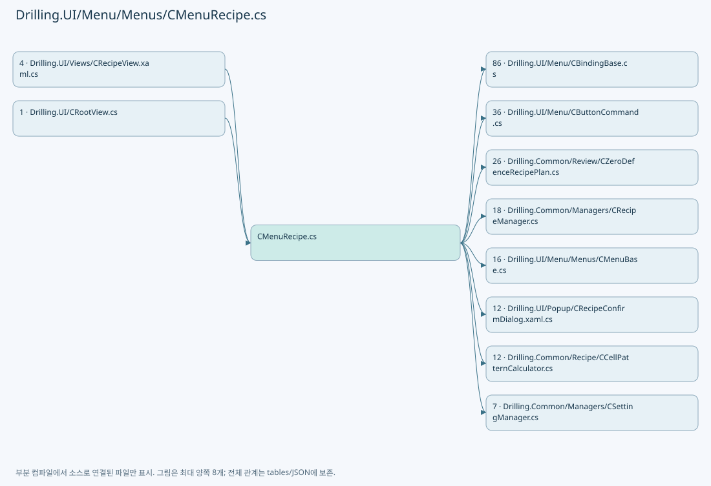

## 네임스페이스·타입·상속

| 타입 | 구분 | 원본 범위 | 선언/상속 |
| --- | --- | --- | --- |
| CMenuRecipe | ClassDeclaration | 19–3341 | CMenuRecipe: CMenuBase |
| ST_RECIPE_CATEGORY_TAB | RecordDeclaration | 3343–3346 | ST_RECIPE_CATEGORY_TAB |
| ST_RECIPE_GROUP_TAB | RecordDeclaration | 3348–3348 | ST_RECIPE_GROUP_TAB |
| ST_RECIPE_CELL_VIEW_MODEL | RecordDeclaration | 3349–3369 | ST_RECIPE_CELL_VIEW_MODEL |
| ST_RECIPE_MASKING_AREA | RecordDeclaration | 3371–3391 | ST_RECIPE_MASKING_AREA |
| ST_RECIPE_EDGE_MASKING_AREA | RecordDeclaration | 3393–3405 | ST_RECIPE_EDGE_MASKING_AREA |
| ST_RECIPE_SHOT_MASKING_STATE | RecordDeclaration | 3407–3472 | ST_RECIPE_SHOT_MASKING_STATE |
| ST_RECIPE_DISTORTION_KEY_ITEM | RecordDeclaration | 3474–3491 | ST_RECIPE_DISTORTION_KEY_ITEM |
| ST_RECIPE_CELL_OVERVIEW_ROW | ClassDeclaration | 3493–3603 | ST_RECIPE_CELL_OVERVIEW_ROW: CBindingBase |
| ST_SHOT_GROUP_EDITOR_ROW | ClassDeclaration | 3605–3930 | ST_SHOT_GROUP_EDITOR_ROW: CBindingBase |
| ST_RECIPE_LAYOUT_PREVIEW | RecordDeclaration | 3932–3932 | ST_RECIPE_LAYOUT_PREVIEW |
| ST_RECIPE_HEAD_PREVIEW | RecordDeclaration | 3933–3933 | ST_RECIPE_HEAD_PREVIEW |
| ST_HEAD_COVERAGE_PREVIEW_LABEL | RecordDeclaration | 3934–3975 | ST_HEAD_COVERAGE_PREVIEW_LABEL |
| ST_RECIPE_FILE | RecordDeclaration | 3977–3994 | ST_RECIPE_FILE |
| ST_RECIPE_PARAMETER_EDITOR_ITEM | ClassDeclaration | 3996–4203 | ST_RECIPE_PARAMETER_EDITOR_ITEM: CBindingBase |
| ST_RECIPE_HISTORY_ROW | RecordDeclaration | 4205–4214 | ST_RECIPE_HISTORY_ROW |
| ST_RECIPE_STATE_ROW | RecordDeclaration | 4216–4231 | ST_RECIPE_STATE_ROW |
| CRecipeZeroDefencePanel | ClassDeclaration | 4234–4674 | CRecipeZeroDefencePanel: INotifyPropertyChanged |
| ShotAvailability | RecordDeclaration | 4532–4532 | ShotAvailability |
| CZeroDefenceHeadRow | RecordDeclaration | 4676–4684 | CZeroDefenceHeadRow |
| CZeroDefenceGroupCard | RecordDeclaration | 4686–4690 | CZeroDefenceGroupCard |
| CZeroDefenceSelectionLabel | RecordDeclaration | 4692–4695 | CZeroDefenceSelectionLabel |
| CZeroDefenceCell | RecordDeclaration | 4697–4701 | CZeroDefenceCell |
| CZeroDefenceShotRow | RecordDeclaration | 4703–4703 | CZeroDefenceShotRow |
| CZeroDefenceShot | RecordDeclaration | 4704–4709 | CZeroDefenceShot |
| CZeroDefenceBeam | RecordDeclaration | 4711–4718 | CZeroDefenceBeam |

## 멤버 빠른 목록

| 이름 | 종류 | 범위 | 서명 |
| --- | --- | --- | --- |
| CellParameterKeys | FieldDeclaration | L21–21 | string[] Drilling.UI.Menu.Menus.CMenuRecipe.CellParameterKeys |
| PatternParameterKeys | FieldDeclaration | L22–22 | string[] Drilling.UI.Menu.Menus.CMenuRecipe.PatternParameterKeys |
| GlassSettingKeys | FieldDeclaration | L23–31 | string[] Drilling.UI.Menu.Menus.CMenuRecipe.GlassSettingKeys |
| RecipeFilesPageSize | FieldDeclaration | L32–32 | int Drilling.UI.Menu.Menus.CMenuRecipe.RecipeFilesPageSize |
| MaximumMaskingHoleCount | FieldDeclaration | L33–33 | int Drilling.UI.Menu.Menus.CMenuRecipe.MaximumMaskingHoleCount |
| MaximumCellModelTypeCount | FieldDeclaration | L34–34 | int Drilling.UI.Menu.Menus.CMenuRecipe.MaximumCellModelTypeCount |
| MinimumLayoutPatternWidth | FieldDeclaration | L35–35 | double Drilling.UI.Menu.Menus.CMenuRecipe.MinimumLayoutPatternWidth |
| MinimumLayoutPatternHeight | FieldDeclaration | L36–36 | double Drilling.UI.Menu.Menus.CMenuRecipe.MinimumLayoutPatternHeight |
| SelectRecipeSettingKey | FieldDeclaration | L37–37 | string Drilling.UI.Menu.Menus.CMenuRecipe.SelectRecipeSettingKey |
| _recipeManager | FieldDeclaration | L38–38 | Drilling.Common.Managers.CRecipeManager Drilling.UI.Menu.Menus.CMenuRecipe._recipeManager |
| _settingManager | FieldDeclaration | L39–39 | Drilling.Common.Managers.CSettingManager Drilling.UI.Menu.Menus.CMenuRecipe._settingManager |
| _selectRecipeIdProvider | FieldDeclaration | L40–40 | System.Func<string> Drilling.UI.Menu.Menus.CMenuRecipe._selectRecipeIdProvider |
| _selectRecipeIdSetter | FieldDeclaration | L41–41 | System.Action<string> Drilling.UI.Menu.Menus.CMenuRecipe._selectRecipeIdSetter |
| _viewRecipeIdProvider | FieldDeclaration | L42–42 | System.Func<string> Drilling.UI.Menu.Menus.CMenuRecipe._viewRecipeIdProvider |
| _viewRecipeIdSetter | FieldDeclaration | L43–43 | System.Action<string> Drilling.UI.Menu.Menus.CMenuRecipe._viewRecipeIdSetter |
| _selectedCategoryProvider | FieldDeclaration | L44–44 | System.Func<string> Drilling.UI.Menu.Menus.CMenuRecipe._selectedCategoryProvider |
| _selectedCategorySetter | FieldDeclaration | L45–45 | System.Action<string> Drilling.UI.Menu.Menus.CMenuRecipe._selectedCategorySetter |
| _selectedGroup | FieldDeclaration | L46–46 | string Drilling.UI.Menu.Menus.CMenuRecipe._selectedGroup |
| _selectedCellNo | FieldDeclaration | L47–47 | int Drilling.UI.Menu.Menus.CMenuRecipe._selectedCellNo |
| _selectedCellShotNo | FieldDeclaration | L48–48 | int Drilling.UI.Menu.Menus.CMenuRecipe._selectedCellShotNo |
| _selectedShotGroup | FieldDeclaration | L49–49 | Drilling.UI.Menu.Menus.ST_SHOT_GROUP_EDITOR_ROW? Drilling.UI.Menu.Menus.CMenuRecipe._selectedShotGroup |
| _recipeCells | FieldDeclaration | L50–50 | System.Collections.Generic.IReadOnlyList<Drilling.UI.Menu.Menus.ST_RECIPE_CELL_VIEW_MODEL> Drilling.UI.Menu.Menus.CMenuRecipe._recipeCells |
| _recipeFiles | FieldDeclaration | L51–51 | System.Collections.Generic.IReadOnlyList<Drilling.UI.Menu.Menus.ST_RECIPE_FILE> Drilling.UI.Menu.Menus.CMenuRecipe._recipeFiles |
| _previewTrackedItems | FieldDeclaration | L52–52 | System.Collections.Generic.IReadOnlyList<Drilling.UI.Menu.Menus.ST_RECIPE_PARAMETER_EDITOR_ITEM> Drilling.UI.Menu.Menus.CMenuRecipe._previewTrackedItems |
| _headPreviewSettings | FieldDeclaration | L53–53 | System.Collections.Generic.IReadOnlyList<Drilling.Common.Managers.ST_SYSTEM_PARAMETER> Drilling.UI.Menu.Menus.CMenuRecipe._headPreviewSettings |
| _previewRefreshCancellation | FieldDeclaration | L54–54 | System.Threading.CancellationTokenSource? Drilling.UI.Menu.Menus.CMenuRecipe._previewRefreshCancellation |
| _lastRecipeListSelectedFile | FieldDeclaration | L55–55 | string Drilling.UI.Menu.Menus.CMenuRecipe._lastRecipeListSelectedFile |
| _lastValidChessValues | FieldDeclaration | L56–56 | System.Collections.Generic.Dictionary<string, string> Drilling.UI.Menu.Menus.CMenuRecipe._lastValidChessValues |
| _isRevertingChessValue | FieldDeclaration | L57–57 | bool Drilling.UI.Menu.Menus.CMenuRecipe._isRevertingChessValue |
| _isBatchUpdatingCellPlacement | FieldDeclaration | L58–58 | bool Drilling.UI.Menu.Menus.CMenuRecipe._isBatchUpdatingCellPlacement |
| _recipeFilesPageText | FieldDeclaration | L59–59 | string Drilling.UI.Menu.Menus.CMenuRecipe._recipeFilesPageText |
| _recipeFilesPageIndex | FieldDeclaration | L60–60 | int Drilling.UI.Menu.Menus.CMenuRecipe._recipeFilesPageIndex |
| _recipeFilesPageCount | FieldDeclaration | L61–61 | int Drilling.UI.Menu.Menus.CMenuRecipe._recipeFilesPageCount |
| _editScreenProvider | FieldDeclaration | L62–62 | System.Func<Drilling.UI.Menu.Menus.CMenuRecipe?> Drilling.UI.Menu.Menus.CMenuRecipe._editScreenProvider |
| _setStatusMessage | FieldDeclaration | L63–63 | System.Action<string> Drilling.UI.Menu.Menus.CMenuRecipe._setStatusMessage |
| _showLoadingScreen | FieldDeclaration | L64–64 | System.Action<Drilling.UI.Menu.Menus.EN_MENU, string> Drilling.UI.Menu.Menus.CMenuRecipe._showLoadingScreen |
| _refreshShellStatus | FieldDeclaration | L65–65 | System.Action Drilling.UI.Menu.Menus.CMenuRecipe._refreshShellStatus |
| _refreshCurrentScreen | FieldDeclaration | L66–66 | System.Func<System.Threading.Tasks.Task> Drilling.UI.Menu.Menus.CMenuRecipe._refreshCurrentScreen |
| .ctor | ConstructorDeclaration | L67–214 | Drilling.UI.Menu.Menus.CMenuRecipe.CMenuRecipe(Drilling.Common.Managers.CRecipeManager, Drilling.Common.Managers.CSettingManager, System.Func<string>, System.Action<string>, System.Func<string>, System.Action<string>, System.Func<string>, System.Action<string>, System.Func<Drilling.UI.Menu.Menus.CMenuRecipe?>, System.Action<string>, System.Action<Drilling.UI.Menu.Menus.EN_MENU, string>, System.Action, System.Func<System.Threading.Tasks.Task>) |
| ViewCallback | LocalFunctionStatement | L97–100 | void ViewCallback(object?) |
| ShowPreviousRecipePageCallback | LocalFunctionStatement | L103–106 | void ShowPreviousRecipePageCallback(object?) |
| CanShowPreviousRecipePageCallback | LocalFunctionStatement | L108–111 | bool CanShowPreviousRecipePageCallback(object?) |
| ShowNextRecipePageCallback | LocalFunctionStatement | L114–117 | void ShowNextRecipePageCallback(object?) |
| CanShowNextRecipePageCallback | LocalFunctionStatement | L119–122 | bool CanShowNextRecipePageCallback(object?) |
| SelectCategoryCallback | LocalFunctionStatement | L125–128 | void SelectCategoryCallback(object?) |
| SelectGroupCallback | LocalFunctionStatement | L131–134 | void SelectGroupCallback(object?) |
| SelectCellCallback | LocalFunctionStatement | L137–140 | void SelectCellCallback(object?) |
| SelectPreviewCellCallback | LocalFunctionStatement | L143–146 | void SelectPreviewCellCallback(object?) |
| BackToCellPreviewCallback | LocalFunctionStatement | L149–152 | void BackToCellPreviewCallback(object?) |
| PreviousCellCallback | LocalFunctionStatement | L156–159 | void PreviousCellCallback(object?) |
| MatchesObject | LocalFunctionStatement | L161–164 | bool MatchesObject(object?) |
| NextCellCallback | LocalFunctionStatement | L167–170 | void NextCellCallback(object?) |
| MatchesObject2 | LocalFunctionStatement | L172–175 | bool MatchesObject2(object?) |
| SelectRecipeCallback | LocalFunctionStatement | L179–182 | void SelectRecipeCallback(object?) |
| CanSelectRecipeCallback | LocalFunctionStatement | L184–187 | bool CanSelectRecipeCallback(object?) |
| CreateCallback | LocalFunctionStatement | L190–193 | void CreateCallback(object?) |
| ModifyCallback | LocalFunctionStatement | L196–199 | void ModifyCallback(object?) |
| SaveCallback | LocalFunctionStatement | L202–205 | void SaveCallback(object?) |
| DeleteCallback | LocalFunctionStatement | L208–211 | void DeleteCallback(object?) |
| Menu | PropertyDeclaration | L216–222 | Drilling.UI.Menu.Menus.EN_MENU Drilling.UI.Menu.Menus.CMenuRecipe.Menu |
| get_Menu | GetAccessorDeclaration | L218–221 | Drilling.UI.Menu.Menus.EN_MENU Drilling.UI.Menu.Menus.CMenuRecipe.Menu.get |
| OnDeactivated | MethodDeclaration | L224–227 | void Drilling.UI.Menu.Menus.CMenuRecipe.OnDeactivated() |
| RecipeList | PropertyDeclaration | L229–229 | System.Collections.Generic.IReadOnlyList<Drilling.UI.Menu.Menus.ST_DISPLAY_ITEM> Drilling.UI.Menu.Menus.CMenuRecipe.RecipeList |
| get_RecipeList | GetAccessorDeclaration | L229–229 | System.Collections.Generic.IReadOnlyList<Drilling.UI.Menu.Menus.ST_DISPLAY_ITEM> Drilling.UI.Menu.Menus.CMenuRecipe.RecipeList.get |
| set_RecipeList | SetAccessorDeclaration | L229–229 | void Drilling.UI.Menu.Menus.CMenuRecipe.RecipeList.set |
| Parameters | PropertyDeclaration | L230–230 | System.Collections.Generic.IReadOnlyList<Drilling.UI.Menu.Menus.ST_DISPLAY_ITEM> Drilling.UI.Menu.Menus.CMenuRecipe.Parameters |
| get_Parameters | GetAccessorDeclaration | L230–230 | System.Collections.Generic.IReadOnlyList<Drilling.UI.Menu.Menus.ST_DISPLAY_ITEM> Drilling.UI.Menu.Menus.CMenuRecipe.Parameters.get |
| set_Parameters | SetAccessorDeclaration | L230–230 | void Drilling.UI.Menu.Menus.CMenuRecipe.Parameters.set |
| History | PropertyDeclaration | L231–231 | System.Collections.Generic.IReadOnlyList<Drilling.UI.Menu.Menus.ST_DISPLAY_ITEM> Drilling.UI.Menu.Menus.CMenuRecipe.History |
| get_History | GetAccessorDeclaration | L231–231 | System.Collections.Generic.IReadOnlyList<Drilling.UI.Menu.Menus.ST_DISPLAY_ITEM> Drilling.UI.Menu.Menus.CMenuRecipe.History.get |
| set_History | SetAccessorDeclaration | L231–231 | void Drilling.UI.Menu.Menus.CMenuRecipe.History.set |
| Actions | PropertyDeclaration | L232–232 | System.Collections.Generic.IReadOnlyList<Drilling.UI.Menu.Menus.ST_DISPLAY_ITEM> Drilling.UI.Menu.Menus.CMenuRecipe.Actions |
| get_Actions | GetAccessorDeclaration | L232–232 | System.Collections.Generic.IReadOnlyList<Drilling.UI.Menu.Menus.ST_DISPLAY_ITEM> Drilling.UI.Menu.Menus.CMenuRecipe.Actions.get |
| set_Actions | SetAccessorDeclaration | L232–232 | void Drilling.UI.Menu.Menus.CMenuRecipe.Actions.set |
| SelectedRecipeFile | PropertyDeclaration | L233–233 | string Drilling.UI.Menu.Menus.CMenuRecipe.SelectedRecipeFile |
| get_SelectedRecipeFile | GetAccessorDeclaration | L233–233 | string Drilling.UI.Menu.Menus.CMenuRecipe.SelectedRecipeFile.get |
| set_SelectedRecipeFile | SetAccessorDeclaration | L233–233 | void Drilling.UI.Menu.Menus.CMenuRecipe.SelectedRecipeFile.set |
| SelectRecipeFile | PropertyDeclaration | L234–234 | string Drilling.UI.Menu.Menus.CMenuRecipe.SelectRecipeFile |
| get_SelectRecipeFile | GetAccessorDeclaration | L234–234 | string Drilling.UI.Menu.Menus.CMenuRecipe.SelectRecipeFile.get |
| set_SelectRecipeFile | SetAccessorDeclaration | L234–234 | void Drilling.UI.Menu.Menus.CMenuRecipe.SelectRecipeFile.set |
| ViewRecipeFile | PropertyDeclaration | L236–242 | string Drilling.UI.Menu.Menus.CMenuRecipe.ViewRecipeFile |
| get_ViewRecipeFile | GetAccessorDeclaration | L238–241 | string Drilling.UI.Menu.Menus.CMenuRecipe.ViewRecipeFile.get |
| IsViewRecipeSelected | PropertyDeclaration | L244–244 | bool Drilling.UI.Menu.Menus.CMenuRecipe.IsViewRecipeSelected |
| get_IsViewRecipeSelected | GetAccessorDeclaration | L244–244 | bool Drilling.UI.Menu.Menus.CMenuRecipe.IsViewRecipeSelected.get |
| set_IsViewRecipeSelected | SetAccessorDeclaration | L244–244 | void Drilling.UI.Menu.Menus.CMenuRecipe.IsViewRecipeSelected.set |
| RecipeSelectionSummaryText | PropertyDeclaration | L246–257 | string Drilling.UI.Menu.Menus.CMenuRecipe.RecipeSelectionSummaryText |
| get_RecipeSelectionSummaryText | GetAccessorDeclaration | L248–256 | string Drilling.UI.Menu.Menus.CMenuRecipe.RecipeSelectionSummaryText.get |
| RecipeFiles | PropertyDeclaration | L259–270 | System.Collections.Generic.IReadOnlyList<Drilling.UI.Menu.Menus.ST_RECIPE_FILE> Drilling.UI.Menu.Menus.CMenuRecipe.RecipeFiles |
| get_RecipeFiles | GetAccessorDeclaration | L261–264 | System.Collections.Generic.IReadOnlyList<Drilling.UI.Menu.Menus.ST_RECIPE_FILE> Drilling.UI.Menu.Menus.CMenuRecipe.RecipeFiles.get |
| set_RecipeFiles | SetAccessorDeclaration | L266–269 | void Drilling.UI.Menu.Menus.CMenuRecipe.RecipeFiles.set |
| RecipeFilesPageText | PropertyDeclaration | L272–283 | string Drilling.UI.Menu.Menus.CMenuRecipe.RecipeFilesPageText |
| get_RecipeFilesPageText | GetAccessorDeclaration | L274–277 | string Drilling.UI.Menu.Menus.CMenuRecipe.RecipeFilesPageText.get |
| set_RecipeFilesPageText | SetAccessorDeclaration | L279–282 | void Drilling.UI.Menu.Menus.CMenuRecipe.RecipeFilesPageText.set |
| ItemTabs | PropertyDeclaration | L285–285 | System.Collections.Generic.IReadOnlyList<Drilling.UI.Menu.Menus.ST_RECIPE_CATEGORY_TAB> Drilling.UI.Menu.Menus.CMenuRecipe.ItemTabs |
| get_ItemTabs | GetAccessorDeclaration | L285–285 | System.Collections.Generic.IReadOnlyList<Drilling.UI.Menu.Menus.ST_RECIPE_CATEGORY_TAB> Drilling.UI.Menu.Menus.CMenuRecipe.ItemTabs.get |
| set_ItemTabs | SetAccessorDeclaration | L285–285 | void Drilling.UI.Menu.Menus.CMenuRecipe.ItemTabs.set |
| GroupTabs | PropertyDeclaration | L286–286 | System.Collections.Generic.IReadOnlyList<Drilling.UI.Menu.Menus.ST_RECIPE_GROUP_TAB> Drilling.UI.Menu.Menus.CMenuRecipe.GroupTabs |
| get_GroupTabs | GetAccessorDeclaration | L286–286 | System.Collections.Generic.IReadOnlyList<Drilling.UI.Menu.Menus.ST_RECIPE_GROUP_TAB> Drilling.UI.Menu.Menus.CMenuRecipe.GroupTabs.get |
| set_GroupTabs | SetAccessorDeclaration | L286–286 | void Drilling.UI.Menu.Menus.CMenuRecipe.GroupTabs.set |
| CellOverviewRows | PropertyDeclaration | L287–287 | System.Collections.Generic.IReadOnlyList<Drilling.UI.Menu.Menus.ST_RECIPE_CELL_OVERVIEW_ROW> Drilling.UI.Menu.Menus.CMenuRecipe.CellOverviewRows |
| get_CellOverviewRows | GetAccessorDeclaration | L287–287 | System.Collections.Generic.IReadOnlyList<Drilling.UI.Menu.Menus.ST_RECIPE_CELL_OVERVIEW_ROW> Drilling.UI.Menu.Menus.CMenuRecipe.CellOverviewRows.get |
| set_CellOverviewRows | SetAccessorDeclaration | L287–287 | void Drilling.UI.Menu.Menus.CMenuRecipe.CellOverviewRows.set |
| ShotGroupRows | PropertyDeclaration | L288–288 | System.Collections.Generic.IReadOnlyList<Drilling.UI.Menu.Menus.ST_SHOT_GROUP_EDITOR_ROW> Drilling.UI.Menu.Menus.CMenuRecipe.ShotGroupRows |
| get_ShotGroupRows | GetAccessorDeclaration | L288–288 | System.Collections.Generic.IReadOnlyList<Drilling.UI.Menu.Menus.ST_SHOT_GROUP_EDITOR_ROW> Drilling.UI.Menu.Menus.CMenuRecipe.ShotGroupRows.get |
| set_ShotGroupRows | SetAccessorDeclaration | L288–288 | void Drilling.UI.Menu.Menus.CMenuRecipe.ShotGroupRows.set |
| SelectedShotGroup | PropertyDeclaration | L290–318 | Drilling.UI.Menu.Menus.ST_SHOT_GROUP_EDITOR_ROW? Drilling.UI.Menu.Menus.CMenuRecipe.SelectedShotGroup |
| get_SelectedShotGroup | GetAccessorDeclaration | L292–295 | Drilling.UI.Menu.Menus.ST_SHOT_GROUP_EDITOR_ROW? Drilling.UI.Menu.Menus.CMenuRecipe.SelectedShotGroup.get |
| set_SelectedShotGroup | SetAccessorDeclaration | L297–317 | void Drilling.UI.Menu.Menus.CMenuRecipe.SelectedShotGroup.set |
| GlassSizeXItem | PropertyDeclaration | L320–320 | Drilling.UI.Menu.Menus.ST_RECIPE_PARAMETER_EDITOR_ITEM? Drilling.UI.Menu.Menus.CMenuRecipe.GlassSizeXItem |
| get_GlassSizeXItem | GetAccessorDeclaration | L320–320 | Drilling.UI.Menu.Menus.ST_RECIPE_PARAMETER_EDITOR_ITEM? Drilling.UI.Menu.Menus.CMenuRecipe.GlassSizeXItem.get |
| set_GlassSizeXItem | SetAccessorDeclaration | L320–320 | void Drilling.UI.Menu.Menus.CMenuRecipe.GlassSizeXItem.set |
| GlassSizeYItem | PropertyDeclaration | L321–321 | Drilling.UI.Menu.Menus.ST_RECIPE_PARAMETER_EDITOR_ITEM? Drilling.UI.Menu.Menus.CMenuRecipe.GlassSizeYItem |
| get_GlassSizeYItem | GetAccessorDeclaration | L321–321 | Drilling.UI.Menu.Menus.ST_RECIPE_PARAMETER_EDITOR_ITEM? Drilling.UI.Menu.Menus.CMenuRecipe.GlassSizeYItem.get |
| set_GlassSizeYItem | SetAccessorDeclaration | L321–321 | void Drilling.UI.Menu.Menus.CMenuRecipe.GlassSizeYItem.set |
| MaxCellNumberItem | PropertyDeclaration | L322–322 | Drilling.UI.Menu.Menus.ST_RECIPE_PARAMETER_EDITOR_ITEM? Drilling.UI.Menu.Menus.CMenuRecipe.MaxCellNumberItem |
| get_MaxCellNumberItem | GetAccessorDeclaration | L322–322 | Drilling.UI.Menu.Menus.ST_RECIPE_PARAMETER_EDITOR_ITEM? Drilling.UI.Menu.Menus.CMenuRecipe.MaxCellNumberItem.get |
| set_MaxCellNumberItem | SetAccessorDeclaration | L322–322 | void Drilling.UI.Menu.Menus.CMenuRecipe.MaxCellNumberItem.set |
| PixelSizeItem | PropertyDeclaration | L323–323 | Drilling.UI.Menu.Menus.ST_RECIPE_PARAMETER_EDITOR_ITEM? Drilling.UI.Menu.Menus.CMenuRecipe.PixelSizeItem |
| get_PixelSizeItem | GetAccessorDeclaration | L323–323 | Drilling.UI.Menu.Menus.ST_RECIPE_PARAMETER_EDITOR_ITEM? Drilling.UI.Menu.Menus.CMenuRecipe.PixelSizeItem.get |
| set_PixelSizeItem | SetAccessorDeclaration | L323–323 | void Drilling.UI.Menu.Menus.CMenuRecipe.PixelSizeItem.set |
| PixelCountXItem | PropertyDeclaration | L324–324 | Drilling.UI.Menu.Menus.ST_RECIPE_PARAMETER_EDITOR_ITEM? Drilling.UI.Menu.Menus.CMenuRecipe.PixelCountXItem |
| get_PixelCountXItem | GetAccessorDeclaration | L324–324 | Drilling.UI.Menu.Menus.ST_RECIPE_PARAMETER_EDITOR_ITEM? Drilling.UI.Menu.Menus.CMenuRecipe.PixelCountXItem.get |
| set_PixelCountXItem | SetAccessorDeclaration | L324–324 | void Drilling.UI.Menu.Menus.CMenuRecipe.PixelCountXItem.set |
| PixelCountYItem | PropertyDeclaration | L325–325 | Drilling.UI.Menu.Menus.ST_RECIPE_PARAMETER_EDITOR_ITEM? Drilling.UI.Menu.Menus.CMenuRecipe.PixelCountYItem |
| get_PixelCountYItem | GetAccessorDeclaration | L325–325 | Drilling.UI.Menu.Menus.ST_RECIPE_PARAMETER_EDITOR_ITEM? Drilling.UI.Menu.Menus.CMenuRecipe.PixelCountYItem.get |
| set_PixelCountYItem | SetAccessorDeclaration | L325–325 | void Drilling.UI.Menu.Menus.CMenuRecipe.PixelCountYItem.set |
| ProcessPitchItem | PropertyDeclaration | L326–326 | Drilling.UI.Menu.Menus.ST_RECIPE_PARAMETER_EDITOR_ITEM? Drilling.UI.Menu.Menus.CMenuRecipe.ProcessPitchItem |
| get_ProcessPitchItem | GetAccessorDeclaration | L326–326 | Drilling.UI.Menu.Menus.ST_RECIPE_PARAMETER_EDITOR_ITEM? Drilling.UI.Menu.Menus.CMenuRecipe.ProcessPitchItem.get |
| set_ProcessPitchItem | SetAccessorDeclaration | L326–326 | void Drilling.UI.Menu.Menus.CMenuRecipe.ProcessPitchItem.set |
| ChessItem | PropertyDeclaration | L327–327 | Drilling.UI.Menu.Menus.ST_RECIPE_PARAMETER_EDITOR_ITEM? Drilling.UI.Menu.Menus.CMenuRecipe.ChessItem |
| get_ChessItem | GetAccessorDeclaration | L327–327 | Drilling.UI.Menu.Menus.ST_RECIPE_PARAMETER_EDITOR_ITEM? Drilling.UI.Menu.Menus.CMenuRecipe.ChessItem.get |
| set_ChessItem | SetAccessorDeclaration | L327–327 | void Drilling.UI.Menu.Menus.CMenuRecipe.ChessItem.set |
| SplitBeamCountItem | PropertyDeclaration | L328–328 | Drilling.UI.Menu.Menus.ST_RECIPE_PARAMETER_EDITOR_ITEM? Drilling.UI.Menu.Menus.CMenuRecipe.SplitBeamCountItem |
| get_SplitBeamCountItem | GetAccessorDeclaration | L328–328 | Drilling.UI.Menu.Menus.ST_RECIPE_PARAMETER_EDITOR_ITEM? Drilling.UI.Menu.Menus.CMenuRecipe.SplitBeamCountItem.get |
| set_SplitBeamCountItem | SetAccessorDeclaration | L328–328 | void Drilling.UI.Menu.Menus.CMenuRecipe.SplitBeamCountItem.set |
| CellModelTypeCountItem | PropertyDeclaration | L329–329 | Drilling.UI.Menu.Menus.ST_RECIPE_PARAMETER_EDITOR_ITEM? Drilling.UI.Menu.Menus.CMenuRecipe.CellModelTypeCountItem |
| get_CellModelTypeCountItem | GetAccessorDeclaration | L329–329 | Drilling.UI.Menu.Menus.ST_RECIPE_PARAMETER_EDITOR_ITEM? Drilling.UI.Menu.Menus.CMenuRecipe.CellModelTypeCountItem.get |
| set_CellModelTypeCountItem | SetAccessorDeclaration | L329–329 | void Drilling.UI.Menu.Menus.CMenuRecipe.CellModelTypeCountItem.set |
| AkMarginXItem | PropertyDeclaration | L330–330 | Drilling.UI.Menu.Menus.ST_RECIPE_PARAMETER_EDITOR_ITEM? Drilling.UI.Menu.Menus.CMenuRecipe.AkMarginXItem |
| get_AkMarginXItem | GetAccessorDeclaration | L330–330 | Drilling.UI.Menu.Menus.ST_RECIPE_PARAMETER_EDITOR_ITEM? Drilling.UI.Menu.Menus.CMenuRecipe.AkMarginXItem.get |
| set_AkMarginXItem | SetAccessorDeclaration | L330–330 | void Drilling.UI.Menu.Menus.CMenuRecipe.AkMarginXItem.set |
| AkMarginYItem | PropertyDeclaration | L331–331 | Drilling.UI.Menu.Menus.ST_RECIPE_PARAMETER_EDITOR_ITEM? Drilling.UI.Menu.Menus.CMenuRecipe.AkMarginYItem |
| get_AkMarginYItem | GetAccessorDeclaration | L331–331 | Drilling.UI.Menu.Menus.ST_RECIPE_PARAMETER_EDITOR_ITEM? Drilling.UI.Menu.Menus.CMenuRecipe.AkMarginYItem.get |
| set_AkMarginYItem | SetAccessorDeclaration | L331–331 | void Drilling.UI.Menu.Menus.CMenuRecipe.AkMarginYItem.set |
| EscEdgeToGlassEdgeItem | PropertyDeclaration | L332–332 | Drilling.UI.Menu.Menus.ST_RECIPE_PARAMETER_EDITOR_ITEM? Drilling.UI.Menu.Menus.CMenuRecipe.EscEdgeToGlassEdgeItem |
| get_EscEdgeToGlassEdgeItem | GetAccessorDeclaration | L332–332 | Drilling.UI.Menu.Menus.ST_RECIPE_PARAMETER_EDITOR_ITEM? Drilling.UI.Menu.Menus.CMenuRecipe.EscEdgeToGlassEdgeItem.get |
| set_EscEdgeToGlassEdgeItem | SetAccessorDeclaration | L332–332 | void Drilling.UI.Menu.Menus.CMenuRecipe.EscEdgeToGlassEdgeItem.set |
| GlassCenterToScannerCenterItem | PropertyDeclaration | L333–333 | Drilling.UI.Menu.Menus.ST_RECIPE_PARAMETER_EDITOR_ITEM? Drilling.UI.Menu.Menus.CMenuRecipe.GlassCenterToScannerCenterItem |
| get_GlassCenterToScannerCenterItem | GetAccessorDeclaration | L333–333 | Drilling.UI.Menu.Menus.ST_RECIPE_PARAMETER_EDITOR_ITEM? Drilling.UI.Menu.Menus.CMenuRecipe.GlassCenterToScannerCenterItem.get |
| set_GlassCenterToScannerCenterItem | SetAccessorDeclaration | L333–333 | void Drilling.UI.Menu.Menus.CMenuRecipe.GlassCenterToScannerCenterItem.set |
| DistortionKeyItems | PropertyDeclaration | L334–334 | System.Collections.Generic.IReadOnlyList<Drilling.UI.Menu.Menus.ST_RECIPE_DISTORTION_KEY_ITEM> Drilling.UI.Menu.Menus.CMenuRecipe.DistortionKeyItems |
| get_DistortionKeyItems | GetAccessorDeclaration | L334–334 | System.Collections.Generic.IReadOnlyList<Drilling.UI.Menu.Menus.ST_RECIPE_DISTORTION_KEY_ITEM> Drilling.UI.Menu.Menus.CMenuRecipe.DistortionKeyItems.get |
| set_DistortionKeyItems | SetAccessorDeclaration | L334–334 | void Drilling.UI.Menu.Menus.CMenuRecipe.DistortionKeyItems.set |
| IsCellCategory | PropertyDeclaration | L335–335 | bool Drilling.UI.Menu.Menus.CMenuRecipe.IsCellCategory |
| get_IsCellCategory | GetAccessorDeclaration | L335–335 | bool Drilling.UI.Menu.Menus.CMenuRecipe.IsCellCategory.get |
| set_IsCellCategory | SetAccessorDeclaration | L335–335 | void Drilling.UI.Menu.Menus.CMenuRecipe.IsCellCategory.set |
| IsHeadCategory | PropertyDeclaration | L336–336 | bool Drilling.UI.Menu.Menus.CMenuRecipe.IsHeadCategory |
| get_IsHeadCategory | GetAccessorDeclaration | L336–336 | bool Drilling.UI.Menu.Menus.CMenuRecipe.IsHeadCategory.get |
| set_IsHeadCategory | SetAccessorDeclaration | L336–336 | void Drilling.UI.Menu.Menus.CMenuRecipe.IsHeadCategory.set |
| IsZeroDefenceCategory | PropertyDeclaration | L337–337 | bool Drilling.UI.Menu.Menus.CMenuRecipe.IsZeroDefenceCategory |
| ZeroDefence | PropertyDeclaration | L338–338 | Drilling.UI.Menu.Menus.CRecipeZeroDefencePanel Drilling.UI.Menu.Menus.CMenuRecipe.ZeroDefence |
| get_ZeroDefence | GetAccessorDeclaration | L338–338 | Drilling.UI.Menu.Menus.CRecipeZeroDefencePanel Drilling.UI.Menu.Menus.CMenuRecipe.ZeroDefence.get |
| _isCellDetailVisible | FieldDeclaration | L340–340 | bool Drilling.UI.Menu.Menus.CMenuRecipe._isCellDetailVisible |
| _isCellPlacementExpanded | FieldDeclaration | L341–341 | bool Drilling.UI.Menu.Menus.CMenuRecipe._isCellPlacementExpanded |
| IsCellDetailVisible | PropertyDeclaration | L342–348 | bool Drilling.UI.Menu.Menus.CMenuRecipe.IsCellDetailVisible |
| get_IsCellDetailVisible | GetAccessorDeclaration | L344–347 | bool Drilling.UI.Menu.Menus.CMenuRecipe.IsCellDetailVisible.get |
| IsCellPreviewVisible | PropertyDeclaration | L350–356 | bool Drilling.UI.Menu.Menus.CMenuRecipe.IsCellPreviewVisible |
| get_IsCellPreviewVisible | GetAccessorDeclaration | L352–355 | bool Drilling.UI.Menu.Menus.CMenuRecipe.IsCellPreviewVisible.get |
| IsCellPlacementExpanded | PropertyDeclaration | L358–364 | bool Drilling.UI.Menu.Menus.CMenuRecipe.IsCellPlacementExpanded |
| get_IsCellPlacementExpanded | GetAccessorDeclaration | L360–363 | bool Drilling.UI.Menu.Menus.CMenuRecipe.IsCellPlacementExpanded.get |
| CellPlacementExpandButtonText | PropertyDeclaration | L366–372 | string Drilling.UI.Menu.Menus.CMenuRecipe.CellPlacementExpandButtonText |
| get_CellPlacementExpandButtonText | GetAccessorDeclaration | L368–371 | string Drilling.UI.Menu.Menus.CMenuRecipe.CellPlacementExpandButtonText.get |
| CellPreviewImage | PropertyDeclaration | L374–374 | ImageSource? Drilling.UI.Menu.Menus.CMenuRecipe.CellPreviewImage |
| get_CellPreviewImage | GetAccessorDeclaration | L374–374 | ImageSource? Drilling.UI.Menu.Menus.CMenuRecipe.CellPreviewImage.get |
| set_CellPreviewImage | SetAccessorDeclaration | L374–374 | void Drilling.UI.Menu.Menus.CMenuRecipe.CellPreviewImage.set |
| CellPreviewLabels | PropertyDeclaration | L375–375 | System.Collections.Generic.IReadOnlyList<Drilling.UI.Menu.Menus.ST_CELL_PREVIEW_LABEL> Drilling.UI.Menu.Menus.CMenuRecipe.CellPreviewLabels |
| get_CellPreviewLabels | GetAccessorDeclaration | L375–375 | System.Collections.Generic.IReadOnlyList<Drilling.UI.Menu.Menus.ST_CELL_PREVIEW_LABEL> Drilling.UI.Menu.Menus.CMenuRecipe.CellPreviewLabels.get |
| set_CellPreviewLabels | SetAccessorDeclaration | L375–375 | void Drilling.UI.Menu.Menus.CMenuRecipe.CellPreviewLabels.set |
| CellPreviewSummaryText | PropertyDeclaration | L376–376 | string Drilling.UI.Menu.Menus.CMenuRecipe.CellPreviewSummaryText |
| get_CellPreviewSummaryText | GetAccessorDeclaration | L376–376 | string Drilling.UI.Menu.Menus.CMenuRecipe.CellPreviewSummaryText.get |
| set_CellPreviewSummaryText | SetAccessorDeclaration | L376–376 | void Drilling.UI.Menu.Menus.CMenuRecipe.CellPreviewSummaryText.set |
| CellShotMapImage | PropertyDeclaration | L377–377 | ImageSource? Drilling.UI.Menu.Menus.CMenuRecipe.CellShotMapImage |
| get_CellShotMapImage | GetAccessorDeclaration | L377–377 | ImageSource? Drilling.UI.Menu.Menus.CMenuRecipe.CellShotMapImage.get |
| set_CellShotMapImage | SetAccessorDeclaration | L377–377 | void Drilling.UI.Menu.Menus.CMenuRecipe.CellShotMapImage.set |
| SelectedShotDetailImage | PropertyDeclaration | L378–378 | ImageSource? Drilling.UI.Menu.Menus.CMenuRecipe.SelectedShotDetailImage |
| get_SelectedShotDetailImage | GetAccessorDeclaration | L378–378 | ImageSource? Drilling.UI.Menu.Menus.CMenuRecipe.SelectedShotDetailImage.get |
| set_SelectedShotDetailImage | SetAccessorDeclaration | L378–378 | void Drilling.UI.Menu.Menus.CMenuRecipe.SelectedShotDetailImage.set |
| HeadPreviewImage | PropertyDeclaration | L379–379 | ImageSource? Drilling.UI.Menu.Menus.CMenuRecipe.HeadPreviewImage |
| get_HeadPreviewImage | GetAccessorDeclaration | L379–379 | ImageSource? Drilling.UI.Menu.Menus.CMenuRecipe.HeadPreviewImage.get |
| set_HeadPreviewImage | SetAccessorDeclaration | L379–379 | void Drilling.UI.Menu.Menus.CMenuRecipe.HeadPreviewImage.set |
| HeadPreviewLabels | PropertyDeclaration | L380–380 | System.Collections.Generic.IReadOnlyList<Drilling.UI.Menu.Menus.ST_HEAD_COVERAGE_PREVIEW_LABEL> Drilling.UI.Menu.Menus.CMenuRecipe.HeadPreviewLabels |
| get_HeadPreviewLabels | GetAccessorDeclaration | L380–380 | System.Collections.Generic.IReadOnlyList<Drilling.UI.Menu.Menus.ST_HEAD_COVERAGE_PREVIEW_LABEL> Drilling.UI.Menu.Menus.CMenuRecipe.HeadPreviewLabels.get |
| set_HeadPreviewLabels | SetAccessorDeclaration | L380–380 | void Drilling.UI.Menu.Menus.CMenuRecipe.HeadPreviewLabels.set |
| HeadPreviewSummaryText | PropertyDeclaration | L381–381 | string Drilling.UI.Menu.Menus.CMenuRecipe.HeadPreviewSummaryText |
| get_HeadPreviewSummaryText | GetAccessorDeclaration | L381–381 | string Drilling.UI.Menu.Menus.CMenuRecipe.HeadPreviewSummaryText.get |
| set_HeadPreviewSummaryText | SetAccessorDeclaration | L381–381 | void Drilling.UI.Menu.Menus.CMenuRecipe.HeadPreviewSummaryText.set |
| CurrentCellIndicatorText | PropertyDeclaration | L383–389 | string Drilling.UI.Menu.Menus.CMenuRecipe.CurrentCellIndicatorText |
| get_CurrentCellIndicatorText | GetAccessorDeclaration | L385–388 | string Drilling.UI.Menu.Menus.CMenuRecipe.CurrentCellIndicatorText.get |
| SelectedCellNavigationText | PropertyDeclaration | L391–397 | string Drilling.UI.Menu.Menus.CMenuRecipe.SelectedCellNavigationText |
| get_SelectedCellNavigationText | GetAccessorDeclaration | L393–396 | string Drilling.UI.Menu.Menus.CMenuRecipe.SelectedCellNavigationText.get |
| SelectedCellShotGroupTitle | PropertyDeclaration | L399–406 | string Drilling.UI.Menu.Menus.CMenuRecipe.SelectedCellShotGroupTitle |
| get_SelectedCellShotGroupTitle | GetAccessorDeclaration | L401–405 | string Drilling.UI.Menu.Menus.CMenuRecipe.SelectedCellShotGroupTitle.get |
| IsSelectedCellShotMapLandscape | PropertyDeclaration | L408–415 | bool Drilling.UI.Menu.Menus.CMenuRecipe.IsSelectedCellShotMapLandscape |
| get_IsSelectedCellShotMapLandscape | GetAccessorDeclaration | L410–414 | bool Drilling.UI.Menu.Menus.CMenuRecipe.IsSelectedCellShotMapLandscape.get |
| CellShotMapPanelHeight | PropertyDeclaration | L417–423 | double Drilling.UI.Menu.Menus.CMenuRecipe.CellShotMapPanelHeight |
| get_CellShotMapPanelHeight | GetAccessorDeclaration | L419–422 | double Drilling.UI.Menu.Menus.CMenuRecipe.CellShotMapPanelHeight.get |
| CellShotMapSurfaceWidth | PropertyDeclaration | L425–432 | double Drilling.UI.Menu.Menus.CMenuRecipe.CellShotMapSurfaceWidth |
| get_CellShotMapSurfaceWidth | GetAccessorDeclaration | L427–431 | double Drilling.UI.Menu.Menus.CMenuRecipe.CellShotMapSurfaceWidth.get |
| CellShotMapSurfaceHeight | PropertyDeclaration | L434–441 | double Drilling.UI.Menu.Menus.CMenuRecipe.CellShotMapSurfaceHeight |
| get_CellShotMapSurfaceHeight | GetAccessorDeclaration | L436–440 | double Drilling.UI.Menu.Menus.CMenuRecipe.CellShotMapSurfaceHeight.get |
| CellShotMapGridColumn | PropertyDeclaration | L443–443 | int Drilling.UI.Menu.Menus.CMenuRecipe.CellShotMapGridColumn |
| CellShotMapGridColumnSpan | PropertyDeclaration | L444–444 | int Drilling.UI.Menu.Menus.CMenuRecipe.CellShotMapGridColumnSpan |
| CellShotMapGridRow | PropertyDeclaration | L445–445 | int Drilling.UI.Menu.Menus.CMenuRecipe.CellShotMapGridRow |
| CellShotMapGridRowSpan | PropertyDeclaration | L446–446 | int Drilling.UI.Menu.Menus.CMenuRecipe.CellShotMapGridRowSpan |
| CellShotDetailGridColumn | PropertyDeclaration | L447–447 | int Drilling.UI.Menu.Menus.CMenuRecipe.CellShotDetailGridColumn |
| CellShotDetailGridColumnSpan | PropertyDeclaration | L448–448 | int Drilling.UI.Menu.Menus.CMenuRecipe.CellShotDetailGridColumnSpan |
| CellShotDetailGridRow | PropertyDeclaration | L449–449 | int Drilling.UI.Menu.Menus.CMenuRecipe.CellShotDetailGridRow |
| CellShotDetailGridRowSpan | PropertyDeclaration | L450–450 | int Drilling.UI.Menu.Menus.CMenuRecipe.CellShotDetailGridRowSpan |
| CellShotDetailVerticalGap | PropertyDeclaration | L451–451 | GridLength Drilling.UI.Menu.Menus.CMenuRecipe.CellShotDetailVerticalGap |
| SelectedShotDetailGridColumn | PropertyDeclaration | L452–452 | int Drilling.UI.Menu.Menus.CMenuRecipe.SelectedShotDetailGridColumn |
| SelectedShotDetailGridColumnSpan | PropertyDeclaration | L453–453 | int Drilling.UI.Menu.Menus.CMenuRecipe.SelectedShotDetailGridColumnSpan |
| SelectedShotDetailGridRow | PropertyDeclaration | L454–454 | int Drilling.UI.Menu.Menus.CMenuRecipe.SelectedShotDetailGridRow |
| ShotInformationGridColumn | PropertyDeclaration | L455–455 | int Drilling.UI.Menu.Menus.CMenuRecipe.ShotInformationGridColumn |
| ShotInformationGridColumnSpan | PropertyDeclaration | L456–456 | int Drilling.UI.Menu.Menus.CMenuRecipe.ShotInformationGridColumnSpan |
| ShotInformationGridRow | PropertyDeclaration | L457–457 | int Drilling.UI.Menu.Menus.CMenuRecipe.ShotInformationGridRow |
| SelectedCellExcludedTargetText | PropertyDeclaration | L459–466 | string Drilling.UI.Menu.Menus.CMenuRecipe.SelectedCellExcludedTargetText |
| get_SelectedCellExcludedTargetText | GetAccessorDeclaration | L461–465 | string Drilling.UI.Menu.Menus.CMenuRecipe.SelectedCellExcludedTargetText.get |
| SelectedCellHasExcludedTargets | PropertyDeclaration | L468–474 | bool Drilling.UI.Menu.Menus.CMenuRecipe.SelectedCellHasExcludedTargets |
| get_SelectedCellHasExcludedTargets | GetAccessorDeclaration | L470–473 | bool Drilling.UI.Menu.Menus.CMenuRecipe.SelectedCellHasExcludedTargets.get |
| SelectedShotGroupIndicatorText | PropertyDeclaration | L476–482 | string Drilling.UI.Menu.Menus.CMenuRecipe.SelectedShotGroupIndicatorText |
| get_SelectedShotGroupIndicatorText | GetAccessorDeclaration | L478–481 | string Drilling.UI.Menu.Menus.CMenuRecipe.SelectedShotGroupIndicatorText.get |
| SelectedShotGroupGridText | PropertyDeclaration | L484–491 | string Drilling.UI.Menu.Menus.CMenuRecipe.SelectedShotGroupGridText |
| get_SelectedShotGroupGridText | GetAccessorDeclaration | L486–490 | string Drilling.UI.Menu.Menus.CMenuRecipe.SelectedShotGroupGridText.get |
| SelectedShotGroupCenterText | PropertyDeclaration | L493–499 | string Drilling.UI.Menu.Menus.CMenuRecipe.SelectedShotGroupCenterText |
| get_SelectedShotGroupCenterText | GetAccessorDeclaration | L495–498 | string Drilling.UI.Menu.Menus.CMenuRecipe.SelectedShotGroupCenterText.get |
| SelectedShotGroupBeamText | PropertyDeclaration | L501–508 | string Drilling.UI.Menu.Menus.CMenuRecipe.SelectedShotGroupBeamText |
| get_SelectedShotGroupBeamText | GetAccessorDeclaration | L503–507 | string Drilling.UI.Menu.Menus.CMenuRecipe.SelectedShotGroupBeamText.get |
| SelectedShotGroupPixelWindowText | PropertyDeclaration | L510–519 | string Drilling.UI.Menu.Menus.CMenuRecipe.SelectedShotGroupPixelWindowText |
| get_SelectedShotGroupPixelWindowText | GetAccessorDeclaration | L512–518 | string Drilling.UI.Menu.Menus.CMenuRecipe.SelectedShotGroupPixelWindowText.get |
| SelectedShotGroupPitchText | PropertyDeclaration | L521–528 | string Drilling.UI.Menu.Menus.CMenuRecipe.SelectedShotGroupPitchText |
| get_SelectedShotGroupPitchText | GetAccessorDeclaration | L523–527 | string Drilling.UI.Menu.Menus.CMenuRecipe.SelectedShotGroupPitchText.get |
| SelectedShotGroupStateText | PropertyDeclaration | L530–536 | string Drilling.UI.Menu.Menus.CMenuRecipe.SelectedShotGroupStateText |
| get_SelectedShotGroupStateText | GetAccessorDeclaration | L532–535 | string Drilling.UI.Menu.Menus.CMenuRecipe.SelectedShotGroupStateText.get |
| ShotGroupPatternSummary | PropertyDeclaration | L538–538 | string Drilling.UI.Menu.Menus.CMenuRecipe.ShotGroupPatternSummary |
| get_ShotGroupPatternSummary | GetAccessorDeclaration | L538–538 | string Drilling.UI.Menu.Menus.CMenuRecipe.ShotGroupPatternSummary.get |
| set_ShotGroupPatternSummary | SetAccessorDeclaration | L538–538 | void Drilling.UI.Menu.Menus.CMenuRecipe.ShotGroupPatternSummary.set |
| SelectedGroup | PropertyDeclaration | L539–539 | string Drilling.UI.Menu.Menus.CMenuRecipe.SelectedGroup |
| get_SelectedGroup | GetAccessorDeclaration | L539–539 | string Drilling.UI.Menu.Menus.CMenuRecipe.SelectedGroup.get |
| set_SelectedGroup | SetAccessorDeclaration | L539–539 | void Drilling.UI.Menu.Menus.CMenuRecipe.SelectedGroup.set |
| AllManagedItems | PropertyDeclaration | L540–540 | System.Collections.Generic.IReadOnlyList<Drilling.UI.Menu.Menus.ST_RECIPE_PARAMETER_EDITOR_ITEM> Drilling.UI.Menu.Menus.CMenuRecipe.AllManagedItems |
| get_AllManagedItems | GetAccessorDeclaration | L540–540 | System.Collections.Generic.IReadOnlyList<Drilling.UI.Menu.Menus.ST_RECIPE_PARAMETER_EDITOR_ITEM> Drilling.UI.Menu.Menus.CMenuRecipe.AllManagedItems.get |
| set_AllManagedItems | SetAccessorDeclaration | L540–540 | void Drilling.UI.Menu.Menus.CMenuRecipe.AllManagedItems.set |
| ManagedItems | PropertyDeclaration | L541–541 | System.Collections.Generic.IReadOnlyList<Drilling.UI.Menu.Menus.ST_RECIPE_PARAMETER_EDITOR_ITEM> Drilling.UI.Menu.Menus.CMenuRecipe.ManagedItems |
| get_ManagedItems | GetAccessorDeclaration | L541–541 | System.Collections.Generic.IReadOnlyList<Drilling.UI.Menu.Menus.ST_RECIPE_PARAMETER_EDITOR_ITEM> Drilling.UI.Menu.Menus.CMenuRecipe.ManagedItems.get |
| set_ManagedItems | SetAccessorDeclaration | L541–541 | void Drilling.UI.Menu.Menus.CMenuRecipe.ManagedItems.set |
| _changeHistory | FieldDeclaration | L543–543 | System.Collections.Generic.IReadOnlyList<Drilling.UI.Menu.Menus.ST_RECIPE_HISTORY_ROW> Drilling.UI.Menu.Menus.CMenuRecipe._changeHistory |
| ChangeHistory | PropertyDeclaration | L544–544 | System.Collections.Generic.IReadOnlyList<Drilling.UI.Menu.Menus.ST_RECIPE_HISTORY_ROW> Drilling.UI.Menu.Menus.CMenuRecipe.ChangeHistory |
| get_ChangeHistory | GetAccessorDeclaration | L544–544 | System.Collections.Generic.IReadOnlyList<Drilling.UI.Menu.Menus.ST_RECIPE_HISTORY_ROW> Drilling.UI.Menu.Menus.CMenuRecipe.ChangeHistory.get |
| set_ChangeHistory | SetAccessorDeclaration | L544–544 | void Drilling.UI.Menu.Menus.CMenuRecipe.ChangeHistory.set |
| StateRows | PropertyDeclaration | L545–545 | System.Collections.Generic.IReadOnlyList<Drilling.UI.Menu.Menus.ST_RECIPE_STATE_ROW> Drilling.UI.Menu.Menus.CMenuRecipe.StateRows |
| get_StateRows | GetAccessorDeclaration | L545–545 | System.Collections.Generic.IReadOnlyList<Drilling.UI.Menu.Menus.ST_RECIPE_STATE_ROW> Drilling.UI.Menu.Menus.CMenuRecipe.StateRows.get |
| set_StateRows | SetAccessorDeclaration | L545–545 | void Drilling.UI.Menu.Menus.CMenuRecipe.StateRows.set |
| SelectCommand | PropertyDeclaration | L546–546 | Drilling.UI.Menu.CButtonCommand Drilling.UI.Menu.Menus.CMenuRecipe.SelectCommand |
| get_SelectCommand | GetAccessorDeclaration | L546–546 | Drilling.UI.Menu.CButtonCommand Drilling.UI.Menu.Menus.CMenuRecipe.SelectCommand.get |
| PreviousRecipePageCommand | PropertyDeclaration | L547–547 | Drilling.UI.Menu.CButtonCommand Drilling.UI.Menu.Menus.CMenuRecipe.PreviousRecipePageCommand |
| get_PreviousRecipePageCommand | GetAccessorDeclaration | L547–547 | Drilling.UI.Menu.CButtonCommand Drilling.UI.Menu.Menus.CMenuRecipe.PreviousRecipePageCommand.get |
| NextRecipePageCommand | PropertyDeclaration | L548–548 | Drilling.UI.Menu.CButtonCommand Drilling.UI.Menu.Menus.CMenuRecipe.NextRecipePageCommand |
| get_NextRecipePageCommand | GetAccessorDeclaration | L548–548 | Drilling.UI.Menu.CButtonCommand Drilling.UI.Menu.Menus.CMenuRecipe.NextRecipePageCommand.get |
| ViewCommand | PropertyDeclaration | L549–549 | Drilling.UI.Menu.CButtonCommand Drilling.UI.Menu.Menus.CMenuRecipe.ViewCommand |
| get_ViewCommand | GetAccessorDeclaration | L549–549 | Drilling.UI.Menu.CButtonCommand Drilling.UI.Menu.Menus.CMenuRecipe.ViewCommand.get |
| SelectCategoryCommand | PropertyDeclaration | L550–550 | Drilling.UI.Menu.CButtonCommand Drilling.UI.Menu.Menus.CMenuRecipe.SelectCategoryCommand |
| get_SelectCategoryCommand | GetAccessorDeclaration | L550–550 | Drilling.UI.Menu.CButtonCommand Drilling.UI.Menu.Menus.CMenuRecipe.SelectCategoryCommand.get |
| SelectGroupCommand | PropertyDeclaration | L551–551 | Drilling.UI.Menu.CButtonCommand Drilling.UI.Menu.Menus.CMenuRecipe.SelectGroupCommand |
| get_SelectGroupCommand | GetAccessorDeclaration | L551–551 | Drilling.UI.Menu.CButtonCommand Drilling.UI.Menu.Menus.CMenuRecipe.SelectGroupCommand.get |
| SelectCellCommand | PropertyDeclaration | L552–552 | Drilling.UI.Menu.CButtonCommand Drilling.UI.Menu.Menus.CMenuRecipe.SelectCellCommand |
| get_SelectCellCommand | GetAccessorDeclaration | L552–552 | Drilling.UI.Menu.CButtonCommand Drilling.UI.Menu.Menus.CMenuRecipe.SelectCellCommand.get |
| SelectPreviewCellCommand | PropertyDeclaration | L553–553 | Drilling.UI.Menu.CButtonCommand Drilling.UI.Menu.Menus.CMenuRecipe.SelectPreviewCellCommand |
| get_SelectPreviewCellCommand | GetAccessorDeclaration | L553–553 | Drilling.UI.Menu.CButtonCommand Drilling.UI.Menu.Menus.CMenuRecipe.SelectPreviewCellCommand.get |
| BackToCellPreviewCommand | PropertyDeclaration | L554–554 | Drilling.UI.Menu.CButtonCommand Drilling.UI.Menu.Menus.CMenuRecipe.BackToCellPreviewCommand |
| get_BackToCellPreviewCommand | GetAccessorDeclaration | L554–554 | Drilling.UI.Menu.CButtonCommand Drilling.UI.Menu.Menus.CMenuRecipe.BackToCellPreviewCommand.get |
| ToggleCellPlacementCommand | PropertyDeclaration | L555–555 | Drilling.UI.Menu.CButtonCommand Drilling.UI.Menu.Menus.CMenuRecipe.ToggleCellPlacementCommand |
| get_ToggleCellPlacementCommand | GetAccessorDeclaration | L555–555 | Drilling.UI.Menu.CButtonCommand Drilling.UI.Menu.Menus.CMenuRecipe.ToggleCellPlacementCommand.get |
| PreviousCellCommand | PropertyDeclaration | L556–556 | Drilling.UI.Menu.CButtonCommand Drilling.UI.Menu.Menus.CMenuRecipe.PreviousCellCommand |
| get_PreviousCellCommand | GetAccessorDeclaration | L556–556 | Drilling.UI.Menu.CButtonCommand Drilling.UI.Menu.Menus.CMenuRecipe.PreviousCellCommand.get |
| NextCellCommand | PropertyDeclaration | L557–557 | Drilling.UI.Menu.CButtonCommand Drilling.UI.Menu.Menus.CMenuRecipe.NextCellCommand |
| get_NextCellCommand | GetAccessorDeclaration | L557–557 | Drilling.UI.Menu.CButtonCommand Drilling.UI.Menu.Menus.CMenuRecipe.NextCellCommand.get |
| NavigateShotGroupCommand | PropertyDeclaration | L558–558 | Drilling.UI.Menu.CButtonCommand Drilling.UI.Menu.Menus.CMenuRecipe.NavigateShotGroupCommand |
| get_NavigateShotGroupCommand | GetAccessorDeclaration | L558–558 | Drilling.UI.Menu.CButtonCommand Drilling.UI.Menu.Menus.CMenuRecipe.NavigateShotGroupCommand.get |
| CreateCommand | PropertyDeclaration | L559–559 | Drilling.UI.Menu.CButtonCommand Drilling.UI.Menu.Menus.CMenuRecipe.CreateCommand |
| get_CreateCommand | GetAccessorDeclaration | L559–559 | Drilling.UI.Menu.CButtonCommand Drilling.UI.Menu.Menus.CMenuRecipe.CreateCommand.get |
| ModifyCommand | PropertyDeclaration | L560–560 | Drilling.UI.Menu.CButtonCommand Drilling.UI.Menu.Menus.CMenuRecipe.ModifyCommand |
| get_ModifyCommand | GetAccessorDeclaration | L560–560 | Drilling.UI.Menu.CButtonCommand Drilling.UI.Menu.Menus.CMenuRecipe.ModifyCommand.get |
| SaveCommand | PropertyDeclaration | L561–561 | Drilling.UI.Menu.CButtonCommand Drilling.UI.Menu.Menus.CMenuRecipe.SaveCommand |
| get_SaveCommand | GetAccessorDeclaration | L561–561 | Drilling.UI.Menu.CButtonCommand Drilling.UI.Menu.Menus.CMenuRecipe.SaveCommand.get |
| DeleteCommand | PropertyDeclaration | L562–562 | Drilling.UI.Menu.CButtonCommand Drilling.UI.Menu.Menus.CMenuRecipe.DeleteCommand |
| get_DeleteCommand | GetAccessorDeclaration | L562–562 | Drilling.UI.Menu.CButtonCommand Drilling.UI.Menu.Menus.CMenuRecipe.DeleteCommand.get |
| Build | MethodDeclaration | L564–685 | System.Threading.Tasks.Task<Drilling.UI.Menu.Menus.CScreenViewModel> Drilling.UI.Menu.Menus.CMenuRecipe.Build(System.Threading.CancellationToken) |
| MatchesItem | LocalFunctionStatement | L602–605 | bool MatchesItem(Drilling.UI.Menu.Menus.ST_RECIPE_CELL_VIEW_MODEL) |
| ShouldIncludeItem | LocalFunctionStatement | L607–610 | bool ShouldIncludeItem(Drilling.UI.Menu.Menus.ST_RECIPE_PARAMETER_EDITOR_ITEM) |
| MatchesSourceGroup | LocalFunctionStatement | L615–618 | bool MatchesSourceGroup(Drilling.UI.Menu.Menus.ST_RECIPE_PARAMETER_EDITOR_ITEM) |
| BuildDisplay | LocalFunctionStatement | L621–624 | Drilling.UI.Menu.Menus.ST_DISPLAY_ITEM BuildDisplay(Drilling.Common.Managers.ST_RECIPE_DEFINITION) |
| BuildDisplay2 | LocalFunctionStatement | L626–629 | Drilling.UI.Menu.Menus.ST_DISPLAY_ITEM BuildDisplay2(Drilling.Common.Managers.ST_RECIPE_PARAMETER) |
| BuildDisplay3 | LocalFunctionStatement | L631–634 | Drilling.UI.Menu.Menus.ST_DISPLAY_ITEM BuildDisplay3(Drilling.Common.Managers.ST_RECIPE_HISTORY) |
| MatchesItem2 | LocalFunctionStatement | L661–664 | bool MatchesItem2(Drilling.UI.Menu.Menus.ST_RECIPE_CELL_VIEW_MODEL) |
| BuildDisplay4 | LocalFunctionStatement | L667–670 | Drilling.UI.Menu.Menus.ST_DISPLAY_ITEM BuildDisplay4(Drilling.Common.Managers.ST_RECIPE_PARAMETER) |
| BuildDisplay5 | LocalFunctionStatement | L672–675 | Drilling.UI.Menu.Menus.ST_DISPLAY_ITEM BuildDisplay5(Drilling.Common.Managers.ST_RECIPE_HISTORY) |
| ShowPreviousRecipePage | MethodDeclaration | L687–697 | System.Threading.Tasks.Task Drilling.UI.Menu.Menus.CMenuRecipe.ShowPreviousRecipePage() |
| ShowNextRecipePage | MethodDeclaration | L699–709 | System.Threading.Tasks.Task Drilling.UI.Menu.Menus.CMenuRecipe.ShowNextRecipePage() |
| CanShowPreviousRecipePage | MethodDeclaration | L711–714 | bool Drilling.UI.Menu.Menus.CMenuRecipe.CanShowPreviousRecipePage() |
| CanShowNextRecipePage | MethodDeclaration | L716–719 | bool Drilling.UI.Menu.Menus.CMenuRecipe.CanShowNextRecipePage() |
| NotifyRecipeFilesPageCommands | MethodDeclaration | L721–725 | void Drilling.UI.Menu.Menus.CMenuRecipe.NotifyRecipeFilesPageCommands() |
| View | MethodDeclaration | L727–744 | System.Threading.Tasks.Task Drilling.UI.Menu.Menus.CMenuRecipe.View(object?) |
| Select | MethodDeclaration | L746–775 | System.Threading.Tasks.Task Drilling.UI.Menu.Menus.CMenuRecipe.Select() |
| SelectCategory | MethodDeclaration | L777–789 | System.Threading.Tasks.Task Drilling.UI.Menu.Menus.CMenuRecipe.SelectCategory(object?) |
| SelectGroup | MethodDeclaration | L791–801 | System.Threading.Tasks.Task Drilling.UI.Menu.Menus.CMenuRecipe.SelectGroup(object?) |
| SelectCell | MethodDeclaration | L803–824 | System.Threading.Tasks.Task Drilling.UI.Menu.Menus.CMenuRecipe.SelectCell(object?) |
| SelectPreviewCell | MethodDeclaration | L826–830 | System.Threading.Tasks.Task Drilling.UI.Menu.Menus.CMenuRecipe.SelectPreviewCell(object?) |
| SelectShotGroupAt | MethodDeclaration | L832–841 | void Drilling.UI.Menu.Menus.CMenuRecipe.SelectShotGroupAt(double, double) |
| GetShotGroupNameAt | MethodDeclaration | L843–852 | string Drilling.UI.Menu.Menus.CMenuRecipe.GetShotGroupNameAt(double, double) |
| SelectAdjacentCell | MethodDeclaration | L854–868 | System.Threading.Tasks.Task Drilling.UI.Menu.Menus.CMenuRecipe.SelectAdjacentCell(int) |
| NavigateShotGroup | MethodDeclaration | L870–878 | void Drilling.UI.Menu.Menus.CMenuRecipe.NavigateShotGroup(object?) |
| CanNavigateShotGroup | MethodDeclaration | L880–883 | bool Drilling.UI.Menu.Menus.CMenuRecipe.CanNavigateShotGroup(object?) |
| TryGetNavigatedCellShotNo | MethodDeclaration | L885–922 | bool Drilling.UI.Menu.Menus.CMenuRecipe.TryGetNavigatedCellShotNo(object?, out int) |
| SetCellDetailVisible | MethodDeclaration | L924–934 | void Drilling.UI.Menu.Menus.CMenuRecipe.SetCellDetailVisible(bool) |
| ToggleCellPlacementExpanded | MethodDeclaration | L936–941 | void Drilling.UI.Menu.Menus.CMenuRecipe.ToggleCellPlacementExpanded() |
| CreateCellPlacementWizardContext | MethodDeclaration | L943–955 | Drilling.UI.Popup.ST_CELL_PLACEMENT_WIZARD_CONTEXT Drilling.UI.Menu.Menus.CMenuRecipe.CreateCellPlacementWizardContext() |
| ApplyCellPlacementWizard | MethodDeclaration | L957–1003 | void Drilling.UI.Menu.Menus.CMenuRecipe.ApplyCellPlacementWizard(Drilling.UI.Popup.ST_CELL_PLACEMENT_WIZARD_RESULT) |
| SetManagedValue | MethodDeclaration | L1005–1012 | void Drilling.UI.Menu.Menus.CMenuRecipe.SetManagedValue(string, string) |
| CalculatePlacementWizardGridIndex | MethodDeclaration | L1014–1024 | (int RowIndex, int ColumnIndex) Drilling.UI.Menu.Menus.CMenuRecipe.CalculatePlacementWizardGridIndex(int, int, int, string) |
| FormatWizardDouble | MethodDeclaration | L1026–1029 | string Drilling.UI.Menu.Menus.CMenuRecipe.FormatWizardDouble(double) |
| Save | MethodDeclaration | L1031–1068 | System.Threading.Tasks.Task Drilling.UI.Menu.Menus.CMenuRecipe.Save(System.Func<string, string, bool>?, System.Action<string, string>?, System.Action<string, string>?) |
| Modify | MethodDeclaration | L1070–1168 | System.Threading.Tasks.Task Drilling.UI.Menu.Menus.CMenuRecipe.Modify(System.Func<string, string, string, System.Func<string, string>, string?>?, System.Func<string, string, bool?>?, System.Action<string, string>?) |
| SelectValue | LocalFunctionStatement | L1093–1096 | string SelectValue(string) |
| IsIsEdited | LocalFunctionStatement | L1126–1129 | bool IsIsEdited(Drilling.UI.Menu.Menus.ST_RECIPE_PARAMETER_EDITOR_ITEM) |
| Create | MethodDeclaration | L1170–1234 | System.Threading.Tasks.Task Drilling.UI.Menu.Menus.CMenuRecipe.Create(System.Func<string, string, string, System.Func<string, string>, string?>?, System.Func<string, string, bool>?, System.Action<string, string>?) |
| SelectValue | LocalFunctionStatement | L1186–1189 | string SelectValue(string) |
| Delete | MethodDeclaration | L1236–1287 | System.Threading.Tasks.Task Drilling.UI.Menu.Menus.CMenuRecipe.Delete(System.Func<string, bool>?, System.Func<string, string, bool>?, System.Action<string, string>?, System.Action<string, string>?) |
| NotifyCommands | MethodDeclaration | L1289–1295 | void Drilling.UI.Menu.Menus.CMenuRecipe.NotifyCommands() |
| Apply | MethodDeclaration | L1297–1378 | void Drilling.UI.Menu.Menus.CMenuRecipe.Apply(System.Collections.Generic.IReadOnlyList<Drilling.UI.Menu.Menus.ST_DISPLAY_ITEM>, System.Collections.Generic.IReadOnlyList<Drilling.UI.Menu.Menus.ST_DISPLAY_ITEM>, System.Collections.Generic.IReadOnlyList<Drilling.UI.Menu.Menus.ST_DISPLAY_ITEM>, System.Collections.Generic.IReadOnlyList<Drilling.UI.Menu.Menus.ST_DISPLAY_ITEM>, string, string, bool, System.Collections.Generic.IReadOnlyList<Drilling.UI.Menu.Menus.ST_RECIPE_FILE>, System.Collections.Generic.IReadOnlyList<Drilling.UI.Menu.Menus.ST_RECIPE_CATEGORY_TAB>, System.Collections.Generic.IReadOnlyList<Drilling.UI.Menu.Menus.ST_RECIPE_GROUP_TAB>, System.Collections.Generic.IReadOnlyList<Drilling.UI.Menu.Menus.ST_RECIPE_CELL_OVERVIEW_ROW>, bool, Drilling.UI.Menu.Menus.ST_RECIPE_LAYOUT_PREVIEW?, bool, Drilling.UI.Menu.Menus.ST_RECIPE_HEAD_PREVIEW?, System.Collections.Generic.IReadOnlyList<Drilling.Common.Managers.ST_SYSTEM_PARAMETER>, string, System.Collections.Generic.IReadOnlyList<Drilling.UI.Menu.Menus.ST_RECIPE_PARAMETER_EDITOR_ITEM>, System.Collections.Generic.IReadOnlyList<Drilling.UI.Menu.Menus.ST_RECIPE_PARAMETER_EDITOR_ITEM>, System.Collections.Generic.IReadOnlyList<Drilling.UI.Menu.Menus.ST_RECIPE_HISTORY_ROW>, System.Collections.Generic.IReadOnlyList<Drilling.UI.Menu.Menus.ST_RECIPE_STATE_ROW>) |
| TrackPreviewItems | MethodDeclaration | L1380–1392 | void Drilling.UI.Menu.Menus.CMenuRecipe.TrackPreviewItems(System.Collections.Generic.IReadOnlyList<Drilling.UI.Menu.Menus.ST_RECIPE_PARAMETER_EDITOR_ITEM>) |
| OnPreviewItemValueChanged | MethodDeclaration | L1394–1435 | void Drilling.UI.Menu.Menus.CMenuRecipe.OnPreviewItemValueChanged(object?, System.EventArgs) |
| RefreshCellPreviewFromManagedItems | MethodDeclaration | L1437–1454 | void Drilling.UI.Menu.Menus.CMenuRecipe.RefreshCellPreviewFromManagedItems() |
| TryAcceptChessValue | MethodDeclaration | L1456–1478 | bool Drilling.UI.Menu.Menus.CMenuRecipe.TryAcceptChessValue(Drilling.UI.Menu.Menus.ST_RECIPE_PARAMETER_EDITOR_ITEM) |
| TryFindChessEmptyRow | MethodDeclaration | L1480–1541 | bool Drilling.UI.Menu.Menus.CMenuRecipe.TryFindChessEmptyRow(System.Collections.Generic.IReadOnlyList<Drilling.UI.Menu.Menus.ST_RECIPE_PARAMETER_EDITOR_ITEM>, string, string, out int, out int, out int) |
| NormalizeChessValue | MethodDeclaration | L1543–1546 | string Drilling.UI.Menu.Menus.CMenuRecipe.NormalizeChessValue(string?) |
| ScheduleCellStructureRefresh | MethodDeclaration | L1548–1563 | void Drilling.UI.Menu.Menus.CMenuRecipe.ScheduleCellStructureRefresh() |
| SchedulePreviewRefresh | MethodDeclaration | L1565–1598 | void Drilling.UI.Menu.Menus.CMenuRecipe.SchedulePreviewRefresh() |
| MatchesItem | LocalFunctionStatement | L1571–1574 | bool MatchesItem(Drilling.UI.Menu.Menus.ST_RECIPE_CELL_VIEW_MODEL) |
| ScheduleHeadPreviewRefresh | MethodDeclaration | L1600–1621 | void Drilling.UI.Menu.Menus.CMenuRecipe.ScheduleHeadPreviewRefresh() |
| GetSelectedRecipe | MethodDeclaration | L1623–1640 | Drilling.Common.Managers.ST_RECIPE_DEFINITION? Drilling.UI.Menu.Menus.CMenuRecipe.GetSelectedRecipe(System.Collections.Generic.IReadOnlyList<Drilling.Common.Managers.ST_RECIPE_DEFINITION>, string) |
| MatchesItem | LocalFunctionStatement | L1625–1628 | bool MatchesItem(Drilling.Common.Managers.ST_RECIPE_DEFINITION) |
| GetEditItems | MethodDeclaration | L1642–1645 | System.Collections.Generic.IReadOnlyList<Drilling.UI.Menu.Menus.ST_RECIPE_PARAMETER_EDITOR_ITEM> Drilling.UI.Menu.Menus.CMenuRecipe.GetEditItems(System.Collections.Generic.IReadOnlyList<Drilling.UI.Menu.Menus.ST_RECIPE_PARAMETER_EDITOR_ITEM>, Drilling.UI.Menu.Menus.CMenuRecipe?, string) |
| CanSelectViewRecipe | MethodDeclaration | L1647–1650 | bool Drilling.UI.Menu.Menus.CMenuRecipe.CanSelectViewRecipe() |
| CanEditViewRecipe | MethodDeclaration | L1652–1655 | bool Drilling.UI.Menu.Menus.CMenuRecipe.CanEditViewRecipe() |
| CanDeleteViewRecipe | MethodDeclaration | L1657–1660 | bool Drilling.UI.Menu.Menus.CMenuRecipe.CanDeleteViewRecipe() |
| HasEditedItems | MethodDeclaration | L1662–1665 | bool Drilling.UI.Menu.Menus.CMenuRecipe.HasEditedItems() |
| BuildActions | MethodDeclaration | L1667–1670 | System.Collections.Generic.IReadOnlyList<Drilling.UI.Menu.Menus.ST_DISPLAY_ITEM> Drilling.UI.Menu.Menus.CMenuRecipe.BuildActions() |
| GetRecipeFileName | MethodDeclaration | L1672–1675 | string Drilling.UI.Menu.Menus.CMenuRecipe.GetRecipeFileName(Drilling.Common.Managers.ST_RECIPE_DEFINITION?) |
| SyncRecipeFilesPage | MethodDeclaration | L1677–1711 | void Drilling.UI.Menu.Menus.CMenuRecipe.SyncRecipeFilesPage(System.Collections.Generic.IReadOnlyList<Drilling.Common.Managers.ST_RECIPE_DEFINITION>, string) |
| GetRecipeFilesPageCount | MethodDeclaration | L1713–1721 | int Drilling.UI.Menu.Menus.CMenuRecipe.GetRecipeFilesPageCount(int) |
| FindRecipeFileIndex | MethodDeclaration | L1723–1734 | int Drilling.UI.Menu.Menus.CMenuRecipe.FindRecipeFileIndex(System.Collections.Generic.IReadOnlyList<Drilling.Common.Managers.ST_RECIPE_DEFINITION>, string) |
| BuildRecipeFiles | MethodDeclaration | L1736–1759 | System.Collections.Generic.IReadOnlyList<Drilling.UI.Menu.Menus.ST_RECIPE_FILE> Drilling.UI.Menu.Menus.CMenuRecipe.BuildRecipeFiles(System.Collections.Generic.IReadOnlyList<Drilling.Common.Managers.ST_RECIPE_DEFINITION>, Drilling.Common.Managers.ST_RECIPE_DEFINITION?, Drilling.Common.Managers.ST_RECIPE_DEFINITION?, int) |
| BuildManagedItems | MethodDeclaration | L1761–1795 | System.Collections.Generic.IReadOnlyList<Drilling.UI.Menu.Menus.ST_RECIPE_PARAMETER_EDITOR_ITEM> Drilling.UI.Menu.Menus.CMenuRecipe.BuildManagedItems(Drilling.Common.Managers.ST_RECIPE_DEFINITION?) |
| ShouldIncludeItem | LocalFunctionStatement | L1768–1771 | bool ShouldIncludeItem(Drilling.Common.Managers.ST_RECIPE_PARAMETER) |
| BuildRecipe | LocalFunctionStatement | L1773–1792 | Drilling.UI.Menu.Menus.ST_RECIPE_PARAMETER_EDITOR_ITEM BuildRecipe(Drilling.Common.Managers.ST_RECIPE_PARAMETER) |
| BuildCategories | MethodDeclaration | L1797–1825 | System.Collections.Generic.IReadOnlyList<string> Drilling.UI.Menu.Menus.CMenuRecipe.BuildCategories(System.Collections.Generic.IReadOnlyList<Drilling.UI.Menu.Menus.ST_RECIPE_PARAMETER_EDITOR_ITEM>) |
| SelectCategory | LocalFunctionStatement | L1799–1802 | string SelectCategory(Drilling.UI.Menu.Menus.ST_RECIPE_PARAMETER_EDITOR_ITEM) |
| ShouldIncludeItem | LocalFunctionStatement | L1804–1807 | bool ShouldIncludeItem(string) |
| MatchesItem | LocalFunctionStatement | L1811–1814 | bool MatchesItem(string) |
| GetCellCount | MethodDeclaration | L1827–1843 | int Drilling.UI.Menu.Menus.CMenuRecipe.GetCellCount(System.Collections.Generic.IReadOnlyList<Drilling.UI.Menu.Menus.ST_RECIPE_PARAMETER_EDITOR_ITEM>) |
| MatchesItem | LocalFunctionStatement | L1829–1832 | bool MatchesItem(Drilling.UI.Menu.Menus.ST_RECIPE_PARAMETER_EDITOR_ITEM) |
| BuildCells | MethodDeclaration | L1845–1871 | System.Collections.Generic.IReadOnlyList<Drilling.UI.Menu.Menus.ST_RECIPE_CELL_VIEW_MODEL> Drilling.UI.Menu.Menus.CMenuRecipe.BuildCells(System.Collections.Generic.IReadOnlyList<Drilling.UI.Menu.Menus.ST_RECIPE_PARAMETER_EDITOR_ITEM>, int) |
| SelectSortKey | LocalFunctionStatement | L1853–1856 | int SelectSortKey(Drilling.UI.Menu.Menus.ST_RECIPE_PARAMETER_EDITOR_ITEM) |
| BuildRecipe | LocalFunctionStatement | L1858–1868 | Drilling.UI.Menu.Menus.ST_RECIPE_CELL_VIEW_MODEL BuildRecipe(int) |
| GetCellItemGroupOrder | MethodDeclaration | L1873–1886 | int Drilling.UI.Menu.Menus.CMenuRecipe.GetCellItemGroupOrder(string) |
| ReadCellDouble | MethodDeclaration | L1888–1897 | double Drilling.UI.Menu.Menus.CMenuRecipe.ReadCellDouble(System.Collections.Generic.IReadOnlyList<Drilling.UI.Menu.Menus.ST_RECIPE_PARAMETER_EDITOR_ITEM>, string) |
| MatchesItem | LocalFunctionStatement | L1890–1893 | bool MatchesItem(Drilling.UI.Menu.Menus.ST_RECIPE_PARAMETER_EDITOR_ITEM) |
| ReadCellInt | MethodDeclaration | L1899–1908 | int Drilling.UI.Menu.Menus.CMenuRecipe.ReadCellInt(System.Collections.Generic.IReadOnlyList<Drilling.UI.Menu.Menus.ST_RECIPE_PARAMETER_EDITOR_ITEM>, string, int) |
| MatchesCellParameterKey | LocalFunctionStatement | L1901–1904 | bool MatchesCellParameterKey(Drilling.UI.Menu.Menus.ST_RECIPE_PARAMETER_EDITOR_ITEM) |
| TryGetCellNo | MethodDeclaration | L1910–1919 | int Drilling.UI.Menu.Menus.CMenuRecipe.TryGetCellNo(string) |
| TryGetModelTypeFromModelKey | MethodDeclaration | L1921–1930 | int Drilling.UI.Menu.Menus.CMenuRecipe.TryGetModelTypeFromModelKey(string) |
| IsModelPitchKey | MethodDeclaration | L1932–1935 | bool Drilling.UI.Menu.Menus.CMenuRecipe.IsModelPitchKey(string) |
| IsModelChessKey | MethodDeclaration | L1937–1940 | bool Drilling.UI.Menu.Menus.CMenuRecipe.IsModelChessKey(string) |
| IsModelChessTypeKey | MethodDeclaration | L1942–1945 | bool Drilling.UI.Menu.Menus.CMenuRecipe.IsModelChessTypeKey(string) |
| IsModelPatternKey | MethodDeclaration | L1947–1950 | bool Drilling.UI.Menu.Menus.CMenuRecipe.IsModelPatternKey(string) |
| IsMovedToCellTab | MethodDeclaration | L1952–1955 | bool Drilling.UI.Menu.Menus.CMenuRecipe.IsMovedToCellTab(Drilling.UI.Menu.Menus.ST_RECIPE_PARAMETER_EDITOR_ITEM) |
| FindManagedItem | MethodDeclaration | L1957–1965 | Drilling.UI.Menu.Menus.ST_RECIPE_PARAMETER_EDITOR_ITEM? Drilling.UI.Menu.Menus.CMenuRecipe.FindManagedItem(System.Collections.Generic.IReadOnlyList<Drilling.UI.Menu.Menus.ST_RECIPE_PARAMETER_EDITOR_ITEM>, string) |
| MatchesItem | LocalFunctionStatement | L1959–1962 | bool MatchesItem(Drilling.UI.Menu.Menus.ST_RECIPE_PARAMETER_EDITOR_ITEM) |
| BuildDistortionKeyItems | MethodDeclaration | L1967–1977 | System.Collections.Generic.IReadOnlyList<Drilling.UI.Menu.Menus.ST_RECIPE_DISTORTION_KEY_ITEM> Drilling.UI.Menu.Menus.CMenuRecipe.BuildDistortionKeyItems(System.Collections.Generic.IReadOnlyList<Drilling.UI.Menu.Menus.ST_RECIPE_PARAMETER_EDITOR_ITEM>, System.Collections.Generic.IReadOnlyList<Drilling.Common.Managers.ST_SYSTEM_PARAMETER>) |
| EnsureCellPlacementItems | MethodDeclaration | L1979–2034 | System.Collections.Generic.IReadOnlyList<Drilling.UI.Menu.Menus.ST_RECIPE_PARAMETER_EDITOR_ITEM> Drilling.UI.Menu.Menus.CMenuRecipe.EnsureCellPlacementItems(System.Collections.Generic.IReadOnlyList<Drilling.UI.Menu.Menus.ST_RECIPE_PARAMETER_EDITOR_ITEM>, int) |
| SelectItem | LocalFunctionStatement | L1983–1991 | Drilling.UI.Menu.Menus.ST_RECIPE_PARAMETER_EDITOR_ITEM? SelectItem(string) |
| ShouldIncludeItem | LocalFunctionStatement | L1985–1988 | bool ShouldIncludeItem(Drilling.UI.Menu.Menus.ST_RECIPE_PARAMETER_EDITOR_ITEM) |
| ShouldIncludeItem | LocalFunctionStatement | L1993–1996 | bool ShouldIncludeItem(Drilling.UI.Menu.Menus.ST_RECIPE_PARAMETER_EDITOR_ITEM?) |
| SelectKey | LocalFunctionStatement | L1998–2001 | string SelectKey(Drilling.UI.Menu.Menus.ST_RECIPE_PARAMETER_EDITOR_ITEM) |
| GetCellParameterGroup | MethodDeclaration | L2036–2039 | string Drilling.UI.Menu.Menus.CMenuRecipe.GetCellParameterGroup(string) |
| GetCellScopedParameterName | MethodDeclaration | L2041–2044 | string Drilling.UI.Menu.Menus.CMenuRecipe.GetCellScopedParameterName(string) |
| IsCellPlacementParameter | MethodDeclaration | L2046–2049 | bool Drilling.UI.Menu.Menus.CMenuRecipe.IsCellPlacementParameter(string) |
| BuildCellOverviewRows | MethodDeclaration | L2051–2060 | System.Collections.Generic.IReadOnlyList<Drilling.UI.Menu.Menus.ST_RECIPE_CELL_OVERVIEW_ROW> Drilling.UI.Menu.Menus.CMenuRecipe.BuildCellOverviewRows(System.Collections.Generic.IReadOnlyList<Drilling.UI.Menu.Menus.ST_RECIPE_CELL_VIEW_MODEL>, System.Collections.Generic.IReadOnlyList<Drilling.UI.Menu.Menus.ST_RECIPE_PARAMETER_EDITOR_ITEM>) |
| BuildRecipe | LocalFunctionStatement | L2054–2057 | Drilling.UI.Menu.Menus.ST_RECIPE_CELL_OVERVIEW_ROW BuildRecipe(Drilling.UI.Menu.Menus.ST_RECIPE_CELL_VIEW_MODEL) |
| BuildCellModelOptions | MethodDeclaration | L2062–2066 | System.Collections.Generic.IReadOnlyList<string> Drilling.UI.Menu.Menus.CMenuRecipe.BuildCellModelOptions(System.Collections.Generic.IReadOnlyList<Drilling.UI.Menu.Menus.ST_RECIPE_PARAMETER_EDITOR_ITEM>) |
| GetCellModelTypeCount | MethodDeclaration | L2068–2071 | int Drilling.UI.Menu.Menus.CMenuRecipe.GetCellModelTypeCount(System.Collections.Generic.IReadOnlyList<Drilling.UI.Menu.Menus.ST_RECIPE_PARAMETER_EDITOR_ITEM>) |
| RefreshCellPatternViewer | MethodDeclaration | L2073–2111 | void Drilling.UI.Menu.Menus.CMenuRecipe.RefreshCellPatternViewer() |
| GetSelectedRecipeCell | MethodDeclaration | L2113–2121 | Drilling.UI.Menu.Menus.ST_RECIPE_CELL_VIEW_MODEL? Drilling.UI.Menu.Menus.CMenuRecipe.GetSelectedRecipeCell() |
| MatchesItem | LocalFunctionStatement | L2115–2118 | bool MatchesItem(Drilling.UI.Menu.Menus.ST_RECIPE_CELL_VIEW_MODEL) |
| BuildLayoutPreview | MethodDeclaration | L2123–2247 | Drilling.UI.Menu.Menus.ST_RECIPE_LAYOUT_PREVIEW Drilling.UI.Menu.Menus.CMenuRecipe.BuildLayoutPreview(System.Collections.Generic.IReadOnlyList<Drilling.UI.Menu.Menus.ST_RECIPE_PARAMETER_EDITOR_ITEM>, System.Collections.Generic.IReadOnlyList<Drilling.UI.Menu.Menus.ST_RECIPE_CELL_VIEW_MODEL>, int, System.Collections.Generic.IReadOnlyList<Drilling.Common.Managers.ST_SYSTEM_PARAMETER>?) |
| SelectValue | LocalFunctionStatement | L2136–2140 | double? SelectValue(string) |
| SelectItem | LocalFunctionStatement | L2217–2226 | Drilling.UI.Menu.Menus.ST_CELL_PREVIEW_LABEL SelectItem(Drilling.UI.Menu.Menus.ST_CELL_PREVIEW_LABEL) |
| BuildMaskingAreas | MethodDeclaration | L2249–2274 | System.Collections.Generic.IReadOnlyList<Drilling.UI.Menu.Menus.ST_RECIPE_MASKING_AREA> Drilling.UI.Menu.Menus.CMenuRecipe.BuildMaskingAreas(System.Collections.Generic.IReadOnlyList<Drilling.UI.Menu.Menus.ST_RECIPE_PARAMETER_EDITOR_ITEM>, int) |
| BuildEdgeMaskingArea | MethodDeclaration | L2276–2346 | Drilling.UI.Menu.Menus.ST_RECIPE_EDGE_MASKING_AREA? Drilling.UI.Menu.Menus.CMenuRecipe.BuildEdgeMaskingArea(System.Collections.Generic.IReadOnlyList<Drilling.UI.Menu.Menus.ST_RECIPE_PARAMETER_EDITOR_ITEM>, int, Drilling.Common.Recipe.ST_CELL_PATTERN_LAYOUT) |
| CreatePositiveOffsetPoint | LocalFunctionStatement | L2322–2325 | Point CreatePositiveOffsetPoint(double, double) |
| AddCorner | LocalFunctionStatement | L2327–2335 | void AddCorner(System.Collections.Generic.List<Rect>, double, double, double, double) |
| MatchesDouble | LocalFunctionStatement | L2337–2340 | bool MatchesDouble(double) |
| MatchesDouble2 | LocalFunctionStatement | L2342–2345 | bool MatchesDouble2(double) |
| ShouldUseExpandedPreviewBounds | MethodDeclaration | L2348–2351 | bool Drilling.UI.Menu.Menus.CMenuRecipe.ShouldUseExpandedPreviewBounds(Rect, Rect) |
| ExpandPreviewBounds | MethodDeclaration | L2353–2362 | Rect Drilling.UI.Menu.Menus.CMenuRecipe.ExpandPreviewBounds(Rect, double, double, Rect) |
| ClampPreviewCoordinate | MethodDeclaration | L2364–2368 | double Drilling.UI.Menu.Menus.CMenuRecipe.ClampPreviewCoordinate(double, double, double) |
| BuildLayoutPreviewSummary | MethodDeclaration | L2370–2384 | string Drilling.UI.Menu.Menus.CMenuRecipe.BuildLayoutPreviewSummary(int, long, double, double, int, int) |
| BuildHeadPreview | MethodDeclaration | L2386–2445 | Drilling.UI.Menu.Menus.ST_RECIPE_HEAD_PREVIEW Drilling.UI.Menu.Menus.CMenuRecipe.BuildHeadPreview(System.Collections.Generic.IReadOnlyList<Drilling.UI.Menu.Menus.ST_RECIPE_PARAMETER_EDITOR_ITEM>, System.Collections.Generic.IReadOnlyList<Drilling.Common.Managers.ST_SYSTEM_PARAMETER>, string) |
| CalculateHeadPreviewLaneY | MethodDeclaration | L2447–2453 | double Drilling.UI.Menu.Menus.CMenuRecipe.CalculateHeadPreviewLaneY(double, double, int) |
| IsSelectedHeadPreviewGroup | MethodDeclaration | L2455–2458 | bool Drilling.UI.Menu.Menus.CMenuRecipe.IsSelectedHeadPreviewGroup(string, int) |
| DrawHeadPreviewScale | MethodDeclaration | L2460–2469 | void Drilling.UI.Menu.Menus.CMenuRecipe.DrawHeadPreviewScale(DrawingContext, Rect) |
| DrawAkCenterGuides | MethodDeclaration | L2471–2489 | void Drilling.UI.Menu.Menus.CMenuRecipe.DrawAkCenterGuides(DrawingContext, Rect, double, double, double, double, double) |
| DrawAkCenterGuideText | MethodDeclaration | L2491–2496 | void Drilling.UI.Menu.Menus.CMenuRecipe.DrawAkCenterGuideText(DrawingContext, string, Point, bool, Brush) |
| DrawPreviewAxisIndicator | MethodDeclaration | L2498–2518 | void Drilling.UI.Menu.Menus.CMenuRecipe.DrawPreviewAxisIndicator(DrawingContext, Rect) |
| DrawPreviewAxisText | MethodDeclaration | L2520–2524 | void Drilling.UI.Menu.Menus.CMenuRecipe.DrawPreviewAxisText(DrawingContext, string, Point, Brush) |
| CreateHeadPreviewLabel | MethodDeclaration | L2526–2531 | Drilling.UI.Menu.Menus.ST_HEAD_COVERAGE_PREVIEW_LABEL Drilling.UI.Menu.Menus.CMenuRecipe.CreateHeadPreviewLabel(int, double, double, double, double, bool) |
| BuildCellBoundaryGeometry | MethodDeclaration | L2533–2582 | StreamGeometry? Drilling.UI.Menu.Menus.CMenuRecipe.BuildCellBoundaryGeometry(Drilling.UI.Menu.Menus.ST_RECIPE_CELL_VIEW_MODEL, double, double, double, double, int, int, double, double) |
| BuildPoint | LocalFunctionStatement | L2565–2570 | Point BuildPoint(Point) |
| AddPointCircle | MethodDeclaration | L2584–2593 | void Drilling.UI.Menu.Menus.CMenuRecipe.AddPointCircle(StreamGeometryContext, double, double, double) |
| BuildShotGroupRows | MethodDeclaration | L2595–2676 | System.Collections.Generic.IReadOnlyList<Drilling.UI.Menu.Menus.ST_SHOT_GROUP_EDITOR_ROW> Drilling.UI.Menu.Menus.CMenuRecipe.BuildShotGroupRows(System.Collections.Generic.IReadOnlyList<Drilling.UI.Menu.Menus.ST_RECIPE_PARAMETER_EDITOR_ITEM>, Drilling.UI.Menu.Menus.ST_RECIPE_CELL_VIEW_MODEL) |
| MatchesRecipe | LocalFunctionStatement | L2617–2620 | bool MatchesRecipe(Drilling.UI.Menu.Menus.ST_RECIPE_PARAMETER_EDITOR_ITEM) |
| SelectOverrideParameterKey | LocalFunctionStatement | L2622–2625 | string SelectOverrideParameterKey(Drilling.UI.Menu.Menus.ST_RECIPE_PARAMETER_EDITOR_ITEM) |
| SelectOverrideGroupKey | LocalFunctionStatement | L2627–2630 | string SelectOverrideGroupKey(System.Linq.IGrouping<string, Drilling.UI.Menu.Menus.ST_RECIPE_PARAMETER_EDITOR_ITEM>) |
| SelectValue | LocalFunctionStatement | L2632–2635 | string SelectValue(System.Linq.IGrouping<string, Drilling.UI.Menu.Menus.ST_RECIPE_PARAMETER_EDITOR_ITEM>) |
| BuildShot | LocalFunctionStatement | L2638–2673 | Drilling.UI.Menu.Menus.ST_SHOT_GROUP_EDITOR_ROW BuildShot(Drilling.Common.Recipe.ST_SHOT_GROUP_CENTER) |
| SetShotGroupOverrideValueCallback | LocalFunctionStatement | L2642–2645 | void SetShotGroupOverrideValueCallback(string, string) |
| CalculateCellPatternLayout | MethodDeclaration | L2678–2689 | Drilling.Common.Recipe.ST_CELL_PATTERN_LAYOUT Drilling.UI.Menu.Menus.CMenuRecipe.CalculateCellPatternLayout(System.Collections.Generic.IReadOnlyList<Drilling.UI.Menu.Menus.ST_RECIPE_PARAMETER_EDITOR_ITEM>, Drilling.UI.Menu.Menus.ST_RECIPE_CELL_VIEW_MODEL, bool) |
| BuildFinalShotOffsets | MethodDeclaration | L2691–2722 | System.Collections.Generic.IReadOnlyDictionary<(int CellNo, int CellShotNo), (double OffsetX, double OffsetY)> Drilling.UI.Menu.Menus.CMenuRecipe.BuildFinalShotOffsets(System.Collections.Generic.IReadOnlyList<Drilling.UI.Menu.Menus.ST_RECIPE_PARAMETER_EDITOR_ITEM>) |
| SelectManagedParameterKey | LocalFunctionStatement | L2693–2696 | string SelectManagedParameterKey(Drilling.UI.Menu.Menus.ST_RECIPE_PARAMETER_EDITOR_ITEM) |
| SelectManagedParameterGroupKey | LocalFunctionStatement | L2698–2701 | string SelectManagedParameterGroupKey(System.Linq.IGrouping<string, Drilling.UI.Menu.Menus.ST_RECIPE_PARAMETER_EDITOR_ITEM>) |
| SelectValue | LocalFunctionStatement | L2703–2706 | string SelectValue(System.Linq.IGrouping<string, Drilling.UI.Menu.Menus.ST_RECIPE_PARAMETER_EDITOR_ITEM>) |
| UpdateShotGroupRows | MethodDeclaration | L2724–2744 | void Drilling.UI.Menu.Menus.CMenuRecipe.UpdateShotGroupRows(System.Collections.Generic.IReadOnlyList<Drilling.UI.Menu.Menus.ST_SHOT_GROUP_EDITOR_ROW>) |
| MatchesItem | LocalFunctionStatement | L2738–2741 | bool MatchesItem(Drilling.UI.Menu.Menus.ST_SHOT_GROUP_EDITOR_ROW) |
| SetShotGroupOverrideValue | MethodDeclaration | L2746–2773 | void Drilling.UI.Menu.Menus.CMenuRecipe.SetShotGroupOverrideValue(int, string, string, string) |
| MatchesItem | LocalFunctionStatement | L2756–2759 | bool MatchesItem(Drilling.UI.Menu.Menus.ST_RECIPE_PARAMETER_EDITOR_ITEM) |
| IsShotGroupOverrideKey | MethodDeclaration | L2775–2783 | bool Drilling.UI.Menu.Menus.CMenuRecipe.IsShotGroupOverrideKey(string) |
| ReadManagedDouble | MethodDeclaration | L2785–2794 | double Drilling.UI.Menu.Menus.CMenuRecipe.ReadManagedDouble(System.Collections.Generic.IReadOnlyList<Drilling.UI.Menu.Menus.ST_RECIPE_PARAMETER_EDITOR_ITEM>, string, double) |
| MatchesItem | LocalFunctionStatement | L2787–2790 | bool MatchesItem(Drilling.UI.Menu.Menus.ST_RECIPE_PARAMETER_EDITOR_ITEM) |
| ReadManagedFiniteDouble | MethodDeclaration | L2796–2800 | double Drilling.UI.Menu.Menus.CMenuRecipe.ReadManagedFiniteDouble(System.Collections.Generic.IReadOnlyList<Drilling.UI.Menu.Menus.ST_RECIPE_PARAMETER_EDITOR_ITEM>, string, double) |
| ReadManagedNullableDouble | MethodDeclaration | L2802–2811 | double? Drilling.UI.Menu.Menus.CMenuRecipe.ReadManagedNullableDouble(System.Collections.Generic.IReadOnlyList<Drilling.UI.Menu.Menus.ST_RECIPE_PARAMETER_EDITOR_ITEM>, string) |
| MatchesItem | LocalFunctionStatement | L2804–2807 | bool MatchesItem(Drilling.UI.Menu.Menus.ST_RECIPE_PARAMETER_EDITOR_ITEM) |
| ReadManagedInt | MethodDeclaration | L2813–2822 | int Drilling.UI.Menu.Menus.CMenuRecipe.ReadManagedInt(System.Collections.Generic.IReadOnlyList<Drilling.UI.Menu.Menus.ST_RECIPE_PARAMETER_EDITOR_ITEM>, string, int) |
| MatchesItem | LocalFunctionStatement | L2815–2818 | bool MatchesItem(Drilling.UI.Menu.Menus.ST_RECIPE_PARAMETER_EDITOR_ITEM) |
| ReadManagedModelPixelCount | MethodDeclaration | L2824–2828 | Drilling.Common.Recipe.ST_RECIPE_MODEL_PIXEL_COUNT Drilling.UI.Menu.Menus.CMenuRecipe.ReadManagedModelPixelCount(System.Collections.Generic.IReadOnlyList<Drilling.UI.Menu.Menus.ST_RECIPE_PARAMETER_EDITOR_ITEM>, int) |
| ReadManagedModelPattern | MethodDeclaration | L2830–2840 | Drilling.Common.Recipe.ST_RECIPE_MODEL_PATTERN Drilling.UI.Menu.Menus.CMenuRecipe.ReadManagedModelPattern(System.Collections.Generic.IReadOnlyList<Drilling.UI.Menu.Menus.ST_RECIPE_PARAMETER_EDITOR_ITEM>, int) |
| ReadIntText | MethodDeclaration | L2842–2845 | int Drilling.UI.Menu.Menus.CMenuRecipe.ReadIntText(string?, int) |
| PositiveModulo | MethodDeclaration | L2847–2850 | int Drilling.UI.Menu.Menus.CMenuRecipe.PositiveModulo(int, int) |
| BuildShotGroupPatternSummary | MethodDeclaration | L2852–2875 | string Drilling.UI.Menu.Menus.CMenuRecipe.BuildShotGroupPatternSummary(System.Collections.Generic.IReadOnlyList<Drilling.UI.Menu.Menus.ST_RECIPE_PARAMETER_EDITOR_ITEM>) |
| ReadSettingDouble | MethodDeclaration | L2877–2886 | double Drilling.UI.Menu.Menus.CMenuRecipe.ReadSettingDouble(System.Collections.Generic.IReadOnlyList<Drilling.Common.Managers.ST_SYSTEM_PARAMETER>, string, double) |
| MatchesItem | LocalFunctionStatement | L2879–2882 | bool MatchesItem(Drilling.Common.Managers.ST_SYSTEM_PARAMETER) |
| FormatPreviewDouble | MethodDeclaration | L2888–2891 | string Drilling.UI.Menu.Menus.CMenuRecipe.FormatPreviewDouble(double) |
| BuildCategoryTabs | MethodDeclaration | L2893–2901 | System.Collections.Generic.IReadOnlyList<Drilling.UI.Menu.Menus.ST_RECIPE_CATEGORY_TAB> Drilling.UI.Menu.Menus.CMenuRecipe.BuildCategoryTabs(System.Collections.Generic.IReadOnlyList<string>, string) |
| BuildRecipe | LocalFunctionStatement | L2895–2898 | Drilling.UI.Menu.Menus.ST_RECIPE_CATEGORY_TAB BuildRecipe(string) |
| BuildGroups | MethodDeclaration | L2903–2920 | System.Collections.Generic.IReadOnlyList<string> Drilling.UI.Menu.Menus.CMenuRecipe.BuildGroups(System.Collections.Generic.IReadOnlyList<Drilling.UI.Menu.Menus.ST_RECIPE_PARAMETER_EDITOR_ITEM>) |
| SelectSourceGroup | LocalFunctionStatement | L2905–2908 | string SelectSourceGroup(Drilling.UI.Menu.Menus.ST_RECIPE_PARAMETER_EDITOR_ITEM) |
| ShouldIncludeItem | LocalFunctionStatement | L2910–2913 | bool ShouldIncludeItem(string) |
| BuildGroupTabs | MethodDeclaration | L2922–2930 | System.Collections.Generic.IReadOnlyList<Drilling.UI.Menu.Menus.ST_RECIPE_GROUP_TAB> Drilling.UI.Menu.Menus.CMenuRecipe.BuildGroupTabs(System.Collections.Generic.IReadOnlyList<string>, string) |
| BuildRecipe | LocalFunctionStatement | L2924–2927 | Drilling.UI.Menu.Menus.ST_RECIPE_GROUP_TAB BuildRecipe(string) |
| BuildChangeHistory | MethodDeclaration | L2932–2940 | System.Collections.Generic.IReadOnlyList<Drilling.UI.Menu.Menus.ST_RECIPE_HISTORY_ROW> Drilling.UI.Menu.Menus.CMenuRecipe.BuildChangeHistory(System.Collections.Generic.IReadOnlyList<Drilling.Common.Managers.ST_RECIPE_HISTORY>) |
| BuildRecipe | LocalFunctionStatement | L2934–2937 | Drilling.UI.Menu.Menus.ST_RECIPE_HISTORY_ROW BuildRecipe(Drilling.Common.Managers.ST_RECIPE_HISTORY) |
| BuildStateRows | MethodDeclaration | L2942–2960 | System.Collections.Generic.IReadOnlyList<Drilling.UI.Menu.Menus.ST_RECIPE_STATE_ROW> Drilling.UI.Menu.Menus.CMenuRecipe.BuildStateRows(Drilling.Common.Managers.ST_RECIPE_DEFINITION?, string, System.Collections.Generic.IReadOnlyList<Drilling.UI.Menu.Menus.ST_RECIPE_PARAMETER_EDITOR_ITEM>) |
| IsIsEdited | LocalFunctionStatement | L2949–2952 | bool IsIsEdited(Drilling.UI.Menu.Menus.ST_RECIPE_PARAMETER_EDITOR_ITEM) |
| NormalizeCategory | MethodDeclaration | L2962–2976 | string Drilling.UI.Menu.Menus.CMenuRecipe.NormalizeCategory(string, System.Collections.Generic.IReadOnlyList<string>) |
| MatchesItem | LocalFunctionStatement | L2970–2973 | bool MatchesItem(string) |
| NormalizeGroup | MethodDeclaration | L2978–2987 | string Drilling.UI.Menu.Menus.CMenuRecipe.NormalizeGroup(string, System.Collections.Generic.IReadOnlyList<string>) |
| MatchesItem | LocalFunctionStatement | L2981–2984 | bool MatchesItem(string) |
| NormalizeRecipeText | MethodDeclaration | L2989–2992 | string Drilling.UI.Menu.Menus.CMenuRecipe.NormalizeRecipeText(string, string) |
| NormalizeUnit | MethodDeclaration | L2994–2997 | string Drilling.UI.Menu.Menus.CMenuRecipe.NormalizeUnit(string) |
| GetValueState | MethodDeclaration | L2999–3007 | string Drilling.UI.Menu.Menus.CMenuRecipe.GetValueState(Drilling.Common.Managers.ST_RECIPE_PARAMETER) |
| IsModified | MethodDeclaration | L3009–3012 | bool Drilling.UI.Menu.Menus.CMenuRecipe.IsModified(Drilling.Common.Managers.ST_RECIPE_PARAMETER) |
| IsOnOffValue | MethodDeclaration | L3014–3018 | bool Drilling.UI.Menu.Menus.CMenuRecipe.IsOnOffValue(string) |
| NormalizeRecipeValue | MethodDeclaration | L3020–3023 | string Drilling.UI.Menu.Menus.CMenuRecipe.NormalizeRecipeValue(string) |
| GetRecipeIdFromParameter | MethodDeclaration | L3025–3034 | string Drilling.UI.Menu.Menus.CMenuRecipe.GetRecipeIdFromParameter(object?) |
| CreateRecipeParameterFromRow | MethodDeclaration | L3036–3057 | Drilling.Common.Managers.ST_RECIPE_PARAMETER Drilling.UI.Menu.Menus.CMenuRecipe.CreateRecipeParameterFromRow(Drilling.UI.Menu.Menus.ST_RECIPE_PARAMETER_EDITOR_ITEM, string) |
| BuildRecipeParameters | MethodDeclaration | L3059–3067 | System.Collections.Generic.IReadOnlyList<Drilling.Common.Managers.ST_RECIPE_PARAMETER> Drilling.UI.Menu.Menus.CMenuRecipe.BuildRecipeParameters(string) |
| SelectItem | LocalFunctionStatement | L3061–3064 | Drilling.Common.Managers.ST_RECIPE_PARAMETER SelectItem(Drilling.UI.Menu.Menus.ST_RECIPE_PARAMETER_EDITOR_ITEM) |
| WriteZeroDefenceDraft | MethodDeclaration | L3069–3077 | void Drilling.UI.Menu.Menus.CMenuRecipe.WriteZeroDefenceDraft(System.Collections.Generic.IReadOnlyDictionary<string, string>) |
| ValidateRecipeWithZeroDefence | MethodDeclaration | L3079–3098 | string Drilling.UI.Menu.Menus.CMenuRecipe.ValidateRecipeWithZeroDefence(System.Collections.Generic.IReadOnlyList<Drilling.Common.Managers.ST_RECIPE_PARAMETER>) |
| ShowRecipeNameDialog | MethodDeclaration | L3100–3107 | string? Drilling.UI.Menu.Menus.CMenuRecipe.ShowRecipeNameDialog(string, string, string, System.Func<string, string>?) |
| ConfirmRecipeDelete | MethodDeclaration | L3109–3116 | bool Drilling.UI.Menu.Menus.CMenuRecipe.ConfirmRecipeDelete(string) |
| GetActiveWindow | MethodDeclaration | L3118–3121 | Window? Drilling.UI.Menu.Menus.CMenuRecipe.GetActiveWindow() |
| NormalizeRecipeIdInput | MethodDeclaration | L3123–3132 | string Drilling.UI.Menu.Menus.CMenuRecipe.NormalizeRecipeIdInput(string) |
| ValidateRecipeId | MethodDeclaration | L3134–3191 | string Drilling.UI.Menu.Menus.CMenuRecipe.ValidateRecipeId(string, System.Collections.Generic.IReadOnlyList<Drilling.Common.Managers.ST_RECIPE_DEFINITION>, string) |
| MatchesItem | LocalFunctionStatement | L3184–3187 | bool MatchesItem(Drilling.Common.Managers.ST_RECIPE_DEFINITION) |
| ValidateRecipeParameters | MethodDeclaration | L3193–3243 | string Drilling.UI.Menu.Menus.CMenuRecipe.ValidateRecipeParameters(System.Collections.Generic.IReadOnlyList<Drilling.Common.Managers.ST_RECIPE_PARAMETER>) |
| ValidateCellModelTypes | MethodDeclaration | L3245–3262 | string Drilling.UI.Menu.Menus.CMenuRecipe.ValidateCellModelTypes(System.Collections.Generic.IReadOnlyList<Drilling.Common.Managers.ST_RECIPE_PARAMETER>) |
| ValidateIntParameter | MethodDeclaration | L3264–3272 | string Drilling.UI.Menu.Menus.CMenuRecipe.ValidateIntParameter(Drilling.Common.Managers.ST_RECIPE_PARAMETER, string) |
| ValidateDoubleParameter | MethodDeclaration | L3274–3282 | string Drilling.UI.Menu.Menus.CMenuRecipe.ValidateDoubleParameter(Drilling.Common.Managers.ST_RECIPE_PARAMETER, string) |
| ReadRecipeParameterInt | MethodDeclaration | L3284–3293 | int Drilling.UI.Menu.Menus.CMenuRecipe.ReadRecipeParameterInt(System.Collections.Generic.IReadOnlyList<Drilling.Common.Managers.ST_RECIPE_PARAMETER>, string) |
| MatchesItem | LocalFunctionStatement | L3286–3289 | bool MatchesItem(Drilling.Common.Managers.ST_RECIPE_PARAMETER) |
| ReadRecipeParameterDouble | MethodDeclaration | L3295–3304 | double Drilling.UI.Menu.Menus.CMenuRecipe.ReadRecipeParameterDouble(System.Collections.Generic.IReadOnlyList<Drilling.Common.Managers.ST_RECIPE_PARAMETER>, string) |
| MatchesItem | LocalFunctionStatement | L3297–3300 | bool MatchesItem(Drilling.Common.Managers.ST_RECIPE_PARAMETER) |
| ValidateBoolParameter | MethodDeclaration | L3306–3310 | string Drilling.UI.Menu.Menus.CMenuRecipe.ValidateBoolParameter(Drilling.Common.Managers.ST_RECIPE_PARAMETER, string) |
| ValidateNumericRange | MethodDeclaration | L3312–3325 | string Drilling.UI.Menu.Menus.CMenuRecipe.ValidateNumericRange(Drilling.Common.Managers.ST_RECIPE_PARAMETER, double) |
| GetEditedRecipeName | MethodDeclaration | L3327–3335 | string Drilling.UI.Menu.Menus.CMenuRecipe.GetEditedRecipeName(System.Collections.Generic.IReadOnlyList<Drilling.Common.Managers.ST_RECIPE_PARAMETER>, string) |
| MatchesItem | LocalFunctionStatement | L3329–3332 | bool MatchesItem(Drilling.Common.Managers.ST_RECIPE_PARAMETER) |
| NormalizeRecipeUnit | MethodDeclaration | L3337–3340 | string Drilling.UI.Menu.Menus.CMenuRecipe.NormalizeRecipeUnit(string) |
| DisplayName | PropertyDeclaration | L3345–3345 | string Drilling.UI.Menu.Menus.ST_RECIPE_CATEGORY_TAB.DisplayName |
| ShotCenters | PropertyDeclaration | L3362–3368 | System.Collections.Generic.IReadOnlyList<Drilling.Common.Recipe.ST_SHOT_GROUP_CENTER> Drilling.UI.Menu.Menus.ST_RECIPE_CELL_VIEW_MODEL.ShotCenters |
| get_ShotCenters | GetAccessorDeclaration | L3364–3367 | System.Collections.Generic.IReadOnlyList<Drilling.Common.Recipe.ST_SHOT_GROUP_CENTER> Drilling.UI.Menu.Menus.ST_RECIPE_CELL_VIEW_MODEL.ShotCenters.get |
| Epsilon | FieldDeclaration | L3373–3373 | double Drilling.UI.Menu.Menus.ST_RECIPE_MASKING_AREA.Epsilon |
| DisplayText | PropertyDeclaration | L3374–3380 | string Drilling.UI.Menu.Menus.ST_RECIPE_MASKING_AREA.DisplayText |
| get_DisplayText | GetAccessorDeclaration | L3376–3379 | string Drilling.UI.Menu.Menus.ST_RECIPE_MASKING_AREA.DisplayText.get |
| Contains | MethodDeclaration | L3382–3385 | bool Drilling.UI.Menu.Menus.ST_RECIPE_MASKING_AREA.Contains(Point) |
| Intersects | MethodDeclaration | L3387–3390 | bool Drilling.UI.Menu.Menus.ST_RECIPE_MASKING_AREA.Intersects(Rect) |
| Epsilon | FieldDeclaration | L3395–3395 | double Drilling.UI.Menu.Menus.ST_RECIPE_EDGE_MASKING_AREA.Epsilon |
| Contains | MethodDeclaration | L3396–3399 | bool Drilling.UI.Menu.Menus.ST_RECIPE_EDGE_MASKING_AREA.Contains(Point) |
| Touches | MethodDeclaration | L3401–3404 | bool Drilling.UI.Menu.Menus.ST_RECIPE_EDGE_MASKING_AREA.Touches(Rect) |
| Empty | PropertyDeclaration | L3409–3409 | Drilling.UI.Menu.Menus.ST_RECIPE_SHOT_MASKING_STATE Drilling.UI.Menu.Menus.ST_RECIPE_SHOT_MASKING_STATE.Empty |
| get_Empty | GetAccessorDeclaration | L3409–3409 | Drilling.UI.Menu.Menus.ST_RECIPE_SHOT_MASKING_STATE Drilling.UI.Menu.Menus.ST_RECIPE_SHOT_MASKING_STATE.Empty.get |
| IsMasked | PropertyDeclaration | L3411–3417 | bool Drilling.UI.Menu.Menus.ST_RECIPE_SHOT_MASKING_STATE.IsMasked |
| get_IsMasked | GetAccessorDeclaration | L3413–3416 | bool Drilling.UI.Menu.Menus.ST_RECIPE_SHOT_MASKING_STATE.IsMasked.get |
| SummaryText | PropertyDeclaration | L3419–3442 | string Drilling.UI.Menu.Menus.ST_RECIPE_SHOT_MASKING_STATE.SummaryText |
| get_SummaryText | GetAccessorDeclaration | L3421–3441 | string Drilling.UI.Menu.Menus.ST_RECIPE_SHOT_MASKING_STATE.SummaryText.get |
| FormatList | MethodDeclaration | L3444–3471 | string Drilling.UI.Menu.Menus.ST_RECIPE_SHOT_MASKING_STATE.FormatList(System.Collections.Generic.IReadOnlyList<int>, string) |
| DisplayText | PropertyDeclaration | L3476–3482 | string Drilling.UI.Menu.Menus.ST_RECIPE_DISTORTION_KEY_ITEM.DisplayText |
| get_DisplayText | GetAccessorDeclaration | L3478–3481 | string Drilling.UI.Menu.Menus.ST_RECIPE_DISTORTION_KEY_ITEM.DisplayText.get |
| YLabel | PropertyDeclaration | L3484–3490 | string Drilling.UI.Menu.Menus.ST_RECIPE_DISTORTION_KEY_ITEM.YLabel |
| get_YLabel | GetAccessorDeclaration | L3486–3489 | string Drilling.UI.Menu.Menus.ST_RECIPE_DISTORTION_KEY_ITEM.YLabel.get |
| _items | FieldDeclaration | L3495–3495 | System.Collections.Generic.IReadOnlyDictionary<string, Drilling.UI.Menu.Menus.ST_RECIPE_PARAMETER_EDITOR_ITEM> Drilling.UI.Menu.Menus.ST_RECIPE_CELL_OVERVIEW_ROW._items |
| .ctor | ConstructorDeclaration | L3496–3518 | Drilling.UI.Menu.Menus.ST_RECIPE_CELL_OVERVIEW_ROW.ST_RECIPE_CELL_OVERVIEW_ROW(Drilling.UI.Menu.Menus.ST_RECIPE_CELL_VIEW_MODEL, bool, System.Collections.Generic.IReadOnlyList<string>) |
| ShouldIncludeItem | LocalFunctionStatement | L3502–3505 | bool ShouldIncludeItem(Drilling.UI.Menu.Menus.ST_RECIPE_PARAMETER_EDITOR_ITEM) |
| SelectDictionaryKey | LocalFunctionStatement | L3507–3510 | string SelectDictionaryKey(Drilling.UI.Menu.Menus.ST_RECIPE_PARAMETER_EDITOR_ITEM) |
| SelectItem | LocalFunctionStatement | L3512–3515 | Drilling.UI.Menu.Menus.ST_RECIPE_PARAMETER_EDITOR_ITEM SelectItem(Drilling.UI.Menu.Menus.ST_RECIPE_PARAMETER_EDITOR_ITEM) |
| CellNo | PropertyDeclaration | L3520–3520 | int Drilling.UI.Menu.Menus.ST_RECIPE_CELL_OVERVIEW_ROW.CellNo |
| get_CellNo | GetAccessorDeclaration | L3520–3520 | int Drilling.UI.Menu.Menus.ST_RECIPE_CELL_OVERVIEW_ROW.CellNo.get |
| IsCurrent | PropertyDeclaration | L3521–3521 | bool Drilling.UI.Menu.Menus.ST_RECIPE_CELL_OVERVIEW_ROW.IsCurrent |
| get_IsCurrent | GetAccessorDeclaration | L3521–3521 | bool Drilling.UI.Menu.Menus.ST_RECIPE_CELL_OVERVIEW_ROW.IsCurrent.get |
| ModelOptions | PropertyDeclaration | L3522–3522 | System.Collections.Generic.IReadOnlyList<string> Drilling.UI.Menu.Menus.ST_RECIPE_CELL_OVERVIEW_ROW.ModelOptions |
| get_ModelOptions | GetAccessorDeclaration | L3522–3522 | System.Collections.Generic.IReadOnlyList<string> Drilling.UI.Menu.Menus.ST_RECIPE_CELL_OVERVIEW_ROW.ModelOptions.get |
| FirstX | PropertyDeclaration | L3524–3535 | string Drilling.UI.Menu.Menus.ST_RECIPE_CELL_OVERVIEW_ROW.FirstX |
| get_FirstX | GetAccessorDeclaration | L3526–3529 | string Drilling.UI.Menu.Menus.ST_RECIPE_CELL_OVERVIEW_ROW.FirstX.get |
| set_FirstX | SetAccessorDeclaration | L3531–3534 | void Drilling.UI.Menu.Menus.ST_RECIPE_CELL_OVERVIEW_ROW.FirstX.set |
| FirstY | PropertyDeclaration | L3537–3548 | string Drilling.UI.Menu.Menus.ST_RECIPE_CELL_OVERVIEW_ROW.FirstY |
| get_FirstY | GetAccessorDeclaration | L3539–3542 | string Drilling.UI.Menu.Menus.ST_RECIPE_CELL_OVERVIEW_ROW.FirstY.get |
| set_FirstY | SetAccessorDeclaration | L3544–3547 | void Drilling.UI.Menu.Menus.ST_RECIPE_CELL_OVERVIEW_ROW.FirstY.set |
| Rotation | PropertyDeclaration | L3550–3561 | string Drilling.UI.Menu.Menus.ST_RECIPE_CELL_OVERVIEW_ROW.Rotation |
| get_Rotation | GetAccessorDeclaration | L3552–3555 | string Drilling.UI.Menu.Menus.ST_RECIPE_CELL_OVERVIEW_ROW.Rotation.get |
| set_Rotation | SetAccessorDeclaration | L3557–3560 | void Drilling.UI.Menu.Menus.ST_RECIPE_CELL_OVERVIEW_ROW.Rotation.set |
| ModelType | PropertyDeclaration | L3563–3574 | string Drilling.UI.Menu.Menus.ST_RECIPE_CELL_OVERVIEW_ROW.ModelType |
| get_ModelType | GetAccessorDeclaration | L3565–3568 | string Drilling.UI.Menu.Menus.ST_RECIPE_CELL_OVERVIEW_ROW.ModelType.get |
| set_ModelType | SetAccessorDeclaration | L3570–3573 | void Drilling.UI.Menu.Menus.ST_RECIPE_CELL_OVERVIEW_ROW.ModelType.set |
| GetItem | MethodDeclaration | L3576–3579 | Drilling.UI.Menu.Menus.ST_RECIPE_PARAMETER_EDITOR_ITEM? Drilling.UI.Menu.Menus.ST_RECIPE_CELL_OVERVIEW_ROW.GetItem(string) |
| Get | MethodDeclaration | L3581–3584 | string Drilling.UI.Menu.Menus.ST_RECIPE_CELL_OVERVIEW_ROW.Get(string) |
| Set | MethodDeclaration | L3586–3602 | void Drilling.UI.Menu.Menus.ST_RECIPE_CELL_OVERVIEW_ROW.Set(string, string) |
| _overrideChanged | FieldDeclaration | L3607–3607 | System.Action<string, string> Drilling.UI.Menu.Menus.ST_SHOT_GROUP_EDITOR_ROW._overrideChanged |
| _beamHalfSpan | FieldDeclaration | L3608–3608 | double Drilling.UI.Menu.Menus.ST_SHOT_GROUP_EDITOR_ROW._beamHalfSpan |
| _glassWidth | FieldDeclaration | L3609–3609 | double Drilling.UI.Menu.Menus.ST_SHOT_GROUP_EDITOR_ROW._glassWidth |
| _glassHeight | FieldDeclaration | L3610–3610 | double Drilling.UI.Menu.Menus.ST_SHOT_GROUP_EDITOR_ROW._glassHeight |
| _splitBeamCount | FieldDeclaration | L3611–3611 | int Drilling.UI.Menu.Menus.ST_SHOT_GROUP_EDITOR_ROW._splitBeamCount |
| _beamPitch | FieldDeclaration | L3612–3612 | double Drilling.UI.Menu.Menus.ST_SHOT_GROUP_EDITOR_ROW._beamPitch |
| _chess | FieldDeclaration | L3613–3613 | int Drilling.UI.Menu.Menus.ST_SHOT_GROUP_EDITOR_ROW._chess |
| _chessType | FieldDeclaration | L3614–3614 | int Drilling.UI.Menu.Menus.ST_SHOT_GROUP_EDITOR_ROW._chessType |
| _baseCellCenterX | FieldDeclaration | L3615–3615 | double Drilling.UI.Menu.Menus.ST_SHOT_GROUP_EDITOR_ROW._baseCellCenterX |
| _baseCellCenterY | FieldDeclaration | L3616–3616 | double Drilling.UI.Menu.Menus.ST_SHOT_GROUP_EDITOR_ROW._baseCellCenterY |
| _additionalFinalOffsetX | FieldDeclaration | L3617–3617 | double Drilling.UI.Menu.Menus.ST_SHOT_GROUP_EDITOR_ROW._additionalFinalOffsetX |
| _additionalFinalOffsetY | FieldDeclaration | L3618–3618 | double Drilling.UI.Menu.Menus.ST_SHOT_GROUP_EDITOR_ROW._additionalFinalOffsetY |
| _maskingAreas | FieldDeclaration | L3619–3619 | System.Collections.Generic.IReadOnlyList<Drilling.UI.Menu.Menus.ST_RECIPE_MASKING_AREA> Drilling.UI.Menu.Menus.ST_SHOT_GROUP_EDITOR_ROW._maskingAreas |
| _edgeMaskingArea | FieldDeclaration | L3620–3620 | Drilling.UI.Menu.Menus.ST_RECIPE_EDGE_MASKING_AREA? Drilling.UI.Menu.Menus.ST_SHOT_GROUP_EDITOR_ROW._edgeMaskingArea |
| _offsetX | FieldDeclaration | L3621–3621 | string Drilling.UI.Menu.Menus.ST_SHOT_GROUP_EDITOR_ROW._offsetX |
| _offsetY | FieldDeclaration | L3622–3622 | string Drilling.UI.Menu.Menus.ST_SHOT_GROUP_EDITOR_ROW._offsetY |
| _isSelected | FieldDeclaration | L3623–3623 | bool Drilling.UI.Menu.Menus.ST_SHOT_GROUP_EDITOR_ROW._isSelected |
| _maskingState | FieldDeclaration | L3624–3624 | Drilling.UI.Menu.Menus.ST_RECIPE_SHOT_MASKING_STATE Drilling.UI.Menu.Menus.ST_SHOT_GROUP_EDITOR_ROW._maskingState |
| .ctor | ConstructorDeclaration | L3625–3671 | Drilling.UI.Menu.Menus.ST_SHOT_GROUP_EDITOR_ROW.ST_SHOT_GROUP_EDITOR_ROW(int, int, int, double, double, double, double, double, double, double, double, double, int, double, int, int, System.Collections.Generic.IReadOnlyList<Drilling.UI.Menu.Menus.ST_RECIPE_MASKING_AREA>, Drilling.UI.Menu.Menus.ST_RECIPE_EDGE_MASKING_AREA?, string, string, System.Action<string, string>) |
| CellShotNo | PropertyDeclaration | L3673–3673 | int Drilling.UI.Menu.Menus.ST_SHOT_GROUP_EDITOR_ROW.CellShotNo |
| get_CellShotNo | GetAccessorDeclaration | L3673–3673 | int Drilling.UI.Menu.Menus.ST_SHOT_GROUP_EDITOR_ROW.CellShotNo.get |
| Row | PropertyDeclaration | L3674–3674 | int Drilling.UI.Menu.Menus.ST_SHOT_GROUP_EDITOR_ROW.Row |
| get_Row | GetAccessorDeclaration | L3674–3674 | int Drilling.UI.Menu.Menus.ST_SHOT_GROUP_EDITOR_ROW.Row.get |
| Column | PropertyDeclaration | L3675–3675 | int Drilling.UI.Menu.Menus.ST_SHOT_GROUP_EDITOR_ROW.Column |
| get_Column | GetAccessorDeclaration | L3675–3675 | int Drilling.UI.Menu.Menus.ST_SHOT_GROUP_EDITOR_ROW.Column.get |
| MatrixPointName | PropertyDeclaration | L3677–3683 | string Drilling.UI.Menu.Menus.ST_SHOT_GROUP_EDITOR_ROW.MatrixPointName |
| get_MatrixPointName | GetAccessorDeclaration | L3679–3682 | string Drilling.UI.Menu.Menus.ST_SHOT_GROUP_EDITOR_ROW.MatrixPointName.get |
| OffsetCoordinateText | PropertyDeclaration | L3685–3691 | string Drilling.UI.Menu.Menus.ST_SHOT_GROUP_EDITOR_ROW.OffsetCoordinateText |
| get_OffsetCoordinateText | GetAccessorDeclaration | L3687–3690 | string Drilling.UI.Menu.Menus.ST_SHOT_GROUP_EDITOR_ROW.OffsetCoordinateText.get |
| BaseCenterX | PropertyDeclaration | L3693–3693 | double Drilling.UI.Menu.Menus.ST_SHOT_GROUP_EDITOR_ROW.BaseCenterX |
| get_BaseCenterX | GetAccessorDeclaration | L3693–3693 | double Drilling.UI.Menu.Menus.ST_SHOT_GROUP_EDITOR_ROW.BaseCenterX.get |
| BaseCenterY | PropertyDeclaration | L3694–3694 | double Drilling.UI.Menu.Menus.ST_SHOT_GROUP_EDITOR_ROW.BaseCenterY |
| get_BaseCenterY | GetAccessorDeclaration | L3694–3694 | double Drilling.UI.Menu.Menus.ST_SHOT_GROUP_EDITOR_ROW.BaseCenterY.get |
| CorrectedCenterX | PropertyDeclaration | L3696–3702 | double Drilling.UI.Menu.Menus.ST_SHOT_GROUP_EDITOR_ROW.CorrectedCenterX |
| get_CorrectedCenterX | GetAccessorDeclaration | L3698–3701 | double Drilling.UI.Menu.Menus.ST_SHOT_GROUP_EDITOR_ROW.CorrectedCenterX.get |
| CorrectedCenterY | PropertyDeclaration | L3704–3710 | double Drilling.UI.Menu.Menus.ST_SHOT_GROUP_EDITOR_ROW.CorrectedCenterY |
| get_CorrectedCenterY | GetAccessorDeclaration | L3706–3709 | double Drilling.UI.Menu.Menus.ST_SHOT_GROUP_EDITOR_ROW.CorrectedCenterY.get |
| CenterXText | PropertyDeclaration | L3712–3718 | string Drilling.UI.Menu.Menus.ST_SHOT_GROUP_EDITOR_ROW.CenterXText |
| get_CenterXText | GetAccessorDeclaration | L3714–3717 | string Drilling.UI.Menu.Menus.ST_SHOT_GROUP_EDITOR_ROW.CenterXText.get |
| CenterYText | PropertyDeclaration | L3720–3726 | string Drilling.UI.Menu.Menus.ST_SHOT_GROUP_EDITOR_ROW.CenterYText |
| get_CenterYText | GetAccessorDeclaration | L3722–3725 | string Drilling.UI.Menu.Menus.ST_SHOT_GROUP_EDITOR_ROW.CenterYText.get |
| IsInsideGlass | PropertyDeclaration | L3728–3734 | bool Drilling.UI.Menu.Menus.ST_SHOT_GROUP_EDITOR_ROW.IsInsideGlass |
| get_IsInsideGlass | GetAccessorDeclaration | L3730–3733 | bool Drilling.UI.Menu.Menus.ST_SHOT_GROUP_EDITOR_ROW.IsInsideGlass.get |
| IsMasked | PropertyDeclaration | L3736–3742 | bool Drilling.UI.Menu.Menus.ST_SHOT_GROUP_EDITOR_ROW.IsMasked |
| get_IsMasked | GetAccessorDeclaration | L3738–3741 | bool Drilling.UI.Menu.Menus.ST_SHOT_GROUP_EDITOR_ROW.IsMasked.get |
| IsChessSkipped | PropertyDeclaration | L3744–3755 | bool Drilling.UI.Menu.Menus.ST_SHOT_GROUP_EDITOR_ROW.IsChessSkipped |
| get_IsChessSkipped | GetAccessorDeclaration | L3746–3754 | bool Drilling.UI.Menu.Menus.ST_SHOT_GROUP_EDITOR_ROW.IsChessSkipped.get |
| MaskedBeamNumbers | PropertyDeclaration | L3757–3763 | System.Collections.Generic.IReadOnlyList<int> Drilling.UI.Menu.Menus.ST_SHOT_GROUP_EDITOR_ROW.MaskedBeamNumbers |
| get_MaskedBeamNumbers | GetAccessorDeclaration | L3759–3762 | System.Collections.Generic.IReadOnlyList<int> Drilling.UI.Menu.Menus.ST_SHOT_GROUP_EDITOR_ROW.MaskedBeamNumbers.get |
| MaskingStateText | PropertyDeclaration | L3765–3771 | string Drilling.UI.Menu.Menus.ST_SHOT_GROUP_EDITOR_ROW.MaskingStateText |
| get_MaskingStateText | GetAccessorDeclaration | L3767–3770 | string Drilling.UI.Menu.Menus.ST_SHOT_GROUP_EDITOR_ROW.MaskingStateText.get |
| PlacementState | PropertyDeclaration | L3773–3789 | string Drilling.UI.Menu.Menus.ST_SHOT_GROUP_EDITOR_ROW.PlacementState |
| get_PlacementState | GetAccessorDeclaration | L3775–3788 | string Drilling.UI.Menu.Menus.ST_SHOT_GROUP_EDITOR_ROW.PlacementState.get |
| IsSelected | PropertyDeclaration | L3791–3802 | bool Drilling.UI.Menu.Menus.ST_SHOT_GROUP_EDITOR_ROW.IsSelected |
| get_IsSelected | GetAccessorDeclaration | L3793–3796 | bool Drilling.UI.Menu.Menus.ST_SHOT_GROUP_EDITOR_ROW.IsSelected.get |
| set_IsSelected | SetAccessorDeclaration | L3798–3801 | void Drilling.UI.Menu.Menus.ST_SHOT_GROUP_EDITOR_ROW.IsSelected.set |
| OffsetX | PropertyDeclaration | L3804–3815 | string Drilling.UI.Menu.Menus.ST_SHOT_GROUP_EDITOR_ROW.OffsetX |
| get_OffsetX | GetAccessorDeclaration | L3806–3809 | string Drilling.UI.Menu.Menus.ST_SHOT_GROUP_EDITOR_ROW.OffsetX.get |
| set_OffsetX | SetAccessorDeclaration | L3811–3814 | void Drilling.UI.Menu.Menus.ST_SHOT_GROUP_EDITOR_ROW.OffsetX.set |
| OffsetY | PropertyDeclaration | L3817–3828 | string Drilling.UI.Menu.Menus.ST_SHOT_GROUP_EDITOR_ROW.OffsetY |
| get_OffsetY | GetAccessorDeclaration | L3819–3822 | string Drilling.UI.Menu.Menus.ST_SHOT_GROUP_EDITOR_ROW.OffsetY.get |
| set_OffsetY | SetAccessorDeclaration | L3824–3827 | void Drilling.UI.Menu.Menus.ST_SHOT_GROUP_EDITOR_ROW.OffsetY.set |
| SetOverride | MethodDeclaration | L3830–3848 | void Drilling.UI.Menu.Menus.ST_SHOT_GROUP_EDITOR_ROW.SetOverride(ref string, string, string) |
| RefreshMaskingState | MethodDeclaration | L3850–3900 | void Drilling.UI.Menu.Menus.ST_SHOT_GROUP_EDITOR_ROW.RefreshMaskingState() |
| NormalizeOffsetText | MethodDeclaration | L3902–3905 | string Drilling.UI.Menu.Menus.ST_SHOT_GROUP_EDITOR_ROW.NormalizeOffsetText(string) |
| ParseOffset | MethodDeclaration | L3907–3910 | double Drilling.UI.Menu.Menus.ST_SHOT_GROUP_EDITOR_ROW.ParseOffset(string) |
| PositiveModulo | MethodDeclaration | L3912–3915 | int Drilling.UI.Menu.Menus.ST_SHOT_GROUP_EDITOR_ROW.PositiveModulo(int, int) |
| ToColumnLetter | MethodDeclaration | L3917–3929 | string Drilling.UI.Menu.Menus.ST_SHOT_GROUP_EDITOR_ROW.ToColumnLetter(int) |
| DisplayText | PropertyDeclaration | L3936–3942 | string Drilling.UI.Menu.Menus.ST_HEAD_COVERAGE_PREVIEW_LABEL.DisplayText |
| get_DisplayText | GetAccessorDeclaration | L3938–3941 | string Drilling.UI.Menu.Menus.ST_HEAD_COVERAGE_PREVIEW_LABEL.DisplayText.get |
| Height | PropertyDeclaration | L3944–3950 | double Drilling.UI.Menu.Menus.ST_HEAD_COVERAGE_PREVIEW_LABEL.Height |
| get_Height | GetAccessorDeclaration | L3946–3949 | double Drilling.UI.Menu.Menus.ST_HEAD_COVERAGE_PREVIEW_LABEL.Height.get |
| BackgroundBrush | PropertyDeclaration | L3952–3958 | Brush Drilling.UI.Menu.Menus.ST_HEAD_COVERAGE_PREVIEW_LABEL.BackgroundBrush |
| get_BackgroundBrush | GetAccessorDeclaration | L3954–3957 | Brush Drilling.UI.Menu.Menus.ST_HEAD_COVERAGE_PREVIEW_LABEL.BackgroundBrush.get |
| BorderBrush | PropertyDeclaration | L3960–3966 | Brush Drilling.UI.Menu.Menus.ST_HEAD_COVERAGE_PREVIEW_LABEL.BorderBrush |
| get_BorderBrush | GetAccessorDeclaration | L3962–3965 | Brush Drilling.UI.Menu.Menus.ST_HEAD_COVERAGE_PREVIEW_LABEL.BorderBrush.get |
| TextBrush | PropertyDeclaration | L3968–3974 | Brush Drilling.UI.Menu.Menus.ST_HEAD_COVERAGE_PREVIEW_LABEL.TextBrush |
| get_TextBrush | GetAccessorDeclaration | L3970–3973 | Brush Drilling.UI.Menu.Menus.ST_HEAD_COVERAGE_PREVIEW_LABEL.TextBrush.get |
| IsSelected | PropertyDeclaration | L3979–3985 | bool Drilling.UI.Menu.Menus.ST_RECIPE_FILE.IsSelected |
| get_IsSelected | GetAccessorDeclaration | L3981–3984 | bool Drilling.UI.Menu.Menus.ST_RECIPE_FILE.IsSelected.get |
| TextBrush | PropertyDeclaration | L3987–3993 | Brush Drilling.UI.Menu.Menus.ST_RECIPE_FILE.TextBrush |
| get_TextBrush | GetAccessorDeclaration | L3989–3992 | Brush Drilling.UI.Menu.Menus.ST_RECIPE_FILE.TextBrush.get |
| _initialValue | FieldDeclaration | L3998–3998 | string Drilling.UI.Menu.Menus.ST_RECIPE_PARAMETER_EDITOR_ITEM._initialValue |
| _initialValueState | FieldDeclaration | L3999–3999 | string Drilling.UI.Menu.Menus.ST_RECIPE_PARAMETER_EDITOR_ITEM._initialValueState |
| _value | FieldDeclaration | L4000–4000 | string Drilling.UI.Menu.Menus.ST_RECIPE_PARAMETER_EDITOR_ITEM._value |
| _valueState | FieldDeclaration | L4001–4001 | string Drilling.UI.Menu.Menus.ST_RECIPE_PARAMETER_EDITOR_ITEM._valueState |
| _valueOptions | FieldDeclaration | L4002–4002 | System.Collections.Generic.IReadOnlyList<string>? Drilling.UI.Menu.Menus.ST_RECIPE_PARAMETER_EDITOR_ITEM._valueOptions |
| .ctor | ConstructorDeclaration | L4003–4036 | Drilling.UI.Menu.Menus.ST_RECIPE_PARAMETER_EDITOR_ITEM.ST_RECIPE_PARAMETER_EDITOR_ITEM(string, string, string, string, string, string, string, string, string, Drilling.Common.Managers.EN_RECIPE_DATA_TYPE, double, double, double, System.Collections.Generic.IReadOnlyList<string>?) |
| Category | PropertyDeclaration | L4038–4038 | string Drilling.UI.Menu.Menus.ST_RECIPE_PARAMETER_EDITOR_ITEM.Category |
| get_Category | GetAccessorDeclaration | L4038–4038 | string Drilling.UI.Menu.Menus.ST_RECIPE_PARAMETER_EDITOR_ITEM.Category.get |
| Group | PropertyDeclaration | L4039–4039 | string Drilling.UI.Menu.Menus.ST_RECIPE_PARAMETER_EDITOR_ITEM.Group |
| get_Group | GetAccessorDeclaration | L4039–4039 | string Drilling.UI.Menu.Menus.ST_RECIPE_PARAMETER_EDITOR_ITEM.Group.get |
| Item | PropertyDeclaration | L4040–4040 | string Drilling.UI.Menu.Menus.ST_RECIPE_PARAMETER_EDITOR_ITEM.Item |
| get_Item | GetAccessorDeclaration | L4040–4040 | string Drilling.UI.Menu.Menus.ST_RECIPE_PARAMETER_EDITOR_ITEM.Item.get |
| Value | PropertyDeclaration | L4042–4059 | string Drilling.UI.Menu.Menus.ST_RECIPE_PARAMETER_EDITOR_ITEM.Value |
| get_Value | GetAccessorDeclaration | L4044–4047 | string Drilling.UI.Menu.Menus.ST_RECIPE_PARAMETER_EDITOR_ITEM.Value.get |
| set_Value | SetAccessorDeclaration | L4049–4058 | void Drilling.UI.Menu.Menus.ST_RECIPE_PARAMETER_EDITOR_ITEM.Value.set |
| Unit | PropertyDeclaration | L4061–4061 | string Drilling.UI.Menu.Menus.ST_RECIPE_PARAMETER_EDITOR_ITEM.Unit |
| get_Unit | GetAccessorDeclaration | L4061–4061 | string Drilling.UI.Menu.Menus.ST_RECIPE_PARAMETER_EDITOR_ITEM.Unit.get |
| Description | PropertyDeclaration | L4062–4062 | string Drilling.UI.Menu.Menus.ST_RECIPE_PARAMETER_EDITOR_ITEM.Description |
| get_Description | GetAccessorDeclaration | L4062–4062 | string Drilling.UI.Menu.Menus.ST_RECIPE_PARAMETER_EDITOR_ITEM.Description.get |
| Key | PropertyDeclaration | L4063–4063 | string Drilling.UI.Menu.Menus.ST_RECIPE_PARAMETER_EDITOR_ITEM.Key |
| get_Key | GetAccessorDeclaration | L4063–4063 | string Drilling.UI.Menu.Menus.ST_RECIPE_PARAMETER_EDITOR_ITEM.Key.get |
| SourceGroup | PropertyDeclaration | L4064–4064 | string Drilling.UI.Menu.Menus.ST_RECIPE_PARAMETER_EDITOR_ITEM.SourceGroup |
| get_SourceGroup | GetAccessorDeclaration | L4064–4064 | string Drilling.UI.Menu.Menus.ST_RECIPE_PARAMETER_EDITOR_ITEM.SourceGroup.get |
| OriginalValue | PropertyDeclaration | L4066–4072 | string Drilling.UI.Menu.Menus.ST_RECIPE_PARAMETER_EDITOR_ITEM.OriginalValue |
| get_OriginalValue | GetAccessorDeclaration | L4068–4071 | string Drilling.UI.Menu.Menus.ST_RECIPE_PARAMETER_EDITOR_ITEM.OriginalValue.get |
| DataType | PropertyDeclaration | L4074–4074 | Drilling.Common.Managers.EN_RECIPE_DATA_TYPE Drilling.UI.Menu.Menus.ST_RECIPE_PARAMETER_EDITOR_ITEM.DataType |
| get_DataType | GetAccessorDeclaration | L4074–4074 | Drilling.Common.Managers.EN_RECIPE_DATA_TYPE Drilling.UI.Menu.Menus.ST_RECIPE_PARAMETER_EDITOR_ITEM.DataType.get |
| UsesSelectionEditor | PropertyDeclaration | L4076–4082 | bool Drilling.UI.Menu.Menus.ST_RECIPE_PARAMETER_EDITOR_ITEM.UsesSelectionEditor |
| get_UsesSelectionEditor | GetAccessorDeclaration | L4078–4081 | bool Drilling.UI.Menu.Menus.ST_RECIPE_PARAMETER_EDITOR_ITEM.UsesSelectionEditor.get |
| ValueOptions | PropertyDeclaration | L4084–4115 | System.Collections.Generic.IReadOnlyList<string> Drilling.UI.Menu.Menus.ST_RECIPE_PARAMETER_EDITOR_ITEM.ValueOptions |
| get_ValueOptions | GetAccessorDeclaration | L4086–4114 | System.Collections.Generic.IReadOnlyList<string> Drilling.UI.Menu.Menus.ST_RECIPE_PARAMETER_EDITOR_ITEM.ValueOptions.get |
| SetValueOptions | MethodDeclaration | L4117–4122 | void Drilling.UI.Menu.Menus.ST_RECIPE_PARAMETER_EDITOR_ITEM.SetValueOptions(System.Collections.Generic.IReadOnlyList<string>) |
| ChangeLimit | PropertyDeclaration | L4124–4124 | double Drilling.UI.Menu.Menus.ST_RECIPE_PARAMETER_EDITOR_ITEM.ChangeLimit |
| get_ChangeLimit | GetAccessorDeclaration | L4124–4124 | double Drilling.UI.Menu.Menus.ST_RECIPE_PARAMETER_EDITOR_ITEM.ChangeLimit.get |
| Min | PropertyDeclaration | L4125–4125 | double Drilling.UI.Menu.Menus.ST_RECIPE_PARAMETER_EDITOR_ITEM.Min |
| get_Min | GetAccessorDeclaration | L4125–4125 | double Drilling.UI.Menu.Menus.ST_RECIPE_PARAMETER_EDITOR_ITEM.Min.get |
| Max | PropertyDeclaration | L4126–4126 | double Drilling.UI.Menu.Menus.ST_RECIPE_PARAMETER_EDITOR_ITEM.Max |
| get_Max | GetAccessorDeclaration | L4126–4126 | double Drilling.UI.Menu.Menus.ST_RECIPE_PARAMETER_EDITOR_ITEM.Max.get |
| IsEdited | PropertyDeclaration | L4128–4134 | bool Drilling.UI.Menu.Menus.ST_RECIPE_PARAMETER_EDITOR_ITEM.IsEdited |
| get_IsEdited | GetAccessorDeclaration | L4130–4133 | bool Drilling.UI.Menu.Menus.ST_RECIPE_PARAMETER_EDITOR_ITEM.IsEdited.get |
| ValueState | PropertyDeclaration | L4136–4150 | string Drilling.UI.Menu.Menus.ST_RECIPE_PARAMETER_EDITOR_ITEM.ValueState |
| get_ValueState | GetAccessorDeclaration | L4138–4141 | string Drilling.UI.Menu.Menus.ST_RECIPE_PARAMETER_EDITOR_ITEM.ValueState.get |
| set_ValueState | SetAccessorDeclaration | L4143–4149 | void Drilling.UI.Menu.Menus.ST_RECIPE_PARAMETER_EDITOR_ITEM.ValueState.set |
| ValueBrush | PropertyDeclaration | L4152–4163 | Brush Drilling.UI.Menu.Menus.ST_RECIPE_PARAMETER_EDITOR_ITEM.ValueBrush |
| get_ValueBrush | GetAccessorDeclaration | L4154–4162 | Brush Drilling.UI.Menu.Menus.ST_RECIPE_PARAMETER_EDITOR_ITEM.ValueBrush.get |
| NormalizeValue | MethodDeclaration | L4165–4168 | string Drilling.UI.Menu.Menus.ST_RECIPE_PARAMETER_EDITOR_ITEM.NormalizeValue(string) |
| IsCellModelSelectionKey | MethodDeclaration | L4170–4178 | bool Drilling.UI.Menu.Menus.ST_RECIPE_PARAMETER_EDITOR_ITEM.IsCellModelSelectionKey(string) |
| IsModelChessKey | MethodDeclaration | L4180–4190 | bool Drilling.UI.Menu.Menus.ST_RECIPE_PARAMETER_EDITOR_ITEM.IsModelChessKey(string) |
| IsModelChessTypeKey | MethodDeclaration | L4192–4202 | bool Drilling.UI.Menu.Menus.ST_RECIPE_PARAMETER_EDITOR_ITEM.IsModelChessTypeKey(string) |
| AfterBrush | PropertyDeclaration | L4207–4213 | Brush Drilling.UI.Menu.Menus.ST_RECIPE_HISTORY_ROW.AfterBrush |
| get_AfterBrush | GetAccessorDeclaration | L4209–4212 | Brush Drilling.UI.Menu.Menus.ST_RECIPE_HISTORY_ROW.AfterBrush.get |
| ValueBrush | PropertyDeclaration | L4218–4230 | Brush Drilling.UI.Menu.Menus.ST_RECIPE_STATE_ROW.ValueBrush |
| get_ValueBrush | GetAccessorDeclaration | L4220–4229 | Brush Drilling.UI.Menu.Menus.ST_RECIPE_STATE_ROW.ValueBrush.get |
| PropertyChanged | EventFieldDeclaration | L4236–4236 | System.ComponentModel.PropertyChangedEventHandler? Drilling.UI.Menu.Menus.CRecipeZeroDefencePanel.PropertyChanged |
| _write | FieldDeclaration | L4237–4237 | System.Action<System.Collections.Generic.IReadOnlyDictionary<string, string>> Drilling.UI.Menu.Menus.CRecipeZeroDefencePanel._write |
| _plan | FieldDeclaration | L4238–4238 | Drilling.Common.Review.CZeroDefenceRecipePlan? Drilling.UI.Menu.Menus.CRecipeZeroDefencePanel._plan |
| _signature | FieldDeclaration | L4239–4239 | string Drilling.UI.Menu.Menus.CRecipeZeroDefencePanel._signature |
| _points | FieldDeclaration | L4240–4240 | System.Collections.Generic.Dictionary<int, Drilling.Common.Review.ST_ZERO_DEFENCE_POINT> Drilling.UI.Menu.Menus.CRecipeZeroDefencePanel._points |
| _invalid | FieldDeclaration | L4241–4241 | System.Collections.Generic.Dictionary<int, string> Drilling.UI.Menu.Menus.CRecipeZeroDefencePanel._invalid |
| _availability | FieldDeclaration | L4242–4242 | System.Collections.Generic.Dictionary<int, System.Collections.Generic.IReadOnlyDictionary<string, Drilling.UI.Menu.Menus.CRecipeZeroDefencePanel.ShotAvailability>> Drilling.UI.Menu.Menus.CRecipeZeroDefencePanel._availability |
| _settings | FieldDeclaration | L4243–4243 | System.Collections.Generic.IReadOnlyList<Drilling.Common.Managers.ST_SYSTEM_PARAMETER> Drilling.UI.Menu.Menus.CRecipeZeroDefencePanel._settings |
| _candidate | FieldDeclaration | L4244–4244 | Drilling.Common.Recipe.ST_HEAD_SHOT_POINT? Drilling.UI.Menu.Menus.CRecipeZeroDefencePanel._candidate |
| _head | FieldDeclaration | L4245–4245 | int Drilling.UI.Menu.Menus.CRecipeZeroDefencePanel._head |
| _cell | FieldDeclaration | L4245–4245 | int Drilling.UI.Menu.Menus.CRecipeZeroDefencePanel._cell |
| _count | FieldDeclaration | L4245–4245 | int Drilling.UI.Menu.Menus.CRecipeZeroDefencePanel._count |
| _group | FieldDeclaration | L4245–4245 | int Drilling.UI.Menu.Menus.CRecipeZeroDefencePanel._group |
| _visibleAvailability | FieldDeclaration | L4246–4246 | System.Collections.Generic.IReadOnlyDictionary<string, Drilling.UI.Menu.Menus.CRecipeZeroDefencePanel.ShotAvailability> Drilling.UI.Menu.Menus.CRecipeZeroDefencePanel._visibleAvailability |
| .ctor | ConstructorDeclaration | L4247–4261 | Drilling.UI.Menu.Menus.CRecipeZeroDefencePanel.CRecipeZeroDefencePanel(System.Action<System.Collections.Generic.IReadOnlyDictionary<string, string>>) |
| SelectCellCommand | PropertyDeclaration | L4263–4263 | Drilling.UI.Menu.CButtonCommand Drilling.UI.Menu.Menus.CRecipeZeroDefencePanel.SelectCellCommand |
| get_SelectCellCommand | GetAccessorDeclaration | L4263–4263 | Drilling.UI.Menu.CButtonCommand Drilling.UI.Menu.Menus.CRecipeZeroDefencePanel.SelectCellCommand.get |
| SelectGroupCommand | PropertyDeclaration | L4264–4264 | Drilling.UI.Menu.CButtonCommand Drilling.UI.Menu.Menus.CRecipeZeroDefencePanel.SelectGroupCommand |
| get_SelectGroupCommand | GetAccessorDeclaration | L4264–4264 | Drilling.UI.Menu.CButtonCommand Drilling.UI.Menu.Menus.CRecipeZeroDefencePanel.SelectGroupCommand.get |
| SelectShotCommand | PropertyDeclaration | L4265–4265 | Drilling.UI.Menu.CButtonCommand Drilling.UI.Menu.Menus.CRecipeZeroDefencePanel.SelectShotCommand |
| get_SelectShotCommand | GetAccessorDeclaration | L4265–4265 | Drilling.UI.Menu.CButtonCommand Drilling.UI.Menu.Menus.CRecipeZeroDefencePanel.SelectShotCommand.get |
| SelectBeamCommand | PropertyDeclaration | L4266–4266 | Drilling.UI.Menu.CButtonCommand Drilling.UI.Menu.Menus.CRecipeZeroDefencePanel.SelectBeamCommand |
| get_SelectBeamCommand | GetAccessorDeclaration | L4266–4266 | Drilling.UI.Menu.CButtonCommand Drilling.UI.Menu.Menus.CRecipeZeroDefencePanel.SelectBeamCommand.get |
| SelectCountCommand | PropertyDeclaration | L4267–4267 | Drilling.UI.Menu.CButtonCommand Drilling.UI.Menu.Menus.CRecipeZeroDefencePanel.SelectCountCommand |
| get_SelectCountCommand | GetAccessorDeclaration | L4267–4267 | Drilling.UI.Menu.CButtonCommand Drilling.UI.Menu.Menus.CRecipeZeroDefencePanel.SelectCountCommand.get |
| ClearGroupCommand | PropertyDeclaration | L4268–4268 | Drilling.UI.Menu.CButtonCommand Drilling.UI.Menu.Menus.CRecipeZeroDefencePanel.ClearGroupCommand |
| get_ClearGroupCommand | GetAccessorDeclaration | L4268–4268 | Drilling.UI.Menu.CButtonCommand Drilling.UI.Menu.Menus.CRecipeZeroDefencePanel.ClearGroupCommand.get |
| BackToGlassCommand | PropertyDeclaration | L4269–4269 | Drilling.UI.Menu.CButtonCommand Drilling.UI.Menu.Menus.CRecipeZeroDefencePanel.BackToGlassCommand |
| get_BackToGlassCommand | GetAccessorDeclaration | L4269–4269 | Drilling.UI.Menu.CButtonCommand Drilling.UI.Menu.Menus.CRecipeZeroDefencePanel.BackToGlassCommand.get |
| CanEdit | PropertyDeclaration | L4270–4270 | bool Drilling.UI.Menu.Menus.CRecipeZeroDefencePanel.CanEdit |
| get_CanEdit | GetAccessorDeclaration | L4270–4270 | bool Drilling.UI.Menu.Menus.CRecipeZeroDefencePanel.CanEdit.get |
| set_CanEdit | SetAccessorDeclaration | L4270–4270 | void Drilling.UI.Menu.Menus.CRecipeZeroDefencePanel.CanEdit.set |
| PointCount | PropertyDeclaration | L4271–4271 | int Drilling.UI.Menu.Menus.CRecipeZeroDefencePanel.PointCount |
| IsTwo | PropertyDeclaration | L4272–4272 | bool Drilling.UI.Menu.Menus.CRecipeZeroDefencePanel.IsTwo |
| IsFour | PropertyDeclaration | L4273–4273 | bool Drilling.UI.Menu.Menus.CRecipeZeroDefencePanel.IsFour |
| Status | PropertyDeclaration | L4274–4274 | string Drilling.UI.Menu.Menus.CRecipeZeroDefencePanel.Status |
| get_Status | GetAccessorDeclaration | L4274–4274 | string Drilling.UI.Menu.Menus.CRecipeZeroDefencePanel.Status.get |
| set_Status | SetAccessorDeclaration | L4274–4274 | void Drilling.UI.Menu.Menus.CRecipeZeroDefencePanel.Status.set |
| StatusBrush | PropertyDeclaration | L4275–4275 | Brush Drilling.UI.Menu.Menus.CRecipeZeroDefencePanel.StatusBrush |
| get_StatusBrush | GetAccessorDeclaration | L4275–4275 | Brush Drilling.UI.Menu.Menus.CRecipeZeroDefencePanel.StatusBrush.get |
| set_StatusBrush | SetAccessorDeclaration | L4275–4275 | void Drilling.UI.Menu.Menus.CRecipeZeroDefencePanel.StatusBrush.set |
| TimingSummary | PropertyDeclaration | L4276–4276 | string Drilling.UI.Menu.Menus.CRecipeZeroDefencePanel.TimingSummary |
| get_TimingSummary | GetAccessorDeclaration | L4276–4276 | string Drilling.UI.Menu.Menus.CRecipeZeroDefencePanel.TimingSummary.get |
| set_TimingSummary | SetAccessorDeclaration | L4276–4276 | void Drilling.UI.Menu.Menus.CRecipeZeroDefencePanel.TimingSummary.set |
| Summary | PropertyDeclaration | L4277–4277 | string Drilling.UI.Menu.Menus.CRecipeZeroDefencePanel.Summary |
| GroupSize | PropertyDeclaration | L4278–4278 | int Drilling.UI.Menu.Menus.CRecipeZeroDefencePanel.GroupSize |
| IsAll | PropertyDeclaration | L4279–4279 | bool Drilling.UI.Menu.Menus.CRecipeZeroDefencePanel.IsAll |
| SelectedGroupNo | PropertyDeclaration | L4280–4280 | int Drilling.UI.Menu.Menus.CRecipeZeroDefencePanel.SelectedGroupNo |
| ScopeHeads | PropertyDeclaration | L4281–4281 | System.Collections.Generic.IReadOnlyList<int> Drilling.UI.Menu.Menus.CRecipeZeroDefencePanel.ScopeHeads |
| ScopeTitle | PropertyDeclaration | L4282–4282 | string Drilling.UI.Menu.Menus.CRecipeZeroDefencePanel.ScopeTitle |
| PreviewTitle | PropertyDeclaration | L4283–4283 | string Drilling.UI.Menu.Menus.CRecipeZeroDefencePanel.PreviewTitle |
| CandidateText | PropertyDeclaration | L4284–4284 | string Drilling.UI.Menu.Menus.CRecipeZeroDefencePanel.CandidateText |
| GlassVisibility | PropertyDeclaration | L4285–4285 | Visibility Drilling.UI.Menu.Menus.CRecipeZeroDefencePanel.GlassVisibility |
| ShotVisibility | PropertyDeclaration | L4286–4286 | Visibility Drilling.UI.Menu.Menus.CRecipeZeroDefencePanel.ShotVisibility |
| PreviewImage | PropertyDeclaration | L4287–4287 | ImageSource? Drilling.UI.Menu.Menus.CRecipeZeroDefencePanel.PreviewImage |
| get_PreviewImage | GetAccessorDeclaration | L4287–4287 | ImageSource? Drilling.UI.Menu.Menus.CRecipeZeroDefencePanel.PreviewImage.get |
| set_PreviewImage | SetAccessorDeclaration | L4287–4287 | void Drilling.UI.Menu.Menus.CRecipeZeroDefencePanel.PreviewImage.set |
| GlassFrame | PropertyDeclaration | L4288–4288 | Drilling.UI.Menu.Menus.ST_GLASS_PREVIEW_FRAME Drilling.UI.Menu.Menus.CRecipeZeroDefencePanel.GlassFrame |
| get_GlassFrame | GetAccessorDeclaration | L4288–4288 | Drilling.UI.Menu.Menus.ST_GLASS_PREVIEW_FRAME Drilling.UI.Menu.Menus.CRecipeZeroDefencePanel.GlassFrame.get |
| set_GlassFrame | SetAccessorDeclaration | L4288–4288 | void Drilling.UI.Menu.Menus.CRecipeZeroDefencePanel.GlassFrame.set |
| Cells | PropertyDeclaration | L4289–4289 | System.Collections.Generic.IReadOnlyList<Drilling.UI.Menu.Menus.CZeroDefenceCell> Drilling.UI.Menu.Menus.CRecipeZeroDefencePanel.Cells |
| get_Cells | GetAccessorDeclaration | L4289–4289 | System.Collections.Generic.IReadOnlyList<Drilling.UI.Menu.Menus.CZeroDefenceCell> Drilling.UI.Menu.Menus.CRecipeZeroDefencePanel.Cells.get |
| set_Cells | SetAccessorDeclaration | L4289–4289 | void Drilling.UI.Menu.Menus.CRecipeZeroDefencePanel.Cells.set |
| ShotRows | PropertyDeclaration | L4290–4290 | System.Collections.Generic.IReadOnlyList<Drilling.UI.Menu.Menus.CZeroDefenceShotRow> Drilling.UI.Menu.Menus.CRecipeZeroDefencePanel.ShotRows |
| get_ShotRows | GetAccessorDeclaration | L4290–4290 | System.Collections.Generic.IReadOnlyList<Drilling.UI.Menu.Menus.CZeroDefenceShotRow> Drilling.UI.Menu.Menus.CRecipeZeroDefencePanel.ShotRows.get |
| set_ShotRows | SetAccessorDeclaration | L4290–4290 | void Drilling.UI.Menu.Menus.CRecipeZeroDefencePanel.ShotRows.set |
| HeadRows | PropertyDeclaration | L4291–4291 | System.Collections.Generic.IReadOnlyList<Drilling.UI.Menu.Menus.CZeroDefenceHeadRow> Drilling.UI.Menu.Menus.CRecipeZeroDefencePanel.HeadRows |
| get_HeadRows | GetAccessorDeclaration | L4291–4291 | System.Collections.Generic.IReadOnlyList<Drilling.UI.Menu.Menus.CZeroDefenceHeadRow> Drilling.UI.Menu.Menus.CRecipeZeroDefencePanel.HeadRows.get |
| set_HeadRows | SetAccessorDeclaration | L4291–4291 | void Drilling.UI.Menu.Menus.CRecipeZeroDefencePanel.HeadRows.set |
| Beams | PropertyDeclaration | L4292–4292 | System.Collections.Generic.IReadOnlyList<Drilling.UI.Menu.Menus.CZeroDefenceBeam> Drilling.UI.Menu.Menus.CRecipeZeroDefencePanel.Beams |
| get_Beams | GetAccessorDeclaration | L4292–4292 | System.Collections.Generic.IReadOnlyList<Drilling.UI.Menu.Menus.CZeroDefenceBeam> Drilling.UI.Menu.Menus.CRecipeZeroDefencePanel.Beams.get |
| set_Beams | SetAccessorDeclaration | L4292–4292 | void Drilling.UI.Menu.Menus.CRecipeZeroDefencePanel.Beams.set |
| GroupCards | PropertyDeclaration | L4293–4293 | System.Collections.Generic.IReadOnlyList<Drilling.UI.Menu.Menus.CZeroDefenceGroupCard> Drilling.UI.Menu.Menus.CRecipeZeroDefencePanel.GroupCards |
| get_GroupCards | GetAccessorDeclaration | L4293–4293 | System.Collections.Generic.IReadOnlyList<Drilling.UI.Menu.Menus.CZeroDefenceGroupCard> Drilling.UI.Menu.Menus.CRecipeZeroDefencePanel.GroupCards.get |
| set_GroupCards | SetAccessorDeclaration | L4293–4293 | void Drilling.UI.Menu.Menus.CRecipeZeroDefencePanel.GroupCards.set |
| SelectionLabels | PropertyDeclaration | L4294–4294 | System.Collections.Generic.IReadOnlyList<Drilling.UI.Menu.Menus.CZeroDefenceSelectionLabel> Drilling.UI.Menu.Menus.CRecipeZeroDefencePanel.SelectionLabels |
| get_SelectionLabels | GetAccessorDeclaration | L4294–4294 | System.Collections.Generic.IReadOnlyList<Drilling.UI.Menu.Menus.CZeroDefenceSelectionLabel> Drilling.UI.Menu.Menus.CRecipeZeroDefencePanel.SelectionLabels.get |
| set_SelectionLabels | SetAccessorDeclaration | L4294–4294 | void Drilling.UI.Menu.Menus.CRecipeZeroDefencePanel.SelectionLabels.set |
| SideLabelsFit | PropertyDeclaration | L4295–4295 | bool Drilling.UI.Menu.Menus.CRecipeZeroDefencePanel.SideLabelsFit |
| PreviewCanvasHeight | PropertyDeclaration | L4296–4296 | double Drilling.UI.Menu.Menus.CRecipeZeroDefencePanel.PreviewCanvasHeight |
| SelectGroup | MethodDeclaration | L4298–4308 | void Drilling.UI.Menu.Menus.CRecipeZeroDefencePanel.SelectGroup(int) |
| Update | MethodDeclaration | L4310–4370 | void Drilling.UI.Menu.Menus.CRecipeZeroDefencePanel.Update(Drilling.Common.Managers.ST_RECIPE_DEFINITION?, System.Collections.Generic.IReadOnlyList<Drilling.Common.Managers.ST_SYSTEM_PARAMETER>, bool) |
| ChangeCount | MethodDeclaration | L4372–4400 | void Drilling.UI.Menu.Menus.CRecipeZeroDefencePanel.ChangeCount(int) |
| RestoreCandidate | MethodDeclaration | L4402–4406 | void Drilling.UI.Menu.Menus.CRecipeZeroDefencePanel.RestoreCandidate() |
| SelectCell | MethodDeclaration | L4408–4415 | void Drilling.UI.Menu.Menus.CRecipeZeroDefencePanel.SelectCell(int) |
| SelectShot | MethodDeclaration | L4417–4437 | void Drilling.UI.Menu.Menus.CRecipeZeroDefencePanel.SelectShot(string) |
| SelectBeam | MethodDeclaration | L4439–4464 | void Drilling.UI.Menu.Menus.CRecipeZeroDefencePanel.SelectBeam(int) |
| ValidateCandidate | MethodDeclaration | L4466–4473 | Drilling.Common.Review.ST_ZERO_DEFENCE_TIMING_RESULT Drilling.UI.Menu.Menus.CRecipeZeroDefencePanel.ValidateCandidate(Drilling.Common.Review.ST_ZERO_DEFENCE_POINT) |
| InvalidateOtherHeadsInGroup | MethodDeclaration | L4475–4481 | void Drilling.UI.Menu.Menus.CRecipeZeroDefencePanel.InvalidateOtherHeadsInGroup() |
| GetShotAvailability | MethodDeclaration | L4483–4530 | System.Collections.Generic.IReadOnlyDictionary<string, Drilling.UI.Menu.Menus.CRecipeZeroDefencePanel.ShotAvailability> Drilling.UI.Menu.Menus.CRecipeZeroDefencePanel.GetShotAvailability(int) |
| ClearGroup | MethodDeclaration | L4533–4555 | void Drilling.UI.Menu.Menus.CRecipeZeroDefencePanel.ClearGroup() |
| UpdateStatus | MethodDeclaration | L4557–4564 | void Drilling.UI.Menu.Menus.CRecipeZeroDefencePanel.UpdateStatus() |
| Reject | MethodDeclaration | L4566–4572 | void Drilling.UI.Menu.Menus.CRecipeZeroDefencePanel.Reject(string) |
| OnPropertyChanged | MethodDeclaration | L4574–4574 | void Drilling.UI.Menu.Menus.CRecipeZeroDefencePanel.OnPropertyChanged(string?) |
| RefreshView | MethodDeclaration | L4575–4673 | void Drilling.UI.Menu.Menus.CRecipeZeroDefencePanel.RefreshView() |
| Head | PropertyDeclaration | L4678–4678 | string Drilling.UI.Menu.Menus.CZeroDefenceHeadRow.Head |
| Cell | PropertyDeclaration | L4679–4679 | string Drilling.UI.Menu.Menus.CZeroDefenceHeadRow.Cell |
| Shot | PropertyDeclaration | L4680–4680 | string Drilling.UI.Menu.Menus.CZeroDefenceHeadRow.Shot |
| Beam | PropertyDeclaration | L4681–4681 | string Drilling.UI.Menu.Menus.CZeroDefenceHeadRow.Beam |
| Coordinates | PropertyDeclaration | L4682–4682 | string Drilling.UI.Menu.Menus.CZeroDefenceHeadRow.Coordinates |
| Tooltip | PropertyDeclaration | L4683–4683 | string Drilling.UI.Menu.Menus.CZeroDefenceHeadRow.Tooltip |
| Background | PropertyDeclaration | L4688–4688 | Brush Drilling.UI.Menu.Menus.CZeroDefenceGroupCard.Background |
| Foreground | PropertyDeclaration | L4689–4689 | Brush Drilling.UI.Menu.Menus.CZeroDefenceGroupCard.Foreground |
| FontSize | PropertyDeclaration | L4694–4694 | double Drilling.UI.Menu.Menus.CZeroDefenceSelectionLabel.FontSize |
| IsUnavailable | PropertyDeclaration | L4699–4699 | bool Drilling.UI.Menu.Menus.CZeroDefenceCell.IsUnavailable |
| Detail | PropertyDeclaration | L4700–4700 | string Drilling.UI.Menu.Menus.CZeroDefenceCell.Detail |
| Label | PropertyDeclaration | L4706–4706 | string Drilling.UI.Menu.Menus.CZeroDefenceShot.Label |
| Background | PropertyDeclaration | L4707–4707 | Brush Drilling.UI.Menu.Menus.CZeroDefenceShot.Background |
| Detail | PropertyDeclaration | L4708–4708 | string Drilling.UI.Menu.Menus.CZeroDefenceShot.Detail |
| Name | PropertyDeclaration | L4713–4713 | string Drilling.UI.Menu.Menus.CZeroDefenceBeam.Name |
| Coordinates | PropertyDeclaration | L4714–4714 | string Drilling.UI.Menu.Menus.CZeroDefenceBeam.Coordinates |
| Background | PropertyDeclaration | L4715–4715 | Brush Drilling.UI.Menu.Menus.CZeroDefenceBeam.Background |
| Foreground | PropertyDeclaration | L4716–4716 | Brush Drilling.UI.Menu.Menus.CZeroDefenceBeam.Foreground |
| Detail | PropertyDeclaration | L4717–4717 | string Drilling.UI.Menu.Menus.CZeroDefenceBeam.Detail |

## 멤버별 상세 계약·호출·처리 해설

### FieldDeclaration `CellParameterKeys` · L21–21

[Drilling.UI/Menu/Menus/CMenuRecipe.cs:21–21](https://github.com/kjuws10-rgb/A3Drilling/blob/5aee8e58439c9b455cae7c9593c9be986c3e682e/Drilling.UI/Menu/Menus/CMenuRecipe.cs#L21-L21)

| 항목 | 실제 추출 값 |
| --- | --- |
| 서명 | string[] Drilling.UI.Menu.Menus.CMenuRecipe.CellParameterKeys |
| 접근/수식자 | Private / private, static, readonly |
| 반환/값 타입 | string[] |
| 소속 타입 | NamedType:Drilling.UI.Menu.Menus.CMenuRecipe |

현재 부분 분석에서 직접 연결된 호출자는 없습니다. XAML/이벤트/인터페이스·델리게이트·외부 진입을 추가 확인해야 하며, 미사용으로 판정한 것이 아닙니다.

본문의 실제 연산·분기·예외·반환 순서(원문 위치 순):

| 원본 행 | 종류 | 주석 해설 |
| --- | --- | --- |
| 21 | variable-initializer | 변수의 초기값을 지정합니다: CellParameterKeys = ["CELL_ALIGN_TO_1ST_PIXEL_X", "CELL_ALIGN_TO_1ST_PIXEL_Y", "CELL_ROTATION", "CELL_MODEL_TYPE"] |

변경 전 점검: 입력/반환 타입, 위 호출자, 예외/취소 경로, 공유 상태와 저장·전송 소비자를 함께 확인합니다. 값의 단위나 물리 방향을 이름만으로 확정하지 않습니다.

### FieldDeclaration `PatternParameterKeys` · L22–22

[Drilling.UI/Menu/Menus/CMenuRecipe.cs:22–22](https://github.com/kjuws10-rgb/A3Drilling/blob/5aee8e58439c9b455cae7c9593c9be986c3e682e/Drilling.UI/Menu/Menus/CMenuRecipe.cs#L22-L22)

| 항목 | 실제 추출 값 |
| --- | --- |
| 서명 | string[] Drilling.UI.Menu.Menus.CMenuRecipe.PatternParameterKeys |
| 접근/수식자 | Private / private, static, readonly |
| 반환/값 타입 | string[] |
| 소속 타입 | NamedType:Drilling.UI.Menu.Menus.CMenuRecipe |

현재 부분 분석에서 직접 연결된 호출자는 없습니다. XAML/이벤트/인터페이스·델리게이트·외부 진입을 추가 확인해야 하며, 미사용으로 판정한 것이 아닙니다.

본문의 실제 연산·분기·예외·반환 순서(원문 위치 순):

| 원본 행 | 종류 | 주석 해설 |
| --- | --- | --- |
| 22 | variable-initializer | 변수의 초기값을 지정합니다: PatternParameterKeys = ["PIXEL_SIZE", "SPLITED_BEAM_COUNT"] |

변경 전 점검: 입력/반환 타입, 위 호출자, 예외/취소 경로, 공유 상태와 저장·전송 소비자를 함께 확인합니다. 값의 단위나 물리 방향을 이름만으로 확정하지 않습니다.

### FieldDeclaration `GlassSettingKeys` · L23–31

[Drilling.UI/Menu/Menus/CMenuRecipe.cs:23–31](https://github.com/kjuws10-rgb/A3Drilling/blob/5aee8e58439c9b455cae7c9593c9be986c3e682e/Drilling.UI/Menu/Menus/CMenuRecipe.cs#L23-L31)

| 항목 | 실제 추출 값 |
| --- | --- |
| 서명 | string[] Drilling.UI.Menu.Menus.CMenuRecipe.GlassSettingKeys |
| 접근/수식자 | Private / private, static, readonly |
| 반환/값 타입 | string[] |
| 소속 타입 | NamedType:Drilling.UI.Menu.Menus.CMenuRecipe |

현재 부분 분석에서 직접 연결된 호출자는 없습니다. XAML/이벤트/인터페이스·델리게이트·외부 진입을 추가 확인해야 하며, 미사용으로 판정한 것이 아닙니다.

본문의 실제 연산·분기·예외·반환 순서(원문 위치 순):

| 원본 행 | 종류 | 주석 해설 |
| --- | --- | --- |
| 23 | variable-initializer | 변수의 초기값을 지정합니다: GlassSettingKeys = [ "GLASS_SIZE_X", "GLASS_SIZE_Y", "MAX_CELL_NUMBER", "AK_MARGIN_X", "AK_MARGIN_Y", "ESC_EDGE_TO_GLASS_EDGE", "GLASS_CENTER_TO_SCANNER_CENTER" ] |

변경 전 점검: 입력/반환 타입, 위 호출자, 예외/취소 경로, 공유 상태와 저장·전송 소비자를 함께 확인합니다. 값의 단위나 물리 방향을 이름만으로 확정하지 않습니다.

### FieldDeclaration `RecipeFilesPageSize` · L32–32

[Drilling.UI/Menu/Menus/CMenuRecipe.cs:32–32](https://github.com/kjuws10-rgb/A3Drilling/blob/5aee8e58439c9b455cae7c9593c9be986c3e682e/Drilling.UI/Menu/Menus/CMenuRecipe.cs#L32-L32)

| 항목 | 실제 추출 값 |
| --- | --- |
| 서명 | int Drilling.UI.Menu.Menus.CMenuRecipe.RecipeFilesPageSize |
| 접근/수식자 | Private / private, const |
| 반환/값 타입 | int |
| 소속 타입 | NamedType:Drilling.UI.Menu.Menus.CMenuRecipe |

현재 부분 분석에서 직접 연결된 호출자는 없습니다. XAML/이벤트/인터페이스·델리게이트·외부 진입을 추가 확인해야 하며, 미사용으로 판정한 것이 아닙니다.

본문의 실제 연산·분기·예외·반환 순서(원문 위치 순):

| 원본 행 | 종류 | 주석 해설 |
| --- | --- | --- |
| 32 | variable-initializer | 변수의 초기값을 지정합니다: RecipeFilesPageSize = 10 |

변경 전 점검: 입력/반환 타입, 위 호출자, 예외/취소 경로, 공유 상태와 저장·전송 소비자를 함께 확인합니다. 값의 단위나 물리 방향을 이름만으로 확정하지 않습니다.

### FieldDeclaration `MaximumMaskingHoleCount` · L33–33

[Drilling.UI/Menu/Menus/CMenuRecipe.cs:33–33](https://github.com/kjuws10-rgb/A3Drilling/blob/5aee8e58439c9b455cae7c9593c9be986c3e682e/Drilling.UI/Menu/Menus/CMenuRecipe.cs#L33-L33)

| 항목 | 실제 추출 값 |
| --- | --- |
| 서명 | int Drilling.UI.Menu.Menus.CMenuRecipe.MaximumMaskingHoleCount |
| 접근/수식자 | Private / private, const |
| 반환/값 타입 | int |
| 소속 타입 | NamedType:Drilling.UI.Menu.Menus.CMenuRecipe |

현재 부분 분석에서 직접 연결된 호출자는 없습니다. XAML/이벤트/인터페이스·델리게이트·외부 진입을 추가 확인해야 하며, 미사용으로 판정한 것이 아닙니다.

본문의 실제 연산·분기·예외·반환 순서(원문 위치 순):

| 원본 행 | 종류 | 주석 해설 |
| --- | --- | --- |
| 33 | variable-initializer | 변수의 초기값을 지정합니다: MaximumMaskingHoleCount = 3 |

변경 전 점검: 입력/반환 타입, 위 호출자, 예외/취소 경로, 공유 상태와 저장·전송 소비자를 함께 확인합니다. 값의 단위나 물리 방향을 이름만으로 확정하지 않습니다.

### FieldDeclaration `MaximumCellModelTypeCount` · L34–34

[Drilling.UI/Menu/Menus/CMenuRecipe.cs:34–34](https://github.com/kjuws10-rgb/A3Drilling/blob/5aee8e58439c9b455cae7c9593c9be986c3e682e/Drilling.UI/Menu/Menus/CMenuRecipe.cs#L34-L34)

| 항목 | 실제 추출 값 |
| --- | --- |
| 서명 | int Drilling.UI.Menu.Menus.CMenuRecipe.MaximumCellModelTypeCount |
| 접근/수식자 | Private / private, const |
| 반환/값 타입 | int |
| 소속 타입 | NamedType:Drilling.UI.Menu.Menus.CMenuRecipe |

현재 부분 분석에서 직접 연결된 호출자는 없습니다. XAML/이벤트/인터페이스·델리게이트·외부 진입을 추가 확인해야 하며, 미사용으로 판정한 것이 아닙니다.

본문의 실제 연산·분기·예외·반환 순서(원문 위치 순):

| 원본 행 | 종류 | 주석 해설 |
| --- | --- | --- |
| 34 | variable-initializer | 변수의 초기값을 지정합니다: MaximumCellModelTypeCount = 5 |

변경 전 점검: 입력/반환 타입, 위 호출자, 예외/취소 경로, 공유 상태와 저장·전송 소비자를 함께 확인합니다. 값의 단위나 물리 방향을 이름만으로 확정하지 않습니다.

### FieldDeclaration `MinimumLayoutPatternWidth` · L35–35

[Drilling.UI/Menu/Menus/CMenuRecipe.cs:35–35](https://github.com/kjuws10-rgb/A3Drilling/blob/5aee8e58439c9b455cae7c9593c9be986c3e682e/Drilling.UI/Menu/Menus/CMenuRecipe.cs#L35-L35)

| 항목 | 실제 추출 값 |
| --- | --- |
| 서명 | double Drilling.UI.Menu.Menus.CMenuRecipe.MinimumLayoutPatternWidth |
| 접근/수식자 | Private / private, const |
| 반환/값 타입 | double |
| 소속 타입 | NamedType:Drilling.UI.Menu.Menus.CMenuRecipe |

현재 부분 분석에서 직접 연결된 호출자는 없습니다. XAML/이벤트/인터페이스·델리게이트·외부 진입을 추가 확인해야 하며, 미사용으로 판정한 것이 아닙니다.

본문의 실제 연산·분기·예외·반환 순서(원문 위치 순):

| 원본 행 | 종류 | 주석 해설 |
| --- | --- | --- |
| 35 | variable-initializer | 변수의 초기값을 지정합니다: MinimumLayoutPatternWidth = 18.0 |

변경 전 점검: 입력/반환 타입, 위 호출자, 예외/취소 경로, 공유 상태와 저장·전송 소비자를 함께 확인합니다. 값의 단위나 물리 방향을 이름만으로 확정하지 않습니다.

### FieldDeclaration `MinimumLayoutPatternHeight` · L36–36

[Drilling.UI/Menu/Menus/CMenuRecipe.cs:36–36](https://github.com/kjuws10-rgb/A3Drilling/blob/5aee8e58439c9b455cae7c9593c9be986c3e682e/Drilling.UI/Menu/Menus/CMenuRecipe.cs#L36-L36)

| 항목 | 실제 추출 값 |
| --- | --- |
| 서명 | double Drilling.UI.Menu.Menus.CMenuRecipe.MinimumLayoutPatternHeight |
| 접근/수식자 | Private / private, const |
| 반환/값 타입 | double |
| 소속 타입 | NamedType:Drilling.UI.Menu.Menus.CMenuRecipe |

현재 부분 분석에서 직접 연결된 호출자는 없습니다. XAML/이벤트/인터페이스·델리게이트·외부 진입을 추가 확인해야 하며, 미사용으로 판정한 것이 아닙니다.

본문의 실제 연산·분기·예외·반환 순서(원문 위치 순):

| 원본 행 | 종류 | 주석 해설 |
| --- | --- | --- |
| 36 | variable-initializer | 변수의 초기값을 지정합니다: MinimumLayoutPatternHeight = 32.0 |

변경 전 점검: 입력/반환 타입, 위 호출자, 예외/취소 경로, 공유 상태와 저장·전송 소비자를 함께 확인합니다. 값의 단위나 물리 방향을 이름만으로 확정하지 않습니다.

### FieldDeclaration `SelectRecipeSettingKey` · L37–37

[Drilling.UI/Menu/Menus/CMenuRecipe.cs:37–37](https://github.com/kjuws10-rgb/A3Drilling/blob/5aee8e58439c9b455cae7c9593c9be986c3e682e/Drilling.UI/Menu/Menus/CMenuRecipe.cs#L37-L37)

| 항목 | 실제 추출 값 |
| --- | --- |
| 서명 | string Drilling.UI.Menu.Menus.CMenuRecipe.SelectRecipeSettingKey |
| 접근/수식자 | Private / private, const |
| 반환/값 타입 | string |
| 소속 타입 | NamedType:Drilling.UI.Menu.Menus.CMenuRecipe |

현재 부분 분석에서 직접 연결된 호출자는 없습니다. XAML/이벤트/인터페이스·델리게이트·외부 진입을 추가 확인해야 하며, 미사용으로 판정한 것이 아닙니다.

본문의 실제 연산·분기·예외·반환 순서(원문 위치 순):

| 원본 행 | 종류 | 주석 해설 |
| --- | --- | --- |
| 37 | variable-initializer | 변수의 초기값을 지정합니다: SelectRecipeSettingKey = "SELECT_RECIPE" |

변경 전 점검: 입력/반환 타입, 위 호출자, 예외/취소 경로, 공유 상태와 저장·전송 소비자를 함께 확인합니다. 값의 단위나 물리 방향을 이름만으로 확정하지 않습니다.

### FieldDeclaration `_recipeManager` · L38–38

[Drilling.UI/Menu/Menus/CMenuRecipe.cs:38–38](https://github.com/kjuws10-rgb/A3Drilling/blob/5aee8e58439c9b455cae7c9593c9be986c3e682e/Drilling.UI/Menu/Menus/CMenuRecipe.cs#L38-L38)

| 항목 | 실제 추출 값 |
| --- | --- |
| 서명 | Drilling.Common.Managers.CRecipeManager Drilling.UI.Menu.Menus.CMenuRecipe._recipeManager |
| 접근/수식자 | Private / private, readonly |
| 반환/값 타입 | Drilling.Common.Managers.CRecipeManager |
| 소속 타입 | NamedType:Drilling.UI.Menu.Menus.CMenuRecipe |

현재 부분 분석에서 직접 연결된 호출자는 없습니다. XAML/이벤트/인터페이스·델리게이트·외부 진입을 추가 확인해야 하며, 미사용으로 판정한 것이 아닙니다.

변경 전 점검: 입력/반환 타입, 위 호출자, 예외/취소 경로, 공유 상태와 저장·전송 소비자를 함께 확인합니다. 값의 단위나 물리 방향을 이름만으로 확정하지 않습니다.

### FieldDeclaration `_settingManager` · L39–39

[Drilling.UI/Menu/Menus/CMenuRecipe.cs:39–39](https://github.com/kjuws10-rgb/A3Drilling/blob/5aee8e58439c9b455cae7c9593c9be986c3e682e/Drilling.UI/Menu/Menus/CMenuRecipe.cs#L39-L39)

| 항목 | 실제 추출 값 |
| --- | --- |
| 서명 | Drilling.Common.Managers.CSettingManager Drilling.UI.Menu.Menus.CMenuRecipe._settingManager |
| 접근/수식자 | Private / private, readonly |
| 반환/값 타입 | Drilling.Common.Managers.CSettingManager |
| 소속 타입 | NamedType:Drilling.UI.Menu.Menus.CMenuRecipe |

현재 부분 분석에서 직접 연결된 호출자는 없습니다. XAML/이벤트/인터페이스·델리게이트·외부 진입을 추가 확인해야 하며, 미사용으로 판정한 것이 아닙니다.

변경 전 점검: 입력/반환 타입, 위 호출자, 예외/취소 경로, 공유 상태와 저장·전송 소비자를 함께 확인합니다. 값의 단위나 물리 방향을 이름만으로 확정하지 않습니다.

### FieldDeclaration `_selectRecipeIdProvider` · L40–40

[Drilling.UI/Menu/Menus/CMenuRecipe.cs:40–40](https://github.com/kjuws10-rgb/A3Drilling/blob/5aee8e58439c9b455cae7c9593c9be986c3e682e/Drilling.UI/Menu/Menus/CMenuRecipe.cs#L40-L40)

| 항목 | 실제 추출 값 |
| --- | --- |
| 서명 | System.Func<string> Drilling.UI.Menu.Menus.CMenuRecipe._selectRecipeIdProvider |
| 접근/수식자 | Private / private, readonly |
| 반환/값 타입 | System.Func<string> |
| 소속 타입 | NamedType:Drilling.UI.Menu.Menus.CMenuRecipe |

현재 부분 분석에서 직접 연결된 호출자는 없습니다. XAML/이벤트/인터페이스·델리게이트·외부 진입을 추가 확인해야 하며, 미사용으로 판정한 것이 아닙니다.

변경 전 점검: 입력/반환 타입, 위 호출자, 예외/취소 경로, 공유 상태와 저장·전송 소비자를 함께 확인합니다. 값의 단위나 물리 방향을 이름만으로 확정하지 않습니다.

### FieldDeclaration `_selectRecipeIdSetter` · L41–41

[Drilling.UI/Menu/Menus/CMenuRecipe.cs:41–41](https://github.com/kjuws10-rgb/A3Drilling/blob/5aee8e58439c9b455cae7c9593c9be986c3e682e/Drilling.UI/Menu/Menus/CMenuRecipe.cs#L41-L41)

| 항목 | 실제 추출 값 |
| --- | --- |
| 서명 | System.Action<string> Drilling.UI.Menu.Menus.CMenuRecipe._selectRecipeIdSetter |
| 접근/수식자 | Private / private, readonly |
| 반환/값 타입 | System.Action<string> |
| 소속 타입 | NamedType:Drilling.UI.Menu.Menus.CMenuRecipe |

현재 부분 분석에서 직접 연결된 호출자는 없습니다. XAML/이벤트/인터페이스·델리게이트·외부 진입을 추가 확인해야 하며, 미사용으로 판정한 것이 아닙니다.

변경 전 점검: 입력/반환 타입, 위 호출자, 예외/취소 경로, 공유 상태와 저장·전송 소비자를 함께 확인합니다. 값의 단위나 물리 방향을 이름만으로 확정하지 않습니다.

### FieldDeclaration `_viewRecipeIdProvider` · L42–42

[Drilling.UI/Menu/Menus/CMenuRecipe.cs:42–42](https://github.com/kjuws10-rgb/A3Drilling/blob/5aee8e58439c9b455cae7c9593c9be986c3e682e/Drilling.UI/Menu/Menus/CMenuRecipe.cs#L42-L42)

| 항목 | 실제 추출 값 |
| --- | --- |
| 서명 | System.Func<string> Drilling.UI.Menu.Menus.CMenuRecipe._viewRecipeIdProvider |
| 접근/수식자 | Private / private, readonly |
| 반환/값 타입 | System.Func<string> |
| 소속 타입 | NamedType:Drilling.UI.Menu.Menus.CMenuRecipe |

현재 부분 분석에서 직접 연결된 호출자는 없습니다. XAML/이벤트/인터페이스·델리게이트·외부 진입을 추가 확인해야 하며, 미사용으로 판정한 것이 아닙니다.

변경 전 점검: 입력/반환 타입, 위 호출자, 예외/취소 경로, 공유 상태와 저장·전송 소비자를 함께 확인합니다. 값의 단위나 물리 방향을 이름만으로 확정하지 않습니다.

### FieldDeclaration `_viewRecipeIdSetter` · L43–43

[Drilling.UI/Menu/Menus/CMenuRecipe.cs:43–43](https://github.com/kjuws10-rgb/A3Drilling/blob/5aee8e58439c9b455cae7c9593c9be986c3e682e/Drilling.UI/Menu/Menus/CMenuRecipe.cs#L43-L43)

| 항목 | 실제 추출 값 |
| --- | --- |
| 서명 | System.Action<string> Drilling.UI.Menu.Menus.CMenuRecipe._viewRecipeIdSetter |
| 접근/수식자 | Private / private, readonly |
| 반환/값 타입 | System.Action<string> |
| 소속 타입 | NamedType:Drilling.UI.Menu.Menus.CMenuRecipe |

현재 부분 분석에서 직접 연결된 호출자는 없습니다. XAML/이벤트/인터페이스·델리게이트·외부 진입을 추가 확인해야 하며, 미사용으로 판정한 것이 아닙니다.

변경 전 점검: 입력/반환 타입, 위 호출자, 예외/취소 경로, 공유 상태와 저장·전송 소비자를 함께 확인합니다. 값의 단위나 물리 방향을 이름만으로 확정하지 않습니다.

### FieldDeclaration `_selectedCategoryProvider` · L44–44

[Drilling.UI/Menu/Menus/CMenuRecipe.cs:44–44](https://github.com/kjuws10-rgb/A3Drilling/blob/5aee8e58439c9b455cae7c9593c9be986c3e682e/Drilling.UI/Menu/Menus/CMenuRecipe.cs#L44-L44)

| 항목 | 실제 추출 값 |
| --- | --- |
| 서명 | System.Func<string> Drilling.UI.Menu.Menus.CMenuRecipe._selectedCategoryProvider |
| 접근/수식자 | Private / private, readonly |
| 반환/값 타입 | System.Func<string> |
| 소속 타입 | NamedType:Drilling.UI.Menu.Menus.CMenuRecipe |

현재 부분 분석에서 직접 연결된 호출자는 없습니다. XAML/이벤트/인터페이스·델리게이트·외부 진입을 추가 확인해야 하며, 미사용으로 판정한 것이 아닙니다.

변경 전 점검: 입력/반환 타입, 위 호출자, 예외/취소 경로, 공유 상태와 저장·전송 소비자를 함께 확인합니다. 값의 단위나 물리 방향을 이름만으로 확정하지 않습니다.

### FieldDeclaration `_selectedCategorySetter` · L45–45

[Drilling.UI/Menu/Menus/CMenuRecipe.cs:45–45](https://github.com/kjuws10-rgb/A3Drilling/blob/5aee8e58439c9b455cae7c9593c9be986c3e682e/Drilling.UI/Menu/Menus/CMenuRecipe.cs#L45-L45)

| 항목 | 실제 추출 값 |
| --- | --- |
| 서명 | System.Action<string> Drilling.UI.Menu.Menus.CMenuRecipe._selectedCategorySetter |
| 접근/수식자 | Private / private, readonly |
| 반환/값 타입 | System.Action<string> |
| 소속 타입 | NamedType:Drilling.UI.Menu.Menus.CMenuRecipe |

현재 부분 분석에서 직접 연결된 호출자는 없습니다. XAML/이벤트/인터페이스·델리게이트·외부 진입을 추가 확인해야 하며, 미사용으로 판정한 것이 아닙니다.

변경 전 점검: 입력/반환 타입, 위 호출자, 예외/취소 경로, 공유 상태와 저장·전송 소비자를 함께 확인합니다. 값의 단위나 물리 방향을 이름만으로 확정하지 않습니다.

### FieldDeclaration `_selectedGroup` · L46–46

[Drilling.UI/Menu/Menus/CMenuRecipe.cs:46–46](https://github.com/kjuws10-rgb/A3Drilling/blob/5aee8e58439c9b455cae7c9593c9be986c3e682e/Drilling.UI/Menu/Menus/CMenuRecipe.cs#L46-L46)

| 항목 | 실제 추출 값 |
| --- | --- |
| 서명 | string Drilling.UI.Menu.Menus.CMenuRecipe._selectedGroup |
| 접근/수식자 | Private / private |
| 반환/값 타입 | string |
| 소속 타입 | NamedType:Drilling.UI.Menu.Menus.CMenuRecipe |

현재 부분 분석에서 직접 연결된 호출자는 없습니다. XAML/이벤트/인터페이스·델리게이트·외부 진입을 추가 확인해야 하며, 미사용으로 판정한 것이 아닙니다.

본문의 실제 연산·분기·예외·반환 순서(원문 위치 순):

| 원본 행 | 종류 | 주석 해설 |
| --- | --- | --- |
| 46 | variable-initializer | 변수의 초기값을 지정합니다: _selectedGroup = "ALL" |

변경 전 점검: 입력/반환 타입, 위 호출자, 예외/취소 경로, 공유 상태와 저장·전송 소비자를 함께 확인합니다. 값의 단위나 물리 방향을 이름만으로 확정하지 않습니다.

### FieldDeclaration `_selectedCellNo` · L47–47

[Drilling.UI/Menu/Menus/CMenuRecipe.cs:47–47](https://github.com/kjuws10-rgb/A3Drilling/blob/5aee8e58439c9b455cae7c9593c9be986c3e682e/Drilling.UI/Menu/Menus/CMenuRecipe.cs#L47-L47)

| 항목 | 실제 추출 값 |
| --- | --- |
| 서명 | int Drilling.UI.Menu.Menus.CMenuRecipe._selectedCellNo |
| 접근/수식자 | Private / private |
| 반환/값 타입 | int |
| 소속 타입 | NamedType:Drilling.UI.Menu.Menus.CMenuRecipe |

현재 부분 분석에서 직접 연결된 호출자는 없습니다. XAML/이벤트/인터페이스·델리게이트·외부 진입을 추가 확인해야 하며, 미사용으로 판정한 것이 아닙니다.

본문의 실제 연산·분기·예외·반환 순서(원문 위치 순):

| 원본 행 | 종류 | 주석 해설 |
| --- | --- | --- |
| 47 | variable-initializer | 변수의 초기값을 지정합니다: _selectedCellNo = 1 |

변경 전 점검: 입력/반환 타입, 위 호출자, 예외/취소 경로, 공유 상태와 저장·전송 소비자를 함께 확인합니다. 값의 단위나 물리 방향을 이름만으로 확정하지 않습니다.

### FieldDeclaration `_selectedCellShotNo` · L48–48

[Drilling.UI/Menu/Menus/CMenuRecipe.cs:48–48](https://github.com/kjuws10-rgb/A3Drilling/blob/5aee8e58439c9b455cae7c9593c9be986c3e682e/Drilling.UI/Menu/Menus/CMenuRecipe.cs#L48-L48)

| 항목 | 실제 추출 값 |
| --- | --- |
| 서명 | int Drilling.UI.Menu.Menus.CMenuRecipe._selectedCellShotNo |
| 접근/수식자 | Private / private |
| 반환/값 타입 | int |
| 소속 타입 | NamedType:Drilling.UI.Menu.Menus.CMenuRecipe |

현재 부분 분석에서 직접 연결된 호출자는 없습니다. XAML/이벤트/인터페이스·델리게이트·외부 진입을 추가 확인해야 하며, 미사용으로 판정한 것이 아닙니다.

본문의 실제 연산·분기·예외·반환 순서(원문 위치 순):

| 원본 행 | 종류 | 주석 해설 |
| --- | --- | --- |
| 48 | variable-initializer | 변수의 초기값을 지정합니다: _selectedCellShotNo = 1 |

변경 전 점검: 입력/반환 타입, 위 호출자, 예외/취소 경로, 공유 상태와 저장·전송 소비자를 함께 확인합니다. 값의 단위나 물리 방향을 이름만으로 확정하지 않습니다.

### FieldDeclaration `_selectedShotGroup` · L49–49

[Drilling.UI/Menu/Menus/CMenuRecipe.cs:49–49](https://github.com/kjuws10-rgb/A3Drilling/blob/5aee8e58439c9b455cae7c9593c9be986c3e682e/Drilling.UI/Menu/Menus/CMenuRecipe.cs#L49-L49)

| 항목 | 실제 추출 값 |
| --- | --- |
| 서명 | Drilling.UI.Menu.Menus.ST_SHOT_GROUP_EDITOR_ROW? Drilling.UI.Menu.Menus.CMenuRecipe._selectedShotGroup |
| 접근/수식자 | Private / private |
| 반환/값 타입 | Drilling.UI.Menu.Menus.ST_SHOT_GROUP_EDITOR_ROW? |
| 소속 타입 | NamedType:Drilling.UI.Menu.Menus.CMenuRecipe |

현재 부분 분석에서 직접 연결된 호출자는 없습니다. XAML/이벤트/인터페이스·델리게이트·외부 진입을 추가 확인해야 하며, 미사용으로 판정한 것이 아닙니다.

변경 전 점검: 입력/반환 타입, 위 호출자, 예외/취소 경로, 공유 상태와 저장·전송 소비자를 함께 확인합니다. 값의 단위나 물리 방향을 이름만으로 확정하지 않습니다.

### FieldDeclaration `_recipeCells` · L50–50

[Drilling.UI/Menu/Menus/CMenuRecipe.cs:50–50](https://github.com/kjuws10-rgb/A3Drilling/blob/5aee8e58439c9b455cae7c9593c9be986c3e682e/Drilling.UI/Menu/Menus/CMenuRecipe.cs#L50-L50)

| 항목 | 실제 추출 값 |
| --- | --- |
| 서명 | System.Collections.Generic.IReadOnlyList<Drilling.UI.Menu.Menus.ST_RECIPE_CELL_VIEW_MODEL> Drilling.UI.Menu.Menus.CMenuRecipe._recipeCells |
| 접근/수식자 | Private / private |
| 반환/값 타입 | System.Collections.Generic.IReadOnlyList<Drilling.UI.Menu.Menus.ST_RECIPE_CELL_VIEW_MODEL> |
| 소속 타입 | NamedType:Drilling.UI.Menu.Menus.CMenuRecipe |

현재 부분 분석에서 직접 연결된 호출자는 없습니다. XAML/이벤트/인터페이스·델리게이트·외부 진입을 추가 확인해야 하며, 미사용으로 판정한 것이 아닙니다.

본문의 실제 연산·분기·예외·반환 순서(원문 위치 순):

| 원본 행 | 종류 | 주석 해설 |
| --- | --- | --- |
| 50 | variable-initializer | 변수의 초기값을 지정합니다: _recipeCells = [] |

변경 전 점검: 입력/반환 타입, 위 호출자, 예외/취소 경로, 공유 상태와 저장·전송 소비자를 함께 확인합니다. 값의 단위나 물리 방향을 이름만으로 확정하지 않습니다.

### FieldDeclaration `_recipeFiles` · L51–51

[Drilling.UI/Menu/Menus/CMenuRecipe.cs:51–51](https://github.com/kjuws10-rgb/A3Drilling/blob/5aee8e58439c9b455cae7c9593c9be986c3e682e/Drilling.UI/Menu/Menus/CMenuRecipe.cs#L51-L51)

| 항목 | 실제 추출 값 |
| --- | --- |
| 서명 | System.Collections.Generic.IReadOnlyList<Drilling.UI.Menu.Menus.ST_RECIPE_FILE> Drilling.UI.Menu.Menus.CMenuRecipe._recipeFiles |
| 접근/수식자 | Private / private |
| 반환/값 타입 | System.Collections.Generic.IReadOnlyList<Drilling.UI.Menu.Menus.ST_RECIPE_FILE> |
| 소속 타입 | NamedType:Drilling.UI.Menu.Menus.CMenuRecipe |

현재 부분 분석에서 직접 연결된 호출자는 없습니다. XAML/이벤트/인터페이스·델리게이트·외부 진입을 추가 확인해야 하며, 미사용으로 판정한 것이 아닙니다.

본문의 실제 연산·분기·예외·반환 순서(원문 위치 순):

| 원본 행 | 종류 | 주석 해설 |
| --- | --- | --- |
| 51 | variable-initializer | 변수의 초기값을 지정합니다: _recipeFiles = [] |

변경 전 점검: 입력/반환 타입, 위 호출자, 예외/취소 경로, 공유 상태와 저장·전송 소비자를 함께 확인합니다. 값의 단위나 물리 방향을 이름만으로 확정하지 않습니다.

### FieldDeclaration `_previewTrackedItems` · L52–52

[Drilling.UI/Menu/Menus/CMenuRecipe.cs:52–52](https://github.com/kjuws10-rgb/A3Drilling/blob/5aee8e58439c9b455cae7c9593c9be986c3e682e/Drilling.UI/Menu/Menus/CMenuRecipe.cs#L52-L52)

| 항목 | 실제 추출 값 |
| --- | --- |
| 서명 | System.Collections.Generic.IReadOnlyList<Drilling.UI.Menu.Menus.ST_RECIPE_PARAMETER_EDITOR_ITEM> Drilling.UI.Menu.Menus.CMenuRecipe._previewTrackedItems |
| 접근/수식자 | Private / private |
| 반환/값 타입 | System.Collections.Generic.IReadOnlyList<Drilling.UI.Menu.Menus.ST_RECIPE_PARAMETER_EDITOR_ITEM> |
| 소속 타입 | NamedType:Drilling.UI.Menu.Menus.CMenuRecipe |

현재 부분 분석에서 직접 연결된 호출자는 없습니다. XAML/이벤트/인터페이스·델리게이트·외부 진입을 추가 확인해야 하며, 미사용으로 판정한 것이 아닙니다.

본문의 실제 연산·분기·예외·반환 순서(원문 위치 순):

| 원본 행 | 종류 | 주석 해설 |
| --- | --- | --- |
| 52 | variable-initializer | 변수의 초기값을 지정합니다: _previewTrackedItems = [] |

변경 전 점검: 입력/반환 타입, 위 호출자, 예외/취소 경로, 공유 상태와 저장·전송 소비자를 함께 확인합니다. 값의 단위나 물리 방향을 이름만으로 확정하지 않습니다.

### FieldDeclaration `_headPreviewSettings` · L53–53

[Drilling.UI/Menu/Menus/CMenuRecipe.cs:53–53](https://github.com/kjuws10-rgb/A3Drilling/blob/5aee8e58439c9b455cae7c9593c9be986c3e682e/Drilling.UI/Menu/Menus/CMenuRecipe.cs#L53-L53)

| 항목 | 실제 추출 값 |
| --- | --- |
| 서명 | System.Collections.Generic.IReadOnlyList<Drilling.Common.Managers.ST_SYSTEM_PARAMETER> Drilling.UI.Menu.Menus.CMenuRecipe._headPreviewSettings |
| 접근/수식자 | Private / private |
| 반환/값 타입 | System.Collections.Generic.IReadOnlyList<Drilling.Common.Managers.ST_SYSTEM_PARAMETER> |
| 소속 타입 | NamedType:Drilling.UI.Menu.Menus.CMenuRecipe |

현재 부분 분석에서 직접 연결된 호출자는 없습니다. XAML/이벤트/인터페이스·델리게이트·외부 진입을 추가 확인해야 하며, 미사용으로 판정한 것이 아닙니다.

본문의 실제 연산·분기·예외·반환 순서(원문 위치 순):

| 원본 행 | 종류 | 주석 해설 |
| --- | --- | --- |
| 53 | variable-initializer | 변수의 초기값을 지정합니다: _headPreviewSettings = [] |

변경 전 점검: 입력/반환 타입, 위 호출자, 예외/취소 경로, 공유 상태와 저장·전송 소비자를 함께 확인합니다. 값의 단위나 물리 방향을 이름만으로 확정하지 않습니다.

### FieldDeclaration `_previewRefreshCancellation` · L54–54

[Drilling.UI/Menu/Menus/CMenuRecipe.cs:54–54](https://github.com/kjuws10-rgb/A3Drilling/blob/5aee8e58439c9b455cae7c9593c9be986c3e682e/Drilling.UI/Menu/Menus/CMenuRecipe.cs#L54-L54)

| 항목 | 실제 추출 값 |
| --- | --- |
| 서명 | System.Threading.CancellationTokenSource? Drilling.UI.Menu.Menus.CMenuRecipe._previewRefreshCancellation |
| 접근/수식자 | Private / private |
| 반환/값 타입 | System.Threading.CancellationTokenSource? |
| 소속 타입 | NamedType:Drilling.UI.Menu.Menus.CMenuRecipe |

현재 부분 분석에서 직접 연결된 호출자는 없습니다. XAML/이벤트/인터페이스·델리게이트·외부 진입을 추가 확인해야 하며, 미사용으로 판정한 것이 아닙니다.

변경 전 점검: 입력/반환 타입, 위 호출자, 예외/취소 경로, 공유 상태와 저장·전송 소비자를 함께 확인합니다. 값의 단위나 물리 방향을 이름만으로 확정하지 않습니다.

### FieldDeclaration `_lastRecipeListSelectedFile` · L55–55

[Drilling.UI/Menu/Menus/CMenuRecipe.cs:55–55](https://github.com/kjuws10-rgb/A3Drilling/blob/5aee8e58439c9b455cae7c9593c9be986c3e682e/Drilling.UI/Menu/Menus/CMenuRecipe.cs#L55-L55)

| 항목 | 실제 추출 값 |
| --- | --- |
| 서명 | string Drilling.UI.Menu.Menus.CMenuRecipe._lastRecipeListSelectedFile |
| 접근/수식자 | Private / private |
| 반환/값 타입 | string |
| 소속 타입 | NamedType:Drilling.UI.Menu.Menus.CMenuRecipe |

현재 부분 분석에서 직접 연결된 호출자는 없습니다. XAML/이벤트/인터페이스·델리게이트·외부 진입을 추가 확인해야 하며, 미사용으로 판정한 것이 아닙니다.

본문의 실제 연산·분기·예외·반환 순서(원문 위치 순):

| 원본 행 | 종류 | 주석 해설 |
| --- | --- | --- |
| 55 | variable-initializer | 변수의 초기값을 지정합니다: _lastRecipeListSelectedFile = "" |

변경 전 점검: 입력/반환 타입, 위 호출자, 예외/취소 경로, 공유 상태와 저장·전송 소비자를 함께 확인합니다. 값의 단위나 물리 방향을 이름만으로 확정하지 않습니다.

### FieldDeclaration `_lastValidChessValues` · L56–56

[Drilling.UI/Menu/Menus/CMenuRecipe.cs:56–56](https://github.com/kjuws10-rgb/A3Drilling/blob/5aee8e58439c9b455cae7c9593c9be986c3e682e/Drilling.UI/Menu/Menus/CMenuRecipe.cs#L56-L56)

| 항목 | 실제 추출 값 |
| --- | --- |
| 서명 | System.Collections.Generic.Dictionary<string, string> Drilling.UI.Menu.Menus.CMenuRecipe._lastValidChessValues |
| 접근/수식자 | Private / private, readonly |
| 반환/값 타입 | System.Collections.Generic.Dictionary<string, string> |
| 소속 타입 | NamedType:Drilling.UI.Menu.Menus.CMenuRecipe |

현재 부분 분석에서 직접 연결된 호출자는 없습니다. XAML/이벤트/인터페이스·델리게이트·외부 진입을 추가 확인해야 하며, 미사용으로 판정한 것이 아닙니다.

호출하는 대상과 해석 범위:

| 원본 행 | 표현식 | 분석 상태 | 대상/소스 위치 |
| --- | --- | --- | --- |
| 56 | new | resolved | System.Collections.Generic.Dictionary<string, string>.Dictionary(System.Collections.Generic.IEqualityComparer<string>?) |

본문의 실제 연산·분기·예외·반환 순서(원문 위치 순):

| 원본 행 | 종류 | 주석 해설 |
| --- | --- | --- |
| 56 | call | 함수·델리게이트 또는 객체 생성자를 호출합니다: new(StringComparer.OrdinalIgnoreCase) |
| 56 | variable-initializer | 변수의 초기값을 지정합니다: _lastValidChessValues = new(StringComparer.OrdinalIgnoreCase) |

변경 전 점검: 입력/반환 타입, 위 호출자, 예외/취소 경로, 공유 상태와 저장·전송 소비자를 함께 확인합니다. 값의 단위나 물리 방향을 이름만으로 확정하지 않습니다.

### FieldDeclaration `_isRevertingChessValue` · L57–57

[Drilling.UI/Menu/Menus/CMenuRecipe.cs:57–57](https://github.com/kjuws10-rgb/A3Drilling/blob/5aee8e58439c9b455cae7c9593c9be986c3e682e/Drilling.UI/Menu/Menus/CMenuRecipe.cs#L57-L57)

| 항목 | 실제 추출 값 |
| --- | --- |
| 서명 | bool Drilling.UI.Menu.Menus.CMenuRecipe._isRevertingChessValue |
| 접근/수식자 | Private / private |
| 반환/값 타입 | bool |
| 소속 타입 | NamedType:Drilling.UI.Menu.Menus.CMenuRecipe |

현재 부분 분석에서 직접 연결된 호출자는 없습니다. XAML/이벤트/인터페이스·델리게이트·외부 진입을 추가 확인해야 하며, 미사용으로 판정한 것이 아닙니다.

변경 전 점검: 입력/반환 타입, 위 호출자, 예외/취소 경로, 공유 상태와 저장·전송 소비자를 함께 확인합니다. 값의 단위나 물리 방향을 이름만으로 확정하지 않습니다.

### FieldDeclaration `_isBatchUpdatingCellPlacement` · L58–58

[Drilling.UI/Menu/Menus/CMenuRecipe.cs:58–58](https://github.com/kjuws10-rgb/A3Drilling/blob/5aee8e58439c9b455cae7c9593c9be986c3e682e/Drilling.UI/Menu/Menus/CMenuRecipe.cs#L58-L58)

| 항목 | 실제 추출 값 |
| --- | --- |
| 서명 | bool Drilling.UI.Menu.Menus.CMenuRecipe._isBatchUpdatingCellPlacement |
| 접근/수식자 | Private / private |
| 반환/값 타입 | bool |
| 소속 타입 | NamedType:Drilling.UI.Menu.Menus.CMenuRecipe |

현재 부분 분석에서 직접 연결된 호출자는 없습니다. XAML/이벤트/인터페이스·델리게이트·외부 진입을 추가 확인해야 하며, 미사용으로 판정한 것이 아닙니다.

변경 전 점검: 입력/반환 타입, 위 호출자, 예외/취소 경로, 공유 상태와 저장·전송 소비자를 함께 확인합니다. 값의 단위나 물리 방향을 이름만으로 확정하지 않습니다.

### FieldDeclaration `_recipeFilesPageText` · L59–59

[Drilling.UI/Menu/Menus/CMenuRecipe.cs:59–59](https://github.com/kjuws10-rgb/A3Drilling/blob/5aee8e58439c9b455cae7c9593c9be986c3e682e/Drilling.UI/Menu/Menus/CMenuRecipe.cs#L59-L59)

| 항목 | 실제 추출 값 |
| --- | --- |
| 서명 | string Drilling.UI.Menu.Menus.CMenuRecipe._recipeFilesPageText |
| 접근/수식자 | Private / private |
| 반환/값 타입 | string |
| 소속 타입 | NamedType:Drilling.UI.Menu.Menus.CMenuRecipe |

현재 부분 분석에서 직접 연결된 호출자는 없습니다. XAML/이벤트/인터페이스·델리게이트·외부 진입을 추가 확인해야 하며, 미사용으로 판정한 것이 아닙니다.

본문의 실제 연산·분기·예외·반환 순서(원문 위치 순):

| 원본 행 | 종류 | 주석 해설 |
| --- | --- | --- |
| 59 | variable-initializer | 변수의 초기값을 지정합니다: _recipeFilesPageText = "PAGE 0 / 0" |

변경 전 점검: 입력/반환 타입, 위 호출자, 예외/취소 경로, 공유 상태와 저장·전송 소비자를 함께 확인합니다. 값의 단위나 물리 방향을 이름만으로 확정하지 않습니다.

### FieldDeclaration `_recipeFilesPageIndex` · L60–60

[Drilling.UI/Menu/Menus/CMenuRecipe.cs:60–60](https://github.com/kjuws10-rgb/A3Drilling/blob/5aee8e58439c9b455cae7c9593c9be986c3e682e/Drilling.UI/Menu/Menus/CMenuRecipe.cs#L60-L60)

| 항목 | 실제 추출 값 |
| --- | --- |
| 서명 | int Drilling.UI.Menu.Menus.CMenuRecipe._recipeFilesPageIndex |
| 접근/수식자 | Private / private |
| 반환/값 타입 | int |
| 소속 타입 | NamedType:Drilling.UI.Menu.Menus.CMenuRecipe |

현재 부분 분석에서 직접 연결된 호출자는 없습니다. XAML/이벤트/인터페이스·델리게이트·외부 진입을 추가 확인해야 하며, 미사용으로 판정한 것이 아닙니다.

변경 전 점검: 입력/반환 타입, 위 호출자, 예외/취소 경로, 공유 상태와 저장·전송 소비자를 함께 확인합니다. 값의 단위나 물리 방향을 이름만으로 확정하지 않습니다.

### FieldDeclaration `_recipeFilesPageCount` · L61–61

[Drilling.UI/Menu/Menus/CMenuRecipe.cs:61–61](https://github.com/kjuws10-rgb/A3Drilling/blob/5aee8e58439c9b455cae7c9593c9be986c3e682e/Drilling.UI/Menu/Menus/CMenuRecipe.cs#L61-L61)

| 항목 | 실제 추출 값 |
| --- | --- |
| 서명 | int Drilling.UI.Menu.Menus.CMenuRecipe._recipeFilesPageCount |
| 접근/수식자 | Private / private |
| 반환/값 타입 | int |
| 소속 타입 | NamedType:Drilling.UI.Menu.Menus.CMenuRecipe |

현재 부분 분석에서 직접 연결된 호출자는 없습니다. XAML/이벤트/인터페이스·델리게이트·외부 진입을 추가 확인해야 하며, 미사용으로 판정한 것이 아닙니다.

변경 전 점검: 입력/반환 타입, 위 호출자, 예외/취소 경로, 공유 상태와 저장·전송 소비자를 함께 확인합니다. 값의 단위나 물리 방향을 이름만으로 확정하지 않습니다.

### FieldDeclaration `_editScreenProvider` · L62–62

[Drilling.UI/Menu/Menus/CMenuRecipe.cs:62–62](https://github.com/kjuws10-rgb/A3Drilling/blob/5aee8e58439c9b455cae7c9593c9be986c3e682e/Drilling.UI/Menu/Menus/CMenuRecipe.cs#L62-L62)

| 항목 | 실제 추출 값 |
| --- | --- |
| 서명 | System.Func<Drilling.UI.Menu.Menus.CMenuRecipe?> Drilling.UI.Menu.Menus.CMenuRecipe._editScreenProvider |
| 접근/수식자 | Private / private, readonly |
| 반환/값 타입 | System.Func<Drilling.UI.Menu.Menus.CMenuRecipe?> |
| 소속 타입 | NamedType:Drilling.UI.Menu.Menus.CMenuRecipe |

현재 부분 분석에서 직접 연결된 호출자는 없습니다. XAML/이벤트/인터페이스·델리게이트·외부 진입을 추가 확인해야 하며, 미사용으로 판정한 것이 아닙니다.

변경 전 점검: 입력/반환 타입, 위 호출자, 예외/취소 경로, 공유 상태와 저장·전송 소비자를 함께 확인합니다. 값의 단위나 물리 방향을 이름만으로 확정하지 않습니다.

### FieldDeclaration `_setStatusMessage` · L63–63

[Drilling.UI/Menu/Menus/CMenuRecipe.cs:63–63](https://github.com/kjuws10-rgb/A3Drilling/blob/5aee8e58439c9b455cae7c9593c9be986c3e682e/Drilling.UI/Menu/Menus/CMenuRecipe.cs#L63-L63)

| 항목 | 실제 추출 값 |
| --- | --- |
| 서명 | System.Action<string> Drilling.UI.Menu.Menus.CMenuRecipe._setStatusMessage |
| 접근/수식자 | Private / private, readonly |
| 반환/값 타입 | System.Action<string> |
| 소속 타입 | NamedType:Drilling.UI.Menu.Menus.CMenuRecipe |

현재 부분 분석에서 직접 연결된 호출자는 없습니다. XAML/이벤트/인터페이스·델리게이트·외부 진입을 추가 확인해야 하며, 미사용으로 판정한 것이 아닙니다.

변경 전 점검: 입력/반환 타입, 위 호출자, 예외/취소 경로, 공유 상태와 저장·전송 소비자를 함께 확인합니다. 값의 단위나 물리 방향을 이름만으로 확정하지 않습니다.

### FieldDeclaration `_showLoadingScreen` · L64–64

[Drilling.UI/Menu/Menus/CMenuRecipe.cs:64–64](https://github.com/kjuws10-rgb/A3Drilling/blob/5aee8e58439c9b455cae7c9593c9be986c3e682e/Drilling.UI/Menu/Menus/CMenuRecipe.cs#L64-L64)

| 항목 | 실제 추출 값 |
| --- | --- |
| 서명 | System.Action<Drilling.UI.Menu.Menus.EN_MENU, string> Drilling.UI.Menu.Menus.CMenuRecipe._showLoadingScreen |
| 접근/수식자 | Private / private, readonly |
| 반환/값 타입 | System.Action<Drilling.UI.Menu.Menus.EN_MENU, string> |
| 소속 타입 | NamedType:Drilling.UI.Menu.Menus.CMenuRecipe |

현재 부분 분석에서 직접 연결된 호출자는 없습니다. XAML/이벤트/인터페이스·델리게이트·외부 진입을 추가 확인해야 하며, 미사용으로 판정한 것이 아닙니다.

변경 전 점검: 입력/반환 타입, 위 호출자, 예외/취소 경로, 공유 상태와 저장·전송 소비자를 함께 확인합니다. 값의 단위나 물리 방향을 이름만으로 확정하지 않습니다.

### FieldDeclaration `_refreshShellStatus` · L65–65

[Drilling.UI/Menu/Menus/CMenuRecipe.cs:65–65](https://github.com/kjuws10-rgb/A3Drilling/blob/5aee8e58439c9b455cae7c9593c9be986c3e682e/Drilling.UI/Menu/Menus/CMenuRecipe.cs#L65-L65)

| 항목 | 실제 추출 값 |
| --- | --- |
| 서명 | System.Action Drilling.UI.Menu.Menus.CMenuRecipe._refreshShellStatus |
| 접근/수식자 | Private / private, readonly |
| 반환/값 타입 | System.Action |
| 소속 타입 | NamedType:Drilling.UI.Menu.Menus.CMenuRecipe |

현재 부분 분석에서 직접 연결된 호출자는 없습니다. XAML/이벤트/인터페이스·델리게이트·외부 진입을 추가 확인해야 하며, 미사용으로 판정한 것이 아닙니다.

변경 전 점검: 입력/반환 타입, 위 호출자, 예외/취소 경로, 공유 상태와 저장·전송 소비자를 함께 확인합니다. 값의 단위나 물리 방향을 이름만으로 확정하지 않습니다.

### FieldDeclaration `_refreshCurrentScreen` · L66–66

[Drilling.UI/Menu/Menus/CMenuRecipe.cs:66–66](https://github.com/kjuws10-rgb/A3Drilling/blob/5aee8e58439c9b455cae7c9593c9be986c3e682e/Drilling.UI/Menu/Menus/CMenuRecipe.cs#L66-L66)

| 항목 | 실제 추출 값 |
| --- | --- |
| 서명 | System.Func<System.Threading.Tasks.Task> Drilling.UI.Menu.Menus.CMenuRecipe._refreshCurrentScreen |
| 접근/수식자 | Private / private, readonly |
| 반환/값 타입 | System.Func<System.Threading.Tasks.Task> |
| 소속 타입 | NamedType:Drilling.UI.Menu.Menus.CMenuRecipe |

현재 부분 분석에서 직접 연결된 호출자는 없습니다. XAML/이벤트/인터페이스·델리게이트·외부 진입을 추가 확인해야 하며, 미사용으로 판정한 것이 아닙니다.

변경 전 점검: 입력/반환 타입, 위 호출자, 예외/취소 경로, 공유 상태와 저장·전송 소비자를 함께 확인합니다. 값의 단위나 물리 방향을 이름만으로 확정하지 않습니다.

### ConstructorDeclaration `.ctor` · L67–214

[Drilling.UI/Menu/Menus/CMenuRecipe.cs:67–214](https://github.com/kjuws10-rgb/A3Drilling/blob/5aee8e58439c9b455cae7c9593c9be986c3e682e/Drilling.UI/Menu/Menus/CMenuRecipe.cs#L67-L214)

| 항목 | 실제 추출 값 |
| --- | --- |
| 서명 | Drilling.UI.Menu.Menus.CMenuRecipe.CMenuRecipe(Drilling.Common.Managers.CRecipeManager, Drilling.Common.Managers.CSettingManager, System.Func<string>, System.Action<string>, System.Func<string>, System.Action<string>, System.Func<string>, System.Action<string>, System.Func<Drilling.UI.Menu.Menus.CMenuRecipe?>, System.Action<string>, System.Action<Drilling.UI.Menu.Menus.EN_MENU, string>, System.Action, System.Func<System.Threading.Tasks.Task>) |
| 접근/수식자 | Public / public |
| 반환/값 타입 | void |
| 소속 타입 | NamedType:Drilling.UI.Menu.Menus.CMenuRecipe |

입력 계약:

| 이름 | 타입 | 전달 | 선택/기본값 |
| --- | --- | --- | --- |
| recipeManager | Drilling.Common.Managers.CRecipeManager | None | False /  |
| settingManager | Drilling.Common.Managers.CSettingManager | None | False /  |
| selectRecipeIdProvider | System.Func<string> | None | False /  |
| selectRecipeIdSetter | System.Action<string> | None | False /  |
| viewRecipeIdProvider | System.Func<string> | None | False /  |
| viewRecipeIdSetter | System.Action<string> | None | False /  |
| selectedCategoryProvider | System.Func<string> | None | False /  |
| selectedCategorySetter | System.Action<string> | None | False /  |
| editScreenProvider | System.Func<Drilling.UI.Menu.Menus.CMenuRecipe?> | None | False /  |
| setStatusMessage | System.Action<string> | None | False /  |
| showLoadingScreen | System.Action<Drilling.UI.Menu.Menus.EN_MENU, string> | None | False /  |
| refreshShellStatus | System.Action | None | False /  |
| refreshCurrentScreen | System.Func<System.Threading.Tasks.Task> | None | False /  |

정적 호출자로 확인된 위치:

| 호출 파일/행 | 호출 표현식 | 런타임 분기 가능 |
| --- | --- | --- |
| [Drilling.UI/CRootView.cs:2210–2224](https://github.com/kjuws10-rgb/A3Drilling/blob/5aee8e58439c9b455cae7c9593c9be986c3e682e/Drilling.UI/CRootView.cs#L2210-L2224) | new CMenuRecipe | False |

호출하는 대상과 해석 범위:

| 원본 행 | 표현식 | 분석 상태 | 대상/소스 위치 |
| --- | --- | --- | --- |
| 96 | new CRecipeZeroDefencePanel | resolved | Drilling.UI.Menu.Menus.CRecipeZeroDefencePanel.CRecipeZeroDefencePanel(System.Action<System.Collections.Generic.IReadOnlyDictionary<string, string>>) · Drilling.UI/Menu/Menus/CMenuRecipe.cs:4247 |
| 102 | new CButtonCommand | resolved | Drilling.UI.Menu.CButtonCommand.CButtonCommand(System.Action<object?>, System.Predicate<object?>?) · Drilling.UI/Menu/CButtonCommand.cs:9 |
| 113 | new CButtonCommand | resolved | Drilling.UI.Menu.CButtonCommand.CButtonCommand(System.Action<object?>, System.Predicate<object?>?) · Drilling.UI/Menu/CButtonCommand.cs:9 |
| 124 | new CButtonCommand | resolved | Drilling.UI.Menu.CButtonCommand.CButtonCommand(System.Action<object?>, System.Predicate<object?>?) · Drilling.UI/Menu/CButtonCommand.cs:9 |
| 130 | new CButtonCommand | resolved | Drilling.UI.Menu.CButtonCommand.CButtonCommand(System.Action<object?>, System.Predicate<object?>?) · Drilling.UI/Menu/CButtonCommand.cs:9 |
| 136 | new CButtonCommand | resolved | Drilling.UI.Menu.CButtonCommand.CButtonCommand(System.Action<object?>, System.Predicate<object?>?) · Drilling.UI/Menu/CButtonCommand.cs:9 |
| 142 | new CButtonCommand | resolved | Drilling.UI.Menu.CButtonCommand.CButtonCommand(System.Action<object?>, System.Predicate<object?>?) · Drilling.UI/Menu/CButtonCommand.cs:9 |
| 148 | new CButtonCommand | resolved | Drilling.UI.Menu.CButtonCommand.CButtonCommand(System.Action<object?>, System.Predicate<object?>?) · Drilling.UI/Menu/CButtonCommand.cs:9 |
| 154 | new CButtonCommand | resolved | Drilling.UI.Menu.CButtonCommand.CButtonCommand(System.Action<object?>, System.Predicate<object?>?) · Drilling.UI/Menu/CButtonCommand.cs:9 |
| 155 | new CButtonCommand | resolved | Drilling.UI.Menu.CButtonCommand.CButtonCommand(System.Action<object?>, System.Predicate<object?>?) · Drilling.UI/Menu/CButtonCommand.cs:9 |
| 155 | ToggleCellPlacementExpanded | resolved | void Drilling.UI.Menu.Menus.CMenuRecipe.ToggleCellPlacementExpanded() · Drilling.UI/Menu/Menus/CMenuRecipe.cs:936 |
| 166 | new CButtonCommand | resolved | Drilling.UI.Menu.CButtonCommand.CButtonCommand(System.Action<object?>, System.Predicate<object?>?) · Drilling.UI/Menu/CButtonCommand.cs:9 |
| 177 | new CButtonCommand | resolved | Drilling.UI.Menu.CButtonCommand.CButtonCommand(System.Action<object?>, System.Predicate<object?>?) · Drilling.UI/Menu/CButtonCommand.cs:9 |
| 178 | new CButtonCommand | resolved | Drilling.UI.Menu.CButtonCommand.CButtonCommand(System.Action<object?>, System.Predicate<object?>?) · Drilling.UI/Menu/CButtonCommand.cs:9 |
| 189 | new CButtonCommand | resolved | Drilling.UI.Menu.CButtonCommand.CButtonCommand(System.Action<object?>, System.Predicate<object?>?) · Drilling.UI/Menu/CButtonCommand.cs:9 |
| 195 | new CButtonCommand | resolved | Drilling.UI.Menu.CButtonCommand.CButtonCommand(System.Action<object?>, System.Predicate<object?>?) · Drilling.UI/Menu/CButtonCommand.cs:9 |
| 201 | new CButtonCommand | resolved | Drilling.UI.Menu.CButtonCommand.CButtonCommand(System.Action<object?>, System.Predicate<object?>?) · Drilling.UI/Menu/CButtonCommand.cs:9 |
| 201 | CanEditViewRecipe | resolved | bool Drilling.UI.Menu.Menus.CMenuRecipe.CanEditViewRecipe() · Drilling.UI/Menu/Menus/CMenuRecipe.cs:1652 |
| 207 | new CButtonCommand | resolved | Drilling.UI.Menu.CButtonCommand.CButtonCommand(System.Action<object?>, System.Predicate<object?>?) · Drilling.UI/Menu/CButtonCommand.cs:9 |
| 207 | CanEditViewRecipe | resolved | bool Drilling.UI.Menu.Menus.CMenuRecipe.CanEditViewRecipe() · Drilling.UI/Menu/Menus/CMenuRecipe.cs:1652 |
| 213 | new CButtonCommand | resolved | Drilling.UI.Menu.CButtonCommand.CButtonCommand(System.Action<object?>, System.Predicate<object?>?) · Drilling.UI/Menu/CButtonCommand.cs:9 |
| 213 | CanDeleteViewRecipe | resolved | bool Drilling.UI.Menu.Menus.CMenuRecipe.CanDeleteViewRecipe() · Drilling.UI/Menu/Menus/CMenuRecipe.cs:1657 |

본문의 실제 연산·분기·예외·반환 순서(원문 위치 순):

| 원본 행 | 종류 | 주석 해설 |
| --- | --- | --- |
| 83 | assignment | 값을 대상에 대입합니다: _recipeManager = recipeManager |
| 84 | assignment | 값을 대상에 대입합니다: _settingManager = settingManager |
| 85 | assignment | 값을 대상에 대입합니다: _selectRecipeIdProvider = selectRecipeIdProvider |
| 86 | assignment | 값을 대상에 대입합니다: _selectRecipeIdSetter = selectRecipeIdSetter |
| 87 | assignment | 값을 대상에 대입합니다: _viewRecipeIdProvider = viewRecipeIdProvider |
| 88 | assignment | 값을 대상에 대입합니다: _viewRecipeIdSetter = viewRecipeIdSetter |
| 89 | assignment | 값을 대상에 대입합니다: _selectedCategoryProvider = selectedCategoryProvider |
| 90 | assignment | 값을 대상에 대입합니다: _selectedCategorySetter = selectedCategorySetter |
| 91 | assignment | 값을 대상에 대입합니다: _editScreenProvider = editScreenProvider |
| 92 | assignment | 값을 대상에 대입합니다: _setStatusMessage = setStatusMessage |
| 93 | assignment | 값을 대상에 대입합니다: _showLoadingScreen = showLoadingScreen |
| 94 | assignment | 값을 대상에 대입합니다: _refreshShellStatus = refreshShellStatus |
| 95 | assignment | 값을 대상에 대입합니다: _refreshCurrentScreen = refreshCurrentScreen |
| 96 | assignment | 값을 대상에 대입합니다: ZeroDefence = new CRecipeZeroDefencePanel(WriteZeroDefenceDraft) |
| 96 | call | 함수·델리게이트 또는 객체 생성자를 호출합니다: new CRecipeZeroDefencePanel(WriteZeroDefenceDraft) |
| 102 | assignment | 값을 대상에 대입합니다: ViewCommand = new CButtonCommand(ViewCallback) |
| 102 | call | 함수·델리게이트 또는 객체 생성자를 호출합니다: new CButtonCommand(ViewCallback) |
| 113 | assignment | 값을 대상에 대입합니다: PreviousRecipePageCommand = new CButtonCommand(ShowPreviousRecipePageCallback, CanShowPreviousRecipePageCallback) |
| 113 | call | 함수·델리게이트 또는 객체 생성자를 호출합니다: new CButtonCommand(ShowPreviousRecipePageCallback, CanShowPreviousRecipePageCallback) |
| 124 | assignment | 값을 대상에 대입합니다: NextRecipePageCommand = new CButtonCommand(ShowNextRecipePageCallback, CanShowNextRecipePageCallback) |
| 124 | call | 함수·델리게이트 또는 객체 생성자를 호출합니다: new CButtonCommand(ShowNextRecipePageCallback, CanShowNextRecipePageCallback) |
| 130 | assignment | 값을 대상에 대입합니다: SelectCategoryCommand = new CButtonCommand(SelectCategoryCallback) |
| 130 | call | 함수·델리게이트 또는 객체 생성자를 호출합니다: new CButtonCommand(SelectCategoryCallback) |
| 136 | assignment | 값을 대상에 대입합니다: SelectGroupCommand = new CButtonCommand(SelectGroupCallback) |
| 136 | call | 함수·델리게이트 또는 객체 생성자를 호출합니다: new CButtonCommand(SelectGroupCallback) |
| 142 | assignment | 값을 대상에 대입합니다: SelectCellCommand = new CButtonCommand(SelectCellCallback) |
| 142 | call | 함수·델리게이트 또는 객체 생성자를 호출합니다: new CButtonCommand(SelectCellCallback) |
| 148 | assignment | 값을 대상에 대입합니다: SelectPreviewCellCommand = new CButtonCommand(SelectPreviewCellCallback) |
| 148 | call | 함수·델리게이트 또는 객체 생성자를 호출합니다: new CButtonCommand(SelectPreviewCellCallback) |
| 154 | assignment | 값을 대상에 대입합니다: BackToCellPreviewCommand = new CButtonCommand(BackToCellPreviewCallback) |
| 154 | call | 함수·델리게이트 또는 객체 생성자를 호출합니다: new CButtonCommand(BackToCellPreviewCallback) |
| 155 | assignment | 값을 대상에 대입합니다: ToggleCellPlacementCommand = new CButtonCommand(_ => ToggleCellPlacementExpanded()) |
| 155 | call | 함수·델리게이트 또는 객체 생성자를 호출합니다: new CButtonCommand(_ => ToggleCellPlacementExpanded()) |
| 155 | call | 함수·델리게이트 또는 객체 생성자를 호출합니다: ToggleCellPlacementExpanded() |
| 166 | assignment | 값을 대상에 대입합니다: PreviousCellCommand = new CButtonCommand(PreviousCellCallback, MatchesObject) |
| 166 | call | 함수·델리게이트 또는 객체 생성자를 호출합니다: new CButtonCommand(PreviousCellCallback, MatchesObject) |
| 177 | assignment | 값을 대상에 대입합니다: NextCellCommand = new CButtonCommand(NextCellCallback, MatchesObject2) |
| 177 | call | 함수·델리게이트 또는 객체 생성자를 호출합니다: new CButtonCommand(NextCellCallback, MatchesObject2) |
| 178 | assignment | 값을 대상에 대입합니다: NavigateShotGroupCommand = new CButtonCommand(NavigateShotGroup, CanNavigateShotGroup) |
| 178 | call | 함수·델리게이트 또는 객체 생성자를 호출합니다: new CButtonCommand(NavigateShotGroup, CanNavigateShotGroup) |
| 189 | assignment | 값을 대상에 대입합니다: SelectCommand = new CButtonCommand(SelectRecipeCallback, CanSelectRecipeCallback) |
| 189 | call | 함수·델리게이트 또는 객체 생성자를 호출합니다: new CButtonCommand(SelectRecipeCallback, CanSelectRecipeCallback) |
| 195 | assignment | 값을 대상에 대입합니다: CreateCommand = new CButtonCommand(CreateCallback) |
| 195 | call | 함수·델리게이트 또는 객체 생성자를 호출합니다: new CButtonCommand(CreateCallback) |
| 201 | assignment | 값을 대상에 대입합니다: ModifyCommand = new CButtonCommand(ModifyCallback, _ => CanEditViewRecipe()) |
| 201 | call | 함수·델리게이트 또는 객체 생성자를 호출합니다: new CButtonCommand(ModifyCallback, _ => CanEditViewRecipe()) |
| 201 | call | 함수·델리게이트 또는 객체 생성자를 호출합니다: CanEditViewRecipe() |
| 207 | assignment | 값을 대상에 대입합니다: SaveCommand = new CButtonCommand(SaveCallback, _ => CanEditViewRecipe()) |
| 207 | call | 함수·델리게이트 또는 객체 생성자를 호출합니다: new CButtonCommand(SaveCallback, _ => CanEditViewRecipe()) |
| 207 | call | 함수·델리게이트 또는 객체 생성자를 호출합니다: CanEditViewRecipe() |
| 213 | assignment | 값을 대상에 대입합니다: DeleteCommand = new CButtonCommand(DeleteCallback, _ => CanDeleteViewRecipe()) |
| 213 | call | 함수·델리게이트 또는 객체 생성자를 호출합니다: new CButtonCommand(DeleteCallback, _ => CanDeleteViewRecipe()) |
| 213 | call | 함수·델리게이트 또는 객체 생성자를 호출합니다: CanDeleteViewRecipe() |

변경 전 점검: 입력/반환 타입, 위 호출자, 예외/취소 경로, 공유 상태와 저장·전송 소비자를 함께 확인합니다. 값의 단위나 물리 방향을 이름만으로 확정하지 않습니다.

### LocalFunctionStatement `ViewCallback` · L97–100

[Drilling.UI/Menu/Menus/CMenuRecipe.cs:97–100](https://github.com/kjuws10-rgb/A3Drilling/blob/5aee8e58439c9b455cae7c9593c9be986c3e682e/Drilling.UI/Menu/Menus/CMenuRecipe.cs#L97-L100)

| 항목 | 실제 추출 값 |
| --- | --- |
| 서명 | void ViewCallback(object?) |
| 접근/수식자 | Private / async |
| 반환/값 타입 | void |
| 소속 타입 | NamedType:Drilling.UI.Menu.Menus.CMenuRecipe |

입력 계약:

| 이름 | 타입 | 전달 | 선택/기본값 |
| --- | --- | --- | --- |
| parameter | object? | None | False /  |

현재 부분 분석에서 직접 연결된 호출자는 없습니다. XAML/이벤트/인터페이스·델리게이트·외부 진입을 추가 확인해야 하며, 미사용으로 판정한 것이 아닙니다.

호출하는 대상과 해석 범위:

| 원본 행 | 표현식 | 분석 상태 | 대상/소스 위치 |
| --- | --- | --- | --- |
| 99 | View | resolved | System.Threading.Tasks.Task Drilling.UI.Menu.Menus.CMenuRecipe.View(object?) · Drilling.UI/Menu/Menus/CMenuRecipe.cs:727 |

본문의 실제 연산·분기·예외·반환 순서(원문 위치 순):

| 원본 행 | 종류 | 주석 해설 |
| --- | --- | --- |
| 99 | await | 비동기 완료를 기다립니다: await View(parameter) |
| 99 | call | 함수·델리게이트 또는 객체 생성자를 호출합니다: View(parameter) |

변경 전 점검: 입력/반환 타입, 위 호출자, 예외/취소 경로, 공유 상태와 저장·전송 소비자를 함께 확인합니다. 값의 단위나 물리 방향을 이름만으로 확정하지 않습니다.

### LocalFunctionStatement `ShowPreviousRecipePageCallback` · L103–106

[Drilling.UI/Menu/Menus/CMenuRecipe.cs:103–106](https://github.com/kjuws10-rgb/A3Drilling/blob/5aee8e58439c9b455cae7c9593c9be986c3e682e/Drilling.UI/Menu/Menus/CMenuRecipe.cs#L103-L106)

| 항목 | 실제 추출 값 |
| --- | --- |
| 서명 | void ShowPreviousRecipePageCallback(object?) |
| 접근/수식자 | Private / async |
| 반환/값 타입 | void |
| 소속 타입 | NamedType:Drilling.UI.Menu.Menus.CMenuRecipe |

입력 계약:

| 이름 | 타입 | 전달 | 선택/기본값 |
| --- | --- | --- | --- |
| arg0 | object? | None | False /  |

현재 부분 분석에서 직접 연결된 호출자는 없습니다. XAML/이벤트/인터페이스·델리게이트·외부 진입을 추가 확인해야 하며, 미사용으로 판정한 것이 아닙니다.

호출하는 대상과 해석 범위:

| 원본 행 | 표현식 | 분석 상태 | 대상/소스 위치 |
| --- | --- | --- | --- |
| 105 | ShowPreviousRecipePage | resolved | System.Threading.Tasks.Task Drilling.UI.Menu.Menus.CMenuRecipe.ShowPreviousRecipePage() · Drilling.UI/Menu/Menus/CMenuRecipe.cs:687 |

본문의 실제 연산·분기·예외·반환 순서(원문 위치 순):

| 원본 행 | 종류 | 주석 해설 |
| --- | --- | --- |
| 105 | await | 비동기 완료를 기다립니다: await ShowPreviousRecipePage() |
| 105 | call | 함수·델리게이트 또는 객체 생성자를 호출합니다: ShowPreviousRecipePage() |

변경 전 점검: 입력/반환 타입, 위 호출자, 예외/취소 경로, 공유 상태와 저장·전송 소비자를 함께 확인합니다. 값의 단위나 물리 방향을 이름만으로 확정하지 않습니다.

### LocalFunctionStatement `CanShowPreviousRecipePageCallback` · L108–111

[Drilling.UI/Menu/Menus/CMenuRecipe.cs:108–111](https://github.com/kjuws10-rgb/A3Drilling/blob/5aee8e58439c9b455cae7c9593c9be986c3e682e/Drilling.UI/Menu/Menus/CMenuRecipe.cs#L108-L111)

| 항목 | 실제 추출 값 |
| --- | --- |
| 서명 | bool CanShowPreviousRecipePageCallback(object?) |
| 접근/수식자 | Private /  |
| 반환/값 타입 | bool |
| 소속 타입 | NamedType:Drilling.UI.Menu.Menus.CMenuRecipe |

입력 계약:

| 이름 | 타입 | 전달 | 선택/기본값 |
| --- | --- | --- | --- |
| arg0 | object? | None | False /  |

현재 부분 분석에서 직접 연결된 호출자는 없습니다. XAML/이벤트/인터페이스·델리게이트·외부 진입을 추가 확인해야 하며, 미사용으로 판정한 것이 아닙니다.

호출하는 대상과 해석 범위:

| 원본 행 | 표현식 | 분석 상태 | 대상/소스 위치 |
| --- | --- | --- | --- |
| 110 | CanShowPreviousRecipePage | resolved | bool Drilling.UI.Menu.Menus.CMenuRecipe.CanShowPreviousRecipePage() · Drilling.UI/Menu/Menus/CMenuRecipe.cs:711 |

본문의 실제 연산·분기·예외·반환 순서(원문 위치 순):

| 원본 행 | 종류 | 주석 해설 |
| --- | --- | --- |
| 110 | call | 함수·델리게이트 또는 객체 생성자를 호출합니다: CanShowPreviousRecipePage() |
| 110 | return | 호출자에게 값 또는 제어를 반환합니다: return CanShowPreviousRecipePage(); |

변경 전 점검: 입력/반환 타입, 위 호출자, 예외/취소 경로, 공유 상태와 저장·전송 소비자를 함께 확인합니다. 값의 단위나 물리 방향을 이름만으로 확정하지 않습니다.

### LocalFunctionStatement `ShowNextRecipePageCallback` · L114–117

[Drilling.UI/Menu/Menus/CMenuRecipe.cs:114–117](https://github.com/kjuws10-rgb/A3Drilling/blob/5aee8e58439c9b455cae7c9593c9be986c3e682e/Drilling.UI/Menu/Menus/CMenuRecipe.cs#L114-L117)

| 항목 | 실제 추출 값 |
| --- | --- |
| 서명 | void ShowNextRecipePageCallback(object?) |
| 접근/수식자 | Private / async |
| 반환/값 타입 | void |
| 소속 타입 | NamedType:Drilling.UI.Menu.Menus.CMenuRecipe |

입력 계약:

| 이름 | 타입 | 전달 | 선택/기본값 |
| --- | --- | --- | --- |
| arg0 | object? | None | False /  |

현재 부분 분석에서 직접 연결된 호출자는 없습니다. XAML/이벤트/인터페이스·델리게이트·외부 진입을 추가 확인해야 하며, 미사용으로 판정한 것이 아닙니다.

호출하는 대상과 해석 범위:

| 원본 행 | 표현식 | 분석 상태 | 대상/소스 위치 |
| --- | --- | --- | --- |
| 116 | ShowNextRecipePage | resolved | System.Threading.Tasks.Task Drilling.UI.Menu.Menus.CMenuRecipe.ShowNextRecipePage() · Drilling.UI/Menu/Menus/CMenuRecipe.cs:699 |

본문의 실제 연산·분기·예외·반환 순서(원문 위치 순):

| 원본 행 | 종류 | 주석 해설 |
| --- | --- | --- |
| 116 | await | 비동기 완료를 기다립니다: await ShowNextRecipePage() |
| 116 | call | 함수·델리게이트 또는 객체 생성자를 호출합니다: ShowNextRecipePage() |

변경 전 점검: 입력/반환 타입, 위 호출자, 예외/취소 경로, 공유 상태와 저장·전송 소비자를 함께 확인합니다. 값의 단위나 물리 방향을 이름만으로 확정하지 않습니다.

### LocalFunctionStatement `CanShowNextRecipePageCallback` · L119–122

[Drilling.UI/Menu/Menus/CMenuRecipe.cs:119–122](https://github.com/kjuws10-rgb/A3Drilling/blob/5aee8e58439c9b455cae7c9593c9be986c3e682e/Drilling.UI/Menu/Menus/CMenuRecipe.cs#L119-L122)

| 항목 | 실제 추출 값 |
| --- | --- |
| 서명 | bool CanShowNextRecipePageCallback(object?) |
| 접근/수식자 | Private /  |
| 반환/값 타입 | bool |
| 소속 타입 | NamedType:Drilling.UI.Menu.Menus.CMenuRecipe |

입력 계약:

| 이름 | 타입 | 전달 | 선택/기본값 |
| --- | --- | --- | --- |
| arg0 | object? | None | False /  |

현재 부분 분석에서 직접 연결된 호출자는 없습니다. XAML/이벤트/인터페이스·델리게이트·외부 진입을 추가 확인해야 하며, 미사용으로 판정한 것이 아닙니다.

호출하는 대상과 해석 범위:

| 원본 행 | 표현식 | 분석 상태 | 대상/소스 위치 |
| --- | --- | --- | --- |
| 121 | CanShowNextRecipePage | resolved | bool Drilling.UI.Menu.Menus.CMenuRecipe.CanShowNextRecipePage() · Drilling.UI/Menu/Menus/CMenuRecipe.cs:716 |

본문의 실제 연산·분기·예외·반환 순서(원문 위치 순):

| 원본 행 | 종류 | 주석 해설 |
| --- | --- | --- |
| 121 | call | 함수·델리게이트 또는 객체 생성자를 호출합니다: CanShowNextRecipePage() |
| 121 | return | 호출자에게 값 또는 제어를 반환합니다: return CanShowNextRecipePage(); |

변경 전 점검: 입력/반환 타입, 위 호출자, 예외/취소 경로, 공유 상태와 저장·전송 소비자를 함께 확인합니다. 값의 단위나 물리 방향을 이름만으로 확정하지 않습니다.

### LocalFunctionStatement `SelectCategoryCallback` · L125–128

[Drilling.UI/Menu/Menus/CMenuRecipe.cs:125–128](https://github.com/kjuws10-rgb/A3Drilling/blob/5aee8e58439c9b455cae7c9593c9be986c3e682e/Drilling.UI/Menu/Menus/CMenuRecipe.cs#L125-L128)

| 항목 | 실제 추출 값 |
| --- | --- |
| 서명 | void SelectCategoryCallback(object?) |
| 접근/수식자 | Private / async |
| 반환/값 타입 | void |
| 소속 타입 | NamedType:Drilling.UI.Menu.Menus.CMenuRecipe |

입력 계약:

| 이름 | 타입 | 전달 | 선택/기본값 |
| --- | --- | --- | --- |
| parameter | object? | None | False /  |

현재 부분 분석에서 직접 연결된 호출자는 없습니다. XAML/이벤트/인터페이스·델리게이트·외부 진입을 추가 확인해야 하며, 미사용으로 판정한 것이 아닙니다.

호출하는 대상과 해석 범위:

| 원본 행 | 표현식 | 분석 상태 | 대상/소스 위치 |
| --- | --- | --- | --- |
| 127 | SelectCategory | resolved | System.Threading.Tasks.Task Drilling.UI.Menu.Menus.CMenuRecipe.SelectCategory(object?) · Drilling.UI/Menu/Menus/CMenuRecipe.cs:777 |

본문의 실제 연산·분기·예외·반환 순서(원문 위치 순):

| 원본 행 | 종류 | 주석 해설 |
| --- | --- | --- |
| 127 | await | 비동기 완료를 기다립니다: await SelectCategory(parameter) |
| 127 | call | 함수·델리게이트 또는 객체 생성자를 호출합니다: SelectCategory(parameter) |

변경 전 점검: 입력/반환 타입, 위 호출자, 예외/취소 경로, 공유 상태와 저장·전송 소비자를 함께 확인합니다. 값의 단위나 물리 방향을 이름만으로 확정하지 않습니다.

### LocalFunctionStatement `SelectGroupCallback` · L131–134

[Drilling.UI/Menu/Menus/CMenuRecipe.cs:131–134](https://github.com/kjuws10-rgb/A3Drilling/blob/5aee8e58439c9b455cae7c9593c9be986c3e682e/Drilling.UI/Menu/Menus/CMenuRecipe.cs#L131-L134)

| 항목 | 실제 추출 값 |
| --- | --- |
| 서명 | void SelectGroupCallback(object?) |
| 접근/수식자 | Private / async |
| 반환/값 타입 | void |
| 소속 타입 | NamedType:Drilling.UI.Menu.Menus.CMenuRecipe |

입력 계약:

| 이름 | 타입 | 전달 | 선택/기본값 |
| --- | --- | --- | --- |
| parameter | object? | None | False /  |

현재 부분 분석에서 직접 연결된 호출자는 없습니다. XAML/이벤트/인터페이스·델리게이트·외부 진입을 추가 확인해야 하며, 미사용으로 판정한 것이 아닙니다.

호출하는 대상과 해석 범위:

| 원본 행 | 표현식 | 분석 상태 | 대상/소스 위치 |
| --- | --- | --- | --- |
| 133 | SelectGroup | resolved | System.Threading.Tasks.Task Drilling.UI.Menu.Menus.CMenuRecipe.SelectGroup(object?) · Drilling.UI/Menu/Menus/CMenuRecipe.cs:791 |

본문의 실제 연산·분기·예외·반환 순서(원문 위치 순):

| 원본 행 | 종류 | 주석 해설 |
| --- | --- | --- |
| 133 | await | 비동기 완료를 기다립니다: await SelectGroup(parameter) |
| 133 | call | 함수·델리게이트 또는 객체 생성자를 호출합니다: SelectGroup(parameter) |

변경 전 점검: 입력/반환 타입, 위 호출자, 예외/취소 경로, 공유 상태와 저장·전송 소비자를 함께 확인합니다. 값의 단위나 물리 방향을 이름만으로 확정하지 않습니다.

### LocalFunctionStatement `SelectCellCallback` · L137–140

[Drilling.UI/Menu/Menus/CMenuRecipe.cs:137–140](https://github.com/kjuws10-rgb/A3Drilling/blob/5aee8e58439c9b455cae7c9593c9be986c3e682e/Drilling.UI/Menu/Menus/CMenuRecipe.cs#L137-L140)

| 항목 | 실제 추출 값 |
| --- | --- |
| 서명 | void SelectCellCallback(object?) |
| 접근/수식자 | Private / async |
| 반환/값 타입 | void |
| 소속 타입 | NamedType:Drilling.UI.Menu.Menus.CMenuRecipe |

입력 계약:

| 이름 | 타입 | 전달 | 선택/기본값 |
| --- | --- | --- | --- |
| parameter | object? | None | False /  |

현재 부분 분석에서 직접 연결된 호출자는 없습니다. XAML/이벤트/인터페이스·델리게이트·외부 진입을 추가 확인해야 하며, 미사용으로 판정한 것이 아닙니다.

호출하는 대상과 해석 범위:

| 원본 행 | 표현식 | 분석 상태 | 대상/소스 위치 |
| --- | --- | --- | --- |
| 139 | SelectCell | resolved | System.Threading.Tasks.Task Drilling.UI.Menu.Menus.CMenuRecipe.SelectCell(object?) · Drilling.UI/Menu/Menus/CMenuRecipe.cs:803 |

본문의 실제 연산·분기·예외·반환 순서(원문 위치 순):

| 원본 행 | 종류 | 주석 해설 |
| --- | --- | --- |
| 139 | await | 비동기 완료를 기다립니다: await SelectCell(parameter) |
| 139 | call | 함수·델리게이트 또는 객체 생성자를 호출합니다: SelectCell(parameter) |

변경 전 점검: 입력/반환 타입, 위 호출자, 예외/취소 경로, 공유 상태와 저장·전송 소비자를 함께 확인합니다. 값의 단위나 물리 방향을 이름만으로 확정하지 않습니다.

### LocalFunctionStatement `SelectPreviewCellCallback` · L143–146

[Drilling.UI/Menu/Menus/CMenuRecipe.cs:143–146](https://github.com/kjuws10-rgb/A3Drilling/blob/5aee8e58439c9b455cae7c9593c9be986c3e682e/Drilling.UI/Menu/Menus/CMenuRecipe.cs#L143-L146)

| 항목 | 실제 추출 값 |
| --- | --- |
| 서명 | void SelectPreviewCellCallback(object?) |
| 접근/수식자 | Private / async |
| 반환/값 타입 | void |
| 소속 타입 | NamedType:Drilling.UI.Menu.Menus.CMenuRecipe |

입력 계약:

| 이름 | 타입 | 전달 | 선택/기본값 |
| --- | --- | --- | --- |
| parameter | object? | None | False /  |

현재 부분 분석에서 직접 연결된 호출자는 없습니다. XAML/이벤트/인터페이스·델리게이트·외부 진입을 추가 확인해야 하며, 미사용으로 판정한 것이 아닙니다.

호출하는 대상과 해석 범위:

| 원본 행 | 표현식 | 분석 상태 | 대상/소스 위치 |
| --- | --- | --- | --- |
| 145 | SelectPreviewCell | resolved | System.Threading.Tasks.Task Drilling.UI.Menu.Menus.CMenuRecipe.SelectPreviewCell(object?) · Drilling.UI/Menu/Menus/CMenuRecipe.cs:826 |

본문의 실제 연산·분기·예외·반환 순서(원문 위치 순):

| 원본 행 | 종류 | 주석 해설 |
| --- | --- | --- |
| 145 | await | 비동기 완료를 기다립니다: await SelectPreviewCell(parameter) |
| 145 | call | 함수·델리게이트 또는 객체 생성자를 호출합니다: SelectPreviewCell(parameter) |

변경 전 점검: 입력/반환 타입, 위 호출자, 예외/취소 경로, 공유 상태와 저장·전송 소비자를 함께 확인합니다. 값의 단위나 물리 방향을 이름만으로 확정하지 않습니다.

### LocalFunctionStatement `BackToCellPreviewCallback` · L149–152

[Drilling.UI/Menu/Menus/CMenuRecipe.cs:149–152](https://github.com/kjuws10-rgb/A3Drilling/blob/5aee8e58439c9b455cae7c9593c9be986c3e682e/Drilling.UI/Menu/Menus/CMenuRecipe.cs#L149-L152)

| 항목 | 실제 추출 값 |
| --- | --- |
| 서명 | void BackToCellPreviewCallback(object?) |
| 접근/수식자 | Private /  |
| 반환/값 타입 | void |
| 소속 타입 | NamedType:Drilling.UI.Menu.Menus.CMenuRecipe |

입력 계약:

| 이름 | 타입 | 전달 | 선택/기본값 |
| --- | --- | --- | --- |
| arg0 | object? | None | False /  |

현재 부분 분석에서 직접 연결된 호출자는 없습니다. XAML/이벤트/인터페이스·델리게이트·외부 진입을 추가 확인해야 하며, 미사용으로 판정한 것이 아닙니다.

호출하는 대상과 해석 범위:

| 원본 행 | 표현식 | 분석 상태 | 대상/소스 위치 |
| --- | --- | --- | --- |
| 151 | SetCellDetailVisible | resolved | void Drilling.UI.Menu.Menus.CMenuRecipe.SetCellDetailVisible(bool) · Drilling.UI/Menu/Menus/CMenuRecipe.cs:924 |

본문의 실제 연산·분기·예외·반환 순서(원문 위치 순):

| 원본 행 | 종류 | 주석 해설 |
| --- | --- | --- |
| 151 | call | 함수·델리게이트 또는 객체 생성자를 호출합니다: SetCellDetailVisible(false) |

변경 전 점검: 입력/반환 타입, 위 호출자, 예외/취소 경로, 공유 상태와 저장·전송 소비자를 함께 확인합니다. 값의 단위나 물리 방향을 이름만으로 확정하지 않습니다.

### LocalFunctionStatement `PreviousCellCallback` · L156–159

[Drilling.UI/Menu/Menus/CMenuRecipe.cs:156–159](https://github.com/kjuws10-rgb/A3Drilling/blob/5aee8e58439c9b455cae7c9593c9be986c3e682e/Drilling.UI/Menu/Menus/CMenuRecipe.cs#L156-L159)

| 항목 | 실제 추출 값 |
| --- | --- |
| 서명 | void PreviousCellCallback(object?) |
| 접근/수식자 | Private / async |
| 반환/값 타입 | void |
| 소속 타입 | NamedType:Drilling.UI.Menu.Menus.CMenuRecipe |

입력 계약:

| 이름 | 타입 | 전달 | 선택/기본값 |
| --- | --- | --- | --- |
| arg0 | object? | None | False /  |

현재 부분 분석에서 직접 연결된 호출자는 없습니다. XAML/이벤트/인터페이스·델리게이트·외부 진입을 추가 확인해야 하며, 미사용으로 판정한 것이 아닙니다.

호출하는 대상과 해석 범위:

| 원본 행 | 표현식 | 분석 상태 | 대상/소스 위치 |
| --- | --- | --- | --- |
| 158 | SelectAdjacentCell | resolved | System.Threading.Tasks.Task Drilling.UI.Menu.Menus.CMenuRecipe.SelectAdjacentCell(int) · Drilling.UI/Menu/Menus/CMenuRecipe.cs:854 |

본문의 실제 연산·분기·예외·반환 순서(원문 위치 순):

| 원본 행 | 종류 | 주석 해설 |
| --- | --- | --- |
| 158 | await | 비동기 완료를 기다립니다: await SelectAdjacentCell(-1) |
| 158 | call | 함수·델리게이트 또는 객체 생성자를 호출합니다: SelectAdjacentCell(-1) |

변경 전 점검: 입력/반환 타입, 위 호출자, 예외/취소 경로, 공유 상태와 저장·전송 소비자를 함께 확인합니다. 값의 단위나 물리 방향을 이름만으로 확정하지 않습니다.

### LocalFunctionStatement `MatchesObject` · L161–164

[Drilling.UI/Menu/Menus/CMenuRecipe.cs:161–164](https://github.com/kjuws10-rgb/A3Drilling/blob/5aee8e58439c9b455cae7c9593c9be986c3e682e/Drilling.UI/Menu/Menus/CMenuRecipe.cs#L161-L164)

| 항목 | 실제 추출 값 |
| --- | --- |
| 서명 | bool MatchesObject(object?) |
| 접근/수식자 | Private /  |
| 반환/값 타입 | bool |
| 소속 타입 | NamedType:Drilling.UI.Menu.Menus.CMenuRecipe |

입력 계약:

| 이름 | 타입 | 전달 | 선택/기본값 |
| --- | --- | --- | --- |
| arg0 | object? | None | False /  |

현재 부분 분석에서 직접 연결된 호출자는 없습니다. XAML/이벤트/인터페이스·델리게이트·외부 진입을 추가 확인해야 하며, 미사용으로 판정한 것이 아닙니다.

본문의 실제 연산·분기·예외·반환 순서(원문 위치 순):

| 원본 행 | 종류 | 주석 해설 |
| --- | --- | --- |
| 163 | return | 호출자에게 값 또는 제어를 반환합니다: return _selectedCellNo > 1; |

변경 전 점검: 입력/반환 타입, 위 호출자, 예외/취소 경로, 공유 상태와 저장·전송 소비자를 함께 확인합니다. 값의 단위나 물리 방향을 이름만으로 확정하지 않습니다.

### LocalFunctionStatement `NextCellCallback` · L167–170

[Drilling.UI/Menu/Menus/CMenuRecipe.cs:167–170](https://github.com/kjuws10-rgb/A3Drilling/blob/5aee8e58439c9b455cae7c9593c9be986c3e682e/Drilling.UI/Menu/Menus/CMenuRecipe.cs#L167-L170)

| 항목 | 실제 추출 값 |
| --- | --- |
| 서명 | void NextCellCallback(object?) |
| 접근/수식자 | Private / async |
| 반환/값 타입 | void |
| 소속 타입 | NamedType:Drilling.UI.Menu.Menus.CMenuRecipe |

입력 계약:

| 이름 | 타입 | 전달 | 선택/기본값 |
| --- | --- | --- | --- |
| arg0 | object? | None | False /  |

현재 부분 분석에서 직접 연결된 호출자는 없습니다. XAML/이벤트/인터페이스·델리게이트·외부 진입을 추가 확인해야 하며, 미사용으로 판정한 것이 아닙니다.

호출하는 대상과 해석 범위:

| 원본 행 | 표현식 | 분석 상태 | 대상/소스 위치 |
| --- | --- | --- | --- |
| 169 | SelectAdjacentCell | resolved | System.Threading.Tasks.Task Drilling.UI.Menu.Menus.CMenuRecipe.SelectAdjacentCell(int) · Drilling.UI/Menu/Menus/CMenuRecipe.cs:854 |

본문의 실제 연산·분기·예외·반환 순서(원문 위치 순):

| 원본 행 | 종류 | 주석 해설 |
| --- | --- | --- |
| 169 | await | 비동기 완료를 기다립니다: await SelectAdjacentCell(1) |
| 169 | call | 함수·델리게이트 또는 객체 생성자를 호출합니다: SelectAdjacentCell(1) |

변경 전 점검: 입력/반환 타입, 위 호출자, 예외/취소 경로, 공유 상태와 저장·전송 소비자를 함께 확인합니다. 값의 단위나 물리 방향을 이름만으로 확정하지 않습니다.

### LocalFunctionStatement `MatchesObject2` · L172–175

[Drilling.UI/Menu/Menus/CMenuRecipe.cs:172–175](https://github.com/kjuws10-rgb/A3Drilling/blob/5aee8e58439c9b455cae7c9593c9be986c3e682e/Drilling.UI/Menu/Menus/CMenuRecipe.cs#L172-L175)

| 항목 | 실제 추출 값 |
| --- | --- |
| 서명 | bool MatchesObject2(object?) |
| 접근/수식자 | Private /  |
| 반환/값 타입 | bool |
| 소속 타입 | NamedType:Drilling.UI.Menu.Menus.CMenuRecipe |

입력 계약:

| 이름 | 타입 | 전달 | 선택/기본값 |
| --- | --- | --- | --- |
| arg0 | object? | None | False /  |

현재 부분 분석에서 직접 연결된 호출자는 없습니다. XAML/이벤트/인터페이스·델리게이트·외부 진입을 추가 확인해야 하며, 미사용으로 판정한 것이 아닙니다.

본문의 실제 연산·분기·예외·반환 순서(원문 위치 순):

| 원본 행 | 종류 | 주석 해설 |
| --- | --- | --- |
| 174 | return | 호출자에게 값 또는 제어를 반환합니다: return _selectedCellNo < _recipeCells.Count; |

변경 전 점검: 입력/반환 타입, 위 호출자, 예외/취소 경로, 공유 상태와 저장·전송 소비자를 함께 확인합니다. 값의 단위나 물리 방향을 이름만으로 확정하지 않습니다.

### LocalFunctionStatement `SelectRecipeCallback` · L179–182

[Drilling.UI/Menu/Menus/CMenuRecipe.cs:179–182](https://github.com/kjuws10-rgb/A3Drilling/blob/5aee8e58439c9b455cae7c9593c9be986c3e682e/Drilling.UI/Menu/Menus/CMenuRecipe.cs#L179-L182)

| 항목 | 실제 추출 값 |
| --- | --- |
| 서명 | void SelectRecipeCallback(object?) |
| 접근/수식자 | Private / async |
| 반환/값 타입 | void |
| 소속 타입 | NamedType:Drilling.UI.Menu.Menus.CMenuRecipe |

입력 계약:

| 이름 | 타입 | 전달 | 선택/기본값 |
| --- | --- | --- | --- |
| arg0 | object? | None | False /  |

현재 부분 분석에서 직접 연결된 호출자는 없습니다. XAML/이벤트/인터페이스·델리게이트·외부 진입을 추가 확인해야 하며, 미사용으로 판정한 것이 아닙니다.

호출하는 대상과 해석 범위:

| 원본 행 | 표현식 | 분석 상태 | 대상/소스 위치 |
| --- | --- | --- | --- |
| 181 | Select | resolved | System.Threading.Tasks.Task Drilling.UI.Menu.Menus.CMenuRecipe.Select() · Drilling.UI/Menu/Menus/CMenuRecipe.cs:746 |

본문의 실제 연산·분기·예외·반환 순서(원문 위치 순):

| 원본 행 | 종류 | 주석 해설 |
| --- | --- | --- |
| 181 | await | 비동기 완료를 기다립니다: await Select() |
| 181 | call | 함수·델리게이트 또는 객체 생성자를 호출합니다: Select() |

변경 전 점검: 입력/반환 타입, 위 호출자, 예외/취소 경로, 공유 상태와 저장·전송 소비자를 함께 확인합니다. 값의 단위나 물리 방향을 이름만으로 확정하지 않습니다.

### LocalFunctionStatement `CanSelectRecipeCallback` · L184–187

[Drilling.UI/Menu/Menus/CMenuRecipe.cs:184–187](https://github.com/kjuws10-rgb/A3Drilling/blob/5aee8e58439c9b455cae7c9593c9be986c3e682e/Drilling.UI/Menu/Menus/CMenuRecipe.cs#L184-L187)

| 항목 | 실제 추출 값 |
| --- | --- |
| 서명 | bool CanSelectRecipeCallback(object?) |
| 접근/수식자 | Private /  |
| 반환/값 타입 | bool |
| 소속 타입 | NamedType:Drilling.UI.Menu.Menus.CMenuRecipe |

입력 계약:

| 이름 | 타입 | 전달 | 선택/기본값 |
| --- | --- | --- | --- |
| arg0 | object? | None | False /  |

현재 부분 분석에서 직접 연결된 호출자는 없습니다. XAML/이벤트/인터페이스·델리게이트·외부 진입을 추가 확인해야 하며, 미사용으로 판정한 것이 아닙니다.

호출하는 대상과 해석 범위:

| 원본 행 | 표현식 | 분석 상태 | 대상/소스 위치 |
| --- | --- | --- | --- |
| 186 | CanSelectViewRecipe | resolved | bool Drilling.UI.Menu.Menus.CMenuRecipe.CanSelectViewRecipe() · Drilling.UI/Menu/Menus/CMenuRecipe.cs:1647 |

본문의 실제 연산·분기·예외·반환 순서(원문 위치 순):

| 원본 행 | 종류 | 주석 해설 |
| --- | --- | --- |
| 186 | call | 함수·델리게이트 또는 객체 생성자를 호출합니다: CanSelectViewRecipe() |
| 186 | return | 호출자에게 값 또는 제어를 반환합니다: return CanSelectViewRecipe(); |

변경 전 점검: 입력/반환 타입, 위 호출자, 예외/취소 경로, 공유 상태와 저장·전송 소비자를 함께 확인합니다. 값의 단위나 물리 방향을 이름만으로 확정하지 않습니다.

### LocalFunctionStatement `CreateCallback` · L190–193

[Drilling.UI/Menu/Menus/CMenuRecipe.cs:190–193](https://github.com/kjuws10-rgb/A3Drilling/blob/5aee8e58439c9b455cae7c9593c9be986c3e682e/Drilling.UI/Menu/Menus/CMenuRecipe.cs#L190-L193)

| 항목 | 실제 추출 값 |
| --- | --- |
| 서명 | void CreateCallback(object?) |
| 접근/수식자 | Private / async |
| 반환/값 타입 | void |
| 소속 타입 | NamedType:Drilling.UI.Menu.Menus.CMenuRecipe |

입력 계약:

| 이름 | 타입 | 전달 | 선택/기본값 |
| --- | --- | --- | --- |
| arg0 | object? | None | False /  |

현재 부분 분석에서 직접 연결된 호출자는 없습니다. XAML/이벤트/인터페이스·델리게이트·외부 진입을 추가 확인해야 하며, 미사용으로 판정한 것이 아닙니다.

호출하는 대상과 해석 범위:

| 원본 행 | 표현식 | 분석 상태 | 대상/소스 위치 |
| --- | --- | --- | --- |
| 192 | Create | resolved | System.Threading.Tasks.Task Drilling.UI.Menu.Menus.CMenuRecipe.Create(System.Func<string, string, string, System.Func<string, string>, string?>?, System.Func<string, string, bool>?, System.Action<string, string>?) · Drilling.UI/Menu/Menus/CMenuRecipe.cs:1170 |

본문의 실제 연산·분기·예외·반환 순서(원문 위치 순):

| 원본 행 | 종류 | 주석 해설 |
| --- | --- | --- |
| 192 | await | 비동기 완료를 기다립니다: await Create() |
| 192 | call | 함수·델리게이트 또는 객체 생성자를 호출합니다: Create() |

변경 전 점검: 입력/반환 타입, 위 호출자, 예외/취소 경로, 공유 상태와 저장·전송 소비자를 함께 확인합니다. 값의 단위나 물리 방향을 이름만으로 확정하지 않습니다.

### LocalFunctionStatement `ModifyCallback` · L196–199

[Drilling.UI/Menu/Menus/CMenuRecipe.cs:196–199](https://github.com/kjuws10-rgb/A3Drilling/blob/5aee8e58439c9b455cae7c9593c9be986c3e682e/Drilling.UI/Menu/Menus/CMenuRecipe.cs#L196-L199)

| 항목 | 실제 추출 값 |
| --- | --- |
| 서명 | void ModifyCallback(object?) |
| 접근/수식자 | Private / async |
| 반환/값 타입 | void |
| 소속 타입 | NamedType:Drilling.UI.Menu.Menus.CMenuRecipe |

입력 계약:

| 이름 | 타입 | 전달 | 선택/기본값 |
| --- | --- | --- | --- |
| arg0 | object? | None | False /  |

현재 부분 분석에서 직접 연결된 호출자는 없습니다. XAML/이벤트/인터페이스·델리게이트·외부 진입을 추가 확인해야 하며, 미사용으로 판정한 것이 아닙니다.

호출하는 대상과 해석 범위:

| 원본 행 | 표현식 | 분석 상태 | 대상/소스 위치 |
| --- | --- | --- | --- |
| 198 | Modify | resolved | System.Threading.Tasks.Task Drilling.UI.Menu.Menus.CMenuRecipe.Modify(System.Func<string, string, string, System.Func<string, string>, string?>?, System.Func<string, string, bool?>?, System.Action<string, string>?) · Drilling.UI/Menu/Menus/CMenuRecipe.cs:1070 |

본문의 실제 연산·분기·예외·반환 순서(원문 위치 순):

| 원본 행 | 종류 | 주석 해설 |
| --- | --- | --- |
| 198 | await | 비동기 완료를 기다립니다: await Modify() |
| 198 | call | 함수·델리게이트 또는 객체 생성자를 호출합니다: Modify() |

변경 전 점검: 입력/반환 타입, 위 호출자, 예외/취소 경로, 공유 상태와 저장·전송 소비자를 함께 확인합니다. 값의 단위나 물리 방향을 이름만으로 확정하지 않습니다.

### LocalFunctionStatement `SaveCallback` · L202–205

[Drilling.UI/Menu/Menus/CMenuRecipe.cs:202–205](https://github.com/kjuws10-rgb/A3Drilling/blob/5aee8e58439c9b455cae7c9593c9be986c3e682e/Drilling.UI/Menu/Menus/CMenuRecipe.cs#L202-L205)

| 항목 | 실제 추출 값 |
| --- | --- |
| 서명 | void SaveCallback(object?) |
| 접근/수식자 | Private / async |
| 반환/값 타입 | void |
| 소속 타입 | NamedType:Drilling.UI.Menu.Menus.CMenuRecipe |

입력 계약:

| 이름 | 타입 | 전달 | 선택/기본값 |
| --- | --- | --- | --- |
| arg0 | object? | None | False /  |

현재 부분 분석에서 직접 연결된 호출자는 없습니다. XAML/이벤트/인터페이스·델리게이트·외부 진입을 추가 확인해야 하며, 미사용으로 판정한 것이 아닙니다.

호출하는 대상과 해석 범위:

| 원본 행 | 표현식 | 분석 상태 | 대상/소스 위치 |
| --- | --- | --- | --- |
| 204 | Save | resolved | System.Threading.Tasks.Task Drilling.UI.Menu.Menus.CMenuRecipe.Save(System.Func<string, string, bool>?, System.Action<string, string>?, System.Action<string, string>?) · Drilling.UI/Menu/Menus/CMenuRecipe.cs:1031 |

본문의 실제 연산·분기·예외·반환 순서(원문 위치 순):

| 원본 행 | 종류 | 주석 해설 |
| --- | --- | --- |
| 204 | await | 비동기 완료를 기다립니다: await Save() |
| 204 | call | 함수·델리게이트 또는 객체 생성자를 호출합니다: Save() |

변경 전 점검: 입력/반환 타입, 위 호출자, 예외/취소 경로, 공유 상태와 저장·전송 소비자를 함께 확인합니다. 값의 단위나 물리 방향을 이름만으로 확정하지 않습니다.

### LocalFunctionStatement `DeleteCallback` · L208–211

[Drilling.UI/Menu/Menus/CMenuRecipe.cs:208–211](https://github.com/kjuws10-rgb/A3Drilling/blob/5aee8e58439c9b455cae7c9593c9be986c3e682e/Drilling.UI/Menu/Menus/CMenuRecipe.cs#L208-L211)

| 항목 | 실제 추출 값 |
| --- | --- |
| 서명 | void DeleteCallback(object?) |
| 접근/수식자 | Private / async |
| 반환/값 타입 | void |
| 소속 타입 | NamedType:Drilling.UI.Menu.Menus.CMenuRecipe |

입력 계약:

| 이름 | 타입 | 전달 | 선택/기본값 |
| --- | --- | --- | --- |
| arg0 | object? | None | False /  |

현재 부분 분석에서 직접 연결된 호출자는 없습니다. XAML/이벤트/인터페이스·델리게이트·외부 진입을 추가 확인해야 하며, 미사용으로 판정한 것이 아닙니다.

호출하는 대상과 해석 범위:

| 원본 행 | 표현식 | 분석 상태 | 대상/소스 위치 |
| --- | --- | --- | --- |
| 210 | Delete | resolved | System.Threading.Tasks.Task Drilling.UI.Menu.Menus.CMenuRecipe.Delete(System.Func<string, bool>?, System.Func<string, string, bool>?, System.Action<string, string>?, System.Action<string, string>?) · Drilling.UI/Menu/Menus/CMenuRecipe.cs:1236 |

본문의 실제 연산·분기·예외·반환 순서(원문 위치 순):

| 원본 행 | 종류 | 주석 해설 |
| --- | --- | --- |
| 210 | await | 비동기 완료를 기다립니다: await Delete() |
| 210 | call | 함수·델리게이트 또는 객체 생성자를 호출합니다: Delete() |

변경 전 점검: 입력/반환 타입, 위 호출자, 예외/취소 경로, 공유 상태와 저장·전송 소비자를 함께 확인합니다. 값의 단위나 물리 방향을 이름만으로 확정하지 않습니다.

### PropertyDeclaration `Menu` · L216–222

[Drilling.UI/Menu/Menus/CMenuRecipe.cs:216–222](https://github.com/kjuws10-rgb/A3Drilling/blob/5aee8e58439c9b455cae7c9593c9be986c3e682e/Drilling.UI/Menu/Menus/CMenuRecipe.cs#L216-L222)

| 항목 | 실제 추출 값 |
| --- | --- |
| 서명 | Drilling.UI.Menu.Menus.EN_MENU Drilling.UI.Menu.Menus.CMenuRecipe.Menu |
| 접근/수식자 | Public / public, override |
| 반환/값 타입 | Drilling.UI.Menu.Menus.EN_MENU |
| 소속 타입 | NamedType:Drilling.UI.Menu.Menus.CMenuRecipe |

현재 부분 분석에서 직접 연결된 호출자는 없습니다. XAML/이벤트/인터페이스·델리게이트·외부 진입을 추가 확인해야 하며, 미사용으로 판정한 것이 아닙니다.

변경 전 점검: 입력/반환 타입, 위 호출자, 예외/취소 경로, 공유 상태와 저장·전송 소비자를 함께 확인합니다. 값의 단위나 물리 방향을 이름만으로 확정하지 않습니다.

### GetAccessorDeclaration `get_Menu` · L218–221

[Drilling.UI/Menu/Menus/CMenuRecipe.cs:218–221](https://github.com/kjuws10-rgb/A3Drilling/blob/5aee8e58439c9b455cae7c9593c9be986c3e682e/Drilling.UI/Menu/Menus/CMenuRecipe.cs#L218-L221)

| 항목 | 실제 추출 값 |
| --- | --- |
| 서명 | Drilling.UI.Menu.Menus.EN_MENU Drilling.UI.Menu.Menus.CMenuRecipe.Menu.get |
| 접근/수식자 | Public / get |
| 반환/값 타입 | Drilling.UI.Menu.Menus.EN_MENU |
| 소속 타입 | NamedType:Drilling.UI.Menu.Menus.CMenuRecipe |

현재 부분 분석에서 직접 연결된 호출자는 없습니다. XAML/이벤트/인터페이스·델리게이트·외부 진입을 추가 확인해야 하며, 미사용으로 판정한 것이 아닙니다.

본문의 실제 연산·분기·예외·반환 순서(원문 위치 순):

| 원본 행 | 종류 | 주석 해설 |
| --- | --- | --- |
| 220 | return | 호출자에게 값 또는 제어를 반환합니다: return EN_MENU.Recipe; |

변경 전 점검: 입력/반환 타입, 위 호출자, 예외/취소 경로, 공유 상태와 저장·전송 소비자를 함께 확인합니다. 값의 단위나 물리 방향을 이름만으로 확정하지 않습니다.

### MethodDeclaration `OnDeactivated` · L224–227

[Drilling.UI/Menu/Menus/CMenuRecipe.cs:224–227](https://github.com/kjuws10-rgb/A3Drilling/blob/5aee8e58439c9b455cae7c9593c9be986c3e682e/Drilling.UI/Menu/Menus/CMenuRecipe.cs#L224-L227)

| 항목 | 실제 추출 값 |
| --- | --- |
| 서명 | void Drilling.UI.Menu.Menus.CMenuRecipe.OnDeactivated() |
| 접근/수식자 | Public / public, override |
| 반환/값 타입 | void |
| 소속 타입 | NamedType:Drilling.UI.Menu.Menus.CMenuRecipe |

현재 부분 분석에서 직접 연결된 호출자는 없습니다. XAML/이벤트/인터페이스·델리게이트·외부 진입을 추가 확인해야 하며, 미사용으로 판정한 것이 아닙니다.

호출하는 대상과 해석 범위:

| 원본 행 | 표현식 | 분석 상태 | 대상/소스 위치 |
| --- | --- | --- | --- |
| 226 | _viewRecipeIdSetter | resolved · 동적 구현 선택 가능 | void System.Action<string>.Invoke(string) |
| 226 | _selectRecipeIdProvider | resolved · 동적 구현 선택 가능 | string System.Func<string>.Invoke() |

본문의 실제 연산·분기·예외·반환 순서(원문 위치 순):

| 원본 행 | 종류 | 주석 해설 |
| --- | --- | --- |
| 226 | call | 함수·델리게이트 또는 객체 생성자를 호출합니다: _viewRecipeIdSetter(_selectRecipeIdProvider()) |
| 226 | call | 함수·델리게이트 또는 객체 생성자를 호출합니다: _selectRecipeIdProvider() |

변경 전 점검: 입력/반환 타입, 위 호출자, 예외/취소 경로, 공유 상태와 저장·전송 소비자를 함께 확인합니다. 값의 단위나 물리 방향을 이름만으로 확정하지 않습니다.

### PropertyDeclaration `RecipeList` · L229–229

[Drilling.UI/Menu/Menus/CMenuRecipe.cs:229–229](https://github.com/kjuws10-rgb/A3Drilling/blob/5aee8e58439c9b455cae7c9593c9be986c3e682e/Drilling.UI/Menu/Menus/CMenuRecipe.cs#L229-L229)

| 항목 | 실제 추출 값 |
| --- | --- |
| 서명 | System.Collections.Generic.IReadOnlyList<Drilling.UI.Menu.Menus.ST_DISPLAY_ITEM> Drilling.UI.Menu.Menus.CMenuRecipe.RecipeList |
| 접근/수식자 | Public / public |
| 반환/값 타입 | System.Collections.Generic.IReadOnlyList<Drilling.UI.Menu.Menus.ST_DISPLAY_ITEM> |
| 소속 타입 | NamedType:Drilling.UI.Menu.Menus.CMenuRecipe |

현재 부분 분석에서 직접 연결된 호출자는 없습니다. XAML/이벤트/인터페이스·델리게이트·외부 진입을 추가 확인해야 하며, 미사용으로 판정한 것이 아닙니다.

변경 전 점검: 입력/반환 타입, 위 호출자, 예외/취소 경로, 공유 상태와 저장·전송 소비자를 함께 확인합니다. 값의 단위나 물리 방향을 이름만으로 확정하지 않습니다.

### GetAccessorDeclaration `get_RecipeList` · L229–229

[Drilling.UI/Menu/Menus/CMenuRecipe.cs:229–229](https://github.com/kjuws10-rgb/A3Drilling/blob/5aee8e58439c9b455cae7c9593c9be986c3e682e/Drilling.UI/Menu/Menus/CMenuRecipe.cs#L229-L229)

| 항목 | 실제 추출 값 |
| --- | --- |
| 서명 | System.Collections.Generic.IReadOnlyList<Drilling.UI.Menu.Menus.ST_DISPLAY_ITEM> Drilling.UI.Menu.Menus.CMenuRecipe.RecipeList.get |
| 접근/수식자 | Public / get |
| 반환/값 타입 | System.Collections.Generic.IReadOnlyList<Drilling.UI.Menu.Menus.ST_DISPLAY_ITEM> |
| 소속 타입 | NamedType:Drilling.UI.Menu.Menus.CMenuRecipe |

현재 부분 분석에서 직접 연결된 호출자는 없습니다. XAML/이벤트/인터페이스·델리게이트·외부 진입을 추가 확인해야 하며, 미사용으로 판정한 것이 아닙니다.

변경 전 점검: 입력/반환 타입, 위 호출자, 예외/취소 경로, 공유 상태와 저장·전송 소비자를 함께 확인합니다. 값의 단위나 물리 방향을 이름만으로 확정하지 않습니다.

### SetAccessorDeclaration `set_RecipeList` · L229–229

[Drilling.UI/Menu/Menus/CMenuRecipe.cs:229–229](https://github.com/kjuws10-rgb/A3Drilling/blob/5aee8e58439c9b455cae7c9593c9be986c3e682e/Drilling.UI/Menu/Menus/CMenuRecipe.cs#L229-L229)

| 항목 | 실제 추출 값 |
| --- | --- |
| 서명 | void Drilling.UI.Menu.Menus.CMenuRecipe.RecipeList.set |
| 접근/수식자 | Private / private, set |
| 반환/값 타입 | void |
| 소속 타입 | NamedType:Drilling.UI.Menu.Menus.CMenuRecipe |

입력 계약:

| 이름 | 타입 | 전달 | 선택/기본값 |
| --- | --- | --- | --- |
| value | System.Collections.Generic.IReadOnlyList<Drilling.UI.Menu.Menus.ST_DISPLAY_ITEM> | None | False /  |

현재 부분 분석에서 직접 연결된 호출자는 없습니다. XAML/이벤트/인터페이스·델리게이트·외부 진입을 추가 확인해야 하며, 미사용으로 판정한 것이 아닙니다.

변경 전 점검: 입력/반환 타입, 위 호출자, 예외/취소 경로, 공유 상태와 저장·전송 소비자를 함께 확인합니다. 값의 단위나 물리 방향을 이름만으로 확정하지 않습니다.

### PropertyDeclaration `Parameters` · L230–230

[Drilling.UI/Menu/Menus/CMenuRecipe.cs:230–230](https://github.com/kjuws10-rgb/A3Drilling/blob/5aee8e58439c9b455cae7c9593c9be986c3e682e/Drilling.UI/Menu/Menus/CMenuRecipe.cs#L230-L230)

| 항목 | 실제 추출 값 |
| --- | --- |
| 서명 | System.Collections.Generic.IReadOnlyList<Drilling.UI.Menu.Menus.ST_DISPLAY_ITEM> Drilling.UI.Menu.Menus.CMenuRecipe.Parameters |
| 접근/수식자 | Public / public |
| 반환/값 타입 | System.Collections.Generic.IReadOnlyList<Drilling.UI.Menu.Menus.ST_DISPLAY_ITEM> |
| 소속 타입 | NamedType:Drilling.UI.Menu.Menus.CMenuRecipe |

현재 부분 분석에서 직접 연결된 호출자는 없습니다. XAML/이벤트/인터페이스·델리게이트·외부 진입을 추가 확인해야 하며, 미사용으로 판정한 것이 아닙니다.

변경 전 점검: 입력/반환 타입, 위 호출자, 예외/취소 경로, 공유 상태와 저장·전송 소비자를 함께 확인합니다. 값의 단위나 물리 방향을 이름만으로 확정하지 않습니다.

### GetAccessorDeclaration `get_Parameters` · L230–230

[Drilling.UI/Menu/Menus/CMenuRecipe.cs:230–230](https://github.com/kjuws10-rgb/A3Drilling/blob/5aee8e58439c9b455cae7c9593c9be986c3e682e/Drilling.UI/Menu/Menus/CMenuRecipe.cs#L230-L230)

| 항목 | 실제 추출 값 |
| --- | --- |
| 서명 | System.Collections.Generic.IReadOnlyList<Drilling.UI.Menu.Menus.ST_DISPLAY_ITEM> Drilling.UI.Menu.Menus.CMenuRecipe.Parameters.get |
| 접근/수식자 | Public / get |
| 반환/값 타입 | System.Collections.Generic.IReadOnlyList<Drilling.UI.Menu.Menus.ST_DISPLAY_ITEM> |
| 소속 타입 | NamedType:Drilling.UI.Menu.Menus.CMenuRecipe |

현재 부분 분석에서 직접 연결된 호출자는 없습니다. XAML/이벤트/인터페이스·델리게이트·외부 진입을 추가 확인해야 하며, 미사용으로 판정한 것이 아닙니다.

변경 전 점검: 입력/반환 타입, 위 호출자, 예외/취소 경로, 공유 상태와 저장·전송 소비자를 함께 확인합니다. 값의 단위나 물리 방향을 이름만으로 확정하지 않습니다.

### SetAccessorDeclaration `set_Parameters` · L230–230

[Drilling.UI/Menu/Menus/CMenuRecipe.cs:230–230](https://github.com/kjuws10-rgb/A3Drilling/blob/5aee8e58439c9b455cae7c9593c9be986c3e682e/Drilling.UI/Menu/Menus/CMenuRecipe.cs#L230-L230)

| 항목 | 실제 추출 값 |
| --- | --- |
| 서명 | void Drilling.UI.Menu.Menus.CMenuRecipe.Parameters.set |
| 접근/수식자 | Private / private, set |
| 반환/값 타입 | void |
| 소속 타입 | NamedType:Drilling.UI.Menu.Menus.CMenuRecipe |

입력 계약:

| 이름 | 타입 | 전달 | 선택/기본값 |
| --- | --- | --- | --- |
| value | System.Collections.Generic.IReadOnlyList<Drilling.UI.Menu.Menus.ST_DISPLAY_ITEM> | None | False /  |

현재 부분 분석에서 직접 연결된 호출자는 없습니다. XAML/이벤트/인터페이스·델리게이트·외부 진입을 추가 확인해야 하며, 미사용으로 판정한 것이 아닙니다.

변경 전 점검: 입력/반환 타입, 위 호출자, 예외/취소 경로, 공유 상태와 저장·전송 소비자를 함께 확인합니다. 값의 단위나 물리 방향을 이름만으로 확정하지 않습니다.

### PropertyDeclaration `History` · L231–231

[Drilling.UI/Menu/Menus/CMenuRecipe.cs:231–231](https://github.com/kjuws10-rgb/A3Drilling/blob/5aee8e58439c9b455cae7c9593c9be986c3e682e/Drilling.UI/Menu/Menus/CMenuRecipe.cs#L231-L231)

| 항목 | 실제 추출 값 |
| --- | --- |
| 서명 | System.Collections.Generic.IReadOnlyList<Drilling.UI.Menu.Menus.ST_DISPLAY_ITEM> Drilling.UI.Menu.Menus.CMenuRecipe.History |
| 접근/수식자 | Public / public |
| 반환/값 타입 | System.Collections.Generic.IReadOnlyList<Drilling.UI.Menu.Menus.ST_DISPLAY_ITEM> |
| 소속 타입 | NamedType:Drilling.UI.Menu.Menus.CMenuRecipe |

현재 부분 분석에서 직접 연결된 호출자는 없습니다. XAML/이벤트/인터페이스·델리게이트·외부 진입을 추가 확인해야 하며, 미사용으로 판정한 것이 아닙니다.

변경 전 점검: 입력/반환 타입, 위 호출자, 예외/취소 경로, 공유 상태와 저장·전송 소비자를 함께 확인합니다. 값의 단위나 물리 방향을 이름만으로 확정하지 않습니다.

### GetAccessorDeclaration `get_History` · L231–231

[Drilling.UI/Menu/Menus/CMenuRecipe.cs:231–231](https://github.com/kjuws10-rgb/A3Drilling/blob/5aee8e58439c9b455cae7c9593c9be986c3e682e/Drilling.UI/Menu/Menus/CMenuRecipe.cs#L231-L231)

| 항목 | 실제 추출 값 |
| --- | --- |
| 서명 | System.Collections.Generic.IReadOnlyList<Drilling.UI.Menu.Menus.ST_DISPLAY_ITEM> Drilling.UI.Menu.Menus.CMenuRecipe.History.get |
| 접근/수식자 | Public / get |
| 반환/값 타입 | System.Collections.Generic.IReadOnlyList<Drilling.UI.Menu.Menus.ST_DISPLAY_ITEM> |
| 소속 타입 | NamedType:Drilling.UI.Menu.Menus.CMenuRecipe |

현재 부분 분석에서 직접 연결된 호출자는 없습니다. XAML/이벤트/인터페이스·델리게이트·외부 진입을 추가 확인해야 하며, 미사용으로 판정한 것이 아닙니다.

변경 전 점검: 입력/반환 타입, 위 호출자, 예외/취소 경로, 공유 상태와 저장·전송 소비자를 함께 확인합니다. 값의 단위나 물리 방향을 이름만으로 확정하지 않습니다.

### SetAccessorDeclaration `set_History` · L231–231

[Drilling.UI/Menu/Menus/CMenuRecipe.cs:231–231](https://github.com/kjuws10-rgb/A3Drilling/blob/5aee8e58439c9b455cae7c9593c9be986c3e682e/Drilling.UI/Menu/Menus/CMenuRecipe.cs#L231-L231)

| 항목 | 실제 추출 값 |
| --- | --- |
| 서명 | void Drilling.UI.Menu.Menus.CMenuRecipe.History.set |
| 접근/수식자 | Private / private, set |
| 반환/값 타입 | void |
| 소속 타입 | NamedType:Drilling.UI.Menu.Menus.CMenuRecipe |

입력 계약:

| 이름 | 타입 | 전달 | 선택/기본값 |
| --- | --- | --- | --- |
| value | System.Collections.Generic.IReadOnlyList<Drilling.UI.Menu.Menus.ST_DISPLAY_ITEM> | None | False /  |

현재 부분 분석에서 직접 연결된 호출자는 없습니다. XAML/이벤트/인터페이스·델리게이트·외부 진입을 추가 확인해야 하며, 미사용으로 판정한 것이 아닙니다.

변경 전 점검: 입력/반환 타입, 위 호출자, 예외/취소 경로, 공유 상태와 저장·전송 소비자를 함께 확인합니다. 값의 단위나 물리 방향을 이름만으로 확정하지 않습니다.

### PropertyDeclaration `Actions` · L232–232

[Drilling.UI/Menu/Menus/CMenuRecipe.cs:232–232](https://github.com/kjuws10-rgb/A3Drilling/blob/5aee8e58439c9b455cae7c9593c9be986c3e682e/Drilling.UI/Menu/Menus/CMenuRecipe.cs#L232-L232)

| 항목 | 실제 추출 값 |
| --- | --- |
| 서명 | System.Collections.Generic.IReadOnlyList<Drilling.UI.Menu.Menus.ST_DISPLAY_ITEM> Drilling.UI.Menu.Menus.CMenuRecipe.Actions |
| 접근/수식자 | Public / public |
| 반환/값 타입 | System.Collections.Generic.IReadOnlyList<Drilling.UI.Menu.Menus.ST_DISPLAY_ITEM> |
| 소속 타입 | NamedType:Drilling.UI.Menu.Menus.CMenuRecipe |

현재 부분 분석에서 직접 연결된 호출자는 없습니다. XAML/이벤트/인터페이스·델리게이트·외부 진입을 추가 확인해야 하며, 미사용으로 판정한 것이 아닙니다.

변경 전 점검: 입력/반환 타입, 위 호출자, 예외/취소 경로, 공유 상태와 저장·전송 소비자를 함께 확인합니다. 값의 단위나 물리 방향을 이름만으로 확정하지 않습니다.

### GetAccessorDeclaration `get_Actions` · L232–232

[Drilling.UI/Menu/Menus/CMenuRecipe.cs:232–232](https://github.com/kjuws10-rgb/A3Drilling/blob/5aee8e58439c9b455cae7c9593c9be986c3e682e/Drilling.UI/Menu/Menus/CMenuRecipe.cs#L232-L232)

| 항목 | 실제 추출 값 |
| --- | --- |
| 서명 | System.Collections.Generic.IReadOnlyList<Drilling.UI.Menu.Menus.ST_DISPLAY_ITEM> Drilling.UI.Menu.Menus.CMenuRecipe.Actions.get |
| 접근/수식자 | Public / get |
| 반환/값 타입 | System.Collections.Generic.IReadOnlyList<Drilling.UI.Menu.Menus.ST_DISPLAY_ITEM> |
| 소속 타입 | NamedType:Drilling.UI.Menu.Menus.CMenuRecipe |

현재 부분 분석에서 직접 연결된 호출자는 없습니다. XAML/이벤트/인터페이스·델리게이트·외부 진입을 추가 확인해야 하며, 미사용으로 판정한 것이 아닙니다.

변경 전 점검: 입력/반환 타입, 위 호출자, 예외/취소 경로, 공유 상태와 저장·전송 소비자를 함께 확인합니다. 값의 단위나 물리 방향을 이름만으로 확정하지 않습니다.

### SetAccessorDeclaration `set_Actions` · L232–232

[Drilling.UI/Menu/Menus/CMenuRecipe.cs:232–232](https://github.com/kjuws10-rgb/A3Drilling/blob/5aee8e58439c9b455cae7c9593c9be986c3e682e/Drilling.UI/Menu/Menus/CMenuRecipe.cs#L232-L232)

| 항목 | 실제 추출 값 |
| --- | --- |
| 서명 | void Drilling.UI.Menu.Menus.CMenuRecipe.Actions.set |
| 접근/수식자 | Private / private, set |
| 반환/값 타입 | void |
| 소속 타입 | NamedType:Drilling.UI.Menu.Menus.CMenuRecipe |

입력 계약:

| 이름 | 타입 | 전달 | 선택/기본값 |
| --- | --- | --- | --- |
| value | System.Collections.Generic.IReadOnlyList<Drilling.UI.Menu.Menus.ST_DISPLAY_ITEM> | None | False /  |

현재 부분 분석에서 직접 연결된 호출자는 없습니다. XAML/이벤트/인터페이스·델리게이트·외부 진입을 추가 확인해야 하며, 미사용으로 판정한 것이 아닙니다.

변경 전 점검: 입력/반환 타입, 위 호출자, 예외/취소 경로, 공유 상태와 저장·전송 소비자를 함께 확인합니다. 값의 단위나 물리 방향을 이름만으로 확정하지 않습니다.

### PropertyDeclaration `SelectedRecipeFile` · L233–233

[Drilling.UI/Menu/Menus/CMenuRecipe.cs:233–233](https://github.com/kjuws10-rgb/A3Drilling/blob/5aee8e58439c9b455cae7c9593c9be986c3e682e/Drilling.UI/Menu/Menus/CMenuRecipe.cs#L233-L233)

| 항목 | 실제 추출 값 |
| --- | --- |
| 서명 | string Drilling.UI.Menu.Menus.CMenuRecipe.SelectedRecipeFile |
| 접근/수식자 | Public / public |
| 반환/값 타입 | string |
| 소속 타입 | NamedType:Drilling.UI.Menu.Menus.CMenuRecipe |

현재 부분 분석에서 직접 연결된 호출자는 없습니다. XAML/이벤트/인터페이스·델리게이트·외부 진입을 추가 확인해야 하며, 미사용으로 판정한 것이 아닙니다.

변경 전 점검: 입력/반환 타입, 위 호출자, 예외/취소 경로, 공유 상태와 저장·전송 소비자를 함께 확인합니다. 값의 단위나 물리 방향을 이름만으로 확정하지 않습니다.

### GetAccessorDeclaration `get_SelectedRecipeFile` · L233–233

[Drilling.UI/Menu/Menus/CMenuRecipe.cs:233–233](https://github.com/kjuws10-rgb/A3Drilling/blob/5aee8e58439c9b455cae7c9593c9be986c3e682e/Drilling.UI/Menu/Menus/CMenuRecipe.cs#L233-L233)

| 항목 | 실제 추출 값 |
| --- | --- |
| 서명 | string Drilling.UI.Menu.Menus.CMenuRecipe.SelectedRecipeFile.get |
| 접근/수식자 | Public / get |
| 반환/값 타입 | string |
| 소속 타입 | NamedType:Drilling.UI.Menu.Menus.CMenuRecipe |

현재 부분 분석에서 직접 연결된 호출자는 없습니다. XAML/이벤트/인터페이스·델리게이트·외부 진입을 추가 확인해야 하며, 미사용으로 판정한 것이 아닙니다.

변경 전 점검: 입력/반환 타입, 위 호출자, 예외/취소 경로, 공유 상태와 저장·전송 소비자를 함께 확인합니다. 값의 단위나 물리 방향을 이름만으로 확정하지 않습니다.

### SetAccessorDeclaration `set_SelectedRecipeFile` · L233–233

[Drilling.UI/Menu/Menus/CMenuRecipe.cs:233–233](https://github.com/kjuws10-rgb/A3Drilling/blob/5aee8e58439c9b455cae7c9593c9be986c3e682e/Drilling.UI/Menu/Menus/CMenuRecipe.cs#L233-L233)

| 항목 | 실제 추출 값 |
| --- | --- |
| 서명 | void Drilling.UI.Menu.Menus.CMenuRecipe.SelectedRecipeFile.set |
| 접근/수식자 | Private / private, set |
| 반환/값 타입 | void |
| 소속 타입 | NamedType:Drilling.UI.Menu.Menus.CMenuRecipe |

입력 계약:

| 이름 | 타입 | 전달 | 선택/기본값 |
| --- | --- | --- | --- |
| value | string | None | False /  |

현재 부분 분석에서 직접 연결된 호출자는 없습니다. XAML/이벤트/인터페이스·델리게이트·외부 진입을 추가 확인해야 하며, 미사용으로 판정한 것이 아닙니다.

변경 전 점검: 입력/반환 타입, 위 호출자, 예외/취소 경로, 공유 상태와 저장·전송 소비자를 함께 확인합니다. 값의 단위나 물리 방향을 이름만으로 확정하지 않습니다.

### PropertyDeclaration `SelectRecipeFile` · L234–234

[Drilling.UI/Menu/Menus/CMenuRecipe.cs:234–234](https://github.com/kjuws10-rgb/A3Drilling/blob/5aee8e58439c9b455cae7c9593c9be986c3e682e/Drilling.UI/Menu/Menus/CMenuRecipe.cs#L234-L234)

| 항목 | 실제 추출 값 |
| --- | --- |
| 서명 | string Drilling.UI.Menu.Menus.CMenuRecipe.SelectRecipeFile |
| 접근/수식자 | Public / public |
| 반환/값 타입 | string |
| 소속 타입 | NamedType:Drilling.UI.Menu.Menus.CMenuRecipe |

현재 부분 분석에서 직접 연결된 호출자는 없습니다. XAML/이벤트/인터페이스·델리게이트·외부 진입을 추가 확인해야 하며, 미사용으로 판정한 것이 아닙니다.

변경 전 점검: 입력/반환 타입, 위 호출자, 예외/취소 경로, 공유 상태와 저장·전송 소비자를 함께 확인합니다. 값의 단위나 물리 방향을 이름만으로 확정하지 않습니다.

### GetAccessorDeclaration `get_SelectRecipeFile` · L234–234

[Drilling.UI/Menu/Menus/CMenuRecipe.cs:234–234](https://github.com/kjuws10-rgb/A3Drilling/blob/5aee8e58439c9b455cae7c9593c9be986c3e682e/Drilling.UI/Menu/Menus/CMenuRecipe.cs#L234-L234)

| 항목 | 실제 추출 값 |
| --- | --- |
| 서명 | string Drilling.UI.Menu.Menus.CMenuRecipe.SelectRecipeFile.get |
| 접근/수식자 | Public / get |
| 반환/값 타입 | string |
| 소속 타입 | NamedType:Drilling.UI.Menu.Menus.CMenuRecipe |

현재 부분 분석에서 직접 연결된 호출자는 없습니다. XAML/이벤트/인터페이스·델리게이트·외부 진입을 추가 확인해야 하며, 미사용으로 판정한 것이 아닙니다.

변경 전 점검: 입력/반환 타입, 위 호출자, 예외/취소 경로, 공유 상태와 저장·전송 소비자를 함께 확인합니다. 값의 단위나 물리 방향을 이름만으로 확정하지 않습니다.

### SetAccessorDeclaration `set_SelectRecipeFile` · L234–234

[Drilling.UI/Menu/Menus/CMenuRecipe.cs:234–234](https://github.com/kjuws10-rgb/A3Drilling/blob/5aee8e58439c9b455cae7c9593c9be986c3e682e/Drilling.UI/Menu/Menus/CMenuRecipe.cs#L234-L234)

| 항목 | 실제 추출 값 |
| --- | --- |
| 서명 | void Drilling.UI.Menu.Menus.CMenuRecipe.SelectRecipeFile.set |
| 접근/수식자 | Private / private, set |
| 반환/값 타입 | void |
| 소속 타입 | NamedType:Drilling.UI.Menu.Menus.CMenuRecipe |

입력 계약:

| 이름 | 타입 | 전달 | 선택/기본값 |
| --- | --- | --- | --- |
| value | string | None | False /  |

현재 부분 분석에서 직접 연결된 호출자는 없습니다. XAML/이벤트/인터페이스·델리게이트·외부 진입을 추가 확인해야 하며, 미사용으로 판정한 것이 아닙니다.

변경 전 점검: 입력/반환 타입, 위 호출자, 예외/취소 경로, 공유 상태와 저장·전송 소비자를 함께 확인합니다. 값의 단위나 물리 방향을 이름만으로 확정하지 않습니다.

### PropertyDeclaration `ViewRecipeFile` · L236–242

[Drilling.UI/Menu/Menus/CMenuRecipe.cs:236–242](https://github.com/kjuws10-rgb/A3Drilling/blob/5aee8e58439c9b455cae7c9593c9be986c3e682e/Drilling.UI/Menu/Menus/CMenuRecipe.cs#L236-L242)

| 항목 | 실제 추출 값 |
| --- | --- |
| 서명 | string Drilling.UI.Menu.Menus.CMenuRecipe.ViewRecipeFile |
| 접근/수식자 | Public / public |
| 반환/값 타입 | string |
| 소속 타입 | NamedType:Drilling.UI.Menu.Menus.CMenuRecipe |

현재 부분 분석에서 직접 연결된 호출자는 없습니다. XAML/이벤트/인터페이스·델리게이트·외부 진입을 추가 확인해야 하며, 미사용으로 판정한 것이 아닙니다.

변경 전 점검: 입력/반환 타입, 위 호출자, 예외/취소 경로, 공유 상태와 저장·전송 소비자를 함께 확인합니다. 값의 단위나 물리 방향을 이름만으로 확정하지 않습니다.

### GetAccessorDeclaration `get_ViewRecipeFile` · L238–241

[Drilling.UI/Menu/Menus/CMenuRecipe.cs:238–241](https://github.com/kjuws10-rgb/A3Drilling/blob/5aee8e58439c9b455cae7c9593c9be986c3e682e/Drilling.UI/Menu/Menus/CMenuRecipe.cs#L238-L241)

| 항목 | 실제 추출 값 |
| --- | --- |
| 서명 | string Drilling.UI.Menu.Menus.CMenuRecipe.ViewRecipeFile.get |
| 접근/수식자 | Public / get |
| 반환/값 타입 | string |
| 소속 타입 | NamedType:Drilling.UI.Menu.Menus.CMenuRecipe |

현재 부분 분석에서 직접 연결된 호출자는 없습니다. XAML/이벤트/인터페이스·델리게이트·외부 진입을 추가 확인해야 하며, 미사용으로 판정한 것이 아닙니다.

본문의 실제 연산·분기·예외·반환 순서(원문 위치 순):

| 원본 행 | 종류 | 주석 해설 |
| --- | --- | --- |
| 240 | return | 호출자에게 값 또는 제어를 반환합니다: return SelectedRecipeFile; |

변경 전 점검: 입력/반환 타입, 위 호출자, 예외/취소 경로, 공유 상태와 저장·전송 소비자를 함께 확인합니다. 값의 단위나 물리 방향을 이름만으로 확정하지 않습니다.

### PropertyDeclaration `IsViewRecipeSelected` · L244–244

[Drilling.UI/Menu/Menus/CMenuRecipe.cs:244–244](https://github.com/kjuws10-rgb/A3Drilling/blob/5aee8e58439c9b455cae7c9593c9be986c3e682e/Drilling.UI/Menu/Menus/CMenuRecipe.cs#L244-L244)

| 항목 | 실제 추출 값 |
| --- | --- |
| 서명 | bool Drilling.UI.Menu.Menus.CMenuRecipe.IsViewRecipeSelected |
| 접근/수식자 | Public / public |
| 반환/값 타입 | bool |
| 소속 타입 | NamedType:Drilling.UI.Menu.Menus.CMenuRecipe |

현재 부분 분석에서 직접 연결된 호출자는 없습니다. XAML/이벤트/인터페이스·델리게이트·외부 진입을 추가 확인해야 하며, 미사용으로 판정한 것이 아닙니다.

변경 전 점검: 입력/반환 타입, 위 호출자, 예외/취소 경로, 공유 상태와 저장·전송 소비자를 함께 확인합니다. 값의 단위나 물리 방향을 이름만으로 확정하지 않습니다.

### GetAccessorDeclaration `get_IsViewRecipeSelected` · L244–244

[Drilling.UI/Menu/Menus/CMenuRecipe.cs:244–244](https://github.com/kjuws10-rgb/A3Drilling/blob/5aee8e58439c9b455cae7c9593c9be986c3e682e/Drilling.UI/Menu/Menus/CMenuRecipe.cs#L244-L244)

| 항목 | 실제 추출 값 |
| --- | --- |
| 서명 | bool Drilling.UI.Menu.Menus.CMenuRecipe.IsViewRecipeSelected.get |
| 접근/수식자 | Public / get |
| 반환/값 타입 | bool |
| 소속 타입 | NamedType:Drilling.UI.Menu.Menus.CMenuRecipe |

현재 부분 분석에서 직접 연결된 호출자는 없습니다. XAML/이벤트/인터페이스·델리게이트·외부 진입을 추가 확인해야 하며, 미사용으로 판정한 것이 아닙니다.

변경 전 점검: 입력/반환 타입, 위 호출자, 예외/취소 경로, 공유 상태와 저장·전송 소비자를 함께 확인합니다. 값의 단위나 물리 방향을 이름만으로 확정하지 않습니다.

### SetAccessorDeclaration `set_IsViewRecipeSelected` · L244–244

[Drilling.UI/Menu/Menus/CMenuRecipe.cs:244–244](https://github.com/kjuws10-rgb/A3Drilling/blob/5aee8e58439c9b455cae7c9593c9be986c3e682e/Drilling.UI/Menu/Menus/CMenuRecipe.cs#L244-L244)

| 항목 | 실제 추출 값 |
| --- | --- |
| 서명 | void Drilling.UI.Menu.Menus.CMenuRecipe.IsViewRecipeSelected.set |
| 접근/수식자 | Private / private, set |
| 반환/값 타입 | void |
| 소속 타입 | NamedType:Drilling.UI.Menu.Menus.CMenuRecipe |

입력 계약:

| 이름 | 타입 | 전달 | 선택/기본값 |
| --- | --- | --- | --- |
| value | bool | None | False /  |

현재 부분 분석에서 직접 연결된 호출자는 없습니다. XAML/이벤트/인터페이스·델리게이트·외부 진입을 추가 확인해야 하며, 미사용으로 판정한 것이 아닙니다.

변경 전 점검: 입력/반환 타입, 위 호출자, 예외/취소 경로, 공유 상태와 저장·전송 소비자를 함께 확인합니다. 값의 단위나 물리 방향을 이름만으로 확정하지 않습니다.

### PropertyDeclaration `RecipeSelectionSummaryText` · L246–257

[Drilling.UI/Menu/Menus/CMenuRecipe.cs:246–257](https://github.com/kjuws10-rgb/A3Drilling/blob/5aee8e58439c9b455cae7c9593c9be986c3e682e/Drilling.UI/Menu/Menus/CMenuRecipe.cs#L246-L257)

| 항목 | 실제 추출 값 |
| --- | --- |
| 서명 | string Drilling.UI.Menu.Menus.CMenuRecipe.RecipeSelectionSummaryText |
| 접근/수식자 | Public / public |
| 반환/값 타입 | string |
| 소속 타입 | NamedType:Drilling.UI.Menu.Menus.CMenuRecipe |

현재 부분 분석에서 직접 연결된 호출자는 없습니다. XAML/이벤트/인터페이스·델리게이트·외부 진입을 추가 확인해야 하며, 미사용으로 판정한 것이 아닙니다.

변경 전 점검: 입력/반환 타입, 위 호출자, 예외/취소 경로, 공유 상태와 저장·전송 소비자를 함께 확인합니다. 값의 단위나 물리 방향을 이름만으로 확정하지 않습니다.

### GetAccessorDeclaration `get_RecipeSelectionSummaryText` · L248–256

[Drilling.UI/Menu/Menus/CMenuRecipe.cs:248–256](https://github.com/kjuws10-rgb/A3Drilling/blob/5aee8e58439c9b455cae7c9593c9be986c3e682e/Drilling.UI/Menu/Menus/CMenuRecipe.cs#L248-L256)

| 항목 | 실제 추출 값 |
| --- | --- |
| 서명 | string Drilling.UI.Menu.Menus.CMenuRecipe.RecipeSelectionSummaryText.get |
| 접근/수식자 | Public / get |
| 반환/값 타입 | string |
| 소속 타입 | NamedType:Drilling.UI.Menu.Menus.CMenuRecipe |

현재 부분 분석에서 직접 연결된 호출자는 없습니다. XAML/이벤트/인터페이스·델리게이트·외부 진입을 추가 확인해야 하며, 미사용으로 판정한 것이 아닙니다.

호출하는 대상과 해석 범위:

| 원본 행 | 표현식 | 분석 상태 | 대상/소스 위치 |
| --- | --- | --- | --- |
| 250 | string.IsNullOrWhiteSpace | resolved | bool string.IsNullOrWhiteSpace(string?) |
| 250 | string.IsNullOrWhiteSpace | resolved | bool string.IsNullOrWhiteSpace(string?) |

본문의 실제 연산·분기·예외·반환 순서(원문 위치 순):

| 원본 행 | 종류 | 주석 해설 |
| --- | --- | --- |
| 250 | call | 함수·델리게이트 또는 객체 생성자를 호출합니다: string.IsNullOrWhiteSpace(SelectRecipeFile) |
| 250 | call | 함수·델리게이트 또는 객체 생성자를 호출합니다: string.IsNullOrWhiteSpace(ViewRecipeFile) |
| 250 | if | 조건에 따라 분기합니다: if (string.IsNullOrWhiteSpace(SelectRecipeFile) && string.IsNullOrWhiteSpace(ViewRecipeFile)) |
| 252 | return | 호출자에게 값 또는 제어를 반환합니다: return "-"; |
| 255 | conditional-expression | 조건에 따라 결과식을 선택합니다: IsViewRecipeSelected ? $"SELECT/VIEW {SelectRecipeFile}" : $"SELECT {SelectRecipeFile} / VIEW {ViewRecipeFile}" |
| 255 | return | 호출자에게 값 또는 제어를 반환합니다: return IsViewRecipeSelected ? $"SELECT/VIEW {SelectRecipeFile}" : $"SELECT {SelectRecipeFile} / VIEW {ViewRecipeFile}"; |

제어 구문의 포함 구조(실제 실행 순서/CFG가 아닌 구문 탐색 그림):

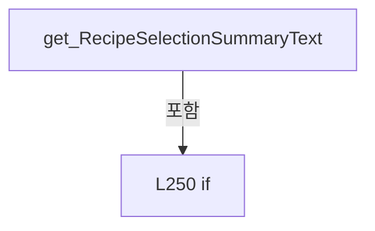

변경 전 점검: 입력/반환 타입, 위 호출자, 예외/취소 경로, 공유 상태와 저장·전송 소비자를 함께 확인합니다. 값의 단위나 물리 방향을 이름만으로 확정하지 않습니다.

### PropertyDeclaration `RecipeFiles` · L259–270

[Drilling.UI/Menu/Menus/CMenuRecipe.cs:259–270](https://github.com/kjuws10-rgb/A3Drilling/blob/5aee8e58439c9b455cae7c9593c9be986c3e682e/Drilling.UI/Menu/Menus/CMenuRecipe.cs#L259-L270)

| 항목 | 실제 추출 값 |
| --- | --- |
| 서명 | System.Collections.Generic.IReadOnlyList<Drilling.UI.Menu.Menus.ST_RECIPE_FILE> Drilling.UI.Menu.Menus.CMenuRecipe.RecipeFiles |
| 접근/수식자 | Public / public |
| 반환/값 타입 | System.Collections.Generic.IReadOnlyList<Drilling.UI.Menu.Menus.ST_RECIPE_FILE> |
| 소속 타입 | NamedType:Drilling.UI.Menu.Menus.CMenuRecipe |

현재 부분 분석에서 직접 연결된 호출자는 없습니다. XAML/이벤트/인터페이스·델리게이트·외부 진입을 추가 확인해야 하며, 미사용으로 판정한 것이 아닙니다.

변경 전 점검: 입력/반환 타입, 위 호출자, 예외/취소 경로, 공유 상태와 저장·전송 소비자를 함께 확인합니다. 값의 단위나 물리 방향을 이름만으로 확정하지 않습니다.

### GetAccessorDeclaration `get_RecipeFiles` · L261–264

[Drilling.UI/Menu/Menus/CMenuRecipe.cs:261–264](https://github.com/kjuws10-rgb/A3Drilling/blob/5aee8e58439c9b455cae7c9593c9be986c3e682e/Drilling.UI/Menu/Menus/CMenuRecipe.cs#L261-L264)

| 항목 | 실제 추출 값 |
| --- | --- |
| 서명 | System.Collections.Generic.IReadOnlyList<Drilling.UI.Menu.Menus.ST_RECIPE_FILE> Drilling.UI.Menu.Menus.CMenuRecipe.RecipeFiles.get |
| 접근/수식자 | Public / get |
| 반환/값 타입 | System.Collections.Generic.IReadOnlyList<Drilling.UI.Menu.Menus.ST_RECIPE_FILE> |
| 소속 타입 | NamedType:Drilling.UI.Menu.Menus.CMenuRecipe |

현재 부분 분석에서 직접 연결된 호출자는 없습니다. XAML/이벤트/인터페이스·델리게이트·외부 진입을 추가 확인해야 하며, 미사용으로 판정한 것이 아닙니다.

본문의 실제 연산·분기·예외·반환 순서(원문 위치 순):

| 원본 행 | 종류 | 주석 해설 |
| --- | --- | --- |
| 263 | return | 호출자에게 값 또는 제어를 반환합니다: return _recipeFiles; |

변경 전 점검: 입력/반환 타입, 위 호출자, 예외/취소 경로, 공유 상태와 저장·전송 소비자를 함께 확인합니다. 값의 단위나 물리 방향을 이름만으로 확정하지 않습니다.

### SetAccessorDeclaration `set_RecipeFiles` · L266–269

[Drilling.UI/Menu/Menus/CMenuRecipe.cs:266–269](https://github.com/kjuws10-rgb/A3Drilling/blob/5aee8e58439c9b455cae7c9593c9be986c3e682e/Drilling.UI/Menu/Menus/CMenuRecipe.cs#L266-L269)

| 항목 | 실제 추출 값 |
| --- | --- |
| 서명 | void Drilling.UI.Menu.Menus.CMenuRecipe.RecipeFiles.set |
| 접근/수식자 | Private / private, set |
| 반환/값 타입 | void |
| 소속 타입 | NamedType:Drilling.UI.Menu.Menus.CMenuRecipe |

입력 계약:

| 이름 | 타입 | 전달 | 선택/기본값 |
| --- | --- | --- | --- |
| value | System.Collections.Generic.IReadOnlyList<Drilling.UI.Menu.Menus.ST_RECIPE_FILE> | None | False /  |

현재 부분 분석에서 직접 연결된 호출자는 없습니다. XAML/이벤트/인터페이스·델리게이트·외부 진입을 추가 확인해야 하며, 미사용으로 판정한 것이 아닙니다.

호출하는 대상과 해석 범위:

| 원본 행 | 표현식 | 분석 상태 | 대상/소스 위치 |
| --- | --- | --- | --- |
| 268 | SetSequenceProperty | resolved | bool Drilling.UI.Menu.CBindingBase.SetSequenceProperty<Drilling.UI.Menu.Menus.ST_RECIPE_FILE>(ref System.Collections.Generic.IReadOnlyList<Drilling.UI.Menu.Menus.ST_RECIPE_FILE>, System.Collections.Generic.IReadOnlyList<Drilling.UI.Menu.Menus.ST_RECIPE_FILE>, string?) · Drilling.UI/Menu/CBindingBase.cs:747 |

본문의 실제 연산·분기·예외·반환 순서(원문 위치 순):

| 원본 행 | 종류 | 주석 해설 |
| --- | --- | --- |
| 268 | call | 함수·델리게이트 또는 객체 생성자를 호출합니다: SetSequenceProperty(ref _recipeFiles, value) |

변경 전 점검: 입력/반환 타입, 위 호출자, 예외/취소 경로, 공유 상태와 저장·전송 소비자를 함께 확인합니다. 값의 단위나 물리 방향을 이름만으로 확정하지 않습니다.

### PropertyDeclaration `RecipeFilesPageText` · L272–283

[Drilling.UI/Menu/Menus/CMenuRecipe.cs:272–283](https://github.com/kjuws10-rgb/A3Drilling/blob/5aee8e58439c9b455cae7c9593c9be986c3e682e/Drilling.UI/Menu/Menus/CMenuRecipe.cs#L272-L283)

| 항목 | 실제 추출 값 |
| --- | --- |
| 서명 | string Drilling.UI.Menu.Menus.CMenuRecipe.RecipeFilesPageText |
| 접근/수식자 | Public / public |
| 반환/값 타입 | string |
| 소속 타입 | NamedType:Drilling.UI.Menu.Menus.CMenuRecipe |

현재 부분 분석에서 직접 연결된 호출자는 없습니다. XAML/이벤트/인터페이스·델리게이트·외부 진입을 추가 확인해야 하며, 미사용으로 판정한 것이 아닙니다.

변경 전 점검: 입력/반환 타입, 위 호출자, 예외/취소 경로, 공유 상태와 저장·전송 소비자를 함께 확인합니다. 값의 단위나 물리 방향을 이름만으로 확정하지 않습니다.

### GetAccessorDeclaration `get_RecipeFilesPageText` · L274–277

[Drilling.UI/Menu/Menus/CMenuRecipe.cs:274–277](https://github.com/kjuws10-rgb/A3Drilling/blob/5aee8e58439c9b455cae7c9593c9be986c3e682e/Drilling.UI/Menu/Menus/CMenuRecipe.cs#L274-L277)

| 항목 | 실제 추출 값 |
| --- | --- |
| 서명 | string Drilling.UI.Menu.Menus.CMenuRecipe.RecipeFilesPageText.get |
| 접근/수식자 | Public / get |
| 반환/값 타입 | string |
| 소속 타입 | NamedType:Drilling.UI.Menu.Menus.CMenuRecipe |

현재 부분 분석에서 직접 연결된 호출자는 없습니다. XAML/이벤트/인터페이스·델리게이트·외부 진입을 추가 확인해야 하며, 미사용으로 판정한 것이 아닙니다.

본문의 실제 연산·분기·예외·반환 순서(원문 위치 순):

| 원본 행 | 종류 | 주석 해설 |
| --- | --- | --- |
| 276 | return | 호출자에게 값 또는 제어를 반환합니다: return _recipeFilesPageText; |

변경 전 점검: 입력/반환 타입, 위 호출자, 예외/취소 경로, 공유 상태와 저장·전송 소비자를 함께 확인합니다. 값의 단위나 물리 방향을 이름만으로 확정하지 않습니다.

### SetAccessorDeclaration `set_RecipeFilesPageText` · L279–282

[Drilling.UI/Menu/Menus/CMenuRecipe.cs:279–282](https://github.com/kjuws10-rgb/A3Drilling/blob/5aee8e58439c9b455cae7c9593c9be986c3e682e/Drilling.UI/Menu/Menus/CMenuRecipe.cs#L279-L282)

| 항목 | 실제 추출 값 |
| --- | --- |
| 서명 | void Drilling.UI.Menu.Menus.CMenuRecipe.RecipeFilesPageText.set |
| 접근/수식자 | Private / private, set |
| 반환/값 타입 | void |
| 소속 타입 | NamedType:Drilling.UI.Menu.Menus.CMenuRecipe |

입력 계약:

| 이름 | 타입 | 전달 | 선택/기본값 |
| --- | --- | --- | --- |
| value | string | None | False /  |

현재 부분 분석에서 직접 연결된 호출자는 없습니다. XAML/이벤트/인터페이스·델리게이트·외부 진입을 추가 확인해야 하며, 미사용으로 판정한 것이 아닙니다.

호출하는 대상과 해석 범위:

| 원본 행 | 표현식 | 분석 상태 | 대상/소스 위치 |
| --- | --- | --- | --- |
| 281 | SetProperty | resolved | bool Drilling.UI.Menu.CBindingBase.SetProperty<string>(ref string, string, string?) · Drilling.UI/Menu/CBindingBase.cs:735 |

본문의 실제 연산·분기·예외·반환 순서(원문 위치 순):

| 원본 행 | 종류 | 주석 해설 |
| --- | --- | --- |
| 281 | call | 함수·델리게이트 또는 객체 생성자를 호출합니다: SetProperty(ref _recipeFilesPageText, value) |

변경 전 점검: 입력/반환 타입, 위 호출자, 예외/취소 경로, 공유 상태와 저장·전송 소비자를 함께 확인합니다. 값의 단위나 물리 방향을 이름만으로 확정하지 않습니다.

### PropertyDeclaration `ItemTabs` · L285–285

[Drilling.UI/Menu/Menus/CMenuRecipe.cs:285–285](https://github.com/kjuws10-rgb/A3Drilling/blob/5aee8e58439c9b455cae7c9593c9be986c3e682e/Drilling.UI/Menu/Menus/CMenuRecipe.cs#L285-L285)

| 항목 | 실제 추출 값 |
| --- | --- |
| 서명 | System.Collections.Generic.IReadOnlyList<Drilling.UI.Menu.Menus.ST_RECIPE_CATEGORY_TAB> Drilling.UI.Menu.Menus.CMenuRecipe.ItemTabs |
| 접근/수식자 | Public / public |
| 반환/값 타입 | System.Collections.Generic.IReadOnlyList<Drilling.UI.Menu.Menus.ST_RECIPE_CATEGORY_TAB> |
| 소속 타입 | NamedType:Drilling.UI.Menu.Menus.CMenuRecipe |

현재 부분 분석에서 직접 연결된 호출자는 없습니다. XAML/이벤트/인터페이스·델리게이트·외부 진입을 추가 확인해야 하며, 미사용으로 판정한 것이 아닙니다.

변경 전 점검: 입력/반환 타입, 위 호출자, 예외/취소 경로, 공유 상태와 저장·전송 소비자를 함께 확인합니다. 값의 단위나 물리 방향을 이름만으로 확정하지 않습니다.

### GetAccessorDeclaration `get_ItemTabs` · L285–285

[Drilling.UI/Menu/Menus/CMenuRecipe.cs:285–285](https://github.com/kjuws10-rgb/A3Drilling/blob/5aee8e58439c9b455cae7c9593c9be986c3e682e/Drilling.UI/Menu/Menus/CMenuRecipe.cs#L285-L285)

| 항목 | 실제 추출 값 |
| --- | --- |
| 서명 | System.Collections.Generic.IReadOnlyList<Drilling.UI.Menu.Menus.ST_RECIPE_CATEGORY_TAB> Drilling.UI.Menu.Menus.CMenuRecipe.ItemTabs.get |
| 접근/수식자 | Public / get |
| 반환/값 타입 | System.Collections.Generic.IReadOnlyList<Drilling.UI.Menu.Menus.ST_RECIPE_CATEGORY_TAB> |
| 소속 타입 | NamedType:Drilling.UI.Menu.Menus.CMenuRecipe |

현재 부분 분석에서 직접 연결된 호출자는 없습니다. XAML/이벤트/인터페이스·델리게이트·외부 진입을 추가 확인해야 하며, 미사용으로 판정한 것이 아닙니다.

변경 전 점검: 입력/반환 타입, 위 호출자, 예외/취소 경로, 공유 상태와 저장·전송 소비자를 함께 확인합니다. 값의 단위나 물리 방향을 이름만으로 확정하지 않습니다.

### SetAccessorDeclaration `set_ItemTabs` · L285–285

[Drilling.UI/Menu/Menus/CMenuRecipe.cs:285–285](https://github.com/kjuws10-rgb/A3Drilling/blob/5aee8e58439c9b455cae7c9593c9be986c3e682e/Drilling.UI/Menu/Menus/CMenuRecipe.cs#L285-L285)

| 항목 | 실제 추출 값 |
| --- | --- |
| 서명 | void Drilling.UI.Menu.Menus.CMenuRecipe.ItemTabs.set |
| 접근/수식자 | Private / private, set |
| 반환/값 타입 | void |
| 소속 타입 | NamedType:Drilling.UI.Menu.Menus.CMenuRecipe |

입력 계약:

| 이름 | 타입 | 전달 | 선택/기본값 |
| --- | --- | --- | --- |
| value | System.Collections.Generic.IReadOnlyList<Drilling.UI.Menu.Menus.ST_RECIPE_CATEGORY_TAB> | None | False /  |

현재 부분 분석에서 직접 연결된 호출자는 없습니다. XAML/이벤트/인터페이스·델리게이트·외부 진입을 추가 확인해야 하며, 미사용으로 판정한 것이 아닙니다.

변경 전 점검: 입력/반환 타입, 위 호출자, 예외/취소 경로, 공유 상태와 저장·전송 소비자를 함께 확인합니다. 값의 단위나 물리 방향을 이름만으로 확정하지 않습니다.

### PropertyDeclaration `GroupTabs` · L286–286

[Drilling.UI/Menu/Menus/CMenuRecipe.cs:286–286](https://github.com/kjuws10-rgb/A3Drilling/blob/5aee8e58439c9b455cae7c9593c9be986c3e682e/Drilling.UI/Menu/Menus/CMenuRecipe.cs#L286-L286)

| 항목 | 실제 추출 값 |
| --- | --- |
| 서명 | System.Collections.Generic.IReadOnlyList<Drilling.UI.Menu.Menus.ST_RECIPE_GROUP_TAB> Drilling.UI.Menu.Menus.CMenuRecipe.GroupTabs |
| 접근/수식자 | Public / public |
| 반환/값 타입 | System.Collections.Generic.IReadOnlyList<Drilling.UI.Menu.Menus.ST_RECIPE_GROUP_TAB> |
| 소속 타입 | NamedType:Drilling.UI.Menu.Menus.CMenuRecipe |

현재 부분 분석에서 직접 연결된 호출자는 없습니다. XAML/이벤트/인터페이스·델리게이트·외부 진입을 추가 확인해야 하며, 미사용으로 판정한 것이 아닙니다.

변경 전 점검: 입력/반환 타입, 위 호출자, 예외/취소 경로, 공유 상태와 저장·전송 소비자를 함께 확인합니다. 값의 단위나 물리 방향을 이름만으로 확정하지 않습니다.

### GetAccessorDeclaration `get_GroupTabs` · L286–286

[Drilling.UI/Menu/Menus/CMenuRecipe.cs:286–286](https://github.com/kjuws10-rgb/A3Drilling/blob/5aee8e58439c9b455cae7c9593c9be986c3e682e/Drilling.UI/Menu/Menus/CMenuRecipe.cs#L286-L286)

| 항목 | 실제 추출 값 |
| --- | --- |
| 서명 | System.Collections.Generic.IReadOnlyList<Drilling.UI.Menu.Menus.ST_RECIPE_GROUP_TAB> Drilling.UI.Menu.Menus.CMenuRecipe.GroupTabs.get |
| 접근/수식자 | Public / get |
| 반환/값 타입 | System.Collections.Generic.IReadOnlyList<Drilling.UI.Menu.Menus.ST_RECIPE_GROUP_TAB> |
| 소속 타입 | NamedType:Drilling.UI.Menu.Menus.CMenuRecipe |

현재 부분 분석에서 직접 연결된 호출자는 없습니다. XAML/이벤트/인터페이스·델리게이트·외부 진입을 추가 확인해야 하며, 미사용으로 판정한 것이 아닙니다.

변경 전 점검: 입력/반환 타입, 위 호출자, 예외/취소 경로, 공유 상태와 저장·전송 소비자를 함께 확인합니다. 값의 단위나 물리 방향을 이름만으로 확정하지 않습니다.

### SetAccessorDeclaration `set_GroupTabs` · L286–286

[Drilling.UI/Menu/Menus/CMenuRecipe.cs:286–286](https://github.com/kjuws10-rgb/A3Drilling/blob/5aee8e58439c9b455cae7c9593c9be986c3e682e/Drilling.UI/Menu/Menus/CMenuRecipe.cs#L286-L286)

| 항목 | 실제 추출 값 |
| --- | --- |
| 서명 | void Drilling.UI.Menu.Menus.CMenuRecipe.GroupTabs.set |
| 접근/수식자 | Private / private, set |
| 반환/값 타입 | void |
| 소속 타입 | NamedType:Drilling.UI.Menu.Menus.CMenuRecipe |

입력 계약:

| 이름 | 타입 | 전달 | 선택/기본값 |
| --- | --- | --- | --- |
| value | System.Collections.Generic.IReadOnlyList<Drilling.UI.Menu.Menus.ST_RECIPE_GROUP_TAB> | None | False /  |

현재 부분 분석에서 직접 연결된 호출자는 없습니다. XAML/이벤트/인터페이스·델리게이트·외부 진입을 추가 확인해야 하며, 미사용으로 판정한 것이 아닙니다.

변경 전 점검: 입력/반환 타입, 위 호출자, 예외/취소 경로, 공유 상태와 저장·전송 소비자를 함께 확인합니다. 값의 단위나 물리 방향을 이름만으로 확정하지 않습니다.

### PropertyDeclaration `CellOverviewRows` · L287–287

[Drilling.UI/Menu/Menus/CMenuRecipe.cs:287–287](https://github.com/kjuws10-rgb/A3Drilling/blob/5aee8e58439c9b455cae7c9593c9be986c3e682e/Drilling.UI/Menu/Menus/CMenuRecipe.cs#L287-L287)

| 항목 | 실제 추출 값 |
| --- | --- |
| 서명 | System.Collections.Generic.IReadOnlyList<Drilling.UI.Menu.Menus.ST_RECIPE_CELL_OVERVIEW_ROW> Drilling.UI.Menu.Menus.CMenuRecipe.CellOverviewRows |
| 접근/수식자 | Public / public |
| 반환/값 타입 | System.Collections.Generic.IReadOnlyList<Drilling.UI.Menu.Menus.ST_RECIPE_CELL_OVERVIEW_ROW> |
| 소속 타입 | NamedType:Drilling.UI.Menu.Menus.CMenuRecipe |

현재 부분 분석에서 직접 연결된 호출자는 없습니다. XAML/이벤트/인터페이스·델리게이트·외부 진입을 추가 확인해야 하며, 미사용으로 판정한 것이 아닙니다.

변경 전 점검: 입력/반환 타입, 위 호출자, 예외/취소 경로, 공유 상태와 저장·전송 소비자를 함께 확인합니다. 값의 단위나 물리 방향을 이름만으로 확정하지 않습니다.

### GetAccessorDeclaration `get_CellOverviewRows` · L287–287

[Drilling.UI/Menu/Menus/CMenuRecipe.cs:287–287](https://github.com/kjuws10-rgb/A3Drilling/blob/5aee8e58439c9b455cae7c9593c9be986c3e682e/Drilling.UI/Menu/Menus/CMenuRecipe.cs#L287-L287)

| 항목 | 실제 추출 값 |
| --- | --- |
| 서명 | System.Collections.Generic.IReadOnlyList<Drilling.UI.Menu.Menus.ST_RECIPE_CELL_OVERVIEW_ROW> Drilling.UI.Menu.Menus.CMenuRecipe.CellOverviewRows.get |
| 접근/수식자 | Public / get |
| 반환/값 타입 | System.Collections.Generic.IReadOnlyList<Drilling.UI.Menu.Menus.ST_RECIPE_CELL_OVERVIEW_ROW> |
| 소속 타입 | NamedType:Drilling.UI.Menu.Menus.CMenuRecipe |

현재 부분 분석에서 직접 연결된 호출자는 없습니다. XAML/이벤트/인터페이스·델리게이트·외부 진입을 추가 확인해야 하며, 미사용으로 판정한 것이 아닙니다.

변경 전 점검: 입력/반환 타입, 위 호출자, 예외/취소 경로, 공유 상태와 저장·전송 소비자를 함께 확인합니다. 값의 단위나 물리 방향을 이름만으로 확정하지 않습니다.

### SetAccessorDeclaration `set_CellOverviewRows` · L287–287

[Drilling.UI/Menu/Menus/CMenuRecipe.cs:287–287](https://github.com/kjuws10-rgb/A3Drilling/blob/5aee8e58439c9b455cae7c9593c9be986c3e682e/Drilling.UI/Menu/Menus/CMenuRecipe.cs#L287-L287)

| 항목 | 실제 추출 값 |
| --- | --- |
| 서명 | void Drilling.UI.Menu.Menus.CMenuRecipe.CellOverviewRows.set |
| 접근/수식자 | Private / private, set |
| 반환/값 타입 | void |
| 소속 타입 | NamedType:Drilling.UI.Menu.Menus.CMenuRecipe |

입력 계약:

| 이름 | 타입 | 전달 | 선택/기본값 |
| --- | --- | --- | --- |
| value | System.Collections.Generic.IReadOnlyList<Drilling.UI.Menu.Menus.ST_RECIPE_CELL_OVERVIEW_ROW> | None | False /  |

현재 부분 분석에서 직접 연결된 호출자는 없습니다. XAML/이벤트/인터페이스·델리게이트·외부 진입을 추가 확인해야 하며, 미사용으로 판정한 것이 아닙니다.

변경 전 점검: 입력/반환 타입, 위 호출자, 예외/취소 경로, 공유 상태와 저장·전송 소비자를 함께 확인합니다. 값의 단위나 물리 방향을 이름만으로 확정하지 않습니다.

### PropertyDeclaration `ShotGroupRows` · L288–288

[Drilling.UI/Menu/Menus/CMenuRecipe.cs:288–288](https://github.com/kjuws10-rgb/A3Drilling/blob/5aee8e58439c9b455cae7c9593c9be986c3e682e/Drilling.UI/Menu/Menus/CMenuRecipe.cs#L288-L288)

| 항목 | 실제 추출 값 |
| --- | --- |
| 서명 | System.Collections.Generic.IReadOnlyList<Drilling.UI.Menu.Menus.ST_SHOT_GROUP_EDITOR_ROW> Drilling.UI.Menu.Menus.CMenuRecipe.ShotGroupRows |
| 접근/수식자 | Public / public |
| 반환/값 타입 | System.Collections.Generic.IReadOnlyList<Drilling.UI.Menu.Menus.ST_SHOT_GROUP_EDITOR_ROW> |
| 소속 타입 | NamedType:Drilling.UI.Menu.Menus.CMenuRecipe |

현재 부분 분석에서 직접 연결된 호출자는 없습니다. XAML/이벤트/인터페이스·델리게이트·외부 진입을 추가 확인해야 하며, 미사용으로 판정한 것이 아닙니다.

변경 전 점검: 입력/반환 타입, 위 호출자, 예외/취소 경로, 공유 상태와 저장·전송 소비자를 함께 확인합니다. 값의 단위나 물리 방향을 이름만으로 확정하지 않습니다.

### GetAccessorDeclaration `get_ShotGroupRows` · L288–288

[Drilling.UI/Menu/Menus/CMenuRecipe.cs:288–288](https://github.com/kjuws10-rgb/A3Drilling/blob/5aee8e58439c9b455cae7c9593c9be986c3e682e/Drilling.UI/Menu/Menus/CMenuRecipe.cs#L288-L288)

| 항목 | 실제 추출 값 |
| --- | --- |
| 서명 | System.Collections.Generic.IReadOnlyList<Drilling.UI.Menu.Menus.ST_SHOT_GROUP_EDITOR_ROW> Drilling.UI.Menu.Menus.CMenuRecipe.ShotGroupRows.get |
| 접근/수식자 | Public / get |
| 반환/값 타입 | System.Collections.Generic.IReadOnlyList<Drilling.UI.Menu.Menus.ST_SHOT_GROUP_EDITOR_ROW> |
| 소속 타입 | NamedType:Drilling.UI.Menu.Menus.CMenuRecipe |

현재 부분 분석에서 직접 연결된 호출자는 없습니다. XAML/이벤트/인터페이스·델리게이트·외부 진입을 추가 확인해야 하며, 미사용으로 판정한 것이 아닙니다.

변경 전 점검: 입력/반환 타입, 위 호출자, 예외/취소 경로, 공유 상태와 저장·전송 소비자를 함께 확인합니다. 값의 단위나 물리 방향을 이름만으로 확정하지 않습니다.

### SetAccessorDeclaration `set_ShotGroupRows` · L288–288

[Drilling.UI/Menu/Menus/CMenuRecipe.cs:288–288](https://github.com/kjuws10-rgb/A3Drilling/blob/5aee8e58439c9b455cae7c9593c9be986c3e682e/Drilling.UI/Menu/Menus/CMenuRecipe.cs#L288-L288)

| 항목 | 실제 추출 값 |
| --- | --- |
| 서명 | void Drilling.UI.Menu.Menus.CMenuRecipe.ShotGroupRows.set |
| 접근/수식자 | Private / private, set |
| 반환/값 타입 | void |
| 소속 타입 | NamedType:Drilling.UI.Menu.Menus.CMenuRecipe |

입력 계약:

| 이름 | 타입 | 전달 | 선택/기본값 |
| --- | --- | --- | --- |
| value | System.Collections.Generic.IReadOnlyList<Drilling.UI.Menu.Menus.ST_SHOT_GROUP_EDITOR_ROW> | None | False /  |

현재 부분 분석에서 직접 연결된 호출자는 없습니다. XAML/이벤트/인터페이스·델리게이트·외부 진입을 추가 확인해야 하며, 미사용으로 판정한 것이 아닙니다.

변경 전 점검: 입력/반환 타입, 위 호출자, 예외/취소 경로, 공유 상태와 저장·전송 소비자를 함께 확인합니다. 값의 단위나 물리 방향을 이름만으로 확정하지 않습니다.

### PropertyDeclaration `SelectedShotGroup` · L290–318

[Drilling.UI/Menu/Menus/CMenuRecipe.cs:290–318](https://github.com/kjuws10-rgb/A3Drilling/blob/5aee8e58439c9b455cae7c9593c9be986c3e682e/Drilling.UI/Menu/Menus/CMenuRecipe.cs#L290-L318)

| 항목 | 실제 추출 값 |
| --- | --- |
| 서명 | Drilling.UI.Menu.Menus.ST_SHOT_GROUP_EDITOR_ROW? Drilling.UI.Menu.Menus.CMenuRecipe.SelectedShotGroup |
| 접근/수식자 | Public / public |
| 반환/값 타입 | Drilling.UI.Menu.Menus.ST_SHOT_GROUP_EDITOR_ROW? |
| 소속 타입 | NamedType:Drilling.UI.Menu.Menus.CMenuRecipe |

현재 부분 분석에서 직접 연결된 호출자는 없습니다. XAML/이벤트/인터페이스·델리게이트·외부 진입을 추가 확인해야 하며, 미사용으로 판정한 것이 아닙니다.

변경 전 점검: 입력/반환 타입, 위 호출자, 예외/취소 경로, 공유 상태와 저장·전송 소비자를 함께 확인합니다. 값의 단위나 물리 방향을 이름만으로 확정하지 않습니다.

### GetAccessorDeclaration `get_SelectedShotGroup` · L292–295

[Drilling.UI/Menu/Menus/CMenuRecipe.cs:292–295](https://github.com/kjuws10-rgb/A3Drilling/blob/5aee8e58439c9b455cae7c9593c9be986c3e682e/Drilling.UI/Menu/Menus/CMenuRecipe.cs#L292-L295)

| 항목 | 실제 추출 값 |
| --- | --- |
| 서명 | Drilling.UI.Menu.Menus.ST_SHOT_GROUP_EDITOR_ROW? Drilling.UI.Menu.Menus.CMenuRecipe.SelectedShotGroup.get |
| 접근/수식자 | Public / get |
| 반환/값 타입 | Drilling.UI.Menu.Menus.ST_SHOT_GROUP_EDITOR_ROW? |
| 소속 타입 | NamedType:Drilling.UI.Menu.Menus.CMenuRecipe |

현재 부분 분석에서 직접 연결된 호출자는 없습니다. XAML/이벤트/인터페이스·델리게이트·외부 진입을 추가 확인해야 하며, 미사용으로 판정한 것이 아닙니다.

본문의 실제 연산·분기·예외·반환 순서(원문 위치 순):

| 원본 행 | 종류 | 주석 해설 |
| --- | --- | --- |
| 294 | return | 호출자에게 값 또는 제어를 반환합니다: return _selectedShotGroup; |

변경 전 점검: 입력/반환 타입, 위 호출자, 예외/취소 경로, 공유 상태와 저장·전송 소비자를 함께 확인합니다. 값의 단위나 물리 방향을 이름만으로 확정하지 않습니다.

### SetAccessorDeclaration `set_SelectedShotGroup` · L297–317

[Drilling.UI/Menu/Menus/CMenuRecipe.cs:297–317](https://github.com/kjuws10-rgb/A3Drilling/blob/5aee8e58439c9b455cae7c9593c9be986c3e682e/Drilling.UI/Menu/Menus/CMenuRecipe.cs#L297-L317)

| 항목 | 실제 추출 값 |
| --- | --- |
| 서명 | void Drilling.UI.Menu.Menus.CMenuRecipe.SelectedShotGroup.set |
| 접근/수식자 | Public / set |
| 반환/값 타입 | void |
| 소속 타입 | NamedType:Drilling.UI.Menu.Menus.CMenuRecipe |

입력 계약:

| 이름 | 타입 | 전달 | 선택/기본값 |
| --- | --- | --- | --- |
| value | Drilling.UI.Menu.Menus.ST_SHOT_GROUP_EDITOR_ROW? | None | False /  |

현재 부분 분석에서 직접 연결된 호출자는 없습니다. XAML/이벤트/인터페이스·델리게이트·외부 진입을 추가 확인해야 하며, 미사용으로 판정한 것이 아닙니다.

호출하는 대상과 해석 범위:

| 원본 행 | 표현식 | 분석 상태 | 대상/소스 위치 |
| --- | --- | --- | --- |
| 299 | SetProperty | resolved | bool Drilling.UI.Menu.CBindingBase.SetProperty<Drilling.UI.Menu.Menus.ST_SHOT_GROUP_EDITOR_ROW?>(ref Drilling.UI.Menu.Menus.ST_SHOT_GROUP_EDITOR_ROW?, Drilling.UI.Menu.Menus.ST_SHOT_GROUP_EDITOR_ROW?, string?) · Drilling.UI/Menu/CBindingBase.cs:735 |
| 314 | OnPropertyChanged | resolved | void Drilling.UI.Menu.CBindingBase.OnPropertyChanged(string?) · Drilling.UI/Menu/CBindingBase.cs:759 |
| 314 | nameof | unresolved | None |
| 315 | NavigateShotGroupCommand.NotifyCanExecuteChanged | resolved | void Drilling.UI.Menu.CButtonCommand.NotifyCanExecuteChanged() · Drilling.UI/Menu/CButtonCommand.cs:24 |
| 316 | RefreshCellPatternViewer | resolved | void Drilling.UI.Menu.Menus.CMenuRecipe.RefreshCellPatternViewer() · Drilling.UI/Menu/Menus/CMenuRecipe.cs:2073 |

본문의 실제 연산·분기·예외·반환 순서(원문 위치 순):

| 원본 행 | 종류 | 주석 해설 |
| --- | --- | --- |
| 299 | call | 함수·델리게이트 또는 객체 생성자를 호출합니다: SetProperty(ref _selectedShotGroup, value) |
| 299 | if | 조건에 따라 분기합니다: if (!SetProperty(ref _selectedShotGroup, value)) |
| 301 | return | 호출자에게 값 또는 제어를 반환합니다: return; |
| 304 | if | 조건에 따라 분기합니다: if (value is not null) |
| 306 | assignment | 값을 대상에 대입합니다: _selectedCellShotNo = value.CellShotNo |
| 309 | foreach | 컬렉션 요소를 순회합니다: foreach (var row in ShotGroupRows) |
| 311 | assignment | 값을 대상에 대입합니다: row.IsSelected = value is not null && row.CellShotNo == value.CellShotNo |
| 314 | call | 함수·델리게이트 또는 객체 생성자를 호출합니다: OnPropertyChanged(nameof(SelectedShotGroupIndicatorText)) |
| 314 | call | 함수·델리게이트 또는 객체 생성자를 호출합니다: nameof(SelectedShotGroupIndicatorText) |
| 315 | call | 함수·델리게이트 또는 객체 생성자를 호출합니다: NavigateShotGroupCommand.NotifyCanExecuteChanged() |
| 316 | call | 함수·델리게이트 또는 객체 생성자를 호출합니다: RefreshCellPatternViewer() |

제어 구문의 포함 구조(실제 실행 순서/CFG가 아닌 구문 탐색 그림):

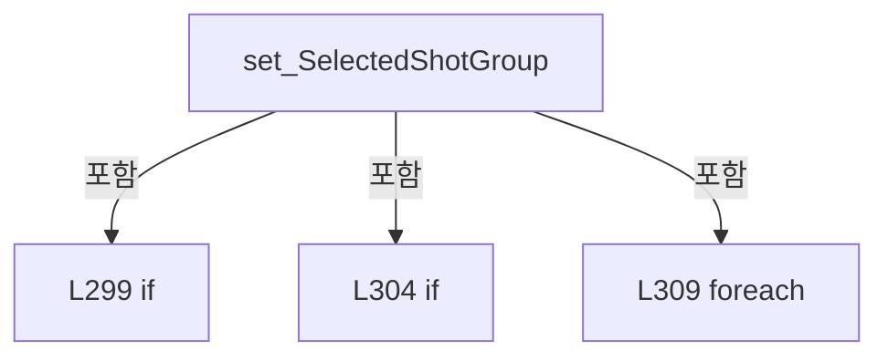

변경 전 점검: 입력/반환 타입, 위 호출자, 예외/취소 경로, 공유 상태와 저장·전송 소비자를 함께 확인합니다. 값의 단위나 물리 방향을 이름만으로 확정하지 않습니다.

### PropertyDeclaration `GlassSizeXItem` · L320–320

[Drilling.UI/Menu/Menus/CMenuRecipe.cs:320–320](https://github.com/kjuws10-rgb/A3Drilling/blob/5aee8e58439c9b455cae7c9593c9be986c3e682e/Drilling.UI/Menu/Menus/CMenuRecipe.cs#L320-L320)

| 항목 | 실제 추출 값 |
| --- | --- |
| 서명 | Drilling.UI.Menu.Menus.ST_RECIPE_PARAMETER_EDITOR_ITEM? Drilling.UI.Menu.Menus.CMenuRecipe.GlassSizeXItem |
| 접근/수식자 | Public / public |
| 반환/값 타입 | Drilling.UI.Menu.Menus.ST_RECIPE_PARAMETER_EDITOR_ITEM? |
| 소속 타입 | NamedType:Drilling.UI.Menu.Menus.CMenuRecipe |

현재 부분 분석에서 직접 연결된 호출자는 없습니다. XAML/이벤트/인터페이스·델리게이트·외부 진입을 추가 확인해야 하며, 미사용으로 판정한 것이 아닙니다.

변경 전 점검: 입력/반환 타입, 위 호출자, 예외/취소 경로, 공유 상태와 저장·전송 소비자를 함께 확인합니다. 값의 단위나 물리 방향을 이름만으로 확정하지 않습니다.

### GetAccessorDeclaration `get_GlassSizeXItem` · L320–320

[Drilling.UI/Menu/Menus/CMenuRecipe.cs:320–320](https://github.com/kjuws10-rgb/A3Drilling/blob/5aee8e58439c9b455cae7c9593c9be986c3e682e/Drilling.UI/Menu/Menus/CMenuRecipe.cs#L320-L320)

| 항목 | 실제 추출 값 |
| --- | --- |
| 서명 | Drilling.UI.Menu.Menus.ST_RECIPE_PARAMETER_EDITOR_ITEM? Drilling.UI.Menu.Menus.CMenuRecipe.GlassSizeXItem.get |
| 접근/수식자 | Public / get |
| 반환/값 타입 | Drilling.UI.Menu.Menus.ST_RECIPE_PARAMETER_EDITOR_ITEM? |
| 소속 타입 | NamedType:Drilling.UI.Menu.Menus.CMenuRecipe |

현재 부분 분석에서 직접 연결된 호출자는 없습니다. XAML/이벤트/인터페이스·델리게이트·외부 진입을 추가 확인해야 하며, 미사용으로 판정한 것이 아닙니다.

변경 전 점검: 입력/반환 타입, 위 호출자, 예외/취소 경로, 공유 상태와 저장·전송 소비자를 함께 확인합니다. 값의 단위나 물리 방향을 이름만으로 확정하지 않습니다.

### SetAccessorDeclaration `set_GlassSizeXItem` · L320–320

[Drilling.UI/Menu/Menus/CMenuRecipe.cs:320–320](https://github.com/kjuws10-rgb/A3Drilling/blob/5aee8e58439c9b455cae7c9593c9be986c3e682e/Drilling.UI/Menu/Menus/CMenuRecipe.cs#L320-L320)

| 항목 | 실제 추출 값 |
| --- | --- |
| 서명 | void Drilling.UI.Menu.Menus.CMenuRecipe.GlassSizeXItem.set |
| 접근/수식자 | Private / private, set |
| 반환/값 타입 | void |
| 소속 타입 | NamedType:Drilling.UI.Menu.Menus.CMenuRecipe |

입력 계약:

| 이름 | 타입 | 전달 | 선택/기본값 |
| --- | --- | --- | --- |
| value | Drilling.UI.Menu.Menus.ST_RECIPE_PARAMETER_EDITOR_ITEM? | None | False /  |

현재 부분 분석에서 직접 연결된 호출자는 없습니다. XAML/이벤트/인터페이스·델리게이트·외부 진입을 추가 확인해야 하며, 미사용으로 판정한 것이 아닙니다.

변경 전 점검: 입력/반환 타입, 위 호출자, 예외/취소 경로, 공유 상태와 저장·전송 소비자를 함께 확인합니다. 값의 단위나 물리 방향을 이름만으로 확정하지 않습니다.

### PropertyDeclaration `GlassSizeYItem` · L321–321

[Drilling.UI/Menu/Menus/CMenuRecipe.cs:321–321](https://github.com/kjuws10-rgb/A3Drilling/blob/5aee8e58439c9b455cae7c9593c9be986c3e682e/Drilling.UI/Menu/Menus/CMenuRecipe.cs#L321-L321)

| 항목 | 실제 추출 값 |
| --- | --- |
| 서명 | Drilling.UI.Menu.Menus.ST_RECIPE_PARAMETER_EDITOR_ITEM? Drilling.UI.Menu.Menus.CMenuRecipe.GlassSizeYItem |
| 접근/수식자 | Public / public |
| 반환/값 타입 | Drilling.UI.Menu.Menus.ST_RECIPE_PARAMETER_EDITOR_ITEM? |
| 소속 타입 | NamedType:Drilling.UI.Menu.Menus.CMenuRecipe |

현재 부분 분석에서 직접 연결된 호출자는 없습니다. XAML/이벤트/인터페이스·델리게이트·외부 진입을 추가 확인해야 하며, 미사용으로 판정한 것이 아닙니다.

변경 전 점검: 입력/반환 타입, 위 호출자, 예외/취소 경로, 공유 상태와 저장·전송 소비자를 함께 확인합니다. 값의 단위나 물리 방향을 이름만으로 확정하지 않습니다.

### GetAccessorDeclaration `get_GlassSizeYItem` · L321–321

[Drilling.UI/Menu/Menus/CMenuRecipe.cs:321–321](https://github.com/kjuws10-rgb/A3Drilling/blob/5aee8e58439c9b455cae7c9593c9be986c3e682e/Drilling.UI/Menu/Menus/CMenuRecipe.cs#L321-L321)

| 항목 | 실제 추출 값 |
| --- | --- |
| 서명 | Drilling.UI.Menu.Menus.ST_RECIPE_PARAMETER_EDITOR_ITEM? Drilling.UI.Menu.Menus.CMenuRecipe.GlassSizeYItem.get |
| 접근/수식자 | Public / get |
| 반환/값 타입 | Drilling.UI.Menu.Menus.ST_RECIPE_PARAMETER_EDITOR_ITEM? |
| 소속 타입 | NamedType:Drilling.UI.Menu.Menus.CMenuRecipe |

현재 부분 분석에서 직접 연결된 호출자는 없습니다. XAML/이벤트/인터페이스·델리게이트·외부 진입을 추가 확인해야 하며, 미사용으로 판정한 것이 아닙니다.

변경 전 점검: 입력/반환 타입, 위 호출자, 예외/취소 경로, 공유 상태와 저장·전송 소비자를 함께 확인합니다. 값의 단위나 물리 방향을 이름만으로 확정하지 않습니다.

### SetAccessorDeclaration `set_GlassSizeYItem` · L321–321

[Drilling.UI/Menu/Menus/CMenuRecipe.cs:321–321](https://github.com/kjuws10-rgb/A3Drilling/blob/5aee8e58439c9b455cae7c9593c9be986c3e682e/Drilling.UI/Menu/Menus/CMenuRecipe.cs#L321-L321)

| 항목 | 실제 추출 값 |
| --- | --- |
| 서명 | void Drilling.UI.Menu.Menus.CMenuRecipe.GlassSizeYItem.set |
| 접근/수식자 | Private / private, set |
| 반환/값 타입 | void |
| 소속 타입 | NamedType:Drilling.UI.Menu.Menus.CMenuRecipe |

입력 계약:

| 이름 | 타입 | 전달 | 선택/기본값 |
| --- | --- | --- | --- |
| value | Drilling.UI.Menu.Menus.ST_RECIPE_PARAMETER_EDITOR_ITEM? | None | False /  |

현재 부분 분석에서 직접 연결된 호출자는 없습니다. XAML/이벤트/인터페이스·델리게이트·외부 진입을 추가 확인해야 하며, 미사용으로 판정한 것이 아닙니다.

변경 전 점검: 입력/반환 타입, 위 호출자, 예외/취소 경로, 공유 상태와 저장·전송 소비자를 함께 확인합니다. 값의 단위나 물리 방향을 이름만으로 확정하지 않습니다.

### PropertyDeclaration `MaxCellNumberItem` · L322–322

[Drilling.UI/Menu/Menus/CMenuRecipe.cs:322–322](https://github.com/kjuws10-rgb/A3Drilling/blob/5aee8e58439c9b455cae7c9593c9be986c3e682e/Drilling.UI/Menu/Menus/CMenuRecipe.cs#L322-L322)

| 항목 | 실제 추출 값 |
| --- | --- |
| 서명 | Drilling.UI.Menu.Menus.ST_RECIPE_PARAMETER_EDITOR_ITEM? Drilling.UI.Menu.Menus.CMenuRecipe.MaxCellNumberItem |
| 접근/수식자 | Public / public |
| 반환/값 타입 | Drilling.UI.Menu.Menus.ST_RECIPE_PARAMETER_EDITOR_ITEM? |
| 소속 타입 | NamedType:Drilling.UI.Menu.Menus.CMenuRecipe |

현재 부분 분석에서 직접 연결된 호출자는 없습니다. XAML/이벤트/인터페이스·델리게이트·외부 진입을 추가 확인해야 하며, 미사용으로 판정한 것이 아닙니다.

변경 전 점검: 입력/반환 타입, 위 호출자, 예외/취소 경로, 공유 상태와 저장·전송 소비자를 함께 확인합니다. 값의 단위나 물리 방향을 이름만으로 확정하지 않습니다.

### GetAccessorDeclaration `get_MaxCellNumberItem` · L322–322

[Drilling.UI/Menu/Menus/CMenuRecipe.cs:322–322](https://github.com/kjuws10-rgb/A3Drilling/blob/5aee8e58439c9b455cae7c9593c9be986c3e682e/Drilling.UI/Menu/Menus/CMenuRecipe.cs#L322-L322)

| 항목 | 실제 추출 값 |
| --- | --- |
| 서명 | Drilling.UI.Menu.Menus.ST_RECIPE_PARAMETER_EDITOR_ITEM? Drilling.UI.Menu.Menus.CMenuRecipe.MaxCellNumberItem.get |
| 접근/수식자 | Public / get |
| 반환/값 타입 | Drilling.UI.Menu.Menus.ST_RECIPE_PARAMETER_EDITOR_ITEM? |
| 소속 타입 | NamedType:Drilling.UI.Menu.Menus.CMenuRecipe |

현재 부분 분석에서 직접 연결된 호출자는 없습니다. XAML/이벤트/인터페이스·델리게이트·외부 진입을 추가 확인해야 하며, 미사용으로 판정한 것이 아닙니다.

변경 전 점검: 입력/반환 타입, 위 호출자, 예외/취소 경로, 공유 상태와 저장·전송 소비자를 함께 확인합니다. 값의 단위나 물리 방향을 이름만으로 확정하지 않습니다.

### SetAccessorDeclaration `set_MaxCellNumberItem` · L322–322

[Drilling.UI/Menu/Menus/CMenuRecipe.cs:322–322](https://github.com/kjuws10-rgb/A3Drilling/blob/5aee8e58439c9b455cae7c9593c9be986c3e682e/Drilling.UI/Menu/Menus/CMenuRecipe.cs#L322-L322)

| 항목 | 실제 추출 값 |
| --- | --- |
| 서명 | void Drilling.UI.Menu.Menus.CMenuRecipe.MaxCellNumberItem.set |
| 접근/수식자 | Private / private, set |
| 반환/값 타입 | void |
| 소속 타입 | NamedType:Drilling.UI.Menu.Menus.CMenuRecipe |

입력 계약:

| 이름 | 타입 | 전달 | 선택/기본값 |
| --- | --- | --- | --- |
| value | Drilling.UI.Menu.Menus.ST_RECIPE_PARAMETER_EDITOR_ITEM? | None | False /  |

현재 부분 분석에서 직접 연결된 호출자는 없습니다. XAML/이벤트/인터페이스·델리게이트·외부 진입을 추가 확인해야 하며, 미사용으로 판정한 것이 아닙니다.

변경 전 점검: 입력/반환 타입, 위 호출자, 예외/취소 경로, 공유 상태와 저장·전송 소비자를 함께 확인합니다. 값의 단위나 물리 방향을 이름만으로 확정하지 않습니다.

### PropertyDeclaration `PixelSizeItem` · L323–323

[Drilling.UI/Menu/Menus/CMenuRecipe.cs:323–323](https://github.com/kjuws10-rgb/A3Drilling/blob/5aee8e58439c9b455cae7c9593c9be986c3e682e/Drilling.UI/Menu/Menus/CMenuRecipe.cs#L323-L323)

| 항목 | 실제 추출 값 |
| --- | --- |
| 서명 | Drilling.UI.Menu.Menus.ST_RECIPE_PARAMETER_EDITOR_ITEM? Drilling.UI.Menu.Menus.CMenuRecipe.PixelSizeItem |
| 접근/수식자 | Public / public |
| 반환/값 타입 | Drilling.UI.Menu.Menus.ST_RECIPE_PARAMETER_EDITOR_ITEM? |
| 소속 타입 | NamedType:Drilling.UI.Menu.Menus.CMenuRecipe |

현재 부분 분석에서 직접 연결된 호출자는 없습니다. XAML/이벤트/인터페이스·델리게이트·외부 진입을 추가 확인해야 하며, 미사용으로 판정한 것이 아닙니다.

변경 전 점검: 입력/반환 타입, 위 호출자, 예외/취소 경로, 공유 상태와 저장·전송 소비자를 함께 확인합니다. 값의 단위나 물리 방향을 이름만으로 확정하지 않습니다.

### GetAccessorDeclaration `get_PixelSizeItem` · L323–323

[Drilling.UI/Menu/Menus/CMenuRecipe.cs:323–323](https://github.com/kjuws10-rgb/A3Drilling/blob/5aee8e58439c9b455cae7c9593c9be986c3e682e/Drilling.UI/Menu/Menus/CMenuRecipe.cs#L323-L323)

| 항목 | 실제 추출 값 |
| --- | --- |
| 서명 | Drilling.UI.Menu.Menus.ST_RECIPE_PARAMETER_EDITOR_ITEM? Drilling.UI.Menu.Menus.CMenuRecipe.PixelSizeItem.get |
| 접근/수식자 | Public / get |
| 반환/값 타입 | Drilling.UI.Menu.Menus.ST_RECIPE_PARAMETER_EDITOR_ITEM? |
| 소속 타입 | NamedType:Drilling.UI.Menu.Menus.CMenuRecipe |

현재 부분 분석에서 직접 연결된 호출자는 없습니다. XAML/이벤트/인터페이스·델리게이트·외부 진입을 추가 확인해야 하며, 미사용으로 판정한 것이 아닙니다.

변경 전 점검: 입력/반환 타입, 위 호출자, 예외/취소 경로, 공유 상태와 저장·전송 소비자를 함께 확인합니다. 값의 단위나 물리 방향을 이름만으로 확정하지 않습니다.

### SetAccessorDeclaration `set_PixelSizeItem` · L323–323

[Drilling.UI/Menu/Menus/CMenuRecipe.cs:323–323](https://github.com/kjuws10-rgb/A3Drilling/blob/5aee8e58439c9b455cae7c9593c9be986c3e682e/Drilling.UI/Menu/Menus/CMenuRecipe.cs#L323-L323)

| 항목 | 실제 추출 값 |
| --- | --- |
| 서명 | void Drilling.UI.Menu.Menus.CMenuRecipe.PixelSizeItem.set |
| 접근/수식자 | Private / private, set |
| 반환/값 타입 | void |
| 소속 타입 | NamedType:Drilling.UI.Menu.Menus.CMenuRecipe |

입력 계약:

| 이름 | 타입 | 전달 | 선택/기본값 |
| --- | --- | --- | --- |
| value | Drilling.UI.Menu.Menus.ST_RECIPE_PARAMETER_EDITOR_ITEM? | None | False /  |

현재 부분 분석에서 직접 연결된 호출자는 없습니다. XAML/이벤트/인터페이스·델리게이트·외부 진입을 추가 확인해야 하며, 미사용으로 판정한 것이 아닙니다.

변경 전 점검: 입력/반환 타입, 위 호출자, 예외/취소 경로, 공유 상태와 저장·전송 소비자를 함께 확인합니다. 값의 단위나 물리 방향을 이름만으로 확정하지 않습니다.

### PropertyDeclaration `PixelCountXItem` · L324–324

[Drilling.UI/Menu/Menus/CMenuRecipe.cs:324–324](https://github.com/kjuws10-rgb/A3Drilling/blob/5aee8e58439c9b455cae7c9593c9be986c3e682e/Drilling.UI/Menu/Menus/CMenuRecipe.cs#L324-L324)

| 항목 | 실제 추출 값 |
| --- | --- |
| 서명 | Drilling.UI.Menu.Menus.ST_RECIPE_PARAMETER_EDITOR_ITEM? Drilling.UI.Menu.Menus.CMenuRecipe.PixelCountXItem |
| 접근/수식자 | Public / public |
| 반환/값 타입 | Drilling.UI.Menu.Menus.ST_RECIPE_PARAMETER_EDITOR_ITEM? |
| 소속 타입 | NamedType:Drilling.UI.Menu.Menus.CMenuRecipe |

현재 부분 분석에서 직접 연결된 호출자는 없습니다. XAML/이벤트/인터페이스·델리게이트·외부 진입을 추가 확인해야 하며, 미사용으로 판정한 것이 아닙니다.

변경 전 점검: 입력/반환 타입, 위 호출자, 예외/취소 경로, 공유 상태와 저장·전송 소비자를 함께 확인합니다. 값의 단위나 물리 방향을 이름만으로 확정하지 않습니다.

### GetAccessorDeclaration `get_PixelCountXItem` · L324–324

[Drilling.UI/Menu/Menus/CMenuRecipe.cs:324–324](https://github.com/kjuws10-rgb/A3Drilling/blob/5aee8e58439c9b455cae7c9593c9be986c3e682e/Drilling.UI/Menu/Menus/CMenuRecipe.cs#L324-L324)

| 항목 | 실제 추출 값 |
| --- | --- |
| 서명 | Drilling.UI.Menu.Menus.ST_RECIPE_PARAMETER_EDITOR_ITEM? Drilling.UI.Menu.Menus.CMenuRecipe.PixelCountXItem.get |
| 접근/수식자 | Public / get |
| 반환/값 타입 | Drilling.UI.Menu.Menus.ST_RECIPE_PARAMETER_EDITOR_ITEM? |
| 소속 타입 | NamedType:Drilling.UI.Menu.Menus.CMenuRecipe |

현재 부분 분석에서 직접 연결된 호출자는 없습니다. XAML/이벤트/인터페이스·델리게이트·외부 진입을 추가 확인해야 하며, 미사용으로 판정한 것이 아닙니다.

변경 전 점검: 입력/반환 타입, 위 호출자, 예외/취소 경로, 공유 상태와 저장·전송 소비자를 함께 확인합니다. 값의 단위나 물리 방향을 이름만으로 확정하지 않습니다.

### SetAccessorDeclaration `set_PixelCountXItem` · L324–324

[Drilling.UI/Menu/Menus/CMenuRecipe.cs:324–324](https://github.com/kjuws10-rgb/A3Drilling/blob/5aee8e58439c9b455cae7c9593c9be986c3e682e/Drilling.UI/Menu/Menus/CMenuRecipe.cs#L324-L324)

| 항목 | 실제 추출 값 |
| --- | --- |
| 서명 | void Drilling.UI.Menu.Menus.CMenuRecipe.PixelCountXItem.set |
| 접근/수식자 | Private / private, set |
| 반환/값 타입 | void |
| 소속 타입 | NamedType:Drilling.UI.Menu.Menus.CMenuRecipe |

입력 계약:

| 이름 | 타입 | 전달 | 선택/기본값 |
| --- | --- | --- | --- |
| value | Drilling.UI.Menu.Menus.ST_RECIPE_PARAMETER_EDITOR_ITEM? | None | False /  |

현재 부분 분석에서 직접 연결된 호출자는 없습니다. XAML/이벤트/인터페이스·델리게이트·외부 진입을 추가 확인해야 하며, 미사용으로 판정한 것이 아닙니다.

변경 전 점검: 입력/반환 타입, 위 호출자, 예외/취소 경로, 공유 상태와 저장·전송 소비자를 함께 확인합니다. 값의 단위나 물리 방향을 이름만으로 확정하지 않습니다.

### PropertyDeclaration `PixelCountYItem` · L325–325

[Drilling.UI/Menu/Menus/CMenuRecipe.cs:325–325](https://github.com/kjuws10-rgb/A3Drilling/blob/5aee8e58439c9b455cae7c9593c9be986c3e682e/Drilling.UI/Menu/Menus/CMenuRecipe.cs#L325-L325)

| 항목 | 실제 추출 값 |
| --- | --- |
| 서명 | Drilling.UI.Menu.Menus.ST_RECIPE_PARAMETER_EDITOR_ITEM? Drilling.UI.Menu.Menus.CMenuRecipe.PixelCountYItem |
| 접근/수식자 | Public / public |
| 반환/값 타입 | Drilling.UI.Menu.Menus.ST_RECIPE_PARAMETER_EDITOR_ITEM? |
| 소속 타입 | NamedType:Drilling.UI.Menu.Menus.CMenuRecipe |

현재 부분 분석에서 직접 연결된 호출자는 없습니다. XAML/이벤트/인터페이스·델리게이트·외부 진입을 추가 확인해야 하며, 미사용으로 판정한 것이 아닙니다.

변경 전 점검: 입력/반환 타입, 위 호출자, 예외/취소 경로, 공유 상태와 저장·전송 소비자를 함께 확인합니다. 값의 단위나 물리 방향을 이름만으로 확정하지 않습니다.

### GetAccessorDeclaration `get_PixelCountYItem` · L325–325

[Drilling.UI/Menu/Menus/CMenuRecipe.cs:325–325](https://github.com/kjuws10-rgb/A3Drilling/blob/5aee8e58439c9b455cae7c9593c9be986c3e682e/Drilling.UI/Menu/Menus/CMenuRecipe.cs#L325-L325)

| 항목 | 실제 추출 값 |
| --- | --- |
| 서명 | Drilling.UI.Menu.Menus.ST_RECIPE_PARAMETER_EDITOR_ITEM? Drilling.UI.Menu.Menus.CMenuRecipe.PixelCountYItem.get |
| 접근/수식자 | Public / get |
| 반환/값 타입 | Drilling.UI.Menu.Menus.ST_RECIPE_PARAMETER_EDITOR_ITEM? |
| 소속 타입 | NamedType:Drilling.UI.Menu.Menus.CMenuRecipe |

현재 부분 분석에서 직접 연결된 호출자는 없습니다. XAML/이벤트/인터페이스·델리게이트·외부 진입을 추가 확인해야 하며, 미사용으로 판정한 것이 아닙니다.

변경 전 점검: 입력/반환 타입, 위 호출자, 예외/취소 경로, 공유 상태와 저장·전송 소비자를 함께 확인합니다. 값의 단위나 물리 방향을 이름만으로 확정하지 않습니다.

### SetAccessorDeclaration `set_PixelCountYItem` · L325–325

[Drilling.UI/Menu/Menus/CMenuRecipe.cs:325–325](https://github.com/kjuws10-rgb/A3Drilling/blob/5aee8e58439c9b455cae7c9593c9be986c3e682e/Drilling.UI/Menu/Menus/CMenuRecipe.cs#L325-L325)

| 항목 | 실제 추출 값 |
| --- | --- |
| 서명 | void Drilling.UI.Menu.Menus.CMenuRecipe.PixelCountYItem.set |
| 접근/수식자 | Private / private, set |
| 반환/값 타입 | void |
| 소속 타입 | NamedType:Drilling.UI.Menu.Menus.CMenuRecipe |

입력 계약:

| 이름 | 타입 | 전달 | 선택/기본값 |
| --- | --- | --- | --- |
| value | Drilling.UI.Menu.Menus.ST_RECIPE_PARAMETER_EDITOR_ITEM? | None | False /  |

현재 부분 분석에서 직접 연결된 호출자는 없습니다. XAML/이벤트/인터페이스·델리게이트·외부 진입을 추가 확인해야 하며, 미사용으로 판정한 것이 아닙니다.

변경 전 점검: 입력/반환 타입, 위 호출자, 예외/취소 경로, 공유 상태와 저장·전송 소비자를 함께 확인합니다. 값의 단위나 물리 방향을 이름만으로 확정하지 않습니다.

### PropertyDeclaration `ProcessPitchItem` · L326–326

[Drilling.UI/Menu/Menus/CMenuRecipe.cs:326–326](https://github.com/kjuws10-rgb/A3Drilling/blob/5aee8e58439c9b455cae7c9593c9be986c3e682e/Drilling.UI/Menu/Menus/CMenuRecipe.cs#L326-L326)

| 항목 | 실제 추출 값 |
| --- | --- |
| 서명 | Drilling.UI.Menu.Menus.ST_RECIPE_PARAMETER_EDITOR_ITEM? Drilling.UI.Menu.Menus.CMenuRecipe.ProcessPitchItem |
| 접근/수식자 | Public / public |
| 반환/값 타입 | Drilling.UI.Menu.Menus.ST_RECIPE_PARAMETER_EDITOR_ITEM? |
| 소속 타입 | NamedType:Drilling.UI.Menu.Menus.CMenuRecipe |

현재 부분 분석에서 직접 연결된 호출자는 없습니다. XAML/이벤트/인터페이스·델리게이트·외부 진입을 추가 확인해야 하며, 미사용으로 판정한 것이 아닙니다.

변경 전 점검: 입력/반환 타입, 위 호출자, 예외/취소 경로, 공유 상태와 저장·전송 소비자를 함께 확인합니다. 값의 단위나 물리 방향을 이름만으로 확정하지 않습니다.

### GetAccessorDeclaration `get_ProcessPitchItem` · L326–326

[Drilling.UI/Menu/Menus/CMenuRecipe.cs:326–326](https://github.com/kjuws10-rgb/A3Drilling/blob/5aee8e58439c9b455cae7c9593c9be986c3e682e/Drilling.UI/Menu/Menus/CMenuRecipe.cs#L326-L326)

| 항목 | 실제 추출 값 |
| --- | --- |
| 서명 | Drilling.UI.Menu.Menus.ST_RECIPE_PARAMETER_EDITOR_ITEM? Drilling.UI.Menu.Menus.CMenuRecipe.ProcessPitchItem.get |
| 접근/수식자 | Public / get |
| 반환/값 타입 | Drilling.UI.Menu.Menus.ST_RECIPE_PARAMETER_EDITOR_ITEM? |
| 소속 타입 | NamedType:Drilling.UI.Menu.Menus.CMenuRecipe |

현재 부분 분석에서 직접 연결된 호출자는 없습니다. XAML/이벤트/인터페이스·델리게이트·외부 진입을 추가 확인해야 하며, 미사용으로 판정한 것이 아닙니다.

변경 전 점검: 입력/반환 타입, 위 호출자, 예외/취소 경로, 공유 상태와 저장·전송 소비자를 함께 확인합니다. 값의 단위나 물리 방향을 이름만으로 확정하지 않습니다.

### SetAccessorDeclaration `set_ProcessPitchItem` · L326–326

[Drilling.UI/Menu/Menus/CMenuRecipe.cs:326–326](https://github.com/kjuws10-rgb/A3Drilling/blob/5aee8e58439c9b455cae7c9593c9be986c3e682e/Drilling.UI/Menu/Menus/CMenuRecipe.cs#L326-L326)

| 항목 | 실제 추출 값 |
| --- | --- |
| 서명 | void Drilling.UI.Menu.Menus.CMenuRecipe.ProcessPitchItem.set |
| 접근/수식자 | Private / private, set |
| 반환/값 타입 | void |
| 소속 타입 | NamedType:Drilling.UI.Menu.Menus.CMenuRecipe |

입력 계약:

| 이름 | 타입 | 전달 | 선택/기본값 |
| --- | --- | --- | --- |
| value | Drilling.UI.Menu.Menus.ST_RECIPE_PARAMETER_EDITOR_ITEM? | None | False /  |

현재 부분 분석에서 직접 연결된 호출자는 없습니다. XAML/이벤트/인터페이스·델리게이트·외부 진입을 추가 확인해야 하며, 미사용으로 판정한 것이 아닙니다.

변경 전 점검: 입력/반환 타입, 위 호출자, 예외/취소 경로, 공유 상태와 저장·전송 소비자를 함께 확인합니다. 값의 단위나 물리 방향을 이름만으로 확정하지 않습니다.

### PropertyDeclaration `ChessItem` · L327–327

[Drilling.UI/Menu/Menus/CMenuRecipe.cs:327–327](https://github.com/kjuws10-rgb/A3Drilling/blob/5aee8e58439c9b455cae7c9593c9be986c3e682e/Drilling.UI/Menu/Menus/CMenuRecipe.cs#L327-L327)

| 항목 | 실제 추출 값 |
| --- | --- |
| 서명 | Drilling.UI.Menu.Menus.ST_RECIPE_PARAMETER_EDITOR_ITEM? Drilling.UI.Menu.Menus.CMenuRecipe.ChessItem |
| 접근/수식자 | Public / public |
| 반환/값 타입 | Drilling.UI.Menu.Menus.ST_RECIPE_PARAMETER_EDITOR_ITEM? |
| 소속 타입 | NamedType:Drilling.UI.Menu.Menus.CMenuRecipe |

현재 부분 분석에서 직접 연결된 호출자는 없습니다. XAML/이벤트/인터페이스·델리게이트·외부 진입을 추가 확인해야 하며, 미사용으로 판정한 것이 아닙니다.

변경 전 점검: 입력/반환 타입, 위 호출자, 예외/취소 경로, 공유 상태와 저장·전송 소비자를 함께 확인합니다. 값의 단위나 물리 방향을 이름만으로 확정하지 않습니다.

### GetAccessorDeclaration `get_ChessItem` · L327–327

[Drilling.UI/Menu/Menus/CMenuRecipe.cs:327–327](https://github.com/kjuws10-rgb/A3Drilling/blob/5aee8e58439c9b455cae7c9593c9be986c3e682e/Drilling.UI/Menu/Menus/CMenuRecipe.cs#L327-L327)

| 항목 | 실제 추출 값 |
| --- | --- |
| 서명 | Drilling.UI.Menu.Menus.ST_RECIPE_PARAMETER_EDITOR_ITEM? Drilling.UI.Menu.Menus.CMenuRecipe.ChessItem.get |
| 접근/수식자 | Public / get |
| 반환/값 타입 | Drilling.UI.Menu.Menus.ST_RECIPE_PARAMETER_EDITOR_ITEM? |
| 소속 타입 | NamedType:Drilling.UI.Menu.Menus.CMenuRecipe |

현재 부분 분석에서 직접 연결된 호출자는 없습니다. XAML/이벤트/인터페이스·델리게이트·외부 진입을 추가 확인해야 하며, 미사용으로 판정한 것이 아닙니다.

변경 전 점검: 입력/반환 타입, 위 호출자, 예외/취소 경로, 공유 상태와 저장·전송 소비자를 함께 확인합니다. 값의 단위나 물리 방향을 이름만으로 확정하지 않습니다.

### SetAccessorDeclaration `set_ChessItem` · L327–327

[Drilling.UI/Menu/Menus/CMenuRecipe.cs:327–327](https://github.com/kjuws10-rgb/A3Drilling/blob/5aee8e58439c9b455cae7c9593c9be986c3e682e/Drilling.UI/Menu/Menus/CMenuRecipe.cs#L327-L327)

| 항목 | 실제 추출 값 |
| --- | --- |
| 서명 | void Drilling.UI.Menu.Menus.CMenuRecipe.ChessItem.set |
| 접근/수식자 | Private / private, set |
| 반환/값 타입 | void |
| 소속 타입 | NamedType:Drilling.UI.Menu.Menus.CMenuRecipe |

입력 계약:

| 이름 | 타입 | 전달 | 선택/기본값 |
| --- | --- | --- | --- |
| value | Drilling.UI.Menu.Menus.ST_RECIPE_PARAMETER_EDITOR_ITEM? | None | False /  |

현재 부분 분석에서 직접 연결된 호출자는 없습니다. XAML/이벤트/인터페이스·델리게이트·외부 진입을 추가 확인해야 하며, 미사용으로 판정한 것이 아닙니다.

변경 전 점검: 입력/반환 타입, 위 호출자, 예외/취소 경로, 공유 상태와 저장·전송 소비자를 함께 확인합니다. 값의 단위나 물리 방향을 이름만으로 확정하지 않습니다.

### PropertyDeclaration `SplitBeamCountItem` · L328–328

[Drilling.UI/Menu/Menus/CMenuRecipe.cs:328–328](https://github.com/kjuws10-rgb/A3Drilling/blob/5aee8e58439c9b455cae7c9593c9be986c3e682e/Drilling.UI/Menu/Menus/CMenuRecipe.cs#L328-L328)

| 항목 | 실제 추출 값 |
| --- | --- |
| 서명 | Drilling.UI.Menu.Menus.ST_RECIPE_PARAMETER_EDITOR_ITEM? Drilling.UI.Menu.Menus.CMenuRecipe.SplitBeamCountItem |
| 접근/수식자 | Public / public |
| 반환/값 타입 | Drilling.UI.Menu.Menus.ST_RECIPE_PARAMETER_EDITOR_ITEM? |
| 소속 타입 | NamedType:Drilling.UI.Menu.Menus.CMenuRecipe |

현재 부분 분석에서 직접 연결된 호출자는 없습니다. XAML/이벤트/인터페이스·델리게이트·외부 진입을 추가 확인해야 하며, 미사용으로 판정한 것이 아닙니다.

변경 전 점검: 입력/반환 타입, 위 호출자, 예외/취소 경로, 공유 상태와 저장·전송 소비자를 함께 확인합니다. 값의 단위나 물리 방향을 이름만으로 확정하지 않습니다.

### GetAccessorDeclaration `get_SplitBeamCountItem` · L328–328

[Drilling.UI/Menu/Menus/CMenuRecipe.cs:328–328](https://github.com/kjuws10-rgb/A3Drilling/blob/5aee8e58439c9b455cae7c9593c9be986c3e682e/Drilling.UI/Menu/Menus/CMenuRecipe.cs#L328-L328)

| 항목 | 실제 추출 값 |
| --- | --- |
| 서명 | Drilling.UI.Menu.Menus.ST_RECIPE_PARAMETER_EDITOR_ITEM? Drilling.UI.Menu.Menus.CMenuRecipe.SplitBeamCountItem.get |
| 접근/수식자 | Public / get |
| 반환/값 타입 | Drilling.UI.Menu.Menus.ST_RECIPE_PARAMETER_EDITOR_ITEM? |
| 소속 타입 | NamedType:Drilling.UI.Menu.Menus.CMenuRecipe |

현재 부분 분석에서 직접 연결된 호출자는 없습니다. XAML/이벤트/인터페이스·델리게이트·외부 진입을 추가 확인해야 하며, 미사용으로 판정한 것이 아닙니다.

변경 전 점검: 입력/반환 타입, 위 호출자, 예외/취소 경로, 공유 상태와 저장·전송 소비자를 함께 확인합니다. 값의 단위나 물리 방향을 이름만으로 확정하지 않습니다.

### SetAccessorDeclaration `set_SplitBeamCountItem` · L328–328

[Drilling.UI/Menu/Menus/CMenuRecipe.cs:328–328](https://github.com/kjuws10-rgb/A3Drilling/blob/5aee8e58439c9b455cae7c9593c9be986c3e682e/Drilling.UI/Menu/Menus/CMenuRecipe.cs#L328-L328)

| 항목 | 실제 추출 값 |
| --- | --- |
| 서명 | void Drilling.UI.Menu.Menus.CMenuRecipe.SplitBeamCountItem.set |
| 접근/수식자 | Private / private, set |
| 반환/값 타입 | void |
| 소속 타입 | NamedType:Drilling.UI.Menu.Menus.CMenuRecipe |

입력 계약:

| 이름 | 타입 | 전달 | 선택/기본값 |
| --- | --- | --- | --- |
| value | Drilling.UI.Menu.Menus.ST_RECIPE_PARAMETER_EDITOR_ITEM? | None | False /  |

현재 부분 분석에서 직접 연결된 호출자는 없습니다. XAML/이벤트/인터페이스·델리게이트·외부 진입을 추가 확인해야 하며, 미사용으로 판정한 것이 아닙니다.

변경 전 점검: 입력/반환 타입, 위 호출자, 예외/취소 경로, 공유 상태와 저장·전송 소비자를 함께 확인합니다. 값의 단위나 물리 방향을 이름만으로 확정하지 않습니다.

### PropertyDeclaration `CellModelTypeCountItem` · L329–329

[Drilling.UI/Menu/Menus/CMenuRecipe.cs:329–329](https://github.com/kjuws10-rgb/A3Drilling/blob/5aee8e58439c9b455cae7c9593c9be986c3e682e/Drilling.UI/Menu/Menus/CMenuRecipe.cs#L329-L329)

| 항목 | 실제 추출 값 |
| --- | --- |
| 서명 | Drilling.UI.Menu.Menus.ST_RECIPE_PARAMETER_EDITOR_ITEM? Drilling.UI.Menu.Menus.CMenuRecipe.CellModelTypeCountItem |
| 접근/수식자 | Public / public |
| 반환/값 타입 | Drilling.UI.Menu.Menus.ST_RECIPE_PARAMETER_EDITOR_ITEM? |
| 소속 타입 | NamedType:Drilling.UI.Menu.Menus.CMenuRecipe |

현재 부분 분석에서 직접 연결된 호출자는 없습니다. XAML/이벤트/인터페이스·델리게이트·외부 진입을 추가 확인해야 하며, 미사용으로 판정한 것이 아닙니다.

변경 전 점검: 입력/반환 타입, 위 호출자, 예외/취소 경로, 공유 상태와 저장·전송 소비자를 함께 확인합니다. 값의 단위나 물리 방향을 이름만으로 확정하지 않습니다.

### GetAccessorDeclaration `get_CellModelTypeCountItem` · L329–329

[Drilling.UI/Menu/Menus/CMenuRecipe.cs:329–329](https://github.com/kjuws10-rgb/A3Drilling/blob/5aee8e58439c9b455cae7c9593c9be986c3e682e/Drilling.UI/Menu/Menus/CMenuRecipe.cs#L329-L329)

| 항목 | 실제 추출 값 |
| --- | --- |
| 서명 | Drilling.UI.Menu.Menus.ST_RECIPE_PARAMETER_EDITOR_ITEM? Drilling.UI.Menu.Menus.CMenuRecipe.CellModelTypeCountItem.get |
| 접근/수식자 | Public / get |
| 반환/값 타입 | Drilling.UI.Menu.Menus.ST_RECIPE_PARAMETER_EDITOR_ITEM? |
| 소속 타입 | NamedType:Drilling.UI.Menu.Menus.CMenuRecipe |

현재 부분 분석에서 직접 연결된 호출자는 없습니다. XAML/이벤트/인터페이스·델리게이트·외부 진입을 추가 확인해야 하며, 미사용으로 판정한 것이 아닙니다.

변경 전 점검: 입력/반환 타입, 위 호출자, 예외/취소 경로, 공유 상태와 저장·전송 소비자를 함께 확인합니다. 값의 단위나 물리 방향을 이름만으로 확정하지 않습니다.

### SetAccessorDeclaration `set_CellModelTypeCountItem` · L329–329

[Drilling.UI/Menu/Menus/CMenuRecipe.cs:329–329](https://github.com/kjuws10-rgb/A3Drilling/blob/5aee8e58439c9b455cae7c9593c9be986c3e682e/Drilling.UI/Menu/Menus/CMenuRecipe.cs#L329-L329)

| 항목 | 실제 추출 값 |
| --- | --- |
| 서명 | void Drilling.UI.Menu.Menus.CMenuRecipe.CellModelTypeCountItem.set |
| 접근/수식자 | Private / private, set |
| 반환/값 타입 | void |
| 소속 타입 | NamedType:Drilling.UI.Menu.Menus.CMenuRecipe |

입력 계약:

| 이름 | 타입 | 전달 | 선택/기본값 |
| --- | --- | --- | --- |
| value | Drilling.UI.Menu.Menus.ST_RECIPE_PARAMETER_EDITOR_ITEM? | None | False /  |

현재 부분 분석에서 직접 연결된 호출자는 없습니다. XAML/이벤트/인터페이스·델리게이트·외부 진입을 추가 확인해야 하며, 미사용으로 판정한 것이 아닙니다.

변경 전 점검: 입력/반환 타입, 위 호출자, 예외/취소 경로, 공유 상태와 저장·전송 소비자를 함께 확인합니다. 값의 단위나 물리 방향을 이름만으로 확정하지 않습니다.

### PropertyDeclaration `AkMarginXItem` · L330–330

[Drilling.UI/Menu/Menus/CMenuRecipe.cs:330–330](https://github.com/kjuws10-rgb/A3Drilling/blob/5aee8e58439c9b455cae7c9593c9be986c3e682e/Drilling.UI/Menu/Menus/CMenuRecipe.cs#L330-L330)

| 항목 | 실제 추출 값 |
| --- | --- |
| 서명 | Drilling.UI.Menu.Menus.ST_RECIPE_PARAMETER_EDITOR_ITEM? Drilling.UI.Menu.Menus.CMenuRecipe.AkMarginXItem |
| 접근/수식자 | Public / public |
| 반환/값 타입 | Drilling.UI.Menu.Menus.ST_RECIPE_PARAMETER_EDITOR_ITEM? |
| 소속 타입 | NamedType:Drilling.UI.Menu.Menus.CMenuRecipe |

현재 부분 분석에서 직접 연결된 호출자는 없습니다. XAML/이벤트/인터페이스·델리게이트·외부 진입을 추가 확인해야 하며, 미사용으로 판정한 것이 아닙니다.

변경 전 점검: 입력/반환 타입, 위 호출자, 예외/취소 경로, 공유 상태와 저장·전송 소비자를 함께 확인합니다. 값의 단위나 물리 방향을 이름만으로 확정하지 않습니다.

### GetAccessorDeclaration `get_AkMarginXItem` · L330–330

[Drilling.UI/Menu/Menus/CMenuRecipe.cs:330–330](https://github.com/kjuws10-rgb/A3Drilling/blob/5aee8e58439c9b455cae7c9593c9be986c3e682e/Drilling.UI/Menu/Menus/CMenuRecipe.cs#L330-L330)

| 항목 | 실제 추출 값 |
| --- | --- |
| 서명 | Drilling.UI.Menu.Menus.ST_RECIPE_PARAMETER_EDITOR_ITEM? Drilling.UI.Menu.Menus.CMenuRecipe.AkMarginXItem.get |
| 접근/수식자 | Public / get |
| 반환/값 타입 | Drilling.UI.Menu.Menus.ST_RECIPE_PARAMETER_EDITOR_ITEM? |
| 소속 타입 | NamedType:Drilling.UI.Menu.Menus.CMenuRecipe |

현재 부분 분석에서 직접 연결된 호출자는 없습니다. XAML/이벤트/인터페이스·델리게이트·외부 진입을 추가 확인해야 하며, 미사용으로 판정한 것이 아닙니다.

변경 전 점검: 입력/반환 타입, 위 호출자, 예외/취소 경로, 공유 상태와 저장·전송 소비자를 함께 확인합니다. 값의 단위나 물리 방향을 이름만으로 확정하지 않습니다.

### SetAccessorDeclaration `set_AkMarginXItem` · L330–330

[Drilling.UI/Menu/Menus/CMenuRecipe.cs:330–330](https://github.com/kjuws10-rgb/A3Drilling/blob/5aee8e58439c9b455cae7c9593c9be986c3e682e/Drilling.UI/Menu/Menus/CMenuRecipe.cs#L330-L330)

| 항목 | 실제 추출 값 |
| --- | --- |
| 서명 | void Drilling.UI.Menu.Menus.CMenuRecipe.AkMarginXItem.set |
| 접근/수식자 | Private / private, set |
| 반환/값 타입 | void |
| 소속 타입 | NamedType:Drilling.UI.Menu.Menus.CMenuRecipe |

입력 계약:

| 이름 | 타입 | 전달 | 선택/기본값 |
| --- | --- | --- | --- |
| value | Drilling.UI.Menu.Menus.ST_RECIPE_PARAMETER_EDITOR_ITEM? | None | False /  |

현재 부분 분석에서 직접 연결된 호출자는 없습니다. XAML/이벤트/인터페이스·델리게이트·외부 진입을 추가 확인해야 하며, 미사용으로 판정한 것이 아닙니다.

변경 전 점검: 입력/반환 타입, 위 호출자, 예외/취소 경로, 공유 상태와 저장·전송 소비자를 함께 확인합니다. 값의 단위나 물리 방향을 이름만으로 확정하지 않습니다.

### PropertyDeclaration `AkMarginYItem` · L331–331

[Drilling.UI/Menu/Menus/CMenuRecipe.cs:331–331](https://github.com/kjuws10-rgb/A3Drilling/blob/5aee8e58439c9b455cae7c9593c9be986c3e682e/Drilling.UI/Menu/Menus/CMenuRecipe.cs#L331-L331)

| 항목 | 실제 추출 값 |
| --- | --- |
| 서명 | Drilling.UI.Menu.Menus.ST_RECIPE_PARAMETER_EDITOR_ITEM? Drilling.UI.Menu.Menus.CMenuRecipe.AkMarginYItem |
| 접근/수식자 | Public / public |
| 반환/값 타입 | Drilling.UI.Menu.Menus.ST_RECIPE_PARAMETER_EDITOR_ITEM? |
| 소속 타입 | NamedType:Drilling.UI.Menu.Menus.CMenuRecipe |

현재 부분 분석에서 직접 연결된 호출자는 없습니다. XAML/이벤트/인터페이스·델리게이트·외부 진입을 추가 확인해야 하며, 미사용으로 판정한 것이 아닙니다.

변경 전 점검: 입력/반환 타입, 위 호출자, 예외/취소 경로, 공유 상태와 저장·전송 소비자를 함께 확인합니다. 값의 단위나 물리 방향을 이름만으로 확정하지 않습니다.

### GetAccessorDeclaration `get_AkMarginYItem` · L331–331

[Drilling.UI/Menu/Menus/CMenuRecipe.cs:331–331](https://github.com/kjuws10-rgb/A3Drilling/blob/5aee8e58439c9b455cae7c9593c9be986c3e682e/Drilling.UI/Menu/Menus/CMenuRecipe.cs#L331-L331)

| 항목 | 실제 추출 값 |
| --- | --- |
| 서명 | Drilling.UI.Menu.Menus.ST_RECIPE_PARAMETER_EDITOR_ITEM? Drilling.UI.Menu.Menus.CMenuRecipe.AkMarginYItem.get |
| 접근/수식자 | Public / get |
| 반환/값 타입 | Drilling.UI.Menu.Menus.ST_RECIPE_PARAMETER_EDITOR_ITEM? |
| 소속 타입 | NamedType:Drilling.UI.Menu.Menus.CMenuRecipe |

현재 부분 분석에서 직접 연결된 호출자는 없습니다. XAML/이벤트/인터페이스·델리게이트·외부 진입을 추가 확인해야 하며, 미사용으로 판정한 것이 아닙니다.

변경 전 점검: 입력/반환 타입, 위 호출자, 예외/취소 경로, 공유 상태와 저장·전송 소비자를 함께 확인합니다. 값의 단위나 물리 방향을 이름만으로 확정하지 않습니다.

### SetAccessorDeclaration `set_AkMarginYItem` · L331–331

[Drilling.UI/Menu/Menus/CMenuRecipe.cs:331–331](https://github.com/kjuws10-rgb/A3Drilling/blob/5aee8e58439c9b455cae7c9593c9be986c3e682e/Drilling.UI/Menu/Menus/CMenuRecipe.cs#L331-L331)

| 항목 | 실제 추출 값 |
| --- | --- |
| 서명 | void Drilling.UI.Menu.Menus.CMenuRecipe.AkMarginYItem.set |
| 접근/수식자 | Private / private, set |
| 반환/값 타입 | void |
| 소속 타입 | NamedType:Drilling.UI.Menu.Menus.CMenuRecipe |

입력 계약:

| 이름 | 타입 | 전달 | 선택/기본값 |
| --- | --- | --- | --- |
| value | Drilling.UI.Menu.Menus.ST_RECIPE_PARAMETER_EDITOR_ITEM? | None | False /  |

현재 부분 분석에서 직접 연결된 호출자는 없습니다. XAML/이벤트/인터페이스·델리게이트·외부 진입을 추가 확인해야 하며, 미사용으로 판정한 것이 아닙니다.

변경 전 점검: 입력/반환 타입, 위 호출자, 예외/취소 경로, 공유 상태와 저장·전송 소비자를 함께 확인합니다. 값의 단위나 물리 방향을 이름만으로 확정하지 않습니다.

### PropertyDeclaration `EscEdgeToGlassEdgeItem` · L332–332

[Drilling.UI/Menu/Menus/CMenuRecipe.cs:332–332](https://github.com/kjuws10-rgb/A3Drilling/blob/5aee8e58439c9b455cae7c9593c9be986c3e682e/Drilling.UI/Menu/Menus/CMenuRecipe.cs#L332-L332)

| 항목 | 실제 추출 값 |
| --- | --- |
| 서명 | Drilling.UI.Menu.Menus.ST_RECIPE_PARAMETER_EDITOR_ITEM? Drilling.UI.Menu.Menus.CMenuRecipe.EscEdgeToGlassEdgeItem |
| 접근/수식자 | Public / public |
| 반환/값 타입 | Drilling.UI.Menu.Menus.ST_RECIPE_PARAMETER_EDITOR_ITEM? |
| 소속 타입 | NamedType:Drilling.UI.Menu.Menus.CMenuRecipe |

현재 부분 분석에서 직접 연결된 호출자는 없습니다. XAML/이벤트/인터페이스·델리게이트·외부 진입을 추가 확인해야 하며, 미사용으로 판정한 것이 아닙니다.

변경 전 점검: 입력/반환 타입, 위 호출자, 예외/취소 경로, 공유 상태와 저장·전송 소비자를 함께 확인합니다. 값의 단위나 물리 방향을 이름만으로 확정하지 않습니다.

### GetAccessorDeclaration `get_EscEdgeToGlassEdgeItem` · L332–332

[Drilling.UI/Menu/Menus/CMenuRecipe.cs:332–332](https://github.com/kjuws10-rgb/A3Drilling/blob/5aee8e58439c9b455cae7c9593c9be986c3e682e/Drilling.UI/Menu/Menus/CMenuRecipe.cs#L332-L332)

| 항목 | 실제 추출 값 |
| --- | --- |
| 서명 | Drilling.UI.Menu.Menus.ST_RECIPE_PARAMETER_EDITOR_ITEM? Drilling.UI.Menu.Menus.CMenuRecipe.EscEdgeToGlassEdgeItem.get |
| 접근/수식자 | Public / get |
| 반환/값 타입 | Drilling.UI.Menu.Menus.ST_RECIPE_PARAMETER_EDITOR_ITEM? |
| 소속 타입 | NamedType:Drilling.UI.Menu.Menus.CMenuRecipe |

현재 부분 분석에서 직접 연결된 호출자는 없습니다. XAML/이벤트/인터페이스·델리게이트·외부 진입을 추가 확인해야 하며, 미사용으로 판정한 것이 아닙니다.

변경 전 점검: 입력/반환 타입, 위 호출자, 예외/취소 경로, 공유 상태와 저장·전송 소비자를 함께 확인합니다. 값의 단위나 물리 방향을 이름만으로 확정하지 않습니다.

### SetAccessorDeclaration `set_EscEdgeToGlassEdgeItem` · L332–332

[Drilling.UI/Menu/Menus/CMenuRecipe.cs:332–332](https://github.com/kjuws10-rgb/A3Drilling/blob/5aee8e58439c9b455cae7c9593c9be986c3e682e/Drilling.UI/Menu/Menus/CMenuRecipe.cs#L332-L332)

| 항목 | 실제 추출 값 |
| --- | --- |
| 서명 | void Drilling.UI.Menu.Menus.CMenuRecipe.EscEdgeToGlassEdgeItem.set |
| 접근/수식자 | Private / private, set |
| 반환/값 타입 | void |
| 소속 타입 | NamedType:Drilling.UI.Menu.Menus.CMenuRecipe |

입력 계약:

| 이름 | 타입 | 전달 | 선택/기본값 |
| --- | --- | --- | --- |
| value | Drilling.UI.Menu.Menus.ST_RECIPE_PARAMETER_EDITOR_ITEM? | None | False /  |

현재 부분 분석에서 직접 연결된 호출자는 없습니다. XAML/이벤트/인터페이스·델리게이트·외부 진입을 추가 확인해야 하며, 미사용으로 판정한 것이 아닙니다.

변경 전 점검: 입력/반환 타입, 위 호출자, 예외/취소 경로, 공유 상태와 저장·전송 소비자를 함께 확인합니다. 값의 단위나 물리 방향을 이름만으로 확정하지 않습니다.

### PropertyDeclaration `GlassCenterToScannerCenterItem` · L333–333

[Drilling.UI/Menu/Menus/CMenuRecipe.cs:333–333](https://github.com/kjuws10-rgb/A3Drilling/blob/5aee8e58439c9b455cae7c9593c9be986c3e682e/Drilling.UI/Menu/Menus/CMenuRecipe.cs#L333-L333)

| 항목 | 실제 추출 값 |
| --- | --- |
| 서명 | Drilling.UI.Menu.Menus.ST_RECIPE_PARAMETER_EDITOR_ITEM? Drilling.UI.Menu.Menus.CMenuRecipe.GlassCenterToScannerCenterItem |
| 접근/수식자 | Public / public |
| 반환/값 타입 | Drilling.UI.Menu.Menus.ST_RECIPE_PARAMETER_EDITOR_ITEM? |
| 소속 타입 | NamedType:Drilling.UI.Menu.Menus.CMenuRecipe |

현재 부분 분석에서 직접 연결된 호출자는 없습니다. XAML/이벤트/인터페이스·델리게이트·외부 진입을 추가 확인해야 하며, 미사용으로 판정한 것이 아닙니다.

변경 전 점검: 입력/반환 타입, 위 호출자, 예외/취소 경로, 공유 상태와 저장·전송 소비자를 함께 확인합니다. 값의 단위나 물리 방향을 이름만으로 확정하지 않습니다.

### GetAccessorDeclaration `get_GlassCenterToScannerCenterItem` · L333–333

[Drilling.UI/Menu/Menus/CMenuRecipe.cs:333–333](https://github.com/kjuws10-rgb/A3Drilling/blob/5aee8e58439c9b455cae7c9593c9be986c3e682e/Drilling.UI/Menu/Menus/CMenuRecipe.cs#L333-L333)

| 항목 | 실제 추출 값 |
| --- | --- |
| 서명 | Drilling.UI.Menu.Menus.ST_RECIPE_PARAMETER_EDITOR_ITEM? Drilling.UI.Menu.Menus.CMenuRecipe.GlassCenterToScannerCenterItem.get |
| 접근/수식자 | Public / get |
| 반환/값 타입 | Drilling.UI.Menu.Menus.ST_RECIPE_PARAMETER_EDITOR_ITEM? |
| 소속 타입 | NamedType:Drilling.UI.Menu.Menus.CMenuRecipe |

현재 부분 분석에서 직접 연결된 호출자는 없습니다. XAML/이벤트/인터페이스·델리게이트·외부 진입을 추가 확인해야 하며, 미사용으로 판정한 것이 아닙니다.

변경 전 점검: 입력/반환 타입, 위 호출자, 예외/취소 경로, 공유 상태와 저장·전송 소비자를 함께 확인합니다. 값의 단위나 물리 방향을 이름만으로 확정하지 않습니다.

### SetAccessorDeclaration `set_GlassCenterToScannerCenterItem` · L333–333

[Drilling.UI/Menu/Menus/CMenuRecipe.cs:333–333](https://github.com/kjuws10-rgb/A3Drilling/blob/5aee8e58439c9b455cae7c9593c9be986c3e682e/Drilling.UI/Menu/Menus/CMenuRecipe.cs#L333-L333)

| 항목 | 실제 추출 값 |
| --- | --- |
| 서명 | void Drilling.UI.Menu.Menus.CMenuRecipe.GlassCenterToScannerCenterItem.set |
| 접근/수식자 | Private / private, set |
| 반환/값 타입 | void |
| 소속 타입 | NamedType:Drilling.UI.Menu.Menus.CMenuRecipe |

입력 계약:

| 이름 | 타입 | 전달 | 선택/기본값 |
| --- | --- | --- | --- |
| value | Drilling.UI.Menu.Menus.ST_RECIPE_PARAMETER_EDITOR_ITEM? | None | False /  |

현재 부분 분석에서 직접 연결된 호출자는 없습니다. XAML/이벤트/인터페이스·델리게이트·외부 진입을 추가 확인해야 하며, 미사용으로 판정한 것이 아닙니다.

변경 전 점검: 입력/반환 타입, 위 호출자, 예외/취소 경로, 공유 상태와 저장·전송 소비자를 함께 확인합니다. 값의 단위나 물리 방향을 이름만으로 확정하지 않습니다.

### PropertyDeclaration `DistortionKeyItems` · L334–334

[Drilling.UI/Menu/Menus/CMenuRecipe.cs:334–334](https://github.com/kjuws10-rgb/A3Drilling/blob/5aee8e58439c9b455cae7c9593c9be986c3e682e/Drilling.UI/Menu/Menus/CMenuRecipe.cs#L334-L334)

| 항목 | 실제 추출 값 |
| --- | --- |
| 서명 | System.Collections.Generic.IReadOnlyList<Drilling.UI.Menu.Menus.ST_RECIPE_DISTORTION_KEY_ITEM> Drilling.UI.Menu.Menus.CMenuRecipe.DistortionKeyItems |
| 접근/수식자 | Public / public |
| 반환/값 타입 | System.Collections.Generic.IReadOnlyList<Drilling.UI.Menu.Menus.ST_RECIPE_DISTORTION_KEY_ITEM> |
| 소속 타입 | NamedType:Drilling.UI.Menu.Menus.CMenuRecipe |

현재 부분 분석에서 직접 연결된 호출자는 없습니다. XAML/이벤트/인터페이스·델리게이트·외부 진입을 추가 확인해야 하며, 미사용으로 판정한 것이 아닙니다.

변경 전 점검: 입력/반환 타입, 위 호출자, 예외/취소 경로, 공유 상태와 저장·전송 소비자를 함께 확인합니다. 값의 단위나 물리 방향을 이름만으로 확정하지 않습니다.

### GetAccessorDeclaration `get_DistortionKeyItems` · L334–334

[Drilling.UI/Menu/Menus/CMenuRecipe.cs:334–334](https://github.com/kjuws10-rgb/A3Drilling/blob/5aee8e58439c9b455cae7c9593c9be986c3e682e/Drilling.UI/Menu/Menus/CMenuRecipe.cs#L334-L334)

| 항목 | 실제 추출 값 |
| --- | --- |
| 서명 | System.Collections.Generic.IReadOnlyList<Drilling.UI.Menu.Menus.ST_RECIPE_DISTORTION_KEY_ITEM> Drilling.UI.Menu.Menus.CMenuRecipe.DistortionKeyItems.get |
| 접근/수식자 | Public / get |
| 반환/값 타입 | System.Collections.Generic.IReadOnlyList<Drilling.UI.Menu.Menus.ST_RECIPE_DISTORTION_KEY_ITEM> |
| 소속 타입 | NamedType:Drilling.UI.Menu.Menus.CMenuRecipe |

현재 부분 분석에서 직접 연결된 호출자는 없습니다. XAML/이벤트/인터페이스·델리게이트·외부 진입을 추가 확인해야 하며, 미사용으로 판정한 것이 아닙니다.

변경 전 점검: 입력/반환 타입, 위 호출자, 예외/취소 경로, 공유 상태와 저장·전송 소비자를 함께 확인합니다. 값의 단위나 물리 방향을 이름만으로 확정하지 않습니다.

### SetAccessorDeclaration `set_DistortionKeyItems` · L334–334

[Drilling.UI/Menu/Menus/CMenuRecipe.cs:334–334](https://github.com/kjuws10-rgb/A3Drilling/blob/5aee8e58439c9b455cae7c9593c9be986c3e682e/Drilling.UI/Menu/Menus/CMenuRecipe.cs#L334-L334)

| 항목 | 실제 추출 값 |
| --- | --- |
| 서명 | void Drilling.UI.Menu.Menus.CMenuRecipe.DistortionKeyItems.set |
| 접근/수식자 | Private / private, set |
| 반환/값 타입 | void |
| 소속 타입 | NamedType:Drilling.UI.Menu.Menus.CMenuRecipe |

입력 계약:

| 이름 | 타입 | 전달 | 선택/기본값 |
| --- | --- | --- | --- |
| value | System.Collections.Generic.IReadOnlyList<Drilling.UI.Menu.Menus.ST_RECIPE_DISTORTION_KEY_ITEM> | None | False /  |

현재 부분 분석에서 직접 연결된 호출자는 없습니다. XAML/이벤트/인터페이스·델리게이트·외부 진입을 추가 확인해야 하며, 미사용으로 판정한 것이 아닙니다.

변경 전 점검: 입력/반환 타입, 위 호출자, 예외/취소 경로, 공유 상태와 저장·전송 소비자를 함께 확인합니다. 값의 단위나 물리 방향을 이름만으로 확정하지 않습니다.

### PropertyDeclaration `IsCellCategory` · L335–335

[Drilling.UI/Menu/Menus/CMenuRecipe.cs:335–335](https://github.com/kjuws10-rgb/A3Drilling/blob/5aee8e58439c9b455cae7c9593c9be986c3e682e/Drilling.UI/Menu/Menus/CMenuRecipe.cs#L335-L335)

| 항목 | 실제 추출 값 |
| --- | --- |
| 서명 | bool Drilling.UI.Menu.Menus.CMenuRecipe.IsCellCategory |
| 접근/수식자 | Public / public |
| 반환/값 타입 | bool |
| 소속 타입 | NamedType:Drilling.UI.Menu.Menus.CMenuRecipe |

현재 부분 분석에서 직접 연결된 호출자는 없습니다. XAML/이벤트/인터페이스·델리게이트·외부 진입을 추가 확인해야 하며, 미사용으로 판정한 것이 아닙니다.

변경 전 점검: 입력/반환 타입, 위 호출자, 예외/취소 경로, 공유 상태와 저장·전송 소비자를 함께 확인합니다. 값의 단위나 물리 방향을 이름만으로 확정하지 않습니다.

### GetAccessorDeclaration `get_IsCellCategory` · L335–335

[Drilling.UI/Menu/Menus/CMenuRecipe.cs:335–335](https://github.com/kjuws10-rgb/A3Drilling/blob/5aee8e58439c9b455cae7c9593c9be986c3e682e/Drilling.UI/Menu/Menus/CMenuRecipe.cs#L335-L335)

| 항목 | 실제 추출 값 |
| --- | --- |
| 서명 | bool Drilling.UI.Menu.Menus.CMenuRecipe.IsCellCategory.get |
| 접근/수식자 | Public / get |
| 반환/값 타입 | bool |
| 소속 타입 | NamedType:Drilling.UI.Menu.Menus.CMenuRecipe |

현재 부분 분석에서 직접 연결된 호출자는 없습니다. XAML/이벤트/인터페이스·델리게이트·외부 진입을 추가 확인해야 하며, 미사용으로 판정한 것이 아닙니다.

변경 전 점검: 입력/반환 타입, 위 호출자, 예외/취소 경로, 공유 상태와 저장·전송 소비자를 함께 확인합니다. 값의 단위나 물리 방향을 이름만으로 확정하지 않습니다.

### SetAccessorDeclaration `set_IsCellCategory` · L335–335

[Drilling.UI/Menu/Menus/CMenuRecipe.cs:335–335](https://github.com/kjuws10-rgb/A3Drilling/blob/5aee8e58439c9b455cae7c9593c9be986c3e682e/Drilling.UI/Menu/Menus/CMenuRecipe.cs#L335-L335)

| 항목 | 실제 추출 값 |
| --- | --- |
| 서명 | void Drilling.UI.Menu.Menus.CMenuRecipe.IsCellCategory.set |
| 접근/수식자 | Private / private, set |
| 반환/값 타입 | void |
| 소속 타입 | NamedType:Drilling.UI.Menu.Menus.CMenuRecipe |

입력 계약:

| 이름 | 타입 | 전달 | 선택/기본값 |
| --- | --- | --- | --- |
| value | bool | None | False /  |

현재 부분 분석에서 직접 연결된 호출자는 없습니다. XAML/이벤트/인터페이스·델리게이트·외부 진입을 추가 확인해야 하며, 미사용으로 판정한 것이 아닙니다.

변경 전 점검: 입력/반환 타입, 위 호출자, 예외/취소 경로, 공유 상태와 저장·전송 소비자를 함께 확인합니다. 값의 단위나 물리 방향을 이름만으로 확정하지 않습니다.

### PropertyDeclaration `IsHeadCategory` · L336–336

[Drilling.UI/Menu/Menus/CMenuRecipe.cs:336–336](https://github.com/kjuws10-rgb/A3Drilling/blob/5aee8e58439c9b455cae7c9593c9be986c3e682e/Drilling.UI/Menu/Menus/CMenuRecipe.cs#L336-L336)

| 항목 | 실제 추출 값 |
| --- | --- |
| 서명 | bool Drilling.UI.Menu.Menus.CMenuRecipe.IsHeadCategory |
| 접근/수식자 | Public / public |
| 반환/값 타입 | bool |
| 소속 타입 | NamedType:Drilling.UI.Menu.Menus.CMenuRecipe |

현재 부분 분석에서 직접 연결된 호출자는 없습니다. XAML/이벤트/인터페이스·델리게이트·외부 진입을 추가 확인해야 하며, 미사용으로 판정한 것이 아닙니다.

변경 전 점검: 입력/반환 타입, 위 호출자, 예외/취소 경로, 공유 상태와 저장·전송 소비자를 함께 확인합니다. 값의 단위나 물리 방향을 이름만으로 확정하지 않습니다.

### GetAccessorDeclaration `get_IsHeadCategory` · L336–336

[Drilling.UI/Menu/Menus/CMenuRecipe.cs:336–336](https://github.com/kjuws10-rgb/A3Drilling/blob/5aee8e58439c9b455cae7c9593c9be986c3e682e/Drilling.UI/Menu/Menus/CMenuRecipe.cs#L336-L336)

| 항목 | 실제 추출 값 |
| --- | --- |
| 서명 | bool Drilling.UI.Menu.Menus.CMenuRecipe.IsHeadCategory.get |
| 접근/수식자 | Public / get |
| 반환/값 타입 | bool |
| 소속 타입 | NamedType:Drilling.UI.Menu.Menus.CMenuRecipe |

현재 부분 분석에서 직접 연결된 호출자는 없습니다. XAML/이벤트/인터페이스·델리게이트·외부 진입을 추가 확인해야 하며, 미사용으로 판정한 것이 아닙니다.

변경 전 점검: 입력/반환 타입, 위 호출자, 예외/취소 경로, 공유 상태와 저장·전송 소비자를 함께 확인합니다. 값의 단위나 물리 방향을 이름만으로 확정하지 않습니다.

### SetAccessorDeclaration `set_IsHeadCategory` · L336–336

[Drilling.UI/Menu/Menus/CMenuRecipe.cs:336–336](https://github.com/kjuws10-rgb/A3Drilling/blob/5aee8e58439c9b455cae7c9593c9be986c3e682e/Drilling.UI/Menu/Menus/CMenuRecipe.cs#L336-L336)

| 항목 | 실제 추출 값 |
| --- | --- |
| 서명 | void Drilling.UI.Menu.Menus.CMenuRecipe.IsHeadCategory.set |
| 접근/수식자 | Private / private, set |
| 반환/값 타입 | void |
| 소속 타입 | NamedType:Drilling.UI.Menu.Menus.CMenuRecipe |

입력 계약:

| 이름 | 타입 | 전달 | 선택/기본값 |
| --- | --- | --- | --- |
| value | bool | None | False /  |

현재 부분 분석에서 직접 연결된 호출자는 없습니다. XAML/이벤트/인터페이스·델리게이트·외부 진입을 추가 확인해야 하며, 미사용으로 판정한 것이 아닙니다.

변경 전 점검: 입력/반환 타입, 위 호출자, 예외/취소 경로, 공유 상태와 저장·전송 소비자를 함께 확인합니다. 값의 단위나 물리 방향을 이름만으로 확정하지 않습니다.

### PropertyDeclaration `IsZeroDefenceCategory` · L337–337

[Drilling.UI/Menu/Menus/CMenuRecipe.cs:337–337](https://github.com/kjuws10-rgb/A3Drilling/blob/5aee8e58439c9b455cae7c9593c9be986c3e682e/Drilling.UI/Menu/Menus/CMenuRecipe.cs#L337-L337)

| 항목 | 실제 추출 값 |
| --- | --- |
| 서명 | bool Drilling.UI.Menu.Menus.CMenuRecipe.IsZeroDefenceCategory |
| 접근/수식자 | Public / public |
| 반환/값 타입 | bool |
| 소속 타입 | NamedType:Drilling.UI.Menu.Menus.CMenuRecipe |

현재 부분 분석에서 직접 연결된 호출자는 없습니다. XAML/이벤트/인터페이스·델리게이트·외부 진입을 추가 확인해야 하며, 미사용으로 판정한 것이 아닙니다.

호출하는 대상과 해석 범위:

| 원본 행 | 표현식 | 분석 상태 | 대상/소스 위치 |
| --- | --- | --- | --- |
| 337 | ItemTabs.Any | resolved | bool System.Collections.Generic.IEnumerable<Drilling.UI.Menu.Menus.ST_RECIPE_CATEGORY_TAB>.Any<Drilling.UI.Menu.Menus.ST_RECIPE_CATEGORY_TAB>(System.Func<Drilling.UI.Menu.Menus.ST_RECIPE_CATEGORY_TAB, bool>) |
| 337 | tab.Category.Equals | resolved | bool string.Equals(string?, System.StringComparison) |

본문의 실제 연산·분기·예외·반환 순서(원문 위치 순):

| 원본 행 | 종류 | 주석 해설 |
| --- | --- | --- |
| 337 | call | 함수·델리게이트 또는 객체 생성자를 호출합니다: ItemTabs.Any(tab => tab.IsSelected && tab.Category.Equals("ZERO_DEFENCE", StringComparison.OrdinalIgnoreCase)) |
| 337 | call | 함수·델리게이트 또는 객체 생성자를 호출합니다: tab.Category.Equals("ZERO_DEFENCE", StringComparison.OrdinalIgnoreCase) |

변경 전 점검: 입력/반환 타입, 위 호출자, 예외/취소 경로, 공유 상태와 저장·전송 소비자를 함께 확인합니다. 값의 단위나 물리 방향을 이름만으로 확정하지 않습니다.

### PropertyDeclaration `ZeroDefence` · L338–338

[Drilling.UI/Menu/Menus/CMenuRecipe.cs:338–338](https://github.com/kjuws10-rgb/A3Drilling/blob/5aee8e58439c9b455cae7c9593c9be986c3e682e/Drilling.UI/Menu/Menus/CMenuRecipe.cs#L338-L338)

| 항목 | 실제 추출 값 |
| --- | --- |
| 서명 | Drilling.UI.Menu.Menus.CRecipeZeroDefencePanel Drilling.UI.Menu.Menus.CMenuRecipe.ZeroDefence |
| 접근/수식자 | Public / public |
| 반환/값 타입 | Drilling.UI.Menu.Menus.CRecipeZeroDefencePanel |
| 소속 타입 | NamedType:Drilling.UI.Menu.Menus.CMenuRecipe |

현재 부분 분석에서 직접 연결된 호출자는 없습니다. XAML/이벤트/인터페이스·델리게이트·외부 진입을 추가 확인해야 하며, 미사용으로 판정한 것이 아닙니다.

변경 전 점검: 입력/반환 타입, 위 호출자, 예외/취소 경로, 공유 상태와 저장·전송 소비자를 함께 확인합니다. 값의 단위나 물리 방향을 이름만으로 확정하지 않습니다.

### GetAccessorDeclaration `get_ZeroDefence` · L338–338

[Drilling.UI/Menu/Menus/CMenuRecipe.cs:338–338](https://github.com/kjuws10-rgb/A3Drilling/blob/5aee8e58439c9b455cae7c9593c9be986c3e682e/Drilling.UI/Menu/Menus/CMenuRecipe.cs#L338-L338)

| 항목 | 실제 추출 값 |
| --- | --- |
| 서명 | Drilling.UI.Menu.Menus.CRecipeZeroDefencePanel Drilling.UI.Menu.Menus.CMenuRecipe.ZeroDefence.get |
| 접근/수식자 | Public / get |
| 반환/값 타입 | Drilling.UI.Menu.Menus.CRecipeZeroDefencePanel |
| 소속 타입 | NamedType:Drilling.UI.Menu.Menus.CMenuRecipe |

현재 부분 분석에서 직접 연결된 호출자는 없습니다. XAML/이벤트/인터페이스·델리게이트·외부 진입을 추가 확인해야 하며, 미사용으로 판정한 것이 아닙니다.

변경 전 점검: 입력/반환 타입, 위 호출자, 예외/취소 경로, 공유 상태와 저장·전송 소비자를 함께 확인합니다. 값의 단위나 물리 방향을 이름만으로 확정하지 않습니다.

### FieldDeclaration `_isCellDetailVisible` · L340–340

[Drilling.UI/Menu/Menus/CMenuRecipe.cs:340–340](https://github.com/kjuws10-rgb/A3Drilling/blob/5aee8e58439c9b455cae7c9593c9be986c3e682e/Drilling.UI/Menu/Menus/CMenuRecipe.cs#L340-L340)

| 항목 | 실제 추출 값 |
| --- | --- |
| 서명 | bool Drilling.UI.Menu.Menus.CMenuRecipe._isCellDetailVisible |
| 접근/수식자 | Private / private |
| 반환/값 타입 | bool |
| 소속 타입 | NamedType:Drilling.UI.Menu.Menus.CMenuRecipe |

현재 부분 분석에서 직접 연결된 호출자는 없습니다. XAML/이벤트/인터페이스·델리게이트·외부 진입을 추가 확인해야 하며, 미사용으로 판정한 것이 아닙니다.

변경 전 점검: 입력/반환 타입, 위 호출자, 예외/취소 경로, 공유 상태와 저장·전송 소비자를 함께 확인합니다. 값의 단위나 물리 방향을 이름만으로 확정하지 않습니다.

### FieldDeclaration `_isCellPlacementExpanded` · L341–341

[Drilling.UI/Menu/Menus/CMenuRecipe.cs:341–341](https://github.com/kjuws10-rgb/A3Drilling/blob/5aee8e58439c9b455cae7c9593c9be986c3e682e/Drilling.UI/Menu/Menus/CMenuRecipe.cs#L341-L341)

| 항목 | 실제 추출 값 |
| --- | --- |
| 서명 | bool Drilling.UI.Menu.Menus.CMenuRecipe._isCellPlacementExpanded |
| 접근/수식자 | Private / private |
| 반환/값 타입 | bool |
| 소속 타입 | NamedType:Drilling.UI.Menu.Menus.CMenuRecipe |

현재 부분 분석에서 직접 연결된 호출자는 없습니다. XAML/이벤트/인터페이스·델리게이트·외부 진입을 추가 확인해야 하며, 미사용으로 판정한 것이 아닙니다.

변경 전 점검: 입력/반환 타입, 위 호출자, 예외/취소 경로, 공유 상태와 저장·전송 소비자를 함께 확인합니다. 값의 단위나 물리 방향을 이름만으로 확정하지 않습니다.

### PropertyDeclaration `IsCellDetailVisible` · L342–348

[Drilling.UI/Menu/Menus/CMenuRecipe.cs:342–348](https://github.com/kjuws10-rgb/A3Drilling/blob/5aee8e58439c9b455cae7c9593c9be986c3e682e/Drilling.UI/Menu/Menus/CMenuRecipe.cs#L342-L348)

| 항목 | 실제 추출 값 |
| --- | --- |
| 서명 | bool Drilling.UI.Menu.Menus.CMenuRecipe.IsCellDetailVisible |
| 접근/수식자 | Public / public |
| 반환/값 타입 | bool |
| 소속 타입 | NamedType:Drilling.UI.Menu.Menus.CMenuRecipe |

현재 부분 분석에서 직접 연결된 호출자는 없습니다. XAML/이벤트/인터페이스·델리게이트·외부 진입을 추가 확인해야 하며, 미사용으로 판정한 것이 아닙니다.

변경 전 점검: 입력/반환 타입, 위 호출자, 예외/취소 경로, 공유 상태와 저장·전송 소비자를 함께 확인합니다. 값의 단위나 물리 방향을 이름만으로 확정하지 않습니다.

### GetAccessorDeclaration `get_IsCellDetailVisible` · L344–347

[Drilling.UI/Menu/Menus/CMenuRecipe.cs:344–347](https://github.com/kjuws10-rgb/A3Drilling/blob/5aee8e58439c9b455cae7c9593c9be986c3e682e/Drilling.UI/Menu/Menus/CMenuRecipe.cs#L344-L347)

| 항목 | 실제 추출 값 |
| --- | --- |
| 서명 | bool Drilling.UI.Menu.Menus.CMenuRecipe.IsCellDetailVisible.get |
| 접근/수식자 | Public / get |
| 반환/값 타입 | bool |
| 소속 타입 | NamedType:Drilling.UI.Menu.Menus.CMenuRecipe |

현재 부분 분석에서 직접 연결된 호출자는 없습니다. XAML/이벤트/인터페이스·델리게이트·외부 진입을 추가 확인해야 하며, 미사용으로 판정한 것이 아닙니다.

본문의 실제 연산·분기·예외·반환 순서(원문 위치 순):

| 원본 행 | 종류 | 주석 해설 |
| --- | --- | --- |
| 346 | return | 호출자에게 값 또는 제어를 반환합니다: return _isCellDetailVisible; |

변경 전 점검: 입력/반환 타입, 위 호출자, 예외/취소 경로, 공유 상태와 저장·전송 소비자를 함께 확인합니다. 값의 단위나 물리 방향을 이름만으로 확정하지 않습니다.

### PropertyDeclaration `IsCellPreviewVisible` · L350–356

[Drilling.UI/Menu/Menus/CMenuRecipe.cs:350–356](https://github.com/kjuws10-rgb/A3Drilling/blob/5aee8e58439c9b455cae7c9593c9be986c3e682e/Drilling.UI/Menu/Menus/CMenuRecipe.cs#L350-L356)

| 항목 | 실제 추출 값 |
| --- | --- |
| 서명 | bool Drilling.UI.Menu.Menus.CMenuRecipe.IsCellPreviewVisible |
| 접근/수식자 | Public / public |
| 반환/값 타입 | bool |
| 소속 타입 | NamedType:Drilling.UI.Menu.Menus.CMenuRecipe |

현재 부분 분석에서 직접 연결된 호출자는 없습니다. XAML/이벤트/인터페이스·델리게이트·외부 진입을 추가 확인해야 하며, 미사용으로 판정한 것이 아닙니다.

변경 전 점검: 입력/반환 타입, 위 호출자, 예외/취소 경로, 공유 상태와 저장·전송 소비자를 함께 확인합니다. 값의 단위나 물리 방향을 이름만으로 확정하지 않습니다.

### GetAccessorDeclaration `get_IsCellPreviewVisible` · L352–355

[Drilling.UI/Menu/Menus/CMenuRecipe.cs:352–355](https://github.com/kjuws10-rgb/A3Drilling/blob/5aee8e58439c9b455cae7c9593c9be986c3e682e/Drilling.UI/Menu/Menus/CMenuRecipe.cs#L352-L355)

| 항목 | 실제 추출 값 |
| --- | --- |
| 서명 | bool Drilling.UI.Menu.Menus.CMenuRecipe.IsCellPreviewVisible.get |
| 접근/수식자 | Public / get |
| 반환/값 타입 | bool |
| 소속 타입 | NamedType:Drilling.UI.Menu.Menus.CMenuRecipe |

현재 부분 분석에서 직접 연결된 호출자는 없습니다. XAML/이벤트/인터페이스·델리게이트·외부 진입을 추가 확인해야 하며, 미사용으로 판정한 것이 아닙니다.

본문의 실제 연산·분기·예외·반환 순서(원문 위치 순):

| 원본 행 | 종류 | 주석 해설 |
| --- | --- | --- |
| 354 | return | 호출자에게 값 또는 제어를 반환합니다: return !_isCellDetailVisible; |

변경 전 점검: 입력/반환 타입, 위 호출자, 예외/취소 경로, 공유 상태와 저장·전송 소비자를 함께 확인합니다. 값의 단위나 물리 방향을 이름만으로 확정하지 않습니다.

### PropertyDeclaration `IsCellPlacementExpanded` · L358–364

[Drilling.UI/Menu/Menus/CMenuRecipe.cs:358–364](https://github.com/kjuws10-rgb/A3Drilling/blob/5aee8e58439c9b455cae7c9593c9be986c3e682e/Drilling.UI/Menu/Menus/CMenuRecipe.cs#L358-L364)

| 항목 | 실제 추출 값 |
| --- | --- |
| 서명 | bool Drilling.UI.Menu.Menus.CMenuRecipe.IsCellPlacementExpanded |
| 접근/수식자 | Public / public |
| 반환/값 타입 | bool |
| 소속 타입 | NamedType:Drilling.UI.Menu.Menus.CMenuRecipe |

현재 부분 분석에서 직접 연결된 호출자는 없습니다. XAML/이벤트/인터페이스·델리게이트·외부 진입을 추가 확인해야 하며, 미사용으로 판정한 것이 아닙니다.

변경 전 점검: 입력/반환 타입, 위 호출자, 예외/취소 경로, 공유 상태와 저장·전송 소비자를 함께 확인합니다. 값의 단위나 물리 방향을 이름만으로 확정하지 않습니다.

### GetAccessorDeclaration `get_IsCellPlacementExpanded` · L360–363

[Drilling.UI/Menu/Menus/CMenuRecipe.cs:360–363](https://github.com/kjuws10-rgb/A3Drilling/blob/5aee8e58439c9b455cae7c9593c9be986c3e682e/Drilling.UI/Menu/Menus/CMenuRecipe.cs#L360-L363)

| 항목 | 실제 추출 값 |
| --- | --- |
| 서명 | bool Drilling.UI.Menu.Menus.CMenuRecipe.IsCellPlacementExpanded.get |
| 접근/수식자 | Public / get |
| 반환/값 타입 | bool |
| 소속 타입 | NamedType:Drilling.UI.Menu.Menus.CMenuRecipe |

현재 부분 분석에서 직접 연결된 호출자는 없습니다. XAML/이벤트/인터페이스·델리게이트·외부 진입을 추가 확인해야 하며, 미사용으로 판정한 것이 아닙니다.

본문의 실제 연산·분기·예외·반환 순서(원문 위치 순):

| 원본 행 | 종류 | 주석 해설 |
| --- | --- | --- |
| 362 | return | 호출자에게 값 또는 제어를 반환합니다: return _isCellPlacementExpanded; |

변경 전 점검: 입력/반환 타입, 위 호출자, 예외/취소 경로, 공유 상태와 저장·전송 소비자를 함께 확인합니다. 값의 단위나 물리 방향을 이름만으로 확정하지 않습니다.

### PropertyDeclaration `CellPlacementExpandButtonText` · L366–372

[Drilling.UI/Menu/Menus/CMenuRecipe.cs:366–372](https://github.com/kjuws10-rgb/A3Drilling/blob/5aee8e58439c9b455cae7c9593c9be986c3e682e/Drilling.UI/Menu/Menus/CMenuRecipe.cs#L366-L372)

| 항목 | 실제 추출 값 |
| --- | --- |
| 서명 | string Drilling.UI.Menu.Menus.CMenuRecipe.CellPlacementExpandButtonText |
| 접근/수식자 | Public / public |
| 반환/값 타입 | string |
| 소속 타입 | NamedType:Drilling.UI.Menu.Menus.CMenuRecipe |

현재 부분 분석에서 직접 연결된 호출자는 없습니다. XAML/이벤트/인터페이스·델리게이트·외부 진입을 추가 확인해야 하며, 미사용으로 판정한 것이 아닙니다.

변경 전 점검: 입력/반환 타입, 위 호출자, 예외/취소 경로, 공유 상태와 저장·전송 소비자를 함께 확인합니다. 값의 단위나 물리 방향을 이름만으로 확정하지 않습니다.

### GetAccessorDeclaration `get_CellPlacementExpandButtonText` · L368–371

[Drilling.UI/Menu/Menus/CMenuRecipe.cs:368–371](https://github.com/kjuws10-rgb/A3Drilling/blob/5aee8e58439c9b455cae7c9593c9be986c3e682e/Drilling.UI/Menu/Menus/CMenuRecipe.cs#L368-L371)

| 항목 | 실제 추출 값 |
| --- | --- |
| 서명 | string Drilling.UI.Menu.Menus.CMenuRecipe.CellPlacementExpandButtonText.get |
| 접근/수식자 | Public / get |
| 반환/값 타입 | string |
| 소속 타입 | NamedType:Drilling.UI.Menu.Menus.CMenuRecipe |

현재 부분 분석에서 직접 연결된 호출자는 없습니다. XAML/이벤트/인터페이스·델리게이트·외부 진입을 추가 확인해야 하며, 미사용으로 판정한 것이 아닙니다.

본문의 실제 연산·분기·예외·반환 순서(원문 위치 순):

| 원본 행 | 종류 | 주석 해설 |
| --- | --- | --- |
| 370 | conditional-expression | 조건에 따라 결과식을 선택합니다: _isCellPlacementExpanded ? "COLLAPSE" : "EXPAND" |
| 370 | return | 호출자에게 값 또는 제어를 반환합니다: return _isCellPlacementExpanded ? "COLLAPSE" : "EXPAND"; |

변경 전 점검: 입력/반환 타입, 위 호출자, 예외/취소 경로, 공유 상태와 저장·전송 소비자를 함께 확인합니다. 값의 단위나 물리 방향을 이름만으로 확정하지 않습니다.

### PropertyDeclaration `CellPreviewImage` · L374–374

[Drilling.UI/Menu/Menus/CMenuRecipe.cs:374–374](https://github.com/kjuws10-rgb/A3Drilling/blob/5aee8e58439c9b455cae7c9593c9be986c3e682e/Drilling.UI/Menu/Menus/CMenuRecipe.cs#L374-L374)

| 항목 | 실제 추출 값 |
| --- | --- |
| 서명 | ImageSource? Drilling.UI.Menu.Menus.CMenuRecipe.CellPreviewImage |
| 접근/수식자 | Public / public |
| 반환/값 타입 | ImageSource? |
| 소속 타입 | NamedType:Drilling.UI.Menu.Menus.CMenuRecipe |

현재 부분 분석에서 직접 연결된 호출자는 없습니다. XAML/이벤트/인터페이스·델리게이트·외부 진입을 추가 확인해야 하며, 미사용으로 판정한 것이 아닙니다.

변경 전 점검: 입력/반환 타입, 위 호출자, 예외/취소 경로, 공유 상태와 저장·전송 소비자를 함께 확인합니다. 값의 단위나 물리 방향을 이름만으로 확정하지 않습니다.

### GetAccessorDeclaration `get_CellPreviewImage` · L374–374

[Drilling.UI/Menu/Menus/CMenuRecipe.cs:374–374](https://github.com/kjuws10-rgb/A3Drilling/blob/5aee8e58439c9b455cae7c9593c9be986c3e682e/Drilling.UI/Menu/Menus/CMenuRecipe.cs#L374-L374)

| 항목 | 실제 추출 값 |
| --- | --- |
| 서명 | ImageSource? Drilling.UI.Menu.Menus.CMenuRecipe.CellPreviewImage.get |
| 접근/수식자 | Public / get |
| 반환/값 타입 | ImageSource? |
| 소속 타입 | NamedType:Drilling.UI.Menu.Menus.CMenuRecipe |

현재 부분 분석에서 직접 연결된 호출자는 없습니다. XAML/이벤트/인터페이스·델리게이트·외부 진입을 추가 확인해야 하며, 미사용으로 판정한 것이 아닙니다.

변경 전 점검: 입력/반환 타입, 위 호출자, 예외/취소 경로, 공유 상태와 저장·전송 소비자를 함께 확인합니다. 값의 단위나 물리 방향을 이름만으로 확정하지 않습니다.

### SetAccessorDeclaration `set_CellPreviewImage` · L374–374

[Drilling.UI/Menu/Menus/CMenuRecipe.cs:374–374](https://github.com/kjuws10-rgb/A3Drilling/blob/5aee8e58439c9b455cae7c9593c9be986c3e682e/Drilling.UI/Menu/Menus/CMenuRecipe.cs#L374-L374)

| 항목 | 실제 추출 값 |
| --- | --- |
| 서명 | void Drilling.UI.Menu.Menus.CMenuRecipe.CellPreviewImage.set |
| 접근/수식자 | Private / private, set |
| 반환/값 타입 | void |
| 소속 타입 | NamedType:Drilling.UI.Menu.Menus.CMenuRecipe |

입력 계약:

| 이름 | 타입 | 전달 | 선택/기본값 |
| --- | --- | --- | --- |
| value | ImageSource? | None | False /  |

현재 부분 분석에서 직접 연결된 호출자는 없습니다. XAML/이벤트/인터페이스·델리게이트·외부 진입을 추가 확인해야 하며, 미사용으로 판정한 것이 아닙니다.

변경 전 점검: 입력/반환 타입, 위 호출자, 예외/취소 경로, 공유 상태와 저장·전송 소비자를 함께 확인합니다. 값의 단위나 물리 방향을 이름만으로 확정하지 않습니다.

### PropertyDeclaration `CellPreviewLabels` · L375–375

[Drilling.UI/Menu/Menus/CMenuRecipe.cs:375–375](https://github.com/kjuws10-rgb/A3Drilling/blob/5aee8e58439c9b455cae7c9593c9be986c3e682e/Drilling.UI/Menu/Menus/CMenuRecipe.cs#L375-L375)

| 항목 | 실제 추출 값 |
| --- | --- |
| 서명 | System.Collections.Generic.IReadOnlyList<Drilling.UI.Menu.Menus.ST_CELL_PREVIEW_LABEL> Drilling.UI.Menu.Menus.CMenuRecipe.CellPreviewLabels |
| 접근/수식자 | Public / public |
| 반환/값 타입 | System.Collections.Generic.IReadOnlyList<Drilling.UI.Menu.Menus.ST_CELL_PREVIEW_LABEL> |
| 소속 타입 | NamedType:Drilling.UI.Menu.Menus.CMenuRecipe |

현재 부분 분석에서 직접 연결된 호출자는 없습니다. XAML/이벤트/인터페이스·델리게이트·외부 진입을 추가 확인해야 하며, 미사용으로 판정한 것이 아닙니다.

변경 전 점검: 입력/반환 타입, 위 호출자, 예외/취소 경로, 공유 상태와 저장·전송 소비자를 함께 확인합니다. 값의 단위나 물리 방향을 이름만으로 확정하지 않습니다.

### GetAccessorDeclaration `get_CellPreviewLabels` · L375–375

[Drilling.UI/Menu/Menus/CMenuRecipe.cs:375–375](https://github.com/kjuws10-rgb/A3Drilling/blob/5aee8e58439c9b455cae7c9593c9be986c3e682e/Drilling.UI/Menu/Menus/CMenuRecipe.cs#L375-L375)

| 항목 | 실제 추출 값 |
| --- | --- |
| 서명 | System.Collections.Generic.IReadOnlyList<Drilling.UI.Menu.Menus.ST_CELL_PREVIEW_LABEL> Drilling.UI.Menu.Menus.CMenuRecipe.CellPreviewLabels.get |
| 접근/수식자 | Public / get |
| 반환/값 타입 | System.Collections.Generic.IReadOnlyList<Drilling.UI.Menu.Menus.ST_CELL_PREVIEW_LABEL> |
| 소속 타입 | NamedType:Drilling.UI.Menu.Menus.CMenuRecipe |

현재 부분 분석에서 직접 연결된 호출자는 없습니다. XAML/이벤트/인터페이스·델리게이트·외부 진입을 추가 확인해야 하며, 미사용으로 판정한 것이 아닙니다.

변경 전 점검: 입력/반환 타입, 위 호출자, 예외/취소 경로, 공유 상태와 저장·전송 소비자를 함께 확인합니다. 값의 단위나 물리 방향을 이름만으로 확정하지 않습니다.

### SetAccessorDeclaration `set_CellPreviewLabels` · L375–375

[Drilling.UI/Menu/Menus/CMenuRecipe.cs:375–375](https://github.com/kjuws10-rgb/A3Drilling/blob/5aee8e58439c9b455cae7c9593c9be986c3e682e/Drilling.UI/Menu/Menus/CMenuRecipe.cs#L375-L375)

| 항목 | 실제 추출 값 |
| --- | --- |
| 서명 | void Drilling.UI.Menu.Menus.CMenuRecipe.CellPreviewLabels.set |
| 접근/수식자 | Private / private, set |
| 반환/값 타입 | void |
| 소속 타입 | NamedType:Drilling.UI.Menu.Menus.CMenuRecipe |

입력 계약:

| 이름 | 타입 | 전달 | 선택/기본값 |
| --- | --- | --- | --- |
| value | System.Collections.Generic.IReadOnlyList<Drilling.UI.Menu.Menus.ST_CELL_PREVIEW_LABEL> | None | False /  |

현재 부분 분석에서 직접 연결된 호출자는 없습니다. XAML/이벤트/인터페이스·델리게이트·외부 진입을 추가 확인해야 하며, 미사용으로 판정한 것이 아닙니다.

변경 전 점검: 입력/반환 타입, 위 호출자, 예외/취소 경로, 공유 상태와 저장·전송 소비자를 함께 확인합니다. 값의 단위나 물리 방향을 이름만으로 확정하지 않습니다.

### PropertyDeclaration `CellPreviewSummaryText` · L376–376

[Drilling.UI/Menu/Menus/CMenuRecipe.cs:376–376](https://github.com/kjuws10-rgb/A3Drilling/blob/5aee8e58439c9b455cae7c9593c9be986c3e682e/Drilling.UI/Menu/Menus/CMenuRecipe.cs#L376-L376)

| 항목 | 실제 추출 값 |
| --- | --- |
| 서명 | string Drilling.UI.Menu.Menus.CMenuRecipe.CellPreviewSummaryText |
| 접근/수식자 | Public / public |
| 반환/값 타입 | string |
| 소속 타입 | NamedType:Drilling.UI.Menu.Menus.CMenuRecipe |

현재 부분 분석에서 직접 연결된 호출자는 없습니다. XAML/이벤트/인터페이스·델리게이트·외부 진입을 추가 확인해야 하며, 미사용으로 판정한 것이 아닙니다.

변경 전 점검: 입력/반환 타입, 위 호출자, 예외/취소 경로, 공유 상태와 저장·전송 소비자를 함께 확인합니다. 값의 단위나 물리 방향을 이름만으로 확정하지 않습니다.

### GetAccessorDeclaration `get_CellPreviewSummaryText` · L376–376

[Drilling.UI/Menu/Menus/CMenuRecipe.cs:376–376](https://github.com/kjuws10-rgb/A3Drilling/blob/5aee8e58439c9b455cae7c9593c9be986c3e682e/Drilling.UI/Menu/Menus/CMenuRecipe.cs#L376-L376)

| 항목 | 실제 추출 값 |
| --- | --- |
| 서명 | string Drilling.UI.Menu.Menus.CMenuRecipe.CellPreviewSummaryText.get |
| 접근/수식자 | Public / get |
| 반환/값 타입 | string |
| 소속 타입 | NamedType:Drilling.UI.Menu.Menus.CMenuRecipe |

현재 부분 분석에서 직접 연결된 호출자는 없습니다. XAML/이벤트/인터페이스·델리게이트·외부 진입을 추가 확인해야 하며, 미사용으로 판정한 것이 아닙니다.

변경 전 점검: 입력/반환 타입, 위 호출자, 예외/취소 경로, 공유 상태와 저장·전송 소비자를 함께 확인합니다. 값의 단위나 물리 방향을 이름만으로 확정하지 않습니다.

### SetAccessorDeclaration `set_CellPreviewSummaryText` · L376–376

[Drilling.UI/Menu/Menus/CMenuRecipe.cs:376–376](https://github.com/kjuws10-rgb/A3Drilling/blob/5aee8e58439c9b455cae7c9593c9be986c3e682e/Drilling.UI/Menu/Menus/CMenuRecipe.cs#L376-L376)

| 항목 | 실제 추출 값 |
| --- | --- |
| 서명 | void Drilling.UI.Menu.Menus.CMenuRecipe.CellPreviewSummaryText.set |
| 접근/수식자 | Private / private, set |
| 반환/값 타입 | void |
| 소속 타입 | NamedType:Drilling.UI.Menu.Menus.CMenuRecipe |

입력 계약:

| 이름 | 타입 | 전달 | 선택/기본값 |
| --- | --- | --- | --- |
| value | string | None | False /  |

현재 부분 분석에서 직접 연결된 호출자는 없습니다. XAML/이벤트/인터페이스·델리게이트·외부 진입을 추가 확인해야 하며, 미사용으로 판정한 것이 아닙니다.

변경 전 점검: 입력/반환 타입, 위 호출자, 예외/취소 경로, 공유 상태와 저장·전송 소비자를 함께 확인합니다. 값의 단위나 물리 방향을 이름만으로 확정하지 않습니다.

### PropertyDeclaration `CellShotMapImage` · L377–377

[Drilling.UI/Menu/Menus/CMenuRecipe.cs:377–377](https://github.com/kjuws10-rgb/A3Drilling/blob/5aee8e58439c9b455cae7c9593c9be986c3e682e/Drilling.UI/Menu/Menus/CMenuRecipe.cs#L377-L377)

| 항목 | 실제 추출 값 |
| --- | --- |
| 서명 | ImageSource? Drilling.UI.Menu.Menus.CMenuRecipe.CellShotMapImage |
| 접근/수식자 | Public / public |
| 반환/값 타입 | ImageSource? |
| 소속 타입 | NamedType:Drilling.UI.Menu.Menus.CMenuRecipe |

현재 부분 분석에서 직접 연결된 호출자는 없습니다. XAML/이벤트/인터페이스·델리게이트·외부 진입을 추가 확인해야 하며, 미사용으로 판정한 것이 아닙니다.

변경 전 점검: 입력/반환 타입, 위 호출자, 예외/취소 경로, 공유 상태와 저장·전송 소비자를 함께 확인합니다. 값의 단위나 물리 방향을 이름만으로 확정하지 않습니다.

### GetAccessorDeclaration `get_CellShotMapImage` · L377–377

[Drilling.UI/Menu/Menus/CMenuRecipe.cs:377–377](https://github.com/kjuws10-rgb/A3Drilling/blob/5aee8e58439c9b455cae7c9593c9be986c3e682e/Drilling.UI/Menu/Menus/CMenuRecipe.cs#L377-L377)

| 항목 | 실제 추출 값 |
| --- | --- |
| 서명 | ImageSource? Drilling.UI.Menu.Menus.CMenuRecipe.CellShotMapImage.get |
| 접근/수식자 | Public / get |
| 반환/값 타입 | ImageSource? |
| 소속 타입 | NamedType:Drilling.UI.Menu.Menus.CMenuRecipe |

현재 부분 분석에서 직접 연결된 호출자는 없습니다. XAML/이벤트/인터페이스·델리게이트·외부 진입을 추가 확인해야 하며, 미사용으로 판정한 것이 아닙니다.

변경 전 점검: 입력/반환 타입, 위 호출자, 예외/취소 경로, 공유 상태와 저장·전송 소비자를 함께 확인합니다. 값의 단위나 물리 방향을 이름만으로 확정하지 않습니다.

### SetAccessorDeclaration `set_CellShotMapImage` · L377–377

[Drilling.UI/Menu/Menus/CMenuRecipe.cs:377–377](https://github.com/kjuws10-rgb/A3Drilling/blob/5aee8e58439c9b455cae7c9593c9be986c3e682e/Drilling.UI/Menu/Menus/CMenuRecipe.cs#L377-L377)

| 항목 | 실제 추출 값 |
| --- | --- |
| 서명 | void Drilling.UI.Menu.Menus.CMenuRecipe.CellShotMapImage.set |
| 접근/수식자 | Private / private, set |
| 반환/값 타입 | void |
| 소속 타입 | NamedType:Drilling.UI.Menu.Menus.CMenuRecipe |

입력 계약:

| 이름 | 타입 | 전달 | 선택/기본값 |
| --- | --- | --- | --- |
| value | ImageSource? | None | False /  |

현재 부분 분석에서 직접 연결된 호출자는 없습니다. XAML/이벤트/인터페이스·델리게이트·외부 진입을 추가 확인해야 하며, 미사용으로 판정한 것이 아닙니다.

변경 전 점검: 입력/반환 타입, 위 호출자, 예외/취소 경로, 공유 상태와 저장·전송 소비자를 함께 확인합니다. 값의 단위나 물리 방향을 이름만으로 확정하지 않습니다.

### PropertyDeclaration `SelectedShotDetailImage` · L378–378

[Drilling.UI/Menu/Menus/CMenuRecipe.cs:378–378](https://github.com/kjuws10-rgb/A3Drilling/blob/5aee8e58439c9b455cae7c9593c9be986c3e682e/Drilling.UI/Menu/Menus/CMenuRecipe.cs#L378-L378)

| 항목 | 실제 추출 값 |
| --- | --- |
| 서명 | ImageSource? Drilling.UI.Menu.Menus.CMenuRecipe.SelectedShotDetailImage |
| 접근/수식자 | Public / public |
| 반환/값 타입 | ImageSource? |
| 소속 타입 | NamedType:Drilling.UI.Menu.Menus.CMenuRecipe |

현재 부분 분석에서 직접 연결된 호출자는 없습니다. XAML/이벤트/인터페이스·델리게이트·외부 진입을 추가 확인해야 하며, 미사용으로 판정한 것이 아닙니다.

변경 전 점검: 입력/반환 타입, 위 호출자, 예외/취소 경로, 공유 상태와 저장·전송 소비자를 함께 확인합니다. 값의 단위나 물리 방향을 이름만으로 확정하지 않습니다.

### GetAccessorDeclaration `get_SelectedShotDetailImage` · L378–378

[Drilling.UI/Menu/Menus/CMenuRecipe.cs:378–378](https://github.com/kjuws10-rgb/A3Drilling/blob/5aee8e58439c9b455cae7c9593c9be986c3e682e/Drilling.UI/Menu/Menus/CMenuRecipe.cs#L378-L378)

| 항목 | 실제 추출 값 |
| --- | --- |
| 서명 | ImageSource? Drilling.UI.Menu.Menus.CMenuRecipe.SelectedShotDetailImage.get |
| 접근/수식자 | Public / get |
| 반환/값 타입 | ImageSource? |
| 소속 타입 | NamedType:Drilling.UI.Menu.Menus.CMenuRecipe |

현재 부분 분석에서 직접 연결된 호출자는 없습니다. XAML/이벤트/인터페이스·델리게이트·외부 진입을 추가 확인해야 하며, 미사용으로 판정한 것이 아닙니다.

변경 전 점검: 입력/반환 타입, 위 호출자, 예외/취소 경로, 공유 상태와 저장·전송 소비자를 함께 확인합니다. 값의 단위나 물리 방향을 이름만으로 확정하지 않습니다.

### SetAccessorDeclaration `set_SelectedShotDetailImage` · L378–378

[Drilling.UI/Menu/Menus/CMenuRecipe.cs:378–378](https://github.com/kjuws10-rgb/A3Drilling/blob/5aee8e58439c9b455cae7c9593c9be986c3e682e/Drilling.UI/Menu/Menus/CMenuRecipe.cs#L378-L378)

| 항목 | 실제 추출 값 |
| --- | --- |
| 서명 | void Drilling.UI.Menu.Menus.CMenuRecipe.SelectedShotDetailImage.set |
| 접근/수식자 | Private / private, set |
| 반환/값 타입 | void |
| 소속 타입 | NamedType:Drilling.UI.Menu.Menus.CMenuRecipe |

입력 계약:

| 이름 | 타입 | 전달 | 선택/기본값 |
| --- | --- | --- | --- |
| value | ImageSource? | None | False /  |

현재 부분 분석에서 직접 연결된 호출자는 없습니다. XAML/이벤트/인터페이스·델리게이트·외부 진입을 추가 확인해야 하며, 미사용으로 판정한 것이 아닙니다.

변경 전 점검: 입력/반환 타입, 위 호출자, 예외/취소 경로, 공유 상태와 저장·전송 소비자를 함께 확인합니다. 값의 단위나 물리 방향을 이름만으로 확정하지 않습니다.

### PropertyDeclaration `HeadPreviewImage` · L379–379

[Drilling.UI/Menu/Menus/CMenuRecipe.cs:379–379](https://github.com/kjuws10-rgb/A3Drilling/blob/5aee8e58439c9b455cae7c9593c9be986c3e682e/Drilling.UI/Menu/Menus/CMenuRecipe.cs#L379-L379)

| 항목 | 실제 추출 값 |
| --- | --- |
| 서명 | ImageSource? Drilling.UI.Menu.Menus.CMenuRecipe.HeadPreviewImage |
| 접근/수식자 | Public / public |
| 반환/값 타입 | ImageSource? |
| 소속 타입 | NamedType:Drilling.UI.Menu.Menus.CMenuRecipe |

현재 부분 분석에서 직접 연결된 호출자는 없습니다. XAML/이벤트/인터페이스·델리게이트·외부 진입을 추가 확인해야 하며, 미사용으로 판정한 것이 아닙니다.

변경 전 점검: 입력/반환 타입, 위 호출자, 예외/취소 경로, 공유 상태와 저장·전송 소비자를 함께 확인합니다. 값의 단위나 물리 방향을 이름만으로 확정하지 않습니다.

### GetAccessorDeclaration `get_HeadPreviewImage` · L379–379

[Drilling.UI/Menu/Menus/CMenuRecipe.cs:379–379](https://github.com/kjuws10-rgb/A3Drilling/blob/5aee8e58439c9b455cae7c9593c9be986c3e682e/Drilling.UI/Menu/Menus/CMenuRecipe.cs#L379-L379)

| 항목 | 실제 추출 값 |
| --- | --- |
| 서명 | ImageSource? Drilling.UI.Menu.Menus.CMenuRecipe.HeadPreviewImage.get |
| 접근/수식자 | Public / get |
| 반환/값 타입 | ImageSource? |
| 소속 타입 | NamedType:Drilling.UI.Menu.Menus.CMenuRecipe |

현재 부분 분석에서 직접 연결된 호출자는 없습니다. XAML/이벤트/인터페이스·델리게이트·외부 진입을 추가 확인해야 하며, 미사용으로 판정한 것이 아닙니다.

변경 전 점검: 입력/반환 타입, 위 호출자, 예외/취소 경로, 공유 상태와 저장·전송 소비자를 함께 확인합니다. 값의 단위나 물리 방향을 이름만으로 확정하지 않습니다.

### SetAccessorDeclaration `set_HeadPreviewImage` · L379–379

[Drilling.UI/Menu/Menus/CMenuRecipe.cs:379–379](https://github.com/kjuws10-rgb/A3Drilling/blob/5aee8e58439c9b455cae7c9593c9be986c3e682e/Drilling.UI/Menu/Menus/CMenuRecipe.cs#L379-L379)

| 항목 | 실제 추출 값 |
| --- | --- |
| 서명 | void Drilling.UI.Menu.Menus.CMenuRecipe.HeadPreviewImage.set |
| 접근/수식자 | Private / private, set |
| 반환/값 타입 | void |
| 소속 타입 | NamedType:Drilling.UI.Menu.Menus.CMenuRecipe |

입력 계약:

| 이름 | 타입 | 전달 | 선택/기본값 |
| --- | --- | --- | --- |
| value | ImageSource? | None | False /  |

현재 부분 분석에서 직접 연결된 호출자는 없습니다. XAML/이벤트/인터페이스·델리게이트·외부 진입을 추가 확인해야 하며, 미사용으로 판정한 것이 아닙니다.

변경 전 점검: 입력/반환 타입, 위 호출자, 예외/취소 경로, 공유 상태와 저장·전송 소비자를 함께 확인합니다. 값의 단위나 물리 방향을 이름만으로 확정하지 않습니다.

### PropertyDeclaration `HeadPreviewLabels` · L380–380

[Drilling.UI/Menu/Menus/CMenuRecipe.cs:380–380](https://github.com/kjuws10-rgb/A3Drilling/blob/5aee8e58439c9b455cae7c9593c9be986c3e682e/Drilling.UI/Menu/Menus/CMenuRecipe.cs#L380-L380)

| 항목 | 실제 추출 값 |
| --- | --- |
| 서명 | System.Collections.Generic.IReadOnlyList<Drilling.UI.Menu.Menus.ST_HEAD_COVERAGE_PREVIEW_LABEL> Drilling.UI.Menu.Menus.CMenuRecipe.HeadPreviewLabels |
| 접근/수식자 | Public / public |
| 반환/값 타입 | System.Collections.Generic.IReadOnlyList<Drilling.UI.Menu.Menus.ST_HEAD_COVERAGE_PREVIEW_LABEL> |
| 소속 타입 | NamedType:Drilling.UI.Menu.Menus.CMenuRecipe |

현재 부분 분석에서 직접 연결된 호출자는 없습니다. XAML/이벤트/인터페이스·델리게이트·외부 진입을 추가 확인해야 하며, 미사용으로 판정한 것이 아닙니다.

변경 전 점검: 입력/반환 타입, 위 호출자, 예외/취소 경로, 공유 상태와 저장·전송 소비자를 함께 확인합니다. 값의 단위나 물리 방향을 이름만으로 확정하지 않습니다.

### GetAccessorDeclaration `get_HeadPreviewLabels` · L380–380

[Drilling.UI/Menu/Menus/CMenuRecipe.cs:380–380](https://github.com/kjuws10-rgb/A3Drilling/blob/5aee8e58439c9b455cae7c9593c9be986c3e682e/Drilling.UI/Menu/Menus/CMenuRecipe.cs#L380-L380)

| 항목 | 실제 추출 값 |
| --- | --- |
| 서명 | System.Collections.Generic.IReadOnlyList<Drilling.UI.Menu.Menus.ST_HEAD_COVERAGE_PREVIEW_LABEL> Drilling.UI.Menu.Menus.CMenuRecipe.HeadPreviewLabels.get |
| 접근/수식자 | Public / get |
| 반환/값 타입 | System.Collections.Generic.IReadOnlyList<Drilling.UI.Menu.Menus.ST_HEAD_COVERAGE_PREVIEW_LABEL> |
| 소속 타입 | NamedType:Drilling.UI.Menu.Menus.CMenuRecipe |

현재 부분 분석에서 직접 연결된 호출자는 없습니다. XAML/이벤트/인터페이스·델리게이트·외부 진입을 추가 확인해야 하며, 미사용으로 판정한 것이 아닙니다.

변경 전 점검: 입력/반환 타입, 위 호출자, 예외/취소 경로, 공유 상태와 저장·전송 소비자를 함께 확인합니다. 값의 단위나 물리 방향을 이름만으로 확정하지 않습니다.

### SetAccessorDeclaration `set_HeadPreviewLabels` · L380–380

[Drilling.UI/Menu/Menus/CMenuRecipe.cs:380–380](https://github.com/kjuws10-rgb/A3Drilling/blob/5aee8e58439c9b455cae7c9593c9be986c3e682e/Drilling.UI/Menu/Menus/CMenuRecipe.cs#L380-L380)

| 항목 | 실제 추출 값 |
| --- | --- |
| 서명 | void Drilling.UI.Menu.Menus.CMenuRecipe.HeadPreviewLabels.set |
| 접근/수식자 | Private / private, set |
| 반환/값 타입 | void |
| 소속 타입 | NamedType:Drilling.UI.Menu.Menus.CMenuRecipe |

입력 계약:

| 이름 | 타입 | 전달 | 선택/기본값 |
| --- | --- | --- | --- |
| value | System.Collections.Generic.IReadOnlyList<Drilling.UI.Menu.Menus.ST_HEAD_COVERAGE_PREVIEW_LABEL> | None | False /  |

현재 부분 분석에서 직접 연결된 호출자는 없습니다. XAML/이벤트/인터페이스·델리게이트·외부 진입을 추가 확인해야 하며, 미사용으로 판정한 것이 아닙니다.

변경 전 점검: 입력/반환 타입, 위 호출자, 예외/취소 경로, 공유 상태와 저장·전송 소비자를 함께 확인합니다. 값의 단위나 물리 방향을 이름만으로 확정하지 않습니다.

### PropertyDeclaration `HeadPreviewSummaryText` · L381–381

[Drilling.UI/Menu/Menus/CMenuRecipe.cs:381–381](https://github.com/kjuws10-rgb/A3Drilling/blob/5aee8e58439c9b455cae7c9593c9be986c3e682e/Drilling.UI/Menu/Menus/CMenuRecipe.cs#L381-L381)

| 항목 | 실제 추출 값 |
| --- | --- |
| 서명 | string Drilling.UI.Menu.Menus.CMenuRecipe.HeadPreviewSummaryText |
| 접근/수식자 | Public / public |
| 반환/값 타입 | string |
| 소속 타입 | NamedType:Drilling.UI.Menu.Menus.CMenuRecipe |

현재 부분 분석에서 직접 연결된 호출자는 없습니다. XAML/이벤트/인터페이스·델리게이트·외부 진입을 추가 확인해야 하며, 미사용으로 판정한 것이 아닙니다.

변경 전 점검: 입력/반환 타입, 위 호출자, 예외/취소 경로, 공유 상태와 저장·전송 소비자를 함께 확인합니다. 값의 단위나 물리 방향을 이름만으로 확정하지 않습니다.

### GetAccessorDeclaration `get_HeadPreviewSummaryText` · L381–381

[Drilling.UI/Menu/Menus/CMenuRecipe.cs:381–381](https://github.com/kjuws10-rgb/A3Drilling/blob/5aee8e58439c9b455cae7c9593c9be986c3e682e/Drilling.UI/Menu/Menus/CMenuRecipe.cs#L381-L381)

| 항목 | 실제 추출 값 |
| --- | --- |
| 서명 | string Drilling.UI.Menu.Menus.CMenuRecipe.HeadPreviewSummaryText.get |
| 접근/수식자 | Public / get |
| 반환/값 타입 | string |
| 소속 타입 | NamedType:Drilling.UI.Menu.Menus.CMenuRecipe |

현재 부분 분석에서 직접 연결된 호출자는 없습니다. XAML/이벤트/인터페이스·델리게이트·외부 진입을 추가 확인해야 하며, 미사용으로 판정한 것이 아닙니다.

변경 전 점검: 입력/반환 타입, 위 호출자, 예외/취소 경로, 공유 상태와 저장·전송 소비자를 함께 확인합니다. 값의 단위나 물리 방향을 이름만으로 확정하지 않습니다.

### SetAccessorDeclaration `set_HeadPreviewSummaryText` · L381–381

[Drilling.UI/Menu/Menus/CMenuRecipe.cs:381–381](https://github.com/kjuws10-rgb/A3Drilling/blob/5aee8e58439c9b455cae7c9593c9be986c3e682e/Drilling.UI/Menu/Menus/CMenuRecipe.cs#L381-L381)

| 항목 | 실제 추출 값 |
| --- | --- |
| 서명 | void Drilling.UI.Menu.Menus.CMenuRecipe.HeadPreviewSummaryText.set |
| 접근/수식자 | Private / private, set |
| 반환/값 타입 | void |
| 소속 타입 | NamedType:Drilling.UI.Menu.Menus.CMenuRecipe |

입력 계약:

| 이름 | 타입 | 전달 | 선택/기본값 |
| --- | --- | --- | --- |
| value | string | None | False /  |

현재 부분 분석에서 직접 연결된 호출자는 없습니다. XAML/이벤트/인터페이스·델리게이트·외부 진입을 추가 확인해야 하며, 미사용으로 판정한 것이 아닙니다.

변경 전 점검: 입력/반환 타입, 위 호출자, 예외/취소 경로, 공유 상태와 저장·전송 소비자를 함께 확인합니다. 값의 단위나 물리 방향을 이름만으로 확정하지 않습니다.

### PropertyDeclaration `CurrentCellIndicatorText` · L383–389

[Drilling.UI/Menu/Menus/CMenuRecipe.cs:383–389](https://github.com/kjuws10-rgb/A3Drilling/blob/5aee8e58439c9b455cae7c9593c9be986c3e682e/Drilling.UI/Menu/Menus/CMenuRecipe.cs#L383-L389)

| 항목 | 실제 추출 값 |
| --- | --- |
| 서명 | string Drilling.UI.Menu.Menus.CMenuRecipe.CurrentCellIndicatorText |
| 접근/수식자 | Public / public |
| 반환/값 타입 | string |
| 소속 타입 | NamedType:Drilling.UI.Menu.Menus.CMenuRecipe |

현재 부분 분석에서 직접 연결된 호출자는 없습니다. XAML/이벤트/인터페이스·델리게이트·외부 진입을 추가 확인해야 하며, 미사용으로 판정한 것이 아닙니다.

변경 전 점검: 입력/반환 타입, 위 호출자, 예외/취소 경로, 공유 상태와 저장·전송 소비자를 함께 확인합니다. 값의 단위나 물리 방향을 이름만으로 확정하지 않습니다.

### GetAccessorDeclaration `get_CurrentCellIndicatorText` · L385–388

[Drilling.UI/Menu/Menus/CMenuRecipe.cs:385–388](https://github.com/kjuws10-rgb/A3Drilling/blob/5aee8e58439c9b455cae7c9593c9be986c3e682e/Drilling.UI/Menu/Menus/CMenuRecipe.cs#L385-L388)

| 항목 | 실제 추출 값 |
| --- | --- |
| 서명 | string Drilling.UI.Menu.Menus.CMenuRecipe.CurrentCellIndicatorText.get |
| 접근/수식자 | Public / get |
| 반환/값 타입 | string |
| 소속 타입 | NamedType:Drilling.UI.Menu.Menus.CMenuRecipe |

현재 부분 분석에서 직접 연결된 호출자는 없습니다. XAML/이벤트/인터페이스·델리게이트·외부 진입을 추가 확인해야 하며, 미사용으로 판정한 것이 아닙니다.

본문의 실제 연산·분기·예외·반환 순서(원문 위치 순):

| 원본 행 | 종류 | 주석 해설 |
| --- | --- | --- |
| 387 | return | 호출자에게 값 또는 제어를 반환합니다: return $"CURRENT: Cell{_selectedCellNo}"; |

변경 전 점검: 입력/반환 타입, 위 호출자, 예외/취소 경로, 공유 상태와 저장·전송 소비자를 함께 확인합니다. 값의 단위나 물리 방향을 이름만으로 확정하지 않습니다.

### PropertyDeclaration `SelectedCellNavigationText` · L391–397

[Drilling.UI/Menu/Menus/CMenuRecipe.cs:391–397](https://github.com/kjuws10-rgb/A3Drilling/blob/5aee8e58439c9b455cae7c9593c9be986c3e682e/Drilling.UI/Menu/Menus/CMenuRecipe.cs#L391-L397)

| 항목 | 실제 추출 값 |
| --- | --- |
| 서명 | string Drilling.UI.Menu.Menus.CMenuRecipe.SelectedCellNavigationText |
| 접근/수식자 | Public / public |
| 반환/값 타입 | string |
| 소속 타입 | NamedType:Drilling.UI.Menu.Menus.CMenuRecipe |

현재 부분 분석에서 직접 연결된 호출자는 없습니다. XAML/이벤트/인터페이스·델리게이트·외부 진입을 추가 확인해야 하며, 미사용으로 판정한 것이 아닙니다.

변경 전 점검: 입력/반환 타입, 위 호출자, 예외/취소 경로, 공유 상태와 저장·전송 소비자를 함께 확인합니다. 값의 단위나 물리 방향을 이름만으로 확정하지 않습니다.

### GetAccessorDeclaration `get_SelectedCellNavigationText` · L393–396

[Drilling.UI/Menu/Menus/CMenuRecipe.cs:393–396](https://github.com/kjuws10-rgb/A3Drilling/blob/5aee8e58439c9b455cae7c9593c9be986c3e682e/Drilling.UI/Menu/Menus/CMenuRecipe.cs#L393-L396)

| 항목 | 실제 추출 값 |
| --- | --- |
| 서명 | string Drilling.UI.Menu.Menus.CMenuRecipe.SelectedCellNavigationText.get |
| 접근/수식자 | Public / get |
| 반환/값 타입 | string |
| 소속 타입 | NamedType:Drilling.UI.Menu.Menus.CMenuRecipe |

현재 부분 분석에서 직접 연결된 호출자는 없습니다. XAML/이벤트/인터페이스·델리게이트·외부 진입을 추가 확인해야 하며, 미사용으로 판정한 것이 아닙니다.

호출하는 대상과 해석 범위:

| 원본 행 | 표현식 | 분석 상태 | 대상/소스 위치 |
| --- | --- | --- | --- |
| 395 | Math.Max | resolved | int System.Math.Max(int, int) |

본문의 실제 연산·분기·예외·반환 순서(원문 위치 순):

| 원본 행 | 종류 | 주석 해설 |
| --- | --- | --- |
| 395 | call | 함수·델리게이트 또는 객체 생성자를 호출합니다: Math.Max(1, _recipeCells.Count) |
| 395 | return | 호출자에게 값 또는 제어를 반환합니다: return $"CELL {_selectedCellNo:00} / {Math.Max(1, _recipeCells.Count):00}"; |

변경 전 점검: 입력/반환 타입, 위 호출자, 예외/취소 경로, 공유 상태와 저장·전송 소비자를 함께 확인합니다. 값의 단위나 물리 방향을 이름만으로 확정하지 않습니다.

### PropertyDeclaration `SelectedCellShotGroupTitle` · L399–406

[Drilling.UI/Menu/Menus/CMenuRecipe.cs:399–406](https://github.com/kjuws10-rgb/A3Drilling/blob/5aee8e58439c9b455cae7c9593c9be986c3e682e/Drilling.UI/Menu/Menus/CMenuRecipe.cs#L399-L406)

| 항목 | 실제 추출 값 |
| --- | --- |
| 서명 | string Drilling.UI.Menu.Menus.CMenuRecipe.SelectedCellShotGroupTitle |
| 접근/수식자 | Public / public |
| 반환/값 타입 | string |
| 소속 타입 | NamedType:Drilling.UI.Menu.Menus.CMenuRecipe |

현재 부분 분석에서 직접 연결된 호출자는 없습니다. XAML/이벤트/인터페이스·델리게이트·외부 진입을 추가 확인해야 하며, 미사용으로 판정한 것이 아닙니다.

변경 전 점검: 입력/반환 타입, 위 호출자, 예외/취소 경로, 공유 상태와 저장·전송 소비자를 함께 확인합니다. 값의 단위나 물리 방향을 이름만으로 확정하지 않습니다.

### GetAccessorDeclaration `get_SelectedCellShotGroupTitle` · L401–405

[Drilling.UI/Menu/Menus/CMenuRecipe.cs:401–405](https://github.com/kjuws10-rgb/A3Drilling/blob/5aee8e58439c9b455cae7c9593c9be986c3e682e/Drilling.UI/Menu/Menus/CMenuRecipe.cs#L401-L405)

| 항목 | 실제 추출 값 |
| --- | --- |
| 서명 | string Drilling.UI.Menu.Menus.CMenuRecipe.SelectedCellShotGroupTitle.get |
| 접근/수식자 | Public / get |
| 반환/값 타입 | string |
| 소속 타입 | NamedType:Drilling.UI.Menu.Menus.CMenuRecipe |

현재 부분 분석에서 직접 연결된 호출자는 없습니다. XAML/이벤트/인터페이스·델리게이트·외부 진입을 추가 확인해야 하며, 미사용으로 판정한 것이 아닙니다.

호출하는 대상과 해석 범위:

| 원본 행 | 표현식 | 분석 상태 | 대상/소스 위치 |
| --- | --- | --- | --- |
| 403 | GetSelectedRecipeCell | resolved | Drilling.UI.Menu.Menus.ST_RECIPE_CELL_VIEW_MODEL? Drilling.UI.Menu.Menus.CMenuRecipe.GetSelectedRecipeCell() · Drilling.UI/Menu/Menus/CMenuRecipe.cs:2113 |

본문의 실제 연산·분기·예외·반환 순서(원문 위치 순):

| 원본 행 | 종류 | 주석 해설 |
| --- | --- | --- |
| 403 | call | 함수·델리게이트 또는 객체 생성자를 호출합니다: GetSelectedRecipeCell() |
| 403 | local-declaration | 지역 변수를 선언합니다: var cell = GetSelectedRecipeCell(); |
| 403 | variable-initializer | 변수의 초기값을 지정합니다: cell = GetSelectedRecipeCell() |
| 404 | conditional-expression | 조건에 따라 결과식을 선택합니다: cell is null ? $"CELL {_selectedCellNo:00} SHOT MAP" : $"CELL {_selectedCellNo:00} SHOT MAP / " + $"{cell.PatternLayout.GroupCountX:N0} x {cell.PatternLayout.GroupCountY:N0} / " + $"{ShotGroupRows.Count:N0} SHOTS" |
| 404 | return | 호출자에게 값 또는 제어를 반환합니다: return cell is null ? $"CELL {_selectedCellNo:00} SHOT MAP" : $"CELL {_selectedCellNo:00} SHOT MAP / " + $"{cell.PatternLayout.GroupCountX:N0} x {cell.PatternLayout.GroupCountY:N0} / " + $"{ShotGroupRows.Count:N0} SHOTS"; |

변경 전 점검: 입력/반환 타입, 위 호출자, 예외/취소 경로, 공유 상태와 저장·전송 소비자를 함께 확인합니다. 값의 단위나 물리 방향을 이름만으로 확정하지 않습니다.

### PropertyDeclaration `IsSelectedCellShotMapLandscape` · L408–415

[Drilling.UI/Menu/Menus/CMenuRecipe.cs:408–415](https://github.com/kjuws10-rgb/A3Drilling/blob/5aee8e58439c9b455cae7c9593c9be986c3e682e/Drilling.UI/Menu/Menus/CMenuRecipe.cs#L408-L415)

| 항목 | 실제 추출 값 |
| --- | --- |
| 서명 | bool Drilling.UI.Menu.Menus.CMenuRecipe.IsSelectedCellShotMapLandscape |
| 접근/수식자 | Public / public |
| 반환/값 타입 | bool |
| 소속 타입 | NamedType:Drilling.UI.Menu.Menus.CMenuRecipe |

현재 부분 분석에서 직접 연결된 호출자는 없습니다. XAML/이벤트/인터페이스·델리게이트·외부 진입을 추가 확인해야 하며, 미사용으로 판정한 것이 아닙니다.

변경 전 점검: 입력/반환 타입, 위 호출자, 예외/취소 경로, 공유 상태와 저장·전송 소비자를 함께 확인합니다. 값의 단위나 물리 방향을 이름만으로 확정하지 않습니다.

### GetAccessorDeclaration `get_IsSelectedCellShotMapLandscape` · L410–414

[Drilling.UI/Menu/Menus/CMenuRecipe.cs:410–414](https://github.com/kjuws10-rgb/A3Drilling/blob/5aee8e58439c9b455cae7c9593c9be986c3e682e/Drilling.UI/Menu/Menus/CMenuRecipe.cs#L410-L414)

| 항목 | 실제 추출 값 |
| --- | --- |
| 서명 | bool Drilling.UI.Menu.Menus.CMenuRecipe.IsSelectedCellShotMapLandscape.get |
| 접근/수식자 | Public / get |
| 반환/값 타입 | bool |
| 소속 타입 | NamedType:Drilling.UI.Menu.Menus.CMenuRecipe |

현재 부분 분석에서 직접 연결된 호출자는 없습니다. XAML/이벤트/인터페이스·델리게이트·외부 진입을 추가 확인해야 하며, 미사용으로 판정한 것이 아닙니다.

호출하는 대상과 해석 범위:

| 원본 행 | 표현식 | 분석 상태 | 대상/소스 위치 |
| --- | --- | --- | --- |
| 412 | GetSelectedRecipeCell | resolved | Drilling.UI.Menu.Menus.ST_RECIPE_CELL_VIEW_MODEL? Drilling.UI.Menu.Menus.CMenuRecipe.GetSelectedRecipeCell() · Drilling.UI/Menu/Menus/CMenuRecipe.cs:2113 |

본문의 실제 연산·분기·예외·반환 순서(원문 위치 순):

| 원본 행 | 종류 | 주석 해설 |
| --- | --- | --- |
| 412 | call | 함수·델리게이트 또는 객체 생성자를 호출합니다: GetSelectedRecipeCell() |
| 412 | local-declaration | 지역 변수를 선언합니다: var cell = GetSelectedRecipeCell(); |
| 412 | variable-initializer | 변수의 초기값을 지정합니다: cell = GetSelectedRecipeCell() |
| 413 | return | 호출자에게 값 또는 제어를 반환합니다: return cell is not null && cell.PatternLayout.PixelCountX > cell.PatternLayout.PixelCountY; |

변경 전 점검: 입력/반환 타입, 위 호출자, 예외/취소 경로, 공유 상태와 저장·전송 소비자를 함께 확인합니다. 값의 단위나 물리 방향을 이름만으로 확정하지 않습니다.

### PropertyDeclaration `CellShotMapPanelHeight` · L417–423

[Drilling.UI/Menu/Menus/CMenuRecipe.cs:417–423](https://github.com/kjuws10-rgb/A3Drilling/blob/5aee8e58439c9b455cae7c9593c9be986c3e682e/Drilling.UI/Menu/Menus/CMenuRecipe.cs#L417-L423)

| 항목 | 실제 추출 값 |
| --- | --- |
| 서명 | double Drilling.UI.Menu.Menus.CMenuRecipe.CellShotMapPanelHeight |
| 접근/수식자 | Public / public |
| 반환/값 타입 | double |
| 소속 타입 | NamedType:Drilling.UI.Menu.Menus.CMenuRecipe |

현재 부분 분석에서 직접 연결된 호출자는 없습니다. XAML/이벤트/인터페이스·델리게이트·외부 진입을 추가 확인해야 하며, 미사용으로 판정한 것이 아닙니다.

변경 전 점검: 입력/반환 타입, 위 호출자, 예외/취소 경로, 공유 상태와 저장·전송 소비자를 함께 확인합니다. 값의 단위나 물리 방향을 이름만으로 확정하지 않습니다.

### GetAccessorDeclaration `get_CellShotMapPanelHeight` · L419–422

[Drilling.UI/Menu/Menus/CMenuRecipe.cs:419–422](https://github.com/kjuws10-rgb/A3Drilling/blob/5aee8e58439c9b455cae7c9593c9be986c3e682e/Drilling.UI/Menu/Menus/CMenuRecipe.cs#L419-L422)

| 항목 | 실제 추출 값 |
| --- | --- |
| 서명 | double Drilling.UI.Menu.Menus.CMenuRecipe.CellShotMapPanelHeight.get |
| 접근/수식자 | Public / get |
| 반환/값 타입 | double |
| 소속 타입 | NamedType:Drilling.UI.Menu.Menus.CMenuRecipe |

현재 부분 분석에서 직접 연결된 호출자는 없습니다. XAML/이벤트/인터페이스·델리게이트·외부 진입을 추가 확인해야 하며, 미사용으로 판정한 것이 아닙니다.

본문의 실제 연산·분기·예외·반환 순서(원문 위치 순):

| 원본 행 | 종류 | 주석 해설 |
| --- | --- | --- |
| 421 | conditional-expression | 조건에 따라 결과식을 선택합니다: IsSelectedCellShotMapLandscape ? 460.0 : 440.0 |
| 421 | return | 호출자에게 값 또는 제어를 반환합니다: return IsSelectedCellShotMapLandscape ? 460.0 : 440.0; |

변경 전 점검: 입력/반환 타입, 위 호출자, 예외/취소 경로, 공유 상태와 저장·전송 소비자를 함께 확인합니다. 값의 단위나 물리 방향을 이름만으로 확정하지 않습니다.

### PropertyDeclaration `CellShotMapSurfaceWidth` · L425–432

[Drilling.UI/Menu/Menus/CMenuRecipe.cs:425–432](https://github.com/kjuws10-rgb/A3Drilling/blob/5aee8e58439c9b455cae7c9593c9be986c3e682e/Drilling.UI/Menu/Menus/CMenuRecipe.cs#L425-L432)

| 항목 | 실제 추출 값 |
| --- | --- |
| 서명 | double Drilling.UI.Menu.Menus.CMenuRecipe.CellShotMapSurfaceWidth |
| 접근/수식자 | Public / public |
| 반환/값 타입 | double |
| 소속 타입 | NamedType:Drilling.UI.Menu.Menus.CMenuRecipe |

현재 부분 분석에서 직접 연결된 호출자는 없습니다. XAML/이벤트/인터페이스·델리게이트·외부 진입을 추가 확인해야 하며, 미사용으로 판정한 것이 아닙니다.

변경 전 점검: 입력/반환 타입, 위 호출자, 예외/취소 경로, 공유 상태와 저장·전송 소비자를 함께 확인합니다. 값의 단위나 물리 방향을 이름만으로 확정하지 않습니다.

### GetAccessorDeclaration `get_CellShotMapSurfaceWidth` · L427–431

[Drilling.UI/Menu/Menus/CMenuRecipe.cs:427–431](https://github.com/kjuws10-rgb/A3Drilling/blob/5aee8e58439c9b455cae7c9593c9be986c3e682e/Drilling.UI/Menu/Menus/CMenuRecipe.cs#L427-L431)

| 항목 | 실제 추출 값 |
| --- | --- |
| 서명 | double Drilling.UI.Menu.Menus.CMenuRecipe.CellShotMapSurfaceWidth.get |
| 접근/수식자 | Public / get |
| 반환/값 타입 | double |
| 소속 타입 | NamedType:Drilling.UI.Menu.Menus.CMenuRecipe |

현재 부분 분석에서 직접 연결된 호출자는 없습니다. XAML/이벤트/인터페이스·델리게이트·외부 진입을 추가 확인해야 하며, 미사용으로 판정한 것이 아닙니다.

호출하는 대상과 해석 범위:

| 원본 행 | 표현식 | 분석 상태 | 대상/소스 위치 |
| --- | --- | --- | --- |
| 429 | GetSelectedRecipeCell | resolved | Drilling.UI.Menu.Menus.ST_RECIPE_CELL_VIEW_MODEL? Drilling.UI.Menu.Menus.CMenuRecipe.GetSelectedRecipeCell() · Drilling.UI/Menu/Menus/CMenuRecipe.cs:2113 |
| 430 | CRecipeCellPatternPreviewDrawing.GetCellMapDesignWidth | resolved | double Drilling.UI.Menu.Menus.CRecipeCellPatternPreviewDrawing.GetCellMapDesignWidth(Drilling.Common.Recipe.ST_CELL_PATTERN_LAYOUT) · Drilling.UI/Menu/Menus/CRecipeCellPatternPreviewDrawing.cs:18 |

본문의 실제 연산·분기·예외·반환 순서(원문 위치 순):

| 원본 행 | 종류 | 주석 해설 |
| --- | --- | --- |
| 429 | call | 함수·델리게이트 또는 객체 생성자를 호출합니다: GetSelectedRecipeCell() |
| 429 | local-declaration | 지역 변수를 선언합니다: var cell = GetSelectedRecipeCell(); |
| 429 | variable-initializer | 변수의 초기값을 지정합니다: cell = GetSelectedRecipeCell() |
| 430 | call | 함수·델리게이트 또는 객체 생성자를 호출합니다: CRecipeCellPatternPreviewDrawing.GetCellMapDesignWidth(cell.PatternLayout) |
| 430 | conditional-expression | 조건에 따라 결과식을 선택합니다: cell is null ? CRecipeCellPatternPreviewDrawing.CellMapPortraitDesignWidth : CRecipeCellPatternPreviewDrawing.GetCellMapDesignWidth(cell.PatternLayout) |
| 430 | return | 호출자에게 값 또는 제어를 반환합니다: return cell is null ? CRecipeCellPatternPreviewDrawing.CellMapPortraitDesignWidth : CRecipeCellPatternPreviewDrawing.GetCellMapDesignWidth(cell.PatternLayout); |

변경 전 점검: 입력/반환 타입, 위 호출자, 예외/취소 경로, 공유 상태와 저장·전송 소비자를 함께 확인합니다. 값의 단위나 물리 방향을 이름만으로 확정하지 않습니다.

### PropertyDeclaration `CellShotMapSurfaceHeight` · L434–441

[Drilling.UI/Menu/Menus/CMenuRecipe.cs:434–441](https://github.com/kjuws10-rgb/A3Drilling/blob/5aee8e58439c9b455cae7c9593c9be986c3e682e/Drilling.UI/Menu/Menus/CMenuRecipe.cs#L434-L441)

| 항목 | 실제 추출 값 |
| --- | --- |
| 서명 | double Drilling.UI.Menu.Menus.CMenuRecipe.CellShotMapSurfaceHeight |
| 접근/수식자 | Public / public |
| 반환/값 타입 | double |
| 소속 타입 | NamedType:Drilling.UI.Menu.Menus.CMenuRecipe |

현재 부분 분석에서 직접 연결된 호출자는 없습니다. XAML/이벤트/인터페이스·델리게이트·외부 진입을 추가 확인해야 하며, 미사용으로 판정한 것이 아닙니다.

변경 전 점검: 입력/반환 타입, 위 호출자, 예외/취소 경로, 공유 상태와 저장·전송 소비자를 함께 확인합니다. 값의 단위나 물리 방향을 이름만으로 확정하지 않습니다.

### GetAccessorDeclaration `get_CellShotMapSurfaceHeight` · L436–440

[Drilling.UI/Menu/Menus/CMenuRecipe.cs:436–440](https://github.com/kjuws10-rgb/A3Drilling/blob/5aee8e58439c9b455cae7c9593c9be986c3e682e/Drilling.UI/Menu/Menus/CMenuRecipe.cs#L436-L440)

| 항목 | 실제 추출 값 |
| --- | --- |
| 서명 | double Drilling.UI.Menu.Menus.CMenuRecipe.CellShotMapSurfaceHeight.get |
| 접근/수식자 | Public / get |
| 반환/값 타입 | double |
| 소속 타입 | NamedType:Drilling.UI.Menu.Menus.CMenuRecipe |

현재 부분 분석에서 직접 연결된 호출자는 없습니다. XAML/이벤트/인터페이스·델리게이트·외부 진입을 추가 확인해야 하며, 미사용으로 판정한 것이 아닙니다.

호출하는 대상과 해석 범위:

| 원본 행 | 표현식 | 분석 상태 | 대상/소스 위치 |
| --- | --- | --- | --- |
| 438 | GetSelectedRecipeCell | resolved | Drilling.UI.Menu.Menus.ST_RECIPE_CELL_VIEW_MODEL? Drilling.UI.Menu.Menus.CMenuRecipe.GetSelectedRecipeCell() · Drilling.UI/Menu/Menus/CMenuRecipe.cs:2113 |
| 439 | CRecipeCellPatternPreviewDrawing.GetCellMapDesignHeight | resolved | double Drilling.UI.Menu.Menus.CRecipeCellPatternPreviewDrawing.GetCellMapDesignHeight(Drilling.Common.Recipe.ST_CELL_PATTERN_LAYOUT) · Drilling.UI/Menu/Menus/CRecipeCellPatternPreviewDrawing.cs:23 |

본문의 실제 연산·분기·예외·반환 순서(원문 위치 순):

| 원본 행 | 종류 | 주석 해설 |
| --- | --- | --- |
| 438 | call | 함수·델리게이트 또는 객체 생성자를 호출합니다: GetSelectedRecipeCell() |
| 438 | local-declaration | 지역 변수를 선언합니다: var cell = GetSelectedRecipeCell(); |
| 438 | variable-initializer | 변수의 초기값을 지정합니다: cell = GetSelectedRecipeCell() |
| 439 | call | 함수·델리게이트 또는 객체 생성자를 호출합니다: CRecipeCellPatternPreviewDrawing.GetCellMapDesignHeight(cell.PatternLayout) |
| 439 | conditional-expression | 조건에 따라 결과식을 선택합니다: cell is null ? CRecipeCellPatternPreviewDrawing.CellMapPortraitDesignHeight : CRecipeCellPatternPreviewDrawing.GetCellMapDesignHeight(cell.PatternLayout) |
| 439 | return | 호출자에게 값 또는 제어를 반환합니다: return cell is null ? CRecipeCellPatternPreviewDrawing.CellMapPortraitDesignHeight : CRecipeCellPatternPreviewDrawing.GetCellMapDesignHeight(cell.PatternLayout); |

변경 전 점검: 입력/반환 타입, 위 호출자, 예외/취소 경로, 공유 상태와 저장·전송 소비자를 함께 확인합니다. 값의 단위나 물리 방향을 이름만으로 확정하지 않습니다.

### PropertyDeclaration `CellShotMapGridColumn` · L443–443

[Drilling.UI/Menu/Menus/CMenuRecipe.cs:443–443](https://github.com/kjuws10-rgb/A3Drilling/blob/5aee8e58439c9b455cae7c9593c9be986c3e682e/Drilling.UI/Menu/Menus/CMenuRecipe.cs#L443-L443)

| 항목 | 실제 추출 값 |
| --- | --- |
| 서명 | int Drilling.UI.Menu.Menus.CMenuRecipe.CellShotMapGridColumn |
| 접근/수식자 | Public / public |
| 반환/값 타입 | int |
| 소속 타입 | NamedType:Drilling.UI.Menu.Menus.CMenuRecipe |

현재 부분 분석에서 직접 연결된 호출자는 없습니다. XAML/이벤트/인터페이스·델리게이트·외부 진입을 추가 확인해야 하며, 미사용으로 판정한 것이 아닙니다.

본문의 실제 연산·분기·예외·반환 순서(원문 위치 순):

| 원본 행 | 종류 | 주석 해설 |
| --- | --- | --- |
| 443 | conditional-expression | 조건에 따라 결과식을 선택합니다: IsSelectedCellShotMapLandscape ? 0 : 0 |

변경 전 점검: 입력/반환 타입, 위 호출자, 예외/취소 경로, 공유 상태와 저장·전송 소비자를 함께 확인합니다. 값의 단위나 물리 방향을 이름만으로 확정하지 않습니다.

### PropertyDeclaration `CellShotMapGridColumnSpan` · L444–444

[Drilling.UI/Menu/Menus/CMenuRecipe.cs:444–444](https://github.com/kjuws10-rgb/A3Drilling/blob/5aee8e58439c9b455cae7c9593c9be986c3e682e/Drilling.UI/Menu/Menus/CMenuRecipe.cs#L444-L444)

| 항목 | 실제 추출 값 |
| --- | --- |
| 서명 | int Drilling.UI.Menu.Menus.CMenuRecipe.CellShotMapGridColumnSpan |
| 접근/수식자 | Public / public |
| 반환/값 타입 | int |
| 소속 타입 | NamedType:Drilling.UI.Menu.Menus.CMenuRecipe |

현재 부분 분석에서 직접 연결된 호출자는 없습니다. XAML/이벤트/인터페이스·델리게이트·외부 진입을 추가 확인해야 하며, 미사용으로 판정한 것이 아닙니다.

본문의 실제 연산·분기·예외·반환 순서(원문 위치 순):

| 원본 행 | 종류 | 주석 해설 |
| --- | --- | --- |
| 444 | conditional-expression | 조건에 따라 결과식을 선택합니다: IsSelectedCellShotMapLandscape ? 3 : 1 |

변경 전 점검: 입력/반환 타입, 위 호출자, 예외/취소 경로, 공유 상태와 저장·전송 소비자를 함께 확인합니다. 값의 단위나 물리 방향을 이름만으로 확정하지 않습니다.

### PropertyDeclaration `CellShotMapGridRow` · L445–445

[Drilling.UI/Menu/Menus/CMenuRecipe.cs:445–445](https://github.com/kjuws10-rgb/A3Drilling/blob/5aee8e58439c9b455cae7c9593c9be986c3e682e/Drilling.UI/Menu/Menus/CMenuRecipe.cs#L445-L445)

| 항목 | 실제 추출 값 |
| --- | --- |
| 서명 | int Drilling.UI.Menu.Menus.CMenuRecipe.CellShotMapGridRow |
| 접근/수식자 | Public / public |
| 반환/값 타입 | int |
| 소속 타입 | NamedType:Drilling.UI.Menu.Menus.CMenuRecipe |

현재 부분 분석에서 직접 연결된 호출자는 없습니다. XAML/이벤트/인터페이스·델리게이트·외부 진입을 추가 확인해야 하며, 미사용으로 판정한 것이 아닙니다.

변경 전 점검: 입력/반환 타입, 위 호출자, 예외/취소 경로, 공유 상태와 저장·전송 소비자를 함께 확인합니다. 값의 단위나 물리 방향을 이름만으로 확정하지 않습니다.

### PropertyDeclaration `CellShotMapGridRowSpan` · L446–446

[Drilling.UI/Menu/Menus/CMenuRecipe.cs:446–446](https://github.com/kjuws10-rgb/A3Drilling/blob/5aee8e58439c9b455cae7c9593c9be986c3e682e/Drilling.UI/Menu/Menus/CMenuRecipe.cs#L446-L446)

| 항목 | 실제 추출 값 |
| --- | --- |
| 서명 | int Drilling.UI.Menu.Menus.CMenuRecipe.CellShotMapGridRowSpan |
| 접근/수식자 | Public / public |
| 반환/값 타입 | int |
| 소속 타입 | NamedType:Drilling.UI.Menu.Menus.CMenuRecipe |

현재 부분 분석에서 직접 연결된 호출자는 없습니다. XAML/이벤트/인터페이스·델리게이트·외부 진입을 추가 확인해야 하며, 미사용으로 판정한 것이 아닙니다.

본문의 실제 연산·분기·예외·반환 순서(원문 위치 순):

| 원본 행 | 종류 | 주석 해설 |
| --- | --- | --- |
| 446 | conditional-expression | 조건에 따라 결과식을 선택합니다: IsSelectedCellShotMapLandscape ? 1 : 3 |

변경 전 점검: 입력/반환 타입, 위 호출자, 예외/취소 경로, 공유 상태와 저장·전송 소비자를 함께 확인합니다. 값의 단위나 물리 방향을 이름만으로 확정하지 않습니다.

### PropertyDeclaration `CellShotDetailGridColumn` · L447–447

[Drilling.UI/Menu/Menus/CMenuRecipe.cs:447–447](https://github.com/kjuws10-rgb/A3Drilling/blob/5aee8e58439c9b455cae7c9593c9be986c3e682e/Drilling.UI/Menu/Menus/CMenuRecipe.cs#L447-L447)

| 항목 | 실제 추출 값 |
| --- | --- |
| 서명 | int Drilling.UI.Menu.Menus.CMenuRecipe.CellShotDetailGridColumn |
| 접근/수식자 | Public / public |
| 반환/값 타입 | int |
| 소속 타입 | NamedType:Drilling.UI.Menu.Menus.CMenuRecipe |

현재 부분 분석에서 직접 연결된 호출자는 없습니다. XAML/이벤트/인터페이스·델리게이트·외부 진입을 추가 확인해야 하며, 미사용으로 판정한 것이 아닙니다.

본문의 실제 연산·분기·예외·반환 순서(원문 위치 순):

| 원본 행 | 종류 | 주석 해설 |
| --- | --- | --- |
| 447 | conditional-expression | 조건에 따라 결과식을 선택합니다: IsSelectedCellShotMapLandscape ? 0 : 2 |

변경 전 점검: 입력/반환 타입, 위 호출자, 예외/취소 경로, 공유 상태와 저장·전송 소비자를 함께 확인합니다. 값의 단위나 물리 방향을 이름만으로 확정하지 않습니다.

### PropertyDeclaration `CellShotDetailGridColumnSpan` · L448–448

[Drilling.UI/Menu/Menus/CMenuRecipe.cs:448–448](https://github.com/kjuws10-rgb/A3Drilling/blob/5aee8e58439c9b455cae7c9593c9be986c3e682e/Drilling.UI/Menu/Menus/CMenuRecipe.cs#L448-L448)

| 항목 | 실제 추출 값 |
| --- | --- |
| 서명 | int Drilling.UI.Menu.Menus.CMenuRecipe.CellShotDetailGridColumnSpan |
| 접근/수식자 | Public / public |
| 반환/값 타입 | int |
| 소속 타입 | NamedType:Drilling.UI.Menu.Menus.CMenuRecipe |

현재 부분 분석에서 직접 연결된 호출자는 없습니다. XAML/이벤트/인터페이스·델리게이트·외부 진입을 추가 확인해야 하며, 미사용으로 판정한 것이 아닙니다.

본문의 실제 연산·분기·예외·반환 순서(원문 위치 순):

| 원본 행 | 종류 | 주석 해설 |
| --- | --- | --- |
| 448 | conditional-expression | 조건에 따라 결과식을 선택합니다: IsSelectedCellShotMapLandscape ? 3 : 1 |

변경 전 점검: 입력/반환 타입, 위 호출자, 예외/취소 경로, 공유 상태와 저장·전송 소비자를 함께 확인합니다. 값의 단위나 물리 방향을 이름만으로 확정하지 않습니다.

### PropertyDeclaration `CellShotDetailGridRow` · L449–449

[Drilling.UI/Menu/Menus/CMenuRecipe.cs:449–449](https://github.com/kjuws10-rgb/A3Drilling/blob/5aee8e58439c9b455cae7c9593c9be986c3e682e/Drilling.UI/Menu/Menus/CMenuRecipe.cs#L449-L449)

| 항목 | 실제 추출 값 |
| --- | --- |
| 서명 | int Drilling.UI.Menu.Menus.CMenuRecipe.CellShotDetailGridRow |
| 접근/수식자 | Public / public |
| 반환/값 타입 | int |
| 소속 타입 | NamedType:Drilling.UI.Menu.Menus.CMenuRecipe |

현재 부분 분석에서 직접 연결된 호출자는 없습니다. XAML/이벤트/인터페이스·델리게이트·외부 진입을 추가 확인해야 하며, 미사용으로 판정한 것이 아닙니다.

본문의 실제 연산·분기·예외·반환 순서(원문 위치 순):

| 원본 행 | 종류 | 주석 해설 |
| --- | --- | --- |
| 449 | conditional-expression | 조건에 따라 결과식을 선택합니다: IsSelectedCellShotMapLandscape ? 2 : 0 |

변경 전 점검: 입력/반환 타입, 위 호출자, 예외/취소 경로, 공유 상태와 저장·전송 소비자를 함께 확인합니다. 값의 단위나 물리 방향을 이름만으로 확정하지 않습니다.

### PropertyDeclaration `CellShotDetailGridRowSpan` · L450–450

[Drilling.UI/Menu/Menus/CMenuRecipe.cs:450–450](https://github.com/kjuws10-rgb/A3Drilling/blob/5aee8e58439c9b455cae7c9593c9be986c3e682e/Drilling.UI/Menu/Menus/CMenuRecipe.cs#L450-L450)

| 항목 | 실제 추출 값 |
| --- | --- |
| 서명 | int Drilling.UI.Menu.Menus.CMenuRecipe.CellShotDetailGridRowSpan |
| 접근/수식자 | Public / public |
| 반환/값 타입 | int |
| 소속 타입 | NamedType:Drilling.UI.Menu.Menus.CMenuRecipe |

현재 부분 분석에서 직접 연결된 호출자는 없습니다. XAML/이벤트/인터페이스·델리게이트·외부 진입을 추가 확인해야 하며, 미사용으로 판정한 것이 아닙니다.

본문의 실제 연산·분기·예외·반환 순서(원문 위치 순):

| 원본 행 | 종류 | 주석 해설 |
| --- | --- | --- |
| 450 | conditional-expression | 조건에 따라 결과식을 선택합니다: IsSelectedCellShotMapLandscape ? 1 : 3 |

변경 전 점검: 입력/반환 타입, 위 호출자, 예외/취소 경로, 공유 상태와 저장·전송 소비자를 함께 확인합니다. 값의 단위나 물리 방향을 이름만으로 확정하지 않습니다.

### PropertyDeclaration `CellShotDetailVerticalGap` · L451–451

[Drilling.UI/Menu/Menus/CMenuRecipe.cs:451–451](https://github.com/kjuws10-rgb/A3Drilling/blob/5aee8e58439c9b455cae7c9593c9be986c3e682e/Drilling.UI/Menu/Menus/CMenuRecipe.cs#L451-L451)

| 항목 | 실제 추출 값 |
| --- | --- |
| 서명 | GridLength Drilling.UI.Menu.Menus.CMenuRecipe.CellShotDetailVerticalGap |
| 접근/수식자 | Public / public |
| 반환/값 타입 | GridLength |
| 소속 타입 | NamedType:Drilling.UI.Menu.Menus.CMenuRecipe |

현재 부분 분석에서 직접 연결된 호출자는 없습니다. XAML/이벤트/인터페이스·델리게이트·외부 진입을 추가 확인해야 하며, 미사용으로 판정한 것이 아닙니다.

호출하는 대상과 해석 범위:

| 원본 행 | 표현식 | 분석 상태 | 대상/소스 위치 |
| --- | --- | --- | --- |
| 451 | new GridLength | unresolved | None |
| 451 | new GridLength | unresolved | None |

본문의 실제 연산·분기·예외·반환 순서(원문 위치 순):

| 원본 행 | 종류 | 주석 해설 |
| --- | --- | --- |
| 451 | call | 함수·델리게이트 또는 객체 생성자를 호출합니다: new GridLength(0.0) |
| 451 | call | 함수·델리게이트 또는 객체 생성자를 호출합니다: new GridLength(10.0) |
| 451 | conditional-expression | 조건에 따라 결과식을 선택합니다: IsSelectedCellShotMapLandscape ? new GridLength(0.0) : new GridLength(10.0) |

변경 전 점검: 입력/반환 타입, 위 호출자, 예외/취소 경로, 공유 상태와 저장·전송 소비자를 함께 확인합니다. 값의 단위나 물리 방향을 이름만으로 확정하지 않습니다.

### PropertyDeclaration `SelectedShotDetailGridColumn` · L452–452

[Drilling.UI/Menu/Menus/CMenuRecipe.cs:452–452](https://github.com/kjuws10-rgb/A3Drilling/blob/5aee8e58439c9b455cae7c9593c9be986c3e682e/Drilling.UI/Menu/Menus/CMenuRecipe.cs#L452-L452)

| 항목 | 실제 추출 값 |
| --- | --- |
| 서명 | int Drilling.UI.Menu.Menus.CMenuRecipe.SelectedShotDetailGridColumn |
| 접근/수식자 | Public / public |
| 반환/값 타입 | int |
| 소속 타입 | NamedType:Drilling.UI.Menu.Menus.CMenuRecipe |

현재 부분 분석에서 직접 연결된 호출자는 없습니다. XAML/이벤트/인터페이스·델리게이트·외부 진입을 추가 확인해야 하며, 미사용으로 판정한 것이 아닙니다.

변경 전 점검: 입력/반환 타입, 위 호출자, 예외/취소 경로, 공유 상태와 저장·전송 소비자를 함께 확인합니다. 값의 단위나 물리 방향을 이름만으로 확정하지 않습니다.

### PropertyDeclaration `SelectedShotDetailGridColumnSpan` · L453–453

[Drilling.UI/Menu/Menus/CMenuRecipe.cs:453–453](https://github.com/kjuws10-rgb/A3Drilling/blob/5aee8e58439c9b455cae7c9593c9be986c3e682e/Drilling.UI/Menu/Menus/CMenuRecipe.cs#L453-L453)

| 항목 | 실제 추출 값 |
| --- | --- |
| 서명 | int Drilling.UI.Menu.Menus.CMenuRecipe.SelectedShotDetailGridColumnSpan |
| 접근/수식자 | Public / public |
| 반환/값 타입 | int |
| 소속 타입 | NamedType:Drilling.UI.Menu.Menus.CMenuRecipe |

현재 부분 분석에서 직접 연결된 호출자는 없습니다. XAML/이벤트/인터페이스·델리게이트·외부 진입을 추가 확인해야 하며, 미사용으로 판정한 것이 아닙니다.

본문의 실제 연산·분기·예외·반환 순서(원문 위치 순):

| 원본 행 | 종류 | 주석 해설 |
| --- | --- | --- |
| 453 | conditional-expression | 조건에 따라 결과식을 선택합니다: IsSelectedCellShotMapLandscape ? 1 : 3 |

변경 전 점검: 입력/반환 타입, 위 호출자, 예외/취소 경로, 공유 상태와 저장·전송 소비자를 함께 확인합니다. 값의 단위나 물리 방향을 이름만으로 확정하지 않습니다.

### PropertyDeclaration `SelectedShotDetailGridRow` · L454–454

[Drilling.UI/Menu/Menus/CMenuRecipe.cs:454–454](https://github.com/kjuws10-rgb/A3Drilling/blob/5aee8e58439c9b455cae7c9593c9be986c3e682e/Drilling.UI/Menu/Menus/CMenuRecipe.cs#L454-L454)

| 항목 | 실제 추출 값 |
| --- | --- |
| 서명 | int Drilling.UI.Menu.Menus.CMenuRecipe.SelectedShotDetailGridRow |
| 접근/수식자 | Public / public |
| 반환/값 타입 | int |
| 소속 타입 | NamedType:Drilling.UI.Menu.Menus.CMenuRecipe |

현재 부분 분석에서 직접 연결된 호출자는 없습니다. XAML/이벤트/인터페이스·델리게이트·외부 진입을 추가 확인해야 하며, 미사용으로 판정한 것이 아닙니다.

변경 전 점검: 입력/반환 타입, 위 호출자, 예외/취소 경로, 공유 상태와 저장·전송 소비자를 함께 확인합니다. 값의 단위나 물리 방향을 이름만으로 확정하지 않습니다.

### PropertyDeclaration `ShotInformationGridColumn` · L455–455

[Drilling.UI/Menu/Menus/CMenuRecipe.cs:455–455](https://github.com/kjuws10-rgb/A3Drilling/blob/5aee8e58439c9b455cae7c9593c9be986c3e682e/Drilling.UI/Menu/Menus/CMenuRecipe.cs#L455-L455)

| 항목 | 실제 추출 값 |
| --- | --- |
| 서명 | int Drilling.UI.Menu.Menus.CMenuRecipe.ShotInformationGridColumn |
| 접근/수식자 | Public / public |
| 반환/값 타입 | int |
| 소속 타입 | NamedType:Drilling.UI.Menu.Menus.CMenuRecipe |

현재 부분 분석에서 직접 연결된 호출자는 없습니다. XAML/이벤트/인터페이스·델리게이트·외부 진입을 추가 확인해야 하며, 미사용으로 판정한 것이 아닙니다.

본문의 실제 연산·분기·예외·반환 순서(원문 위치 순):

| 원본 행 | 종류 | 주석 해설 |
| --- | --- | --- |
| 455 | conditional-expression | 조건에 따라 결과식을 선택합니다: IsSelectedCellShotMapLandscape ? 2 : 0 |

변경 전 점검: 입력/반환 타입, 위 호출자, 예외/취소 경로, 공유 상태와 저장·전송 소비자를 함께 확인합니다. 값의 단위나 물리 방향을 이름만으로 확정하지 않습니다.

### PropertyDeclaration `ShotInformationGridColumnSpan` · L456–456

[Drilling.UI/Menu/Menus/CMenuRecipe.cs:456–456](https://github.com/kjuws10-rgb/A3Drilling/blob/5aee8e58439c9b455cae7c9593c9be986c3e682e/Drilling.UI/Menu/Menus/CMenuRecipe.cs#L456-L456)

| 항목 | 실제 추출 값 |
| --- | --- |
| 서명 | int Drilling.UI.Menu.Menus.CMenuRecipe.ShotInformationGridColumnSpan |
| 접근/수식자 | Public / public |
| 반환/값 타입 | int |
| 소속 타입 | NamedType:Drilling.UI.Menu.Menus.CMenuRecipe |

현재 부분 분석에서 직접 연결된 호출자는 없습니다. XAML/이벤트/인터페이스·델리게이트·외부 진입을 추가 확인해야 하며, 미사용으로 판정한 것이 아닙니다.

본문의 실제 연산·분기·예외·반환 순서(원문 위치 순):

| 원본 행 | 종류 | 주석 해설 |
| --- | --- | --- |
| 456 | conditional-expression | 조건에 따라 결과식을 선택합니다: IsSelectedCellShotMapLandscape ? 1 : 3 |

변경 전 점검: 입력/반환 타입, 위 호출자, 예외/취소 경로, 공유 상태와 저장·전송 소비자를 함께 확인합니다. 값의 단위나 물리 방향을 이름만으로 확정하지 않습니다.

### PropertyDeclaration `ShotInformationGridRow` · L457–457

[Drilling.UI/Menu/Menus/CMenuRecipe.cs:457–457](https://github.com/kjuws10-rgb/A3Drilling/blob/5aee8e58439c9b455cae7c9593c9be986c3e682e/Drilling.UI/Menu/Menus/CMenuRecipe.cs#L457-L457)

| 항목 | 실제 추출 값 |
| --- | --- |
| 서명 | int Drilling.UI.Menu.Menus.CMenuRecipe.ShotInformationGridRow |
| 접근/수식자 | Public / public |
| 반환/값 타입 | int |
| 소속 타입 | NamedType:Drilling.UI.Menu.Menus.CMenuRecipe |

현재 부분 분석에서 직접 연결된 호출자는 없습니다. XAML/이벤트/인터페이스·델리게이트·외부 진입을 추가 확인해야 하며, 미사용으로 판정한 것이 아닙니다.

본문의 실제 연산·분기·예외·반환 순서(원문 위치 순):

| 원본 행 | 종류 | 주석 해설 |
| --- | --- | --- |
| 457 | conditional-expression | 조건에 따라 결과식을 선택합니다: IsSelectedCellShotMapLandscape ? 0 : 2 |

변경 전 점검: 입력/반환 타입, 위 호출자, 예외/취소 경로, 공유 상태와 저장·전송 소비자를 함께 확인합니다. 값의 단위나 물리 방향을 이름만으로 확정하지 않습니다.

### PropertyDeclaration `SelectedCellExcludedTargetText` · L459–466

[Drilling.UI/Menu/Menus/CMenuRecipe.cs:459–466](https://github.com/kjuws10-rgb/A3Drilling/blob/5aee8e58439c9b455cae7c9593c9be986c3e682e/Drilling.UI/Menu/Menus/CMenuRecipe.cs#L459-L466)

| 항목 | 실제 추출 값 |
| --- | --- |
| 서명 | string Drilling.UI.Menu.Menus.CMenuRecipe.SelectedCellExcludedTargetText |
| 접근/수식자 | Public / public |
| 반환/값 타입 | string |
| 소속 타입 | NamedType:Drilling.UI.Menu.Menus.CMenuRecipe |

현재 부분 분석에서 직접 연결된 호출자는 없습니다. XAML/이벤트/인터페이스·델리게이트·외부 진입을 추가 확인해야 하며, 미사용으로 판정한 것이 아닙니다.

변경 전 점검: 입력/반환 타입, 위 호출자, 예외/취소 경로, 공유 상태와 저장·전송 소비자를 함께 확인합니다. 값의 단위나 물리 방향을 이름만으로 확정하지 않습니다.

### GetAccessorDeclaration `get_SelectedCellExcludedTargetText` · L461–465

[Drilling.UI/Menu/Menus/CMenuRecipe.cs:461–465](https://github.com/kjuws10-rgb/A3Drilling/blob/5aee8e58439c9b455cae7c9593c9be986c3e682e/Drilling.UI/Menu/Menus/CMenuRecipe.cs#L461-L465)

| 항목 | 실제 추출 값 |
| --- | --- |
| 서명 | string Drilling.UI.Menu.Menus.CMenuRecipe.SelectedCellExcludedTargetText.get |
| 접근/수식자 | Public / get |
| 반환/값 타입 | string |
| 소속 타입 | NamedType:Drilling.UI.Menu.Menus.CMenuRecipe |

현재 부분 분석에서 직접 연결된 호출자는 없습니다. XAML/이벤트/인터페이스·델리게이트·외부 진입을 추가 확인해야 하며, 미사용으로 판정한 것이 아닙니다.

호출하는 대상과 해석 범위:

| 원본 행 | 표현식 | 분석 상태 | 대상/소스 위치 |
| --- | --- | --- | --- |
| 463 | GetSelectedRecipeCell | resolved | Drilling.UI.Menu.Menus.ST_RECIPE_CELL_VIEW_MODEL? Drilling.UI.Menu.Menus.CMenuRecipe.GetSelectedRecipeCell() · Drilling.UI/Menu/Menus/CMenuRecipe.cs:2113 |

본문의 실제 연산·분기·예외·반환 순서(원문 위치 순):

| 원본 행 | 종류 | 주석 해설 |
| --- | --- | --- |
| 463 | call | 함수·델리게이트 또는 객체 생성자를 호출합니다: GetSelectedRecipeCell() |
| 463 | local-declaration | 지역 변수를 선언합니다: var shotGroups = GetSelectedRecipeCell()?.PatternLayout; |
| 463 | variable-initializer | 변수의 초기값을 지정합니다: shotGroups = GetSelectedRecipeCell()?.PatternLayout |
| 464 | conditional-expression | 조건에 따라 결과식을 선택합니다: shotGroups is null &#124;&#124; !shotGroups.HasExcludedTargets ? "FULL CELL PITCH RANGE" : $"TRAILING PIXEL X+ {shotGroups.ExcludedTargetCountX:N0} / Y+ {shotGroups.ExcludedTargetCountY:N0}" |
| 464 | return | 호출자에게 값 또는 제어를 반환합니다: return shotGroups is null &#124;&#124; !shotGroups.HasExcludedTargets ? "FULL CELL PITCH RANGE" : $"TRAILING PIXEL X+ {shotGroups.ExcludedTargetCountX:N0} / Y+ {shotGroups.ExcludedTargetCountY:N0}"; |

변경 전 점검: 입력/반환 타입, 위 호출자, 예외/취소 경로, 공유 상태와 저장·전송 소비자를 함께 확인합니다. 값의 단위나 물리 방향을 이름만으로 확정하지 않습니다.

### PropertyDeclaration `SelectedCellHasExcludedTargets` · L468–474

[Drilling.UI/Menu/Menus/CMenuRecipe.cs:468–474](https://github.com/kjuws10-rgb/A3Drilling/blob/5aee8e58439c9b455cae7c9593c9be986c3e682e/Drilling.UI/Menu/Menus/CMenuRecipe.cs#L468-L474)

| 항목 | 실제 추출 값 |
| --- | --- |
| 서명 | bool Drilling.UI.Menu.Menus.CMenuRecipe.SelectedCellHasExcludedTargets |
| 접근/수식자 | Public / public |
| 반환/값 타입 | bool |
| 소속 타입 | NamedType:Drilling.UI.Menu.Menus.CMenuRecipe |

현재 부분 분석에서 직접 연결된 호출자는 없습니다. XAML/이벤트/인터페이스·델리게이트·외부 진입을 추가 확인해야 하며, 미사용으로 판정한 것이 아닙니다.

변경 전 점검: 입력/반환 타입, 위 호출자, 예외/취소 경로, 공유 상태와 저장·전송 소비자를 함께 확인합니다. 값의 단위나 물리 방향을 이름만으로 확정하지 않습니다.

### GetAccessorDeclaration `get_SelectedCellHasExcludedTargets` · L470–473

[Drilling.UI/Menu/Menus/CMenuRecipe.cs:470–473](https://github.com/kjuws10-rgb/A3Drilling/blob/5aee8e58439c9b455cae7c9593c9be986c3e682e/Drilling.UI/Menu/Menus/CMenuRecipe.cs#L470-L473)

| 항목 | 실제 추출 값 |
| --- | --- |
| 서명 | bool Drilling.UI.Menu.Menus.CMenuRecipe.SelectedCellHasExcludedTargets.get |
| 접근/수식자 | Public / get |
| 반환/값 타입 | bool |
| 소속 타입 | NamedType:Drilling.UI.Menu.Menus.CMenuRecipe |

현재 부분 분석에서 직접 연결된 호출자는 없습니다. XAML/이벤트/인터페이스·델리게이트·외부 진입을 추가 확인해야 하며, 미사용으로 판정한 것이 아닙니다.

호출하는 대상과 해석 범위:

| 원본 행 | 표현식 | 분석 상태 | 대상/소스 위치 |
| --- | --- | --- | --- |
| 472 | GetSelectedRecipeCell | resolved | Drilling.UI.Menu.Menus.ST_RECIPE_CELL_VIEW_MODEL? Drilling.UI.Menu.Menus.CMenuRecipe.GetSelectedRecipeCell() · Drilling.UI/Menu/Menus/CMenuRecipe.cs:2113 |

본문의 실제 연산·분기·예외·반환 순서(원문 위치 순):

| 원본 행 | 종류 | 주석 해설 |
| --- | --- | --- |
| 472 | call | 함수·델리게이트 또는 객체 생성자를 호출합니다: GetSelectedRecipeCell() |
| 472 | return | 호출자에게 값 또는 제어를 반환합니다: return GetSelectedRecipeCell()?.PatternLayout.HasExcludedTargets == true; |

변경 전 점검: 입력/반환 타입, 위 호출자, 예외/취소 경로, 공유 상태와 저장·전송 소비자를 함께 확인합니다. 값의 단위나 물리 방향을 이름만으로 확정하지 않습니다.

### PropertyDeclaration `SelectedShotGroupIndicatorText` · L476–482

[Drilling.UI/Menu/Menus/CMenuRecipe.cs:476–482](https://github.com/kjuws10-rgb/A3Drilling/blob/5aee8e58439c9b455cae7c9593c9be986c3e682e/Drilling.UI/Menu/Menus/CMenuRecipe.cs#L476-L482)

| 항목 | 실제 추출 값 |
| --- | --- |
| 서명 | string Drilling.UI.Menu.Menus.CMenuRecipe.SelectedShotGroupIndicatorText |
| 접근/수식자 | Public / public |
| 반환/값 타입 | string |
| 소속 타입 | NamedType:Drilling.UI.Menu.Menus.CMenuRecipe |

현재 부분 분석에서 직접 연결된 호출자는 없습니다. XAML/이벤트/인터페이스·델리게이트·외부 진입을 추가 확인해야 하며, 미사용으로 판정한 것이 아닙니다.

변경 전 점검: 입력/반환 타입, 위 호출자, 예외/취소 경로, 공유 상태와 저장·전송 소비자를 함께 확인합니다. 값의 단위나 물리 방향을 이름만으로 확정하지 않습니다.

### GetAccessorDeclaration `get_SelectedShotGroupIndicatorText` · L478–481

[Drilling.UI/Menu/Menus/CMenuRecipe.cs:478–481](https://github.com/kjuws10-rgb/A3Drilling/blob/5aee8e58439c9b455cae7c9593c9be986c3e682e/Drilling.UI/Menu/Menus/CMenuRecipe.cs#L478-L481)

| 항목 | 실제 추출 값 |
| --- | --- |
| 서명 | string Drilling.UI.Menu.Menus.CMenuRecipe.SelectedShotGroupIndicatorText.get |
| 접근/수식자 | Public / get |
| 반환/값 타입 | string |
| 소속 타입 | NamedType:Drilling.UI.Menu.Menus.CMenuRecipe |

현재 부분 분석에서 직접 연결된 호출자는 없습니다. XAML/이벤트/인터페이스·델리게이트·외부 진입을 추가 확인해야 하며, 미사용으로 판정한 것이 아닙니다.

본문의 실제 연산·분기·예외·반환 순서(원문 위치 순):

| 원본 행 | 종류 | 주석 해설 |
| --- | --- | --- |
| 480 | conditional-expression | 조건에 따라 결과식을 선택합니다: SelectedShotGroup is null ? "NO SHOT GROUP SELECTED" : SelectedShotGroup.MatrixPointName |
| 480 | return | 호출자에게 값 또는 제어를 반환합니다: return SelectedShotGroup is null ? "NO SHOT GROUP SELECTED" : SelectedShotGroup.MatrixPointName; |

변경 전 점검: 입력/반환 타입, 위 호출자, 예외/취소 경로, 공유 상태와 저장·전송 소비자를 함께 확인합니다. 값의 단위나 물리 방향을 이름만으로 확정하지 않습니다.

### PropertyDeclaration `SelectedShotGroupGridText` · L484–491

[Drilling.UI/Menu/Menus/CMenuRecipe.cs:484–491](https://github.com/kjuws10-rgb/A3Drilling/blob/5aee8e58439c9b455cae7c9593c9be986c3e682e/Drilling.UI/Menu/Menus/CMenuRecipe.cs#L484-L491)

| 항목 | 실제 추출 값 |
| --- | --- |
| 서명 | string Drilling.UI.Menu.Menus.CMenuRecipe.SelectedShotGroupGridText |
| 접근/수식자 | Public / public |
| 반환/값 타입 | string |
| 소속 타입 | NamedType:Drilling.UI.Menu.Menus.CMenuRecipe |

현재 부분 분석에서 직접 연결된 호출자는 없습니다. XAML/이벤트/인터페이스·델리게이트·외부 진입을 추가 확인해야 하며, 미사용으로 판정한 것이 아닙니다.

변경 전 점검: 입력/반환 타입, 위 호출자, 예외/취소 경로, 공유 상태와 저장·전송 소비자를 함께 확인합니다. 값의 단위나 물리 방향을 이름만으로 확정하지 않습니다.

### GetAccessorDeclaration `get_SelectedShotGroupGridText` · L486–490

[Drilling.UI/Menu/Menus/CMenuRecipe.cs:486–490](https://github.com/kjuws10-rgb/A3Drilling/blob/5aee8e58439c9b455cae7c9593c9be986c3e682e/Drilling.UI/Menu/Menus/CMenuRecipe.cs#L486-L490)

| 항목 | 실제 추출 값 |
| --- | --- |
| 서명 | string Drilling.UI.Menu.Menus.CMenuRecipe.SelectedShotGroupGridText.get |
| 접근/수식자 | Public / get |
| 반환/값 타입 | string |
| 소속 타입 | NamedType:Drilling.UI.Menu.Menus.CMenuRecipe |

현재 부분 분석에서 직접 연결된 호출자는 없습니다. XAML/이벤트/인터페이스·델리게이트·외부 진입을 추가 확인해야 하며, 미사용으로 판정한 것이 아닙니다.

호출하는 대상과 해석 범위:

| 원본 행 | 표현식 | 분석 상태 | 대상/소스 위치 |
| --- | --- | --- | --- |
| 488 | GetSelectedRecipeCell | resolved | Drilling.UI.Menu.Menus.ST_RECIPE_CELL_VIEW_MODEL? Drilling.UI.Menu.Menus.CMenuRecipe.GetSelectedRecipeCell() · Drilling.UI/Menu/Menus/CMenuRecipe.cs:2113 |

본문의 실제 연산·분기·예외·반환 순서(원문 위치 순):

| 원본 행 | 종류 | 주석 해설 |
| --- | --- | --- |
| 488 | call | 함수·델리게이트 또는 객체 생성자를 호출합니다: GetSelectedRecipeCell() |
| 488 | local-declaration | 지역 변수를 선언합니다: var cell = GetSelectedRecipeCell(); |
| 488 | variable-initializer | 변수의 초기값을 지정합니다: cell = GetSelectedRecipeCell() |
| 489 | conditional-expression | 조건에 따라 결과식을 선택합니다: SelectedShotGroup is null &#124;&#124; cell is null ? "-" : $"ROW {SelectedShotGroup.Row:N0} / {cell.PatternLayout.GroupCountY:N0} " + $"COL {SelectedShotGroup.Column:N0} / {cell.PatternLayout.GroupCountX:N0}" |
| 489 | return | 호출자에게 값 또는 제어를 반환합니다: return SelectedShotGroup is null &#124;&#124; cell is null ? "-" : $"ROW {SelectedShotGroup.Row:N0} / {cell.PatternLayout.GroupCountY:N0} " + $"COL {SelectedShotGroup.Column:N0} / {cell.PatternLayout.GroupCountX:N0}"; |

변경 전 점검: 입력/반환 타입, 위 호출자, 예외/취소 경로, 공유 상태와 저장·전송 소비자를 함께 확인합니다. 값의 단위나 물리 방향을 이름만으로 확정하지 않습니다.

### PropertyDeclaration `SelectedShotGroupCenterText` · L493–499

[Drilling.UI/Menu/Menus/CMenuRecipe.cs:493–499](https://github.com/kjuws10-rgb/A3Drilling/blob/5aee8e58439c9b455cae7c9593c9be986c3e682e/Drilling.UI/Menu/Menus/CMenuRecipe.cs#L493-L499)

| 항목 | 실제 추출 값 |
| --- | --- |
| 서명 | string Drilling.UI.Menu.Menus.CMenuRecipe.SelectedShotGroupCenterText |
| 접근/수식자 | Public / public |
| 반환/값 타입 | string |
| 소속 타입 | NamedType:Drilling.UI.Menu.Menus.CMenuRecipe |

현재 부분 분석에서 직접 연결된 호출자는 없습니다. XAML/이벤트/인터페이스·델리게이트·외부 진입을 추가 확인해야 하며, 미사용으로 판정한 것이 아닙니다.

변경 전 점검: 입력/반환 타입, 위 호출자, 예외/취소 경로, 공유 상태와 저장·전송 소비자를 함께 확인합니다. 값의 단위나 물리 방향을 이름만으로 확정하지 않습니다.

### GetAccessorDeclaration `get_SelectedShotGroupCenterText` · L495–498

[Drilling.UI/Menu/Menus/CMenuRecipe.cs:495–498](https://github.com/kjuws10-rgb/A3Drilling/blob/5aee8e58439c9b455cae7c9593c9be986c3e682e/Drilling.UI/Menu/Menus/CMenuRecipe.cs#L495-L498)

| 항목 | 실제 추출 값 |
| --- | --- |
| 서명 | string Drilling.UI.Menu.Menus.CMenuRecipe.SelectedShotGroupCenterText.get |
| 접근/수식자 | Public / get |
| 반환/값 타입 | string |
| 소속 타입 | NamedType:Drilling.UI.Menu.Menus.CMenuRecipe |

현재 부분 분석에서 직접 연결된 호출자는 없습니다. XAML/이벤트/인터페이스·델리게이트·외부 진입을 추가 확인해야 하며, 미사용으로 판정한 것이 아닙니다.

본문의 실제 연산·분기·예외·반환 순서(원문 위치 순):

| 원본 행 | 종류 | 주석 해설 |
| --- | --- | --- |
| 497 | conditional-expression | 조건에 따라 결과식을 선택합니다: SelectedShotGroup is null ? "-" : $"X {SelectedShotGroup.CenterXText} mm Y {SelectedShotGroup.CenterYText} mm" |
| 497 | return | 호출자에게 값 또는 제어를 반환합니다: return SelectedShotGroup is null ? "-" : $"X {SelectedShotGroup.CenterXText} mm Y {SelectedShotGroup.CenterYText} mm"; |

변경 전 점검: 입력/반환 타입, 위 호출자, 예외/취소 경로, 공유 상태와 저장·전송 소비자를 함께 확인합니다. 값의 단위나 물리 방향을 이름만으로 확정하지 않습니다.

### PropertyDeclaration `SelectedShotGroupBeamText` · L501–508

[Drilling.UI/Menu/Menus/CMenuRecipe.cs:501–508](https://github.com/kjuws10-rgb/A3Drilling/blob/5aee8e58439c9b455cae7c9593c9be986c3e682e/Drilling.UI/Menu/Menus/CMenuRecipe.cs#L501-L508)

| 항목 | 실제 추출 값 |
| --- | --- |
| 서명 | string Drilling.UI.Menu.Menus.CMenuRecipe.SelectedShotGroupBeamText |
| 접근/수식자 | Public / public |
| 반환/값 타입 | string |
| 소속 타입 | NamedType:Drilling.UI.Menu.Menus.CMenuRecipe |

현재 부분 분석에서 직접 연결된 호출자는 없습니다. XAML/이벤트/인터페이스·델리게이트·외부 진입을 추가 확인해야 하며, 미사용으로 판정한 것이 아닙니다.

변경 전 점검: 입력/반환 타입, 위 호출자, 예외/취소 경로, 공유 상태와 저장·전송 소비자를 함께 확인합니다. 값의 단위나 물리 방향을 이름만으로 확정하지 않습니다.

### GetAccessorDeclaration `get_SelectedShotGroupBeamText` · L503–507

[Drilling.UI/Menu/Menus/CMenuRecipe.cs:503–507](https://github.com/kjuws10-rgb/A3Drilling/blob/5aee8e58439c9b455cae7c9593c9be986c3e682e/Drilling.UI/Menu/Menus/CMenuRecipe.cs#L503-L507)

| 항목 | 실제 추출 값 |
| --- | --- |
| 서명 | string Drilling.UI.Menu.Menus.CMenuRecipe.SelectedShotGroupBeamText.get |
| 접근/수식자 | Public / get |
| 반환/값 타입 | string |
| 소속 타입 | NamedType:Drilling.UI.Menu.Menus.CMenuRecipe |

현재 부분 분석에서 직접 연결된 호출자는 없습니다. XAML/이벤트/인터페이스·델리게이트·외부 진입을 추가 확인해야 하며, 미사용으로 판정한 것이 아닙니다.

호출하는 대상과 해석 범위:

| 원본 행 | 표현식 | 분석 상태 | 대상/소스 위치 |
| --- | --- | --- | --- |
| 505 | ReadManagedInt | resolved | int Drilling.UI.Menu.Menus.CMenuRecipe.ReadManagedInt(System.Collections.Generic.IReadOnlyList<Drilling.UI.Menu.Menus.ST_RECIPE_PARAMETER_EDITOR_ITEM>, string, int) · Drilling.UI/Menu/Menus/CMenuRecipe.cs:2813 |

본문의 실제 연산·분기·예외·반환 순서(원문 위치 순):

| 원본 행 | 종류 | 주석 해설 |
| --- | --- | --- |
| 505 | call | 함수·델리게이트 또는 객체 생성자를 호출합니다: ReadManagedInt(AllManagedItems, "SPLITED_BEAM_COUNT", 1) |
| 505 | local-declaration | 지역 변수를 선언합니다: var splitBeamCount = ReadManagedInt(AllManagedItems, "SPLITED_BEAM_COUNT", 1); |
| 505 | variable-initializer | 변수의 초기값을 지정합니다: splitBeamCount = ReadManagedInt(AllManagedItems, "SPLITED_BEAM_COUNT", 1) |
| 506 | return | 호출자에게 값 또는 제어를 반환합니다: return $"{splitBeamCount:N0} x {splitBeamCount:N0} / " + $"{(long)splitBeamCount * splitBeamCount:N0} BEAMS"; |

변경 전 점검: 입력/반환 타입, 위 호출자, 예외/취소 경로, 공유 상태와 저장·전송 소비자를 함께 확인합니다. 값의 단위나 물리 방향을 이름만으로 확정하지 않습니다.

### PropertyDeclaration `SelectedShotGroupPixelWindowText` · L510–519

[Drilling.UI/Menu/Menus/CMenuRecipe.cs:510–519](https://github.com/kjuws10-rgb/A3Drilling/blob/5aee8e58439c9b455cae7c9593c9be986c3e682e/Drilling.UI/Menu/Menus/CMenuRecipe.cs#L510-L519)

| 항목 | 실제 추출 값 |
| --- | --- |
| 서명 | string Drilling.UI.Menu.Menus.CMenuRecipe.SelectedShotGroupPixelWindowText |
| 접근/수식자 | Public / public |
| 반환/값 타입 | string |
| 소속 타입 | NamedType:Drilling.UI.Menu.Menus.CMenuRecipe |

현재 부분 분석에서 직접 연결된 호출자는 없습니다. XAML/이벤트/인터페이스·델리게이트·외부 진입을 추가 확인해야 하며, 미사용으로 판정한 것이 아닙니다.

변경 전 점검: 입력/반환 타입, 위 호출자, 예외/취소 경로, 공유 상태와 저장·전송 소비자를 함께 확인합니다. 값의 단위나 물리 방향을 이름만으로 확정하지 않습니다.

### GetAccessorDeclaration `get_SelectedShotGroupPixelWindowText` · L512–518

[Drilling.UI/Menu/Menus/CMenuRecipe.cs:512–518](https://github.com/kjuws10-rgb/A3Drilling/blob/5aee8e58439c9b455cae7c9593c9be986c3e682e/Drilling.UI/Menu/Menus/CMenuRecipe.cs#L512-L518)

| 항목 | 실제 추출 값 |
| --- | --- |
| 서명 | string Drilling.UI.Menu.Menus.CMenuRecipe.SelectedShotGroupPixelWindowText.get |
| 접근/수식자 | Public / get |
| 반환/값 타입 | string |
| 소속 타입 | NamedType:Drilling.UI.Menu.Menus.CMenuRecipe |

현재 부분 분석에서 직접 연결된 호출자는 없습니다. XAML/이벤트/인터페이스·델리게이트·외부 진입을 추가 확인해야 하며, 미사용으로 판정한 것이 아닙니다.

호출하는 대상과 해석 범위:

| 원본 행 | 표현식 | 분석 상태 | 대상/소스 위치 |
| --- | --- | --- | --- |
| 514 | GetSelectedRecipeCell | resolved | Drilling.UI.Menu.Menus.ST_RECIPE_CELL_VIEW_MODEL? Drilling.UI.Menu.Menus.CMenuRecipe.GetSelectedRecipeCell() · Drilling.UI/Menu/Menus/CMenuRecipe.cs:2113 |
| 515 | ReadManagedModelPattern | resolved | Drilling.Common.Recipe.ST_RECIPE_MODEL_PATTERN Drilling.UI.Menu.Menus.CMenuRecipe.ReadManagedModelPattern(System.Collections.Generic.IReadOnlyList<Drilling.UI.Menu.Menus.ST_RECIPE_PARAMETER_EDITOR_ITEM>, int) · Drilling.UI/Menu/Menus/CMenuRecipe.cs:2830 |
| 516 | ReadManagedInt | resolved | int Drilling.UI.Menu.Menus.CMenuRecipe.ReadManagedInt(System.Collections.Generic.IReadOnlyList<Drilling.UI.Menu.Menus.ST_RECIPE_PARAMETER_EDITOR_ITEM>, string, int) · Drilling.UI/Menu/Menus/CMenuRecipe.cs:2813 |

본문의 실제 연산·분기·예외·반환 순서(원문 위치 순):

| 원본 행 | 종류 | 주석 해설 |
| --- | --- | --- |
| 514 | call | 함수·델리게이트 또는 객체 생성자를 호출합니다: GetSelectedRecipeCell() |
| 514 | local-declaration | 지역 변수를 선언합니다: var cell = GetSelectedRecipeCell(); |
| 514 | variable-initializer | 변수의 초기값을 지정합니다: cell = GetSelectedRecipeCell() |
| 515 | call | 함수·델리게이트 또는 객체 생성자를 호출합니다: ReadManagedModelPattern(AllManagedItems, cell?.ModelType ?? 1) |
| 515 | local-declaration | 지역 변수를 선언합니다: var modelPattern = ReadManagedModelPattern(AllManagedItems, cell?.ModelType ?? 1); |
| 515 | variable-initializer | 변수의 초기값을 지정합니다: modelPattern = ReadManagedModelPattern(AllManagedItems, cell?.ModelType ?? 1) |
| 516 | call | 함수·델리게이트 또는 객체 생성자를 호출합니다: ReadManagedInt(AllManagedItems, "SPLITED_BEAM_COUNT", 1) |
| 516 | local-declaration | 지역 변수를 선언합니다: var splitBeamCount = ReadManagedInt(AllManagedItems, "SPLITED_BEAM_COUNT", 1); |
| 516 | variable-initializer | 변수의 초기값을 지정합니다: splitBeamCount = ReadManagedInt(AllManagedItems, "SPLITED_BEAM_COUNT", 1) |
| 517 | return | 호출자에게 값 또는 제어를 반환합니다: return $"{modelPattern.ProcessPitch:N0} PIXEL CENTER STRIDE / {splitBeamCount:N0} x {splitBeamCount:N0} DOE"; |

변경 전 점검: 입력/반환 타입, 위 호출자, 예외/취소 경로, 공유 상태와 저장·전송 소비자를 함께 확인합니다. 값의 단위나 물리 방향을 이름만으로 확정하지 않습니다.

### PropertyDeclaration `SelectedShotGroupPitchText` · L521–528

[Drilling.UI/Menu/Menus/CMenuRecipe.cs:521–528](https://github.com/kjuws10-rgb/A3Drilling/blob/5aee8e58439c9b455cae7c9593c9be986c3e682e/Drilling.UI/Menu/Menus/CMenuRecipe.cs#L521-L528)

| 항목 | 실제 추출 값 |
| --- | --- |
| 서명 | string Drilling.UI.Menu.Menus.CMenuRecipe.SelectedShotGroupPitchText |
| 접근/수식자 | Public / public |
| 반환/값 타입 | string |
| 소속 타입 | NamedType:Drilling.UI.Menu.Menus.CMenuRecipe |

현재 부분 분석에서 직접 연결된 호출자는 없습니다. XAML/이벤트/인터페이스·델리게이트·외부 진입을 추가 확인해야 하며, 미사용으로 판정한 것이 아닙니다.

변경 전 점검: 입력/반환 타입, 위 호출자, 예외/취소 경로, 공유 상태와 저장·전송 소비자를 함께 확인합니다. 값의 단위나 물리 방향을 이름만으로 확정하지 않습니다.

### GetAccessorDeclaration `get_SelectedShotGroupPitchText` · L523–527

[Drilling.UI/Menu/Menus/CMenuRecipe.cs:523–527](https://github.com/kjuws10-rgb/A3Drilling/blob/5aee8e58439c9b455cae7c9593c9be986c3e682e/Drilling.UI/Menu/Menus/CMenuRecipe.cs#L523-L527)

| 항목 | 실제 추출 값 |
| --- | --- |
| 서명 | string Drilling.UI.Menu.Menus.CMenuRecipe.SelectedShotGroupPitchText.get |
| 접근/수식자 | Public / get |
| 반환/값 타입 | string |
| 소속 타입 | NamedType:Drilling.UI.Menu.Menus.CMenuRecipe |

현재 부분 분석에서 직접 연결된 호출자는 없습니다. XAML/이벤트/인터페이스·델리게이트·외부 진입을 추가 확인해야 하며, 미사용으로 판정한 것이 아닙니다.

호출하는 대상과 해석 범위:

| 원본 행 | 표현식 | 분석 상태 | 대상/소스 위치 |
| --- | --- | --- | --- |
| 525 | GetSelectedRecipeCell | resolved | Drilling.UI.Menu.Menus.ST_RECIPE_CELL_VIEW_MODEL? Drilling.UI.Menu.Menus.CMenuRecipe.GetSelectedRecipeCell() · Drilling.UI/Menu/Menus/CMenuRecipe.cs:2113 |

본문의 실제 연산·분기·예외·반환 순서(원문 위치 순):

| 원본 행 | 종류 | 주석 해설 |
| --- | --- | --- |
| 525 | call | 함수·델리게이트 또는 객체 생성자를 호출합니다: GetSelectedRecipeCell() |
| 525 | local-declaration | 지역 변수를 선언합니다: var cell = GetSelectedRecipeCell(); |
| 525 | variable-initializer | 변수의 초기값을 지정합니다: cell = GetSelectedRecipeCell() |
| 526 | conditional-expression | 조건에 따라 결과식을 선택합니다: cell is null ? "-" : $"CENTER {cell.PatternLayout.GroupPitchMillimeters:0.######} mm " + $"BEAM {cell.PatternLayout.BeamPitchMillimeters:0.######} mm" |
| 526 | return | 호출자에게 값 또는 제어를 반환합니다: return cell is null ? "-" : $"CENTER {cell.PatternLayout.GroupPitchMillimeters:0.######} mm " + $"BEAM {cell.PatternLayout.BeamPitchMillimeters:0.######} mm"; |

변경 전 점검: 입력/반환 타입, 위 호출자, 예외/취소 경로, 공유 상태와 저장·전송 소비자를 함께 확인합니다. 값의 단위나 물리 방향을 이름만으로 확정하지 않습니다.

### PropertyDeclaration `SelectedShotGroupStateText` · L530–536

[Drilling.UI/Menu/Menus/CMenuRecipe.cs:530–536](https://github.com/kjuws10-rgb/A3Drilling/blob/5aee8e58439c9b455cae7c9593c9be986c3e682e/Drilling.UI/Menu/Menus/CMenuRecipe.cs#L530-L536)

| 항목 | 실제 추출 값 |
| --- | --- |
| 서명 | string Drilling.UI.Menu.Menus.CMenuRecipe.SelectedShotGroupStateText |
| 접근/수식자 | Public / public |
| 반환/값 타입 | string |
| 소속 타입 | NamedType:Drilling.UI.Menu.Menus.CMenuRecipe |

현재 부분 분석에서 직접 연결된 호출자는 없습니다. XAML/이벤트/인터페이스·델리게이트·외부 진입을 추가 확인해야 하며, 미사용으로 판정한 것이 아닙니다.

변경 전 점검: 입력/반환 타입, 위 호출자, 예외/취소 경로, 공유 상태와 저장·전송 소비자를 함께 확인합니다. 값의 단위나 물리 방향을 이름만으로 확정하지 않습니다.

### GetAccessorDeclaration `get_SelectedShotGroupStateText` · L532–535

[Drilling.UI/Menu/Menus/CMenuRecipe.cs:532–535](https://github.com/kjuws10-rgb/A3Drilling/blob/5aee8e58439c9b455cae7c9593c9be986c3e682e/Drilling.UI/Menu/Menus/CMenuRecipe.cs#L532-L535)

| 항목 | 실제 추출 값 |
| --- | --- |
| 서명 | string Drilling.UI.Menu.Menus.CMenuRecipe.SelectedShotGroupStateText.get |
| 접근/수식자 | Public / get |
| 반환/값 타입 | string |
| 소속 타입 | NamedType:Drilling.UI.Menu.Menus.CMenuRecipe |

현재 부분 분석에서 직접 연결된 호출자는 없습니다. XAML/이벤트/인터페이스·델리게이트·외부 진입을 추가 확인해야 하며, 미사용으로 판정한 것이 아닙니다.

본문의 실제 연산·분기·예외·반환 순서(원문 위치 순):

| 원본 행 | 종류 | 주석 해설 |
| --- | --- | --- |
| 534 | return | 호출자에게 값 또는 제어를 반환합니다: return SelectedShotGroup?.PlacementState ?? "-"; |

변경 전 점검: 입력/반환 타입, 위 호출자, 예외/취소 경로, 공유 상태와 저장·전송 소비자를 함께 확인합니다. 값의 단위나 물리 방향을 이름만으로 확정하지 않습니다.

### PropertyDeclaration `ShotGroupPatternSummary` · L538–538

[Drilling.UI/Menu/Menus/CMenuRecipe.cs:538–538](https://github.com/kjuws10-rgb/A3Drilling/blob/5aee8e58439c9b455cae7c9593c9be986c3e682e/Drilling.UI/Menu/Menus/CMenuRecipe.cs#L538-L538)

| 항목 | 실제 추출 값 |
| --- | --- |
| 서명 | string Drilling.UI.Menu.Menus.CMenuRecipe.ShotGroupPatternSummary |
| 접근/수식자 | Public / public |
| 반환/값 타입 | string |
| 소속 타입 | NamedType:Drilling.UI.Menu.Menus.CMenuRecipe |

현재 부분 분석에서 직접 연결된 호출자는 없습니다. XAML/이벤트/인터페이스·델리게이트·외부 진입을 추가 확인해야 하며, 미사용으로 판정한 것이 아닙니다.

변경 전 점검: 입력/반환 타입, 위 호출자, 예외/취소 경로, 공유 상태와 저장·전송 소비자를 함께 확인합니다. 값의 단위나 물리 방향을 이름만으로 확정하지 않습니다.

### GetAccessorDeclaration `get_ShotGroupPatternSummary` · L538–538

[Drilling.UI/Menu/Menus/CMenuRecipe.cs:538–538](https://github.com/kjuws10-rgb/A3Drilling/blob/5aee8e58439c9b455cae7c9593c9be986c3e682e/Drilling.UI/Menu/Menus/CMenuRecipe.cs#L538-L538)

| 항목 | 실제 추출 값 |
| --- | --- |
| 서명 | string Drilling.UI.Menu.Menus.CMenuRecipe.ShotGroupPatternSummary.get |
| 접근/수식자 | Public / get |
| 반환/값 타입 | string |
| 소속 타입 | NamedType:Drilling.UI.Menu.Menus.CMenuRecipe |

현재 부분 분석에서 직접 연결된 호출자는 없습니다. XAML/이벤트/인터페이스·델리게이트·외부 진입을 추가 확인해야 하며, 미사용으로 판정한 것이 아닙니다.

변경 전 점검: 입력/반환 타입, 위 호출자, 예외/취소 경로, 공유 상태와 저장·전송 소비자를 함께 확인합니다. 값의 단위나 물리 방향을 이름만으로 확정하지 않습니다.

### SetAccessorDeclaration `set_ShotGroupPatternSummary` · L538–538

[Drilling.UI/Menu/Menus/CMenuRecipe.cs:538–538](https://github.com/kjuws10-rgb/A3Drilling/blob/5aee8e58439c9b455cae7c9593c9be986c3e682e/Drilling.UI/Menu/Menus/CMenuRecipe.cs#L538-L538)

| 항목 | 실제 추출 값 |
| --- | --- |
| 서명 | void Drilling.UI.Menu.Menus.CMenuRecipe.ShotGroupPatternSummary.set |
| 접근/수식자 | Private / private, set |
| 반환/값 타입 | void |
| 소속 타입 | NamedType:Drilling.UI.Menu.Menus.CMenuRecipe |

입력 계약:

| 이름 | 타입 | 전달 | 선택/기본값 |
| --- | --- | --- | --- |
| value | string | None | False /  |

현재 부분 분석에서 직접 연결된 호출자는 없습니다. XAML/이벤트/인터페이스·델리게이트·외부 진입을 추가 확인해야 하며, 미사용으로 판정한 것이 아닙니다.

변경 전 점검: 입력/반환 타입, 위 호출자, 예외/취소 경로, 공유 상태와 저장·전송 소비자를 함께 확인합니다. 값의 단위나 물리 방향을 이름만으로 확정하지 않습니다.

### PropertyDeclaration `SelectedGroup` · L539–539

[Drilling.UI/Menu/Menus/CMenuRecipe.cs:539–539](https://github.com/kjuws10-rgb/A3Drilling/blob/5aee8e58439c9b455cae7c9593c9be986c3e682e/Drilling.UI/Menu/Menus/CMenuRecipe.cs#L539-L539)

| 항목 | 실제 추출 값 |
| --- | --- |
| 서명 | string Drilling.UI.Menu.Menus.CMenuRecipe.SelectedGroup |
| 접근/수식자 | Public / public |
| 반환/값 타입 | string |
| 소속 타입 | NamedType:Drilling.UI.Menu.Menus.CMenuRecipe |

현재 부분 분석에서 직접 연결된 호출자는 없습니다. XAML/이벤트/인터페이스·델리게이트·외부 진입을 추가 확인해야 하며, 미사용으로 판정한 것이 아닙니다.

변경 전 점검: 입력/반환 타입, 위 호출자, 예외/취소 경로, 공유 상태와 저장·전송 소비자를 함께 확인합니다. 값의 단위나 물리 방향을 이름만으로 확정하지 않습니다.

### GetAccessorDeclaration `get_SelectedGroup` · L539–539

[Drilling.UI/Menu/Menus/CMenuRecipe.cs:539–539](https://github.com/kjuws10-rgb/A3Drilling/blob/5aee8e58439c9b455cae7c9593c9be986c3e682e/Drilling.UI/Menu/Menus/CMenuRecipe.cs#L539-L539)

| 항목 | 실제 추출 값 |
| --- | --- |
| 서명 | string Drilling.UI.Menu.Menus.CMenuRecipe.SelectedGroup.get |
| 접근/수식자 | Public / get |
| 반환/값 타입 | string |
| 소속 타입 | NamedType:Drilling.UI.Menu.Menus.CMenuRecipe |

현재 부분 분석에서 직접 연결된 호출자는 없습니다. XAML/이벤트/인터페이스·델리게이트·외부 진입을 추가 확인해야 하며, 미사용으로 판정한 것이 아닙니다.

변경 전 점검: 입력/반환 타입, 위 호출자, 예외/취소 경로, 공유 상태와 저장·전송 소비자를 함께 확인합니다. 값의 단위나 물리 방향을 이름만으로 확정하지 않습니다.

### SetAccessorDeclaration `set_SelectedGroup` · L539–539

[Drilling.UI/Menu/Menus/CMenuRecipe.cs:539–539](https://github.com/kjuws10-rgb/A3Drilling/blob/5aee8e58439c9b455cae7c9593c9be986c3e682e/Drilling.UI/Menu/Menus/CMenuRecipe.cs#L539-L539)

| 항목 | 실제 추출 값 |
| --- | --- |
| 서명 | void Drilling.UI.Menu.Menus.CMenuRecipe.SelectedGroup.set |
| 접근/수식자 | Private / private, set |
| 반환/값 타입 | void |
| 소속 타입 | NamedType:Drilling.UI.Menu.Menus.CMenuRecipe |

입력 계약:

| 이름 | 타입 | 전달 | 선택/기본값 |
| --- | --- | --- | --- |
| value | string | None | False /  |

현재 부분 분석에서 직접 연결된 호출자는 없습니다. XAML/이벤트/인터페이스·델리게이트·외부 진입을 추가 확인해야 하며, 미사용으로 판정한 것이 아닙니다.

변경 전 점검: 입력/반환 타입, 위 호출자, 예외/취소 경로, 공유 상태와 저장·전송 소비자를 함께 확인합니다. 값의 단위나 물리 방향을 이름만으로 확정하지 않습니다.

### PropertyDeclaration `AllManagedItems` · L540–540

[Drilling.UI/Menu/Menus/CMenuRecipe.cs:540–540](https://github.com/kjuws10-rgb/A3Drilling/blob/5aee8e58439c9b455cae7c9593c9be986c3e682e/Drilling.UI/Menu/Menus/CMenuRecipe.cs#L540-L540)

| 항목 | 실제 추출 값 |
| --- | --- |
| 서명 | System.Collections.Generic.IReadOnlyList<Drilling.UI.Menu.Menus.ST_RECIPE_PARAMETER_EDITOR_ITEM> Drilling.UI.Menu.Menus.CMenuRecipe.AllManagedItems |
| 접근/수식자 | Public / public |
| 반환/값 타입 | System.Collections.Generic.IReadOnlyList<Drilling.UI.Menu.Menus.ST_RECIPE_PARAMETER_EDITOR_ITEM> |
| 소속 타입 | NamedType:Drilling.UI.Menu.Menus.CMenuRecipe |

현재 부분 분석에서 직접 연결된 호출자는 없습니다. XAML/이벤트/인터페이스·델리게이트·외부 진입을 추가 확인해야 하며, 미사용으로 판정한 것이 아닙니다.

변경 전 점검: 입력/반환 타입, 위 호출자, 예외/취소 경로, 공유 상태와 저장·전송 소비자를 함께 확인합니다. 값의 단위나 물리 방향을 이름만으로 확정하지 않습니다.

### GetAccessorDeclaration `get_AllManagedItems` · L540–540

[Drilling.UI/Menu/Menus/CMenuRecipe.cs:540–540](https://github.com/kjuws10-rgb/A3Drilling/blob/5aee8e58439c9b455cae7c9593c9be986c3e682e/Drilling.UI/Menu/Menus/CMenuRecipe.cs#L540-L540)

| 항목 | 실제 추출 값 |
| --- | --- |
| 서명 | System.Collections.Generic.IReadOnlyList<Drilling.UI.Menu.Menus.ST_RECIPE_PARAMETER_EDITOR_ITEM> Drilling.UI.Menu.Menus.CMenuRecipe.AllManagedItems.get |
| 접근/수식자 | Public / get |
| 반환/값 타입 | System.Collections.Generic.IReadOnlyList<Drilling.UI.Menu.Menus.ST_RECIPE_PARAMETER_EDITOR_ITEM> |
| 소속 타입 | NamedType:Drilling.UI.Menu.Menus.CMenuRecipe |

현재 부분 분석에서 직접 연결된 호출자는 없습니다. XAML/이벤트/인터페이스·델리게이트·외부 진입을 추가 확인해야 하며, 미사용으로 판정한 것이 아닙니다.

변경 전 점검: 입력/반환 타입, 위 호출자, 예외/취소 경로, 공유 상태와 저장·전송 소비자를 함께 확인합니다. 값의 단위나 물리 방향을 이름만으로 확정하지 않습니다.

### SetAccessorDeclaration `set_AllManagedItems` · L540–540

[Drilling.UI/Menu/Menus/CMenuRecipe.cs:540–540](https://github.com/kjuws10-rgb/A3Drilling/blob/5aee8e58439c9b455cae7c9593c9be986c3e682e/Drilling.UI/Menu/Menus/CMenuRecipe.cs#L540-L540)

| 항목 | 실제 추출 값 |
| --- | --- |
| 서명 | void Drilling.UI.Menu.Menus.CMenuRecipe.AllManagedItems.set |
| 접근/수식자 | Private / private, set |
| 반환/값 타입 | void |
| 소속 타입 | NamedType:Drilling.UI.Menu.Menus.CMenuRecipe |

입력 계약:

| 이름 | 타입 | 전달 | 선택/기본값 |
| --- | --- | --- | --- |
| value | System.Collections.Generic.IReadOnlyList<Drilling.UI.Menu.Menus.ST_RECIPE_PARAMETER_EDITOR_ITEM> | None | False /  |

현재 부분 분석에서 직접 연결된 호출자는 없습니다. XAML/이벤트/인터페이스·델리게이트·외부 진입을 추가 확인해야 하며, 미사용으로 판정한 것이 아닙니다.

변경 전 점검: 입력/반환 타입, 위 호출자, 예외/취소 경로, 공유 상태와 저장·전송 소비자를 함께 확인합니다. 값의 단위나 물리 방향을 이름만으로 확정하지 않습니다.

### PropertyDeclaration `ManagedItems` · L541–541

[Drilling.UI/Menu/Menus/CMenuRecipe.cs:541–541](https://github.com/kjuws10-rgb/A3Drilling/blob/5aee8e58439c9b455cae7c9593c9be986c3e682e/Drilling.UI/Menu/Menus/CMenuRecipe.cs#L541-L541)

| 항목 | 실제 추출 값 |
| --- | --- |
| 서명 | System.Collections.Generic.IReadOnlyList<Drilling.UI.Menu.Menus.ST_RECIPE_PARAMETER_EDITOR_ITEM> Drilling.UI.Menu.Menus.CMenuRecipe.ManagedItems |
| 접근/수식자 | Public / public |
| 반환/값 타입 | System.Collections.Generic.IReadOnlyList<Drilling.UI.Menu.Menus.ST_RECIPE_PARAMETER_EDITOR_ITEM> |
| 소속 타입 | NamedType:Drilling.UI.Menu.Menus.CMenuRecipe |

현재 부분 분석에서 직접 연결된 호출자는 없습니다. XAML/이벤트/인터페이스·델리게이트·외부 진입을 추가 확인해야 하며, 미사용으로 판정한 것이 아닙니다.

변경 전 점검: 입력/반환 타입, 위 호출자, 예외/취소 경로, 공유 상태와 저장·전송 소비자를 함께 확인합니다. 값의 단위나 물리 방향을 이름만으로 확정하지 않습니다.

### GetAccessorDeclaration `get_ManagedItems` · L541–541

[Drilling.UI/Menu/Menus/CMenuRecipe.cs:541–541](https://github.com/kjuws10-rgb/A3Drilling/blob/5aee8e58439c9b455cae7c9593c9be986c3e682e/Drilling.UI/Menu/Menus/CMenuRecipe.cs#L541-L541)

| 항목 | 실제 추출 값 |
| --- | --- |
| 서명 | System.Collections.Generic.IReadOnlyList<Drilling.UI.Menu.Menus.ST_RECIPE_PARAMETER_EDITOR_ITEM> Drilling.UI.Menu.Menus.CMenuRecipe.ManagedItems.get |
| 접근/수식자 | Public / get |
| 반환/값 타입 | System.Collections.Generic.IReadOnlyList<Drilling.UI.Menu.Menus.ST_RECIPE_PARAMETER_EDITOR_ITEM> |
| 소속 타입 | NamedType:Drilling.UI.Menu.Menus.CMenuRecipe |

현재 부분 분석에서 직접 연결된 호출자는 없습니다. XAML/이벤트/인터페이스·델리게이트·외부 진입을 추가 확인해야 하며, 미사용으로 판정한 것이 아닙니다.

변경 전 점검: 입력/반환 타입, 위 호출자, 예외/취소 경로, 공유 상태와 저장·전송 소비자를 함께 확인합니다. 값의 단위나 물리 방향을 이름만으로 확정하지 않습니다.

### SetAccessorDeclaration `set_ManagedItems` · L541–541

[Drilling.UI/Menu/Menus/CMenuRecipe.cs:541–541](https://github.com/kjuws10-rgb/A3Drilling/blob/5aee8e58439c9b455cae7c9593c9be986c3e682e/Drilling.UI/Menu/Menus/CMenuRecipe.cs#L541-L541)

| 항목 | 실제 추출 값 |
| --- | --- |
| 서명 | void Drilling.UI.Menu.Menus.CMenuRecipe.ManagedItems.set |
| 접근/수식자 | Private / private, set |
| 반환/값 타입 | void |
| 소속 타입 | NamedType:Drilling.UI.Menu.Menus.CMenuRecipe |

입력 계약:

| 이름 | 타입 | 전달 | 선택/기본값 |
| --- | --- | --- | --- |
| value | System.Collections.Generic.IReadOnlyList<Drilling.UI.Menu.Menus.ST_RECIPE_PARAMETER_EDITOR_ITEM> | None | False /  |

현재 부분 분석에서 직접 연결된 호출자는 없습니다. XAML/이벤트/인터페이스·델리게이트·외부 진입을 추가 확인해야 하며, 미사용으로 판정한 것이 아닙니다.

변경 전 점검: 입력/반환 타입, 위 호출자, 예외/취소 경로, 공유 상태와 저장·전송 소비자를 함께 확인합니다. 값의 단위나 물리 방향을 이름만으로 확정하지 않습니다.

### FieldDeclaration `_changeHistory` · L543–543

[Drilling.UI/Menu/Menus/CMenuRecipe.cs:543–543](https://github.com/kjuws10-rgb/A3Drilling/blob/5aee8e58439c9b455cae7c9593c9be986c3e682e/Drilling.UI/Menu/Menus/CMenuRecipe.cs#L543-L543)

| 항목 | 실제 추출 값 |
| --- | --- |
| 서명 | System.Collections.Generic.IReadOnlyList<Drilling.UI.Menu.Menus.ST_RECIPE_HISTORY_ROW> Drilling.UI.Menu.Menus.CMenuRecipe._changeHistory |
| 접근/수식자 | Private / private |
| 반환/값 타입 | System.Collections.Generic.IReadOnlyList<Drilling.UI.Menu.Menus.ST_RECIPE_HISTORY_ROW> |
| 소속 타입 | NamedType:Drilling.UI.Menu.Menus.CMenuRecipe |

현재 부분 분석에서 직접 연결된 호출자는 없습니다. XAML/이벤트/인터페이스·델리게이트·외부 진입을 추가 확인해야 하며, 미사용으로 판정한 것이 아닙니다.

본문의 실제 연산·분기·예외·반환 순서(원문 위치 순):

| 원본 행 | 종류 | 주석 해설 |
| --- | --- | --- |
| 543 | variable-initializer | 변수의 초기값을 지정합니다: _changeHistory = [] |

변경 전 점검: 입력/반환 타입, 위 호출자, 예외/취소 경로, 공유 상태와 저장·전송 소비자를 함께 확인합니다. 값의 단위나 물리 방향을 이름만으로 확정하지 않습니다.

### PropertyDeclaration `ChangeHistory` · L544–544

[Drilling.UI/Menu/Menus/CMenuRecipe.cs:544–544](https://github.com/kjuws10-rgb/A3Drilling/blob/5aee8e58439c9b455cae7c9593c9be986c3e682e/Drilling.UI/Menu/Menus/CMenuRecipe.cs#L544-L544)

| 항목 | 실제 추출 값 |
| --- | --- |
| 서명 | System.Collections.Generic.IReadOnlyList<Drilling.UI.Menu.Menus.ST_RECIPE_HISTORY_ROW> Drilling.UI.Menu.Menus.CMenuRecipe.ChangeHistory |
| 접근/수식자 | Public / public |
| 반환/값 타입 | System.Collections.Generic.IReadOnlyList<Drilling.UI.Menu.Menus.ST_RECIPE_HISTORY_ROW> |
| 소속 타입 | NamedType:Drilling.UI.Menu.Menus.CMenuRecipe |

현재 부분 분석에서 직접 연결된 호출자는 없습니다. XAML/이벤트/인터페이스·델리게이트·외부 진입을 추가 확인해야 하며, 미사용으로 판정한 것이 아닙니다.

변경 전 점검: 입력/반환 타입, 위 호출자, 예외/취소 경로, 공유 상태와 저장·전송 소비자를 함께 확인합니다. 값의 단위나 물리 방향을 이름만으로 확정하지 않습니다.

### GetAccessorDeclaration `get_ChangeHistory` · L544–544

[Drilling.UI/Menu/Menus/CMenuRecipe.cs:544–544](https://github.com/kjuws10-rgb/A3Drilling/blob/5aee8e58439c9b455cae7c9593c9be986c3e682e/Drilling.UI/Menu/Menus/CMenuRecipe.cs#L544-L544)

| 항목 | 실제 추출 값 |
| --- | --- |
| 서명 | System.Collections.Generic.IReadOnlyList<Drilling.UI.Menu.Menus.ST_RECIPE_HISTORY_ROW> Drilling.UI.Menu.Menus.CMenuRecipe.ChangeHistory.get |
| 접근/수식자 | Public / get |
| 반환/값 타입 | System.Collections.Generic.IReadOnlyList<Drilling.UI.Menu.Menus.ST_RECIPE_HISTORY_ROW> |
| 소속 타입 | NamedType:Drilling.UI.Menu.Menus.CMenuRecipe |

현재 부분 분석에서 직접 연결된 호출자는 없습니다. XAML/이벤트/인터페이스·델리게이트·외부 진입을 추가 확인해야 하며, 미사용으로 판정한 것이 아닙니다.

변경 전 점검: 입력/반환 타입, 위 호출자, 예외/취소 경로, 공유 상태와 저장·전송 소비자를 함께 확인합니다. 값의 단위나 물리 방향을 이름만으로 확정하지 않습니다.

### SetAccessorDeclaration `set_ChangeHistory` · L544–544

[Drilling.UI/Menu/Menus/CMenuRecipe.cs:544–544](https://github.com/kjuws10-rgb/A3Drilling/blob/5aee8e58439c9b455cae7c9593c9be986c3e682e/Drilling.UI/Menu/Menus/CMenuRecipe.cs#L544-L544)

| 항목 | 실제 추출 값 |
| --- | --- |
| 서명 | void Drilling.UI.Menu.Menus.CMenuRecipe.ChangeHistory.set |
| 접근/수식자 | Private / private, set |
| 반환/값 타입 | void |
| 소속 타입 | NamedType:Drilling.UI.Menu.Menus.CMenuRecipe |

입력 계약:

| 이름 | 타입 | 전달 | 선택/기본값 |
| --- | --- | --- | --- |
| value | System.Collections.Generic.IReadOnlyList<Drilling.UI.Menu.Menus.ST_RECIPE_HISTORY_ROW> | None | False /  |

현재 부분 분석에서 직접 연결된 호출자는 없습니다. XAML/이벤트/인터페이스·델리게이트·외부 진입을 추가 확인해야 하며, 미사용으로 판정한 것이 아닙니다.

호출하는 대상과 해석 범위:

| 원본 행 | 표현식 | 분석 상태 | 대상/소스 위치 |
| --- | --- | --- | --- |
| 544 | SetProperty | resolved | bool Drilling.UI.Menu.CBindingBase.SetProperty<System.Collections.Generic.IReadOnlyList<Drilling.UI.Menu.Menus.ST_RECIPE_HISTORY_ROW>>(ref System.Collections.Generic.IReadOnlyList<Drilling.UI.Menu.Menus.ST_RECIPE_HISTORY_ROW>, System.Collections.Generic.IReadOnlyList<Drilling.UI.Menu.Menus.ST_RECIPE_HISTORY_ROW>, string?) · Drilling.UI/Menu/CBindingBase.cs:735 |

본문의 실제 연산·분기·예외·반환 순서(원문 위치 순):

| 원본 행 | 종류 | 주석 해설 |
| --- | --- | --- |
| 544 | call | 함수·델리게이트 또는 객체 생성자를 호출합니다: SetProperty(ref _changeHistory, value) |

변경 전 점검: 입력/반환 타입, 위 호출자, 예외/취소 경로, 공유 상태와 저장·전송 소비자를 함께 확인합니다. 값의 단위나 물리 방향을 이름만으로 확정하지 않습니다.

### PropertyDeclaration `StateRows` · L545–545

[Drilling.UI/Menu/Menus/CMenuRecipe.cs:545–545](https://github.com/kjuws10-rgb/A3Drilling/blob/5aee8e58439c9b455cae7c9593c9be986c3e682e/Drilling.UI/Menu/Menus/CMenuRecipe.cs#L545-L545)

| 항목 | 실제 추출 값 |
| --- | --- |
| 서명 | System.Collections.Generic.IReadOnlyList<Drilling.UI.Menu.Menus.ST_RECIPE_STATE_ROW> Drilling.UI.Menu.Menus.CMenuRecipe.StateRows |
| 접근/수식자 | Public / public |
| 반환/값 타입 | System.Collections.Generic.IReadOnlyList<Drilling.UI.Menu.Menus.ST_RECIPE_STATE_ROW> |
| 소속 타입 | NamedType:Drilling.UI.Menu.Menus.CMenuRecipe |

현재 부분 분석에서 직접 연결된 호출자는 없습니다. XAML/이벤트/인터페이스·델리게이트·외부 진입을 추가 확인해야 하며, 미사용으로 판정한 것이 아닙니다.

변경 전 점검: 입력/반환 타입, 위 호출자, 예외/취소 경로, 공유 상태와 저장·전송 소비자를 함께 확인합니다. 값의 단위나 물리 방향을 이름만으로 확정하지 않습니다.

### GetAccessorDeclaration `get_StateRows` · L545–545

[Drilling.UI/Menu/Menus/CMenuRecipe.cs:545–545](https://github.com/kjuws10-rgb/A3Drilling/blob/5aee8e58439c9b455cae7c9593c9be986c3e682e/Drilling.UI/Menu/Menus/CMenuRecipe.cs#L545-L545)

| 항목 | 실제 추출 값 |
| --- | --- |
| 서명 | System.Collections.Generic.IReadOnlyList<Drilling.UI.Menu.Menus.ST_RECIPE_STATE_ROW> Drilling.UI.Menu.Menus.CMenuRecipe.StateRows.get |
| 접근/수식자 | Public / get |
| 반환/값 타입 | System.Collections.Generic.IReadOnlyList<Drilling.UI.Menu.Menus.ST_RECIPE_STATE_ROW> |
| 소속 타입 | NamedType:Drilling.UI.Menu.Menus.CMenuRecipe |

현재 부분 분석에서 직접 연결된 호출자는 없습니다. XAML/이벤트/인터페이스·델리게이트·외부 진입을 추가 확인해야 하며, 미사용으로 판정한 것이 아닙니다.

변경 전 점검: 입력/반환 타입, 위 호출자, 예외/취소 경로, 공유 상태와 저장·전송 소비자를 함께 확인합니다. 값의 단위나 물리 방향을 이름만으로 확정하지 않습니다.

### SetAccessorDeclaration `set_StateRows` · L545–545

[Drilling.UI/Menu/Menus/CMenuRecipe.cs:545–545](https://github.com/kjuws10-rgb/A3Drilling/blob/5aee8e58439c9b455cae7c9593c9be986c3e682e/Drilling.UI/Menu/Menus/CMenuRecipe.cs#L545-L545)

| 항목 | 실제 추출 값 |
| --- | --- |
| 서명 | void Drilling.UI.Menu.Menus.CMenuRecipe.StateRows.set |
| 접근/수식자 | Private / private, set |
| 반환/값 타입 | void |
| 소속 타입 | NamedType:Drilling.UI.Menu.Menus.CMenuRecipe |

입력 계약:

| 이름 | 타입 | 전달 | 선택/기본값 |
| --- | --- | --- | --- |
| value | System.Collections.Generic.IReadOnlyList<Drilling.UI.Menu.Menus.ST_RECIPE_STATE_ROW> | None | False /  |

현재 부분 분석에서 직접 연결된 호출자는 없습니다. XAML/이벤트/인터페이스·델리게이트·외부 진입을 추가 확인해야 하며, 미사용으로 판정한 것이 아닙니다.

변경 전 점검: 입력/반환 타입, 위 호출자, 예외/취소 경로, 공유 상태와 저장·전송 소비자를 함께 확인합니다. 값의 단위나 물리 방향을 이름만으로 확정하지 않습니다.

### PropertyDeclaration `SelectCommand` · L546–546

[Drilling.UI/Menu/Menus/CMenuRecipe.cs:546–546](https://github.com/kjuws10-rgb/A3Drilling/blob/5aee8e58439c9b455cae7c9593c9be986c3e682e/Drilling.UI/Menu/Menus/CMenuRecipe.cs#L546-L546)

| 항목 | 실제 추출 값 |
| --- | --- |
| 서명 | Drilling.UI.Menu.CButtonCommand Drilling.UI.Menu.Menus.CMenuRecipe.SelectCommand |
| 접근/수식자 | Public / public |
| 반환/값 타입 | Drilling.UI.Menu.CButtonCommand |
| 소속 타입 | NamedType:Drilling.UI.Menu.Menus.CMenuRecipe |

현재 부분 분석에서 직접 연결된 호출자는 없습니다. XAML/이벤트/인터페이스·델리게이트·외부 진입을 추가 확인해야 하며, 미사용으로 판정한 것이 아닙니다.

변경 전 점검: 입력/반환 타입, 위 호출자, 예외/취소 경로, 공유 상태와 저장·전송 소비자를 함께 확인합니다. 값의 단위나 물리 방향을 이름만으로 확정하지 않습니다.

### GetAccessorDeclaration `get_SelectCommand` · L546–546

[Drilling.UI/Menu/Menus/CMenuRecipe.cs:546–546](https://github.com/kjuws10-rgb/A3Drilling/blob/5aee8e58439c9b455cae7c9593c9be986c3e682e/Drilling.UI/Menu/Menus/CMenuRecipe.cs#L546-L546)

| 항목 | 실제 추출 값 |
| --- | --- |
| 서명 | Drilling.UI.Menu.CButtonCommand Drilling.UI.Menu.Menus.CMenuRecipe.SelectCommand.get |
| 접근/수식자 | Public / get |
| 반환/값 타입 | Drilling.UI.Menu.CButtonCommand |
| 소속 타입 | NamedType:Drilling.UI.Menu.Menus.CMenuRecipe |

현재 부분 분석에서 직접 연결된 호출자는 없습니다. XAML/이벤트/인터페이스·델리게이트·외부 진입을 추가 확인해야 하며, 미사용으로 판정한 것이 아닙니다.

변경 전 점검: 입력/반환 타입, 위 호출자, 예외/취소 경로, 공유 상태와 저장·전송 소비자를 함께 확인합니다. 값의 단위나 물리 방향을 이름만으로 확정하지 않습니다.

### PropertyDeclaration `PreviousRecipePageCommand` · L547–547

[Drilling.UI/Menu/Menus/CMenuRecipe.cs:547–547](https://github.com/kjuws10-rgb/A3Drilling/blob/5aee8e58439c9b455cae7c9593c9be986c3e682e/Drilling.UI/Menu/Menus/CMenuRecipe.cs#L547-L547)

| 항목 | 실제 추출 값 |
| --- | --- |
| 서명 | Drilling.UI.Menu.CButtonCommand Drilling.UI.Menu.Menus.CMenuRecipe.PreviousRecipePageCommand |
| 접근/수식자 | Public / public |
| 반환/값 타입 | Drilling.UI.Menu.CButtonCommand |
| 소속 타입 | NamedType:Drilling.UI.Menu.Menus.CMenuRecipe |

현재 부분 분석에서 직접 연결된 호출자는 없습니다. XAML/이벤트/인터페이스·델리게이트·외부 진입을 추가 확인해야 하며, 미사용으로 판정한 것이 아닙니다.

변경 전 점검: 입력/반환 타입, 위 호출자, 예외/취소 경로, 공유 상태와 저장·전송 소비자를 함께 확인합니다. 값의 단위나 물리 방향을 이름만으로 확정하지 않습니다.

### GetAccessorDeclaration `get_PreviousRecipePageCommand` · L547–547

[Drilling.UI/Menu/Menus/CMenuRecipe.cs:547–547](https://github.com/kjuws10-rgb/A3Drilling/blob/5aee8e58439c9b455cae7c9593c9be986c3e682e/Drilling.UI/Menu/Menus/CMenuRecipe.cs#L547-L547)

| 항목 | 실제 추출 값 |
| --- | --- |
| 서명 | Drilling.UI.Menu.CButtonCommand Drilling.UI.Menu.Menus.CMenuRecipe.PreviousRecipePageCommand.get |
| 접근/수식자 | Public / get |
| 반환/값 타입 | Drilling.UI.Menu.CButtonCommand |
| 소속 타입 | NamedType:Drilling.UI.Menu.Menus.CMenuRecipe |

현재 부분 분석에서 직접 연결된 호출자는 없습니다. XAML/이벤트/인터페이스·델리게이트·외부 진입을 추가 확인해야 하며, 미사용으로 판정한 것이 아닙니다.

변경 전 점검: 입력/반환 타입, 위 호출자, 예외/취소 경로, 공유 상태와 저장·전송 소비자를 함께 확인합니다. 값의 단위나 물리 방향을 이름만으로 확정하지 않습니다.

### PropertyDeclaration `NextRecipePageCommand` · L548–548

[Drilling.UI/Menu/Menus/CMenuRecipe.cs:548–548](https://github.com/kjuws10-rgb/A3Drilling/blob/5aee8e58439c9b455cae7c9593c9be986c3e682e/Drilling.UI/Menu/Menus/CMenuRecipe.cs#L548-L548)

| 항목 | 실제 추출 값 |
| --- | --- |
| 서명 | Drilling.UI.Menu.CButtonCommand Drilling.UI.Menu.Menus.CMenuRecipe.NextRecipePageCommand |
| 접근/수식자 | Public / public |
| 반환/값 타입 | Drilling.UI.Menu.CButtonCommand |
| 소속 타입 | NamedType:Drilling.UI.Menu.Menus.CMenuRecipe |

현재 부분 분석에서 직접 연결된 호출자는 없습니다. XAML/이벤트/인터페이스·델리게이트·외부 진입을 추가 확인해야 하며, 미사용으로 판정한 것이 아닙니다.

변경 전 점검: 입력/반환 타입, 위 호출자, 예외/취소 경로, 공유 상태와 저장·전송 소비자를 함께 확인합니다. 값의 단위나 물리 방향을 이름만으로 확정하지 않습니다.

### GetAccessorDeclaration `get_NextRecipePageCommand` · L548–548

[Drilling.UI/Menu/Menus/CMenuRecipe.cs:548–548](https://github.com/kjuws10-rgb/A3Drilling/blob/5aee8e58439c9b455cae7c9593c9be986c3e682e/Drilling.UI/Menu/Menus/CMenuRecipe.cs#L548-L548)

| 항목 | 실제 추출 값 |
| --- | --- |
| 서명 | Drilling.UI.Menu.CButtonCommand Drilling.UI.Menu.Menus.CMenuRecipe.NextRecipePageCommand.get |
| 접근/수식자 | Public / get |
| 반환/값 타입 | Drilling.UI.Menu.CButtonCommand |
| 소속 타입 | NamedType:Drilling.UI.Menu.Menus.CMenuRecipe |

현재 부분 분석에서 직접 연결된 호출자는 없습니다. XAML/이벤트/인터페이스·델리게이트·외부 진입을 추가 확인해야 하며, 미사용으로 판정한 것이 아닙니다.

변경 전 점검: 입력/반환 타입, 위 호출자, 예외/취소 경로, 공유 상태와 저장·전송 소비자를 함께 확인합니다. 값의 단위나 물리 방향을 이름만으로 확정하지 않습니다.

### PropertyDeclaration `ViewCommand` · L549–549

[Drilling.UI/Menu/Menus/CMenuRecipe.cs:549–549](https://github.com/kjuws10-rgb/A3Drilling/blob/5aee8e58439c9b455cae7c9593c9be986c3e682e/Drilling.UI/Menu/Menus/CMenuRecipe.cs#L549-L549)

| 항목 | 실제 추출 값 |
| --- | --- |
| 서명 | Drilling.UI.Menu.CButtonCommand Drilling.UI.Menu.Menus.CMenuRecipe.ViewCommand |
| 접근/수식자 | Public / public |
| 반환/값 타입 | Drilling.UI.Menu.CButtonCommand |
| 소속 타입 | NamedType:Drilling.UI.Menu.Menus.CMenuRecipe |

현재 부분 분석에서 직접 연결된 호출자는 없습니다. XAML/이벤트/인터페이스·델리게이트·외부 진입을 추가 확인해야 하며, 미사용으로 판정한 것이 아닙니다.

변경 전 점검: 입력/반환 타입, 위 호출자, 예외/취소 경로, 공유 상태와 저장·전송 소비자를 함께 확인합니다. 값의 단위나 물리 방향을 이름만으로 확정하지 않습니다.

### GetAccessorDeclaration `get_ViewCommand` · L549–549

[Drilling.UI/Menu/Menus/CMenuRecipe.cs:549–549](https://github.com/kjuws10-rgb/A3Drilling/blob/5aee8e58439c9b455cae7c9593c9be986c3e682e/Drilling.UI/Menu/Menus/CMenuRecipe.cs#L549-L549)

| 항목 | 실제 추출 값 |
| --- | --- |
| 서명 | Drilling.UI.Menu.CButtonCommand Drilling.UI.Menu.Menus.CMenuRecipe.ViewCommand.get |
| 접근/수식자 | Public / get |
| 반환/값 타입 | Drilling.UI.Menu.CButtonCommand |
| 소속 타입 | NamedType:Drilling.UI.Menu.Menus.CMenuRecipe |

현재 부분 분석에서 직접 연결된 호출자는 없습니다. XAML/이벤트/인터페이스·델리게이트·외부 진입을 추가 확인해야 하며, 미사용으로 판정한 것이 아닙니다.

변경 전 점검: 입력/반환 타입, 위 호출자, 예외/취소 경로, 공유 상태와 저장·전송 소비자를 함께 확인합니다. 값의 단위나 물리 방향을 이름만으로 확정하지 않습니다.

### PropertyDeclaration `SelectCategoryCommand` · L550–550

[Drilling.UI/Menu/Menus/CMenuRecipe.cs:550–550](https://github.com/kjuws10-rgb/A3Drilling/blob/5aee8e58439c9b455cae7c9593c9be986c3e682e/Drilling.UI/Menu/Menus/CMenuRecipe.cs#L550-L550)

| 항목 | 실제 추출 값 |
| --- | --- |
| 서명 | Drilling.UI.Menu.CButtonCommand Drilling.UI.Menu.Menus.CMenuRecipe.SelectCategoryCommand |
| 접근/수식자 | Public / public |
| 반환/값 타입 | Drilling.UI.Menu.CButtonCommand |
| 소속 타입 | NamedType:Drilling.UI.Menu.Menus.CMenuRecipe |

현재 부분 분석에서 직접 연결된 호출자는 없습니다. XAML/이벤트/인터페이스·델리게이트·외부 진입을 추가 확인해야 하며, 미사용으로 판정한 것이 아닙니다.

변경 전 점검: 입력/반환 타입, 위 호출자, 예외/취소 경로, 공유 상태와 저장·전송 소비자를 함께 확인합니다. 값의 단위나 물리 방향을 이름만으로 확정하지 않습니다.

### GetAccessorDeclaration `get_SelectCategoryCommand` · L550–550

[Drilling.UI/Menu/Menus/CMenuRecipe.cs:550–550](https://github.com/kjuws10-rgb/A3Drilling/blob/5aee8e58439c9b455cae7c9593c9be986c3e682e/Drilling.UI/Menu/Menus/CMenuRecipe.cs#L550-L550)

| 항목 | 실제 추출 값 |
| --- | --- |
| 서명 | Drilling.UI.Menu.CButtonCommand Drilling.UI.Menu.Menus.CMenuRecipe.SelectCategoryCommand.get |
| 접근/수식자 | Public / get |
| 반환/값 타입 | Drilling.UI.Menu.CButtonCommand |
| 소속 타입 | NamedType:Drilling.UI.Menu.Menus.CMenuRecipe |

현재 부분 분석에서 직접 연결된 호출자는 없습니다. XAML/이벤트/인터페이스·델리게이트·외부 진입을 추가 확인해야 하며, 미사용으로 판정한 것이 아닙니다.

변경 전 점검: 입력/반환 타입, 위 호출자, 예외/취소 경로, 공유 상태와 저장·전송 소비자를 함께 확인합니다. 값의 단위나 물리 방향을 이름만으로 확정하지 않습니다.

### PropertyDeclaration `SelectGroupCommand` · L551–551

[Drilling.UI/Menu/Menus/CMenuRecipe.cs:551–551](https://github.com/kjuws10-rgb/A3Drilling/blob/5aee8e58439c9b455cae7c9593c9be986c3e682e/Drilling.UI/Menu/Menus/CMenuRecipe.cs#L551-L551)

| 항목 | 실제 추출 값 |
| --- | --- |
| 서명 | Drilling.UI.Menu.CButtonCommand Drilling.UI.Menu.Menus.CMenuRecipe.SelectGroupCommand |
| 접근/수식자 | Public / public |
| 반환/값 타입 | Drilling.UI.Menu.CButtonCommand |
| 소속 타입 | NamedType:Drilling.UI.Menu.Menus.CMenuRecipe |

현재 부분 분석에서 직접 연결된 호출자는 없습니다. XAML/이벤트/인터페이스·델리게이트·외부 진입을 추가 확인해야 하며, 미사용으로 판정한 것이 아닙니다.

변경 전 점검: 입력/반환 타입, 위 호출자, 예외/취소 경로, 공유 상태와 저장·전송 소비자를 함께 확인합니다. 값의 단위나 물리 방향을 이름만으로 확정하지 않습니다.

### GetAccessorDeclaration `get_SelectGroupCommand` · L551–551

[Drilling.UI/Menu/Menus/CMenuRecipe.cs:551–551](https://github.com/kjuws10-rgb/A3Drilling/blob/5aee8e58439c9b455cae7c9593c9be986c3e682e/Drilling.UI/Menu/Menus/CMenuRecipe.cs#L551-L551)

| 항목 | 실제 추출 값 |
| --- | --- |
| 서명 | Drilling.UI.Menu.CButtonCommand Drilling.UI.Menu.Menus.CMenuRecipe.SelectGroupCommand.get |
| 접근/수식자 | Public / get |
| 반환/값 타입 | Drilling.UI.Menu.CButtonCommand |
| 소속 타입 | NamedType:Drilling.UI.Menu.Menus.CMenuRecipe |

현재 부분 분석에서 직접 연결된 호출자는 없습니다. XAML/이벤트/인터페이스·델리게이트·외부 진입을 추가 확인해야 하며, 미사용으로 판정한 것이 아닙니다.

변경 전 점검: 입력/반환 타입, 위 호출자, 예외/취소 경로, 공유 상태와 저장·전송 소비자를 함께 확인합니다. 값의 단위나 물리 방향을 이름만으로 확정하지 않습니다.

### PropertyDeclaration `SelectCellCommand` · L552–552

[Drilling.UI/Menu/Menus/CMenuRecipe.cs:552–552](https://github.com/kjuws10-rgb/A3Drilling/blob/5aee8e58439c9b455cae7c9593c9be986c3e682e/Drilling.UI/Menu/Menus/CMenuRecipe.cs#L552-L552)

| 항목 | 실제 추출 값 |
| --- | --- |
| 서명 | Drilling.UI.Menu.CButtonCommand Drilling.UI.Menu.Menus.CMenuRecipe.SelectCellCommand |
| 접근/수식자 | Public / public |
| 반환/값 타입 | Drilling.UI.Menu.CButtonCommand |
| 소속 타입 | NamedType:Drilling.UI.Menu.Menus.CMenuRecipe |

현재 부분 분석에서 직접 연결된 호출자는 없습니다. XAML/이벤트/인터페이스·델리게이트·외부 진입을 추가 확인해야 하며, 미사용으로 판정한 것이 아닙니다.

변경 전 점검: 입력/반환 타입, 위 호출자, 예외/취소 경로, 공유 상태와 저장·전송 소비자를 함께 확인합니다. 값의 단위나 물리 방향을 이름만으로 확정하지 않습니다.

### GetAccessorDeclaration `get_SelectCellCommand` · L552–552

[Drilling.UI/Menu/Menus/CMenuRecipe.cs:552–552](https://github.com/kjuws10-rgb/A3Drilling/blob/5aee8e58439c9b455cae7c9593c9be986c3e682e/Drilling.UI/Menu/Menus/CMenuRecipe.cs#L552-L552)

| 항목 | 실제 추출 값 |
| --- | --- |
| 서명 | Drilling.UI.Menu.CButtonCommand Drilling.UI.Menu.Menus.CMenuRecipe.SelectCellCommand.get |
| 접근/수식자 | Public / get |
| 반환/값 타입 | Drilling.UI.Menu.CButtonCommand |
| 소속 타입 | NamedType:Drilling.UI.Menu.Menus.CMenuRecipe |

현재 부분 분석에서 직접 연결된 호출자는 없습니다. XAML/이벤트/인터페이스·델리게이트·외부 진입을 추가 확인해야 하며, 미사용으로 판정한 것이 아닙니다.

변경 전 점검: 입력/반환 타입, 위 호출자, 예외/취소 경로, 공유 상태와 저장·전송 소비자를 함께 확인합니다. 값의 단위나 물리 방향을 이름만으로 확정하지 않습니다.

### PropertyDeclaration `SelectPreviewCellCommand` · L553–553

[Drilling.UI/Menu/Menus/CMenuRecipe.cs:553–553](https://github.com/kjuws10-rgb/A3Drilling/blob/5aee8e58439c9b455cae7c9593c9be986c3e682e/Drilling.UI/Menu/Menus/CMenuRecipe.cs#L553-L553)

| 항목 | 실제 추출 값 |
| --- | --- |
| 서명 | Drilling.UI.Menu.CButtonCommand Drilling.UI.Menu.Menus.CMenuRecipe.SelectPreviewCellCommand |
| 접근/수식자 | Public / public |
| 반환/값 타입 | Drilling.UI.Menu.CButtonCommand |
| 소속 타입 | NamedType:Drilling.UI.Menu.Menus.CMenuRecipe |

현재 부분 분석에서 직접 연결된 호출자는 없습니다. XAML/이벤트/인터페이스·델리게이트·외부 진입을 추가 확인해야 하며, 미사용으로 판정한 것이 아닙니다.

변경 전 점검: 입력/반환 타입, 위 호출자, 예외/취소 경로, 공유 상태와 저장·전송 소비자를 함께 확인합니다. 값의 단위나 물리 방향을 이름만으로 확정하지 않습니다.

### GetAccessorDeclaration `get_SelectPreviewCellCommand` · L553–553

[Drilling.UI/Menu/Menus/CMenuRecipe.cs:553–553](https://github.com/kjuws10-rgb/A3Drilling/blob/5aee8e58439c9b455cae7c9593c9be986c3e682e/Drilling.UI/Menu/Menus/CMenuRecipe.cs#L553-L553)

| 항목 | 실제 추출 값 |
| --- | --- |
| 서명 | Drilling.UI.Menu.CButtonCommand Drilling.UI.Menu.Menus.CMenuRecipe.SelectPreviewCellCommand.get |
| 접근/수식자 | Public / get |
| 반환/값 타입 | Drilling.UI.Menu.CButtonCommand |
| 소속 타입 | NamedType:Drilling.UI.Menu.Menus.CMenuRecipe |

현재 부분 분석에서 직접 연결된 호출자는 없습니다. XAML/이벤트/인터페이스·델리게이트·외부 진입을 추가 확인해야 하며, 미사용으로 판정한 것이 아닙니다.

변경 전 점검: 입력/반환 타입, 위 호출자, 예외/취소 경로, 공유 상태와 저장·전송 소비자를 함께 확인합니다. 값의 단위나 물리 방향을 이름만으로 확정하지 않습니다.

### PropertyDeclaration `BackToCellPreviewCommand` · L554–554

[Drilling.UI/Menu/Menus/CMenuRecipe.cs:554–554](https://github.com/kjuws10-rgb/A3Drilling/blob/5aee8e58439c9b455cae7c9593c9be986c3e682e/Drilling.UI/Menu/Menus/CMenuRecipe.cs#L554-L554)

| 항목 | 실제 추출 값 |
| --- | --- |
| 서명 | Drilling.UI.Menu.CButtonCommand Drilling.UI.Menu.Menus.CMenuRecipe.BackToCellPreviewCommand |
| 접근/수식자 | Public / public |
| 반환/값 타입 | Drilling.UI.Menu.CButtonCommand |
| 소속 타입 | NamedType:Drilling.UI.Menu.Menus.CMenuRecipe |

현재 부분 분석에서 직접 연결된 호출자는 없습니다. XAML/이벤트/인터페이스·델리게이트·외부 진입을 추가 확인해야 하며, 미사용으로 판정한 것이 아닙니다.

변경 전 점검: 입력/반환 타입, 위 호출자, 예외/취소 경로, 공유 상태와 저장·전송 소비자를 함께 확인합니다. 값의 단위나 물리 방향을 이름만으로 확정하지 않습니다.

### GetAccessorDeclaration `get_BackToCellPreviewCommand` · L554–554

[Drilling.UI/Menu/Menus/CMenuRecipe.cs:554–554](https://github.com/kjuws10-rgb/A3Drilling/blob/5aee8e58439c9b455cae7c9593c9be986c3e682e/Drilling.UI/Menu/Menus/CMenuRecipe.cs#L554-L554)

| 항목 | 실제 추출 값 |
| --- | --- |
| 서명 | Drilling.UI.Menu.CButtonCommand Drilling.UI.Menu.Menus.CMenuRecipe.BackToCellPreviewCommand.get |
| 접근/수식자 | Public / get |
| 반환/값 타입 | Drilling.UI.Menu.CButtonCommand |
| 소속 타입 | NamedType:Drilling.UI.Menu.Menus.CMenuRecipe |

현재 부분 분석에서 직접 연결된 호출자는 없습니다. XAML/이벤트/인터페이스·델리게이트·외부 진입을 추가 확인해야 하며, 미사용으로 판정한 것이 아닙니다.

변경 전 점검: 입력/반환 타입, 위 호출자, 예외/취소 경로, 공유 상태와 저장·전송 소비자를 함께 확인합니다. 값의 단위나 물리 방향을 이름만으로 확정하지 않습니다.

### PropertyDeclaration `ToggleCellPlacementCommand` · L555–555

[Drilling.UI/Menu/Menus/CMenuRecipe.cs:555–555](https://github.com/kjuws10-rgb/A3Drilling/blob/5aee8e58439c9b455cae7c9593c9be986c3e682e/Drilling.UI/Menu/Menus/CMenuRecipe.cs#L555-L555)

| 항목 | 실제 추출 값 |
| --- | --- |
| 서명 | Drilling.UI.Menu.CButtonCommand Drilling.UI.Menu.Menus.CMenuRecipe.ToggleCellPlacementCommand |
| 접근/수식자 | Public / public |
| 반환/값 타입 | Drilling.UI.Menu.CButtonCommand |
| 소속 타입 | NamedType:Drilling.UI.Menu.Menus.CMenuRecipe |

현재 부분 분석에서 직접 연결된 호출자는 없습니다. XAML/이벤트/인터페이스·델리게이트·외부 진입을 추가 확인해야 하며, 미사용으로 판정한 것이 아닙니다.

변경 전 점검: 입력/반환 타입, 위 호출자, 예외/취소 경로, 공유 상태와 저장·전송 소비자를 함께 확인합니다. 값의 단위나 물리 방향을 이름만으로 확정하지 않습니다.

### GetAccessorDeclaration `get_ToggleCellPlacementCommand` · L555–555

[Drilling.UI/Menu/Menus/CMenuRecipe.cs:555–555](https://github.com/kjuws10-rgb/A3Drilling/blob/5aee8e58439c9b455cae7c9593c9be986c3e682e/Drilling.UI/Menu/Menus/CMenuRecipe.cs#L555-L555)

| 항목 | 실제 추출 값 |
| --- | --- |
| 서명 | Drilling.UI.Menu.CButtonCommand Drilling.UI.Menu.Menus.CMenuRecipe.ToggleCellPlacementCommand.get |
| 접근/수식자 | Public / get |
| 반환/값 타입 | Drilling.UI.Menu.CButtonCommand |
| 소속 타입 | NamedType:Drilling.UI.Menu.Menus.CMenuRecipe |

현재 부분 분석에서 직접 연결된 호출자는 없습니다. XAML/이벤트/인터페이스·델리게이트·외부 진입을 추가 확인해야 하며, 미사용으로 판정한 것이 아닙니다.

변경 전 점검: 입력/반환 타입, 위 호출자, 예외/취소 경로, 공유 상태와 저장·전송 소비자를 함께 확인합니다. 값의 단위나 물리 방향을 이름만으로 확정하지 않습니다.

### PropertyDeclaration `PreviousCellCommand` · L556–556

[Drilling.UI/Menu/Menus/CMenuRecipe.cs:556–556](https://github.com/kjuws10-rgb/A3Drilling/blob/5aee8e58439c9b455cae7c9593c9be986c3e682e/Drilling.UI/Menu/Menus/CMenuRecipe.cs#L556-L556)

| 항목 | 실제 추출 값 |
| --- | --- |
| 서명 | Drilling.UI.Menu.CButtonCommand Drilling.UI.Menu.Menus.CMenuRecipe.PreviousCellCommand |
| 접근/수식자 | Public / public |
| 반환/값 타입 | Drilling.UI.Menu.CButtonCommand |
| 소속 타입 | NamedType:Drilling.UI.Menu.Menus.CMenuRecipe |

현재 부분 분석에서 직접 연결된 호출자는 없습니다. XAML/이벤트/인터페이스·델리게이트·외부 진입을 추가 확인해야 하며, 미사용으로 판정한 것이 아닙니다.

변경 전 점검: 입력/반환 타입, 위 호출자, 예외/취소 경로, 공유 상태와 저장·전송 소비자를 함께 확인합니다. 값의 단위나 물리 방향을 이름만으로 확정하지 않습니다.

### GetAccessorDeclaration `get_PreviousCellCommand` · L556–556

[Drilling.UI/Menu/Menus/CMenuRecipe.cs:556–556](https://github.com/kjuws10-rgb/A3Drilling/blob/5aee8e58439c9b455cae7c9593c9be986c3e682e/Drilling.UI/Menu/Menus/CMenuRecipe.cs#L556-L556)

| 항목 | 실제 추출 값 |
| --- | --- |
| 서명 | Drilling.UI.Menu.CButtonCommand Drilling.UI.Menu.Menus.CMenuRecipe.PreviousCellCommand.get |
| 접근/수식자 | Public / get |
| 반환/값 타입 | Drilling.UI.Menu.CButtonCommand |
| 소속 타입 | NamedType:Drilling.UI.Menu.Menus.CMenuRecipe |

현재 부분 분석에서 직접 연결된 호출자는 없습니다. XAML/이벤트/인터페이스·델리게이트·외부 진입을 추가 확인해야 하며, 미사용으로 판정한 것이 아닙니다.

변경 전 점검: 입력/반환 타입, 위 호출자, 예외/취소 경로, 공유 상태와 저장·전송 소비자를 함께 확인합니다. 값의 단위나 물리 방향을 이름만으로 확정하지 않습니다.

### PropertyDeclaration `NextCellCommand` · L557–557

[Drilling.UI/Menu/Menus/CMenuRecipe.cs:557–557](https://github.com/kjuws10-rgb/A3Drilling/blob/5aee8e58439c9b455cae7c9593c9be986c3e682e/Drilling.UI/Menu/Menus/CMenuRecipe.cs#L557-L557)

| 항목 | 실제 추출 값 |
| --- | --- |
| 서명 | Drilling.UI.Menu.CButtonCommand Drilling.UI.Menu.Menus.CMenuRecipe.NextCellCommand |
| 접근/수식자 | Public / public |
| 반환/값 타입 | Drilling.UI.Menu.CButtonCommand |
| 소속 타입 | NamedType:Drilling.UI.Menu.Menus.CMenuRecipe |

현재 부분 분석에서 직접 연결된 호출자는 없습니다. XAML/이벤트/인터페이스·델리게이트·외부 진입을 추가 확인해야 하며, 미사용으로 판정한 것이 아닙니다.

변경 전 점검: 입력/반환 타입, 위 호출자, 예외/취소 경로, 공유 상태와 저장·전송 소비자를 함께 확인합니다. 값의 단위나 물리 방향을 이름만으로 확정하지 않습니다.

### GetAccessorDeclaration `get_NextCellCommand` · L557–557

[Drilling.UI/Menu/Menus/CMenuRecipe.cs:557–557](https://github.com/kjuws10-rgb/A3Drilling/blob/5aee8e58439c9b455cae7c9593c9be986c3e682e/Drilling.UI/Menu/Menus/CMenuRecipe.cs#L557-L557)

| 항목 | 실제 추출 값 |
| --- | --- |
| 서명 | Drilling.UI.Menu.CButtonCommand Drilling.UI.Menu.Menus.CMenuRecipe.NextCellCommand.get |
| 접근/수식자 | Public / get |
| 반환/값 타입 | Drilling.UI.Menu.CButtonCommand |
| 소속 타입 | NamedType:Drilling.UI.Menu.Menus.CMenuRecipe |

현재 부분 분석에서 직접 연결된 호출자는 없습니다. XAML/이벤트/인터페이스·델리게이트·외부 진입을 추가 확인해야 하며, 미사용으로 판정한 것이 아닙니다.

변경 전 점검: 입력/반환 타입, 위 호출자, 예외/취소 경로, 공유 상태와 저장·전송 소비자를 함께 확인합니다. 값의 단위나 물리 방향을 이름만으로 확정하지 않습니다.

### PropertyDeclaration `NavigateShotGroupCommand` · L558–558

[Drilling.UI/Menu/Menus/CMenuRecipe.cs:558–558](https://github.com/kjuws10-rgb/A3Drilling/blob/5aee8e58439c9b455cae7c9593c9be986c3e682e/Drilling.UI/Menu/Menus/CMenuRecipe.cs#L558-L558)

| 항목 | 실제 추출 값 |
| --- | --- |
| 서명 | Drilling.UI.Menu.CButtonCommand Drilling.UI.Menu.Menus.CMenuRecipe.NavigateShotGroupCommand |
| 접근/수식자 | Public / public |
| 반환/값 타입 | Drilling.UI.Menu.CButtonCommand |
| 소속 타입 | NamedType:Drilling.UI.Menu.Menus.CMenuRecipe |

현재 부분 분석에서 직접 연결된 호출자는 없습니다. XAML/이벤트/인터페이스·델리게이트·외부 진입을 추가 확인해야 하며, 미사용으로 판정한 것이 아닙니다.

변경 전 점검: 입력/반환 타입, 위 호출자, 예외/취소 경로, 공유 상태와 저장·전송 소비자를 함께 확인합니다. 값의 단위나 물리 방향을 이름만으로 확정하지 않습니다.

### GetAccessorDeclaration `get_NavigateShotGroupCommand` · L558–558

[Drilling.UI/Menu/Menus/CMenuRecipe.cs:558–558](https://github.com/kjuws10-rgb/A3Drilling/blob/5aee8e58439c9b455cae7c9593c9be986c3e682e/Drilling.UI/Menu/Menus/CMenuRecipe.cs#L558-L558)

| 항목 | 실제 추출 값 |
| --- | --- |
| 서명 | Drilling.UI.Menu.CButtonCommand Drilling.UI.Menu.Menus.CMenuRecipe.NavigateShotGroupCommand.get |
| 접근/수식자 | Public / get |
| 반환/값 타입 | Drilling.UI.Menu.CButtonCommand |
| 소속 타입 | NamedType:Drilling.UI.Menu.Menus.CMenuRecipe |

현재 부분 분석에서 직접 연결된 호출자는 없습니다. XAML/이벤트/인터페이스·델리게이트·외부 진입을 추가 확인해야 하며, 미사용으로 판정한 것이 아닙니다.

변경 전 점검: 입력/반환 타입, 위 호출자, 예외/취소 경로, 공유 상태와 저장·전송 소비자를 함께 확인합니다. 값의 단위나 물리 방향을 이름만으로 확정하지 않습니다.

### PropertyDeclaration `CreateCommand` · L559–559

[Drilling.UI/Menu/Menus/CMenuRecipe.cs:559–559](https://github.com/kjuws10-rgb/A3Drilling/blob/5aee8e58439c9b455cae7c9593c9be986c3e682e/Drilling.UI/Menu/Menus/CMenuRecipe.cs#L559-L559)

| 항목 | 실제 추출 값 |
| --- | --- |
| 서명 | Drilling.UI.Menu.CButtonCommand Drilling.UI.Menu.Menus.CMenuRecipe.CreateCommand |
| 접근/수식자 | Public / public |
| 반환/값 타입 | Drilling.UI.Menu.CButtonCommand |
| 소속 타입 | NamedType:Drilling.UI.Menu.Menus.CMenuRecipe |

현재 부분 분석에서 직접 연결된 호출자는 없습니다. XAML/이벤트/인터페이스·델리게이트·외부 진입을 추가 확인해야 하며, 미사용으로 판정한 것이 아닙니다.

변경 전 점검: 입력/반환 타입, 위 호출자, 예외/취소 경로, 공유 상태와 저장·전송 소비자를 함께 확인합니다. 값의 단위나 물리 방향을 이름만으로 확정하지 않습니다.

### GetAccessorDeclaration `get_CreateCommand` · L559–559

[Drilling.UI/Menu/Menus/CMenuRecipe.cs:559–559](https://github.com/kjuws10-rgb/A3Drilling/blob/5aee8e58439c9b455cae7c9593c9be986c3e682e/Drilling.UI/Menu/Menus/CMenuRecipe.cs#L559-L559)

| 항목 | 실제 추출 값 |
| --- | --- |
| 서명 | Drilling.UI.Menu.CButtonCommand Drilling.UI.Menu.Menus.CMenuRecipe.CreateCommand.get |
| 접근/수식자 | Public / get |
| 반환/값 타입 | Drilling.UI.Menu.CButtonCommand |
| 소속 타입 | NamedType:Drilling.UI.Menu.Menus.CMenuRecipe |

현재 부분 분석에서 직접 연결된 호출자는 없습니다. XAML/이벤트/인터페이스·델리게이트·외부 진입을 추가 확인해야 하며, 미사용으로 판정한 것이 아닙니다.

변경 전 점검: 입력/반환 타입, 위 호출자, 예외/취소 경로, 공유 상태와 저장·전송 소비자를 함께 확인합니다. 값의 단위나 물리 방향을 이름만으로 확정하지 않습니다.

### PropertyDeclaration `ModifyCommand` · L560–560

[Drilling.UI/Menu/Menus/CMenuRecipe.cs:560–560](https://github.com/kjuws10-rgb/A3Drilling/blob/5aee8e58439c9b455cae7c9593c9be986c3e682e/Drilling.UI/Menu/Menus/CMenuRecipe.cs#L560-L560)

| 항목 | 실제 추출 값 |
| --- | --- |
| 서명 | Drilling.UI.Menu.CButtonCommand Drilling.UI.Menu.Menus.CMenuRecipe.ModifyCommand |
| 접근/수식자 | Public / public |
| 반환/값 타입 | Drilling.UI.Menu.CButtonCommand |
| 소속 타입 | NamedType:Drilling.UI.Menu.Menus.CMenuRecipe |

현재 부분 분석에서 직접 연결된 호출자는 없습니다. XAML/이벤트/인터페이스·델리게이트·외부 진입을 추가 확인해야 하며, 미사용으로 판정한 것이 아닙니다.

변경 전 점검: 입력/반환 타입, 위 호출자, 예외/취소 경로, 공유 상태와 저장·전송 소비자를 함께 확인합니다. 값의 단위나 물리 방향을 이름만으로 확정하지 않습니다.

### GetAccessorDeclaration `get_ModifyCommand` · L560–560

[Drilling.UI/Menu/Menus/CMenuRecipe.cs:560–560](https://github.com/kjuws10-rgb/A3Drilling/blob/5aee8e58439c9b455cae7c9593c9be986c3e682e/Drilling.UI/Menu/Menus/CMenuRecipe.cs#L560-L560)

| 항목 | 실제 추출 값 |
| --- | --- |
| 서명 | Drilling.UI.Menu.CButtonCommand Drilling.UI.Menu.Menus.CMenuRecipe.ModifyCommand.get |
| 접근/수식자 | Public / get |
| 반환/값 타입 | Drilling.UI.Menu.CButtonCommand |
| 소속 타입 | NamedType:Drilling.UI.Menu.Menus.CMenuRecipe |

현재 부분 분석에서 직접 연결된 호출자는 없습니다. XAML/이벤트/인터페이스·델리게이트·외부 진입을 추가 확인해야 하며, 미사용으로 판정한 것이 아닙니다.

변경 전 점검: 입력/반환 타입, 위 호출자, 예외/취소 경로, 공유 상태와 저장·전송 소비자를 함께 확인합니다. 값의 단위나 물리 방향을 이름만으로 확정하지 않습니다.

### PropertyDeclaration `SaveCommand` · L561–561

[Drilling.UI/Menu/Menus/CMenuRecipe.cs:561–561](https://github.com/kjuws10-rgb/A3Drilling/blob/5aee8e58439c9b455cae7c9593c9be986c3e682e/Drilling.UI/Menu/Menus/CMenuRecipe.cs#L561-L561)

| 항목 | 실제 추출 값 |
| --- | --- |
| 서명 | Drilling.UI.Menu.CButtonCommand Drilling.UI.Menu.Menus.CMenuRecipe.SaveCommand |
| 접근/수식자 | Public / public |
| 반환/값 타입 | Drilling.UI.Menu.CButtonCommand |
| 소속 타입 | NamedType:Drilling.UI.Menu.Menus.CMenuRecipe |

현재 부분 분석에서 직접 연결된 호출자는 없습니다. XAML/이벤트/인터페이스·델리게이트·외부 진입을 추가 확인해야 하며, 미사용으로 판정한 것이 아닙니다.

변경 전 점검: 입력/반환 타입, 위 호출자, 예외/취소 경로, 공유 상태와 저장·전송 소비자를 함께 확인합니다. 값의 단위나 물리 방향을 이름만으로 확정하지 않습니다.

### GetAccessorDeclaration `get_SaveCommand` · L561–561

[Drilling.UI/Menu/Menus/CMenuRecipe.cs:561–561](https://github.com/kjuws10-rgb/A3Drilling/blob/5aee8e58439c9b455cae7c9593c9be986c3e682e/Drilling.UI/Menu/Menus/CMenuRecipe.cs#L561-L561)

| 항목 | 실제 추출 값 |
| --- | --- |
| 서명 | Drilling.UI.Menu.CButtonCommand Drilling.UI.Menu.Menus.CMenuRecipe.SaveCommand.get |
| 접근/수식자 | Public / get |
| 반환/값 타입 | Drilling.UI.Menu.CButtonCommand |
| 소속 타입 | NamedType:Drilling.UI.Menu.Menus.CMenuRecipe |

현재 부분 분석에서 직접 연결된 호출자는 없습니다. XAML/이벤트/인터페이스·델리게이트·외부 진입을 추가 확인해야 하며, 미사용으로 판정한 것이 아닙니다.

변경 전 점검: 입력/반환 타입, 위 호출자, 예외/취소 경로, 공유 상태와 저장·전송 소비자를 함께 확인합니다. 값의 단위나 물리 방향을 이름만으로 확정하지 않습니다.

### PropertyDeclaration `DeleteCommand` · L562–562

[Drilling.UI/Menu/Menus/CMenuRecipe.cs:562–562](https://github.com/kjuws10-rgb/A3Drilling/blob/5aee8e58439c9b455cae7c9593c9be986c3e682e/Drilling.UI/Menu/Menus/CMenuRecipe.cs#L562-L562)

| 항목 | 실제 추출 값 |
| --- | --- |
| 서명 | Drilling.UI.Menu.CButtonCommand Drilling.UI.Menu.Menus.CMenuRecipe.DeleteCommand |
| 접근/수식자 | Public / public |
| 반환/값 타입 | Drilling.UI.Menu.CButtonCommand |
| 소속 타입 | NamedType:Drilling.UI.Menu.Menus.CMenuRecipe |

현재 부분 분석에서 직접 연결된 호출자는 없습니다. XAML/이벤트/인터페이스·델리게이트·외부 진입을 추가 확인해야 하며, 미사용으로 판정한 것이 아닙니다.

변경 전 점검: 입력/반환 타입, 위 호출자, 예외/취소 경로, 공유 상태와 저장·전송 소비자를 함께 확인합니다. 값의 단위나 물리 방향을 이름만으로 확정하지 않습니다.

### GetAccessorDeclaration `get_DeleteCommand` · L562–562

[Drilling.UI/Menu/Menus/CMenuRecipe.cs:562–562](https://github.com/kjuws10-rgb/A3Drilling/blob/5aee8e58439c9b455cae7c9593c9be986c3e682e/Drilling.UI/Menu/Menus/CMenuRecipe.cs#L562-L562)

| 항목 | 실제 추출 값 |
| --- | --- |
| 서명 | Drilling.UI.Menu.CButtonCommand Drilling.UI.Menu.Menus.CMenuRecipe.DeleteCommand.get |
| 접근/수식자 | Public / get |
| 반환/값 타입 | Drilling.UI.Menu.CButtonCommand |
| 소속 타입 | NamedType:Drilling.UI.Menu.Menus.CMenuRecipe |

현재 부분 분석에서 직접 연결된 호출자는 없습니다. XAML/이벤트/인터페이스·델리게이트·외부 진입을 추가 확인해야 하며, 미사용으로 판정한 것이 아닙니다.

변경 전 점검: 입력/반환 타입, 위 호출자, 예외/취소 경로, 공유 상태와 저장·전송 소비자를 함께 확인합니다. 값의 단위나 물리 방향을 이름만으로 확정하지 않습니다.

### MethodDeclaration `Build` · L564–685

[Drilling.UI/Menu/Menus/CMenuRecipe.cs:564–685](https://github.com/kjuws10-rgb/A3Drilling/blob/5aee8e58439c9b455cae7c9593c9be986c3e682e/Drilling.UI/Menu/Menus/CMenuRecipe.cs#L564-L685)

| 항목 | 실제 추출 값 |
| --- | --- |
| 서명 | System.Threading.Tasks.Task<Drilling.UI.Menu.Menus.CScreenViewModel> Drilling.UI.Menu.Menus.CMenuRecipe.Build(System.Threading.CancellationToken) |
| 접근/수식자 | Public / public, override, async |
| 반환/값 타입 | System.Threading.Tasks.Task<Drilling.UI.Menu.Menus.CScreenViewModel> |
| 소속 타입 | NamedType:Drilling.UI.Menu.Menus.CMenuRecipe |

입력 계약:

| 이름 | 타입 | 전달 | 선택/기본값 |
| --- | --- | --- | --- |
| cancellationToken | System.Threading.CancellationToken | None | True / null |

현재 부분 분석에서 직접 연결된 호출자는 없습니다. XAML/이벤트/인터페이스·델리게이트·외부 진입을 추가 확인해야 하며, 미사용으로 판정한 것이 아닙니다.

호출하는 대상과 해석 범위:

| 원본 행 | 표현식 | 분석 상태 | 대상/소스 위치 |
| --- | --- | --- | --- |
| 566 | _recipeManager.LoadRecipes | resolved | System.Threading.Tasks.Task<System.Collections.Generic.IReadOnlyList<Drilling.Common.Managers.ST_RECIPE_DEFINITION>> Drilling.Common.Managers.CRecipeManager.LoadRecipes(System.Threading.CancellationToken) · Drilling.Common/Managers/CRecipeManager.cs:40 |
| 567 | _recipeManager.LoadHistory | resolved | System.Threading.Tasks.Task<System.Collections.Generic.IReadOnlyList<Drilling.Common.Managers.ST_RECIPE_HISTORY>> Drilling.Common.Managers.CRecipeManager.LoadHistory(System.Threading.CancellationToken) · Drilling.Common/Managers/CRecipeManager.cs:18 |
| 568 | _settingManager.LoadSection(EN_SETTING_TAB.Option, cancellationToken).Concat(_settingManager.LoadSection(EN_SETTING_TAB.Motor, cancellationToken)).ToArray | resolved | Drilling.Common.Managers.ST_SYSTEM_PARAMETER[] System.Collections.Generic.IEnumerable<Drilling.Common.Managers.ST_SYSTEM_PARAMETER>.ToArray<Drilling.Common.Managers.ST_SYSTEM_PARAMETER>() |
| 568 | _settingManager.LoadSection(EN_SETTING_TAB.Option, cancellationToken).Concat | resolved | System.Collections.Generic.IEnumerable<Drilling.Common.Managers.ST_SYSTEM_PARAMETER> System.Collections.Generic.IEnumerable<Drilling.Common.Managers.ST_SYSTEM_PARAMETER>.Concat<Drilling.Common.Managers.ST_SYSTEM_PARAMETER>(System.Collections.Generic.IEnumerable<Drilling.Common.Managers.ST_SYSTEM_PARAMETER>) |
| 568 | _settingManager.LoadSection | resolved | System.Collections.Generic.IReadOnlyList<Drilling.Common.Managers.ST_SYSTEM_PARAMETER> Drilling.Common.Managers.CSettingManager.LoadSection(Drilling.Common.Managers.EN_SETTING_TAB, System.Threading.CancellationToken) · Drilling.Common/Managers/CSettingManager.cs:26 |
| 568 | _settingManager.LoadSection | resolved | System.Collections.Generic.IReadOnlyList<Drilling.Common.Managers.ST_SYSTEM_PARAMETER> Drilling.Common.Managers.CSettingManager.LoadSection(Drilling.Common.Managers.EN_SETTING_TAB, System.Threading.CancellationToken) · Drilling.Common/Managers/CSettingManager.cs:26 |
| 569 | GetSelectedRecipe | resolved | Drilling.Common.Managers.ST_RECIPE_DEFINITION? Drilling.UI.Menu.Menus.CMenuRecipe.GetSelectedRecipe(System.Collections.Generic.IReadOnlyList<Drilling.Common.Managers.ST_RECIPE_DEFINITION>, string) · Drilling.UI/Menu/Menus/CMenuRecipe.cs:1623 |
| 569 | _selectRecipeIdProvider | resolved · 동적 구현 선택 가능 | string System.Func<string>.Invoke() |
| 570 | NormalizeRecipeIdInput | resolved | string Drilling.UI.Menu.Menus.CMenuRecipe.NormalizeRecipeIdInput(string) · Drilling.UI/Menu/Menus/CMenuRecipe.cs:3123 |
| 570 | _selectRecipeIdProvider | resolved · 동적 구현 선택 가능 | string System.Func<string>.Invoke() |
| 571 | NormalizeRecipeIdInput | resolved | string Drilling.UI.Menu.Menus.CMenuRecipe.NormalizeRecipeIdInput(string) · Drilling.UI/Menu/Menus/CMenuRecipe.cs:3123 |
| 571 | _viewRecipeIdProvider | resolved · 동적 구현 선택 가능 | string System.Func<string>.Invoke() |
| 572 | string.IsNullOrWhiteSpace | resolved | bool string.IsNullOrWhiteSpace(string?) |
| 575 | _viewRecipeIdSetter | resolved · 동적 구현 선택 가능 | void System.Action<string>.Invoke(string) |
| 578 | GetSelectedRecipe | resolved | Drilling.Common.Managers.ST_RECIPE_DEFINITION? Drilling.UI.Menu.Menus.CMenuRecipe.GetSelectedRecipe(System.Collections.Generic.IReadOnlyList<Drilling.Common.Managers.ST_RECIPE_DEFINITION>, string) · Drilling.UI/Menu/Menus/CMenuRecipe.cs:1623 |
| 579 | GetRecipeFileName | resolved | string Drilling.UI.Menu.Menus.CMenuRecipe.GetRecipeFileName(Drilling.Common.Managers.ST_RECIPE_DEFINITION?) · Drilling.UI/Menu/Menus/CMenuRecipe.cs:1672 |
| 580 | GetRecipeFileName | resolved | string Drilling.UI.Menu.Menus.CMenuRecipe.GetRecipeFileName(Drilling.Common.Managers.ST_RECIPE_DEFINITION?) · Drilling.UI/Menu/Menus/CMenuRecipe.cs:1672 |
| 581 | string.IsNullOrWhiteSpace | resolved | bool string.IsNullOrWhiteSpace(string?) |
| 581 | string.IsNullOrWhiteSpace | resolved | bool string.IsNullOrWhiteSpace(string?) |
| 586 | string.IsNullOrWhiteSpace | resolved | bool string.IsNullOrWhiteSpace(string?) |
| 586 | recipe.Id.Equals | resolved | bool string.Equals(string?, System.StringComparison) |
| 587 | SyncRecipeFilesPage | resolved | void Drilling.UI.Menu.Menus.CMenuRecipe.SyncRecipeFilesPage(System.Collections.Generic.IReadOnlyList<Drilling.Common.Managers.ST_RECIPE_DEFINITION>, string) · Drilling.UI/Menu/Menus/CMenuRecipe.cs:1677 |
| 588 | BuildManagedItems | resolved | System.Collections.Generic.IReadOnlyList<Drilling.UI.Menu.Menus.ST_RECIPE_PARAMETER_EDITOR_ITEM> Drilling.UI.Menu.Menus.CMenuRecipe.BuildManagedItems(Drilling.Common.Managers.ST_RECIPE_DEFINITION?) · Drilling.UI/Menu/Menus/CMenuRecipe.cs:1761 |
| 589 | GetEditItems | resolved | System.Collections.Generic.IReadOnlyList<Drilling.UI.Menu.Menus.ST_RECIPE_PARAMETER_EDITOR_ITEM> Drilling.UI.Menu.Menus.CMenuRecipe.GetEditItems(System.Collections.Generic.IReadOnlyList<Drilling.UI.Menu.Menus.ST_RECIPE_PARAMETER_EDITOR_ITEM>, Drilling.UI.Menu.Menus.CMenuRecipe?, string) · Drilling.UI/Menu/Menus/CMenuRecipe.cs:1642 |
| 589 | _editScreenProvider | resolved · 동적 구현 선택 가능 | Drilling.UI.Menu.Menus.CMenuRecipe? System.Func<Drilling.UI.Menu.Menus.CMenuRecipe?>.Invoke() |
| 590 | EnsureCellPlacementItems | resolved | System.Collections.Generic.IReadOnlyList<Drilling.UI.Menu.Menus.ST_RECIPE_PARAMETER_EDITOR_ITEM> Drilling.UI.Menu.Menus.CMenuRecipe.EnsureCellPlacementItems(System.Collections.Generic.IReadOnlyList<Drilling.UI.Menu.Menus.ST_RECIPE_PARAMETER_EDITOR_ITEM>, int) · Drilling.UI/Menu/Menus/CMenuRecipe.cs:1979 |
| 590 | GetCellCount | resolved | int Drilling.UI.Menu.Menus.CMenuRecipe.GetCellCount(System.Collections.Generic.IReadOnlyList<Drilling.UI.Menu.Menus.ST_RECIPE_PARAMETER_EDITOR_ITEM>) · Drilling.UI/Menu/Menus/CMenuRecipe.cs:1827 |
| 591 | BuildCategories | resolved | System.Collections.Generic.IReadOnlyList<string> Drilling.UI.Menu.Menus.CMenuRecipe.BuildCategories(System.Collections.Generic.IReadOnlyList<Drilling.UI.Menu.Menus.ST_RECIPE_PARAMETER_EDITOR_ITEM>) · Drilling.UI/Menu/Menus/CMenuRecipe.cs:1797 |
| 592 | NormalizeCategory | resolved | string Drilling.UI.Menu.Menus.CMenuRecipe.NormalizeCategory(string, System.Collections.Generic.IReadOnlyList<string>) · Drilling.UI/Menu/Menus/CMenuRecipe.cs:2962 |
| 592 | _selectedCategoryProvider | resolved · 동적 구현 선택 가능 | string System.Func<string>.Invoke() |
| 593 | selectedCategory.Equals | resolved | bool string.Equals(string?, System.StringComparison) |
| 594 | selectedCategory.Equals | resolved | bool string.Equals(string?, System.StringComparison) |
| 595 | GetCellCount | resolved | int Drilling.UI.Menu.Menus.CMenuRecipe.GetCellCount(System.Collections.Generic.IReadOnlyList<Drilling.UI.Menu.Menus.ST_RECIPE_PARAMETER_EDITOR_ITEM>) · Drilling.UI/Menu/Menus/CMenuRecipe.cs:1827 |
| 596 | BuildCells | resolved | System.Collections.Generic.IReadOnlyList<Drilling.UI.Menu.Menus.ST_RECIPE_CELL_VIEW_MODEL> Drilling.UI.Menu.Menus.CMenuRecipe.BuildCells(System.Collections.Generic.IReadOnlyList<Drilling.UI.Menu.Menus.ST_RECIPE_PARAMETER_EDITOR_ITEM>, int) · Drilling.UI/Menu/Menus/CMenuRecipe.cs:1845 |
| 598 | Math.Clamp | resolved | int System.Math.Clamp(int, int, int) |
| 599 | OnPropertyChanged | resolved | void Drilling.UI.Menu.CBindingBase.OnPropertyChanged(string?) · Drilling.UI/Menu/CBindingBase.cs:759 |
| 599 | nameof | unresolved | None |
| 600 | PreviousCellCommand.NotifyCanExecuteChanged | resolved | void Drilling.UI.Menu.CButtonCommand.NotifyCanExecuteChanged() · Drilling.UI/Menu/CButtonCommand.cs:24 |
| 601 | NextCellCommand.NotifyCanExecuteChanged | resolved | void Drilling.UI.Menu.CButtonCommand.NotifyCanExecuteChanged() · Drilling.UI/Menu/CButtonCommand.cs:24 |
| 612 | cells.First | resolved | Drilling.UI.Menu.Menus.ST_RECIPE_CELL_VIEW_MODEL System.Collections.Generic.IEnumerable<Drilling.UI.Menu.Menus.ST_RECIPE_CELL_VIEW_MODEL>.First<Drilling.UI.Menu.Menus.ST_RECIPE_CELL_VIEW_MODEL>(System.Func<Drilling.UI.Menu.Menus.ST_RECIPE_CELL_VIEW_MODEL, bool>) |
| 612 | string.IsNullOrWhiteSpace | resolved | bool string.IsNullOrWhiteSpace(string?) |
| 612 | allManagedItems.Where(ShouldIncludeItem).ToArray | resolved | Drilling.UI.Menu.Menus.ST_RECIPE_PARAMETER_EDITOR_ITEM[] System.Collections.Generic.IEnumerable<Drilling.UI.Menu.Menus.ST_RECIPE_PARAMETER_EDITOR_ITEM>.ToArray<Drilling.UI.Menu.Menus.ST_RECIPE_PARAMETER_EDITOR_ITEM>() |
| 612 | allManagedItems.Where | resolved | System.Collections.Generic.IEnumerable<Drilling.UI.Menu.Menus.ST_RECIPE_PARAMETER_EDITOR_ITEM> System.Collections.Generic.IEnumerable<Drilling.UI.Menu.Menus.ST_RECIPE_PARAMETER_EDITOR_ITEM>.Where<Drilling.UI.Menu.Menus.ST_RECIPE_PARAMETER_EDITOR_ITEM>(System.Func<Drilling.UI.Menu.Menus.ST_RECIPE_PARAMETER_EDITOR_ITEM, bool>) |
| 613 | BuildGroups | resolved | System.Collections.Generic.IReadOnlyList<string> Drilling.UI.Menu.Menus.CMenuRecipe.BuildGroups(System.Collections.Generic.IReadOnlyList<Drilling.UI.Menu.Menus.ST_RECIPE_PARAMETER_EDITOR_ITEM>) · Drilling.UI/Menu/Menus/CMenuRecipe.cs:2903 |
| 614 | NormalizeGroup | resolved | string Drilling.UI.Menu.Menus.CMenuRecipe.NormalizeGroup(string, System.Collections.Generic.IReadOnlyList<string>) · Drilling.UI/Menu/Menus/CMenuRecipe.cs:2978 |
| 620 | categoryFilteredItems.Where(MatchesSourceGroup).ToArray | resolved | Drilling.UI.Menu.Menus.ST_RECIPE_PARAMETER_EDITOR_ITEM[] System.Collections.Generic.IEnumerable<Drilling.UI.Menu.Menus.ST_RECIPE_PARAMETER_EDITOR_ITEM>.ToArray<Drilling.UI.Menu.Menus.ST_RECIPE_PARAMETER_EDITOR_ITEM>() |
| 620 | categoryFilteredItems.Where | resolved | System.Collections.Generic.IEnumerable<Drilling.UI.Menu.Menus.ST_RECIPE_PARAMETER_EDITOR_ITEM> System.Collections.Generic.IEnumerable<Drilling.UI.Menu.Menus.ST_RECIPE_PARAMETER_EDITOR_ITEM>.Where<Drilling.UI.Menu.Menus.ST_RECIPE_PARAMETER_EDITOR_ITEM>(System.Func<Drilling.UI.Menu.Menus.ST_RECIPE_PARAMETER_EDITOR_ITEM, bool>) |
| 636 | Apply | resolved | void Drilling.UI.Menu.Menus.CMenuRecipe.Apply(System.Collections.Generic.IReadOnlyList<Drilling.UI.Menu.Menus.ST_DISPLAY_ITEM>, System.Collections.Generic.IReadOnlyList<Drilling.UI.Menu.Menus.ST_DISPLAY_ITEM>, System.Collections.Generic.IReadOnlyList<Drilling.UI.Menu.Menus.ST_DISPLAY_ITEM>, System.Collections.Generic.IReadOnlyList<Drilling.UI.Menu.Menus.ST_DISPLAY_ITEM>, string, string, bool, System.Collections.Generic.IReadOnlyList<Drilling.UI.Menu.Menus.ST_RECIPE_FILE>, System.Collections.Generic.IReadOnlyList<Drilling.UI.Menu.Menus.ST_RECIPE_CATEGORY_TAB>, System.Collections.Generic.IReadOnlyList<Drilling.UI.Menu.Menus.ST_RECIPE_GROUP_TAB>, System.Collections.Generic.IReadOnlyList<Drilling.UI.Menu.Menus.ST_RECIPE_CELL_OVERVIEW_ROW>, bool, Drilling.UI.Menu.Menus.ST_RECIPE_LAYOUT_PREVIEW?, bool, Drilling.UI.Menu.Menus.ST_RECIPE_HEAD_PREVIEW?, System.Collections.Generic.IReadOnlyList<Drilling.Common.Managers.ST_SYSTEM_PARAMETER>, string, System.Collections.Generic.IReadOnlyList<Drilling.UI.Menu.Menus.ST_RECIPE_PARAMETER_EDITOR_ITEM>, System.Collections.Generic.IReadOnlyList<Drilling.UI.Menu.Menus.ST_RECIPE_PARAMETER_EDITOR_ITEM>, System.Collections.Generic.IReadOnlyList<Drilling.UI.Menu.Menus.ST_RECIPE_HISTORY_ROW>, System.Collections.Generic.IReadOnlyList<Drilling.UI.Menu.Menus.ST_RECIPE_STATE_ROW>) · Drilling.UI/Menu/Menus/CMenuRecipe.cs:1297 |
| 637 | recipes.Select(BuildDisplay).ToArray | resolved | Drilling.UI.Menu.Menus.ST_DISPLAY_ITEM[] System.Collections.Generic.IEnumerable<Drilling.UI.Menu.Menus.ST_DISPLAY_ITEM>.ToArray<Drilling.UI.Menu.Menus.ST_DISPLAY_ITEM>() |
| 637 | recipes.Select | resolved | System.Collections.Generic.IEnumerable<Drilling.UI.Menu.Menus.ST_DISPLAY_ITEM> System.Collections.Generic.IEnumerable<Drilling.Common.Managers.ST_RECIPE_DEFINITION>.Select<Drilling.Common.Managers.ST_RECIPE_DEFINITION, Drilling.UI.Menu.Menus.ST_DISPLAY_ITEM>(System.Func<Drilling.Common.Managers.ST_RECIPE_DEFINITION, Drilling.UI.Menu.Menus.ST_DISPLAY_ITEM>) |
| 638 | .Parameters.Select(BuildDisplay2).ToArray | resolved | Drilling.UI.Menu.Menus.ST_DISPLAY_ITEM[] System.Collections.Generic.IEnumerable<Drilling.UI.Menu.Menus.ST_DISPLAY_ITEM>.ToArray<Drilling.UI.Menu.Menus.ST_DISPLAY_ITEM>() |
| 638 | .Parameters.Select | resolved | System.Collections.Generic.IEnumerable<Drilling.UI.Menu.Menus.ST_DISPLAY_ITEM> System.Collections.Generic.IEnumerable<Drilling.Common.Managers.ST_RECIPE_PARAMETER>.Select<Drilling.Common.Managers.ST_RECIPE_PARAMETER, Drilling.UI.Menu.Menus.ST_DISPLAY_ITEM>(System.Func<Drilling.Common.Managers.ST_RECIPE_PARAMETER, Drilling.UI.Menu.Menus.ST_DISPLAY_ITEM>) |
| 639 | history.Select(BuildDisplay3).ToArray | resolved | Drilling.UI.Menu.Menus.ST_DISPLAY_ITEM[] System.Collections.Generic.IEnumerable<Drilling.UI.Menu.Menus.ST_DISPLAY_ITEM>.ToArray<Drilling.UI.Menu.Menus.ST_DISPLAY_ITEM>() |
| 639 | history.Select | resolved | System.Collections.Generic.IEnumerable<Drilling.UI.Menu.Menus.ST_DISPLAY_ITEM> System.Collections.Generic.IEnumerable<Drilling.Common.Managers.ST_RECIPE_HISTORY>.Select<Drilling.Common.Managers.ST_RECIPE_HISTORY, Drilling.UI.Menu.Menus.ST_DISPLAY_ITEM>(System.Func<Drilling.Common.Managers.ST_RECIPE_HISTORY, Drilling.UI.Menu.Menus.ST_DISPLAY_ITEM>) |
| 640 | BuildActions | resolved | System.Collections.Generic.IReadOnlyList<Drilling.UI.Menu.Menus.ST_DISPLAY_ITEM> Drilling.UI.Menu.Menus.CMenuRecipe.BuildActions() · Drilling.UI/Menu/Menus/CMenuRecipe.cs:1667 |
| 644 | BuildRecipeFiles | resolved | System.Collections.Generic.IReadOnlyList<Drilling.UI.Menu.Menus.ST_RECIPE_FILE> Drilling.UI.Menu.Menus.CMenuRecipe.BuildRecipeFiles(System.Collections.Generic.IReadOnlyList<Drilling.Common.Managers.ST_RECIPE_DEFINITION>, Drilling.Common.Managers.ST_RECIPE_DEFINITION?, Drilling.Common.Managers.ST_RECIPE_DEFINITION?, int) · Drilling.UI/Menu/Menus/CMenuRecipe.cs:1736 |
| 645 | BuildCategoryTabs | resolved | System.Collections.Generic.IReadOnlyList<Drilling.UI.Menu.Menus.ST_RECIPE_CATEGORY_TAB> Drilling.UI.Menu.Menus.CMenuRecipe.BuildCategoryTabs(System.Collections.Generic.IReadOnlyList<string>, string) · Drilling.UI/Menu/Menus/CMenuRecipe.cs:2893 |
| 646 | BuildGroupTabs | resolved | System.Collections.Generic.IReadOnlyList<Drilling.UI.Menu.Menus.ST_RECIPE_GROUP_TAB> Drilling.UI.Menu.Menus.CMenuRecipe.BuildGroupTabs(System.Collections.Generic.IReadOnlyList<string>, string) · Drilling.UI/Menu/Menus/CMenuRecipe.cs:2922 |
| 647 | BuildCellOverviewRows | resolved | System.Collections.Generic.IReadOnlyList<Drilling.UI.Menu.Menus.ST_RECIPE_CELL_OVERVIEW_ROW> Drilling.UI.Menu.Menus.CMenuRecipe.BuildCellOverviewRows(System.Collections.Generic.IReadOnlyList<Drilling.UI.Menu.Menus.ST_RECIPE_CELL_VIEW_MODEL>, System.Collections.Generic.IReadOnlyList<Drilling.UI.Menu.Menus.ST_RECIPE_PARAMETER_EDITOR_ITEM>) · Drilling.UI/Menu/Menus/CMenuRecipe.cs:2051 |
| 649 | BuildLayoutPreview | resolved | Drilling.UI.Menu.Menus.ST_RECIPE_LAYOUT_PREVIEW Drilling.UI.Menu.Menus.CMenuRecipe.BuildLayoutPreview(System.Collections.Generic.IReadOnlyList<Drilling.UI.Menu.Menus.ST_RECIPE_PARAMETER_EDITOR_ITEM>, System.Collections.Generic.IReadOnlyList<Drilling.UI.Menu.Menus.ST_RECIPE_CELL_VIEW_MODEL>, int, System.Collections.Generic.IReadOnlyList<Drilling.Common.Managers.ST_SYSTEM_PARAMETER>?) · Drilling.UI/Menu/Menus/CMenuRecipe.cs:2123 |
| 651 | BuildHeadPreview | resolved | Drilling.UI.Menu.Menus.ST_RECIPE_HEAD_PREVIEW Drilling.UI.Menu.Menus.CMenuRecipe.BuildHeadPreview(System.Collections.Generic.IReadOnlyList<Drilling.UI.Menu.Menus.ST_RECIPE_PARAMETER_EDITOR_ITEM>, System.Collections.Generic.IReadOnlyList<Drilling.Common.Managers.ST_SYSTEM_PARAMETER>, string) · Drilling.UI/Menu/Menus/CMenuRecipe.cs:2386 |
| 656 | BuildChangeHistory | resolved | System.Collections.Generic.IReadOnlyList<Drilling.UI.Menu.Menus.ST_RECIPE_HISTORY_ROW> Drilling.UI.Menu.Menus.CMenuRecipe.BuildChangeHistory(System.Collections.Generic.IReadOnlyList<Drilling.Common.Managers.ST_RECIPE_HISTORY>) · Drilling.UI/Menu/Menus/CMenuRecipe.cs:2932 |
| 657 | BuildStateRows | resolved | System.Collections.Generic.IReadOnlyList<Drilling.UI.Menu.Menus.ST_RECIPE_STATE_ROW> Drilling.UI.Menu.Menus.CMenuRecipe.BuildStateRows(Drilling.Common.Managers.ST_RECIPE_DEFINITION?, string, System.Collections.Generic.IReadOnlyList<Drilling.UI.Menu.Menus.ST_RECIPE_PARAMETER_EDITOR_ITEM>) · Drilling.UI/Menu/Menus/CMenuRecipe.cs:2942 |
| 660 | ZeroDefence.Update | resolved | void Drilling.UI.Menu.Menus.CRecipeZeroDefencePanel.Update(Drilling.Common.Managers.ST_RECIPE_DEFINITION?, System.Collections.Generic.IReadOnlyList<Drilling.Common.Managers.ST_SYSTEM_PARAMETER>, bool) · Drilling.UI/Menu/Menus/CMenuRecipe.cs:4310 |
| 660 | BuildRecipeParameters | resolved | System.Collections.Generic.IReadOnlyList<Drilling.Common.Managers.ST_RECIPE_PARAMETER> Drilling.UI.Menu.Menus.CMenuRecipe.BuildRecipeParameters(string) · Drilling.UI/Menu/Menus/CMenuRecipe.cs:3059 |
| 660 | optionSettings.Concat(_settingManager.LoadSection(EN_SETTING_TAB.Motor, cancellationToken)).ToArray | resolved | Drilling.Common.Managers.ST_SYSTEM_PARAMETER[] System.Collections.Generic.IEnumerable<Drilling.Common.Managers.ST_SYSTEM_PARAMETER>.ToArray<Drilling.Common.Managers.ST_SYSTEM_PARAMETER>() |
| 660 | optionSettings.Concat | resolved | System.Collections.Generic.IEnumerable<Drilling.Common.Managers.ST_SYSTEM_PARAMETER> System.Collections.Generic.IEnumerable<Drilling.Common.Managers.ST_SYSTEM_PARAMETER>.Concat<Drilling.Common.Managers.ST_SYSTEM_PARAMETER>(System.Collections.Generic.IEnumerable<Drilling.Common.Managers.ST_SYSTEM_PARAMETER>) |
| 660 | _settingManager.LoadSection | resolved | System.Collections.Generic.IReadOnlyList<Drilling.Common.Managers.ST_SYSTEM_PARAMETER> Drilling.Common.Managers.CSettingManager.LoadSection(Drilling.Common.Managers.EN_SETTING_TAB, System.Threading.CancellationToken) · Drilling.Common/Managers/CSettingManager.cs:26 |
| 660 | CanEditViewRecipe | resolved | bool Drilling.UI.Menu.Menus.CMenuRecipe.CanEditViewRecipe() · Drilling.UI/Menu/Menus/CMenuRecipe.cs:1652 |
| 666 | UpdateShotGroupRows | resolved | void Drilling.UI.Menu.Menus.CMenuRecipe.UpdateShotGroupRows(System.Collections.Generic.IReadOnlyList<Drilling.UI.Menu.Menus.ST_SHOT_GROUP_EDITOR_ROW>) · Drilling.UI/Menu/Menus/CMenuRecipe.cs:2724 |
| 666 | BuildShotGroupRows | resolved | System.Collections.Generic.IReadOnlyList<Drilling.UI.Menu.Menus.ST_SHOT_GROUP_EDITOR_ROW> Drilling.UI.Menu.Menus.CMenuRecipe.BuildShotGroupRows(System.Collections.Generic.IReadOnlyList<Drilling.UI.Menu.Menus.ST_RECIPE_PARAMETER_EDITOR_ITEM>, Drilling.UI.Menu.Menus.ST_RECIPE_CELL_VIEW_MODEL) · Drilling.UI/Menu/Menus/CMenuRecipe.cs:2595 |
| 666 | cells.First | resolved | Drilling.UI.Menu.Menus.ST_RECIPE_CELL_VIEW_MODEL System.Collections.Generic.IEnumerable<Drilling.UI.Menu.Menus.ST_RECIPE_CELL_VIEW_MODEL>.First<Drilling.UI.Menu.Menus.ST_RECIPE_CELL_VIEW_MODEL>(System.Func<Drilling.UI.Menu.Menus.ST_RECIPE_CELL_VIEW_MODEL, bool>) |
| 677 | new CScreenViewModel | resolved | Drilling.UI.Menu.Menus.CScreenViewModel.CScreenViewModel(Drilling.UI.Menu.Menus.EN_MENU, string, string, System.Collections.Generic.IReadOnlyList<Drilling.UI.Menu.Menus.ST_DISPLAY_ITEM>, System.Collections.Generic.IReadOnlyList<Drilling.UI.Menu.Menus.ST_SCREEN_SECTION>, bool, Drilling.UI.Menu.Menus.CMenuMain?, Drilling.UI.Menu.Menus.CMenuManual?, Drilling.UI.Menu.Menus.CMenuRecipe?, Drilling.UI.Menu.Menus.CMenuSetting?, Drilling.UI.Menu.Menus.CMenuAlarm?, Drilling.UI.Menu.Menus.CMenuMonitor?, Drilling.UI.Menu.Menus.CMenuReview?, Drilling.UI.Menu.Menus.CMenuCorrection?, Drilling.UI.Menu.Menus.CMenuPm?) · Drilling.UI/Menu/Menus/CMenuBase.cs:411 |
| 681 | new | resolved | Drilling.UI.Menu.Menus.ST_DISPLAY_ITEM.ST_DISPLAY_ITEM(string, string, string) · Drilling.UI/Menu/Menus/CMenuBase.cs:43 |
| 681 | recipes.Count.ToString | resolved · 동적 구현 선택 가능 | string int.ToString() |
| 681 | new | resolved | Drilling.UI.Menu.Menus.ST_DISPLAY_ITEM.ST_DISPLAY_ITEM(string, string, string) · Drilling.UI/Menu/Menus/CMenuBase.cs:43 |
| 681 | new | resolved | Drilling.UI.Menu.Menus.ST_DISPLAY_ITEM.ST_DISPLAY_ITEM(string, string, string) · Drilling.UI/Menu/Menus/CMenuBase.cs:43 |
| 682 | new | resolved | Drilling.UI.Menu.Menus.ST_SCREEN_SECTION.ST_SCREEN_SECTION(string, System.Collections.Generic.IReadOnlyList<Drilling.UI.Menu.Menus.ST_DISPLAY_ITEM>) · Drilling.UI/Menu/Menus/CMenuBase.cs:410 |
| 682 | .Parameters.Select(BuildDisplay4).ToArray | resolved | Drilling.UI.Menu.Menus.ST_DISPLAY_ITEM[] System.Collections.Generic.IEnumerable<Drilling.UI.Menu.Menus.ST_DISPLAY_ITEM>.ToArray<Drilling.UI.Menu.Menus.ST_DISPLAY_ITEM>() |
| 682 | .Parameters.Select | resolved | System.Collections.Generic.IEnumerable<Drilling.UI.Menu.Menus.ST_DISPLAY_ITEM> System.Collections.Generic.IEnumerable<Drilling.Common.Managers.ST_RECIPE_PARAMETER>.Select<Drilling.Common.Managers.ST_RECIPE_PARAMETER, Drilling.UI.Menu.Menus.ST_DISPLAY_ITEM>(System.Func<Drilling.Common.Managers.ST_RECIPE_PARAMETER, Drilling.UI.Menu.Menus.ST_DISPLAY_ITEM>) |
| 682 | new | resolved | Drilling.UI.Menu.Menus.ST_SCREEN_SECTION.ST_SCREEN_SECTION(string, System.Collections.Generic.IReadOnlyList<Drilling.UI.Menu.Menus.ST_DISPLAY_ITEM>) · Drilling.UI/Menu/Menus/CMenuBase.cs:410 |
| 682 | history.Select(BuildDisplay5).ToArray | resolved | Drilling.UI.Menu.Menus.ST_DISPLAY_ITEM[] System.Collections.Generic.IEnumerable<Drilling.UI.Menu.Menus.ST_DISPLAY_ITEM>.ToArray<Drilling.UI.Menu.Menus.ST_DISPLAY_ITEM>() |
| 682 | history.Select | resolved | System.Collections.Generic.IEnumerable<Drilling.UI.Menu.Menus.ST_DISPLAY_ITEM> System.Collections.Generic.IEnumerable<Drilling.Common.Managers.ST_RECIPE_HISTORY>.Select<Drilling.Common.Managers.ST_RECIPE_HISTORY, Drilling.UI.Menu.Menus.ST_DISPLAY_ITEM>(System.Func<Drilling.Common.Managers.ST_RECIPE_HISTORY, Drilling.UI.Menu.Menus.ST_DISPLAY_ITEM>) |

본문의 실제 연산·분기·예외·반환 순서(원문 위치 순):

| 원본 행 | 종류 | 주석 해설 |
| --- | --- | --- |
| 566 | await | 비동기 완료를 기다립니다: await _recipeManager.LoadRecipes(cancellationToken) |
| 566 | call | 함수·델리게이트 또는 객체 생성자를 호출합니다: _recipeManager.LoadRecipes(cancellationToken) |
| 566 | local-declaration | 지역 변수를 선언합니다: var recipes = await _recipeManager.LoadRecipes(cancellationToken); |
| 566 | variable-initializer | 변수의 초기값을 지정합니다: recipes = await _recipeManager.LoadRecipes(cancellationToken) |
| 567 | await | 비동기 완료를 기다립니다: await _recipeManager.LoadHistory(cancellationToken) |
| 567 | call | 함수·델리게이트 또는 객체 생성자를 호출합니다: _recipeManager.LoadHistory(cancellationToken) |
| 567 | local-declaration | 지역 변수를 선언합니다: var history = await _recipeManager.LoadHistory(cancellationToken); |
| 567 | variable-initializer | 변수의 초기값을 지정합니다: history = await _recipeManager.LoadHistory(cancellationToken) |
| 568 | call | 함수·델리게이트 또는 객체 생성자를 호출합니다: _settingManager.LoadSection(EN_SETTING_TAB.Option, cancellationToken).Concat(_settingManager.LoadSection(EN_SETTING_TAB.Motor, cancellationToken)).ToArray() |
| 568 | call | 함수·델리게이트 또는 객체 생성자를 호출합니다: _settingManager.LoadSection(EN_SETTING_TAB.Option, cancellationToken).Concat(_settingManager.LoadSection(EN_SETTING_TAB.Motor, cancellationToken)) |
| 568 | call | 함수·델리게이트 또는 객체 생성자를 호출합니다: _settingManager.LoadSection(EN_SETTING_TAB.Option, cancellationToken) |
| 568 | call | 함수·델리게이트 또는 객체 생성자를 호출합니다: _settingManager.LoadSection(EN_SETTING_TAB.Motor, cancellationToken) |
| 568 | local-declaration | 지역 변수를 선언합니다: var optionSettings = _settingManager.LoadSection(EN_SETTING_TAB.Option, cancellationToken).Concat(_settingManager.LoadSection(EN_SETTING_TAB.Motor, cancellationToken)).ToArray(); |
| 568 | variable-initializer | 변수의 초기값을 지정합니다: optionSettings = _settingManager.LoadSection(EN_SETTING_TAB.Option, cancellationToken).Concat(_settingManager.LoadSection(EN_SETTING_TAB.Motor, cancellationToken)).ToArray() |
| 569 | call | 함수·델리게이트 또는 객체 생성자를 호출합니다: GetSelectedRecipe(recipes, _selectRecipeIdProvider()) |
| 569 | call | 함수·델리게이트 또는 객체 생성자를 호출합니다: _selectRecipeIdProvider() |
| 569 | local-declaration | 지역 변수를 선언합니다: var selectRecipe = GetSelectedRecipe(recipes, _selectRecipeIdProvider()); |
| 569 | variable-initializer | 변수의 초기값을 지정합니다: selectRecipe = GetSelectedRecipe(recipes, _selectRecipeIdProvider()) |
| 570 | call | 함수·델리게이트 또는 객체 생성자를 호출합니다: NormalizeRecipeIdInput(_selectRecipeIdProvider()) |
| 570 | call | 함수·델리게이트 또는 객체 생성자를 호출합니다: _selectRecipeIdProvider() |
| 570 | local-declaration | 지역 변수를 선언합니다: var selectRecipeId = selectRecipe?.Id ?? NormalizeRecipeIdInput(_selectRecipeIdProvider()); |
| 570 | variable-initializer | 변수의 초기값을 지정합니다: selectRecipeId = selectRecipe?.Id ?? NormalizeRecipeIdInput(_selectRecipeIdProvider()) |
| 571 | call | 함수·델리게이트 또는 객체 생성자를 호출합니다: NormalizeRecipeIdInput(_viewRecipeIdProvider()) |
| 571 | call | 함수·델리게이트 또는 객체 생성자를 호출합니다: _viewRecipeIdProvider() |
| 571 | local-declaration | 지역 변수를 선언합니다: var viewRecipeId = NormalizeRecipeIdInput(_viewRecipeIdProvider()); |
| 571 | variable-initializer | 변수의 초기값을 지정합니다: viewRecipeId = NormalizeRecipeIdInput(_viewRecipeIdProvider()) |
| 572 | call | 함수·델리게이트 또는 객체 생성자를 호출합니다: string.IsNullOrWhiteSpace(viewRecipeId) |
| 572 | if | 조건에 따라 분기합니다: if (string.IsNullOrWhiteSpace(viewRecipeId)) |
| 574 | assignment | 값을 대상에 대입합니다: viewRecipeId = selectRecipeId |
| 575 | call | 함수·델리게이트 또는 객체 생성자를 호출합니다: _viewRecipeIdSetter(viewRecipeId) |
| 578 | call | 함수·델리게이트 또는 객체 생성자를 호출합니다: GetSelectedRecipe(recipes, viewRecipeId) |
| 578 | local-declaration | 지역 변수를 선언합니다: var recipe = GetSelectedRecipe(recipes, viewRecipeId); |
| 578 | variable-initializer | 변수의 초기값을 지정합니다: recipe = GetSelectedRecipe(recipes, viewRecipeId) |
| 579 | call | 함수·델리게이트 또는 객체 생성자를 호출합니다: GetRecipeFileName(recipe) |
| 579 | local-declaration | 지역 변수를 선언합니다: var selectedRecipeFile = GetRecipeFileName(recipe); |
| 579 | variable-initializer | 변수의 초기값을 지정합니다: selectedRecipeFile = GetRecipeFileName(recipe) |
| 580 | call | 함수·델리게이트 또는 객체 생성자를 호출합니다: GetRecipeFileName(selectRecipe) |
| 580 | local-declaration | 지역 변수를 선언합니다: var selectRecipeFile = GetRecipeFileName(selectRecipe); |
| 580 | variable-initializer | 변수의 초기값을 지정합니다: selectRecipeFile = GetRecipeFileName(selectRecipe) |
| 581 | call | 함수·델리게이트 또는 객체 생성자를 호출합니다: string.IsNullOrWhiteSpace(selectRecipeFile) |
| 581 | call | 함수·델리게이트 또는 객체 생성자를 호출합니다: string.IsNullOrWhiteSpace(selectRecipeId) |
| 581 | if | 조건에 따라 분기합니다: if (string.IsNullOrWhiteSpace(selectRecipeFile) && !string.IsNullOrWhiteSpace(selectRecipeId)) |
| 583 | assignment | 값을 대상에 대입합니다: selectRecipeFile = $"{selectRecipeId}.csv" |
| 586 | call | 함수·델리게이트 또는 객체 생성자를 호출합니다: string.IsNullOrWhiteSpace(selectRecipeId) |
| 586 | call | 함수·델리게이트 또는 객체 생성자를 호출합니다: recipe.Id.Equals(selectRecipeId, StringComparison.OrdinalIgnoreCase) |
| 586 | local-declaration | 지역 변수를 선언합니다: var isViewRecipeSelected = recipe is not null && !string.IsNullOrWhiteSpace(selectRecipeId) && recipe.Id.Equals(selectRecipeId, StringComparison.OrdinalIgnoreCase); |
| 586 | variable-initializer | 변수의 초기값을 지정합니다: isViewRecipeSelected = recipe is not null && !string.IsNullOrWhiteSpace(selectRecipeId) && recipe.Id.Equals(selectRecipeId, StringComparison.OrdinalIgnoreCase) |
| 587 | call | 함수·델리게이트 또는 객체 생성자를 호출합니다: SyncRecipeFilesPage(recipes, selectedRecipeFile) |
| 588 | call | 함수·델리게이트 또는 객체 생성자를 호출합니다: BuildManagedItems(recipe) |
| 588 | local-declaration | 지역 변수를 선언합니다: var loadedManagedItems = BuildManagedItems(recipe); |
| 588 | variable-initializer | 변수의 초기값을 지정합니다: loadedManagedItems = BuildManagedItems(recipe) |
| 589 | call | 함수·델리게이트 또는 객체 생성자를 호출합니다: GetEditItems(loadedManagedItems, _editScreenProvider(), selectedRecipeFile) |
| 589 | call | 함수·델리게이트 또는 객체 생성자를 호출합니다: _editScreenProvider() |
| 589 | local-declaration | 지역 변수를 선언합니다: var allManagedItems = GetEditItems(loadedManagedItems, _editScreenProvider(), selectedRecipeFile); |
| 589 | variable-initializer | 변수의 초기값을 지정합니다: allManagedItems = GetEditItems(loadedManagedItems, _editScreenProvider(), selectedRecipeFile) |
| 590 | assignment | 값을 대상에 대입합니다: allManagedItems = EnsureCellPlacementItems(allManagedItems, GetCellCount(allManagedItems)) |
| 590 | call | 함수·델리게이트 또는 객체 생성자를 호출합니다: EnsureCellPlacementItems(allManagedItems, GetCellCount(allManagedItems)) |
| 590 | call | 함수·델리게이트 또는 객체 생성자를 호출합니다: GetCellCount(allManagedItems) |
| 591 | call | 함수·델리게이트 또는 객체 생성자를 호출합니다: BuildCategories(allManagedItems) |
| 591 | local-declaration | 지역 변수를 선언합니다: var categories = BuildCategories(allManagedItems); |
| 591 | variable-initializer | 변수의 초기값을 지정합니다: categories = BuildCategories(allManagedItems) |
| 592 | call | 함수·델리게이트 또는 객체 생성자를 호출합니다: NormalizeCategory(_selectedCategoryProvider(), categories) |
| 592 | call | 함수·델리게이트 또는 객체 생성자를 호출합니다: _selectedCategoryProvider() |
| 592 | local-declaration | 지역 변수를 선언합니다: var selectedCategory = NormalizeCategory(_selectedCategoryProvider(), categories); |
| 592 | variable-initializer | 변수의 초기값을 지정합니다: selectedCategory = NormalizeCategory(_selectedCategoryProvider(), categories) |
| 593 | call | 함수·델리게이트 또는 객체 생성자를 호출합니다: selectedCategory.Equals("CELL", StringComparison.OrdinalIgnoreCase) |
| 593 | local-declaration | 지역 변수를 선언합니다: var isCellCategory = selectedCategory.Equals("CELL", StringComparison.OrdinalIgnoreCase); |
| 593 | variable-initializer | 변수의 초기값을 지정합니다: isCellCategory = selectedCategory.Equals("CELL", StringComparison.OrdinalIgnoreCase) |
| 594 | call | 함수·델리게이트 또는 객체 생성자를 호출합니다: selectedCategory.Equals("HEAD", StringComparison.OrdinalIgnoreCase) |
| 594 | local-declaration | 지역 변수를 선언합니다: var isHeadCategory = selectedCategory.Equals("HEAD", StringComparison.OrdinalIgnoreCase); |
| 594 | variable-initializer | 변수의 초기값을 지정합니다: isHeadCategory = selectedCategory.Equals("HEAD", StringComparison.OrdinalIgnoreCase) |
| 595 | call | 함수·델리게이트 또는 객체 생성자를 호출합니다: GetCellCount(allManagedItems) |
| 595 | local-declaration | 지역 변수를 선언합니다: var cellCount = GetCellCount(allManagedItems); |
| 595 | variable-initializer | 변수의 초기값을 지정합니다: cellCount = GetCellCount(allManagedItems) |
| 596 | call | 함수·델리게이트 또는 객체 생성자를 호출합니다: BuildCells(allManagedItems, cellCount) |
| 596 | local-declaration | 지역 변수를 선언합니다: var cells = BuildCells(allManagedItems, cellCount); |
| 596 | variable-initializer | 변수의 초기값을 지정합니다: cells = BuildCells(allManagedItems, cellCount) |
| 597 | assignment | 값을 대상에 대입합니다: _recipeCells = cells |
| 598 | assignment | 값을 대상에 대입합니다: _selectedCellNo = Math.Clamp(_selectedCellNo, 1, cellCount) |
| 598 | call | 함수·델리게이트 또는 객체 생성자를 호출합니다: Math.Clamp(_selectedCellNo, 1, cellCount) |
| 599 | call | 함수·델리게이트 또는 객체 생성자를 호출합니다: OnPropertyChanged(nameof(SelectedCellNavigationText)) |
| 599 | call | 함수·델리게이트 또는 객체 생성자를 호출합니다: nameof(SelectedCellNavigationText) |
| 600 | call | 함수·델리게이트 또는 객체 생성자를 호출합니다: PreviousCellCommand.NotifyCanExecuteChanged() |
| 601 | call | 함수·델리게이트 또는 객체 생성자를 호출합니다: NextCellCommand.NotifyCanExecuteChanged() |
| 612 | call | 함수·델리게이트 또는 객체 생성자를 호출합니다: cells.First(MatchesItem) |
| 612 | call | 함수·델리게이트 또는 객체 생성자를 호출합니다: string.IsNullOrWhiteSpace(selectedCategory) |
| 612 | call | 함수·델리게이트 또는 객체 생성자를 호출합니다: allManagedItems.Where(ShouldIncludeItem).ToArray() |
| 612 | call | 함수·델리게이트 또는 객체 생성자를 호출합니다: allManagedItems.Where(ShouldIncludeItem) |
| 612 | conditional-expression | 조건에 따라 결과식을 선택합니다: isCellCategory ? cells.First(MatchesItem).Items : string.IsNullOrWhiteSpace(selectedCategory) ? [] : allManagedItems.Where(ShouldIncludeItem).ToArray() |
| 612 | conditional-expression | 조건에 따라 결과식을 선택합니다: string.IsNullOrWhiteSpace(selectedCategory) ? [] : allManagedItems.Where(ShouldIncludeItem).ToArray() |
| 612 | local-declaration | 지역 변수를 선언합니다: var categoryFilteredItems = isCellCategory ? cells.First(MatchesItem).Items : string.IsNullOrWhiteSpace(selectedCategory) ? [] : allManagedItems.Where(ShouldIncludeItem).ToArray(); |
| 612 | variable-initializer | 변수의 초기값을 지정합니다: categoryFilteredItems = isCellCategory ? cells.First(MatchesItem).Items : string.IsNullOrWhiteSpace(selectedCategory) ? [] : allManagedItems.Where(ShouldIncludeItem).ToArray() |
| 613 | call | 함수·델리게이트 또는 객체 생성자를 호출합니다: BuildGroups(categoryFilteredItems) |
| 613 | local-declaration | 지역 변수를 선언합니다: var groups = BuildGroups(categoryFilteredItems); |
| 613 | variable-initializer | 변수의 초기값을 지정합니다: groups = BuildGroups(categoryFilteredItems) |
| 614 | call | 함수·델리게이트 또는 객체 생성자를 호출합니다: NormalizeGroup(_selectedGroup, groups) |
| 614 | conditional-expression | 조건에 따라 결과식을 선택합니다: isCellCategory ? "ALL" : NormalizeGroup(_selectedGroup, groups) |
| 614 | local-declaration | 지역 변수를 선언합니다: var selectedGroup = isCellCategory ? "ALL" : NormalizeGroup(_selectedGroup, groups); |
| 614 | variable-initializer | 변수의 초기값을 지정합니다: selectedGroup = isCellCategory ? "ALL" : NormalizeGroup(_selectedGroup, groups) |
| 620 | call | 함수·델리게이트 또는 객체 생성자를 호출합니다: categoryFilteredItems.Where(MatchesSourceGroup).ToArray() |
| 620 | call | 함수·델리게이트 또는 객체 생성자를 호출합니다: categoryFilteredItems.Where(MatchesSourceGroup) |
| 620 | conditional-expression | 조건에 따라 결과식을 선택합니다: isCellCategory &#124;&#124; selectedGroup == "ALL" ? categoryFilteredItems : categoryFilteredItems.Where(MatchesSourceGroup).ToArray() |
| 620 | local-declaration | 지역 변수를 선언합니다: var filteredManagedItems = isCellCategory &#124;&#124; selectedGroup == "ALL" ? categoryFilteredItems : categoryFilteredItems.Where(MatchesSourceGroup).ToArray(); |
| 620 | variable-initializer | 변수의 초기값을 지정합니다: filteredManagedItems = isCellCategory &#124;&#124; selectedGroup == "ALL" ? categoryFilteredItems : categoryFilteredItems.Where(MatchesSourceGroup).ToArray() |
| 636 | call | 함수·델리게이트 또는 객체 생성자를 호출합니다: Apply( recipes.Select(BuildDisplay).ToArray(), recipe?.Parameters.Select(BuildDisplay2).ToArray() ?? [], history.Select(BuildDisplay3).ToArray(), BuildActions(), selectedRecipeFile, selectRecipeFile, isViewRecipeSelected… |
| 637 | call | 함수·델리게이트 또는 객체 생성자를 호출합니다: recipes.Select(BuildDisplay).ToArray() |
| 637 | call | 함수·델리게이트 또는 객체 생성자를 호출합니다: recipes.Select(BuildDisplay) |
| 638 | call | 함수·델리게이트 또는 객체 생성자를 호출합니다: .Parameters.Select(BuildDisplay2).ToArray() |
| 638 | call | 함수·델리게이트 또는 객체 생성자를 호출합니다: .Parameters.Select(BuildDisplay2) |
| 639 | call | 함수·델리게이트 또는 객체 생성자를 호출합니다: history.Select(BuildDisplay3).ToArray() |
| 639 | call | 함수·델리게이트 또는 객체 생성자를 호출합니다: history.Select(BuildDisplay3) |
| 640 | call | 함수·델리게이트 또는 객체 생성자를 호출합니다: BuildActions() |
| 644 | call | 함수·델리게이트 또는 객체 생성자를 호출합니다: BuildRecipeFiles(recipes, recipe, selectRecipe, _recipeFilesPageIndex) |
| 645 | call | 함수·델리게이트 또는 객체 생성자를 호출합니다: BuildCategoryTabs(categories, selectedCategory) |
| 646 | call | 함수·델리게이트 또는 객체 생성자를 호출합니다: BuildGroupTabs(groups, selectedGroup) |
| 647 | call | 함수·델리게이트 또는 객체 생성자를 호출합니다: BuildCellOverviewRows(cells, allManagedItems) |
| 649 | call | 함수·델리게이트 또는 객체 생성자를 호출합니다: BuildLayoutPreview(allManagedItems, cells, _selectedCellNo, optionSettings) |
| 649 | conditional-expression | 조건에 따라 결과식을 선택합니다: isCellCategory ? BuildLayoutPreview(allManagedItems, cells, _selectedCellNo, optionSettings) : null |
| 651 | call | 함수·델리게이트 또는 객체 생성자를 호출합니다: BuildHeadPreview(allManagedItems, optionSettings, selectedGroup) |
| 651 | conditional-expression | 조건에 따라 결과식을 선택합니다: isHeadCategory ? BuildHeadPreview(allManagedItems, optionSettings, selectedGroup) : null |
| 656 | call | 함수·델리게이트 또는 객체 생성자를 호출합니다: BuildChangeHistory(history) |
| 657 | call | 함수·델리게이트 또는 객체 생성자를 호출합니다: BuildStateRows(recipe, selectedRecipeFile, allManagedItems) |
| 659 | if | 조건에 따라 분기합니다: if (IsZeroDefenceCategory) |
| 660 | assignment | 값을 대상에 대입합니다: Parameters = BuildRecipeParameters(recipe.Id) |
| 660 | call | 함수·델리게이트 또는 객체 생성자를 호출합니다: ZeroDefence.Update(recipe is null ? null : recipe with { Parameters = BuildRecipeParameters(recipe.Id) }, optionSettings.Concat(_settingManager.LoadSection(EN_SETTING_TAB.Motor, cancellationToken)).ToArray(), CanEditView… |
| 660 | call | 함수·델리게이트 또는 객체 생성자를 호출합니다: BuildRecipeParameters(recipe.Id) |
| 660 | call | 함수·델리게이트 또는 객체 생성자를 호출합니다: optionSettings.Concat(_settingManager.LoadSection(EN_SETTING_TAB.Motor, cancellationToken)).ToArray() |
| 660 | call | 함수·델리게이트 또는 객체 생성자를 호출합니다: optionSettings.Concat(_settingManager.LoadSection(EN_SETTING_TAB.Motor, cancellationToken)) |
| 660 | call | 함수·델리게이트 또는 객체 생성자를 호출합니다: _settingManager.LoadSection(EN_SETTING_TAB.Motor, cancellationToken) |
| 660 | call | 함수·델리게이트 또는 객체 생성자를 호출합니다: CanEditViewRecipe() |
| 660 | conditional-expression | 조건에 따라 결과식을 선택합니다: recipe is null ? null : recipe with { Parameters = BuildRecipeParameters(recipe.Id) } |
| 666 | call | 함수·델리게이트 또는 객체 생성자를 호출합니다: UpdateShotGroupRows(isCellCategory && _isCellDetailVisible ? BuildShotGroupRows(allManagedItems, cells.First(MatchesItem2)) : []) |
| 666 | call | 함수·델리게이트 또는 객체 생성자를 호출합니다: BuildShotGroupRows(allManagedItems, cells.First(MatchesItem2)) |
| 666 | call | 함수·델리게이트 또는 객체 생성자를 호출합니다: cells.First(MatchesItem2) |
| 666 | conditional-expression | 조건에 따라 결과식을 선택합니다: isCellCategory && _isCellDetailVisible ? BuildShotGroupRows(allManagedItems, cells.First(MatchesItem2)) : [] |
| 677 | call | 함수·델리게이트 또는 객체 생성자를 호출합니다: new CScreenViewModel( EN_MENU.Recipe, "RECIPE / MANAGE", "Recipe item edit, create, modify, save, delete.", [new("Recipe Count", recipes.Count.ToString()), new("Select", selectRecipeFile), new("View", selectedRecipeFile)… |
| 677 | return | 호출자에게 값 또는 제어를 반환합니다: return new CScreenViewModel( EN_MENU.Recipe, "RECIPE / MANAGE", "Recipe item edit, create, modify, save, delete.", [new("Recipe Count", recipes.Count.ToString()), new("Select", selectRecipeFile), new("View", selectedRecipeFile)],  |
| 681 | call | 함수·델리게이트 또는 객체 생성자를 호출합니다: new("Recipe Count", recipes.Count.ToString()) |
| 681 | call | 함수·델리게이트 또는 객체 생성자를 호출합니다: recipes.Count.ToString() |
| 681 | call | 함수·델리게이트 또는 객체 생성자를 호출합니다: new("Select", selectRecipeFile) |
| 681 | call | 함수·델리게이트 또는 객체 생성자를 호출합니다: new("View", selectedRecipeFile) |
| 682 | call | 함수·델리게이트 또는 객체 생성자를 호출합니다: new("Managed Items", recipe?.Parameters.Select(BuildDisplay4).ToArray() ?? []) |
| 682 | call | 함수·델리게이트 또는 객체 생성자를 호출합니다: .Parameters.Select(BuildDisplay4).ToArray() |
| 682 | call | 함수·델리게이트 또는 객체 생성자를 호출합니다: .Parameters.Select(BuildDisplay4) |
| 682 | call | 함수·델리게이트 또는 객체 생성자를 호출합니다: new("Change History", history.Select(BuildDisplay5).ToArray()) |
| 682 | call | 함수·델리게이트 또는 객체 생성자를 호출합니다: history.Select(BuildDisplay5).ToArray() |
| 682 | call | 함수·델리게이트 또는 객체 생성자를 호출합니다: history.Select(BuildDisplay5) |

제어 구문의 포함 구조(실제 실행 순서/CFG가 아닌 구문 탐색 그림):

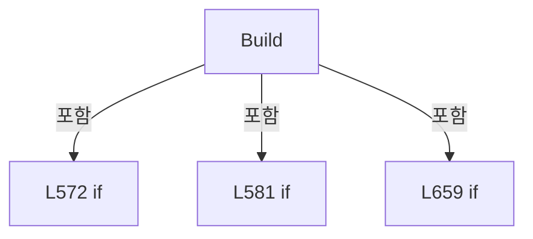

변경 전 점검: 입력/반환 타입, 위 호출자, 예외/취소 경로, 공유 상태와 저장·전송 소비자를 함께 확인합니다. 값의 단위나 물리 방향을 이름만으로 확정하지 않습니다.

### LocalFunctionStatement `MatchesItem` · L602–605

[Drilling.UI/Menu/Menus/CMenuRecipe.cs:602–605](https://github.com/kjuws10-rgb/A3Drilling/blob/5aee8e58439c9b455cae7c9593c9be986c3e682e/Drilling.UI/Menu/Menus/CMenuRecipe.cs#L602-L605)

| 항목 | 실제 추출 값 |
| --- | --- |
| 서명 | bool MatchesItem(Drilling.UI.Menu.Menus.ST_RECIPE_CELL_VIEW_MODEL) |
| 접근/수식자 | Private /  |
| 반환/값 타입 | bool |
| 소속 타입 | NamedType:Drilling.UI.Menu.Menus.CMenuRecipe |

입력 계약:

| 이름 | 타입 | 전달 | 선택/기본값 |
| --- | --- | --- | --- |
| cell | Drilling.UI.Menu.Menus.ST_RECIPE_CELL_VIEW_MODEL | None | False /  |

현재 부분 분석에서 직접 연결된 호출자는 없습니다. XAML/이벤트/인터페이스·델리게이트·외부 진입을 추가 확인해야 하며, 미사용으로 판정한 것이 아닙니다.

본문의 실제 연산·분기·예외·반환 순서(원문 위치 순):

| 원본 행 | 종류 | 주석 해설 |
| --- | --- | --- |
| 604 | return | 호출자에게 값 또는 제어를 반환합니다: return cell.CellNo == _selectedCellNo; |

변경 전 점검: 입력/반환 타입, 위 호출자, 예외/취소 경로, 공유 상태와 저장·전송 소비자를 함께 확인합니다. 값의 단위나 물리 방향을 이름만으로 확정하지 않습니다.

### LocalFunctionStatement `ShouldIncludeItem` · L607–610

[Drilling.UI/Menu/Menus/CMenuRecipe.cs:607–610](https://github.com/kjuws10-rgb/A3Drilling/blob/5aee8e58439c9b455cae7c9593c9be986c3e682e/Drilling.UI/Menu/Menus/CMenuRecipe.cs#L607-L610)

| 항목 | 실제 추출 값 |
| --- | --- |
| 서명 | bool ShouldIncludeItem(Drilling.UI.Menu.Menus.ST_RECIPE_PARAMETER_EDITOR_ITEM) |
| 접근/수식자 | Private /  |
| 반환/값 타입 | bool |
| 소속 타입 | NamedType:Drilling.UI.Menu.Menus.CMenuRecipe |

입력 계약:

| 이름 | 타입 | 전달 | 선택/기본값 |
| --- | --- | --- | --- |
| item | Drilling.UI.Menu.Menus.ST_RECIPE_PARAMETER_EDITOR_ITEM | None | False /  |

현재 부분 분석에서 직접 연결된 호출자는 없습니다. XAML/이벤트/인터페이스·델리게이트·외부 진입을 추가 확인해야 하며, 미사용으로 판정한 것이 아닙니다.

호출하는 대상과 해석 범위:

| 원본 행 | 표현식 | 분석 상태 | 대상/소스 위치 |
| --- | --- | --- | --- |
| 609 | item.Category.Equals | resolved | bool string.Equals(string?, System.StringComparison) |
| 609 | IsMovedToCellTab | resolved | bool Drilling.UI.Menu.Menus.CMenuRecipe.IsMovedToCellTab(Drilling.UI.Menu.Menus.ST_RECIPE_PARAMETER_EDITOR_ITEM) · Drilling.UI/Menu/Menus/CMenuRecipe.cs:1952 |

본문의 실제 연산·분기·예외·반환 순서(원문 위치 순):

| 원본 행 | 종류 | 주석 해설 |
| --- | --- | --- |
| 609 | call | 함수·델리게이트 또는 객체 생성자를 호출합니다: item.Category.Equals(selectedCategory, StringComparison.OrdinalIgnoreCase) |
| 609 | call | 함수·델리게이트 또는 객체 생성자를 호출합니다: IsMovedToCellTab(item) |
| 609 | return | 호출자에게 값 또는 제어를 반환합니다: return item.Category.Equals(selectedCategory, StringComparison.OrdinalIgnoreCase) && !IsMovedToCellTab(item); |

변경 전 점검: 입력/반환 타입, 위 호출자, 예외/취소 경로, 공유 상태와 저장·전송 소비자를 함께 확인합니다. 값의 단위나 물리 방향을 이름만으로 확정하지 않습니다.

### LocalFunctionStatement `MatchesSourceGroup` · L615–618

[Drilling.UI/Menu/Menus/CMenuRecipe.cs:615–618](https://github.com/kjuws10-rgb/A3Drilling/blob/5aee8e58439c9b455cae7c9593c9be986c3e682e/Drilling.UI/Menu/Menus/CMenuRecipe.cs#L615-L618)

| 항목 | 실제 추출 값 |
| --- | --- |
| 서명 | bool MatchesSourceGroup(Drilling.UI.Menu.Menus.ST_RECIPE_PARAMETER_EDITOR_ITEM) |
| 접근/수식자 | Private /  |
| 반환/값 타입 | bool |
| 소속 타입 | NamedType:Drilling.UI.Menu.Menus.CMenuRecipe |

입력 계약:

| 이름 | 타입 | 전달 | 선택/기본값 |
| --- | --- | --- | --- |
| item | Drilling.UI.Menu.Menus.ST_RECIPE_PARAMETER_EDITOR_ITEM | None | False /  |

현재 부분 분석에서 직접 연결된 호출자는 없습니다. XAML/이벤트/인터페이스·델리게이트·외부 진입을 추가 확인해야 하며, 미사용으로 판정한 것이 아닙니다.

호출하는 대상과 해석 범위:

| 원본 행 | 표현식 | 분석 상태 | 대상/소스 위치 |
| --- | --- | --- | --- |
| 617 | item.SourceGroup.Equals | resolved | bool string.Equals(string?, System.StringComparison) |

본문의 실제 연산·분기·예외·반환 순서(원문 위치 순):

| 원본 행 | 종류 | 주석 해설 |
| --- | --- | --- |
| 617 | call | 함수·델리게이트 또는 객체 생성자를 호출합니다: item.SourceGroup.Equals(selectedGroup, StringComparison.OrdinalIgnoreCase) |
| 617 | return | 호출자에게 값 또는 제어를 반환합니다: return item.SourceGroup.Equals(selectedGroup, StringComparison.OrdinalIgnoreCase); |

변경 전 점검: 입력/반환 타입, 위 호출자, 예외/취소 경로, 공유 상태와 저장·전송 소비자를 함께 확인합니다. 값의 단위나 물리 방향을 이름만으로 확정하지 않습니다.

### LocalFunctionStatement `BuildDisplay` · L621–624

[Drilling.UI/Menu/Menus/CMenuRecipe.cs:621–624](https://github.com/kjuws10-rgb/A3Drilling/blob/5aee8e58439c9b455cae7c9593c9be986c3e682e/Drilling.UI/Menu/Menus/CMenuRecipe.cs#L621-L624)

| 항목 | 실제 추출 값 |
| --- | --- |
| 서명 | Drilling.UI.Menu.Menus.ST_DISPLAY_ITEM BuildDisplay(Drilling.Common.Managers.ST_RECIPE_DEFINITION) |
| 접근/수식자 | Private /  |
| 반환/값 타입 | Drilling.UI.Menu.Menus.ST_DISPLAY_ITEM |
| 소속 타입 | NamedType:Drilling.UI.Menu.Menus.CMenuRecipe |

입력 계약:

| 이름 | 타입 | 전달 | 선택/기본값 |
| --- | --- | --- | --- |
| item | Drilling.Common.Managers.ST_RECIPE_DEFINITION | None | False /  |

현재 부분 분석에서 직접 연결된 호출자는 없습니다. XAML/이벤트/인터페이스·델리게이트·외부 진입을 추가 확인해야 하며, 미사용으로 판정한 것이 아닙니다.

호출하는 대상과 해석 범위:

| 원본 행 | 표현식 | 분석 상태 | 대상/소스 위치 |
| --- | --- | --- | --- |
| 623 | new ST_DISPLAY_ITEM | resolved | Drilling.UI.Menu.Menus.ST_DISPLAY_ITEM.ST_DISPLAY_ITEM(string, string, string) · Drilling.UI/Menu/Menus/CMenuBase.cs:43 |

본문의 실제 연산·분기·예외·반환 순서(원문 위치 순):

| 원본 행 | 종류 | 주석 해설 |
| --- | --- | --- |
| 623 | call | 함수·델리게이트 또는 객체 생성자를 호출합니다: new ST_DISPLAY_ITEM(item.Id, item.Name) |
| 623 | return | 호출자에게 값 또는 제어를 반환합니다: return new ST_DISPLAY_ITEM(item.Id, item.Name); |

변경 전 점검: 입력/반환 타입, 위 호출자, 예외/취소 경로, 공유 상태와 저장·전송 소비자를 함께 확인합니다. 값의 단위나 물리 방향을 이름만으로 확정하지 않습니다.

### LocalFunctionStatement `BuildDisplay2` · L626–629

[Drilling.UI/Menu/Menus/CMenuRecipe.cs:626–629](https://github.com/kjuws10-rgb/A3Drilling/blob/5aee8e58439c9b455cae7c9593c9be986c3e682e/Drilling.UI/Menu/Menus/CMenuRecipe.cs#L626-L629)

| 항목 | 실제 추출 값 |
| --- | --- |
| 서명 | Drilling.UI.Menu.Menus.ST_DISPLAY_ITEM BuildDisplay2(Drilling.Common.Managers.ST_RECIPE_PARAMETER) |
| 접근/수식자 | Private /  |
| 반환/값 타입 | Drilling.UI.Menu.Menus.ST_DISPLAY_ITEM |
| 소속 타입 | NamedType:Drilling.UI.Menu.Menus.CMenuRecipe |

입력 계약:

| 이름 | 타입 | 전달 | 선택/기본값 |
| --- | --- | --- | --- |
| item | Drilling.Common.Managers.ST_RECIPE_PARAMETER | None | False /  |

현재 부분 분석에서 직접 연결된 호출자는 없습니다. XAML/이벤트/인터페이스·델리게이트·외부 진입을 추가 확인해야 하며, 미사용으로 판정한 것이 아닙니다.

호출하는 대상과 해석 범위:

| 원본 행 | 표현식 | 분석 상태 | 대상/소스 위치 |
| --- | --- | --- | --- |
| 628 | new ST_DISPLAY_ITEM | resolved | Drilling.UI.Menu.Menus.ST_DISPLAY_ITEM.ST_DISPLAY_ITEM(string, string, string) · Drilling.UI/Menu/Menus/CMenuBase.cs:43 |

본문의 실제 연산·분기·예외·반환 순서(원문 위치 순):

| 원본 행 | 종류 | 주석 해설 |
| --- | --- | --- |
| 628 | call | 함수·델리게이트 또는 객체 생성자를 호출합니다: new ST_DISPLAY_ITEM(item.Name, item.Value, $"{item.Unit} / {item.Range}") |
| 628 | return | 호출자에게 값 또는 제어를 반환합니다: return new ST_DISPLAY_ITEM(item.Name, item.Value, $"{item.Unit} / {item.Range}"); |

변경 전 점검: 입력/반환 타입, 위 호출자, 예외/취소 경로, 공유 상태와 저장·전송 소비자를 함께 확인합니다. 값의 단위나 물리 방향을 이름만으로 확정하지 않습니다.

### LocalFunctionStatement `BuildDisplay3` · L631–634

[Drilling.UI/Menu/Menus/CMenuRecipe.cs:631–634](https://github.com/kjuws10-rgb/A3Drilling/blob/5aee8e58439c9b455cae7c9593c9be986c3e682e/Drilling.UI/Menu/Menus/CMenuRecipe.cs#L631-L634)

| 항목 | 실제 추출 값 |
| --- | --- |
| 서명 | Drilling.UI.Menu.Menus.ST_DISPLAY_ITEM BuildDisplay3(Drilling.Common.Managers.ST_RECIPE_HISTORY) |
| 접근/수식자 | Private /  |
| 반환/값 타입 | Drilling.UI.Menu.Menus.ST_DISPLAY_ITEM |
| 소속 타입 | NamedType:Drilling.UI.Menu.Menus.CMenuRecipe |

입력 계약:

| 이름 | 타입 | 전달 | 선택/기본값 |
| --- | --- | --- | --- |
| item | Drilling.Common.Managers.ST_RECIPE_HISTORY | None | False /  |

현재 부분 분석에서 직접 연결된 호출자는 없습니다. XAML/이벤트/인터페이스·델리게이트·외부 진입을 추가 확인해야 하며, 미사용으로 판정한 것이 아닙니다.

호출하는 대상과 해석 범위:

| 원본 행 | 표현식 | 분석 상태 | 대상/소스 위치 |
| --- | --- | --- | --- |
| 633 | new ST_DISPLAY_ITEM | resolved | Drilling.UI.Menu.Menus.ST_DISPLAY_ITEM.ST_DISPLAY_ITEM(string, string, string) · Drilling.UI/Menu/Menus/CMenuBase.cs:43 |
| 633 | item.ChangedAt.ToString | resolved | string System.DateTimeOffset.ToString(string?) |

본문의 실제 연산·분기·예외·반환 순서(원문 위치 순):

| 원본 행 | 종류 | 주석 해설 |
| --- | --- | --- |
| 633 | call | 함수·델리게이트 또는 객체 생성자를 호출합니다: new ST_DISPLAY_ITEM(item.ChangedAt.ToString("yyyy-MM-dd HH:mm"), item.ItemName, $"{item.OldValue} -> {item.NewValue} / {item.OperatorId}") |
| 633 | call | 함수·델리게이트 또는 객체 생성자를 호출합니다: item.ChangedAt.ToString("yyyy-MM-dd HH:mm") |
| 633 | return | 호출자에게 값 또는 제어를 반환합니다: return new ST_DISPLAY_ITEM(item.ChangedAt.ToString("yyyy-MM-dd HH:mm"), item.ItemName, $"{item.OldValue} -> {item.NewValue} / {item.OperatorId}"); |

변경 전 점검: 입력/반환 타입, 위 호출자, 예외/취소 경로, 공유 상태와 저장·전송 소비자를 함께 확인합니다. 값의 단위나 물리 방향을 이름만으로 확정하지 않습니다.

### LocalFunctionStatement `MatchesItem2` · L661–664

[Drilling.UI/Menu/Menus/CMenuRecipe.cs:661–664](https://github.com/kjuws10-rgb/A3Drilling/blob/5aee8e58439c9b455cae7c9593c9be986c3e682e/Drilling.UI/Menu/Menus/CMenuRecipe.cs#L661-L664)

| 항목 | 실제 추출 값 |
| --- | --- |
| 서명 | bool MatchesItem2(Drilling.UI.Menu.Menus.ST_RECIPE_CELL_VIEW_MODEL) |
| 접근/수식자 | Private /  |
| 반환/값 타입 | bool |
| 소속 타입 | NamedType:Drilling.UI.Menu.Menus.CMenuRecipe |

입력 계약:

| 이름 | 타입 | 전달 | 선택/기본값 |
| --- | --- | --- | --- |
| cell | Drilling.UI.Menu.Menus.ST_RECIPE_CELL_VIEW_MODEL | None | False /  |

현재 부분 분석에서 직접 연결된 호출자는 없습니다. XAML/이벤트/인터페이스·델리게이트·외부 진입을 추가 확인해야 하며, 미사용으로 판정한 것이 아닙니다.

본문의 실제 연산·분기·예외·반환 순서(원문 위치 순):

| 원본 행 | 종류 | 주석 해설 |
| --- | --- | --- |
| 663 | return | 호출자에게 값 또는 제어를 반환합니다: return cell.CellNo == _selectedCellNo; |

변경 전 점검: 입력/반환 타입, 위 호출자, 예외/취소 경로, 공유 상태와 저장·전송 소비자를 함께 확인합니다. 값의 단위나 물리 방향을 이름만으로 확정하지 않습니다.

### LocalFunctionStatement `BuildDisplay4` · L667–670

[Drilling.UI/Menu/Menus/CMenuRecipe.cs:667–670](https://github.com/kjuws10-rgb/A3Drilling/blob/5aee8e58439c9b455cae7c9593c9be986c3e682e/Drilling.UI/Menu/Menus/CMenuRecipe.cs#L667-L670)

| 항목 | 실제 추출 값 |
| --- | --- |
| 서명 | Drilling.UI.Menu.Menus.ST_DISPLAY_ITEM BuildDisplay4(Drilling.Common.Managers.ST_RECIPE_PARAMETER) |
| 접근/수식자 | Private /  |
| 반환/값 타입 | Drilling.UI.Menu.Menus.ST_DISPLAY_ITEM |
| 소속 타입 | NamedType:Drilling.UI.Menu.Menus.CMenuRecipe |

입력 계약:

| 이름 | 타입 | 전달 | 선택/기본값 |
| --- | --- | --- | --- |
| item | Drilling.Common.Managers.ST_RECIPE_PARAMETER | None | False /  |

현재 부분 분석에서 직접 연결된 호출자는 없습니다. XAML/이벤트/인터페이스·델리게이트·외부 진입을 추가 확인해야 하며, 미사용으로 판정한 것이 아닙니다.

호출하는 대상과 해석 범위:

| 원본 행 | 표현식 | 분석 상태 | 대상/소스 위치 |
| --- | --- | --- | --- |
| 669 | new ST_DISPLAY_ITEM | resolved | Drilling.UI.Menu.Menus.ST_DISPLAY_ITEM.ST_DISPLAY_ITEM(string, string, string) · Drilling.UI/Menu/Menus/CMenuBase.cs:43 |
| 669 | $"{item.Value} {item.Unit}".Trim | resolved | string string.Trim() |

본문의 실제 연산·분기·예외·반환 순서(원문 위치 순):

| 원본 행 | 종류 | 주석 해설 |
| --- | --- | --- |
| 669 | call | 함수·델리게이트 또는 객체 생성자를 호출합니다: new ST_DISPLAY_ITEM(item.Name, $"{item.Value} {item.Unit}".Trim(), item.Range) |
| 669 | call | 함수·델리게이트 또는 객체 생성자를 호출합니다: $"{item.Value} {item.Unit}".Trim() |
| 669 | return | 호출자에게 값 또는 제어를 반환합니다: return new ST_DISPLAY_ITEM(item.Name, $"{item.Value} {item.Unit}".Trim(), item.Range); |

변경 전 점검: 입력/반환 타입, 위 호출자, 예외/취소 경로, 공유 상태와 저장·전송 소비자를 함께 확인합니다. 값의 단위나 물리 방향을 이름만으로 확정하지 않습니다.

### LocalFunctionStatement `BuildDisplay5` · L672–675

[Drilling.UI/Menu/Menus/CMenuRecipe.cs:672–675](https://github.com/kjuws10-rgb/A3Drilling/blob/5aee8e58439c9b455cae7c9593c9be986c3e682e/Drilling.UI/Menu/Menus/CMenuRecipe.cs#L672-L675)

| 항목 | 실제 추출 값 |
| --- | --- |
| 서명 | Drilling.UI.Menu.Menus.ST_DISPLAY_ITEM BuildDisplay5(Drilling.Common.Managers.ST_RECIPE_HISTORY) |
| 접근/수식자 | Private /  |
| 반환/값 타입 | Drilling.UI.Menu.Menus.ST_DISPLAY_ITEM |
| 소속 타입 | NamedType:Drilling.UI.Menu.Menus.CMenuRecipe |

입력 계약:

| 이름 | 타입 | 전달 | 선택/기본값 |
| --- | --- | --- | --- |
| item | Drilling.Common.Managers.ST_RECIPE_HISTORY | None | False /  |

현재 부분 분석에서 직접 연결된 호출자는 없습니다. XAML/이벤트/인터페이스·델리게이트·외부 진입을 추가 확인해야 하며, 미사용으로 판정한 것이 아닙니다.

호출하는 대상과 해석 범위:

| 원본 행 | 표현식 | 분석 상태 | 대상/소스 위치 |
| --- | --- | --- | --- |
| 674 | new ST_DISPLAY_ITEM | resolved | Drilling.UI.Menu.Menus.ST_DISPLAY_ITEM.ST_DISPLAY_ITEM(string, string, string) · Drilling.UI/Menu/Menus/CMenuBase.cs:43 |

본문의 실제 연산·분기·예외·반환 순서(원문 위치 순):

| 원본 행 | 종류 | 주석 해설 |
| --- | --- | --- |
| 674 | call | 함수·델리게이트 또는 객체 생성자를 호출합니다: new ST_DISPLAY_ITEM(item.ItemName, $"{item.OldValue} -> {item.NewValue}", item.OperatorId) |
| 674 | return | 호출자에게 값 또는 제어를 반환합니다: return new ST_DISPLAY_ITEM(item.ItemName, $"{item.OldValue} -> {item.NewValue}", item.OperatorId); |

변경 전 점검: 입력/반환 타입, 위 호출자, 예외/취소 경로, 공유 상태와 저장·전송 소비자를 함께 확인합니다. 값의 단위나 물리 방향을 이름만으로 확정하지 않습니다.

### MethodDeclaration `ShowPreviousRecipePage` · L687–697

[Drilling.UI/Menu/Menus/CMenuRecipe.cs:687–697](https://github.com/kjuws10-rgb/A3Drilling/blob/5aee8e58439c9b455cae7c9593c9be986c3e682e/Drilling.UI/Menu/Menus/CMenuRecipe.cs#L687-L697)

| 항목 | 실제 추출 값 |
| --- | --- |
| 서명 | System.Threading.Tasks.Task Drilling.UI.Menu.Menus.CMenuRecipe.ShowPreviousRecipePage() |
| 접근/수식자 | Private / private, async |
| 반환/값 타입 | System.Threading.Tasks.Task |
| 소속 타입 | NamedType:Drilling.UI.Menu.Menus.CMenuRecipe |

정적 호출자로 확인된 위치:

| 호출 파일/행 | 호출 표현식 | 런타임 분기 가능 |
| --- | --- | --- |
| [Drilling.UI/Menu/Menus/CMenuRecipe.cs:105–105](https://github.com/kjuws10-rgb/A3Drilling/blob/5aee8e58439c9b455cae7c9593c9be986c3e682e/Drilling.UI/Menu/Menus/CMenuRecipe.cs#L105-L105) | ShowPreviousRecipePage | False |

호출하는 대상과 해석 범위:

| 원본 행 | 표현식 | 분석 상태 | 대상/소스 위치 |
| --- | --- | --- | --- |
| 689 | CanShowPreviousRecipePage | resolved | bool Drilling.UI.Menu.Menus.CMenuRecipe.CanShowPreviousRecipePage() · Drilling.UI/Menu/Menus/CMenuRecipe.cs:711 |
| 695 | NotifyRecipeFilesPageCommands | resolved | void Drilling.UI.Menu.Menus.CMenuRecipe.NotifyRecipeFilesPageCommands() · Drilling.UI/Menu/Menus/CMenuRecipe.cs:721 |
| 696 | _refreshCurrentScreen | resolved · 동적 구현 선택 가능 | System.Threading.Tasks.Task System.Func<System.Threading.Tasks.Task>.Invoke() |

본문의 실제 연산·분기·예외·반환 순서(원문 위치 순):

| 원본 행 | 종류 | 주석 해설 |
| --- | --- | --- |
| 689 | call | 함수·델리게이트 또는 객체 생성자를 호출합니다: CanShowPreviousRecipePage() |
| 689 | if | 조건에 따라 분기합니다: if (!CanShowPreviousRecipePage()) |
| 691 | return | 호출자에게 값 또는 제어를 반환합니다: return; |
| 695 | call | 함수·델리게이트 또는 객체 생성자를 호출합니다: NotifyRecipeFilesPageCommands() |
| 696 | await | 비동기 완료를 기다립니다: await _refreshCurrentScreen() |
| 696 | call | 함수·델리게이트 또는 객체 생성자를 호출합니다: _refreshCurrentScreen() |

제어 구문의 포함 구조(실제 실행 순서/CFG가 아닌 구문 탐색 그림):

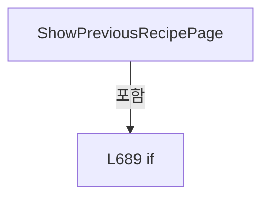

변경 전 점검: 입력/반환 타입, 위 호출자, 예외/취소 경로, 공유 상태와 저장·전송 소비자를 함께 확인합니다. 값의 단위나 물리 방향을 이름만으로 확정하지 않습니다.

### MethodDeclaration `ShowNextRecipePage` · L699–709

[Drilling.UI/Menu/Menus/CMenuRecipe.cs:699–709](https://github.com/kjuws10-rgb/A3Drilling/blob/5aee8e58439c9b455cae7c9593c9be986c3e682e/Drilling.UI/Menu/Menus/CMenuRecipe.cs#L699-L709)

| 항목 | 실제 추출 값 |
| --- | --- |
| 서명 | System.Threading.Tasks.Task Drilling.UI.Menu.Menus.CMenuRecipe.ShowNextRecipePage() |
| 접근/수식자 | Private / private, async |
| 반환/값 타입 | System.Threading.Tasks.Task |
| 소속 타입 | NamedType:Drilling.UI.Menu.Menus.CMenuRecipe |

정적 호출자로 확인된 위치:

| 호출 파일/행 | 호출 표현식 | 런타임 분기 가능 |
| --- | --- | --- |
| [Drilling.UI/Menu/Menus/CMenuRecipe.cs:116–116](https://github.com/kjuws10-rgb/A3Drilling/blob/5aee8e58439c9b455cae7c9593c9be986c3e682e/Drilling.UI/Menu/Menus/CMenuRecipe.cs#L116-L116) | ShowNextRecipePage | False |

호출하는 대상과 해석 범위:

| 원본 행 | 표현식 | 분석 상태 | 대상/소스 위치 |
| --- | --- | --- | --- |
| 701 | CanShowNextRecipePage | resolved | bool Drilling.UI.Menu.Menus.CMenuRecipe.CanShowNextRecipePage() · Drilling.UI/Menu/Menus/CMenuRecipe.cs:716 |
| 707 | NotifyRecipeFilesPageCommands | resolved | void Drilling.UI.Menu.Menus.CMenuRecipe.NotifyRecipeFilesPageCommands() · Drilling.UI/Menu/Menus/CMenuRecipe.cs:721 |
| 708 | _refreshCurrentScreen | resolved · 동적 구현 선택 가능 | System.Threading.Tasks.Task System.Func<System.Threading.Tasks.Task>.Invoke() |

본문의 실제 연산·분기·예외·반환 순서(원문 위치 순):

| 원본 행 | 종류 | 주석 해설 |
| --- | --- | --- |
| 701 | call | 함수·델리게이트 또는 객체 생성자를 호출합니다: CanShowNextRecipePage() |
| 701 | if | 조건에 따라 분기합니다: if (!CanShowNextRecipePage()) |
| 703 | return | 호출자에게 값 또는 제어를 반환합니다: return; |
| 707 | call | 함수·델리게이트 또는 객체 생성자를 호출합니다: NotifyRecipeFilesPageCommands() |
| 708 | await | 비동기 완료를 기다립니다: await _refreshCurrentScreen() |
| 708 | call | 함수·델리게이트 또는 객체 생성자를 호출합니다: _refreshCurrentScreen() |

제어 구문의 포함 구조(실제 실행 순서/CFG가 아닌 구문 탐색 그림):

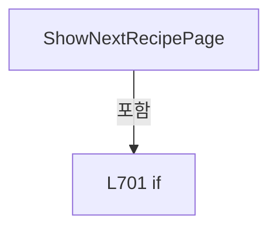

변경 전 점검: 입력/반환 타입, 위 호출자, 예외/취소 경로, 공유 상태와 저장·전송 소비자를 함께 확인합니다. 값의 단위나 물리 방향을 이름만으로 확정하지 않습니다.

### MethodDeclaration `CanShowPreviousRecipePage` · L711–714

[Drilling.UI/Menu/Menus/CMenuRecipe.cs:711–714](https://github.com/kjuws10-rgb/A3Drilling/blob/5aee8e58439c9b455cae7c9593c9be986c3e682e/Drilling.UI/Menu/Menus/CMenuRecipe.cs#L711-L714)

| 항목 | 실제 추출 값 |
| --- | --- |
| 서명 | bool Drilling.UI.Menu.Menus.CMenuRecipe.CanShowPreviousRecipePage() |
| 접근/수식자 | Private / private |
| 반환/값 타입 | bool |
| 소속 타입 | NamedType:Drilling.UI.Menu.Menus.CMenuRecipe |

정적 호출자로 확인된 위치:

| 호출 파일/행 | 호출 표현식 | 런타임 분기 가능 |
| --- | --- | --- |
| [Drilling.UI/Menu/Menus/CMenuRecipe.cs:110–110](https://github.com/kjuws10-rgb/A3Drilling/blob/5aee8e58439c9b455cae7c9593c9be986c3e682e/Drilling.UI/Menu/Menus/CMenuRecipe.cs#L110-L110) | CanShowPreviousRecipePage | False |
| [Drilling.UI/Menu/Menus/CMenuRecipe.cs:689–689](https://github.com/kjuws10-rgb/A3Drilling/blob/5aee8e58439c9b455cae7c9593c9be986c3e682e/Drilling.UI/Menu/Menus/CMenuRecipe.cs#L689-L689) | CanShowPreviousRecipePage | False |

본문의 실제 연산·분기·예외·반환 순서(원문 위치 순):

| 원본 행 | 종류 | 주석 해설 |
| --- | --- | --- |
| 713 | return | 호출자에게 값 또는 제어를 반환합니다: return _recipeFilesPageIndex > 0; |

변경 전 점검: 입력/반환 타입, 위 호출자, 예외/취소 경로, 공유 상태와 저장·전송 소비자를 함께 확인합니다. 값의 단위나 물리 방향을 이름만으로 확정하지 않습니다.

### MethodDeclaration `CanShowNextRecipePage` · L716–719

[Drilling.UI/Menu/Menus/CMenuRecipe.cs:716–719](https://github.com/kjuws10-rgb/A3Drilling/blob/5aee8e58439c9b455cae7c9593c9be986c3e682e/Drilling.UI/Menu/Menus/CMenuRecipe.cs#L716-L719)

| 항목 | 실제 추출 값 |
| --- | --- |
| 서명 | bool Drilling.UI.Menu.Menus.CMenuRecipe.CanShowNextRecipePage() |
| 접근/수식자 | Private / private |
| 반환/값 타입 | bool |
| 소속 타입 | NamedType:Drilling.UI.Menu.Menus.CMenuRecipe |

정적 호출자로 확인된 위치:

| 호출 파일/행 | 호출 표현식 | 런타임 분기 가능 |
| --- | --- | --- |
| [Drilling.UI/Menu/Menus/CMenuRecipe.cs:121–121](https://github.com/kjuws10-rgb/A3Drilling/blob/5aee8e58439c9b455cae7c9593c9be986c3e682e/Drilling.UI/Menu/Menus/CMenuRecipe.cs#L121-L121) | CanShowNextRecipePage | False |
| [Drilling.UI/Menu/Menus/CMenuRecipe.cs:701–701](https://github.com/kjuws10-rgb/A3Drilling/blob/5aee8e58439c9b455cae7c9593c9be986c3e682e/Drilling.UI/Menu/Menus/CMenuRecipe.cs#L701-L701) | CanShowNextRecipePage | False |

본문의 실제 연산·분기·예외·반환 순서(원문 위치 순):

| 원본 행 | 종류 | 주석 해설 |
| --- | --- | --- |
| 718 | return | 호출자에게 값 또는 제어를 반환합니다: return _recipeFilesPageIndex + 1 < _recipeFilesPageCount; |

변경 전 점검: 입력/반환 타입, 위 호출자, 예외/취소 경로, 공유 상태와 저장·전송 소비자를 함께 확인합니다. 값의 단위나 물리 방향을 이름만으로 확정하지 않습니다.

### MethodDeclaration `NotifyRecipeFilesPageCommands` · L721–725

[Drilling.UI/Menu/Menus/CMenuRecipe.cs:721–725](https://github.com/kjuws10-rgb/A3Drilling/blob/5aee8e58439c9b455cae7c9593c9be986c3e682e/Drilling.UI/Menu/Menus/CMenuRecipe.cs#L721-L725)

| 항목 | 실제 추출 값 |
| --- | --- |
| 서명 | void Drilling.UI.Menu.Menus.CMenuRecipe.NotifyRecipeFilesPageCommands() |
| 접근/수식자 | Private / private |
| 반환/값 타입 | void |
| 소속 타입 | NamedType:Drilling.UI.Menu.Menus.CMenuRecipe |

정적 호출자로 확인된 위치:

| 호출 파일/행 | 호출 표현식 | 런타임 분기 가능 |
| --- | --- | --- |
| [Drilling.UI/Menu/Menus/CMenuRecipe.cs:695–695](https://github.com/kjuws10-rgb/A3Drilling/blob/5aee8e58439c9b455cae7c9593c9be986c3e682e/Drilling.UI/Menu/Menus/CMenuRecipe.cs#L695-L695) | NotifyRecipeFilesPageCommands | False |
| [Drilling.UI/Menu/Menus/CMenuRecipe.cs:707–707](https://github.com/kjuws10-rgb/A3Drilling/blob/5aee8e58439c9b455cae7c9593c9be986c3e682e/Drilling.UI/Menu/Menus/CMenuRecipe.cs#L707-L707) | NotifyRecipeFilesPageCommands | False |
| [Drilling.UI/Menu/Menus/CMenuRecipe.cs:1710–1710](https://github.com/kjuws10-rgb/A3Drilling/blob/5aee8e58439c9b455cae7c9593c9be986c3e682e/Drilling.UI/Menu/Menus/CMenuRecipe.cs#L1710-L1710) | NotifyRecipeFilesPageCommands | False |

호출하는 대상과 해석 범위:

| 원본 행 | 표현식 | 분석 상태 | 대상/소스 위치 |
| --- | --- | --- | --- |
| 723 | PreviousRecipePageCommand.NotifyCanExecuteChanged | resolved | void Drilling.UI.Menu.CButtonCommand.NotifyCanExecuteChanged() · Drilling.UI/Menu/CButtonCommand.cs:24 |
| 724 | NextRecipePageCommand.NotifyCanExecuteChanged | resolved | void Drilling.UI.Menu.CButtonCommand.NotifyCanExecuteChanged() · Drilling.UI/Menu/CButtonCommand.cs:24 |

본문의 실제 연산·분기·예외·반환 순서(원문 위치 순):

| 원본 행 | 종류 | 주석 해설 |
| --- | --- | --- |
| 723 | call | 함수·델리게이트 또는 객체 생성자를 호출합니다: PreviousRecipePageCommand.NotifyCanExecuteChanged() |
| 724 | call | 함수·델리게이트 또는 객체 생성자를 호출합니다: NextRecipePageCommand.NotifyCanExecuteChanged() |

변경 전 점검: 입력/반환 타입, 위 호출자, 예외/취소 경로, 공유 상태와 저장·전송 소비자를 함께 확인합니다. 값의 단위나 물리 방향을 이름만으로 확정하지 않습니다.

### MethodDeclaration `View` · L727–744

[Drilling.UI/Menu/Menus/CMenuRecipe.cs:727–744](https://github.com/kjuws10-rgb/A3Drilling/blob/5aee8e58439c9b455cae7c9593c9be986c3e682e/Drilling.UI/Menu/Menus/CMenuRecipe.cs#L727-L744)

| 항목 | 실제 추출 값 |
| --- | --- |
| 서명 | System.Threading.Tasks.Task Drilling.UI.Menu.Menus.CMenuRecipe.View(object?) |
| 접근/수식자 | Private / private, async |
| 반환/값 타입 | System.Threading.Tasks.Task |
| 소속 타입 | NamedType:Drilling.UI.Menu.Menus.CMenuRecipe |

입력 계약:

| 이름 | 타입 | 전달 | 선택/기본값 |
| --- | --- | --- | --- |
| parameter | object? | None | False /  |

정적 호출자로 확인된 위치:

| 호출 파일/행 | 호출 표현식 | 런타임 분기 가능 |
| --- | --- | --- |
| [Drilling.UI/Menu/Menus/CMenuRecipe.cs:99–99](https://github.com/kjuws10-rgb/A3Drilling/blob/5aee8e58439c9b455cae7c9593c9be986c3e682e/Drilling.UI/Menu/Menus/CMenuRecipe.cs#L99-L99) | View | False |

호출하는 대상과 해석 범위:

| 원본 행 | 표현식 | 분석 상태 | 대상/소스 위치 |
| --- | --- | --- | --- |
| 729 | GetRecipeIdFromParameter | resolved | string Drilling.UI.Menu.Menus.CMenuRecipe.GetRecipeIdFromParameter(object?) · Drilling.UI/Menu/Menus/CMenuRecipe.cs:3025 |
| 730 | string.IsNullOrWhiteSpace | resolved | bool string.IsNullOrWhiteSpace(string?) |
| 735 | recipeId.Equals | resolved | bool string.Equals(string?, System.StringComparison) |
| 735 | GetRecipeIdFromParameter | resolved | string Drilling.UI.Menu.Menus.CMenuRecipe.GetRecipeIdFromParameter(object?) · Drilling.UI/Menu/Menus/CMenuRecipe.cs:3025 |
| 735 | HasEditedItems | resolved | bool Drilling.UI.Menu.Menus.CMenuRecipe.HasEditedItems() · Drilling.UI/Menu/Menus/CMenuRecipe.cs:1662 |
| 735 | CRecipeConfirmDialog.ShowConfirmation | resolved | bool Drilling.UI.Popup.CRecipeConfirmDialog.ShowConfirmation(string, string, string, bool) · Drilling.UI/Popup/CRecipeConfirmDialog.xaml.cs:11 |
| 740 | _viewRecipeIdSetter | resolved · 동적 구현 선택 가능 | void System.Action<string>.Invoke(string) |
| 741 | NotifyCommands | resolved | void Drilling.UI.Menu.Menus.CMenuRecipe.NotifyCommands() · Drilling.UI/Menu/Menus/CMenuRecipe.cs:1289 |
| 742 | _setStatusMessage | resolved · 동적 구현 선택 가능 | void System.Action<string>.Invoke(string) |
| 743 | _refreshCurrentScreen | resolved · 동적 구현 선택 가능 | System.Threading.Tasks.Task System.Func<System.Threading.Tasks.Task>.Invoke() |

본문의 실제 연산·분기·예외·반환 순서(원문 위치 순):

| 원본 행 | 종류 | 주석 해설 |
| --- | --- | --- |
| 729 | call | 함수·델리게이트 또는 객체 생성자를 호출합니다: GetRecipeIdFromParameter(parameter) |
| 729 | local-declaration | 지역 변수를 선언합니다: var recipeId = GetRecipeIdFromParameter(parameter); |
| 729 | variable-initializer | 변수의 초기값을 지정합니다: recipeId = GetRecipeIdFromParameter(parameter) |
| 730 | call | 함수·델리게이트 또는 객체 생성자를 호출합니다: string.IsNullOrWhiteSpace(recipeId) |
| 730 | if | 조건에 따라 분기합니다: if (string.IsNullOrWhiteSpace(recipeId)) |
| 732 | return | 호출자에게 값 또는 제어를 반환합니다: return; |
| 735 | call | 함수·델리게이트 또는 객체 생성자를 호출합니다: recipeId.Equals(GetRecipeIdFromParameter(SelectedRecipeFile), StringComparison.OrdinalIgnoreCase) |
| 735 | call | 함수·델리게이트 또는 객체 생성자를 호출합니다: GetRecipeIdFromParameter(SelectedRecipeFile) |
| 735 | call | 함수·델리게이트 또는 객체 생성자를 호출합니다: HasEditedItems() |
| 735 | call | 함수·델리게이트 또는 객체 생성자를 호출합니다: CRecipeConfirmDialog.ShowConfirmation("레시피 VIEW 변경", "수정 중입니다. 저장하지 않고 이동할 경우 변경이 취소됩니다.\n이동하시겠습니까?") |
| 735 | if | 조건에 따라 분기합니다: if (!recipeId.Equals(GetRecipeIdFromParameter(SelectedRecipeFile), StringComparison.OrdinalIgnoreCase) && HasEditedItems() && !CRecipeConfirmDialog.ShowConfirmation("레시피 VIEW 변경", "수정 중입니다. 저장하지 않고 이동할 경우 변경이 취소됩니다.\n이동하시겠습니…) |
| 737 | return | 호출자에게 값 또는 제어를 반환합니다: return; |
| 740 | call | 함수·델리게이트 또는 객체 생성자를 호출합니다: _viewRecipeIdSetter(recipeId) |
| 741 | call | 함수·델리게이트 또는 객체 생성자를 호출합니다: NotifyCommands() |
| 742 | call | 함수·델리게이트 또는 객체 생성자를 호출합니다: _setStatusMessage($"Recipe {recipeId}.csv view loaded.") |
| 743 | await | 비동기 완료를 기다립니다: await _refreshCurrentScreen() |
| 743 | call | 함수·델리게이트 또는 객체 생성자를 호출합니다: _refreshCurrentScreen() |

제어 구문의 포함 구조(실제 실행 순서/CFG가 아닌 구문 탐색 그림):

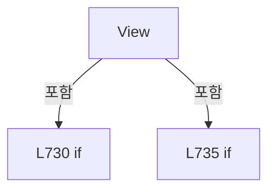

변경 전 점검: 입력/반환 타입, 위 호출자, 예외/취소 경로, 공유 상태와 저장·전송 소비자를 함께 확인합니다. 값의 단위나 물리 방향을 이름만으로 확정하지 않습니다.

### MethodDeclaration `Select` · L746–775

[Drilling.UI/Menu/Menus/CMenuRecipe.cs:746–775](https://github.com/kjuws10-rgb/A3Drilling/blob/5aee8e58439c9b455cae7c9593c9be986c3e682e/Drilling.UI/Menu/Menus/CMenuRecipe.cs#L746-L775)

| 항목 | 실제 추출 값 |
| --- | --- |
| 서명 | System.Threading.Tasks.Task Drilling.UI.Menu.Menus.CMenuRecipe.Select() |
| 접근/수식자 | Private / private, async |
| 반환/값 타입 | System.Threading.Tasks.Task |
| 소속 타입 | NamedType:Drilling.UI.Menu.Menus.CMenuRecipe |

정적 호출자로 확인된 위치:

| 호출 파일/행 | 호출 표현식 | 런타임 분기 가능 |
| --- | --- | --- |
| [Drilling.UI/Menu/Menus/CMenuRecipe.cs:181–181](https://github.com/kjuws10-rgb/A3Drilling/blob/5aee8e58439c9b455cae7c9593c9be986c3e682e/Drilling.UI/Menu/Menus/CMenuRecipe.cs#L181-L181) | Select | False |

호출하는 대상과 해석 범위:

| 원본 행 | 표현식 | 분석 상태 | 대상/소스 위치 |
| --- | --- | --- | --- |
| 748 | GetRecipeIdFromParameter | resolved | string Drilling.UI.Menu.Menus.CMenuRecipe.GetRecipeIdFromParameter(object?) · Drilling.UI/Menu/Menus/CMenuRecipe.cs:3025 |
| 749 | string.IsNullOrWhiteSpace | resolved | bool string.IsNullOrWhiteSpace(string?) |
| 751 | _setStatusMessage | resolved · 동적 구현 선택 가능 | void System.Action<string>.Invoke(string) |
| 755 | CanSelectViewRecipe | resolved | bool Drilling.UI.Menu.Menus.CMenuRecipe.CanSelectViewRecipe() · Drilling.UI/Menu/Menus/CMenuRecipe.cs:1647 |
| 757 | _setStatusMessage | resolved · 동적 구현 선택 가능 | void System.Action<string>.Invoke(string) |
| 761 | CRecipeConfirmDialog.ShowConfirmation | resolved | bool Drilling.UI.Popup.CRecipeConfirmDialog.ShowConfirmation(string, string, string, bool) · Drilling.UI/Popup/CRecipeConfirmDialog.xaml.cs:11 |
| 766 | _selectRecipeIdProvider | resolved · 동적 구현 선택 가능 | string System.Func<string>.Invoke() |
| 767 | _selectRecipeIdSetter | resolved · 동적 구현 선택 가능 | void System.Action<string>.Invoke(string) |
| 768 | _settingManager.SetValue | resolved | void Drilling.Common.Managers.CSettingManager.SetValue(Drilling.Common.Managers.EN_SETTING_TAB, string, string, System.Threading.CancellationToken) · Drilling.Common/Managers/CSettingManager.cs:72 |
| 769 | _recipeManager.RecordSelection | resolved | System.Threading.Tasks.Task Drilling.Common.Managers.CRecipeManager.RecordSelection(string, string, System.Threading.CancellationToken) · Drilling.Common/Managers/CRecipeManager.cs:34 |
| 770 | NotifyCommands | resolved | void Drilling.UI.Menu.Menus.CMenuRecipe.NotifyCommands() · Drilling.UI/Menu/Menus/CMenuRecipe.cs:1289 |
| 771 | _setStatusMessage | resolved · 동적 구현 선택 가능 | void System.Action<string>.Invoke(string) |
| 772 | _refreshShellStatus | resolved · 동적 구현 선택 가능 | void System.Action.Invoke() |
| 773 | _refreshCurrentScreen | resolved · 동적 구현 선택 가능 | System.Threading.Tasks.Task System.Func<System.Threading.Tasks.Task>.Invoke() |
| 774 | CRecipeConfirmDialog.ShowCompletion | resolved | void Drilling.UI.Popup.CRecipeConfirmDialog.ShowCompletion(string, string, Window?) · Drilling.UI/Popup/CRecipeConfirmDialog.xaml.cs:81 |

본문의 실제 연산·분기·예외·반환 순서(원문 위치 순):

| 원본 행 | 종류 | 주석 해설 |
| --- | --- | --- |
| 748 | call | 함수·델리게이트 또는 객체 생성자를 호출합니다: GetRecipeIdFromParameter(SelectedRecipeFile) |
| 748 | local-declaration | 지역 변수를 선언합니다: var recipeId = GetRecipeIdFromParameter(SelectedRecipeFile); |
| 748 | variable-initializer | 변수의 초기값을 지정합니다: recipeId = GetRecipeIdFromParameter(SelectedRecipeFile) |
| 749 | call | 함수·델리게이트 또는 객체 생성자를 호출합니다: string.IsNullOrWhiteSpace(recipeId) |
| 749 | if | 조건에 따라 분기합니다: if (string.IsNullOrWhiteSpace(recipeId)) |
| 751 | call | 함수·델리게이트 또는 객체 생성자를 호출합니다: _setStatusMessage("Recipe select skipped. No recipe is in view.") |
| 752 | return | 호출자에게 값 또는 제어를 반환합니다: return; |
| 755 | call | 함수·델리게이트 또는 객체 생성자를 호출합니다: CanSelectViewRecipe() |
| 755 | if | 조건에 따라 분기합니다: if (!CanSelectViewRecipe()) |
| 757 | call | 함수·델리게이트 또는 객체 생성자를 호출합니다: _setStatusMessage($"Recipe {recipeId}.csv is already selected.") |
| 758 | return | 호출자에게 값 또는 제어를 반환합니다: return; |
| 761 | call | 함수·델리게이트 또는 객체 생성자를 호출합니다: CRecipeConfirmDialog.ShowConfirmation("레시피 선택", $"{recipeId}.csv 레시피를 SELECT 하시겠습니까?") |
| 761 | if | 조건에 따라 분기합니다: if (!CRecipeConfirmDialog.ShowConfirmation("레시피 선택", $"{recipeId}.csv 레시피를 SELECT 하시겠습니까?")) |
| 763 | return | 호출자에게 값 또는 제어를 반환합니다: return; |
| 766 | call | 함수·델리게이트 또는 객체 생성자를 호출합니다: _selectRecipeIdProvider() |
| 766 | local-declaration | 지역 변수를 선언합니다: var previousRecipeId = _selectRecipeIdProvider(); |
| 766 | variable-initializer | 변수의 초기값을 지정합니다: previousRecipeId = _selectRecipeIdProvider() |
| 767 | call | 함수·델리게이트 또는 객체 생성자를 호출합니다: _selectRecipeIdSetter(recipeId) |
| 768 | call | 함수·델리게이트 또는 객체 생성자를 호출합니다: _settingManager.SetValue(EN_SETTING_TAB.Option, SelectRecipeSettingKey, recipeId) |
| 769 | await | 비동기 완료를 기다립니다: await _recipeManager.RecordSelection(previousRecipeId, recipeId) |
| 769 | call | 함수·델리게이트 또는 객체 생성자를 호출합니다: _recipeManager.RecordSelection(previousRecipeId, recipeId) |
| 770 | call | 함수·델리게이트 또는 객체 생성자를 호출합니다: NotifyCommands() |
| 771 | call | 함수·델리게이트 또는 객체 생성자를 호출합니다: _setStatusMessage($"Recipe {recipeId}.csv selected.") |
| 772 | call | 함수·델리게이트 또는 객체 생성자를 호출합니다: _refreshShellStatus() |
| 773 | await | 비동기 완료를 기다립니다: await _refreshCurrentScreen() |
| 773 | call | 함수·델리게이트 또는 객체 생성자를 호출합니다: _refreshCurrentScreen() |
| 774 | call | 함수·델리게이트 또는 객체 생성자를 호출합니다: CRecipeConfirmDialog.ShowCompletion("레시피 선택 완료", $"{recipeId}.csv 레시피를 SELECT 하였습니다.") |

제어 구문의 포함 구조(실제 실행 순서/CFG가 아닌 구문 탐색 그림):

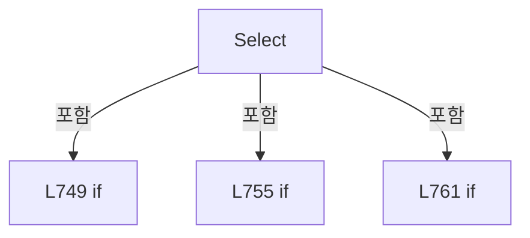

변경 전 점검: 입력/반환 타입, 위 호출자, 예외/취소 경로, 공유 상태와 저장·전송 소비자를 함께 확인합니다. 값의 단위나 물리 방향을 이름만으로 확정하지 않습니다.

### MethodDeclaration `SelectCategory` · L777–789

[Drilling.UI/Menu/Menus/CMenuRecipe.cs:777–789](https://github.com/kjuws10-rgb/A3Drilling/blob/5aee8e58439c9b455cae7c9593c9be986c3e682e/Drilling.UI/Menu/Menus/CMenuRecipe.cs#L777-L789)

| 항목 | 실제 추출 값 |
| --- | --- |
| 서명 | System.Threading.Tasks.Task Drilling.UI.Menu.Menus.CMenuRecipe.SelectCategory(object?) |
| 접근/수식자 | Private / private, async |
| 반환/값 타입 | System.Threading.Tasks.Task |
| 소속 타입 | NamedType:Drilling.UI.Menu.Menus.CMenuRecipe |

입력 계약:

| 이름 | 타입 | 전달 | 선택/기본값 |
| --- | --- | --- | --- |
| parameter | object? | None | False /  |

정적 호출자로 확인된 위치:

| 호출 파일/행 | 호출 표현식 | 런타임 분기 가능 |
| --- | --- | --- |
| [Drilling.UI/Menu/Menus/CMenuRecipe.cs:127–127](https://github.com/kjuws10-rgb/A3Drilling/blob/5aee8e58439c9b455cae7c9593c9be986c3e682e/Drilling.UI/Menu/Menus/CMenuRecipe.cs#L127-L127) | SelectCategory | False |

호출하는 대상과 해석 범위:

| 원본 행 | 표현식 | 분석 상태 | 대상/소스 위치 |
| --- | --- | --- | --- |
| 779 | string.IsNullOrWhiteSpace | resolved | bool string.IsNullOrWhiteSpace(string?) |
| 784 | category.Trim().ToUpperInvariant | resolved | string string.ToUpperInvariant() |
| 784 | category.Trim | resolved | string string.Trim() |
| 785 | _selectedCategorySetter | resolved · 동적 구현 선택 가능 | void System.Action<string>.Invoke(string) |
| 787 | _setStatusMessage | resolved · 동적 구현 선택 가능 | void System.Action<string>.Invoke(string) |
| 788 | _refreshCurrentScreen | resolved · 동적 구현 선택 가능 | System.Threading.Tasks.Task System.Func<System.Threading.Tasks.Task>.Invoke() |

본문의 실제 연산·분기·예외·반환 순서(원문 위치 순):

| 원본 행 | 종류 | 주석 해설 |
| --- | --- | --- |
| 779 | call | 함수·델리게이트 또는 객체 생성자를 호출합니다: string.IsNullOrWhiteSpace(category) |
| 779 | if | 조건에 따라 분기합니다: if (parameter is not string category &#124;&#124; string.IsNullOrWhiteSpace(category)) |
| 781 | return | 호출자에게 값 또는 제어를 반환합니다: return; |
| 784 | call | 함수·델리게이트 또는 객체 생성자를 호출합니다: category.Trim().ToUpperInvariant() |
| 784 | call | 함수·델리게이트 또는 객체 생성자를 호출합니다: category.Trim() |
| 784 | local-declaration | 지역 변수를 선언합니다: var selectedCategory = category.Trim().ToUpperInvariant(); |
| 784 | variable-initializer | 변수의 초기값을 지정합니다: selectedCategory = category.Trim().ToUpperInvariant() |
| 785 | call | 함수·델리게이트 또는 객체 생성자를 호출합니다: _selectedCategorySetter(selectedCategory) |
| 786 | assignment | 값을 대상에 대입합니다: _selectedGroup = "ALL" |
| 787 | call | 함수·델리게이트 또는 객체 생성자를 호출합니다: _setStatusMessage($"Recipe category {selectedCategory} selected.") |
| 788 | await | 비동기 완료를 기다립니다: await _refreshCurrentScreen() |
| 788 | call | 함수·델리게이트 또는 객체 생성자를 호출합니다: _refreshCurrentScreen() |

제어 구문의 포함 구조(실제 실행 순서/CFG가 아닌 구문 탐색 그림):

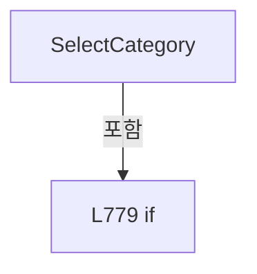

변경 전 점검: 입력/반환 타입, 위 호출자, 예외/취소 경로, 공유 상태와 저장·전송 소비자를 함께 확인합니다. 값의 단위나 물리 방향을 이름만으로 확정하지 않습니다.

### MethodDeclaration `SelectGroup` · L791–801

[Drilling.UI/Menu/Menus/CMenuRecipe.cs:791–801](https://github.com/kjuws10-rgb/A3Drilling/blob/5aee8e58439c9b455cae7c9593c9be986c3e682e/Drilling.UI/Menu/Menus/CMenuRecipe.cs#L791-L801)

| 항목 | 실제 추출 값 |
| --- | --- |
| 서명 | System.Threading.Tasks.Task Drilling.UI.Menu.Menus.CMenuRecipe.SelectGroup(object?) |
| 접근/수식자 | Private / private, async |
| 반환/값 타입 | System.Threading.Tasks.Task |
| 소속 타입 | NamedType:Drilling.UI.Menu.Menus.CMenuRecipe |

입력 계약:

| 이름 | 타입 | 전달 | 선택/기본값 |
| --- | --- | --- | --- |
| parameter | object? | None | False /  |

정적 호출자로 확인된 위치:

| 호출 파일/행 | 호출 표현식 | 런타임 분기 가능 |
| --- | --- | --- |
| [Drilling.UI/Menu/Menus/CMenuRecipe.cs:133–133](https://github.com/kjuws10-rgb/A3Drilling/blob/5aee8e58439c9b455cae7c9593c9be986c3e682e/Drilling.UI/Menu/Menus/CMenuRecipe.cs#L133-L133) | SelectGroup | False |

호출하는 대상과 해석 범위:

| 원본 행 | 표현식 | 분석 상태 | 대상/소스 위치 |
| --- | --- | --- | --- |
| 793 | string.IsNullOrWhiteSpace | resolved | bool string.IsNullOrWhiteSpace(string?) |
| 798 | group.Trim().ToUpperInvariant | resolved | string string.ToUpperInvariant() |
| 798 | group.Trim | resolved | string string.Trim() |
| 799 | _setStatusMessage | resolved · 동적 구현 선택 가능 | void System.Action<string>.Invoke(string) |
| 800 | _refreshCurrentScreen | resolved · 동적 구현 선택 가능 | System.Threading.Tasks.Task System.Func<System.Threading.Tasks.Task>.Invoke() |

본문의 실제 연산·분기·예외·반환 순서(원문 위치 순):

| 원본 행 | 종류 | 주석 해설 |
| --- | --- | --- |
| 793 | call | 함수·델리게이트 또는 객체 생성자를 호출합니다: string.IsNullOrWhiteSpace(group) |
| 793 | if | 조건에 따라 분기합니다: if (parameter is not string group &#124;&#124; string.IsNullOrWhiteSpace(group)) |
| 795 | return | 호출자에게 값 또는 제어를 반환합니다: return; |
| 798 | assignment | 값을 대상에 대입합니다: _selectedGroup = group.Trim().ToUpperInvariant() |
| 798 | call | 함수·델리게이트 또는 객체 생성자를 호출합니다: group.Trim().ToUpperInvariant() |
| 798 | call | 함수·델리게이트 또는 객체 생성자를 호출합니다: group.Trim() |
| 799 | call | 함수·델리게이트 또는 객체 생성자를 호출합니다: _setStatusMessage($"Recipe group {_selectedGroup} selected.") |
| 800 | await | 비동기 완료를 기다립니다: await _refreshCurrentScreen() |
| 800 | call | 함수·델리게이트 또는 객체 생성자를 호출합니다: _refreshCurrentScreen() |

제어 구문의 포함 구조(실제 실행 순서/CFG가 아닌 구문 탐색 그림):

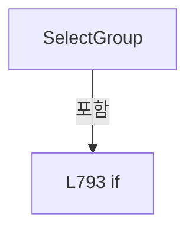

변경 전 점검: 입력/반환 타입, 위 호출자, 예외/취소 경로, 공유 상태와 저장·전송 소비자를 함께 확인합니다. 값의 단위나 물리 방향을 이름만으로 확정하지 않습니다.

### MethodDeclaration `SelectCell` · L803–824

[Drilling.UI/Menu/Menus/CMenuRecipe.cs:803–824](https://github.com/kjuws10-rgb/A3Drilling/blob/5aee8e58439c9b455cae7c9593c9be986c3e682e/Drilling.UI/Menu/Menus/CMenuRecipe.cs#L803-L824)

| 항목 | 실제 추출 값 |
| --- | --- |
| 서명 | System.Threading.Tasks.Task Drilling.UI.Menu.Menus.CMenuRecipe.SelectCell(object?) |
| 접근/수식자 | Private / private, async |
| 반환/값 타입 | System.Threading.Tasks.Task |
| 소속 타입 | NamedType:Drilling.UI.Menu.Menus.CMenuRecipe |

입력 계약:

| 이름 | 타입 | 전달 | 선택/기본값 |
| --- | --- | --- | --- |
| parameter | object? | None | False /  |

정적 호출자로 확인된 위치:

| 호출 파일/행 | 호출 표현식 | 런타임 분기 가능 |
| --- | --- | --- |
| [Drilling.UI/Menu/Menus/CMenuRecipe.cs:139–139](https://github.com/kjuws10-rgb/A3Drilling/blob/5aee8e58439c9b455cae7c9593c9be986c3e682e/Drilling.UI/Menu/Menus/CMenuRecipe.cs#L139-L139) | SelectCell | False |
| [Drilling.UI/Menu/Menus/CMenuRecipe.cs:829–829](https://github.com/kjuws10-rgb/A3Drilling/blob/5aee8e58439c9b455cae7c9593c9be986c3e682e/Drilling.UI/Menu/Menus/CMenuRecipe.cs#L829-L829) | SelectCell | False |
| [Drilling.UI/Menu/Menus/CMenuRecipe.cs:867–867](https://github.com/kjuws10-rgb/A3Drilling/blob/5aee8e58439c9b455cae7c9593c9be986c3e682e/Drilling.UI/Menu/Menus/CMenuRecipe.cs#L867-L867) | SelectCell | False |

호출하는 대상과 해석 범위:

| 원본 행 | 표현식 | 분석 상태 | 대상/소스 위치 |
| --- | --- | --- | --- |
| 808 | int.TryParse | resolved | bool int.TryParse(string?, out int) |
| 817 | OnPropertyChanged | resolved | void Drilling.UI.Menu.CBindingBase.OnPropertyChanged(string?) · Drilling.UI/Menu/CBindingBase.cs:759 |
| 817 | nameof | unresolved | None |
| 818 | OnPropertyChanged | resolved | void Drilling.UI.Menu.CBindingBase.OnPropertyChanged(string?) · Drilling.UI/Menu/CBindingBase.cs:759 |
| 818 | nameof | unresolved | None |
| 819 | OnPropertyChanged | resolved | void Drilling.UI.Menu.CBindingBase.OnPropertyChanged(string?) · Drilling.UI/Menu/CBindingBase.cs:759 |
| 819 | nameof | unresolved | None |
| 820 | PreviousCellCommand.NotifyCanExecuteChanged | resolved | void Drilling.UI.Menu.CButtonCommand.NotifyCanExecuteChanged() · Drilling.UI/Menu/CButtonCommand.cs:24 |
| 821 | NextCellCommand.NotifyCanExecuteChanged | resolved | void Drilling.UI.Menu.CButtonCommand.NotifyCanExecuteChanged() · Drilling.UI/Menu/CButtonCommand.cs:24 |
| 822 | _setStatusMessage | resolved · 동적 구현 선택 가능 | void System.Action<string>.Invoke(string) |
| 823 | _refreshCurrentScreen | resolved · 동적 구현 선택 가능 | System.Threading.Tasks.Task System.Func<System.Threading.Tasks.Task>.Invoke() |

본문의 실제 연산·분기·예외·반환 순서(원문 위치 순):

| 원본 행 | 종류 | 주석 해설 |
| --- | --- | --- |
| 805 | local-declaration | 지역 변수를 선언합니다: var cellNo = parameter switch { int number => number, string text when int.TryParse(text, out var number) => number, _ => 0 }; |
| 805 | switch-expression | 값별 결과식을 선택합니다: parameter switch { int number => number, string text when int.TryParse(text, out var number) => number, _ => 0 } |
| 805 | variable-initializer | 변수의 초기값을 지정합니다: cellNo = parameter switch { int number => number, string text when int.TryParse(text, out var number) => number, _ => 0 } |
| 808 | call | 함수·델리게이트 또는 객체 생성자를 호출합니다: int.TryParse(text, out var number) |
| 811 | if | 조건에 따라 분기합니다: if (cellNo <= 0 &#124;&#124; cellNo > _recipeCells.Count) |
| 813 | return | 호출자에게 값 또는 제어를 반환합니다: return; |
| 816 | assignment | 값을 대상에 대입합니다: _selectedCellNo = cellNo |
| 817 | call | 함수·델리게이트 또는 객체 생성자를 호출합니다: OnPropertyChanged(nameof(CurrentCellIndicatorText)) |
| 817 | call | 함수·델리게이트 또는 객체 생성자를 호출합니다: nameof(CurrentCellIndicatorText) |
| 818 | call | 함수·델리게이트 또는 객체 생성자를 호출합니다: OnPropertyChanged(nameof(SelectedCellNavigationText)) |
| 818 | call | 함수·델리게이트 또는 객체 생성자를 호출합니다: nameof(SelectedCellNavigationText) |
| 819 | call | 함수·델리게이트 또는 객체 생성자를 호출합니다: OnPropertyChanged(nameof(SelectedCellShotGroupTitle)) |
| 819 | call | 함수·델리게이트 또는 객체 생성자를 호출합니다: nameof(SelectedCellShotGroupTitle) |
| 820 | call | 함수·델리게이트 또는 객체 생성자를 호출합니다: PreviousCellCommand.NotifyCanExecuteChanged() |
| 821 | call | 함수·델리게이트 또는 객체 생성자를 호출합니다: NextCellCommand.NotifyCanExecuteChanged() |
| 822 | call | 함수·델리게이트 또는 객체 생성자를 호출합니다: _setStatusMessage($"Recipe Cell{cellNo} selected.") |
| 823 | await | 비동기 완료를 기다립니다: await _refreshCurrentScreen() |
| 823 | call | 함수·델리게이트 또는 객체 생성자를 호출합니다: _refreshCurrentScreen() |

제어 구문의 포함 구조(실제 실행 순서/CFG가 아닌 구문 탐색 그림):

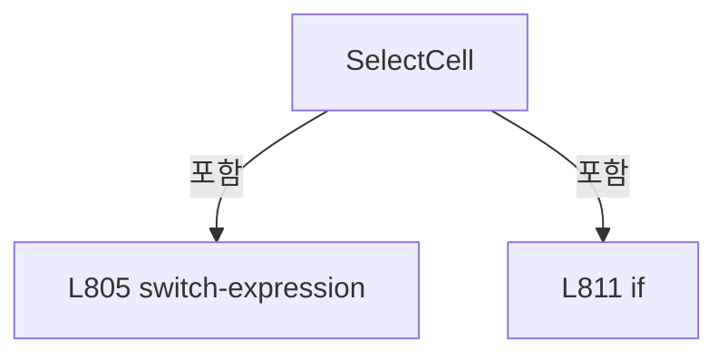

변경 전 점검: 입력/반환 타입, 위 호출자, 예외/취소 경로, 공유 상태와 저장·전송 소비자를 함께 확인합니다. 값의 단위나 물리 방향을 이름만으로 확정하지 않습니다.

### MethodDeclaration `SelectPreviewCell` · L826–830

[Drilling.UI/Menu/Menus/CMenuRecipe.cs:826–830](https://github.com/kjuws10-rgb/A3Drilling/blob/5aee8e58439c9b455cae7c9593c9be986c3e682e/Drilling.UI/Menu/Menus/CMenuRecipe.cs#L826-L830)

| 항목 | 실제 추출 값 |
| --- | --- |
| 서명 | System.Threading.Tasks.Task Drilling.UI.Menu.Menus.CMenuRecipe.SelectPreviewCell(object?) |
| 접근/수식자 | Private / private, async |
| 반환/값 타입 | System.Threading.Tasks.Task |
| 소속 타입 | NamedType:Drilling.UI.Menu.Menus.CMenuRecipe |

입력 계약:

| 이름 | 타입 | 전달 | 선택/기본값 |
| --- | --- | --- | --- |
| parameter | object? | None | False /  |

정적 호출자로 확인된 위치:

| 호출 파일/행 | 호출 표현식 | 런타임 분기 가능 |
| --- | --- | --- |
| [Drilling.UI/Menu/Menus/CMenuRecipe.cs:145–145](https://github.com/kjuws10-rgb/A3Drilling/blob/5aee8e58439c9b455cae7c9593c9be986c3e682e/Drilling.UI/Menu/Menus/CMenuRecipe.cs#L145-L145) | SelectPreviewCell | False |

호출하는 대상과 해석 범위:

| 원본 행 | 표현식 | 분석 상태 | 대상/소스 위치 |
| --- | --- | --- | --- |
| 828 | SetCellDetailVisible | resolved | void Drilling.UI.Menu.Menus.CMenuRecipe.SetCellDetailVisible(bool) · Drilling.UI/Menu/Menus/CMenuRecipe.cs:924 |
| 829 | SelectCell | resolved | System.Threading.Tasks.Task Drilling.UI.Menu.Menus.CMenuRecipe.SelectCell(object?) · Drilling.UI/Menu/Menus/CMenuRecipe.cs:803 |

본문의 실제 연산·분기·예외·반환 순서(원문 위치 순):

| 원본 행 | 종류 | 주석 해설 |
| --- | --- | --- |
| 828 | call | 함수·델리게이트 또는 객체 생성자를 호출합니다: SetCellDetailVisible(true) |
| 829 | await | 비동기 완료를 기다립니다: await SelectCell(parameter) |
| 829 | call | 함수·델리게이트 또는 객체 생성자를 호출합니다: SelectCell(parameter) |

변경 전 점검: 입력/반환 타입, 위 호출자, 예외/취소 경로, 공유 상태와 저장·전송 소비자를 함께 확인합니다. 값의 단위나 물리 방향을 이름만으로 확정하지 않습니다.

### MethodDeclaration `SelectShotGroupAt` · L832–841

[Drilling.UI/Menu/Menus/CMenuRecipe.cs:832–841](https://github.com/kjuws10-rgb/A3Drilling/blob/5aee8e58439c9b455cae7c9593c9be986c3e682e/Drilling.UI/Menu/Menus/CMenuRecipe.cs#L832-L841)

| 항목 | 실제 추출 값 |
| --- | --- |
| 서명 | void Drilling.UI.Menu.Menus.CMenuRecipe.SelectShotGroupAt(double, double) |
| 접근/수식자 | Public / public |
| 반환/값 타입 | void |
| 소속 타입 | NamedType:Drilling.UI.Menu.Menus.CMenuRecipe |

입력 계약:

| 이름 | 타입 | 전달 | 선택/기본값 |
| --- | --- | --- | --- |
| designX | double | None | False /  |
| designY | double | None | False /  |

현재 부분 분석에서 직접 연결된 호출자는 없습니다. XAML/이벤트/인터페이스·델리게이트·외부 진입을 추가 확인해야 하며, 미사용으로 판정한 것이 아닙니다.

호출하는 대상과 해석 범위:

| 원본 행 | 표현식 | 분석 상태 | 대상/소스 위치 |
| --- | --- | --- | --- |
| 834 | GetSelectedRecipeCell | resolved | Drilling.UI.Menu.Menus.ST_RECIPE_CELL_VIEW_MODEL? Drilling.UI.Menu.Menus.CMenuRecipe.GetSelectedRecipeCell() · Drilling.UI/Menu/Menus/CMenuRecipe.cs:2113 |
| 835 | CRecipeCellPatternPreviewDrawing.TryResolveCellShotNo | resolved | bool Drilling.UI.Menu.Menus.CRecipeCellPatternPreviewDrawing.TryResolveCellShotNo(double, double, Drilling.Common.Recipe.ST_CELL_PATTERN_LAYOUT, out int) · Drilling.UI/Menu/Menus/CRecipeCellPatternPreviewDrawing.cs:124 |

본문의 실제 연산·분기·예외·반환 순서(원문 위치 순):

| 원본 행 | 종류 | 주석 해설 |
| --- | --- | --- |
| 834 | call | 함수·델리게이트 또는 객체 생성자를 호출합니다: GetSelectedRecipeCell() |
| 834 | local-declaration | 지역 변수를 선언합니다: var cell = GetSelectedRecipeCell(); |
| 834 | variable-initializer | 변수의 초기값을 지정합니다: cell = GetSelectedRecipeCell() |
| 835 | call | 함수·델리게이트 또는 객체 생성자를 호출합니다: CRecipeCellPatternPreviewDrawing.TryResolveCellShotNo(designX, designY, cell.PatternLayout, out var cellShotNo) |
| 835 | if | 조건에 따라 분기합니다: if (cell is null &#124;&#124; !CRecipeCellPatternPreviewDrawing.TryResolveCellShotNo(designX, designY, cell.PatternLayout, out var cellShotNo) &#124;&#124; cellShotNo < 1 &#124;&#124; cellShotNo > ShotGroupRows.Count) |
| 837 | return | 호출자에게 값 또는 제어를 반환합니다: return; |
| 840 | assignment | 값을 대상에 대입합니다: SelectedShotGroup = ShotGroupRows[cellShotNo - 1] |

제어 구문의 포함 구조(실제 실행 순서/CFG가 아닌 구문 탐색 그림):

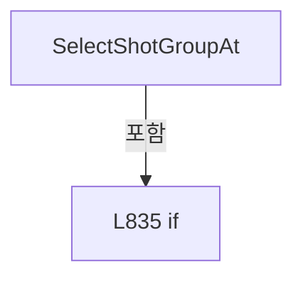

변경 전 점검: 입력/반환 타입, 위 호출자, 예외/취소 경로, 공유 상태와 저장·전송 소비자를 함께 확인합니다. 값의 단위나 물리 방향을 이름만으로 확정하지 않습니다.

### MethodDeclaration `GetShotGroupNameAt` · L843–852

[Drilling.UI/Menu/Menus/CMenuRecipe.cs:843–852](https://github.com/kjuws10-rgb/A3Drilling/blob/5aee8e58439c9b455cae7c9593c9be986c3e682e/Drilling.UI/Menu/Menus/CMenuRecipe.cs#L843-L852)

| 항목 | 실제 추출 값 |
| --- | --- |
| 서명 | string Drilling.UI.Menu.Menus.CMenuRecipe.GetShotGroupNameAt(double, double) |
| 접근/수식자 | Public / public |
| 반환/값 타입 | string |
| 소속 타입 | NamedType:Drilling.UI.Menu.Menus.CMenuRecipe |

입력 계약:

| 이름 | 타입 | 전달 | 선택/기본값 |
| --- | --- | --- | --- |
| designX | double | None | False /  |
| designY | double | None | False /  |

현재 부분 분석에서 직접 연결된 호출자는 없습니다. XAML/이벤트/인터페이스·델리게이트·외부 진입을 추가 확인해야 하며, 미사용으로 판정한 것이 아닙니다.

호출하는 대상과 해석 범위:

| 원본 행 | 표현식 | 분석 상태 | 대상/소스 위치 |
| --- | --- | --- | --- |
| 845 | GetSelectedRecipeCell | resolved | Drilling.UI.Menu.Menus.ST_RECIPE_CELL_VIEW_MODEL? Drilling.UI.Menu.Menus.CMenuRecipe.GetSelectedRecipeCell() · Drilling.UI/Menu/Menus/CMenuRecipe.cs:2113 |
| 846 | CRecipeCellPatternPreviewDrawing.TryResolveCellShotNo | resolved | bool Drilling.UI.Menu.Menus.CRecipeCellPatternPreviewDrawing.TryResolveCellShotNo(double, double, Drilling.Common.Recipe.ST_CELL_PATTERN_LAYOUT, out int) · Drilling.UI/Menu/Menus/CRecipeCellPatternPreviewDrawing.cs:124 |

본문의 실제 연산·분기·예외·반환 순서(원문 위치 순):

| 원본 행 | 종류 | 주석 해설 |
| --- | --- | --- |
| 845 | call | 함수·델리게이트 또는 객체 생성자를 호출합니다: GetSelectedRecipeCell() |
| 845 | local-declaration | 지역 변수를 선언합니다: var cell = GetSelectedRecipeCell(); |
| 845 | variable-initializer | 변수의 초기값을 지정합니다: cell = GetSelectedRecipeCell() |
| 846 | call | 함수·델리게이트 또는 객체 생성자를 호출합니다: CRecipeCellPatternPreviewDrawing.TryResolveCellShotNo(designX, designY, cell.PatternLayout, out var cellShotNo) |
| 846 | if | 조건에 따라 분기합니다: if (cell is null &#124;&#124; !CRecipeCellPatternPreviewDrawing.TryResolveCellShotNo(designX, designY, cell.PatternLayout, out var cellShotNo) &#124;&#124; cellShotNo < 1 &#124;&#124; cellShotNo > ShotGroupRows.Count) |
| 848 | return | 호출자에게 값 또는 제어를 반환합니다: return ""; |
| 851 | return | 호출자에게 값 또는 제어를 반환합니다: return ShotGroupRows[cellShotNo - 1].MatrixPointName; |

제어 구문의 포함 구조(실제 실행 순서/CFG가 아닌 구문 탐색 그림):

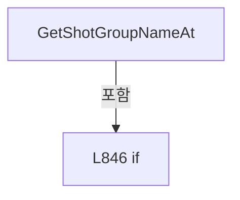

변경 전 점검: 입력/반환 타입, 위 호출자, 예외/취소 경로, 공유 상태와 저장·전송 소비자를 함께 확인합니다. 값의 단위나 물리 방향을 이름만으로 확정하지 않습니다.

### MethodDeclaration `SelectAdjacentCell` · L854–868

[Drilling.UI/Menu/Menus/CMenuRecipe.cs:854–868](https://github.com/kjuws10-rgb/A3Drilling/blob/5aee8e58439c9b455cae7c9593c9be986c3e682e/Drilling.UI/Menu/Menus/CMenuRecipe.cs#L854-L868)

| 항목 | 실제 추출 값 |
| --- | --- |
| 서명 | System.Threading.Tasks.Task Drilling.UI.Menu.Menus.CMenuRecipe.SelectAdjacentCell(int) |
| 접근/수식자 | Private / private, async |
| 반환/값 타입 | System.Threading.Tasks.Task |
| 소속 타입 | NamedType:Drilling.UI.Menu.Menus.CMenuRecipe |

입력 계약:

| 이름 | 타입 | 전달 | 선택/기본값 |
| --- | --- | --- | --- |
| direction | int | None | False /  |

정적 호출자로 확인된 위치:

| 호출 파일/행 | 호출 표현식 | 런타임 분기 가능 |
| --- | --- | --- |
| [Drilling.UI/Menu/Menus/CMenuRecipe.cs:158–158](https://github.com/kjuws10-rgb/A3Drilling/blob/5aee8e58439c9b455cae7c9593c9be986c3e682e/Drilling.UI/Menu/Menus/CMenuRecipe.cs#L158-L158) | SelectAdjacentCell | False |
| [Drilling.UI/Menu/Menus/CMenuRecipe.cs:169–169](https://github.com/kjuws10-rgb/A3Drilling/blob/5aee8e58439c9b455cae7c9593c9be986c3e682e/Drilling.UI/Menu/Menus/CMenuRecipe.cs#L169-L169) | SelectAdjacentCell | False |

호출하는 대상과 해석 범위:

| 원본 행 | 표현식 | 분석 상태 | 대상/소스 위치 |
| --- | --- | --- | --- |
| 867 | SelectCell | resolved | System.Threading.Tasks.Task Drilling.UI.Menu.Menus.CMenuRecipe.SelectCell(object?) · Drilling.UI/Menu/Menus/CMenuRecipe.cs:803 |

본문의 실제 연산·분기·예외·반환 순서(원문 위치 순):

| 원본 행 | 종류 | 주석 해설 |
| --- | --- | --- |
| 856 | if | 조건에 따라 분기합니다: if (_recipeCells.Count == 0 &#124;&#124; direction == 0) |
| 858 | return | 호출자에게 값 또는 제어를 반환합니다: return; |
| 861 | local-declaration | 지역 변수를 선언합니다: var nextCellNo = _selectedCellNo + direction; |
| 861 | variable-initializer | 변수의 초기값을 지정합니다: nextCellNo = _selectedCellNo + direction |
| 862 | if | 조건에 따라 분기합니다: if (nextCellNo < 1 &#124;&#124; nextCellNo > _recipeCells.Count) |
| 864 | return | 호출자에게 값 또는 제어를 반환합니다: return; |
| 867 | await | 비동기 완료를 기다립니다: await SelectCell(nextCellNo) |
| 867 | call | 함수·델리게이트 또는 객체 생성자를 호출합니다: SelectCell(nextCellNo) |

제어 구문의 포함 구조(실제 실행 순서/CFG가 아닌 구문 탐색 그림):

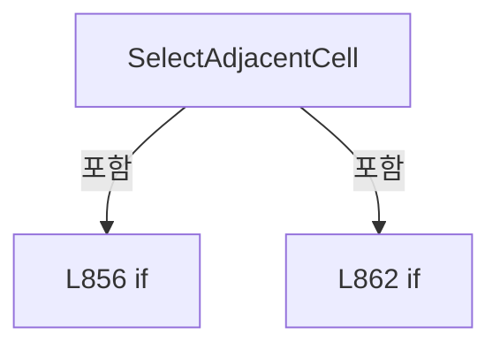

변경 전 점검: 입력/반환 타입, 위 호출자, 예외/취소 경로, 공유 상태와 저장·전송 소비자를 함께 확인합니다. 값의 단위나 물리 방향을 이름만으로 확정하지 않습니다.

### MethodDeclaration `NavigateShotGroup` · L870–878

[Drilling.UI/Menu/Menus/CMenuRecipe.cs:870–878](https://github.com/kjuws10-rgb/A3Drilling/blob/5aee8e58439c9b455cae7c9593c9be986c3e682e/Drilling.UI/Menu/Menus/CMenuRecipe.cs#L870-L878)

| 항목 | 실제 추출 값 |
| --- | --- |
| 서명 | void Drilling.UI.Menu.Menus.CMenuRecipe.NavigateShotGroup(object?) |
| 접근/수식자 | Private / private |
| 반환/값 타입 | void |
| 소속 타입 | NamedType:Drilling.UI.Menu.Menus.CMenuRecipe |

입력 계약:

| 이름 | 타입 | 전달 | 선택/기본값 |
| --- | --- | --- | --- |
| parameter | object? | None | False /  |

현재 부분 분석에서 직접 연결된 호출자는 없습니다. XAML/이벤트/인터페이스·델리게이트·외부 진입을 추가 확인해야 하며, 미사용으로 판정한 것이 아닙니다.

호출하는 대상과 해석 범위:

| 원본 행 | 표현식 | 분석 상태 | 대상/소스 위치 |
| --- | --- | --- | --- |
| 872 | TryGetNavigatedCellShotNo | resolved | bool Drilling.UI.Menu.Menus.CMenuRecipe.TryGetNavigatedCellShotNo(object?, out int) · Drilling.UI/Menu/Menus/CMenuRecipe.cs:885 |

본문의 실제 연산·분기·예외·반환 순서(원문 위치 순):

| 원본 행 | 종류 | 주석 해설 |
| --- | --- | --- |
| 872 | call | 함수·델리게이트 또는 객체 생성자를 호출합니다: TryGetNavigatedCellShotNo(parameter, out var cellShotNo) |
| 872 | if | 조건에 따라 분기합니다: if (!TryGetNavigatedCellShotNo(parameter, out var cellShotNo)) |
| 874 | return | 호출자에게 값 또는 제어를 반환합니다: return; |
| 877 | assignment | 값을 대상에 대입합니다: SelectedShotGroup = ShotGroupRows[cellShotNo - 1] |

제어 구문의 포함 구조(실제 실행 순서/CFG가 아닌 구문 탐색 그림):

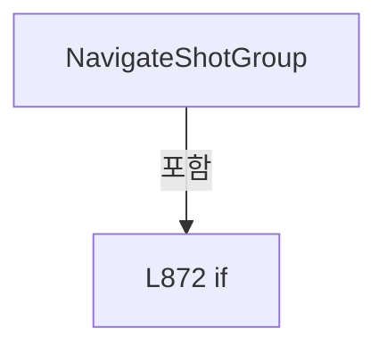

변경 전 점검: 입력/반환 타입, 위 호출자, 예외/취소 경로, 공유 상태와 저장·전송 소비자를 함께 확인합니다. 값의 단위나 물리 방향을 이름만으로 확정하지 않습니다.

### MethodDeclaration `CanNavigateShotGroup` · L880–883

[Drilling.UI/Menu/Menus/CMenuRecipe.cs:880–883](https://github.com/kjuws10-rgb/A3Drilling/blob/5aee8e58439c9b455cae7c9593c9be986c3e682e/Drilling.UI/Menu/Menus/CMenuRecipe.cs#L880-L883)

| 항목 | 실제 추출 값 |
| --- | --- |
| 서명 | bool Drilling.UI.Menu.Menus.CMenuRecipe.CanNavigateShotGroup(object?) |
| 접근/수식자 | Private / private |
| 반환/값 타입 | bool |
| 소속 타입 | NamedType:Drilling.UI.Menu.Menus.CMenuRecipe |

입력 계약:

| 이름 | 타입 | 전달 | 선택/기본값 |
| --- | --- | --- | --- |
| parameter | object? | None | False /  |

현재 부분 분석에서 직접 연결된 호출자는 없습니다. XAML/이벤트/인터페이스·델리게이트·외부 진입을 추가 확인해야 하며, 미사용으로 판정한 것이 아닙니다.

호출하는 대상과 해석 범위:

| 원본 행 | 표현식 | 분석 상태 | 대상/소스 위치 |
| --- | --- | --- | --- |
| 882 | TryGetNavigatedCellShotNo | resolved | bool Drilling.UI.Menu.Menus.CMenuRecipe.TryGetNavigatedCellShotNo(object?, out int) · Drilling.UI/Menu/Menus/CMenuRecipe.cs:885 |

본문의 실제 연산·분기·예외·반환 순서(원문 위치 순):

| 원본 행 | 종류 | 주석 해설 |
| --- | --- | --- |
| 882 | call | 함수·델리게이트 또는 객체 생성자를 호출합니다: TryGetNavigatedCellShotNo(parameter, out _) |
| 882 | return | 호출자에게 값 또는 제어를 반환합니다: return TryGetNavigatedCellShotNo(parameter, out _); |

변경 전 점검: 입력/반환 타입, 위 호출자, 예외/취소 경로, 공유 상태와 저장·전송 소비자를 함께 확인합니다. 값의 단위나 물리 방향을 이름만으로 확정하지 않습니다.

### MethodDeclaration `TryGetNavigatedCellShotNo` · L885–922

[Drilling.UI/Menu/Menus/CMenuRecipe.cs:885–922](https://github.com/kjuws10-rgb/A3Drilling/blob/5aee8e58439c9b455cae7c9593c9be986c3e682e/Drilling.UI/Menu/Menus/CMenuRecipe.cs#L885-L922)

| 항목 | 실제 추출 값 |
| --- | --- |
| 서명 | bool Drilling.UI.Menu.Menus.CMenuRecipe.TryGetNavigatedCellShotNo(object?, out int) |
| 접근/수식자 | Private / private |
| 반환/값 타입 | bool |
| 소속 타입 | NamedType:Drilling.UI.Menu.Menus.CMenuRecipe |

입력 계약:

| 이름 | 타입 | 전달 | 선택/기본값 |
| --- | --- | --- | --- |
| parameter | object? | None | False /  |
| cellShotNo | int | Out | False /  |

정적 호출자로 확인된 위치:

| 호출 파일/행 | 호출 표현식 | 런타임 분기 가능 |
| --- | --- | --- |
| [Drilling.UI/Menu/Menus/CMenuRecipe.cs:872–872](https://github.com/kjuws10-rgb/A3Drilling/blob/5aee8e58439c9b455cae7c9593c9be986c3e682e/Drilling.UI/Menu/Menus/CMenuRecipe.cs#L872-L872) | TryGetNavigatedCellShotNo | False |
| [Drilling.UI/Menu/Menus/CMenuRecipe.cs:882–882](https://github.com/kjuws10-rgb/A3Drilling/blob/5aee8e58439c9b455cae7c9593c9be986c3e682e/Drilling.UI/Menu/Menus/CMenuRecipe.cs#L882-L882) | TryGetNavigatedCellShotNo | False |

호출하는 대상과 해석 범위:

| 원본 행 | 표현식 | 분석 상태 | 대상/소스 위치 |
| --- | --- | --- | --- |
| 888 | GetSelectedRecipeCell | resolved | Drilling.UI.Menu.Menus.ST_RECIPE_CELL_VIEW_MODEL? Drilling.UI.Menu.Menus.CMenuRecipe.GetSelectedRecipeCell() · Drilling.UI/Menu/Menus/CMenuRecipe.cs:2113 |
| 895 | .ToString | resolved · 동적 구현 선택 가능 | string? object.ToString() |
| 895 | .Trim().ToUpperInvariant | resolved | string string.ToUpperInvariant() |
| 895 | .Trim | resolved | string string.Trim() |

본문의 실제 연산·분기·예외·반환 순서(원문 위치 순):

| 원본 행 | 종류 | 주석 해설 |
| --- | --- | --- |
| 887 | assignment | 값을 대상에 대입합니다: cellShotNo = 0 |
| 888 | call | 함수·델리게이트 또는 객체 생성자를 호출합니다: GetSelectedRecipeCell() |
| 888 | local-declaration | 지역 변수를 선언합니다: var cell = GetSelectedRecipeCell(); |
| 888 | variable-initializer | 변수의 초기값을 지정합니다: cell = GetSelectedRecipeCell() |
| 889 | local-declaration | 지역 변수를 선언합니다: var selected = SelectedShotGroup; |
| 889 | variable-initializer | 변수의 초기값을 지정합니다: selected = SelectedShotGroup |
| 890 | if | 조건에 따라 분기합니다: if (cell is null &#124;&#124; selected is null &#124;&#124; ShotGroupRows.Count == 0) |
| 892 | return | 호출자에게 값 또는 제어를 반환합니다: return false; |
| 895 | call | 함수·델리게이트 또는 객체 생성자를 호출합니다: .ToString() |
| 895 | call | 함수·델리게이트 또는 객체 생성자를 호출합니다: .Trim().ToUpperInvariant() |
| 895 | call | 함수·델리게이트 또는 객체 생성자를 호출합니다: .Trim() |
| 895 | assignment | 값을 대상에 대입합니다: var(columnDelta, rowDelta) = parameter?.ToString()?.Trim().ToUpperInvariant() switch { "UP" => (0, -1), "DOWN" => (0, 1), "LEFT" => (-1, 0), "RIGHT" => (1, 0), _ => (0, 0)} |
| 895 | switch-expression | 값별 결과식을 선택합니다: parameter?.ToString()?.Trim().ToUpperInvariant() switch { "UP" => (0, -1), "DOWN" => (0, 1), "LEFT" => (-1, 0), "RIGHT" => (1, 0), _ => (0, 0)} |
| 902 | if | 조건에 따라 분기합니다: if (columnDelta == 0 && rowDelta == 0) |
| 904 | return | 호출자에게 값 또는 제어를 반환합니다: return false; |
| 907 | local-declaration | 지역 변수를 선언합니다: var nextColumn = selected.Column + columnDelta; |
| 907 | variable-initializer | 변수의 초기값을 지정합니다: nextColumn = selected.Column + columnDelta |
| 908 | local-declaration | 지역 변수를 선언합니다: var nextRow = selected.Row + rowDelta; |
| 908 | variable-initializer | 변수의 초기값을 지정합니다: nextRow = selected.Row + rowDelta |
| 909 | if | 조건에 따라 분기합니다: if (nextColumn < 1 &#124;&#124; nextColumn > cell.PatternLayout.GroupCountX &#124;&#124; nextRow < 1 &#124;&#124; nextRow > cell.PatternLayout.GroupCountY) |
| 911 | return | 호출자에게 값 또는 제어를 반환합니다: return false; |
| 914 | local-declaration | 지역 변수를 선언합니다: var candidateCellShotNo = ((nextRow - 1) * cell.PatternLayout.GroupCountX) + nextColumn; |
| 914 | variable-initializer | 변수의 초기값을 지정합니다: candidateCellShotNo = ((nextRow - 1) * cell.PatternLayout.GroupCountX) + nextColumn |
| 915 | if | 조건에 따라 분기합니다: if (candidateCellShotNo < 1 &#124;&#124; candidateCellShotNo > ShotGroupRows.Count) |
| 917 | return | 호출자에게 값 또는 제어를 반환합니다: return false; |
| 920 | assignment | 값을 대상에 대입합니다: cellShotNo = candidateCellShotNo |
| 921 | return | 호출자에게 값 또는 제어를 반환합니다: return true; |

제어 구문의 포함 구조(실제 실행 순서/CFG가 아닌 구문 탐색 그림):

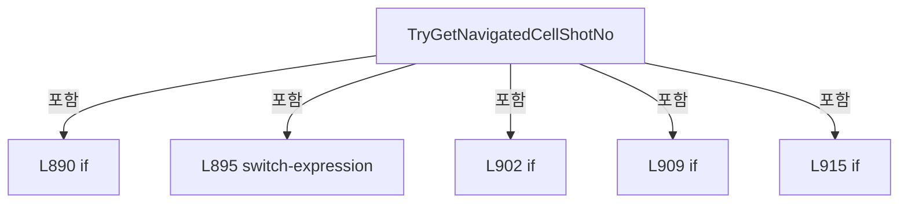

변경 전 점검: 입력/반환 타입, 위 호출자, 예외/취소 경로, 공유 상태와 저장·전송 소비자를 함께 확인합니다. 값의 단위나 물리 방향을 이름만으로 확정하지 않습니다.

### MethodDeclaration `SetCellDetailVisible` · L924–934

[Drilling.UI/Menu/Menus/CMenuRecipe.cs:924–934](https://github.com/kjuws10-rgb/A3Drilling/blob/5aee8e58439c9b455cae7c9593c9be986c3e682e/Drilling.UI/Menu/Menus/CMenuRecipe.cs#L924-L934)

| 항목 | 실제 추출 값 |
| --- | --- |
| 서명 | void Drilling.UI.Menu.Menus.CMenuRecipe.SetCellDetailVisible(bool) |
| 접근/수식자 | Private / private |
| 반환/값 타입 | void |
| 소속 타입 | NamedType:Drilling.UI.Menu.Menus.CMenuRecipe |

입력 계약:

| 이름 | 타입 | 전달 | 선택/기본값 |
| --- | --- | --- | --- |
| isVisible | bool | None | False /  |

정적 호출자로 확인된 위치:

| 호출 파일/행 | 호출 표현식 | 런타임 분기 가능 |
| --- | --- | --- |
| [Drilling.UI/Menu/Menus/CMenuRecipe.cs:151–151](https://github.com/kjuws10-rgb/A3Drilling/blob/5aee8e58439c9b455cae7c9593c9be986c3e682e/Drilling.UI/Menu/Menus/CMenuRecipe.cs#L151-L151) | SetCellDetailVisible | False |
| [Drilling.UI/Menu/Menus/CMenuRecipe.cs:828–828](https://github.com/kjuws10-rgb/A3Drilling/blob/5aee8e58439c9b455cae7c9593c9be986c3e682e/Drilling.UI/Menu/Menus/CMenuRecipe.cs#L828-L828) | SetCellDetailVisible | False |

호출하는 대상과 해석 범위:

| 원본 행 | 표현식 | 분석 상태 | 대상/소스 위치 |
| --- | --- | --- | --- |
| 932 | OnPropertyChanged | resolved | void Drilling.UI.Menu.CBindingBase.OnPropertyChanged(string?) · Drilling.UI/Menu/CBindingBase.cs:759 |
| 932 | nameof | unresolved | None |
| 933 | OnPropertyChanged | resolved | void Drilling.UI.Menu.CBindingBase.OnPropertyChanged(string?) · Drilling.UI/Menu/CBindingBase.cs:759 |
| 933 | nameof | unresolved | None |

본문의 실제 연산·분기·예외·반환 순서(원문 위치 순):

| 원본 행 | 종류 | 주석 해설 |
| --- | --- | --- |
| 926 | if | 조건에 따라 분기합니다: if (_isCellDetailVisible == isVisible) |
| 928 | return | 호출자에게 값 또는 제어를 반환합니다: return; |
| 931 | assignment | 값을 대상에 대입합니다: _isCellDetailVisible = isVisible |
| 932 | call | 함수·델리게이트 또는 객체 생성자를 호출합니다: OnPropertyChanged(nameof(IsCellDetailVisible)) |
| 932 | call | 함수·델리게이트 또는 객체 생성자를 호출합니다: nameof(IsCellDetailVisible) |
| 933 | call | 함수·델리게이트 또는 객체 생성자를 호출합니다: OnPropertyChanged(nameof(IsCellPreviewVisible)) |
| 933 | call | 함수·델리게이트 또는 객체 생성자를 호출합니다: nameof(IsCellPreviewVisible) |

제어 구문의 포함 구조(실제 실행 순서/CFG가 아닌 구문 탐색 그림):

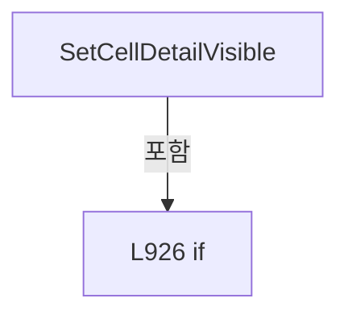

변경 전 점검: 입력/반환 타입, 위 호출자, 예외/취소 경로, 공유 상태와 저장·전송 소비자를 함께 확인합니다. 값의 단위나 물리 방향을 이름만으로 확정하지 않습니다.

### MethodDeclaration `ToggleCellPlacementExpanded` · L936–941

[Drilling.UI/Menu/Menus/CMenuRecipe.cs:936–941](https://github.com/kjuws10-rgb/A3Drilling/blob/5aee8e58439c9b455cae7c9593c9be986c3e682e/Drilling.UI/Menu/Menus/CMenuRecipe.cs#L936-L941)

| 항목 | 실제 추출 값 |
| --- | --- |
| 서명 | void Drilling.UI.Menu.Menus.CMenuRecipe.ToggleCellPlacementExpanded() |
| 접근/수식자 | Public / public |
| 반환/값 타입 | void |
| 소속 타입 | NamedType:Drilling.UI.Menu.Menus.CMenuRecipe |

정적 호출자로 확인된 위치:

| 호출 파일/행 | 호출 표현식 | 런타임 분기 가능 |
| --- | --- | --- |
| [Drilling.UI/Menu/Menus/CMenuRecipe.cs:155–155](https://github.com/kjuws10-rgb/A3Drilling/blob/5aee8e58439c9b455cae7c9593c9be986c3e682e/Drilling.UI/Menu/Menus/CMenuRecipe.cs#L155-L155) | ToggleCellPlacementExpanded | False |
| [Drilling.UI/Views/CRecipeView.xaml.cs:294–294](https://github.com/kjuws10-rgb/A3Drilling/blob/5aee8e58439c9b455cae7c9593c9be986c3e682e/Drilling.UI/Views/CRecipeView.xaml.cs#L294-L294) | recipe.ToggleCellPlacementExpanded | False |

호출하는 대상과 해석 범위:

| 원본 행 | 표현식 | 분석 상태 | 대상/소스 위치 |
| --- | --- | --- | --- |
| 939 | OnPropertyChanged | resolved | void Drilling.UI.Menu.CBindingBase.OnPropertyChanged(string?) · Drilling.UI/Menu/CBindingBase.cs:759 |
| 939 | nameof | unresolved | None |
| 940 | OnPropertyChanged | resolved | void Drilling.UI.Menu.CBindingBase.OnPropertyChanged(string?) · Drilling.UI/Menu/CBindingBase.cs:759 |
| 940 | nameof | unresolved | None |

본문의 실제 연산·분기·예외·반환 순서(원문 위치 순):

| 원본 행 | 종류 | 주석 해설 |
| --- | --- | --- |
| 938 | assignment | 값을 대상에 대입합니다: _isCellPlacementExpanded = !_isCellPlacementExpanded |
| 939 | call | 함수·델리게이트 또는 객체 생성자를 호출합니다: OnPropertyChanged(nameof(IsCellPlacementExpanded)) |
| 939 | call | 함수·델리게이트 또는 객체 생성자를 호출합니다: nameof(IsCellPlacementExpanded) |
| 940 | call | 함수·델리게이트 또는 객체 생성자를 호출합니다: OnPropertyChanged(nameof(CellPlacementExpandButtonText)) |
| 940 | call | 함수·델리게이트 또는 객체 생성자를 호출합니다: nameof(CellPlacementExpandButtonText) |

변경 전 점검: 입력/반환 타입, 위 호출자, 예외/취소 경로, 공유 상태와 저장·전송 소비자를 함께 확인합니다. 값의 단위나 물리 방향을 이름만으로 확정하지 않습니다.

### MethodDeclaration `CreateCellPlacementWizardContext` · L943–955

[Drilling.UI/Menu/Menus/CMenuRecipe.cs:943–955](https://github.com/kjuws10-rgb/A3Drilling/blob/5aee8e58439c9b455cae7c9593c9be986c3e682e/Drilling.UI/Menu/Menus/CMenuRecipe.cs#L943-L955)

| 항목 | 실제 추출 값 |
| --- | --- |
| 서명 | Drilling.UI.Popup.ST_CELL_PLACEMENT_WIZARD_CONTEXT Drilling.UI.Menu.Menus.CMenuRecipe.CreateCellPlacementWizardContext() |
| 접근/수식자 | Public / public |
| 반환/값 타입 | Drilling.UI.Popup.ST_CELL_PLACEMENT_WIZARD_CONTEXT |
| 소속 타입 | NamedType:Drilling.UI.Menu.Menus.CMenuRecipe |

정적 호출자로 확인된 위치:

| 호출 파일/행 | 호출 표현식 | 런타임 분기 가능 |
| --- | --- | --- |
| [Drilling.UI/Views/CRecipeView.xaml.cs:318–318](https://github.com/kjuws10-rgb/A3Drilling/blob/5aee8e58439c9b455cae7c9593c9be986c3e682e/Drilling.UI/Views/CRecipeView.xaml.cs#L318-L318) | recipe.CreateCellPlacementWizardContext | False |

호출하는 대상과 해석 범위:

| 원본 행 | 표현식 | 분석 상태 | 대상/소스 위치 |
| --- | --- | --- | --- |
| 945 | Math.Max | resolved | int System.Math.Max(int, int) |
| 945 | GetCellCount | resolved | int Drilling.UI.Menu.Menus.CMenuRecipe.GetCellCount(System.Collections.Generic.IReadOnlyList<Drilling.UI.Menu.Menus.ST_RECIPE_PARAMETER_EDITOR_ITEM>) · Drilling.UI/Menu/Menus/CMenuRecipe.cs:1827 |
| 946 | GetCellModelTypeCount | resolved | int Drilling.UI.Menu.Menus.CMenuRecipe.GetCellModelTypeCount(System.Collections.Generic.IReadOnlyList<Drilling.UI.Menu.Menus.ST_RECIPE_PARAMETER_EDITOR_ITEM>) · Drilling.UI/Menu/Menus/CMenuRecipe.cs:2068 |
| 947 | new ST_CELL_PLACEMENT_WIZARD_CONTEXT | resolved | Drilling.UI.Popup.ST_CELL_PLACEMENT_WIZARD_CONTEXT.ST_CELL_PLACEMENT_WIZARD_CONTEXT(int, int, double, double, double, double) · Drilling.UI/Popup/CCellPlacementWizardDialog.xaml.cs:383 |
| 950 | ReadManagedDouble | resolved | double Drilling.UI.Menu.Menus.CMenuRecipe.ReadManagedDouble(System.Collections.Generic.IReadOnlyList<Drilling.UI.Menu.Menus.ST_RECIPE_PARAMETER_EDITOR_ITEM>, string, double) · Drilling.UI/Menu/Menus/CMenuRecipe.cs:2785 |
| 951 | ReadManagedDouble | resolved | double Drilling.UI.Menu.Menus.CMenuRecipe.ReadManagedDouble(System.Collections.Generic.IReadOnlyList<Drilling.UI.Menu.Menus.ST_RECIPE_PARAMETER_EDITOR_ITEM>, string, double) · Drilling.UI/Menu/Menus/CMenuRecipe.cs:2785 |
| 952 | ReadManagedDouble | resolved | double Drilling.UI.Menu.Menus.CMenuRecipe.ReadManagedDouble(System.Collections.Generic.IReadOnlyList<Drilling.UI.Menu.Menus.ST_RECIPE_PARAMETER_EDITOR_ITEM>, string, double) · Drilling.UI/Menu/Menus/CMenuRecipe.cs:2785 |
| 953 | ReadManagedDouble | resolved | double Drilling.UI.Menu.Menus.CMenuRecipe.ReadManagedDouble(System.Collections.Generic.IReadOnlyList<Drilling.UI.Menu.Menus.ST_RECIPE_PARAMETER_EDITOR_ITEM>, string, double) · Drilling.UI/Menu/Menus/CMenuRecipe.cs:2785 |

본문의 실제 연산·분기·예외·반환 순서(원문 위치 순):

| 원본 행 | 종류 | 주석 해설 |
| --- | --- | --- |
| 945 | call | 함수·델리게이트 또는 객체 생성자를 호출합니다: Math.Max(1, CellOverviewRows.Count) |
| 945 | call | 함수·델리게이트 또는 객체 생성자를 호출합니다: GetCellCount(AllManagedItems) |
| 945 | conditional-expression | 조건에 따라 결과식을 선택합니다: AllManagedItems.Count == 0 ? Math.Max(1, CellOverviewRows.Count) : GetCellCount(AllManagedItems) |
| 945 | local-declaration | 지역 변수를 선언합니다: var cellCount = AllManagedItems.Count == 0 ? Math.Max(1, CellOverviewRows.Count) : GetCellCount(AllManagedItems); |
| 945 | variable-initializer | 변수의 초기값을 지정합니다: cellCount = AllManagedItems.Count == 0 ? Math.Max(1, CellOverviewRows.Count) : GetCellCount(AllManagedItems) |
| 946 | call | 함수·델리게이트 또는 객체 생성자를 호출합니다: GetCellModelTypeCount(AllManagedItems) |
| 946 | conditional-expression | 조건에 따라 결과식을 선택합니다: AllManagedItems.Count == 0 ? MaximumCellModelTypeCount : GetCellModelTypeCount(AllManagedItems) |
| 946 | local-declaration | 지역 변수를 선언합니다: var modelTypeCount = AllManagedItems.Count == 0 ? MaximumCellModelTypeCount : GetCellModelTypeCount(AllManagedItems); |
| 946 | variable-initializer | 변수의 초기값을 지정합니다: modelTypeCount = AllManagedItems.Count == 0 ? MaximumCellModelTypeCount : GetCellModelTypeCount(AllManagedItems) |
| 947 | call | 함수·델리게이트 또는 객체 생성자를 호출합니다: new ST_CELL_PLACEMENT_WIZARD_CONTEXT( cellCount, modelTypeCount, ReadManagedDouble(AllManagedItems, "GLASS_SIZE_X", 500.0), ReadManagedDouble(AllManagedItems, "GLASS_SIZE_Y", 300.0), ReadManagedDouble(AllManagedItems, "A… |
| 947 | return | 호출자에게 값 또는 제어를 반환합니다: return new ST_CELL_PLACEMENT_WIZARD_CONTEXT( cellCount, modelTypeCount, ReadManagedDouble(AllManagedItems, "GLASS_SIZE_X", 500.0), ReadManagedDouble(AllManagedItems, "GLASS_SIZE_Y", 300.0), ReadManagedDouble(AllManagedItems, "AK_M |
| 950 | call | 함수·델리게이트 또는 객체 생성자를 호출합니다: ReadManagedDouble(AllManagedItems, "GLASS_SIZE_X", 500.0) |
| 951 | call | 함수·델리게이트 또는 객체 생성자를 호출합니다: ReadManagedDouble(AllManagedItems, "GLASS_SIZE_Y", 300.0) |
| 952 | call | 함수·델리게이트 또는 객체 생성자를 호출합니다: ReadManagedDouble(AllManagedItems, "AK_MARGIN_X", 55.0) |
| 953 | call | 함수·델리게이트 또는 객체 생성자를 호출합니다: ReadManagedDouble(AllManagedItems, "AK_MARGIN_Y", 45.0) |

변경 전 점검: 입력/반환 타입, 위 호출자, 예외/취소 경로, 공유 상태와 저장·전송 소비자를 함께 확인합니다. 값의 단위나 물리 방향을 이름만으로 확정하지 않습니다.

### MethodDeclaration `ApplyCellPlacementWizard` · L957–1003

[Drilling.UI/Menu/Menus/CMenuRecipe.cs:957–1003](https://github.com/kjuws10-rgb/A3Drilling/blob/5aee8e58439c9b455cae7c9593c9be986c3e682e/Drilling.UI/Menu/Menus/CMenuRecipe.cs#L957-L1003)

| 항목 | 실제 추출 값 |
| --- | --- |
| 서명 | void Drilling.UI.Menu.Menus.CMenuRecipe.ApplyCellPlacementWizard(Drilling.UI.Popup.ST_CELL_PLACEMENT_WIZARD_RESULT) |
| 접근/수식자 | Public / public |
| 반환/값 타입 | void |
| 소속 타입 | NamedType:Drilling.UI.Menu.Menus.CMenuRecipe |

입력 계약:

| 이름 | 타입 | 전달 | 선택/기본값 |
| --- | --- | --- | --- |
| result | Drilling.UI.Popup.ST_CELL_PLACEMENT_WIZARD_RESULT | None | False /  |

정적 호출자로 확인된 위치:

| 호출 파일/행 | 호출 표현식 | 런타임 분기 가능 |
| --- | --- | --- |
| [Drilling.UI/Views/CRecipeView.xaml.cs:324–324](https://github.com/kjuws10-rgb/A3Drilling/blob/5aee8e58439c9b455cae7c9593c9be986c3e682e/Drilling.UI/Views/CRecipeView.xaml.cs#L324-L324) | recipe.ApplyCellPlacementWizard | False |

호출하는 대상과 해석 범위:

| 원본 행 | 표현식 | 분석 상태 | 대상/소스 위치 |
| --- | --- | --- | --- |
| 964 | GetCellCount | resolved | int Drilling.UI.Menu.Menus.CMenuRecipe.GetCellCount(System.Collections.Generic.IReadOnlyList<Drilling.UI.Menu.Menus.ST_RECIPE_PARAMETER_EDITOR_ITEM>) · Drilling.UI/Menu/Menus/CMenuRecipe.cs:1827 |
| 965 | GetCellModelTypeCount | resolved | int Drilling.UI.Menu.Menus.CMenuRecipe.GetCellModelTypeCount(System.Collections.Generic.IReadOnlyList<Drilling.UI.Menu.Menus.ST_RECIPE_PARAMETER_EDITOR_ITEM>) · Drilling.UI/Menu/Menus/CMenuRecipe.cs:2068 |
| 978 | CalculatePlacementWizardGridIndex | resolved | (int RowIndex, int ColumnIndex) Drilling.UI.Menu.Menus.CMenuRecipe.CalculatePlacementWizardGridIndex(int, int, int, string) · Drilling.UI/Menu/Menus/CMenuRecipe.cs:1014 |
| 981 | Math.Clamp | resolved | int System.Math.Clamp(int, int, int) |
| 984 | modelOverride.Scope.Equals | resolved | bool string.Equals(string?, System.StringComparison) |
| 984 | modelOverride.Scope.Equals | resolved | bool string.Equals(string?, System.StringComparison) |
| 986 | Math.Clamp | resolved | int System.Math.Clamp(int, int, int) |
| 990 | SetManagedValue | resolved | void Drilling.UI.Menu.Menus.CMenuRecipe.SetManagedValue(string, string) · Drilling.UI/Menu/Menus/CMenuRecipe.cs:1005 |
| 990 | FormatWizardDouble | resolved | string Drilling.UI.Menu.Menus.CMenuRecipe.FormatWizardDouble(double) · Drilling.UI/Menu/Menus/CMenuRecipe.cs:1026 |
| 991 | SetManagedValue | resolved | void Drilling.UI.Menu.Menus.CMenuRecipe.SetManagedValue(string, string) · Drilling.UI/Menu/Menus/CMenuRecipe.cs:1005 |
| 991 | FormatWizardDouble | resolved | string Drilling.UI.Menu.Menus.CMenuRecipe.FormatWizardDouble(double) · Drilling.UI/Menu/Menus/CMenuRecipe.cs:1026 |
| 992 | SetManagedValue | resolved | void Drilling.UI.Menu.Menus.CMenuRecipe.SetManagedValue(string, string) · Drilling.UI/Menu/Menus/CMenuRecipe.cs:1005 |
| 992 | modelType.ToString | resolved | string int.ToString(System.IFormatProvider?) |
| 1001 | RefreshCellPreviewFromManagedItems | resolved | void Drilling.UI.Menu.Menus.CMenuRecipe.RefreshCellPreviewFromManagedItems() · Drilling.UI/Menu/Menus/CMenuRecipe.cs:1437 |
| 1002 | _setStatusMessage | resolved · 동적 구현 선택 가능 | void System.Action<string>.Invoke(string) |

본문의 실제 연산·분기·예외·반환 순서(원문 위치 순):

| 원본 행 | 종류 | 주석 해설 |
| --- | --- | --- |
| 959 | if | 조건에 따라 분기합니다: if (result.CellCount <= 0 &#124;&#124; AllManagedItems.Count == 0) |
| 961 | return | 호출자에게 값 또는 제어를 반환합니다: return; |
| 964 | call | 함수·델리게이트 또는 객체 생성자를 호출합니다: GetCellCount(AllManagedItems) |
| 964 | local-declaration | 지역 변수를 선언합니다: var maxCellCount = GetCellCount(AllManagedItems); |
| 964 | variable-initializer | 변수의 초기값을 지정합니다: maxCellCount = GetCellCount(AllManagedItems) |
| 965 | call | 함수·델리게이트 또는 객체 생성자를 호출합니다: GetCellModelTypeCount(AllManagedItems) |
| 965 | local-declaration | 지역 변수를 선언합니다: var modelTypeCount = GetCellModelTypeCount(AllManagedItems); |
| 965 | variable-initializer | 변수의 초기값을 지정합니다: modelTypeCount = GetCellModelTypeCount(AllManagedItems) |
| 966 | local-declaration | 지역 변수를 선언합니다: var appliedCount = 0; |
| 966 | variable-initializer | 변수의 초기값을 지정합니다: appliedCount = 0 |
| 967 | assignment | 값을 대상에 대입합니다: _isBatchUpdatingCellPlacement = true |
| 968 | try | 예외 처리 범위입니다: try |
| 970 | variable-initializer | 변수의 초기값을 지정합니다: index = 0 |
| 970 | for | 초기화·조건·증감이 있는 반복입니다: for (var index = 0; index < result.CellCount; index++) |
| 972 | local-declaration | 지역 변수를 선언합니다: var cellNo = result.StartCell + index; |
| 972 | variable-initializer | 변수의 초기값을 지정합니다: cellNo = result.StartCell + index |
| 973 | if | 조건에 따라 분기합니다: if (cellNo < 1 &#124;&#124; cellNo > maxCellCount) |
| 975 | continue | 다음 반복으로 진행합니다: continue; |
| 978 | assignment | 값을 대상에 대입합니다: var(rowIndex, columnIndex) = CalculatePlacementWizardGridIndex(index, result.RowCount, result.ColumnCount, result.Direction) |
| 978 | call | 함수·델리게이트 또는 객체 생성자를 호출합니다: CalculatePlacementWizardGridIndex(index, result.RowCount, result.ColumnCount, result.Direction) |
| 979 | local-declaration | 지역 변수를 선언합니다: var x = result.StartX + (columnIndex * result.PitchX); |
| 979 | variable-initializer | 변수의 초기값을 지정합니다: x = result.StartX + (columnIndex * result.PitchX) |
| 980 | local-declaration | 지역 변수를 선언합니다: var y = result.StartY + (rowIndex * result.PitchY); |
| 980 | variable-initializer | 변수의 초기값을 지정합니다: y = result.StartY + (rowIndex * result.PitchY) |
| 981 | call | 함수·델리게이트 또는 객체 생성자를 호출합니다: Math.Clamp(result.DefaultModelType, 1, modelTypeCount) |
| 981 | local-declaration | 지역 변수를 선언합니다: var modelType = Math.Clamp(result.DefaultModelType, 1, modelTypeCount); |
| 981 | variable-initializer | 변수의 초기값을 지정합니다: modelType = Math.Clamp(result.DefaultModelType, 1, modelTypeCount) |
| 982 | foreach | 컬렉션 요소를 순회합니다: foreach (var modelOverride in result.ModelOverrides) |
| 984 | call | 함수·델리게이트 또는 객체 생성자를 호출합니다: modelOverride.Scope.Equals("ROW", StringComparison.OrdinalIgnoreCase) |
| 984 | call | 함수·델리게이트 또는 객체 생성자를 호출합니다: modelOverride.Scope.Equals("COL", StringComparison.OrdinalIgnoreCase) |
| 984 | if | 조건에 따라 분기합니다: if (modelOverride.Scope.Equals("ROW", StringComparison.OrdinalIgnoreCase) && modelOverride.Index == rowIndex + 1 &#124;&#124; modelOverride.Scope.Equals("COL", StringComparison.OrdinalIgnoreCase) && modelOverride.Index == columnIndex …) |
| 986 | assignment | 값을 대상에 대입합니다: modelType = Math.Clamp(modelOverride.ModelType, 1, modelTypeCount) |
| 986 | call | 함수·델리게이트 또는 객체 생성자를 호출합니다: Math.Clamp(modelOverride.ModelType, 1, modelTypeCount) |
| 990 | call | 함수·델리게이트 또는 객체 생성자를 호출합니다: SetManagedValue($"CELL{cellNo}_ALIGN_TO_1ST_PIXEL_X", FormatWizardDouble(x)) |
| 990 | call | 함수·델리게이트 또는 객체 생성자를 호출합니다: FormatWizardDouble(x) |
| 991 | call | 함수·델리게이트 또는 객체 생성자를 호출합니다: SetManagedValue($"CELL{cellNo}_ALIGN_TO_1ST_PIXEL_Y", FormatWizardDouble(y)) |
| 991 | call | 함수·델리게이트 또는 객체 생성자를 호출합니다: FormatWizardDouble(y) |
| 992 | call | 함수·델리게이트 또는 객체 생성자를 호출합니다: SetManagedValue($"CELL{cellNo}_MODEL_TYPE", modelType.ToString(CultureInfo.InvariantCulture)) |
| 992 | call | 함수·델리게이트 또는 객체 생성자를 호출합니다: modelType.ToString(CultureInfo.InvariantCulture) |
| 996 | finally | 종료 정리 구간입니다: finally |
| 998 | assignment | 값을 대상에 대입합니다: _isBatchUpdatingCellPlacement = false |
| 1001 | call | 함수·델리게이트 또는 객체 생성자를 호출합니다: RefreshCellPreviewFromManagedItems() |
| 1002 | call | 함수·델리게이트 또는 객체 생성자를 호출합니다: _setStatusMessage($"Cell placement wizard applied to {appliedCount:N0} cells.") |

제어 구문의 포함 구조(실제 실행 순서/CFG가 아닌 구문 탐색 그림):

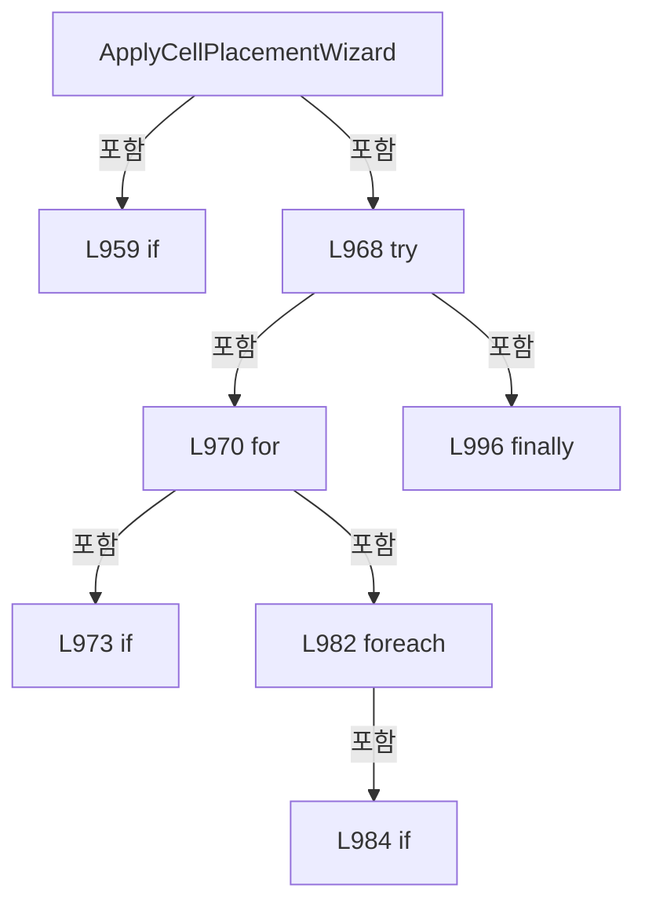

변경 전 점검: 입력/반환 타입, 위 호출자, 예외/취소 경로, 공유 상태와 저장·전송 소비자를 함께 확인합니다. 값의 단위나 물리 방향을 이름만으로 확정하지 않습니다.

### MethodDeclaration `SetManagedValue` · L1005–1012

[Drilling.UI/Menu/Menus/CMenuRecipe.cs:1005–1012](https://github.com/kjuws10-rgb/A3Drilling/blob/5aee8e58439c9b455cae7c9593c9be986c3e682e/Drilling.UI/Menu/Menus/CMenuRecipe.cs#L1005-L1012)

| 항목 | 실제 추출 값 |
| --- | --- |
| 서명 | void Drilling.UI.Menu.Menus.CMenuRecipe.SetManagedValue(string, string) |
| 접근/수식자 | Private / private |
| 반환/값 타입 | void |
| 소속 타입 | NamedType:Drilling.UI.Menu.Menus.CMenuRecipe |

입력 계약:

| 이름 | 타입 | 전달 | 선택/기본값 |
| --- | --- | --- | --- |
| key | string | None | False /  |
| value | string | None | False /  |

정적 호출자로 확인된 위치:

| 호출 파일/행 | 호출 표현식 | 런타임 분기 가능 |
| --- | --- | --- |
| [Drilling.UI/Menu/Menus/CMenuRecipe.cs:990–990](https://github.com/kjuws10-rgb/A3Drilling/blob/5aee8e58439c9b455cae7c9593c9be986c3e682e/Drilling.UI/Menu/Menus/CMenuRecipe.cs#L990-L990) | SetManagedValue | False |
| [Drilling.UI/Menu/Menus/CMenuRecipe.cs:991–991](https://github.com/kjuws10-rgb/A3Drilling/blob/5aee8e58439c9b455cae7c9593c9be986c3e682e/Drilling.UI/Menu/Menus/CMenuRecipe.cs#L991-L991) | SetManagedValue | False |
| [Drilling.UI/Menu/Menus/CMenuRecipe.cs:992–992](https://github.com/kjuws10-rgb/A3Drilling/blob/5aee8e58439c9b455cae7c9593c9be986c3e682e/Drilling.UI/Menu/Menus/CMenuRecipe.cs#L992-L992) | SetManagedValue | False |

호출하는 대상과 해석 범위:

| 원본 행 | 표현식 | 분석 상태 | 대상/소스 위치 |
| --- | --- | --- | --- |
| 1007 | FindManagedItem | resolved | Drilling.UI.Menu.Menus.ST_RECIPE_PARAMETER_EDITOR_ITEM? Drilling.UI.Menu.Menus.CMenuRecipe.FindManagedItem(System.Collections.Generic.IReadOnlyList<Drilling.UI.Menu.Menus.ST_RECIPE_PARAMETER_EDITOR_ITEM>, string) · Drilling.UI/Menu/Menus/CMenuRecipe.cs:1957 |

본문의 실제 연산·분기·예외·반환 순서(원문 위치 순):

| 원본 행 | 종류 | 주석 해설 |
| --- | --- | --- |
| 1007 | call | 함수·델리게이트 또는 객체 생성자를 호출합니다: FindManagedItem(AllManagedItems, key) |
| 1007 | local-declaration | 지역 변수를 선언합니다: var item = FindManagedItem(AllManagedItems, key); |
| 1007 | variable-initializer | 변수의 초기값을 지정합니다: item = FindManagedItem(AllManagedItems, key) |
| 1008 | if | 조건에 따라 분기합니다: if (item is not null) |
| 1010 | assignment | 값을 대상에 대입합니다: item.Value = value |

제어 구문의 포함 구조(실제 실행 순서/CFG가 아닌 구문 탐색 그림):

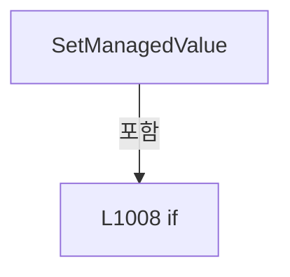

변경 전 점검: 입력/반환 타입, 위 호출자, 예외/취소 경로, 공유 상태와 저장·전송 소비자를 함께 확인합니다. 값의 단위나 물리 방향을 이름만으로 확정하지 않습니다.

### MethodDeclaration `CalculatePlacementWizardGridIndex` · L1014–1024

[Drilling.UI/Menu/Menus/CMenuRecipe.cs:1014–1024](https://github.com/kjuws10-rgb/A3Drilling/blob/5aee8e58439c9b455cae7c9593c9be986c3e682e/Drilling.UI/Menu/Menus/CMenuRecipe.cs#L1014-L1024)

| 항목 | 실제 추출 값 |
| --- | --- |
| 서명 | (int RowIndex, int ColumnIndex) Drilling.UI.Menu.Menus.CMenuRecipe.CalculatePlacementWizardGridIndex(int, int, int, string) |
| 접근/수식자 | Private / private, static |
| 반환/값 타입 | (int RowIndex, int ColumnIndex) |
| 소속 타입 | NamedType:Drilling.UI.Menu.Menus.CMenuRecipe |

입력 계약:

| 이름 | 타입 | 전달 | 선택/기본값 |
| --- | --- | --- | --- |
| zeroBasedIndex | int | None | False /  |
| rowCount | int | None | False /  |
| columnCount | int | None | False /  |
| direction | string | None | False /  |

정적 호출자로 확인된 위치:

| 호출 파일/행 | 호출 표현식 | 런타임 분기 가능 |
| --- | --- | --- |
| [Drilling.UI/Menu/Menus/CMenuRecipe.cs:978–978](https://github.com/kjuws10-rgb/A3Drilling/blob/5aee8e58439c9b455cae7c9593c9be986c3e682e/Drilling.UI/Menu/Menus/CMenuRecipe.cs#L978-L978) | CalculatePlacementWizardGridIndex | False |

호출하는 대상과 해석 범위:

| 원본 행 | 표현식 | 분석 상태 | 대상/소스 위치 |
| --- | --- | --- | --- |
| 1016 | Math.Max | resolved | int System.Math.Max(int, int) |
| 1017 | Math.Max | resolved | int System.Math.Max(int, int) |
| 1018 | direction.Equals | resolved | bool string.Equals(string?, System.StringComparison) |

본문의 실제 연산·분기·예외·반환 순서(원문 위치 순):

| 원본 행 | 종류 | 주석 해설 |
| --- | --- | --- |
| 1016 | assignment | 값을 대상에 대입합니다: rowCount = Math.Max(1, rowCount) |
| 1016 | call | 함수·델리게이트 또는 객체 생성자를 호출합니다: Math.Max(1, rowCount) |
| 1017 | assignment | 값을 대상에 대입합니다: columnCount = Math.Max(1, columnCount) |
| 1017 | call | 함수·델리게이트 또는 객체 생성자를 호출합니다: Math.Max(1, columnCount) |
| 1018 | call | 함수·델리게이트 또는 객체 생성자를 호출합니다: direction.Equals(ST_CELL_PLACEMENT_WIZARD_DIRECTION.VerticalFirst, StringComparison.OrdinalIgnoreCase) |
| 1018 | if | 조건에 따라 분기합니다: if (direction.Equals(ST_CELL_PLACEMENT_WIZARD_DIRECTION.VerticalFirst, StringComparison.OrdinalIgnoreCase)) |
| 1020 | return | 호출자에게 값 또는 제어를 반환합니다: return (zeroBasedIndex % rowCount, zeroBasedIndex / rowCount); |
| 1023 | return | 호출자에게 값 또는 제어를 반환합니다: return (zeroBasedIndex / columnCount, zeroBasedIndex % columnCount); |

제어 구문의 포함 구조(실제 실행 순서/CFG가 아닌 구문 탐색 그림):

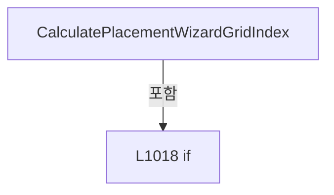

변경 전 점검: 입력/반환 타입, 위 호출자, 예외/취소 경로, 공유 상태와 저장·전송 소비자를 함께 확인합니다. 값의 단위나 물리 방향을 이름만으로 확정하지 않습니다.

### MethodDeclaration `FormatWizardDouble` · L1026–1029

[Drilling.UI/Menu/Menus/CMenuRecipe.cs:1026–1029](https://github.com/kjuws10-rgb/A3Drilling/blob/5aee8e58439c9b455cae7c9593c9be986c3e682e/Drilling.UI/Menu/Menus/CMenuRecipe.cs#L1026-L1029)

| 항목 | 실제 추출 값 |
| --- | --- |
| 서명 | string Drilling.UI.Menu.Menus.CMenuRecipe.FormatWizardDouble(double) |
| 접근/수식자 | Private / private, static |
| 반환/값 타입 | string |
| 소속 타입 | NamedType:Drilling.UI.Menu.Menus.CMenuRecipe |

입력 계약:

| 이름 | 타입 | 전달 | 선택/기본값 |
| --- | --- | --- | --- |
| value | double | None | False /  |

정적 호출자로 확인된 위치:

| 호출 파일/행 | 호출 표현식 | 런타임 분기 가능 |
| --- | --- | --- |
| [Drilling.UI/Menu/Menus/CMenuRecipe.cs:990–990](https://github.com/kjuws10-rgb/A3Drilling/blob/5aee8e58439c9b455cae7c9593c9be986c3e682e/Drilling.UI/Menu/Menus/CMenuRecipe.cs#L990-L990) | FormatWizardDouble | False |
| [Drilling.UI/Menu/Menus/CMenuRecipe.cs:991–991](https://github.com/kjuws10-rgb/A3Drilling/blob/5aee8e58439c9b455cae7c9593c9be986c3e682e/Drilling.UI/Menu/Menus/CMenuRecipe.cs#L991-L991) | FormatWizardDouble | False |

호출하는 대상과 해석 범위:

| 원본 행 | 표현식 | 분석 상태 | 대상/소스 위치 |
| --- | --- | --- | --- |
| 1028 | value.ToString | resolved | string double.ToString(string?, System.IFormatProvider?) |

본문의 실제 연산·분기·예외·반환 순서(원문 위치 순):

| 원본 행 | 종류 | 주석 해설 |
| --- | --- | --- |
| 1028 | call | 함수·델리게이트 또는 객체 생성자를 호출합니다: value.ToString("0.######", CultureInfo.InvariantCulture) |
| 1028 | return | 호출자에게 값 또는 제어를 반환합니다: return value.ToString("0.######", CultureInfo.InvariantCulture); |

변경 전 점검: 입력/반환 타입, 위 호출자, 예외/취소 경로, 공유 상태와 저장·전송 소비자를 함께 확인합니다. 값의 단위나 물리 방향을 이름만으로 확정하지 않습니다.

### MethodDeclaration `Save` · L1031–1068

[Drilling.UI/Menu/Menus/CMenuRecipe.cs:1031–1068](https://github.com/kjuws10-rgb/A3Drilling/blob/5aee8e58439c9b455cae7c9593c9be986c3e682e/Drilling.UI/Menu/Menus/CMenuRecipe.cs#L1031-L1068)

| 항목 | 실제 추출 값 |
| --- | --- |
| 서명 | System.Threading.Tasks.Task Drilling.UI.Menu.Menus.CMenuRecipe.Save(System.Func<string, string, bool>?, System.Action<string, string>?, System.Action<string, string>?) |
| 접근/수식자 | Private / private, async |
| 반환/값 타입 | System.Threading.Tasks.Task |
| 소속 타입 | NamedType:Drilling.UI.Menu.Menus.CMenuRecipe |

입력 계약:

| 이름 | 타입 | 전달 | 선택/기본값 |
| --- | --- | --- | --- |
| confirm | System.Func<string, string, bool>? | None | True / null |
| warn | System.Action<string, string>? | None | True / null |
| completed | System.Action<string, string>? | None | True / null |

정적 호출자로 확인된 위치:

| 호출 파일/행 | 호출 표현식 | 런타임 분기 가능 |
| --- | --- | --- |
| [Drilling.UI/Menu/Menus/CMenuRecipe.cs:204–204](https://github.com/kjuws10-rgb/A3Drilling/blob/5aee8e58439c9b455cae7c9593c9be986c3e682e/Drilling.UI/Menu/Menus/CMenuRecipe.cs#L204-L204) | Save | False |

호출하는 대상과 해석 범위:

| 원본 행 | 표현식 | 분석 상태 | 대상/소스 위치 |
| --- | --- | --- | --- |
| 1033 | CRecipeConfirmDialog.ShowConfirmation | resolved | bool Drilling.UI.Popup.CRecipeConfirmDialog.ShowConfirmation(string, string, string, bool) · Drilling.UI/Popup/CRecipeConfirmDialog.xaml.cs:11 |
| 1034 | CRecipeConfirmDialog.ShowWarning | resolved | void Drilling.UI.Popup.CRecipeConfirmDialog.ShowWarning(string, string, Window?) · Drilling.UI/Popup/CRecipeConfirmDialog.xaml.cs:86 |
| 1035 | CRecipeConfirmDialog.ShowCompletion | resolved | void Drilling.UI.Popup.CRecipeConfirmDialog.ShowCompletion(string, string, Window?) · Drilling.UI/Popup/CRecipeConfirmDialog.xaml.cs:81 |
| 1036 | Path.GetFileNameWithoutExtension | resolved | string? System.IO.Path.GetFileNameWithoutExtension(string?) |
| 1037 | string.IsNullOrWhiteSpace | resolved | bool string.IsNullOrWhiteSpace(string?) |
| 1039 | _setStatusMessage | resolved · 동적 구현 선택 가능 | void System.Action<string>.Invoke(string) |
| 1043 | CanEditViewRecipe | resolved | bool Drilling.UI.Menu.Menus.CMenuRecipe.CanEditViewRecipe() · Drilling.UI/Menu/Menus/CMenuRecipe.cs:1652 |
| 1045 | _setStatusMessage | resolved · 동적 구현 선택 가능 | void System.Action<string>.Invoke(string) |
| 1049 | BuildRecipeParameters | resolved | System.Collections.Generic.IReadOnlyList<Drilling.Common.Managers.ST_RECIPE_PARAMETER> Drilling.UI.Menu.Menus.CMenuRecipe.BuildRecipeParameters(string) · Drilling.UI/Menu/Menus/CMenuRecipe.cs:3059 |
| 1050 | ValidateRecipeWithZeroDefence | resolved | string Drilling.UI.Menu.Menus.CMenuRecipe.ValidateRecipeWithZeroDefence(System.Collections.Generic.IReadOnlyList<Drilling.Common.Managers.ST_RECIPE_PARAMETER>) · Drilling.UI/Menu/Menus/CMenuRecipe.cs:3079 |
| 1051 | string.IsNullOrWhiteSpace | resolved | bool string.IsNullOrWhiteSpace(string?) |
| 1053 | _setStatusMessage | resolved · 동적 구현 선택 가능 | void System.Action<string>.Invoke(string) |
| 1054 | warn | resolved · 동적 구현 선택 가능 | void System.Action<string, string>.Invoke(string, string) |
| 1058 | confirm | resolved · 동적 구현 선택 가능 | bool System.Func<string, string, bool>.Invoke(string, string) |
| 1060 | GetEditedRecipeName | resolved | string Drilling.UI.Menu.Menus.CMenuRecipe.GetEditedRecipeName(System.Collections.Generic.IReadOnlyList<Drilling.Common.Managers.ST_RECIPE_PARAMETER>, string) · Drilling.UI/Menu/Menus/CMenuRecipe.cs:3327 |
| 1061 | _recipeManager.SaveRecipe | resolved | System.Threading.Tasks.Task Drilling.Common.Managers.CRecipeManager.SaveRecipe(Drilling.Common.Managers.ST_RECIPE_DEFINITION, System.Threading.CancellationToken) · Drilling.Common/Managers/CRecipeManager.cs:73 |
| 1061 | new ST_RECIPE_DEFINITION | resolved | Drilling.Common.Managers.ST_RECIPE_DEFINITION.ST_RECIPE_DEFINITION(string, string, System.Collections.Generic.IReadOnlyList<Drilling.Common.Managers.ST_RECIPE_PARAMETER>, System.Collections.Generic.IReadOnlyList<Drilling.Common.Managers.ST_RECIPE_HISTORY>) · Drilling.Common/Managers/CRecipeManager.cs:385 |
| 1062 | NotifyCommands | resolved | void Drilling.UI.Menu.Menus.CMenuRecipe.NotifyCommands() · Drilling.UI/Menu/Menus/CMenuRecipe.cs:1289 |
| 1063 | _setStatusMessage | resolved · 동적 구현 선택 가능 | void System.Action<string>.Invoke(string) |
| 1064 | _showLoadingScreen | resolved · 동적 구현 선택 가능 | void System.Action<Drilling.UI.Menu.Menus.EN_MENU, string>.Invoke(Drilling.UI.Menu.Menus.EN_MENU, string) |
| 1065 | _refreshShellStatus | resolved · 동적 구현 선택 가능 | void System.Action.Invoke() |
| 1066 | _refreshCurrentScreen | resolved · 동적 구현 선택 가능 | System.Threading.Tasks.Task System.Func<System.Threading.Tasks.Task>.Invoke() |
| 1067 | completed | resolved · 동적 구현 선택 가능 | void System.Action<string, string>.Invoke(string, string) |

본문의 실제 연산·분기·예외·반환 순서(원문 위치 순):

| 원본 행 | 종류 | 주석 해설 |
| --- | --- | --- |
| 1033 | assignment | 값을 대상에 대입합니다: confirm ??= (title, message) => CRecipeConfirmDialog.ShowConfirmation(title, message) |
| 1033 | call | 함수·델리게이트 또는 객체 생성자를 호출합니다: CRecipeConfirmDialog.ShowConfirmation(title, message) |
| 1034 | assignment | 값을 대상에 대입합니다: warn ??= (title, message) => CRecipeConfirmDialog.ShowWarning(title, message) |
| 1034 | call | 함수·델리게이트 또는 객체 생성자를 호출합니다: CRecipeConfirmDialog.ShowWarning(title, message) |
| 1035 | assignment | 값을 대상에 대입합니다: completed ??= (title, message) => CRecipeConfirmDialog.ShowCompletion(title, message) |
| 1035 | call | 함수·델리게이트 또는 객체 생성자를 호출합니다: CRecipeConfirmDialog.ShowCompletion(title, message) |
| 1036 | call | 함수·델리게이트 또는 객체 생성자를 호출합니다: Path.GetFileNameWithoutExtension(SelectedRecipeFile) |
| 1036 | local-declaration | 지역 변수를 선언합니다: var recipeId = Path.GetFileNameWithoutExtension(SelectedRecipeFile); |
| 1036 | variable-initializer | 변수의 초기값을 지정합니다: recipeId = Path.GetFileNameWithoutExtension(SelectedRecipeFile) |
| 1037 | call | 함수·델리게이트 또는 객체 생성자를 호출합니다: string.IsNullOrWhiteSpace(recipeId) |
| 1037 | if | 조건에 따라 분기합니다: if (string.IsNullOrWhiteSpace(recipeId)) |
| 1039 | call | 함수·델리게이트 또는 객체 생성자를 호출합니다: _setStatusMessage("Recipe save skipped. No recipe is selected.") |
| 1040 | return | 호출자에게 값 또는 제어를 반환합니다: return; |
| 1043 | call | 함수·델리게이트 또는 객체 생성자를 호출합니다: CanEditViewRecipe() |
| 1043 | if | 조건에 따라 분기합니다: if (!CanEditViewRecipe()) |
| 1045 | call | 함수·델리게이트 또는 객체 생성자를 호출합니다: _setStatusMessage("선택된 레시피만 수정 가능합니다.") |
| 1046 | return | 호출자에게 값 또는 제어를 반환합니다: return; |
| 1049 | call | 함수·델리게이트 또는 객체 생성자를 호출합니다: BuildRecipeParameters(recipeId) |
| 1049 | local-declaration | 지역 변수를 선언합니다: var recipeParameters = BuildRecipeParameters(recipeId); |
| 1049 | variable-initializer | 변수의 초기값을 지정합니다: recipeParameters = BuildRecipeParameters(recipeId) |
| 1050 | call | 함수·델리게이트 또는 객체 생성자를 호출합니다: ValidateRecipeWithZeroDefence(recipeParameters) |
| 1050 | local-declaration | 지역 변수를 선언합니다: var validationMessage = ValidateRecipeWithZeroDefence(recipeParameters); |
| 1050 | variable-initializer | 변수의 초기값을 지정합니다: validationMessage = ValidateRecipeWithZeroDefence(recipeParameters) |
| 1051 | call | 함수·델리게이트 또는 객체 생성자를 호출합니다: string.IsNullOrWhiteSpace(validationMessage) |
| 1051 | if | 조건에 따라 분기합니다: if (!string.IsNullOrWhiteSpace(validationMessage)) |
| 1053 | call | 함수·델리게이트 또는 객체 생성자를 호출합니다: _setStatusMessage(validationMessage) |
| 1054 | call | 함수·델리게이트 또는 객체 생성자를 호출합니다: warn("레시피 저장 확인", validationMessage) |
| 1055 | return | 호출자에게 값 또는 제어를 반환합니다: return; |
| 1058 | call | 함수·델리게이트 또는 객체 생성자를 호출합니다: confirm("레시피 저장", $"{recipeId}.csv 레시피를 저장하시겠습니까?") |
| 1058 | if | 조건에 따라 분기합니다: if (!confirm("레시피 저장", $"{recipeId}.csv 레시피를 저장하시겠습니까?")) |
| 1059 | return | 호출자에게 값 또는 제어를 반환합니다: return; |
| 1060 | call | 함수·델리게이트 또는 객체 생성자를 호출합니다: GetEditedRecipeName(recipeParameters, recipeId) |
| 1060 | local-declaration | 지역 변수를 선언합니다: var recipeName = GetEditedRecipeName(recipeParameters, recipeId); |
| 1060 | variable-initializer | 변수의 초기값을 지정합니다: recipeName = GetEditedRecipeName(recipeParameters, recipeId) |
| 1061 | await | 비동기 완료를 기다립니다: await _recipeManager.SaveRecipe(new ST_RECIPE_DEFINITION(recipeId, recipeName, recipeParameters, [])) |
| 1061 | call | 함수·델리게이트 또는 객체 생성자를 호출합니다: _recipeManager.SaveRecipe(new ST_RECIPE_DEFINITION(recipeId, recipeName, recipeParameters, [])) |
| 1061 | call | 함수·델리게이트 또는 객체 생성자를 호출합니다: new ST_RECIPE_DEFINITION(recipeId, recipeName, recipeParameters, []) |
| 1062 | call | 함수·델리게이트 또는 객체 생성자를 호출합니다: NotifyCommands() |
| 1063 | call | 함수·델리게이트 또는 객체 생성자를 호출합니다: _setStatusMessage($"Recipe {recipeId}.csv saved and CSV verified.") |
| 1064 | call | 함수·델리게이트 또는 객체 생성자를 호출합니다: _showLoadingScreen(EN_MENU.Recipe, "RECIPE") |
| 1065 | call | 함수·델리게이트 또는 객체 생성자를 호출합니다: _refreshShellStatus() |
| 1066 | await | 비동기 완료를 기다립니다: await _refreshCurrentScreen() |
| 1066 | call | 함수·델리게이트 또는 객체 생성자를 호출합니다: _refreshCurrentScreen() |
| 1067 | call | 함수·델리게이트 또는 객체 생성자를 호출합니다: completed("레시피 저장 완료", $"{recipeId}.csv 레시피를 저장하였습니다.") |

제어 구문의 포함 구조(실제 실행 순서/CFG가 아닌 구문 탐색 그림):

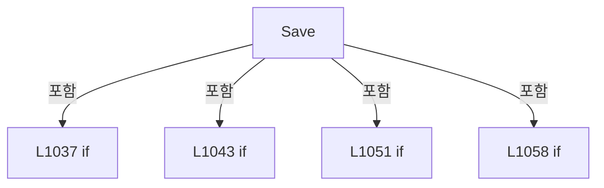

변경 전 점검: 입력/반환 타입, 위 호출자, 예외/취소 경로, 공유 상태와 저장·전송 소비자를 함께 확인합니다. 값의 단위나 물리 방향을 이름만으로 확정하지 않습니다.

### MethodDeclaration `Modify` · L1070–1168

[Drilling.UI/Menu/Menus/CMenuRecipe.cs:1070–1168](https://github.com/kjuws10-rgb/A3Drilling/blob/5aee8e58439c9b455cae7c9593c9be986c3e682e/Drilling.UI/Menu/Menus/CMenuRecipe.cs#L1070-L1168)

| 항목 | 실제 추출 값 |
| --- | --- |
| 서명 | System.Threading.Tasks.Task Drilling.UI.Menu.Menus.CMenuRecipe.Modify(System.Func<string, string, string, System.Func<string, string>, string?>?, System.Func<string, string, bool?>?, System.Action<string, string>?) |
| 접근/수식자 | Private / private, async |
| 반환/값 타입 | System.Threading.Tasks.Task |
| 소속 타입 | NamedType:Drilling.UI.Menu.Menus.CMenuRecipe |

입력 계약:

| 이름 | 타입 | 전달 | 선택/기본값 |
| --- | --- | --- | --- |
| requestName | System.Func<string, string, string, System.Func<string, string>, string?>? | None | True / null |
| confirmFolder | System.Func<string, string, bool?>? | None | True / null |
| warn | System.Action<string, string>? | None | True / null |

정적 호출자로 확인된 위치:

| 호출 파일/행 | 호출 표현식 | 런타임 분기 가능 |
| --- | --- | --- |
| [Drilling.UI/Menu/Menus/CMenuRecipe.cs:198–198](https://github.com/kjuws10-rgb/A3Drilling/blob/5aee8e58439c9b455cae7c9593c9be986c3e682e/Drilling.UI/Menu/Menus/CMenuRecipe.cs#L198-L198) | Modify | False |

호출하는 대상과 해석 범위:

| 원본 행 | 표현식 | 분석 상태 | 대상/소스 위치 |
| --- | --- | --- | --- |
| 1076 | ShowRecipeNameDialog | resolved | string? Drilling.UI.Menu.Menus.CMenuRecipe.ShowRecipeNameDialog(string, string, string, System.Func<string, string>?) · Drilling.UI/Menu/Menus/CMenuRecipe.cs:3100 |
| 1078 | CRecipeConfirmDialog.ShowWarning | resolved | void Drilling.UI.Popup.CRecipeConfirmDialog.ShowWarning(string, string, Window?) · Drilling.UI/Popup/CRecipeConfirmDialog.xaml.cs:86 |
| 1079 | GetRecipeIdFromParameter | resolved | string Drilling.UI.Menu.Menus.CMenuRecipe.GetRecipeIdFromParameter(object?) · Drilling.UI/Menu/Menus/CMenuRecipe.cs:3025 |
| 1080 | string.IsNullOrWhiteSpace | resolved | bool string.IsNullOrWhiteSpace(string?) |
| 1082 | _setStatusMessage | resolved · 동적 구현 선택 가능 | void System.Action<string>.Invoke(string) |
| 1086 | CanEditViewRecipe | resolved | bool Drilling.UI.Menu.Menus.CMenuRecipe.CanEditViewRecipe() · Drilling.UI/Menu/Menus/CMenuRecipe.cs:1652 |
| 1088 | _setStatusMessage | resolved · 동적 구현 선택 가능 | void System.Action<string>.Invoke(string) |
| 1092 | _recipeManager.LoadRecipes | resolved | System.Threading.Tasks.Task<System.Collections.Generic.IReadOnlyList<Drilling.Common.Managers.ST_RECIPE_DEFINITION>> Drilling.Common.Managers.CRecipeManager.LoadRecipes(System.Threading.CancellationToken) · Drilling.Common/Managers/CRecipeManager.cs:40 |
| 1098 | requestName | resolved · 동적 구현 선택 가능 | string? System.Func<string, string, string, System.Func<string, string>, string?>.Invoke(string, string, string, System.Func<string, string>) |
| 1101 | _setStatusMessage | resolved · 동적 구현 선택 가능 | void System.Action<string>.Invoke(string) |
| 1105 | newRecipeId.Equals | resolved | bool string.Equals(string?, System.StringComparison) |
| 1107 | _setStatusMessage | resolved · 동적 구현 선택 가능 | void System.Action<string>.Invoke(string) |
| 1111 | ValidateRecipeId | resolved | string Drilling.UI.Menu.Menus.CMenuRecipe.ValidateRecipeId(string, System.Collections.Generic.IReadOnlyList<Drilling.Common.Managers.ST_RECIPE_DEFINITION>, string) · Drilling.UI/Menu/Menus/CMenuRecipe.cs:3134 |
| 1112 | string.IsNullOrWhiteSpace | resolved | bool string.IsNullOrWhiteSpace(string?) |
| 1114 | _setStatusMessage | resolved · 동적 구현 선택 가능 | void System.Action<string>.Invoke(string) |
| 1118 | BuildRecipeParameters | resolved | System.Collections.Generic.IReadOnlyList<Drilling.Common.Managers.ST_RECIPE_PARAMETER> Drilling.UI.Menu.Menus.CMenuRecipe.BuildRecipeParameters(string) · Drilling.UI/Menu/Menus/CMenuRecipe.cs:3059 |
| 1119 | ValidateRecipeWithZeroDefence | resolved | string Drilling.UI.Menu.Menus.CMenuRecipe.ValidateRecipeWithZeroDefence(System.Collections.Generic.IReadOnlyList<Drilling.Common.Managers.ST_RECIPE_PARAMETER>) · Drilling.UI/Menu/Menus/CMenuRecipe.cs:3079 |
| 1120 | string.IsNullOrWhiteSpace | resolved | bool string.IsNullOrWhiteSpace(string?) |
| 1122 | _setStatusMessage | resolved · 동적 구현 선택 가능 | void System.Action<string>.Invoke(string) |
| 1133 | _recipeManager.ListCompanionFolders | resolved | System.Threading.Tasks.Task<System.Collections.Generic.IReadOnlyList<Drilling.Common.Managers.ST_RECIPE_COMPANION_FOLDER>> Drilling.Common.Managers.CRecipeManager.ListCompanionFolders(string, string, System.Threading.CancellationToken) · Drilling.Common/Managers/CRecipeManager.cs:127 |
| 1134 | new List<string> | resolved | System.Collections.Generic.List<string>.List() |
| 1137 | confirmFolder | resolved · 동적 구현 선택 가능 | bool? System.Func<string, string, bool?>.Invoke(string, string) |
| 1140 | _setStatusMessage | resolved · 동적 구현 선택 가능 | void System.Action<string>.Invoke(string) |
| 1145 | selectedFolders.Add | resolved | void System.Collections.Generic.List<string>.Add(string) |
| 1148 | AllManagedItems.Any | resolved | bool System.Collections.Generic.IEnumerable<Drilling.UI.Menu.Menus.ST_RECIPE_PARAMETER_EDITOR_ITEM>.Any<Drilling.UI.Menu.Menus.ST_RECIPE_PARAMETER_EDITOR_ITEM>(System.Func<Drilling.UI.Menu.Menus.ST_RECIPE_PARAMETER_EDITOR_ITEM, bool>) |
| 1149 | _recipeManager.SaveRecipe | resolved | System.Threading.Tasks.Task Drilling.Common.Managers.CRecipeManager.SaveRecipe(Drilling.Common.Managers.ST_RECIPE_DEFINITION, System.Threading.CancellationToken) · Drilling.Common/Managers/CRecipeManager.cs:73 |
| 1149 | new ST_RECIPE_DEFINITION | resolved | Drilling.Common.Managers.ST_RECIPE_DEFINITION.ST_RECIPE_DEFINITION(string, string, System.Collections.Generic.IReadOnlyList<Drilling.Common.Managers.ST_RECIPE_PARAMETER>, System.Collections.Generic.IReadOnlyList<Drilling.Common.Managers.ST_RECIPE_HISTORY>) · Drilling.Common/Managers/CRecipeManager.cs:385 |
| 1150 | _recipeManager.RenameRecipe | resolved | System.Threading.Tasks.Task Drilling.Common.Managers.CRecipeManager.RenameRecipe(string, string, System.Collections.Generic.IReadOnlyCollection<string>, System.Threading.CancellationToken) · Drilling.Common/Managers/CRecipeManager.cs:171 |
| 1154 | _setStatusMessage | resolved · 동적 구현 선택 가능 | void System.Action<string>.Invoke(string) |
| 1155 | warn | resolved · 동적 구현 선택 가능 | void System.Action<string, string>.Invoke(string, string) |
| 1159 | _selectRecipeIdSetter | resolved · 동적 구현 선택 가능 | void System.Action<string>.Invoke(string) |
| 1160 | _viewRecipeIdSetter | resolved · 동적 구현 선택 가능 | void System.Action<string>.Invoke(string) |
| 1161 | _settingManager.SetValue | resolved | void Drilling.Common.Managers.CSettingManager.SetValue(Drilling.Common.Managers.EN_SETTING_TAB, string, string, System.Threading.CancellationToken) · Drilling.Common/Managers/CSettingManager.cs:72 |
| 1162 | _selectedCategorySetter | resolved · 동적 구현 선택 가능 | void System.Action<string>.Invoke(string) |
| 1164 | NotifyCommands | resolved | void Drilling.UI.Menu.Menus.CMenuRecipe.NotifyCommands() · Drilling.UI/Menu/Menus/CMenuRecipe.cs:1289 |
| 1165 | _setStatusMessage | resolved · 동적 구현 선택 가능 | void System.Action<string>.Invoke(string) |
| 1166 | _refreshShellStatus | resolved · 동적 구현 선택 가능 | void System.Action.Invoke() |
| 1167 | _refreshCurrentScreen | resolved · 동적 구현 선택 가능 | System.Threading.Tasks.Task System.Func<System.Threading.Tasks.Task>.Invoke() |

본문의 실제 연산·분기·예외·반환 순서(원문 위치 순):

| 원본 행 | 종류 | 주석 해설 |
| --- | --- | --- |
| 1076 | assignment | 값을 대상에 대입합니다: requestName ??= (title, message, initial, validate) => ShowRecipeNameDialog(title, message, initial, validate) |
| 1076 | call | 함수·델리게이트 또는 객체 생성자를 호출합니다: ShowRecipeNameDialog(title, message, initial, validate) |
| 1077 | assignment | 값을 대상에 대입합니다: confirmFolder ??= CRecipeConfirmDialog.ShowRecipeFolderRename |
| 1078 | assignment | 값을 대상에 대입합니다: warn ??= (title, message) => CRecipeConfirmDialog.ShowWarning(title, message) |
| 1078 | call | 함수·델리게이트 또는 객체 생성자를 호출합니다: CRecipeConfirmDialog.ShowWarning(title, message) |
| 1079 | call | 함수·델리게이트 또는 객체 생성자를 호출합니다: GetRecipeIdFromParameter(SelectedRecipeFile) |
| 1079 | local-declaration | 지역 변수를 선언합니다: var oldRecipeId = GetRecipeIdFromParameter(SelectedRecipeFile); |
| 1079 | variable-initializer | 변수의 초기값을 지정합니다: oldRecipeId = GetRecipeIdFromParameter(SelectedRecipeFile) |
| 1080 | call | 함수·델리게이트 또는 객체 생성자를 호출합니다: string.IsNullOrWhiteSpace(oldRecipeId) |
| 1080 | if | 조건에 따라 분기합니다: if (string.IsNullOrWhiteSpace(oldRecipeId)) |
| 1082 | call | 함수·델리게이트 또는 객체 생성자를 호출합니다: _setStatusMessage("Recipe rename skipped. No recipe is selected.") |
| 1083 | return | 호출자에게 값 또는 제어를 반환합니다: return; |
| 1086 | call | 함수·델리게이트 또는 객체 생성자를 호출합니다: CanEditViewRecipe() |
| 1086 | if | 조건에 따라 분기합니다: if (!CanEditViewRecipe()) |
| 1088 | call | 함수·델리게이트 또는 객체 생성자를 호출합니다: _setStatusMessage("선택된 레시피만 수정 가능합니다.") |
| 1089 | return | 호출자에게 값 또는 제어를 반환합니다: return; |
| 1092 | await | 비동기 완료를 기다립니다: await _recipeManager.LoadRecipes() |
| 1092 | call | 함수·델리게이트 또는 객체 생성자를 호출합니다: _recipeManager.LoadRecipes() |
| 1092 | local-declaration | 지역 변수를 선언합니다: var recipes = await _recipeManager.LoadRecipes(); |
| 1092 | variable-initializer | 변수의 초기값을 지정합니다: recipes = await _recipeManager.LoadRecipes() |
| 1098 | call | 함수·델리게이트 또는 객체 생성자를 호출합니다: requestName("레시피 이름 변경", "변경할 레시피 이름을 입력하세요.", oldRecipeId, SelectValue) |
| 1098 | local-declaration | 지역 변수를 선언합니다: var newRecipeId = requestName("레시피 이름 변경", "변경할 레시피 이름을 입력하세요.", oldRecipeId, SelectValue); |
| 1098 | variable-initializer | 변수의 초기값을 지정합니다: newRecipeId = requestName("레시피 이름 변경", "변경할 레시피 이름을 입력하세요.", oldRecipeId, SelectValue) |
| 1099 | if | 조건에 따라 분기합니다: if (newRecipeId is null) |
| 1101 | call | 함수·델리게이트 또는 객체 생성자를 호출합니다: _setStatusMessage("Recipe rename canceled.") |
| 1102 | return | 호출자에게 값 또는 제어를 반환합니다: return; |
| 1105 | call | 함수·델리게이트 또는 객체 생성자를 호출합니다: newRecipeId.Equals(oldRecipeId, StringComparison.OrdinalIgnoreCase) |
| 1105 | if | 조건에 따라 분기합니다: if (newRecipeId.Equals(oldRecipeId, StringComparison.OrdinalIgnoreCase)) |
| 1107 | call | 함수·델리게이트 또는 객체 생성자를 호출합니다: _setStatusMessage("Recipe rename skipped. Name was not changed.") |
| 1108 | return | 호출자에게 값 또는 제어를 반환합니다: return; |
| 1111 | call | 함수·델리게이트 또는 객체 생성자를 호출합니다: ValidateRecipeId(newRecipeId, recipes, oldRecipeId) |
| 1111 | local-declaration | 지역 변수를 선언합니다: var validationMessage = ValidateRecipeId(newRecipeId, recipes, oldRecipeId); |
| 1111 | variable-initializer | 변수의 초기값을 지정합니다: validationMessage = ValidateRecipeId(newRecipeId, recipes, oldRecipeId) |
| 1112 | call | 함수·델리게이트 또는 객체 생성자를 호출합니다: string.IsNullOrWhiteSpace(validationMessage) |
| 1112 | if | 조건에 따라 분기합니다: if (!string.IsNullOrWhiteSpace(validationMessage)) |
| 1114 | call | 함수·델리게이트 또는 객체 생성자를 호출합니다: _setStatusMessage(validationMessage) |
| 1115 | return | 호출자에게 값 또는 제어를 반환합니다: return; |
| 1118 | call | 함수·델리게이트 또는 객체 생성자를 호출합니다: BuildRecipeParameters(oldRecipeId) |
| 1118 | local-declaration | 지역 변수를 선언합니다: var recipeParameters = BuildRecipeParameters(oldRecipeId); |
| 1118 | variable-initializer | 변수의 초기값을 지정합니다: recipeParameters = BuildRecipeParameters(oldRecipeId) |
| 1119 | assignment | 값을 대상에 대입합니다: validationMessage = ValidateRecipeWithZeroDefence(recipeParameters) |
| 1119 | call | 함수·델리게이트 또는 객체 생성자를 호출합니다: ValidateRecipeWithZeroDefence(recipeParameters) |
| 1120 | call | 함수·델리게이트 또는 객체 생성자를 호출합니다: string.IsNullOrWhiteSpace(validationMessage) |
| 1120 | if | 조건에 따라 분기합니다: if (!string.IsNullOrWhiteSpace(validationMessage)) |
| 1122 | call | 함수·델리게이트 또는 객체 생성자를 호출합니다: _setStatusMessage(validationMessage) |
| 1123 | return | 호출자에게 값 또는 제어를 반환합니다: return; |
| 1131 | try | 예외 처리 범위입니다: try |
| 1133 | await | 비동기 완료를 기다립니다: await _recipeManager.ListCompanionFolders(oldRecipeId, newRecipeId) |
| 1133 | call | 함수·델리게이트 또는 객체 생성자를 호출합니다: _recipeManager.ListCompanionFolders(oldRecipeId, newRecipeId) |
| 1133 | local-declaration | 지역 변수를 선언합니다: var folders = await _recipeManager.ListCompanionFolders(oldRecipeId, newRecipeId); |
| 1133 | variable-initializer | 변수의 초기값을 지정합니다: folders = await _recipeManager.ListCompanionFolders(oldRecipeId, newRecipeId) |
| 1134 | call | 함수·델리게이트 또는 객체 생성자를 호출합니다: new List<string>() |
| 1134 | local-declaration | 지역 변수를 선언합니다: var selectedFolders = new List<string>(); |
| 1134 | variable-initializer | 변수의 초기값을 지정합니다: selectedFolders = new List<string>() |
| 1135 | foreach | 컬렉션 요소를 순회합니다: foreach (var folder in folders) |
| 1137 | call | 함수·델리게이트 또는 객체 생성자를 호출합니다: confirmFolder("레시피 부가 폴더 이름 변경", $"{oldRecipeId} 레시피에 연결된 {folder.SourceName} 폴더도\n{folder.TargetName} 이름으로 함께 변경하시겠습니까?\n\n폴더 유지: 기존 이름으로 남기고 레시피만 변경합니다.\n취소: 레시피와 모든 폴더의 이름 변경을 취소합니다.") |
| 1137 | local-declaration | 지역 변수를 선언합니다: var choice = confirmFolder("레시피 부가 폴더 이름 변경", $"{oldRecipeId} 레시피에 연결된 {folder.SourceName} 폴더도\n{folder.TargetName} 이름으로 함께 변경하시겠습니까?\n\n폴더 유지: 기존 이름으로 남기고 레시피만 변경합니다.\n취소: 레시피와 모든 폴더의 이름 변경을 취소합니다."); |
| 1137 | variable-initializer | 변수의 초기값을 지정합니다: choice = confirmFolder("레시피 부가 폴더 이름 변경", $"{oldRecipeId} 레시피에 연결된 {folder.SourceName} 폴더도\n{folder.TargetName} 이름으로 함께 변경하시겠습니까?\n\n폴더 유지: 기존 이름으로 남기고 레시피만 변경합니다.\n취소: 레시피와 모든 폴더의 이름 변경을 취소합니다.") |
| 1138 | if | 조건에 따라 분기합니다: if (choice is null) |
| 1140 | call | 함수·델리게이트 또는 객체 생성자를 호출합니다: _setStatusMessage("Recipe rename canceled.") |
| 1141 | return | 호출자에게 값 또는 제어를 반환합니다: return; |
| 1144 | if | 조건에 따라 분기합니다: if (choice.Value) |
| 1145 | call | 함수·델리게이트 또는 객체 생성자를 호출합니다: selectedFolders.Add(folder.SourceName) |
| 1148 | call | 함수·델리게이트 또는 객체 생성자를 호출합니다: AllManagedItems.Any(IsIsEdited) |
| 1148 | if | 조건에 따라 분기합니다: if (AllManagedItems.Any(IsIsEdited)) |
| 1149 | await | 비동기 완료를 기다립니다: await _recipeManager.SaveRecipe(new ST_RECIPE_DEFINITION(oldRecipeId, oldRecipeId, recipeParameters, [])) |
| 1149 | call | 함수·델리게이트 또는 객체 생성자를 호출합니다: _recipeManager.SaveRecipe(new ST_RECIPE_DEFINITION(oldRecipeId, oldRecipeId, recipeParameters, [])) |
| 1149 | call | 함수·델리게이트 또는 객체 생성자를 호출합니다: new ST_RECIPE_DEFINITION(oldRecipeId, oldRecipeId, recipeParameters, []) |
| 1150 | await | 비동기 완료를 기다립니다: await _recipeManager.RenameRecipe(oldRecipeId, newRecipeId, selectedFolders) |
| 1150 | call | 함수·델리게이트 또는 객체 생성자를 호출합니다: _recipeManager.RenameRecipe(oldRecipeId, newRecipeId, selectedFolders) |
| 1152 | catch | 지정 예외를 처리합니다: catch (Exception error) |
| 1154 | call | 함수·델리게이트 또는 객체 생성자를 호출합니다: _setStatusMessage("Recipe rename failed: " + error.Message) |
| 1155 | call | 함수·델리게이트 또는 객체 생성자를 호출합니다: warn("레시피 이름 변경 실패", error.Message) |
| 1156 | return | 호출자에게 값 또는 제어를 반환합니다: return; |
| 1159 | call | 함수·델리게이트 또는 객체 생성자를 호출합니다: _selectRecipeIdSetter(newRecipeId) |
| 1160 | call | 함수·델리게이트 또는 객체 생성자를 호출합니다: _viewRecipeIdSetter(newRecipeId) |
| 1161 | call | 함수·델리게이트 또는 객체 생성자를 호출합니다: _settingManager.SetValue(EN_SETTING_TAB.Option, SelectRecipeSettingKey, newRecipeId) |
| 1162 | call | 함수·델리게이트 또는 객체 생성자를 호출합니다: _selectedCategorySetter("ALL") |
| 1163 | assignment | 값을 대상에 대입합니다: _selectedGroup = "ALL" |
| 1164 | call | 함수·델리게이트 또는 객체 생성자를 호출합니다: NotifyCommands() |
| 1165 | call | 함수·델리게이트 또는 객체 생성자를 호출합니다: _setStatusMessage($"Recipe {oldRecipeId}.csv renamed to {newRecipeId}.csv and CSV verified.") |
| 1166 | call | 함수·델리게이트 또는 객체 생성자를 호출합니다: _refreshShellStatus() |
| 1167 | await | 비동기 완료를 기다립니다: await _refreshCurrentScreen() |
| 1167 | call | 함수·델리게이트 또는 객체 생성자를 호출합니다: _refreshCurrentScreen() |

제어 구문의 포함 구조(실제 실행 순서/CFG가 아닌 구문 탐색 그림):

```mermaid
flowchart TD
 M["Modify"]
 N0["L1080 if"]
 M -->|포함| N0
 N1["L1086 if"]
 M -->|포함| N1
 N2["L1099 if"]
 M -->|포함| N2
 N3["L1105 if"]
 M -->|포함| N3
 N4["L1112 if"]
 M -->|포함| N4
 N5["L1120 if"]
 M -->|포함| N5
 N6["L1131 try"]
 M -->|포함| N6
 N7["L1135 foreach"]
 N6 -->|포함| N7
 N8["L1138 if"]
 N7 -->|포함| N8
 N9["L1144 if"]
 N7 -->|포함| N9
 N10["L1148 if"]
 N6 -->|포함| N10
 N11["L1152 catch"]
 N6 -->|포함| N11
```

변경 전 점검: 입력/반환 타입, 위 호출자, 예외/취소 경로, 공유 상태와 저장·전송 소비자를 함께 확인합니다. 값의 단위나 물리 방향을 이름만으로 확정하지 않습니다.

### LocalFunctionStatement `SelectValue` · L1093–1096

[Drilling.UI/Menu/Menus/CMenuRecipe.cs:1093–1096](https://github.com/kjuws10-rgb/A3Drilling/blob/5aee8e58439c9b455cae7c9593c9be986c3e682e/Drilling.UI/Menu/Menus/CMenuRecipe.cs#L1093-L1096)

| 항목 | 실제 추출 값 |
| --- | --- |
| 서명 | string SelectValue(string) |
| 접근/수식자 | Private /  |
| 반환/값 타입 | string |
| 소속 타입 | NamedType:Drilling.UI.Menu.Menus.CMenuRecipe |

입력 계약:

| 이름 | 타입 | 전달 | 선택/기본값 |
| --- | --- | --- | --- |
| value | string | None | False /  |

현재 부분 분석에서 직접 연결된 호출자는 없습니다. XAML/이벤트/인터페이스·델리게이트·외부 진입을 추가 확인해야 하며, 미사용으로 판정한 것이 아닙니다.

호출하는 대상과 해석 범위:

| 원본 행 | 표현식 | 분석 상태 | 대상/소스 위치 |
| --- | --- | --- | --- |
| 1095 | ValidateRecipeId | resolved | string Drilling.UI.Menu.Menus.CMenuRecipe.ValidateRecipeId(string, System.Collections.Generic.IReadOnlyList<Drilling.Common.Managers.ST_RECIPE_DEFINITION>, string) · Drilling.UI/Menu/Menus/CMenuRecipe.cs:3134 |
| 1095 | NormalizeRecipeIdInput | resolved | string Drilling.UI.Menu.Menus.CMenuRecipe.NormalizeRecipeIdInput(string) · Drilling.UI/Menu/Menus/CMenuRecipe.cs:3123 |

본문의 실제 연산·분기·예외·반환 순서(원문 위치 순):

| 원본 행 | 종류 | 주석 해설 |
| --- | --- | --- |
| 1095 | call | 함수·델리게이트 또는 객체 생성자를 호출합니다: ValidateRecipeId(NormalizeRecipeIdInput(value), recipes, oldRecipeId) |
| 1095 | call | 함수·델리게이트 또는 객체 생성자를 호출합니다: NormalizeRecipeIdInput(value) |
| 1095 | return | 호출자에게 값 또는 제어를 반환합니다: return ValidateRecipeId(NormalizeRecipeIdInput(value), recipes, oldRecipeId); |

변경 전 점검: 입력/반환 타입, 위 호출자, 예외/취소 경로, 공유 상태와 저장·전송 소비자를 함께 확인합니다. 값의 단위나 물리 방향을 이름만으로 확정하지 않습니다.

### LocalFunctionStatement `IsIsEdited` · L1126–1129

[Drilling.UI/Menu/Menus/CMenuRecipe.cs:1126–1129](https://github.com/kjuws10-rgb/A3Drilling/blob/5aee8e58439c9b455cae7c9593c9be986c3e682e/Drilling.UI/Menu/Menus/CMenuRecipe.cs#L1126-L1129)

| 항목 | 실제 추출 값 |
| --- | --- |
| 서명 | bool IsIsEdited(Drilling.UI.Menu.Menus.ST_RECIPE_PARAMETER_EDITOR_ITEM) |
| 접근/수식자 | Private /  |
| 반환/값 타입 | bool |
| 소속 타입 | NamedType:Drilling.UI.Menu.Menus.CMenuRecipe |

입력 계약:

| 이름 | 타입 | 전달 | 선택/기본값 |
| --- | --- | --- | --- |
| item | Drilling.UI.Menu.Menus.ST_RECIPE_PARAMETER_EDITOR_ITEM | None | False /  |

현재 부분 분석에서 직접 연결된 호출자는 없습니다. XAML/이벤트/인터페이스·델리게이트·외부 진입을 추가 확인해야 하며, 미사용으로 판정한 것이 아닙니다.

본문의 실제 연산·분기·예외·반환 순서(원문 위치 순):

| 원본 행 | 종류 | 주석 해설 |
| --- | --- | --- |
| 1128 | return | 호출자에게 값 또는 제어를 반환합니다: return item.IsEdited; |

변경 전 점검: 입력/반환 타입, 위 호출자, 예외/취소 경로, 공유 상태와 저장·전송 소비자를 함께 확인합니다. 값의 단위나 물리 방향을 이름만으로 확정하지 않습니다.

### MethodDeclaration `Create` · L1170–1234

[Drilling.UI/Menu/Menus/CMenuRecipe.cs:1170–1234](https://github.com/kjuws10-rgb/A3Drilling/blob/5aee8e58439c9b455cae7c9593c9be986c3e682e/Drilling.UI/Menu/Menus/CMenuRecipe.cs#L1170-L1234)

| 항목 | 실제 추출 값 |
| --- | --- |
| 서명 | System.Threading.Tasks.Task Drilling.UI.Menu.Menus.CMenuRecipe.Create(System.Func<string, string, string, System.Func<string, string>, string?>?, System.Func<string, string, bool>?, System.Action<string, string>?) |
| 접근/수식자 | Private / private, async |
| 반환/값 타입 | System.Threading.Tasks.Task |
| 소속 타입 | NamedType:Drilling.UI.Menu.Menus.CMenuRecipe |

입력 계약:

| 이름 | 타입 | 전달 | 선택/기본값 |
| --- | --- | --- | --- |
| requestName | System.Func<string, string, string, System.Func<string, string>, string?>? | None | True / null |
| confirmFolder | System.Func<string, string, bool>? | None | True / null |
| warn | System.Action<string, string>? | None | True / null |

정적 호출자로 확인된 위치:

| 호출 파일/행 | 호출 표현식 | 런타임 분기 가능 |
| --- | --- | --- |
| [Drilling.UI/Menu/Menus/CMenuRecipe.cs:192–192](https://github.com/kjuws10-rgb/A3Drilling/blob/5aee8e58439c9b455cae7c9593c9be986c3e682e/Drilling.UI/Menu/Menus/CMenuRecipe.cs#L192-L192) | Create | False |

호출하는 대상과 해석 범위:

| 원본 행 | 표현식 | 분석 상태 | 대상/소스 위치 |
| --- | --- | --- | --- |
| 1176 | ShowRecipeNameDialog | resolved | string? Drilling.UI.Menu.Menus.CMenuRecipe.ShowRecipeNameDialog(string, string, string, System.Func<string, string>?) · Drilling.UI/Menu/Menus/CMenuRecipe.cs:3100 |
| 1178 | CRecipeConfirmDialog.ShowWarning | resolved | void Drilling.UI.Popup.CRecipeConfirmDialog.ShowWarning(string, string, Window?) · Drilling.UI/Popup/CRecipeConfirmDialog.xaml.cs:86 |
| 1181 | _setStatusMessage | resolved · 동적 구현 선택 가능 | void System.Action<string>.Invoke(string) |
| 1185 | _recipeManager.LoadRecipes | resolved | System.Threading.Tasks.Task<System.Collections.Generic.IReadOnlyList<Drilling.Common.Managers.ST_RECIPE_DEFINITION>> Drilling.Common.Managers.CRecipeManager.LoadRecipes(System.Threading.CancellationToken) · Drilling.Common/Managers/CRecipeManager.cs:40 |
| 1191 | GetRecipeIdFromParameter | resolved | string Drilling.UI.Menu.Menus.CMenuRecipe.GetRecipeIdFromParameter(object?) · Drilling.UI/Menu/Menus/CMenuRecipe.cs:3025 |
| 1192 | requestName | resolved · 동적 구현 선택 가능 | string? System.Func<string, string, string, System.Func<string, string>, string?>.Invoke(string, string, string, System.Func<string, string>) |
| 1195 | _setStatusMessage | resolved · 동적 구현 선택 가능 | void System.Action<string>.Invoke(string) |
| 1199 | ValidateRecipeId | resolved | string Drilling.UI.Menu.Menus.CMenuRecipe.ValidateRecipeId(string, System.Collections.Generic.IReadOnlyList<Drilling.Common.Managers.ST_RECIPE_DEFINITION>, string) · Drilling.UI/Menu/Menus/CMenuRecipe.cs:3134 |
| 1200 | string.IsNullOrWhiteSpace | resolved | bool string.IsNullOrWhiteSpace(string?) |
| 1202 | _setStatusMessage | resolved · 동적 구현 선택 가능 | void System.Action<string>.Invoke(string) |
| 1206 | BuildRecipeParameters | resolved | System.Collections.Generic.IReadOnlyList<Drilling.Common.Managers.ST_RECIPE_PARAMETER> Drilling.UI.Menu.Menus.CMenuRecipe.BuildRecipeParameters(string) · Drilling.UI/Menu/Menus/CMenuRecipe.cs:3059 |
| 1207 | ValidateRecipeWithZeroDefence | resolved | string Drilling.UI.Menu.Menus.CMenuRecipe.ValidateRecipeWithZeroDefence(System.Collections.Generic.IReadOnlyList<Drilling.Common.Managers.ST_RECIPE_PARAMETER>) · Drilling.UI/Menu/Menus/CMenuRecipe.cs:3079 |
| 1208 | string.IsNullOrWhiteSpace | resolved | bool string.IsNullOrWhiteSpace(string?) |
| 1210 | _setStatusMessage | resolved · 동적 구현 선택 가능 | void System.Action<string>.Invoke(string) |
| 1216 | _recipeManager.ListCompanionFolders | resolved | System.Threading.Tasks.Task<System.Collections.Generic.IReadOnlyList<Drilling.Common.Managers.ST_RECIPE_COMPANION_FOLDER>> Drilling.Common.Managers.CRecipeManager.ListCompanionFolders(string, string, System.Threading.CancellationToken) · Drilling.Common/Managers/CRecipeManager.cs:127 |
| 1217 | companions.Where(folder => confirmFolder("레시피 부가 폴더 복사", $"{sourceRecipeId} 레시피의 {folder.SourceName} 폴더 내용도\n새 레시피 {recipeId}의 {folder.TargetName} 폴더로 복사하시겠습니까?\n\n복사 안 함을 선택하면 해당 폴더 없이 레시피를 생성합니다.")).Select(folder => folder.SourceName).ToArray | resolved | string[] System.Collections.Generic.IEnumerable<string>.ToArray<string>() |
| 1217 | companions.Where(folder => confirmFolder("레시피 부가 폴더 복사", $"{sourceRecipeId} 레시피의 {folder.SourceName} 폴더 내용도\n새 레시피 {recipeId}의 {folder.TargetName} 폴더로 복사하시겠습니까?\n\n복사 안 함을 선택하면 해당 폴더 없이 레시피를 생성합니다.")).Select | resolved | System.Collections.Generic.IEnumerable<string> System.Collections.Generic.IEnumerable<Drilling.Common.Managers.ST_RECIPE_COMPANION_FOLDER>.Select<Drilling.Common.Managers.ST_RECIPE_COMPANION_FOLDER, string>(System.Func<Drilling.Common.Managers.ST_RECIPE_COMPANION_FOLDER, string>) |
| 1217 | companions.Where | resolved | System.Collections.Generic.IEnumerable<Drilling.Common.Managers.ST_RECIPE_COMPANION_FOLDER> System.Collections.Generic.IEnumerable<Drilling.Common.Managers.ST_RECIPE_COMPANION_FOLDER>.Where<Drilling.Common.Managers.ST_RECIPE_COMPANION_FOLDER>(System.Func<Drilling.Common.Managers.ST_RECIPE_COMPANION_FOLDER, bool>) |
| 1217 | confirmFolder | resolved · 동적 구현 선택 가능 | bool System.Func<string, string, bool>.Invoke(string, string) |
| 1218 | _recipeManager.CreateRecipeCopy | resolved | System.Threading.Tasks.Task Drilling.Common.Managers.CRecipeManager.CreateRecipeCopy(Drilling.Common.Managers.ST_RECIPE_DEFINITION, string, System.Collections.Generic.IReadOnlyCollection<string>, System.Threading.CancellationToken) · Drilling.Common/Managers/CRecipeManager.cs:128 |
| 1218 | new ST_RECIPE_DEFINITION | resolved | Drilling.Common.Managers.ST_RECIPE_DEFINITION.ST_RECIPE_DEFINITION(string, string, System.Collections.Generic.IReadOnlyList<Drilling.Common.Managers.ST_RECIPE_PARAMETER>, System.Collections.Generic.IReadOnlyList<Drilling.Common.Managers.ST_RECIPE_HISTORY>) · Drilling.Common/Managers/CRecipeManager.cs:385 |
| 1222 | _setStatusMessage | resolved · 동적 구현 선택 가능 | void System.Action<string>.Invoke(string) |
| 1223 | warn | resolved · 동적 구현 선택 가능 | void System.Action<string, string>.Invoke(string, string) |
| 1227 | _viewRecipeIdSetter | resolved · 동적 구현 선택 가능 | void System.Action<string>.Invoke(string) |
| 1228 | _selectedCategorySetter | resolved · 동적 구현 선택 가능 | void System.Action<string>.Invoke(string) |
| 1230 | NotifyCommands | resolved | void Drilling.UI.Menu.Menus.CMenuRecipe.NotifyCommands() · Drilling.UI/Menu/Menus/CMenuRecipe.cs:1289 |
| 1231 | _setStatusMessage | resolved · 동적 구현 선택 가능 | void System.Action<string>.Invoke(string) |
| 1232 | _refreshShellStatus | resolved · 동적 구현 선택 가능 | void System.Action.Invoke() |
| 1233 | _refreshCurrentScreen | resolved · 동적 구현 선택 가능 | System.Threading.Tasks.Task System.Func<System.Threading.Tasks.Task>.Invoke() |

본문의 실제 연산·분기·예외·반환 순서(원문 위치 순):

| 원본 행 | 종류 | 주석 해설 |
| --- | --- | --- |
| 1176 | assignment | 값을 대상에 대입합니다: requestName ??= (title, message, initial, validate) => ShowRecipeNameDialog(title, message, initial, validate) |
| 1176 | call | 함수·델리게이트 또는 객체 생성자를 호출합니다: ShowRecipeNameDialog(title, message, initial, validate) |
| 1177 | assignment | 값을 대상에 대입합니다: confirmFolder ??= CRecipeConfirmDialog.ShowRecipeFolderCopy |
| 1178 | assignment | 값을 대상에 대입합니다: warn ??= (title, message) => CRecipeConfirmDialog.ShowWarning(title, message) |
| 1178 | call | 함수·델리게이트 또는 객체 생성자를 호출합니다: CRecipeConfirmDialog.ShowWarning(title, message) |
| 1179 | if | 조건에 따라 분기합니다: if (AllManagedItems.Count == 0) |
| 1181 | call | 함수·델리게이트 또는 객체 생성자를 호출합니다: _setStatusMessage("Recipe create skipped. No source recipe is loaded.") |
| 1182 | return | 호출자에게 값 또는 제어를 반환합니다: return; |
| 1185 | await | 비동기 완료를 기다립니다: await _recipeManager.LoadRecipes() |
| 1185 | call | 함수·델리게이트 또는 객체 생성자를 호출합니다: _recipeManager.LoadRecipes() |
| 1185 | local-declaration | 지역 변수를 선언합니다: var recipes = await _recipeManager.LoadRecipes(); |
| 1185 | variable-initializer | 변수의 초기값을 지정합니다: recipes = await _recipeManager.LoadRecipes() |
| 1191 | call | 함수·델리게이트 또는 객체 생성자를 호출합니다: GetRecipeIdFromParameter(SelectedRecipeFile) |
| 1191 | local-declaration | 지역 변수를 선언합니다: var sourceRecipeId = GetRecipeIdFromParameter(SelectedRecipeFile); |
| 1191 | variable-initializer | 변수의 초기값을 지정합니다: sourceRecipeId = GetRecipeIdFromParameter(SelectedRecipeFile) |
| 1192 | call | 함수·델리게이트 또는 객체 생성자를 호출합니다: requestName("레시피 생성", "새 레시피 이름을 입력하세요.", "", SelectValue) |
| 1192 | local-declaration | 지역 변수를 선언합니다: var recipeId = requestName("레시피 생성", "새 레시피 이름을 입력하세요.", "", SelectValue); |
| 1192 | variable-initializer | 변수의 초기값을 지정합니다: recipeId = requestName("레시피 생성", "새 레시피 이름을 입력하세요.", "", SelectValue) |
| 1193 | if | 조건에 따라 분기합니다: if (recipeId is null) |
| 1195 | call | 함수·델리게이트 또는 객체 생성자를 호출합니다: _setStatusMessage("Recipe create canceled.") |
| 1196 | return | 호출자에게 값 또는 제어를 반환합니다: return; |
| 1199 | call | 함수·델리게이트 또는 객체 생성자를 호출합니다: ValidateRecipeId(recipeId, recipes) |
| 1199 | local-declaration | 지역 변수를 선언합니다: var recipeNameValidationMessage = ValidateRecipeId(recipeId, recipes); |
| 1199 | variable-initializer | 변수의 초기값을 지정합니다: recipeNameValidationMessage = ValidateRecipeId(recipeId, recipes) |
| 1200 | call | 함수·델리게이트 또는 객체 생성자를 호출합니다: string.IsNullOrWhiteSpace(recipeNameValidationMessage) |
| 1200 | if | 조건에 따라 분기합니다: if (!string.IsNullOrWhiteSpace(recipeNameValidationMessage)) |
| 1202 | call | 함수·델리게이트 또는 객체 생성자를 호출합니다: _setStatusMessage(recipeNameValidationMessage) |
| 1203 | return | 호출자에게 값 또는 제어를 반환합니다: return; |
| 1206 | call | 함수·델리게이트 또는 객체 생성자를 호출합니다: BuildRecipeParameters(recipeId) |
| 1206 | local-declaration | 지역 변수를 선언합니다: var recipeParameters = BuildRecipeParameters(recipeId); |
| 1206 | variable-initializer | 변수의 초기값을 지정합니다: recipeParameters = BuildRecipeParameters(recipeId) |
| 1207 | call | 함수·델리게이트 또는 객체 생성자를 호출합니다: ValidateRecipeWithZeroDefence(recipeParameters) |
| 1207 | local-declaration | 지역 변수를 선언합니다: var validationMessage = ValidateRecipeWithZeroDefence(recipeParameters); |
| 1207 | variable-initializer | 변수의 초기값을 지정합니다: validationMessage = ValidateRecipeWithZeroDefence(recipeParameters) |
| 1208 | call | 함수·델리게이트 또는 객체 생성자를 호출합니다: string.IsNullOrWhiteSpace(validationMessage) |
| 1208 | if | 조건에 따라 분기합니다: if (!string.IsNullOrWhiteSpace(validationMessage)) |
| 1210 | call | 함수·델리게이트 또는 객체 생성자를 호출합니다: _setStatusMessage(validationMessage) |
| 1211 | return | 호출자에게 값 또는 제어를 반환합니다: return; |
| 1214 | try | 예외 처리 범위입니다: try |
| 1216 | await | 비동기 완료를 기다립니다: await _recipeManager.ListCompanionFolders(sourceRecipeId, recipeId) |
| 1216 | call | 함수·델리게이트 또는 객체 생성자를 호출합니다: _recipeManager.ListCompanionFolders(sourceRecipeId, recipeId) |
| 1216 | local-declaration | 지역 변수를 선언합니다: var companions = await _recipeManager.ListCompanionFolders(sourceRecipeId, recipeId); |
| 1216 | variable-initializer | 변수의 초기값을 지정합니다: companions = await _recipeManager.ListCompanionFolders(sourceRecipeId, recipeId) |
| 1217 | call | 함수·델리게이트 또는 객체 생성자를 호출합니다: companions.Where(folder => confirmFolder("레시피 부가 폴더 복사", $"{sourceRecipeId} 레시피의 {folder.SourceName} 폴더 내용도\n새 레시피 {recipeId}의 {folder.TargetName} 폴더로 복사하시겠습니까?\n\n복사 안 함을 선택하면 해당 폴더 없이 레시피를 생성합니다.")).Select(folder => fo… |
| 1217 | call | 함수·델리게이트 또는 객체 생성자를 호출합니다: companions.Where(folder => confirmFolder("레시피 부가 폴더 복사", $"{sourceRecipeId} 레시피의 {folder.SourceName} 폴더 내용도\n새 레시피 {recipeId}의 {folder.TargetName} 폴더로 복사하시겠습니까?\n\n복사 안 함을 선택하면 해당 폴더 없이 레시피를 생성합니다.")).Select(folder => fo… |
| 1217 | call | 함수·델리게이트 또는 객체 생성자를 호출합니다: companions.Where(folder => confirmFolder("레시피 부가 폴더 복사", $"{sourceRecipeId} 레시피의 {folder.SourceName} 폴더 내용도\n새 레시피 {recipeId}의 {folder.TargetName} 폴더로 복사하시겠습니까?\n\n복사 안 함을 선택하면 해당 폴더 없이 레시피를 생성합니다.")) |
| 1217 | call | 함수·델리게이트 또는 객체 생성자를 호출합니다: confirmFolder("레시피 부가 폴더 복사", $"{sourceRecipeId} 레시피의 {folder.SourceName} 폴더 내용도\n새 레시피 {recipeId}의 {folder.TargetName} 폴더로 복사하시겠습니까?\n\n복사 안 함을 선택하면 해당 폴더 없이 레시피를 생성합니다.") |
| 1217 | local-declaration | 지역 변수를 선언합니다: var selectedFolders = companions.Where(folder => confirmFolder("레시피 부가 폴더 복사", $"{sourceRecipeId} 레시피의 {folder.SourceName} 폴더 내용도\n새 레시피 {recipeId}의 {folder.TargetName} 폴더로 복사하시겠습니까?\n\n복사 안 함을 선택하면 해당 폴더 없이 레시피를 생성합니다.")).Select( |
| 1217 | variable-initializer | 변수의 초기값을 지정합니다: selectedFolders = companions.Where(folder => confirmFolder("레시피 부가 폴더 복사", $"{sourceRecipeId} 레시피의 {folder.SourceName} 폴더 내용도\n새 레시피 {recipeId}의 {folder.TargetName} 폴더로 복사하시겠습니까?\n\n복사 안 함을 선택하면 해당 폴더 없이 레시피를 생성합니다.")).Select(fold |
| 1218 | await | 비동기 완료를 기다립니다: await _recipeManager.CreateRecipeCopy(new ST_RECIPE_DEFINITION(recipeId, recipeId, recipeParameters, []), sourceRecipeId, selectedFolders) |
| 1218 | call | 함수·델리게이트 또는 객체 생성자를 호출합니다: _recipeManager.CreateRecipeCopy(new ST_RECIPE_DEFINITION(recipeId, recipeId, recipeParameters, []), sourceRecipeId, selectedFolders) |
| 1218 | call | 함수·델리게이트 또는 객체 생성자를 호출합니다: new ST_RECIPE_DEFINITION(recipeId, recipeId, recipeParameters, []) |
| 1220 | catch | 지정 예외를 처리합니다: catch (Exception error) |
| 1222 | call | 함수·델리게이트 또는 객체 생성자를 호출합니다: _setStatusMessage("Recipe create failed: " + error.Message) |
| 1223 | call | 함수·델리게이트 또는 객체 생성자를 호출합니다: warn("레시피 생성 실패", error.Message) |
| 1224 | return | 호출자에게 값 또는 제어를 반환합니다: return; |
| 1227 | call | 함수·델리게이트 또는 객체 생성자를 호출합니다: _viewRecipeIdSetter(recipeId) |
| 1228 | call | 함수·델리게이트 또는 객체 생성자를 호출합니다: _selectedCategorySetter("ALL") |
| 1229 | assignment | 값을 대상에 대입합니다: _selectedGroup = "ALL" |
| 1230 | call | 함수·델리게이트 또는 객체 생성자를 호출합니다: NotifyCommands() |
| 1231 | call | 함수·델리게이트 또는 객체 생성자를 호출합니다: _setStatusMessage($"Recipe {recipeId}.csv created from current recipe and CSV verified.") |
| 1232 | call | 함수·델리게이트 또는 객체 생성자를 호출합니다: _refreshShellStatus() |
| 1233 | await | 비동기 완료를 기다립니다: await _refreshCurrentScreen() |
| 1233 | call | 함수·델리게이트 또는 객체 생성자를 호출합니다: _refreshCurrentScreen() |

제어 구문의 포함 구조(실제 실행 순서/CFG가 아닌 구문 탐색 그림):

```mermaid
flowchart TD
 M["Create"]
 N0["L1179 if"]
 M -->|포함| N0
 N1["L1193 if"]
 M -->|포함| N1
 N2["L1200 if"]
 M -->|포함| N2
 N3["L1208 if"]
 M -->|포함| N3
 N4["L1214 try"]
 M -->|포함| N4
 N5["L1220 catch"]
 N4 -->|포함| N5
```

변경 전 점검: 입력/반환 타입, 위 호출자, 예외/취소 경로, 공유 상태와 저장·전송 소비자를 함께 확인합니다. 값의 단위나 물리 방향을 이름만으로 확정하지 않습니다.

### LocalFunctionStatement `SelectValue` · L1186–1189

[Drilling.UI/Menu/Menus/CMenuRecipe.cs:1186–1189](https://github.com/kjuws10-rgb/A3Drilling/blob/5aee8e58439c9b455cae7c9593c9be986c3e682e/Drilling.UI/Menu/Menus/CMenuRecipe.cs#L1186-L1189)

| 항목 | 실제 추출 값 |
| --- | --- |
| 서명 | string SelectValue(string) |
| 접근/수식자 | Private /  |
| 반환/값 타입 | string |
| 소속 타입 | NamedType:Drilling.UI.Menu.Menus.CMenuRecipe |

입력 계약:

| 이름 | 타입 | 전달 | 선택/기본값 |
| --- | --- | --- | --- |
| value | string | None | False /  |

현재 부분 분석에서 직접 연결된 호출자는 없습니다. XAML/이벤트/인터페이스·델리게이트·외부 진입을 추가 확인해야 하며, 미사용으로 판정한 것이 아닙니다.

호출하는 대상과 해석 범위:

| 원본 행 | 표현식 | 분석 상태 | 대상/소스 위치 |
| --- | --- | --- | --- |
| 1188 | ValidateRecipeId | resolved | string Drilling.UI.Menu.Menus.CMenuRecipe.ValidateRecipeId(string, System.Collections.Generic.IReadOnlyList<Drilling.Common.Managers.ST_RECIPE_DEFINITION>, string) · Drilling.UI/Menu/Menus/CMenuRecipe.cs:3134 |
| 1188 | NormalizeRecipeIdInput | resolved | string Drilling.UI.Menu.Menus.CMenuRecipe.NormalizeRecipeIdInput(string) · Drilling.UI/Menu/Menus/CMenuRecipe.cs:3123 |

본문의 실제 연산·분기·예외·반환 순서(원문 위치 순):

| 원본 행 | 종류 | 주석 해설 |
| --- | --- | --- |
| 1188 | call | 함수·델리게이트 또는 객체 생성자를 호출합니다: ValidateRecipeId(NormalizeRecipeIdInput(value), recipes) |
| 1188 | call | 함수·델리게이트 또는 객체 생성자를 호출합니다: NormalizeRecipeIdInput(value) |
| 1188 | return | 호출자에게 값 또는 제어를 반환합니다: return ValidateRecipeId(NormalizeRecipeIdInput(value), recipes); |

변경 전 점검: 입력/반환 타입, 위 호출자, 예외/취소 경로, 공유 상태와 저장·전송 소비자를 함께 확인합니다. 값의 단위나 물리 방향을 이름만으로 확정하지 않습니다.

### MethodDeclaration `Delete` · L1236–1287

[Drilling.UI/Menu/Menus/CMenuRecipe.cs:1236–1287](https://github.com/kjuws10-rgb/A3Drilling/blob/5aee8e58439c9b455cae7c9593c9be986c3e682e/Drilling.UI/Menu/Menus/CMenuRecipe.cs#L1236-L1287)

| 항목 | 실제 추출 값 |
| --- | --- |
| 서명 | System.Threading.Tasks.Task Drilling.UI.Menu.Menus.CMenuRecipe.Delete(System.Func<string, bool>?, System.Func<string, string, bool>?, System.Action<string, string>?, System.Action<string, string>?) |
| 접근/수식자 | Private / private, async |
| 반환/값 타입 | System.Threading.Tasks.Task |
| 소속 타입 | NamedType:Drilling.UI.Menu.Menus.CMenuRecipe |

입력 계약:

| 이름 | 타입 | 전달 | 선택/기본값 |
| --- | --- | --- | --- |
| confirmRecipe | System.Func<string, bool>? | None | True / null |
| confirmFolder | System.Func<string, string, bool>? | None | True / null |
| warn | System.Action<string, string>? | None | True / null |
| completed | System.Action<string, string>? | None | True / null |

정적 호출자로 확인된 위치:

| 호출 파일/행 | 호출 표현식 | 런타임 분기 가능 |
| --- | --- | --- |
| [Drilling.UI/Menu/Menus/CMenuRecipe.cs:210–210](https://github.com/kjuws10-rgb/A3Drilling/blob/5aee8e58439c9b455cae7c9593c9be986c3e682e/Drilling.UI/Menu/Menus/CMenuRecipe.cs#L210-L210) | Delete | False |

호출하는 대상과 해석 범위:

| 원본 행 | 표현식 | 분석 상태 | 대상/소스 위치 |
| --- | --- | --- | --- |
| 1245 | CRecipeConfirmDialog.ShowWarning | resolved | void Drilling.UI.Popup.CRecipeConfirmDialog.ShowWarning(string, string, Window?) · Drilling.UI/Popup/CRecipeConfirmDialog.xaml.cs:86 |
| 1246 | CRecipeConfirmDialog.ShowCompletion | resolved | void Drilling.UI.Popup.CRecipeConfirmDialog.ShowCompletion(string, string, Window?) · Drilling.UI/Popup/CRecipeConfirmDialog.xaml.cs:81 |
| 1247 | GetRecipeIdFromParameter | resolved | string Drilling.UI.Menu.Menus.CMenuRecipe.GetRecipeIdFromParameter(object?) · Drilling.UI/Menu/Menus/CMenuRecipe.cs:3025 |
| 1248 | string.IsNullOrWhiteSpace | resolved | bool string.IsNullOrWhiteSpace(string?) |
| 1250 | _setStatusMessage | resolved · 동적 구현 선택 가능 | void System.Action<string>.Invoke(string) |
| 1254 | CanDeleteViewRecipe | resolved | bool Drilling.UI.Menu.Menus.CMenuRecipe.CanDeleteViewRecipe() · Drilling.UI/Menu/Menus/CMenuRecipe.cs:1657 |
| 1256 | _setStatusMessage | resolved · 동적 구현 선택 가능 | void System.Action<string>.Invoke(string) |
| 1260 | confirmRecipe | resolved · 동적 구현 선택 가능 | bool System.Func<string, bool>.Invoke(string) |
| 1262 | _setStatusMessage | resolved · 동적 구현 선택 가능 | void System.Action<string>.Invoke(string) |
| 1268 | _recipeManager.ListCompanionFolders | resolved | System.Threading.Tasks.Task<System.Collections.Generic.IReadOnlyList<Drilling.Common.Managers.ST_RECIPE_COMPANION_FOLDER>> Drilling.Common.Managers.CRecipeManager.ListCompanionFolders(string, string, System.Threading.CancellationToken) · Drilling.Common/Managers/CRecipeManager.cs:127 |
| 1269 | folders.Where(folder => confirmFolder("레시피 부가 폴더 삭제", $"{recipeId} 레시피에 연결된 {folder.SourceName} 폴더와\n안의 파일도 함께 삭제하시겠습니까?\n삭제한 폴더와 파일은 되돌릴 수 없습니다.\n\n폴더 유지를 선택하면 레시피 파일만 삭제하고 이 폴더는 남겨둡니다.")).Select(folder => folder.SourceName).ToArray | resolved | string[] System.Collections.Generic.IEnumerable<string>.ToArray<string>() |
| 1269 | folders.Where(folder => confirmFolder("레시피 부가 폴더 삭제", $"{recipeId} 레시피에 연결된 {folder.SourceName} 폴더와\n안의 파일도 함께 삭제하시겠습니까?\n삭제한 폴더와 파일은 되돌릴 수 없습니다.\n\n폴더 유지를 선택하면 레시피 파일만 삭제하고 이 폴더는 남겨둡니다.")).Select | resolved | System.Collections.Generic.IEnumerable<string> System.Collections.Generic.IEnumerable<Drilling.Common.Managers.ST_RECIPE_COMPANION_FOLDER>.Select<Drilling.Common.Managers.ST_RECIPE_COMPANION_FOLDER, string>(System.Func<Drilling.Common.Managers.ST_RECIPE_COMPANION_FOLDER, string>) |
| 1269 | folders.Where | resolved | System.Collections.Generic.IEnumerable<Drilling.Common.Managers.ST_RECIPE_COMPANION_FOLDER> System.Collections.Generic.IEnumerable<Drilling.Common.Managers.ST_RECIPE_COMPANION_FOLDER>.Where<Drilling.Common.Managers.ST_RECIPE_COMPANION_FOLDER>(System.Func<Drilling.Common.Managers.ST_RECIPE_COMPANION_FOLDER, bool>) |
| 1269 | confirmFolder | resolved · 동적 구현 선택 가능 | bool System.Func<string, string, bool>.Invoke(string, string) |
| 1270 | _recipeManager.DeleteRecipe | resolved | System.Threading.Tasks.Task Drilling.Common.Managers.CRecipeManager.DeleteRecipe(string, System.Collections.Generic.IReadOnlyCollection<string>, System.Threading.CancellationToken) · Drilling.Common/Managers/CRecipeManager.cs:191 |
| 1274 | _setStatusMessage | resolved · 동적 구현 선택 가능 | void System.Action<string>.Invoke(string) |
| 1275 | warn | resolved · 동적 구현 선택 가능 | void System.Action<string, string>.Invoke(string, string) |
| 1279 | _viewRecipeIdSetter | resolved · 동적 구현 선택 가능 | void System.Action<string>.Invoke(string) |
| 1279 | _selectRecipeIdProvider | resolved · 동적 구현 선택 가능 | string System.Func<string>.Invoke() |
| 1280 | _selectedCategorySetter | resolved · 동적 구현 선택 가능 | void System.Action<string>.Invoke(string) |
| 1282 | NotifyCommands | resolved | void Drilling.UI.Menu.Menus.CMenuRecipe.NotifyCommands() · Drilling.UI/Menu/Menus/CMenuRecipe.cs:1289 |
| 1283 | _setStatusMessage | resolved · 동적 구현 선택 가능 | void System.Action<string>.Invoke(string) |
| 1284 | _refreshShellStatus | resolved · 동적 구현 선택 가능 | void System.Action.Invoke() |
| 1285 | _refreshCurrentScreen | resolved · 동적 구현 선택 가능 | System.Threading.Tasks.Task System.Func<System.Threading.Tasks.Task>.Invoke() |
| 1286 | completed | resolved · 동적 구현 선택 가능 | void System.Action<string, string>.Invoke(string, string) |

본문의 실제 연산·분기·예외·반환 순서(원문 위치 순):

| 원본 행 | 종류 | 주석 해설 |
| --- | --- | --- |
| 1243 | assignment | 값을 대상에 대입합니다: confirmRecipe ??= ConfirmRecipeDelete |
| 1244 | assignment | 값을 대상에 대입합니다: confirmFolder ??= CRecipeConfirmDialog.ShowRecipeFolderDelete |
| 1245 | assignment | 값을 대상에 대입합니다: warn ??= (title, message) => CRecipeConfirmDialog.ShowWarning(title, message) |
| 1245 | call | 함수·델리게이트 또는 객체 생성자를 호출합니다: CRecipeConfirmDialog.ShowWarning(title, message) |
| 1246 | assignment | 값을 대상에 대입합니다: completed ??= (title, message) => CRecipeConfirmDialog.ShowCompletion(title, message) |
| 1246 | call | 함수·델리게이트 또는 객체 생성자를 호출합니다: CRecipeConfirmDialog.ShowCompletion(title, message) |
| 1247 | call | 함수·델리게이트 또는 객체 생성자를 호출합니다: GetRecipeIdFromParameter(SelectedRecipeFile) |
| 1247 | local-declaration | 지역 변수를 선언합니다: var recipeId = GetRecipeIdFromParameter(SelectedRecipeFile); |
| 1247 | variable-initializer | 변수의 초기값을 지정합니다: recipeId = GetRecipeIdFromParameter(SelectedRecipeFile) |
| 1248 | call | 함수·델리게이트 또는 객체 생성자를 호출합니다: string.IsNullOrWhiteSpace(recipeId) |
| 1248 | if | 조건에 따라 분기합니다: if (string.IsNullOrWhiteSpace(recipeId)) |
| 1250 | call | 함수·델리게이트 또는 객체 생성자를 호출합니다: _setStatusMessage("Recipe delete skipped. No recipe is selected.") |
| 1251 | return | 호출자에게 값 또는 제어를 반환합니다: return; |
| 1254 | call | 함수·델리게이트 또는 객체 생성자를 호출합니다: CanDeleteViewRecipe() |
| 1254 | if | 조건에 따라 분기합니다: if (!CanDeleteViewRecipe()) |
| 1256 | call | 함수·델리게이트 또는 객체 생성자를 호출합니다: _setStatusMessage("사용 중인 레시피는 삭제할 수 없습니다.") |
| 1257 | return | 호출자에게 값 또는 제어를 반환합니다: return; |
| 1260 | call | 함수·델리게이트 또는 객체 생성자를 호출합니다: confirmRecipe(recipeId) |
| 1260 | if | 조건에 따라 분기합니다: if (!confirmRecipe(recipeId)) |
| 1262 | call | 함수·델리게이트 또는 객체 생성자를 호출합니다: _setStatusMessage($"Recipe {recipeId}.csv delete canceled.") |
| 1263 | return | 호출자에게 값 또는 제어를 반환합니다: return; |
| 1266 | try | 예외 처리 범위입니다: try |
| 1268 | await | 비동기 완료를 기다립니다: await _recipeManager.ListCompanionFolders(recipeId, recipeId) |
| 1268 | call | 함수·델리게이트 또는 객체 생성자를 호출합니다: _recipeManager.ListCompanionFolders(recipeId, recipeId) |
| 1268 | local-declaration | 지역 변수를 선언합니다: var folders = await _recipeManager.ListCompanionFolders(recipeId, recipeId); |
| 1268 | variable-initializer | 변수의 초기값을 지정합니다: folders = await _recipeManager.ListCompanionFolders(recipeId, recipeId) |
| 1269 | call | 함수·델리게이트 또는 객체 생성자를 호출합니다: folders.Where(folder => confirmFolder("레시피 부가 폴더 삭제", $"{recipeId} 레시피에 연결된 {folder.SourceName} 폴더와\n안의 파일도 함께 삭제하시겠습니까?\n삭제한 폴더와 파일은 되돌릴 수 없습니다.\n\n폴더 유지를 선택하면 레시피 파일만 삭제하고 이 폴더는 남겨둡니다.")).Select(folder => folder.Source… |
| 1269 | call | 함수·델리게이트 또는 객체 생성자를 호출합니다: folders.Where(folder => confirmFolder("레시피 부가 폴더 삭제", $"{recipeId} 레시피에 연결된 {folder.SourceName} 폴더와\n안의 파일도 함께 삭제하시겠습니까?\n삭제한 폴더와 파일은 되돌릴 수 없습니다.\n\n폴더 유지를 선택하면 레시피 파일만 삭제하고 이 폴더는 남겨둡니다.")).Select(folder => folder.Source… |
| 1269 | call | 함수·델리게이트 또는 객체 생성자를 호출합니다: folders.Where(folder => confirmFolder("레시피 부가 폴더 삭제", $"{recipeId} 레시피에 연결된 {folder.SourceName} 폴더와\n안의 파일도 함께 삭제하시겠습니까?\n삭제한 폴더와 파일은 되돌릴 수 없습니다.\n\n폴더 유지를 선택하면 레시피 파일만 삭제하고 이 폴더는 남겨둡니다.")) |
| 1269 | call | 함수·델리게이트 또는 객체 생성자를 호출합니다: confirmFolder("레시피 부가 폴더 삭제", $"{recipeId} 레시피에 연결된 {folder.SourceName} 폴더와\n안의 파일도 함께 삭제하시겠습니까?\n삭제한 폴더와 파일은 되돌릴 수 없습니다.\n\n폴더 유지를 선택하면 레시피 파일만 삭제하고 이 폴더는 남겨둡니다.") |
| 1269 | local-declaration | 지역 변수를 선언합니다: var selectedFolders = folders.Where(folder => confirmFolder("레시피 부가 폴더 삭제", $"{recipeId} 레시피에 연결된 {folder.SourceName} 폴더와\n안의 파일도 함께 삭제하시겠습니까?\n삭제한 폴더와 파일은 되돌릴 수 없습니다.\n\n폴더 유지를 선택하면 레시피 파일만 삭제하고 이 폴더는 남겨둡니다.")).Select(folder => f |
| 1269 | variable-initializer | 변수의 초기값을 지정합니다: selectedFolders = folders.Where(folder => confirmFolder("레시피 부가 폴더 삭제", $"{recipeId} 레시피에 연결된 {folder.SourceName} 폴더와\n안의 파일도 함께 삭제하시겠습니까?\n삭제한 폴더와 파일은 되돌릴 수 없습니다.\n\n폴더 유지를 선택하면 레시피 파일만 삭제하고 이 폴더는 남겨둡니다.")).Select(folder => folde |
| 1270 | await | 비동기 완료를 기다립니다: await _recipeManager.DeleteRecipe(recipeId, selectedFolders) |
| 1270 | call | 함수·델리게이트 또는 객체 생성자를 호출합니다: _recipeManager.DeleteRecipe(recipeId, selectedFolders) |
| 1272 | catch | 지정 예외를 처리합니다: catch (Exception error) |
| 1274 | call | 함수·델리게이트 또는 객체 생성자를 호출합니다: _setStatusMessage("Recipe delete failed: " + error.Message) |
| 1275 | call | 함수·델리게이트 또는 객체 생성자를 호출합니다: warn("레시피 삭제 실패", error.Message) |
| 1276 | return | 호출자에게 값 또는 제어를 반환합니다: return; |
| 1279 | call | 함수·델리게이트 또는 객체 생성자를 호출합니다: _viewRecipeIdSetter(_selectRecipeIdProvider()) |
| 1279 | call | 함수·델리게이트 또는 객체 생성자를 호출합니다: _selectRecipeIdProvider() |
| 1280 | call | 함수·델리게이트 또는 객체 생성자를 호출합니다: _selectedCategorySetter("ALL") |
| 1281 | assignment | 값을 대상에 대입합니다: _selectedGroup = "ALL" |
| 1282 | call | 함수·델리게이트 또는 객체 생성자를 호출합니다: NotifyCommands() |
| 1283 | call | 함수·델리게이트 또는 객체 생성자를 호출합니다: _setStatusMessage($"Recipe {recipeId}.csv deleted.") |
| 1284 | call | 함수·델리게이트 또는 객체 생성자를 호출합니다: _refreshShellStatus() |
| 1285 | await | 비동기 완료를 기다립니다: await _refreshCurrentScreen() |
| 1285 | call | 함수·델리게이트 또는 객체 생성자를 호출합니다: _refreshCurrentScreen() |
| 1286 | call | 함수·델리게이트 또는 객체 생성자를 호출합니다: completed("레시피 삭제 완료", $"{recipeId}.csv 레시피를 삭제하였습니다.") |

제어 구문의 포함 구조(실제 실행 순서/CFG가 아닌 구문 탐색 그림):

```mermaid
flowchart TD
 M["Delete"]
 N0["L1248 if"]
 M -->|포함| N0
 N1["L1254 if"]
 M -->|포함| N1
 N2["L1260 if"]
 M -->|포함| N2
 N3["L1266 try"]
 M -->|포함| N3
 N4["L1272 catch"]
 N3 -->|포함| N4
```

변경 전 점검: 입력/반환 타입, 위 호출자, 예외/취소 경로, 공유 상태와 저장·전송 소비자를 함께 확인합니다. 값의 단위나 물리 방향을 이름만으로 확정하지 않습니다.

### MethodDeclaration `NotifyCommands` · L1289–1295

[Drilling.UI/Menu/Menus/CMenuRecipe.cs:1289–1295](https://github.com/kjuws10-rgb/A3Drilling/blob/5aee8e58439c9b455cae7c9593c9be986c3e682e/Drilling.UI/Menu/Menus/CMenuRecipe.cs#L1289-L1295)

| 항목 | 실제 추출 값 |
| --- | --- |
| 서명 | void Drilling.UI.Menu.Menus.CMenuRecipe.NotifyCommands() |
| 접근/수식자 | Private / private |
| 반환/값 타입 | void |
| 소속 타입 | NamedType:Drilling.UI.Menu.Menus.CMenuRecipe |

정적 호출자로 확인된 위치:

| 호출 파일/행 | 호출 표현식 | 런타임 분기 가능 |
| --- | --- | --- |
| [Drilling.UI/Menu/Menus/CMenuRecipe.cs:741–741](https://github.com/kjuws10-rgb/A3Drilling/blob/5aee8e58439c9b455cae7c9593c9be986c3e682e/Drilling.UI/Menu/Menus/CMenuRecipe.cs#L741-L741) | NotifyCommands | False |
| [Drilling.UI/Menu/Menus/CMenuRecipe.cs:770–770](https://github.com/kjuws10-rgb/A3Drilling/blob/5aee8e58439c9b455cae7c9593c9be986c3e682e/Drilling.UI/Menu/Menus/CMenuRecipe.cs#L770-L770) | NotifyCommands | False |
| [Drilling.UI/Menu/Menus/CMenuRecipe.cs:1062–1062](https://github.com/kjuws10-rgb/A3Drilling/blob/5aee8e58439c9b455cae7c9593c9be986c3e682e/Drilling.UI/Menu/Menus/CMenuRecipe.cs#L1062-L1062) | NotifyCommands | False |
| [Drilling.UI/Menu/Menus/CMenuRecipe.cs:1164–1164](https://github.com/kjuws10-rgb/A3Drilling/blob/5aee8e58439c9b455cae7c9593c9be986c3e682e/Drilling.UI/Menu/Menus/CMenuRecipe.cs#L1164-L1164) | NotifyCommands | False |
| [Drilling.UI/Menu/Menus/CMenuRecipe.cs:1230–1230](https://github.com/kjuws10-rgb/A3Drilling/blob/5aee8e58439c9b455cae7c9593c9be986c3e682e/Drilling.UI/Menu/Menus/CMenuRecipe.cs#L1230-L1230) | NotifyCommands | False |
| [Drilling.UI/Menu/Menus/CMenuRecipe.cs:1282–1282](https://github.com/kjuws10-rgb/A3Drilling/blob/5aee8e58439c9b455cae7c9593c9be986c3e682e/Drilling.UI/Menu/Menus/CMenuRecipe.cs#L1282-L1282) | NotifyCommands | False |
| [Drilling.UI/Menu/Menus/CMenuRecipe.cs:1377–1377](https://github.com/kjuws10-rgb/A3Drilling/blob/5aee8e58439c9b455cae7c9593c9be986c3e682e/Drilling.UI/Menu/Menus/CMenuRecipe.cs#L1377-L1377) | NotifyCommands | False |
| [Drilling.UI/Menu/Menus/CMenuRecipe.cs:3076–3076](https://github.com/kjuws10-rgb/A3Drilling/blob/5aee8e58439c9b455cae7c9593c9be986c3e682e/Drilling.UI/Menu/Menus/CMenuRecipe.cs#L3076-L3076) | NotifyCommands | False |

호출하는 대상과 해석 범위:

| 원본 행 | 표현식 | 분석 상태 | 대상/소스 위치 |
| --- | --- | --- | --- |
| 1291 | SelectCommand.NotifyCanExecuteChanged | resolved | void Drilling.UI.Menu.CButtonCommand.NotifyCanExecuteChanged() · Drilling.UI/Menu/CButtonCommand.cs:24 |
| 1292 | SaveCommand.NotifyCanExecuteChanged | resolved | void Drilling.UI.Menu.CButtonCommand.NotifyCanExecuteChanged() · Drilling.UI/Menu/CButtonCommand.cs:24 |
| 1293 | ModifyCommand.NotifyCanExecuteChanged | resolved | void Drilling.UI.Menu.CButtonCommand.NotifyCanExecuteChanged() · Drilling.UI/Menu/CButtonCommand.cs:24 |
| 1294 | DeleteCommand.NotifyCanExecuteChanged | resolved | void Drilling.UI.Menu.CButtonCommand.NotifyCanExecuteChanged() · Drilling.UI/Menu/CButtonCommand.cs:24 |

본문의 실제 연산·분기·예외·반환 순서(원문 위치 순):

| 원본 행 | 종류 | 주석 해설 |
| --- | --- | --- |
| 1291 | call | 함수·델리게이트 또는 객체 생성자를 호출합니다: SelectCommand.NotifyCanExecuteChanged() |
| 1292 | call | 함수·델리게이트 또는 객체 생성자를 호출합니다: SaveCommand.NotifyCanExecuteChanged() |
| 1293 | call | 함수·델리게이트 또는 객체 생성자를 호출합니다: ModifyCommand.NotifyCanExecuteChanged() |
| 1294 | call | 함수·델리게이트 또는 객체 생성자를 호출합니다: DeleteCommand.NotifyCanExecuteChanged() |

변경 전 점검: 입력/반환 타입, 위 호출자, 예외/취소 경로, 공유 상태와 저장·전송 소비자를 함께 확인합니다. 값의 단위나 물리 방향을 이름만으로 확정하지 않습니다.

### MethodDeclaration `Apply` · L1297–1378

[Drilling.UI/Menu/Menus/CMenuRecipe.cs:1297–1378](https://github.com/kjuws10-rgb/A3Drilling/blob/5aee8e58439c9b455cae7c9593c9be986c3e682e/Drilling.UI/Menu/Menus/CMenuRecipe.cs#L1297-L1378)

| 항목 | 실제 추출 값 |
| --- | --- |
| 서명 | void Drilling.UI.Menu.Menus.CMenuRecipe.Apply(System.Collections.Generic.IReadOnlyList<Drilling.UI.Menu.Menus.ST_DISPLAY_ITEM>, System.Collections.Generic.IReadOnlyList<Drilling.UI.Menu.Menus.ST_DISPLAY_ITEM>, System.Collections.Generic.IReadOnlyList<Drilling.UI.Menu.Menus.ST_DISPLAY_ITEM>, System.Collections.Generic.IReadOnlyList<Drilling.UI.Menu.Menus.ST_DISPLAY_ITEM>, string, string, bool, System.Collections.Generic.IReadOnlyList<Drilling.UI.Menu.Menus.ST_RECIPE_FILE>, System.Collections.Generic.IReadOnlyList<Drilling.UI.Menu.Menus.ST_RECIPE_CATEGORY_TAB>, System.Collections.Generic.IReadOnlyList<Drilling.UI.Menu.Menus.ST_RECIPE_GROUP_TAB>, System.Collections.Generic.IReadOnlyList<Drilling.UI.Menu.Menus.ST_RECIPE_CELL_OVERVIEW_ROW>, bool, Drilling.UI.Menu.Menus.ST_RECIPE_LAYOUT_PREVIEW?, bool, Drilling.UI.Menu.Menus.ST_RECIPE_HEAD_PREVIEW?, System.Collections.Generic.IReadOnlyList<Drilling.Common.Managers.ST_SYSTEM_PARAMETER>, string, System.Collections.Generic.IReadOnlyList<Drilling.UI.Menu.Menus.ST_RECIPE_PARAMETER_EDITOR_ITEM>, System.Collections.Generic.IReadOnlyList<Drilling.UI.Menu.Menus.ST_RECIPE_PARAMETER_EDITOR_ITEM>, System.Collections.Generic.IReadOnlyList<Drilling.UI.Menu.Menus.ST_RECIPE_HISTORY_ROW>, System.Collections.Generic.IReadOnlyList<Drilling.UI.Menu.Menus.ST_RECIPE_STATE_ROW>) |
| 접근/수식자 | Private / private |
| 반환/값 타입 | void |
| 소속 타입 | NamedType:Drilling.UI.Menu.Menus.CMenuRecipe |

입력 계약:

| 이름 | 타입 | 전달 | 선택/기본값 |
| --- | --- | --- | --- |
| recipeList | System.Collections.Generic.IReadOnlyList<Drilling.UI.Menu.Menus.ST_DISPLAY_ITEM> | None | False /  |
| parameters | System.Collections.Generic.IReadOnlyList<Drilling.UI.Menu.Menus.ST_DISPLAY_ITEM> | None | False /  |
| history | System.Collections.Generic.IReadOnlyList<Drilling.UI.Menu.Menus.ST_DISPLAY_ITEM> | None | False /  |
| actions | System.Collections.Generic.IReadOnlyList<Drilling.UI.Menu.Menus.ST_DISPLAY_ITEM> | None | False /  |
| selectedRecipeFile | string | None | False /  |
| selectRecipeFile | string | None | False /  |
| isViewRecipeSelected | bool | None | False /  |
| recipeFiles | System.Collections.Generic.IReadOnlyList<Drilling.UI.Menu.Menus.ST_RECIPE_FILE> | None | False /  |
| itemTabs | System.Collections.Generic.IReadOnlyList<Drilling.UI.Menu.Menus.ST_RECIPE_CATEGORY_TAB> | None | False /  |
| groupTabs | System.Collections.Generic.IReadOnlyList<Drilling.UI.Menu.Menus.ST_RECIPE_GROUP_TAB> | None | False /  |
| cellOverviewRows | System.Collections.Generic.IReadOnlyList<Drilling.UI.Menu.Menus.ST_RECIPE_CELL_OVERVIEW_ROW> | None | False /  |
| isCellCategory | bool | None | False /  |
| layoutPreview | Drilling.UI.Menu.Menus.ST_RECIPE_LAYOUT_PREVIEW? | None | False /  |
| isHeadCategory | bool | None | False /  |
| headPreview | Drilling.UI.Menu.Menus.ST_RECIPE_HEAD_PREVIEW? | None | False /  |
| headPreviewSettings | System.Collections.Generic.IReadOnlyList<Drilling.Common.Managers.ST_SYSTEM_PARAMETER> | None | False /  |
| selectedGroup | string | None | False /  |
| allManagedItems | System.Collections.Generic.IReadOnlyList<Drilling.UI.Menu.Menus.ST_RECIPE_PARAMETER_EDITOR_ITEM> | None | False /  |
| managedItems | System.Collections.Generic.IReadOnlyList<Drilling.UI.Menu.Menus.ST_RECIPE_PARAMETER_EDITOR_ITEM> | None | False /  |
| changeHistory | System.Collections.Generic.IReadOnlyList<Drilling.UI.Menu.Menus.ST_RECIPE_HISTORY_ROW> | None | False /  |
| stateRows | System.Collections.Generic.IReadOnlyList<Drilling.UI.Menu.Menus.ST_RECIPE_STATE_ROW> | None | False /  |

정적 호출자로 확인된 위치:

| 호출 파일/행 | 호출 표현식 | 런타임 분기 가능 |
| --- | --- | --- |
| [Drilling.UI/Menu/Menus/CMenuRecipe.cs:636–658](https://github.com/kjuws10-rgb/A3Drilling/blob/5aee8e58439c9b455cae7c9593c9be986c3e682e/Drilling.UI/Menu/Menus/CMenuRecipe.cs#L636-L658) | Apply | False |

호출하는 대상과 해석 범위:

| 원본 행 | 표현식 | 분석 상태 | 대상/소스 위치 |
| --- | --- | --- | --- |
| 1332 | FindManagedItem | resolved | Drilling.UI.Menu.Menus.ST_RECIPE_PARAMETER_EDITOR_ITEM? Drilling.UI.Menu.Menus.CMenuRecipe.FindManagedItem(System.Collections.Generic.IReadOnlyList<Drilling.UI.Menu.Menus.ST_RECIPE_PARAMETER_EDITOR_ITEM>, string) · Drilling.UI/Menu/Menus/CMenuRecipe.cs:1957 |
| 1333 | FindManagedItem | resolved | Drilling.UI.Menu.Menus.ST_RECIPE_PARAMETER_EDITOR_ITEM? Drilling.UI.Menu.Menus.CMenuRecipe.FindManagedItem(System.Collections.Generic.IReadOnlyList<Drilling.UI.Menu.Menus.ST_RECIPE_PARAMETER_EDITOR_ITEM>, string) · Drilling.UI/Menu/Menus/CMenuRecipe.cs:1957 |
| 1334 | FindManagedItem | resolved | Drilling.UI.Menu.Menus.ST_RECIPE_PARAMETER_EDITOR_ITEM? Drilling.UI.Menu.Menus.CMenuRecipe.FindManagedItem(System.Collections.Generic.IReadOnlyList<Drilling.UI.Menu.Menus.ST_RECIPE_PARAMETER_EDITOR_ITEM>, string) · Drilling.UI/Menu/Menus/CMenuRecipe.cs:1957 |
| 1335 | FindManagedItem | resolved | Drilling.UI.Menu.Menus.ST_RECIPE_PARAMETER_EDITOR_ITEM? Drilling.UI.Menu.Menus.CMenuRecipe.FindManagedItem(System.Collections.Generic.IReadOnlyList<Drilling.UI.Menu.Menus.ST_RECIPE_PARAMETER_EDITOR_ITEM>, string) · Drilling.UI/Menu/Menus/CMenuRecipe.cs:1957 |
| 1336 | FindManagedItem | resolved | Drilling.UI.Menu.Menus.ST_RECIPE_PARAMETER_EDITOR_ITEM? Drilling.UI.Menu.Menus.CMenuRecipe.FindManagedItem(System.Collections.Generic.IReadOnlyList<Drilling.UI.Menu.Menus.ST_RECIPE_PARAMETER_EDITOR_ITEM>, string) · Drilling.UI/Menu/Menus/CMenuRecipe.cs:1957 |
| 1337 | FindManagedItem | resolved | Drilling.UI.Menu.Menus.ST_RECIPE_PARAMETER_EDITOR_ITEM? Drilling.UI.Menu.Menus.CMenuRecipe.FindManagedItem(System.Collections.Generic.IReadOnlyList<Drilling.UI.Menu.Menus.ST_RECIPE_PARAMETER_EDITOR_ITEM>, string) · Drilling.UI/Menu/Menus/CMenuRecipe.cs:1957 |
| 1338 | FindManagedItem | resolved | Drilling.UI.Menu.Menus.ST_RECIPE_PARAMETER_EDITOR_ITEM? Drilling.UI.Menu.Menus.CMenuRecipe.FindManagedItem(System.Collections.Generic.IReadOnlyList<Drilling.UI.Menu.Menus.ST_RECIPE_PARAMETER_EDITOR_ITEM>, string) · Drilling.UI/Menu/Menus/CMenuRecipe.cs:1957 |
| 1339 | FindManagedItem | resolved | Drilling.UI.Menu.Menus.ST_RECIPE_PARAMETER_EDITOR_ITEM? Drilling.UI.Menu.Menus.CMenuRecipe.FindManagedItem(System.Collections.Generic.IReadOnlyList<Drilling.UI.Menu.Menus.ST_RECIPE_PARAMETER_EDITOR_ITEM>, string) · Drilling.UI/Menu/Menus/CMenuRecipe.cs:1957 |
| 1340 | allManagedItems.Where | resolved | System.Collections.Generic.IEnumerable<Drilling.UI.Menu.Menus.ST_RECIPE_PARAMETER_EDITOR_ITEM> System.Collections.Generic.IEnumerable<Drilling.UI.Menu.Menus.ST_RECIPE_PARAMETER_EDITOR_ITEM>.Where<Drilling.UI.Menu.Menus.ST_RECIPE_PARAMETER_EDITOR_ITEM>(System.Func<Drilling.UI.Menu.Menus.ST_RECIPE_PARAMETER_EDITOR_ITEM, bool>) |
| 1340 | IsModelChessKey | resolved | bool Drilling.UI.Menu.Menus.CMenuRecipe.IsModelChessKey(string) · Drilling.UI/Menu/Menus/CMenuRecipe.cs:1937 |
| 1342 | NormalizeChessValue | resolved | string Drilling.UI.Menu.Menus.CMenuRecipe.NormalizeChessValue(string?) · Drilling.UI/Menu/Menus/CMenuRecipe.cs:1543 |
| 1347 | FindManagedItem | resolved | Drilling.UI.Menu.Menus.ST_RECIPE_PARAMETER_EDITOR_ITEM? Drilling.UI.Menu.Menus.CMenuRecipe.FindManagedItem(System.Collections.Generic.IReadOnlyList<Drilling.UI.Menu.Menus.ST_RECIPE_PARAMETER_EDITOR_ITEM>, string) · Drilling.UI/Menu/Menus/CMenuRecipe.cs:1957 |
| 1348 | FindManagedItem | resolved | Drilling.UI.Menu.Menus.ST_RECIPE_PARAMETER_EDITOR_ITEM? Drilling.UI.Menu.Menus.CMenuRecipe.FindManagedItem(System.Collections.Generic.IReadOnlyList<Drilling.UI.Menu.Menus.ST_RECIPE_PARAMETER_EDITOR_ITEM>, string) · Drilling.UI/Menu/Menus/CMenuRecipe.cs:1957 |
| 1349 | BuildShotGroupPatternSummary | resolved | string Drilling.UI.Menu.Menus.CMenuRecipe.BuildShotGroupPatternSummary(System.Collections.Generic.IReadOnlyList<Drilling.UI.Menu.Menus.ST_RECIPE_PARAMETER_EDITOR_ITEM>) · Drilling.UI/Menu/Menus/CMenuRecipe.cs:2852 |
| 1350 | FindManagedItem | resolved | Drilling.UI.Menu.Menus.ST_RECIPE_PARAMETER_EDITOR_ITEM? Drilling.UI.Menu.Menus.CMenuRecipe.FindManagedItem(System.Collections.Generic.IReadOnlyList<Drilling.UI.Menu.Menus.ST_RECIPE_PARAMETER_EDITOR_ITEM>, string) · Drilling.UI/Menu/Menus/CMenuRecipe.cs:1957 |
| 1351 | FindManagedItem | resolved | Drilling.UI.Menu.Menus.ST_RECIPE_PARAMETER_EDITOR_ITEM? Drilling.UI.Menu.Menus.CMenuRecipe.FindManagedItem(System.Collections.Generic.IReadOnlyList<Drilling.UI.Menu.Menus.ST_RECIPE_PARAMETER_EDITOR_ITEM>, string) · Drilling.UI/Menu/Menus/CMenuRecipe.cs:1957 |
| 1352 | FindManagedItem | resolved | Drilling.UI.Menu.Menus.ST_RECIPE_PARAMETER_EDITOR_ITEM? Drilling.UI.Menu.Menus.CMenuRecipe.FindManagedItem(System.Collections.Generic.IReadOnlyList<Drilling.UI.Menu.Menus.ST_RECIPE_PARAMETER_EDITOR_ITEM>, string) · Drilling.UI/Menu/Menus/CMenuRecipe.cs:1957 |
| 1353 | FindManagedItem | resolved | Drilling.UI.Menu.Menus.ST_RECIPE_PARAMETER_EDITOR_ITEM? Drilling.UI.Menu.Menus.CMenuRecipe.FindManagedItem(System.Collections.Generic.IReadOnlyList<Drilling.UI.Menu.Menus.ST_RECIPE_PARAMETER_EDITOR_ITEM>, string) · Drilling.UI/Menu/Menus/CMenuRecipe.cs:1957 |
| 1354 | BuildDistortionKeyItems | resolved | System.Collections.Generic.IReadOnlyList<Drilling.UI.Menu.Menus.ST_RECIPE_DISTORTION_KEY_ITEM> Drilling.UI.Menu.Menus.CMenuRecipe.BuildDistortionKeyItems(System.Collections.Generic.IReadOnlyList<Drilling.UI.Menu.Menus.ST_RECIPE_PARAMETER_EDITOR_ITEM>, System.Collections.Generic.IReadOnlyList<Drilling.Common.Managers.ST_SYSTEM_PARAMETER>) · Drilling.UI/Menu/Menus/CMenuRecipe.cs:1967 |
| 1365 | TrackPreviewItems | resolved | void Drilling.UI.Menu.Menus.CMenuRecipe.TrackPreviewItems(System.Collections.Generic.IReadOnlyList<Drilling.UI.Menu.Menus.ST_RECIPE_PARAMETER_EDITOR_ITEM>) · Drilling.UI/Menu/Menus/CMenuRecipe.cs:1380 |
| 1370 | OnPropertyChanged | resolved | void Drilling.UI.Menu.CBindingBase.OnPropertyChanged(string?) · Drilling.UI/Menu/CBindingBase.cs:759 |
| 1370 | nameof | unresolved | None |
| 1371 | OnPropertyChanged | resolved | void Drilling.UI.Menu.CBindingBase.OnPropertyChanged(string?) · Drilling.UI/Menu/CBindingBase.cs:759 |
| 1371 | nameof | unresolved | None |
| 1372 | OnPropertyChanged | resolved | void Drilling.UI.Menu.CBindingBase.OnPropertyChanged(string?) · Drilling.UI/Menu/CBindingBase.cs:759 |
| 1372 | nameof | unresolved | None |
| 1373 | OnPropertyChanged | resolved | void Drilling.UI.Menu.CBindingBase.OnPropertyChanged(string?) · Drilling.UI/Menu/CBindingBase.cs:759 |
| 1373 | nameof | unresolved | None |
| 1374 | OnPropertyChanged | resolved | void Drilling.UI.Menu.CBindingBase.OnPropertyChanged(string?) · Drilling.UI/Menu/CBindingBase.cs:759 |
| 1374 | nameof | unresolved | None |
| 1375 | OnPropertyChanged | resolved | void Drilling.UI.Menu.CBindingBase.OnPropertyChanged(string?) · Drilling.UI/Menu/CBindingBase.cs:759 |
| 1375 | nameof | unresolved | None |
| 1376 | OnPropertyChanged | resolved | void Drilling.UI.Menu.CBindingBase.OnPropertyChanged(string?) · Drilling.UI/Menu/CBindingBase.cs:759 |
| 1376 | nameof | unresolved | None |
| 1377 | NotifyCommands | resolved | void Drilling.UI.Menu.Menus.CMenuRecipe.NotifyCommands() · Drilling.UI/Menu/Menus/CMenuRecipe.cs:1289 |

본문의 실제 연산·분기·예외·반환 순서(원문 위치 순):

| 원본 행 | 종류 | 주석 해설 |
| --- | --- | --- |
| 1321 | assignment | 값을 대상에 대입합니다: RecipeList = recipeList |
| 1322 | assignment | 값을 대상에 대입합니다: Parameters = parameters |
| 1323 | assignment | 값을 대상에 대입합니다: History = history |
| 1324 | assignment | 값을 대상에 대입합니다: Actions = actions |
| 1325 | assignment | 값을 대상에 대입합니다: SelectedRecipeFile = selectedRecipeFile |
| 1326 | assignment | 값을 대상에 대입합니다: SelectRecipeFile = selectRecipeFile |
| 1327 | assignment | 값을 대상에 대입합니다: IsViewRecipeSelected = isViewRecipeSelected |
| 1328 | assignment | 값을 대상에 대입합니다: RecipeFiles = recipeFiles |
| 1329 | assignment | 값을 대상에 대입합니다: ItemTabs = itemTabs |
| 1330 | assignment | 값을 대상에 대입합니다: GroupTabs = groupTabs |
| 1331 | assignment | 값을 대상에 대입합니다: CellOverviewRows = cellOverviewRows |
| 1332 | assignment | 값을 대상에 대입합니다: GlassSizeXItem = FindManagedItem(allManagedItems, "GLASS_SIZE_X") |
| 1332 | call | 함수·델리게이트 또는 객체 생성자를 호출합니다: FindManagedItem(allManagedItems, "GLASS_SIZE_X") |
| 1333 | assignment | 값을 대상에 대입합니다: GlassSizeYItem = FindManagedItem(allManagedItems, "GLASS_SIZE_Y") |
| 1333 | call | 함수·델리게이트 또는 객체 생성자를 호출합니다: FindManagedItem(allManagedItems, "GLASS_SIZE_Y") |
| 1334 | assignment | 값을 대상에 대입합니다: MaxCellNumberItem = FindManagedItem(allManagedItems, "MAX_CELL_NUMBER") |
| 1334 | call | 함수·델리게이트 또는 객체 생성자를 호출합니다: FindManagedItem(allManagedItems, "MAX_CELL_NUMBER") |
| 1335 | assignment | 값을 대상에 대입합니다: PixelSizeItem = FindManagedItem(allManagedItems, "PIXEL_SIZE") |
| 1335 | call | 함수·델리게이트 또는 객체 생성자를 호출합니다: FindManagedItem(allManagedItems, "PIXEL_SIZE") |
| 1336 | assignment | 값을 대상에 대입합니다: PixelCountXItem = FindManagedItem(allManagedItems, "MODEL1_NUM_OF_PIXEL_X") |
| 1336 | call | 함수·델리게이트 또는 객체 생성자를 호출합니다: FindManagedItem(allManagedItems, "MODEL1_NUM_OF_PIXEL_X") |
| 1337 | assignment | 값을 대상에 대입합니다: PixelCountYItem = FindManagedItem(allManagedItems, "MODEL1_NUM_OF_PIXEL_Y") |
| 1337 | call | 함수·델리게이트 또는 객체 생성자를 호출합니다: FindManagedItem(allManagedItems, "MODEL1_NUM_OF_PIXEL_Y") |
| 1338 | assignment | 값을 대상에 대입합니다: ProcessPitchItem = FindManagedItem(allManagedItems, "MODEL1_PITCH") |
| 1338 | call | 함수·델리게이트 또는 객체 생성자를 호출합니다: FindManagedItem(allManagedItems, "MODEL1_PITCH") |
| 1339 | assignment | 값을 대상에 대입합니다: ChessItem = FindManagedItem(allManagedItems, "MODEL1_CHESS") |
| 1339 | call | 함수·델리게이트 또는 객체 생성자를 호출합니다: FindManagedItem(allManagedItems, "MODEL1_CHESS") |
| 1340 | call | 함수·델리게이트 또는 객체 생성자를 호출합니다: allManagedItems.Where(item => IsModelChessKey(item.Key)) |
| 1340 | call | 함수·델리게이트 또는 객체 생성자를 호출합니다: IsModelChessKey(item.Key) |
| 1340 | foreach | 컬렉션 요소를 순회합니다: foreach (var chessItem in allManagedItems.Where(item => IsModelChessKey(item.Key))) |
| 1342 | call | 함수·델리게이트 또는 객체 생성자를 호출합니다: NormalizeChessValue(chessItem.Value) |
| 1342 | local-declaration | 지역 변수를 선언합니다: var normalizedChess = NormalizeChessValue(chessItem.Value); |
| 1342 | variable-initializer | 변수의 초기값을 지정합니다: normalizedChess = NormalizeChessValue(chessItem.Value) |
| 1343 | assignment | 값을 대상에 대입합니다: chessItem.Value = normalizedChess |
| 1344 | assignment | 값을 대상에 대입합니다: _lastValidChessValues[chessItem.Key] = normalizedChess |
| 1347 | assignment | 값을 대상에 대입합니다: SplitBeamCountItem = FindManagedItem(allManagedItems, "SPLITED_BEAM_COUNT") |
| 1347 | call | 함수·델리게이트 또는 객체 생성자를 호출합니다: FindManagedItem(allManagedItems, "SPLITED_BEAM_COUNT") |
| 1348 | assignment | 값을 대상에 대입합니다: CellModelTypeCountItem = FindManagedItem(allManagedItems, "CELL_MODEL_TYPE_COUNT") |
| 1348 | call | 함수·델리게이트 또는 객체 생성자를 호출합니다: FindManagedItem(allManagedItems, "CELL_MODEL_TYPE_COUNT") |
| 1349 | assignment | 값을 대상에 대입합니다: ShotGroupPatternSummary = BuildShotGroupPatternSummary(allManagedItems) |
| 1349 | call | 함수·델리게이트 또는 객체 생성자를 호출합니다: BuildShotGroupPatternSummary(allManagedItems) |
| 1350 | assignment | 값을 대상에 대입합니다: AkMarginXItem = FindManagedItem(allManagedItems, "AK_MARGIN_X") |
| 1350 | call | 함수·델리게이트 또는 객체 생성자를 호출합니다: FindManagedItem(allManagedItems, "AK_MARGIN_X") |
| 1351 | assignment | 값을 대상에 대입합니다: AkMarginYItem = FindManagedItem(allManagedItems, "AK_MARGIN_Y") |
| 1351 | call | 함수·델리게이트 또는 객체 생성자를 호출합니다: FindManagedItem(allManagedItems, "AK_MARGIN_Y") |
| 1352 | assignment | 값을 대상에 대입합니다: EscEdgeToGlassEdgeItem = FindManagedItem(allManagedItems, "ESC_EDGE_TO_GLASS_EDGE") |
| 1352 | call | 함수·델리게이트 또는 객체 생성자를 호출합니다: FindManagedItem(allManagedItems, "ESC_EDGE_TO_GLASS_EDGE") |
| 1353 | assignment | 값을 대상에 대입합니다: GlassCenterToScannerCenterItem = FindManagedItem(allManagedItems, "GLASS_CENTER_TO_SCANNER_CENTER") |
| 1353 | call | 함수·델리게이트 또는 객체 생성자를 호출합니다: FindManagedItem(allManagedItems, "GLASS_CENTER_TO_SCANNER_CENTER") |
| 1354 | assignment | 값을 대상에 대입합니다: DistortionKeyItems = BuildDistortionKeyItems(allManagedItems, headPreviewSettings) |
| 1354 | call | 함수·델리게이트 또는 객체 생성자를 호출합니다: BuildDistortionKeyItems(allManagedItems, headPreviewSettings) |
| 1355 | assignment | 값을 대상에 대입합니다: IsCellCategory = isCellCategory |
| 1356 | assignment | 값을 대상에 대입합니다: IsHeadCategory = isHeadCategory |
| 1357 | assignment | 값을 대상에 대입합니다: CellPreviewImage = layoutPreview?.CellImage |
| 1358 | assignment | 값을 대상에 대입합니다: CellPreviewLabels = layoutPreview?.CellLabels ?? [] |
| 1359 | assignment | 값을 대상에 대입합니다: CellPreviewSummaryText = layoutPreview?.SummaryText ?? "" |
| 1360 | assignment | 값을 대상에 대입합니다: HeadPreviewImage = headPreview?.Image |
| 1361 | assignment | 값을 대상에 대입합니다: HeadPreviewLabels = headPreview?.Labels ?? [] |
| 1362 | assignment | 값을 대상에 대입합니다: HeadPreviewSummaryText = headPreview?.SummaryText ?? "" |
| 1363 | assignment | 값을 대상에 대입합니다: _headPreviewSettings = headPreviewSettings |
| 1364 | assignment | 값을 대상에 대입합니다: SelectedGroup = selectedGroup |
| 1365 | call | 함수·델리게이트 또는 객체 생성자를 호출합니다: TrackPreviewItems(allManagedItems) |
| 1366 | assignment | 값을 대상에 대입합니다: AllManagedItems = allManagedItems |
| 1367 | assignment | 값을 대상에 대입합니다: ManagedItems = managedItems |
| 1368 | assignment | 값을 대상에 대입합니다: ChangeHistory = changeHistory |
| 1369 | assignment | 값을 대상에 대입합니다: StateRows = stateRows |
| 1370 | call | 함수·델리게이트 또는 객체 생성자를 호출합니다: OnPropertyChanged(nameof(ViewRecipeFile)) |
| 1370 | call | 함수·델리게이트 또는 객체 생성자를 호출합니다: nameof(ViewRecipeFile) |
| 1371 | call | 함수·델리게이트 또는 객체 생성자를 호출합니다: OnPropertyChanged(nameof(SelectRecipeFile)) |
| 1371 | call | 함수·델리게이트 또는 객체 생성자를 호출합니다: nameof(SelectRecipeFile) |
| 1372 | call | 함수·델리게이트 또는 객체 생성자를 호출합니다: OnPropertyChanged(nameof(IsViewRecipeSelected)) |
| 1372 | call | 함수·델리게이트 또는 객체 생성자를 호출합니다: nameof(IsViewRecipeSelected) |
| 1373 | call | 함수·델리게이트 또는 객체 생성자를 호출합니다: OnPropertyChanged(nameof(RecipeSelectionSummaryText)) |
| 1373 | call | 함수·델리게이트 또는 객체 생성자를 호출합니다: nameof(RecipeSelectionSummaryText) |
| 1374 | call | 함수·델리게이트 또는 객체 생성자를 호출합니다: OnPropertyChanged(nameof(CellModelTypeCountItem)) |
| 1374 | call | 함수·델리게이트 또는 객체 생성자를 호출합니다: nameof(CellModelTypeCountItem) |
| 1375 | call | 함수·델리게이트 또는 객체 생성자를 호출합니다: OnPropertyChanged(nameof(ShotGroupPatternSummary)) |
| 1375 | call | 함수·델리게이트 또는 객체 생성자를 호출합니다: nameof(ShotGroupPatternSummary) |
| 1376 | call | 함수·델리게이트 또는 객체 생성자를 호출합니다: OnPropertyChanged(nameof(IsZeroDefenceCategory)) |
| 1376 | call | 함수·델리게이트 또는 객체 생성자를 호출합니다: nameof(IsZeroDefenceCategory) |
| 1377 | call | 함수·델리게이트 또는 객체 생성자를 호출합니다: NotifyCommands() |

제어 구문의 포함 구조(실제 실행 순서/CFG가 아닌 구문 탐색 그림):

```mermaid
flowchart TD
 M["Apply"]
 N0["L1340 foreach"]
 M -->|포함| N0
```

변경 전 점검: 입력/반환 타입, 위 호출자, 예외/취소 경로, 공유 상태와 저장·전송 소비자를 함께 확인합니다. 값의 단위나 물리 방향을 이름만으로 확정하지 않습니다.

### MethodDeclaration `TrackPreviewItems` · L1380–1392

[Drilling.UI/Menu/Menus/CMenuRecipe.cs:1380–1392](https://github.com/kjuws10-rgb/A3Drilling/blob/5aee8e58439c9b455cae7c9593c9be986c3e682e/Drilling.UI/Menu/Menus/CMenuRecipe.cs#L1380-L1392)

| 항목 | 실제 추출 값 |
| --- | --- |
| 서명 | void Drilling.UI.Menu.Menus.CMenuRecipe.TrackPreviewItems(System.Collections.Generic.IReadOnlyList<Drilling.UI.Menu.Menus.ST_RECIPE_PARAMETER_EDITOR_ITEM>) |
| 접근/수식자 | Private / private |
| 반환/값 타입 | void |
| 소속 타입 | NamedType:Drilling.UI.Menu.Menus.CMenuRecipe |

입력 계약:

| 이름 | 타입 | 전달 | 선택/기본값 |
| --- | --- | --- | --- |
| items | System.Collections.Generic.IReadOnlyList<Drilling.UI.Menu.Menus.ST_RECIPE_PARAMETER_EDITOR_ITEM> | None | False /  |

정적 호출자로 확인된 위치:

| 호출 파일/행 | 호출 표현식 | 런타임 분기 가능 |
| --- | --- | --- |
| [Drilling.UI/Menu/Menus/CMenuRecipe.cs:1365–1365](https://github.com/kjuws10-rgb/A3Drilling/blob/5aee8e58439c9b455cae7c9593c9be986c3e682e/Drilling.UI/Menu/Menus/CMenuRecipe.cs#L1365-L1365) | TrackPreviewItems | False |
| [Drilling.UI/Menu/Menus/CMenuRecipe.cs:2767–2767](https://github.com/kjuws10-rgb/A3Drilling/blob/5aee8e58439c9b455cae7c9593c9be986c3e682e/Drilling.UI/Menu/Menus/CMenuRecipe.cs#L2767-L2767) | TrackPreviewItems | False |

본문의 실제 연산·분기·예외·반환 순서(원문 위치 순):

| 원본 행 | 종류 | 주석 해설 |
| --- | --- | --- |
| 1382 | foreach | 컬렉션 요소를 순회합니다: foreach (var item in _previewTrackedItems) |
| 1384 | compound-assignment-or-event-subscription | 복합 대입 또는 이벤트 구독/해지 표현입니다: item.ValueChanged -= OnPreviewItemValueChanged |
| 1387 | assignment | 값을 대상에 대입합니다: _previewTrackedItems = items |
| 1388 | foreach | 컬렉션 요소를 순회합니다: foreach (var item in _previewTrackedItems) |
| 1390 | compound-assignment-or-event-subscription | 복합 대입 또는 이벤트 구독/해지 표현입니다: item.ValueChanged += OnPreviewItemValueChanged |

제어 구문의 포함 구조(실제 실행 순서/CFG가 아닌 구문 탐색 그림):

```mermaid
flowchart TD
 M["TrackPreviewItems"]
 N0["L1382 foreach"]
 M -->|포함| N0
 N1["L1388 foreach"]
 M -->|포함| N1
```

변경 전 점검: 입력/반환 타입, 위 호출자, 예외/취소 경로, 공유 상태와 저장·전송 소비자를 함께 확인합니다. 값의 단위나 물리 방향을 이름만으로 확정하지 않습니다.

### MethodDeclaration `OnPreviewItemValueChanged` · L1394–1435

[Drilling.UI/Menu/Menus/CMenuRecipe.cs:1394–1435](https://github.com/kjuws10-rgb/A3Drilling/blob/5aee8e58439c9b455cae7c9593c9be986c3e682e/Drilling.UI/Menu/Menus/CMenuRecipe.cs#L1394-L1435)

| 항목 | 실제 추출 값 |
| --- | --- |
| 서명 | void Drilling.UI.Menu.Menus.CMenuRecipe.OnPreviewItemValueChanged(object?, System.EventArgs) |
| 접근/수식자 | Private / private |
| 반환/값 타입 | void |
| 소속 타입 | NamedType:Drilling.UI.Menu.Menus.CMenuRecipe |

입력 계약:

| 이름 | 타입 | 전달 | 선택/기본값 |
| --- | --- | --- | --- |
| sender | object? | None | False /  |
| e | System.EventArgs | None | False /  |

현재 부분 분석에서 직접 연결된 호출자는 없습니다. XAML/이벤트/인터페이스·델리게이트·외부 진입을 추가 확인해야 하며, 미사용으로 판정한 것이 아닙니다.

호출하는 대상과 해석 범위:

| 원본 행 | 표현식 | 분석 상태 | 대상/소스 위치 |
| --- | --- | --- | --- |
| 1408 | ScheduleHeadPreviewRefresh | resolved | void Drilling.UI.Menu.Menus.CMenuRecipe.ScheduleHeadPreviewRefresh() · Drilling.UI/Menu/Menus/CMenuRecipe.cs:1600 |
| 1417 | IsShotGroupOverrideKey | resolved | bool Drilling.UI.Menu.Menus.CMenuRecipe.IsShotGroupOverrideKey(string) · Drilling.UI/Menu/Menus/CMenuRecipe.cs:2775 |
| 1422 | IsModelChessKey | resolved | bool Drilling.UI.Menu.Menus.CMenuRecipe.IsModelChessKey(string) · Drilling.UI/Menu/Menus/CMenuRecipe.cs:1937 |
| 1422 | TryAcceptChessValue | resolved | bool Drilling.UI.Menu.Menus.CMenuRecipe.TryAcceptChessValue(Drilling.UI.Menu.Menus.ST_RECIPE_PARAMETER_EDITOR_ITEM) · Drilling.UI/Menu/Menus/CMenuRecipe.cs:1456 |
| 1427 | item2.Key.Equals | resolved | bool string.Equals(string?, System.StringComparison) |
| 1429 | ScheduleCellStructureRefresh | resolved | void Drilling.UI.Menu.Menus.CMenuRecipe.ScheduleCellStructureRefresh() · Drilling.UI/Menu/Menus/CMenuRecipe.cs:1548 |
| 1433 | SchedulePreviewRefresh | resolved | void Drilling.UI.Menu.Menus.CMenuRecipe.SchedulePreviewRefresh() · Drilling.UI/Menu/Menus/CMenuRecipe.cs:1565 |

본문의 실제 연산·분기·예외·반환 순서(원문 위치 순):

| 원본 행 | 종류 | 주석 해설 |
| --- | --- | --- |
| 1396 | if | 조건에 따라 분기합니다: if (_isBatchUpdatingCellPlacement) |
| 1398 | return | 호출자에게 값 또는 제어를 반환합니다: return; |
| 1401 | if | 조건에 따라 분기합니다: if (_isRevertingChessValue) |
| 1403 | return | 호출자에게 값 또는 제어를 반환합니다: return; |
| 1406 | if | 조건에 따라 분기합니다: if (IsHeadCategory) |
| 1408 | call | 함수·델리게이트 또는 객체 생성자를 호출합니다: ScheduleHeadPreviewRefresh() |
| 1409 | return | 호출자에게 값 또는 제어를 반환합니다: return; |
| 1412 | if | 조건에 따라 분기합니다: if (!IsCellCategory) |
| 1414 | return | 호출자에게 값 또는 제어를 반환합니다: return; |
| 1417 | call | 함수·델리게이트 또는 객체 생성자를 호출합니다: IsShotGroupOverrideKey(shotGroupItem.Key) |
| 1417 | if | 조건에 따라 분기합니다: if (sender is ST_RECIPE_PARAMETER_EDITOR_ITEM shotGroupItem && IsShotGroupOverrideKey(shotGroupItem.Key)) |
| 1419 | return | 호출자에게 값 또는 제어를 반환합니다: return; |
| 1422 | call | 함수·델리게이트 또는 객체 생성자를 호출합니다: IsModelChessKey(item.Key) |
| 1422 | call | 함수·델리게이트 또는 객체 생성자를 호출합니다: TryAcceptChessValue(item) |
| 1422 | if | 조건에 따라 분기합니다: if (sender is ST_RECIPE_PARAMETER_EDITOR_ITEM item && IsModelChessKey(item.Key) && !TryAcceptChessValue(item)) |
| 1424 | return | 호출자에게 값 또는 제어를 반환합니다: return; |
| 1427 | call | 함수·델리게이트 또는 객체 생성자를 호출합니다: item2.Key.Equals("MAX_CELL_NUMBER", StringComparison.OrdinalIgnoreCase) |
| 1427 | if | 조건에 따라 분기합니다: if (sender is ST_RECIPE_PARAMETER_EDITOR_ITEM item2 && item2.Key.Equals("MAX_CELL_NUMBER", StringComparison.OrdinalIgnoreCase)) |
| 1429 | call | 함수·델리게이트 또는 객체 생성자를 호출합니다: ScheduleCellStructureRefresh() |
| 1431 | else | 앞 조건이 거짓인 경로입니다: else |
| 1433 | call | 함수·델리게이트 또는 객체 생성자를 호출합니다: SchedulePreviewRefresh() |

제어 구문의 포함 구조(실제 실행 순서/CFG가 아닌 구문 탐색 그림):

```mermaid
flowchart TD
 M["OnPreviewItemValueChanged"]
 N0["L1396 if"]
 M -->|포함| N0
 N1["L1401 if"]
 M -->|포함| N1
 N2["L1406 if"]
 M -->|포함| N2
 N3["L1412 if"]
 M -->|포함| N3
 N4["L1417 if"]
 M -->|포함| N4
 N5["L1422 if"]
 M -->|포함| N5
 N6["L1427 if"]
 M -->|포함| N6
 N7["L1431 else"]
 N6 -->|포함| N7
```

변경 전 점검: 입력/반환 타입, 위 호출자, 예외/취소 경로, 공유 상태와 저장·전송 소비자를 함께 확인합니다. 값의 단위나 물리 방향을 이름만으로 확정하지 않습니다.

### MethodDeclaration `RefreshCellPreviewFromManagedItems` · L1437–1454

[Drilling.UI/Menu/Menus/CMenuRecipe.cs:1437–1454](https://github.com/kjuws10-rgb/A3Drilling/blob/5aee8e58439c9b455cae7c9593c9be986c3e682e/Drilling.UI/Menu/Menus/CMenuRecipe.cs#L1437-L1454)

| 항목 | 실제 추출 값 |
| --- | --- |
| 서명 | void Drilling.UI.Menu.Menus.CMenuRecipe.RefreshCellPreviewFromManagedItems() |
| 접근/수식자 | Private / private |
| 반환/값 타입 | void |
| 소속 타입 | NamedType:Drilling.UI.Menu.Menus.CMenuRecipe |

정적 호출자로 확인된 위치:

| 호출 파일/행 | 호출 표현식 | 런타임 분기 가능 |
| --- | --- | --- |
| [Drilling.UI/Menu/Menus/CMenuRecipe.cs:1001–1001](https://github.com/kjuws10-rgb/A3Drilling/blob/5aee8e58439c9b455cae7c9593c9be986c3e682e/Drilling.UI/Menu/Menus/CMenuRecipe.cs#L1001-L1001) | RefreshCellPreviewFromManagedItems | False |

호출하는 대상과 해석 범위:

| 원본 행 | 표현식 | 분석 상태 | 대상/소스 위치 |
| --- | --- | --- | --- |
| 1439 | BuildCells | resolved | System.Collections.Generic.IReadOnlyList<Drilling.UI.Menu.Menus.ST_RECIPE_CELL_VIEW_MODEL> Drilling.UI.Menu.Menus.CMenuRecipe.BuildCells(System.Collections.Generic.IReadOnlyList<Drilling.UI.Menu.Menus.ST_RECIPE_PARAMETER_EDITOR_ITEM>, int) · Drilling.UI/Menu/Menus/CMenuRecipe.cs:1845 |
| 1439 | GetCellCount | resolved | int Drilling.UI.Menu.Menus.CMenuRecipe.GetCellCount(System.Collections.Generic.IReadOnlyList<Drilling.UI.Menu.Menus.ST_RECIPE_PARAMETER_EDITOR_ITEM>) · Drilling.UI/Menu/Menus/CMenuRecipe.cs:1827 |
| 1441 | BuildCellOverviewRows | resolved | System.Collections.Generic.IReadOnlyList<Drilling.UI.Menu.Menus.ST_RECIPE_CELL_OVERVIEW_ROW> Drilling.UI.Menu.Menus.CMenuRecipe.BuildCellOverviewRows(System.Collections.Generic.IReadOnlyList<Drilling.UI.Menu.Menus.ST_RECIPE_CELL_VIEW_MODEL>, System.Collections.Generic.IReadOnlyList<Drilling.UI.Menu.Menus.ST_RECIPE_PARAMETER_EDITOR_ITEM>) · Drilling.UI/Menu/Menus/CMenuRecipe.cs:2051 |
| 1442 | BuildLayoutPreview | resolved | Drilling.UI.Menu.Menus.ST_RECIPE_LAYOUT_PREVIEW Drilling.UI.Menu.Menus.CMenuRecipe.BuildLayoutPreview(System.Collections.Generic.IReadOnlyList<Drilling.UI.Menu.Menus.ST_RECIPE_PARAMETER_EDITOR_ITEM>, System.Collections.Generic.IReadOnlyList<Drilling.UI.Menu.Menus.ST_RECIPE_CELL_VIEW_MODEL>, int, System.Collections.Generic.IReadOnlyList<Drilling.Common.Managers.ST_SYSTEM_PARAMETER>?) · Drilling.UI/Menu/Menus/CMenuRecipe.cs:2123 |
| 1446 | BuildShotGroupPatternSummary | resolved | string Drilling.UI.Menu.Menus.CMenuRecipe.BuildShotGroupPatternSummary(System.Collections.Generic.IReadOnlyList<Drilling.UI.Menu.Menus.ST_RECIPE_PARAMETER_EDITOR_ITEM>) · Drilling.UI/Menu/Menus/CMenuRecipe.cs:2852 |
| 1447 | cells.FirstOrDefault | resolved | Drilling.UI.Menu.Menus.ST_RECIPE_CELL_VIEW_MODEL? System.Collections.Generic.IEnumerable<Drilling.UI.Menu.Menus.ST_RECIPE_CELL_VIEW_MODEL>.FirstOrDefault<Drilling.UI.Menu.Menus.ST_RECIPE_CELL_VIEW_MODEL>(System.Func<Drilling.UI.Menu.Menus.ST_RECIPE_CELL_VIEW_MODEL, bool>) |
| 1448 | UpdateShotGroupRows | resolved | void Drilling.UI.Menu.Menus.CMenuRecipe.UpdateShotGroupRows(System.Collections.Generic.IReadOnlyList<Drilling.UI.Menu.Menus.ST_SHOT_GROUP_EDITOR_ROW>) · Drilling.UI/Menu/Menus/CMenuRecipe.cs:2724 |
| 1448 | BuildShotGroupRows | resolved | System.Collections.Generic.IReadOnlyList<Drilling.UI.Menu.Menus.ST_SHOT_GROUP_EDITOR_ROW> Drilling.UI.Menu.Menus.CMenuRecipe.BuildShotGroupRows(System.Collections.Generic.IReadOnlyList<Drilling.UI.Menu.Menus.ST_RECIPE_PARAMETER_EDITOR_ITEM>, Drilling.UI.Menu.Menus.ST_RECIPE_CELL_VIEW_MODEL) · Drilling.UI/Menu/Menus/CMenuRecipe.cs:2595 |
| 1449 | OnPropertyChanged | resolved | void Drilling.UI.Menu.CBindingBase.OnPropertyChanged(string?) · Drilling.UI/Menu/CBindingBase.cs:759 |
| 1449 | nameof | unresolved | None |
| 1450 | OnPropertyChanged | resolved | void Drilling.UI.Menu.CBindingBase.OnPropertyChanged(string?) · Drilling.UI/Menu/CBindingBase.cs:759 |
| 1450 | nameof | unresolved | None |
| 1451 | OnPropertyChanged | resolved | void Drilling.UI.Menu.CBindingBase.OnPropertyChanged(string?) · Drilling.UI/Menu/CBindingBase.cs:759 |
| 1451 | nameof | unresolved | None |
| 1452 | OnPropertyChanged | resolved | void Drilling.UI.Menu.CBindingBase.OnPropertyChanged(string?) · Drilling.UI/Menu/CBindingBase.cs:759 |
| 1452 | nameof | unresolved | None |
| 1453 | OnPropertyChanged | resolved | void Drilling.UI.Menu.CBindingBase.OnPropertyChanged(string?) · Drilling.UI/Menu/CBindingBase.cs:759 |
| 1453 | nameof | unresolved | None |

본문의 실제 연산·분기·예외·반환 순서(원문 위치 순):

| 원본 행 | 종류 | 주석 해설 |
| --- | --- | --- |
| 1439 | call | 함수·델리게이트 또는 객체 생성자를 호출합니다: BuildCells(AllManagedItems, GetCellCount(AllManagedItems)) |
| 1439 | call | 함수·델리게이트 또는 객체 생성자를 호출합니다: GetCellCount(AllManagedItems) |
| 1439 | local-declaration | 지역 변수를 선언합니다: var cells = BuildCells(AllManagedItems, GetCellCount(AllManagedItems)); |
| 1439 | variable-initializer | 변수의 초기값을 지정합니다: cells = BuildCells(AllManagedItems, GetCellCount(AllManagedItems)) |
| 1440 | assignment | 값을 대상에 대입합니다: _recipeCells = cells |
| 1441 | assignment | 값을 대상에 대입합니다: CellOverviewRows = BuildCellOverviewRows(cells, AllManagedItems) |
| 1441 | call | 함수·델리게이트 또는 객체 생성자를 호출합니다: BuildCellOverviewRows(cells, AllManagedItems) |
| 1442 | call | 함수·델리게이트 또는 객체 생성자를 호출합니다: BuildLayoutPreview(AllManagedItems, cells, _selectedCellNo) |
| 1442 | local-declaration | 지역 변수를 선언합니다: var preview = BuildLayoutPreview(AllManagedItems, cells, _selectedCellNo); |
| 1442 | variable-initializer | 변수의 초기값을 지정합니다: preview = BuildLayoutPreview(AllManagedItems, cells, _selectedCellNo) |
| 1443 | assignment | 값을 대상에 대입합니다: CellPreviewImage = preview.CellImage |
| 1444 | assignment | 값을 대상에 대입합니다: CellPreviewLabels = preview.CellLabels |
| 1445 | assignment | 값을 대상에 대입합니다: CellPreviewSummaryText = preview.SummaryText |
| 1446 | assignment | 값을 대상에 대입합니다: ShotGroupPatternSummary = BuildShotGroupPatternSummary(AllManagedItems) |
| 1446 | call | 함수·델리게이트 또는 객체 생성자를 호출합니다: BuildShotGroupPatternSummary(AllManagedItems) |
| 1447 | call | 함수·델리게이트 또는 객체 생성자를 호출합니다: cells.FirstOrDefault(cell => cell.CellNo == _selectedCellNo) |
| 1447 | local-declaration | 지역 변수를 선언합니다: var selectedCell = cells.FirstOrDefault(cell => cell.CellNo == _selectedCellNo); |
| 1447 | variable-initializer | 변수의 초기값을 지정합니다: selectedCell = cells.FirstOrDefault(cell => cell.CellNo == _selectedCellNo) |
| 1448 | call | 함수·델리게이트 또는 객체 생성자를 호출합니다: UpdateShotGroupRows(_isCellDetailVisible && selectedCell is not null ? BuildShotGroupRows(AllManagedItems, selectedCell) : []) |
| 1448 | call | 함수·델리게이트 또는 객체 생성자를 호출합니다: BuildShotGroupRows(AllManagedItems, selectedCell) |
| 1448 | conditional-expression | 조건에 따라 결과식을 선택합니다: _isCellDetailVisible && selectedCell is not null ? BuildShotGroupRows(AllManagedItems, selectedCell) : [] |
| 1449 | call | 함수·델리게이트 또는 객체 생성자를 호출합니다: OnPropertyChanged(nameof(CellOverviewRows)) |
| 1449 | call | 함수·델리게이트 또는 객체 생성자를 호출합니다: nameof(CellOverviewRows) |
| 1450 | call | 함수·델리게이트 또는 객체 생성자를 호출합니다: OnPropertyChanged(nameof(CellPreviewImage)) |
| 1450 | call | 함수·델리게이트 또는 객체 생성자를 호출합니다: nameof(CellPreviewImage) |
| 1451 | call | 함수·델리게이트 또는 객체 생성자를 호출합니다: OnPropertyChanged(nameof(CellPreviewLabels)) |
| 1451 | call | 함수·델리게이트 또는 객체 생성자를 호출합니다: nameof(CellPreviewLabels) |
| 1452 | call | 함수·델리게이트 또는 객체 생성자를 호출합니다: OnPropertyChanged(nameof(CellPreviewSummaryText)) |
| 1452 | call | 함수·델리게이트 또는 객체 생성자를 호출합니다: nameof(CellPreviewSummaryText) |
| 1453 | call | 함수·델리게이트 또는 객체 생성자를 호출합니다: OnPropertyChanged(nameof(ShotGroupPatternSummary)) |
| 1453 | call | 함수·델리게이트 또는 객체 생성자를 호출합니다: nameof(ShotGroupPatternSummary) |

변경 전 점검: 입력/반환 타입, 위 호출자, 예외/취소 경로, 공유 상태와 저장·전송 소비자를 함께 확인합니다. 값의 단위나 물리 방향을 이름만으로 확정하지 않습니다.

### MethodDeclaration `TryAcceptChessValue` · L1456–1478

[Drilling.UI/Menu/Menus/CMenuRecipe.cs:1456–1478](https://github.com/kjuws10-rgb/A3Drilling/blob/5aee8e58439c9b455cae7c9593c9be986c3e682e/Drilling.UI/Menu/Menus/CMenuRecipe.cs#L1456-L1478)

| 항목 | 실제 추출 값 |
| --- | --- |
| 서명 | bool Drilling.UI.Menu.Menus.CMenuRecipe.TryAcceptChessValue(Drilling.UI.Menu.Menus.ST_RECIPE_PARAMETER_EDITOR_ITEM) |
| 접근/수식자 | Private / private |
| 반환/값 타입 | bool |
| 소속 타입 | NamedType:Drilling.UI.Menu.Menus.CMenuRecipe |

입력 계약:

| 이름 | 타입 | 전달 | 선택/기본값 |
| --- | --- | --- | --- |
| item | Drilling.UI.Menu.Menus.ST_RECIPE_PARAMETER_EDITOR_ITEM | None | False /  |

정적 호출자로 확인된 위치:

| 호출 파일/행 | 호출 표현식 | 런타임 분기 가능 |
| --- | --- | --- |
| [Drilling.UI/Menu/Menus/CMenuRecipe.cs:1422–1422](https://github.com/kjuws10-rgb/A3Drilling/blob/5aee8e58439c9b455cae7c9593c9be986c3e682e/Drilling.UI/Menu/Menus/CMenuRecipe.cs#L1422-L1422) | TryAcceptChessValue | False |

호출하는 대상과 해석 범위:

| 원본 행 | 표현식 | 분석 상태 | 대상/소스 위치 |
| --- | --- | --- | --- |
| 1458 | NormalizeChessValue | resolved | string Drilling.UI.Menu.Menus.CMenuRecipe.NormalizeChessValue(string?) · Drilling.UI/Menu/Menus/CMenuRecipe.cs:1543 |
| 1460 | TryFindChessEmptyRow | resolved | bool Drilling.UI.Menu.Menus.CMenuRecipe.TryFindChessEmptyRow(System.Collections.Generic.IReadOnlyList<Drilling.UI.Menu.Menus.ST_RECIPE_PARAMETER_EDITOR_ITEM>, string, string, out int, out int, out int) · Drilling.UI/Menu/Menus/CMenuRecipe.cs:1480 |
| 1466 | CRecipeConfirmDialog.ShowWarning | resolved | void Drilling.UI.Popup.CRecipeConfirmDialog.ShowWarning(string, string, Window?) · Drilling.UI/Popup/CRecipeConfirmDialog.xaml.cs:86 |
| 1470 | _lastValidChessValues.GetValueOrDefault | resolved | string System.Collections.Generic.IReadOnlyDictionary<string, string>.GetValueOrDefault<string, string>(string, string) |

본문의 실제 연산·분기·예외·반환 순서(원문 위치 순):

| 원본 행 | 종류 | 주석 해설 |
| --- | --- | --- |
| 1458 | call | 함수·델리게이트 또는 객체 생성자를 호출합니다: NormalizeChessValue(item.Value) |
| 1458 | local-declaration | 지역 변수를 선언합니다: var requestedValue = NormalizeChessValue(item.Value); |
| 1458 | variable-initializer | 변수의 초기값을 지정합니다: requestedValue = NormalizeChessValue(item.Value) |
| 1459 | assignment | 값을 대상에 대입합니다: item.Value = requestedValue |
| 1460 | call | 함수·델리게이트 또는 객체 생성자를 호출합니다: TryFindChessEmptyRow(AllManagedItems, item.Key, requestedValue, out var groupCountX, out var groupCountY, out var emptyRow) |
| 1460 | if | 조건에 따라 분기합니다: if (!TryFindChessEmptyRow(AllManagedItems, item.Key, requestedValue, out var groupCountX, out var groupCountY, out var emptyRow)) |
| 1462 | assignment | 값을 대상에 대입합니다: _lastValidChessValues[item.Key] = requestedValue |
| 1463 | return | 호출자에게 값 또는 제어를 반환합니다: return true; |
| 1466 | call | 함수·델리게이트 또는 객체 생성자를 호출합니다: CRecipeConfirmDialog.ShowWarning("CHESS 설정 확인", $"CHESS {requestedValue} 적용 시 ROW {emptyRow:N0} 라인에 가공 SHOT이 없습니다.\n현재 SHOT MAP은 {groupCountX:N0} x {groupCountY:N0} 입니다.\n라인마다 최소 1개 이상의 SHOT이 남도록 더 작은 CHESS 값을 선택하세요.") |
| 1467 | assignment | 값을 대상에 대입합니다: _isRevertingChessValue = true |
| 1468 | try | 예외 처리 범위입니다: try |
| 1470 | assignment | 값을 대상에 대입합니다: item.Value = _lastValidChessValues.GetValueOrDefault(item.Key, "1") |
| 1470 | call | 함수·델리게이트 또는 객체 생성자를 호출합니다: _lastValidChessValues.GetValueOrDefault(item.Key, "1") |
| 1472 | finally | 종료 정리 구간입니다: finally |
| 1474 | assignment | 값을 대상에 대입합니다: _isRevertingChessValue = false |
| 1477 | return | 호출자에게 값 또는 제어를 반환합니다: return false; |

제어 구문의 포함 구조(실제 실행 순서/CFG가 아닌 구문 탐색 그림):

```mermaid
flowchart TD
 M["TryAcceptChessValue"]
 N0["L1460 if"]
 M -->|포함| N0
 N1["L1468 try"]
 M -->|포함| N1
 N2["L1472 finally"]
 N1 -->|포함| N2
```

변경 전 점검: 입력/반환 타입, 위 호출자, 예외/취소 경로, 공유 상태와 저장·전송 소비자를 함께 확인합니다. 값의 단위나 물리 방향을 이름만으로 확정하지 않습니다.

### MethodDeclaration `TryFindChessEmptyRow` · L1480–1541

[Drilling.UI/Menu/Menus/CMenuRecipe.cs:1480–1541](https://github.com/kjuws10-rgb/A3Drilling/blob/5aee8e58439c9b455cae7c9593c9be986c3e682e/Drilling.UI/Menu/Menus/CMenuRecipe.cs#L1480-L1541)

| 항목 | 실제 추출 값 |
| --- | --- |
| 서명 | bool Drilling.UI.Menu.Menus.CMenuRecipe.TryFindChessEmptyRow(System.Collections.Generic.IReadOnlyList<Drilling.UI.Menu.Menus.ST_RECIPE_PARAMETER_EDITOR_ITEM>, string, string, out int, out int, out int) |
| 접근/수식자 | Private / private, static |
| 반환/값 타입 | bool |
| 소속 타입 | NamedType:Drilling.UI.Menu.Menus.CMenuRecipe |

입력 계약:

| 이름 | 타입 | 전달 | 선택/기본값 |
| --- | --- | --- | --- |
| managedItems | System.Collections.Generic.IReadOnlyList<Drilling.UI.Menu.Menus.ST_RECIPE_PARAMETER_EDITOR_ITEM> | None | False /  |
| chessKey | string | None | False /  |
| chessValue | string | None | False /  |
| groupCountX | int | Out | False /  |
| groupCountY | int | Out | False /  |
| emptyRow | int | Out | False /  |

정적 호출자로 확인된 위치:

| 호출 파일/행 | 호출 표현식 | 런타임 분기 가능 |
| --- | --- | --- |
| [Drilling.UI/Menu/Menus/CMenuRecipe.cs:1460–1460](https://github.com/kjuws10-rgb/A3Drilling/blob/5aee8e58439c9b455cae7c9593c9be986c3e682e/Drilling.UI/Menu/Menus/CMenuRecipe.cs#L1460-L1460) | TryFindChessEmptyRow | False |

호출하는 대상과 해석 범위:

| 원본 행 | 표현식 | 분석 상태 | 대상/소스 위치 |
| --- | --- | --- | --- |
| 1485 | Math.Clamp | resolved | int System.Math.Clamp(int, int, int) |
| 1485 | ReadIntText | resolved | int Drilling.UI.Menu.Menus.CMenuRecipe.ReadIntText(string?, int) · Drilling.UI/Menu/Menus/CMenuRecipe.cs:2842 |
| 1491 | TryGetModelTypeFromModelKey | resolved | int Drilling.UI.Menu.Menus.CMenuRecipe.TryGetModelTypeFromModelKey(string) · Drilling.UI/Menu/Menus/CMenuRecipe.cs:1921 |
| 1492 | Math.Clamp | resolved | int System.Math.Clamp(int, int, int) |
| 1492 | ReadManagedInt | resolved | int Drilling.UI.Menu.Menus.CMenuRecipe.ReadManagedInt(System.Collections.Generic.IReadOnlyList<Drilling.UI.Menu.Menus.ST_RECIPE_PARAMETER_EDITOR_ITEM>, string, int) · Drilling.UI/Menu/Menus/CMenuRecipe.cs:2813 |
| 1498 | ReadManagedModelPattern | resolved | Drilling.Common.Recipe.ST_RECIPE_MODEL_PATTERN Drilling.UI.Menu.Menus.CMenuRecipe.ReadManagedModelPattern(System.Collections.Generic.IReadOnlyList<Drilling.UI.Menu.Menus.ST_RECIPE_PARAMETER_EDITOR_ITEM>, int) · Drilling.UI/Menu/Menus/CMenuRecipe.cs:2830 |
| 1499 | CCellPatternCalculator.Calculate | resolved | Drilling.Common.Recipe.ST_CELL_PATTERN_LAYOUT Drilling.Common.Recipe.CCellPatternCalculator.Calculate(Drilling.Common.Recipe.ST_CELL_PATTERN_DEFINITION) · Drilling.Common/Recipe/CCellPatternCalculator.cs:65 |
| 1499 | new ST_CELL_PATTERN_DEFINITION | resolved | Drilling.Common.Recipe.ST_CELL_PATTERN_DEFINITION.ST_CELL_PATTERN_DEFINITION(int, double, double, double, double, int, int, int, int, double, double) · Drilling.Common/Recipe/CCellPatternCalculator.cs:277 |
| 1504 | ReadManagedDouble | resolved | double Drilling.UI.Menu.Menus.CMenuRecipe.ReadManagedDouble(System.Collections.Generic.IReadOnlyList<Drilling.UI.Menu.Menus.ST_RECIPE_PARAMETER_EDITOR_ITEM>, string, double) · Drilling.UI/Menu/Menus/CMenuRecipe.cs:2785 |
| 1508 | ReadManagedInt | resolved | int Drilling.UI.Menu.Menus.CMenuRecipe.ReadManagedInt(System.Collections.Generic.IReadOnlyList<Drilling.UI.Menu.Menus.ST_RECIPE_PARAMETER_EDITOR_ITEM>, string, int) · Drilling.UI/Menu/Menus/CMenuRecipe.cs:2813 |
| 1522 | PositiveModulo | resolved | int Drilling.UI.Menu.Menus.CMenuRecipe.PositiveModulo(int, int) · Drilling.UI/Menu/Menus/CMenuRecipe.cs:2847 |

본문의 실제 연산·분기·예외·반환 순서(원문 위치 순):

| 원본 행 | 종류 | 주석 해설 |
| --- | --- | --- |
| 1482 | assignment | 값을 대상에 대입합니다: groupCountX = 0 |
| 1483 | assignment | 값을 대상에 대입합니다: groupCountY = 0 |
| 1484 | assignment | 값을 대상에 대입합니다: emptyRow = 0 |
| 1485 | call | 함수·델리게이트 또는 객체 생성자를 호출합니다: Math.Clamp(ReadIntText(chessValue, 1), 1, 4) |
| 1485 | call | 함수·델리게이트 또는 객체 생성자를 호출합니다: ReadIntText(chessValue, 1) |
| 1485 | local-declaration | 지역 변수를 선언합니다: var chess = Math.Clamp(ReadIntText(chessValue, 1), 1, 4); |
| 1485 | variable-initializer | 변수의 초기값을 지정합니다: chess = Math.Clamp(ReadIntText(chessValue, 1), 1, 4) |
| 1486 | if | 조건에 따라 분기합니다: if (chess <= 1) |
| 1488 | return | 호출자에게 값 또는 제어를 반환합니다: return false; |
| 1491 | call | 함수·델리게이트 또는 객체 생성자를 호출합니다: TryGetModelTypeFromModelKey(chessKey) |
| 1491 | local-declaration | 지역 변수를 선언합니다: var modelType = TryGetModelTypeFromModelKey(chessKey); |
| 1491 | variable-initializer | 변수의 초기값을 지정합니다: modelType = TryGetModelTypeFromModelKey(chessKey) |
| 1492 | call | 함수·델리게이트 또는 객체 생성자를 호출합니다: Math.Clamp(ReadManagedInt(managedItems, $"MODEL{modelType}_CHESS_TYPE", 1), 0, 1) |
| 1492 | call | 함수·델리게이트 또는 객체 생성자를 호출합니다: ReadManagedInt(managedItems, $"MODEL{modelType}_CHESS_TYPE", 1) |
| 1492 | local-declaration | 지역 변수를 선언합니다: var chessType = Math.Clamp(ReadManagedInt(managedItems, $"MODEL{modelType}_CHESS_TYPE", 1), 0, 1); |
| 1492 | variable-initializer | 변수의 초기값을 지정합니다: chessType = Math.Clamp(ReadManagedInt(managedItems, $"MODEL{modelType}_CHESS_TYPE", 1), 0, 1) |
| 1493 | if | 조건에 따라 분기합니다: if (chessType == 0) |
| 1495 | return | 호출자에게 값 또는 제어를 반환합니다: return false; |
| 1498 | call | 함수·델리게이트 또는 객체 생성자를 호출합니다: ReadManagedModelPattern(managedItems, modelType) |
| 1498 | local-declaration | 지역 변수를 선언합니다: var modelPattern = ReadManagedModelPattern(managedItems, modelType); |
| 1498 | variable-initializer | 변수의 초기값을 지정합니다: modelPattern = ReadManagedModelPattern(managedItems, modelType) |
| 1499 | call | 함수·델리게이트 또는 객체 생성자를 호출합니다: CCellPatternCalculator.Calculate(new ST_CELL_PATTERN_DEFINITION( 1, 0.0, 0.0, 0.0, ReadManagedDouble(managedItems, "PIXEL_SIZE", 0.09), modelPattern.PixelCountX, modelPattern.PixelCountY, modelPattern.ProcessPitch, ReadM… |
| 1499 | call | 함수·델리게이트 또는 객체 생성자를 호출합니다: new ST_CELL_PATTERN_DEFINITION( 1, 0.0, 0.0, 0.0, ReadManagedDouble(managedItems, "PIXEL_SIZE", 0.09), modelPattern.PixelCountX, modelPattern.PixelCountY, modelPattern.ProcessPitch, ReadManagedInt(managedItems, "SPLITED_… |
| 1499 | local-declaration | 지역 변수를 선언합니다: var result = CCellPatternCalculator.Calculate(new ST_CELL_PATTERN_DEFINITION( 1, 0.0, 0.0, 0.0, ReadManagedDouble(managedItems, "PIXEL_SIZE", 0.09), modelPattern.PixelCountX, modelPattern.PixelCountY, modelPattern.ProcessPitch, Re |
| 1499 | variable-initializer | 변수의 초기값을 지정합니다: result = CCellPatternCalculator.Calculate(new ST_CELL_PATTERN_DEFINITION( 1, 0.0, 0.0, 0.0, ReadManagedDouble(managedItems, "PIXEL_SIZE", 0.09), modelPattern.PixelCountX, modelPattern.PixelCountY, modelPattern.ProcessPitch, ReadMa |
| 1504 | call | 함수·델리게이트 또는 객체 생성자를 호출합니다: ReadManagedDouble(managedItems, "PIXEL_SIZE", 0.09) |
| 1508 | call | 함수·델리게이트 또는 객체 생성자를 호출합니다: ReadManagedInt(managedItems, "SPLITED_BEAM_COUNT", 1) |
| 1510 | if | 조건에 따라 분기합니다: if (!result.IsValid &#124;&#124; result.GroupCountX <= 0 &#124;&#124; result.GroupCountY <= 0) |
| 1512 | return | 호출자에게 값 또는 제어를 반환합니다: return false; |
| 1515 | assignment | 값을 대상에 대입합니다: groupCountX = result.GroupCountX |
| 1516 | assignment | 값을 대상에 대입합니다: groupCountY = result.GroupCountY |
| 1517 | variable-initializer | 변수의 초기값을 지정합니다: zeroBasedRow = 0 |
| 1517 | for | 초기화·조건·증감이 있는 반복입니다: for (var zeroBasedRow = 0; zeroBasedRow < groupCountY; zeroBasedRow++) |
| 1519 | local-declaration | 지역 변수를 선언합니다: var hasProcessShot = false; |
| 1519 | variable-initializer | 변수의 초기값을 지정합니다: hasProcessShot = false |
| 1520 | variable-initializer | 변수의 초기값을 지정합니다: zeroBasedColumn = 0 |
| 1520 | for | 초기화·조건·증감이 있는 반복입니다: for (var zeroBasedColumn = 0; zeroBasedColumn < groupCountX; zeroBasedColumn++) |
| 1522 | call | 함수·델리게이트 또는 객체 생성자를 호출합니다: PositiveModulo(zeroBasedColumn - zeroBasedRow, chess) |
| 1522 | if | 조건에 따라 분기합니다: if (PositiveModulo(zeroBasedColumn - zeroBasedRow, chess) != 0) |
| 1524 | continue | 다음 반복으로 진행합니다: continue; |
| 1527 | assignment | 값을 대상에 대입합니다: hasProcessShot = true |
| 1528 | break | 해당 반복/분기 구간을 종료합니다: break; |
| 1531 | if | 조건에 따라 분기합니다: if (hasProcessShot) |
| 1533 | continue | 다음 반복으로 진행합니다: continue; |
| 1536 | assignment | 값을 대상에 대입합니다: emptyRow = zeroBasedRow + 1 |
| 1537 | return | 호출자에게 값 또는 제어를 반환합니다: return true; |
| 1540 | return | 호출자에게 값 또는 제어를 반환합니다: return false; |

제어 구문의 포함 구조(실제 실행 순서/CFG가 아닌 구문 탐색 그림):

```mermaid
flowchart TD
 M["TryFindChessEmptyRow"]
 N0["L1486 if"]
 M -->|포함| N0
 N1["L1493 if"]
 M -->|포함| N1
 N2["L1510 if"]
 M -->|포함| N2
 N3["L1517 for"]
 M -->|포함| N3
 N4["L1520 for"]
 N3 -->|포함| N4
 N5["L1522 if"]
 N4 -->|포함| N5
 N6["L1531 if"]
 N3 -->|포함| N6
```

변경 전 점검: 입력/반환 타입, 위 호출자, 예외/취소 경로, 공유 상태와 저장·전송 소비자를 함께 확인합니다. 값의 단위나 물리 방향을 이름만으로 확정하지 않습니다.

### MethodDeclaration `NormalizeChessValue` · L1543–1546

[Drilling.UI/Menu/Menus/CMenuRecipe.cs:1543–1546](https://github.com/kjuws10-rgb/A3Drilling/blob/5aee8e58439c9b455cae7c9593c9be986c3e682e/Drilling.UI/Menu/Menus/CMenuRecipe.cs#L1543-L1546)

| 항목 | 실제 추출 값 |
| --- | --- |
| 서명 | string Drilling.UI.Menu.Menus.CMenuRecipe.NormalizeChessValue(string?) |
| 접근/수식자 | Private / private, static |
| 반환/값 타입 | string |
| 소속 타입 | NamedType:Drilling.UI.Menu.Menus.CMenuRecipe |

입력 계약:

| 이름 | 타입 | 전달 | 선택/기본값 |
| --- | --- | --- | --- |
| value | string? | None | False /  |

정적 호출자로 확인된 위치:

| 호출 파일/행 | 호출 표현식 | 런타임 분기 가능 |
| --- | --- | --- |
| [Drilling.UI/Menu/Menus/CMenuRecipe.cs:1342–1342](https://github.com/kjuws10-rgb/A3Drilling/blob/5aee8e58439c9b455cae7c9593c9be986c3e682e/Drilling.UI/Menu/Menus/CMenuRecipe.cs#L1342-L1342) | NormalizeChessValue | False |
| [Drilling.UI/Menu/Menus/CMenuRecipe.cs:1458–1458](https://github.com/kjuws10-rgb/A3Drilling/blob/5aee8e58439c9b455cae7c9593c9be986c3e682e/Drilling.UI/Menu/Menus/CMenuRecipe.cs#L1458-L1458) | NormalizeChessValue | False |

호출하는 대상과 해석 범위:

| 원본 행 | 표현식 | 분석 상태 | 대상/소스 위치 |
| --- | --- | --- | --- |
| 1545 | Math.Clamp(ReadIntText(value, 1), 1, 4).ToString | resolved | string int.ToString(System.IFormatProvider?) |
| 1545 | Math.Clamp | resolved | int System.Math.Clamp(int, int, int) |
| 1545 | ReadIntText | resolved | int Drilling.UI.Menu.Menus.CMenuRecipe.ReadIntText(string?, int) · Drilling.UI/Menu/Menus/CMenuRecipe.cs:2842 |

본문의 실제 연산·분기·예외·반환 순서(원문 위치 순):

| 원본 행 | 종류 | 주석 해설 |
| --- | --- | --- |
| 1545 | call | 함수·델리게이트 또는 객체 생성자를 호출합니다: Math.Clamp(ReadIntText(value, 1), 1, 4).ToString(CultureInfo.InvariantCulture) |
| 1545 | call | 함수·델리게이트 또는 객체 생성자를 호출합니다: Math.Clamp(ReadIntText(value, 1), 1, 4) |
| 1545 | call | 함수·델리게이트 또는 객체 생성자를 호출합니다: ReadIntText(value, 1) |
| 1545 | return | 호출자에게 값 또는 제어를 반환합니다: return Math.Clamp(ReadIntText(value, 1), 1, 4).ToString(CultureInfo.InvariantCulture); |

변경 전 점검: 입력/반환 타입, 위 호출자, 예외/취소 경로, 공유 상태와 저장·전송 소비자를 함께 확인합니다. 값의 단위나 물리 방향을 이름만으로 확정하지 않습니다.

### MethodDeclaration `ScheduleCellStructureRefresh` · L1548–1563

[Drilling.UI/Menu/Menus/CMenuRecipe.cs:1548–1563](https://github.com/kjuws10-rgb/A3Drilling/blob/5aee8e58439c9b455cae7c9593c9be986c3e682e/Drilling.UI/Menu/Menus/CMenuRecipe.cs#L1548-L1563)

| 항목 | 실제 추출 값 |
| --- | --- |
| 서명 | void Drilling.UI.Menu.Menus.CMenuRecipe.ScheduleCellStructureRefresh() |
| 접근/수식자 | Private / private, async |
| 반환/값 타입 | void |
| 소속 타입 | NamedType:Drilling.UI.Menu.Menus.CMenuRecipe |

정적 호출자로 확인된 위치:

| 호출 파일/행 | 호출 표현식 | 런타임 분기 가능 |
| --- | --- | --- |
| [Drilling.UI/Menu/Menus/CMenuRecipe.cs:1429–1429](https://github.com/kjuws10-rgb/A3Drilling/blob/5aee8e58439c9b455cae7c9593c9be986c3e682e/Drilling.UI/Menu/Menus/CMenuRecipe.cs#L1429-L1429) | ScheduleCellStructureRefresh | False |

호출하는 대상과 해석 범위:

| 원본 행 | 표현식 | 분석 상태 | 대상/소스 위치 |
| --- | --- | --- | --- |
| 1550 | .Cancel | resolved | void System.Threading.CancellationTokenSource.Cancel() |
| 1551 | .Dispose | resolved | void System.Threading.CancellationTokenSource.Dispose() |
| 1552 | new CancellationTokenSource | resolved | System.Threading.CancellationTokenSource.CancellationTokenSource() |
| 1556 | Task.Delay | resolved | System.Threading.Tasks.Task System.Threading.Tasks.Task.Delay(int, System.Threading.CancellationToken) |
| 1557 | _refreshCurrentScreen | resolved · 동적 구현 선택 가능 | System.Threading.Tasks.Task System.Func<System.Threading.Tasks.Task>.Invoke() |

본문의 실제 연산·분기·예외·반환 순서(원문 위치 순):

| 원본 행 | 종류 | 주석 해설 |
| --- | --- | --- |
| 1550 | call | 함수·델리게이트 또는 객체 생성자를 호출합니다: .Cancel() |
| 1551 | call | 함수·델리게이트 또는 객체 생성자를 호출합니다: .Dispose() |
| 1552 | call | 함수·델리게이트 또는 객체 생성자를 호출합니다: new CancellationTokenSource() |
| 1552 | local-declaration | 지역 변수를 선언합니다: var cancellation = new CancellationTokenSource(); |
| 1552 | variable-initializer | 변수의 초기값을 지정합니다: cancellation = new CancellationTokenSource() |
| 1553 | assignment | 값을 대상에 대입합니다: _previewRefreshCancellation = cancellation |
| 1554 | try | 예외 처리 범위입니다: try |
| 1556 | await | 비동기 완료를 기다립니다: await Task.Delay(250, cancellation.Token) |
| 1556 | call | 함수·델리게이트 또는 객체 생성자를 호출합니다: Task.Delay(250, cancellation.Token) |
| 1557 | await | 비동기 완료를 기다립니다: await _refreshCurrentScreen() |
| 1557 | call | 함수·델리게이트 또는 객체 생성자를 호출합니다: _refreshCurrentScreen() |
| 1559 | catch | 지정 예외를 처리합니다: catch (OperationCanceledException) |

제어 구문의 포함 구조(실제 실행 순서/CFG가 아닌 구문 탐색 그림):

```mermaid
flowchart TD
 M["ScheduleCellStructureRefresh"]
 N0["L1554 try"]
 M -->|포함| N0
 N1["L1559 catch"]
 N0 -->|포함| N1
```

변경 전 점검: 입력/반환 타입, 위 호출자, 예외/취소 경로, 공유 상태와 저장·전송 소비자를 함께 확인합니다. 값의 단위나 물리 방향을 이름만으로 확정하지 않습니다.

### MethodDeclaration `SchedulePreviewRefresh` · L1565–1598

[Drilling.UI/Menu/Menus/CMenuRecipe.cs:1565–1598](https://github.com/kjuws10-rgb/A3Drilling/blob/5aee8e58439c9b455cae7c9593c9be986c3e682e/Drilling.UI/Menu/Menus/CMenuRecipe.cs#L1565-L1598)

| 항목 | 실제 추출 값 |
| --- | --- |
| 서명 | void Drilling.UI.Menu.Menus.CMenuRecipe.SchedulePreviewRefresh() |
| 접근/수식자 | Private / private, async |
| 반환/값 타입 | void |
| 소속 타입 | NamedType:Drilling.UI.Menu.Menus.CMenuRecipe |

정적 호출자로 확인된 위치:

| 호출 파일/행 | 호출 표현식 | 런타임 분기 가능 |
| --- | --- | --- |
| [Drilling.UI/Menu/Menus/CMenuRecipe.cs:1433–1433](https://github.com/kjuws10-rgb/A3Drilling/blob/5aee8e58439c9b455cae7c9593c9be986c3e682e/Drilling.UI/Menu/Menus/CMenuRecipe.cs#L1433-L1433) | SchedulePreviewRefresh | False |

호출하는 대상과 해석 범위:

| 원본 행 | 표현식 | 분석 상태 | 대상/소스 위치 |
| --- | --- | --- | --- |
| 1567 | .Cancel | resolved | void System.Threading.CancellationTokenSource.Cancel() |
| 1568 | .Dispose | resolved | void System.Threading.CancellationTokenSource.Dispose() |
| 1569 | new CancellationTokenSource | resolved | System.Threading.CancellationTokenSource.CancellationTokenSource() |
| 1578 | Task.Delay | resolved | System.Threading.Tasks.Task System.Threading.Tasks.Task.Delay(int, System.Threading.CancellationToken) |
| 1579 | BuildCells | resolved | System.Collections.Generic.IReadOnlyList<Drilling.UI.Menu.Menus.ST_RECIPE_CELL_VIEW_MODEL> Drilling.UI.Menu.Menus.CMenuRecipe.BuildCells(System.Collections.Generic.IReadOnlyList<Drilling.UI.Menu.Menus.ST_RECIPE_PARAMETER_EDITOR_ITEM>, int) · Drilling.UI/Menu/Menus/CMenuRecipe.cs:1845 |
| 1579 | GetCellCount | resolved | int Drilling.UI.Menu.Menus.CMenuRecipe.GetCellCount(System.Collections.Generic.IReadOnlyList<Drilling.UI.Menu.Menus.ST_RECIPE_PARAMETER_EDITOR_ITEM>) · Drilling.UI/Menu/Menus/CMenuRecipe.cs:1827 |
| 1581 | BuildCellOverviewRows | resolved | System.Collections.Generic.IReadOnlyList<Drilling.UI.Menu.Menus.ST_RECIPE_CELL_OVERVIEW_ROW> Drilling.UI.Menu.Menus.CMenuRecipe.BuildCellOverviewRows(System.Collections.Generic.IReadOnlyList<Drilling.UI.Menu.Menus.ST_RECIPE_CELL_VIEW_MODEL>, System.Collections.Generic.IReadOnlyList<Drilling.UI.Menu.Menus.ST_RECIPE_PARAMETER_EDITOR_ITEM>) · Drilling.UI/Menu/Menus/CMenuRecipe.cs:2051 |
| 1582 | BuildLayoutPreview | resolved | Drilling.UI.Menu.Menus.ST_RECIPE_LAYOUT_PREVIEW Drilling.UI.Menu.Menus.CMenuRecipe.BuildLayoutPreview(System.Collections.Generic.IReadOnlyList<Drilling.UI.Menu.Menus.ST_RECIPE_PARAMETER_EDITOR_ITEM>, System.Collections.Generic.IReadOnlyList<Drilling.UI.Menu.Menus.ST_RECIPE_CELL_VIEW_MODEL>, int, System.Collections.Generic.IReadOnlyList<Drilling.Common.Managers.ST_SYSTEM_PARAMETER>?) · Drilling.UI/Menu/Menus/CMenuRecipe.cs:2123 |
| 1586 | BuildShotGroupPatternSummary | resolved | string Drilling.UI.Menu.Menus.CMenuRecipe.BuildShotGroupPatternSummary(System.Collections.Generic.IReadOnlyList<Drilling.UI.Menu.Menus.ST_RECIPE_PARAMETER_EDITOR_ITEM>) · Drilling.UI/Menu/Menus/CMenuRecipe.cs:2852 |
| 1587 | UpdateShotGroupRows | resolved | void Drilling.UI.Menu.Menus.CMenuRecipe.UpdateShotGroupRows(System.Collections.Generic.IReadOnlyList<Drilling.UI.Menu.Menus.ST_SHOT_GROUP_EDITOR_ROW>) · Drilling.UI/Menu/Menus/CMenuRecipe.cs:2724 |
| 1587 | BuildShotGroupRows | resolved | System.Collections.Generic.IReadOnlyList<Drilling.UI.Menu.Menus.ST_SHOT_GROUP_EDITOR_ROW> Drilling.UI.Menu.Menus.CMenuRecipe.BuildShotGroupRows(System.Collections.Generic.IReadOnlyList<Drilling.UI.Menu.Menus.ST_RECIPE_PARAMETER_EDITOR_ITEM>, Drilling.UI.Menu.Menus.ST_RECIPE_CELL_VIEW_MODEL) · Drilling.UI/Menu/Menus/CMenuRecipe.cs:2595 |
| 1587 | cells.First | resolved | Drilling.UI.Menu.Menus.ST_RECIPE_CELL_VIEW_MODEL System.Collections.Generic.IEnumerable<Drilling.UI.Menu.Menus.ST_RECIPE_CELL_VIEW_MODEL>.First<Drilling.UI.Menu.Menus.ST_RECIPE_CELL_VIEW_MODEL>(System.Func<Drilling.UI.Menu.Menus.ST_RECIPE_CELL_VIEW_MODEL, bool>) |
| 1588 | OnPropertyChanged | resolved | void Drilling.UI.Menu.CBindingBase.OnPropertyChanged(string?) · Drilling.UI/Menu/CBindingBase.cs:759 |
| 1588 | nameof | unresolved | None |
| 1589 | OnPropertyChanged | resolved | void Drilling.UI.Menu.CBindingBase.OnPropertyChanged(string?) · Drilling.UI/Menu/CBindingBase.cs:759 |
| 1589 | nameof | unresolved | None |
| 1590 | OnPropertyChanged | resolved | void Drilling.UI.Menu.CBindingBase.OnPropertyChanged(string?) · Drilling.UI/Menu/CBindingBase.cs:759 |
| 1590 | nameof | unresolved | None |
| 1591 | OnPropertyChanged | resolved | void Drilling.UI.Menu.CBindingBase.OnPropertyChanged(string?) · Drilling.UI/Menu/CBindingBase.cs:759 |
| 1591 | nameof | unresolved | None |
| 1592 | OnPropertyChanged | resolved | void Drilling.UI.Menu.CBindingBase.OnPropertyChanged(string?) · Drilling.UI/Menu/CBindingBase.cs:759 |
| 1592 | nameof | unresolved | None |

본문의 실제 연산·분기·예외·반환 순서(원문 위치 순):

| 원본 행 | 종류 | 주석 해설 |
| --- | --- | --- |
| 1567 | call | 함수·델리게이트 또는 객체 생성자를 호출합니다: .Cancel() |
| 1568 | call | 함수·델리게이트 또는 객체 생성자를 호출합니다: .Dispose() |
| 1569 | call | 함수·델리게이트 또는 객체 생성자를 호출합니다: new CancellationTokenSource() |
| 1569 | local-declaration | 지역 변수를 선언합니다: var cancellation = new CancellationTokenSource(); |
| 1569 | variable-initializer | 변수의 초기값을 지정합니다: cancellation = new CancellationTokenSource() |
| 1570 | assignment | 값을 대상에 대입합니다: _previewRefreshCancellation = cancellation |
| 1576 | try | 예외 처리 범위입니다: try |
| 1578 | await | 비동기 완료를 기다립니다: await Task.Delay(400, cancellation.Token) |
| 1578 | call | 함수·델리게이트 또는 객체 생성자를 호출합니다: Task.Delay(400, cancellation.Token) |
| 1579 | call | 함수·델리게이트 또는 객체 생성자를 호출합니다: BuildCells(AllManagedItems, GetCellCount(AllManagedItems)) |
| 1579 | call | 함수·델리게이트 또는 객체 생성자를 호출합니다: GetCellCount(AllManagedItems) |
| 1579 | local-declaration | 지역 변수를 선언합니다: var cells = BuildCells(AllManagedItems, GetCellCount(AllManagedItems)); |
| 1579 | variable-initializer | 변수의 초기값을 지정합니다: cells = BuildCells(AllManagedItems, GetCellCount(AllManagedItems)) |
| 1580 | assignment | 값을 대상에 대입합니다: _recipeCells = cells |
| 1581 | assignment | 값을 대상에 대입합니다: CellOverviewRows = BuildCellOverviewRows(cells, AllManagedItems) |
| 1581 | call | 함수·델리게이트 또는 객체 생성자를 호출합니다: BuildCellOverviewRows(cells, AllManagedItems) |
| 1582 | call | 함수·델리게이트 또는 객체 생성자를 호출합니다: BuildLayoutPreview(AllManagedItems, cells, _selectedCellNo) |
| 1582 | local-declaration | 지역 변수를 선언합니다: var preview = BuildLayoutPreview(AllManagedItems, cells, _selectedCellNo); |
| 1582 | variable-initializer | 변수의 초기값을 지정합니다: preview = BuildLayoutPreview(AllManagedItems, cells, _selectedCellNo) |
| 1583 | assignment | 값을 대상에 대입합니다: CellPreviewImage = preview.CellImage |
| 1584 | assignment | 값을 대상에 대입합니다: CellPreviewLabels = preview.CellLabels |
| 1585 | assignment | 값을 대상에 대입합니다: CellPreviewSummaryText = preview.SummaryText |
| 1586 | assignment | 값을 대상에 대입합니다: ShotGroupPatternSummary = BuildShotGroupPatternSummary(AllManagedItems) |
| 1586 | call | 함수·델리게이트 또는 객체 생성자를 호출합니다: BuildShotGroupPatternSummary(AllManagedItems) |
| 1587 | call | 함수·델리게이트 또는 객체 생성자를 호출합니다: UpdateShotGroupRows(_isCellDetailVisible ? BuildShotGroupRows(AllManagedItems, cells.First(MatchesItem)) : []) |
| 1587 | call | 함수·델리게이트 또는 객체 생성자를 호출합니다: BuildShotGroupRows(AllManagedItems, cells.First(MatchesItem)) |
| 1587 | call | 함수·델리게이트 또는 객체 생성자를 호출합니다: cells.First(MatchesItem) |
| 1587 | conditional-expression | 조건에 따라 결과식을 선택합니다: _isCellDetailVisible ? BuildShotGroupRows(AllManagedItems, cells.First(MatchesItem)) : [] |
| 1588 | call | 함수·델리게이트 또는 객체 생성자를 호출합니다: OnPropertyChanged(nameof(CellPreviewImage)) |
| 1588 | call | 함수·델리게이트 또는 객체 생성자를 호출합니다: nameof(CellPreviewImage) |
| 1589 | call | 함수·델리게이트 또는 객체 생성자를 호출합니다: OnPropertyChanged(nameof(CellPreviewLabels)) |
| 1589 | call | 함수·델리게이트 또는 객체 생성자를 호출합니다: nameof(CellPreviewLabels) |
| 1590 | call | 함수·델리게이트 또는 객체 생성자를 호출합니다: OnPropertyChanged(nameof(CellPreviewSummaryText)) |
| 1590 | call | 함수·델리게이트 또는 객체 생성자를 호출합니다: nameof(CellPreviewSummaryText) |
| 1591 | call | 함수·델리게이트 또는 객체 생성자를 호출합니다: OnPropertyChanged(nameof(CellOverviewRows)) |
| 1591 | call | 함수·델리게이트 또는 객체 생성자를 호출합니다: nameof(CellOverviewRows) |
| 1592 | call | 함수·델리게이트 또는 객체 생성자를 호출합니다: OnPropertyChanged(nameof(ShotGroupPatternSummary)) |
| 1592 | call | 함수·델리게이트 또는 객체 생성자를 호출합니다: nameof(ShotGroupPatternSummary) |
| 1594 | catch | 지정 예외를 처리합니다: catch (OperationCanceledException) |

제어 구문의 포함 구조(실제 실행 순서/CFG가 아닌 구문 탐색 그림):

```mermaid
flowchart TD
 M["SchedulePreviewRefresh"]
 N0["L1576 try"]
 M -->|포함| N0
 N1["L1594 catch"]
 N0 -->|포함| N1
```

변경 전 점검: 입력/반환 타입, 위 호출자, 예외/취소 경로, 공유 상태와 저장·전송 소비자를 함께 확인합니다. 값의 단위나 물리 방향을 이름만으로 확정하지 않습니다.

### LocalFunctionStatement `MatchesItem` · L1571–1574

[Drilling.UI/Menu/Menus/CMenuRecipe.cs:1571–1574](https://github.com/kjuws10-rgb/A3Drilling/blob/5aee8e58439c9b455cae7c9593c9be986c3e682e/Drilling.UI/Menu/Menus/CMenuRecipe.cs#L1571-L1574)

| 항목 | 실제 추출 값 |
| --- | --- |
| 서명 | bool MatchesItem(Drilling.UI.Menu.Menus.ST_RECIPE_CELL_VIEW_MODEL) |
| 접근/수식자 | Private /  |
| 반환/값 타입 | bool |
| 소속 타입 | NamedType:Drilling.UI.Menu.Menus.CMenuRecipe |

입력 계약:

| 이름 | 타입 | 전달 | 선택/기본값 |
| --- | --- | --- | --- |
| cell | Drilling.UI.Menu.Menus.ST_RECIPE_CELL_VIEW_MODEL | None | False /  |

현재 부분 분석에서 직접 연결된 호출자는 없습니다. XAML/이벤트/인터페이스·델리게이트·외부 진입을 추가 확인해야 하며, 미사용으로 판정한 것이 아닙니다.

본문의 실제 연산·분기·예외·반환 순서(원문 위치 순):

| 원본 행 | 종류 | 주석 해설 |
| --- | --- | --- |
| 1573 | return | 호출자에게 값 또는 제어를 반환합니다: return cell.CellNo == _selectedCellNo; |

변경 전 점검: 입력/반환 타입, 위 호출자, 예외/취소 경로, 공유 상태와 저장·전송 소비자를 함께 확인합니다. 값의 단위나 물리 방향을 이름만으로 확정하지 않습니다.

### MethodDeclaration `ScheduleHeadPreviewRefresh` · L1600–1621

[Drilling.UI/Menu/Menus/CMenuRecipe.cs:1600–1621](https://github.com/kjuws10-rgb/A3Drilling/blob/5aee8e58439c9b455cae7c9593c9be986c3e682e/Drilling.UI/Menu/Menus/CMenuRecipe.cs#L1600-L1621)

| 항목 | 실제 추출 값 |
| --- | --- |
| 서명 | void Drilling.UI.Menu.Menus.CMenuRecipe.ScheduleHeadPreviewRefresh() |
| 접근/수식자 | Private / private, async |
| 반환/값 타입 | void |
| 소속 타입 | NamedType:Drilling.UI.Menu.Menus.CMenuRecipe |

정적 호출자로 확인된 위치:

| 호출 파일/행 | 호출 표현식 | 런타임 분기 가능 |
| --- | --- | --- |
| [Drilling.UI/Menu/Menus/CMenuRecipe.cs:1408–1408](https://github.com/kjuws10-rgb/A3Drilling/blob/5aee8e58439c9b455cae7c9593c9be986c3e682e/Drilling.UI/Menu/Menus/CMenuRecipe.cs#L1408-L1408) | ScheduleHeadPreviewRefresh | False |

호출하는 대상과 해석 범위:

| 원본 행 | 표현식 | 분석 상태 | 대상/소스 위치 |
| --- | --- | --- | --- |
| 1602 | .Cancel | resolved | void System.Threading.CancellationTokenSource.Cancel() |
| 1603 | .Dispose | resolved | void System.Threading.CancellationTokenSource.Dispose() |
| 1604 | new CancellationTokenSource | resolved | System.Threading.CancellationTokenSource.CancellationTokenSource() |
| 1608 | Task.Delay | resolved | System.Threading.Tasks.Task System.Threading.Tasks.Task.Delay(int, System.Threading.CancellationToken) |
| 1609 | BuildHeadPreview | resolved | Drilling.UI.Menu.Menus.ST_RECIPE_HEAD_PREVIEW Drilling.UI.Menu.Menus.CMenuRecipe.BuildHeadPreview(System.Collections.Generic.IReadOnlyList<Drilling.UI.Menu.Menus.ST_RECIPE_PARAMETER_EDITOR_ITEM>, System.Collections.Generic.IReadOnlyList<Drilling.Common.Managers.ST_SYSTEM_PARAMETER>, string) · Drilling.UI/Menu/Menus/CMenuRecipe.cs:2386 |
| 1613 | OnPropertyChanged | resolved | void Drilling.UI.Menu.CBindingBase.OnPropertyChanged(string?) · Drilling.UI/Menu/CBindingBase.cs:759 |
| 1613 | nameof | unresolved | None |
| 1614 | OnPropertyChanged | resolved | void Drilling.UI.Menu.CBindingBase.OnPropertyChanged(string?) · Drilling.UI/Menu/CBindingBase.cs:759 |
| 1614 | nameof | unresolved | None |
| 1615 | OnPropertyChanged | resolved | void Drilling.UI.Menu.CBindingBase.OnPropertyChanged(string?) · Drilling.UI/Menu/CBindingBase.cs:759 |
| 1615 | nameof | unresolved | None |

본문의 실제 연산·분기·예외·반환 순서(원문 위치 순):

| 원본 행 | 종류 | 주석 해설 |
| --- | --- | --- |
| 1602 | call | 함수·델리게이트 또는 객체 생성자를 호출합니다: .Cancel() |
| 1603 | call | 함수·델리게이트 또는 객체 생성자를 호출합니다: .Dispose() |
| 1604 | call | 함수·델리게이트 또는 객체 생성자를 호출합니다: new CancellationTokenSource() |
| 1604 | local-declaration | 지역 변수를 선언합니다: var cancellation = new CancellationTokenSource(); |
| 1604 | variable-initializer | 변수의 초기값을 지정합니다: cancellation = new CancellationTokenSource() |
| 1605 | assignment | 값을 대상에 대입합니다: _previewRefreshCancellation = cancellation |
| 1606 | try | 예외 처리 범위입니다: try |
| 1608 | await | 비동기 완료를 기다립니다: await Task.Delay(400, cancellation.Token) |
| 1608 | call | 함수·델리게이트 또는 객체 생성자를 호출합니다: Task.Delay(400, cancellation.Token) |
| 1609 | call | 함수·델리게이트 또는 객체 생성자를 호출합니다: BuildHeadPreview(AllManagedItems, _headPreviewSettings, SelectedGroup) |
| 1609 | local-declaration | 지역 변수를 선언합니다: var preview = BuildHeadPreview(AllManagedItems, _headPreviewSettings, SelectedGroup); |
| 1609 | variable-initializer | 변수의 초기값을 지정합니다: preview = BuildHeadPreview(AllManagedItems, _headPreviewSettings, SelectedGroup) |
| 1610 | assignment | 값을 대상에 대입합니다: HeadPreviewImage = preview.Image |
| 1611 | assignment | 값을 대상에 대입합니다: HeadPreviewLabels = preview.Labels |
| 1612 | assignment | 값을 대상에 대입합니다: HeadPreviewSummaryText = preview.SummaryText |
| 1613 | call | 함수·델리게이트 또는 객체 생성자를 호출합니다: OnPropertyChanged(nameof(HeadPreviewImage)) |
| 1613 | call | 함수·델리게이트 또는 객체 생성자를 호출합니다: nameof(HeadPreviewImage) |
| 1614 | call | 함수·델리게이트 또는 객체 생성자를 호출합니다: OnPropertyChanged(nameof(HeadPreviewLabels)) |
| 1614 | call | 함수·델리게이트 또는 객체 생성자를 호출합니다: nameof(HeadPreviewLabels) |
| 1615 | call | 함수·델리게이트 또는 객체 생성자를 호출합니다: OnPropertyChanged(nameof(HeadPreviewSummaryText)) |
| 1615 | call | 함수·델리게이트 또는 객체 생성자를 호출합니다: nameof(HeadPreviewSummaryText) |
| 1617 | catch | 지정 예외를 처리합니다: catch (OperationCanceledException) |

제어 구문의 포함 구조(실제 실행 순서/CFG가 아닌 구문 탐색 그림):

```mermaid
flowchart TD
 M["ScheduleHeadPreviewRefresh"]
 N0["L1606 try"]
 M -->|포함| N0
 N1["L1617 catch"]
 N0 -->|포함| N1
```

변경 전 점검: 입력/반환 타입, 위 호출자, 예외/취소 경로, 공유 상태와 저장·전송 소비자를 함께 확인합니다. 값의 단위나 물리 방향을 이름만으로 확정하지 않습니다.

### MethodDeclaration `GetSelectedRecipe` · L1623–1640

[Drilling.UI/Menu/Menus/CMenuRecipe.cs:1623–1640](https://github.com/kjuws10-rgb/A3Drilling/blob/5aee8e58439c9b455cae7c9593c9be986c3e682e/Drilling.UI/Menu/Menus/CMenuRecipe.cs#L1623-L1640)

| 항목 | 실제 추출 값 |
| --- | --- |
| 서명 | Drilling.Common.Managers.ST_RECIPE_DEFINITION? Drilling.UI.Menu.Menus.CMenuRecipe.GetSelectedRecipe(System.Collections.Generic.IReadOnlyList<Drilling.Common.Managers.ST_RECIPE_DEFINITION>, string) |
| 접근/수식자 | Private / private, static |
| 반환/값 타입 | Drilling.Common.Managers.ST_RECIPE_DEFINITION? |
| 소속 타입 | NamedType:Drilling.UI.Menu.Menus.CMenuRecipe |

입력 계약:

| 이름 | 타입 | 전달 | 선택/기본값 |
| --- | --- | --- | --- |
| recipes | System.Collections.Generic.IReadOnlyList<Drilling.Common.Managers.ST_RECIPE_DEFINITION> | None | False /  |
| selectedRecipeId | string | None | False /  |

정적 호출자로 확인된 위치:

| 호출 파일/행 | 호출 표현식 | 런타임 분기 가능 |
| --- | --- | --- |
| [Drilling.UI/Menu/Menus/CMenuRecipe.cs:569–569](https://github.com/kjuws10-rgb/A3Drilling/blob/5aee8e58439c9b455cae7c9593c9be986c3e682e/Drilling.UI/Menu/Menus/CMenuRecipe.cs#L569-L569) | GetSelectedRecipe | False |
| [Drilling.UI/Menu/Menus/CMenuRecipe.cs:578–578](https://github.com/kjuws10-rgb/A3Drilling/blob/5aee8e58439c9b455cae7c9593c9be986c3e682e/Drilling.UI/Menu/Menus/CMenuRecipe.cs#L578-L578) | GetSelectedRecipe | False |

호출하는 대상과 해석 범위:

| 원본 행 | 표현식 | 분석 상태 | 대상/소스 위치 |
| --- | --- | --- | --- |
| 1630 | string.IsNullOrWhiteSpace | resolved | bool string.IsNullOrWhiteSpace(string?) |
| 1632 | recipes.FirstOrDefault | resolved | Drilling.Common.Managers.ST_RECIPE_DEFINITION? System.Collections.Generic.IEnumerable<Drilling.Common.Managers.ST_RECIPE_DEFINITION>.FirstOrDefault<Drilling.Common.Managers.ST_RECIPE_DEFINITION>(System.Func<Drilling.Common.Managers.ST_RECIPE_DEFINITION, bool>) |
| 1639 | recipes.FirstOrDefault | resolved | Drilling.Common.Managers.ST_RECIPE_DEFINITION? System.Collections.Generic.IEnumerable<Drilling.Common.Managers.ST_RECIPE_DEFINITION>.FirstOrDefault<Drilling.Common.Managers.ST_RECIPE_DEFINITION>() |

본문의 실제 연산·분기·예외·반환 순서(원문 위치 순):

| 원본 행 | 종류 | 주석 해설 |
| --- | --- | --- |
| 1630 | call | 함수·델리게이트 또는 객체 생성자를 호출합니다: string.IsNullOrWhiteSpace(selectedRecipeId) |
| 1630 | if | 조건에 따라 분기합니다: if (!string.IsNullOrWhiteSpace(selectedRecipeId)) |
| 1632 | call | 함수·델리게이트 또는 객체 생성자를 호출합니다: recipes.FirstOrDefault(MatchesItem) |
| 1632 | local-declaration | 지역 변수를 선언합니다: var selectedRecipe = recipes.FirstOrDefault(MatchesItem); |
| 1632 | variable-initializer | 변수의 초기값을 지정합니다: selectedRecipe = recipes.FirstOrDefault(MatchesItem) |
| 1633 | if | 조건에 따라 분기합니다: if (selectedRecipe is not null) |
| 1635 | return | 호출자에게 값 또는 제어를 반환합니다: return selectedRecipe; |
| 1639 | call | 함수·델리게이트 또는 객체 생성자를 호출합니다: recipes.FirstOrDefault() |
| 1639 | return | 호출자에게 값 또는 제어를 반환합니다: return recipes.FirstOrDefault(); |

제어 구문의 포함 구조(실제 실행 순서/CFG가 아닌 구문 탐색 그림):

```mermaid
flowchart TD
 M["GetSelectedRecipe"]
 N0["L1630 if"]
 M -->|포함| N0
 N1["L1633 if"]
 N0 -->|포함| N1
```

변경 전 점검: 입력/반환 타입, 위 호출자, 예외/취소 경로, 공유 상태와 저장·전송 소비자를 함께 확인합니다. 값의 단위나 물리 방향을 이름만으로 확정하지 않습니다.

### LocalFunctionStatement `MatchesItem` · L1625–1628

[Drilling.UI/Menu/Menus/CMenuRecipe.cs:1625–1628](https://github.com/kjuws10-rgb/A3Drilling/blob/5aee8e58439c9b455cae7c9593c9be986c3e682e/Drilling.UI/Menu/Menus/CMenuRecipe.cs#L1625-L1628)

| 항목 | 실제 추출 값 |
| --- | --- |
| 서명 | bool MatchesItem(Drilling.Common.Managers.ST_RECIPE_DEFINITION) |
| 접근/수식자 | Private /  |
| 반환/값 타입 | bool |
| 소속 타입 | NamedType:Drilling.UI.Menu.Menus.CMenuRecipe |

입력 계약:

| 이름 | 타입 | 전달 | 선택/기본값 |
| --- | --- | --- | --- |
| recipe | Drilling.Common.Managers.ST_RECIPE_DEFINITION | None | False /  |

현재 부분 분석에서 직접 연결된 호출자는 없습니다. XAML/이벤트/인터페이스·델리게이트·외부 진입을 추가 확인해야 하며, 미사용으로 판정한 것이 아닙니다.

호출하는 대상과 해석 범위:

| 원본 행 | 표현식 | 분석 상태 | 대상/소스 위치 |
| --- | --- | --- | --- |
| 1627 | recipe.Id.Equals | resolved | bool string.Equals(string?, System.StringComparison) |

본문의 실제 연산·분기·예외·반환 순서(원문 위치 순):

| 원본 행 | 종류 | 주석 해설 |
| --- | --- | --- |
| 1627 | call | 함수·델리게이트 또는 객체 생성자를 호출합니다: recipe.Id.Equals(selectedRecipeId, StringComparison.OrdinalIgnoreCase) |
| 1627 | return | 호출자에게 값 또는 제어를 반환합니다: return recipe.Id.Equals(selectedRecipeId, StringComparison.OrdinalIgnoreCase); |

변경 전 점검: 입력/반환 타입, 위 호출자, 예외/취소 경로, 공유 상태와 저장·전송 소비자를 함께 확인합니다. 값의 단위나 물리 방향을 이름만으로 확정하지 않습니다.

### MethodDeclaration `GetEditItems` · L1642–1645

[Drilling.UI/Menu/Menus/CMenuRecipe.cs:1642–1645](https://github.com/kjuws10-rgb/A3Drilling/blob/5aee8e58439c9b455cae7c9593c9be986c3e682e/Drilling.UI/Menu/Menus/CMenuRecipe.cs#L1642-L1645)

| 항목 | 실제 추출 값 |
| --- | --- |
| 서명 | System.Collections.Generic.IReadOnlyList<Drilling.UI.Menu.Menus.ST_RECIPE_PARAMETER_EDITOR_ITEM> Drilling.UI.Menu.Menus.CMenuRecipe.GetEditItems(System.Collections.Generic.IReadOnlyList<Drilling.UI.Menu.Menus.ST_RECIPE_PARAMETER_EDITOR_ITEM>, Drilling.UI.Menu.Menus.CMenuRecipe?, string) |
| 접근/수식자 | Private / private, static |
| 반환/값 타입 | System.Collections.Generic.IReadOnlyList<Drilling.UI.Menu.Menus.ST_RECIPE_PARAMETER_EDITOR_ITEM> |
| 소속 타입 | NamedType:Drilling.UI.Menu.Menus.CMenuRecipe |

입력 계약:

| 이름 | 타입 | 전달 | 선택/기본값 |
| --- | --- | --- | --- |
| loadedItems | System.Collections.Generic.IReadOnlyList<Drilling.UI.Menu.Menus.ST_RECIPE_PARAMETER_EDITOR_ITEM> | None | False /  |
| editScreen | Drilling.UI.Menu.Menus.CMenuRecipe? | None | False /  |
| selectedRecipeFile | string | None | False /  |

정적 호출자로 확인된 위치:

| 호출 파일/행 | 호출 표현식 | 런타임 분기 가능 |
| --- | --- | --- |
| [Drilling.UI/Menu/Menus/CMenuRecipe.cs:589–589](https://github.com/kjuws10-rgb/A3Drilling/blob/5aee8e58439c9b455cae7c9593c9be986c3e682e/Drilling.UI/Menu/Menus/CMenuRecipe.cs#L589-L589) | GetEditItems | False |

호출하는 대상과 해석 범위:

| 원본 행 | 표현식 | 분석 상태 | 대상/소스 위치 |
| --- | --- | --- | --- |
| 1644 | editScreen.SelectedRecipeFile.Equals | resolved | bool string.Equals(string?, System.StringComparison) |

본문의 실제 연산·분기·예외·반환 순서(원문 위치 순):

| 원본 행 | 종류 | 주석 해설 |
| --- | --- | --- |
| 1644 | call | 함수·델리게이트 또는 객체 생성자를 호출합니다: editScreen.SelectedRecipeFile.Equals(selectedRecipeFile, StringComparison.OrdinalIgnoreCase) |
| 1644 | conditional-expression | 조건에 따라 결과식을 선택합니다: editScreen is not null && editScreen.SelectedRecipeFile.Equals(selectedRecipeFile, StringComparison.OrdinalIgnoreCase) && editScreen.AllManagedItems.Count > 0 ? editScreen.AllManagedItems : loadedItems |
| 1644 | return | 호출자에게 값 또는 제어를 반환합니다: return editScreen is not null && editScreen.SelectedRecipeFile.Equals(selectedRecipeFile, StringComparison.OrdinalIgnoreCase) && editScreen.AllManagedItems.Count > 0 ? editScreen.AllManagedItems : loadedItems; |

변경 전 점검: 입력/반환 타입, 위 호출자, 예외/취소 경로, 공유 상태와 저장·전송 소비자를 함께 확인합니다. 값의 단위나 물리 방향을 이름만으로 확정하지 않습니다.

### MethodDeclaration `CanSelectViewRecipe` · L1647–1650

[Drilling.UI/Menu/Menus/CMenuRecipe.cs:1647–1650](https://github.com/kjuws10-rgb/A3Drilling/blob/5aee8e58439c9b455cae7c9593c9be986c3e682e/Drilling.UI/Menu/Menus/CMenuRecipe.cs#L1647-L1650)

| 항목 | 실제 추출 값 |
| --- | --- |
| 서명 | bool Drilling.UI.Menu.Menus.CMenuRecipe.CanSelectViewRecipe() |
| 접근/수식자 | Private / private |
| 반환/값 타입 | bool |
| 소속 타입 | NamedType:Drilling.UI.Menu.Menus.CMenuRecipe |

정적 호출자로 확인된 위치:

| 호출 파일/행 | 호출 표현식 | 런타임 분기 가능 |
| --- | --- | --- |
| [Drilling.UI/Menu/Menus/CMenuRecipe.cs:186–186](https://github.com/kjuws10-rgb/A3Drilling/blob/5aee8e58439c9b455cae7c9593c9be986c3e682e/Drilling.UI/Menu/Menus/CMenuRecipe.cs#L186-L186) | CanSelectViewRecipe | False |
| [Drilling.UI/Menu/Menus/CMenuRecipe.cs:755–755](https://github.com/kjuws10-rgb/A3Drilling/blob/5aee8e58439c9b455cae7c9593c9be986c3e682e/Drilling.UI/Menu/Menus/CMenuRecipe.cs#L755-L755) | CanSelectViewRecipe | False |

호출하는 대상과 해석 범위:

| 원본 행 | 표현식 | 분석 상태 | 대상/소스 위치 |
| --- | --- | --- | --- |
| 1649 | string.IsNullOrWhiteSpace | resolved | bool string.IsNullOrWhiteSpace(string?) |

본문의 실제 연산·분기·예외·반환 순서(원문 위치 순):

| 원본 행 | 종류 | 주석 해설 |
| --- | --- | --- |
| 1649 | call | 함수·델리게이트 또는 객체 생성자를 호출합니다: string.IsNullOrWhiteSpace(SelectedRecipeFile) |
| 1649 | return | 호출자에게 값 또는 제어를 반환합니다: return !string.IsNullOrWhiteSpace(SelectedRecipeFile) && !IsViewRecipeSelected; |

변경 전 점검: 입력/반환 타입, 위 호출자, 예외/취소 경로, 공유 상태와 저장·전송 소비자를 함께 확인합니다. 값의 단위나 물리 방향을 이름만으로 확정하지 않습니다.

### MethodDeclaration `CanEditViewRecipe` · L1652–1655

[Drilling.UI/Menu/Menus/CMenuRecipe.cs:1652–1655](https://github.com/kjuws10-rgb/A3Drilling/blob/5aee8e58439c9b455cae7c9593c9be986c3e682e/Drilling.UI/Menu/Menus/CMenuRecipe.cs#L1652-L1655)

| 항목 | 실제 추출 값 |
| --- | --- |
| 서명 | bool Drilling.UI.Menu.Menus.CMenuRecipe.CanEditViewRecipe() |
| 접근/수식자 | Private / private |
| 반환/값 타입 | bool |
| 소속 타입 | NamedType:Drilling.UI.Menu.Menus.CMenuRecipe |

정적 호출자로 확인된 위치:

| 호출 파일/행 | 호출 표현식 | 런타임 분기 가능 |
| --- | --- | --- |
| [Drilling.UI/Menu/Menus/CMenuRecipe.cs:201–201](https://github.com/kjuws10-rgb/A3Drilling/blob/5aee8e58439c9b455cae7c9593c9be986c3e682e/Drilling.UI/Menu/Menus/CMenuRecipe.cs#L201-L201) | CanEditViewRecipe | False |
| [Drilling.UI/Menu/Menus/CMenuRecipe.cs:207–207](https://github.com/kjuws10-rgb/A3Drilling/blob/5aee8e58439c9b455cae7c9593c9be986c3e682e/Drilling.UI/Menu/Menus/CMenuRecipe.cs#L207-L207) | CanEditViewRecipe | False |
| [Drilling.UI/Menu/Menus/CMenuRecipe.cs:660–660](https://github.com/kjuws10-rgb/A3Drilling/blob/5aee8e58439c9b455cae7c9593c9be986c3e682e/Drilling.UI/Menu/Menus/CMenuRecipe.cs#L660-L660) | CanEditViewRecipe | False |
| [Drilling.UI/Menu/Menus/CMenuRecipe.cs:1043–1043](https://github.com/kjuws10-rgb/A3Drilling/blob/5aee8e58439c9b455cae7c9593c9be986c3e682e/Drilling.UI/Menu/Menus/CMenuRecipe.cs#L1043-L1043) | CanEditViewRecipe | False |
| [Drilling.UI/Menu/Menus/CMenuRecipe.cs:1086–1086](https://github.com/kjuws10-rgb/A3Drilling/blob/5aee8e58439c9b455cae7c9593c9be986c3e682e/Drilling.UI/Menu/Menus/CMenuRecipe.cs#L1086-L1086) | CanEditViewRecipe | False |
| [Drilling.UI/Menu/Menus/CMenuRecipe.cs:3071–3071](https://github.com/kjuws10-rgb/A3Drilling/blob/5aee8e58439c9b455cae7c9593c9be986c3e682e/Drilling.UI/Menu/Menus/CMenuRecipe.cs#L3071-L3071) | CanEditViewRecipe | False |

호출하는 대상과 해석 범위:

| 원본 행 | 표현식 | 분석 상태 | 대상/소스 위치 |
| --- | --- | --- | --- |
| 1654 | string.IsNullOrWhiteSpace | resolved | bool string.IsNullOrWhiteSpace(string?) |

본문의 실제 연산·분기·예외·반환 순서(원문 위치 순):

| 원본 행 | 종류 | 주석 해설 |
| --- | --- | --- |
| 1654 | call | 함수·델리게이트 또는 객체 생성자를 호출합니다: string.IsNullOrWhiteSpace(SelectedRecipeFile) |
| 1654 | return | 호출자에게 값 또는 제어를 반환합니다: return IsViewRecipeSelected && !string.IsNullOrWhiteSpace(SelectedRecipeFile) && AllManagedItems.Count > 0; |

변경 전 점검: 입력/반환 타입, 위 호출자, 예외/취소 경로, 공유 상태와 저장·전송 소비자를 함께 확인합니다. 값의 단위나 물리 방향을 이름만으로 확정하지 않습니다.

### MethodDeclaration `CanDeleteViewRecipe` · L1657–1660

[Drilling.UI/Menu/Menus/CMenuRecipe.cs:1657–1660](https://github.com/kjuws10-rgb/A3Drilling/blob/5aee8e58439c9b455cae7c9593c9be986c3e682e/Drilling.UI/Menu/Menus/CMenuRecipe.cs#L1657-L1660)

| 항목 | 실제 추출 값 |
| --- | --- |
| 서명 | bool Drilling.UI.Menu.Menus.CMenuRecipe.CanDeleteViewRecipe() |
| 접근/수식자 | Private / private |
| 반환/값 타입 | bool |
| 소속 타입 | NamedType:Drilling.UI.Menu.Menus.CMenuRecipe |

정적 호출자로 확인된 위치:

| 호출 파일/행 | 호출 표현식 | 런타임 분기 가능 |
| --- | --- | --- |
| [Drilling.UI/Menu/Menus/CMenuRecipe.cs:213–213](https://github.com/kjuws10-rgb/A3Drilling/blob/5aee8e58439c9b455cae7c9593c9be986c3e682e/Drilling.UI/Menu/Menus/CMenuRecipe.cs#L213-L213) | CanDeleteViewRecipe | False |
| [Drilling.UI/Menu/Menus/CMenuRecipe.cs:1254–1254](https://github.com/kjuws10-rgb/A3Drilling/blob/5aee8e58439c9b455cae7c9593c9be986c3e682e/Drilling.UI/Menu/Menus/CMenuRecipe.cs#L1254-L1254) | CanDeleteViewRecipe | False |

호출하는 대상과 해석 범위:

| 원본 행 | 표현식 | 분석 상태 | 대상/소스 위치 |
| --- | --- | --- | --- |
| 1659 | string.IsNullOrWhiteSpace | resolved | bool string.IsNullOrWhiteSpace(string?) |

본문의 실제 연산·분기·예외·반환 순서(원문 위치 순):

| 원본 행 | 종류 | 주석 해설 |
| --- | --- | --- |
| 1659 | call | 함수·델리게이트 또는 객체 생성자를 호출합니다: string.IsNullOrWhiteSpace(SelectedRecipeFile) |
| 1659 | return | 호출자에게 값 또는 제어를 반환합니다: return !string.IsNullOrWhiteSpace(SelectedRecipeFile) && !IsViewRecipeSelected; |

변경 전 점검: 입력/반환 타입, 위 호출자, 예외/취소 경로, 공유 상태와 저장·전송 소비자를 함께 확인합니다. 값의 단위나 물리 방향을 이름만으로 확정하지 않습니다.

### MethodDeclaration `HasEditedItems` · L1662–1665

[Drilling.UI/Menu/Menus/CMenuRecipe.cs:1662–1665](https://github.com/kjuws10-rgb/A3Drilling/blob/5aee8e58439c9b455cae7c9593c9be986c3e682e/Drilling.UI/Menu/Menus/CMenuRecipe.cs#L1662-L1665)

| 항목 | 실제 추출 값 |
| --- | --- |
| 서명 | bool Drilling.UI.Menu.Menus.CMenuRecipe.HasEditedItems() |
| 접근/수식자 | Private / private |
| 반환/값 타입 | bool |
| 소속 타입 | NamedType:Drilling.UI.Menu.Menus.CMenuRecipe |

정적 호출자로 확인된 위치:

| 호출 파일/행 | 호출 표현식 | 런타임 분기 가능 |
| --- | --- | --- |
| [Drilling.UI/Menu/Menus/CMenuRecipe.cs:735–735](https://github.com/kjuws10-rgb/A3Drilling/blob/5aee8e58439c9b455cae7c9593c9be986c3e682e/Drilling.UI/Menu/Menus/CMenuRecipe.cs#L735-L735) | HasEditedItems | False |

호출하는 대상과 해석 범위:

| 원본 행 | 표현식 | 분석 상태 | 대상/소스 위치 |
| --- | --- | --- | --- |
| 1664 | AllManagedItems.Any | resolved | bool System.Collections.Generic.IEnumerable<Drilling.UI.Menu.Menus.ST_RECIPE_PARAMETER_EDITOR_ITEM>.Any<Drilling.UI.Menu.Menus.ST_RECIPE_PARAMETER_EDITOR_ITEM>(System.Func<Drilling.UI.Menu.Menus.ST_RECIPE_PARAMETER_EDITOR_ITEM, bool>) |

본문의 실제 연산·분기·예외·반환 순서(원문 위치 순):

| 원본 행 | 종류 | 주석 해설 |
| --- | --- | --- |
| 1664 | call | 함수·델리게이트 또는 객체 생성자를 호출합니다: AllManagedItems.Any(item => item.IsEdited) |
| 1664 | return | 호출자에게 값 또는 제어를 반환합니다: return AllManagedItems.Any(item => item.IsEdited); |

변경 전 점검: 입력/반환 타입, 위 호출자, 예외/취소 경로, 공유 상태와 저장·전송 소비자를 함께 확인합니다. 값의 단위나 물리 방향을 이름만으로 확정하지 않습니다.

### MethodDeclaration `BuildActions` · L1667–1670

[Drilling.UI/Menu/Menus/CMenuRecipe.cs:1667–1670](https://github.com/kjuws10-rgb/A3Drilling/blob/5aee8e58439c9b455cae7c9593c9be986c3e682e/Drilling.UI/Menu/Menus/CMenuRecipe.cs#L1667-L1670)

| 항목 | 실제 추출 값 |
| --- | --- |
| 서명 | System.Collections.Generic.IReadOnlyList<Drilling.UI.Menu.Menus.ST_DISPLAY_ITEM> Drilling.UI.Menu.Menus.CMenuRecipe.BuildActions() |
| 접근/수식자 | Private / private, static |
| 반환/값 타입 | System.Collections.Generic.IReadOnlyList<Drilling.UI.Menu.Menus.ST_DISPLAY_ITEM> |
| 소속 타입 | NamedType:Drilling.UI.Menu.Menus.CMenuRecipe |

정적 호출자로 확인된 위치:

| 호출 파일/행 | 호출 표현식 | 런타임 분기 가능 |
| --- | --- | --- |
| [Drilling.UI/Menu/Menus/CMenuRecipe.cs:640–640](https://github.com/kjuws10-rgb/A3Drilling/blob/5aee8e58439c9b455cae7c9593c9be986c3e682e/Drilling.UI/Menu/Menus/CMenuRecipe.cs#L640-L640) | BuildActions | False |

호출하는 대상과 해석 범위:

| 원본 행 | 표현식 | 분석 상태 | 대상/소스 위치 |
| --- | --- | --- | --- |
| 1669 | new | resolved | Drilling.UI.Menu.Menus.ST_DISPLAY_ITEM.ST_DISPLAY_ITEM(string, string, string) · Drilling.UI/Menu/Menus/CMenuBase.cs:43 |
| 1669 | new | resolved | Drilling.UI.Menu.Menus.ST_DISPLAY_ITEM.ST_DISPLAY_ITEM(string, string, string) · Drilling.UI/Menu/Menus/CMenuBase.cs:43 |
| 1669 | new | resolved | Drilling.UI.Menu.Menus.ST_DISPLAY_ITEM.ST_DISPLAY_ITEM(string, string, string) · Drilling.UI/Menu/Menus/CMenuBase.cs:43 |
| 1669 | new | resolved | Drilling.UI.Menu.Menus.ST_DISPLAY_ITEM.ST_DISPLAY_ITEM(string, string, string) · Drilling.UI/Menu/Menus/CMenuBase.cs:43 |
| 1669 | new | resolved | Drilling.UI.Menu.Menus.ST_DISPLAY_ITEM.ST_DISPLAY_ITEM(string, string, string) · Drilling.UI/Menu/Menus/CMenuBase.cs:43 |

본문의 실제 연산·분기·예외·반환 순서(원문 위치 순):

| 원본 행 | 종류 | 주석 해설 |
| --- | --- | --- |
| 1669 | call | 함수·델리게이트 또는 객체 생성자를 호출합니다: new("Select", "Apply") |
| 1669 | call | 함수·델리게이트 또는 객체 생성자를 호출합니다: new("Create", "Ready") |
| 1669 | call | 함수·델리게이트 또는 객체 생성자를 호출합니다: new("Save", "Ready") |
| 1669 | call | 함수·델리게이트 또는 객체 생성자를 호출합니다: new("Delete", "Ready") |
| 1669 | call | 함수·델리게이트 또는 객체 생성자를 호출합니다: new("Modify", "Rename") |
| 1669 | return | 호출자에게 값 또는 제어를 반환합니다: return[new("Select", "Apply"), new("Create", "Ready"), new("Save", "Ready"), new("Delete", "Ready"), new("Modify", "Rename")]; |

변경 전 점검: 입력/반환 타입, 위 호출자, 예외/취소 경로, 공유 상태와 저장·전송 소비자를 함께 확인합니다. 값의 단위나 물리 방향을 이름만으로 확정하지 않습니다.

### MethodDeclaration `GetRecipeFileName` · L1672–1675

[Drilling.UI/Menu/Menus/CMenuRecipe.cs:1672–1675](https://github.com/kjuws10-rgb/A3Drilling/blob/5aee8e58439c9b455cae7c9593c9be986c3e682e/Drilling.UI/Menu/Menus/CMenuRecipe.cs#L1672-L1675)

| 항목 | 실제 추출 값 |
| --- | --- |
| 서명 | string Drilling.UI.Menu.Menus.CMenuRecipe.GetRecipeFileName(Drilling.Common.Managers.ST_RECIPE_DEFINITION?) |
| 접근/수식자 | Private / private, static |
| 반환/값 타입 | string |
| 소속 타입 | NamedType:Drilling.UI.Menu.Menus.CMenuRecipe |

입력 계약:

| 이름 | 타입 | 전달 | 선택/기본값 |
| --- | --- | --- | --- |
| recipe | Drilling.Common.Managers.ST_RECIPE_DEFINITION? | None | False /  |

정적 호출자로 확인된 위치:

| 호출 파일/행 | 호출 표현식 | 런타임 분기 가능 |
| --- | --- | --- |
| [Drilling.UI/Menu/Menus/CMenuRecipe.cs:579–579](https://github.com/kjuws10-rgb/A3Drilling/blob/5aee8e58439c9b455cae7c9593c9be986c3e682e/Drilling.UI/Menu/Menus/CMenuRecipe.cs#L579-L579) | GetRecipeFileName | False |
| [Drilling.UI/Menu/Menus/CMenuRecipe.cs:580–580](https://github.com/kjuws10-rgb/A3Drilling/blob/5aee8e58439c9b455cae7c9593c9be986c3e682e/Drilling.UI/Menu/Menus/CMenuRecipe.cs#L580-L580) | GetRecipeFileName | False |
| [Drilling.UI/Menu/Menus/CMenuRecipe.cs:1727–1727](https://github.com/kjuws10-rgb/A3Drilling/blob/5aee8e58439c9b455cae7c9593c9be986c3e682e/Drilling.UI/Menu/Menus/CMenuRecipe.cs#L1727-L1727) | GetRecipeFileName | False |
| [Drilling.UI/Menu/Menus/CMenuRecipe.cs:1752–1752](https://github.com/kjuws10-rgb/A3Drilling/blob/5aee8e58439c9b455cae7c9593c9be986c3e682e/Drilling.UI/Menu/Menus/CMenuRecipe.cs#L1752-L1752) | GetRecipeFileName | False |

본문의 실제 연산·분기·예외·반환 순서(원문 위치 순):

| 원본 행 | 종류 | 주석 해설 |
| --- | --- | --- |
| 1674 | conditional-expression | 조건에 따라 결과식을 선택합니다: recipe is null ? "" : $"{recipe.Id}.csv" |
| 1674 | return | 호출자에게 값 또는 제어를 반환합니다: return recipe is null ? "" : $"{recipe.Id}.csv"; |

변경 전 점검: 입력/반환 타입, 위 호출자, 예외/취소 경로, 공유 상태와 저장·전송 소비자를 함께 확인합니다. 값의 단위나 물리 방향을 이름만으로 확정하지 않습니다.

### MethodDeclaration `SyncRecipeFilesPage` · L1677–1711

[Drilling.UI/Menu/Menus/CMenuRecipe.cs:1677–1711](https://github.com/kjuws10-rgb/A3Drilling/blob/5aee8e58439c9b455cae7c9593c9be986c3e682e/Drilling.UI/Menu/Menus/CMenuRecipe.cs#L1677-L1711)

| 항목 | 실제 추출 값 |
| --- | --- |
| 서명 | void Drilling.UI.Menu.Menus.CMenuRecipe.SyncRecipeFilesPage(System.Collections.Generic.IReadOnlyList<Drilling.Common.Managers.ST_RECIPE_DEFINITION>, string) |
| 접근/수식자 | Private / private |
| 반환/값 타입 | void |
| 소속 타입 | NamedType:Drilling.UI.Menu.Menus.CMenuRecipe |

입력 계약:

| 이름 | 타입 | 전달 | 선택/기본값 |
| --- | --- | --- | --- |
| recipes | System.Collections.Generic.IReadOnlyList<Drilling.Common.Managers.ST_RECIPE_DEFINITION> | None | False /  |
| selectedRecipeFile | string | None | False /  |

정적 호출자로 확인된 위치:

| 호출 파일/행 | 호출 표현식 | 런타임 분기 가능 |
| --- | --- | --- |
| [Drilling.UI/Menu/Menus/CMenuRecipe.cs:587–587](https://github.com/kjuws10-rgb/A3Drilling/blob/5aee8e58439c9b455cae7c9593c9be986c3e682e/Drilling.UI/Menu/Menus/CMenuRecipe.cs#L587-L587) | SyncRecipeFilesPage | False |

호출하는 대상과 해석 범위:

| 원본 행 | 표현식 | 분석 상태 | 대상/소스 위치 |
| --- | --- | --- | --- |
| 1679 | GetRecipeFilesPageCount | resolved | int Drilling.UI.Menu.Menus.CMenuRecipe.GetRecipeFilesPageCount(int) · Drilling.UI/Menu/Menus/CMenuRecipe.cs:1713 |
| 1680 | _lastRecipeListSelectedFile.Equals | resolved | bool string.Equals(string?, System.StringComparison) |
| 1682 | FindRecipeFileIndex | resolved | int Drilling.UI.Menu.Menus.CMenuRecipe.FindRecipeFileIndex(System.Collections.Generic.IReadOnlyList<Drilling.Common.Managers.ST_RECIPE_DEFINITION>, string) · Drilling.UI/Menu/Menus/CMenuRecipe.cs:1723 |
| 1710 | NotifyRecipeFilesPageCommands | resolved | void Drilling.UI.Menu.Menus.CMenuRecipe.NotifyRecipeFilesPageCommands() · Drilling.UI/Menu/Menus/CMenuRecipe.cs:721 |

본문의 실제 연산·분기·예외·반환 순서(원문 위치 순):

| 원본 행 | 종류 | 주석 해설 |
| --- | --- | --- |
| 1679 | assignment | 값을 대상에 대입합니다: _recipeFilesPageCount = GetRecipeFilesPageCount(recipes.Count) |
| 1679 | call | 함수·델리게이트 또는 객체 생성자를 호출합니다: GetRecipeFilesPageCount(recipes.Count) |
| 1680 | call | 함수·델리게이트 또는 객체 생성자를 호출합니다: _lastRecipeListSelectedFile.Equals(selectedRecipeFile, StringComparison.OrdinalIgnoreCase) |
| 1680 | if | 조건에 따라 분기합니다: if (!_lastRecipeListSelectedFile.Equals(selectedRecipeFile, StringComparison.OrdinalIgnoreCase)) |
| 1682 | call | 함수·델리게이트 또는 객체 생성자를 호출합니다: FindRecipeFileIndex(recipes, selectedRecipeFile) |
| 1682 | local-declaration | 지역 변수를 선언합니다: var selectedRecipeIndex = FindRecipeFileIndex(recipes, selectedRecipeFile); |
| 1682 | variable-initializer | 변수의 초기값을 지정합니다: selectedRecipeIndex = FindRecipeFileIndex(recipes, selectedRecipeFile) |
| 1683 | if | 조건에 따라 분기합니다: if (selectedRecipeIndex >= 0) |
| 1685 | assignment | 값을 대상에 대입합니다: _recipeFilesPageIndex = selectedRecipeIndex / RecipeFilesPageSize |
| 1689 | if | 조건에 따라 분기합니다: if (_recipeFilesPageCount <= 0) |
| 1691 | assignment | 값을 대상에 대입합니다: _recipeFilesPageIndex = 0 |
| 1692 | assignment | 값을 대상에 대입합니다: RecipeFilesPageText = "PAGE 0 / 0" |
| 1694 | else | 앞 조건이 거짓인 경로입니다: else |
| 1696 | if | 조건에 따라 분기합니다: if (_recipeFilesPageIndex < 0) |
| 1698 | assignment | 값을 대상에 대입합니다: _recipeFilesPageIndex = 0 |
| 1701 | if | 조건에 따라 분기합니다: if (_recipeFilesPageIndex >= _recipeFilesPageCount) |
| 1703 | assignment | 값을 대상에 대입합니다: _recipeFilesPageIndex = _recipeFilesPageCount - 1 |
| 1706 | assignment | 값을 대상에 대입합니다: RecipeFilesPageText = $"PAGE {_recipeFilesPageIndex + 1} / {_recipeFilesPageCount}" |
| 1709 | assignment | 값을 대상에 대입합니다: _lastRecipeListSelectedFile = selectedRecipeFile |
| 1710 | call | 함수·델리게이트 또는 객체 생성자를 호출합니다: NotifyRecipeFilesPageCommands() |

제어 구문의 포함 구조(실제 실행 순서/CFG가 아닌 구문 탐색 그림):

```mermaid
flowchart TD
 M["SyncRecipeFilesPage"]
 N0["L1680 if"]
 M -->|포함| N0
 N1["L1683 if"]
 N0 -->|포함| N1
 N2["L1689 if"]
 M -->|포함| N2
 N3["L1694 else"]
 N2 -->|포함| N3
 N4["L1696 if"]
 N3 -->|포함| N4
 N5["L1701 if"]
 N3 -->|포함| N5
```

변경 전 점검: 입력/반환 타입, 위 호출자, 예외/취소 경로, 공유 상태와 저장·전송 소비자를 함께 확인합니다. 값의 단위나 물리 방향을 이름만으로 확정하지 않습니다.

### MethodDeclaration `GetRecipeFilesPageCount` · L1713–1721

[Drilling.UI/Menu/Menus/CMenuRecipe.cs:1713–1721](https://github.com/kjuws10-rgb/A3Drilling/blob/5aee8e58439c9b455cae7c9593c9be986c3e682e/Drilling.UI/Menu/Menus/CMenuRecipe.cs#L1713-L1721)

| 항목 | 실제 추출 값 |
| --- | --- |
| 서명 | int Drilling.UI.Menu.Menus.CMenuRecipe.GetRecipeFilesPageCount(int) |
| 접근/수식자 | Private / private, static |
| 반환/값 타입 | int |
| 소속 타입 | NamedType:Drilling.UI.Menu.Menus.CMenuRecipe |

입력 계약:

| 이름 | 타입 | 전달 | 선택/기본값 |
| --- | --- | --- | --- |
| recipeFileCount | int | None | False /  |

정적 호출자로 확인된 위치:

| 호출 파일/행 | 호출 표현식 | 런타임 분기 가능 |
| --- | --- | --- |
| [Drilling.UI/Menu/Menus/CMenuRecipe.cs:1679–1679](https://github.com/kjuws10-rgb/A3Drilling/blob/5aee8e58439c9b455cae7c9593c9be986c3e682e/Drilling.UI/Menu/Menus/CMenuRecipe.cs#L1679-L1679) | GetRecipeFilesPageCount | False |

본문의 실제 연산·분기·예외·반환 순서(원문 위치 순):

| 원본 행 | 종류 | 주석 해설 |
| --- | --- | --- |
| 1715 | if | 조건에 따라 분기합니다: if (recipeFileCount <= 0) |
| 1717 | return | 호출자에게 값 또는 제어를 반환합니다: return 0; |
| 1720 | return | 호출자에게 값 또는 제어를 반환합니다: return ((recipeFileCount - 1) / RecipeFilesPageSize) + 1; |

제어 구문의 포함 구조(실제 실행 순서/CFG가 아닌 구문 탐색 그림):

```mermaid
flowchart TD
 M["GetRecipeFilesPageCount"]
 N0["L1715 if"]
 M -->|포함| N0
```

변경 전 점검: 입력/반환 타입, 위 호출자, 예외/취소 경로, 공유 상태와 저장·전송 소비자를 함께 확인합니다. 값의 단위나 물리 방향을 이름만으로 확정하지 않습니다.

### MethodDeclaration `FindRecipeFileIndex` · L1723–1734

[Drilling.UI/Menu/Menus/CMenuRecipe.cs:1723–1734](https://github.com/kjuws10-rgb/A3Drilling/blob/5aee8e58439c9b455cae7c9593c9be986c3e682e/Drilling.UI/Menu/Menus/CMenuRecipe.cs#L1723-L1734)

| 항목 | 실제 추출 값 |
| --- | --- |
| 서명 | int Drilling.UI.Menu.Menus.CMenuRecipe.FindRecipeFileIndex(System.Collections.Generic.IReadOnlyList<Drilling.Common.Managers.ST_RECIPE_DEFINITION>, string) |
| 접근/수식자 | Private / private, static |
| 반환/값 타입 | int |
| 소속 타입 | NamedType:Drilling.UI.Menu.Menus.CMenuRecipe |

입력 계약:

| 이름 | 타입 | 전달 | 선택/기본값 |
| --- | --- | --- | --- |
| recipes | System.Collections.Generic.IReadOnlyList<Drilling.Common.Managers.ST_RECIPE_DEFINITION> | None | False /  |
| selectedRecipeFile | string | None | False /  |

정적 호출자로 확인된 위치:

| 호출 파일/행 | 호출 표현식 | 런타임 분기 가능 |
| --- | --- | --- |
| [Drilling.UI/Menu/Menus/CMenuRecipe.cs:1682–1682](https://github.com/kjuws10-rgb/A3Drilling/blob/5aee8e58439c9b455cae7c9593c9be986c3e682e/Drilling.UI/Menu/Menus/CMenuRecipe.cs#L1682-L1682) | FindRecipeFileIndex | False |

호출하는 대상과 해석 범위:

| 원본 행 | 표현식 | 분석 상태 | 대상/소스 위치 |
| --- | --- | --- | --- |
| 1727 | GetRecipeFileName(recipes[index]).Equals | resolved | bool string.Equals(string?, System.StringComparison) |
| 1727 | GetRecipeFileName | resolved | string Drilling.UI.Menu.Menus.CMenuRecipe.GetRecipeFileName(Drilling.Common.Managers.ST_RECIPE_DEFINITION?) · Drilling.UI/Menu/Menus/CMenuRecipe.cs:1672 |

본문의 실제 연산·분기·예외·반환 순서(원문 위치 순):

| 원본 행 | 종류 | 주석 해설 |
| --- | --- | --- |
| 1725 | variable-initializer | 변수의 초기값을 지정합니다: index = 0 |
| 1725 | for | 초기화·조건·증감이 있는 반복입니다: for (var index = 0; index < recipes.Count; index++) |
| 1727 | call | 함수·델리게이트 또는 객체 생성자를 호출합니다: GetRecipeFileName(recipes[index]).Equals(selectedRecipeFile, StringComparison.OrdinalIgnoreCase) |
| 1727 | call | 함수·델리게이트 또는 객체 생성자를 호출합니다: GetRecipeFileName(recipes[index]) |
| 1727 | if | 조건에 따라 분기합니다: if (GetRecipeFileName(recipes[index]).Equals(selectedRecipeFile, StringComparison.OrdinalIgnoreCase)) |
| 1729 | return | 호출자에게 값 또는 제어를 반환합니다: return index; |
| 1733 | return | 호출자에게 값 또는 제어를 반환합니다: return -1; |

제어 구문의 포함 구조(실제 실행 순서/CFG가 아닌 구문 탐색 그림):

```mermaid
flowchart TD
 M["FindRecipeFileIndex"]
 N0["L1725 for"]
 M -->|포함| N0
 N1["L1727 if"]
 N0 -->|포함| N1
```

변경 전 점검: 입력/반환 타입, 위 호출자, 예외/취소 경로, 공유 상태와 저장·전송 소비자를 함께 확인합니다. 값의 단위나 물리 방향을 이름만으로 확정하지 않습니다.

### MethodDeclaration `BuildRecipeFiles` · L1736–1759

[Drilling.UI/Menu/Menus/CMenuRecipe.cs:1736–1759](https://github.com/kjuws10-rgb/A3Drilling/blob/5aee8e58439c9b455cae7c9593c9be986c3e682e/Drilling.UI/Menu/Menus/CMenuRecipe.cs#L1736-L1759)

| 항목 | 실제 추출 값 |
| --- | --- |
| 서명 | System.Collections.Generic.IReadOnlyList<Drilling.UI.Menu.Menus.ST_RECIPE_FILE> Drilling.UI.Menu.Menus.CMenuRecipe.BuildRecipeFiles(System.Collections.Generic.IReadOnlyList<Drilling.Common.Managers.ST_RECIPE_DEFINITION>, Drilling.Common.Managers.ST_RECIPE_DEFINITION?, Drilling.Common.Managers.ST_RECIPE_DEFINITION?, int) |
| 접근/수식자 | Private / private, static |
| 반환/값 타입 | System.Collections.Generic.IReadOnlyList<Drilling.UI.Menu.Menus.ST_RECIPE_FILE> |
| 소속 타입 | NamedType:Drilling.UI.Menu.Menus.CMenuRecipe |

입력 계약:

| 이름 | 타입 | 전달 | 선택/기본값 |
| --- | --- | --- | --- |
| recipes | System.Collections.Generic.IReadOnlyList<Drilling.Common.Managers.ST_RECIPE_DEFINITION> | None | False /  |
| viewRecipe | Drilling.Common.Managers.ST_RECIPE_DEFINITION? | None | False /  |
| selectRecipe | Drilling.Common.Managers.ST_RECIPE_DEFINITION? | None | False /  |
| pageIndex | int | None | False /  |

정적 호출자로 확인된 위치:

| 호출 파일/행 | 호출 표현식 | 런타임 분기 가능 |
| --- | --- | --- |
| [Drilling.UI/Menu/Menus/CMenuRecipe.cs:644–644](https://github.com/kjuws10-rgb/A3Drilling/blob/5aee8e58439c9b455cae7c9593c9be986c3e682e/Drilling.UI/Menu/Menus/CMenuRecipe.cs#L644-L644) | BuildRecipeFiles | False |

호출하는 대상과 해석 범위:

| 원본 행 | 표현식 | 분석 상태 | 대상/소스 위치 |
| --- | --- | --- | --- |
| 1738 | Math.Max | resolved | int System.Math.Max(int, int) |
| 1744 | Math.Min | resolved | int System.Math.Min(int, int) |
| 1745 | new List<ST_RECIPE_FILE> | resolved | System.Collections.Generic.List<Drilling.UI.Menu.Menus.ST_RECIPE_FILE>.List(int) |
| 1750 | recipeFiles.Add | resolved | void System.Collections.Generic.List<Drilling.UI.Menu.Menus.ST_RECIPE_FILE>.Add(Drilling.UI.Menu.Menus.ST_RECIPE_FILE) |
| 1750 | new ST_RECIPE_FILE | resolved | Drilling.UI.Menu.Menus.ST_RECIPE_FILE.ST_RECIPE_FILE(string, string, bool, bool) · Drilling.UI/Menu/Menus/CMenuRecipe.cs:3977 |
| 1751 | (recipeIndex + 1).ToString | resolved | string int.ToString(string?) |
| 1752 | GetRecipeFileName | resolved | string Drilling.UI.Menu.Menus.CMenuRecipe.GetRecipeFileName(Drilling.Common.Managers.ST_RECIPE_DEFINITION?) · Drilling.UI/Menu/Menus/CMenuRecipe.cs:1672 |
| 1753 | recipe.Id.Equals | resolved | bool string.Equals(string?, System.StringComparison) |
| 1754 | recipe.Id.Equals | resolved | bool string.Equals(string?, System.StringComparison) |

본문의 실제 연산·분기·예외·반환 순서(원문 위치 순):

| 원본 행 | 종류 | 주석 해설 |
| --- | --- | --- |
| 1738 | call | 함수·델리게이트 또는 객체 생성자를 호출합니다: Math.Max(0, pageIndex) |
| 1738 | local-declaration | 지역 변수를 선언합니다: var startIndex = Math.Max(0, pageIndex) * RecipeFilesPageSize; |
| 1738 | variable-initializer | 변수의 초기값을 지정합니다: startIndex = Math.Max(0, pageIndex) * RecipeFilesPageSize |
| 1739 | if | 조건에 따라 분기합니다: if (startIndex >= recipes.Count) |
| 1741 | return | 호출자에게 값 또는 제어를 반환합니다: return[]; |
| 1744 | call | 함수·델리게이트 또는 객체 생성자를 호출합니다: Math.Min(RecipeFilesPageSize, recipes.Count - startIndex) |
| 1744 | local-declaration | 지역 변수를 선언합니다: var itemCount = Math.Min(RecipeFilesPageSize, recipes.Count - startIndex); |
| 1744 | variable-initializer | 변수의 초기값을 지정합니다: itemCount = Math.Min(RecipeFilesPageSize, recipes.Count - startIndex) |
| 1745 | call | 함수·델리게이트 또는 객체 생성자를 호출합니다: new List<ST_RECIPE_FILE>(itemCount) |
| 1745 | local-declaration | 지역 변수를 선언합니다: var recipeFiles = new List<ST_RECIPE_FILE>(itemCount); |
| 1745 | variable-initializer | 변수의 초기값을 지정합니다: recipeFiles = new List<ST_RECIPE_FILE>(itemCount) |
| 1746 | variable-initializer | 변수의 초기값을 지정합니다: index = 0 |
| 1746 | for | 초기화·조건·증감이 있는 반복입니다: for (var index = 0; index < itemCount; index++) |
| 1748 | local-declaration | 지역 변수를 선언합니다: var recipeIndex = startIndex + index; |
| 1748 | variable-initializer | 변수의 초기값을 지정합니다: recipeIndex = startIndex + index |
| 1749 | local-declaration | 지역 변수를 선언합니다: var recipe = recipes[recipeIndex]; |
| 1749 | variable-initializer | 변수의 초기값을 지정합니다: recipe = recipes[recipeIndex] |
| 1750 | call | 함수·델리게이트 또는 객체 생성자를 호출합니다: recipeFiles.Add(new ST_RECIPE_FILE( (recipeIndex + 1).ToString("00"), GetRecipeFileName(recipe), viewRecipe is not null && recipe.Id.Equals(viewRecipe.Id, StringComparison.OrdinalIgnoreCase), selectRecipe is not null && … |
| 1750 | call | 함수·델리게이트 또는 객체 생성자를 호출합니다: new ST_RECIPE_FILE( (recipeIndex + 1).ToString("00"), GetRecipeFileName(recipe), viewRecipe is not null && recipe.Id.Equals(viewRecipe.Id, StringComparison.OrdinalIgnoreCase), selectRecipe is not null && recipe.Id.Equals… |
| 1751 | call | 함수·델리게이트 또는 객체 생성자를 호출합니다: (recipeIndex + 1).ToString("00") |
| 1752 | call | 함수·델리게이트 또는 객체 생성자를 호출합니다: GetRecipeFileName(recipe) |
| 1753 | call | 함수·델리게이트 또는 객체 생성자를 호출합니다: recipe.Id.Equals(viewRecipe.Id, StringComparison.OrdinalIgnoreCase) |
| 1754 | call | 함수·델리게이트 또는 객체 생성자를 호출합니다: recipe.Id.Equals(selectRecipe.Id, StringComparison.OrdinalIgnoreCase) |
| 1758 | return | 호출자에게 값 또는 제어를 반환합니다: return recipeFiles; |

제어 구문의 포함 구조(실제 실행 순서/CFG가 아닌 구문 탐색 그림):

```mermaid
flowchart TD
 M["BuildRecipeFiles"]
 N0["L1739 if"]
 M -->|포함| N0
 N1["L1746 for"]
 M -->|포함| N1
```

변경 전 점검: 입력/반환 타입, 위 호출자, 예외/취소 경로, 공유 상태와 저장·전송 소비자를 함께 확인합니다. 값의 단위나 물리 방향을 이름만으로 확정하지 않습니다.

### MethodDeclaration `BuildManagedItems` · L1761–1795

[Drilling.UI/Menu/Menus/CMenuRecipe.cs:1761–1795](https://github.com/kjuws10-rgb/A3Drilling/blob/5aee8e58439c9b455cae7c9593c9be986c3e682e/Drilling.UI/Menu/Menus/CMenuRecipe.cs#L1761-L1795)

| 항목 | 실제 추출 값 |
| --- | --- |
| 서명 | System.Collections.Generic.IReadOnlyList<Drilling.UI.Menu.Menus.ST_RECIPE_PARAMETER_EDITOR_ITEM> Drilling.UI.Menu.Menus.CMenuRecipe.BuildManagedItems(Drilling.Common.Managers.ST_RECIPE_DEFINITION?) |
| 접근/수식자 | Private / private, static |
| 반환/값 타입 | System.Collections.Generic.IReadOnlyList<Drilling.UI.Menu.Menus.ST_RECIPE_PARAMETER_EDITOR_ITEM> |
| 소속 타입 | NamedType:Drilling.UI.Menu.Menus.CMenuRecipe |

입력 계약:

| 이름 | 타입 | 전달 | 선택/기본값 |
| --- | --- | --- | --- |
| recipe | Drilling.Common.Managers.ST_RECIPE_DEFINITION? | None | False /  |

정적 호출자로 확인된 위치:

| 호출 파일/행 | 호출 표현식 | 런타임 분기 가능 |
| --- | --- | --- |
| [Drilling.UI/Menu/Menus/CMenuRecipe.cs:588–588](https://github.com/kjuws10-rgb/A3Drilling/blob/5aee8e58439c9b455cae7c9593c9be986c3e682e/Drilling.UI/Menu/Menus/CMenuRecipe.cs#L588-L588) | BuildManagedItems | False |

호출하는 대상과 해석 범위:

| 원본 행 | 표현식 | 분석 상태 | 대상/소스 위치 |
| --- | --- | --- | --- |
| 1794 | recipe.Parameters.Where(ShouldIncludeItem).Select((parameter, index) => new { Parameter = parameter, Index = index }).OrderBy(item => item.Parameter.DisplayOrder <= 0 ? int.MaxValue : item.Parameter.DisplayOrder).ThenBy(item => item.Index).Select(item => BuildRecipe(item.Parameter)).ToArray | resolved | Drilling.UI.Menu.Menus.ST_RECIPE_PARAMETER_EDITOR_ITEM[] System.Collections.Generic.IEnumerable<Drilling.UI.Menu.Menus.ST_RECIPE_PARAMETER_EDITOR_ITEM>.ToArray<Drilling.UI.Menu.Menus.ST_RECIPE_PARAMETER_EDITOR_ITEM>() |
| 1794 | recipe.Parameters.Where(ShouldIncludeItem).Select((parameter, index) => new { Parameter = parameter, Index = index }).OrderBy(item => item.Parameter.DisplayOrder <= 0 ? int.MaxValue : item.Parameter.DisplayOrder).ThenBy(item => item.Index).Select | resolved | System.Collections.Generic.IEnumerable<Drilling.UI.Menu.Menus.ST_RECIPE_PARAMETER_EDITOR_ITEM> System.Collections.Generic.IEnumerable<<anonymous type: Drilling.Common.Managers.ST_RECIPE_PARAMETER Parameter, int Index>>.Select<<anonymous type: Drilling.Common.Managers.ST_RECIPE_PARAMETER Parameter, int Index>, Drilling.UI.Menu.Menus.ST_RECIPE_PARAMETER_EDITOR_ITEM>(System.Func<<anonymous type: Drilling.Common.Managers.ST_RECIPE_PARAMETER Parameter, int Index>, Drilling.UI.Menu.Menus.ST_RECIPE_PARAMETER_EDITOR_ITEM>) |
| 1794 | recipe.Parameters.Where(ShouldIncludeItem).Select((parameter, index) => new { Parameter = parameter, Index = index }).OrderBy(item => item.Parameter.DisplayOrder <= 0 ? int.MaxValue : item.Parameter.DisplayOrder).ThenBy | resolved | System.Linq.IOrderedEnumerable<<anonymous type: Drilling.Common.Managers.ST_RECIPE_PARAMETER Parameter, int Index>> System.Linq.IOrderedEnumerable<<anonymous type: Drilling.Common.Managers.ST_RECIPE_PARAMETER Parameter, int Index>>.ThenBy<<anonymous type: Drilling.Common.Managers.ST_RECIPE_PARAMETER Parameter, int Index>, int>(System.Func<<anonymous type: Drilling.Common.Managers.ST_RECIPE_PARAMETER Parameter, int Index>, int>) |
| 1794 | recipe.Parameters.Where(ShouldIncludeItem).Select((parameter, index) => new { Parameter = parameter, Index = index }).OrderBy | resolved | System.Linq.IOrderedEnumerable<<anonymous type: Drilling.Common.Managers.ST_RECIPE_PARAMETER Parameter, int Index>> System.Collections.Generic.IEnumerable<<anonymous type: Drilling.Common.Managers.ST_RECIPE_PARAMETER Parameter, int Index>>.OrderBy<<anonymous type: Drilling.Common.Managers.ST_RECIPE_PARAMETER Parameter, int Index>, int>(System.Func<<anonymous type: Drilling.Common.Managers.ST_RECIPE_PARAMETER Parameter, int Index>, int>) |
| 1794 | recipe.Parameters.Where(ShouldIncludeItem).Select | resolved | System.Collections.Generic.IEnumerable<<anonymous type: Drilling.Common.Managers.ST_RECIPE_PARAMETER Parameter, int Index>> System.Collections.Generic.IEnumerable<Drilling.Common.Managers.ST_RECIPE_PARAMETER>.Select<Drilling.Common.Managers.ST_RECIPE_PARAMETER, <anonymous type: Drilling.Common.Managers.ST_RECIPE_PARAMETER Parameter, int Index>>(System.Func<Drilling.Common.Managers.ST_RECIPE_PARAMETER, int, <anonymous type: Drilling.Common.Managers.ST_RECIPE_PARAMETER Parameter, int Index>>) |
| 1794 | recipe.Parameters.Where | resolved | System.Collections.Generic.IEnumerable<Drilling.Common.Managers.ST_RECIPE_PARAMETER> System.Collections.Generic.IEnumerable<Drilling.Common.Managers.ST_RECIPE_PARAMETER>.Where<Drilling.Common.Managers.ST_RECIPE_PARAMETER>(System.Func<Drilling.Common.Managers.ST_RECIPE_PARAMETER, bool>) |
| 1794 | BuildRecipe | resolved | Drilling.UI.Menu.Menus.ST_RECIPE_PARAMETER_EDITOR_ITEM BuildRecipe(Drilling.Common.Managers.ST_RECIPE_PARAMETER) · Drilling.UI/Menu/Menus/CMenuRecipe.cs:1773 |

본문의 실제 연산·분기·예외·반환 순서(원문 위치 순):

| 원본 행 | 종류 | 주석 해설 |
| --- | --- | --- |
| 1763 | if | 조건에 따라 분기합니다: if (recipe is null) |
| 1765 | return | 호출자에게 값 또는 제어를 반환합니다: return[]; |
| 1794 | call | 함수·델리게이트 또는 객체 생성자를 호출합니다: recipe.Parameters.Where(ShouldIncludeItem).Select((parameter, index) => new { Parameter = parameter, Index = index }).OrderBy(item => item.Parameter.DisplayOrder <= 0 ? int.MaxValue : item.Parameter.DisplayOrder).ThenBy(… |
| 1794 | call | 함수·델리게이트 또는 객체 생성자를 호출합니다: recipe.Parameters.Where(ShouldIncludeItem).Select((parameter, index) => new { Parameter = parameter, Index = index }).OrderBy(item => item.Parameter.DisplayOrder <= 0 ? int.MaxValue : item.Parameter.DisplayOrder).ThenBy(… |
| 1794 | call | 함수·델리게이트 또는 객체 생성자를 호출합니다: recipe.Parameters.Where(ShouldIncludeItem).Select((parameter, index) => new { Parameter = parameter, Index = index }).OrderBy(item => item.Parameter.DisplayOrder <= 0 ? int.MaxValue : item.Parameter.DisplayOrder).ThenBy(… |
| 1794 | call | 함수·델리게이트 또는 객체 생성자를 호출합니다: recipe.Parameters.Where(ShouldIncludeItem).Select((parameter, index) => new { Parameter = parameter, Index = index }).OrderBy(item => item.Parameter.DisplayOrder <= 0 ? int.MaxValue : item.Parameter.DisplayOrder) |
| 1794 | call | 함수·델리게이트 또는 객체 생성자를 호출합니다: recipe.Parameters.Where(ShouldIncludeItem).Select((parameter, index) => new { Parameter = parameter, Index = index }) |
| 1794 | call | 함수·델리게이트 또는 객체 생성자를 호출합니다: recipe.Parameters.Where(ShouldIncludeItem) |
| 1794 | call | 함수·델리게이트 또는 객체 생성자를 호출합니다: BuildRecipe(item.Parameter) |
| 1794 | conditional-expression | 조건에 따라 결과식을 선택합니다: item.Parameter.DisplayOrder <= 0 ? int.MaxValue : item.Parameter.DisplayOrder |
| 1794 | return | 호출자에게 값 또는 제어를 반환합니다: return recipe.Parameters.Where(ShouldIncludeItem).Select((parameter, index) => new { Parameter = parameter, Index = index }).OrderBy(item => item.Parameter.DisplayOrder <= 0 ? int.MaxValue : item.Parameter.DisplayOrder).ThenBy(ite |

제어 구문의 포함 구조(실제 실행 순서/CFG가 아닌 구문 탐색 그림):

```mermaid
flowchart TD
 M["BuildManagedItems"]
 N0["L1763 if"]
 M -->|포함| N0
```

변경 전 점검: 입력/반환 타입, 위 호출자, 예외/취소 경로, 공유 상태와 저장·전송 소비자를 함께 확인합니다. 값의 단위나 물리 방향을 이름만으로 확정하지 않습니다.

### LocalFunctionStatement `ShouldIncludeItem` · L1768–1771

[Drilling.UI/Menu/Menus/CMenuRecipe.cs:1768–1771](https://github.com/kjuws10-rgb/A3Drilling/blob/5aee8e58439c9b455cae7c9593c9be986c3e682e/Drilling.UI/Menu/Menus/CMenuRecipe.cs#L1768-L1771)

| 항목 | 실제 추출 값 |
| --- | --- |
| 서명 | bool ShouldIncludeItem(Drilling.Common.Managers.ST_RECIPE_PARAMETER) |
| 접근/수식자 | Private /  |
| 반환/값 타입 | bool |
| 소속 타입 | NamedType:Drilling.UI.Menu.Menus.CMenuRecipe |

입력 계약:

| 이름 | 타입 | 전달 | 선택/기본값 |
| --- | --- | --- | --- |
| parameter | Drilling.Common.Managers.ST_RECIPE_PARAMETER | None | False /  |

현재 부분 분석에서 직접 연결된 호출자는 없습니다. XAML/이벤트/인터페이스·델리게이트·외부 진입을 추가 확인해야 하며, 미사용으로 판정한 것이 아닙니다.

호출하는 대상과 해석 범위:

| 원본 행 | 표현식 | 분석 상태 | 대상/소스 위치 |
| --- | --- | --- | --- |
| 1770 | CellParameterKeys.Contains | resolved | bool System.ReadOnlySpan<string>.Contains<string>(string, System.Collections.Generic.IEqualityComparer<string>?) |

본문의 실제 연산·분기·예외·반환 순서(원문 위치 순):

| 원본 행 | 종류 | 주석 해설 |
| --- | --- | --- |
| 1770 | call | 함수·델리게이트 또는 객체 생성자를 호출합니다: CellParameterKeys.Contains(parameter.Key, StringComparer.OrdinalIgnoreCase) |
| 1770 | return | 호출자에게 값 또는 제어를 반환합니다: return parameter.Use && (parameter.Show &#124;&#124; CellParameterKeys.Contains(parameter.Key, StringComparer.OrdinalIgnoreCase)); |

변경 전 점검: 입력/반환 타입, 위 호출자, 예외/취소 경로, 공유 상태와 저장·전송 소비자를 함께 확인합니다. 값의 단위나 물리 방향을 이름만으로 확정하지 않습니다.

### LocalFunctionStatement `BuildRecipe` · L1773–1792

[Drilling.UI/Menu/Menus/CMenuRecipe.cs:1773–1792](https://github.com/kjuws10-rgb/A3Drilling/blob/5aee8e58439c9b455cae7c9593c9be986c3e682e/Drilling.UI/Menu/Menus/CMenuRecipe.cs#L1773-L1792)

| 항목 | 실제 추출 값 |
| --- | --- |
| 서명 | Drilling.UI.Menu.Menus.ST_RECIPE_PARAMETER_EDITOR_ITEM BuildRecipe(Drilling.Common.Managers.ST_RECIPE_PARAMETER) |
| 접근/수식자 | Private /  |
| 반환/값 타입 | Drilling.UI.Menu.Menus.ST_RECIPE_PARAMETER_EDITOR_ITEM |
| 소속 타입 | NamedType:Drilling.UI.Menu.Menus.CMenuRecipe |

입력 계약:

| 이름 | 타입 | 전달 | 선택/기본값 |
| --- | --- | --- | --- |
| parameter | Drilling.Common.Managers.ST_RECIPE_PARAMETER | None | False /  |

정적 호출자로 확인된 위치:

| 호출 파일/행 | 호출 표현식 | 런타임 분기 가능 |
| --- | --- | --- |
| [Drilling.UI/Menu/Menus/CMenuRecipe.cs:1794–1794](https://github.com/kjuws10-rgb/A3Drilling/blob/5aee8e58439c9b455cae7c9593c9be986c3e682e/Drilling.UI/Menu/Menus/CMenuRecipe.cs#L1794-L1794) | BuildRecipe | False |

호출하는 대상과 해석 범위:

| 원본 행 | 표현식 | 분석 상태 | 대상/소스 위치 |
| --- | --- | --- | --- |
| 1775 | NormalizeRecipeText | resolved | string Drilling.UI.Menu.Menus.CMenuRecipe.NormalizeRecipeText(string, string) · Drilling.UI/Menu/Menus/CMenuRecipe.cs:2989 |
| 1776 | NormalizeRecipeText | resolved | string Drilling.UI.Menu.Menus.CMenuRecipe.NormalizeRecipeText(string, string) · Drilling.UI/Menu/Menus/CMenuRecipe.cs:2989 |
| 1777 | new ST_RECIPE_PARAMETER_EDITOR_ITEM | resolved | Drilling.UI.Menu.Menus.ST_RECIPE_PARAMETER_EDITOR_ITEM.ST_RECIPE_PARAMETER_EDITOR_ITEM(string, string, string, string, string, string, string, string, string, Drilling.Common.Managers.EN_RECIPE_DATA_TYPE, double, double, double, System.Collections.Generic.IReadOnlyList<string>?) · Drilling.UI/Menu/Menus/CMenuRecipe.cs:4003 |
| 1782 | NormalizeUnit | resolved | string Drilling.UI.Menu.Menus.CMenuRecipe.NormalizeUnit(string) · Drilling.UI/Menu/Menus/CMenuRecipe.cs:2994 |
| 1784 | GetValueState | resolved | string Drilling.UI.Menu.Menus.CMenuRecipe.GetValueState(Drilling.Common.Managers.ST_RECIPE_PARAMETER) · Drilling.UI/Menu/Menus/CMenuRecipe.cs:2999 |

본문의 실제 연산·분기·예외·반환 순서(원문 위치 순):

| 원본 행 | 종류 | 주석 해설 |
| --- | --- | --- |
| 1775 | call | 함수·델리게이트 또는 객체 생성자를 호출합니다: NormalizeRecipeText(parameter.Tab, "COMMON") |
| 1775 | local-declaration | 지역 변수를 선언합니다: var category = NormalizeRecipeText(parameter.Tab, "COMMON"); |
| 1775 | variable-initializer | 변수의 초기값을 지정합니다: category = NormalizeRecipeText(parameter.Tab, "COMMON") |
| 1776 | call | 함수·델리게이트 또는 객체 생성자를 호출합니다: NormalizeRecipeText(parameter.Group, category) |
| 1776 | local-declaration | 지역 변수를 선언합니다: var group = NormalizeRecipeText(parameter.Group, category); |
| 1776 | variable-initializer | 변수의 초기값을 지정합니다: group = NormalizeRecipeText(parameter.Group, category) |
| 1777 | call | 함수·델리게이트 또는 객체 생성자를 호출합니다: new ST_RECIPE_PARAMETER_EDITOR_ITEM( category, group, parameter.Name, parameter.Value, NormalizeUnit(parameter.Unit), parameter.Description, GetValueState(parameter), parameter.Key, group, parameter.DataType, parameter.C… |
| 1777 | return | 호출자에게 값 또는 제어를 반환합니다: return new ST_RECIPE_PARAMETER_EDITOR_ITEM( category, group, parameter.Name, parameter.Value, NormalizeUnit(parameter.Unit), parameter.Description, GetValueState(parameter), parameter.Key, group, parameter.DataType, parameter.Chan |
| 1782 | call | 함수·델리게이트 또는 객체 생성자를 호출합니다: NormalizeUnit(parameter.Unit) |
| 1784 | call | 함수·델리게이트 또는 객체 생성자를 호출합니다: GetValueState(parameter) |

변경 전 점검: 입력/반환 타입, 위 호출자, 예외/취소 경로, 공유 상태와 저장·전송 소비자를 함께 확인합니다. 값의 단위나 물리 방향을 이름만으로 확정하지 않습니다.

### MethodDeclaration `BuildCategories` · L1797–1825

[Drilling.UI/Menu/Menus/CMenuRecipe.cs:1797–1825](https://github.com/kjuws10-rgb/A3Drilling/blob/5aee8e58439c9b455cae7c9593c9be986c3e682e/Drilling.UI/Menu/Menus/CMenuRecipe.cs#L1797-L1825)

| 항목 | 실제 추출 값 |
| --- | --- |
| 서명 | System.Collections.Generic.IReadOnlyList<string> Drilling.UI.Menu.Menus.CMenuRecipe.BuildCategories(System.Collections.Generic.IReadOnlyList<Drilling.UI.Menu.Menus.ST_RECIPE_PARAMETER_EDITOR_ITEM>) |
| 접근/수식자 | Private / private, static |
| 반환/값 타입 | System.Collections.Generic.IReadOnlyList<string> |
| 소속 타입 | NamedType:Drilling.UI.Menu.Menus.CMenuRecipe |

입력 계약:

| 이름 | 타입 | 전달 | 선택/기본값 |
| --- | --- | --- | --- |
| managedItems | System.Collections.Generic.IReadOnlyList<Drilling.UI.Menu.Menus.ST_RECIPE_PARAMETER_EDITOR_ITEM> | None | False /  |

정적 호출자로 확인된 위치:

| 호출 파일/행 | 호출 표현식 | 런타임 분기 가능 |
| --- | --- | --- |
| [Drilling.UI/Menu/Menus/CMenuRecipe.cs:591–591](https://github.com/kjuws10-rgb/A3Drilling/blob/5aee8e58439c9b455cae7c9593c9be986c3e682e/Drilling.UI/Menu/Menus/CMenuRecipe.cs#L591-L591) | BuildCategories | False |

호출하는 대상과 해석 범위:

| 원본 행 | 표현식 | 분석 상태 | 대상/소스 위치 |
| --- | --- | --- | --- |
| 1809 | managedItems.Select(SelectCategory).Where(ShouldIncludeItem).Distinct(StringComparer.OrdinalIgnoreCase).ToArray | resolved | string[] System.Collections.Generic.IEnumerable<string>.ToArray<string>() |
| 1809 | managedItems.Select(SelectCategory).Where(ShouldIncludeItem).Distinct | resolved | System.Collections.Generic.IEnumerable<string> System.Collections.Generic.IEnumerable<string>.Distinct<string>(System.Collections.Generic.IEqualityComparer<string>?) |
| 1809 | managedItems.Select(SelectCategory).Where | resolved | System.Collections.Generic.IEnumerable<string> System.Collections.Generic.IEnumerable<string>.Where<string>(System.Func<string, bool>) |
| 1809 | managedItems.Select | resolved | System.Collections.Generic.IEnumerable<string> System.Collections.Generic.IEnumerable<Drilling.UI.Menu.Menus.ST_RECIPE_PARAMETER_EDITOR_ITEM>.Select<Drilling.UI.Menu.Menus.ST_RECIPE_PARAMETER_EDITOR_ITEM, string>(System.Func<Drilling.UI.Menu.Menus.ST_RECIPE_PARAMETER_EDITOR_ITEM, string>) |
| 1810 | categories.ToList | resolved | System.Collections.Generic.List<string> System.Collections.Generic.IEnumerable<string>.ToList<string>() |
| 1816 | result.Any | resolved | bool System.Collections.Generic.IEnumerable<string>.Any<string>(System.Func<string, bool>) |
| 1818 | result.Add | resolved | void System.Collections.Generic.List<string>.Add(string) |
| 1821 | result.RemoveAll | resolved | int System.Collections.Generic.List<string>.RemoveAll(System.Predicate<string>) |
| 1821 | category.Equals | resolved | bool string.Equals(string?, System.StringComparison) |
| 1822 | result.FindIndex | resolved | int System.Collections.Generic.List<string>.FindIndex(System.Predicate<string>) |
| 1822 | category.Equals | resolved | bool string.Equals(string?, System.StringComparison) |
| 1823 | result.Insert | resolved | void System.Collections.Generic.List<string>.Insert(int, string) |

본문의 실제 연산·분기·예외·반환 순서(원문 위치 순):

| 원본 행 | 종류 | 주석 해설 |
| --- | --- | --- |
| 1809 | call | 함수·델리게이트 또는 객체 생성자를 호출합니다: managedItems.Select(SelectCategory).Where(ShouldIncludeItem).Distinct(StringComparer.OrdinalIgnoreCase).ToArray() |
| 1809 | call | 함수·델리게이트 또는 객체 생성자를 호출합니다: managedItems.Select(SelectCategory).Where(ShouldIncludeItem).Distinct(StringComparer.OrdinalIgnoreCase) |
| 1809 | call | 함수·델리게이트 또는 객체 생성자를 호출합니다: managedItems.Select(SelectCategory).Where(ShouldIncludeItem) |
| 1809 | call | 함수·델리게이트 또는 객체 생성자를 호출합니다: managedItems.Select(SelectCategory) |
| 1809 | local-declaration | 지역 변수를 선언합니다: var categories = managedItems.Select(SelectCategory).Where(ShouldIncludeItem).Distinct(StringComparer.OrdinalIgnoreCase).ToArray(); |
| 1809 | variable-initializer | 변수의 초기값을 지정합니다: categories = managedItems.Select(SelectCategory).Where(ShouldIncludeItem).Distinct(StringComparer.OrdinalIgnoreCase).ToArray() |
| 1810 | call | 함수·델리게이트 또는 객체 생성자를 호출합니다: categories.ToList() |
| 1810 | local-declaration | 지역 변수를 선언합니다: var result = categories.ToList(); |
| 1810 | variable-initializer | 변수의 초기값을 지정합니다: result = categories.ToList() |
| 1816 | call | 함수·델리게이트 또는 객체 생성자를 호출합니다: result.Any(MatchesItem) |
| 1816 | if | 조건에 따라 분기합니다: if (!result.Any(MatchesItem)) |
| 1818 | call | 함수·델리게이트 또는 객체 생성자를 호출합니다: result.Add("CELL") |
| 1821 | call | 함수·델리게이트 또는 객체 생성자를 호출합니다: result.RemoveAll(category => category.Equals("ZERO_DEFENCE", StringComparison.OrdinalIgnoreCase)) |
| 1821 | call | 함수·델리게이트 또는 객체 생성자를 호출합니다: category.Equals("ZERO_DEFENCE", StringComparison.OrdinalIgnoreCase) |
| 1822 | call | 함수·델리게이트 또는 객체 생성자를 호출합니다: result.FindIndex(category => category.Equals("HEAD", StringComparison.OrdinalIgnoreCase)) |
| 1822 | call | 함수·델리게이트 또는 객체 생성자를 호출합니다: category.Equals("HEAD", StringComparison.OrdinalIgnoreCase) |
| 1822 | local-declaration | 지역 변수를 선언합니다: var headIndex = result.FindIndex(category => category.Equals("HEAD", StringComparison.OrdinalIgnoreCase)); |
| 1822 | variable-initializer | 변수의 초기값을 지정합니다: headIndex = result.FindIndex(category => category.Equals("HEAD", StringComparison.OrdinalIgnoreCase)) |
| 1823 | call | 함수·델리게이트 또는 객체 생성자를 호출합니다: result.Insert(headIndex >= 0 ? headIndex + 1 : result.Count, "ZERO_DEFENCE") |
| 1823 | conditional-expression | 조건에 따라 결과식을 선택합니다: headIndex >= 0 ? headIndex + 1 : result.Count |
| 1824 | return | 호출자에게 값 또는 제어를 반환합니다: return result; |

제어 구문의 포함 구조(실제 실행 순서/CFG가 아닌 구문 탐색 그림):

```mermaid
flowchart TD
 M["BuildCategories"]
 N0["L1816 if"]
 M -->|포함| N0
```

변경 전 점검: 입력/반환 타입, 위 호출자, 예외/취소 경로, 공유 상태와 저장·전송 소비자를 함께 확인합니다. 값의 단위나 물리 방향을 이름만으로 확정하지 않습니다.

### LocalFunctionStatement `SelectCategory` · L1799–1802

[Drilling.UI/Menu/Menus/CMenuRecipe.cs:1799–1802](https://github.com/kjuws10-rgb/A3Drilling/blob/5aee8e58439c9b455cae7c9593c9be986c3e682e/Drilling.UI/Menu/Menus/CMenuRecipe.cs#L1799-L1802)

| 항목 | 실제 추출 값 |
| --- | --- |
| 서명 | string SelectCategory(Drilling.UI.Menu.Menus.ST_RECIPE_PARAMETER_EDITOR_ITEM) |
| 접근/수식자 | Private /  |
| 반환/값 타입 | string |
| 소속 타입 | NamedType:Drilling.UI.Menu.Menus.CMenuRecipe |

입력 계약:

| 이름 | 타입 | 전달 | 선택/기본값 |
| --- | --- | --- | --- |
| item | Drilling.UI.Menu.Menus.ST_RECIPE_PARAMETER_EDITOR_ITEM | None | False /  |

현재 부분 분석에서 직접 연결된 호출자는 없습니다. XAML/이벤트/인터페이스·델리게이트·외부 진입을 추가 확인해야 하며, 미사용으로 판정한 것이 아닙니다.

본문의 실제 연산·분기·예외·반환 순서(원문 위치 순):

| 원본 행 | 종류 | 주석 해설 |
| --- | --- | --- |
| 1801 | return | 호출자에게 값 또는 제어를 반환합니다: return item.Category; |

변경 전 점검: 입력/반환 타입, 위 호출자, 예외/취소 경로, 공유 상태와 저장·전송 소비자를 함께 확인합니다. 값의 단위나 물리 방향을 이름만으로 확정하지 않습니다.

### LocalFunctionStatement `ShouldIncludeItem` · L1804–1807

[Drilling.UI/Menu/Menus/CMenuRecipe.cs:1804–1807](https://github.com/kjuws10-rgb/A3Drilling/blob/5aee8e58439c9b455cae7c9593c9be986c3e682e/Drilling.UI/Menu/Menus/CMenuRecipe.cs#L1804-L1807)

| 항목 | 실제 추출 값 |
| --- | --- |
| 서명 | bool ShouldIncludeItem(string) |
| 접근/수식자 | Private /  |
| 반환/값 타입 | bool |
| 소속 타입 | NamedType:Drilling.UI.Menu.Menus.CMenuRecipe |

입력 계약:

| 이름 | 타입 | 전달 | 선택/기본값 |
| --- | --- | --- | --- |
| category | string | None | False /  |

현재 부분 분석에서 직접 연결된 호출자는 없습니다. XAML/이벤트/인터페이스·델리게이트·외부 진입을 추가 확인해야 하며, 미사용으로 판정한 것이 아닙니다.

호출하는 대상과 해석 범위:

| 원본 행 | 표현식 | 분석 상태 | 대상/소스 위치 |
| --- | --- | --- | --- |
| 1806 | string.IsNullOrWhiteSpace | resolved | bool string.IsNullOrWhiteSpace(string?) |

본문의 실제 연산·분기·예외·반환 순서(원문 위치 순):

| 원본 행 | 종류 | 주석 해설 |
| --- | --- | --- |
| 1806 | call | 함수·델리게이트 또는 객체 생성자를 호출합니다: string.IsNullOrWhiteSpace(category) |
| 1806 | return | 호출자에게 값 또는 제어를 반환합니다: return !string.IsNullOrWhiteSpace(category); |

변경 전 점검: 입력/반환 타입, 위 호출자, 예외/취소 경로, 공유 상태와 저장·전송 소비자를 함께 확인합니다. 값의 단위나 물리 방향을 이름만으로 확정하지 않습니다.

### LocalFunctionStatement `MatchesItem` · L1811–1814

[Drilling.UI/Menu/Menus/CMenuRecipe.cs:1811–1814](https://github.com/kjuws10-rgb/A3Drilling/blob/5aee8e58439c9b455cae7c9593c9be986c3e682e/Drilling.UI/Menu/Menus/CMenuRecipe.cs#L1811-L1814)

| 항목 | 실제 추출 값 |
| --- | --- |
| 서명 | bool MatchesItem(string) |
| 접근/수식자 | Private /  |
| 반환/값 타입 | bool |
| 소속 타입 | NamedType:Drilling.UI.Menu.Menus.CMenuRecipe |

입력 계약:

| 이름 | 타입 | 전달 | 선택/기본값 |
| --- | --- | --- | --- |
| category | string | None | False /  |

현재 부분 분석에서 직접 연결된 호출자는 없습니다. XAML/이벤트/인터페이스·델리게이트·외부 진입을 추가 확인해야 하며, 미사용으로 판정한 것이 아닙니다.

호출하는 대상과 해석 범위:

| 원본 행 | 표현식 | 분석 상태 | 대상/소스 위치 |
| --- | --- | --- | --- |
| 1813 | category.Equals | resolved | bool string.Equals(string?, System.StringComparison) |

본문의 실제 연산·분기·예외·반환 순서(원문 위치 순):

| 원본 행 | 종류 | 주석 해설 |
| --- | --- | --- |
| 1813 | call | 함수·델리게이트 또는 객체 생성자를 호출합니다: category.Equals("CELL", StringComparison.OrdinalIgnoreCase) |
| 1813 | return | 호출자에게 값 또는 제어를 반환합니다: return category.Equals("CELL", StringComparison.OrdinalIgnoreCase); |

변경 전 점검: 입력/반환 타입, 위 호출자, 예외/취소 경로, 공유 상태와 저장·전송 소비자를 함께 확인합니다. 값의 단위나 물리 방향을 이름만으로 확정하지 않습니다.

### MethodDeclaration `GetCellCount` · L1827–1843

[Drilling.UI/Menu/Menus/CMenuRecipe.cs:1827–1843](https://github.com/kjuws10-rgb/A3Drilling/blob/5aee8e58439c9b455cae7c9593c9be986c3e682e/Drilling.UI/Menu/Menus/CMenuRecipe.cs#L1827-L1843)

| 항목 | 실제 추출 값 |
| --- | --- |
| 서명 | int Drilling.UI.Menu.Menus.CMenuRecipe.GetCellCount(System.Collections.Generic.IReadOnlyList<Drilling.UI.Menu.Menus.ST_RECIPE_PARAMETER_EDITOR_ITEM>) |
| 접근/수식자 | Private / private, static |
| 반환/값 타입 | int |
| 소속 타입 | NamedType:Drilling.UI.Menu.Menus.CMenuRecipe |

입력 계약:

| 이름 | 타입 | 전달 | 선택/기본값 |
| --- | --- | --- | --- |
| managedItems | System.Collections.Generic.IReadOnlyList<Drilling.UI.Menu.Menus.ST_RECIPE_PARAMETER_EDITOR_ITEM> | None | False /  |

정적 호출자로 확인된 위치:

| 호출 파일/행 | 호출 표현식 | 런타임 분기 가능 |
| --- | --- | --- |
| [Drilling.UI/Menu/Menus/CMenuRecipe.cs:590–590](https://github.com/kjuws10-rgb/A3Drilling/blob/5aee8e58439c9b455cae7c9593c9be986c3e682e/Drilling.UI/Menu/Menus/CMenuRecipe.cs#L590-L590) | GetCellCount | False |
| [Drilling.UI/Menu/Menus/CMenuRecipe.cs:595–595](https://github.com/kjuws10-rgb/A3Drilling/blob/5aee8e58439c9b455cae7c9593c9be986c3e682e/Drilling.UI/Menu/Menus/CMenuRecipe.cs#L595-L595) | GetCellCount | False |
| [Drilling.UI/Menu/Menus/CMenuRecipe.cs:945–945](https://github.com/kjuws10-rgb/A3Drilling/blob/5aee8e58439c9b455cae7c9593c9be986c3e682e/Drilling.UI/Menu/Menus/CMenuRecipe.cs#L945-L945) | GetCellCount | False |
| [Drilling.UI/Menu/Menus/CMenuRecipe.cs:964–964](https://github.com/kjuws10-rgb/A3Drilling/blob/5aee8e58439c9b455cae7c9593c9be986c3e682e/Drilling.UI/Menu/Menus/CMenuRecipe.cs#L964-L964) | GetCellCount | False |
| [Drilling.UI/Menu/Menus/CMenuRecipe.cs:1439–1439](https://github.com/kjuws10-rgb/A3Drilling/blob/5aee8e58439c9b455cae7c9593c9be986c3e682e/Drilling.UI/Menu/Menus/CMenuRecipe.cs#L1439-L1439) | GetCellCount | False |
| [Drilling.UI/Menu/Menus/CMenuRecipe.cs:1579–1579](https://github.com/kjuws10-rgb/A3Drilling/blob/5aee8e58439c9b455cae7c9593c9be986c3e682e/Drilling.UI/Menu/Menus/CMenuRecipe.cs#L1579-L1579) | GetCellCount | False |

호출하는 대상과 해석 범위:

| 원본 행 | 표현식 | 분석 상태 | 대상/소스 위치 |
| --- | --- | --- | --- |
| 1834 | managedItems.FirstOrDefault | resolved | Drilling.UI.Menu.Menus.ST_RECIPE_PARAMETER_EDITOR_ITEM? System.Collections.Generic.IEnumerable<Drilling.UI.Menu.Menus.ST_RECIPE_PARAMETER_EDITOR_ITEM>.FirstOrDefault<Drilling.UI.Menu.Menus.ST_RECIPE_PARAMETER_EDITOR_ITEM>(System.Func<Drilling.UI.Menu.Menus.ST_RECIPE_PARAMETER_EDITOR_ITEM, bool>) |
| 1835 | Math.Max | resolved | int System.Math.Max(int, int) |
| 1835 | Math.Ceiling | resolved | double System.Math.Ceiling(double) |
| 1836 | Math.Floor | resolved | double System.Math.Floor(double) |
| 1837 | int.TryParse | resolved | bool int.TryParse(string?, System.Globalization.NumberStyles, System.IFormatProvider?, out int) |
| 1842 | Math.Clamp | resolved | int System.Math.Clamp(int, int, int) |
| 1842 | Math.Max | resolved | int System.Math.Max(int, int) |

본문의 실제 연산·분기·예외·반환 순서(원문 위치 순):

| 원본 행 | 종류 | 주석 해설 |
| --- | --- | --- |
| 1834 | call | 함수·델리게이트 또는 객체 생성자를 호출합니다: managedItems.FirstOrDefault(MatchesItem) |
| 1834 | local-declaration | 지역 변수를 선언합니다: var countItem = managedItems.FirstOrDefault(MatchesItem); |
| 1834 | variable-initializer | 변수의 초기값을 지정합니다: countItem = managedItems.FirstOrDefault(MatchesItem) |
| 1835 | call | 함수·델리게이트 또는 객체 생성자를 호출합니다: Math.Max(CCellPatternCalculator.MinCellCount, (int)Math.Ceiling(countItem.Min)) |
| 1835 | call | 함수·델리게이트 또는 객체 생성자를 호출합니다: Math.Ceiling(countItem.Min) |
| 1835 | conditional-expression | 조건에 따라 결과식을 선택합니다: countItem is not null && countItem.Max > countItem.Min ? Math.Max(CCellPatternCalculator.MinCellCount, (int)Math.Ceiling(countItem.Min)) : CCellPatternCalculator.MinCellCount |
| 1835 | local-declaration | 지역 변수를 선언합니다: var minimum = countItem is not null && countItem.Max > countItem.Min ? Math.Max(CCellPatternCalculator.MinCellCount, (int)Math.Ceiling(countItem.Min)) : CCellPatternCalculator.MinCellCount; |
| 1835 | variable-initializer | 변수의 초기값을 지정합니다: minimum = countItem is not null && countItem.Max > countItem.Min ? Math.Max(CCellPatternCalculator.MinCellCount, (int)Math.Ceiling(countItem.Min)) : CCellPatternCalculator.MinCellCount |
| 1836 | call | 함수·델리게이트 또는 객체 생성자를 호출합니다: Math.Floor(countItem.Max) |
| 1836 | conditional-expression | 조건에 따라 결과식을 선택합니다: countItem is not null && countItem.Max >= minimum ? (int)Math.Floor(countItem.Max) : (int? )null |
| 1836 | local-declaration | 지역 변수를 선언합니다: var maximum = countItem is not null && countItem.Max >= minimum ? (int)Math.Floor(countItem.Max) : (int? )null; |
| 1836 | variable-initializer | 변수의 초기값을 지정합니다: maximum = countItem is not null && countItem.Max >= minimum ? (int)Math.Floor(countItem.Max) : (int? )null |
| 1837 | call | 함수·델리게이트 또는 객체 생성자를 호출합니다: int.TryParse(countItem.Value, NumberStyles.Integer, CultureInfo.InvariantCulture, out var count) |
| 1837 | if | 조건에 따라 분기합니다: if (countItem is null &#124;&#124; !int.TryParse(countItem.Value, NumberStyles.Integer, CultureInfo.InvariantCulture, out var count)) |
| 1839 | return | 호출자에게 값 또는 제어를 반환합니다: return minimum; |
| 1842 | call | 함수·델리게이트 또는 객체 생성자를 호출합니다: Math.Clamp(count, minimum, maximum.Value) |
| 1842 | call | 함수·델리게이트 또는 객체 생성자를 호출합니다: Math.Max(minimum, count) |
| 1842 | conditional-expression | 조건에 따라 결과식을 선택합니다: maximum.HasValue ? Math.Clamp(count, minimum, maximum.Value) : Math.Max(minimum, count) |
| 1842 | return | 호출자에게 값 또는 제어를 반환합니다: return maximum.HasValue ? Math.Clamp(count, minimum, maximum.Value) : Math.Max(minimum, count); |

제어 구문의 포함 구조(실제 실행 순서/CFG가 아닌 구문 탐색 그림):

```mermaid
flowchart TD
 M["GetCellCount"]
 N0["L1837 if"]
 M -->|포함| N0
```

변경 전 점검: 입력/반환 타입, 위 호출자, 예외/취소 경로, 공유 상태와 저장·전송 소비자를 함께 확인합니다. 값의 단위나 물리 방향을 이름만으로 확정하지 않습니다.

### LocalFunctionStatement `MatchesItem` · L1829–1832

[Drilling.UI/Menu/Menus/CMenuRecipe.cs:1829–1832](https://github.com/kjuws10-rgb/A3Drilling/blob/5aee8e58439c9b455cae7c9593c9be986c3e682e/Drilling.UI/Menu/Menus/CMenuRecipe.cs#L1829-L1832)

| 항목 | 실제 추출 값 |
| --- | --- |
| 서명 | bool MatchesItem(Drilling.UI.Menu.Menus.ST_RECIPE_PARAMETER_EDITOR_ITEM) |
| 접근/수식자 | Private /  |
| 반환/값 타입 | bool |
| 소속 타입 | NamedType:Drilling.UI.Menu.Menus.CMenuRecipe |

입력 계약:

| 이름 | 타입 | 전달 | 선택/기본값 |
| --- | --- | --- | --- |
| item | Drilling.UI.Menu.Menus.ST_RECIPE_PARAMETER_EDITOR_ITEM | None | False /  |

현재 부분 분석에서 직접 연결된 호출자는 없습니다. XAML/이벤트/인터페이스·델리게이트·외부 진입을 추가 확인해야 하며, 미사용으로 판정한 것이 아닙니다.

호출하는 대상과 해석 범위:

| 원본 행 | 표현식 | 분석 상태 | 대상/소스 위치 |
| --- | --- | --- | --- |
| 1831 | string.Equals | resolved | bool string.Equals(string?, string?, System.StringComparison) |

본문의 실제 연산·분기·예외·반환 순서(원문 위치 순):

| 원본 행 | 종류 | 주석 해설 |
| --- | --- | --- |
| 1831 | call | 함수·델리게이트 또는 객체 생성자를 호출합니다: string.Equals(item.Key, "MAX_CELL_NUMBER", StringComparison.OrdinalIgnoreCase) |
| 1831 | return | 호출자에게 값 또는 제어를 반환합니다: return string.Equals(item.Key, "MAX_CELL_NUMBER", StringComparison.OrdinalIgnoreCase); |

변경 전 점검: 입력/반환 타입, 위 호출자, 예외/취소 경로, 공유 상태와 저장·전송 소비자를 함께 확인합니다. 값의 단위나 물리 방향을 이름만으로 확정하지 않습니다.

### MethodDeclaration `BuildCells` · L1845–1871

[Drilling.UI/Menu/Menus/CMenuRecipe.cs:1845–1871](https://github.com/kjuws10-rgb/A3Drilling/blob/5aee8e58439c9b455cae7c9593c9be986c3e682e/Drilling.UI/Menu/Menus/CMenuRecipe.cs#L1845-L1871)

| 항목 | 실제 추출 값 |
| --- | --- |
| 서명 | System.Collections.Generic.IReadOnlyList<Drilling.UI.Menu.Menus.ST_RECIPE_CELL_VIEW_MODEL> Drilling.UI.Menu.Menus.CMenuRecipe.BuildCells(System.Collections.Generic.IReadOnlyList<Drilling.UI.Menu.Menus.ST_RECIPE_PARAMETER_EDITOR_ITEM>, int) |
| 접근/수식자 | Private / private, static |
| 반환/값 타입 | System.Collections.Generic.IReadOnlyList<Drilling.UI.Menu.Menus.ST_RECIPE_CELL_VIEW_MODEL> |
| 소속 타입 | NamedType:Drilling.UI.Menu.Menus.CMenuRecipe |

입력 계약:

| 이름 | 타입 | 전달 | 선택/기본값 |
| --- | --- | --- | --- |
| managedItems | System.Collections.Generic.IReadOnlyList<Drilling.UI.Menu.Menus.ST_RECIPE_PARAMETER_EDITOR_ITEM> | None | False /  |
| cellCount | int | None | False /  |

정적 호출자로 확인된 위치:

| 호출 파일/행 | 호출 표현식 | 런타임 분기 가능 |
| --- | --- | --- |
| [Drilling.UI/Menu/Menus/CMenuRecipe.cs:596–596](https://github.com/kjuws10-rgb/A3Drilling/blob/5aee8e58439c9b455cae7c9593c9be986c3e682e/Drilling.UI/Menu/Menus/CMenuRecipe.cs#L596-L596) | BuildCells | False |
| [Drilling.UI/Menu/Menus/CMenuRecipe.cs:1439–1439](https://github.com/kjuws10-rgb/A3Drilling/blob/5aee8e58439c9b455cae7c9593c9be986c3e682e/Drilling.UI/Menu/Menus/CMenuRecipe.cs#L1439-L1439) | BuildCells | False |
| [Drilling.UI/Menu/Menus/CMenuRecipe.cs:1579–1579](https://github.com/kjuws10-rgb/A3Drilling/blob/5aee8e58439c9b455cae7c9593c9be986c3e682e/Drilling.UI/Menu/Menus/CMenuRecipe.cs#L1579-L1579) | BuildCells | False |

호출하는 대상과 해석 범위:

| 원본 행 | 표현식 | 분석 상태 | 대상/소스 위치 |
| --- | --- | --- | --- |
| 1847 | ReadManagedDouble | resolved | double Drilling.UI.Menu.Menus.CMenuRecipe.ReadManagedDouble(System.Collections.Generic.IReadOnlyList<Drilling.UI.Menu.Menus.ST_RECIPE_PARAMETER_EDITOR_ITEM>, string, double) · Drilling.UI/Menu/Menus/CMenuRecipe.cs:2785 |
| 1848 | ReadManagedDouble | resolved | double Drilling.UI.Menu.Menus.CMenuRecipe.ReadManagedDouble(System.Collections.Generic.IReadOnlyList<Drilling.UI.Menu.Menus.ST_RECIPE_PARAMETER_EDITOR_ITEM>, string, double) · Drilling.UI/Menu/Menus/CMenuRecipe.cs:2785 |
| 1849 | ReadManagedDouble | resolved | double Drilling.UI.Menu.Menus.CMenuRecipe.ReadManagedDouble(System.Collections.Generic.IReadOnlyList<Drilling.UI.Menu.Menus.ST_RECIPE_PARAMETER_EDITOR_ITEM>, string, double) · Drilling.UI/Menu/Menus/CMenuRecipe.cs:2785 |
| 1850 | ReadManagedInt | resolved | int Drilling.UI.Menu.Menus.CMenuRecipe.ReadManagedInt(System.Collections.Generic.IReadOnlyList<Drilling.UI.Menu.Menus.ST_RECIPE_PARAMETER_EDITOR_ITEM>, string, int) · Drilling.UI/Menu/Menus/CMenuRecipe.cs:2813 |
| 1851 | GetCellModelTypeCount | resolved | int Drilling.UI.Menu.Menus.CMenuRecipe.GetCellModelTypeCount(System.Collections.Generic.IReadOnlyList<Drilling.UI.Menu.Menus.ST_RECIPE_PARAMETER_EDITOR_ITEM>) · Drilling.UI/Menu/Menus/CMenuRecipe.cs:2068 |
| 1852 | managedItems.Select(item => new { Item = item, CellNo = TryGetCellNo(item.Key) }).Where(item => item.CellNo > 0).GroupBy(item => item.CellNo).ToDictionary | resolved | System.Collections.Generic.Dictionary<int, System.Collections.Generic.IReadOnlyList<Drilling.UI.Menu.Menus.ST_RECIPE_PARAMETER_EDITOR_ITEM>> System.Collections.Generic.IEnumerable<System.Linq.IGrouping<int, <anonymous type: Drilling.UI.Menu.Menus.ST_RECIPE_PARAMETER_EDITOR_ITEM Item, int CellNo>>>.ToDictionary<System.Linq.IGrouping<int, <anonymous type: Drilling.UI.Menu.Menus.ST_RECIPE_PARAMETER_EDITOR_ITEM Item, int CellNo>>, int, System.Collections.Generic.IReadOnlyList<Drilling.UI.Menu.Menus.ST_RECIPE_PARAMETER_EDITOR_ITEM>>(System.Func<System.Linq.IGrouping<int, <anonymous type: Drilling.UI.Menu.Menus.ST_RECIPE_PARAMETER_EDITOR_ITEM Item, int CellNo>>, int>, System.Func<System.Linq.IGrouping<int, <anonymous type: Drilling.UI.Menu.Menus.ST_RECIPE_PARAMETER_EDITOR_ITEM Item, int CellNo>>, System.Collections.Generic.IReadOnlyList<Drilling.UI.Menu.Menus.ST_RECIPE_PARAMETER_EDITOR_ITEM>>) |
| 1852 | managedItems.Select(item => new { Item = item, CellNo = TryGetCellNo(item.Key) }).Where(item => item.CellNo > 0).GroupBy | resolved | System.Collections.Generic.IEnumerable<System.Linq.IGrouping<int, <anonymous type: Drilling.UI.Menu.Menus.ST_RECIPE_PARAMETER_EDITOR_ITEM Item, int CellNo>>> System.Collections.Generic.IEnumerable<<anonymous type: Drilling.UI.Menu.Menus.ST_RECIPE_PARAMETER_EDITOR_ITEM Item, int CellNo>>.GroupBy<<anonymous type: Drilling.UI.Menu.Menus.ST_RECIPE_PARAMETER_EDITOR_ITEM Item, int CellNo>, int>(System.Func<<anonymous type: Drilling.UI.Menu.Menus.ST_RECIPE_PARAMETER_EDITOR_ITEM Item, int CellNo>, int>) |
| 1852 | managedItems.Select(item => new { Item = item, CellNo = TryGetCellNo(item.Key) }).Where | resolved | System.Collections.Generic.IEnumerable<<anonymous type: Drilling.UI.Menu.Menus.ST_RECIPE_PARAMETER_EDITOR_ITEM Item, int CellNo>> System.Collections.Generic.IEnumerable<<anonymous type: Drilling.UI.Menu.Menus.ST_RECIPE_PARAMETER_EDITOR_ITEM Item, int CellNo>>.Where<<anonymous type: Drilling.UI.Menu.Menus.ST_RECIPE_PARAMETER_EDITOR_ITEM Item, int CellNo>>(System.Func<<anonymous type: Drilling.UI.Menu.Menus.ST_RECIPE_PARAMETER_EDITOR_ITEM Item, int CellNo>, bool>) |
| 1852 | managedItems.Select | resolved | System.Collections.Generic.IEnumerable<<anonymous type: Drilling.UI.Menu.Menus.ST_RECIPE_PARAMETER_EDITOR_ITEM Item, int CellNo>> System.Collections.Generic.IEnumerable<Drilling.UI.Menu.Menus.ST_RECIPE_PARAMETER_EDITOR_ITEM>.Select<Drilling.UI.Menu.Menus.ST_RECIPE_PARAMETER_EDITOR_ITEM, <anonymous type: Drilling.UI.Menu.Menus.ST_RECIPE_PARAMETER_EDITOR_ITEM Item, int CellNo>>(System.Func<Drilling.UI.Menu.Menus.ST_RECIPE_PARAMETER_EDITOR_ITEM, <anonymous type: Drilling.UI.Menu.Menus.ST_RECIPE_PARAMETER_EDITOR_ITEM Item, int CellNo>>) |
| 1852 | TryGetCellNo | resolved | int Drilling.UI.Menu.Menus.CMenuRecipe.TryGetCellNo(string) · Drilling.UI/Menu/Menus/CMenuRecipe.cs:1910 |
| 1852 | group.Select(item => item.Item).ToArray | resolved | Drilling.UI.Menu.Menus.ST_RECIPE_PARAMETER_EDITOR_ITEM[] System.Collections.Generic.IEnumerable<Drilling.UI.Menu.Menus.ST_RECIPE_PARAMETER_EDITOR_ITEM>.ToArray<Drilling.UI.Menu.Menus.ST_RECIPE_PARAMETER_EDITOR_ITEM>() |
| 1852 | group.Select | resolved | System.Collections.Generic.IEnumerable<Drilling.UI.Menu.Menus.ST_RECIPE_PARAMETER_EDITOR_ITEM> System.Collections.Generic.IEnumerable<<anonymous type: Drilling.UI.Menu.Menus.ST_RECIPE_PARAMETER_EDITOR_ITEM Item, int CellNo>>.Select<<anonymous type: Drilling.UI.Menu.Menus.ST_RECIPE_PARAMETER_EDITOR_ITEM Item, int CellNo>, Drilling.UI.Menu.Menus.ST_RECIPE_PARAMETER_EDITOR_ITEM>(System.Func<<anonymous type: Drilling.UI.Menu.Menus.ST_RECIPE_PARAMETER_EDITOR_ITEM Item, int CellNo>, Drilling.UI.Menu.Menus.ST_RECIPE_PARAMETER_EDITOR_ITEM>) |
| 1870 | Enumerable.Range(1, cellCount).Select(BuildRecipe).ToArray | resolved | Drilling.UI.Menu.Menus.ST_RECIPE_CELL_VIEW_MODEL[] System.Collections.Generic.IEnumerable<Drilling.UI.Menu.Menus.ST_RECIPE_CELL_VIEW_MODEL>.ToArray<Drilling.UI.Menu.Menus.ST_RECIPE_CELL_VIEW_MODEL>() |
| 1870 | Enumerable.Range(1, cellCount).Select | resolved | System.Collections.Generic.IEnumerable<Drilling.UI.Menu.Menus.ST_RECIPE_CELL_VIEW_MODEL> System.Collections.Generic.IEnumerable<int>.Select<int, Drilling.UI.Menu.Menus.ST_RECIPE_CELL_VIEW_MODEL>(System.Func<int, Drilling.UI.Menu.Menus.ST_RECIPE_CELL_VIEW_MODEL>) |
| 1870 | Enumerable.Range | resolved | System.Collections.Generic.IEnumerable<int> System.Linq.Enumerable.Range(int, int) |

본문의 실제 연산·분기·예외·반환 순서(원문 위치 순):

| 원본 행 | 종류 | 주석 해설 |
| --- | --- | --- |
| 1847 | call | 함수·델리게이트 또는 객체 생성자를 호출합니다: ReadManagedDouble(managedItems, "AK_MARGIN_X", 55.0) |
| 1847 | local-declaration | 지역 변수를 선언합니다: var akMarginX = ReadManagedDouble(managedItems, "AK_MARGIN_X", 55.0); |
| 1847 | variable-initializer | 변수의 초기값을 지정합니다: akMarginX = ReadManagedDouble(managedItems, "AK_MARGIN_X", 55.0) |
| 1848 | call | 함수·델리게이트 또는 객체 생성자를 호출합니다: ReadManagedDouble(managedItems, "AK_MARGIN_Y", 45.0) |
| 1848 | local-declaration | 지역 변수를 선언합니다: var akMarginY = ReadManagedDouble(managedItems, "AK_MARGIN_Y", 45.0); |
| 1848 | variable-initializer | 변수의 초기값을 지정합니다: akMarginY = ReadManagedDouble(managedItems, "AK_MARGIN_Y", 45.0) |
| 1849 | call | 함수·델리게이트 또는 객체 생성자를 호출합니다: ReadManagedDouble(managedItems, "PIXEL_SIZE", 0.09) |
| 1849 | local-declaration | 지역 변수를 선언합니다: var pixelSize = ReadManagedDouble(managedItems, "PIXEL_SIZE", 0.09); |
| 1849 | variable-initializer | 변수의 초기값을 지정합니다: pixelSize = ReadManagedDouble(managedItems, "PIXEL_SIZE", 0.09) |
| 1850 | call | 함수·델리게이트 또는 객체 생성자를 호출합니다: ReadManagedInt(managedItems, "SPLITED_BEAM_COUNT", 1) |
| 1850 | local-declaration | 지역 변수를 선언합니다: var splitBeamCount = ReadManagedInt(managedItems, "SPLITED_BEAM_COUNT", 1); |
| 1850 | variable-initializer | 변수의 초기값을 지정합니다: splitBeamCount = ReadManagedInt(managedItems, "SPLITED_BEAM_COUNT", 1) |
| 1851 | call | 함수·델리게이트 또는 객체 생성자를 호출합니다: GetCellModelTypeCount(managedItems) |
| 1851 | local-declaration | 지역 변수를 선언합니다: var cellModelTypeCount = GetCellModelTypeCount(managedItems); |
| 1851 | variable-initializer | 변수의 초기값을 지정합니다: cellModelTypeCount = GetCellModelTypeCount(managedItems) |
| 1852 | call | 함수·델리게이트 또는 객체 생성자를 호출합니다: managedItems.Select(item => new { Item = item, CellNo = TryGetCellNo(item.Key) }).Where(item => item.CellNo > 0).GroupBy(item => item.CellNo).ToDictionary(group => group.Key, group => (IReadOnlyList<ST_RECIPE_PARAMETER_E… |
| 1852 | call | 함수·델리게이트 또는 객체 생성자를 호출합니다: managedItems.Select(item => new { Item = item, CellNo = TryGetCellNo(item.Key) }).Where(item => item.CellNo > 0).GroupBy(item => item.CellNo) |
| 1852 | call | 함수·델리게이트 또는 객체 생성자를 호출합니다: managedItems.Select(item => new { Item = item, CellNo = TryGetCellNo(item.Key) }).Where(item => item.CellNo > 0) |
| 1852 | call | 함수·델리게이트 또는 객체 생성자를 호출합니다: managedItems.Select(item => new { Item = item, CellNo = TryGetCellNo(item.Key) }) |
| 1852 | call | 함수·델리게이트 또는 객체 생성자를 호출합니다: TryGetCellNo(item.Key) |
| 1852 | call | 함수·델리게이트 또는 객체 생성자를 호출합니다: group.Select(item => item.Item).ToArray() |
| 1852 | call | 함수·델리게이트 또는 객체 생성자를 호출합니다: group.Select(item => item.Item) |
| 1852 | local-declaration | 지역 변수를 선언합니다: var itemsByCellNo = managedItems.Select(item => new { Item = item, CellNo = TryGetCellNo(item.Key) }).Where(item => item.CellNo > 0).GroupBy(item => item.CellNo).ToDictionary(group => group.Key, group => (IReadOnlyList<ST_RECIPE_P |
| 1852 | variable-initializer | 변수의 초기값을 지정합니다: itemsByCellNo = managedItems.Select(item => new { Item = item, CellNo = TryGetCellNo(item.Key) }).Where(item => item.CellNo > 0).GroupBy(item => item.CellNo).ToDictionary(group => group.Key, group => (IReadOnlyList<ST_RECIPE_PARAM |
| 1870 | call | 함수·델리게이트 또는 객체 생성자를 호출합니다: Enumerable.Range(1, cellCount).Select(BuildRecipe).ToArray() |
| 1870 | call | 함수·델리게이트 또는 객체 생성자를 호출합니다: Enumerable.Range(1, cellCount).Select(BuildRecipe) |
| 1870 | call | 함수·델리게이트 또는 객체 생성자를 호출합니다: Enumerable.Range(1, cellCount) |
| 1870 | return | 호출자에게 값 또는 제어를 반환합니다: return Enumerable.Range(1, cellCount).Select(BuildRecipe).ToArray(); |

변경 전 점검: 입력/반환 타입, 위 호출자, 예외/취소 경로, 공유 상태와 저장·전송 소비자를 함께 확인합니다. 값의 단위나 물리 방향을 이름만으로 확정하지 않습니다.

### LocalFunctionStatement `SelectSortKey` · L1853–1856

[Drilling.UI/Menu/Menus/CMenuRecipe.cs:1853–1856](https://github.com/kjuws10-rgb/A3Drilling/blob/5aee8e58439c9b455cae7c9593c9be986c3e682e/Drilling.UI/Menu/Menus/CMenuRecipe.cs#L1853-L1856)

| 항목 | 실제 추출 값 |
| --- | --- |
| 서명 | int SelectSortKey(Drilling.UI.Menu.Menus.ST_RECIPE_PARAMETER_EDITOR_ITEM) |
| 접근/수식자 | Private /  |
| 반환/값 타입 | int |
| 소속 타입 | NamedType:Drilling.UI.Menu.Menus.CMenuRecipe |

입력 계약:

| 이름 | 타입 | 전달 | 선택/기본값 |
| --- | --- | --- | --- |
| item | Drilling.UI.Menu.Menus.ST_RECIPE_PARAMETER_EDITOR_ITEM | None | False /  |

현재 부분 분석에서 직접 연결된 호출자는 없습니다. XAML/이벤트/인터페이스·델리게이트·외부 진입을 추가 확인해야 하며, 미사용으로 판정한 것이 아닙니다.

호출하는 대상과 해석 범위:

| 원본 행 | 표현식 | 분석 상태 | 대상/소스 위치 |
| --- | --- | --- | --- |
| 1855 | GetCellItemGroupOrder | resolved | int Drilling.UI.Menu.Menus.CMenuRecipe.GetCellItemGroupOrder(string) · Drilling.UI/Menu/Menus/CMenuRecipe.cs:1873 |

본문의 실제 연산·분기·예외·반환 순서(원문 위치 순):

| 원본 행 | 종류 | 주석 해설 |
| --- | --- | --- |
| 1855 | call | 함수·델리게이트 또는 객체 생성자를 호출합니다: GetCellItemGroupOrder(item.SourceGroup) |
| 1855 | return | 호출자에게 값 또는 제어를 반환합니다: return GetCellItemGroupOrder(item.SourceGroup); |

변경 전 점검: 입력/반환 타입, 위 호출자, 예외/취소 경로, 공유 상태와 저장·전송 소비자를 함께 확인합니다. 값의 단위나 물리 방향을 이름만으로 확정하지 않습니다.

### LocalFunctionStatement `BuildRecipe` · L1858–1868

[Drilling.UI/Menu/Menus/CMenuRecipe.cs:1858–1868](https://github.com/kjuws10-rgb/A3Drilling/blob/5aee8e58439c9b455cae7c9593c9be986c3e682e/Drilling.UI/Menu/Menus/CMenuRecipe.cs#L1858-L1868)

| 항목 | 실제 추출 값 |
| --- | --- |
| 서명 | Drilling.UI.Menu.Menus.ST_RECIPE_CELL_VIEW_MODEL BuildRecipe(int) |
| 접근/수식자 | Private /  |
| 반환/값 타입 | Drilling.UI.Menu.Menus.ST_RECIPE_CELL_VIEW_MODEL |
| 소속 타입 | NamedType:Drilling.UI.Menu.Menus.CMenuRecipe |

입력 계약:

| 이름 | 타입 | 전달 | 선택/기본값 |
| --- | --- | --- | --- |
| cellNo | int | None | False /  |

현재 부분 분석에서 직접 연결된 호출자는 없습니다. XAML/이벤트/인터페이스·델리게이트·외부 진입을 추가 확인해야 하며, 미사용으로 판정한 것이 아닙니다.

호출하는 대상과 해석 범위:

| 원본 행 | 표현식 | 분석 상태 | 대상/소스 위치 |
| --- | --- | --- | --- |
| 1860 | (itemsByCellNo.GetValueOrDefault(cellNo) ?? []).OrderBy(SelectSortKey).ToArray | resolved | Drilling.UI.Menu.Menus.ST_RECIPE_PARAMETER_EDITOR_ITEM[] System.Collections.Generic.IEnumerable<Drilling.UI.Menu.Menus.ST_RECIPE_PARAMETER_EDITOR_ITEM>.ToArray<Drilling.UI.Menu.Menus.ST_RECIPE_PARAMETER_EDITOR_ITEM>() |
| 1860 | (itemsByCellNo.GetValueOrDefault(cellNo) ?? []).OrderBy | resolved | System.Linq.IOrderedEnumerable<Drilling.UI.Menu.Menus.ST_RECIPE_PARAMETER_EDITOR_ITEM> System.Collections.Generic.IEnumerable<Drilling.UI.Menu.Menus.ST_RECIPE_PARAMETER_EDITOR_ITEM>.OrderBy<Drilling.UI.Menu.Menus.ST_RECIPE_PARAMETER_EDITOR_ITEM, int>(System.Func<Drilling.UI.Menu.Menus.ST_RECIPE_PARAMETER_EDITOR_ITEM, int>) |
| 1860 | itemsByCellNo.GetValueOrDefault | resolved | System.Collections.Generic.IReadOnlyList<Drilling.UI.Menu.Menus.ST_RECIPE_PARAMETER_EDITOR_ITEM>? System.Collections.Generic.IReadOnlyDictionary<int, System.Collections.Generic.IReadOnlyList<Drilling.UI.Menu.Menus.ST_RECIPE_PARAMETER_EDITOR_ITEM>>.GetValueOrDefault<int, System.Collections.Generic.IReadOnlyList<Drilling.UI.Menu.Menus.ST_RECIPE_PARAMETER_EDITOR_ITEM>>(int) |
| 1861 | ReadCellDouble | resolved | double Drilling.UI.Menu.Menus.CMenuRecipe.ReadCellDouble(System.Collections.Generic.IReadOnlyList<Drilling.UI.Menu.Menus.ST_RECIPE_PARAMETER_EDITOR_ITEM>, string) · Drilling.UI/Menu/Menus/CMenuRecipe.cs:1888 |
| 1862 | ReadCellDouble | resolved | double Drilling.UI.Menu.Menus.CMenuRecipe.ReadCellDouble(System.Collections.Generic.IReadOnlyList<Drilling.UI.Menu.Menus.ST_RECIPE_PARAMETER_EDITOR_ITEM>, string) · Drilling.UI/Menu/Menus/CMenuRecipe.cs:1888 |
| 1863 | ReadCellDouble | resolved | double Drilling.UI.Menu.Menus.CMenuRecipe.ReadCellDouble(System.Collections.Generic.IReadOnlyList<Drilling.UI.Menu.Menus.ST_RECIPE_PARAMETER_EDITOR_ITEM>, string) · Drilling.UI/Menu/Menus/CMenuRecipe.cs:1888 |
| 1864 | Math.Clamp | resolved | int System.Math.Clamp(int, int, int) |
| 1864 | ReadCellInt | resolved | int Drilling.UI.Menu.Menus.CMenuRecipe.ReadCellInt(System.Collections.Generic.IReadOnlyList<Drilling.UI.Menu.Menus.ST_RECIPE_PARAMETER_EDITOR_ITEM>, string, int) · Drilling.UI/Menu/Menus/CMenuRecipe.cs:1899 |
| 1865 | ReadManagedModelPattern | resolved | Drilling.Common.Recipe.ST_RECIPE_MODEL_PATTERN Drilling.UI.Menu.Menus.CMenuRecipe.ReadManagedModelPattern(System.Collections.Generic.IReadOnlyList<Drilling.UI.Menu.Menus.ST_RECIPE_PARAMETER_EDITOR_ITEM>, int) · Drilling.UI/Menu/Menus/CMenuRecipe.cs:2830 |
| 1866 | CCellPatternCalculator.Calculate | resolved | Drilling.Common.Recipe.ST_CELL_PATTERN_LAYOUT Drilling.Common.Recipe.CCellPatternCalculator.Calculate(Drilling.Common.Recipe.ST_CELL_PATTERN_DEFINITION, bool) · Drilling.Common/Recipe/CCellPatternCalculator.cs:66 |
| 1866 | new ST_CELL_PATTERN_DEFINITION | resolved | Drilling.Common.Recipe.ST_CELL_PATTERN_DEFINITION.ST_CELL_PATTERN_DEFINITION(int, double, double, double, double, int, int, int, int, double, double) · Drilling.Common/Recipe/CCellPatternCalculator.cs:277 |
| 1867 | new ST_RECIPE_CELL_VIEW_MODEL | resolved | Drilling.UI.Menu.Menus.ST_RECIPE_CELL_VIEW_MODEL.ST_RECIPE_CELL_VIEW_MODEL(int, System.Collections.Generic.IReadOnlyList<Drilling.UI.Menu.Menus.ST_RECIPE_PARAMETER_EDITOR_ITEM>, Drilling.Common.Recipe.ST_CELL_PATTERN_LAYOUT, double, double, double, double, int, int, int) · Drilling.UI/Menu/Menus/CMenuRecipe.cs:3349 |

본문의 실제 연산·분기·예외·반환 순서(원문 위치 순):

| 원본 행 | 종류 | 주석 해설 |
| --- | --- | --- |
| 1860 | call | 함수·델리게이트 또는 객체 생성자를 호출합니다: (itemsByCellNo.GetValueOrDefault(cellNo) ?? []).OrderBy(SelectSortKey).ToArray() |
| 1860 | call | 함수·델리게이트 또는 객체 생성자를 호출합니다: (itemsByCellNo.GetValueOrDefault(cellNo) ?? []).OrderBy(SelectSortKey) |
| 1860 | call | 함수·델리게이트 또는 객체 생성자를 호출합니다: itemsByCellNo.GetValueOrDefault(cellNo) |
| 1860 | local-declaration | 지역 변수를 선언합니다: var items = (itemsByCellNo.GetValueOrDefault(cellNo) ?? []).OrderBy(SelectSortKey).ToArray(); |
| 1860 | variable-initializer | 변수의 초기값을 지정합니다: items = (itemsByCellNo.GetValueOrDefault(cellNo) ?? []).OrderBy(SelectSortKey).ToArray() |
| 1861 | call | 함수·델리게이트 또는 객체 생성자를 호출합니다: ReadCellDouble(items, $"CELL{cellNo}_ALIGN_TO_1ST_PIXEL_X") |
| 1861 | local-declaration | 지역 변수를 선언합니다: var firstPixelX = ReadCellDouble(items, $"CELL{cellNo}_ALIGN_TO_1ST_PIXEL_X"); |
| 1861 | variable-initializer | 변수의 초기값을 지정합니다: firstPixelX = ReadCellDouble(items, $"CELL{cellNo}_ALIGN_TO_1ST_PIXEL_X") |
| 1862 | call | 함수·델리게이트 또는 객체 생성자를 호출합니다: ReadCellDouble(items, $"CELL{cellNo}_ALIGN_TO_1ST_PIXEL_Y") |
| 1862 | local-declaration | 지역 변수를 선언합니다: var firstPixelY = ReadCellDouble(items, $"CELL{cellNo}_ALIGN_TO_1ST_PIXEL_Y"); |
| 1862 | variable-initializer | 변수의 초기값을 지정합니다: firstPixelY = ReadCellDouble(items, $"CELL{cellNo}_ALIGN_TO_1ST_PIXEL_Y") |
| 1863 | call | 함수·델리게이트 또는 객체 생성자를 호출합니다: ReadCellDouble(items, $"CELL{cellNo}_ROTATION") |
| 1863 | local-declaration | 지역 변수를 선언합니다: var rotation = ReadCellDouble(items, $"CELL{cellNo}_ROTATION"); |
| 1863 | variable-initializer | 변수의 초기값을 지정합니다: rotation = ReadCellDouble(items, $"CELL{cellNo}_ROTATION") |
| 1864 | call | 함수·델리게이트 또는 객체 생성자를 호출합니다: Math.Clamp(ReadCellInt(items, $"CELL{cellNo}_MODEL_TYPE", 1), 1, cellModelTypeCount) |
| 1864 | call | 함수·델리게이트 또는 객체 생성자를 호출합니다: ReadCellInt(items, $"CELL{cellNo}_MODEL_TYPE", 1) |
| 1864 | local-declaration | 지역 변수를 선언합니다: var modelType = Math.Clamp(ReadCellInt(items, $"CELL{cellNo}_MODEL_TYPE", 1), 1, cellModelTypeCount); |
| 1864 | variable-initializer | 변수의 초기값을 지정합니다: modelType = Math.Clamp(ReadCellInt(items, $"CELL{cellNo}_MODEL_TYPE", 1), 1, cellModelTypeCount) |
| 1865 | call | 함수·델리게이트 또는 객체 생성자를 호출합니다: ReadManagedModelPattern(managedItems, modelType) |
| 1865 | local-declaration | 지역 변수를 선언합니다: var modelPattern = ReadManagedModelPattern(managedItems, modelType); |
| 1865 | variable-initializer | 변수의 초기값을 지정합니다: modelPattern = ReadManagedModelPattern(managedItems, modelType) |
| 1866 | call | 함수·델리게이트 또는 객체 생성자를 호출합니다: CCellPatternCalculator.Calculate(new ST_CELL_PATTERN_DEFINITION(cellNo, firstPixelX, firstPixelY, rotation, pixelSize, modelPattern.PixelCountX, modelPattern.PixelCountY, modelPattern.ProcessPitch, splitBeamCount, akMarg… |
| 1866 | call | 함수·델리게이트 또는 객체 생성자를 호출합니다: new ST_CELL_PATTERN_DEFINITION(cellNo, firstPixelX, firstPixelY, rotation, pixelSize, modelPattern.PixelCountX, modelPattern.PixelCountY, modelPattern.ProcessPitch, splitBeamCount, akMarginX, akMarginY) |
| 1866 | local-declaration | 지역 변수를 선언합니다: var result = CCellPatternCalculator.Calculate(new ST_CELL_PATTERN_DEFINITION(cellNo, firstPixelX, firstPixelY, rotation, pixelSize, modelPattern.PixelCountX, modelPattern.PixelCountY, modelPattern.ProcessPitch, splitBeamCount, akM |
| 1866 | variable-initializer | 변수의 초기값을 지정합니다: result = CCellPatternCalculator.Calculate(new ST_CELL_PATTERN_DEFINITION(cellNo, firstPixelX, firstPixelY, rotation, pixelSize, modelPattern.PixelCountX, modelPattern.PixelCountY, modelPattern.ProcessPitch, splitBeamCount, akMargi |
| 1867 | call | 함수·델리게이트 또는 객체 생성자를 호출합니다: new ST_RECIPE_CELL_VIEW_MODEL(cellNo, items, result, akMarginX + firstPixelX, akMarginY + firstPixelY, rotation, pixelSize, modelType, modelPattern.PixelCountX, modelPattern.PixelCountY) |
| 1867 | return | 호출자에게 값 또는 제어를 반환합니다: return new ST_RECIPE_CELL_VIEW_MODEL(cellNo, items, result, akMarginX + firstPixelX, akMarginY + firstPixelY, rotation, pixelSize, modelType, modelPattern.PixelCountX, modelPattern.PixelCountY); |

변경 전 점검: 입력/반환 타입, 위 호출자, 예외/취소 경로, 공유 상태와 저장·전송 소비자를 함께 확인합니다. 값의 단위나 물리 방향을 이름만으로 확정하지 않습니다.

### MethodDeclaration `GetCellItemGroupOrder` · L1873–1886

[Drilling.UI/Menu/Menus/CMenuRecipe.cs:1873–1886](https://github.com/kjuws10-rgb/A3Drilling/blob/5aee8e58439c9b455cae7c9593c9be986c3e682e/Drilling.UI/Menu/Menus/CMenuRecipe.cs#L1873-L1886)

| 항목 | 실제 추출 값 |
| --- | --- |
| 서명 | int Drilling.UI.Menu.Menus.CMenuRecipe.GetCellItemGroupOrder(string) |
| 접근/수식자 | Private / private, static |
| 반환/값 타입 | int |
| 소속 타입 | NamedType:Drilling.UI.Menu.Menus.CMenuRecipe |

입력 계약:

| 이름 | 타입 | 전달 | 선택/기본값 |
| --- | --- | --- | --- |
| group | string | None | False /  |

정적 호출자로 확인된 위치:

| 호출 파일/행 | 호출 표현식 | 런타임 분기 가능 |
| --- | --- | --- |
| [Drilling.UI/Menu/Menus/CMenuRecipe.cs:1855–1855](https://github.com/kjuws10-rgb/A3Drilling/blob/5aee8e58439c9b455cae7c9593c9be986c3e682e/Drilling.UI/Menu/Menus/CMenuRecipe.cs#L1855-L1855) | GetCellItemGroupOrder | False |

호출하는 대상과 해석 범위:

| 원본 행 | 표현식 | 분석 상태 | 대상/소스 위치 |
| --- | --- | --- | --- |
| 1875 | group.Equals | resolved | bool string.Equals(string?, System.StringComparison) |
| 1880 | group.Equals | resolved | bool string.Equals(string?, System.StringComparison) |

본문의 실제 연산·분기·예외·반환 순서(원문 위치 순):

| 원본 행 | 종류 | 주석 해설 |
| --- | --- | --- |
| 1875 | call | 함수·델리게이트 또는 객체 생성자를 호출합니다: group.Equals("CELL", StringComparison.OrdinalIgnoreCase) |
| 1875 | if | 조건에 따라 분기합니다: if (group.Equals("CELL", StringComparison.OrdinalIgnoreCase)) |
| 1877 | return | 호출자에게 값 또는 제어를 반환합니다: return 0; |
| 1880 | call | 함수·델리게이트 또는 객체 생성자를 호출합니다: group.Equals("SHOT_GROUP", StringComparison.OrdinalIgnoreCase) |
| 1880 | if | 조건에 따라 분기합니다: if (group.Equals("SHOT_GROUP", StringComparison.OrdinalIgnoreCase)) |
| 1882 | return | 호출자에게 값 또는 제어를 반환합니다: return 1; |
| 1885 | return | 호출자에게 값 또는 제어를 반환합니다: return 2; |

제어 구문의 포함 구조(실제 실행 순서/CFG가 아닌 구문 탐색 그림):

```mermaid
flowchart TD
 M["GetCellItemGroupOrder"]
 N0["L1875 if"]
 M -->|포함| N0
 N1["L1880 if"]
 M -->|포함| N1
```

변경 전 점검: 입력/반환 타입, 위 호출자, 예외/취소 경로, 공유 상태와 저장·전송 소비자를 함께 확인합니다. 값의 단위나 물리 방향을 이름만으로 확정하지 않습니다.

### MethodDeclaration `ReadCellDouble` · L1888–1897

[Drilling.UI/Menu/Menus/CMenuRecipe.cs:1888–1897](https://github.com/kjuws10-rgb/A3Drilling/blob/5aee8e58439c9b455cae7c9593c9be986c3e682e/Drilling.UI/Menu/Menus/CMenuRecipe.cs#L1888-L1897)

| 항목 | 실제 추출 값 |
| --- | --- |
| 서명 | double Drilling.UI.Menu.Menus.CMenuRecipe.ReadCellDouble(System.Collections.Generic.IReadOnlyList<Drilling.UI.Menu.Menus.ST_RECIPE_PARAMETER_EDITOR_ITEM>, string) |
| 접근/수식자 | Private / private, static |
| 반환/값 타입 | double |
| 소속 타입 | NamedType:Drilling.UI.Menu.Menus.CMenuRecipe |

입력 계약:

| 이름 | 타입 | 전달 | 선택/기본값 |
| --- | --- | --- | --- |
| items | System.Collections.Generic.IReadOnlyList<Drilling.UI.Menu.Menus.ST_RECIPE_PARAMETER_EDITOR_ITEM> | None | False /  |
| key | string | None | False /  |

정적 호출자로 확인된 위치:

| 호출 파일/행 | 호출 표현식 | 런타임 분기 가능 |
| --- | --- | --- |
| [Drilling.UI/Menu/Menus/CMenuRecipe.cs:1861–1861](https://github.com/kjuws10-rgb/A3Drilling/blob/5aee8e58439c9b455cae7c9593c9be986c3e682e/Drilling.UI/Menu/Menus/CMenuRecipe.cs#L1861-L1861) | ReadCellDouble | False |
| [Drilling.UI/Menu/Menus/CMenuRecipe.cs:1862–1862](https://github.com/kjuws10-rgb/A3Drilling/blob/5aee8e58439c9b455cae7c9593c9be986c3e682e/Drilling.UI/Menu/Menus/CMenuRecipe.cs#L1862-L1862) | ReadCellDouble | False |
| [Drilling.UI/Menu/Menus/CMenuRecipe.cs:1863–1863](https://github.com/kjuws10-rgb/A3Drilling/blob/5aee8e58439c9b455cae7c9593c9be986c3e682e/Drilling.UI/Menu/Menus/CMenuRecipe.cs#L1863-L1863) | ReadCellDouble | False |
| [Drilling.UI/Menu/Menus/CMenuRecipe.cs:2550–2550](https://github.com/kjuws10-rgb/A3Drilling/blob/5aee8e58439c9b455cae7c9593c9be986c3e682e/Drilling.UI/Menu/Menus/CMenuRecipe.cs#L2550-L2550) | ReadCellDouble | False |
| [Drilling.UI/Menu/Menus/CMenuRecipe.cs:2551–2551](https://github.com/kjuws10-rgb/A3Drilling/blob/5aee8e58439c9b455cae7c9593c9be986c3e682e/Drilling.UI/Menu/Menus/CMenuRecipe.cs#L2551-L2551) | ReadCellDouble | False |
| [Drilling.UI/Menu/Menus/CMenuRecipe.cs:2552–2552](https://github.com/kjuws10-rgb/A3Drilling/blob/5aee8e58439c9b455cae7c9593c9be986c3e682e/Drilling.UI/Menu/Menus/CMenuRecipe.cs#L2552-L2552) | ReadCellDouble | False |
| [Drilling.UI/Menu/Menus/CMenuRecipe.cs:2685–2685](https://github.com/kjuws10-rgb/A3Drilling/blob/5aee8e58439c9b455cae7c9593c9be986c3e682e/Drilling.UI/Menu/Menus/CMenuRecipe.cs#L2685-L2685) | ReadCellDouble | False |
| [Drilling.UI/Menu/Menus/CMenuRecipe.cs:2686–2686](https://github.com/kjuws10-rgb/A3Drilling/blob/5aee8e58439c9b455cae7c9593c9be986c3e682e/Drilling.UI/Menu/Menus/CMenuRecipe.cs#L2686-L2686) | ReadCellDouble | False |
| [Drilling.UI/Menu/Menus/CMenuRecipe.cs:2687–2687](https://github.com/kjuws10-rgb/A3Drilling/blob/5aee8e58439c9b455cae7c9593c9be986c3e682e/Drilling.UI/Menu/Menus/CMenuRecipe.cs#L2687-L2687) | ReadCellDouble | False |

호출하는 대상과 해석 범위:

| 원본 행 | 표현식 | 분석 상태 | 대상/소스 위치 |
| --- | --- | --- | --- |
| 1895 | items.FirstOrDefault | resolved | Drilling.UI.Menu.Menus.ST_RECIPE_PARAMETER_EDITOR_ITEM? System.Collections.Generic.IEnumerable<Drilling.UI.Menu.Menus.ST_RECIPE_PARAMETER_EDITOR_ITEM>.FirstOrDefault<Drilling.UI.Menu.Menus.ST_RECIPE_PARAMETER_EDITOR_ITEM>(System.Func<Drilling.UI.Menu.Menus.ST_RECIPE_PARAMETER_EDITOR_ITEM, bool>) |
| 1896 | double.TryParse | resolved | bool double.TryParse(string?, System.Globalization.NumberStyles, System.IFormatProvider?, out double) |

본문의 실제 연산·분기·예외·반환 순서(원문 위치 순):

| 원본 행 | 종류 | 주석 해설 |
| --- | --- | --- |
| 1895 | call | 함수·델리게이트 또는 객체 생성자를 호출합니다: items.FirstOrDefault(MatchesItem) |
| 1895 | local-declaration | 지역 변수를 선언합니다: var value = items.FirstOrDefault(MatchesItem)?.Value; |
| 1895 | variable-initializer | 변수의 초기값을 지정합니다: value = items.FirstOrDefault(MatchesItem)?.Value |
| 1896 | call | 함수·델리게이트 또는 객체 생성자를 호출합니다: double.TryParse(value, NumberStyles.Float, CultureInfo.InvariantCulture, out var parsed) |
| 1896 | conditional-expression | 조건에 따라 결과식을 선택합니다: double.TryParse(value, NumberStyles.Float, CultureInfo.InvariantCulture, out var parsed) ? parsed : 0.0 |
| 1896 | return | 호출자에게 값 또는 제어를 반환합니다: return double.TryParse(value, NumberStyles.Float, CultureInfo.InvariantCulture, out var parsed) ? parsed : 0.0; |

변경 전 점검: 입력/반환 타입, 위 호출자, 예외/취소 경로, 공유 상태와 저장·전송 소비자를 함께 확인합니다. 값의 단위나 물리 방향을 이름만으로 확정하지 않습니다.

### LocalFunctionStatement `MatchesItem` · L1890–1893

[Drilling.UI/Menu/Menus/CMenuRecipe.cs:1890–1893](https://github.com/kjuws10-rgb/A3Drilling/blob/5aee8e58439c9b455cae7c9593c9be986c3e682e/Drilling.UI/Menu/Menus/CMenuRecipe.cs#L1890-L1893)

| 항목 | 실제 추출 값 |
| --- | --- |
| 서명 | bool MatchesItem(Drilling.UI.Menu.Menus.ST_RECIPE_PARAMETER_EDITOR_ITEM) |
| 접근/수식자 | Private /  |
| 반환/값 타입 | bool |
| 소속 타입 | NamedType:Drilling.UI.Menu.Menus.CMenuRecipe |

입력 계약:

| 이름 | 타입 | 전달 | 선택/기본값 |
| --- | --- | --- | --- |
| item | Drilling.UI.Menu.Menus.ST_RECIPE_PARAMETER_EDITOR_ITEM | None | False /  |

현재 부분 분석에서 직접 연결된 호출자는 없습니다. XAML/이벤트/인터페이스·델리게이트·외부 진입을 추가 확인해야 하며, 미사용으로 판정한 것이 아닙니다.

호출하는 대상과 해석 범위:

| 원본 행 | 표현식 | 분석 상태 | 대상/소스 위치 |
| --- | --- | --- | --- |
| 1892 | item.Key.Equals | resolved | bool string.Equals(string?, System.StringComparison) |

본문의 실제 연산·분기·예외·반환 순서(원문 위치 순):

| 원본 행 | 종류 | 주석 해설 |
| --- | --- | --- |
| 1892 | call | 함수·델리게이트 또는 객체 생성자를 호출합니다: item.Key.Equals(key, StringComparison.OrdinalIgnoreCase) |
| 1892 | return | 호출자에게 값 또는 제어를 반환합니다: return item.Key.Equals(key, StringComparison.OrdinalIgnoreCase); |

변경 전 점검: 입력/반환 타입, 위 호출자, 예외/취소 경로, 공유 상태와 저장·전송 소비자를 함께 확인합니다. 값의 단위나 물리 방향을 이름만으로 확정하지 않습니다.

### MethodDeclaration `ReadCellInt` · L1899–1908

[Drilling.UI/Menu/Menus/CMenuRecipe.cs:1899–1908](https://github.com/kjuws10-rgb/A3Drilling/blob/5aee8e58439c9b455cae7c9593c9be986c3e682e/Drilling.UI/Menu/Menus/CMenuRecipe.cs#L1899-L1908)

| 항목 | 실제 추출 값 |
| --- | --- |
| 서명 | int Drilling.UI.Menu.Menus.CMenuRecipe.ReadCellInt(System.Collections.Generic.IReadOnlyList<Drilling.UI.Menu.Menus.ST_RECIPE_PARAMETER_EDITOR_ITEM>, string, int) |
| 접근/수식자 | Private / private, static |
| 반환/값 타입 | int |
| 소속 타입 | NamedType:Drilling.UI.Menu.Menus.CMenuRecipe |

입력 계약:

| 이름 | 타입 | 전달 | 선택/기본값 |
| --- | --- | --- | --- |
| items | System.Collections.Generic.IReadOnlyList<Drilling.UI.Menu.Menus.ST_RECIPE_PARAMETER_EDITOR_ITEM> | None | False /  |
| key | string | None | False /  |
| defaultValue | int | None | False /  |

정적 호출자로 확인된 위치:

| 호출 파일/행 | 호출 표현식 | 런타임 분기 가능 |
| --- | --- | --- |
| [Drilling.UI/Menu/Menus/CMenuRecipe.cs:1864–1864](https://github.com/kjuws10-rgb/A3Drilling/blob/5aee8e58439c9b455cae7c9593c9be986c3e682e/Drilling.UI/Menu/Menus/CMenuRecipe.cs#L1864-L1864) | ReadCellInt | False |

호출하는 대상과 해석 범위:

| 원본 행 | 표현식 | 분석 상태 | 대상/소스 위치 |
| --- | --- | --- | --- |
| 1906 | items.FirstOrDefault | resolved | Drilling.UI.Menu.Menus.ST_RECIPE_PARAMETER_EDITOR_ITEM? System.Collections.Generic.IEnumerable<Drilling.UI.Menu.Menus.ST_RECIPE_PARAMETER_EDITOR_ITEM>.FirstOrDefault<Drilling.UI.Menu.Menus.ST_RECIPE_PARAMETER_EDITOR_ITEM>(System.Func<Drilling.UI.Menu.Menus.ST_RECIPE_PARAMETER_EDITOR_ITEM, bool>) |
| 1907 | int.TryParse | resolved | bool int.TryParse(string?, System.Globalization.NumberStyles, System.IFormatProvider?, out int) |

본문의 실제 연산·분기·예외·반환 순서(원문 위치 순):

| 원본 행 | 종류 | 주석 해설 |
| --- | --- | --- |
| 1906 | call | 함수·델리게이트 또는 객체 생성자를 호출합니다: items.FirstOrDefault(MatchesCellParameterKey) |
| 1906 | local-declaration | 지역 변수를 선언합니다: var value = items.FirstOrDefault(MatchesCellParameterKey)?.Value; |
| 1906 | variable-initializer | 변수의 초기값을 지정합니다: value = items.FirstOrDefault(MatchesCellParameterKey)?.Value |
| 1907 | call | 함수·델리게이트 또는 객체 생성자를 호출합니다: int.TryParse(value, NumberStyles.Integer, CultureInfo.InvariantCulture, out var parsed) |
| 1907 | conditional-expression | 조건에 따라 결과식을 선택합니다: int.TryParse(value, NumberStyles.Integer, CultureInfo.InvariantCulture, out var parsed) ? parsed : defaultValue |
| 1907 | return | 호출자에게 값 또는 제어를 반환합니다: return int.TryParse(value, NumberStyles.Integer, CultureInfo.InvariantCulture, out var parsed) ? parsed : defaultValue; |

변경 전 점검: 입력/반환 타입, 위 호출자, 예외/취소 경로, 공유 상태와 저장·전송 소비자를 함께 확인합니다. 값의 단위나 물리 방향을 이름만으로 확정하지 않습니다.

### LocalFunctionStatement `MatchesCellParameterKey` · L1901–1904

[Drilling.UI/Menu/Menus/CMenuRecipe.cs:1901–1904](https://github.com/kjuws10-rgb/A3Drilling/blob/5aee8e58439c9b455cae7c9593c9be986c3e682e/Drilling.UI/Menu/Menus/CMenuRecipe.cs#L1901-L1904)

| 항목 | 실제 추출 값 |
| --- | --- |
| 서명 | bool MatchesCellParameterKey(Drilling.UI.Menu.Menus.ST_RECIPE_PARAMETER_EDITOR_ITEM) |
| 접근/수식자 | Private /  |
| 반환/값 타입 | bool |
| 소속 타입 | NamedType:Drilling.UI.Menu.Menus.CMenuRecipe |

입력 계약:

| 이름 | 타입 | 전달 | 선택/기본값 |
| --- | --- | --- | --- |
| item | Drilling.UI.Menu.Menus.ST_RECIPE_PARAMETER_EDITOR_ITEM | None | False /  |

현재 부분 분석에서 직접 연결된 호출자는 없습니다. XAML/이벤트/인터페이스·델리게이트·외부 진입을 추가 확인해야 하며, 미사용으로 판정한 것이 아닙니다.

호출하는 대상과 해석 범위:

| 원본 행 | 표현식 | 분석 상태 | 대상/소스 위치 |
| --- | --- | --- | --- |
| 1903 | item.Key.Equals | resolved | bool string.Equals(string?, System.StringComparison) |

본문의 실제 연산·분기·예외·반환 순서(원문 위치 순):

| 원본 행 | 종류 | 주석 해설 |
| --- | --- | --- |
| 1903 | call | 함수·델리게이트 또는 객체 생성자를 호출합니다: item.Key.Equals(key, StringComparison.OrdinalIgnoreCase) |
| 1903 | return | 호출자에게 값 또는 제어를 반환합니다: return item.Key.Equals(key, StringComparison.OrdinalIgnoreCase); |

변경 전 점검: 입력/반환 타입, 위 호출자, 예외/취소 경로, 공유 상태와 저장·전송 소비자를 함께 확인합니다. 값의 단위나 물리 방향을 이름만으로 확정하지 않습니다.

### MethodDeclaration `TryGetCellNo` · L1910–1919

[Drilling.UI/Menu/Menus/CMenuRecipe.cs:1910–1919](https://github.com/kjuws10-rgb/A3Drilling/blob/5aee8e58439c9b455cae7c9593c9be986c3e682e/Drilling.UI/Menu/Menus/CMenuRecipe.cs#L1910-L1919)

| 항목 | 실제 추출 값 |
| --- | --- |
| 서명 | int Drilling.UI.Menu.Menus.CMenuRecipe.TryGetCellNo(string) |
| 접근/수식자 | Private / private, static |
| 반환/값 타입 | int |
| 소속 타입 | NamedType:Drilling.UI.Menu.Menus.CMenuRecipe |

입력 계약:

| 이름 | 타입 | 전달 | 선택/기본값 |
| --- | --- | --- | --- |
| key | string | None | False /  |

정적 호출자로 확인된 위치:

| 호출 파일/행 | 호출 표현식 | 런타임 분기 가능 |
| --- | --- | --- |
| [Drilling.UI/Menu/Menus/CMenuRecipe.cs:1852–1852](https://github.com/kjuws10-rgb/A3Drilling/blob/5aee8e58439c9b455cae7c9593c9be986c3e682e/Drilling.UI/Menu/Menus/CMenuRecipe.cs#L1852-L1852) | TryGetCellNo | False |
| [Drilling.UI/Menu/Menus/CMenuRecipe.cs:1954–1954](https://github.com/kjuws10-rgb/A3Drilling/blob/5aee8e58439c9b455cae7c9593c9be986c3e682e/Drilling.UI/Menu/Menus/CMenuRecipe.cs#L1954-L1954) | TryGetCellNo | False |
| [Drilling.UI/Menu/Menus/CMenuRecipe.cs:2619–2619](https://github.com/kjuws10-rgb/A3Drilling/blob/5aee8e58439c9b455cae7c9593c9be986c3e682e/Drilling.UI/Menu/Menus/CMenuRecipe.cs#L2619-L2619) | TryGetCellNo | False |
| [Drilling.UI/Menu/Menus/CMenuRecipe.cs:2777–2777](https://github.com/kjuws10-rgb/A3Drilling/blob/5aee8e58439c9b455cae7c9593c9be986c3e682e/Drilling.UI/Menu/Menus/CMenuRecipe.cs#L2777-L2777) | TryGetCellNo | False |
| [Drilling.UI/Menu/Menus/CMenuRecipe.cs:3250–3250](https://github.com/kjuws10-rgb/A3Drilling/blob/5aee8e58439c9b455cae7c9593c9be986c3e682e/Drilling.UI/Menu/Menus/CMenuRecipe.cs#L3250-L3250) | TryGetCellNo | False |

호출하는 대상과 해석 범위:

| 원본 행 | 표현식 | 분석 상태 | 대상/소스 위치 |
| --- | --- | --- | --- |
| 1912 | key.StartsWith | resolved | bool string.StartsWith(string, System.StringComparison) |
| 1917 | key.IndexOf | resolved | int string.IndexOf(char, int) |
| 1918 | int.TryParse | resolved | bool int.TryParse(System.ReadOnlySpan<char>, System.Globalization.NumberStyles, System.IFormatProvider?, out int) |
| 1918 | key.AsSpan | resolved | System.ReadOnlySpan<char> string?.AsSpan(int, int) |

본문의 실제 연산·분기·예외·반환 순서(원문 위치 순):

| 원본 행 | 종류 | 주석 해설 |
| --- | --- | --- |
| 1912 | call | 함수·델리게이트 또는 객체 생성자를 호출합니다: key.StartsWith("CELL", StringComparison.OrdinalIgnoreCase) |
| 1912 | if | 조건에 따라 분기합니다: if (!key.StartsWith("CELL", StringComparison.OrdinalIgnoreCase)) |
| 1914 | return | 호출자에게 값 또는 제어를 반환합니다: return 0; |
| 1917 | call | 함수·델리게이트 또는 객체 생성자를 호출합니다: key.IndexOf('_', 4) |
| 1917 | local-declaration | 지역 변수를 선언합니다: var separatorIndex = key.IndexOf('_', 4); |
| 1917 | variable-initializer | 변수의 초기값을 지정합니다: separatorIndex = key.IndexOf('_', 4) |
| 1918 | call | 함수·델리게이트 또는 객체 생성자를 호출합니다: int.TryParse(key.AsSpan(4, separatorIndex - 4), NumberStyles.None, CultureInfo.InvariantCulture, out var cellNo) |
| 1918 | call | 함수·델리게이트 또는 객체 생성자를 호출합니다: key.AsSpan(4, separatorIndex - 4) |
| 1918 | conditional-expression | 조건에 따라 결과식을 선택합니다: separatorIndex > 4 && int.TryParse(key.AsSpan(4, separatorIndex - 4), NumberStyles.None, CultureInfo.InvariantCulture, out var cellNo) ? cellNo : 0 |
| 1918 | return | 호출자에게 값 또는 제어를 반환합니다: return separatorIndex > 4 && int.TryParse(key.AsSpan(4, separatorIndex - 4), NumberStyles.None, CultureInfo.InvariantCulture, out var cellNo) ? cellNo : 0; |

제어 구문의 포함 구조(실제 실행 순서/CFG가 아닌 구문 탐색 그림):

```mermaid
flowchart TD
 M["TryGetCellNo"]
 N0["L1912 if"]
 M -->|포함| N0
```

변경 전 점검: 입력/반환 타입, 위 호출자, 예외/취소 경로, 공유 상태와 저장·전송 소비자를 함께 확인합니다. 값의 단위나 물리 방향을 이름만으로 확정하지 않습니다.

### MethodDeclaration `TryGetModelTypeFromModelKey` · L1921–1930

[Drilling.UI/Menu/Menus/CMenuRecipe.cs:1921–1930](https://github.com/kjuws10-rgb/A3Drilling/blob/5aee8e58439c9b455cae7c9593c9be986c3e682e/Drilling.UI/Menu/Menus/CMenuRecipe.cs#L1921-L1930)

| 항목 | 실제 추출 값 |
| --- | --- |
| 서명 | int Drilling.UI.Menu.Menus.CMenuRecipe.TryGetModelTypeFromModelKey(string) |
| 접근/수식자 | Private / private, static |
| 반환/값 타입 | int |
| 소속 타입 | NamedType:Drilling.UI.Menu.Menus.CMenuRecipe |

입력 계약:

| 이름 | 타입 | 전달 | 선택/기본값 |
| --- | --- | --- | --- |
| key | string | None | False /  |

정적 호출자로 확인된 위치:

| 호출 파일/행 | 호출 표현식 | 런타임 분기 가능 |
| --- | --- | --- |
| [Drilling.UI/Menu/Menus/CMenuRecipe.cs:1491–1491](https://github.com/kjuws10-rgb/A3Drilling/blob/5aee8e58439c9b455cae7c9593c9be986c3e682e/Drilling.UI/Menu/Menus/CMenuRecipe.cs#L1491-L1491) | TryGetModelTypeFromModelKey | False |
| [Drilling.UI/Menu/Menus/CMenuRecipe.cs:1934–1934](https://github.com/kjuws10-rgb/A3Drilling/blob/5aee8e58439c9b455cae7c9593c9be986c3e682e/Drilling.UI/Menu/Menus/CMenuRecipe.cs#L1934-L1934) | TryGetModelTypeFromModelKey | False |
| [Drilling.UI/Menu/Menus/CMenuRecipe.cs:1939–1939](https://github.com/kjuws10-rgb/A3Drilling/blob/5aee8e58439c9b455cae7c9593c9be986c3e682e/Drilling.UI/Menu/Menus/CMenuRecipe.cs#L1939-L1939) | TryGetModelTypeFromModelKey | False |
| [Drilling.UI/Menu/Menus/CMenuRecipe.cs:1944–1944](https://github.com/kjuws10-rgb/A3Drilling/blob/5aee8e58439c9b455cae7c9593c9be986c3e682e/Drilling.UI/Menu/Menus/CMenuRecipe.cs#L1944-L1944) | TryGetModelTypeFromModelKey | False |
| [Drilling.UI/Menu/Menus/CMenuRecipe.cs:1949–1949](https://github.com/kjuws10-rgb/A3Drilling/blob/5aee8e58439c9b455cae7c9593c9be986c3e682e/Drilling.UI/Menu/Menus/CMenuRecipe.cs#L1949-L1949) | TryGetModelTypeFromModelKey | False |

호출하는 대상과 해석 범위:

| 원본 행 | 표현식 | 분석 상태 | 대상/소스 위치 |
| --- | --- | --- | --- |
| 1923 | key.StartsWith | resolved | bool string.StartsWith(string, System.StringComparison) |
| 1928 | key.IndexOf | resolved | int string.IndexOf(char, int) |
| 1929 | int.TryParse | resolved | bool int.TryParse(System.ReadOnlySpan<char>, System.Globalization.NumberStyles, System.IFormatProvider?, out int) |
| 1929 | key.AsSpan | resolved | System.ReadOnlySpan<char> string?.AsSpan(int, int) |
| 1929 | Math.Clamp | resolved | int System.Math.Clamp(int, int, int) |

본문의 실제 연산·분기·예외·반환 순서(원문 위치 순):

| 원본 행 | 종류 | 주석 해설 |
| --- | --- | --- |
| 1923 | call | 함수·델리게이트 또는 객체 생성자를 호출합니다: key.StartsWith("MODEL", StringComparison.OrdinalIgnoreCase) |
| 1923 | if | 조건에 따라 분기합니다: if (!key.StartsWith("MODEL", StringComparison.OrdinalIgnoreCase)) |
| 1925 | return | 호출자에게 값 또는 제어를 반환합니다: return 0; |
| 1928 | call | 함수·델리게이트 또는 객체 생성자를 호출합니다: key.IndexOf('_', 5) |
| 1928 | local-declaration | 지역 변수를 선언합니다: var separatorIndex = key.IndexOf('_', 5); |
| 1928 | variable-initializer | 변수의 초기값을 지정합니다: separatorIndex = key.IndexOf('_', 5) |
| 1929 | call | 함수·델리게이트 또는 객체 생성자를 호출합니다: int.TryParse(key.AsSpan(5, separatorIndex - 5), NumberStyles.None, CultureInfo.InvariantCulture, out var modelType) |
| 1929 | call | 함수·델리게이트 또는 객체 생성자를 호출합니다: key.AsSpan(5, separatorIndex - 5) |
| 1929 | call | 함수·델리게이트 또는 객체 생성자를 호출합니다: Math.Clamp(modelType, 1, MaximumCellModelTypeCount) |
| 1929 | conditional-expression | 조건에 따라 결과식을 선택합니다: separatorIndex > 5 && int.TryParse(key.AsSpan(5, separatorIndex - 5), NumberStyles.None, CultureInfo.InvariantCulture, out var modelType) ? Math.Clamp(modelType, 1, MaximumCellModelTypeCount) : 0 |
| 1929 | return | 호출자에게 값 또는 제어를 반환합니다: return separatorIndex > 5 && int.TryParse(key.AsSpan(5, separatorIndex - 5), NumberStyles.None, CultureInfo.InvariantCulture, out var modelType) ? Math.Clamp(modelType, 1, MaximumCellModelTypeCount) : 0; |

제어 구문의 포함 구조(실제 실행 순서/CFG가 아닌 구문 탐색 그림):

```mermaid
flowchart TD
 M["TryGetModelTypeFromModelKey"]
 N0["L1923 if"]
 M -->|포함| N0
```

변경 전 점검: 입력/반환 타입, 위 호출자, 예외/취소 경로, 공유 상태와 저장·전송 소비자를 함께 확인합니다. 값의 단위나 물리 방향을 이름만으로 확정하지 않습니다.

### MethodDeclaration `IsModelPitchKey` · L1932–1935

[Drilling.UI/Menu/Menus/CMenuRecipe.cs:1932–1935](https://github.com/kjuws10-rgb/A3Drilling/blob/5aee8e58439c9b455cae7c9593c9be986c3e682e/Drilling.UI/Menu/Menus/CMenuRecipe.cs#L1932-L1935)

| 항목 | 실제 추출 값 |
| --- | --- |
| 서명 | bool Drilling.UI.Menu.Menus.CMenuRecipe.IsModelPitchKey(string) |
| 접근/수식자 | Private / private, static |
| 반환/값 타입 | bool |
| 소속 타입 | NamedType:Drilling.UI.Menu.Menus.CMenuRecipe |

입력 계약:

| 이름 | 타입 | 전달 | 선택/기본값 |
| --- | --- | --- | --- |
| key | string | None | False /  |

정적 호출자로 확인된 위치:

| 호출 파일/행 | 호출 표현식 | 런타임 분기 가능 |
| --- | --- | --- |
| [Drilling.UI/Menu/Menus/CMenuRecipe.cs:1949–1949](https://github.com/kjuws10-rgb/A3Drilling/blob/5aee8e58439c9b455cae7c9593c9be986c3e682e/Drilling.UI/Menu/Menus/CMenuRecipe.cs#L1949-L1949) | IsModelPitchKey | False |

호출하는 대상과 해석 범위:

| 원본 행 | 표현식 | 분석 상태 | 대상/소스 위치 |
| --- | --- | --- | --- |
| 1934 | TryGetModelTypeFromModelKey | resolved | int Drilling.UI.Menu.Menus.CMenuRecipe.TryGetModelTypeFromModelKey(string) · Drilling.UI/Menu/Menus/CMenuRecipe.cs:1921 |
| 1934 | key.EndsWith | resolved | bool string.EndsWith(string, System.StringComparison) |

본문의 실제 연산·분기·예외·반환 순서(원문 위치 순):

| 원본 행 | 종류 | 주석 해설 |
| --- | --- | --- |
| 1934 | call | 함수·델리게이트 또는 객체 생성자를 호출합니다: TryGetModelTypeFromModelKey(key) |
| 1934 | call | 함수·델리게이트 또는 객체 생성자를 호출합니다: key.EndsWith("_PITCH", StringComparison.OrdinalIgnoreCase) |
| 1934 | return | 호출자에게 값 또는 제어를 반환합니다: return TryGetModelTypeFromModelKey(key) > 0 && key.EndsWith("_PITCH", StringComparison.OrdinalIgnoreCase); |

변경 전 점검: 입력/반환 타입, 위 호출자, 예외/취소 경로, 공유 상태와 저장·전송 소비자를 함께 확인합니다. 값의 단위나 물리 방향을 이름만으로 확정하지 않습니다.

### MethodDeclaration `IsModelChessKey` · L1937–1940

[Drilling.UI/Menu/Menus/CMenuRecipe.cs:1937–1940](https://github.com/kjuws10-rgb/A3Drilling/blob/5aee8e58439c9b455cae7c9593c9be986c3e682e/Drilling.UI/Menu/Menus/CMenuRecipe.cs#L1937-L1940)

| 항목 | 실제 추출 값 |
| --- | --- |
| 서명 | bool Drilling.UI.Menu.Menus.CMenuRecipe.IsModelChessKey(string) |
| 접근/수식자 | Private / private, static |
| 반환/값 타입 | bool |
| 소속 타입 | NamedType:Drilling.UI.Menu.Menus.CMenuRecipe |

입력 계약:

| 이름 | 타입 | 전달 | 선택/기본값 |
| --- | --- | --- | --- |
| key | string | None | False /  |

정적 호출자로 확인된 위치:

| 호출 파일/행 | 호출 표현식 | 런타임 분기 가능 |
| --- | --- | --- |
| [Drilling.UI/Menu/Menus/CMenuRecipe.cs:1340–1340](https://github.com/kjuws10-rgb/A3Drilling/blob/5aee8e58439c9b455cae7c9593c9be986c3e682e/Drilling.UI/Menu/Menus/CMenuRecipe.cs#L1340-L1340) | IsModelChessKey | False |
| [Drilling.UI/Menu/Menus/CMenuRecipe.cs:1422–1422](https://github.com/kjuws10-rgb/A3Drilling/blob/5aee8e58439c9b455cae7c9593c9be986c3e682e/Drilling.UI/Menu/Menus/CMenuRecipe.cs#L1422-L1422) | IsModelChessKey | False |
| [Drilling.UI/Menu/Menus/CMenuRecipe.cs:1949–1949](https://github.com/kjuws10-rgb/A3Drilling/blob/5aee8e58439c9b455cae7c9593c9be986c3e682e/Drilling.UI/Menu/Menus/CMenuRecipe.cs#L1949-L1949) | IsModelChessKey | False |

호출하는 대상과 해석 범위:

| 원본 행 | 표현식 | 분석 상태 | 대상/소스 위치 |
| --- | --- | --- | --- |
| 1939 | TryGetModelTypeFromModelKey | resolved | int Drilling.UI.Menu.Menus.CMenuRecipe.TryGetModelTypeFromModelKey(string) · Drilling.UI/Menu/Menus/CMenuRecipe.cs:1921 |
| 1939 | key.EndsWith | resolved | bool string.EndsWith(string, System.StringComparison) |

본문의 실제 연산·분기·예외·반환 순서(원문 위치 순):

| 원본 행 | 종류 | 주석 해설 |
| --- | --- | --- |
| 1939 | call | 함수·델리게이트 또는 객체 생성자를 호출합니다: TryGetModelTypeFromModelKey(key) |
| 1939 | call | 함수·델리게이트 또는 객체 생성자를 호출합니다: key.EndsWith("_CHESS", StringComparison.OrdinalIgnoreCase) |
| 1939 | return | 호출자에게 값 또는 제어를 반환합니다: return TryGetModelTypeFromModelKey(key) > 0 && key.EndsWith("_CHESS", StringComparison.OrdinalIgnoreCase); |

변경 전 점검: 입력/반환 타입, 위 호출자, 예외/취소 경로, 공유 상태와 저장·전송 소비자를 함께 확인합니다. 값의 단위나 물리 방향을 이름만으로 확정하지 않습니다.

### MethodDeclaration `IsModelChessTypeKey` · L1942–1945

[Drilling.UI/Menu/Menus/CMenuRecipe.cs:1942–1945](https://github.com/kjuws10-rgb/A3Drilling/blob/5aee8e58439c9b455cae7c9593c9be986c3e682e/Drilling.UI/Menu/Menus/CMenuRecipe.cs#L1942-L1945)

| 항목 | 실제 추출 값 |
| --- | --- |
| 서명 | bool Drilling.UI.Menu.Menus.CMenuRecipe.IsModelChessTypeKey(string) |
| 접근/수식자 | Private / private, static |
| 반환/값 타입 | bool |
| 소속 타입 | NamedType:Drilling.UI.Menu.Menus.CMenuRecipe |

입력 계약:

| 이름 | 타입 | 전달 | 선택/기본값 |
| --- | --- | --- | --- |
| key | string | None | False /  |

정적 호출자로 확인된 위치:

| 호출 파일/행 | 호출 표현식 | 런타임 분기 가능 |
| --- | --- | --- |
| [Drilling.UI/Menu/Menus/CMenuRecipe.cs:1949–1949](https://github.com/kjuws10-rgb/A3Drilling/blob/5aee8e58439c9b455cae7c9593c9be986c3e682e/Drilling.UI/Menu/Menus/CMenuRecipe.cs#L1949-L1949) | IsModelChessTypeKey | False |

호출하는 대상과 해석 범위:

| 원본 행 | 표현식 | 분석 상태 | 대상/소스 위치 |
| --- | --- | --- | --- |
| 1944 | TryGetModelTypeFromModelKey | resolved | int Drilling.UI.Menu.Menus.CMenuRecipe.TryGetModelTypeFromModelKey(string) · Drilling.UI/Menu/Menus/CMenuRecipe.cs:1921 |
| 1944 | key.EndsWith | resolved | bool string.EndsWith(string, System.StringComparison) |

본문의 실제 연산·분기·예외·반환 순서(원문 위치 순):

| 원본 행 | 종류 | 주석 해설 |
| --- | --- | --- |
| 1944 | call | 함수·델리게이트 또는 객체 생성자를 호출합니다: TryGetModelTypeFromModelKey(key) |
| 1944 | call | 함수·델리게이트 또는 객체 생성자를 호출합니다: key.EndsWith("_CHESS_TYPE", StringComparison.OrdinalIgnoreCase) |
| 1944 | return | 호출자에게 값 또는 제어를 반환합니다: return TryGetModelTypeFromModelKey(key) > 0 && key.EndsWith("_CHESS_TYPE", StringComparison.OrdinalIgnoreCase); |

변경 전 점검: 입력/반환 타입, 위 호출자, 예외/취소 경로, 공유 상태와 저장·전송 소비자를 함께 확인합니다. 값의 단위나 물리 방향을 이름만으로 확정하지 않습니다.

### MethodDeclaration `IsModelPatternKey` · L1947–1950

[Drilling.UI/Menu/Menus/CMenuRecipe.cs:1947–1950](https://github.com/kjuws10-rgb/A3Drilling/blob/5aee8e58439c9b455cae7c9593c9be986c3e682e/Drilling.UI/Menu/Menus/CMenuRecipe.cs#L1947-L1950)

| 항목 | 실제 추출 값 |
| --- | --- |
| 서명 | bool Drilling.UI.Menu.Menus.CMenuRecipe.IsModelPatternKey(string) |
| 접근/수식자 | Private / private, static |
| 반환/값 타입 | bool |
| 소속 타입 | NamedType:Drilling.UI.Menu.Menus.CMenuRecipe |

입력 계약:

| 이름 | 타입 | 전달 | 선택/기본값 |
| --- | --- | --- | --- |
| key | string | None | False /  |

현재 부분 분석에서 직접 연결된 호출자는 없습니다. XAML/이벤트/인터페이스·델리게이트·외부 진입을 추가 확인해야 하며, 미사용으로 판정한 것이 아닙니다.

호출하는 대상과 해석 범위:

| 원본 행 | 표현식 | 분석 상태 | 대상/소스 위치 |
| --- | --- | --- | --- |
| 1949 | TryGetModelTypeFromModelKey | resolved | int Drilling.UI.Menu.Menus.CMenuRecipe.TryGetModelTypeFromModelKey(string) · Drilling.UI/Menu/Menus/CMenuRecipe.cs:1921 |
| 1949 | key.Contains | resolved | bool string.Contains(string, System.StringComparison) |
| 1949 | IsModelPitchKey | resolved | bool Drilling.UI.Menu.Menus.CMenuRecipe.IsModelPitchKey(string) · Drilling.UI/Menu/Menus/CMenuRecipe.cs:1932 |
| 1949 | IsModelChessKey | resolved | bool Drilling.UI.Menu.Menus.CMenuRecipe.IsModelChessKey(string) · Drilling.UI/Menu/Menus/CMenuRecipe.cs:1937 |
| 1949 | IsModelChessTypeKey | resolved | bool Drilling.UI.Menu.Menus.CMenuRecipe.IsModelChessTypeKey(string) · Drilling.UI/Menu/Menus/CMenuRecipe.cs:1942 |

본문의 실제 연산·분기·예외·반환 순서(원문 위치 순):

| 원본 행 | 종류 | 주석 해설 |
| --- | --- | --- |
| 1949 | call | 함수·델리게이트 또는 객체 생성자를 호출합니다: TryGetModelTypeFromModelKey(key) |
| 1949 | call | 함수·델리게이트 또는 객체 생성자를 호출합니다: key.Contains("_NUM_OF_PIXEL_", StringComparison.OrdinalIgnoreCase) |
| 1949 | call | 함수·델리게이트 또는 객체 생성자를 호출합니다: IsModelPitchKey(key) |
| 1949 | call | 함수·델리게이트 또는 객체 생성자를 호출합니다: IsModelChessKey(key) |
| 1949 | call | 함수·델리게이트 또는 객체 생성자를 호출합니다: IsModelChessTypeKey(key) |
| 1949 | return | 호출자에게 값 또는 제어를 반환합니다: return TryGetModelTypeFromModelKey(key) > 0 && (key.Contains("_NUM_OF_PIXEL_", StringComparison.OrdinalIgnoreCase) &#124;&#124; IsModelPitchKey(key) &#124;&#124; IsModelChessKey(key) &#124;&#124; IsModelChessTypeKey(key)); |

변경 전 점검: 입력/반환 타입, 위 호출자, 예외/취소 경로, 공유 상태와 저장·전송 소비자를 함께 확인합니다. 값의 단위나 물리 방향을 이름만으로 확정하지 않습니다.

### MethodDeclaration `IsMovedToCellTab` · L1952–1955

[Drilling.UI/Menu/Menus/CMenuRecipe.cs:1952–1955](https://github.com/kjuws10-rgb/A3Drilling/blob/5aee8e58439c9b455cae7c9593c9be986c3e682e/Drilling.UI/Menu/Menus/CMenuRecipe.cs#L1952-L1955)

| 항목 | 실제 추출 값 |
| --- | --- |
| 서명 | bool Drilling.UI.Menu.Menus.CMenuRecipe.IsMovedToCellTab(Drilling.UI.Menu.Menus.ST_RECIPE_PARAMETER_EDITOR_ITEM) |
| 접근/수식자 | Private / private, static |
| 반환/값 타입 | bool |
| 소속 타입 | NamedType:Drilling.UI.Menu.Menus.CMenuRecipe |

입력 계약:

| 이름 | 타입 | 전달 | 선택/기본값 |
| --- | --- | --- | --- |
| item | Drilling.UI.Menu.Menus.ST_RECIPE_PARAMETER_EDITOR_ITEM | None | False /  |

정적 호출자로 확인된 위치:

| 호출 파일/행 | 호출 표현식 | 런타임 분기 가능 |
| --- | --- | --- |
| [Drilling.UI/Menu/Menus/CMenuRecipe.cs:609–609](https://github.com/kjuws10-rgb/A3Drilling/blob/5aee8e58439c9b455cae7c9593c9be986c3e682e/Drilling.UI/Menu/Menus/CMenuRecipe.cs#L609-L609) | IsMovedToCellTab | False |

호출하는 대상과 해석 범위:

| 원본 행 | 표현식 | 분석 상태 | 대상/소스 위치 |
| --- | --- | --- | --- |
| 1954 | TryGetCellNo | resolved | int Drilling.UI.Menu.Menus.CMenuRecipe.TryGetCellNo(string) · Drilling.UI/Menu/Menus/CMenuRecipe.cs:1910 |
| 1954 | CellParameterKeys.Contains | resolved | bool System.ReadOnlySpan<string>.Contains<string>(string, System.Collections.Generic.IEqualityComparer<string>?) |
| 1954 | PatternParameterKeys.Contains | resolved | bool System.ReadOnlySpan<string>.Contains<string>(string, System.Collections.Generic.IEqualityComparer<string>?) |
| 1954 | GlassSettingKeys.Contains | resolved | bool System.ReadOnlySpan<string>.Contains<string>(string, System.Collections.Generic.IEqualityComparer<string>?) |

본문의 실제 연산·분기·예외·반환 순서(원문 위치 순):

| 원본 행 | 종류 | 주석 해설 |
| --- | --- | --- |
| 1954 | call | 함수·델리게이트 또는 객체 생성자를 호출합니다: TryGetCellNo(item.Key) |
| 1954 | call | 함수·델리게이트 또는 객체 생성자를 호출합니다: CellParameterKeys.Contains(item.Key, StringComparer.OrdinalIgnoreCase) |
| 1954 | call | 함수·델리게이트 또는 객체 생성자를 호출합니다: PatternParameterKeys.Contains(item.Key, StringComparer.OrdinalIgnoreCase) |
| 1954 | call | 함수·델리게이트 또는 객체 생성자를 호출합니다: GlassSettingKeys.Contains(item.Key, StringComparer.OrdinalIgnoreCase) |
| 1954 | return | 호출자에게 값 또는 제어를 반환합니다: return TryGetCellNo(item.Key) > 0 &#124;&#124; CellParameterKeys.Contains(item.Key, StringComparer.OrdinalIgnoreCase) &#124;&#124; PatternParameterKeys.Contains(item.Key, StringComparer.OrdinalIgnoreCase) &#124;&#124; GlassSettingKeys.Contains(item.Key, String |

변경 전 점검: 입력/반환 타입, 위 호출자, 예외/취소 경로, 공유 상태와 저장·전송 소비자를 함께 확인합니다. 값의 단위나 물리 방향을 이름만으로 확정하지 않습니다.

### MethodDeclaration `FindManagedItem` · L1957–1965

[Drilling.UI/Menu/Menus/CMenuRecipe.cs:1957–1965](https://github.com/kjuws10-rgb/A3Drilling/blob/5aee8e58439c9b455cae7c9593c9be986c3e682e/Drilling.UI/Menu/Menus/CMenuRecipe.cs#L1957-L1965)

| 항목 | 실제 추출 값 |
| --- | --- |
| 서명 | Drilling.UI.Menu.Menus.ST_RECIPE_PARAMETER_EDITOR_ITEM? Drilling.UI.Menu.Menus.CMenuRecipe.FindManagedItem(System.Collections.Generic.IReadOnlyList<Drilling.UI.Menu.Menus.ST_RECIPE_PARAMETER_EDITOR_ITEM>, string) |
| 접근/수식자 | Private / private, static |
| 반환/값 타입 | Drilling.UI.Menu.Menus.ST_RECIPE_PARAMETER_EDITOR_ITEM? |
| 소속 타입 | NamedType:Drilling.UI.Menu.Menus.CMenuRecipe |

입력 계약:

| 이름 | 타입 | 전달 | 선택/기본값 |
| --- | --- | --- | --- |
| managedItems | System.Collections.Generic.IReadOnlyList<Drilling.UI.Menu.Menus.ST_RECIPE_PARAMETER_EDITOR_ITEM> | None | False /  |
| key | string | None | False /  |

정적 호출자로 확인된 위치:

| 호출 파일/행 | 호출 표현식 | 런타임 분기 가능 |
| --- | --- | --- |
| [Drilling.UI/Menu/Menus/CMenuRecipe.cs:1007–1007](https://github.com/kjuws10-rgb/A3Drilling/blob/5aee8e58439c9b455cae7c9593c9be986c3e682e/Drilling.UI/Menu/Menus/CMenuRecipe.cs#L1007-L1007) | FindManagedItem | False |
| [Drilling.UI/Menu/Menus/CMenuRecipe.cs:1332–1332](https://github.com/kjuws10-rgb/A3Drilling/blob/5aee8e58439c9b455cae7c9593c9be986c3e682e/Drilling.UI/Menu/Menus/CMenuRecipe.cs#L1332-L1332) | FindManagedItem | False |
| [Drilling.UI/Menu/Menus/CMenuRecipe.cs:1333–1333](https://github.com/kjuws10-rgb/A3Drilling/blob/5aee8e58439c9b455cae7c9593c9be986c3e682e/Drilling.UI/Menu/Menus/CMenuRecipe.cs#L1333-L1333) | FindManagedItem | False |
| [Drilling.UI/Menu/Menus/CMenuRecipe.cs:1334–1334](https://github.com/kjuws10-rgb/A3Drilling/blob/5aee8e58439c9b455cae7c9593c9be986c3e682e/Drilling.UI/Menu/Menus/CMenuRecipe.cs#L1334-L1334) | FindManagedItem | False |
| [Drilling.UI/Menu/Menus/CMenuRecipe.cs:1335–1335](https://github.com/kjuws10-rgb/A3Drilling/blob/5aee8e58439c9b455cae7c9593c9be986c3e682e/Drilling.UI/Menu/Menus/CMenuRecipe.cs#L1335-L1335) | FindManagedItem | False |
| [Drilling.UI/Menu/Menus/CMenuRecipe.cs:1336–1336](https://github.com/kjuws10-rgb/A3Drilling/blob/5aee8e58439c9b455cae7c9593c9be986c3e682e/Drilling.UI/Menu/Menus/CMenuRecipe.cs#L1336-L1336) | FindManagedItem | False |
| [Drilling.UI/Menu/Menus/CMenuRecipe.cs:1337–1337](https://github.com/kjuws10-rgb/A3Drilling/blob/5aee8e58439c9b455cae7c9593c9be986c3e682e/Drilling.UI/Menu/Menus/CMenuRecipe.cs#L1337-L1337) | FindManagedItem | False |
| [Drilling.UI/Menu/Menus/CMenuRecipe.cs:1338–1338](https://github.com/kjuws10-rgb/A3Drilling/blob/5aee8e58439c9b455cae7c9593c9be986c3e682e/Drilling.UI/Menu/Menus/CMenuRecipe.cs#L1338-L1338) | FindManagedItem | False |
| [Drilling.UI/Menu/Menus/CMenuRecipe.cs:1339–1339](https://github.com/kjuws10-rgb/A3Drilling/blob/5aee8e58439c9b455cae7c9593c9be986c3e682e/Drilling.UI/Menu/Menus/CMenuRecipe.cs#L1339-L1339) | FindManagedItem | False |
| [Drilling.UI/Menu/Menus/CMenuRecipe.cs:1347–1347](https://github.com/kjuws10-rgb/A3Drilling/blob/5aee8e58439c9b455cae7c9593c9be986c3e682e/Drilling.UI/Menu/Menus/CMenuRecipe.cs#L1347-L1347) | FindManagedItem | False |
| [Drilling.UI/Menu/Menus/CMenuRecipe.cs:1348–1348](https://github.com/kjuws10-rgb/A3Drilling/blob/5aee8e58439c9b455cae7c9593c9be986c3e682e/Drilling.UI/Menu/Menus/CMenuRecipe.cs#L1348-L1348) | FindManagedItem | False |
| [Drilling.UI/Menu/Menus/CMenuRecipe.cs:1350–1350](https://github.com/kjuws10-rgb/A3Drilling/blob/5aee8e58439c9b455cae7c9593c9be986c3e682e/Drilling.UI/Menu/Menus/CMenuRecipe.cs#L1350-L1350) | FindManagedItem | False |
| [Drilling.UI/Menu/Menus/CMenuRecipe.cs:1351–1351](https://github.com/kjuws10-rgb/A3Drilling/blob/5aee8e58439c9b455cae7c9593c9be986c3e682e/Drilling.UI/Menu/Menus/CMenuRecipe.cs#L1351-L1351) | FindManagedItem | False |
| [Drilling.UI/Menu/Menus/CMenuRecipe.cs:1352–1352](https://github.com/kjuws10-rgb/A3Drilling/blob/5aee8e58439c9b455cae7c9593c9be986c3e682e/Drilling.UI/Menu/Menus/CMenuRecipe.cs#L1352-L1352) | FindManagedItem | False |
| [Drilling.UI/Menu/Menus/CMenuRecipe.cs:1353–1353](https://github.com/kjuws10-rgb/A3Drilling/blob/5aee8e58439c9b455cae7c9593c9be986c3e682e/Drilling.UI/Menu/Menus/CMenuRecipe.cs#L1353-L1353) | FindManagedItem | False |

호출하는 대상과 해석 범위:

| 원본 행 | 표현식 | 분석 상태 | 대상/소스 위치 |
| --- | --- | --- | --- |
| 1964 | managedItems.FirstOrDefault | resolved | Drilling.UI.Menu.Menus.ST_RECIPE_PARAMETER_EDITOR_ITEM? System.Collections.Generic.IEnumerable<Drilling.UI.Menu.Menus.ST_RECIPE_PARAMETER_EDITOR_ITEM>.FirstOrDefault<Drilling.UI.Menu.Menus.ST_RECIPE_PARAMETER_EDITOR_ITEM>(System.Func<Drilling.UI.Menu.Menus.ST_RECIPE_PARAMETER_EDITOR_ITEM, bool>) |

본문의 실제 연산·분기·예외·반환 순서(원문 위치 순):

| 원본 행 | 종류 | 주석 해설 |
| --- | --- | --- |
| 1964 | call | 함수·델리게이트 또는 객체 생성자를 호출합니다: managedItems.FirstOrDefault(MatchesItem) |
| 1964 | return | 호출자에게 값 또는 제어를 반환합니다: return managedItems.FirstOrDefault(MatchesItem); |

변경 전 점검: 입력/반환 타입, 위 호출자, 예외/취소 경로, 공유 상태와 저장·전송 소비자를 함께 확인합니다. 값의 단위나 물리 방향을 이름만으로 확정하지 않습니다.

### LocalFunctionStatement `MatchesItem` · L1959–1962

[Drilling.UI/Menu/Menus/CMenuRecipe.cs:1959–1962](https://github.com/kjuws10-rgb/A3Drilling/blob/5aee8e58439c9b455cae7c9593c9be986c3e682e/Drilling.UI/Menu/Menus/CMenuRecipe.cs#L1959-L1962)

| 항목 | 실제 추출 값 |
| --- | --- |
| 서명 | bool MatchesItem(Drilling.UI.Menu.Menus.ST_RECIPE_PARAMETER_EDITOR_ITEM) |
| 접근/수식자 | Private /  |
| 반환/값 타입 | bool |
| 소속 타입 | NamedType:Drilling.UI.Menu.Menus.CMenuRecipe |

입력 계약:

| 이름 | 타입 | 전달 | 선택/기본값 |
| --- | --- | --- | --- |
| item | Drilling.UI.Menu.Menus.ST_RECIPE_PARAMETER_EDITOR_ITEM | None | False /  |

현재 부분 분석에서 직접 연결된 호출자는 없습니다. XAML/이벤트/인터페이스·델리게이트·외부 진입을 추가 확인해야 하며, 미사용으로 판정한 것이 아닙니다.

호출하는 대상과 해석 범위:

| 원본 행 | 표현식 | 분석 상태 | 대상/소스 위치 |
| --- | --- | --- | --- |
| 1961 | item.Key.Equals | resolved | bool string.Equals(string?, System.StringComparison) |

본문의 실제 연산·분기·예외·반환 순서(원문 위치 순):

| 원본 행 | 종류 | 주석 해설 |
| --- | --- | --- |
| 1961 | call | 함수·델리게이트 또는 객체 생성자를 호출합니다: item.Key.Equals(key, StringComparison.OrdinalIgnoreCase) |
| 1961 | return | 호출자에게 값 또는 제어를 반환합니다: return item.Key.Equals(key, StringComparison.OrdinalIgnoreCase); |

변경 전 점검: 입력/반환 타입, 위 호출자, 예외/취소 경로, 공유 상태와 저장·전송 소비자를 함께 확인합니다. 값의 단위나 물리 방향을 이름만으로 확정하지 않습니다.

### MethodDeclaration `BuildDistortionKeyItems` · L1967–1977

[Drilling.UI/Menu/Menus/CMenuRecipe.cs:1967–1977](https://github.com/kjuws10-rgb/A3Drilling/blob/5aee8e58439c9b455cae7c9593c9be986c3e682e/Drilling.UI/Menu/Menus/CMenuRecipe.cs#L1967-L1977)

| 항목 | 실제 추출 값 |
| --- | --- |
| 서명 | System.Collections.Generic.IReadOnlyList<Drilling.UI.Menu.Menus.ST_RECIPE_DISTORTION_KEY_ITEM> Drilling.UI.Menu.Menus.CMenuRecipe.BuildDistortionKeyItems(System.Collections.Generic.IReadOnlyList<Drilling.UI.Menu.Menus.ST_RECIPE_PARAMETER_EDITOR_ITEM>, System.Collections.Generic.IReadOnlyList<Drilling.Common.Managers.ST_SYSTEM_PARAMETER>) |
| 접근/수식자 | Private / private, static |
| 반환/값 타입 | System.Collections.Generic.IReadOnlyList<Drilling.UI.Menu.Menus.ST_RECIPE_DISTORTION_KEY_ITEM> |
| 소속 타입 | NamedType:Drilling.UI.Menu.Menus.CMenuRecipe |

입력 계약:

| 이름 | 타입 | 전달 | 선택/기본값 |
| --- | --- | --- | --- |
| managedItems | System.Collections.Generic.IReadOnlyList<Drilling.UI.Menu.Menus.ST_RECIPE_PARAMETER_EDITOR_ITEM> | None | False /  |
| settings | System.Collections.Generic.IReadOnlyList<Drilling.Common.Managers.ST_SYSTEM_PARAMETER> | None | False /  |

정적 호출자로 확인된 위치:

| 호출 파일/행 | 호출 표현식 | 런타임 분기 가능 |
| --- | --- | --- |
| [Drilling.UI/Menu/Menus/CMenuRecipe.cs:1354–1354](https://github.com/kjuws10-rgb/A3Drilling/blob/5aee8e58439c9b455cae7c9593c9be986c3e682e/Drilling.UI/Menu/Menus/CMenuRecipe.cs#L1354-L1354) | BuildDistortionKeyItems | False |

호출하는 대상과 해석 범위:

| 원본 행 | 표현식 | 분석 상태 | 대상/소스 위치 |
| --- | --- | --- | --- |
| 1969 | ReadManagedDouble | resolved | double Drilling.UI.Menu.Menus.CMenuRecipe.ReadManagedDouble(System.Collections.Generic.IReadOnlyList<Drilling.UI.Menu.Menus.ST_RECIPE_PARAMETER_EDITOR_ITEM>, string, double) · Drilling.UI/Menu/Menus/CMenuRecipe.cs:2785 |
| 1970 | ReadManagedDouble | resolved | double Drilling.UI.Menu.Menus.CMenuRecipe.ReadManagedDouble(System.Collections.Generic.IReadOnlyList<Drilling.UI.Menu.Menus.ST_RECIPE_PARAMETER_EDITOR_ITEM>, string, double) · Drilling.UI/Menu/Menus/CMenuRecipe.cs:2785 |
| 1971 | Enumerable.Range(0, 3).Select(index => { var text = settings.FirstOrDefault(p => p.Key.Equals(CAlignKeyGeometry.StagePositionKey(index), StringComparison.OrdinalIgnoreCase))?.Value; var stage = double.TryParse(text, NumberStyles.Float, CultureInfo.InvariantCulture, out var value) && double.IsFinite(value) ? value.ToString("0.000", CultureInfo.Invar… | resolved | Drilling.UI.Menu.Menus.ST_RECIPE_DISTORTION_KEY_ITEM[] System.Collections.Generic.IEnumerable<Drilling.UI.Menu.Menus.ST_RECIPE_DISTORTION_KEY_ITEM>.ToArray<Drilling.UI.Menu.Menus.ST_RECIPE_DISTORTION_KEY_ITEM>() |
| 1971 | Enumerable.Range(0, 3).Select | resolved | System.Collections.Generic.IEnumerable<Drilling.UI.Menu.Menus.ST_RECIPE_DISTORTION_KEY_ITEM> System.Collections.Generic.IEnumerable<int>.Select<int, Drilling.UI.Menu.Menus.ST_RECIPE_DISTORTION_KEY_ITEM>(System.Func<int, Drilling.UI.Menu.Menus.ST_RECIPE_DISTORTION_KEY_ITEM>) |
| 1971 | Enumerable.Range | resolved | System.Collections.Generic.IEnumerable<int> System.Linq.Enumerable.Range(int, int) |
| 1973 | settings.FirstOrDefault | resolved | Drilling.Common.Managers.ST_SYSTEM_PARAMETER? System.Collections.Generic.IEnumerable<Drilling.Common.Managers.ST_SYSTEM_PARAMETER>.FirstOrDefault<Drilling.Common.Managers.ST_SYSTEM_PARAMETER>(System.Func<Drilling.Common.Managers.ST_SYSTEM_PARAMETER, bool>) |
| 1973 | p.Key.Equals | resolved | bool string.Equals(string?, System.StringComparison) |
| 1973 | CAlignKeyGeometry.StagePositionKey | resolved | string Drilling.Common.Correction.CAlignKeyGeometry.StagePositionKey(int) · Drilling.Common/Correction/CAlignInterpolation.cs:182 |
| 1974 | double.TryParse | resolved | bool double.TryParse(string?, System.Globalization.NumberStyles, System.IFormatProvider?, out double) |
| 1974 | double.IsFinite | resolved | bool double.IsFinite(double) |
| 1974 | value.ToString | resolved | string double.ToString(string?, System.IFormatProvider?) |
| 1975 | new ST_RECIPE_DISTORTION_KEY_ITEM | resolved | Drilling.UI.Menu.Menus.ST_RECIPE_DISTORTION_KEY_ITEM.ST_RECIPE_DISTORTION_KEY_ITEM(int, string) · Drilling.UI/Menu/Menus/CMenuRecipe.cs:3474 |

본문의 실제 연산·분기·예외·반환 순서(원문 위치 순):

| 원본 행 | 종류 | 주석 해설 |
| --- | --- | --- |
| 1969 | call | 함수·델리게이트 또는 객체 생성자를 호출합니다: ReadManagedDouble(managedItems, "GLASS_SIZE_Y", 0) |
| 1969 | local-declaration | 지역 변수를 선언합니다: var height = ReadManagedDouble(managedItems, "GLASS_SIZE_Y", 0); |
| 1969 | variable-initializer | 변수의 초기값을 지정합니다: height = ReadManagedDouble(managedItems, "GLASS_SIZE_Y", 0) |
| 1970 | call | 함수·델리게이트 또는 객체 생성자를 호출합니다: ReadManagedDouble(managedItems, "AK_MARGIN_Y", 0) |
| 1970 | local-declaration | 지역 변수를 선언합니다: var margin = ReadManagedDouble(managedItems, "AK_MARGIN_Y", 0); |
| 1970 | variable-initializer | 변수의 초기값을 지정합니다: margin = ReadManagedDouble(managedItems, "AK_MARGIN_Y", 0) |
| 1971 | call | 함수·델리게이트 또는 객체 생성자를 호출합니다: Enumerable.Range(0, 3) |
| 1971 | call | 함수·델리게이트 또는 객체 생성자를 호출합니다: Enumerable.Range(0, 3).Select(index => { var text = settings.FirstOrDefault(p => p.Key.Equals(CAlignKeyGeometry.StagePositionKey(index), StringComparison.OrdinalIgnoreCase))?.Value; var stage = double.TryParse(text, Numb… |
| 1971 | call | 함수·델리게이트 또는 객체 생성자를 호출합니다: Enumerable.Range(0, 3).Select(index => { var text = settings.FirstOrDefault(p => p.Key.Equals(CAlignKeyGeometry.StagePositionKey(index), StringComparison.OrdinalIgnoreCase))?.Value; var stage = double.TryParse(text, Numb… |
| 1971 | return | 호출자에게 값 또는 제어를 반환합니다: return Enumerable.Range(0, 3).Select(index => { var text = settings.FirstOrDefault(p => p.Key.Equals(CAlignKeyGeometry.StagePositionKey(index), StringComparison.OrdinalIgnoreCase))?.Value; var stage = double.TryParse(text, NumberS |
| 1973 | call | 함수·델리게이트 또는 객체 생성자를 호출합니다: settings.FirstOrDefault(p => p.Key.Equals(CAlignKeyGeometry.StagePositionKey(index), StringComparison.OrdinalIgnoreCase)) |
| 1973 | call | 함수·델리게이트 또는 객체 생성자를 호출합니다: p.Key.Equals(CAlignKeyGeometry.StagePositionKey(index), StringComparison.OrdinalIgnoreCase) |
| 1973 | call | 함수·델리게이트 또는 객체 생성자를 호출합니다: CAlignKeyGeometry.StagePositionKey(index) |
| 1973 | local-declaration | 지역 변수를 선언합니다: var text = settings.FirstOrDefault(p => p.Key.Equals(CAlignKeyGeometry.StagePositionKey(index), StringComparison.OrdinalIgnoreCase))?.Value; |
| 1973 | variable-initializer | 변수의 초기값을 지정합니다: text = settings.FirstOrDefault(p => p.Key.Equals(CAlignKeyGeometry.StagePositionKey(index), StringComparison.OrdinalIgnoreCase))?.Value |
| 1974 | call | 함수·델리게이트 또는 객체 생성자를 호출합니다: double.TryParse(text, NumberStyles.Float, CultureInfo.InvariantCulture, out var value) |
| 1974 | call | 함수·델리게이트 또는 객체 생성자를 호출합니다: double.IsFinite(value) |
| 1974 | call | 함수·델리게이트 또는 객체 생성자를 호출합니다: value.ToString("0.000", CultureInfo.InvariantCulture) |
| 1974 | conditional-expression | 조건에 따라 결과식을 선택합니다: double.TryParse(text, NumberStyles.Float, CultureInfo.InvariantCulture, out var value) && double.IsFinite(value) ? value.ToString("0.000", CultureInfo.InvariantCulture) : "-" |
| 1974 | local-declaration | 지역 변수를 선언합니다: var stage = double.TryParse(text, NumberStyles.Float, CultureInfo.InvariantCulture, out var value) && double.IsFinite(value) ? value.ToString("0.000", CultureInfo.InvariantCulture) : "-"; |
| 1974 | variable-initializer | 변수의 초기값을 지정합니다: stage = double.TryParse(text, NumberStyles.Float, CultureInfo.InvariantCulture, out var value) && double.IsFinite(value) ? value.ToString("0.000", CultureInfo.InvariantCulture) : "-" |
| 1975 | call | 함수·델리게이트 또는 객체 생성자를 호출합니다: new ST_RECIPE_DISTORTION_KEY_ITEM(index, stage) |
| 1975 | return | 호출자에게 값 또는 제어를 반환합니다: return new ST_RECIPE_DISTORTION_KEY_ITEM(index, stage); |

변경 전 점검: 입력/반환 타입, 위 호출자, 예외/취소 경로, 공유 상태와 저장·전송 소비자를 함께 확인합니다. 값의 단위나 물리 방향을 이름만으로 확정하지 않습니다.

### MethodDeclaration `EnsureCellPlacementItems` · L1979–2034

[Drilling.UI/Menu/Menus/CMenuRecipe.cs:1979–2034](https://github.com/kjuws10-rgb/A3Drilling/blob/5aee8e58439c9b455cae7c9593c9be986c3e682e/Drilling.UI/Menu/Menus/CMenuRecipe.cs#L1979-L2034)

| 항목 | 실제 추출 값 |
| --- | --- |
| 서명 | System.Collections.Generic.IReadOnlyList<Drilling.UI.Menu.Menus.ST_RECIPE_PARAMETER_EDITOR_ITEM> Drilling.UI.Menu.Menus.CMenuRecipe.EnsureCellPlacementItems(System.Collections.Generic.IReadOnlyList<Drilling.UI.Menu.Menus.ST_RECIPE_PARAMETER_EDITOR_ITEM>, int) |
| 접근/수식자 | Private / private, static |
| 반환/값 타입 | System.Collections.Generic.IReadOnlyList<Drilling.UI.Menu.Menus.ST_RECIPE_PARAMETER_EDITOR_ITEM> |
| 소속 타입 | NamedType:Drilling.UI.Menu.Menus.CMenuRecipe |

입력 계약:

| 이름 | 타입 | 전달 | 선택/기본값 |
| --- | --- | --- | --- |
| managedItems | System.Collections.Generic.IReadOnlyList<Drilling.UI.Menu.Menus.ST_RECIPE_PARAMETER_EDITOR_ITEM> | None | False /  |
| cellCount | int | None | False /  |

정적 호출자로 확인된 위치:

| 호출 파일/행 | 호출 표현식 | 런타임 분기 가능 |
| --- | --- | --- |
| [Drilling.UI/Menu/Menus/CMenuRecipe.cs:590–590](https://github.com/kjuws10-rgb/A3Drilling/blob/5aee8e58439c9b455cae7c9593c9be986c3e682e/Drilling.UI/Menu/Menus/CMenuRecipe.cs#L590-L590) | EnsureCellPlacementItems | False |

호출하는 대상과 해석 범위:

| 원본 행 | 표현식 | 분석 상태 | 대상/소스 위치 |
| --- | --- | --- | --- |
| 1981 | managedItems.ToList | resolved | System.Collections.Generic.List<Drilling.UI.Menu.Menus.ST_RECIPE_PARAMETER_EDITOR_ITEM> System.Collections.Generic.IEnumerable<Drilling.UI.Menu.Menus.ST_RECIPE_PARAMETER_EDITOR_ITEM>.ToList<Drilling.UI.Menu.Menus.ST_RECIPE_PARAMETER_EDITOR_ITEM>() |
| 1982 | new HashSet<string> | resolved | System.Collections.Generic.HashSet<string>.HashSet(System.Collections.Generic.IEnumerable<string>, System.Collections.Generic.IEqualityComparer<string>?) |
| 1982 | managedItems.Select | resolved | System.Collections.Generic.IEnumerable<string> System.Collections.Generic.IEnumerable<Drilling.UI.Menu.Menus.ST_RECIPE_PARAMETER_EDITOR_ITEM>.Select<Drilling.UI.Menu.Menus.ST_RECIPE_PARAMETER_EDITOR_ITEM, string>(System.Func<Drilling.UI.Menu.Menus.ST_RECIPE_PARAMETER_EDITOR_ITEM, string>) |
| 2003 | CellParameterKeys.Select(SelectItem).Where(ShouldIncludeItem).Cast<ST_RECIPE_PARAMETER_EDITOR_ITEM>().ToDictionary | resolved | System.Collections.Generic.Dictionary<string, Drilling.UI.Menu.Menus.ST_RECIPE_PARAMETER_EDITOR_ITEM> System.Collections.Generic.IEnumerable<Drilling.UI.Menu.Menus.ST_RECIPE_PARAMETER_EDITOR_ITEM>.ToDictionary<Drilling.UI.Menu.Menus.ST_RECIPE_PARAMETER_EDITOR_ITEM, string>(System.Func<Drilling.UI.Menu.Menus.ST_RECIPE_PARAMETER_EDITOR_ITEM, string>, System.Collections.Generic.IEqualityComparer<string>?) |
| 2003 | CellParameterKeys.Select(SelectItem).Where(ShouldIncludeItem).Cast<ST_RECIPE_PARAMETER_EDITOR_ITEM> | resolved | System.Collections.Generic.IEnumerable<Drilling.UI.Menu.Menus.ST_RECIPE_PARAMETER_EDITOR_ITEM> System.Collections.IEnumerable.Cast<Drilling.UI.Menu.Menus.ST_RECIPE_PARAMETER_EDITOR_ITEM>() |
| 2003 | CellParameterKeys.Select(SelectItem).Where | resolved | System.Collections.Generic.IEnumerable<Drilling.UI.Menu.Menus.ST_RECIPE_PARAMETER_EDITOR_ITEM?> System.Collections.Generic.IEnumerable<Drilling.UI.Menu.Menus.ST_RECIPE_PARAMETER_EDITOR_ITEM?>.Where<Drilling.UI.Menu.Menus.ST_RECIPE_PARAMETER_EDITOR_ITEM?>(System.Func<Drilling.UI.Menu.Menus.ST_RECIPE_PARAMETER_EDITOR_ITEM?, bool>) |
| 2003 | CellParameterKeys.Select | resolved | System.Collections.Generic.IEnumerable<Drilling.UI.Menu.Menus.ST_RECIPE_PARAMETER_EDITOR_ITEM?> System.Collections.Generic.IEnumerable<string>.Select<string, Drilling.UI.Menu.Menus.ST_RECIPE_PARAMETER_EDITOR_ITEM?>(System.Func<string, Drilling.UI.Menu.Menus.ST_RECIPE_PARAMETER_EDITOR_ITEM?>) |
| 2004 | Enumerable.Range | resolved | System.Collections.Generic.IEnumerable<int> System.Linq.Enumerable.Range(int, int) |
| 2008 | GetCellScopedParameterName | resolved | string Drilling.UI.Menu.Menus.CMenuRecipe.GetCellScopedParameterName(string) · Drilling.UI/Menu/Menus/CMenuRecipe.cs:2041 |
| 2009 | existingKeys.Contains | resolved | bool System.Collections.Generic.HashSet<string>.Contains(string) |
| 2009 | templates.TryGetValue | resolved | bool System.Collections.Generic.Dictionary<string, Drilling.UI.Menu.Menus.ST_RECIPE_PARAMETER_EDITOR_ITEM>.TryGetValue(string, out Drilling.UI.Menu.Menus.ST_RECIPE_PARAMETER_EDITOR_ITEM) |
| 2014 | result.Add | resolved | void System.Collections.Generic.List<Drilling.UI.Menu.Menus.ST_RECIPE_PARAMETER_EDITOR_ITEM>.Add(Drilling.UI.Menu.Menus.ST_RECIPE_PARAMETER_EDITOR_ITEM) |
| 2014 | new ST_RECIPE_PARAMETER_EDITOR_ITEM | resolved | Drilling.UI.Menu.Menus.ST_RECIPE_PARAMETER_EDITOR_ITEM.ST_RECIPE_PARAMETER_EDITOR_ITEM(string, string, string, string, string, string, string, string, string, Drilling.Common.Managers.EN_RECIPE_DATA_TYPE, double, double, double, System.Collections.Generic.IReadOnlyList<string>?) · Drilling.UI/Menu/Menus/CMenuRecipe.cs:4003 |
| 2016 | GetCellParameterGroup | resolved | string Drilling.UI.Menu.Menus.CMenuRecipe.GetCellParameterGroup(string) · Drilling.UI/Menu/Menus/CMenuRecipe.cs:2036 |
| 2023 | GetCellParameterGroup | resolved | string Drilling.UI.Menu.Menus.CMenuRecipe.GetCellParameterGroup(string) · Drilling.UI/Menu/Menus/CMenuRecipe.cs:2036 |
| 2029 | existingKeys.Add | resolved | bool System.Collections.Generic.HashSet<string>.Add(string) |

본문의 실제 연산·분기·예외·반환 순서(원문 위치 순):

| 원본 행 | 종류 | 주석 해설 |
| --- | --- | --- |
| 1981 | call | 함수·델리게이트 또는 객체 생성자를 호출합니다: managedItems.ToList() |
| 1981 | local-declaration | 지역 변수를 선언합니다: var result = managedItems.ToList(); |
| 1981 | variable-initializer | 변수의 초기값을 지정합니다: result = managedItems.ToList() |
| 1982 | call | 함수·델리게이트 또는 객체 생성자를 호출합니다: new HashSet<string>(managedItems.Select(item => item.Key), StringComparer.OrdinalIgnoreCase) |
| 1982 | call | 함수·델리게이트 또는 객체 생성자를 호출합니다: managedItems.Select(item => item.Key) |
| 1982 | local-declaration | 지역 변수를 선언합니다: var existingKeys = new HashSet<string>(managedItems.Select(item => item.Key), StringComparer.OrdinalIgnoreCase); |
| 1982 | variable-initializer | 변수의 초기값을 지정합니다: existingKeys = new HashSet<string>(managedItems.Select(item => item.Key), StringComparer.OrdinalIgnoreCase) |
| 2003 | call | 함수·델리게이트 또는 객체 생성자를 호출합니다: CellParameterKeys.Select(SelectItem).Where(ShouldIncludeItem).Cast<ST_RECIPE_PARAMETER_EDITOR_ITEM>().ToDictionary(SelectKey, StringComparer.OrdinalIgnoreCase) |
| 2003 | call | 함수·델리게이트 또는 객체 생성자를 호출합니다: CellParameterKeys.Select(SelectItem).Where(ShouldIncludeItem).Cast<ST_RECIPE_PARAMETER_EDITOR_ITEM>() |
| 2003 | call | 함수·델리게이트 또는 객체 생성자를 호출합니다: CellParameterKeys.Select(SelectItem).Where(ShouldIncludeItem) |
| 2003 | call | 함수·델리게이트 또는 객체 생성자를 호출합니다: CellParameterKeys.Select(SelectItem) |
| 2003 | local-declaration | 지역 변수를 선언합니다: var templates = CellParameterKeys.Select(SelectItem).Where(ShouldIncludeItem).Cast<ST_RECIPE_PARAMETER_EDITOR_ITEM>().ToDictionary(SelectKey, StringComparer.OrdinalIgnoreCase); |
| 2003 | variable-initializer | 변수의 초기값을 지정합니다: templates = CellParameterKeys.Select(SelectItem).Where(ShouldIncludeItem).Cast<ST_RECIPE_PARAMETER_EDITOR_ITEM>().ToDictionary(SelectKey, StringComparer.OrdinalIgnoreCase) |
| 2004 | call | 함수·델리게이트 또는 객체 생성자를 호출합니다: Enumerable.Range(1, cellCount) |
| 2004 | foreach | 컬렉션 요소를 순회합니다: foreach (var cellNo in Enumerable.Range(1, cellCount)) |
| 2006 | foreach | 컬렉션 요소를 순회합니다: foreach (var parameterKey in CellParameterKeys) |
| 2008 | call | 함수·델리게이트 또는 객체 생성자를 호출합니다: GetCellScopedParameterName(parameterKey) |
| 2008 | local-declaration | 지역 변수를 선언합니다: var scopedKey = $"CELL{cellNo}_{GetCellScopedParameterName(parameterKey)}"; |
| 2008 | variable-initializer | 변수의 초기값을 지정합니다: scopedKey = $"CELL{cellNo}_{GetCellScopedParameterName(parameterKey)}" |
| 2009 | call | 함수·델리게이트 또는 객체 생성자를 호출합니다: existingKeys.Contains(scopedKey) |
| 2009 | call | 함수·델리게이트 또는 객체 생성자를 호출합니다: templates.TryGetValue(parameterKey, out var template) |
| 2009 | if | 조건에 따라 분기합니다: if (existingKeys.Contains(scopedKey) &#124;&#124; !templates.TryGetValue(parameterKey, out var template)) |
| 2011 | continue | 다음 반복으로 진행합니다: continue; |
| 2014 | call | 함수·델리게이트 또는 객체 생성자를 호출합니다: result.Add(new ST_RECIPE_PARAMETER_EDITOR_ITEM( "CELL", GetCellParameterGroup(parameterKey), template.Item, template.Value, template.Unit, template.Description, template.ValueState, scopedKey, GetCellParameterGroup(param… |
| 2014 | call | 함수·델리게이트 또는 객체 생성자를 호출합니다: new ST_RECIPE_PARAMETER_EDITOR_ITEM( "CELL", GetCellParameterGroup(parameterKey), template.Item, template.Value, template.Unit, template.Description, template.ValueState, scopedKey, GetCellParameterGroup(parameterKey), t… |
| 2016 | call | 함수·델리게이트 또는 객체 생성자를 호출합니다: GetCellParameterGroup(parameterKey) |
| 2023 | call | 함수·델리게이트 또는 객체 생성자를 호출합니다: GetCellParameterGroup(parameterKey) |
| 2029 | call | 함수·델리게이트 또는 객체 생성자를 호출합니다: existingKeys.Add(scopedKey) |
| 2033 | return | 호출자에게 값 또는 제어를 반환합니다: return result; |

제어 구문의 포함 구조(실제 실행 순서/CFG가 아닌 구문 탐색 그림):

```mermaid
flowchart TD
 M["EnsureCellPlacementItems"]
 N0["L2004 foreach"]
 M -->|포함| N0
 N1["L2006 foreach"]
 N0 -->|포함| N1
 N2["L2009 if"]
 N1 -->|포함| N2
```

변경 전 점검: 입력/반환 타입, 위 호출자, 예외/취소 경로, 공유 상태와 저장·전송 소비자를 함께 확인합니다. 값의 단위나 물리 방향을 이름만으로 확정하지 않습니다.

### LocalFunctionStatement `SelectItem` · L1983–1991

[Drilling.UI/Menu/Menus/CMenuRecipe.cs:1983–1991](https://github.com/kjuws10-rgb/A3Drilling/blob/5aee8e58439c9b455cae7c9593c9be986c3e682e/Drilling.UI/Menu/Menus/CMenuRecipe.cs#L1983-L1991)

| 항목 | 실제 추출 값 |
| --- | --- |
| 서명 | Drilling.UI.Menu.Menus.ST_RECIPE_PARAMETER_EDITOR_ITEM? SelectItem(string) |
| 접근/수식자 | Private /  |
| 반환/값 타입 | Drilling.UI.Menu.Menus.ST_RECIPE_PARAMETER_EDITOR_ITEM? |
| 소속 타입 | NamedType:Drilling.UI.Menu.Menus.CMenuRecipe |

입력 계약:

| 이름 | 타입 | 전달 | 선택/기본값 |
| --- | --- | --- | --- |
| key | string | None | False /  |

현재 부분 분석에서 직접 연결된 호출자는 없습니다. XAML/이벤트/인터페이스·델리게이트·외부 진입을 추가 확인해야 하며, 미사용으로 판정한 것이 아닙니다.

호출하는 대상과 해석 범위:

| 원본 행 | 표현식 | 분석 상태 | 대상/소스 위치 |
| --- | --- | --- | --- |
| 1990 | managedItems.FirstOrDefault | resolved | Drilling.UI.Menu.Menus.ST_RECIPE_PARAMETER_EDITOR_ITEM? System.Collections.Generic.IEnumerable<Drilling.UI.Menu.Menus.ST_RECIPE_PARAMETER_EDITOR_ITEM>.FirstOrDefault<Drilling.UI.Menu.Menus.ST_RECIPE_PARAMETER_EDITOR_ITEM>(System.Func<Drilling.UI.Menu.Menus.ST_RECIPE_PARAMETER_EDITOR_ITEM, bool>) |

본문의 실제 연산·분기·예외·반환 순서(원문 위치 순):

| 원본 행 | 종류 | 주석 해설 |
| --- | --- | --- |
| 1990 | call | 함수·델리게이트 또는 객체 생성자를 호출합니다: managedItems.FirstOrDefault(ShouldIncludeItem) |
| 1990 | return | 호출자에게 값 또는 제어를 반환합니다: return managedItems.FirstOrDefault(ShouldIncludeItem); |

변경 전 점검: 입력/반환 타입, 위 호출자, 예외/취소 경로, 공유 상태와 저장·전송 소비자를 함께 확인합니다. 값의 단위나 물리 방향을 이름만으로 확정하지 않습니다.

### LocalFunctionStatement `ShouldIncludeItem` · L1985–1988

[Drilling.UI/Menu/Menus/CMenuRecipe.cs:1985–1988](https://github.com/kjuws10-rgb/A3Drilling/blob/5aee8e58439c9b455cae7c9593c9be986c3e682e/Drilling.UI/Menu/Menus/CMenuRecipe.cs#L1985-L1988)

| 항목 | 실제 추출 값 |
| --- | --- |
| 서명 | bool ShouldIncludeItem(Drilling.UI.Menu.Menus.ST_RECIPE_PARAMETER_EDITOR_ITEM) |
| 접근/수식자 | Private /  |
| 반환/값 타입 | bool |
| 소속 타입 | NamedType:Drilling.UI.Menu.Menus.CMenuRecipe |

입력 계약:

| 이름 | 타입 | 전달 | 선택/기본값 |
| --- | --- | --- | --- |
| item | Drilling.UI.Menu.Menus.ST_RECIPE_PARAMETER_EDITOR_ITEM | None | False /  |

현재 부분 분석에서 직접 연결된 호출자는 없습니다. XAML/이벤트/인터페이스·델리게이트·외부 진입을 추가 확인해야 하며, 미사용으로 판정한 것이 아닙니다.

호출하는 대상과 해석 범위:

| 원본 행 | 표현식 | 분석 상태 | 대상/소스 위치 |
| --- | --- | --- | --- |
| 1987 | item.Key.Equals | resolved | bool string.Equals(string?, System.StringComparison) |

본문의 실제 연산·분기·예외·반환 순서(원문 위치 순):

| 원본 행 | 종류 | 주석 해설 |
| --- | --- | --- |
| 1987 | call | 함수·델리게이트 또는 객체 생성자를 호출합니다: item.Key.Equals(key, StringComparison.OrdinalIgnoreCase) |
| 1987 | return | 호출자에게 값 또는 제어를 반환합니다: return item.Key.Equals(key, StringComparison.OrdinalIgnoreCase); |

변경 전 점검: 입력/반환 타입, 위 호출자, 예외/취소 경로, 공유 상태와 저장·전송 소비자를 함께 확인합니다. 값의 단위나 물리 방향을 이름만으로 확정하지 않습니다.

### LocalFunctionStatement `ShouldIncludeItem` · L1993–1996

[Drilling.UI/Menu/Menus/CMenuRecipe.cs:1993–1996](https://github.com/kjuws10-rgb/A3Drilling/blob/5aee8e58439c9b455cae7c9593c9be986c3e682e/Drilling.UI/Menu/Menus/CMenuRecipe.cs#L1993-L1996)

| 항목 | 실제 추출 값 |
| --- | --- |
| 서명 | bool ShouldIncludeItem(Drilling.UI.Menu.Menus.ST_RECIPE_PARAMETER_EDITOR_ITEM?) |
| 접근/수식자 | Private /  |
| 반환/값 타입 | bool |
| 소속 타입 | NamedType:Drilling.UI.Menu.Menus.CMenuRecipe |

입력 계약:

| 이름 | 타입 | 전달 | 선택/기본값 |
| --- | --- | --- | --- |
| item | Drilling.UI.Menu.Menus.ST_RECIPE_PARAMETER_EDITOR_ITEM? | None | False /  |

현재 부분 분석에서 직접 연결된 호출자는 없습니다. XAML/이벤트/인터페이스·델리게이트·외부 진입을 추가 확인해야 하며, 미사용으로 판정한 것이 아닙니다.

본문의 실제 연산·분기·예외·반환 순서(원문 위치 순):

| 원본 행 | 종류 | 주석 해설 |
| --- | --- | --- |
| 1995 | return | 호출자에게 값 또는 제어를 반환합니다: return item is not null; |

변경 전 점검: 입력/반환 타입, 위 호출자, 예외/취소 경로, 공유 상태와 저장·전송 소비자를 함께 확인합니다. 값의 단위나 물리 방향을 이름만으로 확정하지 않습니다.

### LocalFunctionStatement `SelectKey` · L1998–2001

[Drilling.UI/Menu/Menus/CMenuRecipe.cs:1998–2001](https://github.com/kjuws10-rgb/A3Drilling/blob/5aee8e58439c9b455cae7c9593c9be986c3e682e/Drilling.UI/Menu/Menus/CMenuRecipe.cs#L1998-L2001)

| 항목 | 실제 추출 값 |
| --- | --- |
| 서명 | string SelectKey(Drilling.UI.Menu.Menus.ST_RECIPE_PARAMETER_EDITOR_ITEM) |
| 접근/수식자 | Private /  |
| 반환/값 타입 | string |
| 소속 타입 | NamedType:Drilling.UI.Menu.Menus.CMenuRecipe |

입력 계약:

| 이름 | 타입 | 전달 | 선택/기본값 |
| --- | --- | --- | --- |
| item | Drilling.UI.Menu.Menus.ST_RECIPE_PARAMETER_EDITOR_ITEM | None | False /  |

현재 부분 분석에서 직접 연결된 호출자는 없습니다. XAML/이벤트/인터페이스·델리게이트·외부 진입을 추가 확인해야 하며, 미사용으로 판정한 것이 아닙니다.

본문의 실제 연산·분기·예외·반환 순서(원문 위치 순):

| 원본 행 | 종류 | 주석 해설 |
| --- | --- | --- |
| 2000 | return | 호출자에게 값 또는 제어를 반환합니다: return item.Key; |

변경 전 점검: 입력/반환 타입, 위 호출자, 예외/취소 경로, 공유 상태와 저장·전송 소비자를 함께 확인합니다. 값의 단위나 물리 방향을 이름만으로 확정하지 않습니다.

### MethodDeclaration `GetCellParameterGroup` · L2036–2039

[Drilling.UI/Menu/Menus/CMenuRecipe.cs:2036–2039](https://github.com/kjuws10-rgb/A3Drilling/blob/5aee8e58439c9b455cae7c9593c9be986c3e682e/Drilling.UI/Menu/Menus/CMenuRecipe.cs#L2036-L2039)

| 항목 | 실제 추출 값 |
| --- | --- |
| 서명 | string Drilling.UI.Menu.Menus.CMenuRecipe.GetCellParameterGroup(string) |
| 접근/수식자 | Private / private, static |
| 반환/값 타입 | string |
| 소속 타입 | NamedType:Drilling.UI.Menu.Menus.CMenuRecipe |

입력 계약:

| 이름 | 타입 | 전달 | 선택/기본값 |
| --- | --- | --- | --- |
| parameterKey | string | None | False /  |

정적 호출자로 확인된 위치:

| 호출 파일/행 | 호출 표현식 | 런타임 분기 가능 |
| --- | --- | --- |
| [Drilling.UI/Menu/Menus/CMenuRecipe.cs:2016–2016](https://github.com/kjuws10-rgb/A3Drilling/blob/5aee8e58439c9b455cae7c9593c9be986c3e682e/Drilling.UI/Menu/Menus/CMenuRecipe.cs#L2016-L2016) | GetCellParameterGroup | False |
| [Drilling.UI/Menu/Menus/CMenuRecipe.cs:2023–2023](https://github.com/kjuws10-rgb/A3Drilling/blob/5aee8e58439c9b455cae7c9593c9be986c3e682e/Drilling.UI/Menu/Menus/CMenuRecipe.cs#L2023-L2023) | GetCellParameterGroup | False |

본문의 실제 연산·분기·예외·반환 순서(원문 위치 순):

| 원본 행 | 종류 | 주석 해설 |
| --- | --- | --- |
| 2038 | return | 호출자에게 값 또는 제어를 반환합니다: return "CELL"; |

변경 전 점검: 입력/반환 타입, 위 호출자, 예외/취소 경로, 공유 상태와 저장·전송 소비자를 함께 확인합니다. 값의 단위나 물리 방향을 이름만으로 확정하지 않습니다.

### MethodDeclaration `GetCellScopedParameterName` · L2041–2044

[Drilling.UI/Menu/Menus/CMenuRecipe.cs:2041–2044](https://github.com/kjuws10-rgb/A3Drilling/blob/5aee8e58439c9b455cae7c9593c9be986c3e682e/Drilling.UI/Menu/Menus/CMenuRecipe.cs#L2041-L2044)

| 항목 | 실제 추출 값 |
| --- | --- |
| 서명 | string Drilling.UI.Menu.Menus.CMenuRecipe.GetCellScopedParameterName(string) |
| 접근/수식자 | Private / private, static |
| 반환/값 타입 | string |
| 소속 타입 | NamedType:Drilling.UI.Menu.Menus.CMenuRecipe |

입력 계약:

| 이름 | 타입 | 전달 | 선택/기본값 |
| --- | --- | --- | --- |
| parameterKey | string | None | False /  |

정적 호출자로 확인된 위치:

| 호출 파일/행 | 호출 표현식 | 런타임 분기 가능 |
| --- | --- | --- |
| [Drilling.UI/Menu/Menus/CMenuRecipe.cs:2008–2008](https://github.com/kjuws10-rgb/A3Drilling/blob/5aee8e58439c9b455cae7c9593c9be986c3e682e/Drilling.UI/Menu/Menus/CMenuRecipe.cs#L2008-L2008) | GetCellScopedParameterName | False |

호출하는 대상과 해석 범위:

| 원본 행 | 표현식 | 분석 상태 | 대상/소스 위치 |
| --- | --- | --- | --- |
| 2043 | parameterKey.StartsWith | resolved | bool string.StartsWith(string, System.StringComparison) |

본문의 실제 연산·분기·예외·반환 순서(원문 위치 순):

| 원본 행 | 종류 | 주석 해설 |
| --- | --- | --- |
| 2043 | call | 함수·델리게이트 또는 객체 생성자를 호출합니다: parameterKey.StartsWith("CELL_", StringComparison.OrdinalIgnoreCase) |
| 2043 | conditional-expression | 조건에 따라 결과식을 선택합니다: parameterKey.StartsWith("CELL_", StringComparison.OrdinalIgnoreCase) ? parameterKey[5..] : parameterKey |
| 2043 | return | 호출자에게 값 또는 제어를 반환합니다: return parameterKey.StartsWith("CELL_", StringComparison.OrdinalIgnoreCase) ? parameterKey[5..] : parameterKey; |

변경 전 점검: 입력/반환 타입, 위 호출자, 예외/취소 경로, 공유 상태와 저장·전송 소비자를 함께 확인합니다. 값의 단위나 물리 방향을 이름만으로 확정하지 않습니다.

### MethodDeclaration `IsCellPlacementParameter` · L2046–2049

[Drilling.UI/Menu/Menus/CMenuRecipe.cs:2046–2049](https://github.com/kjuws10-rgb/A3Drilling/blob/5aee8e58439c9b455cae7c9593c9be986c3e682e/Drilling.UI/Menu/Menus/CMenuRecipe.cs#L2046-L2049)

| 항목 | 실제 추출 값 |
| --- | --- |
| 서명 | bool Drilling.UI.Menu.Menus.CMenuRecipe.IsCellPlacementParameter(string) |
| 접근/수식자 | Private / private, static |
| 반환/값 타입 | bool |
| 소속 타입 | NamedType:Drilling.UI.Menu.Menus.CMenuRecipe |

입력 계약:

| 이름 | 타입 | 전달 | 선택/기본값 |
| --- | --- | --- | --- |
| parameterName | string | None | False /  |

현재 부분 분석에서 직접 연결된 호출자는 없습니다. XAML/이벤트/인터페이스·델리게이트·외부 진입을 추가 확인해야 하며, 미사용으로 판정한 것이 아닙니다.

호출하는 대상과 해석 범위:

| 원본 행 | 표현식 | 분석 상태 | 대상/소스 위치 |
| --- | --- | --- | --- |
| 2048 | parameterName.Equals | resolved | bool string.Equals(string?, System.StringComparison) |
| 2048 | parameterName.Equals | resolved | bool string.Equals(string?, System.StringComparison) |
| 2048 | parameterName.Equals | resolved | bool string.Equals(string?, System.StringComparison) |
| 2048 | parameterName.Equals | resolved | bool string.Equals(string?, System.StringComparison) |

본문의 실제 연산·분기·예외·반환 순서(원문 위치 순):

| 원본 행 | 종류 | 주석 해설 |
| --- | --- | --- |
| 2048 | call | 함수·델리게이트 또는 객체 생성자를 호출합니다: parameterName.Equals("ALIGN_TO_1ST_PIXEL_X", StringComparison.OrdinalIgnoreCase) |
| 2048 | call | 함수·델리게이트 또는 객체 생성자를 호출합니다: parameterName.Equals("ALIGN_TO_1ST_PIXEL_Y", StringComparison.OrdinalIgnoreCase) |
| 2048 | call | 함수·델리게이트 또는 객체 생성자를 호출합니다: parameterName.Equals("ROTATION", StringComparison.OrdinalIgnoreCase) |
| 2048 | call | 함수·델리게이트 또는 객체 생성자를 호출합니다: parameterName.Equals("MODEL_TYPE", StringComparison.OrdinalIgnoreCase) |
| 2048 | return | 호출자에게 값 또는 제어를 반환합니다: return parameterName.Equals("ALIGN_TO_1ST_PIXEL_X", StringComparison.OrdinalIgnoreCase) &#124;&#124; parameterName.Equals("ALIGN_TO_1ST_PIXEL_Y", StringComparison.OrdinalIgnoreCase) &#124;&#124; parameterName.Equals("ROTATION", StringComparison.Ordin |

변경 전 점검: 입력/반환 타입, 위 호출자, 예외/취소 경로, 공유 상태와 저장·전송 소비자를 함께 확인합니다. 값의 단위나 물리 방향을 이름만으로 확정하지 않습니다.

### MethodDeclaration `BuildCellOverviewRows` · L2051–2060

[Drilling.UI/Menu/Menus/CMenuRecipe.cs:2051–2060](https://github.com/kjuws10-rgb/A3Drilling/blob/5aee8e58439c9b455cae7c9593c9be986c3e682e/Drilling.UI/Menu/Menus/CMenuRecipe.cs#L2051-L2060)

| 항목 | 실제 추출 값 |
| --- | --- |
| 서명 | System.Collections.Generic.IReadOnlyList<Drilling.UI.Menu.Menus.ST_RECIPE_CELL_OVERVIEW_ROW> Drilling.UI.Menu.Menus.CMenuRecipe.BuildCellOverviewRows(System.Collections.Generic.IReadOnlyList<Drilling.UI.Menu.Menus.ST_RECIPE_CELL_VIEW_MODEL>, System.Collections.Generic.IReadOnlyList<Drilling.UI.Menu.Menus.ST_RECIPE_PARAMETER_EDITOR_ITEM>) |
| 접근/수식자 | Private / private |
| 반환/값 타입 | System.Collections.Generic.IReadOnlyList<Drilling.UI.Menu.Menus.ST_RECIPE_CELL_OVERVIEW_ROW> |
| 소속 타입 | NamedType:Drilling.UI.Menu.Menus.CMenuRecipe |

입력 계약:

| 이름 | 타입 | 전달 | 선택/기본값 |
| --- | --- | --- | --- |
| cells | System.Collections.Generic.IReadOnlyList<Drilling.UI.Menu.Menus.ST_RECIPE_CELL_VIEW_MODEL> | None | False /  |
| managedItems | System.Collections.Generic.IReadOnlyList<Drilling.UI.Menu.Menus.ST_RECIPE_PARAMETER_EDITOR_ITEM> | None | False /  |

정적 호출자로 확인된 위치:

| 호출 파일/행 | 호출 표현식 | 런타임 분기 가능 |
| --- | --- | --- |
| [Drilling.UI/Menu/Menus/CMenuRecipe.cs:647–647](https://github.com/kjuws10-rgb/A3Drilling/blob/5aee8e58439c9b455cae7c9593c9be986c3e682e/Drilling.UI/Menu/Menus/CMenuRecipe.cs#L647-L647) | BuildCellOverviewRows | False |
| [Drilling.UI/Menu/Menus/CMenuRecipe.cs:1441–1441](https://github.com/kjuws10-rgb/A3Drilling/blob/5aee8e58439c9b455cae7c9593c9be986c3e682e/Drilling.UI/Menu/Menus/CMenuRecipe.cs#L1441-L1441) | BuildCellOverviewRows | False |
| [Drilling.UI/Menu/Menus/CMenuRecipe.cs:1581–1581](https://github.com/kjuws10-rgb/A3Drilling/blob/5aee8e58439c9b455cae7c9593c9be986c3e682e/Drilling.UI/Menu/Menus/CMenuRecipe.cs#L1581-L1581) | BuildCellOverviewRows | False |

호출하는 대상과 해석 범위:

| 원본 행 | 표현식 | 분석 상태 | 대상/소스 위치 |
| --- | --- | --- | --- |
| 2053 | BuildCellModelOptions | resolved | System.Collections.Generic.IReadOnlyList<string> Drilling.UI.Menu.Menus.CMenuRecipe.BuildCellModelOptions(System.Collections.Generic.IReadOnlyList<Drilling.UI.Menu.Menus.ST_RECIPE_PARAMETER_EDITOR_ITEM>) · Drilling.UI/Menu/Menus/CMenuRecipe.cs:2062 |
| 2059 | cells.Select(BuildRecipe).ToArray | resolved | Drilling.UI.Menu.Menus.ST_RECIPE_CELL_OVERVIEW_ROW[] System.Collections.Generic.IEnumerable<Drilling.UI.Menu.Menus.ST_RECIPE_CELL_OVERVIEW_ROW>.ToArray<Drilling.UI.Menu.Menus.ST_RECIPE_CELL_OVERVIEW_ROW>() |
| 2059 | cells.Select | resolved | System.Collections.Generic.IEnumerable<Drilling.UI.Menu.Menus.ST_RECIPE_CELL_OVERVIEW_ROW> System.Collections.Generic.IEnumerable<Drilling.UI.Menu.Menus.ST_RECIPE_CELL_VIEW_MODEL>.Select<Drilling.UI.Menu.Menus.ST_RECIPE_CELL_VIEW_MODEL, Drilling.UI.Menu.Menus.ST_RECIPE_CELL_OVERVIEW_ROW>(System.Func<Drilling.UI.Menu.Menus.ST_RECIPE_CELL_VIEW_MODEL, Drilling.UI.Menu.Menus.ST_RECIPE_CELL_OVERVIEW_ROW>) |

본문의 실제 연산·분기·예외·반환 순서(원문 위치 순):

| 원본 행 | 종류 | 주석 해설 |
| --- | --- | --- |
| 2053 | call | 함수·델리게이트 또는 객체 생성자를 호출합니다: BuildCellModelOptions(managedItems) |
| 2053 | local-declaration | 지역 변수를 선언합니다: var modelOptions = BuildCellModelOptions(managedItems); |
| 2053 | variable-initializer | 변수의 초기값을 지정합니다: modelOptions = BuildCellModelOptions(managedItems) |
| 2059 | call | 함수·델리게이트 또는 객체 생성자를 호출합니다: cells.Select(BuildRecipe).ToArray() |
| 2059 | call | 함수·델리게이트 또는 객체 생성자를 호출합니다: cells.Select(BuildRecipe) |
| 2059 | return | 호출자에게 값 또는 제어를 반환합니다: return cells.Select(BuildRecipe).ToArray(); |

변경 전 점검: 입력/반환 타입, 위 호출자, 예외/취소 경로, 공유 상태와 저장·전송 소비자를 함께 확인합니다. 값의 단위나 물리 방향을 이름만으로 확정하지 않습니다.

### LocalFunctionStatement `BuildRecipe` · L2054–2057

[Drilling.UI/Menu/Menus/CMenuRecipe.cs:2054–2057](https://github.com/kjuws10-rgb/A3Drilling/blob/5aee8e58439c9b455cae7c9593c9be986c3e682e/Drilling.UI/Menu/Menus/CMenuRecipe.cs#L2054-L2057)

| 항목 | 실제 추출 값 |
| --- | --- |
| 서명 | Drilling.UI.Menu.Menus.ST_RECIPE_CELL_OVERVIEW_ROW BuildRecipe(Drilling.UI.Menu.Menus.ST_RECIPE_CELL_VIEW_MODEL) |
| 접근/수식자 | Private /  |
| 반환/값 타입 | Drilling.UI.Menu.Menus.ST_RECIPE_CELL_OVERVIEW_ROW |
| 소속 타입 | NamedType:Drilling.UI.Menu.Menus.CMenuRecipe |

입력 계약:

| 이름 | 타입 | 전달 | 선택/기본값 |
| --- | --- | --- | --- |
| cell | Drilling.UI.Menu.Menus.ST_RECIPE_CELL_VIEW_MODEL | None | False /  |

현재 부분 분석에서 직접 연결된 호출자는 없습니다. XAML/이벤트/인터페이스·델리게이트·외부 진입을 추가 확인해야 하며, 미사용으로 판정한 것이 아닙니다.

호출하는 대상과 해석 범위:

| 원본 행 | 표현식 | 분석 상태 | 대상/소스 위치 |
| --- | --- | --- | --- |
| 2056 | new ST_RECIPE_CELL_OVERVIEW_ROW | resolved | Drilling.UI.Menu.Menus.ST_RECIPE_CELL_OVERVIEW_ROW.ST_RECIPE_CELL_OVERVIEW_ROW(Drilling.UI.Menu.Menus.ST_RECIPE_CELL_VIEW_MODEL, bool, System.Collections.Generic.IReadOnlyList<string>) · Drilling.UI/Menu/Menus/CMenuRecipe.cs:3496 |

본문의 실제 연산·분기·예외·반환 순서(원문 위치 순):

| 원본 행 | 종류 | 주석 해설 |
| --- | --- | --- |
| 2056 | call | 함수·델리게이트 또는 객체 생성자를 호출합니다: new ST_RECIPE_CELL_OVERVIEW_ROW(cell, cell.CellNo == _selectedCellNo, modelOptions) |
| 2056 | return | 호출자에게 값 또는 제어를 반환합니다: return new ST_RECIPE_CELL_OVERVIEW_ROW(cell, cell.CellNo == _selectedCellNo, modelOptions); |

변경 전 점검: 입력/반환 타입, 위 호출자, 예외/취소 경로, 공유 상태와 저장·전송 소비자를 함께 확인합니다. 값의 단위나 물리 방향을 이름만으로 확정하지 않습니다.

### MethodDeclaration `BuildCellModelOptions` · L2062–2066

[Drilling.UI/Menu/Menus/CMenuRecipe.cs:2062–2066](https://github.com/kjuws10-rgb/A3Drilling/blob/5aee8e58439c9b455cae7c9593c9be986c3e682e/Drilling.UI/Menu/Menus/CMenuRecipe.cs#L2062-L2066)

| 항목 | 실제 추출 값 |
| --- | --- |
| 서명 | System.Collections.Generic.IReadOnlyList<string> Drilling.UI.Menu.Menus.CMenuRecipe.BuildCellModelOptions(System.Collections.Generic.IReadOnlyList<Drilling.UI.Menu.Menus.ST_RECIPE_PARAMETER_EDITOR_ITEM>) |
| 접근/수식자 | Private / private, static |
| 반환/값 타입 | System.Collections.Generic.IReadOnlyList<string> |
| 소속 타입 | NamedType:Drilling.UI.Menu.Menus.CMenuRecipe |

입력 계약:

| 이름 | 타입 | 전달 | 선택/기본값 |
| --- | --- | --- | --- |
| managedItems | System.Collections.Generic.IReadOnlyList<Drilling.UI.Menu.Menus.ST_RECIPE_PARAMETER_EDITOR_ITEM> | None | False /  |

정적 호출자로 확인된 위치:

| 호출 파일/행 | 호출 표현식 | 런타임 분기 가능 |
| --- | --- | --- |
| [Drilling.UI/Menu/Menus/CMenuRecipe.cs:2053–2053](https://github.com/kjuws10-rgb/A3Drilling/blob/5aee8e58439c9b455cae7c9593c9be986c3e682e/Drilling.UI/Menu/Menus/CMenuRecipe.cs#L2053-L2053) | BuildCellModelOptions | False |

호출하는 대상과 해석 범위:

| 원본 행 | 표현식 | 분석 상태 | 대상/소스 위치 |
| --- | --- | --- | --- |
| 2064 | GetCellModelTypeCount | resolved | int Drilling.UI.Menu.Menus.CMenuRecipe.GetCellModelTypeCount(System.Collections.Generic.IReadOnlyList<Drilling.UI.Menu.Menus.ST_RECIPE_PARAMETER_EDITOR_ITEM>) · Drilling.UI/Menu/Menus/CMenuRecipe.cs:2068 |
| 2065 | Enumerable.Range(1, count).Select(value => value.ToString(CultureInfo.InvariantCulture)).ToArray | resolved | string[] System.Collections.Generic.IEnumerable<string>.ToArray<string>() |
| 2065 | Enumerable.Range(1, count).Select | resolved | System.Collections.Generic.IEnumerable<string> System.Collections.Generic.IEnumerable<int>.Select<int, string>(System.Func<int, string>) |
| 2065 | Enumerable.Range | resolved | System.Collections.Generic.IEnumerable<int> System.Linq.Enumerable.Range(int, int) |
| 2065 | value.ToString | resolved | string int.ToString(System.IFormatProvider?) |

본문의 실제 연산·분기·예외·반환 순서(원문 위치 순):

| 원본 행 | 종류 | 주석 해설 |
| --- | --- | --- |
| 2064 | call | 함수·델리게이트 또는 객체 생성자를 호출합니다: GetCellModelTypeCount(managedItems) |
| 2064 | local-declaration | 지역 변수를 선언합니다: var count = GetCellModelTypeCount(managedItems); |
| 2064 | variable-initializer | 변수의 초기값을 지정합니다: count = GetCellModelTypeCount(managedItems) |
| 2065 | call | 함수·델리게이트 또는 객체 생성자를 호출합니다: Enumerable.Range(1, count).Select(value => value.ToString(CultureInfo.InvariantCulture)).ToArray() |
| 2065 | call | 함수·델리게이트 또는 객체 생성자를 호출합니다: Enumerable.Range(1, count).Select(value => value.ToString(CultureInfo.InvariantCulture)) |
| 2065 | call | 함수·델리게이트 또는 객체 생성자를 호출합니다: Enumerable.Range(1, count) |
| 2065 | call | 함수·델리게이트 또는 객체 생성자를 호출합니다: value.ToString(CultureInfo.InvariantCulture) |
| 2065 | return | 호출자에게 값 또는 제어를 반환합니다: return Enumerable.Range(1, count).Select(value => value.ToString(CultureInfo.InvariantCulture)).ToArray(); |

변경 전 점검: 입력/반환 타입, 위 호출자, 예외/취소 경로, 공유 상태와 저장·전송 소비자를 함께 확인합니다. 값의 단위나 물리 방향을 이름만으로 확정하지 않습니다.

### MethodDeclaration `GetCellModelTypeCount` · L2068–2071

[Drilling.UI/Menu/Menus/CMenuRecipe.cs:2068–2071](https://github.com/kjuws10-rgb/A3Drilling/blob/5aee8e58439c9b455cae7c9593c9be986c3e682e/Drilling.UI/Menu/Menus/CMenuRecipe.cs#L2068-L2071)

| 항목 | 실제 추출 값 |
| --- | --- |
| 서명 | int Drilling.UI.Menu.Menus.CMenuRecipe.GetCellModelTypeCount(System.Collections.Generic.IReadOnlyList<Drilling.UI.Menu.Menus.ST_RECIPE_PARAMETER_EDITOR_ITEM>) |
| 접근/수식자 | Private / private, static |
| 반환/값 타입 | int |
| 소속 타입 | NamedType:Drilling.UI.Menu.Menus.CMenuRecipe |

입력 계약:

| 이름 | 타입 | 전달 | 선택/기본값 |
| --- | --- | --- | --- |
| managedItems | System.Collections.Generic.IReadOnlyList<Drilling.UI.Menu.Menus.ST_RECIPE_PARAMETER_EDITOR_ITEM> | None | False /  |

정적 호출자로 확인된 위치:

| 호출 파일/행 | 호출 표현식 | 런타임 분기 가능 |
| --- | --- | --- |
| [Drilling.UI/Menu/Menus/CMenuRecipe.cs:946–946](https://github.com/kjuws10-rgb/A3Drilling/blob/5aee8e58439c9b455cae7c9593c9be986c3e682e/Drilling.UI/Menu/Menus/CMenuRecipe.cs#L946-L946) | GetCellModelTypeCount | False |
| [Drilling.UI/Menu/Menus/CMenuRecipe.cs:965–965](https://github.com/kjuws10-rgb/A3Drilling/blob/5aee8e58439c9b455cae7c9593c9be986c3e682e/Drilling.UI/Menu/Menus/CMenuRecipe.cs#L965-L965) | GetCellModelTypeCount | False |
| [Drilling.UI/Menu/Menus/CMenuRecipe.cs:1851–1851](https://github.com/kjuws10-rgb/A3Drilling/blob/5aee8e58439c9b455cae7c9593c9be986c3e682e/Drilling.UI/Menu/Menus/CMenuRecipe.cs#L1851-L1851) | GetCellModelTypeCount | False |
| [Drilling.UI/Menu/Menus/CMenuRecipe.cs:2064–2064](https://github.com/kjuws10-rgb/A3Drilling/blob/5aee8e58439c9b455cae7c9593c9be986c3e682e/Drilling.UI/Menu/Menus/CMenuRecipe.cs#L2064-L2064) | GetCellModelTypeCount | False |

호출하는 대상과 해석 범위:

| 원본 행 | 표현식 | 분석 상태 | 대상/소스 위치 |
| --- | --- | --- | --- |
| 2070 | Math.Clamp | resolved | int System.Math.Clamp(int, int, int) |
| 2070 | ReadManagedInt | resolved | int Drilling.UI.Menu.Menus.CMenuRecipe.ReadManagedInt(System.Collections.Generic.IReadOnlyList<Drilling.UI.Menu.Menus.ST_RECIPE_PARAMETER_EDITOR_ITEM>, string, int) · Drilling.UI/Menu/Menus/CMenuRecipe.cs:2813 |

본문의 실제 연산·분기·예외·반환 순서(원문 위치 순):

| 원본 행 | 종류 | 주석 해설 |
| --- | --- | --- |
| 2070 | call | 함수·델리게이트 또는 객체 생성자를 호출합니다: Math.Clamp(ReadManagedInt(managedItems, "CELL_MODEL_TYPE_COUNT", MaximumCellModelTypeCount), 1, MaximumCellModelTypeCount) |
| 2070 | call | 함수·델리게이트 또는 객체 생성자를 호출합니다: ReadManagedInt(managedItems, "CELL_MODEL_TYPE_COUNT", MaximumCellModelTypeCount) |
| 2070 | return | 호출자에게 값 또는 제어를 반환합니다: return Math.Clamp(ReadManagedInt(managedItems, "CELL_MODEL_TYPE_COUNT", MaximumCellModelTypeCount), 1, MaximumCellModelTypeCount); |

변경 전 점검: 입력/반환 타입, 위 호출자, 예외/취소 경로, 공유 상태와 저장·전송 소비자를 함께 확인합니다. 값의 단위나 물리 방향을 이름만으로 확정하지 않습니다.

### MethodDeclaration `RefreshCellPatternViewer` · L2073–2111

[Drilling.UI/Menu/Menus/CMenuRecipe.cs:2073–2111](https://github.com/kjuws10-rgb/A3Drilling/blob/5aee8e58439c9b455cae7c9593c9be986c3e682e/Drilling.UI/Menu/Menus/CMenuRecipe.cs#L2073-L2111)

| 항목 | 실제 추출 값 |
| --- | --- |
| 서명 | void Drilling.UI.Menu.Menus.CMenuRecipe.RefreshCellPatternViewer() |
| 접근/수식자 | Private / private |
| 반환/값 타입 | void |
| 소속 타입 | NamedType:Drilling.UI.Menu.Menus.CMenuRecipe |

정적 호출자로 확인된 위치:

| 호출 파일/행 | 호출 표현식 | 런타임 분기 가능 |
| --- | --- | --- |
| [Drilling.UI/Menu/Menus/CMenuRecipe.cs:316–316](https://github.com/kjuws10-rgb/A3Drilling/blob/5aee8e58439c9b455cae7c9593c9be986c3e682e/Drilling.UI/Menu/Menus/CMenuRecipe.cs#L316-L316) | RefreshCellPatternViewer | False |
| [Drilling.UI/Menu/Menus/CMenuRecipe.cs:2733–2733](https://github.com/kjuws10-rgb/A3Drilling/blob/5aee8e58439c9b455cae7c9593c9be986c3e682e/Drilling.UI/Menu/Menus/CMenuRecipe.cs#L2733-L2733) | RefreshCellPatternViewer | False |
| [Drilling.UI/Menu/Menus/CMenuRecipe.cs:2772–2772](https://github.com/kjuws10-rgb/A3Drilling/blob/5aee8e58439c9b455cae7c9593c9be986c3e682e/Drilling.UI/Menu/Menus/CMenuRecipe.cs#L2772-L2772) | RefreshCellPatternViewer | False |

호출하는 대상과 해석 범위:

| 원본 행 | 표현식 | 분석 상태 | 대상/소스 위치 |
| --- | --- | --- | --- |
| 2075 | GetSelectedRecipeCell | resolved | Drilling.UI.Menu.Menus.ST_RECIPE_CELL_VIEW_MODEL? Drilling.UI.Menu.Menus.CMenuRecipe.GetSelectedRecipeCell() · Drilling.UI/Menu/Menus/CMenuRecipe.cs:2113 |
| 2076 | ReadManagedInt | resolved | int Drilling.UI.Menu.Menus.CMenuRecipe.ReadManagedInt(System.Collections.Generic.IReadOnlyList<Drilling.UI.Menu.Menus.ST_RECIPE_PARAMETER_EDITOR_ITEM>, string, int) · Drilling.UI/Menu/Menus/CMenuRecipe.cs:2813 |
| 2077 | BuildMaskingAreas | resolved | System.Collections.Generic.IReadOnlyList<Drilling.UI.Menu.Menus.ST_RECIPE_MASKING_AREA> Drilling.UI.Menu.Menus.CMenuRecipe.BuildMaskingAreas(System.Collections.Generic.IReadOnlyList<Drilling.UI.Menu.Menus.ST_RECIPE_PARAMETER_EDITOR_ITEM>, int) · Drilling.UI/Menu/Menus/CMenuRecipe.cs:2249 |
| 2078 | BuildEdgeMaskingArea | resolved | Drilling.UI.Menu.Menus.ST_RECIPE_EDGE_MASKING_AREA? Drilling.UI.Menu.Menus.CMenuRecipe.BuildEdgeMaskingArea(System.Collections.Generic.IReadOnlyList<Drilling.UI.Menu.Menus.ST_RECIPE_PARAMETER_EDITOR_ITEM>, int, Drilling.Common.Recipe.ST_CELL_PATTERN_LAYOUT) · Drilling.UI/Menu/Menus/CMenuRecipe.cs:2276 |
| 2079 | CRecipeCellPatternPreviewDrawing.CreateCellMap | resolved | ImageSource? Drilling.UI.Menu.Menus.CRecipeCellPatternPreviewDrawing.CreateCellMap(Drilling.UI.Menu.Menus.ST_RECIPE_CELL_VIEW_MODEL, System.Collections.Generic.IReadOnlyList<Drilling.UI.Menu.Menus.ST_RECIPE_MASKING_AREA>, Drilling.UI.Menu.Menus.ST_RECIPE_EDGE_MASKING_AREA?, System.Collections.Generic.IReadOnlyList<Drilling.UI.Menu.Menus.ST_SHOT_GROUP_EDITOR_ROW>, Drilling.UI.Menu.Menus.ST_SHOT_GROUP_EDITOR_ROW?) · Drilling.UI/Menu/Menus/CRecipeCellPatternPreviewDrawing.cs:28 |
| 2080 | CRecipeCellPatternPreviewDrawing.CreateShotDetail | resolved | ImageSource? Drilling.UI.Menu.Menus.CRecipeCellPatternPreviewDrawing.CreateShotDetail(double, int, System.Collections.Generic.IReadOnlyList<int>, bool) · Drilling.UI/Menu/Menus/CRecipeCellPatternPreviewDrawing.cs:72 |
| 2081 | OnPropertyChanged | resolved | void Drilling.UI.Menu.CBindingBase.OnPropertyChanged(string?) · Drilling.UI/Menu/CBindingBase.cs:759 |
| 2081 | nameof | unresolved | None |
| 2082 | OnPropertyChanged | resolved | void Drilling.UI.Menu.CBindingBase.OnPropertyChanged(string?) · Drilling.UI/Menu/CBindingBase.cs:759 |
| 2082 | nameof | unresolved | None |
| 2083 | OnPropertyChanged | resolved | void Drilling.UI.Menu.CBindingBase.OnPropertyChanged(string?) · Drilling.UI/Menu/CBindingBase.cs:759 |
| 2083 | nameof | unresolved | None |
| 2084 | OnPropertyChanged | resolved | void Drilling.UI.Menu.CBindingBase.OnPropertyChanged(string?) · Drilling.UI/Menu/CBindingBase.cs:759 |
| 2084 | nameof | unresolved | None |
| 2085 | OnPropertyChanged | resolved | void Drilling.UI.Menu.CBindingBase.OnPropertyChanged(string?) · Drilling.UI/Menu/CBindingBase.cs:759 |
| 2085 | nameof | unresolved | None |
| 2086 | OnPropertyChanged | resolved | void Drilling.UI.Menu.CBindingBase.OnPropertyChanged(string?) · Drilling.UI/Menu/CBindingBase.cs:759 |
| 2086 | nameof | unresolved | None |
| 2087 | OnPropertyChanged | resolved | void Drilling.UI.Menu.CBindingBase.OnPropertyChanged(string?) · Drilling.UI/Menu/CBindingBase.cs:759 |
| 2087 | nameof | unresolved | None |
| 2088 | OnPropertyChanged | resolved | void Drilling.UI.Menu.CBindingBase.OnPropertyChanged(string?) · Drilling.UI/Menu/CBindingBase.cs:759 |
| 2088 | nameof | unresolved | None |
| 2089 | OnPropertyChanged | resolved | void Drilling.UI.Menu.CBindingBase.OnPropertyChanged(string?) · Drilling.UI/Menu/CBindingBase.cs:759 |
| 2089 | nameof | unresolved | None |
| 2090 | OnPropertyChanged | resolved | void Drilling.UI.Menu.CBindingBase.OnPropertyChanged(string?) · Drilling.UI/Menu/CBindingBase.cs:759 |
| 2090 | nameof | unresolved | None |
| 2091 | OnPropertyChanged | resolved | void Drilling.UI.Menu.CBindingBase.OnPropertyChanged(string?) · Drilling.UI/Menu/CBindingBase.cs:759 |
| 2091 | nameof | unresolved | None |
| 2092 | OnPropertyChanged | resolved | void Drilling.UI.Menu.CBindingBase.OnPropertyChanged(string?) · Drilling.UI/Menu/CBindingBase.cs:759 |
| 2092 | nameof | unresolved | None |
| 2093 | OnPropertyChanged | resolved | void Drilling.UI.Menu.CBindingBase.OnPropertyChanged(string?) · Drilling.UI/Menu/CBindingBase.cs:759 |
| 2093 | nameof | unresolved | None |
| 2094 | OnPropertyChanged | resolved | void Drilling.UI.Menu.CBindingBase.OnPropertyChanged(string?) · Drilling.UI/Menu/CBindingBase.cs:759 |
| 2094 | nameof | unresolved | None |
| 2095 | OnPropertyChanged | resolved | void Drilling.UI.Menu.CBindingBase.OnPropertyChanged(string?) · Drilling.UI/Menu/CBindingBase.cs:759 |
| 2095 | nameof | unresolved | None |
| 2096 | OnPropertyChanged | resolved | void Drilling.UI.Menu.CBindingBase.OnPropertyChanged(string?) · Drilling.UI/Menu/CBindingBase.cs:759 |
| 2096 | nameof | unresolved | None |
| 2097 | OnPropertyChanged | resolved | void Drilling.UI.Menu.CBindingBase.OnPropertyChanged(string?) · Drilling.UI/Menu/CBindingBase.cs:759 |
| 2097 | nameof | unresolved | None |
| 2098 | OnPropertyChanged | resolved | void Drilling.UI.Menu.CBindingBase.OnPropertyChanged(string?) · Drilling.UI/Menu/CBindingBase.cs:759 |
| 2098 | nameof | unresolved | None |
| 2099 | OnPropertyChanged | resolved | void Drilling.UI.Menu.CBindingBase.OnPropertyChanged(string?) · Drilling.UI/Menu/CBindingBase.cs:759 |
| 2099 | nameof | unresolved | None |
| 2100 | OnPropertyChanged | resolved | void Drilling.UI.Menu.CBindingBase.OnPropertyChanged(string?) · Drilling.UI/Menu/CBindingBase.cs:759 |
| 2100 | nameof | unresolved | None |
| 2101 | OnPropertyChanged | resolved | void Drilling.UI.Menu.CBindingBase.OnPropertyChanged(string?) · Drilling.UI/Menu/CBindingBase.cs:759 |
| 2101 | nameof | unresolved | None |
| 2102 | OnPropertyChanged | resolved | void Drilling.UI.Menu.CBindingBase.OnPropertyChanged(string?) · Drilling.UI/Menu/CBindingBase.cs:759 |
| 2102 | nameof | unresolved | None |
| 2103 | OnPropertyChanged | resolved | void Drilling.UI.Menu.CBindingBase.OnPropertyChanged(string?) · Drilling.UI/Menu/CBindingBase.cs:759 |
| 2103 | nameof | unresolved | None |
| 2104 | OnPropertyChanged | resolved | void Drilling.UI.Menu.CBindingBase.OnPropertyChanged(string?) · Drilling.UI/Menu/CBindingBase.cs:759 |
| 2104 | nameof | unresolved | None |
| 2105 | OnPropertyChanged | resolved | void Drilling.UI.Menu.CBindingBase.OnPropertyChanged(string?) · Drilling.UI/Menu/CBindingBase.cs:759 |
| 2105 | nameof | unresolved | None |
| 2106 | OnPropertyChanged | resolved | void Drilling.UI.Menu.CBindingBase.OnPropertyChanged(string?) · Drilling.UI/Menu/CBindingBase.cs:759 |
| 2106 | nameof | unresolved | None |
| 2107 | OnPropertyChanged | resolved | void Drilling.UI.Menu.CBindingBase.OnPropertyChanged(string?) · Drilling.UI/Menu/CBindingBase.cs:759 |
| 2107 | nameof | unresolved | None |
| 2108 | OnPropertyChanged | resolved | void Drilling.UI.Menu.CBindingBase.OnPropertyChanged(string?) · Drilling.UI/Menu/CBindingBase.cs:759 |
| 2108 | nameof | unresolved | None |
| 2109 | OnPropertyChanged | resolved | void Drilling.UI.Menu.CBindingBase.OnPropertyChanged(string?) · Drilling.UI/Menu/CBindingBase.cs:759 |
| 2109 | nameof | unresolved | None |
| 2110 | OnPropertyChanged | resolved | void Drilling.UI.Menu.CBindingBase.OnPropertyChanged(string?) · Drilling.UI/Menu/CBindingBase.cs:759 |
| 2110 | nameof | unresolved | None |

본문의 실제 연산·분기·예외·반환 순서(원문 위치 순):

| 원본 행 | 종류 | 주석 해설 |
| --- | --- | --- |
| 2075 | call | 함수·델리게이트 또는 객체 생성자를 호출합니다: GetSelectedRecipeCell() |
| 2075 | local-declaration | 지역 변수를 선언합니다: var cell = GetSelectedRecipeCell(); |
| 2075 | variable-initializer | 변수의 초기값을 지정합니다: cell = GetSelectedRecipeCell() |
| 2076 | call | 함수·델리게이트 또는 객체 생성자를 호출합니다: ReadManagedInt(AllManagedItems, "SPLITED_BEAM_COUNT", 1) |
| 2076 | local-declaration | 지역 변수를 선언합니다: var splitBeamCount = ReadManagedInt(AllManagedItems, "SPLITED_BEAM_COUNT", 1); |
| 2076 | variable-initializer | 변수의 초기값을 지정합니다: splitBeamCount = ReadManagedInt(AllManagedItems, "SPLITED_BEAM_COUNT", 1) |
| 2077 | call | 함수·델리게이트 또는 객체 생성자를 호출합니다: BuildMaskingAreas(AllManagedItems, cell.ModelType) |
| 2077 | conditional-expression | 조건에 따라 결과식을 선택합니다: cell is null ? [] : BuildMaskingAreas(AllManagedItems, cell.ModelType) |
| 2077 | local-declaration | 지역 변수를 선언합니다: var maskingAreas = cell is null ? [] : BuildMaskingAreas(AllManagedItems, cell.ModelType); |
| 2077 | variable-initializer | 변수의 초기값을 지정합니다: maskingAreas = cell is null ? [] : BuildMaskingAreas(AllManagedItems, cell.ModelType) |
| 2078 | call | 함수·델리게이트 또는 객체 생성자를 호출합니다: BuildEdgeMaskingArea(AllManagedItems, cell.ModelType, cell.PatternLayout) |
| 2078 | conditional-expression | 조건에 따라 결과식을 선택합니다: cell is null ? null : BuildEdgeMaskingArea(AllManagedItems, cell.ModelType, cell.PatternLayout) |
| 2078 | local-declaration | 지역 변수를 선언합니다: var edgeMaskingArea = cell is null ? null : BuildEdgeMaskingArea(AllManagedItems, cell.ModelType, cell.PatternLayout); |
| 2078 | variable-initializer | 변수의 초기값을 지정합니다: edgeMaskingArea = cell is null ? null : BuildEdgeMaskingArea(AllManagedItems, cell.ModelType, cell.PatternLayout) |
| 2079 | assignment | 값을 대상에 대입합니다: CellShotMapImage = cell is null ? null : CRecipeCellPatternPreviewDrawing.CreateCellMap(cell, maskingAreas, edgeMaskingArea, ShotGroupRows, SelectedShotGroup) |
| 2079 | call | 함수·델리게이트 또는 객체 생성자를 호출합니다: CRecipeCellPatternPreviewDrawing.CreateCellMap(cell, maskingAreas, edgeMaskingArea, ShotGroupRows, SelectedShotGroup) |
| 2079 | conditional-expression | 조건에 따라 결과식을 선택합니다: cell is null ? null : CRecipeCellPatternPreviewDrawing.CreateCellMap(cell, maskingAreas, edgeMaskingArea, ShotGroupRows, SelectedShotGroup) |
| 2080 | assignment | 값을 대상에 대입합니다: SelectedShotDetailImage = cell is null &#124;&#124; SelectedShotGroup is null ? null : CRecipeCellPatternPreviewDrawing.CreateShotDetail(cell.PatternLayout.GroupPitchMillimeters, splitBeamCount, SelectedShotGroup.MaskedBeamNumbers, Selected |
| 2080 | call | 함수·델리게이트 또는 객체 생성자를 호출합니다: CRecipeCellPatternPreviewDrawing.CreateShotDetail(cell.PatternLayout.GroupPitchMillimeters, splitBeamCount, SelectedShotGroup.MaskedBeamNumbers, SelectedShotGroup.IsMasked) |
| 2080 | conditional-expression | 조건에 따라 결과식을 선택합니다: cell is null &#124;&#124; SelectedShotGroup is null ? null : CRecipeCellPatternPreviewDrawing.CreateShotDetail(cell.PatternLayout.GroupPitchMillimeters, splitBeamCount, SelectedShotGroup.MaskedBeamNumbers, SelectedShotGroup.IsMasked) |
| 2081 | call | 함수·델리게이트 또는 객체 생성자를 호출합니다: OnPropertyChanged(nameof(CellShotMapImage)) |
| 2081 | call | 함수·델리게이트 또는 객체 생성자를 호출합니다: nameof(CellShotMapImage) |
| 2082 | call | 함수·델리게이트 또는 객체 생성자를 호출합니다: OnPropertyChanged(nameof(SelectedShotDetailImage)) |
| 2082 | call | 함수·델리게이트 또는 객체 생성자를 호출합니다: nameof(SelectedShotDetailImage) |
| 2083 | call | 함수·델리게이트 또는 객체 생성자를 호출합니다: OnPropertyChanged(nameof(SelectedCellShotGroupTitle)) |
| 2083 | call | 함수·델리게이트 또는 객체 생성자를 호출합니다: nameof(SelectedCellShotGroupTitle) |
| 2084 | call | 함수·델리게이트 또는 객체 생성자를 호출합니다: OnPropertyChanged(nameof(IsSelectedCellShotMapLandscape)) |
| 2084 | call | 함수·델리게이트 또는 객체 생성자를 호출합니다: nameof(IsSelectedCellShotMapLandscape) |
| 2085 | call | 함수·델리게이트 또는 객체 생성자를 호출합니다: OnPropertyChanged(nameof(CellShotMapPanelHeight)) |
| 2085 | call | 함수·델리게이트 또는 객체 생성자를 호출합니다: nameof(CellShotMapPanelHeight) |
| 2086 | call | 함수·델리게이트 또는 객체 생성자를 호출합니다: OnPropertyChanged(nameof(CellShotMapSurfaceWidth)) |
| 2086 | call | 함수·델리게이트 또는 객체 생성자를 호출합니다: nameof(CellShotMapSurfaceWidth) |
| 2087 | call | 함수·델리게이트 또는 객체 생성자를 호출합니다: OnPropertyChanged(nameof(CellShotMapSurfaceHeight)) |
| 2087 | call | 함수·델리게이트 또는 객체 생성자를 호출합니다: nameof(CellShotMapSurfaceHeight) |
| 2088 | call | 함수·델리게이트 또는 객체 생성자를 호출합니다: OnPropertyChanged(nameof(CellShotMapGridColumn)) |
| 2088 | call | 함수·델리게이트 또는 객체 생성자를 호출합니다: nameof(CellShotMapGridColumn) |
| 2089 | call | 함수·델리게이트 또는 객체 생성자를 호출합니다: OnPropertyChanged(nameof(CellShotMapGridColumnSpan)) |
| 2089 | call | 함수·델리게이트 또는 객체 생성자를 호출합니다: nameof(CellShotMapGridColumnSpan) |
| 2090 | call | 함수·델리게이트 또는 객체 생성자를 호출합니다: OnPropertyChanged(nameof(CellShotMapGridRow)) |
| 2090 | call | 함수·델리게이트 또는 객체 생성자를 호출합니다: nameof(CellShotMapGridRow) |
| 2091 | call | 함수·델리게이트 또는 객체 생성자를 호출합니다: OnPropertyChanged(nameof(CellShotMapGridRowSpan)) |
| 2091 | call | 함수·델리게이트 또는 객체 생성자를 호출합니다: nameof(CellShotMapGridRowSpan) |
| 2092 | call | 함수·델리게이트 또는 객체 생성자를 호출합니다: OnPropertyChanged(nameof(CellShotDetailGridColumn)) |
| 2092 | call | 함수·델리게이트 또는 객체 생성자를 호출합니다: nameof(CellShotDetailGridColumn) |
| 2093 | call | 함수·델리게이트 또는 객체 생성자를 호출합니다: OnPropertyChanged(nameof(CellShotDetailGridColumnSpan)) |
| 2093 | call | 함수·델리게이트 또는 객체 생성자를 호출합니다: nameof(CellShotDetailGridColumnSpan) |
| 2094 | call | 함수·델리게이트 또는 객체 생성자를 호출합니다: OnPropertyChanged(nameof(CellShotDetailGridRow)) |
| 2094 | call | 함수·델리게이트 또는 객체 생성자를 호출합니다: nameof(CellShotDetailGridRow) |
| 2095 | call | 함수·델리게이트 또는 객체 생성자를 호출합니다: OnPropertyChanged(nameof(CellShotDetailGridRowSpan)) |
| 2095 | call | 함수·델리게이트 또는 객체 생성자를 호출합니다: nameof(CellShotDetailGridRowSpan) |
| 2096 | call | 함수·델리게이트 또는 객체 생성자를 호출합니다: OnPropertyChanged(nameof(CellShotDetailVerticalGap)) |
| 2096 | call | 함수·델리게이트 또는 객체 생성자를 호출합니다: nameof(CellShotDetailVerticalGap) |
| 2097 | call | 함수·델리게이트 또는 객체 생성자를 호출합니다: OnPropertyChanged(nameof(SelectedShotDetailGridColumn)) |
| 2097 | call | 함수·델리게이트 또는 객체 생성자를 호출합니다: nameof(SelectedShotDetailGridColumn) |
| 2098 | call | 함수·델리게이트 또는 객체 생성자를 호출합니다: OnPropertyChanged(nameof(SelectedShotDetailGridColumnSpan)) |
| 2098 | call | 함수·델리게이트 또는 객체 생성자를 호출합니다: nameof(SelectedShotDetailGridColumnSpan) |
| 2099 | call | 함수·델리게이트 또는 객체 생성자를 호출합니다: OnPropertyChanged(nameof(SelectedShotDetailGridRow)) |
| 2099 | call | 함수·델리게이트 또는 객체 생성자를 호출합니다: nameof(SelectedShotDetailGridRow) |
| 2100 | call | 함수·델리게이트 또는 객체 생성자를 호출합니다: OnPropertyChanged(nameof(ShotInformationGridColumn)) |
| 2100 | call | 함수·델리게이트 또는 객체 생성자를 호출합니다: nameof(ShotInformationGridColumn) |
| 2101 | call | 함수·델리게이트 또는 객체 생성자를 호출합니다: OnPropertyChanged(nameof(ShotInformationGridColumnSpan)) |
| 2101 | call | 함수·델리게이트 또는 객체 생성자를 호출합니다: nameof(ShotInformationGridColumnSpan) |
| 2102 | call | 함수·델리게이트 또는 객체 생성자를 호출합니다: OnPropertyChanged(nameof(ShotInformationGridRow)) |
| 2102 | call | 함수·델리게이트 또는 객체 생성자를 호출합니다: nameof(ShotInformationGridRow) |
| 2103 | call | 함수·델리게이트 또는 객체 생성자를 호출합니다: OnPropertyChanged(nameof(SelectedCellExcludedTargetText)) |
| 2103 | call | 함수·델리게이트 또는 객체 생성자를 호출합니다: nameof(SelectedCellExcludedTargetText) |
| 2104 | call | 함수·델리게이트 또는 객체 생성자를 호출합니다: OnPropertyChanged(nameof(SelectedCellHasExcludedTargets)) |
| 2104 | call | 함수·델리게이트 또는 객체 생성자를 호출합니다: nameof(SelectedCellHasExcludedTargets) |
| 2105 | call | 함수·델리게이트 또는 객체 생성자를 호출합니다: OnPropertyChanged(nameof(SelectedShotGroupGridText)) |
| 2105 | call | 함수·델리게이트 또는 객체 생성자를 호출합니다: nameof(SelectedShotGroupGridText) |
| 2106 | call | 함수·델리게이트 또는 객체 생성자를 호출합니다: OnPropertyChanged(nameof(SelectedShotGroupCenterText)) |
| 2106 | call | 함수·델리게이트 또는 객체 생성자를 호출합니다: nameof(SelectedShotGroupCenterText) |
| 2107 | call | 함수·델리게이트 또는 객체 생성자를 호출합니다: OnPropertyChanged(nameof(SelectedShotGroupBeamText)) |
| 2107 | call | 함수·델리게이트 또는 객체 생성자를 호출합니다: nameof(SelectedShotGroupBeamText) |
| 2108 | call | 함수·델리게이트 또는 객체 생성자를 호출합니다: OnPropertyChanged(nameof(SelectedShotGroupPixelWindowText)) |
| 2108 | call | 함수·델리게이트 또는 객체 생성자를 호출합니다: nameof(SelectedShotGroupPixelWindowText) |
| 2109 | call | 함수·델리게이트 또는 객체 생성자를 호출합니다: OnPropertyChanged(nameof(SelectedShotGroupPitchText)) |
| 2109 | call | 함수·델리게이트 또는 객체 생성자를 호출합니다: nameof(SelectedShotGroupPitchText) |
| 2110 | call | 함수·델리게이트 또는 객체 생성자를 호출합니다: OnPropertyChanged(nameof(SelectedShotGroupStateText)) |
| 2110 | call | 함수·델리게이트 또는 객체 생성자를 호출합니다: nameof(SelectedShotGroupStateText) |

변경 전 점검: 입력/반환 타입, 위 호출자, 예외/취소 경로, 공유 상태와 저장·전송 소비자를 함께 확인합니다. 값의 단위나 물리 방향을 이름만으로 확정하지 않습니다.

### MethodDeclaration `GetSelectedRecipeCell` · L2113–2121

[Drilling.UI/Menu/Menus/CMenuRecipe.cs:2113–2121](https://github.com/kjuws10-rgb/A3Drilling/blob/5aee8e58439c9b455cae7c9593c9be986c3e682e/Drilling.UI/Menu/Menus/CMenuRecipe.cs#L2113-L2121)

| 항목 | 실제 추출 값 |
| --- | --- |
| 서명 | Drilling.UI.Menu.Menus.ST_RECIPE_CELL_VIEW_MODEL? Drilling.UI.Menu.Menus.CMenuRecipe.GetSelectedRecipeCell() |
| 접근/수식자 | Private / private |
| 반환/값 타입 | Drilling.UI.Menu.Menus.ST_RECIPE_CELL_VIEW_MODEL? |
| 소속 타입 | NamedType:Drilling.UI.Menu.Menus.CMenuRecipe |

정적 호출자로 확인된 위치:

| 호출 파일/행 | 호출 표현식 | 런타임 분기 가능 |
| --- | --- | --- |
| [Drilling.UI/Menu/Menus/CMenuRecipe.cs:403–403](https://github.com/kjuws10-rgb/A3Drilling/blob/5aee8e58439c9b455cae7c9593c9be986c3e682e/Drilling.UI/Menu/Menus/CMenuRecipe.cs#L403-L403) | GetSelectedRecipeCell | False |
| [Drilling.UI/Menu/Menus/CMenuRecipe.cs:412–412](https://github.com/kjuws10-rgb/A3Drilling/blob/5aee8e58439c9b455cae7c9593c9be986c3e682e/Drilling.UI/Menu/Menus/CMenuRecipe.cs#L412-L412) | GetSelectedRecipeCell | False |
| [Drilling.UI/Menu/Menus/CMenuRecipe.cs:429–429](https://github.com/kjuws10-rgb/A3Drilling/blob/5aee8e58439c9b455cae7c9593c9be986c3e682e/Drilling.UI/Menu/Menus/CMenuRecipe.cs#L429-L429) | GetSelectedRecipeCell | False |
| [Drilling.UI/Menu/Menus/CMenuRecipe.cs:438–438](https://github.com/kjuws10-rgb/A3Drilling/blob/5aee8e58439c9b455cae7c9593c9be986c3e682e/Drilling.UI/Menu/Menus/CMenuRecipe.cs#L438-L438) | GetSelectedRecipeCell | False |
| [Drilling.UI/Menu/Menus/CMenuRecipe.cs:463–463](https://github.com/kjuws10-rgb/A3Drilling/blob/5aee8e58439c9b455cae7c9593c9be986c3e682e/Drilling.UI/Menu/Menus/CMenuRecipe.cs#L463-L463) | GetSelectedRecipeCell | False |
| [Drilling.UI/Menu/Menus/CMenuRecipe.cs:472–472](https://github.com/kjuws10-rgb/A3Drilling/blob/5aee8e58439c9b455cae7c9593c9be986c3e682e/Drilling.UI/Menu/Menus/CMenuRecipe.cs#L472-L472) | GetSelectedRecipeCell | False |
| [Drilling.UI/Menu/Menus/CMenuRecipe.cs:488–488](https://github.com/kjuws10-rgb/A3Drilling/blob/5aee8e58439c9b455cae7c9593c9be986c3e682e/Drilling.UI/Menu/Menus/CMenuRecipe.cs#L488-L488) | GetSelectedRecipeCell | False |
| [Drilling.UI/Menu/Menus/CMenuRecipe.cs:514–514](https://github.com/kjuws10-rgb/A3Drilling/blob/5aee8e58439c9b455cae7c9593c9be986c3e682e/Drilling.UI/Menu/Menus/CMenuRecipe.cs#L514-L514) | GetSelectedRecipeCell | False |
| [Drilling.UI/Menu/Menus/CMenuRecipe.cs:525–525](https://github.com/kjuws10-rgb/A3Drilling/blob/5aee8e58439c9b455cae7c9593c9be986c3e682e/Drilling.UI/Menu/Menus/CMenuRecipe.cs#L525-L525) | GetSelectedRecipeCell | False |
| [Drilling.UI/Menu/Menus/CMenuRecipe.cs:834–834](https://github.com/kjuws10-rgb/A3Drilling/blob/5aee8e58439c9b455cae7c9593c9be986c3e682e/Drilling.UI/Menu/Menus/CMenuRecipe.cs#L834-L834) | GetSelectedRecipeCell | False |
| [Drilling.UI/Menu/Menus/CMenuRecipe.cs:845–845](https://github.com/kjuws10-rgb/A3Drilling/blob/5aee8e58439c9b455cae7c9593c9be986c3e682e/Drilling.UI/Menu/Menus/CMenuRecipe.cs#L845-L845) | GetSelectedRecipeCell | False |
| [Drilling.UI/Menu/Menus/CMenuRecipe.cs:888–888](https://github.com/kjuws10-rgb/A3Drilling/blob/5aee8e58439c9b455cae7c9593c9be986c3e682e/Drilling.UI/Menu/Menus/CMenuRecipe.cs#L888-L888) | GetSelectedRecipeCell | False |
| [Drilling.UI/Menu/Menus/CMenuRecipe.cs:2075–2075](https://github.com/kjuws10-rgb/A3Drilling/blob/5aee8e58439c9b455cae7c9593c9be986c3e682e/Drilling.UI/Menu/Menus/CMenuRecipe.cs#L2075-L2075) | GetSelectedRecipeCell | False |

호출하는 대상과 해석 범위:

| 원본 행 | 표현식 | 분석 상태 | 대상/소스 위치 |
| --- | --- | --- | --- |
| 2120 | _recipeCells.FirstOrDefault | resolved | Drilling.UI.Menu.Menus.ST_RECIPE_CELL_VIEW_MODEL? System.Collections.Generic.IEnumerable<Drilling.UI.Menu.Menus.ST_RECIPE_CELL_VIEW_MODEL>.FirstOrDefault<Drilling.UI.Menu.Menus.ST_RECIPE_CELL_VIEW_MODEL>(System.Func<Drilling.UI.Menu.Menus.ST_RECIPE_CELL_VIEW_MODEL, bool>) |

본문의 실제 연산·분기·예외·반환 순서(원문 위치 순):

| 원본 행 | 종류 | 주석 해설 |
| --- | --- | --- |
| 2120 | call | 함수·델리게이트 또는 객체 생성자를 호출합니다: _recipeCells.FirstOrDefault(MatchesItem) |
| 2120 | return | 호출자에게 값 또는 제어를 반환합니다: return _recipeCells.FirstOrDefault(MatchesItem); |

변경 전 점검: 입력/반환 타입, 위 호출자, 예외/취소 경로, 공유 상태와 저장·전송 소비자를 함께 확인합니다. 값의 단위나 물리 방향을 이름만으로 확정하지 않습니다.

### LocalFunctionStatement `MatchesItem` · L2115–2118

[Drilling.UI/Menu/Menus/CMenuRecipe.cs:2115–2118](https://github.com/kjuws10-rgb/A3Drilling/blob/5aee8e58439c9b455cae7c9593c9be986c3e682e/Drilling.UI/Menu/Menus/CMenuRecipe.cs#L2115-L2118)

| 항목 | 실제 추출 값 |
| --- | --- |
| 서명 | bool MatchesItem(Drilling.UI.Menu.Menus.ST_RECIPE_CELL_VIEW_MODEL) |
| 접근/수식자 | Private /  |
| 반환/값 타입 | bool |
| 소속 타입 | NamedType:Drilling.UI.Menu.Menus.CMenuRecipe |

입력 계약:

| 이름 | 타입 | 전달 | 선택/기본값 |
| --- | --- | --- | --- |
| cell | Drilling.UI.Menu.Menus.ST_RECIPE_CELL_VIEW_MODEL | None | False /  |

현재 부분 분석에서 직접 연결된 호출자는 없습니다. XAML/이벤트/인터페이스·델리게이트·외부 진입을 추가 확인해야 하며, 미사용으로 판정한 것이 아닙니다.

본문의 실제 연산·분기·예외·반환 순서(원문 위치 순):

| 원본 행 | 종류 | 주석 해설 |
| --- | --- | --- |
| 2117 | return | 호출자에게 값 또는 제어를 반환합니다: return cell.CellNo == _selectedCellNo; |

변경 전 점검: 입력/반환 타입, 위 호출자, 예외/취소 경로, 공유 상태와 저장·전송 소비자를 함께 확인합니다. 값의 단위나 물리 방향을 이름만으로 확정하지 않습니다.

### MethodDeclaration `BuildLayoutPreview` · L2123–2247

[Drilling.UI/Menu/Menus/CMenuRecipe.cs:2123–2247](https://github.com/kjuws10-rgb/A3Drilling/blob/5aee8e58439c9b455cae7c9593c9be986c3e682e/Drilling.UI/Menu/Menus/CMenuRecipe.cs#L2123-L2247)

| 항목 | 실제 추출 값 |
| --- | --- |
| 서명 | Drilling.UI.Menu.Menus.ST_RECIPE_LAYOUT_PREVIEW Drilling.UI.Menu.Menus.CMenuRecipe.BuildLayoutPreview(System.Collections.Generic.IReadOnlyList<Drilling.UI.Menu.Menus.ST_RECIPE_PARAMETER_EDITOR_ITEM>, System.Collections.Generic.IReadOnlyList<Drilling.UI.Menu.Menus.ST_RECIPE_CELL_VIEW_MODEL>, int, System.Collections.Generic.IReadOnlyList<Drilling.Common.Managers.ST_SYSTEM_PARAMETER>?) |
| 접근/수식자 | Private / private |
| 반환/값 타입 | Drilling.UI.Menu.Menus.ST_RECIPE_LAYOUT_PREVIEW |
| 소속 타입 | NamedType:Drilling.UI.Menu.Menus.CMenuRecipe |

입력 계약:

| 이름 | 타입 | 전달 | 선택/기본값 |
| --- | --- | --- | --- |
| managedItems | System.Collections.Generic.IReadOnlyList<Drilling.UI.Menu.Menus.ST_RECIPE_PARAMETER_EDITOR_ITEM> | None | False /  |
| cells | System.Collections.Generic.IReadOnlyList<Drilling.UI.Menu.Menus.ST_RECIPE_CELL_VIEW_MODEL> | None | False /  |
| selectedCellNo | int | None | False /  |
| settings | System.Collections.Generic.IReadOnlyList<Drilling.Common.Managers.ST_SYSTEM_PARAMETER>? | None | True / null |

정적 호출자로 확인된 위치:

| 호출 파일/행 | 호출 표현식 | 런타임 분기 가능 |
| --- | --- | --- |
| [Drilling.UI/Menu/Menus/CMenuRecipe.cs:649–649](https://github.com/kjuws10-rgb/A3Drilling/blob/5aee8e58439c9b455cae7c9593c9be986c3e682e/Drilling.UI/Menu/Menus/CMenuRecipe.cs#L649-L649) | BuildLayoutPreview | False |
| [Drilling.UI/Menu/Menus/CMenuRecipe.cs:1442–1442](https://github.com/kjuws10-rgb/A3Drilling/blob/5aee8e58439c9b455cae7c9593c9be986c3e682e/Drilling.UI/Menu/Menus/CMenuRecipe.cs#L1442-L1442) | BuildLayoutPreview | False |
| [Drilling.UI/Menu/Menus/CMenuRecipe.cs:1582–1582](https://github.com/kjuws10-rgb/A3Drilling/blob/5aee8e58439c9b455cae7c9593c9be986c3e682e/Drilling.UI/Menu/Menus/CMenuRecipe.cs#L1582-L1582) | BuildLayoutPreview | False |

호출하는 대상과 해석 범위:

| 원본 행 | 표현식 | 분석 상태 | 대상/소스 위치 |
| --- | --- | --- | --- |
| 2131 | ReadManagedDouble | resolved | double Drilling.UI.Menu.Menus.CMenuRecipe.ReadManagedDouble(System.Collections.Generic.IReadOnlyList<Drilling.UI.Menu.Menus.ST_RECIPE_PARAMETER_EDITOR_ITEM>, string, double) · Drilling.UI/Menu/Menus/CMenuRecipe.cs:2785 |
| 2132 | ReadManagedDouble | resolved | double Drilling.UI.Menu.Menus.CMenuRecipe.ReadManagedDouble(System.Collections.Generic.IReadOnlyList<Drilling.UI.Menu.Menus.ST_RECIPE_PARAMETER_EDITOR_ITEM>, string, double) · Drilling.UI/Menu/Menus/CMenuRecipe.cs:2785 |
| 2133 | ReadManagedDouble | resolved | double Drilling.UI.Menu.Menus.CMenuRecipe.ReadManagedDouble(System.Collections.Generic.IReadOnlyList<Drilling.UI.Menu.Menus.ST_RECIPE_PARAMETER_EDITOR_ITEM>, string, double) · Drilling.UI/Menu/Menus/CMenuRecipe.cs:2785 |
| 2134 | ReadManagedDouble | resolved | double Drilling.UI.Menu.Menus.CMenuRecipe.ReadManagedDouble(System.Collections.Generic.IReadOnlyList<Drilling.UI.Menu.Menus.ST_RECIPE_PARAMETER_EDITOR_ITEM>, string, double) · Drilling.UI/Menu/Menus/CMenuRecipe.cs:2785 |
| 2135 | ReadManagedDouble | resolved | double Drilling.UI.Menu.Menus.CMenuRecipe.ReadManagedDouble(System.Collections.Generic.IReadOnlyList<Drilling.UI.Menu.Menus.ST_RECIPE_PARAMETER_EDITOR_ITEM>, string, double) · Drilling.UI/Menu/Menus/CMenuRecipe.cs:2785 |
| 2142 | CCellPreviewDrawing.CreateDistortionKeyPreviews | resolved | System.Collections.Generic.IReadOnlyList<Drilling.UI.Menu.Menus.ST_DISTORTION_KEY_PREVIEW> Drilling.UI.Menu.Menus.CCellPreviewDrawing.CreateDistortionKeyPreviews(double, double, double, double, System.Func<string, double?>) · Drilling.UI/Menu/Menus/CCellPreviewDrawing.cs:61 |
| 2145 | new ST_RECIPE_LAYOUT_PREVIEW | resolved | Drilling.UI.Menu.Menus.ST_RECIPE_LAYOUT_PREVIEW.ST_RECIPE_LAYOUT_PREVIEW(ImageSource?, System.Collections.Generic.IReadOnlyList<Drilling.UI.Menu.Menus.ST_CELL_PREVIEW_LABEL>, string) · Drilling.UI/Menu/Menus/CMenuRecipe.cs:3932 |
| 2148 | Math.Min | resolved | double System.Math.Min(double, double) |
| 2153 | new ST_GLASS_PREVIEW_FRAME | resolved | Drilling.UI.Menu.Menus.ST_GLASS_PREVIEW_FRAME.ST_GLASS_PREVIEW_FRAME(double, double, double, double) · Drilling.UI/Menu/Menus/CMenuMain.cs:3462 |
| 2154 | new Rect | unresolved | None |
| 2155 | new DrawingGroup | unresolved | None |
| 2156 | new List<ST_CELL_PREVIEW_LABEL> | resolved | System.Collections.Generic.List<Drilling.UI.Menu.Menus.ST_CELL_PREVIEW_LABEL>.List() |
| 2157 | new List<(StreamGeometry Boundary, Pen Pen)> | resolved | System.Collections.Generic.List<(StreamGeometry Boundary, Pen Pen)>.List() |
| 2161 | drawing.Open | unresolved | None |
| 2165 | context.DrawRectangle | unresolved | None |
| 2165 | new SolidColorBrush | unresolved | None |
| 2165 | Color.FromArgb | unresolved | None |
| 2165 | new Rect | unresolved | None |
| 2166 | context.PushClip | unresolved | None |
| 2166 | new RectangleGeometry | unresolved | None |
| 2174 | Math.Max | resolved | long System.Math.Max(long, long) |
| 2175 | BuildCellBoundaryGeometry | resolved | StreamGeometry? Drilling.UI.Menu.Menus.CMenuRecipe.BuildCellBoundaryGeometry(Drilling.UI.Menu.Menus.ST_RECIPE_CELL_VIEW_MODEL, double, double, double, double, int, int, double, double) · Drilling.UI/Menu/Menus/CMenuRecipe.cs:2533 |
| 2177 | ExpandPreviewBounds | candidate | OverloadResolutionFailure |
| 2178 | ShouldUseExpandedPreviewBounds | candidate | OverloadResolutionFailure |
| 2185 | CMenuMain.CreateHeadBrush | resolved | Brush Drilling.UI.Menu.Menus.CMenuMain.CreateHeadBrush(int, byte) · Drilling.UI/Menu/Menus/CMenuMain.cs:2246 |
| 2188 | CMenuMain.CreateHeadBrush | resolved | Brush Drilling.UI.Menu.Menus.CMenuMain.CreateHeadBrush(int, byte) · Drilling.UI/Menu/Menus/CMenuMain.cs:2246 |
| 2189 | new Pen | unresolved | None |
| 2190 | boundaryPen.Freeze | unresolved | None |
| 2192 | context.DrawGeometry | unresolved | None |
| 2193 | drawnCellBoundaries.Add | candidate | OverloadResolutionFailure |
| 2194 | CCellPreviewDrawing.CreateCellLabel | candidate | OverloadResolutionFailure |
| 2197 | cellLabels.Add | resolved | void System.Collections.Generic.List<Drilling.UI.Menu.Menus.ST_CELL_PREVIEW_LABEL>.Add(Drilling.UI.Menu.Menus.ST_CELL_PREVIEW_LABEL) |
| 2204 | context.DrawGeometry | unresolved | None |
| 2207 | context.Pop | unresolved | None |
| 2208 | CCellPreviewDrawing.DrawAlignKeys | candidate | OverloadResolutionFailure |
| 2209 | CCellPreviewDrawing.DrawDistortionKeys | candidate | OverloadResolutionFailure |
| 2212 | drawing.Freeze | unresolved | None |
| 2214 | Math.Max | resolved | double System.Math.Max(double, double) |
| 2215 | new Rect | unresolved | None |
| 2216 | new Rect | unresolved | None |
| 2228 | cellLabels.Select(SelectItem).ToArray | resolved | Drilling.UI.Menu.Menus.ST_CELL_PREVIEW_LABEL[] System.Collections.Generic.IEnumerable<Drilling.UI.Menu.Menus.ST_CELL_PREVIEW_LABEL>.ToArray<Drilling.UI.Menu.Menus.ST_CELL_PREVIEW_LABEL>() |
| 2228 | cellLabels.Select | resolved | System.Collections.Generic.IEnumerable<Drilling.UI.Menu.Menus.ST_CELL_PREVIEW_LABEL> System.Collections.Generic.IEnumerable<Drilling.UI.Menu.Menus.ST_CELL_PREVIEW_LABEL>.Select<Drilling.UI.Menu.Menus.ST_CELL_PREVIEW_LABEL, Drilling.UI.Menu.Menus.ST_CELL_PREVIEW_LABEL>(System.Func<Drilling.UI.Menu.Menus.ST_CELL_PREVIEW_LABEL, Drilling.UI.Menu.Menus.ST_CELL_PREVIEW_LABEL>) |
| 2229 | new DrawingGroup | unresolved | None |
| 2230 | cellDrawing.Open | unresolved | None |
| 2232 | cellContext.DrawRectangle | unresolved | None |
| 2232 | new SolidColorBrush | unresolved | None |
| 2232 | Color.FromArgb | unresolved | None |
| 2233 | cellContext.DrawRectangle | unresolved | None |
| 2233 | new Pen | unresolved | None |
| 2233 | new SolidColorBrush | unresolved | None |
| 2233 | Color.FromRgb | unresolved | None |
| 2234 | cellContext.PushClip | unresolved | None |
| 2234 | new RectangleGeometry | unresolved | None |
| 2235 | cellContext.PushTransform | unresolved | None |
| 2235 | new TranslateTransform | unresolved | None |
| 2236 | cellContext.DrawDrawing | unresolved | None |
| 2237 | cellContext.Pop | unresolved | None |
| 2238 | cellContext.Pop | unresolved | None |
| 2239 | DrawPreviewAxisIndicator | candidate | OverloadResolutionFailure |
| 2242 | cellDrawing.Freeze | unresolved | None |
| 2243 | new DrawingImage | unresolved | None |
| 2244 | cellImage.Freeze | unresolved | None |
| 2245 | BuildLayoutPreviewSummary | resolved | string Drilling.UI.Menu.Menus.CMenuRecipe.BuildLayoutPreviewSummary(int, long, double, double, int, int) · Drilling.UI/Menu/Menus/CMenuRecipe.cs:2370 |
| 2246 | new ST_RECIPE_LAYOUT_PREVIEW | candidate | OverloadResolutionFailure |

본문의 실제 연산·분기·예외·반환 순서(원문 위치 순):

| 원본 행 | 종류 | 주석 해설 |
| --- | --- | --- |
| 2125 | local-declaration | 지역 변수를 선언합니다: const double canvasWidth = 860.0; |
| 2125 | variable-initializer | 변수의 초기값을 지정합니다: canvasWidth = 860.0 |
| 2126 | local-declaration | 지역 변수를 선언합니다: const double canvasHeight = 430.0; |
| 2126 | variable-initializer | 변수의 초기값을 지정합니다: canvasHeight = 430.0 |
| 2127 | local-declaration | 지역 변수를 선언합니다: const double maxLeft = 44.0; |
| 2127 | variable-initializer | 변수의 초기값을 지정합니다: maxLeft = 44.0 |
| 2128 | local-declaration | 지역 변수를 선언합니다: const double maxTop = 50.0; |
| 2128 | variable-initializer | 변수의 초기값을 지정합니다: maxTop = 50.0 |
| 2129 | local-declaration | 지역 변수를 선언합니다: const double maxWidth = 772.0; |
| 2129 | variable-initializer | 변수의 초기값을 지정합니다: maxWidth = 772.0 |
| 2130 | local-declaration | 지역 변수를 선언합니다: const double maxHeight = 340.0; |
| 2130 | variable-initializer | 변수의 초기값을 지정합니다: maxHeight = 340.0 |
| 2131 | call | 함수·델리게이트 또는 객체 생성자를 호출합니다: ReadManagedDouble(managedItems, "GLASS_SIZE_X", 500.0) |
| 2131 | local-declaration | 지역 변수를 선언합니다: var glassWidth = ReadManagedDouble(managedItems, "GLASS_SIZE_X", 500.0); |
| 2131 | variable-initializer | 변수의 초기값을 지정합니다: glassWidth = ReadManagedDouble(managedItems, "GLASS_SIZE_X", 500.0) |
| 2132 | call | 함수·델리게이트 또는 객체 생성자를 호출합니다: ReadManagedDouble(managedItems, "GLASS_SIZE_Y", 300.0) |
| 2132 | local-declaration | 지역 변수를 선언합니다: var glassHeight = ReadManagedDouble(managedItems, "GLASS_SIZE_Y", 300.0); |
| 2132 | variable-initializer | 변수의 초기값을 지정합니다: glassHeight = ReadManagedDouble(managedItems, "GLASS_SIZE_Y", 300.0) |
| 2133 | call | 함수·델리게이트 또는 객체 생성자를 호출합니다: ReadManagedDouble(managedItems, "AK_MARGIN_X", 55.0) |
| 2133 | local-declaration | 지역 변수를 선언합니다: var akMarginX = ReadManagedDouble(managedItems, "AK_MARGIN_X", 55.0); |
| 2133 | variable-initializer | 변수의 초기값을 지정합니다: akMarginX = ReadManagedDouble(managedItems, "AK_MARGIN_X", 55.0) |
| 2134 | call | 함수·델리게이트 또는 객체 생성자를 호출합니다: ReadManagedDouble(managedItems, "AK_MARGIN_Y", 45.0) |
| 2134 | local-declaration | 지역 변수를 선언합니다: var akMarginY = ReadManagedDouble(managedItems, "AK_MARGIN_Y", 45.0); |
| 2134 | variable-initializer | 변수의 초기값을 지정합니다: akMarginY = ReadManagedDouble(managedItems, "AK_MARGIN_Y", 45.0) |
| 2135 | call | 함수·델리게이트 또는 객체 생성자를 호출합니다: ReadManagedDouble(managedItems, "PIXEL_SIZE", 0.09) |
| 2135 | local-declaration | 지역 변수를 선언합니다: var pixelSize = ReadManagedDouble(managedItems, "PIXEL_SIZE", 0.09); |
| 2135 | variable-initializer | 변수의 초기값을 지정합니다: pixelSize = ReadManagedDouble(managedItems, "PIXEL_SIZE", 0.09) |
| 2142 | call | 함수·델리게이트 또는 객체 생성자를 호출합니다: CCellPreviewDrawing.CreateDistortionKeyPreviews(glassWidth, glassHeight, akMarginX, akMarginY, SelectValue) |
| 2142 | local-declaration | 지역 변수를 선언합니다: var distortionKeys = CCellPreviewDrawing.CreateDistortionKeyPreviews(glassWidth, glassHeight, akMarginX, akMarginY, SelectValue); |
| 2142 | variable-initializer | 변수의 초기값을 지정합니다: distortionKeys = CCellPreviewDrawing.CreateDistortionKeyPreviews(glassWidth, glassHeight, akMarginX, akMarginY, SelectValue) |
| 2143 | if | 조건에 따라 분기합니다: if (glassWidth <= 0 &#124;&#124; glassHeight <= 0) |
| 2145 | call | 함수·델리게이트 또는 객체 생성자를 호출합니다: new ST_RECIPE_LAYOUT_PREVIEW(null, [], "Glass size is not valid.") |
| 2145 | return | 호출자에게 값 또는 제어를 반환합니다: return new ST_RECIPE_LAYOUT_PREVIEW(null, [], "Glass size is not valid."); |
| 2148 | call | 함수·델리게이트 또는 객체 생성자를 호출합니다: Math.Min(maxWidth / glassWidth, maxHeight / glassHeight) |
| 2148 | local-declaration | 지역 변수를 선언합니다: var scale = Math.Min(maxWidth / glassWidth, maxHeight / glassHeight); |
| 2148 | variable-initializer | 변수의 초기값을 지정합니다: scale = Math.Min(maxWidth / glassWidth, maxHeight / glassHeight) |
| 2149 | local-declaration | 지역 변수를 선언합니다: var frameWidth = glassWidth * scale; |
| 2149 | variable-initializer | 변수의 초기값을 지정합니다: frameWidth = glassWidth * scale |
| 2150 | local-declaration | 지역 변수를 선언합니다: var frameHeight = glassHeight * scale; |
| 2150 | variable-initializer | 변수의 초기값을 지정합니다: frameHeight = glassHeight * scale |
| 2151 | local-declaration | 지역 변수를 선언합니다: var frameLeft = maxLeft + (maxWidth - frameWidth) / 2.0; |
| 2151 | variable-initializer | 변수의 초기값을 지정합니다: frameLeft = maxLeft + (maxWidth - frameWidth) / 2.0 |
| 2152 | local-declaration | 지역 변수를 선언합니다: var frameTop = maxTop + (maxHeight - frameHeight) / 2.0; |
| 2152 | variable-initializer | 변수의 초기값을 지정합니다: frameTop = maxTop + (maxHeight - frameHeight) / 2.0 |
| 2153 | call | 함수·델리게이트 또는 객체 생성자를 호출합니다: new ST_GLASS_PREVIEW_FRAME(frameLeft, frameTop, frameWidth, frameHeight) |
| 2153 | local-declaration | 지역 변수를 선언합니다: var frame = new ST_GLASS_PREVIEW_FRAME(frameLeft, frameTop, frameWidth, frameHeight); |
| 2153 | variable-initializer | 변수의 초기값을 지정합니다: frame = new ST_GLASS_PREVIEW_FRAME(frameLeft, frameTop, frameWidth, frameHeight) |
| 2154 | call | 함수·델리게이트 또는 객체 생성자를 호출합니다: new Rect(frameLeft, frameTop, frameWidth, frameHeight) |
| 2154 | local-declaration | 지역 변수를 선언합니다: var frameBounds = new Rect(frameLeft, frameTop, frameWidth, frameHeight); |
| 2154 | variable-initializer | 변수의 초기값을 지정합니다: frameBounds = new Rect(frameLeft, frameTop, frameWidth, frameHeight) |
| 2155 | call | 함수·델리게이트 또는 객체 생성자를 호출합니다: new DrawingGroup() |
| 2155 | local-declaration | 지역 변수를 선언합니다: var drawing = new DrawingGroup(); |
| 2155 | variable-initializer | 변수의 초기값을 지정합니다: drawing = new DrawingGroup() |
| 2156 | call | 함수·델리게이트 또는 객체 생성자를 호출합니다: new List<ST_CELL_PREVIEW_LABEL>() |
| 2156 | local-declaration | 지역 변수를 선언합니다: var cellLabels = new List<ST_CELL_PREVIEW_LABEL>(); |
| 2156 | variable-initializer | 변수의 초기값을 지정합니다: cellLabels = new List<ST_CELL_PREVIEW_LABEL>() |
| 2157 | call | 함수·델리게이트 또는 객체 생성자를 호출합니다: new List<(StreamGeometry Boundary, Pen Pen)>() |
| 2157 | local-declaration | 지역 변수를 선언합니다: var drawnCellBoundaries = new List<(StreamGeometry Boundary, Pen Pen)>(); |
| 2157 | variable-initializer | 변수의 초기값을 지정합니다: drawnCellBoundaries = new List<(StreamGeometry Boundary, Pen Pen)>() |
| 2158 | local-declaration | 지역 변수를 선언합니다: long totalShotGroupCount = 0; |
| 2158 | variable-initializer | 변수의 초기값을 지정합니다: totalShotGroupCount = 0 |
| 2159 | local-declaration | 지역 변수를 선언합니다: var invalidCellCount = 0; |
| 2159 | variable-initializer | 변수의 초기값을 지정합니다: invalidCellCount = 0 |
| 2160 | local-declaration | 지역 변수를 선언합니다: var expandedCellCount = 0; |
| 2160 | variable-initializer | 변수의 초기값을 지정합니다: expandedCellCount = 0 |
| 2161 | call | 함수·델리게이트 또는 객체 생성자를 호출합니다: drawing.Open() |
| 2161 | variable-initializer | 변수의 초기값을 지정합니다: context = drawing.Open() |
| 2161 | using | 자원 사용과 정리 범위를 지정합니다: using (var context = drawing.Open()) |
| 2165 | call | 함수·델리게이트 또는 객체 생성자를 호출합니다: context.DrawRectangle(new SolidColorBrush(Color.FromArgb(1, 0, 0, 0)), null, new Rect(0, 0, canvasWidth, canvasHeight)) |
| 2165 | call | 함수·델리게이트 또는 객체 생성자를 호출합니다: new SolidColorBrush(Color.FromArgb(1, 0, 0, 0)) |
| 2165 | call | 함수·델리게이트 또는 객체 생성자를 호출합니다: Color.FromArgb(1, 0, 0, 0) |
| 2165 | call | 함수·델리게이트 또는 객체 생성자를 호출합니다: new Rect(0, 0, canvasWidth, canvasHeight) |
| 2166 | call | 함수·델리게이트 또는 객체 생성자를 호출합니다: context.PushClip(new RectangleGeometry(frameBounds)) |
| 2166 | call | 함수·델리게이트 또는 객체 생성자를 호출합니다: new RectangleGeometry(frameBounds) |
| 2167 | foreach | 컬렉션 요소를 순회합니다: foreach (var cell in cells) |
| 2169 | if | 조건에 따라 분기합니다: if (!cell.PatternLayout.IsValid) |
| 2174 | call | 함수·델리게이트 또는 객체 생성자를 호출합니다: Math.Max(0L, (long)cell.PatternLayout.GroupCountX * cell.PatternLayout.GroupCountY) |
| 2174 | compound-assignment-or-event-subscription | 복합 대입 또는 이벤트 구독/해지 표현입니다: totalShotGroupCount += Math.Max(0L, (long)cell.PatternLayout.GroupCountX * cell.PatternLayout.GroupCountY) |
| 2175 | call | 함수·델리게이트 또는 객체 생성자를 호출합니다: BuildCellBoundaryGeometry(cell, frameLeft, frameTop, scale, pixelSize, cell.PixelCountX, cell.PixelCountY, akMarginX, akMarginY) |
| 2175 | local-declaration | 지역 변수를 선언합니다: var boundary = BuildCellBoundaryGeometry(cell, frameLeft, frameTop, scale, pixelSize, cell.PixelCountX, cell.PixelCountY, akMarginX, akMarginY); |
| 2175 | variable-initializer | 변수의 초기값을 지정합니다: boundary = BuildCellBoundaryGeometry(cell, frameLeft, frameTop, scale, pixelSize, cell.PixelCountX, cell.PixelCountY, akMarginX, akMarginY) |
| 2176 | local-declaration | 지역 변수를 선언합니다: var boundaryBounds = boundary?.Bounds ?? Rect.Empty; |
| 2176 | variable-initializer | 변수의 초기값을 지정합니다: boundaryBounds = boundary?.Bounds ?? Rect.Empty |
| 2177 | call | 함수·델리게이트 또는 객체 생성자를 호출합니다: ExpandPreviewBounds(boundaryBounds, MinimumLayoutPatternWidth, MinimumLayoutPatternHeight, frameBounds) |
| 2177 | conditional-expression | 조건에 따라 결과식을 선택합니다: boundaryBounds.IsEmpty ? boundaryBounds : ExpandPreviewBounds(boundaryBounds, MinimumLayoutPatternWidth, MinimumLayoutPatternHeight, frameBounds) |
| 2177 | local-declaration | 지역 변수를 선언합니다: var displayBounds = boundaryBounds.IsEmpty ? boundaryBounds : ExpandPreviewBounds(boundaryBounds, MinimumLayoutPatternWidth, MinimumLayoutPatternHeight, frameBounds); |
| 2177 | variable-initializer | 변수의 초기값을 지정합니다: displayBounds = boundaryBounds.IsEmpty ? boundaryBounds : ExpandPreviewBounds(boundaryBounds, MinimumLayoutPatternWidth, MinimumLayoutPatternHeight, frameBounds) |
| 2178 | call | 함수·델리게이트 또는 객체 생성자를 호출합니다: ShouldUseExpandedPreviewBounds(boundaryBounds, displayBounds) |
| 2178 | local-declaration | 지역 변수를 선언합니다: var useDisplayBounds = ShouldUseExpandedPreviewBounds(boundaryBounds, displayBounds); |
| 2178 | variable-initializer | 변수의 초기값을 지정합니다: useDisplayBounds = ShouldUseExpandedPreviewBounds(boundaryBounds, displayBounds) |
| 2179 | if | 조건에 따라 분기합니다: if (useDisplayBounds) |
| 2184 | local-declaration | 지역 변수를 선언합니다: var isSelectedCell = selectedCellNo > 0 && cell.CellNo == selectedCellNo; |
| 2184 | variable-initializer | 변수의 초기값을 지정합니다: isSelectedCell = selectedCellNo > 0 && cell.CellNo == selectedCellNo |
| 2185 | call | 함수·델리게이트 또는 객체 생성자를 호출합니다: CMenuMain.CreateHeadBrush(((cell.CellNo - 1) % 8) + 1, (byte)(selectedCellNo <= 0 &#124;&#124; isSelectedCell ? 230 : 105)) |
| 2185 | conditional-expression | 조건에 따라 결과식을 선택합니다: selectedCellNo <= 0 &#124;&#124; isSelectedCell ? 230 : 105 |
| 2185 | local-declaration | 지역 변수를 선언합니다: var cellBrush = CMenuMain.CreateHeadBrush(((cell.CellNo - 1) % 8) + 1, (byte)(selectedCellNo <= 0 &#124;&#124; isSelectedCell ? 230 : 105)); |
| 2185 | variable-initializer | 변수의 초기값을 지정합니다: cellBrush = CMenuMain.CreateHeadBrush(((cell.CellNo - 1) % 8) + 1, (byte)(selectedCellNo <= 0 &#124;&#124; isSelectedCell ? 230 : 105)) |
| 2186 | if | 조건에 따라 분기합니다: if (boundary is not null) |
| 2188 | call | 함수·델리게이트 또는 객체 생성자를 호출합니다: CMenuMain.CreateHeadBrush(((cell.CellNo - 1) % 8) + 1, (byte)(isSelectedCell ? 255 : 150)) |
| 2188 | conditional-expression | 조건에 따라 결과식을 선택합니다: isSelectedCell ? 255 : 150 |
| 2188 | local-declaration | 지역 변수를 선언합니다: var boundaryBrush = CMenuMain.CreateHeadBrush(((cell.CellNo - 1) % 8) + 1, (byte)(isSelectedCell ? 255 : 150)); |
| 2188 | variable-initializer | 변수의 초기값을 지정합니다: boundaryBrush = CMenuMain.CreateHeadBrush(((cell.CellNo - 1) % 8) + 1, (byte)(isSelectedCell ? 255 : 150)) |
| 2189 | call | 함수·델리게이트 또는 객체 생성자를 호출합니다: new Pen(boundaryBrush, isSelectedCell ? 2.4 : 1.2) |
| 2189 | conditional-expression | 조건에 따라 결과식을 선택합니다: isSelectedCell ? 2.4 : 1.2 |
| 2189 | local-declaration | 지역 변수를 선언합니다: var boundaryPen = new Pen(boundaryBrush, isSelectedCell ? 2.4 : 1.2); |
| 2189 | variable-initializer | 변수의 초기값을 지정합니다: boundaryPen = new Pen(boundaryBrush, isSelectedCell ? 2.4 : 1.2) |
| 2190 | call | 함수·델리게이트 또는 객체 생성자를 호출합니다: boundaryPen.Freeze() |
| 2191 | conditional-expression | 조건에 따라 결과식을 선택합니다: useDisplayBounds ? displayBounds : boundary.Bounds |
| 2191 | local-declaration | 지역 변수를 선언합니다: var labelBounds = useDisplayBounds ? displayBounds : boundary.Bounds; |
| 2191 | variable-initializer | 변수의 초기값을 지정합니다: labelBounds = useDisplayBounds ? displayBounds : boundary.Bounds |
| 2192 | call | 함수·델리게이트 또는 객체 생성자를 호출합니다: context.DrawGeometry(cellBrush, null, boundary) |
| 2193 | call | 함수·델리게이트 또는 객체 생성자를 호출합니다: drawnCellBoundaries.Add((boundary, boundaryPen)) |
| 2194 | call | 함수·델리게이트 또는 객체 생성자를 호출합니다: CCellPreviewDrawing.CreateCellLabel(cell.CellNo, labelBounds, canvasWidth, canvasHeight, isSelectedCell) |
| 2194 | local-declaration | 지역 변수를 선언합니다: var label = CCellPreviewDrawing.CreateCellLabel(cell.CellNo, labelBounds, canvasWidth, canvasHeight, isSelectedCell); |
| 2194 | variable-initializer | 변수의 초기값을 지정합니다: label = CCellPreviewDrawing.CreateCellLabel(cell.CellNo, labelBounds, canvasWidth, canvasHeight, isSelectedCell) |
| 2195 | if | 조건에 따라 분기합니다: if (label is not null) |
| 2197 | call | 함수·델리게이트 또는 객체 생성자를 호출합니다: cellLabels.Add(label) |
| 2202 | foreach | 컬렉션 요소를 순회합니다: foreach (var drawnCell in drawnCellBoundaries) |
| 2204 | call | 함수·델리게이트 또는 객체 생성자를 호출합니다: context.DrawGeometry(null, drawnCell.Pen, drawnCell.Boundary) |
| 2207 | call | 함수·델리게이트 또는 객체 생성자를 호출합니다: context.Pop() |
| 2208 | call | 함수·델리게이트 또는 객체 생성자를 호출합니다: CCellPreviewDrawing.DrawAlignKeys(context, frame, glassWidth, glassHeight, akMarginX, akMarginY) |
| 2209 | call | 함수·델리게이트 또는 객체 생성자를 호출합니다: CCellPreviewDrawing.DrawDistortionKeys(context, frame, glassWidth, glassHeight, distortionKeys) |
| 2212 | call | 함수·델리게이트 또는 객체 생성자를 호출합니다: drawing.Freeze() |
| 2213 | local-declaration | 지역 변수를 선언합니다: var paddingX = frameWidth * 0.03; |
| 2213 | variable-initializer | 변수의 초기값을 지정합니다: paddingX = frameWidth * 0.03 |
| 2214 | call | 함수·델리게이트 또는 객체 생성자를 호출합니다: Math.Max(22.0, frameHeight * 0.03) |
| 2214 | local-declaration | 지역 변수를 선언합니다: var paddingY = Math.Max(22.0, frameHeight * 0.03); |
| 2214 | variable-initializer | 변수의 초기값을 지정합니다: paddingY = Math.Max(22.0, frameHeight * 0.03) |
| 2215 | call | 함수·델리게이트 또는 객체 생성자를 호출합니다: new Rect(0, 0, frameWidth + (paddingX * 2.0), frameHeight + (paddingY * 2.0)) |
| 2215 | local-declaration | 지역 변수를 선언합니다: var cellRect = new Rect(0, 0, frameWidth + (paddingX * 2.0), frameHeight + (paddingY * 2.0)); |
| 2215 | variable-initializer | 변수의 초기값을 지정합니다: cellRect = new Rect(0, 0, frameWidth + (paddingX * 2.0), frameHeight + (paddingY * 2.0)) |
| 2216 | call | 함수·델리게이트 또는 객체 생성자를 호출합니다: new Rect(paddingX, paddingY, frameWidth, frameHeight) |
| 2216 | local-declaration | 지역 변수를 선언합니다: var glassRect = new Rect(paddingX, paddingY, frameWidth, frameHeight); |
| 2216 | variable-initializer | 변수의 초기값을 지정합니다: glassRect = new Rect(paddingX, paddingY, frameWidth, frameHeight) |
| 2228 | call | 함수·델리게이트 또는 객체 생성자를 호출합니다: cellLabels.Select(SelectItem).ToArray() |
| 2228 | call | 함수·델리게이트 또는 객체 생성자를 호출합니다: cellLabels.Select(SelectItem) |
| 2228 | local-declaration | 지역 변수를 선언합니다: var translatedCellLabels = cellLabels.Select(SelectItem).ToArray(); |
| 2228 | variable-initializer | 변수의 초기값을 지정합니다: translatedCellLabels = cellLabels.Select(SelectItem).ToArray() |
| 2229 | call | 함수·델리게이트 또는 객체 생성자를 호출합니다: new DrawingGroup() |
| 2229 | local-declaration | 지역 변수를 선언합니다: var cellDrawing = new DrawingGroup(); |
| 2229 | variable-initializer | 변수의 초기값을 지정합니다: cellDrawing = new DrawingGroup() |
| 2230 | call | 함수·델리게이트 또는 객체 생성자를 호출합니다: cellDrawing.Open() |
| 2230 | variable-initializer | 변수의 초기값을 지정합니다: cellContext = cellDrawing.Open() |
| 2230 | using | 자원 사용과 정리 범위를 지정합니다: using (var cellContext = cellDrawing.Open()) |
| 2232 | call | 함수·델리게이트 또는 객체 생성자를 호출합니다: cellContext.DrawRectangle(new SolidColorBrush(Color.FromArgb(1, 0, 0, 0)), null, cellRect) |
| 2232 | call | 함수·델리게이트 또는 객체 생성자를 호출합니다: new SolidColorBrush(Color.FromArgb(1, 0, 0, 0)) |
| 2232 | call | 함수·델리게이트 또는 객체 생성자를 호출합니다: Color.FromArgb(1, 0, 0, 0) |
| 2233 | call | 함수·델리게이트 또는 객체 생성자를 호출합니다: cellContext.DrawRectangle(null, new Pen(new SolidColorBrush(Color.FromRgb(102, 136, 164)), 1.8), glassRect) |
| 2233 | call | 함수·델리게이트 또는 객체 생성자를 호출합니다: new Pen(new SolidColorBrush(Color.FromRgb(102, 136, 164)), 1.8) |
| 2233 | call | 함수·델리게이트 또는 객체 생성자를 호출합니다: new SolidColorBrush(Color.FromRgb(102, 136, 164)) |
| 2233 | call | 함수·델리게이트 또는 객체 생성자를 호출합니다: Color.FromRgb(102, 136, 164) |
| 2234 | call | 함수·델리게이트 또는 객체 생성자를 호출합니다: cellContext.PushClip(new RectangleGeometry(cellRect)) |
| 2234 | call | 함수·델리게이트 또는 객체 생성자를 호출합니다: new RectangleGeometry(cellRect) |
| 2235 | call | 함수·델리게이트 또는 객체 생성자를 호출합니다: cellContext.PushTransform(new TranslateTransform(-(frameLeft - paddingX), -(frameTop - paddingY))) |
| 2235 | call | 함수·델리게이트 또는 객체 생성자를 호출합니다: new TranslateTransform(-(frameLeft - paddingX), -(frameTop - paddingY)) |
| 2236 | call | 함수·델리게이트 또는 객체 생성자를 호출합니다: cellContext.DrawDrawing(drawing) |
| 2237 | call | 함수·델리게이트 또는 객체 생성자를 호출합니다: cellContext.Pop() |
| 2238 | call | 함수·델리게이트 또는 객체 생성자를 호출합니다: cellContext.Pop() |
| 2239 | call | 함수·델리게이트 또는 객체 생성자를 호출합니다: DrawPreviewAxisIndicator(cellContext, glassRect) |
| 2242 | call | 함수·델리게이트 또는 객체 생성자를 호출합니다: cellDrawing.Freeze() |
| 2243 | call | 함수·델리게이트 또는 객체 생성자를 호출합니다: new DrawingImage(cellDrawing) |
| 2243 | local-declaration | 지역 변수를 선언합니다: var cellImage = new DrawingImage(cellDrawing); |
| 2243 | variable-initializer | 변수의 초기값을 지정합니다: cellImage = new DrawingImage(cellDrawing) |
| 2244 | call | 함수·델리게이트 또는 객체 생성자를 호출합니다: cellImage.Freeze() |
| 2245 | call | 함수·델리게이트 또는 객체 생성자를 호출합니다: BuildLayoutPreviewSummary(cells.Count, totalShotGroupCount, glassWidth, glassHeight, invalidCellCount, expandedCellCount) |
| 2245 | local-declaration | 지역 변수를 선언합니다: var summaryText = BuildLayoutPreviewSummary(cells.Count, totalShotGroupCount, glassWidth, glassHeight, invalidCellCount, expandedCellCount); |
| 2245 | variable-initializer | 변수의 초기값을 지정합니다: summaryText = BuildLayoutPreviewSummary(cells.Count, totalShotGroupCount, glassWidth, glassHeight, invalidCellCount, expandedCellCount) |
| 2246 | call | 함수·델리게이트 또는 객체 생성자를 호출합니다: new ST_RECIPE_LAYOUT_PREVIEW(cellImage, translatedCellLabels, summaryText) |
| 2246 | return | 호출자에게 값 또는 제어를 반환합니다: return new ST_RECIPE_LAYOUT_PREVIEW(cellImage, translatedCellLabels, summaryText); |

제어 구문의 포함 구조(실제 실행 순서/CFG가 아닌 구문 탐색 그림):

```mermaid
flowchart TD
 M["BuildLayoutPreview"]
 N0["L2143 if"]
 M -->|포함| N0
 N1["L2161 using"]
 M -->|포함| N1
 N2["L2167 foreach"]
 N1 -->|포함| N2
 N3["L2169 if"]
 N2 -->|포함| N3
 N4["L2179 if"]
 N2 -->|포함| N4
 N5["L2186 if"]
 N2 -->|포함| N5
 N6["L2195 if"]
 N5 -->|포함| N6
 N7["L2202 foreach"]
 N1 -->|포함| N7
 N8["L2230 using"]
 M -->|포함| N8
```

변경 전 점검: 입력/반환 타입, 위 호출자, 예외/취소 경로, 공유 상태와 저장·전송 소비자를 함께 확인합니다. 값의 단위나 물리 방향을 이름만으로 확정하지 않습니다.

### LocalFunctionStatement `SelectValue` · L2136–2140

[Drilling.UI/Menu/Menus/CMenuRecipe.cs:2136–2140](https://github.com/kjuws10-rgb/A3Drilling/blob/5aee8e58439c9b455cae7c9593c9be986c3e682e/Drilling.UI/Menu/Menus/CMenuRecipe.cs#L2136-L2140)

| 항목 | 실제 추출 값 |
| --- | --- |
| 서명 | double? SelectValue(string) |
| 접근/수식자 | Private /  |
| 반환/값 타입 | double? |
| 소속 타입 | NamedType:Drilling.UI.Menu.Menus.CMenuRecipe |

입력 계약:

| 이름 | 타입 | 전달 | 선택/기본값 |
| --- | --- | --- | --- |
| key | string | None | False /  |

현재 부분 분석에서 직접 연결된 호출자는 없습니다. XAML/이벤트/인터페이스·델리게이트·외부 진입을 추가 확인해야 하며, 미사용으로 판정한 것이 아닙니다.

호출하는 대상과 해석 범위:

| 원본 행 | 표현식 | 분석 상태 | 대상/소스 위치 |
| --- | --- | --- | --- |
| 2138 | (settings ?? _headPreviewSettings).FirstOrDefault | resolved | Drilling.Common.Managers.ST_SYSTEM_PARAMETER? System.Collections.Generic.IEnumerable<Drilling.Common.Managers.ST_SYSTEM_PARAMETER>.FirstOrDefault<Drilling.Common.Managers.ST_SYSTEM_PARAMETER>(System.Func<Drilling.Common.Managers.ST_SYSTEM_PARAMETER, bool>) |
| 2138 | p.Key.Equals | resolved | bool string.Equals(string?, System.StringComparison) |
| 2139 | double.TryParse | resolved | bool double.TryParse(string?, System.Globalization.NumberStyles, System.IFormatProvider?, out double) |
| 2139 | double.IsFinite | resolved | bool double.IsFinite(double) |

본문의 실제 연산·분기·예외·반환 순서(원문 위치 순):

| 원본 행 | 종류 | 주석 해설 |
| --- | --- | --- |
| 2138 | call | 함수·델리게이트 또는 객체 생성자를 호출합니다: (settings ?? _headPreviewSettings).FirstOrDefault(p => p.Key.Equals(key, StringComparison.OrdinalIgnoreCase)) |
| 2138 | call | 함수·델리게이트 또는 객체 생성자를 호출합니다: p.Key.Equals(key, StringComparison.OrdinalIgnoreCase) |
| 2138 | local-declaration | 지역 변수를 선언합니다: var text = (settings ?? _headPreviewSettings).FirstOrDefault(p => p.Key.Equals(key, StringComparison.OrdinalIgnoreCase))?.Value; |
| 2138 | variable-initializer | 변수의 초기값을 지정합니다: text = (settings ?? _headPreviewSettings).FirstOrDefault(p => p.Key.Equals(key, StringComparison.OrdinalIgnoreCase))?.Value |
| 2139 | call | 함수·델리게이트 또는 객체 생성자를 호출합니다: double.TryParse(text, NumberStyles.Float, CultureInfo.InvariantCulture, out var value) |
| 2139 | call | 함수·델리게이트 또는 객체 생성자를 호출합니다: double.IsFinite(value) |
| 2139 | conditional-expression | 조건에 따라 결과식을 선택합니다: double.TryParse(text, NumberStyles.Float, CultureInfo.InvariantCulture, out var value) && double.IsFinite(value) ? value : null |
| 2139 | return | 호출자에게 값 또는 제어를 반환합니다: return double.TryParse(text, NumberStyles.Float, CultureInfo.InvariantCulture, out var value) && double.IsFinite(value) ? value : null; |

변경 전 점검: 입력/반환 타입, 위 호출자, 예외/취소 경로, 공유 상태와 저장·전송 소비자를 함께 확인합니다. 값의 단위나 물리 방향을 이름만으로 확정하지 않습니다.

### LocalFunctionStatement `SelectItem` · L2217–2226

[Drilling.UI/Menu/Menus/CMenuRecipe.cs:2217–2226](https://github.com/kjuws10-rgb/A3Drilling/blob/5aee8e58439c9b455cae7c9593c9be986c3e682e/Drilling.UI/Menu/Menus/CMenuRecipe.cs#L2217-L2226)

| 항목 | 실제 추출 값 |
| --- | --- |
| 서명 | Drilling.UI.Menu.Menus.ST_CELL_PREVIEW_LABEL SelectItem(Drilling.UI.Menu.Menus.ST_CELL_PREVIEW_LABEL) |
| 접근/수식자 | Private /  |
| 반환/값 타입 | Drilling.UI.Menu.Menus.ST_CELL_PREVIEW_LABEL |
| 소속 타입 | NamedType:Drilling.UI.Menu.Menus.CMenuRecipe |

입력 계약:

| 이름 | 타입 | 전달 | 선택/기본값 |
| --- | --- | --- | --- |
| label | Drilling.UI.Menu.Menus.ST_CELL_PREVIEW_LABEL | None | False /  |

현재 부분 분석에서 직접 연결된 호출자는 없습니다. XAML/이벤트/인터페이스·델리게이트·외부 진입을 추가 확인해야 하며, 미사용으로 판정한 것이 아닙니다.

본문의 실제 연산·분기·예외·반환 순서(원문 위치 순):

| 원본 행 | 종류 | 주석 해설 |
| --- | --- | --- |
| 2219 | return | 호출자에게 값 또는 제어를 반환합니다: return label with { CanvasCenterX = label.CanvasCenterX - frameLeft + paddingX, CanvasCenterY = label.CanvasCenterY - frameTop + paddingY, DesignWidth = cellRect.Width, DesignHeight = cellRect.Height }; |
| 2221 | assignment | 값을 대상에 대입합니다: CanvasCenterX = label.CanvasCenterX - frameLeft + paddingX |
| 2222 | assignment | 값을 대상에 대입합니다: CanvasCenterY = label.CanvasCenterY - frameTop + paddingY |
| 2223 | assignment | 값을 대상에 대입합니다: DesignWidth = cellRect.Width |
| 2224 | assignment | 값을 대상에 대입합니다: DesignHeight = cellRect.Height |

변경 전 점검: 입력/반환 타입, 위 호출자, 예외/취소 경로, 공유 상태와 저장·전송 소비자를 함께 확인합니다. 값의 단위나 물리 방향을 이름만으로 확정하지 않습니다.

### MethodDeclaration `BuildMaskingAreas` · L2249–2274

[Drilling.UI/Menu/Menus/CMenuRecipe.cs:2249–2274](https://github.com/kjuws10-rgb/A3Drilling/blob/5aee8e58439c9b455cae7c9593c9be986c3e682e/Drilling.UI/Menu/Menus/CMenuRecipe.cs#L2249-L2274)

| 항목 | 실제 추출 값 |
| --- | --- |
| 서명 | System.Collections.Generic.IReadOnlyList<Drilling.UI.Menu.Menus.ST_RECIPE_MASKING_AREA> Drilling.UI.Menu.Menus.CMenuRecipe.BuildMaskingAreas(System.Collections.Generic.IReadOnlyList<Drilling.UI.Menu.Menus.ST_RECIPE_PARAMETER_EDITOR_ITEM>, int) |
| 접근/수식자 | Private / private, static |
| 반환/값 타입 | System.Collections.Generic.IReadOnlyList<Drilling.UI.Menu.Menus.ST_RECIPE_MASKING_AREA> |
| 소속 타입 | NamedType:Drilling.UI.Menu.Menus.CMenuRecipe |

입력 계약:

| 이름 | 타입 | 전달 | 선택/기본값 |
| --- | --- | --- | --- |
| managedItems | System.Collections.Generic.IReadOnlyList<Drilling.UI.Menu.Menus.ST_RECIPE_PARAMETER_EDITOR_ITEM> | None | False /  |
| modelType | int | None | False /  |

정적 호출자로 확인된 위치:

| 호출 파일/행 | 호출 표현식 | 런타임 분기 가능 |
| --- | --- | --- |
| [Drilling.UI/Menu/Menus/CMenuRecipe.cs:2077–2077](https://github.com/kjuws10-rgb/A3Drilling/blob/5aee8e58439c9b455cae7c9593c9be986c3e682e/Drilling.UI/Menu/Menus/CMenuRecipe.cs#L2077-L2077) | BuildMaskingAreas | False |
| [Drilling.UI/Menu/Menus/CMenuRecipe.cs:2613–2613](https://github.com/kjuws10-rgb/A3Drilling/blob/5aee8e58439c9b455cae7c9593c9be986c3e682e/Drilling.UI/Menu/Menus/CMenuRecipe.cs#L2613-L2613) | BuildMaskingAreas | False |

호출하는 대상과 해석 범위:

| 원본 행 | 표현식 | 분석 상태 | 대상/소스 위치 |
| --- | --- | --- | --- |
| 2251 | Math.Clamp | resolved | int System.Math.Clamp(int, int, int) |
| 2252 | Math.Clamp | resolved | int System.Math.Clamp(int, int, int) |
| 2252 | ReadManagedInt | resolved | int Drilling.UI.Menu.Menus.CMenuRecipe.ReadManagedInt(System.Collections.Generic.IReadOnlyList<Drilling.UI.Menu.Menus.ST_RECIPE_PARAMETER_EDITOR_ITEM>, string, int) · Drilling.UI/Menu/Menus/CMenuRecipe.cs:2813 |
| 2258 | new List<ST_RECIPE_MASKING_AREA> | resolved | System.Collections.Generic.List<Drilling.UI.Menu.Menus.ST_RECIPE_MASKING_AREA>.List(int) |
| 2261 | ReadManagedFiniteDouble | resolved | double Drilling.UI.Menu.Menus.CMenuRecipe.ReadManagedFiniteDouble(System.Collections.Generic.IReadOnlyList<Drilling.UI.Menu.Menus.ST_RECIPE_PARAMETER_EDITOR_ITEM>, string, double) · Drilling.UI/Menu/Menus/CMenuRecipe.cs:2796 |
| 2262 | ReadManagedFiniteDouble | resolved | double Drilling.UI.Menu.Menus.CMenuRecipe.ReadManagedFiniteDouble(System.Collections.Generic.IReadOnlyList<Drilling.UI.Menu.Menus.ST_RECIPE_PARAMETER_EDITOR_ITEM>, string, double) · Drilling.UI/Menu/Menus/CMenuRecipe.cs:2796 |
| 2263 | ReadManagedFiniteDouble | resolved | double Drilling.UI.Menu.Menus.CMenuRecipe.ReadManagedFiniteDouble(System.Collections.Generic.IReadOnlyList<Drilling.UI.Menu.Menus.ST_RECIPE_PARAMETER_EDITOR_ITEM>, string, double) · Drilling.UI/Menu/Menus/CMenuRecipe.cs:2796 |
| 2264 | ReadManagedFiniteDouble | resolved | double Drilling.UI.Menu.Menus.CMenuRecipe.ReadManagedFiniteDouble(System.Collections.Generic.IReadOnlyList<Drilling.UI.Menu.Menus.ST_RECIPE_PARAMETER_EDITOR_ITEM>, string, double) · Drilling.UI/Menu/Menus/CMenuRecipe.cs:2796 |
| 2265 | double.IsFinite | resolved | bool double.IsFinite(double) |
| 2265 | double.IsFinite | resolved | bool double.IsFinite(double) |
| 2265 | double.IsFinite | resolved | bool double.IsFinite(double) |
| 2265 | double.IsFinite | resolved | bool double.IsFinite(double) |
| 2270 | areas.Add | resolved | void System.Collections.Generic.List<Drilling.UI.Menu.Menus.ST_RECIPE_MASKING_AREA>.Add(Drilling.UI.Menu.Menus.ST_RECIPE_MASKING_AREA) |
| 2270 | new ST_RECIPE_MASKING_AREA | resolved | Drilling.UI.Menu.Menus.ST_RECIPE_MASKING_AREA.ST_RECIPE_MASKING_AREA(int, Rect) · Drilling.UI/Menu/Menus/CMenuRecipe.cs:3371 |
| 2270 | new Rect | unresolved | None |

본문의 실제 연산·분기·예외·반환 순서(원문 위치 순):

| 원본 행 | 종류 | 주석 해설 |
| --- | --- | --- |
| 2251 | call | 함수·델리게이트 또는 객체 생성자를 호출합니다: Math.Clamp(modelType, 1, MaximumCellModelTypeCount) |
| 2251 | local-declaration | 지역 변수를 선언합니다: var parameterPrefix = $"MODEL{Math.Clamp(modelType, 1, MaximumCellModelTypeCount)}_"; |
| 2251 | variable-initializer | 변수의 초기값을 지정합니다: parameterPrefix = $"MODEL{Math.Clamp(modelType, 1, MaximumCellModelTypeCount)}_" |
| 2252 | call | 함수·델리게이트 또는 객체 생성자를 호출합니다: Math.Clamp(ReadManagedInt(managedItems, $"{parameterPrefix}MASKING_HOLE_NUMBER", 0), 0, MaximumMaskingHoleCount) |
| 2252 | call | 함수·델리게이트 또는 객체 생성자를 호출합니다: ReadManagedInt(managedItems, $"{parameterPrefix}MASKING_HOLE_NUMBER", 0) |
| 2252 | local-declaration | 지역 변수를 선언합니다: var count = Math.Clamp(ReadManagedInt(managedItems, $"{parameterPrefix}MASKING_HOLE_NUMBER", 0), 0, MaximumMaskingHoleCount); |
| 2252 | variable-initializer | 변수의 초기값을 지정합니다: count = Math.Clamp(ReadManagedInt(managedItems, $"{parameterPrefix}MASKING_HOLE_NUMBER", 0), 0, MaximumMaskingHoleCount) |
| 2253 | if | 조건에 따라 분기합니다: if (count <= 0) |
| 2255 | return | 호출자에게 값 또는 제어를 반환합니다: return[]; |
| 2258 | call | 함수·델리게이트 또는 객체 생성자를 호출합니다: new List<ST_RECIPE_MASKING_AREA>(count) |
| 2258 | local-declaration | 지역 변수를 선언합니다: var areas = new List<ST_RECIPE_MASKING_AREA>(count); |
| 2258 | variable-initializer | 변수의 초기값을 지정합니다: areas = new List<ST_RECIPE_MASKING_AREA>(count) |
| 2259 | variable-initializer | 변수의 초기값을 지정합니다: holeNo = 1 |
| 2259 | for | 초기화·조건·증감이 있는 반복입니다: for (var holeNo = 1; holeNo <= count; holeNo++) |
| 2261 | call | 함수·델리게이트 또는 객체 생성자를 호출합니다: ReadManagedFiniteDouble(managedItems, $"{parameterPrefix}MASKING_HOLE{holeNo}_X", double.NaN) |
| 2261 | local-declaration | 지역 변수를 선언합니다: var x = ReadManagedFiniteDouble(managedItems, $"{parameterPrefix}MASKING_HOLE{holeNo}_X", double.NaN); |
| 2261 | variable-initializer | 변수의 초기값을 지정합니다: x = ReadManagedFiniteDouble(managedItems, $"{parameterPrefix}MASKING_HOLE{holeNo}_X", double.NaN) |
| 2262 | call | 함수·델리게이트 또는 객체 생성자를 호출합니다: ReadManagedFiniteDouble(managedItems, $"{parameterPrefix}MASKING_HOLE{holeNo}_Y", double.NaN) |
| 2262 | local-declaration | 지역 변수를 선언합니다: var y = ReadManagedFiniteDouble(managedItems, $"{parameterPrefix}MASKING_HOLE{holeNo}_Y", double.NaN); |
| 2262 | variable-initializer | 변수의 초기값을 지정합니다: y = ReadManagedFiniteDouble(managedItems, $"{parameterPrefix}MASKING_HOLE{holeNo}_Y", double.NaN) |
| 2263 | call | 함수·델리게이트 또는 객체 생성자를 호출합니다: ReadManagedFiniteDouble(managedItems, $"{parameterPrefix}MASKING_HOLE{holeNo}_SIZE_X", 0.0) |
| 2263 | local-declaration | 지역 변수를 선언합니다: var sizeX = ReadManagedFiniteDouble(managedItems, $"{parameterPrefix}MASKING_HOLE{holeNo}_SIZE_X", 0.0); |
| 2263 | variable-initializer | 변수의 초기값을 지정합니다: sizeX = ReadManagedFiniteDouble(managedItems, $"{parameterPrefix}MASKING_HOLE{holeNo}_SIZE_X", 0.0) |
| 2264 | call | 함수·델리게이트 또는 객체 생성자를 호출합니다: ReadManagedFiniteDouble(managedItems, $"{parameterPrefix}MASKING_HOLE{holeNo}_SIZE_Y", 0.0) |
| 2264 | local-declaration | 지역 변수를 선언합니다: var sizeY = ReadManagedFiniteDouble(managedItems, $"{parameterPrefix}MASKING_HOLE{holeNo}_SIZE_Y", 0.0); |
| 2264 | variable-initializer | 변수의 초기값을 지정합니다: sizeY = ReadManagedFiniteDouble(managedItems, $"{parameterPrefix}MASKING_HOLE{holeNo}_SIZE_Y", 0.0) |
| 2265 | call | 함수·델리게이트 또는 객체 생성자를 호출합니다: double.IsFinite(x) |
| 2265 | call | 함수·델리게이트 또는 객체 생성자를 호출합니다: double.IsFinite(y) |
| 2265 | call | 함수·델리게이트 또는 객체 생성자를 호출합니다: double.IsFinite(sizeX) |
| 2265 | call | 함수·델리게이트 또는 객체 생성자를 호출합니다: double.IsFinite(sizeY) |
| 2265 | if | 조건에 따라 분기합니다: if (!double.IsFinite(x) &#124;&#124; !double.IsFinite(y) &#124;&#124; !double.IsFinite(sizeX) &#124;&#124; !double.IsFinite(sizeY) &#124;&#124; sizeX <= 0.0 &#124;&#124; sizeY <= 0.0) |
| 2267 | continue | 다음 반복으로 진행합니다: continue; |
| 2270 | call | 함수·델리게이트 또는 객체 생성자를 호출합니다: areas.Add(new ST_RECIPE_MASKING_AREA(holeNo, new Rect(x, y, sizeX, sizeY))) |
| 2270 | call | 함수·델리게이트 또는 객체 생성자를 호출합니다: new ST_RECIPE_MASKING_AREA(holeNo, new Rect(x, y, sizeX, sizeY)) |
| 2270 | call | 함수·델리게이트 또는 객체 생성자를 호출합니다: new Rect(x, y, sizeX, sizeY) |
| 2273 | return | 호출자에게 값 또는 제어를 반환합니다: return areas; |

제어 구문의 포함 구조(실제 실행 순서/CFG가 아닌 구문 탐색 그림):

```mermaid
flowchart TD
 M["BuildMaskingAreas"]
 N0["L2253 if"]
 M -->|포함| N0
 N1["L2259 for"]
 M -->|포함| N1
 N2["L2265 if"]
 N1 -->|포함| N2
```

변경 전 점검: 입력/반환 타입, 위 호출자, 예외/취소 경로, 공유 상태와 저장·전송 소비자를 함께 확인합니다. 값의 단위나 물리 방향을 이름만으로 확정하지 않습니다.

### MethodDeclaration `BuildEdgeMaskingArea` · L2276–2346

[Drilling.UI/Menu/Menus/CMenuRecipe.cs:2276–2346](https://github.com/kjuws10-rgb/A3Drilling/blob/5aee8e58439c9b455cae7c9593c9be986c3e682e/Drilling.UI/Menu/Menus/CMenuRecipe.cs#L2276-L2346)

| 항목 | 실제 추출 값 |
| --- | --- |
| 서명 | Drilling.UI.Menu.Menus.ST_RECIPE_EDGE_MASKING_AREA? Drilling.UI.Menu.Menus.CMenuRecipe.BuildEdgeMaskingArea(System.Collections.Generic.IReadOnlyList<Drilling.UI.Menu.Menus.ST_RECIPE_PARAMETER_EDITOR_ITEM>, int, Drilling.Common.Recipe.ST_CELL_PATTERN_LAYOUT) |
| 접근/수식자 | Private / private, static |
| 반환/값 타입 | Drilling.UI.Menu.Menus.ST_RECIPE_EDGE_MASKING_AREA? |
| 소속 타입 | NamedType:Drilling.UI.Menu.Menus.CMenuRecipe |

입력 계약:

| 이름 | 타입 | 전달 | 선택/기본값 |
| --- | --- | --- | --- |
| managedItems | System.Collections.Generic.IReadOnlyList<Drilling.UI.Menu.Menus.ST_RECIPE_PARAMETER_EDITOR_ITEM> | None | False /  |
| modelType | int | None | False /  |
| patternLayout | Drilling.Common.Recipe.ST_CELL_PATTERN_LAYOUT | None | False /  |

정적 호출자로 확인된 위치:

| 호출 파일/행 | 호출 표현식 | 런타임 분기 가능 |
| --- | --- | --- |
| [Drilling.UI/Menu/Menus/CMenuRecipe.cs:2078–2078](https://github.com/kjuws10-rgb/A3Drilling/blob/5aee8e58439c9b455cae7c9593c9be986c3e682e/Drilling.UI/Menu/Menus/CMenuRecipe.cs#L2078-L2078) | BuildEdgeMaskingArea | False |
| [Drilling.UI/Menu/Menus/CMenuRecipe.cs:2614–2614](https://github.com/kjuws10-rgb/A3Drilling/blob/5aee8e58439c9b455cae7c9593c9be986c3e682e/Drilling.UI/Menu/Menus/CMenuRecipe.cs#L2614-L2614) | BuildEdgeMaskingArea | False |

호출하는 대상과 해석 범위:

| 원본 행 | 표현식 | 분석 상태 | 대상/소스 위치 |
| --- | --- | --- | --- |
| 2279 | double.IsFinite | resolved | bool double.IsFinite(double) |
| 2284 | ReadManagedFiniteDouble | resolved | double Drilling.UI.Menu.Menus.CMenuRecipe.ReadManagedFiniteDouble(System.Collections.Generic.IReadOnlyList<Drilling.UI.Menu.Menus.ST_RECIPE_PARAMETER_EDITOR_ITEM>, string, double) · Drilling.UI/Menu/Menus/CMenuRecipe.cs:2796 |
| 2285 | double.IsFinite | resolved | bool double.IsFinite(double) |
| 2285 | double.IsFinite | resolved | bool double.IsFinite(double) |
| 2290 | Math.Clamp | resolved | int System.Math.Clamp(int, int, int) |
| 2291 | CreatePositiveOffsetPoint | resolved | Point CreatePositiveOffsetPoint(double, double) · Drilling.UI/Menu/Menus/CMenuRecipe.cs:2322 |
| 2291 | ReadManagedFiniteDouble | resolved | double Drilling.UI.Menu.Menus.CMenuRecipe.ReadManagedFiniteDouble(System.Collections.Generic.IReadOnlyList<Drilling.UI.Menu.Menus.ST_RECIPE_PARAMETER_EDITOR_ITEM>, string, double) · Drilling.UI/Menu/Menus/CMenuRecipe.cs:2796 |
| 2291 | ReadManagedFiniteDouble | resolved | double Drilling.UI.Menu.Menus.CMenuRecipe.ReadManagedFiniteDouble(System.Collections.Generic.IReadOnlyList<Drilling.UI.Menu.Menus.ST_RECIPE_PARAMETER_EDITOR_ITEM>, string, double) · Drilling.UI/Menu/Menus/CMenuRecipe.cs:2796 |
| 2292 | CreatePositiveOffsetPoint | resolved | Point CreatePositiveOffsetPoint(double, double) · Drilling.UI/Menu/Menus/CMenuRecipe.cs:2322 |
| 2292 | ReadManagedFiniteDouble | resolved | double Drilling.UI.Menu.Menus.CMenuRecipe.ReadManagedFiniteDouble(System.Collections.Generic.IReadOnlyList<Drilling.UI.Menu.Menus.ST_RECIPE_PARAMETER_EDITOR_ITEM>, string, double) · Drilling.UI/Menu/Menus/CMenuRecipe.cs:2796 |
| 2292 | ReadManagedFiniteDouble | resolved | double Drilling.UI.Menu.Menus.CMenuRecipe.ReadManagedFiniteDouble(System.Collections.Generic.IReadOnlyList<Drilling.UI.Menu.Menus.ST_RECIPE_PARAMETER_EDITOR_ITEM>, string, double) · Drilling.UI/Menu/Menus/CMenuRecipe.cs:2796 |
| 2293 | CreatePositiveOffsetPoint | resolved | Point CreatePositiveOffsetPoint(double, double) · Drilling.UI/Menu/Menus/CMenuRecipe.cs:2322 |
| 2293 | ReadManagedFiniteDouble | resolved | double Drilling.UI.Menu.Menus.CMenuRecipe.ReadManagedFiniteDouble(System.Collections.Generic.IReadOnlyList<Drilling.UI.Menu.Menus.ST_RECIPE_PARAMETER_EDITOR_ITEM>, string, double) · Drilling.UI/Menu/Menus/CMenuRecipe.cs:2796 |
| 2293 | ReadManagedFiniteDouble | resolved | double Drilling.UI.Menu.Menus.CMenuRecipe.ReadManagedFiniteDouble(System.Collections.Generic.IReadOnlyList<Drilling.UI.Menu.Menus.ST_RECIPE_PARAMETER_EDITOR_ITEM>, string, double) · Drilling.UI/Menu/Menus/CMenuRecipe.cs:2796 |
| 2294 | CreatePositiveOffsetPoint | resolved | Point CreatePositiveOffsetPoint(double, double) · Drilling.UI/Menu/Menus/CMenuRecipe.cs:2322 |
| 2294 | ReadManagedFiniteDouble | resolved | double Drilling.UI.Menu.Menus.CMenuRecipe.ReadManagedFiniteDouble(System.Collections.Generic.IReadOnlyList<Drilling.UI.Menu.Menus.ST_RECIPE_PARAMETER_EDITOR_ITEM>, string, double) · Drilling.UI/Menu/Menus/CMenuRecipe.cs:2796 |
| 2294 | ReadManagedFiniteDouble | resolved | double Drilling.UI.Menu.Menus.CMenuRecipe.ReadManagedFiniteDouble(System.Collections.Generic.IReadOnlyList<Drilling.UI.Menu.Menus.ST_RECIPE_PARAMETER_EDITOR_ITEM>, string, double) · Drilling.UI/Menu/Menus/CMenuRecipe.cs:2796 |
| 2306 | values.All | candidate | OverloadResolutionFailure |
| 2311 | values.Any | candidate | OverloadResolutionFailure |
| 2314 | Math.Max | resolved | int System.Math.Max(int, int) |
| 2315 | Math.Max | resolved | int System.Math.Max(int, int) |
| 2316 | new List<Rect> | resolved | System.Collections.Generic.List<Rect>.List(int) |
| 2317 | AddCorner | candidate | OverloadResolutionFailure |
| 2318 | AddCorner | candidate | OverloadResolutionFailure |
| 2319 | AddCorner | candidate | OverloadResolutionFailure |
| 2320 | AddCorner | candidate | OverloadResolutionFailure |
| 2321 | new ST_RECIPE_EDGE_MASKING_AREA | resolved | Drilling.UI.Menu.Menus.ST_RECIPE_EDGE_MASKING_AREA.ST_RECIPE_EDGE_MASKING_AREA(System.Collections.Generic.IReadOnlyList<Rect>, Point, Point, Point, Point) · Drilling.UI/Menu/Menus/CMenuRecipe.cs:3393 |

본문의 실제 연산·분기·예외·반환 순서(원문 위치 순):

| 원본 행 | 종류 | 주석 해설 |
| --- | --- | --- |
| 2278 | local-declaration | 지역 변수를 선언합니다: const double tolerance = 0.001; |
| 2278 | variable-initializer | 변수의 초기값을 지정합니다: tolerance = 0.001 |
| 2279 | call | 함수·델리게이트 또는 객체 생성자를 호출합니다: double.IsFinite(patternLayout.GroupPitchMillimeters) |
| 2279 | if | 조건에 따라 분기합니다: if (!patternLayout.IsValid &#124;&#124; patternLayout.GroupCountX <= 0 &#124;&#124; patternLayout.GroupCountY <= 0 &#124;&#124; !double.IsFinite(patternLayout.GroupPitchMillimeters) &#124;&#124; patternLayout.GroupPitchMillimeters <= 0.0) |
| 2281 | return | 호출자에게 값 또는 제어를 반환합니다: return null; |
| 2284 | call | 함수·델리게이트 또는 객체 생성자를 호출합니다: ReadManagedFiniteDouble(managedItems, "PIXEL_SIZE", 0.0) |
| 2284 | local-declaration | 지역 변수를 선언합니다: var pixelSize = ReadManagedFiniteDouble(managedItems, "PIXEL_SIZE", 0.0); |
| 2284 | variable-initializer | 변수의 초기값을 지정합니다: pixelSize = ReadManagedFiniteDouble(managedItems, "PIXEL_SIZE", 0.0) |
| 2285 | call | 함수·델리게이트 또는 객체 생성자를 호출합니다: double.IsFinite(pixelSize) |
| 2285 | call | 함수·델리게이트 또는 객체 생성자를 호출합니다: double.IsFinite(patternLayout.BeamHalfSpanMillimeters) |
| 2285 | if | 조건에 따라 분기합니다: if (patternLayout.PixelCountX <= 0 &#124;&#124; patternLayout.PixelCountY <= 0 &#124;&#124; !double.IsFinite(pixelSize) &#124;&#124; pixelSize <= 0.0 &#124;&#124; !double.IsFinite(patternLayout.BeamHalfSpanMillimeters) &#124;&#124; patternLayout.BeamHalfSpanMillimeters < 0.…) |
| 2287 | return | 호출자에게 값 또는 제어를 반환합니다: return null; |
| 2290 | call | 함수·델리게이트 또는 객체 생성자를 호출합니다: Math.Clamp(modelType, 1, MaximumCellModelTypeCount) |
| 2290 | local-declaration | 지역 변수를 선언합니다: var parameterPrefix = $"MODEL{Math.Clamp(modelType, 1, MaximumCellModelTypeCount)}_"; |
| 2290 | variable-initializer | 변수의 초기값을 지정합니다: parameterPrefix = $"MODEL{Math.Clamp(modelType, 1, MaximumCellModelTypeCount)}_" |
| 2291 | call | 함수·델리게이트 또는 객체 생성자를 호출합니다: CreatePositiveOffsetPoint(ReadManagedFiniteDouble(managedItems, $"{parameterPrefix}CELL_UP_LEFT_ROUND_X", 0.0), ReadManagedFiniteDouble(managedItems, $"{parameterPrefix}CELL_UP_LEFT_ROUND_Y", 0.0)) |
| 2291 | call | 함수·델리게이트 또는 객체 생성자를 호출합니다: ReadManagedFiniteDouble(managedItems, $"{parameterPrefix}CELL_UP_LEFT_ROUND_X", 0.0) |
| 2291 | call | 함수·델리게이트 또는 객체 생성자를 호출합니다: ReadManagedFiniteDouble(managedItems, $"{parameterPrefix}CELL_UP_LEFT_ROUND_Y", 0.0) |
| 2291 | local-declaration | 지역 변수를 선언합니다: var upLeft = CreatePositiveOffsetPoint(ReadManagedFiniteDouble(managedItems, $"{parameterPrefix}CELL_UP_LEFT_ROUND_X", 0.0), ReadManagedFiniteDouble(managedItems, $"{parameterPrefix}CELL_UP_LEFT_ROUND_Y", 0.0)); |
| 2291 | variable-initializer | 변수의 초기값을 지정합니다: upLeft = CreatePositiveOffsetPoint(ReadManagedFiniteDouble(managedItems, $"{parameterPrefix}CELL_UP_LEFT_ROUND_X", 0.0), ReadManagedFiniteDouble(managedItems, $"{parameterPrefix}CELL_UP_LEFT_ROUND_Y", 0.0)) |
| 2292 | call | 함수·델리게이트 또는 객체 생성자를 호출합니다: CreatePositiveOffsetPoint(ReadManagedFiniteDouble(managedItems, $"{parameterPrefix}CELL_UP_RIGHT_ROUND_X", 0.0), ReadManagedFiniteDouble(managedItems, $"{parameterPrefix}CELL_UP_RIGHT_ROUND_Y", 0.0)) |
| 2292 | call | 함수·델리게이트 또는 객체 생성자를 호출합니다: ReadManagedFiniteDouble(managedItems, $"{parameterPrefix}CELL_UP_RIGHT_ROUND_X", 0.0) |
| 2292 | call | 함수·델리게이트 또는 객체 생성자를 호출합니다: ReadManagedFiniteDouble(managedItems, $"{parameterPrefix}CELL_UP_RIGHT_ROUND_Y", 0.0) |
| 2292 | local-declaration | 지역 변수를 선언합니다: var upRight = CreatePositiveOffsetPoint(ReadManagedFiniteDouble(managedItems, $"{parameterPrefix}CELL_UP_RIGHT_ROUND_X", 0.0), ReadManagedFiniteDouble(managedItems, $"{parameterPrefix}CELL_UP_RIGHT_ROUND_Y", 0.0)); |
| 2292 | variable-initializer | 변수의 초기값을 지정합니다: upRight = CreatePositiveOffsetPoint(ReadManagedFiniteDouble(managedItems, $"{parameterPrefix}CELL_UP_RIGHT_ROUND_X", 0.0), ReadManagedFiniteDouble(managedItems, $"{parameterPrefix}CELL_UP_RIGHT_ROUND_Y", 0.0)) |
| 2293 | call | 함수·델리게이트 또는 객체 생성자를 호출합니다: CreatePositiveOffsetPoint(ReadManagedFiniteDouble(managedItems, $"{parameterPrefix}CELL_DOWN_LEFT_ROUND_X", 0.0), ReadManagedFiniteDouble(managedItems, $"{parameterPrefix}CELL_DOWN_LEFT_ROUND_Y", 0.0)) |
| 2293 | call | 함수·델리게이트 또는 객체 생성자를 호출합니다: ReadManagedFiniteDouble(managedItems, $"{parameterPrefix}CELL_DOWN_LEFT_ROUND_X", 0.0) |
| 2293 | call | 함수·델리게이트 또는 객체 생성자를 호출합니다: ReadManagedFiniteDouble(managedItems, $"{parameterPrefix}CELL_DOWN_LEFT_ROUND_Y", 0.0) |
| 2293 | local-declaration | 지역 변수를 선언합니다: var downLeft = CreatePositiveOffsetPoint(ReadManagedFiniteDouble(managedItems, $"{parameterPrefix}CELL_DOWN_LEFT_ROUND_X", 0.0), ReadManagedFiniteDouble(managedItems, $"{parameterPrefix}CELL_DOWN_LEFT_ROUND_Y", 0.0)); |
| 2293 | variable-initializer | 변수의 초기값을 지정합니다: downLeft = CreatePositiveOffsetPoint(ReadManagedFiniteDouble(managedItems, $"{parameterPrefix}CELL_DOWN_LEFT_ROUND_X", 0.0), ReadManagedFiniteDouble(managedItems, $"{parameterPrefix}CELL_DOWN_LEFT_ROUND_Y", 0.0)) |
| 2294 | call | 함수·델리게이트 또는 객체 생성자를 호출합니다: CreatePositiveOffsetPoint(ReadManagedFiniteDouble(managedItems, $"{parameterPrefix}CELL_DOWN_RIGHT_ROUND_X", 0.0), ReadManagedFiniteDouble(managedItems, $"{parameterPrefix}CELL_DOWN_RIGHT_ROUND_Y", 0.0)) |
| 2294 | call | 함수·델리게이트 또는 객체 생성자를 호출합니다: ReadManagedFiniteDouble(managedItems, $"{parameterPrefix}CELL_DOWN_RIGHT_ROUND_X", 0.0) |
| 2294 | call | 함수·델리게이트 또는 객체 생성자를 호출합니다: ReadManagedFiniteDouble(managedItems, $"{parameterPrefix}CELL_DOWN_RIGHT_ROUND_Y", 0.0) |
| 2294 | local-declaration | 지역 변수를 선언합니다: var downRight = CreatePositiveOffsetPoint(ReadManagedFiniteDouble(managedItems, $"{parameterPrefix}CELL_DOWN_RIGHT_ROUND_X", 0.0), ReadManagedFiniteDouble(managedItems, $"{parameterPrefix}CELL_DOWN_RIGHT_ROUND_Y", 0.0)); |
| 2294 | variable-initializer | 변수의 초기값을 지정합니다: downRight = CreatePositiveOffsetPoint(ReadManagedFiniteDouble(managedItems, $"{parameterPrefix}CELL_DOWN_RIGHT_ROUND_X", 0.0), ReadManagedFiniteDouble(managedItems, $"{parameterPrefix}CELL_DOWN_RIGHT_ROUND_Y", 0.0)) |
| 2295 | local-declaration | 지역 변수를 선언합니다: var values = new[] { upLeft.X, upLeft.Y, upRight.X, upRight.Y, downLeft.X, downLeft.Y, downRight.X, downRight.Y }; |
| 2295 | variable-initializer | 변수의 초기값을 지정합니다: values = new[] { upLeft.X, upLeft.Y, upRight.X, upRight.Y, downLeft.X, downLeft.Y, downRight.X, downRight.Y } |
| 2306 | call | 함수·델리게이트 또는 객체 생성자를 호출합니다: values.All(MatchesDouble) |
| 2306 | if | 조건에 따라 분기합니다: if (values.All(MatchesDouble)) |
| 2308 | return | 호출자에게 값 또는 제어를 반환합니다: return null; |
| 2311 | call | 함수·델리게이트 또는 객체 생성자를 호출합니다: values.Any(MatchesDouble2) |
| 2311 | local-declaration | 지역 변수를 선언합니다: var hasInvalidNumber = values.Any(MatchesDouble2); |
| 2311 | variable-initializer | 변수의 초기값을 지정합니다: hasInvalidNumber = values.Any(MatchesDouble2) |
| 2312 | local-declaration | 지역 변수를 선언합니다: var leftPixelX = -patternLayout.BeamHalfSpanMillimeters; |
| 2312 | variable-initializer | 변수의 초기값을 지정합니다: leftPixelX = -patternLayout.BeamHalfSpanMillimeters |
| 2313 | local-declaration | 지역 변수를 선언합니다: var topPixelY = -patternLayout.BeamHalfSpanMillimeters; |
| 2313 | variable-initializer | 변수의 초기값을 지정합니다: topPixelY = -patternLayout.BeamHalfSpanMillimeters |
| 2314 | call | 함수·델리게이트 또는 객체 생성자를 호출합니다: Math.Max(0, patternLayout.PixelCountX - 1) |
| 2314 | local-declaration | 지역 변수를 선언합니다: var rightPixelX = leftPixelX + (Math.Max(0, patternLayout.PixelCountX - 1) * pixelSize); |
| 2314 | variable-initializer | 변수의 초기값을 지정합니다: rightPixelX = leftPixelX + (Math.Max(0, patternLayout.PixelCountX - 1) * pixelSize) |
| 2315 | call | 함수·델리게이트 또는 객체 생성자를 호출합니다: Math.Max(0, patternLayout.PixelCountY - 1) |
| 2315 | local-declaration | 지역 변수를 선언합니다: var bottomPixelY = topPixelY + (Math.Max(0, patternLayout.PixelCountY - 1) * pixelSize); |
| 2315 | variable-initializer | 변수의 초기값을 지정합니다: bottomPixelY = topPixelY + (Math.Max(0, patternLayout.PixelCountY - 1) * pixelSize) |
| 2316 | call | 함수·델리게이트 또는 객체 생성자를 호출합니다: new List<Rect>(4) |
| 2316 | local-declaration | 지역 변수를 선언합니다: var bounds = new List<Rect>(4); |
| 2316 | variable-initializer | 변수의 초기값을 지정합니다: bounds = new List<Rect>(4) |
| 2317 | call | 함수·델리게이트 또는 객체 생성자를 호출합니다: AddCorner(bounds, leftPixelX, leftPixelX + upLeft.X, topPixelY, topPixelY + upLeft.Y) |
| 2318 | call | 함수·델리게이트 또는 객체 생성자를 호출합니다: AddCorner(bounds, rightPixelX - upRight.X, rightPixelX, topPixelY, topPixelY + upRight.Y) |
| 2319 | call | 함수·델리게이트 또는 객체 생성자를 호출합니다: AddCorner(bounds, leftPixelX, leftPixelX + downLeft.X, bottomPixelY - downLeft.Y, bottomPixelY) |
| 2320 | call | 함수·델리게이트 또는 객체 생성자를 호출합니다: AddCorner(bounds, rightPixelX - downRight.X, rightPixelX, bottomPixelY - downRight.Y, bottomPixelY) |
| 2321 | call | 함수·델리게이트 또는 객체 생성자를 호출합니다: new ST_RECIPE_EDGE_MASKING_AREA(bounds, upLeft, upRight, downLeft, downRight) |
| 2321 | conditional-expression | 조건에 따라 결과식을 선택합니다: hasInvalidNumber ? null : bounds.Count == 0 ? null : new ST_RECIPE_EDGE_MASKING_AREA(bounds, upLeft, upRight, downLeft, downRight) |
| 2321 | conditional-expression | 조건에 따라 결과식을 선택합니다: bounds.Count == 0 ? null : new ST_RECIPE_EDGE_MASKING_AREA(bounds, upLeft, upRight, downLeft, downRight) |
| 2321 | return | 호출자에게 값 또는 제어를 반환합니다: return hasInvalidNumber ? null : bounds.Count == 0 ? null : new ST_RECIPE_EDGE_MASKING_AREA(bounds, upLeft, upRight, downLeft, downRight); |

제어 구문의 포함 구조(실제 실행 순서/CFG가 아닌 구문 탐색 그림):

```mermaid
flowchart TD
 M["BuildEdgeMaskingArea"]
 N0["L2279 if"]
 M -->|포함| N0
 N1["L2285 if"]
 M -->|포함| N1
 N2["L2306 if"]
 M -->|포함| N2
```

변경 전 점검: 입력/반환 타입, 위 호출자, 예외/취소 경로, 공유 상태와 저장·전송 소비자를 함께 확인합니다. 값의 단위나 물리 방향을 이름만으로 확정하지 않습니다.

### LocalFunctionStatement `CreatePositiveOffsetPoint` · L2322–2325

[Drilling.UI/Menu/Menus/CMenuRecipe.cs:2322–2325](https://github.com/kjuws10-rgb/A3Drilling/blob/5aee8e58439c9b455cae7c9593c9be986c3e682e/Drilling.UI/Menu/Menus/CMenuRecipe.cs#L2322-L2325)

| 항목 | 실제 추출 값 |
| --- | --- |
| 서명 | Point CreatePositiveOffsetPoint(double, double) |
| 접근/수식자 | Private / static |
| 반환/값 타입 | Point |
| 소속 타입 | NamedType:Drilling.UI.Menu.Menus.CMenuRecipe |

입력 계약:

| 이름 | 타입 | 전달 | 선택/기본값 |
| --- | --- | --- | --- |
| x | double | None | False /  |
| y | double | None | False /  |

정적 호출자로 확인된 위치:

| 호출 파일/행 | 호출 표현식 | 런타임 분기 가능 |
| --- | --- | --- |
| [Drilling.UI/Menu/Menus/CMenuRecipe.cs:2291–2291](https://github.com/kjuws10-rgb/A3Drilling/blob/5aee8e58439c9b455cae7c9593c9be986c3e682e/Drilling.UI/Menu/Menus/CMenuRecipe.cs#L2291-L2291) | CreatePositiveOffsetPoint | False |
| [Drilling.UI/Menu/Menus/CMenuRecipe.cs:2292–2292](https://github.com/kjuws10-rgb/A3Drilling/blob/5aee8e58439c9b455cae7c9593c9be986c3e682e/Drilling.UI/Menu/Menus/CMenuRecipe.cs#L2292-L2292) | CreatePositiveOffsetPoint | False |
| [Drilling.UI/Menu/Menus/CMenuRecipe.cs:2293–2293](https://github.com/kjuws10-rgb/A3Drilling/blob/5aee8e58439c9b455cae7c9593c9be986c3e682e/Drilling.UI/Menu/Menus/CMenuRecipe.cs#L2293-L2293) | CreatePositiveOffsetPoint | False |
| [Drilling.UI/Menu/Menus/CMenuRecipe.cs:2294–2294](https://github.com/kjuws10-rgb/A3Drilling/blob/5aee8e58439c9b455cae7c9593c9be986c3e682e/Drilling.UI/Menu/Menus/CMenuRecipe.cs#L2294-L2294) | CreatePositiveOffsetPoint | False |

호출하는 대상과 해석 범위:

| 원본 행 | 표현식 | 분석 상태 | 대상/소스 위치 |
| --- | --- | --- | --- |
| 2324 | new Point | unresolved | None |
| 2324 | Math.Abs | resolved | double System.Math.Abs(double) |
| 2324 | Math.Abs | resolved | double System.Math.Abs(double) |

본문의 실제 연산·분기·예외·반환 순서(원문 위치 순):

| 원본 행 | 종류 | 주석 해설 |
| --- | --- | --- |
| 2324 | call | 함수·델리게이트 또는 객체 생성자를 호출합니다: new Point(Math.Abs(x), Math.Abs(y)) |
| 2324 | call | 함수·델리게이트 또는 객체 생성자를 호출합니다: Math.Abs(x) |
| 2324 | call | 함수·델리게이트 또는 객체 생성자를 호출합니다: Math.Abs(y) |
| 2324 | return | 호출자에게 값 또는 제어를 반환합니다: return new Point(Math.Abs(x), Math.Abs(y)); |

변경 전 점검: 입력/반환 타입, 위 호출자, 예외/취소 경로, 공유 상태와 저장·전송 소비자를 함께 확인합니다. 값의 단위나 물리 방향을 이름만으로 확정하지 않습니다.

### LocalFunctionStatement `AddCorner` · L2327–2335

[Drilling.UI/Menu/Menus/CMenuRecipe.cs:2327–2335](https://github.com/kjuws10-rgb/A3Drilling/blob/5aee8e58439c9b455cae7c9593c9be986c3e682e/Drilling.UI/Menu/Menus/CMenuRecipe.cs#L2327-L2335)

| 항목 | 실제 추출 값 |
| --- | --- |
| 서명 | void AddCorner(System.Collections.Generic.List<Rect>, double, double, double, double) |
| 접근/수식자 | Private / static |
| 반환/값 타입 | void |
| 소속 타입 | NamedType:Drilling.UI.Menu.Menus.CMenuRecipe |

입력 계약:

| 이름 | 타입 | 전달 | 선택/기본값 |
| --- | --- | --- | --- |
| bounds | System.Collections.Generic.List<Rect> | None | False /  |
| left | double | None | False /  |
| right | double | None | False /  |
| top | double | None | False /  |
| bottom | double | None | False /  |

현재 부분 분석에서 직접 연결된 호출자는 없습니다. XAML/이벤트/인터페이스·델리게이트·외부 진입을 추가 확인해야 하며, 미사용으로 판정한 것이 아닙니다.

호출하는 대상과 해석 범위:

| 원본 행 | 표현식 | 분석 상태 | 대상/소스 위치 |
| --- | --- | --- | --- |
| 2329 | double.IsFinite | resolved | bool double.IsFinite(double) |
| 2329 | double.IsFinite | resolved | bool double.IsFinite(double) |
| 2329 | double.IsFinite | resolved | bool double.IsFinite(double) |
| 2329 | double.IsFinite | resolved | bool double.IsFinite(double) |
| 2329 | Math.Abs | resolved | double System.Math.Abs(double) |
| 2329 | Math.Abs | resolved | double System.Math.Abs(double) |
| 2334 | bounds.Add | resolved | void System.Collections.Generic.List<Rect>.Add(Rect) |
| 2334 | new Rect | unresolved | None |
| 2334 | new Point | unresolved | None |
| 2334 | Math.Min | resolved | double System.Math.Min(double, double) |
| 2334 | Math.Min | resolved | double System.Math.Min(double, double) |
| 2334 | new Point | unresolved | None |
| 2334 | Math.Max | resolved | double System.Math.Max(double, double) |
| 2334 | Math.Max | resolved | double System.Math.Max(double, double) |

본문의 실제 연산·분기·예외·반환 순서(원문 위치 순):

| 원본 행 | 종류 | 주석 해설 |
| --- | --- | --- |
| 2329 | call | 함수·델리게이트 또는 객체 생성자를 호출합니다: double.IsFinite(left) |
| 2329 | call | 함수·델리게이트 또는 객체 생성자를 호출합니다: double.IsFinite(right) |
| 2329 | call | 함수·델리게이트 또는 객체 생성자를 호출합니다: double.IsFinite(top) |
| 2329 | call | 함수·델리게이트 또는 객체 생성자를 호출합니다: double.IsFinite(bottom) |
| 2329 | call | 함수·델리게이트 또는 객체 생성자를 호출합니다: Math.Abs(right - left) |
| 2329 | call | 함수·델리게이트 또는 객체 생성자를 호출합니다: Math.Abs(bottom - top) |
| 2329 | if | 조건에 따라 분기합니다: if (!double.IsFinite(left) &#124;&#124; !double.IsFinite(right) &#124;&#124; !double.IsFinite(top) &#124;&#124; !double.IsFinite(bottom) &#124;&#124; Math.Abs(right - left) <= tolerance &#124;&#124; Math.Abs(bottom - top) <= tolerance) |
| 2331 | return | 호출자에게 값 또는 제어를 반환합니다: return; |
| 2334 | call | 함수·델리게이트 또는 객체 생성자를 호출합니다: bounds.Add(new Rect(new Point(Math.Min(left, right), Math.Min(top, bottom)), new Point(Math.Max(left, right), Math.Max(top, bottom)))) |
| 2334 | call | 함수·델리게이트 또는 객체 생성자를 호출합니다: new Rect(new Point(Math.Min(left, right), Math.Min(top, bottom)), new Point(Math.Max(left, right), Math.Max(top, bottom))) |
| 2334 | call | 함수·델리게이트 또는 객체 생성자를 호출합니다: new Point(Math.Min(left, right), Math.Min(top, bottom)) |
| 2334 | call | 함수·델리게이트 또는 객체 생성자를 호출합니다: Math.Min(left, right) |
| 2334 | call | 함수·델리게이트 또는 객체 생성자를 호출합니다: Math.Min(top, bottom) |
| 2334 | call | 함수·델리게이트 또는 객체 생성자를 호출합니다: new Point(Math.Max(left, right), Math.Max(top, bottom)) |
| 2334 | call | 함수·델리게이트 또는 객체 생성자를 호출합니다: Math.Max(left, right) |
| 2334 | call | 함수·델리게이트 또는 객체 생성자를 호출합니다: Math.Max(top, bottom) |

제어 구문의 포함 구조(실제 실행 순서/CFG가 아닌 구문 탐색 그림):

```mermaid
flowchart TD
 M["AddCorner"]
 N0["L2329 if"]
 M -->|포함| N0
```

변경 전 점검: 입력/반환 타입, 위 호출자, 예외/취소 경로, 공유 상태와 저장·전송 소비자를 함께 확인합니다. 값의 단위나 물리 방향을 이름만으로 확정하지 않습니다.

### LocalFunctionStatement `MatchesDouble` · L2337–2340

[Drilling.UI/Menu/Menus/CMenuRecipe.cs:2337–2340](https://github.com/kjuws10-rgb/A3Drilling/blob/5aee8e58439c9b455cae7c9593c9be986c3e682e/Drilling.UI/Menu/Menus/CMenuRecipe.cs#L2337-L2340)

| 항목 | 실제 추출 값 |
| --- | --- |
| 서명 | bool MatchesDouble(double) |
| 접근/수식자 | Private /  |
| 반환/값 타입 | bool |
| 소속 타입 | NamedType:Drilling.UI.Menu.Menus.CMenuRecipe |

입력 계약:

| 이름 | 타입 | 전달 | 선택/기본값 |
| --- | --- | --- | --- |
| value | double | None | False /  |

현재 부분 분석에서 직접 연결된 호출자는 없습니다. XAML/이벤트/인터페이스·델리게이트·외부 진입을 추가 확인해야 하며, 미사용으로 판정한 것이 아닙니다.

호출하는 대상과 해석 범위:

| 원본 행 | 표현식 | 분석 상태 | 대상/소스 위치 |
| --- | --- | --- | --- |
| 2339 | Math.Abs | resolved | double System.Math.Abs(double) |

본문의 실제 연산·분기·예외·반환 순서(원문 위치 순):

| 원본 행 | 종류 | 주석 해설 |
| --- | --- | --- |
| 2339 | call | 함수·델리게이트 또는 객체 생성자를 호출합니다: Math.Abs(value) |
| 2339 | return | 호출자에게 값 또는 제어를 반환합니다: return Math.Abs(value) <= tolerance; |

변경 전 점검: 입력/반환 타입, 위 호출자, 예외/취소 경로, 공유 상태와 저장·전송 소비자를 함께 확인합니다. 값의 단위나 물리 방향을 이름만으로 확정하지 않습니다.

### LocalFunctionStatement `MatchesDouble2` · L2342–2345

[Drilling.UI/Menu/Menus/CMenuRecipe.cs:2342–2345](https://github.com/kjuws10-rgb/A3Drilling/blob/5aee8e58439c9b455cae7c9593c9be986c3e682e/Drilling.UI/Menu/Menus/CMenuRecipe.cs#L2342-L2345)

| 항목 | 실제 추출 값 |
| --- | --- |
| 서명 | bool MatchesDouble2(double) |
| 접근/수식자 | Private /  |
| 반환/값 타입 | bool |
| 소속 타입 | NamedType:Drilling.UI.Menu.Menus.CMenuRecipe |

입력 계약:

| 이름 | 타입 | 전달 | 선택/기본값 |
| --- | --- | --- | --- |
| value | double | None | False /  |

현재 부분 분석에서 직접 연결된 호출자는 없습니다. XAML/이벤트/인터페이스·델리게이트·외부 진입을 추가 확인해야 하며, 미사용으로 판정한 것이 아닙니다.

호출하는 대상과 해석 범위:

| 원본 행 | 표현식 | 분석 상태 | 대상/소스 위치 |
| --- | --- | --- | --- |
| 2344 | double.IsFinite | resolved | bool double.IsFinite(double) |

본문의 실제 연산·분기·예외·반환 순서(원문 위치 순):

| 원본 행 | 종류 | 주석 해설 |
| --- | --- | --- |
| 2344 | call | 함수·델리게이트 또는 객체 생성자를 호출합니다: double.IsFinite(value) |
| 2344 | return | 호출자에게 값 또는 제어를 반환합니다: return !double.IsFinite(value); |

변경 전 점검: 입력/반환 타입, 위 호출자, 예외/취소 경로, 공유 상태와 저장·전송 소비자를 함께 확인합니다. 값의 단위나 물리 방향을 이름만으로 확정하지 않습니다.

### MethodDeclaration `ShouldUseExpandedPreviewBounds` · L2348–2351

[Drilling.UI/Menu/Menus/CMenuRecipe.cs:2348–2351](https://github.com/kjuws10-rgb/A3Drilling/blob/5aee8e58439c9b455cae7c9593c9be986c3e682e/Drilling.UI/Menu/Menus/CMenuRecipe.cs#L2348-L2351)

| 항목 | 실제 추출 값 |
| --- | --- |
| 서명 | bool Drilling.UI.Menu.Menus.CMenuRecipe.ShouldUseExpandedPreviewBounds(Rect, Rect) |
| 접근/수식자 | Private / private, static |
| 반환/값 타입 | bool |
| 소속 타입 | NamedType:Drilling.UI.Menu.Menus.CMenuRecipe |

입력 계약:

| 이름 | 타입 | 전달 | 선택/기본값 |
| --- | --- | --- | --- |
| actualBounds | Rect | None | False /  |
| displayBounds | Rect | None | False /  |

현재 부분 분석에서 직접 연결된 호출자는 없습니다. XAML/이벤트/인터페이스·델리게이트·외부 진입을 추가 확인해야 하며, 미사용으로 판정한 것이 아닙니다.

호출하는 대상과 해석 범위:

| 원본 행 | 표현식 | 분석 상태 | 대상/소스 위치 |
| --- | --- | --- | --- |
| 2350 | Math.Abs | candidate | OverloadResolutionFailure |
| 2350 | Math.Abs | candidate | OverloadResolutionFailure |

본문의 실제 연산·분기·예외·반환 순서(원문 위치 순):

| 원본 행 | 종류 | 주석 해설 |
| --- | --- | --- |
| 2350 | call | 함수·델리게이트 또는 객체 생성자를 호출합니다: Math.Abs(actualBounds.Width - displayBounds.Width) |
| 2350 | call | 함수·델리게이트 또는 객체 생성자를 호출합니다: Math.Abs(actualBounds.Height - displayBounds.Height) |
| 2350 | return | 호출자에게 값 또는 제어를 반환합니다: return !actualBounds.IsEmpty && (Math.Abs(actualBounds.Width - displayBounds.Width) > 0.001 &#124;&#124; Math.Abs(actualBounds.Height - displayBounds.Height) > 0.001); |

변경 전 점검: 입력/반환 타입, 위 호출자, 예외/취소 경로, 공유 상태와 저장·전송 소비자를 함께 확인합니다. 값의 단위나 물리 방향을 이름만으로 확정하지 않습니다.

### MethodDeclaration `ExpandPreviewBounds` · L2353–2362

[Drilling.UI/Menu/Menus/CMenuRecipe.cs:2353–2362](https://github.com/kjuws10-rgb/A3Drilling/blob/5aee8e58439c9b455cae7c9593c9be986c3e682e/Drilling.UI/Menu/Menus/CMenuRecipe.cs#L2353-L2362)

| 항목 | 실제 추출 값 |
| --- | --- |
| 서명 | Rect Drilling.UI.Menu.Menus.CMenuRecipe.ExpandPreviewBounds(Rect, double, double, Rect) |
| 접근/수식자 | Private / private, static |
| 반환/값 타입 | Rect |
| 소속 타입 | NamedType:Drilling.UI.Menu.Menus.CMenuRecipe |

입력 계약:

| 이름 | 타입 | 전달 | 선택/기본값 |
| --- | --- | --- | --- |
| bounds | Rect | None | False /  |
| minimumWidth | double | None | False /  |
| minimumHeight | double | None | False /  |
| limitBounds | Rect | None | False /  |

현재 부분 분석에서 직접 연결된 호출자는 없습니다. XAML/이벤트/인터페이스·델리게이트·외부 진입을 추가 확인해야 하며, 미사용으로 판정한 것이 아닙니다.

호출하는 대상과 해석 범위:

| 원본 행 | 표현식 | 분석 상태 | 대상/소스 위치 |
| --- | --- | --- | --- |
| 2355 | ClampPreviewCoordinate | candidate | OverloadResolutionFailure |
| 2356 | ClampPreviewCoordinate | candidate | OverloadResolutionFailure |
| 2357 | Math.Max | candidate | OverloadResolutionFailure |
| 2358 | Math.Max | candidate | OverloadResolutionFailure |
| 2359 | Math.Min | candidate | OverloadResolutionFailure |
| 2359 | Math.Max | candidate | OverloadResolutionFailure |
| 2360 | Math.Min | candidate | OverloadResolutionFailure |
| 2360 | Math.Max | candidate | OverloadResolutionFailure |
| 2361 | new Rect | unresolved | None |

본문의 실제 연산·분기·예외·반환 순서(원문 위치 순):

| 원본 행 | 종류 | 주석 해설 |
| --- | --- | --- |
| 2355 | call | 함수·델리게이트 또는 객체 생성자를 호출합니다: ClampPreviewCoordinate(bounds.Left, limitBounds.Left, limitBounds.Right) |
| 2355 | local-declaration | 지역 변수를 선언합니다: var left = ClampPreviewCoordinate(bounds.Left, limitBounds.Left, limitBounds.Right); |
| 2355 | variable-initializer | 변수의 초기값을 지정합니다: left = ClampPreviewCoordinate(bounds.Left, limitBounds.Left, limitBounds.Right) |
| 2356 | call | 함수·델리게이트 또는 객체 생성자를 호출합니다: ClampPreviewCoordinate(bounds.Top, limitBounds.Top, limitBounds.Bottom) |
| 2356 | local-declaration | 지역 변수를 선언합니다: var top = ClampPreviewCoordinate(bounds.Top, limitBounds.Top, limitBounds.Bottom); |
| 2356 | variable-initializer | 변수의 초기값을 지정합니다: top = ClampPreviewCoordinate(bounds.Top, limitBounds.Top, limitBounds.Bottom) |
| 2357 | call | 함수·델리게이트 또는 객체 생성자를 호출합니다: Math.Max(1.0, limitBounds.Right - left) |
| 2357 | local-declaration | 지역 변수를 선언합니다: var maximumWidth = Math.Max(1.0, limitBounds.Right - left); |
| 2357 | variable-initializer | 변수의 초기값을 지정합니다: maximumWidth = Math.Max(1.0, limitBounds.Right - left) |
| 2358 | call | 함수·델리게이트 또는 객체 생성자를 호출합니다: Math.Max(1.0, limitBounds.Bottom - top) |
| 2358 | local-declaration | 지역 변수를 선언합니다: var maximumHeight = Math.Max(1.0, limitBounds.Bottom - top); |
| 2358 | variable-initializer | 변수의 초기값을 지정합니다: maximumHeight = Math.Max(1.0, limitBounds.Bottom - top) |
| 2359 | call | 함수·델리게이트 또는 객체 생성자를 호출합니다: Math.Min(Math.Max(bounds.Width, minimumWidth), maximumWidth) |
| 2359 | call | 함수·델리게이트 또는 객체 생성자를 호출합니다: Math.Max(bounds.Width, minimumWidth) |
| 2359 | local-declaration | 지역 변수를 선언합니다: var width = Math.Min(Math.Max(bounds.Width, minimumWidth), maximumWidth); |
| 2359 | variable-initializer | 변수의 초기값을 지정합니다: width = Math.Min(Math.Max(bounds.Width, minimumWidth), maximumWidth) |
| 2360 | call | 함수·델리게이트 또는 객체 생성자를 호출합니다: Math.Min(Math.Max(bounds.Height, minimumHeight), maximumHeight) |
| 2360 | call | 함수·델리게이트 또는 객체 생성자를 호출합니다: Math.Max(bounds.Height, minimumHeight) |
| 2360 | local-declaration | 지역 변수를 선언합니다: var height = Math.Min(Math.Max(bounds.Height, minimumHeight), maximumHeight); |
| 2360 | variable-initializer | 변수의 초기값을 지정합니다: height = Math.Min(Math.Max(bounds.Height, minimumHeight), maximumHeight) |
| 2361 | call | 함수·델리게이트 또는 객체 생성자를 호출합니다: new Rect(left, top, width, height) |
| 2361 | return | 호출자에게 값 또는 제어를 반환합니다: return new Rect(left, top, width, height); |

변경 전 점검: 입력/반환 타입, 위 호출자, 예외/취소 경로, 공유 상태와 저장·전송 소비자를 함께 확인합니다. 값의 단위나 물리 방향을 이름만으로 확정하지 않습니다.

### MethodDeclaration `ClampPreviewCoordinate` · L2364–2368

[Drilling.UI/Menu/Menus/CMenuRecipe.cs:2364–2368](https://github.com/kjuws10-rgb/A3Drilling/blob/5aee8e58439c9b455cae7c9593c9be986c3e682e/Drilling.UI/Menu/Menus/CMenuRecipe.cs#L2364-L2368)

| 항목 | 실제 추출 값 |
| --- | --- |
| 서명 | double Drilling.UI.Menu.Menus.CMenuRecipe.ClampPreviewCoordinate(double, double, double) |
| 접근/수식자 | Private / private, static |
| 반환/값 타입 | double |
| 소속 타입 | NamedType:Drilling.UI.Menu.Menus.CMenuRecipe |

입력 계약:

| 이름 | 타입 | 전달 | 선택/기본값 |
| --- | --- | --- | --- |
| value | double | None | False /  |
| minimum | double | None | False /  |
| maximum | double | None | False /  |

현재 부분 분석에서 직접 연결된 호출자는 없습니다. XAML/이벤트/인터페이스·델리게이트·외부 진입을 추가 확인해야 하며, 미사용으로 판정한 것이 아닙니다.

호출하는 대상과 해석 범위:

| 원본 행 | 표현식 | 분석 상태 | 대상/소스 위치 |
| --- | --- | --- | --- |
| 2366 | Math.Max | resolved | double System.Math.Max(double, double) |
| 2367 | Math.Clamp | resolved | double System.Math.Clamp(double, double, double) |

본문의 실제 연산·분기·예외·반환 순서(원문 위치 순):

| 원본 행 | 종류 | 주석 해설 |
| --- | --- | --- |
| 2366 | call | 함수·델리게이트 또는 객체 생성자를 호출합니다: Math.Max(minimum, maximum) |
| 2366 | local-declaration | 지역 변수를 선언합니다: var safeMaximum = Math.Max(minimum, maximum); |
| 2366 | variable-initializer | 변수의 초기값을 지정합니다: safeMaximum = Math.Max(minimum, maximum) |
| 2367 | call | 함수·델리게이트 또는 객체 생성자를 호출합니다: Math.Clamp(value, minimum, safeMaximum) |
| 2367 | return | 호출자에게 값 또는 제어를 반환합니다: return Math.Clamp(value, minimum, safeMaximum); |

변경 전 점검: 입력/반환 타입, 위 호출자, 예외/취소 경로, 공유 상태와 저장·전송 소비자를 함께 확인합니다. 값의 단위나 물리 방향을 이름만으로 확정하지 않습니다.

### MethodDeclaration `BuildLayoutPreviewSummary` · L2370–2384

[Drilling.UI/Menu/Menus/CMenuRecipe.cs:2370–2384](https://github.com/kjuws10-rgb/A3Drilling/blob/5aee8e58439c9b455cae7c9593c9be986c3e682e/Drilling.UI/Menu/Menus/CMenuRecipe.cs#L2370-L2384)

| 항목 | 실제 추출 값 |
| --- | --- |
| 서명 | string Drilling.UI.Menu.Menus.CMenuRecipe.BuildLayoutPreviewSummary(int, long, double, double, int, int) |
| 접근/수식자 | Private / private, static |
| 반환/값 타입 | string |
| 소속 타입 | NamedType:Drilling.UI.Menu.Menus.CMenuRecipe |

입력 계약:

| 이름 | 타입 | 전달 | 선택/기본값 |
| --- | --- | --- | --- |
| cellCount | int | None | False /  |
| shotGroupCount | long | None | False /  |
| glassWidth | double | None | False /  |
| glassHeight | double | None | False /  |
| invalidCellCount | int | None | False /  |
| expandedCellCount | int | None | False /  |

정적 호출자로 확인된 위치:

| 호출 파일/행 | 호출 표현식 | 런타임 분기 가능 |
| --- | --- | --- |
| [Drilling.UI/Menu/Menus/CMenuRecipe.cs:2245–2245](https://github.com/kjuws10-rgb/A3Drilling/blob/5aee8e58439c9b455cae7c9593c9be986c3e682e/Drilling.UI/Menu/Menus/CMenuRecipe.cs#L2245-L2245) | BuildLayoutPreviewSummary | False |

호출하는 대상과 해석 범위:

| 원본 행 | 표현식 | 분석 상태 | 대상/소스 위치 |
| --- | --- | --- | --- |
| 2372 | FormatPreviewDouble | resolved | string Drilling.UI.Menu.Menus.CMenuRecipe.FormatPreviewDouble(double) · Drilling.UI/Menu/Menus/CMenuRecipe.cs:2888 |
| 2372 | FormatPreviewDouble | resolved | string Drilling.UI.Menu.Menus.CMenuRecipe.FormatPreviewDouble(double) · Drilling.UI/Menu/Menus/CMenuRecipe.cs:2888 |

본문의 실제 연산·분기·예외·반환 순서(원문 위치 순):

| 원본 행 | 종류 | 주석 해설 |
| --- | --- | --- |
| 2372 | call | 함수·델리게이트 또는 객체 생성자를 호출합니다: FormatPreviewDouble(glassWidth) |
| 2372 | call | 함수·델리게이트 또는 객체 생성자를 호출합니다: FormatPreviewDouble(glassHeight) |
| 2372 | local-declaration | 지역 변수를 선언합니다: var summary = $"{cellCount:N0} Cells / {shotGroupCount:N0} Shot Centers / Glass {FormatPreviewDouble(glassWidth)} x {FormatPreviewDouble(glassHeight)} mm"; |
| 2372 | variable-initializer | 변수의 초기값을 지정합니다: summary = $"{cellCount:N0} Cells / {shotGroupCount:N0} Shot Centers / Glass {FormatPreviewDouble(glassWidth)} x {FormatPreviewDouble(glassHeight)} mm" |
| 2373 | if | 조건에 따라 분기합니다: if (invalidCellCount > 0) |
| 2375 | compound-assignment-or-event-subscription | 복합 대입 또는 이벤트 구독/해지 표현입니다: summary += $" / {invalidCellCount:N0} Invalid Cells" |
| 2378 | if | 조건에 따라 분기합니다: if (expandedCellCount > 0) |
| 2380 | compound-assignment-or-event-subscription | 복합 대입 또는 이벤트 구독/해지 표현입니다: summary += $" / {expandedCellCount:N0} Small Cells" |
| 2383 | return | 호출자에게 값 또는 제어를 반환합니다: return summary; |

제어 구문의 포함 구조(실제 실행 순서/CFG가 아닌 구문 탐색 그림):

```mermaid
flowchart TD
 M["BuildLayoutPreviewSummary"]
 N0["L2373 if"]
 M -->|포함| N0
 N1["L2378 if"]
 M -->|포함| N1
```

변경 전 점검: 입력/반환 타입, 위 호출자, 예외/취소 경로, 공유 상태와 저장·전송 소비자를 함께 확인합니다. 값의 단위나 물리 방향을 이름만으로 확정하지 않습니다.

### MethodDeclaration `BuildHeadPreview` · L2386–2445

[Drilling.UI/Menu/Menus/CMenuRecipe.cs:2386–2445](https://github.com/kjuws10-rgb/A3Drilling/blob/5aee8e58439c9b455cae7c9593c9be986c3e682e/Drilling.UI/Menu/Menus/CMenuRecipe.cs#L2386-L2445)

| 항목 | 실제 추출 값 |
| --- | --- |
| 서명 | Drilling.UI.Menu.Menus.ST_RECIPE_HEAD_PREVIEW Drilling.UI.Menu.Menus.CMenuRecipe.BuildHeadPreview(System.Collections.Generic.IReadOnlyList<Drilling.UI.Menu.Menus.ST_RECIPE_PARAMETER_EDITOR_ITEM>, System.Collections.Generic.IReadOnlyList<Drilling.Common.Managers.ST_SYSTEM_PARAMETER>, string) |
| 접근/수식자 | Private / private, static |
| 반환/값 타입 | Drilling.UI.Menu.Menus.ST_RECIPE_HEAD_PREVIEW |
| 소속 타입 | NamedType:Drilling.UI.Menu.Menus.CMenuRecipe |

입력 계약:

| 이름 | 타입 | 전달 | 선택/기본값 |
| --- | --- | --- | --- |
| managedItems | System.Collections.Generic.IReadOnlyList<Drilling.UI.Menu.Menus.ST_RECIPE_PARAMETER_EDITOR_ITEM> | None | False /  |
| settings | System.Collections.Generic.IReadOnlyList<Drilling.Common.Managers.ST_SYSTEM_PARAMETER> | None | False /  |
| selectedGroup | string | None | False /  |

정적 호출자로 확인된 위치:

| 호출 파일/행 | 호출 표현식 | 런타임 분기 가능 |
| --- | --- | --- |
| [Drilling.UI/Menu/Menus/CMenuRecipe.cs:651–651](https://github.com/kjuws10-rgb/A3Drilling/blob/5aee8e58439c9b455cae7c9593c9be986c3e682e/Drilling.UI/Menu/Menus/CMenuRecipe.cs#L651-L651) | BuildHeadPreview | False |
| [Drilling.UI/Menu/Menus/CMenuRecipe.cs:1609–1609](https://github.com/kjuws10-rgb/A3Drilling/blob/5aee8e58439c9b455cae7c9593c9be986c3e682e/Drilling.UI/Menu/Menus/CMenuRecipe.cs#L1609-L1609) | BuildHeadPreview | False |

호출하는 대상과 해석 범위:

| 원본 행 | 표현식 | 분석 상태 | 대상/소스 위치 |
| --- | --- | --- | --- |
| 2393 | ReadManagedDouble | resolved | double Drilling.UI.Menu.Menus.CMenuRecipe.ReadManagedDouble(System.Collections.Generic.IReadOnlyList<Drilling.UI.Menu.Menus.ST_RECIPE_PARAMETER_EDITOR_ITEM>, string, double) · Drilling.UI/Menu/Menus/CMenuRecipe.cs:2785 |
| 2394 | ReadManagedDouble | resolved | double Drilling.UI.Menu.Menus.CMenuRecipe.ReadManagedDouble(System.Collections.Generic.IReadOnlyList<Drilling.UI.Menu.Menus.ST_RECIPE_PARAMETER_EDITOR_ITEM>, string, double) · Drilling.UI/Menu/Menus/CMenuRecipe.cs:2785 |
| 2395 | ReadManagedDouble | resolved | double Drilling.UI.Menu.Menus.CMenuRecipe.ReadManagedDouble(System.Collections.Generic.IReadOnlyList<Drilling.UI.Menu.Menus.ST_RECIPE_PARAMETER_EDITOR_ITEM>, string, double) · Drilling.UI/Menu/Menus/CMenuRecipe.cs:2785 |
| 2396 | ReadManagedDouble | resolved | double Drilling.UI.Menu.Menus.CMenuRecipe.ReadManagedDouble(System.Collections.Generic.IReadOnlyList<Drilling.UI.Menu.Menus.ST_RECIPE_PARAMETER_EDITOR_ITEM>, string, double) · Drilling.UI/Menu/Menus/CMenuRecipe.cs:2785 |
| 2397 | Math.Clamp | resolved | int System.Math.Clamp(int, int, int) |
| 2397 | ReadManagedInt | resolved | int Drilling.UI.Menu.Menus.CMenuRecipe.ReadManagedInt(System.Collections.Generic.IReadOnlyList<Drilling.UI.Menu.Menus.ST_RECIPE_PARAMETER_EDITOR_ITEM>, string, int) · Drilling.UI/Menu/Menus/CMenuRecipe.cs:2813 |
| 2398 | ReadSettingDouble | resolved | double Drilling.UI.Menu.Menus.CMenuRecipe.ReadSettingDouble(System.Collections.Generic.IReadOnlyList<Drilling.Common.Managers.ST_SYSTEM_PARAMETER>, string, double) · Drilling.UI/Menu/Menus/CMenuRecipe.cs:2877 |
| 2399 | ReadSettingDouble | resolved | double Drilling.UI.Menu.Menus.CMenuRecipe.ReadSettingDouble(System.Collections.Generic.IReadOnlyList<Drilling.Common.Managers.ST_SYSTEM_PARAMETER>, string, double) · Drilling.UI/Menu/Menus/CMenuRecipe.cs:2877 |
| 2400 | ReadSettingDouble | resolved | double Drilling.UI.Menu.Menus.CMenuRecipe.ReadSettingDouble(System.Collections.Generic.IReadOnlyList<Drilling.Common.Managers.ST_SYSTEM_PARAMETER>, string, double) · Drilling.UI/Menu/Menus/CMenuRecipe.cs:2877 |
| 2403 | new ST_RECIPE_HEAD_PREVIEW | resolved | Drilling.UI.Menu.Menus.ST_RECIPE_HEAD_PREVIEW.ST_RECIPE_HEAD_PREVIEW(ImageSource?, System.Collections.Generic.IReadOnlyList<Drilling.UI.Menu.Menus.ST_HEAD_COVERAGE_PREVIEW_LABEL>, string) · Drilling.UI/Menu/Menus/CMenuRecipe.cs:3933 |
| 2406 | Math.Min | resolved | double System.Math.Min(double, double) |
| 2411 | new Rect | unresolved | None |
| 2412 | new Rect | unresolved | None |
| 2413 | new ST_GLASS_PREVIEW_FRAME | candidate | OverloadResolutionFailure |
| 2414 | new List<ST_HEAD_COVERAGE_PREVIEW_LABEL> | resolved | System.Collections.Generic.List<Drilling.UI.Menu.Menus.ST_HEAD_COVERAGE_PREVIEW_LABEL>.List() |
| 2415 | new DrawingGroup | unresolved | None |
| 2416 | drawing.Open | unresolved | None |
| 2418 | context.DrawRectangle | unresolved | None |
| 2418 | new SolidColorBrush | unresolved | None |
| 2418 | Color.FromArgb | unresolved | None |
| 2419 | context.DrawRectangle | unresolved | None |
| 2420 | DrawHeadPreviewScale | candidate | OverloadResolutionFailure |
| 2421 | DrawAkCenterGuides | candidate | OverloadResolutionFailure |
| 2424 | ReadManagedDouble | resolved | double Drilling.UI.Menu.Menus.CMenuRecipe.ReadManagedDouble(System.Collections.Generic.IReadOnlyList<Drilling.UI.Menu.Menus.ST_RECIPE_PARAMETER_EDITOR_ITEM>, string, double) · Drilling.UI/Menu/Menus/CMenuRecipe.cs:2785 |
| 2425 | ReadManagedDouble | resolved | double Drilling.UI.Menu.Menus.CMenuRecipe.ReadManagedDouble(System.Collections.Generic.IReadOnlyList<Drilling.UI.Menu.Menus.ST_RECIPE_PARAMETER_EDITOR_ITEM>, string, double) · Drilling.UI/Menu/Menus/CMenuRecipe.cs:2785 |
| 2426 | ReadManagedDouble | resolved | double Drilling.UI.Menu.Menus.CMenuRecipe.ReadManagedDouble(System.Collections.Generic.IReadOnlyList<Drilling.UI.Menu.Menus.ST_RECIPE_PARAMETER_EDITOR_ITEM>, string, double) · Drilling.UI/Menu/Menus/CMenuRecipe.cs:2785 |
| 2427 | ReadManagedDouble | resolved | double Drilling.UI.Menu.Menus.CMenuRecipe.ReadManagedDouble(System.Collections.Generic.IReadOnlyList<Drilling.UI.Menu.Menus.ST_RECIPE_PARAMETER_EDITOR_ITEM>, string, double) · Drilling.UI/Menu/Menus/CMenuRecipe.cs:2785 |
| 2429 | CalculateHeadPreviewLaneY | resolved | double Drilling.UI.Menu.Menus.CMenuRecipe.CalculateHeadPreviewLaneY(double, double, int) · Drilling.UI/Menu/Menus/CMenuRecipe.cs:2447 |
| 2432 | labels.Add | resolved | void System.Collections.Generic.List<Drilling.UI.Menu.Menus.ST_HEAD_COVERAGE_PREVIEW_LABEL>.Add(Drilling.UI.Menu.Menus.ST_HEAD_COVERAGE_PREVIEW_LABEL) |
| 2432 | CreateHeadPreviewLabel | candidate | OverloadResolutionFailure |
| 2432 | IsSelectedHeadPreviewGroup | resolved | bool Drilling.UI.Menu.Menus.CMenuRecipe.IsSelectedHeadPreviewGroup(string, int) · Drilling.UI/Menu/Menus/CMenuRecipe.cs:2455 |
| 2435 | context.DrawRectangle | unresolved | None |
| 2435 | new Pen | unresolved | None |
| 2436 | CCellPreviewDrawing.DrawAlignKeys | candidate | OverloadResolutionFailure |
| 2437 | DrawPreviewAxisIndicator | candidate | OverloadResolutionFailure |
| 2440 | drawing.Freeze | unresolved | None |
| 2441 | new DrawingImage | unresolved | None |
| 2442 | image.Freeze | unresolved | None |
| 2443 | FormatPreviewDouble | resolved | string Drilling.UI.Menu.Menus.CMenuRecipe.FormatPreviewDouble(double) · Drilling.UI/Menu/Menus/CMenuRecipe.cs:2888 |
| 2443 | FormatPreviewDouble | resolved | string Drilling.UI.Menu.Menus.CMenuRecipe.FormatPreviewDouble(double) · Drilling.UI/Menu/Menus/CMenuRecipe.cs:2888 |
| 2443 | FormatPreviewDouble | resolved | string Drilling.UI.Menu.Menus.CMenuRecipe.FormatPreviewDouble(double) · Drilling.UI/Menu/Menus/CMenuRecipe.cs:2888 |
| 2443 | FormatPreviewDouble | resolved | string Drilling.UI.Menu.Menus.CMenuRecipe.FormatPreviewDouble(double) · Drilling.UI/Menu/Menus/CMenuRecipe.cs:2888 |
| 2443 | FormatPreviewDouble | resolved | string Drilling.UI.Menu.Menus.CMenuRecipe.FormatPreviewDouble(double) · Drilling.UI/Menu/Menus/CMenuRecipe.cs:2888 |
| 2444 | new ST_RECIPE_HEAD_PREVIEW | candidate | OverloadResolutionFailure |

본문의 실제 연산·분기·예외·반환 순서(원문 위치 순):

| 원본 행 | 종류 | 주석 해설 |
| --- | --- | --- |
| 2388 | local-declaration | 지역 변수를 선언합니다: const double maxWidth = 772.0; |
| 2388 | variable-initializer | 변수의 초기값을 지정합니다: maxWidth = 772.0 |
| 2389 | local-declaration | 지역 변수를 선언합니다: const double maxHeight = 340.0; |
| 2389 | variable-initializer | 변수의 초기값을 지정합니다: maxHeight = 340.0 |
| 2390 | local-declaration | 지역 변수를 선언합니다: const double paddingX = 44.0; |
| 2390 | variable-initializer | 변수의 초기값을 지정합니다: paddingX = 44.0 |
| 2391 | local-declaration | 지역 변수를 선언합니다: const double paddingTop = 42.0; |
| 2391 | variable-initializer | 변수의 초기값을 지정합니다: paddingTop = 42.0 |
| 2392 | local-declaration | 지역 변수를 선언합니다: const double paddingBottom = 28.0; |
| 2392 | variable-initializer | 변수의 초기값을 지정합니다: paddingBottom = 28.0 |
| 2393 | call | 함수·델리게이트 또는 객체 생성자를 호출합니다: ReadManagedDouble(managedItems, "GLASS_SIZE_X", 500.0) |
| 2393 | local-declaration | 지역 변수를 선언합니다: var glassWidth = ReadManagedDouble(managedItems, "GLASS_SIZE_X", 500.0); |
| 2393 | variable-initializer | 변수의 초기값을 지정합니다: glassWidth = ReadManagedDouble(managedItems, "GLASS_SIZE_X", 500.0) |
| 2394 | call | 함수·델리게이트 또는 객체 생성자를 호출합니다: ReadManagedDouble(managedItems, "GLASS_SIZE_Y", 300.0) |
| 2394 | local-declaration | 지역 변수를 선언합니다: var glassHeight = ReadManagedDouble(managedItems, "GLASS_SIZE_Y", 300.0); |
| 2394 | variable-initializer | 변수의 초기값을 지정합니다: glassHeight = ReadManagedDouble(managedItems, "GLASS_SIZE_Y", 300.0) |
| 2395 | call | 함수·델리게이트 또는 객체 생성자를 호출합니다: ReadManagedDouble(managedItems, "AK_MARGIN_X", 55.0) |
| 2395 | local-declaration | 지역 변수를 선언합니다: var akMarginX = ReadManagedDouble(managedItems, "AK_MARGIN_X", 55.0); |
| 2395 | variable-initializer | 변수의 초기값을 지정합니다: akMarginX = ReadManagedDouble(managedItems, "AK_MARGIN_X", 55.0) |
| 2396 | call | 함수·델리게이트 또는 객체 생성자를 호출합니다: ReadManagedDouble(managedItems, "AK_MARGIN_Y", 45.0) |
| 2396 | local-declaration | 지역 변수를 선언합니다: var akMarginY = ReadManagedDouble(managedItems, "AK_MARGIN_Y", 45.0); |
| 2396 | variable-initializer | 변수의 초기값을 지정합니다: akMarginY = ReadManagedDouble(managedItems, "AK_MARGIN_Y", 45.0) |
| 2397 | call | 함수·델리게이트 또는 객체 생성자를 호출합니다: Math.Clamp(ReadManagedInt(managedItems, "HEAD_COUNT", 8), 1, 8) |
| 2397 | call | 함수·델리게이트 또는 객체 생성자를 호출합니다: ReadManagedInt(managedItems, "HEAD_COUNT", 8) |
| 2397 | local-declaration | 지역 변수를 선언합니다: var headCount = Math.Clamp(ReadManagedInt(managedItems, "HEAD_COUNT", 8), 1, 8); |
| 2397 | variable-initializer | 변수의 초기값을 지정합니다: headCount = Math.Clamp(ReadManagedInt(managedItems, "HEAD_COUNT", 8), 1, 8) |
| 2398 | call | 함수·델리게이트 또는 객체 생성자를 호출합니다: ReadSettingDouble(settings, "H01_AK_POSITION_X", -5.0) |
| 2398 | local-declaration | 지역 변수를 선언합니다: var head1AkPositionX = ReadSettingDouble(settings, "H01_AK_POSITION_X", -5.0); |
| 2398 | variable-initializer | 변수의 초기값을 지정합니다: head1AkPositionX = ReadSettingDouble(settings, "H01_AK_POSITION_X", -5.0) |
| 2399 | call | 함수·델리게이트 또는 객체 생성자를 호출합니다: ReadSettingDouble(settings, "HeadGapX", 200.0) |
| 2399 | local-declaration | 지역 변수를 선언합니다: var headGapX = ReadSettingDouble(settings, "HeadGapX", 200.0); |
| 2399 | variable-initializer | 변수의 초기값을 지정합니다: headGapX = ReadSettingDouble(settings, "HeadGapX", 200.0) |
| 2400 | call | 함수·델리게이트 또는 객체 생성자를 호출합니다: ReadSettingDouble(settings, "HeadGapY", 0.0) |
| 2400 | local-declaration | 지역 변수를 선언합니다: var headGapY = ReadSettingDouble(settings, "HeadGapY", 0.0); |
| 2400 | variable-initializer | 변수의 초기값을 지정합니다: headGapY = ReadSettingDouble(settings, "HeadGapY", 0.0) |
| 2401 | if | 조건에 따라 분기합니다: if (glassWidth <= 0.0 &#124;&#124; glassHeight <= 0.0) |
| 2403 | call | 함수·델리게이트 또는 객체 생성자를 호출합니다: new ST_RECIPE_HEAD_PREVIEW(null, [], "Glass size is not valid.") |
| 2403 | return | 호출자에게 값 또는 제어를 반환합니다: return new ST_RECIPE_HEAD_PREVIEW(null, [], "Glass size is not valid."); |
| 2406 | call | 함수·델리게이트 또는 객체 생성자를 호출합니다: Math.Min(maxWidth / glassWidth, maxHeight / glassHeight) |
| 2406 | local-declaration | 지역 변수를 선언합니다: var scale = Math.Min(maxWidth / glassWidth, maxHeight / glassHeight); |
| 2406 | variable-initializer | 변수의 초기값을 지정합니다: scale = Math.Min(maxWidth / glassWidth, maxHeight / glassHeight) |
| 2407 | local-declaration | 지역 변수를 선언합니다: var frameWidth = glassWidth * scale; |
| 2407 | variable-initializer | 변수의 초기값을 지정합니다: frameWidth = glassWidth * scale |
| 2408 | local-declaration | 지역 변수를 선언합니다: var frameHeight = glassHeight * scale; |
| 2408 | variable-initializer | 변수의 초기값을 지정합니다: frameHeight = glassHeight * scale |
| 2409 | local-declaration | 지역 변수를 선언합니다: var previewWidth = frameWidth + (paddingX * 2.0); |
| 2409 | variable-initializer | 변수의 초기값을 지정합니다: previewWidth = frameWidth + (paddingX * 2.0) |
| 2410 | local-declaration | 지역 변수를 선언합니다: var previewHeight = frameHeight + paddingTop + paddingBottom; |
| 2410 | variable-initializer | 변수의 초기값을 지정합니다: previewHeight = frameHeight + paddingTop + paddingBottom |
| 2411 | call | 함수·델리게이트 또는 객체 생성자를 호출합니다: new Rect(0.0, 0.0, previewWidth, previewHeight) |
| 2411 | local-declaration | 지역 변수를 선언합니다: var previewRect = new Rect(0.0, 0.0, previewWidth, previewHeight); |
| 2411 | variable-initializer | 변수의 초기값을 지정합니다: previewRect = new Rect(0.0, 0.0, previewWidth, previewHeight) |
| 2412 | call | 함수·델리게이트 또는 객체 생성자를 호출합니다: new Rect(paddingX, paddingTop, frameWidth, frameHeight) |
| 2412 | local-declaration | 지역 변수를 선언합니다: var glassRect = new Rect(paddingX, paddingTop, frameWidth, frameHeight); |
| 2412 | variable-initializer | 변수의 초기값을 지정합니다: glassRect = new Rect(paddingX, paddingTop, frameWidth, frameHeight) |
| 2413 | call | 함수·델리게이트 또는 객체 생성자를 호출합니다: new ST_GLASS_PREVIEW_FRAME(glassRect.Left, glassRect.Top, glassRect.Width, glassRect.Height) |
| 2413 | local-declaration | 지역 변수를 선언합니다: var frame = new ST_GLASS_PREVIEW_FRAME(glassRect.Left, glassRect.Top, glassRect.Width, glassRect.Height); |
| 2413 | variable-initializer | 변수의 초기값을 지정합니다: frame = new ST_GLASS_PREVIEW_FRAME(glassRect.Left, glassRect.Top, glassRect.Width, glassRect.Height) |
| 2414 | call | 함수·델리게이트 또는 객체 생성자를 호출합니다: new List<ST_HEAD_COVERAGE_PREVIEW_LABEL>() |
| 2414 | local-declaration | 지역 변수를 선언합니다: var labels = new List<ST_HEAD_COVERAGE_PREVIEW_LABEL>(); |
| 2414 | variable-initializer | 변수의 초기값을 지정합니다: labels = new List<ST_HEAD_COVERAGE_PREVIEW_LABEL>() |
| 2415 | call | 함수·델리게이트 또는 객체 생성자를 호출합니다: new DrawingGroup() |
| 2415 | local-declaration | 지역 변수를 선언합니다: var drawing = new DrawingGroup(); |
| 2415 | variable-initializer | 변수의 초기값을 지정합니다: drawing = new DrawingGroup() |
| 2416 | call | 함수·델리게이트 또는 객체 생성자를 호출합니다: drawing.Open() |
| 2416 | variable-initializer | 변수의 초기값을 지정합니다: context = drawing.Open() |
| 2416 | using | 자원 사용과 정리 범위를 지정합니다: using (var context = drawing.Open()) |
| 2418 | call | 함수·델리게이트 또는 객체 생성자를 호출합니다: context.DrawRectangle(new SolidColorBrush(Color.FromArgb(1, 0, 0, 0)), null, previewRect) |
| 2418 | call | 함수·델리게이트 또는 객체 생성자를 호출합니다: new SolidColorBrush(Color.FromArgb(1, 0, 0, 0)) |
| 2418 | call | 함수·델리게이트 또는 객체 생성자를 호출합니다: Color.FromArgb(1, 0, 0, 0) |
| 2419 | call | 함수·델리게이트 또는 객체 생성자를 호출합니다: context.DrawRectangle(CStatusBrush.CardBackground, null, glassRect) |
| 2420 | call | 함수·델리게이트 또는 객체 생성자를 호출합니다: DrawHeadPreviewScale(context, glassRect) |
| 2421 | call | 함수·델리게이트 또는 객체 생성자를 호출합니다: DrawAkCenterGuides(context, glassRect, glassWidth, glassHeight, akMarginX, akMarginY, scale) |
| 2422 | variable-initializer | 변수의 초기값을 지정합니다: headNo = 1 |
| 2422 | for | 초기화·조건·증감이 있는 반복입니다: for (var headNo = 1; headNo <= headCount; headNo++) |
| 2424 | call | 함수·델리게이트 또는 객체 생성자를 호출합니다: ReadManagedDouble(managedItems, $"H{headNo:00}_DEFAULT_OFFSET_X", 0.0) |
| 2424 | local-declaration | 지역 변수를 선언합니다: var defaultOffsetX = ReadManagedDouble(managedItems, $"H{headNo:00}_DEFAULT_OFFSET_X", 0.0); |
| 2424 | variable-initializer | 변수의 초기값을 지정합니다: defaultOffsetX = ReadManagedDouble(managedItems, $"H{headNo:00}_DEFAULT_OFFSET_X", 0.0) |
| 2425 | call | 함수·델리게이트 또는 객체 생성자를 호출합니다: ReadManagedDouble(managedItems, $"H{headNo:00}_DEFAULT_OFFSET_Y", 0.0) |
| 2425 | local-declaration | 지역 변수를 선언합니다: var defaultOffsetY = ReadManagedDouble(managedItems, $"H{headNo:00}_DEFAULT_OFFSET_Y", 0.0); |
| 2425 | variable-initializer | 변수의 초기값을 지정합니다: defaultOffsetY = ReadManagedDouble(managedItems, $"H{headNo:00}_DEFAULT_OFFSET_Y", 0.0) |
| 2426 | call | 함수·델리게이트 또는 객체 생성자를 호출합니다: ReadManagedDouble(managedItems, $"H{headNo:00}_FIRST_BEAM_OFFSET_X", 0.0) |
| 2426 | local-declaration | 지역 변수를 선언합니다: var firstBeamOffsetX = ReadManagedDouble(managedItems, $"H{headNo:00}_FIRST_BEAM_OFFSET_X", 0.0); |
| 2426 | variable-initializer | 변수의 초기값을 지정합니다: firstBeamOffsetX = ReadManagedDouble(managedItems, $"H{headNo:00}_FIRST_BEAM_OFFSET_X", 0.0) |
| 2427 | call | 함수·델리게이트 또는 객체 생성자를 호출합니다: ReadManagedDouble(managedItems, $"H{headNo:00}_FIRST_BEAM_OFFSET_Y", 0.0) |
| 2427 | local-declaration | 지역 변수를 선언합니다: var firstBeamOffsetY = ReadManagedDouble(managedItems, $"H{headNo:00}_FIRST_BEAM_OFFSET_Y", 0.0); |
| 2427 | variable-initializer | 변수의 초기값을 지정합니다: firstBeamOffsetY = ReadManagedDouble(managedItems, $"H{headNo:00}_FIRST_BEAM_OFFSET_Y", 0.0) |
| 2428 | local-declaration | 지역 변수를 선언합니다: var centerX = akMarginX + head1AkPositionX + ((headNo - 1) * headGapX) + defaultOffsetX + firstBeamOffsetX; |
| 2428 | variable-initializer | 변수의 초기값을 지정합니다: centerX = akMarginX + head1AkPositionX + ((headNo - 1) * headGapX) + defaultOffsetX + firstBeamOffsetX |
| 2429 | call | 함수·델리게이트 또는 객체 생성자를 호출합니다: CalculateHeadPreviewLaneY(glassHeight, headGapY, headNo) |
| 2429 | local-declaration | 지역 변수를 선언합니다: var laneY = CalculateHeadPreviewLaneY(glassHeight, headGapY, headNo) + defaultOffsetY + firstBeamOffsetY; |
| 2429 | variable-initializer | 변수의 초기값을 지정합니다: laneY = CalculateHeadPreviewLaneY(glassHeight, headGapY, headNo) + defaultOffsetY + firstBeamOffsetY |
| 2430 | local-declaration | 지역 변수를 선언합니다: var canvasCenterX = glassRect.Left + (centerX * scale); |
| 2430 | variable-initializer | 변수의 초기값을 지정합니다: canvasCenterX = glassRect.Left + (centerX * scale) |
| 2431 | local-declaration | 지역 변수를 선언합니다: var canvasCenterY = glassRect.Top + (laneY * scale); |
| 2431 | variable-initializer | 변수의 초기값을 지정합니다: canvasCenterY = glassRect.Top + (laneY * scale) |
| 2432 | call | 함수·델리게이트 또는 객체 생성자를 호출합니다: labels.Add(CreateHeadPreviewLabel(headNo, canvasCenterX, canvasCenterY, previewWidth, previewHeight, IsSelectedHeadPreviewGroup(selectedGroup, headNo))) |
| 2432 | call | 함수·델리게이트 또는 객체 생성자를 호출합니다: CreateHeadPreviewLabel(headNo, canvasCenterX, canvasCenterY, previewWidth, previewHeight, IsSelectedHeadPreviewGroup(selectedGroup, headNo)) |
| 2432 | call | 함수·델리게이트 또는 객체 생성자를 호출합니다: IsSelectedHeadPreviewGroup(selectedGroup, headNo) |
| 2435 | call | 함수·델리게이트 또는 객체 생성자를 호출합니다: context.DrawRectangle(null, new Pen(CStatusBrush.PrimaryText, 1.8), glassRect) |
| 2435 | call | 함수·델리게이트 또는 객체 생성자를 호출합니다: new Pen(CStatusBrush.PrimaryText, 1.8) |
| 2436 | call | 함수·델리게이트 또는 객체 생성자를 호출합니다: CCellPreviewDrawing.DrawAlignKeys(context, frame, glassWidth, glassHeight, akMarginX, akMarginY) |
| 2437 | call | 함수·델리게이트 또는 객체 생성자를 호출합니다: DrawPreviewAxisIndicator(context, glassRect) |
| 2440 | call | 함수·델리게이트 또는 객체 생성자를 호출합니다: drawing.Freeze() |
| 2441 | call | 함수·델리게이트 또는 객체 생성자를 호출합니다: new DrawingImage(drawing) |
| 2441 | local-declaration | 지역 변수를 선언합니다: var image = new DrawingImage(drawing); |
| 2441 | variable-initializer | 변수의 초기값을 지정합니다: image = new DrawingImage(drawing) |
| 2442 | call | 함수·델리게이트 또는 객체 생성자를 호출합니다: image.Freeze() |
| 2443 | call | 함수·델리게이트 또는 객체 생성자를 호출합니다: FormatPreviewDouble(glassWidth) |
| 2443 | call | 함수·델리게이트 또는 객체 생성자를 호출합니다: FormatPreviewDouble(glassHeight) |
| 2443 | call | 함수·델리게이트 또는 객체 생성자를 호출합니다: FormatPreviewDouble(head1AkPositionX) |
| 2443 | call | 함수·델리게이트 또는 객체 생성자를 호출합니다: FormatPreviewDouble(headGapX) |
| 2443 | call | 함수·델리게이트 또는 객체 생성자를 호출합니다: FormatPreviewDouble(headGapY) |
| 2443 | local-declaration | 지역 변수를 선언합니다: var summaryText = $"Glass {FormatPreviewDouble(glassWidth)} x {FormatPreviewDouble(glassHeight)} mm / " + $"AK To Head1 Center {FormatPreviewDouble(head1AkPositionX)} mm / " + $"Head Gap X {FormatPreviewDouble(headGapX)} mm / " +  |
| 2443 | variable-initializer | 변수의 초기값을 지정합니다: summaryText = $"Glass {FormatPreviewDouble(glassWidth)} x {FormatPreviewDouble(glassHeight)} mm / " + $"AK To Head1 Center {FormatPreviewDouble(head1AkPositionX)} mm / " + $"Head Gap X {FormatPreviewDouble(headGapX)} mm / " + $"He |
| 2444 | call | 함수·델리게이트 또는 객체 생성자를 호출합니다: new ST_RECIPE_HEAD_PREVIEW(image, labels, summaryText) |
| 2444 | return | 호출자에게 값 또는 제어를 반환합니다: return new ST_RECIPE_HEAD_PREVIEW(image, labels, summaryText); |

제어 구문의 포함 구조(실제 실행 순서/CFG가 아닌 구문 탐색 그림):

```mermaid
flowchart TD
 M["BuildHeadPreview"]
 N0["L2401 if"]
 M -->|포함| N0
 N1["L2416 using"]
 M -->|포함| N1
 N2["L2422 for"]
 N1 -->|포함| N2
```

변경 전 점검: 입력/반환 타입, 위 호출자, 예외/취소 경로, 공유 상태와 저장·전송 소비자를 함께 확인합니다. 값의 단위나 물리 방향을 이름만으로 확정하지 않습니다.

### MethodDeclaration `CalculateHeadPreviewLaneY` · L2447–2453

[Drilling.UI/Menu/Menus/CMenuRecipe.cs:2447–2453](https://github.com/kjuws10-rgb/A3Drilling/blob/5aee8e58439c9b455cae7c9593c9be986c3e682e/Drilling.UI/Menu/Menus/CMenuRecipe.cs#L2447-L2453)

| 항목 | 실제 추출 값 |
| --- | --- |
| 서명 | double Drilling.UI.Menu.Menus.CMenuRecipe.CalculateHeadPreviewLaneY(double, double, int) |
| 접근/수식자 | Private / private, static |
| 반환/값 타입 | double |
| 소속 타입 | NamedType:Drilling.UI.Menu.Menus.CMenuRecipe |

입력 계약:

| 이름 | 타입 | 전달 | 선택/기본값 |
| --- | --- | --- | --- |
| glassHeight | double | None | False /  |
| headGapY | double | None | False /  |
| headNo | int | None | False /  |

정적 호출자로 확인된 위치:

| 호출 파일/행 | 호출 표현식 | 런타임 분기 가능 |
| --- | --- | --- |
| [Drilling.UI/Menu/Menus/CMenuRecipe.cs:2429–2429](https://github.com/kjuws10-rgb/A3Drilling/blob/5aee8e58439c9b455cae7c9593c9be986c3e682e/Drilling.UI/Menu/Menus/CMenuRecipe.cs#L2429-L2429) | CalculateHeadPreviewLaneY | False |

본문의 실제 연산·분기·예외·반환 순서(원문 위치 순):

| 원본 행 | 종류 | 주석 해설 |
| --- | --- | --- |
| 2449 | local-declaration | 지역 변수를 선언합니다: var centerY = glassHeight / 2.0; |
| 2449 | variable-initializer | 변수의 초기값을 지정합니다: centerY = glassHeight / 2.0 |
| 2450 | local-declaration | 지역 변수를 선언합니다: var oddLaneY = centerY - (headGapY / 2.0); |
| 2450 | variable-initializer | 변수의 초기값을 지정합니다: oddLaneY = centerY - (headGapY / 2.0) |
| 2451 | local-declaration | 지역 변수를 선언합니다: var evenLaneY = oddLaneY + headGapY; |
| 2451 | variable-initializer | 변수의 초기값을 지정합니다: evenLaneY = oddLaneY + headGapY |
| 2452 | conditional-expression | 조건에 따라 결과식을 선택합니다: headNo % 2 == 0 ? evenLaneY : oddLaneY |
| 2452 | return | 호출자에게 값 또는 제어를 반환합니다: return headNo % 2 == 0 ? evenLaneY : oddLaneY; |

변경 전 점검: 입력/반환 타입, 위 호출자, 예외/취소 경로, 공유 상태와 저장·전송 소비자를 함께 확인합니다. 값의 단위나 물리 방향을 이름만으로 확정하지 않습니다.

### MethodDeclaration `IsSelectedHeadPreviewGroup` · L2455–2458

[Drilling.UI/Menu/Menus/CMenuRecipe.cs:2455–2458](https://github.com/kjuws10-rgb/A3Drilling/blob/5aee8e58439c9b455cae7c9593c9be986c3e682e/Drilling.UI/Menu/Menus/CMenuRecipe.cs#L2455-L2458)

| 항목 | 실제 추출 값 |
| --- | --- |
| 서명 | bool Drilling.UI.Menu.Menus.CMenuRecipe.IsSelectedHeadPreviewGroup(string, int) |
| 접근/수식자 | Private / private, static |
| 반환/값 타입 | bool |
| 소속 타입 | NamedType:Drilling.UI.Menu.Menus.CMenuRecipe |

입력 계약:

| 이름 | 타입 | 전달 | 선택/기본값 |
| --- | --- | --- | --- |
| selectedGroup | string | None | False /  |
| headNo | int | None | False /  |

정적 호출자로 확인된 위치:

| 호출 파일/행 | 호출 표현식 | 런타임 분기 가능 |
| --- | --- | --- |
| [Drilling.UI/Menu/Menus/CMenuRecipe.cs:2432–2432](https://github.com/kjuws10-rgb/A3Drilling/blob/5aee8e58439c9b455cae7c9593c9be986c3e682e/Drilling.UI/Menu/Menus/CMenuRecipe.cs#L2432-L2432) | IsSelectedHeadPreviewGroup | False |

호출하는 대상과 해석 범위:

| 원본 행 | 표현식 | 분석 상태 | 대상/소스 위치 |
| --- | --- | --- | --- |
| 2457 | selectedGroup.Equals | resolved | bool string.Equals(string?, System.StringComparison) |
| 2457 | selectedGroup.Equals | resolved | bool string.Equals(string?, System.StringComparison) |

본문의 실제 연산·분기·예외·반환 순서(원문 위치 순):

| 원본 행 | 종류 | 주석 해설 |
| --- | --- | --- |
| 2457 | call | 함수·델리게이트 또는 객체 생성자를 호출합니다: selectedGroup.Equals("ALL", StringComparison.OrdinalIgnoreCase) |
| 2457 | call | 함수·델리게이트 또는 객체 생성자를 호출합니다: selectedGroup.Equals($"H{headNo:00}", StringComparison.OrdinalIgnoreCase) |
| 2457 | return | 호출자에게 값 또는 제어를 반환합니다: return selectedGroup.Equals("ALL", StringComparison.OrdinalIgnoreCase) &#124;&#124; selectedGroup.Equals($"H{headNo:00}", StringComparison.OrdinalIgnoreCase); |

변경 전 점검: 입력/반환 타입, 위 호출자, 예외/취소 경로, 공유 상태와 저장·전송 소비자를 함께 확인합니다. 값의 단위나 물리 방향을 이름만으로 확정하지 않습니다.

### MethodDeclaration `DrawHeadPreviewScale` · L2460–2469

[Drilling.UI/Menu/Menus/CMenuRecipe.cs:2460–2469](https://github.com/kjuws10-rgb/A3Drilling/blob/5aee8e58439c9b455cae7c9593c9be986c3e682e/Drilling.UI/Menu/Menus/CMenuRecipe.cs#L2460-L2469)

| 항목 | 실제 추출 값 |
| --- | --- |
| 서명 | void Drilling.UI.Menu.Menus.CMenuRecipe.DrawHeadPreviewScale(DrawingContext, Rect) |
| 접근/수식자 | Private / private, static |
| 반환/값 타입 | void |
| 소속 타입 | NamedType:Drilling.UI.Menu.Menus.CMenuRecipe |

입력 계약:

| 이름 | 타입 | 전달 | 선택/기본값 |
| --- | --- | --- | --- |
| context | DrawingContext | None | False /  |
| glassRect | Rect | None | False /  |

현재 부분 분석에서 직접 연결된 호출자는 없습니다. XAML/이벤트/인터페이스·델리게이트·외부 진입을 추가 확인해야 하며, 미사용으로 판정한 것이 아닙니다.

호출하는 대상과 해석 범위:

| 원본 행 | 표현식 | 분석 상태 | 대상/소스 위치 |
| --- | --- | --- | --- |
| 2462 | new Pen | unresolved | None |
| 2463 | gridPen.Freeze | unresolved | None |
| 2467 | context.DrawLine | unresolved | None |
| 2467 | new Point | unresolved | None |
| 2467 | new Point | unresolved | None |

본문의 실제 연산·분기·예외·반환 순서(원문 위치 순):

| 원본 행 | 종류 | 주석 해설 |
| --- | --- | --- |
| 2462 | call | 함수·델리게이트 또는 객체 생성자를 호출합니다: new Pen(CStatusBrush.Muted, 0.8) |
| 2462 | local-declaration | 지역 변수를 선언합니다: var gridPen = new Pen(CStatusBrush.Muted, 0.8); |
| 2462 | variable-initializer | 변수의 초기값을 지정합니다: gridPen = new Pen(CStatusBrush.Muted, 0.8) |
| 2463 | call | 함수·델리게이트 또는 객체 생성자를 호출합니다: gridPen.Freeze() |
| 2464 | variable-initializer | 변수의 초기값을 지정합니다: index = 1 |
| 2464 | for | 초기화·조건·증감이 있는 반복입니다: for (var index = 1; index < 6; index++) |
| 2466 | local-declaration | 지역 변수를 선언합니다: var x = glassRect.Left + (glassRect.Width * index / 6.0); |
| 2466 | variable-initializer | 변수의 초기값을 지정합니다: x = glassRect.Left + (glassRect.Width * index / 6.0) |
| 2467 | call | 함수·델리게이트 또는 객체 생성자를 호출합니다: context.DrawLine(gridPen, new Point(x, glassRect.Top), new Point(x, glassRect.Bottom)) |
| 2467 | call | 함수·델리게이트 또는 객체 생성자를 호출합니다: new Point(x, glassRect.Top) |
| 2467 | call | 함수·델리게이트 또는 객체 생성자를 호출합니다: new Point(x, glassRect.Bottom) |

제어 구문의 포함 구조(실제 실행 순서/CFG가 아닌 구문 탐색 그림):

```mermaid
flowchart TD
 M["DrawHeadPreviewScale"]
 N0["L2464 for"]
 M -->|포함| N0
```

변경 전 점검: 입력/반환 타입, 위 호출자, 예외/취소 경로, 공유 상태와 저장·전송 소비자를 함께 확인합니다. 값의 단위나 물리 방향을 이름만으로 확정하지 않습니다.

### MethodDeclaration `DrawAkCenterGuides` · L2471–2489

[Drilling.UI/Menu/Menus/CMenuRecipe.cs:2471–2489](https://github.com/kjuws10-rgb/A3Drilling/blob/5aee8e58439c9b455cae7c9593c9be986c3e682e/Drilling.UI/Menu/Menus/CMenuRecipe.cs#L2471-L2489)

| 항목 | 실제 추출 값 |
| --- | --- |
| 서명 | void Drilling.UI.Menu.Menus.CMenuRecipe.DrawAkCenterGuides(DrawingContext, Rect, double, double, double, double, double) |
| 접근/수식자 | Private / private, static |
| 반환/값 타입 | void |
| 소속 타입 | NamedType:Drilling.UI.Menu.Menus.CMenuRecipe |

입력 계약:

| 이름 | 타입 | 전달 | 선택/기본값 |
| --- | --- | --- | --- |
| context | DrawingContext | None | False /  |
| glassRect | Rect | None | False /  |
| glassWidth | double | None | False /  |
| glassHeight | double | None | False /  |
| akMarginX | double | None | False /  |
| akMarginY | double | None | False /  |
| scale | double | None | False /  |

현재 부분 분석에서 직접 연결된 호출자는 없습니다. XAML/이벤트/인터페이스·델리게이트·외부 진입을 추가 확인해야 하며, 미사용으로 판정한 것이 아닙니다.

호출하는 대상과 해석 범위:

| 원본 행 | 표현식 | 분석 상태 | 대상/소스 위치 |
| --- | --- | --- | --- |
| 2474 | new Pen | unresolved | None |
| 2480 | guidePen.Freeze | unresolved | None |
| 2483 | context.DrawLine | unresolved | None |
| 2483 | new Point | unresolved | None |
| 2483 | new Point | unresolved | None |
| 2484 | context.DrawLine | unresolved | None |
| 2484 | new Point | unresolved | None |
| 2484 | new Point | unresolved | None |
| 2485 | Math.Abs | resolved | double System.Math.Abs(double) |
| 2486 | Math.Abs | resolved | double System.Math.Abs(double) |
| 2487 | DrawAkCenterGuideText | resolved | void Drilling.UI.Menu.Menus.CMenuRecipe.DrawAkCenterGuideText(DrawingContext, string, Point, bool, Brush) · Drilling.UI/Menu/Menus/CMenuRecipe.cs:2491 |
| 2487 | FormatPreviewDouble | resolved | string Drilling.UI.Menu.Menus.CMenuRecipe.FormatPreviewDouble(double) · Drilling.UI/Menu/Menus/CMenuRecipe.cs:2888 |
| 2487 | new Point | unresolved | None |
| 2487 | Math.Max | candidate | OverloadResolutionFailure |
| 2488 | DrawAkCenterGuideText | resolved | void Drilling.UI.Menu.Menus.CMenuRecipe.DrawAkCenterGuideText(DrawingContext, string, Point, bool, Brush) · Drilling.UI/Menu/Menus/CMenuRecipe.cs:2491 |
| 2488 | FormatPreviewDouble | resolved | string Drilling.UI.Menu.Menus.CMenuRecipe.FormatPreviewDouble(double) · Drilling.UI/Menu/Menus/CMenuRecipe.cs:2888 |
| 2488 | new Point | unresolved | None |

본문의 실제 연산·분기·예외·반환 순서(원문 위치 순):

| 원본 행 | 종류 | 주석 해설 |
| --- | --- | --- |
| 2473 | local-declaration | 지역 변수를 선언합니다: var guideBrush = CStatusBrush.PrimaryText; |
| 2473 | variable-initializer | 변수의 초기값을 지정합니다: guideBrush = CStatusBrush.PrimaryText |
| 2474 | call | 함수·델리게이트 또는 객체 생성자를 호출합니다: new Pen(guideBrush, 1.35) { DashStyle = DashStyles.Dash, StartLineCap = PenLineCap.Round, EndLineCap = PenLineCap.Round } |
| 2474 | local-declaration | 지역 변수를 선언합니다: var guidePen = new Pen(guideBrush, 1.35) { DashStyle = DashStyles.Dash, StartLineCap = PenLineCap.Round, EndLineCap = PenLineCap.Round }; |
| 2474 | variable-initializer | 변수의 초기값을 지정합니다: guidePen = new Pen(guideBrush, 1.35) { DashStyle = DashStyles.Dash, StartLineCap = PenLineCap.Round, EndLineCap = PenLineCap.Round } |
| 2476 | assignment | 값을 대상에 대입합니다: DashStyle = DashStyles.Dash |
| 2477 | assignment | 값을 대상에 대입합니다: StartLineCap = PenLineCap.Round |
| 2478 | assignment | 값을 대상에 대입합니다: EndLineCap = PenLineCap.Round |
| 2480 | call | 함수·델리게이트 또는 객체 생성자를 호출합니다: guidePen.Freeze() |
| 2481 | local-declaration | 지역 변수를 선언합니다: var centerCanvasX = glassRect.Left + ((glassWidth / 2.0) * scale); |
| 2481 | variable-initializer | 변수의 초기값을 지정합니다: centerCanvasX = glassRect.Left + ((glassWidth / 2.0) * scale) |
| 2482 | local-declaration | 지역 변수를 선언합니다: var centerCanvasY = glassRect.Top + ((glassHeight / 2.0) * scale); |
| 2482 | variable-initializer | 변수의 초기값을 지정합니다: centerCanvasY = glassRect.Top + ((glassHeight / 2.0) * scale) |
| 2483 | call | 함수·델리게이트 또는 객체 생성자를 호출합니다: context.DrawLine(guidePen, new Point(centerCanvasX, glassRect.Top), new Point(centerCanvasX, glassRect.Bottom)) |
| 2483 | call | 함수·델리게이트 또는 객체 생성자를 호출합니다: new Point(centerCanvasX, glassRect.Top) |
| 2483 | call | 함수·델리게이트 또는 객체 생성자를 호출합니다: new Point(centerCanvasX, glassRect.Bottom) |
| 2484 | call | 함수·델리게이트 또는 객체 생성자를 호출합니다: context.DrawLine(guidePen, new Point(glassRect.Left, centerCanvasY), new Point(glassRect.Right, centerCanvasY)) |
| 2484 | call | 함수·델리게이트 또는 객체 생성자를 호출합니다: new Point(glassRect.Left, centerCanvasY) |
| 2484 | call | 함수·델리게이트 또는 객체 생성자를 호출합니다: new Point(glassRect.Right, centerCanvasY) |
| 2485 | call | 함수·델리게이트 또는 객체 생성자를 호출합니다: Math.Abs((glassWidth / 2.0) - akMarginX) |
| 2485 | local-declaration | 지역 변수를 선언합니다: var akCenterDistanceX = Math.Abs((glassWidth / 2.0) - akMarginX); |
| 2485 | variable-initializer | 변수의 초기값을 지정합니다: akCenterDistanceX = Math.Abs((glassWidth / 2.0) - akMarginX) |
| 2486 | call | 함수·델리게이트 또는 객체 생성자를 호출합니다: Math.Abs((glassHeight / 2.0) - akMarginY) |
| 2486 | local-declaration | 지역 변수를 선언합니다: var akCenterDistanceY = Math.Abs((glassHeight / 2.0) - akMarginY); |
| 2486 | variable-initializer | 변수의 초기값을 지정합니다: akCenterDistanceY = Math.Abs((glassHeight / 2.0) - akMarginY) |
| 2487 | call | 함수·델리게이트 또는 객체 생성자를 호출합니다: DrawAkCenterGuideText(context, $"X {FormatPreviewDouble(akCenterDistanceX)} mm", new Point(centerCanvasX, Math.Max(6.0, glassRect.Top - 26.0)), true, guideBrush) |
| 2487 | call | 함수·델리게이트 또는 객체 생성자를 호출합니다: FormatPreviewDouble(akCenterDistanceX) |
| 2487 | call | 함수·델리게이트 또는 객체 생성자를 호출합니다: new Point(centerCanvasX, Math.Max(6.0, glassRect.Top - 26.0)) |
| 2487 | call | 함수·델리게이트 또는 객체 생성자를 호출합니다: Math.Max(6.0, glassRect.Top - 26.0) |
| 2488 | call | 함수·델리게이트 또는 객체 생성자를 호출합니다: DrawAkCenterGuideText(context, $"Y {FormatPreviewDouble(akCenterDistanceY)} mm", new Point(glassRect.Left + 8.0, centerCanvasY - 26.0), false, guideBrush) |
| 2488 | call | 함수·델리게이트 또는 객체 생성자를 호출합니다: FormatPreviewDouble(akCenterDistanceY) |
| 2488 | call | 함수·델리게이트 또는 객체 생성자를 호출합니다: new Point(glassRect.Left + 8.0, centerCanvasY - 26.0) |

변경 전 점검: 입력/반환 타입, 위 호출자, 예외/취소 경로, 공유 상태와 저장·전송 소비자를 함께 확인합니다. 값의 단위나 물리 방향을 이름만으로 확정하지 않습니다.

### MethodDeclaration `DrawAkCenterGuideText` · L2491–2496

[Drilling.UI/Menu/Menus/CMenuRecipe.cs:2491–2496](https://github.com/kjuws10-rgb/A3Drilling/blob/5aee8e58439c9b455cae7c9593c9be986c3e682e/Drilling.UI/Menu/Menus/CMenuRecipe.cs#L2491-L2496)

| 항목 | 실제 추출 값 |
| --- | --- |
| 서명 | void Drilling.UI.Menu.Menus.CMenuRecipe.DrawAkCenterGuideText(DrawingContext, string, Point, bool, Brush) |
| 접근/수식자 | Private / private, static |
| 반환/값 타입 | void |
| 소속 타입 | NamedType:Drilling.UI.Menu.Menus.CMenuRecipe |

입력 계약:

| 이름 | 타입 | 전달 | 선택/기본값 |
| --- | --- | --- | --- |
| context | DrawingContext | None | False /  |
| text | string | None | False /  |
| anchor | Point | None | False /  |
| centerAligned | bool | None | False /  |
| brush | Brush | None | False /  |

정적 호출자로 확인된 위치:

| 호출 파일/행 | 호출 표현식 | 런타임 분기 가능 |
| --- | --- | --- |
| [Drilling.UI/Menu/Menus/CMenuRecipe.cs:2487–2487](https://github.com/kjuws10-rgb/A3Drilling/blob/5aee8e58439c9b455cae7c9593c9be986c3e682e/Drilling.UI/Menu/Menus/CMenuRecipe.cs#L2487-L2487) | DrawAkCenterGuideText | False |
| [Drilling.UI/Menu/Menus/CMenuRecipe.cs:2488–2488](https://github.com/kjuws10-rgb/A3Drilling/blob/5aee8e58439c9b455cae7c9593c9be986c3e682e/Drilling.UI/Menu/Menus/CMenuRecipe.cs#L2488-L2488) | DrawAkCenterGuideText | False |

호출하는 대상과 해석 범위:

| 원본 행 | 표현식 | 분석 상태 | 대상/소스 위치 |
| --- | --- | --- | --- |
| 2493 | new FormattedText | unresolved | None |
| 2493 | new Typeface | unresolved | None |
| 2495 | context.DrawText | unresolved | None |
| 2495 | new Point | unresolved | None |

본문의 실제 연산·분기·예외·반환 순서(원문 위치 순):

| 원본 행 | 종류 | 주석 해설 |
| --- | --- | --- |
| 2493 | call | 함수·델리게이트 또는 객체 생성자를 호출합니다: new FormattedText(text, CultureInfo.InvariantCulture, FlowDirection.LeftToRight, new Typeface("Segoe UI Semibold"), 12.0, brush, 1.0) |
| 2493 | call | 함수·델리게이트 또는 객체 생성자를 호출합니다: new Typeface("Segoe UI Semibold") |
| 2493 | local-declaration | 지역 변수를 선언합니다: var label = new FormattedText(text, CultureInfo.InvariantCulture, FlowDirection.LeftToRight, new Typeface("Segoe UI Semibold"), 12.0, brush, 1.0); |
| 2493 | variable-initializer | 변수의 초기값을 지정합니다: label = new FormattedText(text, CultureInfo.InvariantCulture, FlowDirection.LeftToRight, new Typeface("Segoe UI Semibold"), 12.0, brush, 1.0) |
| 2494 | conditional-expression | 조건에 따라 결과식을 선택합니다: centerAligned ? anchor.X - (label.Width / 2.0) : anchor.X |
| 2494 | local-declaration | 지역 변수를 선언합니다: var left = centerAligned ? anchor.X - (label.Width / 2.0) : anchor.X; |
| 2494 | variable-initializer | 변수의 초기값을 지정합니다: left = centerAligned ? anchor.X - (label.Width / 2.0) : anchor.X |
| 2495 | call | 함수·델리게이트 또는 객체 생성자를 호출합니다: context.DrawText(label, new Point(left, anchor.Y)) |
| 2495 | call | 함수·델리게이트 또는 객체 생성자를 호출합니다: new Point(left, anchor.Y) |

변경 전 점검: 입력/반환 타입, 위 호출자, 예외/취소 경로, 공유 상태와 저장·전송 소비자를 함께 확인합니다. 값의 단위나 물리 방향을 이름만으로 확정하지 않습니다.

### MethodDeclaration `DrawPreviewAxisIndicator` · L2498–2518

[Drilling.UI/Menu/Menus/CMenuRecipe.cs:2498–2518](https://github.com/kjuws10-rgb/A3Drilling/blob/5aee8e58439c9b455cae7c9593c9be986c3e682e/Drilling.UI/Menu/Menus/CMenuRecipe.cs#L2498-L2518)

| 항목 | 실제 추출 값 |
| --- | --- |
| 서명 | void Drilling.UI.Menu.Menus.CMenuRecipe.DrawPreviewAxisIndicator(DrawingContext, Rect) |
| 접근/수식자 | Private / private, static |
| 반환/값 타입 | void |
| 소속 타입 | NamedType:Drilling.UI.Menu.Menus.CMenuRecipe |

입력 계약:

| 이름 | 타입 | 전달 | 선택/기본값 |
| --- | --- | --- | --- |
| context | DrawingContext | None | False /  |
| glassRect | Rect | None | False /  |

현재 부분 분석에서 직접 연결된 호출자는 없습니다. XAML/이벤트/인터페이스·델리게이트·외부 진입을 추가 확인해야 하며, 미사용으로 판정한 것이 아닙니다.

호출하는 대상과 해석 범위:

| 원본 행 | 표현식 | 분석 상태 | 대상/소스 위치 |
| --- | --- | --- | --- |
| 2501 | new Pen | unresolved | None |
| 2506 | axisPen.Freeze | unresolved | None |
| 2507 | new Point | unresolved | None |
| 2507 | Math.Max | candidate | OverloadResolutionFailure |
| 2507 | Math.Max | candidate | OverloadResolutionFailure |
| 2508 | new Point | unresolved | None |
| 2509 | new Point | unresolved | None |
| 2510 | context.DrawLine | unresolved | None |
| 2511 | context.DrawLine | unresolved | None |
| 2511 | new Point | unresolved | None |
| 2512 | context.DrawLine | unresolved | None |
| 2512 | new Point | unresolved | None |
| 2513 | context.DrawLine | unresolved | None |
| 2514 | context.DrawLine | unresolved | None |
| 2514 | new Point | unresolved | None |
| 2515 | context.DrawLine | unresolved | None |
| 2515 | new Point | unresolved | None |
| 2516 | DrawPreviewAxisText | resolved | void Drilling.UI.Menu.Menus.CMenuRecipe.DrawPreviewAxisText(DrawingContext, string, Point, Brush) · Drilling.UI/Menu/Menus/CMenuRecipe.cs:2520 |
| 2516 | new Point | unresolved | None |
| 2516 | Math.Max | candidate | OverloadResolutionFailure |
| 2517 | DrawPreviewAxisText | resolved | void Drilling.UI.Menu.Menus.CMenuRecipe.DrawPreviewAxisText(DrawingContext, string, Point, Brush) · Drilling.UI/Menu/Menus/CMenuRecipe.cs:2520 |
| 2517 | new Point | unresolved | None |

본문의 실제 연산·분기·예외·반환 순서(원문 위치 순):

| 원본 행 | 종류 | 주석 해설 |
| --- | --- | --- |
| 2500 | local-declaration | 지역 변수를 선언합니다: var axisBrush = CStatusBrush.PrimaryText; |
| 2500 | variable-initializer | 변수의 초기값을 지정합니다: axisBrush = CStatusBrush.PrimaryText |
| 2501 | call | 함수·델리게이트 또는 객체 생성자를 호출합니다: new Pen(axisBrush, 2.0) { StartLineCap = PenLineCap.Round, EndLineCap = PenLineCap.Round } |
| 2501 | local-declaration | 지역 변수를 선언합니다: var axisPen = new Pen(axisBrush, 2.0) { StartLineCap = PenLineCap.Round, EndLineCap = PenLineCap.Round }; |
| 2501 | variable-initializer | 변수의 초기값을 지정합니다: axisPen = new Pen(axisBrush, 2.0) { StartLineCap = PenLineCap.Round, EndLineCap = PenLineCap.Round } |
| 2503 | assignment | 값을 대상에 대입합니다: StartLineCap = PenLineCap.Round |
| 2504 | assignment | 값을 대상에 대입합니다: EndLineCap = PenLineCap.Round |
| 2506 | call | 함수·델리게이트 또는 객체 생성자를 호출합니다: axisPen.Freeze() |
| 2507 | call | 함수·델리게이트 또는 객체 생성자를 호출합니다: new Point(Math.Max(4.0, glassRect.Left - 8.0), Math.Max(4.0, glassRect.Top - 12.0)) |
| 2507 | call | 함수·델리게이트 또는 객체 생성자를 호출합니다: Math.Max(4.0, glassRect.Left - 8.0) |
| 2507 | call | 함수·델리게이트 또는 객체 생성자를 호출합니다: Math.Max(4.0, glassRect.Top - 12.0) |
| 2507 | local-declaration | 지역 변수를 선언합니다: var origin = new Point(Math.Max(4.0, glassRect.Left - 8.0), Math.Max(4.0, glassRect.Top - 12.0)); |
| 2507 | variable-initializer | 변수의 초기값을 지정합니다: origin = new Point(Math.Max(4.0, glassRect.Left - 8.0), Math.Max(4.0, glassRect.Top - 12.0)) |
| 2508 | call | 함수·델리게이트 또는 객체 생성자를 호출합니다: new Point(origin.X + 46.0, origin.Y) |
| 2508 | local-declaration | 지역 변수를 선언합니다: var xEnd = new Point(origin.X + 46.0, origin.Y); |
| 2508 | variable-initializer | 변수의 초기값을 지정합니다: xEnd = new Point(origin.X + 46.0, origin.Y) |
| 2509 | call | 함수·델리게이트 또는 객체 생성자를 호출합니다: new Point(origin.X, origin.Y + 42.0) |
| 2509 | local-declaration | 지역 변수를 선언합니다: var yEnd = new Point(origin.X, origin.Y + 42.0); |
| 2509 | variable-initializer | 변수의 초기값을 지정합니다: yEnd = new Point(origin.X, origin.Y + 42.0) |
| 2510 | call | 함수·델리게이트 또는 객체 생성자를 호출합니다: context.DrawLine(axisPen, origin, xEnd) |
| 2511 | call | 함수·델리게이트 또는 객체 생성자를 호출합니다: context.DrawLine(axisPen, new Point(xEnd.X - 8.0, xEnd.Y - 4.0), xEnd) |
| 2511 | call | 함수·델리게이트 또는 객체 생성자를 호출합니다: new Point(xEnd.X - 8.0, xEnd.Y - 4.0) |
| 2512 | call | 함수·델리게이트 또는 객체 생성자를 호출합니다: context.DrawLine(axisPen, new Point(xEnd.X - 8.0, xEnd.Y + 4.0), xEnd) |
| 2512 | call | 함수·델리게이트 또는 객체 생성자를 호출합니다: new Point(xEnd.X - 8.0, xEnd.Y + 4.0) |
| 2513 | call | 함수·델리게이트 또는 객체 생성자를 호출합니다: context.DrawLine(axisPen, origin, yEnd) |
| 2514 | call | 함수·델리게이트 또는 객체 생성자를 호출합니다: context.DrawLine(axisPen, new Point(yEnd.X - 4.0, yEnd.Y - 8.0), yEnd) |
| 2514 | call | 함수·델리게이트 또는 객체 생성자를 호출합니다: new Point(yEnd.X - 4.0, yEnd.Y - 8.0) |
| 2515 | call | 함수·델리게이트 또는 객체 생성자를 호출합니다: context.DrawLine(axisPen, new Point(yEnd.X + 4.0, yEnd.Y - 8.0), yEnd) |
| 2515 | call | 함수·델리게이트 또는 객체 생성자를 호출합니다: new Point(yEnd.X + 4.0, yEnd.Y - 8.0) |
| 2516 | call | 함수·델리게이트 또는 객체 생성자를 호출합니다: DrawPreviewAxisText(context, "X+", new Point(xEnd.X + 4.0, Math.Max(2.0, xEnd.Y - 10.0)), axisBrush) |
| 2516 | call | 함수·델리게이트 또는 객체 생성자를 호출합니다: new Point(xEnd.X + 4.0, Math.Max(2.0, xEnd.Y - 10.0)) |
| 2516 | call | 함수·델리게이트 또는 객체 생성자를 호출합니다: Math.Max(2.0, xEnd.Y - 10.0) |
| 2517 | call | 함수·델리게이트 또는 객체 생성자를 호출합니다: DrawPreviewAxisText(context, "Y+", new Point(yEnd.X + 4.0, yEnd.Y - 4.0), axisBrush) |
| 2517 | call | 함수·델리게이트 또는 객체 생성자를 호출합니다: new Point(yEnd.X + 4.0, yEnd.Y - 4.0) |

변경 전 점검: 입력/반환 타입, 위 호출자, 예외/취소 경로, 공유 상태와 저장·전송 소비자를 함께 확인합니다. 값의 단위나 물리 방향을 이름만으로 확정하지 않습니다.

### MethodDeclaration `DrawPreviewAxisText` · L2520–2524

[Drilling.UI/Menu/Menus/CMenuRecipe.cs:2520–2524](https://github.com/kjuws10-rgb/A3Drilling/blob/5aee8e58439c9b455cae7c9593c9be986c3e682e/Drilling.UI/Menu/Menus/CMenuRecipe.cs#L2520-L2524)

| 항목 | 실제 추출 값 |
| --- | --- |
| 서명 | void Drilling.UI.Menu.Menus.CMenuRecipe.DrawPreviewAxisText(DrawingContext, string, Point, Brush) |
| 접근/수식자 | Private / private, static |
| 반환/값 타입 | void |
| 소속 타입 | NamedType:Drilling.UI.Menu.Menus.CMenuRecipe |

입력 계약:

| 이름 | 타입 | 전달 | 선택/기본값 |
| --- | --- | --- | --- |
| context | DrawingContext | None | False /  |
| text | string | None | False /  |
| point | Point | None | False /  |
| brush | Brush | None | False /  |

정적 호출자로 확인된 위치:

| 호출 파일/행 | 호출 표현식 | 런타임 분기 가능 |
| --- | --- | --- |
| [Drilling.UI/Menu/Menus/CMenuRecipe.cs:2516–2516](https://github.com/kjuws10-rgb/A3Drilling/blob/5aee8e58439c9b455cae7c9593c9be986c3e682e/Drilling.UI/Menu/Menus/CMenuRecipe.cs#L2516-L2516) | DrawPreviewAxisText | False |
| [Drilling.UI/Menu/Menus/CMenuRecipe.cs:2517–2517](https://github.com/kjuws10-rgb/A3Drilling/blob/5aee8e58439c9b455cae7c9593c9be986c3e682e/Drilling.UI/Menu/Menus/CMenuRecipe.cs#L2517-L2517) | DrawPreviewAxisText | False |

호출하는 대상과 해석 범위:

| 원본 행 | 표현식 | 분석 상태 | 대상/소스 위치 |
| --- | --- | --- | --- |
| 2522 | new FormattedText | unresolved | None |
| 2522 | new Typeface | unresolved | None |
| 2523 | context.DrawText | unresolved | None |

본문의 실제 연산·분기·예외·반환 순서(원문 위치 순):

| 원본 행 | 종류 | 주석 해설 |
| --- | --- | --- |
| 2522 | call | 함수·델리게이트 또는 객체 생성자를 호출합니다: new FormattedText(text, CultureInfo.InvariantCulture, FlowDirection.LeftToRight, new Typeface("Segoe UI Semibold"), 13.0, brush, 1.0) |
| 2522 | call | 함수·델리게이트 또는 객체 생성자를 호출합니다: new Typeface("Segoe UI Semibold") |
| 2522 | local-declaration | 지역 변수를 선언합니다: var label = new FormattedText(text, CultureInfo.InvariantCulture, FlowDirection.LeftToRight, new Typeface("Segoe UI Semibold"), 13.0, brush, 1.0); |
| 2522 | variable-initializer | 변수의 초기값을 지정합니다: label = new FormattedText(text, CultureInfo.InvariantCulture, FlowDirection.LeftToRight, new Typeface("Segoe UI Semibold"), 13.0, brush, 1.0) |
| 2523 | call | 함수·델리게이트 또는 객체 생성자를 호출합니다: context.DrawText(label, point) |

변경 전 점검: 입력/반환 타입, 위 호출자, 예외/취소 경로, 공유 상태와 저장·전송 소비자를 함께 확인합니다. 값의 단위나 물리 방향을 이름만으로 확정하지 않습니다.

### MethodDeclaration `CreateHeadPreviewLabel` · L2526–2531

[Drilling.UI/Menu/Menus/CMenuRecipe.cs:2526–2531](https://github.com/kjuws10-rgb/A3Drilling/blob/5aee8e58439c9b455cae7c9593c9be986c3e682e/Drilling.UI/Menu/Menus/CMenuRecipe.cs#L2526-L2531)

| 항목 | 실제 추출 값 |
| --- | --- |
| 서명 | Drilling.UI.Menu.Menus.ST_HEAD_COVERAGE_PREVIEW_LABEL Drilling.UI.Menu.Menus.CMenuRecipe.CreateHeadPreviewLabel(int, double, double, double, double, bool) |
| 접근/수식자 | Private / private, static |
| 반환/값 타입 | Drilling.UI.Menu.Menus.ST_HEAD_COVERAGE_PREVIEW_LABEL |
| 소속 타입 | NamedType:Drilling.UI.Menu.Menus.CMenuRecipe |

입력 계약:

| 이름 | 타입 | 전달 | 선택/기본값 |
| --- | --- | --- | --- |
| headNo | int | None | False /  |
| centerX | double | None | False /  |
| centerY | double | None | False /  |
| designWidth | double | None | False /  |
| designHeight | double | None | False /  |
| isSelected | bool | None | False /  |

현재 부분 분석에서 직접 연결된 호출자는 없습니다. XAML/이벤트/인터페이스·델리게이트·외부 진입을 추가 확인해야 하며, 미사용으로 판정한 것이 아닙니다.

호출하는 대상과 해석 범위:

| 원본 행 | 표현식 | 분석 상태 | 대상/소스 위치 |
| --- | --- | --- | --- |
| 2528 | new FormattedText | unresolved | None |
| 2528 | new Typeface | unresolved | None |
| 2529 | Math.Max | candidate | OverloadResolutionFailure |
| 2530 | new ST_HEAD_COVERAGE_PREVIEW_LABEL | candidate | OverloadResolutionFailure |

본문의 실제 연산·분기·예외·반환 순서(원문 위치 순):

| 원본 행 | 종류 | 주석 해설 |
| --- | --- | --- |
| 2528 | call | 함수·델리게이트 또는 객체 생성자를 호출합니다: new FormattedText($"H{headNo:00}", CultureInfo.InvariantCulture, FlowDirection.LeftToRight, new Typeface("Segoe UI Semibold"), 12.0, Brushes.Black, 1.0) |
| 2528 | call | 함수·델리게이트 또는 객체 생성자를 호출합니다: new Typeface("Segoe UI Semibold") |
| 2528 | local-declaration | 지역 변수를 선언합니다: var label = new FormattedText($"H{headNo:00}", CultureInfo.InvariantCulture, FlowDirection.LeftToRight, new Typeface("Segoe UI Semibold"), 12.0, Brushes.Black, 1.0); |
| 2528 | variable-initializer | 변수의 초기값을 지정합니다: label = new FormattedText($"H{headNo:00}", CultureInfo.InvariantCulture, FlowDirection.LeftToRight, new Typeface("Segoe UI Semibold"), 12.0, Brushes.Black, 1.0) |
| 2529 | call | 함수·델리게이트 또는 객체 생성자를 호출합니다: Math.Max(48.0, label.Width + 18.0) |
| 2529 | local-declaration | 지역 변수를 선언합니다: var badgeWidth = Math.Max(48.0, label.Width + 18.0); |
| 2529 | variable-initializer | 변수의 초기값을 지정합니다: badgeWidth = Math.Max(48.0, label.Width + 18.0) |
| 2530 | call | 함수·델리게이트 또는 객체 생성자를 호출합니다: new ST_HEAD_COVERAGE_PREVIEW_LABEL(headNo, centerX, centerY, badgeWidth, designWidth, designHeight, isSelected) |
| 2530 | return | 호출자에게 값 또는 제어를 반환합니다: return new ST_HEAD_COVERAGE_PREVIEW_LABEL(headNo, centerX, centerY, badgeWidth, designWidth, designHeight, isSelected); |

변경 전 점검: 입력/반환 타입, 위 호출자, 예외/취소 경로, 공유 상태와 저장·전송 소비자를 함께 확인합니다. 값의 단위나 물리 방향을 이름만으로 확정하지 않습니다.

### MethodDeclaration `BuildCellBoundaryGeometry` · L2533–2582

[Drilling.UI/Menu/Menus/CMenuRecipe.cs:2533–2582](https://github.com/kjuws10-rgb/A3Drilling/blob/5aee8e58439c9b455cae7c9593c9be986c3e682e/Drilling.UI/Menu/Menus/CMenuRecipe.cs#L2533-L2582)

| 항목 | 실제 추출 값 |
| --- | --- |
| 서명 | StreamGeometry? Drilling.UI.Menu.Menus.CMenuRecipe.BuildCellBoundaryGeometry(Drilling.UI.Menu.Menus.ST_RECIPE_CELL_VIEW_MODEL, double, double, double, double, int, int, double, double) |
| 접근/수식자 | Private / private, static |
| 반환/값 타입 | StreamGeometry? |
| 소속 타입 | NamedType:Drilling.UI.Menu.Menus.CMenuRecipe |

입력 계약:

| 이름 | 타입 | 전달 | 선택/기본값 |
| --- | --- | --- | --- |
| cell | Drilling.UI.Menu.Menus.ST_RECIPE_CELL_VIEW_MODEL | None | False /  |
| frameLeft | double | None | False /  |
| frameTop | double | None | False /  |
| scale | double | None | False /  |
| pixelSize | double | None | False /  |
| pixelCountX | int | None | False /  |
| pixelCountY | int | None | False /  |
| originX | double | None | False /  |
| originY | double | None | False /  |

정적 호출자로 확인된 위치:

| 호출 파일/행 | 호출 표현식 | 런타임 분기 가능 |
| --- | --- | --- |
| [Drilling.UI/Menu/Menus/CMenuRecipe.cs:2175–2175](https://github.com/kjuws10-rgb/A3Drilling/blob/5aee8e58439c9b455cae7c9593c9be986c3e682e/Drilling.UI/Menu/Menus/CMenuRecipe.cs#L2175-L2175) | BuildCellBoundaryGeometry | False |

호출하는 대상과 해석 범위:

| 원본 행 | 표현식 | 분석 상태 | 대상/소스 위치 |
| --- | --- | --- | --- |
| 2545 | double.IsFinite | resolved | bool double.IsFinite(double) |
| 2550 | ReadCellDouble | resolved | double Drilling.UI.Menu.Menus.CMenuRecipe.ReadCellDouble(System.Collections.Generic.IReadOnlyList<Drilling.UI.Menu.Menus.ST_RECIPE_PARAMETER_EDITOR_ITEM>, string) · Drilling.UI/Menu/Menus/CMenuRecipe.cs:1888 |
| 2551 | ReadCellDouble | resolved | double Drilling.UI.Menu.Menus.CMenuRecipe.ReadCellDouble(System.Collections.Generic.IReadOnlyList<Drilling.UI.Menu.Menus.ST_RECIPE_PARAMETER_EDITOR_ITEM>, string) · Drilling.UI/Menu/Menus/CMenuRecipe.cs:1888 |
| 2552 | ReadCellDouble | resolved | double Drilling.UI.Menu.Menus.CMenuRecipe.ReadCellDouble(System.Collections.Generic.IReadOnlyList<Drilling.UI.Menu.Menus.ST_RECIPE_PARAMETER_EDITOR_ITEM>, string) · Drilling.UI/Menu/Menus/CMenuRecipe.cs:1888 |
| 2553 | Math.Cos | resolved | double System.Math.Cos(double) |
| 2554 | Math.Sin | resolved | double System.Math.Sin(double) |
| 2560 | new Point | unresolved | None |
| 2561 | new Point | unresolved | None |
| 2562 | new Point | unresolved | None |
| 2563 | new Point | unresolved | None |
| 2572 | localCorners.Select(BuildPoint).ToArray | resolved | Point[] System.Collections.Generic.IEnumerable<Point>.ToArray<Point>() |
| 2572 | localCorners.Select | resolved | System.Collections.Generic.IEnumerable<Point> System.Collections.Generic.IEnumerable<Point>.Select<Point, Point>(System.Func<Point, Point>) |
| 2573 | new StreamGeometry | unresolved | None |
| 2574 | geometry.Open | unresolved | None |
| 2576 | geometryContext.BeginFigure | unresolved | None |
| 2577 | geometryContext.PolyLineTo | unresolved | None |
| 2577 | canvasCorners.Skip(1).ToArray | resolved | Point[] System.Collections.Generic.IEnumerable<Point>.ToArray<Point>() |
| 2577 | canvasCorners.Skip | resolved | System.Collections.Generic.IEnumerable<Point> System.Collections.Generic.IEnumerable<Point>.Skip<Point>(int) |
| 2580 | geometry.Freeze | unresolved | None |

본문의 실제 연산·분기·예외·반환 순서(원문 위치 순):

| 원본 행 | 종류 | 주석 해설 |
| --- | --- | --- |
| 2545 | call | 함수·델리게이트 또는 객체 생성자를 호출합니다: double.IsFinite(pixelSize) |
| 2545 | if | 조건에 따라 분기합니다: if (pixelCountX <= 0 &#124;&#124; pixelCountY <= 0 &#124;&#124; !double.IsFinite(pixelSize) &#124;&#124; pixelSize <= 0.0) |
| 2547 | return | 호출자에게 값 또는 제어를 반환합니다: return null; |
| 2550 | call | 함수·델리게이트 또는 객체 생성자를 호출합니다: ReadCellDouble(cell.Items, $"CELL{cell.CellNo}_ALIGN_TO_1ST_PIXEL_X") |
| 2550 | local-declaration | 지역 변수를 선언합니다: var firstX = originX + ReadCellDouble(cell.Items, $"CELL{cell.CellNo}_ALIGN_TO_1ST_PIXEL_X"); |
| 2550 | variable-initializer | 변수의 초기값을 지정합니다: firstX = originX + ReadCellDouble(cell.Items, $"CELL{cell.CellNo}_ALIGN_TO_1ST_PIXEL_X") |
| 2551 | call | 함수·델리게이트 또는 객체 생성자를 호출합니다: ReadCellDouble(cell.Items, $"CELL{cell.CellNo}_ALIGN_TO_1ST_PIXEL_Y") |
| 2551 | local-declaration | 지역 변수를 선언합니다: var firstY = originY + ReadCellDouble(cell.Items, $"CELL{cell.CellNo}_ALIGN_TO_1ST_PIXEL_Y"); |
| 2551 | variable-initializer | 변수의 초기값을 지정합니다: firstY = originY + ReadCellDouble(cell.Items, $"CELL{cell.CellNo}_ALIGN_TO_1ST_PIXEL_Y") |
| 2552 | call | 함수·델리게이트 또는 객체 생성자를 호출합니다: ReadCellDouble(cell.Items, $"CELL{cell.CellNo}_ROTATION") |
| 2552 | local-declaration | 지역 변수를 선언합니다: var radians = ReadCellDouble(cell.Items, $"CELL{cell.CellNo}_ROTATION") * Math.PI / 180.0; |
| 2552 | variable-initializer | 변수의 초기값을 지정합니다: radians = ReadCellDouble(cell.Items, $"CELL{cell.CellNo}_ROTATION") * Math.PI / 180.0 |
| 2553 | call | 함수·델리게이트 또는 객체 생성자를 호출합니다: Math.Cos(radians) |
| 2553 | local-declaration | 지역 변수를 선언합니다: var cos = Math.Cos(radians); |
| 2553 | variable-initializer | 변수의 초기값을 지정합니다: cos = Math.Cos(radians) |
| 2554 | call | 함수·델리게이트 또는 객체 생성자를 호출합니다: Math.Sin(radians) |
| 2554 | local-declaration | 지역 변수를 선언합니다: var sin = Math.Sin(radians); |
| 2554 | variable-initializer | 변수의 초기값을 지정합니다: sin = Math.Sin(radians) |
| 2555 | local-declaration | 지역 변수를 선언합니다: var halfPixel = pixelSize / 2.0; |
| 2555 | variable-initializer | 변수의 초기값을 지정합니다: halfPixel = pixelSize / 2.0 |
| 2556 | local-declaration | 지역 변수를 선언합니다: var localMaxX = ((pixelCountX - 1) * pixelSize) + halfPixel; |
| 2556 | variable-initializer | 변수의 초기값을 지정합니다: localMaxX = ((pixelCountX - 1) * pixelSize) + halfPixel |
| 2557 | local-declaration | 지역 변수를 선언합니다: var localMaxY = ((pixelCountY - 1) * pixelSize) + halfPixel; |
| 2557 | variable-initializer | 변수의 초기값을 지정합니다: localMaxY = ((pixelCountY - 1) * pixelSize) + halfPixel |
| 2558 | local-declaration | 지역 변수를 선언합니다: var localCorners = new[] { new Point(-halfPixel, -halfPixel), new Point(localMaxX, -halfPixel), new Point(localMaxX, localMaxY), new Point(-halfPixel, localMaxY) }; |
| 2558 | variable-initializer | 변수의 초기값을 지정합니다: localCorners = new[] { new Point(-halfPixel, -halfPixel), new Point(localMaxX, -halfPixel), new Point(localMaxX, localMaxY), new Point(-halfPixel, localMaxY) } |
| 2560 | call | 함수·델리게이트 또는 객체 생성자를 호출합니다: new Point(-halfPixel, -halfPixel) |
| 2561 | call | 함수·델리게이트 또는 객체 생성자를 호출합니다: new Point(localMaxX, -halfPixel) |
| 2562 | call | 함수·델리게이트 또는 객체 생성자를 호출합니다: new Point(localMaxX, localMaxY) |
| 2563 | call | 함수·델리게이트 또는 객체 생성자를 호출합니다: new Point(-halfPixel, localMaxY) |
| 2572 | call | 함수·델리게이트 또는 객체 생성자를 호출합니다: localCorners.Select(BuildPoint).ToArray() |
| 2572 | call | 함수·델리게이트 또는 객체 생성자를 호출합니다: localCorners.Select(BuildPoint) |
| 2572 | local-declaration | 지역 변수를 선언합니다: var canvasCorners = localCorners.Select(BuildPoint).ToArray(); |
| 2572 | variable-initializer | 변수의 초기값을 지정합니다: canvasCorners = localCorners.Select(BuildPoint).ToArray() |
| 2573 | call | 함수·델리게이트 또는 객체 생성자를 호출합니다: new StreamGeometry() |
| 2573 | local-declaration | 지역 변수를 선언합니다: var geometry = new StreamGeometry(); |
| 2573 | variable-initializer | 변수의 초기값을 지정합니다: geometry = new StreamGeometry() |
| 2574 | call | 함수·델리게이트 또는 객체 생성자를 호출합니다: geometry.Open() |
| 2574 | variable-initializer | 변수의 초기값을 지정합니다: geometryContext = geometry.Open() |
| 2574 | using | 자원 사용과 정리 범위를 지정합니다: using (var geometryContext = geometry.Open()) |
| 2576 | call | 함수·델리게이트 또는 객체 생성자를 호출합니다: geometryContext.BeginFigure(canvasCorners[0], false, true) |
| 2577 | call | 함수·델리게이트 또는 객체 생성자를 호출합니다: geometryContext.PolyLineTo(canvasCorners.Skip(1).ToArray(), true, false) |
| 2577 | call | 함수·델리게이트 또는 객체 생성자를 호출합니다: canvasCorners.Skip(1).ToArray() |
| 2577 | call | 함수·델리게이트 또는 객체 생성자를 호출합니다: canvasCorners.Skip(1) |
| 2580 | call | 함수·델리게이트 또는 객체 생성자를 호출합니다: geometry.Freeze() |
| 2581 | return | 호출자에게 값 또는 제어를 반환합니다: return geometry; |

제어 구문의 포함 구조(실제 실행 순서/CFG가 아닌 구문 탐색 그림):

```mermaid
flowchart TD
 M["BuildCellBoundaryGeometry"]
 N0["L2545 if"]
 M -->|포함| N0
 N1["L2574 using"]
 M -->|포함| N1
```

변경 전 점검: 입력/반환 타입, 위 호출자, 예외/취소 경로, 공유 상태와 저장·전송 소비자를 함께 확인합니다. 값의 단위나 물리 방향을 이름만으로 확정하지 않습니다.

### LocalFunctionStatement `BuildPoint` · L2565–2570

[Drilling.UI/Menu/Menus/CMenuRecipe.cs:2565–2570](https://github.com/kjuws10-rgb/A3Drilling/blob/5aee8e58439c9b455cae7c9593c9be986c3e682e/Drilling.UI/Menu/Menus/CMenuRecipe.cs#L2565-L2570)

| 항목 | 실제 추출 값 |
| --- | --- |
| 서명 | Point BuildPoint(Point) |
| 접근/수식자 | Private /  |
| 반환/값 타입 | Point |
| 소속 타입 | NamedType:Drilling.UI.Menu.Menus.CMenuRecipe |

입력 계약:

| 이름 | 타입 | 전달 | 선택/기본값 |
| --- | --- | --- | --- |
| local | Point | None | False /  |

현재 부분 분석에서 직접 연결된 호출자는 없습니다. XAML/이벤트/인터페이스·델리게이트·외부 진입을 추가 확인해야 하며, 미사용으로 판정한 것이 아닙니다.

호출하는 대상과 해석 범위:

| 원본 행 | 표현식 | 분석 상태 | 대상/소스 위치 |
| --- | --- | --- | --- |
| 2569 | new Point | unresolved | None |

본문의 실제 연산·분기·예외·반환 순서(원문 위치 순):

| 원본 행 | 종류 | 주석 해설 |
| --- | --- | --- |
| 2567 | local-declaration | 지역 변수를 선언합니다: var x = firstX + (local.X * cos) - (local.Y * sin); |
| 2567 | variable-initializer | 변수의 초기값을 지정합니다: x = firstX + (local.X * cos) - (local.Y * sin) |
| 2568 | local-declaration | 지역 변수를 선언합니다: var y = firstY + (local.X * sin) + (local.Y * cos); |
| 2568 | variable-initializer | 변수의 초기값을 지정합니다: y = firstY + (local.X * sin) + (local.Y * cos) |
| 2569 | call | 함수·델리게이트 또는 객체 생성자를 호출합니다: new Point(frameLeft + (x * scale), frameTop + (y * scale)) |
| 2569 | return | 호출자에게 값 또는 제어를 반환합니다: return new Point(frameLeft + (x * scale), frameTop + (y * scale)); |

변경 전 점검: 입력/반환 타입, 위 호출자, 예외/취소 경로, 공유 상태와 저장·전송 소비자를 함께 확인합니다. 값의 단위나 물리 방향을 이름만으로 확정하지 않습니다.

### MethodDeclaration `AddPointCircle` · L2584–2593

[Drilling.UI/Menu/Menus/CMenuRecipe.cs:2584–2593](https://github.com/kjuws10-rgb/A3Drilling/blob/5aee8e58439c9b455cae7c9593c9be986c3e682e/Drilling.UI/Menu/Menus/CMenuRecipe.cs#L2584-L2593)

| 항목 | 실제 추출 값 |
| --- | --- |
| 서명 | void Drilling.UI.Menu.Menus.CMenuRecipe.AddPointCircle(StreamGeometryContext, double, double, double) |
| 접근/수식자 | Private / private, static |
| 반환/값 타입 | void |
| 소속 타입 | NamedType:Drilling.UI.Menu.Menus.CMenuRecipe |

입력 계약:

| 이름 | 타입 | 전달 | 선택/기본값 |
| --- | --- | --- | --- |
| context | StreamGeometryContext | None | False /  |
| x | double | None | False /  |
| y | double | None | False /  |
| size | double | None | False /  |

현재 부분 분석에서 직접 연결된 호출자는 없습니다. XAML/이벤트/인터페이스·델리게이트·외부 진입을 추가 확인해야 하며, 미사용으로 판정한 것이 아닙니다.

호출하는 대상과 해석 범위:

| 원본 행 | 표현식 | 분석 상태 | 대상/소스 위치 |
| --- | --- | --- | --- |
| 2588 | context.BeginFigure | unresolved | None |
| 2588 | new Point | unresolved | None |
| 2589 | context.BezierTo | unresolved | None |
| 2589 | new Point | unresolved | None |
| 2589 | new Point | unresolved | None |
| 2589 | new Point | unresolved | None |
| 2590 | context.BezierTo | unresolved | None |
| 2590 | new Point | unresolved | None |
| 2590 | new Point | unresolved | None |
| 2590 | new Point | unresolved | None |
| 2591 | context.BezierTo | unresolved | None |
| 2591 | new Point | unresolved | None |
| 2591 | new Point | unresolved | None |
| 2591 | new Point | unresolved | None |
| 2592 | context.BezierTo | unresolved | None |
| 2592 | new Point | unresolved | None |
| 2592 | new Point | unresolved | None |
| 2592 | new Point | unresolved | None |

본문의 실제 연산·분기·예외·반환 순서(원문 위치 순):

| 원본 행 | 종류 | 주석 해설 |
| --- | --- | --- |
| 2586 | local-declaration | 지역 변수를 선언합니다: var radius = size / 2.0; |
| 2586 | variable-initializer | 변수의 초기값을 지정합니다: radius = size / 2.0 |
| 2587 | local-declaration | 지역 변수를 선언합니다: var control = radius * 0.5522847498; |
| 2587 | variable-initializer | 변수의 초기값을 지정합니다: control = radius * 0.5522847498 |
| 2588 | call | 함수·델리게이트 또는 객체 생성자를 호출합니다: context.BeginFigure(new Point(x + radius, y), true, true) |
| 2588 | call | 함수·델리게이트 또는 객체 생성자를 호출합니다: new Point(x + radius, y) |
| 2589 | call | 함수·델리게이트 또는 객체 생성자를 호출합니다: context.BezierTo(new Point(x + radius, y + control), new Point(x + control, y + radius), new Point(x, y + radius), true, false) |
| 2589 | call | 함수·델리게이트 또는 객체 생성자를 호출합니다: new Point(x + radius, y + control) |
| 2589 | call | 함수·델리게이트 또는 객체 생성자를 호출합니다: new Point(x + control, y + radius) |
| 2589 | call | 함수·델리게이트 또는 객체 생성자를 호출합니다: new Point(x, y + radius) |
| 2590 | call | 함수·델리게이트 또는 객체 생성자를 호출합니다: context.BezierTo(new Point(x - control, y + radius), new Point(x - radius, y + control), new Point(x - radius, y), true, false) |
| 2590 | call | 함수·델리게이트 또는 객체 생성자를 호출합니다: new Point(x - control, y + radius) |
| 2590 | call | 함수·델리게이트 또는 객체 생성자를 호출합니다: new Point(x - radius, y + control) |
| 2590 | call | 함수·델리게이트 또는 객체 생성자를 호출합니다: new Point(x - radius, y) |
| 2591 | call | 함수·델리게이트 또는 객체 생성자를 호출합니다: context.BezierTo(new Point(x - radius, y - control), new Point(x - control, y - radius), new Point(x, y - radius), true, false) |
| 2591 | call | 함수·델리게이트 또는 객체 생성자를 호출합니다: new Point(x - radius, y - control) |
| 2591 | call | 함수·델리게이트 또는 객체 생성자를 호출합니다: new Point(x - control, y - radius) |
| 2591 | call | 함수·델리게이트 또는 객체 생성자를 호출합니다: new Point(x, y - radius) |
| 2592 | call | 함수·델리게이트 또는 객체 생성자를 호출합니다: context.BezierTo(new Point(x + control, y - radius), new Point(x + radius, y - control), new Point(x + radius, y), true, false) |
| 2592 | call | 함수·델리게이트 또는 객체 생성자를 호출합니다: new Point(x + control, y - radius) |
| 2592 | call | 함수·델리게이트 또는 객체 생성자를 호출합니다: new Point(x + radius, y - control) |
| 2592 | call | 함수·델리게이트 또는 객체 생성자를 호출합니다: new Point(x + radius, y) |

변경 전 점검: 입력/반환 타입, 위 호출자, 예외/취소 경로, 공유 상태와 저장·전송 소비자를 함께 확인합니다. 값의 단위나 물리 방향을 이름만으로 확정하지 않습니다.

### MethodDeclaration `BuildShotGroupRows` · L2595–2676

[Drilling.UI/Menu/Menus/CMenuRecipe.cs:2595–2676](https://github.com/kjuws10-rgb/A3Drilling/blob/5aee8e58439c9b455cae7c9593c9be986c3e682e/Drilling.UI/Menu/Menus/CMenuRecipe.cs#L2595-L2676)

| 항목 | 실제 추출 값 |
| --- | --- |
| 서명 | System.Collections.Generic.IReadOnlyList<Drilling.UI.Menu.Menus.ST_SHOT_GROUP_EDITOR_ROW> Drilling.UI.Menu.Menus.CMenuRecipe.BuildShotGroupRows(System.Collections.Generic.IReadOnlyList<Drilling.UI.Menu.Menus.ST_RECIPE_PARAMETER_EDITOR_ITEM>, Drilling.UI.Menu.Menus.ST_RECIPE_CELL_VIEW_MODEL) |
| 접근/수식자 | Private / private |
| 반환/값 타입 | System.Collections.Generic.IReadOnlyList<Drilling.UI.Menu.Menus.ST_SHOT_GROUP_EDITOR_ROW> |
| 소속 타입 | NamedType:Drilling.UI.Menu.Menus.CMenuRecipe |

입력 계약:

| 이름 | 타입 | 전달 | 선택/기본값 |
| --- | --- | --- | --- |
| managedItems | System.Collections.Generic.IReadOnlyList<Drilling.UI.Menu.Menus.ST_RECIPE_PARAMETER_EDITOR_ITEM> | None | False /  |
| cell | Drilling.UI.Menu.Menus.ST_RECIPE_CELL_VIEW_MODEL | None | False /  |

정적 호출자로 확인된 위치:

| 호출 파일/행 | 호출 표현식 | 런타임 분기 가능 |
| --- | --- | --- |
| [Drilling.UI/Menu/Menus/CMenuRecipe.cs:666–666](https://github.com/kjuws10-rgb/A3Drilling/blob/5aee8e58439c9b455cae7c9593c9be986c3e682e/Drilling.UI/Menu/Menus/CMenuRecipe.cs#L666-L666) | BuildShotGroupRows | False |
| [Drilling.UI/Menu/Menus/CMenuRecipe.cs:1448–1448](https://github.com/kjuws10-rgb/A3Drilling/blob/5aee8e58439c9b455cae7c9593c9be986c3e682e/Drilling.UI/Menu/Menus/CMenuRecipe.cs#L1448-L1448) | BuildShotGroupRows | False |
| [Drilling.UI/Menu/Menus/CMenuRecipe.cs:1587–1587](https://github.com/kjuws10-rgb/A3Drilling/blob/5aee8e58439c9b455cae7c9593c9be986c3e682e/Drilling.UI/Menu/Menus/CMenuRecipe.cs#L1587-L1587) | BuildShotGroupRows | False |

호출하는 대상과 해석 범위:

| 원본 행 | 표현식 | 분석 상태 | 대상/소스 위치 |
| --- | --- | --- | --- |
| 2597 | CalculateCellPatternLayout | resolved | Drilling.Common.Recipe.ST_CELL_PATTERN_LAYOUT Drilling.UI.Menu.Menus.CMenuRecipe.CalculateCellPatternLayout(System.Collections.Generic.IReadOnlyList<Drilling.UI.Menu.Menus.ST_RECIPE_PARAMETER_EDITOR_ITEM>, Drilling.UI.Menu.Menus.ST_RECIPE_CELL_VIEW_MODEL, bool) · Drilling.UI/Menu/Menus/CMenuRecipe.cs:2678 |
| 2607 | ReadManagedDouble | resolved | double Drilling.UI.Menu.Menus.CMenuRecipe.ReadManagedDouble(System.Collections.Generic.IReadOnlyList<Drilling.UI.Menu.Menus.ST_RECIPE_PARAMETER_EDITOR_ITEM>, string, double) · Drilling.UI/Menu/Menus/CMenuRecipe.cs:2785 |
| 2608 | ReadManagedDouble | resolved | double Drilling.UI.Menu.Menus.CMenuRecipe.ReadManagedDouble(System.Collections.Generic.IReadOnlyList<Drilling.UI.Menu.Menus.ST_RECIPE_PARAMETER_EDITOR_ITEM>, string, double) · Drilling.UI/Menu/Menus/CMenuRecipe.cs:2785 |
| 2609 | ReadManagedInt | resolved | int Drilling.UI.Menu.Menus.CMenuRecipe.ReadManagedInt(System.Collections.Generic.IReadOnlyList<Drilling.UI.Menu.Menus.ST_RECIPE_PARAMETER_EDITOR_ITEM>, string, int) · Drilling.UI/Menu/Menus/CMenuRecipe.cs:2813 |
| 2610 | ReadManagedModelPattern | resolved | Drilling.Common.Recipe.ST_RECIPE_MODEL_PATTERN Drilling.UI.Menu.Menus.CMenuRecipe.ReadManagedModelPattern(System.Collections.Generic.IReadOnlyList<Drilling.UI.Menu.Menus.ST_RECIPE_PARAMETER_EDITOR_ITEM>, int) · Drilling.UI/Menu/Menus/CMenuRecipe.cs:2830 |
| 2613 | BuildMaskingAreas | resolved | System.Collections.Generic.IReadOnlyList<Drilling.UI.Menu.Menus.ST_RECIPE_MASKING_AREA> Drilling.UI.Menu.Menus.CMenuRecipe.BuildMaskingAreas(System.Collections.Generic.IReadOnlyList<Drilling.UI.Menu.Menus.ST_RECIPE_PARAMETER_EDITOR_ITEM>, int) · Drilling.UI/Menu/Menus/CMenuRecipe.cs:2249 |
| 2614 | BuildEdgeMaskingArea | resolved | Drilling.UI.Menu.Menus.ST_RECIPE_EDGE_MASKING_AREA? Drilling.UI.Menu.Menus.CMenuRecipe.BuildEdgeMaskingArea(System.Collections.Generic.IReadOnlyList<Drilling.UI.Menu.Menus.ST_RECIPE_PARAMETER_EDITOR_ITEM>, int, Drilling.Common.Recipe.ST_CELL_PATTERN_LAYOUT) · Drilling.UI/Menu/Menus/CMenuRecipe.cs:2276 |
| 2616 | BuildFinalShotOffsets | resolved | System.Collections.Generic.IReadOnlyDictionary<(int CellNo, int CellShotNo), (double OffsetX, double OffsetY)> Drilling.UI.Menu.Menus.CMenuRecipe.BuildFinalShotOffsets(System.Collections.Generic.IReadOnlyList<Drilling.UI.Menu.Menus.ST_RECIPE_PARAMETER_EDITOR_ITEM>) · Drilling.UI/Menu/Menus/CMenuRecipe.cs:2691 |
| 2637 | managedItems.Where(MatchesRecipe).GroupBy(SelectOverrideParameterKey, StringComparer.OrdinalIgnoreCase).ToDictionary | resolved | System.Collections.Generic.Dictionary<string, string> System.Collections.Generic.IEnumerable<System.Linq.IGrouping<string, Drilling.UI.Menu.Menus.ST_RECIPE_PARAMETER_EDITOR_ITEM>>.ToDictionary<System.Linq.IGrouping<string, Drilling.UI.Menu.Menus.ST_RECIPE_PARAMETER_EDITOR_ITEM>, string, string>(System.Func<System.Linq.IGrouping<string, Drilling.UI.Menu.Menus.ST_RECIPE_PARAMETER_EDITOR_ITEM>, string>, System.Func<System.Linq.IGrouping<string, Drilling.UI.Menu.Menus.ST_RECIPE_PARAMETER_EDITOR_ITEM>, string>, System.Collections.Generic.IEqualityComparer<string>?) |
| 2637 | managedItems.Where(MatchesRecipe).GroupBy | resolved | System.Collections.Generic.IEnumerable<System.Linq.IGrouping<string, Drilling.UI.Menu.Menus.ST_RECIPE_PARAMETER_EDITOR_ITEM>> System.Collections.Generic.IEnumerable<Drilling.UI.Menu.Menus.ST_RECIPE_PARAMETER_EDITOR_ITEM>.GroupBy<Drilling.UI.Menu.Menus.ST_RECIPE_PARAMETER_EDITOR_ITEM, string>(System.Func<Drilling.UI.Menu.Menus.ST_RECIPE_PARAMETER_EDITOR_ITEM, string>, System.Collections.Generic.IEqualityComparer<string>?) |
| 2637 | managedItems.Where | resolved | System.Collections.Generic.IEnumerable<Drilling.UI.Menu.Menus.ST_RECIPE_PARAMETER_EDITOR_ITEM> System.Collections.Generic.IEnumerable<Drilling.UI.Menu.Menus.ST_RECIPE_PARAMETER_EDITOR_ITEM>.Where<Drilling.UI.Menu.Menus.ST_RECIPE_PARAMETER_EDITOR_ITEM>(System.Func<Drilling.UI.Menu.Menus.ST_RECIPE_PARAMETER_EDITOR_ITEM, bool>) |
| 2675 | cell.ShotCenters.Select(BuildShot).ToArray | resolved | Drilling.UI.Menu.Menus.ST_SHOT_GROUP_EDITOR_ROW[] System.Collections.Generic.IEnumerable<Drilling.UI.Menu.Menus.ST_SHOT_GROUP_EDITOR_ROW>.ToArray<Drilling.UI.Menu.Menus.ST_SHOT_GROUP_EDITOR_ROW>() |
| 2675 | cell.ShotCenters.Select | resolved | System.Collections.Generic.IEnumerable<Drilling.UI.Menu.Menus.ST_SHOT_GROUP_EDITOR_ROW> System.Collections.Generic.IEnumerable<Drilling.Common.Recipe.ST_SHOT_GROUP_CENTER>.Select<Drilling.Common.Recipe.ST_SHOT_GROUP_CENTER, Drilling.UI.Menu.Menus.ST_SHOT_GROUP_EDITOR_ROW>(System.Func<Drilling.Common.Recipe.ST_SHOT_GROUP_CENTER, Drilling.UI.Menu.Menus.ST_SHOT_GROUP_EDITOR_ROW>) |

본문의 실제 연산·분기·예외·반환 순서(원문 위치 순):

| 원본 행 | 종류 | 주석 해설 |
| --- | --- | --- |
| 2597 | call | 함수·델리게이트 또는 객체 생성자를 호출합니다: CalculateCellPatternLayout(managedItems, cell, includeShotCenters: true) |
| 2597 | local-declaration | 지역 변수를 선언합니다: var detailedLayout = CalculateCellPatternLayout(managedItems, cell, includeShotCenters: true); |
| 2597 | variable-initializer | 변수의 초기값을 지정합니다: detailedLayout = CalculateCellPatternLayout(managedItems, cell, includeShotCenters: true) |
| 2598 | if | 조건에 따라 분기합니다: if (!detailedLayout.IsValid &#124;&#124; detailedLayout.ShotCenters.Count == 0) |
| 2600 | return | 호출자에게 값 또는 제어를 반환합니다: return[]; |
| 2603 | assignment | 값을 대상에 대입합니다: cell = cell with { PatternLayout = detailedLayout } |
| 2605 | assignment | 값을 대상에 대입합니다: PatternLayout = detailedLayout |
| 2607 | call | 함수·델리게이트 또는 객체 생성자를 호출합니다: ReadManagedDouble(managedItems, "GLASS_SIZE_X", 500.0) |
| 2607 | local-declaration | 지역 변수를 선언합니다: var glassWidth = ReadManagedDouble(managedItems, "GLASS_SIZE_X", 500.0); |
| 2607 | variable-initializer | 변수의 초기값을 지정합니다: glassWidth = ReadManagedDouble(managedItems, "GLASS_SIZE_X", 500.0) |
| 2608 | call | 함수·델리게이트 또는 객체 생성자를 호출합니다: ReadManagedDouble(managedItems, "GLASS_SIZE_Y", 300.0) |
| 2608 | local-declaration | 지역 변수를 선언합니다: var glassHeight = ReadManagedDouble(managedItems, "GLASS_SIZE_Y", 300.0); |
| 2608 | variable-initializer | 변수의 초기값을 지정합니다: glassHeight = ReadManagedDouble(managedItems, "GLASS_SIZE_Y", 300.0) |
| 2609 | call | 함수·델리게이트 또는 객체 생성자를 호출합니다: ReadManagedInt(managedItems, "SPLITED_BEAM_COUNT", 1) |
| 2609 | local-declaration | 지역 변수를 선언합니다: var splitBeamCount = ReadManagedInt(managedItems, "SPLITED_BEAM_COUNT", 1); |
| 2609 | variable-initializer | 변수의 초기값을 지정합니다: splitBeamCount = ReadManagedInt(managedItems, "SPLITED_BEAM_COUNT", 1) |
| 2610 | call | 함수·델리게이트 또는 객체 생성자를 호출합니다: ReadManagedModelPattern(managedItems, cell.ModelType) |
| 2610 | local-declaration | 지역 변수를 선언합니다: var modelPattern = ReadManagedModelPattern(managedItems, cell.ModelType); |
| 2610 | variable-initializer | 변수의 초기값을 지정합니다: modelPattern = ReadManagedModelPattern(managedItems, cell.ModelType) |
| 2611 | local-declaration | 지역 변수를 선언합니다: var chess = modelPattern.Chess; |
| 2611 | variable-initializer | 변수의 초기값을 지정합니다: chess = modelPattern.Chess |
| 2612 | local-declaration | 지역 변수를 선언합니다: var chessType = modelPattern.ChessType; |
| 2612 | variable-initializer | 변수의 초기값을 지정합니다: chessType = modelPattern.ChessType |
| 2613 | call | 함수·델리게이트 또는 객체 생성자를 호출합니다: BuildMaskingAreas(managedItems, cell.ModelType) |
| 2613 | local-declaration | 지역 변수를 선언합니다: var maskingAreas = BuildMaskingAreas(managedItems, cell.ModelType); |
| 2613 | variable-initializer | 변수의 초기값을 지정합니다: maskingAreas = BuildMaskingAreas(managedItems, cell.ModelType) |
| 2614 | call | 함수·델리게이트 또는 객체 생성자를 호출합니다: BuildEdgeMaskingArea(managedItems, cell.ModelType, cell.PatternLayout) |
| 2614 | local-declaration | 지역 변수를 선언합니다: var edgeMaskingArea = BuildEdgeMaskingArea(managedItems, cell.ModelType, cell.PatternLayout); |
| 2614 | variable-initializer | 변수의 초기값을 지정합니다: edgeMaskingArea = BuildEdgeMaskingArea(managedItems, cell.ModelType, cell.PatternLayout) |
| 2615 | local-declaration | 지역 변수를 선언합니다: var beamHalfSpan = cell.PatternLayout.BeamHalfSpanMillimeters; |
| 2615 | variable-initializer | 변수의 초기값을 지정합니다: beamHalfSpan = cell.PatternLayout.BeamHalfSpanMillimeters |
| 2616 | call | 함수·델리게이트 또는 객체 생성자를 호출합니다: BuildFinalShotOffsets(managedItems) |
| 2616 | local-declaration | 지역 변수를 선언합니다: var finalShotOffsets = BuildFinalShotOffsets(managedItems); |
| 2616 | variable-initializer | 변수의 초기값을 지정합니다: finalShotOffsets = BuildFinalShotOffsets(managedItems) |
| 2637 | call | 함수·델리게이트 또는 객체 생성자를 호출합니다: managedItems.Where(MatchesRecipe).GroupBy(SelectOverrideParameterKey, StringComparer.OrdinalIgnoreCase).ToDictionary(SelectOverrideGroupKey, SelectValue, StringComparer.OrdinalIgnoreCase) |
| 2637 | call | 함수·델리게이트 또는 객체 생성자를 호출합니다: managedItems.Where(MatchesRecipe).GroupBy(SelectOverrideParameterKey, StringComparer.OrdinalIgnoreCase) |
| 2637 | call | 함수·델리게이트 또는 객체 생성자를 호출합니다: managedItems.Where(MatchesRecipe) |
| 2637 | local-declaration | 지역 변수를 선언합니다: var overrideValues = managedItems.Where(MatchesRecipe).GroupBy(SelectOverrideParameterKey, StringComparer.OrdinalIgnoreCase).ToDictionary(SelectOverrideGroupKey, SelectValue, StringComparer.OrdinalIgnoreCase); |
| 2637 | variable-initializer | 변수의 초기값을 지정합니다: overrideValues = managedItems.Where(MatchesRecipe).GroupBy(SelectOverrideParameterKey, StringComparer.OrdinalIgnoreCase).ToDictionary(SelectOverrideGroupKey, SelectValue, StringComparer.OrdinalIgnoreCase) |
| 2675 | call | 함수·델리게이트 또는 객체 생성자를 호출합니다: cell.ShotCenters.Select(BuildShot).ToArray() |
| 2675 | call | 함수·델리게이트 또는 객체 생성자를 호출합니다: cell.ShotCenters.Select(BuildShot) |
| 2675 | return | 호출자에게 값 또는 제어를 반환합니다: return cell.ShotCenters.Select(BuildShot).ToArray(); |

제어 구문의 포함 구조(실제 실행 순서/CFG가 아닌 구문 탐색 그림):

```mermaid
flowchart TD
 M["BuildShotGroupRows"]
 N0["L2598 if"]
 M -->|포함| N0
```

변경 전 점검: 입력/반환 타입, 위 호출자, 예외/취소 경로, 공유 상태와 저장·전송 소비자를 함께 확인합니다. 값의 단위나 물리 방향을 이름만으로 확정하지 않습니다.

### LocalFunctionStatement `MatchesRecipe` · L2617–2620

[Drilling.UI/Menu/Menus/CMenuRecipe.cs:2617–2620](https://github.com/kjuws10-rgb/A3Drilling/blob/5aee8e58439c9b455cae7c9593c9be986c3e682e/Drilling.UI/Menu/Menus/CMenuRecipe.cs#L2617-L2620)

| 항목 | 실제 추출 값 |
| --- | --- |
| 서명 | bool MatchesRecipe(Drilling.UI.Menu.Menus.ST_RECIPE_PARAMETER_EDITOR_ITEM) |
| 접근/수식자 | Private /  |
| 반환/값 타입 | bool |
| 소속 타입 | NamedType:Drilling.UI.Menu.Menus.CMenuRecipe |

입력 계약:

| 이름 | 타입 | 전달 | 선택/기본값 |
| --- | --- | --- | --- |
| item | Drilling.UI.Menu.Menus.ST_RECIPE_PARAMETER_EDITOR_ITEM | None | False /  |

현재 부분 분석에서 직접 연결된 호출자는 없습니다. XAML/이벤트/인터페이스·델리게이트·외부 진입을 추가 확인해야 하며, 미사용으로 판정한 것이 아닙니다.

호출하는 대상과 해석 범위:

| 원본 행 | 표현식 | 분석 상태 | 대상/소스 위치 |
| --- | --- | --- | --- |
| 2619 | TryGetCellNo | resolved | int Drilling.UI.Menu.Menus.CMenuRecipe.TryGetCellNo(string) · Drilling.UI/Menu/Menus/CMenuRecipe.cs:1910 |
| 2619 | IsShotGroupOverrideKey | resolved | bool Drilling.UI.Menu.Menus.CMenuRecipe.IsShotGroupOverrideKey(string) · Drilling.UI/Menu/Menus/CMenuRecipe.cs:2775 |

본문의 실제 연산·분기·예외·반환 순서(원문 위치 순):

| 원본 행 | 종류 | 주석 해설 |
| --- | --- | --- |
| 2619 | call | 함수·델리게이트 또는 객체 생성자를 호출합니다: TryGetCellNo(item.Key) |
| 2619 | call | 함수·델리게이트 또는 객체 생성자를 호출합니다: IsShotGroupOverrideKey(item.Key) |
| 2619 | return | 호출자에게 값 또는 제어를 반환합니다: return TryGetCellNo(item.Key) == cell.CellNo && IsShotGroupOverrideKey(item.Key); |

변경 전 점검: 입력/반환 타입, 위 호출자, 예외/취소 경로, 공유 상태와 저장·전송 소비자를 함께 확인합니다. 값의 단위나 물리 방향을 이름만으로 확정하지 않습니다.

### LocalFunctionStatement `SelectOverrideParameterKey` · L2622–2625

[Drilling.UI/Menu/Menus/CMenuRecipe.cs:2622–2625](https://github.com/kjuws10-rgb/A3Drilling/blob/5aee8e58439c9b455cae7c9593c9be986c3e682e/Drilling.UI/Menu/Menus/CMenuRecipe.cs#L2622-L2625)

| 항목 | 실제 추출 값 |
| --- | --- |
| 서명 | string SelectOverrideParameterKey(Drilling.UI.Menu.Menus.ST_RECIPE_PARAMETER_EDITOR_ITEM) |
| 접근/수식자 | Private /  |
| 반환/값 타입 | string |
| 소속 타입 | NamedType:Drilling.UI.Menu.Menus.CMenuRecipe |

입력 계약:

| 이름 | 타입 | 전달 | 선택/기본값 |
| --- | --- | --- | --- |
| item | Drilling.UI.Menu.Menus.ST_RECIPE_PARAMETER_EDITOR_ITEM | None | False /  |

현재 부분 분석에서 직접 연결된 호출자는 없습니다. XAML/이벤트/인터페이스·델리게이트·외부 진입을 추가 확인해야 하며, 미사용으로 판정한 것이 아닙니다.

본문의 실제 연산·분기·예외·반환 순서(원문 위치 순):

| 원본 행 | 종류 | 주석 해설 |
| --- | --- | --- |
| 2624 | return | 호출자에게 값 또는 제어를 반환합니다: return item.Key; |

변경 전 점검: 입력/반환 타입, 위 호출자, 예외/취소 경로, 공유 상태와 저장·전송 소비자를 함께 확인합니다. 값의 단위나 물리 방향을 이름만으로 확정하지 않습니다.

### LocalFunctionStatement `SelectOverrideGroupKey` · L2627–2630

[Drilling.UI/Menu/Menus/CMenuRecipe.cs:2627–2630](https://github.com/kjuws10-rgb/A3Drilling/blob/5aee8e58439c9b455cae7c9593c9be986c3e682e/Drilling.UI/Menu/Menus/CMenuRecipe.cs#L2627-L2630)

| 항목 | 실제 추출 값 |
| --- | --- |
| 서명 | string SelectOverrideGroupKey(System.Linq.IGrouping<string, Drilling.UI.Menu.Menus.ST_RECIPE_PARAMETER_EDITOR_ITEM>) |
| 접근/수식자 | Private /  |
| 반환/값 타입 | string |
| 소속 타입 | NamedType:Drilling.UI.Menu.Menus.CMenuRecipe |

입력 계약:

| 이름 | 타입 | 전달 | 선택/기본값 |
| --- | --- | --- | --- |
| group | System.Linq.IGrouping<string, Drilling.UI.Menu.Menus.ST_RECIPE_PARAMETER_EDITOR_ITEM> | None | False /  |

현재 부분 분석에서 직접 연결된 호출자는 없습니다. XAML/이벤트/인터페이스·델리게이트·외부 진입을 추가 확인해야 하며, 미사용으로 판정한 것이 아닙니다.

본문의 실제 연산·분기·예외·반환 순서(원문 위치 순):

| 원본 행 | 종류 | 주석 해설 |
| --- | --- | --- |
| 2629 | return | 호출자에게 값 또는 제어를 반환합니다: return group.Key; |

변경 전 점검: 입력/반환 타입, 위 호출자, 예외/취소 경로, 공유 상태와 저장·전송 소비자를 함께 확인합니다. 값의 단위나 물리 방향을 이름만으로 확정하지 않습니다.

### LocalFunctionStatement `SelectValue` · L2632–2635

[Drilling.UI/Menu/Menus/CMenuRecipe.cs:2632–2635](https://github.com/kjuws10-rgb/A3Drilling/blob/5aee8e58439c9b455cae7c9593c9be986c3e682e/Drilling.UI/Menu/Menus/CMenuRecipe.cs#L2632-L2635)

| 항목 | 실제 추출 값 |
| --- | --- |
| 서명 | string SelectValue(System.Linq.IGrouping<string, Drilling.UI.Menu.Menus.ST_RECIPE_PARAMETER_EDITOR_ITEM>) |
| 접근/수식자 | Private /  |
| 반환/값 타입 | string |
| 소속 타입 | NamedType:Drilling.UI.Menu.Menus.CMenuRecipe |

입력 계약:

| 이름 | 타입 | 전달 | 선택/기본값 |
| --- | --- | --- | --- |
| group | System.Linq.IGrouping<string, Drilling.UI.Menu.Menus.ST_RECIPE_PARAMETER_EDITOR_ITEM> | None | False /  |

현재 부분 분석에서 직접 연결된 호출자는 없습니다. XAML/이벤트/인터페이스·델리게이트·외부 진입을 추가 확인해야 하며, 미사용으로 판정한 것이 아닙니다.

호출하는 대상과 해석 범위:

| 원본 행 | 표현식 | 분석 상태 | 대상/소스 위치 |
| --- | --- | --- | --- |
| 2634 | group.Last | resolved | Drilling.UI.Menu.Menus.ST_RECIPE_PARAMETER_EDITOR_ITEM System.Collections.Generic.IEnumerable<Drilling.UI.Menu.Menus.ST_RECIPE_PARAMETER_EDITOR_ITEM>.Last<Drilling.UI.Menu.Menus.ST_RECIPE_PARAMETER_EDITOR_ITEM>() |

본문의 실제 연산·분기·예외·반환 순서(원문 위치 순):

| 원본 행 | 종류 | 주석 해설 |
| --- | --- | --- |
| 2634 | call | 함수·델리게이트 또는 객체 생성자를 호출합니다: group.Last() |
| 2634 | return | 호출자에게 값 또는 제어를 반환합니다: return group.Last().Value; |

변경 전 점검: 입력/반환 타입, 위 호출자, 예외/취소 경로, 공유 상태와 저장·전송 소비자를 함께 확인합니다. 값의 단위나 물리 방향을 이름만으로 확정하지 않습니다.

### LocalFunctionStatement `BuildShot` · L2638–2673

[Drilling.UI/Menu/Menus/CMenuRecipe.cs:2638–2673](https://github.com/kjuws10-rgb/A3Drilling/blob/5aee8e58439c9b455cae7c9593c9be986c3e682e/Drilling.UI/Menu/Menus/CMenuRecipe.cs#L2638-L2673)

| 항목 | 실제 추출 값 |
| --- | --- |
| 서명 | Drilling.UI.Menu.Menus.ST_SHOT_GROUP_EDITOR_ROW BuildShot(Drilling.Common.Recipe.ST_SHOT_GROUP_CENTER) |
| 접근/수식자 | Private /  |
| 반환/값 타입 | Drilling.UI.Menu.Menus.ST_SHOT_GROUP_EDITOR_ROW |
| 소속 타입 | NamedType:Drilling.UI.Menu.Menus.CMenuRecipe |

입력 계약:

| 이름 | 타입 | 전달 | 선택/기본값 |
| --- | --- | --- | --- |
| shotCenter | Drilling.Common.Recipe.ST_SHOT_GROUP_CENTER | None | False /  |

현재 부분 분석에서 직접 연결된 호출자는 없습니다. XAML/이벤트/인터페이스·델리게이트·외부 진입을 추가 확인해야 하며, 미사용으로 판정한 것이 아닙니다.

호출하는 대상과 해석 범위:

| 원본 행 | 표현식 | 분석 상태 | 대상/소스 위치 |
| --- | --- | --- | --- |
| 2640 | CReviewShotNameFormatter.ToMatrixName | resolved | string Drilling.Common.Review.CReviewShotNameFormatter.ToMatrixName(int, int) · Drilling.Common/Review/CReviewManager.cs:3897 |
| 2640 | Math.Max | resolved | int System.Math.Max(int, int) |
| 2649 | finalShotOffsets.TryGetValue | resolved · 동적 구현 선택 가능 | bool System.Collections.Generic.IReadOnlyDictionary<(int CellNo, int CellShotNo), (double OffsetX, double OffsetY)>.TryGetValue((int CellNo, int CellShotNo), out (double OffsetX, double OffsetY)) |
| 2650 | new ST_SHOT_GROUP_EDITOR_ROW | resolved | Drilling.UI.Menu.Menus.ST_SHOT_GROUP_EDITOR_ROW.ST_SHOT_GROUP_EDITOR_ROW(int, int, int, double, double, double, double, double, double, double, double, double, int, double, int, int, System.Collections.Generic.IReadOnlyList<Drilling.UI.Menu.Menus.ST_RECIPE_MASKING_AREA>, Drilling.UI.Menu.Menus.ST_RECIPE_EDGE_MASKING_AREA?, string, string, System.Action<string, string>) · Drilling.UI/Menu/Menus/CMenuRecipe.cs:3625 |
| 2669 | overrideValues.GetValueOrDefault | resolved | string System.Collections.Generic.IReadOnlyDictionary<string, string>.GetValueOrDefault<string, string>(string, string) |
| 2670 | overrideValues.GetValueOrDefault | resolved | string System.Collections.Generic.IReadOnlyDictionary<string, string>.GetValueOrDefault<string, string>(string, string) |

본문의 실제 연산·분기·예외·반환 순서(원문 위치 순):

| 원본 행 | 종류 | 주석 해설 |
| --- | --- | --- |
| 2640 | call | 함수·델리게이트 또는 객체 생성자를 호출합니다: CReviewShotNameFormatter.ToMatrixName(shotCenter.CellShotNo, Math.Max(1, cell.PatternLayout.GroupCountX)) |
| 2640 | call | 함수·델리게이트 또는 객체 생성자를 호출합니다: Math.Max(1, cell.PatternLayout.GroupCountX) |
| 2640 | local-declaration | 지역 변수를 선언합니다: var shotGroupName = CReviewShotNameFormatter.ToMatrixName(shotCenter.CellShotNo, Math.Max(1, cell.PatternLayout.GroupCountX)); |
| 2640 | variable-initializer | 변수의 초기값을 지정합니다: shotGroupName = CReviewShotNameFormatter.ToMatrixName(shotCenter.CellShotNo, Math.Max(1, cell.PatternLayout.GroupCountX)) |
| 2641 | local-declaration | 지역 변수를 선언합니다: var recipeKeyPrefix = $"CELL{cell.CellNo}_{shotGroupName}_RECIPE_OFFSET_"; |
| 2641 | variable-initializer | 변수의 초기값을 지정합니다: recipeKeyPrefix = $"CELL{cell.CellNo}_{shotGroupName}_RECIPE_OFFSET_" |
| 2647 | local-declaration | 지역 변수를 선언합니다: var cellLocalCenterX = shotCenter.GroupColumn * cell.PatternLayout.GroupPitchMillimeters; |
| 2647 | variable-initializer | 변수의 초기값을 지정합니다: cellLocalCenterX = shotCenter.GroupColumn * cell.PatternLayout.GroupPitchMillimeters |
| 2648 | local-declaration | 지역 변수를 선언합니다: var cellLocalCenterY = shotCenter.GroupRow * cell.PatternLayout.GroupPitchMillimeters; |
| 2648 | variable-initializer | 변수의 초기값을 지정합니다: cellLocalCenterY = shotCenter.GroupRow * cell.PatternLayout.GroupPitchMillimeters |
| 2649 | call | 함수·델리게이트 또는 객체 생성자를 호출합니다: finalShotOffsets.TryGetValue((cell.CellNo, shotCenter.CellShotNo), out var finalShotOffset) |
| 2650 | call | 함수·델리게이트 또는 객체 생성자를 호출합니다: new ST_SHOT_GROUP_EDITOR_ROW( shotCenter.CellShotNo, shotCenter.GroupRow + 1, shotCenter.GroupColumn + 1, shotCenter.DesignX, shotCenter.DesignY, cellLocalCenterX, cellLocalCenterY, finalShotOffset.OffsetX, finalShotOffs… |
| 2650 | return | 호출자에게 값 또는 제어를 반환합니다: return new ST_SHOT_GROUP_EDITOR_ROW( shotCenter.CellShotNo, shotCenter.GroupRow + 1, shotCenter.GroupColumn + 1, shotCenter.DesignX, shotCenter.DesignY, cellLocalCenterX, cellLocalCenterY, finalShotOffset.OffsetX, finalShotOffset. |
| 2669 | call | 함수·델리게이트 또는 객체 생성자를 호출합니다: overrideValues.GetValueOrDefault($"{recipeKeyPrefix}X", "0") |
| 2670 | call | 함수·델리게이트 또는 객체 생성자를 호출합니다: overrideValues.GetValueOrDefault($"{recipeKeyPrefix}Y", "0") |

변경 전 점검: 입력/반환 타입, 위 호출자, 예외/취소 경로, 공유 상태와 저장·전송 소비자를 함께 확인합니다. 값의 단위나 물리 방향을 이름만으로 확정하지 않습니다.

### LocalFunctionStatement `SetShotGroupOverrideValueCallback` · L2642–2645

[Drilling.UI/Menu/Menus/CMenuRecipe.cs:2642–2645](https://github.com/kjuws10-rgb/A3Drilling/blob/5aee8e58439c9b455cae7c9593c9be986c3e682e/Drilling.UI/Menu/Menus/CMenuRecipe.cs#L2642-L2645)

| 항목 | 실제 추출 값 |
| --- | --- |
| 서명 | void SetShotGroupOverrideValueCallback(string, string) |
| 접근/수식자 | Private /  |
| 반환/값 타입 | void |
| 소속 타입 | NamedType:Drilling.UI.Menu.Menus.CMenuRecipe |

입력 계약:

| 이름 | 타입 | 전달 | 선택/기본값 |
| --- | --- | --- | --- |
| parameterName | string | None | False /  |
| value | string | None | False /  |

현재 부분 분석에서 직접 연결된 호출자는 없습니다. XAML/이벤트/인터페이스·델리게이트·외부 진입을 추가 확인해야 하며, 미사용으로 판정한 것이 아닙니다.

호출하는 대상과 해석 범위:

| 원본 행 | 표현식 | 분석 상태 | 대상/소스 위치 |
| --- | --- | --- | --- |
| 2644 | SetShotGroupOverrideValue | resolved | void Drilling.UI.Menu.Menus.CMenuRecipe.SetShotGroupOverrideValue(int, string, string, string) · Drilling.UI/Menu/Menus/CMenuRecipe.cs:2746 |

본문의 실제 연산·분기·예외·반환 순서(원문 위치 순):

| 원본 행 | 종류 | 주석 해설 |
| --- | --- | --- |
| 2644 | call | 함수·델리게이트 또는 객체 생성자를 호출합니다: SetShotGroupOverrideValue(cell.CellNo, shotGroupName, parameterName, value) |

변경 전 점검: 입력/반환 타입, 위 호출자, 예외/취소 경로, 공유 상태와 저장·전송 소비자를 함께 확인합니다. 값의 단위나 물리 방향을 이름만으로 확정하지 않습니다.

### MethodDeclaration `CalculateCellPatternLayout` · L2678–2689

[Drilling.UI/Menu/Menus/CMenuRecipe.cs:2678–2689](https://github.com/kjuws10-rgb/A3Drilling/blob/5aee8e58439c9b455cae7c9593c9be986c3e682e/Drilling.UI/Menu/Menus/CMenuRecipe.cs#L2678-L2689)

| 항목 | 실제 추출 값 |
| --- | --- |
| 서명 | Drilling.Common.Recipe.ST_CELL_PATTERN_LAYOUT Drilling.UI.Menu.Menus.CMenuRecipe.CalculateCellPatternLayout(System.Collections.Generic.IReadOnlyList<Drilling.UI.Menu.Menus.ST_RECIPE_PARAMETER_EDITOR_ITEM>, Drilling.UI.Menu.Menus.ST_RECIPE_CELL_VIEW_MODEL, bool) |
| 접근/수식자 | Private / private, static |
| 반환/값 타입 | Drilling.Common.Recipe.ST_CELL_PATTERN_LAYOUT |
| 소속 타입 | NamedType:Drilling.UI.Menu.Menus.CMenuRecipe |

입력 계약:

| 이름 | 타입 | 전달 | 선택/기본값 |
| --- | --- | --- | --- |
| managedItems | System.Collections.Generic.IReadOnlyList<Drilling.UI.Menu.Menus.ST_RECIPE_PARAMETER_EDITOR_ITEM> | None | False /  |
| cell | Drilling.UI.Menu.Menus.ST_RECIPE_CELL_VIEW_MODEL | None | False /  |
| includeShotCenters | bool | None | False /  |

정적 호출자로 확인된 위치:

| 호출 파일/행 | 호출 표현식 | 런타임 분기 가능 |
| --- | --- | --- |
| [Drilling.UI/Menu/Menus/CMenuRecipe.cs:2597–2597](https://github.com/kjuws10-rgb/A3Drilling/blob/5aee8e58439c9b455cae7c9593c9be986c3e682e/Drilling.UI/Menu/Menus/CMenuRecipe.cs#L2597-L2597) | CalculateCellPatternLayout | False |

호출하는 대상과 해석 범위:

| 원본 행 | 표현식 | 분석 상태 | 대상/소스 위치 |
| --- | --- | --- | --- |
| 2680 | ReadManagedDouble | resolved | double Drilling.UI.Menu.Menus.CMenuRecipe.ReadManagedDouble(System.Collections.Generic.IReadOnlyList<Drilling.UI.Menu.Menus.ST_RECIPE_PARAMETER_EDITOR_ITEM>, string, double) · Drilling.UI/Menu/Menus/CMenuRecipe.cs:2785 |
| 2681 | ReadManagedDouble | resolved | double Drilling.UI.Menu.Menus.CMenuRecipe.ReadManagedDouble(System.Collections.Generic.IReadOnlyList<Drilling.UI.Menu.Menus.ST_RECIPE_PARAMETER_EDITOR_ITEM>, string, double) · Drilling.UI/Menu/Menus/CMenuRecipe.cs:2785 |
| 2682 | ReadManagedDouble | resolved | double Drilling.UI.Menu.Menus.CMenuRecipe.ReadManagedDouble(System.Collections.Generic.IReadOnlyList<Drilling.UI.Menu.Menus.ST_RECIPE_PARAMETER_EDITOR_ITEM>, string, double) · Drilling.UI/Menu/Menus/CMenuRecipe.cs:2785 |
| 2683 | ReadManagedModelPattern | resolved | Drilling.Common.Recipe.ST_RECIPE_MODEL_PATTERN Drilling.UI.Menu.Menus.CMenuRecipe.ReadManagedModelPattern(System.Collections.Generic.IReadOnlyList<Drilling.UI.Menu.Menus.ST_RECIPE_PARAMETER_EDITOR_ITEM>, int) · Drilling.UI/Menu/Menus/CMenuRecipe.cs:2830 |
| 2684 | ReadManagedInt | resolved | int Drilling.UI.Menu.Menus.CMenuRecipe.ReadManagedInt(System.Collections.Generic.IReadOnlyList<Drilling.UI.Menu.Menus.ST_RECIPE_PARAMETER_EDITOR_ITEM>, string, int) · Drilling.UI/Menu/Menus/CMenuRecipe.cs:2813 |
| 2685 | ReadCellDouble | resolved | double Drilling.UI.Menu.Menus.CMenuRecipe.ReadCellDouble(System.Collections.Generic.IReadOnlyList<Drilling.UI.Menu.Menus.ST_RECIPE_PARAMETER_EDITOR_ITEM>, string) · Drilling.UI/Menu/Menus/CMenuRecipe.cs:1888 |
| 2686 | ReadCellDouble | resolved | double Drilling.UI.Menu.Menus.CMenuRecipe.ReadCellDouble(System.Collections.Generic.IReadOnlyList<Drilling.UI.Menu.Menus.ST_RECIPE_PARAMETER_EDITOR_ITEM>, string) · Drilling.UI/Menu/Menus/CMenuRecipe.cs:1888 |
| 2687 | ReadCellDouble | resolved | double Drilling.UI.Menu.Menus.CMenuRecipe.ReadCellDouble(System.Collections.Generic.IReadOnlyList<Drilling.UI.Menu.Menus.ST_RECIPE_PARAMETER_EDITOR_ITEM>, string) · Drilling.UI/Menu/Menus/CMenuRecipe.cs:1888 |
| 2688 | CCellPatternCalculator.Calculate | resolved | Drilling.Common.Recipe.ST_CELL_PATTERN_LAYOUT Drilling.Common.Recipe.CCellPatternCalculator.Calculate(Drilling.Common.Recipe.ST_CELL_PATTERN_DEFINITION, bool) · Drilling.Common/Recipe/CCellPatternCalculator.cs:66 |
| 2688 | new ST_CELL_PATTERN_DEFINITION | resolved | Drilling.Common.Recipe.ST_CELL_PATTERN_DEFINITION.ST_CELL_PATTERN_DEFINITION(int, double, double, double, double, int, int, int, int, double, double) · Drilling.Common/Recipe/CCellPatternCalculator.cs:277 |

본문의 실제 연산·분기·예외·반환 순서(원문 위치 순):

| 원본 행 | 종류 | 주석 해설 |
| --- | --- | --- |
| 2680 | call | 함수·델리게이트 또는 객체 생성자를 호출합니다: ReadManagedDouble(managedItems, "AK_MARGIN_X", 55.0) |
| 2680 | local-declaration | 지역 변수를 선언합니다: var akMarginX = ReadManagedDouble(managedItems, "AK_MARGIN_X", 55.0); |
| 2680 | variable-initializer | 변수의 초기값을 지정합니다: akMarginX = ReadManagedDouble(managedItems, "AK_MARGIN_X", 55.0) |
| 2681 | call | 함수·델리게이트 또는 객체 생성자를 호출합니다: ReadManagedDouble(managedItems, "AK_MARGIN_Y", 45.0) |
| 2681 | local-declaration | 지역 변수를 선언합니다: var akMarginY = ReadManagedDouble(managedItems, "AK_MARGIN_Y", 45.0); |
| 2681 | variable-initializer | 변수의 초기값을 지정합니다: akMarginY = ReadManagedDouble(managedItems, "AK_MARGIN_Y", 45.0) |
| 2682 | call | 함수·델리게이트 또는 객체 생성자를 호출합니다: ReadManagedDouble(managedItems, "PIXEL_SIZE", 0.09) |
| 2682 | local-declaration | 지역 변수를 선언합니다: var pixelSize = ReadManagedDouble(managedItems, "PIXEL_SIZE", 0.09); |
| 2682 | variable-initializer | 변수의 초기값을 지정합니다: pixelSize = ReadManagedDouble(managedItems, "PIXEL_SIZE", 0.09) |
| 2683 | call | 함수·델리게이트 또는 객체 생성자를 호출합니다: ReadManagedModelPattern(managedItems, cell.ModelType) |
| 2683 | local-declaration | 지역 변수를 선언합니다: var modelPattern = ReadManagedModelPattern(managedItems, cell.ModelType); |
| 2683 | variable-initializer | 변수의 초기값을 지정합니다: modelPattern = ReadManagedModelPattern(managedItems, cell.ModelType) |
| 2684 | call | 함수·델리게이트 또는 객체 생성자를 호출합니다: ReadManagedInt(managedItems, "SPLITED_BEAM_COUNT", 1) |
| 2684 | local-declaration | 지역 변수를 선언합니다: var splitBeamCount = ReadManagedInt(managedItems, "SPLITED_BEAM_COUNT", 1); |
| 2684 | variable-initializer | 변수의 초기값을 지정합니다: splitBeamCount = ReadManagedInt(managedItems, "SPLITED_BEAM_COUNT", 1) |
| 2685 | call | 함수·델리게이트 또는 객체 생성자를 호출합니다: ReadCellDouble(cell.Items, $"CELL{cell.CellNo}_ALIGN_TO_1ST_PIXEL_X") |
| 2685 | local-declaration | 지역 변수를 선언합니다: var firstPixelX = ReadCellDouble(cell.Items, $"CELL{cell.CellNo}_ALIGN_TO_1ST_PIXEL_X"); |
| 2685 | variable-initializer | 변수의 초기값을 지정합니다: firstPixelX = ReadCellDouble(cell.Items, $"CELL{cell.CellNo}_ALIGN_TO_1ST_PIXEL_X") |
| 2686 | call | 함수·델리게이트 또는 객체 생성자를 호출합니다: ReadCellDouble(cell.Items, $"CELL{cell.CellNo}_ALIGN_TO_1ST_PIXEL_Y") |
| 2686 | local-declaration | 지역 변수를 선언합니다: var firstPixelY = ReadCellDouble(cell.Items, $"CELL{cell.CellNo}_ALIGN_TO_1ST_PIXEL_Y"); |
| 2686 | variable-initializer | 변수의 초기값을 지정합니다: firstPixelY = ReadCellDouble(cell.Items, $"CELL{cell.CellNo}_ALIGN_TO_1ST_PIXEL_Y") |
| 2687 | call | 함수·델리게이트 또는 객체 생성자를 호출합니다: ReadCellDouble(cell.Items, $"CELL{cell.CellNo}_ROTATION") |
| 2687 | local-declaration | 지역 변수를 선언합니다: var rotation = ReadCellDouble(cell.Items, $"CELL{cell.CellNo}_ROTATION"); |
| 2687 | variable-initializer | 변수의 초기값을 지정합니다: rotation = ReadCellDouble(cell.Items, $"CELL{cell.CellNo}_ROTATION") |
| 2688 | call | 함수·델리게이트 또는 객체 생성자를 호출합니다: CCellPatternCalculator.Calculate(new ST_CELL_PATTERN_DEFINITION(cell.CellNo, firstPixelX, firstPixelY, rotation, pixelSize, modelPattern.PixelCountX, modelPattern.PixelCountY, modelPattern.ProcessPitch, splitBeamCount, a… |
| 2688 | call | 함수·델리게이트 또는 객체 생성자를 호출합니다: new ST_CELL_PATTERN_DEFINITION(cell.CellNo, firstPixelX, firstPixelY, rotation, pixelSize, modelPattern.PixelCountX, modelPattern.PixelCountY, modelPattern.ProcessPitch, splitBeamCount, akMarginX, akMarginY) |
| 2688 | return | 호출자에게 값 또는 제어를 반환합니다: return CCellPatternCalculator.Calculate(new ST_CELL_PATTERN_DEFINITION(cell.CellNo, firstPixelX, firstPixelY, rotation, pixelSize, modelPattern.PixelCountX, modelPattern.PixelCountY, modelPattern.ProcessPitch, splitBeamCount, akMa |

변경 전 점검: 입력/반환 타입, 위 호출자, 예외/취소 경로, 공유 상태와 저장·전송 소비자를 함께 확인합니다. 값의 단위나 물리 방향을 이름만으로 확정하지 않습니다.

### MethodDeclaration `BuildFinalShotOffsets` · L2691–2722

[Drilling.UI/Menu/Menus/CMenuRecipe.cs:2691–2722](https://github.com/kjuws10-rgb/A3Drilling/blob/5aee8e58439c9b455cae7c9593c9be986c3e682e/Drilling.UI/Menu/Menus/CMenuRecipe.cs#L2691-L2722)

| 항목 | 실제 추출 값 |
| --- | --- |
| 서명 | System.Collections.Generic.IReadOnlyDictionary<(int CellNo, int CellShotNo), (double OffsetX, double OffsetY)> Drilling.UI.Menu.Menus.CMenuRecipe.BuildFinalShotOffsets(System.Collections.Generic.IReadOnlyList<Drilling.UI.Menu.Menus.ST_RECIPE_PARAMETER_EDITOR_ITEM>) |
| 접근/수식자 | Private / private, static |
| 반환/값 타입 | System.Collections.Generic.IReadOnlyDictionary<(int CellNo, int CellShotNo), (double OffsetX, double OffsetY)> |
| 소속 타입 | NamedType:Drilling.UI.Menu.Menus.CMenuRecipe |

입력 계약:

| 이름 | 타입 | 전달 | 선택/기본값 |
| --- | --- | --- | --- |
| managedItems | System.Collections.Generic.IReadOnlyList<Drilling.UI.Menu.Menus.ST_RECIPE_PARAMETER_EDITOR_ITEM> | None | False /  |

정적 호출자로 확인된 위치:

| 호출 파일/행 | 호출 표현식 | 런타임 분기 가능 |
| --- | --- | --- |
| [Drilling.UI/Menu/Menus/CMenuRecipe.cs:2616–2616](https://github.com/kjuws10-rgb/A3Drilling/blob/5aee8e58439c9b455cae7c9593c9be986c3e682e/Drilling.UI/Menu/Menus/CMenuRecipe.cs#L2616-L2616) | BuildFinalShotOffsets | False |

호출하는 대상과 해석 범위:

| 원본 행 | 표현식 | 분석 상태 | 대상/소스 위치 |
| --- | --- | --- | --- |
| 2710 | managedItems.GroupBy(SelectManagedParameterKey, StringComparer.OrdinalIgnoreCase).ToDictionary | resolved | System.Collections.Generic.Dictionary<string, string> System.Collections.Generic.IEnumerable<System.Linq.IGrouping<string, Drilling.UI.Menu.Menus.ST_RECIPE_PARAMETER_EDITOR_ITEM>>.ToDictionary<System.Linq.IGrouping<string, Drilling.UI.Menu.Menus.ST_RECIPE_PARAMETER_EDITOR_ITEM>, string, string>(System.Func<System.Linq.IGrouping<string, Drilling.UI.Menu.Menus.ST_RECIPE_PARAMETER_EDITOR_ITEM>, string>, System.Func<System.Linq.IGrouping<string, Drilling.UI.Menu.Menus.ST_RECIPE_PARAMETER_EDITOR_ITEM>, string>, System.Collections.Generic.IEqualityComparer<string>?) |
| 2710 | managedItems.GroupBy | resolved | System.Collections.Generic.IEnumerable<System.Linq.IGrouping<string, Drilling.UI.Menu.Menus.ST_RECIPE_PARAMETER_EDITOR_ITEM>> System.Collections.Generic.IEnumerable<Drilling.UI.Menu.Menus.ST_RECIPE_PARAMETER_EDITOR_ITEM>.GroupBy<Drilling.UI.Menu.Menus.ST_RECIPE_PARAMETER_EDITOR_ITEM, string>(System.Func<Drilling.UI.Menu.Menus.ST_RECIPE_PARAMETER_EDITOR_ITEM, string>, System.Collections.Generic.IEqualityComparer<string>?) |
| 2711 | CShotCoordinatePlanBuilder.Build | resolved | Drilling.Common.Recipe.ST_SHOT_COORDINATE_PLAN Drilling.Common.Recipe.CShotCoordinatePlanBuilder.Build(System.Collections.Generic.IReadOnlyDictionary<string, string>) · Drilling.Common/Recipe/CShotCoordinatePlanBuilder.cs:11 |
| 2712 | coordinatePlan.Shots.GroupBy(shot => (shot.CellNo, shot.CellShotNo)).ToDictionary | resolved | System.Collections.Generic.Dictionary<(int CellNo, int CellShotNo), (double, double)> System.Collections.Generic.IEnumerable<System.Linq.IGrouping<(int CellNo, int CellShotNo), Drilling.Common.Recipe.ST_HEAD_SHOT_POINT>>.ToDictionary<System.Linq.IGrouping<(int CellNo, int CellShotNo), Drilling.Common.Recipe.ST_HEAD_SHOT_POINT>, (int CellNo, int CellShotNo), (double, double)>(System.Func<System.Linq.IGrouping<(int CellNo, int CellShotNo), Drilling.Common.Recipe.ST_HEAD_SHOT_POINT>, (int CellNo, int CellShotNo)>, System.Func<System.Linq.IGrouping<(int CellNo, int CellShotNo), Drilling.Common.Recipe.ST_HEAD_SHOT_POINT>, (double, double)>) |
| 2712 | coordinatePlan.Shots.GroupBy | resolved | System.Collections.Generic.IEnumerable<System.Linq.IGrouping<(int CellNo, int CellShotNo), Drilling.Common.Recipe.ST_HEAD_SHOT_POINT>> System.Collections.Generic.IEnumerable<Drilling.Common.Recipe.ST_HEAD_SHOT_POINT>.GroupBy<Drilling.Common.Recipe.ST_HEAD_SHOT_POINT, (int CellNo, int CellShotNo)>(System.Func<Drilling.Common.Recipe.ST_HEAD_SHOT_POINT, (int CellNo, int CellShotNo)>) |
| 2714 | group.First | resolved | Drilling.Common.Recipe.ST_HEAD_SHOT_POINT System.Collections.Generic.IEnumerable<Drilling.Common.Recipe.ST_HEAD_SHOT_POINT>.First<Drilling.Common.Recipe.ST_HEAD_SHOT_POINT>() |
| 2720 | new Dictionary<(int CellNo, int CellShotNo), (double OffsetX, double OffsetY)> | resolved | System.Collections.Generic.Dictionary<(int CellNo, int CellShotNo), (double OffsetX, double OffsetY)>.Dictionary() |

본문의 실제 연산·분기·예외·반환 순서(원문 위치 순):

| 원본 행 | 종류 | 주석 해설 |
| --- | --- | --- |
| 2708 | try | 예외 처리 범위입니다: try |
| 2710 | call | 함수·델리게이트 또는 객체 생성자를 호출합니다: managedItems.GroupBy(SelectManagedParameterKey, StringComparer.OrdinalIgnoreCase).ToDictionary(SelectManagedParameterGroupKey, SelectValue, StringComparer.OrdinalIgnoreCase) |
| 2710 | call | 함수·델리게이트 또는 객체 생성자를 호출합니다: managedItems.GroupBy(SelectManagedParameterKey, StringComparer.OrdinalIgnoreCase) |
| 2710 | local-declaration | 지역 변수를 선언합니다: var parameters = managedItems.GroupBy(SelectManagedParameterKey, StringComparer.OrdinalIgnoreCase).ToDictionary(SelectManagedParameterGroupKey, SelectValue, StringComparer.OrdinalIgnoreCase); |
| 2710 | variable-initializer | 변수의 초기값을 지정합니다: parameters = managedItems.GroupBy(SelectManagedParameterKey, StringComparer.OrdinalIgnoreCase).ToDictionary(SelectManagedParameterGroupKey, SelectValue, StringComparer.OrdinalIgnoreCase) |
| 2711 | call | 함수·델리게이트 또는 객체 생성자를 호출합니다: CShotCoordinatePlanBuilder.Build(parameters) |
| 2711 | local-declaration | 지역 변수를 선언합니다: var coordinatePlan = CShotCoordinatePlanBuilder.Build(parameters); |
| 2711 | variable-initializer | 변수의 초기값을 지정합니다: coordinatePlan = CShotCoordinatePlanBuilder.Build(parameters) |
| 2712 | call | 함수·델리게이트 또는 객체 생성자를 호출합니다: coordinatePlan.Shots.GroupBy(shot => (shot.CellNo, shot.CellShotNo)) |
| 2712 | call | 함수·델리게이트 또는 객체 생성자를 호출합니다: coordinatePlan.Shots.GroupBy(shot => (shot.CellNo, shot.CellShotNo)).ToDictionary(group => group.Key, group => { var shot = group.First(); return (shot.FinalScannerOffsetX - shot.RecipeOffsetX, shot.FinalScannerOffsetY -… |
| 2712 | return | 호출자에게 값 또는 제어를 반환합니다: return coordinatePlan.Shots.GroupBy(shot => (shot.CellNo, shot.CellShotNo)).ToDictionary(group => group.Key, group => { var shot = group.First(); return (shot.FinalScannerOffsetX - shot.RecipeOffsetX, shot.FinalScannerOffsetY - sh |
| 2714 | call | 함수·델리게이트 또는 객체 생성자를 호출합니다: group.First() |
| 2714 | local-declaration | 지역 변수를 선언합니다: var shot = group.First(); |
| 2714 | variable-initializer | 변수의 초기값을 지정합니다: shot = group.First() |
| 2715 | return | 호출자에게 값 또는 제어를 반환합니다: return (shot.FinalScannerOffsetX - shot.RecipeOffsetX, shot.FinalScannerOffsetY - shot.RecipeOffsetY); |
| 2718 | catch | 지정 예외를 처리합니다: catch  |
| 2720 | call | 함수·델리게이트 또는 객체 생성자를 호출합니다: new Dictionary<(int CellNo, int CellShotNo), (double OffsetX, double OffsetY)>() |
| 2720 | return | 호출자에게 값 또는 제어를 반환합니다: return new Dictionary<(int CellNo, int CellShotNo), (double OffsetX, double OffsetY)>(); |

제어 구문의 포함 구조(실제 실행 순서/CFG가 아닌 구문 탐색 그림):

```mermaid
flowchart TD
 M["BuildFinalShotOffsets"]
 N0["L2708 try"]
 M -->|포함| N0
 N1["L2718 catch"]
 N0 -->|포함| N1
```

변경 전 점검: 입력/반환 타입, 위 호출자, 예외/취소 경로, 공유 상태와 저장·전송 소비자를 함께 확인합니다. 값의 단위나 물리 방향을 이름만으로 확정하지 않습니다.

### LocalFunctionStatement `SelectManagedParameterKey` · L2693–2696

[Drilling.UI/Menu/Menus/CMenuRecipe.cs:2693–2696](https://github.com/kjuws10-rgb/A3Drilling/blob/5aee8e58439c9b455cae7c9593c9be986c3e682e/Drilling.UI/Menu/Menus/CMenuRecipe.cs#L2693-L2696)

| 항목 | 실제 추출 값 |
| --- | --- |
| 서명 | string SelectManagedParameterKey(Drilling.UI.Menu.Menus.ST_RECIPE_PARAMETER_EDITOR_ITEM) |
| 접근/수식자 | Private /  |
| 반환/값 타입 | string |
| 소속 타입 | NamedType:Drilling.UI.Menu.Menus.CMenuRecipe |

입력 계약:

| 이름 | 타입 | 전달 | 선택/기본값 |
| --- | --- | --- | --- |
| item | Drilling.UI.Menu.Menus.ST_RECIPE_PARAMETER_EDITOR_ITEM | None | False /  |

현재 부분 분석에서 직접 연결된 호출자는 없습니다. XAML/이벤트/인터페이스·델리게이트·외부 진입을 추가 확인해야 하며, 미사용으로 판정한 것이 아닙니다.

본문의 실제 연산·분기·예외·반환 순서(원문 위치 순):

| 원본 행 | 종류 | 주석 해설 |
| --- | --- | --- |
| 2695 | return | 호출자에게 값 또는 제어를 반환합니다: return item.Key; |

변경 전 점검: 입력/반환 타입, 위 호출자, 예외/취소 경로, 공유 상태와 저장·전송 소비자를 함께 확인합니다. 값의 단위나 물리 방향을 이름만으로 확정하지 않습니다.

### LocalFunctionStatement `SelectManagedParameterGroupKey` · L2698–2701

[Drilling.UI/Menu/Menus/CMenuRecipe.cs:2698–2701](https://github.com/kjuws10-rgb/A3Drilling/blob/5aee8e58439c9b455cae7c9593c9be986c3e682e/Drilling.UI/Menu/Menus/CMenuRecipe.cs#L2698-L2701)

| 항목 | 실제 추출 값 |
| --- | --- |
| 서명 | string SelectManagedParameterGroupKey(System.Linq.IGrouping<string, Drilling.UI.Menu.Menus.ST_RECIPE_PARAMETER_EDITOR_ITEM>) |
| 접근/수식자 | Private /  |
| 반환/값 타입 | string |
| 소속 타입 | NamedType:Drilling.UI.Menu.Menus.CMenuRecipe |

입력 계약:

| 이름 | 타입 | 전달 | 선택/기본값 |
| --- | --- | --- | --- |
| group | System.Linq.IGrouping<string, Drilling.UI.Menu.Menus.ST_RECIPE_PARAMETER_EDITOR_ITEM> | None | False /  |

현재 부분 분석에서 직접 연결된 호출자는 없습니다. XAML/이벤트/인터페이스·델리게이트·외부 진입을 추가 확인해야 하며, 미사용으로 판정한 것이 아닙니다.

본문의 실제 연산·분기·예외·반환 순서(원문 위치 순):

| 원본 행 | 종류 | 주석 해설 |
| --- | --- | --- |
| 2700 | return | 호출자에게 값 또는 제어를 반환합니다: return group.Key; |

변경 전 점검: 입력/반환 타입, 위 호출자, 예외/취소 경로, 공유 상태와 저장·전송 소비자를 함께 확인합니다. 값의 단위나 물리 방향을 이름만으로 확정하지 않습니다.

### LocalFunctionStatement `SelectValue` · L2703–2706

[Drilling.UI/Menu/Menus/CMenuRecipe.cs:2703–2706](https://github.com/kjuws10-rgb/A3Drilling/blob/5aee8e58439c9b455cae7c9593c9be986c3e682e/Drilling.UI/Menu/Menus/CMenuRecipe.cs#L2703-L2706)

| 항목 | 실제 추출 값 |
| --- | --- |
| 서명 | string SelectValue(System.Linq.IGrouping<string, Drilling.UI.Menu.Menus.ST_RECIPE_PARAMETER_EDITOR_ITEM>) |
| 접근/수식자 | Private /  |
| 반환/값 타입 | string |
| 소속 타입 | NamedType:Drilling.UI.Menu.Menus.CMenuRecipe |

입력 계약:

| 이름 | 타입 | 전달 | 선택/기본값 |
| --- | --- | --- | --- |
| group | System.Linq.IGrouping<string, Drilling.UI.Menu.Menus.ST_RECIPE_PARAMETER_EDITOR_ITEM> | None | False /  |

현재 부분 분석에서 직접 연결된 호출자는 없습니다. XAML/이벤트/인터페이스·델리게이트·외부 진입을 추가 확인해야 하며, 미사용으로 판정한 것이 아닙니다.

호출하는 대상과 해석 범위:

| 원본 행 | 표현식 | 분석 상태 | 대상/소스 위치 |
| --- | --- | --- | --- |
| 2705 | group.Last | resolved | Drilling.UI.Menu.Menus.ST_RECIPE_PARAMETER_EDITOR_ITEM System.Collections.Generic.IEnumerable<Drilling.UI.Menu.Menus.ST_RECIPE_PARAMETER_EDITOR_ITEM>.Last<Drilling.UI.Menu.Menus.ST_RECIPE_PARAMETER_EDITOR_ITEM>() |

본문의 실제 연산·분기·예외·반환 순서(원문 위치 순):

| 원본 행 | 종류 | 주석 해설 |
| --- | --- | --- |
| 2705 | call | 함수·델리게이트 또는 객체 생성자를 호출합니다: group.Last() |
| 2705 | return | 호출자에게 값 또는 제어를 반환합니다: return group.Last().Value; |

변경 전 점검: 입력/반환 타입, 위 호출자, 예외/취소 경로, 공유 상태와 저장·전송 소비자를 함께 확인합니다. 값의 단위나 물리 방향을 이름만으로 확정하지 않습니다.

### MethodDeclaration `UpdateShotGroupRows` · L2724–2744

[Drilling.UI/Menu/Menus/CMenuRecipe.cs:2724–2744](https://github.com/kjuws10-rgb/A3Drilling/blob/5aee8e58439c9b455cae7c9593c9be986c3e682e/Drilling.UI/Menu/Menus/CMenuRecipe.cs#L2724-L2744)

| 항목 | 실제 추출 값 |
| --- | --- |
| 서명 | void Drilling.UI.Menu.Menus.CMenuRecipe.UpdateShotGroupRows(System.Collections.Generic.IReadOnlyList<Drilling.UI.Menu.Menus.ST_SHOT_GROUP_EDITOR_ROW>) |
| 접근/수식자 | Private / private |
| 반환/값 타입 | void |
| 소속 타입 | NamedType:Drilling.UI.Menu.Menus.CMenuRecipe |

입력 계약:

| 이름 | 타입 | 전달 | 선택/기본값 |
| --- | --- | --- | --- |
| rows | System.Collections.Generic.IReadOnlyList<Drilling.UI.Menu.Menus.ST_SHOT_GROUP_EDITOR_ROW> | None | False /  |

정적 호출자로 확인된 위치:

| 호출 파일/행 | 호출 표현식 | 런타임 분기 가능 |
| --- | --- | --- |
| [Drilling.UI/Menu/Menus/CMenuRecipe.cs:666–666](https://github.com/kjuws10-rgb/A3Drilling/blob/5aee8e58439c9b455cae7c9593c9be986c3e682e/Drilling.UI/Menu/Menus/CMenuRecipe.cs#L666-L666) | UpdateShotGroupRows | False |
| [Drilling.UI/Menu/Menus/CMenuRecipe.cs:1448–1448](https://github.com/kjuws10-rgb/A3Drilling/blob/5aee8e58439c9b455cae7c9593c9be986c3e682e/Drilling.UI/Menu/Menus/CMenuRecipe.cs#L1448-L1448) | UpdateShotGroupRows | False |
| [Drilling.UI/Menu/Menus/CMenuRecipe.cs:1587–1587](https://github.com/kjuws10-rgb/A3Drilling/blob/5aee8e58439c9b455cae7c9593c9be986c3e682e/Drilling.UI/Menu/Menus/CMenuRecipe.cs#L1587-L1587) | UpdateShotGroupRows | False |

호출하는 대상과 해석 범위:

| 원본 행 | 표현식 | 분석 상태 | 대상/소스 위치 |
| --- | --- | --- | --- |
| 2727 | OnPropertyChanged | resolved | void Drilling.UI.Menu.CBindingBase.OnPropertyChanged(string?) · Drilling.UI/Menu/CBindingBase.cs:759 |
| 2727 | nameof | unresolved | None |
| 2728 | OnPropertyChanged | resolved | void Drilling.UI.Menu.CBindingBase.OnPropertyChanged(string?) · Drilling.UI/Menu/CBindingBase.cs:759 |
| 2728 | nameof | unresolved | None |
| 2733 | RefreshCellPatternViewer | resolved | void Drilling.UI.Menu.Menus.CMenuRecipe.RefreshCellPatternViewer() · Drilling.UI/Menu/Menus/CMenuRecipe.cs:2073 |
| 2737 | Math.Clamp | resolved | int System.Math.Clamp(int, int, int) |
| 2743 | rows.FirstOrDefault | resolved | Drilling.UI.Menu.Menus.ST_SHOT_GROUP_EDITOR_ROW? System.Collections.Generic.IEnumerable<Drilling.UI.Menu.Menus.ST_SHOT_GROUP_EDITOR_ROW>.FirstOrDefault<Drilling.UI.Menu.Menus.ST_SHOT_GROUP_EDITOR_ROW>(System.Func<Drilling.UI.Menu.Menus.ST_SHOT_GROUP_EDITOR_ROW, bool>) |

본문의 실제 연산·분기·예외·반환 순서(원문 위치 순):

| 원본 행 | 종류 | 주석 해설 |
| --- | --- | --- |
| 2726 | assignment | 값을 대상에 대입합니다: ShotGroupRows = rows |
| 2727 | call | 함수·델리게이트 또는 객체 생성자를 호출합니다: OnPropertyChanged(nameof(ShotGroupRows)) |
| 2727 | call | 함수·델리게이트 또는 객체 생성자를 호출합니다: nameof(ShotGroupRows) |
| 2728 | call | 함수·델리게이트 또는 객체 생성자를 호출합니다: OnPropertyChanged(nameof(SelectedCellShotGroupTitle)) |
| 2728 | call | 함수·델리게이트 또는 객체 생성자를 호출합니다: nameof(SelectedCellShotGroupTitle) |
| 2729 | if | 조건에 따라 분기합니다: if (rows.Count == 0) |
| 2731 | assignment | 값을 대상에 대입합니다: _selectedCellShotNo = 1 |
| 2732 | assignment | 값을 대상에 대입합니다: SelectedShotGroup = null |
| 2733 | call | 함수·델리게이트 또는 객체 생성자를 호출합니다: RefreshCellPatternViewer() |
| 2734 | return | 호출자에게 값 또는 제어를 반환합니다: return; |
| 2737 | assignment | 값을 대상에 대입합니다: _selectedCellShotNo = Math.Clamp(_selectedCellShotNo, 1, rows.Count) |
| 2737 | call | 함수·델리게이트 또는 객체 생성자를 호출합니다: Math.Clamp(_selectedCellShotNo, 1, rows.Count) |
| 2743 | assignment | 값을 대상에 대입합니다: SelectedShotGroup = rows.FirstOrDefault(MatchesItem) ?? rows[0] |
| 2743 | call | 함수·델리게이트 또는 객체 생성자를 호출합니다: rows.FirstOrDefault(MatchesItem) |

제어 구문의 포함 구조(실제 실행 순서/CFG가 아닌 구문 탐색 그림):

```mermaid
flowchart TD
 M["UpdateShotGroupRows"]
 N0["L2729 if"]
 M -->|포함| N0
```

변경 전 점검: 입력/반환 타입, 위 호출자, 예외/취소 경로, 공유 상태와 저장·전송 소비자를 함께 확인합니다. 값의 단위나 물리 방향을 이름만으로 확정하지 않습니다.

### LocalFunctionStatement `MatchesItem` · L2738–2741

[Drilling.UI/Menu/Menus/CMenuRecipe.cs:2738–2741](https://github.com/kjuws10-rgb/A3Drilling/blob/5aee8e58439c9b455cae7c9593c9be986c3e682e/Drilling.UI/Menu/Menus/CMenuRecipe.cs#L2738-L2741)

| 항목 | 실제 추출 값 |
| --- | --- |
| 서명 | bool MatchesItem(Drilling.UI.Menu.Menus.ST_SHOT_GROUP_EDITOR_ROW) |
| 접근/수식자 | Private /  |
| 반환/값 타입 | bool |
| 소속 타입 | NamedType:Drilling.UI.Menu.Menus.CMenuRecipe |

입력 계약:

| 이름 | 타입 | 전달 | 선택/기본값 |
| --- | --- | --- | --- |
| row | Drilling.UI.Menu.Menus.ST_SHOT_GROUP_EDITOR_ROW | None | False /  |

현재 부분 분석에서 직접 연결된 호출자는 없습니다. XAML/이벤트/인터페이스·델리게이트·외부 진입을 추가 확인해야 하며, 미사용으로 판정한 것이 아닙니다.

본문의 실제 연산·분기·예외·반환 순서(원문 위치 순):

| 원본 행 | 종류 | 주석 해설 |
| --- | --- | --- |
| 2740 | return | 호출자에게 값 또는 제어를 반환합니다: return row.CellShotNo == _selectedCellShotNo; |

변경 전 점검: 입력/반환 타입, 위 호출자, 예외/취소 경로, 공유 상태와 저장·전송 소비자를 함께 확인합니다. 값의 단위나 물리 방향을 이름만으로 확정하지 않습니다.

### MethodDeclaration `SetShotGroupOverrideValue` · L2746–2773

[Drilling.UI/Menu/Menus/CMenuRecipe.cs:2746–2773](https://github.com/kjuws10-rgb/A3Drilling/blob/5aee8e58439c9b455cae7c9593c9be986c3e682e/Drilling.UI/Menu/Menus/CMenuRecipe.cs#L2746-L2773)

| 항목 | 실제 추출 값 |
| --- | --- |
| 서명 | void Drilling.UI.Menu.Menus.CMenuRecipe.SetShotGroupOverrideValue(int, string, string, string) |
| 접근/수식자 | Private / private |
| 반환/값 타입 | void |
| 소속 타입 | NamedType:Drilling.UI.Menu.Menus.CMenuRecipe |

입력 계약:

| 이름 | 타입 | 전달 | 선택/기본값 |
| --- | --- | --- | --- |
| cellNo | int | None | False /  |
| shotGroupName | string | None | False /  |
| parameterName | string | None | False /  |
| value | string | None | False /  |

정적 호출자로 확인된 위치:

| 호출 파일/행 | 호출 표현식 | 런타임 분기 가능 |
| --- | --- | --- |
| [Drilling.UI/Menu/Menus/CMenuRecipe.cs:2644–2644](https://github.com/kjuws10-rgb/A3Drilling/blob/5aee8e58439c9b455cae7c9593c9be986c3e682e/Drilling.UI/Menu/Menus/CMenuRecipe.cs#L2644-L2644) | SetShotGroupOverrideValue | False |

호출하는 대상과 해석 범위:

| 원본 행 | 표현식 | 분석 상태 | 대상/소스 위치 |
| --- | --- | --- | --- |
| 2748 | parameterName.Trim().ToUpperInvariant | resolved | string string.ToUpperInvariant() |
| 2748 | parameterName.Trim | resolved | string string.Trim() |
| 2754 | normalizedParameter.EndsWith | resolved | bool string.EndsWith(string, System.StringComparison) |
| 2761 | AllManagedItems.FirstOrDefault | resolved | Drilling.UI.Menu.Menus.ST_RECIPE_PARAMETER_EDITOR_ITEM? System.Collections.Generic.IEnumerable<Drilling.UI.Menu.Menus.ST_RECIPE_PARAMETER_EDITOR_ITEM>.FirstOrDefault<Drilling.UI.Menu.Menus.ST_RECIPE_PARAMETER_EDITOR_ITEM>(System.Func<Drilling.UI.Menu.Menus.ST_RECIPE_PARAMETER_EDITOR_ITEM, bool>) |
| 2765 | new ST_RECIPE_PARAMETER_EDITOR_ITEM | resolved | Drilling.UI.Menu.Menus.ST_RECIPE_PARAMETER_EDITOR_ITEM.ST_RECIPE_PARAMETER_EDITOR_ITEM(string, string, string, string, string, string, string, string, string, Drilling.Common.Managers.EN_RECIPE_DATA_TYPE, double, double, double, System.Collections.Generic.IReadOnlyList<string>?) · Drilling.UI/Menu/Menus/CMenuRecipe.cs:4003 |
| 2766 | AllManagedItems.Append(item).ToArray | resolved | Drilling.UI.Menu.Menus.ST_RECIPE_PARAMETER_EDITOR_ITEM[] System.Collections.Generic.IEnumerable<Drilling.UI.Menu.Menus.ST_RECIPE_PARAMETER_EDITOR_ITEM>.ToArray<Drilling.UI.Menu.Menus.ST_RECIPE_PARAMETER_EDITOR_ITEM>() |
| 2766 | AllManagedItems.Append | resolved | System.Collections.Generic.IEnumerable<Drilling.UI.Menu.Menus.ST_RECIPE_PARAMETER_EDITOR_ITEM> System.Collections.Generic.IEnumerable<Drilling.UI.Menu.Menus.ST_RECIPE_PARAMETER_EDITOR_ITEM>.Append<Drilling.UI.Menu.Menus.ST_RECIPE_PARAMETER_EDITOR_ITEM>(Drilling.UI.Menu.Menus.ST_RECIPE_PARAMETER_EDITOR_ITEM) |
| 2767 | TrackPreviewItems | resolved | void Drilling.UI.Menu.Menus.CMenuRecipe.TrackPreviewItems(System.Collections.Generic.IReadOnlyList<Drilling.UI.Menu.Menus.ST_RECIPE_PARAMETER_EDITOR_ITEM>) · Drilling.UI/Menu/Menus/CMenuRecipe.cs:1380 |
| 2768 | OnPropertyChanged | resolved | void Drilling.UI.Menu.CBindingBase.OnPropertyChanged(string?) · Drilling.UI/Menu/CBindingBase.cs:759 |
| 2768 | nameof | unresolved | None |
| 2772 | RefreshCellPatternViewer | resolved | void Drilling.UI.Menu.Menus.CMenuRecipe.RefreshCellPatternViewer() · Drilling.UI/Menu/Menus/CMenuRecipe.cs:2073 |

본문의 실제 연산·분기·예외·반환 순서(원문 위치 순):

| 원본 행 | 종류 | 주석 해설 |
| --- | --- | --- |
| 2748 | call | 함수·델리게이트 또는 객체 생성자를 호출합니다: parameterName.Trim().ToUpperInvariant() |
| 2748 | call | 함수·델리게이트 또는 객체 생성자를 호출합니다: parameterName.Trim() |
| 2748 | local-declaration | 지역 변수를 선언합니다: var normalizedParameter = parameterName.Trim().ToUpperInvariant(); |
| 2748 | variable-initializer | 변수의 초기값을 지정합니다: normalizedParameter = parameterName.Trim().ToUpperInvariant() |
| 2749 | if | 조건에 따라 분기합니다: if (normalizedParameter is not ("OFFSET_X" or "OFFSET_Y")) |
| 2751 | return | 호출자에게 값 또는 제어를 반환합니다: return; |
| 2754 | call | 함수·델리게이트 또는 객체 생성자를 호출합니다: normalizedParameter.EndsWith("_Y", StringComparison.OrdinalIgnoreCase) |
| 2754 | conditional-expression | 조건에 따라 결과식을 선택합니다: normalizedParameter.EndsWith("_Y", StringComparison.OrdinalIgnoreCase) ? "Y" : "X" |
| 2754 | local-declaration | 지역 변수를 선언합니다: var axis = normalizedParameter.EndsWith("_Y", StringComparison.OrdinalIgnoreCase) ? "Y" : "X"; |
| 2754 | variable-initializer | 변수의 초기값을 지정합니다: axis = normalizedParameter.EndsWith("_Y", StringComparison.OrdinalIgnoreCase) ? "Y" : "X" |
| 2755 | local-declaration | 지역 변수를 선언합니다: var key = $"CELL{cellNo}_{shotGroupName}_RECIPE_OFFSET_{axis}"; |
| 2755 | variable-initializer | 변수의 초기값을 지정합니다: key = $"CELL{cellNo}_{shotGroupName}_RECIPE_OFFSET_{axis}" |
| 2761 | call | 함수·델리게이트 또는 객체 생성자를 호출합니다: AllManagedItems.FirstOrDefault(MatchesItem) |
| 2761 | local-declaration | 지역 변수를 선언합니다: var item = AllManagedItems.FirstOrDefault(MatchesItem); |
| 2761 | variable-initializer | 변수의 초기값을 지정합니다: item = AllManagedItems.FirstOrDefault(MatchesItem) |
| 2762 | if | 조건에 따라 분기합니다: if (item is null) |
| 2764 | local-declaration | 지역 변수를 선언합니다: var displayName = $"DOE Center {shotGroupName} Recipe Offset {axis}"; |
| 2764 | variable-initializer | 변수의 초기값을 지정합니다: displayName = $"DOE Center {shotGroupName} Recipe Offset {axis}" |
| 2765 | assignment | 값을 대상에 대입합니다: item = new ST_RECIPE_PARAMETER_EDITOR_ITEM("CELL", "SHOT_GROUP", displayName, "0", "mm", "DOE center correction", "Normal", key, "SHOT_GROUP", EN_RECIPE_DATA_TYPE.Double, 0.0, -100000.0, 100000.0) |
| 2765 | call | 함수·델리게이트 또는 객체 생성자를 호출합니다: new ST_RECIPE_PARAMETER_EDITOR_ITEM("CELL", "SHOT_GROUP", displayName, "0", "mm", "DOE center correction", "Normal", key, "SHOT_GROUP", EN_RECIPE_DATA_TYPE.Double, 0.0, -100000.0, 100000.0) |
| 2766 | assignment | 값을 대상에 대입합니다: AllManagedItems = AllManagedItems.Append(item).ToArray() |
| 2766 | call | 함수·델리게이트 또는 객체 생성자를 호출합니다: AllManagedItems.Append(item).ToArray() |
| 2766 | call | 함수·델리게이트 또는 객체 생성자를 호출합니다: AllManagedItems.Append(item) |
| 2767 | call | 함수·델리게이트 또는 객체 생성자를 호출합니다: TrackPreviewItems(AllManagedItems) |
| 2768 | call | 함수·델리게이트 또는 객체 생성자를 호출합니다: OnPropertyChanged(nameof(AllManagedItems)) |
| 2768 | call | 함수·델리게이트 또는 객체 생성자를 호출합니다: nameof(AllManagedItems) |
| 2771 | assignment | 값을 대상에 대입합니다: item.Value = value |
| 2772 | call | 함수·델리게이트 또는 객체 생성자를 호출합니다: RefreshCellPatternViewer() |

제어 구문의 포함 구조(실제 실행 순서/CFG가 아닌 구문 탐색 그림):

```mermaid
flowchart TD
 M["SetShotGroupOverrideValue"]
 N0["L2749 if"]
 M -->|포함| N0
 N1["L2762 if"]
 M -->|포함| N1
```

변경 전 점검: 입력/반환 타입, 위 호출자, 예외/취소 경로, 공유 상태와 저장·전송 소비자를 함께 확인합니다. 값의 단위나 물리 방향을 이름만으로 확정하지 않습니다.

### LocalFunctionStatement `MatchesItem` · L2756–2759

[Drilling.UI/Menu/Menus/CMenuRecipe.cs:2756–2759](https://github.com/kjuws10-rgb/A3Drilling/blob/5aee8e58439c9b455cae7c9593c9be986c3e682e/Drilling.UI/Menu/Menus/CMenuRecipe.cs#L2756-L2759)

| 항목 | 실제 추출 값 |
| --- | --- |
| 서명 | bool MatchesItem(Drilling.UI.Menu.Menus.ST_RECIPE_PARAMETER_EDITOR_ITEM) |
| 접근/수식자 | Private /  |
| 반환/값 타입 | bool |
| 소속 타입 | NamedType:Drilling.UI.Menu.Menus.CMenuRecipe |

입력 계약:

| 이름 | 타입 | 전달 | 선택/기본값 |
| --- | --- | --- | --- |
| candidate | Drilling.UI.Menu.Menus.ST_RECIPE_PARAMETER_EDITOR_ITEM | None | False /  |

현재 부분 분석에서 직접 연결된 호출자는 없습니다. XAML/이벤트/인터페이스·델리게이트·외부 진입을 추가 확인해야 하며, 미사용으로 판정한 것이 아닙니다.

호출하는 대상과 해석 범위:

| 원본 행 | 표현식 | 분석 상태 | 대상/소스 위치 |
| --- | --- | --- | --- |
| 2758 | candidate.Key.Equals | resolved | bool string.Equals(string?, System.StringComparison) |

본문의 실제 연산·분기·예외·반환 순서(원문 위치 순):

| 원본 행 | 종류 | 주석 해설 |
| --- | --- | --- |
| 2758 | call | 함수·델리게이트 또는 객체 생성자를 호출합니다: candidate.Key.Equals(key, StringComparison.OrdinalIgnoreCase) |
| 2758 | return | 호출자에게 값 또는 제어를 반환합니다: return candidate.Key.Equals(key, StringComparison.OrdinalIgnoreCase); |

변경 전 점검: 입력/반환 타입, 위 호출자, 예외/취소 경로, 공유 상태와 저장·전송 소비자를 함께 확인합니다. 값의 단위나 물리 방향을 이름만으로 확정하지 않습니다.

### MethodDeclaration `IsShotGroupOverrideKey` · L2775–2783

[Drilling.UI/Menu/Menus/CMenuRecipe.cs:2775–2783](https://github.com/kjuws10-rgb/A3Drilling/blob/5aee8e58439c9b455cae7c9593c9be986c3e682e/Drilling.UI/Menu/Menus/CMenuRecipe.cs#L2775-L2783)

| 항목 | 실제 추출 값 |
| --- | --- |
| 서명 | bool Drilling.UI.Menu.Menus.CMenuRecipe.IsShotGroupOverrideKey(string) |
| 접근/수식자 | Private / private, static |
| 반환/값 타입 | bool |
| 소속 타입 | NamedType:Drilling.UI.Menu.Menus.CMenuRecipe |

입력 계약:

| 이름 | 타입 | 전달 | 선택/기본값 |
| --- | --- | --- | --- |
| key | string | None | False /  |

정적 호출자로 확인된 위치:

| 호출 파일/행 | 호출 표현식 | 런타임 분기 가능 |
| --- | --- | --- |
| [Drilling.UI/Menu/Menus/CMenuRecipe.cs:1417–1417](https://github.com/kjuws10-rgb/A3Drilling/blob/5aee8e58439c9b455cae7c9593c9be986c3e682e/Drilling.UI/Menu/Menus/CMenuRecipe.cs#L1417-L1417) | IsShotGroupOverrideKey | False |
| [Drilling.UI/Menu/Menus/CMenuRecipe.cs:2619–2619](https://github.com/kjuws10-rgb/A3Drilling/blob/5aee8e58439c9b455cae7c9593c9be986c3e682e/Drilling.UI/Menu/Menus/CMenuRecipe.cs#L2619-L2619) | IsShotGroupOverrideKey | False |

호출하는 대상과 해석 범위:

| 원본 행 | 표현식 | 분석 상태 | 대상/소스 위치 |
| --- | --- | --- | --- |
| 2777 | TryGetCellNo | resolved | int Drilling.UI.Menu.Menus.CMenuRecipe.TryGetCellNo(string) · Drilling.UI/Menu/Menus/CMenuRecipe.cs:1910 |
| 2782 | key.EndsWith | resolved | bool string.EndsWith(string, System.StringComparison) |
| 2782 | key.EndsWith | resolved | bool string.EndsWith(string, System.StringComparison) |

본문의 실제 연산·분기·예외·반환 순서(원문 위치 순):

| 원본 행 | 종류 | 주석 해설 |
| --- | --- | --- |
| 2777 | call | 함수·델리게이트 또는 객체 생성자를 호출합니다: TryGetCellNo(key) |
| 2777 | if | 조건에 따라 분기합니다: if (TryGetCellNo(key) <= 0) |
| 2779 | return | 호출자에게 값 또는 제어를 반환합니다: return false; |
| 2782 | call | 함수·델리게이트 또는 객체 생성자를 호출합니다: key.EndsWith("_RECIPE_OFFSET_X", StringComparison.OrdinalIgnoreCase) |
| 2782 | call | 함수·델리게이트 또는 객체 생성자를 호출합니다: key.EndsWith("_RECIPE_OFFSET_Y", StringComparison.OrdinalIgnoreCase) |
| 2782 | return | 호출자에게 값 또는 제어를 반환합니다: return key.EndsWith("_RECIPE_OFFSET_X", StringComparison.OrdinalIgnoreCase) &#124;&#124; key.EndsWith("_RECIPE_OFFSET_Y", StringComparison.OrdinalIgnoreCase); |

제어 구문의 포함 구조(실제 실행 순서/CFG가 아닌 구문 탐색 그림):

```mermaid
flowchart TD
 M["IsShotGroupOverrideKey"]
 N0["L2777 if"]
 M -->|포함| N0
```

변경 전 점검: 입력/반환 타입, 위 호출자, 예외/취소 경로, 공유 상태와 저장·전송 소비자를 함께 확인합니다. 값의 단위나 물리 방향을 이름만으로 확정하지 않습니다.

### MethodDeclaration `ReadManagedDouble` · L2785–2794

[Drilling.UI/Menu/Menus/CMenuRecipe.cs:2785–2794](https://github.com/kjuws10-rgb/A3Drilling/blob/5aee8e58439c9b455cae7c9593c9be986c3e682e/Drilling.UI/Menu/Menus/CMenuRecipe.cs#L2785-L2794)

| 항목 | 실제 추출 값 |
| --- | --- |
| 서명 | double Drilling.UI.Menu.Menus.CMenuRecipe.ReadManagedDouble(System.Collections.Generic.IReadOnlyList<Drilling.UI.Menu.Menus.ST_RECIPE_PARAMETER_EDITOR_ITEM>, string, double) |
| 접근/수식자 | Private / private, static |
| 반환/값 타입 | double |
| 소속 타입 | NamedType:Drilling.UI.Menu.Menus.CMenuRecipe |

입력 계약:

| 이름 | 타입 | 전달 | 선택/기본값 |
| --- | --- | --- | --- |
| managedItems | System.Collections.Generic.IReadOnlyList<Drilling.UI.Menu.Menus.ST_RECIPE_PARAMETER_EDITOR_ITEM> | None | False /  |
| key | string | None | False /  |
| defaultValue | double | None | False /  |

정적 호출자로 확인된 위치:

| 호출 파일/행 | 호출 표현식 | 런타임 분기 가능 |
| --- | --- | --- |
| [Drilling.UI/Menu/Menus/CMenuRecipe.cs:950–950](https://github.com/kjuws10-rgb/A3Drilling/blob/5aee8e58439c9b455cae7c9593c9be986c3e682e/Drilling.UI/Menu/Menus/CMenuRecipe.cs#L950-L950) | ReadManagedDouble | False |
| [Drilling.UI/Menu/Menus/CMenuRecipe.cs:951–951](https://github.com/kjuws10-rgb/A3Drilling/blob/5aee8e58439c9b455cae7c9593c9be986c3e682e/Drilling.UI/Menu/Menus/CMenuRecipe.cs#L951-L951) | ReadManagedDouble | False |
| [Drilling.UI/Menu/Menus/CMenuRecipe.cs:952–952](https://github.com/kjuws10-rgb/A3Drilling/blob/5aee8e58439c9b455cae7c9593c9be986c3e682e/Drilling.UI/Menu/Menus/CMenuRecipe.cs#L952-L952) | ReadManagedDouble | False |
| [Drilling.UI/Menu/Menus/CMenuRecipe.cs:953–953](https://github.com/kjuws10-rgb/A3Drilling/blob/5aee8e58439c9b455cae7c9593c9be986c3e682e/Drilling.UI/Menu/Menus/CMenuRecipe.cs#L953-L953) | ReadManagedDouble | False |
| [Drilling.UI/Menu/Menus/CMenuRecipe.cs:1504–1504](https://github.com/kjuws10-rgb/A3Drilling/blob/5aee8e58439c9b455cae7c9593c9be986c3e682e/Drilling.UI/Menu/Menus/CMenuRecipe.cs#L1504-L1504) | ReadManagedDouble | False |
| [Drilling.UI/Menu/Menus/CMenuRecipe.cs:1847–1847](https://github.com/kjuws10-rgb/A3Drilling/blob/5aee8e58439c9b455cae7c9593c9be986c3e682e/Drilling.UI/Menu/Menus/CMenuRecipe.cs#L1847-L1847) | ReadManagedDouble | False |
| [Drilling.UI/Menu/Menus/CMenuRecipe.cs:1848–1848](https://github.com/kjuws10-rgb/A3Drilling/blob/5aee8e58439c9b455cae7c9593c9be986c3e682e/Drilling.UI/Menu/Menus/CMenuRecipe.cs#L1848-L1848) | ReadManagedDouble | False |
| [Drilling.UI/Menu/Menus/CMenuRecipe.cs:1849–1849](https://github.com/kjuws10-rgb/A3Drilling/blob/5aee8e58439c9b455cae7c9593c9be986c3e682e/Drilling.UI/Menu/Menus/CMenuRecipe.cs#L1849-L1849) | ReadManagedDouble | False |
| [Drilling.UI/Menu/Menus/CMenuRecipe.cs:1969–1969](https://github.com/kjuws10-rgb/A3Drilling/blob/5aee8e58439c9b455cae7c9593c9be986c3e682e/Drilling.UI/Menu/Menus/CMenuRecipe.cs#L1969-L1969) | ReadManagedDouble | False |
| [Drilling.UI/Menu/Menus/CMenuRecipe.cs:1970–1970](https://github.com/kjuws10-rgb/A3Drilling/blob/5aee8e58439c9b455cae7c9593c9be986c3e682e/Drilling.UI/Menu/Menus/CMenuRecipe.cs#L1970-L1970) | ReadManagedDouble | False |
| [Drilling.UI/Menu/Menus/CMenuRecipe.cs:2131–2131](https://github.com/kjuws10-rgb/A3Drilling/blob/5aee8e58439c9b455cae7c9593c9be986c3e682e/Drilling.UI/Menu/Menus/CMenuRecipe.cs#L2131-L2131) | ReadManagedDouble | False |
| [Drilling.UI/Menu/Menus/CMenuRecipe.cs:2132–2132](https://github.com/kjuws10-rgb/A3Drilling/blob/5aee8e58439c9b455cae7c9593c9be986c3e682e/Drilling.UI/Menu/Menus/CMenuRecipe.cs#L2132-L2132) | ReadManagedDouble | False |
| [Drilling.UI/Menu/Menus/CMenuRecipe.cs:2133–2133](https://github.com/kjuws10-rgb/A3Drilling/blob/5aee8e58439c9b455cae7c9593c9be986c3e682e/Drilling.UI/Menu/Menus/CMenuRecipe.cs#L2133-L2133) | ReadManagedDouble | False |
| [Drilling.UI/Menu/Menus/CMenuRecipe.cs:2134–2134](https://github.com/kjuws10-rgb/A3Drilling/blob/5aee8e58439c9b455cae7c9593c9be986c3e682e/Drilling.UI/Menu/Menus/CMenuRecipe.cs#L2134-L2134) | ReadManagedDouble | False |
| [Drilling.UI/Menu/Menus/CMenuRecipe.cs:2135–2135](https://github.com/kjuws10-rgb/A3Drilling/blob/5aee8e58439c9b455cae7c9593c9be986c3e682e/Drilling.UI/Menu/Menus/CMenuRecipe.cs#L2135-L2135) | ReadManagedDouble | False |
| [Drilling.UI/Menu/Menus/CMenuRecipe.cs:2393–2393](https://github.com/kjuws10-rgb/A3Drilling/blob/5aee8e58439c9b455cae7c9593c9be986c3e682e/Drilling.UI/Menu/Menus/CMenuRecipe.cs#L2393-L2393) | ReadManagedDouble | False |
| [Drilling.UI/Menu/Menus/CMenuRecipe.cs:2394–2394](https://github.com/kjuws10-rgb/A3Drilling/blob/5aee8e58439c9b455cae7c9593c9be986c3e682e/Drilling.UI/Menu/Menus/CMenuRecipe.cs#L2394-L2394) | ReadManagedDouble | False |
| [Drilling.UI/Menu/Menus/CMenuRecipe.cs:2395–2395](https://github.com/kjuws10-rgb/A3Drilling/blob/5aee8e58439c9b455cae7c9593c9be986c3e682e/Drilling.UI/Menu/Menus/CMenuRecipe.cs#L2395-L2395) | ReadManagedDouble | False |
| [Drilling.UI/Menu/Menus/CMenuRecipe.cs:2396–2396](https://github.com/kjuws10-rgb/A3Drilling/blob/5aee8e58439c9b455cae7c9593c9be986c3e682e/Drilling.UI/Menu/Menus/CMenuRecipe.cs#L2396-L2396) | ReadManagedDouble | False |
| [Drilling.UI/Menu/Menus/CMenuRecipe.cs:2424–2424](https://github.com/kjuws10-rgb/A3Drilling/blob/5aee8e58439c9b455cae7c9593c9be986c3e682e/Drilling.UI/Menu/Menus/CMenuRecipe.cs#L2424-L2424) | ReadManagedDouble | False |
| [Drilling.UI/Menu/Menus/CMenuRecipe.cs:2425–2425](https://github.com/kjuws10-rgb/A3Drilling/blob/5aee8e58439c9b455cae7c9593c9be986c3e682e/Drilling.UI/Menu/Menus/CMenuRecipe.cs#L2425-L2425) | ReadManagedDouble | False |
| [Drilling.UI/Menu/Menus/CMenuRecipe.cs:2426–2426](https://github.com/kjuws10-rgb/A3Drilling/blob/5aee8e58439c9b455cae7c9593c9be986c3e682e/Drilling.UI/Menu/Menus/CMenuRecipe.cs#L2426-L2426) | ReadManagedDouble | False |
| [Drilling.UI/Menu/Menus/CMenuRecipe.cs:2427–2427](https://github.com/kjuws10-rgb/A3Drilling/blob/5aee8e58439c9b455cae7c9593c9be986c3e682e/Drilling.UI/Menu/Menus/CMenuRecipe.cs#L2427-L2427) | ReadManagedDouble | False |
| [Drilling.UI/Menu/Menus/CMenuRecipe.cs:2607–2607](https://github.com/kjuws10-rgb/A3Drilling/blob/5aee8e58439c9b455cae7c9593c9be986c3e682e/Drilling.UI/Menu/Menus/CMenuRecipe.cs#L2607-L2607) | ReadManagedDouble | False |
| [Drilling.UI/Menu/Menus/CMenuRecipe.cs:2608–2608](https://github.com/kjuws10-rgb/A3Drilling/blob/5aee8e58439c9b455cae7c9593c9be986c3e682e/Drilling.UI/Menu/Menus/CMenuRecipe.cs#L2608-L2608) | ReadManagedDouble | False |
| [Drilling.UI/Menu/Menus/CMenuRecipe.cs:2680–2680](https://github.com/kjuws10-rgb/A3Drilling/blob/5aee8e58439c9b455cae7c9593c9be986c3e682e/Drilling.UI/Menu/Menus/CMenuRecipe.cs#L2680-L2680) | ReadManagedDouble | False |
| [Drilling.UI/Menu/Menus/CMenuRecipe.cs:2681–2681](https://github.com/kjuws10-rgb/A3Drilling/blob/5aee8e58439c9b455cae7c9593c9be986c3e682e/Drilling.UI/Menu/Menus/CMenuRecipe.cs#L2681-L2681) | ReadManagedDouble | False |
| [Drilling.UI/Menu/Menus/CMenuRecipe.cs:2682–2682](https://github.com/kjuws10-rgb/A3Drilling/blob/5aee8e58439c9b455cae7c9593c9be986c3e682e/Drilling.UI/Menu/Menus/CMenuRecipe.cs#L2682-L2682) | ReadManagedDouble | False |
| [Drilling.UI/Menu/Menus/CMenuRecipe.cs:2798–2798](https://github.com/kjuws10-rgb/A3Drilling/blob/5aee8e58439c9b455cae7c9593c9be986c3e682e/Drilling.UI/Menu/Menus/CMenuRecipe.cs#L2798-L2798) | ReadManagedDouble | False |
| [Drilling.UI/Menu/Menus/CMenuRecipe.cs:2860–2860](https://github.com/kjuws10-rgb/A3Drilling/blob/5aee8e58439c9b455cae7c9593c9be986c3e682e/Drilling.UI/Menu/Menus/CMenuRecipe.cs#L2860-L2860) | ReadManagedDouble | False |

호출하는 대상과 해석 범위:

| 원본 행 | 표현식 | 분석 상태 | 대상/소스 위치 |
| --- | --- | --- | --- |
| 2792 | managedItems.FirstOrDefault | resolved | Drilling.UI.Menu.Menus.ST_RECIPE_PARAMETER_EDITOR_ITEM? System.Collections.Generic.IEnumerable<Drilling.UI.Menu.Menus.ST_RECIPE_PARAMETER_EDITOR_ITEM>.FirstOrDefault<Drilling.UI.Menu.Menus.ST_RECIPE_PARAMETER_EDITOR_ITEM>(System.Func<Drilling.UI.Menu.Menus.ST_RECIPE_PARAMETER_EDITOR_ITEM, bool>) |
| 2793 | double.TryParse | resolved | bool double.TryParse(string?, System.Globalization.NumberStyles, System.IFormatProvider?, out double) |

본문의 실제 연산·분기·예외·반환 순서(원문 위치 순):

| 원본 행 | 종류 | 주석 해설 |
| --- | --- | --- |
| 2792 | call | 함수·델리게이트 또는 객체 생성자를 호출합니다: managedItems.FirstOrDefault(MatchesItem) |
| 2792 | local-declaration | 지역 변수를 선언합니다: var value = managedItems.FirstOrDefault(MatchesItem)?.Value; |
| 2792 | variable-initializer | 변수의 초기값을 지정합니다: value = managedItems.FirstOrDefault(MatchesItem)?.Value |
| 2793 | call | 함수·델리게이트 또는 객체 생성자를 호출합니다: double.TryParse(value, NumberStyles.Float, CultureInfo.InvariantCulture, out var parsed) |
| 2793 | conditional-expression | 조건에 따라 결과식을 선택합니다: double.TryParse(value, NumberStyles.Float, CultureInfo.InvariantCulture, out var parsed) ? parsed : defaultValue |
| 2793 | return | 호출자에게 값 또는 제어를 반환합니다: return double.TryParse(value, NumberStyles.Float, CultureInfo.InvariantCulture, out var parsed) ? parsed : defaultValue; |

변경 전 점검: 입력/반환 타입, 위 호출자, 예외/취소 경로, 공유 상태와 저장·전송 소비자를 함께 확인합니다. 값의 단위나 물리 방향을 이름만으로 확정하지 않습니다.

### LocalFunctionStatement `MatchesItem` · L2787–2790

[Drilling.UI/Menu/Menus/CMenuRecipe.cs:2787–2790](https://github.com/kjuws10-rgb/A3Drilling/blob/5aee8e58439c9b455cae7c9593c9be986c3e682e/Drilling.UI/Menu/Menus/CMenuRecipe.cs#L2787-L2790)

| 항목 | 실제 추출 값 |
| --- | --- |
| 서명 | bool MatchesItem(Drilling.UI.Menu.Menus.ST_RECIPE_PARAMETER_EDITOR_ITEM) |
| 접근/수식자 | Private /  |
| 반환/값 타입 | bool |
| 소속 타입 | NamedType:Drilling.UI.Menu.Menus.CMenuRecipe |

입력 계약:

| 이름 | 타입 | 전달 | 선택/기본값 |
| --- | --- | --- | --- |
| item | Drilling.UI.Menu.Menus.ST_RECIPE_PARAMETER_EDITOR_ITEM | None | False /  |

현재 부분 분석에서 직접 연결된 호출자는 없습니다. XAML/이벤트/인터페이스·델리게이트·외부 진입을 추가 확인해야 하며, 미사용으로 판정한 것이 아닙니다.

호출하는 대상과 해석 범위:

| 원본 행 | 표현식 | 분석 상태 | 대상/소스 위치 |
| --- | --- | --- | --- |
| 2789 | item.Key.Equals | resolved | bool string.Equals(string?, System.StringComparison) |

본문의 실제 연산·분기·예외·반환 순서(원문 위치 순):

| 원본 행 | 종류 | 주석 해설 |
| --- | --- | --- |
| 2789 | call | 함수·델리게이트 또는 객체 생성자를 호출합니다: item.Key.Equals(key, StringComparison.OrdinalIgnoreCase) |
| 2789 | return | 호출자에게 값 또는 제어를 반환합니다: return item.Key.Equals(key, StringComparison.OrdinalIgnoreCase); |

변경 전 점검: 입력/반환 타입, 위 호출자, 예외/취소 경로, 공유 상태와 저장·전송 소비자를 함께 확인합니다. 값의 단위나 물리 방향을 이름만으로 확정하지 않습니다.

### MethodDeclaration `ReadManagedFiniteDouble` · L2796–2800

[Drilling.UI/Menu/Menus/CMenuRecipe.cs:2796–2800](https://github.com/kjuws10-rgb/A3Drilling/blob/5aee8e58439c9b455cae7c9593c9be986c3e682e/Drilling.UI/Menu/Menus/CMenuRecipe.cs#L2796-L2800)

| 항목 | 실제 추출 값 |
| --- | --- |
| 서명 | double Drilling.UI.Menu.Menus.CMenuRecipe.ReadManagedFiniteDouble(System.Collections.Generic.IReadOnlyList<Drilling.UI.Menu.Menus.ST_RECIPE_PARAMETER_EDITOR_ITEM>, string, double) |
| 접근/수식자 | Private / private, static |
| 반환/값 타입 | double |
| 소속 타입 | NamedType:Drilling.UI.Menu.Menus.CMenuRecipe |

입력 계약:

| 이름 | 타입 | 전달 | 선택/기본값 |
| --- | --- | --- | --- |
| managedItems | System.Collections.Generic.IReadOnlyList<Drilling.UI.Menu.Menus.ST_RECIPE_PARAMETER_EDITOR_ITEM> | None | False /  |
| key | string | None | False /  |
| defaultValue | double | None | False /  |

정적 호출자로 확인된 위치:

| 호출 파일/행 | 호출 표현식 | 런타임 분기 가능 |
| --- | --- | --- |
| [Drilling.UI/Menu/Menus/CMenuRecipe.cs:2261–2261](https://github.com/kjuws10-rgb/A3Drilling/blob/5aee8e58439c9b455cae7c9593c9be986c3e682e/Drilling.UI/Menu/Menus/CMenuRecipe.cs#L2261-L2261) | ReadManagedFiniteDouble | False |
| [Drilling.UI/Menu/Menus/CMenuRecipe.cs:2262–2262](https://github.com/kjuws10-rgb/A3Drilling/blob/5aee8e58439c9b455cae7c9593c9be986c3e682e/Drilling.UI/Menu/Menus/CMenuRecipe.cs#L2262-L2262) | ReadManagedFiniteDouble | False |
| [Drilling.UI/Menu/Menus/CMenuRecipe.cs:2263–2263](https://github.com/kjuws10-rgb/A3Drilling/blob/5aee8e58439c9b455cae7c9593c9be986c3e682e/Drilling.UI/Menu/Menus/CMenuRecipe.cs#L2263-L2263) | ReadManagedFiniteDouble | False |
| [Drilling.UI/Menu/Menus/CMenuRecipe.cs:2264–2264](https://github.com/kjuws10-rgb/A3Drilling/blob/5aee8e58439c9b455cae7c9593c9be986c3e682e/Drilling.UI/Menu/Menus/CMenuRecipe.cs#L2264-L2264) | ReadManagedFiniteDouble | False |
| [Drilling.UI/Menu/Menus/CMenuRecipe.cs:2284–2284](https://github.com/kjuws10-rgb/A3Drilling/blob/5aee8e58439c9b455cae7c9593c9be986c3e682e/Drilling.UI/Menu/Menus/CMenuRecipe.cs#L2284-L2284) | ReadManagedFiniteDouble | False |
| [Drilling.UI/Menu/Menus/CMenuRecipe.cs:2291–2291](https://github.com/kjuws10-rgb/A3Drilling/blob/5aee8e58439c9b455cae7c9593c9be986c3e682e/Drilling.UI/Menu/Menus/CMenuRecipe.cs#L2291-L2291) | ReadManagedFiniteDouble | False |
| [Drilling.UI/Menu/Menus/CMenuRecipe.cs:2291–2291](https://github.com/kjuws10-rgb/A3Drilling/blob/5aee8e58439c9b455cae7c9593c9be986c3e682e/Drilling.UI/Menu/Menus/CMenuRecipe.cs#L2291-L2291) | ReadManagedFiniteDouble | False |
| [Drilling.UI/Menu/Menus/CMenuRecipe.cs:2292–2292](https://github.com/kjuws10-rgb/A3Drilling/blob/5aee8e58439c9b455cae7c9593c9be986c3e682e/Drilling.UI/Menu/Menus/CMenuRecipe.cs#L2292-L2292) | ReadManagedFiniteDouble | False |
| [Drilling.UI/Menu/Menus/CMenuRecipe.cs:2292–2292](https://github.com/kjuws10-rgb/A3Drilling/blob/5aee8e58439c9b455cae7c9593c9be986c3e682e/Drilling.UI/Menu/Menus/CMenuRecipe.cs#L2292-L2292) | ReadManagedFiniteDouble | False |
| [Drilling.UI/Menu/Menus/CMenuRecipe.cs:2293–2293](https://github.com/kjuws10-rgb/A3Drilling/blob/5aee8e58439c9b455cae7c9593c9be986c3e682e/Drilling.UI/Menu/Menus/CMenuRecipe.cs#L2293-L2293) | ReadManagedFiniteDouble | False |
| [Drilling.UI/Menu/Menus/CMenuRecipe.cs:2293–2293](https://github.com/kjuws10-rgb/A3Drilling/blob/5aee8e58439c9b455cae7c9593c9be986c3e682e/Drilling.UI/Menu/Menus/CMenuRecipe.cs#L2293-L2293) | ReadManagedFiniteDouble | False |
| [Drilling.UI/Menu/Menus/CMenuRecipe.cs:2294–2294](https://github.com/kjuws10-rgb/A3Drilling/blob/5aee8e58439c9b455cae7c9593c9be986c3e682e/Drilling.UI/Menu/Menus/CMenuRecipe.cs#L2294-L2294) | ReadManagedFiniteDouble | False |
| [Drilling.UI/Menu/Menus/CMenuRecipe.cs:2294–2294](https://github.com/kjuws10-rgb/A3Drilling/blob/5aee8e58439c9b455cae7c9593c9be986c3e682e/Drilling.UI/Menu/Menus/CMenuRecipe.cs#L2294-L2294) | ReadManagedFiniteDouble | False |

호출하는 대상과 해석 범위:

| 원본 행 | 표현식 | 분석 상태 | 대상/소스 위치 |
| --- | --- | --- | --- |
| 2798 | ReadManagedDouble | resolved | double Drilling.UI.Menu.Menus.CMenuRecipe.ReadManagedDouble(System.Collections.Generic.IReadOnlyList<Drilling.UI.Menu.Menus.ST_RECIPE_PARAMETER_EDITOR_ITEM>, string, double) · Drilling.UI/Menu/Menus/CMenuRecipe.cs:2785 |
| 2799 | double.IsFinite | resolved | bool double.IsFinite(double) |

본문의 실제 연산·분기·예외·반환 순서(원문 위치 순):

| 원본 행 | 종류 | 주석 해설 |
| --- | --- | --- |
| 2798 | call | 함수·델리게이트 또는 객체 생성자를 호출합니다: ReadManagedDouble(managedItems, key, defaultValue) |
| 2798 | local-declaration | 지역 변수를 선언합니다: var value = ReadManagedDouble(managedItems, key, defaultValue); |
| 2798 | variable-initializer | 변수의 초기값을 지정합니다: value = ReadManagedDouble(managedItems, key, defaultValue) |
| 2799 | call | 함수·델리게이트 또는 객체 생성자를 호출합니다: double.IsFinite(value) |
| 2799 | conditional-expression | 조건에 따라 결과식을 선택합니다: double.IsFinite(value) ? value : defaultValue |
| 2799 | return | 호출자에게 값 또는 제어를 반환합니다: return double.IsFinite(value) ? value : defaultValue; |

변경 전 점검: 입력/반환 타입, 위 호출자, 예외/취소 경로, 공유 상태와 저장·전송 소비자를 함께 확인합니다. 값의 단위나 물리 방향을 이름만으로 확정하지 않습니다.

### MethodDeclaration `ReadManagedNullableDouble` · L2802–2811

[Drilling.UI/Menu/Menus/CMenuRecipe.cs:2802–2811](https://github.com/kjuws10-rgb/A3Drilling/blob/5aee8e58439c9b455cae7c9593c9be986c3e682e/Drilling.UI/Menu/Menus/CMenuRecipe.cs#L2802-L2811)

| 항목 | 실제 추출 값 |
| --- | --- |
| 서명 | double? Drilling.UI.Menu.Menus.CMenuRecipe.ReadManagedNullableDouble(System.Collections.Generic.IReadOnlyList<Drilling.UI.Menu.Menus.ST_RECIPE_PARAMETER_EDITOR_ITEM>, string) |
| 접근/수식자 | Private / private, static |
| 반환/값 타입 | double? |
| 소속 타입 | NamedType:Drilling.UI.Menu.Menus.CMenuRecipe |

입력 계약:

| 이름 | 타입 | 전달 | 선택/기본값 |
| --- | --- | --- | --- |
| managedItems | System.Collections.Generic.IReadOnlyList<Drilling.UI.Menu.Menus.ST_RECIPE_PARAMETER_EDITOR_ITEM> | None | False /  |
| key | string | None | False /  |

현재 부분 분석에서 직접 연결된 호출자는 없습니다. XAML/이벤트/인터페이스·델리게이트·외부 진입을 추가 확인해야 하며, 미사용으로 판정한 것이 아닙니다.

호출하는 대상과 해석 범위:

| 원본 행 | 표현식 | 분석 상태 | 대상/소스 위치 |
| --- | --- | --- | --- |
| 2809 | managedItems.FirstOrDefault | resolved | Drilling.UI.Menu.Menus.ST_RECIPE_PARAMETER_EDITOR_ITEM? System.Collections.Generic.IEnumerable<Drilling.UI.Menu.Menus.ST_RECIPE_PARAMETER_EDITOR_ITEM>.FirstOrDefault<Drilling.UI.Menu.Menus.ST_RECIPE_PARAMETER_EDITOR_ITEM>(System.Func<Drilling.UI.Menu.Menus.ST_RECIPE_PARAMETER_EDITOR_ITEM, bool>) |
| 2810 | double.TryParse | resolved | bool double.TryParse(string?, System.Globalization.NumberStyles, System.IFormatProvider?, out double) |

본문의 실제 연산·분기·예외·반환 순서(원문 위치 순):

| 원본 행 | 종류 | 주석 해설 |
| --- | --- | --- |
| 2809 | call | 함수·델리게이트 또는 객체 생성자를 호출합니다: managedItems.FirstOrDefault(MatchesItem) |
| 2809 | local-declaration | 지역 변수를 선언합니다: var value = managedItems.FirstOrDefault(MatchesItem)?.Value; |
| 2809 | variable-initializer | 변수의 초기값을 지정합니다: value = managedItems.FirstOrDefault(MatchesItem)?.Value |
| 2810 | call | 함수·델리게이트 또는 객체 생성자를 호출합니다: double.TryParse(value, NumberStyles.Float, CultureInfo.InvariantCulture, out var parsed) |
| 2810 | conditional-expression | 조건에 따라 결과식을 선택합니다: double.TryParse(value, NumberStyles.Float, CultureInfo.InvariantCulture, out var parsed) ? parsed : null |
| 2810 | return | 호출자에게 값 또는 제어를 반환합니다: return double.TryParse(value, NumberStyles.Float, CultureInfo.InvariantCulture, out var parsed) ? parsed : null; |

변경 전 점검: 입력/반환 타입, 위 호출자, 예외/취소 경로, 공유 상태와 저장·전송 소비자를 함께 확인합니다. 값의 단위나 물리 방향을 이름만으로 확정하지 않습니다.

### LocalFunctionStatement `MatchesItem` · L2804–2807

[Drilling.UI/Menu/Menus/CMenuRecipe.cs:2804–2807](https://github.com/kjuws10-rgb/A3Drilling/blob/5aee8e58439c9b455cae7c9593c9be986c3e682e/Drilling.UI/Menu/Menus/CMenuRecipe.cs#L2804-L2807)

| 항목 | 실제 추출 값 |
| --- | --- |
| 서명 | bool MatchesItem(Drilling.UI.Menu.Menus.ST_RECIPE_PARAMETER_EDITOR_ITEM) |
| 접근/수식자 | Private /  |
| 반환/값 타입 | bool |
| 소속 타입 | NamedType:Drilling.UI.Menu.Menus.CMenuRecipe |

입력 계약:

| 이름 | 타입 | 전달 | 선택/기본값 |
| --- | --- | --- | --- |
| item | Drilling.UI.Menu.Menus.ST_RECIPE_PARAMETER_EDITOR_ITEM | None | False /  |

현재 부분 분석에서 직접 연결된 호출자는 없습니다. XAML/이벤트/인터페이스·델리게이트·외부 진입을 추가 확인해야 하며, 미사용으로 판정한 것이 아닙니다.

호출하는 대상과 해석 범위:

| 원본 행 | 표현식 | 분석 상태 | 대상/소스 위치 |
| --- | --- | --- | --- |
| 2806 | item.Key.Equals | resolved | bool string.Equals(string?, System.StringComparison) |

본문의 실제 연산·분기·예외·반환 순서(원문 위치 순):

| 원본 행 | 종류 | 주석 해설 |
| --- | --- | --- |
| 2806 | call | 함수·델리게이트 또는 객체 생성자를 호출합니다: item.Key.Equals(key, StringComparison.OrdinalIgnoreCase) |
| 2806 | return | 호출자에게 값 또는 제어를 반환합니다: return item.Key.Equals(key, StringComparison.OrdinalIgnoreCase); |

변경 전 점검: 입력/반환 타입, 위 호출자, 예외/취소 경로, 공유 상태와 저장·전송 소비자를 함께 확인합니다. 값의 단위나 물리 방향을 이름만으로 확정하지 않습니다.

### MethodDeclaration `ReadManagedInt` · L2813–2822

[Drilling.UI/Menu/Menus/CMenuRecipe.cs:2813–2822](https://github.com/kjuws10-rgb/A3Drilling/blob/5aee8e58439c9b455cae7c9593c9be986c3e682e/Drilling.UI/Menu/Menus/CMenuRecipe.cs#L2813-L2822)

| 항목 | 실제 추출 값 |
| --- | --- |
| 서명 | int Drilling.UI.Menu.Menus.CMenuRecipe.ReadManagedInt(System.Collections.Generic.IReadOnlyList<Drilling.UI.Menu.Menus.ST_RECIPE_PARAMETER_EDITOR_ITEM>, string, int) |
| 접근/수식자 | Private / private, static |
| 반환/값 타입 | int |
| 소속 타입 | NamedType:Drilling.UI.Menu.Menus.CMenuRecipe |

입력 계약:

| 이름 | 타입 | 전달 | 선택/기본값 |
| --- | --- | --- | --- |
| managedItems | System.Collections.Generic.IReadOnlyList<Drilling.UI.Menu.Menus.ST_RECIPE_PARAMETER_EDITOR_ITEM> | None | False /  |
| key | string | None | False /  |
| defaultValue | int | None | False /  |

정적 호출자로 확인된 위치:

| 호출 파일/행 | 호출 표현식 | 런타임 분기 가능 |
| --- | --- | --- |
| [Drilling.UI/Menu/Menus/CMenuRecipe.cs:505–505](https://github.com/kjuws10-rgb/A3Drilling/blob/5aee8e58439c9b455cae7c9593c9be986c3e682e/Drilling.UI/Menu/Menus/CMenuRecipe.cs#L505-L505) | ReadManagedInt | False |
| [Drilling.UI/Menu/Menus/CMenuRecipe.cs:516–516](https://github.com/kjuws10-rgb/A3Drilling/blob/5aee8e58439c9b455cae7c9593c9be986c3e682e/Drilling.UI/Menu/Menus/CMenuRecipe.cs#L516-L516) | ReadManagedInt | False |
| [Drilling.UI/Menu/Menus/CMenuRecipe.cs:1492–1492](https://github.com/kjuws10-rgb/A3Drilling/blob/5aee8e58439c9b455cae7c9593c9be986c3e682e/Drilling.UI/Menu/Menus/CMenuRecipe.cs#L1492-L1492) | ReadManagedInt | False |
| [Drilling.UI/Menu/Menus/CMenuRecipe.cs:1508–1508](https://github.com/kjuws10-rgb/A3Drilling/blob/5aee8e58439c9b455cae7c9593c9be986c3e682e/Drilling.UI/Menu/Menus/CMenuRecipe.cs#L1508-L1508) | ReadManagedInt | False |
| [Drilling.UI/Menu/Menus/CMenuRecipe.cs:1850–1850](https://github.com/kjuws10-rgb/A3Drilling/blob/5aee8e58439c9b455cae7c9593c9be986c3e682e/Drilling.UI/Menu/Menus/CMenuRecipe.cs#L1850-L1850) | ReadManagedInt | False |
| [Drilling.UI/Menu/Menus/CMenuRecipe.cs:2070–2070](https://github.com/kjuws10-rgb/A3Drilling/blob/5aee8e58439c9b455cae7c9593c9be986c3e682e/Drilling.UI/Menu/Menus/CMenuRecipe.cs#L2070-L2070) | ReadManagedInt | False |
| [Drilling.UI/Menu/Menus/CMenuRecipe.cs:2076–2076](https://github.com/kjuws10-rgb/A3Drilling/blob/5aee8e58439c9b455cae7c9593c9be986c3e682e/Drilling.UI/Menu/Menus/CMenuRecipe.cs#L2076-L2076) | ReadManagedInt | False |
| [Drilling.UI/Menu/Menus/CMenuRecipe.cs:2252–2252](https://github.com/kjuws10-rgb/A3Drilling/blob/5aee8e58439c9b455cae7c9593c9be986c3e682e/Drilling.UI/Menu/Menus/CMenuRecipe.cs#L2252-L2252) | ReadManagedInt | False |
| [Drilling.UI/Menu/Menus/CMenuRecipe.cs:2397–2397](https://github.com/kjuws10-rgb/A3Drilling/blob/5aee8e58439c9b455cae7c9593c9be986c3e682e/Drilling.UI/Menu/Menus/CMenuRecipe.cs#L2397-L2397) | ReadManagedInt | False |
| [Drilling.UI/Menu/Menus/CMenuRecipe.cs:2609–2609](https://github.com/kjuws10-rgb/A3Drilling/blob/5aee8e58439c9b455cae7c9593c9be986c3e682e/Drilling.UI/Menu/Menus/CMenuRecipe.cs#L2609-L2609) | ReadManagedInt | False |
| [Drilling.UI/Menu/Menus/CMenuRecipe.cs:2684–2684](https://github.com/kjuws10-rgb/A3Drilling/blob/5aee8e58439c9b455cae7c9593c9be986c3e682e/Drilling.UI/Menu/Menus/CMenuRecipe.cs#L2684-L2684) | ReadManagedInt | False |
| [Drilling.UI/Menu/Menus/CMenuRecipe.cs:2827–2827](https://github.com/kjuws10-rgb/A3Drilling/blob/5aee8e58439c9b455cae7c9593c9be986c3e682e/Drilling.UI/Menu/Menus/CMenuRecipe.cs#L2827-L2827) | ReadManagedInt | False |
| [Drilling.UI/Menu/Menus/CMenuRecipe.cs:2827–2827](https://github.com/kjuws10-rgb/A3Drilling/blob/5aee8e58439c9b455cae7c9593c9be986c3e682e/Drilling.UI/Menu/Menus/CMenuRecipe.cs#L2827-L2827) | ReadManagedInt | False |
| [Drilling.UI/Menu/Menus/CMenuRecipe.cs:2834–2834](https://github.com/kjuws10-rgb/A3Drilling/blob/5aee8e58439c9b455cae7c9593c9be986c3e682e/Drilling.UI/Menu/Menus/CMenuRecipe.cs#L2834-L2834) | ReadManagedInt | False |
| [Drilling.UI/Menu/Menus/CMenuRecipe.cs:2835–2835](https://github.com/kjuws10-rgb/A3Drilling/blob/5aee8e58439c9b455cae7c9593c9be986c3e682e/Drilling.UI/Menu/Menus/CMenuRecipe.cs#L2835-L2835) | ReadManagedInt | False |
| [Drilling.UI/Menu/Menus/CMenuRecipe.cs:2836–2836](https://github.com/kjuws10-rgb/A3Drilling/blob/5aee8e58439c9b455cae7c9593c9be986c3e682e/Drilling.UI/Menu/Menus/CMenuRecipe.cs#L2836-L2836) | ReadManagedInt | False |
| [Drilling.UI/Menu/Menus/CMenuRecipe.cs:2837–2837](https://github.com/kjuws10-rgb/A3Drilling/blob/5aee8e58439c9b455cae7c9593c9be986c3e682e/Drilling.UI/Menu/Menus/CMenuRecipe.cs#L2837-L2837) | ReadManagedInt | False |
| [Drilling.UI/Menu/Menus/CMenuRecipe.cs:2838–2838](https://github.com/kjuws10-rgb/A3Drilling/blob/5aee8e58439c9b455cae7c9593c9be986c3e682e/Drilling.UI/Menu/Menus/CMenuRecipe.cs#L2838-L2838) | ReadManagedInt | False |
| [Drilling.UI/Menu/Menus/CMenuRecipe.cs:2864–2864](https://github.com/kjuws10-rgb/A3Drilling/blob/5aee8e58439c9b455cae7c9593c9be986c3e682e/Drilling.UI/Menu/Menus/CMenuRecipe.cs#L2864-L2864) | ReadManagedInt | False |
| [Drilling.UI/Menu/Menus/CMenuRecipe.cs:2872–2872](https://github.com/kjuws10-rgb/A3Drilling/blob/5aee8e58439c9b455cae7c9593c9be986c3e682e/Drilling.UI/Menu/Menus/CMenuRecipe.cs#L2872-L2872) | ReadManagedInt | False |

호출하는 대상과 해석 범위:

| 원본 행 | 표현식 | 분석 상태 | 대상/소스 위치 |
| --- | --- | --- | --- |
| 2820 | managedItems.FirstOrDefault | resolved | Drilling.UI.Menu.Menus.ST_RECIPE_PARAMETER_EDITOR_ITEM? System.Collections.Generic.IEnumerable<Drilling.UI.Menu.Menus.ST_RECIPE_PARAMETER_EDITOR_ITEM>.FirstOrDefault<Drilling.UI.Menu.Menus.ST_RECIPE_PARAMETER_EDITOR_ITEM>(System.Func<Drilling.UI.Menu.Menus.ST_RECIPE_PARAMETER_EDITOR_ITEM, bool>) |
| 2821 | int.TryParse | resolved | bool int.TryParse(string?, System.Globalization.NumberStyles, System.IFormatProvider?, out int) |

본문의 실제 연산·분기·예외·반환 순서(원문 위치 순):

| 원본 행 | 종류 | 주석 해설 |
| --- | --- | --- |
| 2820 | call | 함수·델리게이트 또는 객체 생성자를 호출합니다: managedItems.FirstOrDefault(MatchesItem) |
| 2820 | local-declaration | 지역 변수를 선언합니다: var value = managedItems.FirstOrDefault(MatchesItem)?.Value; |
| 2820 | variable-initializer | 변수의 초기값을 지정합니다: value = managedItems.FirstOrDefault(MatchesItem)?.Value |
| 2821 | call | 함수·델리게이트 또는 객체 생성자를 호출합니다: int.TryParse(value, NumberStyles.Integer, CultureInfo.InvariantCulture, out var parsed) |
| 2821 | conditional-expression | 조건에 따라 결과식을 선택합니다: int.TryParse(value, NumberStyles.Integer, CultureInfo.InvariantCulture, out var parsed) ? parsed : defaultValue |
| 2821 | return | 호출자에게 값 또는 제어를 반환합니다: return int.TryParse(value, NumberStyles.Integer, CultureInfo.InvariantCulture, out var parsed) ? parsed : defaultValue; |

변경 전 점검: 입력/반환 타입, 위 호출자, 예외/취소 경로, 공유 상태와 저장·전송 소비자를 함께 확인합니다. 값의 단위나 물리 방향을 이름만으로 확정하지 않습니다.

### LocalFunctionStatement `MatchesItem` · L2815–2818

[Drilling.UI/Menu/Menus/CMenuRecipe.cs:2815–2818](https://github.com/kjuws10-rgb/A3Drilling/blob/5aee8e58439c9b455cae7c9593c9be986c3e682e/Drilling.UI/Menu/Menus/CMenuRecipe.cs#L2815-L2818)

| 항목 | 실제 추출 값 |
| --- | --- |
| 서명 | bool MatchesItem(Drilling.UI.Menu.Menus.ST_RECIPE_PARAMETER_EDITOR_ITEM) |
| 접근/수식자 | Private /  |
| 반환/값 타입 | bool |
| 소속 타입 | NamedType:Drilling.UI.Menu.Menus.CMenuRecipe |

입력 계약:

| 이름 | 타입 | 전달 | 선택/기본값 |
| --- | --- | --- | --- |
| item | Drilling.UI.Menu.Menus.ST_RECIPE_PARAMETER_EDITOR_ITEM | None | False /  |

현재 부분 분석에서 직접 연결된 호출자는 없습니다. XAML/이벤트/인터페이스·델리게이트·외부 진입을 추가 확인해야 하며, 미사용으로 판정한 것이 아닙니다.

호출하는 대상과 해석 범위:

| 원본 행 | 표현식 | 분석 상태 | 대상/소스 위치 |
| --- | --- | --- | --- |
| 2817 | item.Key.Equals | resolved | bool string.Equals(string?, System.StringComparison) |

본문의 실제 연산·분기·예외·반환 순서(원문 위치 순):

| 원본 행 | 종류 | 주석 해설 |
| --- | --- | --- |
| 2817 | call | 함수·델리게이트 또는 객체 생성자를 호출합니다: item.Key.Equals(key, StringComparison.OrdinalIgnoreCase) |
| 2817 | return | 호출자에게 값 또는 제어를 반환합니다: return item.Key.Equals(key, StringComparison.OrdinalIgnoreCase); |

변경 전 점검: 입력/반환 타입, 위 호출자, 예외/취소 경로, 공유 상태와 저장·전송 소비자를 함께 확인합니다. 값의 단위나 물리 방향을 이름만으로 확정하지 않습니다.

### MethodDeclaration `ReadManagedModelPixelCount` · L2824–2828

[Drilling.UI/Menu/Menus/CMenuRecipe.cs:2824–2828](https://github.com/kjuws10-rgb/A3Drilling/blob/5aee8e58439c9b455cae7c9593c9be986c3e682e/Drilling.UI/Menu/Menus/CMenuRecipe.cs#L2824-L2828)

| 항목 | 실제 추출 값 |
| --- | --- |
| 서명 | Drilling.Common.Recipe.ST_RECIPE_MODEL_PIXEL_COUNT Drilling.UI.Menu.Menus.CMenuRecipe.ReadManagedModelPixelCount(System.Collections.Generic.IReadOnlyList<Drilling.UI.Menu.Menus.ST_RECIPE_PARAMETER_EDITOR_ITEM>, int) |
| 접근/수식자 | Private / private, static |
| 반환/값 타입 | Drilling.Common.Recipe.ST_RECIPE_MODEL_PIXEL_COUNT |
| 소속 타입 | NamedType:Drilling.UI.Menu.Menus.CMenuRecipe |

입력 계약:

| 이름 | 타입 | 전달 | 선택/기본값 |
| --- | --- | --- | --- |
| managedItems | System.Collections.Generic.IReadOnlyList<Drilling.UI.Menu.Menus.ST_RECIPE_PARAMETER_EDITOR_ITEM> | None | False /  |
| modelType | int | None | False /  |

현재 부분 분석에서 직접 연결된 호출자는 없습니다. XAML/이벤트/인터페이스·델리게이트·외부 진입을 추가 확인해야 하며, 미사용으로 판정한 것이 아닙니다.

호출하는 대상과 해석 범위:

| 원본 행 | 표현식 | 분석 상태 | 대상/소스 위치 |
| --- | --- | --- | --- |
| 2826 | Math.Clamp | resolved | int System.Math.Clamp(int, int, int) |
| 2827 | new ST_RECIPE_MODEL_PIXEL_COUNT | resolved | Drilling.Common.Recipe.ST_RECIPE_MODEL_PIXEL_COUNT.ST_RECIPE_MODEL_PIXEL_COUNT(int, int) · Drilling.Common/Recipe/CCellPatternCalculator.cs:423 |
| 2827 | ReadManagedInt | resolved | int Drilling.UI.Menu.Menus.CMenuRecipe.ReadManagedInt(System.Collections.Generic.IReadOnlyList<Drilling.UI.Menu.Menus.ST_RECIPE_PARAMETER_EDITOR_ITEM>, string, int) · Drilling.UI/Menu/Menus/CMenuRecipe.cs:2813 |
| 2827 | ReadManagedInt | resolved | int Drilling.UI.Menu.Menus.CMenuRecipe.ReadManagedInt(System.Collections.Generic.IReadOnlyList<Drilling.UI.Menu.Menus.ST_RECIPE_PARAMETER_EDITOR_ITEM>, string, int) · Drilling.UI/Menu/Menus/CMenuRecipe.cs:2813 |

본문의 실제 연산·분기·예외·반환 순서(원문 위치 순):

| 원본 행 | 종류 | 주석 해설 |
| --- | --- | --- |
| 2826 | call | 함수·델리게이트 또는 객체 생성자를 호출합니다: Math.Clamp(modelType, 1, MaximumCellModelTypeCount) |
| 2826 | local-declaration | 지역 변수를 선언합니다: var prefix = $"MODEL{Math.Clamp(modelType, 1, MaximumCellModelTypeCount)}_"; |
| 2826 | variable-initializer | 변수의 초기값을 지정합니다: prefix = $"MODEL{Math.Clamp(modelType, 1, MaximumCellModelTypeCount)}_" |
| 2827 | call | 함수·델리게이트 또는 객체 생성자를 호출합니다: new ST_RECIPE_MODEL_PIXEL_COUNT(ReadManagedInt(managedItems, $"{prefix}NUM_OF_PIXEL_X", 0), ReadManagedInt(managedItems, $"{prefix}NUM_OF_PIXEL_Y", 0)) |
| 2827 | call | 함수·델리게이트 또는 객체 생성자를 호출합니다: ReadManagedInt(managedItems, $"{prefix}NUM_OF_PIXEL_X", 0) |
| 2827 | call | 함수·델리게이트 또는 객체 생성자를 호출합니다: ReadManagedInt(managedItems, $"{prefix}NUM_OF_PIXEL_Y", 0) |
| 2827 | return | 호출자에게 값 또는 제어를 반환합니다: return new ST_RECIPE_MODEL_PIXEL_COUNT(ReadManagedInt(managedItems, $"{prefix}NUM_OF_PIXEL_X", 0), ReadManagedInt(managedItems, $"{prefix}NUM_OF_PIXEL_Y", 0)); |

변경 전 점검: 입력/반환 타입, 위 호출자, 예외/취소 경로, 공유 상태와 저장·전송 소비자를 함께 확인합니다. 값의 단위나 물리 방향을 이름만으로 확정하지 않습니다.

### MethodDeclaration `ReadManagedModelPattern` · L2830–2840

[Drilling.UI/Menu/Menus/CMenuRecipe.cs:2830–2840](https://github.com/kjuws10-rgb/A3Drilling/blob/5aee8e58439c9b455cae7c9593c9be986c3e682e/Drilling.UI/Menu/Menus/CMenuRecipe.cs#L2830-L2840)

| 항목 | 실제 추출 값 |
| --- | --- |
| 서명 | Drilling.Common.Recipe.ST_RECIPE_MODEL_PATTERN Drilling.UI.Menu.Menus.CMenuRecipe.ReadManagedModelPattern(System.Collections.Generic.IReadOnlyList<Drilling.UI.Menu.Menus.ST_RECIPE_PARAMETER_EDITOR_ITEM>, int) |
| 접근/수식자 | Private / private, static |
| 반환/값 타입 | Drilling.Common.Recipe.ST_RECIPE_MODEL_PATTERN |
| 소속 타입 | NamedType:Drilling.UI.Menu.Menus.CMenuRecipe |

입력 계약:

| 이름 | 타입 | 전달 | 선택/기본값 |
| --- | --- | --- | --- |
| managedItems | System.Collections.Generic.IReadOnlyList<Drilling.UI.Menu.Menus.ST_RECIPE_PARAMETER_EDITOR_ITEM> | None | False /  |
| modelType | int | None | False /  |

정적 호출자로 확인된 위치:

| 호출 파일/행 | 호출 표현식 | 런타임 분기 가능 |
| --- | --- | --- |
| [Drilling.UI/Menu/Menus/CMenuRecipe.cs:515–515](https://github.com/kjuws10-rgb/A3Drilling/blob/5aee8e58439c9b455cae7c9593c9be986c3e682e/Drilling.UI/Menu/Menus/CMenuRecipe.cs#L515-L515) | ReadManagedModelPattern | False |
| [Drilling.UI/Menu/Menus/CMenuRecipe.cs:1498–1498](https://github.com/kjuws10-rgb/A3Drilling/blob/5aee8e58439c9b455cae7c9593c9be986c3e682e/Drilling.UI/Menu/Menus/CMenuRecipe.cs#L1498-L1498) | ReadManagedModelPattern | False |
| [Drilling.UI/Menu/Menus/CMenuRecipe.cs:1865–1865](https://github.com/kjuws10-rgb/A3Drilling/blob/5aee8e58439c9b455cae7c9593c9be986c3e682e/Drilling.UI/Menu/Menus/CMenuRecipe.cs#L1865-L1865) | ReadManagedModelPattern | False |
| [Drilling.UI/Menu/Menus/CMenuRecipe.cs:2610–2610](https://github.com/kjuws10-rgb/A3Drilling/blob/5aee8e58439c9b455cae7c9593c9be986c3e682e/Drilling.UI/Menu/Menus/CMenuRecipe.cs#L2610-L2610) | ReadManagedModelPattern | False |
| [Drilling.UI/Menu/Menus/CMenuRecipe.cs:2683–2683](https://github.com/kjuws10-rgb/A3Drilling/blob/5aee8e58439c9b455cae7c9593c9be986c3e682e/Drilling.UI/Menu/Menus/CMenuRecipe.cs#L2683-L2683) | ReadManagedModelPattern | False |
| [Drilling.UI/Menu/Menus/CMenuRecipe.cs:2854–2854](https://github.com/kjuws10-rgb/A3Drilling/blob/5aee8e58439c9b455cae7c9593c9be986c3e682e/Drilling.UI/Menu/Menus/CMenuRecipe.cs#L2854-L2854) | ReadManagedModelPattern | False |

호출하는 대상과 해석 범위:

| 원본 행 | 표현식 | 분석 상태 | 대상/소스 위치 |
| --- | --- | --- | --- |
| 2832 | Math.Clamp | resolved | int System.Math.Clamp(int, int, int) |
| 2833 | new ST_RECIPE_MODEL_PATTERN | resolved | Drilling.Common.Recipe.ST_RECIPE_MODEL_PATTERN.ST_RECIPE_MODEL_PATTERN(int, int, int, int, int) · Drilling.Common/Recipe/CCellPatternCalculator.cs:424 |
| 2834 | ReadManagedInt | resolved | int Drilling.UI.Menu.Menus.CMenuRecipe.ReadManagedInt(System.Collections.Generic.IReadOnlyList<Drilling.UI.Menu.Menus.ST_RECIPE_PARAMETER_EDITOR_ITEM>, string, int) · Drilling.UI/Menu/Menus/CMenuRecipe.cs:2813 |
| 2835 | ReadManagedInt | resolved | int Drilling.UI.Menu.Menus.CMenuRecipe.ReadManagedInt(System.Collections.Generic.IReadOnlyList<Drilling.UI.Menu.Menus.ST_RECIPE_PARAMETER_EDITOR_ITEM>, string, int) · Drilling.UI/Menu/Menus/CMenuRecipe.cs:2813 |
| 2836 | ReadManagedInt | resolved | int Drilling.UI.Menu.Menus.CMenuRecipe.ReadManagedInt(System.Collections.Generic.IReadOnlyList<Drilling.UI.Menu.Menus.ST_RECIPE_PARAMETER_EDITOR_ITEM>, string, int) · Drilling.UI/Menu/Menus/CMenuRecipe.cs:2813 |
| 2837 | Math.Clamp | resolved | int System.Math.Clamp(int, int, int) |
| 2837 | ReadManagedInt | resolved | int Drilling.UI.Menu.Menus.CMenuRecipe.ReadManagedInt(System.Collections.Generic.IReadOnlyList<Drilling.UI.Menu.Menus.ST_RECIPE_PARAMETER_EDITOR_ITEM>, string, int) · Drilling.UI/Menu/Menus/CMenuRecipe.cs:2813 |
| 2838 | Math.Clamp | resolved | int System.Math.Clamp(int, int, int) |
| 2838 | ReadManagedInt | resolved | int Drilling.UI.Menu.Menus.CMenuRecipe.ReadManagedInt(System.Collections.Generic.IReadOnlyList<Drilling.UI.Menu.Menus.ST_RECIPE_PARAMETER_EDITOR_ITEM>, string, int) · Drilling.UI/Menu/Menus/CMenuRecipe.cs:2813 |

본문의 실제 연산·분기·예외·반환 순서(원문 위치 순):

| 원본 행 | 종류 | 주석 해설 |
| --- | --- | --- |
| 2832 | call | 함수·델리게이트 또는 객체 생성자를 호출합니다: Math.Clamp(modelType, 1, MaximumCellModelTypeCount) |
| 2832 | local-declaration | 지역 변수를 선언합니다: var prefix = $"MODEL{Math.Clamp(modelType, 1, MaximumCellModelTypeCount)}_"; |
| 2832 | variable-initializer | 변수의 초기값을 지정합니다: prefix = $"MODEL{Math.Clamp(modelType, 1, MaximumCellModelTypeCount)}_" |
| 2833 | call | 함수·델리게이트 또는 객체 생성자를 호출합니다: new ST_RECIPE_MODEL_PATTERN( ReadManagedInt(managedItems, $"{prefix}NUM_OF_PIXEL_X", 0), ReadManagedInt(managedItems, $"{prefix}NUM_OF_PIXEL_Y", 0), ReadManagedInt(managedItems, $"{prefix}PITCH", 1), Math.Clamp(ReadManag… |
| 2833 | return | 호출자에게 값 또는 제어를 반환합니다: return new ST_RECIPE_MODEL_PATTERN( ReadManagedInt(managedItems, $"{prefix}NUM_OF_PIXEL_X", 0), ReadManagedInt(managedItems, $"{prefix}NUM_OF_PIXEL_Y", 0), ReadManagedInt(managedItems, $"{prefix}PITCH", 1), Math.Clamp(ReadManagedI |
| 2834 | call | 함수·델리게이트 또는 객체 생성자를 호출합니다: ReadManagedInt(managedItems, $"{prefix}NUM_OF_PIXEL_X", 0) |
| 2835 | call | 함수·델리게이트 또는 객체 생성자를 호출합니다: ReadManagedInt(managedItems, $"{prefix}NUM_OF_PIXEL_Y", 0) |
| 2836 | call | 함수·델리게이트 또는 객체 생성자를 호출합니다: ReadManagedInt(managedItems, $"{prefix}PITCH", 1) |
| 2837 | call | 함수·델리게이트 또는 객체 생성자를 호출합니다: Math.Clamp(ReadManagedInt(managedItems, $"{prefix}CHESS", 1), 1, 4) |
| 2837 | call | 함수·델리게이트 또는 객체 생성자를 호출합니다: ReadManagedInt(managedItems, $"{prefix}CHESS", 1) |
| 2838 | call | 함수·델리게이트 또는 객체 생성자를 호출합니다: Math.Clamp(ReadManagedInt(managedItems, $"{prefix}CHESS_TYPE", 1), 0, 1) |
| 2838 | call | 함수·델리게이트 또는 객체 생성자를 호출합니다: ReadManagedInt(managedItems, $"{prefix}CHESS_TYPE", 1) |

변경 전 점검: 입력/반환 타입, 위 호출자, 예외/취소 경로, 공유 상태와 저장·전송 소비자를 함께 확인합니다. 값의 단위나 물리 방향을 이름만으로 확정하지 않습니다.

### MethodDeclaration `ReadIntText` · L2842–2845

[Drilling.UI/Menu/Menus/CMenuRecipe.cs:2842–2845](https://github.com/kjuws10-rgb/A3Drilling/blob/5aee8e58439c9b455cae7c9593c9be986c3e682e/Drilling.UI/Menu/Menus/CMenuRecipe.cs#L2842-L2845)

| 항목 | 실제 추출 값 |
| --- | --- |
| 서명 | int Drilling.UI.Menu.Menus.CMenuRecipe.ReadIntText(string?, int) |
| 접근/수식자 | Private / private, static |
| 반환/값 타입 | int |
| 소속 타입 | NamedType:Drilling.UI.Menu.Menus.CMenuRecipe |

입력 계약:

| 이름 | 타입 | 전달 | 선택/기본값 |
| --- | --- | --- | --- |
| value | string? | None | False /  |
| defaultValue | int | None | False /  |

정적 호출자로 확인된 위치:

| 호출 파일/행 | 호출 표현식 | 런타임 분기 가능 |
| --- | --- | --- |
| [Drilling.UI/Menu/Menus/CMenuRecipe.cs:1485–1485](https://github.com/kjuws10-rgb/A3Drilling/blob/5aee8e58439c9b455cae7c9593c9be986c3e682e/Drilling.UI/Menu/Menus/CMenuRecipe.cs#L1485-L1485) | ReadIntText | False |
| [Drilling.UI/Menu/Menus/CMenuRecipe.cs:1545–1545](https://github.com/kjuws10-rgb/A3Drilling/blob/5aee8e58439c9b455cae7c9593c9be986c3e682e/Drilling.UI/Menu/Menus/CMenuRecipe.cs#L1545-L1545) | ReadIntText | False |

호출하는 대상과 해석 범위:

| 원본 행 | 표현식 | 분석 상태 | 대상/소스 위치 |
| --- | --- | --- | --- |
| 2844 | int.TryParse | resolved | bool int.TryParse(string?, System.Globalization.NumberStyles, System.IFormatProvider?, out int) |

본문의 실제 연산·분기·예외·반환 순서(원문 위치 순):

| 원본 행 | 종류 | 주석 해설 |
| --- | --- | --- |
| 2844 | call | 함수·델리게이트 또는 객체 생성자를 호출합니다: int.TryParse(value, NumberStyles.Integer, CultureInfo.InvariantCulture, out var parsed) |
| 2844 | conditional-expression | 조건에 따라 결과식을 선택합니다: int.TryParse(value, NumberStyles.Integer, CultureInfo.InvariantCulture, out var parsed) ? parsed : defaultValue |
| 2844 | return | 호출자에게 값 또는 제어를 반환합니다: return int.TryParse(value, NumberStyles.Integer, CultureInfo.InvariantCulture, out var parsed) ? parsed : defaultValue; |

변경 전 점검: 입력/반환 타입, 위 호출자, 예외/취소 경로, 공유 상태와 저장·전송 소비자를 함께 확인합니다. 값의 단위나 물리 방향을 이름만으로 확정하지 않습니다.

### MethodDeclaration `PositiveModulo` · L2847–2850

[Drilling.UI/Menu/Menus/CMenuRecipe.cs:2847–2850](https://github.com/kjuws10-rgb/A3Drilling/blob/5aee8e58439c9b455cae7c9593c9be986c3e682e/Drilling.UI/Menu/Menus/CMenuRecipe.cs#L2847-L2850)

| 항목 | 실제 추출 값 |
| --- | --- |
| 서명 | int Drilling.UI.Menu.Menus.CMenuRecipe.PositiveModulo(int, int) |
| 접근/수식자 | Private / private, static |
| 반환/값 타입 | int |
| 소속 타입 | NamedType:Drilling.UI.Menu.Menus.CMenuRecipe |

입력 계약:

| 이름 | 타입 | 전달 | 선택/기본값 |
| --- | --- | --- | --- |
| value | int | None | False /  |
| divisor | int | None | False /  |

정적 호출자로 확인된 위치:

| 호출 파일/행 | 호출 표현식 | 런타임 분기 가능 |
| --- | --- | --- |
| [Drilling.UI/Menu/Menus/CMenuRecipe.cs:1522–1522](https://github.com/kjuws10-rgb/A3Drilling/blob/5aee8e58439c9b455cae7c9593c9be986c3e682e/Drilling.UI/Menu/Menus/CMenuRecipe.cs#L1522-L1522) | PositiveModulo | False |

본문의 실제 연산·분기·예외·반환 순서(원문 위치 순):

| 원본 행 | 종류 | 주석 해설 |
| --- | --- | --- |
| 2849 | return | 호출자에게 값 또는 제어를 반환합니다: return ((value % divisor) + divisor) % divisor; |

변경 전 점검: 입력/반환 타입, 위 호출자, 예외/취소 경로, 공유 상태와 저장·전송 소비자를 함께 확인합니다. 값의 단위나 물리 방향을 이름만으로 확정하지 않습니다.

### MethodDeclaration `BuildShotGroupPatternSummary` · L2852–2875

[Drilling.UI/Menu/Menus/CMenuRecipe.cs:2852–2875](https://github.com/kjuws10-rgb/A3Drilling/blob/5aee8e58439c9b455cae7c9593c9be986c3e682e/Drilling.UI/Menu/Menus/CMenuRecipe.cs#L2852-L2875)

| 항목 | 실제 추출 값 |
| --- | --- |
| 서명 | string Drilling.UI.Menu.Menus.CMenuRecipe.BuildShotGroupPatternSummary(System.Collections.Generic.IReadOnlyList<Drilling.UI.Menu.Menus.ST_RECIPE_PARAMETER_EDITOR_ITEM>) |
| 접근/수식자 | Private / private, static |
| 반환/값 타입 | string |
| 소속 타입 | NamedType:Drilling.UI.Menu.Menus.CMenuRecipe |

입력 계약:

| 이름 | 타입 | 전달 | 선택/기본값 |
| --- | --- | --- | --- |
| managedItems | System.Collections.Generic.IReadOnlyList<Drilling.UI.Menu.Menus.ST_RECIPE_PARAMETER_EDITOR_ITEM> | None | False /  |

정적 호출자로 확인된 위치:

| 호출 파일/행 | 호출 표현식 | 런타임 분기 가능 |
| --- | --- | --- |
| [Drilling.UI/Menu/Menus/CMenuRecipe.cs:1349–1349](https://github.com/kjuws10-rgb/A3Drilling/blob/5aee8e58439c9b455cae7c9593c9be986c3e682e/Drilling.UI/Menu/Menus/CMenuRecipe.cs#L1349-L1349) | BuildShotGroupPatternSummary | False |
| [Drilling.UI/Menu/Menus/CMenuRecipe.cs:1446–1446](https://github.com/kjuws10-rgb/A3Drilling/blob/5aee8e58439c9b455cae7c9593c9be986c3e682e/Drilling.UI/Menu/Menus/CMenuRecipe.cs#L1446-L1446) | BuildShotGroupPatternSummary | False |
| [Drilling.UI/Menu/Menus/CMenuRecipe.cs:1586–1586](https://github.com/kjuws10-rgb/A3Drilling/blob/5aee8e58439c9b455cae7c9593c9be986c3e682e/Drilling.UI/Menu/Menus/CMenuRecipe.cs#L1586-L1586) | BuildShotGroupPatternSummary | False |

호출하는 대상과 해석 범위:

| 원본 행 | 표현식 | 분석 상태 | 대상/소스 위치 |
| --- | --- | --- | --- |
| 2854 | ReadManagedModelPattern | resolved | Drilling.Common.Recipe.ST_RECIPE_MODEL_PATTERN Drilling.UI.Menu.Menus.CMenuRecipe.ReadManagedModelPattern(System.Collections.Generic.IReadOnlyList<Drilling.UI.Menu.Menus.ST_RECIPE_PARAMETER_EDITOR_ITEM>, int) · Drilling.UI/Menu/Menus/CMenuRecipe.cs:2830 |
| 2855 | CCellPatternCalculator.Calculate | resolved | Drilling.Common.Recipe.ST_CELL_PATTERN_LAYOUT Drilling.Common.Recipe.CCellPatternCalculator.Calculate(Drilling.Common.Recipe.ST_CELL_PATTERN_DEFINITION) · Drilling.Common/Recipe/CCellPatternCalculator.cs:65 |
| 2855 | new ST_CELL_PATTERN_DEFINITION | resolved | Drilling.Common.Recipe.ST_CELL_PATTERN_DEFINITION.ST_CELL_PATTERN_DEFINITION(int, double, double, double, double, int, int, int, int, double, double) · Drilling.Common/Recipe/CCellPatternCalculator.cs:277 |
| 2860 | ReadManagedDouble | resolved | double Drilling.UI.Menu.Menus.CMenuRecipe.ReadManagedDouble(System.Collections.Generic.IReadOnlyList<Drilling.UI.Menu.Menus.ST_RECIPE_PARAMETER_EDITOR_ITEM>, string, double) · Drilling.UI/Menu/Menus/CMenuRecipe.cs:2785 |
| 2864 | ReadManagedInt | resolved | int Drilling.UI.Menu.Menus.CMenuRecipe.ReadManagedInt(System.Collections.Generic.IReadOnlyList<Drilling.UI.Menu.Menus.ST_RECIPE_PARAMETER_EDITOR_ITEM>, string, int) · Drilling.UI/Menu/Menus/CMenuRecipe.cs:2813 |
| 2872 | ReadManagedInt | resolved | int Drilling.UI.Menu.Menus.CMenuRecipe.ReadManagedInt(System.Collections.Generic.IReadOnlyList<Drilling.UI.Menu.Menus.ST_RECIPE_PARAMETER_EDITOR_ITEM>, string, int) · Drilling.UI/Menu/Menus/CMenuRecipe.cs:2813 |

본문의 실제 연산·분기·예외·반환 순서(원문 위치 순):

| 원본 행 | 종류 | 주석 해설 |
| --- | --- | --- |
| 2854 | call | 함수·델리게이트 또는 객체 생성자를 호출합니다: ReadManagedModelPattern(managedItems, 1) |
| 2854 | local-declaration | 지역 변수를 선언합니다: var modelPattern = ReadManagedModelPattern(managedItems, 1); |
| 2854 | variable-initializer | 변수의 초기값을 지정합니다: modelPattern = ReadManagedModelPattern(managedItems, 1) |
| 2855 | call | 함수·델리게이트 또는 객체 생성자를 호출합니다: CCellPatternCalculator.Calculate(new ST_CELL_PATTERN_DEFINITION( 1, 0.0, 0.0, 0.0, ReadManagedDouble(managedItems, "PIXEL_SIZE", 0.09), modelPattern.PixelCountX, modelPattern.PixelCountY, modelPattern.ProcessPitch, ReadM… |
| 2855 | call | 함수·델리게이트 또는 객체 생성자를 호출합니다: new ST_CELL_PATTERN_DEFINITION( 1, 0.0, 0.0, 0.0, ReadManagedDouble(managedItems, "PIXEL_SIZE", 0.09), modelPattern.PixelCountX, modelPattern.PixelCountY, modelPattern.ProcessPitch, ReadManagedInt(managedItems, "SPLITED_… |
| 2855 | local-declaration | 지역 변수를 선언합니다: var result = CCellPatternCalculator.Calculate(new ST_CELL_PATTERN_DEFINITION( 1, 0.0, 0.0, 0.0, ReadManagedDouble(managedItems, "PIXEL_SIZE", 0.09), modelPattern.PixelCountX, modelPattern.PixelCountY, modelPattern.ProcessPitch, Re |
| 2855 | variable-initializer | 변수의 초기값을 지정합니다: result = CCellPatternCalculator.Calculate(new ST_CELL_PATTERN_DEFINITION( 1, 0.0, 0.0, 0.0, ReadManagedDouble(managedItems, "PIXEL_SIZE", 0.09), modelPattern.PixelCountX, modelPattern.PixelCountY, modelPattern.ProcessPitch, ReadMa |
| 2860 | call | 함수·델리게이트 또는 객체 생성자를 호출합니다: ReadManagedDouble(managedItems, "PIXEL_SIZE", 0.09) |
| 2864 | call | 함수·델리게이트 또는 객체 생성자를 호출합니다: ReadManagedInt(managedItems, "SPLITED_BEAM_COUNT", 1) |
| 2866 | if | 조건에 따라 분기합니다: if (!result.IsValid) |
| 2868 | return | 호출자에게 값 또는 제어를 반환합니다: return result.ValidationMessage; |
| 2871 | local-declaration | 지역 변수를 선언합니다: var chess = modelPattern.Chess; |
| 2871 | variable-initializer | 변수의 초기값을 지정합니다: chess = modelPattern.Chess |
| 2872 | call | 함수·델리게이트 또는 객체 생성자를 호출합니다: ReadManagedInt(managedItems, "SPLITED_BEAM_COUNT", 1) |
| 2872 | local-declaration | 지역 변수를 선언합니다: var splitBeamCount = ReadManagedInt(managedItems, "SPLITED_BEAM_COUNT", 1); |
| 2872 | variable-initializer | 변수의 초기값을 지정합니다: splitBeamCount = ReadManagedInt(managedItems, "SPLITED_BEAM_COUNT", 1) |
| 2873 | conditional-expression | 조건에 따라 결과식을 선택합니다: result.HasExcludedTargets ? $"TRAILING PIXEL X+ {result.ExcludedTargetCountX:N0} / Y+ {result.ExcludedTargetCountY:N0} &#124; " : "" |
| 2873 | local-declaration | 지역 변수를 선언합니다: var excludedSummary = result.HasExcludedTargets ? $"TRAILING PIXEL X+ {result.ExcludedTargetCountX:N0} / Y+ {result.ExcludedTargetCountY:N0} &#124; " : ""; |
| 2873 | variable-initializer | 변수의 초기값을 지정합니다: excludedSummary = result.HasExcludedTargets ? $"TRAILING PIXEL X+ {result.ExcludedTargetCountX:N0} / Y+ {result.ExcludedTargetCountY:N0} &#124; " : "" |
| 2874 | return | 호출자에게 값 또는 제어를 반환합니다: return $"DOE CENTER {result.GroupCountX:N0} x {result.GroupCountY:N0} &#124; " + excludedSummary + $"{splitBeamCount:N0} x {splitBeamCount:N0} BEAMS / SHOT &#124; " + $"CENTER PITCH {result.GroupPitchMillimeters:0.######} mm &#124; " + $"BEAM PI |

제어 구문의 포함 구조(실제 실행 순서/CFG가 아닌 구문 탐색 그림):

```mermaid
flowchart TD
 M["BuildShotGroupPatternSummary"]
 N0["L2866 if"]
 M -->|포함| N0
```

변경 전 점검: 입력/반환 타입, 위 호출자, 예외/취소 경로, 공유 상태와 저장·전송 소비자를 함께 확인합니다. 값의 단위나 물리 방향을 이름만으로 확정하지 않습니다.

### MethodDeclaration `ReadSettingDouble` · L2877–2886

[Drilling.UI/Menu/Menus/CMenuRecipe.cs:2877–2886](https://github.com/kjuws10-rgb/A3Drilling/blob/5aee8e58439c9b455cae7c9593c9be986c3e682e/Drilling.UI/Menu/Menus/CMenuRecipe.cs#L2877-L2886)

| 항목 | 실제 추출 값 |
| --- | --- |
| 서명 | double Drilling.UI.Menu.Menus.CMenuRecipe.ReadSettingDouble(System.Collections.Generic.IReadOnlyList<Drilling.Common.Managers.ST_SYSTEM_PARAMETER>, string, double) |
| 접근/수식자 | Private / private, static |
| 반환/값 타입 | double |
| 소속 타입 | NamedType:Drilling.UI.Menu.Menus.CMenuRecipe |

입력 계약:

| 이름 | 타입 | 전달 | 선택/기본값 |
| --- | --- | --- | --- |
| settings | System.Collections.Generic.IReadOnlyList<Drilling.Common.Managers.ST_SYSTEM_PARAMETER> | None | False /  |
| key | string | None | False /  |
| defaultValue | double | None | False /  |

정적 호출자로 확인된 위치:

| 호출 파일/행 | 호출 표현식 | 런타임 분기 가능 |
| --- | --- | --- |
| [Drilling.UI/Menu/Menus/CMenuRecipe.cs:2398–2398](https://github.com/kjuws10-rgb/A3Drilling/blob/5aee8e58439c9b455cae7c9593c9be986c3e682e/Drilling.UI/Menu/Menus/CMenuRecipe.cs#L2398-L2398) | ReadSettingDouble | False |
| [Drilling.UI/Menu/Menus/CMenuRecipe.cs:2399–2399](https://github.com/kjuws10-rgb/A3Drilling/blob/5aee8e58439c9b455cae7c9593c9be986c3e682e/Drilling.UI/Menu/Menus/CMenuRecipe.cs#L2399-L2399) | ReadSettingDouble | False |
| [Drilling.UI/Menu/Menus/CMenuRecipe.cs:2400–2400](https://github.com/kjuws10-rgb/A3Drilling/blob/5aee8e58439c9b455cae7c9593c9be986c3e682e/Drilling.UI/Menu/Menus/CMenuRecipe.cs#L2400-L2400) | ReadSettingDouble | False |

호출하는 대상과 해석 범위:

| 원본 행 | 표현식 | 분석 상태 | 대상/소스 위치 |
| --- | --- | --- | --- |
| 2884 | settings.FirstOrDefault | resolved | Drilling.Common.Managers.ST_SYSTEM_PARAMETER? System.Collections.Generic.IEnumerable<Drilling.Common.Managers.ST_SYSTEM_PARAMETER>.FirstOrDefault<Drilling.Common.Managers.ST_SYSTEM_PARAMETER>(System.Func<Drilling.Common.Managers.ST_SYSTEM_PARAMETER, bool>) |
| 2885 | double.TryParse | resolved | bool double.TryParse(string?, System.Globalization.NumberStyles, System.IFormatProvider?, out double) |

본문의 실제 연산·분기·예외·반환 순서(원문 위치 순):

| 원본 행 | 종류 | 주석 해설 |
| --- | --- | --- |
| 2884 | call | 함수·델리게이트 또는 객체 생성자를 호출합니다: settings.FirstOrDefault(MatchesItem) |
| 2884 | local-declaration | 지역 변수를 선언합니다: var value = settings.FirstOrDefault(MatchesItem)?.Value; |
| 2884 | variable-initializer | 변수의 초기값을 지정합니다: value = settings.FirstOrDefault(MatchesItem)?.Value |
| 2885 | call | 함수·델리게이트 또는 객체 생성자를 호출합니다: double.TryParse(value, NumberStyles.Float, CultureInfo.InvariantCulture, out var parsed) |
| 2885 | conditional-expression | 조건에 따라 결과식을 선택합니다: double.TryParse(value, NumberStyles.Float, CultureInfo.InvariantCulture, out var parsed) ? parsed : defaultValue |
| 2885 | return | 호출자에게 값 또는 제어를 반환합니다: return double.TryParse(value, NumberStyles.Float, CultureInfo.InvariantCulture, out var parsed) ? parsed : defaultValue; |

변경 전 점검: 입력/반환 타입, 위 호출자, 예외/취소 경로, 공유 상태와 저장·전송 소비자를 함께 확인합니다. 값의 단위나 물리 방향을 이름만으로 확정하지 않습니다.

### LocalFunctionStatement `MatchesItem` · L2879–2882

[Drilling.UI/Menu/Menus/CMenuRecipe.cs:2879–2882](https://github.com/kjuws10-rgb/A3Drilling/blob/5aee8e58439c9b455cae7c9593c9be986c3e682e/Drilling.UI/Menu/Menus/CMenuRecipe.cs#L2879-L2882)

| 항목 | 실제 추출 값 |
| --- | --- |
| 서명 | bool MatchesItem(Drilling.Common.Managers.ST_SYSTEM_PARAMETER) |
| 접근/수식자 | Private /  |
| 반환/값 타입 | bool |
| 소속 타입 | NamedType:Drilling.UI.Menu.Menus.CMenuRecipe |

입력 계약:

| 이름 | 타입 | 전달 | 선택/기본값 |
| --- | --- | --- | --- |
| item | Drilling.Common.Managers.ST_SYSTEM_PARAMETER | None | False /  |

현재 부분 분석에서 직접 연결된 호출자는 없습니다. XAML/이벤트/인터페이스·델리게이트·외부 진입을 추가 확인해야 하며, 미사용으로 판정한 것이 아닙니다.

호출하는 대상과 해석 범위:

| 원본 행 | 표현식 | 분석 상태 | 대상/소스 위치 |
| --- | --- | --- | --- |
| 2881 | item.Key.Equals | resolved | bool string.Equals(string?, System.StringComparison) |
| 2881 | item.Name.Equals | resolved | bool string.Equals(string?, System.StringComparison) |

본문의 실제 연산·분기·예외·반환 순서(원문 위치 순):

| 원본 행 | 종류 | 주석 해설 |
| --- | --- | --- |
| 2881 | call | 함수·델리게이트 또는 객체 생성자를 호출합니다: item.Key.Equals(key, StringComparison.OrdinalIgnoreCase) |
| 2881 | call | 함수·델리게이트 또는 객체 생성자를 호출합니다: item.Name.Equals(key, StringComparison.OrdinalIgnoreCase) |
| 2881 | return | 호출자에게 값 또는 제어를 반환합니다: return item.Key.Equals(key, StringComparison.OrdinalIgnoreCase) &#124;&#124; item.Name.Equals(key, StringComparison.OrdinalIgnoreCase); |

변경 전 점검: 입력/반환 타입, 위 호출자, 예외/취소 경로, 공유 상태와 저장·전송 소비자를 함께 확인합니다. 값의 단위나 물리 방향을 이름만으로 확정하지 않습니다.

### MethodDeclaration `FormatPreviewDouble` · L2888–2891

[Drilling.UI/Menu/Menus/CMenuRecipe.cs:2888–2891](https://github.com/kjuws10-rgb/A3Drilling/blob/5aee8e58439c9b455cae7c9593c9be986c3e682e/Drilling.UI/Menu/Menus/CMenuRecipe.cs#L2888-L2891)

| 항목 | 실제 추출 값 |
| --- | --- |
| 서명 | string Drilling.UI.Menu.Menus.CMenuRecipe.FormatPreviewDouble(double) |
| 접근/수식자 | Private / private, static |
| 반환/값 타입 | string |
| 소속 타입 | NamedType:Drilling.UI.Menu.Menus.CMenuRecipe |

입력 계약:

| 이름 | 타입 | 전달 | 선택/기본값 |
| --- | --- | --- | --- |
| value | double | None | False /  |

정적 호출자로 확인된 위치:

| 호출 파일/행 | 호출 표현식 | 런타임 분기 가능 |
| --- | --- | --- |
| [Drilling.UI/Menu/Menus/CMenuRecipe.cs:2372–2372](https://github.com/kjuws10-rgb/A3Drilling/blob/5aee8e58439c9b455cae7c9593c9be986c3e682e/Drilling.UI/Menu/Menus/CMenuRecipe.cs#L2372-L2372) | FormatPreviewDouble | False |
| [Drilling.UI/Menu/Menus/CMenuRecipe.cs:2372–2372](https://github.com/kjuws10-rgb/A3Drilling/blob/5aee8e58439c9b455cae7c9593c9be986c3e682e/Drilling.UI/Menu/Menus/CMenuRecipe.cs#L2372-L2372) | FormatPreviewDouble | False |
| [Drilling.UI/Menu/Menus/CMenuRecipe.cs:2443–2443](https://github.com/kjuws10-rgb/A3Drilling/blob/5aee8e58439c9b455cae7c9593c9be986c3e682e/Drilling.UI/Menu/Menus/CMenuRecipe.cs#L2443-L2443) | FormatPreviewDouble | False |
| [Drilling.UI/Menu/Menus/CMenuRecipe.cs:2443–2443](https://github.com/kjuws10-rgb/A3Drilling/blob/5aee8e58439c9b455cae7c9593c9be986c3e682e/Drilling.UI/Menu/Menus/CMenuRecipe.cs#L2443-L2443) | FormatPreviewDouble | False |
| [Drilling.UI/Menu/Menus/CMenuRecipe.cs:2443–2443](https://github.com/kjuws10-rgb/A3Drilling/blob/5aee8e58439c9b455cae7c9593c9be986c3e682e/Drilling.UI/Menu/Menus/CMenuRecipe.cs#L2443-L2443) | FormatPreviewDouble | False |
| [Drilling.UI/Menu/Menus/CMenuRecipe.cs:2443–2443](https://github.com/kjuws10-rgb/A3Drilling/blob/5aee8e58439c9b455cae7c9593c9be986c3e682e/Drilling.UI/Menu/Menus/CMenuRecipe.cs#L2443-L2443) | FormatPreviewDouble | False |
| [Drilling.UI/Menu/Menus/CMenuRecipe.cs:2443–2443](https://github.com/kjuws10-rgb/A3Drilling/blob/5aee8e58439c9b455cae7c9593c9be986c3e682e/Drilling.UI/Menu/Menus/CMenuRecipe.cs#L2443-L2443) | FormatPreviewDouble | False |
| [Drilling.UI/Menu/Menus/CMenuRecipe.cs:2487–2487](https://github.com/kjuws10-rgb/A3Drilling/blob/5aee8e58439c9b455cae7c9593c9be986c3e682e/Drilling.UI/Menu/Menus/CMenuRecipe.cs#L2487-L2487) | FormatPreviewDouble | False |
| [Drilling.UI/Menu/Menus/CMenuRecipe.cs:2488–2488](https://github.com/kjuws10-rgb/A3Drilling/blob/5aee8e58439c9b455cae7c9593c9be986c3e682e/Drilling.UI/Menu/Menus/CMenuRecipe.cs#L2488-L2488) | FormatPreviewDouble | False |

호출하는 대상과 해석 범위:

| 원본 행 | 표현식 | 분석 상태 | 대상/소스 위치 |
| --- | --- | --- | --- |
| 2890 | value.ToString | resolved | string double.ToString(string?, System.IFormatProvider?) |

본문의 실제 연산·분기·예외·반환 순서(원문 위치 순):

| 원본 행 | 종류 | 주석 해설 |
| --- | --- | --- |
| 2890 | call | 함수·델리게이트 또는 객체 생성자를 호출합니다: value.ToString("0.###", CultureInfo.InvariantCulture) |
| 2890 | return | 호출자에게 값 또는 제어를 반환합니다: return value.ToString("0.###", CultureInfo.InvariantCulture); |

변경 전 점검: 입력/반환 타입, 위 호출자, 예외/취소 경로, 공유 상태와 저장·전송 소비자를 함께 확인합니다. 값의 단위나 물리 방향을 이름만으로 확정하지 않습니다.

### MethodDeclaration `BuildCategoryTabs` · L2893–2901

[Drilling.UI/Menu/Menus/CMenuRecipe.cs:2893–2901](https://github.com/kjuws10-rgb/A3Drilling/blob/5aee8e58439c9b455cae7c9593c9be986c3e682e/Drilling.UI/Menu/Menus/CMenuRecipe.cs#L2893-L2901)

| 항목 | 실제 추출 값 |
| --- | --- |
| 서명 | System.Collections.Generic.IReadOnlyList<Drilling.UI.Menu.Menus.ST_RECIPE_CATEGORY_TAB> Drilling.UI.Menu.Menus.CMenuRecipe.BuildCategoryTabs(System.Collections.Generic.IReadOnlyList<string>, string) |
| 접근/수식자 | Private / private, static |
| 반환/값 타입 | System.Collections.Generic.IReadOnlyList<Drilling.UI.Menu.Menus.ST_RECIPE_CATEGORY_TAB> |
| 소속 타입 | NamedType:Drilling.UI.Menu.Menus.CMenuRecipe |

입력 계약:

| 이름 | 타입 | 전달 | 선택/기본값 |
| --- | --- | --- | --- |
| categories | System.Collections.Generic.IReadOnlyList<string> | None | False /  |
| selectedCategory | string | None | False /  |

정적 호출자로 확인된 위치:

| 호출 파일/행 | 호출 표현식 | 런타임 분기 가능 |
| --- | --- | --- |
| [Drilling.UI/Menu/Menus/CMenuRecipe.cs:645–645](https://github.com/kjuws10-rgb/A3Drilling/blob/5aee8e58439c9b455cae7c9593c9be986c3e682e/Drilling.UI/Menu/Menus/CMenuRecipe.cs#L645-L645) | BuildCategoryTabs | False |

호출하는 대상과 해석 범위:

| 원본 행 | 표현식 | 분석 상태 | 대상/소스 위치 |
| --- | --- | --- | --- |
| 2900 | categories.Select(BuildRecipe).ToArray | resolved | Drilling.UI.Menu.Menus.ST_RECIPE_CATEGORY_TAB[] System.Collections.Generic.IEnumerable<Drilling.UI.Menu.Menus.ST_RECIPE_CATEGORY_TAB>.ToArray<Drilling.UI.Menu.Menus.ST_RECIPE_CATEGORY_TAB>() |
| 2900 | categories.Select | resolved | System.Collections.Generic.IEnumerable<Drilling.UI.Menu.Menus.ST_RECIPE_CATEGORY_TAB> System.Collections.Generic.IEnumerable<string>.Select<string, Drilling.UI.Menu.Menus.ST_RECIPE_CATEGORY_TAB>(System.Func<string, Drilling.UI.Menu.Menus.ST_RECIPE_CATEGORY_TAB>) |

본문의 실제 연산·분기·예외·반환 순서(원문 위치 순):

| 원본 행 | 종류 | 주석 해설 |
| --- | --- | --- |
| 2900 | call | 함수·델리게이트 또는 객체 생성자를 호출합니다: categories.Select(BuildRecipe).ToArray() |
| 2900 | call | 함수·델리게이트 또는 객체 생성자를 호출합니다: categories.Select(BuildRecipe) |
| 2900 | return | 호출자에게 값 또는 제어를 반환합니다: return categories.Select(BuildRecipe).ToArray(); |

변경 전 점검: 입력/반환 타입, 위 호출자, 예외/취소 경로, 공유 상태와 저장·전송 소비자를 함께 확인합니다. 값의 단위나 물리 방향을 이름만으로 확정하지 않습니다.

### LocalFunctionStatement `BuildRecipe` · L2895–2898

[Drilling.UI/Menu/Menus/CMenuRecipe.cs:2895–2898](https://github.com/kjuws10-rgb/A3Drilling/blob/5aee8e58439c9b455cae7c9593c9be986c3e682e/Drilling.UI/Menu/Menus/CMenuRecipe.cs#L2895-L2898)

| 항목 | 실제 추출 값 |
| --- | --- |
| 서명 | Drilling.UI.Menu.Menus.ST_RECIPE_CATEGORY_TAB BuildRecipe(string) |
| 접근/수식자 | Private /  |
| 반환/값 타입 | Drilling.UI.Menu.Menus.ST_RECIPE_CATEGORY_TAB |
| 소속 타입 | NamedType:Drilling.UI.Menu.Menus.CMenuRecipe |

입력 계약:

| 이름 | 타입 | 전달 | 선택/기본값 |
| --- | --- | --- | --- |
| category | string | None | False /  |

현재 부분 분석에서 직접 연결된 호출자는 없습니다. XAML/이벤트/인터페이스·델리게이트·외부 진입을 추가 확인해야 하며, 미사용으로 판정한 것이 아닙니다.

호출하는 대상과 해석 범위:

| 원본 행 | 표현식 | 분석 상태 | 대상/소스 위치 |
| --- | --- | --- | --- |
| 2897 | new ST_RECIPE_CATEGORY_TAB | resolved | Drilling.UI.Menu.Menus.ST_RECIPE_CATEGORY_TAB.ST_RECIPE_CATEGORY_TAB(string, bool) · Drilling.UI/Menu/Menus/CMenuRecipe.cs:3343 |
| 2897 | category.Equals | resolved | bool string.Equals(string?, System.StringComparison) |

본문의 실제 연산·분기·예외·반환 순서(원문 위치 순):

| 원본 행 | 종류 | 주석 해설 |
| --- | --- | --- |
| 2897 | call | 함수·델리게이트 또는 객체 생성자를 호출합니다: new ST_RECIPE_CATEGORY_TAB(category, category.Equals(selectedCategory, StringComparison.OrdinalIgnoreCase)) |
| 2897 | call | 함수·델리게이트 또는 객체 생성자를 호출합니다: category.Equals(selectedCategory, StringComparison.OrdinalIgnoreCase) |
| 2897 | return | 호출자에게 값 또는 제어를 반환합니다: return new ST_RECIPE_CATEGORY_TAB(category, category.Equals(selectedCategory, StringComparison.OrdinalIgnoreCase)); |

변경 전 점검: 입력/반환 타입, 위 호출자, 예외/취소 경로, 공유 상태와 저장·전송 소비자를 함께 확인합니다. 값의 단위나 물리 방향을 이름만으로 확정하지 않습니다.

### MethodDeclaration `BuildGroups` · L2903–2920

[Drilling.UI/Menu/Menus/CMenuRecipe.cs:2903–2920](https://github.com/kjuws10-rgb/A3Drilling/blob/5aee8e58439c9b455cae7c9593c9be986c3e682e/Drilling.UI/Menu/Menus/CMenuRecipe.cs#L2903-L2920)

| 항목 | 실제 추출 값 |
| --- | --- |
| 서명 | System.Collections.Generic.IReadOnlyList<string> Drilling.UI.Menu.Menus.CMenuRecipe.BuildGroups(System.Collections.Generic.IReadOnlyList<Drilling.UI.Menu.Menus.ST_RECIPE_PARAMETER_EDITOR_ITEM>) |
| 접근/수식자 | Private / private, static |
| 반환/값 타입 | System.Collections.Generic.IReadOnlyList<string> |
| 소속 타입 | NamedType:Drilling.UI.Menu.Menus.CMenuRecipe |

입력 계약:

| 이름 | 타입 | 전달 | 선택/기본값 |
| --- | --- | --- | --- |
| managedItems | System.Collections.Generic.IReadOnlyList<Drilling.UI.Menu.Menus.ST_RECIPE_PARAMETER_EDITOR_ITEM> | None | False /  |

정적 호출자로 확인된 위치:

| 호출 파일/행 | 호출 표현식 | 런타임 분기 가능 |
| --- | --- | --- |
| [Drilling.UI/Menu/Menus/CMenuRecipe.cs:613–613](https://github.com/kjuws10-rgb/A3Drilling/blob/5aee8e58439c9b455cae7c9593c9be986c3e682e/Drilling.UI/Menu/Menus/CMenuRecipe.cs#L613-L613) | BuildGroups | False |

호출하는 대상과 해석 범위:

| 원본 행 | 표현식 | 분석 상태 | 대상/소스 위치 |
| --- | --- | --- | --- |
| 2915 | managedItems.Select(SelectSourceGroup).Where(ShouldIncludeItem).Distinct(StringComparer.OrdinalIgnoreCase).ToArray | resolved | string[] System.Collections.Generic.IEnumerable<string>.ToArray<string>() |
| 2915 | managedItems.Select(SelectSourceGroup).Where(ShouldIncludeItem).Distinct | resolved | System.Collections.Generic.IEnumerable<string> System.Collections.Generic.IEnumerable<string>.Distinct<string>(System.Collections.Generic.IEqualityComparer<string>?) |
| 2915 | managedItems.Select(SelectSourceGroup).Where | resolved | System.Collections.Generic.IEnumerable<string> System.Collections.Generic.IEnumerable<string>.Where<string>(System.Func<string, bool>) |
| 2915 | managedItems.Select | resolved | System.Collections.Generic.IEnumerable<string> System.Collections.Generic.IEnumerable<Drilling.UI.Menu.Menus.ST_RECIPE_PARAMETER_EDITOR_ITEM>.Select<Drilling.UI.Menu.Menus.ST_RECIPE_PARAMETER_EDITOR_ITEM, string>(System.Func<Drilling.UI.Menu.Menus.ST_RECIPE_PARAMETER_EDITOR_ITEM, string>) |
| 2916 | new[] { "ALL" }.Concat(groups).ToArray | resolved | string[] System.Collections.Generic.IEnumerable<string>.ToArray<string>() |
| 2916 | new[] { "ALL" }.Concat | resolved | System.Collections.Generic.IEnumerable<string> System.Collections.Generic.IEnumerable<string>.Concat<string>(System.Collections.Generic.IEnumerable<string>) |

본문의 실제 연산·분기·예외·반환 순서(원문 위치 순):

| 원본 행 | 종류 | 주석 해설 |
| --- | --- | --- |
| 2915 | call | 함수·델리게이트 또는 객체 생성자를 호출합니다: managedItems.Select(SelectSourceGroup).Where(ShouldIncludeItem).Distinct(StringComparer.OrdinalIgnoreCase).ToArray() |
| 2915 | call | 함수·델리게이트 또는 객체 생성자를 호출합니다: managedItems.Select(SelectSourceGroup).Where(ShouldIncludeItem).Distinct(StringComparer.OrdinalIgnoreCase) |
| 2915 | call | 함수·델리게이트 또는 객체 생성자를 호출합니다: managedItems.Select(SelectSourceGroup).Where(ShouldIncludeItem) |
| 2915 | call | 함수·델리게이트 또는 객체 생성자를 호출합니다: managedItems.Select(SelectSourceGroup) |
| 2915 | local-declaration | 지역 변수를 선언합니다: var groups = managedItems.Select(SelectSourceGroup).Where(ShouldIncludeItem).Distinct(StringComparer.OrdinalIgnoreCase).ToArray(); |
| 2915 | variable-initializer | 변수의 초기값을 지정합니다: groups = managedItems.Select(SelectSourceGroup).Where(ShouldIncludeItem).Distinct(StringComparer.OrdinalIgnoreCase).ToArray() |
| 2916 | call | 함수·델리게이트 또는 객체 생성자를 호출합니다: new[] { "ALL" }.Concat(groups).ToArray() |
| 2916 | call | 함수·델리게이트 또는 객체 생성자를 호출합니다: new[] { "ALL" }.Concat(groups) |
| 2916 | return | 호출자에게 값 또는 제어를 반환합니다: return new[] { "ALL" }.Concat(groups).ToArray(); |

변경 전 점검: 입력/반환 타입, 위 호출자, 예외/취소 경로, 공유 상태와 저장·전송 소비자를 함께 확인합니다. 값의 단위나 물리 방향을 이름만으로 확정하지 않습니다.

### LocalFunctionStatement `SelectSourceGroup` · L2905–2908

[Drilling.UI/Menu/Menus/CMenuRecipe.cs:2905–2908](https://github.com/kjuws10-rgb/A3Drilling/blob/5aee8e58439c9b455cae7c9593c9be986c3e682e/Drilling.UI/Menu/Menus/CMenuRecipe.cs#L2905-L2908)

| 항목 | 실제 추출 값 |
| --- | --- |
| 서명 | string SelectSourceGroup(Drilling.UI.Menu.Menus.ST_RECIPE_PARAMETER_EDITOR_ITEM) |
| 접근/수식자 | Private /  |
| 반환/값 타입 | string |
| 소속 타입 | NamedType:Drilling.UI.Menu.Menus.CMenuRecipe |

입력 계약:

| 이름 | 타입 | 전달 | 선택/기본값 |
| --- | --- | --- | --- |
| item | Drilling.UI.Menu.Menus.ST_RECIPE_PARAMETER_EDITOR_ITEM | None | False /  |

현재 부분 분석에서 직접 연결된 호출자는 없습니다. XAML/이벤트/인터페이스·델리게이트·외부 진입을 추가 확인해야 하며, 미사용으로 판정한 것이 아닙니다.

본문의 실제 연산·분기·예외·반환 순서(원문 위치 순):

| 원본 행 | 종류 | 주석 해설 |
| --- | --- | --- |
| 2907 | return | 호출자에게 값 또는 제어를 반환합니다: return item.SourceGroup; |

변경 전 점검: 입력/반환 타입, 위 호출자, 예외/취소 경로, 공유 상태와 저장·전송 소비자를 함께 확인합니다. 값의 단위나 물리 방향을 이름만으로 확정하지 않습니다.

### LocalFunctionStatement `ShouldIncludeItem` · L2910–2913

[Drilling.UI/Menu/Menus/CMenuRecipe.cs:2910–2913](https://github.com/kjuws10-rgb/A3Drilling/blob/5aee8e58439c9b455cae7c9593c9be986c3e682e/Drilling.UI/Menu/Menus/CMenuRecipe.cs#L2910-L2913)

| 항목 | 실제 추출 값 |
| --- | --- |
| 서명 | bool ShouldIncludeItem(string) |
| 접근/수식자 | Private /  |
| 반환/값 타입 | bool |
| 소속 타입 | NamedType:Drilling.UI.Menu.Menus.CMenuRecipe |

입력 계약:

| 이름 | 타입 | 전달 | 선택/기본값 |
| --- | --- | --- | --- |
| group | string | None | False /  |

현재 부분 분석에서 직접 연결된 호출자는 없습니다. XAML/이벤트/인터페이스·델리게이트·외부 진입을 추가 확인해야 하며, 미사용으로 판정한 것이 아닙니다.

호출하는 대상과 해석 범위:

| 원본 행 | 표현식 | 분석 상태 | 대상/소스 위치 |
| --- | --- | --- | --- |
| 2912 | string.IsNullOrWhiteSpace | resolved | bool string.IsNullOrWhiteSpace(string?) |

본문의 실제 연산·분기·예외·반환 순서(원문 위치 순):

| 원본 행 | 종류 | 주석 해설 |
| --- | --- | --- |
| 2912 | call | 함수·델리게이트 또는 객체 생성자를 호출합니다: string.IsNullOrWhiteSpace(group) |
| 2912 | return | 호출자에게 값 또는 제어를 반환합니다: return !string.IsNullOrWhiteSpace(group); |

변경 전 점검: 입력/반환 타입, 위 호출자, 예외/취소 경로, 공유 상태와 저장·전송 소비자를 함께 확인합니다. 값의 단위나 물리 방향을 이름만으로 확정하지 않습니다.

### MethodDeclaration `BuildGroupTabs` · L2922–2930

[Drilling.UI/Menu/Menus/CMenuRecipe.cs:2922–2930](https://github.com/kjuws10-rgb/A3Drilling/blob/5aee8e58439c9b455cae7c9593c9be986c3e682e/Drilling.UI/Menu/Menus/CMenuRecipe.cs#L2922-L2930)

| 항목 | 실제 추출 값 |
| --- | --- |
| 서명 | System.Collections.Generic.IReadOnlyList<Drilling.UI.Menu.Menus.ST_RECIPE_GROUP_TAB> Drilling.UI.Menu.Menus.CMenuRecipe.BuildGroupTabs(System.Collections.Generic.IReadOnlyList<string>, string) |
| 접근/수식자 | Private / private, static |
| 반환/값 타입 | System.Collections.Generic.IReadOnlyList<Drilling.UI.Menu.Menus.ST_RECIPE_GROUP_TAB> |
| 소속 타입 | NamedType:Drilling.UI.Menu.Menus.CMenuRecipe |

입력 계약:

| 이름 | 타입 | 전달 | 선택/기본값 |
| --- | --- | --- | --- |
| groups | System.Collections.Generic.IReadOnlyList<string> | None | False /  |
| selectedGroup | string | None | False /  |

정적 호출자로 확인된 위치:

| 호출 파일/행 | 호출 표현식 | 런타임 분기 가능 |
| --- | --- | --- |
| [Drilling.UI/Menu/Menus/CMenuRecipe.cs:646–646](https://github.com/kjuws10-rgb/A3Drilling/blob/5aee8e58439c9b455cae7c9593c9be986c3e682e/Drilling.UI/Menu/Menus/CMenuRecipe.cs#L646-L646) | BuildGroupTabs | False |

호출하는 대상과 해석 범위:

| 원본 행 | 표현식 | 분석 상태 | 대상/소스 위치 |
| --- | --- | --- | --- |
| 2929 | groups.Select(BuildRecipe).ToArray | resolved | Drilling.UI.Menu.Menus.ST_RECIPE_GROUP_TAB[] System.Collections.Generic.IEnumerable<Drilling.UI.Menu.Menus.ST_RECIPE_GROUP_TAB>.ToArray<Drilling.UI.Menu.Menus.ST_RECIPE_GROUP_TAB>() |
| 2929 | groups.Select | resolved | System.Collections.Generic.IEnumerable<Drilling.UI.Menu.Menus.ST_RECIPE_GROUP_TAB> System.Collections.Generic.IEnumerable<string>.Select<string, Drilling.UI.Menu.Menus.ST_RECIPE_GROUP_TAB>(System.Func<string, Drilling.UI.Menu.Menus.ST_RECIPE_GROUP_TAB>) |

본문의 실제 연산·분기·예외·반환 순서(원문 위치 순):

| 원본 행 | 종류 | 주석 해설 |
| --- | --- | --- |
| 2929 | call | 함수·델리게이트 또는 객체 생성자를 호출합니다: groups.Select(BuildRecipe).ToArray() |
| 2929 | call | 함수·델리게이트 또는 객체 생성자를 호출합니다: groups.Select(BuildRecipe) |
| 2929 | return | 호출자에게 값 또는 제어를 반환합니다: return groups.Select(BuildRecipe).ToArray(); |

변경 전 점검: 입력/반환 타입, 위 호출자, 예외/취소 경로, 공유 상태와 저장·전송 소비자를 함께 확인합니다. 값의 단위나 물리 방향을 이름만으로 확정하지 않습니다.

### LocalFunctionStatement `BuildRecipe` · L2924–2927

[Drilling.UI/Menu/Menus/CMenuRecipe.cs:2924–2927](https://github.com/kjuws10-rgb/A3Drilling/blob/5aee8e58439c9b455cae7c9593c9be986c3e682e/Drilling.UI/Menu/Menus/CMenuRecipe.cs#L2924-L2927)

| 항목 | 실제 추출 값 |
| --- | --- |
| 서명 | Drilling.UI.Menu.Menus.ST_RECIPE_GROUP_TAB BuildRecipe(string) |
| 접근/수식자 | Private /  |
| 반환/값 타입 | Drilling.UI.Menu.Menus.ST_RECIPE_GROUP_TAB |
| 소속 타입 | NamedType:Drilling.UI.Menu.Menus.CMenuRecipe |

입력 계약:

| 이름 | 타입 | 전달 | 선택/기본값 |
| --- | --- | --- | --- |
| group | string | None | False /  |

현재 부분 분석에서 직접 연결된 호출자는 없습니다. XAML/이벤트/인터페이스·델리게이트·외부 진입을 추가 확인해야 하며, 미사용으로 판정한 것이 아닙니다.

호출하는 대상과 해석 범위:

| 원본 행 | 표현식 | 분석 상태 | 대상/소스 위치 |
| --- | --- | --- | --- |
| 2926 | new ST_RECIPE_GROUP_TAB | resolved | Drilling.UI.Menu.Menus.ST_RECIPE_GROUP_TAB.ST_RECIPE_GROUP_TAB(string, bool) · Drilling.UI/Menu/Menus/CMenuRecipe.cs:3348 |
| 2926 | group.Equals | resolved | bool string.Equals(string?, System.StringComparison) |

본문의 실제 연산·분기·예외·반환 순서(원문 위치 순):

| 원본 행 | 종류 | 주석 해설 |
| --- | --- | --- |
| 2926 | call | 함수·델리게이트 또는 객체 생성자를 호출합니다: new ST_RECIPE_GROUP_TAB(group, group.Equals(selectedGroup, StringComparison.OrdinalIgnoreCase)) |
| 2926 | call | 함수·델리게이트 또는 객체 생성자를 호출합니다: group.Equals(selectedGroup, StringComparison.OrdinalIgnoreCase) |
| 2926 | return | 호출자에게 값 또는 제어를 반환합니다: return new ST_RECIPE_GROUP_TAB(group, group.Equals(selectedGroup, StringComparison.OrdinalIgnoreCase)); |

변경 전 점검: 입력/반환 타입, 위 호출자, 예외/취소 경로, 공유 상태와 저장·전송 소비자를 함께 확인합니다. 값의 단위나 물리 방향을 이름만으로 확정하지 않습니다.

### MethodDeclaration `BuildChangeHistory` · L2932–2940

[Drilling.UI/Menu/Menus/CMenuRecipe.cs:2932–2940](https://github.com/kjuws10-rgb/A3Drilling/blob/5aee8e58439c9b455cae7c9593c9be986c3e682e/Drilling.UI/Menu/Menus/CMenuRecipe.cs#L2932-L2940)

| 항목 | 실제 추출 값 |
| --- | --- |
| 서명 | System.Collections.Generic.IReadOnlyList<Drilling.UI.Menu.Menus.ST_RECIPE_HISTORY_ROW> Drilling.UI.Menu.Menus.CMenuRecipe.BuildChangeHistory(System.Collections.Generic.IReadOnlyList<Drilling.Common.Managers.ST_RECIPE_HISTORY>) |
| 접근/수식자 | Private / private, static |
| 반환/값 타입 | System.Collections.Generic.IReadOnlyList<Drilling.UI.Menu.Menus.ST_RECIPE_HISTORY_ROW> |
| 소속 타입 | NamedType:Drilling.UI.Menu.Menus.CMenuRecipe |

입력 계약:

| 이름 | 타입 | 전달 | 선택/기본값 |
| --- | --- | --- | --- |
| history | System.Collections.Generic.IReadOnlyList<Drilling.Common.Managers.ST_RECIPE_HISTORY> | None | False /  |

정적 호출자로 확인된 위치:

| 호출 파일/행 | 호출 표현식 | 런타임 분기 가능 |
| --- | --- | --- |
| [Drilling.UI/Menu/Menus/CMenuRecipe.cs:656–656](https://github.com/kjuws10-rgb/A3Drilling/blob/5aee8e58439c9b455cae7c9593c9be986c3e682e/Drilling.UI/Menu/Menus/CMenuRecipe.cs#L656-L656) | BuildChangeHistory | False |

호출하는 대상과 해석 범위:

| 원본 행 | 표현식 | 분석 상태 | 대상/소스 위치 |
| --- | --- | --- | --- |
| 2939 | history.Select(BuildRecipe).ToArray | resolved | Drilling.UI.Menu.Menus.ST_RECIPE_HISTORY_ROW[] System.Collections.Generic.IEnumerable<Drilling.UI.Menu.Menus.ST_RECIPE_HISTORY_ROW>.ToArray<Drilling.UI.Menu.Menus.ST_RECIPE_HISTORY_ROW>() |
| 2939 | history.Select | resolved | System.Collections.Generic.IEnumerable<Drilling.UI.Menu.Menus.ST_RECIPE_HISTORY_ROW> System.Collections.Generic.IEnumerable<Drilling.Common.Managers.ST_RECIPE_HISTORY>.Select<Drilling.Common.Managers.ST_RECIPE_HISTORY, Drilling.UI.Menu.Menus.ST_RECIPE_HISTORY_ROW>(System.Func<Drilling.Common.Managers.ST_RECIPE_HISTORY, Drilling.UI.Menu.Menus.ST_RECIPE_HISTORY_ROW>) |

본문의 실제 연산·분기·예외·반환 순서(원문 위치 순):

| 원본 행 | 종류 | 주석 해설 |
| --- | --- | --- |
| 2939 | call | 함수·델리게이트 또는 객체 생성자를 호출합니다: history.Select(BuildRecipe).ToArray() |
| 2939 | call | 함수·델리게이트 또는 객체 생성자를 호출합니다: history.Select(BuildRecipe) |
| 2939 | return | 호출자에게 값 또는 제어를 반환합니다: return history.Select(BuildRecipe).ToArray(); |

변경 전 점검: 입력/반환 타입, 위 호출자, 예외/취소 경로, 공유 상태와 저장·전송 소비자를 함께 확인합니다. 값의 단위나 물리 방향을 이름만으로 확정하지 않습니다.

### LocalFunctionStatement `BuildRecipe` · L2934–2937

[Drilling.UI/Menu/Menus/CMenuRecipe.cs:2934–2937](https://github.com/kjuws10-rgb/A3Drilling/blob/5aee8e58439c9b455cae7c9593c9be986c3e682e/Drilling.UI/Menu/Menus/CMenuRecipe.cs#L2934-L2937)

| 항목 | 실제 추출 값 |
| --- | --- |
| 서명 | Drilling.UI.Menu.Menus.ST_RECIPE_HISTORY_ROW BuildRecipe(Drilling.Common.Managers.ST_RECIPE_HISTORY) |
| 접근/수식자 | Private /  |
| 반환/값 타입 | Drilling.UI.Menu.Menus.ST_RECIPE_HISTORY_ROW |
| 소속 타입 | NamedType:Drilling.UI.Menu.Menus.CMenuRecipe |

입력 계약:

| 이름 | 타입 | 전달 | 선택/기본값 |
| --- | --- | --- | --- |
| item | Drilling.Common.Managers.ST_RECIPE_HISTORY | None | False /  |

현재 부분 분석에서 직접 연결된 호출자는 없습니다. XAML/이벤트/인터페이스·델리게이트·외부 진입을 추가 확인해야 하며, 미사용으로 판정한 것이 아닙니다.

호출하는 대상과 해석 범위:

| 원본 행 | 표현식 | 분석 상태 | 대상/소스 위치 |
| --- | --- | --- | --- |
| 2936 | new ST_RECIPE_HISTORY_ROW | resolved | Drilling.UI.Menu.Menus.ST_RECIPE_HISTORY_ROW.ST_RECIPE_HISTORY_ROW(string, string, string, string, string, string, string, string) · Drilling.UI/Menu/Menus/CMenuRecipe.cs:4205 |
| 2936 | item.ChangedAt.ToString | resolved | string System.DateTimeOffset.ToString(string?) |
| 2936 | string.IsNullOrWhiteSpace | resolved | bool string.IsNullOrWhiteSpace(string?) |

본문의 실제 연산·분기·예외·반환 순서(원문 위치 순):

| 원본 행 | 종류 | 주석 해설 |
| --- | --- | --- |
| 2936 | call | 함수·델리게이트 또는 객체 생성자를 호출합니다: new ST_RECIPE_HISTORY_ROW(item.ChangedAt.ToString("HH:mm:ss"), string.IsNullOrWhiteSpace(item.Action) ? item.OperatorId : item.Action, item.Tab, item.Group, item.ItemName, item.OldValue, item.NewValue, item.RecipeName) |
| 2936 | call | 함수·델리게이트 또는 객체 생성자를 호출합니다: item.ChangedAt.ToString("HH:mm:ss") |
| 2936 | call | 함수·델리게이트 또는 객체 생성자를 호출합니다: string.IsNullOrWhiteSpace(item.Action) |
| 2936 | conditional-expression | 조건에 따라 결과식을 선택합니다: string.IsNullOrWhiteSpace(item.Action) ? item.OperatorId : item.Action |
| 2936 | return | 호출자에게 값 또는 제어를 반환합니다: return new ST_RECIPE_HISTORY_ROW(item.ChangedAt.ToString("HH:mm:ss"), string.IsNullOrWhiteSpace(item.Action) ? item.OperatorId : item.Action, item.Tab, item.Group, item.ItemName, item.OldValue, item.NewValue, item.RecipeName); |

변경 전 점검: 입력/반환 타입, 위 호출자, 예외/취소 경로, 공유 상태와 저장·전송 소비자를 함께 확인합니다. 값의 단위나 물리 방향을 이름만으로 확정하지 않습니다.

### MethodDeclaration `BuildStateRows` · L2942–2960

[Drilling.UI/Menu/Menus/CMenuRecipe.cs:2942–2960](https://github.com/kjuws10-rgb/A3Drilling/blob/5aee8e58439c9b455cae7c9593c9be986c3e682e/Drilling.UI/Menu/Menus/CMenuRecipe.cs#L2942-L2960)

| 항목 | 실제 추출 값 |
| --- | --- |
| 서명 | System.Collections.Generic.IReadOnlyList<Drilling.UI.Menu.Menus.ST_RECIPE_STATE_ROW> Drilling.UI.Menu.Menus.CMenuRecipe.BuildStateRows(Drilling.Common.Managers.ST_RECIPE_DEFINITION?, string, System.Collections.Generic.IReadOnlyList<Drilling.UI.Menu.Menus.ST_RECIPE_PARAMETER_EDITOR_ITEM>) |
| 접근/수식자 | Private / private, static |
| 반환/값 타입 | System.Collections.Generic.IReadOnlyList<Drilling.UI.Menu.Menus.ST_RECIPE_STATE_ROW> |
| 소속 타입 | NamedType:Drilling.UI.Menu.Menus.CMenuRecipe |

입력 계약:

| 이름 | 타입 | 전달 | 선택/기본값 |
| --- | --- | --- | --- |
| recipe | Drilling.Common.Managers.ST_RECIPE_DEFINITION? | None | False /  |
| selectedRecipeFile | string | None | False /  |
| managedItems | System.Collections.Generic.IReadOnlyList<Drilling.UI.Menu.Menus.ST_RECIPE_PARAMETER_EDITOR_ITEM> | None | False /  |

정적 호출자로 확인된 위치:

| 호출 파일/행 | 호출 표현식 | 런타임 분기 가능 |
| --- | --- | --- |
| [Drilling.UI/Menu/Menus/CMenuRecipe.cs:657–657](https://github.com/kjuws10-rgb/A3Drilling/blob/5aee8e58439c9b455cae7c9593c9be986c3e682e/Drilling.UI/Menu/Menus/CMenuRecipe.cs#L657-L657) | BuildStateRows | False |

호출하는 대상과 해석 범위:

| 원본 행 | 표현식 | 분석 상태 | 대상/소스 위치 |
| --- | --- | --- | --- |
| 2946 | new | resolved | Drilling.UI.Menu.Menus.ST_RECIPE_STATE_ROW.ST_RECIPE_STATE_ROW(string, string, string) · Drilling.UI/Menu/Menus/CMenuRecipe.cs:4216 |
| 2946 | new | resolved | Drilling.UI.Menu.Menus.ST_RECIPE_STATE_ROW.ST_RECIPE_STATE_ROW(string, string, string) · Drilling.UI/Menu/Menus/CMenuRecipe.cs:4216 |
| 2946 | new | resolved | Drilling.UI.Menu.Menus.ST_RECIPE_STATE_ROW.ST_RECIPE_STATE_ROW(string, string, string) · Drilling.UI/Menu/Menus/CMenuRecipe.cs:4216 |
| 2954 | managedItems.Count | resolved | int System.Collections.Generic.IEnumerable<Drilling.UI.Menu.Menus.ST_RECIPE_PARAMETER_EDITOR_ITEM>.Count<Drilling.UI.Menu.Menus.ST_RECIPE_PARAMETER_EDITOR_ITEM>(System.Func<Drilling.UI.Menu.Menus.ST_RECIPE_PARAMETER_EDITOR_ITEM, bool>) |
| 2956 | new | resolved | Drilling.UI.Menu.Menus.ST_RECIPE_STATE_ROW.ST_RECIPE_STATE_ROW(string, string, string) · Drilling.UI/Menu/Menus/CMenuRecipe.cs:4216 |
| 2956 | modifiedCount.ToString | resolved · 동적 구현 선택 가능 | string int.ToString() |
| 2957 | new | resolved | Drilling.UI.Menu.Menus.ST_RECIPE_STATE_ROW.ST_RECIPE_STATE_ROW(string, string, string) · Drilling.UI/Menu/Menus/CMenuRecipe.cs:4216 |
| 2958 | new | resolved | Drilling.UI.Menu.Menus.ST_RECIPE_STATE_ROW.ST_RECIPE_STATE_ROW(string, string, string) · Drilling.UI/Menu/Menus/CMenuRecipe.cs:4216 |

본문의 실제 연산·분기·예외·반환 순서(원문 위치 순):

| 원본 행 | 종류 | 주석 해설 |
| --- | --- | --- |
| 2944 | if | 조건에 따라 분기합니다: if (recipe is null) |
| 2946 | call | 함수·델리게이트 또는 객체 생성자를 호출합니다: new("Modified Items", "0") |
| 2946 | call | 함수·델리게이트 또는 객체 생성자를 호출합니다: new("Recipe File", "-") |
| 2946 | call | 함수·델리게이트 또는 객체 생성자를 호출합니다: new("Edit State", "No Recipe") |
| 2946 | return | 호출자에게 값 또는 제어를 반환합니다: return[new("Modified Items", "0"), new("Recipe File", "-"), new("Edit State", "No Recipe")]; |
| 2954 | call | 함수·델리게이트 또는 객체 생성자를 호출합니다: managedItems.Count(IsIsEdited) |
| 2954 | local-declaration | 지역 변수를 선언합니다: var modifiedCount = managedItems.Count(IsIsEdited); |
| 2954 | variable-initializer | 변수의 초기값을 지정합니다: modifiedCount = managedItems.Count(IsIsEdited) |
| 2955 | return | 호출자에게 값 또는 제어를 반환합니다: return[ new("Modified Items", modifiedCount.ToString(), modifiedCount > 0 ? "Warn" : "Ok"), new("Recipe File", selectedRecipeFile, "Accent"), new("Edit State", modifiedCount > 0 ? "Modified" : "Loaded", modifiedCount > 0 ? "Warn"  |
| 2956 | call | 함수·델리게이트 또는 객체 생성자를 호출합니다: new("Modified Items", modifiedCount.ToString(), modifiedCount > 0 ? "Warn" : "Ok") |
| 2956 | call | 함수·델리게이트 또는 객체 생성자를 호출합니다: modifiedCount.ToString() |
| 2956 | conditional-expression | 조건에 따라 결과식을 선택합니다: modifiedCount > 0 ? "Warn" : "Ok" |
| 2957 | call | 함수·델리게이트 또는 객체 생성자를 호출합니다: new("Recipe File", selectedRecipeFile, "Accent") |
| 2958 | call | 함수·델리게이트 또는 객체 생성자를 호출합니다: new("Edit State", modifiedCount > 0 ? "Modified" : "Loaded", modifiedCount > 0 ? "Warn" : "Ok") |
| 2958 | conditional-expression | 조건에 따라 결과식을 선택합니다: modifiedCount > 0 ? "Modified" : "Loaded" |
| 2958 | conditional-expression | 조건에 따라 결과식을 선택합니다: modifiedCount > 0 ? "Warn" : "Ok" |

제어 구문의 포함 구조(실제 실행 순서/CFG가 아닌 구문 탐색 그림):

```mermaid
flowchart TD
 M["BuildStateRows"]
 N0["L2944 if"]
 M -->|포함| N0
```

변경 전 점검: 입력/반환 타입, 위 호출자, 예외/취소 경로, 공유 상태와 저장·전송 소비자를 함께 확인합니다. 값의 단위나 물리 방향을 이름만으로 확정하지 않습니다.

### LocalFunctionStatement `IsIsEdited` · L2949–2952

[Drilling.UI/Menu/Menus/CMenuRecipe.cs:2949–2952](https://github.com/kjuws10-rgb/A3Drilling/blob/5aee8e58439c9b455cae7c9593c9be986c3e682e/Drilling.UI/Menu/Menus/CMenuRecipe.cs#L2949-L2952)

| 항목 | 실제 추출 값 |
| --- | --- |
| 서명 | bool IsIsEdited(Drilling.UI.Menu.Menus.ST_RECIPE_PARAMETER_EDITOR_ITEM) |
| 접근/수식자 | Private /  |
| 반환/값 타입 | bool |
| 소속 타입 | NamedType:Drilling.UI.Menu.Menus.CMenuRecipe |

입력 계약:

| 이름 | 타입 | 전달 | 선택/기본값 |
| --- | --- | --- | --- |
| item | Drilling.UI.Menu.Menus.ST_RECIPE_PARAMETER_EDITOR_ITEM | None | False /  |

현재 부분 분석에서 직접 연결된 호출자는 없습니다. XAML/이벤트/인터페이스·델리게이트·외부 진입을 추가 확인해야 하며, 미사용으로 판정한 것이 아닙니다.

본문의 실제 연산·분기·예외·반환 순서(원문 위치 순):

| 원본 행 | 종류 | 주석 해설 |
| --- | --- | --- |
| 2951 | return | 호출자에게 값 또는 제어를 반환합니다: return item.IsEdited; |

변경 전 점검: 입력/반환 타입, 위 호출자, 예외/취소 경로, 공유 상태와 저장·전송 소비자를 함께 확인합니다. 값의 단위나 물리 방향을 이름만으로 확정하지 않습니다.

### MethodDeclaration `NormalizeCategory` · L2962–2976

[Drilling.UI/Menu/Menus/CMenuRecipe.cs:2962–2976](https://github.com/kjuws10-rgb/A3Drilling/blob/5aee8e58439c9b455cae7c9593c9be986c3e682e/Drilling.UI/Menu/Menus/CMenuRecipe.cs#L2962-L2976)

| 항목 | 실제 추출 값 |
| --- | --- |
| 서명 | string Drilling.UI.Menu.Menus.CMenuRecipe.NormalizeCategory(string, System.Collections.Generic.IReadOnlyList<string>) |
| 접근/수식자 | Private / private, static |
| 반환/값 타입 | string |
| 소속 타입 | NamedType:Drilling.UI.Menu.Menus.CMenuRecipe |

입력 계약:

| 이름 | 타입 | 전달 | 선택/기본값 |
| --- | --- | --- | --- |
| category | string | None | False /  |
| categories | System.Collections.Generic.IReadOnlyList<string> | None | False /  |

정적 호출자로 확인된 위치:

| 호출 파일/행 | 호출 표현식 | 런타임 분기 가능 |
| --- | --- | --- |
| [Drilling.UI/Menu/Menus/CMenuRecipe.cs:592–592](https://github.com/kjuws10-rgb/A3Drilling/blob/5aee8e58439c9b455cae7c9593c9be986c3e682e/Drilling.UI/Menu/Menus/CMenuRecipe.cs#L592-L592) | NormalizeCategory | False |

호출하는 대상과 해석 범위:

| 원본 행 | 표현식 | 분석 상태 | 대상/소스 위치 |
| --- | --- | --- | --- |
| 2969 | NormalizeRecipeText | resolved | string Drilling.UI.Menu.Menus.CMenuRecipe.NormalizeRecipeText(string, string) · Drilling.UI/Menu/Menus/CMenuRecipe.cs:2989 |
| 2975 | categories.Any | resolved | bool System.Collections.Generic.IEnumerable<string>.Any<string>(System.Func<string, bool>) |

본문의 실제 연산·분기·예외·반환 순서(원문 위치 순):

| 원본 행 | 종류 | 주석 해설 |
| --- | --- | --- |
| 2964 | if | 조건에 따라 분기합니다: if (categories.Count == 0) |
| 2966 | return | 호출자에게 값 또는 제어를 반환합니다: return ""; |
| 2969 | call | 함수·델리게이트 또는 객체 생성자를 호출합니다: NormalizeRecipeText(category, categories[0]) |
| 2969 | local-declaration | 지역 변수를 선언합니다: var normalized = NormalizeRecipeText(category, categories[0]); |
| 2969 | variable-initializer | 변수의 초기값을 지정합니다: normalized = NormalizeRecipeText(category, categories[0]) |
| 2975 | call | 함수·델리게이트 또는 객체 생성자를 호출합니다: categories.Any(MatchesItem) |
| 2975 | conditional-expression | 조건에 따라 결과식을 선택합니다: categories.Any(MatchesItem) ? normalized : categories[0] |
| 2975 | return | 호출자에게 값 또는 제어를 반환합니다: return categories.Any(MatchesItem) ? normalized : categories[0]; |

제어 구문의 포함 구조(실제 실행 순서/CFG가 아닌 구문 탐색 그림):

```mermaid
flowchart TD
 M["NormalizeCategory"]
 N0["L2964 if"]
 M -->|포함| N0
```

변경 전 점검: 입력/반환 타입, 위 호출자, 예외/취소 경로, 공유 상태와 저장·전송 소비자를 함께 확인합니다. 값의 단위나 물리 방향을 이름만으로 확정하지 않습니다.

### LocalFunctionStatement `MatchesItem` · L2970–2973

[Drilling.UI/Menu/Menus/CMenuRecipe.cs:2970–2973](https://github.com/kjuws10-rgb/A3Drilling/blob/5aee8e58439c9b455cae7c9593c9be986c3e682e/Drilling.UI/Menu/Menus/CMenuRecipe.cs#L2970-L2973)

| 항목 | 실제 추출 값 |
| --- | --- |
| 서명 | bool MatchesItem(string) |
| 접근/수식자 | Private /  |
| 반환/값 타입 | bool |
| 소속 타입 | NamedType:Drilling.UI.Menu.Menus.CMenuRecipe |

입력 계약:

| 이름 | 타입 | 전달 | 선택/기본값 |
| --- | --- | --- | --- |
| item | string | None | False /  |

현재 부분 분석에서 직접 연결된 호출자는 없습니다. XAML/이벤트/인터페이스·델리게이트·외부 진입을 추가 확인해야 하며, 미사용으로 판정한 것이 아닙니다.

호출하는 대상과 해석 범위:

| 원본 행 | 표현식 | 분석 상태 | 대상/소스 위치 |
| --- | --- | --- | --- |
| 2972 | item.Equals | resolved | bool string.Equals(string?, System.StringComparison) |

본문의 실제 연산·분기·예외·반환 순서(원문 위치 순):

| 원본 행 | 종류 | 주석 해설 |
| --- | --- | --- |
| 2972 | call | 함수·델리게이트 또는 객체 생성자를 호출합니다: item.Equals(normalized, StringComparison.OrdinalIgnoreCase) |
| 2972 | return | 호출자에게 값 또는 제어를 반환합니다: return item.Equals(normalized, StringComparison.OrdinalIgnoreCase); |

변경 전 점검: 입력/반환 타입, 위 호출자, 예외/취소 경로, 공유 상태와 저장·전송 소비자를 함께 확인합니다. 값의 단위나 물리 방향을 이름만으로 확정하지 않습니다.

### MethodDeclaration `NormalizeGroup` · L2978–2987

[Drilling.UI/Menu/Menus/CMenuRecipe.cs:2978–2987](https://github.com/kjuws10-rgb/A3Drilling/blob/5aee8e58439c9b455cae7c9593c9be986c3e682e/Drilling.UI/Menu/Menus/CMenuRecipe.cs#L2978-L2987)

| 항목 | 실제 추출 값 |
| --- | --- |
| 서명 | string Drilling.UI.Menu.Menus.CMenuRecipe.NormalizeGroup(string, System.Collections.Generic.IReadOnlyList<string>) |
| 접근/수식자 | Private / private, static |
| 반환/값 타입 | string |
| 소속 타입 | NamedType:Drilling.UI.Menu.Menus.CMenuRecipe |

입력 계약:

| 이름 | 타입 | 전달 | 선택/기본값 |
| --- | --- | --- | --- |
| group | string | None | False /  |
| groups | System.Collections.Generic.IReadOnlyList<string> | None | False /  |

정적 호출자로 확인된 위치:

| 호출 파일/행 | 호출 표현식 | 런타임 분기 가능 |
| --- | --- | --- |
| [Drilling.UI/Menu/Menus/CMenuRecipe.cs:614–614](https://github.com/kjuws10-rgb/A3Drilling/blob/5aee8e58439c9b455cae7c9593c9be986c3e682e/Drilling.UI/Menu/Menus/CMenuRecipe.cs#L614-L614) | NormalizeGroup | False |

호출하는 대상과 해석 범위:

| 원본 행 | 표현식 | 분석 상태 | 대상/소스 위치 |
| --- | --- | --- | --- |
| 2980 | NormalizeRecipeText | resolved | string Drilling.UI.Menu.Menus.CMenuRecipe.NormalizeRecipeText(string, string) · Drilling.UI/Menu/Menus/CMenuRecipe.cs:2989 |
| 2986 | groups.Any | resolved | bool System.Collections.Generic.IEnumerable<string>.Any<string>(System.Func<string, bool>) |

본문의 실제 연산·분기·예외·반환 순서(원문 위치 순):

| 원본 행 | 종류 | 주석 해설 |
| --- | --- | --- |
| 2980 | call | 함수·델리게이트 또는 객체 생성자를 호출합니다: NormalizeRecipeText(group, "ALL") |
| 2980 | local-declaration | 지역 변수를 선언합니다: var normalized = NormalizeRecipeText(group, "ALL"); |
| 2980 | variable-initializer | 변수의 초기값을 지정합니다: normalized = NormalizeRecipeText(group, "ALL") |
| 2986 | call | 함수·델리게이트 또는 객체 생성자를 호출합니다: groups.Any(MatchesItem) |
| 2986 | conditional-expression | 조건에 따라 결과식을 선택합니다: groups.Any(MatchesItem) ? normalized : "ALL" |
| 2986 | return | 호출자에게 값 또는 제어를 반환합니다: return groups.Any(MatchesItem) ? normalized : "ALL"; |

변경 전 점검: 입력/반환 타입, 위 호출자, 예외/취소 경로, 공유 상태와 저장·전송 소비자를 함께 확인합니다. 값의 단위나 물리 방향을 이름만으로 확정하지 않습니다.

### LocalFunctionStatement `MatchesItem` · L2981–2984

[Drilling.UI/Menu/Menus/CMenuRecipe.cs:2981–2984](https://github.com/kjuws10-rgb/A3Drilling/blob/5aee8e58439c9b455cae7c9593c9be986c3e682e/Drilling.UI/Menu/Menus/CMenuRecipe.cs#L2981-L2984)

| 항목 | 실제 추출 값 |
| --- | --- |
| 서명 | bool MatchesItem(string) |
| 접근/수식자 | Private /  |
| 반환/값 타입 | bool |
| 소속 타입 | NamedType:Drilling.UI.Menu.Menus.CMenuRecipe |

입력 계약:

| 이름 | 타입 | 전달 | 선택/기본값 |
| --- | --- | --- | --- |
| item | string | None | False /  |

현재 부분 분석에서 직접 연결된 호출자는 없습니다. XAML/이벤트/인터페이스·델리게이트·외부 진입을 추가 확인해야 하며, 미사용으로 판정한 것이 아닙니다.

호출하는 대상과 해석 범위:

| 원본 행 | 표현식 | 분석 상태 | 대상/소스 위치 |
| --- | --- | --- | --- |
| 2983 | item.Equals | resolved | bool string.Equals(string?, System.StringComparison) |

본문의 실제 연산·분기·예외·반환 순서(원문 위치 순):

| 원본 행 | 종류 | 주석 해설 |
| --- | --- | --- |
| 2983 | call | 함수·델리게이트 또는 객체 생성자를 호출합니다: item.Equals(normalized, StringComparison.OrdinalIgnoreCase) |
| 2983 | return | 호출자에게 값 또는 제어를 반환합니다: return item.Equals(normalized, StringComparison.OrdinalIgnoreCase); |

변경 전 점검: 입력/반환 타입, 위 호출자, 예외/취소 경로, 공유 상태와 저장·전송 소비자를 함께 확인합니다. 값의 단위나 물리 방향을 이름만으로 확정하지 않습니다.

### MethodDeclaration `NormalizeRecipeText` · L2989–2992

[Drilling.UI/Menu/Menus/CMenuRecipe.cs:2989–2992](https://github.com/kjuws10-rgb/A3Drilling/blob/5aee8e58439c9b455cae7c9593c9be986c3e682e/Drilling.UI/Menu/Menus/CMenuRecipe.cs#L2989-L2992)

| 항목 | 실제 추출 값 |
| --- | --- |
| 서명 | string Drilling.UI.Menu.Menus.CMenuRecipe.NormalizeRecipeText(string, string) |
| 접근/수식자 | Private / private, static |
| 반환/값 타입 | string |
| 소속 타입 | NamedType:Drilling.UI.Menu.Menus.CMenuRecipe |

입력 계약:

| 이름 | 타입 | 전달 | 선택/기본값 |
| --- | --- | --- | --- |
| value | string | None | False /  |
| defaultValue | string | None | False /  |

정적 호출자로 확인된 위치:

| 호출 파일/행 | 호출 표현식 | 런타임 분기 가능 |
| --- | --- | --- |
| [Drilling.UI/Menu/Menus/CMenuRecipe.cs:1775–1775](https://github.com/kjuws10-rgb/A3Drilling/blob/5aee8e58439c9b455cae7c9593c9be986c3e682e/Drilling.UI/Menu/Menus/CMenuRecipe.cs#L1775-L1775) | NormalizeRecipeText | False |
| [Drilling.UI/Menu/Menus/CMenuRecipe.cs:1776–1776](https://github.com/kjuws10-rgb/A3Drilling/blob/5aee8e58439c9b455cae7c9593c9be986c3e682e/Drilling.UI/Menu/Menus/CMenuRecipe.cs#L1776-L1776) | NormalizeRecipeText | False |
| [Drilling.UI/Menu/Menus/CMenuRecipe.cs:2969–2969](https://github.com/kjuws10-rgb/A3Drilling/blob/5aee8e58439c9b455cae7c9593c9be986c3e682e/Drilling.UI/Menu/Menus/CMenuRecipe.cs#L2969-L2969) | NormalizeRecipeText | False |
| [Drilling.UI/Menu/Menus/CMenuRecipe.cs:2980–2980](https://github.com/kjuws10-rgb/A3Drilling/blob/5aee8e58439c9b455cae7c9593c9be986c3e682e/Drilling.UI/Menu/Menus/CMenuRecipe.cs#L2980-L2980) | NormalizeRecipeText | False |

호출하는 대상과 해석 범위:

| 원본 행 | 표현식 | 분석 상태 | 대상/소스 위치 |
| --- | --- | --- | --- |
| 2991 | string.IsNullOrWhiteSpace | resolved | bool string.IsNullOrWhiteSpace(string?) |
| 2991 | value.Trim().ToUpperInvariant | resolved | string string.ToUpperInvariant() |
| 2991 | value.Trim | resolved | string string.Trim() |

본문의 실제 연산·분기·예외·반환 순서(원문 위치 순):

| 원본 행 | 종류 | 주석 해설 |
| --- | --- | --- |
| 2991 | call | 함수·델리게이트 또는 객체 생성자를 호출합니다: string.IsNullOrWhiteSpace(value) |
| 2991 | call | 함수·델리게이트 또는 객체 생성자를 호출합니다: value.Trim().ToUpperInvariant() |
| 2991 | call | 함수·델리게이트 또는 객체 생성자를 호출합니다: value.Trim() |
| 2991 | conditional-expression | 조건에 따라 결과식을 선택합니다: string.IsNullOrWhiteSpace(value) ? defaultValue : value.Trim().ToUpperInvariant() |
| 2991 | return | 호출자에게 값 또는 제어를 반환합니다: return string.IsNullOrWhiteSpace(value) ? defaultValue : value.Trim().ToUpperInvariant(); |

변경 전 점검: 입력/반환 타입, 위 호출자, 예외/취소 경로, 공유 상태와 저장·전송 소비자를 함께 확인합니다. 값의 단위나 물리 방향을 이름만으로 확정하지 않습니다.

### MethodDeclaration `NormalizeUnit` · L2994–2997

[Drilling.UI/Menu/Menus/CMenuRecipe.cs:2994–2997](https://github.com/kjuws10-rgb/A3Drilling/blob/5aee8e58439c9b455cae7c9593c9be986c3e682e/Drilling.UI/Menu/Menus/CMenuRecipe.cs#L2994-L2997)

| 항목 | 실제 추출 값 |
| --- | --- |
| 서명 | string Drilling.UI.Menu.Menus.CMenuRecipe.NormalizeUnit(string) |
| 접근/수식자 | Private / private, static |
| 반환/값 타입 | string |
| 소속 타입 | NamedType:Drilling.UI.Menu.Menus.CMenuRecipe |

입력 계약:

| 이름 | 타입 | 전달 | 선택/기본값 |
| --- | --- | --- | --- |
| unit | string | None | False /  |

정적 호출자로 확인된 위치:

| 호출 파일/행 | 호출 표현식 | 런타임 분기 가능 |
| --- | --- | --- |
| [Drilling.UI/Menu/Menus/CMenuRecipe.cs:1782–1782](https://github.com/kjuws10-rgb/A3Drilling/blob/5aee8e58439c9b455cae7c9593c9be986c3e682e/Drilling.UI/Menu/Menus/CMenuRecipe.cs#L1782-L1782) | NormalizeUnit | False |

호출하는 대상과 해석 범위:

| 원본 행 | 표현식 | 분석 상태 | 대상/소스 위치 |
| --- | --- | --- | --- |
| 2996 | string.IsNullOrWhiteSpace | resolved | bool string.IsNullOrWhiteSpace(string?) |

본문의 실제 연산·분기·예외·반환 순서(원문 위치 순):

| 원본 행 | 종류 | 주석 해설 |
| --- | --- | --- |
| 2996 | call | 함수·델리게이트 또는 객체 생성자를 호출합니다: string.IsNullOrWhiteSpace(unit) |
| 2996 | conditional-expression | 조건에 따라 결과식을 선택합니다: string.IsNullOrWhiteSpace(unit) ? "-" : unit |
| 2996 | return | 호출자에게 값 또는 제어를 반환합니다: return string.IsNullOrWhiteSpace(unit) ? "-" : unit; |

변경 전 점검: 입력/반환 타입, 위 호출자, 예외/취소 경로, 공유 상태와 저장·전송 소비자를 함께 확인합니다. 값의 단위나 물리 방향을 이름만으로 확정하지 않습니다.

### MethodDeclaration `GetValueState` · L2999–3007

[Drilling.UI/Menu/Menus/CMenuRecipe.cs:2999–3007](https://github.com/kjuws10-rgb/A3Drilling/blob/5aee8e58439c9b455cae7c9593c9be986c3e682e/Drilling.UI/Menu/Menus/CMenuRecipe.cs#L2999-L3007)

| 항목 | 실제 추출 값 |
| --- | --- |
| 서명 | string Drilling.UI.Menu.Menus.CMenuRecipe.GetValueState(Drilling.Common.Managers.ST_RECIPE_PARAMETER) |
| 접근/수식자 | Private / private, static |
| 반환/값 타입 | string |
| 소속 타입 | NamedType:Drilling.UI.Menu.Menus.CMenuRecipe |

입력 계약:

| 이름 | 타입 | 전달 | 선택/기본값 |
| --- | --- | --- | --- |
| parameter | Drilling.Common.Managers.ST_RECIPE_PARAMETER | None | False /  |

정적 호출자로 확인된 위치:

| 호출 파일/행 | 호출 표현식 | 런타임 분기 가능 |
| --- | --- | --- |
| [Drilling.UI/Menu/Menus/CMenuRecipe.cs:1784–1784](https://github.com/kjuws10-rgb/A3Drilling/blob/5aee8e58439c9b455cae7c9593c9be986c3e682e/Drilling.UI/Menu/Menus/CMenuRecipe.cs#L1784-L1784) | GetValueState | False |

호출하는 대상과 해석 범위:

| 원본 행 | 표현식 | 분석 상태 | 대상/소스 위치 |
| --- | --- | --- | --- |
| 3001 | IsModified | resolved | bool Drilling.UI.Menu.Menus.CMenuRecipe.IsModified(Drilling.Common.Managers.ST_RECIPE_PARAMETER) · Drilling.UI/Menu/Menus/CMenuRecipe.cs:3009 |
| 3006 | parameter.Key.Equals | resolved | bool string.Equals(string?, System.StringComparison) |
| 3006 | IsOnOffValue | resolved | bool Drilling.UI.Menu.Menus.CMenuRecipe.IsOnOffValue(string) · Drilling.UI/Menu/Menus/CMenuRecipe.cs:3014 |

본문의 실제 연산·분기·예외·반환 순서(원문 위치 순):

| 원본 행 | 종류 | 주석 해설 |
| --- | --- | --- |
| 3001 | call | 함수·델리게이트 또는 객체 생성자를 호출합니다: IsModified(parameter) |
| 3001 | if | 조건에 따라 분기합니다: if (IsModified(parameter)) |
| 3003 | return | 호출자에게 값 또는 제어를 반환합니다: return "Warn"; |
| 3006 | call | 함수·델리게이트 또는 객체 생성자를 호출합니다: parameter.Key.Equals("RECIPE_NAME", StringComparison.OrdinalIgnoreCase) |
| 3006 | call | 함수·델리게이트 또는 객체 생성자를 호출합니다: IsOnOffValue(parameter.Value) |
| 3006 | conditional-expression | 조건에 따라 결과식을 선택합니다: parameter.Key.Equals("RECIPE_NAME", StringComparison.OrdinalIgnoreCase) &#124;&#124; IsOnOffValue(parameter.Value) ? "Accent" : "Normal" |
| 3006 | return | 호출자에게 값 또는 제어를 반환합니다: return parameter.Key.Equals("RECIPE_NAME", StringComparison.OrdinalIgnoreCase) &#124;&#124; IsOnOffValue(parameter.Value) ? "Accent" : "Normal"; |

제어 구문의 포함 구조(실제 실행 순서/CFG가 아닌 구문 탐색 그림):

```mermaid
flowchart TD
 M["GetValueState"]
 N0["L3001 if"]
 M -->|포함| N0
```

변경 전 점검: 입력/반환 타입, 위 호출자, 예외/취소 경로, 공유 상태와 저장·전송 소비자를 함께 확인합니다. 값의 단위나 물리 방향을 이름만으로 확정하지 않습니다.

### MethodDeclaration `IsModified` · L3009–3012

[Drilling.UI/Menu/Menus/CMenuRecipe.cs:3009–3012](https://github.com/kjuws10-rgb/A3Drilling/blob/5aee8e58439c9b455cae7c9593c9be986c3e682e/Drilling.UI/Menu/Menus/CMenuRecipe.cs#L3009-L3012)

| 항목 | 실제 추출 값 |
| --- | --- |
| 서명 | bool Drilling.UI.Menu.Menus.CMenuRecipe.IsModified(Drilling.Common.Managers.ST_RECIPE_PARAMETER) |
| 접근/수식자 | Private / private, static |
| 반환/값 타입 | bool |
| 소속 타입 | NamedType:Drilling.UI.Menu.Menus.CMenuRecipe |

입력 계약:

| 이름 | 타입 | 전달 | 선택/기본값 |
| --- | --- | --- | --- |
| parameter | Drilling.Common.Managers.ST_RECIPE_PARAMETER | None | False /  |

정적 호출자로 확인된 위치:

| 호출 파일/행 | 호출 표현식 | 런타임 분기 가능 |
| --- | --- | --- |
| [Drilling.UI/Menu/Menus/CMenuRecipe.cs:3001–3001](https://github.com/kjuws10-rgb/A3Drilling/blob/5aee8e58439c9b455cae7c9593c9be986c3e682e/Drilling.UI/Menu/Menus/CMenuRecipe.cs#L3001-L3001) | IsModified | False |

호출하는 대상과 해석 범위:

| 원본 행 | 표현식 | 분석 상태 | 대상/소스 위치 |
| --- | --- | --- | --- |
| 3011 | string.Equals | resolved | bool string.Equals(string?, string?, System.StringComparison) |
| 3011 | NormalizeRecipeValue | resolved | string Drilling.UI.Menu.Menus.CMenuRecipe.NormalizeRecipeValue(string) · Drilling.UI/Menu/Menus/CMenuRecipe.cs:3020 |
| 3011 | NormalizeRecipeValue | resolved | string Drilling.UI.Menu.Menus.CMenuRecipe.NormalizeRecipeValue(string) · Drilling.UI/Menu/Menus/CMenuRecipe.cs:3020 |

본문의 실제 연산·분기·예외·반환 순서(원문 위치 순):

| 원본 행 | 종류 | 주석 해설 |
| --- | --- | --- |
| 3011 | call | 함수·델리게이트 또는 객체 생성자를 호출합니다: string.Equals(NormalizeRecipeValue(parameter.Value), NormalizeRecipeValue(parameter.DefaultValue), StringComparison.OrdinalIgnoreCase) |
| 3011 | call | 함수·델리게이트 또는 객체 생성자를 호출합니다: NormalizeRecipeValue(parameter.Value) |
| 3011 | call | 함수·델리게이트 또는 객체 생성자를 호출합니다: NormalizeRecipeValue(parameter.DefaultValue) |
| 3011 | return | 호출자에게 값 또는 제어를 반환합니다: return !string.Equals(NormalizeRecipeValue(parameter.Value), NormalizeRecipeValue(parameter.DefaultValue), StringComparison.OrdinalIgnoreCase); |

변경 전 점검: 입력/반환 타입, 위 호출자, 예외/취소 경로, 공유 상태와 저장·전송 소비자를 함께 확인합니다. 값의 단위나 물리 방향을 이름만으로 확정하지 않습니다.

### MethodDeclaration `IsOnOffValue` · L3014–3018

[Drilling.UI/Menu/Menus/CMenuRecipe.cs:3014–3018](https://github.com/kjuws10-rgb/A3Drilling/blob/5aee8e58439c9b455cae7c9593c9be986c3e682e/Drilling.UI/Menu/Menus/CMenuRecipe.cs#L3014-L3018)

| 항목 | 실제 추출 값 |
| --- | --- |
| 서명 | bool Drilling.UI.Menu.Menus.CMenuRecipe.IsOnOffValue(string) |
| 접근/수식자 | Private / private, static |
| 반환/값 타입 | bool |
| 소속 타입 | NamedType:Drilling.UI.Menu.Menus.CMenuRecipe |

입력 계약:

| 이름 | 타입 | 전달 | 선택/기본값 |
| --- | --- | --- | --- |
| value | string | None | False /  |

정적 호출자로 확인된 위치:

| 호출 파일/행 | 호출 표현식 | 런타임 분기 가능 |
| --- | --- | --- |
| [Drilling.UI/Menu/Menus/CMenuRecipe.cs:3006–3006](https://github.com/kjuws10-rgb/A3Drilling/blob/5aee8e58439c9b455cae7c9593c9be986c3e682e/Drilling.UI/Menu/Menus/CMenuRecipe.cs#L3006-L3006) | IsOnOffValue | False |

호출하는 대상과 해석 범위:

| 원본 행 | 표현식 | 분석 상태 | 대상/소스 위치 |
| --- | --- | --- | --- |
| 3016 | value.Trim().ToUpperInvariant | resolved | string string.ToUpperInvariant() |
| 3016 | value.Trim | resolved | string string.Trim() |

본문의 실제 연산·분기·예외·반환 순서(원문 위치 순):

| 원본 행 | 종류 | 주석 해설 |
| --- | --- | --- |
| 3016 | call | 함수·델리게이트 또는 객체 생성자를 호출합니다: value.Trim().ToUpperInvariant() |
| 3016 | call | 함수·델리게이트 또는 객체 생성자를 호출합니다: value.Trim() |
| 3016 | local-declaration | 지역 변수를 선언합니다: var normalized = value.Trim().ToUpperInvariant(); |
| 3016 | variable-initializer | 변수의 초기값을 지정합니다: normalized = value.Trim().ToUpperInvariant() |
| 3017 | return | 호출자에게 값 또는 제어를 반환합니다: return normalized is "ON" or "OFF"; |

변경 전 점검: 입력/반환 타입, 위 호출자, 예외/취소 경로, 공유 상태와 저장·전송 소비자를 함께 확인합니다. 값의 단위나 물리 방향을 이름만으로 확정하지 않습니다.

### MethodDeclaration `NormalizeRecipeValue` · L3020–3023

[Drilling.UI/Menu/Menus/CMenuRecipe.cs:3020–3023](https://github.com/kjuws10-rgb/A3Drilling/blob/5aee8e58439c9b455cae7c9593c9be986c3e682e/Drilling.UI/Menu/Menus/CMenuRecipe.cs#L3020-L3023)

| 항목 | 실제 추출 값 |
| --- | --- |
| 서명 | string Drilling.UI.Menu.Menus.CMenuRecipe.NormalizeRecipeValue(string) |
| 접근/수식자 | Private / private, static |
| 반환/값 타입 | string |
| 소속 타입 | NamedType:Drilling.UI.Menu.Menus.CMenuRecipe |

입력 계약:

| 이름 | 타입 | 전달 | 선택/기본값 |
| --- | --- | --- | --- |
| value | string | None | False /  |

정적 호출자로 확인된 위치:

| 호출 파일/행 | 호출 표현식 | 런타임 분기 가능 |
| --- | --- | --- |
| [Drilling.UI/Menu/Menus/CMenuRecipe.cs:3011–3011](https://github.com/kjuws10-rgb/A3Drilling/blob/5aee8e58439c9b455cae7c9593c9be986c3e682e/Drilling.UI/Menu/Menus/CMenuRecipe.cs#L3011-L3011) | NormalizeRecipeValue | False |
| [Drilling.UI/Menu/Menus/CMenuRecipe.cs:3011–3011](https://github.com/kjuws10-rgb/A3Drilling/blob/5aee8e58439c9b455cae7c9593c9be986c3e682e/Drilling.UI/Menu/Menus/CMenuRecipe.cs#L3011-L3011) | NormalizeRecipeValue | False |

호출하는 대상과 해석 범위:

| 원본 행 | 표현식 | 분석 상태 | 대상/소스 위치 |
| --- | --- | --- | --- |
| 3022 | value.Trim | resolved | string string.Trim() |

본문의 실제 연산·분기·예외·반환 순서(원문 위치 순):

| 원본 행 | 종류 | 주석 해설 |
| --- | --- | --- |
| 3022 | call | 함수·델리게이트 또는 객체 생성자를 호출합니다: value.Trim() |
| 3022 | return | 호출자에게 값 또는 제어를 반환합니다: return value.Trim(); |

변경 전 점검: 입력/반환 타입, 위 호출자, 예외/취소 경로, 공유 상태와 저장·전송 소비자를 함께 확인합니다. 값의 단위나 물리 방향을 이름만으로 확정하지 않습니다.

### MethodDeclaration `GetRecipeIdFromParameter` · L3025–3034

[Drilling.UI/Menu/Menus/CMenuRecipe.cs:3025–3034](https://github.com/kjuws10-rgb/A3Drilling/blob/5aee8e58439c9b455cae7c9593c9be986c3e682e/Drilling.UI/Menu/Menus/CMenuRecipe.cs#L3025-L3034)

| 항목 | 실제 추출 값 |
| --- | --- |
| 서명 | string Drilling.UI.Menu.Menus.CMenuRecipe.GetRecipeIdFromParameter(object?) |
| 접근/수식자 | Private / private, static |
| 반환/값 타입 | string |
| 소속 타입 | NamedType:Drilling.UI.Menu.Menus.CMenuRecipe |

입력 계약:

| 이름 | 타입 | 전달 | 선택/기본값 |
| --- | --- | --- | --- |
| parameter | object? | None | False /  |

정적 호출자로 확인된 위치:

| 호출 파일/행 | 호출 표현식 | 런타임 분기 가능 |
| --- | --- | --- |
| [Drilling.UI/Menu/Menus/CMenuRecipe.cs:729–729](https://github.com/kjuws10-rgb/A3Drilling/blob/5aee8e58439c9b455cae7c9593c9be986c3e682e/Drilling.UI/Menu/Menus/CMenuRecipe.cs#L729-L729) | GetRecipeIdFromParameter | False |
| [Drilling.UI/Menu/Menus/CMenuRecipe.cs:735–735](https://github.com/kjuws10-rgb/A3Drilling/blob/5aee8e58439c9b455cae7c9593c9be986c3e682e/Drilling.UI/Menu/Menus/CMenuRecipe.cs#L735-L735) | GetRecipeIdFromParameter | False |
| [Drilling.UI/Menu/Menus/CMenuRecipe.cs:748–748](https://github.com/kjuws10-rgb/A3Drilling/blob/5aee8e58439c9b455cae7c9593c9be986c3e682e/Drilling.UI/Menu/Menus/CMenuRecipe.cs#L748-L748) | GetRecipeIdFromParameter | False |
| [Drilling.UI/Menu/Menus/CMenuRecipe.cs:1079–1079](https://github.com/kjuws10-rgb/A3Drilling/blob/5aee8e58439c9b455cae7c9593c9be986c3e682e/Drilling.UI/Menu/Menus/CMenuRecipe.cs#L1079-L1079) | GetRecipeIdFromParameter | False |
| [Drilling.UI/Menu/Menus/CMenuRecipe.cs:1191–1191](https://github.com/kjuws10-rgb/A3Drilling/blob/5aee8e58439c9b455cae7c9593c9be986c3e682e/Drilling.UI/Menu/Menus/CMenuRecipe.cs#L1191-L1191) | GetRecipeIdFromParameter | False |
| [Drilling.UI/Menu/Menus/CMenuRecipe.cs:1247–1247](https://github.com/kjuws10-rgb/A3Drilling/blob/5aee8e58439c9b455cae7c9593c9be986c3e682e/Drilling.UI/Menu/Menus/CMenuRecipe.cs#L1247-L1247) | GetRecipeIdFromParameter | False |

호출하는 대상과 해석 범위:

| 원본 행 | 표현식 | 분석 상태 | 대상/소스 위치 |
| --- | --- | --- | --- |
| 3033 | Path.GetFileNameWithoutExtension | resolved | string? System.IO.Path.GetFileNameWithoutExtension(string?) |
| 3033 | value.Trim | resolved | string string.Trim() |

본문의 실제 연산·분기·예외·반환 순서(원문 위치 순):

| 원본 행 | 종류 | 주석 해설 |
| --- | --- | --- |
| 3027 | local-declaration | 지역 변수를 선언합니다: var value = parameter switch { ST_RECIPE_FILE recipeFile => recipeFile.FileName, string text => text, _ => "" }; |
| 3027 | switch-expression | 값별 결과식을 선택합니다: parameter switch { ST_RECIPE_FILE recipeFile => recipeFile.FileName, string text => text, _ => "" } |
| 3027 | variable-initializer | 변수의 초기값을 지정합니다: value = parameter switch { ST_RECIPE_FILE recipeFile => recipeFile.FileName, string text => text, _ => "" } |
| 3033 | call | 함수·델리게이트 또는 객체 생성자를 호출합니다: Path.GetFileNameWithoutExtension(value.Trim()) |
| 3033 | call | 함수·델리게이트 또는 객체 생성자를 호출합니다: value.Trim() |
| 3033 | return | 호출자에게 값 또는 제어를 반환합니다: return Path.GetFileNameWithoutExtension(value.Trim()); |

제어 구문의 포함 구조(실제 실행 순서/CFG가 아닌 구문 탐색 그림):

```mermaid
flowchart TD
 M["GetRecipeIdFromParameter"]
 N0["L3027 switch-expression"]
 M -->|포함| N0
```

변경 전 점검: 입력/반환 타입, 위 호출자, 예외/취소 경로, 공유 상태와 저장·전송 소비자를 함께 확인합니다. 값의 단위나 물리 방향을 이름만으로 확정하지 않습니다.

### MethodDeclaration `CreateRecipeParameterFromRow` · L3036–3057

[Drilling.UI/Menu/Menus/CMenuRecipe.cs:3036–3057](https://github.com/kjuws10-rgb/A3Drilling/blob/5aee8e58439c9b455cae7c9593c9be986c3e682e/Drilling.UI/Menu/Menus/CMenuRecipe.cs#L3036-L3057)

| 항목 | 실제 추출 값 |
| --- | --- |
| 서명 | Drilling.Common.Managers.ST_RECIPE_PARAMETER Drilling.UI.Menu.Menus.CMenuRecipe.CreateRecipeParameterFromRow(Drilling.UI.Menu.Menus.ST_RECIPE_PARAMETER_EDITOR_ITEM, string) |
| 접근/수식자 | Private / private, static |
| 반환/값 타입 | Drilling.Common.Managers.ST_RECIPE_PARAMETER |
| 소속 타입 | NamedType:Drilling.UI.Menu.Menus.CMenuRecipe |

입력 계약:

| 이름 | 타입 | 전달 | 선택/기본값 |
| --- | --- | --- | --- |
| item | Drilling.UI.Menu.Menus.ST_RECIPE_PARAMETER_EDITOR_ITEM | None | False /  |
| recipeId | string | None | False /  |

정적 호출자로 확인된 위치:

| 호출 파일/행 | 호출 표현식 | 런타임 분기 가능 |
| --- | --- | --- |
| [Drilling.UI/Menu/Menus/CMenuRecipe.cs:3063–3063](https://github.com/kjuws10-rgb/A3Drilling/blob/5aee8e58439c9b455cae7c9593c9be986c3e682e/Drilling.UI/Menu/Menus/CMenuRecipe.cs#L3063-L3063) | CreateRecipeParameterFromRow | False |

호출하는 대상과 해석 범위:

| 원본 행 | 표현식 | 분석 상태 | 대상/소스 위치 |
| --- | --- | --- | --- |
| 3038 | item.Key.Equals | resolved | bool string.Equals(string?, System.StringComparison) |
| 3039 | new ST_RECIPE_PARAMETER | resolved | Drilling.Common.Managers.ST_RECIPE_PARAMETER.ST_RECIPE_PARAMETER(string, string, string, string, string, string, string, string, string, bool, bool, int, Drilling.Common.Managers.EN_RECIPE_DATA_TYPE, double, double, double, System.Collections.Generic.IReadOnlyDictionary<string, string>?) · Drilling.Common/Managers/CRecipeManager.cs:355 |
| 3042 | NormalizeRecipeUnit | resolved | string Drilling.UI.Menu.Menus.CMenuRecipe.NormalizeRecipeUnit(string) · Drilling.UI/Menu/Menus/CMenuRecipe.cs:3337 |

본문의 실제 연산·분기·예외·반환 순서(원문 위치 순):

| 원본 행 | 종류 | 주석 해설 |
| --- | --- | --- |
| 3038 | call | 함수·델리게이트 또는 객체 생성자를 호출합니다: item.Key.Equals("RECIPE_NAME", StringComparison.OrdinalIgnoreCase) |
| 3038 | conditional-expression | 조건에 따라 결과식을 선택합니다: item.Key.Equals("RECIPE_NAME", StringComparison.OrdinalIgnoreCase) ? recipeId : item.Value |
| 3038 | local-declaration | 지역 변수를 선언합니다: var value = item.Key.Equals("RECIPE_NAME", StringComparison.OrdinalIgnoreCase) ? recipeId : item.Value; |
| 3038 | variable-initializer | 변수의 초기값을 지정합니다: value = item.Key.Equals("RECIPE_NAME", StringComparison.OrdinalIgnoreCase) ? recipeId : item.Value |
| 3039 | call | 함수·델리게이트 또는 객체 생성자를 호출합니다: new ST_RECIPE_PARAMETER( item.Item, value, NormalizeRecipeUnit(item.Unit), "", item.OriginalValue, item.Category, item.SourceGroup, item.Key, item.Description, true, true, 0, item.DataType, item.ChangeLimit, item.Min, it… |
| 3039 | return | 호출자에게 값 또는 제어를 반환합니다: return new ST_RECIPE_PARAMETER( item.Item, value, NormalizeRecipeUnit(item.Unit), "", item.OriginalValue, item.Category, item.SourceGroup, item.Key, item.Description, true, true, 0, item.DataType, item.ChangeLimit, item.Min, item. |
| 3042 | call | 함수·델리게이트 또는 객체 생성자를 호출합니다: NormalizeRecipeUnit(item.Unit) |

변경 전 점검: 입력/반환 타입, 위 호출자, 예외/취소 경로, 공유 상태와 저장·전송 소비자를 함께 확인합니다. 값의 단위나 물리 방향을 이름만으로 확정하지 않습니다.

### MethodDeclaration `BuildRecipeParameters` · L3059–3067

[Drilling.UI/Menu/Menus/CMenuRecipe.cs:3059–3067](https://github.com/kjuws10-rgb/A3Drilling/blob/5aee8e58439c9b455cae7c9593c9be986c3e682e/Drilling.UI/Menu/Menus/CMenuRecipe.cs#L3059-L3067)

| 항목 | 실제 추출 값 |
| --- | --- |
| 서명 | System.Collections.Generic.IReadOnlyList<Drilling.Common.Managers.ST_RECIPE_PARAMETER> Drilling.UI.Menu.Menus.CMenuRecipe.BuildRecipeParameters(string) |
| 접근/수식자 | Private / private |
| 반환/값 타입 | System.Collections.Generic.IReadOnlyList<Drilling.Common.Managers.ST_RECIPE_PARAMETER> |
| 소속 타입 | NamedType:Drilling.UI.Menu.Menus.CMenuRecipe |

입력 계약:

| 이름 | 타입 | 전달 | 선택/기본값 |
| --- | --- | --- | --- |
| recipeId | string | None | False /  |

정적 호출자로 확인된 위치:

| 호출 파일/행 | 호출 표현식 | 런타임 분기 가능 |
| --- | --- | --- |
| [Drilling.UI/Menu/Menus/CMenuRecipe.cs:660–660](https://github.com/kjuws10-rgb/A3Drilling/blob/5aee8e58439c9b455cae7c9593c9be986c3e682e/Drilling.UI/Menu/Menus/CMenuRecipe.cs#L660-L660) | BuildRecipeParameters | False |
| [Drilling.UI/Menu/Menus/CMenuRecipe.cs:1049–1049](https://github.com/kjuws10-rgb/A3Drilling/blob/5aee8e58439c9b455cae7c9593c9be986c3e682e/Drilling.UI/Menu/Menus/CMenuRecipe.cs#L1049-L1049) | BuildRecipeParameters | False |
| [Drilling.UI/Menu/Menus/CMenuRecipe.cs:1118–1118](https://github.com/kjuws10-rgb/A3Drilling/blob/5aee8e58439c9b455cae7c9593c9be986c3e682e/Drilling.UI/Menu/Menus/CMenuRecipe.cs#L1118-L1118) | BuildRecipeParameters | False |
| [Drilling.UI/Menu/Menus/CMenuRecipe.cs:1206–1206](https://github.com/kjuws10-rgb/A3Drilling/blob/5aee8e58439c9b455cae7c9593c9be986c3e682e/Drilling.UI/Menu/Menus/CMenuRecipe.cs#L1206-L1206) | BuildRecipeParameters | False |

호출하는 대상과 해석 범위:

| 원본 행 | 표현식 | 분석 상태 | 대상/소스 위치 |
| --- | --- | --- | --- |
| 3066 | AllManagedItems.Select(SelectItem).ToArray | resolved | Drilling.Common.Managers.ST_RECIPE_PARAMETER[] System.Collections.Generic.IEnumerable<Drilling.Common.Managers.ST_RECIPE_PARAMETER>.ToArray<Drilling.Common.Managers.ST_RECIPE_PARAMETER>() |
| 3066 | AllManagedItems.Select | resolved | System.Collections.Generic.IEnumerable<Drilling.Common.Managers.ST_RECIPE_PARAMETER> System.Collections.Generic.IEnumerable<Drilling.UI.Menu.Menus.ST_RECIPE_PARAMETER_EDITOR_ITEM>.Select<Drilling.UI.Menu.Menus.ST_RECIPE_PARAMETER_EDITOR_ITEM, Drilling.Common.Managers.ST_RECIPE_PARAMETER>(System.Func<Drilling.UI.Menu.Menus.ST_RECIPE_PARAMETER_EDITOR_ITEM, Drilling.Common.Managers.ST_RECIPE_PARAMETER>) |

본문의 실제 연산·분기·예외·반환 순서(원문 위치 순):

| 원본 행 | 종류 | 주석 해설 |
| --- | --- | --- |
| 3066 | call | 함수·델리게이트 또는 객체 생성자를 호출합니다: AllManagedItems.Select(SelectItem).ToArray() |
| 3066 | call | 함수·델리게이트 또는 객체 생성자를 호출합니다: AllManagedItems.Select(SelectItem) |
| 3066 | return | 호출자에게 값 또는 제어를 반환합니다: return AllManagedItems.Select(SelectItem).ToArray(); |

변경 전 점검: 입력/반환 타입, 위 호출자, 예외/취소 경로, 공유 상태와 저장·전송 소비자를 함께 확인합니다. 값의 단위나 물리 방향을 이름만으로 확정하지 않습니다.

### LocalFunctionStatement `SelectItem` · L3061–3064

[Drilling.UI/Menu/Menus/CMenuRecipe.cs:3061–3064](https://github.com/kjuws10-rgb/A3Drilling/blob/5aee8e58439c9b455cae7c9593c9be986c3e682e/Drilling.UI/Menu/Menus/CMenuRecipe.cs#L3061-L3064)

| 항목 | 실제 추출 값 |
| --- | --- |
| 서명 | Drilling.Common.Managers.ST_RECIPE_PARAMETER SelectItem(Drilling.UI.Menu.Menus.ST_RECIPE_PARAMETER_EDITOR_ITEM) |
| 접근/수식자 | Private /  |
| 반환/값 타입 | Drilling.Common.Managers.ST_RECIPE_PARAMETER |
| 소속 타입 | NamedType:Drilling.UI.Menu.Menus.CMenuRecipe |

입력 계약:

| 이름 | 타입 | 전달 | 선택/기본값 |
| --- | --- | --- | --- |
| item | Drilling.UI.Menu.Menus.ST_RECIPE_PARAMETER_EDITOR_ITEM | None | False /  |

현재 부분 분석에서 직접 연결된 호출자는 없습니다. XAML/이벤트/인터페이스·델리게이트·외부 진입을 추가 확인해야 하며, 미사용으로 판정한 것이 아닙니다.

호출하는 대상과 해석 범위:

| 원본 행 | 표현식 | 분석 상태 | 대상/소스 위치 |
| --- | --- | --- | --- |
| 3063 | CreateRecipeParameterFromRow | resolved | Drilling.Common.Managers.ST_RECIPE_PARAMETER Drilling.UI.Menu.Menus.CMenuRecipe.CreateRecipeParameterFromRow(Drilling.UI.Menu.Menus.ST_RECIPE_PARAMETER_EDITOR_ITEM, string) · Drilling.UI/Menu/Menus/CMenuRecipe.cs:3036 |

본문의 실제 연산·분기·예외·반환 순서(원문 위치 순):

| 원본 행 | 종류 | 주석 해설 |
| --- | --- | --- |
| 3063 | call | 함수·델리게이트 또는 객체 생성자를 호출합니다: CreateRecipeParameterFromRow(item, recipeId) |
| 3063 | return | 호출자에게 값 또는 제어를 반환합니다: return CreateRecipeParameterFromRow(item, recipeId); |

변경 전 점검: 입력/반환 타입, 위 호출자, 예외/취소 경로, 공유 상태와 저장·전송 소비자를 함께 확인합니다. 값의 단위나 물리 방향을 이름만으로 확정하지 않습니다.

### MethodDeclaration `WriteZeroDefenceDraft` · L3069–3077

[Drilling.UI/Menu/Menus/CMenuRecipe.cs:3069–3077](https://github.com/kjuws10-rgb/A3Drilling/blob/5aee8e58439c9b455cae7c9593c9be986c3e682e/Drilling.UI/Menu/Menus/CMenuRecipe.cs#L3069-L3077)

| 항목 | 실제 추출 값 |
| --- | --- |
| 서명 | void Drilling.UI.Menu.Menus.CMenuRecipe.WriteZeroDefenceDraft(System.Collections.Generic.IReadOnlyDictionary<string, string>) |
| 접근/수식자 | Private / private |
| 반환/값 타입 | void |
| 소속 타입 | NamedType:Drilling.UI.Menu.Menus.CMenuRecipe |

입력 계약:

| 이름 | 타입 | 전달 | 선택/기본값 |
| --- | --- | --- | --- |
| values | System.Collections.Generic.IReadOnlyDictionary<string, string> | None | False /  |

현재 부분 분석에서 직접 연결된 호출자는 없습니다. XAML/이벤트/인터페이스·델리게이트·외부 진입을 추가 확인해야 하며, 미사용으로 판정한 것이 아닙니다.

호출하는 대상과 해석 범위:

| 원본 행 | 표현식 | 분석 상태 | 대상/소스 위치 |
| --- | --- | --- | --- |
| 3071 | CanEditViewRecipe | resolved | bool Drilling.UI.Menu.Menus.CMenuRecipe.CanEditViewRecipe() · Drilling.UI/Menu/Menus/CMenuRecipe.cs:1652 |
| 3072 | new InvalidOperationException | resolved | System.InvalidOperationException.InvalidOperationException(string?) |
| 3073 | values.Select(pair => (Item: AllManagedItems.SingleOrDefault(item => item.Key.Equals(pair.Key, StringComparison.OrdinalIgnoreCase)) ?? throw new InvalidOperationException($"레시피 파라미터가 없습니다: {pair.Key}"), pair.Value)).ToArray | resolved | (Drilling.UI.Menu.Menus.ST_RECIPE_PARAMETER_EDITOR_ITEM Item, string Value)[] System.Collections.Generic.IEnumerable<(Drilling.UI.Menu.Menus.ST_RECIPE_PARAMETER_EDITOR_ITEM Item, string Value)>.ToArray<(Drilling.UI.Menu.Menus.ST_RECIPE_PARAMETER_EDITOR_ITEM Item, string Value)>() |
| 3073 | values.Select | resolved | System.Collections.Generic.IEnumerable<(Drilling.UI.Menu.Menus.ST_RECIPE_PARAMETER_EDITOR_ITEM Item, string Value)> System.Collections.Generic.IEnumerable<System.Collections.Generic.KeyValuePair<string, string>>.Select<System.Collections.Generic.KeyValuePair<string, string>, (Drilling.UI.Menu.Menus.ST_RECIPE_PARAMETER_EDITOR_ITEM Item, string Value)>(System.Func<System.Collections.Generic.KeyValuePair<string, string>, (Drilling.UI.Menu.Menus.ST_RECIPE_PARAMETER_EDITOR_ITEM Item, string Value)>) |
| 3073 | AllManagedItems.SingleOrDefault | resolved | Drilling.UI.Menu.Menus.ST_RECIPE_PARAMETER_EDITOR_ITEM? System.Collections.Generic.IEnumerable<Drilling.UI.Menu.Menus.ST_RECIPE_PARAMETER_EDITOR_ITEM>.SingleOrDefault<Drilling.UI.Menu.Menus.ST_RECIPE_PARAMETER_EDITOR_ITEM>(System.Func<Drilling.UI.Menu.Menus.ST_RECIPE_PARAMETER_EDITOR_ITEM, bool>) |
| 3073 | item.Key.Equals | resolved | bool string.Equals(string?, System.StringComparison) |
| 3073 | new InvalidOperationException | resolved | System.InvalidOperationException.InvalidOperationException(string?) |
| 3076 | NotifyCommands | resolved | void Drilling.UI.Menu.Menus.CMenuRecipe.NotifyCommands() · Drilling.UI/Menu/Menus/CMenuRecipe.cs:1289 |

본문의 실제 연산·분기·예외·반환 순서(원문 위치 순):

| 원본 행 | 종류 | 주석 해설 |
| --- | --- | --- |
| 3071 | call | 함수·델리게이트 또는 객체 생성자를 호출합니다: CanEditViewRecipe() |
| 3071 | if | 조건에 따라 분기합니다: if (!CanEditViewRecipe()) |
| 3072 | call | 함수·델리게이트 또는 객체 생성자를 호출합니다: new InvalidOperationException("선택된 레시피만 수정 가능합니다.") |
| 3072 | throw | 예외를 발생/전달합니다: throw new InvalidOperationException("선택된 레시피만 수정 가능합니다."); |
| 3073 | call | 함수·델리게이트 또는 객체 생성자를 호출합니다: values.Select(pair => (Item: AllManagedItems.SingleOrDefault(item => item.Key.Equals(pair.Key, StringComparison.OrdinalIgnoreCase)) ?? throw new InvalidOperationException($"레시피 파라미터가 없습니다: {pair.Key}"), pair.Value)).ToAr… |
| 3073 | call | 함수·델리게이트 또는 객체 생성자를 호출합니다: values.Select(pair => (Item: AllManagedItems.SingleOrDefault(item => item.Key.Equals(pair.Key, StringComparison.OrdinalIgnoreCase)) ?? throw new InvalidOperationException($"레시피 파라미터가 없습니다: {pair.Key}"), pair.Value)) |
| 3073 | call | 함수·델리게이트 또는 객체 생성자를 호출합니다: AllManagedItems.SingleOrDefault(item => item.Key.Equals(pair.Key, StringComparison.OrdinalIgnoreCase)) |
| 3073 | call | 함수·델리게이트 또는 객체 생성자를 호출합니다: item.Key.Equals(pair.Key, StringComparison.OrdinalIgnoreCase) |
| 3073 | call | 함수·델리게이트 또는 객체 생성자를 호출합니다: new InvalidOperationException($"레시피 파라미터가 없습니다: {pair.Key}") |
| 3073 | local-declaration | 지역 변수를 선언합니다: var updates = values.Select(pair => (Item: AllManagedItems.SingleOrDefault(item => item.Key.Equals(pair.Key, StringComparison.OrdinalIgnoreCase)) ?? throw new InvalidOperationException($"레시피 파라미터가 없습니다: {pair.Key}"), pair.Value)). |
| 3073 | throw | 예외를 발생/전달합니다: throw new InvalidOperationException($"레시피 파라미터가 없습니다: {pair.Key}") |
| 3073 | variable-initializer | 변수의 초기값을 지정합니다: updates = values.Select(pair => (Item: AllManagedItems.SingleOrDefault(item => item.Key.Equals(pair.Key, StringComparison.OrdinalIgnoreCase)) ?? throw new InvalidOperationException($"레시피 파라미터가 없습니다: {pair.Key}"), pair.Value)).ToAr |
| 3074 | foreach | 컬렉션 요소를 순회합니다: foreach (var update in updates) |
| 3075 | assignment | 값을 대상에 대입합니다: update.Item.Value = update.Value |
| 3076 | call | 함수·델리게이트 또는 객체 생성자를 호출합니다: NotifyCommands() |

제어 구문의 포함 구조(실제 실행 순서/CFG가 아닌 구문 탐색 그림):

```mermaid
flowchart TD
 M["WriteZeroDefenceDraft"]
 N0["L3071 if"]
 M -->|포함| N0
 N1["L3074 foreach"]
 M -->|포함| N1
```

변경 전 점검: 입력/반환 타입, 위 호출자, 예외/취소 경로, 공유 상태와 저장·전송 소비자를 함께 확인합니다. 값의 단위나 물리 방향을 이름만으로 확정하지 않습니다.

### MethodDeclaration `ValidateRecipeWithZeroDefence` · L3079–3098

[Drilling.UI/Menu/Menus/CMenuRecipe.cs:3079–3098](https://github.com/kjuws10-rgb/A3Drilling/blob/5aee8e58439c9b455cae7c9593c9be986c3e682e/Drilling.UI/Menu/Menus/CMenuRecipe.cs#L3079-L3098)

| 항목 | 실제 추출 값 |
| --- | --- |
| 서명 | string Drilling.UI.Menu.Menus.CMenuRecipe.ValidateRecipeWithZeroDefence(System.Collections.Generic.IReadOnlyList<Drilling.Common.Managers.ST_RECIPE_PARAMETER>) |
| 접근/수식자 | Private / private |
| 반환/값 타입 | string |
| 소속 타입 | NamedType:Drilling.UI.Menu.Menus.CMenuRecipe |

입력 계약:

| 이름 | 타입 | 전달 | 선택/기본값 |
| --- | --- | --- | --- |
| parameters | System.Collections.Generic.IReadOnlyList<Drilling.Common.Managers.ST_RECIPE_PARAMETER> | None | False /  |

정적 호출자로 확인된 위치:

| 호출 파일/행 | 호출 표현식 | 런타임 분기 가능 |
| --- | --- | --- |
| [Drilling.UI/Menu/Menus/CMenuRecipe.cs:1050–1050](https://github.com/kjuws10-rgb/A3Drilling/blob/5aee8e58439c9b455cae7c9593c9be986c3e682e/Drilling.UI/Menu/Menus/CMenuRecipe.cs#L1050-L1050) | ValidateRecipeWithZeroDefence | False |
| [Drilling.UI/Menu/Menus/CMenuRecipe.cs:1119–1119](https://github.com/kjuws10-rgb/A3Drilling/blob/5aee8e58439c9b455cae7c9593c9be986c3e682e/Drilling.UI/Menu/Menus/CMenuRecipe.cs#L1119-L1119) | ValidateRecipeWithZeroDefence | False |
| [Drilling.UI/Menu/Menus/CMenuRecipe.cs:1207–1207](https://github.com/kjuws10-rgb/A3Drilling/blob/5aee8e58439c9b455cae7c9593c9be986c3e682e/Drilling.UI/Menu/Menus/CMenuRecipe.cs#L1207-L1207) | ValidateRecipeWithZeroDefence | False |

호출하는 대상과 해석 범위:

| 원본 행 | 표현식 | 분석 상태 | 대상/소스 위치 |
| --- | --- | --- | --- |
| 3081 | ValidateRecipeParameters | resolved | string Drilling.UI.Menu.Menus.CMenuRecipe.ValidateRecipeParameters(System.Collections.Generic.IReadOnlyList<Drilling.Common.Managers.ST_RECIPE_PARAMETER>) · Drilling.UI/Menu/Menus/CMenuRecipe.cs:3193 |
| 3084 | parameters.FirstOrDefault | resolved | Drilling.Common.Managers.ST_RECIPE_PARAMETER? System.Collections.Generic.IEnumerable<Drilling.Common.Managers.ST_RECIPE_PARAMETER>.FirstOrDefault<Drilling.Common.Managers.ST_RECIPE_PARAMETER>(System.Func<Drilling.Common.Managers.ST_RECIPE_PARAMETER, bool>) |
| 3087 | parameters.Any | resolved | bool System.Collections.Generic.IEnumerable<Drilling.Common.Managers.ST_RECIPE_PARAMETER>.Any<Drilling.Common.Managers.ST_RECIPE_PARAMETER>(System.Func<Drilling.Common.Managers.ST_RECIPE_PARAMETER, bool>) |
| 3087 | p.Key.StartsWith | resolved | bool string.StartsWith(string, System.StringComparison) |
| 3091 | _settingManager.LoadSection(EN_SETTING_TAB.Option).Concat(_settingManager.LoadSection(EN_SETTING_TAB.Motor)).ToArray | resolved | Drilling.Common.Managers.ST_SYSTEM_PARAMETER[] System.Collections.Generic.IEnumerable<Drilling.Common.Managers.ST_SYSTEM_PARAMETER>.ToArray<Drilling.Common.Managers.ST_SYSTEM_PARAMETER>() |
| 3091 | _settingManager.LoadSection(EN_SETTING_TAB.Option).Concat | resolved | System.Collections.Generic.IEnumerable<Drilling.Common.Managers.ST_SYSTEM_PARAMETER> System.Collections.Generic.IEnumerable<Drilling.Common.Managers.ST_SYSTEM_PARAMETER>.Concat<Drilling.Common.Managers.ST_SYSTEM_PARAMETER>(System.Collections.Generic.IEnumerable<Drilling.Common.Managers.ST_SYSTEM_PARAMETER>) |
| 3091 | _settingManager.LoadSection | resolved | System.Collections.Generic.IReadOnlyList<Drilling.Common.Managers.ST_SYSTEM_PARAMETER> Drilling.Common.Managers.CSettingManager.LoadSection(Drilling.Common.Managers.EN_SETTING_TAB, System.Threading.CancellationToken) · Drilling.Common/Managers/CSettingManager.cs:26 |
| 3091 | _settingManager.LoadSection | resolved | System.Collections.Generic.IReadOnlyList<Drilling.Common.Managers.ST_SYSTEM_PARAMETER> Drilling.Common.Managers.CSettingManager.LoadSection(Drilling.Common.Managers.EN_SETTING_TAB, System.Threading.CancellationToken) · Drilling.Common/Managers/CSettingManager.cs:26 |
| 3092 | new CZeroDefenceRecipePlan(new("DRAFT", "DRAFT", parameters, []), settings).ValidateForSave | resolved | string Drilling.Common.Review.CZeroDefenceRecipePlan.ValidateForSave() · Drilling.Common/Review/CZeroDefenceRecipePlan.cs:115 |
| 3092 | new CZeroDefenceRecipePlan | resolved | Drilling.Common.Review.CZeroDefenceRecipePlan.CZeroDefenceRecipePlan(Drilling.Common.Managers.ST_RECIPE_DEFINITION, System.Collections.Generic.IReadOnlyList<Drilling.Common.Managers.ST_SYSTEM_PARAMETER>) · Drilling.Common/Review/CZeroDefenceRecipePlan.cs:17 |
| 3092 | new | resolved | Drilling.Common.Managers.ST_RECIPE_DEFINITION.ST_RECIPE_DEFINITION(string, string, System.Collections.Generic.IReadOnlyList<Drilling.Common.Managers.ST_RECIPE_PARAMETER>, System.Collections.Generic.IReadOnlyList<Drilling.Common.Managers.ST_RECIPE_HISTORY>) · Drilling.Common/Managers/CRecipeManager.cs:385 |

본문의 실제 연산·분기·예외·반환 순서(원문 위치 순):

| 원본 행 | 종류 | 주석 해설 |
| --- | --- | --- |
| 3081 | call | 함수·델리게이트 또는 객체 생성자를 호출합니다: ValidateRecipeParameters(parameters) |
| 3081 | local-declaration | 지역 변수를 선언합니다: var error = ValidateRecipeParameters(parameters); |
| 3081 | variable-initializer | 변수의 초기값을 지정합니다: error = ValidateRecipeParameters(parameters) |
| 3082 | if | 조건에 따라 분기합니다: if (error.Length > 0) |
| 3083 | return | 호출자에게 값 또는 제어를 반환합니다: return error; |
| 3084 | call | 함수·델리게이트 또는 객체 생성자를 호출합니다: parameters.FirstOrDefault(p => p.Key == CZeroDefenceRecipePlan.CountKey) |
| 3084 | local-declaration | 지역 변수를 선언합니다: var count = parameters.FirstOrDefault(p => p.Key == CZeroDefenceRecipePlan.CountKey)?.Value ?? "2"; |
| 3084 | variable-initializer | 변수의 초기값을 지정합니다: count = parameters.FirstOrDefault(p => p.Key == CZeroDefenceRecipePlan.CountKey)?.Value ?? "2" |
| 3085 | if | 조건에 따라 분기합니다: if (count is not ("2" or "4")) |
| 3086 | return | 호출자에게 값 또는 제어를 반환합니다: return "0선방어 검사 개수는 2 또는 4만 가능합니다."; |
| 3087 | call | 함수·델리게이트 또는 객체 생성자를 호출합니다: parameters.Any(p => p.Key.StartsWith("ZD_H", StringComparison.OrdinalIgnoreCase) && p.Value != "0") |
| 3087 | call | 함수·델리게이트 또는 객체 생성자를 호출합니다: p.Key.StartsWith("ZD_H", StringComparison.OrdinalIgnoreCase) |
| 3087 | if | 조건에 따라 분기합니다: if (!parameters.Any(p => p.Key.StartsWith("ZD_H", StringComparison.OrdinalIgnoreCase) && p.Value != "0")) |
| 3088 | return | 호출자에게 값 또는 제어를 반환합니다: return ""; |
| 3089 | try | 예외 처리 범위입니다: try |
| 3091 | call | 함수·델리게이트 또는 객체 생성자를 호출합니다: _settingManager.LoadSection(EN_SETTING_TAB.Option).Concat(_settingManager.LoadSection(EN_SETTING_TAB.Motor)).ToArray() |
| 3091 | call | 함수·델리게이트 또는 객체 생성자를 호출합니다: _settingManager.LoadSection(EN_SETTING_TAB.Option).Concat(_settingManager.LoadSection(EN_SETTING_TAB.Motor)) |
| 3091 | call | 함수·델리게이트 또는 객체 생성자를 호출합니다: _settingManager.LoadSection(EN_SETTING_TAB.Option) |
| 3091 | call | 함수·델리게이트 또는 객체 생성자를 호출합니다: _settingManager.LoadSection(EN_SETTING_TAB.Motor) |
| 3091 | local-declaration | 지역 변수를 선언합니다: var settings = _settingManager.LoadSection(EN_SETTING_TAB.Option).Concat(_settingManager.LoadSection(EN_SETTING_TAB.Motor)).ToArray(); |
| 3091 | variable-initializer | 변수의 초기값을 지정합니다: settings = _settingManager.LoadSection(EN_SETTING_TAB.Option).Concat(_settingManager.LoadSection(EN_SETTING_TAB.Motor)).ToArray() |
| 3092 | call | 함수·델리게이트 또는 객체 생성자를 호출합니다: new CZeroDefenceRecipePlan(new("DRAFT", "DRAFT", parameters, []), settings).ValidateForSave() |
| 3092 | call | 함수·델리게이트 또는 객체 생성자를 호출합니다: new CZeroDefenceRecipePlan(new("DRAFT", "DRAFT", parameters, []), settings) |
| 3092 | call | 함수·델리게이트 또는 객체 생성자를 호출합니다: new("DRAFT", "DRAFT", parameters, []) |
| 3092 | return | 호출자에게 값 또는 제어를 반환합니다: return new CZeroDefenceRecipePlan(new("DRAFT", "DRAFT", parameters, []), settings).ValidateForSave(); |
| 3094 | catch | 지정 예외를 처리합니다: catch (Exception exception) when (exception is InvalidOperationException or ArgumentException) |
| 3096 | return | 호출자에게 값 또는 제어를 반환합니다: return exception.Message; |

제어 구문의 포함 구조(실제 실행 순서/CFG가 아닌 구문 탐색 그림):

```mermaid
flowchart TD
 M["ValidateRecipeWithZeroDefence"]
 N0["L3082 if"]
 M -->|포함| N0
 N1["L3085 if"]
 M -->|포함| N1
 N2["L3087 if"]
 M -->|포함| N2
 N3["L3089 try"]
 M -->|포함| N3
 N4["L3094 catch"]
 N3 -->|포함| N4
```

변경 전 점검: 입력/반환 타입, 위 호출자, 예외/취소 경로, 공유 상태와 저장·전송 소비자를 함께 확인합니다. 값의 단위나 물리 방향을 이름만으로 확정하지 않습니다.

### MethodDeclaration `ShowRecipeNameDialog` · L3100–3107

[Drilling.UI/Menu/Menus/CMenuRecipe.cs:3100–3107](https://github.com/kjuws10-rgb/A3Drilling/blob/5aee8e58439c9b455cae7c9593c9be986c3e682e/Drilling.UI/Menu/Menus/CMenuRecipe.cs#L3100-L3107)

| 항목 | 실제 추출 값 |
| --- | --- |
| 서명 | string? Drilling.UI.Menu.Menus.CMenuRecipe.ShowRecipeNameDialog(string, string, string, System.Func<string, string>?) |
| 접근/수식자 | Private / private, static |
| 반환/값 타입 | string? |
| 소속 타입 | NamedType:Drilling.UI.Menu.Menus.CMenuRecipe |

입력 계약:

| 이름 | 타입 | 전달 | 선택/기본값 |
| --- | --- | --- | --- |
| title | string | None | False /  |
| message | string | None | False /  |
| initialValue | string | None | False /  |
| validate | System.Func<string, string>? | None | True / null |

정적 호출자로 확인된 위치:

| 호출 파일/행 | 호출 표현식 | 런타임 분기 가능 |
| --- | --- | --- |
| [Drilling.UI/Menu/Menus/CMenuRecipe.cs:1076–1076](https://github.com/kjuws10-rgb/A3Drilling/blob/5aee8e58439c9b455cae7c9593c9be986c3e682e/Drilling.UI/Menu/Menus/CMenuRecipe.cs#L1076-L1076) | ShowRecipeNameDialog | False |
| [Drilling.UI/Menu/Menus/CMenuRecipe.cs:1176–1176](https://github.com/kjuws10-rgb/A3Drilling/blob/5aee8e58439c9b455cae7c9593c9be986c3e682e/Drilling.UI/Menu/Menus/CMenuRecipe.cs#L1176-L1176) | ShowRecipeNameDialog | False |

호출하는 대상과 해석 범위:

| 원본 행 | 표현식 | 분석 상태 | 대상/소스 위치 |
| --- | --- | --- | --- |
| 3102 | new CRecipeNameDialog | resolved | Drilling.UI.Popup.CRecipeNameDialog.CRecipeNameDialog(string, string, string, System.Func<string, string>?) · Drilling.UI/Popup/CRecipeNameDialog.xaml.cs:9 |
| 3104 | GetActiveWindow | resolved | Window? Drilling.UI.Menu.Menus.CMenuRecipe.GetActiveWindow() · Drilling.UI/Menu/Menus/CMenuRecipe.cs:3118 |
| 3106 | dialog.ShowDialog | unresolved | None |
| 3106 | NormalizeRecipeIdInput | resolved | string Drilling.UI.Menu.Menus.CMenuRecipe.NormalizeRecipeIdInput(string) · Drilling.UI/Menu/Menus/CMenuRecipe.cs:3123 |

본문의 실제 연산·분기·예외·반환 순서(원문 위치 순):

| 원본 행 | 종류 | 주석 해설 |
| --- | --- | --- |
| 3102 | call | 함수·델리게이트 또는 객체 생성자를 호출합니다: new CRecipeNameDialog(title, message, initialValue, validate) { Owner = GetActiveWindow() } |
| 3102 | local-declaration | 지역 변수를 선언합니다: var dialog = new CRecipeNameDialog(title, message, initialValue, validate) { Owner = GetActiveWindow() }; |
| 3102 | variable-initializer | 변수의 초기값을 지정합니다: dialog = new CRecipeNameDialog(title, message, initialValue, validate) { Owner = GetActiveWindow() } |
| 3104 | assignment | 값을 대상에 대입합니다: Owner = GetActiveWindow() |
| 3104 | call | 함수·델리게이트 또는 객체 생성자를 호출합니다: GetActiveWindow() |
| 3106 | call | 함수·델리게이트 또는 객체 생성자를 호출합니다: dialog.ShowDialog() |
| 3106 | call | 함수·델리게이트 또는 객체 생성자를 호출합니다: NormalizeRecipeIdInput(dialog.RecipeName) |
| 3106 | conditional-expression | 조건에 따라 결과식을 선택합니다: dialog.ShowDialog() == true ? NormalizeRecipeIdInput(dialog.RecipeName) : null |
| 3106 | return | 호출자에게 값 또는 제어를 반환합니다: return dialog.ShowDialog() == true ? NormalizeRecipeIdInput(dialog.RecipeName) : null; |

변경 전 점검: 입력/반환 타입, 위 호출자, 예외/취소 경로, 공유 상태와 저장·전송 소비자를 함께 확인합니다. 값의 단위나 물리 방향을 이름만으로 확정하지 않습니다.

### MethodDeclaration `ConfirmRecipeDelete` · L3109–3116

[Drilling.UI/Menu/Menus/CMenuRecipe.cs:3109–3116](https://github.com/kjuws10-rgb/A3Drilling/blob/5aee8e58439c9b455cae7c9593c9be986c3e682e/Drilling.UI/Menu/Menus/CMenuRecipe.cs#L3109-L3116)

| 항목 | 실제 추출 값 |
| --- | --- |
| 서명 | bool Drilling.UI.Menu.Menus.CMenuRecipe.ConfirmRecipeDelete(string) |
| 접근/수식자 | Private / private, static |
| 반환/값 타입 | bool |
| 소속 타입 | NamedType:Drilling.UI.Menu.Menus.CMenuRecipe |

입력 계약:

| 이름 | 타입 | 전달 | 선택/기본값 |
| --- | --- | --- | --- |
| recipeId | string | None | False /  |

현재 부분 분석에서 직접 연결된 호출자는 없습니다. XAML/이벤트/인터페이스·델리게이트·외부 진입을 추가 확인해야 하며, 미사용으로 판정한 것이 아닙니다.

호출하는 대상과 해석 범위:

| 원본 행 | 표현식 | 분석 상태 | 대상/소스 위치 |
| --- | --- | --- | --- |
| 3111 | new CRecipeConfirmDialog | resolved | Drilling.UI.Popup.CRecipeConfirmDialog.CRecipeConfirmDialog(string, string, string, bool) · Drilling.UI/Popup/CRecipeConfirmDialog.xaml.cs:154 |
| 3113 | GetActiveWindow | resolved | Window? Drilling.UI.Menu.Menus.CMenuRecipe.GetActiveWindow() · Drilling.UI/Menu/Menus/CMenuRecipe.cs:3118 |
| 3115 | dialog.ShowDialog | unresolved | None |

본문의 실제 연산·분기·예외·반환 순서(원문 위치 순):

| 원본 행 | 종류 | 주석 해설 |
| --- | --- | --- |
| 3111 | call | 함수·델리게이트 또는 객체 생성자를 호출합니다: new CRecipeConfirmDialog("레시피 삭제", $"{recipeId}.csv 레시피를 삭제하시겠습니까?\n삭제한 레시피 파일은 복구할 수 없습니다.", "삭제") { Owner = GetActiveWindow() } |
| 3111 | local-declaration | 지역 변수를 선언합니다: var dialog = new CRecipeConfirmDialog("레시피 삭제", $"{recipeId}.csv 레시피를 삭제하시겠습니까?\n삭제한 레시피 파일은 복구할 수 없습니다.", "삭제") { Owner = GetActiveWindow() }; |
| 3111 | variable-initializer | 변수의 초기값을 지정합니다: dialog = new CRecipeConfirmDialog("레시피 삭제", $"{recipeId}.csv 레시피를 삭제하시겠습니까?\n삭제한 레시피 파일은 복구할 수 없습니다.", "삭제") { Owner = GetActiveWindow() } |
| 3113 | assignment | 값을 대상에 대입합니다: Owner = GetActiveWindow() |
| 3113 | call | 함수·델리게이트 또는 객체 생성자를 호출합니다: GetActiveWindow() |
| 3115 | call | 함수·델리게이트 또는 객체 생성자를 호출합니다: dialog.ShowDialog() |
| 3115 | return | 호출자에게 값 또는 제어를 반환합니다: return dialog.ShowDialog() == true; |

변경 전 점검: 입력/반환 타입, 위 호출자, 예외/취소 경로, 공유 상태와 저장·전송 소비자를 함께 확인합니다. 값의 단위나 물리 방향을 이름만으로 확정하지 않습니다.

### MethodDeclaration `GetActiveWindow` · L3118–3121

[Drilling.UI/Menu/Menus/CMenuRecipe.cs:3118–3121](https://github.com/kjuws10-rgb/A3Drilling/blob/5aee8e58439c9b455cae7c9593c9be986c3e682e/Drilling.UI/Menu/Menus/CMenuRecipe.cs#L3118-L3121)

| 항목 | 실제 추출 값 |
| --- | --- |
| 서명 | Window? Drilling.UI.Menu.Menus.CMenuRecipe.GetActiveWindow() |
| 접근/수식자 | Private / private, static |
| 반환/값 타입 | Window? |
| 소속 타입 | NamedType:Drilling.UI.Menu.Menus.CMenuRecipe |

정적 호출자로 확인된 위치:

| 호출 파일/행 | 호출 표현식 | 런타임 분기 가능 |
| --- | --- | --- |
| [Drilling.UI/Menu/Menus/CMenuRecipe.cs:3104–3104](https://github.com/kjuws10-rgb/A3Drilling/blob/5aee8e58439c9b455cae7c9593c9be986c3e682e/Drilling.UI/Menu/Menus/CMenuRecipe.cs#L3104-L3104) | GetActiveWindow | False |
| [Drilling.UI/Menu/Menus/CMenuRecipe.cs:3113–3113](https://github.com/kjuws10-rgb/A3Drilling/blob/5aee8e58439c9b455cae7c9593c9be986c3e682e/Drilling.UI/Menu/Menus/CMenuRecipe.cs#L3113-L3113) | GetActiveWindow | False |

호출하는 대상과 해석 범위:

| 원본 행 | 표현식 | 분석 상태 | 대상/소스 위치 |
| --- | --- | --- | --- |
| 3120 | .Windows.OfType<Window>().FirstOrDefault | unresolved | None |
| 3120 | .Windows.OfType<Window> | unresolved | None |

본문의 실제 연산·분기·예외·반환 순서(원문 위치 순):

| 원본 행 | 종류 | 주석 해설 |
| --- | --- | --- |
| 3120 | call | 함수·델리게이트 또는 객체 생성자를 호출합니다: .Windows.OfType<Window>().FirstOrDefault(window => window.IsActive) |
| 3120 | call | 함수·델리게이트 또는 객체 생성자를 호출합니다: .Windows.OfType<Window>() |
| 3120 | return | 호출자에게 값 또는 제어를 반환합니다: return Application.Current?.Windows.OfType<Window>().FirstOrDefault(window => window.IsActive); |

변경 전 점검: 입력/반환 타입, 위 호출자, 예외/취소 경로, 공유 상태와 저장·전송 소비자를 함께 확인합니다. 값의 단위나 물리 방향을 이름만으로 확정하지 않습니다.

### MethodDeclaration `NormalizeRecipeIdInput` · L3123–3132

[Drilling.UI/Menu/Menus/CMenuRecipe.cs:3123–3132](https://github.com/kjuws10-rgb/A3Drilling/blob/5aee8e58439c9b455cae7c9593c9be986c3e682e/Drilling.UI/Menu/Menus/CMenuRecipe.cs#L3123-L3132)

| 항목 | 실제 추출 값 |
| --- | --- |
| 서명 | string Drilling.UI.Menu.Menus.CMenuRecipe.NormalizeRecipeIdInput(string) |
| 접근/수식자 | Private / private, static |
| 반환/값 타입 | string |
| 소속 타입 | NamedType:Drilling.UI.Menu.Menus.CMenuRecipe |

입력 계약:

| 이름 | 타입 | 전달 | 선택/기본값 |
| --- | --- | --- | --- |
| value | string | None | False /  |

정적 호출자로 확인된 위치:

| 호출 파일/행 | 호출 표현식 | 런타임 분기 가능 |
| --- | --- | --- |
| [Drilling.UI/Menu/Menus/CMenuRecipe.cs:570–570](https://github.com/kjuws10-rgb/A3Drilling/blob/5aee8e58439c9b455cae7c9593c9be986c3e682e/Drilling.UI/Menu/Menus/CMenuRecipe.cs#L570-L570) | NormalizeRecipeIdInput | False |
| [Drilling.UI/Menu/Menus/CMenuRecipe.cs:571–571](https://github.com/kjuws10-rgb/A3Drilling/blob/5aee8e58439c9b455cae7c9593c9be986c3e682e/Drilling.UI/Menu/Menus/CMenuRecipe.cs#L571-L571) | NormalizeRecipeIdInput | False |
| [Drilling.UI/Menu/Menus/CMenuRecipe.cs:1095–1095](https://github.com/kjuws10-rgb/A3Drilling/blob/5aee8e58439c9b455cae7c9593c9be986c3e682e/Drilling.UI/Menu/Menus/CMenuRecipe.cs#L1095-L1095) | NormalizeRecipeIdInput | False |
| [Drilling.UI/Menu/Menus/CMenuRecipe.cs:1188–1188](https://github.com/kjuws10-rgb/A3Drilling/blob/5aee8e58439c9b455cae7c9593c9be986c3e682e/Drilling.UI/Menu/Menus/CMenuRecipe.cs#L1188-L1188) | NormalizeRecipeIdInput | False |
| [Drilling.UI/Menu/Menus/CMenuRecipe.cs:3106–3106](https://github.com/kjuws10-rgb/A3Drilling/blob/5aee8e58439c9b455cae7c9593c9be986c3e682e/Drilling.UI/Menu/Menus/CMenuRecipe.cs#L3106-L3106) | NormalizeRecipeIdInput | False |

호출하는 대상과 해석 범위:

| 원본 행 | 표현식 | 분석 상태 | 대상/소스 위치 |
| --- | --- | --- | --- |
| 3125 | value.Trim | resolved | string string.Trim() |
| 3126 | normalized.EndsWith | resolved | bool string.EndsWith(string, System.StringComparison) |
| 3131 | normalized.Trim | resolved | string string.Trim() |

본문의 실제 연산·분기·예외·반환 순서(원문 위치 순):

| 원본 행 | 종류 | 주석 해설 |
| --- | --- | --- |
| 3125 | call | 함수·델리게이트 또는 객체 생성자를 호출합니다: value.Trim() |
| 3125 | local-declaration | 지역 변수를 선언합니다: var normalized = value.Trim(); |
| 3125 | variable-initializer | 변수의 초기값을 지정합니다: normalized = value.Trim() |
| 3126 | call | 함수·델리게이트 또는 객체 생성자를 호출합니다: normalized.EndsWith(".csv", StringComparison.OrdinalIgnoreCase) |
| 3126 | if | 조건에 따라 분기합니다: if (normalized.EndsWith(".csv", StringComparison.OrdinalIgnoreCase)) |
| 3128 | assignment | 값을 대상에 대입합니다: normalized = normalized[..^4] |
| 3131 | call | 함수·델리게이트 또는 객체 생성자를 호출합니다: normalized.Trim() |
| 3131 | return | 호출자에게 값 또는 제어를 반환합니다: return normalized.Trim(); |

제어 구문의 포함 구조(실제 실행 순서/CFG가 아닌 구문 탐색 그림):

```mermaid
flowchart TD
 M["NormalizeRecipeIdInput"]
 N0["L3126 if"]
 M -->|포함| N0
```

변경 전 점검: 입력/반환 타입, 위 호출자, 예외/취소 경로, 공유 상태와 저장·전송 소비자를 함께 확인합니다. 값의 단위나 물리 방향을 이름만으로 확정하지 않습니다.

### MethodDeclaration `ValidateRecipeId` · L3134–3191

[Drilling.UI/Menu/Menus/CMenuRecipe.cs:3134–3191](https://github.com/kjuws10-rgb/A3Drilling/blob/5aee8e58439c9b455cae7c9593c9be986c3e682e/Drilling.UI/Menu/Menus/CMenuRecipe.cs#L3134-L3191)

| 항목 | 실제 추출 값 |
| --- | --- |
| 서명 | string Drilling.UI.Menu.Menus.CMenuRecipe.ValidateRecipeId(string, System.Collections.Generic.IReadOnlyList<Drilling.Common.Managers.ST_RECIPE_DEFINITION>, string) |
| 접근/수식자 | Private / private, static |
| 반환/값 타입 | string |
| 소속 타입 | NamedType:Drilling.UI.Menu.Menus.CMenuRecipe |

입력 계약:

| 이름 | 타입 | 전달 | 선택/기본값 |
| --- | --- | --- | --- |
| recipeId | string | None | False /  |
| recipes | System.Collections.Generic.IReadOnlyList<Drilling.Common.Managers.ST_RECIPE_DEFINITION> | None | False /  |
| currentRecipeId | string | None | True / "" |

정적 호출자로 확인된 위치:

| 호출 파일/행 | 호출 표현식 | 런타임 분기 가능 |
| --- | --- | --- |
| [Drilling.UI/Menu/Menus/CMenuRecipe.cs:1095–1095](https://github.com/kjuws10-rgb/A3Drilling/blob/5aee8e58439c9b455cae7c9593c9be986c3e682e/Drilling.UI/Menu/Menus/CMenuRecipe.cs#L1095-L1095) | ValidateRecipeId | False |
| [Drilling.UI/Menu/Menus/CMenuRecipe.cs:1111–1111](https://github.com/kjuws10-rgb/A3Drilling/blob/5aee8e58439c9b455cae7c9593c9be986c3e682e/Drilling.UI/Menu/Menus/CMenuRecipe.cs#L1111-L1111) | ValidateRecipeId | False |
| [Drilling.UI/Menu/Menus/CMenuRecipe.cs:1188–1188](https://github.com/kjuws10-rgb/A3Drilling/blob/5aee8e58439c9b455cae7c9593c9be986c3e682e/Drilling.UI/Menu/Menus/CMenuRecipe.cs#L1188-L1188) | ValidateRecipeId | False |
| [Drilling.UI/Menu/Menus/CMenuRecipe.cs:1199–1199](https://github.com/kjuws10-rgb/A3Drilling/blob/5aee8e58439c9b455cae7c9593c9be986c3e682e/Drilling.UI/Menu/Menus/CMenuRecipe.cs#L1199-L1199) | ValidateRecipeId | False |

호출하는 대상과 해석 범위:

| 원본 행 | 표현식 | 분석 상태 | 대상/소스 위치 |
| --- | --- | --- | --- |
| 3136 | string.IsNullOrWhiteSpace | resolved | bool string.IsNullOrWhiteSpace(string?) |
| 3143 | Path.GetInvalidFileNameChars().Contains | resolved | bool System.ReadOnlySpan<char>.Contains<char>(char) |
| 3143 | Path.GetInvalidFileNameChars | resolved | char[] System.IO.Path.GetInvalidFileNameChars() |
| 3149 | recipeId.EndsWith | resolved | bool string.EndsWith(string, System.StringComparison) |
| 3154 | new HashSet<string> | resolved | System.Collections.Generic.HashSet<string>.HashSet(System.Collections.Generic.IEqualityComparer<string>?) |
| 3179 | reservedNames.Contains | resolved | bool System.Collections.Generic.HashSet<string>.Contains(string) |
| 3189 | recipes.Any | resolved | bool System.Collections.Generic.IEnumerable<Drilling.Common.Managers.ST_RECIPE_DEFINITION>.Any<Drilling.Common.Managers.ST_RECIPE_DEFINITION>(System.Func<Drilling.Common.Managers.ST_RECIPE_DEFINITION, bool>) |

본문의 실제 연산·분기·예외·반환 순서(원문 위치 순):

| 원본 행 | 종류 | 주석 해설 |
| --- | --- | --- |
| 3136 | call | 함수·델리게이트 또는 객체 생성자를 호출합니다: string.IsNullOrWhiteSpace(recipeId) |
| 3136 | if | 조건에 따라 분기합니다: if (string.IsNullOrWhiteSpace(recipeId)) |
| 3138 | return | 호출자에게 값 또는 제어를 반환합니다: return "레시피 이름을 입력하세요."; |
| 3141 | foreach | 컬렉션 요소를 순회합니다: foreach (var character in recipeId) |
| 3143 | call | 함수·델리게이트 또는 객체 생성자를 호출합니다: Path.GetInvalidFileNameChars().Contains(character) |
| 3143 | call | 함수·델리게이트 또는 객체 생성자를 호출합니다: Path.GetInvalidFileNameChars() |
| 3143 | if | 조건에 따라 분기합니다: if (Path.GetInvalidFileNameChars().Contains(character)) |
| 3145 | return | 호출자에게 값 또는 제어를 반환합니다: return $"레시피 이름에는 '{character}' 문자를 사용할 수 없습니다."; |
| 3149 | call | 함수·델리게이트 또는 객체 생성자를 호출합니다: recipeId.EndsWith(".", StringComparison.Ordinal) |
| 3149 | if | 조건에 따라 분기합니다: if (recipeId is "." or ".." &#124;&#124; recipeId.EndsWith(".", StringComparison.Ordinal)) |
| 3151 | return | 호출자에게 값 또는 제어를 반환합니다: return "파일 이름으로 사용할 수 없는 레시피 이름입니다."; |
| 3154 | call | 함수·델리게이트 또는 객체 생성자를 호출합니다: new HashSet<string>(StringComparer.OrdinalIgnoreCase) { "CON", "PRN", "AUX", "NUL", "COM1", "COM2", "COM3", "COM4", "COM5", "COM6", "COM7", "COM8", "COM9", "LPT1", "LPT2", "LPT3", "LPT4", "LPT5", "LPT6", "LPT7", "LPT8", … |
| 3154 | local-declaration | 지역 변수를 선언합니다: var reservedNames = new HashSet<string>(StringComparer.OrdinalIgnoreCase) { "CON", "PRN", "AUX", "NUL", "COM1", "COM2", "COM3", "COM4", "COM5", "COM6", "COM7", "COM8", "COM9", "LPT1", "LPT2", "LPT3", "LPT4", "LPT5", "LPT6", "LPT7" |
| 3154 | variable-initializer | 변수의 초기값을 지정합니다: reservedNames = new HashSet<string>(StringComparer.OrdinalIgnoreCase) { "CON", "PRN", "AUX", "NUL", "COM1", "COM2", "COM3", "COM4", "COM5", "COM6", "COM7", "COM8", "COM9", "LPT1", "LPT2", "LPT3", "LPT4", "LPT5", "LPT6", "LPT7", "L |
| 3179 | call | 함수·델리게이트 또는 객체 생성자를 호출합니다: reservedNames.Contains(recipeId) |
| 3179 | if | 조건에 따라 분기합니다: if (reservedNames.Contains(recipeId)) |
| 3181 | return | 호출자에게 값 또는 제어를 반환합니다: return "Windows에서 예약된 이름은 사용할 수 없습니다."; |
| 3189 | call | 함수·델리게이트 또는 객체 생성자를 호출합니다: recipes.Any(MatchesItem) |
| 3189 | local-declaration | 지역 변수를 선언합니다: var exists = recipes.Any(MatchesItem); |
| 3189 | variable-initializer | 변수의 초기값을 지정합니다: exists = recipes.Any(MatchesItem) |
| 3190 | conditional-expression | 조건에 따라 결과식을 선택합니다: exists ? $"{recipeId}.csv 레시피가 이미 존재합니다." : "" |
| 3190 | return | 호출자에게 값 또는 제어를 반환합니다: return exists ? $"{recipeId}.csv 레시피가 이미 존재합니다." : ""; |

제어 구문의 포함 구조(실제 실행 순서/CFG가 아닌 구문 탐색 그림):

```mermaid
flowchart TD
 M["ValidateRecipeId"]
 N0["L3136 if"]
 M -->|포함| N0
 N1["L3141 foreach"]
 M -->|포함| N1
 N2["L3143 if"]
 N1 -->|포함| N2
 N3["L3149 if"]
 M -->|포함| N3
 N4["L3179 if"]
 M -->|포함| N4
```

변경 전 점검: 입력/반환 타입, 위 호출자, 예외/취소 경로, 공유 상태와 저장·전송 소비자를 함께 확인합니다. 값의 단위나 물리 방향을 이름만으로 확정하지 않습니다.

### LocalFunctionStatement `MatchesItem` · L3184–3187

[Drilling.UI/Menu/Menus/CMenuRecipe.cs:3184–3187](https://github.com/kjuws10-rgb/A3Drilling/blob/5aee8e58439c9b455cae7c9593c9be986c3e682e/Drilling.UI/Menu/Menus/CMenuRecipe.cs#L3184-L3187)

| 항목 | 실제 추출 값 |
| --- | --- |
| 서명 | bool MatchesItem(Drilling.Common.Managers.ST_RECIPE_DEFINITION) |
| 접근/수식자 | Private /  |
| 반환/값 타입 | bool |
| 소속 타입 | NamedType:Drilling.UI.Menu.Menus.CMenuRecipe |

입력 계약:

| 이름 | 타입 | 전달 | 선택/기본값 |
| --- | --- | --- | --- |
| recipe | Drilling.Common.Managers.ST_RECIPE_DEFINITION | None | False /  |

현재 부분 분석에서 직접 연결된 호출자는 없습니다. XAML/이벤트/인터페이스·델리게이트·외부 진입을 추가 확인해야 하며, 미사용으로 판정한 것이 아닙니다.

호출하는 대상과 해석 범위:

| 원본 행 | 표현식 | 분석 상태 | 대상/소스 위치 |
| --- | --- | --- | --- |
| 3186 | recipe.Id.Equals | resolved | bool string.Equals(string?, System.StringComparison) |
| 3186 | recipe.Id.Equals | resolved | bool string.Equals(string?, System.StringComparison) |

본문의 실제 연산·분기·예외·반환 순서(원문 위치 순):

| 원본 행 | 종류 | 주석 해설 |
| --- | --- | --- |
| 3186 | call | 함수·델리게이트 또는 객체 생성자를 호출합니다: recipe.Id.Equals(recipeId, StringComparison.OrdinalIgnoreCase) |
| 3186 | call | 함수·델리게이트 또는 객체 생성자를 호출합니다: recipe.Id.Equals(currentRecipeId, StringComparison.OrdinalIgnoreCase) |
| 3186 | return | 호출자에게 값 또는 제어를 반환합니다: return recipe.Id.Equals(recipeId, StringComparison.OrdinalIgnoreCase) && !recipe.Id.Equals(currentRecipeId, StringComparison.OrdinalIgnoreCase); |

변경 전 점검: 입력/반환 타입, 위 호출자, 예외/취소 경로, 공유 상태와 저장·전송 소비자를 함께 확인합니다. 값의 단위나 물리 방향을 이름만으로 확정하지 않습니다.

### MethodDeclaration `ValidateRecipeParameters` · L3193–3243

[Drilling.UI/Menu/Menus/CMenuRecipe.cs:3193–3243](https://github.com/kjuws10-rgb/A3Drilling/blob/5aee8e58439c9b455cae7c9593c9be986c3e682e/Drilling.UI/Menu/Menus/CMenuRecipe.cs#L3193-L3243)

| 항목 | 실제 추출 값 |
| --- | --- |
| 서명 | string Drilling.UI.Menu.Menus.CMenuRecipe.ValidateRecipeParameters(System.Collections.Generic.IReadOnlyList<Drilling.Common.Managers.ST_RECIPE_PARAMETER>) |
| 접근/수식자 | Private / private, static |
| 반환/값 타입 | string |
| 소속 타입 | NamedType:Drilling.UI.Menu.Menus.CMenuRecipe |

입력 계약:

| 이름 | 타입 | 전달 | 선택/기본값 |
| --- | --- | --- | --- |
| parameters | System.Collections.Generic.IReadOnlyList<Drilling.Common.Managers.ST_RECIPE_PARAMETER> | None | False /  |

정적 호출자로 확인된 위치:

| 호출 파일/행 | 호출 표현식 | 런타임 분기 가능 |
| --- | --- | --- |
| [Drilling.UI/Menu/Menus/CMenuRecipe.cs:3081–3081](https://github.com/kjuws10-rgb/A3Drilling/blob/5aee8e58439c9b455cae7c9593c9be986c3e682e/Drilling.UI/Menu/Menus/CMenuRecipe.cs#L3081-L3081) | ValidateRecipeParameters | False |

호출하는 대상과 해석 범위:

| 원본 행 | 표현식 | 분석 상태 | 대상/소스 위치 |
| --- | --- | --- | --- |
| 3197 | parameter.Value.Trim | resolved | string string.Trim() |
| 3198 | parameter.Key.Equals | resolved | bool string.Equals(string?, System.StringComparison) |
| 3198 | string.IsNullOrWhiteSpace | resolved | bool string.IsNullOrWhiteSpace(string?) |
| 3205 | ValidateIntParameter | resolved | string Drilling.UI.Menu.Menus.CMenuRecipe.ValidateIntParameter(Drilling.Common.Managers.ST_RECIPE_PARAMETER, string) · Drilling.UI/Menu/Menus/CMenuRecipe.cs:3264 |
| 3206 | ValidateDoubleParameter | resolved | string Drilling.UI.Menu.Menus.CMenuRecipe.ValidateDoubleParameter(Drilling.Common.Managers.ST_RECIPE_PARAMETER, string) · Drilling.UI/Menu/Menus/CMenuRecipe.cs:3274 |
| 3207 | ValidateBoolParameter | resolved | string Drilling.UI.Menu.Menus.CMenuRecipe.ValidateBoolParameter(Drilling.Common.Managers.ST_RECIPE_PARAMETER, string) · Drilling.UI/Menu/Menus/CMenuRecipe.cs:3306 |
| 3210 | string.IsNullOrWhiteSpace | resolved | bool string.IsNullOrWhiteSpace(string?) |
| 3216 | ValidateCellModelTypes | resolved | string Drilling.UI.Menu.Menus.CMenuRecipe.ValidateCellModelTypes(System.Collections.Generic.IReadOnlyList<Drilling.Common.Managers.ST_RECIPE_PARAMETER>) · Drilling.UI/Menu/Menus/CMenuRecipe.cs:3245 |
| 3217 | string.IsNullOrWhiteSpace | resolved | bool string.IsNullOrWhiteSpace(string?) |
| 3222 | Math.Clamp | resolved | int System.Math.Clamp(int, int, int) |
| 3222 | ReadRecipeParameterInt | resolved | int Drilling.UI.Menu.Menus.CMenuRecipe.ReadRecipeParameterInt(System.Collections.Generic.IReadOnlyList<Drilling.Common.Managers.ST_RECIPE_PARAMETER>, string) · Drilling.UI/Menu/Menus/CMenuRecipe.cs:3284 |
| 3225 | CCellPatternCalculator.Calculate | resolved | Drilling.Common.Recipe.ST_CELL_PATTERN_LAYOUT Drilling.Common.Recipe.CCellPatternCalculator.Calculate(Drilling.Common.Recipe.ST_CELL_PATTERN_DEFINITION) · Drilling.Common/Recipe/CCellPatternCalculator.cs:65 |
| 3225 | new ST_CELL_PATTERN_DEFINITION | resolved | Drilling.Common.Recipe.ST_CELL_PATTERN_DEFINITION.ST_CELL_PATTERN_DEFINITION(int, double, double, double, double, int, int, int, int, double, double) · Drilling.Common/Recipe/CCellPatternCalculator.cs:277 |
| 3230 | ReadRecipeParameterDouble | resolved | double Drilling.UI.Menu.Menus.CMenuRecipe.ReadRecipeParameterDouble(System.Collections.Generic.IReadOnlyList<Drilling.Common.Managers.ST_RECIPE_PARAMETER>, string) · Drilling.UI/Menu/Menus/CMenuRecipe.cs:3295 |
| 3231 | ReadRecipeParameterInt | resolved | int Drilling.UI.Menu.Menus.CMenuRecipe.ReadRecipeParameterInt(System.Collections.Generic.IReadOnlyList<Drilling.Common.Managers.ST_RECIPE_PARAMETER>, string) · Drilling.UI/Menu/Menus/CMenuRecipe.cs:3284 |
| 3232 | ReadRecipeParameterInt | resolved | int Drilling.UI.Menu.Menus.CMenuRecipe.ReadRecipeParameterInt(System.Collections.Generic.IReadOnlyList<Drilling.Common.Managers.ST_RECIPE_PARAMETER>, string) · Drilling.UI/Menu/Menus/CMenuRecipe.cs:3284 |
| 3233 | ReadRecipeParameterInt | resolved | int Drilling.UI.Menu.Menus.CMenuRecipe.ReadRecipeParameterInt(System.Collections.Generic.IReadOnlyList<Drilling.Common.Managers.ST_RECIPE_PARAMETER>, string) · Drilling.UI/Menu/Menus/CMenuRecipe.cs:3284 |
| 3234 | ReadRecipeParameterInt | resolved | int Drilling.UI.Menu.Menus.CMenuRecipe.ReadRecipeParameterInt(System.Collections.Generic.IReadOnlyList<Drilling.Common.Managers.ST_RECIPE_PARAMETER>, string) · Drilling.UI/Menu/Menus/CMenuRecipe.cs:3284 |

본문의 실제 연산·분기·예외·반환 순서(원문 위치 순):

| 원본 행 | 종류 | 주석 해설 |
| --- | --- | --- |
| 3195 | foreach | 컬렉션 요소를 순회합니다: foreach (var parameter in parameters) |
| 3197 | call | 함수·델리게이트 또는 객체 생성자를 호출합니다: parameter.Value.Trim() |
| 3197 | local-declaration | 지역 변수를 선언합니다: var value = parameter.Value.Trim(); |
| 3197 | variable-initializer | 변수의 초기값을 지정합니다: value = parameter.Value.Trim() |
| 3198 | call | 함수·델리게이트 또는 객체 생성자를 호출합니다: parameter.Key.Equals("RECIPE_NAME", StringComparison.OrdinalIgnoreCase) |
| 3198 | call | 함수·델리게이트 또는 객체 생성자를 호출합니다: string.IsNullOrWhiteSpace(value) |
| 3198 | if | 조건에 따라 분기합니다: if (parameter.Key.Equals("RECIPE_NAME", StringComparison.OrdinalIgnoreCase) && string.IsNullOrWhiteSpace(value)) |
| 3200 | return | 호출자에게 값 또는 제어를 반환합니다: return "Recipe save blocked. Recipe Name cannot be empty."; |
| 3203 | local-declaration | 지역 변수를 선언합니다: var validationMessage = parameter.DataType switch { EN_RECIPE_DATA_TYPE.Int => ValidateIntParameter(parameter, value), EN_RECIPE_DATA_TYPE.Double => ValidateDoubleParameter(parameter, value), EN_RECIPE_DATA_TYPE.Bool => ValidateBo |
| 3203 | switch-expression | 값별 결과식을 선택합니다: parameter.DataType switch { EN_RECIPE_DATA_TYPE.Int => ValidateIntParameter(parameter, value), EN_RECIPE_DATA_TYPE.Double => ValidateDoubleParameter(parameter, value), EN_RECIPE_DATA_TYPE.Bool => ValidateBoolParameter(parameter, v |
| 3203 | variable-initializer | 변수의 초기값을 지정합니다: validationMessage = parameter.DataType switch { EN_RECIPE_DATA_TYPE.Int => ValidateIntParameter(parameter, value), EN_RECIPE_DATA_TYPE.Double => ValidateDoubleParameter(parameter, value), EN_RECIPE_DATA_TYPE.Bool => ValidateBoolPa |
| 3205 | call | 함수·델리게이트 또는 객체 생성자를 호출합니다: ValidateIntParameter(parameter, value) |
| 3206 | call | 함수·델리게이트 또는 객체 생성자를 호출합니다: ValidateDoubleParameter(parameter, value) |
| 3207 | call | 함수·델리게이트 또는 객체 생성자를 호출합니다: ValidateBoolParameter(parameter, value) |
| 3210 | call | 함수·델리게이트 또는 객체 생성자를 호출합니다: string.IsNullOrWhiteSpace(validationMessage) |
| 3210 | if | 조건에 따라 분기합니다: if (!string.IsNullOrWhiteSpace(validationMessage)) |
| 3212 | return | 호출자에게 값 또는 제어를 반환합니다: return validationMessage; |
| 3216 | call | 함수·델리게이트 또는 객체 생성자를 호출합니다: ValidateCellModelTypes(parameters) |
| 3216 | local-declaration | 지역 변수를 선언합니다: var cellModelValidationMessage = ValidateCellModelTypes(parameters); |
| 3216 | variable-initializer | 변수의 초기값을 지정합니다: cellModelValidationMessage = ValidateCellModelTypes(parameters) |
| 3217 | call | 함수·델리게이트 또는 객체 생성자를 호출합니다: string.IsNullOrWhiteSpace(cellModelValidationMessage) |
| 3217 | if | 조건에 따라 분기합니다: if (!string.IsNullOrWhiteSpace(cellModelValidationMessage)) |
| 3219 | return | 호출자에게 값 또는 제어를 반환합니다: return cellModelValidationMessage; |
| 3222 | call | 함수·델리게이트 또는 객체 생성자를 호출합니다: Math.Clamp(ReadRecipeParameterInt(parameters, "CELL_MODEL_TYPE_COUNT"), 1, MaximumCellModelTypeCount) |
| 3222 | call | 함수·델리게이트 또는 객체 생성자를 호출합니다: ReadRecipeParameterInt(parameters, "CELL_MODEL_TYPE_COUNT") |
| 3222 | local-declaration | 지역 변수를 선언합니다: var modelTypeCount = Math.Clamp(ReadRecipeParameterInt(parameters, "CELL_MODEL_TYPE_COUNT"), 1, MaximumCellModelTypeCount); |
| 3222 | variable-initializer | 변수의 초기값을 지정합니다: modelTypeCount = Math.Clamp(ReadRecipeParameterInt(parameters, "CELL_MODEL_TYPE_COUNT"), 1, MaximumCellModelTypeCount) |
| 3223 | variable-initializer | 변수의 초기값을 지정합니다: modelType = 1 |
| 3223 | for | 초기화·조건·증감이 있는 반복입니다: for (var modelType = 1; modelType <= modelTypeCount; modelType++) |
| 3225 | call | 함수·델리게이트 또는 객체 생성자를 호출합니다: CCellPatternCalculator.Calculate(new ST_CELL_PATTERN_DEFINITION( 1, 0.0, 0.0, 0.0, ReadRecipeParameterDouble(parameters, "PIXEL_SIZE"), ReadRecipeParameterInt(parameters, $"MODEL{modelType}_NUM_OF_PIXEL_X"), ReadRecipePa… |
| 3225 | call | 함수·델리게이트 또는 객체 생성자를 호출합니다: new ST_CELL_PATTERN_DEFINITION( 1, 0.0, 0.0, 0.0, ReadRecipeParameterDouble(parameters, "PIXEL_SIZE"), ReadRecipeParameterInt(parameters, $"MODEL{modelType}_NUM_OF_PIXEL_X"), ReadRecipeParameterInt(parameters, $"MODEL{mo… |
| 3225 | local-declaration | 지역 변수를 선언합니다: var shotGroupResult = CCellPatternCalculator.Calculate(new ST_CELL_PATTERN_DEFINITION( 1, 0.0, 0.0, 0.0, ReadRecipeParameterDouble(parameters, "PIXEL_SIZE"), ReadRecipeParameterInt(parameters, $"MODEL{modelType}_NUM_OF_PIXEL_X"),  |
| 3225 | variable-initializer | 변수의 초기값을 지정합니다: shotGroupResult = CCellPatternCalculator.Calculate(new ST_CELL_PATTERN_DEFINITION( 1, 0.0, 0.0, 0.0, ReadRecipeParameterDouble(parameters, "PIXEL_SIZE"), ReadRecipeParameterInt(parameters, $"MODEL{modelType}_NUM_OF_PIXEL_X"), Read |
| 3230 | call | 함수·델리게이트 또는 객체 생성자를 호출합니다: ReadRecipeParameterDouble(parameters, "PIXEL_SIZE") |
| 3231 | call | 함수·델리게이트 또는 객체 생성자를 호출합니다: ReadRecipeParameterInt(parameters, $"MODEL{modelType}_NUM_OF_PIXEL_X") |
| 3232 | call | 함수·델리게이트 또는 객체 생성자를 호출합니다: ReadRecipeParameterInt(parameters, $"MODEL{modelType}_NUM_OF_PIXEL_Y") |
| 3233 | call | 함수·델리게이트 또는 객체 생성자를 호출합니다: ReadRecipeParameterInt(parameters, $"MODEL{modelType}_PITCH") |
| 3234 | call | 함수·델리게이트 또는 객체 생성자를 호출합니다: ReadRecipeParameterInt(parameters, "SPLITED_BEAM_COUNT") |
| 3236 | if | 조건에 따라 분기합니다: if (!shotGroupResult.IsValid) |
| 3238 | return | 호출자에게 값 또는 제어를 반환합니다: return $"Recipe save blocked. MODEL{modelType} {shotGroupResult.ValidationMessage}"; |
| 3242 | return | 호출자에게 값 또는 제어를 반환합니다: return ""; |

제어 구문의 포함 구조(실제 실행 순서/CFG가 아닌 구문 탐색 그림):

```mermaid
flowchart TD
 M["ValidateRecipeParameters"]
 N0["L3195 foreach"]
 M -->|포함| N0
 N1["L3198 if"]
 N0 -->|포함| N1
 N2["L3203 switch-expression"]
 N0 -->|포함| N2
 N3["L3210 if"]
 N0 -->|포함| N3
 N4["L3217 if"]
 M -->|포함| N4
 N5["L3223 for"]
 M -->|포함| N5
 N6["L3236 if"]
 N5 -->|포함| N6
```

변경 전 점검: 입력/반환 타입, 위 호출자, 예외/취소 경로, 공유 상태와 저장·전송 소비자를 함께 확인합니다. 값의 단위나 물리 방향을 이름만으로 확정하지 않습니다.

### MethodDeclaration `ValidateCellModelTypes` · L3245–3262

[Drilling.UI/Menu/Menus/CMenuRecipe.cs:3245–3262](https://github.com/kjuws10-rgb/A3Drilling/blob/5aee8e58439c9b455cae7c9593c9be986c3e682e/Drilling.UI/Menu/Menus/CMenuRecipe.cs#L3245-L3262)

| 항목 | 실제 추출 값 |
| --- | --- |
| 서명 | string Drilling.UI.Menu.Menus.CMenuRecipe.ValidateCellModelTypes(System.Collections.Generic.IReadOnlyList<Drilling.Common.Managers.ST_RECIPE_PARAMETER>) |
| 접근/수식자 | Private / private, static |
| 반환/값 타입 | string |
| 소속 타입 | NamedType:Drilling.UI.Menu.Menus.CMenuRecipe |

입력 계약:

| 이름 | 타입 | 전달 | 선택/기본값 |
| --- | --- | --- | --- |
| parameters | System.Collections.Generic.IReadOnlyList<Drilling.Common.Managers.ST_RECIPE_PARAMETER> | None | False /  |

정적 호출자로 확인된 위치:

| 호출 파일/행 | 호출 표현식 | 런타임 분기 가능 |
| --- | --- | --- |
| [Drilling.UI/Menu/Menus/CMenuRecipe.cs:3216–3216](https://github.com/kjuws10-rgb/A3Drilling/blob/5aee8e58439c9b455cae7c9593c9be986c3e682e/Drilling.UI/Menu/Menus/CMenuRecipe.cs#L3216-L3216) | ValidateCellModelTypes | False |

호출하는 대상과 해석 범위:

| 원본 행 | 표현식 | 분석 상태 | 대상/소스 위치 |
| --- | --- | --- | --- |
| 3247 | Math.Clamp | resolved | int System.Math.Clamp(int, int, int) |
| 3247 | ReadRecipeParameterInt | resolved | int Drilling.UI.Menu.Menus.CMenuRecipe.ReadRecipeParameterInt(System.Collections.Generic.IReadOnlyList<Drilling.Common.Managers.ST_RECIPE_PARAMETER>, string) · Drilling.UI/Menu/Menus/CMenuRecipe.cs:3284 |
| 3250 | TryGetCellNo | resolved | int Drilling.UI.Menu.Menus.CMenuRecipe.TryGetCellNo(string) · Drilling.UI/Menu/Menus/CMenuRecipe.cs:1910 |
| 3250 | parameter.Key.EndsWith | resolved | bool string.EndsWith(string, System.StringComparison) |
| 3255 | int.TryParse | resolved | bool int.TryParse(string?, System.Globalization.NumberStyles, System.IFormatProvider?, out int) |

본문의 실제 연산·분기·예외·반환 순서(원문 위치 순):

| 원본 행 | 종류 | 주석 해설 |
| --- | --- | --- |
| 3247 | call | 함수·델리게이트 또는 객체 생성자를 호출합니다: Math.Clamp(ReadRecipeParameterInt(parameters, "CELL_MODEL_TYPE_COUNT"), 1, MaximumCellModelTypeCount) |
| 3247 | call | 함수·델리게이트 또는 객체 생성자를 호출합니다: ReadRecipeParameterInt(parameters, "CELL_MODEL_TYPE_COUNT") |
| 3247 | local-declaration | 지역 변수를 선언합니다: var modelTypeCount = Math.Clamp(ReadRecipeParameterInt(parameters, "CELL_MODEL_TYPE_COUNT"), 1, MaximumCellModelTypeCount); |
| 3247 | variable-initializer | 변수의 초기값을 지정합니다: modelTypeCount = Math.Clamp(ReadRecipeParameterInt(parameters, "CELL_MODEL_TYPE_COUNT"), 1, MaximumCellModelTypeCount) |
| 3248 | foreach | 컬렉션 요소를 순회합니다: foreach (var parameter in parameters) |
| 3250 | call | 함수·델리게이트 또는 객체 생성자를 호출합니다: TryGetCellNo(parameter.Key) |
| 3250 | call | 함수·델리게이트 또는 객체 생성자를 호출합니다: parameter.Key.EndsWith("_MODEL_TYPE", StringComparison.OrdinalIgnoreCase) |
| 3250 | if | 조건에 따라 분기합니다: if (TryGetCellNo(parameter.Key) <= 0 &#124;&#124; !parameter.Key.EndsWith("_MODEL_TYPE", StringComparison.OrdinalIgnoreCase)) |
| 3252 | continue | 다음 반복으로 진행합니다: continue; |
| 3255 | call | 함수·델리게이트 또는 객체 생성자를 호출합니다: int.TryParse(parameter.Value, NumberStyles.Integer, CultureInfo.InvariantCulture, out var modelType) |
| 3255 | if | 조건에 따라 분기합니다: if (!int.TryParse(parameter.Value, NumberStyles.Integer, CultureInfo.InvariantCulture, out var modelType) &#124;&#124; modelType < 1 &#124;&#124; modelType > modelTypeCount) |
| 3257 | return | 호출자에게 값 또는 제어를 반환합니다: return $"Recipe save blocked. {parameter.Name} must be between 1 and CELL_MODEL_TYPE_COUNT ({modelTypeCount})."; |
| 3261 | return | 호출자에게 값 또는 제어를 반환합니다: return ""; |

제어 구문의 포함 구조(실제 실행 순서/CFG가 아닌 구문 탐색 그림):

```mermaid
flowchart TD
 M["ValidateCellModelTypes"]
 N0["L3248 foreach"]
 M -->|포함| N0
 N1["L3250 if"]
 N0 -->|포함| N1
 N2["L3255 if"]
 N0 -->|포함| N2
```

변경 전 점검: 입력/반환 타입, 위 호출자, 예외/취소 경로, 공유 상태와 저장·전송 소비자를 함께 확인합니다. 값의 단위나 물리 방향을 이름만으로 확정하지 않습니다.

### MethodDeclaration `ValidateIntParameter` · L3264–3272

[Drilling.UI/Menu/Menus/CMenuRecipe.cs:3264–3272](https://github.com/kjuws10-rgb/A3Drilling/blob/5aee8e58439c9b455cae7c9593c9be986c3e682e/Drilling.UI/Menu/Menus/CMenuRecipe.cs#L3264-L3272)

| 항목 | 실제 추출 값 |
| --- | --- |
| 서명 | string Drilling.UI.Menu.Menus.CMenuRecipe.ValidateIntParameter(Drilling.Common.Managers.ST_RECIPE_PARAMETER, string) |
| 접근/수식자 | Private / private, static |
| 반환/값 타입 | string |
| 소속 타입 | NamedType:Drilling.UI.Menu.Menus.CMenuRecipe |

입력 계약:

| 이름 | 타입 | 전달 | 선택/기본값 |
| --- | --- | --- | --- |
| parameter | Drilling.Common.Managers.ST_RECIPE_PARAMETER | None | False /  |
| value | string | None | False /  |

정적 호출자로 확인된 위치:

| 호출 파일/행 | 호출 표현식 | 런타임 분기 가능 |
| --- | --- | --- |
| [Drilling.UI/Menu/Menus/CMenuRecipe.cs:3205–3205](https://github.com/kjuws10-rgb/A3Drilling/blob/5aee8e58439c9b455cae7c9593c9be986c3e682e/Drilling.UI/Menu/Menus/CMenuRecipe.cs#L3205-L3205) | ValidateIntParameter | False |

호출하는 대상과 해석 범위:

| 원본 행 | 표현식 | 분석 상태 | 대상/소스 위치 |
| --- | --- | --- | --- |
| 3266 | int.TryParse | resolved | bool int.TryParse(string?, System.Globalization.NumberStyles, System.IFormatProvider?, out int) |
| 3271 | ValidateNumericRange | resolved | string Drilling.UI.Menu.Menus.CMenuRecipe.ValidateNumericRange(Drilling.Common.Managers.ST_RECIPE_PARAMETER, double) · Drilling.UI/Menu/Menus/CMenuRecipe.cs:3312 |

본문의 실제 연산·분기·예외·반환 순서(원문 위치 순):

| 원본 행 | 종류 | 주석 해설 |
| --- | --- | --- |
| 3266 | call | 함수·델리게이트 또는 객체 생성자를 호출합니다: int.TryParse(value, NumberStyles.Integer, CultureInfo.InvariantCulture, out var parsed) |
| 3266 | if | 조건에 따라 분기합니다: if (!int.TryParse(value, NumberStyles.Integer, CultureInfo.InvariantCulture, out var parsed)) |
| 3268 | return | 호출자에게 값 또는 제어를 반환합니다: return $"Recipe save blocked. {parameter.Name} must be an integer."; |
| 3271 | call | 함수·델리게이트 또는 객체 생성자를 호출합니다: ValidateNumericRange(parameter, parsed) |
| 3271 | return | 호출자에게 값 또는 제어를 반환합니다: return ValidateNumericRange(parameter, parsed); |

제어 구문의 포함 구조(실제 실행 순서/CFG가 아닌 구문 탐색 그림):

```mermaid
flowchart TD
 M["ValidateIntParameter"]
 N0["L3266 if"]
 M -->|포함| N0
```

변경 전 점검: 입력/반환 타입, 위 호출자, 예외/취소 경로, 공유 상태와 저장·전송 소비자를 함께 확인합니다. 값의 단위나 물리 방향을 이름만으로 확정하지 않습니다.

### MethodDeclaration `ValidateDoubleParameter` · L3274–3282

[Drilling.UI/Menu/Menus/CMenuRecipe.cs:3274–3282](https://github.com/kjuws10-rgb/A3Drilling/blob/5aee8e58439c9b455cae7c9593c9be986c3e682e/Drilling.UI/Menu/Menus/CMenuRecipe.cs#L3274-L3282)

| 항목 | 실제 추출 값 |
| --- | --- |
| 서명 | string Drilling.UI.Menu.Menus.CMenuRecipe.ValidateDoubleParameter(Drilling.Common.Managers.ST_RECIPE_PARAMETER, string) |
| 접근/수식자 | Private / private, static |
| 반환/값 타입 | string |
| 소속 타입 | NamedType:Drilling.UI.Menu.Menus.CMenuRecipe |

입력 계약:

| 이름 | 타입 | 전달 | 선택/기본값 |
| --- | --- | --- | --- |
| parameter | Drilling.Common.Managers.ST_RECIPE_PARAMETER | None | False /  |
| value | string | None | False /  |

정적 호출자로 확인된 위치:

| 호출 파일/행 | 호출 표현식 | 런타임 분기 가능 |
| --- | --- | --- |
| [Drilling.UI/Menu/Menus/CMenuRecipe.cs:3206–3206](https://github.com/kjuws10-rgb/A3Drilling/blob/5aee8e58439c9b455cae7c9593c9be986c3e682e/Drilling.UI/Menu/Menus/CMenuRecipe.cs#L3206-L3206) | ValidateDoubleParameter | False |

호출하는 대상과 해석 범위:

| 원본 행 | 표현식 | 분석 상태 | 대상/소스 위치 |
| --- | --- | --- | --- |
| 3276 | double.TryParse | resolved | bool double.TryParse(string?, System.Globalization.NumberStyles, System.IFormatProvider?, out double) |
| 3276 | double.IsFinite | resolved | bool double.IsFinite(double) |
| 3281 | ValidateNumericRange | resolved | string Drilling.UI.Menu.Menus.CMenuRecipe.ValidateNumericRange(Drilling.Common.Managers.ST_RECIPE_PARAMETER, double) · Drilling.UI/Menu/Menus/CMenuRecipe.cs:3312 |

본문의 실제 연산·분기·예외·반환 순서(원문 위치 순):

| 원본 행 | 종류 | 주석 해설 |
| --- | --- | --- |
| 3276 | call | 함수·델리게이트 또는 객체 생성자를 호출합니다: double.TryParse(value, NumberStyles.Float, CultureInfo.InvariantCulture, out var parsed) |
| 3276 | call | 함수·델리게이트 또는 객체 생성자를 호출합니다: double.IsFinite(parsed) |
| 3276 | if | 조건에 따라 분기합니다: if (!double.TryParse(value, NumberStyles.Float, CultureInfo.InvariantCulture, out var parsed) &#124;&#124; !double.IsFinite(parsed)) |
| 3278 | return | 호출자에게 값 또는 제어를 반환합니다: return $"Recipe save blocked. {parameter.Name} must be numeric."; |
| 3281 | call | 함수·델리게이트 또는 객체 생성자를 호출합니다: ValidateNumericRange(parameter, parsed) |
| 3281 | return | 호출자에게 값 또는 제어를 반환합니다: return ValidateNumericRange(parameter, parsed); |

제어 구문의 포함 구조(실제 실행 순서/CFG가 아닌 구문 탐색 그림):

```mermaid
flowchart TD
 M["ValidateDoubleParameter"]
 N0["L3276 if"]
 M -->|포함| N0
```

변경 전 점검: 입력/반환 타입, 위 호출자, 예외/취소 경로, 공유 상태와 저장·전송 소비자를 함께 확인합니다. 값의 단위나 물리 방향을 이름만으로 확정하지 않습니다.

### MethodDeclaration `ReadRecipeParameterInt` · L3284–3293

[Drilling.UI/Menu/Menus/CMenuRecipe.cs:3284–3293](https://github.com/kjuws10-rgb/A3Drilling/blob/5aee8e58439c9b455cae7c9593c9be986c3e682e/Drilling.UI/Menu/Menus/CMenuRecipe.cs#L3284-L3293)

| 항목 | 실제 추출 값 |
| --- | --- |
| 서명 | int Drilling.UI.Menu.Menus.CMenuRecipe.ReadRecipeParameterInt(System.Collections.Generic.IReadOnlyList<Drilling.Common.Managers.ST_RECIPE_PARAMETER>, string) |
| 접근/수식자 | Private / private, static |
| 반환/값 타입 | int |
| 소속 타입 | NamedType:Drilling.UI.Menu.Menus.CMenuRecipe |

입력 계약:

| 이름 | 타입 | 전달 | 선택/기본값 |
| --- | --- | --- | --- |
| parameters | System.Collections.Generic.IReadOnlyList<Drilling.Common.Managers.ST_RECIPE_PARAMETER> | None | False /  |
| key | string | None | False /  |

정적 호출자로 확인된 위치:

| 호출 파일/행 | 호출 표현식 | 런타임 분기 가능 |
| --- | --- | --- |
| [Drilling.UI/Menu/Menus/CMenuRecipe.cs:3222–3222](https://github.com/kjuws10-rgb/A3Drilling/blob/5aee8e58439c9b455cae7c9593c9be986c3e682e/Drilling.UI/Menu/Menus/CMenuRecipe.cs#L3222-L3222) | ReadRecipeParameterInt | False |
| [Drilling.UI/Menu/Menus/CMenuRecipe.cs:3231–3231](https://github.com/kjuws10-rgb/A3Drilling/blob/5aee8e58439c9b455cae7c9593c9be986c3e682e/Drilling.UI/Menu/Menus/CMenuRecipe.cs#L3231-L3231) | ReadRecipeParameterInt | False |
| [Drilling.UI/Menu/Menus/CMenuRecipe.cs:3232–3232](https://github.com/kjuws10-rgb/A3Drilling/blob/5aee8e58439c9b455cae7c9593c9be986c3e682e/Drilling.UI/Menu/Menus/CMenuRecipe.cs#L3232-L3232) | ReadRecipeParameterInt | False |
| [Drilling.UI/Menu/Menus/CMenuRecipe.cs:3233–3233](https://github.com/kjuws10-rgb/A3Drilling/blob/5aee8e58439c9b455cae7c9593c9be986c3e682e/Drilling.UI/Menu/Menus/CMenuRecipe.cs#L3233-L3233) | ReadRecipeParameterInt | False |
| [Drilling.UI/Menu/Menus/CMenuRecipe.cs:3234–3234](https://github.com/kjuws10-rgb/A3Drilling/blob/5aee8e58439c9b455cae7c9593c9be986c3e682e/Drilling.UI/Menu/Menus/CMenuRecipe.cs#L3234-L3234) | ReadRecipeParameterInt | False |
| [Drilling.UI/Menu/Menus/CMenuRecipe.cs:3247–3247](https://github.com/kjuws10-rgb/A3Drilling/blob/5aee8e58439c9b455cae7c9593c9be986c3e682e/Drilling.UI/Menu/Menus/CMenuRecipe.cs#L3247-L3247) | ReadRecipeParameterInt | False |

호출하는 대상과 해석 범위:

| 원본 행 | 표현식 | 분석 상태 | 대상/소스 위치 |
| --- | --- | --- | --- |
| 3291 | parameters.FirstOrDefault | resolved | Drilling.Common.Managers.ST_RECIPE_PARAMETER? System.Collections.Generic.IEnumerable<Drilling.Common.Managers.ST_RECIPE_PARAMETER>.FirstOrDefault<Drilling.Common.Managers.ST_RECIPE_PARAMETER>(System.Func<Drilling.Common.Managers.ST_RECIPE_PARAMETER, bool>) |
| 3292 | int.TryParse | resolved | bool int.TryParse(string?, System.Globalization.NumberStyles, System.IFormatProvider?, out int) |

본문의 실제 연산·분기·예외·반환 순서(원문 위치 순):

| 원본 행 | 종류 | 주석 해설 |
| --- | --- | --- |
| 3291 | call | 함수·델리게이트 또는 객체 생성자를 호출합니다: parameters.FirstOrDefault(MatchesItem) |
| 3291 | local-declaration | 지역 변수를 선언합니다: var value = parameters.FirstOrDefault(MatchesItem)?.Value; |
| 3291 | variable-initializer | 변수의 초기값을 지정합니다: value = parameters.FirstOrDefault(MatchesItem)?.Value |
| 3292 | call | 함수·델리게이트 또는 객체 생성자를 호출합니다: int.TryParse(value, NumberStyles.Integer, CultureInfo.InvariantCulture, out var parsed) |
| 3292 | conditional-expression | 조건에 따라 결과식을 선택합니다: int.TryParse(value, NumberStyles.Integer, CultureInfo.InvariantCulture, out var parsed) ? parsed : 0 |
| 3292 | return | 호출자에게 값 또는 제어를 반환합니다: return int.TryParse(value, NumberStyles.Integer, CultureInfo.InvariantCulture, out var parsed) ? parsed : 0; |

변경 전 점검: 입력/반환 타입, 위 호출자, 예외/취소 경로, 공유 상태와 저장·전송 소비자를 함께 확인합니다. 값의 단위나 물리 방향을 이름만으로 확정하지 않습니다.

### LocalFunctionStatement `MatchesItem` · L3286–3289

[Drilling.UI/Menu/Menus/CMenuRecipe.cs:3286–3289](https://github.com/kjuws10-rgb/A3Drilling/blob/5aee8e58439c9b455cae7c9593c9be986c3e682e/Drilling.UI/Menu/Menus/CMenuRecipe.cs#L3286-L3289)

| 항목 | 실제 추출 값 |
| --- | --- |
| 서명 | bool MatchesItem(Drilling.Common.Managers.ST_RECIPE_PARAMETER) |
| 접근/수식자 | Private /  |
| 반환/값 타입 | bool |
| 소속 타입 | NamedType:Drilling.UI.Menu.Menus.CMenuRecipe |

입력 계약:

| 이름 | 타입 | 전달 | 선택/기본값 |
| --- | --- | --- | --- |
| parameter | Drilling.Common.Managers.ST_RECIPE_PARAMETER | None | False /  |

현재 부분 분석에서 직접 연결된 호출자는 없습니다. XAML/이벤트/인터페이스·델리게이트·외부 진입을 추가 확인해야 하며, 미사용으로 판정한 것이 아닙니다.

호출하는 대상과 해석 범위:

| 원본 행 | 표현식 | 분석 상태 | 대상/소스 위치 |
| --- | --- | --- | --- |
| 3288 | parameter.Key.Equals | resolved | bool string.Equals(string?, System.StringComparison) |

본문의 실제 연산·분기·예외·반환 순서(원문 위치 순):

| 원본 행 | 종류 | 주석 해설 |
| --- | --- | --- |
| 3288 | call | 함수·델리게이트 또는 객체 생성자를 호출합니다: parameter.Key.Equals(key, StringComparison.OrdinalIgnoreCase) |
| 3288 | return | 호출자에게 값 또는 제어를 반환합니다: return parameter.Key.Equals(key, StringComparison.OrdinalIgnoreCase); |

변경 전 점검: 입력/반환 타입, 위 호출자, 예외/취소 경로, 공유 상태와 저장·전송 소비자를 함께 확인합니다. 값의 단위나 물리 방향을 이름만으로 확정하지 않습니다.

### MethodDeclaration `ReadRecipeParameterDouble` · L3295–3304

[Drilling.UI/Menu/Menus/CMenuRecipe.cs:3295–3304](https://github.com/kjuws10-rgb/A3Drilling/blob/5aee8e58439c9b455cae7c9593c9be986c3e682e/Drilling.UI/Menu/Menus/CMenuRecipe.cs#L3295-L3304)

| 항목 | 실제 추출 값 |
| --- | --- |
| 서명 | double Drilling.UI.Menu.Menus.CMenuRecipe.ReadRecipeParameterDouble(System.Collections.Generic.IReadOnlyList<Drilling.Common.Managers.ST_RECIPE_PARAMETER>, string) |
| 접근/수식자 | Private / private, static |
| 반환/값 타입 | double |
| 소속 타입 | NamedType:Drilling.UI.Menu.Menus.CMenuRecipe |

입력 계약:

| 이름 | 타입 | 전달 | 선택/기본값 |
| --- | --- | --- | --- |
| parameters | System.Collections.Generic.IReadOnlyList<Drilling.Common.Managers.ST_RECIPE_PARAMETER> | None | False /  |
| key | string | None | False /  |

정적 호출자로 확인된 위치:

| 호출 파일/행 | 호출 표현식 | 런타임 분기 가능 |
| --- | --- | --- |
| [Drilling.UI/Menu/Menus/CMenuRecipe.cs:3230–3230](https://github.com/kjuws10-rgb/A3Drilling/blob/5aee8e58439c9b455cae7c9593c9be986c3e682e/Drilling.UI/Menu/Menus/CMenuRecipe.cs#L3230-L3230) | ReadRecipeParameterDouble | False |

호출하는 대상과 해석 범위:

| 원본 행 | 표현식 | 분석 상태 | 대상/소스 위치 |
| --- | --- | --- | --- |
| 3302 | parameters.FirstOrDefault | resolved | Drilling.Common.Managers.ST_RECIPE_PARAMETER? System.Collections.Generic.IEnumerable<Drilling.Common.Managers.ST_RECIPE_PARAMETER>.FirstOrDefault<Drilling.Common.Managers.ST_RECIPE_PARAMETER>(System.Func<Drilling.Common.Managers.ST_RECIPE_PARAMETER, bool>) |
| 3303 | double.TryParse | resolved | bool double.TryParse(string?, System.Globalization.NumberStyles, System.IFormatProvider?, out double) |
| 3303 | double.IsFinite | resolved | bool double.IsFinite(double) |

본문의 실제 연산·분기·예외·반환 순서(원문 위치 순):

| 원본 행 | 종류 | 주석 해설 |
| --- | --- | --- |
| 3302 | call | 함수·델리게이트 또는 객체 생성자를 호출합니다: parameters.FirstOrDefault(MatchesItem) |
| 3302 | local-declaration | 지역 변수를 선언합니다: var value = parameters.FirstOrDefault(MatchesItem)?.Value; |
| 3302 | variable-initializer | 변수의 초기값을 지정합니다: value = parameters.FirstOrDefault(MatchesItem)?.Value |
| 3303 | call | 함수·델리게이트 또는 객체 생성자를 호출합니다: double.TryParse(value, NumberStyles.Float, CultureInfo.InvariantCulture, out var parsed) |
| 3303 | call | 함수·델리게이트 또는 객체 생성자를 호출합니다: double.IsFinite(parsed) |
| 3303 | conditional-expression | 조건에 따라 결과식을 선택합니다: double.TryParse(value, NumberStyles.Float, CultureInfo.InvariantCulture, out var parsed) && double.IsFinite(parsed) ? parsed : 0.0 |
| 3303 | return | 호출자에게 값 또는 제어를 반환합니다: return double.TryParse(value, NumberStyles.Float, CultureInfo.InvariantCulture, out var parsed) && double.IsFinite(parsed) ? parsed : 0.0; |

변경 전 점검: 입력/반환 타입, 위 호출자, 예외/취소 경로, 공유 상태와 저장·전송 소비자를 함께 확인합니다. 값의 단위나 물리 방향을 이름만으로 확정하지 않습니다.

### LocalFunctionStatement `MatchesItem` · L3297–3300

[Drilling.UI/Menu/Menus/CMenuRecipe.cs:3297–3300](https://github.com/kjuws10-rgb/A3Drilling/blob/5aee8e58439c9b455cae7c9593c9be986c3e682e/Drilling.UI/Menu/Menus/CMenuRecipe.cs#L3297-L3300)

| 항목 | 실제 추출 값 |
| --- | --- |
| 서명 | bool MatchesItem(Drilling.Common.Managers.ST_RECIPE_PARAMETER) |
| 접근/수식자 | Private /  |
| 반환/값 타입 | bool |
| 소속 타입 | NamedType:Drilling.UI.Menu.Menus.CMenuRecipe |

입력 계약:

| 이름 | 타입 | 전달 | 선택/기본값 |
| --- | --- | --- | --- |
| parameter | Drilling.Common.Managers.ST_RECIPE_PARAMETER | None | False /  |

현재 부분 분석에서 직접 연결된 호출자는 없습니다. XAML/이벤트/인터페이스·델리게이트·외부 진입을 추가 확인해야 하며, 미사용으로 판정한 것이 아닙니다.

호출하는 대상과 해석 범위:

| 원본 행 | 표현식 | 분석 상태 | 대상/소스 위치 |
| --- | --- | --- | --- |
| 3299 | parameter.Key.Equals | resolved | bool string.Equals(string?, System.StringComparison) |

본문의 실제 연산·분기·예외·반환 순서(원문 위치 순):

| 원본 행 | 종류 | 주석 해설 |
| --- | --- | --- |
| 3299 | call | 함수·델리게이트 또는 객체 생성자를 호출합니다: parameter.Key.Equals(key, StringComparison.OrdinalIgnoreCase) |
| 3299 | return | 호출자에게 값 또는 제어를 반환합니다: return parameter.Key.Equals(key, StringComparison.OrdinalIgnoreCase); |

변경 전 점검: 입력/반환 타입, 위 호출자, 예외/취소 경로, 공유 상태와 저장·전송 소비자를 함께 확인합니다. 값의 단위나 물리 방향을 이름만으로 확정하지 않습니다.

### MethodDeclaration `ValidateBoolParameter` · L3306–3310

[Drilling.UI/Menu/Menus/CMenuRecipe.cs:3306–3310](https://github.com/kjuws10-rgb/A3Drilling/blob/5aee8e58439c9b455cae7c9593c9be986c3e682e/Drilling.UI/Menu/Menus/CMenuRecipe.cs#L3306-L3310)

| 항목 | 실제 추출 값 |
| --- | --- |
| 서명 | string Drilling.UI.Menu.Menus.CMenuRecipe.ValidateBoolParameter(Drilling.Common.Managers.ST_RECIPE_PARAMETER, string) |
| 접근/수식자 | Private / private, static |
| 반환/값 타입 | string |
| 소속 타입 | NamedType:Drilling.UI.Menu.Menus.CMenuRecipe |

입력 계약:

| 이름 | 타입 | 전달 | 선택/기본값 |
| --- | --- | --- | --- |
| parameter | Drilling.Common.Managers.ST_RECIPE_PARAMETER | None | False /  |
| value | string | None | False /  |

정적 호출자로 확인된 위치:

| 호출 파일/행 | 호출 표현식 | 런타임 분기 가능 |
| --- | --- | --- |
| [Drilling.UI/Menu/Menus/CMenuRecipe.cs:3207–3207](https://github.com/kjuws10-rgb/A3Drilling/blob/5aee8e58439c9b455cae7c9593c9be986c3e682e/Drilling.UI/Menu/Menus/CMenuRecipe.cs#L3207-L3207) | ValidateBoolParameter | False |

호출하는 대상과 해석 범위:

| 원본 행 | 표현식 | 분석 상태 | 대상/소스 위치 |
| --- | --- | --- | --- |
| 3308 | value.Trim().ToUpperInvariant | resolved | string string.ToUpperInvariant() |
| 3308 | value.Trim | resolved | string string.Trim() |

본문의 실제 연산·분기·예외·반환 순서(원문 위치 순):

| 원본 행 | 종류 | 주석 해설 |
| --- | --- | --- |
| 3308 | call | 함수·델리게이트 또는 객체 생성자를 호출합니다: value.Trim().ToUpperInvariant() |
| 3308 | call | 함수·델리게이트 또는 객체 생성자를 호출합니다: value.Trim() |
| 3308 | local-declaration | 지역 변수를 선언합니다: var normalized = value.Trim().ToUpperInvariant(); |
| 3308 | variable-initializer | 변수의 초기값을 지정합니다: normalized = value.Trim().ToUpperInvariant() |
| 3309 | conditional-expression | 조건에 따라 결과식을 선택합니다: normalized is "ON" or "OFF" or "TRUE" or "FALSE" or "1" or "0" or "YES" or "NO" ? "" : $"Recipe save blocked. {parameter.Name} must be ON/OFF or TRUE/FALSE." |
| 3309 | return | 호출자에게 값 또는 제어를 반환합니다: return normalized is "ON" or "OFF" or "TRUE" or "FALSE" or "1" or "0" or "YES" or "NO" ? "" : $"Recipe save blocked. {parameter.Name} must be ON/OFF or TRUE/FALSE."; |

변경 전 점검: 입력/반환 타입, 위 호출자, 예외/취소 경로, 공유 상태와 저장·전송 소비자를 함께 확인합니다. 값의 단위나 물리 방향을 이름만으로 확정하지 않습니다.

### MethodDeclaration `ValidateNumericRange` · L3312–3325

[Drilling.UI/Menu/Menus/CMenuRecipe.cs:3312–3325](https://github.com/kjuws10-rgb/A3Drilling/blob/5aee8e58439c9b455cae7c9593c9be986c3e682e/Drilling.UI/Menu/Menus/CMenuRecipe.cs#L3312-L3325)

| 항목 | 실제 추출 값 |
| --- | --- |
| 서명 | string Drilling.UI.Menu.Menus.CMenuRecipe.ValidateNumericRange(Drilling.Common.Managers.ST_RECIPE_PARAMETER, double) |
| 접근/수식자 | Private / private, static |
| 반환/값 타입 | string |
| 소속 타입 | NamedType:Drilling.UI.Menu.Menus.CMenuRecipe |

입력 계약:

| 이름 | 타입 | 전달 | 선택/기본값 |
| --- | --- | --- | --- |
| parameter | Drilling.Common.Managers.ST_RECIPE_PARAMETER | None | False /  |
| value | double | None | False /  |

정적 호출자로 확인된 위치:

| 호출 파일/행 | 호출 표현식 | 런타임 분기 가능 |
| --- | --- | --- |
| [Drilling.UI/Menu/Menus/CMenuRecipe.cs:3271–3271](https://github.com/kjuws10-rgb/A3Drilling/blob/5aee8e58439c9b455cae7c9593c9be986c3e682e/Drilling.UI/Menu/Menus/CMenuRecipe.cs#L3271-L3271) | ValidateNumericRange | False |
| [Drilling.UI/Menu/Menus/CMenuRecipe.cs:3281–3281](https://github.com/kjuws10-rgb/A3Drilling/blob/5aee8e58439c9b455cae7c9593c9be986c3e682e/Drilling.UI/Menu/Menus/CMenuRecipe.cs#L3281-L3281) | ValidateNumericRange | False |

호출하는 대상과 해석 범위:

| 원본 행 | 표현식 | 분석 상태 | 대상/소스 위치 |
| --- | --- | --- | --- |
| 3314 | parameter.Min.Equals | resolved | bool double.Equals(double) |
| 3319 | double.TryParse | resolved | bool double.TryParse(string?, System.Globalization.NumberStyles, System.IFormatProvider?, out double) |
| 3319 | Math.Abs | resolved | double System.Math.Abs(double) |

본문의 실제 연산·분기·예외·반환 순서(원문 위치 순):

| 원본 행 | 종류 | 주석 해설 |
| --- | --- | --- |
| 3314 | call | 함수·델리게이트 또는 객체 생성자를 호출합니다: parameter.Min.Equals(parameter.Max) |
| 3314 | if | 조건에 따라 분기합니다: if (!parameter.Min.Equals(parameter.Max) && (value < parameter.Min &#124;&#124; value > parameter.Max)) |
| 3316 | return | 호출자에게 값 또는 제어를 반환합니다: return $"Recipe save blocked. {parameter.Name} must be between {parameter.Min:0.###} and {parameter.Max:0.###}."; |
| 3319 | call | 함수·델리게이트 또는 객체 생성자를 호출합니다: double.TryParse(parameter.DefaultValue, NumberStyles.Float, CultureInfo.InvariantCulture, out var oldValue) |
| 3319 | call | 함수·델리게이트 또는 객체 생성자를 호출합니다: Math.Abs(value - oldValue) |
| 3319 | if | 조건에 따라 분기합니다: if (parameter.ChangeLimit > 0 && double.TryParse(parameter.DefaultValue, NumberStyles.Float, CultureInfo.InvariantCulture, out var oldValue) && Math.Abs(value - oldValue) > parameter.ChangeLimit) |
| 3321 | return | 호출자에게 값 또는 제어를 반환합니다: return $"Recipe save blocked. {parameter.Name} change limit is +/-{parameter.ChangeLimit:0.###}."; |
| 3324 | return | 호출자에게 값 또는 제어를 반환합니다: return ""; |

제어 구문의 포함 구조(실제 실행 순서/CFG가 아닌 구문 탐색 그림):

```mermaid
flowchart TD
 M["ValidateNumericRange"]
 N0["L3314 if"]
 M -->|포함| N0
 N1["L3319 if"]
 M -->|포함| N1
```

변경 전 점검: 입력/반환 타입, 위 호출자, 예외/취소 경로, 공유 상태와 저장·전송 소비자를 함께 확인합니다. 값의 단위나 물리 방향을 이름만으로 확정하지 않습니다.

### MethodDeclaration `GetEditedRecipeName` · L3327–3335

[Drilling.UI/Menu/Menus/CMenuRecipe.cs:3327–3335](https://github.com/kjuws10-rgb/A3Drilling/blob/5aee8e58439c9b455cae7c9593c9be986c3e682e/Drilling.UI/Menu/Menus/CMenuRecipe.cs#L3327-L3335)

| 항목 | 실제 추출 값 |
| --- | --- |
| 서명 | string Drilling.UI.Menu.Menus.CMenuRecipe.GetEditedRecipeName(System.Collections.Generic.IReadOnlyList<Drilling.Common.Managers.ST_RECIPE_PARAMETER>, string) |
| 접근/수식자 | Private / private, static |
| 반환/값 타입 | string |
| 소속 타입 | NamedType:Drilling.UI.Menu.Menus.CMenuRecipe |

입력 계약:

| 이름 | 타입 | 전달 | 선택/기본값 |
| --- | --- | --- | --- |
| parameters | System.Collections.Generic.IReadOnlyList<Drilling.Common.Managers.ST_RECIPE_PARAMETER> | None | False /  |
| fallbackRecipeId | string | None | False /  |

정적 호출자로 확인된 위치:

| 호출 파일/행 | 호출 표현식 | 런타임 분기 가능 |
| --- | --- | --- |
| [Drilling.UI/Menu/Menus/CMenuRecipe.cs:1060–1060](https://github.com/kjuws10-rgb/A3Drilling/blob/5aee8e58439c9b455cae7c9593c9be986c3e682e/Drilling.UI/Menu/Menus/CMenuRecipe.cs#L1060-L1060) | GetEditedRecipeName | False |

호출하는 대상과 해석 범위:

| 원본 행 | 표현식 | 분석 상태 | 대상/소스 위치 |
| --- | --- | --- | --- |
| 3334 | parameters.FirstOrDefault | resolved | Drilling.Common.Managers.ST_RECIPE_PARAMETER? System.Collections.Generic.IEnumerable<Drilling.Common.Managers.ST_RECIPE_PARAMETER>.FirstOrDefault<Drilling.Common.Managers.ST_RECIPE_PARAMETER>(System.Func<Drilling.Common.Managers.ST_RECIPE_PARAMETER, bool>) |

본문의 실제 연산·분기·예외·반환 순서(원문 위치 순):

| 원본 행 | 종류 | 주석 해설 |
| --- | --- | --- |
| 3334 | call | 함수·델리게이트 또는 객체 생성자를 호출합니다: parameters.FirstOrDefault(MatchesItem) |
| 3334 | return | 호출자에게 값 또는 제어를 반환합니다: return parameters.FirstOrDefault(MatchesItem)?.Value ?? fallbackRecipeId; |

변경 전 점검: 입력/반환 타입, 위 호출자, 예외/취소 경로, 공유 상태와 저장·전송 소비자를 함께 확인합니다. 값의 단위나 물리 방향을 이름만으로 확정하지 않습니다.

### LocalFunctionStatement `MatchesItem` · L3329–3332

[Drilling.UI/Menu/Menus/CMenuRecipe.cs:3329–3332](https://github.com/kjuws10-rgb/A3Drilling/blob/5aee8e58439c9b455cae7c9593c9be986c3e682e/Drilling.UI/Menu/Menus/CMenuRecipe.cs#L3329-L3332)

| 항목 | 실제 추출 값 |
| --- | --- |
| 서명 | bool MatchesItem(Drilling.Common.Managers.ST_RECIPE_PARAMETER) |
| 접근/수식자 | Private /  |
| 반환/값 타입 | bool |
| 소속 타입 | NamedType:Drilling.UI.Menu.Menus.CMenuRecipe |

입력 계약:

| 이름 | 타입 | 전달 | 선택/기본값 |
| --- | --- | --- | --- |
| item | Drilling.Common.Managers.ST_RECIPE_PARAMETER | None | False /  |

현재 부분 분석에서 직접 연결된 호출자는 없습니다. XAML/이벤트/인터페이스·델리게이트·외부 진입을 추가 확인해야 하며, 미사용으로 판정한 것이 아닙니다.

호출하는 대상과 해석 범위:

| 원본 행 | 표현식 | 분석 상태 | 대상/소스 위치 |
| --- | --- | --- | --- |
| 3331 | item.Key.Equals | resolved | bool string.Equals(string?, System.StringComparison) |
| 3331 | item.Name.Equals | resolved | bool string.Equals(string?, System.StringComparison) |

본문의 실제 연산·분기·예외·반환 순서(원문 위치 순):

| 원본 행 | 종류 | 주석 해설 |
| --- | --- | --- |
| 3331 | call | 함수·델리게이트 또는 객체 생성자를 호출합니다: item.Key.Equals("RECIPE_NAME", StringComparison.OrdinalIgnoreCase) |
| 3331 | call | 함수·델리게이트 또는 객체 생성자를 호출합니다: item.Name.Equals("Recipe Name", StringComparison.OrdinalIgnoreCase) |
| 3331 | return | 호출자에게 값 또는 제어를 반환합니다: return item.Key.Equals("RECIPE_NAME", StringComparison.OrdinalIgnoreCase) &#124;&#124; item.Name.Equals("Recipe Name", StringComparison.OrdinalIgnoreCase); |

변경 전 점검: 입력/반환 타입, 위 호출자, 예외/취소 경로, 공유 상태와 저장·전송 소비자를 함께 확인합니다. 값의 단위나 물리 방향을 이름만으로 확정하지 않습니다.

### MethodDeclaration `NormalizeRecipeUnit` · L3337–3340

[Drilling.UI/Menu/Menus/CMenuRecipe.cs:3337–3340](https://github.com/kjuws10-rgb/A3Drilling/blob/5aee8e58439c9b455cae7c9593c9be986c3e682e/Drilling.UI/Menu/Menus/CMenuRecipe.cs#L3337-L3340)

| 항목 | 실제 추출 값 |
| --- | --- |
| 서명 | string Drilling.UI.Menu.Menus.CMenuRecipe.NormalizeRecipeUnit(string) |
| 접근/수식자 | Private / private, static |
| 반환/값 타입 | string |
| 소속 타입 | NamedType:Drilling.UI.Menu.Menus.CMenuRecipe |

입력 계약:

| 이름 | 타입 | 전달 | 선택/기본값 |
| --- | --- | --- | --- |
| unit | string | None | False /  |

정적 호출자로 확인된 위치:

| 호출 파일/행 | 호출 표현식 | 런타임 분기 가능 |
| --- | --- | --- |
| [Drilling.UI/Menu/Menus/CMenuRecipe.cs:3042–3042](https://github.com/kjuws10-rgb/A3Drilling/blob/5aee8e58439c9b455cae7c9593c9be986c3e682e/Drilling.UI/Menu/Menus/CMenuRecipe.cs#L3042-L3042) | NormalizeRecipeUnit | False |

본문의 실제 연산·분기·예외·반환 순서(원문 위치 순):

| 원본 행 | 종류 | 주석 해설 |
| --- | --- | --- |
| 3339 | conditional-expression | 조건에 따라 결과식을 선택합니다: unit == "-" ? "" : unit |
| 3339 | return | 호출자에게 값 또는 제어를 반환합니다: return unit == "-" ? "" : unit; |

변경 전 점검: 입력/반환 타입, 위 호출자, 예외/취소 경로, 공유 상태와 저장·전송 소비자를 함께 확인합니다. 값의 단위나 물리 방향을 이름만으로 확정하지 않습니다.

### PropertyDeclaration `DisplayName` · L3345–3345

[Drilling.UI/Menu/Menus/CMenuRecipe.cs:3345–3345](https://github.com/kjuws10-rgb/A3Drilling/blob/5aee8e58439c9b455cae7c9593c9be986c3e682e/Drilling.UI/Menu/Menus/CMenuRecipe.cs#L3345-L3345)

| 항목 | 실제 추출 값 |
| --- | --- |
| 서명 | string Drilling.UI.Menu.Menus.ST_RECIPE_CATEGORY_TAB.DisplayName |
| 접근/수식자 | Public / public |
| 반환/값 타입 | string |
| 소속 타입 | NamedType:Drilling.UI.Menu.Menus.ST_RECIPE_CATEGORY_TAB |

현재 부분 분석에서 직접 연결된 호출자는 없습니다. XAML/이벤트/인터페이스·델리게이트·외부 진입을 추가 확인해야 하며, 미사용으로 판정한 것이 아닙니다.

호출하는 대상과 해석 범위:

| 원본 행 | 표현식 | 분석 상태 | 대상/소스 위치 |
| --- | --- | --- | --- |
| 3345 | Category.Equals | resolved | bool string.Equals(string?, System.StringComparison) |

본문의 실제 연산·분기·예외·반환 순서(원문 위치 순):

| 원본 행 | 종류 | 주석 해설 |
| --- | --- | --- |
| 3345 | call | 함수·델리게이트 또는 객체 생성자를 호출합니다: Category.Equals("ZERO_DEFENCE", StringComparison.OrdinalIgnoreCase) |
| 3345 | conditional-expression | 조건에 따라 결과식을 선택합니다: Category.Equals("ZERO_DEFENCE", StringComparison.OrdinalIgnoreCase) ? "0선방어" : Category |

변경 전 점검: 입력/반환 타입, 위 호출자, 예외/취소 경로, 공유 상태와 저장·전송 소비자를 함께 확인합니다. 값의 단위나 물리 방향을 이름만으로 확정하지 않습니다.

### PropertyDeclaration `ShotCenters` · L3362–3368

[Drilling.UI/Menu/Menus/CMenuRecipe.cs:3362–3368](https://github.com/kjuws10-rgb/A3Drilling/blob/5aee8e58439c9b455cae7c9593c9be986c3e682e/Drilling.UI/Menu/Menus/CMenuRecipe.cs#L3362-L3368)

| 항목 | 실제 추출 값 |
| --- | --- |
| 서명 | System.Collections.Generic.IReadOnlyList<Drilling.Common.Recipe.ST_SHOT_GROUP_CENTER> Drilling.UI.Menu.Menus.ST_RECIPE_CELL_VIEW_MODEL.ShotCenters |
| 접근/수식자 | Public / public |
| 반환/값 타입 | System.Collections.Generic.IReadOnlyList<Drilling.Common.Recipe.ST_SHOT_GROUP_CENTER> |
| 소속 타입 | NamedType:Drilling.UI.Menu.Menus.ST_RECIPE_CELL_VIEW_MODEL |

현재 부분 분석에서 직접 연결된 호출자는 없습니다. XAML/이벤트/인터페이스·델리게이트·외부 진입을 추가 확인해야 하며, 미사용으로 판정한 것이 아닙니다.

변경 전 점검: 입력/반환 타입, 위 호출자, 예외/취소 경로, 공유 상태와 저장·전송 소비자를 함께 확인합니다. 값의 단위나 물리 방향을 이름만으로 확정하지 않습니다.

### GetAccessorDeclaration `get_ShotCenters` · L3364–3367

[Drilling.UI/Menu/Menus/CMenuRecipe.cs:3364–3367](https://github.com/kjuws10-rgb/A3Drilling/blob/5aee8e58439c9b455cae7c9593c9be986c3e682e/Drilling.UI/Menu/Menus/CMenuRecipe.cs#L3364-L3367)

| 항목 | 실제 추출 값 |
| --- | --- |
| 서명 | System.Collections.Generic.IReadOnlyList<Drilling.Common.Recipe.ST_SHOT_GROUP_CENTER> Drilling.UI.Menu.Menus.ST_RECIPE_CELL_VIEW_MODEL.ShotCenters.get |
| 접근/수식자 | Public / get |
| 반환/값 타입 | System.Collections.Generic.IReadOnlyList<Drilling.Common.Recipe.ST_SHOT_GROUP_CENTER> |
| 소속 타입 | NamedType:Drilling.UI.Menu.Menus.ST_RECIPE_CELL_VIEW_MODEL |

현재 부분 분석에서 직접 연결된 호출자는 없습니다. XAML/이벤트/인터페이스·델리게이트·외부 진입을 추가 확인해야 하며, 미사용으로 판정한 것이 아닙니다.

본문의 실제 연산·분기·예외·반환 순서(원문 위치 순):

| 원본 행 | 종류 | 주석 해설 |
| --- | --- | --- |
| 3366 | return | 호출자에게 값 또는 제어를 반환합니다: return PatternLayout.ShotCenters; |

변경 전 점검: 입력/반환 타입, 위 호출자, 예외/취소 경로, 공유 상태와 저장·전송 소비자를 함께 확인합니다. 값의 단위나 물리 방향을 이름만으로 확정하지 않습니다.

### FieldDeclaration `Epsilon` · L3373–3373

[Drilling.UI/Menu/Menus/CMenuRecipe.cs:3373–3373](https://github.com/kjuws10-rgb/A3Drilling/blob/5aee8e58439c9b455cae7c9593c9be986c3e682e/Drilling.UI/Menu/Menus/CMenuRecipe.cs#L3373-L3373)

| 항목 | 실제 추출 값 |
| --- | --- |
| 서명 | double Drilling.UI.Menu.Menus.ST_RECIPE_MASKING_AREA.Epsilon |
| 접근/수식자 | Private / private, const |
| 반환/값 타입 | double |
| 소속 타입 | NamedType:Drilling.UI.Menu.Menus.ST_RECIPE_MASKING_AREA |

현재 부분 분석에서 직접 연결된 호출자는 없습니다. XAML/이벤트/인터페이스·델리게이트·외부 진입을 추가 확인해야 하며, 미사용으로 판정한 것이 아닙니다.

본문의 실제 연산·분기·예외·반환 순서(원문 위치 순):

| 원본 행 | 종류 | 주석 해설 |
| --- | --- | --- |
| 3373 | variable-initializer | 변수의 초기값을 지정합니다: Epsilon = 0.000000001 |

변경 전 점검: 입력/반환 타입, 위 호출자, 예외/취소 경로, 공유 상태와 저장·전송 소비자를 함께 확인합니다. 값의 단위나 물리 방향을 이름만으로 확정하지 않습니다.

### PropertyDeclaration `DisplayText` · L3374–3380

[Drilling.UI/Menu/Menus/CMenuRecipe.cs:3374–3380](https://github.com/kjuws10-rgb/A3Drilling/blob/5aee8e58439c9b455cae7c9593c9be986c3e682e/Drilling.UI/Menu/Menus/CMenuRecipe.cs#L3374-L3380)

| 항목 | 실제 추출 값 |
| --- | --- |
| 서명 | string Drilling.UI.Menu.Menus.ST_RECIPE_MASKING_AREA.DisplayText |
| 접근/수식자 | Public / public |
| 반환/값 타입 | string |
| 소속 타입 | NamedType:Drilling.UI.Menu.Menus.ST_RECIPE_MASKING_AREA |

현재 부분 분석에서 직접 연결된 호출자는 없습니다. XAML/이벤트/인터페이스·델리게이트·외부 진입을 추가 확인해야 하며, 미사용으로 판정한 것이 아닙니다.

변경 전 점검: 입력/반환 타입, 위 호출자, 예외/취소 경로, 공유 상태와 저장·전송 소비자를 함께 확인합니다. 값의 단위나 물리 방향을 이름만으로 확정하지 않습니다.

### GetAccessorDeclaration `get_DisplayText` · L3376–3379

[Drilling.UI/Menu/Menus/CMenuRecipe.cs:3376–3379](https://github.com/kjuws10-rgb/A3Drilling/blob/5aee8e58439c9b455cae7c9593c9be986c3e682e/Drilling.UI/Menu/Menus/CMenuRecipe.cs#L3376-L3379)

| 항목 | 실제 추출 값 |
| --- | --- |
| 서명 | string Drilling.UI.Menu.Menus.ST_RECIPE_MASKING_AREA.DisplayText.get |
| 접근/수식자 | Public / get |
| 반환/값 타입 | string |
| 소속 타입 | NamedType:Drilling.UI.Menu.Menus.ST_RECIPE_MASKING_AREA |

현재 부분 분석에서 직접 연결된 호출자는 없습니다. XAML/이벤트/인터페이스·델리게이트·외부 진입을 추가 확인해야 하며, 미사용으로 판정한 것이 아닙니다.

본문의 실제 연산·분기·예외·반환 순서(원문 위치 순):

| 원본 행 | 종류 | 주석 해설 |
| --- | --- | --- |
| 3378 | return | 호출자에게 값 또는 제어를 반환합니다: return $"MASK {HoleNo}"; |

변경 전 점검: 입력/반환 타입, 위 호출자, 예외/취소 경로, 공유 상태와 저장·전송 소비자를 함께 확인합니다. 값의 단위나 물리 방향을 이름만으로 확정하지 않습니다.

### MethodDeclaration `Contains` · L3382–3385

[Drilling.UI/Menu/Menus/CMenuRecipe.cs:3382–3385](https://github.com/kjuws10-rgb/A3Drilling/blob/5aee8e58439c9b455cae7c9593c9be986c3e682e/Drilling.UI/Menu/Menus/CMenuRecipe.cs#L3382-L3385)

| 항목 | 실제 추출 값 |
| --- | --- |
| 서명 | bool Drilling.UI.Menu.Menus.ST_RECIPE_MASKING_AREA.Contains(Point) |
| 접근/수식자 | Public / public |
| 반환/값 타입 | bool |
| 소속 타입 | NamedType:Drilling.UI.Menu.Menus.ST_RECIPE_MASKING_AREA |

입력 계약:

| 이름 | 타입 | 전달 | 선택/기본값 |
| --- | --- | --- | --- |
| point | Point | None | False /  |

현재 부분 분석에서 직접 연결된 호출자는 없습니다. XAML/이벤트/인터페이스·델리게이트·외부 진입을 추가 확인해야 하며, 미사용으로 판정한 것이 아닙니다.

본문의 실제 연산·분기·예외·반환 순서(원문 위치 순):

| 원본 행 | 종류 | 주석 해설 |
| --- | --- | --- |
| 3384 | return | 호출자에게 값 또는 제어를 반환합니다: return point.X >= Bounds.Left && point.X <= Bounds.Right && point.Y >= Bounds.Top && point.Y <= Bounds.Bottom; |

변경 전 점검: 입력/반환 타입, 위 호출자, 예외/취소 경로, 공유 상태와 저장·전송 소비자를 함께 확인합니다. 값의 단위나 물리 방향을 이름만으로 확정하지 않습니다.

### MethodDeclaration `Intersects` · L3387–3390

[Drilling.UI/Menu/Menus/CMenuRecipe.cs:3387–3390](https://github.com/kjuws10-rgb/A3Drilling/blob/5aee8e58439c9b455cae7c9593c9be986c3e682e/Drilling.UI/Menu/Menus/CMenuRecipe.cs#L3387-L3390)

| 항목 | 실제 추출 값 |
| --- | --- |
| 서명 | bool Drilling.UI.Menu.Menus.ST_RECIPE_MASKING_AREA.Intersects(Rect) |
| 접근/수식자 | Public / public |
| 반환/값 타입 | bool |
| 소속 타입 | NamedType:Drilling.UI.Menu.Menus.ST_RECIPE_MASKING_AREA |

입력 계약:

| 이름 | 타입 | 전달 | 선택/기본값 |
| --- | --- | --- | --- |
| bounds | Rect | None | False /  |

정적 호출자로 확인된 위치:

| 호출 파일/행 | 호출 표현식 | 런타임 분기 가능 |
| --- | --- | --- |
| [Drilling.UI/Menu/Menus/CMenuRecipe.cs:3878–3878](https://github.com/kjuws10-rgb/A3Drilling/blob/5aee8e58439c9b455cae7c9593c9be986c3e682e/Drilling.UI/Menu/Menus/CMenuRecipe.cs#L3878-L3878) | area.Intersects | False |

본문의 실제 연산·분기·예외·반환 순서(원문 위치 순):

| 원본 행 | 종류 | 주석 해설 |
| --- | --- | --- |
| 3389 | return | 호출자에게 값 또는 제어를 반환합니다: return Bounds.Left <= bounds.Right + Epsilon && Bounds.Right >= bounds.Left - Epsilon && Bounds.Top <= bounds.Bottom + Epsilon && Bounds.Bottom >= bounds.Top - Epsilon; |

변경 전 점검: 입력/반환 타입, 위 호출자, 예외/취소 경로, 공유 상태와 저장·전송 소비자를 함께 확인합니다. 값의 단위나 물리 방향을 이름만으로 확정하지 않습니다.

### FieldDeclaration `Epsilon` · L3395–3395

[Drilling.UI/Menu/Menus/CMenuRecipe.cs:3395–3395](https://github.com/kjuws10-rgb/A3Drilling/blob/5aee8e58439c9b455cae7c9593c9be986c3e682e/Drilling.UI/Menu/Menus/CMenuRecipe.cs#L3395-L3395)

| 항목 | 실제 추출 값 |
| --- | --- |
| 서명 | double Drilling.UI.Menu.Menus.ST_RECIPE_EDGE_MASKING_AREA.Epsilon |
| 접근/수식자 | Private / private, const |
| 반환/값 타입 | double |
| 소속 타입 | NamedType:Drilling.UI.Menu.Menus.ST_RECIPE_EDGE_MASKING_AREA |

현재 부분 분석에서 직접 연결된 호출자는 없습니다. XAML/이벤트/인터페이스·델리게이트·외부 진입을 추가 확인해야 하며, 미사용으로 판정한 것이 아닙니다.

본문의 실제 연산·분기·예외·반환 순서(원문 위치 순):

| 원본 행 | 종류 | 주석 해설 |
| --- | --- | --- |
| 3395 | variable-initializer | 변수의 초기값을 지정합니다: Epsilon = 0.000000001 |

변경 전 점검: 입력/반환 타입, 위 호출자, 예외/취소 경로, 공유 상태와 저장·전송 소비자를 함께 확인합니다. 값의 단위나 물리 방향을 이름만으로 확정하지 않습니다.

### MethodDeclaration `Contains` · L3396–3399

[Drilling.UI/Menu/Menus/CMenuRecipe.cs:3396–3399](https://github.com/kjuws10-rgb/A3Drilling/blob/5aee8e58439c9b455cae7c9593c9be986c3e682e/Drilling.UI/Menu/Menus/CMenuRecipe.cs#L3396-L3399)

| 항목 | 실제 추출 값 |
| --- | --- |
| 서명 | bool Drilling.UI.Menu.Menus.ST_RECIPE_EDGE_MASKING_AREA.Contains(Point) |
| 접근/수식자 | Public / public |
| 반환/값 타입 | bool |
| 소속 타입 | NamedType:Drilling.UI.Menu.Menus.ST_RECIPE_EDGE_MASKING_AREA |

입력 계약:

| 이름 | 타입 | 전달 | 선택/기본값 |
| --- | --- | --- | --- |
| point | Point | None | False /  |

현재 부분 분석에서 직접 연결된 호출자는 없습니다. XAML/이벤트/인터페이스·델리게이트·외부 진입을 추가 확인해야 하며, 미사용으로 판정한 것이 아닙니다.

호출하는 대상과 해석 범위:

| 원본 행 | 표현식 | 분석 상태 | 대상/소스 위치 |
| --- | --- | --- | --- |
| 3398 | Bounds.Any | resolved | bool System.Collections.Generic.IEnumerable<Rect>.Any<Rect>(System.Func<Rect, bool>) |

본문의 실제 연산·분기·예외·반환 순서(원문 위치 순):

| 원본 행 | 종류 | 주석 해설 |
| --- | --- | --- |
| 3398 | call | 함수·델리게이트 또는 객체 생성자를 호출합니다: Bounds.Any(bounds => point.X >= bounds.Left - Epsilon && point.X <= bounds.Right + Epsilon && point.Y >= bounds.Top - Epsilon && point.Y <= bounds.Bottom + Epsilon) |
| 3398 | return | 호출자에게 값 또는 제어를 반환합니다: return Bounds.Any(bounds => point.X >= bounds.Left - Epsilon && point.X <= bounds.Right + Epsilon && point.Y >= bounds.Top - Epsilon && point.Y <= bounds.Bottom + Epsilon); |

변경 전 점검: 입력/반환 타입, 위 호출자, 예외/취소 경로, 공유 상태와 저장·전송 소비자를 함께 확인합니다. 값의 단위나 물리 방향을 이름만으로 확정하지 않습니다.

### MethodDeclaration `Touches` · L3401–3404

[Drilling.UI/Menu/Menus/CMenuRecipe.cs:3401–3404](https://github.com/kjuws10-rgb/A3Drilling/blob/5aee8e58439c9b455cae7c9593c9be986c3e682e/Drilling.UI/Menu/Menus/CMenuRecipe.cs#L3401-L3404)

| 항목 | 실제 추출 값 |
| --- | --- |
| 서명 | bool Drilling.UI.Menu.Menus.ST_RECIPE_EDGE_MASKING_AREA.Touches(Rect) |
| 접근/수식자 | Public / public |
| 반환/값 타입 | bool |
| 소속 타입 | NamedType:Drilling.UI.Menu.Menus.ST_RECIPE_EDGE_MASKING_AREA |

입력 계약:

| 이름 | 타입 | 전달 | 선택/기본값 |
| --- | --- | --- | --- |
| bounds | Rect | None | False /  |

정적 호출자로 확인된 위치:

| 호출 파일/행 | 호출 표현식 | 런타임 분기 가능 |
| --- | --- | --- |
| [Drilling.UI/Menu/Menus/CMenuRecipe.cs:3888–3888](https://github.com/kjuws10-rgb/A3Drilling/blob/5aee8e58439c9b455cae7c9593c9be986c3e682e/Drilling.UI/Menu/Menus/CMenuRecipe.cs#L3888-L3888) | _edgeMaskingArea.Touches | False |

호출하는 대상과 해석 범위:

| 원본 행 | 표현식 | 분석 상태 | 대상/소스 위치 |
| --- | --- | --- | --- |
| 3403 | Bounds.Any | resolved | bool System.Collections.Generic.IEnumerable<Rect>.Any<Rect>(System.Func<Rect, bool>) |

본문의 실제 연산·분기·예외·반환 순서(원문 위치 순):

| 원본 행 | 종류 | 주석 해설 |
| --- | --- | --- |
| 3403 | call | 함수·델리게이트 또는 객체 생성자를 호출합니다: Bounds.Any(area => area.Left <= bounds.Right + Epsilon && area.Right >= bounds.Left - Epsilon && area.Top <= bounds.Bottom + Epsilon && area.Bottom >= bounds.Top - Epsilon) |
| 3403 | return | 호출자에게 값 또는 제어를 반환합니다: return Bounds.Any(area => area.Left <= bounds.Right + Epsilon && area.Right >= bounds.Left - Epsilon && area.Top <= bounds.Bottom + Epsilon && area.Bottom >= bounds.Top - Epsilon); |

변경 전 점검: 입력/반환 타입, 위 호출자, 예외/취소 경로, 공유 상태와 저장·전송 소비자를 함께 확인합니다. 값의 단위나 물리 방향을 이름만으로 확정하지 않습니다.

### PropertyDeclaration `Empty` · L3409–3409

[Drilling.UI/Menu/Menus/CMenuRecipe.cs:3409–3409](https://github.com/kjuws10-rgb/A3Drilling/blob/5aee8e58439c9b455cae7c9593c9be986c3e682e/Drilling.UI/Menu/Menus/CMenuRecipe.cs#L3409-L3409)

| 항목 | 실제 추출 값 |
| --- | --- |
| 서명 | Drilling.UI.Menu.Menus.ST_RECIPE_SHOT_MASKING_STATE Drilling.UI.Menu.Menus.ST_RECIPE_SHOT_MASKING_STATE.Empty |
| 접근/수식자 | Public / public, static |
| 반환/값 타입 | Drilling.UI.Menu.Menus.ST_RECIPE_SHOT_MASKING_STATE |
| 소속 타입 | NamedType:Drilling.UI.Menu.Menus.ST_RECIPE_SHOT_MASKING_STATE |

현재 부분 분석에서 직접 연결된 호출자는 없습니다. XAML/이벤트/인터페이스·델리게이트·외부 진입을 추가 확인해야 하며, 미사용으로 판정한 것이 아닙니다.

호출하는 대상과 해석 범위:

| 원본 행 | 표현식 | 분석 상태 | 대상/소스 위치 |
| --- | --- | --- | --- |
| 3409 | new | resolved | Drilling.UI.Menu.Menus.ST_RECIPE_SHOT_MASKING_STATE.ST_RECIPE_SHOT_MASKING_STATE(System.Collections.Generic.IReadOnlyList<int>, System.Collections.Generic.IReadOnlyList<int>, bool) · Drilling.UI/Menu/Menus/CMenuRecipe.cs:3407 |

본문의 실제 연산·분기·예외·반환 순서(원문 위치 순):

| 원본 행 | 종류 | 주석 해설 |
| --- | --- | --- |
| 3409 | call | 함수·델리게이트 또는 객체 생성자를 호출합니다: new([], [], false) |

변경 전 점검: 입력/반환 타입, 위 호출자, 예외/취소 경로, 공유 상태와 저장·전송 소비자를 함께 확인합니다. 값의 단위나 물리 방향을 이름만으로 확정하지 않습니다.

### GetAccessorDeclaration `get_Empty` · L3409–3409

[Drilling.UI/Menu/Menus/CMenuRecipe.cs:3409–3409](https://github.com/kjuws10-rgb/A3Drilling/blob/5aee8e58439c9b455cae7c9593c9be986c3e682e/Drilling.UI/Menu/Menus/CMenuRecipe.cs#L3409-L3409)

| 항목 | 실제 추출 값 |
| --- | --- |
| 서명 | Drilling.UI.Menu.Menus.ST_RECIPE_SHOT_MASKING_STATE Drilling.UI.Menu.Menus.ST_RECIPE_SHOT_MASKING_STATE.Empty.get |
| 접근/수식자 | Public / get |
| 반환/값 타입 | Drilling.UI.Menu.Menus.ST_RECIPE_SHOT_MASKING_STATE |
| 소속 타입 | NamedType:Drilling.UI.Menu.Menus.ST_RECIPE_SHOT_MASKING_STATE |

현재 부분 분석에서 직접 연결된 호출자는 없습니다. XAML/이벤트/인터페이스·델리게이트·외부 진입을 추가 확인해야 하며, 미사용으로 판정한 것이 아닙니다.

변경 전 점검: 입력/반환 타입, 위 호출자, 예외/취소 경로, 공유 상태와 저장·전송 소비자를 함께 확인합니다. 값의 단위나 물리 방향을 이름만으로 확정하지 않습니다.

### PropertyDeclaration `IsMasked` · L3411–3417

[Drilling.UI/Menu/Menus/CMenuRecipe.cs:3411–3417](https://github.com/kjuws10-rgb/A3Drilling/blob/5aee8e58439c9b455cae7c9593c9be986c3e682e/Drilling.UI/Menu/Menus/CMenuRecipe.cs#L3411-L3417)

| 항목 | 실제 추출 값 |
| --- | --- |
| 서명 | bool Drilling.UI.Menu.Menus.ST_RECIPE_SHOT_MASKING_STATE.IsMasked |
| 접근/수식자 | Public / public |
| 반환/값 타입 | bool |
| 소속 타입 | NamedType:Drilling.UI.Menu.Menus.ST_RECIPE_SHOT_MASKING_STATE |

현재 부분 분석에서 직접 연결된 호출자는 없습니다. XAML/이벤트/인터페이스·델리게이트·외부 진입을 추가 확인해야 하며, 미사용으로 판정한 것이 아닙니다.

변경 전 점검: 입력/반환 타입, 위 호출자, 예외/취소 경로, 공유 상태와 저장·전송 소비자를 함께 확인합니다. 값의 단위나 물리 방향을 이름만으로 확정하지 않습니다.

### GetAccessorDeclaration `get_IsMasked` · L3413–3416

[Drilling.UI/Menu/Menus/CMenuRecipe.cs:3413–3416](https://github.com/kjuws10-rgb/A3Drilling/blob/5aee8e58439c9b455cae7c9593c9be986c3e682e/Drilling.UI/Menu/Menus/CMenuRecipe.cs#L3413-L3416)

| 항목 | 실제 추출 값 |
| --- | --- |
| 서명 | bool Drilling.UI.Menu.Menus.ST_RECIPE_SHOT_MASKING_STATE.IsMasked.get |
| 접근/수식자 | Public / get |
| 반환/값 타입 | bool |
| 소속 타입 | NamedType:Drilling.UI.Menu.Menus.ST_RECIPE_SHOT_MASKING_STATE |

현재 부분 분석에서 직접 연결된 호출자는 없습니다. XAML/이벤트/인터페이스·델리게이트·외부 진입을 추가 확인해야 하며, 미사용으로 판정한 것이 아닙니다.

본문의 실제 연산·분기·예외·반환 순서(원문 위치 순):

| 원본 행 | 종류 | 주석 해설 |
| --- | --- | --- |
| 3415 | return | 호출자에게 값 또는 제어를 반환합니다: return BeamNumbers.Count > 0; |

변경 전 점검: 입력/반환 타입, 위 호출자, 예외/취소 경로, 공유 상태와 저장·전송 소비자를 함께 확인합니다. 값의 단위나 물리 방향을 이름만으로 확정하지 않습니다.

### PropertyDeclaration `SummaryText` · L3419–3442

[Drilling.UI/Menu/Menus/CMenuRecipe.cs:3419–3442](https://github.com/kjuws10-rgb/A3Drilling/blob/5aee8e58439c9b455cae7c9593c9be986c3e682e/Drilling.UI/Menu/Menus/CMenuRecipe.cs#L3419-L3442)

| 항목 | 실제 추출 값 |
| --- | --- |
| 서명 | string Drilling.UI.Menu.Menus.ST_RECIPE_SHOT_MASKING_STATE.SummaryText |
| 접근/수식자 | Public / public |
| 반환/값 타입 | string |
| 소속 타입 | NamedType:Drilling.UI.Menu.Menus.ST_RECIPE_SHOT_MASKING_STATE |

현재 부분 분석에서 직접 연결된 호출자는 없습니다. XAML/이벤트/인터페이스·델리게이트·외부 진입을 추가 확인해야 하며, 미사용으로 판정한 것이 아닙니다.

변경 전 점검: 입력/반환 타입, 위 호출자, 예외/취소 경로, 공유 상태와 저장·전송 소비자를 함께 확인합니다. 값의 단위나 물리 방향을 이름만으로 확정하지 않습니다.

### GetAccessorDeclaration `get_SummaryText` · L3421–3441

[Drilling.UI/Menu/Menus/CMenuRecipe.cs:3421–3441](https://github.com/kjuws10-rgb/A3Drilling/blob/5aee8e58439c9b455cae7c9593c9be986c3e682e/Drilling.UI/Menu/Menus/CMenuRecipe.cs#L3421-L3441)

| 항목 | 실제 추출 값 |
| --- | --- |
| 서명 | string Drilling.UI.Menu.Menus.ST_RECIPE_SHOT_MASKING_STATE.SummaryText.get |
| 접근/수식자 | Public / get |
| 반환/값 타입 | string |
| 소속 타입 | NamedType:Drilling.UI.Menu.Menus.ST_RECIPE_SHOT_MASKING_STATE |

현재 부분 분석에서 직접 연결된 호출자는 없습니다. XAML/이벤트/인터페이스·델리게이트·외부 진입을 추가 확인해야 하며, 미사용으로 판정한 것이 아닙니다.

호출하는 대상과 해석 범위:

| 원본 행 | 표현식 | 분석 상태 | 대상/소스 위치 |
| --- | --- | --- | --- |
| 3428 | new List<string> | resolved | System.Collections.Generic.List<string>.List() |
| 3431 | parts.Add | resolved | void System.Collections.Generic.List<string>.Add(string) |
| 3436 | parts.Add | resolved | void System.Collections.Generic.List<string>.Add(string) |
| 3436 | FormatList | resolved | string Drilling.UI.Menu.Menus.ST_RECIPE_SHOT_MASKING_STATE.FormatList(System.Collections.Generic.IReadOnlyList<int>, string) · Drilling.UI/Menu/Menus/CMenuRecipe.cs:3444 |
| 3439 | parts.Add | resolved | void System.Collections.Generic.List<string>.Add(string) |
| 3439 | FormatList | resolved | string Drilling.UI.Menu.Menus.ST_RECIPE_SHOT_MASKING_STATE.FormatList(System.Collections.Generic.IReadOnlyList<int>, string) · Drilling.UI/Menu/Menus/CMenuRecipe.cs:3444 |
| 3440 | string.Join | resolved | string string.Join(string?, System.Collections.Generic.IEnumerable<string?>) |

본문의 실제 연산·분기·예외·반환 순서(원문 위치 순):

| 원본 행 | 종류 | 주석 해설 |
| --- | --- | --- |
| 3423 | if | 조건에 따라 분기합니다: if (!IsMasked) |
| 3425 | return | 호출자에게 값 또는 제어를 반환합니다: return ""; |
| 3428 | call | 함수·델리게이트 또는 객체 생성자를 호출합니다: new List<string>() |
| 3428 | local-declaration | 지역 변수를 선언합니다: var parts = new List<string>(); |
| 3428 | variable-initializer | 변수의 초기값을 지정합니다: parts = new List<string>() |
| 3429 | if | 조건에 따라 분기합니다: if (IsEdgeMasked) |
| 3431 | call | 함수·델리게이트 또는 객체 생성자를 호출합니다: parts.Add("EDGE") |
| 3434 | if | 조건에 따라 분기합니다: if (HoleNumbers.Count > 0) |
| 3436 | call | 함수·델리게이트 또는 객체 생성자를 호출합니다: parts.Add(FormatList(HoleNumbers, "MASK")) |
| 3436 | call | 함수·델리게이트 또는 객체 생성자를 호출합니다: FormatList(HoleNumbers, "MASK") |
| 3439 | call | 함수·델리게이트 또는 객체 생성자를 호출합니다: parts.Add(FormatList(BeamNumbers, "BEAM")) |
| 3439 | call | 함수·델리게이트 또는 객체 생성자를 호출합니다: FormatList(BeamNumbers, "BEAM") |
| 3440 | call | 함수·델리게이트 또는 객체 생성자를 호출합니다: string.Join(" / ", parts) |
| 3440 | return | 호출자에게 값 또는 제어를 반환합니다: return string.Join(" / ", parts); |

제어 구문의 포함 구조(실제 실행 순서/CFG가 아닌 구문 탐색 그림):

```mermaid
flowchart TD
 M["get_SummaryText"]
 N0["L3423 if"]
 M -->|포함| N0
 N1["L3429 if"]
 M -->|포함| N1
 N2["L3434 if"]
 M -->|포함| N2
```

변경 전 점검: 입력/반환 타입, 위 호출자, 예외/취소 경로, 공유 상태와 저장·전송 소비자를 함께 확인합니다. 값의 단위나 물리 방향을 이름만으로 확정하지 않습니다.

### MethodDeclaration `FormatList` · L3444–3471

[Drilling.UI/Menu/Menus/CMenuRecipe.cs:3444–3471](https://github.com/kjuws10-rgb/A3Drilling/blob/5aee8e58439c9b455cae7c9593c9be986c3e682e/Drilling.UI/Menu/Menus/CMenuRecipe.cs#L3444-L3471)

| 항목 | 실제 추출 값 |
| --- | --- |
| 서명 | string Drilling.UI.Menu.Menus.ST_RECIPE_SHOT_MASKING_STATE.FormatList(System.Collections.Generic.IReadOnlyList<int>, string) |
| 접근/수식자 | Private / private, static |
| 반환/값 타입 | string |
| 소속 타입 | NamedType:Drilling.UI.Menu.Menus.ST_RECIPE_SHOT_MASKING_STATE |

입력 계약:

| 이름 | 타입 | 전달 | 선택/기본값 |
| --- | --- | --- | --- |
| numbers | System.Collections.Generic.IReadOnlyList<int> | None | False /  |
| prefix | string | None | False /  |

정적 호출자로 확인된 위치:

| 호출 파일/행 | 호출 표현식 | 런타임 분기 가능 |
| --- | --- | --- |
| [Drilling.UI/Menu/Menus/CMenuRecipe.cs:3436–3436](https://github.com/kjuws10-rgb/A3Drilling/blob/5aee8e58439c9b455cae7c9593c9be986c3e682e/Drilling.UI/Menu/Menus/CMenuRecipe.cs#L3436-L3436) | FormatList | False |
| [Drilling.UI/Menu/Menus/CMenuRecipe.cs:3439–3439](https://github.com/kjuws10-rgb/A3Drilling/blob/5aee8e58439c9b455cae7c9593c9be986c3e682e/Drilling.UI/Menu/Menus/CMenuRecipe.cs#L3439-L3439) | FormatList | False |

호출하는 대상과 해석 범위:

| 원본 행 | 표현식 | 분석 상태 | 대상/소스 위치 |
| --- | --- | --- | --- |
| 3451 | numbers.Distinct().OrderBy(number => number).ToArray | resolved | int[] System.Collections.Generic.IEnumerable<int>.ToArray<int>() |
| 3451 | numbers.Distinct().OrderBy | resolved | System.Linq.IOrderedEnumerable<int> System.Collections.Generic.IEnumerable<int>.OrderBy<int, int>(System.Func<int, int>) |
| 3451 | numbers.Distinct | resolved | System.Collections.Generic.IEnumerable<int> System.Collections.Generic.IEnumerable<int>.Distinct<int>() |
| 3452 | new List<string> | resolved | System.Collections.Generic.List<string>.List() |
| 3464 | ranges.Add | resolved | void System.Collections.Generic.List<string>.Add(string) |
| 3464 | start.ToString | resolved | string int.ToString(System.IFormatProvider?) |
| 3469 | ranges.Add | resolved | void System.Collections.Generic.List<string>.Add(string) |
| 3469 | start.ToString | resolved | string int.ToString(System.IFormatProvider?) |
| 3470 | string.Join | resolved | string string.Join(string?, System.Collections.Generic.IEnumerable<string?>) |

본문의 실제 연산·분기·예외·반환 순서(원문 위치 순):

| 원본 행 | 종류 | 주석 해설 |
| --- | --- | --- |
| 3446 | if | 조건에 따라 분기합니다: if (numbers.Count == 0) |
| 3448 | return | 호출자에게 값 또는 제어를 반환합니다: return prefix; |
| 3451 | call | 함수·델리게이트 또는 객체 생성자를 호출합니다: numbers.Distinct().OrderBy(number => number).ToArray() |
| 3451 | call | 함수·델리게이트 또는 객체 생성자를 호출합니다: numbers.Distinct().OrderBy(number => number) |
| 3451 | call | 함수·델리게이트 또는 객체 생성자를 호출합니다: numbers.Distinct() |
| 3451 | local-declaration | 지역 변수를 선언합니다: var ordered = numbers.Distinct().OrderBy(number => number).ToArray(); |
| 3451 | variable-initializer | 변수의 초기값을 지정합니다: ordered = numbers.Distinct().OrderBy(number => number).ToArray() |
| 3452 | call | 함수·델리게이트 또는 객체 생성자를 호출합니다: new List<string>() |
| 3452 | local-declaration | 지역 변수를 선언합니다: var ranges = new List<string>(); |
| 3452 | variable-initializer | 변수의 초기값을 지정합니다: ranges = new List<string>() |
| 3453 | local-declaration | 지역 변수를 선언합니다: var start = ordered[0]; |
| 3453 | variable-initializer | 변수의 초기값을 지정합니다: start = ordered[0] |
| 3454 | local-declaration | 지역 변수를 선언합니다: var previous = ordered[0]; |
| 3454 | variable-initializer | 변수의 초기값을 지정합니다: previous = ordered[0] |
| 3455 | variable-initializer | 변수의 초기값을 지정합니다: index = 1 |
| 3455 | for | 초기화·조건·증감이 있는 반복입니다: for (var index = 1; index < ordered.Length; index++) |
| 3457 | local-declaration | 지역 변수를 선언합니다: var current = ordered[index]; |
| 3457 | variable-initializer | 변수의 초기값을 지정합니다: current = ordered[index] |
| 3458 | if | 조건에 따라 분기합니다: if (current == previous + 1) |
| 3460 | assignment | 값을 대상에 대입합니다: previous = current |
| 3461 | continue | 다음 반복으로 진행합니다: continue; |
| 3464 | call | 함수·델리게이트 또는 객체 생성자를 호출합니다: ranges.Add(start == previous ? start.ToString(CultureInfo.InvariantCulture) : $"{start}-{previous}") |
| 3464 | call | 함수·델리게이트 또는 객체 생성자를 호출합니다: start.ToString(CultureInfo.InvariantCulture) |
| 3464 | conditional-expression | 조건에 따라 결과식을 선택합니다: start == previous ? start.ToString(CultureInfo.InvariantCulture) : $"{start}-{previous}" |
| 3465 | assignment | 값을 대상에 대입합니다: start = current |
| 3466 | assignment | 값을 대상에 대입합니다: previous = current |
| 3469 | call | 함수·델리게이트 또는 객체 생성자를 호출합니다: ranges.Add(start == previous ? start.ToString(CultureInfo.InvariantCulture) : $"{start}-{previous}") |
| 3469 | call | 함수·델리게이트 또는 객체 생성자를 호출합니다: start.ToString(CultureInfo.InvariantCulture) |
| 3469 | conditional-expression | 조건에 따라 결과식을 선택합니다: start == previous ? start.ToString(CultureInfo.InvariantCulture) : $"{start}-{previous}" |
| 3470 | call | 함수·델리게이트 또는 객체 생성자를 호출합니다: string.Join(",", ranges) |
| 3470 | return | 호출자에게 값 또는 제어를 반환합니다: return $"{prefix} {string.Join(",", ranges)}"; |

제어 구문의 포함 구조(실제 실행 순서/CFG가 아닌 구문 탐색 그림):

```mermaid
flowchart TD
 M["FormatList"]
 N0["L3446 if"]
 M -->|포함| N0
 N1["L3455 for"]
 M -->|포함| N1
 N2["L3458 if"]
 N1 -->|포함| N2
```

변경 전 점검: 입력/반환 타입, 위 호출자, 예외/취소 경로, 공유 상태와 저장·전송 소비자를 함께 확인합니다. 값의 단위나 물리 방향을 이름만으로 확정하지 않습니다.

### PropertyDeclaration `DisplayText` · L3476–3482

[Drilling.UI/Menu/Menus/CMenuRecipe.cs:3476–3482](https://github.com/kjuws10-rgb/A3Drilling/blob/5aee8e58439c9b455cae7c9593c9be986c3e682e/Drilling.UI/Menu/Menus/CMenuRecipe.cs#L3476-L3482)

| 항목 | 실제 추출 값 |
| --- | --- |
| 서명 | string Drilling.UI.Menu.Menus.ST_RECIPE_DISTORTION_KEY_ITEM.DisplayText |
| 접근/수식자 | Public / public |
| 반환/값 타입 | string |
| 소속 타입 | NamedType:Drilling.UI.Menu.Menus.ST_RECIPE_DISTORTION_KEY_ITEM |

현재 부분 분석에서 직접 연결된 호출자는 없습니다. XAML/이벤트/인터페이스·델리게이트·외부 진입을 추가 확인해야 하며, 미사용으로 판정한 것이 아닙니다.

변경 전 점검: 입력/반환 타입, 위 호출자, 예외/취소 경로, 공유 상태와 저장·전송 소비자를 함께 확인합니다. 값의 단위나 물리 방향을 이름만으로 확정하지 않습니다.

### GetAccessorDeclaration `get_DisplayText` · L3478–3481

[Drilling.UI/Menu/Menus/CMenuRecipe.cs:3478–3481](https://github.com/kjuws10-rgb/A3Drilling/blob/5aee8e58439c9b455cae7c9593c9be986c3e682e/Drilling.UI/Menu/Menus/CMenuRecipe.cs#L3478-L3481)

| 항목 | 실제 추출 값 |
| --- | --- |
| 서명 | string Drilling.UI.Menu.Menus.ST_RECIPE_DISTORTION_KEY_ITEM.DisplayText.get |
| 접근/수식자 | Public / get |
| 반환/값 타입 | string |
| 소속 타입 | NamedType:Drilling.UI.Menu.Menus.ST_RECIPE_DISTORTION_KEY_ITEM |

현재 부분 분석에서 직접 연결된 호출자는 없습니다. XAML/이벤트/인터페이스·델리게이트·외부 진입을 추가 확인해야 하며, 미사용으로 판정한 것이 아닙니다.

본문의 실제 연산·분기·예외·반환 순서(원문 위치 순):

| 원본 행 | 종류 | 주석 해설 |
| --- | --- | --- |
| 3480 | return | 호출자에게 값 또는 제어를 반환합니다: return $"Group {PairIndex} · DK{PairIndex * 2 + 1}/{PairIndex * 2 + 2}"; |

변경 전 점검: 입력/반환 타입, 위 호출자, 예외/취소 경로, 공유 상태와 저장·전송 소비자를 함께 확인합니다. 값의 단위나 물리 방향을 이름만으로 확정하지 않습니다.

### PropertyDeclaration `YLabel` · L3484–3490

[Drilling.UI/Menu/Menus/CMenuRecipe.cs:3484–3490](https://github.com/kjuws10-rgb/A3Drilling/blob/5aee8e58439c9b455cae7c9593c9be986c3e682e/Drilling.UI/Menu/Menus/CMenuRecipe.cs#L3484-L3490)

| 항목 | 실제 추출 값 |
| --- | --- |
| 서명 | string Drilling.UI.Menu.Menus.ST_RECIPE_DISTORTION_KEY_ITEM.YLabel |
| 접근/수식자 | Public / public |
| 반환/값 타입 | string |
| 소속 타입 | NamedType:Drilling.UI.Menu.Menus.ST_RECIPE_DISTORTION_KEY_ITEM |

현재 부분 분석에서 직접 연결된 호출자는 없습니다. XAML/이벤트/인터페이스·델리게이트·외부 진입을 추가 확인해야 하며, 미사용으로 판정한 것이 아닙니다.

변경 전 점검: 입력/반환 타입, 위 호출자, 예외/취소 경로, 공유 상태와 저장·전송 소비자를 함께 확인합니다. 값의 단위나 물리 방향을 이름만으로 확정하지 않습니다.

### GetAccessorDeclaration `get_YLabel` · L3486–3489

[Drilling.UI/Menu/Menus/CMenuRecipe.cs:3486–3489](https://github.com/kjuws10-rgb/A3Drilling/blob/5aee8e58439c9b455cae7c9593c9be986c3e682e/Drilling.UI/Menu/Menus/CMenuRecipe.cs#L3486-L3489)

| 항목 | 실제 추출 값 |
| --- | --- |
| 서명 | string Drilling.UI.Menu.Menus.ST_RECIPE_DISTORTION_KEY_ITEM.YLabel.get |
| 접근/수식자 | Public / get |
| 반환/값 타입 | string |
| 소속 타입 | NamedType:Drilling.UI.Menu.Menus.ST_RECIPE_DISTORTION_KEY_ITEM |

현재 부분 분석에서 직접 연결된 호출자는 없습니다. XAML/이벤트/인터페이스·델리게이트·외부 진입을 추가 확인해야 하며, 미사용으로 판정한 것이 아닙니다.

본문의 실제 연산·분기·예외·반환 순서(원문 위치 순):

| 원본 행 | 종류 | 주석 해설 |
| --- | --- | --- |
| 3488 | return | 호출자에게 값 또는 제어를 반환합니다: return $"Setting > Motor > ALIGN > DK{PairIndex} Stage Y Position (mm); AK2/AK4 촬영 위치가 0 mm"; |

변경 전 점검: 입력/반환 타입, 위 호출자, 예외/취소 경로, 공유 상태와 저장·전송 소비자를 함께 확인합니다. 값의 단위나 물리 방향을 이름만으로 확정하지 않습니다.

### FieldDeclaration `_items` · L3495–3495

[Drilling.UI/Menu/Menus/CMenuRecipe.cs:3495–3495](https://github.com/kjuws10-rgb/A3Drilling/blob/5aee8e58439c9b455cae7c9593c9be986c3e682e/Drilling.UI/Menu/Menus/CMenuRecipe.cs#L3495-L3495)

| 항목 | 실제 추출 값 |
| --- | --- |
| 서명 | System.Collections.Generic.IReadOnlyDictionary<string, Drilling.UI.Menu.Menus.ST_RECIPE_PARAMETER_EDITOR_ITEM> Drilling.UI.Menu.Menus.ST_RECIPE_CELL_OVERVIEW_ROW._items |
| 접근/수식자 | Private / private, readonly |
| 반환/값 타입 | System.Collections.Generic.IReadOnlyDictionary<string, Drilling.UI.Menu.Menus.ST_RECIPE_PARAMETER_EDITOR_ITEM> |
| 소속 타입 | NamedType:Drilling.UI.Menu.Menus.ST_RECIPE_CELL_OVERVIEW_ROW |

현재 부분 분석에서 직접 연결된 호출자는 없습니다. XAML/이벤트/인터페이스·델리게이트·외부 진입을 추가 확인해야 하며, 미사용으로 판정한 것이 아닙니다.

변경 전 점검: 입력/반환 타입, 위 호출자, 예외/취소 경로, 공유 상태와 저장·전송 소비자를 함께 확인합니다. 값의 단위나 물리 방향을 이름만으로 확정하지 않습니다.

### ConstructorDeclaration `.ctor` · L3496–3518

[Drilling.UI/Menu/Menus/CMenuRecipe.cs:3496–3518](https://github.com/kjuws10-rgb/A3Drilling/blob/5aee8e58439c9b455cae7c9593c9be986c3e682e/Drilling.UI/Menu/Menus/CMenuRecipe.cs#L3496-L3518)

| 항목 | 실제 추출 값 |
| --- | --- |
| 서명 | Drilling.UI.Menu.Menus.ST_RECIPE_CELL_OVERVIEW_ROW.ST_RECIPE_CELL_OVERVIEW_ROW(Drilling.UI.Menu.Menus.ST_RECIPE_CELL_VIEW_MODEL, bool, System.Collections.Generic.IReadOnlyList<string>) |
| 접근/수식자 | Public / public |
| 반환/값 타입 | void |
| 소속 타입 | NamedType:Drilling.UI.Menu.Menus.ST_RECIPE_CELL_OVERVIEW_ROW |

입력 계약:

| 이름 | 타입 | 전달 | 선택/기본값 |
| --- | --- | --- | --- |
| cell | Drilling.UI.Menu.Menus.ST_RECIPE_CELL_VIEW_MODEL | None | False /  |
| isCurrent | bool | None | False /  |
| modelOptions | System.Collections.Generic.IReadOnlyList<string> | None | False /  |

정적 호출자로 확인된 위치:

| 호출 파일/행 | 호출 표현식 | 런타임 분기 가능 |
| --- | --- | --- |
| [Drilling.UI/Menu/Menus/CMenuRecipe.cs:2056–2056](https://github.com/kjuws10-rgb/A3Drilling/blob/5aee8e58439c9b455cae7c9593c9be986c3e682e/Drilling.UI/Menu/Menus/CMenuRecipe.cs#L2056-L2056) | new ST_RECIPE_CELL_OVERVIEW_ROW | False |

호출하는 대상과 해석 범위:

| 원본 행 | 표현식 | 분석 상태 | 대상/소스 위치 |
| --- | --- | --- | --- |
| 3517 | cell.Items.Where(ShouldIncludeItem).ToDictionary | resolved | System.Collections.Generic.Dictionary<string, Drilling.UI.Menu.Menus.ST_RECIPE_PARAMETER_EDITOR_ITEM> System.Collections.Generic.IEnumerable<Drilling.UI.Menu.Menus.ST_RECIPE_PARAMETER_EDITOR_ITEM>.ToDictionary<Drilling.UI.Menu.Menus.ST_RECIPE_PARAMETER_EDITOR_ITEM, string, Drilling.UI.Menu.Menus.ST_RECIPE_PARAMETER_EDITOR_ITEM>(System.Func<Drilling.UI.Menu.Menus.ST_RECIPE_PARAMETER_EDITOR_ITEM, string>, System.Func<Drilling.UI.Menu.Menus.ST_RECIPE_PARAMETER_EDITOR_ITEM, Drilling.UI.Menu.Menus.ST_RECIPE_PARAMETER_EDITOR_ITEM>, System.Collections.Generic.IEqualityComparer<string>?) |
| 3517 | cell.Items.Where | resolved | System.Collections.Generic.IEnumerable<Drilling.UI.Menu.Menus.ST_RECIPE_PARAMETER_EDITOR_ITEM> System.Collections.Generic.IEnumerable<Drilling.UI.Menu.Menus.ST_RECIPE_PARAMETER_EDITOR_ITEM>.Where<Drilling.UI.Menu.Menus.ST_RECIPE_PARAMETER_EDITOR_ITEM>(System.Func<Drilling.UI.Menu.Menus.ST_RECIPE_PARAMETER_EDITOR_ITEM, bool>) |

본문의 실제 연산·분기·예외·반환 순서(원문 위치 순):

| 원본 행 | 종류 | 주석 해설 |
| --- | --- | --- |
| 3498 | assignment | 값을 대상에 대입합니다: CellNo = cell.CellNo |
| 3499 | assignment | 값을 대상에 대입합니다: IsCurrent = isCurrent |
| 3500 | assignment | 값을 대상에 대입합니다: ModelOptions = modelOptions |
| 3501 | local-declaration | 지역 변수를 선언합니다: var keyPrefix = $"CELL{CellNo}_"; |
| 3501 | variable-initializer | 변수의 초기값을 지정합니다: keyPrefix = $"CELL{CellNo}_" |
| 3517 | assignment | 값을 대상에 대입합니다: _items = cell.Items.Where(ShouldIncludeItem).ToDictionary(SelectDictionaryKey, SelectItem, StringComparer.OrdinalIgnoreCase) |
| 3517 | call | 함수·델리게이트 또는 객체 생성자를 호출합니다: cell.Items.Where(ShouldIncludeItem).ToDictionary(SelectDictionaryKey, SelectItem, StringComparer.OrdinalIgnoreCase) |
| 3517 | call | 함수·델리게이트 또는 객체 생성자를 호출합니다: cell.Items.Where(ShouldIncludeItem) |

변경 전 점검: 입력/반환 타입, 위 호출자, 예외/취소 경로, 공유 상태와 저장·전송 소비자를 함께 확인합니다. 값의 단위나 물리 방향을 이름만으로 확정하지 않습니다.

### LocalFunctionStatement `ShouldIncludeItem` · L3502–3505

[Drilling.UI/Menu/Menus/CMenuRecipe.cs:3502–3505](https://github.com/kjuws10-rgb/A3Drilling/blob/5aee8e58439c9b455cae7c9593c9be986c3e682e/Drilling.UI/Menu/Menus/CMenuRecipe.cs#L3502-L3505)

| 항목 | 실제 추출 값 |
| --- | --- |
| 서명 | bool ShouldIncludeItem(Drilling.UI.Menu.Menus.ST_RECIPE_PARAMETER_EDITOR_ITEM) |
| 접근/수식자 | Private /  |
| 반환/값 타입 | bool |
| 소속 타입 | NamedType:Drilling.UI.Menu.Menus.ST_RECIPE_CELL_OVERVIEW_ROW |

입력 계약:

| 이름 | 타입 | 전달 | 선택/기본값 |
| --- | --- | --- | --- |
| item | Drilling.UI.Menu.Menus.ST_RECIPE_PARAMETER_EDITOR_ITEM | None | False /  |

현재 부분 분석에서 직접 연결된 호출자는 없습니다. XAML/이벤트/인터페이스·델리게이트·외부 진입을 추가 확인해야 하며, 미사용으로 판정한 것이 아닙니다.

호출하는 대상과 해석 범위:

| 원본 행 | 표현식 | 분석 상태 | 대상/소스 위치 |
| --- | --- | --- | --- |
| 3504 | item.Key.StartsWith | resolved | bool string.StartsWith(string, System.StringComparison) |

본문의 실제 연산·분기·예외·반환 순서(원문 위치 순):

| 원본 행 | 종류 | 주석 해설 |
| --- | --- | --- |
| 3504 | call | 함수·델리게이트 또는 객체 생성자를 호출합니다: item.Key.StartsWith(keyPrefix, StringComparison.OrdinalIgnoreCase) |
| 3504 | return | 호출자에게 값 또는 제어를 반환합니다: return item.Key.StartsWith(keyPrefix, StringComparison.OrdinalIgnoreCase); |

변경 전 점검: 입력/반환 타입, 위 호출자, 예외/취소 경로, 공유 상태와 저장·전송 소비자를 함께 확인합니다. 값의 단위나 물리 방향을 이름만으로 확정하지 않습니다.

### LocalFunctionStatement `SelectDictionaryKey` · L3507–3510

[Drilling.UI/Menu/Menus/CMenuRecipe.cs:3507–3510](https://github.com/kjuws10-rgb/A3Drilling/blob/5aee8e58439c9b455cae7c9593c9be986c3e682e/Drilling.UI/Menu/Menus/CMenuRecipe.cs#L3507-L3510)

| 항목 | 실제 추출 값 |
| --- | --- |
| 서명 | string SelectDictionaryKey(Drilling.UI.Menu.Menus.ST_RECIPE_PARAMETER_EDITOR_ITEM) |
| 접근/수식자 | Private /  |
| 반환/값 타입 | string |
| 소속 타입 | NamedType:Drilling.UI.Menu.Menus.ST_RECIPE_CELL_OVERVIEW_ROW |

입력 계약:

| 이름 | 타입 | 전달 | 선택/기본값 |
| --- | --- | --- | --- |
| item | Drilling.UI.Menu.Menus.ST_RECIPE_PARAMETER_EDITOR_ITEM | None | False /  |

현재 부분 분석에서 직접 연결된 호출자는 없습니다. XAML/이벤트/인터페이스·델리게이트·외부 진입을 추가 확인해야 하며, 미사용으로 판정한 것이 아닙니다.

본문의 실제 연산·분기·예외·반환 순서(원문 위치 순):

| 원본 행 | 종류 | 주석 해설 |
| --- | --- | --- |
| 3509 | return | 호출자에게 값 또는 제어를 반환합니다: return item.Key[keyPrefix.Length..]; |

변경 전 점검: 입력/반환 타입, 위 호출자, 예외/취소 경로, 공유 상태와 저장·전송 소비자를 함께 확인합니다. 값의 단위나 물리 방향을 이름만으로 확정하지 않습니다.

### LocalFunctionStatement `SelectItem` · L3512–3515

[Drilling.UI/Menu/Menus/CMenuRecipe.cs:3512–3515](https://github.com/kjuws10-rgb/A3Drilling/blob/5aee8e58439c9b455cae7c9593c9be986c3e682e/Drilling.UI/Menu/Menus/CMenuRecipe.cs#L3512-L3515)

| 항목 | 실제 추출 값 |
| --- | --- |
| 서명 | Drilling.UI.Menu.Menus.ST_RECIPE_PARAMETER_EDITOR_ITEM SelectItem(Drilling.UI.Menu.Menus.ST_RECIPE_PARAMETER_EDITOR_ITEM) |
| 접근/수식자 | Private /  |
| 반환/값 타입 | Drilling.UI.Menu.Menus.ST_RECIPE_PARAMETER_EDITOR_ITEM |
| 소속 타입 | NamedType:Drilling.UI.Menu.Menus.ST_RECIPE_CELL_OVERVIEW_ROW |

입력 계약:

| 이름 | 타입 | 전달 | 선택/기본값 |
| --- | --- | --- | --- |
| item | Drilling.UI.Menu.Menus.ST_RECIPE_PARAMETER_EDITOR_ITEM | None | False /  |

현재 부분 분석에서 직접 연결된 호출자는 없습니다. XAML/이벤트/인터페이스·델리게이트·외부 진입을 추가 확인해야 하며, 미사용으로 판정한 것이 아닙니다.

본문의 실제 연산·분기·예외·반환 순서(원문 위치 순):

| 원본 행 | 종류 | 주석 해설 |
| --- | --- | --- |
| 3514 | return | 호출자에게 값 또는 제어를 반환합니다: return item; |

변경 전 점검: 입력/반환 타입, 위 호출자, 예외/취소 경로, 공유 상태와 저장·전송 소비자를 함께 확인합니다. 값의 단위나 물리 방향을 이름만으로 확정하지 않습니다.

### PropertyDeclaration `CellNo` · L3520–3520

[Drilling.UI/Menu/Menus/CMenuRecipe.cs:3520–3520](https://github.com/kjuws10-rgb/A3Drilling/blob/5aee8e58439c9b455cae7c9593c9be986c3e682e/Drilling.UI/Menu/Menus/CMenuRecipe.cs#L3520-L3520)

| 항목 | 실제 추출 값 |
| --- | --- |
| 서명 | int Drilling.UI.Menu.Menus.ST_RECIPE_CELL_OVERVIEW_ROW.CellNo |
| 접근/수식자 | Public / public |
| 반환/값 타입 | int |
| 소속 타입 | NamedType:Drilling.UI.Menu.Menus.ST_RECIPE_CELL_OVERVIEW_ROW |

현재 부분 분석에서 직접 연결된 호출자는 없습니다. XAML/이벤트/인터페이스·델리게이트·외부 진입을 추가 확인해야 하며, 미사용으로 판정한 것이 아닙니다.

변경 전 점검: 입력/반환 타입, 위 호출자, 예외/취소 경로, 공유 상태와 저장·전송 소비자를 함께 확인합니다. 값의 단위나 물리 방향을 이름만으로 확정하지 않습니다.

### GetAccessorDeclaration `get_CellNo` · L3520–3520

[Drilling.UI/Menu/Menus/CMenuRecipe.cs:3520–3520](https://github.com/kjuws10-rgb/A3Drilling/blob/5aee8e58439c9b455cae7c9593c9be986c3e682e/Drilling.UI/Menu/Menus/CMenuRecipe.cs#L3520-L3520)

| 항목 | 실제 추출 값 |
| --- | --- |
| 서명 | int Drilling.UI.Menu.Menus.ST_RECIPE_CELL_OVERVIEW_ROW.CellNo.get |
| 접근/수식자 | Public / get |
| 반환/값 타입 | int |
| 소속 타입 | NamedType:Drilling.UI.Menu.Menus.ST_RECIPE_CELL_OVERVIEW_ROW |

현재 부분 분석에서 직접 연결된 호출자는 없습니다. XAML/이벤트/인터페이스·델리게이트·외부 진입을 추가 확인해야 하며, 미사용으로 판정한 것이 아닙니다.

변경 전 점검: 입력/반환 타입, 위 호출자, 예외/취소 경로, 공유 상태와 저장·전송 소비자를 함께 확인합니다. 값의 단위나 물리 방향을 이름만으로 확정하지 않습니다.

### PropertyDeclaration `IsCurrent` · L3521–3521

[Drilling.UI/Menu/Menus/CMenuRecipe.cs:3521–3521](https://github.com/kjuws10-rgb/A3Drilling/blob/5aee8e58439c9b455cae7c9593c9be986c3e682e/Drilling.UI/Menu/Menus/CMenuRecipe.cs#L3521-L3521)

| 항목 | 실제 추출 값 |
| --- | --- |
| 서명 | bool Drilling.UI.Menu.Menus.ST_RECIPE_CELL_OVERVIEW_ROW.IsCurrent |
| 접근/수식자 | Public / public |
| 반환/값 타입 | bool |
| 소속 타입 | NamedType:Drilling.UI.Menu.Menus.ST_RECIPE_CELL_OVERVIEW_ROW |

현재 부분 분석에서 직접 연결된 호출자는 없습니다. XAML/이벤트/인터페이스·델리게이트·외부 진입을 추가 확인해야 하며, 미사용으로 판정한 것이 아닙니다.

변경 전 점검: 입력/반환 타입, 위 호출자, 예외/취소 경로, 공유 상태와 저장·전송 소비자를 함께 확인합니다. 값의 단위나 물리 방향을 이름만으로 확정하지 않습니다.

### GetAccessorDeclaration `get_IsCurrent` · L3521–3521

[Drilling.UI/Menu/Menus/CMenuRecipe.cs:3521–3521](https://github.com/kjuws10-rgb/A3Drilling/blob/5aee8e58439c9b455cae7c9593c9be986c3e682e/Drilling.UI/Menu/Menus/CMenuRecipe.cs#L3521-L3521)

| 항목 | 실제 추출 값 |
| --- | --- |
| 서명 | bool Drilling.UI.Menu.Menus.ST_RECIPE_CELL_OVERVIEW_ROW.IsCurrent.get |
| 접근/수식자 | Public / get |
| 반환/값 타입 | bool |
| 소속 타입 | NamedType:Drilling.UI.Menu.Menus.ST_RECIPE_CELL_OVERVIEW_ROW |

현재 부분 분석에서 직접 연결된 호출자는 없습니다. XAML/이벤트/인터페이스·델리게이트·외부 진입을 추가 확인해야 하며, 미사용으로 판정한 것이 아닙니다.

변경 전 점검: 입력/반환 타입, 위 호출자, 예외/취소 경로, 공유 상태와 저장·전송 소비자를 함께 확인합니다. 값의 단위나 물리 방향을 이름만으로 확정하지 않습니다.

### PropertyDeclaration `ModelOptions` · L3522–3522

[Drilling.UI/Menu/Menus/CMenuRecipe.cs:3522–3522](https://github.com/kjuws10-rgb/A3Drilling/blob/5aee8e58439c9b455cae7c9593c9be986c3e682e/Drilling.UI/Menu/Menus/CMenuRecipe.cs#L3522-L3522)

| 항목 | 실제 추출 값 |
| --- | --- |
| 서명 | System.Collections.Generic.IReadOnlyList<string> Drilling.UI.Menu.Menus.ST_RECIPE_CELL_OVERVIEW_ROW.ModelOptions |
| 접근/수식자 | Public / public |
| 반환/값 타입 | System.Collections.Generic.IReadOnlyList<string> |
| 소속 타입 | NamedType:Drilling.UI.Menu.Menus.ST_RECIPE_CELL_OVERVIEW_ROW |

현재 부분 분석에서 직접 연결된 호출자는 없습니다. XAML/이벤트/인터페이스·델리게이트·외부 진입을 추가 확인해야 하며, 미사용으로 판정한 것이 아닙니다.

변경 전 점검: 입력/반환 타입, 위 호출자, 예외/취소 경로, 공유 상태와 저장·전송 소비자를 함께 확인합니다. 값의 단위나 물리 방향을 이름만으로 확정하지 않습니다.

### GetAccessorDeclaration `get_ModelOptions` · L3522–3522

[Drilling.UI/Menu/Menus/CMenuRecipe.cs:3522–3522](https://github.com/kjuws10-rgb/A3Drilling/blob/5aee8e58439c9b455cae7c9593c9be986c3e682e/Drilling.UI/Menu/Menus/CMenuRecipe.cs#L3522-L3522)

| 항목 | 실제 추출 값 |
| --- | --- |
| 서명 | System.Collections.Generic.IReadOnlyList<string> Drilling.UI.Menu.Menus.ST_RECIPE_CELL_OVERVIEW_ROW.ModelOptions.get |
| 접근/수식자 | Public / get |
| 반환/값 타입 | System.Collections.Generic.IReadOnlyList<string> |
| 소속 타입 | NamedType:Drilling.UI.Menu.Menus.ST_RECIPE_CELL_OVERVIEW_ROW |

현재 부분 분석에서 직접 연결된 호출자는 없습니다. XAML/이벤트/인터페이스·델리게이트·외부 진입을 추가 확인해야 하며, 미사용으로 판정한 것이 아닙니다.

변경 전 점검: 입력/반환 타입, 위 호출자, 예외/취소 경로, 공유 상태와 저장·전송 소비자를 함께 확인합니다. 값의 단위나 물리 방향을 이름만으로 확정하지 않습니다.

### PropertyDeclaration `FirstX` · L3524–3535

[Drilling.UI/Menu/Menus/CMenuRecipe.cs:3524–3535](https://github.com/kjuws10-rgb/A3Drilling/blob/5aee8e58439c9b455cae7c9593c9be986c3e682e/Drilling.UI/Menu/Menus/CMenuRecipe.cs#L3524-L3535)

| 항목 | 실제 추출 값 |
| --- | --- |
| 서명 | string Drilling.UI.Menu.Menus.ST_RECIPE_CELL_OVERVIEW_ROW.FirstX |
| 접근/수식자 | Public / public |
| 반환/값 타입 | string |
| 소속 타입 | NamedType:Drilling.UI.Menu.Menus.ST_RECIPE_CELL_OVERVIEW_ROW |

현재 부분 분석에서 직접 연결된 호출자는 없습니다. XAML/이벤트/인터페이스·델리게이트·외부 진입을 추가 확인해야 하며, 미사용으로 판정한 것이 아닙니다.

변경 전 점검: 입력/반환 타입, 위 호출자, 예외/취소 경로, 공유 상태와 저장·전송 소비자를 함께 확인합니다. 값의 단위나 물리 방향을 이름만으로 확정하지 않습니다.

### GetAccessorDeclaration `get_FirstX` · L3526–3529

[Drilling.UI/Menu/Menus/CMenuRecipe.cs:3526–3529](https://github.com/kjuws10-rgb/A3Drilling/blob/5aee8e58439c9b455cae7c9593c9be986c3e682e/Drilling.UI/Menu/Menus/CMenuRecipe.cs#L3526-L3529)

| 항목 | 실제 추출 값 |
| --- | --- |
| 서명 | string Drilling.UI.Menu.Menus.ST_RECIPE_CELL_OVERVIEW_ROW.FirstX.get |
| 접근/수식자 | Public / get |
| 반환/값 타입 | string |
| 소속 타입 | NamedType:Drilling.UI.Menu.Menus.ST_RECIPE_CELL_OVERVIEW_ROW |

현재 부분 분석에서 직접 연결된 호출자는 없습니다. XAML/이벤트/인터페이스·델리게이트·외부 진입을 추가 확인해야 하며, 미사용으로 판정한 것이 아닙니다.

호출하는 대상과 해석 범위:

| 원본 행 | 표현식 | 분석 상태 | 대상/소스 위치 |
| --- | --- | --- | --- |
| 3528 | Get | resolved | string Drilling.UI.Menu.Menus.ST_RECIPE_CELL_OVERVIEW_ROW.Get(string) · Drilling.UI/Menu/Menus/CMenuRecipe.cs:3581 |

본문의 실제 연산·분기·예외·반환 순서(원문 위치 순):

| 원본 행 | 종류 | 주석 해설 |
| --- | --- | --- |
| 3528 | call | 함수·델리게이트 또는 객체 생성자를 호출합니다: Get("ALIGN_TO_1ST_PIXEL_X") |
| 3528 | return | 호출자에게 값 또는 제어를 반환합니다: return Get("ALIGN_TO_1ST_PIXEL_X"); |

변경 전 점검: 입력/반환 타입, 위 호출자, 예외/취소 경로, 공유 상태와 저장·전송 소비자를 함께 확인합니다. 값의 단위나 물리 방향을 이름만으로 확정하지 않습니다.

### SetAccessorDeclaration `set_FirstX` · L3531–3534

[Drilling.UI/Menu/Menus/CMenuRecipe.cs:3531–3534](https://github.com/kjuws10-rgb/A3Drilling/blob/5aee8e58439c9b455cae7c9593c9be986c3e682e/Drilling.UI/Menu/Menus/CMenuRecipe.cs#L3531-L3534)

| 항목 | 실제 추출 값 |
| --- | --- |
| 서명 | void Drilling.UI.Menu.Menus.ST_RECIPE_CELL_OVERVIEW_ROW.FirstX.set |
| 접근/수식자 | Public / set |
| 반환/값 타입 | void |
| 소속 타입 | NamedType:Drilling.UI.Menu.Menus.ST_RECIPE_CELL_OVERVIEW_ROW |

입력 계약:

| 이름 | 타입 | 전달 | 선택/기본값 |
| --- | --- | --- | --- |
| value | string | None | False /  |

현재 부분 분석에서 직접 연결된 호출자는 없습니다. XAML/이벤트/인터페이스·델리게이트·외부 진입을 추가 확인해야 하며, 미사용으로 판정한 것이 아닙니다.

호출하는 대상과 해석 범위:

| 원본 행 | 표현식 | 분석 상태 | 대상/소스 위치 |
| --- | --- | --- | --- |
| 3533 | Set | resolved | void Drilling.UI.Menu.Menus.ST_RECIPE_CELL_OVERVIEW_ROW.Set(string, string) · Drilling.UI/Menu/Menus/CMenuRecipe.cs:3586 |

본문의 실제 연산·분기·예외·반환 순서(원문 위치 순):

| 원본 행 | 종류 | 주석 해설 |
| --- | --- | --- |
| 3533 | call | 함수·델리게이트 또는 객체 생성자를 호출합니다: Set("ALIGN_TO_1ST_PIXEL_X", value) |

변경 전 점검: 입력/반환 타입, 위 호출자, 예외/취소 경로, 공유 상태와 저장·전송 소비자를 함께 확인합니다. 값의 단위나 물리 방향을 이름만으로 확정하지 않습니다.

### PropertyDeclaration `FirstY` · L3537–3548

[Drilling.UI/Menu/Menus/CMenuRecipe.cs:3537–3548](https://github.com/kjuws10-rgb/A3Drilling/blob/5aee8e58439c9b455cae7c9593c9be986c3e682e/Drilling.UI/Menu/Menus/CMenuRecipe.cs#L3537-L3548)

| 항목 | 실제 추출 값 |
| --- | --- |
| 서명 | string Drilling.UI.Menu.Menus.ST_RECIPE_CELL_OVERVIEW_ROW.FirstY |
| 접근/수식자 | Public / public |
| 반환/값 타입 | string |
| 소속 타입 | NamedType:Drilling.UI.Menu.Menus.ST_RECIPE_CELL_OVERVIEW_ROW |

현재 부분 분석에서 직접 연결된 호출자는 없습니다. XAML/이벤트/인터페이스·델리게이트·외부 진입을 추가 확인해야 하며, 미사용으로 판정한 것이 아닙니다.

변경 전 점검: 입력/반환 타입, 위 호출자, 예외/취소 경로, 공유 상태와 저장·전송 소비자를 함께 확인합니다. 값의 단위나 물리 방향을 이름만으로 확정하지 않습니다.

### GetAccessorDeclaration `get_FirstY` · L3539–3542

[Drilling.UI/Menu/Menus/CMenuRecipe.cs:3539–3542](https://github.com/kjuws10-rgb/A3Drilling/blob/5aee8e58439c9b455cae7c9593c9be986c3e682e/Drilling.UI/Menu/Menus/CMenuRecipe.cs#L3539-L3542)

| 항목 | 실제 추출 값 |
| --- | --- |
| 서명 | string Drilling.UI.Menu.Menus.ST_RECIPE_CELL_OVERVIEW_ROW.FirstY.get |
| 접근/수식자 | Public / get |
| 반환/값 타입 | string |
| 소속 타입 | NamedType:Drilling.UI.Menu.Menus.ST_RECIPE_CELL_OVERVIEW_ROW |

현재 부분 분석에서 직접 연결된 호출자는 없습니다. XAML/이벤트/인터페이스·델리게이트·외부 진입을 추가 확인해야 하며, 미사용으로 판정한 것이 아닙니다.

호출하는 대상과 해석 범위:

| 원본 행 | 표현식 | 분석 상태 | 대상/소스 위치 |
| --- | --- | --- | --- |
| 3541 | Get | resolved | string Drilling.UI.Menu.Menus.ST_RECIPE_CELL_OVERVIEW_ROW.Get(string) · Drilling.UI/Menu/Menus/CMenuRecipe.cs:3581 |

본문의 실제 연산·분기·예외·반환 순서(원문 위치 순):

| 원본 행 | 종류 | 주석 해설 |
| --- | --- | --- |
| 3541 | call | 함수·델리게이트 또는 객체 생성자를 호출합니다: Get("ALIGN_TO_1ST_PIXEL_Y") |
| 3541 | return | 호출자에게 값 또는 제어를 반환합니다: return Get("ALIGN_TO_1ST_PIXEL_Y"); |

변경 전 점검: 입력/반환 타입, 위 호출자, 예외/취소 경로, 공유 상태와 저장·전송 소비자를 함께 확인합니다. 값의 단위나 물리 방향을 이름만으로 확정하지 않습니다.

### SetAccessorDeclaration `set_FirstY` · L3544–3547

[Drilling.UI/Menu/Menus/CMenuRecipe.cs:3544–3547](https://github.com/kjuws10-rgb/A3Drilling/blob/5aee8e58439c9b455cae7c9593c9be986c3e682e/Drilling.UI/Menu/Menus/CMenuRecipe.cs#L3544-L3547)

| 항목 | 실제 추출 값 |
| --- | --- |
| 서명 | void Drilling.UI.Menu.Menus.ST_RECIPE_CELL_OVERVIEW_ROW.FirstY.set |
| 접근/수식자 | Public / set |
| 반환/값 타입 | void |
| 소속 타입 | NamedType:Drilling.UI.Menu.Menus.ST_RECIPE_CELL_OVERVIEW_ROW |

입력 계약:

| 이름 | 타입 | 전달 | 선택/기본값 |
| --- | --- | --- | --- |
| value | string | None | False /  |

현재 부분 분석에서 직접 연결된 호출자는 없습니다. XAML/이벤트/인터페이스·델리게이트·외부 진입을 추가 확인해야 하며, 미사용으로 판정한 것이 아닙니다.

호출하는 대상과 해석 범위:

| 원본 행 | 표현식 | 분석 상태 | 대상/소스 위치 |
| --- | --- | --- | --- |
| 3546 | Set | resolved | void Drilling.UI.Menu.Menus.ST_RECIPE_CELL_OVERVIEW_ROW.Set(string, string) · Drilling.UI/Menu/Menus/CMenuRecipe.cs:3586 |

본문의 실제 연산·분기·예외·반환 순서(원문 위치 순):

| 원본 행 | 종류 | 주석 해설 |
| --- | --- | --- |
| 3546 | call | 함수·델리게이트 또는 객체 생성자를 호출합니다: Set("ALIGN_TO_1ST_PIXEL_Y", value) |

변경 전 점검: 입력/반환 타입, 위 호출자, 예외/취소 경로, 공유 상태와 저장·전송 소비자를 함께 확인합니다. 값의 단위나 물리 방향을 이름만으로 확정하지 않습니다.

### PropertyDeclaration `Rotation` · L3550–3561

[Drilling.UI/Menu/Menus/CMenuRecipe.cs:3550–3561](https://github.com/kjuws10-rgb/A3Drilling/blob/5aee8e58439c9b455cae7c9593c9be986c3e682e/Drilling.UI/Menu/Menus/CMenuRecipe.cs#L3550-L3561)

| 항목 | 실제 추출 값 |
| --- | --- |
| 서명 | string Drilling.UI.Menu.Menus.ST_RECIPE_CELL_OVERVIEW_ROW.Rotation |
| 접근/수식자 | Public / public |
| 반환/값 타입 | string |
| 소속 타입 | NamedType:Drilling.UI.Menu.Menus.ST_RECIPE_CELL_OVERVIEW_ROW |

현재 부분 분석에서 직접 연결된 호출자는 없습니다. XAML/이벤트/인터페이스·델리게이트·외부 진입을 추가 확인해야 하며, 미사용으로 판정한 것이 아닙니다.

변경 전 점검: 입력/반환 타입, 위 호출자, 예외/취소 경로, 공유 상태와 저장·전송 소비자를 함께 확인합니다. 값의 단위나 물리 방향을 이름만으로 확정하지 않습니다.

### GetAccessorDeclaration `get_Rotation` · L3552–3555

[Drilling.UI/Menu/Menus/CMenuRecipe.cs:3552–3555](https://github.com/kjuws10-rgb/A3Drilling/blob/5aee8e58439c9b455cae7c9593c9be986c3e682e/Drilling.UI/Menu/Menus/CMenuRecipe.cs#L3552-L3555)

| 항목 | 실제 추출 값 |
| --- | --- |
| 서명 | string Drilling.UI.Menu.Menus.ST_RECIPE_CELL_OVERVIEW_ROW.Rotation.get |
| 접근/수식자 | Public / get |
| 반환/값 타입 | string |
| 소속 타입 | NamedType:Drilling.UI.Menu.Menus.ST_RECIPE_CELL_OVERVIEW_ROW |

현재 부분 분석에서 직접 연결된 호출자는 없습니다. XAML/이벤트/인터페이스·델리게이트·외부 진입을 추가 확인해야 하며, 미사용으로 판정한 것이 아닙니다.

호출하는 대상과 해석 범위:

| 원본 행 | 표현식 | 분석 상태 | 대상/소스 위치 |
| --- | --- | --- | --- |
| 3554 | Get | resolved | string Drilling.UI.Menu.Menus.ST_RECIPE_CELL_OVERVIEW_ROW.Get(string) · Drilling.UI/Menu/Menus/CMenuRecipe.cs:3581 |

본문의 실제 연산·분기·예외·반환 순서(원문 위치 순):

| 원본 행 | 종류 | 주석 해설 |
| --- | --- | --- |
| 3554 | call | 함수·델리게이트 또는 객체 생성자를 호출합니다: Get("ROTATION") |
| 3554 | return | 호출자에게 값 또는 제어를 반환합니다: return Get("ROTATION"); |

변경 전 점검: 입력/반환 타입, 위 호출자, 예외/취소 경로, 공유 상태와 저장·전송 소비자를 함께 확인합니다. 값의 단위나 물리 방향을 이름만으로 확정하지 않습니다.

### SetAccessorDeclaration `set_Rotation` · L3557–3560

[Drilling.UI/Menu/Menus/CMenuRecipe.cs:3557–3560](https://github.com/kjuws10-rgb/A3Drilling/blob/5aee8e58439c9b455cae7c9593c9be986c3e682e/Drilling.UI/Menu/Menus/CMenuRecipe.cs#L3557-L3560)

| 항목 | 실제 추출 값 |
| --- | --- |
| 서명 | void Drilling.UI.Menu.Menus.ST_RECIPE_CELL_OVERVIEW_ROW.Rotation.set |
| 접근/수식자 | Public / set |
| 반환/값 타입 | void |
| 소속 타입 | NamedType:Drilling.UI.Menu.Menus.ST_RECIPE_CELL_OVERVIEW_ROW |

입력 계약:

| 이름 | 타입 | 전달 | 선택/기본값 |
| --- | --- | --- | --- |
| value | string | None | False /  |

현재 부분 분석에서 직접 연결된 호출자는 없습니다. XAML/이벤트/인터페이스·델리게이트·외부 진입을 추가 확인해야 하며, 미사용으로 판정한 것이 아닙니다.

호출하는 대상과 해석 범위:

| 원본 행 | 표현식 | 분석 상태 | 대상/소스 위치 |
| --- | --- | --- | --- |
| 3559 | Set | resolved | void Drilling.UI.Menu.Menus.ST_RECIPE_CELL_OVERVIEW_ROW.Set(string, string) · Drilling.UI/Menu/Menus/CMenuRecipe.cs:3586 |

본문의 실제 연산·분기·예외·반환 순서(원문 위치 순):

| 원본 행 | 종류 | 주석 해설 |
| --- | --- | --- |
| 3559 | call | 함수·델리게이트 또는 객체 생성자를 호출합니다: Set("ROTATION", value) |

변경 전 점검: 입력/반환 타입, 위 호출자, 예외/취소 경로, 공유 상태와 저장·전송 소비자를 함께 확인합니다. 값의 단위나 물리 방향을 이름만으로 확정하지 않습니다.

### PropertyDeclaration `ModelType` · L3563–3574

[Drilling.UI/Menu/Menus/CMenuRecipe.cs:3563–3574](https://github.com/kjuws10-rgb/A3Drilling/blob/5aee8e58439c9b455cae7c9593c9be986c3e682e/Drilling.UI/Menu/Menus/CMenuRecipe.cs#L3563-L3574)

| 항목 | 실제 추출 값 |
| --- | --- |
| 서명 | string Drilling.UI.Menu.Menus.ST_RECIPE_CELL_OVERVIEW_ROW.ModelType |
| 접근/수식자 | Public / public |
| 반환/값 타입 | string |
| 소속 타입 | NamedType:Drilling.UI.Menu.Menus.ST_RECIPE_CELL_OVERVIEW_ROW |

현재 부분 분석에서 직접 연결된 호출자는 없습니다. XAML/이벤트/인터페이스·델리게이트·외부 진입을 추가 확인해야 하며, 미사용으로 판정한 것이 아닙니다.

변경 전 점검: 입력/반환 타입, 위 호출자, 예외/취소 경로, 공유 상태와 저장·전송 소비자를 함께 확인합니다. 값의 단위나 물리 방향을 이름만으로 확정하지 않습니다.

### GetAccessorDeclaration `get_ModelType` · L3565–3568

[Drilling.UI/Menu/Menus/CMenuRecipe.cs:3565–3568](https://github.com/kjuws10-rgb/A3Drilling/blob/5aee8e58439c9b455cae7c9593c9be986c3e682e/Drilling.UI/Menu/Menus/CMenuRecipe.cs#L3565-L3568)

| 항목 | 실제 추출 값 |
| --- | --- |
| 서명 | string Drilling.UI.Menu.Menus.ST_RECIPE_CELL_OVERVIEW_ROW.ModelType.get |
| 접근/수식자 | Public / get |
| 반환/값 타입 | string |
| 소속 타입 | NamedType:Drilling.UI.Menu.Menus.ST_RECIPE_CELL_OVERVIEW_ROW |

현재 부분 분석에서 직접 연결된 호출자는 없습니다. XAML/이벤트/인터페이스·델리게이트·외부 진입을 추가 확인해야 하며, 미사용으로 판정한 것이 아닙니다.

호출하는 대상과 해석 범위:

| 원본 행 | 표현식 | 분석 상태 | 대상/소스 위치 |
| --- | --- | --- | --- |
| 3567 | Get | resolved | string Drilling.UI.Menu.Menus.ST_RECIPE_CELL_OVERVIEW_ROW.Get(string) · Drilling.UI/Menu/Menus/CMenuRecipe.cs:3581 |

본문의 실제 연산·분기·예외·반환 순서(원문 위치 순):

| 원본 행 | 종류 | 주석 해설 |
| --- | --- | --- |
| 3567 | call | 함수·델리게이트 또는 객체 생성자를 호출합니다: Get("MODEL_TYPE") |
| 3567 | return | 호출자에게 값 또는 제어를 반환합니다: return Get("MODEL_TYPE"); |

변경 전 점검: 입력/반환 타입, 위 호출자, 예외/취소 경로, 공유 상태와 저장·전송 소비자를 함께 확인합니다. 값의 단위나 물리 방향을 이름만으로 확정하지 않습니다.

### SetAccessorDeclaration `set_ModelType` · L3570–3573

[Drilling.UI/Menu/Menus/CMenuRecipe.cs:3570–3573](https://github.com/kjuws10-rgb/A3Drilling/blob/5aee8e58439c9b455cae7c9593c9be986c3e682e/Drilling.UI/Menu/Menus/CMenuRecipe.cs#L3570-L3573)

| 항목 | 실제 추출 값 |
| --- | --- |
| 서명 | void Drilling.UI.Menu.Menus.ST_RECIPE_CELL_OVERVIEW_ROW.ModelType.set |
| 접근/수식자 | Public / set |
| 반환/값 타입 | void |
| 소속 타입 | NamedType:Drilling.UI.Menu.Menus.ST_RECIPE_CELL_OVERVIEW_ROW |

입력 계약:

| 이름 | 타입 | 전달 | 선택/기본값 |
| --- | --- | --- | --- |
| value | string | None | False /  |

현재 부분 분석에서 직접 연결된 호출자는 없습니다. XAML/이벤트/인터페이스·델리게이트·외부 진입을 추가 확인해야 하며, 미사용으로 판정한 것이 아닙니다.

호출하는 대상과 해석 범위:

| 원본 행 | 표현식 | 분석 상태 | 대상/소스 위치 |
| --- | --- | --- | --- |
| 3572 | Set | resolved | void Drilling.UI.Menu.Menus.ST_RECIPE_CELL_OVERVIEW_ROW.Set(string, string) · Drilling.UI/Menu/Menus/CMenuRecipe.cs:3586 |

본문의 실제 연산·분기·예외·반환 순서(원문 위치 순):

| 원본 행 | 종류 | 주석 해설 |
| --- | --- | --- |
| 3572 | call | 함수·델리게이트 또는 객체 생성자를 호출합니다: Set("MODEL_TYPE", value) |

변경 전 점검: 입력/반환 타입, 위 호출자, 예외/취소 경로, 공유 상태와 저장·전송 소비자를 함께 확인합니다. 값의 단위나 물리 방향을 이름만으로 확정하지 않습니다.

### MethodDeclaration `GetItem` · L3576–3579

[Drilling.UI/Menu/Menus/CMenuRecipe.cs:3576–3579](https://github.com/kjuws10-rgb/A3Drilling/blob/5aee8e58439c9b455cae7c9593c9be986c3e682e/Drilling.UI/Menu/Menus/CMenuRecipe.cs#L3576-L3579)

| 항목 | 실제 추출 값 |
| --- | --- |
| 서명 | Drilling.UI.Menu.Menus.ST_RECIPE_PARAMETER_EDITOR_ITEM? Drilling.UI.Menu.Menus.ST_RECIPE_CELL_OVERVIEW_ROW.GetItem(string) |
| 접근/수식자 | Public / public |
| 반환/값 타입 | Drilling.UI.Menu.Menus.ST_RECIPE_PARAMETER_EDITOR_ITEM? |
| 소속 타입 | NamedType:Drilling.UI.Menu.Menus.ST_RECIPE_CELL_OVERVIEW_ROW |

입력 계약:

| 이름 | 타입 | 전달 | 선택/기본값 |
| --- | --- | --- | --- |
| parameterName | string | None | False /  |

정적 호출자로 확인된 위치:

| 호출 파일/행 | 호출 표현식 | 런타임 분기 가능 |
| --- | --- | --- |
| [Drilling.UI/Views/CRecipeView.xaml.cs:364–364](https://github.com/kjuws10-rgb/A3Drilling/blob/5aee8e58439c9b455cae7c9593c9be986c3e682e/Drilling.UI/Views/CRecipeView.xaml.cs#L364-L364) | row.GetItem | False |

호출하는 대상과 해석 범위:

| 원본 행 | 표현식 | 분석 상태 | 대상/소스 위치 |
| --- | --- | --- | --- |
| 3578 | _items.TryGetValue | resolved · 동적 구현 선택 가능 | bool System.Collections.Generic.IReadOnlyDictionary<string, Drilling.UI.Menu.Menus.ST_RECIPE_PARAMETER_EDITOR_ITEM>.TryGetValue(string, out Drilling.UI.Menu.Menus.ST_RECIPE_PARAMETER_EDITOR_ITEM) |

본문의 실제 연산·분기·예외·반환 순서(원문 위치 순):

| 원본 행 | 종류 | 주석 해설 |
| --- | --- | --- |
| 3578 | call | 함수·델리게이트 또는 객체 생성자를 호출합니다: _items.TryGetValue(parameterName, out var item) |
| 3578 | conditional-expression | 조건에 따라 결과식을 선택합니다: _items.TryGetValue(parameterName, out var item) ? item : null |
| 3578 | return | 호출자에게 값 또는 제어를 반환합니다: return _items.TryGetValue(parameterName, out var item) ? item : null; |

변경 전 점검: 입력/반환 타입, 위 호출자, 예외/취소 경로, 공유 상태와 저장·전송 소비자를 함께 확인합니다. 값의 단위나 물리 방향을 이름만으로 확정하지 않습니다.

### MethodDeclaration `Get` · L3581–3584

[Drilling.UI/Menu/Menus/CMenuRecipe.cs:3581–3584](https://github.com/kjuws10-rgb/A3Drilling/blob/5aee8e58439c9b455cae7c9593c9be986c3e682e/Drilling.UI/Menu/Menus/CMenuRecipe.cs#L3581-L3584)

| 항목 | 실제 추출 값 |
| --- | --- |
| 서명 | string Drilling.UI.Menu.Menus.ST_RECIPE_CELL_OVERVIEW_ROW.Get(string) |
| 접근/수식자 | Private / private |
| 반환/값 타입 | string |
| 소속 타입 | NamedType:Drilling.UI.Menu.Menus.ST_RECIPE_CELL_OVERVIEW_ROW |

입력 계약:

| 이름 | 타입 | 전달 | 선택/기본값 |
| --- | --- | --- | --- |
| parameterName | string | None | False /  |

정적 호출자로 확인된 위치:

| 호출 파일/행 | 호출 표현식 | 런타임 분기 가능 |
| --- | --- | --- |
| [Drilling.UI/Menu/Menus/CMenuRecipe.cs:3528–3528](https://github.com/kjuws10-rgb/A3Drilling/blob/5aee8e58439c9b455cae7c9593c9be986c3e682e/Drilling.UI/Menu/Menus/CMenuRecipe.cs#L3528-L3528) | Get | False |
| [Drilling.UI/Menu/Menus/CMenuRecipe.cs:3541–3541](https://github.com/kjuws10-rgb/A3Drilling/blob/5aee8e58439c9b455cae7c9593c9be986c3e682e/Drilling.UI/Menu/Menus/CMenuRecipe.cs#L3541-L3541) | Get | False |
| [Drilling.UI/Menu/Menus/CMenuRecipe.cs:3554–3554](https://github.com/kjuws10-rgb/A3Drilling/blob/5aee8e58439c9b455cae7c9593c9be986c3e682e/Drilling.UI/Menu/Menus/CMenuRecipe.cs#L3554-L3554) | Get | False |
| [Drilling.UI/Menu/Menus/CMenuRecipe.cs:3567–3567](https://github.com/kjuws10-rgb/A3Drilling/blob/5aee8e58439c9b455cae7c9593c9be986c3e682e/Drilling.UI/Menu/Menus/CMenuRecipe.cs#L3567-L3567) | Get | False |

호출하는 대상과 해석 범위:

| 원본 행 | 표현식 | 분석 상태 | 대상/소스 위치 |
| --- | --- | --- | --- |
| 3583 | _items.TryGetValue | resolved · 동적 구현 선택 가능 | bool System.Collections.Generic.IReadOnlyDictionary<string, Drilling.UI.Menu.Menus.ST_RECIPE_PARAMETER_EDITOR_ITEM>.TryGetValue(string, out Drilling.UI.Menu.Menus.ST_RECIPE_PARAMETER_EDITOR_ITEM) |

본문의 실제 연산·분기·예외·반환 순서(원문 위치 순):

| 원본 행 | 종류 | 주석 해설 |
| --- | --- | --- |
| 3583 | call | 함수·델리게이트 또는 객체 생성자를 호출합니다: _items.TryGetValue(parameterName, out var item) |
| 3583 | conditional-expression | 조건에 따라 결과식을 선택합니다: _items.TryGetValue(parameterName, out var item) ? item.Value : "" |
| 3583 | return | 호출자에게 값 또는 제어를 반환합니다: return _items.TryGetValue(parameterName, out var item) ? item.Value : ""; |

변경 전 점검: 입력/반환 타입, 위 호출자, 예외/취소 경로, 공유 상태와 저장·전송 소비자를 함께 확인합니다. 값의 단위나 물리 방향을 이름만으로 확정하지 않습니다.

### MethodDeclaration `Set` · L3586–3602

[Drilling.UI/Menu/Menus/CMenuRecipe.cs:3586–3602](https://github.com/kjuws10-rgb/A3Drilling/blob/5aee8e58439c9b455cae7c9593c9be986c3e682e/Drilling.UI/Menu/Menus/CMenuRecipe.cs#L3586-L3602)

| 항목 | 실제 추출 값 |
| --- | --- |
| 서명 | void Drilling.UI.Menu.Menus.ST_RECIPE_CELL_OVERVIEW_ROW.Set(string, string) |
| 접근/수식자 | Private / private |
| 반환/값 타입 | void |
| 소속 타입 | NamedType:Drilling.UI.Menu.Menus.ST_RECIPE_CELL_OVERVIEW_ROW |

입력 계약:

| 이름 | 타입 | 전달 | 선택/기본값 |
| --- | --- | --- | --- |
| parameterName | string | None | False /  |
| value | string | None | False /  |

정적 호출자로 확인된 위치:

| 호출 파일/행 | 호출 표현식 | 런타임 분기 가능 |
| --- | --- | --- |
| [Drilling.UI/Menu/Menus/CMenuRecipe.cs:3533–3533](https://github.com/kjuws10-rgb/A3Drilling/blob/5aee8e58439c9b455cae7c9593c9be986c3e682e/Drilling.UI/Menu/Menus/CMenuRecipe.cs#L3533-L3533) | Set | False |
| [Drilling.UI/Menu/Menus/CMenuRecipe.cs:3546–3546](https://github.com/kjuws10-rgb/A3Drilling/blob/5aee8e58439c9b455cae7c9593c9be986c3e682e/Drilling.UI/Menu/Menus/CMenuRecipe.cs#L3546-L3546) | Set | False |
| [Drilling.UI/Menu/Menus/CMenuRecipe.cs:3559–3559](https://github.com/kjuws10-rgb/A3Drilling/blob/5aee8e58439c9b455cae7c9593c9be986c3e682e/Drilling.UI/Menu/Menus/CMenuRecipe.cs#L3559-L3559) | Set | False |
| [Drilling.UI/Menu/Menus/CMenuRecipe.cs:3572–3572](https://github.com/kjuws10-rgb/A3Drilling/blob/5aee8e58439c9b455cae7c9593c9be986c3e682e/Drilling.UI/Menu/Menus/CMenuRecipe.cs#L3572-L3572) | Set | False |

호출하는 대상과 해석 범위:

| 원본 행 | 표현식 | 분석 상태 | 대상/소스 위치 |
| --- | --- | --- | --- |
| 3588 | _items.TryGetValue | resolved · 동적 구현 선택 가능 | bool System.Collections.Generic.IReadOnlyDictionary<string, Drilling.UI.Menu.Menus.ST_RECIPE_PARAMETER_EDITOR_ITEM>.TryGetValue(string, out Drilling.UI.Menu.Menus.ST_RECIPE_PARAMETER_EDITOR_ITEM) |
| 3594 | OnPropertyChanged | resolved | void Drilling.UI.Menu.CBindingBase.OnPropertyChanged(string?) · Drilling.UI/Menu/CBindingBase.cs:759 |
| 3596 | nameof | unresolved | None |
| 3597 | nameof | unresolved | None |
| 3598 | nameof | unresolved | None |
| 3599 | nameof | unresolved | None |

본문의 실제 연산·분기·예외·반환 순서(원문 위치 순):

| 원본 행 | 종류 | 주석 해설 |
| --- | --- | --- |
| 3588 | call | 함수·델리게이트 또는 객체 생성자를 호출합니다: _items.TryGetValue(parameterName, out var item) |
| 3588 | if | 조건에 따라 분기합니다: if (!_items.TryGetValue(parameterName, out var item) &#124;&#124; item.Value == value) |
| 3590 | return | 호출자에게 값 또는 제어를 반환합니다: return; |
| 3593 | assignment | 값을 대상에 대입합니다: item.Value = value |
| 3594 | call | 함수·델리게이트 또는 객체 생성자를 호출합니다: OnPropertyChanged(parameterName switch { "ALIGN_TO_1ST_PIXEL_X" => nameof(FirstX), "ALIGN_TO_1ST_PIXEL_Y" => nameof(FirstY), "ROTATION" => nameof(Rotation), "MODEL_TYPE" => nameof(ModelType), _ => parameterName }) |
| 3594 | switch-expression | 값별 결과식을 선택합니다: parameterName switch { "ALIGN_TO_1ST_PIXEL_X" => nameof(FirstX), "ALIGN_TO_1ST_PIXEL_Y" => nameof(FirstY), "ROTATION" => nameof(Rotation), "MODEL_TYPE" => nameof(ModelType), _ => parameterName } |
| 3596 | call | 함수·델리게이트 또는 객체 생성자를 호출합니다: nameof(FirstX) |
| 3597 | call | 함수·델리게이트 또는 객체 생성자를 호출합니다: nameof(FirstY) |
| 3598 | call | 함수·델리게이트 또는 객체 생성자를 호출합니다: nameof(Rotation) |
| 3599 | call | 함수·델리게이트 또는 객체 생성자를 호출합니다: nameof(ModelType) |

제어 구문의 포함 구조(실제 실행 순서/CFG가 아닌 구문 탐색 그림):

```mermaid
flowchart TD
 M["Set"]
 N0["L3588 if"]
 M -->|포함| N0
 N1["L3594 switch-expression"]
 M -->|포함| N1
```

변경 전 점검: 입력/반환 타입, 위 호출자, 예외/취소 경로, 공유 상태와 저장·전송 소비자를 함께 확인합니다. 값의 단위나 물리 방향을 이름만으로 확정하지 않습니다.

### FieldDeclaration `_overrideChanged` · L3607–3607

[Drilling.UI/Menu/Menus/CMenuRecipe.cs:3607–3607](https://github.com/kjuws10-rgb/A3Drilling/blob/5aee8e58439c9b455cae7c9593c9be986c3e682e/Drilling.UI/Menu/Menus/CMenuRecipe.cs#L3607-L3607)

| 항목 | 실제 추출 값 |
| --- | --- |
| 서명 | System.Action<string, string> Drilling.UI.Menu.Menus.ST_SHOT_GROUP_EDITOR_ROW._overrideChanged |
| 접근/수식자 | Private / private, readonly |
| 반환/값 타입 | System.Action<string, string> |
| 소속 타입 | NamedType:Drilling.UI.Menu.Menus.ST_SHOT_GROUP_EDITOR_ROW |

현재 부분 분석에서 직접 연결된 호출자는 없습니다. XAML/이벤트/인터페이스·델리게이트·외부 진입을 추가 확인해야 하며, 미사용으로 판정한 것이 아닙니다.

변경 전 점검: 입력/반환 타입, 위 호출자, 예외/취소 경로, 공유 상태와 저장·전송 소비자를 함께 확인합니다. 값의 단위나 물리 방향을 이름만으로 확정하지 않습니다.

### FieldDeclaration `_beamHalfSpan` · L3608–3608

[Drilling.UI/Menu/Menus/CMenuRecipe.cs:3608–3608](https://github.com/kjuws10-rgb/A3Drilling/blob/5aee8e58439c9b455cae7c9593c9be986c3e682e/Drilling.UI/Menu/Menus/CMenuRecipe.cs#L3608-L3608)

| 항목 | 실제 추출 값 |
| --- | --- |
| 서명 | double Drilling.UI.Menu.Menus.ST_SHOT_GROUP_EDITOR_ROW._beamHalfSpan |
| 접근/수식자 | Private / private, readonly |
| 반환/값 타입 | double |
| 소속 타입 | NamedType:Drilling.UI.Menu.Menus.ST_SHOT_GROUP_EDITOR_ROW |

현재 부분 분석에서 직접 연결된 호출자는 없습니다. XAML/이벤트/인터페이스·델리게이트·외부 진입을 추가 확인해야 하며, 미사용으로 판정한 것이 아닙니다.

변경 전 점검: 입력/반환 타입, 위 호출자, 예외/취소 경로, 공유 상태와 저장·전송 소비자를 함께 확인합니다. 값의 단위나 물리 방향을 이름만으로 확정하지 않습니다.

### FieldDeclaration `_glassWidth` · L3609–3609

[Drilling.UI/Menu/Menus/CMenuRecipe.cs:3609–3609](https://github.com/kjuws10-rgb/A3Drilling/blob/5aee8e58439c9b455cae7c9593c9be986c3e682e/Drilling.UI/Menu/Menus/CMenuRecipe.cs#L3609-L3609)

| 항목 | 실제 추출 값 |
| --- | --- |
| 서명 | double Drilling.UI.Menu.Menus.ST_SHOT_GROUP_EDITOR_ROW._glassWidth |
| 접근/수식자 | Private / private, readonly |
| 반환/값 타입 | double |
| 소속 타입 | NamedType:Drilling.UI.Menu.Menus.ST_SHOT_GROUP_EDITOR_ROW |

현재 부분 분석에서 직접 연결된 호출자는 없습니다. XAML/이벤트/인터페이스·델리게이트·외부 진입을 추가 확인해야 하며, 미사용으로 판정한 것이 아닙니다.

변경 전 점검: 입력/반환 타입, 위 호출자, 예외/취소 경로, 공유 상태와 저장·전송 소비자를 함께 확인합니다. 값의 단위나 물리 방향을 이름만으로 확정하지 않습니다.

### FieldDeclaration `_glassHeight` · L3610–3610

[Drilling.UI/Menu/Menus/CMenuRecipe.cs:3610–3610](https://github.com/kjuws10-rgb/A3Drilling/blob/5aee8e58439c9b455cae7c9593c9be986c3e682e/Drilling.UI/Menu/Menus/CMenuRecipe.cs#L3610-L3610)

| 항목 | 실제 추출 값 |
| --- | --- |
| 서명 | double Drilling.UI.Menu.Menus.ST_SHOT_GROUP_EDITOR_ROW._glassHeight |
| 접근/수식자 | Private / private, readonly |
| 반환/값 타입 | double |
| 소속 타입 | NamedType:Drilling.UI.Menu.Menus.ST_SHOT_GROUP_EDITOR_ROW |

현재 부분 분석에서 직접 연결된 호출자는 없습니다. XAML/이벤트/인터페이스·델리게이트·외부 진입을 추가 확인해야 하며, 미사용으로 판정한 것이 아닙니다.

변경 전 점검: 입력/반환 타입, 위 호출자, 예외/취소 경로, 공유 상태와 저장·전송 소비자를 함께 확인합니다. 값의 단위나 물리 방향을 이름만으로 확정하지 않습니다.

### FieldDeclaration `_splitBeamCount` · L3611–3611

[Drilling.UI/Menu/Menus/CMenuRecipe.cs:3611–3611](https://github.com/kjuws10-rgb/A3Drilling/blob/5aee8e58439c9b455cae7c9593c9be986c3e682e/Drilling.UI/Menu/Menus/CMenuRecipe.cs#L3611-L3611)

| 항목 | 실제 추출 값 |
| --- | --- |
| 서명 | int Drilling.UI.Menu.Menus.ST_SHOT_GROUP_EDITOR_ROW._splitBeamCount |
| 접근/수식자 | Private / private, readonly |
| 반환/값 타입 | int |
| 소속 타입 | NamedType:Drilling.UI.Menu.Menus.ST_SHOT_GROUP_EDITOR_ROW |

현재 부분 분석에서 직접 연결된 호출자는 없습니다. XAML/이벤트/인터페이스·델리게이트·외부 진입을 추가 확인해야 하며, 미사용으로 판정한 것이 아닙니다.

변경 전 점검: 입력/반환 타입, 위 호출자, 예외/취소 경로, 공유 상태와 저장·전송 소비자를 함께 확인합니다. 값의 단위나 물리 방향을 이름만으로 확정하지 않습니다.

### FieldDeclaration `_beamPitch` · L3612–3612

[Drilling.UI/Menu/Menus/CMenuRecipe.cs:3612–3612](https://github.com/kjuws10-rgb/A3Drilling/blob/5aee8e58439c9b455cae7c9593c9be986c3e682e/Drilling.UI/Menu/Menus/CMenuRecipe.cs#L3612-L3612)

| 항목 | 실제 추출 값 |
| --- | --- |
| 서명 | double Drilling.UI.Menu.Menus.ST_SHOT_GROUP_EDITOR_ROW._beamPitch |
| 접근/수식자 | Private / private, readonly |
| 반환/값 타입 | double |
| 소속 타입 | NamedType:Drilling.UI.Menu.Menus.ST_SHOT_GROUP_EDITOR_ROW |

현재 부분 분석에서 직접 연결된 호출자는 없습니다. XAML/이벤트/인터페이스·델리게이트·외부 진입을 추가 확인해야 하며, 미사용으로 판정한 것이 아닙니다.

변경 전 점검: 입력/반환 타입, 위 호출자, 예외/취소 경로, 공유 상태와 저장·전송 소비자를 함께 확인합니다. 값의 단위나 물리 방향을 이름만으로 확정하지 않습니다.

### FieldDeclaration `_chess` · L3613–3613

[Drilling.UI/Menu/Menus/CMenuRecipe.cs:3613–3613](https://github.com/kjuws10-rgb/A3Drilling/blob/5aee8e58439c9b455cae7c9593c9be986c3e682e/Drilling.UI/Menu/Menus/CMenuRecipe.cs#L3613-L3613)

| 항목 | 실제 추출 값 |
| --- | --- |
| 서명 | int Drilling.UI.Menu.Menus.ST_SHOT_GROUP_EDITOR_ROW._chess |
| 접근/수식자 | Private / private, readonly |
| 반환/값 타입 | int |
| 소속 타입 | NamedType:Drilling.UI.Menu.Menus.ST_SHOT_GROUP_EDITOR_ROW |

현재 부분 분석에서 직접 연결된 호출자는 없습니다. XAML/이벤트/인터페이스·델리게이트·외부 진입을 추가 확인해야 하며, 미사용으로 판정한 것이 아닙니다.

변경 전 점검: 입력/반환 타입, 위 호출자, 예외/취소 경로, 공유 상태와 저장·전송 소비자를 함께 확인합니다. 값의 단위나 물리 방향을 이름만으로 확정하지 않습니다.

### FieldDeclaration `_chessType` · L3614–3614

[Drilling.UI/Menu/Menus/CMenuRecipe.cs:3614–3614](https://github.com/kjuws10-rgb/A3Drilling/blob/5aee8e58439c9b455cae7c9593c9be986c3e682e/Drilling.UI/Menu/Menus/CMenuRecipe.cs#L3614-L3614)

| 항목 | 실제 추출 값 |
| --- | --- |
| 서명 | int Drilling.UI.Menu.Menus.ST_SHOT_GROUP_EDITOR_ROW._chessType |
| 접근/수식자 | Private / private, readonly |
| 반환/값 타입 | int |
| 소속 타입 | NamedType:Drilling.UI.Menu.Menus.ST_SHOT_GROUP_EDITOR_ROW |

현재 부분 분석에서 직접 연결된 호출자는 없습니다. XAML/이벤트/인터페이스·델리게이트·외부 진입을 추가 확인해야 하며, 미사용으로 판정한 것이 아닙니다.

변경 전 점검: 입력/반환 타입, 위 호출자, 예외/취소 경로, 공유 상태와 저장·전송 소비자를 함께 확인합니다. 값의 단위나 물리 방향을 이름만으로 확정하지 않습니다.

### FieldDeclaration `_baseCellCenterX` · L3615–3615

[Drilling.UI/Menu/Menus/CMenuRecipe.cs:3615–3615](https://github.com/kjuws10-rgb/A3Drilling/blob/5aee8e58439c9b455cae7c9593c9be986c3e682e/Drilling.UI/Menu/Menus/CMenuRecipe.cs#L3615-L3615)

| 항목 | 실제 추출 값 |
| --- | --- |
| 서명 | double Drilling.UI.Menu.Menus.ST_SHOT_GROUP_EDITOR_ROW._baseCellCenterX |
| 접근/수식자 | Private / private, readonly |
| 반환/값 타입 | double |
| 소속 타입 | NamedType:Drilling.UI.Menu.Menus.ST_SHOT_GROUP_EDITOR_ROW |

현재 부분 분석에서 직접 연결된 호출자는 없습니다. XAML/이벤트/인터페이스·델리게이트·외부 진입을 추가 확인해야 하며, 미사용으로 판정한 것이 아닙니다.

변경 전 점검: 입력/반환 타입, 위 호출자, 예외/취소 경로, 공유 상태와 저장·전송 소비자를 함께 확인합니다. 값의 단위나 물리 방향을 이름만으로 확정하지 않습니다.

### FieldDeclaration `_baseCellCenterY` · L3616–3616

[Drilling.UI/Menu/Menus/CMenuRecipe.cs:3616–3616](https://github.com/kjuws10-rgb/A3Drilling/blob/5aee8e58439c9b455cae7c9593c9be986c3e682e/Drilling.UI/Menu/Menus/CMenuRecipe.cs#L3616-L3616)

| 항목 | 실제 추출 값 |
| --- | --- |
| 서명 | double Drilling.UI.Menu.Menus.ST_SHOT_GROUP_EDITOR_ROW._baseCellCenterY |
| 접근/수식자 | Private / private, readonly |
| 반환/값 타입 | double |
| 소속 타입 | NamedType:Drilling.UI.Menu.Menus.ST_SHOT_GROUP_EDITOR_ROW |

현재 부분 분석에서 직접 연결된 호출자는 없습니다. XAML/이벤트/인터페이스·델리게이트·외부 진입을 추가 확인해야 하며, 미사용으로 판정한 것이 아닙니다.

변경 전 점검: 입력/반환 타입, 위 호출자, 예외/취소 경로, 공유 상태와 저장·전송 소비자를 함께 확인합니다. 값의 단위나 물리 방향을 이름만으로 확정하지 않습니다.

### FieldDeclaration `_additionalFinalOffsetX` · L3617–3617

[Drilling.UI/Menu/Menus/CMenuRecipe.cs:3617–3617](https://github.com/kjuws10-rgb/A3Drilling/blob/5aee8e58439c9b455cae7c9593c9be986c3e682e/Drilling.UI/Menu/Menus/CMenuRecipe.cs#L3617-L3617)

| 항목 | 실제 추출 값 |
| --- | --- |
| 서명 | double Drilling.UI.Menu.Menus.ST_SHOT_GROUP_EDITOR_ROW._additionalFinalOffsetX |
| 접근/수식자 | Private / private, readonly |
| 반환/값 타입 | double |
| 소속 타입 | NamedType:Drilling.UI.Menu.Menus.ST_SHOT_GROUP_EDITOR_ROW |

현재 부분 분석에서 직접 연결된 호출자는 없습니다. XAML/이벤트/인터페이스·델리게이트·외부 진입을 추가 확인해야 하며, 미사용으로 판정한 것이 아닙니다.

변경 전 점검: 입력/반환 타입, 위 호출자, 예외/취소 경로, 공유 상태와 저장·전송 소비자를 함께 확인합니다. 값의 단위나 물리 방향을 이름만으로 확정하지 않습니다.

### FieldDeclaration `_additionalFinalOffsetY` · L3618–3618

[Drilling.UI/Menu/Menus/CMenuRecipe.cs:3618–3618](https://github.com/kjuws10-rgb/A3Drilling/blob/5aee8e58439c9b455cae7c9593c9be986c3e682e/Drilling.UI/Menu/Menus/CMenuRecipe.cs#L3618-L3618)

| 항목 | 실제 추출 값 |
| --- | --- |
| 서명 | double Drilling.UI.Menu.Menus.ST_SHOT_GROUP_EDITOR_ROW._additionalFinalOffsetY |
| 접근/수식자 | Private / private, readonly |
| 반환/값 타입 | double |
| 소속 타입 | NamedType:Drilling.UI.Menu.Menus.ST_SHOT_GROUP_EDITOR_ROW |

현재 부분 분석에서 직접 연결된 호출자는 없습니다. XAML/이벤트/인터페이스·델리게이트·외부 진입을 추가 확인해야 하며, 미사용으로 판정한 것이 아닙니다.

변경 전 점검: 입력/반환 타입, 위 호출자, 예외/취소 경로, 공유 상태와 저장·전송 소비자를 함께 확인합니다. 값의 단위나 물리 방향을 이름만으로 확정하지 않습니다.

### FieldDeclaration `_maskingAreas` · L3619–3619

[Drilling.UI/Menu/Menus/CMenuRecipe.cs:3619–3619](https://github.com/kjuws10-rgb/A3Drilling/blob/5aee8e58439c9b455cae7c9593c9be986c3e682e/Drilling.UI/Menu/Menus/CMenuRecipe.cs#L3619-L3619)

| 항목 | 실제 추출 값 |
| --- | --- |
| 서명 | System.Collections.Generic.IReadOnlyList<Drilling.UI.Menu.Menus.ST_RECIPE_MASKING_AREA> Drilling.UI.Menu.Menus.ST_SHOT_GROUP_EDITOR_ROW._maskingAreas |
| 접근/수식자 | Private / private, readonly |
| 반환/값 타입 | System.Collections.Generic.IReadOnlyList<Drilling.UI.Menu.Menus.ST_RECIPE_MASKING_AREA> |
| 소속 타입 | NamedType:Drilling.UI.Menu.Menus.ST_SHOT_GROUP_EDITOR_ROW |

현재 부분 분석에서 직접 연결된 호출자는 없습니다. XAML/이벤트/인터페이스·델리게이트·외부 진입을 추가 확인해야 하며, 미사용으로 판정한 것이 아닙니다.

변경 전 점검: 입력/반환 타입, 위 호출자, 예외/취소 경로, 공유 상태와 저장·전송 소비자를 함께 확인합니다. 값의 단위나 물리 방향을 이름만으로 확정하지 않습니다.

### FieldDeclaration `_edgeMaskingArea` · L3620–3620

[Drilling.UI/Menu/Menus/CMenuRecipe.cs:3620–3620](https://github.com/kjuws10-rgb/A3Drilling/blob/5aee8e58439c9b455cae7c9593c9be986c3e682e/Drilling.UI/Menu/Menus/CMenuRecipe.cs#L3620-L3620)

| 항목 | 실제 추출 값 |
| --- | --- |
| 서명 | Drilling.UI.Menu.Menus.ST_RECIPE_EDGE_MASKING_AREA? Drilling.UI.Menu.Menus.ST_SHOT_GROUP_EDITOR_ROW._edgeMaskingArea |
| 접근/수식자 | Private / private, readonly |
| 반환/값 타입 | Drilling.UI.Menu.Menus.ST_RECIPE_EDGE_MASKING_AREA? |
| 소속 타입 | NamedType:Drilling.UI.Menu.Menus.ST_SHOT_GROUP_EDITOR_ROW |

현재 부분 분석에서 직접 연결된 호출자는 없습니다. XAML/이벤트/인터페이스·델리게이트·외부 진입을 추가 확인해야 하며, 미사용으로 판정한 것이 아닙니다.

변경 전 점검: 입력/반환 타입, 위 호출자, 예외/취소 경로, 공유 상태와 저장·전송 소비자를 함께 확인합니다. 값의 단위나 물리 방향을 이름만으로 확정하지 않습니다.

### FieldDeclaration `_offsetX` · L3621–3621

[Drilling.UI/Menu/Menus/CMenuRecipe.cs:3621–3621](https://github.com/kjuws10-rgb/A3Drilling/blob/5aee8e58439c9b455cae7c9593c9be986c3e682e/Drilling.UI/Menu/Menus/CMenuRecipe.cs#L3621-L3621)

| 항목 | 실제 추출 값 |
| --- | --- |
| 서명 | string Drilling.UI.Menu.Menus.ST_SHOT_GROUP_EDITOR_ROW._offsetX |
| 접근/수식자 | Private / private |
| 반환/값 타입 | string |
| 소속 타입 | NamedType:Drilling.UI.Menu.Menus.ST_SHOT_GROUP_EDITOR_ROW |

현재 부분 분석에서 직접 연결된 호출자는 없습니다. XAML/이벤트/인터페이스·델리게이트·외부 진입을 추가 확인해야 하며, 미사용으로 판정한 것이 아닙니다.

변경 전 점검: 입력/반환 타입, 위 호출자, 예외/취소 경로, 공유 상태와 저장·전송 소비자를 함께 확인합니다. 값의 단위나 물리 방향을 이름만으로 확정하지 않습니다.

### FieldDeclaration `_offsetY` · L3622–3622

[Drilling.UI/Menu/Menus/CMenuRecipe.cs:3622–3622](https://github.com/kjuws10-rgb/A3Drilling/blob/5aee8e58439c9b455cae7c9593c9be986c3e682e/Drilling.UI/Menu/Menus/CMenuRecipe.cs#L3622-L3622)

| 항목 | 실제 추출 값 |
| --- | --- |
| 서명 | string Drilling.UI.Menu.Menus.ST_SHOT_GROUP_EDITOR_ROW._offsetY |
| 접근/수식자 | Private / private |
| 반환/값 타입 | string |
| 소속 타입 | NamedType:Drilling.UI.Menu.Menus.ST_SHOT_GROUP_EDITOR_ROW |

현재 부분 분석에서 직접 연결된 호출자는 없습니다. XAML/이벤트/인터페이스·델리게이트·외부 진입을 추가 확인해야 하며, 미사용으로 판정한 것이 아닙니다.

변경 전 점검: 입력/반환 타입, 위 호출자, 예외/취소 경로, 공유 상태와 저장·전송 소비자를 함께 확인합니다. 값의 단위나 물리 방향을 이름만으로 확정하지 않습니다.

### FieldDeclaration `_isSelected` · L3623–3623

[Drilling.UI/Menu/Menus/CMenuRecipe.cs:3623–3623](https://github.com/kjuws10-rgb/A3Drilling/blob/5aee8e58439c9b455cae7c9593c9be986c3e682e/Drilling.UI/Menu/Menus/CMenuRecipe.cs#L3623-L3623)

| 항목 | 실제 추출 값 |
| --- | --- |
| 서명 | bool Drilling.UI.Menu.Menus.ST_SHOT_GROUP_EDITOR_ROW._isSelected |
| 접근/수식자 | Private / private |
| 반환/값 타입 | bool |
| 소속 타입 | NamedType:Drilling.UI.Menu.Menus.ST_SHOT_GROUP_EDITOR_ROW |

현재 부분 분석에서 직접 연결된 호출자는 없습니다. XAML/이벤트/인터페이스·델리게이트·외부 진입을 추가 확인해야 하며, 미사용으로 판정한 것이 아닙니다.

변경 전 점검: 입력/반환 타입, 위 호출자, 예외/취소 경로, 공유 상태와 저장·전송 소비자를 함께 확인합니다. 값의 단위나 물리 방향을 이름만으로 확정하지 않습니다.

### FieldDeclaration `_maskingState` · L3624–3624

[Drilling.UI/Menu/Menus/CMenuRecipe.cs:3624–3624](https://github.com/kjuws10-rgb/A3Drilling/blob/5aee8e58439c9b455cae7c9593c9be986c3e682e/Drilling.UI/Menu/Menus/CMenuRecipe.cs#L3624-L3624)

| 항목 | 실제 추출 값 |
| --- | --- |
| 서명 | Drilling.UI.Menu.Menus.ST_RECIPE_SHOT_MASKING_STATE Drilling.UI.Menu.Menus.ST_SHOT_GROUP_EDITOR_ROW._maskingState |
| 접근/수식자 | Private / private |
| 반환/값 타입 | Drilling.UI.Menu.Menus.ST_RECIPE_SHOT_MASKING_STATE |
| 소속 타입 | NamedType:Drilling.UI.Menu.Menus.ST_SHOT_GROUP_EDITOR_ROW |

현재 부분 분석에서 직접 연결된 호출자는 없습니다. XAML/이벤트/인터페이스·델리게이트·외부 진입을 추가 확인해야 하며, 미사용으로 판정한 것이 아닙니다.

본문의 실제 연산·분기·예외·반환 순서(원문 위치 순):

| 원본 행 | 종류 | 주석 해설 |
| --- | --- | --- |
| 3624 | variable-initializer | 변수의 초기값을 지정합니다: _maskingState = ST_RECIPE_SHOT_MASKING_STATE.Empty |

변경 전 점검: 입력/반환 타입, 위 호출자, 예외/취소 경로, 공유 상태와 저장·전송 소비자를 함께 확인합니다. 값의 단위나 물리 방향을 이름만으로 확정하지 않습니다.

### ConstructorDeclaration `.ctor` · L3625–3671

[Drilling.UI/Menu/Menus/CMenuRecipe.cs:3625–3671](https://github.com/kjuws10-rgb/A3Drilling/blob/5aee8e58439c9b455cae7c9593c9be986c3e682e/Drilling.UI/Menu/Menus/CMenuRecipe.cs#L3625-L3671)

| 항목 | 실제 추출 값 |
| --- | --- |
| 서명 | Drilling.UI.Menu.Menus.ST_SHOT_GROUP_EDITOR_ROW.ST_SHOT_GROUP_EDITOR_ROW(int, int, int, double, double, double, double, double, double, double, double, double, int, double, int, int, System.Collections.Generic.IReadOnlyList<Drilling.UI.Menu.Menus.ST_RECIPE_MASKING_AREA>, Drilling.UI.Menu.Menus.ST_RECIPE_EDGE_MASKING_AREA?, string, string, System.Action<string, string>) |
| 접근/수식자 | Public / public |
| 반환/값 타입 | void |
| 소속 타입 | NamedType:Drilling.UI.Menu.Menus.ST_SHOT_GROUP_EDITOR_ROW |

입력 계약:

| 이름 | 타입 | 전달 | 선택/기본값 |
| --- | --- | --- | --- |
| cellShotNo | int | None | False /  |
| row | int | None | False /  |
| column | int | None | False /  |
| baseCenterX | double | None | False /  |
| baseCenterY | double | None | False /  |
| baseCellCenterX | double | None | False /  |
| baseCellCenterY | double | None | False /  |
| additionalFinalOffsetX | double | None | False /  |
| additionalFinalOffsetY | double | None | False /  |
| beamHalfSpan | double | None | False /  |
| glassWidth | double | None | False /  |
| glassHeight | double | None | False /  |
| splitBeamCount | int | None | False /  |
| beamPitch | double | None | False /  |
| chess | int | None | False /  |
| chessType | int | None | False /  |
| maskingAreas | System.Collections.Generic.IReadOnlyList<Drilling.UI.Menu.Menus.ST_RECIPE_MASKING_AREA> | None | False /  |
| edgeMaskingArea | Drilling.UI.Menu.Menus.ST_RECIPE_EDGE_MASKING_AREA? | None | False /  |
| offsetX | string | None | False /  |
| offsetY | string | None | False /  |
| overrideChanged | System.Action<string, string> | None | False /  |

정적 호출자로 확인된 위치:

| 호출 파일/행 | 호출 표현식 | 런타임 분기 가능 |
| --- | --- | --- |
| [Drilling.UI/Menu/Menus/CMenuRecipe.cs:2650–2672](https://github.com/kjuws10-rgb/A3Drilling/blob/5aee8e58439c9b455cae7c9593c9be986c3e682e/Drilling.UI/Menu/Menus/CMenuRecipe.cs#L2650-L2672) | new ST_SHOT_GROUP_EDITOR_ROW | False |

호출하는 대상과 해석 범위:

| 원본 행 | 표현식 | 분석 상태 | 대상/소스 위치 |
| --- | --- | --- | --- |
| 3663 | Math.Clamp | resolved | int System.Math.Clamp(int, int, int) |
| 3664 | Math.Clamp | resolved | int System.Math.Clamp(int, int, int) |
| 3670 | RefreshMaskingState | resolved | void Drilling.UI.Menu.Menus.ST_SHOT_GROUP_EDITOR_ROW.RefreshMaskingState() · Drilling.UI/Menu/Menus/CMenuRecipe.cs:3850 |

본문의 실제 연산·분기·예외·반환 순서(원문 위치 순):

| 원본 행 | 종류 | 주석 해설 |
| --- | --- | --- |
| 3649 | assignment | 값을 대상에 대입합니다: CellShotNo = cellShotNo |
| 3650 | assignment | 값을 대상에 대입합니다: Row = row |
| 3651 | assignment | 값을 대상에 대입합니다: Column = column |
| 3652 | assignment | 값을 대상에 대입합니다: BaseCenterX = baseCenterX |
| 3653 | assignment | 값을 대상에 대입합니다: BaseCenterY = baseCenterY |
| 3654 | assignment | 값을 대상에 대입합니다: _baseCellCenterX = baseCellCenterX |
| 3655 | assignment | 값을 대상에 대입합니다: _baseCellCenterY = baseCellCenterY |
| 3656 | assignment | 값을 대상에 대입합니다: _additionalFinalOffsetX = additionalFinalOffsetX |
| 3657 | assignment | 값을 대상에 대입합니다: _additionalFinalOffsetY = additionalFinalOffsetY |
| 3658 | assignment | 값을 대상에 대입합니다: _beamHalfSpan = beamHalfSpan |
| 3659 | assignment | 값을 대상에 대입합니다: _glassWidth = glassWidth |
| 3660 | assignment | 값을 대상에 대입합니다: _glassHeight = glassHeight |
| 3661 | assignment | 값을 대상에 대입합니다: _splitBeamCount = splitBeamCount |
| 3662 | assignment | 값을 대상에 대입합니다: _beamPitch = beamPitch |
| 3663 | assignment | 값을 대상에 대입합니다: _chess = Math.Clamp(chess, 1, 4) |
| 3663 | call | 함수·델리게이트 또는 객체 생성자를 호출합니다: Math.Clamp(chess, 1, 4) |
| 3664 | assignment | 값을 대상에 대입합니다: _chessType = Math.Clamp(chessType, 0, 1) |
| 3664 | call | 함수·델리게이트 또는 객체 생성자를 호출합니다: Math.Clamp(chessType, 0, 1) |
| 3665 | assignment | 값을 대상에 대입합니다: _maskingAreas = maskingAreas |
| 3666 | assignment | 값을 대상에 대입합니다: _edgeMaskingArea = edgeMaskingArea |
| 3667 | assignment | 값을 대상에 대입합니다: _offsetX = offsetX |
| 3668 | assignment | 값을 대상에 대입합니다: _offsetY = offsetY |
| 3669 | assignment | 값을 대상에 대입합니다: _overrideChanged = overrideChanged |
| 3670 | call | 함수·델리게이트 또는 객체 생성자를 호출합니다: RefreshMaskingState() |

변경 전 점검: 입력/반환 타입, 위 호출자, 예외/취소 경로, 공유 상태와 저장·전송 소비자를 함께 확인합니다. 값의 단위나 물리 방향을 이름만으로 확정하지 않습니다.

### PropertyDeclaration `CellShotNo` · L3673–3673

[Drilling.UI/Menu/Menus/CMenuRecipe.cs:3673–3673](https://github.com/kjuws10-rgb/A3Drilling/blob/5aee8e58439c9b455cae7c9593c9be986c3e682e/Drilling.UI/Menu/Menus/CMenuRecipe.cs#L3673-L3673)

| 항목 | 실제 추출 값 |
| --- | --- |
| 서명 | int Drilling.UI.Menu.Menus.ST_SHOT_GROUP_EDITOR_ROW.CellShotNo |
| 접근/수식자 | Public / public |
| 반환/값 타입 | int |
| 소속 타입 | NamedType:Drilling.UI.Menu.Menus.ST_SHOT_GROUP_EDITOR_ROW |

현재 부분 분석에서 직접 연결된 호출자는 없습니다. XAML/이벤트/인터페이스·델리게이트·외부 진입을 추가 확인해야 하며, 미사용으로 판정한 것이 아닙니다.

변경 전 점검: 입력/반환 타입, 위 호출자, 예외/취소 경로, 공유 상태와 저장·전송 소비자를 함께 확인합니다. 값의 단위나 물리 방향을 이름만으로 확정하지 않습니다.

### GetAccessorDeclaration `get_CellShotNo` · L3673–3673

[Drilling.UI/Menu/Menus/CMenuRecipe.cs:3673–3673](https://github.com/kjuws10-rgb/A3Drilling/blob/5aee8e58439c9b455cae7c9593c9be986c3e682e/Drilling.UI/Menu/Menus/CMenuRecipe.cs#L3673-L3673)

| 항목 | 실제 추출 값 |
| --- | --- |
| 서명 | int Drilling.UI.Menu.Menus.ST_SHOT_GROUP_EDITOR_ROW.CellShotNo.get |
| 접근/수식자 | Public / get |
| 반환/값 타입 | int |
| 소속 타입 | NamedType:Drilling.UI.Menu.Menus.ST_SHOT_GROUP_EDITOR_ROW |

현재 부분 분석에서 직접 연결된 호출자는 없습니다. XAML/이벤트/인터페이스·델리게이트·외부 진입을 추가 확인해야 하며, 미사용으로 판정한 것이 아닙니다.

변경 전 점검: 입력/반환 타입, 위 호출자, 예외/취소 경로, 공유 상태와 저장·전송 소비자를 함께 확인합니다. 값의 단위나 물리 방향을 이름만으로 확정하지 않습니다.

### PropertyDeclaration `Row` · L3674–3674

[Drilling.UI/Menu/Menus/CMenuRecipe.cs:3674–3674](https://github.com/kjuws10-rgb/A3Drilling/blob/5aee8e58439c9b455cae7c9593c9be986c3e682e/Drilling.UI/Menu/Menus/CMenuRecipe.cs#L3674-L3674)

| 항목 | 실제 추출 값 |
| --- | --- |
| 서명 | int Drilling.UI.Menu.Menus.ST_SHOT_GROUP_EDITOR_ROW.Row |
| 접근/수식자 | Public / public |
| 반환/값 타입 | int |
| 소속 타입 | NamedType:Drilling.UI.Menu.Menus.ST_SHOT_GROUP_EDITOR_ROW |

현재 부분 분석에서 직접 연결된 호출자는 없습니다. XAML/이벤트/인터페이스·델리게이트·외부 진입을 추가 확인해야 하며, 미사용으로 판정한 것이 아닙니다.

변경 전 점검: 입력/반환 타입, 위 호출자, 예외/취소 경로, 공유 상태와 저장·전송 소비자를 함께 확인합니다. 값의 단위나 물리 방향을 이름만으로 확정하지 않습니다.

### GetAccessorDeclaration `get_Row` · L3674–3674

[Drilling.UI/Menu/Menus/CMenuRecipe.cs:3674–3674](https://github.com/kjuws10-rgb/A3Drilling/blob/5aee8e58439c9b455cae7c9593c9be986c3e682e/Drilling.UI/Menu/Menus/CMenuRecipe.cs#L3674-L3674)

| 항목 | 실제 추출 값 |
| --- | --- |
| 서명 | int Drilling.UI.Menu.Menus.ST_SHOT_GROUP_EDITOR_ROW.Row.get |
| 접근/수식자 | Public / get |
| 반환/값 타입 | int |
| 소속 타입 | NamedType:Drilling.UI.Menu.Menus.ST_SHOT_GROUP_EDITOR_ROW |

현재 부분 분석에서 직접 연결된 호출자는 없습니다. XAML/이벤트/인터페이스·델리게이트·외부 진입을 추가 확인해야 하며, 미사용으로 판정한 것이 아닙니다.

변경 전 점검: 입력/반환 타입, 위 호출자, 예외/취소 경로, 공유 상태와 저장·전송 소비자를 함께 확인합니다. 값의 단위나 물리 방향을 이름만으로 확정하지 않습니다.

### PropertyDeclaration `Column` · L3675–3675

[Drilling.UI/Menu/Menus/CMenuRecipe.cs:3675–3675](https://github.com/kjuws10-rgb/A3Drilling/blob/5aee8e58439c9b455cae7c9593c9be986c3e682e/Drilling.UI/Menu/Menus/CMenuRecipe.cs#L3675-L3675)

| 항목 | 실제 추출 값 |
| --- | --- |
| 서명 | int Drilling.UI.Menu.Menus.ST_SHOT_GROUP_EDITOR_ROW.Column |
| 접근/수식자 | Public / public |
| 반환/값 타입 | int |
| 소속 타입 | NamedType:Drilling.UI.Menu.Menus.ST_SHOT_GROUP_EDITOR_ROW |

현재 부분 분석에서 직접 연결된 호출자는 없습니다. XAML/이벤트/인터페이스·델리게이트·외부 진입을 추가 확인해야 하며, 미사용으로 판정한 것이 아닙니다.

변경 전 점검: 입력/반환 타입, 위 호출자, 예외/취소 경로, 공유 상태와 저장·전송 소비자를 함께 확인합니다. 값의 단위나 물리 방향을 이름만으로 확정하지 않습니다.

### GetAccessorDeclaration `get_Column` · L3675–3675

[Drilling.UI/Menu/Menus/CMenuRecipe.cs:3675–3675](https://github.com/kjuws10-rgb/A3Drilling/blob/5aee8e58439c9b455cae7c9593c9be986c3e682e/Drilling.UI/Menu/Menus/CMenuRecipe.cs#L3675-L3675)

| 항목 | 실제 추출 값 |
| --- | --- |
| 서명 | int Drilling.UI.Menu.Menus.ST_SHOT_GROUP_EDITOR_ROW.Column.get |
| 접근/수식자 | Public / get |
| 반환/값 타입 | int |
| 소속 타입 | NamedType:Drilling.UI.Menu.Menus.ST_SHOT_GROUP_EDITOR_ROW |

현재 부분 분석에서 직접 연결된 호출자는 없습니다. XAML/이벤트/인터페이스·델리게이트·외부 진입을 추가 확인해야 하며, 미사용으로 판정한 것이 아닙니다.

변경 전 점검: 입력/반환 타입, 위 호출자, 예외/취소 경로, 공유 상태와 저장·전송 소비자를 함께 확인합니다. 값의 단위나 물리 방향을 이름만으로 확정하지 않습니다.

### PropertyDeclaration `MatrixPointName` · L3677–3683

[Drilling.UI/Menu/Menus/CMenuRecipe.cs:3677–3683](https://github.com/kjuws10-rgb/A3Drilling/blob/5aee8e58439c9b455cae7c9593c9be986c3e682e/Drilling.UI/Menu/Menus/CMenuRecipe.cs#L3677-L3683)

| 항목 | 실제 추출 값 |
| --- | --- |
| 서명 | string Drilling.UI.Menu.Menus.ST_SHOT_GROUP_EDITOR_ROW.MatrixPointName |
| 접근/수식자 | Public / public |
| 반환/값 타입 | string |
| 소속 타입 | NamedType:Drilling.UI.Menu.Menus.ST_SHOT_GROUP_EDITOR_ROW |

현재 부분 분석에서 직접 연결된 호출자는 없습니다. XAML/이벤트/인터페이스·델리게이트·외부 진입을 추가 확인해야 하며, 미사용으로 판정한 것이 아닙니다.

변경 전 점검: 입력/반환 타입, 위 호출자, 예외/취소 경로, 공유 상태와 저장·전송 소비자를 함께 확인합니다. 값의 단위나 물리 방향을 이름만으로 확정하지 않습니다.

### GetAccessorDeclaration `get_MatrixPointName` · L3679–3682

[Drilling.UI/Menu/Menus/CMenuRecipe.cs:3679–3682](https://github.com/kjuws10-rgb/A3Drilling/blob/5aee8e58439c9b455cae7c9593c9be986c3e682e/Drilling.UI/Menu/Menus/CMenuRecipe.cs#L3679-L3682)

| 항목 | 실제 추출 값 |
| --- | --- |
| 서명 | string Drilling.UI.Menu.Menus.ST_SHOT_GROUP_EDITOR_ROW.MatrixPointName.get |
| 접근/수식자 | Public / get |
| 반환/값 타입 | string |
| 소속 타입 | NamedType:Drilling.UI.Menu.Menus.ST_SHOT_GROUP_EDITOR_ROW |

현재 부분 분석에서 직접 연결된 호출자는 없습니다. XAML/이벤트/인터페이스·델리게이트·외부 진입을 추가 확인해야 하며, 미사용으로 판정한 것이 아닙니다.

호출하는 대상과 해석 범위:

| 원본 행 | 표현식 | 분석 상태 | 대상/소스 위치 |
| --- | --- | --- | --- |
| 3681 | ToColumnLetter | resolved | string Drilling.UI.Menu.Menus.ST_SHOT_GROUP_EDITOR_ROW.ToColumnLetter(int) · Drilling.UI/Menu/Menus/CMenuRecipe.cs:3917 |

본문의 실제 연산·분기·예외·반환 순서(원문 위치 순):

| 원본 행 | 종류 | 주석 해설 |
| --- | --- | --- |
| 3681 | call | 함수·델리게이트 또는 객체 생성자를 호출합니다: ToColumnLetter(Column) |
| 3681 | return | 호출자에게 값 또는 제어를 반환합니다: return $"{ToColumnLetter(Column)}{Row}"; |

변경 전 점검: 입력/반환 타입, 위 호출자, 예외/취소 경로, 공유 상태와 저장·전송 소비자를 함께 확인합니다. 값의 단위나 물리 방향을 이름만으로 확정하지 않습니다.

### PropertyDeclaration `OffsetCoordinateText` · L3685–3691

[Drilling.UI/Menu/Menus/CMenuRecipe.cs:3685–3691](https://github.com/kjuws10-rgb/A3Drilling/blob/5aee8e58439c9b455cae7c9593c9be986c3e682e/Drilling.UI/Menu/Menus/CMenuRecipe.cs#L3685-L3691)

| 항목 | 실제 추출 값 |
| --- | --- |
| 서명 | string Drilling.UI.Menu.Menus.ST_SHOT_GROUP_EDITOR_ROW.OffsetCoordinateText |
| 접근/수식자 | Public / public |
| 반환/값 타입 | string |
| 소속 타입 | NamedType:Drilling.UI.Menu.Menus.ST_SHOT_GROUP_EDITOR_ROW |

현재 부분 분석에서 직접 연결된 호출자는 없습니다. XAML/이벤트/인터페이스·델리게이트·외부 진입을 추가 확인해야 하며, 미사용으로 판정한 것이 아닙니다.

변경 전 점검: 입력/반환 타입, 위 호출자, 예외/취소 경로, 공유 상태와 저장·전송 소비자를 함께 확인합니다. 값의 단위나 물리 방향을 이름만으로 확정하지 않습니다.

### GetAccessorDeclaration `get_OffsetCoordinateText` · L3687–3690

[Drilling.UI/Menu/Menus/CMenuRecipe.cs:3687–3690](https://github.com/kjuws10-rgb/A3Drilling/blob/5aee8e58439c9b455cae7c9593c9be986c3e682e/Drilling.UI/Menu/Menus/CMenuRecipe.cs#L3687-L3690)

| 항목 | 실제 추출 값 |
| --- | --- |
| 서명 | string Drilling.UI.Menu.Menus.ST_SHOT_GROUP_EDITOR_ROW.OffsetCoordinateText.get |
| 접근/수식자 | Public / get |
| 반환/값 타입 | string |
| 소속 타입 | NamedType:Drilling.UI.Menu.Menus.ST_SHOT_GROUP_EDITOR_ROW |

현재 부분 분석에서 직접 연결된 호출자는 없습니다. XAML/이벤트/인터페이스·델리게이트·외부 진입을 추가 확인해야 하며, 미사용으로 판정한 것이 아닙니다.

호출하는 대상과 해석 범위:

| 원본 행 | 표현식 | 분석 상태 | 대상/소스 위치 |
| --- | --- | --- | --- |
| 3689 | NormalizeOffsetText | resolved | string Drilling.UI.Menu.Menus.ST_SHOT_GROUP_EDITOR_ROW.NormalizeOffsetText(string) · Drilling.UI/Menu/Menus/CMenuRecipe.cs:3902 |
| 3689 | NormalizeOffsetText | resolved | string Drilling.UI.Menu.Menus.ST_SHOT_GROUP_EDITOR_ROW.NormalizeOffsetText(string) · Drilling.UI/Menu/Menus/CMenuRecipe.cs:3902 |

본문의 실제 연산·분기·예외·반환 순서(원문 위치 순):

| 원본 행 | 종류 | 주석 해설 |
| --- | --- | --- |
| 3689 | call | 함수·델리게이트 또는 객체 생성자를 호출합니다: NormalizeOffsetText(OffsetX) |
| 3689 | call | 함수·델리게이트 또는 객체 생성자를 호출합니다: NormalizeOffsetText(OffsetY) |
| 3689 | return | 호출자에게 값 또는 제어를 반환합니다: return $"({NormalizeOffsetText(OffsetX)}, {NormalizeOffsetText(OffsetY)})"; |

변경 전 점검: 입력/반환 타입, 위 호출자, 예외/취소 경로, 공유 상태와 저장·전송 소비자를 함께 확인합니다. 값의 단위나 물리 방향을 이름만으로 확정하지 않습니다.

### PropertyDeclaration `BaseCenterX` · L3693–3693

[Drilling.UI/Menu/Menus/CMenuRecipe.cs:3693–3693](https://github.com/kjuws10-rgb/A3Drilling/blob/5aee8e58439c9b455cae7c9593c9be986c3e682e/Drilling.UI/Menu/Menus/CMenuRecipe.cs#L3693-L3693)

| 항목 | 실제 추출 값 |
| --- | --- |
| 서명 | double Drilling.UI.Menu.Menus.ST_SHOT_GROUP_EDITOR_ROW.BaseCenterX |
| 접근/수식자 | Public / public |
| 반환/값 타입 | double |
| 소속 타입 | NamedType:Drilling.UI.Menu.Menus.ST_SHOT_GROUP_EDITOR_ROW |

현재 부분 분석에서 직접 연결된 호출자는 없습니다. XAML/이벤트/인터페이스·델리게이트·외부 진입을 추가 확인해야 하며, 미사용으로 판정한 것이 아닙니다.

변경 전 점검: 입력/반환 타입, 위 호출자, 예외/취소 경로, 공유 상태와 저장·전송 소비자를 함께 확인합니다. 값의 단위나 물리 방향을 이름만으로 확정하지 않습니다.

### GetAccessorDeclaration `get_BaseCenterX` · L3693–3693

[Drilling.UI/Menu/Menus/CMenuRecipe.cs:3693–3693](https://github.com/kjuws10-rgb/A3Drilling/blob/5aee8e58439c9b455cae7c9593c9be986c3e682e/Drilling.UI/Menu/Menus/CMenuRecipe.cs#L3693-L3693)

| 항목 | 실제 추출 값 |
| --- | --- |
| 서명 | double Drilling.UI.Menu.Menus.ST_SHOT_GROUP_EDITOR_ROW.BaseCenterX.get |
| 접근/수식자 | Public / get |
| 반환/값 타입 | double |
| 소속 타입 | NamedType:Drilling.UI.Menu.Menus.ST_SHOT_GROUP_EDITOR_ROW |

현재 부분 분석에서 직접 연결된 호출자는 없습니다. XAML/이벤트/인터페이스·델리게이트·외부 진입을 추가 확인해야 하며, 미사용으로 판정한 것이 아닙니다.

변경 전 점검: 입력/반환 타입, 위 호출자, 예외/취소 경로, 공유 상태와 저장·전송 소비자를 함께 확인합니다. 값의 단위나 물리 방향을 이름만으로 확정하지 않습니다.

### PropertyDeclaration `BaseCenterY` · L3694–3694

[Drilling.UI/Menu/Menus/CMenuRecipe.cs:3694–3694](https://github.com/kjuws10-rgb/A3Drilling/blob/5aee8e58439c9b455cae7c9593c9be986c3e682e/Drilling.UI/Menu/Menus/CMenuRecipe.cs#L3694-L3694)

| 항목 | 실제 추출 값 |
| --- | --- |
| 서명 | double Drilling.UI.Menu.Menus.ST_SHOT_GROUP_EDITOR_ROW.BaseCenterY |
| 접근/수식자 | Public / public |
| 반환/값 타입 | double |
| 소속 타입 | NamedType:Drilling.UI.Menu.Menus.ST_SHOT_GROUP_EDITOR_ROW |

현재 부분 분석에서 직접 연결된 호출자는 없습니다. XAML/이벤트/인터페이스·델리게이트·외부 진입을 추가 확인해야 하며, 미사용으로 판정한 것이 아닙니다.

변경 전 점검: 입력/반환 타입, 위 호출자, 예외/취소 경로, 공유 상태와 저장·전송 소비자를 함께 확인합니다. 값의 단위나 물리 방향을 이름만으로 확정하지 않습니다.

### GetAccessorDeclaration `get_BaseCenterY` · L3694–3694

[Drilling.UI/Menu/Menus/CMenuRecipe.cs:3694–3694](https://github.com/kjuws10-rgb/A3Drilling/blob/5aee8e58439c9b455cae7c9593c9be986c3e682e/Drilling.UI/Menu/Menus/CMenuRecipe.cs#L3694-L3694)

| 항목 | 실제 추출 값 |
| --- | --- |
| 서명 | double Drilling.UI.Menu.Menus.ST_SHOT_GROUP_EDITOR_ROW.BaseCenterY.get |
| 접근/수식자 | Public / get |
| 반환/값 타입 | double |
| 소속 타입 | NamedType:Drilling.UI.Menu.Menus.ST_SHOT_GROUP_EDITOR_ROW |

현재 부분 분석에서 직접 연결된 호출자는 없습니다. XAML/이벤트/인터페이스·델리게이트·외부 진입을 추가 확인해야 하며, 미사용으로 판정한 것이 아닙니다.

변경 전 점검: 입력/반환 타입, 위 호출자, 예외/취소 경로, 공유 상태와 저장·전송 소비자를 함께 확인합니다. 값의 단위나 물리 방향을 이름만으로 확정하지 않습니다.

### PropertyDeclaration `CorrectedCenterX` · L3696–3702

[Drilling.UI/Menu/Menus/CMenuRecipe.cs:3696–3702](https://github.com/kjuws10-rgb/A3Drilling/blob/5aee8e58439c9b455cae7c9593c9be986c3e682e/Drilling.UI/Menu/Menus/CMenuRecipe.cs#L3696-L3702)

| 항목 | 실제 추출 값 |
| --- | --- |
| 서명 | double Drilling.UI.Menu.Menus.ST_SHOT_GROUP_EDITOR_ROW.CorrectedCenterX |
| 접근/수식자 | Public / public |
| 반환/값 타입 | double |
| 소속 타입 | NamedType:Drilling.UI.Menu.Menus.ST_SHOT_GROUP_EDITOR_ROW |

현재 부분 분석에서 직접 연결된 호출자는 없습니다. XAML/이벤트/인터페이스·델리게이트·외부 진입을 추가 확인해야 하며, 미사용으로 판정한 것이 아닙니다.

변경 전 점검: 입력/반환 타입, 위 호출자, 예외/취소 경로, 공유 상태와 저장·전송 소비자를 함께 확인합니다. 값의 단위나 물리 방향을 이름만으로 확정하지 않습니다.

### GetAccessorDeclaration `get_CorrectedCenterX` · L3698–3701

[Drilling.UI/Menu/Menus/CMenuRecipe.cs:3698–3701](https://github.com/kjuws10-rgb/A3Drilling/blob/5aee8e58439c9b455cae7c9593c9be986c3e682e/Drilling.UI/Menu/Menus/CMenuRecipe.cs#L3698-L3701)

| 항목 | 실제 추출 값 |
| --- | --- |
| 서명 | double Drilling.UI.Menu.Menus.ST_SHOT_GROUP_EDITOR_ROW.CorrectedCenterX.get |
| 접근/수식자 | Public / get |
| 반환/값 타입 | double |
| 소속 타입 | NamedType:Drilling.UI.Menu.Menus.ST_SHOT_GROUP_EDITOR_ROW |

현재 부분 분석에서 직접 연결된 호출자는 없습니다. XAML/이벤트/인터페이스·델리게이트·외부 진입을 추가 확인해야 하며, 미사용으로 판정한 것이 아닙니다.

호출하는 대상과 해석 범위:

| 원본 행 | 표현식 | 분석 상태 | 대상/소스 위치 |
| --- | --- | --- | --- |
| 3700 | ParseOffset | resolved | double Drilling.UI.Menu.Menus.ST_SHOT_GROUP_EDITOR_ROW.ParseOffset(string) · Drilling.UI/Menu/Menus/CMenuRecipe.cs:3907 |

본문의 실제 연산·분기·예외·반환 순서(원문 위치 순):

| 원본 행 | 종류 | 주석 해설 |
| --- | --- | --- |
| 3700 | call | 함수·델리게이트 또는 객체 생성자를 호출합니다: ParseOffset(OffsetX) |
| 3700 | return | 호출자에게 값 또는 제어를 반환합니다: return BaseCenterX + ParseOffset(OffsetX) + _additionalFinalOffsetX; |

변경 전 점검: 입력/반환 타입, 위 호출자, 예외/취소 경로, 공유 상태와 저장·전송 소비자를 함께 확인합니다. 값의 단위나 물리 방향을 이름만으로 확정하지 않습니다.

### PropertyDeclaration `CorrectedCenterY` · L3704–3710

[Drilling.UI/Menu/Menus/CMenuRecipe.cs:3704–3710](https://github.com/kjuws10-rgb/A3Drilling/blob/5aee8e58439c9b455cae7c9593c9be986c3e682e/Drilling.UI/Menu/Menus/CMenuRecipe.cs#L3704-L3710)

| 항목 | 실제 추출 값 |
| --- | --- |
| 서명 | double Drilling.UI.Menu.Menus.ST_SHOT_GROUP_EDITOR_ROW.CorrectedCenterY |
| 접근/수식자 | Public / public |
| 반환/값 타입 | double |
| 소속 타입 | NamedType:Drilling.UI.Menu.Menus.ST_SHOT_GROUP_EDITOR_ROW |

현재 부분 분석에서 직접 연결된 호출자는 없습니다. XAML/이벤트/인터페이스·델리게이트·외부 진입을 추가 확인해야 하며, 미사용으로 판정한 것이 아닙니다.

변경 전 점검: 입력/반환 타입, 위 호출자, 예외/취소 경로, 공유 상태와 저장·전송 소비자를 함께 확인합니다. 값의 단위나 물리 방향을 이름만으로 확정하지 않습니다.

### GetAccessorDeclaration `get_CorrectedCenterY` · L3706–3709

[Drilling.UI/Menu/Menus/CMenuRecipe.cs:3706–3709](https://github.com/kjuws10-rgb/A3Drilling/blob/5aee8e58439c9b455cae7c9593c9be986c3e682e/Drilling.UI/Menu/Menus/CMenuRecipe.cs#L3706-L3709)

| 항목 | 실제 추출 값 |
| --- | --- |
| 서명 | double Drilling.UI.Menu.Menus.ST_SHOT_GROUP_EDITOR_ROW.CorrectedCenterY.get |
| 접근/수식자 | Public / get |
| 반환/값 타입 | double |
| 소속 타입 | NamedType:Drilling.UI.Menu.Menus.ST_SHOT_GROUP_EDITOR_ROW |

현재 부분 분석에서 직접 연결된 호출자는 없습니다. XAML/이벤트/인터페이스·델리게이트·외부 진입을 추가 확인해야 하며, 미사용으로 판정한 것이 아닙니다.

호출하는 대상과 해석 범위:

| 원본 행 | 표현식 | 분석 상태 | 대상/소스 위치 |
| --- | --- | --- | --- |
| 3708 | ParseOffset | resolved | double Drilling.UI.Menu.Menus.ST_SHOT_GROUP_EDITOR_ROW.ParseOffset(string) · Drilling.UI/Menu/Menus/CMenuRecipe.cs:3907 |

본문의 실제 연산·분기·예외·반환 순서(원문 위치 순):

| 원본 행 | 종류 | 주석 해설 |
| --- | --- | --- |
| 3708 | call | 함수·델리게이트 또는 객체 생성자를 호출합니다: ParseOffset(OffsetY) |
| 3708 | return | 호출자에게 값 또는 제어를 반환합니다: return BaseCenterY + ParseOffset(OffsetY) + _additionalFinalOffsetY; |

변경 전 점검: 입력/반환 타입, 위 호출자, 예외/취소 경로, 공유 상태와 저장·전송 소비자를 함께 확인합니다. 값의 단위나 물리 방향을 이름만으로 확정하지 않습니다.

### PropertyDeclaration `CenterXText` · L3712–3718

[Drilling.UI/Menu/Menus/CMenuRecipe.cs:3712–3718](https://github.com/kjuws10-rgb/A3Drilling/blob/5aee8e58439c9b455cae7c9593c9be986c3e682e/Drilling.UI/Menu/Menus/CMenuRecipe.cs#L3712-L3718)

| 항목 | 실제 추출 값 |
| --- | --- |
| 서명 | string Drilling.UI.Menu.Menus.ST_SHOT_GROUP_EDITOR_ROW.CenterXText |
| 접근/수식자 | Public / public |
| 반환/값 타입 | string |
| 소속 타입 | NamedType:Drilling.UI.Menu.Menus.ST_SHOT_GROUP_EDITOR_ROW |

현재 부분 분석에서 직접 연결된 호출자는 없습니다. XAML/이벤트/인터페이스·델리게이트·외부 진입을 추가 확인해야 하며, 미사용으로 판정한 것이 아닙니다.

변경 전 점검: 입력/반환 타입, 위 호출자, 예외/취소 경로, 공유 상태와 저장·전송 소비자를 함께 확인합니다. 값의 단위나 물리 방향을 이름만으로 확정하지 않습니다.

### GetAccessorDeclaration `get_CenterXText` · L3714–3717

[Drilling.UI/Menu/Menus/CMenuRecipe.cs:3714–3717](https://github.com/kjuws10-rgb/A3Drilling/blob/5aee8e58439c9b455cae7c9593c9be986c3e682e/Drilling.UI/Menu/Menus/CMenuRecipe.cs#L3714-L3717)

| 항목 | 실제 추출 값 |
| --- | --- |
| 서명 | string Drilling.UI.Menu.Menus.ST_SHOT_GROUP_EDITOR_ROW.CenterXText.get |
| 접근/수식자 | Public / get |
| 반환/값 타입 | string |
| 소속 타입 | NamedType:Drilling.UI.Menu.Menus.ST_SHOT_GROUP_EDITOR_ROW |

현재 부분 분석에서 직접 연결된 호출자는 없습니다. XAML/이벤트/인터페이스·델리게이트·외부 진입을 추가 확인해야 하며, 미사용으로 판정한 것이 아닙니다.

호출하는 대상과 해석 범위:

| 원본 행 | 표현식 | 분석 상태 | 대상/소스 위치 |
| --- | --- | --- | --- |
| 3716 | CorrectedCenterX.ToString | resolved | string double.ToString(string?, System.IFormatProvider?) |

본문의 실제 연산·분기·예외·반환 순서(원문 위치 순):

| 원본 행 | 종류 | 주석 해설 |
| --- | --- | --- |
| 3716 | call | 함수·델리게이트 또는 객체 생성자를 호출합니다: CorrectedCenterX.ToString("0.######", CultureInfo.InvariantCulture) |
| 3716 | return | 호출자에게 값 또는 제어를 반환합니다: return CorrectedCenterX.ToString("0.######", CultureInfo.InvariantCulture); |

변경 전 점검: 입력/반환 타입, 위 호출자, 예외/취소 경로, 공유 상태와 저장·전송 소비자를 함께 확인합니다. 값의 단위나 물리 방향을 이름만으로 확정하지 않습니다.

### PropertyDeclaration `CenterYText` · L3720–3726

[Drilling.UI/Menu/Menus/CMenuRecipe.cs:3720–3726](https://github.com/kjuws10-rgb/A3Drilling/blob/5aee8e58439c9b455cae7c9593c9be986c3e682e/Drilling.UI/Menu/Menus/CMenuRecipe.cs#L3720-L3726)

| 항목 | 실제 추출 값 |
| --- | --- |
| 서명 | string Drilling.UI.Menu.Menus.ST_SHOT_GROUP_EDITOR_ROW.CenterYText |
| 접근/수식자 | Public / public |
| 반환/값 타입 | string |
| 소속 타입 | NamedType:Drilling.UI.Menu.Menus.ST_SHOT_GROUP_EDITOR_ROW |

현재 부분 분석에서 직접 연결된 호출자는 없습니다. XAML/이벤트/인터페이스·델리게이트·외부 진입을 추가 확인해야 하며, 미사용으로 판정한 것이 아닙니다.

변경 전 점검: 입력/반환 타입, 위 호출자, 예외/취소 경로, 공유 상태와 저장·전송 소비자를 함께 확인합니다. 값의 단위나 물리 방향을 이름만으로 확정하지 않습니다.

### GetAccessorDeclaration `get_CenterYText` · L3722–3725

[Drilling.UI/Menu/Menus/CMenuRecipe.cs:3722–3725](https://github.com/kjuws10-rgb/A3Drilling/blob/5aee8e58439c9b455cae7c9593c9be986c3e682e/Drilling.UI/Menu/Menus/CMenuRecipe.cs#L3722-L3725)

| 항목 | 실제 추출 값 |
| --- | --- |
| 서명 | string Drilling.UI.Menu.Menus.ST_SHOT_GROUP_EDITOR_ROW.CenterYText.get |
| 접근/수식자 | Public / get |
| 반환/값 타입 | string |
| 소속 타입 | NamedType:Drilling.UI.Menu.Menus.ST_SHOT_GROUP_EDITOR_ROW |

현재 부분 분석에서 직접 연결된 호출자는 없습니다. XAML/이벤트/인터페이스·델리게이트·외부 진입을 추가 확인해야 하며, 미사용으로 판정한 것이 아닙니다.

호출하는 대상과 해석 범위:

| 원본 행 | 표현식 | 분석 상태 | 대상/소스 위치 |
| --- | --- | --- | --- |
| 3724 | CorrectedCenterY.ToString | resolved | string double.ToString(string?, System.IFormatProvider?) |

본문의 실제 연산·분기·예외·반환 순서(원문 위치 순):

| 원본 행 | 종류 | 주석 해설 |
| --- | --- | --- |
| 3724 | call | 함수·델리게이트 또는 객체 생성자를 호출합니다: CorrectedCenterY.ToString("0.######", CultureInfo.InvariantCulture) |
| 3724 | return | 호출자에게 값 또는 제어를 반환합니다: return CorrectedCenterY.ToString("0.######", CultureInfo.InvariantCulture); |

변경 전 점검: 입력/반환 타입, 위 호출자, 예외/취소 경로, 공유 상태와 저장·전송 소비자를 함께 확인합니다. 값의 단위나 물리 방향을 이름만으로 확정하지 않습니다.

### PropertyDeclaration `IsInsideGlass` · L3728–3734

[Drilling.UI/Menu/Menus/CMenuRecipe.cs:3728–3734](https://github.com/kjuws10-rgb/A3Drilling/blob/5aee8e58439c9b455cae7c9593c9be986c3e682e/Drilling.UI/Menu/Menus/CMenuRecipe.cs#L3728-L3734)

| 항목 | 실제 추출 값 |
| --- | --- |
| 서명 | bool Drilling.UI.Menu.Menus.ST_SHOT_GROUP_EDITOR_ROW.IsInsideGlass |
| 접근/수식자 | Public / public |
| 반환/값 타입 | bool |
| 소속 타입 | NamedType:Drilling.UI.Menu.Menus.ST_SHOT_GROUP_EDITOR_ROW |

현재 부분 분석에서 직접 연결된 호출자는 없습니다. XAML/이벤트/인터페이스·델리게이트·외부 진입을 추가 확인해야 하며, 미사용으로 판정한 것이 아닙니다.

변경 전 점검: 입력/반환 타입, 위 호출자, 예외/취소 경로, 공유 상태와 저장·전송 소비자를 함께 확인합니다. 값의 단위나 물리 방향을 이름만으로 확정하지 않습니다.

### GetAccessorDeclaration `get_IsInsideGlass` · L3730–3733

[Drilling.UI/Menu/Menus/CMenuRecipe.cs:3730–3733](https://github.com/kjuws10-rgb/A3Drilling/blob/5aee8e58439c9b455cae7c9593c9be986c3e682e/Drilling.UI/Menu/Menus/CMenuRecipe.cs#L3730-L3733)

| 항목 | 실제 추출 값 |
| --- | --- |
| 서명 | bool Drilling.UI.Menu.Menus.ST_SHOT_GROUP_EDITOR_ROW.IsInsideGlass.get |
| 접근/수식자 | Public / get |
| 반환/값 타입 | bool |
| 소속 타입 | NamedType:Drilling.UI.Menu.Menus.ST_SHOT_GROUP_EDITOR_ROW |

현재 부분 분석에서 직접 연결된 호출자는 없습니다. XAML/이벤트/인터페이스·델리게이트·외부 진입을 추가 확인해야 하며, 미사용으로 판정한 것이 아닙니다.

본문의 실제 연산·분기·예외·반환 순서(원문 위치 순):

| 원본 행 | 종류 | 주석 해설 |
| --- | --- | --- |
| 3732 | return | 호출자에게 값 또는 제어를 반환합니다: return CorrectedCenterX - _beamHalfSpan >= 0.0 && CorrectedCenterX + _beamHalfSpan <= _glassWidth && CorrectedCenterY - _beamHalfSpan >= 0.0 && CorrectedCenterY + _beamHalfSpan <= _glassHeight; |

변경 전 점검: 입력/반환 타입, 위 호출자, 예외/취소 경로, 공유 상태와 저장·전송 소비자를 함께 확인합니다. 값의 단위나 물리 방향을 이름만으로 확정하지 않습니다.

### PropertyDeclaration `IsMasked` · L3736–3742

[Drilling.UI/Menu/Menus/CMenuRecipe.cs:3736–3742](https://github.com/kjuws10-rgb/A3Drilling/blob/5aee8e58439c9b455cae7c9593c9be986c3e682e/Drilling.UI/Menu/Menus/CMenuRecipe.cs#L3736-L3742)

| 항목 | 실제 추출 값 |
| --- | --- |
| 서명 | bool Drilling.UI.Menu.Menus.ST_SHOT_GROUP_EDITOR_ROW.IsMasked |
| 접근/수식자 | Public / public |
| 반환/값 타입 | bool |
| 소속 타입 | NamedType:Drilling.UI.Menu.Menus.ST_SHOT_GROUP_EDITOR_ROW |

현재 부분 분석에서 직접 연결된 호출자는 없습니다. XAML/이벤트/인터페이스·델리게이트·외부 진입을 추가 확인해야 하며, 미사용으로 판정한 것이 아닙니다.

변경 전 점검: 입력/반환 타입, 위 호출자, 예외/취소 경로, 공유 상태와 저장·전송 소비자를 함께 확인합니다. 값의 단위나 물리 방향을 이름만으로 확정하지 않습니다.

### GetAccessorDeclaration `get_IsMasked` · L3738–3741

[Drilling.UI/Menu/Menus/CMenuRecipe.cs:3738–3741](https://github.com/kjuws10-rgb/A3Drilling/blob/5aee8e58439c9b455cae7c9593c9be986c3e682e/Drilling.UI/Menu/Menus/CMenuRecipe.cs#L3738-L3741)

| 항목 | 실제 추출 값 |
| --- | --- |
| 서명 | bool Drilling.UI.Menu.Menus.ST_SHOT_GROUP_EDITOR_ROW.IsMasked.get |
| 접근/수식자 | Public / get |
| 반환/값 타입 | bool |
| 소속 타입 | NamedType:Drilling.UI.Menu.Menus.ST_SHOT_GROUP_EDITOR_ROW |

현재 부분 분석에서 직접 연결된 호출자는 없습니다. XAML/이벤트/인터페이스·델리게이트·외부 진입을 추가 확인해야 하며, 미사용으로 판정한 것이 아닙니다.

본문의 실제 연산·분기·예외·반환 순서(원문 위치 순):

| 원본 행 | 종류 | 주석 해설 |
| --- | --- | --- |
| 3740 | return | 호출자에게 값 또는 제어를 반환합니다: return _maskingState.IsMasked; |

변경 전 점검: 입력/반환 타입, 위 호출자, 예외/취소 경로, 공유 상태와 저장·전송 소비자를 함께 확인합니다. 값의 단위나 물리 방향을 이름만으로 확정하지 않습니다.

### PropertyDeclaration `IsChessSkipped` · L3744–3755

[Drilling.UI/Menu/Menus/CMenuRecipe.cs:3744–3755](https://github.com/kjuws10-rgb/A3Drilling/blob/5aee8e58439c9b455cae7c9593c9be986c3e682e/Drilling.UI/Menu/Menus/CMenuRecipe.cs#L3744-L3755)

| 항목 | 실제 추출 값 |
| --- | --- |
| 서명 | bool Drilling.UI.Menu.Menus.ST_SHOT_GROUP_EDITOR_ROW.IsChessSkipped |
| 접근/수식자 | Public / public |
| 반환/값 타입 | bool |
| 소속 타입 | NamedType:Drilling.UI.Menu.Menus.ST_SHOT_GROUP_EDITOR_ROW |

현재 부분 분석에서 직접 연결된 호출자는 없습니다. XAML/이벤트/인터페이스·델리게이트·외부 진입을 추가 확인해야 하며, 미사용으로 판정한 것이 아닙니다.

변경 전 점검: 입력/반환 타입, 위 호출자, 예외/취소 경로, 공유 상태와 저장·전송 소비자를 함께 확인합니다. 값의 단위나 물리 방향을 이름만으로 확정하지 않습니다.

### GetAccessorDeclaration `get_IsChessSkipped` · L3746–3754

[Drilling.UI/Menu/Menus/CMenuRecipe.cs:3746–3754](https://github.com/kjuws10-rgb/A3Drilling/blob/5aee8e58439c9b455cae7c9593c9be986c3e682e/Drilling.UI/Menu/Menus/CMenuRecipe.cs#L3746-L3754)

| 항목 | 실제 추출 값 |
| --- | --- |
| 서명 | bool Drilling.UI.Menu.Menus.ST_SHOT_GROUP_EDITOR_ROW.IsChessSkipped.get |
| 접근/수식자 | Public / get |
| 반환/값 타입 | bool |
| 소속 타입 | NamedType:Drilling.UI.Menu.Menus.ST_SHOT_GROUP_EDITOR_ROW |

현재 부분 분석에서 직접 연결된 호출자는 없습니다. XAML/이벤트/인터페이스·델리게이트·외부 진입을 추가 확인해야 하며, 미사용으로 판정한 것이 아닙니다.

호출하는 대상과 해석 범위:

| 원본 행 | 표현식 | 분석 상태 | 대상/소스 위치 |
| --- | --- | --- | --- |
| 3753 | PositiveModulo | resolved | int Drilling.UI.Menu.Menus.ST_SHOT_GROUP_EDITOR_ROW.PositiveModulo(int, int) · Drilling.UI/Menu/Menus/CMenuRecipe.cs:3912 |
| 3753 | PositiveModulo | resolved | int Drilling.UI.Menu.Menus.ST_SHOT_GROUP_EDITOR_ROW.PositiveModulo(int, int) · Drilling.UI/Menu/Menus/CMenuRecipe.cs:3912 |
| 3753 | PositiveModulo | resolved | int Drilling.UI.Menu.Menus.ST_SHOT_GROUP_EDITOR_ROW.PositiveModulo(int, int) · Drilling.UI/Menu/Menus/CMenuRecipe.cs:3912 |

본문의 실제 연산·분기·예외·반환 순서(원문 위치 순):

| 원본 행 | 종류 | 주석 해설 |
| --- | --- | --- |
| 3748 | if | 조건에 따라 분기합니다: if (_chess <= 1) |
| 3750 | return | 호출자에게 값 또는 제어를 반환합니다: return false; |
| 3753 | call | 함수·델리게이트 또는 객체 생성자를 호출합니다: PositiveModulo(Column - 1, _chess) |
| 3753 | call | 함수·델리게이트 또는 객체 생성자를 호출합니다: PositiveModulo(Row - 1, _chess) |
| 3753 | call | 함수·델리게이트 또는 객체 생성자를 호출합니다: PositiveModulo((Column - 1) - (Row - 1), _chess) |
| 3753 | conditional-expression | 조건에 따라 결과식을 선택합니다: _chessType == 0 ? PositiveModulo(Column - 1, _chess) != 0 &#124;&#124; PositiveModulo(Row - 1, _chess) != 0 : PositiveModulo((Column - 1) - (Row - 1), _chess) != 0 |
| 3753 | return | 호출자에게 값 또는 제어를 반환합니다: return _chessType == 0 ? PositiveModulo(Column - 1, _chess) != 0 &#124;&#124; PositiveModulo(Row - 1, _chess) != 0 : PositiveModulo((Column - 1) - (Row - 1), _chess) != 0; |

제어 구문의 포함 구조(실제 실행 순서/CFG가 아닌 구문 탐색 그림):

```mermaid
flowchart TD
 M["get_IsChessSkipped"]
 N0["L3748 if"]
 M -->|포함| N0
```

변경 전 점검: 입력/반환 타입, 위 호출자, 예외/취소 경로, 공유 상태와 저장·전송 소비자를 함께 확인합니다. 값의 단위나 물리 방향을 이름만으로 확정하지 않습니다.

### PropertyDeclaration `MaskedBeamNumbers` · L3757–3763

[Drilling.UI/Menu/Menus/CMenuRecipe.cs:3757–3763](https://github.com/kjuws10-rgb/A3Drilling/blob/5aee8e58439c9b455cae7c9593c9be986c3e682e/Drilling.UI/Menu/Menus/CMenuRecipe.cs#L3757-L3763)

| 항목 | 실제 추출 값 |
| --- | --- |
| 서명 | System.Collections.Generic.IReadOnlyList<int> Drilling.UI.Menu.Menus.ST_SHOT_GROUP_EDITOR_ROW.MaskedBeamNumbers |
| 접근/수식자 | Public / public |
| 반환/값 타입 | System.Collections.Generic.IReadOnlyList<int> |
| 소속 타입 | NamedType:Drilling.UI.Menu.Menus.ST_SHOT_GROUP_EDITOR_ROW |

현재 부분 분석에서 직접 연결된 호출자는 없습니다. XAML/이벤트/인터페이스·델리게이트·외부 진입을 추가 확인해야 하며, 미사용으로 판정한 것이 아닙니다.

변경 전 점검: 입력/반환 타입, 위 호출자, 예외/취소 경로, 공유 상태와 저장·전송 소비자를 함께 확인합니다. 값의 단위나 물리 방향을 이름만으로 확정하지 않습니다.

### GetAccessorDeclaration `get_MaskedBeamNumbers` · L3759–3762

[Drilling.UI/Menu/Menus/CMenuRecipe.cs:3759–3762](https://github.com/kjuws10-rgb/A3Drilling/blob/5aee8e58439c9b455cae7c9593c9be986c3e682e/Drilling.UI/Menu/Menus/CMenuRecipe.cs#L3759-L3762)

| 항목 | 실제 추출 값 |
| --- | --- |
| 서명 | System.Collections.Generic.IReadOnlyList<int> Drilling.UI.Menu.Menus.ST_SHOT_GROUP_EDITOR_ROW.MaskedBeamNumbers.get |
| 접근/수식자 | Public / get |
| 반환/값 타입 | System.Collections.Generic.IReadOnlyList<int> |
| 소속 타입 | NamedType:Drilling.UI.Menu.Menus.ST_SHOT_GROUP_EDITOR_ROW |

현재 부분 분석에서 직접 연결된 호출자는 없습니다. XAML/이벤트/인터페이스·델리게이트·외부 진입을 추가 확인해야 하며, 미사용으로 판정한 것이 아닙니다.

본문의 실제 연산·분기·예외·반환 순서(원문 위치 순):

| 원본 행 | 종류 | 주석 해설 |
| --- | --- | --- |
| 3761 | return | 호출자에게 값 또는 제어를 반환합니다: return _maskingState.BeamNumbers; |

변경 전 점검: 입력/반환 타입, 위 호출자, 예외/취소 경로, 공유 상태와 저장·전송 소비자를 함께 확인합니다. 값의 단위나 물리 방향을 이름만으로 확정하지 않습니다.

### PropertyDeclaration `MaskingStateText` · L3765–3771

[Drilling.UI/Menu/Menus/CMenuRecipe.cs:3765–3771](https://github.com/kjuws10-rgb/A3Drilling/blob/5aee8e58439c9b455cae7c9593c9be986c3e682e/Drilling.UI/Menu/Menus/CMenuRecipe.cs#L3765-L3771)

| 항목 | 실제 추출 값 |
| --- | --- |
| 서명 | string Drilling.UI.Menu.Menus.ST_SHOT_GROUP_EDITOR_ROW.MaskingStateText |
| 접근/수식자 | Public / public |
| 반환/값 타입 | string |
| 소속 타입 | NamedType:Drilling.UI.Menu.Menus.ST_SHOT_GROUP_EDITOR_ROW |

현재 부분 분석에서 직접 연결된 호출자는 없습니다. XAML/이벤트/인터페이스·델리게이트·외부 진입을 추가 확인해야 하며, 미사용으로 판정한 것이 아닙니다.

변경 전 점검: 입력/반환 타입, 위 호출자, 예외/취소 경로, 공유 상태와 저장·전송 소비자를 함께 확인합니다. 값의 단위나 물리 방향을 이름만으로 확정하지 않습니다.

### GetAccessorDeclaration `get_MaskingStateText` · L3767–3770

[Drilling.UI/Menu/Menus/CMenuRecipe.cs:3767–3770](https://github.com/kjuws10-rgb/A3Drilling/blob/5aee8e58439c9b455cae7c9593c9be986c3e682e/Drilling.UI/Menu/Menus/CMenuRecipe.cs#L3767-L3770)

| 항목 | 실제 추출 값 |
| --- | --- |
| 서명 | string Drilling.UI.Menu.Menus.ST_SHOT_GROUP_EDITOR_ROW.MaskingStateText.get |
| 접근/수식자 | Public / get |
| 반환/값 타입 | string |
| 소속 타입 | NamedType:Drilling.UI.Menu.Menus.ST_SHOT_GROUP_EDITOR_ROW |

현재 부분 분석에서 직접 연결된 호출자는 없습니다. XAML/이벤트/인터페이스·델리게이트·외부 진입을 추가 확인해야 하며, 미사용으로 판정한 것이 아닙니다.

본문의 실제 연산·분기·예외·반환 순서(원문 위치 순):

| 원본 행 | 종류 | 주석 해설 |
| --- | --- | --- |
| 3769 | conditional-expression | 조건에 따라 결과식을 선택합니다: _maskingState.IsMasked ? _maskingState.SummaryText : "NONE" |
| 3769 | return | 호출자에게 값 또는 제어를 반환합니다: return _maskingState.IsMasked ? _maskingState.SummaryText : "NONE"; |

변경 전 점검: 입력/반환 타입, 위 호출자, 예외/취소 경로, 공유 상태와 저장·전송 소비자를 함께 확인합니다. 값의 단위나 물리 방향을 이름만으로 확정하지 않습니다.

### PropertyDeclaration `PlacementState` · L3773–3789

[Drilling.UI/Menu/Menus/CMenuRecipe.cs:3773–3789](https://github.com/kjuws10-rgb/A3Drilling/blob/5aee8e58439c9b455cae7c9593c9be986c3e682e/Drilling.UI/Menu/Menus/CMenuRecipe.cs#L3773-L3789)

| 항목 | 실제 추출 값 |
| --- | --- |
| 서명 | string Drilling.UI.Menu.Menus.ST_SHOT_GROUP_EDITOR_ROW.PlacementState |
| 접근/수식자 | Public / public |
| 반환/값 타입 | string |
| 소속 타입 | NamedType:Drilling.UI.Menu.Menus.ST_SHOT_GROUP_EDITOR_ROW |

현재 부분 분석에서 직접 연결된 호출자는 없습니다. XAML/이벤트/인터페이스·델리게이트·외부 진입을 추가 확인해야 하며, 미사용으로 판정한 것이 아닙니다.

변경 전 점검: 입력/반환 타입, 위 호출자, 예외/취소 경로, 공유 상태와 저장·전송 소비자를 함께 확인합니다. 값의 단위나 물리 방향을 이름만으로 확정하지 않습니다.

### GetAccessorDeclaration `get_PlacementState` · L3775–3788

[Drilling.UI/Menu/Menus/CMenuRecipe.cs:3775–3788](https://github.com/kjuws10-rgb/A3Drilling/blob/5aee8e58439c9b455cae7c9593c9be986c3e682e/Drilling.UI/Menu/Menus/CMenuRecipe.cs#L3775-L3788)

| 항목 | 실제 추출 값 |
| --- | --- |
| 서명 | string Drilling.UI.Menu.Menus.ST_SHOT_GROUP_EDITOR_ROW.PlacementState.get |
| 접근/수식자 | Public / get |
| 반환/값 타입 | string |
| 소속 타입 | NamedType:Drilling.UI.Menu.Menus.ST_SHOT_GROUP_EDITOR_ROW |

현재 부분 분석에서 직접 연결된 호출자는 없습니다. XAML/이벤트/인터페이스·델리게이트·외부 진입을 추가 확인해야 하며, 미사용으로 판정한 것이 아닙니다.

본문의 실제 연산·분기·예외·반환 순서(원문 위치 순):

| 원본 행 | 종류 | 주석 해설 |
| --- | --- | --- |
| 3777 | if | 조건에 따라 분기합니다: if (!IsInsideGlass) |
| 3779 | return | 호출자에게 값 또는 제어를 반환합니다: return "OUTSIDE"; |
| 3782 | if | 조건에 따라 분기합니다: if (IsMasked) |
| 3784 | return | 호출자에게 값 또는 제어를 반환합니다: return "MASKED / LASER OFF"; |
| 3787 | conditional-expression | 조건에 따라 결과식을 선택합니다: IsChessSkipped ? "CHESS / LASER OFF" : "IN GLASS" |
| 3787 | return | 호출자에게 값 또는 제어를 반환합니다: return IsChessSkipped ? "CHESS / LASER OFF" : "IN GLASS"; |

제어 구문의 포함 구조(실제 실행 순서/CFG가 아닌 구문 탐색 그림):

```mermaid
flowchart TD
 M["get_PlacementState"]
 N0["L3777 if"]
 M -->|포함| N0
 N1["L3782 if"]
 M -->|포함| N1
```

변경 전 점검: 입력/반환 타입, 위 호출자, 예외/취소 경로, 공유 상태와 저장·전송 소비자를 함께 확인합니다. 값의 단위나 물리 방향을 이름만으로 확정하지 않습니다.

### PropertyDeclaration `IsSelected` · L3791–3802

[Drilling.UI/Menu/Menus/CMenuRecipe.cs:3791–3802](https://github.com/kjuws10-rgb/A3Drilling/blob/5aee8e58439c9b455cae7c9593c9be986c3e682e/Drilling.UI/Menu/Menus/CMenuRecipe.cs#L3791-L3802)

| 항목 | 실제 추출 값 |
| --- | --- |
| 서명 | bool Drilling.UI.Menu.Menus.ST_SHOT_GROUP_EDITOR_ROW.IsSelected |
| 접근/수식자 | Public / public |
| 반환/값 타입 | bool |
| 소속 타입 | NamedType:Drilling.UI.Menu.Menus.ST_SHOT_GROUP_EDITOR_ROW |

현재 부분 분석에서 직접 연결된 호출자는 없습니다. XAML/이벤트/인터페이스·델리게이트·외부 진입을 추가 확인해야 하며, 미사용으로 판정한 것이 아닙니다.

변경 전 점검: 입력/반환 타입, 위 호출자, 예외/취소 경로, 공유 상태와 저장·전송 소비자를 함께 확인합니다. 값의 단위나 물리 방향을 이름만으로 확정하지 않습니다.

### GetAccessorDeclaration `get_IsSelected` · L3793–3796

[Drilling.UI/Menu/Menus/CMenuRecipe.cs:3793–3796](https://github.com/kjuws10-rgb/A3Drilling/blob/5aee8e58439c9b455cae7c9593c9be986c3e682e/Drilling.UI/Menu/Menus/CMenuRecipe.cs#L3793-L3796)

| 항목 | 실제 추출 값 |
| --- | --- |
| 서명 | bool Drilling.UI.Menu.Menus.ST_SHOT_GROUP_EDITOR_ROW.IsSelected.get |
| 접근/수식자 | Public / get |
| 반환/값 타입 | bool |
| 소속 타입 | NamedType:Drilling.UI.Menu.Menus.ST_SHOT_GROUP_EDITOR_ROW |

현재 부분 분석에서 직접 연결된 호출자는 없습니다. XAML/이벤트/인터페이스·델리게이트·외부 진입을 추가 확인해야 하며, 미사용으로 판정한 것이 아닙니다.

본문의 실제 연산·분기·예외·반환 순서(원문 위치 순):

| 원본 행 | 종류 | 주석 해설 |
| --- | --- | --- |
| 3795 | return | 호출자에게 값 또는 제어를 반환합니다: return _isSelected; |

변경 전 점검: 입력/반환 타입, 위 호출자, 예외/취소 경로, 공유 상태와 저장·전송 소비자를 함께 확인합니다. 값의 단위나 물리 방향을 이름만으로 확정하지 않습니다.

### SetAccessorDeclaration `set_IsSelected` · L3798–3801

[Drilling.UI/Menu/Menus/CMenuRecipe.cs:3798–3801](https://github.com/kjuws10-rgb/A3Drilling/blob/5aee8e58439c9b455cae7c9593c9be986c3e682e/Drilling.UI/Menu/Menus/CMenuRecipe.cs#L3798-L3801)

| 항목 | 실제 추출 값 |
| --- | --- |
| 서명 | void Drilling.UI.Menu.Menus.ST_SHOT_GROUP_EDITOR_ROW.IsSelected.set |
| 접근/수식자 | Public / set |
| 반환/값 타입 | void |
| 소속 타입 | NamedType:Drilling.UI.Menu.Menus.ST_SHOT_GROUP_EDITOR_ROW |

입력 계약:

| 이름 | 타입 | 전달 | 선택/기본값 |
| --- | --- | --- | --- |
| value | bool | None | False /  |

현재 부분 분석에서 직접 연결된 호출자는 없습니다. XAML/이벤트/인터페이스·델리게이트·외부 진입을 추가 확인해야 하며, 미사용으로 판정한 것이 아닙니다.

호출하는 대상과 해석 범위:

| 원본 행 | 표현식 | 분석 상태 | 대상/소스 위치 |
| --- | --- | --- | --- |
| 3800 | SetProperty | resolved | bool Drilling.UI.Menu.CBindingBase.SetProperty<bool>(ref bool, bool, string?) · Drilling.UI/Menu/CBindingBase.cs:735 |

본문의 실제 연산·분기·예외·반환 순서(원문 위치 순):

| 원본 행 | 종류 | 주석 해설 |
| --- | --- | --- |
| 3800 | call | 함수·델리게이트 또는 객체 생성자를 호출합니다: SetProperty(ref _isSelected, value) |

변경 전 점검: 입력/반환 타입, 위 호출자, 예외/취소 경로, 공유 상태와 저장·전송 소비자를 함께 확인합니다. 값의 단위나 물리 방향을 이름만으로 확정하지 않습니다.

### PropertyDeclaration `OffsetX` · L3804–3815

[Drilling.UI/Menu/Menus/CMenuRecipe.cs:3804–3815](https://github.com/kjuws10-rgb/A3Drilling/blob/5aee8e58439c9b455cae7c9593c9be986c3e682e/Drilling.UI/Menu/Menus/CMenuRecipe.cs#L3804-L3815)

| 항목 | 실제 추출 값 |
| --- | --- |
| 서명 | string Drilling.UI.Menu.Menus.ST_SHOT_GROUP_EDITOR_ROW.OffsetX |
| 접근/수식자 | Public / public |
| 반환/값 타입 | string |
| 소속 타입 | NamedType:Drilling.UI.Menu.Menus.ST_SHOT_GROUP_EDITOR_ROW |

현재 부분 분석에서 직접 연결된 호출자는 없습니다. XAML/이벤트/인터페이스·델리게이트·외부 진입을 추가 확인해야 하며, 미사용으로 판정한 것이 아닙니다.

변경 전 점검: 입력/반환 타입, 위 호출자, 예외/취소 경로, 공유 상태와 저장·전송 소비자를 함께 확인합니다. 값의 단위나 물리 방향을 이름만으로 확정하지 않습니다.

### GetAccessorDeclaration `get_OffsetX` · L3806–3809

[Drilling.UI/Menu/Menus/CMenuRecipe.cs:3806–3809](https://github.com/kjuws10-rgb/A3Drilling/blob/5aee8e58439c9b455cae7c9593c9be986c3e682e/Drilling.UI/Menu/Menus/CMenuRecipe.cs#L3806-L3809)

| 항목 | 실제 추출 값 |
| --- | --- |
| 서명 | string Drilling.UI.Menu.Menus.ST_SHOT_GROUP_EDITOR_ROW.OffsetX.get |
| 접근/수식자 | Public / get |
| 반환/값 타입 | string |
| 소속 타입 | NamedType:Drilling.UI.Menu.Menus.ST_SHOT_GROUP_EDITOR_ROW |

현재 부분 분석에서 직접 연결된 호출자는 없습니다. XAML/이벤트/인터페이스·델리게이트·외부 진입을 추가 확인해야 하며, 미사용으로 판정한 것이 아닙니다.

본문의 실제 연산·분기·예외·반환 순서(원문 위치 순):

| 원본 행 | 종류 | 주석 해설 |
| --- | --- | --- |
| 3808 | return | 호출자에게 값 또는 제어를 반환합니다: return _offsetX; |

변경 전 점검: 입력/반환 타입, 위 호출자, 예외/취소 경로, 공유 상태와 저장·전송 소비자를 함께 확인합니다. 값의 단위나 물리 방향을 이름만으로 확정하지 않습니다.

### SetAccessorDeclaration `set_OffsetX` · L3811–3814

[Drilling.UI/Menu/Menus/CMenuRecipe.cs:3811–3814](https://github.com/kjuws10-rgb/A3Drilling/blob/5aee8e58439c9b455cae7c9593c9be986c3e682e/Drilling.UI/Menu/Menus/CMenuRecipe.cs#L3811-L3814)

| 항목 | 실제 추출 값 |
| --- | --- |
| 서명 | void Drilling.UI.Menu.Menus.ST_SHOT_GROUP_EDITOR_ROW.OffsetX.set |
| 접근/수식자 | Public / set |
| 반환/값 타입 | void |
| 소속 타입 | NamedType:Drilling.UI.Menu.Menus.ST_SHOT_GROUP_EDITOR_ROW |

입력 계약:

| 이름 | 타입 | 전달 | 선택/기본값 |
| --- | --- | --- | --- |
| value | string | None | False /  |

현재 부분 분석에서 직접 연결된 호출자는 없습니다. XAML/이벤트/인터페이스·델리게이트·외부 진입을 추가 확인해야 하며, 미사용으로 판정한 것이 아닙니다.

호출하는 대상과 해석 범위:

| 원본 행 | 표현식 | 분석 상태 | 대상/소스 위치 |
| --- | --- | --- | --- |
| 3813 | SetOverride | resolved | void Drilling.UI.Menu.Menus.ST_SHOT_GROUP_EDITOR_ROW.SetOverride(ref string, string, string) · Drilling.UI/Menu/Menus/CMenuRecipe.cs:3830 |

본문의 실제 연산·분기·예외·반환 순서(원문 위치 순):

| 원본 행 | 종류 | 주석 해설 |
| --- | --- | --- |
| 3813 | call | 함수·델리게이트 또는 객체 생성자를 호출합니다: SetOverride(ref _offsetX, value, "OFFSET_X") |

변경 전 점검: 입력/반환 타입, 위 호출자, 예외/취소 경로, 공유 상태와 저장·전송 소비자를 함께 확인합니다. 값의 단위나 물리 방향을 이름만으로 확정하지 않습니다.

### PropertyDeclaration `OffsetY` · L3817–3828

[Drilling.UI/Menu/Menus/CMenuRecipe.cs:3817–3828](https://github.com/kjuws10-rgb/A3Drilling/blob/5aee8e58439c9b455cae7c9593c9be986c3e682e/Drilling.UI/Menu/Menus/CMenuRecipe.cs#L3817-L3828)

| 항목 | 실제 추출 값 |
| --- | --- |
| 서명 | string Drilling.UI.Menu.Menus.ST_SHOT_GROUP_EDITOR_ROW.OffsetY |
| 접근/수식자 | Public / public |
| 반환/값 타입 | string |
| 소속 타입 | NamedType:Drilling.UI.Menu.Menus.ST_SHOT_GROUP_EDITOR_ROW |

현재 부분 분석에서 직접 연결된 호출자는 없습니다. XAML/이벤트/인터페이스·델리게이트·외부 진입을 추가 확인해야 하며, 미사용으로 판정한 것이 아닙니다.

변경 전 점검: 입력/반환 타입, 위 호출자, 예외/취소 경로, 공유 상태와 저장·전송 소비자를 함께 확인합니다. 값의 단위나 물리 방향을 이름만으로 확정하지 않습니다.

### GetAccessorDeclaration `get_OffsetY` · L3819–3822

[Drilling.UI/Menu/Menus/CMenuRecipe.cs:3819–3822](https://github.com/kjuws10-rgb/A3Drilling/blob/5aee8e58439c9b455cae7c9593c9be986c3e682e/Drilling.UI/Menu/Menus/CMenuRecipe.cs#L3819-L3822)

| 항목 | 실제 추출 값 |
| --- | --- |
| 서명 | string Drilling.UI.Menu.Menus.ST_SHOT_GROUP_EDITOR_ROW.OffsetY.get |
| 접근/수식자 | Public / get |
| 반환/값 타입 | string |
| 소속 타입 | NamedType:Drilling.UI.Menu.Menus.ST_SHOT_GROUP_EDITOR_ROW |

현재 부분 분석에서 직접 연결된 호출자는 없습니다. XAML/이벤트/인터페이스·델리게이트·외부 진입을 추가 확인해야 하며, 미사용으로 판정한 것이 아닙니다.

본문의 실제 연산·분기·예외·반환 순서(원문 위치 순):

| 원본 행 | 종류 | 주석 해설 |
| --- | --- | --- |
| 3821 | return | 호출자에게 값 또는 제어를 반환합니다: return _offsetY; |

변경 전 점검: 입력/반환 타입, 위 호출자, 예외/취소 경로, 공유 상태와 저장·전송 소비자를 함께 확인합니다. 값의 단위나 물리 방향을 이름만으로 확정하지 않습니다.

### SetAccessorDeclaration `set_OffsetY` · L3824–3827

[Drilling.UI/Menu/Menus/CMenuRecipe.cs:3824–3827](https://github.com/kjuws10-rgb/A3Drilling/blob/5aee8e58439c9b455cae7c9593c9be986c3e682e/Drilling.UI/Menu/Menus/CMenuRecipe.cs#L3824-L3827)

| 항목 | 실제 추출 값 |
| --- | --- |
| 서명 | void Drilling.UI.Menu.Menus.ST_SHOT_GROUP_EDITOR_ROW.OffsetY.set |
| 접근/수식자 | Public / set |
| 반환/값 타입 | void |
| 소속 타입 | NamedType:Drilling.UI.Menu.Menus.ST_SHOT_GROUP_EDITOR_ROW |

입력 계약:

| 이름 | 타입 | 전달 | 선택/기본값 |
| --- | --- | --- | --- |
| value | string | None | False /  |

현재 부분 분석에서 직접 연결된 호출자는 없습니다. XAML/이벤트/인터페이스·델리게이트·외부 진입을 추가 확인해야 하며, 미사용으로 판정한 것이 아닙니다.

호출하는 대상과 해석 범위:

| 원본 행 | 표현식 | 분석 상태 | 대상/소스 위치 |
| --- | --- | --- | --- |
| 3826 | SetOverride | resolved | void Drilling.UI.Menu.Menus.ST_SHOT_GROUP_EDITOR_ROW.SetOverride(ref string, string, string) · Drilling.UI/Menu/Menus/CMenuRecipe.cs:3830 |

본문의 실제 연산·분기·예외·반환 순서(원문 위치 순):

| 원본 행 | 종류 | 주석 해설 |
| --- | --- | --- |
| 3826 | call | 함수·델리게이트 또는 객체 생성자를 호출합니다: SetOverride(ref _offsetY, value, "OFFSET_Y") |

변경 전 점검: 입력/반환 타입, 위 호출자, 예외/취소 경로, 공유 상태와 저장·전송 소비자를 함께 확인합니다. 값의 단위나 물리 방향을 이름만으로 확정하지 않습니다.

### MethodDeclaration `SetOverride` · L3830–3848

[Drilling.UI/Menu/Menus/CMenuRecipe.cs:3830–3848](https://github.com/kjuws10-rgb/A3Drilling/blob/5aee8e58439c9b455cae7c9593c9be986c3e682e/Drilling.UI/Menu/Menus/CMenuRecipe.cs#L3830-L3848)

| 항목 | 실제 추출 값 |
| --- | --- |
| 서명 | void Drilling.UI.Menu.Menus.ST_SHOT_GROUP_EDITOR_ROW.SetOverride(ref string, string, string) |
| 접근/수식자 | Private / private |
| 반환/값 타입 | void |
| 소속 타입 | NamedType:Drilling.UI.Menu.Menus.ST_SHOT_GROUP_EDITOR_ROW |

입력 계약:

| 이름 | 타입 | 전달 | 선택/기본값 |
| --- | --- | --- | --- |
| field | string | Ref | False /  |
| value | string | None | False /  |
| parameterName | string | None | False /  |

정적 호출자로 확인된 위치:

| 호출 파일/행 | 호출 표현식 | 런타임 분기 가능 |
| --- | --- | --- |
| [Drilling.UI/Menu/Menus/CMenuRecipe.cs:3813–3813](https://github.com/kjuws10-rgb/A3Drilling/blob/5aee8e58439c9b455cae7c9593c9be986c3e682e/Drilling.UI/Menu/Menus/CMenuRecipe.cs#L3813-L3813) | SetOverride | False |
| [Drilling.UI/Menu/Menus/CMenuRecipe.cs:3826–3826](https://github.com/kjuws10-rgb/A3Drilling/blob/5aee8e58439c9b455cae7c9593c9be986c3e682e/Drilling.UI/Menu/Menus/CMenuRecipe.cs#L3826-L3826) | SetOverride | False |

호출하는 대상과 해석 범위:

| 원본 행 | 표현식 | 분석 상태 | 대상/소스 위치 |
| --- | --- | --- | --- |
| 3832 | SetProperty | resolved | bool Drilling.UI.Menu.CBindingBase.SetProperty<string>(ref string, string, string?) · Drilling.UI/Menu/CBindingBase.cs:735 |
| 3834 | OnPropertyChanged | resolved | void Drilling.UI.Menu.CBindingBase.OnPropertyChanged(string?) · Drilling.UI/Menu/CBindingBase.cs:759 |
| 3834 | nameof | unresolved | None |
| 3834 | nameof | unresolved | None |
| 3835 | OnPropertyChanged | resolved | void Drilling.UI.Menu.CBindingBase.OnPropertyChanged(string?) · Drilling.UI/Menu/CBindingBase.cs:759 |
| 3835 | nameof | unresolved | None |
| 3836 | OnPropertyChanged | resolved | void Drilling.UI.Menu.CBindingBase.OnPropertyChanged(string?) · Drilling.UI/Menu/CBindingBase.cs:759 |
| 3836 | nameof | unresolved | None |
| 3837 | OnPropertyChanged | resolved | void Drilling.UI.Menu.CBindingBase.OnPropertyChanged(string?) · Drilling.UI/Menu/CBindingBase.cs:759 |
| 3837 | nameof | unresolved | None |
| 3838 | OnPropertyChanged | resolved | void Drilling.UI.Menu.CBindingBase.OnPropertyChanged(string?) · Drilling.UI/Menu/CBindingBase.cs:759 |
| 3838 | nameof | unresolved | None |
| 3839 | OnPropertyChanged | resolved | void Drilling.UI.Menu.CBindingBase.OnPropertyChanged(string?) · Drilling.UI/Menu/CBindingBase.cs:759 |
| 3839 | nameof | unresolved | None |
| 3840 | OnPropertyChanged | resolved | void Drilling.UI.Menu.CBindingBase.OnPropertyChanged(string?) · Drilling.UI/Menu/CBindingBase.cs:759 |
| 3840 | nameof | unresolved | None |
| 3841 | RefreshMaskingState | resolved | void Drilling.UI.Menu.Menus.ST_SHOT_GROUP_EDITOR_ROW.RefreshMaskingState() · Drilling.UI/Menu/Menus/CMenuRecipe.cs:3850 |
| 3842 | OnPropertyChanged | resolved | void Drilling.UI.Menu.CBindingBase.OnPropertyChanged(string?) · Drilling.UI/Menu/CBindingBase.cs:759 |
| 3842 | nameof | unresolved | None |
| 3843 | OnPropertyChanged | resolved | void Drilling.UI.Menu.CBindingBase.OnPropertyChanged(string?) · Drilling.UI/Menu/CBindingBase.cs:759 |
| 3843 | nameof | unresolved | None |
| 3844 | OnPropertyChanged | resolved | void Drilling.UI.Menu.CBindingBase.OnPropertyChanged(string?) · Drilling.UI/Menu/CBindingBase.cs:759 |
| 3844 | nameof | unresolved | None |
| 3845 | OnPropertyChanged | resolved | void Drilling.UI.Menu.CBindingBase.OnPropertyChanged(string?) · Drilling.UI/Menu/CBindingBase.cs:759 |
| 3845 | nameof | unresolved | None |
| 3846 | _overrideChanged | resolved · 동적 구현 선택 가능 | void System.Action<string, string>.Invoke(string, string) |

본문의 실제 연산·분기·예외·반환 순서(원문 위치 순):

| 원본 행 | 종류 | 주석 해설 |
| --- | --- | --- |
| 3832 | call | 함수·델리게이트 또는 객체 생성자를 호출합니다: SetProperty(ref field, value) |
| 3832 | if | 조건에 따라 분기합니다: if (SetProperty(ref field, value)) |
| 3834 | call | 함수·델리게이트 또는 객체 생성자를 호출합니다: OnPropertyChanged(parameterName == "OFFSET_X" ? nameof(OffsetX) : nameof(OffsetY)) |
| 3834 | call | 함수·델리게이트 또는 객체 생성자를 호출합니다: nameof(OffsetX) |
| 3834 | call | 함수·델리게이트 또는 객체 생성자를 호출합니다: nameof(OffsetY) |
| 3834 | conditional-expression | 조건에 따라 결과식을 선택합니다: parameterName == "OFFSET_X" ? nameof(OffsetX) : nameof(OffsetY) |
| 3835 | call | 함수·델리게이트 또는 객체 생성자를 호출합니다: OnPropertyChanged(nameof(OffsetCoordinateText)) |
| 3835 | call | 함수·델리게이트 또는 객체 생성자를 호출합니다: nameof(OffsetCoordinateText) |
| 3836 | call | 함수·델리게이트 또는 객체 생성자를 호출합니다: OnPropertyChanged(nameof(CorrectedCenterX)) |
| 3836 | call | 함수·델리게이트 또는 객체 생성자를 호출합니다: nameof(CorrectedCenterX) |
| 3837 | call | 함수·델리게이트 또는 객체 생성자를 호출합니다: OnPropertyChanged(nameof(CorrectedCenterY)) |
| 3837 | call | 함수·델리게이트 또는 객체 생성자를 호출합니다: nameof(CorrectedCenterY) |
| 3838 | call | 함수·델리게이트 또는 객체 생성자를 호출합니다: OnPropertyChanged(nameof(CenterXText)) |
| 3838 | call | 함수·델리게이트 또는 객체 생성자를 호출합니다: nameof(CenterXText) |
| 3839 | call | 함수·델리게이트 또는 객체 생성자를 호출합니다: OnPropertyChanged(nameof(CenterYText)) |
| 3839 | call | 함수·델리게이트 또는 객체 생성자를 호출합니다: nameof(CenterYText) |
| 3840 | call | 함수·델리게이트 또는 객체 생성자를 호출합니다: OnPropertyChanged(nameof(IsInsideGlass)) |
| 3840 | call | 함수·델리게이트 또는 객체 생성자를 호출합니다: nameof(IsInsideGlass) |
| 3841 | call | 함수·델리게이트 또는 객체 생성자를 호출합니다: RefreshMaskingState() |
| 3842 | call | 함수·델리게이트 또는 객체 생성자를 호출합니다: OnPropertyChanged(nameof(IsMasked)) |
| 3842 | call | 함수·델리게이트 또는 객체 생성자를 호출합니다: nameof(IsMasked) |
| 3843 | call | 함수·델리게이트 또는 객체 생성자를 호출합니다: OnPropertyChanged(nameof(MaskedBeamNumbers)) |
| 3843 | call | 함수·델리게이트 또는 객체 생성자를 호출합니다: nameof(MaskedBeamNumbers) |
| 3844 | call | 함수·델리게이트 또는 객체 생성자를 호출합니다: OnPropertyChanged(nameof(MaskingStateText)) |
| 3844 | call | 함수·델리게이트 또는 객체 생성자를 호출합니다: nameof(MaskingStateText) |
| 3845 | call | 함수·델리게이트 또는 객체 생성자를 호출합니다: OnPropertyChanged(nameof(PlacementState)) |
| 3845 | call | 함수·델리게이트 또는 객체 생성자를 호출합니다: nameof(PlacementState) |
| 3846 | call | 함수·델리게이트 또는 객체 생성자를 호출합니다: _overrideChanged(parameterName, value) |

제어 구문의 포함 구조(실제 실행 순서/CFG가 아닌 구문 탐색 그림):

```mermaid
flowchart TD
 M["SetOverride"]
 N0["L3832 if"]
 M -->|포함| N0
```

변경 전 점검: 입력/반환 타입, 위 호출자, 예외/취소 경로, 공유 상태와 저장·전송 소비자를 함께 확인합니다. 값의 단위나 물리 방향을 이름만으로 확정하지 않습니다.

### MethodDeclaration `RefreshMaskingState` · L3850–3900

[Drilling.UI/Menu/Menus/CMenuRecipe.cs:3850–3900](https://github.com/kjuws10-rgb/A3Drilling/blob/5aee8e58439c9b455cae7c9593c9be986c3e682e/Drilling.UI/Menu/Menus/CMenuRecipe.cs#L3850-L3900)

| 항목 | 실제 추출 값 |
| --- | --- |
| 서명 | void Drilling.UI.Menu.Menus.ST_SHOT_GROUP_EDITOR_ROW.RefreshMaskingState() |
| 접근/수식자 | Private / private |
| 반환/값 타입 | void |
| 소속 타입 | NamedType:Drilling.UI.Menu.Menus.ST_SHOT_GROUP_EDITOR_ROW |

정적 호출자로 확인된 위치:

| 호출 파일/행 | 호출 표현식 | 런타임 분기 가능 |
| --- | --- | --- |
| [Drilling.UI/Menu/Menus/CMenuRecipe.cs:3670–3670](https://github.com/kjuws10-rgb/A3Drilling/blob/5aee8e58439c9b455cae7c9593c9be986c3e682e/Drilling.UI/Menu/Menus/CMenuRecipe.cs#L3670-L3670) | RefreshMaskingState | False |
| [Drilling.UI/Menu/Menus/CMenuRecipe.cs:3841–3841](https://github.com/kjuws10-rgb/A3Drilling/blob/5aee8e58439c9b455cae7c9593c9be986c3e682e/Drilling.UI/Menu/Menus/CMenuRecipe.cs#L3841-L3841) | RefreshMaskingState | False |

호출하는 대상과 해석 범위:

| 원본 행 | 표현식 | 분석 상태 | 대상/소스 위치 |
| --- | --- | --- | --- |
| 3852 | double.IsFinite | resolved | bool double.IsFinite(double) |
| 3852 | double.IsFinite | resolved | bool double.IsFinite(double) |
| 3852 | double.IsFinite | resolved | bool double.IsFinite(double) |
| 3858 | new List<int> | resolved | System.Collections.Generic.List<int>.List() |
| 3859 | new SortedSet<int> | resolved | System.Collections.Generic.SortedSet<int>.SortedSet() |
| 3873 | new Point | unresolved | None |
| 3874 | new Rect | unresolved | None |
| 3878 | area.Intersects | resolved | bool Drilling.UI.Menu.Menus.ST_RECIPE_MASKING_AREA.Intersects(Rect) · Drilling.UI/Menu/Menus/CMenuRecipe.cs:3387 |
| 3883 | maskedHoleNumbers.Add | resolved | bool System.Collections.Generic.SortedSet<int>.Add(int) |
| 3888 | _edgeMaskingArea.Touches | resolved | bool Drilling.UI.Menu.Menus.ST_RECIPE_EDGE_MASKING_AREA.Touches(Rect) · Drilling.UI/Menu/Menus/CMenuRecipe.cs:3401 |
| 3894 | maskedBeamNumbers.Add | resolved | void System.Collections.Generic.List<int>.Add(int) |
| 3899 | new ST_RECIPE_SHOT_MASKING_STATE | resolved | Drilling.UI.Menu.Menus.ST_RECIPE_SHOT_MASKING_STATE.ST_RECIPE_SHOT_MASKING_STATE(System.Collections.Generic.IReadOnlyList<int>, System.Collections.Generic.IReadOnlyList<int>, bool) · Drilling.UI/Menu/Menus/CMenuRecipe.cs:3407 |
| 3899 | maskedHoleNumbers.ToArray | resolved | int[] System.Collections.Generic.IEnumerable<int>.ToArray<int>() |

본문의 실제 연산·분기·예외·반환 순서(원문 위치 순):

| 원본 행 | 종류 | 주석 해설 |
| --- | --- | --- |
| 3852 | call | 함수·델리게이트 또는 객체 생성자를 호출합니다: double.IsFinite(_beamPitch) |
| 3852 | call | 함수·델리게이트 또는 객체 생성자를 호출합니다: double.IsFinite(_baseCellCenterX) |
| 3852 | call | 함수·델리게이트 또는 객체 생성자를 호출합니다: double.IsFinite(_baseCellCenterY) |
| 3852 | if | 조건에 따라 분기합니다: if ((_maskingAreas.Count == 0 && _edgeMaskingArea is null) &#124;&#124; _splitBeamCount <= 0 &#124;&#124; !double.IsFinite(_beamPitch) &#124;&#124; _beamPitch <= 0.0 &#124;&#124; !double.IsFinite(_baseCellCenterX) &#124;&#124; !double.IsFinite(_baseCellCenterY)) |
| 3854 | assignment | 값을 대상에 대입합니다: _maskingState = ST_RECIPE_SHOT_MASKING_STATE.Empty |
| 3855 | return | 호출자에게 값 또는 제어를 반환합니다: return; |
| 3858 | call | 함수·델리게이트 또는 객체 생성자를 호출합니다: new List<int>() |
| 3858 | local-declaration | 지역 변수를 선언합니다: var maskedBeamNumbers = new List<int>(); |
| 3858 | variable-initializer | 변수의 초기값을 지정합니다: maskedBeamNumbers = new List<int>() |
| 3859 | call | 함수·델리게이트 또는 객체 생성자를 호출합니다: new SortedSet<int>() |
| 3859 | local-declaration | 지역 변수를 선언합니다: var maskedHoleNumbers = new SortedSet<int>(); |
| 3859 | variable-initializer | 변수의 초기값을 지정합니다: maskedHoleNumbers = new SortedSet<int>() |
| 3860 | local-declaration | 지역 변수를 선언합니다: var isEdgeMasked = false; |
| 3860 | variable-initializer | 변수의 초기값을 지정합니다: isEdgeMasked = false |
| 3861 | local-declaration | 지역 변수를 선언합니다: var centerIndex = (_splitBeamCount - 1) / 2.0; |
| 3861 | variable-initializer | 변수의 초기값을 지정합니다: centerIndex = (_splitBeamCount - 1) / 2.0 |
| 3865 | local-declaration | 지역 변수를 선언합니다: var centerX = _baseCellCenterX; |
| 3865 | variable-initializer | 변수의 초기값을 지정합니다: centerX = _baseCellCenterX |
| 3866 | local-declaration | 지역 변수를 선언합니다: var centerY = _baseCellCenterY; |
| 3866 | variable-initializer | 변수의 초기값을 지정합니다: centerY = _baseCellCenterY |
| 3867 | variable-initializer | 변수의 초기값을 지정합니다: row = 0 |
| 3867 | for | 초기화·조건·증감이 있는 반복입니다: for (var row = 0; row < _splitBeamCount; row++) |
| 3869 | variable-initializer | 변수의 초기값을 지정합니다: column = 0 |
| 3869 | for | 초기화·조건·증감이 있는 반복입니다: for (var column = 0; column < _splitBeamCount; column++) |
| 3871 | local-declaration | 지역 변수를 선언합니다: var localX = (column - centerIndex) * _beamPitch; |
| 3871 | variable-initializer | 변수의 초기값을 지정합니다: localX = (column - centerIndex) * _beamPitch |
| 3872 | local-declaration | 지역 변수를 선언합니다: var localY = (row - centerIndex) * _beamPitch; |
| 3872 | variable-initializer | 변수의 초기값을 지정합니다: localY = (row - centerIndex) * _beamPitch |
| 3873 | call | 함수·델리게이트 또는 객체 생성자를 호출합니다: new Point(centerX + localX, centerY + localY) |
| 3873 | local-declaration | 지역 변수를 선언합니다: var point = new Point(centerX + localX, centerY + localY); |
| 3873 | variable-initializer | 변수의 초기값을 지정합니다: point = new Point(centerX + localX, centerY + localY) |
| 3874 | call | 함수·델리게이트 또는 객체 생성자를 호출합니다: new Rect(point.X - (_beamPitch / 2.0), point.Y - (_beamPitch / 2.0), _beamPitch, _beamPitch) |
| 3874 | local-declaration | 지역 변수를 선언합니다: var beamBounds = new Rect(point.X - (_beamPitch / 2.0), point.Y - (_beamPitch / 2.0), _beamPitch, _beamPitch); |
| 3874 | variable-initializer | 변수의 초기값을 지정합니다: beamBounds = new Rect(point.X - (_beamPitch / 2.0), point.Y - (_beamPitch / 2.0), _beamPitch, _beamPitch) |
| 3875 | local-declaration | 지역 변수를 선언합니다: var isHoleMasked = false; |
| 3875 | variable-initializer | 변수의 초기값을 지정합니다: isHoleMasked = false |
| 3876 | foreach | 컬렉션 요소를 순회합니다: foreach (var area in _maskingAreas) |
| 3878 | call | 함수·델리게이트 또는 객체 생성자를 호출합니다: area.Intersects(beamBounds) |
| 3878 | if | 조건에 따라 분기합니다: if (!area.Intersects(beamBounds)) |
| 3880 | continue | 다음 반복으로 진행합니다: continue; |
| 3883 | call | 함수·델리게이트 또는 객체 생성자를 호출합니다: maskedHoleNumbers.Add(area.HoleNo) |
| 3884 | assignment | 값을 대상에 대입합니다: isHoleMasked = true |
| 3885 | break | 해당 반복/분기 구간을 종료합니다: break; |
| 3888 | call | 함수·델리게이트 또는 객체 생성자를 호출합니다: _edgeMaskingArea.Touches(beamBounds) |
| 3888 | local-declaration | 지역 변수를 선언합니다: var isOutsideEdge = _edgeMaskingArea is not null && _edgeMaskingArea.Touches(beamBounds); |
| 3888 | variable-initializer | 변수의 초기값을 지정합니다: isOutsideEdge = _edgeMaskingArea is not null && _edgeMaskingArea.Touches(beamBounds) |
| 3889 | if | 조건에 따라 분기합니다: if (!isHoleMasked && !isOutsideEdge) |
| 3891 | continue | 다음 반복으로 진행합니다: continue; |
| 3894 | call | 함수·델리게이트 또는 객체 생성자를 호출합니다: maskedBeamNumbers.Add((row * _splitBeamCount) + column + 1) |
| 3895 | assignment | 값을 대상에 대입합니다: isEdgeMasked = isEdgeMasked &#124;&#124; isOutsideEdge |
| 3899 | assignment | 값을 대상에 대입합니다: _maskingState = maskedBeamNumbers.Count == 0 ? ST_RECIPE_SHOT_MASKING_STATE.Empty : new ST_RECIPE_SHOT_MASKING_STATE(maskedBeamNumbers, maskedHoleNumbers.ToArray(), isEdgeMasked) |
| 3899 | call | 함수·델리게이트 또는 객체 생성자를 호출합니다: new ST_RECIPE_SHOT_MASKING_STATE(maskedBeamNumbers, maskedHoleNumbers.ToArray(), isEdgeMasked) |
| 3899 | call | 함수·델리게이트 또는 객체 생성자를 호출합니다: maskedHoleNumbers.ToArray() |
| 3899 | conditional-expression | 조건에 따라 결과식을 선택합니다: maskedBeamNumbers.Count == 0 ? ST_RECIPE_SHOT_MASKING_STATE.Empty : new ST_RECIPE_SHOT_MASKING_STATE(maskedBeamNumbers, maskedHoleNumbers.ToArray(), isEdgeMasked) |

제어 구문의 포함 구조(실제 실행 순서/CFG가 아닌 구문 탐색 그림):

```mermaid
flowchart TD
 M["RefreshMaskingState"]
 N0["L3852 if"]
 M -->|포함| N0
 N1["L3867 for"]
 M -->|포함| N1
 N2["L3869 for"]
 N1 -->|포함| N2
 N3["L3876 foreach"]
 N2 -->|포함| N3
 N4["L3878 if"]
 N3 -->|포함| N4
 N5["L3889 if"]
 N2 -->|포함| N5
```

변경 전 점검: 입력/반환 타입, 위 호출자, 예외/취소 경로, 공유 상태와 저장·전송 소비자를 함께 확인합니다. 값의 단위나 물리 방향을 이름만으로 확정하지 않습니다.

### MethodDeclaration `NormalizeOffsetText` · L3902–3905

[Drilling.UI/Menu/Menus/CMenuRecipe.cs:3902–3905](https://github.com/kjuws10-rgb/A3Drilling/blob/5aee8e58439c9b455cae7c9593c9be986c3e682e/Drilling.UI/Menu/Menus/CMenuRecipe.cs#L3902-L3905)

| 항목 | 실제 추출 값 |
| --- | --- |
| 서명 | string Drilling.UI.Menu.Menus.ST_SHOT_GROUP_EDITOR_ROW.NormalizeOffsetText(string) |
| 접근/수식자 | Private / private, static |
| 반환/값 타입 | string |
| 소속 타입 | NamedType:Drilling.UI.Menu.Menus.ST_SHOT_GROUP_EDITOR_ROW |

입력 계약:

| 이름 | 타입 | 전달 | 선택/기본값 |
| --- | --- | --- | --- |
| value | string | None | False /  |

정적 호출자로 확인된 위치:

| 호출 파일/행 | 호출 표현식 | 런타임 분기 가능 |
| --- | --- | --- |
| [Drilling.UI/Menu/Menus/CMenuRecipe.cs:3689–3689](https://github.com/kjuws10-rgb/A3Drilling/blob/5aee8e58439c9b455cae7c9593c9be986c3e682e/Drilling.UI/Menu/Menus/CMenuRecipe.cs#L3689-L3689) | NormalizeOffsetText | False |
| [Drilling.UI/Menu/Menus/CMenuRecipe.cs:3689–3689](https://github.com/kjuws10-rgb/A3Drilling/blob/5aee8e58439c9b455cae7c9593c9be986c3e682e/Drilling.UI/Menu/Menus/CMenuRecipe.cs#L3689-L3689) | NormalizeOffsetText | False |

호출하는 대상과 해석 범위:

| 원본 행 | 표현식 | 분석 상태 | 대상/소스 위치 |
| --- | --- | --- | --- |
| 3904 | string.IsNullOrWhiteSpace | resolved | bool string.IsNullOrWhiteSpace(string?) |
| 3904 | value.Trim | resolved | string string.Trim() |

본문의 실제 연산·분기·예외·반환 순서(원문 위치 순):

| 원본 행 | 종류 | 주석 해설 |
| --- | --- | --- |
| 3904 | call | 함수·델리게이트 또는 객체 생성자를 호출합니다: string.IsNullOrWhiteSpace(value) |
| 3904 | call | 함수·델리게이트 또는 객체 생성자를 호출합니다: value.Trim() |
| 3904 | conditional-expression | 조건에 따라 결과식을 선택합니다: string.IsNullOrWhiteSpace(value) ? "0" : value.Trim() |
| 3904 | return | 호출자에게 값 또는 제어를 반환합니다: return string.IsNullOrWhiteSpace(value) ? "0" : value.Trim(); |

변경 전 점검: 입력/반환 타입, 위 호출자, 예외/취소 경로, 공유 상태와 저장·전송 소비자를 함께 확인합니다. 값의 단위나 물리 방향을 이름만으로 확정하지 않습니다.

### MethodDeclaration `ParseOffset` · L3907–3910

[Drilling.UI/Menu/Menus/CMenuRecipe.cs:3907–3910](https://github.com/kjuws10-rgb/A3Drilling/blob/5aee8e58439c9b455cae7c9593c9be986c3e682e/Drilling.UI/Menu/Menus/CMenuRecipe.cs#L3907-L3910)

| 항목 | 실제 추출 값 |
| --- | --- |
| 서명 | double Drilling.UI.Menu.Menus.ST_SHOT_GROUP_EDITOR_ROW.ParseOffset(string) |
| 접근/수식자 | Private / private, static |
| 반환/값 타입 | double |
| 소속 타입 | NamedType:Drilling.UI.Menu.Menus.ST_SHOT_GROUP_EDITOR_ROW |

입력 계약:

| 이름 | 타입 | 전달 | 선택/기본값 |
| --- | --- | --- | --- |
| value | string | None | False /  |

정적 호출자로 확인된 위치:

| 호출 파일/행 | 호출 표현식 | 런타임 분기 가능 |
| --- | --- | --- |
| [Drilling.UI/Menu/Menus/CMenuRecipe.cs:3700–3700](https://github.com/kjuws10-rgb/A3Drilling/blob/5aee8e58439c9b455cae7c9593c9be986c3e682e/Drilling.UI/Menu/Menus/CMenuRecipe.cs#L3700-L3700) | ParseOffset | False |
| [Drilling.UI/Menu/Menus/CMenuRecipe.cs:3708–3708](https://github.com/kjuws10-rgb/A3Drilling/blob/5aee8e58439c9b455cae7c9593c9be986c3e682e/Drilling.UI/Menu/Menus/CMenuRecipe.cs#L3708-L3708) | ParseOffset | False |

호출하는 대상과 해석 범위:

| 원본 행 | 표현식 | 분석 상태 | 대상/소스 위치 |
| --- | --- | --- | --- |
| 3909 | double.TryParse | resolved | bool double.TryParse(string?, System.Globalization.NumberStyles, System.IFormatProvider?, out double) |
| 3909 | double.IsFinite | resolved | bool double.IsFinite(double) |

본문의 실제 연산·분기·예외·반환 순서(원문 위치 순):

| 원본 행 | 종류 | 주석 해설 |
| --- | --- | --- |
| 3909 | call | 함수·델리게이트 또는 객체 생성자를 호출합니다: double.TryParse(value, NumberStyles.Float, CultureInfo.InvariantCulture, out var parsed) |
| 3909 | call | 함수·델리게이트 또는 객체 생성자를 호출합니다: double.IsFinite(parsed) |
| 3909 | conditional-expression | 조건에 따라 결과식을 선택합니다: double.TryParse(value, NumberStyles.Float, CultureInfo.InvariantCulture, out var parsed) && double.IsFinite(parsed) ? parsed : 0.0 |
| 3909 | return | 호출자에게 값 또는 제어를 반환합니다: return double.TryParse(value, NumberStyles.Float, CultureInfo.InvariantCulture, out var parsed) && double.IsFinite(parsed) ? parsed : 0.0; |

변경 전 점검: 입력/반환 타입, 위 호출자, 예외/취소 경로, 공유 상태와 저장·전송 소비자를 함께 확인합니다. 값의 단위나 물리 방향을 이름만으로 확정하지 않습니다.

### MethodDeclaration `PositiveModulo` · L3912–3915

[Drilling.UI/Menu/Menus/CMenuRecipe.cs:3912–3915](https://github.com/kjuws10-rgb/A3Drilling/blob/5aee8e58439c9b455cae7c9593c9be986c3e682e/Drilling.UI/Menu/Menus/CMenuRecipe.cs#L3912-L3915)

| 항목 | 실제 추출 값 |
| --- | --- |
| 서명 | int Drilling.UI.Menu.Menus.ST_SHOT_GROUP_EDITOR_ROW.PositiveModulo(int, int) |
| 접근/수식자 | Private / private, static |
| 반환/값 타입 | int |
| 소속 타입 | NamedType:Drilling.UI.Menu.Menus.ST_SHOT_GROUP_EDITOR_ROW |

입력 계약:

| 이름 | 타입 | 전달 | 선택/기본값 |
| --- | --- | --- | --- |
| value | int | None | False /  |
| divisor | int | None | False /  |

정적 호출자로 확인된 위치:

| 호출 파일/행 | 호출 표현식 | 런타임 분기 가능 |
| --- | --- | --- |
| [Drilling.UI/Menu/Menus/CMenuRecipe.cs:3753–3753](https://github.com/kjuws10-rgb/A3Drilling/blob/5aee8e58439c9b455cae7c9593c9be986c3e682e/Drilling.UI/Menu/Menus/CMenuRecipe.cs#L3753-L3753) | PositiveModulo | False |
| [Drilling.UI/Menu/Menus/CMenuRecipe.cs:3753–3753](https://github.com/kjuws10-rgb/A3Drilling/blob/5aee8e58439c9b455cae7c9593c9be986c3e682e/Drilling.UI/Menu/Menus/CMenuRecipe.cs#L3753-L3753) | PositiveModulo | False |
| [Drilling.UI/Menu/Menus/CMenuRecipe.cs:3753–3753](https://github.com/kjuws10-rgb/A3Drilling/blob/5aee8e58439c9b455cae7c9593c9be986c3e682e/Drilling.UI/Menu/Menus/CMenuRecipe.cs#L3753-L3753) | PositiveModulo | False |

본문의 실제 연산·분기·예외·반환 순서(원문 위치 순):

| 원본 행 | 종류 | 주석 해설 |
| --- | --- | --- |
| 3914 | return | 호출자에게 값 또는 제어를 반환합니다: return ((value % divisor) + divisor) % divisor; |

변경 전 점검: 입력/반환 타입, 위 호출자, 예외/취소 경로, 공유 상태와 저장·전송 소비자를 함께 확인합니다. 값의 단위나 물리 방향을 이름만으로 확정하지 않습니다.

### MethodDeclaration `ToColumnLetter` · L3917–3929

[Drilling.UI/Menu/Menus/CMenuRecipe.cs:3917–3929](https://github.com/kjuws10-rgb/A3Drilling/blob/5aee8e58439c9b455cae7c9593c9be986c3e682e/Drilling.UI/Menu/Menus/CMenuRecipe.cs#L3917-L3929)

| 항목 | 실제 추출 값 |
| --- | --- |
| 서명 | string Drilling.UI.Menu.Menus.ST_SHOT_GROUP_EDITOR_ROW.ToColumnLetter(int) |
| 접근/수식자 | Private / private, static |
| 반환/값 타입 | string |
| 소속 타입 | NamedType:Drilling.UI.Menu.Menus.ST_SHOT_GROUP_EDITOR_ROW |

입력 계약:

| 이름 | 타입 | 전달 | 선택/기본값 |
| --- | --- | --- | --- |
| oneBasedColumn | int | None | False /  |

정적 호출자로 확인된 위치:

| 호출 파일/행 | 호출 표현식 | 런타임 분기 가능 |
| --- | --- | --- |
| [Drilling.UI/Menu/Menus/CMenuRecipe.cs:3681–3681](https://github.com/kjuws10-rgb/A3Drilling/blob/5aee8e58439c9b455cae7c9593c9be986c3e682e/Drilling.UI/Menu/Menus/CMenuRecipe.cs#L3681-L3681) | ToColumnLetter | False |

호출하는 대상과 해석 범위:

| 원본 행 | 표현식 | 분석 상태 | 대상/소스 위치 |
| --- | --- | --- | --- |
| 3919 | Math.Max | resolved | int System.Math.Max(int, int) |

본문의 실제 연산·분기·예외·반환 순서(원문 위치 순):

| 원본 행 | 종류 | 주석 해설 |
| --- | --- | --- |
| 3919 | call | 함수·델리게이트 또는 객체 생성자를 호출합니다: Math.Max(1, oneBasedColumn) |
| 3919 | local-declaration | 지역 변수를 선언합니다: var value = Math.Max(1, oneBasedColumn); |
| 3919 | variable-initializer | 변수의 초기값을 지정합니다: value = Math.Max(1, oneBasedColumn) |
| 3920 | local-declaration | 지역 변수를 선언합니다: var text = ""; |
| 3920 | variable-initializer | 변수의 초기값을 지정합니다: text = "" |
| 3921 | while | 조건을 먼저 확인하며 반복합니다: while (value > 0) |
| 3924 | assignment | 값을 대상에 대입합니다: text = (char)('A' + (value % 26)) + text |
| 3925 | assignment | 값을 대상에 대입합니다: value /= 26 |
| 3928 | return | 호출자에게 값 또는 제어를 반환합니다: return text; |

제어 구문의 포함 구조(실제 실행 순서/CFG가 아닌 구문 탐색 그림):

```mermaid
flowchart TD
 M["ToColumnLetter"]
 N0["L3921 while"]
 M -->|포함| N0
```

변경 전 점검: 입력/반환 타입, 위 호출자, 예외/취소 경로, 공유 상태와 저장·전송 소비자를 함께 확인합니다. 값의 단위나 물리 방향을 이름만으로 확정하지 않습니다.

### PropertyDeclaration `DisplayText` · L3936–3942

[Drilling.UI/Menu/Menus/CMenuRecipe.cs:3936–3942](https://github.com/kjuws10-rgb/A3Drilling/blob/5aee8e58439c9b455cae7c9593c9be986c3e682e/Drilling.UI/Menu/Menus/CMenuRecipe.cs#L3936-L3942)

| 항목 | 실제 추출 값 |
| --- | --- |
| 서명 | string Drilling.UI.Menu.Menus.ST_HEAD_COVERAGE_PREVIEW_LABEL.DisplayText |
| 접근/수식자 | Public / public |
| 반환/값 타입 | string |
| 소속 타입 | NamedType:Drilling.UI.Menu.Menus.ST_HEAD_COVERAGE_PREVIEW_LABEL |

현재 부분 분석에서 직접 연결된 호출자는 없습니다. XAML/이벤트/인터페이스·델리게이트·외부 진입을 추가 확인해야 하며, 미사용으로 판정한 것이 아닙니다.

변경 전 점검: 입력/반환 타입, 위 호출자, 예외/취소 경로, 공유 상태와 저장·전송 소비자를 함께 확인합니다. 값의 단위나 물리 방향을 이름만으로 확정하지 않습니다.

### GetAccessorDeclaration `get_DisplayText` · L3938–3941

[Drilling.UI/Menu/Menus/CMenuRecipe.cs:3938–3941](https://github.com/kjuws10-rgb/A3Drilling/blob/5aee8e58439c9b455cae7c9593c9be986c3e682e/Drilling.UI/Menu/Menus/CMenuRecipe.cs#L3938-L3941)

| 항목 | 실제 추출 값 |
| --- | --- |
| 서명 | string Drilling.UI.Menu.Menus.ST_HEAD_COVERAGE_PREVIEW_LABEL.DisplayText.get |
| 접근/수식자 | Public / get |
| 반환/값 타입 | string |
| 소속 타입 | NamedType:Drilling.UI.Menu.Menus.ST_HEAD_COVERAGE_PREVIEW_LABEL |

현재 부분 분석에서 직접 연결된 호출자는 없습니다. XAML/이벤트/인터페이스·델리게이트·외부 진입을 추가 확인해야 하며, 미사용으로 판정한 것이 아닙니다.

본문의 실제 연산·분기·예외·반환 순서(원문 위치 순):

| 원본 행 | 종류 | 주석 해설 |
| --- | --- | --- |
| 3940 | return | 호출자에게 값 또는 제어를 반환합니다: return $"H{HeadNo:00}"; |

변경 전 점검: 입력/반환 타입, 위 호출자, 예외/취소 경로, 공유 상태와 저장·전송 소비자를 함께 확인합니다. 값의 단위나 물리 방향을 이름만으로 확정하지 않습니다.

### PropertyDeclaration `Height` · L3944–3950

[Drilling.UI/Menu/Menus/CMenuRecipe.cs:3944–3950](https://github.com/kjuws10-rgb/A3Drilling/blob/5aee8e58439c9b455cae7c9593c9be986c3e682e/Drilling.UI/Menu/Menus/CMenuRecipe.cs#L3944-L3950)

| 항목 | 실제 추출 값 |
| --- | --- |
| 서명 | double Drilling.UI.Menu.Menus.ST_HEAD_COVERAGE_PREVIEW_LABEL.Height |
| 접근/수식자 | Public / public |
| 반환/값 타입 | double |
| 소속 타입 | NamedType:Drilling.UI.Menu.Menus.ST_HEAD_COVERAGE_PREVIEW_LABEL |

현재 부분 분석에서 직접 연결된 호출자는 없습니다. XAML/이벤트/인터페이스·델리게이트·외부 진입을 추가 확인해야 하며, 미사용으로 판정한 것이 아닙니다.

변경 전 점검: 입력/반환 타입, 위 호출자, 예외/취소 경로, 공유 상태와 저장·전송 소비자를 함께 확인합니다. 값의 단위나 물리 방향을 이름만으로 확정하지 않습니다.

### GetAccessorDeclaration `get_Height` · L3946–3949

[Drilling.UI/Menu/Menus/CMenuRecipe.cs:3946–3949](https://github.com/kjuws10-rgb/A3Drilling/blob/5aee8e58439c9b455cae7c9593c9be986c3e682e/Drilling.UI/Menu/Menus/CMenuRecipe.cs#L3946-L3949)

| 항목 | 실제 추출 값 |
| --- | --- |
| 서명 | double Drilling.UI.Menu.Menus.ST_HEAD_COVERAGE_PREVIEW_LABEL.Height.get |
| 접근/수식자 | Public / get |
| 반환/값 타입 | double |
| 소속 타입 | NamedType:Drilling.UI.Menu.Menus.ST_HEAD_COVERAGE_PREVIEW_LABEL |

현재 부분 분석에서 직접 연결된 호출자는 없습니다. XAML/이벤트/인터페이스·델리게이트·외부 진입을 추가 확인해야 하며, 미사용으로 판정한 것이 아닙니다.

본문의 실제 연산·분기·예외·반환 순서(원문 위치 순):

| 원본 행 | 종류 | 주석 해설 |
| --- | --- | --- |
| 3948 | return | 호출자에게 값 또는 제어를 반환합니다: return 24.0; |

변경 전 점검: 입력/반환 타입, 위 호출자, 예외/취소 경로, 공유 상태와 저장·전송 소비자를 함께 확인합니다. 값의 단위나 물리 방향을 이름만으로 확정하지 않습니다.

### PropertyDeclaration `BackgroundBrush` · L3952–3958

[Drilling.UI/Menu/Menus/CMenuRecipe.cs:3952–3958](https://github.com/kjuws10-rgb/A3Drilling/blob/5aee8e58439c9b455cae7c9593c9be986c3e682e/Drilling.UI/Menu/Menus/CMenuRecipe.cs#L3952-L3958)

| 항목 | 실제 추출 값 |
| --- | --- |
| 서명 | Brush Drilling.UI.Menu.Menus.ST_HEAD_COVERAGE_PREVIEW_LABEL.BackgroundBrush |
| 접근/수식자 | Public / public |
| 반환/값 타입 | Brush |
| 소속 타입 | NamedType:Drilling.UI.Menu.Menus.ST_HEAD_COVERAGE_PREVIEW_LABEL |

현재 부분 분석에서 직접 연결된 호출자는 없습니다. XAML/이벤트/인터페이스·델리게이트·외부 진입을 추가 확인해야 하며, 미사용으로 판정한 것이 아닙니다.

변경 전 점검: 입력/반환 타입, 위 호출자, 예외/취소 경로, 공유 상태와 저장·전송 소비자를 함께 확인합니다. 값의 단위나 물리 방향을 이름만으로 확정하지 않습니다.

### GetAccessorDeclaration `get_BackgroundBrush` · L3954–3957

[Drilling.UI/Menu/Menus/CMenuRecipe.cs:3954–3957](https://github.com/kjuws10-rgb/A3Drilling/blob/5aee8e58439c9b455cae7c9593c9be986c3e682e/Drilling.UI/Menu/Menus/CMenuRecipe.cs#L3954-L3957)

| 항목 | 실제 추출 값 |
| --- | --- |
| 서명 | Brush Drilling.UI.Menu.Menus.ST_HEAD_COVERAGE_PREVIEW_LABEL.BackgroundBrush.get |
| 접근/수식자 | Public / get |
| 반환/값 타입 | Brush |
| 소속 타입 | NamedType:Drilling.UI.Menu.Menus.ST_HEAD_COVERAGE_PREVIEW_LABEL |

현재 부분 분석에서 직접 연결된 호출자는 없습니다. XAML/이벤트/인터페이스·델리게이트·외부 진입을 추가 확인해야 하며, 미사용으로 판정한 것이 아닙니다.

호출하는 대상과 해석 범위:

| 원본 행 | 표현식 | 분석 상태 | 대상/소스 위치 |
| --- | --- | --- | --- |
| 3956 | CMenuMain.CreateHeadBrush | resolved | Brush Drilling.UI.Menu.Menus.CMenuMain.CreateHeadBrush(int, byte) · Drilling.UI/Menu/Menus/CMenuMain.cs:2246 |

본문의 실제 연산·분기·예외·반환 순서(원문 위치 순):

| 원본 행 | 종류 | 주석 해설 |
| --- | --- | --- |
| 3956 | call | 함수·델리게이트 또는 객체 생성자를 호출합니다: CMenuMain.CreateHeadBrush(HeadNo, 230) |
| 3956 | conditional-expression | 조건에 따라 결과식을 선택합니다: IsSelected ? CMenuMain.CreateHeadBrush(HeadNo, 230) : CStatusBrush.CardBackground |
| 3956 | return | 호출자에게 값 또는 제어를 반환합니다: return IsSelected ? CMenuMain.CreateHeadBrush(HeadNo, 230) : CStatusBrush.CardBackground; |

변경 전 점검: 입력/반환 타입, 위 호출자, 예외/취소 경로, 공유 상태와 저장·전송 소비자를 함께 확인합니다. 값의 단위나 물리 방향을 이름만으로 확정하지 않습니다.

### PropertyDeclaration `BorderBrush` · L3960–3966

[Drilling.UI/Menu/Menus/CMenuRecipe.cs:3960–3966](https://github.com/kjuws10-rgb/A3Drilling/blob/5aee8e58439c9b455cae7c9593c9be986c3e682e/Drilling.UI/Menu/Menus/CMenuRecipe.cs#L3960-L3966)

| 항목 | 실제 추출 값 |
| --- | --- |
| 서명 | Brush Drilling.UI.Menu.Menus.ST_HEAD_COVERAGE_PREVIEW_LABEL.BorderBrush |
| 접근/수식자 | Public / public |
| 반환/값 타입 | Brush |
| 소속 타입 | NamedType:Drilling.UI.Menu.Menus.ST_HEAD_COVERAGE_PREVIEW_LABEL |

현재 부분 분석에서 직접 연결된 호출자는 없습니다. XAML/이벤트/인터페이스·델리게이트·외부 진입을 추가 확인해야 하며, 미사용으로 판정한 것이 아닙니다.

변경 전 점검: 입력/반환 타입, 위 호출자, 예외/취소 경로, 공유 상태와 저장·전송 소비자를 함께 확인합니다. 값의 단위나 물리 방향을 이름만으로 확정하지 않습니다.

### GetAccessorDeclaration `get_BorderBrush` · L3962–3965

[Drilling.UI/Menu/Menus/CMenuRecipe.cs:3962–3965](https://github.com/kjuws10-rgb/A3Drilling/blob/5aee8e58439c9b455cae7c9593c9be986c3e682e/Drilling.UI/Menu/Menus/CMenuRecipe.cs#L3962-L3965)

| 항목 | 실제 추출 값 |
| --- | --- |
| 서명 | Brush Drilling.UI.Menu.Menus.ST_HEAD_COVERAGE_PREVIEW_LABEL.BorderBrush.get |
| 접근/수식자 | Public / get |
| 반환/값 타입 | Brush |
| 소속 타입 | NamedType:Drilling.UI.Menu.Menus.ST_HEAD_COVERAGE_PREVIEW_LABEL |

현재 부분 분석에서 직접 연결된 호출자는 없습니다. XAML/이벤트/인터페이스·델리게이트·외부 진입을 추가 확인해야 하며, 미사용으로 판정한 것이 아닙니다.

호출하는 대상과 해석 범위:

| 원본 행 | 표현식 | 분석 상태 | 대상/소스 위치 |
| --- | --- | --- | --- |
| 3964 | CMenuMain.CreateHeadBrush | resolved | Brush Drilling.UI.Menu.Menus.CMenuMain.CreateHeadBrush(int, byte) · Drilling.UI/Menu/Menus/CMenuMain.cs:2246 |

본문의 실제 연산·분기·예외·반환 순서(원문 위치 순):

| 원본 행 | 종류 | 주석 해설 |
| --- | --- | --- |
| 3964 | call | 함수·델리게이트 또는 객체 생성자를 호출합니다: CMenuMain.CreateHeadBrush(HeadNo, 255) |
| 3964 | conditional-expression | 조건에 따라 결과식을 선택합니다: IsSelected ? CMenuMain.CreateHeadBrush(HeadNo, 255) : CStatusBrush.CommandDarkBorder |
| 3964 | return | 호출자에게 값 또는 제어를 반환합니다: return IsSelected ? CMenuMain.CreateHeadBrush(HeadNo, 255) : CStatusBrush.CommandDarkBorder; |

변경 전 점검: 입력/반환 타입, 위 호출자, 예외/취소 경로, 공유 상태와 저장·전송 소비자를 함께 확인합니다. 값의 단위나 물리 방향을 이름만으로 확정하지 않습니다.

### PropertyDeclaration `TextBrush` · L3968–3974

[Drilling.UI/Menu/Menus/CMenuRecipe.cs:3968–3974](https://github.com/kjuws10-rgb/A3Drilling/blob/5aee8e58439c9b455cae7c9593c9be986c3e682e/Drilling.UI/Menu/Menus/CMenuRecipe.cs#L3968-L3974)

| 항목 | 실제 추출 값 |
| --- | --- |
| 서명 | Brush Drilling.UI.Menu.Menus.ST_HEAD_COVERAGE_PREVIEW_LABEL.TextBrush |
| 접근/수식자 | Public / public |
| 반환/값 타입 | Brush |
| 소속 타입 | NamedType:Drilling.UI.Menu.Menus.ST_HEAD_COVERAGE_PREVIEW_LABEL |

현재 부분 분석에서 직접 연결된 호출자는 없습니다. XAML/이벤트/인터페이스·델리게이트·외부 진입을 추가 확인해야 하며, 미사용으로 판정한 것이 아닙니다.

변경 전 점검: 입력/반환 타입, 위 호출자, 예외/취소 경로, 공유 상태와 저장·전송 소비자를 함께 확인합니다. 값의 단위나 물리 방향을 이름만으로 확정하지 않습니다.

### GetAccessorDeclaration `get_TextBrush` · L3970–3973

[Drilling.UI/Menu/Menus/CMenuRecipe.cs:3970–3973](https://github.com/kjuws10-rgb/A3Drilling/blob/5aee8e58439c9b455cae7c9593c9be986c3e682e/Drilling.UI/Menu/Menus/CMenuRecipe.cs#L3970-L3973)

| 항목 | 실제 추출 값 |
| --- | --- |
| 서명 | Brush Drilling.UI.Menu.Menus.ST_HEAD_COVERAGE_PREVIEW_LABEL.TextBrush.get |
| 접근/수식자 | Public / get |
| 반환/값 타입 | Brush |
| 소속 타입 | NamedType:Drilling.UI.Menu.Menus.ST_HEAD_COVERAGE_PREVIEW_LABEL |

현재 부분 분석에서 직접 연결된 호출자는 없습니다. XAML/이벤트/인터페이스·델리게이트·외부 진입을 추가 확인해야 하며, 미사용으로 판정한 것이 아닙니다.

본문의 실제 연산·분기·예외·반환 순서(원문 위치 순):

| 원본 행 | 종류 | 주석 해설 |
| --- | --- | --- |
| 3972 | conditional-expression | 조건에 따라 결과식을 선택합니다: IsSelected ? Brushes.White : CStatusBrush.PrimaryText |
| 3972 | return | 호출자에게 값 또는 제어를 반환합니다: return IsSelected ? Brushes.White : CStatusBrush.PrimaryText; |

변경 전 점검: 입력/반환 타입, 위 호출자, 예외/취소 경로, 공유 상태와 저장·전송 소비자를 함께 확인합니다. 값의 단위나 물리 방향을 이름만으로 확정하지 않습니다.

### PropertyDeclaration `IsSelected` · L3979–3985

[Drilling.UI/Menu/Menus/CMenuRecipe.cs:3979–3985](https://github.com/kjuws10-rgb/A3Drilling/blob/5aee8e58439c9b455cae7c9593c9be986c3e682e/Drilling.UI/Menu/Menus/CMenuRecipe.cs#L3979-L3985)

| 항목 | 실제 추출 값 |
| --- | --- |
| 서명 | bool Drilling.UI.Menu.Menus.ST_RECIPE_FILE.IsSelected |
| 접근/수식자 | Public / public |
| 반환/값 타입 | bool |
| 소속 타입 | NamedType:Drilling.UI.Menu.Menus.ST_RECIPE_FILE |

현재 부분 분석에서 직접 연결된 호출자는 없습니다. XAML/이벤트/인터페이스·델리게이트·외부 진입을 추가 확인해야 하며, 미사용으로 판정한 것이 아닙니다.

변경 전 점검: 입력/반환 타입, 위 호출자, 예외/취소 경로, 공유 상태와 저장·전송 소비자를 함께 확인합니다. 값의 단위나 물리 방향을 이름만으로 확정하지 않습니다.

### GetAccessorDeclaration `get_IsSelected` · L3981–3984

[Drilling.UI/Menu/Menus/CMenuRecipe.cs:3981–3984](https://github.com/kjuws10-rgb/A3Drilling/blob/5aee8e58439c9b455cae7c9593c9be986c3e682e/Drilling.UI/Menu/Menus/CMenuRecipe.cs#L3981-L3984)

| 항목 | 실제 추출 값 |
| --- | --- |
| 서명 | bool Drilling.UI.Menu.Menus.ST_RECIPE_FILE.IsSelected.get |
| 접근/수식자 | Public / get |
| 반환/값 타입 | bool |
| 소속 타입 | NamedType:Drilling.UI.Menu.Menus.ST_RECIPE_FILE |

현재 부분 분석에서 직접 연결된 호출자는 없습니다. XAML/이벤트/인터페이스·델리게이트·외부 진입을 추가 확인해야 하며, 미사용으로 판정한 것이 아닙니다.

본문의 실제 연산·분기·예외·반환 순서(원문 위치 순):

| 원본 행 | 종류 | 주석 해설 |
| --- | --- | --- |
| 3983 | return | 호출자에게 값 또는 제어를 반환합니다: return IsView; |

변경 전 점검: 입력/반환 타입, 위 호출자, 예외/취소 경로, 공유 상태와 저장·전송 소비자를 함께 확인합니다. 값의 단위나 물리 방향을 이름만으로 확정하지 않습니다.

### PropertyDeclaration `TextBrush` · L3987–3993

[Drilling.UI/Menu/Menus/CMenuRecipe.cs:3987–3993](https://github.com/kjuws10-rgb/A3Drilling/blob/5aee8e58439c9b455cae7c9593c9be986c3e682e/Drilling.UI/Menu/Menus/CMenuRecipe.cs#L3987-L3993)

| 항목 | 실제 추출 값 |
| --- | --- |
| 서명 | Brush Drilling.UI.Menu.Menus.ST_RECIPE_FILE.TextBrush |
| 접근/수식자 | Public / public |
| 반환/값 타입 | Brush |
| 소속 타입 | NamedType:Drilling.UI.Menu.Menus.ST_RECIPE_FILE |

현재 부분 분석에서 직접 연결된 호출자는 없습니다. XAML/이벤트/인터페이스·델리게이트·외부 진입을 추가 확인해야 하며, 미사용으로 판정한 것이 아닙니다.

변경 전 점검: 입력/반환 타입, 위 호출자, 예외/취소 경로, 공유 상태와 저장·전송 소비자를 함께 확인합니다. 값의 단위나 물리 방향을 이름만으로 확정하지 않습니다.

### GetAccessorDeclaration `get_TextBrush` · L3989–3992

[Drilling.UI/Menu/Menus/CMenuRecipe.cs:3989–3992](https://github.com/kjuws10-rgb/A3Drilling/blob/5aee8e58439c9b455cae7c9593c9be986c3e682e/Drilling.UI/Menu/Menus/CMenuRecipe.cs#L3989-L3992)

| 항목 | 실제 추출 값 |
| --- | --- |
| 서명 | Brush Drilling.UI.Menu.Menus.ST_RECIPE_FILE.TextBrush.get |
| 접근/수식자 | Public / get |
| 반환/값 타입 | Brush |
| 소속 타입 | NamedType:Drilling.UI.Menu.Menus.ST_RECIPE_FILE |

현재 부분 분석에서 직접 연결된 호출자는 없습니다. XAML/이벤트/인터페이스·델리게이트·외부 진입을 추가 확인해야 하며, 미사용으로 판정한 것이 아닙니다.

본문의 실제 연산·분기·예외·반환 순서(원문 위치 순):

| 원본 행 | 종류 | 주석 해설 |
| --- | --- | --- |
| 3991 | conditional-expression | 조건에 따라 결과식을 선택합니다: IsView &#124;&#124; IsSelect ? Brushes.White : CStatusBrush.PrimaryText |
| 3991 | return | 호출자에게 값 또는 제어를 반환합니다: return IsView &#124;&#124; IsSelect ? Brushes.White : CStatusBrush.PrimaryText; |

변경 전 점검: 입력/반환 타입, 위 호출자, 예외/취소 경로, 공유 상태와 저장·전송 소비자를 함께 확인합니다. 값의 단위나 물리 방향을 이름만으로 확정하지 않습니다.

### FieldDeclaration `_initialValue` · L3998–3998

[Drilling.UI/Menu/Menus/CMenuRecipe.cs:3998–3998](https://github.com/kjuws10-rgb/A3Drilling/blob/5aee8e58439c9b455cae7c9593c9be986c3e682e/Drilling.UI/Menu/Menus/CMenuRecipe.cs#L3998-L3998)

| 항목 | 실제 추출 값 |
| --- | --- |
| 서명 | string Drilling.UI.Menu.Menus.ST_RECIPE_PARAMETER_EDITOR_ITEM._initialValue |
| 접근/수식자 | Private / private, readonly |
| 반환/값 타입 | string |
| 소속 타입 | NamedType:Drilling.UI.Menu.Menus.ST_RECIPE_PARAMETER_EDITOR_ITEM |

현재 부분 분석에서 직접 연결된 호출자는 없습니다. XAML/이벤트/인터페이스·델리게이트·외부 진입을 추가 확인해야 하며, 미사용으로 판정한 것이 아닙니다.

변경 전 점검: 입력/반환 타입, 위 호출자, 예외/취소 경로, 공유 상태와 저장·전송 소비자를 함께 확인합니다. 값의 단위나 물리 방향을 이름만으로 확정하지 않습니다.

### FieldDeclaration `_initialValueState` · L3999–3999

[Drilling.UI/Menu/Menus/CMenuRecipe.cs:3999–3999](https://github.com/kjuws10-rgb/A3Drilling/blob/5aee8e58439c9b455cae7c9593c9be986c3e682e/Drilling.UI/Menu/Menus/CMenuRecipe.cs#L3999-L3999)

| 항목 | 실제 추출 값 |
| --- | --- |
| 서명 | string Drilling.UI.Menu.Menus.ST_RECIPE_PARAMETER_EDITOR_ITEM._initialValueState |
| 접근/수식자 | Private / private, readonly |
| 반환/값 타입 | string |
| 소속 타입 | NamedType:Drilling.UI.Menu.Menus.ST_RECIPE_PARAMETER_EDITOR_ITEM |

현재 부분 분석에서 직접 연결된 호출자는 없습니다. XAML/이벤트/인터페이스·델리게이트·외부 진입을 추가 확인해야 하며, 미사용으로 판정한 것이 아닙니다.

변경 전 점검: 입력/반환 타입, 위 호출자, 예외/취소 경로, 공유 상태와 저장·전송 소비자를 함께 확인합니다. 값의 단위나 물리 방향을 이름만으로 확정하지 않습니다.

### FieldDeclaration `_value` · L4000–4000

[Drilling.UI/Menu/Menus/CMenuRecipe.cs:4000–4000](https://github.com/kjuws10-rgb/A3Drilling/blob/5aee8e58439c9b455cae7c9593c9be986c3e682e/Drilling.UI/Menu/Menus/CMenuRecipe.cs#L4000-L4000)

| 항목 | 실제 추출 값 |
| --- | --- |
| 서명 | string Drilling.UI.Menu.Menus.ST_RECIPE_PARAMETER_EDITOR_ITEM._value |
| 접근/수식자 | Private / private |
| 반환/값 타입 | string |
| 소속 타입 | NamedType:Drilling.UI.Menu.Menus.ST_RECIPE_PARAMETER_EDITOR_ITEM |

현재 부분 분석에서 직접 연결된 호출자는 없습니다. XAML/이벤트/인터페이스·델리게이트·외부 진입을 추가 확인해야 하며, 미사용으로 판정한 것이 아닙니다.

변경 전 점검: 입력/반환 타입, 위 호출자, 예외/취소 경로, 공유 상태와 저장·전송 소비자를 함께 확인합니다. 값의 단위나 물리 방향을 이름만으로 확정하지 않습니다.

### FieldDeclaration `_valueState` · L4001–4001

[Drilling.UI/Menu/Menus/CMenuRecipe.cs:4001–4001](https://github.com/kjuws10-rgb/A3Drilling/blob/5aee8e58439c9b455cae7c9593c9be986c3e682e/Drilling.UI/Menu/Menus/CMenuRecipe.cs#L4001-L4001)

| 항목 | 실제 추출 값 |
| --- | --- |
| 서명 | string Drilling.UI.Menu.Menus.ST_RECIPE_PARAMETER_EDITOR_ITEM._valueState |
| 접근/수식자 | Private / private |
| 반환/값 타입 | string |
| 소속 타입 | NamedType:Drilling.UI.Menu.Menus.ST_RECIPE_PARAMETER_EDITOR_ITEM |

현재 부분 분석에서 직접 연결된 호출자는 없습니다. XAML/이벤트/인터페이스·델리게이트·외부 진입을 추가 확인해야 하며, 미사용으로 판정한 것이 아닙니다.

변경 전 점검: 입력/반환 타입, 위 호출자, 예외/취소 경로, 공유 상태와 저장·전송 소비자를 함께 확인합니다. 값의 단위나 물리 방향을 이름만으로 확정하지 않습니다.

### FieldDeclaration `_valueOptions` · L4002–4002

[Drilling.UI/Menu/Menus/CMenuRecipe.cs:4002–4002](https://github.com/kjuws10-rgb/A3Drilling/blob/5aee8e58439c9b455cae7c9593c9be986c3e682e/Drilling.UI/Menu/Menus/CMenuRecipe.cs#L4002-L4002)

| 항목 | 실제 추출 값 |
| --- | --- |
| 서명 | System.Collections.Generic.IReadOnlyList<string>? Drilling.UI.Menu.Menus.ST_RECIPE_PARAMETER_EDITOR_ITEM._valueOptions |
| 접근/수식자 | Private / private |
| 반환/값 타입 | System.Collections.Generic.IReadOnlyList<string>? |
| 소속 타입 | NamedType:Drilling.UI.Menu.Menus.ST_RECIPE_PARAMETER_EDITOR_ITEM |

현재 부분 분석에서 직접 연결된 호출자는 없습니다. XAML/이벤트/인터페이스·델리게이트·외부 진입을 추가 확인해야 하며, 미사용으로 판정한 것이 아닙니다.

변경 전 점검: 입력/반환 타입, 위 호출자, 예외/취소 경로, 공유 상태와 저장·전송 소비자를 함께 확인합니다. 값의 단위나 물리 방향을 이름만으로 확정하지 않습니다.

### ConstructorDeclaration `.ctor` · L4003–4036

[Drilling.UI/Menu/Menus/CMenuRecipe.cs:4003–4036](https://github.com/kjuws10-rgb/A3Drilling/blob/5aee8e58439c9b455cae7c9593c9be986c3e682e/Drilling.UI/Menu/Menus/CMenuRecipe.cs#L4003-L4036)

| 항목 | 실제 추출 값 |
| --- | --- |
| 서명 | Drilling.UI.Menu.Menus.ST_RECIPE_PARAMETER_EDITOR_ITEM.ST_RECIPE_PARAMETER_EDITOR_ITEM(string, string, string, string, string, string, string, string, string, Drilling.Common.Managers.EN_RECIPE_DATA_TYPE, double, double, double, System.Collections.Generic.IReadOnlyList<string>?) |
| 접근/수식자 | Public / public |
| 반환/값 타입 | void |
| 소속 타입 | NamedType:Drilling.UI.Menu.Menus.ST_RECIPE_PARAMETER_EDITOR_ITEM |

입력 계약:

| 이름 | 타입 | 전달 | 선택/기본값 |
| --- | --- | --- | --- |
| category | string | None | False /  |
| group | string | None | False /  |
| item | string | None | False /  |
| value | string | None | False /  |
| unit | string | None | False /  |
| description | string | None | False /  |
| valueState | string | None | True / "Normal" |
| key | string | None | True / "" |
| sourceGroup | string | None | True / "" |
| dataType | Drilling.Common.Managers.EN_RECIPE_DATA_TYPE | None | True / 0 |
| changeLimit | double | None | True / 0 |
| min | double | None | True / 0 |
| max | double | None | True / 0 |
| valueOptions | System.Collections.Generic.IReadOnlyList<string>? | None | True / null |

정적 호출자로 확인된 위치:

| 호출 파일/행 | 호출 표현식 | 런타임 분기 가능 |
| --- | --- | --- |
| [Drilling.UI/Menu/Menus/CMenuRecipe.cs:1777–1791](https://github.com/kjuws10-rgb/A3Drilling/blob/5aee8e58439c9b455cae7c9593c9be986c3e682e/Drilling.UI/Menu/Menus/CMenuRecipe.cs#L1777-L1791) | new ST_RECIPE_PARAMETER_EDITOR_ITEM | False |
| [Drilling.UI/Menu/Menus/CMenuRecipe.cs:2014–2028](https://github.com/kjuws10-rgb/A3Drilling/blob/5aee8e58439c9b455cae7c9593c9be986c3e682e/Drilling.UI/Menu/Menus/CMenuRecipe.cs#L2014-L2028) | new ST_RECIPE_PARAMETER_EDITOR_ITEM | False |
| [Drilling.UI/Menu/Menus/CMenuRecipe.cs:2765–2765](https://github.com/kjuws10-rgb/A3Drilling/blob/5aee8e58439c9b455cae7c9593c9be986c3e682e/Drilling.UI/Menu/Menus/CMenuRecipe.cs#L2765-L2765) | new ST_RECIPE_PARAMETER_EDITOR_ITEM | False |

본문의 실제 연산·분기·예외·반환 순서(원문 위치 순):

| 원본 행 | 종류 | 주석 해설 |
| --- | --- | --- |
| 4020 | assignment | 값을 대상에 대입합니다: Category = category |
| 4021 | assignment | 값을 대상에 대입합니다: Group = group |
| 4022 | assignment | 값을 대상에 대입합니다: Item = item |
| 4023 | assignment | 값을 대상에 대입합니다: Unit = unit |
| 4024 | assignment | 값을 대상에 대입합니다: Description = description |
| 4025 | assignment | 값을 대상에 대입합니다: Key = key |
| 4026 | assignment | 값을 대상에 대입합니다: SourceGroup = sourceGroup |
| 4027 | assignment | 값을 대상에 대입합니다: DataType = dataType |
| 4028 | assignment | 값을 대상에 대입합니다: ChangeLimit = changeLimit |
| 4029 | assignment | 값을 대상에 대입합니다: Min = min |
| 4030 | assignment | 값을 대상에 대입합니다: Max = max |
| 4031 | assignment | 값을 대상에 대입합니다: _valueOptions = valueOptions |
| 4032 | assignment | 값을 대상에 대입합니다: _value = value |
| 4033 | assignment | 값을 대상에 대입합니다: _valueState = valueState |
| 4034 | assignment | 값을 대상에 대입합니다: _initialValue = value |
| 4035 | assignment | 값을 대상에 대입합니다: _initialValueState = valueState |

변경 전 점검: 입력/반환 타입, 위 호출자, 예외/취소 경로, 공유 상태와 저장·전송 소비자를 함께 확인합니다. 값의 단위나 물리 방향을 이름만으로 확정하지 않습니다.

### PropertyDeclaration `Category` · L4038–4038

[Drilling.UI/Menu/Menus/CMenuRecipe.cs:4038–4038](https://github.com/kjuws10-rgb/A3Drilling/blob/5aee8e58439c9b455cae7c9593c9be986c3e682e/Drilling.UI/Menu/Menus/CMenuRecipe.cs#L4038-L4038)

| 항목 | 실제 추출 값 |
| --- | --- |
| 서명 | string Drilling.UI.Menu.Menus.ST_RECIPE_PARAMETER_EDITOR_ITEM.Category |
| 접근/수식자 | Public / public |
| 반환/값 타입 | string |
| 소속 타입 | NamedType:Drilling.UI.Menu.Menus.ST_RECIPE_PARAMETER_EDITOR_ITEM |

현재 부분 분석에서 직접 연결된 호출자는 없습니다. XAML/이벤트/인터페이스·델리게이트·외부 진입을 추가 확인해야 하며, 미사용으로 판정한 것이 아닙니다.

변경 전 점검: 입력/반환 타입, 위 호출자, 예외/취소 경로, 공유 상태와 저장·전송 소비자를 함께 확인합니다. 값의 단위나 물리 방향을 이름만으로 확정하지 않습니다.

### GetAccessorDeclaration `get_Category` · L4038–4038

[Drilling.UI/Menu/Menus/CMenuRecipe.cs:4038–4038](https://github.com/kjuws10-rgb/A3Drilling/blob/5aee8e58439c9b455cae7c9593c9be986c3e682e/Drilling.UI/Menu/Menus/CMenuRecipe.cs#L4038-L4038)

| 항목 | 실제 추출 값 |
| --- | --- |
| 서명 | string Drilling.UI.Menu.Menus.ST_RECIPE_PARAMETER_EDITOR_ITEM.Category.get |
| 접근/수식자 | Public / get |
| 반환/값 타입 | string |
| 소속 타입 | NamedType:Drilling.UI.Menu.Menus.ST_RECIPE_PARAMETER_EDITOR_ITEM |

현재 부분 분석에서 직접 연결된 호출자는 없습니다. XAML/이벤트/인터페이스·델리게이트·외부 진입을 추가 확인해야 하며, 미사용으로 판정한 것이 아닙니다.

변경 전 점검: 입력/반환 타입, 위 호출자, 예외/취소 경로, 공유 상태와 저장·전송 소비자를 함께 확인합니다. 값의 단위나 물리 방향을 이름만으로 확정하지 않습니다.

### PropertyDeclaration `Group` · L4039–4039

[Drilling.UI/Menu/Menus/CMenuRecipe.cs:4039–4039](https://github.com/kjuws10-rgb/A3Drilling/blob/5aee8e58439c9b455cae7c9593c9be986c3e682e/Drilling.UI/Menu/Menus/CMenuRecipe.cs#L4039-L4039)

| 항목 | 실제 추출 값 |
| --- | --- |
| 서명 | string Drilling.UI.Menu.Menus.ST_RECIPE_PARAMETER_EDITOR_ITEM.Group |
| 접근/수식자 | Public / public |
| 반환/값 타입 | string |
| 소속 타입 | NamedType:Drilling.UI.Menu.Menus.ST_RECIPE_PARAMETER_EDITOR_ITEM |

현재 부분 분석에서 직접 연결된 호출자는 없습니다. XAML/이벤트/인터페이스·델리게이트·외부 진입을 추가 확인해야 하며, 미사용으로 판정한 것이 아닙니다.

변경 전 점검: 입력/반환 타입, 위 호출자, 예외/취소 경로, 공유 상태와 저장·전송 소비자를 함께 확인합니다. 값의 단위나 물리 방향을 이름만으로 확정하지 않습니다.

### GetAccessorDeclaration `get_Group` · L4039–4039

[Drilling.UI/Menu/Menus/CMenuRecipe.cs:4039–4039](https://github.com/kjuws10-rgb/A3Drilling/blob/5aee8e58439c9b455cae7c9593c9be986c3e682e/Drilling.UI/Menu/Menus/CMenuRecipe.cs#L4039-L4039)

| 항목 | 실제 추출 값 |
| --- | --- |
| 서명 | string Drilling.UI.Menu.Menus.ST_RECIPE_PARAMETER_EDITOR_ITEM.Group.get |
| 접근/수식자 | Public / get |
| 반환/값 타입 | string |
| 소속 타입 | NamedType:Drilling.UI.Menu.Menus.ST_RECIPE_PARAMETER_EDITOR_ITEM |

현재 부분 분석에서 직접 연결된 호출자는 없습니다. XAML/이벤트/인터페이스·델리게이트·외부 진입을 추가 확인해야 하며, 미사용으로 판정한 것이 아닙니다.

변경 전 점검: 입력/반환 타입, 위 호출자, 예외/취소 경로, 공유 상태와 저장·전송 소비자를 함께 확인합니다. 값의 단위나 물리 방향을 이름만으로 확정하지 않습니다.

### PropertyDeclaration `Item` · L4040–4040

[Drilling.UI/Menu/Menus/CMenuRecipe.cs:4040–4040](https://github.com/kjuws10-rgb/A3Drilling/blob/5aee8e58439c9b455cae7c9593c9be986c3e682e/Drilling.UI/Menu/Menus/CMenuRecipe.cs#L4040-L4040)

| 항목 | 실제 추출 값 |
| --- | --- |
| 서명 | string Drilling.UI.Menu.Menus.ST_RECIPE_PARAMETER_EDITOR_ITEM.Item |
| 접근/수식자 | Public / public |
| 반환/값 타입 | string |
| 소속 타입 | NamedType:Drilling.UI.Menu.Menus.ST_RECIPE_PARAMETER_EDITOR_ITEM |

현재 부분 분석에서 직접 연결된 호출자는 없습니다. XAML/이벤트/인터페이스·델리게이트·외부 진입을 추가 확인해야 하며, 미사용으로 판정한 것이 아닙니다.

변경 전 점검: 입력/반환 타입, 위 호출자, 예외/취소 경로, 공유 상태와 저장·전송 소비자를 함께 확인합니다. 값의 단위나 물리 방향을 이름만으로 확정하지 않습니다.

### GetAccessorDeclaration `get_Item` · L4040–4040

[Drilling.UI/Menu/Menus/CMenuRecipe.cs:4040–4040](https://github.com/kjuws10-rgb/A3Drilling/blob/5aee8e58439c9b455cae7c9593c9be986c3e682e/Drilling.UI/Menu/Menus/CMenuRecipe.cs#L4040-L4040)

| 항목 | 실제 추출 값 |
| --- | --- |
| 서명 | string Drilling.UI.Menu.Menus.ST_RECIPE_PARAMETER_EDITOR_ITEM.Item.get |
| 접근/수식자 | Public / get |
| 반환/값 타입 | string |
| 소속 타입 | NamedType:Drilling.UI.Menu.Menus.ST_RECIPE_PARAMETER_EDITOR_ITEM |

현재 부분 분석에서 직접 연결된 호출자는 없습니다. XAML/이벤트/인터페이스·델리게이트·외부 진입을 추가 확인해야 하며, 미사용으로 판정한 것이 아닙니다.

변경 전 점검: 입력/반환 타입, 위 호출자, 예외/취소 경로, 공유 상태와 저장·전송 소비자를 함께 확인합니다. 값의 단위나 물리 방향을 이름만으로 확정하지 않습니다.

### PropertyDeclaration `Value` · L4042–4059

[Drilling.UI/Menu/Menus/CMenuRecipe.cs:4042–4059](https://github.com/kjuws10-rgb/A3Drilling/blob/5aee8e58439c9b455cae7c9593c9be986c3e682e/Drilling.UI/Menu/Menus/CMenuRecipe.cs#L4042-L4059)

| 항목 | 실제 추출 값 |
| --- | --- |
| 서명 | string Drilling.UI.Menu.Menus.ST_RECIPE_PARAMETER_EDITOR_ITEM.Value |
| 접근/수식자 | Public / public |
| 반환/값 타입 | string |
| 소속 타입 | NamedType:Drilling.UI.Menu.Menus.ST_RECIPE_PARAMETER_EDITOR_ITEM |

현재 부분 분석에서 직접 연결된 호출자는 없습니다. XAML/이벤트/인터페이스·델리게이트·외부 진입을 추가 확인해야 하며, 미사용으로 판정한 것이 아닙니다.

변경 전 점검: 입력/반환 타입, 위 호출자, 예외/취소 경로, 공유 상태와 저장·전송 소비자를 함께 확인합니다. 값의 단위나 물리 방향을 이름만으로 확정하지 않습니다.

### GetAccessorDeclaration `get_Value` · L4044–4047

[Drilling.UI/Menu/Menus/CMenuRecipe.cs:4044–4047](https://github.com/kjuws10-rgb/A3Drilling/blob/5aee8e58439c9b455cae7c9593c9be986c3e682e/Drilling.UI/Menu/Menus/CMenuRecipe.cs#L4044-L4047)

| 항목 | 실제 추출 값 |
| --- | --- |
| 서명 | string Drilling.UI.Menu.Menus.ST_RECIPE_PARAMETER_EDITOR_ITEM.Value.get |
| 접근/수식자 | Public / get |
| 반환/값 타입 | string |
| 소속 타입 | NamedType:Drilling.UI.Menu.Menus.ST_RECIPE_PARAMETER_EDITOR_ITEM |

현재 부분 분석에서 직접 연결된 호출자는 없습니다. XAML/이벤트/인터페이스·델리게이트·외부 진입을 추가 확인해야 하며, 미사용으로 판정한 것이 아닙니다.

본문의 실제 연산·분기·예외·반환 순서(원문 위치 순):

| 원본 행 | 종류 | 주석 해설 |
| --- | --- | --- |
| 4046 | return | 호출자에게 값 또는 제어를 반환합니다: return _value; |

변경 전 점검: 입력/반환 타입, 위 호출자, 예외/취소 경로, 공유 상태와 저장·전송 소비자를 함께 확인합니다. 값의 단위나 물리 방향을 이름만으로 확정하지 않습니다.

### SetAccessorDeclaration `set_Value` · L4049–4058

[Drilling.UI/Menu/Menus/CMenuRecipe.cs:4049–4058](https://github.com/kjuws10-rgb/A3Drilling/blob/5aee8e58439c9b455cae7c9593c9be986c3e682e/Drilling.UI/Menu/Menus/CMenuRecipe.cs#L4049-L4058)

| 항목 | 실제 추출 값 |
| --- | --- |
| 서명 | void Drilling.UI.Menu.Menus.ST_RECIPE_PARAMETER_EDITOR_ITEM.Value.set |
| 접근/수식자 | Public / set |
| 반환/값 타입 | void |
| 소속 타입 | NamedType:Drilling.UI.Menu.Menus.ST_RECIPE_PARAMETER_EDITOR_ITEM |

입력 계약:

| 이름 | 타입 | 전달 | 선택/기본값 |
| --- | --- | --- | --- |
| value | string | None | False /  |

현재 부분 분석에서 직접 연결된 호출자는 없습니다. XAML/이벤트/인터페이스·델리게이트·외부 진입을 추가 확인해야 하며, 미사용으로 판정한 것이 아닙니다.

호출하는 대상과 해석 범위:

| 원본 행 | 표현식 | 분석 상태 | 대상/소스 위치 |
| --- | --- | --- | --- |
| 4051 | SetProperty | resolved | bool Drilling.UI.Menu.CBindingBase.SetProperty<string>(ref string, string, string?) · Drilling.UI/Menu/CBindingBase.cs:735 |
| 4057 | OnPropertyChanged | resolved | void Drilling.UI.Menu.CBindingBase.OnPropertyChanged(string?) · Drilling.UI/Menu/CBindingBase.cs:759 |
| 4057 | nameof | unresolved | None |

본문의 실제 연산·분기·예외·반환 순서(원문 위치 순):

| 원본 행 | 종류 | 주석 해설 |
| --- | --- | --- |
| 4051 | call | 함수·델리게이트 또는 객체 생성자를 호출합니다: SetProperty(ref _value, value) |
| 4051 | if | 조건에 따라 분기합니다: if (!SetProperty(ref _value, value)) |
| 4053 | return | 호출자에게 값 또는 제어를 반환합니다: return; |
| 4056 | assignment | 값을 대상에 대입합니다: ValueState = IsEdited ? "Warn" : _initialValueState |
| 4056 | conditional-expression | 조건에 따라 결과식을 선택합니다: IsEdited ? "Warn" : _initialValueState |
| 4057 | call | 함수·델리게이트 또는 객체 생성자를 호출합니다: OnPropertyChanged(nameof(IsEdited)) |
| 4057 | call | 함수·델리게이트 또는 객체 생성자를 호출합니다: nameof(IsEdited) |

제어 구문의 포함 구조(실제 실행 순서/CFG가 아닌 구문 탐색 그림):

```mermaid
flowchart TD
 M["set_Value"]
 N0["L4051 if"]
 M -->|포함| N0
```

변경 전 점검: 입력/반환 타입, 위 호출자, 예외/취소 경로, 공유 상태와 저장·전송 소비자를 함께 확인합니다. 값의 단위나 물리 방향을 이름만으로 확정하지 않습니다.

### PropertyDeclaration `Unit` · L4061–4061

[Drilling.UI/Menu/Menus/CMenuRecipe.cs:4061–4061](https://github.com/kjuws10-rgb/A3Drilling/blob/5aee8e58439c9b455cae7c9593c9be986c3e682e/Drilling.UI/Menu/Menus/CMenuRecipe.cs#L4061-L4061)

| 항목 | 실제 추출 값 |
| --- | --- |
| 서명 | string Drilling.UI.Menu.Menus.ST_RECIPE_PARAMETER_EDITOR_ITEM.Unit |
| 접근/수식자 | Public / public |
| 반환/값 타입 | string |
| 소속 타입 | NamedType:Drilling.UI.Menu.Menus.ST_RECIPE_PARAMETER_EDITOR_ITEM |

현재 부분 분석에서 직접 연결된 호출자는 없습니다. XAML/이벤트/인터페이스·델리게이트·외부 진입을 추가 확인해야 하며, 미사용으로 판정한 것이 아닙니다.

변경 전 점검: 입력/반환 타입, 위 호출자, 예외/취소 경로, 공유 상태와 저장·전송 소비자를 함께 확인합니다. 값의 단위나 물리 방향을 이름만으로 확정하지 않습니다.

### GetAccessorDeclaration `get_Unit` · L4061–4061

[Drilling.UI/Menu/Menus/CMenuRecipe.cs:4061–4061](https://github.com/kjuws10-rgb/A3Drilling/blob/5aee8e58439c9b455cae7c9593c9be986c3e682e/Drilling.UI/Menu/Menus/CMenuRecipe.cs#L4061-L4061)

| 항목 | 실제 추출 값 |
| --- | --- |
| 서명 | string Drilling.UI.Menu.Menus.ST_RECIPE_PARAMETER_EDITOR_ITEM.Unit.get |
| 접근/수식자 | Public / get |
| 반환/값 타입 | string |
| 소속 타입 | NamedType:Drilling.UI.Menu.Menus.ST_RECIPE_PARAMETER_EDITOR_ITEM |

현재 부분 분석에서 직접 연결된 호출자는 없습니다. XAML/이벤트/인터페이스·델리게이트·외부 진입을 추가 확인해야 하며, 미사용으로 판정한 것이 아닙니다.

변경 전 점검: 입력/반환 타입, 위 호출자, 예외/취소 경로, 공유 상태와 저장·전송 소비자를 함께 확인합니다. 값의 단위나 물리 방향을 이름만으로 확정하지 않습니다.

### PropertyDeclaration `Description` · L4062–4062

[Drilling.UI/Menu/Menus/CMenuRecipe.cs:4062–4062](https://github.com/kjuws10-rgb/A3Drilling/blob/5aee8e58439c9b455cae7c9593c9be986c3e682e/Drilling.UI/Menu/Menus/CMenuRecipe.cs#L4062-L4062)

| 항목 | 실제 추출 값 |
| --- | --- |
| 서명 | string Drilling.UI.Menu.Menus.ST_RECIPE_PARAMETER_EDITOR_ITEM.Description |
| 접근/수식자 | Public / public |
| 반환/값 타입 | string |
| 소속 타입 | NamedType:Drilling.UI.Menu.Menus.ST_RECIPE_PARAMETER_EDITOR_ITEM |

현재 부분 분석에서 직접 연결된 호출자는 없습니다. XAML/이벤트/인터페이스·델리게이트·외부 진입을 추가 확인해야 하며, 미사용으로 판정한 것이 아닙니다.

변경 전 점검: 입력/반환 타입, 위 호출자, 예외/취소 경로, 공유 상태와 저장·전송 소비자를 함께 확인합니다. 값의 단위나 물리 방향을 이름만으로 확정하지 않습니다.

### GetAccessorDeclaration `get_Description` · L4062–4062

[Drilling.UI/Menu/Menus/CMenuRecipe.cs:4062–4062](https://github.com/kjuws10-rgb/A3Drilling/blob/5aee8e58439c9b455cae7c9593c9be986c3e682e/Drilling.UI/Menu/Menus/CMenuRecipe.cs#L4062-L4062)

| 항목 | 실제 추출 값 |
| --- | --- |
| 서명 | string Drilling.UI.Menu.Menus.ST_RECIPE_PARAMETER_EDITOR_ITEM.Description.get |
| 접근/수식자 | Public / get |
| 반환/값 타입 | string |
| 소속 타입 | NamedType:Drilling.UI.Menu.Menus.ST_RECIPE_PARAMETER_EDITOR_ITEM |

현재 부분 분석에서 직접 연결된 호출자는 없습니다. XAML/이벤트/인터페이스·델리게이트·외부 진입을 추가 확인해야 하며, 미사용으로 판정한 것이 아닙니다.

변경 전 점검: 입력/반환 타입, 위 호출자, 예외/취소 경로, 공유 상태와 저장·전송 소비자를 함께 확인합니다. 값의 단위나 물리 방향을 이름만으로 확정하지 않습니다.

### PropertyDeclaration `Key` · L4063–4063

[Drilling.UI/Menu/Menus/CMenuRecipe.cs:4063–4063](https://github.com/kjuws10-rgb/A3Drilling/blob/5aee8e58439c9b455cae7c9593c9be986c3e682e/Drilling.UI/Menu/Menus/CMenuRecipe.cs#L4063-L4063)

| 항목 | 실제 추출 값 |
| --- | --- |
| 서명 | string Drilling.UI.Menu.Menus.ST_RECIPE_PARAMETER_EDITOR_ITEM.Key |
| 접근/수식자 | Public / public |
| 반환/값 타입 | string |
| 소속 타입 | NamedType:Drilling.UI.Menu.Menus.ST_RECIPE_PARAMETER_EDITOR_ITEM |

현재 부분 분석에서 직접 연결된 호출자는 없습니다. XAML/이벤트/인터페이스·델리게이트·외부 진입을 추가 확인해야 하며, 미사용으로 판정한 것이 아닙니다.

변경 전 점검: 입력/반환 타입, 위 호출자, 예외/취소 경로, 공유 상태와 저장·전송 소비자를 함께 확인합니다. 값의 단위나 물리 방향을 이름만으로 확정하지 않습니다.

### GetAccessorDeclaration `get_Key` · L4063–4063

[Drilling.UI/Menu/Menus/CMenuRecipe.cs:4063–4063](https://github.com/kjuws10-rgb/A3Drilling/blob/5aee8e58439c9b455cae7c9593c9be986c3e682e/Drilling.UI/Menu/Menus/CMenuRecipe.cs#L4063-L4063)

| 항목 | 실제 추출 값 |
| --- | --- |
| 서명 | string Drilling.UI.Menu.Menus.ST_RECIPE_PARAMETER_EDITOR_ITEM.Key.get |
| 접근/수식자 | Public / get |
| 반환/값 타입 | string |
| 소속 타입 | NamedType:Drilling.UI.Menu.Menus.ST_RECIPE_PARAMETER_EDITOR_ITEM |

현재 부분 분석에서 직접 연결된 호출자는 없습니다. XAML/이벤트/인터페이스·델리게이트·외부 진입을 추가 확인해야 하며, 미사용으로 판정한 것이 아닙니다.

변경 전 점검: 입력/반환 타입, 위 호출자, 예외/취소 경로, 공유 상태와 저장·전송 소비자를 함께 확인합니다. 값의 단위나 물리 방향을 이름만으로 확정하지 않습니다.

### PropertyDeclaration `SourceGroup` · L4064–4064

[Drilling.UI/Menu/Menus/CMenuRecipe.cs:4064–4064](https://github.com/kjuws10-rgb/A3Drilling/blob/5aee8e58439c9b455cae7c9593c9be986c3e682e/Drilling.UI/Menu/Menus/CMenuRecipe.cs#L4064-L4064)

| 항목 | 실제 추출 값 |
| --- | --- |
| 서명 | string Drilling.UI.Menu.Menus.ST_RECIPE_PARAMETER_EDITOR_ITEM.SourceGroup |
| 접근/수식자 | Public / public |
| 반환/값 타입 | string |
| 소속 타입 | NamedType:Drilling.UI.Menu.Menus.ST_RECIPE_PARAMETER_EDITOR_ITEM |

현재 부분 분석에서 직접 연결된 호출자는 없습니다. XAML/이벤트/인터페이스·델리게이트·외부 진입을 추가 확인해야 하며, 미사용으로 판정한 것이 아닙니다.

변경 전 점검: 입력/반환 타입, 위 호출자, 예외/취소 경로, 공유 상태와 저장·전송 소비자를 함께 확인합니다. 값의 단위나 물리 방향을 이름만으로 확정하지 않습니다.

### GetAccessorDeclaration `get_SourceGroup` · L4064–4064

[Drilling.UI/Menu/Menus/CMenuRecipe.cs:4064–4064](https://github.com/kjuws10-rgb/A3Drilling/blob/5aee8e58439c9b455cae7c9593c9be986c3e682e/Drilling.UI/Menu/Menus/CMenuRecipe.cs#L4064-L4064)

| 항목 | 실제 추출 값 |
| --- | --- |
| 서명 | string Drilling.UI.Menu.Menus.ST_RECIPE_PARAMETER_EDITOR_ITEM.SourceGroup.get |
| 접근/수식자 | Public / get |
| 반환/값 타입 | string |
| 소속 타입 | NamedType:Drilling.UI.Menu.Menus.ST_RECIPE_PARAMETER_EDITOR_ITEM |

현재 부분 분석에서 직접 연결된 호출자는 없습니다. XAML/이벤트/인터페이스·델리게이트·외부 진입을 추가 확인해야 하며, 미사용으로 판정한 것이 아닙니다.

변경 전 점검: 입력/반환 타입, 위 호출자, 예외/취소 경로, 공유 상태와 저장·전송 소비자를 함께 확인합니다. 값의 단위나 물리 방향을 이름만으로 확정하지 않습니다.

### PropertyDeclaration `OriginalValue` · L4066–4072

[Drilling.UI/Menu/Menus/CMenuRecipe.cs:4066–4072](https://github.com/kjuws10-rgb/A3Drilling/blob/5aee8e58439c9b455cae7c9593c9be986c3e682e/Drilling.UI/Menu/Menus/CMenuRecipe.cs#L4066-L4072)

| 항목 | 실제 추출 값 |
| --- | --- |
| 서명 | string Drilling.UI.Menu.Menus.ST_RECIPE_PARAMETER_EDITOR_ITEM.OriginalValue |
| 접근/수식자 | Public / public |
| 반환/값 타입 | string |
| 소속 타입 | NamedType:Drilling.UI.Menu.Menus.ST_RECIPE_PARAMETER_EDITOR_ITEM |

현재 부분 분석에서 직접 연결된 호출자는 없습니다. XAML/이벤트/인터페이스·델리게이트·외부 진입을 추가 확인해야 하며, 미사용으로 판정한 것이 아닙니다.

변경 전 점검: 입력/반환 타입, 위 호출자, 예외/취소 경로, 공유 상태와 저장·전송 소비자를 함께 확인합니다. 값의 단위나 물리 방향을 이름만으로 확정하지 않습니다.

### GetAccessorDeclaration `get_OriginalValue` · L4068–4071

[Drilling.UI/Menu/Menus/CMenuRecipe.cs:4068–4071](https://github.com/kjuws10-rgb/A3Drilling/blob/5aee8e58439c9b455cae7c9593c9be986c3e682e/Drilling.UI/Menu/Menus/CMenuRecipe.cs#L4068-L4071)

| 항목 | 실제 추출 값 |
| --- | --- |
| 서명 | string Drilling.UI.Menu.Menus.ST_RECIPE_PARAMETER_EDITOR_ITEM.OriginalValue.get |
| 접근/수식자 | Public / get |
| 반환/값 타입 | string |
| 소속 타입 | NamedType:Drilling.UI.Menu.Menus.ST_RECIPE_PARAMETER_EDITOR_ITEM |

현재 부분 분석에서 직접 연결된 호출자는 없습니다. XAML/이벤트/인터페이스·델리게이트·외부 진입을 추가 확인해야 하며, 미사용으로 판정한 것이 아닙니다.

본문의 실제 연산·분기·예외·반환 순서(원문 위치 순):

| 원본 행 | 종류 | 주석 해설 |
| --- | --- | --- |
| 4070 | return | 호출자에게 값 또는 제어를 반환합니다: return _initialValue; |

변경 전 점검: 입력/반환 타입, 위 호출자, 예외/취소 경로, 공유 상태와 저장·전송 소비자를 함께 확인합니다. 값의 단위나 물리 방향을 이름만으로 확정하지 않습니다.

### PropertyDeclaration `DataType` · L4074–4074

[Drilling.UI/Menu/Menus/CMenuRecipe.cs:4074–4074](https://github.com/kjuws10-rgb/A3Drilling/blob/5aee8e58439c9b455cae7c9593c9be986c3e682e/Drilling.UI/Menu/Menus/CMenuRecipe.cs#L4074-L4074)

| 항목 | 실제 추출 값 |
| --- | --- |
| 서명 | Drilling.Common.Managers.EN_RECIPE_DATA_TYPE Drilling.UI.Menu.Menus.ST_RECIPE_PARAMETER_EDITOR_ITEM.DataType |
| 접근/수식자 | Public / public |
| 반환/값 타입 | Drilling.Common.Managers.EN_RECIPE_DATA_TYPE |
| 소속 타입 | NamedType:Drilling.UI.Menu.Menus.ST_RECIPE_PARAMETER_EDITOR_ITEM |

현재 부분 분석에서 직접 연결된 호출자는 없습니다. XAML/이벤트/인터페이스·델리게이트·외부 진입을 추가 확인해야 하며, 미사용으로 판정한 것이 아닙니다.

변경 전 점검: 입력/반환 타입, 위 호출자, 예외/취소 경로, 공유 상태와 저장·전송 소비자를 함께 확인합니다. 값의 단위나 물리 방향을 이름만으로 확정하지 않습니다.

### GetAccessorDeclaration `get_DataType` · L4074–4074

[Drilling.UI/Menu/Menus/CMenuRecipe.cs:4074–4074](https://github.com/kjuws10-rgb/A3Drilling/blob/5aee8e58439c9b455cae7c9593c9be986c3e682e/Drilling.UI/Menu/Menus/CMenuRecipe.cs#L4074-L4074)

| 항목 | 실제 추출 값 |
| --- | --- |
| 서명 | Drilling.Common.Managers.EN_RECIPE_DATA_TYPE Drilling.UI.Menu.Menus.ST_RECIPE_PARAMETER_EDITOR_ITEM.DataType.get |
| 접근/수식자 | Public / get |
| 반환/값 타입 | Drilling.Common.Managers.EN_RECIPE_DATA_TYPE |
| 소속 타입 | NamedType:Drilling.UI.Menu.Menus.ST_RECIPE_PARAMETER_EDITOR_ITEM |

현재 부분 분석에서 직접 연결된 호출자는 없습니다. XAML/이벤트/인터페이스·델리게이트·외부 진입을 추가 확인해야 하며, 미사용으로 판정한 것이 아닙니다.

변경 전 점검: 입력/반환 타입, 위 호출자, 예외/취소 경로, 공유 상태와 저장·전송 소비자를 함께 확인합니다. 값의 단위나 물리 방향을 이름만으로 확정하지 않습니다.

### PropertyDeclaration `UsesSelectionEditor` · L4076–4082

[Drilling.UI/Menu/Menus/CMenuRecipe.cs:4076–4082](https://github.com/kjuws10-rgb/A3Drilling/blob/5aee8e58439c9b455cae7c9593c9be986c3e682e/Drilling.UI/Menu/Menus/CMenuRecipe.cs#L4076-L4082)

| 항목 | 실제 추출 값 |
| --- | --- |
| 서명 | bool Drilling.UI.Menu.Menus.ST_RECIPE_PARAMETER_EDITOR_ITEM.UsesSelectionEditor |
| 접근/수식자 | Public / public |
| 반환/값 타입 | bool |
| 소속 타입 | NamedType:Drilling.UI.Menu.Menus.ST_RECIPE_PARAMETER_EDITOR_ITEM |

현재 부분 분석에서 직접 연결된 호출자는 없습니다. XAML/이벤트/인터페이스·델리게이트·외부 진입을 추가 확인해야 하며, 미사용으로 판정한 것이 아닙니다.

변경 전 점검: 입력/반환 타입, 위 호출자, 예외/취소 경로, 공유 상태와 저장·전송 소비자를 함께 확인합니다. 값의 단위나 물리 방향을 이름만으로 확정하지 않습니다.

### GetAccessorDeclaration `get_UsesSelectionEditor` · L4078–4081

[Drilling.UI/Menu/Menus/CMenuRecipe.cs:4078–4081](https://github.com/kjuws10-rgb/A3Drilling/blob/5aee8e58439c9b455cae7c9593c9be986c3e682e/Drilling.UI/Menu/Menus/CMenuRecipe.cs#L4078-L4081)

| 항목 | 실제 추출 값 |
| --- | --- |
| 서명 | bool Drilling.UI.Menu.Menus.ST_RECIPE_PARAMETER_EDITOR_ITEM.UsesSelectionEditor.get |
| 접근/수식자 | Public / get |
| 반환/값 타입 | bool |
| 소속 타입 | NamedType:Drilling.UI.Menu.Menus.ST_RECIPE_PARAMETER_EDITOR_ITEM |

현재 부분 분석에서 직접 연결된 호출자는 없습니다. XAML/이벤트/인터페이스·델리게이트·외부 진입을 추가 확인해야 하며, 미사용으로 판정한 것이 아닙니다.

호출하는 대상과 해석 범위:

| 원본 행 | 표현식 | 분석 상태 | 대상/소스 위치 |
| --- | --- | --- | --- |
| 4080 | Key.Equals | resolved | bool string.Equals(string?, System.StringComparison) |
| 4080 | IsModelChessKey | resolved | bool Drilling.UI.Menu.Menus.ST_RECIPE_PARAMETER_EDITOR_ITEM.IsModelChessKey(string) · Drilling.UI/Menu/Menus/CMenuRecipe.cs:4180 |
| 4080 | IsModelChessTypeKey | resolved | bool Drilling.UI.Menu.Menus.ST_RECIPE_PARAMETER_EDITOR_ITEM.IsModelChessTypeKey(string) · Drilling.UI/Menu/Menus/CMenuRecipe.cs:4192 |
| 4080 | IsCellModelSelectionKey | resolved | bool Drilling.UI.Menu.Menus.ST_RECIPE_PARAMETER_EDITOR_ITEM.IsCellModelSelectionKey(string) · Drilling.UI/Menu/Menus/CMenuRecipe.cs:4170 |

본문의 실제 연산·분기·예외·반환 순서(원문 위치 순):

| 원본 행 | 종류 | 주석 해설 |
| --- | --- | --- |
| 4080 | call | 함수·델리게이트 또는 객체 생성자를 호출합니다: Key.Equals("SPLITED_BEAM_COUNT", StringComparison.OrdinalIgnoreCase) |
| 4080 | call | 함수·델리게이트 또는 객체 생성자를 호출합니다: IsModelChessKey(Key) |
| 4080 | call | 함수·델리게이트 또는 객체 생성자를 호출합니다: IsModelChessTypeKey(Key) |
| 4080 | call | 함수·델리게이트 또는 객체 생성자를 호출합니다: IsCellModelSelectionKey(Key) |
| 4080 | return | 호출자에게 값 또는 제어를 반환합니다: return _valueOptions is not null &#124;&#124; DataType == EN_RECIPE_DATA_TYPE.Bool &#124;&#124; Key.Equals("SPLITED_BEAM_COUNT", StringComparison.OrdinalIgnoreCase) &#124;&#124; IsModelChessKey(Key) &#124;&#124; IsModelChessTypeKey(Key) &#124;&#124; IsCellModelSelectionKey(Key); |

변경 전 점검: 입력/반환 타입, 위 호출자, 예외/취소 경로, 공유 상태와 저장·전송 소비자를 함께 확인합니다. 값의 단위나 물리 방향을 이름만으로 확정하지 않습니다.

### PropertyDeclaration `ValueOptions` · L4084–4115

[Drilling.UI/Menu/Menus/CMenuRecipe.cs:4084–4115](https://github.com/kjuws10-rgb/A3Drilling/blob/5aee8e58439c9b455cae7c9593c9be986c3e682e/Drilling.UI/Menu/Menus/CMenuRecipe.cs#L4084-L4115)

| 항목 | 실제 추출 값 |
| --- | --- |
| 서명 | System.Collections.Generic.IReadOnlyList<string> Drilling.UI.Menu.Menus.ST_RECIPE_PARAMETER_EDITOR_ITEM.ValueOptions |
| 접근/수식자 | Public / public |
| 반환/값 타입 | System.Collections.Generic.IReadOnlyList<string> |
| 소속 타입 | NamedType:Drilling.UI.Menu.Menus.ST_RECIPE_PARAMETER_EDITOR_ITEM |

현재 부분 분석에서 직접 연결된 호출자는 없습니다. XAML/이벤트/인터페이스·델리게이트·외부 진입을 추가 확인해야 하며, 미사용으로 판정한 것이 아닙니다.

변경 전 점검: 입력/반환 타입, 위 호출자, 예외/취소 경로, 공유 상태와 저장·전송 소비자를 함께 확인합니다. 값의 단위나 물리 방향을 이름만으로 확정하지 않습니다.

### GetAccessorDeclaration `get_ValueOptions` · L4086–4114

[Drilling.UI/Menu/Menus/CMenuRecipe.cs:4086–4114](https://github.com/kjuws10-rgb/A3Drilling/blob/5aee8e58439c9b455cae7c9593c9be986c3e682e/Drilling.UI/Menu/Menus/CMenuRecipe.cs#L4086-L4114)

| 항목 | 실제 추출 값 |
| --- | --- |
| 서명 | System.Collections.Generic.IReadOnlyList<string> Drilling.UI.Menu.Menus.ST_RECIPE_PARAMETER_EDITOR_ITEM.ValueOptions.get |
| 접근/수식자 | Public / get |
| 반환/값 타입 | System.Collections.Generic.IReadOnlyList<string> |
| 소속 타입 | NamedType:Drilling.UI.Menu.Menus.ST_RECIPE_PARAMETER_EDITOR_ITEM |

현재 부분 분석에서 직접 연결된 호출자는 없습니다. XAML/이벤트/인터페이스·델리게이트·외부 진입을 추가 확인해야 하며, 미사용으로 판정한 것이 아닙니다.

호출하는 대상과 해석 범위:

| 원본 행 | 표현식 | 분석 상태 | 대상/소스 위치 |
| --- | --- | --- | --- |
| 4093 | Key.Equals | resolved | bool string.Equals(string?, System.StringComparison) |
| 4098 | IsModelChessKey | resolved | bool Drilling.UI.Menu.Menus.ST_RECIPE_PARAMETER_EDITOR_ITEM.IsModelChessKey(string) · Drilling.UI/Menu/Menus/CMenuRecipe.cs:4180 |
| 4103 | IsModelChessTypeKey | resolved | bool Drilling.UI.Menu.Menus.ST_RECIPE_PARAMETER_EDITOR_ITEM.IsModelChessTypeKey(string) · Drilling.UI/Menu/Menus/CMenuRecipe.cs:4192 |
| 4108 | IsCellModelSelectionKey | resolved | bool Drilling.UI.Menu.Menus.ST_RECIPE_PARAMETER_EDITOR_ITEM.IsCellModelSelectionKey(string) · Drilling.UI/Menu/Menus/CMenuRecipe.cs:4170 |
| 4113 | Value.Trim | resolved | string string.Trim() |

본문의 실제 연산·분기·예외·반환 순서(원문 위치 순):

| 원본 행 | 종류 | 주석 해설 |
| --- | --- | --- |
| 4088 | if | 조건에 따라 분기합니다: if (_valueOptions is not null) |
| 4090 | return | 호출자에게 값 또는 제어를 반환합니다: return _valueOptions; |
| 4093 | call | 함수·델리게이트 또는 객체 생성자를 호출합니다: Key.Equals("SPLITED_BEAM_COUNT", StringComparison.OrdinalIgnoreCase) |
| 4093 | if | 조건에 따라 분기합니다: if (Key.Equals("SPLITED_BEAM_COUNT", StringComparison.OrdinalIgnoreCase)) |
| 4095 | return | 호출자에게 값 또는 제어를 반환합니다: return["1", "4"]; |
| 4098 | call | 함수·델리게이트 또는 객체 생성자를 호출합니다: IsModelChessKey(Key) |
| 4098 | if | 조건에 따라 분기합니다: if (IsModelChessKey(Key)) |
| 4100 | return | 호출자에게 값 또는 제어를 반환합니다: return["1", "2", "3", "4"]; |
| 4103 | call | 함수·델리게이트 또는 객체 생성자를 호출합니다: IsModelChessTypeKey(Key) |
| 4103 | if | 조건에 따라 분기합니다: if (IsModelChessTypeKey(Key)) |
| 4105 | return | 호출자에게 값 또는 제어를 반환합니다: return["0", "1"]; |
| 4108 | call | 함수·델리게이트 또는 객체 생성자를 호출합니다: IsCellModelSelectionKey(Key) |
| 4108 | if | 조건에 따라 분기합니다: if (IsCellModelSelectionKey(Key)) |
| 4110 | return | 호출자에게 값 또는 제어를 반환합니다: return["1", "2", "3", "4", "5"]; |
| 4113 | call | 함수·델리게이트 또는 객체 생성자를 호출합니다: Value.Trim() |
| 4113 | conditional-expression | 조건에 따라 결과식을 선택합니다: Value.Trim()is "0" or "1" ? ["0", "1"] : ["OFF", "ON"] |
| 4113 | return | 호출자에게 값 또는 제어를 반환합니다: return Value.Trim()is "0" or "1" ? ["0", "1"] : ["OFF", "ON"]; |

제어 구문의 포함 구조(실제 실행 순서/CFG가 아닌 구문 탐색 그림):

```mermaid
flowchart TD
 M["get_ValueOptions"]
 N0["L4088 if"]
 M -->|포함| N0
 N1["L4093 if"]
 M -->|포함| N1
 N2["L4098 if"]
 M -->|포함| N2
 N3["L4103 if"]
 M -->|포함| N3
 N4["L4108 if"]
 M -->|포함| N4
```

변경 전 점검: 입력/반환 타입, 위 호출자, 예외/취소 경로, 공유 상태와 저장·전송 소비자를 함께 확인합니다. 값의 단위나 물리 방향을 이름만으로 확정하지 않습니다.

### MethodDeclaration `SetValueOptions` · L4117–4122

[Drilling.UI/Menu/Menus/CMenuRecipe.cs:4117–4122](https://github.com/kjuws10-rgb/A3Drilling/blob/5aee8e58439c9b455cae7c9593c9be986c3e682e/Drilling.UI/Menu/Menus/CMenuRecipe.cs#L4117-L4122)

| 항목 | 실제 추출 값 |
| --- | --- |
| 서명 | void Drilling.UI.Menu.Menus.ST_RECIPE_PARAMETER_EDITOR_ITEM.SetValueOptions(System.Collections.Generic.IReadOnlyList<string>) |
| 접근/수식자 | Public / public |
| 반환/값 타입 | void |
| 소속 타입 | NamedType:Drilling.UI.Menu.Menus.ST_RECIPE_PARAMETER_EDITOR_ITEM |

입력 계약:

| 이름 | 타입 | 전달 | 선택/기본값 |
| --- | --- | --- | --- |
| valueOptions | System.Collections.Generic.IReadOnlyList<string> | None | False /  |

현재 부분 분석에서 직접 연결된 호출자는 없습니다. XAML/이벤트/인터페이스·델리게이트·외부 진입을 추가 확인해야 하며, 미사용으로 판정한 것이 아닙니다.

호출하는 대상과 해석 범위:

| 원본 행 | 표현식 | 분석 상태 | 대상/소스 위치 |
| --- | --- | --- | --- |
| 4120 | OnPropertyChanged | resolved | void Drilling.UI.Menu.CBindingBase.OnPropertyChanged(string?) · Drilling.UI/Menu/CBindingBase.cs:759 |
| 4120 | nameof | unresolved | None |
| 4121 | OnPropertyChanged | resolved | void Drilling.UI.Menu.CBindingBase.OnPropertyChanged(string?) · Drilling.UI/Menu/CBindingBase.cs:759 |
| 4121 | nameof | unresolved | None |

본문의 실제 연산·분기·예외·반환 순서(원문 위치 순):

| 원본 행 | 종류 | 주석 해설 |
| --- | --- | --- |
| 4119 | assignment | 값을 대상에 대입합니다: _valueOptions = valueOptions |
| 4120 | call | 함수·델리게이트 또는 객체 생성자를 호출합니다: OnPropertyChanged(nameof(UsesSelectionEditor)) |
| 4120 | call | 함수·델리게이트 또는 객체 생성자를 호출합니다: nameof(UsesSelectionEditor) |
| 4121 | call | 함수·델리게이트 또는 객체 생성자를 호출합니다: OnPropertyChanged(nameof(ValueOptions)) |
| 4121 | call | 함수·델리게이트 또는 객체 생성자를 호출합니다: nameof(ValueOptions) |

변경 전 점검: 입력/반환 타입, 위 호출자, 예외/취소 경로, 공유 상태와 저장·전송 소비자를 함께 확인합니다. 값의 단위나 물리 방향을 이름만으로 확정하지 않습니다.

### PropertyDeclaration `ChangeLimit` · L4124–4124

[Drilling.UI/Menu/Menus/CMenuRecipe.cs:4124–4124](https://github.com/kjuws10-rgb/A3Drilling/blob/5aee8e58439c9b455cae7c9593c9be986c3e682e/Drilling.UI/Menu/Menus/CMenuRecipe.cs#L4124-L4124)

| 항목 | 실제 추출 값 |
| --- | --- |
| 서명 | double Drilling.UI.Menu.Menus.ST_RECIPE_PARAMETER_EDITOR_ITEM.ChangeLimit |
| 접근/수식자 | Public / public |
| 반환/값 타입 | double |
| 소속 타입 | NamedType:Drilling.UI.Menu.Menus.ST_RECIPE_PARAMETER_EDITOR_ITEM |

현재 부분 분석에서 직접 연결된 호출자는 없습니다. XAML/이벤트/인터페이스·델리게이트·외부 진입을 추가 확인해야 하며, 미사용으로 판정한 것이 아닙니다.

변경 전 점검: 입력/반환 타입, 위 호출자, 예외/취소 경로, 공유 상태와 저장·전송 소비자를 함께 확인합니다. 값의 단위나 물리 방향을 이름만으로 확정하지 않습니다.

### GetAccessorDeclaration `get_ChangeLimit` · L4124–4124

[Drilling.UI/Menu/Menus/CMenuRecipe.cs:4124–4124](https://github.com/kjuws10-rgb/A3Drilling/blob/5aee8e58439c9b455cae7c9593c9be986c3e682e/Drilling.UI/Menu/Menus/CMenuRecipe.cs#L4124-L4124)

| 항목 | 실제 추출 값 |
| --- | --- |
| 서명 | double Drilling.UI.Menu.Menus.ST_RECIPE_PARAMETER_EDITOR_ITEM.ChangeLimit.get |
| 접근/수식자 | Public / get |
| 반환/값 타입 | double |
| 소속 타입 | NamedType:Drilling.UI.Menu.Menus.ST_RECIPE_PARAMETER_EDITOR_ITEM |

현재 부분 분석에서 직접 연결된 호출자는 없습니다. XAML/이벤트/인터페이스·델리게이트·외부 진입을 추가 확인해야 하며, 미사용으로 판정한 것이 아닙니다.

변경 전 점검: 입력/반환 타입, 위 호출자, 예외/취소 경로, 공유 상태와 저장·전송 소비자를 함께 확인합니다. 값의 단위나 물리 방향을 이름만으로 확정하지 않습니다.

### PropertyDeclaration `Min` · L4125–4125

[Drilling.UI/Menu/Menus/CMenuRecipe.cs:4125–4125](https://github.com/kjuws10-rgb/A3Drilling/blob/5aee8e58439c9b455cae7c9593c9be986c3e682e/Drilling.UI/Menu/Menus/CMenuRecipe.cs#L4125-L4125)

| 항목 | 실제 추출 값 |
| --- | --- |
| 서명 | double Drilling.UI.Menu.Menus.ST_RECIPE_PARAMETER_EDITOR_ITEM.Min |
| 접근/수식자 | Public / public |
| 반환/값 타입 | double |
| 소속 타입 | NamedType:Drilling.UI.Menu.Menus.ST_RECIPE_PARAMETER_EDITOR_ITEM |

현재 부분 분석에서 직접 연결된 호출자는 없습니다. XAML/이벤트/인터페이스·델리게이트·외부 진입을 추가 확인해야 하며, 미사용으로 판정한 것이 아닙니다.

변경 전 점검: 입력/반환 타입, 위 호출자, 예외/취소 경로, 공유 상태와 저장·전송 소비자를 함께 확인합니다. 값의 단위나 물리 방향을 이름만으로 확정하지 않습니다.

### GetAccessorDeclaration `get_Min` · L4125–4125

[Drilling.UI/Menu/Menus/CMenuRecipe.cs:4125–4125](https://github.com/kjuws10-rgb/A3Drilling/blob/5aee8e58439c9b455cae7c9593c9be986c3e682e/Drilling.UI/Menu/Menus/CMenuRecipe.cs#L4125-L4125)

| 항목 | 실제 추출 값 |
| --- | --- |
| 서명 | double Drilling.UI.Menu.Menus.ST_RECIPE_PARAMETER_EDITOR_ITEM.Min.get |
| 접근/수식자 | Public / get |
| 반환/값 타입 | double |
| 소속 타입 | NamedType:Drilling.UI.Menu.Menus.ST_RECIPE_PARAMETER_EDITOR_ITEM |

현재 부분 분석에서 직접 연결된 호출자는 없습니다. XAML/이벤트/인터페이스·델리게이트·외부 진입을 추가 확인해야 하며, 미사용으로 판정한 것이 아닙니다.

변경 전 점검: 입력/반환 타입, 위 호출자, 예외/취소 경로, 공유 상태와 저장·전송 소비자를 함께 확인합니다. 값의 단위나 물리 방향을 이름만으로 확정하지 않습니다.

### PropertyDeclaration `Max` · L4126–4126

[Drilling.UI/Menu/Menus/CMenuRecipe.cs:4126–4126](https://github.com/kjuws10-rgb/A3Drilling/blob/5aee8e58439c9b455cae7c9593c9be986c3e682e/Drilling.UI/Menu/Menus/CMenuRecipe.cs#L4126-L4126)

| 항목 | 실제 추출 값 |
| --- | --- |
| 서명 | double Drilling.UI.Menu.Menus.ST_RECIPE_PARAMETER_EDITOR_ITEM.Max |
| 접근/수식자 | Public / public |
| 반환/값 타입 | double |
| 소속 타입 | NamedType:Drilling.UI.Menu.Menus.ST_RECIPE_PARAMETER_EDITOR_ITEM |

현재 부분 분석에서 직접 연결된 호출자는 없습니다. XAML/이벤트/인터페이스·델리게이트·외부 진입을 추가 확인해야 하며, 미사용으로 판정한 것이 아닙니다.

변경 전 점검: 입력/반환 타입, 위 호출자, 예외/취소 경로, 공유 상태와 저장·전송 소비자를 함께 확인합니다. 값의 단위나 물리 방향을 이름만으로 확정하지 않습니다.

### GetAccessorDeclaration `get_Max` · L4126–4126

[Drilling.UI/Menu/Menus/CMenuRecipe.cs:4126–4126](https://github.com/kjuws10-rgb/A3Drilling/blob/5aee8e58439c9b455cae7c9593c9be986c3e682e/Drilling.UI/Menu/Menus/CMenuRecipe.cs#L4126-L4126)

| 항목 | 실제 추출 값 |
| --- | --- |
| 서명 | double Drilling.UI.Menu.Menus.ST_RECIPE_PARAMETER_EDITOR_ITEM.Max.get |
| 접근/수식자 | Public / get |
| 반환/값 타입 | double |
| 소속 타입 | NamedType:Drilling.UI.Menu.Menus.ST_RECIPE_PARAMETER_EDITOR_ITEM |

현재 부분 분석에서 직접 연결된 호출자는 없습니다. XAML/이벤트/인터페이스·델리게이트·외부 진입을 추가 확인해야 하며, 미사용으로 판정한 것이 아닙니다.

변경 전 점검: 입력/반환 타입, 위 호출자, 예외/취소 경로, 공유 상태와 저장·전송 소비자를 함께 확인합니다. 값의 단위나 물리 방향을 이름만으로 확정하지 않습니다.

### PropertyDeclaration `IsEdited` · L4128–4134

[Drilling.UI/Menu/Menus/CMenuRecipe.cs:4128–4134](https://github.com/kjuws10-rgb/A3Drilling/blob/5aee8e58439c9b455cae7c9593c9be986c3e682e/Drilling.UI/Menu/Menus/CMenuRecipe.cs#L4128-L4134)

| 항목 | 실제 추출 값 |
| --- | --- |
| 서명 | bool Drilling.UI.Menu.Menus.ST_RECIPE_PARAMETER_EDITOR_ITEM.IsEdited |
| 접근/수식자 | Public / public |
| 반환/값 타입 | bool |
| 소속 타입 | NamedType:Drilling.UI.Menu.Menus.ST_RECIPE_PARAMETER_EDITOR_ITEM |

현재 부분 분석에서 직접 연결된 호출자는 없습니다. XAML/이벤트/인터페이스·델리게이트·외부 진입을 추가 확인해야 하며, 미사용으로 판정한 것이 아닙니다.

변경 전 점검: 입력/반환 타입, 위 호출자, 예외/취소 경로, 공유 상태와 저장·전송 소비자를 함께 확인합니다. 값의 단위나 물리 방향을 이름만으로 확정하지 않습니다.

### GetAccessorDeclaration `get_IsEdited` · L4130–4133

[Drilling.UI/Menu/Menus/CMenuRecipe.cs:4130–4133](https://github.com/kjuws10-rgb/A3Drilling/blob/5aee8e58439c9b455cae7c9593c9be986c3e682e/Drilling.UI/Menu/Menus/CMenuRecipe.cs#L4130-L4133)

| 항목 | 실제 추출 값 |
| --- | --- |
| 서명 | bool Drilling.UI.Menu.Menus.ST_RECIPE_PARAMETER_EDITOR_ITEM.IsEdited.get |
| 접근/수식자 | Public / get |
| 반환/값 타입 | bool |
| 소속 타입 | NamedType:Drilling.UI.Menu.Menus.ST_RECIPE_PARAMETER_EDITOR_ITEM |

현재 부분 분석에서 직접 연결된 호출자는 없습니다. XAML/이벤트/인터페이스·델리게이트·외부 진입을 추가 확인해야 하며, 미사용으로 판정한 것이 아닙니다.

호출하는 대상과 해석 범위:

| 원본 행 | 표현식 | 분석 상태 | 대상/소스 위치 |
| --- | --- | --- | --- |
| 4132 | NormalizeValue(Value).Equals | resolved | bool string.Equals(string?, System.StringComparison) |
| 4132 | NormalizeValue | resolved | string Drilling.UI.Menu.Menus.ST_RECIPE_PARAMETER_EDITOR_ITEM.NormalizeValue(string) · Drilling.UI/Menu/Menus/CMenuRecipe.cs:4165 |
| 4132 | NormalizeValue | resolved | string Drilling.UI.Menu.Menus.ST_RECIPE_PARAMETER_EDITOR_ITEM.NormalizeValue(string) · Drilling.UI/Menu/Menus/CMenuRecipe.cs:4165 |

본문의 실제 연산·분기·예외·반환 순서(원문 위치 순):

| 원본 행 | 종류 | 주석 해설 |
| --- | --- | --- |
| 4132 | call | 함수·델리게이트 또는 객체 생성자를 호출합니다: NormalizeValue(Value).Equals(NormalizeValue(_initialValue), StringComparison.OrdinalIgnoreCase) |
| 4132 | call | 함수·델리게이트 또는 객체 생성자를 호출합니다: NormalizeValue(Value) |
| 4132 | call | 함수·델리게이트 또는 객체 생성자를 호출합니다: NormalizeValue(_initialValue) |
| 4132 | return | 호출자에게 값 또는 제어를 반환합니다: return !NormalizeValue(Value).Equals(NormalizeValue(_initialValue), StringComparison.OrdinalIgnoreCase); |

변경 전 점검: 입력/반환 타입, 위 호출자, 예외/취소 경로, 공유 상태와 저장·전송 소비자를 함께 확인합니다. 값의 단위나 물리 방향을 이름만으로 확정하지 않습니다.

### PropertyDeclaration `ValueState` · L4136–4150

[Drilling.UI/Menu/Menus/CMenuRecipe.cs:4136–4150](https://github.com/kjuws10-rgb/A3Drilling/blob/5aee8e58439c9b455cae7c9593c9be986c3e682e/Drilling.UI/Menu/Menus/CMenuRecipe.cs#L4136-L4150)

| 항목 | 실제 추출 값 |
| --- | --- |
| 서명 | string Drilling.UI.Menu.Menus.ST_RECIPE_PARAMETER_EDITOR_ITEM.ValueState |
| 접근/수식자 | Public / public |
| 반환/값 타입 | string |
| 소속 타입 | NamedType:Drilling.UI.Menu.Menus.ST_RECIPE_PARAMETER_EDITOR_ITEM |

현재 부분 분석에서 직접 연결된 호출자는 없습니다. XAML/이벤트/인터페이스·델리게이트·외부 진입을 추가 확인해야 하며, 미사용으로 판정한 것이 아닙니다.

변경 전 점검: 입력/반환 타입, 위 호출자, 예외/취소 경로, 공유 상태와 저장·전송 소비자를 함께 확인합니다. 값의 단위나 물리 방향을 이름만으로 확정하지 않습니다.

### GetAccessorDeclaration `get_ValueState` · L4138–4141

[Drilling.UI/Menu/Menus/CMenuRecipe.cs:4138–4141](https://github.com/kjuws10-rgb/A3Drilling/blob/5aee8e58439c9b455cae7c9593c9be986c3e682e/Drilling.UI/Menu/Menus/CMenuRecipe.cs#L4138-L4141)

| 항목 | 실제 추출 값 |
| --- | --- |
| 서명 | string Drilling.UI.Menu.Menus.ST_RECIPE_PARAMETER_EDITOR_ITEM.ValueState.get |
| 접근/수식자 | Public / get |
| 반환/값 타입 | string |
| 소속 타입 | NamedType:Drilling.UI.Menu.Menus.ST_RECIPE_PARAMETER_EDITOR_ITEM |

현재 부분 분석에서 직접 연결된 호출자는 없습니다. XAML/이벤트/인터페이스·델리게이트·외부 진입을 추가 확인해야 하며, 미사용으로 판정한 것이 아닙니다.

본문의 실제 연산·분기·예외·반환 순서(원문 위치 순):

| 원본 행 | 종류 | 주석 해설 |
| --- | --- | --- |
| 4140 | return | 호출자에게 값 또는 제어를 반환합니다: return _valueState; |

변경 전 점검: 입력/반환 타입, 위 호출자, 예외/취소 경로, 공유 상태와 저장·전송 소비자를 함께 확인합니다. 값의 단위나 물리 방향을 이름만으로 확정하지 않습니다.

### SetAccessorDeclaration `set_ValueState` · L4143–4149

[Drilling.UI/Menu/Menus/CMenuRecipe.cs:4143–4149](https://github.com/kjuws10-rgb/A3Drilling/blob/5aee8e58439c9b455cae7c9593c9be986c3e682e/Drilling.UI/Menu/Menus/CMenuRecipe.cs#L4143-L4149)

| 항목 | 실제 추출 값 |
| --- | --- |
| 서명 | void Drilling.UI.Menu.Menus.ST_RECIPE_PARAMETER_EDITOR_ITEM.ValueState.set |
| 접근/수식자 | Private / private, set |
| 반환/값 타입 | void |
| 소속 타입 | NamedType:Drilling.UI.Menu.Menus.ST_RECIPE_PARAMETER_EDITOR_ITEM |

입력 계약:

| 이름 | 타입 | 전달 | 선택/기본값 |
| --- | --- | --- | --- |
| value | string | None | False /  |

현재 부분 분석에서 직접 연결된 호출자는 없습니다. XAML/이벤트/인터페이스·델리게이트·외부 진입을 추가 확인해야 하며, 미사용으로 판정한 것이 아닙니다.

호출하는 대상과 해석 범위:

| 원본 행 | 표현식 | 분석 상태 | 대상/소스 위치 |
| --- | --- | --- | --- |
| 4145 | SetProperty | resolved | bool Drilling.UI.Menu.CBindingBase.SetProperty<string>(ref string, string, string?) · Drilling.UI/Menu/CBindingBase.cs:735 |
| 4147 | OnPropertyChanged | resolved | void Drilling.UI.Menu.CBindingBase.OnPropertyChanged(string?) · Drilling.UI/Menu/CBindingBase.cs:759 |
| 4147 | nameof | unresolved | None |

본문의 실제 연산·분기·예외·반환 순서(원문 위치 순):

| 원본 행 | 종류 | 주석 해설 |
| --- | --- | --- |
| 4145 | call | 함수·델리게이트 또는 객체 생성자를 호출합니다: SetProperty(ref _valueState, value) |
| 4145 | if | 조건에 따라 분기합니다: if (SetProperty(ref _valueState, value)) |
| 4147 | call | 함수·델리게이트 또는 객체 생성자를 호출합니다: OnPropertyChanged(nameof(ValueBrush)) |
| 4147 | call | 함수·델리게이트 또는 객체 생성자를 호출합니다: nameof(ValueBrush) |

제어 구문의 포함 구조(실제 실행 순서/CFG가 아닌 구문 탐색 그림):

```mermaid
flowchart TD
 M["set_ValueState"]
 N0["L4145 if"]
 M -->|포함| N0
```

변경 전 점검: 입력/반환 타입, 위 호출자, 예외/취소 경로, 공유 상태와 저장·전송 소비자를 함께 확인합니다. 값의 단위나 물리 방향을 이름만으로 확정하지 않습니다.

### PropertyDeclaration `ValueBrush` · L4152–4163

[Drilling.UI/Menu/Menus/CMenuRecipe.cs:4152–4163](https://github.com/kjuws10-rgb/A3Drilling/blob/5aee8e58439c9b455cae7c9593c9be986c3e682e/Drilling.UI/Menu/Menus/CMenuRecipe.cs#L4152-L4163)

| 항목 | 실제 추출 값 |
| --- | --- |
| 서명 | Brush Drilling.UI.Menu.Menus.ST_RECIPE_PARAMETER_EDITOR_ITEM.ValueBrush |
| 접근/수식자 | Public / public |
| 반환/값 타입 | Brush |
| 소속 타입 | NamedType:Drilling.UI.Menu.Menus.ST_RECIPE_PARAMETER_EDITOR_ITEM |

현재 부분 분석에서 직접 연결된 호출자는 없습니다. XAML/이벤트/인터페이스·델리게이트·외부 진입을 추가 확인해야 하며, 미사용으로 판정한 것이 아닙니다.

변경 전 점검: 입력/반환 타입, 위 호출자, 예외/취소 경로, 공유 상태와 저장·전송 소비자를 함께 확인합니다. 값의 단위나 물리 방향을 이름만으로 확정하지 않습니다.

### GetAccessorDeclaration `get_ValueBrush` · L4154–4162

[Drilling.UI/Menu/Menus/CMenuRecipe.cs:4154–4162](https://github.com/kjuws10-rgb/A3Drilling/blob/5aee8e58439c9b455cae7c9593c9be986c3e682e/Drilling.UI/Menu/Menus/CMenuRecipe.cs#L4154-L4162)

| 항목 | 실제 추출 값 |
| --- | --- |
| 서명 | Brush Drilling.UI.Menu.Menus.ST_RECIPE_PARAMETER_EDITOR_ITEM.ValueBrush.get |
| 접근/수식자 | Public / get |
| 반환/값 타입 | Brush |
| 소속 타입 | NamedType:Drilling.UI.Menu.Menus.ST_RECIPE_PARAMETER_EDITOR_ITEM |

현재 부분 분석에서 직접 연결된 호출자는 없습니다. XAML/이벤트/인터페이스·델리게이트·외부 진입을 추가 확인해야 하며, 미사용으로 판정한 것이 아닙니다.

본문의 실제 연산·분기·예외·반환 순서(원문 위치 순):

| 원본 행 | 종류 | 주석 해설 |
| --- | --- | --- |
| 4156 | return | 호출자에게 값 또는 제어를 반환합니다: return ValueState switch { "Accent" => CStatusBrush.Simul, "Warn" => CStatusBrush.Wait, _ => CStatusBrush.PrimaryText }; |
| 4156 | switch-expression | 값별 결과식을 선택합니다: ValueState switch { "Accent" => CStatusBrush.Simul, "Warn" => CStatusBrush.Wait, _ => CStatusBrush.PrimaryText } |

제어 구문의 포함 구조(실제 실행 순서/CFG가 아닌 구문 탐색 그림):

```mermaid
flowchart TD
 M["get_ValueBrush"]
 N0["L4156 switch-expression"]
 M -->|포함| N0
```

변경 전 점검: 입력/반환 타입, 위 호출자, 예외/취소 경로, 공유 상태와 저장·전송 소비자를 함께 확인합니다. 값의 단위나 물리 방향을 이름만으로 확정하지 않습니다.

### MethodDeclaration `NormalizeValue` · L4165–4168

[Drilling.UI/Menu/Menus/CMenuRecipe.cs:4165–4168](https://github.com/kjuws10-rgb/A3Drilling/blob/5aee8e58439c9b455cae7c9593c9be986c3e682e/Drilling.UI/Menu/Menus/CMenuRecipe.cs#L4165-L4168)

| 항목 | 실제 추출 값 |
| --- | --- |
| 서명 | string Drilling.UI.Menu.Menus.ST_RECIPE_PARAMETER_EDITOR_ITEM.NormalizeValue(string) |
| 접근/수식자 | Private / private, static |
| 반환/값 타입 | string |
| 소속 타입 | NamedType:Drilling.UI.Menu.Menus.ST_RECIPE_PARAMETER_EDITOR_ITEM |

입력 계약:

| 이름 | 타입 | 전달 | 선택/기본값 |
| --- | --- | --- | --- |
| value | string | None | False /  |

정적 호출자로 확인된 위치:

| 호출 파일/행 | 호출 표현식 | 런타임 분기 가능 |
| --- | --- | --- |
| [Drilling.UI/Menu/Menus/CMenuRecipe.cs:4132–4132](https://github.com/kjuws10-rgb/A3Drilling/blob/5aee8e58439c9b455cae7c9593c9be986c3e682e/Drilling.UI/Menu/Menus/CMenuRecipe.cs#L4132-L4132) | NormalizeValue | False |
| [Drilling.UI/Menu/Menus/CMenuRecipe.cs:4132–4132](https://github.com/kjuws10-rgb/A3Drilling/blob/5aee8e58439c9b455cae7c9593c9be986c3e682e/Drilling.UI/Menu/Menus/CMenuRecipe.cs#L4132-L4132) | NormalizeValue | False |

호출하는 대상과 해석 범위:

| 원본 행 | 표현식 | 분석 상태 | 대상/소스 위치 |
| --- | --- | --- | --- |
| 4167 | value.Trim | resolved | string string.Trim() |

본문의 실제 연산·분기·예외·반환 순서(원문 위치 순):

| 원본 행 | 종류 | 주석 해설 |
| --- | --- | --- |
| 4167 | call | 함수·델리게이트 또는 객체 생성자를 호출합니다: value.Trim() |
| 4167 | return | 호출자에게 값 또는 제어를 반환합니다: return value.Trim(); |

변경 전 점검: 입력/반환 타입, 위 호출자, 예외/취소 경로, 공유 상태와 저장·전송 소비자를 함께 확인합니다. 값의 단위나 물리 방향을 이름만으로 확정하지 않습니다.

### MethodDeclaration `IsCellModelSelectionKey` · L4170–4178

[Drilling.UI/Menu/Menus/CMenuRecipe.cs:4170–4178](https://github.com/kjuws10-rgb/A3Drilling/blob/5aee8e58439c9b455cae7c9593c9be986c3e682e/Drilling.UI/Menu/Menus/CMenuRecipe.cs#L4170-L4178)

| 항목 | 실제 추출 값 |
| --- | --- |
| 서명 | bool Drilling.UI.Menu.Menus.ST_RECIPE_PARAMETER_EDITOR_ITEM.IsCellModelSelectionKey(string) |
| 접근/수식자 | Private / private, static |
| 반환/값 타입 | bool |
| 소속 타입 | NamedType:Drilling.UI.Menu.Menus.ST_RECIPE_PARAMETER_EDITOR_ITEM |

입력 계약:

| 이름 | 타입 | 전달 | 선택/기본값 |
| --- | --- | --- | --- |
| key | string | None | False /  |

정적 호출자로 확인된 위치:

| 호출 파일/행 | 호출 표현식 | 런타임 분기 가능 |
| --- | --- | --- |
| [Drilling.UI/Menu/Menus/CMenuRecipe.cs:4080–4080](https://github.com/kjuws10-rgb/A3Drilling/blob/5aee8e58439c9b455cae7c9593c9be986c3e682e/Drilling.UI/Menu/Menus/CMenuRecipe.cs#L4080-L4080) | IsCellModelSelectionKey | False |
| [Drilling.UI/Menu/Menus/CMenuRecipe.cs:4108–4108](https://github.com/kjuws10-rgb/A3Drilling/blob/5aee8e58439c9b455cae7c9593c9be986c3e682e/Drilling.UI/Menu/Menus/CMenuRecipe.cs#L4108-L4108) | IsCellModelSelectionKey | False |

호출하는 대상과 해석 범위:

| 원본 행 | 표현식 | 분석 상태 | 대상/소스 위치 |
| --- | --- | --- | --- |
| 4172 | key.Equals | resolved | bool string.Equals(string?, System.StringComparison) |
| 4172 | key.Equals | resolved | bool string.Equals(string?, System.StringComparison) |
| 4177 | key.StartsWith | resolved | bool string.StartsWith(string, System.StringComparison) |
| 4177 | key.EndsWith | resolved | bool string.EndsWith(string, System.StringComparison) |

본문의 실제 연산·분기·예외·반환 순서(원문 위치 순):

| 원본 행 | 종류 | 주석 해설 |
| --- | --- | --- |
| 4172 | call | 함수·델리게이트 또는 객체 생성자를 호출합니다: key.Equals("CELL_MODEL_TYPE_COUNT", StringComparison.OrdinalIgnoreCase) |
| 4172 | call | 함수·델리게이트 또는 객체 생성자를 호출합니다: key.Equals("CELL_MODEL_TYPE", StringComparison.OrdinalIgnoreCase) |
| 4172 | if | 조건에 따라 분기합니다: if (key.Equals("CELL_MODEL_TYPE_COUNT", StringComparison.OrdinalIgnoreCase) &#124;&#124; key.Equals("CELL_MODEL_TYPE", StringComparison.OrdinalIgnoreCase)) |
| 4174 | return | 호출자에게 값 또는 제어를 반환합니다: return true; |
| 4177 | call | 함수·델리게이트 또는 객체 생성자를 호출합니다: key.StartsWith("CELL", StringComparison.OrdinalIgnoreCase) |
| 4177 | call | 함수·델리게이트 또는 객체 생성자를 호출합니다: key.EndsWith("_MODEL_TYPE", StringComparison.OrdinalIgnoreCase) |
| 4177 | return | 호출자에게 값 또는 제어를 반환합니다: return key.StartsWith("CELL", StringComparison.OrdinalIgnoreCase) && key.EndsWith("_MODEL_TYPE", StringComparison.OrdinalIgnoreCase); |

제어 구문의 포함 구조(실제 실행 순서/CFG가 아닌 구문 탐색 그림):

```mermaid
flowchart TD
 M["IsCellModelSelectionKey"]
 N0["L4172 if"]
 M -->|포함| N0
```

변경 전 점검: 입력/반환 타입, 위 호출자, 예외/취소 경로, 공유 상태와 저장·전송 소비자를 함께 확인합니다. 값의 단위나 물리 방향을 이름만으로 확정하지 않습니다.

### MethodDeclaration `IsModelChessKey` · L4180–4190

[Drilling.UI/Menu/Menus/CMenuRecipe.cs:4180–4190](https://github.com/kjuws10-rgb/A3Drilling/blob/5aee8e58439c9b455cae7c9593c9be986c3e682e/Drilling.UI/Menu/Menus/CMenuRecipe.cs#L4180-L4190)

| 항목 | 실제 추출 값 |
| --- | --- |
| 서명 | bool Drilling.UI.Menu.Menus.ST_RECIPE_PARAMETER_EDITOR_ITEM.IsModelChessKey(string) |
| 접근/수식자 | Private / private, static |
| 반환/값 타입 | bool |
| 소속 타입 | NamedType:Drilling.UI.Menu.Menus.ST_RECIPE_PARAMETER_EDITOR_ITEM |

입력 계약:

| 이름 | 타입 | 전달 | 선택/기본값 |
| --- | --- | --- | --- |
| key | string | None | False /  |

정적 호출자로 확인된 위치:

| 호출 파일/행 | 호출 표현식 | 런타임 분기 가능 |
| --- | --- | --- |
| [Drilling.UI/Menu/Menus/CMenuRecipe.cs:4080–4080](https://github.com/kjuws10-rgb/A3Drilling/blob/5aee8e58439c9b455cae7c9593c9be986c3e682e/Drilling.UI/Menu/Menus/CMenuRecipe.cs#L4080-L4080) | IsModelChessKey | False |
| [Drilling.UI/Menu/Menus/CMenuRecipe.cs:4098–4098](https://github.com/kjuws10-rgb/A3Drilling/blob/5aee8e58439c9b455cae7c9593c9be986c3e682e/Drilling.UI/Menu/Menus/CMenuRecipe.cs#L4098-L4098) | IsModelChessKey | False |

호출하는 대상과 해석 범위:

| 원본 행 | 표현식 | 분석 상태 | 대상/소스 위치 |
| --- | --- | --- | --- |
| 4182 | key.StartsWith | resolved | bool string.StartsWith(string, System.StringComparison) |
| 4182 | key.EndsWith | resolved | bool string.EndsWith(string, System.StringComparison) |
| 4188 | key.IndexOf | resolved | int string.IndexOf(char, int) |
| 4189 | int.TryParse | resolved | bool int.TryParse(System.ReadOnlySpan<char>, System.Globalization.NumberStyles, System.IFormatProvider?, out int) |
| 4189 | key.AsSpan | resolved | System.ReadOnlySpan<char> string?.AsSpan(int, int) |

본문의 실제 연산·분기·예외·반환 순서(원문 위치 순):

| 원본 행 | 종류 | 주석 해설 |
| --- | --- | --- |
| 4182 | call | 함수·델리게이트 또는 객체 생성자를 호출합니다: key.StartsWith("MODEL", StringComparison.OrdinalIgnoreCase) |
| 4182 | call | 함수·델리게이트 또는 객체 생성자를 호출합니다: key.EndsWith("_CHESS", StringComparison.OrdinalIgnoreCase) |
| 4182 | if | 조건에 따라 분기합니다: if (!key.StartsWith("MODEL", StringComparison.OrdinalIgnoreCase) &#124;&#124; !key.EndsWith("_CHESS", StringComparison.OrdinalIgnoreCase)) |
| 4184 | return | 호출자에게 값 또는 제어를 반환합니다: return false; |
| 4187 | local-declaration | 지역 변수를 선언합니다: var start = "MODEL".Length; |
| 4187 | variable-initializer | 변수의 초기값을 지정합니다: start = "MODEL".Length |
| 4188 | call | 함수·델리게이트 또는 객체 생성자를 호출합니다: key.IndexOf('_', start) |
| 4188 | local-declaration | 지역 변수를 선언합니다: var end = key.IndexOf('_', start); |
| 4188 | variable-initializer | 변수의 초기값을 지정합니다: end = key.IndexOf('_', start) |
| 4189 | call | 함수·델리게이트 또는 객체 생성자를 호출합니다: int.TryParse(key.AsSpan(start, end - start), NumberStyles.Integer, CultureInfo.InvariantCulture, out var modelType) |
| 4189 | call | 함수·델리게이트 또는 객체 생성자를 호출합니다: key.AsSpan(start, end - start) |
| 4189 | return | 호출자에게 값 또는 제어를 반환합니다: return end > start && int.TryParse(key.AsSpan(start, end - start), NumberStyles.Integer, CultureInfo.InvariantCulture, out var modelType) && modelType is >= 1 and <= 5; |

제어 구문의 포함 구조(실제 실행 순서/CFG가 아닌 구문 탐색 그림):

```mermaid
flowchart TD
 M["IsModelChessKey"]
 N0["L4182 if"]
 M -->|포함| N0
```

변경 전 점검: 입력/반환 타입, 위 호출자, 예외/취소 경로, 공유 상태와 저장·전송 소비자를 함께 확인합니다. 값의 단위나 물리 방향을 이름만으로 확정하지 않습니다.

### MethodDeclaration `IsModelChessTypeKey` · L4192–4202

[Drilling.UI/Menu/Menus/CMenuRecipe.cs:4192–4202](https://github.com/kjuws10-rgb/A3Drilling/blob/5aee8e58439c9b455cae7c9593c9be986c3e682e/Drilling.UI/Menu/Menus/CMenuRecipe.cs#L4192-L4202)

| 항목 | 실제 추출 값 |
| --- | --- |
| 서명 | bool Drilling.UI.Menu.Menus.ST_RECIPE_PARAMETER_EDITOR_ITEM.IsModelChessTypeKey(string) |
| 접근/수식자 | Private / private, static |
| 반환/값 타입 | bool |
| 소속 타입 | NamedType:Drilling.UI.Menu.Menus.ST_RECIPE_PARAMETER_EDITOR_ITEM |

입력 계약:

| 이름 | 타입 | 전달 | 선택/기본값 |
| --- | --- | --- | --- |
| key | string | None | False /  |

정적 호출자로 확인된 위치:

| 호출 파일/행 | 호출 표현식 | 런타임 분기 가능 |
| --- | --- | --- |
| [Drilling.UI/Menu/Menus/CMenuRecipe.cs:4080–4080](https://github.com/kjuws10-rgb/A3Drilling/blob/5aee8e58439c9b455cae7c9593c9be986c3e682e/Drilling.UI/Menu/Menus/CMenuRecipe.cs#L4080-L4080) | IsModelChessTypeKey | False |
| [Drilling.UI/Menu/Menus/CMenuRecipe.cs:4103–4103](https://github.com/kjuws10-rgb/A3Drilling/blob/5aee8e58439c9b455cae7c9593c9be986c3e682e/Drilling.UI/Menu/Menus/CMenuRecipe.cs#L4103-L4103) | IsModelChessTypeKey | False |

호출하는 대상과 해석 범위:

| 원본 행 | 표현식 | 분석 상태 | 대상/소스 위치 |
| --- | --- | --- | --- |
| 4194 | key.StartsWith | resolved | bool string.StartsWith(string, System.StringComparison) |
| 4194 | key.EndsWith | resolved | bool string.EndsWith(string, System.StringComparison) |
| 4200 | key.IndexOf | resolved | int string.IndexOf(char, int) |
| 4201 | int.TryParse | resolved | bool int.TryParse(System.ReadOnlySpan<char>, System.Globalization.NumberStyles, System.IFormatProvider?, out int) |
| 4201 | key.AsSpan | resolved | System.ReadOnlySpan<char> string?.AsSpan(int, int) |

본문의 실제 연산·분기·예외·반환 순서(원문 위치 순):

| 원본 행 | 종류 | 주석 해설 |
| --- | --- | --- |
| 4194 | call | 함수·델리게이트 또는 객체 생성자를 호출합니다: key.StartsWith("MODEL", StringComparison.OrdinalIgnoreCase) |
| 4194 | call | 함수·델리게이트 또는 객체 생성자를 호출합니다: key.EndsWith("_CHESS_TYPE", StringComparison.OrdinalIgnoreCase) |
| 4194 | if | 조건에 따라 분기합니다: if (!key.StartsWith("MODEL", StringComparison.OrdinalIgnoreCase) &#124;&#124; !key.EndsWith("_CHESS_TYPE", StringComparison.OrdinalIgnoreCase)) |
| 4196 | return | 호출자에게 값 또는 제어를 반환합니다: return false; |
| 4199 | local-declaration | 지역 변수를 선언합니다: var start = "MODEL".Length; |
| 4199 | variable-initializer | 변수의 초기값을 지정합니다: start = "MODEL".Length |
| 4200 | call | 함수·델리게이트 또는 객체 생성자를 호출합니다: key.IndexOf('_', start) |
| 4200 | local-declaration | 지역 변수를 선언합니다: var end = key.IndexOf('_', start); |
| 4200 | variable-initializer | 변수의 초기값을 지정합니다: end = key.IndexOf('_', start) |
| 4201 | call | 함수·델리게이트 또는 객체 생성자를 호출합니다: int.TryParse(key.AsSpan(start, end - start), NumberStyles.Integer, CultureInfo.InvariantCulture, out var modelType) |
| 4201 | call | 함수·델리게이트 또는 객체 생성자를 호출합니다: key.AsSpan(start, end - start) |
| 4201 | return | 호출자에게 값 또는 제어를 반환합니다: return end > start && int.TryParse(key.AsSpan(start, end - start), NumberStyles.Integer, CultureInfo.InvariantCulture, out var modelType) && modelType is >= 1 and <= 5; |

제어 구문의 포함 구조(실제 실행 순서/CFG가 아닌 구문 탐색 그림):

```mermaid
flowchart TD
 M["IsModelChessTypeKey"]
 N0["L4194 if"]
 M -->|포함| N0
```

변경 전 점검: 입력/반환 타입, 위 호출자, 예외/취소 경로, 공유 상태와 저장·전송 소비자를 함께 확인합니다. 값의 단위나 물리 방향을 이름만으로 확정하지 않습니다.

### PropertyDeclaration `AfterBrush` · L4207–4213

[Drilling.UI/Menu/Menus/CMenuRecipe.cs:4207–4213](https://github.com/kjuws10-rgb/A3Drilling/blob/5aee8e58439c9b455cae7c9593c9be986c3e682e/Drilling.UI/Menu/Menus/CMenuRecipe.cs#L4207-L4213)

| 항목 | 실제 추출 값 |
| --- | --- |
| 서명 | Brush Drilling.UI.Menu.Menus.ST_RECIPE_HISTORY_ROW.AfterBrush |
| 접근/수식자 | Public / public |
| 반환/값 타입 | Brush |
| 소속 타입 | NamedType:Drilling.UI.Menu.Menus.ST_RECIPE_HISTORY_ROW |

현재 부분 분석에서 직접 연결된 호출자는 없습니다. XAML/이벤트/인터페이스·델리게이트·외부 진입을 추가 확인해야 하며, 미사용으로 판정한 것이 아닙니다.

변경 전 점검: 입력/반환 타입, 위 호출자, 예외/취소 경로, 공유 상태와 저장·전송 소비자를 함께 확인합니다. 값의 단위나 물리 방향을 이름만으로 확정하지 않습니다.

### GetAccessorDeclaration `get_AfterBrush` · L4209–4212

[Drilling.UI/Menu/Menus/CMenuRecipe.cs:4209–4212](https://github.com/kjuws10-rgb/A3Drilling/blob/5aee8e58439c9b455cae7c9593c9be986c3e682e/Drilling.UI/Menu/Menus/CMenuRecipe.cs#L4209-L4212)

| 항목 | 실제 추출 값 |
| --- | --- |
| 서명 | Brush Drilling.UI.Menu.Menus.ST_RECIPE_HISTORY_ROW.AfterBrush.get |
| 접근/수식자 | Public / get |
| 반환/값 타입 | Brush |
| 소속 타입 | NamedType:Drilling.UI.Menu.Menus.ST_RECIPE_HISTORY_ROW |

현재 부분 분석에서 직접 연결된 호출자는 없습니다. XAML/이벤트/인터페이스·델리게이트·외부 진입을 추가 확인해야 하며, 미사용으로 판정한 것이 아닙니다.

본문의 실제 연산·분기·예외·반환 순서(원문 위치 순):

| 원본 행 | 종류 | 주석 해설 |
| --- | --- | --- |
| 4211 | return | 호출자에게 값 또는 제어를 반환합니다: return CStatusBrush.Wait; |

변경 전 점검: 입력/반환 타입, 위 호출자, 예외/취소 경로, 공유 상태와 저장·전송 소비자를 함께 확인합니다. 값의 단위나 물리 방향을 이름만으로 확정하지 않습니다.

### PropertyDeclaration `ValueBrush` · L4218–4230

[Drilling.UI/Menu/Menus/CMenuRecipe.cs:4218–4230](https://github.com/kjuws10-rgb/A3Drilling/blob/5aee8e58439c9b455cae7c9593c9be986c3e682e/Drilling.UI/Menu/Menus/CMenuRecipe.cs#L4218-L4230)

| 항목 | 실제 추출 값 |
| --- | --- |
| 서명 | Brush Drilling.UI.Menu.Menus.ST_RECIPE_STATE_ROW.ValueBrush |
| 접근/수식자 | Public / public |
| 반환/값 타입 | Brush |
| 소속 타입 | NamedType:Drilling.UI.Menu.Menus.ST_RECIPE_STATE_ROW |

현재 부분 분석에서 직접 연결된 호출자는 없습니다. XAML/이벤트/인터페이스·델리게이트·외부 진입을 추가 확인해야 하며, 미사용으로 판정한 것이 아닙니다.

변경 전 점검: 입력/반환 타입, 위 호출자, 예외/취소 경로, 공유 상태와 저장·전송 소비자를 함께 확인합니다. 값의 단위나 물리 방향을 이름만으로 확정하지 않습니다.

### GetAccessorDeclaration `get_ValueBrush` · L4220–4229

[Drilling.UI/Menu/Menus/CMenuRecipe.cs:4220–4229](https://github.com/kjuws10-rgb/A3Drilling/blob/5aee8e58439c9b455cae7c9593c9be986c3e682e/Drilling.UI/Menu/Menus/CMenuRecipe.cs#L4220-L4229)

| 항목 | 실제 추출 값 |
| --- | --- |
| 서명 | Brush Drilling.UI.Menu.Menus.ST_RECIPE_STATE_ROW.ValueBrush.get |
| 접근/수식자 | Public / get |
| 반환/값 타입 | Brush |
| 소속 타입 | NamedType:Drilling.UI.Menu.Menus.ST_RECIPE_STATE_ROW |

현재 부분 분석에서 직접 연결된 호출자는 없습니다. XAML/이벤트/인터페이스·델리게이트·외부 진입을 추가 확인해야 하며, 미사용으로 판정한 것이 아닙니다.

본문의 실제 연산·분기·예외·반환 순서(원문 위치 순):

| 원본 행 | 종류 | 주석 해설 |
| --- | --- | --- |
| 4222 | return | 호출자에게 값 또는 제어를 반환합니다: return State switch { "Accent" => CStatusBrush.Simul, "Warn" => CStatusBrush.Wait, "Ok" => CStatusBrush.Online, _ => CStatusBrush.PrimaryText }; |
| 4222 | switch-expression | 값별 결과식을 선택합니다: State switch { "Accent" => CStatusBrush.Simul, "Warn" => CStatusBrush.Wait, "Ok" => CStatusBrush.Online, _ => CStatusBrush.PrimaryText } |

제어 구문의 포함 구조(실제 실행 순서/CFG가 아닌 구문 탐색 그림):

```mermaid
flowchart TD
 M["get_ValueBrush"]
 N0["L4222 switch-expression"]
 M -->|포함| N0
```

변경 전 점검: 입력/반환 타입, 위 호출자, 예외/취소 경로, 공유 상태와 저장·전송 소비자를 함께 확인합니다. 값의 단위나 물리 방향을 이름만으로 확정하지 않습니다.

### EventFieldDeclaration `PropertyChanged` · L4236–4236

[Drilling.UI/Menu/Menus/CMenuRecipe.cs:4236–4236](https://github.com/kjuws10-rgb/A3Drilling/blob/5aee8e58439c9b455cae7c9593c9be986c3e682e/Drilling.UI/Menu/Menus/CMenuRecipe.cs#L4236-L4236)

| 항목 | 실제 추출 값 |
| --- | --- |
| 서명 | System.ComponentModel.PropertyChangedEventHandler? Drilling.UI.Menu.Menus.CRecipeZeroDefencePanel.PropertyChanged |
| 접근/수식자 | Public / public, event |
| 반환/값 타입 | System.ComponentModel.PropertyChangedEventHandler? |
| 소속 타입 | NamedType:Drilling.UI.Menu.Menus.CRecipeZeroDefencePanel |

현재 부분 분석에서 직접 연결된 호출자는 없습니다. XAML/이벤트/인터페이스·델리게이트·외부 진입을 추가 확인해야 하며, 미사용으로 판정한 것이 아닙니다.

변경 전 점검: 입력/반환 타입, 위 호출자, 예외/취소 경로, 공유 상태와 저장·전송 소비자를 함께 확인합니다. 값의 단위나 물리 방향을 이름만으로 확정하지 않습니다.

### FieldDeclaration `_write` · L4237–4237

[Drilling.UI/Menu/Menus/CMenuRecipe.cs:4237–4237](https://github.com/kjuws10-rgb/A3Drilling/blob/5aee8e58439c9b455cae7c9593c9be986c3e682e/Drilling.UI/Menu/Menus/CMenuRecipe.cs#L4237-L4237)

| 항목 | 실제 추출 값 |
| --- | --- |
| 서명 | System.Action<System.Collections.Generic.IReadOnlyDictionary<string, string>> Drilling.UI.Menu.Menus.CRecipeZeroDefencePanel._write |
| 접근/수식자 | Private / private, readonly |
| 반환/값 타입 | System.Action<System.Collections.Generic.IReadOnlyDictionary<string, string>> |
| 소속 타입 | NamedType:Drilling.UI.Menu.Menus.CRecipeZeroDefencePanel |

현재 부분 분석에서 직접 연결된 호출자는 없습니다. XAML/이벤트/인터페이스·델리게이트·외부 진입을 추가 확인해야 하며, 미사용으로 판정한 것이 아닙니다.

변경 전 점검: 입력/반환 타입, 위 호출자, 예외/취소 경로, 공유 상태와 저장·전송 소비자를 함께 확인합니다. 값의 단위나 물리 방향을 이름만으로 확정하지 않습니다.

### FieldDeclaration `_plan` · L4238–4238

[Drilling.UI/Menu/Menus/CMenuRecipe.cs:4238–4238](https://github.com/kjuws10-rgb/A3Drilling/blob/5aee8e58439c9b455cae7c9593c9be986c3e682e/Drilling.UI/Menu/Menus/CMenuRecipe.cs#L4238-L4238)

| 항목 | 실제 추출 값 |
| --- | --- |
| 서명 | Drilling.Common.Review.CZeroDefenceRecipePlan? Drilling.UI.Menu.Menus.CRecipeZeroDefencePanel._plan |
| 접근/수식자 | Private / private |
| 반환/값 타입 | Drilling.Common.Review.CZeroDefenceRecipePlan? |
| 소속 타입 | NamedType:Drilling.UI.Menu.Menus.CRecipeZeroDefencePanel |

현재 부분 분석에서 직접 연결된 호출자는 없습니다. XAML/이벤트/인터페이스·델리게이트·외부 진입을 추가 확인해야 하며, 미사용으로 판정한 것이 아닙니다.

변경 전 점검: 입력/반환 타입, 위 호출자, 예외/취소 경로, 공유 상태와 저장·전송 소비자를 함께 확인합니다. 값의 단위나 물리 방향을 이름만으로 확정하지 않습니다.

### FieldDeclaration `_signature` · L4239–4239

[Drilling.UI/Menu/Menus/CMenuRecipe.cs:4239–4239](https://github.com/kjuws10-rgb/A3Drilling/blob/5aee8e58439c9b455cae7c9593c9be986c3e682e/Drilling.UI/Menu/Menus/CMenuRecipe.cs#L4239-L4239)

| 항목 | 실제 추출 값 |
| --- | --- |
| 서명 | string Drilling.UI.Menu.Menus.CRecipeZeroDefencePanel._signature |
| 접근/수식자 | Private / private |
| 반환/값 타입 | string |
| 소속 타입 | NamedType:Drilling.UI.Menu.Menus.CRecipeZeroDefencePanel |

현재 부분 분석에서 직접 연결된 호출자는 없습니다. XAML/이벤트/인터페이스·델리게이트·외부 진입을 추가 확인해야 하며, 미사용으로 판정한 것이 아닙니다.

본문의 실제 연산·분기·예외·반환 순서(원문 위치 순):

| 원본 행 | 종류 | 주석 해설 |
| --- | --- | --- |
| 4239 | variable-initializer | 변수의 초기값을 지정합니다: _signature = "" |

변경 전 점검: 입력/반환 타입, 위 호출자, 예외/취소 경로, 공유 상태와 저장·전송 소비자를 함께 확인합니다. 값의 단위나 물리 방향을 이름만으로 확정하지 않습니다.

### FieldDeclaration `_points` · L4240–4240

[Drilling.UI/Menu/Menus/CMenuRecipe.cs:4240–4240](https://github.com/kjuws10-rgb/A3Drilling/blob/5aee8e58439c9b455cae7c9593c9be986c3e682e/Drilling.UI/Menu/Menus/CMenuRecipe.cs#L4240-L4240)

| 항목 | 실제 추출 값 |
| --- | --- |
| 서명 | System.Collections.Generic.Dictionary<int, Drilling.Common.Review.ST_ZERO_DEFENCE_POINT> Drilling.UI.Menu.Menus.CRecipeZeroDefencePanel._points |
| 접근/수식자 | Private / private, readonly |
| 반환/값 타입 | System.Collections.Generic.Dictionary<int, Drilling.Common.Review.ST_ZERO_DEFENCE_POINT> |
| 소속 타입 | NamedType:Drilling.UI.Menu.Menus.CRecipeZeroDefencePanel |

현재 부분 분석에서 직접 연결된 호출자는 없습니다. XAML/이벤트/인터페이스·델리게이트·외부 진입을 추가 확인해야 하며, 미사용으로 판정한 것이 아닙니다.

호출하는 대상과 해석 범위:

| 원본 행 | 표현식 | 분석 상태 | 대상/소스 위치 |
| --- | --- | --- | --- |
| 4240 | new | resolved | System.Collections.Generic.Dictionary<int, Drilling.Common.Review.ST_ZERO_DEFENCE_POINT>.Dictionary() |

본문의 실제 연산·분기·예외·반환 순서(원문 위치 순):

| 원본 행 | 종류 | 주석 해설 |
| --- | --- | --- |
| 4240 | call | 함수·델리게이트 또는 객체 생성자를 호출합니다: new() |
| 4240 | variable-initializer | 변수의 초기값을 지정합니다: _points = new() |

변경 전 점검: 입력/반환 타입, 위 호출자, 예외/취소 경로, 공유 상태와 저장·전송 소비자를 함께 확인합니다. 값의 단위나 물리 방향을 이름만으로 확정하지 않습니다.

### FieldDeclaration `_invalid` · L4241–4241

[Drilling.UI/Menu/Menus/CMenuRecipe.cs:4241–4241](https://github.com/kjuws10-rgb/A3Drilling/blob/5aee8e58439c9b455cae7c9593c9be986c3e682e/Drilling.UI/Menu/Menus/CMenuRecipe.cs#L4241-L4241)

| 항목 | 실제 추출 값 |
| --- | --- |
| 서명 | System.Collections.Generic.Dictionary<int, string> Drilling.UI.Menu.Menus.CRecipeZeroDefencePanel._invalid |
| 접근/수식자 | Private / private, readonly |
| 반환/값 타입 | System.Collections.Generic.Dictionary<int, string> |
| 소속 타입 | NamedType:Drilling.UI.Menu.Menus.CRecipeZeroDefencePanel |

현재 부분 분석에서 직접 연결된 호출자는 없습니다. XAML/이벤트/인터페이스·델리게이트·외부 진입을 추가 확인해야 하며, 미사용으로 판정한 것이 아닙니다.

호출하는 대상과 해석 범위:

| 원본 행 | 표현식 | 분석 상태 | 대상/소스 위치 |
| --- | --- | --- | --- |
| 4241 | new | resolved | System.Collections.Generic.Dictionary<int, string>.Dictionary() |

본문의 실제 연산·분기·예외·반환 순서(원문 위치 순):

| 원본 행 | 종류 | 주석 해설 |
| --- | --- | --- |
| 4241 | call | 함수·델리게이트 또는 객체 생성자를 호출합니다: new() |
| 4241 | variable-initializer | 변수의 초기값을 지정합니다: _invalid = new() |

변경 전 점검: 입력/반환 타입, 위 호출자, 예외/취소 경로, 공유 상태와 저장·전송 소비자를 함께 확인합니다. 값의 단위나 물리 방향을 이름만으로 확정하지 않습니다.

### FieldDeclaration `_availability` · L4242–4242

[Drilling.UI/Menu/Menus/CMenuRecipe.cs:4242–4242](https://github.com/kjuws10-rgb/A3Drilling/blob/5aee8e58439c9b455cae7c9593c9be986c3e682e/Drilling.UI/Menu/Menus/CMenuRecipe.cs#L4242-L4242)

| 항목 | 실제 추출 값 |
| --- | --- |
| 서명 | System.Collections.Generic.Dictionary<int, System.Collections.Generic.IReadOnlyDictionary<string, Drilling.UI.Menu.Menus.CRecipeZeroDefencePanel.ShotAvailability>> Drilling.UI.Menu.Menus.CRecipeZeroDefencePanel._availability |
| 접근/수식자 | Private / private, readonly |
| 반환/값 타입 | System.Collections.Generic.Dictionary<int, System.Collections.Generic.IReadOnlyDictionary<string, Drilling.UI.Menu.Menus.CRecipeZeroDefencePanel.ShotAvailability>> |
| 소속 타입 | NamedType:Drilling.UI.Menu.Menus.CRecipeZeroDefencePanel |

현재 부분 분석에서 직접 연결된 호출자는 없습니다. XAML/이벤트/인터페이스·델리게이트·외부 진입을 추가 확인해야 하며, 미사용으로 판정한 것이 아닙니다.

호출하는 대상과 해석 범위:

| 원본 행 | 표현식 | 분석 상태 | 대상/소스 위치 |
| --- | --- | --- | --- |
| 4242 | new | resolved | System.Collections.Generic.Dictionary<int, System.Collections.Generic.IReadOnlyDictionary<string, Drilling.UI.Menu.Menus.CRecipeZeroDefencePanel.ShotAvailability>>.Dictionary() |

본문의 실제 연산·분기·예외·반환 순서(원문 위치 순):

| 원본 행 | 종류 | 주석 해설 |
| --- | --- | --- |
| 4242 | call | 함수·델리게이트 또는 객체 생성자를 호출합니다: new() |
| 4242 | variable-initializer | 변수의 초기값을 지정합니다: _availability = new() |

변경 전 점검: 입력/반환 타입, 위 호출자, 예외/취소 경로, 공유 상태와 저장·전송 소비자를 함께 확인합니다. 값의 단위나 물리 방향을 이름만으로 확정하지 않습니다.

### FieldDeclaration `_settings` · L4243–4243

[Drilling.UI/Menu/Menus/CMenuRecipe.cs:4243–4243](https://github.com/kjuws10-rgb/A3Drilling/blob/5aee8e58439c9b455cae7c9593c9be986c3e682e/Drilling.UI/Menu/Menus/CMenuRecipe.cs#L4243-L4243)

| 항목 | 실제 추출 값 |
| --- | --- |
| 서명 | System.Collections.Generic.IReadOnlyList<Drilling.Common.Managers.ST_SYSTEM_PARAMETER> Drilling.UI.Menu.Menus.CRecipeZeroDefencePanel._settings |
| 접근/수식자 | Private / private |
| 반환/값 타입 | System.Collections.Generic.IReadOnlyList<Drilling.Common.Managers.ST_SYSTEM_PARAMETER> |
| 소속 타입 | NamedType:Drilling.UI.Menu.Menus.CRecipeZeroDefencePanel |

현재 부분 분석에서 직접 연결된 호출자는 없습니다. XAML/이벤트/인터페이스·델리게이트·외부 진입을 추가 확인해야 하며, 미사용으로 판정한 것이 아닙니다.

본문의 실제 연산·분기·예외·반환 순서(원문 위치 순):

| 원본 행 | 종류 | 주석 해설 |
| --- | --- | --- |
| 4243 | variable-initializer | 변수의 초기값을 지정합니다: _settings = [] |

변경 전 점검: 입력/반환 타입, 위 호출자, 예외/취소 경로, 공유 상태와 저장·전송 소비자를 함께 확인합니다. 값의 단위나 물리 방향을 이름만으로 확정하지 않습니다.

### FieldDeclaration `_candidate` · L4244–4244

[Drilling.UI/Menu/Menus/CMenuRecipe.cs:4244–4244](https://github.com/kjuws10-rgb/A3Drilling/blob/5aee8e58439c9b455cae7c9593c9be986c3e682e/Drilling.UI/Menu/Menus/CMenuRecipe.cs#L4244-L4244)

| 항목 | 실제 추출 값 |
| --- | --- |
| 서명 | Drilling.Common.Recipe.ST_HEAD_SHOT_POINT? Drilling.UI.Menu.Menus.CRecipeZeroDefencePanel._candidate |
| 접근/수식자 | Private / private |
| 반환/값 타입 | Drilling.Common.Recipe.ST_HEAD_SHOT_POINT? |
| 소속 타입 | NamedType:Drilling.UI.Menu.Menus.CRecipeZeroDefencePanel |

현재 부분 분석에서 직접 연결된 호출자는 없습니다. XAML/이벤트/인터페이스·델리게이트·외부 진입을 추가 확인해야 하며, 미사용으로 판정한 것이 아닙니다.

변경 전 점검: 입력/반환 타입, 위 호출자, 예외/취소 경로, 공유 상태와 저장·전송 소비자를 함께 확인합니다. 값의 단위나 물리 방향을 이름만으로 확정하지 않습니다.

### FieldDeclaration `_head` · L4245–4245

[Drilling.UI/Menu/Menus/CMenuRecipe.cs:4245–4245](https://github.com/kjuws10-rgb/A3Drilling/blob/5aee8e58439c9b455cae7c9593c9be986c3e682e/Drilling.UI/Menu/Menus/CMenuRecipe.cs#L4245-L4245)

| 항목 | 실제 추출 값 |
| --- | --- |
| 서명 | int Drilling.UI.Menu.Menus.CRecipeZeroDefencePanel._head |
| 접근/수식자 | Private / private |
| 반환/값 타입 | int |
| 소속 타입 | NamedType:Drilling.UI.Menu.Menus.CRecipeZeroDefencePanel |

현재 부분 분석에서 직접 연결된 호출자는 없습니다. XAML/이벤트/인터페이스·델리게이트·외부 진입을 추가 확인해야 하며, 미사용으로 판정한 것이 아닙니다.

본문의 실제 연산·분기·예외·반환 순서(원문 위치 순):

| 원본 행 | 종류 | 주석 해설 |
| --- | --- | --- |
| 4245 | variable-initializer | 변수의 초기값을 지정합니다: _head = 1 |
| 4245 | variable-initializer | 변수의 초기값을 지정합니다: _count = 2 |
| 4245 | variable-initializer | 변수의 초기값을 지정합니다: _group = 1 |

변경 전 점검: 입력/반환 타입, 위 호출자, 예외/취소 경로, 공유 상태와 저장·전송 소비자를 함께 확인합니다. 값의 단위나 물리 방향을 이름만으로 확정하지 않습니다.

### FieldDeclaration `_cell` · L4245–4245

[Drilling.UI/Menu/Menus/CMenuRecipe.cs:4245–4245](https://github.com/kjuws10-rgb/A3Drilling/blob/5aee8e58439c9b455cae7c9593c9be986c3e682e/Drilling.UI/Menu/Menus/CMenuRecipe.cs#L4245-L4245)

| 항목 | 실제 추출 값 |
| --- | --- |
| 서명 | int Drilling.UI.Menu.Menus.CRecipeZeroDefencePanel._cell |
| 접근/수식자 | Private / private |
| 반환/값 타입 | int |
| 소속 타입 | NamedType:Drilling.UI.Menu.Menus.CRecipeZeroDefencePanel |

현재 부분 분석에서 직접 연결된 호출자는 없습니다. XAML/이벤트/인터페이스·델리게이트·외부 진입을 추가 확인해야 하며, 미사용으로 판정한 것이 아닙니다.

변경 전 점검: 입력/반환 타입, 위 호출자, 예외/취소 경로, 공유 상태와 저장·전송 소비자를 함께 확인합니다. 값의 단위나 물리 방향을 이름만으로 확정하지 않습니다.

### FieldDeclaration `_count` · L4245–4245

[Drilling.UI/Menu/Menus/CMenuRecipe.cs:4245–4245](https://github.com/kjuws10-rgb/A3Drilling/blob/5aee8e58439c9b455cae7c9593c9be986c3e682e/Drilling.UI/Menu/Menus/CMenuRecipe.cs#L4245-L4245)

| 항목 | 실제 추출 값 |
| --- | --- |
| 서명 | int Drilling.UI.Menu.Menus.CRecipeZeroDefencePanel._count |
| 접근/수식자 | Private / private |
| 반환/값 타입 | int |
| 소속 타입 | NamedType:Drilling.UI.Menu.Menus.CRecipeZeroDefencePanel |

현재 부분 분석에서 직접 연결된 호출자는 없습니다. XAML/이벤트/인터페이스·델리게이트·외부 진입을 추가 확인해야 하며, 미사용으로 판정한 것이 아닙니다.

변경 전 점검: 입력/반환 타입, 위 호출자, 예외/취소 경로, 공유 상태와 저장·전송 소비자를 함께 확인합니다. 값의 단위나 물리 방향을 이름만으로 확정하지 않습니다.

### FieldDeclaration `_group` · L4245–4245

[Drilling.UI/Menu/Menus/CMenuRecipe.cs:4245–4245](https://github.com/kjuws10-rgb/A3Drilling/blob/5aee8e58439c9b455cae7c9593c9be986c3e682e/Drilling.UI/Menu/Menus/CMenuRecipe.cs#L4245-L4245)

| 항목 | 실제 추출 값 |
| --- | --- |
| 서명 | int Drilling.UI.Menu.Menus.CRecipeZeroDefencePanel._group |
| 접근/수식자 | Private / private |
| 반환/값 타입 | int |
| 소속 타입 | NamedType:Drilling.UI.Menu.Menus.CRecipeZeroDefencePanel |

현재 부분 분석에서 직접 연결된 호출자는 없습니다. XAML/이벤트/인터페이스·델리게이트·외부 진입을 추가 확인해야 하며, 미사용으로 판정한 것이 아닙니다.

변경 전 점검: 입력/반환 타입, 위 호출자, 예외/취소 경로, 공유 상태와 저장·전송 소비자를 함께 확인합니다. 값의 단위나 물리 방향을 이름만으로 확정하지 않습니다.

### FieldDeclaration `_visibleAvailability` · L4246–4246

[Drilling.UI/Menu/Menus/CMenuRecipe.cs:4246–4246](https://github.com/kjuws10-rgb/A3Drilling/blob/5aee8e58439c9b455cae7c9593c9be986c3e682e/Drilling.UI/Menu/Menus/CMenuRecipe.cs#L4246-L4246)

| 항목 | 실제 추출 값 |
| --- | --- |
| 서명 | System.Collections.Generic.IReadOnlyDictionary<string, Drilling.UI.Menu.Menus.CRecipeZeroDefencePanel.ShotAvailability> Drilling.UI.Menu.Menus.CRecipeZeroDefencePanel._visibleAvailability |
| 접근/수식자 | Private / private |
| 반환/값 타입 | System.Collections.Generic.IReadOnlyDictionary<string, Drilling.UI.Menu.Menus.CRecipeZeroDefencePanel.ShotAvailability> |
| 소속 타입 | NamedType:Drilling.UI.Menu.Menus.CRecipeZeroDefencePanel |

현재 부분 분석에서 직접 연결된 호출자는 없습니다. XAML/이벤트/인터페이스·델리게이트·외부 진입을 추가 확인해야 하며, 미사용으로 판정한 것이 아닙니다.

호출하는 대상과 해석 범위:

| 원본 행 | 표현식 | 분석 상태 | 대상/소스 위치 |
| --- | --- | --- | --- |
| 4246 | new Dictionary<string, ShotAvailability> | resolved | System.Collections.Generic.Dictionary<string, Drilling.UI.Menu.Menus.CRecipeZeroDefencePanel.ShotAvailability>.Dictionary() |

본문의 실제 연산·분기·예외·반환 순서(원문 위치 순):

| 원본 행 | 종류 | 주석 해설 |
| --- | --- | --- |
| 4246 | call | 함수·델리게이트 또는 객체 생성자를 호출합니다: new Dictionary<string, ShotAvailability>() |
| 4246 | variable-initializer | 변수의 초기값을 지정합니다: _visibleAvailability = new Dictionary<string, ShotAvailability>() |

변경 전 점검: 입력/반환 타입, 위 호출자, 예외/취소 경로, 공유 상태와 저장·전송 소비자를 함께 확인합니다. 값의 단위나 물리 방향을 이름만으로 확정하지 않습니다.

### ConstructorDeclaration `.ctor` · L4247–4261

[Drilling.UI/Menu/Menus/CMenuRecipe.cs:4247–4261](https://github.com/kjuws10-rgb/A3Drilling/blob/5aee8e58439c9b455cae7c9593c9be986c3e682e/Drilling.UI/Menu/Menus/CMenuRecipe.cs#L4247-L4261)

| 항목 | 실제 추출 값 |
| --- | --- |
| 서명 | Drilling.UI.Menu.Menus.CRecipeZeroDefencePanel.CRecipeZeroDefencePanel(System.Action<System.Collections.Generic.IReadOnlyDictionary<string, string>>) |
| 접근/수식자 | Public / public |
| 반환/값 타입 | void |
| 소속 타입 | NamedType:Drilling.UI.Menu.Menus.CRecipeZeroDefencePanel |

입력 계약:

| 이름 | 타입 | 전달 | 선택/기본값 |
| --- | --- | --- | --- |
| write | System.Action<System.Collections.Generic.IReadOnlyDictionary<string, string>> | None | False /  |

정적 호출자로 확인된 위치:

| 호출 파일/행 | 호출 표현식 | 런타임 분기 가능 |
| --- | --- | --- |
| [Drilling.UI/Menu/Menus/CMenuRecipe.cs:96–96](https://github.com/kjuws10-rgb/A3Drilling/blob/5aee8e58439c9b455cae7c9593c9be986c3e682e/Drilling.UI/Menu/Menus/CMenuRecipe.cs#L96-L96) | new CRecipeZeroDefencePanel | False |

호출하는 대상과 해석 범위:

| 원본 행 | 표현식 | 분석 상태 | 대상/소스 위치 |
| --- | --- | --- | --- |
| 4250 | new | resolved | Drilling.UI.Menu.CButtonCommand.CButtonCommand(System.Action<object?>, System.Predicate<object?>?) · Drilling.UI/Menu/CButtonCommand.cs:9 |
| 4250 | SelectGroup | resolved | void Drilling.UI.Menu.Menus.CRecipeZeroDefencePanel.SelectGroup(int) · Drilling.UI/Menu/Menus/CMenuRecipe.cs:4298 |
| 4250 | Convert.ToInt32 | resolved | int System.Convert.ToInt32(object?, System.IFormatProvider?) |
| 4251 | new | resolved | Drilling.UI.Menu.CButtonCommand.CButtonCommand(System.Action<object?>, System.Predicate<object?>?) · Drilling.UI/Menu/CButtonCommand.cs:9 |
| 4251 | SelectCell | resolved | void Drilling.UI.Menu.Menus.CRecipeZeroDefencePanel.SelectCell(int) · Drilling.UI/Menu/Menus/CMenuRecipe.cs:4408 |
| 4251 | Convert.ToInt32 | resolved | int System.Convert.ToInt32(object?, System.IFormatProvider?) |
| 4252 | new | resolved | Drilling.UI.Menu.CButtonCommand.CButtonCommand(System.Action<object?>, System.Predicate<object?>?) · Drilling.UI/Menu/CButtonCommand.cs:9 |
| 4252 | SelectShot | resolved | void Drilling.UI.Menu.Menus.CRecipeZeroDefencePanel.SelectShot(string) · Drilling.UI/Menu/Menus/CMenuRecipe.cs:4417 |
| 4252 | .ToString | resolved · 동적 구현 선택 가능 | string? object.ToString() |
| 4252 | _visibleAvailability.TryGetValue | resolved · 동적 구현 선택 가능 | bool System.Collections.Generic.IReadOnlyDictionary<string, Drilling.UI.Menu.Menus.CRecipeZeroDefencePanel.ShotAvailability>.TryGetValue(string, out Drilling.UI.Menu.Menus.CRecipeZeroDefencePanel.ShotAvailability) |
| 4253 | new | resolved | Drilling.UI.Menu.CButtonCommand.CButtonCommand(System.Action<object?>, System.Predicate<object?>?) · Drilling.UI/Menu/CButtonCommand.cs:9 |
| 4253 | SelectBeam | resolved | void Drilling.UI.Menu.Menus.CRecipeZeroDefencePanel.SelectBeam(int) · Drilling.UI/Menu/Menus/CMenuRecipe.cs:4439 |
| 4253 | Convert.ToInt32 | resolved | int System.Convert.ToInt32(object?, System.IFormatProvider?) |
| 4253 | int.TryParse | resolved | bool int.TryParse(string?, out int) |
| 4253 | .ToString | resolved · 동적 구현 선택 가능 | string? object.ToString() |
| 4253 | Beams.Any | resolved | bool System.Collections.Generic.IEnumerable<Drilling.UI.Menu.Menus.CZeroDefenceBeam>.Any<Drilling.UI.Menu.Menus.CZeroDefenceBeam>(System.Func<Drilling.UI.Menu.Menus.CZeroDefenceBeam, bool>) |
| 4254 | new | resolved | Drilling.UI.Menu.CButtonCommand.CButtonCommand(System.Action<object?>, System.Predicate<object?>?) · Drilling.UI/Menu/CButtonCommand.cs:9 |
| 4254 | ChangeCount | resolved | void Drilling.UI.Menu.Menus.CRecipeZeroDefencePanel.ChangeCount(int) · Drilling.UI/Menu/Menus/CMenuRecipe.cs:4372 |
| 4254 | Convert.ToInt32 | resolved | int System.Convert.ToInt32(object?, System.IFormatProvider?) |
| 4255 | new | resolved | Drilling.UI.Menu.CButtonCommand.CButtonCommand(System.Action<object?>, System.Predicate<object?>?) · Drilling.UI/Menu/CButtonCommand.cs:9 |
| 4255 | ClearGroup | resolved | void Drilling.UI.Menu.Menus.CRecipeZeroDefencePanel.ClearGroup() · Drilling.UI/Menu/Menus/CMenuRecipe.cs:4533 |
| 4256 | new | resolved | Drilling.UI.Menu.CButtonCommand.CButtonCommand(System.Action<object?>, System.Predicate<object?>?) · Drilling.UI/Menu/CButtonCommand.cs:9 |
| 4259 | RefreshView | resolved | void Drilling.UI.Menu.Menus.CRecipeZeroDefencePanel.RefreshView() · Drilling.UI/Menu/Menus/CMenuRecipe.cs:4575 |

본문의 실제 연산·분기·예외·반환 순서(원문 위치 순):

| 원본 행 | 종류 | 주석 해설 |
| --- | --- | --- |
| 4249 | assignment | 값을 대상에 대입합니다: _write = write |
| 4250 | assignment | 값을 대상에 대입합니다: SelectGroupCommand = new(p => SelectGroup(Convert.ToInt32(p, CultureInfo.InvariantCulture))) |
| 4250 | call | 함수·델리게이트 또는 객체 생성자를 호출합니다: new(p => SelectGroup(Convert.ToInt32(p, CultureInfo.InvariantCulture))) |
| 4250 | call | 함수·델리게이트 또는 객체 생성자를 호출합니다: SelectGroup(Convert.ToInt32(p, CultureInfo.InvariantCulture)) |
| 4250 | call | 함수·델리게이트 또는 객체 생성자를 호출합니다: Convert.ToInt32(p, CultureInfo.InvariantCulture) |
| 4251 | assignment | 값을 대상에 대입합니다: SelectCellCommand = new(p => SelectCell(Convert.ToInt32(p, CultureInfo.InvariantCulture)), _ => !IsAll) |
| 4251 | call | 함수·델리게이트 또는 객체 생성자를 호출합니다: new(p => SelectCell(Convert.ToInt32(p, CultureInfo.InvariantCulture)), _ => !IsAll) |
| 4251 | call | 함수·델리게이트 또는 객체 생성자를 호출합니다: SelectCell(Convert.ToInt32(p, CultureInfo.InvariantCulture)) |
| 4251 | call | 함수·델리게이트 또는 객체 생성자를 호출합니다: Convert.ToInt32(p, CultureInfo.InvariantCulture) |
| 4252 | assignment | 값을 대상에 대입합니다: SelectShotCommand = new(p => SelectShot(p?.ToString() ?? ""), p => CanEdit && !IsAll && p is string key && _visibleAvailability.TryGetValue(key, out var shot) && shot.CanSelect) |
| 4252 | call | 함수·델리게이트 또는 객체 생성자를 호출합니다: new(p => SelectShot(p?.ToString() ?? ""), p => CanEdit && !IsAll && p is string key && _visibleAvailability.TryGetValue(key, out var shot) && shot.CanSelect) |
| 4252 | call | 함수·델리게이트 또는 객체 생성자를 호출합니다: SelectShot(p?.ToString() ?? "") |
| 4252 | call | 함수·델리게이트 또는 객체 생성자를 호출합니다: .ToString() |
| 4252 | call | 함수·델리게이트 또는 객체 생성자를 호출합니다: _visibleAvailability.TryGetValue(key, out var shot) |
| 4253 | assignment | 값을 대상에 대입합니다: SelectBeamCommand = new(p => SelectBeam(Convert.ToInt32(p, CultureInfo.InvariantCulture)), p => CanEdit && !IsAll && int.TryParse(p?.ToString(), out var beam) && Beams.Any(b => b.Number == beam && b.CanSelect)) |
| 4253 | call | 함수·델리게이트 또는 객체 생성자를 호출합니다: new(p => SelectBeam(Convert.ToInt32(p, CultureInfo.InvariantCulture)), p => CanEdit && !IsAll && int.TryParse(p?.ToString(), out var beam) && Beams.Any(b => b.Number == beam && b.CanSelect)) |
| 4253 | call | 함수·델리게이트 또는 객체 생성자를 호출합니다: SelectBeam(Convert.ToInt32(p, CultureInfo.InvariantCulture)) |
| 4253 | call | 함수·델리게이트 또는 객체 생성자를 호출합니다: Convert.ToInt32(p, CultureInfo.InvariantCulture) |
| 4253 | call | 함수·델리게이트 또는 객체 생성자를 호출합니다: int.TryParse(p?.ToString(), out var beam) |
| 4253 | call | 함수·델리게이트 또는 객체 생성자를 호출합니다: .ToString() |
| 4253 | call | 함수·델리게이트 또는 객체 생성자를 호출합니다: Beams.Any(b => b.Number == beam && b.CanSelect) |
| 4254 | assignment | 값을 대상에 대입합니다: SelectCountCommand = new(p => ChangeCount(Convert.ToInt32(p, CultureInfo.InvariantCulture)), _ => CanEdit && !IsAll) |
| 4254 | call | 함수·델리게이트 또는 객체 생성자를 호출합니다: new(p => ChangeCount(Convert.ToInt32(p, CultureInfo.InvariantCulture)), _ => CanEdit && !IsAll) |
| 4254 | call | 함수·델리게이트 또는 객체 생성자를 호출합니다: ChangeCount(Convert.ToInt32(p, CultureInfo.InvariantCulture)) |
| 4254 | call | 함수·델리게이트 또는 객체 생성자를 호출합니다: Convert.ToInt32(p, CultureInfo.InvariantCulture) |
| 4255 | assignment | 값을 대상에 대입합니다: ClearGroupCommand = new(_ => ClearGroup(), _ => CanEdit && !IsAll) |
| 4255 | call | 함수·델리게이트 또는 객체 생성자를 호출합니다: new(_ => ClearGroup(), _ => CanEdit && !IsAll) |
| 4255 | call | 함수·델리게이트 또는 객체 생성자를 호출합니다: ClearGroup() |
| 4256 | assignment | 값을 대상에 대입합니다: BackToGlassCommand = new(_ => { _cell = 0; RefreshView(); }) |
| 4256 | call | 함수·델리게이트 또는 객체 생성자를 호출합니다: new(_ => { _cell = 0; RefreshView(); }) |
| 4258 | assignment | 값을 대상에 대입합니다: _cell = 0 |
| 4259 | call | 함수·델리게이트 또는 객체 생성자를 호출합니다: RefreshView() |

변경 전 점검: 입력/반환 타입, 위 호출자, 예외/취소 경로, 공유 상태와 저장·전송 소비자를 함께 확인합니다. 값의 단위나 물리 방향을 이름만으로 확정하지 않습니다.

### PropertyDeclaration `SelectCellCommand` · L4263–4263

[Drilling.UI/Menu/Menus/CMenuRecipe.cs:4263–4263](https://github.com/kjuws10-rgb/A3Drilling/blob/5aee8e58439c9b455cae7c9593c9be986c3e682e/Drilling.UI/Menu/Menus/CMenuRecipe.cs#L4263-L4263)

| 항목 | 실제 추출 값 |
| --- | --- |
| 서명 | Drilling.UI.Menu.CButtonCommand Drilling.UI.Menu.Menus.CRecipeZeroDefencePanel.SelectCellCommand |
| 접근/수식자 | Public / public |
| 반환/값 타입 | Drilling.UI.Menu.CButtonCommand |
| 소속 타입 | NamedType:Drilling.UI.Menu.Menus.CRecipeZeroDefencePanel |

현재 부분 분석에서 직접 연결된 호출자는 없습니다. XAML/이벤트/인터페이스·델리게이트·외부 진입을 추가 확인해야 하며, 미사용으로 판정한 것이 아닙니다.

변경 전 점검: 입력/반환 타입, 위 호출자, 예외/취소 경로, 공유 상태와 저장·전송 소비자를 함께 확인합니다. 값의 단위나 물리 방향을 이름만으로 확정하지 않습니다.

### GetAccessorDeclaration `get_SelectCellCommand` · L4263–4263

[Drilling.UI/Menu/Menus/CMenuRecipe.cs:4263–4263](https://github.com/kjuws10-rgb/A3Drilling/blob/5aee8e58439c9b455cae7c9593c9be986c3e682e/Drilling.UI/Menu/Menus/CMenuRecipe.cs#L4263-L4263)

| 항목 | 실제 추출 값 |
| --- | --- |
| 서명 | Drilling.UI.Menu.CButtonCommand Drilling.UI.Menu.Menus.CRecipeZeroDefencePanel.SelectCellCommand.get |
| 접근/수식자 | Public / get |
| 반환/값 타입 | Drilling.UI.Menu.CButtonCommand |
| 소속 타입 | NamedType:Drilling.UI.Menu.Menus.CRecipeZeroDefencePanel |

현재 부분 분석에서 직접 연결된 호출자는 없습니다. XAML/이벤트/인터페이스·델리게이트·외부 진입을 추가 확인해야 하며, 미사용으로 판정한 것이 아닙니다.

변경 전 점검: 입력/반환 타입, 위 호출자, 예외/취소 경로, 공유 상태와 저장·전송 소비자를 함께 확인합니다. 값의 단위나 물리 방향을 이름만으로 확정하지 않습니다.

### PropertyDeclaration `SelectGroupCommand` · L4264–4264

[Drilling.UI/Menu/Menus/CMenuRecipe.cs:4264–4264](https://github.com/kjuws10-rgb/A3Drilling/blob/5aee8e58439c9b455cae7c9593c9be986c3e682e/Drilling.UI/Menu/Menus/CMenuRecipe.cs#L4264-L4264)

| 항목 | 실제 추출 값 |
| --- | --- |
| 서명 | Drilling.UI.Menu.CButtonCommand Drilling.UI.Menu.Menus.CRecipeZeroDefencePanel.SelectGroupCommand |
| 접근/수식자 | Public / public |
| 반환/값 타입 | Drilling.UI.Menu.CButtonCommand |
| 소속 타입 | NamedType:Drilling.UI.Menu.Menus.CRecipeZeroDefencePanel |

현재 부분 분석에서 직접 연결된 호출자는 없습니다. XAML/이벤트/인터페이스·델리게이트·외부 진입을 추가 확인해야 하며, 미사용으로 판정한 것이 아닙니다.

변경 전 점검: 입력/반환 타입, 위 호출자, 예외/취소 경로, 공유 상태와 저장·전송 소비자를 함께 확인합니다. 값의 단위나 물리 방향을 이름만으로 확정하지 않습니다.

### GetAccessorDeclaration `get_SelectGroupCommand` · L4264–4264

[Drilling.UI/Menu/Menus/CMenuRecipe.cs:4264–4264](https://github.com/kjuws10-rgb/A3Drilling/blob/5aee8e58439c9b455cae7c9593c9be986c3e682e/Drilling.UI/Menu/Menus/CMenuRecipe.cs#L4264-L4264)

| 항목 | 실제 추출 값 |
| --- | --- |
| 서명 | Drilling.UI.Menu.CButtonCommand Drilling.UI.Menu.Menus.CRecipeZeroDefencePanel.SelectGroupCommand.get |
| 접근/수식자 | Public / get |
| 반환/값 타입 | Drilling.UI.Menu.CButtonCommand |
| 소속 타입 | NamedType:Drilling.UI.Menu.Menus.CRecipeZeroDefencePanel |

현재 부분 분석에서 직접 연결된 호출자는 없습니다. XAML/이벤트/인터페이스·델리게이트·외부 진입을 추가 확인해야 하며, 미사용으로 판정한 것이 아닙니다.

변경 전 점검: 입력/반환 타입, 위 호출자, 예외/취소 경로, 공유 상태와 저장·전송 소비자를 함께 확인합니다. 값의 단위나 물리 방향을 이름만으로 확정하지 않습니다.

### PropertyDeclaration `SelectShotCommand` · L4265–4265

[Drilling.UI/Menu/Menus/CMenuRecipe.cs:4265–4265](https://github.com/kjuws10-rgb/A3Drilling/blob/5aee8e58439c9b455cae7c9593c9be986c3e682e/Drilling.UI/Menu/Menus/CMenuRecipe.cs#L4265-L4265)

| 항목 | 실제 추출 값 |
| --- | --- |
| 서명 | Drilling.UI.Menu.CButtonCommand Drilling.UI.Menu.Menus.CRecipeZeroDefencePanel.SelectShotCommand |
| 접근/수식자 | Public / public |
| 반환/값 타입 | Drilling.UI.Menu.CButtonCommand |
| 소속 타입 | NamedType:Drilling.UI.Menu.Menus.CRecipeZeroDefencePanel |

현재 부분 분석에서 직접 연결된 호출자는 없습니다. XAML/이벤트/인터페이스·델리게이트·외부 진입을 추가 확인해야 하며, 미사용으로 판정한 것이 아닙니다.

변경 전 점검: 입력/반환 타입, 위 호출자, 예외/취소 경로, 공유 상태와 저장·전송 소비자를 함께 확인합니다. 값의 단위나 물리 방향을 이름만으로 확정하지 않습니다.

### GetAccessorDeclaration `get_SelectShotCommand` · L4265–4265

[Drilling.UI/Menu/Menus/CMenuRecipe.cs:4265–4265](https://github.com/kjuws10-rgb/A3Drilling/blob/5aee8e58439c9b455cae7c9593c9be986c3e682e/Drilling.UI/Menu/Menus/CMenuRecipe.cs#L4265-L4265)

| 항목 | 실제 추출 값 |
| --- | --- |
| 서명 | Drilling.UI.Menu.CButtonCommand Drilling.UI.Menu.Menus.CRecipeZeroDefencePanel.SelectShotCommand.get |
| 접근/수식자 | Public / get |
| 반환/값 타입 | Drilling.UI.Menu.CButtonCommand |
| 소속 타입 | NamedType:Drilling.UI.Menu.Menus.CRecipeZeroDefencePanel |

현재 부분 분석에서 직접 연결된 호출자는 없습니다. XAML/이벤트/인터페이스·델리게이트·외부 진입을 추가 확인해야 하며, 미사용으로 판정한 것이 아닙니다.

변경 전 점검: 입력/반환 타입, 위 호출자, 예외/취소 경로, 공유 상태와 저장·전송 소비자를 함께 확인합니다. 값의 단위나 물리 방향을 이름만으로 확정하지 않습니다.

### PropertyDeclaration `SelectBeamCommand` · L4266–4266

[Drilling.UI/Menu/Menus/CMenuRecipe.cs:4266–4266](https://github.com/kjuws10-rgb/A3Drilling/blob/5aee8e58439c9b455cae7c9593c9be986c3e682e/Drilling.UI/Menu/Menus/CMenuRecipe.cs#L4266-L4266)

| 항목 | 실제 추출 값 |
| --- | --- |
| 서명 | Drilling.UI.Menu.CButtonCommand Drilling.UI.Menu.Menus.CRecipeZeroDefencePanel.SelectBeamCommand |
| 접근/수식자 | Public / public |
| 반환/값 타입 | Drilling.UI.Menu.CButtonCommand |
| 소속 타입 | NamedType:Drilling.UI.Menu.Menus.CRecipeZeroDefencePanel |

현재 부분 분석에서 직접 연결된 호출자는 없습니다. XAML/이벤트/인터페이스·델리게이트·외부 진입을 추가 확인해야 하며, 미사용으로 판정한 것이 아닙니다.

변경 전 점검: 입력/반환 타입, 위 호출자, 예외/취소 경로, 공유 상태와 저장·전송 소비자를 함께 확인합니다. 값의 단위나 물리 방향을 이름만으로 확정하지 않습니다.

### GetAccessorDeclaration `get_SelectBeamCommand` · L4266–4266

[Drilling.UI/Menu/Menus/CMenuRecipe.cs:4266–4266](https://github.com/kjuws10-rgb/A3Drilling/blob/5aee8e58439c9b455cae7c9593c9be986c3e682e/Drilling.UI/Menu/Menus/CMenuRecipe.cs#L4266-L4266)

| 항목 | 실제 추출 값 |
| --- | --- |
| 서명 | Drilling.UI.Menu.CButtonCommand Drilling.UI.Menu.Menus.CRecipeZeroDefencePanel.SelectBeamCommand.get |
| 접근/수식자 | Public / get |
| 반환/값 타입 | Drilling.UI.Menu.CButtonCommand |
| 소속 타입 | NamedType:Drilling.UI.Menu.Menus.CRecipeZeroDefencePanel |

현재 부분 분석에서 직접 연결된 호출자는 없습니다. XAML/이벤트/인터페이스·델리게이트·외부 진입을 추가 확인해야 하며, 미사용으로 판정한 것이 아닙니다.

변경 전 점검: 입력/반환 타입, 위 호출자, 예외/취소 경로, 공유 상태와 저장·전송 소비자를 함께 확인합니다. 값의 단위나 물리 방향을 이름만으로 확정하지 않습니다.

### PropertyDeclaration `SelectCountCommand` · L4267–4267

[Drilling.UI/Menu/Menus/CMenuRecipe.cs:4267–4267](https://github.com/kjuws10-rgb/A3Drilling/blob/5aee8e58439c9b455cae7c9593c9be986c3e682e/Drilling.UI/Menu/Menus/CMenuRecipe.cs#L4267-L4267)

| 항목 | 실제 추출 값 |
| --- | --- |
| 서명 | Drilling.UI.Menu.CButtonCommand Drilling.UI.Menu.Menus.CRecipeZeroDefencePanel.SelectCountCommand |
| 접근/수식자 | Public / public |
| 반환/값 타입 | Drilling.UI.Menu.CButtonCommand |
| 소속 타입 | NamedType:Drilling.UI.Menu.Menus.CRecipeZeroDefencePanel |

현재 부분 분석에서 직접 연결된 호출자는 없습니다. XAML/이벤트/인터페이스·델리게이트·외부 진입을 추가 확인해야 하며, 미사용으로 판정한 것이 아닙니다.

변경 전 점검: 입력/반환 타입, 위 호출자, 예외/취소 경로, 공유 상태와 저장·전송 소비자를 함께 확인합니다. 값의 단위나 물리 방향을 이름만으로 확정하지 않습니다.

### GetAccessorDeclaration `get_SelectCountCommand` · L4267–4267

[Drilling.UI/Menu/Menus/CMenuRecipe.cs:4267–4267](https://github.com/kjuws10-rgb/A3Drilling/blob/5aee8e58439c9b455cae7c9593c9be986c3e682e/Drilling.UI/Menu/Menus/CMenuRecipe.cs#L4267-L4267)

| 항목 | 실제 추출 값 |
| --- | --- |
| 서명 | Drilling.UI.Menu.CButtonCommand Drilling.UI.Menu.Menus.CRecipeZeroDefencePanel.SelectCountCommand.get |
| 접근/수식자 | Public / get |
| 반환/값 타입 | Drilling.UI.Menu.CButtonCommand |
| 소속 타입 | NamedType:Drilling.UI.Menu.Menus.CRecipeZeroDefencePanel |

현재 부분 분석에서 직접 연결된 호출자는 없습니다. XAML/이벤트/인터페이스·델리게이트·외부 진입을 추가 확인해야 하며, 미사용으로 판정한 것이 아닙니다.

변경 전 점검: 입력/반환 타입, 위 호출자, 예외/취소 경로, 공유 상태와 저장·전송 소비자를 함께 확인합니다. 값의 단위나 물리 방향을 이름만으로 확정하지 않습니다.

### PropertyDeclaration `ClearGroupCommand` · L4268–4268

[Drilling.UI/Menu/Menus/CMenuRecipe.cs:4268–4268](https://github.com/kjuws10-rgb/A3Drilling/blob/5aee8e58439c9b455cae7c9593c9be986c3e682e/Drilling.UI/Menu/Menus/CMenuRecipe.cs#L4268-L4268)

| 항목 | 실제 추출 값 |
| --- | --- |
| 서명 | Drilling.UI.Menu.CButtonCommand Drilling.UI.Menu.Menus.CRecipeZeroDefencePanel.ClearGroupCommand |
| 접근/수식자 | Public / public |
| 반환/값 타입 | Drilling.UI.Menu.CButtonCommand |
| 소속 타입 | NamedType:Drilling.UI.Menu.Menus.CRecipeZeroDefencePanel |

현재 부분 분석에서 직접 연결된 호출자는 없습니다. XAML/이벤트/인터페이스·델리게이트·외부 진입을 추가 확인해야 하며, 미사용으로 판정한 것이 아닙니다.

변경 전 점검: 입력/반환 타입, 위 호출자, 예외/취소 경로, 공유 상태와 저장·전송 소비자를 함께 확인합니다. 값의 단위나 물리 방향을 이름만으로 확정하지 않습니다.

### GetAccessorDeclaration `get_ClearGroupCommand` · L4268–4268

[Drilling.UI/Menu/Menus/CMenuRecipe.cs:4268–4268](https://github.com/kjuws10-rgb/A3Drilling/blob/5aee8e58439c9b455cae7c9593c9be986c3e682e/Drilling.UI/Menu/Menus/CMenuRecipe.cs#L4268-L4268)

| 항목 | 실제 추출 값 |
| --- | --- |
| 서명 | Drilling.UI.Menu.CButtonCommand Drilling.UI.Menu.Menus.CRecipeZeroDefencePanel.ClearGroupCommand.get |
| 접근/수식자 | Public / get |
| 반환/값 타입 | Drilling.UI.Menu.CButtonCommand |
| 소속 타입 | NamedType:Drilling.UI.Menu.Menus.CRecipeZeroDefencePanel |

현재 부분 분석에서 직접 연결된 호출자는 없습니다. XAML/이벤트/인터페이스·델리게이트·외부 진입을 추가 확인해야 하며, 미사용으로 판정한 것이 아닙니다.

변경 전 점검: 입력/반환 타입, 위 호출자, 예외/취소 경로, 공유 상태와 저장·전송 소비자를 함께 확인합니다. 값의 단위나 물리 방향을 이름만으로 확정하지 않습니다.

### PropertyDeclaration `BackToGlassCommand` · L4269–4269

[Drilling.UI/Menu/Menus/CMenuRecipe.cs:4269–4269](https://github.com/kjuws10-rgb/A3Drilling/blob/5aee8e58439c9b455cae7c9593c9be986c3e682e/Drilling.UI/Menu/Menus/CMenuRecipe.cs#L4269-L4269)

| 항목 | 실제 추출 값 |
| --- | --- |
| 서명 | Drilling.UI.Menu.CButtonCommand Drilling.UI.Menu.Menus.CRecipeZeroDefencePanel.BackToGlassCommand |
| 접근/수식자 | Public / public |
| 반환/값 타입 | Drilling.UI.Menu.CButtonCommand |
| 소속 타입 | NamedType:Drilling.UI.Menu.Menus.CRecipeZeroDefencePanel |

현재 부분 분석에서 직접 연결된 호출자는 없습니다. XAML/이벤트/인터페이스·델리게이트·외부 진입을 추가 확인해야 하며, 미사용으로 판정한 것이 아닙니다.

변경 전 점검: 입력/반환 타입, 위 호출자, 예외/취소 경로, 공유 상태와 저장·전송 소비자를 함께 확인합니다. 값의 단위나 물리 방향을 이름만으로 확정하지 않습니다.

### GetAccessorDeclaration `get_BackToGlassCommand` · L4269–4269

[Drilling.UI/Menu/Menus/CMenuRecipe.cs:4269–4269](https://github.com/kjuws10-rgb/A3Drilling/blob/5aee8e58439c9b455cae7c9593c9be986c3e682e/Drilling.UI/Menu/Menus/CMenuRecipe.cs#L4269-L4269)

| 항목 | 실제 추출 값 |
| --- | --- |
| 서명 | Drilling.UI.Menu.CButtonCommand Drilling.UI.Menu.Menus.CRecipeZeroDefencePanel.BackToGlassCommand.get |
| 접근/수식자 | Public / get |
| 반환/값 타입 | Drilling.UI.Menu.CButtonCommand |
| 소속 타입 | NamedType:Drilling.UI.Menu.Menus.CRecipeZeroDefencePanel |

현재 부분 분석에서 직접 연결된 호출자는 없습니다. XAML/이벤트/인터페이스·델리게이트·외부 진입을 추가 확인해야 하며, 미사용으로 판정한 것이 아닙니다.

변경 전 점검: 입력/반환 타입, 위 호출자, 예외/취소 경로, 공유 상태와 저장·전송 소비자를 함께 확인합니다. 값의 단위나 물리 방향을 이름만으로 확정하지 않습니다.

### PropertyDeclaration `CanEdit` · L4270–4270

[Drilling.UI/Menu/Menus/CMenuRecipe.cs:4270–4270](https://github.com/kjuws10-rgb/A3Drilling/blob/5aee8e58439c9b455cae7c9593c9be986c3e682e/Drilling.UI/Menu/Menus/CMenuRecipe.cs#L4270-L4270)

| 항목 | 실제 추출 값 |
| --- | --- |
| 서명 | bool Drilling.UI.Menu.Menus.CRecipeZeroDefencePanel.CanEdit |
| 접근/수식자 | Public / public |
| 반환/값 타입 | bool |
| 소속 타입 | NamedType:Drilling.UI.Menu.Menus.CRecipeZeroDefencePanel |

현재 부분 분석에서 직접 연결된 호출자는 없습니다. XAML/이벤트/인터페이스·델리게이트·외부 진입을 추가 확인해야 하며, 미사용으로 판정한 것이 아닙니다.

변경 전 점검: 입력/반환 타입, 위 호출자, 예외/취소 경로, 공유 상태와 저장·전송 소비자를 함께 확인합니다. 값의 단위나 물리 방향을 이름만으로 확정하지 않습니다.

### GetAccessorDeclaration `get_CanEdit` · L4270–4270

[Drilling.UI/Menu/Menus/CMenuRecipe.cs:4270–4270](https://github.com/kjuws10-rgb/A3Drilling/blob/5aee8e58439c9b455cae7c9593c9be986c3e682e/Drilling.UI/Menu/Menus/CMenuRecipe.cs#L4270-L4270)

| 항목 | 실제 추출 값 |
| --- | --- |
| 서명 | bool Drilling.UI.Menu.Menus.CRecipeZeroDefencePanel.CanEdit.get |
| 접근/수식자 | Public / get |
| 반환/값 타입 | bool |
| 소속 타입 | NamedType:Drilling.UI.Menu.Menus.CRecipeZeroDefencePanel |

현재 부분 분석에서 직접 연결된 호출자는 없습니다. XAML/이벤트/인터페이스·델리게이트·외부 진입을 추가 확인해야 하며, 미사용으로 판정한 것이 아닙니다.

변경 전 점검: 입력/반환 타입, 위 호출자, 예외/취소 경로, 공유 상태와 저장·전송 소비자를 함께 확인합니다. 값의 단위나 물리 방향을 이름만으로 확정하지 않습니다.

### SetAccessorDeclaration `set_CanEdit` · L4270–4270

[Drilling.UI/Menu/Menus/CMenuRecipe.cs:4270–4270](https://github.com/kjuws10-rgb/A3Drilling/blob/5aee8e58439c9b455cae7c9593c9be986c3e682e/Drilling.UI/Menu/Menus/CMenuRecipe.cs#L4270-L4270)

| 항목 | 실제 추출 값 |
| --- | --- |
| 서명 | void Drilling.UI.Menu.Menus.CRecipeZeroDefencePanel.CanEdit.set |
| 접근/수식자 | Private / private, set |
| 반환/값 타입 | void |
| 소속 타입 | NamedType:Drilling.UI.Menu.Menus.CRecipeZeroDefencePanel |

입력 계약:

| 이름 | 타입 | 전달 | 선택/기본값 |
| --- | --- | --- | --- |
| value | bool | None | False /  |

현재 부분 분석에서 직접 연결된 호출자는 없습니다. XAML/이벤트/인터페이스·델리게이트·외부 진입을 추가 확인해야 하며, 미사용으로 판정한 것이 아닙니다.

변경 전 점검: 입력/반환 타입, 위 호출자, 예외/취소 경로, 공유 상태와 저장·전송 소비자를 함께 확인합니다. 값의 단위나 물리 방향을 이름만으로 확정하지 않습니다.

### PropertyDeclaration `PointCount` · L4271–4271

[Drilling.UI/Menu/Menus/CMenuRecipe.cs:4271–4271](https://github.com/kjuws10-rgb/A3Drilling/blob/5aee8e58439c9b455cae7c9593c9be986c3e682e/Drilling.UI/Menu/Menus/CMenuRecipe.cs#L4271-L4271)

| 항목 | 실제 추출 값 |
| --- | --- |
| 서명 | int Drilling.UI.Menu.Menus.CRecipeZeroDefencePanel.PointCount |
| 접근/수식자 | Public / public |
| 반환/값 타입 | int |
| 소속 타입 | NamedType:Drilling.UI.Menu.Menus.CRecipeZeroDefencePanel |

현재 부분 분석에서 직접 연결된 호출자는 없습니다. XAML/이벤트/인터페이스·델리게이트·외부 진입을 추가 확인해야 하며, 미사용으로 판정한 것이 아닙니다.

변경 전 점검: 입력/반환 타입, 위 호출자, 예외/취소 경로, 공유 상태와 저장·전송 소비자를 함께 확인합니다. 값의 단위나 물리 방향을 이름만으로 확정하지 않습니다.

### PropertyDeclaration `IsTwo` · L4272–4272

[Drilling.UI/Menu/Menus/CMenuRecipe.cs:4272–4272](https://github.com/kjuws10-rgb/A3Drilling/blob/5aee8e58439c9b455cae7c9593c9be986c3e682e/Drilling.UI/Menu/Menus/CMenuRecipe.cs#L4272-L4272)

| 항목 | 실제 추출 값 |
| --- | --- |
| 서명 | bool Drilling.UI.Menu.Menus.CRecipeZeroDefencePanel.IsTwo |
| 접근/수식자 | Public / public |
| 반환/값 타입 | bool |
| 소속 타입 | NamedType:Drilling.UI.Menu.Menus.CRecipeZeroDefencePanel |

현재 부분 분석에서 직접 연결된 호출자는 없습니다. XAML/이벤트/인터페이스·델리게이트·외부 진입을 추가 확인해야 하며, 미사용으로 판정한 것이 아닙니다.

변경 전 점검: 입력/반환 타입, 위 호출자, 예외/취소 경로, 공유 상태와 저장·전송 소비자를 함께 확인합니다. 값의 단위나 물리 방향을 이름만으로 확정하지 않습니다.

### PropertyDeclaration `IsFour` · L4273–4273

[Drilling.UI/Menu/Menus/CMenuRecipe.cs:4273–4273](https://github.com/kjuws10-rgb/A3Drilling/blob/5aee8e58439c9b455cae7c9593c9be986c3e682e/Drilling.UI/Menu/Menus/CMenuRecipe.cs#L4273-L4273)

| 항목 | 실제 추출 값 |
| --- | --- |
| 서명 | bool Drilling.UI.Menu.Menus.CRecipeZeroDefencePanel.IsFour |
| 접근/수식자 | Public / public |
| 반환/값 타입 | bool |
| 소속 타입 | NamedType:Drilling.UI.Menu.Menus.CRecipeZeroDefencePanel |

현재 부분 분석에서 직접 연결된 호출자는 없습니다. XAML/이벤트/인터페이스·델리게이트·외부 진입을 추가 확인해야 하며, 미사용으로 판정한 것이 아닙니다.

변경 전 점검: 입력/반환 타입, 위 호출자, 예외/취소 경로, 공유 상태와 저장·전송 소비자를 함께 확인합니다. 값의 단위나 물리 방향을 이름만으로 확정하지 않습니다.

### PropertyDeclaration `Status` · L4274–4274

[Drilling.UI/Menu/Menus/CMenuRecipe.cs:4274–4274](https://github.com/kjuws10-rgb/A3Drilling/blob/5aee8e58439c9b455cae7c9593c9be986c3e682e/Drilling.UI/Menu/Menus/CMenuRecipe.cs#L4274-L4274)

| 항목 | 실제 추출 값 |
| --- | --- |
| 서명 | string Drilling.UI.Menu.Menus.CRecipeZeroDefencePanel.Status |
| 접근/수식자 | Public / public |
| 반환/값 타입 | string |
| 소속 타입 | NamedType:Drilling.UI.Menu.Menus.CRecipeZeroDefencePanel |

현재 부분 분석에서 직접 연결된 호출자는 없습니다. XAML/이벤트/인터페이스·델리게이트·외부 진입을 추가 확인해야 하며, 미사용으로 판정한 것이 아닙니다.

변경 전 점검: 입력/반환 타입, 위 호출자, 예외/취소 경로, 공유 상태와 저장·전송 소비자를 함께 확인합니다. 값의 단위나 물리 방향을 이름만으로 확정하지 않습니다.

### GetAccessorDeclaration `get_Status` · L4274–4274

[Drilling.UI/Menu/Menus/CMenuRecipe.cs:4274–4274](https://github.com/kjuws10-rgb/A3Drilling/blob/5aee8e58439c9b455cae7c9593c9be986c3e682e/Drilling.UI/Menu/Menus/CMenuRecipe.cs#L4274-L4274)

| 항목 | 실제 추출 값 |
| --- | --- |
| 서명 | string Drilling.UI.Menu.Menus.CRecipeZeroDefencePanel.Status.get |
| 접근/수식자 | Public / get |
| 반환/값 타입 | string |
| 소속 타입 | NamedType:Drilling.UI.Menu.Menus.CRecipeZeroDefencePanel |

현재 부분 분석에서 직접 연결된 호출자는 없습니다. XAML/이벤트/인터페이스·델리게이트·외부 진입을 추가 확인해야 하며, 미사용으로 판정한 것이 아닙니다.

변경 전 점검: 입력/반환 타입, 위 호출자, 예외/취소 경로, 공유 상태와 저장·전송 소비자를 함께 확인합니다. 값의 단위나 물리 방향을 이름만으로 확정하지 않습니다.

### SetAccessorDeclaration `set_Status` · L4274–4274

[Drilling.UI/Menu/Menus/CMenuRecipe.cs:4274–4274](https://github.com/kjuws10-rgb/A3Drilling/blob/5aee8e58439c9b455cae7c9593c9be986c3e682e/Drilling.UI/Menu/Menus/CMenuRecipe.cs#L4274-L4274)

| 항목 | 실제 추출 값 |
| --- | --- |
| 서명 | void Drilling.UI.Menu.Menus.CRecipeZeroDefencePanel.Status.set |
| 접근/수식자 | Private / private, set |
| 반환/값 타입 | void |
| 소속 타입 | NamedType:Drilling.UI.Menu.Menus.CRecipeZeroDefencePanel |

입력 계약:

| 이름 | 타입 | 전달 | 선택/기본값 |
| --- | --- | --- | --- |
| value | string | None | False /  |

현재 부분 분석에서 직접 연결된 호출자는 없습니다. XAML/이벤트/인터페이스·델리게이트·외부 진입을 추가 확인해야 하며, 미사용으로 판정한 것이 아닙니다.

변경 전 점검: 입력/반환 타입, 위 호출자, 예외/취소 경로, 공유 상태와 저장·전송 소비자를 함께 확인합니다. 값의 단위나 물리 방향을 이름만으로 확정하지 않습니다.

### PropertyDeclaration `StatusBrush` · L4275–4275

[Drilling.UI/Menu/Menus/CMenuRecipe.cs:4275–4275](https://github.com/kjuws10-rgb/A3Drilling/blob/5aee8e58439c9b455cae7c9593c9be986c3e682e/Drilling.UI/Menu/Menus/CMenuRecipe.cs#L4275-L4275)

| 항목 | 실제 추출 값 |
| --- | --- |
| 서명 | Brush Drilling.UI.Menu.Menus.CRecipeZeroDefencePanel.StatusBrush |
| 접근/수식자 | Public / public |
| 반환/값 타입 | Brush |
| 소속 타입 | NamedType:Drilling.UI.Menu.Menus.CRecipeZeroDefencePanel |

현재 부분 분석에서 직접 연결된 호출자는 없습니다. XAML/이벤트/인터페이스·델리게이트·외부 진입을 추가 확인해야 하며, 미사용으로 판정한 것이 아닙니다.

변경 전 점검: 입력/반환 타입, 위 호출자, 예외/취소 경로, 공유 상태와 저장·전송 소비자를 함께 확인합니다. 값의 단위나 물리 방향을 이름만으로 확정하지 않습니다.

### GetAccessorDeclaration `get_StatusBrush` · L4275–4275

[Drilling.UI/Menu/Menus/CMenuRecipe.cs:4275–4275](https://github.com/kjuws10-rgb/A3Drilling/blob/5aee8e58439c9b455cae7c9593c9be986c3e682e/Drilling.UI/Menu/Menus/CMenuRecipe.cs#L4275-L4275)

| 항목 | 실제 추출 값 |
| --- | --- |
| 서명 | Brush Drilling.UI.Menu.Menus.CRecipeZeroDefencePanel.StatusBrush.get |
| 접근/수식자 | Public / get |
| 반환/값 타입 | Brush |
| 소속 타입 | NamedType:Drilling.UI.Menu.Menus.CRecipeZeroDefencePanel |

현재 부분 분석에서 직접 연결된 호출자는 없습니다. XAML/이벤트/인터페이스·델리게이트·외부 진입을 추가 확인해야 하며, 미사용으로 판정한 것이 아닙니다.

변경 전 점검: 입력/반환 타입, 위 호출자, 예외/취소 경로, 공유 상태와 저장·전송 소비자를 함께 확인합니다. 값의 단위나 물리 방향을 이름만으로 확정하지 않습니다.

### SetAccessorDeclaration `set_StatusBrush` · L4275–4275

[Drilling.UI/Menu/Menus/CMenuRecipe.cs:4275–4275](https://github.com/kjuws10-rgb/A3Drilling/blob/5aee8e58439c9b455cae7c9593c9be986c3e682e/Drilling.UI/Menu/Menus/CMenuRecipe.cs#L4275-L4275)

| 항목 | 실제 추출 값 |
| --- | --- |
| 서명 | void Drilling.UI.Menu.Menus.CRecipeZeroDefencePanel.StatusBrush.set |
| 접근/수식자 | Private / private, set |
| 반환/값 타입 | void |
| 소속 타입 | NamedType:Drilling.UI.Menu.Menus.CRecipeZeroDefencePanel |

입력 계약:

| 이름 | 타입 | 전달 | 선택/기본값 |
| --- | --- | --- | --- |
| value | Brush | None | False /  |

현재 부분 분석에서 직접 연결된 호출자는 없습니다. XAML/이벤트/인터페이스·델리게이트·외부 진입을 추가 확인해야 하며, 미사용으로 판정한 것이 아닙니다.

변경 전 점검: 입력/반환 타입, 위 호출자, 예외/취소 경로, 공유 상태와 저장·전송 소비자를 함께 확인합니다. 값의 단위나 물리 방향을 이름만으로 확정하지 않습니다.

### PropertyDeclaration `TimingSummary` · L4276–4276

[Drilling.UI/Menu/Menus/CMenuRecipe.cs:4276–4276](https://github.com/kjuws10-rgb/A3Drilling/blob/5aee8e58439c9b455cae7c9593c9be986c3e682e/Drilling.UI/Menu/Menus/CMenuRecipe.cs#L4276-L4276)

| 항목 | 실제 추출 값 |
| --- | --- |
| 서명 | string Drilling.UI.Menu.Menus.CRecipeZeroDefencePanel.TimingSummary |
| 접근/수식자 | Public / public |
| 반환/값 타입 | string |
| 소속 타입 | NamedType:Drilling.UI.Menu.Menus.CRecipeZeroDefencePanel |

현재 부분 분석에서 직접 연결된 호출자는 없습니다. XAML/이벤트/인터페이스·델리게이트·외부 진입을 추가 확인해야 하며, 미사용으로 판정한 것이 아닙니다.

변경 전 점검: 입력/반환 타입, 위 호출자, 예외/취소 경로, 공유 상태와 저장·전송 소비자를 함께 확인합니다. 값의 단위나 물리 방향을 이름만으로 확정하지 않습니다.

### GetAccessorDeclaration `get_TimingSummary` · L4276–4276

[Drilling.UI/Menu/Menus/CMenuRecipe.cs:4276–4276](https://github.com/kjuws10-rgb/A3Drilling/blob/5aee8e58439c9b455cae7c9593c9be986c3e682e/Drilling.UI/Menu/Menus/CMenuRecipe.cs#L4276-L4276)

| 항목 | 실제 추출 값 |
| --- | --- |
| 서명 | string Drilling.UI.Menu.Menus.CRecipeZeroDefencePanel.TimingSummary.get |
| 접근/수식자 | Public / get |
| 반환/값 타입 | string |
| 소속 타입 | NamedType:Drilling.UI.Menu.Menus.CRecipeZeroDefencePanel |

현재 부분 분석에서 직접 연결된 호출자는 없습니다. XAML/이벤트/인터페이스·델리게이트·외부 진입을 추가 확인해야 하며, 미사용으로 판정한 것이 아닙니다.

변경 전 점검: 입력/반환 타입, 위 호출자, 예외/취소 경로, 공유 상태와 저장·전송 소비자를 함께 확인합니다. 값의 단위나 물리 방향을 이름만으로 확정하지 않습니다.

### SetAccessorDeclaration `set_TimingSummary` · L4276–4276

[Drilling.UI/Menu/Menus/CMenuRecipe.cs:4276–4276](https://github.com/kjuws10-rgb/A3Drilling/blob/5aee8e58439c9b455cae7c9593c9be986c3e682e/Drilling.UI/Menu/Menus/CMenuRecipe.cs#L4276-L4276)

| 항목 | 실제 추출 값 |
| --- | --- |
| 서명 | void Drilling.UI.Menu.Menus.CRecipeZeroDefencePanel.TimingSummary.set |
| 접근/수식자 | Private / private, set |
| 반환/값 타입 | void |
| 소속 타입 | NamedType:Drilling.UI.Menu.Menus.CRecipeZeroDefencePanel |

입력 계약:

| 이름 | 타입 | 전달 | 선택/기본값 |
| --- | --- | --- | --- |
| value | string | None | False /  |

현재 부분 분석에서 직접 연결된 호출자는 없습니다. XAML/이벤트/인터페이스·델리게이트·외부 진입을 추가 확인해야 하며, 미사용으로 판정한 것이 아닙니다.

변경 전 점검: 입력/반환 타입, 위 호출자, 예외/취소 경로, 공유 상태와 저장·전송 소비자를 함께 확인합니다. 값의 단위나 물리 방향을 이름만으로 확정하지 않습니다.

### PropertyDeclaration `Summary` · L4277–4277

[Drilling.UI/Menu/Menus/CMenuRecipe.cs:4277–4277](https://github.com/kjuws10-rgb/A3Drilling/blob/5aee8e58439c9b455cae7c9593c9be986c3e682e/Drilling.UI/Menu/Menus/CMenuRecipe.cs#L4277-L4277)

| 항목 | 실제 추출 값 |
| --- | --- |
| 서명 | string Drilling.UI.Menu.Menus.CRecipeZeroDefencePanel.Summary |
| 접근/수식자 | Public / public |
| 반환/값 타입 | string |
| 소속 타입 | NamedType:Drilling.UI.Menu.Menus.CRecipeZeroDefencePanel |

현재 부분 분석에서 직접 연결된 호출자는 없습니다. XAML/이벤트/인터페이스·델리게이트·외부 진입을 추가 확인해야 하며, 미사용으로 판정한 것이 아닙니다.

호출하는 대상과 해석 범위:

| 원본 행 | 표현식 | 분석 상태 | 대상/소스 위치 |
| --- | --- | --- | --- |
| 4277 | Math.Max | resolved | int System.Math.Max(int, int) |

본문의 실제 연산·분기·예외·반환 순서(원문 위치 순):

| 원본 행 | 종류 | 주석 해설 |
| --- | --- | --- |
| 4277 | call | 함수·델리게이트 또는 객체 생성자를 호출합니다: Math.Max(1, _count) |

변경 전 점검: 입력/반환 타입, 위 호출자, 예외/취소 경로, 공유 상태와 저장·전송 소비자를 함께 확인합니다. 값의 단위나 물리 방향을 이름만으로 확정하지 않습니다.

### PropertyDeclaration `GroupSize` · L4278–4278

[Drilling.UI/Menu/Menus/CMenuRecipe.cs:4278–4278](https://github.com/kjuws10-rgb/A3Drilling/blob/5aee8e58439c9b455cae7c9593c9be986c3e682e/Drilling.UI/Menu/Menus/CMenuRecipe.cs#L4278-L4278)

| 항목 | 실제 추출 값 |
| --- | --- |
| 서명 | int Drilling.UI.Menu.Menus.CRecipeZeroDefencePanel.GroupSize |
| 접근/수식자 | Private / private |
| 반환/값 타입 | int |
| 소속 타입 | NamedType:Drilling.UI.Menu.Menus.CRecipeZeroDefencePanel |

현재 부분 분석에서 직접 연결된 호출자는 없습니다. XAML/이벤트/인터페이스·델리게이트·외부 진입을 추가 확인해야 하며, 미사용으로 판정한 것이 아닙니다.

본문의 실제 연산·분기·예외·반환 순서(원문 위치 순):

| 원본 행 | 종류 | 주석 해설 |
| --- | --- | --- |
| 4278 | conditional-expression | 조건에 따라 결과식을 선택합니다: _count == 4 ? 4 : 2 |

변경 전 점검: 입력/반환 타입, 위 호출자, 예외/취소 경로, 공유 상태와 저장·전송 소비자를 함께 확인합니다. 값의 단위나 물리 방향을 이름만으로 확정하지 않습니다.

### PropertyDeclaration `IsAll` · L4279–4279

[Drilling.UI/Menu/Menus/CMenuRecipe.cs:4279–4279](https://github.com/kjuws10-rgb/A3Drilling/blob/5aee8e58439c9b455cae7c9593c9be986c3e682e/Drilling.UI/Menu/Menus/CMenuRecipe.cs#L4279-L4279)

| 항목 | 실제 추출 값 |
| --- | --- |
| 서명 | bool Drilling.UI.Menu.Menus.CRecipeZeroDefencePanel.IsAll |
| 접근/수식자 | Public / public |
| 반환/값 타입 | bool |
| 소속 타입 | NamedType:Drilling.UI.Menu.Menus.CRecipeZeroDefencePanel |

현재 부분 분석에서 직접 연결된 호출자는 없습니다. XAML/이벤트/인터페이스·델리게이트·외부 진입을 추가 확인해야 하며, 미사용으로 판정한 것이 아닙니다.

변경 전 점검: 입력/반환 타입, 위 호출자, 예외/취소 경로, 공유 상태와 저장·전송 소비자를 함께 확인합니다. 값의 단위나 물리 방향을 이름만으로 확정하지 않습니다.

### PropertyDeclaration `SelectedGroupNo` · L4280–4280

[Drilling.UI/Menu/Menus/CMenuRecipe.cs:4280–4280](https://github.com/kjuws10-rgb/A3Drilling/blob/5aee8e58439c9b455cae7c9593c9be986c3e682e/Drilling.UI/Menu/Menus/CMenuRecipe.cs#L4280-L4280)

| 항목 | 실제 추출 값 |
| --- | --- |
| 서명 | int Drilling.UI.Menu.Menus.CRecipeZeroDefencePanel.SelectedGroupNo |
| 접근/수식자 | Public / public |
| 반환/값 타입 | int |
| 소속 타입 | NamedType:Drilling.UI.Menu.Menus.CRecipeZeroDefencePanel |

현재 부분 분석에서 직접 연결된 호출자는 없습니다. XAML/이벤트/인터페이스·델리게이트·외부 진입을 추가 확인해야 하며, 미사용으로 판정한 것이 아닙니다.

변경 전 점검: 입력/반환 타입, 위 호출자, 예외/취소 경로, 공유 상태와 저장·전송 소비자를 함께 확인합니다. 값의 단위나 물리 방향을 이름만으로 확정하지 않습니다.

### PropertyDeclaration `ScopeHeads` · L4281–4281

[Drilling.UI/Menu/Menus/CMenuRecipe.cs:4281–4281](https://github.com/kjuws10-rgb/A3Drilling/blob/5aee8e58439c9b455cae7c9593c9be986c3e682e/Drilling.UI/Menu/Menus/CMenuRecipe.cs#L4281-L4281)

| 항목 | 실제 추출 값 |
| --- | --- |
| 서명 | System.Collections.Generic.IReadOnlyList<int> Drilling.UI.Menu.Menus.CRecipeZeroDefencePanel.ScopeHeads |
| 접근/수식자 | Private / private |
| 반환/값 타입 | System.Collections.Generic.IReadOnlyList<int> |
| 소속 타입 | NamedType:Drilling.UI.Menu.Menus.CRecipeZeroDefencePanel |

현재 부분 분석에서 직접 연결된 호출자는 없습니다. XAML/이벤트/인터페이스·델리게이트·외부 진입을 추가 확인해야 하며, 미사용으로 판정한 것이 아닙니다.

호출하는 대상과 해석 범위:

| 원본 행 | 표현식 | 분석 상태 | 대상/소스 위치 |
| --- | --- | --- | --- |
| 4281 | Enumerable.Range(1, 8).ToArray | resolved | int[] System.Collections.Generic.IEnumerable<int>.ToArray<int>() |
| 4281 | Enumerable.Range | resolved | System.Collections.Generic.IEnumerable<int> System.Linq.Enumerable.Range(int, int) |
| 4281 | Enumerable.Range((_group - 1) * GroupSize + 1, GroupSize).ToArray | resolved | int[] System.Collections.Generic.IEnumerable<int>.ToArray<int>() |
| 4281 | Enumerable.Range | resolved | System.Collections.Generic.IEnumerable<int> System.Linq.Enumerable.Range(int, int) |

본문의 실제 연산·분기·예외·반환 순서(원문 위치 순):

| 원본 행 | 종류 | 주석 해설 |
| --- | --- | --- |
| 4281 | call | 함수·델리게이트 또는 객체 생성자를 호출합니다: Enumerable.Range(1, 8).ToArray() |
| 4281 | call | 함수·델리게이트 또는 객체 생성자를 호출합니다: Enumerable.Range(1, 8) |
| 4281 | call | 함수·델리게이트 또는 객체 생성자를 호출합니다: Enumerable.Range((_group - 1) * GroupSize + 1, GroupSize).ToArray() |
| 4281 | call | 함수·델리게이트 또는 객체 생성자를 호출합니다: Enumerable.Range((_group - 1) * GroupSize + 1, GroupSize) |
| 4281 | conditional-expression | 조건에 따라 결과식을 선택합니다: IsAll ? Enumerable.Range(1, 8).ToArray() : Enumerable.Range((_group - 1) * GroupSize + 1, GroupSize).ToArray() |

변경 전 점검: 입력/반환 타입, 위 호출자, 예외/취소 경로, 공유 상태와 저장·전송 소비자를 함께 확인합니다. 값의 단위나 물리 방향을 이름만으로 확정하지 않습니다.

### PropertyDeclaration `ScopeTitle` · L4282–4282

[Drilling.UI/Menu/Menus/CMenuRecipe.cs:4282–4282](https://github.com/kjuws10-rgb/A3Drilling/blob/5aee8e58439c9b455cae7c9593c9be986c3e682e/Drilling.UI/Menu/Menus/CMenuRecipe.cs#L4282-L4282)

| 항목 | 실제 추출 값 |
| --- | --- |
| 서명 | string Drilling.UI.Menu.Menus.CRecipeZeroDefencePanel.ScopeTitle |
| 접근/수식자 | Private / private |
| 반환/값 타입 | string |
| 소속 타입 | NamedType:Drilling.UI.Menu.Menus.CRecipeZeroDefencePanel |

현재 부분 분석에서 직접 연결된 호출자는 없습니다. XAML/이벤트/인터페이스·델리게이트·외부 진입을 추가 확인해야 하며, 미사용으로 판정한 것이 아닙니다.

호출하는 대상과 해석 범위:

| 원본 행 | 표현식 | 분석 상태 | 대상/소스 위치 |
| --- | --- | --- | --- |
| 4282 | string.Join | resolved | string string.Join<int>(string?, System.Collections.Generic.IEnumerable<int>) |

본문의 실제 연산·분기·예외·반환 순서(원문 위치 순):

| 원본 행 | 종류 | 주석 해설 |
| --- | --- | --- |
| 4282 | call | 함수·델리게이트 또는 객체 생성자를 호출합니다: string.Join("/", ScopeHeads) |
| 4282 | conditional-expression | 조건에 따라 결과식을 선택합니다: IsAll ? "ALL HEADS · 조회 전용" : $"HEAD {string.Join("/", ScopeHeads)} · GROUP{_group}" |

변경 전 점검: 입력/반환 타입, 위 호출자, 예외/취소 경로, 공유 상태와 저장·전송 소비자를 함께 확인합니다. 값의 단위나 물리 방향을 이름만으로 확정하지 않습니다.

### PropertyDeclaration `PreviewTitle` · L4283–4283

[Drilling.UI/Menu/Menus/CMenuRecipe.cs:4283–4283](https://github.com/kjuws10-rgb/A3Drilling/blob/5aee8e58439c9b455cae7c9593c9be986c3e682e/Drilling.UI/Menu/Menus/CMenuRecipe.cs#L4283-L4283)

| 항목 | 실제 추출 값 |
| --- | --- |
| 서명 | string Drilling.UI.Menu.Menus.CRecipeZeroDefencePanel.PreviewTitle |
| 접근/수식자 | Public / public |
| 반환/값 타입 | string |
| 소속 타입 | NamedType:Drilling.UI.Menu.Menus.CRecipeZeroDefencePanel |

현재 부분 분석에서 직접 연결된 호출자는 없습니다. XAML/이벤트/인터페이스·델리게이트·외부 진입을 추가 확인해야 하며, 미사용으로 판정한 것이 아닙니다.

본문의 실제 연산·분기·예외·반환 순서(원문 위치 순):

| 원본 행 | 종류 | 주석 해설 |
| --- | --- | --- |
| 4283 | conditional-expression | 조건에 따라 결과식을 선택합니다: _cell == 0 ? ScopeTitle + " · GLASS PREVIEW" : $"{ScopeTitle} · Cell{_cell:00} · SHOT" |

변경 전 점검: 입력/반환 타입, 위 호출자, 예외/취소 경로, 공유 상태와 저장·전송 소비자를 함께 확인합니다. 값의 단위나 물리 방향을 이름만으로 확정하지 않습니다.

### PropertyDeclaration `CandidateText` · L4284–4284

[Drilling.UI/Menu/Menus/CMenuRecipe.cs:4284–4284](https://github.com/kjuws10-rgb/A3Drilling/blob/5aee8e58439c9b455cae7c9593c9be986c3e682e/Drilling.UI/Menu/Menus/CMenuRecipe.cs#L4284-L4284)

| 항목 | 실제 추출 값 |
| --- | --- |
| 서명 | string Drilling.UI.Menu.Menus.CRecipeZeroDefencePanel.CandidateText |
| 접근/수식자 | Public / public |
| 반환/값 타입 | string |
| 소속 타입 | NamedType:Drilling.UI.Menu.Menus.CRecipeZeroDefencePanel |

현재 부분 분석에서 직접 연결된 호출자는 없습니다. XAML/이벤트/인터페이스·델리게이트·외부 진입을 추가 확인해야 하며, 미사용으로 판정한 것이 아닙니다.

호출하는 대상과 해석 범위:

| 원본 행 | 표현식 | 분석 상태 | 대상/소스 위치 |
| --- | --- | --- | --- |
| 4284 | CReviewShotNameFormatter.ToMatrixName | resolved | string Drilling.Common.Review.CReviewShotNameFormatter.ToMatrixName(int, int) · Drilling.Common/Review/CReviewManager.cs:3897 |

본문의 실제 연산·분기·예외·반환 순서(원문 위치 순):

| 원본 행 | 종류 | 주석 해설 |
| --- | --- | --- |
| 4284 | call | 함수·델리게이트 또는 객체 생성자를 호출합니다: CReviewShotNameFormatter.ToMatrixName(_candidate.CellShotNo, _candidate.GroupCountX) |
| 4284 | conditional-expression | 조건에 따라 결과식을 선택합니다: IsAll ? "ALL · Cell 선택 없이 전체 지정 현황을 확인합니다." : _candidate is null ? "Shot을 고르면 담당 Head와 Beam별 선택 가능 여부가 표시됩니다." : $"HEAD {_candidate.HeadNo:00} · Cell{_candidate.CellNo:00}-{CReviewShotNameFormatter.ToMatrixName(_candidate.CellShot |
| 4284 | conditional-expression | 조건에 따라 결과식을 선택합니다: _candidate is null ? "Shot을 고르면 담당 Head와 Beam별 선택 가능 여부가 표시됩니다." : $"HEAD {_candidate.HeadNo:00} · Cell{_candidate.CellNo:00}-{CReviewShotNameFormatter.ToMatrixName(_candidate.CellShotNo, _candidate.GroupCountX)} · Beam 선택 시 반영" |

변경 전 점검: 입력/반환 타입, 위 호출자, 예외/취소 경로, 공유 상태와 저장·전송 소비자를 함께 확인합니다. 값의 단위나 물리 방향을 이름만으로 확정하지 않습니다.

### PropertyDeclaration `GlassVisibility` · L4285–4285

[Drilling.UI/Menu/Menus/CMenuRecipe.cs:4285–4285](https://github.com/kjuws10-rgb/A3Drilling/blob/5aee8e58439c9b455cae7c9593c9be986c3e682e/Drilling.UI/Menu/Menus/CMenuRecipe.cs#L4285-L4285)

| 항목 | 실제 추출 값 |
| --- | --- |
| 서명 | Visibility Drilling.UI.Menu.Menus.CRecipeZeroDefencePanel.GlassVisibility |
| 접근/수식자 | Public / public |
| 반환/값 타입 | Visibility |
| 소속 타입 | NamedType:Drilling.UI.Menu.Menus.CRecipeZeroDefencePanel |

현재 부분 분석에서 직접 연결된 호출자는 없습니다. XAML/이벤트/인터페이스·델리게이트·외부 진입을 추가 확인해야 하며, 미사용으로 판정한 것이 아닙니다.

본문의 실제 연산·분기·예외·반환 순서(원문 위치 순):

| 원본 행 | 종류 | 주석 해설 |
| --- | --- | --- |
| 4285 | conditional-expression | 조건에 따라 결과식을 선택합니다: _cell == 0 ? Visibility.Visible : Visibility.Collapsed |

변경 전 점검: 입력/반환 타입, 위 호출자, 예외/취소 경로, 공유 상태와 저장·전송 소비자를 함께 확인합니다. 값의 단위나 물리 방향을 이름만으로 확정하지 않습니다.

### PropertyDeclaration `ShotVisibility` · L4286–4286

[Drilling.UI/Menu/Menus/CMenuRecipe.cs:4286–4286](https://github.com/kjuws10-rgb/A3Drilling/blob/5aee8e58439c9b455cae7c9593c9be986c3e682e/Drilling.UI/Menu/Menus/CMenuRecipe.cs#L4286-L4286)

| 항목 | 실제 추출 값 |
| --- | --- |
| 서명 | Visibility Drilling.UI.Menu.Menus.CRecipeZeroDefencePanel.ShotVisibility |
| 접근/수식자 | Public / public |
| 반환/값 타입 | Visibility |
| 소속 타입 | NamedType:Drilling.UI.Menu.Menus.CRecipeZeroDefencePanel |

현재 부분 분석에서 직접 연결된 호출자는 없습니다. XAML/이벤트/인터페이스·델리게이트·외부 진입을 추가 확인해야 하며, 미사용으로 판정한 것이 아닙니다.

본문의 실제 연산·분기·예외·반환 순서(원문 위치 순):

| 원본 행 | 종류 | 주석 해설 |
| --- | --- | --- |
| 4286 | conditional-expression | 조건에 따라 결과식을 선택합니다: _cell > 0 ? Visibility.Visible : Visibility.Collapsed |

변경 전 점검: 입력/반환 타입, 위 호출자, 예외/취소 경로, 공유 상태와 저장·전송 소비자를 함께 확인합니다. 값의 단위나 물리 방향을 이름만으로 확정하지 않습니다.

### PropertyDeclaration `PreviewImage` · L4287–4287

[Drilling.UI/Menu/Menus/CMenuRecipe.cs:4287–4287](https://github.com/kjuws10-rgb/A3Drilling/blob/5aee8e58439c9b455cae7c9593c9be986c3e682e/Drilling.UI/Menu/Menus/CMenuRecipe.cs#L4287-L4287)

| 항목 | 실제 추출 값 |
| --- | --- |
| 서명 | ImageSource? Drilling.UI.Menu.Menus.CRecipeZeroDefencePanel.PreviewImage |
| 접근/수식자 | Public / public |
| 반환/값 타입 | ImageSource? |
| 소속 타입 | NamedType:Drilling.UI.Menu.Menus.CRecipeZeroDefencePanel |

현재 부분 분석에서 직접 연결된 호출자는 없습니다. XAML/이벤트/인터페이스·델리게이트·외부 진입을 추가 확인해야 하며, 미사용으로 판정한 것이 아닙니다.

변경 전 점검: 입력/반환 타입, 위 호출자, 예외/취소 경로, 공유 상태와 저장·전송 소비자를 함께 확인합니다. 값의 단위나 물리 방향을 이름만으로 확정하지 않습니다.

### GetAccessorDeclaration `get_PreviewImage` · L4287–4287

[Drilling.UI/Menu/Menus/CMenuRecipe.cs:4287–4287](https://github.com/kjuws10-rgb/A3Drilling/blob/5aee8e58439c9b455cae7c9593c9be986c3e682e/Drilling.UI/Menu/Menus/CMenuRecipe.cs#L4287-L4287)

| 항목 | 실제 추출 값 |
| --- | --- |
| 서명 | ImageSource? Drilling.UI.Menu.Menus.CRecipeZeroDefencePanel.PreviewImage.get |
| 접근/수식자 | Public / get |
| 반환/값 타입 | ImageSource? |
| 소속 타입 | NamedType:Drilling.UI.Menu.Menus.CRecipeZeroDefencePanel |

현재 부분 분석에서 직접 연결된 호출자는 없습니다. XAML/이벤트/인터페이스·델리게이트·외부 진입을 추가 확인해야 하며, 미사용으로 판정한 것이 아닙니다.

변경 전 점검: 입력/반환 타입, 위 호출자, 예외/취소 경로, 공유 상태와 저장·전송 소비자를 함께 확인합니다. 값의 단위나 물리 방향을 이름만으로 확정하지 않습니다.

### SetAccessorDeclaration `set_PreviewImage` · L4287–4287

[Drilling.UI/Menu/Menus/CMenuRecipe.cs:4287–4287](https://github.com/kjuws10-rgb/A3Drilling/blob/5aee8e58439c9b455cae7c9593c9be986c3e682e/Drilling.UI/Menu/Menus/CMenuRecipe.cs#L4287-L4287)

| 항목 | 실제 추출 값 |
| --- | --- |
| 서명 | void Drilling.UI.Menu.Menus.CRecipeZeroDefencePanel.PreviewImage.set |
| 접근/수식자 | Private / private, set |
| 반환/값 타입 | void |
| 소속 타입 | NamedType:Drilling.UI.Menu.Menus.CRecipeZeroDefencePanel |

입력 계약:

| 이름 | 타입 | 전달 | 선택/기본값 |
| --- | --- | --- | --- |
| value | ImageSource? | None | False /  |

현재 부분 분석에서 직접 연결된 호출자는 없습니다. XAML/이벤트/인터페이스·델리게이트·외부 진입을 추가 확인해야 하며, 미사용으로 판정한 것이 아닙니다.

변경 전 점검: 입력/반환 타입, 위 호출자, 예외/취소 경로, 공유 상태와 저장·전송 소비자를 함께 확인합니다. 값의 단위나 물리 방향을 이름만으로 확정하지 않습니다.

### PropertyDeclaration `GlassFrame` · L4288–4288

[Drilling.UI/Menu/Menus/CMenuRecipe.cs:4288–4288](https://github.com/kjuws10-rgb/A3Drilling/blob/5aee8e58439c9b455cae7c9593c9be986c3e682e/Drilling.UI/Menu/Menus/CMenuRecipe.cs#L4288-L4288)

| 항목 | 실제 추출 값 |
| --- | --- |
| 서명 | Drilling.UI.Menu.Menus.ST_GLASS_PREVIEW_FRAME Drilling.UI.Menu.Menus.CRecipeZeroDefencePanel.GlassFrame |
| 접근/수식자 | Public / public |
| 반환/값 타입 | Drilling.UI.Menu.Menus.ST_GLASS_PREVIEW_FRAME |
| 소속 타입 | NamedType:Drilling.UI.Menu.Menus.CRecipeZeroDefencePanel |

현재 부분 분석에서 직접 연결된 호출자는 없습니다. XAML/이벤트/인터페이스·델리게이트·외부 진입을 추가 확인해야 하며, 미사용으로 판정한 것이 아닙니다.

호출하는 대상과 해석 범위:

| 원본 행 | 표현식 | 분석 상태 | 대상/소스 위치 |
| --- | --- | --- | --- |
| 4288 | new | resolved | Drilling.UI.Menu.Menus.ST_GLASS_PREVIEW_FRAME.ST_GLASS_PREVIEW_FRAME(double, double, double, double) · Drilling.UI/Menu/Menus/CMenuMain.cs:3462 |

본문의 실제 연산·분기·예외·반환 순서(원문 위치 순):

| 원본 행 | 종류 | 주석 해설 |
| --- | --- | --- |
| 4288 | call | 함수·델리게이트 또는 객체 생성자를 호출합니다: new(44, 62, 772, 420) |

변경 전 점검: 입력/반환 타입, 위 호출자, 예외/취소 경로, 공유 상태와 저장·전송 소비자를 함께 확인합니다. 값의 단위나 물리 방향을 이름만으로 확정하지 않습니다.

### GetAccessorDeclaration `get_GlassFrame` · L4288–4288

[Drilling.UI/Menu/Menus/CMenuRecipe.cs:4288–4288](https://github.com/kjuws10-rgb/A3Drilling/blob/5aee8e58439c9b455cae7c9593c9be986c3e682e/Drilling.UI/Menu/Menus/CMenuRecipe.cs#L4288-L4288)

| 항목 | 실제 추출 값 |
| --- | --- |
| 서명 | Drilling.UI.Menu.Menus.ST_GLASS_PREVIEW_FRAME Drilling.UI.Menu.Menus.CRecipeZeroDefencePanel.GlassFrame.get |
| 접근/수식자 | Public / get |
| 반환/값 타입 | Drilling.UI.Menu.Menus.ST_GLASS_PREVIEW_FRAME |
| 소속 타입 | NamedType:Drilling.UI.Menu.Menus.CRecipeZeroDefencePanel |

현재 부분 분석에서 직접 연결된 호출자는 없습니다. XAML/이벤트/인터페이스·델리게이트·외부 진입을 추가 확인해야 하며, 미사용으로 판정한 것이 아닙니다.

변경 전 점검: 입력/반환 타입, 위 호출자, 예외/취소 경로, 공유 상태와 저장·전송 소비자를 함께 확인합니다. 값의 단위나 물리 방향을 이름만으로 확정하지 않습니다.

### SetAccessorDeclaration `set_GlassFrame` · L4288–4288

[Drilling.UI/Menu/Menus/CMenuRecipe.cs:4288–4288](https://github.com/kjuws10-rgb/A3Drilling/blob/5aee8e58439c9b455cae7c9593c9be986c3e682e/Drilling.UI/Menu/Menus/CMenuRecipe.cs#L4288-L4288)

| 항목 | 실제 추출 값 |
| --- | --- |
| 서명 | void Drilling.UI.Menu.Menus.CRecipeZeroDefencePanel.GlassFrame.set |
| 접근/수식자 | Private / private, set |
| 반환/값 타입 | void |
| 소속 타입 | NamedType:Drilling.UI.Menu.Menus.CRecipeZeroDefencePanel |

입력 계약:

| 이름 | 타입 | 전달 | 선택/기본값 |
| --- | --- | --- | --- |
| value | Drilling.UI.Menu.Menus.ST_GLASS_PREVIEW_FRAME | None | False /  |

현재 부분 분석에서 직접 연결된 호출자는 없습니다. XAML/이벤트/인터페이스·델리게이트·외부 진입을 추가 확인해야 하며, 미사용으로 판정한 것이 아닙니다.

변경 전 점검: 입력/반환 타입, 위 호출자, 예외/취소 경로, 공유 상태와 저장·전송 소비자를 함께 확인합니다. 값의 단위나 물리 방향을 이름만으로 확정하지 않습니다.

### PropertyDeclaration `Cells` · L4289–4289

[Drilling.UI/Menu/Menus/CMenuRecipe.cs:4289–4289](https://github.com/kjuws10-rgb/A3Drilling/blob/5aee8e58439c9b455cae7c9593c9be986c3e682e/Drilling.UI/Menu/Menus/CMenuRecipe.cs#L4289-L4289)

| 항목 | 실제 추출 값 |
| --- | --- |
| 서명 | System.Collections.Generic.IReadOnlyList<Drilling.UI.Menu.Menus.CZeroDefenceCell> Drilling.UI.Menu.Menus.CRecipeZeroDefencePanel.Cells |
| 접근/수식자 | Public / public |
| 반환/값 타입 | System.Collections.Generic.IReadOnlyList<Drilling.UI.Menu.Menus.CZeroDefenceCell> |
| 소속 타입 | NamedType:Drilling.UI.Menu.Menus.CRecipeZeroDefencePanel |

현재 부분 분석에서 직접 연결된 호출자는 없습니다. XAML/이벤트/인터페이스·델리게이트·외부 진입을 추가 확인해야 하며, 미사용으로 판정한 것이 아닙니다.

변경 전 점검: 입력/반환 타입, 위 호출자, 예외/취소 경로, 공유 상태와 저장·전송 소비자를 함께 확인합니다. 값의 단위나 물리 방향을 이름만으로 확정하지 않습니다.

### GetAccessorDeclaration `get_Cells` · L4289–4289

[Drilling.UI/Menu/Menus/CMenuRecipe.cs:4289–4289](https://github.com/kjuws10-rgb/A3Drilling/blob/5aee8e58439c9b455cae7c9593c9be986c3e682e/Drilling.UI/Menu/Menus/CMenuRecipe.cs#L4289-L4289)

| 항목 | 실제 추출 값 |
| --- | --- |
| 서명 | System.Collections.Generic.IReadOnlyList<Drilling.UI.Menu.Menus.CZeroDefenceCell> Drilling.UI.Menu.Menus.CRecipeZeroDefencePanel.Cells.get |
| 접근/수식자 | Public / get |
| 반환/값 타입 | System.Collections.Generic.IReadOnlyList<Drilling.UI.Menu.Menus.CZeroDefenceCell> |
| 소속 타입 | NamedType:Drilling.UI.Menu.Menus.CRecipeZeroDefencePanel |

현재 부분 분석에서 직접 연결된 호출자는 없습니다. XAML/이벤트/인터페이스·델리게이트·외부 진입을 추가 확인해야 하며, 미사용으로 판정한 것이 아닙니다.

변경 전 점검: 입력/반환 타입, 위 호출자, 예외/취소 경로, 공유 상태와 저장·전송 소비자를 함께 확인합니다. 값의 단위나 물리 방향을 이름만으로 확정하지 않습니다.

### SetAccessorDeclaration `set_Cells` · L4289–4289

[Drilling.UI/Menu/Menus/CMenuRecipe.cs:4289–4289](https://github.com/kjuws10-rgb/A3Drilling/blob/5aee8e58439c9b455cae7c9593c9be986c3e682e/Drilling.UI/Menu/Menus/CMenuRecipe.cs#L4289-L4289)

| 항목 | 실제 추출 값 |
| --- | --- |
| 서명 | void Drilling.UI.Menu.Menus.CRecipeZeroDefencePanel.Cells.set |
| 접근/수식자 | Private / private, set |
| 반환/값 타입 | void |
| 소속 타입 | NamedType:Drilling.UI.Menu.Menus.CRecipeZeroDefencePanel |

입력 계약:

| 이름 | 타입 | 전달 | 선택/기본값 |
| --- | --- | --- | --- |
| value | System.Collections.Generic.IReadOnlyList<Drilling.UI.Menu.Menus.CZeroDefenceCell> | None | False /  |

현재 부분 분석에서 직접 연결된 호출자는 없습니다. XAML/이벤트/인터페이스·델리게이트·외부 진입을 추가 확인해야 하며, 미사용으로 판정한 것이 아닙니다.

변경 전 점검: 입력/반환 타입, 위 호출자, 예외/취소 경로, 공유 상태와 저장·전송 소비자를 함께 확인합니다. 값의 단위나 물리 방향을 이름만으로 확정하지 않습니다.

### PropertyDeclaration `ShotRows` · L4290–4290

[Drilling.UI/Menu/Menus/CMenuRecipe.cs:4290–4290](https://github.com/kjuws10-rgb/A3Drilling/blob/5aee8e58439c9b455cae7c9593c9be986c3e682e/Drilling.UI/Menu/Menus/CMenuRecipe.cs#L4290-L4290)

| 항목 | 실제 추출 값 |
| --- | --- |
| 서명 | System.Collections.Generic.IReadOnlyList<Drilling.UI.Menu.Menus.CZeroDefenceShotRow> Drilling.UI.Menu.Menus.CRecipeZeroDefencePanel.ShotRows |
| 접근/수식자 | Public / public |
| 반환/값 타입 | System.Collections.Generic.IReadOnlyList<Drilling.UI.Menu.Menus.CZeroDefenceShotRow> |
| 소속 타입 | NamedType:Drilling.UI.Menu.Menus.CRecipeZeroDefencePanel |

현재 부분 분석에서 직접 연결된 호출자는 없습니다. XAML/이벤트/인터페이스·델리게이트·외부 진입을 추가 확인해야 하며, 미사용으로 판정한 것이 아닙니다.

변경 전 점검: 입력/반환 타입, 위 호출자, 예외/취소 경로, 공유 상태와 저장·전송 소비자를 함께 확인합니다. 값의 단위나 물리 방향을 이름만으로 확정하지 않습니다.

### GetAccessorDeclaration `get_ShotRows` · L4290–4290

[Drilling.UI/Menu/Menus/CMenuRecipe.cs:4290–4290](https://github.com/kjuws10-rgb/A3Drilling/blob/5aee8e58439c9b455cae7c9593c9be986c3e682e/Drilling.UI/Menu/Menus/CMenuRecipe.cs#L4290-L4290)

| 항목 | 실제 추출 값 |
| --- | --- |
| 서명 | System.Collections.Generic.IReadOnlyList<Drilling.UI.Menu.Menus.CZeroDefenceShotRow> Drilling.UI.Menu.Menus.CRecipeZeroDefencePanel.ShotRows.get |
| 접근/수식자 | Public / get |
| 반환/값 타입 | System.Collections.Generic.IReadOnlyList<Drilling.UI.Menu.Menus.CZeroDefenceShotRow> |
| 소속 타입 | NamedType:Drilling.UI.Menu.Menus.CRecipeZeroDefencePanel |

현재 부분 분석에서 직접 연결된 호출자는 없습니다. XAML/이벤트/인터페이스·델리게이트·외부 진입을 추가 확인해야 하며, 미사용으로 판정한 것이 아닙니다.

변경 전 점검: 입력/반환 타입, 위 호출자, 예외/취소 경로, 공유 상태와 저장·전송 소비자를 함께 확인합니다. 값의 단위나 물리 방향을 이름만으로 확정하지 않습니다.

### SetAccessorDeclaration `set_ShotRows` · L4290–4290

[Drilling.UI/Menu/Menus/CMenuRecipe.cs:4290–4290](https://github.com/kjuws10-rgb/A3Drilling/blob/5aee8e58439c9b455cae7c9593c9be986c3e682e/Drilling.UI/Menu/Menus/CMenuRecipe.cs#L4290-L4290)

| 항목 | 실제 추출 값 |
| --- | --- |
| 서명 | void Drilling.UI.Menu.Menus.CRecipeZeroDefencePanel.ShotRows.set |
| 접근/수식자 | Private / private, set |
| 반환/값 타입 | void |
| 소속 타입 | NamedType:Drilling.UI.Menu.Menus.CRecipeZeroDefencePanel |

입력 계약:

| 이름 | 타입 | 전달 | 선택/기본값 |
| --- | --- | --- | --- |
| value | System.Collections.Generic.IReadOnlyList<Drilling.UI.Menu.Menus.CZeroDefenceShotRow> | None | False /  |

현재 부분 분석에서 직접 연결된 호출자는 없습니다. XAML/이벤트/인터페이스·델리게이트·외부 진입을 추가 확인해야 하며, 미사용으로 판정한 것이 아닙니다.

변경 전 점검: 입력/반환 타입, 위 호출자, 예외/취소 경로, 공유 상태와 저장·전송 소비자를 함께 확인합니다. 값의 단위나 물리 방향을 이름만으로 확정하지 않습니다.

### PropertyDeclaration `HeadRows` · L4291–4291

[Drilling.UI/Menu/Menus/CMenuRecipe.cs:4291–4291](https://github.com/kjuws10-rgb/A3Drilling/blob/5aee8e58439c9b455cae7c9593c9be986c3e682e/Drilling.UI/Menu/Menus/CMenuRecipe.cs#L4291-L4291)

| 항목 | 실제 추출 값 |
| --- | --- |
| 서명 | System.Collections.Generic.IReadOnlyList<Drilling.UI.Menu.Menus.CZeroDefenceHeadRow> Drilling.UI.Menu.Menus.CRecipeZeroDefencePanel.HeadRows |
| 접근/수식자 | Public / public |
| 반환/값 타입 | System.Collections.Generic.IReadOnlyList<Drilling.UI.Menu.Menus.CZeroDefenceHeadRow> |
| 소속 타입 | NamedType:Drilling.UI.Menu.Menus.CRecipeZeroDefencePanel |

현재 부분 분석에서 직접 연결된 호출자는 없습니다. XAML/이벤트/인터페이스·델리게이트·외부 진입을 추가 확인해야 하며, 미사용으로 판정한 것이 아닙니다.

변경 전 점검: 입력/반환 타입, 위 호출자, 예외/취소 경로, 공유 상태와 저장·전송 소비자를 함께 확인합니다. 값의 단위나 물리 방향을 이름만으로 확정하지 않습니다.

### GetAccessorDeclaration `get_HeadRows` · L4291–4291

[Drilling.UI/Menu/Menus/CMenuRecipe.cs:4291–4291](https://github.com/kjuws10-rgb/A3Drilling/blob/5aee8e58439c9b455cae7c9593c9be986c3e682e/Drilling.UI/Menu/Menus/CMenuRecipe.cs#L4291-L4291)

| 항목 | 실제 추출 값 |
| --- | --- |
| 서명 | System.Collections.Generic.IReadOnlyList<Drilling.UI.Menu.Menus.CZeroDefenceHeadRow> Drilling.UI.Menu.Menus.CRecipeZeroDefencePanel.HeadRows.get |
| 접근/수식자 | Public / get |
| 반환/값 타입 | System.Collections.Generic.IReadOnlyList<Drilling.UI.Menu.Menus.CZeroDefenceHeadRow> |
| 소속 타입 | NamedType:Drilling.UI.Menu.Menus.CRecipeZeroDefencePanel |

현재 부분 분석에서 직접 연결된 호출자는 없습니다. XAML/이벤트/인터페이스·델리게이트·외부 진입을 추가 확인해야 하며, 미사용으로 판정한 것이 아닙니다.

변경 전 점검: 입력/반환 타입, 위 호출자, 예외/취소 경로, 공유 상태와 저장·전송 소비자를 함께 확인합니다. 값의 단위나 물리 방향을 이름만으로 확정하지 않습니다.

### SetAccessorDeclaration `set_HeadRows` · L4291–4291

[Drilling.UI/Menu/Menus/CMenuRecipe.cs:4291–4291](https://github.com/kjuws10-rgb/A3Drilling/blob/5aee8e58439c9b455cae7c9593c9be986c3e682e/Drilling.UI/Menu/Menus/CMenuRecipe.cs#L4291-L4291)

| 항목 | 실제 추출 값 |
| --- | --- |
| 서명 | void Drilling.UI.Menu.Menus.CRecipeZeroDefencePanel.HeadRows.set |
| 접근/수식자 | Private / private, set |
| 반환/값 타입 | void |
| 소속 타입 | NamedType:Drilling.UI.Menu.Menus.CRecipeZeroDefencePanel |

입력 계약:

| 이름 | 타입 | 전달 | 선택/기본값 |
| --- | --- | --- | --- |
| value | System.Collections.Generic.IReadOnlyList<Drilling.UI.Menu.Menus.CZeroDefenceHeadRow> | None | False /  |

현재 부분 분석에서 직접 연결된 호출자는 없습니다. XAML/이벤트/인터페이스·델리게이트·외부 진입을 추가 확인해야 하며, 미사용으로 판정한 것이 아닙니다.

변경 전 점검: 입력/반환 타입, 위 호출자, 예외/취소 경로, 공유 상태와 저장·전송 소비자를 함께 확인합니다. 값의 단위나 물리 방향을 이름만으로 확정하지 않습니다.

### PropertyDeclaration `Beams` · L4292–4292

[Drilling.UI/Menu/Menus/CMenuRecipe.cs:4292–4292](https://github.com/kjuws10-rgb/A3Drilling/blob/5aee8e58439c9b455cae7c9593c9be986c3e682e/Drilling.UI/Menu/Menus/CMenuRecipe.cs#L4292-L4292)

| 항목 | 실제 추출 값 |
| --- | --- |
| 서명 | System.Collections.Generic.IReadOnlyList<Drilling.UI.Menu.Menus.CZeroDefenceBeam> Drilling.UI.Menu.Menus.CRecipeZeroDefencePanel.Beams |
| 접근/수식자 | Public / public |
| 반환/값 타입 | System.Collections.Generic.IReadOnlyList<Drilling.UI.Menu.Menus.CZeroDefenceBeam> |
| 소속 타입 | NamedType:Drilling.UI.Menu.Menus.CRecipeZeroDefencePanel |

현재 부분 분석에서 직접 연결된 호출자는 없습니다. XAML/이벤트/인터페이스·델리게이트·외부 진입을 추가 확인해야 하며, 미사용으로 판정한 것이 아닙니다.

변경 전 점검: 입력/반환 타입, 위 호출자, 예외/취소 경로, 공유 상태와 저장·전송 소비자를 함께 확인합니다. 값의 단위나 물리 방향을 이름만으로 확정하지 않습니다.

### GetAccessorDeclaration `get_Beams` · L4292–4292

[Drilling.UI/Menu/Menus/CMenuRecipe.cs:4292–4292](https://github.com/kjuws10-rgb/A3Drilling/blob/5aee8e58439c9b455cae7c9593c9be986c3e682e/Drilling.UI/Menu/Menus/CMenuRecipe.cs#L4292-L4292)

| 항목 | 실제 추출 값 |
| --- | --- |
| 서명 | System.Collections.Generic.IReadOnlyList<Drilling.UI.Menu.Menus.CZeroDefenceBeam> Drilling.UI.Menu.Menus.CRecipeZeroDefencePanel.Beams.get |
| 접근/수식자 | Public / get |
| 반환/값 타입 | System.Collections.Generic.IReadOnlyList<Drilling.UI.Menu.Menus.CZeroDefenceBeam> |
| 소속 타입 | NamedType:Drilling.UI.Menu.Menus.CRecipeZeroDefencePanel |

현재 부분 분석에서 직접 연결된 호출자는 없습니다. XAML/이벤트/인터페이스·델리게이트·외부 진입을 추가 확인해야 하며, 미사용으로 판정한 것이 아닙니다.

변경 전 점검: 입력/반환 타입, 위 호출자, 예외/취소 경로, 공유 상태와 저장·전송 소비자를 함께 확인합니다. 값의 단위나 물리 방향을 이름만으로 확정하지 않습니다.

### SetAccessorDeclaration `set_Beams` · L4292–4292

[Drilling.UI/Menu/Menus/CMenuRecipe.cs:4292–4292](https://github.com/kjuws10-rgb/A3Drilling/blob/5aee8e58439c9b455cae7c9593c9be986c3e682e/Drilling.UI/Menu/Menus/CMenuRecipe.cs#L4292-L4292)

| 항목 | 실제 추출 값 |
| --- | --- |
| 서명 | void Drilling.UI.Menu.Menus.CRecipeZeroDefencePanel.Beams.set |
| 접근/수식자 | Private / private, set |
| 반환/값 타입 | void |
| 소속 타입 | NamedType:Drilling.UI.Menu.Menus.CRecipeZeroDefencePanel |

입력 계약:

| 이름 | 타입 | 전달 | 선택/기본값 |
| --- | --- | --- | --- |
| value | System.Collections.Generic.IReadOnlyList<Drilling.UI.Menu.Menus.CZeroDefenceBeam> | None | False /  |

현재 부분 분석에서 직접 연결된 호출자는 없습니다. XAML/이벤트/인터페이스·델리게이트·외부 진입을 추가 확인해야 하며, 미사용으로 판정한 것이 아닙니다.

변경 전 점검: 입력/반환 타입, 위 호출자, 예외/취소 경로, 공유 상태와 저장·전송 소비자를 함께 확인합니다. 값의 단위나 물리 방향을 이름만으로 확정하지 않습니다.

### PropertyDeclaration `GroupCards` · L4293–4293

[Drilling.UI/Menu/Menus/CMenuRecipe.cs:4293–4293](https://github.com/kjuws10-rgb/A3Drilling/blob/5aee8e58439c9b455cae7c9593c9be986c3e682e/Drilling.UI/Menu/Menus/CMenuRecipe.cs#L4293-L4293)

| 항목 | 실제 추출 값 |
| --- | --- |
| 서명 | System.Collections.Generic.IReadOnlyList<Drilling.UI.Menu.Menus.CZeroDefenceGroupCard> Drilling.UI.Menu.Menus.CRecipeZeroDefencePanel.GroupCards |
| 접근/수식자 | Public / public |
| 반환/값 타입 | System.Collections.Generic.IReadOnlyList<Drilling.UI.Menu.Menus.CZeroDefenceGroupCard> |
| 소속 타입 | NamedType:Drilling.UI.Menu.Menus.CRecipeZeroDefencePanel |

현재 부분 분석에서 직접 연결된 호출자는 없습니다. XAML/이벤트/인터페이스·델리게이트·외부 진입을 추가 확인해야 하며, 미사용으로 판정한 것이 아닙니다.

변경 전 점검: 입력/반환 타입, 위 호출자, 예외/취소 경로, 공유 상태와 저장·전송 소비자를 함께 확인합니다. 값의 단위나 물리 방향을 이름만으로 확정하지 않습니다.

### GetAccessorDeclaration `get_GroupCards` · L4293–4293

[Drilling.UI/Menu/Menus/CMenuRecipe.cs:4293–4293](https://github.com/kjuws10-rgb/A3Drilling/blob/5aee8e58439c9b455cae7c9593c9be986c3e682e/Drilling.UI/Menu/Menus/CMenuRecipe.cs#L4293-L4293)

| 항목 | 실제 추출 값 |
| --- | --- |
| 서명 | System.Collections.Generic.IReadOnlyList<Drilling.UI.Menu.Menus.CZeroDefenceGroupCard> Drilling.UI.Menu.Menus.CRecipeZeroDefencePanel.GroupCards.get |
| 접근/수식자 | Public / get |
| 반환/값 타입 | System.Collections.Generic.IReadOnlyList<Drilling.UI.Menu.Menus.CZeroDefenceGroupCard> |
| 소속 타입 | NamedType:Drilling.UI.Menu.Menus.CRecipeZeroDefencePanel |

현재 부분 분석에서 직접 연결된 호출자는 없습니다. XAML/이벤트/인터페이스·델리게이트·외부 진입을 추가 확인해야 하며, 미사용으로 판정한 것이 아닙니다.

변경 전 점검: 입력/반환 타입, 위 호출자, 예외/취소 경로, 공유 상태와 저장·전송 소비자를 함께 확인합니다. 값의 단위나 물리 방향을 이름만으로 확정하지 않습니다.

### SetAccessorDeclaration `set_GroupCards` · L4293–4293

[Drilling.UI/Menu/Menus/CMenuRecipe.cs:4293–4293](https://github.com/kjuws10-rgb/A3Drilling/blob/5aee8e58439c9b455cae7c9593c9be986c3e682e/Drilling.UI/Menu/Menus/CMenuRecipe.cs#L4293-L4293)

| 항목 | 실제 추출 값 |
| --- | --- |
| 서명 | void Drilling.UI.Menu.Menus.CRecipeZeroDefencePanel.GroupCards.set |
| 접근/수식자 | Private / private, set |
| 반환/값 타입 | void |
| 소속 타입 | NamedType:Drilling.UI.Menu.Menus.CRecipeZeroDefencePanel |

입력 계약:

| 이름 | 타입 | 전달 | 선택/기본값 |
| --- | --- | --- | --- |
| value | System.Collections.Generic.IReadOnlyList<Drilling.UI.Menu.Menus.CZeroDefenceGroupCard> | None | False /  |

현재 부분 분석에서 직접 연결된 호출자는 없습니다. XAML/이벤트/인터페이스·델리게이트·외부 진입을 추가 확인해야 하며, 미사용으로 판정한 것이 아닙니다.

변경 전 점검: 입력/반환 타입, 위 호출자, 예외/취소 경로, 공유 상태와 저장·전송 소비자를 함께 확인합니다. 값의 단위나 물리 방향을 이름만으로 확정하지 않습니다.

### PropertyDeclaration `SelectionLabels` · L4294–4294

[Drilling.UI/Menu/Menus/CMenuRecipe.cs:4294–4294](https://github.com/kjuws10-rgb/A3Drilling/blob/5aee8e58439c9b455cae7c9593c9be986c3e682e/Drilling.UI/Menu/Menus/CMenuRecipe.cs#L4294-L4294)

| 항목 | 실제 추출 값 |
| --- | --- |
| 서명 | System.Collections.Generic.IReadOnlyList<Drilling.UI.Menu.Menus.CZeroDefenceSelectionLabel> Drilling.UI.Menu.Menus.CRecipeZeroDefencePanel.SelectionLabels |
| 접근/수식자 | Public / public |
| 반환/값 타입 | System.Collections.Generic.IReadOnlyList<Drilling.UI.Menu.Menus.CZeroDefenceSelectionLabel> |
| 소속 타입 | NamedType:Drilling.UI.Menu.Menus.CRecipeZeroDefencePanel |

현재 부분 분석에서 직접 연결된 호출자는 없습니다. XAML/이벤트/인터페이스·델리게이트·외부 진입을 추가 확인해야 하며, 미사용으로 판정한 것이 아닙니다.

변경 전 점검: 입력/반환 타입, 위 호출자, 예외/취소 경로, 공유 상태와 저장·전송 소비자를 함께 확인합니다. 값의 단위나 물리 방향을 이름만으로 확정하지 않습니다.

### GetAccessorDeclaration `get_SelectionLabels` · L4294–4294

[Drilling.UI/Menu/Menus/CMenuRecipe.cs:4294–4294](https://github.com/kjuws10-rgb/A3Drilling/blob/5aee8e58439c9b455cae7c9593c9be986c3e682e/Drilling.UI/Menu/Menus/CMenuRecipe.cs#L4294-L4294)

| 항목 | 실제 추출 값 |
| --- | --- |
| 서명 | System.Collections.Generic.IReadOnlyList<Drilling.UI.Menu.Menus.CZeroDefenceSelectionLabel> Drilling.UI.Menu.Menus.CRecipeZeroDefencePanel.SelectionLabels.get |
| 접근/수식자 | Public / get |
| 반환/값 타입 | System.Collections.Generic.IReadOnlyList<Drilling.UI.Menu.Menus.CZeroDefenceSelectionLabel> |
| 소속 타입 | NamedType:Drilling.UI.Menu.Menus.CRecipeZeroDefencePanel |

현재 부분 분석에서 직접 연결된 호출자는 없습니다. XAML/이벤트/인터페이스·델리게이트·외부 진입을 추가 확인해야 하며, 미사용으로 판정한 것이 아닙니다.

변경 전 점검: 입력/반환 타입, 위 호출자, 예외/취소 경로, 공유 상태와 저장·전송 소비자를 함께 확인합니다. 값의 단위나 물리 방향을 이름만으로 확정하지 않습니다.

### SetAccessorDeclaration `set_SelectionLabels` · L4294–4294

[Drilling.UI/Menu/Menus/CMenuRecipe.cs:4294–4294](https://github.com/kjuws10-rgb/A3Drilling/blob/5aee8e58439c9b455cae7c9593c9be986c3e682e/Drilling.UI/Menu/Menus/CMenuRecipe.cs#L4294-L4294)

| 항목 | 실제 추출 값 |
| --- | --- |
| 서명 | void Drilling.UI.Menu.Menus.CRecipeZeroDefencePanel.SelectionLabels.set |
| 접근/수식자 | Private / private, set |
| 반환/값 타입 | void |
| 소속 타입 | NamedType:Drilling.UI.Menu.Menus.CRecipeZeroDefencePanel |

입력 계약:

| 이름 | 타입 | 전달 | 선택/기본값 |
| --- | --- | --- | --- |
| value | System.Collections.Generic.IReadOnlyList<Drilling.UI.Menu.Menus.CZeroDefenceSelectionLabel> | None | False /  |

현재 부분 분석에서 직접 연결된 호출자는 없습니다. XAML/이벤트/인터페이스·델리게이트·외부 진입을 추가 확인해야 하며, 미사용으로 판정한 것이 아닙니다.

변경 전 점검: 입력/반환 타입, 위 호출자, 예외/취소 경로, 공유 상태와 저장·전송 소비자를 함께 확인합니다. 값의 단위나 물리 방향을 이름만으로 확정하지 않습니다.

### PropertyDeclaration `SideLabelsFit` · L4295–4295

[Drilling.UI/Menu/Menus/CMenuRecipe.cs:4295–4295](https://github.com/kjuws10-rgb/A3Drilling/blob/5aee8e58439c9b455cae7c9593c9be986c3e682e/Drilling.UI/Menu/Menus/CMenuRecipe.cs#L4295-L4295)

| 항목 | 실제 추출 값 |
| --- | --- |
| 서명 | bool Drilling.UI.Menu.Menus.CRecipeZeroDefencePanel.SideLabelsFit |
| 접근/수식자 | Private / private |
| 반환/값 타입 | bool |
| 소속 타입 | NamedType:Drilling.UI.Menu.Menus.CRecipeZeroDefencePanel |

현재 부분 분석에서 직접 연결된 호출자는 없습니다. XAML/이벤트/인터페이스·델리게이트·외부 진입을 추가 확인해야 하며, 미사용으로 판정한 것이 아닙니다.

호출하는 대상과 해석 범위:

| 원본 행 | 표현식 | 분석 상태 | 대상/소스 위치 |
| --- | --- | --- | --- |
| 4295 | Math.Min | resolved | double System.Math.Min(double, double) |

본문의 실제 연산·분기·예외·반환 순서(원문 위치 순):

| 원본 행 | 종류 | 주석 해설 |
| --- | --- | --- |
| 4295 | call | 함수·델리게이트 또는 객체 생성자를 호출합니다: Math.Min(GlassFrame.CanvasLeft, 860 - GlassFrame.CanvasLeft - GlassFrame.Width) |

변경 전 점검: 입력/반환 타입, 위 호출자, 예외/취소 경로, 공유 상태와 저장·전송 소비자를 함께 확인합니다. 값의 단위나 물리 방향을 이름만으로 확정하지 않습니다.

### PropertyDeclaration `PreviewCanvasHeight` · L4296–4296

[Drilling.UI/Menu/Menus/CMenuRecipe.cs:4296–4296](https://github.com/kjuws10-rgb/A3Drilling/blob/5aee8e58439c9b455cae7c9593c9be986c3e682e/Drilling.UI/Menu/Menus/CMenuRecipe.cs#L4296-L4296)

| 항목 | 실제 추출 값 |
| --- | --- |
| 서명 | double Drilling.UI.Menu.Menus.CRecipeZeroDefencePanel.PreviewCanvasHeight |
| 접근/수식자 | Public / public |
| 반환/값 타입 | double |
| 소속 타입 | NamedType:Drilling.UI.Menu.Menus.CRecipeZeroDefencePanel |

현재 부분 분석에서 직접 연결된 호출자는 없습니다. XAML/이벤트/인터페이스·델리게이트·외부 진입을 추가 확인해야 하며, 미사용으로 판정한 것이 아닙니다.

본문의 실제 연산·분기·예외·반환 순서(원문 위치 순):

| 원본 행 | 종류 | 주석 해설 |
| --- | --- | --- |
| 4296 | conditional-expression | 조건에 따라 결과식을 선택합니다: IsAll && !SideLabelsFit ? 636 : 520 |

변경 전 점검: 입력/반환 타입, 위 호출자, 예외/취소 경로, 공유 상태와 저장·전송 소비자를 함께 확인합니다. 값의 단위나 물리 방향을 이름만으로 확정하지 않습니다.

### MethodDeclaration `SelectGroup` · L4298–4308

[Drilling.UI/Menu/Menus/CMenuRecipe.cs:4298–4308](https://github.com/kjuws10-rgb/A3Drilling/blob/5aee8e58439c9b455cae7c9593c9be986c3e682e/Drilling.UI/Menu/Menus/CMenuRecipe.cs#L4298-L4308)

| 항목 | 실제 추출 값 |
| --- | --- |
| 서명 | void Drilling.UI.Menu.Menus.CRecipeZeroDefencePanel.SelectGroup(int) |
| 접근/수식자 | Private / private |
| 반환/값 타입 | void |
| 소속 타입 | NamedType:Drilling.UI.Menu.Menus.CRecipeZeroDefencePanel |

입력 계약:

| 이름 | 타입 | 전달 | 선택/기본값 |
| --- | --- | --- | --- |
| group | int | None | False /  |

정적 호출자로 확인된 위치:

| 호출 파일/행 | 호출 표현식 | 런타임 분기 가능 |
| --- | --- | --- |
| [Drilling.UI/Menu/Menus/CMenuRecipe.cs:4250–4250](https://github.com/kjuws10-rgb/A3Drilling/blob/5aee8e58439c9b455cae7c9593c9be986c3e682e/Drilling.UI/Menu/Menus/CMenuRecipe.cs#L4250-L4250) | SelectGroup | False |

호출하는 대상과 해석 범위:

| 원본 행 | 표현식 | 분석 상태 | 대상/소스 위치 |
| --- | --- | --- | --- |
| 4306 | UpdateStatus | resolved | void Drilling.UI.Menu.Menus.CRecipeZeroDefencePanel.UpdateStatus() · Drilling.UI/Menu/Menus/CMenuRecipe.cs:4557 |
| 4307 | RefreshView | resolved | void Drilling.UI.Menu.Menus.CRecipeZeroDefencePanel.RefreshView() · Drilling.UI/Menu/Menus/CMenuRecipe.cs:4575 |

본문의 실제 연산·분기·예외·반환 순서(원문 위치 순):

| 원본 행 | 종류 | 주석 해설 |
| --- | --- | --- |
| 4300 | if | 조건에 따라 분기합니다: if (group < 0 &#124;&#124; group > 8 / GroupSize) |
| 4301 | return | 호출자에게 값 또는 제어를 반환합니다: return; |
| 4302 | assignment | 값을 대상에 대입합니다: _group = group |
| 4303 | assignment | 값을 대상에 대입합니다: _head = IsAll ? 0 : ScopeHeads[0] |
| 4303 | conditional-expression | 조건에 따라 결과식을 선택합니다: IsAll ? 0 : ScopeHeads[0] |
| 4304 | assignment | 값을 대상에 대입합니다: _cell = 0 |
| 4305 | assignment | 값을 대상에 대입합니다: _candidate = null |
| 4306 | call | 함수·델리게이트 또는 객체 생성자를 호출합니다: UpdateStatus() |
| 4307 | call | 함수·델리게이트 또는 객체 생성자를 호출합니다: RefreshView() |

제어 구문의 포함 구조(실제 실행 순서/CFG가 아닌 구문 탐색 그림):

```mermaid
flowchart TD
 M["SelectGroup"]
 N0["L4300 if"]
 M -->|포함| N0
```

변경 전 점검: 입력/반환 타입, 위 호출자, 예외/취소 경로, 공유 상태와 저장·전송 소비자를 함께 확인합니다. 값의 단위나 물리 방향을 이름만으로 확정하지 않습니다.

### MethodDeclaration `Update` · L4310–4370

[Drilling.UI/Menu/Menus/CMenuRecipe.cs:4310–4370](https://github.com/kjuws10-rgb/A3Drilling/blob/5aee8e58439c9b455cae7c9593c9be986c3e682e/Drilling.UI/Menu/Menus/CMenuRecipe.cs#L4310-L4370)

| 항목 | 실제 추출 값 |
| --- | --- |
| 서명 | void Drilling.UI.Menu.Menus.CRecipeZeroDefencePanel.Update(Drilling.Common.Managers.ST_RECIPE_DEFINITION?, System.Collections.Generic.IReadOnlyList<Drilling.Common.Managers.ST_SYSTEM_PARAMETER>, bool) |
| 접근/수식자 | Public / public |
| 반환/값 타입 | void |
| 소속 타입 | NamedType:Drilling.UI.Menu.Menus.CRecipeZeroDefencePanel |

입력 계약:

| 이름 | 타입 | 전달 | 선택/기본값 |
| --- | --- | --- | --- |
| recipe | Drilling.Common.Managers.ST_RECIPE_DEFINITION? | None | False /  |
| settings | System.Collections.Generic.IReadOnlyList<Drilling.Common.Managers.ST_SYSTEM_PARAMETER> | None | False /  |
| canEdit | bool | None | False /  |

정적 호출자로 확인된 위치:

| 호출 파일/행 | 호출 표현식 | 런타임 분기 가능 |
| --- | --- | --- |
| [Drilling.UI/Menu/Menus/CMenuRecipe.cs:660–660](https://github.com/kjuws10-rgb/A3Drilling/blob/5aee8e58439c9b455cae7c9593c9be986c3e682e/Drilling.UI/Menu/Menus/CMenuRecipe.cs#L660-L660) | ZeroDefence.Update | False |

호출하는 대상과 해석 범위:

| 원본 행 | 표현식 | 분석 상태 | 대상/소스 위치 |
| --- | --- | --- | --- |
| 4313 | string.Join | resolved | string string.Join(string?, System.Collections.Generic.IEnumerable<string?>) |
| 4313 | recipe.Parameters.Select | resolved | System.Collections.Generic.IEnumerable<string> System.Collections.Generic.IEnumerable<Drilling.Common.Managers.ST_RECIPE_PARAMETER>.Select<Drilling.Common.Managers.ST_RECIPE_PARAMETER, string>(System.Func<Drilling.Common.Managers.ST_RECIPE_PARAMETER, string>) |
| 4313 | string.Join | resolved | string string.Join(string?, System.Collections.Generic.IEnumerable<string?>) |
| 4313 | settings.Select | resolved | System.Collections.Generic.IEnumerable<string> System.Collections.Generic.IEnumerable<Drilling.Common.Managers.ST_SYSTEM_PARAMETER>.Select<Drilling.Common.Managers.ST_SYSTEM_PARAMETER, string>(System.Func<Drilling.Common.Managers.ST_SYSTEM_PARAMETER, string>) |
| 4316 | RefreshView | resolved | void Drilling.UI.Menu.Menus.CRecipeZeroDefencePanel.RefreshView() · Drilling.UI/Menu/Menus/CMenuRecipe.cs:4575 |
| 4322 | _points.Clear | resolved | void System.Collections.Generic.Dictionary<int, Drilling.Common.Review.ST_ZERO_DEFENCE_POINT>.Clear() |
| 4323 | _invalid.Clear | resolved | void System.Collections.Generic.Dictionary<int, string>.Clear() |
| 4324 | _availability.Clear | resolved | void System.Collections.Generic.Dictionary<int, System.Collections.Generic.IReadOnlyDictionary<string, Drilling.UI.Menu.Menus.CRecipeZeroDefencePanel.ShotAvailability>>.Clear() |
| 4328 | new | resolved | Drilling.Common.Review.CZeroDefenceRecipePlan.CZeroDefenceRecipePlan(Drilling.Common.Managers.ST_RECIPE_DEFINITION, System.Collections.Generic.IReadOnlyList<Drilling.Common.Managers.ST_SYSTEM_PARAMETER>) · Drilling.Common/Review/CZeroDefenceRecipePlan.cs:17 |
| 4332 | RefreshView | resolved | void Drilling.UI.Menu.Menus.CRecipeZeroDefencePanel.RefreshView() · Drilling.UI/Menu/Menus/CMenuRecipe.cs:4575 |
| 4337 | Math.Clamp | resolved | int System.Math.Clamp(int, int, int) |
| 4338 | ScopeHeads.Contains | resolved | bool System.Collections.Generic.IEnumerable<int>.Contains<int>(int) |
| 4342 | _plan.Int | resolved | int Drilling.Common.Review.CZeroDefenceRecipePlan.Int(string, int) · Drilling.Common/Review/CZeroDefenceRecipePlan.cs:44 |
| 4342 | CZeroDefenceRecipePlan.Key | resolved | string Drilling.Common.Review.CZeroDefenceRecipePlan.Key(int, string) · Drilling.Common/Review/CZeroDefenceRecipePlan.cs:13 |
| 4343 | _plan.Int | resolved | int Drilling.Common.Review.CZeroDefenceRecipePlan.Int(string, int) · Drilling.Common/Review/CZeroDefenceRecipePlan.cs:44 |
| 4343 | CZeroDefenceRecipePlan.Key | resolved | string Drilling.Common.Review.CZeroDefenceRecipePlan.Key(int, string) · Drilling.Common/Review/CZeroDefenceRecipePlan.cs:13 |
| 4344 | _plan.Int | resolved | int Drilling.Common.Review.CZeroDefenceRecipePlan.Int(string, int) · Drilling.Common/Review/CZeroDefenceRecipePlan.cs:44 |
| 4344 | CZeroDefenceRecipePlan.Key | resolved | string Drilling.Common.Review.CZeroDefenceRecipePlan.Key(int, string) · Drilling.Common/Review/CZeroDefenceRecipePlan.cs:13 |
| 4349 | _plan.GetPoint | resolved | Drilling.Common.Review.ST_ZERO_DEFENCE_POINT Drilling.Common.Review.CZeroDefenceRecipePlan.GetPoint(int, int, int, int) · Drilling.Common/Review/CZeroDefenceRecipePlan.cs:64 |
| 4357 | RestoreCandidate | resolved | void Drilling.UI.Menu.Menus.CRecipeZeroDefencePanel.RestoreCandidate() · Drilling.UI/Menu/Menus/CMenuRecipe.cs:4402 |
| 4360 | UpdateStatus | resolved | void Drilling.UI.Menu.Menus.CRecipeZeroDefencePanel.UpdateStatus() · Drilling.UI/Menu/Menus/CMenuRecipe.cs:4557 |
| 4369 | RefreshView | resolved | void Drilling.UI.Menu.Menus.CRecipeZeroDefencePanel.RefreshView() · Drilling.UI/Menu/Menus/CMenuRecipe.cs:4575 |

본문의 실제 연산·분기·예외·반환 순서(원문 위치 순):

| 원본 행 | 종류 | 주석 해설 |
| --- | --- | --- |
| 4312 | assignment | 값을 대상에 대입합니다: CanEdit = canEdit |
| 4313 | call | 함수·델리게이트 또는 객체 생성자를 호출합니다: string.Join(";", recipe.Parameters.Select(p => p.Key + "=" + p.Value)) |
| 4313 | call | 함수·델리게이트 또는 객체 생성자를 호출합니다: recipe.Parameters.Select(p => p.Key + "=" + p.Value) |
| 4313 | call | 함수·델리게이트 또는 객체 생성자를 호출합니다: string.Join(";", settings.Select(p => p.Key + "=" + p.Value)) |
| 4313 | call | 함수·델리게이트 또는 객체 생성자를 호출합니다: settings.Select(p => p.Key + "=" + p.Value) |
| 4313 | conditional-expression | 조건에 따라 결과식을 선택합니다: recipe is null ? "" : recipe.Id + "&#124;" + string.Join(";", recipe.Parameters.Select(p => p.Key + "=" + p.Value)) + "&#124;" + string.Join(";", settings.Select(p => p.Key + "=" + p.Value)) |
| 4313 | local-declaration | 지역 변수를 선언합니다: var signature = recipe is null ? "" : recipe.Id + "&#124;" + string.Join(";", recipe.Parameters.Select(p => p.Key + "=" + p.Value)) + "&#124;" + string.Join(";", settings.Select(p => p.Key + "=" + p.Value)); |
| 4313 | variable-initializer | 변수의 초기값을 지정합니다: signature = recipe is null ? "" : recipe.Id + "&#124;" + string.Join(";", recipe.Parameters.Select(p => p.Key + "=" + p.Value)) + "&#124;" + string.Join(";", settings.Select(p => p.Key + "=" + p.Value)) |
| 4314 | if | 조건에 따라 분기합니다: if (_signature == signature && _plan is not null) |
| 4316 | call | 함수·델리게이트 또는 객체 생성자를 호출합니다: RefreshView() |
| 4317 | return | 호출자에게 값 또는 제어를 반환합니다: return; |
| 4320 | assignment | 값을 대상에 대입합니다: _signature = signature |
| 4321 | assignment | 값을 대상에 대입합니다: _settings = settings |
| 4322 | call | 함수·델리게이트 또는 객체 생성자를 호출합니다: _points.Clear() |
| 4323 | call | 함수·델리게이트 또는 객체 생성자를 호출합니다: _invalid.Clear() |
| 4324 | call | 함수·델리게이트 또는 객체 생성자를 호출합니다: _availability.Clear() |
| 4325 | assignment | 값을 대상에 대입합니다: _candidate = null |
| 4326 | try | 예외 처리 범위입니다: try |
| 4328 | assignment | 값을 대상에 대입합니다: _plan = recipe is null ? null : new(recipe, settings) |
| 4328 | call | 함수·델리게이트 또는 객체 생성자를 호출합니다: new(recipe, settings) |
| 4328 | conditional-expression | 조건에 따라 결과식을 선택합니다: recipe is null ? null : new(recipe, settings) |
| 4329 | if | 조건에 따라 분기합니다: if (_plan is null) |
| 4331 | assignment | 값을 대상에 대입합니다: Status = "레시피를 선택해 주세요." |
| 4332 | call | 함수·델리게이트 또는 객체 생성자를 호출합니다: RefreshView() |
| 4333 | return | 호출자에게 값 또는 제어를 반환합니다: return; |
| 4336 | assignment | 값을 대상에 대입합니다: _count = _plan.Count |
| 4337 | assignment | 값을 대상에 대입합니다: _group = Math.Clamp(_group, 0, 8 / GroupSize) |
| 4337 | call | 함수·델리게이트 또는 객체 생성자를 호출합니다: Math.Clamp(_group, 0, 8 / GroupSize) |
| 4338 | call | 함수·델리게이트 또는 객체 생성자를 호출합니다: ScopeHeads.Contains(_head) |
| 4338 | if | 조건에 따라 분기합니다: if (!ScopeHeads.Contains(_head)) |
| 4339 | assignment | 값을 대상에 대입합니다: _head = IsAll ? 0 : ScopeHeads[0] |
| 4339 | conditional-expression | 조건에 따라 결과식을 선택합니다: IsAll ? 0 : ScopeHeads[0] |
| 4340 | variable-initializer | 변수의 초기값을 지정합니다: head = 1 |
| 4340 | for | 초기화·조건·증감이 있는 반복입니다: for (var head = 1; head <= 8; head++) |
| 4342 | call | 함수·델리게이트 또는 객체 생성자를 호출합니다: _plan.Int(CZeroDefenceRecipePlan.Key(head, "CELL")) |
| 4342 | call | 함수·델리게이트 또는 객체 생성자를 호출합니다: CZeroDefenceRecipePlan.Key(head, "CELL") |
| 4342 | local-declaration | 지역 변수를 선언합니다: var cell = _plan.Int(CZeroDefenceRecipePlan.Key(head, "CELL")); |
| 4342 | variable-initializer | 변수의 초기값을 지정합니다: cell = _plan.Int(CZeroDefenceRecipePlan.Key(head, "CELL")) |
| 4343 | call | 함수·델리게이트 또는 객체 생성자를 호출합니다: _plan.Int(CZeroDefenceRecipePlan.Key(head, "SHOT")) |
| 4343 | call | 함수·델리게이트 또는 객체 생성자를 호출합니다: CZeroDefenceRecipePlan.Key(head, "SHOT") |
| 4343 | local-declaration | 지역 변수를 선언합니다: var shot = _plan.Int(CZeroDefenceRecipePlan.Key(head, "SHOT")); |
| 4343 | variable-initializer | 변수의 초기값을 지정합니다: shot = _plan.Int(CZeroDefenceRecipePlan.Key(head, "SHOT")) |
| 4344 | call | 함수·델리게이트 또는 객체 생성자를 호출합니다: _plan.Int(CZeroDefenceRecipePlan.Key(head, "BEAM")) |
| 4344 | call | 함수·델리게이트 또는 객체 생성자를 호출합니다: CZeroDefenceRecipePlan.Key(head, "BEAM") |
| 4344 | local-declaration | 지역 변수를 선언합니다: var beam = _plan.Int(CZeroDefenceRecipePlan.Key(head, "BEAM")); |
| 4344 | variable-initializer | 변수의 초기값을 지정합니다: beam = _plan.Int(CZeroDefenceRecipePlan.Key(head, "BEAM")) |
| 4345 | if | 조건에 따라 분기합니다: if (cell == 0 && shot == 0 && beam == 0) |
| 4346 | continue | 다음 반복으로 진행합니다: continue; |
| 4347 | try | 예외 처리 범위입니다: try |
| 4349 | assignment | 값을 대상에 대입합니다: _points[head] = _plan.GetPoint(head, cell, shot, beam) |
| 4349 | call | 함수·델리게이트 또는 객체 생성자를 호출합니다: _plan.GetPoint(head, cell, shot, beam) |
| 4351 | catch | 지정 예외를 처리합니다: catch (Exception error) when (error is InvalidOperationException or ArgumentException) |
| 4353 | assignment | 값을 대상에 대입합니다: _invalid[head] = error.Message |
| 4357 | call | 함수·델리게이트 또는 객체 생성자를 호출합니다: RestoreCandidate() |
| 4358 | local-declaration | 지역 변수를 선언합니다: var p = _plan.Profile; |
| 4358 | variable-initializer | 변수의 초기값을 지정합니다: p = _plan.Profile |
| 4359 | assignment | 값을 대상에 대입합니다: TimingSummary = $"Stage Y {p.StageSpeed:0.###} mm/sec · Acc {p.StageAcceleration:0.###} mm/sec² · MCC Stroke {p.StageStroke:0} mm\n" + $"Review X {p.ReviewSpeed:0.###} mm/sec · Acc {p.ReviewAcceleration:0.###} mm/sec²\n" + "안정화 50 |
| 4360 | call | 함수·델리게이트 또는 객체 생성자를 호출합니다: UpdateStatus() |
| 4362 | catch | 지정 예외를 처리합니다: catch (Exception error) when (error is InvalidOperationException or ArgumentException) |
| 4364 | assignment | 값을 대상에 대입합니다: _plan = null |
| 4365 | assignment | 값을 대상에 대입합니다: Status = error.Message |
| 4366 | assignment | 값을 대상에 대입합니다: StatusBrush = Brushes.Firebrick |
| 4369 | call | 함수·델리게이트 또는 객체 생성자를 호출합니다: RefreshView() |

제어 구문의 포함 구조(실제 실행 순서/CFG가 아닌 구문 탐색 그림):

```mermaid
flowchart TD
 M["Update"]
 N0["L4314 if"]
 M -->|포함| N0
 N1["L4326 try"]
 M -->|포함| N1
 N2["L4329 if"]
 N1 -->|포함| N2
 N3["L4338 if"]
 N1 -->|포함| N3
 N4["L4340 for"]
 N1 -->|포함| N4
 N5["L4345 if"]
 N4 -->|포함| N5
 N6["L4347 try"]
 N4 -->|포함| N6
 N7["L4351 catch"]
 N6 -->|포함| N7
 N8["L4362 catch"]
 N1 -->|포함| N8
```

변경 전 점검: 입력/반환 타입, 위 호출자, 예외/취소 경로, 공유 상태와 저장·전송 소비자를 함께 확인합니다. 값의 단위나 물리 방향을 이름만으로 확정하지 않습니다.

### MethodDeclaration `ChangeCount` · L4372–4400

[Drilling.UI/Menu/Menus/CMenuRecipe.cs:4372–4400](https://github.com/kjuws10-rgb/A3Drilling/blob/5aee8e58439c9b455cae7c9593c9be986c3e682e/Drilling.UI/Menu/Menus/CMenuRecipe.cs#L4372-L4400)

| 항목 | 실제 추출 값 |
| --- | --- |
| 서명 | void Drilling.UI.Menu.Menus.CRecipeZeroDefencePanel.ChangeCount(int) |
| 접근/수식자 | Private / private |
| 반환/값 타입 | void |
| 소속 타입 | NamedType:Drilling.UI.Menu.Menus.CRecipeZeroDefencePanel |

입력 계약:

| 이름 | 타입 | 전달 | 선택/기본값 |
| --- | --- | --- | --- |
| count | int | None | False /  |

정적 호출자로 확인된 위치:

| 호출 파일/행 | 호출 표현식 | 런타임 분기 가능 |
| --- | --- | --- |
| [Drilling.UI/Menu/Menus/CMenuRecipe.cs:4254–4254](https://github.com/kjuws10-rgb/A3Drilling/blob/5aee8e58439c9b455cae7c9593c9be986c3e682e/Drilling.UI/Menu/Menus/CMenuRecipe.cs#L4254-L4254) | ChangeCount | False |

호출하는 대상과 해석 범위:

| 원본 행 | 표현식 | 분석 상태 | 대상/소스 위치 |
| --- | --- | --- | --- |
| 4376 | CZeroDefenceTiming.Validate | resolved | Drilling.Common.Review.ST_ZERO_DEFENCE_TIMING_RESULT Drilling.Common.Review.CZeroDefenceTiming.Validate(int, System.Collections.Generic.IEnumerable<Drilling.Common.Review.ST_ZERO_DEFENCE_POINT>, Drilling.Common.Review.ST_ZERO_DEFENCE_TIMING_PROFILE) · Drilling.Common/Review/CZeroDefenceRecipePlan.cs:171 |
| 4379 | Reject | resolved | void Drilling.UI.Menu.Menus.CRecipeZeroDefencePanel.Reject(string) · Drilling.UI/Menu/Menus/CMenuRecipe.cs:4566 |
| 4385 | _write | resolved · 동적 구현 선택 가능 | void System.Action<System.Collections.Generic.IReadOnlyDictionary<string, string>>.Invoke(System.Collections.Generic.IReadOnlyDictionary<string, string>) |
| 4385 | new Dictionary<string, string> | resolved | System.Collections.Generic.Dictionary<string, string>.Dictionary() |
| 4385 | count.ToString | resolved | string int.ToString(System.IFormatProvider?) |
| 4392 | _availability.Clear | resolved | void System.Collections.Generic.Dictionary<int, System.Collections.Generic.IReadOnlyDictionary<string, Drilling.UI.Menu.Menus.CRecipeZeroDefencePanel.ShotAvailability>>.Clear() |
| 4393 | UpdateStatus | resolved | void Drilling.UI.Menu.Menus.CRecipeZeroDefencePanel.UpdateStatus() · Drilling.UI/Menu/Menus/CMenuRecipe.cs:4557 |
| 4394 | RefreshView | resolved | void Drilling.UI.Menu.Menus.CRecipeZeroDefencePanel.RefreshView() · Drilling.UI/Menu/Menus/CMenuRecipe.cs:4575 |
| 4398 | Reject | resolved | void Drilling.UI.Menu.Menus.CRecipeZeroDefencePanel.Reject(string) · Drilling.UI/Menu/Menus/CMenuRecipe.cs:4566 |

본문의 실제 연산·분기·예외·반환 순서(원문 위치 순):

| 원본 행 | 종류 | 주석 해설 |
| --- | --- | --- |
| 4374 | if | 조건에 따라 분기합니다: if (!CanEdit &#124;&#124; IsAll &#124;&#124; _plan is null &#124;&#124; count is not (2 or 4)) |
| 4375 | return | 호출자에게 값 또는 제어를 반환합니다: return; |
| 4376 | call | 함수·델리게이트 또는 객체 생성자를 호출합니다: CZeroDefenceTiming.Validate(count, _points.Values, _plan.Profile) |
| 4376 | local-declaration | 지역 변수를 선언합니다: var result = CZeroDefenceTiming.Validate(count, _points.Values, _plan.Profile); |
| 4376 | variable-initializer | 변수의 초기값을 지정합니다: result = CZeroDefenceTiming.Validate(count, _points.Values, _plan.Profile) |
| 4377 | if | 조건에 따라 분기합니다: if (!result.IsValid) |
| 4379 | call | 함수·델리게이트 또는 객체 생성자를 호출합니다: Reject(result.Message) |
| 4380 | return | 호출자에게 값 또는 제어를 반환합니다: return; |
| 4383 | try | 예외 처리 범위입니다: try |
| 4385 | assignment | 값을 대상에 대입합니다: [CZeroDefenceRecipePlan.CountKey] = count.ToString(CultureInfo.InvariantCulture) |
| 4385 | call | 함수·델리게이트 또는 객체 생성자를 호출합니다: _write(new Dictionary<string, string> { [CZeroDefenceRecipePlan.CountKey] = count.ToString(CultureInfo.InvariantCulture) }) |
| 4385 | call | 함수·델리게이트 또는 객체 생성자를 호출합니다: new Dictionary<string, string> { [CZeroDefenceRecipePlan.CountKey] = count.ToString(CultureInfo.InvariantCulture) } |
| 4385 | call | 함수·델리게이트 또는 객체 생성자를 호출합니다: count.ToString(CultureInfo.InvariantCulture) |
| 4386 | local-declaration | 지역 변수를 선언합니다: var firstHead = ScopeHeads[0]; |
| 4386 | variable-initializer | 변수의 초기값을 지정합니다: firstHead = ScopeHeads[0] |
| 4387 | assignment | 값을 대상에 대입합니다: _count = count |
| 4388 | assignment | 값을 대상에 대입합니다: _group = (firstHead - 1) / GroupSize + 1 |
| 4389 | assignment | 값을 대상에 대입합니다: _head = ScopeHeads[0] |
| 4390 | assignment | 값을 대상에 대입합니다: _cell = 0 |
| 4391 | assignment | 값을 대상에 대입합니다: _candidate = null |
| 4392 | call | 함수·델리게이트 또는 객체 생성자를 호출합니다: _availability.Clear() |
| 4393 | call | 함수·델리게이트 또는 객체 생성자를 호출합니다: UpdateStatus() |
| 4394 | call | 함수·델리게이트 또는 객체 생성자를 호출합니다: RefreshView() |
| 4396 | catch | 지정 예외를 처리합니다: catch (InvalidOperationException error) |
| 4398 | call | 함수·델리게이트 또는 객체 생성자를 호출합니다: Reject(error.Message) |

제어 구문의 포함 구조(실제 실행 순서/CFG가 아닌 구문 탐색 그림):

```mermaid
flowchart TD
 M["ChangeCount"]
 N0["L4374 if"]
 M -->|포함| N0
 N1["L4377 if"]
 M -->|포함| N1
 N2["L4383 try"]
 M -->|포함| N2
 N3["L4396 catch"]
 N2 -->|포함| N3
```

변경 전 점검: 입력/반환 타입, 위 호출자, 예외/취소 경로, 공유 상태와 저장·전송 소비자를 함께 확인합니다. 값의 단위나 물리 방향을 이름만으로 확정하지 않습니다.

### MethodDeclaration `RestoreCandidate` · L4402–4406

[Drilling.UI/Menu/Menus/CMenuRecipe.cs:4402–4406](https://github.com/kjuws10-rgb/A3Drilling/blob/5aee8e58439c9b455cae7c9593c9be986c3e682e/Drilling.UI/Menu/Menus/CMenuRecipe.cs#L4402-L4406)

| 항목 | 실제 추출 값 |
| --- | --- |
| 서명 | void Drilling.UI.Menu.Menus.CRecipeZeroDefencePanel.RestoreCandidate() |
| 접근/수식자 | Private / private |
| 반환/값 타입 | void |
| 소속 타입 | NamedType:Drilling.UI.Menu.Menus.CRecipeZeroDefencePanel |

정적 호출자로 확인된 위치:

| 호출 파일/행 | 호출 표현식 | 런타임 분기 가능 |
| --- | --- | --- |
| [Drilling.UI/Menu/Menus/CMenuRecipe.cs:4357–4357](https://github.com/kjuws10-rgb/A3Drilling/blob/5aee8e58439c9b455cae7c9593c9be986c3e682e/Drilling.UI/Menu/Menus/CMenuRecipe.cs#L4357-L4357) | RestoreCandidate | False |

호출하는 대상과 해석 범위:

| 원본 행 | 표현식 | 분석 상태 | 대상/소스 위치 |
| --- | --- | --- | --- |
| 4404 | _points.GetValueOrDefault | resolved | Drilling.Common.Review.ST_ZERO_DEFENCE_POINT? System.Collections.Generic.IReadOnlyDictionary<int, Drilling.Common.Review.ST_ZERO_DEFENCE_POINT>.GetValueOrDefault<int, Drilling.Common.Review.ST_ZERO_DEFENCE_POINT>(int) |
| 4405 | .Plan.Shots.FirstOrDefault | resolved | Drilling.Common.Recipe.ST_HEAD_SHOT_POINT? System.Collections.Generic.IEnumerable<Drilling.Common.Recipe.ST_HEAD_SHOT_POINT>.FirstOrDefault<Drilling.Common.Recipe.ST_HEAD_SHOT_POINT>(System.Func<Drilling.Common.Recipe.ST_HEAD_SHOT_POINT, bool>) |

본문의 실제 연산·분기·예외·반환 순서(원문 위치 순):

| 원본 행 | 종류 | 주석 해설 |
| --- | --- | --- |
| 4404 | call | 함수·델리게이트 또는 객체 생성자를 호출합니다: _points.GetValueOrDefault(_head) |
| 4404 | local-declaration | 지역 변수를 선언합니다: var selected = _points.GetValueOrDefault(_head); |
| 4404 | variable-initializer | 변수의 초기값을 지정합니다: selected = _points.GetValueOrDefault(_head) |
| 4405 | assignment | 값을 대상에 대입합니다: _candidate = selected is null ? null : _plan?.Plan.Shots.FirstOrDefault(p => p.ShotKey == selected.ShotKey) |
| 4405 | call | 함수·델리게이트 또는 객체 생성자를 호출합니다: .Plan.Shots.FirstOrDefault(p => p.ShotKey == selected.ShotKey) |
| 4405 | conditional-expression | 조건에 따라 결과식을 선택합니다: selected is null ? null : _plan?.Plan.Shots.FirstOrDefault(p => p.ShotKey == selected.ShotKey) |

변경 전 점검: 입력/반환 타입, 위 호출자, 예외/취소 경로, 공유 상태와 저장·전송 소비자를 함께 확인합니다. 값의 단위나 물리 방향을 이름만으로 확정하지 않습니다.

### MethodDeclaration `SelectCell` · L4408–4415

[Drilling.UI/Menu/Menus/CMenuRecipe.cs:4408–4415](https://github.com/kjuws10-rgb/A3Drilling/blob/5aee8e58439c9b455cae7c9593c9be986c3e682e/Drilling.UI/Menu/Menus/CMenuRecipe.cs#L4408-L4415)

| 항목 | 실제 추출 값 |
| --- | --- |
| 서명 | void Drilling.UI.Menu.Menus.CRecipeZeroDefencePanel.SelectCell(int) |
| 접근/수식자 | Private / private |
| 반환/값 타입 | void |
| 소속 타입 | NamedType:Drilling.UI.Menu.Menus.CRecipeZeroDefencePanel |

입력 계약:

| 이름 | 타입 | 전달 | 선택/기본값 |
| --- | --- | --- | --- |
| cell | int | None | False /  |

정적 호출자로 확인된 위치:

| 호출 파일/행 | 호출 표현식 | 런타임 분기 가능 |
| --- | --- | --- |
| [Drilling.UI/Menu/Menus/CMenuRecipe.cs:4251–4251](https://github.com/kjuws10-rgb/A3Drilling/blob/5aee8e58439c9b455cae7c9593c9be986c3e682e/Drilling.UI/Menu/Menus/CMenuRecipe.cs#L4251-L4251) | SelectCell | False |

호출하는 대상과 해석 범위:

| 원본 행 | 표현식 | 분석 상태 | 대상/소스 위치 |
| --- | --- | --- | --- |
| 4410 | Cells.Any | resolved | bool System.Collections.Generic.IEnumerable<Drilling.UI.Menu.Menus.CZeroDefenceCell>.Any<Drilling.UI.Menu.Menus.CZeroDefenceCell>(System.Func<Drilling.UI.Menu.Menus.CZeroDefenceCell, bool>) |
| 4414 | RefreshView | resolved | void Drilling.UI.Menu.Menus.CRecipeZeroDefencePanel.RefreshView() · Drilling.UI/Menu/Menus/CMenuRecipe.cs:4575 |

본문의 실제 연산·분기·예외·반환 순서(원문 위치 순):

| 원본 행 | 종류 | 주석 해설 |
| --- | --- | --- |
| 4410 | call | 함수·델리게이트 또는 객체 생성자를 호출합니다: Cells.Any(c => c.Number == cell) |
| 4410 | if | 조건에 따라 분기합니다: if (IsAll &#124;&#124; !Cells.Any(c => c.Number == cell)) |
| 4411 | return | 호출자에게 값 또는 제어를 반환합니다: return; |
| 4412 | assignment | 값을 대상에 대입합니다: _cell = cell |
| 4413 | assignment | 값을 대상에 대입합니다: _candidate = null |
| 4414 | call | 함수·델리게이트 또는 객체 생성자를 호출합니다: RefreshView() |

제어 구문의 포함 구조(실제 실행 순서/CFG가 아닌 구문 탐색 그림):

```mermaid
flowchart TD
 M["SelectCell"]
 N0["L4410 if"]
 M -->|포함| N0
```

변경 전 점검: 입력/반환 타입, 위 호출자, 예외/취소 경로, 공유 상태와 저장·전송 소비자를 함께 확인합니다. 값의 단위나 물리 방향을 이름만으로 확정하지 않습니다.

### MethodDeclaration `SelectShot` · L4417–4437

[Drilling.UI/Menu/Menus/CMenuRecipe.cs:4417–4437](https://github.com/kjuws10-rgb/A3Drilling/blob/5aee8e58439c9b455cae7c9593c9be986c3e682e/Drilling.UI/Menu/Menus/CMenuRecipe.cs#L4417-L4437)

| 항목 | 실제 추출 값 |
| --- | --- |
| 서명 | void Drilling.UI.Menu.Menus.CRecipeZeroDefencePanel.SelectShot(string) |
| 접근/수식자 | Private / private |
| 반환/값 타입 | void |
| 소속 타입 | NamedType:Drilling.UI.Menu.Menus.CRecipeZeroDefencePanel |

입력 계약:

| 이름 | 타입 | 전달 | 선택/기본값 |
| --- | --- | --- | --- |
| key | string | None | False /  |

정적 호출자로 확인된 위치:

| 호출 파일/행 | 호출 표현식 | 런타임 분기 가능 |
| --- | --- | --- |
| [Drilling.UI/Menu/Menus/CMenuRecipe.cs:4252–4252](https://github.com/kjuws10-rgb/A3Drilling/blob/5aee8e58439c9b455cae7c9593c9be986c3e682e/Drilling.UI/Menu/Menus/CMenuRecipe.cs#L4252-L4252) | SelectShot | False |

호출하는 대상과 해석 범위:

| 원본 행 | 표현식 | 분석 상태 | 대상/소스 위치 |
| --- | --- | --- | --- |
| 4421 | ScopeHeads.ToHashSet | resolved | System.Collections.Generic.HashSet<int> System.Collections.Generic.IEnumerable<int>.ToHashSet<int>() |
| 4422 | .Plan.Shots.FirstOrDefault | resolved | Drilling.Common.Recipe.ST_HEAD_SHOT_POINT? System.Collections.Generic.IEnumerable<Drilling.Common.Recipe.ST_HEAD_SHOT_POINT>.FirstOrDefault<Drilling.Common.Recipe.ST_HEAD_SHOT_POINT>(System.Func<Drilling.Common.Recipe.ST_HEAD_SHOT_POINT, bool>) |
| 4422 | scope.Contains | resolved | bool System.Collections.Generic.HashSet<int>.Contains(int) |
| 4423 | _plan!.CanProcess | resolved | bool Drilling.Common.Review.CZeroDefenceRecipePlan.CanProcess(Drilling.Common.Recipe.ST_HEAD_SHOT_POINT) · Drilling.Common/Review/CZeroDefenceRecipePlan.cs:62 |
| 4425 | GetShotAvailability(point.HeadNo).GetValueOrDefault | resolved | Drilling.UI.Menu.Menus.CRecipeZeroDefencePanel.ShotAvailability? System.Collections.Generic.IReadOnlyDictionary<string, Drilling.UI.Menu.Menus.CRecipeZeroDefencePanel.ShotAvailability>.GetValueOrDefault<string, Drilling.UI.Menu.Menus.CRecipeZeroDefencePanel.ShotAvailability>(string) |
| 4425 | GetShotAvailability | resolved | System.Collections.Generic.IReadOnlyDictionary<string, Drilling.UI.Menu.Menus.CRecipeZeroDefencePanel.ShotAvailability> Drilling.UI.Menu.Menus.CRecipeZeroDefencePanel.GetShotAvailability(int) · Drilling.UI/Menu/Menus/CMenuRecipe.cs:4483 |
| 4428 | Reject | resolved | void Drilling.UI.Menu.Menus.CRecipeZeroDefencePanel.Reject(string) · Drilling.UI/Menu/Menus/CMenuRecipe.cs:4566 |
| 4434 | RefreshView | resolved | void Drilling.UI.Menu.Menus.CRecipeZeroDefencePanel.RefreshView() · Drilling.UI/Menu/Menus/CMenuRecipe.cs:4575 |
| 4435 | Beams.All | resolved | bool System.Collections.Generic.IEnumerable<Drilling.UI.Menu.Menus.CZeroDefenceBeam>.All<Drilling.UI.Menu.Menus.CZeroDefenceBeam>(System.Func<Drilling.UI.Menu.Menus.CZeroDefenceBeam, bool>) |
| 4436 | Reject | resolved | void Drilling.UI.Menu.Menus.CRecipeZeroDefencePanel.Reject(string) · Drilling.UI/Menu/Menus/CMenuRecipe.cs:4566 |
| 4436 | Beams.FirstOrDefault | resolved | Drilling.UI.Menu.Menus.CZeroDefenceBeam? System.Collections.Generic.IEnumerable<Drilling.UI.Menu.Menus.CZeroDefenceBeam>.FirstOrDefault<Drilling.UI.Menu.Menus.CZeroDefenceBeam>() |

본문의 실제 연산·분기·예외·반환 순서(원문 위치 순):

| 원본 행 | 종류 | 주석 해설 |
| --- | --- | --- |
| 4419 | if | 조건에 따라 분기합니다: if (IsAll &#124;&#124; !CanEdit) |
| 4420 | return | 호출자에게 값 또는 제어를 반환합니다: return; |
| 4421 | call | 함수·델리게이트 또는 객체 생성자를 호출합니다: ScopeHeads.ToHashSet() |
| 4421 | local-declaration | 지역 변수를 선언합니다: var scope = ScopeHeads.ToHashSet(); |
| 4421 | variable-initializer | 변수의 초기값을 지정합니다: scope = ScopeHeads.ToHashSet() |
| 4422 | call | 함수·델리게이트 또는 객체 생성자를 호출합니다: .Plan.Shots.FirstOrDefault(p => scope.Contains(p.HeadNo) && p.ShotKey == key) |
| 4422 | call | 함수·델리게이트 또는 객체 생성자를 호출합니다: scope.Contains(p.HeadNo) |
| 4422 | local-declaration | 지역 변수를 선언합니다: var point = _plan?.Plan.Shots.FirstOrDefault(p => scope.Contains(p.HeadNo) && p.ShotKey == key); |
| 4422 | variable-initializer | 변수의 초기값을 지정합니다: point = _plan?.Plan.Shots.FirstOrDefault(p => scope.Contains(p.HeadNo) && p.ShotKey == key) |
| 4423 | call | 함수·델리게이트 또는 객체 생성자를 호출합니다: _plan!.CanProcess(point) |
| 4423 | if | 조건에 따라 분기합니다: if (point is null &#124;&#124; !_plan!.CanProcess(point)) |
| 4424 | return | 호출자에게 값 또는 제어를 반환합니다: return; |
| 4425 | call | 함수·델리게이트 또는 객체 생성자를 호출합니다: GetShotAvailability(point.HeadNo).GetValueOrDefault(key) |
| 4425 | call | 함수·델리게이트 또는 객체 생성자를 호출합니다: GetShotAvailability(point.HeadNo) |
| 4425 | local-declaration | 지역 변수를 선언합니다: var availability = GetShotAvailability(point.HeadNo).GetValueOrDefault(key); |
| 4425 | variable-initializer | 변수의 초기값을 지정합니다: availability = GetShotAvailability(point.HeadNo).GetValueOrDefault(key) |
| 4426 | if | 조건에 따라 분기합니다: if (availability is not { CanSelect: true }) |
| 4428 | call | 함수·델리게이트 또는 객체 생성자를 호출합니다: Reject(availability?.Reason ?? "선택할 수 없는 Shot입니다.") |
| 4429 | return | 호출자에게 값 또는 제어를 반환합니다: return; |
| 4432 | assignment | 값을 대상에 대입합니다: _head = point.HeadNo |
| 4433 | assignment | 값을 대상에 대입합니다: _candidate = point |
| 4434 | call | 함수·델리게이트 또는 객체 생성자를 호출합니다: RefreshView() |
| 4435 | call | 함수·델리게이트 또는 객체 생성자를 호출합니다: Beams.All(b => !b.CanSelect) |
| 4435 | if | 조건에 따라 분기합니다: if (Beams.All(b => !b.CanSelect)) |
| 4436 | call | 함수·델리게이트 또는 객체 생성자를 호출합니다: Reject(Beams.FirstOrDefault()?.Reason ?? "선택할 수 있는 Beam이 없습니다.") |
| 4436 | call | 함수·델리게이트 또는 객체 생성자를 호출합니다: Beams.FirstOrDefault() |

제어 구문의 포함 구조(실제 실행 순서/CFG가 아닌 구문 탐색 그림):

```mermaid
flowchart TD
 M["SelectShot"]
 N0["L4419 if"]
 M -->|포함| N0
 N1["L4423 if"]
 M -->|포함| N1
 N2["L4426 if"]
 M -->|포함| N2
 N3["L4435 if"]
 M -->|포함| N3
```

변경 전 점검: 입력/반환 타입, 위 호출자, 예외/취소 경로, 공유 상태와 저장·전송 소비자를 함께 확인합니다. 값의 단위나 물리 방향을 이름만으로 확정하지 않습니다.

### MethodDeclaration `SelectBeam` · L4439–4464

[Drilling.UI/Menu/Menus/CMenuRecipe.cs:4439–4464](https://github.com/kjuws10-rgb/A3Drilling/blob/5aee8e58439c9b455cae7c9593c9be986c3e682e/Drilling.UI/Menu/Menus/CMenuRecipe.cs#L4439-L4464)

| 항목 | 실제 추출 값 |
| --- | --- |
| 서명 | void Drilling.UI.Menu.Menus.CRecipeZeroDefencePanel.SelectBeam(int) |
| 접근/수식자 | Private / private |
| 반환/값 타입 | void |
| 소속 타입 | NamedType:Drilling.UI.Menu.Menus.CRecipeZeroDefencePanel |

입력 계약:

| 이름 | 타입 | 전달 | 선택/기본값 |
| --- | --- | --- | --- |
| beam | int | None | False /  |

정적 호출자로 확인된 위치:

| 호출 파일/행 | 호출 표현식 | 런타임 분기 가능 |
| --- | --- | --- |
| [Drilling.UI/Menu/Menus/CMenuRecipe.cs:4253–4253](https://github.com/kjuws10-rgb/A3Drilling/blob/5aee8e58439c9b455cae7c9593c9be986c3e682e/Drilling.UI/Menu/Menus/CMenuRecipe.cs#L4253-L4253) | SelectBeam | False |

호출하는 대상과 해석 범위:

| 원본 행 | 표현식 | 분석 상태 | 대상/소스 위치 |
| --- | --- | --- | --- |
| 4445 | _plan.GetPoint | resolved | Drilling.Common.Review.ST_ZERO_DEFENCE_POINT Drilling.Common.Review.CZeroDefenceRecipePlan.GetPoint(int, int, int, int) · Drilling.Common/Review/CZeroDefenceRecipePlan.cs:64 |
| 4446 | ValidateCandidate | resolved | Drilling.Common.Review.ST_ZERO_DEFENCE_TIMING_RESULT Drilling.UI.Menu.Menus.CRecipeZeroDefencePanel.ValidateCandidate(Drilling.Common.Review.ST_ZERO_DEFENCE_POINT) · Drilling.UI/Menu/Menus/CMenuRecipe.cs:4466 |
| 4449 | Reject | resolved | void Drilling.UI.Menu.Menus.CRecipeZeroDefencePanel.Reject(string) · Drilling.UI/Menu/Menus/CMenuRecipe.cs:4566 |
| 4453 | _write | resolved · 동적 구현 선택 가능 | void System.Action<System.Collections.Generic.IReadOnlyDictionary<string, string>>.Invoke(System.Collections.Generic.IReadOnlyDictionary<string, string>) |
| 4453 | new Dictionary<string, string> | resolved | System.Collections.Generic.Dictionary<string, string>.Dictionary() |
| 4453 | CZeroDefenceRecipePlan.Key | resolved | string Drilling.Common.Review.CZeroDefenceRecipePlan.Key(int, string) · Drilling.Common/Review/CZeroDefenceRecipePlan.cs:13 |
| 4453 | point.CellNo.ToString | resolved | string int.ToString(System.IFormatProvider?) |
| 4453 | CZeroDefenceRecipePlan.Key | resolved | string Drilling.Common.Review.CZeroDefenceRecipePlan.Key(int, string) · Drilling.Common/Review/CZeroDefenceRecipePlan.cs:13 |
| 4453 | point.ShotNo.ToString | resolved | string int.ToString(System.IFormatProvider?) |
| 4453 | CZeroDefenceRecipePlan.Key | resolved | string Drilling.Common.Review.CZeroDefenceRecipePlan.Key(int, string) · Drilling.Common/Review/CZeroDefenceRecipePlan.cs:13 |
| 4453 | beam.ToString | resolved | string int.ToString(System.IFormatProvider?) |
| 4455 | _invalid.Remove | resolved | bool System.Collections.Generic.Dictionary<int, string>.Remove(int) |
| 4456 | InvalidateOtherHeadsInGroup | resolved | void Drilling.UI.Menu.Menus.CRecipeZeroDefencePanel.InvalidateOtherHeadsInGroup() · Drilling.UI/Menu/Menus/CMenuRecipe.cs:4475 |
| 4457 | UpdateStatus | resolved | void Drilling.UI.Menu.Menus.CRecipeZeroDefencePanel.UpdateStatus() · Drilling.UI/Menu/Menus/CMenuRecipe.cs:4557 |
| 4458 | RefreshView | resolved | void Drilling.UI.Menu.Menus.CRecipeZeroDefencePanel.RefreshView() · Drilling.UI/Menu/Menus/CMenuRecipe.cs:4575 |
| 4462 | Reject | resolved | void Drilling.UI.Menu.Menus.CRecipeZeroDefencePanel.Reject(string) · Drilling.UI/Menu/Menus/CMenuRecipe.cs:4566 |

본문의 실제 연산·분기·예외·반환 순서(원문 위치 순):

| 원본 행 | 종류 | 주석 해설 |
| --- | --- | --- |
| 4441 | if | 조건에 따라 분기합니다: if (!CanEdit &#124;&#124; IsAll &#124;&#124; _plan is null &#124;&#124; _candidate is null) |
| 4442 | return | 호출자에게 값 또는 제어를 반환합니다: return; |
| 4443 | try | 예외 처리 범위입니다: try |
| 4445 | call | 함수·델리게이트 또는 객체 생성자를 호출합니다: _plan.GetPoint(_head, _candidate.CellNo, _candidate.CellShotNo, beam) |
| 4445 | local-declaration | 지역 변수를 선언합니다: var point = _plan.GetPoint(_head, _candidate.CellNo, _candidate.CellShotNo, beam); |
| 4445 | variable-initializer | 변수의 초기값을 지정합니다: point = _plan.GetPoint(_head, _candidate.CellNo, _candidate.CellShotNo, beam) |
| 4446 | call | 함수·델리게이트 또는 객체 생성자를 호출합니다: ValidateCandidate(point) |
| 4446 | local-declaration | 지역 변수를 선언합니다: var validation = ValidateCandidate(point); |
| 4446 | variable-initializer | 변수의 초기값을 지정합니다: validation = ValidateCandidate(point) |
| 4447 | if | 조건에 따라 분기합니다: if (!validation.IsValid) |
| 4449 | call | 함수·델리게이트 또는 객체 생성자를 호출합니다: Reject(validation.Message) |
| 4450 | return | 호출자에게 값 또는 제어를 반환합니다: return; |
| 4453 | assignment | 값을 대상에 대입합니다: [CZeroDefenceRecipePlan.Key(_head, "CELL")] = point.CellNo.ToString(CultureInfo.InvariantCulture) |
| 4453 | assignment | 값을 대상에 대입합니다: [CZeroDefenceRecipePlan.Key(_head, "SHOT")] = point.ShotNo.ToString(CultureInfo.InvariantCulture) |
| 4453 | assignment | 값을 대상에 대입합니다: [CZeroDefenceRecipePlan.Key(_head, "BEAM")] = beam.ToString(CultureInfo.InvariantCulture) |
| 4453 | call | 함수·델리게이트 또는 객체 생성자를 호출합니다: _write(new Dictionary<string, string> { [CZeroDefenceRecipePlan.Key(_head, "CELL")] = point.CellNo.ToString(CultureInfo.InvariantCulture), [CZeroDefenceRecipePlan.Key(_head, "SHOT")] = point.ShotNo.ToString(CultureInfo.I… |
| 4453 | call | 함수·델리게이트 또는 객체 생성자를 호출합니다: new Dictionary<string, string> { [CZeroDefenceRecipePlan.Key(_head, "CELL")] = point.CellNo.ToString(CultureInfo.InvariantCulture), [CZeroDefenceRecipePlan.Key(_head, "SHOT")] = point.ShotNo.ToString(CultureInfo.Invarian… |
| 4453 | call | 함수·델리게이트 또는 객체 생성자를 호출합니다: CZeroDefenceRecipePlan.Key(_head, "CELL") |
| 4453 | call | 함수·델리게이트 또는 객체 생성자를 호출합니다: point.CellNo.ToString(CultureInfo.InvariantCulture) |
| 4453 | call | 함수·델리게이트 또는 객체 생성자를 호출합니다: CZeroDefenceRecipePlan.Key(_head, "SHOT") |
| 4453 | call | 함수·델리게이트 또는 객체 생성자를 호출합니다: point.ShotNo.ToString(CultureInfo.InvariantCulture) |
| 4453 | call | 함수·델리게이트 또는 객체 생성자를 호출합니다: CZeroDefenceRecipePlan.Key(_head, "BEAM") |
| 4453 | call | 함수·델리게이트 또는 객체 생성자를 호출합니다: beam.ToString(CultureInfo.InvariantCulture) |
| 4454 | assignment | 값을 대상에 대입합니다: _points[_head] = point |
| 4455 | call | 함수·델리게이트 또는 객체 생성자를 호출합니다: _invalid.Remove(_head) |
| 4456 | call | 함수·델리게이트 또는 객체 생성자를 호출합니다: InvalidateOtherHeadsInGroup() |
| 4457 | call | 함수·델리게이트 또는 객체 생성자를 호출합니다: UpdateStatus() |
| 4458 | call | 함수·델리게이트 또는 객체 생성자를 호출합니다: RefreshView() |
| 4460 | catch | 지정 예외를 처리합니다: catch (Exception error) when (error is InvalidOperationException or ArgumentException) |
| 4462 | call | 함수·델리게이트 또는 객체 생성자를 호출합니다: Reject(error.Message) |

제어 구문의 포함 구조(실제 실행 순서/CFG가 아닌 구문 탐색 그림):

```mermaid
flowchart TD
 M["SelectBeam"]
 N0["L4441 if"]
 M -->|포함| N0
 N1["L4443 try"]
 M -->|포함| N1
 N2["L4447 if"]
 N1 -->|포함| N2
 N3["L4460 catch"]
 N1 -->|포함| N3
```

변경 전 점검: 입력/반환 타입, 위 호출자, 예외/취소 경로, 공유 상태와 저장·전송 소비자를 함께 확인합니다. 값의 단위나 물리 방향을 이름만으로 확정하지 않습니다.

### MethodDeclaration `ValidateCandidate` · L4466–4473

[Drilling.UI/Menu/Menus/CMenuRecipe.cs:4466–4473](https://github.com/kjuws10-rgb/A3Drilling/blob/5aee8e58439c9b455cae7c9593c9be986c3e682e/Drilling.UI/Menu/Menus/CMenuRecipe.cs#L4466-L4473)

| 항목 | 실제 추출 값 |
| --- | --- |
| 서명 | Drilling.Common.Review.ST_ZERO_DEFENCE_TIMING_RESULT Drilling.UI.Menu.Menus.CRecipeZeroDefencePanel.ValidateCandidate(Drilling.Common.Review.ST_ZERO_DEFENCE_POINT) |
| 접근/수식자 | Private / private |
| 반환/값 타입 | Drilling.Common.Review.ST_ZERO_DEFENCE_TIMING_RESULT |
| 소속 타입 | NamedType:Drilling.UI.Menu.Menus.CRecipeZeroDefencePanel |

입력 계약:

| 이름 | 타입 | 전달 | 선택/기본값 |
| --- | --- | --- | --- |
| point | Drilling.Common.Review.ST_ZERO_DEFENCE_POINT | None | False /  |

정적 호출자로 확인된 위치:

| 호출 파일/행 | 호출 표현식 | 런타임 분기 가능 |
| --- | --- | --- |
| [Drilling.UI/Menu/Menus/CMenuRecipe.cs:4446–4446](https://github.com/kjuws10-rgb/A3Drilling/blob/5aee8e58439c9b455cae7c9593c9be986c3e682e/Drilling.UI/Menu/Menus/CMenuRecipe.cs#L4446-L4446) | ValidateCandidate | False |
| [Drilling.UI/Menu/Menus/CMenuRecipe.cs:4508–4508](https://github.com/kjuws10-rgb/A3Drilling/blob/5aee8e58439c9b455cae7c9593c9be986c3e682e/Drilling.UI/Menu/Menus/CMenuRecipe.cs#L4508-L4508) | ValidateCandidate | False |
| [Drilling.UI/Menu/Menus/CMenuRecipe.cs:4653–4653](https://github.com/kjuws10-rgb/A3Drilling/blob/5aee8e58439c9b455cae7c9593c9be986c3e682e/Drilling.UI/Menu/Menus/CMenuRecipe.cs#L4653-L4653) | ValidateCandidate | False |

호출하는 대상과 해석 범위:

| 원본 행 | 표현식 | 분석 상태 | 대상/소스 위치 |
| --- | --- | --- | --- |
| 4468 | CZeroDefenceTiming.Validate | resolved | Drilling.Common.Review.ST_ZERO_DEFENCE_TIMING_RESULT Drilling.Common.Review.CZeroDefenceTiming.Validate(int, System.Collections.Generic.IEnumerable<Drilling.Common.Review.ST_ZERO_DEFENCE_POINT>, Drilling.Common.Review.ST_ZERO_DEFENCE_TIMING_PROFILE) · Drilling.Common/Review/CZeroDefenceRecipePlan.cs:171 |
| 4468 | _points.Values.Where(p => p.HeadNo != point.HeadNo).Append | resolved | System.Collections.Generic.IEnumerable<Drilling.Common.Review.ST_ZERO_DEFENCE_POINT> System.Collections.Generic.IEnumerable<Drilling.Common.Review.ST_ZERO_DEFENCE_POINT>.Append<Drilling.Common.Review.ST_ZERO_DEFENCE_POINT>(Drilling.Common.Review.ST_ZERO_DEFENCE_POINT) |
| 4468 | _points.Values.Where | resolved | System.Collections.Generic.IEnumerable<Drilling.Common.Review.ST_ZERO_DEFENCE_POINT> System.Collections.Generic.IEnumerable<Drilling.Common.Review.ST_ZERO_DEFENCE_POINT>.Where<Drilling.Common.Review.ST_ZERO_DEFENCE_POINT>(System.Func<Drilling.Common.Review.ST_ZERO_DEFENCE_POINT, bool>) |
| 4469 | Math.Max | resolved | int System.Math.Max(int, int) |
| 4472 | new | resolved | Drilling.Common.Review.ST_ZERO_DEFENCE_TIMING_RESULT.ST_ZERO_DEFENCE_TIMING_RESULT(System.Collections.Generic.IReadOnlyList<Drilling.Common.Review.ST_ZERO_DEFENCE_TIMING_ISSUE>, System.Collections.Generic.IReadOnlyList<Drilling.Common.Review.ST_ZERO_DEFENCE_TRANSITION>) · Drilling.Common/Review/CZeroDefenceRecipePlan.cs:162 |
| 4472 | result.Issues.Where(i => i.GroupNo == 0 &#124;&#124; i.GroupNo == group).ToArray | resolved | Drilling.Common.Review.ST_ZERO_DEFENCE_TIMING_ISSUE[] System.Collections.Generic.IEnumerable<Drilling.Common.Review.ST_ZERO_DEFENCE_TIMING_ISSUE>.ToArray<Drilling.Common.Review.ST_ZERO_DEFENCE_TIMING_ISSUE>() |
| 4472 | result.Issues.Where | resolved | System.Collections.Generic.IEnumerable<Drilling.Common.Review.ST_ZERO_DEFENCE_TIMING_ISSUE> System.Collections.Generic.IEnumerable<Drilling.Common.Review.ST_ZERO_DEFENCE_TIMING_ISSUE>.Where<Drilling.Common.Review.ST_ZERO_DEFENCE_TIMING_ISSUE>(System.Func<Drilling.Common.Review.ST_ZERO_DEFENCE_TIMING_ISSUE, bool>) |
| 4472 | result.Transitions.Where(t => t.GroupNo == group).ToArray | resolved | Drilling.Common.Review.ST_ZERO_DEFENCE_TRANSITION[] System.Collections.Generic.IEnumerable<Drilling.Common.Review.ST_ZERO_DEFENCE_TRANSITION>.ToArray<Drilling.Common.Review.ST_ZERO_DEFENCE_TRANSITION>() |
| 4472 | result.Transitions.Where | resolved | System.Collections.Generic.IEnumerable<Drilling.Common.Review.ST_ZERO_DEFENCE_TRANSITION> System.Collections.Generic.IEnumerable<Drilling.Common.Review.ST_ZERO_DEFENCE_TRANSITION>.Where<Drilling.Common.Review.ST_ZERO_DEFENCE_TRANSITION>(System.Func<Drilling.Common.Review.ST_ZERO_DEFENCE_TRANSITION, bool>) |

본문의 실제 연산·분기·예외·반환 순서(원문 위치 순):

| 원본 행 | 종류 | 주석 해설 |
| --- | --- | --- |
| 4468 | call | 함수·델리게이트 또는 객체 생성자를 호출합니다: CZeroDefenceTiming.Validate(_count, _points.Values.Where(p => p.HeadNo != point.HeadNo).Append(point), _plan!.Profile) |
| 4468 | call | 함수·델리게이트 또는 객체 생성자를 호출합니다: _points.Values.Where(p => p.HeadNo != point.HeadNo).Append(point) |
| 4468 | call | 함수·델리게이트 또는 객체 생성자를 호출합니다: _points.Values.Where(p => p.HeadNo != point.HeadNo) |
| 4468 | local-declaration | 지역 변수를 선언합니다: var result = CZeroDefenceTiming.Validate(_count, _points.Values.Where(p => p.HeadNo != point.HeadNo).Append(point), _plan!.Profile); |
| 4468 | variable-initializer | 변수의 초기값을 지정합니다: result = CZeroDefenceTiming.Validate(_count, _points.Values.Where(p => p.HeadNo != point.HeadNo).Append(point), _plan!.Profile) |
| 4469 | call | 함수·델리게이트 또는 객체 생성자를 호출합니다: Math.Max(1, _count) |
| 4469 | local-declaration | 지역 변수를 선언합니다: var group = (point.HeadNo - 1) / Math.Max(1, _count) + 1; |
| 4469 | variable-initializer | 변수의 초기값을 지정합니다: group = (point.HeadNo - 1) / Math.Max(1, _count) + 1 |
| 4472 | call | 함수·델리게이트 또는 객체 생성자를 호출합니다: new(result.Issues.Where(i => i.GroupNo == 0 &#124;&#124; i.GroupNo == group).ToArray(), result.Transitions.Where(t => t.GroupNo == group).ToArray()) |
| 4472 | call | 함수·델리게이트 또는 객체 생성자를 호출합니다: result.Issues.Where(i => i.GroupNo == 0 &#124;&#124; i.GroupNo == group).ToArray() |
| 4472 | call | 함수·델리게이트 또는 객체 생성자를 호출합니다: result.Issues.Where(i => i.GroupNo == 0 &#124;&#124; i.GroupNo == group) |
| 4472 | call | 함수·델리게이트 또는 객체 생성자를 호출합니다: result.Transitions.Where(t => t.GroupNo == group).ToArray() |
| 4472 | call | 함수·델리게이트 또는 객체 생성자를 호출합니다: result.Transitions.Where(t => t.GroupNo == group) |
| 4472 | return | 호출자에게 값 또는 제어를 반환합니다: return new(result.Issues.Where(i => i.GroupNo == 0 &#124;&#124; i.GroupNo == group).ToArray(), result.Transitions.Where(t => t.GroupNo == group).ToArray()); |

변경 전 점검: 입력/반환 타입, 위 호출자, 예외/취소 경로, 공유 상태와 저장·전송 소비자를 함께 확인합니다. 값의 단위나 물리 방향을 이름만으로 확정하지 않습니다.

### MethodDeclaration `InvalidateOtherHeadsInGroup` · L4475–4481

[Drilling.UI/Menu/Menus/CMenuRecipe.cs:4475–4481](https://github.com/kjuws10-rgb/A3Drilling/blob/5aee8e58439c9b455cae7c9593c9be986c3e682e/Drilling.UI/Menu/Menus/CMenuRecipe.cs#L4475-L4481)

| 항목 | 실제 추출 값 |
| --- | --- |
| 서명 | void Drilling.UI.Menu.Menus.CRecipeZeroDefencePanel.InvalidateOtherHeadsInGroup() |
| 접근/수식자 | Private / private |
| 반환/값 타입 | void |
| 소속 타입 | NamedType:Drilling.UI.Menu.Menus.CRecipeZeroDefencePanel |

정적 호출자로 확인된 위치:

| 호출 파일/행 | 호출 표현식 | 런타임 분기 가능 |
| --- | --- | --- |
| [Drilling.UI/Menu/Menus/CMenuRecipe.cs:4456–4456](https://github.com/kjuws10-rgb/A3Drilling/blob/5aee8e58439c9b455cae7c9593c9be986c3e682e/Drilling.UI/Menu/Menus/CMenuRecipe.cs#L4456-L4456) | InvalidateOtherHeadsInGroup | False |

호출하는 대상과 해석 범위:

| 원본 행 | 표현식 | 분석 상태 | 대상/소스 위치 |
| --- | --- | --- | --- |
| 4477 | Math.Max | resolved | int System.Math.Max(int, int) |
| 4479 | _availability.Keys.Where(head => head != _head && (head - 1) / groupSize == group).ToArray | resolved | int[] System.Collections.Generic.IEnumerable<int>.ToArray<int>() |
| 4479 | _availability.Keys.Where | resolved | System.Collections.Generic.IEnumerable<int> System.Collections.Generic.IEnumerable<int>.Where<int>(System.Func<int, bool>) |
| 4480 | _availability.Remove | resolved | bool System.Collections.Generic.Dictionary<int, System.Collections.Generic.IReadOnlyDictionary<string, Drilling.UI.Menu.Menus.CRecipeZeroDefencePanel.ShotAvailability>>.Remove(int) |

본문의 실제 연산·분기·예외·반환 순서(원문 위치 순):

| 원본 행 | 종류 | 주석 해설 |
| --- | --- | --- |
| 4477 | call | 함수·델리게이트 또는 객체 생성자를 호출합니다: Math.Max(1, _count) |
| 4477 | local-declaration | 지역 변수를 선언합니다: var groupSize = Math.Max(1, _count); |
| 4477 | variable-initializer | 변수의 초기값을 지정합니다: groupSize = Math.Max(1, _count) |
| 4478 | local-declaration | 지역 변수를 선언합니다: var group = (_head - 1) / groupSize; |
| 4478 | variable-initializer | 변수의 초기값을 지정합니다: group = (_head - 1) / groupSize |
| 4479 | call | 함수·델리게이트 또는 객체 생성자를 호출합니다: _availability.Keys.Where(head => head != _head && (head - 1) / groupSize == group).ToArray() |
| 4479 | call | 함수·델리게이트 또는 객체 생성자를 호출합니다: _availability.Keys.Where(head => head != _head && (head - 1) / groupSize == group) |
| 4479 | foreach | 컬렉션 요소를 순회합니다: foreach (var head in _availability.Keys.Where(head => head != _head && (head - 1) / groupSize == group).ToArray()) |
| 4480 | call | 함수·델리게이트 또는 객체 생성자를 호출합니다: _availability.Remove(head) |

제어 구문의 포함 구조(실제 실행 순서/CFG가 아닌 구문 탐색 그림):

```mermaid
flowchart TD
 M["InvalidateOtherHeadsInGroup"]
 N0["L4479 foreach"]
 M -->|포함| N0
```

변경 전 점검: 입력/반환 타입, 위 호출자, 예외/취소 경로, 공유 상태와 저장·전송 소비자를 함께 확인합니다. 값의 단위나 물리 방향을 이름만으로 확정하지 않습니다.

### MethodDeclaration `GetShotAvailability` · L4483–4530

[Drilling.UI/Menu/Menus/CMenuRecipe.cs:4483–4530](https://github.com/kjuws10-rgb/A3Drilling/blob/5aee8e58439c9b455cae7c9593c9be986c3e682e/Drilling.UI/Menu/Menus/CMenuRecipe.cs#L4483-L4530)

| 항목 | 실제 추출 값 |
| --- | --- |
| 서명 | System.Collections.Generic.IReadOnlyDictionary<string, Drilling.UI.Menu.Menus.CRecipeZeroDefencePanel.ShotAvailability> Drilling.UI.Menu.Menus.CRecipeZeroDefencePanel.GetShotAvailability(int) |
| 접근/수식자 | Private / private |
| 반환/값 타입 | System.Collections.Generic.IReadOnlyDictionary<string, Drilling.UI.Menu.Menus.CRecipeZeroDefencePanel.ShotAvailability> |
| 소속 타입 | NamedType:Drilling.UI.Menu.Menus.CRecipeZeroDefencePanel |

입력 계약:

| 이름 | 타입 | 전달 | 선택/기본값 |
| --- | --- | --- | --- |
| head | int | None | False /  |

정적 호출자로 확인된 위치:

| 호출 파일/행 | 호출 표현식 | 런타임 분기 가능 |
| --- | --- | --- |
| [Drilling.UI/Menu/Menus/CMenuRecipe.cs:4425–4425](https://github.com/kjuws10-rgb/A3Drilling/blob/5aee8e58439c9b455cae7c9593c9be986c3e682e/Drilling.UI/Menu/Menus/CMenuRecipe.cs#L4425-L4425) | GetShotAvailability | False |
| [Drilling.UI/Menu/Menus/CMenuRecipe.cs:4593–4593](https://github.com/kjuws10-rgb/A3Drilling/blob/5aee8e58439c9b455cae7c9593c9be986c3e682e/Drilling.UI/Menu/Menus/CMenuRecipe.cs#L4593-L4593) | GetShotAvailability | False |

호출하는 대상과 해석 범위:

| 원본 행 | 표현식 | 분석 상태 | 대상/소스 위치 |
| --- | --- | --- | --- |
| 4486 | new Dictionary<string, ShotAvailability> | resolved | System.Collections.Generic.Dictionary<string, Drilling.UI.Menu.Menus.CRecipeZeroDefencePanel.ShotAvailability>.Dictionary() |
| 4487 | _availability.TryGetValue | resolved | bool System.Collections.Generic.Dictionary<int, System.Collections.Generic.IReadOnlyDictionary<string, Drilling.UI.Menu.Menus.CRecipeZeroDefencePanel.ShotAvailability>>.TryGetValue(int, out System.Collections.Generic.IReadOnlyDictionary<string, Drilling.UI.Menu.Menus.CRecipeZeroDefencePanel.ShotAvailability>) |
| 4491 | new Dictionary<string, ShotAvailability> | resolved | System.Collections.Generic.Dictionary<string, Drilling.UI.Menu.Menus.CRecipeZeroDefencePanel.ShotAvailability>.Dictionary() |
| 4492 | _plan.Plan.Shots.Where | resolved | System.Collections.Generic.IEnumerable<Drilling.Common.Recipe.ST_HEAD_SHOT_POINT> System.Collections.Generic.IEnumerable<Drilling.Common.Recipe.ST_HEAD_SHOT_POINT>.Where<Drilling.Common.Recipe.ST_HEAD_SHOT_POINT>(System.Func<Drilling.Common.Recipe.ST_HEAD_SHOT_POINT, bool>) |
| 4494 | _plan.Mask | resolved | Drilling.Common.Recipe.ST_RECIPE_SHOT_MASKING_RESULT Drilling.Common.Review.CZeroDefenceRecipePlan.Mask(Drilling.Common.Recipe.ST_HEAD_SHOT_POINT) · Drilling.Common/Review/CZeroDefenceRecipePlan.cs:63 |
| 4497 | new | resolved | Drilling.UI.Menu.Menus.CRecipeZeroDefencePanel.ShotAvailability.ShotAvailability(bool, string) · Drilling.UI/Menu/Menus/CMenuRecipe.cs:4532 |
| 4507 | _plan.GetPoint | resolved | Drilling.Common.Review.ST_ZERO_DEFENCE_POINT Drilling.Common.Review.CZeroDefenceRecipePlan.GetPoint(int, int, int, int) · Drilling.Common/Review/CZeroDefenceRecipePlan.cs:64 |
| 4508 | ValidateCandidate | resolved | Drilling.Common.Review.ST_ZERO_DEFENCE_TIMING_RESULT Drilling.UI.Menu.Menus.CRecipeZeroDefencePanel.ValidateCandidate(Drilling.Common.Review.ST_ZERO_DEFENCE_POINT) · Drilling.UI/Menu/Menus/CMenuRecipe.cs:4466 |
| 4525 | new | resolved | Drilling.UI.Menu.Menus.CRecipeZeroDefencePanel.ShotAvailability.ShotAvailability(bool, string) · Drilling.UI/Menu/Menus/CMenuRecipe.cs:4532 |

본문의 실제 연산·분기·예외·반환 순서(원문 위치 순):

| 원본 행 | 종류 | 주석 해설 |
| --- | --- | --- |
| 4485 | if | 조건에 따라 분기합니다: if (_plan is null) |
| 4486 | call | 함수·델리게이트 또는 객체 생성자를 호출합니다: new Dictionary<string, ShotAvailability>() |
| 4486 | return | 호출자에게 값 또는 제어를 반환합니다: return new Dictionary<string, ShotAvailability>(); |
| 4487 | call | 함수·델리게이트 또는 객체 생성자를 호출합니다: _availability.TryGetValue(head, out var cached) |
| 4487 | if | 조건에 따라 분기합니다: if (_availability.TryGetValue(head, out var cached)) |
| 4488 | return | 호출자에게 값 또는 제어를 반환합니다: return cached; |
| 4491 | call | 함수·델리게이트 또는 객체 생성자를 호출합니다: new Dictionary<string, ShotAvailability>() |
| 4491 | local-declaration | 지역 변수를 선언합니다: var result = new Dictionary<string, ShotAvailability>(); |
| 4491 | variable-initializer | 변수의 초기값을 지정합니다: result = new Dictionary<string, ShotAvailability>() |
| 4492 | call | 함수·델리게이트 또는 객체 생성자를 호출합니다: _plan.Plan.Shots.Where(shot => shot.HeadNo == head) |
| 4492 | foreach | 컬렉션 요소를 순회합니다: foreach (var shot in _plan.Plan.Shots.Where(shot => shot.HeadNo == head)) |
| 4494 | call | 함수·델리게이트 또는 객체 생성자를 호출합니다: _plan.Mask(shot) |
| 4494 | local-declaration | 지역 변수를 선언합니다: var mask = _plan.Mask(shot); |
| 4494 | variable-initializer | 변수의 초기값을 지정합니다: mask = _plan.Mask(shot) |
| 4495 | if | 조건에 따라 분기합니다: if (mask.ShouldSkipLaser) |
| 4497 | assignment | 값을 대상에 대입합니다: result[shot.ShotKey] = new(false, mask.IsMasked ? "MASKING" : "CHESS") |
| 4497 | call | 함수·델리게이트 또는 객체 생성자를 호출합니다: new(false, mask.IsMasked ? "MASKING" : "CHESS") |
| 4497 | conditional-expression | 조건에 따라 결과식을 선택합니다: mask.IsMasked ? "MASKING" : "CHESS" |
| 4498 | continue | 다음 반복으로 진행합니다: continue; |
| 4501 | local-declaration | 지역 변수를 선언합니다: var reason = "선택 가능한 Beam이 없습니다."; |
| 4501 | variable-initializer | 변수의 초기값을 지정합니다: reason = "선택 가능한 Beam이 없습니다." |
| 4502 | local-declaration | 지역 변수를 선언합니다: var canSelect = false; |
| 4502 | variable-initializer | 변수의 초기값을 지정합니다: canSelect = false |
| 4503 | variable-initializer | 변수의 초기값을 지정합니다: beam = 1 |
| 4503 | for | 초기화·조건·증감이 있는 반복입니다: for (var beam = 1; beam <= 16; beam++) |
| 4505 | try | 예외 처리 범위입니다: try |
| 4507 | call | 함수·델리게이트 또는 객체 생성자를 호출합니다: _plan.GetPoint(head, shot.CellNo, shot.CellShotNo, beam) |
| 4507 | local-declaration | 지역 변수를 선언합니다: var point = _plan.GetPoint(head, shot.CellNo, shot.CellShotNo, beam); |
| 4507 | variable-initializer | 변수의 초기값을 지정합니다: point = _plan.GetPoint(head, shot.CellNo, shot.CellShotNo, beam) |
| 4508 | call | 함수·델리게이트 또는 객체 생성자를 호출합니다: ValidateCandidate(point) |
| 4508 | local-declaration | 지역 변수를 선언합니다: var check = ValidateCandidate(point); |
| 4508 | variable-initializer | 변수의 초기값을 지정합니다: check = ValidateCandidate(point) |
| 4509 | if | 조건에 따라 분기합니다: if (check.IsValid) |
| 4511 | assignment | 값을 대상에 대입합니다: canSelect = true |
| 4512 | break | 해당 반복/분기 구간을 종료합니다: break; |
| 4515 | if | 조건에 따라 분기합니다: if (beam == 1) |
| 4516 | assignment | 값을 대상에 대입합니다: reason = check.Message |
| 4518 | catch | 지정 예외를 처리합니다: catch (Exception error) when (error is InvalidOperationException or ArgumentException) |
| 4520 | if | 조건에 따라 분기합니다: if (beam == 1) |
| 4521 | assignment | 값을 대상에 대입합니다: reason = error.Message |
| 4525 | assignment | 값을 대상에 대입합니다: result[shot.ShotKey] = new(canSelect, canSelect ? "" : reason) |
| 4525 | call | 함수·델리게이트 또는 객체 생성자를 호출합니다: new(canSelect, canSelect ? "" : reason) |
| 4525 | conditional-expression | 조건에 따라 결과식을 선택합니다: canSelect ? "" : reason |
| 4528 | assignment | 값을 대상에 대입합니다: _availability[head] = result |
| 4529 | return | 호출자에게 값 또는 제어를 반환합니다: return result; |

제어 구문의 포함 구조(실제 실행 순서/CFG가 아닌 구문 탐색 그림):

```mermaid
flowchart TD
 M["GetShotAvailability"]
 N0["L4485 if"]
 M -->|포함| N0
 N1["L4487 if"]
 M -->|포함| N1
 N2["L4492 foreach"]
 M -->|포함| N2
 N3["L4495 if"]
 N2 -->|포함| N3
 N4["L4503 for"]
 N2 -->|포함| N4
 N5["L4505 try"]
 N4 -->|포함| N5
 N6["L4509 if"]
 N5 -->|포함| N6
 N7["L4515 if"]
 N5 -->|포함| N7
 N8["L4518 catch"]
 N5 -->|포함| N8
 N9["L4520 if"]
 N8 -->|포함| N9
```

변경 전 점검: 입력/반환 타입, 위 호출자, 예외/취소 경로, 공유 상태와 저장·전송 소비자를 함께 확인합니다. 값의 단위나 물리 방향을 이름만으로 확정하지 않습니다.

### MethodDeclaration `ClearGroup` · L4533–4555

[Drilling.UI/Menu/Menus/CMenuRecipe.cs:4533–4555](https://github.com/kjuws10-rgb/A3Drilling/blob/5aee8e58439c9b455cae7c9593c9be986c3e682e/Drilling.UI/Menu/Menus/CMenuRecipe.cs#L4533-L4555)

| 항목 | 실제 추출 값 |
| --- | --- |
| 서명 | void Drilling.UI.Menu.Menus.CRecipeZeroDefencePanel.ClearGroup() |
| 접근/수식자 | Private / private |
| 반환/값 타입 | void |
| 소속 타입 | NamedType:Drilling.UI.Menu.Menus.CRecipeZeroDefencePanel |

정적 호출자로 확인된 위치:

| 호출 파일/행 | 호출 표현식 | 런타임 분기 가능 |
| --- | --- | --- |
| [Drilling.UI/Menu/Menus/CMenuRecipe.cs:4255–4255](https://github.com/kjuws10-rgb/A3Drilling/blob/5aee8e58439c9b455cae7c9593c9be986c3e682e/Drilling.UI/Menu/Menus/CMenuRecipe.cs#L4255-L4255) | ClearGroup | False |

호출하는 대상과 해석 범위:

| 원본 행 | 표현식 | 분석 상태 | 대상/소스 위치 |
| --- | --- | --- | --- |
| 4539 | _write | resolved · 동적 구현 선택 가능 | void System.Action<System.Collections.Generic.IReadOnlyDictionary<string, string>>.Invoke(System.Collections.Generic.IReadOnlyDictionary<string, string>) |
| 4539 | ScopeHeads.SelectMany(head => new[] { "CELL", "SHOT", "BEAM" }.Select(field => CZeroDefenceRecipePlan.Key(head, field))).ToDictionary | resolved | System.Collections.Generic.Dictionary<string, string> System.Collections.Generic.IEnumerable<string>.ToDictionary<string, string, string>(System.Func<string, string>, System.Func<string, string>) |
| 4539 | ScopeHeads.SelectMany | resolved | System.Collections.Generic.IEnumerable<string> System.Collections.Generic.IEnumerable<int>.SelectMany<int, string>(System.Func<int, System.Collections.Generic.IEnumerable<string>>) |
| 4539 | new[] { "CELL", "SHOT", "BEAM" }.Select | resolved | System.Collections.Generic.IEnumerable<string> System.Collections.Generic.IEnumerable<string>.Select<string, string>(System.Func<string, string>) |
| 4539 | CZeroDefenceRecipePlan.Key | resolved | string Drilling.Common.Review.CZeroDefenceRecipePlan.Key(int, string) · Drilling.Common/Review/CZeroDefenceRecipePlan.cs:13 |
| 4542 | _points.Remove | resolved | bool System.Collections.Generic.Dictionary<int, Drilling.Common.Review.ST_ZERO_DEFENCE_POINT>.Remove(int) |
| 4543 | _invalid.Remove | resolved | bool System.Collections.Generic.Dictionary<int, string>.Remove(int) |
| 4544 | _availability.Remove | resolved | bool System.Collections.Generic.Dictionary<int, System.Collections.Generic.IReadOnlyDictionary<string, Drilling.UI.Menu.Menus.CRecipeZeroDefencePanel.ShotAvailability>>.Remove(int) |
| 4548 | UpdateStatus | resolved | void Drilling.UI.Menu.Menus.CRecipeZeroDefencePanel.UpdateStatus() · Drilling.UI/Menu/Menus/CMenuRecipe.cs:4557 |
| 4549 | RefreshView | resolved | void Drilling.UI.Menu.Menus.CRecipeZeroDefencePanel.RefreshView() · Drilling.UI/Menu/Menus/CMenuRecipe.cs:4575 |
| 4553 | Reject | resolved | void Drilling.UI.Menu.Menus.CRecipeZeroDefencePanel.Reject(string) · Drilling.UI/Menu/Menus/CMenuRecipe.cs:4566 |

본문의 실제 연산·분기·예외·반환 순서(원문 위치 순):

| 원본 행 | 종류 | 주석 해설 |
| --- | --- | --- |
| 4535 | if | 조건에 따라 분기합니다: if (!CanEdit &#124;&#124; IsAll) |
| 4536 | return | 호출자에게 값 또는 제어를 반환합니다: return; |
| 4537 | try | 예외 처리 범위입니다: try |
| 4539 | call | 함수·델리게이트 또는 객체 생성자를 호출합니다: _write(ScopeHeads.SelectMany(head => new[] { "CELL", "SHOT", "BEAM" }.Select(field => CZeroDefenceRecipePlan.Key(head, field))).ToDictionary(key => key, _ => "0")) |
| 4539 | call | 함수·델리게이트 또는 객체 생성자를 호출합니다: ScopeHeads.SelectMany(head => new[] { "CELL", "SHOT", "BEAM" }.Select(field => CZeroDefenceRecipePlan.Key(head, field))).ToDictionary(key => key, _ => "0") |
| 4539 | call | 함수·델리게이트 또는 객체 생성자를 호출합니다: ScopeHeads.SelectMany(head => new[] { "CELL", "SHOT", "BEAM" }.Select(field => CZeroDefenceRecipePlan.Key(head, field))) |
| 4539 | call | 함수·델리게이트 또는 객체 생성자를 호출합니다: new[] { "CELL", "SHOT", "BEAM" }.Select(field => CZeroDefenceRecipePlan.Key(head, field)) |
| 4539 | call | 함수·델리게이트 또는 객체 생성자를 호출합니다: CZeroDefenceRecipePlan.Key(head, field) |
| 4540 | foreach | 컬렉션 요소를 순회합니다: foreach (var head in ScopeHeads) |
| 4542 | call | 함수·델리게이트 또는 객체 생성자를 호출합니다: _points.Remove(head) |
| 4543 | call | 함수·델리게이트 또는 객체 생성자를 호출합니다: _invalid.Remove(head) |
| 4544 | call | 함수·델리게이트 또는 객체 생성자를 호출합니다: _availability.Remove(head) |
| 4547 | assignment | 값을 대상에 대입합니다: _candidate = null |
| 4548 | call | 함수·델리게이트 또는 객체 생성자를 호출합니다: UpdateStatus() |
| 4549 | call | 함수·델리게이트 또는 객체 생성자를 호출합니다: RefreshView() |
| 4551 | catch | 지정 예외를 처리합니다: catch (InvalidOperationException error) |
| 4553 | call | 함수·델리게이트 또는 객체 생성자를 호출합니다: Reject(error.Message) |

제어 구문의 포함 구조(실제 실행 순서/CFG가 아닌 구문 탐색 그림):

```mermaid
flowchart TD
 M["ClearGroup"]
 N0["L4535 if"]
 M -->|포함| N0
 N1["L4537 try"]
 M -->|포함| N1
 N2["L4540 foreach"]
 N1 -->|포함| N2
 N3["L4551 catch"]
 N1 -->|포함| N3
```

변경 전 점검: 입력/반환 타입, 위 호출자, 예외/취소 경로, 공유 상태와 저장·전송 소비자를 함께 확인합니다. 값의 단위나 물리 방향을 이름만으로 확정하지 않습니다.

### MethodDeclaration `UpdateStatus` · L4557–4564

[Drilling.UI/Menu/Menus/CMenuRecipe.cs:4557–4564](https://github.com/kjuws10-rgb/A3Drilling/blob/5aee8e58439c9b455cae7c9593c9be986c3e682e/Drilling.UI/Menu/Menus/CMenuRecipe.cs#L4557-L4564)

| 항목 | 실제 추출 값 |
| --- | --- |
| 서명 | void Drilling.UI.Menu.Menus.CRecipeZeroDefencePanel.UpdateStatus() |
| 접근/수식자 | Private / private |
| 반환/값 타입 | void |
| 소속 타입 | NamedType:Drilling.UI.Menu.Menus.CRecipeZeroDefencePanel |

정적 호출자로 확인된 위치:

| 호출 파일/행 | 호출 표현식 | 런타임 분기 가능 |
| --- | --- | --- |
| [Drilling.UI/Menu/Menus/CMenuRecipe.cs:4306–4306](https://github.com/kjuws10-rgb/A3Drilling/blob/5aee8e58439c9b455cae7c9593c9be986c3e682e/Drilling.UI/Menu/Menus/CMenuRecipe.cs#L4306-L4306) | UpdateStatus | False |
| [Drilling.UI/Menu/Menus/CMenuRecipe.cs:4360–4360](https://github.com/kjuws10-rgb/A3Drilling/blob/5aee8e58439c9b455cae7c9593c9be986c3e682e/Drilling.UI/Menu/Menus/CMenuRecipe.cs#L4360-L4360) | UpdateStatus | False |
| [Drilling.UI/Menu/Menus/CMenuRecipe.cs:4393–4393](https://github.com/kjuws10-rgb/A3Drilling/blob/5aee8e58439c9b455cae7c9593c9be986c3e682e/Drilling.UI/Menu/Menus/CMenuRecipe.cs#L4393-L4393) | UpdateStatus | False |
| [Drilling.UI/Menu/Menus/CMenuRecipe.cs:4457–4457](https://github.com/kjuws10-rgb/A3Drilling/blob/5aee8e58439c9b455cae7c9593c9be986c3e682e/Drilling.UI/Menu/Menus/CMenuRecipe.cs#L4457-L4457) | UpdateStatus | False |
| [Drilling.UI/Menu/Menus/CMenuRecipe.cs:4548–4548](https://github.com/kjuws10-rgb/A3Drilling/blob/5aee8e58439c9b455cae7c9593c9be986c3e682e/Drilling.UI/Menu/Menus/CMenuRecipe.cs#L4548-L4548) | UpdateStatus | False |

호출하는 대상과 해석 범위:

| 원본 행 | 표현식 | 분석 상태 | 대상/소스 위치 |
| --- | --- | --- | --- |
| 4561 | CZeroDefenceTiming.Validate | resolved | Drilling.Common.Review.ST_ZERO_DEFENCE_TIMING_RESULT Drilling.Common.Review.CZeroDefenceTiming.Validate(int, System.Collections.Generic.IEnumerable<Drilling.Common.Review.ST_ZERO_DEFENCE_POINT>, Drilling.Common.Review.ST_ZERO_DEFENCE_TIMING_PROFILE) · Drilling.Common/Review/CZeroDefenceRecipePlan.cs:171 |
| 4562 | string.Join | resolved | string string.Join(string?, System.Collections.Generic.IEnumerable<string?>) |

본문의 실제 연산·분기·예외·반환 순서(원문 위치 순):

| 원본 행 | 종류 | 주석 해설 |
| --- | --- | --- |
| 4559 | if | 조건에 따라 분기합니다: if (_plan is null) |
| 4560 | return | 호출자에게 값 또는 제어를 반환합니다: return; |
| 4561 | call | 함수·델리게이트 또는 객체 생성자를 호출합니다: CZeroDefenceTiming.Validate(_count, _points.Values, _plan.Profile) |
| 4561 | local-declaration | 지역 변수를 선언합니다: var check = CZeroDefenceTiming.Validate(_count, _points.Values, _plan.Profile); |
| 4561 | variable-initializer | 변수의 초기값을 지정합니다: check = CZeroDefenceTiming.Validate(_count, _points.Values, _plan.Profile) |
| 4562 | assignment | 값을 대상에 대입합니다: Status = _invalid.Count > 0 ? string.Join("\n", _invalid.Values) : !check.IsValid ? check.Message : _points.Count < 8 ? $"{8 - _points.Count}개 Head가 미지정입니다. 각 Head의 Shot·Beam을 지정해 주세요." : "전체 8개 Head의 MCC 이동·촬영 조건이 유효합니다." |
| 4562 | call | 함수·델리게이트 또는 객체 생성자를 호출합니다: string.Join("\n", _invalid.Values) |
| 4562 | conditional-expression | 조건에 따라 결과식을 선택합니다: _invalid.Count > 0 ? string.Join("\n", _invalid.Values) : !check.IsValid ? check.Message : _points.Count < 8 ? $"{8 - _points.Count}개 Head가 미지정입니다. 각 Head의 Shot·Beam을 지정해 주세요." : "전체 8개 Head의 MCC 이동·촬영 조건이 유효합니다." |
| 4562 | conditional-expression | 조건에 따라 결과식을 선택합니다: !check.IsValid ? check.Message : _points.Count < 8 ? $"{8 - _points.Count}개 Head가 미지정입니다. 각 Head의 Shot·Beam을 지정해 주세요." : "전체 8개 Head의 MCC 이동·촬영 조건이 유효합니다." |
| 4562 | conditional-expression | 조건에 따라 결과식을 선택합니다: _points.Count < 8 ? $"{8 - _points.Count}개 Head가 미지정입니다. 각 Head의 Shot·Beam을 지정해 주세요." : "전체 8개 Head의 MCC 이동·촬영 조건이 유효합니다." |
| 4563 | assignment | 값을 대상에 대입합니다: StatusBrush = _invalid.Count > 0 &#124;&#124; !check.IsValid ? Brushes.Firebrick : _points.Count == 8 ? Brushes.SeaGreen : Brushes.DarkGoldenrod |
| 4563 | conditional-expression | 조건에 따라 결과식을 선택합니다: _invalid.Count > 0 &#124;&#124; !check.IsValid ? Brushes.Firebrick : _points.Count == 8 ? Brushes.SeaGreen : Brushes.DarkGoldenrod |
| 4563 | conditional-expression | 조건에 따라 결과식을 선택합니다: _points.Count == 8 ? Brushes.SeaGreen : Brushes.DarkGoldenrod |

제어 구문의 포함 구조(실제 실행 순서/CFG가 아닌 구문 탐색 그림):

```mermaid
flowchart TD
 M["UpdateStatus"]
 N0["L4559 if"]
 M -->|포함| N0
```

변경 전 점검: 입력/반환 타입, 위 호출자, 예외/취소 경로, 공유 상태와 저장·전송 소비자를 함께 확인합니다. 값의 단위나 물리 방향을 이름만으로 확정하지 않습니다.

### MethodDeclaration `Reject` · L4566–4572

[Drilling.UI/Menu/Menus/CMenuRecipe.cs:4566–4572](https://github.com/kjuws10-rgb/A3Drilling/blob/5aee8e58439c9b455cae7c9593c9be986c3e682e/Drilling.UI/Menu/Menus/CMenuRecipe.cs#L4566-L4572)

| 항목 | 실제 추출 값 |
| --- | --- |
| 서명 | void Drilling.UI.Menu.Menus.CRecipeZeroDefencePanel.Reject(string) |
| 접근/수식자 | Private / private |
| 반환/값 타입 | void |
| 소속 타입 | NamedType:Drilling.UI.Menu.Menus.CRecipeZeroDefencePanel |

입력 계약:

| 이름 | 타입 | 전달 | 선택/기본값 |
| --- | --- | --- | --- |
| reason | string | None | False /  |

정적 호출자로 확인된 위치:

| 호출 파일/행 | 호출 표현식 | 런타임 분기 가능 |
| --- | --- | --- |
| [Drilling.UI/Menu/Menus/CMenuRecipe.cs:4379–4379](https://github.com/kjuws10-rgb/A3Drilling/blob/5aee8e58439c9b455cae7c9593c9be986c3e682e/Drilling.UI/Menu/Menus/CMenuRecipe.cs#L4379-L4379) | Reject | False |
| [Drilling.UI/Menu/Menus/CMenuRecipe.cs:4398–4398](https://github.com/kjuws10-rgb/A3Drilling/blob/5aee8e58439c9b455cae7c9593c9be986c3e682e/Drilling.UI/Menu/Menus/CMenuRecipe.cs#L4398-L4398) | Reject | False |
| [Drilling.UI/Menu/Menus/CMenuRecipe.cs:4428–4428](https://github.com/kjuws10-rgb/A3Drilling/blob/5aee8e58439c9b455cae7c9593c9be986c3e682e/Drilling.UI/Menu/Menus/CMenuRecipe.cs#L4428-L4428) | Reject | False |
| [Drilling.UI/Menu/Menus/CMenuRecipe.cs:4436–4436](https://github.com/kjuws10-rgb/A3Drilling/blob/5aee8e58439c9b455cae7c9593c9be986c3e682e/Drilling.UI/Menu/Menus/CMenuRecipe.cs#L4436-L4436) | Reject | False |
| [Drilling.UI/Menu/Menus/CMenuRecipe.cs:4449–4449](https://github.com/kjuws10-rgb/A3Drilling/blob/5aee8e58439c9b455cae7c9593c9be986c3e682e/Drilling.UI/Menu/Menus/CMenuRecipe.cs#L4449-L4449) | Reject | False |
| [Drilling.UI/Menu/Menus/CMenuRecipe.cs:4462–4462](https://github.com/kjuws10-rgb/A3Drilling/blob/5aee8e58439c9b455cae7c9593c9be986c3e682e/Drilling.UI/Menu/Menus/CMenuRecipe.cs#L4462-L4462) | Reject | False |
| [Drilling.UI/Menu/Menus/CMenuRecipe.cs:4553–4553](https://github.com/kjuws10-rgb/A3Drilling/blob/5aee8e58439c9b455cae7c9593c9be986c3e682e/Drilling.UI/Menu/Menus/CMenuRecipe.cs#L4553-L4553) | Reject | False |

호출하는 대상과 해석 범위:

| 원본 행 | 표현식 | 분석 상태 | 대상/소스 위치 |
| --- | --- | --- | --- |
| 4570 | OnPropertyChanged | resolved | void Drilling.UI.Menu.Menus.CRecipeZeroDefencePanel.OnPropertyChanged(string?) · Drilling.UI/Menu/Menus/CMenuRecipe.cs:4574 |
| 4570 | nameof | unresolved | None |
| 4571 | OnPropertyChanged | resolved | void Drilling.UI.Menu.Menus.CRecipeZeroDefencePanel.OnPropertyChanged(string?) · Drilling.UI/Menu/Menus/CMenuRecipe.cs:4574 |
| 4571 | nameof | unresolved | None |

본문의 실제 연산·분기·예외·반환 순서(원문 위치 순):

| 원본 행 | 종류 | 주석 해설 |
| --- | --- | --- |
| 4568 | assignment | 값을 대상에 대입합니다: Status = reason |
| 4569 | assignment | 값을 대상에 대입합니다: StatusBrush = Brushes.Firebrick |
| 4570 | call | 함수·델리게이트 또는 객체 생성자를 호출합니다: OnPropertyChanged(nameof(Status)) |
| 4570 | call | 함수·델리게이트 또는 객체 생성자를 호출합니다: nameof(Status) |
| 4571 | call | 함수·델리게이트 또는 객체 생성자를 호출합니다: OnPropertyChanged(nameof(StatusBrush)) |
| 4571 | call | 함수·델리게이트 또는 객체 생성자를 호출합니다: nameof(StatusBrush) |

변경 전 점검: 입력/반환 타입, 위 호출자, 예외/취소 경로, 공유 상태와 저장·전송 소비자를 함께 확인합니다. 값의 단위나 물리 방향을 이름만으로 확정하지 않습니다.

### MethodDeclaration `OnPropertyChanged` · L4574–4574

[Drilling.UI/Menu/Menus/CMenuRecipe.cs:4574–4574](https://github.com/kjuws10-rgb/A3Drilling/blob/5aee8e58439c9b455cae7c9593c9be986c3e682e/Drilling.UI/Menu/Menus/CMenuRecipe.cs#L4574-L4574)

| 항목 | 실제 추출 값 |
| --- | --- |
| 서명 | void Drilling.UI.Menu.Menus.CRecipeZeroDefencePanel.OnPropertyChanged(string?) |
| 접근/수식자 | Private / private |
| 반환/값 타입 | void |
| 소속 타입 | NamedType:Drilling.UI.Menu.Menus.CRecipeZeroDefencePanel |

입력 계약:

| 이름 | 타입 | 전달 | 선택/기본값 |
| --- | --- | --- | --- |
| property | string? | None | True / null |

정적 호출자로 확인된 위치:

| 호출 파일/행 | 호출 표현식 | 런타임 분기 가능 |
| --- | --- | --- |
| [Drilling.UI/Menu/Menus/CMenuRecipe.cs:4570–4570](https://github.com/kjuws10-rgb/A3Drilling/blob/5aee8e58439c9b455cae7c9593c9be986c3e682e/Drilling.UI/Menu/Menus/CMenuRecipe.cs#L4570-L4570) | OnPropertyChanged | False |
| [Drilling.UI/Menu/Menus/CMenuRecipe.cs:4571–4571](https://github.com/kjuws10-rgb/A3Drilling/blob/5aee8e58439c9b455cae7c9593c9be986c3e682e/Drilling.UI/Menu/Menus/CMenuRecipe.cs#L4571-L4571) | OnPropertyChanged | False |
| [Drilling.UI/Menu/Menus/CMenuRecipe.cs:4672–4672](https://github.com/kjuws10-rgb/A3Drilling/blob/5aee8e58439c9b455cae7c9593c9be986c3e682e/Drilling.UI/Menu/Menus/CMenuRecipe.cs#L4672-L4672) | OnPropertyChanged | False |

호출하는 대상과 해석 범위:

| 원본 행 | 표현식 | 분석 상태 | 대상/소스 위치 |
| --- | --- | --- | --- |
| 4574 | .Invoke | resolved · 동적 구현 선택 가능 | void System.ComponentModel.PropertyChangedEventHandler.Invoke(object?, System.ComponentModel.PropertyChangedEventArgs) |
| 4574 | new | resolved | System.ComponentModel.PropertyChangedEventArgs.PropertyChangedEventArgs(string?) |

본문의 실제 연산·분기·예외·반환 순서(원문 위치 순):

| 원본 행 | 종류 | 주석 해설 |
| --- | --- | --- |
| 4574 | call | 함수·델리게이트 또는 객체 생성자를 호출합니다: .Invoke(this, new(property)) |
| 4574 | call | 함수·델리게이트 또는 객체 생성자를 호출합니다: new(property) |

변경 전 점검: 입력/반환 타입, 위 호출자, 예외/취소 경로, 공유 상태와 저장·전송 소비자를 함께 확인합니다. 값의 단위나 물리 방향을 이름만으로 확정하지 않습니다.

### MethodDeclaration `RefreshView` · L4575–4673

[Drilling.UI/Menu/Menus/CMenuRecipe.cs:4575–4673](https://github.com/kjuws10-rgb/A3Drilling/blob/5aee8e58439c9b455cae7c9593c9be986c3e682e/Drilling.UI/Menu/Menus/CMenuRecipe.cs#L4575-L4673)

| 항목 | 실제 추출 값 |
| --- | --- |
| 서명 | void Drilling.UI.Menu.Menus.CRecipeZeroDefencePanel.RefreshView() |
| 접근/수식자 | Private / private |
| 반환/값 타입 | void |
| 소속 타입 | NamedType:Drilling.UI.Menu.Menus.CRecipeZeroDefencePanel |

정적 호출자로 확인된 위치:

| 호출 파일/행 | 호출 표현식 | 런타임 분기 가능 |
| --- | --- | --- |
| [Drilling.UI/Menu/Menus/CMenuRecipe.cs:4259–4259](https://github.com/kjuws10-rgb/A3Drilling/blob/5aee8e58439c9b455cae7c9593c9be986c3e682e/Drilling.UI/Menu/Menus/CMenuRecipe.cs#L4259-L4259) | RefreshView | False |
| [Drilling.UI/Menu/Menus/CMenuRecipe.cs:4307–4307](https://github.com/kjuws10-rgb/A3Drilling/blob/5aee8e58439c9b455cae7c9593c9be986c3e682e/Drilling.UI/Menu/Menus/CMenuRecipe.cs#L4307-L4307) | RefreshView | False |
| [Drilling.UI/Menu/Menus/CMenuRecipe.cs:4316–4316](https://github.com/kjuws10-rgb/A3Drilling/blob/5aee8e58439c9b455cae7c9593c9be986c3e682e/Drilling.UI/Menu/Menus/CMenuRecipe.cs#L4316-L4316) | RefreshView | False |
| [Drilling.UI/Menu/Menus/CMenuRecipe.cs:4332–4332](https://github.com/kjuws10-rgb/A3Drilling/blob/5aee8e58439c9b455cae7c9593c9be986c3e682e/Drilling.UI/Menu/Menus/CMenuRecipe.cs#L4332-L4332) | RefreshView | False |
| [Drilling.UI/Menu/Menus/CMenuRecipe.cs:4369–4369](https://github.com/kjuws10-rgb/A3Drilling/blob/5aee8e58439c9b455cae7c9593c9be986c3e682e/Drilling.UI/Menu/Menus/CMenuRecipe.cs#L4369-L4369) | RefreshView | False |
| [Drilling.UI/Menu/Menus/CMenuRecipe.cs:4394–4394](https://github.com/kjuws10-rgb/A3Drilling/blob/5aee8e58439c9b455cae7c9593c9be986c3e682e/Drilling.UI/Menu/Menus/CMenuRecipe.cs#L4394-L4394) | RefreshView | False |
| [Drilling.UI/Menu/Menus/CMenuRecipe.cs:4414–4414](https://github.com/kjuws10-rgb/A3Drilling/blob/5aee8e58439c9b455cae7c9593c9be986c3e682e/Drilling.UI/Menu/Menus/CMenuRecipe.cs#L4414-L4414) | RefreshView | False |
| [Drilling.UI/Menu/Menus/CMenuRecipe.cs:4434–4434](https://github.com/kjuws10-rgb/A3Drilling/blob/5aee8e58439c9b455cae7c9593c9be986c3e682e/Drilling.UI/Menu/Menus/CMenuRecipe.cs#L4434-L4434) | RefreshView | False |
| [Drilling.UI/Menu/Menus/CMenuRecipe.cs:4458–4458](https://github.com/kjuws10-rgb/A3Drilling/blob/5aee8e58439c9b455cae7c9593c9be986c3e682e/Drilling.UI/Menu/Menus/CMenuRecipe.cs#L4458-L4458) | RefreshView | False |
| [Drilling.UI/Menu/Menus/CMenuRecipe.cs:4549–4549](https://github.com/kjuws10-rgb/A3Drilling/blob/5aee8e58439c9b455cae7c9593c9be986c3e682e/Drilling.UI/Menu/Menus/CMenuRecipe.cs#L4549-L4549) | RefreshView | False |

호출하는 대상과 해석 범위:

| 원본 행 | 표현식 | 분석 상태 | 대상/소스 위치 |
| --- | --- | --- | --- |
| 4577 | new ST_ZERO_DEFENCE_TIMING_RESULT | resolved | Drilling.Common.Review.ST_ZERO_DEFENCE_TIMING_RESULT.ST_ZERO_DEFENCE_TIMING_RESULT(System.Collections.Generic.IReadOnlyList<Drilling.Common.Review.ST_ZERO_DEFENCE_TIMING_ISSUE>, System.Collections.Generic.IReadOnlyList<Drilling.Common.Review.ST_ZERO_DEFENCE_TRANSITION>) · Drilling.Common/Review/CZeroDefenceRecipePlan.cs:162 |
| 4577 | CZeroDefenceTiming.Validate | resolved | Drilling.Common.Review.ST_ZERO_DEFENCE_TIMING_RESULT Drilling.Common.Review.CZeroDefenceTiming.Validate(int, System.Collections.Generic.IEnumerable<Drilling.Common.Review.ST_ZERO_DEFENCE_POINT>, Drilling.Common.Review.ST_ZERO_DEFENCE_TIMING_PROFILE) · Drilling.Common/Review/CZeroDefenceRecipePlan.cs:171 |
| 4578 | Enumerable.Range(1, 8).Select(head => { var point = _points.GetValueOrDefault(head); var bad = _invalid.GetValueOrDefault(head) ?? result.Issues.FirstOrDefault(i => i.FromHead == head &#124;&#124; i.ToHead == head)?.Reason; return new CZeroDefenceHeadRow(head, (head - 1) / Math.Max(1, _count) + 1, point, bad is not null ? "확인 필요" : point is null ? "미지정" : "지… | resolved | Drilling.UI.Menu.Menus.CZeroDefenceHeadRow[] System.Collections.Generic.IEnumerable<Drilling.UI.Menu.Menus.CZeroDefenceHeadRow>.ToArray<Drilling.UI.Menu.Menus.CZeroDefenceHeadRow>() |
| 4578 | Enumerable.Range(1, 8).Select | resolved | System.Collections.Generic.IEnumerable<Drilling.UI.Menu.Menus.CZeroDefenceHeadRow> System.Collections.Generic.IEnumerable<int>.Select<int, Drilling.UI.Menu.Menus.CZeroDefenceHeadRow>(System.Func<int, Drilling.UI.Menu.Menus.CZeroDefenceHeadRow>) |
| 4578 | Enumerable.Range | resolved | System.Collections.Generic.IEnumerable<int> System.Linq.Enumerable.Range(int, int) |
| 4580 | _points.GetValueOrDefault | resolved | Drilling.Common.Review.ST_ZERO_DEFENCE_POINT? System.Collections.Generic.IReadOnlyDictionary<int, Drilling.Common.Review.ST_ZERO_DEFENCE_POINT>.GetValueOrDefault<int, Drilling.Common.Review.ST_ZERO_DEFENCE_POINT>(int) |
| 4581 | _invalid.GetValueOrDefault | resolved | string? System.Collections.Generic.IReadOnlyDictionary<int, string>.GetValueOrDefault<int, string>(int) |
| 4581 | result.Issues.FirstOrDefault | resolved | Drilling.Common.Review.ST_ZERO_DEFENCE_TIMING_ISSUE? System.Collections.Generic.IEnumerable<Drilling.Common.Review.ST_ZERO_DEFENCE_TIMING_ISSUE>.FirstOrDefault<Drilling.Common.Review.ST_ZERO_DEFENCE_TIMING_ISSUE>(System.Func<Drilling.Common.Review.ST_ZERO_DEFENCE_TIMING_ISSUE, bool>) |
| 4582 | new CZeroDefenceHeadRow | resolved | Drilling.UI.Menu.Menus.CZeroDefenceHeadRow.CZeroDefenceHeadRow(int, int, Drilling.Common.Review.ST_ZERO_DEFENCE_POINT?, string, string, bool) · Drilling.UI/Menu/Menus/CMenuRecipe.cs:4676 |
| 4582 | Math.Max | resolved | int System.Math.Max(int, int) |
| 4584 | Enumerable.Range(1, 8 / GroupSize).Select(group => { var heads = Enumerable.Range((group - 1) * GroupSize + 1, GroupSize).ToArray(); return new CZeroDefenceGroupCard(group, "HEAD " + string.Join("/", heads), $"GROUP{group} · {heads.Count(head => _points.ContainsKey(head))}/{GroupSize}", group == _group); }).Append(new CZeroDefenceGroupCard(0, "ALL"… | resolved | Drilling.UI.Menu.Menus.CZeroDefenceGroupCard[] System.Collections.Generic.IEnumerable<Drilling.UI.Menu.Menus.CZeroDefenceGroupCard>.ToArray<Drilling.UI.Menu.Menus.CZeroDefenceGroupCard>() |
| 4584 | Enumerable.Range(1, 8 / GroupSize).Select(group => { var heads = Enumerable.Range((group - 1) * GroupSize + 1, GroupSize).ToArray(); return new CZeroDefenceGroupCard(group, "HEAD " + string.Join("/", heads), $"GROUP{group} · {heads.Count(head => _points.ContainsKey(head))}/{GroupSize}", group == _group); }).Append | resolved | System.Collections.Generic.IEnumerable<Drilling.UI.Menu.Menus.CZeroDefenceGroupCard> System.Collections.Generic.IEnumerable<Drilling.UI.Menu.Menus.CZeroDefenceGroupCard>.Append<Drilling.UI.Menu.Menus.CZeroDefenceGroupCard>(Drilling.UI.Menu.Menus.CZeroDefenceGroupCard) |
| 4584 | Enumerable.Range(1, 8 / GroupSize).Select | resolved | System.Collections.Generic.IEnumerable<Drilling.UI.Menu.Menus.CZeroDefenceGroupCard> System.Collections.Generic.IEnumerable<int>.Select<int, Drilling.UI.Menu.Menus.CZeroDefenceGroupCard>(System.Func<int, Drilling.UI.Menu.Menus.CZeroDefenceGroupCard>) |
| 4584 | Enumerable.Range | resolved | System.Collections.Generic.IEnumerable<int> System.Linq.Enumerable.Range(int, int) |
| 4586 | Enumerable.Range((group - 1) * GroupSize + 1, GroupSize).ToArray | resolved | int[] System.Collections.Generic.IEnumerable<int>.ToArray<int>() |
| 4586 | Enumerable.Range | resolved | System.Collections.Generic.IEnumerable<int> System.Linq.Enumerable.Range(int, int) |
| 4587 | new CZeroDefenceGroupCard | resolved | Drilling.UI.Menu.Menus.CZeroDefenceGroupCard.CZeroDefenceGroupCard(int, string, string, bool) · Drilling.UI/Menu/Menus/CMenuRecipe.cs:4686 |
| 4587 | string.Join | resolved | string string.Join<int>(string?, System.Collections.Generic.IEnumerable<int>) |
| 4587 | heads.Count | resolved | int System.Collections.Generic.IEnumerable<int>.Count<int>(System.Func<int, bool>) |
| 4587 | _points.ContainsKey | resolved | bool System.Collections.Generic.Dictionary<int, Drilling.Common.Review.ST_ZERO_DEFENCE_POINT>.ContainsKey(int) |
| 4588 | new CZeroDefenceGroupCard | resolved | Drilling.UI.Menu.Menus.CZeroDefenceGroupCard.CZeroDefenceGroupCard(int, string, string, bool) · Drilling.UI/Menu/Menus/CMenuRecipe.cs:4686 |
| 4591 | ScopeHeads.ToHashSet | resolved | System.Collections.Generic.HashSet<int> System.Collections.Generic.IEnumerable<int>.ToHashSet<int>() |
| 4592 | _plan.Plan.Shots.Where(p => scope.Contains(p.HeadNo)).ToArray | resolved | Drilling.Common.Recipe.ST_HEAD_SHOT_POINT[] System.Collections.Generic.IEnumerable<Drilling.Common.Recipe.ST_HEAD_SHOT_POINT>.ToArray<Drilling.Common.Recipe.ST_HEAD_SHOT_POINT>() |
| 4592 | _plan.Plan.Shots.Where | resolved | System.Collections.Generic.IEnumerable<Drilling.Common.Recipe.ST_HEAD_SHOT_POINT> System.Collections.Generic.IEnumerable<Drilling.Common.Recipe.ST_HEAD_SHOT_POINT>.Where<Drilling.Common.Recipe.ST_HEAD_SHOT_POINT>(System.Func<Drilling.Common.Recipe.ST_HEAD_SHOT_POINT, bool>) |
| 4592 | scope.Contains | resolved | bool System.Collections.Generic.HashSet<int>.Contains(int) |
| 4593 | new Dictionary<string, ShotAvailability> | resolved | System.Collections.Generic.Dictionary<string, Drilling.UI.Menu.Menus.CRecipeZeroDefencePanel.ShotAvailability>.Dictionary() |
| 4593 | ScopeHeads.SelectMany(head => GetShotAvailability(head)).ToDictionary | resolved | System.Collections.Generic.Dictionary<string, Drilling.UI.Menu.Menus.CRecipeZeroDefencePanel.ShotAvailability> System.Collections.Generic.IEnumerable<System.Collections.Generic.KeyValuePair<string, Drilling.UI.Menu.Menus.CRecipeZeroDefencePanel.ShotAvailability>>.ToDictionary<System.Collections.Generic.KeyValuePair<string, Drilling.UI.Menu.Menus.CRecipeZeroDefencePanel.ShotAvailability>, string, Drilling.UI.Menu.Menus.CRecipeZeroDefencePanel.ShotAvailability>(System.Func<System.Collections.Generic.KeyValuePair<string, Drilling.UI.Menu.Menus.CRecipeZeroDefencePanel.ShotAvailability>, string>, System.Func<System.Collections.Generic.KeyValuePair<string, Drilling.UI.Menu.Menus.CRecipeZeroDefencePanel.ShotAvailability>, Drilling.UI.Menu.Menus.CRecipeZeroDefencePanel.ShotAvailability>) |
| 4593 | ScopeHeads.SelectMany | resolved | System.Collections.Generic.IEnumerable<System.Collections.Generic.KeyValuePair<string, Drilling.UI.Menu.Menus.CRecipeZeroDefencePanel.ShotAvailability>> System.Collections.Generic.IEnumerable<int>.SelectMany<int, System.Collections.Generic.KeyValuePair<string, Drilling.UI.Menu.Menus.CRecipeZeroDefencePanel.ShotAvailability>>(System.Func<int, System.Collections.Generic.IEnumerable<System.Collections.Generic.KeyValuePair<string, Drilling.UI.Menu.Menus.CRecipeZeroDefencePanel.ShotAvailability>>>) |
| 4593 | GetShotAvailability | resolved | System.Collections.Generic.IReadOnlyDictionary<string, Drilling.UI.Menu.Menus.CRecipeZeroDefencePanel.ShotAvailability> Drilling.UI.Menu.Menus.CRecipeZeroDefencePanel.GetShotAvailability(int) · Drilling.UI/Menu/Menus/CMenuRecipe.cs:4483 |
| 4594 | headShots.GroupBy(shot => shot.CellNo).ToDictionary | resolved | System.Collections.Generic.Dictionary<int, (int Total, int Available, int[] Heads)> System.Collections.Generic.IEnumerable<System.Linq.IGrouping<int, Drilling.Common.Recipe.ST_HEAD_SHOT_POINT>>.ToDictionary<System.Linq.IGrouping<int, Drilling.Common.Recipe.ST_HEAD_SHOT_POINT>, int, (int Total, int Available, int[] Heads)>(System.Func<System.Linq.IGrouping<int, Drilling.Common.Recipe.ST_HEAD_SHOT_POINT>, int>, System.Func<System.Linq.IGrouping<int, Drilling.Common.Recipe.ST_HEAD_SHOT_POINT>, (int Total, int Available, int[] Heads)>) |
| 4594 | headShots.GroupBy | resolved | System.Collections.Generic.IEnumerable<System.Linq.IGrouping<int, Drilling.Common.Recipe.ST_HEAD_SHOT_POINT>> System.Collections.Generic.IEnumerable<Drilling.Common.Recipe.ST_HEAD_SHOT_POINT>.GroupBy<Drilling.Common.Recipe.ST_HEAD_SHOT_POINT, int>(System.Func<Drilling.Common.Recipe.ST_HEAD_SHOT_POINT, int>) |
| 4594 | group.Count | resolved | int System.Collections.Generic.IEnumerable<Drilling.Common.Recipe.ST_HEAD_SHOT_POINT>.Count<Drilling.Common.Recipe.ST_HEAD_SHOT_POINT>() |
| 4594 | group.Count | resolved | int System.Collections.Generic.IEnumerable<Drilling.Common.Recipe.ST_HEAD_SHOT_POINT>.Count<Drilling.Common.Recipe.ST_HEAD_SHOT_POINT>() |
| 4594 | group.Count | resolved | int System.Collections.Generic.IEnumerable<Drilling.Common.Recipe.ST_HEAD_SHOT_POINT>.Count<Drilling.Common.Recipe.ST_HEAD_SHOT_POINT>(System.Func<Drilling.Common.Recipe.ST_HEAD_SHOT_POINT, bool>) |
| 4594 | group.Select(shot => shot.HeadNo).Distinct().Order().ToArray | resolved | int[] System.Collections.Generic.IEnumerable<int>.ToArray<int>() |
| 4594 | group.Select(shot => shot.HeadNo).Distinct().Order | resolved | System.Linq.IOrderedEnumerable<int> System.Collections.Generic.IEnumerable<int>.Order<int>() |
| 4594 | group.Select(shot => shot.HeadNo).Distinct | resolved | System.Collections.Generic.IEnumerable<int> System.Collections.Generic.IEnumerable<int>.Distinct<int>() |
| 4594 | group.Select | resolved | System.Collections.Generic.IEnumerable<int> System.Collections.Generic.IEnumerable<Drilling.Common.Recipe.ST_HEAD_SHOT_POINT>.Select<Drilling.Common.Recipe.ST_HEAD_SHOT_POINT, int>(System.Func<Drilling.Common.Recipe.ST_HEAD_SHOT_POINT, int>) |
| 4595 | cellCounts.Keys.ToHashSet | resolved | System.Collections.Generic.HashSet<int> System.Collections.Generic.IEnumerable<int>.ToHashSet<int>() |
| 4596 | CHeadAssignmentPreviewBuilder.BuildRecipePreview | resolved | Drilling.UI.Menu.Menus.ST_MAIN_RECIPE_PREVIEW Drilling.UI.Menu.Menus.CHeadAssignmentPreviewBuilder.BuildRecipePreview(System.Collections.Generic.IReadOnlyDictionary<string, string>, System.Collections.Generic.IReadOnlySet<int>, Drilling.UI.Menu.Menus.ST_PREVIEW_HEAD_LAYOUT, bool, System.Collections.Generic.IReadOnlySet<int>?) · Drilling.UI/Menu/Menus/CHeadAssignmentPreviewBuilder.cs:74 |
| 4596 | CHeadAssignmentPreviewBuilder.BuildHeadLayout | resolved | Drilling.UI.Menu.Menus.ST_PREVIEW_HEAD_LAYOUT Drilling.UI.Menu.Menus.CHeadAssignmentPreviewBuilder.BuildHeadLayout(System.Collections.Generic.IReadOnlyList<Drilling.Common.Managers.ST_SYSTEM_PARAMETER>) · Drilling.UI/Menu/Menus/CHeadAssignmentPreviewBuilder.cs:581 |
| 4599 | preview.CellLabels.Select(c => new CZeroDefenceCell( c.CellNo, c.CellBounds.IsEmpty ? new Rect(c.CanvasCenterX - 4, c.CanvasCenterY - 4, 8, 8) : c.CellBounds, _points.Values.Any(p => scope.Contains(p.HeadNo) && p.CellNo == c.CellNo), cellCounts[c.CellNo].Available, cellCounts[c.CellNo].Total, cellCounts[c.CellNo].Heads, string.Join("/", _points.Val… | unresolved | None |
| 4599 | preview.CellLabels.Select | candidate | OverloadResolutionFailure |
| 4599 | new CZeroDefenceCell | resolved | Drilling.UI.Menu.Menus.CZeroDefenceCell.CZeroDefenceCell(int, Rect, bool, int, int, System.Collections.Generic.IReadOnlyList<int>, string, bool) · Drilling.UI/Menu/Menus/CMenuRecipe.cs:4697 |
| 4601 | new Rect | unresolved | None |
| 4602 | _points.Values.Any | resolved | bool System.Collections.Generic.IEnumerable<Drilling.Common.Review.ST_ZERO_DEFENCE_POINT>.Any<Drilling.Common.Review.ST_ZERO_DEFENCE_POINT>(System.Func<Drilling.Common.Review.ST_ZERO_DEFENCE_POINT, bool>) |
| 4602 | scope.Contains | resolved | bool System.Collections.Generic.HashSet<int>.Contains(int) |
| 4606 | string.Join | resolved | string string.Join(string?, System.Collections.Generic.IEnumerable<string?>) |
| 4606 | _points.Values.Where(p => scope.Contains(p.HeadNo) && p.CellNo == c.CellNo).OrderBy(p => p.HeadNo).Select | resolved | System.Collections.Generic.IEnumerable<string> System.Collections.Generic.IEnumerable<Drilling.Common.Review.ST_ZERO_DEFENCE_POINT>.Select<Drilling.Common.Review.ST_ZERO_DEFENCE_POINT, string>(System.Func<Drilling.Common.Review.ST_ZERO_DEFENCE_POINT, string>) |
| 4606 | _points.Values.Where(p => scope.Contains(p.HeadNo) && p.CellNo == c.CellNo).OrderBy | resolved | System.Linq.IOrderedEnumerable<Drilling.Common.Review.ST_ZERO_DEFENCE_POINT> System.Collections.Generic.IEnumerable<Drilling.Common.Review.ST_ZERO_DEFENCE_POINT>.OrderBy<Drilling.Common.Review.ST_ZERO_DEFENCE_POINT, int>(System.Func<Drilling.Common.Review.ST_ZERO_DEFENCE_POINT, int>) |
| 4606 | _points.Values.Where | resolved | System.Collections.Generic.IEnumerable<Drilling.Common.Review.ST_ZERO_DEFENCE_POINT> System.Collections.Generic.IEnumerable<Drilling.Common.Review.ST_ZERO_DEFENCE_POINT>.Where<Drilling.Common.Review.ST_ZERO_DEFENCE_POINT>(System.Func<Drilling.Common.Review.ST_ZERO_DEFENCE_POINT, bool>) |
| 4606 | scope.Contains | resolved | bool System.Collections.Generic.HashSet<int>.Contains(int) |
| 4609 | _points.Values.OrderBy(point => point.HeadNo).Select(point => { var cell = Cells.FirstOrDefault(cell => cell.Number == point.CellNo); var anchor = cell is null ? new Point(GlassFrame.CanvasLeft + GlassFrame.Width / 2, GlassFrame.CanvasTop) : new Point(cell.Bounds.X + cell.Bounds.Width / 2, cell.Bounds.Y + cell.Bounds.Height / 2); var onLeft = point… | unresolved | None |
| 4609 | _points.Values.OrderBy(point => point.HeadNo).Select | candidate | OverloadResolutionFailure |
| 4609 | _points.Values.OrderBy | resolved | System.Linq.IOrderedEnumerable<Drilling.Common.Review.ST_ZERO_DEFENCE_POINT> System.Collections.Generic.IEnumerable<Drilling.Common.Review.ST_ZERO_DEFENCE_POINT>.OrderBy<Drilling.Common.Review.ST_ZERO_DEFENCE_POINT, int>(System.Func<Drilling.Common.Review.ST_ZERO_DEFENCE_POINT, int>) |
| 4611 | Cells.FirstOrDefault | resolved | Drilling.UI.Menu.Menus.CZeroDefenceCell? System.Collections.Generic.IEnumerable<Drilling.UI.Menu.Menus.CZeroDefenceCell>.FirstOrDefault<Drilling.UI.Menu.Menus.CZeroDefenceCell>(System.Func<Drilling.UI.Menu.Menus.CZeroDefenceCell, bool>) |
| 4612 | new Point | unresolved | None |
| 4612 | new Point | unresolved | None |
| 4614 | Math.Min | resolved | double System.Math.Min(double, double) |
| 4614 | Math.Min | resolved | double System.Math.Min(double, double) |
| 4616 | Math.Max | resolved | double System.Math.Max(double, double) |
| 4617 | new Point | unresolved | None |
| 4617 | new Point | unresolved | None |
| 4618 | new CZeroDefenceSelectionLabel | resolved | Drilling.UI.Menu.Menus.CZeroDefenceSelectionLabel.CZeroDefenceSelectionLabel(string, double, double, double, PointCollection) · Drilling.UI/Menu/Menus/CMenuRecipe.cs:4692 |
| 4618 | new PointCollection | unresolved | None |
| 4618 | new | unresolved | None |
| 4620 | headShots.Where(p => !IsAll && p.CellNo == _cell).GroupBy(p => p.GroupRow).OrderBy(g => g.Key).Select(g => new CZeroDefenceShotRow(g.OrderBy(p => p.GroupColumn).Select(p => { var mask = _plan.Mask(p); var eligibility = _visibleAvailability[p.ShotKey]; return new CZeroDefenceShot( p.ShotKey, CReviewShotNameFormatter.ToMatrixName(p.CellShotNo, p.Grou… | resolved | Drilling.UI.Menu.Menus.CZeroDefenceShotRow[] System.Collections.Generic.IEnumerable<Drilling.UI.Menu.Menus.CZeroDefenceShotRow>.ToArray<Drilling.UI.Menu.Menus.CZeroDefenceShotRow>() |
| 4620 | headShots.Where(p => !IsAll && p.CellNo == _cell).GroupBy(p => p.GroupRow).OrderBy(g => g.Key).Select | resolved | System.Collections.Generic.IEnumerable<Drilling.UI.Menu.Menus.CZeroDefenceShotRow> System.Collections.Generic.IEnumerable<System.Linq.IGrouping<int, Drilling.Common.Recipe.ST_HEAD_SHOT_POINT>>.Select<System.Linq.IGrouping<int, Drilling.Common.Recipe.ST_HEAD_SHOT_POINT>, Drilling.UI.Menu.Menus.CZeroDefenceShotRow>(System.Func<System.Linq.IGrouping<int, Drilling.Common.Recipe.ST_HEAD_SHOT_POINT>, Drilling.UI.Menu.Menus.CZeroDefenceShotRow>) |
| 4620 | headShots.Where(p => !IsAll && p.CellNo == _cell).GroupBy(p => p.GroupRow).OrderBy | resolved | System.Linq.IOrderedEnumerable<System.Linq.IGrouping<int, Drilling.Common.Recipe.ST_HEAD_SHOT_POINT>> System.Collections.Generic.IEnumerable<System.Linq.IGrouping<int, Drilling.Common.Recipe.ST_HEAD_SHOT_POINT>>.OrderBy<System.Linq.IGrouping<int, Drilling.Common.Recipe.ST_HEAD_SHOT_POINT>, int>(System.Func<System.Linq.IGrouping<int, Drilling.Common.Recipe.ST_HEAD_SHOT_POINT>, int>) |
| 4620 | headShots.Where(p => !IsAll && p.CellNo == _cell).GroupBy | resolved | System.Collections.Generic.IEnumerable<System.Linq.IGrouping<int, Drilling.Common.Recipe.ST_HEAD_SHOT_POINT>> System.Collections.Generic.IEnumerable<Drilling.Common.Recipe.ST_HEAD_SHOT_POINT>.GroupBy<Drilling.Common.Recipe.ST_HEAD_SHOT_POINT, int>(System.Func<Drilling.Common.Recipe.ST_HEAD_SHOT_POINT, int>) |
| 4620 | headShots.Where | resolved | System.Collections.Generic.IEnumerable<Drilling.Common.Recipe.ST_HEAD_SHOT_POINT> System.Collections.Generic.IEnumerable<Drilling.Common.Recipe.ST_HEAD_SHOT_POINT>.Where<Drilling.Common.Recipe.ST_HEAD_SHOT_POINT>(System.Func<Drilling.Common.Recipe.ST_HEAD_SHOT_POINT, bool>) |
| 4620 | new CZeroDefenceShotRow | resolved | Drilling.UI.Menu.Menus.CZeroDefenceShotRow.CZeroDefenceShotRow(System.Collections.Generic.IReadOnlyList<Drilling.UI.Menu.Menus.CZeroDefenceShot>) · Drilling.UI/Menu/Menus/CMenuRecipe.cs:4703 |
| 4620 | g.OrderBy(p => p.GroupColumn).Select(p => { var mask = _plan.Mask(p); var eligibility = _visibleAvailability[p.ShotKey]; return new CZeroDefenceShot( p.ShotKey, CReviewShotNameFormatter.ToMatrixName(p.CellShotNo, p.GroupCountX), eligibility.CanSelect, mask.IsMasked, mask.IsChessSkipped, eligibility.Reason, _candidate?.ShotKey == p.ShotKey, _points.… | resolved | Drilling.UI.Menu.Menus.CZeroDefenceShot[] System.Collections.Generic.IEnumerable<Drilling.UI.Menu.Menus.CZeroDefenceShot>.ToArray<Drilling.UI.Menu.Menus.CZeroDefenceShot>() |
| 4620 | g.OrderBy(p => p.GroupColumn).Select | resolved | System.Collections.Generic.IEnumerable<Drilling.UI.Menu.Menus.CZeroDefenceShot> System.Collections.Generic.IEnumerable<Drilling.Common.Recipe.ST_HEAD_SHOT_POINT>.Select<Drilling.Common.Recipe.ST_HEAD_SHOT_POINT, Drilling.UI.Menu.Menus.CZeroDefenceShot>(System.Func<Drilling.Common.Recipe.ST_HEAD_SHOT_POINT, Drilling.UI.Menu.Menus.CZeroDefenceShot>) |
| 4620 | g.OrderBy | resolved | System.Linq.IOrderedEnumerable<Drilling.Common.Recipe.ST_HEAD_SHOT_POINT> System.Collections.Generic.IEnumerable<Drilling.Common.Recipe.ST_HEAD_SHOT_POINT>.OrderBy<Drilling.Common.Recipe.ST_HEAD_SHOT_POINT, int>(System.Func<Drilling.Common.Recipe.ST_HEAD_SHOT_POINT, int>) |
| 4622 | _plan.Mask | resolved | Drilling.Common.Recipe.ST_RECIPE_SHOT_MASKING_RESULT Drilling.Common.Review.CZeroDefenceRecipePlan.Mask(Drilling.Common.Recipe.ST_HEAD_SHOT_POINT) · Drilling.Common/Review/CZeroDefenceRecipePlan.cs:63 |
| 4624 | new CZeroDefenceShot | resolved | Drilling.UI.Menu.Menus.CZeroDefenceShot.CZeroDefenceShot(string, string, bool, bool, bool, string, bool, bool, int) · Drilling.UI/Menu/Menus/CMenuRecipe.cs:4704 |
| 4626 | CReviewShotNameFormatter.ToMatrixName | resolved | string Drilling.Common.Review.CReviewShotNameFormatter.ToMatrixName(int, int) · Drilling.Common/Review/CReviewManager.cs:3897 |
| 4632 | _points.GetValueOrDefault | resolved | Drilling.Common.Review.ST_ZERO_DEFENCE_POINT? System.Collections.Generic.IReadOnlyDictionary<int, Drilling.Common.Review.ST_ZERO_DEFENCE_POINT>.GetValueOrDefault<int, Drilling.Common.Review.ST_ZERO_DEFENCE_POINT>(int) |
| 4643 | new Dictionary<string, ShotAvailability> | resolved | System.Collections.Generic.Dictionary<string, Drilling.UI.Menu.Menus.CRecipeZeroDefencePanel.ShotAvailability>.Dictionary() |
| 4646 | Enumerable.Range(1, 16).Select(beam => { if (_plan is null &#124;&#124; _candidate is null) return new CZeroDefenceBeam(beam, null, false, "Shot을 선택해 주세요.", false); try { var point = _plan.GetPoint(_head, _candidate.CellNo, _candidate.CellShotNo, beam); var check = ValidateCandidate(point); return new CZeroDefenceBeam(beam, point, CanEdit && check.IsValid, c… | resolved | Drilling.UI.Menu.Menus.CZeroDefenceBeam[] System.Collections.Generic.IEnumerable<Drilling.UI.Menu.Menus.CZeroDefenceBeam>.ToArray<Drilling.UI.Menu.Menus.CZeroDefenceBeam>() |
| 4646 | Enumerable.Range(1, 16).Select | resolved | System.Collections.Generic.IEnumerable<Drilling.UI.Menu.Menus.CZeroDefenceBeam> System.Collections.Generic.IEnumerable<int>.Select<int, Drilling.UI.Menu.Menus.CZeroDefenceBeam>(System.Func<int, Drilling.UI.Menu.Menus.CZeroDefenceBeam>) |
| 4646 | Enumerable.Range | resolved | System.Collections.Generic.IEnumerable<int> System.Linq.Enumerable.Range(int, int) |
| 4649 | new CZeroDefenceBeam | resolved | Drilling.UI.Menu.Menus.CZeroDefenceBeam.CZeroDefenceBeam(int, Drilling.Common.Review.ST_ZERO_DEFENCE_POINT?, bool, string, bool) · Drilling.UI/Menu/Menus/CMenuRecipe.cs:4711 |
| 4652 | _plan.GetPoint | resolved | Drilling.Common.Review.ST_ZERO_DEFENCE_POINT Drilling.Common.Review.CZeroDefenceRecipePlan.GetPoint(int, int, int, int) · Drilling.Common/Review/CZeroDefenceRecipePlan.cs:64 |
| 4653 | ValidateCandidate | resolved | Drilling.Common.Review.ST_ZERO_DEFENCE_TIMING_RESULT Drilling.UI.Menu.Menus.CRecipeZeroDefencePanel.ValidateCandidate(Drilling.Common.Review.ST_ZERO_DEFENCE_POINT) · Drilling.UI/Menu/Menus/CMenuRecipe.cs:4466 |
| 4654 | new CZeroDefenceBeam | resolved | Drilling.UI.Menu.Menus.CZeroDefenceBeam.CZeroDefenceBeam(int, Drilling.Common.Review.ST_ZERO_DEFENCE_POINT?, bool, string, bool) · Drilling.UI/Menu/Menus/CMenuRecipe.cs:4711 |
| 4654 | _points.GetValueOrDefault | resolved | Drilling.Common.Review.ST_ZERO_DEFENCE_POINT? System.Collections.Generic.IReadOnlyDictionary<int, Drilling.Common.Review.ST_ZERO_DEFENCE_POINT>.GetValueOrDefault<int, Drilling.Common.Review.ST_ZERO_DEFENCE_POINT>(int) |
| 4658 | new CZeroDefenceBeam | resolved | Drilling.UI.Menu.Menus.CZeroDefenceBeam.CZeroDefenceBeam(int, Drilling.Common.Review.ST_ZERO_DEFENCE_POINT?, bool, string, bool) · Drilling.UI/Menu/Menus/CMenuRecipe.cs:4711 |
| 4671 | command.NotifyCanExecuteChanged | resolved | void Drilling.UI.Menu.CButtonCommand.NotifyCanExecuteChanged() · Drilling.UI/Menu/CButtonCommand.cs:24 |
| 4672 | OnPropertyChanged | resolved | void Drilling.UI.Menu.Menus.CRecipeZeroDefencePanel.OnPropertyChanged(string?) · Drilling.UI/Menu/Menus/CMenuRecipe.cs:4574 |

본문의 실제 연산·분기·예외·반환 순서(원문 위치 순):

| 원본 행 | 종류 | 주석 해설 |
| --- | --- | --- |
| 4577 | call | 함수·델리게이트 또는 객체 생성자를 호출합니다: new ST_ZERO_DEFENCE_TIMING_RESULT([], []) |
| 4577 | call | 함수·델리게이트 또는 객체 생성자를 호출합니다: CZeroDefenceTiming.Validate(_count, _points.Values, _plan.Profile) |
| 4577 | conditional-expression | 조건에 따라 결과식을 선택합니다: _plan is null ? new ST_ZERO_DEFENCE_TIMING_RESULT([], []) : CZeroDefenceTiming.Validate(_count, _points.Values, _plan.Profile) |
| 4577 | local-declaration | 지역 변수를 선언합니다: var result = _plan is null ? new ST_ZERO_DEFENCE_TIMING_RESULT([], []) : CZeroDefenceTiming.Validate(_count, _points.Values, _plan.Profile); |
| 4577 | variable-initializer | 변수의 초기값을 지정합니다: result = _plan is null ? new ST_ZERO_DEFENCE_TIMING_RESULT([], []) : CZeroDefenceTiming.Validate(_count, _points.Values, _plan.Profile) |
| 4578 | call | 함수·델리게이트 또는 객체 생성자를 호출합니다: Enumerable.Range(1, 8) |
| 4578 | assignment | 값을 대상에 대입합니다: HeadRows = Enumerable.Range(1, 8).Select(head => { var point = _points.GetValueOrDefault(head); var bad = _invalid.GetValueOrDefault(head) ?? result.Issues.FirstOrDefault(i => i.FromHead == head &#124;&#124; i.ToHead == head)?.Reason; retur |
| 4578 | call | 함수·델리게이트 또는 객체 생성자를 호출합니다: Enumerable.Range(1, 8).Select(head => { var point = _points.GetValueOrDefault(head); var bad = _invalid.GetValueOrDefault(head) ?? result.Issues.FirstOrDefault(i => i.FromHead == head &#124;&#124; i.ToHead == head)?.Reason; return… |
| 4578 | call | 함수·델리게이트 또는 객체 생성자를 호출합니다: Enumerable.Range(1, 8).Select(head => { var point = _points.GetValueOrDefault(head); var bad = _invalid.GetValueOrDefault(head) ?? result.Issues.FirstOrDefault(i => i.FromHead == head &#124;&#124; i.ToHead == head)?.Reason; return… |
| 4580 | call | 함수·델리게이트 또는 객체 생성자를 호출합니다: _points.GetValueOrDefault(head) |
| 4580 | local-declaration | 지역 변수를 선언합니다: var point = _points.GetValueOrDefault(head); |
| 4580 | variable-initializer | 변수의 초기값을 지정합니다: point = _points.GetValueOrDefault(head) |
| 4581 | call | 함수·델리게이트 또는 객체 생성자를 호출합니다: _invalid.GetValueOrDefault(head) |
| 4581 | call | 함수·델리게이트 또는 객체 생성자를 호출합니다: result.Issues.FirstOrDefault(i => i.FromHead == head &#124;&#124; i.ToHead == head) |
| 4581 | local-declaration | 지역 변수를 선언합니다: var bad = _invalid.GetValueOrDefault(head) ?? result.Issues.FirstOrDefault(i => i.FromHead == head &#124;&#124; i.ToHead == head)?.Reason; |
| 4581 | variable-initializer | 변수의 초기값을 지정합니다: bad = _invalid.GetValueOrDefault(head) ?? result.Issues.FirstOrDefault(i => i.FromHead == head &#124;&#124; i.ToHead == head)?.Reason |
| 4582 | call | 함수·델리게이트 또는 객체 생성자를 호출합니다: new CZeroDefenceHeadRow(head, (head - 1) / Math.Max(1, _count) + 1, point, bad is not null ? "확인 필요" : point is null ? "미지정" : "지정 완료", bad ?? "", _candidate?.HeadNo == head) |
| 4582 | call | 함수·델리게이트 또는 객체 생성자를 호출합니다: Math.Max(1, _count) |
| 4582 | conditional-expression | 조건에 따라 결과식을 선택합니다: bad is not null ? "확인 필요" : point is null ? "미지정" : "지정 완료" |
| 4582 | conditional-expression | 조건에 따라 결과식을 선택합니다: point is null ? "미지정" : "지정 완료" |
| 4582 | return | 호출자에게 값 또는 제어를 반환합니다: return new CZeroDefenceHeadRow(head, (head - 1) / Math.Max(1, _count) + 1, point, bad is not null ? "확인 필요" : point is null ? "미지정" : "지정 완료", bad ?? "", _candidate?.HeadNo == head); |
| 4584 | call | 함수·델리게이트 또는 객체 생성자를 호출합니다: Enumerable.Range(1, 8 / GroupSize) |
| 4584 | assignment | 값을 대상에 대입합니다: GroupCards = Enumerable.Range(1, 8 / GroupSize).Select(group => { var heads = Enumerable.Range((group - 1) * GroupSize + 1, GroupSize).ToArray(); return new CZeroDefenceGroupCard(group, "HEAD " + string.Join("/", heads), $"GROUP{g |
| 4584 | call | 함수·델리게이트 또는 객체 생성자를 호출합니다: Enumerable.Range(1, 8 / GroupSize).Select(group => { var heads = Enumerable.Range((group - 1) * GroupSize + 1, GroupSize).ToArray(); return new CZeroDefenceGroupCard(group, "HEAD " + string.Join("/", heads), $"GROUP{grou… |
| 4584 | call | 함수·델리게이트 또는 객체 생성자를 호출합니다: Enumerable.Range(1, 8 / GroupSize).Select(group => { var heads = Enumerable.Range((group - 1) * GroupSize + 1, GroupSize).ToArray(); return new CZeroDefenceGroupCard(group, "HEAD " + string.Join("/", heads), $"GROUP{grou… |
| 4584 | call | 함수·델리게이트 또는 객체 생성자를 호출합니다: Enumerable.Range(1, 8 / GroupSize).Select(group => { var heads = Enumerable.Range((group - 1) * GroupSize + 1, GroupSize).ToArray(); return new CZeroDefenceGroupCard(group, "HEAD " + string.Join("/", heads), $"GROUP{grou… |
| 4586 | call | 함수·델리게이트 또는 객체 생성자를 호출합니다: Enumerable.Range((group - 1) * GroupSize + 1, GroupSize).ToArray() |
| 4586 | call | 함수·델리게이트 또는 객체 생성자를 호출합니다: Enumerable.Range((group - 1) * GroupSize + 1, GroupSize) |
| 4586 | local-declaration | 지역 변수를 선언합니다: var heads = Enumerable.Range((group - 1) * GroupSize + 1, GroupSize).ToArray(); |
| 4586 | variable-initializer | 변수의 초기값을 지정합니다: heads = Enumerable.Range((group - 1) * GroupSize + 1, GroupSize).ToArray() |
| 4587 | call | 함수·델리게이트 또는 객체 생성자를 호출합니다: new CZeroDefenceGroupCard(group, "HEAD " + string.Join("/", heads), $"GROUP{group} · {heads.Count(head => _points.ContainsKey(head))}/{GroupSize}", group == _group) |
| 4587 | call | 함수·델리게이트 또는 객체 생성자를 호출합니다: string.Join("/", heads) |
| 4587 | call | 함수·델리게이트 또는 객체 생성자를 호출합니다: heads.Count(head => _points.ContainsKey(head)) |
| 4587 | call | 함수·델리게이트 또는 객체 생성자를 호출합니다: _points.ContainsKey(head) |
| 4587 | return | 호출자에게 값 또는 제어를 반환합니다: return new CZeroDefenceGroupCard(group, "HEAD " + string.Join("/", heads), $"GROUP{group} · {heads.Count(head => _points.ContainsKey(head))}/{GroupSize}", group == _group); |
| 4588 | call | 함수·델리게이트 또는 객체 생성자를 호출합니다: new CZeroDefenceGroupCard(0, "ALL", $"조회 전용 · {_points.Count}/8", IsAll) |
| 4589 | if | 조건에 따라 분기합니다: if (_plan is not null) |
| 4591 | call | 함수·델리게이트 또는 객체 생성자를 호출합니다: ScopeHeads.ToHashSet() |
| 4591 | local-declaration | 지역 변수를 선언합니다: var scope = ScopeHeads.ToHashSet(); |
| 4591 | variable-initializer | 변수의 초기값을 지정합니다: scope = ScopeHeads.ToHashSet() |
| 4592 | call | 함수·델리게이트 또는 객체 생성자를 호출합니다: _plan.Plan.Shots.Where(p => scope.Contains(p.HeadNo)).ToArray() |
| 4592 | call | 함수·델리게이트 또는 객체 생성자를 호출합니다: _plan.Plan.Shots.Where(p => scope.Contains(p.HeadNo)) |
| 4592 | call | 함수·델리게이트 또는 객체 생성자를 호출합니다: scope.Contains(p.HeadNo) |
| 4592 | local-declaration | 지역 변수를 선언합니다: var headShots = _plan.Plan.Shots.Where(p => scope.Contains(p.HeadNo)).ToArray(); |
| 4592 | variable-initializer | 변수의 초기값을 지정합니다: headShots = _plan.Plan.Shots.Where(p => scope.Contains(p.HeadNo)).ToArray() |
| 4593 | assignment | 값을 대상에 대입합니다: _visibleAvailability = IsAll ? new Dictionary<string, ShotAvailability>() : ScopeHeads.SelectMany(head => GetShotAvailability(head)).ToDictionary(pair => pair.Key, pair => pair.Value) |
| 4593 | call | 함수·델리게이트 또는 객체 생성자를 호출합니다: new Dictionary<string, ShotAvailability>() |
| 4593 | call | 함수·델리게이트 또는 객체 생성자를 호출합니다: ScopeHeads.SelectMany(head => GetShotAvailability(head)).ToDictionary(pair => pair.Key, pair => pair.Value) |
| 4593 | call | 함수·델리게이트 또는 객체 생성자를 호출합니다: ScopeHeads.SelectMany(head => GetShotAvailability(head)) |
| 4593 | call | 함수·델리게이트 또는 객체 생성자를 호출합니다: GetShotAvailability(head) |
| 4593 | conditional-expression | 조건에 따라 결과식을 선택합니다: IsAll ? new Dictionary<string, ShotAvailability>() : ScopeHeads.SelectMany(head => GetShotAvailability(head)).ToDictionary(pair => pair.Key, pair => pair.Value) |
| 4594 | call | 함수·델리게이트 또는 객체 생성자를 호출합니다: headShots.GroupBy(shot => shot.CellNo).ToDictionary(group => group.Key, group => (Total: group.Count(), Available: IsAll ? group.Count() : group.Count(shot => _visibleAvailability[shot.ShotKey].CanSelect), Heads: group.S… |
| 4594 | call | 함수·델리게이트 또는 객체 생성자를 호출합니다: headShots.GroupBy(shot => shot.CellNo) |
| 4594 | call | 함수·델리게이트 또는 객체 생성자를 호출합니다: group.Count() |
| 4594 | call | 함수·델리게이트 또는 객체 생성자를 호출합니다: group.Count() |
| 4594 | call | 함수·델리게이트 또는 객체 생성자를 호출합니다: group.Count(shot => _visibleAvailability[shot.ShotKey].CanSelect) |
| 4594 | call | 함수·델리게이트 또는 객체 생성자를 호출합니다: group.Select(shot => shot.HeadNo).Distinct().Order().ToArray() |
| 4594 | call | 함수·델리게이트 또는 객체 생성자를 호출합니다: group.Select(shot => shot.HeadNo).Distinct().Order() |
| 4594 | call | 함수·델리게이트 또는 객체 생성자를 호출합니다: group.Select(shot => shot.HeadNo).Distinct() |
| 4594 | call | 함수·델리게이트 또는 객체 생성자를 호출합니다: group.Select(shot => shot.HeadNo) |
| 4594 | conditional-expression | 조건에 따라 결과식을 선택합니다: IsAll ? group.Count() : group.Count(shot => _visibleAvailability[shot.ShotKey].CanSelect) |
| 4594 | local-declaration | 지역 변수를 선언합니다: var cellCounts = headShots.GroupBy(shot => shot.CellNo).ToDictionary(group => group.Key, group => (Total: group.Count(), Available: IsAll ? group.Count() : group.Count(shot => _visibleAvailability[shot.ShotKey].CanSelect), Heads:  |
| 4594 | variable-initializer | 변수의 초기값을 지정합니다: cellCounts = headShots.GroupBy(shot => shot.CellNo).ToDictionary(group => group.Key, group => (Total: group.Count(), Available: IsAll ? group.Count() : group.Count(shot => _visibleAvailability[shot.ShotKey].CanSelect), Heads: grou |
| 4595 | call | 함수·델리게이트 또는 객체 생성자를 호출합니다: cellCounts.Keys.ToHashSet() |
| 4595 | local-declaration | 지역 변수를 선언합니다: var visible = cellCounts.Keys.ToHashSet(); |
| 4595 | variable-initializer | 변수의 초기값을 지정합니다: visible = cellCounts.Keys.ToHashSet() |
| 4596 | call | 함수·델리게이트 또는 객체 생성자를 호출합니다: CHeadAssignmentPreviewBuilder.BuildRecipePreview(_plan.Parameters, scope, CHeadAssignmentPreviewBuilder.BuildHeadLayout(_settings), showKeys: false, visibleCellNos: visible) |
| 4596 | call | 함수·델리게이트 또는 객체 생성자를 호출합니다: CHeadAssignmentPreviewBuilder.BuildHeadLayout(_settings) |
| 4596 | local-declaration | 지역 변수를 선언합니다: var preview = CHeadAssignmentPreviewBuilder.BuildRecipePreview(_plan.Parameters, scope, CHeadAssignmentPreviewBuilder.BuildHeadLayout(_settings), showKeys: false, visibleCellNos: visible); |
| 4596 | variable-initializer | 변수의 초기값을 지정합니다: preview = CHeadAssignmentPreviewBuilder.BuildRecipePreview(_plan.Parameters, scope, CHeadAssignmentPreviewBuilder.BuildHeadLayout(_settings), showKeys: false, visibleCellNos: visible) |
| 4597 | assignment | 값을 대상에 대입합니다: PreviewImage = preview.Image |
| 4598 | assignment | 값을 대상에 대입합니다: GlassFrame = preview.Frame |
| 4599 | assignment | 값을 대상에 대입합니다: Cells = preview.CellLabels.Select(c => new CZeroDefenceCell( c.CellNo, c.CellBounds.IsEmpty ? new Rect(c.CanvasCenterX - 4, c.CanvasCenterY - 4, 8, 8) : c.CellBounds, _points.Values.Any(p => scope.Contains(p.HeadNo) && p.CellNo == |
| 4599 | call | 함수·델리게이트 또는 객체 생성자를 호출합니다: preview.CellLabels.Select(c => new CZeroDefenceCell( c.CellNo, c.CellBounds.IsEmpty ? new Rect(c.CanvasCenterX - 4, c.CanvasCenterY - 4, 8, 8) : c.CellBounds, _points.Values.Any(p => scope.Contains(p.HeadNo) && p.CellNo … |
| 4599 | call | 함수·델리게이트 또는 객체 생성자를 호출합니다: preview.CellLabels.Select(c => new CZeroDefenceCell( c.CellNo, c.CellBounds.IsEmpty ? new Rect(c.CanvasCenterX - 4, c.CanvasCenterY - 4, 8, 8) : c.CellBounds, _points.Values.Any(p => scope.Contains(p.HeadNo) && p.CellNo … |
| 4599 | call | 함수·델리게이트 또는 객체 생성자를 호출합니다: new CZeroDefenceCell( c.CellNo, c.CellBounds.IsEmpty ? new Rect(c.CanvasCenterX - 4, c.CanvasCenterY - 4, 8, 8) : c.CellBounds, _points.Values.Any(p => scope.Contains(p.HeadNo) && p.CellNo == c.CellNo), cellCounts[c.Cell… |
| 4601 | call | 함수·델리게이트 또는 객체 생성자를 호출합니다: new Rect(c.CanvasCenterX - 4, c.CanvasCenterY - 4, 8, 8) |
| 4601 | conditional-expression | 조건에 따라 결과식을 선택합니다: c.CellBounds.IsEmpty ? new Rect(c.CanvasCenterX - 4, c.CanvasCenterY - 4, 8, 8) : c.CellBounds |
| 4602 | call | 함수·델리게이트 또는 객체 생성자를 호출합니다: _points.Values.Any(p => scope.Contains(p.HeadNo) && p.CellNo == c.CellNo) |
| 4602 | call | 함수·델리게이트 또는 객체 생성자를 호출합니다: scope.Contains(p.HeadNo) |
| 4606 | call | 함수·델리게이트 또는 객체 생성자를 호출합니다: string.Join("/", _points.Values.Where(p => scope.Contains(p.HeadNo) && p.CellNo == c.CellNo).OrderBy(p => p.HeadNo).Select(p => $"H{p.HeadNo}")) |
| 4606 | call | 함수·델리게이트 또는 객체 생성자를 호출합니다: _points.Values.Where(p => scope.Contains(p.HeadNo) && p.CellNo == c.CellNo).OrderBy(p => p.HeadNo).Select(p => $"H{p.HeadNo}") |
| 4606 | call | 함수·델리게이트 또는 객체 생성자를 호출합니다: _points.Values.Where(p => scope.Contains(p.HeadNo) && p.CellNo == c.CellNo).OrderBy(p => p.HeadNo) |
| 4606 | call | 함수·델리게이트 또는 객체 생성자를 호출합니다: _points.Values.Where(p => scope.Contains(p.HeadNo) && p.CellNo == c.CellNo) |
| 4606 | call | 함수·델리게이트 또는 객체 생성자를 호출합니다: scope.Contains(p.HeadNo) |
| 4609 | call | 함수·델리게이트 또는 객체 생성자를 호출합니다: _points.Values.OrderBy(point => point.HeadNo) |
| 4609 | assignment | 값을 대상에 대입합니다: SelectionLabels = !IsAll ? [] : _points.Values.OrderBy(point => point.HeadNo).Select(point => { var cell = Cells.FirstOrDefault(cell => cell.Number == point.CellNo); var anchor = cell is null ? new Point(GlassFrame.CanvasLeft + Gl |
| 4609 | call | 함수·델리게이트 또는 객체 생성자를 호출합니다: _points.Values.OrderBy(point => point.HeadNo).Select(point => { var cell = Cells.FirstOrDefault(cell => cell.Number == point.CellNo); var anchor = cell is null ? new Point(GlassFrame.CanvasLeft + GlassFrame.Width / 2, Gl… |
| 4609 | call | 함수·델리게이트 또는 객체 생성자를 호출합니다: _points.Values.OrderBy(point => point.HeadNo).Select(point => { var cell = Cells.FirstOrDefault(cell => cell.Number == point.CellNo); var anchor = cell is null ? new Point(GlassFrame.CanvasLeft + GlassFrame.Width / 2, Gl… |
| 4609 | conditional-expression | 조건에 따라 결과식을 선택합니다: !IsAll ? [] : _points.Values.OrderBy(point => point.HeadNo).Select(point => { var cell = Cells.FirstOrDefault(cell => cell.Number == point.CellNo); var anchor = cell is null ? new Point(GlassFrame.CanvasLeft + GlassFrame.Width / 2 |
| 4611 | call | 함수·델리게이트 또는 객체 생성자를 호출합니다: Cells.FirstOrDefault(cell => cell.Number == point.CellNo) |
| 4611 | local-declaration | 지역 변수를 선언합니다: var cell = Cells.FirstOrDefault(cell => cell.Number == point.CellNo); |
| 4611 | variable-initializer | 변수의 초기값을 지정합니다: cell = Cells.FirstOrDefault(cell => cell.Number == point.CellNo) |
| 4612 | call | 함수·델리게이트 또는 객체 생성자를 호출합니다: new Point(GlassFrame.CanvasLeft + GlassFrame.Width / 2, GlassFrame.CanvasTop) |
| 4612 | call | 함수·델리게이트 또는 객체 생성자를 호출합니다: new Point(cell.Bounds.X + cell.Bounds.Width / 2, cell.Bounds.Y + cell.Bounds.Height / 2) |
| 4612 | conditional-expression | 조건에 따라 결과식을 선택합니다: cell is null ? new Point(GlassFrame.CanvasLeft + GlassFrame.Width / 2, GlassFrame.CanvasTop) : new Point(cell.Bounds.X + cell.Bounds.Width / 2, cell.Bounds.Y + cell.Bounds.Height / 2) |
| 4612 | local-declaration | 지역 변수를 선언합니다: var anchor = cell is null ? new Point(GlassFrame.CanvasLeft + GlassFrame.Width / 2, GlassFrame.CanvasTop) : new Point(cell.Bounds.X + cell.Bounds.Width / 2, cell.Bounds.Y + cell.Bounds.Height / 2); |
| 4612 | variable-initializer | 변수의 초기값을 지정합니다: anchor = cell is null ? new Point(GlassFrame.CanvasLeft + GlassFrame.Width / 2, GlassFrame.CanvasTop) : new Point(cell.Bounds.X + cell.Bounds.Width / 2, cell.Bounds.Y + cell.Bounds.Height / 2) |
| 4613 | local-declaration | 지역 변수를 선언합니다: var onLeft = point.HeadNo <= 4; |
| 4613 | variable-initializer | 변수의 초기값을 지정합니다: onLeft = point.HeadNo <= 4 |
| 4614 | call | 함수·델리게이트 또는 객체 생성자를 호출합니다: Math.Min(210, Math.Min(GlassFrame.CanvasLeft, 860 - GlassFrame.CanvasLeft - GlassFrame.Width) - 40) |
| 4614 | call | 함수·델리게이트 또는 객체 생성자를 호출합니다: Math.Min(GlassFrame.CanvasLeft, 860 - GlassFrame.CanvasLeft - GlassFrame.Width) |
| 4614 | conditional-expression | 조건에 따라 결과식을 선택합니다: SideLabelsFit ? Math.Min(210, Math.Min(GlassFrame.CanvasLeft, 860 - GlassFrame.CanvasLeft - GlassFrame.Width) - 40) : 202 |
| 4614 | local-declaration | 지역 변수를 선언합니다: var width = SideLabelsFit ? Math.Min(210, Math.Min(GlassFrame.CanvasLeft, 860 - GlassFrame.CanvasLeft - GlassFrame.Width) - 40) : 202; |
| 4614 | variable-initializer | 변수의 초기값을 지정합니다: width = SideLabelsFit ? Math.Min(210, Math.Min(GlassFrame.CanvasLeft, 860 - GlassFrame.CanvasLeft - GlassFrame.Width) - 40) : 202 |
| 4615 | conditional-expression | 조건에 따라 결과식을 선택합니다: SideLabelsFit ? onLeft ? GlassFrame.CanvasLeft - width - 24 : GlassFrame.CanvasLeft + GlassFrame.Width + 24 : 14 + ((point.HeadNo - 1) % 4) * 212 |
| 4615 | conditional-expression | 조건에 따라 결과식을 선택합니다: onLeft ? GlassFrame.CanvasLeft - width - 24 : GlassFrame.CanvasLeft + GlassFrame.Width + 24 |
| 4615 | local-declaration | 지역 변수를 선언합니다: var left = SideLabelsFit ? onLeft ? GlassFrame.CanvasLeft - width - 24 : GlassFrame.CanvasLeft + GlassFrame.Width + 24 : 14 + ((point.HeadNo - 1) % 4) * 212; |
| 4615 | variable-initializer | 변수의 초기값을 지정합니다: left = SideLabelsFit ? onLeft ? GlassFrame.CanvasLeft - width - 24 : GlassFrame.CanvasLeft + GlassFrame.Width + 24 : 14 + ((point.HeadNo - 1) % 4) * 212 |
| 4616 | call | 함수·델리게이트 또는 객체 생성자를 호출합니다: Math.Max(0, (GlassFrame.Height - 44) / 3) |
| 4616 | conditional-expression | 조건에 따라 결과식을 선택합니다: SideLabelsFit ? GlassFrame.CanvasTop + ((point.HeadNo - 1) % 4) * Math.Max(0, (GlassFrame.Height - 44) / 3) : 526 + ((point.HeadNo - 1) / 4) * 52 |
| 4616 | local-declaration | 지역 변수를 선언합니다: var top = SideLabelsFit ? GlassFrame.CanvasTop + ((point.HeadNo - 1) % 4) * Math.Max(0, (GlassFrame.Height - 44) / 3) : 526 + ((point.HeadNo - 1) / 4) * 52; |
| 4616 | variable-initializer | 변수의 초기값을 지정합니다: top = SideLabelsFit ? GlassFrame.CanvasTop + ((point.HeadNo - 1) % 4) * Math.Max(0, (GlassFrame.Height - 44) / 3) : 526 + ((point.HeadNo - 1) / 4) * 52 |
| 4617 | call | 함수·델리게이트 또는 객체 생성자를 호출합니다: new Point(onLeft ? left + width : left, top + 22) |
| 4617 | call | 함수·델리게이트 또는 객체 생성자를 호출합니다: new Point(left + width / 2, top) |
| 4617 | conditional-expression | 조건에 따라 결과식을 선택합니다: SideLabelsFit ? new Point(onLeft ? left + width : left, top + 22) : new Point(left + width / 2, top) |
| 4617 | conditional-expression | 조건에 따라 결과식을 선택합니다: onLeft ? left + width : left |
| 4617 | local-declaration | 지역 변수를 선언합니다: var endpoint = SideLabelsFit ? new Point(onLeft ? left + width : left, top + 22) : new Point(left + width / 2, top); |
| 4617 | variable-initializer | 변수의 초기값을 지정합니다: endpoint = SideLabelsFit ? new Point(onLeft ? left + width : left, top + 22) : new Point(left + width / 2, top) |
| 4618 | call | 함수·델리게이트 또는 객체 생성자를 호출합니다: new CZeroDefenceSelectionLabel($"HEAD {point.HeadNo:00} · Cell{point.CellNo:00}\n{point.ShotName} · Beam{point.BeamNo}", left, top, width, new PointCollection { anchor, new(endpoint.X, anchor.Y), endpoint }) |
| 4618 | call | 함수·델리게이트 또는 객체 생성자를 호출합니다: new PointCollection { anchor, new(endpoint.X, anchor.Y), endpoint } |
| 4618 | call | 함수·델리게이트 또는 객체 생성자를 호출합니다: new(endpoint.X, anchor.Y) |
| 4618 | return | 호출자에게 값 또는 제어를 반환합니다: return new CZeroDefenceSelectionLabel($"HEAD {point.HeadNo:00} · Cell{point.CellNo:00}\n{point.ShotName} · Beam{point.BeamNo}", left, top, width, new PointCollection { anchor, new(endpoint.X, anchor.Y), endpoint }); |
| 4620 | call | 함수·델리게이트 또는 객체 생성자를 호출합니다: headShots.Where(p => !IsAll && p.CellNo == _cell).GroupBy(p => p.GroupRow).OrderBy(g => g.Key) |
| 4620 | call | 함수·델리게이트 또는 객체 생성자를 호출합니다: headShots.Where(p => !IsAll && p.CellNo == _cell).GroupBy(p => p.GroupRow) |
| 4620 | call | 함수·델리게이트 또는 객체 생성자를 호출합니다: headShots.Where(p => !IsAll && p.CellNo == _cell) |
| 4620 | call | 함수·델리게이트 또는 객체 생성자를 호출합니다: g.OrderBy(p => p.GroupColumn) |
| 4620 | assignment | 값을 대상에 대입합니다: ShotRows = headShots.Where(p => !IsAll && p.CellNo == _cell).GroupBy(p => p.GroupRow).OrderBy(g => g.Key).Select(g => new CZeroDefenceShotRow(g.OrderBy(p => p.GroupColumn).Select(p => { var mask = _plan.Mask(p); var eligibility =  |
| 4620 | call | 함수·델리게이트 또는 객체 생성자를 호출합니다: headShots.Where(p => !IsAll && p.CellNo == _cell).GroupBy(p => p.GroupRow).OrderBy(g => g.Key).Select(g => new CZeroDefenceShotRow(g.OrderBy(p => p.GroupColumn).Select(p => { var mask = _plan.Mask(p); var eligibility = _… |
| 4620 | call | 함수·델리게이트 또는 객체 생성자를 호출합니다: headShots.Where(p => !IsAll && p.CellNo == _cell).GroupBy(p => p.GroupRow).OrderBy(g => g.Key).Select(g => new CZeroDefenceShotRow(g.OrderBy(p => p.GroupColumn).Select(p => { var mask = _plan.Mask(p); var eligibility = _… |
| 4620 | call | 함수·델리게이트 또는 객체 생성자를 호출합니다: new CZeroDefenceShotRow(g.OrderBy(p => p.GroupColumn).Select(p => { var mask = _plan.Mask(p); var eligibility = _visibleAvailability[p.ShotKey]; return new CZeroDefenceShot( p.ShotKey, CReviewShotNameFormatter.ToMatrixNa… |
| 4620 | call | 함수·델리게이트 또는 객체 생성자를 호출합니다: g.OrderBy(p => p.GroupColumn).Select(p => { var mask = _plan.Mask(p); var eligibility = _visibleAvailability[p.ShotKey]; return new CZeroDefenceShot( p.ShotKey, CReviewShotNameFormatter.ToMatrixName(p.CellShotNo, p.Group… |
| 4620 | call | 함수·델리게이트 또는 객체 생성자를 호출합니다: g.OrderBy(p => p.GroupColumn).Select(p => { var mask = _plan.Mask(p); var eligibility = _visibleAvailability[p.ShotKey]; return new CZeroDefenceShot( p.ShotKey, CReviewShotNameFormatter.ToMatrixName(p.CellShotNo, p.Group… |
| 4622 | call | 함수·델리게이트 또는 객체 생성자를 호출합니다: _plan.Mask(p) |
| 4622 | local-declaration | 지역 변수를 선언합니다: var mask = _plan.Mask(p); |
| 4622 | variable-initializer | 변수의 초기값을 지정합니다: mask = _plan.Mask(p) |
| 4623 | local-declaration | 지역 변수를 선언합니다: var eligibility = _visibleAvailability[p.ShotKey]; |
| 4623 | variable-initializer | 변수의 초기값을 지정합니다: eligibility = _visibleAvailability[p.ShotKey] |
| 4624 | call | 함수·델리게이트 또는 객체 생성자를 호출합니다: new CZeroDefenceShot( p.ShotKey, CReviewShotNameFormatter.ToMatrixName(p.CellShotNo, p.GroupCountX), eligibility.CanSelect, mask.IsMasked, mask.IsChessSkipped, eligibility.Reason, _candidate?.ShotKey == p.ShotKey, _point… |
| 4624 | return | 호출자에게 값 또는 제어를 반환합니다: return new CZeroDefenceShot( p.ShotKey, CReviewShotNameFormatter.ToMatrixName(p.CellShotNo, p.GroupCountX), eligibility.CanSelect, mask.IsMasked, mask.IsChessSkipped, eligibility.Reason, _candidate?.ShotKey == p.ShotKey, _points.G |
| 4626 | call | 함수·델리게이트 또는 객체 생성자를 호출합니다: CReviewShotNameFormatter.ToMatrixName(p.CellShotNo, p.GroupCountX) |
| 4632 | call | 함수·델리게이트 또는 객체 생성자를 호출합니다: _points.GetValueOrDefault(p.HeadNo) |
| 4637 | else | 앞 조건이 거짓인 경로입니다: else |
| 4639 | assignment | 값을 대상에 대입합니다: PreviewImage = null |
| 4640 | assignment | 값을 대상에 대입합니다: Cells = [] |
| 4641 | assignment | 값을 대상에 대입합니다: ShotRows = [] |
| 4642 | assignment | 값을 대상에 대입합니다: SelectionLabels = [] |
| 4643 | assignment | 값을 대상에 대입합니다: _visibleAvailability = new Dictionary<string, ShotAvailability>() |
| 4643 | call | 함수·델리게이트 또는 객체 생성자를 호출합니다: new Dictionary<string, ShotAvailability>() |
| 4646 | call | 함수·델리게이트 또는 객체 생성자를 호출합니다: Enumerable.Range(1, 16) |
| 4646 | assignment | 값을 대상에 대입합니다: Beams = Enumerable.Range(1, 16).Select(beam => { if (_plan is null &#124;&#124; _candidate is null) return new CZeroDefenceBeam(beam, null, false, "Shot을 선택해 주세요.", false); try { var point = _plan.GetPoint(_head, _candidate.CellNo, _candida |
| 4646 | call | 함수·델리게이트 또는 객체 생성자를 호출합니다: Enumerable.Range(1, 16).Select(beam => { if (_plan is null &#124;&#124; _candidate is null) return new CZeroDefenceBeam(beam, null, false, "Shot을 선택해 주세요.", false); try { var point = _plan.GetPoint(_head, _candidate.CellNo, _candi… |
| 4646 | call | 함수·델리게이트 또는 객체 생성자를 호출합니다: Enumerable.Range(1, 16).Select(beam => { if (_plan is null &#124;&#124; _candidate is null) return new CZeroDefenceBeam(beam, null, false, "Shot을 선택해 주세요.", false); try { var point = _plan.GetPoint(_head, _candidate.CellNo, _candi… |
| 4648 | if | 조건에 따라 분기합니다: if (_plan is null &#124;&#124; _candidate is null) |
| 4649 | call | 함수·델리게이트 또는 객체 생성자를 호출합니다: new CZeroDefenceBeam(beam, null, false, "Shot을 선택해 주세요.", false) |
| 4649 | return | 호출자에게 값 또는 제어를 반환합니다: return new CZeroDefenceBeam(beam, null, false, "Shot을 선택해 주세요.", false); |
| 4650 | try | 예외 처리 범위입니다: try |
| 4652 | call | 함수·델리게이트 또는 객체 생성자를 호출합니다: _plan.GetPoint(_head, _candidate.CellNo, _candidate.CellShotNo, beam) |
| 4652 | local-declaration | 지역 변수를 선언합니다: var point = _plan.GetPoint(_head, _candidate.CellNo, _candidate.CellShotNo, beam); |
| 4652 | variable-initializer | 변수의 초기값을 지정합니다: point = _plan.GetPoint(_head, _candidate.CellNo, _candidate.CellShotNo, beam) |
| 4653 | call | 함수·델리게이트 또는 객체 생성자를 호출합니다: ValidateCandidate(point) |
| 4653 | local-declaration | 지역 변수를 선언합니다: var check = ValidateCandidate(point); |
| 4653 | variable-initializer | 변수의 초기값을 지정합니다: check = ValidateCandidate(point) |
| 4654 | call | 함수·델리게이트 또는 객체 생성자를 호출합니다: new CZeroDefenceBeam(beam, point, CanEdit && check.IsValid, check.Message, _points.GetValueOrDefault(_head)is { } selected && selected.ShotKey == point.ShotKey && selected.BeamNo == beam) |
| 4654 | call | 함수·델리게이트 또는 객체 생성자를 호출합니다: _points.GetValueOrDefault(_head) |
| 4654 | return | 호출자에게 값 또는 제어를 반환합니다: return new CZeroDefenceBeam(beam, point, CanEdit && check.IsValid, check.Message, _points.GetValueOrDefault(_head)is { } selected && selected.ShotKey == point.ShotKey && selected.BeamNo == beam); |
| 4656 | catch | 지정 예외를 처리합니다: catch (Exception error) when (error is InvalidOperationException or ArgumentException) |
| 4658 | call | 함수·델리게이트 또는 객체 생성자를 호출합니다: new CZeroDefenceBeam(beam, null, false, error.Message, false) |
| 4658 | return | 호출자에게 값 또는 제어를 반환합니다: return new CZeroDefenceBeam(beam, null, false, error.Message, false); |
| 4661 | foreach | 컬렉션 요소를 순회합니다: foreach (var command in new[] { SelectCellCommand, SelectBeamCommand, SelectShotCommand, SelectCountCommand, ClearGroupCommand }) |
| 4671 | call | 함수·델리게이트 또는 객체 생성자를 호출합니다: command.NotifyCanExecuteChanged() |
| 4672 | call | 함수·델리게이트 또는 객체 생성자를 호출합니다: OnPropertyChanged(null) |

제어 구문의 포함 구조(실제 실행 순서/CFG가 아닌 구문 탐색 그림):

```mermaid
flowchart TD
 M["RefreshView"]
 N0["L4589 if"]
 M -->|포함| N0
 N1["L4637 else"]
 N0 -->|포함| N1
 N2["L4648 if"]
 M -->|포함| N2
 N3["L4650 try"]
 M -->|포함| N3
 N4["L4656 catch"]
 N3 -->|포함| N4
 N5["L4661 foreach"]
 M -->|포함| N5
```

변경 전 점검: 입력/반환 타입, 위 호출자, 예외/취소 경로, 공유 상태와 저장·전송 소비자를 함께 확인합니다. 값의 단위나 물리 방향을 이름만으로 확정하지 않습니다.

### PropertyDeclaration `Head` · L4678–4678

[Drilling.UI/Menu/Menus/CMenuRecipe.cs:4678–4678](https://github.com/kjuws10-rgb/A3Drilling/blob/5aee8e58439c9b455cae7c9593c9be986c3e682e/Drilling.UI/Menu/Menus/CMenuRecipe.cs#L4678-L4678)

| 항목 | 실제 추출 값 |
| --- | --- |
| 서명 | string Drilling.UI.Menu.Menus.CZeroDefenceHeadRow.Head |
| 접근/수식자 | Public / public |
| 반환/값 타입 | string |
| 소속 타입 | NamedType:Drilling.UI.Menu.Menus.CZeroDefenceHeadRow |

현재 부분 분석에서 직접 연결된 호출자는 없습니다. XAML/이벤트/인터페이스·델리게이트·외부 진입을 추가 확인해야 하며, 미사용으로 판정한 것이 아닙니다.

변경 전 점검: 입력/반환 타입, 위 호출자, 예외/취소 경로, 공유 상태와 저장·전송 소비자를 함께 확인합니다. 값의 단위나 물리 방향을 이름만으로 확정하지 않습니다.

### PropertyDeclaration `Cell` · L4679–4679

[Drilling.UI/Menu/Menus/CMenuRecipe.cs:4679–4679](https://github.com/kjuws10-rgb/A3Drilling/blob/5aee8e58439c9b455cae7c9593c9be986c3e682e/Drilling.UI/Menu/Menus/CMenuRecipe.cs#L4679-L4679)

| 항목 | 실제 추출 값 |
| --- | --- |
| 서명 | string Drilling.UI.Menu.Menus.CZeroDefenceHeadRow.Cell |
| 접근/수식자 | Public / public |
| 반환/값 타입 | string |
| 소속 타입 | NamedType:Drilling.UI.Menu.Menus.CZeroDefenceHeadRow |

현재 부분 분석에서 직접 연결된 호출자는 없습니다. XAML/이벤트/인터페이스·델리게이트·외부 진입을 추가 확인해야 하며, 미사용으로 판정한 것이 아닙니다.

본문의 실제 연산·분기·예외·반환 순서(원문 위치 순):

| 원본 행 | 종류 | 주석 해설 |
| --- | --- | --- |
| 4679 | conditional-expression | 조건에 따라 결과식을 선택합니다: Point is null ? "-" : $"Cell{Point.CellNo:00}" |

변경 전 점검: 입력/반환 타입, 위 호출자, 예외/취소 경로, 공유 상태와 저장·전송 소비자를 함께 확인합니다. 값의 단위나 물리 방향을 이름만으로 확정하지 않습니다.

### PropertyDeclaration `Shot` · L4680–4680

[Drilling.UI/Menu/Menus/CMenuRecipe.cs:4680–4680](https://github.com/kjuws10-rgb/A3Drilling/blob/5aee8e58439c9b455cae7c9593c9be986c3e682e/Drilling.UI/Menu/Menus/CMenuRecipe.cs#L4680-L4680)

| 항목 | 실제 추출 값 |
| --- | --- |
| 서명 | string Drilling.UI.Menu.Menus.CZeroDefenceHeadRow.Shot |
| 접근/수식자 | Public / public |
| 반환/값 타입 | string |
| 소속 타입 | NamedType:Drilling.UI.Menu.Menus.CZeroDefenceHeadRow |

현재 부분 분석에서 직접 연결된 호출자는 없습니다. XAML/이벤트/인터페이스·델리게이트·외부 진입을 추가 확인해야 하며, 미사용으로 판정한 것이 아닙니다.

변경 전 점검: 입력/반환 타입, 위 호출자, 예외/취소 경로, 공유 상태와 저장·전송 소비자를 함께 확인합니다. 값의 단위나 물리 방향을 이름만으로 확정하지 않습니다.

### PropertyDeclaration `Beam` · L4681–4681

[Drilling.UI/Menu/Menus/CMenuRecipe.cs:4681–4681](https://github.com/kjuws10-rgb/A3Drilling/blob/5aee8e58439c9b455cae7c9593c9be986c3e682e/Drilling.UI/Menu/Menus/CMenuRecipe.cs#L4681-L4681)

| 항목 | 실제 추출 값 |
| --- | --- |
| 서명 | string Drilling.UI.Menu.Menus.CZeroDefenceHeadRow.Beam |
| 접근/수식자 | Public / public |
| 반환/값 타입 | string |
| 소속 타입 | NamedType:Drilling.UI.Menu.Menus.CZeroDefenceHeadRow |

현재 부분 분석에서 직접 연결된 호출자는 없습니다. XAML/이벤트/인터페이스·델리게이트·외부 진입을 추가 확인해야 하며, 미사용으로 판정한 것이 아닙니다.

호출하는 대상과 해석 범위:

| 원본 행 | 표현식 | 분석 상태 | 대상/소스 위치 |
| --- | --- | --- | --- |
| 4681 | .BeamNo.ToString | resolved | string int.ToString(System.IFormatProvider?) |

본문의 실제 연산·분기·예외·반환 순서(원문 위치 순):

| 원본 행 | 종류 | 주석 해설 |
| --- | --- | --- |
| 4681 | call | 함수·델리게이트 또는 객체 생성자를 호출합니다: .BeamNo.ToString(CultureInfo.InvariantCulture) |

변경 전 점검: 입력/반환 타입, 위 호출자, 예외/취소 경로, 공유 상태와 저장·전송 소비자를 함께 확인합니다. 값의 단위나 물리 방향을 이름만으로 확정하지 않습니다.

### PropertyDeclaration `Coordinates` · L4682–4682

[Drilling.UI/Menu/Menus/CMenuRecipe.cs:4682–4682](https://github.com/kjuws10-rgb/A3Drilling/blob/5aee8e58439c9b455cae7c9593c9be986c3e682e/Drilling.UI/Menu/Menus/CMenuRecipe.cs#L4682-L4682)

| 항목 | 실제 추출 값 |
| --- | --- |
| 서명 | string Drilling.UI.Menu.Menus.CZeroDefenceHeadRow.Coordinates |
| 접근/수식자 | Public / public |
| 반환/값 타입 | string |
| 소속 타입 | NamedType:Drilling.UI.Menu.Menus.CZeroDefenceHeadRow |

현재 부분 분석에서 직접 연결된 호출자는 없습니다. XAML/이벤트/인터페이스·델리게이트·외부 진입을 추가 확인해야 하며, 미사용으로 판정한 것이 아닙니다.

본문의 실제 연산·분기·예외·반환 순서(원문 위치 순):

| 원본 행 | 종류 | 주석 해설 |
| --- | --- | --- |
| 4682 | conditional-expression | 조건에 따라 결과식을 선택합니다: Point is null ? "" : $"Review X {Point.ReviewX:0.000} / Stage Y {Point.StageY:0.000} mm" |

변경 전 점검: 입력/반환 타입, 위 호출자, 예외/취소 경로, 공유 상태와 저장·전송 소비자를 함께 확인합니다. 값의 단위나 물리 방향을 이름만으로 확정하지 않습니다.

### PropertyDeclaration `Tooltip` · L4683–4683

[Drilling.UI/Menu/Menus/CMenuRecipe.cs:4683–4683](https://github.com/kjuws10-rgb/A3Drilling/blob/5aee8e58439c9b455cae7c9593c9be986c3e682e/Drilling.UI/Menu/Menus/CMenuRecipe.cs#L4683-L4683)

| 항목 | 실제 추출 값 |
| --- | --- |
| 서명 | string Drilling.UI.Menu.Menus.CZeroDefenceHeadRow.Tooltip |
| 접근/수식자 | Public / public |
| 반환/값 타입 | string |
| 소속 타입 | NamedType:Drilling.UI.Menu.Menus.CZeroDefenceHeadRow |

현재 부분 분석에서 직접 연결된 호출자는 없습니다. XAML/이벤트/인터페이스·델리게이트·외부 진입을 추가 확인해야 하며, 미사용으로 판정한 것이 아닙니다.

본문의 실제 연산·분기·예외·반환 순서(원문 위치 순):

| 원본 행 | 종류 | 주석 해설 |
| --- | --- | --- |
| 4683 | conditional-expression | 조건에 따라 결과식을 선택합니다: Detail.Length == 0 ? "" : "\n" + Detail |

변경 전 점검: 입력/반환 타입, 위 호출자, 예외/취소 경로, 공유 상태와 저장·전송 소비자를 함께 확인합니다. 값의 단위나 물리 방향을 이름만으로 확정하지 않습니다.

### PropertyDeclaration `Background` · L4688–4688

[Drilling.UI/Menu/Menus/CMenuRecipe.cs:4688–4688](https://github.com/kjuws10-rgb/A3Drilling/blob/5aee8e58439c9b455cae7c9593c9be986c3e682e/Drilling.UI/Menu/Menus/CMenuRecipe.cs#L4688-L4688)

| 항목 | 실제 추출 값 |
| --- | --- |
| 서명 | Brush Drilling.UI.Menu.Menus.CZeroDefenceGroupCard.Background |
| 접근/수식자 | Public / public |
| 반환/값 타입 | Brush |
| 소속 타입 | NamedType:Drilling.UI.Menu.Menus.CZeroDefenceGroupCard |

현재 부분 분석에서 직접 연결된 호출자는 없습니다. XAML/이벤트/인터페이스·델리게이트·외부 진입을 추가 확인해야 하며, 미사용으로 판정한 것이 아닙니다.

본문의 실제 연산·분기·예외·반환 순서(원문 위치 순):

| 원본 행 | 종류 | 주석 해설 |
| --- | --- | --- |
| 4688 | conditional-expression | 조건에 따라 결과식을 선택합니다: IsSelected ? Brushes.SteelBlue : Brushes.AliceBlue |

변경 전 점검: 입력/반환 타입, 위 호출자, 예외/취소 경로, 공유 상태와 저장·전송 소비자를 함께 확인합니다. 값의 단위나 물리 방향을 이름만으로 확정하지 않습니다.

### PropertyDeclaration `Foreground` · L4689–4689

[Drilling.UI/Menu/Menus/CMenuRecipe.cs:4689–4689](https://github.com/kjuws10-rgb/A3Drilling/blob/5aee8e58439c9b455cae7c9593c9be986c3e682e/Drilling.UI/Menu/Menus/CMenuRecipe.cs#L4689-L4689)

| 항목 | 실제 추출 값 |
| --- | --- |
| 서명 | Brush Drilling.UI.Menu.Menus.CZeroDefenceGroupCard.Foreground |
| 접근/수식자 | Public / public |
| 반환/값 타입 | Brush |
| 소속 타입 | NamedType:Drilling.UI.Menu.Menus.CZeroDefenceGroupCard |

현재 부분 분석에서 직접 연결된 호출자는 없습니다. XAML/이벤트/인터페이스·델리게이트·외부 진입을 추가 확인해야 하며, 미사용으로 판정한 것이 아닙니다.

본문의 실제 연산·분기·예외·반환 순서(원문 위치 순):

| 원본 행 | 종류 | 주석 해설 |
| --- | --- | --- |
| 4689 | conditional-expression | 조건에 따라 결과식을 선택합니다: IsSelected ? Brushes.White : Brushes.Black |

변경 전 점검: 입력/반환 타입, 위 호출자, 예외/취소 경로, 공유 상태와 저장·전송 소비자를 함께 확인합니다. 값의 단위나 물리 방향을 이름만으로 확정하지 않습니다.

### PropertyDeclaration `FontSize` · L4694–4694

[Drilling.UI/Menu/Menus/CMenuRecipe.cs:4694–4694](https://github.com/kjuws10-rgb/A3Drilling/blob/5aee8e58439c9b455cae7c9593c9be986c3e682e/Drilling.UI/Menu/Menus/CMenuRecipe.cs#L4694-L4694)

| 항목 | 실제 추출 값 |
| --- | --- |
| 서명 | double Drilling.UI.Menu.Menus.CZeroDefenceSelectionLabel.FontSize |
| 접근/수식자 | Public / public |
| 반환/값 타입 | double |
| 소속 타입 | NamedType:Drilling.UI.Menu.Menus.CZeroDefenceSelectionLabel |

현재 부분 분석에서 직접 연결된 호출자는 없습니다. XAML/이벤트/인터페이스·델리게이트·외부 진입을 추가 확인해야 하며, 미사용으로 판정한 것이 아닙니다.

호출하는 대상과 해석 범위:

| 원본 행 | 표현식 | 분석 상태 | 대상/소스 위치 |
| --- | --- | --- | --- |
| 4694 | Math.Min | resolved | double System.Math.Min(double, double) |

본문의 실제 연산·분기·예외·반환 순서(원문 위치 순):

| 원본 행 | 종류 | 주석 해설 |
| --- | --- | --- |
| 4694 | call | 함수·델리게이트 또는 객체 생성자를 호출합니다: Math.Min(16, Width / 12) |

변경 전 점검: 입력/반환 타입, 위 호출자, 예외/취소 경로, 공유 상태와 저장·전송 소비자를 함께 확인합니다. 값의 단위나 물리 방향을 이름만으로 확정하지 않습니다.

### PropertyDeclaration `IsUnavailable` · L4699–4699

[Drilling.UI/Menu/Menus/CMenuRecipe.cs:4699–4699](https://github.com/kjuws10-rgb/A3Drilling/blob/5aee8e58439c9b455cae7c9593c9be986c3e682e/Drilling.UI/Menu/Menus/CMenuRecipe.cs#L4699-L4699)

| 항목 | 실제 추출 값 |
| --- | --- |
| 서명 | bool Drilling.UI.Menu.Menus.CZeroDefenceCell.IsUnavailable |
| 접근/수식자 | Public / public |
| 반환/값 타입 | bool |
| 소속 타입 | NamedType:Drilling.UI.Menu.Menus.CZeroDefenceCell |

현재 부분 분석에서 직접 연결된 호출자는 없습니다. XAML/이벤트/인터페이스·델리게이트·외부 진입을 추가 확인해야 하며, 미사용으로 판정한 것이 아닙니다.

변경 전 점검: 입력/반환 타입, 위 호출자, 예외/취소 경로, 공유 상태와 저장·전송 소비자를 함께 확인합니다. 값의 단위나 물리 방향을 이름만으로 확정하지 않습니다.

### PropertyDeclaration `Detail` · L4700–4700

[Drilling.UI/Menu/Menus/CMenuRecipe.cs:4700–4700](https://github.com/kjuws10-rgb/A3Drilling/blob/5aee8e58439c9b455cae7c9593c9be986c3e682e/Drilling.UI/Menu/Menus/CMenuRecipe.cs#L4700-L4700)

| 항목 | 실제 추출 값 |
| --- | --- |
| 서명 | string Drilling.UI.Menu.Menus.CZeroDefenceCell.Detail |
| 접근/수식자 | Public / public |
| 반환/값 타입 | string |
| 소속 타입 | NamedType:Drilling.UI.Menu.Menus.CZeroDefenceCell |

현재 부분 분석에서 직접 연결된 호출자는 없습니다. XAML/이벤트/인터페이스·델리게이트·외부 진입을 추가 확인해야 하며, 미사용으로 판정한 것이 아닙니다.

호출하는 대상과 해석 범위:

| 원본 행 | 표현식 | 분석 상태 | 대상/소스 위치 |
| --- | --- | --- | --- |
| 4700 | string.Join | resolved | string string.Join<int>(string?, System.Collections.Generic.IEnumerable<int>) |

본문의 실제 연산·분기·예외·반환 순서(원문 위치 순):

| 원본 행 | 종류 | 주석 해설 |
| --- | --- | --- |
| 4700 | call | 함수·델리게이트 또는 객체 생성자를 호출합니다: string.Join("/", HeadNos) |
| 4700 | conditional-expression | 조건에 따라 결과식을 선택합니다: CanOpen ? $" · 선택 가능 {SelectableShotCount:N0} / {TotalShotCount:N0} Shot" : " · 조회 전용" |
| 4700 | conditional-expression | 조건에 따라 결과식을 선택합니다: HasSelection ? "\n지정: " + SelectedHeads : "" |
| 4700 | conditional-expression | 조건에 따라 결과식을 선택합니다: IsUnavailable ? "\n선택 가능한 Beam이 있는 Shot이 없습니다. Cell을 눌러 Shot별 사유를 확인해 주세요." : "" |

변경 전 점검: 입력/반환 타입, 위 호출자, 예외/취소 경로, 공유 상태와 저장·전송 소비자를 함께 확인합니다. 값의 단위나 물리 방향을 이름만으로 확정하지 않습니다.

### PropertyDeclaration `Label` · L4706–4706

[Drilling.UI/Menu/Menus/CMenuRecipe.cs:4706–4706](https://github.com/kjuws10-rgb/A3Drilling/blob/5aee8e58439c9b455cae7c9593c9be986c3e682e/Drilling.UI/Menu/Menus/CMenuRecipe.cs#L4706-L4706)

| 항목 | 실제 추출 값 |
| --- | --- |
| 서명 | string Drilling.UI.Menu.Menus.CZeroDefenceShot.Label |
| 접근/수식자 | Public / public |
| 반환/값 타입 | string |
| 소속 타입 | NamedType:Drilling.UI.Menu.Menus.CZeroDefenceShot |

현재 부분 분석에서 직접 연결된 호출자는 없습니다. XAML/이벤트/인터페이스·델리게이트·외부 진입을 추가 확인해야 하며, 미사용으로 판정한 것이 아닙니다.

변경 전 점검: 입력/반환 타입, 위 호출자, 예외/취소 경로, 공유 상태와 저장·전송 소비자를 함께 확인합니다. 값의 단위나 물리 방향을 이름만으로 확정하지 않습니다.

### PropertyDeclaration `Background` · L4707–4707

[Drilling.UI/Menu/Menus/CMenuRecipe.cs:4707–4707](https://github.com/kjuws10-rgb/A3Drilling/blob/5aee8e58439c9b455cae7c9593c9be986c3e682e/Drilling.UI/Menu/Menus/CMenuRecipe.cs#L4707-L4707)

| 항목 | 실제 추출 값 |
| --- | --- |
| 서명 | Brush Drilling.UI.Menu.Menus.CZeroDefenceShot.Background |
| 접근/수식자 | Public / public |
| 반환/값 타입 | Brush |
| 소속 타입 | NamedType:Drilling.UI.Menu.Menus.CZeroDefenceShot |

현재 부분 분석에서 직접 연결된 호출자는 없습니다. XAML/이벤트/인터페이스·델리게이트·외부 진입을 추가 확인해야 하며, 미사용으로 판정한 것이 아닙니다.

본문의 실제 연산·분기·예외·반환 순서(원문 위치 순):

| 원본 행 | 종류 | 주석 해설 |
| --- | --- | --- |
| 4707 | conditional-expression | 조건에 따라 결과식을 선택합니다: IsMasked ? Brushes.LightCoral : IsChess ? Brushes.Plum : !CanSelect ? Brushes.LightGray : IsSelected ? Brushes.MediumSeaGreen : IsCandidate ? Brushes.LightSkyBlue : Brushes.White |
| 4707 | conditional-expression | 조건에 따라 결과식을 선택합니다: IsChess ? Brushes.Plum : !CanSelect ? Brushes.LightGray : IsSelected ? Brushes.MediumSeaGreen : IsCandidate ? Brushes.LightSkyBlue : Brushes.White |
| 4707 | conditional-expression | 조건에 따라 결과식을 선택합니다: !CanSelect ? Brushes.LightGray : IsSelected ? Brushes.MediumSeaGreen : IsCandidate ? Brushes.LightSkyBlue : Brushes.White |
| 4707 | conditional-expression | 조건에 따라 결과식을 선택합니다: IsSelected ? Brushes.MediumSeaGreen : IsCandidate ? Brushes.LightSkyBlue : Brushes.White |
| 4707 | conditional-expression | 조건에 따라 결과식을 선택합니다: IsCandidate ? Brushes.LightSkyBlue : Brushes.White |

변경 전 점검: 입력/반환 타입, 위 호출자, 예외/취소 경로, 공유 상태와 저장·전송 소비자를 함께 확인합니다. 값의 단위나 물리 방향을 이름만으로 확정하지 않습니다.

### PropertyDeclaration `Detail` · L4708–4708

[Drilling.UI/Menu/Menus/CMenuRecipe.cs:4708–4708](https://github.com/kjuws10-rgb/A3Drilling/blob/5aee8e58439c9b455cae7c9593c9be986c3e682e/Drilling.UI/Menu/Menus/CMenuRecipe.cs#L4708-L4708)

| 항목 | 실제 추출 값 |
| --- | --- |
| 서명 | string Drilling.UI.Menu.Menus.CZeroDefenceShot.Detail |
| 접근/수식자 | Public / public |
| 반환/값 타입 | string |
| 소속 타입 | NamedType:Drilling.UI.Menu.Menus.CZeroDefenceShot |

현재 부분 분석에서 직접 연결된 호출자는 없습니다. XAML/이벤트/인터페이스·델리게이트·외부 진입을 추가 확인해야 하며, 미사용으로 판정한 것이 아닙니다.

본문의 실제 연산·분기·예외·반환 순서(원문 위치 순):

| 원본 행 | 종류 | 주석 해설 |
| --- | --- | --- |
| 4708 | conditional-expression | 조건에 따라 결과식을 선택합니다: IsMasked ? "MASKING" : IsChess ? "CHESS" : !CanSelect ? "선택 불가: 선택 가능한 Beam이 없습니다.\n" + UnavailableReason : IsSelected ? "등록된 Shot" : "Shot 선택 후 Beam을 선택해 주세요." |
| 4708 | conditional-expression | 조건에 따라 결과식을 선택합니다: IsChess ? "CHESS" : !CanSelect ? "선택 불가: 선택 가능한 Beam이 없습니다.\n" + UnavailableReason : IsSelected ? "등록된 Shot" : "Shot 선택 후 Beam을 선택해 주세요." |
| 4708 | conditional-expression | 조건에 따라 결과식을 선택합니다: !CanSelect ? "선택 불가: 선택 가능한 Beam이 없습니다.\n" + UnavailableReason : IsSelected ? "등록된 Shot" : "Shot 선택 후 Beam을 선택해 주세요." |
| 4708 | conditional-expression | 조건에 따라 결과식을 선택합니다: IsSelected ? "등록된 Shot" : "Shot 선택 후 Beam을 선택해 주세요." |

변경 전 점검: 입력/반환 타입, 위 호출자, 예외/취소 경로, 공유 상태와 저장·전송 소비자를 함께 확인합니다. 값의 단위나 물리 방향을 이름만으로 확정하지 않습니다.

### PropertyDeclaration `Name` · L4713–4713

[Drilling.UI/Menu/Menus/CMenuRecipe.cs:4713–4713](https://github.com/kjuws10-rgb/A3Drilling/blob/5aee8e58439c9b455cae7c9593c9be986c3e682e/Drilling.UI/Menu/Menus/CMenuRecipe.cs#L4713-L4713)

| 항목 | 실제 추출 값 |
| --- | --- |
| 서명 | string Drilling.UI.Menu.Menus.CZeroDefenceBeam.Name |
| 접근/수식자 | Public / public |
| 반환/값 타입 | string |
| 소속 타입 | NamedType:Drilling.UI.Menu.Menus.CZeroDefenceBeam |

현재 부분 분석에서 직접 연결된 호출자는 없습니다. XAML/이벤트/인터페이스·델리게이트·외부 진입을 추가 확인해야 하며, 미사용으로 판정한 것이 아닙니다.

변경 전 점검: 입력/반환 타입, 위 호출자, 예외/취소 경로, 공유 상태와 저장·전송 소비자를 함께 확인합니다. 값의 단위나 물리 방향을 이름만으로 확정하지 않습니다.

### PropertyDeclaration `Coordinates` · L4714–4714

[Drilling.UI/Menu/Menus/CMenuRecipe.cs:4714–4714](https://github.com/kjuws10-rgb/A3Drilling/blob/5aee8e58439c9b455cae7c9593c9be986c3e682e/Drilling.UI/Menu/Menus/CMenuRecipe.cs#L4714-L4714)

| 항목 | 실제 추출 값 |
| --- | --- |
| 서명 | string Drilling.UI.Menu.Menus.CZeroDefenceBeam.Coordinates |
| 접근/수식자 | Public / public |
| 반환/값 타입 | string |
| 소속 타입 | NamedType:Drilling.UI.Menu.Menus.CZeroDefenceBeam |

현재 부분 분석에서 직접 연결된 호출자는 없습니다. XAML/이벤트/인터페이스·델리게이트·외부 진입을 추가 확인해야 하며, 미사용으로 판정한 것이 아닙니다.

본문의 실제 연산·분기·예외·반환 순서(원문 위치 순):

| 원본 행 | 종류 | 주석 해설 |
| --- | --- | --- |
| 4714 | conditional-expression | 조건에 따라 결과식을 선택합니다: Point is null ? "X -\nY -" : $"X {Point.ReviewX:0.000}\nY {Point.StageY:0.000}" |

변경 전 점검: 입력/반환 타입, 위 호출자, 예외/취소 경로, 공유 상태와 저장·전송 소비자를 함께 확인합니다. 값의 단위나 물리 방향을 이름만으로 확정하지 않습니다.

### PropertyDeclaration `Background` · L4715–4715

[Drilling.UI/Menu/Menus/CMenuRecipe.cs:4715–4715](https://github.com/kjuws10-rgb/A3Drilling/blob/5aee8e58439c9b455cae7c9593c9be986c3e682e/Drilling.UI/Menu/Menus/CMenuRecipe.cs#L4715-L4715)

| 항목 | 실제 추출 값 |
| --- | --- |
| 서명 | Brush Drilling.UI.Menu.Menus.CZeroDefenceBeam.Background |
| 접근/수식자 | Public / public |
| 반환/값 타입 | Brush |
| 소속 타입 | NamedType:Drilling.UI.Menu.Menus.CZeroDefenceBeam |

현재 부분 분석에서 직접 연결된 호출자는 없습니다. XAML/이벤트/인터페이스·델리게이트·외부 진입을 추가 확인해야 하며, 미사용으로 판정한 것이 아닙니다.

본문의 실제 연산·분기·예외·반환 순서(원문 위치 순):

| 원본 행 | 종류 | 주석 해설 |
| --- | --- | --- |
| 4715 | conditional-expression | 조건에 따라 결과식을 선택합니다: IsSelected ? Brushes.SeaGreen : CanSelect ? Brushes.White : Brushes.MistyRose |
| 4715 | conditional-expression | 조건에 따라 결과식을 선택합니다: CanSelect ? Brushes.White : Brushes.MistyRose |

변경 전 점검: 입력/반환 타입, 위 호출자, 예외/취소 경로, 공유 상태와 저장·전송 소비자를 함께 확인합니다. 값의 단위나 물리 방향을 이름만으로 확정하지 않습니다.

### PropertyDeclaration `Foreground` · L4716–4716

[Drilling.UI/Menu/Menus/CMenuRecipe.cs:4716–4716](https://github.com/kjuws10-rgb/A3Drilling/blob/5aee8e58439c9b455cae7c9593c9be986c3e682e/Drilling.UI/Menu/Menus/CMenuRecipe.cs#L4716-L4716)

| 항목 | 실제 추출 값 |
| --- | --- |
| 서명 | Brush Drilling.UI.Menu.Menus.CZeroDefenceBeam.Foreground |
| 접근/수식자 | Public / public |
| 반환/값 타입 | Brush |
| 소속 타입 | NamedType:Drilling.UI.Menu.Menus.CZeroDefenceBeam |

현재 부분 분석에서 직접 연결된 호출자는 없습니다. XAML/이벤트/인터페이스·델리게이트·외부 진입을 추가 확인해야 하며, 미사용으로 판정한 것이 아닙니다.

본문의 실제 연산·분기·예외·반환 순서(원문 위치 순):

| 원본 행 | 종류 | 주석 해설 |
| --- | --- | --- |
| 4716 | conditional-expression | 조건에 따라 결과식을 선택합니다: IsSelected ? Brushes.White : Brushes.Black |

변경 전 점검: 입력/반환 타입, 위 호출자, 예외/취소 경로, 공유 상태와 저장·전송 소비자를 함께 확인합니다. 값의 단위나 물리 방향을 이름만으로 확정하지 않습니다.

### PropertyDeclaration `Detail` · L4717–4717

[Drilling.UI/Menu/Menus/CMenuRecipe.cs:4717–4717](https://github.com/kjuws10-rgb/A3Drilling/blob/5aee8e58439c9b455cae7c9593c9be986c3e682e/Drilling.UI/Menu/Menus/CMenuRecipe.cs#L4717-L4717)

| 항목 | 실제 추출 값 |
| --- | --- |
| 서명 | string Drilling.UI.Menu.Menus.CZeroDefenceBeam.Detail |
| 접근/수식자 | Public / public |
| 반환/값 타입 | string |
| 소속 타입 | NamedType:Drilling.UI.Menu.Menus.CZeroDefenceBeam |

현재 부분 분석에서 직접 연결된 호출자는 없습니다. XAML/이벤트/인터페이스·델리게이트·외부 진입을 추가 확인해야 하며, 미사용으로 판정한 것이 아닙니다.

본문의 실제 연산·분기·예외·반환 순서(원문 위치 순):

| 원본 행 | 종류 | 주석 해설 |
| --- | --- | --- |
| 4717 | conditional-expression | 조건에 따라 결과식을 선택합니다: CanSelect ? "Review X / Stage Y · 선택 가능" : Reason |

변경 전 점검: 입력/반환 타입, 위 호출자, 예외/취소 경로, 공유 상태와 저장·전송 소비자를 함께 확인합니다. 값의 단위나 물리 방향을 이름만으로 확정하지 않습니다.

## 구문·바인딩 한계

전체 WPF/벤더 SDK/프로젝트별 빌드 조건을 로드한 정식 빌드가 아닙니다. `resolved`는 이 부분 컴파일에서의 심볼 연결이며 virtual/interface/delegate/이벤트/Reflection/XAML의 실제 런타임 구현을 확정하지 않습니다. `candidate`와 `unresolved`는 후속 확인 대상으로 남깁니다.

## 원문 전체 주석 해설본

[원본 모든 행과 행별 해설 보기](../../../../annotated/Drilling.UI/Menu/Menus/CMenuRecipe.cs.annotated.txt)

원본을 빠뜨리거나 임의로 줄이지 않았습니다. `L000001 |` 표시는 원본 행 번호, `// 해설`은 별도 설명입니다. 실행용 소스가 아닌 문서입니다.

## 수정·재검증 체크

- 원본 Commit과 현재 작업 파일 SHA가 같은지 먼저 확인합니다. 다르면 이 문서를 과거 버전 자료로 취급합니다.
- 선언·직접 호출·이벤트/인터페이스 경계·설정 소비를 함께 확인합니다. 정적 연결의 빈 곳을 정상 경로로 추정하지 않습니다.
- 저장 형식/단위/식별자·재시도·취소·예외·롤백에 영향을 주는 변경은 상세 해설장과 호출자를 다시 검토합니다.
- 도구의 구문 추출과 별도 정적 추적 해설, 실제 빌드·시뮬레이션·실장비 검증 결과를 분리합니다.
