# Drilling.UI/Menu/Menus/CMenuRecipe.cs

| 항목 | 내용 |
| --- | --- |
| 원본 저장소 | https://github.com/kjuws10-rgb/A3Drilling.git |
| 원본 Commit | 0219666f9053b907d96d7e0aa7d0c6c1be3a73d4 |
| 원본 SHA256 | e0104bc6649a3788f1f485c67e9f75eba049577a527e0e75bd7a04395ed65425 |
| 파일 분류 | code |
| 원본 크기/행 | 215,704 bytes / 4,736 physical lines |
| 인코딩 | utf-8-sig |
| 검토 범위 | 구문/부분 의미 분석에서 추출한 사실. 동작·물리 단위·실장비 합격을 보증하지 않습니다. |
| 원본 링크 | [고정 Commit 원본](https://github.com/kjuws10-rgb/A3Drilling/blob/0219666f9053b907d96d7e0aa7d0c6c1be3a73d4/Drilling.UI/Menu/Menus/CMenuRecipe.cs) |

## 파일의 역할과 읽는 순서

WPF 화면·사용자 명령·표시 상태를 구성합니다. XAML 이벤트와 코드 비하인드, RootView의 조립 경로를 함께 추적합니다.

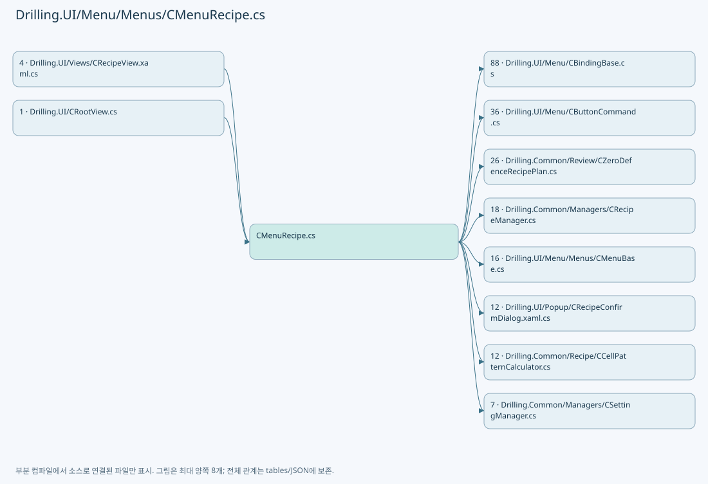

## 네임스페이스·타입·상속

| 타입 | 구분 | 원본 범위 | 선언/상속 |
| --- | --- | --- | --- |
| CMenuRecipe | ClassDeclaration | 19–3358 | CMenuRecipe: CMenuBase |
| ST_RECIPE_CATEGORY_TAB | RecordDeclaration | 3360–3363 | ST_RECIPE_CATEGORY_TAB |
| ST_RECIPE_GROUP_TAB | RecordDeclaration | 3365–3365 | ST_RECIPE_GROUP_TAB |
| ST_RECIPE_CELL_VIEW_MODEL | RecordDeclaration | 3366–3386 | ST_RECIPE_CELL_VIEW_MODEL |
| ST_RECIPE_MASKING_AREA | RecordDeclaration | 3388–3408 | ST_RECIPE_MASKING_AREA |
| ST_RECIPE_EDGE_MASKING_AREA | RecordDeclaration | 3410–3422 | ST_RECIPE_EDGE_MASKING_AREA |
| ST_RECIPE_SHOT_MASKING_STATE | RecordDeclaration | 3424–3489 | ST_RECIPE_SHOT_MASKING_STATE |
| ST_RECIPE_DISTORTION_KEY_ITEM | RecordDeclaration | 3491–3508 | ST_RECIPE_DISTORTION_KEY_ITEM |
| ST_RECIPE_CELL_OVERVIEW_ROW | ClassDeclaration | 3510–3620 | ST_RECIPE_CELL_OVERVIEW_ROW: CBindingBase |
| ST_SHOT_GROUP_EDITOR_ROW | ClassDeclaration | 3622–3947 | ST_SHOT_GROUP_EDITOR_ROW: CBindingBase |
| ST_RECIPE_LAYOUT_PREVIEW | RecordDeclaration | 3949–3949 | ST_RECIPE_LAYOUT_PREVIEW |
| ST_RECIPE_HEAD_PREVIEW | RecordDeclaration | 3950–3950 | ST_RECIPE_HEAD_PREVIEW |
| ST_HEAD_COVERAGE_PREVIEW_LABEL | RecordDeclaration | 3951–3992 | ST_HEAD_COVERAGE_PREVIEW_LABEL |
| ST_RECIPE_FILE | RecordDeclaration | 3994–4011 | ST_RECIPE_FILE |
| ST_RECIPE_PARAMETER_EDITOR_ITEM | ClassDeclaration | 4013–4220 | ST_RECIPE_PARAMETER_EDITOR_ITEM: CBindingBase |
| ST_RECIPE_HISTORY_ROW | RecordDeclaration | 4222–4231 | ST_RECIPE_HISTORY_ROW |
| ST_RECIPE_STATE_ROW | RecordDeclaration | 4233–4248 | ST_RECIPE_STATE_ROW |
| CRecipeZeroDefencePanel | ClassDeclaration | 4251–4691 | CRecipeZeroDefencePanel: INotifyPropertyChanged |
| ShotAvailability | RecordDeclaration | 4549–4549 | ShotAvailability |
| CZeroDefenceHeadRow | RecordDeclaration | 4693–4701 | CZeroDefenceHeadRow |
| CZeroDefenceGroupCard | RecordDeclaration | 4703–4707 | CZeroDefenceGroupCard |
| CZeroDefenceSelectionLabel | RecordDeclaration | 4709–4712 | CZeroDefenceSelectionLabel |
| CZeroDefenceCell | RecordDeclaration | 4714–4718 | CZeroDefenceCell |
| CZeroDefenceShotRow | RecordDeclaration | 4720–4720 | CZeroDefenceShotRow |
| CZeroDefenceShot | RecordDeclaration | 4721–4726 | CZeroDefenceShot |
| CZeroDefenceBeam | RecordDeclaration | 4728–4735 | CZeroDefenceBeam |

## 멤버 빠른 목록

| 이름 | 종류 | 범위 | 서명 |
| --- | --- | --- | --- |
| CellParameterKeys | FieldDeclaration | L21–21 | string[] Drilling.UI.Menu.Menus.CMenuRecipe.CellParameterKeys |
| PatternParameterKeys | FieldDeclaration | L22–22 | string[] Drilling.UI.Menu.Menus.CMenuRecipe.PatternParameterKeys |
| GlassSettingKeys | FieldDeclaration | L23–32 | string[] Drilling.UI.Menu.Menus.CMenuRecipe.GlassSettingKeys |
| RecipeFilesPageSize | FieldDeclaration | L33–33 | int Drilling.UI.Menu.Menus.CMenuRecipe.RecipeFilesPageSize |
| MaximumMaskingHoleCount | FieldDeclaration | L34–34 | int Drilling.UI.Menu.Menus.CMenuRecipe.MaximumMaskingHoleCount |
| MaximumCellModelTypeCount | FieldDeclaration | L35–35 | int Drilling.UI.Menu.Menus.CMenuRecipe.MaximumCellModelTypeCount |
| MinimumLayoutPatternWidth | FieldDeclaration | L36–36 | double Drilling.UI.Menu.Menus.CMenuRecipe.MinimumLayoutPatternWidth |
| MinimumLayoutPatternHeight | FieldDeclaration | L37–37 | double Drilling.UI.Menu.Menus.CMenuRecipe.MinimumLayoutPatternHeight |
| SelectRecipeSettingKey | FieldDeclaration | L38–38 | string Drilling.UI.Menu.Menus.CMenuRecipe.SelectRecipeSettingKey |
| _recipeManager | FieldDeclaration | L39–39 | Drilling.Common.Managers.CRecipeManager Drilling.UI.Menu.Menus.CMenuRecipe._recipeManager |
| _settingManager | FieldDeclaration | L40–40 | Drilling.Common.Managers.CSettingManager Drilling.UI.Menu.Menus.CMenuRecipe._settingManager |
| _selectRecipeIdProvider | FieldDeclaration | L41–41 | System.Func<string> Drilling.UI.Menu.Menus.CMenuRecipe._selectRecipeIdProvider |
| _selectRecipeIdSetter | FieldDeclaration | L42–42 | System.Action<string> Drilling.UI.Menu.Menus.CMenuRecipe._selectRecipeIdSetter |
| _viewRecipeIdProvider | FieldDeclaration | L43–43 | System.Func<string> Drilling.UI.Menu.Menus.CMenuRecipe._viewRecipeIdProvider |
| _viewRecipeIdSetter | FieldDeclaration | L44–44 | System.Action<string> Drilling.UI.Menu.Menus.CMenuRecipe._viewRecipeIdSetter |
| _selectedCategoryProvider | FieldDeclaration | L45–45 | System.Func<string> Drilling.UI.Menu.Menus.CMenuRecipe._selectedCategoryProvider |
| _selectedCategorySetter | FieldDeclaration | L46–46 | System.Action<string> Drilling.UI.Menu.Menus.CMenuRecipe._selectedCategorySetter |
| _selectedGroup | FieldDeclaration | L47–47 | string Drilling.UI.Menu.Menus.CMenuRecipe._selectedGroup |
| _selectedCellNo | FieldDeclaration | L48–48 | int Drilling.UI.Menu.Menus.CMenuRecipe._selectedCellNo |
| _selectedCellShotNo | FieldDeclaration | L49–49 | int Drilling.UI.Menu.Menus.CMenuRecipe._selectedCellShotNo |
| _selectedShotGroup | FieldDeclaration | L50–50 | Drilling.UI.Menu.Menus.ST_SHOT_GROUP_EDITOR_ROW? Drilling.UI.Menu.Menus.CMenuRecipe._selectedShotGroup |
| _recipeCells | FieldDeclaration | L51–51 | System.Collections.Generic.IReadOnlyList<Drilling.UI.Menu.Menus.ST_RECIPE_CELL_VIEW_MODEL> Drilling.UI.Menu.Menus.CMenuRecipe._recipeCells |
| _recipeFiles | FieldDeclaration | L52–52 | System.Collections.Generic.IReadOnlyList<Drilling.UI.Menu.Menus.ST_RECIPE_FILE> Drilling.UI.Menu.Menus.CMenuRecipe._recipeFiles |
| _previewTrackedItems | FieldDeclaration | L53–53 | System.Collections.Generic.IReadOnlyList<Drilling.UI.Menu.Menus.ST_RECIPE_PARAMETER_EDITOR_ITEM> Drilling.UI.Menu.Menus.CMenuRecipe._previewTrackedItems |
| _headPreviewSettings | FieldDeclaration | L54–54 | System.Collections.Generic.IReadOnlyList<Drilling.Common.Managers.ST_SYSTEM_PARAMETER> Drilling.UI.Menu.Menus.CMenuRecipe._headPreviewSettings |
| _alignKeyMargins | FieldDeclaration | L55–57 | Drilling.Common.Managers.ST_ALIGN_KEY_MARGINS Drilling.UI.Menu.Menus.CMenuRecipe._alignKeyMargins |
| _previewRefreshCancellation | FieldDeclaration | L58–58 | System.Threading.CancellationTokenSource? Drilling.UI.Menu.Menus.CMenuRecipe._previewRefreshCancellation |
| _lastRecipeListSelectedFile | FieldDeclaration | L59–59 | string Drilling.UI.Menu.Menus.CMenuRecipe._lastRecipeListSelectedFile |
| _lastValidChessValues | FieldDeclaration | L60–60 | System.Collections.Generic.Dictionary<string, string> Drilling.UI.Menu.Menus.CMenuRecipe._lastValidChessValues |
| _isRevertingChessValue | FieldDeclaration | L61–61 | bool Drilling.UI.Menu.Menus.CMenuRecipe._isRevertingChessValue |
| _isBatchUpdatingCellPlacement | FieldDeclaration | L62–62 | bool Drilling.UI.Menu.Menus.CMenuRecipe._isBatchUpdatingCellPlacement |
| _recipeFilesPageText | FieldDeclaration | L63–63 | string Drilling.UI.Menu.Menus.CMenuRecipe._recipeFilesPageText |
| _recipeFilesPageIndex | FieldDeclaration | L64–64 | int Drilling.UI.Menu.Menus.CMenuRecipe._recipeFilesPageIndex |
| _recipeFilesPageCount | FieldDeclaration | L65–65 | int Drilling.UI.Menu.Menus.CMenuRecipe._recipeFilesPageCount |
| _editScreenProvider | FieldDeclaration | L66–66 | System.Func<Drilling.UI.Menu.Menus.CMenuRecipe?> Drilling.UI.Menu.Menus.CMenuRecipe._editScreenProvider |
| _setStatusMessage | FieldDeclaration | L67–67 | System.Action<string> Drilling.UI.Menu.Menus.CMenuRecipe._setStatusMessage |
| _showLoadingScreen | FieldDeclaration | L68–68 | System.Action<Drilling.UI.Menu.Menus.EN_MENU, string> Drilling.UI.Menu.Menus.CMenuRecipe._showLoadingScreen |
| _refreshShellStatus | FieldDeclaration | L69–69 | System.Action Drilling.UI.Menu.Menus.CMenuRecipe._refreshShellStatus |
| _refreshCurrentScreen | FieldDeclaration | L70–70 | System.Func<System.Threading.Tasks.Task> Drilling.UI.Menu.Menus.CMenuRecipe._refreshCurrentScreen |
| .ctor | ConstructorDeclaration | L71–218 | Drilling.UI.Menu.Menus.CMenuRecipe.CMenuRecipe(Drilling.Common.Managers.CRecipeManager, Drilling.Common.Managers.CSettingManager, System.Func<string>, System.Action<string>, System.Func<string>, System.Action<string>, System.Func<string>, System.Action<string>, System.Func<Drilling.UI.Menu.Menus.CMenuRecipe?>, System.Action<string>, System.Action<Drilling.UI.Menu.Menus.EN_MENU, string>, System.Action, System.Func<System.Threading.Tasks.Task>) |
| ViewCallback | LocalFunctionStatement | L101–104 | void ViewCallback(object?) |
| ShowPreviousRecipePageCallback | LocalFunctionStatement | L107–110 | void ShowPreviousRecipePageCallback(object?) |
| CanShowPreviousRecipePageCallback | LocalFunctionStatement | L112–115 | bool CanShowPreviousRecipePageCallback(object?) |
| ShowNextRecipePageCallback | LocalFunctionStatement | L118–121 | void ShowNextRecipePageCallback(object?) |
| CanShowNextRecipePageCallback | LocalFunctionStatement | L123–126 | bool CanShowNextRecipePageCallback(object?) |
| SelectCategoryCallback | LocalFunctionStatement | L129–132 | void SelectCategoryCallback(object?) |
| SelectGroupCallback | LocalFunctionStatement | L135–138 | void SelectGroupCallback(object?) |
| SelectCellCallback | LocalFunctionStatement | L141–144 | void SelectCellCallback(object?) |
| SelectPreviewCellCallback | LocalFunctionStatement | L147–150 | void SelectPreviewCellCallback(object?) |
| BackToCellPreviewCallback | LocalFunctionStatement | L153–156 | void BackToCellPreviewCallback(object?) |
| PreviousCellCallback | LocalFunctionStatement | L160–163 | void PreviousCellCallback(object?) |
| MatchesObject | LocalFunctionStatement | L165–168 | bool MatchesObject(object?) |
| NextCellCallback | LocalFunctionStatement | L171–174 | void NextCellCallback(object?) |
| MatchesObject2 | LocalFunctionStatement | L176–179 | bool MatchesObject2(object?) |
| SelectRecipeCallback | LocalFunctionStatement | L183–186 | void SelectRecipeCallback(object?) |
| CanSelectRecipeCallback | LocalFunctionStatement | L188–191 | bool CanSelectRecipeCallback(object?) |
| CreateCallback | LocalFunctionStatement | L194–197 | void CreateCallback(object?) |
| ModifyCallback | LocalFunctionStatement | L200–203 | void ModifyCallback(object?) |
| SaveCallback | LocalFunctionStatement | L206–209 | void SaveCallback(object?) |
| DeleteCallback | LocalFunctionStatement | L212–215 | void DeleteCallback(object?) |
| Menu | PropertyDeclaration | L220–226 | Drilling.UI.Menu.Menus.EN_MENU Drilling.UI.Menu.Menus.CMenuRecipe.Menu |
| get_Menu | GetAccessorDeclaration | L222–225 | Drilling.UI.Menu.Menus.EN_MENU Drilling.UI.Menu.Menus.CMenuRecipe.Menu.get |
| OnDeactivated | MethodDeclaration | L228–231 | void Drilling.UI.Menu.Menus.CMenuRecipe.OnDeactivated() |
| RecipeList | PropertyDeclaration | L233–233 | System.Collections.Generic.IReadOnlyList<Drilling.UI.Menu.Menus.ST_DISPLAY_ITEM> Drilling.UI.Menu.Menus.CMenuRecipe.RecipeList |
| get_RecipeList | GetAccessorDeclaration | L233–233 | System.Collections.Generic.IReadOnlyList<Drilling.UI.Menu.Menus.ST_DISPLAY_ITEM> Drilling.UI.Menu.Menus.CMenuRecipe.RecipeList.get |
| set_RecipeList | SetAccessorDeclaration | L233–233 | void Drilling.UI.Menu.Menus.CMenuRecipe.RecipeList.set |
| Parameters | PropertyDeclaration | L234–234 | System.Collections.Generic.IReadOnlyList<Drilling.UI.Menu.Menus.ST_DISPLAY_ITEM> Drilling.UI.Menu.Menus.CMenuRecipe.Parameters |
| get_Parameters | GetAccessorDeclaration | L234–234 | System.Collections.Generic.IReadOnlyList<Drilling.UI.Menu.Menus.ST_DISPLAY_ITEM> Drilling.UI.Menu.Menus.CMenuRecipe.Parameters.get |
| set_Parameters | SetAccessorDeclaration | L234–234 | void Drilling.UI.Menu.Menus.CMenuRecipe.Parameters.set |
| History | PropertyDeclaration | L235–235 | System.Collections.Generic.IReadOnlyList<Drilling.UI.Menu.Menus.ST_DISPLAY_ITEM> Drilling.UI.Menu.Menus.CMenuRecipe.History |
| get_History | GetAccessorDeclaration | L235–235 | System.Collections.Generic.IReadOnlyList<Drilling.UI.Menu.Menus.ST_DISPLAY_ITEM> Drilling.UI.Menu.Menus.CMenuRecipe.History.get |
| set_History | SetAccessorDeclaration | L235–235 | void Drilling.UI.Menu.Menus.CMenuRecipe.History.set |
| Actions | PropertyDeclaration | L236–236 | System.Collections.Generic.IReadOnlyList<Drilling.UI.Menu.Menus.ST_DISPLAY_ITEM> Drilling.UI.Menu.Menus.CMenuRecipe.Actions |
| get_Actions | GetAccessorDeclaration | L236–236 | System.Collections.Generic.IReadOnlyList<Drilling.UI.Menu.Menus.ST_DISPLAY_ITEM> Drilling.UI.Menu.Menus.CMenuRecipe.Actions.get |
| set_Actions | SetAccessorDeclaration | L236–236 | void Drilling.UI.Menu.Menus.CMenuRecipe.Actions.set |
| SelectedRecipeFile | PropertyDeclaration | L237–237 | string Drilling.UI.Menu.Menus.CMenuRecipe.SelectedRecipeFile |
| get_SelectedRecipeFile | GetAccessorDeclaration | L237–237 | string Drilling.UI.Menu.Menus.CMenuRecipe.SelectedRecipeFile.get |
| set_SelectedRecipeFile | SetAccessorDeclaration | L237–237 | void Drilling.UI.Menu.Menus.CMenuRecipe.SelectedRecipeFile.set |
| SelectRecipeFile | PropertyDeclaration | L238–238 | string Drilling.UI.Menu.Menus.CMenuRecipe.SelectRecipeFile |
| get_SelectRecipeFile | GetAccessorDeclaration | L238–238 | string Drilling.UI.Menu.Menus.CMenuRecipe.SelectRecipeFile.get |
| set_SelectRecipeFile | SetAccessorDeclaration | L238–238 | void Drilling.UI.Menu.Menus.CMenuRecipe.SelectRecipeFile.set |
| ViewRecipeFile | PropertyDeclaration | L240–246 | string Drilling.UI.Menu.Menus.CMenuRecipe.ViewRecipeFile |
| get_ViewRecipeFile | GetAccessorDeclaration | L242–245 | string Drilling.UI.Menu.Menus.CMenuRecipe.ViewRecipeFile.get |
| IsViewRecipeSelected | PropertyDeclaration | L248–248 | bool Drilling.UI.Menu.Menus.CMenuRecipe.IsViewRecipeSelected |
| get_IsViewRecipeSelected | GetAccessorDeclaration | L248–248 | bool Drilling.UI.Menu.Menus.CMenuRecipe.IsViewRecipeSelected.get |
| set_IsViewRecipeSelected | SetAccessorDeclaration | L248–248 | void Drilling.UI.Menu.Menus.CMenuRecipe.IsViewRecipeSelected.set |
| RecipeSelectionSummaryText | PropertyDeclaration | L250–261 | string Drilling.UI.Menu.Menus.CMenuRecipe.RecipeSelectionSummaryText |
| get_RecipeSelectionSummaryText | GetAccessorDeclaration | L252–260 | string Drilling.UI.Menu.Menus.CMenuRecipe.RecipeSelectionSummaryText.get |
| RecipeFiles | PropertyDeclaration | L263–274 | System.Collections.Generic.IReadOnlyList<Drilling.UI.Menu.Menus.ST_RECIPE_FILE> Drilling.UI.Menu.Menus.CMenuRecipe.RecipeFiles |
| get_RecipeFiles | GetAccessorDeclaration | L265–268 | System.Collections.Generic.IReadOnlyList<Drilling.UI.Menu.Menus.ST_RECIPE_FILE> Drilling.UI.Menu.Menus.CMenuRecipe.RecipeFiles.get |
| set_RecipeFiles | SetAccessorDeclaration | L270–273 | void Drilling.UI.Menu.Menus.CMenuRecipe.RecipeFiles.set |
| RecipeFilesPageText | PropertyDeclaration | L276–287 | string Drilling.UI.Menu.Menus.CMenuRecipe.RecipeFilesPageText |
| get_RecipeFilesPageText | GetAccessorDeclaration | L278–281 | string Drilling.UI.Menu.Menus.CMenuRecipe.RecipeFilesPageText.get |
| set_RecipeFilesPageText | SetAccessorDeclaration | L283–286 | void Drilling.UI.Menu.Menus.CMenuRecipe.RecipeFilesPageText.set |
| ItemTabs | PropertyDeclaration | L289–289 | System.Collections.Generic.IReadOnlyList<Drilling.UI.Menu.Menus.ST_RECIPE_CATEGORY_TAB> Drilling.UI.Menu.Menus.CMenuRecipe.ItemTabs |
| get_ItemTabs | GetAccessorDeclaration | L289–289 | System.Collections.Generic.IReadOnlyList<Drilling.UI.Menu.Menus.ST_RECIPE_CATEGORY_TAB> Drilling.UI.Menu.Menus.CMenuRecipe.ItemTabs.get |
| set_ItemTabs | SetAccessorDeclaration | L289–289 | void Drilling.UI.Menu.Menus.CMenuRecipe.ItemTabs.set |
| GroupTabs | PropertyDeclaration | L290–290 | System.Collections.Generic.IReadOnlyList<Drilling.UI.Menu.Menus.ST_RECIPE_GROUP_TAB> Drilling.UI.Menu.Menus.CMenuRecipe.GroupTabs |
| get_GroupTabs | GetAccessorDeclaration | L290–290 | System.Collections.Generic.IReadOnlyList<Drilling.UI.Menu.Menus.ST_RECIPE_GROUP_TAB> Drilling.UI.Menu.Menus.CMenuRecipe.GroupTabs.get |
| set_GroupTabs | SetAccessorDeclaration | L290–290 | void Drilling.UI.Menu.Menus.CMenuRecipe.GroupTabs.set |
| CellOverviewRows | PropertyDeclaration | L291–291 | System.Collections.Generic.IReadOnlyList<Drilling.UI.Menu.Menus.ST_RECIPE_CELL_OVERVIEW_ROW> Drilling.UI.Menu.Menus.CMenuRecipe.CellOverviewRows |
| get_CellOverviewRows | GetAccessorDeclaration | L291–291 | System.Collections.Generic.IReadOnlyList<Drilling.UI.Menu.Menus.ST_RECIPE_CELL_OVERVIEW_ROW> Drilling.UI.Menu.Menus.CMenuRecipe.CellOverviewRows.get |
| set_CellOverviewRows | SetAccessorDeclaration | L291–291 | void Drilling.UI.Menu.Menus.CMenuRecipe.CellOverviewRows.set |
| ShotGroupRows | PropertyDeclaration | L292–292 | System.Collections.Generic.IReadOnlyList<Drilling.UI.Menu.Menus.ST_SHOT_GROUP_EDITOR_ROW> Drilling.UI.Menu.Menus.CMenuRecipe.ShotGroupRows |
| get_ShotGroupRows | GetAccessorDeclaration | L292–292 | System.Collections.Generic.IReadOnlyList<Drilling.UI.Menu.Menus.ST_SHOT_GROUP_EDITOR_ROW> Drilling.UI.Menu.Menus.CMenuRecipe.ShotGroupRows.get |
| set_ShotGroupRows | SetAccessorDeclaration | L292–292 | void Drilling.UI.Menu.Menus.CMenuRecipe.ShotGroupRows.set |
| SelectedShotGroup | PropertyDeclaration | L294–322 | Drilling.UI.Menu.Menus.ST_SHOT_GROUP_EDITOR_ROW? Drilling.UI.Menu.Menus.CMenuRecipe.SelectedShotGroup |
| get_SelectedShotGroup | GetAccessorDeclaration | L296–299 | Drilling.UI.Menu.Menus.ST_SHOT_GROUP_EDITOR_ROW? Drilling.UI.Menu.Menus.CMenuRecipe.SelectedShotGroup.get |
| set_SelectedShotGroup | SetAccessorDeclaration | L301–321 | void Drilling.UI.Menu.Menus.CMenuRecipe.SelectedShotGroup.set |
| GlassSizeXItem | PropertyDeclaration | L324–324 | Drilling.UI.Menu.Menus.ST_RECIPE_PARAMETER_EDITOR_ITEM? Drilling.UI.Menu.Menus.CMenuRecipe.GlassSizeXItem |
| get_GlassSizeXItem | GetAccessorDeclaration | L324–324 | Drilling.UI.Menu.Menus.ST_RECIPE_PARAMETER_EDITOR_ITEM? Drilling.UI.Menu.Menus.CMenuRecipe.GlassSizeXItem.get |
| set_GlassSizeXItem | SetAccessorDeclaration | L324–324 | void Drilling.UI.Menu.Menus.CMenuRecipe.GlassSizeXItem.set |
| GlassSizeYItem | PropertyDeclaration | L325–325 | Drilling.UI.Menu.Menus.ST_RECIPE_PARAMETER_EDITOR_ITEM? Drilling.UI.Menu.Menus.CMenuRecipe.GlassSizeYItem |
| get_GlassSizeYItem | GetAccessorDeclaration | L325–325 | Drilling.UI.Menu.Menus.ST_RECIPE_PARAMETER_EDITOR_ITEM? Drilling.UI.Menu.Menus.CMenuRecipe.GlassSizeYItem.get |
| set_GlassSizeYItem | SetAccessorDeclaration | L325–325 | void Drilling.UI.Menu.Menus.CMenuRecipe.GlassSizeYItem.set |
| MaxCellNumberItem | PropertyDeclaration | L326–326 | Drilling.UI.Menu.Menus.ST_RECIPE_PARAMETER_EDITOR_ITEM? Drilling.UI.Menu.Menus.CMenuRecipe.MaxCellNumberItem |
| get_MaxCellNumberItem | GetAccessorDeclaration | L326–326 | Drilling.UI.Menu.Menus.ST_RECIPE_PARAMETER_EDITOR_ITEM? Drilling.UI.Menu.Menus.CMenuRecipe.MaxCellNumberItem.get |
| set_MaxCellNumberItem | SetAccessorDeclaration | L326–326 | void Drilling.UI.Menu.Menus.CMenuRecipe.MaxCellNumberItem.set |
| PixelSizeItem | PropertyDeclaration | L327–327 | Drilling.UI.Menu.Menus.ST_RECIPE_PARAMETER_EDITOR_ITEM? Drilling.UI.Menu.Menus.CMenuRecipe.PixelSizeItem |
| get_PixelSizeItem | GetAccessorDeclaration | L327–327 | Drilling.UI.Menu.Menus.ST_RECIPE_PARAMETER_EDITOR_ITEM? Drilling.UI.Menu.Menus.CMenuRecipe.PixelSizeItem.get |
| set_PixelSizeItem | SetAccessorDeclaration | L327–327 | void Drilling.UI.Menu.Menus.CMenuRecipe.PixelSizeItem.set |
| PixelCountXItem | PropertyDeclaration | L328–328 | Drilling.UI.Menu.Menus.ST_RECIPE_PARAMETER_EDITOR_ITEM? Drilling.UI.Menu.Menus.CMenuRecipe.PixelCountXItem |
| get_PixelCountXItem | GetAccessorDeclaration | L328–328 | Drilling.UI.Menu.Menus.ST_RECIPE_PARAMETER_EDITOR_ITEM? Drilling.UI.Menu.Menus.CMenuRecipe.PixelCountXItem.get |
| set_PixelCountXItem | SetAccessorDeclaration | L328–328 | void Drilling.UI.Menu.Menus.CMenuRecipe.PixelCountXItem.set |
| PixelCountYItem | PropertyDeclaration | L329–329 | Drilling.UI.Menu.Menus.ST_RECIPE_PARAMETER_EDITOR_ITEM? Drilling.UI.Menu.Menus.CMenuRecipe.PixelCountYItem |
| get_PixelCountYItem | GetAccessorDeclaration | L329–329 | Drilling.UI.Menu.Menus.ST_RECIPE_PARAMETER_EDITOR_ITEM? Drilling.UI.Menu.Menus.CMenuRecipe.PixelCountYItem.get |
| set_PixelCountYItem | SetAccessorDeclaration | L329–329 | void Drilling.UI.Menu.Menus.CMenuRecipe.PixelCountYItem.set |
| ProcessPitchItem | PropertyDeclaration | L330–330 | Drilling.UI.Menu.Menus.ST_RECIPE_PARAMETER_EDITOR_ITEM? Drilling.UI.Menu.Menus.CMenuRecipe.ProcessPitchItem |
| get_ProcessPitchItem | GetAccessorDeclaration | L330–330 | Drilling.UI.Menu.Menus.ST_RECIPE_PARAMETER_EDITOR_ITEM? Drilling.UI.Menu.Menus.CMenuRecipe.ProcessPitchItem.get |
| set_ProcessPitchItem | SetAccessorDeclaration | L330–330 | void Drilling.UI.Menu.Menus.CMenuRecipe.ProcessPitchItem.set |
| ChessItem | PropertyDeclaration | L331–331 | Drilling.UI.Menu.Menus.ST_RECIPE_PARAMETER_EDITOR_ITEM? Drilling.UI.Menu.Menus.CMenuRecipe.ChessItem |
| get_ChessItem | GetAccessorDeclaration | L331–331 | Drilling.UI.Menu.Menus.ST_RECIPE_PARAMETER_EDITOR_ITEM? Drilling.UI.Menu.Menus.CMenuRecipe.ChessItem.get |
| set_ChessItem | SetAccessorDeclaration | L331–331 | void Drilling.UI.Menu.Menus.CMenuRecipe.ChessItem.set |
| SplitBeamCountItem | PropertyDeclaration | L332–332 | Drilling.UI.Menu.Menus.ST_RECIPE_PARAMETER_EDITOR_ITEM? Drilling.UI.Menu.Menus.CMenuRecipe.SplitBeamCountItem |
| get_SplitBeamCountItem | GetAccessorDeclaration | L332–332 | Drilling.UI.Menu.Menus.ST_RECIPE_PARAMETER_EDITOR_ITEM? Drilling.UI.Menu.Menus.CMenuRecipe.SplitBeamCountItem.get |
| set_SplitBeamCountItem | SetAccessorDeclaration | L332–332 | void Drilling.UI.Menu.Menus.CMenuRecipe.SplitBeamCountItem.set |
| CellModelTypeCountItem | PropertyDeclaration | L333–333 | Drilling.UI.Menu.Menus.ST_RECIPE_PARAMETER_EDITOR_ITEM? Drilling.UI.Menu.Menus.CMenuRecipe.CellModelTypeCountItem |
| get_CellModelTypeCountItem | GetAccessorDeclaration | L333–333 | Drilling.UI.Menu.Menus.ST_RECIPE_PARAMETER_EDITOR_ITEM? Drilling.UI.Menu.Menus.CMenuRecipe.CellModelTypeCountItem.get |
| set_CellModelTypeCountItem | SetAccessorDeclaration | L333–333 | void Drilling.UI.Menu.Menus.CMenuRecipe.CellModelTypeCountItem.set |
| AkMarginXText | PropertyDeclaration | L334–334 | string Drilling.UI.Menu.Menus.CMenuRecipe.AkMarginXText |
| AkMarginYText | PropertyDeclaration | L335–335 | string Drilling.UI.Menu.Menus.CMenuRecipe.AkMarginYText |
| EscEdgeToGlassEdgeItem | PropertyDeclaration | L336–336 | Drilling.UI.Menu.Menus.ST_RECIPE_PARAMETER_EDITOR_ITEM? Drilling.UI.Menu.Menus.CMenuRecipe.EscEdgeToGlassEdgeItem |
| get_EscEdgeToGlassEdgeItem | GetAccessorDeclaration | L336–336 | Drilling.UI.Menu.Menus.ST_RECIPE_PARAMETER_EDITOR_ITEM? Drilling.UI.Menu.Menus.CMenuRecipe.EscEdgeToGlassEdgeItem.get |
| set_EscEdgeToGlassEdgeItem | SetAccessorDeclaration | L336–336 | void Drilling.UI.Menu.Menus.CMenuRecipe.EscEdgeToGlassEdgeItem.set |
| GlassCenterToScannerCenterItem | PropertyDeclaration | L337–337 | Drilling.UI.Menu.Menus.ST_RECIPE_PARAMETER_EDITOR_ITEM? Drilling.UI.Menu.Menus.CMenuRecipe.GlassCenterToScannerCenterItem |
| get_GlassCenterToScannerCenterItem | GetAccessorDeclaration | L337–337 | Drilling.UI.Menu.Menus.ST_RECIPE_PARAMETER_EDITOR_ITEM? Drilling.UI.Menu.Menus.CMenuRecipe.GlassCenterToScannerCenterItem.get |
| set_GlassCenterToScannerCenterItem | SetAccessorDeclaration | L337–337 | void Drilling.UI.Menu.Menus.CMenuRecipe.GlassCenterToScannerCenterItem.set |
| DistortionKeyItems | PropertyDeclaration | L338–338 | System.Collections.Generic.IReadOnlyList<Drilling.UI.Menu.Menus.ST_RECIPE_DISTORTION_KEY_ITEM> Drilling.UI.Menu.Menus.CMenuRecipe.DistortionKeyItems |
| get_DistortionKeyItems | GetAccessorDeclaration | L338–338 | System.Collections.Generic.IReadOnlyList<Drilling.UI.Menu.Menus.ST_RECIPE_DISTORTION_KEY_ITEM> Drilling.UI.Menu.Menus.CMenuRecipe.DistortionKeyItems.get |
| set_DistortionKeyItems | SetAccessorDeclaration | L338–338 | void Drilling.UI.Menu.Menus.CMenuRecipe.DistortionKeyItems.set |
| IsCellCategory | PropertyDeclaration | L339–339 | bool Drilling.UI.Menu.Menus.CMenuRecipe.IsCellCategory |
| get_IsCellCategory | GetAccessorDeclaration | L339–339 | bool Drilling.UI.Menu.Menus.CMenuRecipe.IsCellCategory.get |
| set_IsCellCategory | SetAccessorDeclaration | L339–339 | void Drilling.UI.Menu.Menus.CMenuRecipe.IsCellCategory.set |
| IsHeadCategory | PropertyDeclaration | L340–340 | bool Drilling.UI.Menu.Menus.CMenuRecipe.IsHeadCategory |
| get_IsHeadCategory | GetAccessorDeclaration | L340–340 | bool Drilling.UI.Menu.Menus.CMenuRecipe.IsHeadCategory.get |
| set_IsHeadCategory | SetAccessorDeclaration | L340–340 | void Drilling.UI.Menu.Menus.CMenuRecipe.IsHeadCategory.set |
| IsZeroDefenceCategory | PropertyDeclaration | L341–341 | bool Drilling.UI.Menu.Menus.CMenuRecipe.IsZeroDefenceCategory |
| ZeroDefence | PropertyDeclaration | L342–342 | Drilling.UI.Menu.Menus.CRecipeZeroDefencePanel Drilling.UI.Menu.Menus.CMenuRecipe.ZeroDefence |
| get_ZeroDefence | GetAccessorDeclaration | L342–342 | Drilling.UI.Menu.Menus.CRecipeZeroDefencePanel Drilling.UI.Menu.Menus.CMenuRecipe.ZeroDefence.get |
| _isCellDetailVisible | FieldDeclaration | L344–344 | bool Drilling.UI.Menu.Menus.CMenuRecipe._isCellDetailVisible |
| _isCellPlacementExpanded | FieldDeclaration | L345–345 | bool Drilling.UI.Menu.Menus.CMenuRecipe._isCellPlacementExpanded |
| IsCellDetailVisible | PropertyDeclaration | L346–352 | bool Drilling.UI.Menu.Menus.CMenuRecipe.IsCellDetailVisible |
| get_IsCellDetailVisible | GetAccessorDeclaration | L348–351 | bool Drilling.UI.Menu.Menus.CMenuRecipe.IsCellDetailVisible.get |
| IsCellPreviewVisible | PropertyDeclaration | L354–360 | bool Drilling.UI.Menu.Menus.CMenuRecipe.IsCellPreviewVisible |
| get_IsCellPreviewVisible | GetAccessorDeclaration | L356–359 | bool Drilling.UI.Menu.Menus.CMenuRecipe.IsCellPreviewVisible.get |
| IsCellPlacementExpanded | PropertyDeclaration | L362–368 | bool Drilling.UI.Menu.Menus.CMenuRecipe.IsCellPlacementExpanded |
| get_IsCellPlacementExpanded | GetAccessorDeclaration | L364–367 | bool Drilling.UI.Menu.Menus.CMenuRecipe.IsCellPlacementExpanded.get |
| CellPlacementExpandButtonText | PropertyDeclaration | L370–376 | string Drilling.UI.Menu.Menus.CMenuRecipe.CellPlacementExpandButtonText |
| get_CellPlacementExpandButtonText | GetAccessorDeclaration | L372–375 | string Drilling.UI.Menu.Menus.CMenuRecipe.CellPlacementExpandButtonText.get |
| CellPreviewImage | PropertyDeclaration | L378–378 | ImageSource? Drilling.UI.Menu.Menus.CMenuRecipe.CellPreviewImage |
| get_CellPreviewImage | GetAccessorDeclaration | L378–378 | ImageSource? Drilling.UI.Menu.Menus.CMenuRecipe.CellPreviewImage.get |
| set_CellPreviewImage | SetAccessorDeclaration | L378–378 | void Drilling.UI.Menu.Menus.CMenuRecipe.CellPreviewImage.set |
| CellPreviewLabels | PropertyDeclaration | L379–379 | System.Collections.Generic.IReadOnlyList<Drilling.UI.Menu.Menus.ST_CELL_PREVIEW_LABEL> Drilling.UI.Menu.Menus.CMenuRecipe.CellPreviewLabels |
| get_CellPreviewLabels | GetAccessorDeclaration | L379–379 | System.Collections.Generic.IReadOnlyList<Drilling.UI.Menu.Menus.ST_CELL_PREVIEW_LABEL> Drilling.UI.Menu.Menus.CMenuRecipe.CellPreviewLabels.get |
| set_CellPreviewLabels | SetAccessorDeclaration | L379–379 | void Drilling.UI.Menu.Menus.CMenuRecipe.CellPreviewLabels.set |
| CellPreviewSummaryText | PropertyDeclaration | L380–380 | string Drilling.UI.Menu.Menus.CMenuRecipe.CellPreviewSummaryText |
| get_CellPreviewSummaryText | GetAccessorDeclaration | L380–380 | string Drilling.UI.Menu.Menus.CMenuRecipe.CellPreviewSummaryText.get |
| set_CellPreviewSummaryText | SetAccessorDeclaration | L380–380 | void Drilling.UI.Menu.Menus.CMenuRecipe.CellPreviewSummaryText.set |
| CellShotMapImage | PropertyDeclaration | L381–381 | ImageSource? Drilling.UI.Menu.Menus.CMenuRecipe.CellShotMapImage |
| get_CellShotMapImage | GetAccessorDeclaration | L381–381 | ImageSource? Drilling.UI.Menu.Menus.CMenuRecipe.CellShotMapImage.get |
| set_CellShotMapImage | SetAccessorDeclaration | L381–381 | void Drilling.UI.Menu.Menus.CMenuRecipe.CellShotMapImage.set |
| SelectedShotDetailImage | PropertyDeclaration | L382–382 | ImageSource? Drilling.UI.Menu.Menus.CMenuRecipe.SelectedShotDetailImage |
| get_SelectedShotDetailImage | GetAccessorDeclaration | L382–382 | ImageSource? Drilling.UI.Menu.Menus.CMenuRecipe.SelectedShotDetailImage.get |
| set_SelectedShotDetailImage | SetAccessorDeclaration | L382–382 | void Drilling.UI.Menu.Menus.CMenuRecipe.SelectedShotDetailImage.set |
| HeadPreviewImage | PropertyDeclaration | L383–383 | ImageSource? Drilling.UI.Menu.Menus.CMenuRecipe.HeadPreviewImage |
| get_HeadPreviewImage | GetAccessorDeclaration | L383–383 | ImageSource? Drilling.UI.Menu.Menus.CMenuRecipe.HeadPreviewImage.get |
| set_HeadPreviewImage | SetAccessorDeclaration | L383–383 | void Drilling.UI.Menu.Menus.CMenuRecipe.HeadPreviewImage.set |
| HeadPreviewLabels | PropertyDeclaration | L384–384 | System.Collections.Generic.IReadOnlyList<Drilling.UI.Menu.Menus.ST_HEAD_COVERAGE_PREVIEW_LABEL> Drilling.UI.Menu.Menus.CMenuRecipe.HeadPreviewLabels |
| get_HeadPreviewLabels | GetAccessorDeclaration | L384–384 | System.Collections.Generic.IReadOnlyList<Drilling.UI.Menu.Menus.ST_HEAD_COVERAGE_PREVIEW_LABEL> Drilling.UI.Menu.Menus.CMenuRecipe.HeadPreviewLabels.get |
| set_HeadPreviewLabels | SetAccessorDeclaration | L384–384 | void Drilling.UI.Menu.Menus.CMenuRecipe.HeadPreviewLabels.set |
| HeadPreviewSummaryText | PropertyDeclaration | L385–385 | string Drilling.UI.Menu.Menus.CMenuRecipe.HeadPreviewSummaryText |
| get_HeadPreviewSummaryText | GetAccessorDeclaration | L385–385 | string Drilling.UI.Menu.Menus.CMenuRecipe.HeadPreviewSummaryText.get |
| set_HeadPreviewSummaryText | SetAccessorDeclaration | L385–385 | void Drilling.UI.Menu.Menus.CMenuRecipe.HeadPreviewSummaryText.set |
| CurrentCellIndicatorText | PropertyDeclaration | L387–393 | string Drilling.UI.Menu.Menus.CMenuRecipe.CurrentCellIndicatorText |
| get_CurrentCellIndicatorText | GetAccessorDeclaration | L389–392 | string Drilling.UI.Menu.Menus.CMenuRecipe.CurrentCellIndicatorText.get |
| SelectedCellNavigationText | PropertyDeclaration | L395–401 | string Drilling.UI.Menu.Menus.CMenuRecipe.SelectedCellNavigationText |
| get_SelectedCellNavigationText | GetAccessorDeclaration | L397–400 | string Drilling.UI.Menu.Menus.CMenuRecipe.SelectedCellNavigationText.get |
| SelectedCellShotGroupTitle | PropertyDeclaration | L403–410 | string Drilling.UI.Menu.Menus.CMenuRecipe.SelectedCellShotGroupTitle |
| get_SelectedCellShotGroupTitle | GetAccessorDeclaration | L405–409 | string Drilling.UI.Menu.Menus.CMenuRecipe.SelectedCellShotGroupTitle.get |
| IsSelectedCellShotMapLandscape | PropertyDeclaration | L412–419 | bool Drilling.UI.Menu.Menus.CMenuRecipe.IsSelectedCellShotMapLandscape |
| get_IsSelectedCellShotMapLandscape | GetAccessorDeclaration | L414–418 | bool Drilling.UI.Menu.Menus.CMenuRecipe.IsSelectedCellShotMapLandscape.get |
| CellShotMapPanelHeight | PropertyDeclaration | L421–427 | double Drilling.UI.Menu.Menus.CMenuRecipe.CellShotMapPanelHeight |
| get_CellShotMapPanelHeight | GetAccessorDeclaration | L423–426 | double Drilling.UI.Menu.Menus.CMenuRecipe.CellShotMapPanelHeight.get |
| CellShotMapSurfaceWidth | PropertyDeclaration | L429–436 | double Drilling.UI.Menu.Menus.CMenuRecipe.CellShotMapSurfaceWidth |
| get_CellShotMapSurfaceWidth | GetAccessorDeclaration | L431–435 | double Drilling.UI.Menu.Menus.CMenuRecipe.CellShotMapSurfaceWidth.get |
| CellShotMapSurfaceHeight | PropertyDeclaration | L438–445 | double Drilling.UI.Menu.Menus.CMenuRecipe.CellShotMapSurfaceHeight |
| get_CellShotMapSurfaceHeight | GetAccessorDeclaration | L440–444 | double Drilling.UI.Menu.Menus.CMenuRecipe.CellShotMapSurfaceHeight.get |
| CellShotMapGridColumn | PropertyDeclaration | L447–447 | int Drilling.UI.Menu.Menus.CMenuRecipe.CellShotMapGridColumn |
| CellShotMapGridColumnSpan | PropertyDeclaration | L448–448 | int Drilling.UI.Menu.Menus.CMenuRecipe.CellShotMapGridColumnSpan |
| CellShotMapGridRow | PropertyDeclaration | L449–449 | int Drilling.UI.Menu.Menus.CMenuRecipe.CellShotMapGridRow |
| CellShotMapGridRowSpan | PropertyDeclaration | L450–450 | int Drilling.UI.Menu.Menus.CMenuRecipe.CellShotMapGridRowSpan |
| CellShotDetailGridColumn | PropertyDeclaration | L451–451 | int Drilling.UI.Menu.Menus.CMenuRecipe.CellShotDetailGridColumn |
| CellShotDetailGridColumnSpan | PropertyDeclaration | L452–452 | int Drilling.UI.Menu.Menus.CMenuRecipe.CellShotDetailGridColumnSpan |
| CellShotDetailGridRow | PropertyDeclaration | L453–453 | int Drilling.UI.Menu.Menus.CMenuRecipe.CellShotDetailGridRow |
| CellShotDetailGridRowSpan | PropertyDeclaration | L454–454 | int Drilling.UI.Menu.Menus.CMenuRecipe.CellShotDetailGridRowSpan |
| CellShotDetailVerticalGap | PropertyDeclaration | L455–455 | GridLength Drilling.UI.Menu.Menus.CMenuRecipe.CellShotDetailVerticalGap |
| SelectedShotDetailGridColumn | PropertyDeclaration | L456–456 | int Drilling.UI.Menu.Menus.CMenuRecipe.SelectedShotDetailGridColumn |
| SelectedShotDetailGridColumnSpan | PropertyDeclaration | L457–457 | int Drilling.UI.Menu.Menus.CMenuRecipe.SelectedShotDetailGridColumnSpan |
| SelectedShotDetailGridRow | PropertyDeclaration | L458–458 | int Drilling.UI.Menu.Menus.CMenuRecipe.SelectedShotDetailGridRow |
| ShotInformationGridColumn | PropertyDeclaration | L459–459 | int Drilling.UI.Menu.Menus.CMenuRecipe.ShotInformationGridColumn |
| ShotInformationGridColumnSpan | PropertyDeclaration | L460–460 | int Drilling.UI.Menu.Menus.CMenuRecipe.ShotInformationGridColumnSpan |
| ShotInformationGridRow | PropertyDeclaration | L461–461 | int Drilling.UI.Menu.Menus.CMenuRecipe.ShotInformationGridRow |
| SelectedCellExcludedTargetText | PropertyDeclaration | L463–470 | string Drilling.UI.Menu.Menus.CMenuRecipe.SelectedCellExcludedTargetText |
| get_SelectedCellExcludedTargetText | GetAccessorDeclaration | L465–469 | string Drilling.UI.Menu.Menus.CMenuRecipe.SelectedCellExcludedTargetText.get |
| SelectedCellHasExcludedTargets | PropertyDeclaration | L472–478 | bool Drilling.UI.Menu.Menus.CMenuRecipe.SelectedCellHasExcludedTargets |
| get_SelectedCellHasExcludedTargets | GetAccessorDeclaration | L474–477 | bool Drilling.UI.Menu.Menus.CMenuRecipe.SelectedCellHasExcludedTargets.get |
| SelectedShotGroupIndicatorText | PropertyDeclaration | L480–486 | string Drilling.UI.Menu.Menus.CMenuRecipe.SelectedShotGroupIndicatorText |
| get_SelectedShotGroupIndicatorText | GetAccessorDeclaration | L482–485 | string Drilling.UI.Menu.Menus.CMenuRecipe.SelectedShotGroupIndicatorText.get |
| SelectedShotGroupGridText | PropertyDeclaration | L488–495 | string Drilling.UI.Menu.Menus.CMenuRecipe.SelectedShotGroupGridText |
| get_SelectedShotGroupGridText | GetAccessorDeclaration | L490–494 | string Drilling.UI.Menu.Menus.CMenuRecipe.SelectedShotGroupGridText.get |
| SelectedShotGroupCenterText | PropertyDeclaration | L497–503 | string Drilling.UI.Menu.Menus.CMenuRecipe.SelectedShotGroupCenterText |
| get_SelectedShotGroupCenterText | GetAccessorDeclaration | L499–502 | string Drilling.UI.Menu.Menus.CMenuRecipe.SelectedShotGroupCenterText.get |
| SelectedShotGroupBeamText | PropertyDeclaration | L505–512 | string Drilling.UI.Menu.Menus.CMenuRecipe.SelectedShotGroupBeamText |
| get_SelectedShotGroupBeamText | GetAccessorDeclaration | L507–511 | string Drilling.UI.Menu.Menus.CMenuRecipe.SelectedShotGroupBeamText.get |
| SelectedShotGroupPixelWindowText | PropertyDeclaration | L514–523 | string Drilling.UI.Menu.Menus.CMenuRecipe.SelectedShotGroupPixelWindowText |
| get_SelectedShotGroupPixelWindowText | GetAccessorDeclaration | L516–522 | string Drilling.UI.Menu.Menus.CMenuRecipe.SelectedShotGroupPixelWindowText.get |
| SelectedShotGroupPitchText | PropertyDeclaration | L525–532 | string Drilling.UI.Menu.Menus.CMenuRecipe.SelectedShotGroupPitchText |
| get_SelectedShotGroupPitchText | GetAccessorDeclaration | L527–531 | string Drilling.UI.Menu.Menus.CMenuRecipe.SelectedShotGroupPitchText.get |
| SelectedShotGroupStateText | PropertyDeclaration | L534–540 | string Drilling.UI.Menu.Menus.CMenuRecipe.SelectedShotGroupStateText |
| get_SelectedShotGroupStateText | GetAccessorDeclaration | L536–539 | string Drilling.UI.Menu.Menus.CMenuRecipe.SelectedShotGroupStateText.get |
| ShotGroupPatternSummary | PropertyDeclaration | L542–542 | string Drilling.UI.Menu.Menus.CMenuRecipe.ShotGroupPatternSummary |
| get_ShotGroupPatternSummary | GetAccessorDeclaration | L542–542 | string Drilling.UI.Menu.Menus.CMenuRecipe.ShotGroupPatternSummary.get |
| set_ShotGroupPatternSummary | SetAccessorDeclaration | L542–542 | void Drilling.UI.Menu.Menus.CMenuRecipe.ShotGroupPatternSummary.set |
| SelectedGroup | PropertyDeclaration | L543–543 | string Drilling.UI.Menu.Menus.CMenuRecipe.SelectedGroup |
| get_SelectedGroup | GetAccessorDeclaration | L543–543 | string Drilling.UI.Menu.Menus.CMenuRecipe.SelectedGroup.get |
| set_SelectedGroup | SetAccessorDeclaration | L543–543 | void Drilling.UI.Menu.Menus.CMenuRecipe.SelectedGroup.set |
| AllManagedItems | PropertyDeclaration | L544–544 | System.Collections.Generic.IReadOnlyList<Drilling.UI.Menu.Menus.ST_RECIPE_PARAMETER_EDITOR_ITEM> Drilling.UI.Menu.Menus.CMenuRecipe.AllManagedItems |
| get_AllManagedItems | GetAccessorDeclaration | L544–544 | System.Collections.Generic.IReadOnlyList<Drilling.UI.Menu.Menus.ST_RECIPE_PARAMETER_EDITOR_ITEM> Drilling.UI.Menu.Menus.CMenuRecipe.AllManagedItems.get |
| set_AllManagedItems | SetAccessorDeclaration | L544–544 | void Drilling.UI.Menu.Menus.CMenuRecipe.AllManagedItems.set |
| ManagedItems | PropertyDeclaration | L545–545 | System.Collections.Generic.IReadOnlyList<Drilling.UI.Menu.Menus.ST_RECIPE_PARAMETER_EDITOR_ITEM> Drilling.UI.Menu.Menus.CMenuRecipe.ManagedItems |
| get_ManagedItems | GetAccessorDeclaration | L545–545 | System.Collections.Generic.IReadOnlyList<Drilling.UI.Menu.Menus.ST_RECIPE_PARAMETER_EDITOR_ITEM> Drilling.UI.Menu.Menus.CMenuRecipe.ManagedItems.get |
| set_ManagedItems | SetAccessorDeclaration | L545–545 | void Drilling.UI.Menu.Menus.CMenuRecipe.ManagedItems.set |
| _changeHistory | FieldDeclaration | L547–547 | System.Collections.Generic.IReadOnlyList<Drilling.UI.Menu.Menus.ST_RECIPE_HISTORY_ROW> Drilling.UI.Menu.Menus.CMenuRecipe._changeHistory |
| ChangeHistory | PropertyDeclaration | L548–548 | System.Collections.Generic.IReadOnlyList<Drilling.UI.Menu.Menus.ST_RECIPE_HISTORY_ROW> Drilling.UI.Menu.Menus.CMenuRecipe.ChangeHistory |
| get_ChangeHistory | GetAccessorDeclaration | L548–548 | System.Collections.Generic.IReadOnlyList<Drilling.UI.Menu.Menus.ST_RECIPE_HISTORY_ROW> Drilling.UI.Menu.Menus.CMenuRecipe.ChangeHistory.get |
| set_ChangeHistory | SetAccessorDeclaration | L548–548 | void Drilling.UI.Menu.Menus.CMenuRecipe.ChangeHistory.set |
| StateRows | PropertyDeclaration | L549–549 | System.Collections.Generic.IReadOnlyList<Drilling.UI.Menu.Menus.ST_RECIPE_STATE_ROW> Drilling.UI.Menu.Menus.CMenuRecipe.StateRows |
| get_StateRows | GetAccessorDeclaration | L549–549 | System.Collections.Generic.IReadOnlyList<Drilling.UI.Menu.Menus.ST_RECIPE_STATE_ROW> Drilling.UI.Menu.Menus.CMenuRecipe.StateRows.get |
| set_StateRows | SetAccessorDeclaration | L549–549 | void Drilling.UI.Menu.Menus.CMenuRecipe.StateRows.set |
| SelectCommand | PropertyDeclaration | L550–550 | Drilling.UI.Menu.CButtonCommand Drilling.UI.Menu.Menus.CMenuRecipe.SelectCommand |
| get_SelectCommand | GetAccessorDeclaration | L550–550 | Drilling.UI.Menu.CButtonCommand Drilling.UI.Menu.Menus.CMenuRecipe.SelectCommand.get |
| PreviousRecipePageCommand | PropertyDeclaration | L551–551 | Drilling.UI.Menu.CButtonCommand Drilling.UI.Menu.Menus.CMenuRecipe.PreviousRecipePageCommand |
| get_PreviousRecipePageCommand | GetAccessorDeclaration | L551–551 | Drilling.UI.Menu.CButtonCommand Drilling.UI.Menu.Menus.CMenuRecipe.PreviousRecipePageCommand.get |
| NextRecipePageCommand | PropertyDeclaration | L552–552 | Drilling.UI.Menu.CButtonCommand Drilling.UI.Menu.Menus.CMenuRecipe.NextRecipePageCommand |
| get_NextRecipePageCommand | GetAccessorDeclaration | L552–552 | Drilling.UI.Menu.CButtonCommand Drilling.UI.Menu.Menus.CMenuRecipe.NextRecipePageCommand.get |
| ViewCommand | PropertyDeclaration | L553–553 | Drilling.UI.Menu.CButtonCommand Drilling.UI.Menu.Menus.CMenuRecipe.ViewCommand |
| get_ViewCommand | GetAccessorDeclaration | L553–553 | Drilling.UI.Menu.CButtonCommand Drilling.UI.Menu.Menus.CMenuRecipe.ViewCommand.get |
| SelectCategoryCommand | PropertyDeclaration | L554–554 | Drilling.UI.Menu.CButtonCommand Drilling.UI.Menu.Menus.CMenuRecipe.SelectCategoryCommand |
| get_SelectCategoryCommand | GetAccessorDeclaration | L554–554 | Drilling.UI.Menu.CButtonCommand Drilling.UI.Menu.Menus.CMenuRecipe.SelectCategoryCommand.get |
| SelectGroupCommand | PropertyDeclaration | L555–555 | Drilling.UI.Menu.CButtonCommand Drilling.UI.Menu.Menus.CMenuRecipe.SelectGroupCommand |
| get_SelectGroupCommand | GetAccessorDeclaration | L555–555 | Drilling.UI.Menu.CButtonCommand Drilling.UI.Menu.Menus.CMenuRecipe.SelectGroupCommand.get |
| SelectCellCommand | PropertyDeclaration | L556–556 | Drilling.UI.Menu.CButtonCommand Drilling.UI.Menu.Menus.CMenuRecipe.SelectCellCommand |
| get_SelectCellCommand | GetAccessorDeclaration | L556–556 | Drilling.UI.Menu.CButtonCommand Drilling.UI.Menu.Menus.CMenuRecipe.SelectCellCommand.get |
| SelectPreviewCellCommand | PropertyDeclaration | L557–557 | Drilling.UI.Menu.CButtonCommand Drilling.UI.Menu.Menus.CMenuRecipe.SelectPreviewCellCommand |
| get_SelectPreviewCellCommand | GetAccessorDeclaration | L557–557 | Drilling.UI.Menu.CButtonCommand Drilling.UI.Menu.Menus.CMenuRecipe.SelectPreviewCellCommand.get |
| BackToCellPreviewCommand | PropertyDeclaration | L558–558 | Drilling.UI.Menu.CButtonCommand Drilling.UI.Menu.Menus.CMenuRecipe.BackToCellPreviewCommand |
| get_BackToCellPreviewCommand | GetAccessorDeclaration | L558–558 | Drilling.UI.Menu.CButtonCommand Drilling.UI.Menu.Menus.CMenuRecipe.BackToCellPreviewCommand.get |
| ToggleCellPlacementCommand | PropertyDeclaration | L559–559 | Drilling.UI.Menu.CButtonCommand Drilling.UI.Menu.Menus.CMenuRecipe.ToggleCellPlacementCommand |
| get_ToggleCellPlacementCommand | GetAccessorDeclaration | L559–559 | Drilling.UI.Menu.CButtonCommand Drilling.UI.Menu.Menus.CMenuRecipe.ToggleCellPlacementCommand.get |
| PreviousCellCommand | PropertyDeclaration | L560–560 | Drilling.UI.Menu.CButtonCommand Drilling.UI.Menu.Menus.CMenuRecipe.PreviousCellCommand |
| get_PreviousCellCommand | GetAccessorDeclaration | L560–560 | Drilling.UI.Menu.CButtonCommand Drilling.UI.Menu.Menus.CMenuRecipe.PreviousCellCommand.get |
| NextCellCommand | PropertyDeclaration | L561–561 | Drilling.UI.Menu.CButtonCommand Drilling.UI.Menu.Menus.CMenuRecipe.NextCellCommand |
| get_NextCellCommand | GetAccessorDeclaration | L561–561 | Drilling.UI.Menu.CButtonCommand Drilling.UI.Menu.Menus.CMenuRecipe.NextCellCommand.get |
| NavigateShotGroupCommand | PropertyDeclaration | L562–562 | Drilling.UI.Menu.CButtonCommand Drilling.UI.Menu.Menus.CMenuRecipe.NavigateShotGroupCommand |
| get_NavigateShotGroupCommand | GetAccessorDeclaration | L562–562 | Drilling.UI.Menu.CButtonCommand Drilling.UI.Menu.Menus.CMenuRecipe.NavigateShotGroupCommand.get |
| CreateCommand | PropertyDeclaration | L563–563 | Drilling.UI.Menu.CButtonCommand Drilling.UI.Menu.Menus.CMenuRecipe.CreateCommand |
| get_CreateCommand | GetAccessorDeclaration | L563–563 | Drilling.UI.Menu.CButtonCommand Drilling.UI.Menu.Menus.CMenuRecipe.CreateCommand.get |
| ModifyCommand | PropertyDeclaration | L564–564 | Drilling.UI.Menu.CButtonCommand Drilling.UI.Menu.Menus.CMenuRecipe.ModifyCommand |
| get_ModifyCommand | GetAccessorDeclaration | L564–564 | Drilling.UI.Menu.CButtonCommand Drilling.UI.Menu.Menus.CMenuRecipe.ModifyCommand.get |
| SaveCommand | PropertyDeclaration | L565–565 | Drilling.UI.Menu.CButtonCommand Drilling.UI.Menu.Menus.CMenuRecipe.SaveCommand |
| get_SaveCommand | GetAccessorDeclaration | L565–565 | Drilling.UI.Menu.CButtonCommand Drilling.UI.Menu.Menus.CMenuRecipe.SaveCommand.get |
| DeleteCommand | PropertyDeclaration | L566–566 | Drilling.UI.Menu.CButtonCommand Drilling.UI.Menu.Menus.CMenuRecipe.DeleteCommand |
| get_DeleteCommand | GetAccessorDeclaration | L566–566 | Drilling.UI.Menu.CButtonCommand Drilling.UI.Menu.Menus.CMenuRecipe.DeleteCommand.get |
| Build | MethodDeclaration | L568–691 | System.Threading.Tasks.Task<Drilling.UI.Menu.Menus.CScreenViewModel> Drilling.UI.Menu.Menus.CMenuRecipe.Build(System.Threading.CancellationToken) |
| MatchesItem | LocalFunctionStatement | L608–611 | bool MatchesItem(Drilling.UI.Menu.Menus.ST_RECIPE_CELL_VIEW_MODEL) |
| ShouldIncludeItem | LocalFunctionStatement | L613–616 | bool ShouldIncludeItem(Drilling.UI.Menu.Menus.ST_RECIPE_PARAMETER_EDITOR_ITEM) |
| MatchesSourceGroup | LocalFunctionStatement | L621–624 | bool MatchesSourceGroup(Drilling.UI.Menu.Menus.ST_RECIPE_PARAMETER_EDITOR_ITEM) |
| BuildDisplay | LocalFunctionStatement | L627–630 | Drilling.UI.Menu.Menus.ST_DISPLAY_ITEM BuildDisplay(Drilling.Common.Managers.ST_RECIPE_DEFINITION) |
| BuildDisplay2 | LocalFunctionStatement | L632–635 | Drilling.UI.Menu.Menus.ST_DISPLAY_ITEM BuildDisplay2(Drilling.Common.Managers.ST_RECIPE_PARAMETER) |
| BuildDisplay3 | LocalFunctionStatement | L637–640 | Drilling.UI.Menu.Menus.ST_DISPLAY_ITEM BuildDisplay3(Drilling.Common.Managers.ST_RECIPE_HISTORY) |
| MatchesItem2 | LocalFunctionStatement | L667–670 | bool MatchesItem2(Drilling.UI.Menu.Menus.ST_RECIPE_CELL_VIEW_MODEL) |
| BuildDisplay4 | LocalFunctionStatement | L673–676 | Drilling.UI.Menu.Menus.ST_DISPLAY_ITEM BuildDisplay4(Drilling.Common.Managers.ST_RECIPE_PARAMETER) |
| BuildDisplay5 | LocalFunctionStatement | L678–681 | Drilling.UI.Menu.Menus.ST_DISPLAY_ITEM BuildDisplay5(Drilling.Common.Managers.ST_RECIPE_HISTORY) |
| ShowPreviousRecipePage | MethodDeclaration | L693–703 | System.Threading.Tasks.Task Drilling.UI.Menu.Menus.CMenuRecipe.ShowPreviousRecipePage() |
| ShowNextRecipePage | MethodDeclaration | L705–715 | System.Threading.Tasks.Task Drilling.UI.Menu.Menus.CMenuRecipe.ShowNextRecipePage() |
| CanShowPreviousRecipePage | MethodDeclaration | L717–720 | bool Drilling.UI.Menu.Menus.CMenuRecipe.CanShowPreviousRecipePage() |
| CanShowNextRecipePage | MethodDeclaration | L722–725 | bool Drilling.UI.Menu.Menus.CMenuRecipe.CanShowNextRecipePage() |
| NotifyRecipeFilesPageCommands | MethodDeclaration | L727–731 | void Drilling.UI.Menu.Menus.CMenuRecipe.NotifyRecipeFilesPageCommands() |
| View | MethodDeclaration | L733–750 | System.Threading.Tasks.Task Drilling.UI.Menu.Menus.CMenuRecipe.View(object?) |
| Select | MethodDeclaration | L752–781 | System.Threading.Tasks.Task Drilling.UI.Menu.Menus.CMenuRecipe.Select() |
| SelectCategory | MethodDeclaration | L783–795 | System.Threading.Tasks.Task Drilling.UI.Menu.Menus.CMenuRecipe.SelectCategory(object?) |
| SelectGroup | MethodDeclaration | L797–807 | System.Threading.Tasks.Task Drilling.UI.Menu.Menus.CMenuRecipe.SelectGroup(object?) |
| SelectCell | MethodDeclaration | L809–830 | System.Threading.Tasks.Task Drilling.UI.Menu.Menus.CMenuRecipe.SelectCell(object?) |
| SelectPreviewCell | MethodDeclaration | L832–836 | System.Threading.Tasks.Task Drilling.UI.Menu.Menus.CMenuRecipe.SelectPreviewCell(object?) |
| SelectShotGroupAt | MethodDeclaration | L838–847 | void Drilling.UI.Menu.Menus.CMenuRecipe.SelectShotGroupAt(double, double) |
| GetShotGroupNameAt | MethodDeclaration | L849–858 | string Drilling.UI.Menu.Menus.CMenuRecipe.GetShotGroupNameAt(double, double) |
| SelectAdjacentCell | MethodDeclaration | L860–874 | System.Threading.Tasks.Task Drilling.UI.Menu.Menus.CMenuRecipe.SelectAdjacentCell(int) |
| NavigateShotGroup | MethodDeclaration | L876–884 | void Drilling.UI.Menu.Menus.CMenuRecipe.NavigateShotGroup(object?) |
| CanNavigateShotGroup | MethodDeclaration | L886–889 | bool Drilling.UI.Menu.Menus.CMenuRecipe.CanNavigateShotGroup(object?) |
| TryGetNavigatedCellShotNo | MethodDeclaration | L891–928 | bool Drilling.UI.Menu.Menus.CMenuRecipe.TryGetNavigatedCellShotNo(object?, out int) |
| SetCellDetailVisible | MethodDeclaration | L930–940 | void Drilling.UI.Menu.Menus.CMenuRecipe.SetCellDetailVisible(bool) |
| ToggleCellPlacementExpanded | MethodDeclaration | L942–947 | void Drilling.UI.Menu.Menus.CMenuRecipe.ToggleCellPlacementExpanded() |
| CreateCellPlacementWizardContext | MethodDeclaration | L949–961 | Drilling.UI.Popup.ST_CELL_PLACEMENT_WIZARD_CONTEXT Drilling.UI.Menu.Menus.CMenuRecipe.CreateCellPlacementWizardContext() |
| ApplyCellPlacementWizard | MethodDeclaration | L963–1009 | void Drilling.UI.Menu.Menus.CMenuRecipe.ApplyCellPlacementWizard(Drilling.UI.Popup.ST_CELL_PLACEMENT_WIZARD_RESULT) |
| SetManagedValue | MethodDeclaration | L1011–1018 | void Drilling.UI.Menu.Menus.CMenuRecipe.SetManagedValue(string, string) |
| CalculatePlacementWizardGridIndex | MethodDeclaration | L1020–1030 | (int RowIndex, int ColumnIndex) Drilling.UI.Menu.Menus.CMenuRecipe.CalculatePlacementWizardGridIndex(int, int, int, string) |
| FormatWizardDouble | MethodDeclaration | L1032–1035 | string Drilling.UI.Menu.Menus.CMenuRecipe.FormatWizardDouble(double) |
| Save | MethodDeclaration | L1037–1074 | System.Threading.Tasks.Task Drilling.UI.Menu.Menus.CMenuRecipe.Save(System.Func<string, string, bool>?, System.Action<string, string>?, System.Action<string, string>?) |
| Modify | MethodDeclaration | L1076–1174 | System.Threading.Tasks.Task Drilling.UI.Menu.Menus.CMenuRecipe.Modify(System.Func<string, string, string, System.Func<string, string>, string?>?, System.Func<string, string, bool?>?, System.Action<string, string>?) |
| SelectValue | LocalFunctionStatement | L1099–1102 | string SelectValue(string) |
| IsIsEdited | LocalFunctionStatement | L1132–1135 | bool IsIsEdited(Drilling.UI.Menu.Menus.ST_RECIPE_PARAMETER_EDITOR_ITEM) |
| Create | MethodDeclaration | L1176–1240 | System.Threading.Tasks.Task Drilling.UI.Menu.Menus.CMenuRecipe.Create(System.Func<string, string, string, System.Func<string, string>, string?>?, System.Func<string, string, bool>?, System.Action<string, string>?) |
| SelectValue | LocalFunctionStatement | L1192–1195 | string SelectValue(string) |
| Delete | MethodDeclaration | L1242–1293 | System.Threading.Tasks.Task Drilling.UI.Menu.Menus.CMenuRecipe.Delete(System.Func<string, bool>?, System.Func<string, string, bool>?, System.Action<string, string>?, System.Action<string, string>?) |
| NotifyCommands | MethodDeclaration | L1295–1301 | void Drilling.UI.Menu.Menus.CMenuRecipe.NotifyCommands() |
| Apply | MethodDeclaration | L1303–1384 | void Drilling.UI.Menu.Menus.CMenuRecipe.Apply(System.Collections.Generic.IReadOnlyList<Drilling.UI.Menu.Menus.ST_DISPLAY_ITEM>, System.Collections.Generic.IReadOnlyList<Drilling.UI.Menu.Menus.ST_DISPLAY_ITEM>, System.Collections.Generic.IReadOnlyList<Drilling.UI.Menu.Menus.ST_DISPLAY_ITEM>, System.Collections.Generic.IReadOnlyList<Drilling.UI.Menu.Menus.ST_DISPLAY_ITEM>, string, string, bool, System.Collections.Generic.IReadOnlyList<Drilling.UI.Menu.Menus.ST_RECIPE_FILE>, System.Collections.Generic.IReadOnlyList<Drilling.UI.Menu.Menus.ST_RECIPE_CATEGORY_TAB>, System.Collections.Generic.IReadOnlyList<Drilling.UI.Menu.Menus.ST_RECIPE_GROUP_TAB>, System.Collections.Generic.IReadOnlyList<Drilling.UI.Menu.Menus.ST_RECIPE_CELL_OVERVIEW_ROW>, bool, Drilling.UI.Menu.Menus.ST_RECIPE_LAYOUT_PREVIEW?, bool, Drilling.UI.Menu.Menus.ST_RECIPE_HEAD_PREVIEW?, System.Collections.Generic.IReadOnlyList<Drilling.Common.Managers.ST_SYSTEM_PARAMETER>, string, System.Collections.Generic.IReadOnlyList<Drilling.UI.Menu.Menus.ST_RECIPE_PARAMETER_EDITOR_ITEM>, System.Collections.Generic.IReadOnlyList<Drilling.UI.Menu.Menus.ST_RECIPE_PARAMETER_EDITOR_ITEM>, System.Collections.Generic.IReadOnlyList<Drilling.UI.Menu.Menus.ST_RECIPE_HISTORY_ROW>, System.Collections.Generic.IReadOnlyList<Drilling.UI.Menu.Menus.ST_RECIPE_STATE_ROW>) |
| TrackPreviewItems | MethodDeclaration | L1386–1398 | void Drilling.UI.Menu.Menus.CMenuRecipe.TrackPreviewItems(System.Collections.Generic.IReadOnlyList<Drilling.UI.Menu.Menus.ST_RECIPE_PARAMETER_EDITOR_ITEM>) |
| OnPreviewItemValueChanged | MethodDeclaration | L1400–1441 | void Drilling.UI.Menu.Menus.CMenuRecipe.OnPreviewItemValueChanged(object?, System.EventArgs) |
| RefreshCellPreviewFromManagedItems | MethodDeclaration | L1443–1460 | void Drilling.UI.Menu.Menus.CMenuRecipe.RefreshCellPreviewFromManagedItems() |
| TryAcceptChessValue | MethodDeclaration | L1462–1484 | bool Drilling.UI.Menu.Menus.CMenuRecipe.TryAcceptChessValue(Drilling.UI.Menu.Menus.ST_RECIPE_PARAMETER_EDITOR_ITEM) |
| TryFindChessEmptyRow | MethodDeclaration | L1486–1547 | bool Drilling.UI.Menu.Menus.CMenuRecipe.TryFindChessEmptyRow(System.Collections.Generic.IReadOnlyList<Drilling.UI.Menu.Menus.ST_RECIPE_PARAMETER_EDITOR_ITEM>, string, string, out int, out int, out int) |
| NormalizeChessValue | MethodDeclaration | L1549–1552 | string Drilling.UI.Menu.Menus.CMenuRecipe.NormalizeChessValue(string?) |
| ScheduleCellStructureRefresh | MethodDeclaration | L1554–1569 | void Drilling.UI.Menu.Menus.CMenuRecipe.ScheduleCellStructureRefresh() |
| SchedulePreviewRefresh | MethodDeclaration | L1571–1604 | void Drilling.UI.Menu.Menus.CMenuRecipe.SchedulePreviewRefresh() |
| MatchesItem | LocalFunctionStatement | L1577–1580 | bool MatchesItem(Drilling.UI.Menu.Menus.ST_RECIPE_CELL_VIEW_MODEL) |
| ScheduleHeadPreviewRefresh | MethodDeclaration | L1606–1627 | void Drilling.UI.Menu.Menus.CMenuRecipe.ScheduleHeadPreviewRefresh() |
| GetSelectedRecipe | MethodDeclaration | L1629–1646 | Drilling.Common.Managers.ST_RECIPE_DEFINITION? Drilling.UI.Menu.Menus.CMenuRecipe.GetSelectedRecipe(System.Collections.Generic.IReadOnlyList<Drilling.Common.Managers.ST_RECIPE_DEFINITION>, string) |
| MatchesItem | LocalFunctionStatement | L1631–1634 | bool MatchesItem(Drilling.Common.Managers.ST_RECIPE_DEFINITION) |
| GetEditItems | MethodDeclaration | L1648–1651 | System.Collections.Generic.IReadOnlyList<Drilling.UI.Menu.Menus.ST_RECIPE_PARAMETER_EDITOR_ITEM> Drilling.UI.Menu.Menus.CMenuRecipe.GetEditItems(System.Collections.Generic.IReadOnlyList<Drilling.UI.Menu.Menus.ST_RECIPE_PARAMETER_EDITOR_ITEM>, Drilling.UI.Menu.Menus.CMenuRecipe?, string) |
| CanSelectViewRecipe | MethodDeclaration | L1653–1656 | bool Drilling.UI.Menu.Menus.CMenuRecipe.CanSelectViewRecipe() |
| CanEditViewRecipe | MethodDeclaration | L1658–1661 | bool Drilling.UI.Menu.Menus.CMenuRecipe.CanEditViewRecipe() |
| CanDeleteViewRecipe | MethodDeclaration | L1663–1666 | bool Drilling.UI.Menu.Menus.CMenuRecipe.CanDeleteViewRecipe() |
| HasEditedItems | MethodDeclaration | L1668–1671 | bool Drilling.UI.Menu.Menus.CMenuRecipe.HasEditedItems() |
| BuildActions | MethodDeclaration | L1673–1676 | System.Collections.Generic.IReadOnlyList<Drilling.UI.Menu.Menus.ST_DISPLAY_ITEM> Drilling.UI.Menu.Menus.CMenuRecipe.BuildActions() |
| GetRecipeFileName | MethodDeclaration | L1678–1681 | string Drilling.UI.Menu.Menus.CMenuRecipe.GetRecipeFileName(Drilling.Common.Managers.ST_RECIPE_DEFINITION?) |
| SyncRecipeFilesPage | MethodDeclaration | L1683–1717 | void Drilling.UI.Menu.Menus.CMenuRecipe.SyncRecipeFilesPage(System.Collections.Generic.IReadOnlyList<Drilling.Common.Managers.ST_RECIPE_DEFINITION>, string) |
| GetRecipeFilesPageCount | MethodDeclaration | L1719–1727 | int Drilling.UI.Menu.Menus.CMenuRecipe.GetRecipeFilesPageCount(int) |
| FindRecipeFileIndex | MethodDeclaration | L1729–1740 | int Drilling.UI.Menu.Menus.CMenuRecipe.FindRecipeFileIndex(System.Collections.Generic.IReadOnlyList<Drilling.Common.Managers.ST_RECIPE_DEFINITION>, string) |
| BuildRecipeFiles | MethodDeclaration | L1742–1765 | System.Collections.Generic.IReadOnlyList<Drilling.UI.Menu.Menus.ST_RECIPE_FILE> Drilling.UI.Menu.Menus.CMenuRecipe.BuildRecipeFiles(System.Collections.Generic.IReadOnlyList<Drilling.Common.Managers.ST_RECIPE_DEFINITION>, Drilling.Common.Managers.ST_RECIPE_DEFINITION?, Drilling.Common.Managers.ST_RECIPE_DEFINITION?, int) |
| BuildManagedItems | MethodDeclaration | L1767–1801 | System.Collections.Generic.IReadOnlyList<Drilling.UI.Menu.Menus.ST_RECIPE_PARAMETER_EDITOR_ITEM> Drilling.UI.Menu.Menus.CMenuRecipe.BuildManagedItems(Drilling.Common.Managers.ST_RECIPE_DEFINITION?) |
| ShouldIncludeItem | LocalFunctionStatement | L1774–1777 | bool ShouldIncludeItem(Drilling.Common.Managers.ST_RECIPE_PARAMETER) |
| BuildRecipe | LocalFunctionStatement | L1779–1798 | Drilling.UI.Menu.Menus.ST_RECIPE_PARAMETER_EDITOR_ITEM BuildRecipe(Drilling.Common.Managers.ST_RECIPE_PARAMETER) |
| BuildCategories | MethodDeclaration | L1803–1831 | System.Collections.Generic.IReadOnlyList<string> Drilling.UI.Menu.Menus.CMenuRecipe.BuildCategories(System.Collections.Generic.IReadOnlyList<Drilling.UI.Menu.Menus.ST_RECIPE_PARAMETER_EDITOR_ITEM>) |
| SelectCategory | LocalFunctionStatement | L1805–1808 | string SelectCategory(Drilling.UI.Menu.Menus.ST_RECIPE_PARAMETER_EDITOR_ITEM) |
| ShouldIncludeItem | LocalFunctionStatement | L1810–1813 | bool ShouldIncludeItem(string) |
| MatchesItem | LocalFunctionStatement | L1817–1820 | bool MatchesItem(string) |
| GetCellCount | MethodDeclaration | L1833–1849 | int Drilling.UI.Menu.Menus.CMenuRecipe.GetCellCount(System.Collections.Generic.IReadOnlyList<Drilling.UI.Menu.Menus.ST_RECIPE_PARAMETER_EDITOR_ITEM>) |
| MatchesItem | LocalFunctionStatement | L1835–1838 | bool MatchesItem(Drilling.UI.Menu.Menus.ST_RECIPE_PARAMETER_EDITOR_ITEM) |
| BuildCells | MethodDeclaration | L1851–1880 | System.Collections.Generic.IReadOnlyList<Drilling.UI.Menu.Menus.ST_RECIPE_CELL_VIEW_MODEL> Drilling.UI.Menu.Menus.CMenuRecipe.BuildCells(System.Collections.Generic.IReadOnlyList<Drilling.UI.Menu.Menus.ST_RECIPE_PARAMETER_EDITOR_ITEM>, int, Drilling.Common.Managers.ST_ALIGN_KEY_MARGINS) |
| SelectSortKey | LocalFunctionStatement | L1862–1865 | int SelectSortKey(Drilling.UI.Menu.Menus.ST_RECIPE_PARAMETER_EDITOR_ITEM) |
| BuildRecipe | LocalFunctionStatement | L1867–1877 | Drilling.UI.Menu.Menus.ST_RECIPE_CELL_VIEW_MODEL BuildRecipe(int) |
| GetCellItemGroupOrder | MethodDeclaration | L1882–1895 | int Drilling.UI.Menu.Menus.CMenuRecipe.GetCellItemGroupOrder(string) |
| ReadCellDouble | MethodDeclaration | L1897–1906 | double Drilling.UI.Menu.Menus.CMenuRecipe.ReadCellDouble(System.Collections.Generic.IReadOnlyList<Drilling.UI.Menu.Menus.ST_RECIPE_PARAMETER_EDITOR_ITEM>, string) |
| MatchesItem | LocalFunctionStatement | L1899–1902 | bool MatchesItem(Drilling.UI.Menu.Menus.ST_RECIPE_PARAMETER_EDITOR_ITEM) |
| ReadCellInt | MethodDeclaration | L1908–1917 | int Drilling.UI.Menu.Menus.CMenuRecipe.ReadCellInt(System.Collections.Generic.IReadOnlyList<Drilling.UI.Menu.Menus.ST_RECIPE_PARAMETER_EDITOR_ITEM>, string, int) |
| MatchesCellParameterKey | LocalFunctionStatement | L1910–1913 | bool MatchesCellParameterKey(Drilling.UI.Menu.Menus.ST_RECIPE_PARAMETER_EDITOR_ITEM) |
| TryGetCellNo | MethodDeclaration | L1919–1928 | int Drilling.UI.Menu.Menus.CMenuRecipe.TryGetCellNo(string) |
| TryGetModelTypeFromModelKey | MethodDeclaration | L1930–1939 | int Drilling.UI.Menu.Menus.CMenuRecipe.TryGetModelTypeFromModelKey(string) |
| IsModelPitchKey | MethodDeclaration | L1941–1944 | bool Drilling.UI.Menu.Menus.CMenuRecipe.IsModelPitchKey(string) |
| IsModelChessKey | MethodDeclaration | L1946–1949 | bool Drilling.UI.Menu.Menus.CMenuRecipe.IsModelChessKey(string) |
| IsModelChessTypeKey | MethodDeclaration | L1951–1954 | bool Drilling.UI.Menu.Menus.CMenuRecipe.IsModelChessTypeKey(string) |
| IsModelPatternKey | MethodDeclaration | L1956–1959 | bool Drilling.UI.Menu.Menus.CMenuRecipe.IsModelPatternKey(string) |
| IsMovedToCellTab | MethodDeclaration | L1961–1964 | bool Drilling.UI.Menu.Menus.CMenuRecipe.IsMovedToCellTab(Drilling.UI.Menu.Menus.ST_RECIPE_PARAMETER_EDITOR_ITEM) |
| FindManagedItem | MethodDeclaration | L1966–1974 | Drilling.UI.Menu.Menus.ST_RECIPE_PARAMETER_EDITOR_ITEM? Drilling.UI.Menu.Menus.CMenuRecipe.FindManagedItem(System.Collections.Generic.IReadOnlyList<Drilling.UI.Menu.Menus.ST_RECIPE_PARAMETER_EDITOR_ITEM>, string) |
| MatchesItem | LocalFunctionStatement | L1968–1971 | bool MatchesItem(Drilling.UI.Menu.Menus.ST_RECIPE_PARAMETER_EDITOR_ITEM) |
| BuildDistortionKeyItems | MethodDeclaration | L1976–1982 | System.Collections.Generic.IReadOnlyList<Drilling.UI.Menu.Menus.ST_RECIPE_DISTORTION_KEY_ITEM> Drilling.UI.Menu.Menus.CMenuRecipe.BuildDistortionKeyItems(System.Collections.Generic.IReadOnlyList<Drilling.UI.Menu.Menus.ST_RECIPE_PARAMETER_EDITOR_ITEM>) |
| EnsureCellPlacementItems | MethodDeclaration | L1984–2039 | System.Collections.Generic.IReadOnlyList<Drilling.UI.Menu.Menus.ST_RECIPE_PARAMETER_EDITOR_ITEM> Drilling.UI.Menu.Menus.CMenuRecipe.EnsureCellPlacementItems(System.Collections.Generic.IReadOnlyList<Drilling.UI.Menu.Menus.ST_RECIPE_PARAMETER_EDITOR_ITEM>, int) |
| SelectItem | LocalFunctionStatement | L1988–1996 | Drilling.UI.Menu.Menus.ST_RECIPE_PARAMETER_EDITOR_ITEM? SelectItem(string) |
| ShouldIncludeItem | LocalFunctionStatement | L1990–1993 | bool ShouldIncludeItem(Drilling.UI.Menu.Menus.ST_RECIPE_PARAMETER_EDITOR_ITEM) |
| ShouldIncludeItem | LocalFunctionStatement | L1998–2001 | bool ShouldIncludeItem(Drilling.UI.Menu.Menus.ST_RECIPE_PARAMETER_EDITOR_ITEM?) |
| SelectKey | LocalFunctionStatement | L2003–2006 | string SelectKey(Drilling.UI.Menu.Menus.ST_RECIPE_PARAMETER_EDITOR_ITEM) |
| GetCellParameterGroup | MethodDeclaration | L2041–2044 | string Drilling.UI.Menu.Menus.CMenuRecipe.GetCellParameterGroup(string) |
| GetCellScopedParameterName | MethodDeclaration | L2046–2049 | string Drilling.UI.Menu.Menus.CMenuRecipe.GetCellScopedParameterName(string) |
| IsCellPlacementParameter | MethodDeclaration | L2051–2054 | bool Drilling.UI.Menu.Menus.CMenuRecipe.IsCellPlacementParameter(string) |
| BuildCellOverviewRows | MethodDeclaration | L2056–2065 | System.Collections.Generic.IReadOnlyList<Drilling.UI.Menu.Menus.ST_RECIPE_CELL_OVERVIEW_ROW> Drilling.UI.Menu.Menus.CMenuRecipe.BuildCellOverviewRows(System.Collections.Generic.IReadOnlyList<Drilling.UI.Menu.Menus.ST_RECIPE_CELL_VIEW_MODEL>, System.Collections.Generic.IReadOnlyList<Drilling.UI.Menu.Menus.ST_RECIPE_PARAMETER_EDITOR_ITEM>) |
| BuildRecipe | LocalFunctionStatement | L2059–2062 | Drilling.UI.Menu.Menus.ST_RECIPE_CELL_OVERVIEW_ROW BuildRecipe(Drilling.UI.Menu.Menus.ST_RECIPE_CELL_VIEW_MODEL) |
| BuildCellModelOptions | MethodDeclaration | L2067–2071 | System.Collections.Generic.IReadOnlyList<string> Drilling.UI.Menu.Menus.CMenuRecipe.BuildCellModelOptions(System.Collections.Generic.IReadOnlyList<Drilling.UI.Menu.Menus.ST_RECIPE_PARAMETER_EDITOR_ITEM>) |
| GetCellModelTypeCount | MethodDeclaration | L2073–2076 | int Drilling.UI.Menu.Menus.CMenuRecipe.GetCellModelTypeCount(System.Collections.Generic.IReadOnlyList<Drilling.UI.Menu.Menus.ST_RECIPE_PARAMETER_EDITOR_ITEM>) |
| RefreshCellPatternViewer | MethodDeclaration | L2078–2116 | void Drilling.UI.Menu.Menus.CMenuRecipe.RefreshCellPatternViewer() |
| GetSelectedRecipeCell | MethodDeclaration | L2118–2126 | Drilling.UI.Menu.Menus.ST_RECIPE_CELL_VIEW_MODEL? Drilling.UI.Menu.Menus.CMenuRecipe.GetSelectedRecipeCell() |
| MatchesItem | LocalFunctionStatement | L2120–2123 | bool MatchesItem(Drilling.UI.Menu.Menus.ST_RECIPE_CELL_VIEW_MODEL) |
| BuildLayoutPreview | MethodDeclaration | L2128–2252 | Drilling.UI.Menu.Menus.ST_RECIPE_LAYOUT_PREVIEW Drilling.UI.Menu.Menus.CMenuRecipe.BuildLayoutPreview(System.Collections.Generic.IReadOnlyList<Drilling.UI.Menu.Menus.ST_RECIPE_PARAMETER_EDITOR_ITEM>, System.Collections.Generic.IReadOnlyList<Drilling.UI.Menu.Menus.ST_RECIPE_CELL_VIEW_MODEL>, int, System.Collections.Generic.IReadOnlyList<Drilling.Common.Managers.ST_SYSTEM_PARAMETER>?) |
| SelectValue | LocalFunctionStatement | L2141–2145 | double? SelectValue(string) |
| SelectItem | LocalFunctionStatement | L2222–2231 | Drilling.UI.Menu.Menus.ST_CELL_PREVIEW_LABEL SelectItem(Drilling.UI.Menu.Menus.ST_CELL_PREVIEW_LABEL) |
| BuildMaskingAreas | MethodDeclaration | L2254–2279 | System.Collections.Generic.IReadOnlyList<Drilling.UI.Menu.Menus.ST_RECIPE_MASKING_AREA> Drilling.UI.Menu.Menus.CMenuRecipe.BuildMaskingAreas(System.Collections.Generic.IReadOnlyList<Drilling.UI.Menu.Menus.ST_RECIPE_PARAMETER_EDITOR_ITEM>, int) |
| BuildEdgeMaskingArea | MethodDeclaration | L2281–2351 | Drilling.UI.Menu.Menus.ST_RECIPE_EDGE_MASKING_AREA? Drilling.UI.Menu.Menus.CMenuRecipe.BuildEdgeMaskingArea(System.Collections.Generic.IReadOnlyList<Drilling.UI.Menu.Menus.ST_RECIPE_PARAMETER_EDITOR_ITEM>, int, Drilling.Common.Recipe.ST_CELL_PATTERN_LAYOUT) |
| CreatePositiveOffsetPoint | LocalFunctionStatement | L2327–2330 | Point CreatePositiveOffsetPoint(double, double) |
| AddCorner | LocalFunctionStatement | L2332–2340 | void AddCorner(System.Collections.Generic.List<Rect>, double, double, double, double) |
| MatchesDouble | LocalFunctionStatement | L2342–2345 | bool MatchesDouble(double) |
| MatchesDouble2 | LocalFunctionStatement | L2347–2350 | bool MatchesDouble2(double) |
| ShouldUseExpandedPreviewBounds | MethodDeclaration | L2353–2356 | bool Drilling.UI.Menu.Menus.CMenuRecipe.ShouldUseExpandedPreviewBounds(Rect, Rect) |
| ExpandPreviewBounds | MethodDeclaration | L2358–2367 | Rect Drilling.UI.Menu.Menus.CMenuRecipe.ExpandPreviewBounds(Rect, double, double, Rect) |
| ClampPreviewCoordinate | MethodDeclaration | L2369–2373 | double Drilling.UI.Menu.Menus.CMenuRecipe.ClampPreviewCoordinate(double, double, double) |
| BuildLayoutPreviewSummary | MethodDeclaration | L2375–2389 | string Drilling.UI.Menu.Menus.CMenuRecipe.BuildLayoutPreviewSummary(int, long, double, double, int, int) |
| BuildHeadPreview | MethodDeclaration | L2391–2454 | Drilling.UI.Menu.Menus.ST_RECIPE_HEAD_PREVIEW Drilling.UI.Menu.Menus.CMenuRecipe.BuildHeadPreview(System.Collections.Generic.IReadOnlyList<Drilling.UI.Menu.Menus.ST_RECIPE_PARAMETER_EDITOR_ITEM>, System.Collections.Generic.IReadOnlyList<Drilling.Common.Managers.ST_SYSTEM_PARAMETER>, string, Drilling.Common.Managers.ST_ALIGN_KEY_MARGINS) |
| CalculateHeadPreviewLaneY | MethodDeclaration | L2456–2462 | double Drilling.UI.Menu.Menus.CMenuRecipe.CalculateHeadPreviewLaneY(double, double, int) |
| IsSelectedHeadPreviewGroup | MethodDeclaration | L2464–2467 | bool Drilling.UI.Menu.Menus.CMenuRecipe.IsSelectedHeadPreviewGroup(string, int) |
| DrawHeadPreviewScale | MethodDeclaration | L2469–2478 | void Drilling.UI.Menu.Menus.CMenuRecipe.DrawHeadPreviewScale(DrawingContext, Rect) |
| DrawAkCenterGuides | MethodDeclaration | L2480–2498 | void Drilling.UI.Menu.Menus.CMenuRecipe.DrawAkCenterGuides(DrawingContext, Rect, double, double, double, double, double) |
| DrawAkCenterGuideText | MethodDeclaration | L2500–2505 | void Drilling.UI.Menu.Menus.CMenuRecipe.DrawAkCenterGuideText(DrawingContext, string, Point, bool, Brush) |
| DrawPreviewAxisIndicator | MethodDeclaration | L2507–2527 | void Drilling.UI.Menu.Menus.CMenuRecipe.DrawPreviewAxisIndicator(DrawingContext, Rect) |
| DrawPreviewAxisText | MethodDeclaration | L2529–2533 | void Drilling.UI.Menu.Menus.CMenuRecipe.DrawPreviewAxisText(DrawingContext, string, Point, Brush) |
| CreateHeadPreviewLabel | MethodDeclaration | L2535–2540 | Drilling.UI.Menu.Menus.ST_HEAD_COVERAGE_PREVIEW_LABEL Drilling.UI.Menu.Menus.CMenuRecipe.CreateHeadPreviewLabel(int, double, double, double, double, bool) |
| BuildCellBoundaryGeometry | MethodDeclaration | L2542–2591 | StreamGeometry? Drilling.UI.Menu.Menus.CMenuRecipe.BuildCellBoundaryGeometry(Drilling.UI.Menu.Menus.ST_RECIPE_CELL_VIEW_MODEL, double, double, double, double, int, int, double, double) |
| BuildPoint | LocalFunctionStatement | L2574–2579 | Point BuildPoint(Point) |
| AddPointCircle | MethodDeclaration | L2593–2602 | void Drilling.UI.Menu.Menus.CMenuRecipe.AddPointCircle(StreamGeometryContext, double, double, double) |
| BuildShotGroupRows | MethodDeclaration | L2604–2685 | System.Collections.Generic.IReadOnlyList<Drilling.UI.Menu.Menus.ST_SHOT_GROUP_EDITOR_ROW> Drilling.UI.Menu.Menus.CMenuRecipe.BuildShotGroupRows(System.Collections.Generic.IReadOnlyList<Drilling.UI.Menu.Menus.ST_RECIPE_PARAMETER_EDITOR_ITEM>, Drilling.UI.Menu.Menus.ST_RECIPE_CELL_VIEW_MODEL) |
| MatchesRecipe | LocalFunctionStatement | L2626–2629 | bool MatchesRecipe(Drilling.UI.Menu.Menus.ST_RECIPE_PARAMETER_EDITOR_ITEM) |
| SelectOverrideParameterKey | LocalFunctionStatement | L2631–2634 | string SelectOverrideParameterKey(Drilling.UI.Menu.Menus.ST_RECIPE_PARAMETER_EDITOR_ITEM) |
| SelectOverrideGroupKey | LocalFunctionStatement | L2636–2639 | string SelectOverrideGroupKey(System.Linq.IGrouping<string, Drilling.UI.Menu.Menus.ST_RECIPE_PARAMETER_EDITOR_ITEM>) |
| SelectValue | LocalFunctionStatement | L2641–2644 | string SelectValue(System.Linq.IGrouping<string, Drilling.UI.Menu.Menus.ST_RECIPE_PARAMETER_EDITOR_ITEM>) |
| BuildShot | LocalFunctionStatement | L2647–2682 | Drilling.UI.Menu.Menus.ST_SHOT_GROUP_EDITOR_ROW BuildShot(Drilling.Common.Recipe.ST_SHOT_GROUP_CENTER) |
| SetShotGroupOverrideValueCallback | LocalFunctionStatement | L2651–2654 | void SetShotGroupOverrideValueCallback(string, string) |
| CalculateCellPatternLayout | MethodDeclaration | L2687–2702 | Drilling.Common.Recipe.ST_CELL_PATTERN_LAYOUT Drilling.UI.Menu.Menus.CMenuRecipe.CalculateCellPatternLayout(System.Collections.Generic.IReadOnlyList<Drilling.UI.Menu.Menus.ST_RECIPE_PARAMETER_EDITOR_ITEM>, Drilling.UI.Menu.Menus.ST_RECIPE_CELL_VIEW_MODEL, Drilling.Common.Managers.ST_ALIGN_KEY_MARGINS, bool) |
| BuildFinalShotOffsets | MethodDeclaration | L2704–2739 | System.Collections.Generic.IReadOnlyDictionary<(int CellNo, int CellShotNo), (double OffsetX, double OffsetY)> Drilling.UI.Menu.Menus.CMenuRecipe.BuildFinalShotOffsets(System.Collections.Generic.IReadOnlyList<Drilling.UI.Menu.Menus.ST_RECIPE_PARAMETER_EDITOR_ITEM>, Drilling.Common.Managers.ST_ALIGN_KEY_MARGINS) |
| SelectManagedParameterKey | LocalFunctionStatement | L2708–2711 | string SelectManagedParameterKey(Drilling.UI.Menu.Menus.ST_RECIPE_PARAMETER_EDITOR_ITEM) |
| SelectManagedParameterGroupKey | LocalFunctionStatement | L2713–2716 | string SelectManagedParameterGroupKey(System.Linq.IGrouping<string, Drilling.UI.Menu.Menus.ST_RECIPE_PARAMETER_EDITOR_ITEM>) |
| SelectValue | LocalFunctionStatement | L2718–2721 | string SelectValue(System.Linq.IGrouping<string, Drilling.UI.Menu.Menus.ST_RECIPE_PARAMETER_EDITOR_ITEM>) |
| UpdateShotGroupRows | MethodDeclaration | L2741–2761 | void Drilling.UI.Menu.Menus.CMenuRecipe.UpdateShotGroupRows(System.Collections.Generic.IReadOnlyList<Drilling.UI.Menu.Menus.ST_SHOT_GROUP_EDITOR_ROW>) |
| MatchesItem | LocalFunctionStatement | L2755–2758 | bool MatchesItem(Drilling.UI.Menu.Menus.ST_SHOT_GROUP_EDITOR_ROW) |
| SetShotGroupOverrideValue | MethodDeclaration | L2763–2790 | void Drilling.UI.Menu.Menus.CMenuRecipe.SetShotGroupOverrideValue(int, string, string, string) |
| MatchesItem | LocalFunctionStatement | L2773–2776 | bool MatchesItem(Drilling.UI.Menu.Menus.ST_RECIPE_PARAMETER_EDITOR_ITEM) |
| IsShotGroupOverrideKey | MethodDeclaration | L2792–2800 | bool Drilling.UI.Menu.Menus.CMenuRecipe.IsShotGroupOverrideKey(string) |
| ReadManagedDouble | MethodDeclaration | L2802–2811 | double Drilling.UI.Menu.Menus.CMenuRecipe.ReadManagedDouble(System.Collections.Generic.IReadOnlyList<Drilling.UI.Menu.Menus.ST_RECIPE_PARAMETER_EDITOR_ITEM>, string, double) |
| MatchesItem | LocalFunctionStatement | L2804–2807 | bool MatchesItem(Drilling.UI.Menu.Menus.ST_RECIPE_PARAMETER_EDITOR_ITEM) |
| ReadManagedFiniteDouble | MethodDeclaration | L2813–2817 | double Drilling.UI.Menu.Menus.CMenuRecipe.ReadManagedFiniteDouble(System.Collections.Generic.IReadOnlyList<Drilling.UI.Menu.Menus.ST_RECIPE_PARAMETER_EDITOR_ITEM>, string, double) |
| ReadManagedNullableDouble | MethodDeclaration | L2819–2828 | double? Drilling.UI.Menu.Menus.CMenuRecipe.ReadManagedNullableDouble(System.Collections.Generic.IReadOnlyList<Drilling.UI.Menu.Menus.ST_RECIPE_PARAMETER_EDITOR_ITEM>, string) |
| MatchesItem | LocalFunctionStatement | L2821–2824 | bool MatchesItem(Drilling.UI.Menu.Menus.ST_RECIPE_PARAMETER_EDITOR_ITEM) |
| ReadManagedInt | MethodDeclaration | L2830–2839 | int Drilling.UI.Menu.Menus.CMenuRecipe.ReadManagedInt(System.Collections.Generic.IReadOnlyList<Drilling.UI.Menu.Menus.ST_RECIPE_PARAMETER_EDITOR_ITEM>, string, int) |
| MatchesItem | LocalFunctionStatement | L2832–2835 | bool MatchesItem(Drilling.UI.Menu.Menus.ST_RECIPE_PARAMETER_EDITOR_ITEM) |
| ReadManagedModelPixelCount | MethodDeclaration | L2841–2845 | Drilling.Common.Recipe.ST_RECIPE_MODEL_PIXEL_COUNT Drilling.UI.Menu.Menus.CMenuRecipe.ReadManagedModelPixelCount(System.Collections.Generic.IReadOnlyList<Drilling.UI.Menu.Menus.ST_RECIPE_PARAMETER_EDITOR_ITEM>, int) |
| ReadManagedModelPattern | MethodDeclaration | L2847–2857 | Drilling.Common.Recipe.ST_RECIPE_MODEL_PATTERN Drilling.UI.Menu.Menus.CMenuRecipe.ReadManagedModelPattern(System.Collections.Generic.IReadOnlyList<Drilling.UI.Menu.Menus.ST_RECIPE_PARAMETER_EDITOR_ITEM>, int) |
| ReadIntText | MethodDeclaration | L2859–2862 | int Drilling.UI.Menu.Menus.CMenuRecipe.ReadIntText(string?, int) |
| PositiveModulo | MethodDeclaration | L2864–2867 | int Drilling.UI.Menu.Menus.CMenuRecipe.PositiveModulo(int, int) |
| BuildShotGroupPatternSummary | MethodDeclaration | L2869–2892 | string Drilling.UI.Menu.Menus.CMenuRecipe.BuildShotGroupPatternSummary(System.Collections.Generic.IReadOnlyList<Drilling.UI.Menu.Menus.ST_RECIPE_PARAMETER_EDITOR_ITEM>) |
| ReadSettingDouble | MethodDeclaration | L2894–2903 | double Drilling.UI.Menu.Menus.CMenuRecipe.ReadSettingDouble(System.Collections.Generic.IReadOnlyList<Drilling.Common.Managers.ST_SYSTEM_PARAMETER>, string, double) |
| MatchesItem | LocalFunctionStatement | L2896–2899 | bool MatchesItem(Drilling.Common.Managers.ST_SYSTEM_PARAMETER) |
| FormatPreviewDouble | MethodDeclaration | L2905–2908 | string Drilling.UI.Menu.Menus.CMenuRecipe.FormatPreviewDouble(double) |
| BuildCategoryTabs | MethodDeclaration | L2910–2918 | System.Collections.Generic.IReadOnlyList<Drilling.UI.Menu.Menus.ST_RECIPE_CATEGORY_TAB> Drilling.UI.Menu.Menus.CMenuRecipe.BuildCategoryTabs(System.Collections.Generic.IReadOnlyList<string>, string) |
| BuildRecipe | LocalFunctionStatement | L2912–2915 | Drilling.UI.Menu.Menus.ST_RECIPE_CATEGORY_TAB BuildRecipe(string) |
| BuildGroups | MethodDeclaration | L2920–2937 | System.Collections.Generic.IReadOnlyList<string> Drilling.UI.Menu.Menus.CMenuRecipe.BuildGroups(System.Collections.Generic.IReadOnlyList<Drilling.UI.Menu.Menus.ST_RECIPE_PARAMETER_EDITOR_ITEM>) |
| SelectSourceGroup | LocalFunctionStatement | L2922–2925 | string SelectSourceGroup(Drilling.UI.Menu.Menus.ST_RECIPE_PARAMETER_EDITOR_ITEM) |
| ShouldIncludeItem | LocalFunctionStatement | L2927–2930 | bool ShouldIncludeItem(string) |
| BuildGroupTabs | MethodDeclaration | L2939–2947 | System.Collections.Generic.IReadOnlyList<Drilling.UI.Menu.Menus.ST_RECIPE_GROUP_TAB> Drilling.UI.Menu.Menus.CMenuRecipe.BuildGroupTabs(System.Collections.Generic.IReadOnlyList<string>, string) |
| BuildRecipe | LocalFunctionStatement | L2941–2944 | Drilling.UI.Menu.Menus.ST_RECIPE_GROUP_TAB BuildRecipe(string) |
| BuildChangeHistory | MethodDeclaration | L2949–2957 | System.Collections.Generic.IReadOnlyList<Drilling.UI.Menu.Menus.ST_RECIPE_HISTORY_ROW> Drilling.UI.Menu.Menus.CMenuRecipe.BuildChangeHistory(System.Collections.Generic.IReadOnlyList<Drilling.Common.Managers.ST_RECIPE_HISTORY>) |
| BuildRecipe | LocalFunctionStatement | L2951–2954 | Drilling.UI.Menu.Menus.ST_RECIPE_HISTORY_ROW BuildRecipe(Drilling.Common.Managers.ST_RECIPE_HISTORY) |
| BuildStateRows | MethodDeclaration | L2959–2977 | System.Collections.Generic.IReadOnlyList<Drilling.UI.Menu.Menus.ST_RECIPE_STATE_ROW> Drilling.UI.Menu.Menus.CMenuRecipe.BuildStateRows(Drilling.Common.Managers.ST_RECIPE_DEFINITION?, string, System.Collections.Generic.IReadOnlyList<Drilling.UI.Menu.Menus.ST_RECIPE_PARAMETER_EDITOR_ITEM>) |
| IsIsEdited | LocalFunctionStatement | L2966–2969 | bool IsIsEdited(Drilling.UI.Menu.Menus.ST_RECIPE_PARAMETER_EDITOR_ITEM) |
| NormalizeCategory | MethodDeclaration | L2979–2993 | string Drilling.UI.Menu.Menus.CMenuRecipe.NormalizeCategory(string, System.Collections.Generic.IReadOnlyList<string>) |
| MatchesItem | LocalFunctionStatement | L2987–2990 | bool MatchesItem(string) |
| NormalizeGroup | MethodDeclaration | L2995–3004 | string Drilling.UI.Menu.Menus.CMenuRecipe.NormalizeGroup(string, System.Collections.Generic.IReadOnlyList<string>) |
| MatchesItem | LocalFunctionStatement | L2998–3001 | bool MatchesItem(string) |
| NormalizeRecipeText | MethodDeclaration | L3006–3009 | string Drilling.UI.Menu.Menus.CMenuRecipe.NormalizeRecipeText(string, string) |
| NormalizeUnit | MethodDeclaration | L3011–3014 | string Drilling.UI.Menu.Menus.CMenuRecipe.NormalizeUnit(string) |
| GetValueState | MethodDeclaration | L3016–3024 | string Drilling.UI.Menu.Menus.CMenuRecipe.GetValueState(Drilling.Common.Managers.ST_RECIPE_PARAMETER) |
| IsModified | MethodDeclaration | L3026–3029 | bool Drilling.UI.Menu.Menus.CMenuRecipe.IsModified(Drilling.Common.Managers.ST_RECIPE_PARAMETER) |
| IsOnOffValue | MethodDeclaration | L3031–3035 | bool Drilling.UI.Menu.Menus.CMenuRecipe.IsOnOffValue(string) |
| NormalizeRecipeValue | MethodDeclaration | L3037–3040 | string Drilling.UI.Menu.Menus.CMenuRecipe.NormalizeRecipeValue(string) |
| GetRecipeIdFromParameter | MethodDeclaration | L3042–3051 | string Drilling.UI.Menu.Menus.CMenuRecipe.GetRecipeIdFromParameter(object?) |
| CreateRecipeParameterFromRow | MethodDeclaration | L3053–3074 | Drilling.Common.Managers.ST_RECIPE_PARAMETER Drilling.UI.Menu.Menus.CMenuRecipe.CreateRecipeParameterFromRow(Drilling.UI.Menu.Menus.ST_RECIPE_PARAMETER_EDITOR_ITEM, string) |
| BuildRecipeParameters | MethodDeclaration | L3076–3084 | System.Collections.Generic.IReadOnlyList<Drilling.Common.Managers.ST_RECIPE_PARAMETER> Drilling.UI.Menu.Menus.CMenuRecipe.BuildRecipeParameters(string) |
| SelectItem | LocalFunctionStatement | L3078–3081 | Drilling.Common.Managers.ST_RECIPE_PARAMETER SelectItem(Drilling.UI.Menu.Menus.ST_RECIPE_PARAMETER_EDITOR_ITEM) |
| WriteZeroDefenceDraft | MethodDeclaration | L3086–3094 | void Drilling.UI.Menu.Menus.CMenuRecipe.WriteZeroDefenceDraft(System.Collections.Generic.IReadOnlyDictionary<string, string>) |
| ValidateRecipeWithZeroDefence | MethodDeclaration | L3096–3115 | string Drilling.UI.Menu.Menus.CMenuRecipe.ValidateRecipeWithZeroDefence(System.Collections.Generic.IReadOnlyList<Drilling.Common.Managers.ST_RECIPE_PARAMETER>) |
| ShowRecipeNameDialog | MethodDeclaration | L3117–3124 | string? Drilling.UI.Menu.Menus.CMenuRecipe.ShowRecipeNameDialog(string, string, string, System.Func<string, string>?) |
| ConfirmRecipeDelete | MethodDeclaration | L3126–3133 | bool Drilling.UI.Menu.Menus.CMenuRecipe.ConfirmRecipeDelete(string) |
| GetActiveWindow | MethodDeclaration | L3135–3138 | Window? Drilling.UI.Menu.Menus.CMenuRecipe.GetActiveWindow() |
| NormalizeRecipeIdInput | MethodDeclaration | L3140–3149 | string Drilling.UI.Menu.Menus.CMenuRecipe.NormalizeRecipeIdInput(string) |
| ValidateRecipeId | MethodDeclaration | L3151–3208 | string Drilling.UI.Menu.Menus.CMenuRecipe.ValidateRecipeId(string, System.Collections.Generic.IReadOnlyList<Drilling.Common.Managers.ST_RECIPE_DEFINITION>, string) |
| MatchesItem | LocalFunctionStatement | L3201–3204 | bool MatchesItem(Drilling.Common.Managers.ST_RECIPE_DEFINITION) |
| ValidateRecipeParameters | MethodDeclaration | L3210–3260 | string Drilling.UI.Menu.Menus.CMenuRecipe.ValidateRecipeParameters(System.Collections.Generic.IReadOnlyList<Drilling.Common.Managers.ST_RECIPE_PARAMETER>) |
| ValidateCellModelTypes | MethodDeclaration | L3262–3279 | string Drilling.UI.Menu.Menus.CMenuRecipe.ValidateCellModelTypes(System.Collections.Generic.IReadOnlyList<Drilling.Common.Managers.ST_RECIPE_PARAMETER>) |
| ValidateIntParameter | MethodDeclaration | L3281–3289 | string Drilling.UI.Menu.Menus.CMenuRecipe.ValidateIntParameter(Drilling.Common.Managers.ST_RECIPE_PARAMETER, string) |
| ValidateDoubleParameter | MethodDeclaration | L3291–3299 | string Drilling.UI.Menu.Menus.CMenuRecipe.ValidateDoubleParameter(Drilling.Common.Managers.ST_RECIPE_PARAMETER, string) |
| ReadRecipeParameterInt | MethodDeclaration | L3301–3310 | int Drilling.UI.Menu.Menus.CMenuRecipe.ReadRecipeParameterInt(System.Collections.Generic.IReadOnlyList<Drilling.Common.Managers.ST_RECIPE_PARAMETER>, string) |
| MatchesItem | LocalFunctionStatement | L3303–3306 | bool MatchesItem(Drilling.Common.Managers.ST_RECIPE_PARAMETER) |
| ReadRecipeParameterDouble | MethodDeclaration | L3312–3321 | double Drilling.UI.Menu.Menus.CMenuRecipe.ReadRecipeParameterDouble(System.Collections.Generic.IReadOnlyList<Drilling.Common.Managers.ST_RECIPE_PARAMETER>, string) |
| MatchesItem | LocalFunctionStatement | L3314–3317 | bool MatchesItem(Drilling.Common.Managers.ST_RECIPE_PARAMETER) |
| ValidateBoolParameter | MethodDeclaration | L3323–3327 | string Drilling.UI.Menu.Menus.CMenuRecipe.ValidateBoolParameter(Drilling.Common.Managers.ST_RECIPE_PARAMETER, string) |
| ValidateNumericRange | MethodDeclaration | L3329–3342 | string Drilling.UI.Menu.Menus.CMenuRecipe.ValidateNumericRange(Drilling.Common.Managers.ST_RECIPE_PARAMETER, double) |
| GetEditedRecipeName | MethodDeclaration | L3344–3352 | string Drilling.UI.Menu.Menus.CMenuRecipe.GetEditedRecipeName(System.Collections.Generic.IReadOnlyList<Drilling.Common.Managers.ST_RECIPE_PARAMETER>, string) |
| MatchesItem | LocalFunctionStatement | L3346–3349 | bool MatchesItem(Drilling.Common.Managers.ST_RECIPE_PARAMETER) |
| NormalizeRecipeUnit | MethodDeclaration | L3354–3357 | string Drilling.UI.Menu.Menus.CMenuRecipe.NormalizeRecipeUnit(string) |
| DisplayName | PropertyDeclaration | L3362–3362 | string Drilling.UI.Menu.Menus.ST_RECIPE_CATEGORY_TAB.DisplayName |
| ShotCenters | PropertyDeclaration | L3379–3385 | System.Collections.Generic.IReadOnlyList<Drilling.Common.Recipe.ST_SHOT_GROUP_CENTER> Drilling.UI.Menu.Menus.ST_RECIPE_CELL_VIEW_MODEL.ShotCenters |
| get_ShotCenters | GetAccessorDeclaration | L3381–3384 | System.Collections.Generic.IReadOnlyList<Drilling.Common.Recipe.ST_SHOT_GROUP_CENTER> Drilling.UI.Menu.Menus.ST_RECIPE_CELL_VIEW_MODEL.ShotCenters.get |
| Epsilon | FieldDeclaration | L3390–3390 | double Drilling.UI.Menu.Menus.ST_RECIPE_MASKING_AREA.Epsilon |
| DisplayText | PropertyDeclaration | L3391–3397 | string Drilling.UI.Menu.Menus.ST_RECIPE_MASKING_AREA.DisplayText |
| get_DisplayText | GetAccessorDeclaration | L3393–3396 | string Drilling.UI.Menu.Menus.ST_RECIPE_MASKING_AREA.DisplayText.get |
| Contains | MethodDeclaration | L3399–3402 | bool Drilling.UI.Menu.Menus.ST_RECIPE_MASKING_AREA.Contains(Point) |
| Intersects | MethodDeclaration | L3404–3407 | bool Drilling.UI.Menu.Menus.ST_RECIPE_MASKING_AREA.Intersects(Rect) |
| Epsilon | FieldDeclaration | L3412–3412 | double Drilling.UI.Menu.Menus.ST_RECIPE_EDGE_MASKING_AREA.Epsilon |
| Contains | MethodDeclaration | L3413–3416 | bool Drilling.UI.Menu.Menus.ST_RECIPE_EDGE_MASKING_AREA.Contains(Point) |
| Touches | MethodDeclaration | L3418–3421 | bool Drilling.UI.Menu.Menus.ST_RECIPE_EDGE_MASKING_AREA.Touches(Rect) |
| Empty | PropertyDeclaration | L3426–3426 | Drilling.UI.Menu.Menus.ST_RECIPE_SHOT_MASKING_STATE Drilling.UI.Menu.Menus.ST_RECIPE_SHOT_MASKING_STATE.Empty |
| get_Empty | GetAccessorDeclaration | L3426–3426 | Drilling.UI.Menu.Menus.ST_RECIPE_SHOT_MASKING_STATE Drilling.UI.Menu.Menus.ST_RECIPE_SHOT_MASKING_STATE.Empty.get |
| IsMasked | PropertyDeclaration | L3428–3434 | bool Drilling.UI.Menu.Menus.ST_RECIPE_SHOT_MASKING_STATE.IsMasked |
| get_IsMasked | GetAccessorDeclaration | L3430–3433 | bool Drilling.UI.Menu.Menus.ST_RECIPE_SHOT_MASKING_STATE.IsMasked.get |
| SummaryText | PropertyDeclaration | L3436–3459 | string Drilling.UI.Menu.Menus.ST_RECIPE_SHOT_MASKING_STATE.SummaryText |
| get_SummaryText | GetAccessorDeclaration | L3438–3458 | string Drilling.UI.Menu.Menus.ST_RECIPE_SHOT_MASKING_STATE.SummaryText.get |
| FormatList | MethodDeclaration | L3461–3488 | string Drilling.UI.Menu.Menus.ST_RECIPE_SHOT_MASKING_STATE.FormatList(System.Collections.Generic.IReadOnlyList<int>, string) |
| DisplayText | PropertyDeclaration | L3493–3499 | string Drilling.UI.Menu.Menus.ST_RECIPE_DISTORTION_KEY_ITEM.DisplayText |
| get_DisplayText | GetAccessorDeclaration | L3495–3498 | string Drilling.UI.Menu.Menus.ST_RECIPE_DISTORTION_KEY_ITEM.DisplayText.get |
| YLabel | PropertyDeclaration | L3501–3507 | string Drilling.UI.Menu.Menus.ST_RECIPE_DISTORTION_KEY_ITEM.YLabel |
| get_YLabel | GetAccessorDeclaration | L3503–3506 | string Drilling.UI.Menu.Menus.ST_RECIPE_DISTORTION_KEY_ITEM.YLabel.get |
| _items | FieldDeclaration | L3512–3512 | System.Collections.Generic.IReadOnlyDictionary<string, Drilling.UI.Menu.Menus.ST_RECIPE_PARAMETER_EDITOR_ITEM> Drilling.UI.Menu.Menus.ST_RECIPE_CELL_OVERVIEW_ROW._items |
| .ctor | ConstructorDeclaration | L3513–3535 | Drilling.UI.Menu.Menus.ST_RECIPE_CELL_OVERVIEW_ROW.ST_RECIPE_CELL_OVERVIEW_ROW(Drilling.UI.Menu.Menus.ST_RECIPE_CELL_VIEW_MODEL, bool, System.Collections.Generic.IReadOnlyList<string>) |
| ShouldIncludeItem | LocalFunctionStatement | L3519–3522 | bool ShouldIncludeItem(Drilling.UI.Menu.Menus.ST_RECIPE_PARAMETER_EDITOR_ITEM) |
| SelectDictionaryKey | LocalFunctionStatement | L3524–3527 | string SelectDictionaryKey(Drilling.UI.Menu.Menus.ST_RECIPE_PARAMETER_EDITOR_ITEM) |
| SelectItem | LocalFunctionStatement | L3529–3532 | Drilling.UI.Menu.Menus.ST_RECIPE_PARAMETER_EDITOR_ITEM SelectItem(Drilling.UI.Menu.Menus.ST_RECIPE_PARAMETER_EDITOR_ITEM) |
| CellNo | PropertyDeclaration | L3537–3537 | int Drilling.UI.Menu.Menus.ST_RECIPE_CELL_OVERVIEW_ROW.CellNo |
| get_CellNo | GetAccessorDeclaration | L3537–3537 | int Drilling.UI.Menu.Menus.ST_RECIPE_CELL_OVERVIEW_ROW.CellNo.get |
| IsCurrent | PropertyDeclaration | L3538–3538 | bool Drilling.UI.Menu.Menus.ST_RECIPE_CELL_OVERVIEW_ROW.IsCurrent |
| get_IsCurrent | GetAccessorDeclaration | L3538–3538 | bool Drilling.UI.Menu.Menus.ST_RECIPE_CELL_OVERVIEW_ROW.IsCurrent.get |
| ModelOptions | PropertyDeclaration | L3539–3539 | System.Collections.Generic.IReadOnlyList<string> Drilling.UI.Menu.Menus.ST_RECIPE_CELL_OVERVIEW_ROW.ModelOptions |
| get_ModelOptions | GetAccessorDeclaration | L3539–3539 | System.Collections.Generic.IReadOnlyList<string> Drilling.UI.Menu.Menus.ST_RECIPE_CELL_OVERVIEW_ROW.ModelOptions.get |
| FirstX | PropertyDeclaration | L3541–3552 | string Drilling.UI.Menu.Menus.ST_RECIPE_CELL_OVERVIEW_ROW.FirstX |
| get_FirstX | GetAccessorDeclaration | L3543–3546 | string Drilling.UI.Menu.Menus.ST_RECIPE_CELL_OVERVIEW_ROW.FirstX.get |
| set_FirstX | SetAccessorDeclaration | L3548–3551 | void Drilling.UI.Menu.Menus.ST_RECIPE_CELL_OVERVIEW_ROW.FirstX.set |
| FirstY | PropertyDeclaration | L3554–3565 | string Drilling.UI.Menu.Menus.ST_RECIPE_CELL_OVERVIEW_ROW.FirstY |
| get_FirstY | GetAccessorDeclaration | L3556–3559 | string Drilling.UI.Menu.Menus.ST_RECIPE_CELL_OVERVIEW_ROW.FirstY.get |
| set_FirstY | SetAccessorDeclaration | L3561–3564 | void Drilling.UI.Menu.Menus.ST_RECIPE_CELL_OVERVIEW_ROW.FirstY.set |
| Rotation | PropertyDeclaration | L3567–3578 | string Drilling.UI.Menu.Menus.ST_RECIPE_CELL_OVERVIEW_ROW.Rotation |
| get_Rotation | GetAccessorDeclaration | L3569–3572 | string Drilling.UI.Menu.Menus.ST_RECIPE_CELL_OVERVIEW_ROW.Rotation.get |
| set_Rotation | SetAccessorDeclaration | L3574–3577 | void Drilling.UI.Menu.Menus.ST_RECIPE_CELL_OVERVIEW_ROW.Rotation.set |
| ModelType | PropertyDeclaration | L3580–3591 | string Drilling.UI.Menu.Menus.ST_RECIPE_CELL_OVERVIEW_ROW.ModelType |
| get_ModelType | GetAccessorDeclaration | L3582–3585 | string Drilling.UI.Menu.Menus.ST_RECIPE_CELL_OVERVIEW_ROW.ModelType.get |
| set_ModelType | SetAccessorDeclaration | L3587–3590 | void Drilling.UI.Menu.Menus.ST_RECIPE_CELL_OVERVIEW_ROW.ModelType.set |
| GetItem | MethodDeclaration | L3593–3596 | Drilling.UI.Menu.Menus.ST_RECIPE_PARAMETER_EDITOR_ITEM? Drilling.UI.Menu.Menus.ST_RECIPE_CELL_OVERVIEW_ROW.GetItem(string) |
| Get | MethodDeclaration | L3598–3601 | string Drilling.UI.Menu.Menus.ST_RECIPE_CELL_OVERVIEW_ROW.Get(string) |
| Set | MethodDeclaration | L3603–3619 | void Drilling.UI.Menu.Menus.ST_RECIPE_CELL_OVERVIEW_ROW.Set(string, string) |
| _overrideChanged | FieldDeclaration | L3624–3624 | System.Action<string, string> Drilling.UI.Menu.Menus.ST_SHOT_GROUP_EDITOR_ROW._overrideChanged |
| _beamHalfSpan | FieldDeclaration | L3625–3625 | double Drilling.UI.Menu.Menus.ST_SHOT_GROUP_EDITOR_ROW._beamHalfSpan |
| _glassWidth | FieldDeclaration | L3626–3626 | double Drilling.UI.Menu.Menus.ST_SHOT_GROUP_EDITOR_ROW._glassWidth |
| _glassHeight | FieldDeclaration | L3627–3627 | double Drilling.UI.Menu.Menus.ST_SHOT_GROUP_EDITOR_ROW._glassHeight |
| _splitBeamCount | FieldDeclaration | L3628–3628 | int Drilling.UI.Menu.Menus.ST_SHOT_GROUP_EDITOR_ROW._splitBeamCount |
| _beamPitch | FieldDeclaration | L3629–3629 | double Drilling.UI.Menu.Menus.ST_SHOT_GROUP_EDITOR_ROW._beamPitch |
| _chess | FieldDeclaration | L3630–3630 | int Drilling.UI.Menu.Menus.ST_SHOT_GROUP_EDITOR_ROW._chess |
| _chessType | FieldDeclaration | L3631–3631 | int Drilling.UI.Menu.Menus.ST_SHOT_GROUP_EDITOR_ROW._chessType |
| _baseCellCenterX | FieldDeclaration | L3632–3632 | double Drilling.UI.Menu.Menus.ST_SHOT_GROUP_EDITOR_ROW._baseCellCenterX |
| _baseCellCenterY | FieldDeclaration | L3633–3633 | double Drilling.UI.Menu.Menus.ST_SHOT_GROUP_EDITOR_ROW._baseCellCenterY |
| _additionalFinalOffsetX | FieldDeclaration | L3634–3634 | double Drilling.UI.Menu.Menus.ST_SHOT_GROUP_EDITOR_ROW._additionalFinalOffsetX |
| _additionalFinalOffsetY | FieldDeclaration | L3635–3635 | double Drilling.UI.Menu.Menus.ST_SHOT_GROUP_EDITOR_ROW._additionalFinalOffsetY |
| _maskingAreas | FieldDeclaration | L3636–3636 | System.Collections.Generic.IReadOnlyList<Drilling.UI.Menu.Menus.ST_RECIPE_MASKING_AREA> Drilling.UI.Menu.Menus.ST_SHOT_GROUP_EDITOR_ROW._maskingAreas |
| _edgeMaskingArea | FieldDeclaration | L3637–3637 | Drilling.UI.Menu.Menus.ST_RECIPE_EDGE_MASKING_AREA? Drilling.UI.Menu.Menus.ST_SHOT_GROUP_EDITOR_ROW._edgeMaskingArea |
| _offsetX | FieldDeclaration | L3638–3638 | string Drilling.UI.Menu.Menus.ST_SHOT_GROUP_EDITOR_ROW._offsetX |
| _offsetY | FieldDeclaration | L3639–3639 | string Drilling.UI.Menu.Menus.ST_SHOT_GROUP_EDITOR_ROW._offsetY |
| _isSelected | FieldDeclaration | L3640–3640 | bool Drilling.UI.Menu.Menus.ST_SHOT_GROUP_EDITOR_ROW._isSelected |
| _maskingState | FieldDeclaration | L3641–3641 | Drilling.UI.Menu.Menus.ST_RECIPE_SHOT_MASKING_STATE Drilling.UI.Menu.Menus.ST_SHOT_GROUP_EDITOR_ROW._maskingState |
| .ctor | ConstructorDeclaration | L3642–3688 | Drilling.UI.Menu.Menus.ST_SHOT_GROUP_EDITOR_ROW.ST_SHOT_GROUP_EDITOR_ROW(int, int, int, double, double, double, double, double, double, double, double, double, int, double, int, int, System.Collections.Generic.IReadOnlyList<Drilling.UI.Menu.Menus.ST_RECIPE_MASKING_AREA>, Drilling.UI.Menu.Menus.ST_RECIPE_EDGE_MASKING_AREA?, string, string, System.Action<string, string>) |
| CellShotNo | PropertyDeclaration | L3690–3690 | int Drilling.UI.Menu.Menus.ST_SHOT_GROUP_EDITOR_ROW.CellShotNo |
| get_CellShotNo | GetAccessorDeclaration | L3690–3690 | int Drilling.UI.Menu.Menus.ST_SHOT_GROUP_EDITOR_ROW.CellShotNo.get |
| Row | PropertyDeclaration | L3691–3691 | int Drilling.UI.Menu.Menus.ST_SHOT_GROUP_EDITOR_ROW.Row |
| get_Row | GetAccessorDeclaration | L3691–3691 | int Drilling.UI.Menu.Menus.ST_SHOT_GROUP_EDITOR_ROW.Row.get |
| Column | PropertyDeclaration | L3692–3692 | int Drilling.UI.Menu.Menus.ST_SHOT_GROUP_EDITOR_ROW.Column |
| get_Column | GetAccessorDeclaration | L3692–3692 | int Drilling.UI.Menu.Menus.ST_SHOT_GROUP_EDITOR_ROW.Column.get |
| MatrixPointName | PropertyDeclaration | L3694–3700 | string Drilling.UI.Menu.Menus.ST_SHOT_GROUP_EDITOR_ROW.MatrixPointName |
| get_MatrixPointName | GetAccessorDeclaration | L3696–3699 | string Drilling.UI.Menu.Menus.ST_SHOT_GROUP_EDITOR_ROW.MatrixPointName.get |
| OffsetCoordinateText | PropertyDeclaration | L3702–3708 | string Drilling.UI.Menu.Menus.ST_SHOT_GROUP_EDITOR_ROW.OffsetCoordinateText |
| get_OffsetCoordinateText | GetAccessorDeclaration | L3704–3707 | string Drilling.UI.Menu.Menus.ST_SHOT_GROUP_EDITOR_ROW.OffsetCoordinateText.get |
| BaseCenterX | PropertyDeclaration | L3710–3710 | double Drilling.UI.Menu.Menus.ST_SHOT_GROUP_EDITOR_ROW.BaseCenterX |
| get_BaseCenterX | GetAccessorDeclaration | L3710–3710 | double Drilling.UI.Menu.Menus.ST_SHOT_GROUP_EDITOR_ROW.BaseCenterX.get |
| BaseCenterY | PropertyDeclaration | L3711–3711 | double Drilling.UI.Menu.Menus.ST_SHOT_GROUP_EDITOR_ROW.BaseCenterY |
| get_BaseCenterY | GetAccessorDeclaration | L3711–3711 | double Drilling.UI.Menu.Menus.ST_SHOT_GROUP_EDITOR_ROW.BaseCenterY.get |
| CorrectedCenterX | PropertyDeclaration | L3713–3719 | double Drilling.UI.Menu.Menus.ST_SHOT_GROUP_EDITOR_ROW.CorrectedCenterX |
| get_CorrectedCenterX | GetAccessorDeclaration | L3715–3718 | double Drilling.UI.Menu.Menus.ST_SHOT_GROUP_EDITOR_ROW.CorrectedCenterX.get |
| CorrectedCenterY | PropertyDeclaration | L3721–3727 | double Drilling.UI.Menu.Menus.ST_SHOT_GROUP_EDITOR_ROW.CorrectedCenterY |
| get_CorrectedCenterY | GetAccessorDeclaration | L3723–3726 | double Drilling.UI.Menu.Menus.ST_SHOT_GROUP_EDITOR_ROW.CorrectedCenterY.get |
| CenterXText | PropertyDeclaration | L3729–3735 | string Drilling.UI.Menu.Menus.ST_SHOT_GROUP_EDITOR_ROW.CenterXText |
| get_CenterXText | GetAccessorDeclaration | L3731–3734 | string Drilling.UI.Menu.Menus.ST_SHOT_GROUP_EDITOR_ROW.CenterXText.get |
| CenterYText | PropertyDeclaration | L3737–3743 | string Drilling.UI.Menu.Menus.ST_SHOT_GROUP_EDITOR_ROW.CenterYText |
| get_CenterYText | GetAccessorDeclaration | L3739–3742 | string Drilling.UI.Menu.Menus.ST_SHOT_GROUP_EDITOR_ROW.CenterYText.get |
| IsInsideGlass | PropertyDeclaration | L3745–3751 | bool Drilling.UI.Menu.Menus.ST_SHOT_GROUP_EDITOR_ROW.IsInsideGlass |
| get_IsInsideGlass | GetAccessorDeclaration | L3747–3750 | bool Drilling.UI.Menu.Menus.ST_SHOT_GROUP_EDITOR_ROW.IsInsideGlass.get |
| IsMasked | PropertyDeclaration | L3753–3759 | bool Drilling.UI.Menu.Menus.ST_SHOT_GROUP_EDITOR_ROW.IsMasked |
| get_IsMasked | GetAccessorDeclaration | L3755–3758 | bool Drilling.UI.Menu.Menus.ST_SHOT_GROUP_EDITOR_ROW.IsMasked.get |
| IsChessSkipped | PropertyDeclaration | L3761–3772 | bool Drilling.UI.Menu.Menus.ST_SHOT_GROUP_EDITOR_ROW.IsChessSkipped |
| get_IsChessSkipped | GetAccessorDeclaration | L3763–3771 | bool Drilling.UI.Menu.Menus.ST_SHOT_GROUP_EDITOR_ROW.IsChessSkipped.get |
| MaskedBeamNumbers | PropertyDeclaration | L3774–3780 | System.Collections.Generic.IReadOnlyList<int> Drilling.UI.Menu.Menus.ST_SHOT_GROUP_EDITOR_ROW.MaskedBeamNumbers |
| get_MaskedBeamNumbers | GetAccessorDeclaration | L3776–3779 | System.Collections.Generic.IReadOnlyList<int> Drilling.UI.Menu.Menus.ST_SHOT_GROUP_EDITOR_ROW.MaskedBeamNumbers.get |
| MaskingStateText | PropertyDeclaration | L3782–3788 | string Drilling.UI.Menu.Menus.ST_SHOT_GROUP_EDITOR_ROW.MaskingStateText |
| get_MaskingStateText | GetAccessorDeclaration | L3784–3787 | string Drilling.UI.Menu.Menus.ST_SHOT_GROUP_EDITOR_ROW.MaskingStateText.get |
| PlacementState | PropertyDeclaration | L3790–3806 | string Drilling.UI.Menu.Menus.ST_SHOT_GROUP_EDITOR_ROW.PlacementState |
| get_PlacementState | GetAccessorDeclaration | L3792–3805 | string Drilling.UI.Menu.Menus.ST_SHOT_GROUP_EDITOR_ROW.PlacementState.get |
| IsSelected | PropertyDeclaration | L3808–3819 | bool Drilling.UI.Menu.Menus.ST_SHOT_GROUP_EDITOR_ROW.IsSelected |
| get_IsSelected | GetAccessorDeclaration | L3810–3813 | bool Drilling.UI.Menu.Menus.ST_SHOT_GROUP_EDITOR_ROW.IsSelected.get |
| set_IsSelected | SetAccessorDeclaration | L3815–3818 | void Drilling.UI.Menu.Menus.ST_SHOT_GROUP_EDITOR_ROW.IsSelected.set |
| OffsetX | PropertyDeclaration | L3821–3832 | string Drilling.UI.Menu.Menus.ST_SHOT_GROUP_EDITOR_ROW.OffsetX |
| get_OffsetX | GetAccessorDeclaration | L3823–3826 | string Drilling.UI.Menu.Menus.ST_SHOT_GROUP_EDITOR_ROW.OffsetX.get |
| set_OffsetX | SetAccessorDeclaration | L3828–3831 | void Drilling.UI.Menu.Menus.ST_SHOT_GROUP_EDITOR_ROW.OffsetX.set |
| OffsetY | PropertyDeclaration | L3834–3845 | string Drilling.UI.Menu.Menus.ST_SHOT_GROUP_EDITOR_ROW.OffsetY |
| get_OffsetY | GetAccessorDeclaration | L3836–3839 | string Drilling.UI.Menu.Menus.ST_SHOT_GROUP_EDITOR_ROW.OffsetY.get |
| set_OffsetY | SetAccessorDeclaration | L3841–3844 | void Drilling.UI.Menu.Menus.ST_SHOT_GROUP_EDITOR_ROW.OffsetY.set |
| SetOverride | MethodDeclaration | L3847–3865 | void Drilling.UI.Menu.Menus.ST_SHOT_GROUP_EDITOR_ROW.SetOverride(ref string, string, string) |
| RefreshMaskingState | MethodDeclaration | L3867–3917 | void Drilling.UI.Menu.Menus.ST_SHOT_GROUP_EDITOR_ROW.RefreshMaskingState() |
| NormalizeOffsetText | MethodDeclaration | L3919–3922 | string Drilling.UI.Menu.Menus.ST_SHOT_GROUP_EDITOR_ROW.NormalizeOffsetText(string) |
| ParseOffset | MethodDeclaration | L3924–3927 | double Drilling.UI.Menu.Menus.ST_SHOT_GROUP_EDITOR_ROW.ParseOffset(string) |
| PositiveModulo | MethodDeclaration | L3929–3932 | int Drilling.UI.Menu.Menus.ST_SHOT_GROUP_EDITOR_ROW.PositiveModulo(int, int) |
| ToColumnLetter | MethodDeclaration | L3934–3946 | string Drilling.UI.Menu.Menus.ST_SHOT_GROUP_EDITOR_ROW.ToColumnLetter(int) |
| DisplayText | PropertyDeclaration | L3953–3959 | string Drilling.UI.Menu.Menus.ST_HEAD_COVERAGE_PREVIEW_LABEL.DisplayText |
| get_DisplayText | GetAccessorDeclaration | L3955–3958 | string Drilling.UI.Menu.Menus.ST_HEAD_COVERAGE_PREVIEW_LABEL.DisplayText.get |
| Height | PropertyDeclaration | L3961–3967 | double Drilling.UI.Menu.Menus.ST_HEAD_COVERAGE_PREVIEW_LABEL.Height |
| get_Height | GetAccessorDeclaration | L3963–3966 | double Drilling.UI.Menu.Menus.ST_HEAD_COVERAGE_PREVIEW_LABEL.Height.get |
| BackgroundBrush | PropertyDeclaration | L3969–3975 | Brush Drilling.UI.Menu.Menus.ST_HEAD_COVERAGE_PREVIEW_LABEL.BackgroundBrush |
| get_BackgroundBrush | GetAccessorDeclaration | L3971–3974 | Brush Drilling.UI.Menu.Menus.ST_HEAD_COVERAGE_PREVIEW_LABEL.BackgroundBrush.get |
| BorderBrush | PropertyDeclaration | L3977–3983 | Brush Drilling.UI.Menu.Menus.ST_HEAD_COVERAGE_PREVIEW_LABEL.BorderBrush |
| get_BorderBrush | GetAccessorDeclaration | L3979–3982 | Brush Drilling.UI.Menu.Menus.ST_HEAD_COVERAGE_PREVIEW_LABEL.BorderBrush.get |
| TextBrush | PropertyDeclaration | L3985–3991 | Brush Drilling.UI.Menu.Menus.ST_HEAD_COVERAGE_PREVIEW_LABEL.TextBrush |
| get_TextBrush | GetAccessorDeclaration | L3987–3990 | Brush Drilling.UI.Menu.Menus.ST_HEAD_COVERAGE_PREVIEW_LABEL.TextBrush.get |
| IsSelected | PropertyDeclaration | L3996–4002 | bool Drilling.UI.Menu.Menus.ST_RECIPE_FILE.IsSelected |
| get_IsSelected | GetAccessorDeclaration | L3998–4001 | bool Drilling.UI.Menu.Menus.ST_RECIPE_FILE.IsSelected.get |
| TextBrush | PropertyDeclaration | L4004–4010 | Brush Drilling.UI.Menu.Menus.ST_RECIPE_FILE.TextBrush |
| get_TextBrush | GetAccessorDeclaration | L4006–4009 | Brush Drilling.UI.Menu.Menus.ST_RECIPE_FILE.TextBrush.get |
| _initialValue | FieldDeclaration | L4015–4015 | string Drilling.UI.Menu.Menus.ST_RECIPE_PARAMETER_EDITOR_ITEM._initialValue |
| _initialValueState | FieldDeclaration | L4016–4016 | string Drilling.UI.Menu.Menus.ST_RECIPE_PARAMETER_EDITOR_ITEM._initialValueState |
| _value | FieldDeclaration | L4017–4017 | string Drilling.UI.Menu.Menus.ST_RECIPE_PARAMETER_EDITOR_ITEM._value |
| _valueState | FieldDeclaration | L4018–4018 | string Drilling.UI.Menu.Menus.ST_RECIPE_PARAMETER_EDITOR_ITEM._valueState |
| _valueOptions | FieldDeclaration | L4019–4019 | System.Collections.Generic.IReadOnlyList<string>? Drilling.UI.Menu.Menus.ST_RECIPE_PARAMETER_EDITOR_ITEM._valueOptions |
| .ctor | ConstructorDeclaration | L4020–4053 | Drilling.UI.Menu.Menus.ST_RECIPE_PARAMETER_EDITOR_ITEM.ST_RECIPE_PARAMETER_EDITOR_ITEM(string, string, string, string, string, string, string, string, string, Drilling.Common.Managers.EN_RECIPE_DATA_TYPE, double, double, double, System.Collections.Generic.IReadOnlyList<string>?) |
| Category | PropertyDeclaration | L4055–4055 | string Drilling.UI.Menu.Menus.ST_RECIPE_PARAMETER_EDITOR_ITEM.Category |
| get_Category | GetAccessorDeclaration | L4055–4055 | string Drilling.UI.Menu.Menus.ST_RECIPE_PARAMETER_EDITOR_ITEM.Category.get |
| Group | PropertyDeclaration | L4056–4056 | string Drilling.UI.Menu.Menus.ST_RECIPE_PARAMETER_EDITOR_ITEM.Group |
| get_Group | GetAccessorDeclaration | L4056–4056 | string Drilling.UI.Menu.Menus.ST_RECIPE_PARAMETER_EDITOR_ITEM.Group.get |
| Item | PropertyDeclaration | L4057–4057 | string Drilling.UI.Menu.Menus.ST_RECIPE_PARAMETER_EDITOR_ITEM.Item |
| get_Item | GetAccessorDeclaration | L4057–4057 | string Drilling.UI.Menu.Menus.ST_RECIPE_PARAMETER_EDITOR_ITEM.Item.get |
| Value | PropertyDeclaration | L4059–4076 | string Drilling.UI.Menu.Menus.ST_RECIPE_PARAMETER_EDITOR_ITEM.Value |
| get_Value | GetAccessorDeclaration | L4061–4064 | string Drilling.UI.Menu.Menus.ST_RECIPE_PARAMETER_EDITOR_ITEM.Value.get |
| set_Value | SetAccessorDeclaration | L4066–4075 | void Drilling.UI.Menu.Menus.ST_RECIPE_PARAMETER_EDITOR_ITEM.Value.set |
| Unit | PropertyDeclaration | L4078–4078 | string Drilling.UI.Menu.Menus.ST_RECIPE_PARAMETER_EDITOR_ITEM.Unit |
| get_Unit | GetAccessorDeclaration | L4078–4078 | string Drilling.UI.Menu.Menus.ST_RECIPE_PARAMETER_EDITOR_ITEM.Unit.get |
| Description | PropertyDeclaration | L4079–4079 | string Drilling.UI.Menu.Menus.ST_RECIPE_PARAMETER_EDITOR_ITEM.Description |
| get_Description | GetAccessorDeclaration | L4079–4079 | string Drilling.UI.Menu.Menus.ST_RECIPE_PARAMETER_EDITOR_ITEM.Description.get |
| Key | PropertyDeclaration | L4080–4080 | string Drilling.UI.Menu.Menus.ST_RECIPE_PARAMETER_EDITOR_ITEM.Key |
| get_Key | GetAccessorDeclaration | L4080–4080 | string Drilling.UI.Menu.Menus.ST_RECIPE_PARAMETER_EDITOR_ITEM.Key.get |
| SourceGroup | PropertyDeclaration | L4081–4081 | string Drilling.UI.Menu.Menus.ST_RECIPE_PARAMETER_EDITOR_ITEM.SourceGroup |
| get_SourceGroup | GetAccessorDeclaration | L4081–4081 | string Drilling.UI.Menu.Menus.ST_RECIPE_PARAMETER_EDITOR_ITEM.SourceGroup.get |
| OriginalValue | PropertyDeclaration | L4083–4089 | string Drilling.UI.Menu.Menus.ST_RECIPE_PARAMETER_EDITOR_ITEM.OriginalValue |
| get_OriginalValue | GetAccessorDeclaration | L4085–4088 | string Drilling.UI.Menu.Menus.ST_RECIPE_PARAMETER_EDITOR_ITEM.OriginalValue.get |
| DataType | PropertyDeclaration | L4091–4091 | Drilling.Common.Managers.EN_RECIPE_DATA_TYPE Drilling.UI.Menu.Menus.ST_RECIPE_PARAMETER_EDITOR_ITEM.DataType |
| get_DataType | GetAccessorDeclaration | L4091–4091 | Drilling.Common.Managers.EN_RECIPE_DATA_TYPE Drilling.UI.Menu.Menus.ST_RECIPE_PARAMETER_EDITOR_ITEM.DataType.get |
| UsesSelectionEditor | PropertyDeclaration | L4093–4099 | bool Drilling.UI.Menu.Menus.ST_RECIPE_PARAMETER_EDITOR_ITEM.UsesSelectionEditor |
| get_UsesSelectionEditor | GetAccessorDeclaration | L4095–4098 | bool Drilling.UI.Menu.Menus.ST_RECIPE_PARAMETER_EDITOR_ITEM.UsesSelectionEditor.get |
| ValueOptions | PropertyDeclaration | L4101–4132 | System.Collections.Generic.IReadOnlyList<string> Drilling.UI.Menu.Menus.ST_RECIPE_PARAMETER_EDITOR_ITEM.ValueOptions |
| get_ValueOptions | GetAccessorDeclaration | L4103–4131 | System.Collections.Generic.IReadOnlyList<string> Drilling.UI.Menu.Menus.ST_RECIPE_PARAMETER_EDITOR_ITEM.ValueOptions.get |
| SetValueOptions | MethodDeclaration | L4134–4139 | void Drilling.UI.Menu.Menus.ST_RECIPE_PARAMETER_EDITOR_ITEM.SetValueOptions(System.Collections.Generic.IReadOnlyList<string>) |
| ChangeLimit | PropertyDeclaration | L4141–4141 | double Drilling.UI.Menu.Menus.ST_RECIPE_PARAMETER_EDITOR_ITEM.ChangeLimit |
| get_ChangeLimit | GetAccessorDeclaration | L4141–4141 | double Drilling.UI.Menu.Menus.ST_RECIPE_PARAMETER_EDITOR_ITEM.ChangeLimit.get |
| Min | PropertyDeclaration | L4142–4142 | double Drilling.UI.Menu.Menus.ST_RECIPE_PARAMETER_EDITOR_ITEM.Min |
| get_Min | GetAccessorDeclaration | L4142–4142 | double Drilling.UI.Menu.Menus.ST_RECIPE_PARAMETER_EDITOR_ITEM.Min.get |
| Max | PropertyDeclaration | L4143–4143 | double Drilling.UI.Menu.Menus.ST_RECIPE_PARAMETER_EDITOR_ITEM.Max |
| get_Max | GetAccessorDeclaration | L4143–4143 | double Drilling.UI.Menu.Menus.ST_RECIPE_PARAMETER_EDITOR_ITEM.Max.get |
| IsEdited | PropertyDeclaration | L4145–4151 | bool Drilling.UI.Menu.Menus.ST_RECIPE_PARAMETER_EDITOR_ITEM.IsEdited |
| get_IsEdited | GetAccessorDeclaration | L4147–4150 | bool Drilling.UI.Menu.Menus.ST_RECIPE_PARAMETER_EDITOR_ITEM.IsEdited.get |
| ValueState | PropertyDeclaration | L4153–4167 | string Drilling.UI.Menu.Menus.ST_RECIPE_PARAMETER_EDITOR_ITEM.ValueState |
| get_ValueState | GetAccessorDeclaration | L4155–4158 | string Drilling.UI.Menu.Menus.ST_RECIPE_PARAMETER_EDITOR_ITEM.ValueState.get |
| set_ValueState | SetAccessorDeclaration | L4160–4166 | void Drilling.UI.Menu.Menus.ST_RECIPE_PARAMETER_EDITOR_ITEM.ValueState.set |
| ValueBrush | PropertyDeclaration | L4169–4180 | Brush Drilling.UI.Menu.Menus.ST_RECIPE_PARAMETER_EDITOR_ITEM.ValueBrush |
| get_ValueBrush | GetAccessorDeclaration | L4171–4179 | Brush Drilling.UI.Menu.Menus.ST_RECIPE_PARAMETER_EDITOR_ITEM.ValueBrush.get |
| NormalizeValue | MethodDeclaration | L4182–4185 | string Drilling.UI.Menu.Menus.ST_RECIPE_PARAMETER_EDITOR_ITEM.NormalizeValue(string) |
| IsCellModelSelectionKey | MethodDeclaration | L4187–4195 | bool Drilling.UI.Menu.Menus.ST_RECIPE_PARAMETER_EDITOR_ITEM.IsCellModelSelectionKey(string) |
| IsModelChessKey | MethodDeclaration | L4197–4207 | bool Drilling.UI.Menu.Menus.ST_RECIPE_PARAMETER_EDITOR_ITEM.IsModelChessKey(string) |
| IsModelChessTypeKey | MethodDeclaration | L4209–4219 | bool Drilling.UI.Menu.Menus.ST_RECIPE_PARAMETER_EDITOR_ITEM.IsModelChessTypeKey(string) |
| AfterBrush | PropertyDeclaration | L4224–4230 | Brush Drilling.UI.Menu.Menus.ST_RECIPE_HISTORY_ROW.AfterBrush |
| get_AfterBrush | GetAccessorDeclaration | L4226–4229 | Brush Drilling.UI.Menu.Menus.ST_RECIPE_HISTORY_ROW.AfterBrush.get |
| ValueBrush | PropertyDeclaration | L4235–4247 | Brush Drilling.UI.Menu.Menus.ST_RECIPE_STATE_ROW.ValueBrush |
| get_ValueBrush | GetAccessorDeclaration | L4237–4246 | Brush Drilling.UI.Menu.Menus.ST_RECIPE_STATE_ROW.ValueBrush.get |
| PropertyChanged | EventFieldDeclaration | L4253–4253 | System.ComponentModel.PropertyChangedEventHandler? Drilling.UI.Menu.Menus.CRecipeZeroDefencePanel.PropertyChanged |
| _write | FieldDeclaration | L4254–4254 | System.Action<System.Collections.Generic.IReadOnlyDictionary<string, string>> Drilling.UI.Menu.Menus.CRecipeZeroDefencePanel._write |
| _plan | FieldDeclaration | L4255–4255 | Drilling.Common.Review.CZeroDefenceRecipePlan? Drilling.UI.Menu.Menus.CRecipeZeroDefencePanel._plan |
| _signature | FieldDeclaration | L4256–4256 | string Drilling.UI.Menu.Menus.CRecipeZeroDefencePanel._signature |
| _points | FieldDeclaration | L4257–4257 | System.Collections.Generic.Dictionary<int, Drilling.Common.Review.ST_ZERO_DEFENCE_POINT> Drilling.UI.Menu.Menus.CRecipeZeroDefencePanel._points |
| _invalid | FieldDeclaration | L4258–4258 | System.Collections.Generic.Dictionary<int, string> Drilling.UI.Menu.Menus.CRecipeZeroDefencePanel._invalid |
| _availability | FieldDeclaration | L4259–4259 | System.Collections.Generic.Dictionary<int, System.Collections.Generic.IReadOnlyDictionary<string, Drilling.UI.Menu.Menus.CRecipeZeroDefencePanel.ShotAvailability>> Drilling.UI.Menu.Menus.CRecipeZeroDefencePanel._availability |
| _settings | FieldDeclaration | L4260–4260 | System.Collections.Generic.IReadOnlyList<Drilling.Common.Managers.ST_SYSTEM_PARAMETER> Drilling.UI.Menu.Menus.CRecipeZeroDefencePanel._settings |
| _candidate | FieldDeclaration | L4261–4261 | Drilling.Common.Recipe.ST_HEAD_SHOT_POINT? Drilling.UI.Menu.Menus.CRecipeZeroDefencePanel._candidate |
| _head | FieldDeclaration | L4262–4262 | int Drilling.UI.Menu.Menus.CRecipeZeroDefencePanel._head |
| _cell | FieldDeclaration | L4262–4262 | int Drilling.UI.Menu.Menus.CRecipeZeroDefencePanel._cell |
| _count | FieldDeclaration | L4262–4262 | int Drilling.UI.Menu.Menus.CRecipeZeroDefencePanel._count |
| _group | FieldDeclaration | L4262–4262 | int Drilling.UI.Menu.Menus.CRecipeZeroDefencePanel._group |
| _visibleAvailability | FieldDeclaration | L4263–4263 | System.Collections.Generic.IReadOnlyDictionary<string, Drilling.UI.Menu.Menus.CRecipeZeroDefencePanel.ShotAvailability> Drilling.UI.Menu.Menus.CRecipeZeroDefencePanel._visibleAvailability |
| .ctor | ConstructorDeclaration | L4264–4278 | Drilling.UI.Menu.Menus.CRecipeZeroDefencePanel.CRecipeZeroDefencePanel(System.Action<System.Collections.Generic.IReadOnlyDictionary<string, string>>) |
| SelectCellCommand | PropertyDeclaration | L4280–4280 | Drilling.UI.Menu.CButtonCommand Drilling.UI.Menu.Menus.CRecipeZeroDefencePanel.SelectCellCommand |
| get_SelectCellCommand | GetAccessorDeclaration | L4280–4280 | Drilling.UI.Menu.CButtonCommand Drilling.UI.Menu.Menus.CRecipeZeroDefencePanel.SelectCellCommand.get |
| SelectGroupCommand | PropertyDeclaration | L4281–4281 | Drilling.UI.Menu.CButtonCommand Drilling.UI.Menu.Menus.CRecipeZeroDefencePanel.SelectGroupCommand |
| get_SelectGroupCommand | GetAccessorDeclaration | L4281–4281 | Drilling.UI.Menu.CButtonCommand Drilling.UI.Menu.Menus.CRecipeZeroDefencePanel.SelectGroupCommand.get |
| SelectShotCommand | PropertyDeclaration | L4282–4282 | Drilling.UI.Menu.CButtonCommand Drilling.UI.Menu.Menus.CRecipeZeroDefencePanel.SelectShotCommand |
| get_SelectShotCommand | GetAccessorDeclaration | L4282–4282 | Drilling.UI.Menu.CButtonCommand Drilling.UI.Menu.Menus.CRecipeZeroDefencePanel.SelectShotCommand.get |
| SelectBeamCommand | PropertyDeclaration | L4283–4283 | Drilling.UI.Menu.CButtonCommand Drilling.UI.Menu.Menus.CRecipeZeroDefencePanel.SelectBeamCommand |
| get_SelectBeamCommand | GetAccessorDeclaration | L4283–4283 | Drilling.UI.Menu.CButtonCommand Drilling.UI.Menu.Menus.CRecipeZeroDefencePanel.SelectBeamCommand.get |
| SelectCountCommand | PropertyDeclaration | L4284–4284 | Drilling.UI.Menu.CButtonCommand Drilling.UI.Menu.Menus.CRecipeZeroDefencePanel.SelectCountCommand |
| get_SelectCountCommand | GetAccessorDeclaration | L4284–4284 | Drilling.UI.Menu.CButtonCommand Drilling.UI.Menu.Menus.CRecipeZeroDefencePanel.SelectCountCommand.get |
| ClearGroupCommand | PropertyDeclaration | L4285–4285 | Drilling.UI.Menu.CButtonCommand Drilling.UI.Menu.Menus.CRecipeZeroDefencePanel.ClearGroupCommand |
| get_ClearGroupCommand | GetAccessorDeclaration | L4285–4285 | Drilling.UI.Menu.CButtonCommand Drilling.UI.Menu.Menus.CRecipeZeroDefencePanel.ClearGroupCommand.get |
| BackToGlassCommand | PropertyDeclaration | L4286–4286 | Drilling.UI.Menu.CButtonCommand Drilling.UI.Menu.Menus.CRecipeZeroDefencePanel.BackToGlassCommand |
| get_BackToGlassCommand | GetAccessorDeclaration | L4286–4286 | Drilling.UI.Menu.CButtonCommand Drilling.UI.Menu.Menus.CRecipeZeroDefencePanel.BackToGlassCommand.get |
| CanEdit | PropertyDeclaration | L4287–4287 | bool Drilling.UI.Menu.Menus.CRecipeZeroDefencePanel.CanEdit |
| get_CanEdit | GetAccessorDeclaration | L4287–4287 | bool Drilling.UI.Menu.Menus.CRecipeZeroDefencePanel.CanEdit.get |
| set_CanEdit | SetAccessorDeclaration | L4287–4287 | void Drilling.UI.Menu.Menus.CRecipeZeroDefencePanel.CanEdit.set |
| PointCount | PropertyDeclaration | L4288–4288 | int Drilling.UI.Menu.Menus.CRecipeZeroDefencePanel.PointCount |
| IsTwo | PropertyDeclaration | L4289–4289 | bool Drilling.UI.Menu.Menus.CRecipeZeroDefencePanel.IsTwo |
| IsFour | PropertyDeclaration | L4290–4290 | bool Drilling.UI.Menu.Menus.CRecipeZeroDefencePanel.IsFour |
| Status | PropertyDeclaration | L4291–4291 | string Drilling.UI.Menu.Menus.CRecipeZeroDefencePanel.Status |
| get_Status | GetAccessorDeclaration | L4291–4291 | string Drilling.UI.Menu.Menus.CRecipeZeroDefencePanel.Status.get |
| set_Status | SetAccessorDeclaration | L4291–4291 | void Drilling.UI.Menu.Menus.CRecipeZeroDefencePanel.Status.set |
| StatusBrush | PropertyDeclaration | L4292–4292 | Brush Drilling.UI.Menu.Menus.CRecipeZeroDefencePanel.StatusBrush |
| get_StatusBrush | GetAccessorDeclaration | L4292–4292 | Brush Drilling.UI.Menu.Menus.CRecipeZeroDefencePanel.StatusBrush.get |
| set_StatusBrush | SetAccessorDeclaration | L4292–4292 | void Drilling.UI.Menu.Menus.CRecipeZeroDefencePanel.StatusBrush.set |
| TimingSummary | PropertyDeclaration | L4293–4293 | string Drilling.UI.Menu.Menus.CRecipeZeroDefencePanel.TimingSummary |
| get_TimingSummary | GetAccessorDeclaration | L4293–4293 | string Drilling.UI.Menu.Menus.CRecipeZeroDefencePanel.TimingSummary.get |
| set_TimingSummary | SetAccessorDeclaration | L4293–4293 | void Drilling.UI.Menu.Menus.CRecipeZeroDefencePanel.TimingSummary.set |
| Summary | PropertyDeclaration | L4294–4294 | string Drilling.UI.Menu.Menus.CRecipeZeroDefencePanel.Summary |
| GroupSize | PropertyDeclaration | L4295–4295 | int Drilling.UI.Menu.Menus.CRecipeZeroDefencePanel.GroupSize |
| IsAll | PropertyDeclaration | L4296–4296 | bool Drilling.UI.Menu.Menus.CRecipeZeroDefencePanel.IsAll |
| SelectedGroupNo | PropertyDeclaration | L4297–4297 | int Drilling.UI.Menu.Menus.CRecipeZeroDefencePanel.SelectedGroupNo |
| ScopeHeads | PropertyDeclaration | L4298–4298 | System.Collections.Generic.IReadOnlyList<int> Drilling.UI.Menu.Menus.CRecipeZeroDefencePanel.ScopeHeads |
| ScopeTitle | PropertyDeclaration | L4299–4299 | string Drilling.UI.Menu.Menus.CRecipeZeroDefencePanel.ScopeTitle |
| PreviewTitle | PropertyDeclaration | L4300–4300 | string Drilling.UI.Menu.Menus.CRecipeZeroDefencePanel.PreviewTitle |
| CandidateText | PropertyDeclaration | L4301–4301 | string Drilling.UI.Menu.Menus.CRecipeZeroDefencePanel.CandidateText |
| GlassVisibility | PropertyDeclaration | L4302–4302 | Visibility Drilling.UI.Menu.Menus.CRecipeZeroDefencePanel.GlassVisibility |
| ShotVisibility | PropertyDeclaration | L4303–4303 | Visibility Drilling.UI.Menu.Menus.CRecipeZeroDefencePanel.ShotVisibility |
| PreviewImage | PropertyDeclaration | L4304–4304 | ImageSource? Drilling.UI.Menu.Menus.CRecipeZeroDefencePanel.PreviewImage |
| get_PreviewImage | GetAccessorDeclaration | L4304–4304 | ImageSource? Drilling.UI.Menu.Menus.CRecipeZeroDefencePanel.PreviewImage.get |
| set_PreviewImage | SetAccessorDeclaration | L4304–4304 | void Drilling.UI.Menu.Menus.CRecipeZeroDefencePanel.PreviewImage.set |
| GlassFrame | PropertyDeclaration | L4305–4305 | Drilling.UI.Menu.Menus.ST_GLASS_PREVIEW_FRAME Drilling.UI.Menu.Menus.CRecipeZeroDefencePanel.GlassFrame |
| get_GlassFrame | GetAccessorDeclaration | L4305–4305 | Drilling.UI.Menu.Menus.ST_GLASS_PREVIEW_FRAME Drilling.UI.Menu.Menus.CRecipeZeroDefencePanel.GlassFrame.get |
| set_GlassFrame | SetAccessorDeclaration | L4305–4305 | void Drilling.UI.Menu.Menus.CRecipeZeroDefencePanel.GlassFrame.set |
| Cells | PropertyDeclaration | L4306–4306 | System.Collections.Generic.IReadOnlyList<Drilling.UI.Menu.Menus.CZeroDefenceCell> Drilling.UI.Menu.Menus.CRecipeZeroDefencePanel.Cells |
| get_Cells | GetAccessorDeclaration | L4306–4306 | System.Collections.Generic.IReadOnlyList<Drilling.UI.Menu.Menus.CZeroDefenceCell> Drilling.UI.Menu.Menus.CRecipeZeroDefencePanel.Cells.get |
| set_Cells | SetAccessorDeclaration | L4306–4306 | void Drilling.UI.Menu.Menus.CRecipeZeroDefencePanel.Cells.set |
| ShotRows | PropertyDeclaration | L4307–4307 | System.Collections.Generic.IReadOnlyList<Drilling.UI.Menu.Menus.CZeroDefenceShotRow> Drilling.UI.Menu.Menus.CRecipeZeroDefencePanel.ShotRows |
| get_ShotRows | GetAccessorDeclaration | L4307–4307 | System.Collections.Generic.IReadOnlyList<Drilling.UI.Menu.Menus.CZeroDefenceShotRow> Drilling.UI.Menu.Menus.CRecipeZeroDefencePanel.ShotRows.get |
| set_ShotRows | SetAccessorDeclaration | L4307–4307 | void Drilling.UI.Menu.Menus.CRecipeZeroDefencePanel.ShotRows.set |
| HeadRows | PropertyDeclaration | L4308–4308 | System.Collections.Generic.IReadOnlyList<Drilling.UI.Menu.Menus.CZeroDefenceHeadRow> Drilling.UI.Menu.Menus.CRecipeZeroDefencePanel.HeadRows |
| get_HeadRows | GetAccessorDeclaration | L4308–4308 | System.Collections.Generic.IReadOnlyList<Drilling.UI.Menu.Menus.CZeroDefenceHeadRow> Drilling.UI.Menu.Menus.CRecipeZeroDefencePanel.HeadRows.get |
| set_HeadRows | SetAccessorDeclaration | L4308–4308 | void Drilling.UI.Menu.Menus.CRecipeZeroDefencePanel.HeadRows.set |
| Beams | PropertyDeclaration | L4309–4309 | System.Collections.Generic.IReadOnlyList<Drilling.UI.Menu.Menus.CZeroDefenceBeam> Drilling.UI.Menu.Menus.CRecipeZeroDefencePanel.Beams |
| get_Beams | GetAccessorDeclaration | L4309–4309 | System.Collections.Generic.IReadOnlyList<Drilling.UI.Menu.Menus.CZeroDefenceBeam> Drilling.UI.Menu.Menus.CRecipeZeroDefencePanel.Beams.get |
| set_Beams | SetAccessorDeclaration | L4309–4309 | void Drilling.UI.Menu.Menus.CRecipeZeroDefencePanel.Beams.set |
| GroupCards | PropertyDeclaration | L4310–4310 | System.Collections.Generic.IReadOnlyList<Drilling.UI.Menu.Menus.CZeroDefenceGroupCard> Drilling.UI.Menu.Menus.CRecipeZeroDefencePanel.GroupCards |
| get_GroupCards | GetAccessorDeclaration | L4310–4310 | System.Collections.Generic.IReadOnlyList<Drilling.UI.Menu.Menus.CZeroDefenceGroupCard> Drilling.UI.Menu.Menus.CRecipeZeroDefencePanel.GroupCards.get |
| set_GroupCards | SetAccessorDeclaration | L4310–4310 | void Drilling.UI.Menu.Menus.CRecipeZeroDefencePanel.GroupCards.set |
| SelectionLabels | PropertyDeclaration | L4311–4311 | System.Collections.Generic.IReadOnlyList<Drilling.UI.Menu.Menus.CZeroDefenceSelectionLabel> Drilling.UI.Menu.Menus.CRecipeZeroDefencePanel.SelectionLabels |
| get_SelectionLabels | GetAccessorDeclaration | L4311–4311 | System.Collections.Generic.IReadOnlyList<Drilling.UI.Menu.Menus.CZeroDefenceSelectionLabel> Drilling.UI.Menu.Menus.CRecipeZeroDefencePanel.SelectionLabels.get |
| set_SelectionLabels | SetAccessorDeclaration | L4311–4311 | void Drilling.UI.Menu.Menus.CRecipeZeroDefencePanel.SelectionLabels.set |
| SideLabelsFit | PropertyDeclaration | L4312–4312 | bool Drilling.UI.Menu.Menus.CRecipeZeroDefencePanel.SideLabelsFit |
| PreviewCanvasHeight | PropertyDeclaration | L4313–4313 | double Drilling.UI.Menu.Menus.CRecipeZeroDefencePanel.PreviewCanvasHeight |
| SelectGroup | MethodDeclaration | L4315–4325 | void Drilling.UI.Menu.Menus.CRecipeZeroDefencePanel.SelectGroup(int) |
| Update | MethodDeclaration | L4327–4387 | void Drilling.UI.Menu.Menus.CRecipeZeroDefencePanel.Update(Drilling.Common.Managers.ST_RECIPE_DEFINITION?, System.Collections.Generic.IReadOnlyList<Drilling.Common.Managers.ST_SYSTEM_PARAMETER>, bool) |
| ChangeCount | MethodDeclaration | L4389–4417 | void Drilling.UI.Menu.Menus.CRecipeZeroDefencePanel.ChangeCount(int) |
| RestoreCandidate | MethodDeclaration | L4419–4423 | void Drilling.UI.Menu.Menus.CRecipeZeroDefencePanel.RestoreCandidate() |
| SelectCell | MethodDeclaration | L4425–4432 | void Drilling.UI.Menu.Menus.CRecipeZeroDefencePanel.SelectCell(int) |
| SelectShot | MethodDeclaration | L4434–4454 | void Drilling.UI.Menu.Menus.CRecipeZeroDefencePanel.SelectShot(string) |
| SelectBeam | MethodDeclaration | L4456–4481 | void Drilling.UI.Menu.Menus.CRecipeZeroDefencePanel.SelectBeam(int) |
| ValidateCandidate | MethodDeclaration | L4483–4490 | Drilling.Common.Review.ST_ZERO_DEFENCE_TIMING_RESULT Drilling.UI.Menu.Menus.CRecipeZeroDefencePanel.ValidateCandidate(Drilling.Common.Review.ST_ZERO_DEFENCE_POINT) |
| InvalidateOtherHeadsInGroup | MethodDeclaration | L4492–4498 | void Drilling.UI.Menu.Menus.CRecipeZeroDefencePanel.InvalidateOtherHeadsInGroup() |
| GetShotAvailability | MethodDeclaration | L4500–4547 | System.Collections.Generic.IReadOnlyDictionary<string, Drilling.UI.Menu.Menus.CRecipeZeroDefencePanel.ShotAvailability> Drilling.UI.Menu.Menus.CRecipeZeroDefencePanel.GetShotAvailability(int) |
| ClearGroup | MethodDeclaration | L4550–4572 | void Drilling.UI.Menu.Menus.CRecipeZeroDefencePanel.ClearGroup() |
| UpdateStatus | MethodDeclaration | L4574–4581 | void Drilling.UI.Menu.Menus.CRecipeZeroDefencePanel.UpdateStatus() |
| Reject | MethodDeclaration | L4583–4589 | void Drilling.UI.Menu.Menus.CRecipeZeroDefencePanel.Reject(string) |
| OnPropertyChanged | MethodDeclaration | L4591–4591 | void Drilling.UI.Menu.Menus.CRecipeZeroDefencePanel.OnPropertyChanged(string?) |
| RefreshView | MethodDeclaration | L4592–4690 | void Drilling.UI.Menu.Menus.CRecipeZeroDefencePanel.RefreshView() |
| Head | PropertyDeclaration | L4695–4695 | string Drilling.UI.Menu.Menus.CZeroDefenceHeadRow.Head |
| Cell | PropertyDeclaration | L4696–4696 | string Drilling.UI.Menu.Menus.CZeroDefenceHeadRow.Cell |
| Shot | PropertyDeclaration | L4697–4697 | string Drilling.UI.Menu.Menus.CZeroDefenceHeadRow.Shot |
| Beam | PropertyDeclaration | L4698–4698 | string Drilling.UI.Menu.Menus.CZeroDefenceHeadRow.Beam |
| Coordinates | PropertyDeclaration | L4699–4699 | string Drilling.UI.Menu.Menus.CZeroDefenceHeadRow.Coordinates |
| Tooltip | PropertyDeclaration | L4700–4700 | string Drilling.UI.Menu.Menus.CZeroDefenceHeadRow.Tooltip |
| Background | PropertyDeclaration | L4705–4705 | Brush Drilling.UI.Menu.Menus.CZeroDefenceGroupCard.Background |
| Foreground | PropertyDeclaration | L4706–4706 | Brush Drilling.UI.Menu.Menus.CZeroDefenceGroupCard.Foreground |
| FontSize | PropertyDeclaration | L4711–4711 | double Drilling.UI.Menu.Menus.CZeroDefenceSelectionLabel.FontSize |
| IsUnavailable | PropertyDeclaration | L4716–4716 | bool Drilling.UI.Menu.Menus.CZeroDefenceCell.IsUnavailable |
| Detail | PropertyDeclaration | L4717–4717 | string Drilling.UI.Menu.Menus.CZeroDefenceCell.Detail |
| Label | PropertyDeclaration | L4723–4723 | string Drilling.UI.Menu.Menus.CZeroDefenceShot.Label |
| Background | PropertyDeclaration | L4724–4724 | Brush Drilling.UI.Menu.Menus.CZeroDefenceShot.Background |
| Detail | PropertyDeclaration | L4725–4725 | string Drilling.UI.Menu.Menus.CZeroDefenceShot.Detail |
| Name | PropertyDeclaration | L4730–4730 | string Drilling.UI.Menu.Menus.CZeroDefenceBeam.Name |
| Coordinates | PropertyDeclaration | L4731–4731 | string Drilling.UI.Menu.Menus.CZeroDefenceBeam.Coordinates |
| Background | PropertyDeclaration | L4732–4732 | Brush Drilling.UI.Menu.Menus.CZeroDefenceBeam.Background |
| Foreground | PropertyDeclaration | L4733–4733 | Brush Drilling.UI.Menu.Menus.CZeroDefenceBeam.Foreground |
| Detail | PropertyDeclaration | L4734–4734 | string Drilling.UI.Menu.Menus.CZeroDefenceBeam.Detail |

## 멤버별 상세 계약·호출·처리 해설

### FieldDeclaration `CellParameterKeys` · L21–21

[Drilling.UI/Menu/Menus/CMenuRecipe.cs:21–21](https://github.com/kjuws10-rgb/A3Drilling/blob/0219666f9053b907d96d7e0aa7d0c6c1be3a73d4/Drilling.UI/Menu/Menus/CMenuRecipe.cs#L21-L21)

| 항목 | 실제 추출 값 |
| --- | --- |
| 서명 | string[] Drilling.UI.Menu.Menus.CMenuRecipe.CellParameterKeys |
| 접근/수식자 | Private / private, static, readonly |
| 반환/값 타입 | string[] |
| 소속 타입 | NamedType:Drilling.UI.Menu.Menus.CMenuRecipe |

현재 부분 분석에서 직접 연결된 호출자는 없습니다. XAML/이벤트/인터페이스·델리게이트·외부 진입을 추가 확인해야 하며, 미사용으로 판정한 것이 아닙니다.

본문의 실제 연산·분기·예외·반환 순서(원문 위치 순):

| 원본 행 | 종류 | 주석 해설 |
| --- | --- | --- |
| 21 | variable-initializer | 변수의 초기값을 지정합니다: CellParameterKeys = ["CELL_ALIGN_TO_1ST_PIXEL_X", "CELL_ALIGN_TO_1ST_PIXEL_Y", "CELL_ROTATION", "CELL_MODEL_TYPE"] |

변경 전 점검: 입력/반환 타입, 위 호출자, 예외/취소 경로, 공유 상태와 저장·전송 소비자를 함께 확인합니다. 값의 단위나 물리 방향을 이름만으로 확정하지 않습니다.

### FieldDeclaration `PatternParameterKeys` · L22–22

[Drilling.UI/Menu/Menus/CMenuRecipe.cs:22–22](https://github.com/kjuws10-rgb/A3Drilling/blob/0219666f9053b907d96d7e0aa7d0c6c1be3a73d4/Drilling.UI/Menu/Menus/CMenuRecipe.cs#L22-L22)

| 항목 | 실제 추출 값 |
| --- | --- |
| 서명 | string[] Drilling.UI.Menu.Menus.CMenuRecipe.PatternParameterKeys |
| 접근/수식자 | Private / private, static, readonly |
| 반환/값 타입 | string[] |
| 소속 타입 | NamedType:Drilling.UI.Menu.Menus.CMenuRecipe |

현재 부분 분석에서 직접 연결된 호출자는 없습니다. XAML/이벤트/인터페이스·델리게이트·외부 진입을 추가 확인해야 하며, 미사용으로 판정한 것이 아닙니다.

본문의 실제 연산·분기·예외·반환 순서(원문 위치 순):

| 원본 행 | 종류 | 주석 해설 |
| --- | --- | --- |
| 22 | variable-initializer | 변수의 초기값을 지정합니다: PatternParameterKeys = ["PIXEL_SIZE", "SPLITED_BEAM_COUNT"] |

변경 전 점검: 입력/반환 타입, 위 호출자, 예외/취소 경로, 공유 상태와 저장·전송 소비자를 함께 확인합니다. 값의 단위나 물리 방향을 이름만으로 확정하지 않습니다.

### FieldDeclaration `GlassSettingKeys` · L23–32

[Drilling.UI/Menu/Menus/CMenuRecipe.cs:23–32](https://github.com/kjuws10-rgb/A3Drilling/blob/0219666f9053b907d96d7e0aa7d0c6c1be3a73d4/Drilling.UI/Menu/Menus/CMenuRecipe.cs#L23-L32)

| 항목 | 실제 추출 값 |
| --- | --- |
| 서명 | string[] Drilling.UI.Menu.Menus.CMenuRecipe.GlassSettingKeys |
| 접근/수식자 | Private / private, static, readonly |
| 반환/값 타입 | string[] |
| 소속 타입 | NamedType:Drilling.UI.Menu.Menus.CMenuRecipe |

현재 부분 분석에서 직접 연결된 호출자는 없습니다. XAML/이벤트/인터페이스·델리게이트·외부 진입을 추가 확인해야 하며, 미사용으로 판정한 것이 아닙니다.

본문의 실제 연산·분기·예외·반환 순서(원문 위치 순):

| 원본 행 | 종류 | 주석 해설 |
| --- | --- | --- |
| 23 | variable-initializer | 변수의 초기값을 지정합니다: GlassSettingKeys = [ "GLASS_SIZE_X", "GLASS_SIZE_Y", "MAX_CELL_NUMBER", "ESC_EDGE_TO_GLASS_EDGE", "GLASS_CENTER_TO_SCANNER_CENTER", "DISTORTION_PAIR0_Y", "DISTORTION_PAIR1_Y", "DISTORTION_PAIR2_Y" ] |

변경 전 점검: 입력/반환 타입, 위 호출자, 예외/취소 경로, 공유 상태와 저장·전송 소비자를 함께 확인합니다. 값의 단위나 물리 방향을 이름만으로 확정하지 않습니다.

### FieldDeclaration `RecipeFilesPageSize` · L33–33

[Drilling.UI/Menu/Menus/CMenuRecipe.cs:33–33](https://github.com/kjuws10-rgb/A3Drilling/blob/0219666f9053b907d96d7e0aa7d0c6c1be3a73d4/Drilling.UI/Menu/Menus/CMenuRecipe.cs#L33-L33)

| 항목 | 실제 추출 값 |
| --- | --- |
| 서명 | int Drilling.UI.Menu.Menus.CMenuRecipe.RecipeFilesPageSize |
| 접근/수식자 | Private / private, const |
| 반환/값 타입 | int |
| 소속 타입 | NamedType:Drilling.UI.Menu.Menus.CMenuRecipe |

현재 부분 분석에서 직접 연결된 호출자는 없습니다. XAML/이벤트/인터페이스·델리게이트·외부 진입을 추가 확인해야 하며, 미사용으로 판정한 것이 아닙니다.

본문의 실제 연산·분기·예외·반환 순서(원문 위치 순):

| 원본 행 | 종류 | 주석 해설 |
| --- | --- | --- |
| 33 | variable-initializer | 변수의 초기값을 지정합니다: RecipeFilesPageSize = 10 |

변경 전 점검: 입력/반환 타입, 위 호출자, 예외/취소 경로, 공유 상태와 저장·전송 소비자를 함께 확인합니다. 값의 단위나 물리 방향을 이름만으로 확정하지 않습니다.

### FieldDeclaration `MaximumMaskingHoleCount` · L34–34

[Drilling.UI/Menu/Menus/CMenuRecipe.cs:34–34](https://github.com/kjuws10-rgb/A3Drilling/blob/0219666f9053b907d96d7e0aa7d0c6c1be3a73d4/Drilling.UI/Menu/Menus/CMenuRecipe.cs#L34-L34)

| 항목 | 실제 추출 값 |
| --- | --- |
| 서명 | int Drilling.UI.Menu.Menus.CMenuRecipe.MaximumMaskingHoleCount |
| 접근/수식자 | Private / private, const |
| 반환/값 타입 | int |
| 소속 타입 | NamedType:Drilling.UI.Menu.Menus.CMenuRecipe |

현재 부분 분석에서 직접 연결된 호출자는 없습니다. XAML/이벤트/인터페이스·델리게이트·외부 진입을 추가 확인해야 하며, 미사용으로 판정한 것이 아닙니다.

본문의 실제 연산·분기·예외·반환 순서(원문 위치 순):

| 원본 행 | 종류 | 주석 해설 |
| --- | --- | --- |
| 34 | variable-initializer | 변수의 초기값을 지정합니다: MaximumMaskingHoleCount = 3 |

변경 전 점검: 입력/반환 타입, 위 호출자, 예외/취소 경로, 공유 상태와 저장·전송 소비자를 함께 확인합니다. 값의 단위나 물리 방향을 이름만으로 확정하지 않습니다.

### FieldDeclaration `MaximumCellModelTypeCount` · L35–35

[Drilling.UI/Menu/Menus/CMenuRecipe.cs:35–35](https://github.com/kjuws10-rgb/A3Drilling/blob/0219666f9053b907d96d7e0aa7d0c6c1be3a73d4/Drilling.UI/Menu/Menus/CMenuRecipe.cs#L35-L35)

| 항목 | 실제 추출 값 |
| --- | --- |
| 서명 | int Drilling.UI.Menu.Menus.CMenuRecipe.MaximumCellModelTypeCount |
| 접근/수식자 | Private / private, const |
| 반환/값 타입 | int |
| 소속 타입 | NamedType:Drilling.UI.Menu.Menus.CMenuRecipe |

현재 부분 분석에서 직접 연결된 호출자는 없습니다. XAML/이벤트/인터페이스·델리게이트·외부 진입을 추가 확인해야 하며, 미사용으로 판정한 것이 아닙니다.

본문의 실제 연산·분기·예외·반환 순서(원문 위치 순):

| 원본 행 | 종류 | 주석 해설 |
| --- | --- | --- |
| 35 | variable-initializer | 변수의 초기값을 지정합니다: MaximumCellModelTypeCount = 5 |

변경 전 점검: 입력/반환 타입, 위 호출자, 예외/취소 경로, 공유 상태와 저장·전송 소비자를 함께 확인합니다. 값의 단위나 물리 방향을 이름만으로 확정하지 않습니다.

### FieldDeclaration `MinimumLayoutPatternWidth` · L36–36

[Drilling.UI/Menu/Menus/CMenuRecipe.cs:36–36](https://github.com/kjuws10-rgb/A3Drilling/blob/0219666f9053b907d96d7e0aa7d0c6c1be3a73d4/Drilling.UI/Menu/Menus/CMenuRecipe.cs#L36-L36)

| 항목 | 실제 추출 값 |
| --- | --- |
| 서명 | double Drilling.UI.Menu.Menus.CMenuRecipe.MinimumLayoutPatternWidth |
| 접근/수식자 | Private / private, const |
| 반환/값 타입 | double |
| 소속 타입 | NamedType:Drilling.UI.Menu.Menus.CMenuRecipe |

현재 부분 분석에서 직접 연결된 호출자는 없습니다. XAML/이벤트/인터페이스·델리게이트·외부 진입을 추가 확인해야 하며, 미사용으로 판정한 것이 아닙니다.

본문의 실제 연산·분기·예외·반환 순서(원문 위치 순):

| 원본 행 | 종류 | 주석 해설 |
| --- | --- | --- |
| 36 | variable-initializer | 변수의 초기값을 지정합니다: MinimumLayoutPatternWidth = 18.0 |

변경 전 점검: 입력/반환 타입, 위 호출자, 예외/취소 경로, 공유 상태와 저장·전송 소비자를 함께 확인합니다. 값의 단위나 물리 방향을 이름만으로 확정하지 않습니다.

### FieldDeclaration `MinimumLayoutPatternHeight` · L37–37

[Drilling.UI/Menu/Menus/CMenuRecipe.cs:37–37](https://github.com/kjuws10-rgb/A3Drilling/blob/0219666f9053b907d96d7e0aa7d0c6c1be3a73d4/Drilling.UI/Menu/Menus/CMenuRecipe.cs#L37-L37)

| 항목 | 실제 추출 값 |
| --- | --- |
| 서명 | double Drilling.UI.Menu.Menus.CMenuRecipe.MinimumLayoutPatternHeight |
| 접근/수식자 | Private / private, const |
| 반환/값 타입 | double |
| 소속 타입 | NamedType:Drilling.UI.Menu.Menus.CMenuRecipe |

현재 부분 분석에서 직접 연결된 호출자는 없습니다. XAML/이벤트/인터페이스·델리게이트·외부 진입을 추가 확인해야 하며, 미사용으로 판정한 것이 아닙니다.

본문의 실제 연산·분기·예외·반환 순서(원문 위치 순):

| 원본 행 | 종류 | 주석 해설 |
| --- | --- | --- |
| 37 | variable-initializer | 변수의 초기값을 지정합니다: MinimumLayoutPatternHeight = 32.0 |

변경 전 점검: 입력/반환 타입, 위 호출자, 예외/취소 경로, 공유 상태와 저장·전송 소비자를 함께 확인합니다. 값의 단위나 물리 방향을 이름만으로 확정하지 않습니다.

### FieldDeclaration `SelectRecipeSettingKey` · L38–38

[Drilling.UI/Menu/Menus/CMenuRecipe.cs:38–38](https://github.com/kjuws10-rgb/A3Drilling/blob/0219666f9053b907d96d7e0aa7d0c6c1be3a73d4/Drilling.UI/Menu/Menus/CMenuRecipe.cs#L38-L38)

| 항목 | 실제 추출 값 |
| --- | --- |
| 서명 | string Drilling.UI.Menu.Menus.CMenuRecipe.SelectRecipeSettingKey |
| 접근/수식자 | Private / private, const |
| 반환/값 타입 | string |
| 소속 타입 | NamedType:Drilling.UI.Menu.Menus.CMenuRecipe |

현재 부분 분석에서 직접 연결된 호출자는 없습니다. XAML/이벤트/인터페이스·델리게이트·외부 진입을 추가 확인해야 하며, 미사용으로 판정한 것이 아닙니다.

본문의 실제 연산·분기·예외·반환 순서(원문 위치 순):

| 원본 행 | 종류 | 주석 해설 |
| --- | --- | --- |
| 38 | variable-initializer | 변수의 초기값을 지정합니다: SelectRecipeSettingKey = "SELECT_RECIPE" |

변경 전 점검: 입력/반환 타입, 위 호출자, 예외/취소 경로, 공유 상태와 저장·전송 소비자를 함께 확인합니다. 값의 단위나 물리 방향을 이름만으로 확정하지 않습니다.

### FieldDeclaration `_recipeManager` · L39–39

[Drilling.UI/Menu/Menus/CMenuRecipe.cs:39–39](https://github.com/kjuws10-rgb/A3Drilling/blob/0219666f9053b907d96d7e0aa7d0c6c1be3a73d4/Drilling.UI/Menu/Menus/CMenuRecipe.cs#L39-L39)

| 항목 | 실제 추출 값 |
| --- | --- |
| 서명 | Drilling.Common.Managers.CRecipeManager Drilling.UI.Menu.Menus.CMenuRecipe._recipeManager |
| 접근/수식자 | Private / private, readonly |
| 반환/값 타입 | Drilling.Common.Managers.CRecipeManager |
| 소속 타입 | NamedType:Drilling.UI.Menu.Menus.CMenuRecipe |

현재 부분 분석에서 직접 연결된 호출자는 없습니다. XAML/이벤트/인터페이스·델리게이트·외부 진입을 추가 확인해야 하며, 미사용으로 판정한 것이 아닙니다.

변경 전 점검: 입력/반환 타입, 위 호출자, 예외/취소 경로, 공유 상태와 저장·전송 소비자를 함께 확인합니다. 값의 단위나 물리 방향을 이름만으로 확정하지 않습니다.

### FieldDeclaration `_settingManager` · L40–40

[Drilling.UI/Menu/Menus/CMenuRecipe.cs:40–40](https://github.com/kjuws10-rgb/A3Drilling/blob/0219666f9053b907d96d7e0aa7d0c6c1be3a73d4/Drilling.UI/Menu/Menus/CMenuRecipe.cs#L40-L40)

| 항목 | 실제 추출 값 |
| --- | --- |
| 서명 | Drilling.Common.Managers.CSettingManager Drilling.UI.Menu.Menus.CMenuRecipe._settingManager |
| 접근/수식자 | Private / private, readonly |
| 반환/값 타입 | Drilling.Common.Managers.CSettingManager |
| 소속 타입 | NamedType:Drilling.UI.Menu.Menus.CMenuRecipe |

현재 부분 분석에서 직접 연결된 호출자는 없습니다. XAML/이벤트/인터페이스·델리게이트·외부 진입을 추가 확인해야 하며, 미사용으로 판정한 것이 아닙니다.

변경 전 점검: 입력/반환 타입, 위 호출자, 예외/취소 경로, 공유 상태와 저장·전송 소비자를 함께 확인합니다. 값의 단위나 물리 방향을 이름만으로 확정하지 않습니다.

### FieldDeclaration `_selectRecipeIdProvider` · L41–41

[Drilling.UI/Menu/Menus/CMenuRecipe.cs:41–41](https://github.com/kjuws10-rgb/A3Drilling/blob/0219666f9053b907d96d7e0aa7d0c6c1be3a73d4/Drilling.UI/Menu/Menus/CMenuRecipe.cs#L41-L41)

| 항목 | 실제 추출 값 |
| --- | --- |
| 서명 | System.Func<string> Drilling.UI.Menu.Menus.CMenuRecipe._selectRecipeIdProvider |
| 접근/수식자 | Private / private, readonly |
| 반환/값 타입 | System.Func<string> |
| 소속 타입 | NamedType:Drilling.UI.Menu.Menus.CMenuRecipe |

현재 부분 분석에서 직접 연결된 호출자는 없습니다. XAML/이벤트/인터페이스·델리게이트·외부 진입을 추가 확인해야 하며, 미사용으로 판정한 것이 아닙니다.

변경 전 점검: 입력/반환 타입, 위 호출자, 예외/취소 경로, 공유 상태와 저장·전송 소비자를 함께 확인합니다. 값의 단위나 물리 방향을 이름만으로 확정하지 않습니다.

### FieldDeclaration `_selectRecipeIdSetter` · L42–42

[Drilling.UI/Menu/Menus/CMenuRecipe.cs:42–42](https://github.com/kjuws10-rgb/A3Drilling/blob/0219666f9053b907d96d7e0aa7d0c6c1be3a73d4/Drilling.UI/Menu/Menus/CMenuRecipe.cs#L42-L42)

| 항목 | 실제 추출 값 |
| --- | --- |
| 서명 | System.Action<string> Drilling.UI.Menu.Menus.CMenuRecipe._selectRecipeIdSetter |
| 접근/수식자 | Private / private, readonly |
| 반환/값 타입 | System.Action<string> |
| 소속 타입 | NamedType:Drilling.UI.Menu.Menus.CMenuRecipe |

현재 부분 분석에서 직접 연결된 호출자는 없습니다. XAML/이벤트/인터페이스·델리게이트·외부 진입을 추가 확인해야 하며, 미사용으로 판정한 것이 아닙니다.

변경 전 점검: 입력/반환 타입, 위 호출자, 예외/취소 경로, 공유 상태와 저장·전송 소비자를 함께 확인합니다. 값의 단위나 물리 방향을 이름만으로 확정하지 않습니다.

### FieldDeclaration `_viewRecipeIdProvider` · L43–43

[Drilling.UI/Menu/Menus/CMenuRecipe.cs:43–43](https://github.com/kjuws10-rgb/A3Drilling/blob/0219666f9053b907d96d7e0aa7d0c6c1be3a73d4/Drilling.UI/Menu/Menus/CMenuRecipe.cs#L43-L43)

| 항목 | 실제 추출 값 |
| --- | --- |
| 서명 | System.Func<string> Drilling.UI.Menu.Menus.CMenuRecipe._viewRecipeIdProvider |
| 접근/수식자 | Private / private, readonly |
| 반환/값 타입 | System.Func<string> |
| 소속 타입 | NamedType:Drilling.UI.Menu.Menus.CMenuRecipe |

현재 부분 분석에서 직접 연결된 호출자는 없습니다. XAML/이벤트/인터페이스·델리게이트·외부 진입을 추가 확인해야 하며, 미사용으로 판정한 것이 아닙니다.

변경 전 점검: 입력/반환 타입, 위 호출자, 예외/취소 경로, 공유 상태와 저장·전송 소비자를 함께 확인합니다. 값의 단위나 물리 방향을 이름만으로 확정하지 않습니다.

### FieldDeclaration `_viewRecipeIdSetter` · L44–44

[Drilling.UI/Menu/Menus/CMenuRecipe.cs:44–44](https://github.com/kjuws10-rgb/A3Drilling/blob/0219666f9053b907d96d7e0aa7d0c6c1be3a73d4/Drilling.UI/Menu/Menus/CMenuRecipe.cs#L44-L44)

| 항목 | 실제 추출 값 |
| --- | --- |
| 서명 | System.Action<string> Drilling.UI.Menu.Menus.CMenuRecipe._viewRecipeIdSetter |
| 접근/수식자 | Private / private, readonly |
| 반환/값 타입 | System.Action<string> |
| 소속 타입 | NamedType:Drilling.UI.Menu.Menus.CMenuRecipe |

현재 부분 분석에서 직접 연결된 호출자는 없습니다. XAML/이벤트/인터페이스·델리게이트·외부 진입을 추가 확인해야 하며, 미사용으로 판정한 것이 아닙니다.

변경 전 점검: 입력/반환 타입, 위 호출자, 예외/취소 경로, 공유 상태와 저장·전송 소비자를 함께 확인합니다. 값의 단위나 물리 방향을 이름만으로 확정하지 않습니다.

### FieldDeclaration `_selectedCategoryProvider` · L45–45

[Drilling.UI/Menu/Menus/CMenuRecipe.cs:45–45](https://github.com/kjuws10-rgb/A3Drilling/blob/0219666f9053b907d96d7e0aa7d0c6c1be3a73d4/Drilling.UI/Menu/Menus/CMenuRecipe.cs#L45-L45)

| 항목 | 실제 추출 값 |
| --- | --- |
| 서명 | System.Func<string> Drilling.UI.Menu.Menus.CMenuRecipe._selectedCategoryProvider |
| 접근/수식자 | Private / private, readonly |
| 반환/값 타입 | System.Func<string> |
| 소속 타입 | NamedType:Drilling.UI.Menu.Menus.CMenuRecipe |

현재 부분 분석에서 직접 연결된 호출자는 없습니다. XAML/이벤트/인터페이스·델리게이트·외부 진입을 추가 확인해야 하며, 미사용으로 판정한 것이 아닙니다.

변경 전 점검: 입력/반환 타입, 위 호출자, 예외/취소 경로, 공유 상태와 저장·전송 소비자를 함께 확인합니다. 값의 단위나 물리 방향을 이름만으로 확정하지 않습니다.

### FieldDeclaration `_selectedCategorySetter` · L46–46

[Drilling.UI/Menu/Menus/CMenuRecipe.cs:46–46](https://github.com/kjuws10-rgb/A3Drilling/blob/0219666f9053b907d96d7e0aa7d0c6c1be3a73d4/Drilling.UI/Menu/Menus/CMenuRecipe.cs#L46-L46)

| 항목 | 실제 추출 값 |
| --- | --- |
| 서명 | System.Action<string> Drilling.UI.Menu.Menus.CMenuRecipe._selectedCategorySetter |
| 접근/수식자 | Private / private, readonly |
| 반환/값 타입 | System.Action<string> |
| 소속 타입 | NamedType:Drilling.UI.Menu.Menus.CMenuRecipe |

현재 부분 분석에서 직접 연결된 호출자는 없습니다. XAML/이벤트/인터페이스·델리게이트·외부 진입을 추가 확인해야 하며, 미사용으로 판정한 것이 아닙니다.

변경 전 점검: 입력/반환 타입, 위 호출자, 예외/취소 경로, 공유 상태와 저장·전송 소비자를 함께 확인합니다. 값의 단위나 물리 방향을 이름만으로 확정하지 않습니다.

### FieldDeclaration `_selectedGroup` · L47–47

[Drilling.UI/Menu/Menus/CMenuRecipe.cs:47–47](https://github.com/kjuws10-rgb/A3Drilling/blob/0219666f9053b907d96d7e0aa7d0c6c1be3a73d4/Drilling.UI/Menu/Menus/CMenuRecipe.cs#L47-L47)

| 항목 | 실제 추출 값 |
| --- | --- |
| 서명 | string Drilling.UI.Menu.Menus.CMenuRecipe._selectedGroup |
| 접근/수식자 | Private / private |
| 반환/값 타입 | string |
| 소속 타입 | NamedType:Drilling.UI.Menu.Menus.CMenuRecipe |

현재 부분 분석에서 직접 연결된 호출자는 없습니다. XAML/이벤트/인터페이스·델리게이트·외부 진입을 추가 확인해야 하며, 미사용으로 판정한 것이 아닙니다.

본문의 실제 연산·분기·예외·반환 순서(원문 위치 순):

| 원본 행 | 종류 | 주석 해설 |
| --- | --- | --- |
| 47 | variable-initializer | 변수의 초기값을 지정합니다: _selectedGroup = "ALL" |

변경 전 점검: 입력/반환 타입, 위 호출자, 예외/취소 경로, 공유 상태와 저장·전송 소비자를 함께 확인합니다. 값의 단위나 물리 방향을 이름만으로 확정하지 않습니다.

### FieldDeclaration `_selectedCellNo` · L48–48

[Drilling.UI/Menu/Menus/CMenuRecipe.cs:48–48](https://github.com/kjuws10-rgb/A3Drilling/blob/0219666f9053b907d96d7e0aa7d0c6c1be3a73d4/Drilling.UI/Menu/Menus/CMenuRecipe.cs#L48-L48)

| 항목 | 실제 추출 값 |
| --- | --- |
| 서명 | int Drilling.UI.Menu.Menus.CMenuRecipe._selectedCellNo |
| 접근/수식자 | Private / private |
| 반환/값 타입 | int |
| 소속 타입 | NamedType:Drilling.UI.Menu.Menus.CMenuRecipe |

현재 부분 분석에서 직접 연결된 호출자는 없습니다. XAML/이벤트/인터페이스·델리게이트·외부 진입을 추가 확인해야 하며, 미사용으로 판정한 것이 아닙니다.

본문의 실제 연산·분기·예외·반환 순서(원문 위치 순):

| 원본 행 | 종류 | 주석 해설 |
| --- | --- | --- |
| 48 | variable-initializer | 변수의 초기값을 지정합니다: _selectedCellNo = 1 |

변경 전 점검: 입력/반환 타입, 위 호출자, 예외/취소 경로, 공유 상태와 저장·전송 소비자를 함께 확인합니다. 값의 단위나 물리 방향을 이름만으로 확정하지 않습니다.

### FieldDeclaration `_selectedCellShotNo` · L49–49

[Drilling.UI/Menu/Menus/CMenuRecipe.cs:49–49](https://github.com/kjuws10-rgb/A3Drilling/blob/0219666f9053b907d96d7e0aa7d0c6c1be3a73d4/Drilling.UI/Menu/Menus/CMenuRecipe.cs#L49-L49)

| 항목 | 실제 추출 값 |
| --- | --- |
| 서명 | int Drilling.UI.Menu.Menus.CMenuRecipe._selectedCellShotNo |
| 접근/수식자 | Private / private |
| 반환/값 타입 | int |
| 소속 타입 | NamedType:Drilling.UI.Menu.Menus.CMenuRecipe |

현재 부분 분석에서 직접 연결된 호출자는 없습니다. XAML/이벤트/인터페이스·델리게이트·외부 진입을 추가 확인해야 하며, 미사용으로 판정한 것이 아닙니다.

본문의 실제 연산·분기·예외·반환 순서(원문 위치 순):

| 원본 행 | 종류 | 주석 해설 |
| --- | --- | --- |
| 49 | variable-initializer | 변수의 초기값을 지정합니다: _selectedCellShotNo = 1 |

변경 전 점검: 입력/반환 타입, 위 호출자, 예외/취소 경로, 공유 상태와 저장·전송 소비자를 함께 확인합니다. 값의 단위나 물리 방향을 이름만으로 확정하지 않습니다.

### FieldDeclaration `_selectedShotGroup` · L50–50

[Drilling.UI/Menu/Menus/CMenuRecipe.cs:50–50](https://github.com/kjuws10-rgb/A3Drilling/blob/0219666f9053b907d96d7e0aa7d0c6c1be3a73d4/Drilling.UI/Menu/Menus/CMenuRecipe.cs#L50-L50)

| 항목 | 실제 추출 값 |
| --- | --- |
| 서명 | Drilling.UI.Menu.Menus.ST_SHOT_GROUP_EDITOR_ROW? Drilling.UI.Menu.Menus.CMenuRecipe._selectedShotGroup |
| 접근/수식자 | Private / private |
| 반환/값 타입 | Drilling.UI.Menu.Menus.ST_SHOT_GROUP_EDITOR_ROW? |
| 소속 타입 | NamedType:Drilling.UI.Menu.Menus.CMenuRecipe |

현재 부분 분석에서 직접 연결된 호출자는 없습니다. XAML/이벤트/인터페이스·델리게이트·외부 진입을 추가 확인해야 하며, 미사용으로 판정한 것이 아닙니다.

변경 전 점검: 입력/반환 타입, 위 호출자, 예외/취소 경로, 공유 상태와 저장·전송 소비자를 함께 확인합니다. 값의 단위나 물리 방향을 이름만으로 확정하지 않습니다.

### FieldDeclaration `_recipeCells` · L51–51

[Drilling.UI/Menu/Menus/CMenuRecipe.cs:51–51](https://github.com/kjuws10-rgb/A3Drilling/blob/0219666f9053b907d96d7e0aa7d0c6c1be3a73d4/Drilling.UI/Menu/Menus/CMenuRecipe.cs#L51-L51)

| 항목 | 실제 추출 값 |
| --- | --- |
| 서명 | System.Collections.Generic.IReadOnlyList<Drilling.UI.Menu.Menus.ST_RECIPE_CELL_VIEW_MODEL> Drilling.UI.Menu.Menus.CMenuRecipe._recipeCells |
| 접근/수식자 | Private / private |
| 반환/값 타입 | System.Collections.Generic.IReadOnlyList<Drilling.UI.Menu.Menus.ST_RECIPE_CELL_VIEW_MODEL> |
| 소속 타입 | NamedType:Drilling.UI.Menu.Menus.CMenuRecipe |

현재 부분 분석에서 직접 연결된 호출자는 없습니다. XAML/이벤트/인터페이스·델리게이트·외부 진입을 추가 확인해야 하며, 미사용으로 판정한 것이 아닙니다.

본문의 실제 연산·분기·예외·반환 순서(원문 위치 순):

| 원본 행 | 종류 | 주석 해설 |
| --- | --- | --- |
| 51 | variable-initializer | 변수의 초기값을 지정합니다: _recipeCells = [] |

변경 전 점검: 입력/반환 타입, 위 호출자, 예외/취소 경로, 공유 상태와 저장·전송 소비자를 함께 확인합니다. 값의 단위나 물리 방향을 이름만으로 확정하지 않습니다.

### FieldDeclaration `_recipeFiles` · L52–52

[Drilling.UI/Menu/Menus/CMenuRecipe.cs:52–52](https://github.com/kjuws10-rgb/A3Drilling/blob/0219666f9053b907d96d7e0aa7d0c6c1be3a73d4/Drilling.UI/Menu/Menus/CMenuRecipe.cs#L52-L52)

| 항목 | 실제 추출 값 |
| --- | --- |
| 서명 | System.Collections.Generic.IReadOnlyList<Drilling.UI.Menu.Menus.ST_RECIPE_FILE> Drilling.UI.Menu.Menus.CMenuRecipe._recipeFiles |
| 접근/수식자 | Private / private |
| 반환/값 타입 | System.Collections.Generic.IReadOnlyList<Drilling.UI.Menu.Menus.ST_RECIPE_FILE> |
| 소속 타입 | NamedType:Drilling.UI.Menu.Menus.CMenuRecipe |

현재 부분 분석에서 직접 연결된 호출자는 없습니다. XAML/이벤트/인터페이스·델리게이트·외부 진입을 추가 확인해야 하며, 미사용으로 판정한 것이 아닙니다.

본문의 실제 연산·분기·예외·반환 순서(원문 위치 순):

| 원본 행 | 종류 | 주석 해설 |
| --- | --- | --- |
| 52 | variable-initializer | 변수의 초기값을 지정합니다: _recipeFiles = [] |

변경 전 점검: 입력/반환 타입, 위 호출자, 예외/취소 경로, 공유 상태와 저장·전송 소비자를 함께 확인합니다. 값의 단위나 물리 방향을 이름만으로 확정하지 않습니다.

### FieldDeclaration `_previewTrackedItems` · L53–53

[Drilling.UI/Menu/Menus/CMenuRecipe.cs:53–53](https://github.com/kjuws10-rgb/A3Drilling/blob/0219666f9053b907d96d7e0aa7d0c6c1be3a73d4/Drilling.UI/Menu/Menus/CMenuRecipe.cs#L53-L53)

| 항목 | 실제 추출 값 |
| --- | --- |
| 서명 | System.Collections.Generic.IReadOnlyList<Drilling.UI.Menu.Menus.ST_RECIPE_PARAMETER_EDITOR_ITEM> Drilling.UI.Menu.Menus.CMenuRecipe._previewTrackedItems |
| 접근/수식자 | Private / private |
| 반환/값 타입 | System.Collections.Generic.IReadOnlyList<Drilling.UI.Menu.Menus.ST_RECIPE_PARAMETER_EDITOR_ITEM> |
| 소속 타입 | NamedType:Drilling.UI.Menu.Menus.CMenuRecipe |

현재 부분 분석에서 직접 연결된 호출자는 없습니다. XAML/이벤트/인터페이스·델리게이트·외부 진입을 추가 확인해야 하며, 미사용으로 판정한 것이 아닙니다.

본문의 실제 연산·분기·예외·반환 순서(원문 위치 순):

| 원본 행 | 종류 | 주석 해설 |
| --- | --- | --- |
| 53 | variable-initializer | 변수의 초기값을 지정합니다: _previewTrackedItems = [] |

변경 전 점검: 입력/반환 타입, 위 호출자, 예외/취소 경로, 공유 상태와 저장·전송 소비자를 함께 확인합니다. 값의 단위나 물리 방향을 이름만으로 확정하지 않습니다.

### FieldDeclaration `_headPreviewSettings` · L54–54

[Drilling.UI/Menu/Menus/CMenuRecipe.cs:54–54](https://github.com/kjuws10-rgb/A3Drilling/blob/0219666f9053b907d96d7e0aa7d0c6c1be3a73d4/Drilling.UI/Menu/Menus/CMenuRecipe.cs#L54-L54)

| 항목 | 실제 추출 값 |
| --- | --- |
| 서명 | System.Collections.Generic.IReadOnlyList<Drilling.Common.Managers.ST_SYSTEM_PARAMETER> Drilling.UI.Menu.Menus.CMenuRecipe._headPreviewSettings |
| 접근/수식자 | Private / private |
| 반환/값 타입 | System.Collections.Generic.IReadOnlyList<Drilling.Common.Managers.ST_SYSTEM_PARAMETER> |
| 소속 타입 | NamedType:Drilling.UI.Menu.Menus.CMenuRecipe |

현재 부분 분석에서 직접 연결된 호출자는 없습니다. XAML/이벤트/인터페이스·델리게이트·외부 진입을 추가 확인해야 하며, 미사용으로 판정한 것이 아닙니다.

본문의 실제 연산·분기·예외·반환 순서(원문 위치 순):

| 원본 행 | 종류 | 주석 해설 |
| --- | --- | --- |
| 54 | variable-initializer | 변수의 초기값을 지정합니다: _headPreviewSettings = [] |

변경 전 점검: 입력/반환 타입, 위 호출자, 예외/취소 경로, 공유 상태와 저장·전송 소비자를 함께 확인합니다. 값의 단위나 물리 방향을 이름만으로 확정하지 않습니다.

### FieldDeclaration `_alignKeyMargins` · L55–57

[Drilling.UI/Menu/Menus/CMenuRecipe.cs:55–57](https://github.com/kjuws10-rgb/A3Drilling/blob/0219666f9053b907d96d7e0aa7d0c6c1be3a73d4/Drilling.UI/Menu/Menus/CMenuRecipe.cs#L55-L57)

| 항목 | 실제 추출 값 |
| --- | --- |
| 서명 | Drilling.Common.Managers.ST_ALIGN_KEY_MARGINS Drilling.UI.Menu.Menus.CMenuRecipe._alignKeyMargins |
| 접근/수식자 | Private / private |
| 반환/값 타입 | Drilling.Common.Managers.ST_ALIGN_KEY_MARGINS |
| 소속 타입 | NamedType:Drilling.UI.Menu.Menus.CMenuRecipe |

현재 부분 분석에서 직접 연결된 호출자는 없습니다. XAML/이벤트/인터페이스·델리게이트·외부 진입을 추가 확인해야 하며, 미사용으로 판정한 것이 아닙니다.

호출하는 대상과 해석 범위:

| 원본 행 | 표현식 | 분석 상태 | 대상/소스 위치 |
| --- | --- | --- | --- |
| 55 | new | resolved | Drilling.Common.Managers.ST_ALIGN_KEY_MARGINS.ST_ALIGN_KEY_MARGINS(double, double) · Drilling.Common/Managers/CAlignKeyMarginSettings.cs:6 |

본문의 실제 연산·분기·예외·반환 순서(원문 위치 순):

| 원본 행 | 종류 | 주석 해설 |
| --- | --- | --- |
| 55 | call | 함수·델리게이트 또는 객체 생성자를 호출합니다: new( CAlignKeyMarginSettings.DefaultMarginX, CAlignKeyMarginSettings.DefaultMarginY) |
| 55 | variable-initializer | 변수의 초기값을 지정합니다: _alignKeyMargins = new( CAlignKeyMarginSettings.DefaultMarginX, CAlignKeyMarginSettings.DefaultMarginY) |

변경 전 점검: 입력/반환 타입, 위 호출자, 예외/취소 경로, 공유 상태와 저장·전송 소비자를 함께 확인합니다. 값의 단위나 물리 방향을 이름만으로 확정하지 않습니다.

### FieldDeclaration `_previewRefreshCancellation` · L58–58

[Drilling.UI/Menu/Menus/CMenuRecipe.cs:58–58](https://github.com/kjuws10-rgb/A3Drilling/blob/0219666f9053b907d96d7e0aa7d0c6c1be3a73d4/Drilling.UI/Menu/Menus/CMenuRecipe.cs#L58-L58)

| 항목 | 실제 추출 값 |
| --- | --- |
| 서명 | System.Threading.CancellationTokenSource? Drilling.UI.Menu.Menus.CMenuRecipe._previewRefreshCancellation |
| 접근/수식자 | Private / private |
| 반환/값 타입 | System.Threading.CancellationTokenSource? |
| 소속 타입 | NamedType:Drilling.UI.Menu.Menus.CMenuRecipe |

현재 부분 분석에서 직접 연결된 호출자는 없습니다. XAML/이벤트/인터페이스·델리게이트·외부 진입을 추가 확인해야 하며, 미사용으로 판정한 것이 아닙니다.

변경 전 점검: 입력/반환 타입, 위 호출자, 예외/취소 경로, 공유 상태와 저장·전송 소비자를 함께 확인합니다. 값의 단위나 물리 방향을 이름만으로 확정하지 않습니다.

### FieldDeclaration `_lastRecipeListSelectedFile` · L59–59

[Drilling.UI/Menu/Menus/CMenuRecipe.cs:59–59](https://github.com/kjuws10-rgb/A3Drilling/blob/0219666f9053b907d96d7e0aa7d0c6c1be3a73d4/Drilling.UI/Menu/Menus/CMenuRecipe.cs#L59-L59)

| 항목 | 실제 추출 값 |
| --- | --- |
| 서명 | string Drilling.UI.Menu.Menus.CMenuRecipe._lastRecipeListSelectedFile |
| 접근/수식자 | Private / private |
| 반환/값 타입 | string |
| 소속 타입 | NamedType:Drilling.UI.Menu.Menus.CMenuRecipe |

현재 부분 분석에서 직접 연결된 호출자는 없습니다. XAML/이벤트/인터페이스·델리게이트·외부 진입을 추가 확인해야 하며, 미사용으로 판정한 것이 아닙니다.

본문의 실제 연산·분기·예외·반환 순서(원문 위치 순):

| 원본 행 | 종류 | 주석 해설 |
| --- | --- | --- |
| 59 | variable-initializer | 변수의 초기값을 지정합니다: _lastRecipeListSelectedFile = "" |

변경 전 점검: 입력/반환 타입, 위 호출자, 예외/취소 경로, 공유 상태와 저장·전송 소비자를 함께 확인합니다. 값의 단위나 물리 방향을 이름만으로 확정하지 않습니다.

### FieldDeclaration `_lastValidChessValues` · L60–60

[Drilling.UI/Menu/Menus/CMenuRecipe.cs:60–60](https://github.com/kjuws10-rgb/A3Drilling/blob/0219666f9053b907d96d7e0aa7d0c6c1be3a73d4/Drilling.UI/Menu/Menus/CMenuRecipe.cs#L60-L60)

| 항목 | 실제 추출 값 |
| --- | --- |
| 서명 | System.Collections.Generic.Dictionary<string, string> Drilling.UI.Menu.Menus.CMenuRecipe._lastValidChessValues |
| 접근/수식자 | Private / private, readonly |
| 반환/값 타입 | System.Collections.Generic.Dictionary<string, string> |
| 소속 타입 | NamedType:Drilling.UI.Menu.Menus.CMenuRecipe |

현재 부분 분석에서 직접 연결된 호출자는 없습니다. XAML/이벤트/인터페이스·델리게이트·외부 진입을 추가 확인해야 하며, 미사용으로 판정한 것이 아닙니다.

호출하는 대상과 해석 범위:

| 원본 행 | 표현식 | 분석 상태 | 대상/소스 위치 |
| --- | --- | --- | --- |
| 60 | new | resolved | System.Collections.Generic.Dictionary<string, string>.Dictionary(System.Collections.Generic.IEqualityComparer<string>?) |

본문의 실제 연산·분기·예외·반환 순서(원문 위치 순):

| 원본 행 | 종류 | 주석 해설 |
| --- | --- | --- |
| 60 | call | 함수·델리게이트 또는 객체 생성자를 호출합니다: new(StringComparer.OrdinalIgnoreCase) |
| 60 | variable-initializer | 변수의 초기값을 지정합니다: _lastValidChessValues = new(StringComparer.OrdinalIgnoreCase) |

변경 전 점검: 입력/반환 타입, 위 호출자, 예외/취소 경로, 공유 상태와 저장·전송 소비자를 함께 확인합니다. 값의 단위나 물리 방향을 이름만으로 확정하지 않습니다.

### FieldDeclaration `_isRevertingChessValue` · L61–61

[Drilling.UI/Menu/Menus/CMenuRecipe.cs:61–61](https://github.com/kjuws10-rgb/A3Drilling/blob/0219666f9053b907d96d7e0aa7d0c6c1be3a73d4/Drilling.UI/Menu/Menus/CMenuRecipe.cs#L61-L61)

| 항목 | 실제 추출 값 |
| --- | --- |
| 서명 | bool Drilling.UI.Menu.Menus.CMenuRecipe._isRevertingChessValue |
| 접근/수식자 | Private / private |
| 반환/값 타입 | bool |
| 소속 타입 | NamedType:Drilling.UI.Menu.Menus.CMenuRecipe |

현재 부분 분석에서 직접 연결된 호출자는 없습니다. XAML/이벤트/인터페이스·델리게이트·외부 진입을 추가 확인해야 하며, 미사용으로 판정한 것이 아닙니다.

변경 전 점검: 입력/반환 타입, 위 호출자, 예외/취소 경로, 공유 상태와 저장·전송 소비자를 함께 확인합니다. 값의 단위나 물리 방향을 이름만으로 확정하지 않습니다.

### FieldDeclaration `_isBatchUpdatingCellPlacement` · L62–62

[Drilling.UI/Menu/Menus/CMenuRecipe.cs:62–62](https://github.com/kjuws10-rgb/A3Drilling/blob/0219666f9053b907d96d7e0aa7d0c6c1be3a73d4/Drilling.UI/Menu/Menus/CMenuRecipe.cs#L62-L62)

| 항목 | 실제 추출 값 |
| --- | --- |
| 서명 | bool Drilling.UI.Menu.Menus.CMenuRecipe._isBatchUpdatingCellPlacement |
| 접근/수식자 | Private / private |
| 반환/값 타입 | bool |
| 소속 타입 | NamedType:Drilling.UI.Menu.Menus.CMenuRecipe |

현재 부분 분석에서 직접 연결된 호출자는 없습니다. XAML/이벤트/인터페이스·델리게이트·외부 진입을 추가 확인해야 하며, 미사용으로 판정한 것이 아닙니다.

변경 전 점검: 입력/반환 타입, 위 호출자, 예외/취소 경로, 공유 상태와 저장·전송 소비자를 함께 확인합니다. 값의 단위나 물리 방향을 이름만으로 확정하지 않습니다.

### FieldDeclaration `_recipeFilesPageText` · L63–63

[Drilling.UI/Menu/Menus/CMenuRecipe.cs:63–63](https://github.com/kjuws10-rgb/A3Drilling/blob/0219666f9053b907d96d7e0aa7d0c6c1be3a73d4/Drilling.UI/Menu/Menus/CMenuRecipe.cs#L63-L63)

| 항목 | 실제 추출 값 |
| --- | --- |
| 서명 | string Drilling.UI.Menu.Menus.CMenuRecipe._recipeFilesPageText |
| 접근/수식자 | Private / private |
| 반환/값 타입 | string |
| 소속 타입 | NamedType:Drilling.UI.Menu.Menus.CMenuRecipe |

현재 부분 분석에서 직접 연결된 호출자는 없습니다. XAML/이벤트/인터페이스·델리게이트·외부 진입을 추가 확인해야 하며, 미사용으로 판정한 것이 아닙니다.

본문의 실제 연산·분기·예외·반환 순서(원문 위치 순):

| 원본 행 | 종류 | 주석 해설 |
| --- | --- | --- |
| 63 | variable-initializer | 변수의 초기값을 지정합니다: _recipeFilesPageText = "PAGE 0 / 0" |

변경 전 점검: 입력/반환 타입, 위 호출자, 예외/취소 경로, 공유 상태와 저장·전송 소비자를 함께 확인합니다. 값의 단위나 물리 방향을 이름만으로 확정하지 않습니다.

### FieldDeclaration `_recipeFilesPageIndex` · L64–64

[Drilling.UI/Menu/Menus/CMenuRecipe.cs:64–64](https://github.com/kjuws10-rgb/A3Drilling/blob/0219666f9053b907d96d7e0aa7d0c6c1be3a73d4/Drilling.UI/Menu/Menus/CMenuRecipe.cs#L64-L64)

| 항목 | 실제 추출 값 |
| --- | --- |
| 서명 | int Drilling.UI.Menu.Menus.CMenuRecipe._recipeFilesPageIndex |
| 접근/수식자 | Private / private |
| 반환/값 타입 | int |
| 소속 타입 | NamedType:Drilling.UI.Menu.Menus.CMenuRecipe |

현재 부분 분석에서 직접 연결된 호출자는 없습니다. XAML/이벤트/인터페이스·델리게이트·외부 진입을 추가 확인해야 하며, 미사용으로 판정한 것이 아닙니다.

변경 전 점검: 입력/반환 타입, 위 호출자, 예외/취소 경로, 공유 상태와 저장·전송 소비자를 함께 확인합니다. 값의 단위나 물리 방향을 이름만으로 확정하지 않습니다.

### FieldDeclaration `_recipeFilesPageCount` · L65–65

[Drilling.UI/Menu/Menus/CMenuRecipe.cs:65–65](https://github.com/kjuws10-rgb/A3Drilling/blob/0219666f9053b907d96d7e0aa7d0c6c1be3a73d4/Drilling.UI/Menu/Menus/CMenuRecipe.cs#L65-L65)

| 항목 | 실제 추출 값 |
| --- | --- |
| 서명 | int Drilling.UI.Menu.Menus.CMenuRecipe._recipeFilesPageCount |
| 접근/수식자 | Private / private |
| 반환/값 타입 | int |
| 소속 타입 | NamedType:Drilling.UI.Menu.Menus.CMenuRecipe |

현재 부분 분석에서 직접 연결된 호출자는 없습니다. XAML/이벤트/인터페이스·델리게이트·외부 진입을 추가 확인해야 하며, 미사용으로 판정한 것이 아닙니다.

변경 전 점검: 입력/반환 타입, 위 호출자, 예외/취소 경로, 공유 상태와 저장·전송 소비자를 함께 확인합니다. 값의 단위나 물리 방향을 이름만으로 확정하지 않습니다.

### FieldDeclaration `_editScreenProvider` · L66–66

[Drilling.UI/Menu/Menus/CMenuRecipe.cs:66–66](https://github.com/kjuws10-rgb/A3Drilling/blob/0219666f9053b907d96d7e0aa7d0c6c1be3a73d4/Drilling.UI/Menu/Menus/CMenuRecipe.cs#L66-L66)

| 항목 | 실제 추출 값 |
| --- | --- |
| 서명 | System.Func<Drilling.UI.Menu.Menus.CMenuRecipe?> Drilling.UI.Menu.Menus.CMenuRecipe._editScreenProvider |
| 접근/수식자 | Private / private, readonly |
| 반환/값 타입 | System.Func<Drilling.UI.Menu.Menus.CMenuRecipe?> |
| 소속 타입 | NamedType:Drilling.UI.Menu.Menus.CMenuRecipe |

현재 부분 분석에서 직접 연결된 호출자는 없습니다. XAML/이벤트/인터페이스·델리게이트·외부 진입을 추가 확인해야 하며, 미사용으로 판정한 것이 아닙니다.

변경 전 점검: 입력/반환 타입, 위 호출자, 예외/취소 경로, 공유 상태와 저장·전송 소비자를 함께 확인합니다. 값의 단위나 물리 방향을 이름만으로 확정하지 않습니다.

### FieldDeclaration `_setStatusMessage` · L67–67

[Drilling.UI/Menu/Menus/CMenuRecipe.cs:67–67](https://github.com/kjuws10-rgb/A3Drilling/blob/0219666f9053b907d96d7e0aa7d0c6c1be3a73d4/Drilling.UI/Menu/Menus/CMenuRecipe.cs#L67-L67)

| 항목 | 실제 추출 값 |
| --- | --- |
| 서명 | System.Action<string> Drilling.UI.Menu.Menus.CMenuRecipe._setStatusMessage |
| 접근/수식자 | Private / private, readonly |
| 반환/값 타입 | System.Action<string> |
| 소속 타입 | NamedType:Drilling.UI.Menu.Menus.CMenuRecipe |

현재 부분 분석에서 직접 연결된 호출자는 없습니다. XAML/이벤트/인터페이스·델리게이트·외부 진입을 추가 확인해야 하며, 미사용으로 판정한 것이 아닙니다.

변경 전 점검: 입력/반환 타입, 위 호출자, 예외/취소 경로, 공유 상태와 저장·전송 소비자를 함께 확인합니다. 값의 단위나 물리 방향을 이름만으로 확정하지 않습니다.

### FieldDeclaration `_showLoadingScreen` · L68–68

[Drilling.UI/Menu/Menus/CMenuRecipe.cs:68–68](https://github.com/kjuws10-rgb/A3Drilling/blob/0219666f9053b907d96d7e0aa7d0c6c1be3a73d4/Drilling.UI/Menu/Menus/CMenuRecipe.cs#L68-L68)

| 항목 | 실제 추출 값 |
| --- | --- |
| 서명 | System.Action<Drilling.UI.Menu.Menus.EN_MENU, string> Drilling.UI.Menu.Menus.CMenuRecipe._showLoadingScreen |
| 접근/수식자 | Private / private, readonly |
| 반환/값 타입 | System.Action<Drilling.UI.Menu.Menus.EN_MENU, string> |
| 소속 타입 | NamedType:Drilling.UI.Menu.Menus.CMenuRecipe |

현재 부분 분석에서 직접 연결된 호출자는 없습니다. XAML/이벤트/인터페이스·델리게이트·외부 진입을 추가 확인해야 하며, 미사용으로 판정한 것이 아닙니다.

변경 전 점검: 입력/반환 타입, 위 호출자, 예외/취소 경로, 공유 상태와 저장·전송 소비자를 함께 확인합니다. 값의 단위나 물리 방향을 이름만으로 확정하지 않습니다.

### FieldDeclaration `_refreshShellStatus` · L69–69

[Drilling.UI/Menu/Menus/CMenuRecipe.cs:69–69](https://github.com/kjuws10-rgb/A3Drilling/blob/0219666f9053b907d96d7e0aa7d0c6c1be3a73d4/Drilling.UI/Menu/Menus/CMenuRecipe.cs#L69-L69)

| 항목 | 실제 추출 값 |
| --- | --- |
| 서명 | System.Action Drilling.UI.Menu.Menus.CMenuRecipe._refreshShellStatus |
| 접근/수식자 | Private / private, readonly |
| 반환/값 타입 | System.Action |
| 소속 타입 | NamedType:Drilling.UI.Menu.Menus.CMenuRecipe |

현재 부분 분석에서 직접 연결된 호출자는 없습니다. XAML/이벤트/인터페이스·델리게이트·외부 진입을 추가 확인해야 하며, 미사용으로 판정한 것이 아닙니다.

변경 전 점검: 입력/반환 타입, 위 호출자, 예외/취소 경로, 공유 상태와 저장·전송 소비자를 함께 확인합니다. 값의 단위나 물리 방향을 이름만으로 확정하지 않습니다.

### FieldDeclaration `_refreshCurrentScreen` · L70–70

[Drilling.UI/Menu/Menus/CMenuRecipe.cs:70–70](https://github.com/kjuws10-rgb/A3Drilling/blob/0219666f9053b907d96d7e0aa7d0c6c1be3a73d4/Drilling.UI/Menu/Menus/CMenuRecipe.cs#L70-L70)

| 항목 | 실제 추출 값 |
| --- | --- |
| 서명 | System.Func<System.Threading.Tasks.Task> Drilling.UI.Menu.Menus.CMenuRecipe._refreshCurrentScreen |
| 접근/수식자 | Private / private, readonly |
| 반환/값 타입 | System.Func<System.Threading.Tasks.Task> |
| 소속 타입 | NamedType:Drilling.UI.Menu.Menus.CMenuRecipe |

현재 부분 분석에서 직접 연결된 호출자는 없습니다. XAML/이벤트/인터페이스·델리게이트·외부 진입을 추가 확인해야 하며, 미사용으로 판정한 것이 아닙니다.

변경 전 점검: 입력/반환 타입, 위 호출자, 예외/취소 경로, 공유 상태와 저장·전송 소비자를 함께 확인합니다. 값의 단위나 물리 방향을 이름만으로 확정하지 않습니다.

### ConstructorDeclaration `.ctor` · L71–218

[Drilling.UI/Menu/Menus/CMenuRecipe.cs:71–218](https://github.com/kjuws10-rgb/A3Drilling/blob/0219666f9053b907d96d7e0aa7d0c6c1be3a73d4/Drilling.UI/Menu/Menus/CMenuRecipe.cs#L71-L218)

| 항목 | 실제 추출 값 |
| --- | --- |
| 서명 | Drilling.UI.Menu.Menus.CMenuRecipe.CMenuRecipe(Drilling.Common.Managers.CRecipeManager, Drilling.Common.Managers.CSettingManager, System.Func<string>, System.Action<string>, System.Func<string>, System.Action<string>, System.Func<string>, System.Action<string>, System.Func<Drilling.UI.Menu.Menus.CMenuRecipe?>, System.Action<string>, System.Action<Drilling.UI.Menu.Menus.EN_MENU, string>, System.Action, System.Func<System.Threading.Tasks.Task>) |
| 접근/수식자 | Public / public |
| 반환/값 타입 | void |
| 소속 타입 | NamedType:Drilling.UI.Menu.Menus.CMenuRecipe |

입력 계약:

| 이름 | 타입 | 전달 | 선택/기본값 |
| --- | --- | --- | --- |
| recipeManager | Drilling.Common.Managers.CRecipeManager | None | False /  |
| settingManager | Drilling.Common.Managers.CSettingManager | None | False /  |
| selectRecipeIdProvider | System.Func<string> | None | False /  |
| selectRecipeIdSetter | System.Action<string> | None | False /  |
| viewRecipeIdProvider | System.Func<string> | None | False /  |
| viewRecipeIdSetter | System.Action<string> | None | False /  |
| selectedCategoryProvider | System.Func<string> | None | False /  |
| selectedCategorySetter | System.Action<string> | None | False /  |
| editScreenProvider | System.Func<Drilling.UI.Menu.Menus.CMenuRecipe?> | None | False /  |
| setStatusMessage | System.Action<string> | None | False /  |
| showLoadingScreen | System.Action<Drilling.UI.Menu.Menus.EN_MENU, string> | None | False /  |
| refreshShellStatus | System.Action | None | False /  |
| refreshCurrentScreen | System.Func<System.Threading.Tasks.Task> | None | False /  |

정적 호출자로 확인된 위치:

| 호출 파일/행 | 호출 표현식 | 런타임 분기 가능 |
| --- | --- | --- |
| [Drilling.UI/CRootView.cs:2590–2604](https://github.com/kjuws10-rgb/A3Drilling/blob/0219666f9053b907d96d7e0aa7d0c6c1be3a73d4/Drilling.UI/CRootView.cs#L2590-L2604) | new CMenuRecipe | False |

호출하는 대상과 해석 범위:

| 원본 행 | 표현식 | 분석 상태 | 대상/소스 위치 |
| --- | --- | --- | --- |
| 100 | new CRecipeZeroDefencePanel | resolved | Drilling.UI.Menu.Menus.CRecipeZeroDefencePanel.CRecipeZeroDefencePanel(System.Action<System.Collections.Generic.IReadOnlyDictionary<string, string>>) · Drilling.UI/Menu/Menus/CMenuRecipe.cs:4264 |
| 106 | new CButtonCommand | resolved | Drilling.UI.Menu.CButtonCommand.CButtonCommand(System.Action<object?>, System.Predicate<object?>?) · Drilling.UI/Menu/CButtonCommand.cs:9 |
| 117 | new CButtonCommand | resolved | Drilling.UI.Menu.CButtonCommand.CButtonCommand(System.Action<object?>, System.Predicate<object?>?) · Drilling.UI/Menu/CButtonCommand.cs:9 |
| 128 | new CButtonCommand | resolved | Drilling.UI.Menu.CButtonCommand.CButtonCommand(System.Action<object?>, System.Predicate<object?>?) · Drilling.UI/Menu/CButtonCommand.cs:9 |
| 134 | new CButtonCommand | resolved | Drilling.UI.Menu.CButtonCommand.CButtonCommand(System.Action<object?>, System.Predicate<object?>?) · Drilling.UI/Menu/CButtonCommand.cs:9 |
| 140 | new CButtonCommand | resolved | Drilling.UI.Menu.CButtonCommand.CButtonCommand(System.Action<object?>, System.Predicate<object?>?) · Drilling.UI/Menu/CButtonCommand.cs:9 |
| 146 | new CButtonCommand | resolved | Drilling.UI.Menu.CButtonCommand.CButtonCommand(System.Action<object?>, System.Predicate<object?>?) · Drilling.UI/Menu/CButtonCommand.cs:9 |
| 152 | new CButtonCommand | resolved | Drilling.UI.Menu.CButtonCommand.CButtonCommand(System.Action<object?>, System.Predicate<object?>?) · Drilling.UI/Menu/CButtonCommand.cs:9 |
| 158 | new CButtonCommand | resolved | Drilling.UI.Menu.CButtonCommand.CButtonCommand(System.Action<object?>, System.Predicate<object?>?) · Drilling.UI/Menu/CButtonCommand.cs:9 |
| 159 | new CButtonCommand | resolved | Drilling.UI.Menu.CButtonCommand.CButtonCommand(System.Action<object?>, System.Predicate<object?>?) · Drilling.UI/Menu/CButtonCommand.cs:9 |
| 159 | ToggleCellPlacementExpanded | resolved | void Drilling.UI.Menu.Menus.CMenuRecipe.ToggleCellPlacementExpanded() · Drilling.UI/Menu/Menus/CMenuRecipe.cs:942 |
| 170 | new CButtonCommand | resolved | Drilling.UI.Menu.CButtonCommand.CButtonCommand(System.Action<object?>, System.Predicate<object?>?) · Drilling.UI/Menu/CButtonCommand.cs:9 |
| 181 | new CButtonCommand | resolved | Drilling.UI.Menu.CButtonCommand.CButtonCommand(System.Action<object?>, System.Predicate<object?>?) · Drilling.UI/Menu/CButtonCommand.cs:9 |
| 182 | new CButtonCommand | resolved | Drilling.UI.Menu.CButtonCommand.CButtonCommand(System.Action<object?>, System.Predicate<object?>?) · Drilling.UI/Menu/CButtonCommand.cs:9 |
| 193 | new CButtonCommand | resolved | Drilling.UI.Menu.CButtonCommand.CButtonCommand(System.Action<object?>, System.Predicate<object?>?) · Drilling.UI/Menu/CButtonCommand.cs:9 |
| 199 | new CButtonCommand | resolved | Drilling.UI.Menu.CButtonCommand.CButtonCommand(System.Action<object?>, System.Predicate<object?>?) · Drilling.UI/Menu/CButtonCommand.cs:9 |
| 205 | new CButtonCommand | resolved | Drilling.UI.Menu.CButtonCommand.CButtonCommand(System.Action<object?>, System.Predicate<object?>?) · Drilling.UI/Menu/CButtonCommand.cs:9 |
| 205 | CanEditViewRecipe | resolved | bool Drilling.UI.Menu.Menus.CMenuRecipe.CanEditViewRecipe() · Drilling.UI/Menu/Menus/CMenuRecipe.cs:1658 |
| 211 | new CButtonCommand | resolved | Drilling.UI.Menu.CButtonCommand.CButtonCommand(System.Action<object?>, System.Predicate<object?>?) · Drilling.UI/Menu/CButtonCommand.cs:9 |
| 211 | CanEditViewRecipe | resolved | bool Drilling.UI.Menu.Menus.CMenuRecipe.CanEditViewRecipe() · Drilling.UI/Menu/Menus/CMenuRecipe.cs:1658 |
| 217 | new CButtonCommand | resolved | Drilling.UI.Menu.CButtonCommand.CButtonCommand(System.Action<object?>, System.Predicate<object?>?) · Drilling.UI/Menu/CButtonCommand.cs:9 |
| 217 | CanDeleteViewRecipe | resolved | bool Drilling.UI.Menu.Menus.CMenuRecipe.CanDeleteViewRecipe() · Drilling.UI/Menu/Menus/CMenuRecipe.cs:1663 |

본문의 실제 연산·분기·예외·반환 순서(원문 위치 순):

| 원본 행 | 종류 | 주석 해설 |
| --- | --- | --- |
| 87 | assignment | 값을 대상에 대입합니다: _recipeManager = recipeManager |
| 88 | assignment | 값을 대상에 대입합니다: _settingManager = settingManager |
| 89 | assignment | 값을 대상에 대입합니다: _selectRecipeIdProvider = selectRecipeIdProvider |
| 90 | assignment | 값을 대상에 대입합니다: _selectRecipeIdSetter = selectRecipeIdSetter |
| 91 | assignment | 값을 대상에 대입합니다: _viewRecipeIdProvider = viewRecipeIdProvider |
| 92 | assignment | 값을 대상에 대입합니다: _viewRecipeIdSetter = viewRecipeIdSetter |
| 93 | assignment | 값을 대상에 대입합니다: _selectedCategoryProvider = selectedCategoryProvider |
| 94 | assignment | 값을 대상에 대입합니다: _selectedCategorySetter = selectedCategorySetter |
| 95 | assignment | 값을 대상에 대입합니다: _editScreenProvider = editScreenProvider |
| 96 | assignment | 값을 대상에 대입합니다: _setStatusMessage = setStatusMessage |
| 97 | assignment | 값을 대상에 대입합니다: _showLoadingScreen = showLoadingScreen |
| 98 | assignment | 값을 대상에 대입합니다: _refreshShellStatus = refreshShellStatus |
| 99 | assignment | 값을 대상에 대입합니다: _refreshCurrentScreen = refreshCurrentScreen |
| 100 | assignment | 값을 대상에 대입합니다: ZeroDefence = new CRecipeZeroDefencePanel(WriteZeroDefenceDraft) |
| 100 | call | 함수·델리게이트 또는 객체 생성자를 호출합니다: new CRecipeZeroDefencePanel(WriteZeroDefenceDraft) |
| 106 | assignment | 값을 대상에 대입합니다: ViewCommand = new CButtonCommand(ViewCallback) |
| 106 | call | 함수·델리게이트 또는 객체 생성자를 호출합니다: new CButtonCommand(ViewCallback) |
| 117 | assignment | 값을 대상에 대입합니다: PreviousRecipePageCommand = new CButtonCommand(ShowPreviousRecipePageCallback, CanShowPreviousRecipePageCallback) |
| 117 | call | 함수·델리게이트 또는 객체 생성자를 호출합니다: new CButtonCommand(ShowPreviousRecipePageCallback, CanShowPreviousRecipePageCallback) |
| 128 | assignment | 값을 대상에 대입합니다: NextRecipePageCommand = new CButtonCommand(ShowNextRecipePageCallback, CanShowNextRecipePageCallback) |
| 128 | call | 함수·델리게이트 또는 객체 생성자를 호출합니다: new CButtonCommand(ShowNextRecipePageCallback, CanShowNextRecipePageCallback) |
| 134 | assignment | 값을 대상에 대입합니다: SelectCategoryCommand = new CButtonCommand(SelectCategoryCallback) |
| 134 | call | 함수·델리게이트 또는 객체 생성자를 호출합니다: new CButtonCommand(SelectCategoryCallback) |
| 140 | assignment | 값을 대상에 대입합니다: SelectGroupCommand = new CButtonCommand(SelectGroupCallback) |
| 140 | call | 함수·델리게이트 또는 객체 생성자를 호출합니다: new CButtonCommand(SelectGroupCallback) |
| 146 | assignment | 값을 대상에 대입합니다: SelectCellCommand = new CButtonCommand(SelectCellCallback) |
| 146 | call | 함수·델리게이트 또는 객체 생성자를 호출합니다: new CButtonCommand(SelectCellCallback) |
| 152 | assignment | 값을 대상에 대입합니다: SelectPreviewCellCommand = new CButtonCommand(SelectPreviewCellCallback) |
| 152 | call | 함수·델리게이트 또는 객체 생성자를 호출합니다: new CButtonCommand(SelectPreviewCellCallback) |
| 158 | assignment | 값을 대상에 대입합니다: BackToCellPreviewCommand = new CButtonCommand(BackToCellPreviewCallback) |
| 158 | call | 함수·델리게이트 또는 객체 생성자를 호출합니다: new CButtonCommand(BackToCellPreviewCallback) |
| 159 | assignment | 값을 대상에 대입합니다: ToggleCellPlacementCommand = new CButtonCommand(_ => ToggleCellPlacementExpanded()) |
| 159 | call | 함수·델리게이트 또는 객체 생성자를 호출합니다: new CButtonCommand(_ => ToggleCellPlacementExpanded()) |
| 159 | call | 함수·델리게이트 또는 객체 생성자를 호출합니다: ToggleCellPlacementExpanded() |
| 170 | assignment | 값을 대상에 대입합니다: PreviousCellCommand = new CButtonCommand(PreviousCellCallback, MatchesObject) |
| 170 | call | 함수·델리게이트 또는 객체 생성자를 호출합니다: new CButtonCommand(PreviousCellCallback, MatchesObject) |
| 181 | assignment | 값을 대상에 대입합니다: NextCellCommand = new CButtonCommand(NextCellCallback, MatchesObject2) |
| 181 | call | 함수·델리게이트 또는 객체 생성자를 호출합니다: new CButtonCommand(NextCellCallback, MatchesObject2) |
| 182 | assignment | 값을 대상에 대입합니다: NavigateShotGroupCommand = new CButtonCommand(NavigateShotGroup, CanNavigateShotGroup) |
| 182 | call | 함수·델리게이트 또는 객체 생성자를 호출합니다: new CButtonCommand(NavigateShotGroup, CanNavigateShotGroup) |
| 193 | assignment | 값을 대상에 대입합니다: SelectCommand = new CButtonCommand(SelectRecipeCallback, CanSelectRecipeCallback) |
| 193 | call | 함수·델리게이트 또는 객체 생성자를 호출합니다: new CButtonCommand(SelectRecipeCallback, CanSelectRecipeCallback) |
| 199 | assignment | 값을 대상에 대입합니다: CreateCommand = new CButtonCommand(CreateCallback) |
| 199 | call | 함수·델리게이트 또는 객체 생성자를 호출합니다: new CButtonCommand(CreateCallback) |
| 205 | assignment | 값을 대상에 대입합니다: ModifyCommand = new CButtonCommand(ModifyCallback, _ => CanEditViewRecipe()) |
| 205 | call | 함수·델리게이트 또는 객체 생성자를 호출합니다: new CButtonCommand(ModifyCallback, _ => CanEditViewRecipe()) |
| 205 | call | 함수·델리게이트 또는 객체 생성자를 호출합니다: CanEditViewRecipe() |
| 211 | assignment | 값을 대상에 대입합니다: SaveCommand = new CButtonCommand(SaveCallback, _ => CanEditViewRecipe()) |
| 211 | call | 함수·델리게이트 또는 객체 생성자를 호출합니다: new CButtonCommand(SaveCallback, _ => CanEditViewRecipe()) |
| 211 | call | 함수·델리게이트 또는 객체 생성자를 호출합니다: CanEditViewRecipe() |
| 217 | assignment | 값을 대상에 대입합니다: DeleteCommand = new CButtonCommand(DeleteCallback, _ => CanDeleteViewRecipe()) |
| 217 | call | 함수·델리게이트 또는 객체 생성자를 호출합니다: new CButtonCommand(DeleteCallback, _ => CanDeleteViewRecipe()) |
| 217 | call | 함수·델리게이트 또는 객체 생성자를 호출합니다: CanDeleteViewRecipe() |

변경 전 점검: 입력/반환 타입, 위 호출자, 예외/취소 경로, 공유 상태와 저장·전송 소비자를 함께 확인합니다. 값의 단위나 물리 방향을 이름만으로 확정하지 않습니다.

### LocalFunctionStatement `ViewCallback` · L101–104

[Drilling.UI/Menu/Menus/CMenuRecipe.cs:101–104](https://github.com/kjuws10-rgb/A3Drilling/blob/0219666f9053b907d96d7e0aa7d0c6c1be3a73d4/Drilling.UI/Menu/Menus/CMenuRecipe.cs#L101-L104)

| 항목 | 실제 추출 값 |
| --- | --- |
| 서명 | void ViewCallback(object?) |
| 접근/수식자 | Private / async |
| 반환/값 타입 | void |
| 소속 타입 | NamedType:Drilling.UI.Menu.Menus.CMenuRecipe |

입력 계약:

| 이름 | 타입 | 전달 | 선택/기본값 |
| --- | --- | --- | --- |
| parameter | object? | None | False /  |

현재 부분 분석에서 직접 연결된 호출자는 없습니다. XAML/이벤트/인터페이스·델리게이트·외부 진입을 추가 확인해야 하며, 미사용으로 판정한 것이 아닙니다.

호출하는 대상과 해석 범위:

| 원본 행 | 표현식 | 분석 상태 | 대상/소스 위치 |
| --- | --- | --- | --- |
| 103 | View | resolved | System.Threading.Tasks.Task Drilling.UI.Menu.Menus.CMenuRecipe.View(object?) · Drilling.UI/Menu/Menus/CMenuRecipe.cs:733 |

본문의 실제 연산·분기·예외·반환 순서(원문 위치 순):

| 원본 행 | 종류 | 주석 해설 |
| --- | --- | --- |
| 103 | await | 비동기 완료를 기다립니다: await View(parameter) |
| 103 | call | 함수·델리게이트 또는 객체 생성자를 호출합니다: View(parameter) |

변경 전 점검: 입력/반환 타입, 위 호출자, 예외/취소 경로, 공유 상태와 저장·전송 소비자를 함께 확인합니다. 값의 단위나 물리 방향을 이름만으로 확정하지 않습니다.

### LocalFunctionStatement `ShowPreviousRecipePageCallback` · L107–110

[Drilling.UI/Menu/Menus/CMenuRecipe.cs:107–110](https://github.com/kjuws10-rgb/A3Drilling/blob/0219666f9053b907d96d7e0aa7d0c6c1be3a73d4/Drilling.UI/Menu/Menus/CMenuRecipe.cs#L107-L110)

| 항목 | 실제 추출 값 |
| --- | --- |
| 서명 | void ShowPreviousRecipePageCallback(object?) |
| 접근/수식자 | Private / async |
| 반환/값 타입 | void |
| 소속 타입 | NamedType:Drilling.UI.Menu.Menus.CMenuRecipe |

입력 계약:

| 이름 | 타입 | 전달 | 선택/기본값 |
| --- | --- | --- | --- |
| arg0 | object? | None | False /  |

현재 부분 분석에서 직접 연결된 호출자는 없습니다. XAML/이벤트/인터페이스·델리게이트·외부 진입을 추가 확인해야 하며, 미사용으로 판정한 것이 아닙니다.

호출하는 대상과 해석 범위:

| 원본 행 | 표현식 | 분석 상태 | 대상/소스 위치 |
| --- | --- | --- | --- |
| 109 | ShowPreviousRecipePage | resolved | System.Threading.Tasks.Task Drilling.UI.Menu.Menus.CMenuRecipe.ShowPreviousRecipePage() · Drilling.UI/Menu/Menus/CMenuRecipe.cs:693 |

본문의 실제 연산·분기·예외·반환 순서(원문 위치 순):

| 원본 행 | 종류 | 주석 해설 |
| --- | --- | --- |
| 109 | await | 비동기 완료를 기다립니다: await ShowPreviousRecipePage() |
| 109 | call | 함수·델리게이트 또는 객체 생성자를 호출합니다: ShowPreviousRecipePage() |

변경 전 점검: 입력/반환 타입, 위 호출자, 예외/취소 경로, 공유 상태와 저장·전송 소비자를 함께 확인합니다. 값의 단위나 물리 방향을 이름만으로 확정하지 않습니다.

### LocalFunctionStatement `CanShowPreviousRecipePageCallback` · L112–115

[Drilling.UI/Menu/Menus/CMenuRecipe.cs:112–115](https://github.com/kjuws10-rgb/A3Drilling/blob/0219666f9053b907d96d7e0aa7d0c6c1be3a73d4/Drilling.UI/Menu/Menus/CMenuRecipe.cs#L112-L115)

| 항목 | 실제 추출 값 |
| --- | --- |
| 서명 | bool CanShowPreviousRecipePageCallback(object?) |
| 접근/수식자 | Private /  |
| 반환/값 타입 | bool |
| 소속 타입 | NamedType:Drilling.UI.Menu.Menus.CMenuRecipe |

입력 계약:

| 이름 | 타입 | 전달 | 선택/기본값 |
| --- | --- | --- | --- |
| arg0 | object? | None | False /  |

현재 부분 분석에서 직접 연결된 호출자는 없습니다. XAML/이벤트/인터페이스·델리게이트·외부 진입을 추가 확인해야 하며, 미사용으로 판정한 것이 아닙니다.

호출하는 대상과 해석 범위:

| 원본 행 | 표현식 | 분석 상태 | 대상/소스 위치 |
| --- | --- | --- | --- |
| 114 | CanShowPreviousRecipePage | resolved | bool Drilling.UI.Menu.Menus.CMenuRecipe.CanShowPreviousRecipePage() · Drilling.UI/Menu/Menus/CMenuRecipe.cs:717 |

본문의 실제 연산·분기·예외·반환 순서(원문 위치 순):

| 원본 행 | 종류 | 주석 해설 |
| --- | --- | --- |
| 114 | call | 함수·델리게이트 또는 객체 생성자를 호출합니다: CanShowPreviousRecipePage() |
| 114 | return | 호출자에게 값 또는 제어를 반환합니다: return CanShowPreviousRecipePage(); |

변경 전 점검: 입력/반환 타입, 위 호출자, 예외/취소 경로, 공유 상태와 저장·전송 소비자를 함께 확인합니다. 값의 단위나 물리 방향을 이름만으로 확정하지 않습니다.

### LocalFunctionStatement `ShowNextRecipePageCallback` · L118–121

[Drilling.UI/Menu/Menus/CMenuRecipe.cs:118–121](https://github.com/kjuws10-rgb/A3Drilling/blob/0219666f9053b907d96d7e0aa7d0c6c1be3a73d4/Drilling.UI/Menu/Menus/CMenuRecipe.cs#L118-L121)

| 항목 | 실제 추출 값 |
| --- | --- |
| 서명 | void ShowNextRecipePageCallback(object?) |
| 접근/수식자 | Private / async |
| 반환/값 타입 | void |
| 소속 타입 | NamedType:Drilling.UI.Menu.Menus.CMenuRecipe |

입력 계약:

| 이름 | 타입 | 전달 | 선택/기본값 |
| --- | --- | --- | --- |
| arg0 | object? | None | False /  |

현재 부분 분석에서 직접 연결된 호출자는 없습니다. XAML/이벤트/인터페이스·델리게이트·외부 진입을 추가 확인해야 하며, 미사용으로 판정한 것이 아닙니다.

호출하는 대상과 해석 범위:

| 원본 행 | 표현식 | 분석 상태 | 대상/소스 위치 |
| --- | --- | --- | --- |
| 120 | ShowNextRecipePage | resolved | System.Threading.Tasks.Task Drilling.UI.Menu.Menus.CMenuRecipe.ShowNextRecipePage() · Drilling.UI/Menu/Menus/CMenuRecipe.cs:705 |

본문의 실제 연산·분기·예외·반환 순서(원문 위치 순):

| 원본 행 | 종류 | 주석 해설 |
| --- | --- | --- |
| 120 | await | 비동기 완료를 기다립니다: await ShowNextRecipePage() |
| 120 | call | 함수·델리게이트 또는 객체 생성자를 호출합니다: ShowNextRecipePage() |

변경 전 점검: 입력/반환 타입, 위 호출자, 예외/취소 경로, 공유 상태와 저장·전송 소비자를 함께 확인합니다. 값의 단위나 물리 방향을 이름만으로 확정하지 않습니다.

### LocalFunctionStatement `CanShowNextRecipePageCallback` · L123–126

[Drilling.UI/Menu/Menus/CMenuRecipe.cs:123–126](https://github.com/kjuws10-rgb/A3Drilling/blob/0219666f9053b907d96d7e0aa7d0c6c1be3a73d4/Drilling.UI/Menu/Menus/CMenuRecipe.cs#L123-L126)

| 항목 | 실제 추출 값 |
| --- | --- |
| 서명 | bool CanShowNextRecipePageCallback(object?) |
| 접근/수식자 | Private /  |
| 반환/값 타입 | bool |
| 소속 타입 | NamedType:Drilling.UI.Menu.Menus.CMenuRecipe |

입력 계약:

| 이름 | 타입 | 전달 | 선택/기본값 |
| --- | --- | --- | --- |
| arg0 | object? | None | False /  |

현재 부분 분석에서 직접 연결된 호출자는 없습니다. XAML/이벤트/인터페이스·델리게이트·외부 진입을 추가 확인해야 하며, 미사용으로 판정한 것이 아닙니다.

호출하는 대상과 해석 범위:

| 원본 행 | 표현식 | 분석 상태 | 대상/소스 위치 |
| --- | --- | --- | --- |
| 125 | CanShowNextRecipePage | resolved | bool Drilling.UI.Menu.Menus.CMenuRecipe.CanShowNextRecipePage() · Drilling.UI/Menu/Menus/CMenuRecipe.cs:722 |

본문의 실제 연산·분기·예외·반환 순서(원문 위치 순):

| 원본 행 | 종류 | 주석 해설 |
| --- | --- | --- |
| 125 | call | 함수·델리게이트 또는 객체 생성자를 호출합니다: CanShowNextRecipePage() |
| 125 | return | 호출자에게 값 또는 제어를 반환합니다: return CanShowNextRecipePage(); |

변경 전 점검: 입력/반환 타입, 위 호출자, 예외/취소 경로, 공유 상태와 저장·전송 소비자를 함께 확인합니다. 값의 단위나 물리 방향을 이름만으로 확정하지 않습니다.

### LocalFunctionStatement `SelectCategoryCallback` · L129–132

[Drilling.UI/Menu/Menus/CMenuRecipe.cs:129–132](https://github.com/kjuws10-rgb/A3Drilling/blob/0219666f9053b907d96d7e0aa7d0c6c1be3a73d4/Drilling.UI/Menu/Menus/CMenuRecipe.cs#L129-L132)

| 항목 | 실제 추출 값 |
| --- | --- |
| 서명 | void SelectCategoryCallback(object?) |
| 접근/수식자 | Private / async |
| 반환/값 타입 | void |
| 소속 타입 | NamedType:Drilling.UI.Menu.Menus.CMenuRecipe |

입력 계약:

| 이름 | 타입 | 전달 | 선택/기본값 |
| --- | --- | --- | --- |
| parameter | object? | None | False /  |

현재 부분 분석에서 직접 연결된 호출자는 없습니다. XAML/이벤트/인터페이스·델리게이트·외부 진입을 추가 확인해야 하며, 미사용으로 판정한 것이 아닙니다.

호출하는 대상과 해석 범위:

| 원본 행 | 표현식 | 분석 상태 | 대상/소스 위치 |
| --- | --- | --- | --- |
| 131 | SelectCategory | resolved | System.Threading.Tasks.Task Drilling.UI.Menu.Menus.CMenuRecipe.SelectCategory(object?) · Drilling.UI/Menu/Menus/CMenuRecipe.cs:783 |

본문의 실제 연산·분기·예외·반환 순서(원문 위치 순):

| 원본 행 | 종류 | 주석 해설 |
| --- | --- | --- |
| 131 | await | 비동기 완료를 기다립니다: await SelectCategory(parameter) |
| 131 | call | 함수·델리게이트 또는 객체 생성자를 호출합니다: SelectCategory(parameter) |

변경 전 점검: 입력/반환 타입, 위 호출자, 예외/취소 경로, 공유 상태와 저장·전송 소비자를 함께 확인합니다. 값의 단위나 물리 방향을 이름만으로 확정하지 않습니다.

### LocalFunctionStatement `SelectGroupCallback` · L135–138

[Drilling.UI/Menu/Menus/CMenuRecipe.cs:135–138](https://github.com/kjuws10-rgb/A3Drilling/blob/0219666f9053b907d96d7e0aa7d0c6c1be3a73d4/Drilling.UI/Menu/Menus/CMenuRecipe.cs#L135-L138)

| 항목 | 실제 추출 값 |
| --- | --- |
| 서명 | void SelectGroupCallback(object?) |
| 접근/수식자 | Private / async |
| 반환/값 타입 | void |
| 소속 타입 | NamedType:Drilling.UI.Menu.Menus.CMenuRecipe |

입력 계약:

| 이름 | 타입 | 전달 | 선택/기본값 |
| --- | --- | --- | --- |
| parameter | object? | None | False /  |

현재 부분 분석에서 직접 연결된 호출자는 없습니다. XAML/이벤트/인터페이스·델리게이트·외부 진입을 추가 확인해야 하며, 미사용으로 판정한 것이 아닙니다.

호출하는 대상과 해석 범위:

| 원본 행 | 표현식 | 분석 상태 | 대상/소스 위치 |
| --- | --- | --- | --- |
| 137 | SelectGroup | resolved | System.Threading.Tasks.Task Drilling.UI.Menu.Menus.CMenuRecipe.SelectGroup(object?) · Drilling.UI/Menu/Menus/CMenuRecipe.cs:797 |

본문의 실제 연산·분기·예외·반환 순서(원문 위치 순):

| 원본 행 | 종류 | 주석 해설 |
| --- | --- | --- |
| 137 | await | 비동기 완료를 기다립니다: await SelectGroup(parameter) |
| 137 | call | 함수·델리게이트 또는 객체 생성자를 호출합니다: SelectGroup(parameter) |

변경 전 점검: 입력/반환 타입, 위 호출자, 예외/취소 경로, 공유 상태와 저장·전송 소비자를 함께 확인합니다. 값의 단위나 물리 방향을 이름만으로 확정하지 않습니다.

### LocalFunctionStatement `SelectCellCallback` · L141–144

[Drilling.UI/Menu/Menus/CMenuRecipe.cs:141–144](https://github.com/kjuws10-rgb/A3Drilling/blob/0219666f9053b907d96d7e0aa7d0c6c1be3a73d4/Drilling.UI/Menu/Menus/CMenuRecipe.cs#L141-L144)

| 항목 | 실제 추출 값 |
| --- | --- |
| 서명 | void SelectCellCallback(object?) |
| 접근/수식자 | Private / async |
| 반환/값 타입 | void |
| 소속 타입 | NamedType:Drilling.UI.Menu.Menus.CMenuRecipe |

입력 계약:

| 이름 | 타입 | 전달 | 선택/기본값 |
| --- | --- | --- | --- |
| parameter | object? | None | False /  |

현재 부분 분석에서 직접 연결된 호출자는 없습니다. XAML/이벤트/인터페이스·델리게이트·외부 진입을 추가 확인해야 하며, 미사용으로 판정한 것이 아닙니다.

호출하는 대상과 해석 범위:

| 원본 행 | 표현식 | 분석 상태 | 대상/소스 위치 |
| --- | --- | --- | --- |
| 143 | SelectCell | resolved | System.Threading.Tasks.Task Drilling.UI.Menu.Menus.CMenuRecipe.SelectCell(object?) · Drilling.UI/Menu/Menus/CMenuRecipe.cs:809 |

본문의 실제 연산·분기·예외·반환 순서(원문 위치 순):

| 원본 행 | 종류 | 주석 해설 |
| --- | --- | --- |
| 143 | await | 비동기 완료를 기다립니다: await SelectCell(parameter) |
| 143 | call | 함수·델리게이트 또는 객체 생성자를 호출합니다: SelectCell(parameter) |

변경 전 점검: 입력/반환 타입, 위 호출자, 예외/취소 경로, 공유 상태와 저장·전송 소비자를 함께 확인합니다. 값의 단위나 물리 방향을 이름만으로 확정하지 않습니다.

### LocalFunctionStatement `SelectPreviewCellCallback` · L147–150

[Drilling.UI/Menu/Menus/CMenuRecipe.cs:147–150](https://github.com/kjuws10-rgb/A3Drilling/blob/0219666f9053b907d96d7e0aa7d0c6c1be3a73d4/Drilling.UI/Menu/Menus/CMenuRecipe.cs#L147-L150)

| 항목 | 실제 추출 값 |
| --- | --- |
| 서명 | void SelectPreviewCellCallback(object?) |
| 접근/수식자 | Private / async |
| 반환/값 타입 | void |
| 소속 타입 | NamedType:Drilling.UI.Menu.Menus.CMenuRecipe |

입력 계약:

| 이름 | 타입 | 전달 | 선택/기본값 |
| --- | --- | --- | --- |
| parameter | object? | None | False /  |

현재 부분 분석에서 직접 연결된 호출자는 없습니다. XAML/이벤트/인터페이스·델리게이트·외부 진입을 추가 확인해야 하며, 미사용으로 판정한 것이 아닙니다.

호출하는 대상과 해석 범위:

| 원본 행 | 표현식 | 분석 상태 | 대상/소스 위치 |
| --- | --- | --- | --- |
| 149 | SelectPreviewCell | resolved | System.Threading.Tasks.Task Drilling.UI.Menu.Menus.CMenuRecipe.SelectPreviewCell(object?) · Drilling.UI/Menu/Menus/CMenuRecipe.cs:832 |

본문의 실제 연산·분기·예외·반환 순서(원문 위치 순):

| 원본 행 | 종류 | 주석 해설 |
| --- | --- | --- |
| 149 | await | 비동기 완료를 기다립니다: await SelectPreviewCell(parameter) |
| 149 | call | 함수·델리게이트 또는 객체 생성자를 호출합니다: SelectPreviewCell(parameter) |

변경 전 점검: 입력/반환 타입, 위 호출자, 예외/취소 경로, 공유 상태와 저장·전송 소비자를 함께 확인합니다. 값의 단위나 물리 방향을 이름만으로 확정하지 않습니다.

### LocalFunctionStatement `BackToCellPreviewCallback` · L153–156

[Drilling.UI/Menu/Menus/CMenuRecipe.cs:153–156](https://github.com/kjuws10-rgb/A3Drilling/blob/0219666f9053b907d96d7e0aa7d0c6c1be3a73d4/Drilling.UI/Menu/Menus/CMenuRecipe.cs#L153-L156)

| 항목 | 실제 추출 값 |
| --- | --- |
| 서명 | void BackToCellPreviewCallback(object?) |
| 접근/수식자 | Private /  |
| 반환/값 타입 | void |
| 소속 타입 | NamedType:Drilling.UI.Menu.Menus.CMenuRecipe |

입력 계약:

| 이름 | 타입 | 전달 | 선택/기본값 |
| --- | --- | --- | --- |
| arg0 | object? | None | False /  |

현재 부분 분석에서 직접 연결된 호출자는 없습니다. XAML/이벤트/인터페이스·델리게이트·외부 진입을 추가 확인해야 하며, 미사용으로 판정한 것이 아닙니다.

호출하는 대상과 해석 범위:

| 원본 행 | 표현식 | 분석 상태 | 대상/소스 위치 |
| --- | --- | --- | --- |
| 155 | SetCellDetailVisible | resolved | void Drilling.UI.Menu.Menus.CMenuRecipe.SetCellDetailVisible(bool) · Drilling.UI/Menu/Menus/CMenuRecipe.cs:930 |

본문의 실제 연산·분기·예외·반환 순서(원문 위치 순):

| 원본 행 | 종류 | 주석 해설 |
| --- | --- | --- |
| 155 | call | 함수·델리게이트 또는 객체 생성자를 호출합니다: SetCellDetailVisible(false) |

변경 전 점검: 입력/반환 타입, 위 호출자, 예외/취소 경로, 공유 상태와 저장·전송 소비자를 함께 확인합니다. 값의 단위나 물리 방향을 이름만으로 확정하지 않습니다.

### LocalFunctionStatement `PreviousCellCallback` · L160–163

[Drilling.UI/Menu/Menus/CMenuRecipe.cs:160–163](https://github.com/kjuws10-rgb/A3Drilling/blob/0219666f9053b907d96d7e0aa7d0c6c1be3a73d4/Drilling.UI/Menu/Menus/CMenuRecipe.cs#L160-L163)

| 항목 | 실제 추출 값 |
| --- | --- |
| 서명 | void PreviousCellCallback(object?) |
| 접근/수식자 | Private / async |
| 반환/값 타입 | void |
| 소속 타입 | NamedType:Drilling.UI.Menu.Menus.CMenuRecipe |

입력 계약:

| 이름 | 타입 | 전달 | 선택/기본값 |
| --- | --- | --- | --- |
| arg0 | object? | None | False /  |

현재 부분 분석에서 직접 연결된 호출자는 없습니다. XAML/이벤트/인터페이스·델리게이트·외부 진입을 추가 확인해야 하며, 미사용으로 판정한 것이 아닙니다.

호출하는 대상과 해석 범위:

| 원본 행 | 표현식 | 분석 상태 | 대상/소스 위치 |
| --- | --- | --- | --- |
| 162 | SelectAdjacentCell | resolved | System.Threading.Tasks.Task Drilling.UI.Menu.Menus.CMenuRecipe.SelectAdjacentCell(int) · Drilling.UI/Menu/Menus/CMenuRecipe.cs:860 |

본문의 실제 연산·분기·예외·반환 순서(원문 위치 순):

| 원본 행 | 종류 | 주석 해설 |
| --- | --- | --- |
| 162 | await | 비동기 완료를 기다립니다: await SelectAdjacentCell(-1) |
| 162 | call | 함수·델리게이트 또는 객체 생성자를 호출합니다: SelectAdjacentCell(-1) |

변경 전 점검: 입력/반환 타입, 위 호출자, 예외/취소 경로, 공유 상태와 저장·전송 소비자를 함께 확인합니다. 값의 단위나 물리 방향을 이름만으로 확정하지 않습니다.

### LocalFunctionStatement `MatchesObject` · L165–168

[Drilling.UI/Menu/Menus/CMenuRecipe.cs:165–168](https://github.com/kjuws10-rgb/A3Drilling/blob/0219666f9053b907d96d7e0aa7d0c6c1be3a73d4/Drilling.UI/Menu/Menus/CMenuRecipe.cs#L165-L168)

| 항목 | 실제 추출 값 |
| --- | --- |
| 서명 | bool MatchesObject(object?) |
| 접근/수식자 | Private /  |
| 반환/값 타입 | bool |
| 소속 타입 | NamedType:Drilling.UI.Menu.Menus.CMenuRecipe |

입력 계약:

| 이름 | 타입 | 전달 | 선택/기본값 |
| --- | --- | --- | --- |
| arg0 | object? | None | False /  |

현재 부분 분석에서 직접 연결된 호출자는 없습니다. XAML/이벤트/인터페이스·델리게이트·외부 진입을 추가 확인해야 하며, 미사용으로 판정한 것이 아닙니다.

본문의 실제 연산·분기·예외·반환 순서(원문 위치 순):

| 원본 행 | 종류 | 주석 해설 |
| --- | --- | --- |
| 167 | return | 호출자에게 값 또는 제어를 반환합니다: return _selectedCellNo > 1; |

변경 전 점검: 입력/반환 타입, 위 호출자, 예외/취소 경로, 공유 상태와 저장·전송 소비자를 함께 확인합니다. 값의 단위나 물리 방향을 이름만으로 확정하지 않습니다.

### LocalFunctionStatement `NextCellCallback` · L171–174

[Drilling.UI/Menu/Menus/CMenuRecipe.cs:171–174](https://github.com/kjuws10-rgb/A3Drilling/blob/0219666f9053b907d96d7e0aa7d0c6c1be3a73d4/Drilling.UI/Menu/Menus/CMenuRecipe.cs#L171-L174)

| 항목 | 실제 추출 값 |
| --- | --- |
| 서명 | void NextCellCallback(object?) |
| 접근/수식자 | Private / async |
| 반환/값 타입 | void |
| 소속 타입 | NamedType:Drilling.UI.Menu.Menus.CMenuRecipe |

입력 계약:

| 이름 | 타입 | 전달 | 선택/기본값 |
| --- | --- | --- | --- |
| arg0 | object? | None | False /  |

현재 부분 분석에서 직접 연결된 호출자는 없습니다. XAML/이벤트/인터페이스·델리게이트·외부 진입을 추가 확인해야 하며, 미사용으로 판정한 것이 아닙니다.

호출하는 대상과 해석 범위:

| 원본 행 | 표현식 | 분석 상태 | 대상/소스 위치 |
| --- | --- | --- | --- |
| 173 | SelectAdjacentCell | resolved | System.Threading.Tasks.Task Drilling.UI.Menu.Menus.CMenuRecipe.SelectAdjacentCell(int) · Drilling.UI/Menu/Menus/CMenuRecipe.cs:860 |

본문의 실제 연산·분기·예외·반환 순서(원문 위치 순):

| 원본 행 | 종류 | 주석 해설 |
| --- | --- | --- |
| 173 | await | 비동기 완료를 기다립니다: await SelectAdjacentCell(1) |
| 173 | call | 함수·델리게이트 또는 객체 생성자를 호출합니다: SelectAdjacentCell(1) |

변경 전 점검: 입력/반환 타입, 위 호출자, 예외/취소 경로, 공유 상태와 저장·전송 소비자를 함께 확인합니다. 값의 단위나 물리 방향을 이름만으로 확정하지 않습니다.

### LocalFunctionStatement `MatchesObject2` · L176–179

[Drilling.UI/Menu/Menus/CMenuRecipe.cs:176–179](https://github.com/kjuws10-rgb/A3Drilling/blob/0219666f9053b907d96d7e0aa7d0c6c1be3a73d4/Drilling.UI/Menu/Menus/CMenuRecipe.cs#L176-L179)

| 항목 | 실제 추출 값 |
| --- | --- |
| 서명 | bool MatchesObject2(object?) |
| 접근/수식자 | Private /  |
| 반환/값 타입 | bool |
| 소속 타입 | NamedType:Drilling.UI.Menu.Menus.CMenuRecipe |

입력 계약:

| 이름 | 타입 | 전달 | 선택/기본값 |
| --- | --- | --- | --- |
| arg0 | object? | None | False /  |

현재 부분 분석에서 직접 연결된 호출자는 없습니다. XAML/이벤트/인터페이스·델리게이트·외부 진입을 추가 확인해야 하며, 미사용으로 판정한 것이 아닙니다.

본문의 실제 연산·분기·예외·반환 순서(원문 위치 순):

| 원본 행 | 종류 | 주석 해설 |
| --- | --- | --- |
| 178 | return | 호출자에게 값 또는 제어를 반환합니다: return _selectedCellNo < _recipeCells.Count; |

변경 전 점검: 입력/반환 타입, 위 호출자, 예외/취소 경로, 공유 상태와 저장·전송 소비자를 함께 확인합니다. 값의 단위나 물리 방향을 이름만으로 확정하지 않습니다.

### LocalFunctionStatement `SelectRecipeCallback` · L183–186

[Drilling.UI/Menu/Menus/CMenuRecipe.cs:183–186](https://github.com/kjuws10-rgb/A3Drilling/blob/0219666f9053b907d96d7e0aa7d0c6c1be3a73d4/Drilling.UI/Menu/Menus/CMenuRecipe.cs#L183-L186)

| 항목 | 실제 추출 값 |
| --- | --- |
| 서명 | void SelectRecipeCallback(object?) |
| 접근/수식자 | Private / async |
| 반환/값 타입 | void |
| 소속 타입 | NamedType:Drilling.UI.Menu.Menus.CMenuRecipe |

입력 계약:

| 이름 | 타입 | 전달 | 선택/기본값 |
| --- | --- | --- | --- |
| arg0 | object? | None | False /  |

현재 부분 분석에서 직접 연결된 호출자는 없습니다. XAML/이벤트/인터페이스·델리게이트·외부 진입을 추가 확인해야 하며, 미사용으로 판정한 것이 아닙니다.

호출하는 대상과 해석 범위:

| 원본 행 | 표현식 | 분석 상태 | 대상/소스 위치 |
| --- | --- | --- | --- |
| 185 | Select | resolved | System.Threading.Tasks.Task Drilling.UI.Menu.Menus.CMenuRecipe.Select() · Drilling.UI/Menu/Menus/CMenuRecipe.cs:752 |

본문의 실제 연산·분기·예외·반환 순서(원문 위치 순):

| 원본 행 | 종류 | 주석 해설 |
| --- | --- | --- |
| 185 | await | 비동기 완료를 기다립니다: await Select() |
| 185 | call | 함수·델리게이트 또는 객체 생성자를 호출합니다: Select() |

변경 전 점검: 입력/반환 타입, 위 호출자, 예외/취소 경로, 공유 상태와 저장·전송 소비자를 함께 확인합니다. 값의 단위나 물리 방향을 이름만으로 확정하지 않습니다.

### LocalFunctionStatement `CanSelectRecipeCallback` · L188–191

[Drilling.UI/Menu/Menus/CMenuRecipe.cs:188–191](https://github.com/kjuws10-rgb/A3Drilling/blob/0219666f9053b907d96d7e0aa7d0c6c1be3a73d4/Drilling.UI/Menu/Menus/CMenuRecipe.cs#L188-L191)

| 항목 | 실제 추출 값 |
| --- | --- |
| 서명 | bool CanSelectRecipeCallback(object?) |
| 접근/수식자 | Private /  |
| 반환/값 타입 | bool |
| 소속 타입 | NamedType:Drilling.UI.Menu.Menus.CMenuRecipe |

입력 계약:

| 이름 | 타입 | 전달 | 선택/기본값 |
| --- | --- | --- | --- |
| arg0 | object? | None | False /  |

현재 부분 분석에서 직접 연결된 호출자는 없습니다. XAML/이벤트/인터페이스·델리게이트·외부 진입을 추가 확인해야 하며, 미사용으로 판정한 것이 아닙니다.

호출하는 대상과 해석 범위:

| 원본 행 | 표현식 | 분석 상태 | 대상/소스 위치 |
| --- | --- | --- | --- |
| 190 | CanSelectViewRecipe | resolved | bool Drilling.UI.Menu.Menus.CMenuRecipe.CanSelectViewRecipe() · Drilling.UI/Menu/Menus/CMenuRecipe.cs:1653 |

본문의 실제 연산·분기·예외·반환 순서(원문 위치 순):

| 원본 행 | 종류 | 주석 해설 |
| --- | --- | --- |
| 190 | call | 함수·델리게이트 또는 객체 생성자를 호출합니다: CanSelectViewRecipe() |
| 190 | return | 호출자에게 값 또는 제어를 반환합니다: return CanSelectViewRecipe(); |

변경 전 점검: 입력/반환 타입, 위 호출자, 예외/취소 경로, 공유 상태와 저장·전송 소비자를 함께 확인합니다. 값의 단위나 물리 방향을 이름만으로 확정하지 않습니다.

### LocalFunctionStatement `CreateCallback` · L194–197

[Drilling.UI/Menu/Menus/CMenuRecipe.cs:194–197](https://github.com/kjuws10-rgb/A3Drilling/blob/0219666f9053b907d96d7e0aa7d0c6c1be3a73d4/Drilling.UI/Menu/Menus/CMenuRecipe.cs#L194-L197)

| 항목 | 실제 추출 값 |
| --- | --- |
| 서명 | void CreateCallback(object?) |
| 접근/수식자 | Private / async |
| 반환/값 타입 | void |
| 소속 타입 | NamedType:Drilling.UI.Menu.Menus.CMenuRecipe |

입력 계약:

| 이름 | 타입 | 전달 | 선택/기본값 |
| --- | --- | --- | --- |
| arg0 | object? | None | False /  |

현재 부분 분석에서 직접 연결된 호출자는 없습니다. XAML/이벤트/인터페이스·델리게이트·외부 진입을 추가 확인해야 하며, 미사용으로 판정한 것이 아닙니다.

호출하는 대상과 해석 범위:

| 원본 행 | 표현식 | 분석 상태 | 대상/소스 위치 |
| --- | --- | --- | --- |
| 196 | Create | resolved | System.Threading.Tasks.Task Drilling.UI.Menu.Menus.CMenuRecipe.Create(System.Func<string, string, string, System.Func<string, string>, string?>?, System.Func<string, string, bool>?, System.Action<string, string>?) · Drilling.UI/Menu/Menus/CMenuRecipe.cs:1176 |

본문의 실제 연산·분기·예외·반환 순서(원문 위치 순):

| 원본 행 | 종류 | 주석 해설 |
| --- | --- | --- |
| 196 | await | 비동기 완료를 기다립니다: await Create() |
| 196 | call | 함수·델리게이트 또는 객체 생성자를 호출합니다: Create() |

변경 전 점검: 입력/반환 타입, 위 호출자, 예외/취소 경로, 공유 상태와 저장·전송 소비자를 함께 확인합니다. 값의 단위나 물리 방향을 이름만으로 확정하지 않습니다.

### LocalFunctionStatement `ModifyCallback` · L200–203

[Drilling.UI/Menu/Menus/CMenuRecipe.cs:200–203](https://github.com/kjuws10-rgb/A3Drilling/blob/0219666f9053b907d96d7e0aa7d0c6c1be3a73d4/Drilling.UI/Menu/Menus/CMenuRecipe.cs#L200-L203)

| 항목 | 실제 추출 값 |
| --- | --- |
| 서명 | void ModifyCallback(object?) |
| 접근/수식자 | Private / async |
| 반환/값 타입 | void |
| 소속 타입 | NamedType:Drilling.UI.Menu.Menus.CMenuRecipe |

입력 계약:

| 이름 | 타입 | 전달 | 선택/기본값 |
| --- | --- | --- | --- |
| arg0 | object? | None | False /  |

현재 부분 분석에서 직접 연결된 호출자는 없습니다. XAML/이벤트/인터페이스·델리게이트·외부 진입을 추가 확인해야 하며, 미사용으로 판정한 것이 아닙니다.

호출하는 대상과 해석 범위:

| 원본 행 | 표현식 | 분석 상태 | 대상/소스 위치 |
| --- | --- | --- | --- |
| 202 | Modify | resolved | System.Threading.Tasks.Task Drilling.UI.Menu.Menus.CMenuRecipe.Modify(System.Func<string, string, string, System.Func<string, string>, string?>?, System.Func<string, string, bool?>?, System.Action<string, string>?) · Drilling.UI/Menu/Menus/CMenuRecipe.cs:1076 |

본문의 실제 연산·분기·예외·반환 순서(원문 위치 순):

| 원본 행 | 종류 | 주석 해설 |
| --- | --- | --- |
| 202 | await | 비동기 완료를 기다립니다: await Modify() |
| 202 | call | 함수·델리게이트 또는 객체 생성자를 호출합니다: Modify() |

변경 전 점검: 입력/반환 타입, 위 호출자, 예외/취소 경로, 공유 상태와 저장·전송 소비자를 함께 확인합니다. 값의 단위나 물리 방향을 이름만으로 확정하지 않습니다.

### LocalFunctionStatement `SaveCallback` · L206–209

[Drilling.UI/Menu/Menus/CMenuRecipe.cs:206–209](https://github.com/kjuws10-rgb/A3Drilling/blob/0219666f9053b907d96d7e0aa7d0c6c1be3a73d4/Drilling.UI/Menu/Menus/CMenuRecipe.cs#L206-L209)

| 항목 | 실제 추출 값 |
| --- | --- |
| 서명 | void SaveCallback(object?) |
| 접근/수식자 | Private / async |
| 반환/값 타입 | void |
| 소속 타입 | NamedType:Drilling.UI.Menu.Menus.CMenuRecipe |

입력 계약:

| 이름 | 타입 | 전달 | 선택/기본값 |
| --- | --- | --- | --- |
| arg0 | object? | None | False /  |

현재 부분 분석에서 직접 연결된 호출자는 없습니다. XAML/이벤트/인터페이스·델리게이트·외부 진입을 추가 확인해야 하며, 미사용으로 판정한 것이 아닙니다.

호출하는 대상과 해석 범위:

| 원본 행 | 표현식 | 분석 상태 | 대상/소스 위치 |
| --- | --- | --- | --- |
| 208 | Save | resolved | System.Threading.Tasks.Task Drilling.UI.Menu.Menus.CMenuRecipe.Save(System.Func<string, string, bool>?, System.Action<string, string>?, System.Action<string, string>?) · Drilling.UI/Menu/Menus/CMenuRecipe.cs:1037 |

본문의 실제 연산·분기·예외·반환 순서(원문 위치 순):

| 원본 행 | 종류 | 주석 해설 |
| --- | --- | --- |
| 208 | await | 비동기 완료를 기다립니다: await Save() |
| 208 | call | 함수·델리게이트 또는 객체 생성자를 호출합니다: Save() |

변경 전 점검: 입력/반환 타입, 위 호출자, 예외/취소 경로, 공유 상태와 저장·전송 소비자를 함께 확인합니다. 값의 단위나 물리 방향을 이름만으로 확정하지 않습니다.

### LocalFunctionStatement `DeleteCallback` · L212–215

[Drilling.UI/Menu/Menus/CMenuRecipe.cs:212–215](https://github.com/kjuws10-rgb/A3Drilling/blob/0219666f9053b907d96d7e0aa7d0c6c1be3a73d4/Drilling.UI/Menu/Menus/CMenuRecipe.cs#L212-L215)

| 항목 | 실제 추출 값 |
| --- | --- |
| 서명 | void DeleteCallback(object?) |
| 접근/수식자 | Private / async |
| 반환/값 타입 | void |
| 소속 타입 | NamedType:Drilling.UI.Menu.Menus.CMenuRecipe |

입력 계약:

| 이름 | 타입 | 전달 | 선택/기본값 |
| --- | --- | --- | --- |
| arg0 | object? | None | False /  |

현재 부분 분석에서 직접 연결된 호출자는 없습니다. XAML/이벤트/인터페이스·델리게이트·외부 진입을 추가 확인해야 하며, 미사용으로 판정한 것이 아닙니다.

호출하는 대상과 해석 범위:

| 원본 행 | 표현식 | 분석 상태 | 대상/소스 위치 |
| --- | --- | --- | --- |
| 214 | Delete | resolved | System.Threading.Tasks.Task Drilling.UI.Menu.Menus.CMenuRecipe.Delete(System.Func<string, bool>?, System.Func<string, string, bool>?, System.Action<string, string>?, System.Action<string, string>?) · Drilling.UI/Menu/Menus/CMenuRecipe.cs:1242 |

본문의 실제 연산·분기·예외·반환 순서(원문 위치 순):

| 원본 행 | 종류 | 주석 해설 |
| --- | --- | --- |
| 214 | await | 비동기 완료를 기다립니다: await Delete() |
| 214 | call | 함수·델리게이트 또는 객체 생성자를 호출합니다: Delete() |

변경 전 점검: 입력/반환 타입, 위 호출자, 예외/취소 경로, 공유 상태와 저장·전송 소비자를 함께 확인합니다. 값의 단위나 물리 방향을 이름만으로 확정하지 않습니다.

### PropertyDeclaration `Menu` · L220–226

[Drilling.UI/Menu/Menus/CMenuRecipe.cs:220–226](https://github.com/kjuws10-rgb/A3Drilling/blob/0219666f9053b907d96d7e0aa7d0c6c1be3a73d4/Drilling.UI/Menu/Menus/CMenuRecipe.cs#L220-L226)

| 항목 | 실제 추출 값 |
| --- | --- |
| 서명 | Drilling.UI.Menu.Menus.EN_MENU Drilling.UI.Menu.Menus.CMenuRecipe.Menu |
| 접근/수식자 | Public / public, override |
| 반환/값 타입 | Drilling.UI.Menu.Menus.EN_MENU |
| 소속 타입 | NamedType:Drilling.UI.Menu.Menus.CMenuRecipe |

현재 부분 분석에서 직접 연결된 호출자는 없습니다. XAML/이벤트/인터페이스·델리게이트·외부 진입을 추가 확인해야 하며, 미사용으로 판정한 것이 아닙니다.

변경 전 점검: 입력/반환 타입, 위 호출자, 예외/취소 경로, 공유 상태와 저장·전송 소비자를 함께 확인합니다. 값의 단위나 물리 방향을 이름만으로 확정하지 않습니다.

### GetAccessorDeclaration `get_Menu` · L222–225

[Drilling.UI/Menu/Menus/CMenuRecipe.cs:222–225](https://github.com/kjuws10-rgb/A3Drilling/blob/0219666f9053b907d96d7e0aa7d0c6c1be3a73d4/Drilling.UI/Menu/Menus/CMenuRecipe.cs#L222-L225)

| 항목 | 실제 추출 값 |
| --- | --- |
| 서명 | Drilling.UI.Menu.Menus.EN_MENU Drilling.UI.Menu.Menus.CMenuRecipe.Menu.get |
| 접근/수식자 | Public / get |
| 반환/값 타입 | Drilling.UI.Menu.Menus.EN_MENU |
| 소속 타입 | NamedType:Drilling.UI.Menu.Menus.CMenuRecipe |

현재 부분 분석에서 직접 연결된 호출자는 없습니다. XAML/이벤트/인터페이스·델리게이트·외부 진입을 추가 확인해야 하며, 미사용으로 판정한 것이 아닙니다.

본문의 실제 연산·분기·예외·반환 순서(원문 위치 순):

| 원본 행 | 종류 | 주석 해설 |
| --- | --- | --- |
| 224 | return | 호출자에게 값 또는 제어를 반환합니다: return EN_MENU.Recipe; |

변경 전 점검: 입력/반환 타입, 위 호출자, 예외/취소 경로, 공유 상태와 저장·전송 소비자를 함께 확인합니다. 값의 단위나 물리 방향을 이름만으로 확정하지 않습니다.

### MethodDeclaration `OnDeactivated` · L228–231

[Drilling.UI/Menu/Menus/CMenuRecipe.cs:228–231](https://github.com/kjuws10-rgb/A3Drilling/blob/0219666f9053b907d96d7e0aa7d0c6c1be3a73d4/Drilling.UI/Menu/Menus/CMenuRecipe.cs#L228-L231)

| 항목 | 실제 추출 값 |
| --- | --- |
| 서명 | void Drilling.UI.Menu.Menus.CMenuRecipe.OnDeactivated() |
| 접근/수식자 | Public / public, override |
| 반환/값 타입 | void |
| 소속 타입 | NamedType:Drilling.UI.Menu.Menus.CMenuRecipe |

현재 부분 분석에서 직접 연결된 호출자는 없습니다. XAML/이벤트/인터페이스·델리게이트·외부 진입을 추가 확인해야 하며, 미사용으로 판정한 것이 아닙니다.

호출하는 대상과 해석 범위:

| 원본 행 | 표현식 | 분석 상태 | 대상/소스 위치 |
| --- | --- | --- | --- |
| 230 | _viewRecipeIdSetter | resolved · 동적 구현 선택 가능 | void System.Action<string>.Invoke(string) |
| 230 | _selectRecipeIdProvider | resolved · 동적 구현 선택 가능 | string System.Func<string>.Invoke() |

본문의 실제 연산·분기·예외·반환 순서(원문 위치 순):

| 원본 행 | 종류 | 주석 해설 |
| --- | --- | --- |
| 230 | call | 함수·델리게이트 또는 객체 생성자를 호출합니다: _viewRecipeIdSetter(_selectRecipeIdProvider()) |
| 230 | call | 함수·델리게이트 또는 객체 생성자를 호출합니다: _selectRecipeIdProvider() |

변경 전 점검: 입력/반환 타입, 위 호출자, 예외/취소 경로, 공유 상태와 저장·전송 소비자를 함께 확인합니다. 값의 단위나 물리 방향을 이름만으로 확정하지 않습니다.

### PropertyDeclaration `RecipeList` · L233–233

[Drilling.UI/Menu/Menus/CMenuRecipe.cs:233–233](https://github.com/kjuws10-rgb/A3Drilling/blob/0219666f9053b907d96d7e0aa7d0c6c1be3a73d4/Drilling.UI/Menu/Menus/CMenuRecipe.cs#L233-L233)

| 항목 | 실제 추출 값 |
| --- | --- |
| 서명 | System.Collections.Generic.IReadOnlyList<Drilling.UI.Menu.Menus.ST_DISPLAY_ITEM> Drilling.UI.Menu.Menus.CMenuRecipe.RecipeList |
| 접근/수식자 | Public / public |
| 반환/값 타입 | System.Collections.Generic.IReadOnlyList<Drilling.UI.Menu.Menus.ST_DISPLAY_ITEM> |
| 소속 타입 | NamedType:Drilling.UI.Menu.Menus.CMenuRecipe |

현재 부분 분석에서 직접 연결된 호출자는 없습니다. XAML/이벤트/인터페이스·델리게이트·외부 진입을 추가 확인해야 하며, 미사용으로 판정한 것이 아닙니다.

변경 전 점검: 입력/반환 타입, 위 호출자, 예외/취소 경로, 공유 상태와 저장·전송 소비자를 함께 확인합니다. 값의 단위나 물리 방향을 이름만으로 확정하지 않습니다.

### GetAccessorDeclaration `get_RecipeList` · L233–233

[Drilling.UI/Menu/Menus/CMenuRecipe.cs:233–233](https://github.com/kjuws10-rgb/A3Drilling/blob/0219666f9053b907d96d7e0aa7d0c6c1be3a73d4/Drilling.UI/Menu/Menus/CMenuRecipe.cs#L233-L233)

| 항목 | 실제 추출 값 |
| --- | --- |
| 서명 | System.Collections.Generic.IReadOnlyList<Drilling.UI.Menu.Menus.ST_DISPLAY_ITEM> Drilling.UI.Menu.Menus.CMenuRecipe.RecipeList.get |
| 접근/수식자 | Public / get |
| 반환/값 타입 | System.Collections.Generic.IReadOnlyList<Drilling.UI.Menu.Menus.ST_DISPLAY_ITEM> |
| 소속 타입 | NamedType:Drilling.UI.Menu.Menus.CMenuRecipe |

현재 부분 분석에서 직접 연결된 호출자는 없습니다. XAML/이벤트/인터페이스·델리게이트·외부 진입을 추가 확인해야 하며, 미사용으로 판정한 것이 아닙니다.

변경 전 점검: 입력/반환 타입, 위 호출자, 예외/취소 경로, 공유 상태와 저장·전송 소비자를 함께 확인합니다. 값의 단위나 물리 방향을 이름만으로 확정하지 않습니다.

### SetAccessorDeclaration `set_RecipeList` · L233–233

[Drilling.UI/Menu/Menus/CMenuRecipe.cs:233–233](https://github.com/kjuws10-rgb/A3Drilling/blob/0219666f9053b907d96d7e0aa7d0c6c1be3a73d4/Drilling.UI/Menu/Menus/CMenuRecipe.cs#L233-L233)

| 항목 | 실제 추출 값 |
| --- | --- |
| 서명 | void Drilling.UI.Menu.Menus.CMenuRecipe.RecipeList.set |
| 접근/수식자 | Private / private, set |
| 반환/값 타입 | void |
| 소속 타입 | NamedType:Drilling.UI.Menu.Menus.CMenuRecipe |

입력 계약:

| 이름 | 타입 | 전달 | 선택/기본값 |
| --- | --- | --- | --- |
| value | System.Collections.Generic.IReadOnlyList<Drilling.UI.Menu.Menus.ST_DISPLAY_ITEM> | None | False /  |

현재 부분 분석에서 직접 연결된 호출자는 없습니다. XAML/이벤트/인터페이스·델리게이트·외부 진입을 추가 확인해야 하며, 미사용으로 판정한 것이 아닙니다.

변경 전 점검: 입력/반환 타입, 위 호출자, 예외/취소 경로, 공유 상태와 저장·전송 소비자를 함께 확인합니다. 값의 단위나 물리 방향을 이름만으로 확정하지 않습니다.

### PropertyDeclaration `Parameters` · L234–234

[Drilling.UI/Menu/Menus/CMenuRecipe.cs:234–234](https://github.com/kjuws10-rgb/A3Drilling/blob/0219666f9053b907d96d7e0aa7d0c6c1be3a73d4/Drilling.UI/Menu/Menus/CMenuRecipe.cs#L234-L234)

| 항목 | 실제 추출 값 |
| --- | --- |
| 서명 | System.Collections.Generic.IReadOnlyList<Drilling.UI.Menu.Menus.ST_DISPLAY_ITEM> Drilling.UI.Menu.Menus.CMenuRecipe.Parameters |
| 접근/수식자 | Public / public |
| 반환/값 타입 | System.Collections.Generic.IReadOnlyList<Drilling.UI.Menu.Menus.ST_DISPLAY_ITEM> |
| 소속 타입 | NamedType:Drilling.UI.Menu.Menus.CMenuRecipe |

현재 부분 분석에서 직접 연결된 호출자는 없습니다. XAML/이벤트/인터페이스·델리게이트·외부 진입을 추가 확인해야 하며, 미사용으로 판정한 것이 아닙니다.

변경 전 점검: 입력/반환 타입, 위 호출자, 예외/취소 경로, 공유 상태와 저장·전송 소비자를 함께 확인합니다. 값의 단위나 물리 방향을 이름만으로 확정하지 않습니다.

### GetAccessorDeclaration `get_Parameters` · L234–234

[Drilling.UI/Menu/Menus/CMenuRecipe.cs:234–234](https://github.com/kjuws10-rgb/A3Drilling/blob/0219666f9053b907d96d7e0aa7d0c6c1be3a73d4/Drilling.UI/Menu/Menus/CMenuRecipe.cs#L234-L234)

| 항목 | 실제 추출 값 |
| --- | --- |
| 서명 | System.Collections.Generic.IReadOnlyList<Drilling.UI.Menu.Menus.ST_DISPLAY_ITEM> Drilling.UI.Menu.Menus.CMenuRecipe.Parameters.get |
| 접근/수식자 | Public / get |
| 반환/값 타입 | System.Collections.Generic.IReadOnlyList<Drilling.UI.Menu.Menus.ST_DISPLAY_ITEM> |
| 소속 타입 | NamedType:Drilling.UI.Menu.Menus.CMenuRecipe |

현재 부분 분석에서 직접 연결된 호출자는 없습니다. XAML/이벤트/인터페이스·델리게이트·외부 진입을 추가 확인해야 하며, 미사용으로 판정한 것이 아닙니다.

변경 전 점검: 입력/반환 타입, 위 호출자, 예외/취소 경로, 공유 상태와 저장·전송 소비자를 함께 확인합니다. 값의 단위나 물리 방향을 이름만으로 확정하지 않습니다.

### SetAccessorDeclaration `set_Parameters` · L234–234

[Drilling.UI/Menu/Menus/CMenuRecipe.cs:234–234](https://github.com/kjuws10-rgb/A3Drilling/blob/0219666f9053b907d96d7e0aa7d0c6c1be3a73d4/Drilling.UI/Menu/Menus/CMenuRecipe.cs#L234-L234)

| 항목 | 실제 추출 값 |
| --- | --- |
| 서명 | void Drilling.UI.Menu.Menus.CMenuRecipe.Parameters.set |
| 접근/수식자 | Private / private, set |
| 반환/값 타입 | void |
| 소속 타입 | NamedType:Drilling.UI.Menu.Menus.CMenuRecipe |

입력 계약:

| 이름 | 타입 | 전달 | 선택/기본값 |
| --- | --- | --- | --- |
| value | System.Collections.Generic.IReadOnlyList<Drilling.UI.Menu.Menus.ST_DISPLAY_ITEM> | None | False /  |

현재 부분 분석에서 직접 연결된 호출자는 없습니다. XAML/이벤트/인터페이스·델리게이트·외부 진입을 추가 확인해야 하며, 미사용으로 판정한 것이 아닙니다.

변경 전 점검: 입력/반환 타입, 위 호출자, 예외/취소 경로, 공유 상태와 저장·전송 소비자를 함께 확인합니다. 값의 단위나 물리 방향을 이름만으로 확정하지 않습니다.

### PropertyDeclaration `History` · L235–235

[Drilling.UI/Menu/Menus/CMenuRecipe.cs:235–235](https://github.com/kjuws10-rgb/A3Drilling/blob/0219666f9053b907d96d7e0aa7d0c6c1be3a73d4/Drilling.UI/Menu/Menus/CMenuRecipe.cs#L235-L235)

| 항목 | 실제 추출 값 |
| --- | --- |
| 서명 | System.Collections.Generic.IReadOnlyList<Drilling.UI.Menu.Menus.ST_DISPLAY_ITEM> Drilling.UI.Menu.Menus.CMenuRecipe.History |
| 접근/수식자 | Public / public |
| 반환/값 타입 | System.Collections.Generic.IReadOnlyList<Drilling.UI.Menu.Menus.ST_DISPLAY_ITEM> |
| 소속 타입 | NamedType:Drilling.UI.Menu.Menus.CMenuRecipe |

현재 부분 분석에서 직접 연결된 호출자는 없습니다. XAML/이벤트/인터페이스·델리게이트·외부 진입을 추가 확인해야 하며, 미사용으로 판정한 것이 아닙니다.

변경 전 점검: 입력/반환 타입, 위 호출자, 예외/취소 경로, 공유 상태와 저장·전송 소비자를 함께 확인합니다. 값의 단위나 물리 방향을 이름만으로 확정하지 않습니다.

### GetAccessorDeclaration `get_History` · L235–235

[Drilling.UI/Menu/Menus/CMenuRecipe.cs:235–235](https://github.com/kjuws10-rgb/A3Drilling/blob/0219666f9053b907d96d7e0aa7d0c6c1be3a73d4/Drilling.UI/Menu/Menus/CMenuRecipe.cs#L235-L235)

| 항목 | 실제 추출 값 |
| --- | --- |
| 서명 | System.Collections.Generic.IReadOnlyList<Drilling.UI.Menu.Menus.ST_DISPLAY_ITEM> Drilling.UI.Menu.Menus.CMenuRecipe.History.get |
| 접근/수식자 | Public / get |
| 반환/값 타입 | System.Collections.Generic.IReadOnlyList<Drilling.UI.Menu.Menus.ST_DISPLAY_ITEM> |
| 소속 타입 | NamedType:Drilling.UI.Menu.Menus.CMenuRecipe |

현재 부분 분석에서 직접 연결된 호출자는 없습니다. XAML/이벤트/인터페이스·델리게이트·외부 진입을 추가 확인해야 하며, 미사용으로 판정한 것이 아닙니다.

변경 전 점검: 입력/반환 타입, 위 호출자, 예외/취소 경로, 공유 상태와 저장·전송 소비자를 함께 확인합니다. 값의 단위나 물리 방향을 이름만으로 확정하지 않습니다.

### SetAccessorDeclaration `set_History` · L235–235

[Drilling.UI/Menu/Menus/CMenuRecipe.cs:235–235](https://github.com/kjuws10-rgb/A3Drilling/blob/0219666f9053b907d96d7e0aa7d0c6c1be3a73d4/Drilling.UI/Menu/Menus/CMenuRecipe.cs#L235-L235)

| 항목 | 실제 추출 값 |
| --- | --- |
| 서명 | void Drilling.UI.Menu.Menus.CMenuRecipe.History.set |
| 접근/수식자 | Private / private, set |
| 반환/값 타입 | void |
| 소속 타입 | NamedType:Drilling.UI.Menu.Menus.CMenuRecipe |

입력 계약:

| 이름 | 타입 | 전달 | 선택/기본값 |
| --- | --- | --- | --- |
| value | System.Collections.Generic.IReadOnlyList<Drilling.UI.Menu.Menus.ST_DISPLAY_ITEM> | None | False /  |

현재 부분 분석에서 직접 연결된 호출자는 없습니다. XAML/이벤트/인터페이스·델리게이트·외부 진입을 추가 확인해야 하며, 미사용으로 판정한 것이 아닙니다.

변경 전 점검: 입력/반환 타입, 위 호출자, 예외/취소 경로, 공유 상태와 저장·전송 소비자를 함께 확인합니다. 값의 단위나 물리 방향을 이름만으로 확정하지 않습니다.

### PropertyDeclaration `Actions` · L236–236

[Drilling.UI/Menu/Menus/CMenuRecipe.cs:236–236](https://github.com/kjuws10-rgb/A3Drilling/blob/0219666f9053b907d96d7e0aa7d0c6c1be3a73d4/Drilling.UI/Menu/Menus/CMenuRecipe.cs#L236-L236)

| 항목 | 실제 추출 값 |
| --- | --- |
| 서명 | System.Collections.Generic.IReadOnlyList<Drilling.UI.Menu.Menus.ST_DISPLAY_ITEM> Drilling.UI.Menu.Menus.CMenuRecipe.Actions |
| 접근/수식자 | Public / public |
| 반환/값 타입 | System.Collections.Generic.IReadOnlyList<Drilling.UI.Menu.Menus.ST_DISPLAY_ITEM> |
| 소속 타입 | NamedType:Drilling.UI.Menu.Menus.CMenuRecipe |

현재 부분 분석에서 직접 연결된 호출자는 없습니다. XAML/이벤트/인터페이스·델리게이트·외부 진입을 추가 확인해야 하며, 미사용으로 판정한 것이 아닙니다.

변경 전 점검: 입력/반환 타입, 위 호출자, 예외/취소 경로, 공유 상태와 저장·전송 소비자를 함께 확인합니다. 값의 단위나 물리 방향을 이름만으로 확정하지 않습니다.

### GetAccessorDeclaration `get_Actions` · L236–236

[Drilling.UI/Menu/Menus/CMenuRecipe.cs:236–236](https://github.com/kjuws10-rgb/A3Drilling/blob/0219666f9053b907d96d7e0aa7d0c6c1be3a73d4/Drilling.UI/Menu/Menus/CMenuRecipe.cs#L236-L236)

| 항목 | 실제 추출 값 |
| --- | --- |
| 서명 | System.Collections.Generic.IReadOnlyList<Drilling.UI.Menu.Menus.ST_DISPLAY_ITEM> Drilling.UI.Menu.Menus.CMenuRecipe.Actions.get |
| 접근/수식자 | Public / get |
| 반환/값 타입 | System.Collections.Generic.IReadOnlyList<Drilling.UI.Menu.Menus.ST_DISPLAY_ITEM> |
| 소속 타입 | NamedType:Drilling.UI.Menu.Menus.CMenuRecipe |

현재 부분 분석에서 직접 연결된 호출자는 없습니다. XAML/이벤트/인터페이스·델리게이트·외부 진입을 추가 확인해야 하며, 미사용으로 판정한 것이 아닙니다.

변경 전 점검: 입력/반환 타입, 위 호출자, 예외/취소 경로, 공유 상태와 저장·전송 소비자를 함께 확인합니다. 값의 단위나 물리 방향을 이름만으로 확정하지 않습니다.

### SetAccessorDeclaration `set_Actions` · L236–236

[Drilling.UI/Menu/Menus/CMenuRecipe.cs:236–236](https://github.com/kjuws10-rgb/A3Drilling/blob/0219666f9053b907d96d7e0aa7d0c6c1be3a73d4/Drilling.UI/Menu/Menus/CMenuRecipe.cs#L236-L236)

| 항목 | 실제 추출 값 |
| --- | --- |
| 서명 | void Drilling.UI.Menu.Menus.CMenuRecipe.Actions.set |
| 접근/수식자 | Private / private, set |
| 반환/값 타입 | void |
| 소속 타입 | NamedType:Drilling.UI.Menu.Menus.CMenuRecipe |

입력 계약:

| 이름 | 타입 | 전달 | 선택/기본값 |
| --- | --- | --- | --- |
| value | System.Collections.Generic.IReadOnlyList<Drilling.UI.Menu.Menus.ST_DISPLAY_ITEM> | None | False /  |

현재 부분 분석에서 직접 연결된 호출자는 없습니다. XAML/이벤트/인터페이스·델리게이트·외부 진입을 추가 확인해야 하며, 미사용으로 판정한 것이 아닙니다.

변경 전 점검: 입력/반환 타입, 위 호출자, 예외/취소 경로, 공유 상태와 저장·전송 소비자를 함께 확인합니다. 값의 단위나 물리 방향을 이름만으로 확정하지 않습니다.

### PropertyDeclaration `SelectedRecipeFile` · L237–237

[Drilling.UI/Menu/Menus/CMenuRecipe.cs:237–237](https://github.com/kjuws10-rgb/A3Drilling/blob/0219666f9053b907d96d7e0aa7d0c6c1be3a73d4/Drilling.UI/Menu/Menus/CMenuRecipe.cs#L237-L237)

| 항목 | 실제 추출 값 |
| --- | --- |
| 서명 | string Drilling.UI.Menu.Menus.CMenuRecipe.SelectedRecipeFile |
| 접근/수식자 | Public / public |
| 반환/값 타입 | string |
| 소속 타입 | NamedType:Drilling.UI.Menu.Menus.CMenuRecipe |

현재 부분 분석에서 직접 연결된 호출자는 없습니다. XAML/이벤트/인터페이스·델리게이트·외부 진입을 추가 확인해야 하며, 미사용으로 판정한 것이 아닙니다.

변경 전 점검: 입력/반환 타입, 위 호출자, 예외/취소 경로, 공유 상태와 저장·전송 소비자를 함께 확인합니다. 값의 단위나 물리 방향을 이름만으로 확정하지 않습니다.

### GetAccessorDeclaration `get_SelectedRecipeFile` · L237–237

[Drilling.UI/Menu/Menus/CMenuRecipe.cs:237–237](https://github.com/kjuws10-rgb/A3Drilling/blob/0219666f9053b907d96d7e0aa7d0c6c1be3a73d4/Drilling.UI/Menu/Menus/CMenuRecipe.cs#L237-L237)

| 항목 | 실제 추출 값 |
| --- | --- |
| 서명 | string Drilling.UI.Menu.Menus.CMenuRecipe.SelectedRecipeFile.get |
| 접근/수식자 | Public / get |
| 반환/값 타입 | string |
| 소속 타입 | NamedType:Drilling.UI.Menu.Menus.CMenuRecipe |

현재 부분 분석에서 직접 연결된 호출자는 없습니다. XAML/이벤트/인터페이스·델리게이트·외부 진입을 추가 확인해야 하며, 미사용으로 판정한 것이 아닙니다.

변경 전 점검: 입력/반환 타입, 위 호출자, 예외/취소 경로, 공유 상태와 저장·전송 소비자를 함께 확인합니다. 값의 단위나 물리 방향을 이름만으로 확정하지 않습니다.

### SetAccessorDeclaration `set_SelectedRecipeFile` · L237–237

[Drilling.UI/Menu/Menus/CMenuRecipe.cs:237–237](https://github.com/kjuws10-rgb/A3Drilling/blob/0219666f9053b907d96d7e0aa7d0c6c1be3a73d4/Drilling.UI/Menu/Menus/CMenuRecipe.cs#L237-L237)

| 항목 | 실제 추출 값 |
| --- | --- |
| 서명 | void Drilling.UI.Menu.Menus.CMenuRecipe.SelectedRecipeFile.set |
| 접근/수식자 | Private / private, set |
| 반환/값 타입 | void |
| 소속 타입 | NamedType:Drilling.UI.Menu.Menus.CMenuRecipe |

입력 계약:

| 이름 | 타입 | 전달 | 선택/기본값 |
| --- | --- | --- | --- |
| value | string | None | False /  |

현재 부분 분석에서 직접 연결된 호출자는 없습니다. XAML/이벤트/인터페이스·델리게이트·외부 진입을 추가 확인해야 하며, 미사용으로 판정한 것이 아닙니다.

변경 전 점검: 입력/반환 타입, 위 호출자, 예외/취소 경로, 공유 상태와 저장·전송 소비자를 함께 확인합니다. 값의 단위나 물리 방향을 이름만으로 확정하지 않습니다.

### PropertyDeclaration `SelectRecipeFile` · L238–238

[Drilling.UI/Menu/Menus/CMenuRecipe.cs:238–238](https://github.com/kjuws10-rgb/A3Drilling/blob/0219666f9053b907d96d7e0aa7d0c6c1be3a73d4/Drilling.UI/Menu/Menus/CMenuRecipe.cs#L238-L238)

| 항목 | 실제 추출 값 |
| --- | --- |
| 서명 | string Drilling.UI.Menu.Menus.CMenuRecipe.SelectRecipeFile |
| 접근/수식자 | Public / public |
| 반환/값 타입 | string |
| 소속 타입 | NamedType:Drilling.UI.Menu.Menus.CMenuRecipe |

현재 부분 분석에서 직접 연결된 호출자는 없습니다. XAML/이벤트/인터페이스·델리게이트·외부 진입을 추가 확인해야 하며, 미사용으로 판정한 것이 아닙니다.

변경 전 점검: 입력/반환 타입, 위 호출자, 예외/취소 경로, 공유 상태와 저장·전송 소비자를 함께 확인합니다. 값의 단위나 물리 방향을 이름만으로 확정하지 않습니다.

### GetAccessorDeclaration `get_SelectRecipeFile` · L238–238

[Drilling.UI/Menu/Menus/CMenuRecipe.cs:238–238](https://github.com/kjuws10-rgb/A3Drilling/blob/0219666f9053b907d96d7e0aa7d0c6c1be3a73d4/Drilling.UI/Menu/Menus/CMenuRecipe.cs#L238-L238)

| 항목 | 실제 추출 값 |
| --- | --- |
| 서명 | string Drilling.UI.Menu.Menus.CMenuRecipe.SelectRecipeFile.get |
| 접근/수식자 | Public / get |
| 반환/값 타입 | string |
| 소속 타입 | NamedType:Drilling.UI.Menu.Menus.CMenuRecipe |

현재 부분 분석에서 직접 연결된 호출자는 없습니다. XAML/이벤트/인터페이스·델리게이트·외부 진입을 추가 확인해야 하며, 미사용으로 판정한 것이 아닙니다.

변경 전 점검: 입력/반환 타입, 위 호출자, 예외/취소 경로, 공유 상태와 저장·전송 소비자를 함께 확인합니다. 값의 단위나 물리 방향을 이름만으로 확정하지 않습니다.

### SetAccessorDeclaration `set_SelectRecipeFile` · L238–238

[Drilling.UI/Menu/Menus/CMenuRecipe.cs:238–238](https://github.com/kjuws10-rgb/A3Drilling/blob/0219666f9053b907d96d7e0aa7d0c6c1be3a73d4/Drilling.UI/Menu/Menus/CMenuRecipe.cs#L238-L238)

| 항목 | 실제 추출 값 |
| --- | --- |
| 서명 | void Drilling.UI.Menu.Menus.CMenuRecipe.SelectRecipeFile.set |
| 접근/수식자 | Private / private, set |
| 반환/값 타입 | void |
| 소속 타입 | NamedType:Drilling.UI.Menu.Menus.CMenuRecipe |

입력 계약:

| 이름 | 타입 | 전달 | 선택/기본값 |
| --- | --- | --- | --- |
| value | string | None | False /  |

현재 부분 분석에서 직접 연결된 호출자는 없습니다. XAML/이벤트/인터페이스·델리게이트·외부 진입을 추가 확인해야 하며, 미사용으로 판정한 것이 아닙니다.

변경 전 점검: 입력/반환 타입, 위 호출자, 예외/취소 경로, 공유 상태와 저장·전송 소비자를 함께 확인합니다. 값의 단위나 물리 방향을 이름만으로 확정하지 않습니다.

### PropertyDeclaration `ViewRecipeFile` · L240–246

[Drilling.UI/Menu/Menus/CMenuRecipe.cs:240–246](https://github.com/kjuws10-rgb/A3Drilling/blob/0219666f9053b907d96d7e0aa7d0c6c1be3a73d4/Drilling.UI/Menu/Menus/CMenuRecipe.cs#L240-L246)

| 항목 | 실제 추출 값 |
| --- | --- |
| 서명 | string Drilling.UI.Menu.Menus.CMenuRecipe.ViewRecipeFile |
| 접근/수식자 | Public / public |
| 반환/값 타입 | string |
| 소속 타입 | NamedType:Drilling.UI.Menu.Menus.CMenuRecipe |

현재 부분 분석에서 직접 연결된 호출자는 없습니다. XAML/이벤트/인터페이스·델리게이트·외부 진입을 추가 확인해야 하며, 미사용으로 판정한 것이 아닙니다.

변경 전 점검: 입력/반환 타입, 위 호출자, 예외/취소 경로, 공유 상태와 저장·전송 소비자를 함께 확인합니다. 값의 단위나 물리 방향을 이름만으로 확정하지 않습니다.

### GetAccessorDeclaration `get_ViewRecipeFile` · L242–245

[Drilling.UI/Menu/Menus/CMenuRecipe.cs:242–245](https://github.com/kjuws10-rgb/A3Drilling/blob/0219666f9053b907d96d7e0aa7d0c6c1be3a73d4/Drilling.UI/Menu/Menus/CMenuRecipe.cs#L242-L245)

| 항목 | 실제 추출 값 |
| --- | --- |
| 서명 | string Drilling.UI.Menu.Menus.CMenuRecipe.ViewRecipeFile.get |
| 접근/수식자 | Public / get |
| 반환/값 타입 | string |
| 소속 타입 | NamedType:Drilling.UI.Menu.Menus.CMenuRecipe |

현재 부분 분석에서 직접 연결된 호출자는 없습니다. XAML/이벤트/인터페이스·델리게이트·외부 진입을 추가 확인해야 하며, 미사용으로 판정한 것이 아닙니다.

본문의 실제 연산·분기·예외·반환 순서(원문 위치 순):

| 원본 행 | 종류 | 주석 해설 |
| --- | --- | --- |
| 244 | return | 호출자에게 값 또는 제어를 반환합니다: return SelectedRecipeFile; |

변경 전 점검: 입력/반환 타입, 위 호출자, 예외/취소 경로, 공유 상태와 저장·전송 소비자를 함께 확인합니다. 값의 단위나 물리 방향을 이름만으로 확정하지 않습니다.

### PropertyDeclaration `IsViewRecipeSelected` · L248–248

[Drilling.UI/Menu/Menus/CMenuRecipe.cs:248–248](https://github.com/kjuws10-rgb/A3Drilling/blob/0219666f9053b907d96d7e0aa7d0c6c1be3a73d4/Drilling.UI/Menu/Menus/CMenuRecipe.cs#L248-L248)

| 항목 | 실제 추출 값 |
| --- | --- |
| 서명 | bool Drilling.UI.Menu.Menus.CMenuRecipe.IsViewRecipeSelected |
| 접근/수식자 | Public / public |
| 반환/값 타입 | bool |
| 소속 타입 | NamedType:Drilling.UI.Menu.Menus.CMenuRecipe |

현재 부분 분석에서 직접 연결된 호출자는 없습니다. XAML/이벤트/인터페이스·델리게이트·외부 진입을 추가 확인해야 하며, 미사용으로 판정한 것이 아닙니다.

변경 전 점검: 입력/반환 타입, 위 호출자, 예외/취소 경로, 공유 상태와 저장·전송 소비자를 함께 확인합니다. 값의 단위나 물리 방향을 이름만으로 확정하지 않습니다.

### GetAccessorDeclaration `get_IsViewRecipeSelected` · L248–248

[Drilling.UI/Menu/Menus/CMenuRecipe.cs:248–248](https://github.com/kjuws10-rgb/A3Drilling/blob/0219666f9053b907d96d7e0aa7d0c6c1be3a73d4/Drilling.UI/Menu/Menus/CMenuRecipe.cs#L248-L248)

| 항목 | 실제 추출 값 |
| --- | --- |
| 서명 | bool Drilling.UI.Menu.Menus.CMenuRecipe.IsViewRecipeSelected.get |
| 접근/수식자 | Public / get |
| 반환/값 타입 | bool |
| 소속 타입 | NamedType:Drilling.UI.Menu.Menus.CMenuRecipe |

현재 부분 분석에서 직접 연결된 호출자는 없습니다. XAML/이벤트/인터페이스·델리게이트·외부 진입을 추가 확인해야 하며, 미사용으로 판정한 것이 아닙니다.

변경 전 점검: 입력/반환 타입, 위 호출자, 예외/취소 경로, 공유 상태와 저장·전송 소비자를 함께 확인합니다. 값의 단위나 물리 방향을 이름만으로 확정하지 않습니다.

### SetAccessorDeclaration `set_IsViewRecipeSelected` · L248–248

[Drilling.UI/Menu/Menus/CMenuRecipe.cs:248–248](https://github.com/kjuws10-rgb/A3Drilling/blob/0219666f9053b907d96d7e0aa7d0c6c1be3a73d4/Drilling.UI/Menu/Menus/CMenuRecipe.cs#L248-L248)

| 항목 | 실제 추출 값 |
| --- | --- |
| 서명 | void Drilling.UI.Menu.Menus.CMenuRecipe.IsViewRecipeSelected.set |
| 접근/수식자 | Private / private, set |
| 반환/값 타입 | void |
| 소속 타입 | NamedType:Drilling.UI.Menu.Menus.CMenuRecipe |

입력 계약:

| 이름 | 타입 | 전달 | 선택/기본값 |
| --- | --- | --- | --- |
| value | bool | None | False /  |

현재 부분 분석에서 직접 연결된 호출자는 없습니다. XAML/이벤트/인터페이스·델리게이트·외부 진입을 추가 확인해야 하며, 미사용으로 판정한 것이 아닙니다.

변경 전 점검: 입력/반환 타입, 위 호출자, 예외/취소 경로, 공유 상태와 저장·전송 소비자를 함께 확인합니다. 값의 단위나 물리 방향을 이름만으로 확정하지 않습니다.

### PropertyDeclaration `RecipeSelectionSummaryText` · L250–261

[Drilling.UI/Menu/Menus/CMenuRecipe.cs:250–261](https://github.com/kjuws10-rgb/A3Drilling/blob/0219666f9053b907d96d7e0aa7d0c6c1be3a73d4/Drilling.UI/Menu/Menus/CMenuRecipe.cs#L250-L261)

| 항목 | 실제 추출 값 |
| --- | --- |
| 서명 | string Drilling.UI.Menu.Menus.CMenuRecipe.RecipeSelectionSummaryText |
| 접근/수식자 | Public / public |
| 반환/값 타입 | string |
| 소속 타입 | NamedType:Drilling.UI.Menu.Menus.CMenuRecipe |

현재 부분 분석에서 직접 연결된 호출자는 없습니다. XAML/이벤트/인터페이스·델리게이트·외부 진입을 추가 확인해야 하며, 미사용으로 판정한 것이 아닙니다.

변경 전 점검: 입력/반환 타입, 위 호출자, 예외/취소 경로, 공유 상태와 저장·전송 소비자를 함께 확인합니다. 값의 단위나 물리 방향을 이름만으로 확정하지 않습니다.

### GetAccessorDeclaration `get_RecipeSelectionSummaryText` · L252–260

[Drilling.UI/Menu/Menus/CMenuRecipe.cs:252–260](https://github.com/kjuws10-rgb/A3Drilling/blob/0219666f9053b907d96d7e0aa7d0c6c1be3a73d4/Drilling.UI/Menu/Menus/CMenuRecipe.cs#L252-L260)

| 항목 | 실제 추출 값 |
| --- | --- |
| 서명 | string Drilling.UI.Menu.Menus.CMenuRecipe.RecipeSelectionSummaryText.get |
| 접근/수식자 | Public / get |
| 반환/값 타입 | string |
| 소속 타입 | NamedType:Drilling.UI.Menu.Menus.CMenuRecipe |

현재 부분 분석에서 직접 연결된 호출자는 없습니다. XAML/이벤트/인터페이스·델리게이트·외부 진입을 추가 확인해야 하며, 미사용으로 판정한 것이 아닙니다.

호출하는 대상과 해석 범위:

| 원본 행 | 표현식 | 분석 상태 | 대상/소스 위치 |
| --- | --- | --- | --- |
| 254 | string.IsNullOrWhiteSpace | resolved | bool string.IsNullOrWhiteSpace(string?) |
| 254 | string.IsNullOrWhiteSpace | resolved | bool string.IsNullOrWhiteSpace(string?) |

본문의 실제 연산·분기·예외·반환 순서(원문 위치 순):

| 원본 행 | 종류 | 주석 해설 |
| --- | --- | --- |
| 254 | call | 함수·델리게이트 또는 객체 생성자를 호출합니다: string.IsNullOrWhiteSpace(SelectRecipeFile) |
| 254 | call | 함수·델리게이트 또는 객체 생성자를 호출합니다: string.IsNullOrWhiteSpace(ViewRecipeFile) |
| 254 | if | 조건에 따라 분기합니다: if (string.IsNullOrWhiteSpace(SelectRecipeFile) && string.IsNullOrWhiteSpace(ViewRecipeFile)) |
| 256 | return | 호출자에게 값 또는 제어를 반환합니다: return "-"; |
| 259 | conditional-expression | 조건에 따라 결과식을 선택합니다: IsViewRecipeSelected ? $"SELECT/VIEW {SelectRecipeFile}" : $"SELECT {SelectRecipeFile} / VIEW {ViewRecipeFile}" |
| 259 | return | 호출자에게 값 또는 제어를 반환합니다: return IsViewRecipeSelected ? $"SELECT/VIEW {SelectRecipeFile}" : $"SELECT {SelectRecipeFile} / VIEW {ViewRecipeFile}"; |

제어 구문의 포함 구조(실제 실행 순서/CFG가 아닌 구문 탐색 그림):

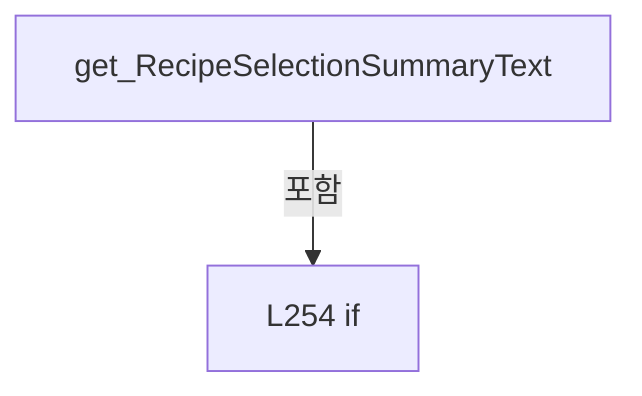

변경 전 점검: 입력/반환 타입, 위 호출자, 예외/취소 경로, 공유 상태와 저장·전송 소비자를 함께 확인합니다. 값의 단위나 물리 방향을 이름만으로 확정하지 않습니다.

### PropertyDeclaration `RecipeFiles` · L263–274

[Drilling.UI/Menu/Menus/CMenuRecipe.cs:263–274](https://github.com/kjuws10-rgb/A3Drilling/blob/0219666f9053b907d96d7e0aa7d0c6c1be3a73d4/Drilling.UI/Menu/Menus/CMenuRecipe.cs#L263-L274)

| 항목 | 실제 추출 값 |
| --- | --- |
| 서명 | System.Collections.Generic.IReadOnlyList<Drilling.UI.Menu.Menus.ST_RECIPE_FILE> Drilling.UI.Menu.Menus.CMenuRecipe.RecipeFiles |
| 접근/수식자 | Public / public |
| 반환/값 타입 | System.Collections.Generic.IReadOnlyList<Drilling.UI.Menu.Menus.ST_RECIPE_FILE> |
| 소속 타입 | NamedType:Drilling.UI.Menu.Menus.CMenuRecipe |

현재 부분 분석에서 직접 연결된 호출자는 없습니다. XAML/이벤트/인터페이스·델리게이트·외부 진입을 추가 확인해야 하며, 미사용으로 판정한 것이 아닙니다.

변경 전 점검: 입력/반환 타입, 위 호출자, 예외/취소 경로, 공유 상태와 저장·전송 소비자를 함께 확인합니다. 값의 단위나 물리 방향을 이름만으로 확정하지 않습니다.

### GetAccessorDeclaration `get_RecipeFiles` · L265–268

[Drilling.UI/Menu/Menus/CMenuRecipe.cs:265–268](https://github.com/kjuws10-rgb/A3Drilling/blob/0219666f9053b907d96d7e0aa7d0c6c1be3a73d4/Drilling.UI/Menu/Menus/CMenuRecipe.cs#L265-L268)

| 항목 | 실제 추출 값 |
| --- | --- |
| 서명 | System.Collections.Generic.IReadOnlyList<Drilling.UI.Menu.Menus.ST_RECIPE_FILE> Drilling.UI.Menu.Menus.CMenuRecipe.RecipeFiles.get |
| 접근/수식자 | Public / get |
| 반환/값 타입 | System.Collections.Generic.IReadOnlyList<Drilling.UI.Menu.Menus.ST_RECIPE_FILE> |
| 소속 타입 | NamedType:Drilling.UI.Menu.Menus.CMenuRecipe |

현재 부분 분석에서 직접 연결된 호출자는 없습니다. XAML/이벤트/인터페이스·델리게이트·외부 진입을 추가 확인해야 하며, 미사용으로 판정한 것이 아닙니다.

본문의 실제 연산·분기·예외·반환 순서(원문 위치 순):

| 원본 행 | 종류 | 주석 해설 |
| --- | --- | --- |
| 267 | return | 호출자에게 값 또는 제어를 반환합니다: return _recipeFiles; |

변경 전 점검: 입력/반환 타입, 위 호출자, 예외/취소 경로, 공유 상태와 저장·전송 소비자를 함께 확인합니다. 값의 단위나 물리 방향을 이름만으로 확정하지 않습니다.

### SetAccessorDeclaration `set_RecipeFiles` · L270–273

[Drilling.UI/Menu/Menus/CMenuRecipe.cs:270–273](https://github.com/kjuws10-rgb/A3Drilling/blob/0219666f9053b907d96d7e0aa7d0c6c1be3a73d4/Drilling.UI/Menu/Menus/CMenuRecipe.cs#L270-L273)

| 항목 | 실제 추출 값 |
| --- | --- |
| 서명 | void Drilling.UI.Menu.Menus.CMenuRecipe.RecipeFiles.set |
| 접근/수식자 | Private / private, set |
| 반환/값 타입 | void |
| 소속 타입 | NamedType:Drilling.UI.Menu.Menus.CMenuRecipe |

입력 계약:

| 이름 | 타입 | 전달 | 선택/기본값 |
| --- | --- | --- | --- |
| value | System.Collections.Generic.IReadOnlyList<Drilling.UI.Menu.Menus.ST_RECIPE_FILE> | None | False /  |

현재 부분 분석에서 직접 연결된 호출자는 없습니다. XAML/이벤트/인터페이스·델리게이트·외부 진입을 추가 확인해야 하며, 미사용으로 판정한 것이 아닙니다.

호출하는 대상과 해석 범위:

| 원본 행 | 표현식 | 분석 상태 | 대상/소스 위치 |
| --- | --- | --- | --- |
| 272 | SetSequenceProperty | resolved | bool Drilling.UI.Menu.CBindingBase.SetSequenceProperty<Drilling.UI.Menu.Menus.ST_RECIPE_FILE>(ref System.Collections.Generic.IReadOnlyList<Drilling.UI.Menu.Menus.ST_RECIPE_FILE>, System.Collections.Generic.IReadOnlyList<Drilling.UI.Menu.Menus.ST_RECIPE_FILE>, string?) · Drilling.UI/Menu/CBindingBase.cs:778 |

본문의 실제 연산·분기·예외·반환 순서(원문 위치 순):

| 원본 행 | 종류 | 주석 해설 |
| --- | --- | --- |
| 272 | call | 함수·델리게이트 또는 객체 생성자를 호출합니다: SetSequenceProperty(ref _recipeFiles, value) |

변경 전 점검: 입력/반환 타입, 위 호출자, 예외/취소 경로, 공유 상태와 저장·전송 소비자를 함께 확인합니다. 값의 단위나 물리 방향을 이름만으로 확정하지 않습니다.

### PropertyDeclaration `RecipeFilesPageText` · L276–287

[Drilling.UI/Menu/Menus/CMenuRecipe.cs:276–287](https://github.com/kjuws10-rgb/A3Drilling/blob/0219666f9053b907d96d7e0aa7d0c6c1be3a73d4/Drilling.UI/Menu/Menus/CMenuRecipe.cs#L276-L287)

| 항목 | 실제 추출 값 |
| --- | --- |
| 서명 | string Drilling.UI.Menu.Menus.CMenuRecipe.RecipeFilesPageText |
| 접근/수식자 | Public / public |
| 반환/값 타입 | string |
| 소속 타입 | NamedType:Drilling.UI.Menu.Menus.CMenuRecipe |

현재 부분 분석에서 직접 연결된 호출자는 없습니다. XAML/이벤트/인터페이스·델리게이트·외부 진입을 추가 확인해야 하며, 미사용으로 판정한 것이 아닙니다.

변경 전 점검: 입력/반환 타입, 위 호출자, 예외/취소 경로, 공유 상태와 저장·전송 소비자를 함께 확인합니다. 값의 단위나 물리 방향을 이름만으로 확정하지 않습니다.

### GetAccessorDeclaration `get_RecipeFilesPageText` · L278–281

[Drilling.UI/Menu/Menus/CMenuRecipe.cs:278–281](https://github.com/kjuws10-rgb/A3Drilling/blob/0219666f9053b907d96d7e0aa7d0c6c1be3a73d4/Drilling.UI/Menu/Menus/CMenuRecipe.cs#L278-L281)

| 항목 | 실제 추출 값 |
| --- | --- |
| 서명 | string Drilling.UI.Menu.Menus.CMenuRecipe.RecipeFilesPageText.get |
| 접근/수식자 | Public / get |
| 반환/값 타입 | string |
| 소속 타입 | NamedType:Drilling.UI.Menu.Menus.CMenuRecipe |

현재 부분 분석에서 직접 연결된 호출자는 없습니다. XAML/이벤트/인터페이스·델리게이트·외부 진입을 추가 확인해야 하며, 미사용으로 판정한 것이 아닙니다.

본문의 실제 연산·분기·예외·반환 순서(원문 위치 순):

| 원본 행 | 종류 | 주석 해설 |
| --- | --- | --- |
| 280 | return | 호출자에게 값 또는 제어를 반환합니다: return _recipeFilesPageText; |

변경 전 점검: 입력/반환 타입, 위 호출자, 예외/취소 경로, 공유 상태와 저장·전송 소비자를 함께 확인합니다. 값의 단위나 물리 방향을 이름만으로 확정하지 않습니다.

### SetAccessorDeclaration `set_RecipeFilesPageText` · L283–286

[Drilling.UI/Menu/Menus/CMenuRecipe.cs:283–286](https://github.com/kjuws10-rgb/A3Drilling/blob/0219666f9053b907d96d7e0aa7d0c6c1be3a73d4/Drilling.UI/Menu/Menus/CMenuRecipe.cs#L283-L286)

| 항목 | 실제 추출 값 |
| --- | --- |
| 서명 | void Drilling.UI.Menu.Menus.CMenuRecipe.RecipeFilesPageText.set |
| 접근/수식자 | Private / private, set |
| 반환/값 타입 | void |
| 소속 타입 | NamedType:Drilling.UI.Menu.Menus.CMenuRecipe |

입력 계약:

| 이름 | 타입 | 전달 | 선택/기본값 |
| --- | --- | --- | --- |
| value | string | None | False /  |

현재 부분 분석에서 직접 연결된 호출자는 없습니다. XAML/이벤트/인터페이스·델리게이트·외부 진입을 추가 확인해야 하며, 미사용으로 판정한 것이 아닙니다.

호출하는 대상과 해석 범위:

| 원본 행 | 표현식 | 분석 상태 | 대상/소스 위치 |
| --- | --- | --- | --- |
| 285 | SetProperty | resolved | bool Drilling.UI.Menu.CBindingBase.SetProperty<string>(ref string, string, string?) · Drilling.UI/Menu/CBindingBase.cs:766 |

본문의 실제 연산·분기·예외·반환 순서(원문 위치 순):

| 원본 행 | 종류 | 주석 해설 |
| --- | --- | --- |
| 285 | call | 함수·델리게이트 또는 객체 생성자를 호출합니다: SetProperty(ref _recipeFilesPageText, value) |

변경 전 점검: 입력/반환 타입, 위 호출자, 예외/취소 경로, 공유 상태와 저장·전송 소비자를 함께 확인합니다. 값의 단위나 물리 방향을 이름만으로 확정하지 않습니다.

### PropertyDeclaration `ItemTabs` · L289–289

[Drilling.UI/Menu/Menus/CMenuRecipe.cs:289–289](https://github.com/kjuws10-rgb/A3Drilling/blob/0219666f9053b907d96d7e0aa7d0c6c1be3a73d4/Drilling.UI/Menu/Menus/CMenuRecipe.cs#L289-L289)

| 항목 | 실제 추출 값 |
| --- | --- |
| 서명 | System.Collections.Generic.IReadOnlyList<Drilling.UI.Menu.Menus.ST_RECIPE_CATEGORY_TAB> Drilling.UI.Menu.Menus.CMenuRecipe.ItemTabs |
| 접근/수식자 | Public / public |
| 반환/값 타입 | System.Collections.Generic.IReadOnlyList<Drilling.UI.Menu.Menus.ST_RECIPE_CATEGORY_TAB> |
| 소속 타입 | NamedType:Drilling.UI.Menu.Menus.CMenuRecipe |

현재 부분 분석에서 직접 연결된 호출자는 없습니다. XAML/이벤트/인터페이스·델리게이트·외부 진입을 추가 확인해야 하며, 미사용으로 판정한 것이 아닙니다.

변경 전 점검: 입력/반환 타입, 위 호출자, 예외/취소 경로, 공유 상태와 저장·전송 소비자를 함께 확인합니다. 값의 단위나 물리 방향을 이름만으로 확정하지 않습니다.

### GetAccessorDeclaration `get_ItemTabs` · L289–289

[Drilling.UI/Menu/Menus/CMenuRecipe.cs:289–289](https://github.com/kjuws10-rgb/A3Drilling/blob/0219666f9053b907d96d7e0aa7d0c6c1be3a73d4/Drilling.UI/Menu/Menus/CMenuRecipe.cs#L289-L289)

| 항목 | 실제 추출 값 |
| --- | --- |
| 서명 | System.Collections.Generic.IReadOnlyList<Drilling.UI.Menu.Menus.ST_RECIPE_CATEGORY_TAB> Drilling.UI.Menu.Menus.CMenuRecipe.ItemTabs.get |
| 접근/수식자 | Public / get |
| 반환/값 타입 | System.Collections.Generic.IReadOnlyList<Drilling.UI.Menu.Menus.ST_RECIPE_CATEGORY_TAB> |
| 소속 타입 | NamedType:Drilling.UI.Menu.Menus.CMenuRecipe |

현재 부분 분석에서 직접 연결된 호출자는 없습니다. XAML/이벤트/인터페이스·델리게이트·외부 진입을 추가 확인해야 하며, 미사용으로 판정한 것이 아닙니다.

변경 전 점검: 입력/반환 타입, 위 호출자, 예외/취소 경로, 공유 상태와 저장·전송 소비자를 함께 확인합니다. 값의 단위나 물리 방향을 이름만으로 확정하지 않습니다.

### SetAccessorDeclaration `set_ItemTabs` · L289–289

[Drilling.UI/Menu/Menus/CMenuRecipe.cs:289–289](https://github.com/kjuws10-rgb/A3Drilling/blob/0219666f9053b907d96d7e0aa7d0c6c1be3a73d4/Drilling.UI/Menu/Menus/CMenuRecipe.cs#L289-L289)

| 항목 | 실제 추출 값 |
| --- | --- |
| 서명 | void Drilling.UI.Menu.Menus.CMenuRecipe.ItemTabs.set |
| 접근/수식자 | Private / private, set |
| 반환/값 타입 | void |
| 소속 타입 | NamedType:Drilling.UI.Menu.Menus.CMenuRecipe |

입력 계약:

| 이름 | 타입 | 전달 | 선택/기본값 |
| --- | --- | --- | --- |
| value | System.Collections.Generic.IReadOnlyList<Drilling.UI.Menu.Menus.ST_RECIPE_CATEGORY_TAB> | None | False /  |

현재 부분 분석에서 직접 연결된 호출자는 없습니다. XAML/이벤트/인터페이스·델리게이트·외부 진입을 추가 확인해야 하며, 미사용으로 판정한 것이 아닙니다.

변경 전 점검: 입력/반환 타입, 위 호출자, 예외/취소 경로, 공유 상태와 저장·전송 소비자를 함께 확인합니다. 값의 단위나 물리 방향을 이름만으로 확정하지 않습니다.

### PropertyDeclaration `GroupTabs` · L290–290

[Drilling.UI/Menu/Menus/CMenuRecipe.cs:290–290](https://github.com/kjuws10-rgb/A3Drilling/blob/0219666f9053b907d96d7e0aa7d0c6c1be3a73d4/Drilling.UI/Menu/Menus/CMenuRecipe.cs#L290-L290)

| 항목 | 실제 추출 값 |
| --- | --- |
| 서명 | System.Collections.Generic.IReadOnlyList<Drilling.UI.Menu.Menus.ST_RECIPE_GROUP_TAB> Drilling.UI.Menu.Menus.CMenuRecipe.GroupTabs |
| 접근/수식자 | Public / public |
| 반환/값 타입 | System.Collections.Generic.IReadOnlyList<Drilling.UI.Menu.Menus.ST_RECIPE_GROUP_TAB> |
| 소속 타입 | NamedType:Drilling.UI.Menu.Menus.CMenuRecipe |

현재 부분 분석에서 직접 연결된 호출자는 없습니다. XAML/이벤트/인터페이스·델리게이트·외부 진입을 추가 확인해야 하며, 미사용으로 판정한 것이 아닙니다.

변경 전 점검: 입력/반환 타입, 위 호출자, 예외/취소 경로, 공유 상태와 저장·전송 소비자를 함께 확인합니다. 값의 단위나 물리 방향을 이름만으로 확정하지 않습니다.

### GetAccessorDeclaration `get_GroupTabs` · L290–290

[Drilling.UI/Menu/Menus/CMenuRecipe.cs:290–290](https://github.com/kjuws10-rgb/A3Drilling/blob/0219666f9053b907d96d7e0aa7d0c6c1be3a73d4/Drilling.UI/Menu/Menus/CMenuRecipe.cs#L290-L290)

| 항목 | 실제 추출 값 |
| --- | --- |
| 서명 | System.Collections.Generic.IReadOnlyList<Drilling.UI.Menu.Menus.ST_RECIPE_GROUP_TAB> Drilling.UI.Menu.Menus.CMenuRecipe.GroupTabs.get |
| 접근/수식자 | Public / get |
| 반환/값 타입 | System.Collections.Generic.IReadOnlyList<Drilling.UI.Menu.Menus.ST_RECIPE_GROUP_TAB> |
| 소속 타입 | NamedType:Drilling.UI.Menu.Menus.CMenuRecipe |

현재 부분 분석에서 직접 연결된 호출자는 없습니다. XAML/이벤트/인터페이스·델리게이트·외부 진입을 추가 확인해야 하며, 미사용으로 판정한 것이 아닙니다.

변경 전 점검: 입력/반환 타입, 위 호출자, 예외/취소 경로, 공유 상태와 저장·전송 소비자를 함께 확인합니다. 값의 단위나 물리 방향을 이름만으로 확정하지 않습니다.

### SetAccessorDeclaration `set_GroupTabs` · L290–290

[Drilling.UI/Menu/Menus/CMenuRecipe.cs:290–290](https://github.com/kjuws10-rgb/A3Drilling/blob/0219666f9053b907d96d7e0aa7d0c6c1be3a73d4/Drilling.UI/Menu/Menus/CMenuRecipe.cs#L290-L290)

| 항목 | 실제 추출 값 |
| --- | --- |
| 서명 | void Drilling.UI.Menu.Menus.CMenuRecipe.GroupTabs.set |
| 접근/수식자 | Private / private, set |
| 반환/값 타입 | void |
| 소속 타입 | NamedType:Drilling.UI.Menu.Menus.CMenuRecipe |

입력 계약:

| 이름 | 타입 | 전달 | 선택/기본값 |
| --- | --- | --- | --- |
| value | System.Collections.Generic.IReadOnlyList<Drilling.UI.Menu.Menus.ST_RECIPE_GROUP_TAB> | None | False /  |

현재 부분 분석에서 직접 연결된 호출자는 없습니다. XAML/이벤트/인터페이스·델리게이트·외부 진입을 추가 확인해야 하며, 미사용으로 판정한 것이 아닙니다.

변경 전 점검: 입력/반환 타입, 위 호출자, 예외/취소 경로, 공유 상태와 저장·전송 소비자를 함께 확인합니다. 값의 단위나 물리 방향을 이름만으로 확정하지 않습니다.

### PropertyDeclaration `CellOverviewRows` · L291–291

[Drilling.UI/Menu/Menus/CMenuRecipe.cs:291–291](https://github.com/kjuws10-rgb/A3Drilling/blob/0219666f9053b907d96d7e0aa7d0c6c1be3a73d4/Drilling.UI/Menu/Menus/CMenuRecipe.cs#L291-L291)

| 항목 | 실제 추출 값 |
| --- | --- |
| 서명 | System.Collections.Generic.IReadOnlyList<Drilling.UI.Menu.Menus.ST_RECIPE_CELL_OVERVIEW_ROW> Drilling.UI.Menu.Menus.CMenuRecipe.CellOverviewRows |
| 접근/수식자 | Public / public |
| 반환/값 타입 | System.Collections.Generic.IReadOnlyList<Drilling.UI.Menu.Menus.ST_RECIPE_CELL_OVERVIEW_ROW> |
| 소속 타입 | NamedType:Drilling.UI.Menu.Menus.CMenuRecipe |

현재 부분 분석에서 직접 연결된 호출자는 없습니다. XAML/이벤트/인터페이스·델리게이트·외부 진입을 추가 확인해야 하며, 미사용으로 판정한 것이 아닙니다.

변경 전 점검: 입력/반환 타입, 위 호출자, 예외/취소 경로, 공유 상태와 저장·전송 소비자를 함께 확인합니다. 값의 단위나 물리 방향을 이름만으로 확정하지 않습니다.

### GetAccessorDeclaration `get_CellOverviewRows` · L291–291

[Drilling.UI/Menu/Menus/CMenuRecipe.cs:291–291](https://github.com/kjuws10-rgb/A3Drilling/blob/0219666f9053b907d96d7e0aa7d0c6c1be3a73d4/Drilling.UI/Menu/Menus/CMenuRecipe.cs#L291-L291)

| 항목 | 실제 추출 값 |
| --- | --- |
| 서명 | System.Collections.Generic.IReadOnlyList<Drilling.UI.Menu.Menus.ST_RECIPE_CELL_OVERVIEW_ROW> Drilling.UI.Menu.Menus.CMenuRecipe.CellOverviewRows.get |
| 접근/수식자 | Public / get |
| 반환/값 타입 | System.Collections.Generic.IReadOnlyList<Drilling.UI.Menu.Menus.ST_RECIPE_CELL_OVERVIEW_ROW> |
| 소속 타입 | NamedType:Drilling.UI.Menu.Menus.CMenuRecipe |

현재 부분 분석에서 직접 연결된 호출자는 없습니다. XAML/이벤트/인터페이스·델리게이트·외부 진입을 추가 확인해야 하며, 미사용으로 판정한 것이 아닙니다.

변경 전 점검: 입력/반환 타입, 위 호출자, 예외/취소 경로, 공유 상태와 저장·전송 소비자를 함께 확인합니다. 값의 단위나 물리 방향을 이름만으로 확정하지 않습니다.

### SetAccessorDeclaration `set_CellOverviewRows` · L291–291

[Drilling.UI/Menu/Menus/CMenuRecipe.cs:291–291](https://github.com/kjuws10-rgb/A3Drilling/blob/0219666f9053b907d96d7e0aa7d0c6c1be3a73d4/Drilling.UI/Menu/Menus/CMenuRecipe.cs#L291-L291)

| 항목 | 실제 추출 값 |
| --- | --- |
| 서명 | void Drilling.UI.Menu.Menus.CMenuRecipe.CellOverviewRows.set |
| 접근/수식자 | Private / private, set |
| 반환/값 타입 | void |
| 소속 타입 | NamedType:Drilling.UI.Menu.Menus.CMenuRecipe |

입력 계약:

| 이름 | 타입 | 전달 | 선택/기본값 |
| --- | --- | --- | --- |
| value | System.Collections.Generic.IReadOnlyList<Drilling.UI.Menu.Menus.ST_RECIPE_CELL_OVERVIEW_ROW> | None | False /  |

현재 부분 분석에서 직접 연결된 호출자는 없습니다. XAML/이벤트/인터페이스·델리게이트·외부 진입을 추가 확인해야 하며, 미사용으로 판정한 것이 아닙니다.

변경 전 점검: 입력/반환 타입, 위 호출자, 예외/취소 경로, 공유 상태와 저장·전송 소비자를 함께 확인합니다. 값의 단위나 물리 방향을 이름만으로 확정하지 않습니다.

### PropertyDeclaration `ShotGroupRows` · L292–292

[Drilling.UI/Menu/Menus/CMenuRecipe.cs:292–292](https://github.com/kjuws10-rgb/A3Drilling/blob/0219666f9053b907d96d7e0aa7d0c6c1be3a73d4/Drilling.UI/Menu/Menus/CMenuRecipe.cs#L292-L292)

| 항목 | 실제 추출 값 |
| --- | --- |
| 서명 | System.Collections.Generic.IReadOnlyList<Drilling.UI.Menu.Menus.ST_SHOT_GROUP_EDITOR_ROW> Drilling.UI.Menu.Menus.CMenuRecipe.ShotGroupRows |
| 접근/수식자 | Public / public |
| 반환/값 타입 | System.Collections.Generic.IReadOnlyList<Drilling.UI.Menu.Menus.ST_SHOT_GROUP_EDITOR_ROW> |
| 소속 타입 | NamedType:Drilling.UI.Menu.Menus.CMenuRecipe |

현재 부분 분석에서 직접 연결된 호출자는 없습니다. XAML/이벤트/인터페이스·델리게이트·외부 진입을 추가 확인해야 하며, 미사용으로 판정한 것이 아닙니다.

변경 전 점검: 입력/반환 타입, 위 호출자, 예외/취소 경로, 공유 상태와 저장·전송 소비자를 함께 확인합니다. 값의 단위나 물리 방향을 이름만으로 확정하지 않습니다.

### GetAccessorDeclaration `get_ShotGroupRows` · L292–292

[Drilling.UI/Menu/Menus/CMenuRecipe.cs:292–292](https://github.com/kjuws10-rgb/A3Drilling/blob/0219666f9053b907d96d7e0aa7d0c6c1be3a73d4/Drilling.UI/Menu/Menus/CMenuRecipe.cs#L292-L292)

| 항목 | 실제 추출 값 |
| --- | --- |
| 서명 | System.Collections.Generic.IReadOnlyList<Drilling.UI.Menu.Menus.ST_SHOT_GROUP_EDITOR_ROW> Drilling.UI.Menu.Menus.CMenuRecipe.ShotGroupRows.get |
| 접근/수식자 | Public / get |
| 반환/값 타입 | System.Collections.Generic.IReadOnlyList<Drilling.UI.Menu.Menus.ST_SHOT_GROUP_EDITOR_ROW> |
| 소속 타입 | NamedType:Drilling.UI.Menu.Menus.CMenuRecipe |

현재 부분 분석에서 직접 연결된 호출자는 없습니다. XAML/이벤트/인터페이스·델리게이트·외부 진입을 추가 확인해야 하며, 미사용으로 판정한 것이 아닙니다.

변경 전 점검: 입력/반환 타입, 위 호출자, 예외/취소 경로, 공유 상태와 저장·전송 소비자를 함께 확인합니다. 값의 단위나 물리 방향을 이름만으로 확정하지 않습니다.

### SetAccessorDeclaration `set_ShotGroupRows` · L292–292

[Drilling.UI/Menu/Menus/CMenuRecipe.cs:292–292](https://github.com/kjuws10-rgb/A3Drilling/blob/0219666f9053b907d96d7e0aa7d0c6c1be3a73d4/Drilling.UI/Menu/Menus/CMenuRecipe.cs#L292-L292)

| 항목 | 실제 추출 값 |
| --- | --- |
| 서명 | void Drilling.UI.Menu.Menus.CMenuRecipe.ShotGroupRows.set |
| 접근/수식자 | Private / private, set |
| 반환/값 타입 | void |
| 소속 타입 | NamedType:Drilling.UI.Menu.Menus.CMenuRecipe |

입력 계약:

| 이름 | 타입 | 전달 | 선택/기본값 |
| --- | --- | --- | --- |
| value | System.Collections.Generic.IReadOnlyList<Drilling.UI.Menu.Menus.ST_SHOT_GROUP_EDITOR_ROW> | None | False /  |

현재 부분 분석에서 직접 연결된 호출자는 없습니다. XAML/이벤트/인터페이스·델리게이트·외부 진입을 추가 확인해야 하며, 미사용으로 판정한 것이 아닙니다.

변경 전 점검: 입력/반환 타입, 위 호출자, 예외/취소 경로, 공유 상태와 저장·전송 소비자를 함께 확인합니다. 값의 단위나 물리 방향을 이름만으로 확정하지 않습니다.

### PropertyDeclaration `SelectedShotGroup` · L294–322

[Drilling.UI/Menu/Menus/CMenuRecipe.cs:294–322](https://github.com/kjuws10-rgb/A3Drilling/blob/0219666f9053b907d96d7e0aa7d0c6c1be3a73d4/Drilling.UI/Menu/Menus/CMenuRecipe.cs#L294-L322)

| 항목 | 실제 추출 값 |
| --- | --- |
| 서명 | Drilling.UI.Menu.Menus.ST_SHOT_GROUP_EDITOR_ROW? Drilling.UI.Menu.Menus.CMenuRecipe.SelectedShotGroup |
| 접근/수식자 | Public / public |
| 반환/값 타입 | Drilling.UI.Menu.Menus.ST_SHOT_GROUP_EDITOR_ROW? |
| 소속 타입 | NamedType:Drilling.UI.Menu.Menus.CMenuRecipe |

현재 부분 분석에서 직접 연결된 호출자는 없습니다. XAML/이벤트/인터페이스·델리게이트·외부 진입을 추가 확인해야 하며, 미사용으로 판정한 것이 아닙니다.

변경 전 점검: 입력/반환 타입, 위 호출자, 예외/취소 경로, 공유 상태와 저장·전송 소비자를 함께 확인합니다. 값의 단위나 물리 방향을 이름만으로 확정하지 않습니다.

### GetAccessorDeclaration `get_SelectedShotGroup` · L296–299

[Drilling.UI/Menu/Menus/CMenuRecipe.cs:296–299](https://github.com/kjuws10-rgb/A3Drilling/blob/0219666f9053b907d96d7e0aa7d0c6c1be3a73d4/Drilling.UI/Menu/Menus/CMenuRecipe.cs#L296-L299)

| 항목 | 실제 추출 값 |
| --- | --- |
| 서명 | Drilling.UI.Menu.Menus.ST_SHOT_GROUP_EDITOR_ROW? Drilling.UI.Menu.Menus.CMenuRecipe.SelectedShotGroup.get |
| 접근/수식자 | Public / get |
| 반환/값 타입 | Drilling.UI.Menu.Menus.ST_SHOT_GROUP_EDITOR_ROW? |
| 소속 타입 | NamedType:Drilling.UI.Menu.Menus.CMenuRecipe |

현재 부분 분석에서 직접 연결된 호출자는 없습니다. XAML/이벤트/인터페이스·델리게이트·외부 진입을 추가 확인해야 하며, 미사용으로 판정한 것이 아닙니다.

본문의 실제 연산·분기·예외·반환 순서(원문 위치 순):

| 원본 행 | 종류 | 주석 해설 |
| --- | --- | --- |
| 298 | return | 호출자에게 값 또는 제어를 반환합니다: return _selectedShotGroup; |

변경 전 점검: 입력/반환 타입, 위 호출자, 예외/취소 경로, 공유 상태와 저장·전송 소비자를 함께 확인합니다. 값의 단위나 물리 방향을 이름만으로 확정하지 않습니다.

### SetAccessorDeclaration `set_SelectedShotGroup` · L301–321

[Drilling.UI/Menu/Menus/CMenuRecipe.cs:301–321](https://github.com/kjuws10-rgb/A3Drilling/blob/0219666f9053b907d96d7e0aa7d0c6c1be3a73d4/Drilling.UI/Menu/Menus/CMenuRecipe.cs#L301-L321)

| 항목 | 실제 추출 값 |
| --- | --- |
| 서명 | void Drilling.UI.Menu.Menus.CMenuRecipe.SelectedShotGroup.set |
| 접근/수식자 | Public / set |
| 반환/값 타입 | void |
| 소속 타입 | NamedType:Drilling.UI.Menu.Menus.CMenuRecipe |

입력 계약:

| 이름 | 타입 | 전달 | 선택/기본값 |
| --- | --- | --- | --- |
| value | Drilling.UI.Menu.Menus.ST_SHOT_GROUP_EDITOR_ROW? | None | False /  |

현재 부분 분석에서 직접 연결된 호출자는 없습니다. XAML/이벤트/인터페이스·델리게이트·외부 진입을 추가 확인해야 하며, 미사용으로 판정한 것이 아닙니다.

호출하는 대상과 해석 범위:

| 원본 행 | 표현식 | 분석 상태 | 대상/소스 위치 |
| --- | --- | --- | --- |
| 303 | SetProperty | resolved | bool Drilling.UI.Menu.CBindingBase.SetProperty<Drilling.UI.Menu.Menus.ST_SHOT_GROUP_EDITOR_ROW?>(ref Drilling.UI.Menu.Menus.ST_SHOT_GROUP_EDITOR_ROW?, Drilling.UI.Menu.Menus.ST_SHOT_GROUP_EDITOR_ROW?, string?) · Drilling.UI/Menu/CBindingBase.cs:766 |
| 318 | OnPropertyChanged | resolved | void Drilling.UI.Menu.CBindingBase.OnPropertyChanged(string?) · Drilling.UI/Menu/CBindingBase.cs:790 |
| 318 | nameof | unresolved | None |
| 319 | NavigateShotGroupCommand.NotifyCanExecuteChanged | resolved | void Drilling.UI.Menu.CButtonCommand.NotifyCanExecuteChanged() · Drilling.UI/Menu/CButtonCommand.cs:24 |
| 320 | RefreshCellPatternViewer | resolved | void Drilling.UI.Menu.Menus.CMenuRecipe.RefreshCellPatternViewer() · Drilling.UI/Menu/Menus/CMenuRecipe.cs:2078 |

본문의 실제 연산·분기·예외·반환 순서(원문 위치 순):

| 원본 행 | 종류 | 주석 해설 |
| --- | --- | --- |
| 303 | call | 함수·델리게이트 또는 객체 생성자를 호출합니다: SetProperty(ref _selectedShotGroup, value) |
| 303 | if | 조건에 따라 분기합니다: if (!SetProperty(ref _selectedShotGroup, value)) |
| 305 | return | 호출자에게 값 또는 제어를 반환합니다: return; |
| 308 | if | 조건에 따라 분기합니다: if (value is not null) |
| 310 | assignment | 값을 대상에 대입합니다: _selectedCellShotNo = value.CellShotNo |
| 313 | foreach | 컬렉션 요소를 순회합니다: foreach (var row in ShotGroupRows) |
| 315 | assignment | 값을 대상에 대입합니다: row.IsSelected = value is not null && row.CellShotNo == value.CellShotNo |
| 318 | call | 함수·델리게이트 또는 객체 생성자를 호출합니다: OnPropertyChanged(nameof(SelectedShotGroupIndicatorText)) |
| 318 | call | 함수·델리게이트 또는 객체 생성자를 호출합니다: nameof(SelectedShotGroupIndicatorText) |
| 319 | call | 함수·델리게이트 또는 객체 생성자를 호출합니다: NavigateShotGroupCommand.NotifyCanExecuteChanged() |
| 320 | call | 함수·델리게이트 또는 객체 생성자를 호출합니다: RefreshCellPatternViewer() |

제어 구문의 포함 구조(실제 실행 순서/CFG가 아닌 구문 탐색 그림):

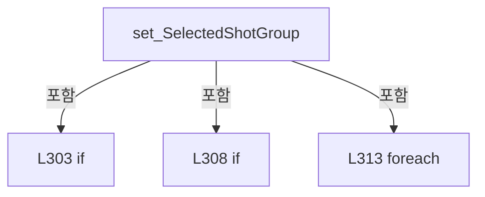

변경 전 점검: 입력/반환 타입, 위 호출자, 예외/취소 경로, 공유 상태와 저장·전송 소비자를 함께 확인합니다. 값의 단위나 물리 방향을 이름만으로 확정하지 않습니다.

### PropertyDeclaration `GlassSizeXItem` · L324–324

[Drilling.UI/Menu/Menus/CMenuRecipe.cs:324–324](https://github.com/kjuws10-rgb/A3Drilling/blob/0219666f9053b907d96d7e0aa7d0c6c1be3a73d4/Drilling.UI/Menu/Menus/CMenuRecipe.cs#L324-L324)

| 항목 | 실제 추출 값 |
| --- | --- |
| 서명 | Drilling.UI.Menu.Menus.ST_RECIPE_PARAMETER_EDITOR_ITEM? Drilling.UI.Menu.Menus.CMenuRecipe.GlassSizeXItem |
| 접근/수식자 | Public / public |
| 반환/값 타입 | Drilling.UI.Menu.Menus.ST_RECIPE_PARAMETER_EDITOR_ITEM? |
| 소속 타입 | NamedType:Drilling.UI.Menu.Menus.CMenuRecipe |

현재 부분 분석에서 직접 연결된 호출자는 없습니다. XAML/이벤트/인터페이스·델리게이트·외부 진입을 추가 확인해야 하며, 미사용으로 판정한 것이 아닙니다.

변경 전 점검: 입력/반환 타입, 위 호출자, 예외/취소 경로, 공유 상태와 저장·전송 소비자를 함께 확인합니다. 값의 단위나 물리 방향을 이름만으로 확정하지 않습니다.

### GetAccessorDeclaration `get_GlassSizeXItem` · L324–324

[Drilling.UI/Menu/Menus/CMenuRecipe.cs:324–324](https://github.com/kjuws10-rgb/A3Drilling/blob/0219666f9053b907d96d7e0aa7d0c6c1be3a73d4/Drilling.UI/Menu/Menus/CMenuRecipe.cs#L324-L324)

| 항목 | 실제 추출 값 |
| --- | --- |
| 서명 | Drilling.UI.Menu.Menus.ST_RECIPE_PARAMETER_EDITOR_ITEM? Drilling.UI.Menu.Menus.CMenuRecipe.GlassSizeXItem.get |
| 접근/수식자 | Public / get |
| 반환/값 타입 | Drilling.UI.Menu.Menus.ST_RECIPE_PARAMETER_EDITOR_ITEM? |
| 소속 타입 | NamedType:Drilling.UI.Menu.Menus.CMenuRecipe |

현재 부분 분석에서 직접 연결된 호출자는 없습니다. XAML/이벤트/인터페이스·델리게이트·외부 진입을 추가 확인해야 하며, 미사용으로 판정한 것이 아닙니다.

변경 전 점검: 입력/반환 타입, 위 호출자, 예외/취소 경로, 공유 상태와 저장·전송 소비자를 함께 확인합니다. 값의 단위나 물리 방향을 이름만으로 확정하지 않습니다.

### SetAccessorDeclaration `set_GlassSizeXItem` · L324–324

[Drilling.UI/Menu/Menus/CMenuRecipe.cs:324–324](https://github.com/kjuws10-rgb/A3Drilling/blob/0219666f9053b907d96d7e0aa7d0c6c1be3a73d4/Drilling.UI/Menu/Menus/CMenuRecipe.cs#L324-L324)

| 항목 | 실제 추출 값 |
| --- | --- |
| 서명 | void Drilling.UI.Menu.Menus.CMenuRecipe.GlassSizeXItem.set |
| 접근/수식자 | Private / private, set |
| 반환/값 타입 | void |
| 소속 타입 | NamedType:Drilling.UI.Menu.Menus.CMenuRecipe |

입력 계약:

| 이름 | 타입 | 전달 | 선택/기본값 |
| --- | --- | --- | --- |
| value | Drilling.UI.Menu.Menus.ST_RECIPE_PARAMETER_EDITOR_ITEM? | None | False /  |

현재 부분 분석에서 직접 연결된 호출자는 없습니다. XAML/이벤트/인터페이스·델리게이트·외부 진입을 추가 확인해야 하며, 미사용으로 판정한 것이 아닙니다.

변경 전 점검: 입력/반환 타입, 위 호출자, 예외/취소 경로, 공유 상태와 저장·전송 소비자를 함께 확인합니다. 값의 단위나 물리 방향을 이름만으로 확정하지 않습니다.

### PropertyDeclaration `GlassSizeYItem` · L325–325

[Drilling.UI/Menu/Menus/CMenuRecipe.cs:325–325](https://github.com/kjuws10-rgb/A3Drilling/blob/0219666f9053b907d96d7e0aa7d0c6c1be3a73d4/Drilling.UI/Menu/Menus/CMenuRecipe.cs#L325-L325)

| 항목 | 실제 추출 값 |
| --- | --- |
| 서명 | Drilling.UI.Menu.Menus.ST_RECIPE_PARAMETER_EDITOR_ITEM? Drilling.UI.Menu.Menus.CMenuRecipe.GlassSizeYItem |
| 접근/수식자 | Public / public |
| 반환/값 타입 | Drilling.UI.Menu.Menus.ST_RECIPE_PARAMETER_EDITOR_ITEM? |
| 소속 타입 | NamedType:Drilling.UI.Menu.Menus.CMenuRecipe |

현재 부분 분석에서 직접 연결된 호출자는 없습니다. XAML/이벤트/인터페이스·델리게이트·외부 진입을 추가 확인해야 하며, 미사용으로 판정한 것이 아닙니다.

변경 전 점검: 입력/반환 타입, 위 호출자, 예외/취소 경로, 공유 상태와 저장·전송 소비자를 함께 확인합니다. 값의 단위나 물리 방향을 이름만으로 확정하지 않습니다.

### GetAccessorDeclaration `get_GlassSizeYItem` · L325–325

[Drilling.UI/Menu/Menus/CMenuRecipe.cs:325–325](https://github.com/kjuws10-rgb/A3Drilling/blob/0219666f9053b907d96d7e0aa7d0c6c1be3a73d4/Drilling.UI/Menu/Menus/CMenuRecipe.cs#L325-L325)

| 항목 | 실제 추출 값 |
| --- | --- |
| 서명 | Drilling.UI.Menu.Menus.ST_RECIPE_PARAMETER_EDITOR_ITEM? Drilling.UI.Menu.Menus.CMenuRecipe.GlassSizeYItem.get |
| 접근/수식자 | Public / get |
| 반환/값 타입 | Drilling.UI.Menu.Menus.ST_RECIPE_PARAMETER_EDITOR_ITEM? |
| 소속 타입 | NamedType:Drilling.UI.Menu.Menus.CMenuRecipe |

현재 부분 분석에서 직접 연결된 호출자는 없습니다. XAML/이벤트/인터페이스·델리게이트·외부 진입을 추가 확인해야 하며, 미사용으로 판정한 것이 아닙니다.

변경 전 점검: 입력/반환 타입, 위 호출자, 예외/취소 경로, 공유 상태와 저장·전송 소비자를 함께 확인합니다. 값의 단위나 물리 방향을 이름만으로 확정하지 않습니다.

### SetAccessorDeclaration `set_GlassSizeYItem` · L325–325

[Drilling.UI/Menu/Menus/CMenuRecipe.cs:325–325](https://github.com/kjuws10-rgb/A3Drilling/blob/0219666f9053b907d96d7e0aa7d0c6c1be3a73d4/Drilling.UI/Menu/Menus/CMenuRecipe.cs#L325-L325)

| 항목 | 실제 추출 값 |
| --- | --- |
| 서명 | void Drilling.UI.Menu.Menus.CMenuRecipe.GlassSizeYItem.set |
| 접근/수식자 | Private / private, set |
| 반환/값 타입 | void |
| 소속 타입 | NamedType:Drilling.UI.Menu.Menus.CMenuRecipe |

입력 계약:

| 이름 | 타입 | 전달 | 선택/기본값 |
| --- | --- | --- | --- |
| value | Drilling.UI.Menu.Menus.ST_RECIPE_PARAMETER_EDITOR_ITEM? | None | False /  |

현재 부분 분석에서 직접 연결된 호출자는 없습니다. XAML/이벤트/인터페이스·델리게이트·외부 진입을 추가 확인해야 하며, 미사용으로 판정한 것이 아닙니다.

변경 전 점검: 입력/반환 타입, 위 호출자, 예외/취소 경로, 공유 상태와 저장·전송 소비자를 함께 확인합니다. 값의 단위나 물리 방향을 이름만으로 확정하지 않습니다.

### PropertyDeclaration `MaxCellNumberItem` · L326–326

[Drilling.UI/Menu/Menus/CMenuRecipe.cs:326–326](https://github.com/kjuws10-rgb/A3Drilling/blob/0219666f9053b907d96d7e0aa7d0c6c1be3a73d4/Drilling.UI/Menu/Menus/CMenuRecipe.cs#L326-L326)

| 항목 | 실제 추출 값 |
| --- | --- |
| 서명 | Drilling.UI.Menu.Menus.ST_RECIPE_PARAMETER_EDITOR_ITEM? Drilling.UI.Menu.Menus.CMenuRecipe.MaxCellNumberItem |
| 접근/수식자 | Public / public |
| 반환/값 타입 | Drilling.UI.Menu.Menus.ST_RECIPE_PARAMETER_EDITOR_ITEM? |
| 소속 타입 | NamedType:Drilling.UI.Menu.Menus.CMenuRecipe |

현재 부분 분석에서 직접 연결된 호출자는 없습니다. XAML/이벤트/인터페이스·델리게이트·외부 진입을 추가 확인해야 하며, 미사용으로 판정한 것이 아닙니다.

변경 전 점검: 입력/반환 타입, 위 호출자, 예외/취소 경로, 공유 상태와 저장·전송 소비자를 함께 확인합니다. 값의 단위나 물리 방향을 이름만으로 확정하지 않습니다.

### GetAccessorDeclaration `get_MaxCellNumberItem` · L326–326

[Drilling.UI/Menu/Menus/CMenuRecipe.cs:326–326](https://github.com/kjuws10-rgb/A3Drilling/blob/0219666f9053b907d96d7e0aa7d0c6c1be3a73d4/Drilling.UI/Menu/Menus/CMenuRecipe.cs#L326-L326)

| 항목 | 실제 추출 값 |
| --- | --- |
| 서명 | Drilling.UI.Menu.Menus.ST_RECIPE_PARAMETER_EDITOR_ITEM? Drilling.UI.Menu.Menus.CMenuRecipe.MaxCellNumberItem.get |
| 접근/수식자 | Public / get |
| 반환/값 타입 | Drilling.UI.Menu.Menus.ST_RECIPE_PARAMETER_EDITOR_ITEM? |
| 소속 타입 | NamedType:Drilling.UI.Menu.Menus.CMenuRecipe |

현재 부분 분석에서 직접 연결된 호출자는 없습니다. XAML/이벤트/인터페이스·델리게이트·외부 진입을 추가 확인해야 하며, 미사용으로 판정한 것이 아닙니다.

변경 전 점검: 입력/반환 타입, 위 호출자, 예외/취소 경로, 공유 상태와 저장·전송 소비자를 함께 확인합니다. 값의 단위나 물리 방향을 이름만으로 확정하지 않습니다.

### SetAccessorDeclaration `set_MaxCellNumberItem` · L326–326

[Drilling.UI/Menu/Menus/CMenuRecipe.cs:326–326](https://github.com/kjuws10-rgb/A3Drilling/blob/0219666f9053b907d96d7e0aa7d0c6c1be3a73d4/Drilling.UI/Menu/Menus/CMenuRecipe.cs#L326-L326)

| 항목 | 실제 추출 값 |
| --- | --- |
| 서명 | void Drilling.UI.Menu.Menus.CMenuRecipe.MaxCellNumberItem.set |
| 접근/수식자 | Private / private, set |
| 반환/값 타입 | void |
| 소속 타입 | NamedType:Drilling.UI.Menu.Menus.CMenuRecipe |

입력 계약:

| 이름 | 타입 | 전달 | 선택/기본값 |
| --- | --- | --- | --- |
| value | Drilling.UI.Menu.Menus.ST_RECIPE_PARAMETER_EDITOR_ITEM? | None | False /  |

현재 부분 분석에서 직접 연결된 호출자는 없습니다. XAML/이벤트/인터페이스·델리게이트·외부 진입을 추가 확인해야 하며, 미사용으로 판정한 것이 아닙니다.

변경 전 점검: 입력/반환 타입, 위 호출자, 예외/취소 경로, 공유 상태와 저장·전송 소비자를 함께 확인합니다. 값의 단위나 물리 방향을 이름만으로 확정하지 않습니다.

### PropertyDeclaration `PixelSizeItem` · L327–327

[Drilling.UI/Menu/Menus/CMenuRecipe.cs:327–327](https://github.com/kjuws10-rgb/A3Drilling/blob/0219666f9053b907d96d7e0aa7d0c6c1be3a73d4/Drilling.UI/Menu/Menus/CMenuRecipe.cs#L327-L327)

| 항목 | 실제 추출 값 |
| --- | --- |
| 서명 | Drilling.UI.Menu.Menus.ST_RECIPE_PARAMETER_EDITOR_ITEM? Drilling.UI.Menu.Menus.CMenuRecipe.PixelSizeItem |
| 접근/수식자 | Public / public |
| 반환/값 타입 | Drilling.UI.Menu.Menus.ST_RECIPE_PARAMETER_EDITOR_ITEM? |
| 소속 타입 | NamedType:Drilling.UI.Menu.Menus.CMenuRecipe |

현재 부분 분석에서 직접 연결된 호출자는 없습니다. XAML/이벤트/인터페이스·델리게이트·외부 진입을 추가 확인해야 하며, 미사용으로 판정한 것이 아닙니다.

변경 전 점검: 입력/반환 타입, 위 호출자, 예외/취소 경로, 공유 상태와 저장·전송 소비자를 함께 확인합니다. 값의 단위나 물리 방향을 이름만으로 확정하지 않습니다.

### GetAccessorDeclaration `get_PixelSizeItem` · L327–327

[Drilling.UI/Menu/Menus/CMenuRecipe.cs:327–327](https://github.com/kjuws10-rgb/A3Drilling/blob/0219666f9053b907d96d7e0aa7d0c6c1be3a73d4/Drilling.UI/Menu/Menus/CMenuRecipe.cs#L327-L327)

| 항목 | 실제 추출 값 |
| --- | --- |
| 서명 | Drilling.UI.Menu.Menus.ST_RECIPE_PARAMETER_EDITOR_ITEM? Drilling.UI.Menu.Menus.CMenuRecipe.PixelSizeItem.get |
| 접근/수식자 | Public / get |
| 반환/값 타입 | Drilling.UI.Menu.Menus.ST_RECIPE_PARAMETER_EDITOR_ITEM? |
| 소속 타입 | NamedType:Drilling.UI.Menu.Menus.CMenuRecipe |

현재 부분 분석에서 직접 연결된 호출자는 없습니다. XAML/이벤트/인터페이스·델리게이트·외부 진입을 추가 확인해야 하며, 미사용으로 판정한 것이 아닙니다.

변경 전 점검: 입력/반환 타입, 위 호출자, 예외/취소 경로, 공유 상태와 저장·전송 소비자를 함께 확인합니다. 값의 단위나 물리 방향을 이름만으로 확정하지 않습니다.

### SetAccessorDeclaration `set_PixelSizeItem` · L327–327

[Drilling.UI/Menu/Menus/CMenuRecipe.cs:327–327](https://github.com/kjuws10-rgb/A3Drilling/blob/0219666f9053b907d96d7e0aa7d0c6c1be3a73d4/Drilling.UI/Menu/Menus/CMenuRecipe.cs#L327-L327)

| 항목 | 실제 추출 값 |
| --- | --- |
| 서명 | void Drilling.UI.Menu.Menus.CMenuRecipe.PixelSizeItem.set |
| 접근/수식자 | Private / private, set |
| 반환/값 타입 | void |
| 소속 타입 | NamedType:Drilling.UI.Menu.Menus.CMenuRecipe |

입력 계약:

| 이름 | 타입 | 전달 | 선택/기본값 |
| --- | --- | --- | --- |
| value | Drilling.UI.Menu.Menus.ST_RECIPE_PARAMETER_EDITOR_ITEM? | None | False /  |

현재 부분 분석에서 직접 연결된 호출자는 없습니다. XAML/이벤트/인터페이스·델리게이트·외부 진입을 추가 확인해야 하며, 미사용으로 판정한 것이 아닙니다.

변경 전 점검: 입력/반환 타입, 위 호출자, 예외/취소 경로, 공유 상태와 저장·전송 소비자를 함께 확인합니다. 값의 단위나 물리 방향을 이름만으로 확정하지 않습니다.

### PropertyDeclaration `PixelCountXItem` · L328–328

[Drilling.UI/Menu/Menus/CMenuRecipe.cs:328–328](https://github.com/kjuws10-rgb/A3Drilling/blob/0219666f9053b907d96d7e0aa7d0c6c1be3a73d4/Drilling.UI/Menu/Menus/CMenuRecipe.cs#L328-L328)

| 항목 | 실제 추출 값 |
| --- | --- |
| 서명 | Drilling.UI.Menu.Menus.ST_RECIPE_PARAMETER_EDITOR_ITEM? Drilling.UI.Menu.Menus.CMenuRecipe.PixelCountXItem |
| 접근/수식자 | Public / public |
| 반환/값 타입 | Drilling.UI.Menu.Menus.ST_RECIPE_PARAMETER_EDITOR_ITEM? |
| 소속 타입 | NamedType:Drilling.UI.Menu.Menus.CMenuRecipe |

현재 부분 분석에서 직접 연결된 호출자는 없습니다. XAML/이벤트/인터페이스·델리게이트·외부 진입을 추가 확인해야 하며, 미사용으로 판정한 것이 아닙니다.

변경 전 점검: 입력/반환 타입, 위 호출자, 예외/취소 경로, 공유 상태와 저장·전송 소비자를 함께 확인합니다. 값의 단위나 물리 방향을 이름만으로 확정하지 않습니다.

### GetAccessorDeclaration `get_PixelCountXItem` · L328–328

[Drilling.UI/Menu/Menus/CMenuRecipe.cs:328–328](https://github.com/kjuws10-rgb/A3Drilling/blob/0219666f9053b907d96d7e0aa7d0c6c1be3a73d4/Drilling.UI/Menu/Menus/CMenuRecipe.cs#L328-L328)

| 항목 | 실제 추출 값 |
| --- | --- |
| 서명 | Drilling.UI.Menu.Menus.ST_RECIPE_PARAMETER_EDITOR_ITEM? Drilling.UI.Menu.Menus.CMenuRecipe.PixelCountXItem.get |
| 접근/수식자 | Public / get |
| 반환/값 타입 | Drilling.UI.Menu.Menus.ST_RECIPE_PARAMETER_EDITOR_ITEM? |
| 소속 타입 | NamedType:Drilling.UI.Menu.Menus.CMenuRecipe |

현재 부분 분석에서 직접 연결된 호출자는 없습니다. XAML/이벤트/인터페이스·델리게이트·외부 진입을 추가 확인해야 하며, 미사용으로 판정한 것이 아닙니다.

변경 전 점검: 입력/반환 타입, 위 호출자, 예외/취소 경로, 공유 상태와 저장·전송 소비자를 함께 확인합니다. 값의 단위나 물리 방향을 이름만으로 확정하지 않습니다.

### SetAccessorDeclaration `set_PixelCountXItem` · L328–328

[Drilling.UI/Menu/Menus/CMenuRecipe.cs:328–328](https://github.com/kjuws10-rgb/A3Drilling/blob/0219666f9053b907d96d7e0aa7d0c6c1be3a73d4/Drilling.UI/Menu/Menus/CMenuRecipe.cs#L328-L328)

| 항목 | 실제 추출 값 |
| --- | --- |
| 서명 | void Drilling.UI.Menu.Menus.CMenuRecipe.PixelCountXItem.set |
| 접근/수식자 | Private / private, set |
| 반환/값 타입 | void |
| 소속 타입 | NamedType:Drilling.UI.Menu.Menus.CMenuRecipe |

입력 계약:

| 이름 | 타입 | 전달 | 선택/기본값 |
| --- | --- | --- | --- |
| value | Drilling.UI.Menu.Menus.ST_RECIPE_PARAMETER_EDITOR_ITEM? | None | False /  |

현재 부분 분석에서 직접 연결된 호출자는 없습니다. XAML/이벤트/인터페이스·델리게이트·외부 진입을 추가 확인해야 하며, 미사용으로 판정한 것이 아닙니다.

변경 전 점검: 입력/반환 타입, 위 호출자, 예외/취소 경로, 공유 상태와 저장·전송 소비자를 함께 확인합니다. 값의 단위나 물리 방향을 이름만으로 확정하지 않습니다.

### PropertyDeclaration `PixelCountYItem` · L329–329

[Drilling.UI/Menu/Menus/CMenuRecipe.cs:329–329](https://github.com/kjuws10-rgb/A3Drilling/blob/0219666f9053b907d96d7e0aa7d0c6c1be3a73d4/Drilling.UI/Menu/Menus/CMenuRecipe.cs#L329-L329)

| 항목 | 실제 추출 값 |
| --- | --- |
| 서명 | Drilling.UI.Menu.Menus.ST_RECIPE_PARAMETER_EDITOR_ITEM? Drilling.UI.Menu.Menus.CMenuRecipe.PixelCountYItem |
| 접근/수식자 | Public / public |
| 반환/값 타입 | Drilling.UI.Menu.Menus.ST_RECIPE_PARAMETER_EDITOR_ITEM? |
| 소속 타입 | NamedType:Drilling.UI.Menu.Menus.CMenuRecipe |

현재 부분 분석에서 직접 연결된 호출자는 없습니다. XAML/이벤트/인터페이스·델리게이트·외부 진입을 추가 확인해야 하며, 미사용으로 판정한 것이 아닙니다.

변경 전 점검: 입력/반환 타입, 위 호출자, 예외/취소 경로, 공유 상태와 저장·전송 소비자를 함께 확인합니다. 값의 단위나 물리 방향을 이름만으로 확정하지 않습니다.

### GetAccessorDeclaration `get_PixelCountYItem` · L329–329

[Drilling.UI/Menu/Menus/CMenuRecipe.cs:329–329](https://github.com/kjuws10-rgb/A3Drilling/blob/0219666f9053b907d96d7e0aa7d0c6c1be3a73d4/Drilling.UI/Menu/Menus/CMenuRecipe.cs#L329-L329)

| 항목 | 실제 추출 값 |
| --- | --- |
| 서명 | Drilling.UI.Menu.Menus.ST_RECIPE_PARAMETER_EDITOR_ITEM? Drilling.UI.Menu.Menus.CMenuRecipe.PixelCountYItem.get |
| 접근/수식자 | Public / get |
| 반환/값 타입 | Drilling.UI.Menu.Menus.ST_RECIPE_PARAMETER_EDITOR_ITEM? |
| 소속 타입 | NamedType:Drilling.UI.Menu.Menus.CMenuRecipe |

현재 부분 분석에서 직접 연결된 호출자는 없습니다. XAML/이벤트/인터페이스·델리게이트·외부 진입을 추가 확인해야 하며, 미사용으로 판정한 것이 아닙니다.

변경 전 점검: 입력/반환 타입, 위 호출자, 예외/취소 경로, 공유 상태와 저장·전송 소비자를 함께 확인합니다. 값의 단위나 물리 방향을 이름만으로 확정하지 않습니다.

### SetAccessorDeclaration `set_PixelCountYItem` · L329–329

[Drilling.UI/Menu/Menus/CMenuRecipe.cs:329–329](https://github.com/kjuws10-rgb/A3Drilling/blob/0219666f9053b907d96d7e0aa7d0c6c1be3a73d4/Drilling.UI/Menu/Menus/CMenuRecipe.cs#L329-L329)

| 항목 | 실제 추출 값 |
| --- | --- |
| 서명 | void Drilling.UI.Menu.Menus.CMenuRecipe.PixelCountYItem.set |
| 접근/수식자 | Private / private, set |
| 반환/값 타입 | void |
| 소속 타입 | NamedType:Drilling.UI.Menu.Menus.CMenuRecipe |

입력 계약:

| 이름 | 타입 | 전달 | 선택/기본값 |
| --- | --- | --- | --- |
| value | Drilling.UI.Menu.Menus.ST_RECIPE_PARAMETER_EDITOR_ITEM? | None | False /  |

현재 부분 분석에서 직접 연결된 호출자는 없습니다. XAML/이벤트/인터페이스·델리게이트·외부 진입을 추가 확인해야 하며, 미사용으로 판정한 것이 아닙니다.

변경 전 점검: 입력/반환 타입, 위 호출자, 예외/취소 경로, 공유 상태와 저장·전송 소비자를 함께 확인합니다. 값의 단위나 물리 방향을 이름만으로 확정하지 않습니다.

### PropertyDeclaration `ProcessPitchItem` · L330–330

[Drilling.UI/Menu/Menus/CMenuRecipe.cs:330–330](https://github.com/kjuws10-rgb/A3Drilling/blob/0219666f9053b907d96d7e0aa7d0c6c1be3a73d4/Drilling.UI/Menu/Menus/CMenuRecipe.cs#L330-L330)

| 항목 | 실제 추출 값 |
| --- | --- |
| 서명 | Drilling.UI.Menu.Menus.ST_RECIPE_PARAMETER_EDITOR_ITEM? Drilling.UI.Menu.Menus.CMenuRecipe.ProcessPitchItem |
| 접근/수식자 | Public / public |
| 반환/값 타입 | Drilling.UI.Menu.Menus.ST_RECIPE_PARAMETER_EDITOR_ITEM? |
| 소속 타입 | NamedType:Drilling.UI.Menu.Menus.CMenuRecipe |

현재 부분 분석에서 직접 연결된 호출자는 없습니다. XAML/이벤트/인터페이스·델리게이트·외부 진입을 추가 확인해야 하며, 미사용으로 판정한 것이 아닙니다.

변경 전 점검: 입력/반환 타입, 위 호출자, 예외/취소 경로, 공유 상태와 저장·전송 소비자를 함께 확인합니다. 값의 단위나 물리 방향을 이름만으로 확정하지 않습니다.

### GetAccessorDeclaration `get_ProcessPitchItem` · L330–330

[Drilling.UI/Menu/Menus/CMenuRecipe.cs:330–330](https://github.com/kjuws10-rgb/A3Drilling/blob/0219666f9053b907d96d7e0aa7d0c6c1be3a73d4/Drilling.UI/Menu/Menus/CMenuRecipe.cs#L330-L330)

| 항목 | 실제 추출 값 |
| --- | --- |
| 서명 | Drilling.UI.Menu.Menus.ST_RECIPE_PARAMETER_EDITOR_ITEM? Drilling.UI.Menu.Menus.CMenuRecipe.ProcessPitchItem.get |
| 접근/수식자 | Public / get |
| 반환/값 타입 | Drilling.UI.Menu.Menus.ST_RECIPE_PARAMETER_EDITOR_ITEM? |
| 소속 타입 | NamedType:Drilling.UI.Menu.Menus.CMenuRecipe |

현재 부분 분석에서 직접 연결된 호출자는 없습니다. XAML/이벤트/인터페이스·델리게이트·외부 진입을 추가 확인해야 하며, 미사용으로 판정한 것이 아닙니다.

변경 전 점검: 입력/반환 타입, 위 호출자, 예외/취소 경로, 공유 상태와 저장·전송 소비자를 함께 확인합니다. 값의 단위나 물리 방향을 이름만으로 확정하지 않습니다.

### SetAccessorDeclaration `set_ProcessPitchItem` · L330–330

[Drilling.UI/Menu/Menus/CMenuRecipe.cs:330–330](https://github.com/kjuws10-rgb/A3Drilling/blob/0219666f9053b907d96d7e0aa7d0c6c1be3a73d4/Drilling.UI/Menu/Menus/CMenuRecipe.cs#L330-L330)

| 항목 | 실제 추출 값 |
| --- | --- |
| 서명 | void Drilling.UI.Menu.Menus.CMenuRecipe.ProcessPitchItem.set |
| 접근/수식자 | Private / private, set |
| 반환/값 타입 | void |
| 소속 타입 | NamedType:Drilling.UI.Menu.Menus.CMenuRecipe |

입력 계약:

| 이름 | 타입 | 전달 | 선택/기본값 |
| --- | --- | --- | --- |
| value | Drilling.UI.Menu.Menus.ST_RECIPE_PARAMETER_EDITOR_ITEM? | None | False /  |

현재 부분 분석에서 직접 연결된 호출자는 없습니다. XAML/이벤트/인터페이스·델리게이트·외부 진입을 추가 확인해야 하며, 미사용으로 판정한 것이 아닙니다.

변경 전 점검: 입력/반환 타입, 위 호출자, 예외/취소 경로, 공유 상태와 저장·전송 소비자를 함께 확인합니다. 값의 단위나 물리 방향을 이름만으로 확정하지 않습니다.

### PropertyDeclaration `ChessItem` · L331–331

[Drilling.UI/Menu/Menus/CMenuRecipe.cs:331–331](https://github.com/kjuws10-rgb/A3Drilling/blob/0219666f9053b907d96d7e0aa7d0c6c1be3a73d4/Drilling.UI/Menu/Menus/CMenuRecipe.cs#L331-L331)

| 항목 | 실제 추출 값 |
| --- | --- |
| 서명 | Drilling.UI.Menu.Menus.ST_RECIPE_PARAMETER_EDITOR_ITEM? Drilling.UI.Menu.Menus.CMenuRecipe.ChessItem |
| 접근/수식자 | Public / public |
| 반환/값 타입 | Drilling.UI.Menu.Menus.ST_RECIPE_PARAMETER_EDITOR_ITEM? |
| 소속 타입 | NamedType:Drilling.UI.Menu.Menus.CMenuRecipe |

현재 부분 분석에서 직접 연결된 호출자는 없습니다. XAML/이벤트/인터페이스·델리게이트·외부 진입을 추가 확인해야 하며, 미사용으로 판정한 것이 아닙니다.

변경 전 점검: 입력/반환 타입, 위 호출자, 예외/취소 경로, 공유 상태와 저장·전송 소비자를 함께 확인합니다. 값의 단위나 물리 방향을 이름만으로 확정하지 않습니다.

### GetAccessorDeclaration `get_ChessItem` · L331–331

[Drilling.UI/Menu/Menus/CMenuRecipe.cs:331–331](https://github.com/kjuws10-rgb/A3Drilling/blob/0219666f9053b907d96d7e0aa7d0c6c1be3a73d4/Drilling.UI/Menu/Menus/CMenuRecipe.cs#L331-L331)

| 항목 | 실제 추출 값 |
| --- | --- |
| 서명 | Drilling.UI.Menu.Menus.ST_RECIPE_PARAMETER_EDITOR_ITEM? Drilling.UI.Menu.Menus.CMenuRecipe.ChessItem.get |
| 접근/수식자 | Public / get |
| 반환/값 타입 | Drilling.UI.Menu.Menus.ST_RECIPE_PARAMETER_EDITOR_ITEM? |
| 소속 타입 | NamedType:Drilling.UI.Menu.Menus.CMenuRecipe |

현재 부분 분석에서 직접 연결된 호출자는 없습니다. XAML/이벤트/인터페이스·델리게이트·외부 진입을 추가 확인해야 하며, 미사용으로 판정한 것이 아닙니다.

변경 전 점검: 입력/반환 타입, 위 호출자, 예외/취소 경로, 공유 상태와 저장·전송 소비자를 함께 확인합니다. 값의 단위나 물리 방향을 이름만으로 확정하지 않습니다.

### SetAccessorDeclaration `set_ChessItem` · L331–331

[Drilling.UI/Menu/Menus/CMenuRecipe.cs:331–331](https://github.com/kjuws10-rgb/A3Drilling/blob/0219666f9053b907d96d7e0aa7d0c6c1be3a73d4/Drilling.UI/Menu/Menus/CMenuRecipe.cs#L331-L331)

| 항목 | 실제 추출 값 |
| --- | --- |
| 서명 | void Drilling.UI.Menu.Menus.CMenuRecipe.ChessItem.set |
| 접근/수식자 | Private / private, set |
| 반환/값 타입 | void |
| 소속 타입 | NamedType:Drilling.UI.Menu.Menus.CMenuRecipe |

입력 계약:

| 이름 | 타입 | 전달 | 선택/기본값 |
| --- | --- | --- | --- |
| value | Drilling.UI.Menu.Menus.ST_RECIPE_PARAMETER_EDITOR_ITEM? | None | False /  |

현재 부분 분석에서 직접 연결된 호출자는 없습니다. XAML/이벤트/인터페이스·델리게이트·외부 진입을 추가 확인해야 하며, 미사용으로 판정한 것이 아닙니다.

변경 전 점검: 입력/반환 타입, 위 호출자, 예외/취소 경로, 공유 상태와 저장·전송 소비자를 함께 확인합니다. 값의 단위나 물리 방향을 이름만으로 확정하지 않습니다.

### PropertyDeclaration `SplitBeamCountItem` · L332–332

[Drilling.UI/Menu/Menus/CMenuRecipe.cs:332–332](https://github.com/kjuws10-rgb/A3Drilling/blob/0219666f9053b907d96d7e0aa7d0c6c1be3a73d4/Drilling.UI/Menu/Menus/CMenuRecipe.cs#L332-L332)

| 항목 | 실제 추출 값 |
| --- | --- |
| 서명 | Drilling.UI.Menu.Menus.ST_RECIPE_PARAMETER_EDITOR_ITEM? Drilling.UI.Menu.Menus.CMenuRecipe.SplitBeamCountItem |
| 접근/수식자 | Public / public |
| 반환/값 타입 | Drilling.UI.Menu.Menus.ST_RECIPE_PARAMETER_EDITOR_ITEM? |
| 소속 타입 | NamedType:Drilling.UI.Menu.Menus.CMenuRecipe |

현재 부분 분석에서 직접 연결된 호출자는 없습니다. XAML/이벤트/인터페이스·델리게이트·외부 진입을 추가 확인해야 하며, 미사용으로 판정한 것이 아닙니다.

변경 전 점검: 입력/반환 타입, 위 호출자, 예외/취소 경로, 공유 상태와 저장·전송 소비자를 함께 확인합니다. 값의 단위나 물리 방향을 이름만으로 확정하지 않습니다.

### GetAccessorDeclaration `get_SplitBeamCountItem` · L332–332

[Drilling.UI/Menu/Menus/CMenuRecipe.cs:332–332](https://github.com/kjuws10-rgb/A3Drilling/blob/0219666f9053b907d96d7e0aa7d0c6c1be3a73d4/Drilling.UI/Menu/Menus/CMenuRecipe.cs#L332-L332)

| 항목 | 실제 추출 값 |
| --- | --- |
| 서명 | Drilling.UI.Menu.Menus.ST_RECIPE_PARAMETER_EDITOR_ITEM? Drilling.UI.Menu.Menus.CMenuRecipe.SplitBeamCountItem.get |
| 접근/수식자 | Public / get |
| 반환/값 타입 | Drilling.UI.Menu.Menus.ST_RECIPE_PARAMETER_EDITOR_ITEM? |
| 소속 타입 | NamedType:Drilling.UI.Menu.Menus.CMenuRecipe |

현재 부분 분석에서 직접 연결된 호출자는 없습니다. XAML/이벤트/인터페이스·델리게이트·외부 진입을 추가 확인해야 하며, 미사용으로 판정한 것이 아닙니다.

변경 전 점검: 입력/반환 타입, 위 호출자, 예외/취소 경로, 공유 상태와 저장·전송 소비자를 함께 확인합니다. 값의 단위나 물리 방향을 이름만으로 확정하지 않습니다.

### SetAccessorDeclaration `set_SplitBeamCountItem` · L332–332

[Drilling.UI/Menu/Menus/CMenuRecipe.cs:332–332](https://github.com/kjuws10-rgb/A3Drilling/blob/0219666f9053b907d96d7e0aa7d0c6c1be3a73d4/Drilling.UI/Menu/Menus/CMenuRecipe.cs#L332-L332)

| 항목 | 실제 추출 값 |
| --- | --- |
| 서명 | void Drilling.UI.Menu.Menus.CMenuRecipe.SplitBeamCountItem.set |
| 접근/수식자 | Private / private, set |
| 반환/값 타입 | void |
| 소속 타입 | NamedType:Drilling.UI.Menu.Menus.CMenuRecipe |

입력 계약:

| 이름 | 타입 | 전달 | 선택/기본값 |
| --- | --- | --- | --- |
| value | Drilling.UI.Menu.Menus.ST_RECIPE_PARAMETER_EDITOR_ITEM? | None | False /  |

현재 부분 분석에서 직접 연결된 호출자는 없습니다. XAML/이벤트/인터페이스·델리게이트·외부 진입을 추가 확인해야 하며, 미사용으로 판정한 것이 아닙니다.

변경 전 점검: 입력/반환 타입, 위 호출자, 예외/취소 경로, 공유 상태와 저장·전송 소비자를 함께 확인합니다. 값의 단위나 물리 방향을 이름만으로 확정하지 않습니다.

### PropertyDeclaration `CellModelTypeCountItem` · L333–333

[Drilling.UI/Menu/Menus/CMenuRecipe.cs:333–333](https://github.com/kjuws10-rgb/A3Drilling/blob/0219666f9053b907d96d7e0aa7d0c6c1be3a73d4/Drilling.UI/Menu/Menus/CMenuRecipe.cs#L333-L333)

| 항목 | 실제 추출 값 |
| --- | --- |
| 서명 | Drilling.UI.Menu.Menus.ST_RECIPE_PARAMETER_EDITOR_ITEM? Drilling.UI.Menu.Menus.CMenuRecipe.CellModelTypeCountItem |
| 접근/수식자 | Public / public |
| 반환/값 타입 | Drilling.UI.Menu.Menus.ST_RECIPE_PARAMETER_EDITOR_ITEM? |
| 소속 타입 | NamedType:Drilling.UI.Menu.Menus.CMenuRecipe |

현재 부분 분석에서 직접 연결된 호출자는 없습니다. XAML/이벤트/인터페이스·델리게이트·외부 진입을 추가 확인해야 하며, 미사용으로 판정한 것이 아닙니다.

변경 전 점검: 입력/반환 타입, 위 호출자, 예외/취소 경로, 공유 상태와 저장·전송 소비자를 함께 확인합니다. 값의 단위나 물리 방향을 이름만으로 확정하지 않습니다.

### GetAccessorDeclaration `get_CellModelTypeCountItem` · L333–333

[Drilling.UI/Menu/Menus/CMenuRecipe.cs:333–333](https://github.com/kjuws10-rgb/A3Drilling/blob/0219666f9053b907d96d7e0aa7d0c6c1be3a73d4/Drilling.UI/Menu/Menus/CMenuRecipe.cs#L333-L333)

| 항목 | 실제 추출 값 |
| --- | --- |
| 서명 | Drilling.UI.Menu.Menus.ST_RECIPE_PARAMETER_EDITOR_ITEM? Drilling.UI.Menu.Menus.CMenuRecipe.CellModelTypeCountItem.get |
| 접근/수식자 | Public / get |
| 반환/값 타입 | Drilling.UI.Menu.Menus.ST_RECIPE_PARAMETER_EDITOR_ITEM? |
| 소속 타입 | NamedType:Drilling.UI.Menu.Menus.CMenuRecipe |

현재 부분 분석에서 직접 연결된 호출자는 없습니다. XAML/이벤트/인터페이스·델리게이트·외부 진입을 추가 확인해야 하며, 미사용으로 판정한 것이 아닙니다.

변경 전 점검: 입력/반환 타입, 위 호출자, 예외/취소 경로, 공유 상태와 저장·전송 소비자를 함께 확인합니다. 값의 단위나 물리 방향을 이름만으로 확정하지 않습니다.

### SetAccessorDeclaration `set_CellModelTypeCountItem` · L333–333

[Drilling.UI/Menu/Menus/CMenuRecipe.cs:333–333](https://github.com/kjuws10-rgb/A3Drilling/blob/0219666f9053b907d96d7e0aa7d0c6c1be3a73d4/Drilling.UI/Menu/Menus/CMenuRecipe.cs#L333-L333)

| 항목 | 실제 추출 값 |
| --- | --- |
| 서명 | void Drilling.UI.Menu.Menus.CMenuRecipe.CellModelTypeCountItem.set |
| 접근/수식자 | Private / private, set |
| 반환/값 타입 | void |
| 소속 타입 | NamedType:Drilling.UI.Menu.Menus.CMenuRecipe |

입력 계약:

| 이름 | 타입 | 전달 | 선택/기본값 |
| --- | --- | --- | --- |
| value | Drilling.UI.Menu.Menus.ST_RECIPE_PARAMETER_EDITOR_ITEM? | None | False /  |

현재 부분 분석에서 직접 연결된 호출자는 없습니다. XAML/이벤트/인터페이스·델리게이트·외부 진입을 추가 확인해야 하며, 미사용으로 판정한 것이 아닙니다.

변경 전 점검: 입력/반환 타입, 위 호출자, 예외/취소 경로, 공유 상태와 저장·전송 소비자를 함께 확인합니다. 값의 단위나 물리 방향을 이름만으로 확정하지 않습니다.

### PropertyDeclaration `AkMarginXText` · L334–334

[Drilling.UI/Menu/Menus/CMenuRecipe.cs:334–334](https://github.com/kjuws10-rgb/A3Drilling/blob/0219666f9053b907d96d7e0aa7d0c6c1be3a73d4/Drilling.UI/Menu/Menus/CMenuRecipe.cs#L334-L334)

| 항목 | 실제 추출 값 |
| --- | --- |
| 서명 | string Drilling.UI.Menu.Menus.CMenuRecipe.AkMarginXText |
| 접근/수식자 | Public / public |
| 반환/값 타입 | string |
| 소속 타입 | NamedType:Drilling.UI.Menu.Menus.CMenuRecipe |

현재 부분 분석에서 직접 연결된 호출자는 없습니다. XAML/이벤트/인터페이스·델리게이트·외부 진입을 추가 확인해야 하며, 미사용으로 판정한 것이 아닙니다.

호출하는 대상과 해석 범위:

| 원본 행 | 표현식 | 분석 상태 | 대상/소스 위치 |
| --- | --- | --- | --- |
| 334 | _alignKeyMargins.X.ToString | resolved | string double.ToString(string?, System.IFormatProvider?) |

본문의 실제 연산·분기·예외·반환 순서(원문 위치 순):

| 원본 행 | 종류 | 주석 해설 |
| --- | --- | --- |
| 334 | call | 함수·델리게이트 또는 객체 생성자를 호출합니다: _alignKeyMargins.X.ToString("0.###", CultureInfo.InvariantCulture) |

변경 전 점검: 입력/반환 타입, 위 호출자, 예외/취소 경로, 공유 상태와 저장·전송 소비자를 함께 확인합니다. 값의 단위나 물리 방향을 이름만으로 확정하지 않습니다.

### PropertyDeclaration `AkMarginYText` · L335–335

[Drilling.UI/Menu/Menus/CMenuRecipe.cs:335–335](https://github.com/kjuws10-rgb/A3Drilling/blob/0219666f9053b907d96d7e0aa7d0c6c1be3a73d4/Drilling.UI/Menu/Menus/CMenuRecipe.cs#L335-L335)

| 항목 | 실제 추출 값 |
| --- | --- |
| 서명 | string Drilling.UI.Menu.Menus.CMenuRecipe.AkMarginYText |
| 접근/수식자 | Public / public |
| 반환/값 타입 | string |
| 소속 타입 | NamedType:Drilling.UI.Menu.Menus.CMenuRecipe |

현재 부분 분석에서 직접 연결된 호출자는 없습니다. XAML/이벤트/인터페이스·델리게이트·외부 진입을 추가 확인해야 하며, 미사용으로 판정한 것이 아닙니다.

호출하는 대상과 해석 범위:

| 원본 행 | 표현식 | 분석 상태 | 대상/소스 위치 |
| --- | --- | --- | --- |
| 335 | _alignKeyMargins.Y.ToString | resolved | string double.ToString(string?, System.IFormatProvider?) |

본문의 실제 연산·분기·예외·반환 순서(원문 위치 순):

| 원본 행 | 종류 | 주석 해설 |
| --- | --- | --- |
| 335 | call | 함수·델리게이트 또는 객체 생성자를 호출합니다: _alignKeyMargins.Y.ToString("0.###", CultureInfo.InvariantCulture) |

변경 전 점검: 입력/반환 타입, 위 호출자, 예외/취소 경로, 공유 상태와 저장·전송 소비자를 함께 확인합니다. 값의 단위나 물리 방향을 이름만으로 확정하지 않습니다.

### PropertyDeclaration `EscEdgeToGlassEdgeItem` · L336–336

[Drilling.UI/Menu/Menus/CMenuRecipe.cs:336–336](https://github.com/kjuws10-rgb/A3Drilling/blob/0219666f9053b907d96d7e0aa7d0c6c1be3a73d4/Drilling.UI/Menu/Menus/CMenuRecipe.cs#L336-L336)

| 항목 | 실제 추출 값 |
| --- | --- |
| 서명 | Drilling.UI.Menu.Menus.ST_RECIPE_PARAMETER_EDITOR_ITEM? Drilling.UI.Menu.Menus.CMenuRecipe.EscEdgeToGlassEdgeItem |
| 접근/수식자 | Public / public |
| 반환/값 타입 | Drilling.UI.Menu.Menus.ST_RECIPE_PARAMETER_EDITOR_ITEM? |
| 소속 타입 | NamedType:Drilling.UI.Menu.Menus.CMenuRecipe |

현재 부분 분석에서 직접 연결된 호출자는 없습니다. XAML/이벤트/인터페이스·델리게이트·외부 진입을 추가 확인해야 하며, 미사용으로 판정한 것이 아닙니다.

변경 전 점검: 입력/반환 타입, 위 호출자, 예외/취소 경로, 공유 상태와 저장·전송 소비자를 함께 확인합니다. 값의 단위나 물리 방향을 이름만으로 확정하지 않습니다.

### GetAccessorDeclaration `get_EscEdgeToGlassEdgeItem` · L336–336

[Drilling.UI/Menu/Menus/CMenuRecipe.cs:336–336](https://github.com/kjuws10-rgb/A3Drilling/blob/0219666f9053b907d96d7e0aa7d0c6c1be3a73d4/Drilling.UI/Menu/Menus/CMenuRecipe.cs#L336-L336)

| 항목 | 실제 추출 값 |
| --- | --- |
| 서명 | Drilling.UI.Menu.Menus.ST_RECIPE_PARAMETER_EDITOR_ITEM? Drilling.UI.Menu.Menus.CMenuRecipe.EscEdgeToGlassEdgeItem.get |
| 접근/수식자 | Public / get |
| 반환/값 타입 | Drilling.UI.Menu.Menus.ST_RECIPE_PARAMETER_EDITOR_ITEM? |
| 소속 타입 | NamedType:Drilling.UI.Menu.Menus.CMenuRecipe |

현재 부분 분석에서 직접 연결된 호출자는 없습니다. XAML/이벤트/인터페이스·델리게이트·외부 진입을 추가 확인해야 하며, 미사용으로 판정한 것이 아닙니다.

변경 전 점검: 입력/반환 타입, 위 호출자, 예외/취소 경로, 공유 상태와 저장·전송 소비자를 함께 확인합니다. 값의 단위나 물리 방향을 이름만으로 확정하지 않습니다.

### SetAccessorDeclaration `set_EscEdgeToGlassEdgeItem` · L336–336

[Drilling.UI/Menu/Menus/CMenuRecipe.cs:336–336](https://github.com/kjuws10-rgb/A3Drilling/blob/0219666f9053b907d96d7e0aa7d0c6c1be3a73d4/Drilling.UI/Menu/Menus/CMenuRecipe.cs#L336-L336)

| 항목 | 실제 추출 값 |
| --- | --- |
| 서명 | void Drilling.UI.Menu.Menus.CMenuRecipe.EscEdgeToGlassEdgeItem.set |
| 접근/수식자 | Private / private, set |
| 반환/값 타입 | void |
| 소속 타입 | NamedType:Drilling.UI.Menu.Menus.CMenuRecipe |

입력 계약:

| 이름 | 타입 | 전달 | 선택/기본값 |
| --- | --- | --- | --- |
| value | Drilling.UI.Menu.Menus.ST_RECIPE_PARAMETER_EDITOR_ITEM? | None | False /  |

현재 부분 분석에서 직접 연결된 호출자는 없습니다. XAML/이벤트/인터페이스·델리게이트·외부 진입을 추가 확인해야 하며, 미사용으로 판정한 것이 아닙니다.

변경 전 점검: 입력/반환 타입, 위 호출자, 예외/취소 경로, 공유 상태와 저장·전송 소비자를 함께 확인합니다. 값의 단위나 물리 방향을 이름만으로 확정하지 않습니다.

### PropertyDeclaration `GlassCenterToScannerCenterItem` · L337–337

[Drilling.UI/Menu/Menus/CMenuRecipe.cs:337–337](https://github.com/kjuws10-rgb/A3Drilling/blob/0219666f9053b907d96d7e0aa7d0c6c1be3a73d4/Drilling.UI/Menu/Menus/CMenuRecipe.cs#L337-L337)

| 항목 | 실제 추출 값 |
| --- | --- |
| 서명 | Drilling.UI.Menu.Menus.ST_RECIPE_PARAMETER_EDITOR_ITEM? Drilling.UI.Menu.Menus.CMenuRecipe.GlassCenterToScannerCenterItem |
| 접근/수식자 | Public / public |
| 반환/값 타입 | Drilling.UI.Menu.Menus.ST_RECIPE_PARAMETER_EDITOR_ITEM? |
| 소속 타입 | NamedType:Drilling.UI.Menu.Menus.CMenuRecipe |

현재 부분 분석에서 직접 연결된 호출자는 없습니다. XAML/이벤트/인터페이스·델리게이트·외부 진입을 추가 확인해야 하며, 미사용으로 판정한 것이 아닙니다.

변경 전 점검: 입력/반환 타입, 위 호출자, 예외/취소 경로, 공유 상태와 저장·전송 소비자를 함께 확인합니다. 값의 단위나 물리 방향을 이름만으로 확정하지 않습니다.

### GetAccessorDeclaration `get_GlassCenterToScannerCenterItem` · L337–337

[Drilling.UI/Menu/Menus/CMenuRecipe.cs:337–337](https://github.com/kjuws10-rgb/A3Drilling/blob/0219666f9053b907d96d7e0aa7d0c6c1be3a73d4/Drilling.UI/Menu/Menus/CMenuRecipe.cs#L337-L337)

| 항목 | 실제 추출 값 |
| --- | --- |
| 서명 | Drilling.UI.Menu.Menus.ST_RECIPE_PARAMETER_EDITOR_ITEM? Drilling.UI.Menu.Menus.CMenuRecipe.GlassCenterToScannerCenterItem.get |
| 접근/수식자 | Public / get |
| 반환/값 타입 | Drilling.UI.Menu.Menus.ST_RECIPE_PARAMETER_EDITOR_ITEM? |
| 소속 타입 | NamedType:Drilling.UI.Menu.Menus.CMenuRecipe |

현재 부분 분석에서 직접 연결된 호출자는 없습니다. XAML/이벤트/인터페이스·델리게이트·외부 진입을 추가 확인해야 하며, 미사용으로 판정한 것이 아닙니다.

변경 전 점검: 입력/반환 타입, 위 호출자, 예외/취소 경로, 공유 상태와 저장·전송 소비자를 함께 확인합니다. 값의 단위나 물리 방향을 이름만으로 확정하지 않습니다.

### SetAccessorDeclaration `set_GlassCenterToScannerCenterItem` · L337–337

[Drilling.UI/Menu/Menus/CMenuRecipe.cs:337–337](https://github.com/kjuws10-rgb/A3Drilling/blob/0219666f9053b907d96d7e0aa7d0c6c1be3a73d4/Drilling.UI/Menu/Menus/CMenuRecipe.cs#L337-L337)

| 항목 | 실제 추출 값 |
| --- | --- |
| 서명 | void Drilling.UI.Menu.Menus.CMenuRecipe.GlassCenterToScannerCenterItem.set |
| 접근/수식자 | Private / private, set |
| 반환/값 타입 | void |
| 소속 타입 | NamedType:Drilling.UI.Menu.Menus.CMenuRecipe |

입력 계약:

| 이름 | 타입 | 전달 | 선택/기본값 |
| --- | --- | --- | --- |
| value | Drilling.UI.Menu.Menus.ST_RECIPE_PARAMETER_EDITOR_ITEM? | None | False /  |

현재 부분 분석에서 직접 연결된 호출자는 없습니다. XAML/이벤트/인터페이스·델리게이트·외부 진입을 추가 확인해야 하며, 미사용으로 판정한 것이 아닙니다.

변경 전 점검: 입력/반환 타입, 위 호출자, 예외/취소 경로, 공유 상태와 저장·전송 소비자를 함께 확인합니다. 값의 단위나 물리 방향을 이름만으로 확정하지 않습니다.

### PropertyDeclaration `DistortionKeyItems` · L338–338

[Drilling.UI/Menu/Menus/CMenuRecipe.cs:338–338](https://github.com/kjuws10-rgb/A3Drilling/blob/0219666f9053b907d96d7e0aa7d0c6c1be3a73d4/Drilling.UI/Menu/Menus/CMenuRecipe.cs#L338-L338)

| 항목 | 실제 추출 값 |
| --- | --- |
| 서명 | System.Collections.Generic.IReadOnlyList<Drilling.UI.Menu.Menus.ST_RECIPE_DISTORTION_KEY_ITEM> Drilling.UI.Menu.Menus.CMenuRecipe.DistortionKeyItems |
| 접근/수식자 | Public / public |
| 반환/값 타입 | System.Collections.Generic.IReadOnlyList<Drilling.UI.Menu.Menus.ST_RECIPE_DISTORTION_KEY_ITEM> |
| 소속 타입 | NamedType:Drilling.UI.Menu.Menus.CMenuRecipe |

현재 부분 분석에서 직접 연결된 호출자는 없습니다. XAML/이벤트/인터페이스·델리게이트·외부 진입을 추가 확인해야 하며, 미사용으로 판정한 것이 아닙니다.

변경 전 점검: 입력/반환 타입, 위 호출자, 예외/취소 경로, 공유 상태와 저장·전송 소비자를 함께 확인합니다. 값의 단위나 물리 방향을 이름만으로 확정하지 않습니다.

### GetAccessorDeclaration `get_DistortionKeyItems` · L338–338

[Drilling.UI/Menu/Menus/CMenuRecipe.cs:338–338](https://github.com/kjuws10-rgb/A3Drilling/blob/0219666f9053b907d96d7e0aa7d0c6c1be3a73d4/Drilling.UI/Menu/Menus/CMenuRecipe.cs#L338-L338)

| 항목 | 실제 추출 값 |
| --- | --- |
| 서명 | System.Collections.Generic.IReadOnlyList<Drilling.UI.Menu.Menus.ST_RECIPE_DISTORTION_KEY_ITEM> Drilling.UI.Menu.Menus.CMenuRecipe.DistortionKeyItems.get |
| 접근/수식자 | Public / get |
| 반환/값 타입 | System.Collections.Generic.IReadOnlyList<Drilling.UI.Menu.Menus.ST_RECIPE_DISTORTION_KEY_ITEM> |
| 소속 타입 | NamedType:Drilling.UI.Menu.Menus.CMenuRecipe |

현재 부분 분석에서 직접 연결된 호출자는 없습니다. XAML/이벤트/인터페이스·델리게이트·외부 진입을 추가 확인해야 하며, 미사용으로 판정한 것이 아닙니다.

변경 전 점검: 입력/반환 타입, 위 호출자, 예외/취소 경로, 공유 상태와 저장·전송 소비자를 함께 확인합니다. 값의 단위나 물리 방향을 이름만으로 확정하지 않습니다.

### SetAccessorDeclaration `set_DistortionKeyItems` · L338–338

[Drilling.UI/Menu/Menus/CMenuRecipe.cs:338–338](https://github.com/kjuws10-rgb/A3Drilling/blob/0219666f9053b907d96d7e0aa7d0c6c1be3a73d4/Drilling.UI/Menu/Menus/CMenuRecipe.cs#L338-L338)

| 항목 | 실제 추출 값 |
| --- | --- |
| 서명 | void Drilling.UI.Menu.Menus.CMenuRecipe.DistortionKeyItems.set |
| 접근/수식자 | Private / private, set |
| 반환/값 타입 | void |
| 소속 타입 | NamedType:Drilling.UI.Menu.Menus.CMenuRecipe |

입력 계약:

| 이름 | 타입 | 전달 | 선택/기본값 |
| --- | --- | --- | --- |
| value | System.Collections.Generic.IReadOnlyList<Drilling.UI.Menu.Menus.ST_RECIPE_DISTORTION_KEY_ITEM> | None | False /  |

현재 부분 분석에서 직접 연결된 호출자는 없습니다. XAML/이벤트/인터페이스·델리게이트·외부 진입을 추가 확인해야 하며, 미사용으로 판정한 것이 아닙니다.

변경 전 점검: 입력/반환 타입, 위 호출자, 예외/취소 경로, 공유 상태와 저장·전송 소비자를 함께 확인합니다. 값의 단위나 물리 방향을 이름만으로 확정하지 않습니다.

### PropertyDeclaration `IsCellCategory` · L339–339

[Drilling.UI/Menu/Menus/CMenuRecipe.cs:339–339](https://github.com/kjuws10-rgb/A3Drilling/blob/0219666f9053b907d96d7e0aa7d0c6c1be3a73d4/Drilling.UI/Menu/Menus/CMenuRecipe.cs#L339-L339)

| 항목 | 실제 추출 값 |
| --- | --- |
| 서명 | bool Drilling.UI.Menu.Menus.CMenuRecipe.IsCellCategory |
| 접근/수식자 | Public / public |
| 반환/값 타입 | bool |
| 소속 타입 | NamedType:Drilling.UI.Menu.Menus.CMenuRecipe |

현재 부분 분석에서 직접 연결된 호출자는 없습니다. XAML/이벤트/인터페이스·델리게이트·외부 진입을 추가 확인해야 하며, 미사용으로 판정한 것이 아닙니다.

변경 전 점검: 입력/반환 타입, 위 호출자, 예외/취소 경로, 공유 상태와 저장·전송 소비자를 함께 확인합니다. 값의 단위나 물리 방향을 이름만으로 확정하지 않습니다.

### GetAccessorDeclaration `get_IsCellCategory` · L339–339

[Drilling.UI/Menu/Menus/CMenuRecipe.cs:339–339](https://github.com/kjuws10-rgb/A3Drilling/blob/0219666f9053b907d96d7e0aa7d0c6c1be3a73d4/Drilling.UI/Menu/Menus/CMenuRecipe.cs#L339-L339)

| 항목 | 실제 추출 값 |
| --- | --- |
| 서명 | bool Drilling.UI.Menu.Menus.CMenuRecipe.IsCellCategory.get |
| 접근/수식자 | Public / get |
| 반환/값 타입 | bool |
| 소속 타입 | NamedType:Drilling.UI.Menu.Menus.CMenuRecipe |

현재 부분 분석에서 직접 연결된 호출자는 없습니다. XAML/이벤트/인터페이스·델리게이트·외부 진입을 추가 확인해야 하며, 미사용으로 판정한 것이 아닙니다.

변경 전 점검: 입력/반환 타입, 위 호출자, 예외/취소 경로, 공유 상태와 저장·전송 소비자를 함께 확인합니다. 값의 단위나 물리 방향을 이름만으로 확정하지 않습니다.

### SetAccessorDeclaration `set_IsCellCategory` · L339–339

[Drilling.UI/Menu/Menus/CMenuRecipe.cs:339–339](https://github.com/kjuws10-rgb/A3Drilling/blob/0219666f9053b907d96d7e0aa7d0c6c1be3a73d4/Drilling.UI/Menu/Menus/CMenuRecipe.cs#L339-L339)

| 항목 | 실제 추출 값 |
| --- | --- |
| 서명 | void Drilling.UI.Menu.Menus.CMenuRecipe.IsCellCategory.set |
| 접근/수식자 | Private / private, set |
| 반환/값 타입 | void |
| 소속 타입 | NamedType:Drilling.UI.Menu.Menus.CMenuRecipe |

입력 계약:

| 이름 | 타입 | 전달 | 선택/기본값 |
| --- | --- | --- | --- |
| value | bool | None | False /  |

현재 부분 분석에서 직접 연결된 호출자는 없습니다. XAML/이벤트/인터페이스·델리게이트·외부 진입을 추가 확인해야 하며, 미사용으로 판정한 것이 아닙니다.

변경 전 점검: 입력/반환 타입, 위 호출자, 예외/취소 경로, 공유 상태와 저장·전송 소비자를 함께 확인합니다. 값의 단위나 물리 방향을 이름만으로 확정하지 않습니다.

### PropertyDeclaration `IsHeadCategory` · L340–340

[Drilling.UI/Menu/Menus/CMenuRecipe.cs:340–340](https://github.com/kjuws10-rgb/A3Drilling/blob/0219666f9053b907d96d7e0aa7d0c6c1be3a73d4/Drilling.UI/Menu/Menus/CMenuRecipe.cs#L340-L340)

| 항목 | 실제 추출 값 |
| --- | --- |
| 서명 | bool Drilling.UI.Menu.Menus.CMenuRecipe.IsHeadCategory |
| 접근/수식자 | Public / public |
| 반환/값 타입 | bool |
| 소속 타입 | NamedType:Drilling.UI.Menu.Menus.CMenuRecipe |

현재 부분 분석에서 직접 연결된 호출자는 없습니다. XAML/이벤트/인터페이스·델리게이트·외부 진입을 추가 확인해야 하며, 미사용으로 판정한 것이 아닙니다.

변경 전 점검: 입력/반환 타입, 위 호출자, 예외/취소 경로, 공유 상태와 저장·전송 소비자를 함께 확인합니다. 값의 단위나 물리 방향을 이름만으로 확정하지 않습니다.

### GetAccessorDeclaration `get_IsHeadCategory` · L340–340

[Drilling.UI/Menu/Menus/CMenuRecipe.cs:340–340](https://github.com/kjuws10-rgb/A3Drilling/blob/0219666f9053b907d96d7e0aa7d0c6c1be3a73d4/Drilling.UI/Menu/Menus/CMenuRecipe.cs#L340-L340)

| 항목 | 실제 추출 값 |
| --- | --- |
| 서명 | bool Drilling.UI.Menu.Menus.CMenuRecipe.IsHeadCategory.get |
| 접근/수식자 | Public / get |
| 반환/값 타입 | bool |
| 소속 타입 | NamedType:Drilling.UI.Menu.Menus.CMenuRecipe |

현재 부분 분석에서 직접 연결된 호출자는 없습니다. XAML/이벤트/인터페이스·델리게이트·외부 진입을 추가 확인해야 하며, 미사용으로 판정한 것이 아닙니다.

변경 전 점검: 입력/반환 타입, 위 호출자, 예외/취소 경로, 공유 상태와 저장·전송 소비자를 함께 확인합니다. 값의 단위나 물리 방향을 이름만으로 확정하지 않습니다.

### SetAccessorDeclaration `set_IsHeadCategory` · L340–340

[Drilling.UI/Menu/Menus/CMenuRecipe.cs:340–340](https://github.com/kjuws10-rgb/A3Drilling/blob/0219666f9053b907d96d7e0aa7d0c6c1be3a73d4/Drilling.UI/Menu/Menus/CMenuRecipe.cs#L340-L340)

| 항목 | 실제 추출 값 |
| --- | --- |
| 서명 | void Drilling.UI.Menu.Menus.CMenuRecipe.IsHeadCategory.set |
| 접근/수식자 | Private / private, set |
| 반환/값 타입 | void |
| 소속 타입 | NamedType:Drilling.UI.Menu.Menus.CMenuRecipe |

입력 계약:

| 이름 | 타입 | 전달 | 선택/기본값 |
| --- | --- | --- | --- |
| value | bool | None | False /  |

현재 부분 분석에서 직접 연결된 호출자는 없습니다. XAML/이벤트/인터페이스·델리게이트·외부 진입을 추가 확인해야 하며, 미사용으로 판정한 것이 아닙니다.

변경 전 점검: 입력/반환 타입, 위 호출자, 예외/취소 경로, 공유 상태와 저장·전송 소비자를 함께 확인합니다. 값의 단위나 물리 방향을 이름만으로 확정하지 않습니다.

### PropertyDeclaration `IsZeroDefenceCategory` · L341–341

[Drilling.UI/Menu/Menus/CMenuRecipe.cs:341–341](https://github.com/kjuws10-rgb/A3Drilling/blob/0219666f9053b907d96d7e0aa7d0c6c1be3a73d4/Drilling.UI/Menu/Menus/CMenuRecipe.cs#L341-L341)

| 항목 | 실제 추출 값 |
| --- | --- |
| 서명 | bool Drilling.UI.Menu.Menus.CMenuRecipe.IsZeroDefenceCategory |
| 접근/수식자 | Public / public |
| 반환/값 타입 | bool |
| 소속 타입 | NamedType:Drilling.UI.Menu.Menus.CMenuRecipe |

현재 부분 분석에서 직접 연결된 호출자는 없습니다. XAML/이벤트/인터페이스·델리게이트·외부 진입을 추가 확인해야 하며, 미사용으로 판정한 것이 아닙니다.

호출하는 대상과 해석 범위:

| 원본 행 | 표현식 | 분석 상태 | 대상/소스 위치 |
| --- | --- | --- | --- |
| 341 | ItemTabs.Any | resolved | bool System.Collections.Generic.IEnumerable<Drilling.UI.Menu.Menus.ST_RECIPE_CATEGORY_TAB>.Any<Drilling.UI.Menu.Menus.ST_RECIPE_CATEGORY_TAB>(System.Func<Drilling.UI.Menu.Menus.ST_RECIPE_CATEGORY_TAB, bool>) |
| 341 | tab.Category.Equals | resolved | bool string.Equals(string?, System.StringComparison) |

본문의 실제 연산·분기·예외·반환 순서(원문 위치 순):

| 원본 행 | 종류 | 주석 해설 |
| --- | --- | --- |
| 341 | call | 함수·델리게이트 또는 객체 생성자를 호출합니다: ItemTabs.Any(tab => tab.IsSelected && tab.Category.Equals("ZERO_DEFENCE", StringComparison.OrdinalIgnoreCase)) |
| 341 | call | 함수·델리게이트 또는 객체 생성자를 호출합니다: tab.Category.Equals("ZERO_DEFENCE", StringComparison.OrdinalIgnoreCase) |

변경 전 점검: 입력/반환 타입, 위 호출자, 예외/취소 경로, 공유 상태와 저장·전송 소비자를 함께 확인합니다. 값의 단위나 물리 방향을 이름만으로 확정하지 않습니다.

### PropertyDeclaration `ZeroDefence` · L342–342

[Drilling.UI/Menu/Menus/CMenuRecipe.cs:342–342](https://github.com/kjuws10-rgb/A3Drilling/blob/0219666f9053b907d96d7e0aa7d0c6c1be3a73d4/Drilling.UI/Menu/Menus/CMenuRecipe.cs#L342-L342)

| 항목 | 실제 추출 값 |
| --- | --- |
| 서명 | Drilling.UI.Menu.Menus.CRecipeZeroDefencePanel Drilling.UI.Menu.Menus.CMenuRecipe.ZeroDefence |
| 접근/수식자 | Public / public |
| 반환/값 타입 | Drilling.UI.Menu.Menus.CRecipeZeroDefencePanel |
| 소속 타입 | NamedType:Drilling.UI.Menu.Menus.CMenuRecipe |

현재 부분 분석에서 직접 연결된 호출자는 없습니다. XAML/이벤트/인터페이스·델리게이트·외부 진입을 추가 확인해야 하며, 미사용으로 판정한 것이 아닙니다.

변경 전 점검: 입력/반환 타입, 위 호출자, 예외/취소 경로, 공유 상태와 저장·전송 소비자를 함께 확인합니다. 값의 단위나 물리 방향을 이름만으로 확정하지 않습니다.

### GetAccessorDeclaration `get_ZeroDefence` · L342–342

[Drilling.UI/Menu/Menus/CMenuRecipe.cs:342–342](https://github.com/kjuws10-rgb/A3Drilling/blob/0219666f9053b907d96d7e0aa7d0c6c1be3a73d4/Drilling.UI/Menu/Menus/CMenuRecipe.cs#L342-L342)

| 항목 | 실제 추출 값 |
| --- | --- |
| 서명 | Drilling.UI.Menu.Menus.CRecipeZeroDefencePanel Drilling.UI.Menu.Menus.CMenuRecipe.ZeroDefence.get |
| 접근/수식자 | Public / get |
| 반환/값 타입 | Drilling.UI.Menu.Menus.CRecipeZeroDefencePanel |
| 소속 타입 | NamedType:Drilling.UI.Menu.Menus.CMenuRecipe |

현재 부분 분석에서 직접 연결된 호출자는 없습니다. XAML/이벤트/인터페이스·델리게이트·외부 진입을 추가 확인해야 하며, 미사용으로 판정한 것이 아닙니다.

변경 전 점검: 입력/반환 타입, 위 호출자, 예외/취소 경로, 공유 상태와 저장·전송 소비자를 함께 확인합니다. 값의 단위나 물리 방향을 이름만으로 확정하지 않습니다.

### FieldDeclaration `_isCellDetailVisible` · L344–344

[Drilling.UI/Menu/Menus/CMenuRecipe.cs:344–344](https://github.com/kjuws10-rgb/A3Drilling/blob/0219666f9053b907d96d7e0aa7d0c6c1be3a73d4/Drilling.UI/Menu/Menus/CMenuRecipe.cs#L344-L344)

| 항목 | 실제 추출 값 |
| --- | --- |
| 서명 | bool Drilling.UI.Menu.Menus.CMenuRecipe._isCellDetailVisible |
| 접근/수식자 | Private / private |
| 반환/값 타입 | bool |
| 소속 타입 | NamedType:Drilling.UI.Menu.Menus.CMenuRecipe |

현재 부분 분석에서 직접 연결된 호출자는 없습니다. XAML/이벤트/인터페이스·델리게이트·외부 진입을 추가 확인해야 하며, 미사용으로 판정한 것이 아닙니다.

변경 전 점검: 입력/반환 타입, 위 호출자, 예외/취소 경로, 공유 상태와 저장·전송 소비자를 함께 확인합니다. 값의 단위나 물리 방향을 이름만으로 확정하지 않습니다.

### FieldDeclaration `_isCellPlacementExpanded` · L345–345

[Drilling.UI/Menu/Menus/CMenuRecipe.cs:345–345](https://github.com/kjuws10-rgb/A3Drilling/blob/0219666f9053b907d96d7e0aa7d0c6c1be3a73d4/Drilling.UI/Menu/Menus/CMenuRecipe.cs#L345-L345)

| 항목 | 실제 추출 값 |
| --- | --- |
| 서명 | bool Drilling.UI.Menu.Menus.CMenuRecipe._isCellPlacementExpanded |
| 접근/수식자 | Private / private |
| 반환/값 타입 | bool |
| 소속 타입 | NamedType:Drilling.UI.Menu.Menus.CMenuRecipe |

현재 부분 분석에서 직접 연결된 호출자는 없습니다. XAML/이벤트/인터페이스·델리게이트·외부 진입을 추가 확인해야 하며, 미사용으로 판정한 것이 아닙니다.

변경 전 점검: 입력/반환 타입, 위 호출자, 예외/취소 경로, 공유 상태와 저장·전송 소비자를 함께 확인합니다. 값의 단위나 물리 방향을 이름만으로 확정하지 않습니다.

### PropertyDeclaration `IsCellDetailVisible` · L346–352

[Drilling.UI/Menu/Menus/CMenuRecipe.cs:346–352](https://github.com/kjuws10-rgb/A3Drilling/blob/0219666f9053b907d96d7e0aa7d0c6c1be3a73d4/Drilling.UI/Menu/Menus/CMenuRecipe.cs#L346-L352)

| 항목 | 실제 추출 값 |
| --- | --- |
| 서명 | bool Drilling.UI.Menu.Menus.CMenuRecipe.IsCellDetailVisible |
| 접근/수식자 | Public / public |
| 반환/값 타입 | bool |
| 소속 타입 | NamedType:Drilling.UI.Menu.Menus.CMenuRecipe |

현재 부분 분석에서 직접 연결된 호출자는 없습니다. XAML/이벤트/인터페이스·델리게이트·외부 진입을 추가 확인해야 하며, 미사용으로 판정한 것이 아닙니다.

변경 전 점검: 입력/반환 타입, 위 호출자, 예외/취소 경로, 공유 상태와 저장·전송 소비자를 함께 확인합니다. 값의 단위나 물리 방향을 이름만으로 확정하지 않습니다.

### GetAccessorDeclaration `get_IsCellDetailVisible` · L348–351

[Drilling.UI/Menu/Menus/CMenuRecipe.cs:348–351](https://github.com/kjuws10-rgb/A3Drilling/blob/0219666f9053b907d96d7e0aa7d0c6c1be3a73d4/Drilling.UI/Menu/Menus/CMenuRecipe.cs#L348-L351)

| 항목 | 실제 추출 값 |
| --- | --- |
| 서명 | bool Drilling.UI.Menu.Menus.CMenuRecipe.IsCellDetailVisible.get |
| 접근/수식자 | Public / get |
| 반환/값 타입 | bool |
| 소속 타입 | NamedType:Drilling.UI.Menu.Menus.CMenuRecipe |

현재 부분 분석에서 직접 연결된 호출자는 없습니다. XAML/이벤트/인터페이스·델리게이트·외부 진입을 추가 확인해야 하며, 미사용으로 판정한 것이 아닙니다.

본문의 실제 연산·분기·예외·반환 순서(원문 위치 순):

| 원본 행 | 종류 | 주석 해설 |
| --- | --- | --- |
| 350 | return | 호출자에게 값 또는 제어를 반환합니다: return _isCellDetailVisible; |

변경 전 점검: 입력/반환 타입, 위 호출자, 예외/취소 경로, 공유 상태와 저장·전송 소비자를 함께 확인합니다. 값의 단위나 물리 방향을 이름만으로 확정하지 않습니다.

### PropertyDeclaration `IsCellPreviewVisible` · L354–360

[Drilling.UI/Menu/Menus/CMenuRecipe.cs:354–360](https://github.com/kjuws10-rgb/A3Drilling/blob/0219666f9053b907d96d7e0aa7d0c6c1be3a73d4/Drilling.UI/Menu/Menus/CMenuRecipe.cs#L354-L360)

| 항목 | 실제 추출 값 |
| --- | --- |
| 서명 | bool Drilling.UI.Menu.Menus.CMenuRecipe.IsCellPreviewVisible |
| 접근/수식자 | Public / public |
| 반환/값 타입 | bool |
| 소속 타입 | NamedType:Drilling.UI.Menu.Menus.CMenuRecipe |

현재 부분 분석에서 직접 연결된 호출자는 없습니다. XAML/이벤트/인터페이스·델리게이트·외부 진입을 추가 확인해야 하며, 미사용으로 판정한 것이 아닙니다.

변경 전 점검: 입력/반환 타입, 위 호출자, 예외/취소 경로, 공유 상태와 저장·전송 소비자를 함께 확인합니다. 값의 단위나 물리 방향을 이름만으로 확정하지 않습니다.

### GetAccessorDeclaration `get_IsCellPreviewVisible` · L356–359

[Drilling.UI/Menu/Menus/CMenuRecipe.cs:356–359](https://github.com/kjuws10-rgb/A3Drilling/blob/0219666f9053b907d96d7e0aa7d0c6c1be3a73d4/Drilling.UI/Menu/Menus/CMenuRecipe.cs#L356-L359)

| 항목 | 실제 추출 값 |
| --- | --- |
| 서명 | bool Drilling.UI.Menu.Menus.CMenuRecipe.IsCellPreviewVisible.get |
| 접근/수식자 | Public / get |
| 반환/값 타입 | bool |
| 소속 타입 | NamedType:Drilling.UI.Menu.Menus.CMenuRecipe |

현재 부분 분석에서 직접 연결된 호출자는 없습니다. XAML/이벤트/인터페이스·델리게이트·외부 진입을 추가 확인해야 하며, 미사용으로 판정한 것이 아닙니다.

본문의 실제 연산·분기·예외·반환 순서(원문 위치 순):

| 원본 행 | 종류 | 주석 해설 |
| --- | --- | --- |
| 358 | return | 호출자에게 값 또는 제어를 반환합니다: return !_isCellDetailVisible; |

변경 전 점검: 입력/반환 타입, 위 호출자, 예외/취소 경로, 공유 상태와 저장·전송 소비자를 함께 확인합니다. 값의 단위나 물리 방향을 이름만으로 확정하지 않습니다.

### PropertyDeclaration `IsCellPlacementExpanded` · L362–368

[Drilling.UI/Menu/Menus/CMenuRecipe.cs:362–368](https://github.com/kjuws10-rgb/A3Drilling/blob/0219666f9053b907d96d7e0aa7d0c6c1be3a73d4/Drilling.UI/Menu/Menus/CMenuRecipe.cs#L362-L368)

| 항목 | 실제 추출 값 |
| --- | --- |
| 서명 | bool Drilling.UI.Menu.Menus.CMenuRecipe.IsCellPlacementExpanded |
| 접근/수식자 | Public / public |
| 반환/값 타입 | bool |
| 소속 타입 | NamedType:Drilling.UI.Menu.Menus.CMenuRecipe |

현재 부분 분석에서 직접 연결된 호출자는 없습니다. XAML/이벤트/인터페이스·델리게이트·외부 진입을 추가 확인해야 하며, 미사용으로 판정한 것이 아닙니다.

변경 전 점검: 입력/반환 타입, 위 호출자, 예외/취소 경로, 공유 상태와 저장·전송 소비자를 함께 확인합니다. 값의 단위나 물리 방향을 이름만으로 확정하지 않습니다.

### GetAccessorDeclaration `get_IsCellPlacementExpanded` · L364–367

[Drilling.UI/Menu/Menus/CMenuRecipe.cs:364–367](https://github.com/kjuws10-rgb/A3Drilling/blob/0219666f9053b907d96d7e0aa7d0c6c1be3a73d4/Drilling.UI/Menu/Menus/CMenuRecipe.cs#L364-L367)

| 항목 | 실제 추출 값 |
| --- | --- |
| 서명 | bool Drilling.UI.Menu.Menus.CMenuRecipe.IsCellPlacementExpanded.get |
| 접근/수식자 | Public / get |
| 반환/값 타입 | bool |
| 소속 타입 | NamedType:Drilling.UI.Menu.Menus.CMenuRecipe |

현재 부분 분석에서 직접 연결된 호출자는 없습니다. XAML/이벤트/인터페이스·델리게이트·외부 진입을 추가 확인해야 하며, 미사용으로 판정한 것이 아닙니다.

본문의 실제 연산·분기·예외·반환 순서(원문 위치 순):

| 원본 행 | 종류 | 주석 해설 |
| --- | --- | --- |
| 366 | return | 호출자에게 값 또는 제어를 반환합니다: return _isCellPlacementExpanded; |

변경 전 점검: 입력/반환 타입, 위 호출자, 예외/취소 경로, 공유 상태와 저장·전송 소비자를 함께 확인합니다. 값의 단위나 물리 방향을 이름만으로 확정하지 않습니다.

### PropertyDeclaration `CellPlacementExpandButtonText` · L370–376

[Drilling.UI/Menu/Menus/CMenuRecipe.cs:370–376](https://github.com/kjuws10-rgb/A3Drilling/blob/0219666f9053b907d96d7e0aa7d0c6c1be3a73d4/Drilling.UI/Menu/Menus/CMenuRecipe.cs#L370-L376)

| 항목 | 실제 추출 값 |
| --- | --- |
| 서명 | string Drilling.UI.Menu.Menus.CMenuRecipe.CellPlacementExpandButtonText |
| 접근/수식자 | Public / public |
| 반환/값 타입 | string |
| 소속 타입 | NamedType:Drilling.UI.Menu.Menus.CMenuRecipe |

현재 부분 분석에서 직접 연결된 호출자는 없습니다. XAML/이벤트/인터페이스·델리게이트·외부 진입을 추가 확인해야 하며, 미사용으로 판정한 것이 아닙니다.

변경 전 점검: 입력/반환 타입, 위 호출자, 예외/취소 경로, 공유 상태와 저장·전송 소비자를 함께 확인합니다. 값의 단위나 물리 방향을 이름만으로 확정하지 않습니다.

### GetAccessorDeclaration `get_CellPlacementExpandButtonText` · L372–375

[Drilling.UI/Menu/Menus/CMenuRecipe.cs:372–375](https://github.com/kjuws10-rgb/A3Drilling/blob/0219666f9053b907d96d7e0aa7d0c6c1be3a73d4/Drilling.UI/Menu/Menus/CMenuRecipe.cs#L372-L375)

| 항목 | 실제 추출 값 |
| --- | --- |
| 서명 | string Drilling.UI.Menu.Menus.CMenuRecipe.CellPlacementExpandButtonText.get |
| 접근/수식자 | Public / get |
| 반환/값 타입 | string |
| 소속 타입 | NamedType:Drilling.UI.Menu.Menus.CMenuRecipe |

현재 부분 분석에서 직접 연결된 호출자는 없습니다. XAML/이벤트/인터페이스·델리게이트·외부 진입을 추가 확인해야 하며, 미사용으로 판정한 것이 아닙니다.

본문의 실제 연산·분기·예외·반환 순서(원문 위치 순):

| 원본 행 | 종류 | 주석 해설 |
| --- | --- | --- |
| 374 | conditional-expression | 조건에 따라 결과식을 선택합니다: _isCellPlacementExpanded ? "COLLAPSE" : "EXPAND" |
| 374 | return | 호출자에게 값 또는 제어를 반환합니다: return _isCellPlacementExpanded ? "COLLAPSE" : "EXPAND"; |

변경 전 점검: 입력/반환 타입, 위 호출자, 예외/취소 경로, 공유 상태와 저장·전송 소비자를 함께 확인합니다. 값의 단위나 물리 방향을 이름만으로 확정하지 않습니다.

### PropertyDeclaration `CellPreviewImage` · L378–378

[Drilling.UI/Menu/Menus/CMenuRecipe.cs:378–378](https://github.com/kjuws10-rgb/A3Drilling/blob/0219666f9053b907d96d7e0aa7d0c6c1be3a73d4/Drilling.UI/Menu/Menus/CMenuRecipe.cs#L378-L378)

| 항목 | 실제 추출 값 |
| --- | --- |
| 서명 | ImageSource? Drilling.UI.Menu.Menus.CMenuRecipe.CellPreviewImage |
| 접근/수식자 | Public / public |
| 반환/값 타입 | ImageSource? |
| 소속 타입 | NamedType:Drilling.UI.Menu.Menus.CMenuRecipe |

현재 부분 분석에서 직접 연결된 호출자는 없습니다. XAML/이벤트/인터페이스·델리게이트·외부 진입을 추가 확인해야 하며, 미사용으로 판정한 것이 아닙니다.

변경 전 점검: 입력/반환 타입, 위 호출자, 예외/취소 경로, 공유 상태와 저장·전송 소비자를 함께 확인합니다. 값의 단위나 물리 방향을 이름만으로 확정하지 않습니다.

### GetAccessorDeclaration `get_CellPreviewImage` · L378–378

[Drilling.UI/Menu/Menus/CMenuRecipe.cs:378–378](https://github.com/kjuws10-rgb/A3Drilling/blob/0219666f9053b907d96d7e0aa7d0c6c1be3a73d4/Drilling.UI/Menu/Menus/CMenuRecipe.cs#L378-L378)

| 항목 | 실제 추출 값 |
| --- | --- |
| 서명 | ImageSource? Drilling.UI.Menu.Menus.CMenuRecipe.CellPreviewImage.get |
| 접근/수식자 | Public / get |
| 반환/값 타입 | ImageSource? |
| 소속 타입 | NamedType:Drilling.UI.Menu.Menus.CMenuRecipe |

현재 부분 분석에서 직접 연결된 호출자는 없습니다. XAML/이벤트/인터페이스·델리게이트·외부 진입을 추가 확인해야 하며, 미사용으로 판정한 것이 아닙니다.

변경 전 점검: 입력/반환 타입, 위 호출자, 예외/취소 경로, 공유 상태와 저장·전송 소비자를 함께 확인합니다. 값의 단위나 물리 방향을 이름만으로 확정하지 않습니다.

### SetAccessorDeclaration `set_CellPreviewImage` · L378–378

[Drilling.UI/Menu/Menus/CMenuRecipe.cs:378–378](https://github.com/kjuws10-rgb/A3Drilling/blob/0219666f9053b907d96d7e0aa7d0c6c1be3a73d4/Drilling.UI/Menu/Menus/CMenuRecipe.cs#L378-L378)

| 항목 | 실제 추출 값 |
| --- | --- |
| 서명 | void Drilling.UI.Menu.Menus.CMenuRecipe.CellPreviewImage.set |
| 접근/수식자 | Private / private, set |
| 반환/값 타입 | void |
| 소속 타입 | NamedType:Drilling.UI.Menu.Menus.CMenuRecipe |

입력 계약:

| 이름 | 타입 | 전달 | 선택/기본값 |
| --- | --- | --- | --- |
| value | ImageSource? | None | False /  |

현재 부분 분석에서 직접 연결된 호출자는 없습니다. XAML/이벤트/인터페이스·델리게이트·외부 진입을 추가 확인해야 하며, 미사용으로 판정한 것이 아닙니다.

변경 전 점검: 입력/반환 타입, 위 호출자, 예외/취소 경로, 공유 상태와 저장·전송 소비자를 함께 확인합니다. 값의 단위나 물리 방향을 이름만으로 확정하지 않습니다.

### PropertyDeclaration `CellPreviewLabels` · L379–379

[Drilling.UI/Menu/Menus/CMenuRecipe.cs:379–379](https://github.com/kjuws10-rgb/A3Drilling/blob/0219666f9053b907d96d7e0aa7d0c6c1be3a73d4/Drilling.UI/Menu/Menus/CMenuRecipe.cs#L379-L379)

| 항목 | 실제 추출 값 |
| --- | --- |
| 서명 | System.Collections.Generic.IReadOnlyList<Drilling.UI.Menu.Menus.ST_CELL_PREVIEW_LABEL> Drilling.UI.Menu.Menus.CMenuRecipe.CellPreviewLabels |
| 접근/수식자 | Public / public |
| 반환/값 타입 | System.Collections.Generic.IReadOnlyList<Drilling.UI.Menu.Menus.ST_CELL_PREVIEW_LABEL> |
| 소속 타입 | NamedType:Drilling.UI.Menu.Menus.CMenuRecipe |

현재 부분 분석에서 직접 연결된 호출자는 없습니다. XAML/이벤트/인터페이스·델리게이트·외부 진입을 추가 확인해야 하며, 미사용으로 판정한 것이 아닙니다.

변경 전 점검: 입력/반환 타입, 위 호출자, 예외/취소 경로, 공유 상태와 저장·전송 소비자를 함께 확인합니다. 값의 단위나 물리 방향을 이름만으로 확정하지 않습니다.

### GetAccessorDeclaration `get_CellPreviewLabels` · L379–379

[Drilling.UI/Menu/Menus/CMenuRecipe.cs:379–379](https://github.com/kjuws10-rgb/A3Drilling/blob/0219666f9053b907d96d7e0aa7d0c6c1be3a73d4/Drilling.UI/Menu/Menus/CMenuRecipe.cs#L379-L379)

| 항목 | 실제 추출 값 |
| --- | --- |
| 서명 | System.Collections.Generic.IReadOnlyList<Drilling.UI.Menu.Menus.ST_CELL_PREVIEW_LABEL> Drilling.UI.Menu.Menus.CMenuRecipe.CellPreviewLabels.get |
| 접근/수식자 | Public / get |
| 반환/값 타입 | System.Collections.Generic.IReadOnlyList<Drilling.UI.Menu.Menus.ST_CELL_PREVIEW_LABEL> |
| 소속 타입 | NamedType:Drilling.UI.Menu.Menus.CMenuRecipe |

현재 부분 분석에서 직접 연결된 호출자는 없습니다. XAML/이벤트/인터페이스·델리게이트·외부 진입을 추가 확인해야 하며, 미사용으로 판정한 것이 아닙니다.

변경 전 점검: 입력/반환 타입, 위 호출자, 예외/취소 경로, 공유 상태와 저장·전송 소비자를 함께 확인합니다. 값의 단위나 물리 방향을 이름만으로 확정하지 않습니다.

### SetAccessorDeclaration `set_CellPreviewLabels` · L379–379

[Drilling.UI/Menu/Menus/CMenuRecipe.cs:379–379](https://github.com/kjuws10-rgb/A3Drilling/blob/0219666f9053b907d96d7e0aa7d0c6c1be3a73d4/Drilling.UI/Menu/Menus/CMenuRecipe.cs#L379-L379)

| 항목 | 실제 추출 값 |
| --- | --- |
| 서명 | void Drilling.UI.Menu.Menus.CMenuRecipe.CellPreviewLabels.set |
| 접근/수식자 | Private / private, set |
| 반환/값 타입 | void |
| 소속 타입 | NamedType:Drilling.UI.Menu.Menus.CMenuRecipe |

입력 계약:

| 이름 | 타입 | 전달 | 선택/기본값 |
| --- | --- | --- | --- |
| value | System.Collections.Generic.IReadOnlyList<Drilling.UI.Menu.Menus.ST_CELL_PREVIEW_LABEL> | None | False /  |

현재 부분 분석에서 직접 연결된 호출자는 없습니다. XAML/이벤트/인터페이스·델리게이트·외부 진입을 추가 확인해야 하며, 미사용으로 판정한 것이 아닙니다.

변경 전 점검: 입력/반환 타입, 위 호출자, 예외/취소 경로, 공유 상태와 저장·전송 소비자를 함께 확인합니다. 값의 단위나 물리 방향을 이름만으로 확정하지 않습니다.

### PropertyDeclaration `CellPreviewSummaryText` · L380–380

[Drilling.UI/Menu/Menus/CMenuRecipe.cs:380–380](https://github.com/kjuws10-rgb/A3Drilling/blob/0219666f9053b907d96d7e0aa7d0c6c1be3a73d4/Drilling.UI/Menu/Menus/CMenuRecipe.cs#L380-L380)

| 항목 | 실제 추출 값 |
| --- | --- |
| 서명 | string Drilling.UI.Menu.Menus.CMenuRecipe.CellPreviewSummaryText |
| 접근/수식자 | Public / public |
| 반환/값 타입 | string |
| 소속 타입 | NamedType:Drilling.UI.Menu.Menus.CMenuRecipe |

현재 부분 분석에서 직접 연결된 호출자는 없습니다. XAML/이벤트/인터페이스·델리게이트·외부 진입을 추가 확인해야 하며, 미사용으로 판정한 것이 아닙니다.

변경 전 점검: 입력/반환 타입, 위 호출자, 예외/취소 경로, 공유 상태와 저장·전송 소비자를 함께 확인합니다. 값의 단위나 물리 방향을 이름만으로 확정하지 않습니다.

### GetAccessorDeclaration `get_CellPreviewSummaryText` · L380–380

[Drilling.UI/Menu/Menus/CMenuRecipe.cs:380–380](https://github.com/kjuws10-rgb/A3Drilling/blob/0219666f9053b907d96d7e0aa7d0c6c1be3a73d4/Drilling.UI/Menu/Menus/CMenuRecipe.cs#L380-L380)

| 항목 | 실제 추출 값 |
| --- | --- |
| 서명 | string Drilling.UI.Menu.Menus.CMenuRecipe.CellPreviewSummaryText.get |
| 접근/수식자 | Public / get |
| 반환/값 타입 | string |
| 소속 타입 | NamedType:Drilling.UI.Menu.Menus.CMenuRecipe |

현재 부분 분석에서 직접 연결된 호출자는 없습니다. XAML/이벤트/인터페이스·델리게이트·외부 진입을 추가 확인해야 하며, 미사용으로 판정한 것이 아닙니다.

변경 전 점검: 입력/반환 타입, 위 호출자, 예외/취소 경로, 공유 상태와 저장·전송 소비자를 함께 확인합니다. 값의 단위나 물리 방향을 이름만으로 확정하지 않습니다.

### SetAccessorDeclaration `set_CellPreviewSummaryText` · L380–380

[Drilling.UI/Menu/Menus/CMenuRecipe.cs:380–380](https://github.com/kjuws10-rgb/A3Drilling/blob/0219666f9053b907d96d7e0aa7d0c6c1be3a73d4/Drilling.UI/Menu/Menus/CMenuRecipe.cs#L380-L380)

| 항목 | 실제 추출 값 |
| --- | --- |
| 서명 | void Drilling.UI.Menu.Menus.CMenuRecipe.CellPreviewSummaryText.set |
| 접근/수식자 | Private / private, set |
| 반환/값 타입 | void |
| 소속 타입 | NamedType:Drilling.UI.Menu.Menus.CMenuRecipe |

입력 계약:

| 이름 | 타입 | 전달 | 선택/기본값 |
| --- | --- | --- | --- |
| value | string | None | False /  |

현재 부분 분석에서 직접 연결된 호출자는 없습니다. XAML/이벤트/인터페이스·델리게이트·외부 진입을 추가 확인해야 하며, 미사용으로 판정한 것이 아닙니다.

변경 전 점검: 입력/반환 타입, 위 호출자, 예외/취소 경로, 공유 상태와 저장·전송 소비자를 함께 확인합니다. 값의 단위나 물리 방향을 이름만으로 확정하지 않습니다.

### PropertyDeclaration `CellShotMapImage` · L381–381

[Drilling.UI/Menu/Menus/CMenuRecipe.cs:381–381](https://github.com/kjuws10-rgb/A3Drilling/blob/0219666f9053b907d96d7e0aa7d0c6c1be3a73d4/Drilling.UI/Menu/Menus/CMenuRecipe.cs#L381-L381)

| 항목 | 실제 추출 값 |
| --- | --- |
| 서명 | ImageSource? Drilling.UI.Menu.Menus.CMenuRecipe.CellShotMapImage |
| 접근/수식자 | Public / public |
| 반환/값 타입 | ImageSource? |
| 소속 타입 | NamedType:Drilling.UI.Menu.Menus.CMenuRecipe |

현재 부분 분석에서 직접 연결된 호출자는 없습니다. XAML/이벤트/인터페이스·델리게이트·외부 진입을 추가 확인해야 하며, 미사용으로 판정한 것이 아닙니다.

변경 전 점검: 입력/반환 타입, 위 호출자, 예외/취소 경로, 공유 상태와 저장·전송 소비자를 함께 확인합니다. 값의 단위나 물리 방향을 이름만으로 확정하지 않습니다.

### GetAccessorDeclaration `get_CellShotMapImage` · L381–381

[Drilling.UI/Menu/Menus/CMenuRecipe.cs:381–381](https://github.com/kjuws10-rgb/A3Drilling/blob/0219666f9053b907d96d7e0aa7d0c6c1be3a73d4/Drilling.UI/Menu/Menus/CMenuRecipe.cs#L381-L381)

| 항목 | 실제 추출 값 |
| --- | --- |
| 서명 | ImageSource? Drilling.UI.Menu.Menus.CMenuRecipe.CellShotMapImage.get |
| 접근/수식자 | Public / get |
| 반환/값 타입 | ImageSource? |
| 소속 타입 | NamedType:Drilling.UI.Menu.Menus.CMenuRecipe |

현재 부분 분석에서 직접 연결된 호출자는 없습니다. XAML/이벤트/인터페이스·델리게이트·외부 진입을 추가 확인해야 하며, 미사용으로 판정한 것이 아닙니다.

변경 전 점검: 입력/반환 타입, 위 호출자, 예외/취소 경로, 공유 상태와 저장·전송 소비자를 함께 확인합니다. 값의 단위나 물리 방향을 이름만으로 확정하지 않습니다.

### SetAccessorDeclaration `set_CellShotMapImage` · L381–381

[Drilling.UI/Menu/Menus/CMenuRecipe.cs:381–381](https://github.com/kjuws10-rgb/A3Drilling/blob/0219666f9053b907d96d7e0aa7d0c6c1be3a73d4/Drilling.UI/Menu/Menus/CMenuRecipe.cs#L381-L381)

| 항목 | 실제 추출 값 |
| --- | --- |
| 서명 | void Drilling.UI.Menu.Menus.CMenuRecipe.CellShotMapImage.set |
| 접근/수식자 | Private / private, set |
| 반환/값 타입 | void |
| 소속 타입 | NamedType:Drilling.UI.Menu.Menus.CMenuRecipe |

입력 계약:

| 이름 | 타입 | 전달 | 선택/기본값 |
| --- | --- | --- | --- |
| value | ImageSource? | None | False /  |

현재 부분 분석에서 직접 연결된 호출자는 없습니다. XAML/이벤트/인터페이스·델리게이트·외부 진입을 추가 확인해야 하며, 미사용으로 판정한 것이 아닙니다.

변경 전 점검: 입력/반환 타입, 위 호출자, 예외/취소 경로, 공유 상태와 저장·전송 소비자를 함께 확인합니다. 값의 단위나 물리 방향을 이름만으로 확정하지 않습니다.

### PropertyDeclaration `SelectedShotDetailImage` · L382–382

[Drilling.UI/Menu/Menus/CMenuRecipe.cs:382–382](https://github.com/kjuws10-rgb/A3Drilling/blob/0219666f9053b907d96d7e0aa7d0c6c1be3a73d4/Drilling.UI/Menu/Menus/CMenuRecipe.cs#L382-L382)

| 항목 | 실제 추출 값 |
| --- | --- |
| 서명 | ImageSource? Drilling.UI.Menu.Menus.CMenuRecipe.SelectedShotDetailImage |
| 접근/수식자 | Public / public |
| 반환/값 타입 | ImageSource? |
| 소속 타입 | NamedType:Drilling.UI.Menu.Menus.CMenuRecipe |

현재 부분 분석에서 직접 연결된 호출자는 없습니다. XAML/이벤트/인터페이스·델리게이트·외부 진입을 추가 확인해야 하며, 미사용으로 판정한 것이 아닙니다.

변경 전 점검: 입력/반환 타입, 위 호출자, 예외/취소 경로, 공유 상태와 저장·전송 소비자를 함께 확인합니다. 값의 단위나 물리 방향을 이름만으로 확정하지 않습니다.

### GetAccessorDeclaration `get_SelectedShotDetailImage` · L382–382

[Drilling.UI/Menu/Menus/CMenuRecipe.cs:382–382](https://github.com/kjuws10-rgb/A3Drilling/blob/0219666f9053b907d96d7e0aa7d0c6c1be3a73d4/Drilling.UI/Menu/Menus/CMenuRecipe.cs#L382-L382)

| 항목 | 실제 추출 값 |
| --- | --- |
| 서명 | ImageSource? Drilling.UI.Menu.Menus.CMenuRecipe.SelectedShotDetailImage.get |
| 접근/수식자 | Public / get |
| 반환/값 타입 | ImageSource? |
| 소속 타입 | NamedType:Drilling.UI.Menu.Menus.CMenuRecipe |

현재 부분 분석에서 직접 연결된 호출자는 없습니다. XAML/이벤트/인터페이스·델리게이트·외부 진입을 추가 확인해야 하며, 미사용으로 판정한 것이 아닙니다.

변경 전 점검: 입력/반환 타입, 위 호출자, 예외/취소 경로, 공유 상태와 저장·전송 소비자를 함께 확인합니다. 값의 단위나 물리 방향을 이름만으로 확정하지 않습니다.

### SetAccessorDeclaration `set_SelectedShotDetailImage` · L382–382

[Drilling.UI/Menu/Menus/CMenuRecipe.cs:382–382](https://github.com/kjuws10-rgb/A3Drilling/blob/0219666f9053b907d96d7e0aa7d0c6c1be3a73d4/Drilling.UI/Menu/Menus/CMenuRecipe.cs#L382-L382)

| 항목 | 실제 추출 값 |
| --- | --- |
| 서명 | void Drilling.UI.Menu.Menus.CMenuRecipe.SelectedShotDetailImage.set |
| 접근/수식자 | Private / private, set |
| 반환/값 타입 | void |
| 소속 타입 | NamedType:Drilling.UI.Menu.Menus.CMenuRecipe |

입력 계약:

| 이름 | 타입 | 전달 | 선택/기본값 |
| --- | --- | --- | --- |
| value | ImageSource? | None | False /  |

현재 부분 분석에서 직접 연결된 호출자는 없습니다. XAML/이벤트/인터페이스·델리게이트·외부 진입을 추가 확인해야 하며, 미사용으로 판정한 것이 아닙니다.

변경 전 점검: 입력/반환 타입, 위 호출자, 예외/취소 경로, 공유 상태와 저장·전송 소비자를 함께 확인합니다. 값의 단위나 물리 방향을 이름만으로 확정하지 않습니다.

### PropertyDeclaration `HeadPreviewImage` · L383–383

[Drilling.UI/Menu/Menus/CMenuRecipe.cs:383–383](https://github.com/kjuws10-rgb/A3Drilling/blob/0219666f9053b907d96d7e0aa7d0c6c1be3a73d4/Drilling.UI/Menu/Menus/CMenuRecipe.cs#L383-L383)

| 항목 | 실제 추출 값 |
| --- | --- |
| 서명 | ImageSource? Drilling.UI.Menu.Menus.CMenuRecipe.HeadPreviewImage |
| 접근/수식자 | Public / public |
| 반환/값 타입 | ImageSource? |
| 소속 타입 | NamedType:Drilling.UI.Menu.Menus.CMenuRecipe |

현재 부분 분석에서 직접 연결된 호출자는 없습니다. XAML/이벤트/인터페이스·델리게이트·외부 진입을 추가 확인해야 하며, 미사용으로 판정한 것이 아닙니다.

변경 전 점검: 입력/반환 타입, 위 호출자, 예외/취소 경로, 공유 상태와 저장·전송 소비자를 함께 확인합니다. 값의 단위나 물리 방향을 이름만으로 확정하지 않습니다.

### GetAccessorDeclaration `get_HeadPreviewImage` · L383–383

[Drilling.UI/Menu/Menus/CMenuRecipe.cs:383–383](https://github.com/kjuws10-rgb/A3Drilling/blob/0219666f9053b907d96d7e0aa7d0c6c1be3a73d4/Drilling.UI/Menu/Menus/CMenuRecipe.cs#L383-L383)

| 항목 | 실제 추출 값 |
| --- | --- |
| 서명 | ImageSource? Drilling.UI.Menu.Menus.CMenuRecipe.HeadPreviewImage.get |
| 접근/수식자 | Public / get |
| 반환/값 타입 | ImageSource? |
| 소속 타입 | NamedType:Drilling.UI.Menu.Menus.CMenuRecipe |

현재 부분 분석에서 직접 연결된 호출자는 없습니다. XAML/이벤트/인터페이스·델리게이트·외부 진입을 추가 확인해야 하며, 미사용으로 판정한 것이 아닙니다.

변경 전 점검: 입력/반환 타입, 위 호출자, 예외/취소 경로, 공유 상태와 저장·전송 소비자를 함께 확인합니다. 값의 단위나 물리 방향을 이름만으로 확정하지 않습니다.

### SetAccessorDeclaration `set_HeadPreviewImage` · L383–383

[Drilling.UI/Menu/Menus/CMenuRecipe.cs:383–383](https://github.com/kjuws10-rgb/A3Drilling/blob/0219666f9053b907d96d7e0aa7d0c6c1be3a73d4/Drilling.UI/Menu/Menus/CMenuRecipe.cs#L383-L383)

| 항목 | 실제 추출 값 |
| --- | --- |
| 서명 | void Drilling.UI.Menu.Menus.CMenuRecipe.HeadPreviewImage.set |
| 접근/수식자 | Private / private, set |
| 반환/값 타입 | void |
| 소속 타입 | NamedType:Drilling.UI.Menu.Menus.CMenuRecipe |

입력 계약:

| 이름 | 타입 | 전달 | 선택/기본값 |
| --- | --- | --- | --- |
| value | ImageSource? | None | False /  |

현재 부분 분석에서 직접 연결된 호출자는 없습니다. XAML/이벤트/인터페이스·델리게이트·외부 진입을 추가 확인해야 하며, 미사용으로 판정한 것이 아닙니다.

변경 전 점검: 입력/반환 타입, 위 호출자, 예외/취소 경로, 공유 상태와 저장·전송 소비자를 함께 확인합니다. 값의 단위나 물리 방향을 이름만으로 확정하지 않습니다.

### PropertyDeclaration `HeadPreviewLabels` · L384–384

[Drilling.UI/Menu/Menus/CMenuRecipe.cs:384–384](https://github.com/kjuws10-rgb/A3Drilling/blob/0219666f9053b907d96d7e0aa7d0c6c1be3a73d4/Drilling.UI/Menu/Menus/CMenuRecipe.cs#L384-L384)

| 항목 | 실제 추출 값 |
| --- | --- |
| 서명 | System.Collections.Generic.IReadOnlyList<Drilling.UI.Menu.Menus.ST_HEAD_COVERAGE_PREVIEW_LABEL> Drilling.UI.Menu.Menus.CMenuRecipe.HeadPreviewLabels |
| 접근/수식자 | Public / public |
| 반환/값 타입 | System.Collections.Generic.IReadOnlyList<Drilling.UI.Menu.Menus.ST_HEAD_COVERAGE_PREVIEW_LABEL> |
| 소속 타입 | NamedType:Drilling.UI.Menu.Menus.CMenuRecipe |

현재 부분 분석에서 직접 연결된 호출자는 없습니다. XAML/이벤트/인터페이스·델리게이트·외부 진입을 추가 확인해야 하며, 미사용으로 판정한 것이 아닙니다.

변경 전 점검: 입력/반환 타입, 위 호출자, 예외/취소 경로, 공유 상태와 저장·전송 소비자를 함께 확인합니다. 값의 단위나 물리 방향을 이름만으로 확정하지 않습니다.

### GetAccessorDeclaration `get_HeadPreviewLabels` · L384–384

[Drilling.UI/Menu/Menus/CMenuRecipe.cs:384–384](https://github.com/kjuws10-rgb/A3Drilling/blob/0219666f9053b907d96d7e0aa7d0c6c1be3a73d4/Drilling.UI/Menu/Menus/CMenuRecipe.cs#L384-L384)

| 항목 | 실제 추출 값 |
| --- | --- |
| 서명 | System.Collections.Generic.IReadOnlyList<Drilling.UI.Menu.Menus.ST_HEAD_COVERAGE_PREVIEW_LABEL> Drilling.UI.Menu.Menus.CMenuRecipe.HeadPreviewLabels.get |
| 접근/수식자 | Public / get |
| 반환/값 타입 | System.Collections.Generic.IReadOnlyList<Drilling.UI.Menu.Menus.ST_HEAD_COVERAGE_PREVIEW_LABEL> |
| 소속 타입 | NamedType:Drilling.UI.Menu.Menus.CMenuRecipe |

현재 부분 분석에서 직접 연결된 호출자는 없습니다. XAML/이벤트/인터페이스·델리게이트·외부 진입을 추가 확인해야 하며, 미사용으로 판정한 것이 아닙니다.

변경 전 점검: 입력/반환 타입, 위 호출자, 예외/취소 경로, 공유 상태와 저장·전송 소비자를 함께 확인합니다. 값의 단위나 물리 방향을 이름만으로 확정하지 않습니다.

### SetAccessorDeclaration `set_HeadPreviewLabels` · L384–384

[Drilling.UI/Menu/Menus/CMenuRecipe.cs:384–384](https://github.com/kjuws10-rgb/A3Drilling/blob/0219666f9053b907d96d7e0aa7d0c6c1be3a73d4/Drilling.UI/Menu/Menus/CMenuRecipe.cs#L384-L384)

| 항목 | 실제 추출 값 |
| --- | --- |
| 서명 | void Drilling.UI.Menu.Menus.CMenuRecipe.HeadPreviewLabels.set |
| 접근/수식자 | Private / private, set |
| 반환/값 타입 | void |
| 소속 타입 | NamedType:Drilling.UI.Menu.Menus.CMenuRecipe |

입력 계약:

| 이름 | 타입 | 전달 | 선택/기본값 |
| --- | --- | --- | --- |
| value | System.Collections.Generic.IReadOnlyList<Drilling.UI.Menu.Menus.ST_HEAD_COVERAGE_PREVIEW_LABEL> | None | False /  |

현재 부분 분석에서 직접 연결된 호출자는 없습니다. XAML/이벤트/인터페이스·델리게이트·외부 진입을 추가 확인해야 하며, 미사용으로 판정한 것이 아닙니다.

변경 전 점검: 입력/반환 타입, 위 호출자, 예외/취소 경로, 공유 상태와 저장·전송 소비자를 함께 확인합니다. 값의 단위나 물리 방향을 이름만으로 확정하지 않습니다.

### PropertyDeclaration `HeadPreviewSummaryText` · L385–385

[Drilling.UI/Menu/Menus/CMenuRecipe.cs:385–385](https://github.com/kjuws10-rgb/A3Drilling/blob/0219666f9053b907d96d7e0aa7d0c6c1be3a73d4/Drilling.UI/Menu/Menus/CMenuRecipe.cs#L385-L385)

| 항목 | 실제 추출 값 |
| --- | --- |
| 서명 | string Drilling.UI.Menu.Menus.CMenuRecipe.HeadPreviewSummaryText |
| 접근/수식자 | Public / public |
| 반환/값 타입 | string |
| 소속 타입 | NamedType:Drilling.UI.Menu.Menus.CMenuRecipe |

현재 부분 분석에서 직접 연결된 호출자는 없습니다. XAML/이벤트/인터페이스·델리게이트·외부 진입을 추가 확인해야 하며, 미사용으로 판정한 것이 아닙니다.

변경 전 점검: 입력/반환 타입, 위 호출자, 예외/취소 경로, 공유 상태와 저장·전송 소비자를 함께 확인합니다. 값의 단위나 물리 방향을 이름만으로 확정하지 않습니다.

### GetAccessorDeclaration `get_HeadPreviewSummaryText` · L385–385

[Drilling.UI/Menu/Menus/CMenuRecipe.cs:385–385](https://github.com/kjuws10-rgb/A3Drilling/blob/0219666f9053b907d96d7e0aa7d0c6c1be3a73d4/Drilling.UI/Menu/Menus/CMenuRecipe.cs#L385-L385)

| 항목 | 실제 추출 값 |
| --- | --- |
| 서명 | string Drilling.UI.Menu.Menus.CMenuRecipe.HeadPreviewSummaryText.get |
| 접근/수식자 | Public / get |
| 반환/값 타입 | string |
| 소속 타입 | NamedType:Drilling.UI.Menu.Menus.CMenuRecipe |

현재 부분 분석에서 직접 연결된 호출자는 없습니다. XAML/이벤트/인터페이스·델리게이트·외부 진입을 추가 확인해야 하며, 미사용으로 판정한 것이 아닙니다.

변경 전 점검: 입력/반환 타입, 위 호출자, 예외/취소 경로, 공유 상태와 저장·전송 소비자를 함께 확인합니다. 값의 단위나 물리 방향을 이름만으로 확정하지 않습니다.

### SetAccessorDeclaration `set_HeadPreviewSummaryText` · L385–385

[Drilling.UI/Menu/Menus/CMenuRecipe.cs:385–385](https://github.com/kjuws10-rgb/A3Drilling/blob/0219666f9053b907d96d7e0aa7d0c6c1be3a73d4/Drilling.UI/Menu/Menus/CMenuRecipe.cs#L385-L385)

| 항목 | 실제 추출 값 |
| --- | --- |
| 서명 | void Drilling.UI.Menu.Menus.CMenuRecipe.HeadPreviewSummaryText.set |
| 접근/수식자 | Private / private, set |
| 반환/값 타입 | void |
| 소속 타입 | NamedType:Drilling.UI.Menu.Menus.CMenuRecipe |

입력 계약:

| 이름 | 타입 | 전달 | 선택/기본값 |
| --- | --- | --- | --- |
| value | string | None | False /  |

현재 부분 분석에서 직접 연결된 호출자는 없습니다. XAML/이벤트/인터페이스·델리게이트·외부 진입을 추가 확인해야 하며, 미사용으로 판정한 것이 아닙니다.

변경 전 점검: 입력/반환 타입, 위 호출자, 예외/취소 경로, 공유 상태와 저장·전송 소비자를 함께 확인합니다. 값의 단위나 물리 방향을 이름만으로 확정하지 않습니다.

### PropertyDeclaration `CurrentCellIndicatorText` · L387–393

[Drilling.UI/Menu/Menus/CMenuRecipe.cs:387–393](https://github.com/kjuws10-rgb/A3Drilling/blob/0219666f9053b907d96d7e0aa7d0c6c1be3a73d4/Drilling.UI/Menu/Menus/CMenuRecipe.cs#L387-L393)

| 항목 | 실제 추출 값 |
| --- | --- |
| 서명 | string Drilling.UI.Menu.Menus.CMenuRecipe.CurrentCellIndicatorText |
| 접근/수식자 | Public / public |
| 반환/값 타입 | string |
| 소속 타입 | NamedType:Drilling.UI.Menu.Menus.CMenuRecipe |

현재 부분 분석에서 직접 연결된 호출자는 없습니다. XAML/이벤트/인터페이스·델리게이트·외부 진입을 추가 확인해야 하며, 미사용으로 판정한 것이 아닙니다.

변경 전 점검: 입력/반환 타입, 위 호출자, 예외/취소 경로, 공유 상태와 저장·전송 소비자를 함께 확인합니다. 값의 단위나 물리 방향을 이름만으로 확정하지 않습니다.

### GetAccessorDeclaration `get_CurrentCellIndicatorText` · L389–392

[Drilling.UI/Menu/Menus/CMenuRecipe.cs:389–392](https://github.com/kjuws10-rgb/A3Drilling/blob/0219666f9053b907d96d7e0aa7d0c6c1be3a73d4/Drilling.UI/Menu/Menus/CMenuRecipe.cs#L389-L392)

| 항목 | 실제 추출 값 |
| --- | --- |
| 서명 | string Drilling.UI.Menu.Menus.CMenuRecipe.CurrentCellIndicatorText.get |
| 접근/수식자 | Public / get |
| 반환/값 타입 | string |
| 소속 타입 | NamedType:Drilling.UI.Menu.Menus.CMenuRecipe |

현재 부분 분석에서 직접 연결된 호출자는 없습니다. XAML/이벤트/인터페이스·델리게이트·외부 진입을 추가 확인해야 하며, 미사용으로 판정한 것이 아닙니다.

본문의 실제 연산·분기·예외·반환 순서(원문 위치 순):

| 원본 행 | 종류 | 주석 해설 |
| --- | --- | --- |
| 391 | return | 호출자에게 값 또는 제어를 반환합니다: return $"CURRENT: Cell{_selectedCellNo}"; |

변경 전 점검: 입력/반환 타입, 위 호출자, 예외/취소 경로, 공유 상태와 저장·전송 소비자를 함께 확인합니다. 값의 단위나 물리 방향을 이름만으로 확정하지 않습니다.

### PropertyDeclaration `SelectedCellNavigationText` · L395–401

[Drilling.UI/Menu/Menus/CMenuRecipe.cs:395–401](https://github.com/kjuws10-rgb/A3Drilling/blob/0219666f9053b907d96d7e0aa7d0c6c1be3a73d4/Drilling.UI/Menu/Menus/CMenuRecipe.cs#L395-L401)

| 항목 | 실제 추출 값 |
| --- | --- |
| 서명 | string Drilling.UI.Menu.Menus.CMenuRecipe.SelectedCellNavigationText |
| 접근/수식자 | Public / public |
| 반환/값 타입 | string |
| 소속 타입 | NamedType:Drilling.UI.Menu.Menus.CMenuRecipe |

현재 부분 분석에서 직접 연결된 호출자는 없습니다. XAML/이벤트/인터페이스·델리게이트·외부 진입을 추가 확인해야 하며, 미사용으로 판정한 것이 아닙니다.

변경 전 점검: 입력/반환 타입, 위 호출자, 예외/취소 경로, 공유 상태와 저장·전송 소비자를 함께 확인합니다. 값의 단위나 물리 방향을 이름만으로 확정하지 않습니다.

### GetAccessorDeclaration `get_SelectedCellNavigationText` · L397–400

[Drilling.UI/Menu/Menus/CMenuRecipe.cs:397–400](https://github.com/kjuws10-rgb/A3Drilling/blob/0219666f9053b907d96d7e0aa7d0c6c1be3a73d4/Drilling.UI/Menu/Menus/CMenuRecipe.cs#L397-L400)

| 항목 | 실제 추출 값 |
| --- | --- |
| 서명 | string Drilling.UI.Menu.Menus.CMenuRecipe.SelectedCellNavigationText.get |
| 접근/수식자 | Public / get |
| 반환/값 타입 | string |
| 소속 타입 | NamedType:Drilling.UI.Menu.Menus.CMenuRecipe |

현재 부분 분석에서 직접 연결된 호출자는 없습니다. XAML/이벤트/인터페이스·델리게이트·외부 진입을 추가 확인해야 하며, 미사용으로 판정한 것이 아닙니다.

호출하는 대상과 해석 범위:

| 원본 행 | 표현식 | 분석 상태 | 대상/소스 위치 |
| --- | --- | --- | --- |
| 399 | Math.Max | resolved | int System.Math.Max(int, int) |

본문의 실제 연산·분기·예외·반환 순서(원문 위치 순):

| 원본 행 | 종류 | 주석 해설 |
| --- | --- | --- |
| 399 | call | 함수·델리게이트 또는 객체 생성자를 호출합니다: Math.Max(1, _recipeCells.Count) |
| 399 | return | 호출자에게 값 또는 제어를 반환합니다: return $"CELL {_selectedCellNo:00} / {Math.Max(1, _recipeCells.Count):00}"; |

변경 전 점검: 입력/반환 타입, 위 호출자, 예외/취소 경로, 공유 상태와 저장·전송 소비자를 함께 확인합니다. 값의 단위나 물리 방향을 이름만으로 확정하지 않습니다.

### PropertyDeclaration `SelectedCellShotGroupTitle` · L403–410

[Drilling.UI/Menu/Menus/CMenuRecipe.cs:403–410](https://github.com/kjuws10-rgb/A3Drilling/blob/0219666f9053b907d96d7e0aa7d0c6c1be3a73d4/Drilling.UI/Menu/Menus/CMenuRecipe.cs#L403-L410)

| 항목 | 실제 추출 값 |
| --- | --- |
| 서명 | string Drilling.UI.Menu.Menus.CMenuRecipe.SelectedCellShotGroupTitle |
| 접근/수식자 | Public / public |
| 반환/값 타입 | string |
| 소속 타입 | NamedType:Drilling.UI.Menu.Menus.CMenuRecipe |

현재 부분 분석에서 직접 연결된 호출자는 없습니다. XAML/이벤트/인터페이스·델리게이트·외부 진입을 추가 확인해야 하며, 미사용으로 판정한 것이 아닙니다.

변경 전 점검: 입력/반환 타입, 위 호출자, 예외/취소 경로, 공유 상태와 저장·전송 소비자를 함께 확인합니다. 값의 단위나 물리 방향을 이름만으로 확정하지 않습니다.

### GetAccessorDeclaration `get_SelectedCellShotGroupTitle` · L405–409

[Drilling.UI/Menu/Menus/CMenuRecipe.cs:405–409](https://github.com/kjuws10-rgb/A3Drilling/blob/0219666f9053b907d96d7e0aa7d0c6c1be3a73d4/Drilling.UI/Menu/Menus/CMenuRecipe.cs#L405-L409)

| 항목 | 실제 추출 값 |
| --- | --- |
| 서명 | string Drilling.UI.Menu.Menus.CMenuRecipe.SelectedCellShotGroupTitle.get |
| 접근/수식자 | Public / get |
| 반환/값 타입 | string |
| 소속 타입 | NamedType:Drilling.UI.Menu.Menus.CMenuRecipe |

현재 부분 분석에서 직접 연결된 호출자는 없습니다. XAML/이벤트/인터페이스·델리게이트·외부 진입을 추가 확인해야 하며, 미사용으로 판정한 것이 아닙니다.

호출하는 대상과 해석 범위:

| 원본 행 | 표현식 | 분석 상태 | 대상/소스 위치 |
| --- | --- | --- | --- |
| 407 | GetSelectedRecipeCell | resolved | Drilling.UI.Menu.Menus.ST_RECIPE_CELL_VIEW_MODEL? Drilling.UI.Menu.Menus.CMenuRecipe.GetSelectedRecipeCell() · Drilling.UI/Menu/Menus/CMenuRecipe.cs:2118 |

본문의 실제 연산·분기·예외·반환 순서(원문 위치 순):

| 원본 행 | 종류 | 주석 해설 |
| --- | --- | --- |
| 407 | call | 함수·델리게이트 또는 객체 생성자를 호출합니다: GetSelectedRecipeCell() |
| 407 | local-declaration | 지역 변수를 선언합니다: var cell = GetSelectedRecipeCell(); |
| 407 | variable-initializer | 변수의 초기값을 지정합니다: cell = GetSelectedRecipeCell() |
| 408 | conditional-expression | 조건에 따라 결과식을 선택합니다: cell is null ? $"CELL {_selectedCellNo:00} SHOT MAP" : $"CELL {_selectedCellNo:00} SHOT MAP / " + $"{cell.PatternLayout.GroupCountX:N0} x {cell.PatternLayout.GroupCountY:N0} / " + $"{ShotGroupRows.Count:N0} SHOTS" |
| 408 | return | 호출자에게 값 또는 제어를 반환합니다: return cell is null ? $"CELL {_selectedCellNo:00} SHOT MAP" : $"CELL {_selectedCellNo:00} SHOT MAP / " + $"{cell.PatternLayout.GroupCountX:N0} x {cell.PatternLayout.GroupCountY:N0} / " + $"{ShotGroupRows.Count:N0} SHOTS"; |

변경 전 점검: 입력/반환 타입, 위 호출자, 예외/취소 경로, 공유 상태와 저장·전송 소비자를 함께 확인합니다. 값의 단위나 물리 방향을 이름만으로 확정하지 않습니다.

### PropertyDeclaration `IsSelectedCellShotMapLandscape` · L412–419

[Drilling.UI/Menu/Menus/CMenuRecipe.cs:412–419](https://github.com/kjuws10-rgb/A3Drilling/blob/0219666f9053b907d96d7e0aa7d0c6c1be3a73d4/Drilling.UI/Menu/Menus/CMenuRecipe.cs#L412-L419)

| 항목 | 실제 추출 값 |
| --- | --- |
| 서명 | bool Drilling.UI.Menu.Menus.CMenuRecipe.IsSelectedCellShotMapLandscape |
| 접근/수식자 | Public / public |
| 반환/값 타입 | bool |
| 소속 타입 | NamedType:Drilling.UI.Menu.Menus.CMenuRecipe |

현재 부분 분석에서 직접 연결된 호출자는 없습니다. XAML/이벤트/인터페이스·델리게이트·외부 진입을 추가 확인해야 하며, 미사용으로 판정한 것이 아닙니다.

변경 전 점검: 입력/반환 타입, 위 호출자, 예외/취소 경로, 공유 상태와 저장·전송 소비자를 함께 확인합니다. 값의 단위나 물리 방향을 이름만으로 확정하지 않습니다.

### GetAccessorDeclaration `get_IsSelectedCellShotMapLandscape` · L414–418

[Drilling.UI/Menu/Menus/CMenuRecipe.cs:414–418](https://github.com/kjuws10-rgb/A3Drilling/blob/0219666f9053b907d96d7e0aa7d0c6c1be3a73d4/Drilling.UI/Menu/Menus/CMenuRecipe.cs#L414-L418)

| 항목 | 실제 추출 값 |
| --- | --- |
| 서명 | bool Drilling.UI.Menu.Menus.CMenuRecipe.IsSelectedCellShotMapLandscape.get |
| 접근/수식자 | Public / get |
| 반환/값 타입 | bool |
| 소속 타입 | NamedType:Drilling.UI.Menu.Menus.CMenuRecipe |

현재 부분 분석에서 직접 연결된 호출자는 없습니다. XAML/이벤트/인터페이스·델리게이트·외부 진입을 추가 확인해야 하며, 미사용으로 판정한 것이 아닙니다.

호출하는 대상과 해석 범위:

| 원본 행 | 표현식 | 분석 상태 | 대상/소스 위치 |
| --- | --- | --- | --- |
| 416 | GetSelectedRecipeCell | resolved | Drilling.UI.Menu.Menus.ST_RECIPE_CELL_VIEW_MODEL? Drilling.UI.Menu.Menus.CMenuRecipe.GetSelectedRecipeCell() · Drilling.UI/Menu/Menus/CMenuRecipe.cs:2118 |

본문의 실제 연산·분기·예외·반환 순서(원문 위치 순):

| 원본 행 | 종류 | 주석 해설 |
| --- | --- | --- |
| 416 | call | 함수·델리게이트 또는 객체 생성자를 호출합니다: GetSelectedRecipeCell() |
| 416 | local-declaration | 지역 변수를 선언합니다: var cell = GetSelectedRecipeCell(); |
| 416 | variable-initializer | 변수의 초기값을 지정합니다: cell = GetSelectedRecipeCell() |
| 417 | return | 호출자에게 값 또는 제어를 반환합니다: return cell is not null && cell.PatternLayout.PixelCountX > cell.PatternLayout.PixelCountY; |

변경 전 점검: 입력/반환 타입, 위 호출자, 예외/취소 경로, 공유 상태와 저장·전송 소비자를 함께 확인합니다. 값의 단위나 물리 방향을 이름만으로 확정하지 않습니다.

### PropertyDeclaration `CellShotMapPanelHeight` · L421–427

[Drilling.UI/Menu/Menus/CMenuRecipe.cs:421–427](https://github.com/kjuws10-rgb/A3Drilling/blob/0219666f9053b907d96d7e0aa7d0c6c1be3a73d4/Drilling.UI/Menu/Menus/CMenuRecipe.cs#L421-L427)

| 항목 | 실제 추출 값 |
| --- | --- |
| 서명 | double Drilling.UI.Menu.Menus.CMenuRecipe.CellShotMapPanelHeight |
| 접근/수식자 | Public / public |
| 반환/값 타입 | double |
| 소속 타입 | NamedType:Drilling.UI.Menu.Menus.CMenuRecipe |

현재 부분 분석에서 직접 연결된 호출자는 없습니다. XAML/이벤트/인터페이스·델리게이트·외부 진입을 추가 확인해야 하며, 미사용으로 판정한 것이 아닙니다.

변경 전 점검: 입력/반환 타입, 위 호출자, 예외/취소 경로, 공유 상태와 저장·전송 소비자를 함께 확인합니다. 값의 단위나 물리 방향을 이름만으로 확정하지 않습니다.

### GetAccessorDeclaration `get_CellShotMapPanelHeight` · L423–426

[Drilling.UI/Menu/Menus/CMenuRecipe.cs:423–426](https://github.com/kjuws10-rgb/A3Drilling/blob/0219666f9053b907d96d7e0aa7d0c6c1be3a73d4/Drilling.UI/Menu/Menus/CMenuRecipe.cs#L423-L426)

| 항목 | 실제 추출 값 |
| --- | --- |
| 서명 | double Drilling.UI.Menu.Menus.CMenuRecipe.CellShotMapPanelHeight.get |
| 접근/수식자 | Public / get |
| 반환/값 타입 | double |
| 소속 타입 | NamedType:Drilling.UI.Menu.Menus.CMenuRecipe |

현재 부분 분석에서 직접 연결된 호출자는 없습니다. XAML/이벤트/인터페이스·델리게이트·외부 진입을 추가 확인해야 하며, 미사용으로 판정한 것이 아닙니다.

본문의 실제 연산·분기·예외·반환 순서(원문 위치 순):

| 원본 행 | 종류 | 주석 해설 |
| --- | --- | --- |
| 425 | conditional-expression | 조건에 따라 결과식을 선택합니다: IsSelectedCellShotMapLandscape ? 460.0 : 440.0 |
| 425 | return | 호출자에게 값 또는 제어를 반환합니다: return IsSelectedCellShotMapLandscape ? 460.0 : 440.0; |

변경 전 점검: 입력/반환 타입, 위 호출자, 예외/취소 경로, 공유 상태와 저장·전송 소비자를 함께 확인합니다. 값의 단위나 물리 방향을 이름만으로 확정하지 않습니다.

### PropertyDeclaration `CellShotMapSurfaceWidth` · L429–436

[Drilling.UI/Menu/Menus/CMenuRecipe.cs:429–436](https://github.com/kjuws10-rgb/A3Drilling/blob/0219666f9053b907d96d7e0aa7d0c6c1be3a73d4/Drilling.UI/Menu/Menus/CMenuRecipe.cs#L429-L436)

| 항목 | 실제 추출 값 |
| --- | --- |
| 서명 | double Drilling.UI.Menu.Menus.CMenuRecipe.CellShotMapSurfaceWidth |
| 접근/수식자 | Public / public |
| 반환/값 타입 | double |
| 소속 타입 | NamedType:Drilling.UI.Menu.Menus.CMenuRecipe |

현재 부분 분석에서 직접 연결된 호출자는 없습니다. XAML/이벤트/인터페이스·델리게이트·외부 진입을 추가 확인해야 하며, 미사용으로 판정한 것이 아닙니다.

변경 전 점검: 입력/반환 타입, 위 호출자, 예외/취소 경로, 공유 상태와 저장·전송 소비자를 함께 확인합니다. 값의 단위나 물리 방향을 이름만으로 확정하지 않습니다.

### GetAccessorDeclaration `get_CellShotMapSurfaceWidth` · L431–435

[Drilling.UI/Menu/Menus/CMenuRecipe.cs:431–435](https://github.com/kjuws10-rgb/A3Drilling/blob/0219666f9053b907d96d7e0aa7d0c6c1be3a73d4/Drilling.UI/Menu/Menus/CMenuRecipe.cs#L431-L435)

| 항목 | 실제 추출 값 |
| --- | --- |
| 서명 | double Drilling.UI.Menu.Menus.CMenuRecipe.CellShotMapSurfaceWidth.get |
| 접근/수식자 | Public / get |
| 반환/값 타입 | double |
| 소속 타입 | NamedType:Drilling.UI.Menu.Menus.CMenuRecipe |

현재 부분 분석에서 직접 연결된 호출자는 없습니다. XAML/이벤트/인터페이스·델리게이트·외부 진입을 추가 확인해야 하며, 미사용으로 판정한 것이 아닙니다.

호출하는 대상과 해석 범위:

| 원본 행 | 표현식 | 분석 상태 | 대상/소스 위치 |
| --- | --- | --- | --- |
| 433 | GetSelectedRecipeCell | resolved | Drilling.UI.Menu.Menus.ST_RECIPE_CELL_VIEW_MODEL? Drilling.UI.Menu.Menus.CMenuRecipe.GetSelectedRecipeCell() · Drilling.UI/Menu/Menus/CMenuRecipe.cs:2118 |
| 434 | CRecipeCellPatternPreviewDrawing.GetCellMapDesignWidth | resolved | double Drilling.UI.Menu.Menus.CRecipeCellPatternPreviewDrawing.GetCellMapDesignWidth(Drilling.Common.Recipe.ST_CELL_PATTERN_LAYOUT) · Drilling.UI/Menu/Menus/CRecipeCellPatternPreviewDrawing.cs:18 |

본문의 실제 연산·분기·예외·반환 순서(원문 위치 순):

| 원본 행 | 종류 | 주석 해설 |
| --- | --- | --- |
| 433 | call | 함수·델리게이트 또는 객체 생성자를 호출합니다: GetSelectedRecipeCell() |
| 433 | local-declaration | 지역 변수를 선언합니다: var cell = GetSelectedRecipeCell(); |
| 433 | variable-initializer | 변수의 초기값을 지정합니다: cell = GetSelectedRecipeCell() |
| 434 | call | 함수·델리게이트 또는 객체 생성자를 호출합니다: CRecipeCellPatternPreviewDrawing.GetCellMapDesignWidth(cell.PatternLayout) |
| 434 | conditional-expression | 조건에 따라 결과식을 선택합니다: cell is null ? CRecipeCellPatternPreviewDrawing.CellMapPortraitDesignWidth : CRecipeCellPatternPreviewDrawing.GetCellMapDesignWidth(cell.PatternLayout) |
| 434 | return | 호출자에게 값 또는 제어를 반환합니다: return cell is null ? CRecipeCellPatternPreviewDrawing.CellMapPortraitDesignWidth : CRecipeCellPatternPreviewDrawing.GetCellMapDesignWidth(cell.PatternLayout); |

변경 전 점검: 입력/반환 타입, 위 호출자, 예외/취소 경로, 공유 상태와 저장·전송 소비자를 함께 확인합니다. 값의 단위나 물리 방향을 이름만으로 확정하지 않습니다.

### PropertyDeclaration `CellShotMapSurfaceHeight` · L438–445

[Drilling.UI/Menu/Menus/CMenuRecipe.cs:438–445](https://github.com/kjuws10-rgb/A3Drilling/blob/0219666f9053b907d96d7e0aa7d0c6c1be3a73d4/Drilling.UI/Menu/Menus/CMenuRecipe.cs#L438-L445)

| 항목 | 실제 추출 값 |
| --- | --- |
| 서명 | double Drilling.UI.Menu.Menus.CMenuRecipe.CellShotMapSurfaceHeight |
| 접근/수식자 | Public / public |
| 반환/값 타입 | double |
| 소속 타입 | NamedType:Drilling.UI.Menu.Menus.CMenuRecipe |

현재 부분 분석에서 직접 연결된 호출자는 없습니다. XAML/이벤트/인터페이스·델리게이트·외부 진입을 추가 확인해야 하며, 미사용으로 판정한 것이 아닙니다.

변경 전 점검: 입력/반환 타입, 위 호출자, 예외/취소 경로, 공유 상태와 저장·전송 소비자를 함께 확인합니다. 값의 단위나 물리 방향을 이름만으로 확정하지 않습니다.

### GetAccessorDeclaration `get_CellShotMapSurfaceHeight` · L440–444

[Drilling.UI/Menu/Menus/CMenuRecipe.cs:440–444](https://github.com/kjuws10-rgb/A3Drilling/blob/0219666f9053b907d96d7e0aa7d0c6c1be3a73d4/Drilling.UI/Menu/Menus/CMenuRecipe.cs#L440-L444)

| 항목 | 실제 추출 값 |
| --- | --- |
| 서명 | double Drilling.UI.Menu.Menus.CMenuRecipe.CellShotMapSurfaceHeight.get |
| 접근/수식자 | Public / get |
| 반환/값 타입 | double |
| 소속 타입 | NamedType:Drilling.UI.Menu.Menus.CMenuRecipe |

현재 부분 분석에서 직접 연결된 호출자는 없습니다. XAML/이벤트/인터페이스·델리게이트·외부 진입을 추가 확인해야 하며, 미사용으로 판정한 것이 아닙니다.

호출하는 대상과 해석 범위:

| 원본 행 | 표현식 | 분석 상태 | 대상/소스 위치 |
| --- | --- | --- | --- |
| 442 | GetSelectedRecipeCell | resolved | Drilling.UI.Menu.Menus.ST_RECIPE_CELL_VIEW_MODEL? Drilling.UI.Menu.Menus.CMenuRecipe.GetSelectedRecipeCell() · Drilling.UI/Menu/Menus/CMenuRecipe.cs:2118 |
| 443 | CRecipeCellPatternPreviewDrawing.GetCellMapDesignHeight | resolved | double Drilling.UI.Menu.Menus.CRecipeCellPatternPreviewDrawing.GetCellMapDesignHeight(Drilling.Common.Recipe.ST_CELL_PATTERN_LAYOUT) · Drilling.UI/Menu/Menus/CRecipeCellPatternPreviewDrawing.cs:23 |

본문의 실제 연산·분기·예외·반환 순서(원문 위치 순):

| 원본 행 | 종류 | 주석 해설 |
| --- | --- | --- |
| 442 | call | 함수·델리게이트 또는 객체 생성자를 호출합니다: GetSelectedRecipeCell() |
| 442 | local-declaration | 지역 변수를 선언합니다: var cell = GetSelectedRecipeCell(); |
| 442 | variable-initializer | 변수의 초기값을 지정합니다: cell = GetSelectedRecipeCell() |
| 443 | call | 함수·델리게이트 또는 객체 생성자를 호출합니다: CRecipeCellPatternPreviewDrawing.GetCellMapDesignHeight(cell.PatternLayout) |
| 443 | conditional-expression | 조건에 따라 결과식을 선택합니다: cell is null ? CRecipeCellPatternPreviewDrawing.CellMapPortraitDesignHeight : CRecipeCellPatternPreviewDrawing.GetCellMapDesignHeight(cell.PatternLayout) |
| 443 | return | 호출자에게 값 또는 제어를 반환합니다: return cell is null ? CRecipeCellPatternPreviewDrawing.CellMapPortraitDesignHeight : CRecipeCellPatternPreviewDrawing.GetCellMapDesignHeight(cell.PatternLayout); |

변경 전 점검: 입력/반환 타입, 위 호출자, 예외/취소 경로, 공유 상태와 저장·전송 소비자를 함께 확인합니다. 값의 단위나 물리 방향을 이름만으로 확정하지 않습니다.

### PropertyDeclaration `CellShotMapGridColumn` · L447–447

[Drilling.UI/Menu/Menus/CMenuRecipe.cs:447–447](https://github.com/kjuws10-rgb/A3Drilling/blob/0219666f9053b907d96d7e0aa7d0c6c1be3a73d4/Drilling.UI/Menu/Menus/CMenuRecipe.cs#L447-L447)

| 항목 | 실제 추출 값 |
| --- | --- |
| 서명 | int Drilling.UI.Menu.Menus.CMenuRecipe.CellShotMapGridColumn |
| 접근/수식자 | Public / public |
| 반환/값 타입 | int |
| 소속 타입 | NamedType:Drilling.UI.Menu.Menus.CMenuRecipe |

현재 부분 분석에서 직접 연결된 호출자는 없습니다. XAML/이벤트/인터페이스·델리게이트·외부 진입을 추가 확인해야 하며, 미사용으로 판정한 것이 아닙니다.

본문의 실제 연산·분기·예외·반환 순서(원문 위치 순):

| 원본 행 | 종류 | 주석 해설 |
| --- | --- | --- |
| 447 | conditional-expression | 조건에 따라 결과식을 선택합니다: IsSelectedCellShotMapLandscape ? 0 : 0 |

변경 전 점검: 입력/반환 타입, 위 호출자, 예외/취소 경로, 공유 상태와 저장·전송 소비자를 함께 확인합니다. 값의 단위나 물리 방향을 이름만으로 확정하지 않습니다.

### PropertyDeclaration `CellShotMapGridColumnSpan` · L448–448

[Drilling.UI/Menu/Menus/CMenuRecipe.cs:448–448](https://github.com/kjuws10-rgb/A3Drilling/blob/0219666f9053b907d96d7e0aa7d0c6c1be3a73d4/Drilling.UI/Menu/Menus/CMenuRecipe.cs#L448-L448)

| 항목 | 실제 추출 값 |
| --- | --- |
| 서명 | int Drilling.UI.Menu.Menus.CMenuRecipe.CellShotMapGridColumnSpan |
| 접근/수식자 | Public / public |
| 반환/값 타입 | int |
| 소속 타입 | NamedType:Drilling.UI.Menu.Menus.CMenuRecipe |

현재 부분 분석에서 직접 연결된 호출자는 없습니다. XAML/이벤트/인터페이스·델리게이트·외부 진입을 추가 확인해야 하며, 미사용으로 판정한 것이 아닙니다.

본문의 실제 연산·분기·예외·반환 순서(원문 위치 순):

| 원본 행 | 종류 | 주석 해설 |
| --- | --- | --- |
| 448 | conditional-expression | 조건에 따라 결과식을 선택합니다: IsSelectedCellShotMapLandscape ? 3 : 1 |

변경 전 점검: 입력/반환 타입, 위 호출자, 예외/취소 경로, 공유 상태와 저장·전송 소비자를 함께 확인합니다. 값의 단위나 물리 방향을 이름만으로 확정하지 않습니다.

### PropertyDeclaration `CellShotMapGridRow` · L449–449

[Drilling.UI/Menu/Menus/CMenuRecipe.cs:449–449](https://github.com/kjuws10-rgb/A3Drilling/blob/0219666f9053b907d96d7e0aa7d0c6c1be3a73d4/Drilling.UI/Menu/Menus/CMenuRecipe.cs#L449-L449)

| 항목 | 실제 추출 값 |
| --- | --- |
| 서명 | int Drilling.UI.Menu.Menus.CMenuRecipe.CellShotMapGridRow |
| 접근/수식자 | Public / public |
| 반환/값 타입 | int |
| 소속 타입 | NamedType:Drilling.UI.Menu.Menus.CMenuRecipe |

현재 부분 분석에서 직접 연결된 호출자는 없습니다. XAML/이벤트/인터페이스·델리게이트·외부 진입을 추가 확인해야 하며, 미사용으로 판정한 것이 아닙니다.

변경 전 점검: 입력/반환 타입, 위 호출자, 예외/취소 경로, 공유 상태와 저장·전송 소비자를 함께 확인합니다. 값의 단위나 물리 방향을 이름만으로 확정하지 않습니다.

### PropertyDeclaration `CellShotMapGridRowSpan` · L450–450

[Drilling.UI/Menu/Menus/CMenuRecipe.cs:450–450](https://github.com/kjuws10-rgb/A3Drilling/blob/0219666f9053b907d96d7e0aa7d0c6c1be3a73d4/Drilling.UI/Menu/Menus/CMenuRecipe.cs#L450-L450)

| 항목 | 실제 추출 값 |
| --- | --- |
| 서명 | int Drilling.UI.Menu.Menus.CMenuRecipe.CellShotMapGridRowSpan |
| 접근/수식자 | Public / public |
| 반환/값 타입 | int |
| 소속 타입 | NamedType:Drilling.UI.Menu.Menus.CMenuRecipe |

현재 부분 분석에서 직접 연결된 호출자는 없습니다. XAML/이벤트/인터페이스·델리게이트·외부 진입을 추가 확인해야 하며, 미사용으로 판정한 것이 아닙니다.

본문의 실제 연산·분기·예외·반환 순서(원문 위치 순):

| 원본 행 | 종류 | 주석 해설 |
| --- | --- | --- |
| 450 | conditional-expression | 조건에 따라 결과식을 선택합니다: IsSelectedCellShotMapLandscape ? 1 : 3 |

변경 전 점검: 입력/반환 타입, 위 호출자, 예외/취소 경로, 공유 상태와 저장·전송 소비자를 함께 확인합니다. 값의 단위나 물리 방향을 이름만으로 확정하지 않습니다.

### PropertyDeclaration `CellShotDetailGridColumn` · L451–451

[Drilling.UI/Menu/Menus/CMenuRecipe.cs:451–451](https://github.com/kjuws10-rgb/A3Drilling/blob/0219666f9053b907d96d7e0aa7d0c6c1be3a73d4/Drilling.UI/Menu/Menus/CMenuRecipe.cs#L451-L451)

| 항목 | 실제 추출 값 |
| --- | --- |
| 서명 | int Drilling.UI.Menu.Menus.CMenuRecipe.CellShotDetailGridColumn |
| 접근/수식자 | Public / public |
| 반환/값 타입 | int |
| 소속 타입 | NamedType:Drilling.UI.Menu.Menus.CMenuRecipe |

현재 부분 분석에서 직접 연결된 호출자는 없습니다. XAML/이벤트/인터페이스·델리게이트·외부 진입을 추가 확인해야 하며, 미사용으로 판정한 것이 아닙니다.

본문의 실제 연산·분기·예외·반환 순서(원문 위치 순):

| 원본 행 | 종류 | 주석 해설 |
| --- | --- | --- |
| 451 | conditional-expression | 조건에 따라 결과식을 선택합니다: IsSelectedCellShotMapLandscape ? 0 : 2 |

변경 전 점검: 입력/반환 타입, 위 호출자, 예외/취소 경로, 공유 상태와 저장·전송 소비자를 함께 확인합니다. 값의 단위나 물리 방향을 이름만으로 확정하지 않습니다.

### PropertyDeclaration `CellShotDetailGridColumnSpan` · L452–452

[Drilling.UI/Menu/Menus/CMenuRecipe.cs:452–452](https://github.com/kjuws10-rgb/A3Drilling/blob/0219666f9053b907d96d7e0aa7d0c6c1be3a73d4/Drilling.UI/Menu/Menus/CMenuRecipe.cs#L452-L452)

| 항목 | 실제 추출 값 |
| --- | --- |
| 서명 | int Drilling.UI.Menu.Menus.CMenuRecipe.CellShotDetailGridColumnSpan |
| 접근/수식자 | Public / public |
| 반환/값 타입 | int |
| 소속 타입 | NamedType:Drilling.UI.Menu.Menus.CMenuRecipe |

현재 부분 분석에서 직접 연결된 호출자는 없습니다. XAML/이벤트/인터페이스·델리게이트·외부 진입을 추가 확인해야 하며, 미사용으로 판정한 것이 아닙니다.

본문의 실제 연산·분기·예외·반환 순서(원문 위치 순):

| 원본 행 | 종류 | 주석 해설 |
| --- | --- | --- |
| 452 | conditional-expression | 조건에 따라 결과식을 선택합니다: IsSelectedCellShotMapLandscape ? 3 : 1 |

변경 전 점검: 입력/반환 타입, 위 호출자, 예외/취소 경로, 공유 상태와 저장·전송 소비자를 함께 확인합니다. 값의 단위나 물리 방향을 이름만으로 확정하지 않습니다.

### PropertyDeclaration `CellShotDetailGridRow` · L453–453

[Drilling.UI/Menu/Menus/CMenuRecipe.cs:453–453](https://github.com/kjuws10-rgb/A3Drilling/blob/0219666f9053b907d96d7e0aa7d0c6c1be3a73d4/Drilling.UI/Menu/Menus/CMenuRecipe.cs#L453-L453)

| 항목 | 실제 추출 값 |
| --- | --- |
| 서명 | int Drilling.UI.Menu.Menus.CMenuRecipe.CellShotDetailGridRow |
| 접근/수식자 | Public / public |
| 반환/값 타입 | int |
| 소속 타입 | NamedType:Drilling.UI.Menu.Menus.CMenuRecipe |

현재 부분 분석에서 직접 연결된 호출자는 없습니다. XAML/이벤트/인터페이스·델리게이트·외부 진입을 추가 확인해야 하며, 미사용으로 판정한 것이 아닙니다.

본문의 실제 연산·분기·예외·반환 순서(원문 위치 순):

| 원본 행 | 종류 | 주석 해설 |
| --- | --- | --- |
| 453 | conditional-expression | 조건에 따라 결과식을 선택합니다: IsSelectedCellShotMapLandscape ? 2 : 0 |

변경 전 점검: 입력/반환 타입, 위 호출자, 예외/취소 경로, 공유 상태와 저장·전송 소비자를 함께 확인합니다. 값의 단위나 물리 방향을 이름만으로 확정하지 않습니다.

### PropertyDeclaration `CellShotDetailGridRowSpan` · L454–454

[Drilling.UI/Menu/Menus/CMenuRecipe.cs:454–454](https://github.com/kjuws10-rgb/A3Drilling/blob/0219666f9053b907d96d7e0aa7d0c6c1be3a73d4/Drilling.UI/Menu/Menus/CMenuRecipe.cs#L454-L454)

| 항목 | 실제 추출 값 |
| --- | --- |
| 서명 | int Drilling.UI.Menu.Menus.CMenuRecipe.CellShotDetailGridRowSpan |
| 접근/수식자 | Public / public |
| 반환/값 타입 | int |
| 소속 타입 | NamedType:Drilling.UI.Menu.Menus.CMenuRecipe |

현재 부분 분석에서 직접 연결된 호출자는 없습니다. XAML/이벤트/인터페이스·델리게이트·외부 진입을 추가 확인해야 하며, 미사용으로 판정한 것이 아닙니다.

본문의 실제 연산·분기·예외·반환 순서(원문 위치 순):

| 원본 행 | 종류 | 주석 해설 |
| --- | --- | --- |
| 454 | conditional-expression | 조건에 따라 결과식을 선택합니다: IsSelectedCellShotMapLandscape ? 1 : 3 |

변경 전 점검: 입력/반환 타입, 위 호출자, 예외/취소 경로, 공유 상태와 저장·전송 소비자를 함께 확인합니다. 값의 단위나 물리 방향을 이름만으로 확정하지 않습니다.

### PropertyDeclaration `CellShotDetailVerticalGap` · L455–455

[Drilling.UI/Menu/Menus/CMenuRecipe.cs:455–455](https://github.com/kjuws10-rgb/A3Drilling/blob/0219666f9053b907d96d7e0aa7d0c6c1be3a73d4/Drilling.UI/Menu/Menus/CMenuRecipe.cs#L455-L455)

| 항목 | 실제 추출 값 |
| --- | --- |
| 서명 | GridLength Drilling.UI.Menu.Menus.CMenuRecipe.CellShotDetailVerticalGap |
| 접근/수식자 | Public / public |
| 반환/값 타입 | GridLength |
| 소속 타입 | NamedType:Drilling.UI.Menu.Menus.CMenuRecipe |

현재 부분 분석에서 직접 연결된 호출자는 없습니다. XAML/이벤트/인터페이스·델리게이트·외부 진입을 추가 확인해야 하며, 미사용으로 판정한 것이 아닙니다.

호출하는 대상과 해석 범위:

| 원본 행 | 표현식 | 분석 상태 | 대상/소스 위치 |
| --- | --- | --- | --- |
| 455 | new GridLength | unresolved | None |
| 455 | new GridLength | unresolved | None |

본문의 실제 연산·분기·예외·반환 순서(원문 위치 순):

| 원본 행 | 종류 | 주석 해설 |
| --- | --- | --- |
| 455 | call | 함수·델리게이트 또는 객체 생성자를 호출합니다: new GridLength(0.0) |
| 455 | call | 함수·델리게이트 또는 객체 생성자를 호출합니다: new GridLength(10.0) |
| 455 | conditional-expression | 조건에 따라 결과식을 선택합니다: IsSelectedCellShotMapLandscape ? new GridLength(0.0) : new GridLength(10.0) |

변경 전 점검: 입력/반환 타입, 위 호출자, 예외/취소 경로, 공유 상태와 저장·전송 소비자를 함께 확인합니다. 값의 단위나 물리 방향을 이름만으로 확정하지 않습니다.

### PropertyDeclaration `SelectedShotDetailGridColumn` · L456–456

[Drilling.UI/Menu/Menus/CMenuRecipe.cs:456–456](https://github.com/kjuws10-rgb/A3Drilling/blob/0219666f9053b907d96d7e0aa7d0c6c1be3a73d4/Drilling.UI/Menu/Menus/CMenuRecipe.cs#L456-L456)

| 항목 | 실제 추출 값 |
| --- | --- |
| 서명 | int Drilling.UI.Menu.Menus.CMenuRecipe.SelectedShotDetailGridColumn |
| 접근/수식자 | Public / public |
| 반환/값 타입 | int |
| 소속 타입 | NamedType:Drilling.UI.Menu.Menus.CMenuRecipe |

현재 부분 분석에서 직접 연결된 호출자는 없습니다. XAML/이벤트/인터페이스·델리게이트·외부 진입을 추가 확인해야 하며, 미사용으로 판정한 것이 아닙니다.

변경 전 점검: 입력/반환 타입, 위 호출자, 예외/취소 경로, 공유 상태와 저장·전송 소비자를 함께 확인합니다. 값의 단위나 물리 방향을 이름만으로 확정하지 않습니다.

### PropertyDeclaration `SelectedShotDetailGridColumnSpan` · L457–457

[Drilling.UI/Menu/Menus/CMenuRecipe.cs:457–457](https://github.com/kjuws10-rgb/A3Drilling/blob/0219666f9053b907d96d7e0aa7d0c6c1be3a73d4/Drilling.UI/Menu/Menus/CMenuRecipe.cs#L457-L457)

| 항목 | 실제 추출 값 |
| --- | --- |
| 서명 | int Drilling.UI.Menu.Menus.CMenuRecipe.SelectedShotDetailGridColumnSpan |
| 접근/수식자 | Public / public |
| 반환/값 타입 | int |
| 소속 타입 | NamedType:Drilling.UI.Menu.Menus.CMenuRecipe |

현재 부분 분석에서 직접 연결된 호출자는 없습니다. XAML/이벤트/인터페이스·델리게이트·외부 진입을 추가 확인해야 하며, 미사용으로 판정한 것이 아닙니다.

본문의 실제 연산·분기·예외·반환 순서(원문 위치 순):

| 원본 행 | 종류 | 주석 해설 |
| --- | --- | --- |
| 457 | conditional-expression | 조건에 따라 결과식을 선택합니다: IsSelectedCellShotMapLandscape ? 1 : 3 |

변경 전 점검: 입력/반환 타입, 위 호출자, 예외/취소 경로, 공유 상태와 저장·전송 소비자를 함께 확인합니다. 값의 단위나 물리 방향을 이름만으로 확정하지 않습니다.

### PropertyDeclaration `SelectedShotDetailGridRow` · L458–458

[Drilling.UI/Menu/Menus/CMenuRecipe.cs:458–458](https://github.com/kjuws10-rgb/A3Drilling/blob/0219666f9053b907d96d7e0aa7d0c6c1be3a73d4/Drilling.UI/Menu/Menus/CMenuRecipe.cs#L458-L458)

| 항목 | 실제 추출 값 |
| --- | --- |
| 서명 | int Drilling.UI.Menu.Menus.CMenuRecipe.SelectedShotDetailGridRow |
| 접근/수식자 | Public / public |
| 반환/값 타입 | int |
| 소속 타입 | NamedType:Drilling.UI.Menu.Menus.CMenuRecipe |

현재 부분 분석에서 직접 연결된 호출자는 없습니다. XAML/이벤트/인터페이스·델리게이트·외부 진입을 추가 확인해야 하며, 미사용으로 판정한 것이 아닙니다.

변경 전 점검: 입력/반환 타입, 위 호출자, 예외/취소 경로, 공유 상태와 저장·전송 소비자를 함께 확인합니다. 값의 단위나 물리 방향을 이름만으로 확정하지 않습니다.

### PropertyDeclaration `ShotInformationGridColumn` · L459–459

[Drilling.UI/Menu/Menus/CMenuRecipe.cs:459–459](https://github.com/kjuws10-rgb/A3Drilling/blob/0219666f9053b907d96d7e0aa7d0c6c1be3a73d4/Drilling.UI/Menu/Menus/CMenuRecipe.cs#L459-L459)

| 항목 | 실제 추출 값 |
| --- | --- |
| 서명 | int Drilling.UI.Menu.Menus.CMenuRecipe.ShotInformationGridColumn |
| 접근/수식자 | Public / public |
| 반환/값 타입 | int |
| 소속 타입 | NamedType:Drilling.UI.Menu.Menus.CMenuRecipe |

현재 부분 분석에서 직접 연결된 호출자는 없습니다. XAML/이벤트/인터페이스·델리게이트·외부 진입을 추가 확인해야 하며, 미사용으로 판정한 것이 아닙니다.

본문의 실제 연산·분기·예외·반환 순서(원문 위치 순):

| 원본 행 | 종류 | 주석 해설 |
| --- | --- | --- |
| 459 | conditional-expression | 조건에 따라 결과식을 선택합니다: IsSelectedCellShotMapLandscape ? 2 : 0 |

변경 전 점검: 입력/반환 타입, 위 호출자, 예외/취소 경로, 공유 상태와 저장·전송 소비자를 함께 확인합니다. 값의 단위나 물리 방향을 이름만으로 확정하지 않습니다.

### PropertyDeclaration `ShotInformationGridColumnSpan` · L460–460

[Drilling.UI/Menu/Menus/CMenuRecipe.cs:460–460](https://github.com/kjuws10-rgb/A3Drilling/blob/0219666f9053b907d96d7e0aa7d0c6c1be3a73d4/Drilling.UI/Menu/Menus/CMenuRecipe.cs#L460-L460)

| 항목 | 실제 추출 값 |
| --- | --- |
| 서명 | int Drilling.UI.Menu.Menus.CMenuRecipe.ShotInformationGridColumnSpan |
| 접근/수식자 | Public / public |
| 반환/값 타입 | int |
| 소속 타입 | NamedType:Drilling.UI.Menu.Menus.CMenuRecipe |

현재 부분 분석에서 직접 연결된 호출자는 없습니다. XAML/이벤트/인터페이스·델리게이트·외부 진입을 추가 확인해야 하며, 미사용으로 판정한 것이 아닙니다.

본문의 실제 연산·분기·예외·반환 순서(원문 위치 순):

| 원본 행 | 종류 | 주석 해설 |
| --- | --- | --- |
| 460 | conditional-expression | 조건에 따라 결과식을 선택합니다: IsSelectedCellShotMapLandscape ? 1 : 3 |

변경 전 점검: 입력/반환 타입, 위 호출자, 예외/취소 경로, 공유 상태와 저장·전송 소비자를 함께 확인합니다. 값의 단위나 물리 방향을 이름만으로 확정하지 않습니다.

### PropertyDeclaration `ShotInformationGridRow` · L461–461

[Drilling.UI/Menu/Menus/CMenuRecipe.cs:461–461](https://github.com/kjuws10-rgb/A3Drilling/blob/0219666f9053b907d96d7e0aa7d0c6c1be3a73d4/Drilling.UI/Menu/Menus/CMenuRecipe.cs#L461-L461)

| 항목 | 실제 추출 값 |
| --- | --- |
| 서명 | int Drilling.UI.Menu.Menus.CMenuRecipe.ShotInformationGridRow |
| 접근/수식자 | Public / public |
| 반환/값 타입 | int |
| 소속 타입 | NamedType:Drilling.UI.Menu.Menus.CMenuRecipe |

현재 부분 분석에서 직접 연결된 호출자는 없습니다. XAML/이벤트/인터페이스·델리게이트·외부 진입을 추가 확인해야 하며, 미사용으로 판정한 것이 아닙니다.

본문의 실제 연산·분기·예외·반환 순서(원문 위치 순):

| 원본 행 | 종류 | 주석 해설 |
| --- | --- | --- |
| 461 | conditional-expression | 조건에 따라 결과식을 선택합니다: IsSelectedCellShotMapLandscape ? 0 : 2 |

변경 전 점검: 입력/반환 타입, 위 호출자, 예외/취소 경로, 공유 상태와 저장·전송 소비자를 함께 확인합니다. 값의 단위나 물리 방향을 이름만으로 확정하지 않습니다.

### PropertyDeclaration `SelectedCellExcludedTargetText` · L463–470

[Drilling.UI/Menu/Menus/CMenuRecipe.cs:463–470](https://github.com/kjuws10-rgb/A3Drilling/blob/0219666f9053b907d96d7e0aa7d0c6c1be3a73d4/Drilling.UI/Menu/Menus/CMenuRecipe.cs#L463-L470)

| 항목 | 실제 추출 값 |
| --- | --- |
| 서명 | string Drilling.UI.Menu.Menus.CMenuRecipe.SelectedCellExcludedTargetText |
| 접근/수식자 | Public / public |
| 반환/값 타입 | string |
| 소속 타입 | NamedType:Drilling.UI.Menu.Menus.CMenuRecipe |

현재 부분 분석에서 직접 연결된 호출자는 없습니다. XAML/이벤트/인터페이스·델리게이트·외부 진입을 추가 확인해야 하며, 미사용으로 판정한 것이 아닙니다.

변경 전 점검: 입력/반환 타입, 위 호출자, 예외/취소 경로, 공유 상태와 저장·전송 소비자를 함께 확인합니다. 값의 단위나 물리 방향을 이름만으로 확정하지 않습니다.

### GetAccessorDeclaration `get_SelectedCellExcludedTargetText` · L465–469

[Drilling.UI/Menu/Menus/CMenuRecipe.cs:465–469](https://github.com/kjuws10-rgb/A3Drilling/blob/0219666f9053b907d96d7e0aa7d0c6c1be3a73d4/Drilling.UI/Menu/Menus/CMenuRecipe.cs#L465-L469)

| 항목 | 실제 추출 값 |
| --- | --- |
| 서명 | string Drilling.UI.Menu.Menus.CMenuRecipe.SelectedCellExcludedTargetText.get |
| 접근/수식자 | Public / get |
| 반환/값 타입 | string |
| 소속 타입 | NamedType:Drilling.UI.Menu.Menus.CMenuRecipe |

현재 부분 분석에서 직접 연결된 호출자는 없습니다. XAML/이벤트/인터페이스·델리게이트·외부 진입을 추가 확인해야 하며, 미사용으로 판정한 것이 아닙니다.

호출하는 대상과 해석 범위:

| 원본 행 | 표현식 | 분석 상태 | 대상/소스 위치 |
| --- | --- | --- | --- |
| 467 | GetSelectedRecipeCell | resolved | Drilling.UI.Menu.Menus.ST_RECIPE_CELL_VIEW_MODEL? Drilling.UI.Menu.Menus.CMenuRecipe.GetSelectedRecipeCell() · Drilling.UI/Menu/Menus/CMenuRecipe.cs:2118 |

본문의 실제 연산·분기·예외·반환 순서(원문 위치 순):

| 원본 행 | 종류 | 주석 해설 |
| --- | --- | --- |
| 467 | call | 함수·델리게이트 또는 객체 생성자를 호출합니다: GetSelectedRecipeCell() |
| 467 | local-declaration | 지역 변수를 선언합니다: var shotGroups = GetSelectedRecipeCell()?.PatternLayout; |
| 467 | variable-initializer | 변수의 초기값을 지정합니다: shotGroups = GetSelectedRecipeCell()?.PatternLayout |
| 468 | conditional-expression | 조건에 따라 결과식을 선택합니다: shotGroups is null &#124;&#124; !shotGroups.HasExcludedTargets ? "FULL CELL PITCH RANGE" : $"TRAILING PIXEL X+ {shotGroups.ExcludedTargetCountX:N0} / Y+ {shotGroups.ExcludedTargetCountY:N0}" |
| 468 | return | 호출자에게 값 또는 제어를 반환합니다: return shotGroups is null &#124;&#124; !shotGroups.HasExcludedTargets ? "FULL CELL PITCH RANGE" : $"TRAILING PIXEL X+ {shotGroups.ExcludedTargetCountX:N0} / Y+ {shotGroups.ExcludedTargetCountY:N0}"; |

변경 전 점검: 입력/반환 타입, 위 호출자, 예외/취소 경로, 공유 상태와 저장·전송 소비자를 함께 확인합니다. 값의 단위나 물리 방향을 이름만으로 확정하지 않습니다.

### PropertyDeclaration `SelectedCellHasExcludedTargets` · L472–478

[Drilling.UI/Menu/Menus/CMenuRecipe.cs:472–478](https://github.com/kjuws10-rgb/A3Drilling/blob/0219666f9053b907d96d7e0aa7d0c6c1be3a73d4/Drilling.UI/Menu/Menus/CMenuRecipe.cs#L472-L478)

| 항목 | 실제 추출 값 |
| --- | --- |
| 서명 | bool Drilling.UI.Menu.Menus.CMenuRecipe.SelectedCellHasExcludedTargets |
| 접근/수식자 | Public / public |
| 반환/값 타입 | bool |
| 소속 타입 | NamedType:Drilling.UI.Menu.Menus.CMenuRecipe |

현재 부분 분석에서 직접 연결된 호출자는 없습니다. XAML/이벤트/인터페이스·델리게이트·외부 진입을 추가 확인해야 하며, 미사용으로 판정한 것이 아닙니다.

변경 전 점검: 입력/반환 타입, 위 호출자, 예외/취소 경로, 공유 상태와 저장·전송 소비자를 함께 확인합니다. 값의 단위나 물리 방향을 이름만으로 확정하지 않습니다.

### GetAccessorDeclaration `get_SelectedCellHasExcludedTargets` · L474–477

[Drilling.UI/Menu/Menus/CMenuRecipe.cs:474–477](https://github.com/kjuws10-rgb/A3Drilling/blob/0219666f9053b907d96d7e0aa7d0c6c1be3a73d4/Drilling.UI/Menu/Menus/CMenuRecipe.cs#L474-L477)

| 항목 | 실제 추출 값 |
| --- | --- |
| 서명 | bool Drilling.UI.Menu.Menus.CMenuRecipe.SelectedCellHasExcludedTargets.get |
| 접근/수식자 | Public / get |
| 반환/값 타입 | bool |
| 소속 타입 | NamedType:Drilling.UI.Menu.Menus.CMenuRecipe |

현재 부분 분석에서 직접 연결된 호출자는 없습니다. XAML/이벤트/인터페이스·델리게이트·외부 진입을 추가 확인해야 하며, 미사용으로 판정한 것이 아닙니다.

호출하는 대상과 해석 범위:

| 원본 행 | 표현식 | 분석 상태 | 대상/소스 위치 |
| --- | --- | --- | --- |
| 476 | GetSelectedRecipeCell | resolved | Drilling.UI.Menu.Menus.ST_RECIPE_CELL_VIEW_MODEL? Drilling.UI.Menu.Menus.CMenuRecipe.GetSelectedRecipeCell() · Drilling.UI/Menu/Menus/CMenuRecipe.cs:2118 |

본문의 실제 연산·분기·예외·반환 순서(원문 위치 순):

| 원본 행 | 종류 | 주석 해설 |
| --- | --- | --- |
| 476 | call | 함수·델리게이트 또는 객체 생성자를 호출합니다: GetSelectedRecipeCell() |
| 476 | return | 호출자에게 값 또는 제어를 반환합니다: return GetSelectedRecipeCell()?.PatternLayout.HasExcludedTargets == true; |

변경 전 점검: 입력/반환 타입, 위 호출자, 예외/취소 경로, 공유 상태와 저장·전송 소비자를 함께 확인합니다. 값의 단위나 물리 방향을 이름만으로 확정하지 않습니다.

### PropertyDeclaration `SelectedShotGroupIndicatorText` · L480–486

[Drilling.UI/Menu/Menus/CMenuRecipe.cs:480–486](https://github.com/kjuws10-rgb/A3Drilling/blob/0219666f9053b907d96d7e0aa7d0c6c1be3a73d4/Drilling.UI/Menu/Menus/CMenuRecipe.cs#L480-L486)

| 항목 | 실제 추출 값 |
| --- | --- |
| 서명 | string Drilling.UI.Menu.Menus.CMenuRecipe.SelectedShotGroupIndicatorText |
| 접근/수식자 | Public / public |
| 반환/값 타입 | string |
| 소속 타입 | NamedType:Drilling.UI.Menu.Menus.CMenuRecipe |

현재 부분 분석에서 직접 연결된 호출자는 없습니다. XAML/이벤트/인터페이스·델리게이트·외부 진입을 추가 확인해야 하며, 미사용으로 판정한 것이 아닙니다.

변경 전 점검: 입력/반환 타입, 위 호출자, 예외/취소 경로, 공유 상태와 저장·전송 소비자를 함께 확인합니다. 값의 단위나 물리 방향을 이름만으로 확정하지 않습니다.

### GetAccessorDeclaration `get_SelectedShotGroupIndicatorText` · L482–485

[Drilling.UI/Menu/Menus/CMenuRecipe.cs:482–485](https://github.com/kjuws10-rgb/A3Drilling/blob/0219666f9053b907d96d7e0aa7d0c6c1be3a73d4/Drilling.UI/Menu/Menus/CMenuRecipe.cs#L482-L485)

| 항목 | 실제 추출 값 |
| --- | --- |
| 서명 | string Drilling.UI.Menu.Menus.CMenuRecipe.SelectedShotGroupIndicatorText.get |
| 접근/수식자 | Public / get |
| 반환/값 타입 | string |
| 소속 타입 | NamedType:Drilling.UI.Menu.Menus.CMenuRecipe |

현재 부분 분석에서 직접 연결된 호출자는 없습니다. XAML/이벤트/인터페이스·델리게이트·외부 진입을 추가 확인해야 하며, 미사용으로 판정한 것이 아닙니다.

본문의 실제 연산·분기·예외·반환 순서(원문 위치 순):

| 원본 행 | 종류 | 주석 해설 |
| --- | --- | --- |
| 484 | conditional-expression | 조건에 따라 결과식을 선택합니다: SelectedShotGroup is null ? "NO SHOT GROUP SELECTED" : SelectedShotGroup.MatrixPointName |
| 484 | return | 호출자에게 값 또는 제어를 반환합니다: return SelectedShotGroup is null ? "NO SHOT GROUP SELECTED" : SelectedShotGroup.MatrixPointName; |

변경 전 점검: 입력/반환 타입, 위 호출자, 예외/취소 경로, 공유 상태와 저장·전송 소비자를 함께 확인합니다. 값의 단위나 물리 방향을 이름만으로 확정하지 않습니다.

### PropertyDeclaration `SelectedShotGroupGridText` · L488–495

[Drilling.UI/Menu/Menus/CMenuRecipe.cs:488–495](https://github.com/kjuws10-rgb/A3Drilling/blob/0219666f9053b907d96d7e0aa7d0c6c1be3a73d4/Drilling.UI/Menu/Menus/CMenuRecipe.cs#L488-L495)

| 항목 | 실제 추출 값 |
| --- | --- |
| 서명 | string Drilling.UI.Menu.Menus.CMenuRecipe.SelectedShotGroupGridText |
| 접근/수식자 | Public / public |
| 반환/값 타입 | string |
| 소속 타입 | NamedType:Drilling.UI.Menu.Menus.CMenuRecipe |

현재 부분 분석에서 직접 연결된 호출자는 없습니다. XAML/이벤트/인터페이스·델리게이트·외부 진입을 추가 확인해야 하며, 미사용으로 판정한 것이 아닙니다.

변경 전 점검: 입력/반환 타입, 위 호출자, 예외/취소 경로, 공유 상태와 저장·전송 소비자를 함께 확인합니다. 값의 단위나 물리 방향을 이름만으로 확정하지 않습니다.

### GetAccessorDeclaration `get_SelectedShotGroupGridText` · L490–494

[Drilling.UI/Menu/Menus/CMenuRecipe.cs:490–494](https://github.com/kjuws10-rgb/A3Drilling/blob/0219666f9053b907d96d7e0aa7d0c6c1be3a73d4/Drilling.UI/Menu/Menus/CMenuRecipe.cs#L490-L494)

| 항목 | 실제 추출 값 |
| --- | --- |
| 서명 | string Drilling.UI.Menu.Menus.CMenuRecipe.SelectedShotGroupGridText.get |
| 접근/수식자 | Public / get |
| 반환/값 타입 | string |
| 소속 타입 | NamedType:Drilling.UI.Menu.Menus.CMenuRecipe |

현재 부분 분석에서 직접 연결된 호출자는 없습니다. XAML/이벤트/인터페이스·델리게이트·외부 진입을 추가 확인해야 하며, 미사용으로 판정한 것이 아닙니다.

호출하는 대상과 해석 범위:

| 원본 행 | 표현식 | 분석 상태 | 대상/소스 위치 |
| --- | --- | --- | --- |
| 492 | GetSelectedRecipeCell | resolved | Drilling.UI.Menu.Menus.ST_RECIPE_CELL_VIEW_MODEL? Drilling.UI.Menu.Menus.CMenuRecipe.GetSelectedRecipeCell() · Drilling.UI/Menu/Menus/CMenuRecipe.cs:2118 |

본문의 실제 연산·분기·예외·반환 순서(원문 위치 순):

| 원본 행 | 종류 | 주석 해설 |
| --- | --- | --- |
| 492 | call | 함수·델리게이트 또는 객체 생성자를 호출합니다: GetSelectedRecipeCell() |
| 492 | local-declaration | 지역 변수를 선언합니다: var cell = GetSelectedRecipeCell(); |
| 492 | variable-initializer | 변수의 초기값을 지정합니다: cell = GetSelectedRecipeCell() |
| 493 | conditional-expression | 조건에 따라 결과식을 선택합니다: SelectedShotGroup is null &#124;&#124; cell is null ? "-" : $"ROW {SelectedShotGroup.Row:N0} / {cell.PatternLayout.GroupCountY:N0} " + $"COL {SelectedShotGroup.Column:N0} / {cell.PatternLayout.GroupCountX:N0}" |
| 493 | return | 호출자에게 값 또는 제어를 반환합니다: return SelectedShotGroup is null &#124;&#124; cell is null ? "-" : $"ROW {SelectedShotGroup.Row:N0} / {cell.PatternLayout.GroupCountY:N0} " + $"COL {SelectedShotGroup.Column:N0} / {cell.PatternLayout.GroupCountX:N0}"; |

변경 전 점검: 입력/반환 타입, 위 호출자, 예외/취소 경로, 공유 상태와 저장·전송 소비자를 함께 확인합니다. 값의 단위나 물리 방향을 이름만으로 확정하지 않습니다.

### PropertyDeclaration `SelectedShotGroupCenterText` · L497–503

[Drilling.UI/Menu/Menus/CMenuRecipe.cs:497–503](https://github.com/kjuws10-rgb/A3Drilling/blob/0219666f9053b907d96d7e0aa7d0c6c1be3a73d4/Drilling.UI/Menu/Menus/CMenuRecipe.cs#L497-L503)

| 항목 | 실제 추출 값 |
| --- | --- |
| 서명 | string Drilling.UI.Menu.Menus.CMenuRecipe.SelectedShotGroupCenterText |
| 접근/수식자 | Public / public |
| 반환/값 타입 | string |
| 소속 타입 | NamedType:Drilling.UI.Menu.Menus.CMenuRecipe |

현재 부분 분석에서 직접 연결된 호출자는 없습니다. XAML/이벤트/인터페이스·델리게이트·외부 진입을 추가 확인해야 하며, 미사용으로 판정한 것이 아닙니다.

변경 전 점검: 입력/반환 타입, 위 호출자, 예외/취소 경로, 공유 상태와 저장·전송 소비자를 함께 확인합니다. 값의 단위나 물리 방향을 이름만으로 확정하지 않습니다.

### GetAccessorDeclaration `get_SelectedShotGroupCenterText` · L499–502

[Drilling.UI/Menu/Menus/CMenuRecipe.cs:499–502](https://github.com/kjuws10-rgb/A3Drilling/blob/0219666f9053b907d96d7e0aa7d0c6c1be3a73d4/Drilling.UI/Menu/Menus/CMenuRecipe.cs#L499-L502)

| 항목 | 실제 추출 값 |
| --- | --- |
| 서명 | string Drilling.UI.Menu.Menus.CMenuRecipe.SelectedShotGroupCenterText.get |
| 접근/수식자 | Public / get |
| 반환/값 타입 | string |
| 소속 타입 | NamedType:Drilling.UI.Menu.Menus.CMenuRecipe |

현재 부분 분석에서 직접 연결된 호출자는 없습니다. XAML/이벤트/인터페이스·델리게이트·외부 진입을 추가 확인해야 하며, 미사용으로 판정한 것이 아닙니다.

본문의 실제 연산·분기·예외·반환 순서(원문 위치 순):

| 원본 행 | 종류 | 주석 해설 |
| --- | --- | --- |
| 501 | conditional-expression | 조건에 따라 결과식을 선택합니다: SelectedShotGroup is null ? "-" : $"X {SelectedShotGroup.CenterXText} mm Y {SelectedShotGroup.CenterYText} mm" |
| 501 | return | 호출자에게 값 또는 제어를 반환합니다: return SelectedShotGroup is null ? "-" : $"X {SelectedShotGroup.CenterXText} mm Y {SelectedShotGroup.CenterYText} mm"; |

변경 전 점검: 입력/반환 타입, 위 호출자, 예외/취소 경로, 공유 상태와 저장·전송 소비자를 함께 확인합니다. 값의 단위나 물리 방향을 이름만으로 확정하지 않습니다.

### PropertyDeclaration `SelectedShotGroupBeamText` · L505–512

[Drilling.UI/Menu/Menus/CMenuRecipe.cs:505–512](https://github.com/kjuws10-rgb/A3Drilling/blob/0219666f9053b907d96d7e0aa7d0c6c1be3a73d4/Drilling.UI/Menu/Menus/CMenuRecipe.cs#L505-L512)

| 항목 | 실제 추출 값 |
| --- | --- |
| 서명 | string Drilling.UI.Menu.Menus.CMenuRecipe.SelectedShotGroupBeamText |
| 접근/수식자 | Public / public |
| 반환/값 타입 | string |
| 소속 타입 | NamedType:Drilling.UI.Menu.Menus.CMenuRecipe |

현재 부분 분석에서 직접 연결된 호출자는 없습니다. XAML/이벤트/인터페이스·델리게이트·외부 진입을 추가 확인해야 하며, 미사용으로 판정한 것이 아닙니다.

변경 전 점검: 입력/반환 타입, 위 호출자, 예외/취소 경로, 공유 상태와 저장·전송 소비자를 함께 확인합니다. 값의 단위나 물리 방향을 이름만으로 확정하지 않습니다.

### GetAccessorDeclaration `get_SelectedShotGroupBeamText` · L507–511

[Drilling.UI/Menu/Menus/CMenuRecipe.cs:507–511](https://github.com/kjuws10-rgb/A3Drilling/blob/0219666f9053b907d96d7e0aa7d0c6c1be3a73d4/Drilling.UI/Menu/Menus/CMenuRecipe.cs#L507-L511)

| 항목 | 실제 추출 값 |
| --- | --- |
| 서명 | string Drilling.UI.Menu.Menus.CMenuRecipe.SelectedShotGroupBeamText.get |
| 접근/수식자 | Public / get |
| 반환/값 타입 | string |
| 소속 타입 | NamedType:Drilling.UI.Menu.Menus.CMenuRecipe |

현재 부분 분석에서 직접 연결된 호출자는 없습니다. XAML/이벤트/인터페이스·델리게이트·외부 진입을 추가 확인해야 하며, 미사용으로 판정한 것이 아닙니다.

호출하는 대상과 해석 범위:

| 원본 행 | 표현식 | 분석 상태 | 대상/소스 위치 |
| --- | --- | --- | --- |
| 509 | ReadManagedInt | resolved | int Drilling.UI.Menu.Menus.CMenuRecipe.ReadManagedInt(System.Collections.Generic.IReadOnlyList<Drilling.UI.Menu.Menus.ST_RECIPE_PARAMETER_EDITOR_ITEM>, string, int) · Drilling.UI/Menu/Menus/CMenuRecipe.cs:2830 |

본문의 실제 연산·분기·예외·반환 순서(원문 위치 순):

| 원본 행 | 종류 | 주석 해설 |
| --- | --- | --- |
| 509 | call | 함수·델리게이트 또는 객체 생성자를 호출합니다: ReadManagedInt(AllManagedItems, "SPLITED_BEAM_COUNT", 1) |
| 509 | local-declaration | 지역 변수를 선언합니다: var splitBeamCount = ReadManagedInt(AllManagedItems, "SPLITED_BEAM_COUNT", 1); |
| 509 | variable-initializer | 변수의 초기값을 지정합니다: splitBeamCount = ReadManagedInt(AllManagedItems, "SPLITED_BEAM_COUNT", 1) |
| 510 | return | 호출자에게 값 또는 제어를 반환합니다: return $"{splitBeamCount:N0} x {splitBeamCount:N0} / " + $"{(long)splitBeamCount * splitBeamCount:N0} BEAMS"; |

변경 전 점검: 입력/반환 타입, 위 호출자, 예외/취소 경로, 공유 상태와 저장·전송 소비자를 함께 확인합니다. 값의 단위나 물리 방향을 이름만으로 확정하지 않습니다.

### PropertyDeclaration `SelectedShotGroupPixelWindowText` · L514–523

[Drilling.UI/Menu/Menus/CMenuRecipe.cs:514–523](https://github.com/kjuws10-rgb/A3Drilling/blob/0219666f9053b907d96d7e0aa7d0c6c1be3a73d4/Drilling.UI/Menu/Menus/CMenuRecipe.cs#L514-L523)

| 항목 | 실제 추출 값 |
| --- | --- |
| 서명 | string Drilling.UI.Menu.Menus.CMenuRecipe.SelectedShotGroupPixelWindowText |
| 접근/수식자 | Public / public |
| 반환/값 타입 | string |
| 소속 타입 | NamedType:Drilling.UI.Menu.Menus.CMenuRecipe |

현재 부분 분석에서 직접 연결된 호출자는 없습니다. XAML/이벤트/인터페이스·델리게이트·외부 진입을 추가 확인해야 하며, 미사용으로 판정한 것이 아닙니다.

변경 전 점검: 입력/반환 타입, 위 호출자, 예외/취소 경로, 공유 상태와 저장·전송 소비자를 함께 확인합니다. 값의 단위나 물리 방향을 이름만으로 확정하지 않습니다.

### GetAccessorDeclaration `get_SelectedShotGroupPixelWindowText` · L516–522

[Drilling.UI/Menu/Menus/CMenuRecipe.cs:516–522](https://github.com/kjuws10-rgb/A3Drilling/blob/0219666f9053b907d96d7e0aa7d0c6c1be3a73d4/Drilling.UI/Menu/Menus/CMenuRecipe.cs#L516-L522)

| 항목 | 실제 추출 값 |
| --- | --- |
| 서명 | string Drilling.UI.Menu.Menus.CMenuRecipe.SelectedShotGroupPixelWindowText.get |
| 접근/수식자 | Public / get |
| 반환/값 타입 | string |
| 소속 타입 | NamedType:Drilling.UI.Menu.Menus.CMenuRecipe |

현재 부분 분석에서 직접 연결된 호출자는 없습니다. XAML/이벤트/인터페이스·델리게이트·외부 진입을 추가 확인해야 하며, 미사용으로 판정한 것이 아닙니다.

호출하는 대상과 해석 범위:

| 원본 행 | 표현식 | 분석 상태 | 대상/소스 위치 |
| --- | --- | --- | --- |
| 518 | GetSelectedRecipeCell | resolved | Drilling.UI.Menu.Menus.ST_RECIPE_CELL_VIEW_MODEL? Drilling.UI.Menu.Menus.CMenuRecipe.GetSelectedRecipeCell() · Drilling.UI/Menu/Menus/CMenuRecipe.cs:2118 |
| 519 | ReadManagedModelPattern | resolved | Drilling.Common.Recipe.ST_RECIPE_MODEL_PATTERN Drilling.UI.Menu.Menus.CMenuRecipe.ReadManagedModelPattern(System.Collections.Generic.IReadOnlyList<Drilling.UI.Menu.Menus.ST_RECIPE_PARAMETER_EDITOR_ITEM>, int) · Drilling.UI/Menu/Menus/CMenuRecipe.cs:2847 |
| 520 | ReadManagedInt | resolved | int Drilling.UI.Menu.Menus.CMenuRecipe.ReadManagedInt(System.Collections.Generic.IReadOnlyList<Drilling.UI.Menu.Menus.ST_RECIPE_PARAMETER_EDITOR_ITEM>, string, int) · Drilling.UI/Menu/Menus/CMenuRecipe.cs:2830 |

본문의 실제 연산·분기·예외·반환 순서(원문 위치 순):

| 원본 행 | 종류 | 주석 해설 |
| --- | --- | --- |
| 518 | call | 함수·델리게이트 또는 객체 생성자를 호출합니다: GetSelectedRecipeCell() |
| 518 | local-declaration | 지역 변수를 선언합니다: var cell = GetSelectedRecipeCell(); |
| 518 | variable-initializer | 변수의 초기값을 지정합니다: cell = GetSelectedRecipeCell() |
| 519 | call | 함수·델리게이트 또는 객체 생성자를 호출합니다: ReadManagedModelPattern(AllManagedItems, cell?.ModelType ?? 1) |
| 519 | local-declaration | 지역 변수를 선언합니다: var modelPattern = ReadManagedModelPattern(AllManagedItems, cell?.ModelType ?? 1); |
| 519 | variable-initializer | 변수의 초기값을 지정합니다: modelPattern = ReadManagedModelPattern(AllManagedItems, cell?.ModelType ?? 1) |
| 520 | call | 함수·델리게이트 또는 객체 생성자를 호출합니다: ReadManagedInt(AllManagedItems, "SPLITED_BEAM_COUNT", 1) |
| 520 | local-declaration | 지역 변수를 선언합니다: var splitBeamCount = ReadManagedInt(AllManagedItems, "SPLITED_BEAM_COUNT", 1); |
| 520 | variable-initializer | 변수의 초기값을 지정합니다: splitBeamCount = ReadManagedInt(AllManagedItems, "SPLITED_BEAM_COUNT", 1) |
| 521 | return | 호출자에게 값 또는 제어를 반환합니다: return $"{modelPattern.ProcessPitch:N0} PIXEL CENTER STRIDE / {splitBeamCount:N0} x {splitBeamCount:N0} DOE"; |

변경 전 점검: 입력/반환 타입, 위 호출자, 예외/취소 경로, 공유 상태와 저장·전송 소비자를 함께 확인합니다. 값의 단위나 물리 방향을 이름만으로 확정하지 않습니다.

### PropertyDeclaration `SelectedShotGroupPitchText` · L525–532

[Drilling.UI/Menu/Menus/CMenuRecipe.cs:525–532](https://github.com/kjuws10-rgb/A3Drilling/blob/0219666f9053b907d96d7e0aa7d0c6c1be3a73d4/Drilling.UI/Menu/Menus/CMenuRecipe.cs#L525-L532)

| 항목 | 실제 추출 값 |
| --- | --- |
| 서명 | string Drilling.UI.Menu.Menus.CMenuRecipe.SelectedShotGroupPitchText |
| 접근/수식자 | Public / public |
| 반환/값 타입 | string |
| 소속 타입 | NamedType:Drilling.UI.Menu.Menus.CMenuRecipe |

현재 부분 분석에서 직접 연결된 호출자는 없습니다. XAML/이벤트/인터페이스·델리게이트·외부 진입을 추가 확인해야 하며, 미사용으로 판정한 것이 아닙니다.

변경 전 점검: 입력/반환 타입, 위 호출자, 예외/취소 경로, 공유 상태와 저장·전송 소비자를 함께 확인합니다. 값의 단위나 물리 방향을 이름만으로 확정하지 않습니다.

### GetAccessorDeclaration `get_SelectedShotGroupPitchText` · L527–531

[Drilling.UI/Menu/Menus/CMenuRecipe.cs:527–531](https://github.com/kjuws10-rgb/A3Drilling/blob/0219666f9053b907d96d7e0aa7d0c6c1be3a73d4/Drilling.UI/Menu/Menus/CMenuRecipe.cs#L527-L531)

| 항목 | 실제 추출 값 |
| --- | --- |
| 서명 | string Drilling.UI.Menu.Menus.CMenuRecipe.SelectedShotGroupPitchText.get |
| 접근/수식자 | Public / get |
| 반환/값 타입 | string |
| 소속 타입 | NamedType:Drilling.UI.Menu.Menus.CMenuRecipe |

현재 부분 분석에서 직접 연결된 호출자는 없습니다. XAML/이벤트/인터페이스·델리게이트·외부 진입을 추가 확인해야 하며, 미사용으로 판정한 것이 아닙니다.

호출하는 대상과 해석 범위:

| 원본 행 | 표현식 | 분석 상태 | 대상/소스 위치 |
| --- | --- | --- | --- |
| 529 | GetSelectedRecipeCell | resolved | Drilling.UI.Menu.Menus.ST_RECIPE_CELL_VIEW_MODEL? Drilling.UI.Menu.Menus.CMenuRecipe.GetSelectedRecipeCell() · Drilling.UI/Menu/Menus/CMenuRecipe.cs:2118 |

본문의 실제 연산·분기·예외·반환 순서(원문 위치 순):

| 원본 행 | 종류 | 주석 해설 |
| --- | --- | --- |
| 529 | call | 함수·델리게이트 또는 객체 생성자를 호출합니다: GetSelectedRecipeCell() |
| 529 | local-declaration | 지역 변수를 선언합니다: var cell = GetSelectedRecipeCell(); |
| 529 | variable-initializer | 변수의 초기값을 지정합니다: cell = GetSelectedRecipeCell() |
| 530 | conditional-expression | 조건에 따라 결과식을 선택합니다: cell is null ? "-" : $"CENTER {cell.PatternLayout.GroupPitchMillimeters:0.######} mm " + $"BEAM {cell.PatternLayout.BeamPitchMillimeters:0.######} mm" |
| 530 | return | 호출자에게 값 또는 제어를 반환합니다: return cell is null ? "-" : $"CENTER {cell.PatternLayout.GroupPitchMillimeters:0.######} mm " + $"BEAM {cell.PatternLayout.BeamPitchMillimeters:0.######} mm"; |

변경 전 점검: 입력/반환 타입, 위 호출자, 예외/취소 경로, 공유 상태와 저장·전송 소비자를 함께 확인합니다. 값의 단위나 물리 방향을 이름만으로 확정하지 않습니다.

### PropertyDeclaration `SelectedShotGroupStateText` · L534–540

[Drilling.UI/Menu/Menus/CMenuRecipe.cs:534–540](https://github.com/kjuws10-rgb/A3Drilling/blob/0219666f9053b907d96d7e0aa7d0c6c1be3a73d4/Drilling.UI/Menu/Menus/CMenuRecipe.cs#L534-L540)

| 항목 | 실제 추출 값 |
| --- | --- |
| 서명 | string Drilling.UI.Menu.Menus.CMenuRecipe.SelectedShotGroupStateText |
| 접근/수식자 | Public / public |
| 반환/값 타입 | string |
| 소속 타입 | NamedType:Drilling.UI.Menu.Menus.CMenuRecipe |

현재 부분 분석에서 직접 연결된 호출자는 없습니다. XAML/이벤트/인터페이스·델리게이트·외부 진입을 추가 확인해야 하며, 미사용으로 판정한 것이 아닙니다.

변경 전 점검: 입력/반환 타입, 위 호출자, 예외/취소 경로, 공유 상태와 저장·전송 소비자를 함께 확인합니다. 값의 단위나 물리 방향을 이름만으로 확정하지 않습니다.

### GetAccessorDeclaration `get_SelectedShotGroupStateText` · L536–539

[Drilling.UI/Menu/Menus/CMenuRecipe.cs:536–539](https://github.com/kjuws10-rgb/A3Drilling/blob/0219666f9053b907d96d7e0aa7d0c6c1be3a73d4/Drilling.UI/Menu/Menus/CMenuRecipe.cs#L536-L539)

| 항목 | 실제 추출 값 |
| --- | --- |
| 서명 | string Drilling.UI.Menu.Menus.CMenuRecipe.SelectedShotGroupStateText.get |
| 접근/수식자 | Public / get |
| 반환/값 타입 | string |
| 소속 타입 | NamedType:Drilling.UI.Menu.Menus.CMenuRecipe |

현재 부분 분석에서 직접 연결된 호출자는 없습니다. XAML/이벤트/인터페이스·델리게이트·외부 진입을 추가 확인해야 하며, 미사용으로 판정한 것이 아닙니다.

본문의 실제 연산·분기·예외·반환 순서(원문 위치 순):

| 원본 행 | 종류 | 주석 해설 |
| --- | --- | --- |
| 538 | return | 호출자에게 값 또는 제어를 반환합니다: return SelectedShotGroup?.PlacementState ?? "-"; |

변경 전 점검: 입력/반환 타입, 위 호출자, 예외/취소 경로, 공유 상태와 저장·전송 소비자를 함께 확인합니다. 값의 단위나 물리 방향을 이름만으로 확정하지 않습니다.

### PropertyDeclaration `ShotGroupPatternSummary` · L542–542

[Drilling.UI/Menu/Menus/CMenuRecipe.cs:542–542](https://github.com/kjuws10-rgb/A3Drilling/blob/0219666f9053b907d96d7e0aa7d0c6c1be3a73d4/Drilling.UI/Menu/Menus/CMenuRecipe.cs#L542-L542)

| 항목 | 실제 추출 값 |
| --- | --- |
| 서명 | string Drilling.UI.Menu.Menus.CMenuRecipe.ShotGroupPatternSummary |
| 접근/수식자 | Public / public |
| 반환/값 타입 | string |
| 소속 타입 | NamedType:Drilling.UI.Menu.Menus.CMenuRecipe |

현재 부분 분석에서 직접 연결된 호출자는 없습니다. XAML/이벤트/인터페이스·델리게이트·외부 진입을 추가 확인해야 하며, 미사용으로 판정한 것이 아닙니다.

변경 전 점검: 입력/반환 타입, 위 호출자, 예외/취소 경로, 공유 상태와 저장·전송 소비자를 함께 확인합니다. 값의 단위나 물리 방향을 이름만으로 확정하지 않습니다.

### GetAccessorDeclaration `get_ShotGroupPatternSummary` · L542–542

[Drilling.UI/Menu/Menus/CMenuRecipe.cs:542–542](https://github.com/kjuws10-rgb/A3Drilling/blob/0219666f9053b907d96d7e0aa7d0c6c1be3a73d4/Drilling.UI/Menu/Menus/CMenuRecipe.cs#L542-L542)

| 항목 | 실제 추출 값 |
| --- | --- |
| 서명 | string Drilling.UI.Menu.Menus.CMenuRecipe.ShotGroupPatternSummary.get |
| 접근/수식자 | Public / get |
| 반환/값 타입 | string |
| 소속 타입 | NamedType:Drilling.UI.Menu.Menus.CMenuRecipe |

현재 부분 분석에서 직접 연결된 호출자는 없습니다. XAML/이벤트/인터페이스·델리게이트·외부 진입을 추가 확인해야 하며, 미사용으로 판정한 것이 아닙니다.

변경 전 점검: 입력/반환 타입, 위 호출자, 예외/취소 경로, 공유 상태와 저장·전송 소비자를 함께 확인합니다. 값의 단위나 물리 방향을 이름만으로 확정하지 않습니다.

### SetAccessorDeclaration `set_ShotGroupPatternSummary` · L542–542

[Drilling.UI/Menu/Menus/CMenuRecipe.cs:542–542](https://github.com/kjuws10-rgb/A3Drilling/blob/0219666f9053b907d96d7e0aa7d0c6c1be3a73d4/Drilling.UI/Menu/Menus/CMenuRecipe.cs#L542-L542)

| 항목 | 실제 추출 값 |
| --- | --- |
| 서명 | void Drilling.UI.Menu.Menus.CMenuRecipe.ShotGroupPatternSummary.set |
| 접근/수식자 | Private / private, set |
| 반환/값 타입 | void |
| 소속 타입 | NamedType:Drilling.UI.Menu.Menus.CMenuRecipe |

입력 계약:

| 이름 | 타입 | 전달 | 선택/기본값 |
| --- | --- | --- | --- |
| value | string | None | False /  |

현재 부분 분석에서 직접 연결된 호출자는 없습니다. XAML/이벤트/인터페이스·델리게이트·외부 진입을 추가 확인해야 하며, 미사용으로 판정한 것이 아닙니다.

변경 전 점검: 입력/반환 타입, 위 호출자, 예외/취소 경로, 공유 상태와 저장·전송 소비자를 함께 확인합니다. 값의 단위나 물리 방향을 이름만으로 확정하지 않습니다.

### PropertyDeclaration `SelectedGroup` · L543–543

[Drilling.UI/Menu/Menus/CMenuRecipe.cs:543–543](https://github.com/kjuws10-rgb/A3Drilling/blob/0219666f9053b907d96d7e0aa7d0c6c1be3a73d4/Drilling.UI/Menu/Menus/CMenuRecipe.cs#L543-L543)

| 항목 | 실제 추출 값 |
| --- | --- |
| 서명 | string Drilling.UI.Menu.Menus.CMenuRecipe.SelectedGroup |
| 접근/수식자 | Public / public |
| 반환/값 타입 | string |
| 소속 타입 | NamedType:Drilling.UI.Menu.Menus.CMenuRecipe |

현재 부분 분석에서 직접 연결된 호출자는 없습니다. XAML/이벤트/인터페이스·델리게이트·외부 진입을 추가 확인해야 하며, 미사용으로 판정한 것이 아닙니다.

변경 전 점검: 입력/반환 타입, 위 호출자, 예외/취소 경로, 공유 상태와 저장·전송 소비자를 함께 확인합니다. 값의 단위나 물리 방향을 이름만으로 확정하지 않습니다.

### GetAccessorDeclaration `get_SelectedGroup` · L543–543

[Drilling.UI/Menu/Menus/CMenuRecipe.cs:543–543](https://github.com/kjuws10-rgb/A3Drilling/blob/0219666f9053b907d96d7e0aa7d0c6c1be3a73d4/Drilling.UI/Menu/Menus/CMenuRecipe.cs#L543-L543)

| 항목 | 실제 추출 값 |
| --- | --- |
| 서명 | string Drilling.UI.Menu.Menus.CMenuRecipe.SelectedGroup.get |
| 접근/수식자 | Public / get |
| 반환/값 타입 | string |
| 소속 타입 | NamedType:Drilling.UI.Menu.Menus.CMenuRecipe |

현재 부분 분석에서 직접 연결된 호출자는 없습니다. XAML/이벤트/인터페이스·델리게이트·외부 진입을 추가 확인해야 하며, 미사용으로 판정한 것이 아닙니다.

변경 전 점검: 입력/반환 타입, 위 호출자, 예외/취소 경로, 공유 상태와 저장·전송 소비자를 함께 확인합니다. 값의 단위나 물리 방향을 이름만으로 확정하지 않습니다.

### SetAccessorDeclaration `set_SelectedGroup` · L543–543

[Drilling.UI/Menu/Menus/CMenuRecipe.cs:543–543](https://github.com/kjuws10-rgb/A3Drilling/blob/0219666f9053b907d96d7e0aa7d0c6c1be3a73d4/Drilling.UI/Menu/Menus/CMenuRecipe.cs#L543-L543)

| 항목 | 실제 추출 값 |
| --- | --- |
| 서명 | void Drilling.UI.Menu.Menus.CMenuRecipe.SelectedGroup.set |
| 접근/수식자 | Private / private, set |
| 반환/값 타입 | void |
| 소속 타입 | NamedType:Drilling.UI.Menu.Menus.CMenuRecipe |

입력 계약:

| 이름 | 타입 | 전달 | 선택/기본값 |
| --- | --- | --- | --- |
| value | string | None | False /  |

현재 부분 분석에서 직접 연결된 호출자는 없습니다. XAML/이벤트/인터페이스·델리게이트·외부 진입을 추가 확인해야 하며, 미사용으로 판정한 것이 아닙니다.

변경 전 점검: 입력/반환 타입, 위 호출자, 예외/취소 경로, 공유 상태와 저장·전송 소비자를 함께 확인합니다. 값의 단위나 물리 방향을 이름만으로 확정하지 않습니다.

### PropertyDeclaration `AllManagedItems` · L544–544

[Drilling.UI/Menu/Menus/CMenuRecipe.cs:544–544](https://github.com/kjuws10-rgb/A3Drilling/blob/0219666f9053b907d96d7e0aa7d0c6c1be3a73d4/Drilling.UI/Menu/Menus/CMenuRecipe.cs#L544-L544)

| 항목 | 실제 추출 값 |
| --- | --- |
| 서명 | System.Collections.Generic.IReadOnlyList<Drilling.UI.Menu.Menus.ST_RECIPE_PARAMETER_EDITOR_ITEM> Drilling.UI.Menu.Menus.CMenuRecipe.AllManagedItems |
| 접근/수식자 | Public / public |
| 반환/값 타입 | System.Collections.Generic.IReadOnlyList<Drilling.UI.Menu.Menus.ST_RECIPE_PARAMETER_EDITOR_ITEM> |
| 소속 타입 | NamedType:Drilling.UI.Menu.Menus.CMenuRecipe |

현재 부분 분석에서 직접 연결된 호출자는 없습니다. XAML/이벤트/인터페이스·델리게이트·외부 진입을 추가 확인해야 하며, 미사용으로 판정한 것이 아닙니다.

변경 전 점검: 입력/반환 타입, 위 호출자, 예외/취소 경로, 공유 상태와 저장·전송 소비자를 함께 확인합니다. 값의 단위나 물리 방향을 이름만으로 확정하지 않습니다.

### GetAccessorDeclaration `get_AllManagedItems` · L544–544

[Drilling.UI/Menu/Menus/CMenuRecipe.cs:544–544](https://github.com/kjuws10-rgb/A3Drilling/blob/0219666f9053b907d96d7e0aa7d0c6c1be3a73d4/Drilling.UI/Menu/Menus/CMenuRecipe.cs#L544-L544)

| 항목 | 실제 추출 값 |
| --- | --- |
| 서명 | System.Collections.Generic.IReadOnlyList<Drilling.UI.Menu.Menus.ST_RECIPE_PARAMETER_EDITOR_ITEM> Drilling.UI.Menu.Menus.CMenuRecipe.AllManagedItems.get |
| 접근/수식자 | Public / get |
| 반환/값 타입 | System.Collections.Generic.IReadOnlyList<Drilling.UI.Menu.Menus.ST_RECIPE_PARAMETER_EDITOR_ITEM> |
| 소속 타입 | NamedType:Drilling.UI.Menu.Menus.CMenuRecipe |

현재 부분 분석에서 직접 연결된 호출자는 없습니다. XAML/이벤트/인터페이스·델리게이트·외부 진입을 추가 확인해야 하며, 미사용으로 판정한 것이 아닙니다.

변경 전 점검: 입력/반환 타입, 위 호출자, 예외/취소 경로, 공유 상태와 저장·전송 소비자를 함께 확인합니다. 값의 단위나 물리 방향을 이름만으로 확정하지 않습니다.

### SetAccessorDeclaration `set_AllManagedItems` · L544–544

[Drilling.UI/Menu/Menus/CMenuRecipe.cs:544–544](https://github.com/kjuws10-rgb/A3Drilling/blob/0219666f9053b907d96d7e0aa7d0c6c1be3a73d4/Drilling.UI/Menu/Menus/CMenuRecipe.cs#L544-L544)

| 항목 | 실제 추출 값 |
| --- | --- |
| 서명 | void Drilling.UI.Menu.Menus.CMenuRecipe.AllManagedItems.set |
| 접근/수식자 | Private / private, set |
| 반환/값 타입 | void |
| 소속 타입 | NamedType:Drilling.UI.Menu.Menus.CMenuRecipe |

입력 계약:

| 이름 | 타입 | 전달 | 선택/기본값 |
| --- | --- | --- | --- |
| value | System.Collections.Generic.IReadOnlyList<Drilling.UI.Menu.Menus.ST_RECIPE_PARAMETER_EDITOR_ITEM> | None | False /  |

현재 부분 분석에서 직접 연결된 호출자는 없습니다. XAML/이벤트/인터페이스·델리게이트·외부 진입을 추가 확인해야 하며, 미사용으로 판정한 것이 아닙니다.

변경 전 점검: 입력/반환 타입, 위 호출자, 예외/취소 경로, 공유 상태와 저장·전송 소비자를 함께 확인합니다. 값의 단위나 물리 방향을 이름만으로 확정하지 않습니다.

### PropertyDeclaration `ManagedItems` · L545–545

[Drilling.UI/Menu/Menus/CMenuRecipe.cs:545–545](https://github.com/kjuws10-rgb/A3Drilling/blob/0219666f9053b907d96d7e0aa7d0c6c1be3a73d4/Drilling.UI/Menu/Menus/CMenuRecipe.cs#L545-L545)

| 항목 | 실제 추출 값 |
| --- | --- |
| 서명 | System.Collections.Generic.IReadOnlyList<Drilling.UI.Menu.Menus.ST_RECIPE_PARAMETER_EDITOR_ITEM> Drilling.UI.Menu.Menus.CMenuRecipe.ManagedItems |
| 접근/수식자 | Public / public |
| 반환/값 타입 | System.Collections.Generic.IReadOnlyList<Drilling.UI.Menu.Menus.ST_RECIPE_PARAMETER_EDITOR_ITEM> |
| 소속 타입 | NamedType:Drilling.UI.Menu.Menus.CMenuRecipe |

현재 부분 분석에서 직접 연결된 호출자는 없습니다. XAML/이벤트/인터페이스·델리게이트·외부 진입을 추가 확인해야 하며, 미사용으로 판정한 것이 아닙니다.

변경 전 점검: 입력/반환 타입, 위 호출자, 예외/취소 경로, 공유 상태와 저장·전송 소비자를 함께 확인합니다. 값의 단위나 물리 방향을 이름만으로 확정하지 않습니다.

### GetAccessorDeclaration `get_ManagedItems` · L545–545

[Drilling.UI/Menu/Menus/CMenuRecipe.cs:545–545](https://github.com/kjuws10-rgb/A3Drilling/blob/0219666f9053b907d96d7e0aa7d0c6c1be3a73d4/Drilling.UI/Menu/Menus/CMenuRecipe.cs#L545-L545)

| 항목 | 실제 추출 값 |
| --- | --- |
| 서명 | System.Collections.Generic.IReadOnlyList<Drilling.UI.Menu.Menus.ST_RECIPE_PARAMETER_EDITOR_ITEM> Drilling.UI.Menu.Menus.CMenuRecipe.ManagedItems.get |
| 접근/수식자 | Public / get |
| 반환/값 타입 | System.Collections.Generic.IReadOnlyList<Drilling.UI.Menu.Menus.ST_RECIPE_PARAMETER_EDITOR_ITEM> |
| 소속 타입 | NamedType:Drilling.UI.Menu.Menus.CMenuRecipe |

현재 부분 분석에서 직접 연결된 호출자는 없습니다. XAML/이벤트/인터페이스·델리게이트·외부 진입을 추가 확인해야 하며, 미사용으로 판정한 것이 아닙니다.

변경 전 점검: 입력/반환 타입, 위 호출자, 예외/취소 경로, 공유 상태와 저장·전송 소비자를 함께 확인합니다. 값의 단위나 물리 방향을 이름만으로 확정하지 않습니다.

### SetAccessorDeclaration `set_ManagedItems` · L545–545

[Drilling.UI/Menu/Menus/CMenuRecipe.cs:545–545](https://github.com/kjuws10-rgb/A3Drilling/blob/0219666f9053b907d96d7e0aa7d0c6c1be3a73d4/Drilling.UI/Menu/Menus/CMenuRecipe.cs#L545-L545)

| 항목 | 실제 추출 값 |
| --- | --- |
| 서명 | void Drilling.UI.Menu.Menus.CMenuRecipe.ManagedItems.set |
| 접근/수식자 | Private / private, set |
| 반환/값 타입 | void |
| 소속 타입 | NamedType:Drilling.UI.Menu.Menus.CMenuRecipe |

입력 계약:

| 이름 | 타입 | 전달 | 선택/기본값 |
| --- | --- | --- | --- |
| value | System.Collections.Generic.IReadOnlyList<Drilling.UI.Menu.Menus.ST_RECIPE_PARAMETER_EDITOR_ITEM> | None | False /  |

현재 부분 분석에서 직접 연결된 호출자는 없습니다. XAML/이벤트/인터페이스·델리게이트·외부 진입을 추가 확인해야 하며, 미사용으로 판정한 것이 아닙니다.

변경 전 점검: 입력/반환 타입, 위 호출자, 예외/취소 경로, 공유 상태와 저장·전송 소비자를 함께 확인합니다. 값의 단위나 물리 방향을 이름만으로 확정하지 않습니다.

### FieldDeclaration `_changeHistory` · L547–547

[Drilling.UI/Menu/Menus/CMenuRecipe.cs:547–547](https://github.com/kjuws10-rgb/A3Drilling/blob/0219666f9053b907d96d7e0aa7d0c6c1be3a73d4/Drilling.UI/Menu/Menus/CMenuRecipe.cs#L547-L547)

| 항목 | 실제 추출 값 |
| --- | --- |
| 서명 | System.Collections.Generic.IReadOnlyList<Drilling.UI.Menu.Menus.ST_RECIPE_HISTORY_ROW> Drilling.UI.Menu.Menus.CMenuRecipe._changeHistory |
| 접근/수식자 | Private / private |
| 반환/값 타입 | System.Collections.Generic.IReadOnlyList<Drilling.UI.Menu.Menus.ST_RECIPE_HISTORY_ROW> |
| 소속 타입 | NamedType:Drilling.UI.Menu.Menus.CMenuRecipe |

현재 부분 분석에서 직접 연결된 호출자는 없습니다. XAML/이벤트/인터페이스·델리게이트·외부 진입을 추가 확인해야 하며, 미사용으로 판정한 것이 아닙니다.

본문의 실제 연산·분기·예외·반환 순서(원문 위치 순):

| 원본 행 | 종류 | 주석 해설 |
| --- | --- | --- |
| 547 | variable-initializer | 변수의 초기값을 지정합니다: _changeHistory = [] |

변경 전 점검: 입력/반환 타입, 위 호출자, 예외/취소 경로, 공유 상태와 저장·전송 소비자를 함께 확인합니다. 값의 단위나 물리 방향을 이름만으로 확정하지 않습니다.

### PropertyDeclaration `ChangeHistory` · L548–548

[Drilling.UI/Menu/Menus/CMenuRecipe.cs:548–548](https://github.com/kjuws10-rgb/A3Drilling/blob/0219666f9053b907d96d7e0aa7d0c6c1be3a73d4/Drilling.UI/Menu/Menus/CMenuRecipe.cs#L548-L548)

| 항목 | 실제 추출 값 |
| --- | --- |
| 서명 | System.Collections.Generic.IReadOnlyList<Drilling.UI.Menu.Menus.ST_RECIPE_HISTORY_ROW> Drilling.UI.Menu.Menus.CMenuRecipe.ChangeHistory |
| 접근/수식자 | Public / public |
| 반환/값 타입 | System.Collections.Generic.IReadOnlyList<Drilling.UI.Menu.Menus.ST_RECIPE_HISTORY_ROW> |
| 소속 타입 | NamedType:Drilling.UI.Menu.Menus.CMenuRecipe |

현재 부분 분석에서 직접 연결된 호출자는 없습니다. XAML/이벤트/인터페이스·델리게이트·외부 진입을 추가 확인해야 하며, 미사용으로 판정한 것이 아닙니다.

변경 전 점검: 입력/반환 타입, 위 호출자, 예외/취소 경로, 공유 상태와 저장·전송 소비자를 함께 확인합니다. 값의 단위나 물리 방향을 이름만으로 확정하지 않습니다.

### GetAccessorDeclaration `get_ChangeHistory` · L548–548

[Drilling.UI/Menu/Menus/CMenuRecipe.cs:548–548](https://github.com/kjuws10-rgb/A3Drilling/blob/0219666f9053b907d96d7e0aa7d0c6c1be3a73d4/Drilling.UI/Menu/Menus/CMenuRecipe.cs#L548-L548)

| 항목 | 실제 추출 값 |
| --- | --- |
| 서명 | System.Collections.Generic.IReadOnlyList<Drilling.UI.Menu.Menus.ST_RECIPE_HISTORY_ROW> Drilling.UI.Menu.Menus.CMenuRecipe.ChangeHistory.get |
| 접근/수식자 | Public / get |
| 반환/값 타입 | System.Collections.Generic.IReadOnlyList<Drilling.UI.Menu.Menus.ST_RECIPE_HISTORY_ROW> |
| 소속 타입 | NamedType:Drilling.UI.Menu.Menus.CMenuRecipe |

현재 부분 분석에서 직접 연결된 호출자는 없습니다. XAML/이벤트/인터페이스·델리게이트·외부 진입을 추가 확인해야 하며, 미사용으로 판정한 것이 아닙니다.

변경 전 점검: 입력/반환 타입, 위 호출자, 예외/취소 경로, 공유 상태와 저장·전송 소비자를 함께 확인합니다. 값의 단위나 물리 방향을 이름만으로 확정하지 않습니다.

### SetAccessorDeclaration `set_ChangeHistory` · L548–548

[Drilling.UI/Menu/Menus/CMenuRecipe.cs:548–548](https://github.com/kjuws10-rgb/A3Drilling/blob/0219666f9053b907d96d7e0aa7d0c6c1be3a73d4/Drilling.UI/Menu/Menus/CMenuRecipe.cs#L548-L548)

| 항목 | 실제 추출 값 |
| --- | --- |
| 서명 | void Drilling.UI.Menu.Menus.CMenuRecipe.ChangeHistory.set |
| 접근/수식자 | Private / private, set |
| 반환/값 타입 | void |
| 소속 타입 | NamedType:Drilling.UI.Menu.Menus.CMenuRecipe |

입력 계약:

| 이름 | 타입 | 전달 | 선택/기본값 |
| --- | --- | --- | --- |
| value | System.Collections.Generic.IReadOnlyList<Drilling.UI.Menu.Menus.ST_RECIPE_HISTORY_ROW> | None | False /  |

현재 부분 분석에서 직접 연결된 호출자는 없습니다. XAML/이벤트/인터페이스·델리게이트·외부 진입을 추가 확인해야 하며, 미사용으로 판정한 것이 아닙니다.

호출하는 대상과 해석 범위:

| 원본 행 | 표현식 | 분석 상태 | 대상/소스 위치 |
| --- | --- | --- | --- |
| 548 | SetProperty | resolved | bool Drilling.UI.Menu.CBindingBase.SetProperty<System.Collections.Generic.IReadOnlyList<Drilling.UI.Menu.Menus.ST_RECIPE_HISTORY_ROW>>(ref System.Collections.Generic.IReadOnlyList<Drilling.UI.Menu.Menus.ST_RECIPE_HISTORY_ROW>, System.Collections.Generic.IReadOnlyList<Drilling.UI.Menu.Menus.ST_RECIPE_HISTORY_ROW>, string?) · Drilling.UI/Menu/CBindingBase.cs:766 |

본문의 실제 연산·분기·예외·반환 순서(원문 위치 순):

| 원본 행 | 종류 | 주석 해설 |
| --- | --- | --- |
| 548 | call | 함수·델리게이트 또는 객체 생성자를 호출합니다: SetProperty(ref _changeHistory, value) |

변경 전 점검: 입력/반환 타입, 위 호출자, 예외/취소 경로, 공유 상태와 저장·전송 소비자를 함께 확인합니다. 값의 단위나 물리 방향을 이름만으로 확정하지 않습니다.

### PropertyDeclaration `StateRows` · L549–549

[Drilling.UI/Menu/Menus/CMenuRecipe.cs:549–549](https://github.com/kjuws10-rgb/A3Drilling/blob/0219666f9053b907d96d7e0aa7d0c6c1be3a73d4/Drilling.UI/Menu/Menus/CMenuRecipe.cs#L549-L549)

| 항목 | 실제 추출 값 |
| --- | --- |
| 서명 | System.Collections.Generic.IReadOnlyList<Drilling.UI.Menu.Menus.ST_RECIPE_STATE_ROW> Drilling.UI.Menu.Menus.CMenuRecipe.StateRows |
| 접근/수식자 | Public / public |
| 반환/값 타입 | System.Collections.Generic.IReadOnlyList<Drilling.UI.Menu.Menus.ST_RECIPE_STATE_ROW> |
| 소속 타입 | NamedType:Drilling.UI.Menu.Menus.CMenuRecipe |

현재 부분 분석에서 직접 연결된 호출자는 없습니다. XAML/이벤트/인터페이스·델리게이트·외부 진입을 추가 확인해야 하며, 미사용으로 판정한 것이 아닙니다.

변경 전 점검: 입력/반환 타입, 위 호출자, 예외/취소 경로, 공유 상태와 저장·전송 소비자를 함께 확인합니다. 값의 단위나 물리 방향을 이름만으로 확정하지 않습니다.

### GetAccessorDeclaration `get_StateRows` · L549–549

[Drilling.UI/Menu/Menus/CMenuRecipe.cs:549–549](https://github.com/kjuws10-rgb/A3Drilling/blob/0219666f9053b907d96d7e0aa7d0c6c1be3a73d4/Drilling.UI/Menu/Menus/CMenuRecipe.cs#L549-L549)

| 항목 | 실제 추출 값 |
| --- | --- |
| 서명 | System.Collections.Generic.IReadOnlyList<Drilling.UI.Menu.Menus.ST_RECIPE_STATE_ROW> Drilling.UI.Menu.Menus.CMenuRecipe.StateRows.get |
| 접근/수식자 | Public / get |
| 반환/값 타입 | System.Collections.Generic.IReadOnlyList<Drilling.UI.Menu.Menus.ST_RECIPE_STATE_ROW> |
| 소속 타입 | NamedType:Drilling.UI.Menu.Menus.CMenuRecipe |

현재 부분 분석에서 직접 연결된 호출자는 없습니다. XAML/이벤트/인터페이스·델리게이트·외부 진입을 추가 확인해야 하며, 미사용으로 판정한 것이 아닙니다.

변경 전 점검: 입력/반환 타입, 위 호출자, 예외/취소 경로, 공유 상태와 저장·전송 소비자를 함께 확인합니다. 값의 단위나 물리 방향을 이름만으로 확정하지 않습니다.

### SetAccessorDeclaration `set_StateRows` · L549–549

[Drilling.UI/Menu/Menus/CMenuRecipe.cs:549–549](https://github.com/kjuws10-rgb/A3Drilling/blob/0219666f9053b907d96d7e0aa7d0c6c1be3a73d4/Drilling.UI/Menu/Menus/CMenuRecipe.cs#L549-L549)

| 항목 | 실제 추출 값 |
| --- | --- |
| 서명 | void Drilling.UI.Menu.Menus.CMenuRecipe.StateRows.set |
| 접근/수식자 | Private / private, set |
| 반환/값 타입 | void |
| 소속 타입 | NamedType:Drilling.UI.Menu.Menus.CMenuRecipe |

입력 계약:

| 이름 | 타입 | 전달 | 선택/기본값 |
| --- | --- | --- | --- |
| value | System.Collections.Generic.IReadOnlyList<Drilling.UI.Menu.Menus.ST_RECIPE_STATE_ROW> | None | False /  |

현재 부분 분석에서 직접 연결된 호출자는 없습니다. XAML/이벤트/인터페이스·델리게이트·외부 진입을 추가 확인해야 하며, 미사용으로 판정한 것이 아닙니다.

변경 전 점검: 입력/반환 타입, 위 호출자, 예외/취소 경로, 공유 상태와 저장·전송 소비자를 함께 확인합니다. 값의 단위나 물리 방향을 이름만으로 확정하지 않습니다.

### PropertyDeclaration `SelectCommand` · L550–550

[Drilling.UI/Menu/Menus/CMenuRecipe.cs:550–550](https://github.com/kjuws10-rgb/A3Drilling/blob/0219666f9053b907d96d7e0aa7d0c6c1be3a73d4/Drilling.UI/Menu/Menus/CMenuRecipe.cs#L550-L550)

| 항목 | 실제 추출 값 |
| --- | --- |
| 서명 | Drilling.UI.Menu.CButtonCommand Drilling.UI.Menu.Menus.CMenuRecipe.SelectCommand |
| 접근/수식자 | Public / public |
| 반환/값 타입 | Drilling.UI.Menu.CButtonCommand |
| 소속 타입 | NamedType:Drilling.UI.Menu.Menus.CMenuRecipe |

현재 부분 분석에서 직접 연결된 호출자는 없습니다. XAML/이벤트/인터페이스·델리게이트·외부 진입을 추가 확인해야 하며, 미사용으로 판정한 것이 아닙니다.

변경 전 점검: 입력/반환 타입, 위 호출자, 예외/취소 경로, 공유 상태와 저장·전송 소비자를 함께 확인합니다. 값의 단위나 물리 방향을 이름만으로 확정하지 않습니다.

### GetAccessorDeclaration `get_SelectCommand` · L550–550

[Drilling.UI/Menu/Menus/CMenuRecipe.cs:550–550](https://github.com/kjuws10-rgb/A3Drilling/blob/0219666f9053b907d96d7e0aa7d0c6c1be3a73d4/Drilling.UI/Menu/Menus/CMenuRecipe.cs#L550-L550)

| 항목 | 실제 추출 값 |
| --- | --- |
| 서명 | Drilling.UI.Menu.CButtonCommand Drilling.UI.Menu.Menus.CMenuRecipe.SelectCommand.get |
| 접근/수식자 | Public / get |
| 반환/값 타입 | Drilling.UI.Menu.CButtonCommand |
| 소속 타입 | NamedType:Drilling.UI.Menu.Menus.CMenuRecipe |

현재 부분 분석에서 직접 연결된 호출자는 없습니다. XAML/이벤트/인터페이스·델리게이트·외부 진입을 추가 확인해야 하며, 미사용으로 판정한 것이 아닙니다.

변경 전 점검: 입력/반환 타입, 위 호출자, 예외/취소 경로, 공유 상태와 저장·전송 소비자를 함께 확인합니다. 값의 단위나 물리 방향을 이름만으로 확정하지 않습니다.

### PropertyDeclaration `PreviousRecipePageCommand` · L551–551

[Drilling.UI/Menu/Menus/CMenuRecipe.cs:551–551](https://github.com/kjuws10-rgb/A3Drilling/blob/0219666f9053b907d96d7e0aa7d0c6c1be3a73d4/Drilling.UI/Menu/Menus/CMenuRecipe.cs#L551-L551)

| 항목 | 실제 추출 값 |
| --- | --- |
| 서명 | Drilling.UI.Menu.CButtonCommand Drilling.UI.Menu.Menus.CMenuRecipe.PreviousRecipePageCommand |
| 접근/수식자 | Public / public |
| 반환/값 타입 | Drilling.UI.Menu.CButtonCommand |
| 소속 타입 | NamedType:Drilling.UI.Menu.Menus.CMenuRecipe |

현재 부분 분석에서 직접 연결된 호출자는 없습니다. XAML/이벤트/인터페이스·델리게이트·외부 진입을 추가 확인해야 하며, 미사용으로 판정한 것이 아닙니다.

변경 전 점검: 입력/반환 타입, 위 호출자, 예외/취소 경로, 공유 상태와 저장·전송 소비자를 함께 확인합니다. 값의 단위나 물리 방향을 이름만으로 확정하지 않습니다.

### GetAccessorDeclaration `get_PreviousRecipePageCommand` · L551–551

[Drilling.UI/Menu/Menus/CMenuRecipe.cs:551–551](https://github.com/kjuws10-rgb/A3Drilling/blob/0219666f9053b907d96d7e0aa7d0c6c1be3a73d4/Drilling.UI/Menu/Menus/CMenuRecipe.cs#L551-L551)

| 항목 | 실제 추출 값 |
| --- | --- |
| 서명 | Drilling.UI.Menu.CButtonCommand Drilling.UI.Menu.Menus.CMenuRecipe.PreviousRecipePageCommand.get |
| 접근/수식자 | Public / get |
| 반환/값 타입 | Drilling.UI.Menu.CButtonCommand |
| 소속 타입 | NamedType:Drilling.UI.Menu.Menus.CMenuRecipe |

현재 부분 분석에서 직접 연결된 호출자는 없습니다. XAML/이벤트/인터페이스·델리게이트·외부 진입을 추가 확인해야 하며, 미사용으로 판정한 것이 아닙니다.

변경 전 점검: 입력/반환 타입, 위 호출자, 예외/취소 경로, 공유 상태와 저장·전송 소비자를 함께 확인합니다. 값의 단위나 물리 방향을 이름만으로 확정하지 않습니다.

### PropertyDeclaration `NextRecipePageCommand` · L552–552

[Drilling.UI/Menu/Menus/CMenuRecipe.cs:552–552](https://github.com/kjuws10-rgb/A3Drilling/blob/0219666f9053b907d96d7e0aa7d0c6c1be3a73d4/Drilling.UI/Menu/Menus/CMenuRecipe.cs#L552-L552)

| 항목 | 실제 추출 값 |
| --- | --- |
| 서명 | Drilling.UI.Menu.CButtonCommand Drilling.UI.Menu.Menus.CMenuRecipe.NextRecipePageCommand |
| 접근/수식자 | Public / public |
| 반환/값 타입 | Drilling.UI.Menu.CButtonCommand |
| 소속 타입 | NamedType:Drilling.UI.Menu.Menus.CMenuRecipe |

현재 부분 분석에서 직접 연결된 호출자는 없습니다. XAML/이벤트/인터페이스·델리게이트·외부 진입을 추가 확인해야 하며, 미사용으로 판정한 것이 아닙니다.

변경 전 점검: 입력/반환 타입, 위 호출자, 예외/취소 경로, 공유 상태와 저장·전송 소비자를 함께 확인합니다. 값의 단위나 물리 방향을 이름만으로 확정하지 않습니다.

### GetAccessorDeclaration `get_NextRecipePageCommand` · L552–552

[Drilling.UI/Menu/Menus/CMenuRecipe.cs:552–552](https://github.com/kjuws10-rgb/A3Drilling/blob/0219666f9053b907d96d7e0aa7d0c6c1be3a73d4/Drilling.UI/Menu/Menus/CMenuRecipe.cs#L552-L552)

| 항목 | 실제 추출 값 |
| --- | --- |
| 서명 | Drilling.UI.Menu.CButtonCommand Drilling.UI.Menu.Menus.CMenuRecipe.NextRecipePageCommand.get |
| 접근/수식자 | Public / get |
| 반환/값 타입 | Drilling.UI.Menu.CButtonCommand |
| 소속 타입 | NamedType:Drilling.UI.Menu.Menus.CMenuRecipe |

현재 부분 분석에서 직접 연결된 호출자는 없습니다. XAML/이벤트/인터페이스·델리게이트·외부 진입을 추가 확인해야 하며, 미사용으로 판정한 것이 아닙니다.

변경 전 점검: 입력/반환 타입, 위 호출자, 예외/취소 경로, 공유 상태와 저장·전송 소비자를 함께 확인합니다. 값의 단위나 물리 방향을 이름만으로 확정하지 않습니다.

### PropertyDeclaration `ViewCommand` · L553–553

[Drilling.UI/Menu/Menus/CMenuRecipe.cs:553–553](https://github.com/kjuws10-rgb/A3Drilling/blob/0219666f9053b907d96d7e0aa7d0c6c1be3a73d4/Drilling.UI/Menu/Menus/CMenuRecipe.cs#L553-L553)

| 항목 | 실제 추출 값 |
| --- | --- |
| 서명 | Drilling.UI.Menu.CButtonCommand Drilling.UI.Menu.Menus.CMenuRecipe.ViewCommand |
| 접근/수식자 | Public / public |
| 반환/값 타입 | Drilling.UI.Menu.CButtonCommand |
| 소속 타입 | NamedType:Drilling.UI.Menu.Menus.CMenuRecipe |

현재 부분 분석에서 직접 연결된 호출자는 없습니다. XAML/이벤트/인터페이스·델리게이트·외부 진입을 추가 확인해야 하며, 미사용으로 판정한 것이 아닙니다.

변경 전 점검: 입력/반환 타입, 위 호출자, 예외/취소 경로, 공유 상태와 저장·전송 소비자를 함께 확인합니다. 값의 단위나 물리 방향을 이름만으로 확정하지 않습니다.

### GetAccessorDeclaration `get_ViewCommand` · L553–553

[Drilling.UI/Menu/Menus/CMenuRecipe.cs:553–553](https://github.com/kjuws10-rgb/A3Drilling/blob/0219666f9053b907d96d7e0aa7d0c6c1be3a73d4/Drilling.UI/Menu/Menus/CMenuRecipe.cs#L553-L553)

| 항목 | 실제 추출 값 |
| --- | --- |
| 서명 | Drilling.UI.Menu.CButtonCommand Drilling.UI.Menu.Menus.CMenuRecipe.ViewCommand.get |
| 접근/수식자 | Public / get |
| 반환/값 타입 | Drilling.UI.Menu.CButtonCommand |
| 소속 타입 | NamedType:Drilling.UI.Menu.Menus.CMenuRecipe |

현재 부분 분석에서 직접 연결된 호출자는 없습니다. XAML/이벤트/인터페이스·델리게이트·외부 진입을 추가 확인해야 하며, 미사용으로 판정한 것이 아닙니다.

변경 전 점검: 입력/반환 타입, 위 호출자, 예외/취소 경로, 공유 상태와 저장·전송 소비자를 함께 확인합니다. 값의 단위나 물리 방향을 이름만으로 확정하지 않습니다.

### PropertyDeclaration `SelectCategoryCommand` · L554–554

[Drilling.UI/Menu/Menus/CMenuRecipe.cs:554–554](https://github.com/kjuws10-rgb/A3Drilling/blob/0219666f9053b907d96d7e0aa7d0c6c1be3a73d4/Drilling.UI/Menu/Menus/CMenuRecipe.cs#L554-L554)

| 항목 | 실제 추출 값 |
| --- | --- |
| 서명 | Drilling.UI.Menu.CButtonCommand Drilling.UI.Menu.Menus.CMenuRecipe.SelectCategoryCommand |
| 접근/수식자 | Public / public |
| 반환/값 타입 | Drilling.UI.Menu.CButtonCommand |
| 소속 타입 | NamedType:Drilling.UI.Menu.Menus.CMenuRecipe |

현재 부분 분석에서 직접 연결된 호출자는 없습니다. XAML/이벤트/인터페이스·델리게이트·외부 진입을 추가 확인해야 하며, 미사용으로 판정한 것이 아닙니다.

변경 전 점검: 입력/반환 타입, 위 호출자, 예외/취소 경로, 공유 상태와 저장·전송 소비자를 함께 확인합니다. 값의 단위나 물리 방향을 이름만으로 확정하지 않습니다.

### GetAccessorDeclaration `get_SelectCategoryCommand` · L554–554

[Drilling.UI/Menu/Menus/CMenuRecipe.cs:554–554](https://github.com/kjuws10-rgb/A3Drilling/blob/0219666f9053b907d96d7e0aa7d0c6c1be3a73d4/Drilling.UI/Menu/Menus/CMenuRecipe.cs#L554-L554)

| 항목 | 실제 추출 값 |
| --- | --- |
| 서명 | Drilling.UI.Menu.CButtonCommand Drilling.UI.Menu.Menus.CMenuRecipe.SelectCategoryCommand.get |
| 접근/수식자 | Public / get |
| 반환/값 타입 | Drilling.UI.Menu.CButtonCommand |
| 소속 타입 | NamedType:Drilling.UI.Menu.Menus.CMenuRecipe |

현재 부분 분석에서 직접 연결된 호출자는 없습니다. XAML/이벤트/인터페이스·델리게이트·외부 진입을 추가 확인해야 하며, 미사용으로 판정한 것이 아닙니다.

변경 전 점검: 입력/반환 타입, 위 호출자, 예외/취소 경로, 공유 상태와 저장·전송 소비자를 함께 확인합니다. 값의 단위나 물리 방향을 이름만으로 확정하지 않습니다.

### PropertyDeclaration `SelectGroupCommand` · L555–555

[Drilling.UI/Menu/Menus/CMenuRecipe.cs:555–555](https://github.com/kjuws10-rgb/A3Drilling/blob/0219666f9053b907d96d7e0aa7d0c6c1be3a73d4/Drilling.UI/Menu/Menus/CMenuRecipe.cs#L555-L555)

| 항목 | 실제 추출 값 |
| --- | --- |
| 서명 | Drilling.UI.Menu.CButtonCommand Drilling.UI.Menu.Menus.CMenuRecipe.SelectGroupCommand |
| 접근/수식자 | Public / public |
| 반환/값 타입 | Drilling.UI.Menu.CButtonCommand |
| 소속 타입 | NamedType:Drilling.UI.Menu.Menus.CMenuRecipe |

현재 부분 분석에서 직접 연결된 호출자는 없습니다. XAML/이벤트/인터페이스·델리게이트·외부 진입을 추가 확인해야 하며, 미사용으로 판정한 것이 아닙니다.

변경 전 점검: 입력/반환 타입, 위 호출자, 예외/취소 경로, 공유 상태와 저장·전송 소비자를 함께 확인합니다. 값의 단위나 물리 방향을 이름만으로 확정하지 않습니다.

### GetAccessorDeclaration `get_SelectGroupCommand` · L555–555

[Drilling.UI/Menu/Menus/CMenuRecipe.cs:555–555](https://github.com/kjuws10-rgb/A3Drilling/blob/0219666f9053b907d96d7e0aa7d0c6c1be3a73d4/Drilling.UI/Menu/Menus/CMenuRecipe.cs#L555-L555)

| 항목 | 실제 추출 값 |
| --- | --- |
| 서명 | Drilling.UI.Menu.CButtonCommand Drilling.UI.Menu.Menus.CMenuRecipe.SelectGroupCommand.get |
| 접근/수식자 | Public / get |
| 반환/값 타입 | Drilling.UI.Menu.CButtonCommand |
| 소속 타입 | NamedType:Drilling.UI.Menu.Menus.CMenuRecipe |

현재 부분 분석에서 직접 연결된 호출자는 없습니다. XAML/이벤트/인터페이스·델리게이트·외부 진입을 추가 확인해야 하며, 미사용으로 판정한 것이 아닙니다.

변경 전 점검: 입력/반환 타입, 위 호출자, 예외/취소 경로, 공유 상태와 저장·전송 소비자를 함께 확인합니다. 값의 단위나 물리 방향을 이름만으로 확정하지 않습니다.

### PropertyDeclaration `SelectCellCommand` · L556–556

[Drilling.UI/Menu/Menus/CMenuRecipe.cs:556–556](https://github.com/kjuws10-rgb/A3Drilling/blob/0219666f9053b907d96d7e0aa7d0c6c1be3a73d4/Drilling.UI/Menu/Menus/CMenuRecipe.cs#L556-L556)

| 항목 | 실제 추출 값 |
| --- | --- |
| 서명 | Drilling.UI.Menu.CButtonCommand Drilling.UI.Menu.Menus.CMenuRecipe.SelectCellCommand |
| 접근/수식자 | Public / public |
| 반환/값 타입 | Drilling.UI.Menu.CButtonCommand |
| 소속 타입 | NamedType:Drilling.UI.Menu.Menus.CMenuRecipe |

현재 부분 분석에서 직접 연결된 호출자는 없습니다. XAML/이벤트/인터페이스·델리게이트·외부 진입을 추가 확인해야 하며, 미사용으로 판정한 것이 아닙니다.

변경 전 점검: 입력/반환 타입, 위 호출자, 예외/취소 경로, 공유 상태와 저장·전송 소비자를 함께 확인합니다. 값의 단위나 물리 방향을 이름만으로 확정하지 않습니다.

### GetAccessorDeclaration `get_SelectCellCommand` · L556–556

[Drilling.UI/Menu/Menus/CMenuRecipe.cs:556–556](https://github.com/kjuws10-rgb/A3Drilling/blob/0219666f9053b907d96d7e0aa7d0c6c1be3a73d4/Drilling.UI/Menu/Menus/CMenuRecipe.cs#L556-L556)

| 항목 | 실제 추출 값 |
| --- | --- |
| 서명 | Drilling.UI.Menu.CButtonCommand Drilling.UI.Menu.Menus.CMenuRecipe.SelectCellCommand.get |
| 접근/수식자 | Public / get |
| 반환/값 타입 | Drilling.UI.Menu.CButtonCommand |
| 소속 타입 | NamedType:Drilling.UI.Menu.Menus.CMenuRecipe |

현재 부분 분석에서 직접 연결된 호출자는 없습니다. XAML/이벤트/인터페이스·델리게이트·외부 진입을 추가 확인해야 하며, 미사용으로 판정한 것이 아닙니다.

변경 전 점검: 입력/반환 타입, 위 호출자, 예외/취소 경로, 공유 상태와 저장·전송 소비자를 함께 확인합니다. 값의 단위나 물리 방향을 이름만으로 확정하지 않습니다.

### PropertyDeclaration `SelectPreviewCellCommand` · L557–557

[Drilling.UI/Menu/Menus/CMenuRecipe.cs:557–557](https://github.com/kjuws10-rgb/A3Drilling/blob/0219666f9053b907d96d7e0aa7d0c6c1be3a73d4/Drilling.UI/Menu/Menus/CMenuRecipe.cs#L557-L557)

| 항목 | 실제 추출 값 |
| --- | --- |
| 서명 | Drilling.UI.Menu.CButtonCommand Drilling.UI.Menu.Menus.CMenuRecipe.SelectPreviewCellCommand |
| 접근/수식자 | Public / public |
| 반환/값 타입 | Drilling.UI.Menu.CButtonCommand |
| 소속 타입 | NamedType:Drilling.UI.Menu.Menus.CMenuRecipe |

현재 부분 분석에서 직접 연결된 호출자는 없습니다. XAML/이벤트/인터페이스·델리게이트·외부 진입을 추가 확인해야 하며, 미사용으로 판정한 것이 아닙니다.

변경 전 점검: 입력/반환 타입, 위 호출자, 예외/취소 경로, 공유 상태와 저장·전송 소비자를 함께 확인합니다. 값의 단위나 물리 방향을 이름만으로 확정하지 않습니다.

### GetAccessorDeclaration `get_SelectPreviewCellCommand` · L557–557

[Drilling.UI/Menu/Menus/CMenuRecipe.cs:557–557](https://github.com/kjuws10-rgb/A3Drilling/blob/0219666f9053b907d96d7e0aa7d0c6c1be3a73d4/Drilling.UI/Menu/Menus/CMenuRecipe.cs#L557-L557)

| 항목 | 실제 추출 값 |
| --- | --- |
| 서명 | Drilling.UI.Menu.CButtonCommand Drilling.UI.Menu.Menus.CMenuRecipe.SelectPreviewCellCommand.get |
| 접근/수식자 | Public / get |
| 반환/값 타입 | Drilling.UI.Menu.CButtonCommand |
| 소속 타입 | NamedType:Drilling.UI.Menu.Menus.CMenuRecipe |

현재 부분 분석에서 직접 연결된 호출자는 없습니다. XAML/이벤트/인터페이스·델리게이트·외부 진입을 추가 확인해야 하며, 미사용으로 판정한 것이 아닙니다.

변경 전 점검: 입력/반환 타입, 위 호출자, 예외/취소 경로, 공유 상태와 저장·전송 소비자를 함께 확인합니다. 값의 단위나 물리 방향을 이름만으로 확정하지 않습니다.

### PropertyDeclaration `BackToCellPreviewCommand` · L558–558

[Drilling.UI/Menu/Menus/CMenuRecipe.cs:558–558](https://github.com/kjuws10-rgb/A3Drilling/blob/0219666f9053b907d96d7e0aa7d0c6c1be3a73d4/Drilling.UI/Menu/Menus/CMenuRecipe.cs#L558-L558)

| 항목 | 실제 추출 값 |
| --- | --- |
| 서명 | Drilling.UI.Menu.CButtonCommand Drilling.UI.Menu.Menus.CMenuRecipe.BackToCellPreviewCommand |
| 접근/수식자 | Public / public |
| 반환/값 타입 | Drilling.UI.Menu.CButtonCommand |
| 소속 타입 | NamedType:Drilling.UI.Menu.Menus.CMenuRecipe |

현재 부분 분석에서 직접 연결된 호출자는 없습니다. XAML/이벤트/인터페이스·델리게이트·외부 진입을 추가 확인해야 하며, 미사용으로 판정한 것이 아닙니다.

변경 전 점검: 입력/반환 타입, 위 호출자, 예외/취소 경로, 공유 상태와 저장·전송 소비자를 함께 확인합니다. 값의 단위나 물리 방향을 이름만으로 확정하지 않습니다.

### GetAccessorDeclaration `get_BackToCellPreviewCommand` · L558–558

[Drilling.UI/Menu/Menus/CMenuRecipe.cs:558–558](https://github.com/kjuws10-rgb/A3Drilling/blob/0219666f9053b907d96d7e0aa7d0c6c1be3a73d4/Drilling.UI/Menu/Menus/CMenuRecipe.cs#L558-L558)

| 항목 | 실제 추출 값 |
| --- | --- |
| 서명 | Drilling.UI.Menu.CButtonCommand Drilling.UI.Menu.Menus.CMenuRecipe.BackToCellPreviewCommand.get |
| 접근/수식자 | Public / get |
| 반환/값 타입 | Drilling.UI.Menu.CButtonCommand |
| 소속 타입 | NamedType:Drilling.UI.Menu.Menus.CMenuRecipe |

현재 부분 분석에서 직접 연결된 호출자는 없습니다. XAML/이벤트/인터페이스·델리게이트·외부 진입을 추가 확인해야 하며, 미사용으로 판정한 것이 아닙니다.

변경 전 점검: 입력/반환 타입, 위 호출자, 예외/취소 경로, 공유 상태와 저장·전송 소비자를 함께 확인합니다. 값의 단위나 물리 방향을 이름만으로 확정하지 않습니다.

### PropertyDeclaration `ToggleCellPlacementCommand` · L559–559

[Drilling.UI/Menu/Menus/CMenuRecipe.cs:559–559](https://github.com/kjuws10-rgb/A3Drilling/blob/0219666f9053b907d96d7e0aa7d0c6c1be3a73d4/Drilling.UI/Menu/Menus/CMenuRecipe.cs#L559-L559)

| 항목 | 실제 추출 값 |
| --- | --- |
| 서명 | Drilling.UI.Menu.CButtonCommand Drilling.UI.Menu.Menus.CMenuRecipe.ToggleCellPlacementCommand |
| 접근/수식자 | Public / public |
| 반환/값 타입 | Drilling.UI.Menu.CButtonCommand |
| 소속 타입 | NamedType:Drilling.UI.Menu.Menus.CMenuRecipe |

현재 부분 분석에서 직접 연결된 호출자는 없습니다. XAML/이벤트/인터페이스·델리게이트·외부 진입을 추가 확인해야 하며, 미사용으로 판정한 것이 아닙니다.

변경 전 점검: 입력/반환 타입, 위 호출자, 예외/취소 경로, 공유 상태와 저장·전송 소비자를 함께 확인합니다. 값의 단위나 물리 방향을 이름만으로 확정하지 않습니다.

### GetAccessorDeclaration `get_ToggleCellPlacementCommand` · L559–559

[Drilling.UI/Menu/Menus/CMenuRecipe.cs:559–559](https://github.com/kjuws10-rgb/A3Drilling/blob/0219666f9053b907d96d7e0aa7d0c6c1be3a73d4/Drilling.UI/Menu/Menus/CMenuRecipe.cs#L559-L559)

| 항목 | 실제 추출 값 |
| --- | --- |
| 서명 | Drilling.UI.Menu.CButtonCommand Drilling.UI.Menu.Menus.CMenuRecipe.ToggleCellPlacementCommand.get |
| 접근/수식자 | Public / get |
| 반환/값 타입 | Drilling.UI.Menu.CButtonCommand |
| 소속 타입 | NamedType:Drilling.UI.Menu.Menus.CMenuRecipe |

현재 부분 분석에서 직접 연결된 호출자는 없습니다. XAML/이벤트/인터페이스·델리게이트·외부 진입을 추가 확인해야 하며, 미사용으로 판정한 것이 아닙니다.

변경 전 점검: 입력/반환 타입, 위 호출자, 예외/취소 경로, 공유 상태와 저장·전송 소비자를 함께 확인합니다. 값의 단위나 물리 방향을 이름만으로 확정하지 않습니다.

### PropertyDeclaration `PreviousCellCommand` · L560–560

[Drilling.UI/Menu/Menus/CMenuRecipe.cs:560–560](https://github.com/kjuws10-rgb/A3Drilling/blob/0219666f9053b907d96d7e0aa7d0c6c1be3a73d4/Drilling.UI/Menu/Menus/CMenuRecipe.cs#L560-L560)

| 항목 | 실제 추출 값 |
| --- | --- |
| 서명 | Drilling.UI.Menu.CButtonCommand Drilling.UI.Menu.Menus.CMenuRecipe.PreviousCellCommand |
| 접근/수식자 | Public / public |
| 반환/값 타입 | Drilling.UI.Menu.CButtonCommand |
| 소속 타입 | NamedType:Drilling.UI.Menu.Menus.CMenuRecipe |

현재 부분 분석에서 직접 연결된 호출자는 없습니다. XAML/이벤트/인터페이스·델리게이트·외부 진입을 추가 확인해야 하며, 미사용으로 판정한 것이 아닙니다.

변경 전 점검: 입력/반환 타입, 위 호출자, 예외/취소 경로, 공유 상태와 저장·전송 소비자를 함께 확인합니다. 값의 단위나 물리 방향을 이름만으로 확정하지 않습니다.

### GetAccessorDeclaration `get_PreviousCellCommand` · L560–560

[Drilling.UI/Menu/Menus/CMenuRecipe.cs:560–560](https://github.com/kjuws10-rgb/A3Drilling/blob/0219666f9053b907d96d7e0aa7d0c6c1be3a73d4/Drilling.UI/Menu/Menus/CMenuRecipe.cs#L560-L560)

| 항목 | 실제 추출 값 |
| --- | --- |
| 서명 | Drilling.UI.Menu.CButtonCommand Drilling.UI.Menu.Menus.CMenuRecipe.PreviousCellCommand.get |
| 접근/수식자 | Public / get |
| 반환/값 타입 | Drilling.UI.Menu.CButtonCommand |
| 소속 타입 | NamedType:Drilling.UI.Menu.Menus.CMenuRecipe |

현재 부분 분석에서 직접 연결된 호출자는 없습니다. XAML/이벤트/인터페이스·델리게이트·외부 진입을 추가 확인해야 하며, 미사용으로 판정한 것이 아닙니다.

변경 전 점검: 입력/반환 타입, 위 호출자, 예외/취소 경로, 공유 상태와 저장·전송 소비자를 함께 확인합니다. 값의 단위나 물리 방향을 이름만으로 확정하지 않습니다.

### PropertyDeclaration `NextCellCommand` · L561–561

[Drilling.UI/Menu/Menus/CMenuRecipe.cs:561–561](https://github.com/kjuws10-rgb/A3Drilling/blob/0219666f9053b907d96d7e0aa7d0c6c1be3a73d4/Drilling.UI/Menu/Menus/CMenuRecipe.cs#L561-L561)

| 항목 | 실제 추출 값 |
| --- | --- |
| 서명 | Drilling.UI.Menu.CButtonCommand Drilling.UI.Menu.Menus.CMenuRecipe.NextCellCommand |
| 접근/수식자 | Public / public |
| 반환/값 타입 | Drilling.UI.Menu.CButtonCommand |
| 소속 타입 | NamedType:Drilling.UI.Menu.Menus.CMenuRecipe |

현재 부분 분석에서 직접 연결된 호출자는 없습니다. XAML/이벤트/인터페이스·델리게이트·외부 진입을 추가 확인해야 하며, 미사용으로 판정한 것이 아닙니다.

변경 전 점검: 입력/반환 타입, 위 호출자, 예외/취소 경로, 공유 상태와 저장·전송 소비자를 함께 확인합니다. 값의 단위나 물리 방향을 이름만으로 확정하지 않습니다.

### GetAccessorDeclaration `get_NextCellCommand` · L561–561

[Drilling.UI/Menu/Menus/CMenuRecipe.cs:561–561](https://github.com/kjuws10-rgb/A3Drilling/blob/0219666f9053b907d96d7e0aa7d0c6c1be3a73d4/Drilling.UI/Menu/Menus/CMenuRecipe.cs#L561-L561)

| 항목 | 실제 추출 값 |
| --- | --- |
| 서명 | Drilling.UI.Menu.CButtonCommand Drilling.UI.Menu.Menus.CMenuRecipe.NextCellCommand.get |
| 접근/수식자 | Public / get |
| 반환/값 타입 | Drilling.UI.Menu.CButtonCommand |
| 소속 타입 | NamedType:Drilling.UI.Menu.Menus.CMenuRecipe |

현재 부분 분석에서 직접 연결된 호출자는 없습니다. XAML/이벤트/인터페이스·델리게이트·외부 진입을 추가 확인해야 하며, 미사용으로 판정한 것이 아닙니다.

변경 전 점검: 입력/반환 타입, 위 호출자, 예외/취소 경로, 공유 상태와 저장·전송 소비자를 함께 확인합니다. 값의 단위나 물리 방향을 이름만으로 확정하지 않습니다.

### PropertyDeclaration `NavigateShotGroupCommand` · L562–562

[Drilling.UI/Menu/Menus/CMenuRecipe.cs:562–562](https://github.com/kjuws10-rgb/A3Drilling/blob/0219666f9053b907d96d7e0aa7d0c6c1be3a73d4/Drilling.UI/Menu/Menus/CMenuRecipe.cs#L562-L562)

| 항목 | 실제 추출 값 |
| --- | --- |
| 서명 | Drilling.UI.Menu.CButtonCommand Drilling.UI.Menu.Menus.CMenuRecipe.NavigateShotGroupCommand |
| 접근/수식자 | Public / public |
| 반환/값 타입 | Drilling.UI.Menu.CButtonCommand |
| 소속 타입 | NamedType:Drilling.UI.Menu.Menus.CMenuRecipe |

현재 부분 분석에서 직접 연결된 호출자는 없습니다. XAML/이벤트/인터페이스·델리게이트·외부 진입을 추가 확인해야 하며, 미사용으로 판정한 것이 아닙니다.

변경 전 점검: 입력/반환 타입, 위 호출자, 예외/취소 경로, 공유 상태와 저장·전송 소비자를 함께 확인합니다. 값의 단위나 물리 방향을 이름만으로 확정하지 않습니다.

### GetAccessorDeclaration `get_NavigateShotGroupCommand` · L562–562

[Drilling.UI/Menu/Menus/CMenuRecipe.cs:562–562](https://github.com/kjuws10-rgb/A3Drilling/blob/0219666f9053b907d96d7e0aa7d0c6c1be3a73d4/Drilling.UI/Menu/Menus/CMenuRecipe.cs#L562-L562)

| 항목 | 실제 추출 값 |
| --- | --- |
| 서명 | Drilling.UI.Menu.CButtonCommand Drilling.UI.Menu.Menus.CMenuRecipe.NavigateShotGroupCommand.get |
| 접근/수식자 | Public / get |
| 반환/값 타입 | Drilling.UI.Menu.CButtonCommand |
| 소속 타입 | NamedType:Drilling.UI.Menu.Menus.CMenuRecipe |

현재 부분 분석에서 직접 연결된 호출자는 없습니다. XAML/이벤트/인터페이스·델리게이트·외부 진입을 추가 확인해야 하며, 미사용으로 판정한 것이 아닙니다.

변경 전 점검: 입력/반환 타입, 위 호출자, 예외/취소 경로, 공유 상태와 저장·전송 소비자를 함께 확인합니다. 값의 단위나 물리 방향을 이름만으로 확정하지 않습니다.

### PropertyDeclaration `CreateCommand` · L563–563

[Drilling.UI/Menu/Menus/CMenuRecipe.cs:563–563](https://github.com/kjuws10-rgb/A3Drilling/blob/0219666f9053b907d96d7e0aa7d0c6c1be3a73d4/Drilling.UI/Menu/Menus/CMenuRecipe.cs#L563-L563)

| 항목 | 실제 추출 값 |
| --- | --- |
| 서명 | Drilling.UI.Menu.CButtonCommand Drilling.UI.Menu.Menus.CMenuRecipe.CreateCommand |
| 접근/수식자 | Public / public |
| 반환/값 타입 | Drilling.UI.Menu.CButtonCommand |
| 소속 타입 | NamedType:Drilling.UI.Menu.Menus.CMenuRecipe |

현재 부분 분석에서 직접 연결된 호출자는 없습니다. XAML/이벤트/인터페이스·델리게이트·외부 진입을 추가 확인해야 하며, 미사용으로 판정한 것이 아닙니다.

변경 전 점검: 입력/반환 타입, 위 호출자, 예외/취소 경로, 공유 상태와 저장·전송 소비자를 함께 확인합니다. 값의 단위나 물리 방향을 이름만으로 확정하지 않습니다.

### GetAccessorDeclaration `get_CreateCommand` · L563–563

[Drilling.UI/Menu/Menus/CMenuRecipe.cs:563–563](https://github.com/kjuws10-rgb/A3Drilling/blob/0219666f9053b907d96d7e0aa7d0c6c1be3a73d4/Drilling.UI/Menu/Menus/CMenuRecipe.cs#L563-L563)

| 항목 | 실제 추출 값 |
| --- | --- |
| 서명 | Drilling.UI.Menu.CButtonCommand Drilling.UI.Menu.Menus.CMenuRecipe.CreateCommand.get |
| 접근/수식자 | Public / get |
| 반환/값 타입 | Drilling.UI.Menu.CButtonCommand |
| 소속 타입 | NamedType:Drilling.UI.Menu.Menus.CMenuRecipe |

현재 부분 분석에서 직접 연결된 호출자는 없습니다. XAML/이벤트/인터페이스·델리게이트·외부 진입을 추가 확인해야 하며, 미사용으로 판정한 것이 아닙니다.

변경 전 점검: 입력/반환 타입, 위 호출자, 예외/취소 경로, 공유 상태와 저장·전송 소비자를 함께 확인합니다. 값의 단위나 물리 방향을 이름만으로 확정하지 않습니다.

### PropertyDeclaration `ModifyCommand` · L564–564

[Drilling.UI/Menu/Menus/CMenuRecipe.cs:564–564](https://github.com/kjuws10-rgb/A3Drilling/blob/0219666f9053b907d96d7e0aa7d0c6c1be3a73d4/Drilling.UI/Menu/Menus/CMenuRecipe.cs#L564-L564)

| 항목 | 실제 추출 값 |
| --- | --- |
| 서명 | Drilling.UI.Menu.CButtonCommand Drilling.UI.Menu.Menus.CMenuRecipe.ModifyCommand |
| 접근/수식자 | Public / public |
| 반환/값 타입 | Drilling.UI.Menu.CButtonCommand |
| 소속 타입 | NamedType:Drilling.UI.Menu.Menus.CMenuRecipe |

현재 부분 분석에서 직접 연결된 호출자는 없습니다. XAML/이벤트/인터페이스·델리게이트·외부 진입을 추가 확인해야 하며, 미사용으로 판정한 것이 아닙니다.

변경 전 점검: 입력/반환 타입, 위 호출자, 예외/취소 경로, 공유 상태와 저장·전송 소비자를 함께 확인합니다. 값의 단위나 물리 방향을 이름만으로 확정하지 않습니다.

### GetAccessorDeclaration `get_ModifyCommand` · L564–564

[Drilling.UI/Menu/Menus/CMenuRecipe.cs:564–564](https://github.com/kjuws10-rgb/A3Drilling/blob/0219666f9053b907d96d7e0aa7d0c6c1be3a73d4/Drilling.UI/Menu/Menus/CMenuRecipe.cs#L564-L564)

| 항목 | 실제 추출 값 |
| --- | --- |
| 서명 | Drilling.UI.Menu.CButtonCommand Drilling.UI.Menu.Menus.CMenuRecipe.ModifyCommand.get |
| 접근/수식자 | Public / get |
| 반환/값 타입 | Drilling.UI.Menu.CButtonCommand |
| 소속 타입 | NamedType:Drilling.UI.Menu.Menus.CMenuRecipe |

현재 부분 분석에서 직접 연결된 호출자는 없습니다. XAML/이벤트/인터페이스·델리게이트·외부 진입을 추가 확인해야 하며, 미사용으로 판정한 것이 아닙니다.

변경 전 점검: 입력/반환 타입, 위 호출자, 예외/취소 경로, 공유 상태와 저장·전송 소비자를 함께 확인합니다. 값의 단위나 물리 방향을 이름만으로 확정하지 않습니다.

### PropertyDeclaration `SaveCommand` · L565–565

[Drilling.UI/Menu/Menus/CMenuRecipe.cs:565–565](https://github.com/kjuws10-rgb/A3Drilling/blob/0219666f9053b907d96d7e0aa7d0c6c1be3a73d4/Drilling.UI/Menu/Menus/CMenuRecipe.cs#L565-L565)

| 항목 | 실제 추출 값 |
| --- | --- |
| 서명 | Drilling.UI.Menu.CButtonCommand Drilling.UI.Menu.Menus.CMenuRecipe.SaveCommand |
| 접근/수식자 | Public / public |
| 반환/값 타입 | Drilling.UI.Menu.CButtonCommand |
| 소속 타입 | NamedType:Drilling.UI.Menu.Menus.CMenuRecipe |

현재 부분 분석에서 직접 연결된 호출자는 없습니다. XAML/이벤트/인터페이스·델리게이트·외부 진입을 추가 확인해야 하며, 미사용으로 판정한 것이 아닙니다.

변경 전 점검: 입력/반환 타입, 위 호출자, 예외/취소 경로, 공유 상태와 저장·전송 소비자를 함께 확인합니다. 값의 단위나 물리 방향을 이름만으로 확정하지 않습니다.

### GetAccessorDeclaration `get_SaveCommand` · L565–565

[Drilling.UI/Menu/Menus/CMenuRecipe.cs:565–565](https://github.com/kjuws10-rgb/A3Drilling/blob/0219666f9053b907d96d7e0aa7d0c6c1be3a73d4/Drilling.UI/Menu/Menus/CMenuRecipe.cs#L565-L565)

| 항목 | 실제 추출 값 |
| --- | --- |
| 서명 | Drilling.UI.Menu.CButtonCommand Drilling.UI.Menu.Menus.CMenuRecipe.SaveCommand.get |
| 접근/수식자 | Public / get |
| 반환/값 타입 | Drilling.UI.Menu.CButtonCommand |
| 소속 타입 | NamedType:Drilling.UI.Menu.Menus.CMenuRecipe |

현재 부분 분석에서 직접 연결된 호출자는 없습니다. XAML/이벤트/인터페이스·델리게이트·외부 진입을 추가 확인해야 하며, 미사용으로 판정한 것이 아닙니다.

변경 전 점검: 입력/반환 타입, 위 호출자, 예외/취소 경로, 공유 상태와 저장·전송 소비자를 함께 확인합니다. 값의 단위나 물리 방향을 이름만으로 확정하지 않습니다.

### PropertyDeclaration `DeleteCommand` · L566–566

[Drilling.UI/Menu/Menus/CMenuRecipe.cs:566–566](https://github.com/kjuws10-rgb/A3Drilling/blob/0219666f9053b907d96d7e0aa7d0c6c1be3a73d4/Drilling.UI/Menu/Menus/CMenuRecipe.cs#L566-L566)

| 항목 | 실제 추출 값 |
| --- | --- |
| 서명 | Drilling.UI.Menu.CButtonCommand Drilling.UI.Menu.Menus.CMenuRecipe.DeleteCommand |
| 접근/수식자 | Public / public |
| 반환/값 타입 | Drilling.UI.Menu.CButtonCommand |
| 소속 타입 | NamedType:Drilling.UI.Menu.Menus.CMenuRecipe |

현재 부분 분석에서 직접 연결된 호출자는 없습니다. XAML/이벤트/인터페이스·델리게이트·외부 진입을 추가 확인해야 하며, 미사용으로 판정한 것이 아닙니다.

변경 전 점검: 입력/반환 타입, 위 호출자, 예외/취소 경로, 공유 상태와 저장·전송 소비자를 함께 확인합니다. 값의 단위나 물리 방향을 이름만으로 확정하지 않습니다.

### GetAccessorDeclaration `get_DeleteCommand` · L566–566

[Drilling.UI/Menu/Menus/CMenuRecipe.cs:566–566](https://github.com/kjuws10-rgb/A3Drilling/blob/0219666f9053b907d96d7e0aa7d0c6c1be3a73d4/Drilling.UI/Menu/Menus/CMenuRecipe.cs#L566-L566)

| 항목 | 실제 추출 값 |
| --- | --- |
| 서명 | Drilling.UI.Menu.CButtonCommand Drilling.UI.Menu.Menus.CMenuRecipe.DeleteCommand.get |
| 접근/수식자 | Public / get |
| 반환/값 타입 | Drilling.UI.Menu.CButtonCommand |
| 소속 타입 | NamedType:Drilling.UI.Menu.Menus.CMenuRecipe |

현재 부분 분석에서 직접 연결된 호출자는 없습니다. XAML/이벤트/인터페이스·델리게이트·외부 진입을 추가 확인해야 하며, 미사용으로 판정한 것이 아닙니다.

변경 전 점검: 입력/반환 타입, 위 호출자, 예외/취소 경로, 공유 상태와 저장·전송 소비자를 함께 확인합니다. 값의 단위나 물리 방향을 이름만으로 확정하지 않습니다.

### MethodDeclaration `Build` · L568–691

[Drilling.UI/Menu/Menus/CMenuRecipe.cs:568–691](https://github.com/kjuws10-rgb/A3Drilling/blob/0219666f9053b907d96d7e0aa7d0c6c1be3a73d4/Drilling.UI/Menu/Menus/CMenuRecipe.cs#L568-L691)

| 항목 | 실제 추출 값 |
| --- | --- |
| 서명 | System.Threading.Tasks.Task<Drilling.UI.Menu.Menus.CScreenViewModel> Drilling.UI.Menu.Menus.CMenuRecipe.Build(System.Threading.CancellationToken) |
| 접근/수식자 | Public / public, override, async |
| 반환/값 타입 | System.Threading.Tasks.Task<Drilling.UI.Menu.Menus.CScreenViewModel> |
| 소속 타입 | NamedType:Drilling.UI.Menu.Menus.CMenuRecipe |

입력 계약:

| 이름 | 타입 | 전달 | 선택/기본값 |
| --- | --- | --- | --- |
| cancellationToken | System.Threading.CancellationToken | None | True / null |

현재 부분 분석에서 직접 연결된 호출자는 없습니다. XAML/이벤트/인터페이스·델리게이트·외부 진입을 추가 확인해야 하며, 미사용으로 판정한 것이 아닙니다.

호출하는 대상과 해석 범위:

| 원본 행 | 표현식 | 분석 상태 | 대상/소스 위치 |
| --- | --- | --- | --- |
| 570 | _recipeManager.LoadRecipes | resolved | System.Threading.Tasks.Task<System.Collections.Generic.IReadOnlyList<Drilling.Common.Managers.ST_RECIPE_DEFINITION>> Drilling.Common.Managers.CRecipeManager.LoadRecipes(System.Threading.CancellationToken) · Drilling.Common/Managers/CRecipeManager.cs:40 |
| 571 | _recipeManager.LoadHistory | resolved | System.Threading.Tasks.Task<System.Collections.Generic.IReadOnlyList<Drilling.Common.Managers.ST_RECIPE_HISTORY>> Drilling.Common.Managers.CRecipeManager.LoadHistory(System.Threading.CancellationToken) · Drilling.Common/Managers/CRecipeManager.cs:18 |
| 572 | _settingManager.LoadSection | resolved | System.Collections.Generic.IReadOnlyList<Drilling.Common.Managers.ST_SYSTEM_PARAMETER> Drilling.Common.Managers.CSettingManager.LoadSection(Drilling.Common.Managers.EN_SETTING_TAB, System.Threading.CancellationToken) · Drilling.Common/Managers/CSettingManager.cs:26 |
| 573 | commonSettings.Concat(_settingManager.LoadSection(EN_SETTING_TAB.Motor, cancellationToken)).ToArray | resolved | Drilling.Common.Managers.ST_SYSTEM_PARAMETER[] System.Collections.Generic.IEnumerable<Drilling.Common.Managers.ST_SYSTEM_PARAMETER>.ToArray<Drilling.Common.Managers.ST_SYSTEM_PARAMETER>() |
| 573 | commonSettings.Concat | resolved | System.Collections.Generic.IEnumerable<Drilling.Common.Managers.ST_SYSTEM_PARAMETER> System.Collections.Generic.IEnumerable<Drilling.Common.Managers.ST_SYSTEM_PARAMETER>.Concat<Drilling.Common.Managers.ST_SYSTEM_PARAMETER>(System.Collections.Generic.IEnumerable<Drilling.Common.Managers.ST_SYSTEM_PARAMETER>) |
| 573 | _settingManager.LoadSection | resolved | System.Collections.Generic.IReadOnlyList<Drilling.Common.Managers.ST_SYSTEM_PARAMETER> Drilling.Common.Managers.CSettingManager.LoadSection(Drilling.Common.Managers.EN_SETTING_TAB, System.Threading.CancellationToken) · Drilling.Common/Managers/CSettingManager.cs:26 |
| 574 | CAlignKeyMarginSettings.Read | resolved | Drilling.Common.Managers.ST_ALIGN_KEY_MARGINS Drilling.Common.Managers.CAlignKeyMarginSettings.Read(System.Collections.Generic.IReadOnlyList<Drilling.Common.Managers.ST_SYSTEM_PARAMETER>) · Drilling.Common/Managers/CAlignKeyMarginSettings.cs:15 |
| 575 | GetSelectedRecipe | resolved | Drilling.Common.Managers.ST_RECIPE_DEFINITION? Drilling.UI.Menu.Menus.CMenuRecipe.GetSelectedRecipe(System.Collections.Generic.IReadOnlyList<Drilling.Common.Managers.ST_RECIPE_DEFINITION>, string) · Drilling.UI/Menu/Menus/CMenuRecipe.cs:1629 |
| 575 | _selectRecipeIdProvider | resolved · 동적 구현 선택 가능 | string System.Func<string>.Invoke() |
| 576 | NormalizeRecipeIdInput | resolved | string Drilling.UI.Menu.Menus.CMenuRecipe.NormalizeRecipeIdInput(string) · Drilling.UI/Menu/Menus/CMenuRecipe.cs:3140 |
| 576 | _selectRecipeIdProvider | resolved · 동적 구현 선택 가능 | string System.Func<string>.Invoke() |
| 577 | NormalizeRecipeIdInput | resolved | string Drilling.UI.Menu.Menus.CMenuRecipe.NormalizeRecipeIdInput(string) · Drilling.UI/Menu/Menus/CMenuRecipe.cs:3140 |
| 577 | _viewRecipeIdProvider | resolved · 동적 구현 선택 가능 | string System.Func<string>.Invoke() |
| 578 | string.IsNullOrWhiteSpace | resolved | bool string.IsNullOrWhiteSpace(string?) |
| 581 | _viewRecipeIdSetter | resolved · 동적 구현 선택 가능 | void System.Action<string>.Invoke(string) |
| 584 | GetSelectedRecipe | resolved | Drilling.Common.Managers.ST_RECIPE_DEFINITION? Drilling.UI.Menu.Menus.CMenuRecipe.GetSelectedRecipe(System.Collections.Generic.IReadOnlyList<Drilling.Common.Managers.ST_RECIPE_DEFINITION>, string) · Drilling.UI/Menu/Menus/CMenuRecipe.cs:1629 |
| 585 | GetRecipeFileName | resolved | string Drilling.UI.Menu.Menus.CMenuRecipe.GetRecipeFileName(Drilling.Common.Managers.ST_RECIPE_DEFINITION?) · Drilling.UI/Menu/Menus/CMenuRecipe.cs:1678 |
| 586 | GetRecipeFileName | resolved | string Drilling.UI.Menu.Menus.CMenuRecipe.GetRecipeFileName(Drilling.Common.Managers.ST_RECIPE_DEFINITION?) · Drilling.UI/Menu/Menus/CMenuRecipe.cs:1678 |
| 587 | string.IsNullOrWhiteSpace | resolved | bool string.IsNullOrWhiteSpace(string?) |
| 587 | string.IsNullOrWhiteSpace | resolved | bool string.IsNullOrWhiteSpace(string?) |
| 592 | string.IsNullOrWhiteSpace | resolved | bool string.IsNullOrWhiteSpace(string?) |
| 592 | recipe.Id.Equals | resolved | bool string.Equals(string?, System.StringComparison) |
| 593 | SyncRecipeFilesPage | resolved | void Drilling.UI.Menu.Menus.CMenuRecipe.SyncRecipeFilesPage(System.Collections.Generic.IReadOnlyList<Drilling.Common.Managers.ST_RECIPE_DEFINITION>, string) · Drilling.UI/Menu/Menus/CMenuRecipe.cs:1683 |
| 594 | BuildManagedItems | resolved | System.Collections.Generic.IReadOnlyList<Drilling.UI.Menu.Menus.ST_RECIPE_PARAMETER_EDITOR_ITEM> Drilling.UI.Menu.Menus.CMenuRecipe.BuildManagedItems(Drilling.Common.Managers.ST_RECIPE_DEFINITION?) · Drilling.UI/Menu/Menus/CMenuRecipe.cs:1767 |
| 595 | GetEditItems | resolved | System.Collections.Generic.IReadOnlyList<Drilling.UI.Menu.Menus.ST_RECIPE_PARAMETER_EDITOR_ITEM> Drilling.UI.Menu.Menus.CMenuRecipe.GetEditItems(System.Collections.Generic.IReadOnlyList<Drilling.UI.Menu.Menus.ST_RECIPE_PARAMETER_EDITOR_ITEM>, Drilling.UI.Menu.Menus.CMenuRecipe?, string) · Drilling.UI/Menu/Menus/CMenuRecipe.cs:1648 |
| 595 | _editScreenProvider | resolved · 동적 구현 선택 가능 | Drilling.UI.Menu.Menus.CMenuRecipe? System.Func<Drilling.UI.Menu.Menus.CMenuRecipe?>.Invoke() |
| 596 | EnsureCellPlacementItems | resolved | System.Collections.Generic.IReadOnlyList<Drilling.UI.Menu.Menus.ST_RECIPE_PARAMETER_EDITOR_ITEM> Drilling.UI.Menu.Menus.CMenuRecipe.EnsureCellPlacementItems(System.Collections.Generic.IReadOnlyList<Drilling.UI.Menu.Menus.ST_RECIPE_PARAMETER_EDITOR_ITEM>, int) · Drilling.UI/Menu/Menus/CMenuRecipe.cs:1984 |
| 596 | GetCellCount | resolved | int Drilling.UI.Menu.Menus.CMenuRecipe.GetCellCount(System.Collections.Generic.IReadOnlyList<Drilling.UI.Menu.Menus.ST_RECIPE_PARAMETER_EDITOR_ITEM>) · Drilling.UI/Menu/Menus/CMenuRecipe.cs:1833 |
| 597 | BuildCategories | resolved | System.Collections.Generic.IReadOnlyList<string> Drilling.UI.Menu.Menus.CMenuRecipe.BuildCategories(System.Collections.Generic.IReadOnlyList<Drilling.UI.Menu.Menus.ST_RECIPE_PARAMETER_EDITOR_ITEM>) · Drilling.UI/Menu/Menus/CMenuRecipe.cs:1803 |
| 598 | NormalizeCategory | resolved | string Drilling.UI.Menu.Menus.CMenuRecipe.NormalizeCategory(string, System.Collections.Generic.IReadOnlyList<string>) · Drilling.UI/Menu/Menus/CMenuRecipe.cs:2979 |
| 598 | _selectedCategoryProvider | resolved · 동적 구현 선택 가능 | string System.Func<string>.Invoke() |
| 599 | selectedCategory.Equals | resolved | bool string.Equals(string?, System.StringComparison) |
| 600 | selectedCategory.Equals | resolved | bool string.Equals(string?, System.StringComparison) |
| 601 | GetCellCount | resolved | int Drilling.UI.Menu.Menus.CMenuRecipe.GetCellCount(System.Collections.Generic.IReadOnlyList<Drilling.UI.Menu.Menus.ST_RECIPE_PARAMETER_EDITOR_ITEM>) · Drilling.UI/Menu/Menus/CMenuRecipe.cs:1833 |
| 602 | BuildCells | resolved | System.Collections.Generic.IReadOnlyList<Drilling.UI.Menu.Menus.ST_RECIPE_CELL_VIEW_MODEL> Drilling.UI.Menu.Menus.CMenuRecipe.BuildCells(System.Collections.Generic.IReadOnlyList<Drilling.UI.Menu.Menus.ST_RECIPE_PARAMETER_EDITOR_ITEM>, int, Drilling.Common.Managers.ST_ALIGN_KEY_MARGINS) · Drilling.UI/Menu/Menus/CMenuRecipe.cs:1851 |
| 604 | Math.Clamp | resolved | int System.Math.Clamp(int, int, int) |
| 605 | OnPropertyChanged | resolved | void Drilling.UI.Menu.CBindingBase.OnPropertyChanged(string?) · Drilling.UI/Menu/CBindingBase.cs:790 |
| 605 | nameof | unresolved | None |
| 606 | PreviousCellCommand.NotifyCanExecuteChanged | resolved | void Drilling.UI.Menu.CButtonCommand.NotifyCanExecuteChanged() · Drilling.UI/Menu/CButtonCommand.cs:24 |
| 607 | NextCellCommand.NotifyCanExecuteChanged | resolved | void Drilling.UI.Menu.CButtonCommand.NotifyCanExecuteChanged() · Drilling.UI/Menu/CButtonCommand.cs:24 |
| 618 | cells.First | resolved | Drilling.UI.Menu.Menus.ST_RECIPE_CELL_VIEW_MODEL System.Collections.Generic.IEnumerable<Drilling.UI.Menu.Menus.ST_RECIPE_CELL_VIEW_MODEL>.First<Drilling.UI.Menu.Menus.ST_RECIPE_CELL_VIEW_MODEL>(System.Func<Drilling.UI.Menu.Menus.ST_RECIPE_CELL_VIEW_MODEL, bool>) |
| 618 | string.IsNullOrWhiteSpace | resolved | bool string.IsNullOrWhiteSpace(string?) |
| 618 | allManagedItems.Where(ShouldIncludeItem).ToArray | resolved | Drilling.UI.Menu.Menus.ST_RECIPE_PARAMETER_EDITOR_ITEM[] System.Collections.Generic.IEnumerable<Drilling.UI.Menu.Menus.ST_RECIPE_PARAMETER_EDITOR_ITEM>.ToArray<Drilling.UI.Menu.Menus.ST_RECIPE_PARAMETER_EDITOR_ITEM>() |
| 618 | allManagedItems.Where | resolved | System.Collections.Generic.IEnumerable<Drilling.UI.Menu.Menus.ST_RECIPE_PARAMETER_EDITOR_ITEM> System.Collections.Generic.IEnumerable<Drilling.UI.Menu.Menus.ST_RECIPE_PARAMETER_EDITOR_ITEM>.Where<Drilling.UI.Menu.Menus.ST_RECIPE_PARAMETER_EDITOR_ITEM>(System.Func<Drilling.UI.Menu.Menus.ST_RECIPE_PARAMETER_EDITOR_ITEM, bool>) |
| 619 | BuildGroups | resolved | System.Collections.Generic.IReadOnlyList<string> Drilling.UI.Menu.Menus.CMenuRecipe.BuildGroups(System.Collections.Generic.IReadOnlyList<Drilling.UI.Menu.Menus.ST_RECIPE_PARAMETER_EDITOR_ITEM>) · Drilling.UI/Menu/Menus/CMenuRecipe.cs:2920 |
| 620 | NormalizeGroup | resolved | string Drilling.UI.Menu.Menus.CMenuRecipe.NormalizeGroup(string, System.Collections.Generic.IReadOnlyList<string>) · Drilling.UI/Menu/Menus/CMenuRecipe.cs:2995 |
| 626 | categoryFilteredItems.Where(MatchesSourceGroup).ToArray | resolved | Drilling.UI.Menu.Menus.ST_RECIPE_PARAMETER_EDITOR_ITEM[] System.Collections.Generic.IEnumerable<Drilling.UI.Menu.Menus.ST_RECIPE_PARAMETER_EDITOR_ITEM>.ToArray<Drilling.UI.Menu.Menus.ST_RECIPE_PARAMETER_EDITOR_ITEM>() |
| 626 | categoryFilteredItems.Where | resolved | System.Collections.Generic.IEnumerable<Drilling.UI.Menu.Menus.ST_RECIPE_PARAMETER_EDITOR_ITEM> System.Collections.Generic.IEnumerable<Drilling.UI.Menu.Menus.ST_RECIPE_PARAMETER_EDITOR_ITEM>.Where<Drilling.UI.Menu.Menus.ST_RECIPE_PARAMETER_EDITOR_ITEM>(System.Func<Drilling.UI.Menu.Menus.ST_RECIPE_PARAMETER_EDITOR_ITEM, bool>) |
| 642 | Apply | resolved | void Drilling.UI.Menu.Menus.CMenuRecipe.Apply(System.Collections.Generic.IReadOnlyList<Drilling.UI.Menu.Menus.ST_DISPLAY_ITEM>, System.Collections.Generic.IReadOnlyList<Drilling.UI.Menu.Menus.ST_DISPLAY_ITEM>, System.Collections.Generic.IReadOnlyList<Drilling.UI.Menu.Menus.ST_DISPLAY_ITEM>, System.Collections.Generic.IReadOnlyList<Drilling.UI.Menu.Menus.ST_DISPLAY_ITEM>, string, string, bool, System.Collections.Generic.IReadOnlyList<Drilling.UI.Menu.Menus.ST_RECIPE_FILE>, System.Collections.Generic.IReadOnlyList<Drilling.UI.Menu.Menus.ST_RECIPE_CATEGORY_TAB>, System.Collections.Generic.IReadOnlyList<Drilling.UI.Menu.Menus.ST_RECIPE_GROUP_TAB>, System.Collections.Generic.IReadOnlyList<Drilling.UI.Menu.Menus.ST_RECIPE_CELL_OVERVIEW_ROW>, bool, Drilling.UI.Menu.Menus.ST_RECIPE_LAYOUT_PREVIEW?, bool, Drilling.UI.Menu.Menus.ST_RECIPE_HEAD_PREVIEW?, System.Collections.Generic.IReadOnlyList<Drilling.Common.Managers.ST_SYSTEM_PARAMETER>, string, System.Collections.Generic.IReadOnlyList<Drilling.UI.Menu.Menus.ST_RECIPE_PARAMETER_EDITOR_ITEM>, System.Collections.Generic.IReadOnlyList<Drilling.UI.Menu.Menus.ST_RECIPE_PARAMETER_EDITOR_ITEM>, System.Collections.Generic.IReadOnlyList<Drilling.UI.Menu.Menus.ST_RECIPE_HISTORY_ROW>, System.Collections.Generic.IReadOnlyList<Drilling.UI.Menu.Menus.ST_RECIPE_STATE_ROW>) · Drilling.UI/Menu/Menus/CMenuRecipe.cs:1303 |
| 643 | recipes.Select(BuildDisplay).ToArray | resolved | Drilling.UI.Menu.Menus.ST_DISPLAY_ITEM[] System.Collections.Generic.IEnumerable<Drilling.UI.Menu.Menus.ST_DISPLAY_ITEM>.ToArray<Drilling.UI.Menu.Menus.ST_DISPLAY_ITEM>() |
| 643 | recipes.Select | resolved | System.Collections.Generic.IEnumerable<Drilling.UI.Menu.Menus.ST_DISPLAY_ITEM> System.Collections.Generic.IEnumerable<Drilling.Common.Managers.ST_RECIPE_DEFINITION>.Select<Drilling.Common.Managers.ST_RECIPE_DEFINITION, Drilling.UI.Menu.Menus.ST_DISPLAY_ITEM>(System.Func<Drilling.Common.Managers.ST_RECIPE_DEFINITION, Drilling.UI.Menu.Menus.ST_DISPLAY_ITEM>) |
| 644 | .Parameters.Select(BuildDisplay2).ToArray | resolved | Drilling.UI.Menu.Menus.ST_DISPLAY_ITEM[] System.Collections.Generic.IEnumerable<Drilling.UI.Menu.Menus.ST_DISPLAY_ITEM>.ToArray<Drilling.UI.Menu.Menus.ST_DISPLAY_ITEM>() |
| 644 | .Parameters.Select | resolved | System.Collections.Generic.IEnumerable<Drilling.UI.Menu.Menus.ST_DISPLAY_ITEM> System.Collections.Generic.IEnumerable<Drilling.Common.Managers.ST_RECIPE_PARAMETER>.Select<Drilling.Common.Managers.ST_RECIPE_PARAMETER, Drilling.UI.Menu.Menus.ST_DISPLAY_ITEM>(System.Func<Drilling.Common.Managers.ST_RECIPE_PARAMETER, Drilling.UI.Menu.Menus.ST_DISPLAY_ITEM>) |
| 645 | history.Select(BuildDisplay3).ToArray | resolved | Drilling.UI.Menu.Menus.ST_DISPLAY_ITEM[] System.Collections.Generic.IEnumerable<Drilling.UI.Menu.Menus.ST_DISPLAY_ITEM>.ToArray<Drilling.UI.Menu.Menus.ST_DISPLAY_ITEM>() |
| 645 | history.Select | resolved | System.Collections.Generic.IEnumerable<Drilling.UI.Menu.Menus.ST_DISPLAY_ITEM> System.Collections.Generic.IEnumerable<Drilling.Common.Managers.ST_RECIPE_HISTORY>.Select<Drilling.Common.Managers.ST_RECIPE_HISTORY, Drilling.UI.Menu.Menus.ST_DISPLAY_ITEM>(System.Func<Drilling.Common.Managers.ST_RECIPE_HISTORY, Drilling.UI.Menu.Menus.ST_DISPLAY_ITEM>) |
| 646 | BuildActions | resolved | System.Collections.Generic.IReadOnlyList<Drilling.UI.Menu.Menus.ST_DISPLAY_ITEM> Drilling.UI.Menu.Menus.CMenuRecipe.BuildActions() · Drilling.UI/Menu/Menus/CMenuRecipe.cs:1673 |
| 650 | BuildRecipeFiles | resolved | System.Collections.Generic.IReadOnlyList<Drilling.UI.Menu.Menus.ST_RECIPE_FILE> Drilling.UI.Menu.Menus.CMenuRecipe.BuildRecipeFiles(System.Collections.Generic.IReadOnlyList<Drilling.Common.Managers.ST_RECIPE_DEFINITION>, Drilling.Common.Managers.ST_RECIPE_DEFINITION?, Drilling.Common.Managers.ST_RECIPE_DEFINITION?, int) · Drilling.UI/Menu/Menus/CMenuRecipe.cs:1742 |
| 651 | BuildCategoryTabs | resolved | System.Collections.Generic.IReadOnlyList<Drilling.UI.Menu.Menus.ST_RECIPE_CATEGORY_TAB> Drilling.UI.Menu.Menus.CMenuRecipe.BuildCategoryTabs(System.Collections.Generic.IReadOnlyList<string>, string) · Drilling.UI/Menu/Menus/CMenuRecipe.cs:2910 |
| 652 | BuildGroupTabs | resolved | System.Collections.Generic.IReadOnlyList<Drilling.UI.Menu.Menus.ST_RECIPE_GROUP_TAB> Drilling.UI.Menu.Menus.CMenuRecipe.BuildGroupTabs(System.Collections.Generic.IReadOnlyList<string>, string) · Drilling.UI/Menu/Menus/CMenuRecipe.cs:2939 |
| 653 | BuildCellOverviewRows | resolved | System.Collections.Generic.IReadOnlyList<Drilling.UI.Menu.Menus.ST_RECIPE_CELL_OVERVIEW_ROW> Drilling.UI.Menu.Menus.CMenuRecipe.BuildCellOverviewRows(System.Collections.Generic.IReadOnlyList<Drilling.UI.Menu.Menus.ST_RECIPE_CELL_VIEW_MODEL>, System.Collections.Generic.IReadOnlyList<Drilling.UI.Menu.Menus.ST_RECIPE_PARAMETER_EDITOR_ITEM>) · Drilling.UI/Menu/Menus/CMenuRecipe.cs:2056 |
| 655 | BuildLayoutPreview | resolved | Drilling.UI.Menu.Menus.ST_RECIPE_LAYOUT_PREVIEW Drilling.UI.Menu.Menus.CMenuRecipe.BuildLayoutPreview(System.Collections.Generic.IReadOnlyList<Drilling.UI.Menu.Menus.ST_RECIPE_PARAMETER_EDITOR_ITEM>, System.Collections.Generic.IReadOnlyList<Drilling.UI.Menu.Menus.ST_RECIPE_CELL_VIEW_MODEL>, int, System.Collections.Generic.IReadOnlyList<Drilling.Common.Managers.ST_SYSTEM_PARAMETER>?) · Drilling.UI/Menu/Menus/CMenuRecipe.cs:2128 |
| 657 | BuildHeadPreview | resolved | Drilling.UI.Menu.Menus.ST_RECIPE_HEAD_PREVIEW Drilling.UI.Menu.Menus.CMenuRecipe.BuildHeadPreview(System.Collections.Generic.IReadOnlyList<Drilling.UI.Menu.Menus.ST_RECIPE_PARAMETER_EDITOR_ITEM>, System.Collections.Generic.IReadOnlyList<Drilling.Common.Managers.ST_SYSTEM_PARAMETER>, string, Drilling.Common.Managers.ST_ALIGN_KEY_MARGINS) · Drilling.UI/Menu/Menus/CMenuRecipe.cs:2391 |
| 662 | BuildChangeHistory | resolved | System.Collections.Generic.IReadOnlyList<Drilling.UI.Menu.Menus.ST_RECIPE_HISTORY_ROW> Drilling.UI.Menu.Menus.CMenuRecipe.BuildChangeHistory(System.Collections.Generic.IReadOnlyList<Drilling.Common.Managers.ST_RECIPE_HISTORY>) · Drilling.UI/Menu/Menus/CMenuRecipe.cs:2949 |
| 663 | BuildStateRows | resolved | System.Collections.Generic.IReadOnlyList<Drilling.UI.Menu.Menus.ST_RECIPE_STATE_ROW> Drilling.UI.Menu.Menus.CMenuRecipe.BuildStateRows(Drilling.Common.Managers.ST_RECIPE_DEFINITION?, string, System.Collections.Generic.IReadOnlyList<Drilling.UI.Menu.Menus.ST_RECIPE_PARAMETER_EDITOR_ITEM>) · Drilling.UI/Menu/Menus/CMenuRecipe.cs:2959 |
| 666 | ZeroDefence.Update | resolved | void Drilling.UI.Menu.Menus.CRecipeZeroDefencePanel.Update(Drilling.Common.Managers.ST_RECIPE_DEFINITION?, System.Collections.Generic.IReadOnlyList<Drilling.Common.Managers.ST_SYSTEM_PARAMETER>, bool) · Drilling.UI/Menu/Menus/CMenuRecipe.cs:4327 |
| 666 | BuildRecipeParameters | resolved | System.Collections.Generic.IReadOnlyList<Drilling.Common.Managers.ST_RECIPE_PARAMETER> Drilling.UI.Menu.Menus.CMenuRecipe.BuildRecipeParameters(string) · Drilling.UI/Menu/Menus/CMenuRecipe.cs:3076 |
| 666 | optionSettings.Concat(_settingManager.LoadSection(EN_SETTING_TAB.Motor, cancellationToken)).ToArray | resolved | Drilling.Common.Managers.ST_SYSTEM_PARAMETER[] System.Collections.Generic.IEnumerable<Drilling.Common.Managers.ST_SYSTEM_PARAMETER>.ToArray<Drilling.Common.Managers.ST_SYSTEM_PARAMETER>() |
| 666 | optionSettings.Concat | resolved | System.Collections.Generic.IEnumerable<Drilling.Common.Managers.ST_SYSTEM_PARAMETER> System.Collections.Generic.IEnumerable<Drilling.Common.Managers.ST_SYSTEM_PARAMETER>.Concat<Drilling.Common.Managers.ST_SYSTEM_PARAMETER>(System.Collections.Generic.IEnumerable<Drilling.Common.Managers.ST_SYSTEM_PARAMETER>) |
| 666 | _settingManager.LoadSection | resolved | System.Collections.Generic.IReadOnlyList<Drilling.Common.Managers.ST_SYSTEM_PARAMETER> Drilling.Common.Managers.CSettingManager.LoadSection(Drilling.Common.Managers.EN_SETTING_TAB, System.Threading.CancellationToken) · Drilling.Common/Managers/CSettingManager.cs:26 |
| 666 | CanEditViewRecipe | resolved | bool Drilling.UI.Menu.Menus.CMenuRecipe.CanEditViewRecipe() · Drilling.UI/Menu/Menus/CMenuRecipe.cs:1658 |
| 672 | UpdateShotGroupRows | resolved | void Drilling.UI.Menu.Menus.CMenuRecipe.UpdateShotGroupRows(System.Collections.Generic.IReadOnlyList<Drilling.UI.Menu.Menus.ST_SHOT_GROUP_EDITOR_ROW>) · Drilling.UI/Menu/Menus/CMenuRecipe.cs:2741 |
| 672 | BuildShotGroupRows | resolved | System.Collections.Generic.IReadOnlyList<Drilling.UI.Menu.Menus.ST_SHOT_GROUP_EDITOR_ROW> Drilling.UI.Menu.Menus.CMenuRecipe.BuildShotGroupRows(System.Collections.Generic.IReadOnlyList<Drilling.UI.Menu.Menus.ST_RECIPE_PARAMETER_EDITOR_ITEM>, Drilling.UI.Menu.Menus.ST_RECIPE_CELL_VIEW_MODEL) · Drilling.UI/Menu/Menus/CMenuRecipe.cs:2604 |
| 672 | cells.First | resolved | Drilling.UI.Menu.Menus.ST_RECIPE_CELL_VIEW_MODEL System.Collections.Generic.IEnumerable<Drilling.UI.Menu.Menus.ST_RECIPE_CELL_VIEW_MODEL>.First<Drilling.UI.Menu.Menus.ST_RECIPE_CELL_VIEW_MODEL>(System.Func<Drilling.UI.Menu.Menus.ST_RECIPE_CELL_VIEW_MODEL, bool>) |
| 683 | new CScreenViewModel | resolved | Drilling.UI.Menu.Menus.CScreenViewModel.CScreenViewModel(Drilling.UI.Menu.Menus.EN_MENU, string, string, System.Collections.Generic.IReadOnlyList<Drilling.UI.Menu.Menus.ST_DISPLAY_ITEM>, System.Collections.Generic.IReadOnlyList<Drilling.UI.Menu.Menus.ST_SCREEN_SECTION>, bool, Drilling.UI.Menu.Menus.CMenuMain?, Drilling.UI.Menu.Menus.CMenuManual?, Drilling.UI.Menu.Menus.CMenuRecipe?, Drilling.UI.Menu.Menus.CMenuSetting?, Drilling.UI.Menu.Menus.CMenuAlarm?, Drilling.UI.Menu.Menus.CMenuMonitor?, Drilling.UI.Menu.Menus.CMenuReview?, Drilling.UI.Menu.Menus.CMenuCorrection?, Drilling.UI.Menu.Menus.CMenuPm?) · Drilling.UI/Menu/Menus/CMenuBase.cs:411 |
| 687 | new | resolved | Drilling.UI.Menu.Menus.ST_DISPLAY_ITEM.ST_DISPLAY_ITEM(string, string, string) · Drilling.UI/Menu/Menus/CMenuBase.cs:43 |
| 687 | recipes.Count.ToString | resolved · 동적 구현 선택 가능 | string int.ToString() |
| 687 | new | resolved | Drilling.UI.Menu.Menus.ST_DISPLAY_ITEM.ST_DISPLAY_ITEM(string, string, string) · Drilling.UI/Menu/Menus/CMenuBase.cs:43 |
| 687 | new | resolved | Drilling.UI.Menu.Menus.ST_DISPLAY_ITEM.ST_DISPLAY_ITEM(string, string, string) · Drilling.UI/Menu/Menus/CMenuBase.cs:43 |
| 688 | new | resolved | Drilling.UI.Menu.Menus.ST_SCREEN_SECTION.ST_SCREEN_SECTION(string, System.Collections.Generic.IReadOnlyList<Drilling.UI.Menu.Menus.ST_DISPLAY_ITEM>) · Drilling.UI/Menu/Menus/CMenuBase.cs:410 |
| 688 | .Parameters.Select(BuildDisplay4).ToArray | resolved | Drilling.UI.Menu.Menus.ST_DISPLAY_ITEM[] System.Collections.Generic.IEnumerable<Drilling.UI.Menu.Menus.ST_DISPLAY_ITEM>.ToArray<Drilling.UI.Menu.Menus.ST_DISPLAY_ITEM>() |
| 688 | .Parameters.Select | resolved | System.Collections.Generic.IEnumerable<Drilling.UI.Menu.Menus.ST_DISPLAY_ITEM> System.Collections.Generic.IEnumerable<Drilling.Common.Managers.ST_RECIPE_PARAMETER>.Select<Drilling.Common.Managers.ST_RECIPE_PARAMETER, Drilling.UI.Menu.Menus.ST_DISPLAY_ITEM>(System.Func<Drilling.Common.Managers.ST_RECIPE_PARAMETER, Drilling.UI.Menu.Menus.ST_DISPLAY_ITEM>) |
| 688 | new | resolved | Drilling.UI.Menu.Menus.ST_SCREEN_SECTION.ST_SCREEN_SECTION(string, System.Collections.Generic.IReadOnlyList<Drilling.UI.Menu.Menus.ST_DISPLAY_ITEM>) · Drilling.UI/Menu/Menus/CMenuBase.cs:410 |
| 688 | history.Select(BuildDisplay5).ToArray | resolved | Drilling.UI.Menu.Menus.ST_DISPLAY_ITEM[] System.Collections.Generic.IEnumerable<Drilling.UI.Menu.Menus.ST_DISPLAY_ITEM>.ToArray<Drilling.UI.Menu.Menus.ST_DISPLAY_ITEM>() |
| 688 | history.Select | resolved | System.Collections.Generic.IEnumerable<Drilling.UI.Menu.Menus.ST_DISPLAY_ITEM> System.Collections.Generic.IEnumerable<Drilling.Common.Managers.ST_RECIPE_HISTORY>.Select<Drilling.Common.Managers.ST_RECIPE_HISTORY, Drilling.UI.Menu.Menus.ST_DISPLAY_ITEM>(System.Func<Drilling.Common.Managers.ST_RECIPE_HISTORY, Drilling.UI.Menu.Menus.ST_DISPLAY_ITEM>) |

본문의 실제 연산·분기·예외·반환 순서(원문 위치 순):

| 원본 행 | 종류 | 주석 해설 |
| --- | --- | --- |
| 570 | await | 비동기 완료를 기다립니다: await _recipeManager.LoadRecipes(cancellationToken) |
| 570 | call | 함수·델리게이트 또는 객체 생성자를 호출합니다: _recipeManager.LoadRecipes(cancellationToken) |
| 570 | local-declaration | 지역 변수를 선언합니다: var recipes = await _recipeManager.LoadRecipes(cancellationToken); |
| 570 | variable-initializer | 변수의 초기값을 지정합니다: recipes = await _recipeManager.LoadRecipes(cancellationToken) |
| 571 | await | 비동기 완료를 기다립니다: await _recipeManager.LoadHistory(cancellationToken) |
| 571 | call | 함수·델리게이트 또는 객체 생성자를 호출합니다: _recipeManager.LoadHistory(cancellationToken) |
| 571 | local-declaration | 지역 변수를 선언합니다: var history = await _recipeManager.LoadHistory(cancellationToken); |
| 571 | variable-initializer | 변수의 초기값을 지정합니다: history = await _recipeManager.LoadHistory(cancellationToken) |
| 572 | call | 함수·델리게이트 또는 객체 생성자를 호출합니다: _settingManager.LoadSection(EN_SETTING_TAB.Option, cancellationToken) |
| 572 | local-declaration | 지역 변수를 선언합니다: var commonSettings = _settingManager.LoadSection(EN_SETTING_TAB.Option, cancellationToken); |
| 572 | variable-initializer | 변수의 초기값을 지정합니다: commonSettings = _settingManager.LoadSection(EN_SETTING_TAB.Option, cancellationToken) |
| 573 | call | 함수·델리게이트 또는 객체 생성자를 호출합니다: commonSettings.Concat(_settingManager.LoadSection(EN_SETTING_TAB.Motor, cancellationToken)).ToArray() |
| 573 | call | 함수·델리게이트 또는 객체 생성자를 호출합니다: commonSettings.Concat(_settingManager.LoadSection(EN_SETTING_TAB.Motor, cancellationToken)) |
| 573 | call | 함수·델리게이트 또는 객체 생성자를 호출합니다: _settingManager.LoadSection(EN_SETTING_TAB.Motor, cancellationToken) |
| 573 | local-declaration | 지역 변수를 선언합니다: var optionSettings = commonSettings.Concat(_settingManager.LoadSection(EN_SETTING_TAB.Motor, cancellationToken)).ToArray(); |
| 573 | variable-initializer | 변수의 초기값을 지정합니다: optionSettings = commonSettings.Concat(_settingManager.LoadSection(EN_SETTING_TAB.Motor, cancellationToken)).ToArray() |
| 574 | assignment | 값을 대상에 대입합니다: _alignKeyMargins = CAlignKeyMarginSettings.Read(commonSettings) |
| 574 | call | 함수·델리게이트 또는 객체 생성자를 호출합니다: CAlignKeyMarginSettings.Read(commonSettings) |
| 575 | call | 함수·델리게이트 또는 객체 생성자를 호출합니다: GetSelectedRecipe(recipes, _selectRecipeIdProvider()) |
| 575 | call | 함수·델리게이트 또는 객체 생성자를 호출합니다: _selectRecipeIdProvider() |
| 575 | local-declaration | 지역 변수를 선언합니다: var selectRecipe = GetSelectedRecipe(recipes, _selectRecipeIdProvider()); |
| 575 | variable-initializer | 변수의 초기값을 지정합니다: selectRecipe = GetSelectedRecipe(recipes, _selectRecipeIdProvider()) |
| 576 | call | 함수·델리게이트 또는 객체 생성자를 호출합니다: NormalizeRecipeIdInput(_selectRecipeIdProvider()) |
| 576 | call | 함수·델리게이트 또는 객체 생성자를 호출합니다: _selectRecipeIdProvider() |
| 576 | local-declaration | 지역 변수를 선언합니다: var selectRecipeId = selectRecipe?.Id ?? NormalizeRecipeIdInput(_selectRecipeIdProvider()); |
| 576 | variable-initializer | 변수의 초기값을 지정합니다: selectRecipeId = selectRecipe?.Id ?? NormalizeRecipeIdInput(_selectRecipeIdProvider()) |
| 577 | call | 함수·델리게이트 또는 객체 생성자를 호출합니다: NormalizeRecipeIdInput(_viewRecipeIdProvider()) |
| 577 | call | 함수·델리게이트 또는 객체 생성자를 호출합니다: _viewRecipeIdProvider() |
| 577 | local-declaration | 지역 변수를 선언합니다: var viewRecipeId = NormalizeRecipeIdInput(_viewRecipeIdProvider()); |
| 577 | variable-initializer | 변수의 초기값을 지정합니다: viewRecipeId = NormalizeRecipeIdInput(_viewRecipeIdProvider()) |
| 578 | call | 함수·델리게이트 또는 객체 생성자를 호출합니다: string.IsNullOrWhiteSpace(viewRecipeId) |
| 578 | if | 조건에 따라 분기합니다: if (string.IsNullOrWhiteSpace(viewRecipeId)) |
| 580 | assignment | 값을 대상에 대입합니다: viewRecipeId = selectRecipeId |
| 581 | call | 함수·델리게이트 또는 객체 생성자를 호출합니다: _viewRecipeIdSetter(viewRecipeId) |
| 584 | call | 함수·델리게이트 또는 객체 생성자를 호출합니다: GetSelectedRecipe(recipes, viewRecipeId) |
| 584 | local-declaration | 지역 변수를 선언합니다: var recipe = GetSelectedRecipe(recipes, viewRecipeId); |
| 584 | variable-initializer | 변수의 초기값을 지정합니다: recipe = GetSelectedRecipe(recipes, viewRecipeId) |
| 585 | call | 함수·델리게이트 또는 객체 생성자를 호출합니다: GetRecipeFileName(recipe) |
| 585 | local-declaration | 지역 변수를 선언합니다: var selectedRecipeFile = GetRecipeFileName(recipe); |
| 585 | variable-initializer | 변수의 초기값을 지정합니다: selectedRecipeFile = GetRecipeFileName(recipe) |
| 586 | call | 함수·델리게이트 또는 객체 생성자를 호출합니다: GetRecipeFileName(selectRecipe) |
| 586 | local-declaration | 지역 변수를 선언합니다: var selectRecipeFile = GetRecipeFileName(selectRecipe); |
| 586 | variable-initializer | 변수의 초기값을 지정합니다: selectRecipeFile = GetRecipeFileName(selectRecipe) |
| 587 | call | 함수·델리게이트 또는 객체 생성자를 호출합니다: string.IsNullOrWhiteSpace(selectRecipeFile) |
| 587 | call | 함수·델리게이트 또는 객체 생성자를 호출합니다: string.IsNullOrWhiteSpace(selectRecipeId) |
| 587 | if | 조건에 따라 분기합니다: if (string.IsNullOrWhiteSpace(selectRecipeFile) && !string.IsNullOrWhiteSpace(selectRecipeId)) |
| 589 | assignment | 값을 대상에 대입합니다: selectRecipeFile = $"{selectRecipeId}.csv" |
| 592 | call | 함수·델리게이트 또는 객체 생성자를 호출합니다: string.IsNullOrWhiteSpace(selectRecipeId) |
| 592 | call | 함수·델리게이트 또는 객체 생성자를 호출합니다: recipe.Id.Equals(selectRecipeId, StringComparison.OrdinalIgnoreCase) |
| 592 | local-declaration | 지역 변수를 선언합니다: var isViewRecipeSelected = recipe is not null && !string.IsNullOrWhiteSpace(selectRecipeId) && recipe.Id.Equals(selectRecipeId, StringComparison.OrdinalIgnoreCase); |
| 592 | variable-initializer | 변수의 초기값을 지정합니다: isViewRecipeSelected = recipe is not null && !string.IsNullOrWhiteSpace(selectRecipeId) && recipe.Id.Equals(selectRecipeId, StringComparison.OrdinalIgnoreCase) |
| 593 | call | 함수·델리게이트 또는 객체 생성자를 호출합니다: SyncRecipeFilesPage(recipes, selectedRecipeFile) |
| 594 | call | 함수·델리게이트 또는 객체 생성자를 호출합니다: BuildManagedItems(recipe) |
| 594 | local-declaration | 지역 변수를 선언합니다: var loadedManagedItems = BuildManagedItems(recipe); |
| 594 | variable-initializer | 변수의 초기값을 지정합니다: loadedManagedItems = BuildManagedItems(recipe) |
| 595 | call | 함수·델리게이트 또는 객체 생성자를 호출합니다: GetEditItems(loadedManagedItems, _editScreenProvider(), selectedRecipeFile) |
| 595 | call | 함수·델리게이트 또는 객체 생성자를 호출합니다: _editScreenProvider() |
| 595 | local-declaration | 지역 변수를 선언합니다: var allManagedItems = GetEditItems(loadedManagedItems, _editScreenProvider(), selectedRecipeFile); |
| 595 | variable-initializer | 변수의 초기값을 지정합니다: allManagedItems = GetEditItems(loadedManagedItems, _editScreenProvider(), selectedRecipeFile) |
| 596 | assignment | 값을 대상에 대입합니다: allManagedItems = EnsureCellPlacementItems(allManagedItems, GetCellCount(allManagedItems)) |
| 596 | call | 함수·델리게이트 또는 객체 생성자를 호출합니다: EnsureCellPlacementItems(allManagedItems, GetCellCount(allManagedItems)) |
| 596 | call | 함수·델리게이트 또는 객체 생성자를 호출합니다: GetCellCount(allManagedItems) |
| 597 | call | 함수·델리게이트 또는 객체 생성자를 호출합니다: BuildCategories(allManagedItems) |
| 597 | local-declaration | 지역 변수를 선언합니다: var categories = BuildCategories(allManagedItems); |
| 597 | variable-initializer | 변수의 초기값을 지정합니다: categories = BuildCategories(allManagedItems) |
| 598 | call | 함수·델리게이트 또는 객체 생성자를 호출합니다: NormalizeCategory(_selectedCategoryProvider(), categories) |
| 598 | call | 함수·델리게이트 또는 객체 생성자를 호출합니다: _selectedCategoryProvider() |
| 598 | local-declaration | 지역 변수를 선언합니다: var selectedCategory = NormalizeCategory(_selectedCategoryProvider(), categories); |
| 598 | variable-initializer | 변수의 초기값을 지정합니다: selectedCategory = NormalizeCategory(_selectedCategoryProvider(), categories) |
| 599 | call | 함수·델리게이트 또는 객체 생성자를 호출합니다: selectedCategory.Equals("CELL", StringComparison.OrdinalIgnoreCase) |
| 599 | local-declaration | 지역 변수를 선언합니다: var isCellCategory = selectedCategory.Equals("CELL", StringComparison.OrdinalIgnoreCase); |
| 599 | variable-initializer | 변수의 초기값을 지정합니다: isCellCategory = selectedCategory.Equals("CELL", StringComparison.OrdinalIgnoreCase) |
| 600 | call | 함수·델리게이트 또는 객체 생성자를 호출합니다: selectedCategory.Equals("HEAD", StringComparison.OrdinalIgnoreCase) |
| 600 | local-declaration | 지역 변수를 선언합니다: var isHeadCategory = selectedCategory.Equals("HEAD", StringComparison.OrdinalIgnoreCase); |
| 600 | variable-initializer | 변수의 초기값을 지정합니다: isHeadCategory = selectedCategory.Equals("HEAD", StringComparison.OrdinalIgnoreCase) |
| 601 | call | 함수·델리게이트 또는 객체 생성자를 호출합니다: GetCellCount(allManagedItems) |
| 601 | local-declaration | 지역 변수를 선언합니다: var cellCount = GetCellCount(allManagedItems); |
| 601 | variable-initializer | 변수의 초기값을 지정합니다: cellCount = GetCellCount(allManagedItems) |
| 602 | call | 함수·델리게이트 또는 객체 생성자를 호출합니다: BuildCells(allManagedItems, cellCount, _alignKeyMargins) |
| 602 | local-declaration | 지역 변수를 선언합니다: var cells = BuildCells(allManagedItems, cellCount, _alignKeyMargins); |
| 602 | variable-initializer | 변수의 초기값을 지정합니다: cells = BuildCells(allManagedItems, cellCount, _alignKeyMargins) |
| 603 | assignment | 값을 대상에 대입합니다: _recipeCells = cells |
| 604 | assignment | 값을 대상에 대입합니다: _selectedCellNo = Math.Clamp(_selectedCellNo, 1, cellCount) |
| 604 | call | 함수·델리게이트 또는 객체 생성자를 호출합니다: Math.Clamp(_selectedCellNo, 1, cellCount) |
| 605 | call | 함수·델리게이트 또는 객체 생성자를 호출합니다: OnPropertyChanged(nameof(SelectedCellNavigationText)) |
| 605 | call | 함수·델리게이트 또는 객체 생성자를 호출합니다: nameof(SelectedCellNavigationText) |
| 606 | call | 함수·델리게이트 또는 객체 생성자를 호출합니다: PreviousCellCommand.NotifyCanExecuteChanged() |
| 607 | call | 함수·델리게이트 또는 객체 생성자를 호출합니다: NextCellCommand.NotifyCanExecuteChanged() |
| 618 | call | 함수·델리게이트 또는 객체 생성자를 호출합니다: cells.First(MatchesItem) |
| 618 | call | 함수·델리게이트 또는 객체 생성자를 호출합니다: string.IsNullOrWhiteSpace(selectedCategory) |
| 618 | call | 함수·델리게이트 또는 객체 생성자를 호출합니다: allManagedItems.Where(ShouldIncludeItem).ToArray() |
| 618 | call | 함수·델리게이트 또는 객체 생성자를 호출합니다: allManagedItems.Where(ShouldIncludeItem) |
| 618 | conditional-expression | 조건에 따라 결과식을 선택합니다: isCellCategory ? cells.First(MatchesItem).Items : string.IsNullOrWhiteSpace(selectedCategory) ? [] : allManagedItems.Where(ShouldIncludeItem).ToArray() |
| 618 | conditional-expression | 조건에 따라 결과식을 선택합니다: string.IsNullOrWhiteSpace(selectedCategory) ? [] : allManagedItems.Where(ShouldIncludeItem).ToArray() |
| 618 | local-declaration | 지역 변수를 선언합니다: var categoryFilteredItems = isCellCategory ? cells.First(MatchesItem).Items : string.IsNullOrWhiteSpace(selectedCategory) ? [] : allManagedItems.Where(ShouldIncludeItem).ToArray(); |
| 618 | variable-initializer | 변수의 초기값을 지정합니다: categoryFilteredItems = isCellCategory ? cells.First(MatchesItem).Items : string.IsNullOrWhiteSpace(selectedCategory) ? [] : allManagedItems.Where(ShouldIncludeItem).ToArray() |
| 619 | call | 함수·델리게이트 또는 객체 생성자를 호출합니다: BuildGroups(categoryFilteredItems) |
| 619 | local-declaration | 지역 변수를 선언합니다: var groups = BuildGroups(categoryFilteredItems); |
| 619 | variable-initializer | 변수의 초기값을 지정합니다: groups = BuildGroups(categoryFilteredItems) |
| 620 | call | 함수·델리게이트 또는 객체 생성자를 호출합니다: NormalizeGroup(_selectedGroup, groups) |
| 620 | conditional-expression | 조건에 따라 결과식을 선택합니다: isCellCategory ? "ALL" : NormalizeGroup(_selectedGroup, groups) |
| 620 | local-declaration | 지역 변수를 선언합니다: var selectedGroup = isCellCategory ? "ALL" : NormalizeGroup(_selectedGroup, groups); |
| 620 | variable-initializer | 변수의 초기값을 지정합니다: selectedGroup = isCellCategory ? "ALL" : NormalizeGroup(_selectedGroup, groups) |
| 626 | call | 함수·델리게이트 또는 객체 생성자를 호출합니다: categoryFilteredItems.Where(MatchesSourceGroup).ToArray() |
| 626 | call | 함수·델리게이트 또는 객체 생성자를 호출합니다: categoryFilteredItems.Where(MatchesSourceGroup) |
| 626 | conditional-expression | 조건에 따라 결과식을 선택합니다: isCellCategory &#124;&#124; selectedGroup == "ALL" ? categoryFilteredItems : categoryFilteredItems.Where(MatchesSourceGroup).ToArray() |
| 626 | local-declaration | 지역 변수를 선언합니다: var filteredManagedItems = isCellCategory &#124;&#124; selectedGroup == "ALL" ? categoryFilteredItems : categoryFilteredItems.Where(MatchesSourceGroup).ToArray(); |
| 626 | variable-initializer | 변수의 초기값을 지정합니다: filteredManagedItems = isCellCategory &#124;&#124; selectedGroup == "ALL" ? categoryFilteredItems : categoryFilteredItems.Where(MatchesSourceGroup).ToArray() |
| 642 | call | 함수·델리게이트 또는 객체 생성자를 호출합니다: Apply( recipes.Select(BuildDisplay).ToArray(), recipe?.Parameters.Select(BuildDisplay2).ToArray() ?? [], history.Select(BuildDisplay3).ToArray(), BuildActions(), selectedRecipeFile, selectRecipeFile, isViewRecipeSelected… |
| 643 | call | 함수·델리게이트 또는 객체 생성자를 호출합니다: recipes.Select(BuildDisplay).ToArray() |
| 643 | call | 함수·델리게이트 또는 객체 생성자를 호출합니다: recipes.Select(BuildDisplay) |
| 644 | call | 함수·델리게이트 또는 객체 생성자를 호출합니다: .Parameters.Select(BuildDisplay2).ToArray() |
| 644 | call | 함수·델리게이트 또는 객체 생성자를 호출합니다: .Parameters.Select(BuildDisplay2) |
| 645 | call | 함수·델리게이트 또는 객체 생성자를 호출합니다: history.Select(BuildDisplay3).ToArray() |
| 645 | call | 함수·델리게이트 또는 객체 생성자를 호출합니다: history.Select(BuildDisplay3) |
| 646 | call | 함수·델리게이트 또는 객체 생성자를 호출합니다: BuildActions() |
| 650 | call | 함수·델리게이트 또는 객체 생성자를 호출합니다: BuildRecipeFiles(recipes, recipe, selectRecipe, _recipeFilesPageIndex) |
| 651 | call | 함수·델리게이트 또는 객체 생성자를 호출합니다: BuildCategoryTabs(categories, selectedCategory) |
| 652 | call | 함수·델리게이트 또는 객체 생성자를 호출합니다: BuildGroupTabs(groups, selectedGroup) |
| 653 | call | 함수·델리게이트 또는 객체 생성자를 호출합니다: BuildCellOverviewRows(cells, allManagedItems) |
| 655 | call | 함수·델리게이트 또는 객체 생성자를 호출합니다: BuildLayoutPreview(allManagedItems, cells, _selectedCellNo, optionSettings) |
| 655 | conditional-expression | 조건에 따라 결과식을 선택합니다: isCellCategory ? BuildLayoutPreview(allManagedItems, cells, _selectedCellNo, optionSettings) : null |
| 657 | call | 함수·델리게이트 또는 객체 생성자를 호출합니다: BuildHeadPreview(allManagedItems, optionSettings, selectedGroup, _alignKeyMargins) |
| 657 | conditional-expression | 조건에 따라 결과식을 선택합니다: isHeadCategory ? BuildHeadPreview(allManagedItems, optionSettings, selectedGroup, _alignKeyMargins) : null |
| 662 | call | 함수·델리게이트 또는 객체 생성자를 호출합니다: BuildChangeHistory(history) |
| 663 | call | 함수·델리게이트 또는 객체 생성자를 호출합니다: BuildStateRows(recipe, selectedRecipeFile, allManagedItems) |
| 665 | if | 조건에 따라 분기합니다: if (IsZeroDefenceCategory) |
| 666 | assignment | 값을 대상에 대입합니다: Parameters = BuildRecipeParameters(recipe.Id) |
| 666 | call | 함수·델리게이트 또는 객체 생성자를 호출합니다: ZeroDefence.Update(recipe is null ? null : recipe with { Parameters = BuildRecipeParameters(recipe.Id) }, optionSettings.Concat(_settingManager.LoadSection(EN_SETTING_TAB.Motor, cancellationToken)).ToArray(), CanEditView… |
| 666 | call | 함수·델리게이트 또는 객체 생성자를 호출합니다: BuildRecipeParameters(recipe.Id) |
| 666 | call | 함수·델리게이트 또는 객체 생성자를 호출합니다: optionSettings.Concat(_settingManager.LoadSection(EN_SETTING_TAB.Motor, cancellationToken)).ToArray() |
| 666 | call | 함수·델리게이트 또는 객체 생성자를 호출합니다: optionSettings.Concat(_settingManager.LoadSection(EN_SETTING_TAB.Motor, cancellationToken)) |
| 666 | call | 함수·델리게이트 또는 객체 생성자를 호출합니다: _settingManager.LoadSection(EN_SETTING_TAB.Motor, cancellationToken) |
| 666 | call | 함수·델리게이트 또는 객체 생성자를 호출합니다: CanEditViewRecipe() |
| 666 | conditional-expression | 조건에 따라 결과식을 선택합니다: recipe is null ? null : recipe with { Parameters = BuildRecipeParameters(recipe.Id) } |
| 672 | call | 함수·델리게이트 또는 객체 생성자를 호출합니다: UpdateShotGroupRows(isCellCategory && _isCellDetailVisible ? BuildShotGroupRows(allManagedItems, cells.First(MatchesItem2)) : []) |
| 672 | call | 함수·델리게이트 또는 객체 생성자를 호출합니다: BuildShotGroupRows(allManagedItems, cells.First(MatchesItem2)) |
| 672 | call | 함수·델리게이트 또는 객체 생성자를 호출합니다: cells.First(MatchesItem2) |
| 672 | conditional-expression | 조건에 따라 결과식을 선택합니다: isCellCategory && _isCellDetailVisible ? BuildShotGroupRows(allManagedItems, cells.First(MatchesItem2)) : [] |
| 683 | call | 함수·델리게이트 또는 객체 생성자를 호출합니다: new CScreenViewModel( EN_MENU.Recipe, "RECIPE / MANAGE", "Recipe item edit, create, modify, save, delete.", [new("Recipe Count", recipes.Count.ToString()), new("Select", selectRecipeFile), new("View", selectedRecipeFile)… |
| 683 | return | 호출자에게 값 또는 제어를 반환합니다: return new CScreenViewModel( EN_MENU.Recipe, "RECIPE / MANAGE", "Recipe item edit, create, modify, save, delete.", [new("Recipe Count", recipes.Count.ToString()), new("Select", selectRecipeFile), new("View", selectedRecipeFile)],  |
| 687 | call | 함수·델리게이트 또는 객체 생성자를 호출합니다: new("Recipe Count", recipes.Count.ToString()) |
| 687 | call | 함수·델리게이트 또는 객체 생성자를 호출합니다: recipes.Count.ToString() |
| 687 | call | 함수·델리게이트 또는 객체 생성자를 호출합니다: new("Select", selectRecipeFile) |
| 687 | call | 함수·델리게이트 또는 객체 생성자를 호출합니다: new("View", selectedRecipeFile) |
| 688 | call | 함수·델리게이트 또는 객체 생성자를 호출합니다: new("Managed Items", recipe?.Parameters.Select(BuildDisplay4).ToArray() ?? []) |
| 688 | call | 함수·델리게이트 또는 객체 생성자를 호출합니다: .Parameters.Select(BuildDisplay4).ToArray() |
| 688 | call | 함수·델리게이트 또는 객체 생성자를 호출합니다: .Parameters.Select(BuildDisplay4) |
| 688 | call | 함수·델리게이트 또는 객체 생성자를 호출합니다: new("Change History", history.Select(BuildDisplay5).ToArray()) |
| 688 | call | 함수·델리게이트 또는 객체 생성자를 호출합니다: history.Select(BuildDisplay5).ToArray() |
| 688 | call | 함수·델리게이트 또는 객체 생성자를 호출합니다: history.Select(BuildDisplay5) |

제어 구문의 포함 구조(실제 실행 순서/CFG가 아닌 구문 탐색 그림):

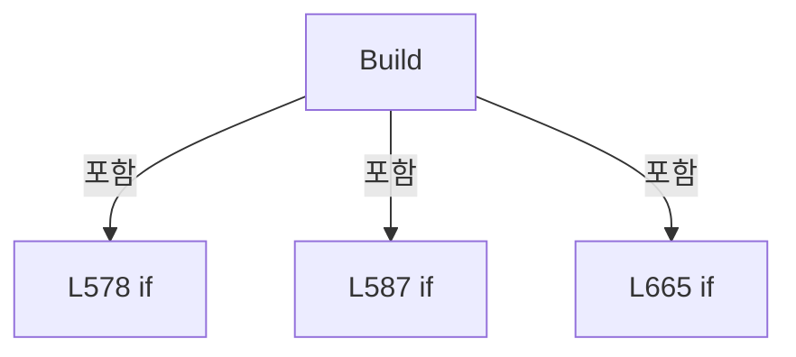

변경 전 점검: 입력/반환 타입, 위 호출자, 예외/취소 경로, 공유 상태와 저장·전송 소비자를 함께 확인합니다. 값의 단위나 물리 방향을 이름만으로 확정하지 않습니다.

### LocalFunctionStatement `MatchesItem` · L608–611

[Drilling.UI/Menu/Menus/CMenuRecipe.cs:608–611](https://github.com/kjuws10-rgb/A3Drilling/blob/0219666f9053b907d96d7e0aa7d0c6c1be3a73d4/Drilling.UI/Menu/Menus/CMenuRecipe.cs#L608-L611)

| 항목 | 실제 추출 값 |
| --- | --- |
| 서명 | bool MatchesItem(Drilling.UI.Menu.Menus.ST_RECIPE_CELL_VIEW_MODEL) |
| 접근/수식자 | Private /  |
| 반환/값 타입 | bool |
| 소속 타입 | NamedType:Drilling.UI.Menu.Menus.CMenuRecipe |

입력 계약:

| 이름 | 타입 | 전달 | 선택/기본값 |
| --- | --- | --- | --- |
| cell | Drilling.UI.Menu.Menus.ST_RECIPE_CELL_VIEW_MODEL | None | False /  |

현재 부분 분석에서 직접 연결된 호출자는 없습니다. XAML/이벤트/인터페이스·델리게이트·외부 진입을 추가 확인해야 하며, 미사용으로 판정한 것이 아닙니다.

본문의 실제 연산·분기·예외·반환 순서(원문 위치 순):

| 원본 행 | 종류 | 주석 해설 |
| --- | --- | --- |
| 610 | return | 호출자에게 값 또는 제어를 반환합니다: return cell.CellNo == _selectedCellNo; |

변경 전 점검: 입력/반환 타입, 위 호출자, 예외/취소 경로, 공유 상태와 저장·전송 소비자를 함께 확인합니다. 값의 단위나 물리 방향을 이름만으로 확정하지 않습니다.

### LocalFunctionStatement `ShouldIncludeItem` · L613–616

[Drilling.UI/Menu/Menus/CMenuRecipe.cs:613–616](https://github.com/kjuws10-rgb/A3Drilling/blob/0219666f9053b907d96d7e0aa7d0c6c1be3a73d4/Drilling.UI/Menu/Menus/CMenuRecipe.cs#L613-L616)

| 항목 | 실제 추출 값 |
| --- | --- |
| 서명 | bool ShouldIncludeItem(Drilling.UI.Menu.Menus.ST_RECIPE_PARAMETER_EDITOR_ITEM) |
| 접근/수식자 | Private /  |
| 반환/값 타입 | bool |
| 소속 타입 | NamedType:Drilling.UI.Menu.Menus.CMenuRecipe |

입력 계약:

| 이름 | 타입 | 전달 | 선택/기본값 |
| --- | --- | --- | --- |
| item | Drilling.UI.Menu.Menus.ST_RECIPE_PARAMETER_EDITOR_ITEM | None | False /  |

현재 부분 분석에서 직접 연결된 호출자는 없습니다. XAML/이벤트/인터페이스·델리게이트·외부 진입을 추가 확인해야 하며, 미사용으로 판정한 것이 아닙니다.

호출하는 대상과 해석 범위:

| 원본 행 | 표현식 | 분석 상태 | 대상/소스 위치 |
| --- | --- | --- | --- |
| 615 | item.Category.Equals | resolved | bool string.Equals(string?, System.StringComparison) |
| 615 | IsMovedToCellTab | resolved | bool Drilling.UI.Menu.Menus.CMenuRecipe.IsMovedToCellTab(Drilling.UI.Menu.Menus.ST_RECIPE_PARAMETER_EDITOR_ITEM) · Drilling.UI/Menu/Menus/CMenuRecipe.cs:1961 |

본문의 실제 연산·분기·예외·반환 순서(원문 위치 순):

| 원본 행 | 종류 | 주석 해설 |
| --- | --- | --- |
| 615 | call | 함수·델리게이트 또는 객체 생성자를 호출합니다: item.Category.Equals(selectedCategory, StringComparison.OrdinalIgnoreCase) |
| 615 | call | 함수·델리게이트 또는 객체 생성자를 호출합니다: IsMovedToCellTab(item) |
| 615 | return | 호출자에게 값 또는 제어를 반환합니다: return item.Category.Equals(selectedCategory, StringComparison.OrdinalIgnoreCase) && !IsMovedToCellTab(item); |

변경 전 점검: 입력/반환 타입, 위 호출자, 예외/취소 경로, 공유 상태와 저장·전송 소비자를 함께 확인합니다. 값의 단위나 물리 방향을 이름만으로 확정하지 않습니다.

### LocalFunctionStatement `MatchesSourceGroup` · L621–624

[Drilling.UI/Menu/Menus/CMenuRecipe.cs:621–624](https://github.com/kjuws10-rgb/A3Drilling/blob/0219666f9053b907d96d7e0aa7d0c6c1be3a73d4/Drilling.UI/Menu/Menus/CMenuRecipe.cs#L621-L624)

| 항목 | 실제 추출 값 |
| --- | --- |
| 서명 | bool MatchesSourceGroup(Drilling.UI.Menu.Menus.ST_RECIPE_PARAMETER_EDITOR_ITEM) |
| 접근/수식자 | Private /  |
| 반환/값 타입 | bool |
| 소속 타입 | NamedType:Drilling.UI.Menu.Menus.CMenuRecipe |

입력 계약:

| 이름 | 타입 | 전달 | 선택/기본값 |
| --- | --- | --- | --- |
| item | Drilling.UI.Menu.Menus.ST_RECIPE_PARAMETER_EDITOR_ITEM | None | False /  |

현재 부분 분석에서 직접 연결된 호출자는 없습니다. XAML/이벤트/인터페이스·델리게이트·외부 진입을 추가 확인해야 하며, 미사용으로 판정한 것이 아닙니다.

호출하는 대상과 해석 범위:

| 원본 행 | 표현식 | 분석 상태 | 대상/소스 위치 |
| --- | --- | --- | --- |
| 623 | item.SourceGroup.Equals | resolved | bool string.Equals(string?, System.StringComparison) |

본문의 실제 연산·분기·예외·반환 순서(원문 위치 순):

| 원본 행 | 종류 | 주석 해설 |
| --- | --- | --- |
| 623 | call | 함수·델리게이트 또는 객체 생성자를 호출합니다: item.SourceGroup.Equals(selectedGroup, StringComparison.OrdinalIgnoreCase) |
| 623 | return | 호출자에게 값 또는 제어를 반환합니다: return item.SourceGroup.Equals(selectedGroup, StringComparison.OrdinalIgnoreCase); |

변경 전 점검: 입력/반환 타입, 위 호출자, 예외/취소 경로, 공유 상태와 저장·전송 소비자를 함께 확인합니다. 값의 단위나 물리 방향을 이름만으로 확정하지 않습니다.

### LocalFunctionStatement `BuildDisplay` · L627–630

[Drilling.UI/Menu/Menus/CMenuRecipe.cs:627–630](https://github.com/kjuws10-rgb/A3Drilling/blob/0219666f9053b907d96d7e0aa7d0c6c1be3a73d4/Drilling.UI/Menu/Menus/CMenuRecipe.cs#L627-L630)

| 항목 | 실제 추출 값 |
| --- | --- |
| 서명 | Drilling.UI.Menu.Menus.ST_DISPLAY_ITEM BuildDisplay(Drilling.Common.Managers.ST_RECIPE_DEFINITION) |
| 접근/수식자 | Private /  |
| 반환/값 타입 | Drilling.UI.Menu.Menus.ST_DISPLAY_ITEM |
| 소속 타입 | NamedType:Drilling.UI.Menu.Menus.CMenuRecipe |

입력 계약:

| 이름 | 타입 | 전달 | 선택/기본값 |
| --- | --- | --- | --- |
| item | Drilling.Common.Managers.ST_RECIPE_DEFINITION | None | False /  |

현재 부분 분석에서 직접 연결된 호출자는 없습니다. XAML/이벤트/인터페이스·델리게이트·외부 진입을 추가 확인해야 하며, 미사용으로 판정한 것이 아닙니다.

호출하는 대상과 해석 범위:

| 원본 행 | 표현식 | 분석 상태 | 대상/소스 위치 |
| --- | --- | --- | --- |
| 629 | new ST_DISPLAY_ITEM | resolved | Drilling.UI.Menu.Menus.ST_DISPLAY_ITEM.ST_DISPLAY_ITEM(string, string, string) · Drilling.UI/Menu/Menus/CMenuBase.cs:43 |

본문의 실제 연산·분기·예외·반환 순서(원문 위치 순):

| 원본 행 | 종류 | 주석 해설 |
| --- | --- | --- |
| 629 | call | 함수·델리게이트 또는 객체 생성자를 호출합니다: new ST_DISPLAY_ITEM(item.Id, item.Name) |
| 629 | return | 호출자에게 값 또는 제어를 반환합니다: return new ST_DISPLAY_ITEM(item.Id, item.Name); |

변경 전 점검: 입력/반환 타입, 위 호출자, 예외/취소 경로, 공유 상태와 저장·전송 소비자를 함께 확인합니다. 값의 단위나 물리 방향을 이름만으로 확정하지 않습니다.

### LocalFunctionStatement `BuildDisplay2` · L632–635

[Drilling.UI/Menu/Menus/CMenuRecipe.cs:632–635](https://github.com/kjuws10-rgb/A3Drilling/blob/0219666f9053b907d96d7e0aa7d0c6c1be3a73d4/Drilling.UI/Menu/Menus/CMenuRecipe.cs#L632-L635)

| 항목 | 실제 추출 값 |
| --- | --- |
| 서명 | Drilling.UI.Menu.Menus.ST_DISPLAY_ITEM BuildDisplay2(Drilling.Common.Managers.ST_RECIPE_PARAMETER) |
| 접근/수식자 | Private /  |
| 반환/값 타입 | Drilling.UI.Menu.Menus.ST_DISPLAY_ITEM |
| 소속 타입 | NamedType:Drilling.UI.Menu.Menus.CMenuRecipe |

입력 계약:

| 이름 | 타입 | 전달 | 선택/기본값 |
| --- | --- | --- | --- |
| item | Drilling.Common.Managers.ST_RECIPE_PARAMETER | None | False /  |

현재 부분 분석에서 직접 연결된 호출자는 없습니다. XAML/이벤트/인터페이스·델리게이트·외부 진입을 추가 확인해야 하며, 미사용으로 판정한 것이 아닙니다.

호출하는 대상과 해석 범위:

| 원본 행 | 표현식 | 분석 상태 | 대상/소스 위치 |
| --- | --- | --- | --- |
| 634 | new ST_DISPLAY_ITEM | resolved | Drilling.UI.Menu.Menus.ST_DISPLAY_ITEM.ST_DISPLAY_ITEM(string, string, string) · Drilling.UI/Menu/Menus/CMenuBase.cs:43 |

본문의 실제 연산·분기·예외·반환 순서(원문 위치 순):

| 원본 행 | 종류 | 주석 해설 |
| --- | --- | --- |
| 634 | call | 함수·델리게이트 또는 객체 생성자를 호출합니다: new ST_DISPLAY_ITEM(item.Name, item.Value, $"{item.Unit} / {item.Range}") |
| 634 | return | 호출자에게 값 또는 제어를 반환합니다: return new ST_DISPLAY_ITEM(item.Name, item.Value, $"{item.Unit} / {item.Range}"); |

변경 전 점검: 입력/반환 타입, 위 호출자, 예외/취소 경로, 공유 상태와 저장·전송 소비자를 함께 확인합니다. 값의 단위나 물리 방향을 이름만으로 확정하지 않습니다.

### LocalFunctionStatement `BuildDisplay3` · L637–640

[Drilling.UI/Menu/Menus/CMenuRecipe.cs:637–640](https://github.com/kjuws10-rgb/A3Drilling/blob/0219666f9053b907d96d7e0aa7d0c6c1be3a73d4/Drilling.UI/Menu/Menus/CMenuRecipe.cs#L637-L640)

| 항목 | 실제 추출 값 |
| --- | --- |
| 서명 | Drilling.UI.Menu.Menus.ST_DISPLAY_ITEM BuildDisplay3(Drilling.Common.Managers.ST_RECIPE_HISTORY) |
| 접근/수식자 | Private /  |
| 반환/값 타입 | Drilling.UI.Menu.Menus.ST_DISPLAY_ITEM |
| 소속 타입 | NamedType:Drilling.UI.Menu.Menus.CMenuRecipe |

입력 계약:

| 이름 | 타입 | 전달 | 선택/기본값 |
| --- | --- | --- | --- |
| item | Drilling.Common.Managers.ST_RECIPE_HISTORY | None | False /  |

현재 부분 분석에서 직접 연결된 호출자는 없습니다. XAML/이벤트/인터페이스·델리게이트·외부 진입을 추가 확인해야 하며, 미사용으로 판정한 것이 아닙니다.

호출하는 대상과 해석 범위:

| 원본 행 | 표현식 | 분석 상태 | 대상/소스 위치 |
| --- | --- | --- | --- |
| 639 | new ST_DISPLAY_ITEM | resolved | Drilling.UI.Menu.Menus.ST_DISPLAY_ITEM.ST_DISPLAY_ITEM(string, string, string) · Drilling.UI/Menu/Menus/CMenuBase.cs:43 |
| 639 | item.ChangedAt.ToString | resolved | string System.DateTimeOffset.ToString(string?) |

본문의 실제 연산·분기·예외·반환 순서(원문 위치 순):

| 원본 행 | 종류 | 주석 해설 |
| --- | --- | --- |
| 639 | call | 함수·델리게이트 또는 객체 생성자를 호출합니다: new ST_DISPLAY_ITEM(item.ChangedAt.ToString("yyyy-MM-dd HH:mm"), item.ItemName, $"{item.OldValue} -> {item.NewValue} / {item.OperatorId}") |
| 639 | call | 함수·델리게이트 또는 객체 생성자를 호출합니다: item.ChangedAt.ToString("yyyy-MM-dd HH:mm") |
| 639 | return | 호출자에게 값 또는 제어를 반환합니다: return new ST_DISPLAY_ITEM(item.ChangedAt.ToString("yyyy-MM-dd HH:mm"), item.ItemName, $"{item.OldValue} -> {item.NewValue} / {item.OperatorId}"); |

변경 전 점검: 입력/반환 타입, 위 호출자, 예외/취소 경로, 공유 상태와 저장·전송 소비자를 함께 확인합니다. 값의 단위나 물리 방향을 이름만으로 확정하지 않습니다.

### LocalFunctionStatement `MatchesItem2` · L667–670

[Drilling.UI/Menu/Menus/CMenuRecipe.cs:667–670](https://github.com/kjuws10-rgb/A3Drilling/blob/0219666f9053b907d96d7e0aa7d0c6c1be3a73d4/Drilling.UI/Menu/Menus/CMenuRecipe.cs#L667-L670)

| 항목 | 실제 추출 값 |
| --- | --- |
| 서명 | bool MatchesItem2(Drilling.UI.Menu.Menus.ST_RECIPE_CELL_VIEW_MODEL) |
| 접근/수식자 | Private /  |
| 반환/값 타입 | bool |
| 소속 타입 | NamedType:Drilling.UI.Menu.Menus.CMenuRecipe |

입력 계약:

| 이름 | 타입 | 전달 | 선택/기본값 |
| --- | --- | --- | --- |
| cell | Drilling.UI.Menu.Menus.ST_RECIPE_CELL_VIEW_MODEL | None | False /  |

현재 부분 분석에서 직접 연결된 호출자는 없습니다. XAML/이벤트/인터페이스·델리게이트·외부 진입을 추가 확인해야 하며, 미사용으로 판정한 것이 아닙니다.

본문의 실제 연산·분기·예외·반환 순서(원문 위치 순):

| 원본 행 | 종류 | 주석 해설 |
| --- | --- | --- |
| 669 | return | 호출자에게 값 또는 제어를 반환합니다: return cell.CellNo == _selectedCellNo; |

변경 전 점검: 입력/반환 타입, 위 호출자, 예외/취소 경로, 공유 상태와 저장·전송 소비자를 함께 확인합니다. 값의 단위나 물리 방향을 이름만으로 확정하지 않습니다.

### LocalFunctionStatement `BuildDisplay4` · L673–676

[Drilling.UI/Menu/Menus/CMenuRecipe.cs:673–676](https://github.com/kjuws10-rgb/A3Drilling/blob/0219666f9053b907d96d7e0aa7d0c6c1be3a73d4/Drilling.UI/Menu/Menus/CMenuRecipe.cs#L673-L676)

| 항목 | 실제 추출 값 |
| --- | --- |
| 서명 | Drilling.UI.Menu.Menus.ST_DISPLAY_ITEM BuildDisplay4(Drilling.Common.Managers.ST_RECIPE_PARAMETER) |
| 접근/수식자 | Private /  |
| 반환/값 타입 | Drilling.UI.Menu.Menus.ST_DISPLAY_ITEM |
| 소속 타입 | NamedType:Drilling.UI.Menu.Menus.CMenuRecipe |

입력 계약:

| 이름 | 타입 | 전달 | 선택/기본값 |
| --- | --- | --- | --- |
| item | Drilling.Common.Managers.ST_RECIPE_PARAMETER | None | False /  |

현재 부분 분석에서 직접 연결된 호출자는 없습니다. XAML/이벤트/인터페이스·델리게이트·외부 진입을 추가 확인해야 하며, 미사용으로 판정한 것이 아닙니다.

호출하는 대상과 해석 범위:

| 원본 행 | 표현식 | 분석 상태 | 대상/소스 위치 |
| --- | --- | --- | --- |
| 675 | new ST_DISPLAY_ITEM | resolved | Drilling.UI.Menu.Menus.ST_DISPLAY_ITEM.ST_DISPLAY_ITEM(string, string, string) · Drilling.UI/Menu/Menus/CMenuBase.cs:43 |
| 675 | $"{item.Value} {item.Unit}".Trim | resolved | string string.Trim() |

본문의 실제 연산·분기·예외·반환 순서(원문 위치 순):

| 원본 행 | 종류 | 주석 해설 |
| --- | --- | --- |
| 675 | call | 함수·델리게이트 또는 객체 생성자를 호출합니다: new ST_DISPLAY_ITEM(item.Name, $"{item.Value} {item.Unit}".Trim(), item.Range) |
| 675 | call | 함수·델리게이트 또는 객체 생성자를 호출합니다: $"{item.Value} {item.Unit}".Trim() |
| 675 | return | 호출자에게 값 또는 제어를 반환합니다: return new ST_DISPLAY_ITEM(item.Name, $"{item.Value} {item.Unit}".Trim(), item.Range); |

변경 전 점검: 입력/반환 타입, 위 호출자, 예외/취소 경로, 공유 상태와 저장·전송 소비자를 함께 확인합니다. 값의 단위나 물리 방향을 이름만으로 확정하지 않습니다.

### LocalFunctionStatement `BuildDisplay5` · L678–681

[Drilling.UI/Menu/Menus/CMenuRecipe.cs:678–681](https://github.com/kjuws10-rgb/A3Drilling/blob/0219666f9053b907d96d7e0aa7d0c6c1be3a73d4/Drilling.UI/Menu/Menus/CMenuRecipe.cs#L678-L681)

| 항목 | 실제 추출 값 |
| --- | --- |
| 서명 | Drilling.UI.Menu.Menus.ST_DISPLAY_ITEM BuildDisplay5(Drilling.Common.Managers.ST_RECIPE_HISTORY) |
| 접근/수식자 | Private /  |
| 반환/값 타입 | Drilling.UI.Menu.Menus.ST_DISPLAY_ITEM |
| 소속 타입 | NamedType:Drilling.UI.Menu.Menus.CMenuRecipe |

입력 계약:

| 이름 | 타입 | 전달 | 선택/기본값 |
| --- | --- | --- | --- |
| item | Drilling.Common.Managers.ST_RECIPE_HISTORY | None | False /  |

현재 부분 분석에서 직접 연결된 호출자는 없습니다. XAML/이벤트/인터페이스·델리게이트·외부 진입을 추가 확인해야 하며, 미사용으로 판정한 것이 아닙니다.

호출하는 대상과 해석 범위:

| 원본 행 | 표현식 | 분석 상태 | 대상/소스 위치 |
| --- | --- | --- | --- |
| 680 | new ST_DISPLAY_ITEM | resolved | Drilling.UI.Menu.Menus.ST_DISPLAY_ITEM.ST_DISPLAY_ITEM(string, string, string) · Drilling.UI/Menu/Menus/CMenuBase.cs:43 |

본문의 실제 연산·분기·예외·반환 순서(원문 위치 순):

| 원본 행 | 종류 | 주석 해설 |
| --- | --- | --- |
| 680 | call | 함수·델리게이트 또는 객체 생성자를 호출합니다: new ST_DISPLAY_ITEM(item.ItemName, $"{item.OldValue} -> {item.NewValue}", item.OperatorId) |
| 680 | return | 호출자에게 값 또는 제어를 반환합니다: return new ST_DISPLAY_ITEM(item.ItemName, $"{item.OldValue} -> {item.NewValue}", item.OperatorId); |

변경 전 점검: 입력/반환 타입, 위 호출자, 예외/취소 경로, 공유 상태와 저장·전송 소비자를 함께 확인합니다. 값의 단위나 물리 방향을 이름만으로 확정하지 않습니다.

### MethodDeclaration `ShowPreviousRecipePage` · L693–703

[Drilling.UI/Menu/Menus/CMenuRecipe.cs:693–703](https://github.com/kjuws10-rgb/A3Drilling/blob/0219666f9053b907d96d7e0aa7d0c6c1be3a73d4/Drilling.UI/Menu/Menus/CMenuRecipe.cs#L693-L703)

| 항목 | 실제 추출 값 |
| --- | --- |
| 서명 | System.Threading.Tasks.Task Drilling.UI.Menu.Menus.CMenuRecipe.ShowPreviousRecipePage() |
| 접근/수식자 | Private / private, async |
| 반환/값 타입 | System.Threading.Tasks.Task |
| 소속 타입 | NamedType:Drilling.UI.Menu.Menus.CMenuRecipe |

정적 호출자로 확인된 위치:

| 호출 파일/행 | 호출 표현식 | 런타임 분기 가능 |
| --- | --- | --- |
| [Drilling.UI/Menu/Menus/CMenuRecipe.cs:109–109](https://github.com/kjuws10-rgb/A3Drilling/blob/0219666f9053b907d96d7e0aa7d0c6c1be3a73d4/Drilling.UI/Menu/Menus/CMenuRecipe.cs#L109-L109) | ShowPreviousRecipePage | False |

호출하는 대상과 해석 범위:

| 원본 행 | 표현식 | 분석 상태 | 대상/소스 위치 |
| --- | --- | --- | --- |
| 695 | CanShowPreviousRecipePage | resolved | bool Drilling.UI.Menu.Menus.CMenuRecipe.CanShowPreviousRecipePage() · Drilling.UI/Menu/Menus/CMenuRecipe.cs:717 |
| 701 | NotifyRecipeFilesPageCommands | resolved | void Drilling.UI.Menu.Menus.CMenuRecipe.NotifyRecipeFilesPageCommands() · Drilling.UI/Menu/Menus/CMenuRecipe.cs:727 |
| 702 | _refreshCurrentScreen | resolved · 동적 구현 선택 가능 | System.Threading.Tasks.Task System.Func<System.Threading.Tasks.Task>.Invoke() |

본문의 실제 연산·분기·예외·반환 순서(원문 위치 순):

| 원본 행 | 종류 | 주석 해설 |
| --- | --- | --- |
| 695 | call | 함수·델리게이트 또는 객체 생성자를 호출합니다: CanShowPreviousRecipePage() |
| 695 | if | 조건에 따라 분기합니다: if (!CanShowPreviousRecipePage()) |
| 697 | return | 호출자에게 값 또는 제어를 반환합니다: return; |
| 701 | call | 함수·델리게이트 또는 객체 생성자를 호출합니다: NotifyRecipeFilesPageCommands() |
| 702 | await | 비동기 완료를 기다립니다: await _refreshCurrentScreen() |
| 702 | call | 함수·델리게이트 또는 객체 생성자를 호출합니다: _refreshCurrentScreen() |

제어 구문의 포함 구조(실제 실행 순서/CFG가 아닌 구문 탐색 그림):

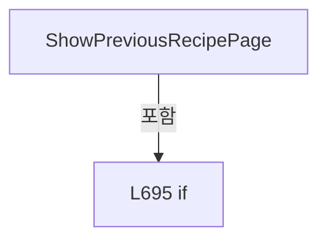

변경 전 점검: 입력/반환 타입, 위 호출자, 예외/취소 경로, 공유 상태와 저장·전송 소비자를 함께 확인합니다. 값의 단위나 물리 방향을 이름만으로 확정하지 않습니다.

### MethodDeclaration `ShowNextRecipePage` · L705–715

[Drilling.UI/Menu/Menus/CMenuRecipe.cs:705–715](https://github.com/kjuws10-rgb/A3Drilling/blob/0219666f9053b907d96d7e0aa7d0c6c1be3a73d4/Drilling.UI/Menu/Menus/CMenuRecipe.cs#L705-L715)

| 항목 | 실제 추출 값 |
| --- | --- |
| 서명 | System.Threading.Tasks.Task Drilling.UI.Menu.Menus.CMenuRecipe.ShowNextRecipePage() |
| 접근/수식자 | Private / private, async |
| 반환/값 타입 | System.Threading.Tasks.Task |
| 소속 타입 | NamedType:Drilling.UI.Menu.Menus.CMenuRecipe |

정적 호출자로 확인된 위치:

| 호출 파일/행 | 호출 표현식 | 런타임 분기 가능 |
| --- | --- | --- |
| [Drilling.UI/Menu/Menus/CMenuRecipe.cs:120–120](https://github.com/kjuws10-rgb/A3Drilling/blob/0219666f9053b907d96d7e0aa7d0c6c1be3a73d4/Drilling.UI/Menu/Menus/CMenuRecipe.cs#L120-L120) | ShowNextRecipePage | False |

호출하는 대상과 해석 범위:

| 원본 행 | 표현식 | 분석 상태 | 대상/소스 위치 |
| --- | --- | --- | --- |
| 707 | CanShowNextRecipePage | resolved | bool Drilling.UI.Menu.Menus.CMenuRecipe.CanShowNextRecipePage() · Drilling.UI/Menu/Menus/CMenuRecipe.cs:722 |
| 713 | NotifyRecipeFilesPageCommands | resolved | void Drilling.UI.Menu.Menus.CMenuRecipe.NotifyRecipeFilesPageCommands() · Drilling.UI/Menu/Menus/CMenuRecipe.cs:727 |
| 714 | _refreshCurrentScreen | resolved · 동적 구현 선택 가능 | System.Threading.Tasks.Task System.Func<System.Threading.Tasks.Task>.Invoke() |

본문의 실제 연산·분기·예외·반환 순서(원문 위치 순):

| 원본 행 | 종류 | 주석 해설 |
| --- | --- | --- |
| 707 | call | 함수·델리게이트 또는 객체 생성자를 호출합니다: CanShowNextRecipePage() |
| 707 | if | 조건에 따라 분기합니다: if (!CanShowNextRecipePage()) |
| 709 | return | 호출자에게 값 또는 제어를 반환합니다: return; |
| 713 | call | 함수·델리게이트 또는 객체 생성자를 호출합니다: NotifyRecipeFilesPageCommands() |
| 714 | await | 비동기 완료를 기다립니다: await _refreshCurrentScreen() |
| 714 | call | 함수·델리게이트 또는 객체 생성자를 호출합니다: _refreshCurrentScreen() |

제어 구문의 포함 구조(실제 실행 순서/CFG가 아닌 구문 탐색 그림):

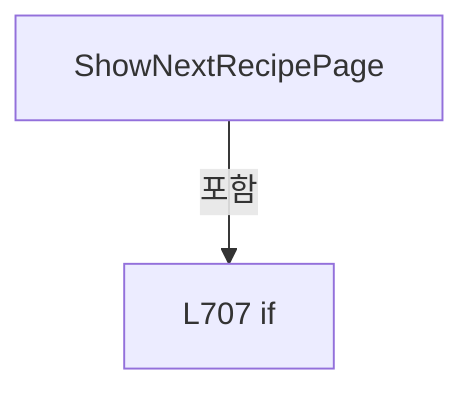

변경 전 점검: 입력/반환 타입, 위 호출자, 예외/취소 경로, 공유 상태와 저장·전송 소비자를 함께 확인합니다. 값의 단위나 물리 방향을 이름만으로 확정하지 않습니다.

### MethodDeclaration `CanShowPreviousRecipePage` · L717–720

[Drilling.UI/Menu/Menus/CMenuRecipe.cs:717–720](https://github.com/kjuws10-rgb/A3Drilling/blob/0219666f9053b907d96d7e0aa7d0c6c1be3a73d4/Drilling.UI/Menu/Menus/CMenuRecipe.cs#L717-L720)

| 항목 | 실제 추출 값 |
| --- | --- |
| 서명 | bool Drilling.UI.Menu.Menus.CMenuRecipe.CanShowPreviousRecipePage() |
| 접근/수식자 | Private / private |
| 반환/값 타입 | bool |
| 소속 타입 | NamedType:Drilling.UI.Menu.Menus.CMenuRecipe |

정적 호출자로 확인된 위치:

| 호출 파일/행 | 호출 표현식 | 런타임 분기 가능 |
| --- | --- | --- |
| [Drilling.UI/Menu/Menus/CMenuRecipe.cs:114–114](https://github.com/kjuws10-rgb/A3Drilling/blob/0219666f9053b907d96d7e0aa7d0c6c1be3a73d4/Drilling.UI/Menu/Menus/CMenuRecipe.cs#L114-L114) | CanShowPreviousRecipePage | False |
| [Drilling.UI/Menu/Menus/CMenuRecipe.cs:695–695](https://github.com/kjuws10-rgb/A3Drilling/blob/0219666f9053b907d96d7e0aa7d0c6c1be3a73d4/Drilling.UI/Menu/Menus/CMenuRecipe.cs#L695-L695) | CanShowPreviousRecipePage | False |

본문의 실제 연산·분기·예외·반환 순서(원문 위치 순):

| 원본 행 | 종류 | 주석 해설 |
| --- | --- | --- |
| 719 | return | 호출자에게 값 또는 제어를 반환합니다: return _recipeFilesPageIndex > 0; |

변경 전 점검: 입력/반환 타입, 위 호출자, 예외/취소 경로, 공유 상태와 저장·전송 소비자를 함께 확인합니다. 값의 단위나 물리 방향을 이름만으로 확정하지 않습니다.

### MethodDeclaration `CanShowNextRecipePage` · L722–725

[Drilling.UI/Menu/Menus/CMenuRecipe.cs:722–725](https://github.com/kjuws10-rgb/A3Drilling/blob/0219666f9053b907d96d7e0aa7d0c6c1be3a73d4/Drilling.UI/Menu/Menus/CMenuRecipe.cs#L722-L725)

| 항목 | 실제 추출 값 |
| --- | --- |
| 서명 | bool Drilling.UI.Menu.Menus.CMenuRecipe.CanShowNextRecipePage() |
| 접근/수식자 | Private / private |
| 반환/값 타입 | bool |
| 소속 타입 | NamedType:Drilling.UI.Menu.Menus.CMenuRecipe |

정적 호출자로 확인된 위치:

| 호출 파일/행 | 호출 표현식 | 런타임 분기 가능 |
| --- | --- | --- |
| [Drilling.UI/Menu/Menus/CMenuRecipe.cs:125–125](https://github.com/kjuws10-rgb/A3Drilling/blob/0219666f9053b907d96d7e0aa7d0c6c1be3a73d4/Drilling.UI/Menu/Menus/CMenuRecipe.cs#L125-L125) | CanShowNextRecipePage | False |
| [Drilling.UI/Menu/Menus/CMenuRecipe.cs:707–707](https://github.com/kjuws10-rgb/A3Drilling/blob/0219666f9053b907d96d7e0aa7d0c6c1be3a73d4/Drilling.UI/Menu/Menus/CMenuRecipe.cs#L707-L707) | CanShowNextRecipePage | False |

본문의 실제 연산·분기·예외·반환 순서(원문 위치 순):

| 원본 행 | 종류 | 주석 해설 |
| --- | --- | --- |
| 724 | return | 호출자에게 값 또는 제어를 반환합니다: return _recipeFilesPageIndex + 1 < _recipeFilesPageCount; |

변경 전 점검: 입력/반환 타입, 위 호출자, 예외/취소 경로, 공유 상태와 저장·전송 소비자를 함께 확인합니다. 값의 단위나 물리 방향을 이름만으로 확정하지 않습니다.

### MethodDeclaration `NotifyRecipeFilesPageCommands` · L727–731

[Drilling.UI/Menu/Menus/CMenuRecipe.cs:727–731](https://github.com/kjuws10-rgb/A3Drilling/blob/0219666f9053b907d96d7e0aa7d0c6c1be3a73d4/Drilling.UI/Menu/Menus/CMenuRecipe.cs#L727-L731)

| 항목 | 실제 추출 값 |
| --- | --- |
| 서명 | void Drilling.UI.Menu.Menus.CMenuRecipe.NotifyRecipeFilesPageCommands() |
| 접근/수식자 | Private / private |
| 반환/값 타입 | void |
| 소속 타입 | NamedType:Drilling.UI.Menu.Menus.CMenuRecipe |

정적 호출자로 확인된 위치:

| 호출 파일/행 | 호출 표현식 | 런타임 분기 가능 |
| --- | --- | --- |
| [Drilling.UI/Menu/Menus/CMenuRecipe.cs:701–701](https://github.com/kjuws10-rgb/A3Drilling/blob/0219666f9053b907d96d7e0aa7d0c6c1be3a73d4/Drilling.UI/Menu/Menus/CMenuRecipe.cs#L701-L701) | NotifyRecipeFilesPageCommands | False |
| [Drilling.UI/Menu/Menus/CMenuRecipe.cs:713–713](https://github.com/kjuws10-rgb/A3Drilling/blob/0219666f9053b907d96d7e0aa7d0c6c1be3a73d4/Drilling.UI/Menu/Menus/CMenuRecipe.cs#L713-L713) | NotifyRecipeFilesPageCommands | False |
| [Drilling.UI/Menu/Menus/CMenuRecipe.cs:1716–1716](https://github.com/kjuws10-rgb/A3Drilling/blob/0219666f9053b907d96d7e0aa7d0c6c1be3a73d4/Drilling.UI/Menu/Menus/CMenuRecipe.cs#L1716-L1716) | NotifyRecipeFilesPageCommands | False |

호출하는 대상과 해석 범위:

| 원본 행 | 표현식 | 분석 상태 | 대상/소스 위치 |
| --- | --- | --- | --- |
| 729 | PreviousRecipePageCommand.NotifyCanExecuteChanged | resolved | void Drilling.UI.Menu.CButtonCommand.NotifyCanExecuteChanged() · Drilling.UI/Menu/CButtonCommand.cs:24 |
| 730 | NextRecipePageCommand.NotifyCanExecuteChanged | resolved | void Drilling.UI.Menu.CButtonCommand.NotifyCanExecuteChanged() · Drilling.UI/Menu/CButtonCommand.cs:24 |

본문의 실제 연산·분기·예외·반환 순서(원문 위치 순):

| 원본 행 | 종류 | 주석 해설 |
| --- | --- | --- |
| 729 | call | 함수·델리게이트 또는 객체 생성자를 호출합니다: PreviousRecipePageCommand.NotifyCanExecuteChanged() |
| 730 | call | 함수·델리게이트 또는 객체 생성자를 호출합니다: NextRecipePageCommand.NotifyCanExecuteChanged() |

변경 전 점검: 입력/반환 타입, 위 호출자, 예외/취소 경로, 공유 상태와 저장·전송 소비자를 함께 확인합니다. 값의 단위나 물리 방향을 이름만으로 확정하지 않습니다.

### MethodDeclaration `View` · L733–750

[Drilling.UI/Menu/Menus/CMenuRecipe.cs:733–750](https://github.com/kjuws10-rgb/A3Drilling/blob/0219666f9053b907d96d7e0aa7d0c6c1be3a73d4/Drilling.UI/Menu/Menus/CMenuRecipe.cs#L733-L750)

| 항목 | 실제 추출 값 |
| --- | --- |
| 서명 | System.Threading.Tasks.Task Drilling.UI.Menu.Menus.CMenuRecipe.View(object?) |
| 접근/수식자 | Private / private, async |
| 반환/값 타입 | System.Threading.Tasks.Task |
| 소속 타입 | NamedType:Drilling.UI.Menu.Menus.CMenuRecipe |

입력 계약:

| 이름 | 타입 | 전달 | 선택/기본값 |
| --- | --- | --- | --- |
| parameter | object? | None | False /  |

정적 호출자로 확인된 위치:

| 호출 파일/행 | 호출 표현식 | 런타임 분기 가능 |
| --- | --- | --- |
| [Drilling.UI/Menu/Menus/CMenuRecipe.cs:103–103](https://github.com/kjuws10-rgb/A3Drilling/blob/0219666f9053b907d96d7e0aa7d0c6c1be3a73d4/Drilling.UI/Menu/Menus/CMenuRecipe.cs#L103-L103) | View | False |

호출하는 대상과 해석 범위:

| 원본 행 | 표현식 | 분석 상태 | 대상/소스 위치 |
| --- | --- | --- | --- |
| 735 | GetRecipeIdFromParameter | resolved | string Drilling.UI.Menu.Menus.CMenuRecipe.GetRecipeIdFromParameter(object?) · Drilling.UI/Menu/Menus/CMenuRecipe.cs:3042 |
| 736 | string.IsNullOrWhiteSpace | resolved | bool string.IsNullOrWhiteSpace(string?) |
| 741 | recipeId.Equals | resolved | bool string.Equals(string?, System.StringComparison) |
| 741 | GetRecipeIdFromParameter | resolved | string Drilling.UI.Menu.Menus.CMenuRecipe.GetRecipeIdFromParameter(object?) · Drilling.UI/Menu/Menus/CMenuRecipe.cs:3042 |
| 741 | HasEditedItems | resolved | bool Drilling.UI.Menu.Menus.CMenuRecipe.HasEditedItems() · Drilling.UI/Menu/Menus/CMenuRecipe.cs:1668 |
| 741 | CRecipeConfirmDialog.ShowConfirmation | resolved | bool Drilling.UI.Popup.CRecipeConfirmDialog.ShowConfirmation(string, string, string, bool) · Drilling.UI/Popup/CRecipeConfirmDialog.xaml.cs:12 |
| 746 | _viewRecipeIdSetter | resolved · 동적 구현 선택 가능 | void System.Action<string>.Invoke(string) |
| 747 | NotifyCommands | resolved | void Drilling.UI.Menu.Menus.CMenuRecipe.NotifyCommands() · Drilling.UI/Menu/Menus/CMenuRecipe.cs:1295 |
| 748 | _setStatusMessage | resolved · 동적 구현 선택 가능 | void System.Action<string>.Invoke(string) |
| 749 | _refreshCurrentScreen | resolved · 동적 구현 선택 가능 | System.Threading.Tasks.Task System.Func<System.Threading.Tasks.Task>.Invoke() |

본문의 실제 연산·분기·예외·반환 순서(원문 위치 순):

| 원본 행 | 종류 | 주석 해설 |
| --- | --- | --- |
| 735 | call | 함수·델리게이트 또는 객체 생성자를 호출합니다: GetRecipeIdFromParameter(parameter) |
| 735 | local-declaration | 지역 변수를 선언합니다: var recipeId = GetRecipeIdFromParameter(parameter); |
| 735 | variable-initializer | 변수의 초기값을 지정합니다: recipeId = GetRecipeIdFromParameter(parameter) |
| 736 | call | 함수·델리게이트 또는 객체 생성자를 호출합니다: string.IsNullOrWhiteSpace(recipeId) |
| 736 | if | 조건에 따라 분기합니다: if (string.IsNullOrWhiteSpace(recipeId)) |
| 738 | return | 호출자에게 값 또는 제어를 반환합니다: return; |
| 741 | call | 함수·델리게이트 또는 객체 생성자를 호출합니다: recipeId.Equals(GetRecipeIdFromParameter(SelectedRecipeFile), StringComparison.OrdinalIgnoreCase) |
| 741 | call | 함수·델리게이트 또는 객체 생성자를 호출합니다: GetRecipeIdFromParameter(SelectedRecipeFile) |
| 741 | call | 함수·델리게이트 또는 객체 생성자를 호출합니다: HasEditedItems() |
| 741 | call | 함수·델리게이트 또는 객체 생성자를 호출합니다: CRecipeConfirmDialog.ShowConfirmation("레시피 VIEW 변경", "수정 중입니다. 저장하지 않고 이동할 경우 변경이 취소됩니다.\n이동하시겠습니까?") |
| 741 | if | 조건에 따라 분기합니다: if (!recipeId.Equals(GetRecipeIdFromParameter(SelectedRecipeFile), StringComparison.OrdinalIgnoreCase) && HasEditedItems() && !CRecipeConfirmDialog.ShowConfirmation("레시피 VIEW 변경", "수정 중입니다. 저장하지 않고 이동할 경우 변경이 취소됩니다.\n이동하시겠습니…) |
| 743 | return | 호출자에게 값 또는 제어를 반환합니다: return; |
| 746 | call | 함수·델리게이트 또는 객체 생성자를 호출합니다: _viewRecipeIdSetter(recipeId) |
| 747 | call | 함수·델리게이트 또는 객체 생성자를 호출합니다: NotifyCommands() |
| 748 | call | 함수·델리게이트 또는 객체 생성자를 호출합니다: _setStatusMessage($"Recipe {recipeId}.csv view loaded.") |
| 749 | await | 비동기 완료를 기다립니다: await _refreshCurrentScreen() |
| 749 | call | 함수·델리게이트 또는 객체 생성자를 호출합니다: _refreshCurrentScreen() |

제어 구문의 포함 구조(실제 실행 순서/CFG가 아닌 구문 탐색 그림):

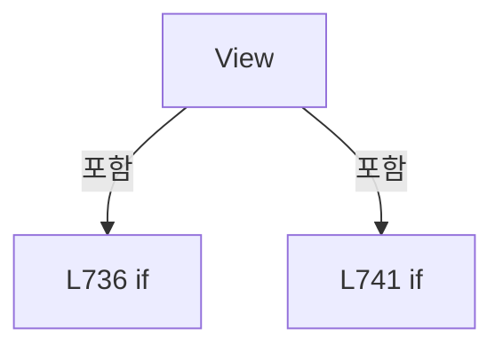

변경 전 점검: 입력/반환 타입, 위 호출자, 예외/취소 경로, 공유 상태와 저장·전송 소비자를 함께 확인합니다. 값의 단위나 물리 방향을 이름만으로 확정하지 않습니다.

### MethodDeclaration `Select` · L752–781

[Drilling.UI/Menu/Menus/CMenuRecipe.cs:752–781](https://github.com/kjuws10-rgb/A3Drilling/blob/0219666f9053b907d96d7e0aa7d0c6c1be3a73d4/Drilling.UI/Menu/Menus/CMenuRecipe.cs#L752-L781)

| 항목 | 실제 추출 값 |
| --- | --- |
| 서명 | System.Threading.Tasks.Task Drilling.UI.Menu.Menus.CMenuRecipe.Select() |
| 접근/수식자 | Private / private, async |
| 반환/값 타입 | System.Threading.Tasks.Task |
| 소속 타입 | NamedType:Drilling.UI.Menu.Menus.CMenuRecipe |

정적 호출자로 확인된 위치:

| 호출 파일/행 | 호출 표현식 | 런타임 분기 가능 |
| --- | --- | --- |
| [Drilling.UI/Menu/Menus/CMenuRecipe.cs:185–185](https://github.com/kjuws10-rgb/A3Drilling/blob/0219666f9053b907d96d7e0aa7d0c6c1be3a73d4/Drilling.UI/Menu/Menus/CMenuRecipe.cs#L185-L185) | Select | False |

호출하는 대상과 해석 범위:

| 원본 행 | 표현식 | 분석 상태 | 대상/소스 위치 |
| --- | --- | --- | --- |
| 754 | GetRecipeIdFromParameter | resolved | string Drilling.UI.Menu.Menus.CMenuRecipe.GetRecipeIdFromParameter(object?) · Drilling.UI/Menu/Menus/CMenuRecipe.cs:3042 |
| 755 | string.IsNullOrWhiteSpace | resolved | bool string.IsNullOrWhiteSpace(string?) |
| 757 | _setStatusMessage | resolved · 동적 구현 선택 가능 | void System.Action<string>.Invoke(string) |
| 761 | CanSelectViewRecipe | resolved | bool Drilling.UI.Menu.Menus.CMenuRecipe.CanSelectViewRecipe() · Drilling.UI/Menu/Menus/CMenuRecipe.cs:1653 |
| 763 | _setStatusMessage | resolved · 동적 구현 선택 가능 | void System.Action<string>.Invoke(string) |
| 767 | CRecipeConfirmDialog.ShowConfirmation | resolved | bool Drilling.UI.Popup.CRecipeConfirmDialog.ShowConfirmation(string, string, string, bool) · Drilling.UI/Popup/CRecipeConfirmDialog.xaml.cs:12 |
| 772 | _selectRecipeIdProvider | resolved · 동적 구현 선택 가능 | string System.Func<string>.Invoke() |
| 773 | _selectRecipeIdSetter | resolved · 동적 구현 선택 가능 | void System.Action<string>.Invoke(string) |
| 774 | _settingManager.SetValue | resolved | void Drilling.Common.Managers.CSettingManager.SetValue(Drilling.Common.Managers.EN_SETTING_TAB, string, string, System.Threading.CancellationToken) · Drilling.Common/Managers/CSettingManager.cs:73 |
| 775 | _recipeManager.RecordSelection | resolved | System.Threading.Tasks.Task Drilling.Common.Managers.CRecipeManager.RecordSelection(string, string, System.Threading.CancellationToken) · Drilling.Common/Managers/CRecipeManager.cs:34 |
| 776 | NotifyCommands | resolved | void Drilling.UI.Menu.Menus.CMenuRecipe.NotifyCommands() · Drilling.UI/Menu/Menus/CMenuRecipe.cs:1295 |
| 777 | _setStatusMessage | resolved · 동적 구현 선택 가능 | void System.Action<string>.Invoke(string) |
| 778 | _refreshShellStatus | resolved · 동적 구현 선택 가능 | void System.Action.Invoke() |
| 779 | _refreshCurrentScreen | resolved · 동적 구현 선택 가능 | System.Threading.Tasks.Task System.Func<System.Threading.Tasks.Task>.Invoke() |
| 780 | CRecipeConfirmDialog.ShowCompletion | resolved | void Drilling.UI.Popup.CRecipeConfirmDialog.ShowCompletion(string, string, Window?) · Drilling.UI/Popup/CRecipeConfirmDialog.xaml.cs:105 |

본문의 실제 연산·분기·예외·반환 순서(원문 위치 순):

| 원본 행 | 종류 | 주석 해설 |
| --- | --- | --- |
| 754 | call | 함수·델리게이트 또는 객체 생성자를 호출합니다: GetRecipeIdFromParameter(SelectedRecipeFile) |
| 754 | local-declaration | 지역 변수를 선언합니다: var recipeId = GetRecipeIdFromParameter(SelectedRecipeFile); |
| 754 | variable-initializer | 변수의 초기값을 지정합니다: recipeId = GetRecipeIdFromParameter(SelectedRecipeFile) |
| 755 | call | 함수·델리게이트 또는 객체 생성자를 호출합니다: string.IsNullOrWhiteSpace(recipeId) |
| 755 | if | 조건에 따라 분기합니다: if (string.IsNullOrWhiteSpace(recipeId)) |
| 757 | call | 함수·델리게이트 또는 객체 생성자를 호출합니다: _setStatusMessage("Recipe select skipped. No recipe is in view.") |
| 758 | return | 호출자에게 값 또는 제어를 반환합니다: return; |
| 761 | call | 함수·델리게이트 또는 객체 생성자를 호출합니다: CanSelectViewRecipe() |
| 761 | if | 조건에 따라 분기합니다: if (!CanSelectViewRecipe()) |
| 763 | call | 함수·델리게이트 또는 객체 생성자를 호출합니다: _setStatusMessage($"Recipe {recipeId}.csv is already selected.") |
| 764 | return | 호출자에게 값 또는 제어를 반환합니다: return; |
| 767 | call | 함수·델리게이트 또는 객체 생성자를 호출합니다: CRecipeConfirmDialog.ShowConfirmation("레시피 선택", $"{recipeId}.csv 레시피를 SELECT 하시겠습니까?") |
| 767 | if | 조건에 따라 분기합니다: if (!CRecipeConfirmDialog.ShowConfirmation("레시피 선택", $"{recipeId}.csv 레시피를 SELECT 하시겠습니까?")) |
| 769 | return | 호출자에게 값 또는 제어를 반환합니다: return; |
| 772 | call | 함수·델리게이트 또는 객체 생성자를 호출합니다: _selectRecipeIdProvider() |
| 772 | local-declaration | 지역 변수를 선언합니다: var previousRecipeId = _selectRecipeIdProvider(); |
| 772 | variable-initializer | 변수의 초기값을 지정합니다: previousRecipeId = _selectRecipeIdProvider() |
| 773 | call | 함수·델리게이트 또는 객체 생성자를 호출합니다: _selectRecipeIdSetter(recipeId) |
| 774 | call | 함수·델리게이트 또는 객체 생성자를 호출합니다: _settingManager.SetValue(EN_SETTING_TAB.Option, SelectRecipeSettingKey, recipeId) |
| 775 | await | 비동기 완료를 기다립니다: await _recipeManager.RecordSelection(previousRecipeId, recipeId) |
| 775 | call | 함수·델리게이트 또는 객체 생성자를 호출합니다: _recipeManager.RecordSelection(previousRecipeId, recipeId) |
| 776 | call | 함수·델리게이트 또는 객체 생성자를 호출합니다: NotifyCommands() |
| 777 | call | 함수·델리게이트 또는 객체 생성자를 호출합니다: _setStatusMessage($"Recipe {recipeId}.csv selected.") |
| 778 | call | 함수·델리게이트 또는 객체 생성자를 호출합니다: _refreshShellStatus() |
| 779 | await | 비동기 완료를 기다립니다: await _refreshCurrentScreen() |
| 779 | call | 함수·델리게이트 또는 객체 생성자를 호출합니다: _refreshCurrentScreen() |
| 780 | call | 함수·델리게이트 또는 객체 생성자를 호출합니다: CRecipeConfirmDialog.ShowCompletion("레시피 선택 완료", $"{recipeId}.csv 레시피를 SELECT 하였습니다.") |

제어 구문의 포함 구조(실제 실행 순서/CFG가 아닌 구문 탐색 그림):

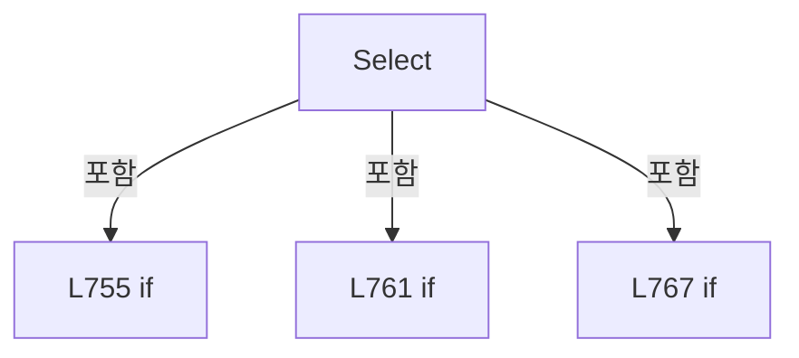

변경 전 점검: 입력/반환 타입, 위 호출자, 예외/취소 경로, 공유 상태와 저장·전송 소비자를 함께 확인합니다. 값의 단위나 물리 방향을 이름만으로 확정하지 않습니다.

### MethodDeclaration `SelectCategory` · L783–795

[Drilling.UI/Menu/Menus/CMenuRecipe.cs:783–795](https://github.com/kjuws10-rgb/A3Drilling/blob/0219666f9053b907d96d7e0aa7d0c6c1be3a73d4/Drilling.UI/Menu/Menus/CMenuRecipe.cs#L783-L795)

| 항목 | 실제 추출 값 |
| --- | --- |
| 서명 | System.Threading.Tasks.Task Drilling.UI.Menu.Menus.CMenuRecipe.SelectCategory(object?) |
| 접근/수식자 | Private / private, async |
| 반환/값 타입 | System.Threading.Tasks.Task |
| 소속 타입 | NamedType:Drilling.UI.Menu.Menus.CMenuRecipe |

입력 계약:

| 이름 | 타입 | 전달 | 선택/기본값 |
| --- | --- | --- | --- |
| parameter | object? | None | False /  |

정적 호출자로 확인된 위치:

| 호출 파일/행 | 호출 표현식 | 런타임 분기 가능 |
| --- | --- | --- |
| [Drilling.UI/Menu/Menus/CMenuRecipe.cs:131–131](https://github.com/kjuws10-rgb/A3Drilling/blob/0219666f9053b907d96d7e0aa7d0c6c1be3a73d4/Drilling.UI/Menu/Menus/CMenuRecipe.cs#L131-L131) | SelectCategory | False |

호출하는 대상과 해석 범위:

| 원본 행 | 표현식 | 분석 상태 | 대상/소스 위치 |
| --- | --- | --- | --- |
| 785 | string.IsNullOrWhiteSpace | resolved | bool string.IsNullOrWhiteSpace(string?) |
| 790 | category.Trim().ToUpperInvariant | resolved | string string.ToUpperInvariant() |
| 790 | category.Trim | resolved | string string.Trim() |
| 791 | _selectedCategorySetter | resolved · 동적 구현 선택 가능 | void System.Action<string>.Invoke(string) |
| 793 | _setStatusMessage | resolved · 동적 구현 선택 가능 | void System.Action<string>.Invoke(string) |
| 794 | _refreshCurrentScreen | resolved · 동적 구현 선택 가능 | System.Threading.Tasks.Task System.Func<System.Threading.Tasks.Task>.Invoke() |

본문의 실제 연산·분기·예외·반환 순서(원문 위치 순):

| 원본 행 | 종류 | 주석 해설 |
| --- | --- | --- |
| 785 | call | 함수·델리게이트 또는 객체 생성자를 호출합니다: string.IsNullOrWhiteSpace(category) |
| 785 | if | 조건에 따라 분기합니다: if (parameter is not string category &#124;&#124; string.IsNullOrWhiteSpace(category)) |
| 787 | return | 호출자에게 값 또는 제어를 반환합니다: return; |
| 790 | call | 함수·델리게이트 또는 객체 생성자를 호출합니다: category.Trim().ToUpperInvariant() |
| 790 | call | 함수·델리게이트 또는 객체 생성자를 호출합니다: category.Trim() |
| 790 | local-declaration | 지역 변수를 선언합니다: var selectedCategory = category.Trim().ToUpperInvariant(); |
| 790 | variable-initializer | 변수의 초기값을 지정합니다: selectedCategory = category.Trim().ToUpperInvariant() |
| 791 | call | 함수·델리게이트 또는 객체 생성자를 호출합니다: _selectedCategorySetter(selectedCategory) |
| 792 | assignment | 값을 대상에 대입합니다: _selectedGroup = "ALL" |
| 793 | call | 함수·델리게이트 또는 객체 생성자를 호출합니다: _setStatusMessage($"Recipe category {selectedCategory} selected.") |
| 794 | await | 비동기 완료를 기다립니다: await _refreshCurrentScreen() |
| 794 | call | 함수·델리게이트 또는 객체 생성자를 호출합니다: _refreshCurrentScreen() |

제어 구문의 포함 구조(실제 실행 순서/CFG가 아닌 구문 탐색 그림):

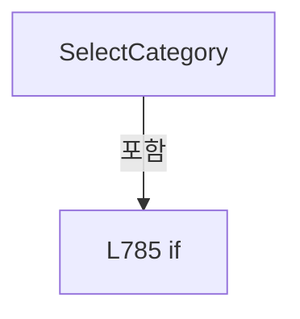

변경 전 점검: 입력/반환 타입, 위 호출자, 예외/취소 경로, 공유 상태와 저장·전송 소비자를 함께 확인합니다. 값의 단위나 물리 방향을 이름만으로 확정하지 않습니다.

### MethodDeclaration `SelectGroup` · L797–807

[Drilling.UI/Menu/Menus/CMenuRecipe.cs:797–807](https://github.com/kjuws10-rgb/A3Drilling/blob/0219666f9053b907d96d7e0aa7d0c6c1be3a73d4/Drilling.UI/Menu/Menus/CMenuRecipe.cs#L797-L807)

| 항목 | 실제 추출 값 |
| --- | --- |
| 서명 | System.Threading.Tasks.Task Drilling.UI.Menu.Menus.CMenuRecipe.SelectGroup(object?) |
| 접근/수식자 | Private / private, async |
| 반환/값 타입 | System.Threading.Tasks.Task |
| 소속 타입 | NamedType:Drilling.UI.Menu.Menus.CMenuRecipe |

입력 계약:

| 이름 | 타입 | 전달 | 선택/기본값 |
| --- | --- | --- | --- |
| parameter | object? | None | False /  |

정적 호출자로 확인된 위치:

| 호출 파일/행 | 호출 표현식 | 런타임 분기 가능 |
| --- | --- | --- |
| [Drilling.UI/Menu/Menus/CMenuRecipe.cs:137–137](https://github.com/kjuws10-rgb/A3Drilling/blob/0219666f9053b907d96d7e0aa7d0c6c1be3a73d4/Drilling.UI/Menu/Menus/CMenuRecipe.cs#L137-L137) | SelectGroup | False |

호출하는 대상과 해석 범위:

| 원본 행 | 표현식 | 분석 상태 | 대상/소스 위치 |
| --- | --- | --- | --- |
| 799 | string.IsNullOrWhiteSpace | resolved | bool string.IsNullOrWhiteSpace(string?) |
| 804 | group.Trim().ToUpperInvariant | resolved | string string.ToUpperInvariant() |
| 804 | group.Trim | resolved | string string.Trim() |
| 805 | _setStatusMessage | resolved · 동적 구현 선택 가능 | void System.Action<string>.Invoke(string) |
| 806 | _refreshCurrentScreen | resolved · 동적 구현 선택 가능 | System.Threading.Tasks.Task System.Func<System.Threading.Tasks.Task>.Invoke() |

본문의 실제 연산·분기·예외·반환 순서(원문 위치 순):

| 원본 행 | 종류 | 주석 해설 |
| --- | --- | --- |
| 799 | call | 함수·델리게이트 또는 객체 생성자를 호출합니다: string.IsNullOrWhiteSpace(group) |
| 799 | if | 조건에 따라 분기합니다: if (parameter is not string group &#124;&#124; string.IsNullOrWhiteSpace(group)) |
| 801 | return | 호출자에게 값 또는 제어를 반환합니다: return; |
| 804 | assignment | 값을 대상에 대입합니다: _selectedGroup = group.Trim().ToUpperInvariant() |
| 804 | call | 함수·델리게이트 또는 객체 생성자를 호출합니다: group.Trim().ToUpperInvariant() |
| 804 | call | 함수·델리게이트 또는 객체 생성자를 호출합니다: group.Trim() |
| 805 | call | 함수·델리게이트 또는 객체 생성자를 호출합니다: _setStatusMessage($"Recipe group {_selectedGroup} selected.") |
| 806 | await | 비동기 완료를 기다립니다: await _refreshCurrentScreen() |
| 806 | call | 함수·델리게이트 또는 객체 생성자를 호출합니다: _refreshCurrentScreen() |

제어 구문의 포함 구조(실제 실행 순서/CFG가 아닌 구문 탐색 그림):

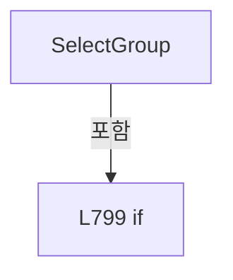

변경 전 점검: 입력/반환 타입, 위 호출자, 예외/취소 경로, 공유 상태와 저장·전송 소비자를 함께 확인합니다. 값의 단위나 물리 방향을 이름만으로 확정하지 않습니다.

### MethodDeclaration `SelectCell` · L809–830

[Drilling.UI/Menu/Menus/CMenuRecipe.cs:809–830](https://github.com/kjuws10-rgb/A3Drilling/blob/0219666f9053b907d96d7e0aa7d0c6c1be3a73d4/Drilling.UI/Menu/Menus/CMenuRecipe.cs#L809-L830)

| 항목 | 실제 추출 값 |
| --- | --- |
| 서명 | System.Threading.Tasks.Task Drilling.UI.Menu.Menus.CMenuRecipe.SelectCell(object?) |
| 접근/수식자 | Private / private, async |
| 반환/값 타입 | System.Threading.Tasks.Task |
| 소속 타입 | NamedType:Drilling.UI.Menu.Menus.CMenuRecipe |

입력 계약:

| 이름 | 타입 | 전달 | 선택/기본값 |
| --- | --- | --- | --- |
| parameter | object? | None | False /  |

정적 호출자로 확인된 위치:

| 호출 파일/행 | 호출 표현식 | 런타임 분기 가능 |
| --- | --- | --- |
| [Drilling.UI/Menu/Menus/CMenuRecipe.cs:143–143](https://github.com/kjuws10-rgb/A3Drilling/blob/0219666f9053b907d96d7e0aa7d0c6c1be3a73d4/Drilling.UI/Menu/Menus/CMenuRecipe.cs#L143-L143) | SelectCell | False |
| [Drilling.UI/Menu/Menus/CMenuRecipe.cs:835–835](https://github.com/kjuws10-rgb/A3Drilling/blob/0219666f9053b907d96d7e0aa7d0c6c1be3a73d4/Drilling.UI/Menu/Menus/CMenuRecipe.cs#L835-L835) | SelectCell | False |
| [Drilling.UI/Menu/Menus/CMenuRecipe.cs:873–873](https://github.com/kjuws10-rgb/A3Drilling/blob/0219666f9053b907d96d7e0aa7d0c6c1be3a73d4/Drilling.UI/Menu/Menus/CMenuRecipe.cs#L873-L873) | SelectCell | False |

호출하는 대상과 해석 범위:

| 원본 행 | 표현식 | 분석 상태 | 대상/소스 위치 |
| --- | --- | --- | --- |
| 814 | int.TryParse | resolved | bool int.TryParse(string?, out int) |
| 823 | OnPropertyChanged | resolved | void Drilling.UI.Menu.CBindingBase.OnPropertyChanged(string?) · Drilling.UI/Menu/CBindingBase.cs:790 |
| 823 | nameof | unresolved | None |
| 824 | OnPropertyChanged | resolved | void Drilling.UI.Menu.CBindingBase.OnPropertyChanged(string?) · Drilling.UI/Menu/CBindingBase.cs:790 |
| 824 | nameof | unresolved | None |
| 825 | OnPropertyChanged | resolved | void Drilling.UI.Menu.CBindingBase.OnPropertyChanged(string?) · Drilling.UI/Menu/CBindingBase.cs:790 |
| 825 | nameof | unresolved | None |
| 826 | PreviousCellCommand.NotifyCanExecuteChanged | resolved | void Drilling.UI.Menu.CButtonCommand.NotifyCanExecuteChanged() · Drilling.UI/Menu/CButtonCommand.cs:24 |
| 827 | NextCellCommand.NotifyCanExecuteChanged | resolved | void Drilling.UI.Menu.CButtonCommand.NotifyCanExecuteChanged() · Drilling.UI/Menu/CButtonCommand.cs:24 |
| 828 | _setStatusMessage | resolved · 동적 구현 선택 가능 | void System.Action<string>.Invoke(string) |
| 829 | _refreshCurrentScreen | resolved · 동적 구현 선택 가능 | System.Threading.Tasks.Task System.Func<System.Threading.Tasks.Task>.Invoke() |

본문의 실제 연산·분기·예외·반환 순서(원문 위치 순):

| 원본 행 | 종류 | 주석 해설 |
| --- | --- | --- |
| 811 | local-declaration | 지역 변수를 선언합니다: var cellNo = parameter switch { int number => number, string text when int.TryParse(text, out var number) => number, _ => 0 }; |
| 811 | switch-expression | 값별 결과식을 선택합니다: parameter switch { int number => number, string text when int.TryParse(text, out var number) => number, _ => 0 } |
| 811 | variable-initializer | 변수의 초기값을 지정합니다: cellNo = parameter switch { int number => number, string text when int.TryParse(text, out var number) => number, _ => 0 } |
| 814 | call | 함수·델리게이트 또는 객체 생성자를 호출합니다: int.TryParse(text, out var number) |
| 817 | if | 조건에 따라 분기합니다: if (cellNo <= 0 &#124;&#124; cellNo > _recipeCells.Count) |
| 819 | return | 호출자에게 값 또는 제어를 반환합니다: return; |
| 822 | assignment | 값을 대상에 대입합니다: _selectedCellNo = cellNo |
| 823 | call | 함수·델리게이트 또는 객체 생성자를 호출합니다: OnPropertyChanged(nameof(CurrentCellIndicatorText)) |
| 823 | call | 함수·델리게이트 또는 객체 생성자를 호출합니다: nameof(CurrentCellIndicatorText) |
| 824 | call | 함수·델리게이트 또는 객체 생성자를 호출합니다: OnPropertyChanged(nameof(SelectedCellNavigationText)) |
| 824 | call | 함수·델리게이트 또는 객체 생성자를 호출합니다: nameof(SelectedCellNavigationText) |
| 825 | call | 함수·델리게이트 또는 객체 생성자를 호출합니다: OnPropertyChanged(nameof(SelectedCellShotGroupTitle)) |
| 825 | call | 함수·델리게이트 또는 객체 생성자를 호출합니다: nameof(SelectedCellShotGroupTitle) |
| 826 | call | 함수·델리게이트 또는 객체 생성자를 호출합니다: PreviousCellCommand.NotifyCanExecuteChanged() |
| 827 | call | 함수·델리게이트 또는 객체 생성자를 호출합니다: NextCellCommand.NotifyCanExecuteChanged() |
| 828 | call | 함수·델리게이트 또는 객체 생성자를 호출합니다: _setStatusMessage($"Recipe Cell{cellNo} selected.") |
| 829 | await | 비동기 완료를 기다립니다: await _refreshCurrentScreen() |
| 829 | call | 함수·델리게이트 또는 객체 생성자를 호출합니다: _refreshCurrentScreen() |

제어 구문의 포함 구조(실제 실행 순서/CFG가 아닌 구문 탐색 그림):

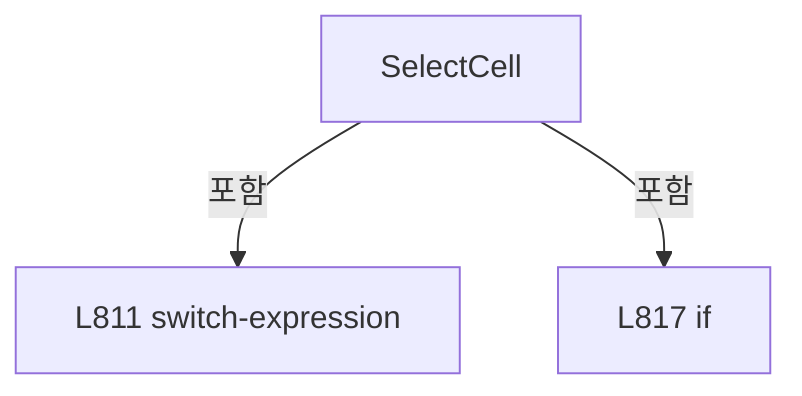

변경 전 점검: 입력/반환 타입, 위 호출자, 예외/취소 경로, 공유 상태와 저장·전송 소비자를 함께 확인합니다. 값의 단위나 물리 방향을 이름만으로 확정하지 않습니다.

### MethodDeclaration `SelectPreviewCell` · L832–836

[Drilling.UI/Menu/Menus/CMenuRecipe.cs:832–836](https://github.com/kjuws10-rgb/A3Drilling/blob/0219666f9053b907d96d7e0aa7d0c6c1be3a73d4/Drilling.UI/Menu/Menus/CMenuRecipe.cs#L832-L836)

| 항목 | 실제 추출 값 |
| --- | --- |
| 서명 | System.Threading.Tasks.Task Drilling.UI.Menu.Menus.CMenuRecipe.SelectPreviewCell(object?) |
| 접근/수식자 | Private / private, async |
| 반환/값 타입 | System.Threading.Tasks.Task |
| 소속 타입 | NamedType:Drilling.UI.Menu.Menus.CMenuRecipe |

입력 계약:

| 이름 | 타입 | 전달 | 선택/기본값 |
| --- | --- | --- | --- |
| parameter | object? | None | False /  |

정적 호출자로 확인된 위치:

| 호출 파일/행 | 호출 표현식 | 런타임 분기 가능 |
| --- | --- | --- |
| [Drilling.UI/Menu/Menus/CMenuRecipe.cs:149–149](https://github.com/kjuws10-rgb/A3Drilling/blob/0219666f9053b907d96d7e0aa7d0c6c1be3a73d4/Drilling.UI/Menu/Menus/CMenuRecipe.cs#L149-L149) | SelectPreviewCell | False |

호출하는 대상과 해석 범위:

| 원본 행 | 표현식 | 분석 상태 | 대상/소스 위치 |
| --- | --- | --- | --- |
| 834 | SetCellDetailVisible | resolved | void Drilling.UI.Menu.Menus.CMenuRecipe.SetCellDetailVisible(bool) · Drilling.UI/Menu/Menus/CMenuRecipe.cs:930 |
| 835 | SelectCell | resolved | System.Threading.Tasks.Task Drilling.UI.Menu.Menus.CMenuRecipe.SelectCell(object?) · Drilling.UI/Menu/Menus/CMenuRecipe.cs:809 |

본문의 실제 연산·분기·예외·반환 순서(원문 위치 순):

| 원본 행 | 종류 | 주석 해설 |
| --- | --- | --- |
| 834 | call | 함수·델리게이트 또는 객체 생성자를 호출합니다: SetCellDetailVisible(true) |
| 835 | await | 비동기 완료를 기다립니다: await SelectCell(parameter) |
| 835 | call | 함수·델리게이트 또는 객체 생성자를 호출합니다: SelectCell(parameter) |

변경 전 점검: 입력/반환 타입, 위 호출자, 예외/취소 경로, 공유 상태와 저장·전송 소비자를 함께 확인합니다. 값의 단위나 물리 방향을 이름만으로 확정하지 않습니다.

### MethodDeclaration `SelectShotGroupAt` · L838–847

[Drilling.UI/Menu/Menus/CMenuRecipe.cs:838–847](https://github.com/kjuws10-rgb/A3Drilling/blob/0219666f9053b907d96d7e0aa7d0c6c1be3a73d4/Drilling.UI/Menu/Menus/CMenuRecipe.cs#L838-L847)

| 항목 | 실제 추출 값 |
| --- | --- |
| 서명 | void Drilling.UI.Menu.Menus.CMenuRecipe.SelectShotGroupAt(double, double) |
| 접근/수식자 | Public / public |
| 반환/값 타입 | void |
| 소속 타입 | NamedType:Drilling.UI.Menu.Menus.CMenuRecipe |

입력 계약:

| 이름 | 타입 | 전달 | 선택/기본값 |
| --- | --- | --- | --- |
| designX | double | None | False /  |
| designY | double | None | False /  |

현재 부분 분석에서 직접 연결된 호출자는 없습니다. XAML/이벤트/인터페이스·델리게이트·외부 진입을 추가 확인해야 하며, 미사용으로 판정한 것이 아닙니다.

호출하는 대상과 해석 범위:

| 원본 행 | 표현식 | 분석 상태 | 대상/소스 위치 |
| --- | --- | --- | --- |
| 840 | GetSelectedRecipeCell | resolved | Drilling.UI.Menu.Menus.ST_RECIPE_CELL_VIEW_MODEL? Drilling.UI.Menu.Menus.CMenuRecipe.GetSelectedRecipeCell() · Drilling.UI/Menu/Menus/CMenuRecipe.cs:2118 |
| 841 | CRecipeCellPatternPreviewDrawing.TryResolveCellShotNo | resolved | bool Drilling.UI.Menu.Menus.CRecipeCellPatternPreviewDrawing.TryResolveCellShotNo(double, double, Drilling.Common.Recipe.ST_CELL_PATTERN_LAYOUT, out int) · Drilling.UI/Menu/Menus/CRecipeCellPatternPreviewDrawing.cs:124 |

본문의 실제 연산·분기·예외·반환 순서(원문 위치 순):

| 원본 행 | 종류 | 주석 해설 |
| --- | --- | --- |
| 840 | call | 함수·델리게이트 또는 객체 생성자를 호출합니다: GetSelectedRecipeCell() |
| 840 | local-declaration | 지역 변수를 선언합니다: var cell = GetSelectedRecipeCell(); |
| 840 | variable-initializer | 변수의 초기값을 지정합니다: cell = GetSelectedRecipeCell() |
| 841 | call | 함수·델리게이트 또는 객체 생성자를 호출합니다: CRecipeCellPatternPreviewDrawing.TryResolveCellShotNo(designX, designY, cell.PatternLayout, out var cellShotNo) |
| 841 | if | 조건에 따라 분기합니다: if (cell is null &#124;&#124; !CRecipeCellPatternPreviewDrawing.TryResolveCellShotNo(designX, designY, cell.PatternLayout, out var cellShotNo) &#124;&#124; cellShotNo < 1 &#124;&#124; cellShotNo > ShotGroupRows.Count) |
| 843 | return | 호출자에게 값 또는 제어를 반환합니다: return; |
| 846 | assignment | 값을 대상에 대입합니다: SelectedShotGroup = ShotGroupRows[cellShotNo - 1] |

제어 구문의 포함 구조(실제 실행 순서/CFG가 아닌 구문 탐색 그림):

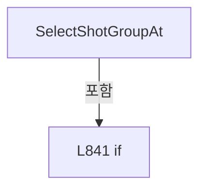

변경 전 점검: 입력/반환 타입, 위 호출자, 예외/취소 경로, 공유 상태와 저장·전송 소비자를 함께 확인합니다. 값의 단위나 물리 방향을 이름만으로 확정하지 않습니다.

### MethodDeclaration `GetShotGroupNameAt` · L849–858

[Drilling.UI/Menu/Menus/CMenuRecipe.cs:849–858](https://github.com/kjuws10-rgb/A3Drilling/blob/0219666f9053b907d96d7e0aa7d0c6c1be3a73d4/Drilling.UI/Menu/Menus/CMenuRecipe.cs#L849-L858)

| 항목 | 실제 추출 값 |
| --- | --- |
| 서명 | string Drilling.UI.Menu.Menus.CMenuRecipe.GetShotGroupNameAt(double, double) |
| 접근/수식자 | Public / public |
| 반환/값 타입 | string |
| 소속 타입 | NamedType:Drilling.UI.Menu.Menus.CMenuRecipe |

입력 계약:

| 이름 | 타입 | 전달 | 선택/기본값 |
| --- | --- | --- | --- |
| designX | double | None | False /  |
| designY | double | None | False /  |

현재 부분 분석에서 직접 연결된 호출자는 없습니다. XAML/이벤트/인터페이스·델리게이트·외부 진입을 추가 확인해야 하며, 미사용으로 판정한 것이 아닙니다.

호출하는 대상과 해석 범위:

| 원본 행 | 표현식 | 분석 상태 | 대상/소스 위치 |
| --- | --- | --- | --- |
| 851 | GetSelectedRecipeCell | resolved | Drilling.UI.Menu.Menus.ST_RECIPE_CELL_VIEW_MODEL? Drilling.UI.Menu.Menus.CMenuRecipe.GetSelectedRecipeCell() · Drilling.UI/Menu/Menus/CMenuRecipe.cs:2118 |
| 852 | CRecipeCellPatternPreviewDrawing.TryResolveCellShotNo | resolved | bool Drilling.UI.Menu.Menus.CRecipeCellPatternPreviewDrawing.TryResolveCellShotNo(double, double, Drilling.Common.Recipe.ST_CELL_PATTERN_LAYOUT, out int) · Drilling.UI/Menu/Menus/CRecipeCellPatternPreviewDrawing.cs:124 |

본문의 실제 연산·분기·예외·반환 순서(원문 위치 순):

| 원본 행 | 종류 | 주석 해설 |
| --- | --- | --- |
| 851 | call | 함수·델리게이트 또는 객체 생성자를 호출합니다: GetSelectedRecipeCell() |
| 851 | local-declaration | 지역 변수를 선언합니다: var cell = GetSelectedRecipeCell(); |
| 851 | variable-initializer | 변수의 초기값을 지정합니다: cell = GetSelectedRecipeCell() |
| 852 | call | 함수·델리게이트 또는 객체 생성자를 호출합니다: CRecipeCellPatternPreviewDrawing.TryResolveCellShotNo(designX, designY, cell.PatternLayout, out var cellShotNo) |
| 852 | if | 조건에 따라 분기합니다: if (cell is null &#124;&#124; !CRecipeCellPatternPreviewDrawing.TryResolveCellShotNo(designX, designY, cell.PatternLayout, out var cellShotNo) &#124;&#124; cellShotNo < 1 &#124;&#124; cellShotNo > ShotGroupRows.Count) |
| 854 | return | 호출자에게 값 또는 제어를 반환합니다: return ""; |
| 857 | return | 호출자에게 값 또는 제어를 반환합니다: return ShotGroupRows[cellShotNo - 1].MatrixPointName; |

제어 구문의 포함 구조(실제 실행 순서/CFG가 아닌 구문 탐색 그림):

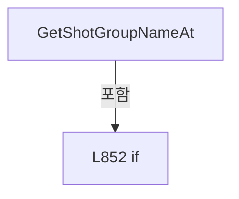

변경 전 점검: 입력/반환 타입, 위 호출자, 예외/취소 경로, 공유 상태와 저장·전송 소비자를 함께 확인합니다. 값의 단위나 물리 방향을 이름만으로 확정하지 않습니다.

### MethodDeclaration `SelectAdjacentCell` · L860–874

[Drilling.UI/Menu/Menus/CMenuRecipe.cs:860–874](https://github.com/kjuws10-rgb/A3Drilling/blob/0219666f9053b907d96d7e0aa7d0c6c1be3a73d4/Drilling.UI/Menu/Menus/CMenuRecipe.cs#L860-L874)

| 항목 | 실제 추출 값 |
| --- | --- |
| 서명 | System.Threading.Tasks.Task Drilling.UI.Menu.Menus.CMenuRecipe.SelectAdjacentCell(int) |
| 접근/수식자 | Private / private, async |
| 반환/값 타입 | System.Threading.Tasks.Task |
| 소속 타입 | NamedType:Drilling.UI.Menu.Menus.CMenuRecipe |

입력 계약:

| 이름 | 타입 | 전달 | 선택/기본값 |
| --- | --- | --- | --- |
| direction | int | None | False /  |

정적 호출자로 확인된 위치:

| 호출 파일/행 | 호출 표현식 | 런타임 분기 가능 |
| --- | --- | --- |
| [Drilling.UI/Menu/Menus/CMenuRecipe.cs:162–162](https://github.com/kjuws10-rgb/A3Drilling/blob/0219666f9053b907d96d7e0aa7d0c6c1be3a73d4/Drilling.UI/Menu/Menus/CMenuRecipe.cs#L162-L162) | SelectAdjacentCell | False |
| [Drilling.UI/Menu/Menus/CMenuRecipe.cs:173–173](https://github.com/kjuws10-rgb/A3Drilling/blob/0219666f9053b907d96d7e0aa7d0c6c1be3a73d4/Drilling.UI/Menu/Menus/CMenuRecipe.cs#L173-L173) | SelectAdjacentCell | False |

호출하는 대상과 해석 범위:

| 원본 행 | 표현식 | 분석 상태 | 대상/소스 위치 |
| --- | --- | --- | --- |
| 873 | SelectCell | resolved | System.Threading.Tasks.Task Drilling.UI.Menu.Menus.CMenuRecipe.SelectCell(object?) · Drilling.UI/Menu/Menus/CMenuRecipe.cs:809 |

본문의 실제 연산·분기·예외·반환 순서(원문 위치 순):

| 원본 행 | 종류 | 주석 해설 |
| --- | --- | --- |
| 862 | if | 조건에 따라 분기합니다: if (_recipeCells.Count == 0 &#124;&#124; direction == 0) |
| 864 | return | 호출자에게 값 또는 제어를 반환합니다: return; |
| 867 | local-declaration | 지역 변수를 선언합니다: var nextCellNo = _selectedCellNo + direction; |
| 867 | variable-initializer | 변수의 초기값을 지정합니다: nextCellNo = _selectedCellNo + direction |
| 868 | if | 조건에 따라 분기합니다: if (nextCellNo < 1 &#124;&#124; nextCellNo > _recipeCells.Count) |
| 870 | return | 호출자에게 값 또는 제어를 반환합니다: return; |
| 873 | await | 비동기 완료를 기다립니다: await SelectCell(nextCellNo) |
| 873 | call | 함수·델리게이트 또는 객체 생성자를 호출합니다: SelectCell(nextCellNo) |

제어 구문의 포함 구조(실제 실행 순서/CFG가 아닌 구문 탐색 그림):

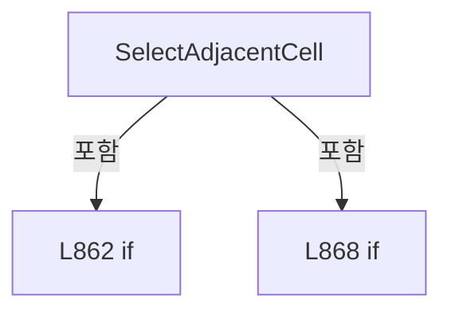

변경 전 점검: 입력/반환 타입, 위 호출자, 예외/취소 경로, 공유 상태와 저장·전송 소비자를 함께 확인합니다. 값의 단위나 물리 방향을 이름만으로 확정하지 않습니다.

### MethodDeclaration `NavigateShotGroup` · L876–884

[Drilling.UI/Menu/Menus/CMenuRecipe.cs:876–884](https://github.com/kjuws10-rgb/A3Drilling/blob/0219666f9053b907d96d7e0aa7d0c6c1be3a73d4/Drilling.UI/Menu/Menus/CMenuRecipe.cs#L876-L884)

| 항목 | 실제 추출 값 |
| --- | --- |
| 서명 | void Drilling.UI.Menu.Menus.CMenuRecipe.NavigateShotGroup(object?) |
| 접근/수식자 | Private / private |
| 반환/값 타입 | void |
| 소속 타입 | NamedType:Drilling.UI.Menu.Menus.CMenuRecipe |

입력 계약:

| 이름 | 타입 | 전달 | 선택/기본값 |
| --- | --- | --- | --- |
| parameter | object? | None | False /  |

현재 부분 분석에서 직접 연결된 호출자는 없습니다. XAML/이벤트/인터페이스·델리게이트·외부 진입을 추가 확인해야 하며, 미사용으로 판정한 것이 아닙니다.

호출하는 대상과 해석 범위:

| 원본 행 | 표현식 | 분석 상태 | 대상/소스 위치 |
| --- | --- | --- | --- |
| 878 | TryGetNavigatedCellShotNo | resolved | bool Drilling.UI.Menu.Menus.CMenuRecipe.TryGetNavigatedCellShotNo(object?, out int) · Drilling.UI/Menu/Menus/CMenuRecipe.cs:891 |

본문의 실제 연산·분기·예외·반환 순서(원문 위치 순):

| 원본 행 | 종류 | 주석 해설 |
| --- | --- | --- |
| 878 | call | 함수·델리게이트 또는 객체 생성자를 호출합니다: TryGetNavigatedCellShotNo(parameter, out var cellShotNo) |
| 878 | if | 조건에 따라 분기합니다: if (!TryGetNavigatedCellShotNo(parameter, out var cellShotNo)) |
| 880 | return | 호출자에게 값 또는 제어를 반환합니다: return; |
| 883 | assignment | 값을 대상에 대입합니다: SelectedShotGroup = ShotGroupRows[cellShotNo - 1] |

제어 구문의 포함 구조(실제 실행 순서/CFG가 아닌 구문 탐색 그림):

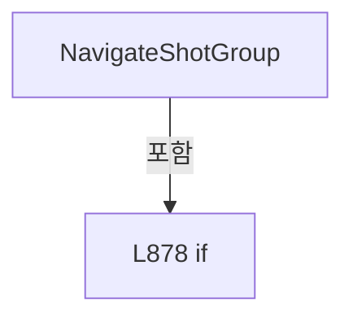

변경 전 점검: 입력/반환 타입, 위 호출자, 예외/취소 경로, 공유 상태와 저장·전송 소비자를 함께 확인합니다. 값의 단위나 물리 방향을 이름만으로 확정하지 않습니다.

### MethodDeclaration `CanNavigateShotGroup` · L886–889

[Drilling.UI/Menu/Menus/CMenuRecipe.cs:886–889](https://github.com/kjuws10-rgb/A3Drilling/blob/0219666f9053b907d96d7e0aa7d0c6c1be3a73d4/Drilling.UI/Menu/Menus/CMenuRecipe.cs#L886-L889)

| 항목 | 실제 추출 값 |
| --- | --- |
| 서명 | bool Drilling.UI.Menu.Menus.CMenuRecipe.CanNavigateShotGroup(object?) |
| 접근/수식자 | Private / private |
| 반환/값 타입 | bool |
| 소속 타입 | NamedType:Drilling.UI.Menu.Menus.CMenuRecipe |

입력 계약:

| 이름 | 타입 | 전달 | 선택/기본값 |
| --- | --- | --- | --- |
| parameter | object? | None | False /  |

현재 부분 분석에서 직접 연결된 호출자는 없습니다. XAML/이벤트/인터페이스·델리게이트·외부 진입을 추가 확인해야 하며, 미사용으로 판정한 것이 아닙니다.

호출하는 대상과 해석 범위:

| 원본 행 | 표현식 | 분석 상태 | 대상/소스 위치 |
| --- | --- | --- | --- |
| 888 | TryGetNavigatedCellShotNo | resolved | bool Drilling.UI.Menu.Menus.CMenuRecipe.TryGetNavigatedCellShotNo(object?, out int) · Drilling.UI/Menu/Menus/CMenuRecipe.cs:891 |

본문의 실제 연산·분기·예외·반환 순서(원문 위치 순):

| 원본 행 | 종류 | 주석 해설 |
| --- | --- | --- |
| 888 | call | 함수·델리게이트 또는 객체 생성자를 호출합니다: TryGetNavigatedCellShotNo(parameter, out _) |
| 888 | return | 호출자에게 값 또는 제어를 반환합니다: return TryGetNavigatedCellShotNo(parameter, out _); |

변경 전 점검: 입력/반환 타입, 위 호출자, 예외/취소 경로, 공유 상태와 저장·전송 소비자를 함께 확인합니다. 값의 단위나 물리 방향을 이름만으로 확정하지 않습니다.

### MethodDeclaration `TryGetNavigatedCellShotNo` · L891–928

[Drilling.UI/Menu/Menus/CMenuRecipe.cs:891–928](https://github.com/kjuws10-rgb/A3Drilling/blob/0219666f9053b907d96d7e0aa7d0c6c1be3a73d4/Drilling.UI/Menu/Menus/CMenuRecipe.cs#L891-L928)

| 항목 | 실제 추출 값 |
| --- | --- |
| 서명 | bool Drilling.UI.Menu.Menus.CMenuRecipe.TryGetNavigatedCellShotNo(object?, out int) |
| 접근/수식자 | Private / private |
| 반환/값 타입 | bool |
| 소속 타입 | NamedType:Drilling.UI.Menu.Menus.CMenuRecipe |

입력 계약:

| 이름 | 타입 | 전달 | 선택/기본값 |
| --- | --- | --- | --- |
| parameter | object? | None | False /  |
| cellShotNo | int | Out | False /  |

정적 호출자로 확인된 위치:

| 호출 파일/행 | 호출 표현식 | 런타임 분기 가능 |
| --- | --- | --- |
| [Drilling.UI/Menu/Menus/CMenuRecipe.cs:878–878](https://github.com/kjuws10-rgb/A3Drilling/blob/0219666f9053b907d96d7e0aa7d0c6c1be3a73d4/Drilling.UI/Menu/Menus/CMenuRecipe.cs#L878-L878) | TryGetNavigatedCellShotNo | False |
| [Drilling.UI/Menu/Menus/CMenuRecipe.cs:888–888](https://github.com/kjuws10-rgb/A3Drilling/blob/0219666f9053b907d96d7e0aa7d0c6c1be3a73d4/Drilling.UI/Menu/Menus/CMenuRecipe.cs#L888-L888) | TryGetNavigatedCellShotNo | False |

호출하는 대상과 해석 범위:

| 원본 행 | 표현식 | 분석 상태 | 대상/소스 위치 |
| --- | --- | --- | --- |
| 894 | GetSelectedRecipeCell | resolved | Drilling.UI.Menu.Menus.ST_RECIPE_CELL_VIEW_MODEL? Drilling.UI.Menu.Menus.CMenuRecipe.GetSelectedRecipeCell() · Drilling.UI/Menu/Menus/CMenuRecipe.cs:2118 |
| 901 | .ToString | resolved · 동적 구현 선택 가능 | string? object.ToString() |
| 901 | .Trim().ToUpperInvariant | resolved | string string.ToUpperInvariant() |
| 901 | .Trim | resolved | string string.Trim() |

본문의 실제 연산·분기·예외·반환 순서(원문 위치 순):

| 원본 행 | 종류 | 주석 해설 |
| --- | --- | --- |
| 893 | assignment | 값을 대상에 대입합니다: cellShotNo = 0 |
| 894 | call | 함수·델리게이트 또는 객체 생성자를 호출합니다: GetSelectedRecipeCell() |
| 894 | local-declaration | 지역 변수를 선언합니다: var cell = GetSelectedRecipeCell(); |
| 894 | variable-initializer | 변수의 초기값을 지정합니다: cell = GetSelectedRecipeCell() |
| 895 | local-declaration | 지역 변수를 선언합니다: var selected = SelectedShotGroup; |
| 895 | variable-initializer | 변수의 초기값을 지정합니다: selected = SelectedShotGroup |
| 896 | if | 조건에 따라 분기합니다: if (cell is null &#124;&#124; selected is null &#124;&#124; ShotGroupRows.Count == 0) |
| 898 | return | 호출자에게 값 또는 제어를 반환합니다: return false; |
| 901 | call | 함수·델리게이트 또는 객체 생성자를 호출합니다: .ToString() |
| 901 | call | 함수·델리게이트 또는 객체 생성자를 호출합니다: .Trim().ToUpperInvariant() |
| 901 | call | 함수·델리게이트 또는 객체 생성자를 호출합니다: .Trim() |
| 901 | assignment | 값을 대상에 대입합니다: var(columnDelta, rowDelta) = parameter?.ToString()?.Trim().ToUpperInvariant() switch { "UP" => (0, -1), "DOWN" => (0, 1), "LEFT" => (-1, 0), "RIGHT" => (1, 0), _ => (0, 0)} |
| 901 | switch-expression | 값별 결과식을 선택합니다: parameter?.ToString()?.Trim().ToUpperInvariant() switch { "UP" => (0, -1), "DOWN" => (0, 1), "LEFT" => (-1, 0), "RIGHT" => (1, 0), _ => (0, 0)} |
| 908 | if | 조건에 따라 분기합니다: if (columnDelta == 0 && rowDelta == 0) |
| 910 | return | 호출자에게 값 또는 제어를 반환합니다: return false; |
| 913 | local-declaration | 지역 변수를 선언합니다: var nextColumn = selected.Column + columnDelta; |
| 913 | variable-initializer | 변수의 초기값을 지정합니다: nextColumn = selected.Column + columnDelta |
| 914 | local-declaration | 지역 변수를 선언합니다: var nextRow = selected.Row + rowDelta; |
| 914 | variable-initializer | 변수의 초기값을 지정합니다: nextRow = selected.Row + rowDelta |
| 915 | if | 조건에 따라 분기합니다: if (nextColumn < 1 &#124;&#124; nextColumn > cell.PatternLayout.GroupCountX &#124;&#124; nextRow < 1 &#124;&#124; nextRow > cell.PatternLayout.GroupCountY) |
| 917 | return | 호출자에게 값 또는 제어를 반환합니다: return false; |
| 920 | local-declaration | 지역 변수를 선언합니다: var candidateCellShotNo = ((nextRow - 1) * cell.PatternLayout.GroupCountX) + nextColumn; |
| 920 | variable-initializer | 변수의 초기값을 지정합니다: candidateCellShotNo = ((nextRow - 1) * cell.PatternLayout.GroupCountX) + nextColumn |
| 921 | if | 조건에 따라 분기합니다: if (candidateCellShotNo < 1 &#124;&#124; candidateCellShotNo > ShotGroupRows.Count) |
| 923 | return | 호출자에게 값 또는 제어를 반환합니다: return false; |
| 926 | assignment | 값을 대상에 대입합니다: cellShotNo = candidateCellShotNo |
| 927 | return | 호출자에게 값 또는 제어를 반환합니다: return true; |

제어 구문의 포함 구조(실제 실행 순서/CFG가 아닌 구문 탐색 그림):

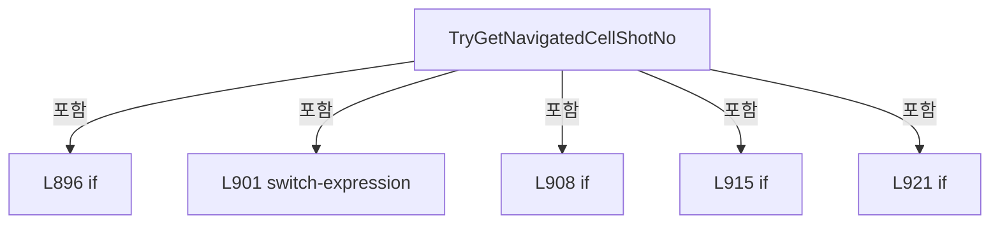

변경 전 점검: 입력/반환 타입, 위 호출자, 예외/취소 경로, 공유 상태와 저장·전송 소비자를 함께 확인합니다. 값의 단위나 물리 방향을 이름만으로 확정하지 않습니다.

### MethodDeclaration `SetCellDetailVisible` · L930–940

[Drilling.UI/Menu/Menus/CMenuRecipe.cs:930–940](https://github.com/kjuws10-rgb/A3Drilling/blob/0219666f9053b907d96d7e0aa7d0c6c1be3a73d4/Drilling.UI/Menu/Menus/CMenuRecipe.cs#L930-L940)

| 항목 | 실제 추출 값 |
| --- | --- |
| 서명 | void Drilling.UI.Menu.Menus.CMenuRecipe.SetCellDetailVisible(bool) |
| 접근/수식자 | Private / private |
| 반환/값 타입 | void |
| 소속 타입 | NamedType:Drilling.UI.Menu.Menus.CMenuRecipe |

입력 계약:

| 이름 | 타입 | 전달 | 선택/기본값 |
| --- | --- | --- | --- |
| isVisible | bool | None | False /  |

정적 호출자로 확인된 위치:

| 호출 파일/행 | 호출 표현식 | 런타임 분기 가능 |
| --- | --- | --- |
| [Drilling.UI/Menu/Menus/CMenuRecipe.cs:155–155](https://github.com/kjuws10-rgb/A3Drilling/blob/0219666f9053b907d96d7e0aa7d0c6c1be3a73d4/Drilling.UI/Menu/Menus/CMenuRecipe.cs#L155-L155) | SetCellDetailVisible | False |
| [Drilling.UI/Menu/Menus/CMenuRecipe.cs:834–834](https://github.com/kjuws10-rgb/A3Drilling/blob/0219666f9053b907d96d7e0aa7d0c6c1be3a73d4/Drilling.UI/Menu/Menus/CMenuRecipe.cs#L834-L834) | SetCellDetailVisible | False |

호출하는 대상과 해석 범위:

| 원본 행 | 표현식 | 분석 상태 | 대상/소스 위치 |
| --- | --- | --- | --- |
| 938 | OnPropertyChanged | resolved | void Drilling.UI.Menu.CBindingBase.OnPropertyChanged(string?) · Drilling.UI/Menu/CBindingBase.cs:790 |
| 938 | nameof | unresolved | None |
| 939 | OnPropertyChanged | resolved | void Drilling.UI.Menu.CBindingBase.OnPropertyChanged(string?) · Drilling.UI/Menu/CBindingBase.cs:790 |
| 939 | nameof | unresolved | None |

본문의 실제 연산·분기·예외·반환 순서(원문 위치 순):

| 원본 행 | 종류 | 주석 해설 |
| --- | --- | --- |
| 932 | if | 조건에 따라 분기합니다: if (_isCellDetailVisible == isVisible) |
| 934 | return | 호출자에게 값 또는 제어를 반환합니다: return; |
| 937 | assignment | 값을 대상에 대입합니다: _isCellDetailVisible = isVisible |
| 938 | call | 함수·델리게이트 또는 객체 생성자를 호출합니다: OnPropertyChanged(nameof(IsCellDetailVisible)) |
| 938 | call | 함수·델리게이트 또는 객체 생성자를 호출합니다: nameof(IsCellDetailVisible) |
| 939 | call | 함수·델리게이트 또는 객체 생성자를 호출합니다: OnPropertyChanged(nameof(IsCellPreviewVisible)) |
| 939 | call | 함수·델리게이트 또는 객체 생성자를 호출합니다: nameof(IsCellPreviewVisible) |

제어 구문의 포함 구조(실제 실행 순서/CFG가 아닌 구문 탐색 그림):

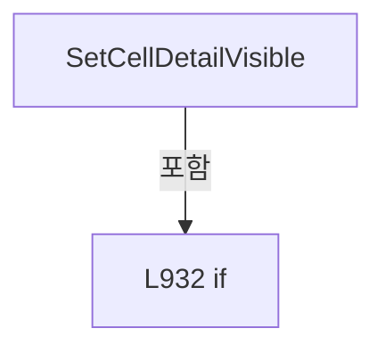

변경 전 점검: 입력/반환 타입, 위 호출자, 예외/취소 경로, 공유 상태와 저장·전송 소비자를 함께 확인합니다. 값의 단위나 물리 방향을 이름만으로 확정하지 않습니다.

### MethodDeclaration `ToggleCellPlacementExpanded` · L942–947

[Drilling.UI/Menu/Menus/CMenuRecipe.cs:942–947](https://github.com/kjuws10-rgb/A3Drilling/blob/0219666f9053b907d96d7e0aa7d0c6c1be3a73d4/Drilling.UI/Menu/Menus/CMenuRecipe.cs#L942-L947)

| 항목 | 실제 추출 값 |
| --- | --- |
| 서명 | void Drilling.UI.Menu.Menus.CMenuRecipe.ToggleCellPlacementExpanded() |
| 접근/수식자 | Public / public |
| 반환/값 타입 | void |
| 소속 타입 | NamedType:Drilling.UI.Menu.Menus.CMenuRecipe |

정적 호출자로 확인된 위치:

| 호출 파일/행 | 호출 표현식 | 런타임 분기 가능 |
| --- | --- | --- |
| [Drilling.UI/Menu/Menus/CMenuRecipe.cs:159–159](https://github.com/kjuws10-rgb/A3Drilling/blob/0219666f9053b907d96d7e0aa7d0c6c1be3a73d4/Drilling.UI/Menu/Menus/CMenuRecipe.cs#L159-L159) | ToggleCellPlacementExpanded | False |
| [Drilling.UI/Views/CRecipeView.xaml.cs:294–294](https://github.com/kjuws10-rgb/A3Drilling/blob/0219666f9053b907d96d7e0aa7d0c6c1be3a73d4/Drilling.UI/Views/CRecipeView.xaml.cs#L294-L294) | recipe.ToggleCellPlacementExpanded | False |

호출하는 대상과 해석 범위:

| 원본 행 | 표현식 | 분석 상태 | 대상/소스 위치 |
| --- | --- | --- | --- |
| 945 | OnPropertyChanged | resolved | void Drilling.UI.Menu.CBindingBase.OnPropertyChanged(string?) · Drilling.UI/Menu/CBindingBase.cs:790 |
| 945 | nameof | unresolved | None |
| 946 | OnPropertyChanged | resolved | void Drilling.UI.Menu.CBindingBase.OnPropertyChanged(string?) · Drilling.UI/Menu/CBindingBase.cs:790 |
| 946 | nameof | unresolved | None |

본문의 실제 연산·분기·예외·반환 순서(원문 위치 순):

| 원본 행 | 종류 | 주석 해설 |
| --- | --- | --- |
| 944 | assignment | 값을 대상에 대입합니다: _isCellPlacementExpanded = !_isCellPlacementExpanded |
| 945 | call | 함수·델리게이트 또는 객체 생성자를 호출합니다: OnPropertyChanged(nameof(IsCellPlacementExpanded)) |
| 945 | call | 함수·델리게이트 또는 객체 생성자를 호출합니다: nameof(IsCellPlacementExpanded) |
| 946 | call | 함수·델리게이트 또는 객체 생성자를 호출합니다: OnPropertyChanged(nameof(CellPlacementExpandButtonText)) |
| 946 | call | 함수·델리게이트 또는 객체 생성자를 호출합니다: nameof(CellPlacementExpandButtonText) |

변경 전 점검: 입력/반환 타입, 위 호출자, 예외/취소 경로, 공유 상태와 저장·전송 소비자를 함께 확인합니다. 값의 단위나 물리 방향을 이름만으로 확정하지 않습니다.

### MethodDeclaration `CreateCellPlacementWizardContext` · L949–961

[Drilling.UI/Menu/Menus/CMenuRecipe.cs:949–961](https://github.com/kjuws10-rgb/A3Drilling/blob/0219666f9053b907d96d7e0aa7d0c6c1be3a73d4/Drilling.UI/Menu/Menus/CMenuRecipe.cs#L949-L961)

| 항목 | 실제 추출 값 |
| --- | --- |
| 서명 | Drilling.UI.Popup.ST_CELL_PLACEMENT_WIZARD_CONTEXT Drilling.UI.Menu.Menus.CMenuRecipe.CreateCellPlacementWizardContext() |
| 접근/수식자 | Public / public |
| 반환/값 타입 | Drilling.UI.Popup.ST_CELL_PLACEMENT_WIZARD_CONTEXT |
| 소속 타입 | NamedType:Drilling.UI.Menu.Menus.CMenuRecipe |

정적 호출자로 확인된 위치:

| 호출 파일/행 | 호출 표현식 | 런타임 분기 가능 |
| --- | --- | --- |
| [Drilling.UI/Views/CRecipeView.xaml.cs:318–318](https://github.com/kjuws10-rgb/A3Drilling/blob/0219666f9053b907d96d7e0aa7d0c6c1be3a73d4/Drilling.UI/Views/CRecipeView.xaml.cs#L318-L318) | recipe.CreateCellPlacementWizardContext | False |

호출하는 대상과 해석 범위:

| 원본 행 | 표현식 | 분석 상태 | 대상/소스 위치 |
| --- | --- | --- | --- |
| 951 | Math.Max | resolved | int System.Math.Max(int, int) |
| 951 | GetCellCount | resolved | int Drilling.UI.Menu.Menus.CMenuRecipe.GetCellCount(System.Collections.Generic.IReadOnlyList<Drilling.UI.Menu.Menus.ST_RECIPE_PARAMETER_EDITOR_ITEM>) · Drilling.UI/Menu/Menus/CMenuRecipe.cs:1833 |
| 952 | GetCellModelTypeCount | resolved | int Drilling.UI.Menu.Menus.CMenuRecipe.GetCellModelTypeCount(System.Collections.Generic.IReadOnlyList<Drilling.UI.Menu.Menus.ST_RECIPE_PARAMETER_EDITOR_ITEM>) · Drilling.UI/Menu/Menus/CMenuRecipe.cs:2073 |
| 953 | new ST_CELL_PLACEMENT_WIZARD_CONTEXT | resolved | Drilling.UI.Popup.ST_CELL_PLACEMENT_WIZARD_CONTEXT.ST_CELL_PLACEMENT_WIZARD_CONTEXT(int, int, double, double, double, double) · Drilling.UI/Popup/CCellPlacementWizardDialog.xaml.cs:383 |
| 956 | ReadManagedDouble | resolved | double Drilling.UI.Menu.Menus.CMenuRecipe.ReadManagedDouble(System.Collections.Generic.IReadOnlyList<Drilling.UI.Menu.Menus.ST_RECIPE_PARAMETER_EDITOR_ITEM>, string, double) · Drilling.UI/Menu/Menus/CMenuRecipe.cs:2802 |
| 957 | ReadManagedDouble | resolved | double Drilling.UI.Menu.Menus.CMenuRecipe.ReadManagedDouble(System.Collections.Generic.IReadOnlyList<Drilling.UI.Menu.Menus.ST_RECIPE_PARAMETER_EDITOR_ITEM>, string, double) · Drilling.UI/Menu/Menus/CMenuRecipe.cs:2802 |

본문의 실제 연산·분기·예외·반환 순서(원문 위치 순):

| 원본 행 | 종류 | 주석 해설 |
| --- | --- | --- |
| 951 | call | 함수·델리게이트 또는 객체 생성자를 호출합니다: Math.Max(1, CellOverviewRows.Count) |
| 951 | call | 함수·델리게이트 또는 객체 생성자를 호출합니다: GetCellCount(AllManagedItems) |
| 951 | conditional-expression | 조건에 따라 결과식을 선택합니다: AllManagedItems.Count == 0 ? Math.Max(1, CellOverviewRows.Count) : GetCellCount(AllManagedItems) |
| 951 | local-declaration | 지역 변수를 선언합니다: var cellCount = AllManagedItems.Count == 0 ? Math.Max(1, CellOverviewRows.Count) : GetCellCount(AllManagedItems); |
| 951 | variable-initializer | 변수의 초기값을 지정합니다: cellCount = AllManagedItems.Count == 0 ? Math.Max(1, CellOverviewRows.Count) : GetCellCount(AllManagedItems) |
| 952 | call | 함수·델리게이트 또는 객체 생성자를 호출합니다: GetCellModelTypeCount(AllManagedItems) |
| 952 | conditional-expression | 조건에 따라 결과식을 선택합니다: AllManagedItems.Count == 0 ? MaximumCellModelTypeCount : GetCellModelTypeCount(AllManagedItems) |
| 952 | local-declaration | 지역 변수를 선언합니다: var modelTypeCount = AllManagedItems.Count == 0 ? MaximumCellModelTypeCount : GetCellModelTypeCount(AllManagedItems); |
| 952 | variable-initializer | 변수의 초기값을 지정합니다: modelTypeCount = AllManagedItems.Count == 0 ? MaximumCellModelTypeCount : GetCellModelTypeCount(AllManagedItems) |
| 953 | call | 함수·델리게이트 또는 객체 생성자를 호출합니다: new ST_CELL_PLACEMENT_WIZARD_CONTEXT( cellCount, modelTypeCount, ReadManagedDouble(AllManagedItems, "GLASS_SIZE_X", 500.0), ReadManagedDouble(AllManagedItems, "GLASS_SIZE_Y", 300.0), _alignKeyMargins.X, _alignKeyMargins.… |
| 953 | return | 호출자에게 값 또는 제어를 반환합니다: return new ST_CELL_PLACEMENT_WIZARD_CONTEXT( cellCount, modelTypeCount, ReadManagedDouble(AllManagedItems, "GLASS_SIZE_X", 500.0), ReadManagedDouble(AllManagedItems, "GLASS_SIZE_Y", 300.0), _alignKeyMargins.X, _alignKeyMargins.Y ) |
| 956 | call | 함수·델리게이트 또는 객체 생성자를 호출합니다: ReadManagedDouble(AllManagedItems, "GLASS_SIZE_X", 500.0) |
| 957 | call | 함수·델리게이트 또는 객체 생성자를 호출합니다: ReadManagedDouble(AllManagedItems, "GLASS_SIZE_Y", 300.0) |

변경 전 점검: 입력/반환 타입, 위 호출자, 예외/취소 경로, 공유 상태와 저장·전송 소비자를 함께 확인합니다. 값의 단위나 물리 방향을 이름만으로 확정하지 않습니다.

### MethodDeclaration `ApplyCellPlacementWizard` · L963–1009

[Drilling.UI/Menu/Menus/CMenuRecipe.cs:963–1009](https://github.com/kjuws10-rgb/A3Drilling/blob/0219666f9053b907d96d7e0aa7d0c6c1be3a73d4/Drilling.UI/Menu/Menus/CMenuRecipe.cs#L963-L1009)

| 항목 | 실제 추출 값 |
| --- | --- |
| 서명 | void Drilling.UI.Menu.Menus.CMenuRecipe.ApplyCellPlacementWizard(Drilling.UI.Popup.ST_CELL_PLACEMENT_WIZARD_RESULT) |
| 접근/수식자 | Public / public |
| 반환/값 타입 | void |
| 소속 타입 | NamedType:Drilling.UI.Menu.Menus.CMenuRecipe |

입력 계약:

| 이름 | 타입 | 전달 | 선택/기본값 |
| --- | --- | --- | --- |
| result | Drilling.UI.Popup.ST_CELL_PLACEMENT_WIZARD_RESULT | None | False /  |

정적 호출자로 확인된 위치:

| 호출 파일/행 | 호출 표현식 | 런타임 분기 가능 |
| --- | --- | --- |
| [Drilling.UI/Views/CRecipeView.xaml.cs:324–324](https://github.com/kjuws10-rgb/A3Drilling/blob/0219666f9053b907d96d7e0aa7d0c6c1be3a73d4/Drilling.UI/Views/CRecipeView.xaml.cs#L324-L324) | recipe.ApplyCellPlacementWizard | False |

호출하는 대상과 해석 범위:

| 원본 행 | 표현식 | 분석 상태 | 대상/소스 위치 |
| --- | --- | --- | --- |
| 970 | GetCellCount | resolved | int Drilling.UI.Menu.Menus.CMenuRecipe.GetCellCount(System.Collections.Generic.IReadOnlyList<Drilling.UI.Menu.Menus.ST_RECIPE_PARAMETER_EDITOR_ITEM>) · Drilling.UI/Menu/Menus/CMenuRecipe.cs:1833 |
| 971 | GetCellModelTypeCount | resolved | int Drilling.UI.Menu.Menus.CMenuRecipe.GetCellModelTypeCount(System.Collections.Generic.IReadOnlyList<Drilling.UI.Menu.Menus.ST_RECIPE_PARAMETER_EDITOR_ITEM>) · Drilling.UI/Menu/Menus/CMenuRecipe.cs:2073 |
| 984 | CalculatePlacementWizardGridIndex | resolved | (int RowIndex, int ColumnIndex) Drilling.UI.Menu.Menus.CMenuRecipe.CalculatePlacementWizardGridIndex(int, int, int, string) · Drilling.UI/Menu/Menus/CMenuRecipe.cs:1020 |
| 987 | Math.Clamp | resolved | int System.Math.Clamp(int, int, int) |
| 990 | modelOverride.Scope.Equals | resolved | bool string.Equals(string?, System.StringComparison) |
| 990 | modelOverride.Scope.Equals | resolved | bool string.Equals(string?, System.StringComparison) |
| 992 | Math.Clamp | resolved | int System.Math.Clamp(int, int, int) |
| 996 | SetManagedValue | resolved | void Drilling.UI.Menu.Menus.CMenuRecipe.SetManagedValue(string, string) · Drilling.UI/Menu/Menus/CMenuRecipe.cs:1011 |
| 996 | FormatWizardDouble | resolved | string Drilling.UI.Menu.Menus.CMenuRecipe.FormatWizardDouble(double) · Drilling.UI/Menu/Menus/CMenuRecipe.cs:1032 |
| 997 | SetManagedValue | resolved | void Drilling.UI.Menu.Menus.CMenuRecipe.SetManagedValue(string, string) · Drilling.UI/Menu/Menus/CMenuRecipe.cs:1011 |
| 997 | FormatWizardDouble | resolved | string Drilling.UI.Menu.Menus.CMenuRecipe.FormatWizardDouble(double) · Drilling.UI/Menu/Menus/CMenuRecipe.cs:1032 |
| 998 | SetManagedValue | resolved | void Drilling.UI.Menu.Menus.CMenuRecipe.SetManagedValue(string, string) · Drilling.UI/Menu/Menus/CMenuRecipe.cs:1011 |
| 998 | modelType.ToString | resolved | string int.ToString(System.IFormatProvider?) |
| 1007 | RefreshCellPreviewFromManagedItems | resolved | void Drilling.UI.Menu.Menus.CMenuRecipe.RefreshCellPreviewFromManagedItems() · Drilling.UI/Menu/Menus/CMenuRecipe.cs:1443 |
| 1008 | _setStatusMessage | resolved · 동적 구현 선택 가능 | void System.Action<string>.Invoke(string) |

본문의 실제 연산·분기·예외·반환 순서(원문 위치 순):

| 원본 행 | 종류 | 주석 해설 |
| --- | --- | --- |
| 965 | if | 조건에 따라 분기합니다: if (result.CellCount <= 0 &#124;&#124; AllManagedItems.Count == 0) |
| 967 | return | 호출자에게 값 또는 제어를 반환합니다: return; |
| 970 | call | 함수·델리게이트 또는 객체 생성자를 호출합니다: GetCellCount(AllManagedItems) |
| 970 | local-declaration | 지역 변수를 선언합니다: var maxCellCount = GetCellCount(AllManagedItems); |
| 970 | variable-initializer | 변수의 초기값을 지정합니다: maxCellCount = GetCellCount(AllManagedItems) |
| 971 | call | 함수·델리게이트 또는 객체 생성자를 호출합니다: GetCellModelTypeCount(AllManagedItems) |
| 971 | local-declaration | 지역 변수를 선언합니다: var modelTypeCount = GetCellModelTypeCount(AllManagedItems); |
| 971 | variable-initializer | 변수의 초기값을 지정합니다: modelTypeCount = GetCellModelTypeCount(AllManagedItems) |
| 972 | local-declaration | 지역 변수를 선언합니다: var appliedCount = 0; |
| 972 | variable-initializer | 변수의 초기값을 지정합니다: appliedCount = 0 |
| 973 | assignment | 값을 대상에 대입합니다: _isBatchUpdatingCellPlacement = true |
| 974 | try | 예외 처리 범위입니다: try |
| 976 | variable-initializer | 변수의 초기값을 지정합니다: index = 0 |
| 976 | for | 초기화·조건·증감이 있는 반복입니다: for (var index = 0; index < result.CellCount; index++) |
| 978 | local-declaration | 지역 변수를 선언합니다: var cellNo = result.StartCell + index; |
| 978 | variable-initializer | 변수의 초기값을 지정합니다: cellNo = result.StartCell + index |
| 979 | if | 조건에 따라 분기합니다: if (cellNo < 1 &#124;&#124; cellNo > maxCellCount) |
| 981 | continue | 다음 반복으로 진행합니다: continue; |
| 984 | assignment | 값을 대상에 대입합니다: var(rowIndex, columnIndex) = CalculatePlacementWizardGridIndex(index, result.RowCount, result.ColumnCount, result.Direction) |
| 984 | call | 함수·델리게이트 또는 객체 생성자를 호출합니다: CalculatePlacementWizardGridIndex(index, result.RowCount, result.ColumnCount, result.Direction) |
| 985 | local-declaration | 지역 변수를 선언합니다: var x = result.StartX + (columnIndex * result.PitchX); |
| 985 | variable-initializer | 변수의 초기값을 지정합니다: x = result.StartX + (columnIndex * result.PitchX) |
| 986 | local-declaration | 지역 변수를 선언합니다: var y = result.StartY + (rowIndex * result.PitchY); |
| 986 | variable-initializer | 변수의 초기값을 지정합니다: y = result.StartY + (rowIndex * result.PitchY) |
| 987 | call | 함수·델리게이트 또는 객체 생성자를 호출합니다: Math.Clamp(result.DefaultModelType, 1, modelTypeCount) |
| 987 | local-declaration | 지역 변수를 선언합니다: var modelType = Math.Clamp(result.DefaultModelType, 1, modelTypeCount); |
| 987 | variable-initializer | 변수의 초기값을 지정합니다: modelType = Math.Clamp(result.DefaultModelType, 1, modelTypeCount) |
| 988 | foreach | 컬렉션 요소를 순회합니다: foreach (var modelOverride in result.ModelOverrides) |
| 990 | call | 함수·델리게이트 또는 객체 생성자를 호출합니다: modelOverride.Scope.Equals("ROW", StringComparison.OrdinalIgnoreCase) |
| 990 | call | 함수·델리게이트 또는 객체 생성자를 호출합니다: modelOverride.Scope.Equals("COL", StringComparison.OrdinalIgnoreCase) |
| 990 | if | 조건에 따라 분기합니다: if (modelOverride.Scope.Equals("ROW", StringComparison.OrdinalIgnoreCase) && modelOverride.Index == rowIndex + 1 &#124;&#124; modelOverride.Scope.Equals("COL", StringComparison.OrdinalIgnoreCase) && modelOverride.Index == columnIndex …) |
| 992 | assignment | 값을 대상에 대입합니다: modelType = Math.Clamp(modelOverride.ModelType, 1, modelTypeCount) |
| 992 | call | 함수·델리게이트 또는 객체 생성자를 호출합니다: Math.Clamp(modelOverride.ModelType, 1, modelTypeCount) |
| 996 | call | 함수·델리게이트 또는 객체 생성자를 호출합니다: SetManagedValue($"CELL{cellNo}_ALIGN_TO_1ST_PIXEL_X", FormatWizardDouble(x)) |
| 996 | call | 함수·델리게이트 또는 객체 생성자를 호출합니다: FormatWizardDouble(x) |
| 997 | call | 함수·델리게이트 또는 객체 생성자를 호출합니다: SetManagedValue($"CELL{cellNo}_ALIGN_TO_1ST_PIXEL_Y", FormatWizardDouble(y)) |
| 997 | call | 함수·델리게이트 또는 객체 생성자를 호출합니다: FormatWizardDouble(y) |
| 998 | call | 함수·델리게이트 또는 객체 생성자를 호출합니다: SetManagedValue($"CELL{cellNo}_MODEL_TYPE", modelType.ToString(CultureInfo.InvariantCulture)) |
| 998 | call | 함수·델리게이트 또는 객체 생성자를 호출합니다: modelType.ToString(CultureInfo.InvariantCulture) |
| 1002 | finally | 종료 정리 구간입니다: finally |
| 1004 | assignment | 값을 대상에 대입합니다: _isBatchUpdatingCellPlacement = false |
| 1007 | call | 함수·델리게이트 또는 객체 생성자를 호출합니다: RefreshCellPreviewFromManagedItems() |
| 1008 | call | 함수·델리게이트 또는 객체 생성자를 호출합니다: _setStatusMessage($"Cell placement wizard applied to {appliedCount:N0} cells.") |

제어 구문의 포함 구조(실제 실행 순서/CFG가 아닌 구문 탐색 그림):

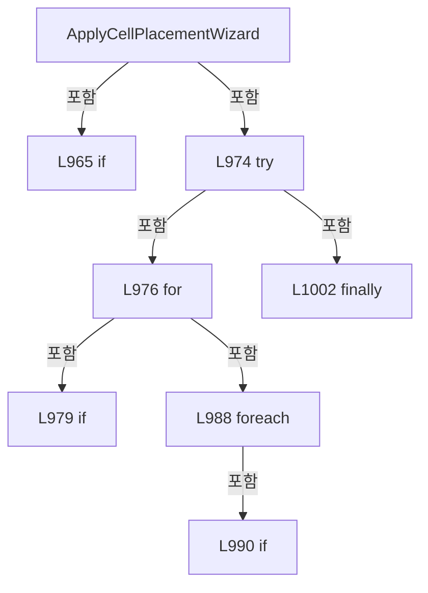

변경 전 점검: 입력/반환 타입, 위 호출자, 예외/취소 경로, 공유 상태와 저장·전송 소비자를 함께 확인합니다. 값의 단위나 물리 방향을 이름만으로 확정하지 않습니다.

### MethodDeclaration `SetManagedValue` · L1011–1018

[Drilling.UI/Menu/Menus/CMenuRecipe.cs:1011–1018](https://github.com/kjuws10-rgb/A3Drilling/blob/0219666f9053b907d96d7e0aa7d0c6c1be3a73d4/Drilling.UI/Menu/Menus/CMenuRecipe.cs#L1011-L1018)

| 항목 | 실제 추출 값 |
| --- | --- |
| 서명 | void Drilling.UI.Menu.Menus.CMenuRecipe.SetManagedValue(string, string) |
| 접근/수식자 | Private / private |
| 반환/값 타입 | void |
| 소속 타입 | NamedType:Drilling.UI.Menu.Menus.CMenuRecipe |

입력 계약:

| 이름 | 타입 | 전달 | 선택/기본값 |
| --- | --- | --- | --- |
| key | string | None | False /  |
| value | string | None | False /  |

정적 호출자로 확인된 위치:

| 호출 파일/행 | 호출 표현식 | 런타임 분기 가능 |
| --- | --- | --- |
| [Drilling.UI/Menu/Menus/CMenuRecipe.cs:996–996](https://github.com/kjuws10-rgb/A3Drilling/blob/0219666f9053b907d96d7e0aa7d0c6c1be3a73d4/Drilling.UI/Menu/Menus/CMenuRecipe.cs#L996-L996) | SetManagedValue | False |
| [Drilling.UI/Menu/Menus/CMenuRecipe.cs:997–997](https://github.com/kjuws10-rgb/A3Drilling/blob/0219666f9053b907d96d7e0aa7d0c6c1be3a73d4/Drilling.UI/Menu/Menus/CMenuRecipe.cs#L997-L997) | SetManagedValue | False |
| [Drilling.UI/Menu/Menus/CMenuRecipe.cs:998–998](https://github.com/kjuws10-rgb/A3Drilling/blob/0219666f9053b907d96d7e0aa7d0c6c1be3a73d4/Drilling.UI/Menu/Menus/CMenuRecipe.cs#L998-L998) | SetManagedValue | False |

호출하는 대상과 해석 범위:

| 원본 행 | 표현식 | 분석 상태 | 대상/소스 위치 |
| --- | --- | --- | --- |
| 1013 | FindManagedItem | resolved | Drilling.UI.Menu.Menus.ST_RECIPE_PARAMETER_EDITOR_ITEM? Drilling.UI.Menu.Menus.CMenuRecipe.FindManagedItem(System.Collections.Generic.IReadOnlyList<Drilling.UI.Menu.Menus.ST_RECIPE_PARAMETER_EDITOR_ITEM>, string) · Drilling.UI/Menu/Menus/CMenuRecipe.cs:1966 |

본문의 실제 연산·분기·예외·반환 순서(원문 위치 순):

| 원본 행 | 종류 | 주석 해설 |
| --- | --- | --- |
| 1013 | call | 함수·델리게이트 또는 객체 생성자를 호출합니다: FindManagedItem(AllManagedItems, key) |
| 1013 | local-declaration | 지역 변수를 선언합니다: var item = FindManagedItem(AllManagedItems, key); |
| 1013 | variable-initializer | 변수의 초기값을 지정합니다: item = FindManagedItem(AllManagedItems, key) |
| 1014 | if | 조건에 따라 분기합니다: if (item is not null) |
| 1016 | assignment | 값을 대상에 대입합니다: item.Value = value |

제어 구문의 포함 구조(실제 실행 순서/CFG가 아닌 구문 탐색 그림):

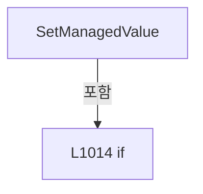

변경 전 점검: 입력/반환 타입, 위 호출자, 예외/취소 경로, 공유 상태와 저장·전송 소비자를 함께 확인합니다. 값의 단위나 물리 방향을 이름만으로 확정하지 않습니다.

### MethodDeclaration `CalculatePlacementWizardGridIndex` · L1020–1030

[Drilling.UI/Menu/Menus/CMenuRecipe.cs:1020–1030](https://github.com/kjuws10-rgb/A3Drilling/blob/0219666f9053b907d96d7e0aa7d0c6c1be3a73d4/Drilling.UI/Menu/Menus/CMenuRecipe.cs#L1020-L1030)

| 항목 | 실제 추출 값 |
| --- | --- |
| 서명 | (int RowIndex, int ColumnIndex) Drilling.UI.Menu.Menus.CMenuRecipe.CalculatePlacementWizardGridIndex(int, int, int, string) |
| 접근/수식자 | Private / private, static |
| 반환/값 타입 | (int RowIndex, int ColumnIndex) |
| 소속 타입 | NamedType:Drilling.UI.Menu.Menus.CMenuRecipe |

입력 계약:

| 이름 | 타입 | 전달 | 선택/기본값 |
| --- | --- | --- | --- |
| zeroBasedIndex | int | None | False /  |
| rowCount | int | None | False /  |
| columnCount | int | None | False /  |
| direction | string | None | False /  |

정적 호출자로 확인된 위치:

| 호출 파일/행 | 호출 표현식 | 런타임 분기 가능 |
| --- | --- | --- |
| [Drilling.UI/Menu/Menus/CMenuRecipe.cs:984–984](https://github.com/kjuws10-rgb/A3Drilling/blob/0219666f9053b907d96d7e0aa7d0c6c1be3a73d4/Drilling.UI/Menu/Menus/CMenuRecipe.cs#L984-L984) | CalculatePlacementWizardGridIndex | False |

호출하는 대상과 해석 범위:

| 원본 행 | 표현식 | 분석 상태 | 대상/소스 위치 |
| --- | --- | --- | --- |
| 1022 | Math.Max | resolved | int System.Math.Max(int, int) |
| 1023 | Math.Max | resolved | int System.Math.Max(int, int) |
| 1024 | direction.Equals | resolved | bool string.Equals(string?, System.StringComparison) |

본문의 실제 연산·분기·예외·반환 순서(원문 위치 순):

| 원본 행 | 종류 | 주석 해설 |
| --- | --- | --- |
| 1022 | assignment | 값을 대상에 대입합니다: rowCount = Math.Max(1, rowCount) |
| 1022 | call | 함수·델리게이트 또는 객체 생성자를 호출합니다: Math.Max(1, rowCount) |
| 1023 | assignment | 값을 대상에 대입합니다: columnCount = Math.Max(1, columnCount) |
| 1023 | call | 함수·델리게이트 또는 객체 생성자를 호출합니다: Math.Max(1, columnCount) |
| 1024 | call | 함수·델리게이트 또는 객체 생성자를 호출합니다: direction.Equals(ST_CELL_PLACEMENT_WIZARD_DIRECTION.VerticalFirst, StringComparison.OrdinalIgnoreCase) |
| 1024 | if | 조건에 따라 분기합니다: if (direction.Equals(ST_CELL_PLACEMENT_WIZARD_DIRECTION.VerticalFirst, StringComparison.OrdinalIgnoreCase)) |
| 1026 | return | 호출자에게 값 또는 제어를 반환합니다: return (zeroBasedIndex % rowCount, zeroBasedIndex / rowCount); |
| 1029 | return | 호출자에게 값 또는 제어를 반환합니다: return (zeroBasedIndex / columnCount, zeroBasedIndex % columnCount); |

제어 구문의 포함 구조(실제 실행 순서/CFG가 아닌 구문 탐색 그림):

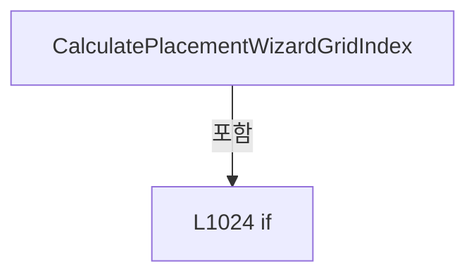

변경 전 점검: 입력/반환 타입, 위 호출자, 예외/취소 경로, 공유 상태와 저장·전송 소비자를 함께 확인합니다. 값의 단위나 물리 방향을 이름만으로 확정하지 않습니다.

### MethodDeclaration `FormatWizardDouble` · L1032–1035

[Drilling.UI/Menu/Menus/CMenuRecipe.cs:1032–1035](https://github.com/kjuws10-rgb/A3Drilling/blob/0219666f9053b907d96d7e0aa7d0c6c1be3a73d4/Drilling.UI/Menu/Menus/CMenuRecipe.cs#L1032-L1035)

| 항목 | 실제 추출 값 |
| --- | --- |
| 서명 | string Drilling.UI.Menu.Menus.CMenuRecipe.FormatWizardDouble(double) |
| 접근/수식자 | Private / private, static |
| 반환/값 타입 | string |
| 소속 타입 | NamedType:Drilling.UI.Menu.Menus.CMenuRecipe |

입력 계약:

| 이름 | 타입 | 전달 | 선택/기본값 |
| --- | --- | --- | --- |
| value | double | None | False /  |

정적 호출자로 확인된 위치:

| 호출 파일/행 | 호출 표현식 | 런타임 분기 가능 |
| --- | --- | --- |
| [Drilling.UI/Menu/Menus/CMenuRecipe.cs:996–996](https://github.com/kjuws10-rgb/A3Drilling/blob/0219666f9053b907d96d7e0aa7d0c6c1be3a73d4/Drilling.UI/Menu/Menus/CMenuRecipe.cs#L996-L996) | FormatWizardDouble | False |
| [Drilling.UI/Menu/Menus/CMenuRecipe.cs:997–997](https://github.com/kjuws10-rgb/A3Drilling/blob/0219666f9053b907d96d7e0aa7d0c6c1be3a73d4/Drilling.UI/Menu/Menus/CMenuRecipe.cs#L997-L997) | FormatWizardDouble | False |

호출하는 대상과 해석 범위:

| 원본 행 | 표현식 | 분석 상태 | 대상/소스 위치 |
| --- | --- | --- | --- |
| 1034 | value.ToString | resolved | string double.ToString(string?, System.IFormatProvider?) |

본문의 실제 연산·분기·예외·반환 순서(원문 위치 순):

| 원본 행 | 종류 | 주석 해설 |
| --- | --- | --- |
| 1034 | call | 함수·델리게이트 또는 객체 생성자를 호출합니다: value.ToString("0.######", CultureInfo.InvariantCulture) |
| 1034 | return | 호출자에게 값 또는 제어를 반환합니다: return value.ToString("0.######", CultureInfo.InvariantCulture); |

변경 전 점검: 입력/반환 타입, 위 호출자, 예외/취소 경로, 공유 상태와 저장·전송 소비자를 함께 확인합니다. 값의 단위나 물리 방향을 이름만으로 확정하지 않습니다.

### MethodDeclaration `Save` · L1037–1074

[Drilling.UI/Menu/Menus/CMenuRecipe.cs:1037–1074](https://github.com/kjuws10-rgb/A3Drilling/blob/0219666f9053b907d96d7e0aa7d0c6c1be3a73d4/Drilling.UI/Menu/Menus/CMenuRecipe.cs#L1037-L1074)

| 항목 | 실제 추출 값 |
| --- | --- |
| 서명 | System.Threading.Tasks.Task Drilling.UI.Menu.Menus.CMenuRecipe.Save(System.Func<string, string, bool>?, System.Action<string, string>?, System.Action<string, string>?) |
| 접근/수식자 | Private / private, async |
| 반환/값 타입 | System.Threading.Tasks.Task |
| 소속 타입 | NamedType:Drilling.UI.Menu.Menus.CMenuRecipe |

입력 계약:

| 이름 | 타입 | 전달 | 선택/기본값 |
| --- | --- | --- | --- |
| confirm | System.Func<string, string, bool>? | None | True / null |
| warn | System.Action<string, string>? | None | True / null |
| completed | System.Action<string, string>? | None | True / null |

정적 호출자로 확인된 위치:

| 호출 파일/행 | 호출 표현식 | 런타임 분기 가능 |
| --- | --- | --- |
| [Drilling.UI/Menu/Menus/CMenuRecipe.cs:208–208](https://github.com/kjuws10-rgb/A3Drilling/blob/0219666f9053b907d96d7e0aa7d0c6c1be3a73d4/Drilling.UI/Menu/Menus/CMenuRecipe.cs#L208-L208) | Save | False |

호출하는 대상과 해석 범위:

| 원본 행 | 표현식 | 분석 상태 | 대상/소스 위치 |
| --- | --- | --- | --- |
| 1039 | CRecipeConfirmDialog.ShowConfirmation | resolved | bool Drilling.UI.Popup.CRecipeConfirmDialog.ShowConfirmation(string, string, string, bool) · Drilling.UI/Popup/CRecipeConfirmDialog.xaml.cs:12 |
| 1040 | CRecipeConfirmDialog.ShowWarning | resolved | void Drilling.UI.Popup.CRecipeConfirmDialog.ShowWarning(string, string, Window?) · Drilling.UI/Popup/CRecipeConfirmDialog.xaml.cs:110 |
| 1041 | CRecipeConfirmDialog.ShowCompletion | resolved | void Drilling.UI.Popup.CRecipeConfirmDialog.ShowCompletion(string, string, Window?) · Drilling.UI/Popup/CRecipeConfirmDialog.xaml.cs:105 |
| 1042 | Path.GetFileNameWithoutExtension | resolved | string? System.IO.Path.GetFileNameWithoutExtension(string?) |
| 1043 | string.IsNullOrWhiteSpace | resolved | bool string.IsNullOrWhiteSpace(string?) |
| 1045 | _setStatusMessage | resolved · 동적 구현 선택 가능 | void System.Action<string>.Invoke(string) |
| 1049 | CanEditViewRecipe | resolved | bool Drilling.UI.Menu.Menus.CMenuRecipe.CanEditViewRecipe() · Drilling.UI/Menu/Menus/CMenuRecipe.cs:1658 |
| 1051 | _setStatusMessage | resolved · 동적 구현 선택 가능 | void System.Action<string>.Invoke(string) |
| 1055 | BuildRecipeParameters | resolved | System.Collections.Generic.IReadOnlyList<Drilling.Common.Managers.ST_RECIPE_PARAMETER> Drilling.UI.Menu.Menus.CMenuRecipe.BuildRecipeParameters(string) · Drilling.UI/Menu/Menus/CMenuRecipe.cs:3076 |
| 1056 | ValidateRecipeWithZeroDefence | resolved | string Drilling.UI.Menu.Menus.CMenuRecipe.ValidateRecipeWithZeroDefence(System.Collections.Generic.IReadOnlyList<Drilling.Common.Managers.ST_RECIPE_PARAMETER>) · Drilling.UI/Menu/Menus/CMenuRecipe.cs:3096 |
| 1057 | string.IsNullOrWhiteSpace | resolved | bool string.IsNullOrWhiteSpace(string?) |
| 1059 | _setStatusMessage | resolved · 동적 구현 선택 가능 | void System.Action<string>.Invoke(string) |
| 1060 | warn | resolved · 동적 구현 선택 가능 | void System.Action<string, string>.Invoke(string, string) |
| 1064 | confirm | resolved · 동적 구현 선택 가능 | bool System.Func<string, string, bool>.Invoke(string, string) |
| 1066 | GetEditedRecipeName | resolved | string Drilling.UI.Menu.Menus.CMenuRecipe.GetEditedRecipeName(System.Collections.Generic.IReadOnlyList<Drilling.Common.Managers.ST_RECIPE_PARAMETER>, string) · Drilling.UI/Menu/Menus/CMenuRecipe.cs:3344 |
| 1067 | _recipeManager.SaveRecipe | resolved | System.Threading.Tasks.Task Drilling.Common.Managers.CRecipeManager.SaveRecipe(Drilling.Common.Managers.ST_RECIPE_DEFINITION, System.Threading.CancellationToken) · Drilling.Common/Managers/CRecipeManager.cs:73 |
| 1067 | new ST_RECIPE_DEFINITION | resolved | Drilling.Common.Managers.ST_RECIPE_DEFINITION.ST_RECIPE_DEFINITION(string, string, System.Collections.Generic.IReadOnlyList<Drilling.Common.Managers.ST_RECIPE_PARAMETER>, System.Collections.Generic.IReadOnlyList<Drilling.Common.Managers.ST_RECIPE_HISTORY>) · Drilling.Common/Managers/CRecipeManager.cs:387 |
| 1068 | NotifyCommands | resolved | void Drilling.UI.Menu.Menus.CMenuRecipe.NotifyCommands() · Drilling.UI/Menu/Menus/CMenuRecipe.cs:1295 |
| 1069 | _setStatusMessage | resolved · 동적 구현 선택 가능 | void System.Action<string>.Invoke(string) |
| 1070 | _showLoadingScreen | resolved · 동적 구현 선택 가능 | void System.Action<Drilling.UI.Menu.Menus.EN_MENU, string>.Invoke(Drilling.UI.Menu.Menus.EN_MENU, string) |
| 1071 | _refreshShellStatus | resolved · 동적 구현 선택 가능 | void System.Action.Invoke() |
| 1072 | _refreshCurrentScreen | resolved · 동적 구현 선택 가능 | System.Threading.Tasks.Task System.Func<System.Threading.Tasks.Task>.Invoke() |
| 1073 | completed | resolved · 동적 구현 선택 가능 | void System.Action<string, string>.Invoke(string, string) |

본문의 실제 연산·분기·예외·반환 순서(원문 위치 순):

| 원본 행 | 종류 | 주석 해설 |
| --- | --- | --- |
| 1039 | assignment | 값을 대상에 대입합니다: confirm ??= (title, message) => CRecipeConfirmDialog.ShowConfirmation(title, message) |
| 1039 | call | 함수·델리게이트 또는 객체 생성자를 호출합니다: CRecipeConfirmDialog.ShowConfirmation(title, message) |
| 1040 | assignment | 값을 대상에 대입합니다: warn ??= (title, message) => CRecipeConfirmDialog.ShowWarning(title, message) |
| 1040 | call | 함수·델리게이트 또는 객체 생성자를 호출합니다: CRecipeConfirmDialog.ShowWarning(title, message) |
| 1041 | assignment | 값을 대상에 대입합니다: completed ??= (title, message) => CRecipeConfirmDialog.ShowCompletion(title, message) |
| 1041 | call | 함수·델리게이트 또는 객체 생성자를 호출합니다: CRecipeConfirmDialog.ShowCompletion(title, message) |
| 1042 | call | 함수·델리게이트 또는 객체 생성자를 호출합니다: Path.GetFileNameWithoutExtension(SelectedRecipeFile) |
| 1042 | local-declaration | 지역 변수를 선언합니다: var recipeId = Path.GetFileNameWithoutExtension(SelectedRecipeFile); |
| 1042 | variable-initializer | 변수의 초기값을 지정합니다: recipeId = Path.GetFileNameWithoutExtension(SelectedRecipeFile) |
| 1043 | call | 함수·델리게이트 또는 객체 생성자를 호출합니다: string.IsNullOrWhiteSpace(recipeId) |
| 1043 | if | 조건에 따라 분기합니다: if (string.IsNullOrWhiteSpace(recipeId)) |
| 1045 | call | 함수·델리게이트 또는 객체 생성자를 호출합니다: _setStatusMessage("Recipe save skipped. No recipe is selected.") |
| 1046 | return | 호출자에게 값 또는 제어를 반환합니다: return; |
| 1049 | call | 함수·델리게이트 또는 객체 생성자를 호출합니다: CanEditViewRecipe() |
| 1049 | if | 조건에 따라 분기합니다: if (!CanEditViewRecipe()) |
| 1051 | call | 함수·델리게이트 또는 객체 생성자를 호출합니다: _setStatusMessage("선택된 레시피만 수정 가능합니다.") |
| 1052 | return | 호출자에게 값 또는 제어를 반환합니다: return; |
| 1055 | call | 함수·델리게이트 또는 객체 생성자를 호출합니다: BuildRecipeParameters(recipeId) |
| 1055 | local-declaration | 지역 변수를 선언합니다: var recipeParameters = BuildRecipeParameters(recipeId); |
| 1055 | variable-initializer | 변수의 초기값을 지정합니다: recipeParameters = BuildRecipeParameters(recipeId) |
| 1056 | call | 함수·델리게이트 또는 객체 생성자를 호출합니다: ValidateRecipeWithZeroDefence(recipeParameters) |
| 1056 | local-declaration | 지역 변수를 선언합니다: var validationMessage = ValidateRecipeWithZeroDefence(recipeParameters); |
| 1056 | variable-initializer | 변수의 초기값을 지정합니다: validationMessage = ValidateRecipeWithZeroDefence(recipeParameters) |
| 1057 | call | 함수·델리게이트 또는 객체 생성자를 호출합니다: string.IsNullOrWhiteSpace(validationMessage) |
| 1057 | if | 조건에 따라 분기합니다: if (!string.IsNullOrWhiteSpace(validationMessage)) |
| 1059 | call | 함수·델리게이트 또는 객체 생성자를 호출합니다: _setStatusMessage(validationMessage) |
| 1060 | call | 함수·델리게이트 또는 객체 생성자를 호출합니다: warn("레시피 저장 확인", validationMessage) |
| 1061 | return | 호출자에게 값 또는 제어를 반환합니다: return; |
| 1064 | call | 함수·델리게이트 또는 객체 생성자를 호출합니다: confirm("레시피 저장", $"{recipeId}.csv 레시피를 저장하시겠습니까?") |
| 1064 | if | 조건에 따라 분기합니다: if (!confirm("레시피 저장", $"{recipeId}.csv 레시피를 저장하시겠습니까?")) |
| 1065 | return | 호출자에게 값 또는 제어를 반환합니다: return; |
| 1066 | call | 함수·델리게이트 또는 객체 생성자를 호출합니다: GetEditedRecipeName(recipeParameters, recipeId) |
| 1066 | local-declaration | 지역 변수를 선언합니다: var recipeName = GetEditedRecipeName(recipeParameters, recipeId); |
| 1066 | variable-initializer | 변수의 초기값을 지정합니다: recipeName = GetEditedRecipeName(recipeParameters, recipeId) |
| 1067 | await | 비동기 완료를 기다립니다: await _recipeManager.SaveRecipe(new ST_RECIPE_DEFINITION(recipeId, recipeName, recipeParameters, [])) |
| 1067 | call | 함수·델리게이트 또는 객체 생성자를 호출합니다: _recipeManager.SaveRecipe(new ST_RECIPE_DEFINITION(recipeId, recipeName, recipeParameters, [])) |
| 1067 | call | 함수·델리게이트 또는 객체 생성자를 호출합니다: new ST_RECIPE_DEFINITION(recipeId, recipeName, recipeParameters, []) |
| 1068 | call | 함수·델리게이트 또는 객체 생성자를 호출합니다: NotifyCommands() |
| 1069 | call | 함수·델리게이트 또는 객체 생성자를 호출합니다: _setStatusMessage($"Recipe {recipeId}.csv saved and CSV verified.") |
| 1070 | call | 함수·델리게이트 또는 객체 생성자를 호출합니다: _showLoadingScreen(EN_MENU.Recipe, "RECIPE") |
| 1071 | call | 함수·델리게이트 또는 객체 생성자를 호출합니다: _refreshShellStatus() |
| 1072 | await | 비동기 완료를 기다립니다: await _refreshCurrentScreen() |
| 1072 | call | 함수·델리게이트 또는 객체 생성자를 호출합니다: _refreshCurrentScreen() |
| 1073 | call | 함수·델리게이트 또는 객체 생성자를 호출합니다: completed("레시피 저장 완료", $"{recipeId}.csv 레시피를 저장하였습니다.") |

제어 구문의 포함 구조(실제 실행 순서/CFG가 아닌 구문 탐색 그림):

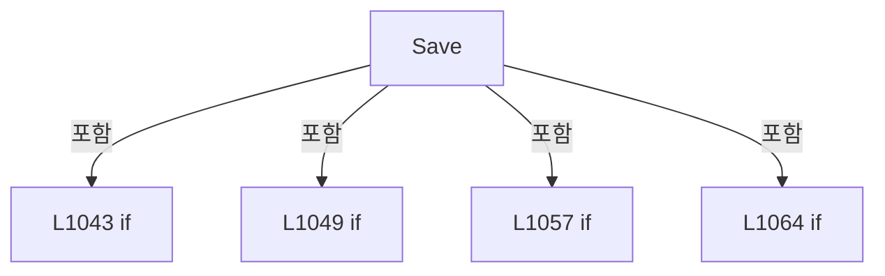

변경 전 점검: 입력/반환 타입, 위 호출자, 예외/취소 경로, 공유 상태와 저장·전송 소비자를 함께 확인합니다. 값의 단위나 물리 방향을 이름만으로 확정하지 않습니다.

### MethodDeclaration `Modify` · L1076–1174

[Drilling.UI/Menu/Menus/CMenuRecipe.cs:1076–1174](https://github.com/kjuws10-rgb/A3Drilling/blob/0219666f9053b907d96d7e0aa7d0c6c1be3a73d4/Drilling.UI/Menu/Menus/CMenuRecipe.cs#L1076-L1174)

| 항목 | 실제 추출 값 |
| --- | --- |
| 서명 | System.Threading.Tasks.Task Drilling.UI.Menu.Menus.CMenuRecipe.Modify(System.Func<string, string, string, System.Func<string, string>, string?>?, System.Func<string, string, bool?>?, System.Action<string, string>?) |
| 접근/수식자 | Private / private, async |
| 반환/값 타입 | System.Threading.Tasks.Task |
| 소속 타입 | NamedType:Drilling.UI.Menu.Menus.CMenuRecipe |

입력 계약:

| 이름 | 타입 | 전달 | 선택/기본값 |
| --- | --- | --- | --- |
| requestName | System.Func<string, string, string, System.Func<string, string>, string?>? | None | True / null |
| confirmFolder | System.Func<string, string, bool?>? | None | True / null |
| warn | System.Action<string, string>? | None | True / null |

정적 호출자로 확인된 위치:

| 호출 파일/행 | 호출 표현식 | 런타임 분기 가능 |
| --- | --- | --- |
| [Drilling.UI/Menu/Menus/CMenuRecipe.cs:202–202](https://github.com/kjuws10-rgb/A3Drilling/blob/0219666f9053b907d96d7e0aa7d0c6c1be3a73d4/Drilling.UI/Menu/Menus/CMenuRecipe.cs#L202-L202) | Modify | False |

호출하는 대상과 해석 범위:

| 원본 행 | 표현식 | 분석 상태 | 대상/소스 위치 |
| --- | --- | --- | --- |
| 1082 | ShowRecipeNameDialog | resolved | string? Drilling.UI.Menu.Menus.CMenuRecipe.ShowRecipeNameDialog(string, string, string, System.Func<string, string>?) · Drilling.UI/Menu/Menus/CMenuRecipe.cs:3117 |
| 1084 | CRecipeConfirmDialog.ShowWarning | resolved | void Drilling.UI.Popup.CRecipeConfirmDialog.ShowWarning(string, string, Window?) · Drilling.UI/Popup/CRecipeConfirmDialog.xaml.cs:110 |
| 1085 | GetRecipeIdFromParameter | resolved | string Drilling.UI.Menu.Menus.CMenuRecipe.GetRecipeIdFromParameter(object?) · Drilling.UI/Menu/Menus/CMenuRecipe.cs:3042 |
| 1086 | string.IsNullOrWhiteSpace | resolved | bool string.IsNullOrWhiteSpace(string?) |
| 1088 | _setStatusMessage | resolved · 동적 구현 선택 가능 | void System.Action<string>.Invoke(string) |
| 1092 | CanEditViewRecipe | resolved | bool Drilling.UI.Menu.Menus.CMenuRecipe.CanEditViewRecipe() · Drilling.UI/Menu/Menus/CMenuRecipe.cs:1658 |
| 1094 | _setStatusMessage | resolved · 동적 구현 선택 가능 | void System.Action<string>.Invoke(string) |
| 1098 | _recipeManager.LoadRecipes | resolved | System.Threading.Tasks.Task<System.Collections.Generic.IReadOnlyList<Drilling.Common.Managers.ST_RECIPE_DEFINITION>> Drilling.Common.Managers.CRecipeManager.LoadRecipes(System.Threading.CancellationToken) · Drilling.Common/Managers/CRecipeManager.cs:40 |
| 1104 | requestName | resolved · 동적 구현 선택 가능 | string? System.Func<string, string, string, System.Func<string, string>, string?>.Invoke(string, string, string, System.Func<string, string>) |
| 1107 | _setStatusMessage | resolved · 동적 구현 선택 가능 | void System.Action<string>.Invoke(string) |
| 1111 | newRecipeId.Equals | resolved | bool string.Equals(string?, System.StringComparison) |
| 1113 | _setStatusMessage | resolved · 동적 구현 선택 가능 | void System.Action<string>.Invoke(string) |
| 1117 | ValidateRecipeId | resolved | string Drilling.UI.Menu.Menus.CMenuRecipe.ValidateRecipeId(string, System.Collections.Generic.IReadOnlyList<Drilling.Common.Managers.ST_RECIPE_DEFINITION>, string) · Drilling.UI/Menu/Menus/CMenuRecipe.cs:3151 |
| 1118 | string.IsNullOrWhiteSpace | resolved | bool string.IsNullOrWhiteSpace(string?) |
| 1120 | _setStatusMessage | resolved · 동적 구현 선택 가능 | void System.Action<string>.Invoke(string) |
| 1124 | BuildRecipeParameters | resolved | System.Collections.Generic.IReadOnlyList<Drilling.Common.Managers.ST_RECIPE_PARAMETER> Drilling.UI.Menu.Menus.CMenuRecipe.BuildRecipeParameters(string) · Drilling.UI/Menu/Menus/CMenuRecipe.cs:3076 |
| 1125 | ValidateRecipeWithZeroDefence | resolved | string Drilling.UI.Menu.Menus.CMenuRecipe.ValidateRecipeWithZeroDefence(System.Collections.Generic.IReadOnlyList<Drilling.Common.Managers.ST_RECIPE_PARAMETER>) · Drilling.UI/Menu/Menus/CMenuRecipe.cs:3096 |
| 1126 | string.IsNullOrWhiteSpace | resolved | bool string.IsNullOrWhiteSpace(string?) |
| 1128 | _setStatusMessage | resolved · 동적 구현 선택 가능 | void System.Action<string>.Invoke(string) |
| 1139 | _recipeManager.ListCompanionFolders | resolved | System.Threading.Tasks.Task<System.Collections.Generic.IReadOnlyList<Drilling.Common.Managers.ST_RECIPE_COMPANION_FOLDER>> Drilling.Common.Managers.CRecipeManager.ListCompanionFolders(string, string, System.Threading.CancellationToken) · Drilling.Common/Managers/CRecipeManager.cs:128 |
| 1140 | new List<string> | resolved | System.Collections.Generic.List<string>.List() |
| 1143 | confirmFolder | resolved · 동적 구현 선택 가능 | bool? System.Func<string, string, bool?>.Invoke(string, string) |
| 1146 | _setStatusMessage | resolved · 동적 구현 선택 가능 | void System.Action<string>.Invoke(string) |
| 1151 | selectedFolders.Add | resolved | void System.Collections.Generic.List<string>.Add(string) |
| 1154 | AllManagedItems.Any | resolved | bool System.Collections.Generic.IEnumerable<Drilling.UI.Menu.Menus.ST_RECIPE_PARAMETER_EDITOR_ITEM>.Any<Drilling.UI.Menu.Menus.ST_RECIPE_PARAMETER_EDITOR_ITEM>(System.Func<Drilling.UI.Menu.Menus.ST_RECIPE_PARAMETER_EDITOR_ITEM, bool>) |
| 1155 | _recipeManager.SaveRecipe | resolved | System.Threading.Tasks.Task Drilling.Common.Managers.CRecipeManager.SaveRecipe(Drilling.Common.Managers.ST_RECIPE_DEFINITION, System.Threading.CancellationToken) · Drilling.Common/Managers/CRecipeManager.cs:73 |
| 1155 | new ST_RECIPE_DEFINITION | resolved | Drilling.Common.Managers.ST_RECIPE_DEFINITION.ST_RECIPE_DEFINITION(string, string, System.Collections.Generic.IReadOnlyList<Drilling.Common.Managers.ST_RECIPE_PARAMETER>, System.Collections.Generic.IReadOnlyList<Drilling.Common.Managers.ST_RECIPE_HISTORY>) · Drilling.Common/Managers/CRecipeManager.cs:387 |
| 1156 | _recipeManager.RenameRecipe | resolved | System.Threading.Tasks.Task Drilling.Common.Managers.CRecipeManager.RenameRecipe(string, string, System.Collections.Generic.IReadOnlyCollection<string>, System.Threading.CancellationToken) · Drilling.Common/Managers/CRecipeManager.cs:173 |
| 1160 | _setStatusMessage | resolved · 동적 구현 선택 가능 | void System.Action<string>.Invoke(string) |
| 1161 | warn | resolved · 동적 구현 선택 가능 | void System.Action<string, string>.Invoke(string, string) |
| 1165 | _selectRecipeIdSetter | resolved · 동적 구현 선택 가능 | void System.Action<string>.Invoke(string) |
| 1166 | _viewRecipeIdSetter | resolved · 동적 구현 선택 가능 | void System.Action<string>.Invoke(string) |
| 1167 | _settingManager.SetValue | resolved | void Drilling.Common.Managers.CSettingManager.SetValue(Drilling.Common.Managers.EN_SETTING_TAB, string, string, System.Threading.CancellationToken) · Drilling.Common/Managers/CSettingManager.cs:73 |
| 1168 | _selectedCategorySetter | resolved · 동적 구현 선택 가능 | void System.Action<string>.Invoke(string) |
| 1170 | NotifyCommands | resolved | void Drilling.UI.Menu.Menus.CMenuRecipe.NotifyCommands() · Drilling.UI/Menu/Menus/CMenuRecipe.cs:1295 |
| 1171 | _setStatusMessage | resolved · 동적 구현 선택 가능 | void System.Action<string>.Invoke(string) |
| 1172 | _refreshShellStatus | resolved · 동적 구현 선택 가능 | void System.Action.Invoke() |
| 1173 | _refreshCurrentScreen | resolved · 동적 구현 선택 가능 | System.Threading.Tasks.Task System.Func<System.Threading.Tasks.Task>.Invoke() |

본문의 실제 연산·분기·예외·반환 순서(원문 위치 순):

| 원본 행 | 종류 | 주석 해설 |
| --- | --- | --- |
| 1082 | assignment | 값을 대상에 대입합니다: requestName ??= (title, message, initial, validate) => ShowRecipeNameDialog(title, message, initial, validate) |
| 1082 | call | 함수·델리게이트 또는 객체 생성자를 호출합니다: ShowRecipeNameDialog(title, message, initial, validate) |
| 1083 | assignment | 값을 대상에 대입합니다: confirmFolder ??= CRecipeConfirmDialog.ShowRecipeFolderRename |
| 1084 | assignment | 값을 대상에 대입합니다: warn ??= (title, message) => CRecipeConfirmDialog.ShowWarning(title, message) |
| 1084 | call | 함수·델리게이트 또는 객체 생성자를 호출합니다: CRecipeConfirmDialog.ShowWarning(title, message) |
| 1085 | call | 함수·델리게이트 또는 객체 생성자를 호출합니다: GetRecipeIdFromParameter(SelectedRecipeFile) |
| 1085 | local-declaration | 지역 변수를 선언합니다: var oldRecipeId = GetRecipeIdFromParameter(SelectedRecipeFile); |
| 1085 | variable-initializer | 변수의 초기값을 지정합니다: oldRecipeId = GetRecipeIdFromParameter(SelectedRecipeFile) |
| 1086 | call | 함수·델리게이트 또는 객체 생성자를 호출합니다: string.IsNullOrWhiteSpace(oldRecipeId) |
| 1086 | if | 조건에 따라 분기합니다: if (string.IsNullOrWhiteSpace(oldRecipeId)) |
| 1088 | call | 함수·델리게이트 또는 객체 생성자를 호출합니다: _setStatusMessage("Recipe rename skipped. No recipe is selected.") |
| 1089 | return | 호출자에게 값 또는 제어를 반환합니다: return; |
| 1092 | call | 함수·델리게이트 또는 객체 생성자를 호출합니다: CanEditViewRecipe() |
| 1092 | if | 조건에 따라 분기합니다: if (!CanEditViewRecipe()) |
| 1094 | call | 함수·델리게이트 또는 객체 생성자를 호출합니다: _setStatusMessage("선택된 레시피만 수정 가능합니다.") |
| 1095 | return | 호출자에게 값 또는 제어를 반환합니다: return; |
| 1098 | await | 비동기 완료를 기다립니다: await _recipeManager.LoadRecipes() |
| 1098 | call | 함수·델리게이트 또는 객체 생성자를 호출합니다: _recipeManager.LoadRecipes() |
| 1098 | local-declaration | 지역 변수를 선언합니다: var recipes = await _recipeManager.LoadRecipes(); |
| 1098 | variable-initializer | 변수의 초기값을 지정합니다: recipes = await _recipeManager.LoadRecipes() |
| 1104 | call | 함수·델리게이트 또는 객체 생성자를 호출합니다: requestName("레시피 이름 변경", "변경할 레시피 이름을 입력하세요.", oldRecipeId, SelectValue) |
| 1104 | local-declaration | 지역 변수를 선언합니다: var newRecipeId = requestName("레시피 이름 변경", "변경할 레시피 이름을 입력하세요.", oldRecipeId, SelectValue); |
| 1104 | variable-initializer | 변수의 초기값을 지정합니다: newRecipeId = requestName("레시피 이름 변경", "변경할 레시피 이름을 입력하세요.", oldRecipeId, SelectValue) |
| 1105 | if | 조건에 따라 분기합니다: if (newRecipeId is null) |
| 1107 | call | 함수·델리게이트 또는 객체 생성자를 호출합니다: _setStatusMessage("Recipe rename canceled.") |
| 1108 | return | 호출자에게 값 또는 제어를 반환합니다: return; |
| 1111 | call | 함수·델리게이트 또는 객체 생성자를 호출합니다: newRecipeId.Equals(oldRecipeId, StringComparison.OrdinalIgnoreCase) |
| 1111 | if | 조건에 따라 분기합니다: if (newRecipeId.Equals(oldRecipeId, StringComparison.OrdinalIgnoreCase)) |
| 1113 | call | 함수·델리게이트 또는 객체 생성자를 호출합니다: _setStatusMessage("Recipe rename skipped. Name was not changed.") |
| 1114 | return | 호출자에게 값 또는 제어를 반환합니다: return; |
| 1117 | call | 함수·델리게이트 또는 객체 생성자를 호출합니다: ValidateRecipeId(newRecipeId, recipes, oldRecipeId) |
| 1117 | local-declaration | 지역 변수를 선언합니다: var validationMessage = ValidateRecipeId(newRecipeId, recipes, oldRecipeId); |
| 1117 | variable-initializer | 변수의 초기값을 지정합니다: validationMessage = ValidateRecipeId(newRecipeId, recipes, oldRecipeId) |
| 1118 | call | 함수·델리게이트 또는 객체 생성자를 호출합니다: string.IsNullOrWhiteSpace(validationMessage) |
| 1118 | if | 조건에 따라 분기합니다: if (!string.IsNullOrWhiteSpace(validationMessage)) |
| 1120 | call | 함수·델리게이트 또는 객체 생성자를 호출합니다: _setStatusMessage(validationMessage) |
| 1121 | return | 호출자에게 값 또는 제어를 반환합니다: return; |
| 1124 | call | 함수·델리게이트 또는 객체 생성자를 호출합니다: BuildRecipeParameters(oldRecipeId) |
| 1124 | local-declaration | 지역 변수를 선언합니다: var recipeParameters = BuildRecipeParameters(oldRecipeId); |
| 1124 | variable-initializer | 변수의 초기값을 지정합니다: recipeParameters = BuildRecipeParameters(oldRecipeId) |
| 1125 | assignment | 값을 대상에 대입합니다: validationMessage = ValidateRecipeWithZeroDefence(recipeParameters) |
| 1125 | call | 함수·델리게이트 또는 객체 생성자를 호출합니다: ValidateRecipeWithZeroDefence(recipeParameters) |
| 1126 | call | 함수·델리게이트 또는 객체 생성자를 호출합니다: string.IsNullOrWhiteSpace(validationMessage) |
| 1126 | if | 조건에 따라 분기합니다: if (!string.IsNullOrWhiteSpace(validationMessage)) |
| 1128 | call | 함수·델리게이트 또는 객체 생성자를 호출합니다: _setStatusMessage(validationMessage) |
| 1129 | return | 호출자에게 값 또는 제어를 반환합니다: return; |
| 1137 | try | 예외 처리 범위입니다: try |
| 1139 | await | 비동기 완료를 기다립니다: await _recipeManager.ListCompanionFolders(oldRecipeId, newRecipeId) |
| 1139 | call | 함수·델리게이트 또는 객체 생성자를 호출합니다: _recipeManager.ListCompanionFolders(oldRecipeId, newRecipeId) |
| 1139 | local-declaration | 지역 변수를 선언합니다: var folders = await _recipeManager.ListCompanionFolders(oldRecipeId, newRecipeId); |
| 1139 | variable-initializer | 변수의 초기값을 지정합니다: folders = await _recipeManager.ListCompanionFolders(oldRecipeId, newRecipeId) |
| 1140 | call | 함수·델리게이트 또는 객체 생성자를 호출합니다: new List<string>() |
| 1140 | local-declaration | 지역 변수를 선언합니다: var selectedFolders = new List<string>(); |
| 1140 | variable-initializer | 변수의 초기값을 지정합니다: selectedFolders = new List<string>() |
| 1141 | foreach | 컬렉션 요소를 순회합니다: foreach (var folder in folders) |
| 1143 | call | 함수·델리게이트 또는 객체 생성자를 호출합니다: confirmFolder("레시피 부가 폴더 이름 변경", $"{oldRecipeId} 레시피에 연결된 {folder.SourceName} 폴더도\n{folder.TargetName} 이름으로 함께 변경하시겠습니까?\n\n폴더 유지: 기존 이름으로 남기고 레시피만 변경합니다.\n취소: 레시피와 모든 폴더의 이름 변경을 취소합니다.") |
| 1143 | local-declaration | 지역 변수를 선언합니다: var choice = confirmFolder("레시피 부가 폴더 이름 변경", $"{oldRecipeId} 레시피에 연결된 {folder.SourceName} 폴더도\n{folder.TargetName} 이름으로 함께 변경하시겠습니까?\n\n폴더 유지: 기존 이름으로 남기고 레시피만 변경합니다.\n취소: 레시피와 모든 폴더의 이름 변경을 취소합니다."); |
| 1143 | variable-initializer | 변수의 초기값을 지정합니다: choice = confirmFolder("레시피 부가 폴더 이름 변경", $"{oldRecipeId} 레시피에 연결된 {folder.SourceName} 폴더도\n{folder.TargetName} 이름으로 함께 변경하시겠습니까?\n\n폴더 유지: 기존 이름으로 남기고 레시피만 변경합니다.\n취소: 레시피와 모든 폴더의 이름 변경을 취소합니다.") |
| 1144 | if | 조건에 따라 분기합니다: if (choice is null) |
| 1146 | call | 함수·델리게이트 또는 객체 생성자를 호출합니다: _setStatusMessage("Recipe rename canceled.") |
| 1147 | return | 호출자에게 값 또는 제어를 반환합니다: return; |
| 1150 | if | 조건에 따라 분기합니다: if (choice.Value) |
| 1151 | call | 함수·델리게이트 또는 객체 생성자를 호출합니다: selectedFolders.Add(folder.SourceName) |
| 1154 | call | 함수·델리게이트 또는 객체 생성자를 호출합니다: AllManagedItems.Any(IsIsEdited) |
| 1154 | if | 조건에 따라 분기합니다: if (AllManagedItems.Any(IsIsEdited)) |
| 1155 | await | 비동기 완료를 기다립니다: await _recipeManager.SaveRecipe(new ST_RECIPE_DEFINITION(oldRecipeId, oldRecipeId, recipeParameters, [])) |
| 1155 | call | 함수·델리게이트 또는 객체 생성자를 호출합니다: _recipeManager.SaveRecipe(new ST_RECIPE_DEFINITION(oldRecipeId, oldRecipeId, recipeParameters, [])) |
| 1155 | call | 함수·델리게이트 또는 객체 생성자를 호출합니다: new ST_RECIPE_DEFINITION(oldRecipeId, oldRecipeId, recipeParameters, []) |
| 1156 | await | 비동기 완료를 기다립니다: await _recipeManager.RenameRecipe(oldRecipeId, newRecipeId, selectedFolders) |
| 1156 | call | 함수·델리게이트 또는 객체 생성자를 호출합니다: _recipeManager.RenameRecipe(oldRecipeId, newRecipeId, selectedFolders) |
| 1158 | catch | 지정 예외를 처리합니다: catch (Exception error) |
| 1160 | call | 함수·델리게이트 또는 객체 생성자를 호출합니다: _setStatusMessage("Recipe rename failed: " + error.Message) |
| 1161 | call | 함수·델리게이트 또는 객체 생성자를 호출합니다: warn("레시피 이름 변경 실패", error.Message) |
| 1162 | return | 호출자에게 값 또는 제어를 반환합니다: return; |
| 1165 | call | 함수·델리게이트 또는 객체 생성자를 호출합니다: _selectRecipeIdSetter(newRecipeId) |
| 1166 | call | 함수·델리게이트 또는 객체 생성자를 호출합니다: _viewRecipeIdSetter(newRecipeId) |
| 1167 | call | 함수·델리게이트 또는 객체 생성자를 호출합니다: _settingManager.SetValue(EN_SETTING_TAB.Option, SelectRecipeSettingKey, newRecipeId) |
| 1168 | call | 함수·델리게이트 또는 객체 생성자를 호출합니다: _selectedCategorySetter("ALL") |
| 1169 | assignment | 값을 대상에 대입합니다: _selectedGroup = "ALL" |
| 1170 | call | 함수·델리게이트 또는 객체 생성자를 호출합니다: NotifyCommands() |
| 1171 | call | 함수·델리게이트 또는 객체 생성자를 호출합니다: _setStatusMessage($"Recipe {oldRecipeId}.csv renamed to {newRecipeId}.csv and CSV verified.") |
| 1172 | call | 함수·델리게이트 또는 객체 생성자를 호출합니다: _refreshShellStatus() |
| 1173 | await | 비동기 완료를 기다립니다: await _refreshCurrentScreen() |
| 1173 | call | 함수·델리게이트 또는 객체 생성자를 호출합니다: _refreshCurrentScreen() |

제어 구문의 포함 구조(실제 실행 순서/CFG가 아닌 구문 탐색 그림):

```mermaid
flowchart TD
 M["Modify"]
 N0["L1086 if"]
 M -->|포함| N0
 N1["L1092 if"]
 M -->|포함| N1
 N2["L1105 if"]
 M -->|포함| N2
 N3["L1111 if"]
 M -->|포함| N3
 N4["L1118 if"]
 M -->|포함| N4
 N5["L1126 if"]
 M -->|포함| N5
 N6["L1137 try"]
 M -->|포함| N6
 N7["L1141 foreach"]
 N6 -->|포함| N7
 N8["L1144 if"]
 N7 -->|포함| N8
 N9["L1150 if"]
 N7 -->|포함| N9
 N10["L1154 if"]
 N6 -->|포함| N10
 N11["L1158 catch"]
 N6 -->|포함| N11
```

변경 전 점검: 입력/반환 타입, 위 호출자, 예외/취소 경로, 공유 상태와 저장·전송 소비자를 함께 확인합니다. 값의 단위나 물리 방향을 이름만으로 확정하지 않습니다.

### LocalFunctionStatement `SelectValue` · L1099–1102

[Drilling.UI/Menu/Menus/CMenuRecipe.cs:1099–1102](https://github.com/kjuws10-rgb/A3Drilling/blob/0219666f9053b907d96d7e0aa7d0c6c1be3a73d4/Drilling.UI/Menu/Menus/CMenuRecipe.cs#L1099-L1102)

| 항목 | 실제 추출 값 |
| --- | --- |
| 서명 | string SelectValue(string) |
| 접근/수식자 | Private /  |
| 반환/값 타입 | string |
| 소속 타입 | NamedType:Drilling.UI.Menu.Menus.CMenuRecipe |

입력 계약:

| 이름 | 타입 | 전달 | 선택/기본값 |
| --- | --- | --- | --- |
| value | string | None | False /  |

현재 부분 분석에서 직접 연결된 호출자는 없습니다. XAML/이벤트/인터페이스·델리게이트·외부 진입을 추가 확인해야 하며, 미사용으로 판정한 것이 아닙니다.

호출하는 대상과 해석 범위:

| 원본 행 | 표현식 | 분석 상태 | 대상/소스 위치 |
| --- | --- | --- | --- |
| 1101 | ValidateRecipeId | resolved | string Drilling.UI.Menu.Menus.CMenuRecipe.ValidateRecipeId(string, System.Collections.Generic.IReadOnlyList<Drilling.Common.Managers.ST_RECIPE_DEFINITION>, string) · Drilling.UI/Menu/Menus/CMenuRecipe.cs:3151 |
| 1101 | NormalizeRecipeIdInput | resolved | string Drilling.UI.Menu.Menus.CMenuRecipe.NormalizeRecipeIdInput(string) · Drilling.UI/Menu/Menus/CMenuRecipe.cs:3140 |

본문의 실제 연산·분기·예외·반환 순서(원문 위치 순):

| 원본 행 | 종류 | 주석 해설 |
| --- | --- | --- |
| 1101 | call | 함수·델리게이트 또는 객체 생성자를 호출합니다: ValidateRecipeId(NormalizeRecipeIdInput(value), recipes, oldRecipeId) |
| 1101 | call | 함수·델리게이트 또는 객체 생성자를 호출합니다: NormalizeRecipeIdInput(value) |
| 1101 | return | 호출자에게 값 또는 제어를 반환합니다: return ValidateRecipeId(NormalizeRecipeIdInput(value), recipes, oldRecipeId); |

변경 전 점검: 입력/반환 타입, 위 호출자, 예외/취소 경로, 공유 상태와 저장·전송 소비자를 함께 확인합니다. 값의 단위나 물리 방향을 이름만으로 확정하지 않습니다.

### LocalFunctionStatement `IsIsEdited` · L1132–1135

[Drilling.UI/Menu/Menus/CMenuRecipe.cs:1132–1135](https://github.com/kjuws10-rgb/A3Drilling/blob/0219666f9053b907d96d7e0aa7d0c6c1be3a73d4/Drilling.UI/Menu/Menus/CMenuRecipe.cs#L1132-L1135)

| 항목 | 실제 추출 값 |
| --- | --- |
| 서명 | bool IsIsEdited(Drilling.UI.Menu.Menus.ST_RECIPE_PARAMETER_EDITOR_ITEM) |
| 접근/수식자 | Private /  |
| 반환/값 타입 | bool |
| 소속 타입 | NamedType:Drilling.UI.Menu.Menus.CMenuRecipe |

입력 계약:

| 이름 | 타입 | 전달 | 선택/기본값 |
| --- | --- | --- | --- |
| item | Drilling.UI.Menu.Menus.ST_RECIPE_PARAMETER_EDITOR_ITEM | None | False /  |

현재 부분 분석에서 직접 연결된 호출자는 없습니다. XAML/이벤트/인터페이스·델리게이트·외부 진입을 추가 확인해야 하며, 미사용으로 판정한 것이 아닙니다.

본문의 실제 연산·분기·예외·반환 순서(원문 위치 순):

| 원본 행 | 종류 | 주석 해설 |
| --- | --- | --- |
| 1134 | return | 호출자에게 값 또는 제어를 반환합니다: return item.IsEdited; |

변경 전 점검: 입력/반환 타입, 위 호출자, 예외/취소 경로, 공유 상태와 저장·전송 소비자를 함께 확인합니다. 값의 단위나 물리 방향을 이름만으로 확정하지 않습니다.

### MethodDeclaration `Create` · L1176–1240

[Drilling.UI/Menu/Menus/CMenuRecipe.cs:1176–1240](https://github.com/kjuws10-rgb/A3Drilling/blob/0219666f9053b907d96d7e0aa7d0c6c1be3a73d4/Drilling.UI/Menu/Menus/CMenuRecipe.cs#L1176-L1240)

| 항목 | 실제 추출 값 |
| --- | --- |
| 서명 | System.Threading.Tasks.Task Drilling.UI.Menu.Menus.CMenuRecipe.Create(System.Func<string, string, string, System.Func<string, string>, string?>?, System.Func<string, string, bool>?, System.Action<string, string>?) |
| 접근/수식자 | Private / private, async |
| 반환/값 타입 | System.Threading.Tasks.Task |
| 소속 타입 | NamedType:Drilling.UI.Menu.Menus.CMenuRecipe |

입력 계약:

| 이름 | 타입 | 전달 | 선택/기본값 |
| --- | --- | --- | --- |
| requestName | System.Func<string, string, string, System.Func<string, string>, string?>? | None | True / null |
| confirmFolder | System.Func<string, string, bool>? | None | True / null |
| warn | System.Action<string, string>? | None | True / null |

정적 호출자로 확인된 위치:

| 호출 파일/행 | 호출 표현식 | 런타임 분기 가능 |
| --- | --- | --- |
| [Drilling.UI/Menu/Menus/CMenuRecipe.cs:196–196](https://github.com/kjuws10-rgb/A3Drilling/blob/0219666f9053b907d96d7e0aa7d0c6c1be3a73d4/Drilling.UI/Menu/Menus/CMenuRecipe.cs#L196-L196) | Create | False |

호출하는 대상과 해석 범위:

| 원본 행 | 표현식 | 분석 상태 | 대상/소스 위치 |
| --- | --- | --- | --- |
| 1182 | ShowRecipeNameDialog | resolved | string? Drilling.UI.Menu.Menus.CMenuRecipe.ShowRecipeNameDialog(string, string, string, System.Func<string, string>?) · Drilling.UI/Menu/Menus/CMenuRecipe.cs:3117 |
| 1184 | CRecipeConfirmDialog.ShowWarning | resolved | void Drilling.UI.Popup.CRecipeConfirmDialog.ShowWarning(string, string, Window?) · Drilling.UI/Popup/CRecipeConfirmDialog.xaml.cs:110 |
| 1187 | _setStatusMessage | resolved · 동적 구현 선택 가능 | void System.Action<string>.Invoke(string) |
| 1191 | _recipeManager.LoadRecipes | resolved | System.Threading.Tasks.Task<System.Collections.Generic.IReadOnlyList<Drilling.Common.Managers.ST_RECIPE_DEFINITION>> Drilling.Common.Managers.CRecipeManager.LoadRecipes(System.Threading.CancellationToken) · Drilling.Common/Managers/CRecipeManager.cs:40 |
| 1197 | GetRecipeIdFromParameter | resolved | string Drilling.UI.Menu.Menus.CMenuRecipe.GetRecipeIdFromParameter(object?) · Drilling.UI/Menu/Menus/CMenuRecipe.cs:3042 |
| 1198 | requestName | resolved · 동적 구현 선택 가능 | string? System.Func<string, string, string, System.Func<string, string>, string?>.Invoke(string, string, string, System.Func<string, string>) |
| 1201 | _setStatusMessage | resolved · 동적 구현 선택 가능 | void System.Action<string>.Invoke(string) |
| 1205 | ValidateRecipeId | resolved | string Drilling.UI.Menu.Menus.CMenuRecipe.ValidateRecipeId(string, System.Collections.Generic.IReadOnlyList<Drilling.Common.Managers.ST_RECIPE_DEFINITION>, string) · Drilling.UI/Menu/Menus/CMenuRecipe.cs:3151 |
| 1206 | string.IsNullOrWhiteSpace | resolved | bool string.IsNullOrWhiteSpace(string?) |
| 1208 | _setStatusMessage | resolved · 동적 구현 선택 가능 | void System.Action<string>.Invoke(string) |
| 1212 | BuildRecipeParameters | resolved | System.Collections.Generic.IReadOnlyList<Drilling.Common.Managers.ST_RECIPE_PARAMETER> Drilling.UI.Menu.Menus.CMenuRecipe.BuildRecipeParameters(string) · Drilling.UI/Menu/Menus/CMenuRecipe.cs:3076 |
| 1213 | ValidateRecipeWithZeroDefence | resolved | string Drilling.UI.Menu.Menus.CMenuRecipe.ValidateRecipeWithZeroDefence(System.Collections.Generic.IReadOnlyList<Drilling.Common.Managers.ST_RECIPE_PARAMETER>) · Drilling.UI/Menu/Menus/CMenuRecipe.cs:3096 |
| 1214 | string.IsNullOrWhiteSpace | resolved | bool string.IsNullOrWhiteSpace(string?) |
| 1216 | _setStatusMessage | resolved · 동적 구현 선택 가능 | void System.Action<string>.Invoke(string) |
| 1222 | _recipeManager.ListCompanionFolders | resolved | System.Threading.Tasks.Task<System.Collections.Generic.IReadOnlyList<Drilling.Common.Managers.ST_RECIPE_COMPANION_FOLDER>> Drilling.Common.Managers.CRecipeManager.ListCompanionFolders(string, string, System.Threading.CancellationToken) · Drilling.Common/Managers/CRecipeManager.cs:128 |
| 1223 | companions.Where(folder => confirmFolder("레시피 부가 폴더 복사", $"{sourceRecipeId} 레시피의 {folder.SourceName} 폴더 내용도\n새 레시피 {recipeId}의 {folder.TargetName} 폴더로 복사하시겠습니까?\n\n복사 안 함을 선택하면 해당 폴더 없이 레시피를 생성합니다.")).Select(folder => folder.SourceName).ToArray | resolved | string[] System.Collections.Generic.IEnumerable<string>.ToArray<string>() |
| 1223 | companions.Where(folder => confirmFolder("레시피 부가 폴더 복사", $"{sourceRecipeId} 레시피의 {folder.SourceName} 폴더 내용도\n새 레시피 {recipeId}의 {folder.TargetName} 폴더로 복사하시겠습니까?\n\n복사 안 함을 선택하면 해당 폴더 없이 레시피를 생성합니다.")).Select | resolved | System.Collections.Generic.IEnumerable<string> System.Collections.Generic.IEnumerable<Drilling.Common.Managers.ST_RECIPE_COMPANION_FOLDER>.Select<Drilling.Common.Managers.ST_RECIPE_COMPANION_FOLDER, string>(System.Func<Drilling.Common.Managers.ST_RECIPE_COMPANION_FOLDER, string>) |
| 1223 | companions.Where | resolved | System.Collections.Generic.IEnumerable<Drilling.Common.Managers.ST_RECIPE_COMPANION_FOLDER> System.Collections.Generic.IEnumerable<Drilling.Common.Managers.ST_RECIPE_COMPANION_FOLDER>.Where<Drilling.Common.Managers.ST_RECIPE_COMPANION_FOLDER>(System.Func<Drilling.Common.Managers.ST_RECIPE_COMPANION_FOLDER, bool>) |
| 1223 | confirmFolder | resolved · 동적 구현 선택 가능 | bool System.Func<string, string, bool>.Invoke(string, string) |
| 1224 | _recipeManager.CreateRecipeCopy | resolved | System.Threading.Tasks.Task Drilling.Common.Managers.CRecipeManager.CreateRecipeCopy(Drilling.Common.Managers.ST_RECIPE_DEFINITION, string, System.Collections.Generic.IReadOnlyCollection<string>, System.Threading.CancellationToken) · Drilling.Common/Managers/CRecipeManager.cs:129 |
| 1224 | new ST_RECIPE_DEFINITION | resolved | Drilling.Common.Managers.ST_RECIPE_DEFINITION.ST_RECIPE_DEFINITION(string, string, System.Collections.Generic.IReadOnlyList<Drilling.Common.Managers.ST_RECIPE_PARAMETER>, System.Collections.Generic.IReadOnlyList<Drilling.Common.Managers.ST_RECIPE_HISTORY>) · Drilling.Common/Managers/CRecipeManager.cs:387 |
| 1228 | _setStatusMessage | resolved · 동적 구현 선택 가능 | void System.Action<string>.Invoke(string) |
| 1229 | warn | resolved · 동적 구현 선택 가능 | void System.Action<string, string>.Invoke(string, string) |
| 1233 | _viewRecipeIdSetter | resolved · 동적 구현 선택 가능 | void System.Action<string>.Invoke(string) |
| 1234 | _selectedCategorySetter | resolved · 동적 구현 선택 가능 | void System.Action<string>.Invoke(string) |
| 1236 | NotifyCommands | resolved | void Drilling.UI.Menu.Menus.CMenuRecipe.NotifyCommands() · Drilling.UI/Menu/Menus/CMenuRecipe.cs:1295 |
| 1237 | _setStatusMessage | resolved · 동적 구현 선택 가능 | void System.Action<string>.Invoke(string) |
| 1238 | _refreshShellStatus | resolved · 동적 구현 선택 가능 | void System.Action.Invoke() |
| 1239 | _refreshCurrentScreen | resolved · 동적 구현 선택 가능 | System.Threading.Tasks.Task System.Func<System.Threading.Tasks.Task>.Invoke() |

본문의 실제 연산·분기·예외·반환 순서(원문 위치 순):

| 원본 행 | 종류 | 주석 해설 |
| --- | --- | --- |
| 1182 | assignment | 값을 대상에 대입합니다: requestName ??= (title, message, initial, validate) => ShowRecipeNameDialog(title, message, initial, validate) |
| 1182 | call | 함수·델리게이트 또는 객체 생성자를 호출합니다: ShowRecipeNameDialog(title, message, initial, validate) |
| 1183 | assignment | 값을 대상에 대입합니다: confirmFolder ??= CRecipeConfirmDialog.ShowRecipeFolderCopy |
| 1184 | assignment | 값을 대상에 대입합니다: warn ??= (title, message) => CRecipeConfirmDialog.ShowWarning(title, message) |
| 1184 | call | 함수·델리게이트 또는 객체 생성자를 호출합니다: CRecipeConfirmDialog.ShowWarning(title, message) |
| 1185 | if | 조건에 따라 분기합니다: if (AllManagedItems.Count == 0) |
| 1187 | call | 함수·델리게이트 또는 객체 생성자를 호출합니다: _setStatusMessage("Recipe create skipped. No source recipe is loaded.") |
| 1188 | return | 호출자에게 값 또는 제어를 반환합니다: return; |
| 1191 | await | 비동기 완료를 기다립니다: await _recipeManager.LoadRecipes() |
| 1191 | call | 함수·델리게이트 또는 객체 생성자를 호출합니다: _recipeManager.LoadRecipes() |
| 1191 | local-declaration | 지역 변수를 선언합니다: var recipes = await _recipeManager.LoadRecipes(); |
| 1191 | variable-initializer | 변수의 초기값을 지정합니다: recipes = await _recipeManager.LoadRecipes() |
| 1197 | call | 함수·델리게이트 또는 객체 생성자를 호출합니다: GetRecipeIdFromParameter(SelectedRecipeFile) |
| 1197 | local-declaration | 지역 변수를 선언합니다: var sourceRecipeId = GetRecipeIdFromParameter(SelectedRecipeFile); |
| 1197 | variable-initializer | 변수의 초기값을 지정합니다: sourceRecipeId = GetRecipeIdFromParameter(SelectedRecipeFile) |
| 1198 | call | 함수·델리게이트 또는 객체 생성자를 호출합니다: requestName("레시피 생성", "새 레시피 이름을 입력하세요.", "", SelectValue) |
| 1198 | local-declaration | 지역 변수를 선언합니다: var recipeId = requestName("레시피 생성", "새 레시피 이름을 입력하세요.", "", SelectValue); |
| 1198 | variable-initializer | 변수의 초기값을 지정합니다: recipeId = requestName("레시피 생성", "새 레시피 이름을 입력하세요.", "", SelectValue) |
| 1199 | if | 조건에 따라 분기합니다: if (recipeId is null) |
| 1201 | call | 함수·델리게이트 또는 객체 생성자를 호출합니다: _setStatusMessage("Recipe create canceled.") |
| 1202 | return | 호출자에게 값 또는 제어를 반환합니다: return; |
| 1205 | call | 함수·델리게이트 또는 객체 생성자를 호출합니다: ValidateRecipeId(recipeId, recipes) |
| 1205 | local-declaration | 지역 변수를 선언합니다: var recipeNameValidationMessage = ValidateRecipeId(recipeId, recipes); |
| 1205 | variable-initializer | 변수의 초기값을 지정합니다: recipeNameValidationMessage = ValidateRecipeId(recipeId, recipes) |
| 1206 | call | 함수·델리게이트 또는 객체 생성자를 호출합니다: string.IsNullOrWhiteSpace(recipeNameValidationMessage) |
| 1206 | if | 조건에 따라 분기합니다: if (!string.IsNullOrWhiteSpace(recipeNameValidationMessage)) |
| 1208 | call | 함수·델리게이트 또는 객체 생성자를 호출합니다: _setStatusMessage(recipeNameValidationMessage) |
| 1209 | return | 호출자에게 값 또는 제어를 반환합니다: return; |
| 1212 | call | 함수·델리게이트 또는 객체 생성자를 호출합니다: BuildRecipeParameters(recipeId) |
| 1212 | local-declaration | 지역 변수를 선언합니다: var recipeParameters = BuildRecipeParameters(recipeId); |
| 1212 | variable-initializer | 변수의 초기값을 지정합니다: recipeParameters = BuildRecipeParameters(recipeId) |
| 1213 | call | 함수·델리게이트 또는 객체 생성자를 호출합니다: ValidateRecipeWithZeroDefence(recipeParameters) |
| 1213 | local-declaration | 지역 변수를 선언합니다: var validationMessage = ValidateRecipeWithZeroDefence(recipeParameters); |
| 1213 | variable-initializer | 변수의 초기값을 지정합니다: validationMessage = ValidateRecipeWithZeroDefence(recipeParameters) |
| 1214 | call | 함수·델리게이트 또는 객체 생성자를 호출합니다: string.IsNullOrWhiteSpace(validationMessage) |
| 1214 | if | 조건에 따라 분기합니다: if (!string.IsNullOrWhiteSpace(validationMessage)) |
| 1216 | call | 함수·델리게이트 또는 객체 생성자를 호출합니다: _setStatusMessage(validationMessage) |
| 1217 | return | 호출자에게 값 또는 제어를 반환합니다: return; |
| 1220 | try | 예외 처리 범위입니다: try |
| 1222 | await | 비동기 완료를 기다립니다: await _recipeManager.ListCompanionFolders(sourceRecipeId, recipeId) |
| 1222 | call | 함수·델리게이트 또는 객체 생성자를 호출합니다: _recipeManager.ListCompanionFolders(sourceRecipeId, recipeId) |
| 1222 | local-declaration | 지역 변수를 선언합니다: var companions = await _recipeManager.ListCompanionFolders(sourceRecipeId, recipeId); |
| 1222 | variable-initializer | 변수의 초기값을 지정합니다: companions = await _recipeManager.ListCompanionFolders(sourceRecipeId, recipeId) |
| 1223 | call | 함수·델리게이트 또는 객체 생성자를 호출합니다: companions.Where(folder => confirmFolder("레시피 부가 폴더 복사", $"{sourceRecipeId} 레시피의 {folder.SourceName} 폴더 내용도\n새 레시피 {recipeId}의 {folder.TargetName} 폴더로 복사하시겠습니까?\n\n복사 안 함을 선택하면 해당 폴더 없이 레시피를 생성합니다.")).Select(folder => fo… |
| 1223 | call | 함수·델리게이트 또는 객체 생성자를 호출합니다: companions.Where(folder => confirmFolder("레시피 부가 폴더 복사", $"{sourceRecipeId} 레시피의 {folder.SourceName} 폴더 내용도\n새 레시피 {recipeId}의 {folder.TargetName} 폴더로 복사하시겠습니까?\n\n복사 안 함을 선택하면 해당 폴더 없이 레시피를 생성합니다.")).Select(folder => fo… |
| 1223 | call | 함수·델리게이트 또는 객체 생성자를 호출합니다: companions.Where(folder => confirmFolder("레시피 부가 폴더 복사", $"{sourceRecipeId} 레시피의 {folder.SourceName} 폴더 내용도\n새 레시피 {recipeId}의 {folder.TargetName} 폴더로 복사하시겠습니까?\n\n복사 안 함을 선택하면 해당 폴더 없이 레시피를 생성합니다.")) |
| 1223 | call | 함수·델리게이트 또는 객체 생성자를 호출합니다: confirmFolder("레시피 부가 폴더 복사", $"{sourceRecipeId} 레시피의 {folder.SourceName} 폴더 내용도\n새 레시피 {recipeId}의 {folder.TargetName} 폴더로 복사하시겠습니까?\n\n복사 안 함을 선택하면 해당 폴더 없이 레시피를 생성합니다.") |
| 1223 | local-declaration | 지역 변수를 선언합니다: var selectedFolders = companions.Where(folder => confirmFolder("레시피 부가 폴더 복사", $"{sourceRecipeId} 레시피의 {folder.SourceName} 폴더 내용도\n새 레시피 {recipeId}의 {folder.TargetName} 폴더로 복사하시겠습니까?\n\n복사 안 함을 선택하면 해당 폴더 없이 레시피를 생성합니다.")).Select( |
| 1223 | variable-initializer | 변수의 초기값을 지정합니다: selectedFolders = companions.Where(folder => confirmFolder("레시피 부가 폴더 복사", $"{sourceRecipeId} 레시피의 {folder.SourceName} 폴더 내용도\n새 레시피 {recipeId}의 {folder.TargetName} 폴더로 복사하시겠습니까?\n\n복사 안 함을 선택하면 해당 폴더 없이 레시피를 생성합니다.")).Select(fold |
| 1224 | await | 비동기 완료를 기다립니다: await _recipeManager.CreateRecipeCopy(new ST_RECIPE_DEFINITION(recipeId, recipeId, recipeParameters, []), sourceRecipeId, selectedFolders) |
| 1224 | call | 함수·델리게이트 또는 객체 생성자를 호출합니다: _recipeManager.CreateRecipeCopy(new ST_RECIPE_DEFINITION(recipeId, recipeId, recipeParameters, []), sourceRecipeId, selectedFolders) |
| 1224 | call | 함수·델리게이트 또는 객체 생성자를 호출합니다: new ST_RECIPE_DEFINITION(recipeId, recipeId, recipeParameters, []) |
| 1226 | catch | 지정 예외를 처리합니다: catch (Exception error) |
| 1228 | call | 함수·델리게이트 또는 객체 생성자를 호출합니다: _setStatusMessage("Recipe create failed: " + error.Message) |
| 1229 | call | 함수·델리게이트 또는 객체 생성자를 호출합니다: warn("레시피 생성 실패", error.Message) |
| 1230 | return | 호출자에게 값 또는 제어를 반환합니다: return; |
| 1233 | call | 함수·델리게이트 또는 객체 생성자를 호출합니다: _viewRecipeIdSetter(recipeId) |
| 1234 | call | 함수·델리게이트 또는 객체 생성자를 호출합니다: _selectedCategorySetter("ALL") |
| 1235 | assignment | 값을 대상에 대입합니다: _selectedGroup = "ALL" |
| 1236 | call | 함수·델리게이트 또는 객체 생성자를 호출합니다: NotifyCommands() |
| 1237 | call | 함수·델리게이트 또는 객체 생성자를 호출합니다: _setStatusMessage($"Recipe {recipeId}.csv created from current recipe and CSV verified.") |
| 1238 | call | 함수·델리게이트 또는 객체 생성자를 호출합니다: _refreshShellStatus() |
| 1239 | await | 비동기 완료를 기다립니다: await _refreshCurrentScreen() |
| 1239 | call | 함수·델리게이트 또는 객체 생성자를 호출합니다: _refreshCurrentScreen() |

제어 구문의 포함 구조(실제 실행 순서/CFG가 아닌 구문 탐색 그림):

```mermaid
flowchart TD
 M["Create"]
 N0["L1185 if"]
 M -->|포함| N0
 N1["L1199 if"]
 M -->|포함| N1
 N2["L1206 if"]
 M -->|포함| N2
 N3["L1214 if"]
 M -->|포함| N3
 N4["L1220 try"]
 M -->|포함| N4
 N5["L1226 catch"]
 N4 -->|포함| N5
```

변경 전 점검: 입력/반환 타입, 위 호출자, 예외/취소 경로, 공유 상태와 저장·전송 소비자를 함께 확인합니다. 값의 단위나 물리 방향을 이름만으로 확정하지 않습니다.

### LocalFunctionStatement `SelectValue` · L1192–1195

[Drilling.UI/Menu/Menus/CMenuRecipe.cs:1192–1195](https://github.com/kjuws10-rgb/A3Drilling/blob/0219666f9053b907d96d7e0aa7d0c6c1be3a73d4/Drilling.UI/Menu/Menus/CMenuRecipe.cs#L1192-L1195)

| 항목 | 실제 추출 값 |
| --- | --- |
| 서명 | string SelectValue(string) |
| 접근/수식자 | Private /  |
| 반환/값 타입 | string |
| 소속 타입 | NamedType:Drilling.UI.Menu.Menus.CMenuRecipe |

입력 계약:

| 이름 | 타입 | 전달 | 선택/기본값 |
| --- | --- | --- | --- |
| value | string | None | False /  |

현재 부분 분석에서 직접 연결된 호출자는 없습니다. XAML/이벤트/인터페이스·델리게이트·외부 진입을 추가 확인해야 하며, 미사용으로 판정한 것이 아닙니다.

호출하는 대상과 해석 범위:

| 원본 행 | 표현식 | 분석 상태 | 대상/소스 위치 |
| --- | --- | --- | --- |
| 1194 | ValidateRecipeId | resolved | string Drilling.UI.Menu.Menus.CMenuRecipe.ValidateRecipeId(string, System.Collections.Generic.IReadOnlyList<Drilling.Common.Managers.ST_RECIPE_DEFINITION>, string) · Drilling.UI/Menu/Menus/CMenuRecipe.cs:3151 |
| 1194 | NormalizeRecipeIdInput | resolved | string Drilling.UI.Menu.Menus.CMenuRecipe.NormalizeRecipeIdInput(string) · Drilling.UI/Menu/Menus/CMenuRecipe.cs:3140 |

본문의 실제 연산·분기·예외·반환 순서(원문 위치 순):

| 원본 행 | 종류 | 주석 해설 |
| --- | --- | --- |
| 1194 | call | 함수·델리게이트 또는 객체 생성자를 호출합니다: ValidateRecipeId(NormalizeRecipeIdInput(value), recipes) |
| 1194 | call | 함수·델리게이트 또는 객체 생성자를 호출합니다: NormalizeRecipeIdInput(value) |
| 1194 | return | 호출자에게 값 또는 제어를 반환합니다: return ValidateRecipeId(NormalizeRecipeIdInput(value), recipes); |

변경 전 점검: 입력/반환 타입, 위 호출자, 예외/취소 경로, 공유 상태와 저장·전송 소비자를 함께 확인합니다. 값의 단위나 물리 방향을 이름만으로 확정하지 않습니다.

### MethodDeclaration `Delete` · L1242–1293

[Drilling.UI/Menu/Menus/CMenuRecipe.cs:1242–1293](https://github.com/kjuws10-rgb/A3Drilling/blob/0219666f9053b907d96d7e0aa7d0c6c1be3a73d4/Drilling.UI/Menu/Menus/CMenuRecipe.cs#L1242-L1293)

| 항목 | 실제 추출 값 |
| --- | --- |
| 서명 | System.Threading.Tasks.Task Drilling.UI.Menu.Menus.CMenuRecipe.Delete(System.Func<string, bool>?, System.Func<string, string, bool>?, System.Action<string, string>?, System.Action<string, string>?) |
| 접근/수식자 | Private / private, async |
| 반환/값 타입 | System.Threading.Tasks.Task |
| 소속 타입 | NamedType:Drilling.UI.Menu.Menus.CMenuRecipe |

입력 계약:

| 이름 | 타입 | 전달 | 선택/기본값 |
| --- | --- | --- | --- |
| confirmRecipe | System.Func<string, bool>? | None | True / null |
| confirmFolder | System.Func<string, string, bool>? | None | True / null |
| warn | System.Action<string, string>? | None | True / null |
| completed | System.Action<string, string>? | None | True / null |

정적 호출자로 확인된 위치:

| 호출 파일/행 | 호출 표현식 | 런타임 분기 가능 |
| --- | --- | --- |
| [Drilling.UI/Menu/Menus/CMenuRecipe.cs:214–214](https://github.com/kjuws10-rgb/A3Drilling/blob/0219666f9053b907d96d7e0aa7d0c6c1be3a73d4/Drilling.UI/Menu/Menus/CMenuRecipe.cs#L214-L214) | Delete | False |

호출하는 대상과 해석 범위:

| 원본 행 | 표현식 | 분석 상태 | 대상/소스 위치 |
| --- | --- | --- | --- |
| 1251 | CRecipeConfirmDialog.ShowWarning | resolved | void Drilling.UI.Popup.CRecipeConfirmDialog.ShowWarning(string, string, Window?) · Drilling.UI/Popup/CRecipeConfirmDialog.xaml.cs:110 |
| 1252 | CRecipeConfirmDialog.ShowCompletion | resolved | void Drilling.UI.Popup.CRecipeConfirmDialog.ShowCompletion(string, string, Window?) · Drilling.UI/Popup/CRecipeConfirmDialog.xaml.cs:105 |
| 1253 | GetRecipeIdFromParameter | resolved | string Drilling.UI.Menu.Menus.CMenuRecipe.GetRecipeIdFromParameter(object?) · Drilling.UI/Menu/Menus/CMenuRecipe.cs:3042 |
| 1254 | string.IsNullOrWhiteSpace | resolved | bool string.IsNullOrWhiteSpace(string?) |
| 1256 | _setStatusMessage | resolved · 동적 구현 선택 가능 | void System.Action<string>.Invoke(string) |
| 1260 | CanDeleteViewRecipe | resolved | bool Drilling.UI.Menu.Menus.CMenuRecipe.CanDeleteViewRecipe() · Drilling.UI/Menu/Menus/CMenuRecipe.cs:1663 |
| 1262 | _setStatusMessage | resolved · 동적 구현 선택 가능 | void System.Action<string>.Invoke(string) |
| 1266 | confirmRecipe | resolved · 동적 구현 선택 가능 | bool System.Func<string, bool>.Invoke(string) |
| 1268 | _setStatusMessage | resolved · 동적 구현 선택 가능 | void System.Action<string>.Invoke(string) |
| 1274 | _recipeManager.ListCompanionFolders | resolved | System.Threading.Tasks.Task<System.Collections.Generic.IReadOnlyList<Drilling.Common.Managers.ST_RECIPE_COMPANION_FOLDER>> Drilling.Common.Managers.CRecipeManager.ListCompanionFolders(string, string, System.Threading.CancellationToken) · Drilling.Common/Managers/CRecipeManager.cs:128 |
| 1275 | folders.Where(folder => confirmFolder("레시피 부가 폴더 삭제", $"{recipeId} 레시피에 연결된 {folder.SourceName} 폴더와\n안의 파일도 함께 삭제하시겠습니까?\n삭제한 폴더와 파일은 되돌릴 수 없습니다.\n\n폴더 유지를 선택하면 레시피 파일만 삭제하고 이 폴더는 남겨둡니다.")).Select(folder => folder.SourceName).ToArray | resolved | string[] System.Collections.Generic.IEnumerable<string>.ToArray<string>() |
| 1275 | folders.Where(folder => confirmFolder("레시피 부가 폴더 삭제", $"{recipeId} 레시피에 연결된 {folder.SourceName} 폴더와\n안의 파일도 함께 삭제하시겠습니까?\n삭제한 폴더와 파일은 되돌릴 수 없습니다.\n\n폴더 유지를 선택하면 레시피 파일만 삭제하고 이 폴더는 남겨둡니다.")).Select | resolved | System.Collections.Generic.IEnumerable<string> System.Collections.Generic.IEnumerable<Drilling.Common.Managers.ST_RECIPE_COMPANION_FOLDER>.Select<Drilling.Common.Managers.ST_RECIPE_COMPANION_FOLDER, string>(System.Func<Drilling.Common.Managers.ST_RECIPE_COMPANION_FOLDER, string>) |
| 1275 | folders.Where | resolved | System.Collections.Generic.IEnumerable<Drilling.Common.Managers.ST_RECIPE_COMPANION_FOLDER> System.Collections.Generic.IEnumerable<Drilling.Common.Managers.ST_RECIPE_COMPANION_FOLDER>.Where<Drilling.Common.Managers.ST_RECIPE_COMPANION_FOLDER>(System.Func<Drilling.Common.Managers.ST_RECIPE_COMPANION_FOLDER, bool>) |
| 1275 | confirmFolder | resolved · 동적 구현 선택 가능 | bool System.Func<string, string, bool>.Invoke(string, string) |
| 1276 | _recipeManager.DeleteRecipe | resolved | System.Threading.Tasks.Task Drilling.Common.Managers.CRecipeManager.DeleteRecipe(string, System.Collections.Generic.IReadOnlyCollection<string>, System.Threading.CancellationToken) · Drilling.Common/Managers/CRecipeManager.cs:193 |
| 1280 | _setStatusMessage | resolved · 동적 구현 선택 가능 | void System.Action<string>.Invoke(string) |
| 1281 | warn | resolved · 동적 구현 선택 가능 | void System.Action<string, string>.Invoke(string, string) |
| 1285 | _viewRecipeIdSetter | resolved · 동적 구현 선택 가능 | void System.Action<string>.Invoke(string) |
| 1285 | _selectRecipeIdProvider | resolved · 동적 구현 선택 가능 | string System.Func<string>.Invoke() |
| 1286 | _selectedCategorySetter | resolved · 동적 구현 선택 가능 | void System.Action<string>.Invoke(string) |
| 1288 | NotifyCommands | resolved | void Drilling.UI.Menu.Menus.CMenuRecipe.NotifyCommands() · Drilling.UI/Menu/Menus/CMenuRecipe.cs:1295 |
| 1289 | _setStatusMessage | resolved · 동적 구현 선택 가능 | void System.Action<string>.Invoke(string) |
| 1290 | _refreshShellStatus | resolved · 동적 구현 선택 가능 | void System.Action.Invoke() |
| 1291 | _refreshCurrentScreen | resolved · 동적 구현 선택 가능 | System.Threading.Tasks.Task System.Func<System.Threading.Tasks.Task>.Invoke() |
| 1292 | completed | resolved · 동적 구현 선택 가능 | void System.Action<string, string>.Invoke(string, string) |

본문의 실제 연산·분기·예외·반환 순서(원문 위치 순):

| 원본 행 | 종류 | 주석 해설 |
| --- | --- | --- |
| 1249 | assignment | 값을 대상에 대입합니다: confirmRecipe ??= ConfirmRecipeDelete |
| 1250 | assignment | 값을 대상에 대입합니다: confirmFolder ??= CRecipeConfirmDialog.ShowRecipeFolderDelete |
| 1251 | assignment | 값을 대상에 대입합니다: warn ??= (title, message) => CRecipeConfirmDialog.ShowWarning(title, message) |
| 1251 | call | 함수·델리게이트 또는 객체 생성자를 호출합니다: CRecipeConfirmDialog.ShowWarning(title, message) |
| 1252 | assignment | 값을 대상에 대입합니다: completed ??= (title, message) => CRecipeConfirmDialog.ShowCompletion(title, message) |
| 1252 | call | 함수·델리게이트 또는 객체 생성자를 호출합니다: CRecipeConfirmDialog.ShowCompletion(title, message) |
| 1253 | call | 함수·델리게이트 또는 객체 생성자를 호출합니다: GetRecipeIdFromParameter(SelectedRecipeFile) |
| 1253 | local-declaration | 지역 변수를 선언합니다: var recipeId = GetRecipeIdFromParameter(SelectedRecipeFile); |
| 1253 | variable-initializer | 변수의 초기값을 지정합니다: recipeId = GetRecipeIdFromParameter(SelectedRecipeFile) |
| 1254 | call | 함수·델리게이트 또는 객체 생성자를 호출합니다: string.IsNullOrWhiteSpace(recipeId) |
| 1254 | if | 조건에 따라 분기합니다: if (string.IsNullOrWhiteSpace(recipeId)) |
| 1256 | call | 함수·델리게이트 또는 객체 생성자를 호출합니다: _setStatusMessage("Recipe delete skipped. No recipe is selected.") |
| 1257 | return | 호출자에게 값 또는 제어를 반환합니다: return; |
| 1260 | call | 함수·델리게이트 또는 객체 생성자를 호출합니다: CanDeleteViewRecipe() |
| 1260 | if | 조건에 따라 분기합니다: if (!CanDeleteViewRecipe()) |
| 1262 | call | 함수·델리게이트 또는 객체 생성자를 호출합니다: _setStatusMessage("사용 중인 레시피는 삭제할 수 없습니다.") |
| 1263 | return | 호출자에게 값 또는 제어를 반환합니다: return; |
| 1266 | call | 함수·델리게이트 또는 객체 생성자를 호출합니다: confirmRecipe(recipeId) |
| 1266 | if | 조건에 따라 분기합니다: if (!confirmRecipe(recipeId)) |
| 1268 | call | 함수·델리게이트 또는 객체 생성자를 호출합니다: _setStatusMessage($"Recipe {recipeId}.csv delete canceled.") |
| 1269 | return | 호출자에게 값 또는 제어를 반환합니다: return; |
| 1272 | try | 예외 처리 범위입니다: try |
| 1274 | await | 비동기 완료를 기다립니다: await _recipeManager.ListCompanionFolders(recipeId, recipeId) |
| 1274 | call | 함수·델리게이트 또는 객체 생성자를 호출합니다: _recipeManager.ListCompanionFolders(recipeId, recipeId) |
| 1274 | local-declaration | 지역 변수를 선언합니다: var folders = await _recipeManager.ListCompanionFolders(recipeId, recipeId); |
| 1274 | variable-initializer | 변수의 초기값을 지정합니다: folders = await _recipeManager.ListCompanionFolders(recipeId, recipeId) |
| 1275 | call | 함수·델리게이트 또는 객체 생성자를 호출합니다: folders.Where(folder => confirmFolder("레시피 부가 폴더 삭제", $"{recipeId} 레시피에 연결된 {folder.SourceName} 폴더와\n안의 파일도 함께 삭제하시겠습니까?\n삭제한 폴더와 파일은 되돌릴 수 없습니다.\n\n폴더 유지를 선택하면 레시피 파일만 삭제하고 이 폴더는 남겨둡니다.")).Select(folder => folder.Source… |
| 1275 | call | 함수·델리게이트 또는 객체 생성자를 호출합니다: folders.Where(folder => confirmFolder("레시피 부가 폴더 삭제", $"{recipeId} 레시피에 연결된 {folder.SourceName} 폴더와\n안의 파일도 함께 삭제하시겠습니까?\n삭제한 폴더와 파일은 되돌릴 수 없습니다.\n\n폴더 유지를 선택하면 레시피 파일만 삭제하고 이 폴더는 남겨둡니다.")).Select(folder => folder.Source… |
| 1275 | call | 함수·델리게이트 또는 객체 생성자를 호출합니다: folders.Where(folder => confirmFolder("레시피 부가 폴더 삭제", $"{recipeId} 레시피에 연결된 {folder.SourceName} 폴더와\n안의 파일도 함께 삭제하시겠습니까?\n삭제한 폴더와 파일은 되돌릴 수 없습니다.\n\n폴더 유지를 선택하면 레시피 파일만 삭제하고 이 폴더는 남겨둡니다.")) |
| 1275 | call | 함수·델리게이트 또는 객체 생성자를 호출합니다: confirmFolder("레시피 부가 폴더 삭제", $"{recipeId} 레시피에 연결된 {folder.SourceName} 폴더와\n안의 파일도 함께 삭제하시겠습니까?\n삭제한 폴더와 파일은 되돌릴 수 없습니다.\n\n폴더 유지를 선택하면 레시피 파일만 삭제하고 이 폴더는 남겨둡니다.") |
| 1275 | local-declaration | 지역 변수를 선언합니다: var selectedFolders = folders.Where(folder => confirmFolder("레시피 부가 폴더 삭제", $"{recipeId} 레시피에 연결된 {folder.SourceName} 폴더와\n안의 파일도 함께 삭제하시겠습니까?\n삭제한 폴더와 파일은 되돌릴 수 없습니다.\n\n폴더 유지를 선택하면 레시피 파일만 삭제하고 이 폴더는 남겨둡니다.")).Select(folder => f |
| 1275 | variable-initializer | 변수의 초기값을 지정합니다: selectedFolders = folders.Where(folder => confirmFolder("레시피 부가 폴더 삭제", $"{recipeId} 레시피에 연결된 {folder.SourceName} 폴더와\n안의 파일도 함께 삭제하시겠습니까?\n삭제한 폴더와 파일은 되돌릴 수 없습니다.\n\n폴더 유지를 선택하면 레시피 파일만 삭제하고 이 폴더는 남겨둡니다.")).Select(folder => folde |
| 1276 | await | 비동기 완료를 기다립니다: await _recipeManager.DeleteRecipe(recipeId, selectedFolders) |
| 1276 | call | 함수·델리게이트 또는 객체 생성자를 호출합니다: _recipeManager.DeleteRecipe(recipeId, selectedFolders) |
| 1278 | catch | 지정 예외를 처리합니다: catch (Exception error) |
| 1280 | call | 함수·델리게이트 또는 객체 생성자를 호출합니다: _setStatusMessage("Recipe delete failed: " + error.Message) |
| 1281 | call | 함수·델리게이트 또는 객체 생성자를 호출합니다: warn("레시피 삭제 실패", error.Message) |
| 1282 | return | 호출자에게 값 또는 제어를 반환합니다: return; |
| 1285 | call | 함수·델리게이트 또는 객체 생성자를 호출합니다: _viewRecipeIdSetter(_selectRecipeIdProvider()) |
| 1285 | call | 함수·델리게이트 또는 객체 생성자를 호출합니다: _selectRecipeIdProvider() |
| 1286 | call | 함수·델리게이트 또는 객체 생성자를 호출합니다: _selectedCategorySetter("ALL") |
| 1287 | assignment | 값을 대상에 대입합니다: _selectedGroup = "ALL" |
| 1288 | call | 함수·델리게이트 또는 객체 생성자를 호출합니다: NotifyCommands() |
| 1289 | call | 함수·델리게이트 또는 객체 생성자를 호출합니다: _setStatusMessage($"Recipe {recipeId}.csv deleted.") |
| 1290 | call | 함수·델리게이트 또는 객체 생성자를 호출합니다: _refreshShellStatus() |
| 1291 | await | 비동기 완료를 기다립니다: await _refreshCurrentScreen() |
| 1291 | call | 함수·델리게이트 또는 객체 생성자를 호출합니다: _refreshCurrentScreen() |
| 1292 | call | 함수·델리게이트 또는 객체 생성자를 호출합니다: completed("레시피 삭제 완료", $"{recipeId}.csv 레시피를 삭제하였습니다.") |

제어 구문의 포함 구조(실제 실행 순서/CFG가 아닌 구문 탐색 그림):

```mermaid
flowchart TD
 M["Delete"]
 N0["L1254 if"]
 M -->|포함| N0
 N1["L1260 if"]
 M -->|포함| N1
 N2["L1266 if"]
 M -->|포함| N2
 N3["L1272 try"]
 M -->|포함| N3
 N4["L1278 catch"]
 N3 -->|포함| N4
```

변경 전 점검: 입력/반환 타입, 위 호출자, 예외/취소 경로, 공유 상태와 저장·전송 소비자를 함께 확인합니다. 값의 단위나 물리 방향을 이름만으로 확정하지 않습니다.

### MethodDeclaration `NotifyCommands` · L1295–1301

[Drilling.UI/Menu/Menus/CMenuRecipe.cs:1295–1301](https://github.com/kjuws10-rgb/A3Drilling/blob/0219666f9053b907d96d7e0aa7d0c6c1be3a73d4/Drilling.UI/Menu/Menus/CMenuRecipe.cs#L1295-L1301)

| 항목 | 실제 추출 값 |
| --- | --- |
| 서명 | void Drilling.UI.Menu.Menus.CMenuRecipe.NotifyCommands() |
| 접근/수식자 | Private / private |
| 반환/값 타입 | void |
| 소속 타입 | NamedType:Drilling.UI.Menu.Menus.CMenuRecipe |

정적 호출자로 확인된 위치:

| 호출 파일/행 | 호출 표현식 | 런타임 분기 가능 |
| --- | --- | --- |
| [Drilling.UI/Menu/Menus/CMenuRecipe.cs:747–747](https://github.com/kjuws10-rgb/A3Drilling/blob/0219666f9053b907d96d7e0aa7d0c6c1be3a73d4/Drilling.UI/Menu/Menus/CMenuRecipe.cs#L747-L747) | NotifyCommands | False |
| [Drilling.UI/Menu/Menus/CMenuRecipe.cs:776–776](https://github.com/kjuws10-rgb/A3Drilling/blob/0219666f9053b907d96d7e0aa7d0c6c1be3a73d4/Drilling.UI/Menu/Menus/CMenuRecipe.cs#L776-L776) | NotifyCommands | False |
| [Drilling.UI/Menu/Menus/CMenuRecipe.cs:1068–1068](https://github.com/kjuws10-rgb/A3Drilling/blob/0219666f9053b907d96d7e0aa7d0c6c1be3a73d4/Drilling.UI/Menu/Menus/CMenuRecipe.cs#L1068-L1068) | NotifyCommands | False |
| [Drilling.UI/Menu/Menus/CMenuRecipe.cs:1170–1170](https://github.com/kjuws10-rgb/A3Drilling/blob/0219666f9053b907d96d7e0aa7d0c6c1be3a73d4/Drilling.UI/Menu/Menus/CMenuRecipe.cs#L1170-L1170) | NotifyCommands | False |
| [Drilling.UI/Menu/Menus/CMenuRecipe.cs:1236–1236](https://github.com/kjuws10-rgb/A3Drilling/blob/0219666f9053b907d96d7e0aa7d0c6c1be3a73d4/Drilling.UI/Menu/Menus/CMenuRecipe.cs#L1236-L1236) | NotifyCommands | False |
| [Drilling.UI/Menu/Menus/CMenuRecipe.cs:1288–1288](https://github.com/kjuws10-rgb/A3Drilling/blob/0219666f9053b907d96d7e0aa7d0c6c1be3a73d4/Drilling.UI/Menu/Menus/CMenuRecipe.cs#L1288-L1288) | NotifyCommands | False |
| [Drilling.UI/Menu/Menus/CMenuRecipe.cs:1383–1383](https://github.com/kjuws10-rgb/A3Drilling/blob/0219666f9053b907d96d7e0aa7d0c6c1be3a73d4/Drilling.UI/Menu/Menus/CMenuRecipe.cs#L1383-L1383) | NotifyCommands | False |
| [Drilling.UI/Menu/Menus/CMenuRecipe.cs:3093–3093](https://github.com/kjuws10-rgb/A3Drilling/blob/0219666f9053b907d96d7e0aa7d0c6c1be3a73d4/Drilling.UI/Menu/Menus/CMenuRecipe.cs#L3093-L3093) | NotifyCommands | False |

호출하는 대상과 해석 범위:

| 원본 행 | 표현식 | 분석 상태 | 대상/소스 위치 |
| --- | --- | --- | --- |
| 1297 | SelectCommand.NotifyCanExecuteChanged | resolved | void Drilling.UI.Menu.CButtonCommand.NotifyCanExecuteChanged() · Drilling.UI/Menu/CButtonCommand.cs:24 |
| 1298 | SaveCommand.NotifyCanExecuteChanged | resolved | void Drilling.UI.Menu.CButtonCommand.NotifyCanExecuteChanged() · Drilling.UI/Menu/CButtonCommand.cs:24 |
| 1299 | ModifyCommand.NotifyCanExecuteChanged | resolved | void Drilling.UI.Menu.CButtonCommand.NotifyCanExecuteChanged() · Drilling.UI/Menu/CButtonCommand.cs:24 |
| 1300 | DeleteCommand.NotifyCanExecuteChanged | resolved | void Drilling.UI.Menu.CButtonCommand.NotifyCanExecuteChanged() · Drilling.UI/Menu/CButtonCommand.cs:24 |

본문의 실제 연산·분기·예외·반환 순서(원문 위치 순):

| 원본 행 | 종류 | 주석 해설 |
| --- | --- | --- |
| 1297 | call | 함수·델리게이트 또는 객체 생성자를 호출합니다: SelectCommand.NotifyCanExecuteChanged() |
| 1298 | call | 함수·델리게이트 또는 객체 생성자를 호출합니다: SaveCommand.NotifyCanExecuteChanged() |
| 1299 | call | 함수·델리게이트 또는 객체 생성자를 호출합니다: ModifyCommand.NotifyCanExecuteChanged() |
| 1300 | call | 함수·델리게이트 또는 객체 생성자를 호출합니다: DeleteCommand.NotifyCanExecuteChanged() |

변경 전 점검: 입력/반환 타입, 위 호출자, 예외/취소 경로, 공유 상태와 저장·전송 소비자를 함께 확인합니다. 값의 단위나 물리 방향을 이름만으로 확정하지 않습니다.

### MethodDeclaration `Apply` · L1303–1384

[Drilling.UI/Menu/Menus/CMenuRecipe.cs:1303–1384](https://github.com/kjuws10-rgb/A3Drilling/blob/0219666f9053b907d96d7e0aa7d0c6c1be3a73d4/Drilling.UI/Menu/Menus/CMenuRecipe.cs#L1303-L1384)

| 항목 | 실제 추출 값 |
| --- | --- |
| 서명 | void Drilling.UI.Menu.Menus.CMenuRecipe.Apply(System.Collections.Generic.IReadOnlyList<Drilling.UI.Menu.Menus.ST_DISPLAY_ITEM>, System.Collections.Generic.IReadOnlyList<Drilling.UI.Menu.Menus.ST_DISPLAY_ITEM>, System.Collections.Generic.IReadOnlyList<Drilling.UI.Menu.Menus.ST_DISPLAY_ITEM>, System.Collections.Generic.IReadOnlyList<Drilling.UI.Menu.Menus.ST_DISPLAY_ITEM>, string, string, bool, System.Collections.Generic.IReadOnlyList<Drilling.UI.Menu.Menus.ST_RECIPE_FILE>, System.Collections.Generic.IReadOnlyList<Drilling.UI.Menu.Menus.ST_RECIPE_CATEGORY_TAB>, System.Collections.Generic.IReadOnlyList<Drilling.UI.Menu.Menus.ST_RECIPE_GROUP_TAB>, System.Collections.Generic.IReadOnlyList<Drilling.UI.Menu.Menus.ST_RECIPE_CELL_OVERVIEW_ROW>, bool, Drilling.UI.Menu.Menus.ST_RECIPE_LAYOUT_PREVIEW?, bool, Drilling.UI.Menu.Menus.ST_RECIPE_HEAD_PREVIEW?, System.Collections.Generic.IReadOnlyList<Drilling.Common.Managers.ST_SYSTEM_PARAMETER>, string, System.Collections.Generic.IReadOnlyList<Drilling.UI.Menu.Menus.ST_RECIPE_PARAMETER_EDITOR_ITEM>, System.Collections.Generic.IReadOnlyList<Drilling.UI.Menu.Menus.ST_RECIPE_PARAMETER_EDITOR_ITEM>, System.Collections.Generic.IReadOnlyList<Drilling.UI.Menu.Menus.ST_RECIPE_HISTORY_ROW>, System.Collections.Generic.IReadOnlyList<Drilling.UI.Menu.Menus.ST_RECIPE_STATE_ROW>) |
| 접근/수식자 | Private / private |
| 반환/값 타입 | void |
| 소속 타입 | NamedType:Drilling.UI.Menu.Menus.CMenuRecipe |

입력 계약:

| 이름 | 타입 | 전달 | 선택/기본값 |
| --- | --- | --- | --- |
| recipeList | System.Collections.Generic.IReadOnlyList<Drilling.UI.Menu.Menus.ST_DISPLAY_ITEM> | None | False /  |
| parameters | System.Collections.Generic.IReadOnlyList<Drilling.UI.Menu.Menus.ST_DISPLAY_ITEM> | None | False /  |
| history | System.Collections.Generic.IReadOnlyList<Drilling.UI.Menu.Menus.ST_DISPLAY_ITEM> | None | False /  |
| actions | System.Collections.Generic.IReadOnlyList<Drilling.UI.Menu.Menus.ST_DISPLAY_ITEM> | None | False /  |
| selectedRecipeFile | string | None | False /  |
| selectRecipeFile | string | None | False /  |
| isViewRecipeSelected | bool | None | False /  |
| recipeFiles | System.Collections.Generic.IReadOnlyList<Drilling.UI.Menu.Menus.ST_RECIPE_FILE> | None | False /  |
| itemTabs | System.Collections.Generic.IReadOnlyList<Drilling.UI.Menu.Menus.ST_RECIPE_CATEGORY_TAB> | None | False /  |
| groupTabs | System.Collections.Generic.IReadOnlyList<Drilling.UI.Menu.Menus.ST_RECIPE_GROUP_TAB> | None | False /  |
| cellOverviewRows | System.Collections.Generic.IReadOnlyList<Drilling.UI.Menu.Menus.ST_RECIPE_CELL_OVERVIEW_ROW> | None | False /  |
| isCellCategory | bool | None | False /  |
| layoutPreview | Drilling.UI.Menu.Menus.ST_RECIPE_LAYOUT_PREVIEW? | None | False /  |
| isHeadCategory | bool | None | False /  |
| headPreview | Drilling.UI.Menu.Menus.ST_RECIPE_HEAD_PREVIEW? | None | False /  |
| headPreviewSettings | System.Collections.Generic.IReadOnlyList<Drilling.Common.Managers.ST_SYSTEM_PARAMETER> | None | False /  |
| selectedGroup | string | None | False /  |
| allManagedItems | System.Collections.Generic.IReadOnlyList<Drilling.UI.Menu.Menus.ST_RECIPE_PARAMETER_EDITOR_ITEM> | None | False /  |
| managedItems | System.Collections.Generic.IReadOnlyList<Drilling.UI.Menu.Menus.ST_RECIPE_PARAMETER_EDITOR_ITEM> | None | False /  |
| changeHistory | System.Collections.Generic.IReadOnlyList<Drilling.UI.Menu.Menus.ST_RECIPE_HISTORY_ROW> | None | False /  |
| stateRows | System.Collections.Generic.IReadOnlyList<Drilling.UI.Menu.Menus.ST_RECIPE_STATE_ROW> | None | False /  |

정적 호출자로 확인된 위치:

| 호출 파일/행 | 호출 표현식 | 런타임 분기 가능 |
| --- | --- | --- |
| [Drilling.UI/Menu/Menus/CMenuRecipe.cs:642–664](https://github.com/kjuws10-rgb/A3Drilling/blob/0219666f9053b907d96d7e0aa7d0c6c1be3a73d4/Drilling.UI/Menu/Menus/CMenuRecipe.cs#L642-L664) | Apply | False |

호출하는 대상과 해석 범위:

| 원본 행 | 표현식 | 분석 상태 | 대상/소스 위치 |
| --- | --- | --- | --- |
| 1338 | FindManagedItem | resolved | Drilling.UI.Menu.Menus.ST_RECIPE_PARAMETER_EDITOR_ITEM? Drilling.UI.Menu.Menus.CMenuRecipe.FindManagedItem(System.Collections.Generic.IReadOnlyList<Drilling.UI.Menu.Menus.ST_RECIPE_PARAMETER_EDITOR_ITEM>, string) · Drilling.UI/Menu/Menus/CMenuRecipe.cs:1966 |
| 1339 | FindManagedItem | resolved | Drilling.UI.Menu.Menus.ST_RECIPE_PARAMETER_EDITOR_ITEM? Drilling.UI.Menu.Menus.CMenuRecipe.FindManagedItem(System.Collections.Generic.IReadOnlyList<Drilling.UI.Menu.Menus.ST_RECIPE_PARAMETER_EDITOR_ITEM>, string) · Drilling.UI/Menu/Menus/CMenuRecipe.cs:1966 |
| 1340 | FindManagedItem | resolved | Drilling.UI.Menu.Menus.ST_RECIPE_PARAMETER_EDITOR_ITEM? Drilling.UI.Menu.Menus.CMenuRecipe.FindManagedItem(System.Collections.Generic.IReadOnlyList<Drilling.UI.Menu.Menus.ST_RECIPE_PARAMETER_EDITOR_ITEM>, string) · Drilling.UI/Menu/Menus/CMenuRecipe.cs:1966 |
| 1341 | FindManagedItem | resolved | Drilling.UI.Menu.Menus.ST_RECIPE_PARAMETER_EDITOR_ITEM? Drilling.UI.Menu.Menus.CMenuRecipe.FindManagedItem(System.Collections.Generic.IReadOnlyList<Drilling.UI.Menu.Menus.ST_RECIPE_PARAMETER_EDITOR_ITEM>, string) · Drilling.UI/Menu/Menus/CMenuRecipe.cs:1966 |
| 1342 | FindManagedItem | resolved | Drilling.UI.Menu.Menus.ST_RECIPE_PARAMETER_EDITOR_ITEM? Drilling.UI.Menu.Menus.CMenuRecipe.FindManagedItem(System.Collections.Generic.IReadOnlyList<Drilling.UI.Menu.Menus.ST_RECIPE_PARAMETER_EDITOR_ITEM>, string) · Drilling.UI/Menu/Menus/CMenuRecipe.cs:1966 |
| 1343 | FindManagedItem | resolved | Drilling.UI.Menu.Menus.ST_RECIPE_PARAMETER_EDITOR_ITEM? Drilling.UI.Menu.Menus.CMenuRecipe.FindManagedItem(System.Collections.Generic.IReadOnlyList<Drilling.UI.Menu.Menus.ST_RECIPE_PARAMETER_EDITOR_ITEM>, string) · Drilling.UI/Menu/Menus/CMenuRecipe.cs:1966 |
| 1344 | FindManagedItem | resolved | Drilling.UI.Menu.Menus.ST_RECIPE_PARAMETER_EDITOR_ITEM? Drilling.UI.Menu.Menus.CMenuRecipe.FindManagedItem(System.Collections.Generic.IReadOnlyList<Drilling.UI.Menu.Menus.ST_RECIPE_PARAMETER_EDITOR_ITEM>, string) · Drilling.UI/Menu/Menus/CMenuRecipe.cs:1966 |
| 1345 | FindManagedItem | resolved | Drilling.UI.Menu.Menus.ST_RECIPE_PARAMETER_EDITOR_ITEM? Drilling.UI.Menu.Menus.CMenuRecipe.FindManagedItem(System.Collections.Generic.IReadOnlyList<Drilling.UI.Menu.Menus.ST_RECIPE_PARAMETER_EDITOR_ITEM>, string) · Drilling.UI/Menu/Menus/CMenuRecipe.cs:1966 |
| 1346 | allManagedItems.Where | resolved | System.Collections.Generic.IEnumerable<Drilling.UI.Menu.Menus.ST_RECIPE_PARAMETER_EDITOR_ITEM> System.Collections.Generic.IEnumerable<Drilling.UI.Menu.Menus.ST_RECIPE_PARAMETER_EDITOR_ITEM>.Where<Drilling.UI.Menu.Menus.ST_RECIPE_PARAMETER_EDITOR_ITEM>(System.Func<Drilling.UI.Menu.Menus.ST_RECIPE_PARAMETER_EDITOR_ITEM, bool>) |
| 1346 | IsModelChessKey | resolved | bool Drilling.UI.Menu.Menus.CMenuRecipe.IsModelChessKey(string) · Drilling.UI/Menu/Menus/CMenuRecipe.cs:1946 |
| 1348 | NormalizeChessValue | resolved | string Drilling.UI.Menu.Menus.CMenuRecipe.NormalizeChessValue(string?) · Drilling.UI/Menu/Menus/CMenuRecipe.cs:1549 |
| 1353 | FindManagedItem | resolved | Drilling.UI.Menu.Menus.ST_RECIPE_PARAMETER_EDITOR_ITEM? Drilling.UI.Menu.Menus.CMenuRecipe.FindManagedItem(System.Collections.Generic.IReadOnlyList<Drilling.UI.Menu.Menus.ST_RECIPE_PARAMETER_EDITOR_ITEM>, string) · Drilling.UI/Menu/Menus/CMenuRecipe.cs:1966 |
| 1354 | FindManagedItem | resolved | Drilling.UI.Menu.Menus.ST_RECIPE_PARAMETER_EDITOR_ITEM? Drilling.UI.Menu.Menus.CMenuRecipe.FindManagedItem(System.Collections.Generic.IReadOnlyList<Drilling.UI.Menu.Menus.ST_RECIPE_PARAMETER_EDITOR_ITEM>, string) · Drilling.UI/Menu/Menus/CMenuRecipe.cs:1966 |
| 1355 | BuildShotGroupPatternSummary | resolved | string Drilling.UI.Menu.Menus.CMenuRecipe.BuildShotGroupPatternSummary(System.Collections.Generic.IReadOnlyList<Drilling.UI.Menu.Menus.ST_RECIPE_PARAMETER_EDITOR_ITEM>) · Drilling.UI/Menu/Menus/CMenuRecipe.cs:2869 |
| 1356 | FindManagedItem | resolved | Drilling.UI.Menu.Menus.ST_RECIPE_PARAMETER_EDITOR_ITEM? Drilling.UI.Menu.Menus.CMenuRecipe.FindManagedItem(System.Collections.Generic.IReadOnlyList<Drilling.UI.Menu.Menus.ST_RECIPE_PARAMETER_EDITOR_ITEM>, string) · Drilling.UI/Menu/Menus/CMenuRecipe.cs:1966 |
| 1357 | FindManagedItem | resolved | Drilling.UI.Menu.Menus.ST_RECIPE_PARAMETER_EDITOR_ITEM? Drilling.UI.Menu.Menus.CMenuRecipe.FindManagedItem(System.Collections.Generic.IReadOnlyList<Drilling.UI.Menu.Menus.ST_RECIPE_PARAMETER_EDITOR_ITEM>, string) · Drilling.UI/Menu/Menus/CMenuRecipe.cs:1966 |
| 1358 | BuildDistortionKeyItems | resolved | System.Collections.Generic.IReadOnlyList<Drilling.UI.Menu.Menus.ST_RECIPE_DISTORTION_KEY_ITEM> Drilling.UI.Menu.Menus.CMenuRecipe.BuildDistortionKeyItems(System.Collections.Generic.IReadOnlyList<Drilling.UI.Menu.Menus.ST_RECIPE_PARAMETER_EDITOR_ITEM>) · Drilling.UI/Menu/Menus/CMenuRecipe.cs:1976 |
| 1369 | TrackPreviewItems | resolved | void Drilling.UI.Menu.Menus.CMenuRecipe.TrackPreviewItems(System.Collections.Generic.IReadOnlyList<Drilling.UI.Menu.Menus.ST_RECIPE_PARAMETER_EDITOR_ITEM>) · Drilling.UI/Menu/Menus/CMenuRecipe.cs:1386 |
| 1374 | OnPropertyChanged | resolved | void Drilling.UI.Menu.CBindingBase.OnPropertyChanged(string?) · Drilling.UI/Menu/CBindingBase.cs:790 |
| 1374 | nameof | unresolved | None |
| 1375 | OnPropertyChanged | resolved | void Drilling.UI.Menu.CBindingBase.OnPropertyChanged(string?) · Drilling.UI/Menu/CBindingBase.cs:790 |
| 1375 | nameof | unresolved | None |
| 1376 | OnPropertyChanged | resolved | void Drilling.UI.Menu.CBindingBase.OnPropertyChanged(string?) · Drilling.UI/Menu/CBindingBase.cs:790 |
| 1376 | nameof | unresolved | None |
| 1377 | OnPropertyChanged | resolved | void Drilling.UI.Menu.CBindingBase.OnPropertyChanged(string?) · Drilling.UI/Menu/CBindingBase.cs:790 |
| 1377 | nameof | unresolved | None |
| 1378 | OnPropertyChanged | resolved | void Drilling.UI.Menu.CBindingBase.OnPropertyChanged(string?) · Drilling.UI/Menu/CBindingBase.cs:790 |
| 1378 | nameof | unresolved | None |
| 1379 | OnPropertyChanged | resolved | void Drilling.UI.Menu.CBindingBase.OnPropertyChanged(string?) · Drilling.UI/Menu/CBindingBase.cs:790 |
| 1379 | nameof | unresolved | None |
| 1380 | OnPropertyChanged | resolved | void Drilling.UI.Menu.CBindingBase.OnPropertyChanged(string?) · Drilling.UI/Menu/CBindingBase.cs:790 |
| 1380 | nameof | unresolved | None |
| 1381 | OnPropertyChanged | resolved | void Drilling.UI.Menu.CBindingBase.OnPropertyChanged(string?) · Drilling.UI/Menu/CBindingBase.cs:790 |
| 1381 | nameof | unresolved | None |
| 1382 | OnPropertyChanged | resolved | void Drilling.UI.Menu.CBindingBase.OnPropertyChanged(string?) · Drilling.UI/Menu/CBindingBase.cs:790 |
| 1382 | nameof | unresolved | None |
| 1383 | NotifyCommands | resolved | void Drilling.UI.Menu.Menus.CMenuRecipe.NotifyCommands() · Drilling.UI/Menu/Menus/CMenuRecipe.cs:1295 |

본문의 실제 연산·분기·예외·반환 순서(원문 위치 순):

| 원본 행 | 종류 | 주석 해설 |
| --- | --- | --- |
| 1327 | assignment | 값을 대상에 대입합니다: RecipeList = recipeList |
| 1328 | assignment | 값을 대상에 대입합니다: Parameters = parameters |
| 1329 | assignment | 값을 대상에 대입합니다: History = history |
| 1330 | assignment | 값을 대상에 대입합니다: Actions = actions |
| 1331 | assignment | 값을 대상에 대입합니다: SelectedRecipeFile = selectedRecipeFile |
| 1332 | assignment | 값을 대상에 대입합니다: SelectRecipeFile = selectRecipeFile |
| 1333 | assignment | 값을 대상에 대입합니다: IsViewRecipeSelected = isViewRecipeSelected |
| 1334 | assignment | 값을 대상에 대입합니다: RecipeFiles = recipeFiles |
| 1335 | assignment | 값을 대상에 대입합니다: ItemTabs = itemTabs |
| 1336 | assignment | 값을 대상에 대입합니다: GroupTabs = groupTabs |
| 1337 | assignment | 값을 대상에 대입합니다: CellOverviewRows = cellOverviewRows |
| 1338 | assignment | 값을 대상에 대입합니다: GlassSizeXItem = FindManagedItem(allManagedItems, "GLASS_SIZE_X") |
| 1338 | call | 함수·델리게이트 또는 객체 생성자를 호출합니다: FindManagedItem(allManagedItems, "GLASS_SIZE_X") |
| 1339 | assignment | 값을 대상에 대입합니다: GlassSizeYItem = FindManagedItem(allManagedItems, "GLASS_SIZE_Y") |
| 1339 | call | 함수·델리게이트 또는 객체 생성자를 호출합니다: FindManagedItem(allManagedItems, "GLASS_SIZE_Y") |
| 1340 | assignment | 값을 대상에 대입합니다: MaxCellNumberItem = FindManagedItem(allManagedItems, "MAX_CELL_NUMBER") |
| 1340 | call | 함수·델리게이트 또는 객체 생성자를 호출합니다: FindManagedItem(allManagedItems, "MAX_CELL_NUMBER") |
| 1341 | assignment | 값을 대상에 대입합니다: PixelSizeItem = FindManagedItem(allManagedItems, "PIXEL_SIZE") |
| 1341 | call | 함수·델리게이트 또는 객체 생성자를 호출합니다: FindManagedItem(allManagedItems, "PIXEL_SIZE") |
| 1342 | assignment | 값을 대상에 대입합니다: PixelCountXItem = FindManagedItem(allManagedItems, "MODEL1_NUM_OF_PIXEL_X") |
| 1342 | call | 함수·델리게이트 또는 객체 생성자를 호출합니다: FindManagedItem(allManagedItems, "MODEL1_NUM_OF_PIXEL_X") |
| 1343 | assignment | 값을 대상에 대입합니다: PixelCountYItem = FindManagedItem(allManagedItems, "MODEL1_NUM_OF_PIXEL_Y") |
| 1343 | call | 함수·델리게이트 또는 객체 생성자를 호출합니다: FindManagedItem(allManagedItems, "MODEL1_NUM_OF_PIXEL_Y") |
| 1344 | assignment | 값을 대상에 대입합니다: ProcessPitchItem = FindManagedItem(allManagedItems, "MODEL1_PITCH") |
| 1344 | call | 함수·델리게이트 또는 객체 생성자를 호출합니다: FindManagedItem(allManagedItems, "MODEL1_PITCH") |
| 1345 | assignment | 값을 대상에 대입합니다: ChessItem = FindManagedItem(allManagedItems, "MODEL1_CHESS") |
| 1345 | call | 함수·델리게이트 또는 객체 생성자를 호출합니다: FindManagedItem(allManagedItems, "MODEL1_CHESS") |
| 1346 | call | 함수·델리게이트 또는 객체 생성자를 호출합니다: allManagedItems.Where(item => IsModelChessKey(item.Key)) |
| 1346 | call | 함수·델리게이트 또는 객체 생성자를 호출합니다: IsModelChessKey(item.Key) |
| 1346 | foreach | 컬렉션 요소를 순회합니다: foreach (var chessItem in allManagedItems.Where(item => IsModelChessKey(item.Key))) |
| 1348 | call | 함수·델리게이트 또는 객체 생성자를 호출합니다: NormalizeChessValue(chessItem.Value) |
| 1348 | local-declaration | 지역 변수를 선언합니다: var normalizedChess = NormalizeChessValue(chessItem.Value); |
| 1348 | variable-initializer | 변수의 초기값을 지정합니다: normalizedChess = NormalizeChessValue(chessItem.Value) |
| 1349 | assignment | 값을 대상에 대입합니다: chessItem.Value = normalizedChess |
| 1350 | assignment | 값을 대상에 대입합니다: _lastValidChessValues[chessItem.Key] = normalizedChess |
| 1353 | assignment | 값을 대상에 대입합니다: SplitBeamCountItem = FindManagedItem(allManagedItems, "SPLITED_BEAM_COUNT") |
| 1353 | call | 함수·델리게이트 또는 객체 생성자를 호출합니다: FindManagedItem(allManagedItems, "SPLITED_BEAM_COUNT") |
| 1354 | assignment | 값을 대상에 대입합니다: CellModelTypeCountItem = FindManagedItem(allManagedItems, "CELL_MODEL_TYPE_COUNT") |
| 1354 | call | 함수·델리게이트 또는 객체 생성자를 호출합니다: FindManagedItem(allManagedItems, "CELL_MODEL_TYPE_COUNT") |
| 1355 | assignment | 값을 대상에 대입합니다: ShotGroupPatternSummary = BuildShotGroupPatternSummary(allManagedItems) |
| 1355 | call | 함수·델리게이트 또는 객체 생성자를 호출합니다: BuildShotGroupPatternSummary(allManagedItems) |
| 1356 | assignment | 값을 대상에 대입합니다: EscEdgeToGlassEdgeItem = FindManagedItem(allManagedItems, "ESC_EDGE_TO_GLASS_EDGE") |
| 1356 | call | 함수·델리게이트 또는 객체 생성자를 호출합니다: FindManagedItem(allManagedItems, "ESC_EDGE_TO_GLASS_EDGE") |
| 1357 | assignment | 값을 대상에 대입합니다: GlassCenterToScannerCenterItem = FindManagedItem(allManagedItems, "GLASS_CENTER_TO_SCANNER_CENTER") |
| 1357 | call | 함수·델리게이트 또는 객체 생성자를 호출합니다: FindManagedItem(allManagedItems, "GLASS_CENTER_TO_SCANNER_CENTER") |
| 1358 | assignment | 값을 대상에 대입합니다: DistortionKeyItems = BuildDistortionKeyItems(allManagedItems) |
| 1358 | call | 함수·델리게이트 또는 객체 생성자를 호출합니다: BuildDistortionKeyItems(allManagedItems) |
| 1359 | assignment | 값을 대상에 대입합니다: IsCellCategory = isCellCategory |
| 1360 | assignment | 값을 대상에 대입합니다: IsHeadCategory = isHeadCategory |
| 1361 | assignment | 값을 대상에 대입합니다: CellPreviewImage = layoutPreview?.CellImage |
| 1362 | assignment | 값을 대상에 대입합니다: CellPreviewLabels = layoutPreview?.CellLabels ?? [] |
| 1363 | assignment | 값을 대상에 대입합니다: CellPreviewSummaryText = layoutPreview?.SummaryText ?? "" |
| 1364 | assignment | 값을 대상에 대입합니다: HeadPreviewImage = headPreview?.Image |
| 1365 | assignment | 값을 대상에 대입합니다: HeadPreviewLabels = headPreview?.Labels ?? [] |
| 1366 | assignment | 값을 대상에 대입합니다: HeadPreviewSummaryText = headPreview?.SummaryText ?? "" |
| 1367 | assignment | 값을 대상에 대입합니다: _headPreviewSettings = headPreviewSettings |
| 1368 | assignment | 값을 대상에 대입합니다: SelectedGroup = selectedGroup |
| 1369 | call | 함수·델리게이트 또는 객체 생성자를 호출합니다: TrackPreviewItems(allManagedItems) |
| 1370 | assignment | 값을 대상에 대입합니다: AllManagedItems = allManagedItems |
| 1371 | assignment | 값을 대상에 대입합니다: ManagedItems = managedItems |
| 1372 | assignment | 값을 대상에 대입합니다: ChangeHistory = changeHistory |
| 1373 | assignment | 값을 대상에 대입합니다: StateRows = stateRows |
| 1374 | call | 함수·델리게이트 또는 객체 생성자를 호출합니다: OnPropertyChanged(nameof(ViewRecipeFile)) |
| 1374 | call | 함수·델리게이트 또는 객체 생성자를 호출합니다: nameof(ViewRecipeFile) |
| 1375 | call | 함수·델리게이트 또는 객체 생성자를 호출합니다: OnPropertyChanged(nameof(SelectRecipeFile)) |
| 1375 | call | 함수·델리게이트 또는 객체 생성자를 호출합니다: nameof(SelectRecipeFile) |
| 1376 | call | 함수·델리게이트 또는 객체 생성자를 호출합니다: OnPropertyChanged(nameof(IsViewRecipeSelected)) |
| 1376 | call | 함수·델리게이트 또는 객체 생성자를 호출합니다: nameof(IsViewRecipeSelected) |
| 1377 | call | 함수·델리게이트 또는 객체 생성자를 호출합니다: OnPropertyChanged(nameof(RecipeSelectionSummaryText)) |
| 1377 | call | 함수·델리게이트 또는 객체 생성자를 호출합니다: nameof(RecipeSelectionSummaryText) |
| 1378 | call | 함수·델리게이트 또는 객체 생성자를 호출합니다: OnPropertyChanged(nameof(CellModelTypeCountItem)) |
| 1378 | call | 함수·델리게이트 또는 객체 생성자를 호출합니다: nameof(CellModelTypeCountItem) |
| 1379 | call | 함수·델리게이트 또는 객체 생성자를 호출합니다: OnPropertyChanged(nameof(ShotGroupPatternSummary)) |
| 1379 | call | 함수·델리게이트 또는 객체 생성자를 호출합니다: nameof(ShotGroupPatternSummary) |
| 1380 | call | 함수·델리게이트 또는 객체 생성자를 호출합니다: OnPropertyChanged(nameof(AkMarginXText)) |
| 1380 | call | 함수·델리게이트 또는 객체 생성자를 호출합니다: nameof(AkMarginXText) |
| 1381 | call | 함수·델리게이트 또는 객체 생성자를 호출합니다: OnPropertyChanged(nameof(AkMarginYText)) |
| 1381 | call | 함수·델리게이트 또는 객체 생성자를 호출합니다: nameof(AkMarginYText) |
| 1382 | call | 함수·델리게이트 또는 객체 생성자를 호출합니다: OnPropertyChanged(nameof(IsZeroDefenceCategory)) |
| 1382 | call | 함수·델리게이트 또는 객체 생성자를 호출합니다: nameof(IsZeroDefenceCategory) |
| 1383 | call | 함수·델리게이트 또는 객체 생성자를 호출합니다: NotifyCommands() |

제어 구문의 포함 구조(실제 실행 순서/CFG가 아닌 구문 탐색 그림):

```mermaid
flowchart TD
 M["Apply"]
 N0["L1346 foreach"]
 M -->|포함| N0
```

변경 전 점검: 입력/반환 타입, 위 호출자, 예외/취소 경로, 공유 상태와 저장·전송 소비자를 함께 확인합니다. 값의 단위나 물리 방향을 이름만으로 확정하지 않습니다.

### MethodDeclaration `TrackPreviewItems` · L1386–1398

[Drilling.UI/Menu/Menus/CMenuRecipe.cs:1386–1398](https://github.com/kjuws10-rgb/A3Drilling/blob/0219666f9053b907d96d7e0aa7d0c6c1be3a73d4/Drilling.UI/Menu/Menus/CMenuRecipe.cs#L1386-L1398)

| 항목 | 실제 추출 값 |
| --- | --- |
| 서명 | void Drilling.UI.Menu.Menus.CMenuRecipe.TrackPreviewItems(System.Collections.Generic.IReadOnlyList<Drilling.UI.Menu.Menus.ST_RECIPE_PARAMETER_EDITOR_ITEM>) |
| 접근/수식자 | Private / private |
| 반환/값 타입 | void |
| 소속 타입 | NamedType:Drilling.UI.Menu.Menus.CMenuRecipe |

입력 계약:

| 이름 | 타입 | 전달 | 선택/기본값 |
| --- | --- | --- | --- |
| items | System.Collections.Generic.IReadOnlyList<Drilling.UI.Menu.Menus.ST_RECIPE_PARAMETER_EDITOR_ITEM> | None | False /  |

정적 호출자로 확인된 위치:

| 호출 파일/행 | 호출 표현식 | 런타임 분기 가능 |
| --- | --- | --- |
| [Drilling.UI/Menu/Menus/CMenuRecipe.cs:1369–1369](https://github.com/kjuws10-rgb/A3Drilling/blob/0219666f9053b907d96d7e0aa7d0c6c1be3a73d4/Drilling.UI/Menu/Menus/CMenuRecipe.cs#L1369-L1369) | TrackPreviewItems | False |
| [Drilling.UI/Menu/Menus/CMenuRecipe.cs:2784–2784](https://github.com/kjuws10-rgb/A3Drilling/blob/0219666f9053b907d96d7e0aa7d0c6c1be3a73d4/Drilling.UI/Menu/Menus/CMenuRecipe.cs#L2784-L2784) | TrackPreviewItems | False |

본문의 실제 연산·분기·예외·반환 순서(원문 위치 순):

| 원본 행 | 종류 | 주석 해설 |
| --- | --- | --- |
| 1388 | foreach | 컬렉션 요소를 순회합니다: foreach (var item in _previewTrackedItems) |
| 1390 | compound-assignment-or-event-subscription | 복합 대입 또는 이벤트 구독/해지 표현입니다: item.ValueChanged -= OnPreviewItemValueChanged |
| 1393 | assignment | 값을 대상에 대입합니다: _previewTrackedItems = items |
| 1394 | foreach | 컬렉션 요소를 순회합니다: foreach (var item in _previewTrackedItems) |
| 1396 | compound-assignment-or-event-subscription | 복합 대입 또는 이벤트 구독/해지 표현입니다: item.ValueChanged += OnPreviewItemValueChanged |

제어 구문의 포함 구조(실제 실행 순서/CFG가 아닌 구문 탐색 그림):

```mermaid
flowchart TD
 M["TrackPreviewItems"]
 N0["L1388 foreach"]
 M -->|포함| N0
 N1["L1394 foreach"]
 M -->|포함| N1
```

변경 전 점검: 입력/반환 타입, 위 호출자, 예외/취소 경로, 공유 상태와 저장·전송 소비자를 함께 확인합니다. 값의 단위나 물리 방향을 이름만으로 확정하지 않습니다.

### MethodDeclaration `OnPreviewItemValueChanged` · L1400–1441

[Drilling.UI/Menu/Menus/CMenuRecipe.cs:1400–1441](https://github.com/kjuws10-rgb/A3Drilling/blob/0219666f9053b907d96d7e0aa7d0c6c1be3a73d4/Drilling.UI/Menu/Menus/CMenuRecipe.cs#L1400-L1441)

| 항목 | 실제 추출 값 |
| --- | --- |
| 서명 | void Drilling.UI.Menu.Menus.CMenuRecipe.OnPreviewItemValueChanged(object?, System.EventArgs) |
| 접근/수식자 | Private / private |
| 반환/값 타입 | void |
| 소속 타입 | NamedType:Drilling.UI.Menu.Menus.CMenuRecipe |

입력 계약:

| 이름 | 타입 | 전달 | 선택/기본값 |
| --- | --- | --- | --- |
| sender | object? | None | False /  |
| e | System.EventArgs | None | False /  |

현재 부분 분석에서 직접 연결된 호출자는 없습니다. XAML/이벤트/인터페이스·델리게이트·외부 진입을 추가 확인해야 하며, 미사용으로 판정한 것이 아닙니다.

호출하는 대상과 해석 범위:

| 원본 행 | 표현식 | 분석 상태 | 대상/소스 위치 |
| --- | --- | --- | --- |
| 1414 | ScheduleHeadPreviewRefresh | resolved | void Drilling.UI.Menu.Menus.CMenuRecipe.ScheduleHeadPreviewRefresh() · Drilling.UI/Menu/Menus/CMenuRecipe.cs:1606 |
| 1423 | IsShotGroupOverrideKey | resolved | bool Drilling.UI.Menu.Menus.CMenuRecipe.IsShotGroupOverrideKey(string) · Drilling.UI/Menu/Menus/CMenuRecipe.cs:2792 |
| 1428 | IsModelChessKey | resolved | bool Drilling.UI.Menu.Menus.CMenuRecipe.IsModelChessKey(string) · Drilling.UI/Menu/Menus/CMenuRecipe.cs:1946 |
| 1428 | TryAcceptChessValue | resolved | bool Drilling.UI.Menu.Menus.CMenuRecipe.TryAcceptChessValue(Drilling.UI.Menu.Menus.ST_RECIPE_PARAMETER_EDITOR_ITEM) · Drilling.UI/Menu/Menus/CMenuRecipe.cs:1462 |
| 1433 | item2.Key.Equals | resolved | bool string.Equals(string?, System.StringComparison) |
| 1435 | ScheduleCellStructureRefresh | resolved | void Drilling.UI.Menu.Menus.CMenuRecipe.ScheduleCellStructureRefresh() · Drilling.UI/Menu/Menus/CMenuRecipe.cs:1554 |
| 1439 | SchedulePreviewRefresh | resolved | void Drilling.UI.Menu.Menus.CMenuRecipe.SchedulePreviewRefresh() · Drilling.UI/Menu/Menus/CMenuRecipe.cs:1571 |

본문의 실제 연산·분기·예외·반환 순서(원문 위치 순):

| 원본 행 | 종류 | 주석 해설 |
| --- | --- | --- |
| 1402 | if | 조건에 따라 분기합니다: if (_isBatchUpdatingCellPlacement) |
| 1404 | return | 호출자에게 값 또는 제어를 반환합니다: return; |
| 1407 | if | 조건에 따라 분기합니다: if (_isRevertingChessValue) |
| 1409 | return | 호출자에게 값 또는 제어를 반환합니다: return; |
| 1412 | if | 조건에 따라 분기합니다: if (IsHeadCategory) |
| 1414 | call | 함수·델리게이트 또는 객체 생성자를 호출합니다: ScheduleHeadPreviewRefresh() |
| 1415 | return | 호출자에게 값 또는 제어를 반환합니다: return; |
| 1418 | if | 조건에 따라 분기합니다: if (!IsCellCategory) |
| 1420 | return | 호출자에게 값 또는 제어를 반환합니다: return; |
| 1423 | call | 함수·델리게이트 또는 객체 생성자를 호출합니다: IsShotGroupOverrideKey(shotGroupItem.Key) |
| 1423 | if | 조건에 따라 분기합니다: if (sender is ST_RECIPE_PARAMETER_EDITOR_ITEM shotGroupItem && IsShotGroupOverrideKey(shotGroupItem.Key)) |
| 1425 | return | 호출자에게 값 또는 제어를 반환합니다: return; |
| 1428 | call | 함수·델리게이트 또는 객체 생성자를 호출합니다: IsModelChessKey(item.Key) |
| 1428 | call | 함수·델리게이트 또는 객체 생성자를 호출합니다: TryAcceptChessValue(item) |
| 1428 | if | 조건에 따라 분기합니다: if (sender is ST_RECIPE_PARAMETER_EDITOR_ITEM item && IsModelChessKey(item.Key) && !TryAcceptChessValue(item)) |
| 1430 | return | 호출자에게 값 또는 제어를 반환합니다: return; |
| 1433 | call | 함수·델리게이트 또는 객체 생성자를 호출합니다: item2.Key.Equals("MAX_CELL_NUMBER", StringComparison.OrdinalIgnoreCase) |
| 1433 | if | 조건에 따라 분기합니다: if (sender is ST_RECIPE_PARAMETER_EDITOR_ITEM item2 && item2.Key.Equals("MAX_CELL_NUMBER", StringComparison.OrdinalIgnoreCase)) |
| 1435 | call | 함수·델리게이트 또는 객체 생성자를 호출합니다: ScheduleCellStructureRefresh() |
| 1437 | else | 앞 조건이 거짓인 경로입니다: else |
| 1439 | call | 함수·델리게이트 또는 객체 생성자를 호출합니다: SchedulePreviewRefresh() |

제어 구문의 포함 구조(실제 실행 순서/CFG가 아닌 구문 탐색 그림):

```mermaid
flowchart TD
 M["OnPreviewItemValueChanged"]
 N0["L1402 if"]
 M -->|포함| N0
 N1["L1407 if"]
 M -->|포함| N1
 N2["L1412 if"]
 M -->|포함| N2
 N3["L1418 if"]
 M -->|포함| N3
 N4["L1423 if"]
 M -->|포함| N4
 N5["L1428 if"]
 M -->|포함| N5
 N6["L1433 if"]
 M -->|포함| N6
 N7["L1437 else"]
 N6 -->|포함| N7
```

변경 전 점검: 입력/반환 타입, 위 호출자, 예외/취소 경로, 공유 상태와 저장·전송 소비자를 함께 확인합니다. 값의 단위나 물리 방향을 이름만으로 확정하지 않습니다.

### MethodDeclaration `RefreshCellPreviewFromManagedItems` · L1443–1460

[Drilling.UI/Menu/Menus/CMenuRecipe.cs:1443–1460](https://github.com/kjuws10-rgb/A3Drilling/blob/0219666f9053b907d96d7e0aa7d0c6c1be3a73d4/Drilling.UI/Menu/Menus/CMenuRecipe.cs#L1443-L1460)

| 항목 | 실제 추출 값 |
| --- | --- |
| 서명 | void Drilling.UI.Menu.Menus.CMenuRecipe.RefreshCellPreviewFromManagedItems() |
| 접근/수식자 | Private / private |
| 반환/값 타입 | void |
| 소속 타입 | NamedType:Drilling.UI.Menu.Menus.CMenuRecipe |

정적 호출자로 확인된 위치:

| 호출 파일/행 | 호출 표현식 | 런타임 분기 가능 |
| --- | --- | --- |
| [Drilling.UI/Menu/Menus/CMenuRecipe.cs:1007–1007](https://github.com/kjuws10-rgb/A3Drilling/blob/0219666f9053b907d96d7e0aa7d0c6c1be3a73d4/Drilling.UI/Menu/Menus/CMenuRecipe.cs#L1007-L1007) | RefreshCellPreviewFromManagedItems | False |

호출하는 대상과 해석 범위:

| 원본 행 | 표현식 | 분석 상태 | 대상/소스 위치 |
| --- | --- | --- | --- |
| 1445 | BuildCells | resolved | System.Collections.Generic.IReadOnlyList<Drilling.UI.Menu.Menus.ST_RECIPE_CELL_VIEW_MODEL> Drilling.UI.Menu.Menus.CMenuRecipe.BuildCells(System.Collections.Generic.IReadOnlyList<Drilling.UI.Menu.Menus.ST_RECIPE_PARAMETER_EDITOR_ITEM>, int, Drilling.Common.Managers.ST_ALIGN_KEY_MARGINS) · Drilling.UI/Menu/Menus/CMenuRecipe.cs:1851 |
| 1445 | GetCellCount | resolved | int Drilling.UI.Menu.Menus.CMenuRecipe.GetCellCount(System.Collections.Generic.IReadOnlyList<Drilling.UI.Menu.Menus.ST_RECIPE_PARAMETER_EDITOR_ITEM>) · Drilling.UI/Menu/Menus/CMenuRecipe.cs:1833 |
| 1447 | BuildCellOverviewRows | resolved | System.Collections.Generic.IReadOnlyList<Drilling.UI.Menu.Menus.ST_RECIPE_CELL_OVERVIEW_ROW> Drilling.UI.Menu.Menus.CMenuRecipe.BuildCellOverviewRows(System.Collections.Generic.IReadOnlyList<Drilling.UI.Menu.Menus.ST_RECIPE_CELL_VIEW_MODEL>, System.Collections.Generic.IReadOnlyList<Drilling.UI.Menu.Menus.ST_RECIPE_PARAMETER_EDITOR_ITEM>) · Drilling.UI/Menu/Menus/CMenuRecipe.cs:2056 |
| 1448 | BuildLayoutPreview | resolved | Drilling.UI.Menu.Menus.ST_RECIPE_LAYOUT_PREVIEW Drilling.UI.Menu.Menus.CMenuRecipe.BuildLayoutPreview(System.Collections.Generic.IReadOnlyList<Drilling.UI.Menu.Menus.ST_RECIPE_PARAMETER_EDITOR_ITEM>, System.Collections.Generic.IReadOnlyList<Drilling.UI.Menu.Menus.ST_RECIPE_CELL_VIEW_MODEL>, int, System.Collections.Generic.IReadOnlyList<Drilling.Common.Managers.ST_SYSTEM_PARAMETER>?) · Drilling.UI/Menu/Menus/CMenuRecipe.cs:2128 |
| 1452 | BuildShotGroupPatternSummary | resolved | string Drilling.UI.Menu.Menus.CMenuRecipe.BuildShotGroupPatternSummary(System.Collections.Generic.IReadOnlyList<Drilling.UI.Menu.Menus.ST_RECIPE_PARAMETER_EDITOR_ITEM>) · Drilling.UI/Menu/Menus/CMenuRecipe.cs:2869 |
| 1453 | cells.FirstOrDefault | resolved | Drilling.UI.Menu.Menus.ST_RECIPE_CELL_VIEW_MODEL? System.Collections.Generic.IEnumerable<Drilling.UI.Menu.Menus.ST_RECIPE_CELL_VIEW_MODEL>.FirstOrDefault<Drilling.UI.Menu.Menus.ST_RECIPE_CELL_VIEW_MODEL>(System.Func<Drilling.UI.Menu.Menus.ST_RECIPE_CELL_VIEW_MODEL, bool>) |
| 1454 | UpdateShotGroupRows | resolved | void Drilling.UI.Menu.Menus.CMenuRecipe.UpdateShotGroupRows(System.Collections.Generic.IReadOnlyList<Drilling.UI.Menu.Menus.ST_SHOT_GROUP_EDITOR_ROW>) · Drilling.UI/Menu/Menus/CMenuRecipe.cs:2741 |
| 1454 | BuildShotGroupRows | resolved | System.Collections.Generic.IReadOnlyList<Drilling.UI.Menu.Menus.ST_SHOT_GROUP_EDITOR_ROW> Drilling.UI.Menu.Menus.CMenuRecipe.BuildShotGroupRows(System.Collections.Generic.IReadOnlyList<Drilling.UI.Menu.Menus.ST_RECIPE_PARAMETER_EDITOR_ITEM>, Drilling.UI.Menu.Menus.ST_RECIPE_CELL_VIEW_MODEL) · Drilling.UI/Menu/Menus/CMenuRecipe.cs:2604 |
| 1455 | OnPropertyChanged | resolved | void Drilling.UI.Menu.CBindingBase.OnPropertyChanged(string?) · Drilling.UI/Menu/CBindingBase.cs:790 |
| 1455 | nameof | unresolved | None |
| 1456 | OnPropertyChanged | resolved | void Drilling.UI.Menu.CBindingBase.OnPropertyChanged(string?) · Drilling.UI/Menu/CBindingBase.cs:790 |
| 1456 | nameof | unresolved | None |
| 1457 | OnPropertyChanged | resolved | void Drilling.UI.Menu.CBindingBase.OnPropertyChanged(string?) · Drilling.UI/Menu/CBindingBase.cs:790 |
| 1457 | nameof | unresolved | None |
| 1458 | OnPropertyChanged | resolved | void Drilling.UI.Menu.CBindingBase.OnPropertyChanged(string?) · Drilling.UI/Menu/CBindingBase.cs:790 |
| 1458 | nameof | unresolved | None |
| 1459 | OnPropertyChanged | resolved | void Drilling.UI.Menu.CBindingBase.OnPropertyChanged(string?) · Drilling.UI/Menu/CBindingBase.cs:790 |
| 1459 | nameof | unresolved | None |

본문의 실제 연산·분기·예외·반환 순서(원문 위치 순):

| 원본 행 | 종류 | 주석 해설 |
| --- | --- | --- |
| 1445 | call | 함수·델리게이트 또는 객체 생성자를 호출합니다: BuildCells(AllManagedItems, GetCellCount(AllManagedItems), _alignKeyMargins) |
| 1445 | call | 함수·델리게이트 또는 객체 생성자를 호출합니다: GetCellCount(AllManagedItems) |
| 1445 | local-declaration | 지역 변수를 선언합니다: var cells = BuildCells(AllManagedItems, GetCellCount(AllManagedItems), _alignKeyMargins); |
| 1445 | variable-initializer | 변수의 초기값을 지정합니다: cells = BuildCells(AllManagedItems, GetCellCount(AllManagedItems), _alignKeyMargins) |
| 1446 | assignment | 값을 대상에 대입합니다: _recipeCells = cells |
| 1447 | assignment | 값을 대상에 대입합니다: CellOverviewRows = BuildCellOverviewRows(cells, AllManagedItems) |
| 1447 | call | 함수·델리게이트 또는 객체 생성자를 호출합니다: BuildCellOverviewRows(cells, AllManagedItems) |
| 1448 | call | 함수·델리게이트 또는 객체 생성자를 호출합니다: BuildLayoutPreview(AllManagedItems, cells, _selectedCellNo) |
| 1448 | local-declaration | 지역 변수를 선언합니다: var preview = BuildLayoutPreview(AllManagedItems, cells, _selectedCellNo); |
| 1448 | variable-initializer | 변수의 초기값을 지정합니다: preview = BuildLayoutPreview(AllManagedItems, cells, _selectedCellNo) |
| 1449 | assignment | 값을 대상에 대입합니다: CellPreviewImage = preview.CellImage |
| 1450 | assignment | 값을 대상에 대입합니다: CellPreviewLabels = preview.CellLabels |
| 1451 | assignment | 값을 대상에 대입합니다: CellPreviewSummaryText = preview.SummaryText |
| 1452 | assignment | 값을 대상에 대입합니다: ShotGroupPatternSummary = BuildShotGroupPatternSummary(AllManagedItems) |
| 1452 | call | 함수·델리게이트 또는 객체 생성자를 호출합니다: BuildShotGroupPatternSummary(AllManagedItems) |
| 1453 | call | 함수·델리게이트 또는 객체 생성자를 호출합니다: cells.FirstOrDefault(cell => cell.CellNo == _selectedCellNo) |
| 1453 | local-declaration | 지역 변수를 선언합니다: var selectedCell = cells.FirstOrDefault(cell => cell.CellNo == _selectedCellNo); |
| 1453 | variable-initializer | 변수의 초기값을 지정합니다: selectedCell = cells.FirstOrDefault(cell => cell.CellNo == _selectedCellNo) |
| 1454 | call | 함수·델리게이트 또는 객체 생성자를 호출합니다: UpdateShotGroupRows(_isCellDetailVisible && selectedCell is not null ? BuildShotGroupRows(AllManagedItems, selectedCell) : []) |
| 1454 | call | 함수·델리게이트 또는 객체 생성자를 호출합니다: BuildShotGroupRows(AllManagedItems, selectedCell) |
| 1454 | conditional-expression | 조건에 따라 결과식을 선택합니다: _isCellDetailVisible && selectedCell is not null ? BuildShotGroupRows(AllManagedItems, selectedCell) : [] |
| 1455 | call | 함수·델리게이트 또는 객체 생성자를 호출합니다: OnPropertyChanged(nameof(CellOverviewRows)) |
| 1455 | call | 함수·델리게이트 또는 객체 생성자를 호출합니다: nameof(CellOverviewRows) |
| 1456 | call | 함수·델리게이트 또는 객체 생성자를 호출합니다: OnPropertyChanged(nameof(CellPreviewImage)) |
| 1456 | call | 함수·델리게이트 또는 객체 생성자를 호출합니다: nameof(CellPreviewImage) |
| 1457 | call | 함수·델리게이트 또는 객체 생성자를 호출합니다: OnPropertyChanged(nameof(CellPreviewLabels)) |
| 1457 | call | 함수·델리게이트 또는 객체 생성자를 호출합니다: nameof(CellPreviewLabels) |
| 1458 | call | 함수·델리게이트 또는 객체 생성자를 호출합니다: OnPropertyChanged(nameof(CellPreviewSummaryText)) |
| 1458 | call | 함수·델리게이트 또는 객체 생성자를 호출합니다: nameof(CellPreviewSummaryText) |
| 1459 | call | 함수·델리게이트 또는 객체 생성자를 호출합니다: OnPropertyChanged(nameof(ShotGroupPatternSummary)) |
| 1459 | call | 함수·델리게이트 또는 객체 생성자를 호출합니다: nameof(ShotGroupPatternSummary) |

변경 전 점검: 입력/반환 타입, 위 호출자, 예외/취소 경로, 공유 상태와 저장·전송 소비자를 함께 확인합니다. 값의 단위나 물리 방향을 이름만으로 확정하지 않습니다.

### MethodDeclaration `TryAcceptChessValue` · L1462–1484

[Drilling.UI/Menu/Menus/CMenuRecipe.cs:1462–1484](https://github.com/kjuws10-rgb/A3Drilling/blob/0219666f9053b907d96d7e0aa7d0c6c1be3a73d4/Drilling.UI/Menu/Menus/CMenuRecipe.cs#L1462-L1484)

| 항목 | 실제 추출 값 |
| --- | --- |
| 서명 | bool Drilling.UI.Menu.Menus.CMenuRecipe.TryAcceptChessValue(Drilling.UI.Menu.Menus.ST_RECIPE_PARAMETER_EDITOR_ITEM) |
| 접근/수식자 | Private / private |
| 반환/값 타입 | bool |
| 소속 타입 | NamedType:Drilling.UI.Menu.Menus.CMenuRecipe |

입력 계약:

| 이름 | 타입 | 전달 | 선택/기본값 |
| --- | --- | --- | --- |
| item | Drilling.UI.Menu.Menus.ST_RECIPE_PARAMETER_EDITOR_ITEM | None | False /  |

정적 호출자로 확인된 위치:

| 호출 파일/행 | 호출 표현식 | 런타임 분기 가능 |
| --- | --- | --- |
| [Drilling.UI/Menu/Menus/CMenuRecipe.cs:1428–1428](https://github.com/kjuws10-rgb/A3Drilling/blob/0219666f9053b907d96d7e0aa7d0c6c1be3a73d4/Drilling.UI/Menu/Menus/CMenuRecipe.cs#L1428-L1428) | TryAcceptChessValue | False |

호출하는 대상과 해석 범위:

| 원본 행 | 표현식 | 분석 상태 | 대상/소스 위치 |
| --- | --- | --- | --- |
| 1464 | NormalizeChessValue | resolved | string Drilling.UI.Menu.Menus.CMenuRecipe.NormalizeChessValue(string?) · Drilling.UI/Menu/Menus/CMenuRecipe.cs:1549 |
| 1466 | TryFindChessEmptyRow | resolved | bool Drilling.UI.Menu.Menus.CMenuRecipe.TryFindChessEmptyRow(System.Collections.Generic.IReadOnlyList<Drilling.UI.Menu.Menus.ST_RECIPE_PARAMETER_EDITOR_ITEM>, string, string, out int, out int, out int) · Drilling.UI/Menu/Menus/CMenuRecipe.cs:1486 |
| 1472 | CRecipeConfirmDialog.ShowWarning | resolved | void Drilling.UI.Popup.CRecipeConfirmDialog.ShowWarning(string, string, Window?) · Drilling.UI/Popup/CRecipeConfirmDialog.xaml.cs:110 |
| 1476 | _lastValidChessValues.GetValueOrDefault | resolved | string System.Collections.Generic.IReadOnlyDictionary<string, string>.GetValueOrDefault<string, string>(string, string) |

본문의 실제 연산·분기·예외·반환 순서(원문 위치 순):

| 원본 행 | 종류 | 주석 해설 |
| --- | --- | --- |
| 1464 | call | 함수·델리게이트 또는 객체 생성자를 호출합니다: NormalizeChessValue(item.Value) |
| 1464 | local-declaration | 지역 변수를 선언합니다: var requestedValue = NormalizeChessValue(item.Value); |
| 1464 | variable-initializer | 변수의 초기값을 지정합니다: requestedValue = NormalizeChessValue(item.Value) |
| 1465 | assignment | 값을 대상에 대입합니다: item.Value = requestedValue |
| 1466 | call | 함수·델리게이트 또는 객체 생성자를 호출합니다: TryFindChessEmptyRow(AllManagedItems, item.Key, requestedValue, out var groupCountX, out var groupCountY, out var emptyRow) |
| 1466 | if | 조건에 따라 분기합니다: if (!TryFindChessEmptyRow(AllManagedItems, item.Key, requestedValue, out var groupCountX, out var groupCountY, out var emptyRow)) |
| 1468 | assignment | 값을 대상에 대입합니다: _lastValidChessValues[item.Key] = requestedValue |
| 1469 | return | 호출자에게 값 또는 제어를 반환합니다: return true; |
| 1472 | call | 함수·델리게이트 또는 객체 생성자를 호출합니다: CRecipeConfirmDialog.ShowWarning("CHESS 설정 확인", $"CHESS {requestedValue} 적용 시 ROW {emptyRow:N0} 라인에 가공 SHOT이 없습니다.\n현재 SHOT MAP은 {groupCountX:N0} x {groupCountY:N0} 입니다.\n라인마다 최소 1개 이상의 SHOT이 남도록 더 작은 CHESS 값을 선택하세요.") |
| 1473 | assignment | 값을 대상에 대입합니다: _isRevertingChessValue = true |
| 1474 | try | 예외 처리 범위입니다: try |
| 1476 | assignment | 값을 대상에 대입합니다: item.Value = _lastValidChessValues.GetValueOrDefault(item.Key, "1") |
| 1476 | call | 함수·델리게이트 또는 객체 생성자를 호출합니다: _lastValidChessValues.GetValueOrDefault(item.Key, "1") |
| 1478 | finally | 종료 정리 구간입니다: finally |
| 1480 | assignment | 값을 대상에 대입합니다: _isRevertingChessValue = false |
| 1483 | return | 호출자에게 값 또는 제어를 반환합니다: return false; |

제어 구문의 포함 구조(실제 실행 순서/CFG가 아닌 구문 탐색 그림):

```mermaid
flowchart TD
 M["TryAcceptChessValue"]
 N0["L1466 if"]
 M -->|포함| N0
 N1["L1474 try"]
 M -->|포함| N1
 N2["L1478 finally"]
 N1 -->|포함| N2
```

변경 전 점검: 입력/반환 타입, 위 호출자, 예외/취소 경로, 공유 상태와 저장·전송 소비자를 함께 확인합니다. 값의 단위나 물리 방향을 이름만으로 확정하지 않습니다.

### MethodDeclaration `TryFindChessEmptyRow` · L1486–1547

[Drilling.UI/Menu/Menus/CMenuRecipe.cs:1486–1547](https://github.com/kjuws10-rgb/A3Drilling/blob/0219666f9053b907d96d7e0aa7d0c6c1be3a73d4/Drilling.UI/Menu/Menus/CMenuRecipe.cs#L1486-L1547)

| 항목 | 실제 추출 값 |
| --- | --- |
| 서명 | bool Drilling.UI.Menu.Menus.CMenuRecipe.TryFindChessEmptyRow(System.Collections.Generic.IReadOnlyList<Drilling.UI.Menu.Menus.ST_RECIPE_PARAMETER_EDITOR_ITEM>, string, string, out int, out int, out int) |
| 접근/수식자 | Private / private, static |
| 반환/값 타입 | bool |
| 소속 타입 | NamedType:Drilling.UI.Menu.Menus.CMenuRecipe |

입력 계약:

| 이름 | 타입 | 전달 | 선택/기본값 |
| --- | --- | --- | --- |
| managedItems | System.Collections.Generic.IReadOnlyList<Drilling.UI.Menu.Menus.ST_RECIPE_PARAMETER_EDITOR_ITEM> | None | False /  |
| chessKey | string | None | False /  |
| chessValue | string | None | False /  |
| groupCountX | int | Out | False /  |
| groupCountY | int | Out | False /  |
| emptyRow | int | Out | False /  |

정적 호출자로 확인된 위치:

| 호출 파일/행 | 호출 표현식 | 런타임 분기 가능 |
| --- | --- | --- |
| [Drilling.UI/Menu/Menus/CMenuRecipe.cs:1466–1466](https://github.com/kjuws10-rgb/A3Drilling/blob/0219666f9053b907d96d7e0aa7d0c6c1be3a73d4/Drilling.UI/Menu/Menus/CMenuRecipe.cs#L1466-L1466) | TryFindChessEmptyRow | False |

호출하는 대상과 해석 범위:

| 원본 행 | 표현식 | 분석 상태 | 대상/소스 위치 |
| --- | --- | --- | --- |
| 1491 | Math.Clamp | resolved | int System.Math.Clamp(int, int, int) |
| 1491 | ReadIntText | resolved | int Drilling.UI.Menu.Menus.CMenuRecipe.ReadIntText(string?, int) · Drilling.UI/Menu/Menus/CMenuRecipe.cs:2859 |
| 1497 | TryGetModelTypeFromModelKey | resolved | int Drilling.UI.Menu.Menus.CMenuRecipe.TryGetModelTypeFromModelKey(string) · Drilling.UI/Menu/Menus/CMenuRecipe.cs:1930 |
| 1498 | Math.Clamp | resolved | int System.Math.Clamp(int, int, int) |
| 1498 | ReadManagedInt | resolved | int Drilling.UI.Menu.Menus.CMenuRecipe.ReadManagedInt(System.Collections.Generic.IReadOnlyList<Drilling.UI.Menu.Menus.ST_RECIPE_PARAMETER_EDITOR_ITEM>, string, int) · Drilling.UI/Menu/Menus/CMenuRecipe.cs:2830 |
| 1504 | ReadManagedModelPattern | resolved | Drilling.Common.Recipe.ST_RECIPE_MODEL_PATTERN Drilling.UI.Menu.Menus.CMenuRecipe.ReadManagedModelPattern(System.Collections.Generic.IReadOnlyList<Drilling.UI.Menu.Menus.ST_RECIPE_PARAMETER_EDITOR_ITEM>, int) · Drilling.UI/Menu/Menus/CMenuRecipe.cs:2847 |
| 1505 | CCellPatternCalculator.Calculate | resolved | Drilling.Common.Recipe.ST_CELL_PATTERN_LAYOUT Drilling.Common.Recipe.CCellPatternCalculator.Calculate(Drilling.Common.Recipe.ST_CELL_PATTERN_DEFINITION) · Drilling.Common/Recipe/CCellPatternCalculator.cs:65 |
| 1505 | new ST_CELL_PATTERN_DEFINITION | resolved | Drilling.Common.Recipe.ST_CELL_PATTERN_DEFINITION.ST_CELL_PATTERN_DEFINITION(int, double, double, double, double, int, int, int, int, double, double) · Drilling.Common/Recipe/CCellPatternCalculator.cs:277 |
| 1510 | ReadManagedDouble | resolved | double Drilling.UI.Menu.Menus.CMenuRecipe.ReadManagedDouble(System.Collections.Generic.IReadOnlyList<Drilling.UI.Menu.Menus.ST_RECIPE_PARAMETER_EDITOR_ITEM>, string, double) · Drilling.UI/Menu/Menus/CMenuRecipe.cs:2802 |
| 1514 | ReadManagedInt | resolved | int Drilling.UI.Menu.Menus.CMenuRecipe.ReadManagedInt(System.Collections.Generic.IReadOnlyList<Drilling.UI.Menu.Menus.ST_RECIPE_PARAMETER_EDITOR_ITEM>, string, int) · Drilling.UI/Menu/Menus/CMenuRecipe.cs:2830 |
| 1528 | PositiveModulo | resolved | int Drilling.UI.Menu.Menus.CMenuRecipe.PositiveModulo(int, int) · Drilling.UI/Menu/Menus/CMenuRecipe.cs:2864 |

본문의 실제 연산·분기·예외·반환 순서(원문 위치 순):

| 원본 행 | 종류 | 주석 해설 |
| --- | --- | --- |
| 1488 | assignment | 값을 대상에 대입합니다: groupCountX = 0 |
| 1489 | assignment | 값을 대상에 대입합니다: groupCountY = 0 |
| 1490 | assignment | 값을 대상에 대입합니다: emptyRow = 0 |
| 1491 | call | 함수·델리게이트 또는 객체 생성자를 호출합니다: Math.Clamp(ReadIntText(chessValue, 1), 1, 4) |
| 1491 | call | 함수·델리게이트 또는 객체 생성자를 호출합니다: ReadIntText(chessValue, 1) |
| 1491 | local-declaration | 지역 변수를 선언합니다: var chess = Math.Clamp(ReadIntText(chessValue, 1), 1, 4); |
| 1491 | variable-initializer | 변수의 초기값을 지정합니다: chess = Math.Clamp(ReadIntText(chessValue, 1), 1, 4) |
| 1492 | if | 조건에 따라 분기합니다: if (chess <= 1) |
| 1494 | return | 호출자에게 값 또는 제어를 반환합니다: return false; |
| 1497 | call | 함수·델리게이트 또는 객체 생성자를 호출합니다: TryGetModelTypeFromModelKey(chessKey) |
| 1497 | local-declaration | 지역 변수를 선언합니다: var modelType = TryGetModelTypeFromModelKey(chessKey); |
| 1497 | variable-initializer | 변수의 초기값을 지정합니다: modelType = TryGetModelTypeFromModelKey(chessKey) |
| 1498 | call | 함수·델리게이트 또는 객체 생성자를 호출합니다: Math.Clamp(ReadManagedInt(managedItems, $"MODEL{modelType}_CHESS_TYPE", 1), 0, 1) |
| 1498 | call | 함수·델리게이트 또는 객체 생성자를 호출합니다: ReadManagedInt(managedItems, $"MODEL{modelType}_CHESS_TYPE", 1) |
| 1498 | local-declaration | 지역 변수를 선언합니다: var chessType = Math.Clamp(ReadManagedInt(managedItems, $"MODEL{modelType}_CHESS_TYPE", 1), 0, 1); |
| 1498 | variable-initializer | 변수의 초기값을 지정합니다: chessType = Math.Clamp(ReadManagedInt(managedItems, $"MODEL{modelType}_CHESS_TYPE", 1), 0, 1) |
| 1499 | if | 조건에 따라 분기합니다: if (chessType == 0) |
| 1501 | return | 호출자에게 값 또는 제어를 반환합니다: return false; |
| 1504 | call | 함수·델리게이트 또는 객체 생성자를 호출합니다: ReadManagedModelPattern(managedItems, modelType) |
| 1504 | local-declaration | 지역 변수를 선언합니다: var modelPattern = ReadManagedModelPattern(managedItems, modelType); |
| 1504 | variable-initializer | 변수의 초기값을 지정합니다: modelPattern = ReadManagedModelPattern(managedItems, modelType) |
| 1505 | call | 함수·델리게이트 또는 객체 생성자를 호출합니다: CCellPatternCalculator.Calculate(new ST_CELL_PATTERN_DEFINITION( 1, 0.0, 0.0, 0.0, ReadManagedDouble(managedItems, "PIXEL_SIZE", 0.09), modelPattern.PixelCountX, modelPattern.PixelCountY, modelPattern.ProcessPitch, ReadM… |
| 1505 | call | 함수·델리게이트 또는 객체 생성자를 호출합니다: new ST_CELL_PATTERN_DEFINITION( 1, 0.0, 0.0, 0.0, ReadManagedDouble(managedItems, "PIXEL_SIZE", 0.09), modelPattern.PixelCountX, modelPattern.PixelCountY, modelPattern.ProcessPitch, ReadManagedInt(managedItems, "SPLITED_… |
| 1505 | local-declaration | 지역 변수를 선언합니다: var result = CCellPatternCalculator.Calculate(new ST_CELL_PATTERN_DEFINITION( 1, 0.0, 0.0, 0.0, ReadManagedDouble(managedItems, "PIXEL_SIZE", 0.09), modelPattern.PixelCountX, modelPattern.PixelCountY, modelPattern.ProcessPitch, Re |
| 1505 | variable-initializer | 변수의 초기값을 지정합니다: result = CCellPatternCalculator.Calculate(new ST_CELL_PATTERN_DEFINITION( 1, 0.0, 0.0, 0.0, ReadManagedDouble(managedItems, "PIXEL_SIZE", 0.09), modelPattern.PixelCountX, modelPattern.PixelCountY, modelPattern.ProcessPitch, ReadMa |
| 1510 | call | 함수·델리게이트 또는 객체 생성자를 호출합니다: ReadManagedDouble(managedItems, "PIXEL_SIZE", 0.09) |
| 1514 | call | 함수·델리게이트 또는 객체 생성자를 호출합니다: ReadManagedInt(managedItems, "SPLITED_BEAM_COUNT", 1) |
| 1516 | if | 조건에 따라 분기합니다: if (!result.IsValid &#124;&#124; result.GroupCountX <= 0 &#124;&#124; result.GroupCountY <= 0) |
| 1518 | return | 호출자에게 값 또는 제어를 반환합니다: return false; |
| 1521 | assignment | 값을 대상에 대입합니다: groupCountX = result.GroupCountX |
| 1522 | assignment | 값을 대상에 대입합니다: groupCountY = result.GroupCountY |
| 1523 | variable-initializer | 변수의 초기값을 지정합니다: zeroBasedRow = 0 |
| 1523 | for | 초기화·조건·증감이 있는 반복입니다: for (var zeroBasedRow = 0; zeroBasedRow < groupCountY; zeroBasedRow++) |
| 1525 | local-declaration | 지역 변수를 선언합니다: var hasProcessShot = false; |
| 1525 | variable-initializer | 변수의 초기값을 지정합니다: hasProcessShot = false |
| 1526 | variable-initializer | 변수의 초기값을 지정합니다: zeroBasedColumn = 0 |
| 1526 | for | 초기화·조건·증감이 있는 반복입니다: for (var zeroBasedColumn = 0; zeroBasedColumn < groupCountX; zeroBasedColumn++) |
| 1528 | call | 함수·델리게이트 또는 객체 생성자를 호출합니다: PositiveModulo(zeroBasedColumn - zeroBasedRow, chess) |
| 1528 | if | 조건에 따라 분기합니다: if (PositiveModulo(zeroBasedColumn - zeroBasedRow, chess) != 0) |
| 1530 | continue | 다음 반복으로 진행합니다: continue; |
| 1533 | assignment | 값을 대상에 대입합니다: hasProcessShot = true |
| 1534 | break | 해당 반복/분기 구간을 종료합니다: break; |
| 1537 | if | 조건에 따라 분기합니다: if (hasProcessShot) |
| 1539 | continue | 다음 반복으로 진행합니다: continue; |
| 1542 | assignment | 값을 대상에 대입합니다: emptyRow = zeroBasedRow + 1 |
| 1543 | return | 호출자에게 값 또는 제어를 반환합니다: return true; |
| 1546 | return | 호출자에게 값 또는 제어를 반환합니다: return false; |

제어 구문의 포함 구조(실제 실행 순서/CFG가 아닌 구문 탐색 그림):

```mermaid
flowchart TD
 M["TryFindChessEmptyRow"]
 N0["L1492 if"]
 M -->|포함| N0
 N1["L1499 if"]
 M -->|포함| N1
 N2["L1516 if"]
 M -->|포함| N2
 N3["L1523 for"]
 M -->|포함| N3
 N4["L1526 for"]
 N3 -->|포함| N4
 N5["L1528 if"]
 N4 -->|포함| N5
 N6["L1537 if"]
 N3 -->|포함| N6
```

변경 전 점검: 입력/반환 타입, 위 호출자, 예외/취소 경로, 공유 상태와 저장·전송 소비자를 함께 확인합니다. 값의 단위나 물리 방향을 이름만으로 확정하지 않습니다.

### MethodDeclaration `NormalizeChessValue` · L1549–1552

[Drilling.UI/Menu/Menus/CMenuRecipe.cs:1549–1552](https://github.com/kjuws10-rgb/A3Drilling/blob/0219666f9053b907d96d7e0aa7d0c6c1be3a73d4/Drilling.UI/Menu/Menus/CMenuRecipe.cs#L1549-L1552)

| 항목 | 실제 추출 값 |
| --- | --- |
| 서명 | string Drilling.UI.Menu.Menus.CMenuRecipe.NormalizeChessValue(string?) |
| 접근/수식자 | Private / private, static |
| 반환/값 타입 | string |
| 소속 타입 | NamedType:Drilling.UI.Menu.Menus.CMenuRecipe |

입력 계약:

| 이름 | 타입 | 전달 | 선택/기본값 |
| --- | --- | --- | --- |
| value | string? | None | False /  |

정적 호출자로 확인된 위치:

| 호출 파일/행 | 호출 표현식 | 런타임 분기 가능 |
| --- | --- | --- |
| [Drilling.UI/Menu/Menus/CMenuRecipe.cs:1348–1348](https://github.com/kjuws10-rgb/A3Drilling/blob/0219666f9053b907d96d7e0aa7d0c6c1be3a73d4/Drilling.UI/Menu/Menus/CMenuRecipe.cs#L1348-L1348) | NormalizeChessValue | False |
| [Drilling.UI/Menu/Menus/CMenuRecipe.cs:1464–1464](https://github.com/kjuws10-rgb/A3Drilling/blob/0219666f9053b907d96d7e0aa7d0c6c1be3a73d4/Drilling.UI/Menu/Menus/CMenuRecipe.cs#L1464-L1464) | NormalizeChessValue | False |

호출하는 대상과 해석 범위:

| 원본 행 | 표현식 | 분석 상태 | 대상/소스 위치 |
| --- | --- | --- | --- |
| 1551 | Math.Clamp(ReadIntText(value, 1), 1, 4).ToString | resolved | string int.ToString(System.IFormatProvider?) |
| 1551 | Math.Clamp | resolved | int System.Math.Clamp(int, int, int) |
| 1551 | ReadIntText | resolved | int Drilling.UI.Menu.Menus.CMenuRecipe.ReadIntText(string?, int) · Drilling.UI/Menu/Menus/CMenuRecipe.cs:2859 |

본문의 실제 연산·분기·예외·반환 순서(원문 위치 순):

| 원본 행 | 종류 | 주석 해설 |
| --- | --- | --- |
| 1551 | call | 함수·델리게이트 또는 객체 생성자를 호출합니다: Math.Clamp(ReadIntText(value, 1), 1, 4).ToString(CultureInfo.InvariantCulture) |
| 1551 | call | 함수·델리게이트 또는 객체 생성자를 호출합니다: Math.Clamp(ReadIntText(value, 1), 1, 4) |
| 1551 | call | 함수·델리게이트 또는 객체 생성자를 호출합니다: ReadIntText(value, 1) |
| 1551 | return | 호출자에게 값 또는 제어를 반환합니다: return Math.Clamp(ReadIntText(value, 1), 1, 4).ToString(CultureInfo.InvariantCulture); |

변경 전 점검: 입력/반환 타입, 위 호출자, 예외/취소 경로, 공유 상태와 저장·전송 소비자를 함께 확인합니다. 값의 단위나 물리 방향을 이름만으로 확정하지 않습니다.

### MethodDeclaration `ScheduleCellStructureRefresh` · L1554–1569

[Drilling.UI/Menu/Menus/CMenuRecipe.cs:1554–1569](https://github.com/kjuws10-rgb/A3Drilling/blob/0219666f9053b907d96d7e0aa7d0c6c1be3a73d4/Drilling.UI/Menu/Menus/CMenuRecipe.cs#L1554-L1569)

| 항목 | 실제 추출 값 |
| --- | --- |
| 서명 | void Drilling.UI.Menu.Menus.CMenuRecipe.ScheduleCellStructureRefresh() |
| 접근/수식자 | Private / private, async |
| 반환/값 타입 | void |
| 소속 타입 | NamedType:Drilling.UI.Menu.Menus.CMenuRecipe |

정적 호출자로 확인된 위치:

| 호출 파일/행 | 호출 표현식 | 런타임 분기 가능 |
| --- | --- | --- |
| [Drilling.UI/Menu/Menus/CMenuRecipe.cs:1435–1435](https://github.com/kjuws10-rgb/A3Drilling/blob/0219666f9053b907d96d7e0aa7d0c6c1be3a73d4/Drilling.UI/Menu/Menus/CMenuRecipe.cs#L1435-L1435) | ScheduleCellStructureRefresh | False |

호출하는 대상과 해석 범위:

| 원본 행 | 표현식 | 분석 상태 | 대상/소스 위치 |
| --- | --- | --- | --- |
| 1556 | .Cancel | resolved | void System.Threading.CancellationTokenSource.Cancel() |
| 1557 | .Dispose | resolved | void System.Threading.CancellationTokenSource.Dispose() |
| 1558 | new CancellationTokenSource | resolved | System.Threading.CancellationTokenSource.CancellationTokenSource() |
| 1562 | Task.Delay | resolved | System.Threading.Tasks.Task System.Threading.Tasks.Task.Delay(int, System.Threading.CancellationToken) |
| 1563 | _refreshCurrentScreen | resolved · 동적 구현 선택 가능 | System.Threading.Tasks.Task System.Func<System.Threading.Tasks.Task>.Invoke() |

본문의 실제 연산·분기·예외·반환 순서(원문 위치 순):

| 원본 행 | 종류 | 주석 해설 |
| --- | --- | --- |
| 1556 | call | 함수·델리게이트 또는 객체 생성자를 호출합니다: .Cancel() |
| 1557 | call | 함수·델리게이트 또는 객체 생성자를 호출합니다: .Dispose() |
| 1558 | call | 함수·델리게이트 또는 객체 생성자를 호출합니다: new CancellationTokenSource() |
| 1558 | local-declaration | 지역 변수를 선언합니다: var cancellation = new CancellationTokenSource(); |
| 1558 | variable-initializer | 변수의 초기값을 지정합니다: cancellation = new CancellationTokenSource() |
| 1559 | assignment | 값을 대상에 대입합니다: _previewRefreshCancellation = cancellation |
| 1560 | try | 예외 처리 범위입니다: try |
| 1562 | await | 비동기 완료를 기다립니다: await Task.Delay(250, cancellation.Token) |
| 1562 | call | 함수·델리게이트 또는 객체 생성자를 호출합니다: Task.Delay(250, cancellation.Token) |
| 1563 | await | 비동기 완료를 기다립니다: await _refreshCurrentScreen() |
| 1563 | call | 함수·델리게이트 또는 객체 생성자를 호출합니다: _refreshCurrentScreen() |
| 1565 | catch | 지정 예외를 처리합니다: catch (OperationCanceledException) |

제어 구문의 포함 구조(실제 실행 순서/CFG가 아닌 구문 탐색 그림):

```mermaid
flowchart TD
 M["ScheduleCellStructureRefresh"]
 N0["L1560 try"]
 M -->|포함| N0
 N1["L1565 catch"]
 N0 -->|포함| N1
```

변경 전 점검: 입력/반환 타입, 위 호출자, 예외/취소 경로, 공유 상태와 저장·전송 소비자를 함께 확인합니다. 값의 단위나 물리 방향을 이름만으로 확정하지 않습니다.

### MethodDeclaration `SchedulePreviewRefresh` · L1571–1604

[Drilling.UI/Menu/Menus/CMenuRecipe.cs:1571–1604](https://github.com/kjuws10-rgb/A3Drilling/blob/0219666f9053b907d96d7e0aa7d0c6c1be3a73d4/Drilling.UI/Menu/Menus/CMenuRecipe.cs#L1571-L1604)

| 항목 | 실제 추출 값 |
| --- | --- |
| 서명 | void Drilling.UI.Menu.Menus.CMenuRecipe.SchedulePreviewRefresh() |
| 접근/수식자 | Private / private, async |
| 반환/값 타입 | void |
| 소속 타입 | NamedType:Drilling.UI.Menu.Menus.CMenuRecipe |

정적 호출자로 확인된 위치:

| 호출 파일/행 | 호출 표현식 | 런타임 분기 가능 |
| --- | --- | --- |
| [Drilling.UI/Menu/Menus/CMenuRecipe.cs:1439–1439](https://github.com/kjuws10-rgb/A3Drilling/blob/0219666f9053b907d96d7e0aa7d0c6c1be3a73d4/Drilling.UI/Menu/Menus/CMenuRecipe.cs#L1439-L1439) | SchedulePreviewRefresh | False |

호출하는 대상과 해석 범위:

| 원본 행 | 표현식 | 분석 상태 | 대상/소스 위치 |
| --- | --- | --- | --- |
| 1573 | .Cancel | resolved | void System.Threading.CancellationTokenSource.Cancel() |
| 1574 | .Dispose | resolved | void System.Threading.CancellationTokenSource.Dispose() |
| 1575 | new CancellationTokenSource | resolved | System.Threading.CancellationTokenSource.CancellationTokenSource() |
| 1584 | Task.Delay | resolved | System.Threading.Tasks.Task System.Threading.Tasks.Task.Delay(int, System.Threading.CancellationToken) |
| 1585 | BuildCells | resolved | System.Collections.Generic.IReadOnlyList<Drilling.UI.Menu.Menus.ST_RECIPE_CELL_VIEW_MODEL> Drilling.UI.Menu.Menus.CMenuRecipe.BuildCells(System.Collections.Generic.IReadOnlyList<Drilling.UI.Menu.Menus.ST_RECIPE_PARAMETER_EDITOR_ITEM>, int, Drilling.Common.Managers.ST_ALIGN_KEY_MARGINS) · Drilling.UI/Menu/Menus/CMenuRecipe.cs:1851 |
| 1585 | GetCellCount | resolved | int Drilling.UI.Menu.Menus.CMenuRecipe.GetCellCount(System.Collections.Generic.IReadOnlyList<Drilling.UI.Menu.Menus.ST_RECIPE_PARAMETER_EDITOR_ITEM>) · Drilling.UI/Menu/Menus/CMenuRecipe.cs:1833 |
| 1587 | BuildCellOverviewRows | resolved | System.Collections.Generic.IReadOnlyList<Drilling.UI.Menu.Menus.ST_RECIPE_CELL_OVERVIEW_ROW> Drilling.UI.Menu.Menus.CMenuRecipe.BuildCellOverviewRows(System.Collections.Generic.IReadOnlyList<Drilling.UI.Menu.Menus.ST_RECIPE_CELL_VIEW_MODEL>, System.Collections.Generic.IReadOnlyList<Drilling.UI.Menu.Menus.ST_RECIPE_PARAMETER_EDITOR_ITEM>) · Drilling.UI/Menu/Menus/CMenuRecipe.cs:2056 |
| 1588 | BuildLayoutPreview | resolved | Drilling.UI.Menu.Menus.ST_RECIPE_LAYOUT_PREVIEW Drilling.UI.Menu.Menus.CMenuRecipe.BuildLayoutPreview(System.Collections.Generic.IReadOnlyList<Drilling.UI.Menu.Menus.ST_RECIPE_PARAMETER_EDITOR_ITEM>, System.Collections.Generic.IReadOnlyList<Drilling.UI.Menu.Menus.ST_RECIPE_CELL_VIEW_MODEL>, int, System.Collections.Generic.IReadOnlyList<Drilling.Common.Managers.ST_SYSTEM_PARAMETER>?) · Drilling.UI/Menu/Menus/CMenuRecipe.cs:2128 |
| 1592 | BuildShotGroupPatternSummary | resolved | string Drilling.UI.Menu.Menus.CMenuRecipe.BuildShotGroupPatternSummary(System.Collections.Generic.IReadOnlyList<Drilling.UI.Menu.Menus.ST_RECIPE_PARAMETER_EDITOR_ITEM>) · Drilling.UI/Menu/Menus/CMenuRecipe.cs:2869 |
| 1593 | UpdateShotGroupRows | resolved | void Drilling.UI.Menu.Menus.CMenuRecipe.UpdateShotGroupRows(System.Collections.Generic.IReadOnlyList<Drilling.UI.Menu.Menus.ST_SHOT_GROUP_EDITOR_ROW>) · Drilling.UI/Menu/Menus/CMenuRecipe.cs:2741 |
| 1593 | BuildShotGroupRows | resolved | System.Collections.Generic.IReadOnlyList<Drilling.UI.Menu.Menus.ST_SHOT_GROUP_EDITOR_ROW> Drilling.UI.Menu.Menus.CMenuRecipe.BuildShotGroupRows(System.Collections.Generic.IReadOnlyList<Drilling.UI.Menu.Menus.ST_RECIPE_PARAMETER_EDITOR_ITEM>, Drilling.UI.Menu.Menus.ST_RECIPE_CELL_VIEW_MODEL) · Drilling.UI/Menu/Menus/CMenuRecipe.cs:2604 |
| 1593 | cells.First | resolved | Drilling.UI.Menu.Menus.ST_RECIPE_CELL_VIEW_MODEL System.Collections.Generic.IEnumerable<Drilling.UI.Menu.Menus.ST_RECIPE_CELL_VIEW_MODEL>.First<Drilling.UI.Menu.Menus.ST_RECIPE_CELL_VIEW_MODEL>(System.Func<Drilling.UI.Menu.Menus.ST_RECIPE_CELL_VIEW_MODEL, bool>) |
| 1594 | OnPropertyChanged | resolved | void Drilling.UI.Menu.CBindingBase.OnPropertyChanged(string?) · Drilling.UI/Menu/CBindingBase.cs:790 |
| 1594 | nameof | unresolved | None |
| 1595 | OnPropertyChanged | resolved | void Drilling.UI.Menu.CBindingBase.OnPropertyChanged(string?) · Drilling.UI/Menu/CBindingBase.cs:790 |
| 1595 | nameof | unresolved | None |
| 1596 | OnPropertyChanged | resolved | void Drilling.UI.Menu.CBindingBase.OnPropertyChanged(string?) · Drilling.UI/Menu/CBindingBase.cs:790 |
| 1596 | nameof | unresolved | None |
| 1597 | OnPropertyChanged | resolved | void Drilling.UI.Menu.CBindingBase.OnPropertyChanged(string?) · Drilling.UI/Menu/CBindingBase.cs:790 |
| 1597 | nameof | unresolved | None |
| 1598 | OnPropertyChanged | resolved | void Drilling.UI.Menu.CBindingBase.OnPropertyChanged(string?) · Drilling.UI/Menu/CBindingBase.cs:790 |
| 1598 | nameof | unresolved | None |

본문의 실제 연산·분기·예외·반환 순서(원문 위치 순):

| 원본 행 | 종류 | 주석 해설 |
| --- | --- | --- |
| 1573 | call | 함수·델리게이트 또는 객체 생성자를 호출합니다: .Cancel() |
| 1574 | call | 함수·델리게이트 또는 객체 생성자를 호출합니다: .Dispose() |
| 1575 | call | 함수·델리게이트 또는 객체 생성자를 호출합니다: new CancellationTokenSource() |
| 1575 | local-declaration | 지역 변수를 선언합니다: var cancellation = new CancellationTokenSource(); |
| 1575 | variable-initializer | 변수의 초기값을 지정합니다: cancellation = new CancellationTokenSource() |
| 1576 | assignment | 값을 대상에 대입합니다: _previewRefreshCancellation = cancellation |
| 1582 | try | 예외 처리 범위입니다: try |
| 1584 | await | 비동기 완료를 기다립니다: await Task.Delay(400, cancellation.Token) |
| 1584 | call | 함수·델리게이트 또는 객체 생성자를 호출합니다: Task.Delay(400, cancellation.Token) |
| 1585 | call | 함수·델리게이트 또는 객체 생성자를 호출합니다: BuildCells(AllManagedItems, GetCellCount(AllManagedItems), _alignKeyMargins) |
| 1585 | call | 함수·델리게이트 또는 객체 생성자를 호출합니다: GetCellCount(AllManagedItems) |
| 1585 | local-declaration | 지역 변수를 선언합니다: var cells = BuildCells(AllManagedItems, GetCellCount(AllManagedItems), _alignKeyMargins); |
| 1585 | variable-initializer | 변수의 초기값을 지정합니다: cells = BuildCells(AllManagedItems, GetCellCount(AllManagedItems), _alignKeyMargins) |
| 1586 | assignment | 값을 대상에 대입합니다: _recipeCells = cells |
| 1587 | assignment | 값을 대상에 대입합니다: CellOverviewRows = BuildCellOverviewRows(cells, AllManagedItems) |
| 1587 | call | 함수·델리게이트 또는 객체 생성자를 호출합니다: BuildCellOverviewRows(cells, AllManagedItems) |
| 1588 | call | 함수·델리게이트 또는 객체 생성자를 호출합니다: BuildLayoutPreview(AllManagedItems, cells, _selectedCellNo) |
| 1588 | local-declaration | 지역 변수를 선언합니다: var preview = BuildLayoutPreview(AllManagedItems, cells, _selectedCellNo); |
| 1588 | variable-initializer | 변수의 초기값을 지정합니다: preview = BuildLayoutPreview(AllManagedItems, cells, _selectedCellNo) |
| 1589 | assignment | 값을 대상에 대입합니다: CellPreviewImage = preview.CellImage |
| 1590 | assignment | 값을 대상에 대입합니다: CellPreviewLabels = preview.CellLabels |
| 1591 | assignment | 값을 대상에 대입합니다: CellPreviewSummaryText = preview.SummaryText |
| 1592 | assignment | 값을 대상에 대입합니다: ShotGroupPatternSummary = BuildShotGroupPatternSummary(AllManagedItems) |
| 1592 | call | 함수·델리게이트 또는 객체 생성자를 호출합니다: BuildShotGroupPatternSummary(AllManagedItems) |
| 1593 | call | 함수·델리게이트 또는 객체 생성자를 호출합니다: UpdateShotGroupRows(_isCellDetailVisible ? BuildShotGroupRows(AllManagedItems, cells.First(MatchesItem)) : []) |
| 1593 | call | 함수·델리게이트 또는 객체 생성자를 호출합니다: BuildShotGroupRows(AllManagedItems, cells.First(MatchesItem)) |
| 1593 | call | 함수·델리게이트 또는 객체 생성자를 호출합니다: cells.First(MatchesItem) |
| 1593 | conditional-expression | 조건에 따라 결과식을 선택합니다: _isCellDetailVisible ? BuildShotGroupRows(AllManagedItems, cells.First(MatchesItem)) : [] |
| 1594 | call | 함수·델리게이트 또는 객체 생성자를 호출합니다: OnPropertyChanged(nameof(CellPreviewImage)) |
| 1594 | call | 함수·델리게이트 또는 객체 생성자를 호출합니다: nameof(CellPreviewImage) |
| 1595 | call | 함수·델리게이트 또는 객체 생성자를 호출합니다: OnPropertyChanged(nameof(CellPreviewLabels)) |
| 1595 | call | 함수·델리게이트 또는 객체 생성자를 호출합니다: nameof(CellPreviewLabels) |
| 1596 | call | 함수·델리게이트 또는 객체 생성자를 호출합니다: OnPropertyChanged(nameof(CellPreviewSummaryText)) |
| 1596 | call | 함수·델리게이트 또는 객체 생성자를 호출합니다: nameof(CellPreviewSummaryText) |
| 1597 | call | 함수·델리게이트 또는 객체 생성자를 호출합니다: OnPropertyChanged(nameof(CellOverviewRows)) |
| 1597 | call | 함수·델리게이트 또는 객체 생성자를 호출합니다: nameof(CellOverviewRows) |
| 1598 | call | 함수·델리게이트 또는 객체 생성자를 호출합니다: OnPropertyChanged(nameof(ShotGroupPatternSummary)) |
| 1598 | call | 함수·델리게이트 또는 객체 생성자를 호출합니다: nameof(ShotGroupPatternSummary) |
| 1600 | catch | 지정 예외를 처리합니다: catch (OperationCanceledException) |

제어 구문의 포함 구조(실제 실행 순서/CFG가 아닌 구문 탐색 그림):

```mermaid
flowchart TD
 M["SchedulePreviewRefresh"]
 N0["L1582 try"]
 M -->|포함| N0
 N1["L1600 catch"]
 N0 -->|포함| N1
```

변경 전 점검: 입력/반환 타입, 위 호출자, 예외/취소 경로, 공유 상태와 저장·전송 소비자를 함께 확인합니다. 값의 단위나 물리 방향을 이름만으로 확정하지 않습니다.

### LocalFunctionStatement `MatchesItem` · L1577–1580

[Drilling.UI/Menu/Menus/CMenuRecipe.cs:1577–1580](https://github.com/kjuws10-rgb/A3Drilling/blob/0219666f9053b907d96d7e0aa7d0c6c1be3a73d4/Drilling.UI/Menu/Menus/CMenuRecipe.cs#L1577-L1580)

| 항목 | 실제 추출 값 |
| --- | --- |
| 서명 | bool MatchesItem(Drilling.UI.Menu.Menus.ST_RECIPE_CELL_VIEW_MODEL) |
| 접근/수식자 | Private /  |
| 반환/값 타입 | bool |
| 소속 타입 | NamedType:Drilling.UI.Menu.Menus.CMenuRecipe |

입력 계약:

| 이름 | 타입 | 전달 | 선택/기본값 |
| --- | --- | --- | --- |
| cell | Drilling.UI.Menu.Menus.ST_RECIPE_CELL_VIEW_MODEL | None | False /  |

현재 부분 분석에서 직접 연결된 호출자는 없습니다. XAML/이벤트/인터페이스·델리게이트·외부 진입을 추가 확인해야 하며, 미사용으로 판정한 것이 아닙니다.

본문의 실제 연산·분기·예외·반환 순서(원문 위치 순):

| 원본 행 | 종류 | 주석 해설 |
| --- | --- | --- |
| 1579 | return | 호출자에게 값 또는 제어를 반환합니다: return cell.CellNo == _selectedCellNo; |

변경 전 점검: 입력/반환 타입, 위 호출자, 예외/취소 경로, 공유 상태와 저장·전송 소비자를 함께 확인합니다. 값의 단위나 물리 방향을 이름만으로 확정하지 않습니다.

### MethodDeclaration `ScheduleHeadPreviewRefresh` · L1606–1627

[Drilling.UI/Menu/Menus/CMenuRecipe.cs:1606–1627](https://github.com/kjuws10-rgb/A3Drilling/blob/0219666f9053b907d96d7e0aa7d0c6c1be3a73d4/Drilling.UI/Menu/Menus/CMenuRecipe.cs#L1606-L1627)

| 항목 | 실제 추출 값 |
| --- | --- |
| 서명 | void Drilling.UI.Menu.Menus.CMenuRecipe.ScheduleHeadPreviewRefresh() |
| 접근/수식자 | Private / private, async |
| 반환/값 타입 | void |
| 소속 타입 | NamedType:Drilling.UI.Menu.Menus.CMenuRecipe |

정적 호출자로 확인된 위치:

| 호출 파일/행 | 호출 표현식 | 런타임 분기 가능 |
| --- | --- | --- |
| [Drilling.UI/Menu/Menus/CMenuRecipe.cs:1414–1414](https://github.com/kjuws10-rgb/A3Drilling/blob/0219666f9053b907d96d7e0aa7d0c6c1be3a73d4/Drilling.UI/Menu/Menus/CMenuRecipe.cs#L1414-L1414) | ScheduleHeadPreviewRefresh | False |

호출하는 대상과 해석 범위:

| 원본 행 | 표현식 | 분석 상태 | 대상/소스 위치 |
| --- | --- | --- | --- |
| 1608 | .Cancel | resolved | void System.Threading.CancellationTokenSource.Cancel() |
| 1609 | .Dispose | resolved | void System.Threading.CancellationTokenSource.Dispose() |
| 1610 | new CancellationTokenSource | resolved | System.Threading.CancellationTokenSource.CancellationTokenSource() |
| 1614 | Task.Delay | resolved | System.Threading.Tasks.Task System.Threading.Tasks.Task.Delay(int, System.Threading.CancellationToken) |
| 1615 | BuildHeadPreview | resolved | Drilling.UI.Menu.Menus.ST_RECIPE_HEAD_PREVIEW Drilling.UI.Menu.Menus.CMenuRecipe.BuildHeadPreview(System.Collections.Generic.IReadOnlyList<Drilling.UI.Menu.Menus.ST_RECIPE_PARAMETER_EDITOR_ITEM>, System.Collections.Generic.IReadOnlyList<Drilling.Common.Managers.ST_SYSTEM_PARAMETER>, string, Drilling.Common.Managers.ST_ALIGN_KEY_MARGINS) · Drilling.UI/Menu/Menus/CMenuRecipe.cs:2391 |
| 1619 | OnPropertyChanged | resolved | void Drilling.UI.Menu.CBindingBase.OnPropertyChanged(string?) · Drilling.UI/Menu/CBindingBase.cs:790 |
| 1619 | nameof | unresolved | None |
| 1620 | OnPropertyChanged | resolved | void Drilling.UI.Menu.CBindingBase.OnPropertyChanged(string?) · Drilling.UI/Menu/CBindingBase.cs:790 |
| 1620 | nameof | unresolved | None |
| 1621 | OnPropertyChanged | resolved | void Drilling.UI.Menu.CBindingBase.OnPropertyChanged(string?) · Drilling.UI/Menu/CBindingBase.cs:790 |
| 1621 | nameof | unresolved | None |

본문의 실제 연산·분기·예외·반환 순서(원문 위치 순):

| 원본 행 | 종류 | 주석 해설 |
| --- | --- | --- |
| 1608 | call | 함수·델리게이트 또는 객체 생성자를 호출합니다: .Cancel() |
| 1609 | call | 함수·델리게이트 또는 객체 생성자를 호출합니다: .Dispose() |
| 1610 | call | 함수·델리게이트 또는 객체 생성자를 호출합니다: new CancellationTokenSource() |
| 1610 | local-declaration | 지역 변수를 선언합니다: var cancellation = new CancellationTokenSource(); |
| 1610 | variable-initializer | 변수의 초기값을 지정합니다: cancellation = new CancellationTokenSource() |
| 1611 | assignment | 값을 대상에 대입합니다: _previewRefreshCancellation = cancellation |
| 1612 | try | 예외 처리 범위입니다: try |
| 1614 | await | 비동기 완료를 기다립니다: await Task.Delay(400, cancellation.Token) |
| 1614 | call | 함수·델리게이트 또는 객체 생성자를 호출합니다: Task.Delay(400, cancellation.Token) |
| 1615 | call | 함수·델리게이트 또는 객체 생성자를 호출합니다: BuildHeadPreview(AllManagedItems, _headPreviewSettings, SelectedGroup, _alignKeyMargins) |
| 1615 | local-declaration | 지역 변수를 선언합니다: var preview = BuildHeadPreview(AllManagedItems, _headPreviewSettings, SelectedGroup, _alignKeyMargins); |
| 1615 | variable-initializer | 변수의 초기값을 지정합니다: preview = BuildHeadPreview(AllManagedItems, _headPreviewSettings, SelectedGroup, _alignKeyMargins) |
| 1616 | assignment | 값을 대상에 대입합니다: HeadPreviewImage = preview.Image |
| 1617 | assignment | 값을 대상에 대입합니다: HeadPreviewLabels = preview.Labels |
| 1618 | assignment | 값을 대상에 대입합니다: HeadPreviewSummaryText = preview.SummaryText |
| 1619 | call | 함수·델리게이트 또는 객체 생성자를 호출합니다: OnPropertyChanged(nameof(HeadPreviewImage)) |
| 1619 | call | 함수·델리게이트 또는 객체 생성자를 호출합니다: nameof(HeadPreviewImage) |
| 1620 | call | 함수·델리게이트 또는 객체 생성자를 호출합니다: OnPropertyChanged(nameof(HeadPreviewLabels)) |
| 1620 | call | 함수·델리게이트 또는 객체 생성자를 호출합니다: nameof(HeadPreviewLabels) |
| 1621 | call | 함수·델리게이트 또는 객체 생성자를 호출합니다: OnPropertyChanged(nameof(HeadPreviewSummaryText)) |
| 1621 | call | 함수·델리게이트 또는 객체 생성자를 호출합니다: nameof(HeadPreviewSummaryText) |
| 1623 | catch | 지정 예외를 처리합니다: catch (OperationCanceledException) |

제어 구문의 포함 구조(실제 실행 순서/CFG가 아닌 구문 탐색 그림):

```mermaid
flowchart TD
 M["ScheduleHeadPreviewRefresh"]
 N0["L1612 try"]
 M -->|포함| N0
 N1["L1623 catch"]
 N0 -->|포함| N1
```

변경 전 점검: 입력/반환 타입, 위 호출자, 예외/취소 경로, 공유 상태와 저장·전송 소비자를 함께 확인합니다. 값의 단위나 물리 방향을 이름만으로 확정하지 않습니다.

### MethodDeclaration `GetSelectedRecipe` · L1629–1646

[Drilling.UI/Menu/Menus/CMenuRecipe.cs:1629–1646](https://github.com/kjuws10-rgb/A3Drilling/blob/0219666f9053b907d96d7e0aa7d0c6c1be3a73d4/Drilling.UI/Menu/Menus/CMenuRecipe.cs#L1629-L1646)

| 항목 | 실제 추출 값 |
| --- | --- |
| 서명 | Drilling.Common.Managers.ST_RECIPE_DEFINITION? Drilling.UI.Menu.Menus.CMenuRecipe.GetSelectedRecipe(System.Collections.Generic.IReadOnlyList<Drilling.Common.Managers.ST_RECIPE_DEFINITION>, string) |
| 접근/수식자 | Private / private, static |
| 반환/값 타입 | Drilling.Common.Managers.ST_RECIPE_DEFINITION? |
| 소속 타입 | NamedType:Drilling.UI.Menu.Menus.CMenuRecipe |

입력 계약:

| 이름 | 타입 | 전달 | 선택/기본값 |
| --- | --- | --- | --- |
| recipes | System.Collections.Generic.IReadOnlyList<Drilling.Common.Managers.ST_RECIPE_DEFINITION> | None | False /  |
| selectedRecipeId | string | None | False /  |

정적 호출자로 확인된 위치:

| 호출 파일/행 | 호출 표현식 | 런타임 분기 가능 |
| --- | --- | --- |
| [Drilling.UI/Menu/Menus/CMenuRecipe.cs:575–575](https://github.com/kjuws10-rgb/A3Drilling/blob/0219666f9053b907d96d7e0aa7d0c6c1be3a73d4/Drilling.UI/Menu/Menus/CMenuRecipe.cs#L575-L575) | GetSelectedRecipe | False |
| [Drilling.UI/Menu/Menus/CMenuRecipe.cs:584–584](https://github.com/kjuws10-rgb/A3Drilling/blob/0219666f9053b907d96d7e0aa7d0c6c1be3a73d4/Drilling.UI/Menu/Menus/CMenuRecipe.cs#L584-L584) | GetSelectedRecipe | False |

호출하는 대상과 해석 범위:

| 원본 행 | 표현식 | 분석 상태 | 대상/소스 위치 |
| --- | --- | --- | --- |
| 1636 | string.IsNullOrWhiteSpace | resolved | bool string.IsNullOrWhiteSpace(string?) |
| 1638 | recipes.FirstOrDefault | resolved | Drilling.Common.Managers.ST_RECIPE_DEFINITION? System.Collections.Generic.IEnumerable<Drilling.Common.Managers.ST_RECIPE_DEFINITION>.FirstOrDefault<Drilling.Common.Managers.ST_RECIPE_DEFINITION>(System.Func<Drilling.Common.Managers.ST_RECIPE_DEFINITION, bool>) |
| 1645 | recipes.FirstOrDefault | resolved | Drilling.Common.Managers.ST_RECIPE_DEFINITION? System.Collections.Generic.IEnumerable<Drilling.Common.Managers.ST_RECIPE_DEFINITION>.FirstOrDefault<Drilling.Common.Managers.ST_RECIPE_DEFINITION>() |

본문의 실제 연산·분기·예외·반환 순서(원문 위치 순):

| 원본 행 | 종류 | 주석 해설 |
| --- | --- | --- |
| 1636 | call | 함수·델리게이트 또는 객체 생성자를 호출합니다: string.IsNullOrWhiteSpace(selectedRecipeId) |
| 1636 | if | 조건에 따라 분기합니다: if (!string.IsNullOrWhiteSpace(selectedRecipeId)) |
| 1638 | call | 함수·델리게이트 또는 객체 생성자를 호출합니다: recipes.FirstOrDefault(MatchesItem) |
| 1638 | local-declaration | 지역 변수를 선언합니다: var selectedRecipe = recipes.FirstOrDefault(MatchesItem); |
| 1638 | variable-initializer | 변수의 초기값을 지정합니다: selectedRecipe = recipes.FirstOrDefault(MatchesItem) |
| 1639 | if | 조건에 따라 분기합니다: if (selectedRecipe is not null) |
| 1641 | return | 호출자에게 값 또는 제어를 반환합니다: return selectedRecipe; |
| 1645 | call | 함수·델리게이트 또는 객체 생성자를 호출합니다: recipes.FirstOrDefault() |
| 1645 | return | 호출자에게 값 또는 제어를 반환합니다: return recipes.FirstOrDefault(); |

제어 구문의 포함 구조(실제 실행 순서/CFG가 아닌 구문 탐색 그림):

```mermaid
flowchart TD
 M["GetSelectedRecipe"]
 N0["L1636 if"]
 M -->|포함| N0
 N1["L1639 if"]
 N0 -->|포함| N1
```

변경 전 점검: 입력/반환 타입, 위 호출자, 예외/취소 경로, 공유 상태와 저장·전송 소비자를 함께 확인합니다. 값의 단위나 물리 방향을 이름만으로 확정하지 않습니다.

### LocalFunctionStatement `MatchesItem` · L1631–1634

[Drilling.UI/Menu/Menus/CMenuRecipe.cs:1631–1634](https://github.com/kjuws10-rgb/A3Drilling/blob/0219666f9053b907d96d7e0aa7d0c6c1be3a73d4/Drilling.UI/Menu/Menus/CMenuRecipe.cs#L1631-L1634)

| 항목 | 실제 추출 값 |
| --- | --- |
| 서명 | bool MatchesItem(Drilling.Common.Managers.ST_RECIPE_DEFINITION) |
| 접근/수식자 | Private /  |
| 반환/값 타입 | bool |
| 소속 타입 | NamedType:Drilling.UI.Menu.Menus.CMenuRecipe |

입력 계약:

| 이름 | 타입 | 전달 | 선택/기본값 |
| --- | --- | --- | --- |
| recipe | Drilling.Common.Managers.ST_RECIPE_DEFINITION | None | False /  |

현재 부분 분석에서 직접 연결된 호출자는 없습니다. XAML/이벤트/인터페이스·델리게이트·외부 진입을 추가 확인해야 하며, 미사용으로 판정한 것이 아닙니다.

호출하는 대상과 해석 범위:

| 원본 행 | 표현식 | 분석 상태 | 대상/소스 위치 |
| --- | --- | --- | --- |
| 1633 | recipe.Id.Equals | resolved | bool string.Equals(string?, System.StringComparison) |

본문의 실제 연산·분기·예외·반환 순서(원문 위치 순):

| 원본 행 | 종류 | 주석 해설 |
| --- | --- | --- |
| 1633 | call | 함수·델리게이트 또는 객체 생성자를 호출합니다: recipe.Id.Equals(selectedRecipeId, StringComparison.OrdinalIgnoreCase) |
| 1633 | return | 호출자에게 값 또는 제어를 반환합니다: return recipe.Id.Equals(selectedRecipeId, StringComparison.OrdinalIgnoreCase); |

변경 전 점검: 입력/반환 타입, 위 호출자, 예외/취소 경로, 공유 상태와 저장·전송 소비자를 함께 확인합니다. 값의 단위나 물리 방향을 이름만으로 확정하지 않습니다.

### MethodDeclaration `GetEditItems` · L1648–1651

[Drilling.UI/Menu/Menus/CMenuRecipe.cs:1648–1651](https://github.com/kjuws10-rgb/A3Drilling/blob/0219666f9053b907d96d7e0aa7d0c6c1be3a73d4/Drilling.UI/Menu/Menus/CMenuRecipe.cs#L1648-L1651)

| 항목 | 실제 추출 값 |
| --- | --- |
| 서명 | System.Collections.Generic.IReadOnlyList<Drilling.UI.Menu.Menus.ST_RECIPE_PARAMETER_EDITOR_ITEM> Drilling.UI.Menu.Menus.CMenuRecipe.GetEditItems(System.Collections.Generic.IReadOnlyList<Drilling.UI.Menu.Menus.ST_RECIPE_PARAMETER_EDITOR_ITEM>, Drilling.UI.Menu.Menus.CMenuRecipe?, string) |
| 접근/수식자 | Private / private, static |
| 반환/값 타입 | System.Collections.Generic.IReadOnlyList<Drilling.UI.Menu.Menus.ST_RECIPE_PARAMETER_EDITOR_ITEM> |
| 소속 타입 | NamedType:Drilling.UI.Menu.Menus.CMenuRecipe |

입력 계약:

| 이름 | 타입 | 전달 | 선택/기본값 |
| --- | --- | --- | --- |
| loadedItems | System.Collections.Generic.IReadOnlyList<Drilling.UI.Menu.Menus.ST_RECIPE_PARAMETER_EDITOR_ITEM> | None | False /  |
| editScreen | Drilling.UI.Menu.Menus.CMenuRecipe? | None | False /  |
| selectedRecipeFile | string | None | False /  |

정적 호출자로 확인된 위치:

| 호출 파일/행 | 호출 표현식 | 런타임 분기 가능 |
| --- | --- | --- |
| [Drilling.UI/Menu/Menus/CMenuRecipe.cs:595–595](https://github.com/kjuws10-rgb/A3Drilling/blob/0219666f9053b907d96d7e0aa7d0c6c1be3a73d4/Drilling.UI/Menu/Menus/CMenuRecipe.cs#L595-L595) | GetEditItems | False |

호출하는 대상과 해석 범위:

| 원본 행 | 표현식 | 분석 상태 | 대상/소스 위치 |
| --- | --- | --- | --- |
| 1650 | editScreen.SelectedRecipeFile.Equals | resolved | bool string.Equals(string?, System.StringComparison) |

본문의 실제 연산·분기·예외·반환 순서(원문 위치 순):

| 원본 행 | 종류 | 주석 해설 |
| --- | --- | --- |
| 1650 | call | 함수·델리게이트 또는 객체 생성자를 호출합니다: editScreen.SelectedRecipeFile.Equals(selectedRecipeFile, StringComparison.OrdinalIgnoreCase) |
| 1650 | conditional-expression | 조건에 따라 결과식을 선택합니다: editScreen is not null && editScreen.SelectedRecipeFile.Equals(selectedRecipeFile, StringComparison.OrdinalIgnoreCase) && editScreen.AllManagedItems.Count > 0 ? editScreen.AllManagedItems : loadedItems |
| 1650 | return | 호출자에게 값 또는 제어를 반환합니다: return editScreen is not null && editScreen.SelectedRecipeFile.Equals(selectedRecipeFile, StringComparison.OrdinalIgnoreCase) && editScreen.AllManagedItems.Count > 0 ? editScreen.AllManagedItems : loadedItems; |

변경 전 점검: 입력/반환 타입, 위 호출자, 예외/취소 경로, 공유 상태와 저장·전송 소비자를 함께 확인합니다. 값의 단위나 물리 방향을 이름만으로 확정하지 않습니다.

### MethodDeclaration `CanSelectViewRecipe` · L1653–1656

[Drilling.UI/Menu/Menus/CMenuRecipe.cs:1653–1656](https://github.com/kjuws10-rgb/A3Drilling/blob/0219666f9053b907d96d7e0aa7d0c6c1be3a73d4/Drilling.UI/Menu/Menus/CMenuRecipe.cs#L1653-L1656)

| 항목 | 실제 추출 값 |
| --- | --- |
| 서명 | bool Drilling.UI.Menu.Menus.CMenuRecipe.CanSelectViewRecipe() |
| 접근/수식자 | Private / private |
| 반환/값 타입 | bool |
| 소속 타입 | NamedType:Drilling.UI.Menu.Menus.CMenuRecipe |

정적 호출자로 확인된 위치:

| 호출 파일/행 | 호출 표현식 | 런타임 분기 가능 |
| --- | --- | --- |
| [Drilling.UI/Menu/Menus/CMenuRecipe.cs:190–190](https://github.com/kjuws10-rgb/A3Drilling/blob/0219666f9053b907d96d7e0aa7d0c6c1be3a73d4/Drilling.UI/Menu/Menus/CMenuRecipe.cs#L190-L190) | CanSelectViewRecipe | False |
| [Drilling.UI/Menu/Menus/CMenuRecipe.cs:761–761](https://github.com/kjuws10-rgb/A3Drilling/blob/0219666f9053b907d96d7e0aa7d0c6c1be3a73d4/Drilling.UI/Menu/Menus/CMenuRecipe.cs#L761-L761) | CanSelectViewRecipe | False |

호출하는 대상과 해석 범위:

| 원본 행 | 표현식 | 분석 상태 | 대상/소스 위치 |
| --- | --- | --- | --- |
| 1655 | string.IsNullOrWhiteSpace | resolved | bool string.IsNullOrWhiteSpace(string?) |

본문의 실제 연산·분기·예외·반환 순서(원문 위치 순):

| 원본 행 | 종류 | 주석 해설 |
| --- | --- | --- |
| 1655 | call | 함수·델리게이트 또는 객체 생성자를 호출합니다: string.IsNullOrWhiteSpace(SelectedRecipeFile) |
| 1655 | return | 호출자에게 값 또는 제어를 반환합니다: return !string.IsNullOrWhiteSpace(SelectedRecipeFile) && !IsViewRecipeSelected; |

변경 전 점검: 입력/반환 타입, 위 호출자, 예외/취소 경로, 공유 상태와 저장·전송 소비자를 함께 확인합니다. 값의 단위나 물리 방향을 이름만으로 확정하지 않습니다.

### MethodDeclaration `CanEditViewRecipe` · L1658–1661

[Drilling.UI/Menu/Menus/CMenuRecipe.cs:1658–1661](https://github.com/kjuws10-rgb/A3Drilling/blob/0219666f9053b907d96d7e0aa7d0c6c1be3a73d4/Drilling.UI/Menu/Menus/CMenuRecipe.cs#L1658-L1661)

| 항목 | 실제 추출 값 |
| --- | --- |
| 서명 | bool Drilling.UI.Menu.Menus.CMenuRecipe.CanEditViewRecipe() |
| 접근/수식자 | Private / private |
| 반환/값 타입 | bool |
| 소속 타입 | NamedType:Drilling.UI.Menu.Menus.CMenuRecipe |

정적 호출자로 확인된 위치:

| 호출 파일/행 | 호출 표현식 | 런타임 분기 가능 |
| --- | --- | --- |
| [Drilling.UI/Menu/Menus/CMenuRecipe.cs:205–205](https://github.com/kjuws10-rgb/A3Drilling/blob/0219666f9053b907d96d7e0aa7d0c6c1be3a73d4/Drilling.UI/Menu/Menus/CMenuRecipe.cs#L205-L205) | CanEditViewRecipe | False |
| [Drilling.UI/Menu/Menus/CMenuRecipe.cs:211–211](https://github.com/kjuws10-rgb/A3Drilling/blob/0219666f9053b907d96d7e0aa7d0c6c1be3a73d4/Drilling.UI/Menu/Menus/CMenuRecipe.cs#L211-L211) | CanEditViewRecipe | False |
| [Drilling.UI/Menu/Menus/CMenuRecipe.cs:666–666](https://github.com/kjuws10-rgb/A3Drilling/blob/0219666f9053b907d96d7e0aa7d0c6c1be3a73d4/Drilling.UI/Menu/Menus/CMenuRecipe.cs#L666-L666) | CanEditViewRecipe | False |
| [Drilling.UI/Menu/Menus/CMenuRecipe.cs:1049–1049](https://github.com/kjuws10-rgb/A3Drilling/blob/0219666f9053b907d96d7e0aa7d0c6c1be3a73d4/Drilling.UI/Menu/Menus/CMenuRecipe.cs#L1049-L1049) | CanEditViewRecipe | False |
| [Drilling.UI/Menu/Menus/CMenuRecipe.cs:1092–1092](https://github.com/kjuws10-rgb/A3Drilling/blob/0219666f9053b907d96d7e0aa7d0c6c1be3a73d4/Drilling.UI/Menu/Menus/CMenuRecipe.cs#L1092-L1092) | CanEditViewRecipe | False |
| [Drilling.UI/Menu/Menus/CMenuRecipe.cs:3088–3088](https://github.com/kjuws10-rgb/A3Drilling/blob/0219666f9053b907d96d7e0aa7d0c6c1be3a73d4/Drilling.UI/Menu/Menus/CMenuRecipe.cs#L3088-L3088) | CanEditViewRecipe | False |

호출하는 대상과 해석 범위:

| 원본 행 | 표현식 | 분석 상태 | 대상/소스 위치 |
| --- | --- | --- | --- |
| 1660 | string.IsNullOrWhiteSpace | resolved | bool string.IsNullOrWhiteSpace(string?) |

본문의 실제 연산·분기·예외·반환 순서(원문 위치 순):

| 원본 행 | 종류 | 주석 해설 |
| --- | --- | --- |
| 1660 | call | 함수·델리게이트 또는 객체 생성자를 호출합니다: string.IsNullOrWhiteSpace(SelectedRecipeFile) |
| 1660 | return | 호출자에게 값 또는 제어를 반환합니다: return IsViewRecipeSelected && !string.IsNullOrWhiteSpace(SelectedRecipeFile) && AllManagedItems.Count > 0; |

변경 전 점검: 입력/반환 타입, 위 호출자, 예외/취소 경로, 공유 상태와 저장·전송 소비자를 함께 확인합니다. 값의 단위나 물리 방향을 이름만으로 확정하지 않습니다.

### MethodDeclaration `CanDeleteViewRecipe` · L1663–1666

[Drilling.UI/Menu/Menus/CMenuRecipe.cs:1663–1666](https://github.com/kjuws10-rgb/A3Drilling/blob/0219666f9053b907d96d7e0aa7d0c6c1be3a73d4/Drilling.UI/Menu/Menus/CMenuRecipe.cs#L1663-L1666)

| 항목 | 실제 추출 값 |
| --- | --- |
| 서명 | bool Drilling.UI.Menu.Menus.CMenuRecipe.CanDeleteViewRecipe() |
| 접근/수식자 | Private / private |
| 반환/값 타입 | bool |
| 소속 타입 | NamedType:Drilling.UI.Menu.Menus.CMenuRecipe |

정적 호출자로 확인된 위치:

| 호출 파일/행 | 호출 표현식 | 런타임 분기 가능 |
| --- | --- | --- |
| [Drilling.UI/Menu/Menus/CMenuRecipe.cs:217–217](https://github.com/kjuws10-rgb/A3Drilling/blob/0219666f9053b907d96d7e0aa7d0c6c1be3a73d4/Drilling.UI/Menu/Menus/CMenuRecipe.cs#L217-L217) | CanDeleteViewRecipe | False |
| [Drilling.UI/Menu/Menus/CMenuRecipe.cs:1260–1260](https://github.com/kjuws10-rgb/A3Drilling/blob/0219666f9053b907d96d7e0aa7d0c6c1be3a73d4/Drilling.UI/Menu/Menus/CMenuRecipe.cs#L1260-L1260) | CanDeleteViewRecipe | False |

호출하는 대상과 해석 범위:

| 원본 행 | 표현식 | 분석 상태 | 대상/소스 위치 |
| --- | --- | --- | --- |
| 1665 | string.IsNullOrWhiteSpace | resolved | bool string.IsNullOrWhiteSpace(string?) |

본문의 실제 연산·분기·예외·반환 순서(원문 위치 순):

| 원본 행 | 종류 | 주석 해설 |
| --- | --- | --- |
| 1665 | call | 함수·델리게이트 또는 객체 생성자를 호출합니다: string.IsNullOrWhiteSpace(SelectedRecipeFile) |
| 1665 | return | 호출자에게 값 또는 제어를 반환합니다: return !string.IsNullOrWhiteSpace(SelectedRecipeFile) && !IsViewRecipeSelected; |

변경 전 점검: 입력/반환 타입, 위 호출자, 예외/취소 경로, 공유 상태와 저장·전송 소비자를 함께 확인합니다. 값의 단위나 물리 방향을 이름만으로 확정하지 않습니다.

### MethodDeclaration `HasEditedItems` · L1668–1671

[Drilling.UI/Menu/Menus/CMenuRecipe.cs:1668–1671](https://github.com/kjuws10-rgb/A3Drilling/blob/0219666f9053b907d96d7e0aa7d0c6c1be3a73d4/Drilling.UI/Menu/Menus/CMenuRecipe.cs#L1668-L1671)

| 항목 | 실제 추출 값 |
| --- | --- |
| 서명 | bool Drilling.UI.Menu.Menus.CMenuRecipe.HasEditedItems() |
| 접근/수식자 | Private / private |
| 반환/값 타입 | bool |
| 소속 타입 | NamedType:Drilling.UI.Menu.Menus.CMenuRecipe |

정적 호출자로 확인된 위치:

| 호출 파일/행 | 호출 표현식 | 런타임 분기 가능 |
| --- | --- | --- |
| [Drilling.UI/Menu/Menus/CMenuRecipe.cs:741–741](https://github.com/kjuws10-rgb/A3Drilling/blob/0219666f9053b907d96d7e0aa7d0c6c1be3a73d4/Drilling.UI/Menu/Menus/CMenuRecipe.cs#L741-L741) | HasEditedItems | False |

호출하는 대상과 해석 범위:

| 원본 행 | 표현식 | 분석 상태 | 대상/소스 위치 |
| --- | --- | --- | --- |
| 1670 | AllManagedItems.Any | resolved | bool System.Collections.Generic.IEnumerable<Drilling.UI.Menu.Menus.ST_RECIPE_PARAMETER_EDITOR_ITEM>.Any<Drilling.UI.Menu.Menus.ST_RECIPE_PARAMETER_EDITOR_ITEM>(System.Func<Drilling.UI.Menu.Menus.ST_RECIPE_PARAMETER_EDITOR_ITEM, bool>) |

본문의 실제 연산·분기·예외·반환 순서(원문 위치 순):

| 원본 행 | 종류 | 주석 해설 |
| --- | --- | --- |
| 1670 | call | 함수·델리게이트 또는 객체 생성자를 호출합니다: AllManagedItems.Any(item => item.IsEdited) |
| 1670 | return | 호출자에게 값 또는 제어를 반환합니다: return AllManagedItems.Any(item => item.IsEdited); |

변경 전 점검: 입력/반환 타입, 위 호출자, 예외/취소 경로, 공유 상태와 저장·전송 소비자를 함께 확인합니다. 값의 단위나 물리 방향을 이름만으로 확정하지 않습니다.

### MethodDeclaration `BuildActions` · L1673–1676

[Drilling.UI/Menu/Menus/CMenuRecipe.cs:1673–1676](https://github.com/kjuws10-rgb/A3Drilling/blob/0219666f9053b907d96d7e0aa7d0c6c1be3a73d4/Drilling.UI/Menu/Menus/CMenuRecipe.cs#L1673-L1676)

| 항목 | 실제 추출 값 |
| --- | --- |
| 서명 | System.Collections.Generic.IReadOnlyList<Drilling.UI.Menu.Menus.ST_DISPLAY_ITEM> Drilling.UI.Menu.Menus.CMenuRecipe.BuildActions() |
| 접근/수식자 | Private / private, static |
| 반환/값 타입 | System.Collections.Generic.IReadOnlyList<Drilling.UI.Menu.Menus.ST_DISPLAY_ITEM> |
| 소속 타입 | NamedType:Drilling.UI.Menu.Menus.CMenuRecipe |

정적 호출자로 확인된 위치:

| 호출 파일/행 | 호출 표현식 | 런타임 분기 가능 |
| --- | --- | --- |
| [Drilling.UI/Menu/Menus/CMenuRecipe.cs:646–646](https://github.com/kjuws10-rgb/A3Drilling/blob/0219666f9053b907d96d7e0aa7d0c6c1be3a73d4/Drilling.UI/Menu/Menus/CMenuRecipe.cs#L646-L646) | BuildActions | False |

호출하는 대상과 해석 범위:

| 원본 행 | 표현식 | 분석 상태 | 대상/소스 위치 |
| --- | --- | --- | --- |
| 1675 | new | resolved | Drilling.UI.Menu.Menus.ST_DISPLAY_ITEM.ST_DISPLAY_ITEM(string, string, string) · Drilling.UI/Menu/Menus/CMenuBase.cs:43 |
| 1675 | new | resolved | Drilling.UI.Menu.Menus.ST_DISPLAY_ITEM.ST_DISPLAY_ITEM(string, string, string) · Drilling.UI/Menu/Menus/CMenuBase.cs:43 |
| 1675 | new | resolved | Drilling.UI.Menu.Menus.ST_DISPLAY_ITEM.ST_DISPLAY_ITEM(string, string, string) · Drilling.UI/Menu/Menus/CMenuBase.cs:43 |
| 1675 | new | resolved | Drilling.UI.Menu.Menus.ST_DISPLAY_ITEM.ST_DISPLAY_ITEM(string, string, string) · Drilling.UI/Menu/Menus/CMenuBase.cs:43 |
| 1675 | new | resolved | Drilling.UI.Menu.Menus.ST_DISPLAY_ITEM.ST_DISPLAY_ITEM(string, string, string) · Drilling.UI/Menu/Menus/CMenuBase.cs:43 |

본문의 실제 연산·분기·예외·반환 순서(원문 위치 순):

| 원본 행 | 종류 | 주석 해설 |
| --- | --- | --- |
| 1675 | call | 함수·델리게이트 또는 객체 생성자를 호출합니다: new("Select", "Apply") |
| 1675 | call | 함수·델리게이트 또는 객체 생성자를 호출합니다: new("Create", "Ready") |
| 1675 | call | 함수·델리게이트 또는 객체 생성자를 호출합니다: new("Save", "Ready") |
| 1675 | call | 함수·델리게이트 또는 객체 생성자를 호출합니다: new("Delete", "Ready") |
| 1675 | call | 함수·델리게이트 또는 객체 생성자를 호출합니다: new("Modify", "Rename") |
| 1675 | return | 호출자에게 값 또는 제어를 반환합니다: return[new("Select", "Apply"), new("Create", "Ready"), new("Save", "Ready"), new("Delete", "Ready"), new("Modify", "Rename")]; |

변경 전 점검: 입력/반환 타입, 위 호출자, 예외/취소 경로, 공유 상태와 저장·전송 소비자를 함께 확인합니다. 값의 단위나 물리 방향을 이름만으로 확정하지 않습니다.

### MethodDeclaration `GetRecipeFileName` · L1678–1681

[Drilling.UI/Menu/Menus/CMenuRecipe.cs:1678–1681](https://github.com/kjuws10-rgb/A3Drilling/blob/0219666f9053b907d96d7e0aa7d0c6c1be3a73d4/Drilling.UI/Menu/Menus/CMenuRecipe.cs#L1678-L1681)

| 항목 | 실제 추출 값 |
| --- | --- |
| 서명 | string Drilling.UI.Menu.Menus.CMenuRecipe.GetRecipeFileName(Drilling.Common.Managers.ST_RECIPE_DEFINITION?) |
| 접근/수식자 | Private / private, static |
| 반환/값 타입 | string |
| 소속 타입 | NamedType:Drilling.UI.Menu.Menus.CMenuRecipe |

입력 계약:

| 이름 | 타입 | 전달 | 선택/기본값 |
| --- | --- | --- | --- |
| recipe | Drilling.Common.Managers.ST_RECIPE_DEFINITION? | None | False /  |

정적 호출자로 확인된 위치:

| 호출 파일/행 | 호출 표현식 | 런타임 분기 가능 |
| --- | --- | --- |
| [Drilling.UI/Menu/Menus/CMenuRecipe.cs:585–585](https://github.com/kjuws10-rgb/A3Drilling/blob/0219666f9053b907d96d7e0aa7d0c6c1be3a73d4/Drilling.UI/Menu/Menus/CMenuRecipe.cs#L585-L585) | GetRecipeFileName | False |
| [Drilling.UI/Menu/Menus/CMenuRecipe.cs:586–586](https://github.com/kjuws10-rgb/A3Drilling/blob/0219666f9053b907d96d7e0aa7d0c6c1be3a73d4/Drilling.UI/Menu/Menus/CMenuRecipe.cs#L586-L586) | GetRecipeFileName | False |
| [Drilling.UI/Menu/Menus/CMenuRecipe.cs:1733–1733](https://github.com/kjuws10-rgb/A3Drilling/blob/0219666f9053b907d96d7e0aa7d0c6c1be3a73d4/Drilling.UI/Menu/Menus/CMenuRecipe.cs#L1733-L1733) | GetRecipeFileName | False |
| [Drilling.UI/Menu/Menus/CMenuRecipe.cs:1758–1758](https://github.com/kjuws10-rgb/A3Drilling/blob/0219666f9053b907d96d7e0aa7d0c6c1be3a73d4/Drilling.UI/Menu/Menus/CMenuRecipe.cs#L1758-L1758) | GetRecipeFileName | False |

본문의 실제 연산·분기·예외·반환 순서(원문 위치 순):

| 원본 행 | 종류 | 주석 해설 |
| --- | --- | --- |
| 1680 | conditional-expression | 조건에 따라 결과식을 선택합니다: recipe is null ? "" : $"{recipe.Id}.csv" |
| 1680 | return | 호출자에게 값 또는 제어를 반환합니다: return recipe is null ? "" : $"{recipe.Id}.csv"; |

변경 전 점검: 입력/반환 타입, 위 호출자, 예외/취소 경로, 공유 상태와 저장·전송 소비자를 함께 확인합니다. 값의 단위나 물리 방향을 이름만으로 확정하지 않습니다.

### MethodDeclaration `SyncRecipeFilesPage` · L1683–1717

[Drilling.UI/Menu/Menus/CMenuRecipe.cs:1683–1717](https://github.com/kjuws10-rgb/A3Drilling/blob/0219666f9053b907d96d7e0aa7d0c6c1be3a73d4/Drilling.UI/Menu/Menus/CMenuRecipe.cs#L1683-L1717)

| 항목 | 실제 추출 값 |
| --- | --- |
| 서명 | void Drilling.UI.Menu.Menus.CMenuRecipe.SyncRecipeFilesPage(System.Collections.Generic.IReadOnlyList<Drilling.Common.Managers.ST_RECIPE_DEFINITION>, string) |
| 접근/수식자 | Private / private |
| 반환/값 타입 | void |
| 소속 타입 | NamedType:Drilling.UI.Menu.Menus.CMenuRecipe |

입력 계약:

| 이름 | 타입 | 전달 | 선택/기본값 |
| --- | --- | --- | --- |
| recipes | System.Collections.Generic.IReadOnlyList<Drilling.Common.Managers.ST_RECIPE_DEFINITION> | None | False /  |
| selectedRecipeFile | string | None | False /  |

정적 호출자로 확인된 위치:

| 호출 파일/행 | 호출 표현식 | 런타임 분기 가능 |
| --- | --- | --- |
| [Drilling.UI/Menu/Menus/CMenuRecipe.cs:593–593](https://github.com/kjuws10-rgb/A3Drilling/blob/0219666f9053b907d96d7e0aa7d0c6c1be3a73d4/Drilling.UI/Menu/Menus/CMenuRecipe.cs#L593-L593) | SyncRecipeFilesPage | False |

호출하는 대상과 해석 범위:

| 원본 행 | 표현식 | 분석 상태 | 대상/소스 위치 |
| --- | --- | --- | --- |
| 1685 | GetRecipeFilesPageCount | resolved | int Drilling.UI.Menu.Menus.CMenuRecipe.GetRecipeFilesPageCount(int) · Drilling.UI/Menu/Menus/CMenuRecipe.cs:1719 |
| 1686 | _lastRecipeListSelectedFile.Equals | resolved | bool string.Equals(string?, System.StringComparison) |
| 1688 | FindRecipeFileIndex | resolved | int Drilling.UI.Menu.Menus.CMenuRecipe.FindRecipeFileIndex(System.Collections.Generic.IReadOnlyList<Drilling.Common.Managers.ST_RECIPE_DEFINITION>, string) · Drilling.UI/Menu/Menus/CMenuRecipe.cs:1729 |
| 1716 | NotifyRecipeFilesPageCommands | resolved | void Drilling.UI.Menu.Menus.CMenuRecipe.NotifyRecipeFilesPageCommands() · Drilling.UI/Menu/Menus/CMenuRecipe.cs:727 |

본문의 실제 연산·분기·예외·반환 순서(원문 위치 순):

| 원본 행 | 종류 | 주석 해설 |
| --- | --- | --- |
| 1685 | assignment | 값을 대상에 대입합니다: _recipeFilesPageCount = GetRecipeFilesPageCount(recipes.Count) |
| 1685 | call | 함수·델리게이트 또는 객체 생성자를 호출합니다: GetRecipeFilesPageCount(recipes.Count) |
| 1686 | call | 함수·델리게이트 또는 객체 생성자를 호출합니다: _lastRecipeListSelectedFile.Equals(selectedRecipeFile, StringComparison.OrdinalIgnoreCase) |
| 1686 | if | 조건에 따라 분기합니다: if (!_lastRecipeListSelectedFile.Equals(selectedRecipeFile, StringComparison.OrdinalIgnoreCase)) |
| 1688 | call | 함수·델리게이트 또는 객체 생성자를 호출합니다: FindRecipeFileIndex(recipes, selectedRecipeFile) |
| 1688 | local-declaration | 지역 변수를 선언합니다: var selectedRecipeIndex = FindRecipeFileIndex(recipes, selectedRecipeFile); |
| 1688 | variable-initializer | 변수의 초기값을 지정합니다: selectedRecipeIndex = FindRecipeFileIndex(recipes, selectedRecipeFile) |
| 1689 | if | 조건에 따라 분기합니다: if (selectedRecipeIndex >= 0) |
| 1691 | assignment | 값을 대상에 대입합니다: _recipeFilesPageIndex = selectedRecipeIndex / RecipeFilesPageSize |
| 1695 | if | 조건에 따라 분기합니다: if (_recipeFilesPageCount <= 0) |
| 1697 | assignment | 값을 대상에 대입합니다: _recipeFilesPageIndex = 0 |
| 1698 | assignment | 값을 대상에 대입합니다: RecipeFilesPageText = "PAGE 0 / 0" |
| 1700 | else | 앞 조건이 거짓인 경로입니다: else |
| 1702 | if | 조건에 따라 분기합니다: if (_recipeFilesPageIndex < 0) |
| 1704 | assignment | 값을 대상에 대입합니다: _recipeFilesPageIndex = 0 |
| 1707 | if | 조건에 따라 분기합니다: if (_recipeFilesPageIndex >= _recipeFilesPageCount) |
| 1709 | assignment | 값을 대상에 대입합니다: _recipeFilesPageIndex = _recipeFilesPageCount - 1 |
| 1712 | assignment | 값을 대상에 대입합니다: RecipeFilesPageText = $"PAGE {_recipeFilesPageIndex + 1} / {_recipeFilesPageCount}" |
| 1715 | assignment | 값을 대상에 대입합니다: _lastRecipeListSelectedFile = selectedRecipeFile |
| 1716 | call | 함수·델리게이트 또는 객체 생성자를 호출합니다: NotifyRecipeFilesPageCommands() |

제어 구문의 포함 구조(실제 실행 순서/CFG가 아닌 구문 탐색 그림):

```mermaid
flowchart TD
 M["SyncRecipeFilesPage"]
 N0["L1686 if"]
 M -->|포함| N0
 N1["L1689 if"]
 N0 -->|포함| N1
 N2["L1695 if"]
 M -->|포함| N2
 N3["L1700 else"]
 N2 -->|포함| N3
 N4["L1702 if"]
 N3 -->|포함| N4
 N5["L1707 if"]
 N3 -->|포함| N5
```

변경 전 점검: 입력/반환 타입, 위 호출자, 예외/취소 경로, 공유 상태와 저장·전송 소비자를 함께 확인합니다. 값의 단위나 물리 방향을 이름만으로 확정하지 않습니다.

### MethodDeclaration `GetRecipeFilesPageCount` · L1719–1727

[Drilling.UI/Menu/Menus/CMenuRecipe.cs:1719–1727](https://github.com/kjuws10-rgb/A3Drilling/blob/0219666f9053b907d96d7e0aa7d0c6c1be3a73d4/Drilling.UI/Menu/Menus/CMenuRecipe.cs#L1719-L1727)

| 항목 | 실제 추출 값 |
| --- | --- |
| 서명 | int Drilling.UI.Menu.Menus.CMenuRecipe.GetRecipeFilesPageCount(int) |
| 접근/수식자 | Private / private, static |
| 반환/값 타입 | int |
| 소속 타입 | NamedType:Drilling.UI.Menu.Menus.CMenuRecipe |

입력 계약:

| 이름 | 타입 | 전달 | 선택/기본값 |
| --- | --- | --- | --- |
| recipeFileCount | int | None | False /  |

정적 호출자로 확인된 위치:

| 호출 파일/행 | 호출 표현식 | 런타임 분기 가능 |
| --- | --- | --- |
| [Drilling.UI/Menu/Menus/CMenuRecipe.cs:1685–1685](https://github.com/kjuws10-rgb/A3Drilling/blob/0219666f9053b907d96d7e0aa7d0c6c1be3a73d4/Drilling.UI/Menu/Menus/CMenuRecipe.cs#L1685-L1685) | GetRecipeFilesPageCount | False |

본문의 실제 연산·분기·예외·반환 순서(원문 위치 순):

| 원본 행 | 종류 | 주석 해설 |
| --- | --- | --- |
| 1721 | if | 조건에 따라 분기합니다: if (recipeFileCount <= 0) |
| 1723 | return | 호출자에게 값 또는 제어를 반환합니다: return 0; |
| 1726 | return | 호출자에게 값 또는 제어를 반환합니다: return ((recipeFileCount - 1) / RecipeFilesPageSize) + 1; |

제어 구문의 포함 구조(실제 실행 순서/CFG가 아닌 구문 탐색 그림):

```mermaid
flowchart TD
 M["GetRecipeFilesPageCount"]
 N0["L1721 if"]
 M -->|포함| N0
```

변경 전 점검: 입력/반환 타입, 위 호출자, 예외/취소 경로, 공유 상태와 저장·전송 소비자를 함께 확인합니다. 값의 단위나 물리 방향을 이름만으로 확정하지 않습니다.

### MethodDeclaration `FindRecipeFileIndex` · L1729–1740

[Drilling.UI/Menu/Menus/CMenuRecipe.cs:1729–1740](https://github.com/kjuws10-rgb/A3Drilling/blob/0219666f9053b907d96d7e0aa7d0c6c1be3a73d4/Drilling.UI/Menu/Menus/CMenuRecipe.cs#L1729-L1740)

| 항목 | 실제 추출 값 |
| --- | --- |
| 서명 | int Drilling.UI.Menu.Menus.CMenuRecipe.FindRecipeFileIndex(System.Collections.Generic.IReadOnlyList<Drilling.Common.Managers.ST_RECIPE_DEFINITION>, string) |
| 접근/수식자 | Private / private, static |
| 반환/값 타입 | int |
| 소속 타입 | NamedType:Drilling.UI.Menu.Menus.CMenuRecipe |

입력 계약:

| 이름 | 타입 | 전달 | 선택/기본값 |
| --- | --- | --- | --- |
| recipes | System.Collections.Generic.IReadOnlyList<Drilling.Common.Managers.ST_RECIPE_DEFINITION> | None | False /  |
| selectedRecipeFile | string | None | False /  |

정적 호출자로 확인된 위치:

| 호출 파일/행 | 호출 표현식 | 런타임 분기 가능 |
| --- | --- | --- |
| [Drilling.UI/Menu/Menus/CMenuRecipe.cs:1688–1688](https://github.com/kjuws10-rgb/A3Drilling/blob/0219666f9053b907d96d7e0aa7d0c6c1be3a73d4/Drilling.UI/Menu/Menus/CMenuRecipe.cs#L1688-L1688) | FindRecipeFileIndex | False |

호출하는 대상과 해석 범위:

| 원본 행 | 표현식 | 분석 상태 | 대상/소스 위치 |
| --- | --- | --- | --- |
| 1733 | GetRecipeFileName(recipes[index]).Equals | resolved | bool string.Equals(string?, System.StringComparison) |
| 1733 | GetRecipeFileName | resolved | string Drilling.UI.Menu.Menus.CMenuRecipe.GetRecipeFileName(Drilling.Common.Managers.ST_RECIPE_DEFINITION?) · Drilling.UI/Menu/Menus/CMenuRecipe.cs:1678 |

본문의 실제 연산·분기·예외·반환 순서(원문 위치 순):

| 원본 행 | 종류 | 주석 해설 |
| --- | --- | --- |
| 1731 | variable-initializer | 변수의 초기값을 지정합니다: index = 0 |
| 1731 | for | 초기화·조건·증감이 있는 반복입니다: for (var index = 0; index < recipes.Count; index++) |
| 1733 | call | 함수·델리게이트 또는 객체 생성자를 호출합니다: GetRecipeFileName(recipes[index]).Equals(selectedRecipeFile, StringComparison.OrdinalIgnoreCase) |
| 1733 | call | 함수·델리게이트 또는 객체 생성자를 호출합니다: GetRecipeFileName(recipes[index]) |
| 1733 | if | 조건에 따라 분기합니다: if (GetRecipeFileName(recipes[index]).Equals(selectedRecipeFile, StringComparison.OrdinalIgnoreCase)) |
| 1735 | return | 호출자에게 값 또는 제어를 반환합니다: return index; |
| 1739 | return | 호출자에게 값 또는 제어를 반환합니다: return -1; |

제어 구문의 포함 구조(실제 실행 순서/CFG가 아닌 구문 탐색 그림):

```mermaid
flowchart TD
 M["FindRecipeFileIndex"]
 N0["L1731 for"]
 M -->|포함| N0
 N1["L1733 if"]
 N0 -->|포함| N1
```

변경 전 점검: 입력/반환 타입, 위 호출자, 예외/취소 경로, 공유 상태와 저장·전송 소비자를 함께 확인합니다. 값의 단위나 물리 방향을 이름만으로 확정하지 않습니다.

### MethodDeclaration `BuildRecipeFiles` · L1742–1765

[Drilling.UI/Menu/Menus/CMenuRecipe.cs:1742–1765](https://github.com/kjuws10-rgb/A3Drilling/blob/0219666f9053b907d96d7e0aa7d0c6c1be3a73d4/Drilling.UI/Menu/Menus/CMenuRecipe.cs#L1742-L1765)

| 항목 | 실제 추출 값 |
| --- | --- |
| 서명 | System.Collections.Generic.IReadOnlyList<Drilling.UI.Menu.Menus.ST_RECIPE_FILE> Drilling.UI.Menu.Menus.CMenuRecipe.BuildRecipeFiles(System.Collections.Generic.IReadOnlyList<Drilling.Common.Managers.ST_RECIPE_DEFINITION>, Drilling.Common.Managers.ST_RECIPE_DEFINITION?, Drilling.Common.Managers.ST_RECIPE_DEFINITION?, int) |
| 접근/수식자 | Private / private, static |
| 반환/값 타입 | System.Collections.Generic.IReadOnlyList<Drilling.UI.Menu.Menus.ST_RECIPE_FILE> |
| 소속 타입 | NamedType:Drilling.UI.Menu.Menus.CMenuRecipe |

입력 계약:

| 이름 | 타입 | 전달 | 선택/기본값 |
| --- | --- | --- | --- |
| recipes | System.Collections.Generic.IReadOnlyList<Drilling.Common.Managers.ST_RECIPE_DEFINITION> | None | False /  |
| viewRecipe | Drilling.Common.Managers.ST_RECIPE_DEFINITION? | None | False /  |
| selectRecipe | Drilling.Common.Managers.ST_RECIPE_DEFINITION? | None | False /  |
| pageIndex | int | None | False /  |

정적 호출자로 확인된 위치:

| 호출 파일/행 | 호출 표현식 | 런타임 분기 가능 |
| --- | --- | --- |
| [Drilling.UI/Menu/Menus/CMenuRecipe.cs:650–650](https://github.com/kjuws10-rgb/A3Drilling/blob/0219666f9053b907d96d7e0aa7d0c6c1be3a73d4/Drilling.UI/Menu/Menus/CMenuRecipe.cs#L650-L650) | BuildRecipeFiles | False |

호출하는 대상과 해석 범위:

| 원본 행 | 표현식 | 분석 상태 | 대상/소스 위치 |
| --- | --- | --- | --- |
| 1744 | Math.Max | resolved | int System.Math.Max(int, int) |
| 1750 | Math.Min | resolved | int System.Math.Min(int, int) |
| 1751 | new List<ST_RECIPE_FILE> | resolved | System.Collections.Generic.List<Drilling.UI.Menu.Menus.ST_RECIPE_FILE>.List(int) |
| 1756 | recipeFiles.Add | resolved | void System.Collections.Generic.List<Drilling.UI.Menu.Menus.ST_RECIPE_FILE>.Add(Drilling.UI.Menu.Menus.ST_RECIPE_FILE) |
| 1756 | new ST_RECIPE_FILE | resolved | Drilling.UI.Menu.Menus.ST_RECIPE_FILE.ST_RECIPE_FILE(string, string, bool, bool) · Drilling.UI/Menu/Menus/CMenuRecipe.cs:3994 |
| 1757 | (recipeIndex + 1).ToString | resolved | string int.ToString(string?) |
| 1758 | GetRecipeFileName | resolved | string Drilling.UI.Menu.Menus.CMenuRecipe.GetRecipeFileName(Drilling.Common.Managers.ST_RECIPE_DEFINITION?) · Drilling.UI/Menu/Menus/CMenuRecipe.cs:1678 |
| 1759 | recipe.Id.Equals | resolved | bool string.Equals(string?, System.StringComparison) |
| 1760 | recipe.Id.Equals | resolved | bool string.Equals(string?, System.StringComparison) |

본문의 실제 연산·분기·예외·반환 순서(원문 위치 순):

| 원본 행 | 종류 | 주석 해설 |
| --- | --- | --- |
| 1744 | call | 함수·델리게이트 또는 객체 생성자를 호출합니다: Math.Max(0, pageIndex) |
| 1744 | local-declaration | 지역 변수를 선언합니다: var startIndex = Math.Max(0, pageIndex) * RecipeFilesPageSize; |
| 1744 | variable-initializer | 변수의 초기값을 지정합니다: startIndex = Math.Max(0, pageIndex) * RecipeFilesPageSize |
| 1745 | if | 조건에 따라 분기합니다: if (startIndex >= recipes.Count) |
| 1747 | return | 호출자에게 값 또는 제어를 반환합니다: return[]; |
| 1750 | call | 함수·델리게이트 또는 객체 생성자를 호출합니다: Math.Min(RecipeFilesPageSize, recipes.Count - startIndex) |
| 1750 | local-declaration | 지역 변수를 선언합니다: var itemCount = Math.Min(RecipeFilesPageSize, recipes.Count - startIndex); |
| 1750 | variable-initializer | 변수의 초기값을 지정합니다: itemCount = Math.Min(RecipeFilesPageSize, recipes.Count - startIndex) |
| 1751 | call | 함수·델리게이트 또는 객체 생성자를 호출합니다: new List<ST_RECIPE_FILE>(itemCount) |
| 1751 | local-declaration | 지역 변수를 선언합니다: var recipeFiles = new List<ST_RECIPE_FILE>(itemCount); |
| 1751 | variable-initializer | 변수의 초기값을 지정합니다: recipeFiles = new List<ST_RECIPE_FILE>(itemCount) |
| 1752 | variable-initializer | 변수의 초기값을 지정합니다: index = 0 |
| 1752 | for | 초기화·조건·증감이 있는 반복입니다: for (var index = 0; index < itemCount; index++) |
| 1754 | local-declaration | 지역 변수를 선언합니다: var recipeIndex = startIndex + index; |
| 1754 | variable-initializer | 변수의 초기값을 지정합니다: recipeIndex = startIndex + index |
| 1755 | local-declaration | 지역 변수를 선언합니다: var recipe = recipes[recipeIndex]; |
| 1755 | variable-initializer | 변수의 초기값을 지정합니다: recipe = recipes[recipeIndex] |
| 1756 | call | 함수·델리게이트 또는 객체 생성자를 호출합니다: recipeFiles.Add(new ST_RECIPE_FILE( (recipeIndex + 1).ToString("00"), GetRecipeFileName(recipe), viewRecipe is not null && recipe.Id.Equals(viewRecipe.Id, StringComparison.OrdinalIgnoreCase), selectRecipe is not null && … |
| 1756 | call | 함수·델리게이트 또는 객체 생성자를 호출합니다: new ST_RECIPE_FILE( (recipeIndex + 1).ToString("00"), GetRecipeFileName(recipe), viewRecipe is not null && recipe.Id.Equals(viewRecipe.Id, StringComparison.OrdinalIgnoreCase), selectRecipe is not null && recipe.Id.Equals… |
| 1757 | call | 함수·델리게이트 또는 객체 생성자를 호출합니다: (recipeIndex + 1).ToString("00") |
| 1758 | call | 함수·델리게이트 또는 객체 생성자를 호출합니다: GetRecipeFileName(recipe) |
| 1759 | call | 함수·델리게이트 또는 객체 생성자를 호출합니다: recipe.Id.Equals(viewRecipe.Id, StringComparison.OrdinalIgnoreCase) |
| 1760 | call | 함수·델리게이트 또는 객체 생성자를 호출합니다: recipe.Id.Equals(selectRecipe.Id, StringComparison.OrdinalIgnoreCase) |
| 1764 | return | 호출자에게 값 또는 제어를 반환합니다: return recipeFiles; |

제어 구문의 포함 구조(실제 실행 순서/CFG가 아닌 구문 탐색 그림):

```mermaid
flowchart TD
 M["BuildRecipeFiles"]
 N0["L1745 if"]
 M -->|포함| N0
 N1["L1752 for"]
 M -->|포함| N1
```

변경 전 점검: 입력/반환 타입, 위 호출자, 예외/취소 경로, 공유 상태와 저장·전송 소비자를 함께 확인합니다. 값의 단위나 물리 방향을 이름만으로 확정하지 않습니다.

### MethodDeclaration `BuildManagedItems` · L1767–1801

[Drilling.UI/Menu/Menus/CMenuRecipe.cs:1767–1801](https://github.com/kjuws10-rgb/A3Drilling/blob/0219666f9053b907d96d7e0aa7d0c6c1be3a73d4/Drilling.UI/Menu/Menus/CMenuRecipe.cs#L1767-L1801)

| 항목 | 실제 추출 값 |
| --- | --- |
| 서명 | System.Collections.Generic.IReadOnlyList<Drilling.UI.Menu.Menus.ST_RECIPE_PARAMETER_EDITOR_ITEM> Drilling.UI.Menu.Menus.CMenuRecipe.BuildManagedItems(Drilling.Common.Managers.ST_RECIPE_DEFINITION?) |
| 접근/수식자 | Private / private, static |
| 반환/값 타입 | System.Collections.Generic.IReadOnlyList<Drilling.UI.Menu.Menus.ST_RECIPE_PARAMETER_EDITOR_ITEM> |
| 소속 타입 | NamedType:Drilling.UI.Menu.Menus.CMenuRecipe |

입력 계약:

| 이름 | 타입 | 전달 | 선택/기본값 |
| --- | --- | --- | --- |
| recipe | Drilling.Common.Managers.ST_RECIPE_DEFINITION? | None | False /  |

정적 호출자로 확인된 위치:

| 호출 파일/행 | 호출 표현식 | 런타임 분기 가능 |
| --- | --- | --- |
| [Drilling.UI/Menu/Menus/CMenuRecipe.cs:594–594](https://github.com/kjuws10-rgb/A3Drilling/blob/0219666f9053b907d96d7e0aa7d0c6c1be3a73d4/Drilling.UI/Menu/Menus/CMenuRecipe.cs#L594-L594) | BuildManagedItems | False |

호출하는 대상과 해석 범위:

| 원본 행 | 표현식 | 분석 상태 | 대상/소스 위치 |
| --- | --- | --- | --- |
| 1800 | recipe.Parameters.Where(ShouldIncludeItem).Select((parameter, index) => new { Parameter = parameter, Index = index }).OrderBy(item => item.Parameter.DisplayOrder <= 0 ? int.MaxValue : item.Parameter.DisplayOrder).ThenBy(item => item.Index).Select(item => BuildRecipe(item.Parameter)).ToArray | resolved | Drilling.UI.Menu.Menus.ST_RECIPE_PARAMETER_EDITOR_ITEM[] System.Collections.Generic.IEnumerable<Drilling.UI.Menu.Menus.ST_RECIPE_PARAMETER_EDITOR_ITEM>.ToArray<Drilling.UI.Menu.Menus.ST_RECIPE_PARAMETER_EDITOR_ITEM>() |
| 1800 | recipe.Parameters.Where(ShouldIncludeItem).Select((parameter, index) => new { Parameter = parameter, Index = index }).OrderBy(item => item.Parameter.DisplayOrder <= 0 ? int.MaxValue : item.Parameter.DisplayOrder).ThenBy(item => item.Index).Select | resolved | System.Collections.Generic.IEnumerable<Drilling.UI.Menu.Menus.ST_RECIPE_PARAMETER_EDITOR_ITEM> System.Collections.Generic.IEnumerable<<anonymous type: Drilling.Common.Managers.ST_RECIPE_PARAMETER Parameter, int Index>>.Select<<anonymous type: Drilling.Common.Managers.ST_RECIPE_PARAMETER Parameter, int Index>, Drilling.UI.Menu.Menus.ST_RECIPE_PARAMETER_EDITOR_ITEM>(System.Func<<anonymous type: Drilling.Common.Managers.ST_RECIPE_PARAMETER Parameter, int Index>, Drilling.UI.Menu.Menus.ST_RECIPE_PARAMETER_EDITOR_ITEM>) |
| 1800 | recipe.Parameters.Where(ShouldIncludeItem).Select((parameter, index) => new { Parameter = parameter, Index = index }).OrderBy(item => item.Parameter.DisplayOrder <= 0 ? int.MaxValue : item.Parameter.DisplayOrder).ThenBy | resolved | System.Linq.IOrderedEnumerable<<anonymous type: Drilling.Common.Managers.ST_RECIPE_PARAMETER Parameter, int Index>> System.Linq.IOrderedEnumerable<<anonymous type: Drilling.Common.Managers.ST_RECIPE_PARAMETER Parameter, int Index>>.ThenBy<<anonymous type: Drilling.Common.Managers.ST_RECIPE_PARAMETER Parameter, int Index>, int>(System.Func<<anonymous type: Drilling.Common.Managers.ST_RECIPE_PARAMETER Parameter, int Index>, int>) |
| 1800 | recipe.Parameters.Where(ShouldIncludeItem).Select((parameter, index) => new { Parameter = parameter, Index = index }).OrderBy | resolved | System.Linq.IOrderedEnumerable<<anonymous type: Drilling.Common.Managers.ST_RECIPE_PARAMETER Parameter, int Index>> System.Collections.Generic.IEnumerable<<anonymous type: Drilling.Common.Managers.ST_RECIPE_PARAMETER Parameter, int Index>>.OrderBy<<anonymous type: Drilling.Common.Managers.ST_RECIPE_PARAMETER Parameter, int Index>, int>(System.Func<<anonymous type: Drilling.Common.Managers.ST_RECIPE_PARAMETER Parameter, int Index>, int>) |
| 1800 | recipe.Parameters.Where(ShouldIncludeItem).Select | resolved | System.Collections.Generic.IEnumerable<<anonymous type: Drilling.Common.Managers.ST_RECIPE_PARAMETER Parameter, int Index>> System.Collections.Generic.IEnumerable<Drilling.Common.Managers.ST_RECIPE_PARAMETER>.Select<Drilling.Common.Managers.ST_RECIPE_PARAMETER, <anonymous type: Drilling.Common.Managers.ST_RECIPE_PARAMETER Parameter, int Index>>(System.Func<Drilling.Common.Managers.ST_RECIPE_PARAMETER, int, <anonymous type: Drilling.Common.Managers.ST_RECIPE_PARAMETER Parameter, int Index>>) |
| 1800 | recipe.Parameters.Where | resolved | System.Collections.Generic.IEnumerable<Drilling.Common.Managers.ST_RECIPE_PARAMETER> System.Collections.Generic.IEnumerable<Drilling.Common.Managers.ST_RECIPE_PARAMETER>.Where<Drilling.Common.Managers.ST_RECIPE_PARAMETER>(System.Func<Drilling.Common.Managers.ST_RECIPE_PARAMETER, bool>) |
| 1800 | BuildRecipe | resolved | Drilling.UI.Menu.Menus.ST_RECIPE_PARAMETER_EDITOR_ITEM BuildRecipe(Drilling.Common.Managers.ST_RECIPE_PARAMETER) · Drilling.UI/Menu/Menus/CMenuRecipe.cs:1779 |

본문의 실제 연산·분기·예외·반환 순서(원문 위치 순):

| 원본 행 | 종류 | 주석 해설 |
| --- | --- | --- |
| 1769 | if | 조건에 따라 분기합니다: if (recipe is null) |
| 1771 | return | 호출자에게 값 또는 제어를 반환합니다: return[]; |
| 1800 | call | 함수·델리게이트 또는 객체 생성자를 호출합니다: recipe.Parameters.Where(ShouldIncludeItem).Select((parameter, index) => new { Parameter = parameter, Index = index }).OrderBy(item => item.Parameter.DisplayOrder <= 0 ? int.MaxValue : item.Parameter.DisplayOrder).ThenBy(… |
| 1800 | call | 함수·델리게이트 또는 객체 생성자를 호출합니다: recipe.Parameters.Where(ShouldIncludeItem).Select((parameter, index) => new { Parameter = parameter, Index = index }).OrderBy(item => item.Parameter.DisplayOrder <= 0 ? int.MaxValue : item.Parameter.DisplayOrder).ThenBy(… |
| 1800 | call | 함수·델리게이트 또는 객체 생성자를 호출합니다: recipe.Parameters.Where(ShouldIncludeItem).Select((parameter, index) => new { Parameter = parameter, Index = index }).OrderBy(item => item.Parameter.DisplayOrder <= 0 ? int.MaxValue : item.Parameter.DisplayOrder).ThenBy(… |
| 1800 | call | 함수·델리게이트 또는 객체 생성자를 호출합니다: recipe.Parameters.Where(ShouldIncludeItem).Select((parameter, index) => new { Parameter = parameter, Index = index }).OrderBy(item => item.Parameter.DisplayOrder <= 0 ? int.MaxValue : item.Parameter.DisplayOrder) |
| 1800 | call | 함수·델리게이트 또는 객체 생성자를 호출합니다: recipe.Parameters.Where(ShouldIncludeItem).Select((parameter, index) => new { Parameter = parameter, Index = index }) |
| 1800 | call | 함수·델리게이트 또는 객체 생성자를 호출합니다: recipe.Parameters.Where(ShouldIncludeItem) |
| 1800 | call | 함수·델리게이트 또는 객체 생성자를 호출합니다: BuildRecipe(item.Parameter) |
| 1800 | conditional-expression | 조건에 따라 결과식을 선택합니다: item.Parameter.DisplayOrder <= 0 ? int.MaxValue : item.Parameter.DisplayOrder |
| 1800 | return | 호출자에게 값 또는 제어를 반환합니다: return recipe.Parameters.Where(ShouldIncludeItem).Select((parameter, index) => new { Parameter = parameter, Index = index }).OrderBy(item => item.Parameter.DisplayOrder <= 0 ? int.MaxValue : item.Parameter.DisplayOrder).ThenBy(ite |

제어 구문의 포함 구조(실제 실행 순서/CFG가 아닌 구문 탐색 그림):

```mermaid
flowchart TD
 M["BuildManagedItems"]
 N0["L1769 if"]
 M -->|포함| N0
```

변경 전 점검: 입력/반환 타입, 위 호출자, 예외/취소 경로, 공유 상태와 저장·전송 소비자를 함께 확인합니다. 값의 단위나 물리 방향을 이름만으로 확정하지 않습니다.

### LocalFunctionStatement `ShouldIncludeItem` · L1774–1777

[Drilling.UI/Menu/Menus/CMenuRecipe.cs:1774–1777](https://github.com/kjuws10-rgb/A3Drilling/blob/0219666f9053b907d96d7e0aa7d0c6c1be3a73d4/Drilling.UI/Menu/Menus/CMenuRecipe.cs#L1774-L1777)

| 항목 | 실제 추출 값 |
| --- | --- |
| 서명 | bool ShouldIncludeItem(Drilling.Common.Managers.ST_RECIPE_PARAMETER) |
| 접근/수식자 | Private /  |
| 반환/값 타입 | bool |
| 소속 타입 | NamedType:Drilling.UI.Menu.Menus.CMenuRecipe |

입력 계약:

| 이름 | 타입 | 전달 | 선택/기본값 |
| --- | --- | --- | --- |
| parameter | Drilling.Common.Managers.ST_RECIPE_PARAMETER | None | False /  |

현재 부분 분석에서 직접 연결된 호출자는 없습니다. XAML/이벤트/인터페이스·델리게이트·외부 진입을 추가 확인해야 하며, 미사용으로 판정한 것이 아닙니다.

호출하는 대상과 해석 범위:

| 원본 행 | 표현식 | 분석 상태 | 대상/소스 위치 |
| --- | --- | --- | --- |
| 1776 | CellParameterKeys.Contains | resolved | bool System.ReadOnlySpan<string>.Contains<string>(string, System.Collections.Generic.IEqualityComparer<string>?) |

본문의 실제 연산·분기·예외·반환 순서(원문 위치 순):

| 원본 행 | 종류 | 주석 해설 |
| --- | --- | --- |
| 1776 | call | 함수·델리게이트 또는 객체 생성자를 호출합니다: CellParameterKeys.Contains(parameter.Key, StringComparer.OrdinalIgnoreCase) |
| 1776 | return | 호출자에게 값 또는 제어를 반환합니다: return parameter.Use && (parameter.Show &#124;&#124; CellParameterKeys.Contains(parameter.Key, StringComparer.OrdinalIgnoreCase)); |

변경 전 점검: 입력/반환 타입, 위 호출자, 예외/취소 경로, 공유 상태와 저장·전송 소비자를 함께 확인합니다. 값의 단위나 물리 방향을 이름만으로 확정하지 않습니다.

### LocalFunctionStatement `BuildRecipe` · L1779–1798

[Drilling.UI/Menu/Menus/CMenuRecipe.cs:1779–1798](https://github.com/kjuws10-rgb/A3Drilling/blob/0219666f9053b907d96d7e0aa7d0c6c1be3a73d4/Drilling.UI/Menu/Menus/CMenuRecipe.cs#L1779-L1798)

| 항목 | 실제 추출 값 |
| --- | --- |
| 서명 | Drilling.UI.Menu.Menus.ST_RECIPE_PARAMETER_EDITOR_ITEM BuildRecipe(Drilling.Common.Managers.ST_RECIPE_PARAMETER) |
| 접근/수식자 | Private /  |
| 반환/값 타입 | Drilling.UI.Menu.Menus.ST_RECIPE_PARAMETER_EDITOR_ITEM |
| 소속 타입 | NamedType:Drilling.UI.Menu.Menus.CMenuRecipe |

입력 계약:

| 이름 | 타입 | 전달 | 선택/기본값 |
| --- | --- | --- | --- |
| parameter | Drilling.Common.Managers.ST_RECIPE_PARAMETER | None | False /  |

정적 호출자로 확인된 위치:

| 호출 파일/행 | 호출 표현식 | 런타임 분기 가능 |
| --- | --- | --- |
| [Drilling.UI/Menu/Menus/CMenuRecipe.cs:1800–1800](https://github.com/kjuws10-rgb/A3Drilling/blob/0219666f9053b907d96d7e0aa7d0c6c1be3a73d4/Drilling.UI/Menu/Menus/CMenuRecipe.cs#L1800-L1800) | BuildRecipe | False |

호출하는 대상과 해석 범위:

| 원본 행 | 표현식 | 분석 상태 | 대상/소스 위치 |
| --- | --- | --- | --- |
| 1781 | NormalizeRecipeText | resolved | string Drilling.UI.Menu.Menus.CMenuRecipe.NormalizeRecipeText(string, string) · Drilling.UI/Menu/Menus/CMenuRecipe.cs:3006 |
| 1782 | NormalizeRecipeText | resolved | string Drilling.UI.Menu.Menus.CMenuRecipe.NormalizeRecipeText(string, string) · Drilling.UI/Menu/Menus/CMenuRecipe.cs:3006 |
| 1783 | new ST_RECIPE_PARAMETER_EDITOR_ITEM | resolved | Drilling.UI.Menu.Menus.ST_RECIPE_PARAMETER_EDITOR_ITEM.ST_RECIPE_PARAMETER_EDITOR_ITEM(string, string, string, string, string, string, string, string, string, Drilling.Common.Managers.EN_RECIPE_DATA_TYPE, double, double, double, System.Collections.Generic.IReadOnlyList<string>?) · Drilling.UI/Menu/Menus/CMenuRecipe.cs:4020 |
| 1788 | NormalizeUnit | resolved | string Drilling.UI.Menu.Menus.CMenuRecipe.NormalizeUnit(string) · Drilling.UI/Menu/Menus/CMenuRecipe.cs:3011 |
| 1790 | GetValueState | resolved | string Drilling.UI.Menu.Menus.CMenuRecipe.GetValueState(Drilling.Common.Managers.ST_RECIPE_PARAMETER) · Drilling.UI/Menu/Menus/CMenuRecipe.cs:3016 |

본문의 실제 연산·분기·예외·반환 순서(원문 위치 순):

| 원본 행 | 종류 | 주석 해설 |
| --- | --- | --- |
| 1781 | call | 함수·델리게이트 또는 객체 생성자를 호출합니다: NormalizeRecipeText(parameter.Tab, "COMMON") |
| 1781 | local-declaration | 지역 변수를 선언합니다: var category = NormalizeRecipeText(parameter.Tab, "COMMON"); |
| 1781 | variable-initializer | 변수의 초기값을 지정합니다: category = NormalizeRecipeText(parameter.Tab, "COMMON") |
| 1782 | call | 함수·델리게이트 또는 객체 생성자를 호출합니다: NormalizeRecipeText(parameter.Group, category) |
| 1782 | local-declaration | 지역 변수를 선언합니다: var group = NormalizeRecipeText(parameter.Group, category); |
| 1782 | variable-initializer | 변수의 초기값을 지정합니다: group = NormalizeRecipeText(parameter.Group, category) |
| 1783 | call | 함수·델리게이트 또는 객체 생성자를 호출합니다: new ST_RECIPE_PARAMETER_EDITOR_ITEM( category, group, parameter.Name, parameter.Value, NormalizeUnit(parameter.Unit), parameter.Description, GetValueState(parameter), parameter.Key, group, parameter.DataType, parameter.C… |
| 1783 | return | 호출자에게 값 또는 제어를 반환합니다: return new ST_RECIPE_PARAMETER_EDITOR_ITEM( category, group, parameter.Name, parameter.Value, NormalizeUnit(parameter.Unit), parameter.Description, GetValueState(parameter), parameter.Key, group, parameter.DataType, parameter.Chan |
| 1788 | call | 함수·델리게이트 또는 객체 생성자를 호출합니다: NormalizeUnit(parameter.Unit) |
| 1790 | call | 함수·델리게이트 또는 객체 생성자를 호출합니다: GetValueState(parameter) |

변경 전 점검: 입력/반환 타입, 위 호출자, 예외/취소 경로, 공유 상태와 저장·전송 소비자를 함께 확인합니다. 값의 단위나 물리 방향을 이름만으로 확정하지 않습니다.

### MethodDeclaration `BuildCategories` · L1803–1831

[Drilling.UI/Menu/Menus/CMenuRecipe.cs:1803–1831](https://github.com/kjuws10-rgb/A3Drilling/blob/0219666f9053b907d96d7e0aa7d0c6c1be3a73d4/Drilling.UI/Menu/Menus/CMenuRecipe.cs#L1803-L1831)

| 항목 | 실제 추출 값 |
| --- | --- |
| 서명 | System.Collections.Generic.IReadOnlyList<string> Drilling.UI.Menu.Menus.CMenuRecipe.BuildCategories(System.Collections.Generic.IReadOnlyList<Drilling.UI.Menu.Menus.ST_RECIPE_PARAMETER_EDITOR_ITEM>) |
| 접근/수식자 | Private / private, static |
| 반환/값 타입 | System.Collections.Generic.IReadOnlyList<string> |
| 소속 타입 | NamedType:Drilling.UI.Menu.Menus.CMenuRecipe |

입력 계약:

| 이름 | 타입 | 전달 | 선택/기본값 |
| --- | --- | --- | --- |
| managedItems | System.Collections.Generic.IReadOnlyList<Drilling.UI.Menu.Menus.ST_RECIPE_PARAMETER_EDITOR_ITEM> | None | False /  |

정적 호출자로 확인된 위치:

| 호출 파일/행 | 호출 표현식 | 런타임 분기 가능 |
| --- | --- | --- |
| [Drilling.UI/Menu/Menus/CMenuRecipe.cs:597–597](https://github.com/kjuws10-rgb/A3Drilling/blob/0219666f9053b907d96d7e0aa7d0c6c1be3a73d4/Drilling.UI/Menu/Menus/CMenuRecipe.cs#L597-L597) | BuildCategories | False |

호출하는 대상과 해석 범위:

| 원본 행 | 표현식 | 분석 상태 | 대상/소스 위치 |
| --- | --- | --- | --- |
| 1815 | managedItems.Select(SelectCategory).Where(ShouldIncludeItem).Distinct(StringComparer.OrdinalIgnoreCase).ToArray | resolved | string[] System.Collections.Generic.IEnumerable<string>.ToArray<string>() |
| 1815 | managedItems.Select(SelectCategory).Where(ShouldIncludeItem).Distinct | resolved | System.Collections.Generic.IEnumerable<string> System.Collections.Generic.IEnumerable<string>.Distinct<string>(System.Collections.Generic.IEqualityComparer<string>?) |
| 1815 | managedItems.Select(SelectCategory).Where | resolved | System.Collections.Generic.IEnumerable<string> System.Collections.Generic.IEnumerable<string>.Where<string>(System.Func<string, bool>) |
| 1815 | managedItems.Select | resolved | System.Collections.Generic.IEnumerable<string> System.Collections.Generic.IEnumerable<Drilling.UI.Menu.Menus.ST_RECIPE_PARAMETER_EDITOR_ITEM>.Select<Drilling.UI.Menu.Menus.ST_RECIPE_PARAMETER_EDITOR_ITEM, string>(System.Func<Drilling.UI.Menu.Menus.ST_RECIPE_PARAMETER_EDITOR_ITEM, string>) |
| 1816 | categories.ToList | resolved | System.Collections.Generic.List<string> System.Collections.Generic.IEnumerable<string>.ToList<string>() |
| 1822 | result.Any | resolved | bool System.Collections.Generic.IEnumerable<string>.Any<string>(System.Func<string, bool>) |
| 1824 | result.Add | resolved | void System.Collections.Generic.List<string>.Add(string) |
| 1827 | result.RemoveAll | resolved | int System.Collections.Generic.List<string>.RemoveAll(System.Predicate<string>) |
| 1827 | category.Equals | resolved | bool string.Equals(string?, System.StringComparison) |
| 1828 | result.FindIndex | resolved | int System.Collections.Generic.List<string>.FindIndex(System.Predicate<string>) |
| 1828 | category.Equals | resolved | bool string.Equals(string?, System.StringComparison) |
| 1829 | result.Insert | resolved | void System.Collections.Generic.List<string>.Insert(int, string) |

본문의 실제 연산·분기·예외·반환 순서(원문 위치 순):

| 원본 행 | 종류 | 주석 해설 |
| --- | --- | --- |
| 1815 | call | 함수·델리게이트 또는 객체 생성자를 호출합니다: managedItems.Select(SelectCategory).Where(ShouldIncludeItem).Distinct(StringComparer.OrdinalIgnoreCase).ToArray() |
| 1815 | call | 함수·델리게이트 또는 객체 생성자를 호출합니다: managedItems.Select(SelectCategory).Where(ShouldIncludeItem).Distinct(StringComparer.OrdinalIgnoreCase) |
| 1815 | call | 함수·델리게이트 또는 객체 생성자를 호출합니다: managedItems.Select(SelectCategory).Where(ShouldIncludeItem) |
| 1815 | call | 함수·델리게이트 또는 객체 생성자를 호출합니다: managedItems.Select(SelectCategory) |
| 1815 | local-declaration | 지역 변수를 선언합니다: var categories = managedItems.Select(SelectCategory).Where(ShouldIncludeItem).Distinct(StringComparer.OrdinalIgnoreCase).ToArray(); |
| 1815 | variable-initializer | 변수의 초기값을 지정합니다: categories = managedItems.Select(SelectCategory).Where(ShouldIncludeItem).Distinct(StringComparer.OrdinalIgnoreCase).ToArray() |
| 1816 | call | 함수·델리게이트 또는 객체 생성자를 호출합니다: categories.ToList() |
| 1816 | local-declaration | 지역 변수를 선언합니다: var result = categories.ToList(); |
| 1816 | variable-initializer | 변수의 초기값을 지정합니다: result = categories.ToList() |
| 1822 | call | 함수·델리게이트 또는 객체 생성자를 호출합니다: result.Any(MatchesItem) |
| 1822 | if | 조건에 따라 분기합니다: if (!result.Any(MatchesItem)) |
| 1824 | call | 함수·델리게이트 또는 객체 생성자를 호출합니다: result.Add("CELL") |
| 1827 | call | 함수·델리게이트 또는 객체 생성자를 호출합니다: result.RemoveAll(category => category.Equals("ZERO_DEFENCE", StringComparison.OrdinalIgnoreCase)) |
| 1827 | call | 함수·델리게이트 또는 객체 생성자를 호출합니다: category.Equals("ZERO_DEFENCE", StringComparison.OrdinalIgnoreCase) |
| 1828 | call | 함수·델리게이트 또는 객체 생성자를 호출합니다: result.FindIndex(category => category.Equals("HEAD", StringComparison.OrdinalIgnoreCase)) |
| 1828 | call | 함수·델리게이트 또는 객체 생성자를 호출합니다: category.Equals("HEAD", StringComparison.OrdinalIgnoreCase) |
| 1828 | local-declaration | 지역 변수를 선언합니다: var headIndex = result.FindIndex(category => category.Equals("HEAD", StringComparison.OrdinalIgnoreCase)); |
| 1828 | variable-initializer | 변수의 초기값을 지정합니다: headIndex = result.FindIndex(category => category.Equals("HEAD", StringComparison.OrdinalIgnoreCase)) |
| 1829 | call | 함수·델리게이트 또는 객체 생성자를 호출합니다: result.Insert(headIndex >= 0 ? headIndex + 1 : result.Count, "ZERO_DEFENCE") |
| 1829 | conditional-expression | 조건에 따라 결과식을 선택합니다: headIndex >= 0 ? headIndex + 1 : result.Count |
| 1830 | return | 호출자에게 값 또는 제어를 반환합니다: return result; |

제어 구문의 포함 구조(실제 실행 순서/CFG가 아닌 구문 탐색 그림):

```mermaid
flowchart TD
 M["BuildCategories"]
 N0["L1822 if"]
 M -->|포함| N0
```

변경 전 점검: 입력/반환 타입, 위 호출자, 예외/취소 경로, 공유 상태와 저장·전송 소비자를 함께 확인합니다. 값의 단위나 물리 방향을 이름만으로 확정하지 않습니다.

### LocalFunctionStatement `SelectCategory` · L1805–1808

[Drilling.UI/Menu/Menus/CMenuRecipe.cs:1805–1808](https://github.com/kjuws10-rgb/A3Drilling/blob/0219666f9053b907d96d7e0aa7d0c6c1be3a73d4/Drilling.UI/Menu/Menus/CMenuRecipe.cs#L1805-L1808)

| 항목 | 실제 추출 값 |
| --- | --- |
| 서명 | string SelectCategory(Drilling.UI.Menu.Menus.ST_RECIPE_PARAMETER_EDITOR_ITEM) |
| 접근/수식자 | Private /  |
| 반환/값 타입 | string |
| 소속 타입 | NamedType:Drilling.UI.Menu.Menus.CMenuRecipe |

입력 계약:

| 이름 | 타입 | 전달 | 선택/기본값 |
| --- | --- | --- | --- |
| item | Drilling.UI.Menu.Menus.ST_RECIPE_PARAMETER_EDITOR_ITEM | None | False /  |

현재 부분 분석에서 직접 연결된 호출자는 없습니다. XAML/이벤트/인터페이스·델리게이트·외부 진입을 추가 확인해야 하며, 미사용으로 판정한 것이 아닙니다.

본문의 실제 연산·분기·예외·반환 순서(원문 위치 순):

| 원본 행 | 종류 | 주석 해설 |
| --- | --- | --- |
| 1807 | return | 호출자에게 값 또는 제어를 반환합니다: return item.Category; |

변경 전 점검: 입력/반환 타입, 위 호출자, 예외/취소 경로, 공유 상태와 저장·전송 소비자를 함께 확인합니다. 값의 단위나 물리 방향을 이름만으로 확정하지 않습니다.

### LocalFunctionStatement `ShouldIncludeItem` · L1810–1813

[Drilling.UI/Menu/Menus/CMenuRecipe.cs:1810–1813](https://github.com/kjuws10-rgb/A3Drilling/blob/0219666f9053b907d96d7e0aa7d0c6c1be3a73d4/Drilling.UI/Menu/Menus/CMenuRecipe.cs#L1810-L1813)

| 항목 | 실제 추출 값 |
| --- | --- |
| 서명 | bool ShouldIncludeItem(string) |
| 접근/수식자 | Private /  |
| 반환/값 타입 | bool |
| 소속 타입 | NamedType:Drilling.UI.Menu.Menus.CMenuRecipe |

입력 계약:

| 이름 | 타입 | 전달 | 선택/기본값 |
| --- | --- | --- | --- |
| category | string | None | False /  |

현재 부분 분석에서 직접 연결된 호출자는 없습니다. XAML/이벤트/인터페이스·델리게이트·외부 진입을 추가 확인해야 하며, 미사용으로 판정한 것이 아닙니다.

호출하는 대상과 해석 범위:

| 원본 행 | 표현식 | 분석 상태 | 대상/소스 위치 |
| --- | --- | --- | --- |
| 1812 | string.IsNullOrWhiteSpace | resolved | bool string.IsNullOrWhiteSpace(string?) |

본문의 실제 연산·분기·예외·반환 순서(원문 위치 순):

| 원본 행 | 종류 | 주석 해설 |
| --- | --- | --- |
| 1812 | call | 함수·델리게이트 또는 객체 생성자를 호출합니다: string.IsNullOrWhiteSpace(category) |
| 1812 | return | 호출자에게 값 또는 제어를 반환합니다: return !string.IsNullOrWhiteSpace(category); |

변경 전 점검: 입력/반환 타입, 위 호출자, 예외/취소 경로, 공유 상태와 저장·전송 소비자를 함께 확인합니다. 값의 단위나 물리 방향을 이름만으로 확정하지 않습니다.

### LocalFunctionStatement `MatchesItem` · L1817–1820

[Drilling.UI/Menu/Menus/CMenuRecipe.cs:1817–1820](https://github.com/kjuws10-rgb/A3Drilling/blob/0219666f9053b907d96d7e0aa7d0c6c1be3a73d4/Drilling.UI/Menu/Menus/CMenuRecipe.cs#L1817-L1820)

| 항목 | 실제 추출 값 |
| --- | --- |
| 서명 | bool MatchesItem(string) |
| 접근/수식자 | Private /  |
| 반환/값 타입 | bool |
| 소속 타입 | NamedType:Drilling.UI.Menu.Menus.CMenuRecipe |

입력 계약:

| 이름 | 타입 | 전달 | 선택/기본값 |
| --- | --- | --- | --- |
| category | string | None | False /  |

현재 부분 분석에서 직접 연결된 호출자는 없습니다. XAML/이벤트/인터페이스·델리게이트·외부 진입을 추가 확인해야 하며, 미사용으로 판정한 것이 아닙니다.

호출하는 대상과 해석 범위:

| 원본 행 | 표현식 | 분석 상태 | 대상/소스 위치 |
| --- | --- | --- | --- |
| 1819 | category.Equals | resolved | bool string.Equals(string?, System.StringComparison) |

본문의 실제 연산·분기·예외·반환 순서(원문 위치 순):

| 원본 행 | 종류 | 주석 해설 |
| --- | --- | --- |
| 1819 | call | 함수·델리게이트 또는 객체 생성자를 호출합니다: category.Equals("CELL", StringComparison.OrdinalIgnoreCase) |
| 1819 | return | 호출자에게 값 또는 제어를 반환합니다: return category.Equals("CELL", StringComparison.OrdinalIgnoreCase); |

변경 전 점검: 입력/반환 타입, 위 호출자, 예외/취소 경로, 공유 상태와 저장·전송 소비자를 함께 확인합니다. 값의 단위나 물리 방향을 이름만으로 확정하지 않습니다.

### MethodDeclaration `GetCellCount` · L1833–1849

[Drilling.UI/Menu/Menus/CMenuRecipe.cs:1833–1849](https://github.com/kjuws10-rgb/A3Drilling/blob/0219666f9053b907d96d7e0aa7d0c6c1be3a73d4/Drilling.UI/Menu/Menus/CMenuRecipe.cs#L1833-L1849)

| 항목 | 실제 추출 값 |
| --- | --- |
| 서명 | int Drilling.UI.Menu.Menus.CMenuRecipe.GetCellCount(System.Collections.Generic.IReadOnlyList<Drilling.UI.Menu.Menus.ST_RECIPE_PARAMETER_EDITOR_ITEM>) |
| 접근/수식자 | Private / private, static |
| 반환/값 타입 | int |
| 소속 타입 | NamedType:Drilling.UI.Menu.Menus.CMenuRecipe |

입력 계약:

| 이름 | 타입 | 전달 | 선택/기본값 |
| --- | --- | --- | --- |
| managedItems | System.Collections.Generic.IReadOnlyList<Drilling.UI.Menu.Menus.ST_RECIPE_PARAMETER_EDITOR_ITEM> | None | False /  |

정적 호출자로 확인된 위치:

| 호출 파일/행 | 호출 표현식 | 런타임 분기 가능 |
| --- | --- | --- |
| [Drilling.UI/Menu/Menus/CMenuRecipe.cs:596–596](https://github.com/kjuws10-rgb/A3Drilling/blob/0219666f9053b907d96d7e0aa7d0c6c1be3a73d4/Drilling.UI/Menu/Menus/CMenuRecipe.cs#L596-L596) | GetCellCount | False |
| [Drilling.UI/Menu/Menus/CMenuRecipe.cs:601–601](https://github.com/kjuws10-rgb/A3Drilling/blob/0219666f9053b907d96d7e0aa7d0c6c1be3a73d4/Drilling.UI/Menu/Menus/CMenuRecipe.cs#L601-L601) | GetCellCount | False |
| [Drilling.UI/Menu/Menus/CMenuRecipe.cs:951–951](https://github.com/kjuws10-rgb/A3Drilling/blob/0219666f9053b907d96d7e0aa7d0c6c1be3a73d4/Drilling.UI/Menu/Menus/CMenuRecipe.cs#L951-L951) | GetCellCount | False |
| [Drilling.UI/Menu/Menus/CMenuRecipe.cs:970–970](https://github.com/kjuws10-rgb/A3Drilling/blob/0219666f9053b907d96d7e0aa7d0c6c1be3a73d4/Drilling.UI/Menu/Menus/CMenuRecipe.cs#L970-L970) | GetCellCount | False |
| [Drilling.UI/Menu/Menus/CMenuRecipe.cs:1445–1445](https://github.com/kjuws10-rgb/A3Drilling/blob/0219666f9053b907d96d7e0aa7d0c6c1be3a73d4/Drilling.UI/Menu/Menus/CMenuRecipe.cs#L1445-L1445) | GetCellCount | False |
| [Drilling.UI/Menu/Menus/CMenuRecipe.cs:1585–1585](https://github.com/kjuws10-rgb/A3Drilling/blob/0219666f9053b907d96d7e0aa7d0c6c1be3a73d4/Drilling.UI/Menu/Menus/CMenuRecipe.cs#L1585-L1585) | GetCellCount | False |

호출하는 대상과 해석 범위:

| 원본 행 | 표현식 | 분석 상태 | 대상/소스 위치 |
| --- | --- | --- | --- |
| 1840 | managedItems.FirstOrDefault | resolved | Drilling.UI.Menu.Menus.ST_RECIPE_PARAMETER_EDITOR_ITEM? System.Collections.Generic.IEnumerable<Drilling.UI.Menu.Menus.ST_RECIPE_PARAMETER_EDITOR_ITEM>.FirstOrDefault<Drilling.UI.Menu.Menus.ST_RECIPE_PARAMETER_EDITOR_ITEM>(System.Func<Drilling.UI.Menu.Menus.ST_RECIPE_PARAMETER_EDITOR_ITEM, bool>) |
| 1841 | Math.Max | resolved | int System.Math.Max(int, int) |
| 1841 | Math.Ceiling | resolved | double System.Math.Ceiling(double) |
| 1842 | Math.Floor | resolved | double System.Math.Floor(double) |
| 1843 | int.TryParse | resolved | bool int.TryParse(string?, System.Globalization.NumberStyles, System.IFormatProvider?, out int) |
| 1848 | Math.Clamp | resolved | int System.Math.Clamp(int, int, int) |
| 1848 | Math.Max | resolved | int System.Math.Max(int, int) |

본문의 실제 연산·분기·예외·반환 순서(원문 위치 순):

| 원본 행 | 종류 | 주석 해설 |
| --- | --- | --- |
| 1840 | call | 함수·델리게이트 또는 객체 생성자를 호출합니다: managedItems.FirstOrDefault(MatchesItem) |
| 1840 | local-declaration | 지역 변수를 선언합니다: var countItem = managedItems.FirstOrDefault(MatchesItem); |
| 1840 | variable-initializer | 변수의 초기값을 지정합니다: countItem = managedItems.FirstOrDefault(MatchesItem) |
| 1841 | call | 함수·델리게이트 또는 객체 생성자를 호출합니다: Math.Max(CCellPatternCalculator.MinCellCount, (int)Math.Ceiling(countItem.Min)) |
| 1841 | call | 함수·델리게이트 또는 객체 생성자를 호출합니다: Math.Ceiling(countItem.Min) |
| 1841 | conditional-expression | 조건에 따라 결과식을 선택합니다: countItem is not null && countItem.Max > countItem.Min ? Math.Max(CCellPatternCalculator.MinCellCount, (int)Math.Ceiling(countItem.Min)) : CCellPatternCalculator.MinCellCount |
| 1841 | local-declaration | 지역 변수를 선언합니다: var minimum = countItem is not null && countItem.Max > countItem.Min ? Math.Max(CCellPatternCalculator.MinCellCount, (int)Math.Ceiling(countItem.Min)) : CCellPatternCalculator.MinCellCount; |
| 1841 | variable-initializer | 변수의 초기값을 지정합니다: minimum = countItem is not null && countItem.Max > countItem.Min ? Math.Max(CCellPatternCalculator.MinCellCount, (int)Math.Ceiling(countItem.Min)) : CCellPatternCalculator.MinCellCount |
| 1842 | call | 함수·델리게이트 또는 객체 생성자를 호출합니다: Math.Floor(countItem.Max) |
| 1842 | conditional-expression | 조건에 따라 결과식을 선택합니다: countItem is not null && countItem.Max >= minimum ? (int)Math.Floor(countItem.Max) : (int? )null |
| 1842 | local-declaration | 지역 변수를 선언합니다: var maximum = countItem is not null && countItem.Max >= minimum ? (int)Math.Floor(countItem.Max) : (int? )null; |
| 1842 | variable-initializer | 변수의 초기값을 지정합니다: maximum = countItem is not null && countItem.Max >= minimum ? (int)Math.Floor(countItem.Max) : (int? )null |
| 1843 | call | 함수·델리게이트 또는 객체 생성자를 호출합니다: int.TryParse(countItem.Value, NumberStyles.Integer, CultureInfo.InvariantCulture, out var count) |
| 1843 | if | 조건에 따라 분기합니다: if (countItem is null &#124;&#124; !int.TryParse(countItem.Value, NumberStyles.Integer, CultureInfo.InvariantCulture, out var count)) |
| 1845 | return | 호출자에게 값 또는 제어를 반환합니다: return minimum; |
| 1848 | call | 함수·델리게이트 또는 객체 생성자를 호출합니다: Math.Clamp(count, minimum, maximum.Value) |
| 1848 | call | 함수·델리게이트 또는 객체 생성자를 호출합니다: Math.Max(minimum, count) |
| 1848 | conditional-expression | 조건에 따라 결과식을 선택합니다: maximum.HasValue ? Math.Clamp(count, minimum, maximum.Value) : Math.Max(minimum, count) |
| 1848 | return | 호출자에게 값 또는 제어를 반환합니다: return maximum.HasValue ? Math.Clamp(count, minimum, maximum.Value) : Math.Max(minimum, count); |

제어 구문의 포함 구조(실제 실행 순서/CFG가 아닌 구문 탐색 그림):

```mermaid
flowchart TD
 M["GetCellCount"]
 N0["L1843 if"]
 M -->|포함| N0
```

변경 전 점검: 입력/반환 타입, 위 호출자, 예외/취소 경로, 공유 상태와 저장·전송 소비자를 함께 확인합니다. 값의 단위나 물리 방향을 이름만으로 확정하지 않습니다.

### LocalFunctionStatement `MatchesItem` · L1835–1838

[Drilling.UI/Menu/Menus/CMenuRecipe.cs:1835–1838](https://github.com/kjuws10-rgb/A3Drilling/blob/0219666f9053b907d96d7e0aa7d0c6c1be3a73d4/Drilling.UI/Menu/Menus/CMenuRecipe.cs#L1835-L1838)

| 항목 | 실제 추출 값 |
| --- | --- |
| 서명 | bool MatchesItem(Drilling.UI.Menu.Menus.ST_RECIPE_PARAMETER_EDITOR_ITEM) |
| 접근/수식자 | Private /  |
| 반환/값 타입 | bool |
| 소속 타입 | NamedType:Drilling.UI.Menu.Menus.CMenuRecipe |

입력 계약:

| 이름 | 타입 | 전달 | 선택/기본값 |
| --- | --- | --- | --- |
| item | Drilling.UI.Menu.Menus.ST_RECIPE_PARAMETER_EDITOR_ITEM | None | False /  |

현재 부분 분석에서 직접 연결된 호출자는 없습니다. XAML/이벤트/인터페이스·델리게이트·외부 진입을 추가 확인해야 하며, 미사용으로 판정한 것이 아닙니다.

호출하는 대상과 해석 범위:

| 원본 행 | 표현식 | 분석 상태 | 대상/소스 위치 |
| --- | --- | --- | --- |
| 1837 | string.Equals | resolved | bool string.Equals(string?, string?, System.StringComparison) |

본문의 실제 연산·분기·예외·반환 순서(원문 위치 순):

| 원본 행 | 종류 | 주석 해설 |
| --- | --- | --- |
| 1837 | call | 함수·델리게이트 또는 객체 생성자를 호출합니다: string.Equals(item.Key, "MAX_CELL_NUMBER", StringComparison.OrdinalIgnoreCase) |
| 1837 | return | 호출자에게 값 또는 제어를 반환합니다: return string.Equals(item.Key, "MAX_CELL_NUMBER", StringComparison.OrdinalIgnoreCase); |

변경 전 점검: 입력/반환 타입, 위 호출자, 예외/취소 경로, 공유 상태와 저장·전송 소비자를 함께 확인합니다. 값의 단위나 물리 방향을 이름만으로 확정하지 않습니다.

### MethodDeclaration `BuildCells` · L1851–1880

[Drilling.UI/Menu/Menus/CMenuRecipe.cs:1851–1880](https://github.com/kjuws10-rgb/A3Drilling/blob/0219666f9053b907d96d7e0aa7d0c6c1be3a73d4/Drilling.UI/Menu/Menus/CMenuRecipe.cs#L1851-L1880)

| 항목 | 실제 추출 값 |
| --- | --- |
| 서명 | System.Collections.Generic.IReadOnlyList<Drilling.UI.Menu.Menus.ST_RECIPE_CELL_VIEW_MODEL> Drilling.UI.Menu.Menus.CMenuRecipe.BuildCells(System.Collections.Generic.IReadOnlyList<Drilling.UI.Menu.Menus.ST_RECIPE_PARAMETER_EDITOR_ITEM>, int, Drilling.Common.Managers.ST_ALIGN_KEY_MARGINS) |
| 접근/수식자 | Private / private, static |
| 반환/값 타입 | System.Collections.Generic.IReadOnlyList<Drilling.UI.Menu.Menus.ST_RECIPE_CELL_VIEW_MODEL> |
| 소속 타입 | NamedType:Drilling.UI.Menu.Menus.CMenuRecipe |

입력 계약:

| 이름 | 타입 | 전달 | 선택/기본값 |
| --- | --- | --- | --- |
| managedItems | System.Collections.Generic.IReadOnlyList<Drilling.UI.Menu.Menus.ST_RECIPE_PARAMETER_EDITOR_ITEM> | None | False /  |
| cellCount | int | None | False /  |
| alignKeyMargins | Drilling.Common.Managers.ST_ALIGN_KEY_MARGINS | None | False /  |

정적 호출자로 확인된 위치:

| 호출 파일/행 | 호출 표현식 | 런타임 분기 가능 |
| --- | --- | --- |
| [Drilling.UI/Menu/Menus/CMenuRecipe.cs:602–602](https://github.com/kjuws10-rgb/A3Drilling/blob/0219666f9053b907d96d7e0aa7d0c6c1be3a73d4/Drilling.UI/Menu/Menus/CMenuRecipe.cs#L602-L602) | BuildCells | False |
| [Drilling.UI/Menu/Menus/CMenuRecipe.cs:1445–1445](https://github.com/kjuws10-rgb/A3Drilling/blob/0219666f9053b907d96d7e0aa7d0c6c1be3a73d4/Drilling.UI/Menu/Menus/CMenuRecipe.cs#L1445-L1445) | BuildCells | False |
| [Drilling.UI/Menu/Menus/CMenuRecipe.cs:1585–1585](https://github.com/kjuws10-rgb/A3Drilling/blob/0219666f9053b907d96d7e0aa7d0c6c1be3a73d4/Drilling.UI/Menu/Menus/CMenuRecipe.cs#L1585-L1585) | BuildCells | False |

호출하는 대상과 해석 범위:

| 원본 행 | 표현식 | 분석 상태 | 대상/소스 위치 |
| --- | --- | --- | --- |
| 1858 | ReadManagedDouble | resolved | double Drilling.UI.Menu.Menus.CMenuRecipe.ReadManagedDouble(System.Collections.Generic.IReadOnlyList<Drilling.UI.Menu.Menus.ST_RECIPE_PARAMETER_EDITOR_ITEM>, string, double) · Drilling.UI/Menu/Menus/CMenuRecipe.cs:2802 |
| 1859 | ReadManagedInt | resolved | int Drilling.UI.Menu.Menus.CMenuRecipe.ReadManagedInt(System.Collections.Generic.IReadOnlyList<Drilling.UI.Menu.Menus.ST_RECIPE_PARAMETER_EDITOR_ITEM>, string, int) · Drilling.UI/Menu/Menus/CMenuRecipe.cs:2830 |
| 1860 | GetCellModelTypeCount | resolved | int Drilling.UI.Menu.Menus.CMenuRecipe.GetCellModelTypeCount(System.Collections.Generic.IReadOnlyList<Drilling.UI.Menu.Menus.ST_RECIPE_PARAMETER_EDITOR_ITEM>) · Drilling.UI/Menu/Menus/CMenuRecipe.cs:2073 |
| 1861 | managedItems.Select(item => new { Item = item, CellNo = TryGetCellNo(item.Key) }).Where(item => item.CellNo > 0).GroupBy(item => item.CellNo).ToDictionary | resolved | System.Collections.Generic.Dictionary<int, System.Collections.Generic.IReadOnlyList<Drilling.UI.Menu.Menus.ST_RECIPE_PARAMETER_EDITOR_ITEM>> System.Collections.Generic.IEnumerable<System.Linq.IGrouping<int, <anonymous type: Drilling.UI.Menu.Menus.ST_RECIPE_PARAMETER_EDITOR_ITEM Item, int CellNo>>>.ToDictionary<System.Linq.IGrouping<int, <anonymous type: Drilling.UI.Menu.Menus.ST_RECIPE_PARAMETER_EDITOR_ITEM Item, int CellNo>>, int, System.Collections.Generic.IReadOnlyList<Drilling.UI.Menu.Menus.ST_RECIPE_PARAMETER_EDITOR_ITEM>>(System.Func<System.Linq.IGrouping<int, <anonymous type: Drilling.UI.Menu.Menus.ST_RECIPE_PARAMETER_EDITOR_ITEM Item, int CellNo>>, int>, System.Func<System.Linq.IGrouping<int, <anonymous type: Drilling.UI.Menu.Menus.ST_RECIPE_PARAMETER_EDITOR_ITEM Item, int CellNo>>, System.Collections.Generic.IReadOnlyList<Drilling.UI.Menu.Menus.ST_RECIPE_PARAMETER_EDITOR_ITEM>>) |
| 1861 | managedItems.Select(item => new { Item = item, CellNo = TryGetCellNo(item.Key) }).Where(item => item.CellNo > 0).GroupBy | resolved | System.Collections.Generic.IEnumerable<System.Linq.IGrouping<int, <anonymous type: Drilling.UI.Menu.Menus.ST_RECIPE_PARAMETER_EDITOR_ITEM Item, int CellNo>>> System.Collections.Generic.IEnumerable<<anonymous type: Drilling.UI.Menu.Menus.ST_RECIPE_PARAMETER_EDITOR_ITEM Item, int CellNo>>.GroupBy<<anonymous type: Drilling.UI.Menu.Menus.ST_RECIPE_PARAMETER_EDITOR_ITEM Item, int CellNo>, int>(System.Func<<anonymous type: Drilling.UI.Menu.Menus.ST_RECIPE_PARAMETER_EDITOR_ITEM Item, int CellNo>, int>) |
| 1861 | managedItems.Select(item => new { Item = item, CellNo = TryGetCellNo(item.Key) }).Where | resolved | System.Collections.Generic.IEnumerable<<anonymous type: Drilling.UI.Menu.Menus.ST_RECIPE_PARAMETER_EDITOR_ITEM Item, int CellNo>> System.Collections.Generic.IEnumerable<<anonymous type: Drilling.UI.Menu.Menus.ST_RECIPE_PARAMETER_EDITOR_ITEM Item, int CellNo>>.Where<<anonymous type: Drilling.UI.Menu.Menus.ST_RECIPE_PARAMETER_EDITOR_ITEM Item, int CellNo>>(System.Func<<anonymous type: Drilling.UI.Menu.Menus.ST_RECIPE_PARAMETER_EDITOR_ITEM Item, int CellNo>, bool>) |
| 1861 | managedItems.Select | resolved | System.Collections.Generic.IEnumerable<<anonymous type: Drilling.UI.Menu.Menus.ST_RECIPE_PARAMETER_EDITOR_ITEM Item, int CellNo>> System.Collections.Generic.IEnumerable<Drilling.UI.Menu.Menus.ST_RECIPE_PARAMETER_EDITOR_ITEM>.Select<Drilling.UI.Menu.Menus.ST_RECIPE_PARAMETER_EDITOR_ITEM, <anonymous type: Drilling.UI.Menu.Menus.ST_RECIPE_PARAMETER_EDITOR_ITEM Item, int CellNo>>(System.Func<Drilling.UI.Menu.Menus.ST_RECIPE_PARAMETER_EDITOR_ITEM, <anonymous type: Drilling.UI.Menu.Menus.ST_RECIPE_PARAMETER_EDITOR_ITEM Item, int CellNo>>) |
| 1861 | TryGetCellNo | resolved | int Drilling.UI.Menu.Menus.CMenuRecipe.TryGetCellNo(string) · Drilling.UI/Menu/Menus/CMenuRecipe.cs:1919 |
| 1861 | group.Select(item => item.Item).ToArray | resolved | Drilling.UI.Menu.Menus.ST_RECIPE_PARAMETER_EDITOR_ITEM[] System.Collections.Generic.IEnumerable<Drilling.UI.Menu.Menus.ST_RECIPE_PARAMETER_EDITOR_ITEM>.ToArray<Drilling.UI.Menu.Menus.ST_RECIPE_PARAMETER_EDITOR_ITEM>() |
| 1861 | group.Select | resolved | System.Collections.Generic.IEnumerable<Drilling.UI.Menu.Menus.ST_RECIPE_PARAMETER_EDITOR_ITEM> System.Collections.Generic.IEnumerable<<anonymous type: Drilling.UI.Menu.Menus.ST_RECIPE_PARAMETER_EDITOR_ITEM Item, int CellNo>>.Select<<anonymous type: Drilling.UI.Menu.Menus.ST_RECIPE_PARAMETER_EDITOR_ITEM Item, int CellNo>, Drilling.UI.Menu.Menus.ST_RECIPE_PARAMETER_EDITOR_ITEM>(System.Func<<anonymous type: Drilling.UI.Menu.Menus.ST_RECIPE_PARAMETER_EDITOR_ITEM Item, int CellNo>, Drilling.UI.Menu.Menus.ST_RECIPE_PARAMETER_EDITOR_ITEM>) |
| 1879 | Enumerable.Range(1, cellCount).Select(BuildRecipe).ToArray | resolved | Drilling.UI.Menu.Menus.ST_RECIPE_CELL_VIEW_MODEL[] System.Collections.Generic.IEnumerable<Drilling.UI.Menu.Menus.ST_RECIPE_CELL_VIEW_MODEL>.ToArray<Drilling.UI.Menu.Menus.ST_RECIPE_CELL_VIEW_MODEL>() |
| 1879 | Enumerable.Range(1, cellCount).Select | resolved | System.Collections.Generic.IEnumerable<Drilling.UI.Menu.Menus.ST_RECIPE_CELL_VIEW_MODEL> System.Collections.Generic.IEnumerable<int>.Select<int, Drilling.UI.Menu.Menus.ST_RECIPE_CELL_VIEW_MODEL>(System.Func<int, Drilling.UI.Menu.Menus.ST_RECIPE_CELL_VIEW_MODEL>) |
| 1879 | Enumerable.Range | resolved | System.Collections.Generic.IEnumerable<int> System.Linq.Enumerable.Range(int, int) |

본문의 실제 연산·분기·예외·반환 순서(원문 위치 순):

| 원본 행 | 종류 | 주석 해설 |
| --- | --- | --- |
| 1856 | local-declaration | 지역 변수를 선언합니다: var akMarginX = alignKeyMargins.X; |
| 1856 | variable-initializer | 변수의 초기값을 지정합니다: akMarginX = alignKeyMargins.X |
| 1857 | local-declaration | 지역 변수를 선언합니다: var akMarginY = alignKeyMargins.Y; |
| 1857 | variable-initializer | 변수의 초기값을 지정합니다: akMarginY = alignKeyMargins.Y |
| 1858 | call | 함수·델리게이트 또는 객체 생성자를 호출합니다: ReadManagedDouble(managedItems, "PIXEL_SIZE", 0.09) |
| 1858 | local-declaration | 지역 변수를 선언합니다: var pixelSize = ReadManagedDouble(managedItems, "PIXEL_SIZE", 0.09); |
| 1858 | variable-initializer | 변수의 초기값을 지정합니다: pixelSize = ReadManagedDouble(managedItems, "PIXEL_SIZE", 0.09) |
| 1859 | call | 함수·델리게이트 또는 객체 생성자를 호출합니다: ReadManagedInt(managedItems, "SPLITED_BEAM_COUNT", 1) |
| 1859 | local-declaration | 지역 변수를 선언합니다: var splitBeamCount = ReadManagedInt(managedItems, "SPLITED_BEAM_COUNT", 1); |
| 1859 | variable-initializer | 변수의 초기값을 지정합니다: splitBeamCount = ReadManagedInt(managedItems, "SPLITED_BEAM_COUNT", 1) |
| 1860 | call | 함수·델리게이트 또는 객체 생성자를 호출합니다: GetCellModelTypeCount(managedItems) |
| 1860 | local-declaration | 지역 변수를 선언합니다: var cellModelTypeCount = GetCellModelTypeCount(managedItems); |
| 1860 | variable-initializer | 변수의 초기값을 지정합니다: cellModelTypeCount = GetCellModelTypeCount(managedItems) |
| 1861 | call | 함수·델리게이트 또는 객체 생성자를 호출합니다: managedItems.Select(item => new { Item = item, CellNo = TryGetCellNo(item.Key) }).Where(item => item.CellNo > 0).GroupBy(item => item.CellNo).ToDictionary(group => group.Key, group => (IReadOnlyList<ST_RECIPE_PARAMETER_E… |
| 1861 | call | 함수·델리게이트 또는 객체 생성자를 호출합니다: managedItems.Select(item => new { Item = item, CellNo = TryGetCellNo(item.Key) }).Where(item => item.CellNo > 0).GroupBy(item => item.CellNo) |
| 1861 | call | 함수·델리게이트 또는 객체 생성자를 호출합니다: managedItems.Select(item => new { Item = item, CellNo = TryGetCellNo(item.Key) }).Where(item => item.CellNo > 0) |
| 1861 | call | 함수·델리게이트 또는 객체 생성자를 호출합니다: managedItems.Select(item => new { Item = item, CellNo = TryGetCellNo(item.Key) }) |
| 1861 | call | 함수·델리게이트 또는 객체 생성자를 호출합니다: TryGetCellNo(item.Key) |
| 1861 | call | 함수·델리게이트 또는 객체 생성자를 호출합니다: group.Select(item => item.Item).ToArray() |
| 1861 | call | 함수·델리게이트 또는 객체 생성자를 호출합니다: group.Select(item => item.Item) |
| 1861 | local-declaration | 지역 변수를 선언합니다: var itemsByCellNo = managedItems.Select(item => new { Item = item, CellNo = TryGetCellNo(item.Key) }).Where(item => item.CellNo > 0).GroupBy(item => item.CellNo).ToDictionary(group => group.Key, group => (IReadOnlyList<ST_RECIPE_P |
| 1861 | variable-initializer | 변수의 초기값을 지정합니다: itemsByCellNo = managedItems.Select(item => new { Item = item, CellNo = TryGetCellNo(item.Key) }).Where(item => item.CellNo > 0).GroupBy(item => item.CellNo).ToDictionary(group => group.Key, group => (IReadOnlyList<ST_RECIPE_PARAM |
| 1879 | call | 함수·델리게이트 또는 객체 생성자를 호출합니다: Enumerable.Range(1, cellCount).Select(BuildRecipe).ToArray() |
| 1879 | call | 함수·델리게이트 또는 객체 생성자를 호출합니다: Enumerable.Range(1, cellCount).Select(BuildRecipe) |
| 1879 | call | 함수·델리게이트 또는 객체 생성자를 호출합니다: Enumerable.Range(1, cellCount) |
| 1879 | return | 호출자에게 값 또는 제어를 반환합니다: return Enumerable.Range(1, cellCount).Select(BuildRecipe).ToArray(); |

변경 전 점검: 입력/반환 타입, 위 호출자, 예외/취소 경로, 공유 상태와 저장·전송 소비자를 함께 확인합니다. 값의 단위나 물리 방향을 이름만으로 확정하지 않습니다.

### LocalFunctionStatement `SelectSortKey` · L1862–1865

[Drilling.UI/Menu/Menus/CMenuRecipe.cs:1862–1865](https://github.com/kjuws10-rgb/A3Drilling/blob/0219666f9053b907d96d7e0aa7d0c6c1be3a73d4/Drilling.UI/Menu/Menus/CMenuRecipe.cs#L1862-L1865)

| 항목 | 실제 추출 값 |
| --- | --- |
| 서명 | int SelectSortKey(Drilling.UI.Menu.Menus.ST_RECIPE_PARAMETER_EDITOR_ITEM) |
| 접근/수식자 | Private /  |
| 반환/값 타입 | int |
| 소속 타입 | NamedType:Drilling.UI.Menu.Menus.CMenuRecipe |

입력 계약:

| 이름 | 타입 | 전달 | 선택/기본값 |
| --- | --- | --- | --- |
| item | Drilling.UI.Menu.Menus.ST_RECIPE_PARAMETER_EDITOR_ITEM | None | False /  |

현재 부분 분석에서 직접 연결된 호출자는 없습니다. XAML/이벤트/인터페이스·델리게이트·외부 진입을 추가 확인해야 하며, 미사용으로 판정한 것이 아닙니다.

호출하는 대상과 해석 범위:

| 원본 행 | 표현식 | 분석 상태 | 대상/소스 위치 |
| --- | --- | --- | --- |
| 1864 | GetCellItemGroupOrder | resolved | int Drilling.UI.Menu.Menus.CMenuRecipe.GetCellItemGroupOrder(string) · Drilling.UI/Menu/Menus/CMenuRecipe.cs:1882 |

본문의 실제 연산·분기·예외·반환 순서(원문 위치 순):

| 원본 행 | 종류 | 주석 해설 |
| --- | --- | --- |
| 1864 | call | 함수·델리게이트 또는 객체 생성자를 호출합니다: GetCellItemGroupOrder(item.SourceGroup) |
| 1864 | return | 호출자에게 값 또는 제어를 반환합니다: return GetCellItemGroupOrder(item.SourceGroup); |

변경 전 점검: 입력/반환 타입, 위 호출자, 예외/취소 경로, 공유 상태와 저장·전송 소비자를 함께 확인합니다. 값의 단위나 물리 방향을 이름만으로 확정하지 않습니다.

### LocalFunctionStatement `BuildRecipe` · L1867–1877

[Drilling.UI/Menu/Menus/CMenuRecipe.cs:1867–1877](https://github.com/kjuws10-rgb/A3Drilling/blob/0219666f9053b907d96d7e0aa7d0c6c1be3a73d4/Drilling.UI/Menu/Menus/CMenuRecipe.cs#L1867-L1877)

| 항목 | 실제 추출 값 |
| --- | --- |
| 서명 | Drilling.UI.Menu.Menus.ST_RECIPE_CELL_VIEW_MODEL BuildRecipe(int) |
| 접근/수식자 | Private /  |
| 반환/값 타입 | Drilling.UI.Menu.Menus.ST_RECIPE_CELL_VIEW_MODEL |
| 소속 타입 | NamedType:Drilling.UI.Menu.Menus.CMenuRecipe |

입력 계약:

| 이름 | 타입 | 전달 | 선택/기본값 |
| --- | --- | --- | --- |
| cellNo | int | None | False /  |

현재 부분 분석에서 직접 연결된 호출자는 없습니다. XAML/이벤트/인터페이스·델리게이트·외부 진입을 추가 확인해야 하며, 미사용으로 판정한 것이 아닙니다.

호출하는 대상과 해석 범위:

| 원본 행 | 표현식 | 분석 상태 | 대상/소스 위치 |
| --- | --- | --- | --- |
| 1869 | (itemsByCellNo.GetValueOrDefault(cellNo) ?? []).OrderBy(SelectSortKey).ToArray | resolved | Drilling.UI.Menu.Menus.ST_RECIPE_PARAMETER_EDITOR_ITEM[] System.Collections.Generic.IEnumerable<Drilling.UI.Menu.Menus.ST_RECIPE_PARAMETER_EDITOR_ITEM>.ToArray<Drilling.UI.Menu.Menus.ST_RECIPE_PARAMETER_EDITOR_ITEM>() |
| 1869 | (itemsByCellNo.GetValueOrDefault(cellNo) ?? []).OrderBy | resolved | System.Linq.IOrderedEnumerable<Drilling.UI.Menu.Menus.ST_RECIPE_PARAMETER_EDITOR_ITEM> System.Collections.Generic.IEnumerable<Drilling.UI.Menu.Menus.ST_RECIPE_PARAMETER_EDITOR_ITEM>.OrderBy<Drilling.UI.Menu.Menus.ST_RECIPE_PARAMETER_EDITOR_ITEM, int>(System.Func<Drilling.UI.Menu.Menus.ST_RECIPE_PARAMETER_EDITOR_ITEM, int>) |
| 1869 | itemsByCellNo.GetValueOrDefault | resolved | System.Collections.Generic.IReadOnlyList<Drilling.UI.Menu.Menus.ST_RECIPE_PARAMETER_EDITOR_ITEM>? System.Collections.Generic.IReadOnlyDictionary<int, System.Collections.Generic.IReadOnlyList<Drilling.UI.Menu.Menus.ST_RECIPE_PARAMETER_EDITOR_ITEM>>.GetValueOrDefault<int, System.Collections.Generic.IReadOnlyList<Drilling.UI.Menu.Menus.ST_RECIPE_PARAMETER_EDITOR_ITEM>>(int) |
| 1870 | ReadCellDouble | resolved | double Drilling.UI.Menu.Menus.CMenuRecipe.ReadCellDouble(System.Collections.Generic.IReadOnlyList<Drilling.UI.Menu.Menus.ST_RECIPE_PARAMETER_EDITOR_ITEM>, string) · Drilling.UI/Menu/Menus/CMenuRecipe.cs:1897 |
| 1871 | ReadCellDouble | resolved | double Drilling.UI.Menu.Menus.CMenuRecipe.ReadCellDouble(System.Collections.Generic.IReadOnlyList<Drilling.UI.Menu.Menus.ST_RECIPE_PARAMETER_EDITOR_ITEM>, string) · Drilling.UI/Menu/Menus/CMenuRecipe.cs:1897 |
| 1872 | ReadCellDouble | resolved | double Drilling.UI.Menu.Menus.CMenuRecipe.ReadCellDouble(System.Collections.Generic.IReadOnlyList<Drilling.UI.Menu.Menus.ST_RECIPE_PARAMETER_EDITOR_ITEM>, string) · Drilling.UI/Menu/Menus/CMenuRecipe.cs:1897 |
| 1873 | Math.Clamp | resolved | int System.Math.Clamp(int, int, int) |
| 1873 | ReadCellInt | resolved | int Drilling.UI.Menu.Menus.CMenuRecipe.ReadCellInt(System.Collections.Generic.IReadOnlyList<Drilling.UI.Menu.Menus.ST_RECIPE_PARAMETER_EDITOR_ITEM>, string, int) · Drilling.UI/Menu/Menus/CMenuRecipe.cs:1908 |
| 1874 | ReadManagedModelPattern | resolved | Drilling.Common.Recipe.ST_RECIPE_MODEL_PATTERN Drilling.UI.Menu.Menus.CMenuRecipe.ReadManagedModelPattern(System.Collections.Generic.IReadOnlyList<Drilling.UI.Menu.Menus.ST_RECIPE_PARAMETER_EDITOR_ITEM>, int) · Drilling.UI/Menu/Menus/CMenuRecipe.cs:2847 |
| 1875 | CCellPatternCalculator.Calculate | resolved | Drilling.Common.Recipe.ST_CELL_PATTERN_LAYOUT Drilling.Common.Recipe.CCellPatternCalculator.Calculate(Drilling.Common.Recipe.ST_CELL_PATTERN_DEFINITION, bool) · Drilling.Common/Recipe/CCellPatternCalculator.cs:66 |
| 1875 | new ST_CELL_PATTERN_DEFINITION | resolved | Drilling.Common.Recipe.ST_CELL_PATTERN_DEFINITION.ST_CELL_PATTERN_DEFINITION(int, double, double, double, double, int, int, int, int, double, double) · Drilling.Common/Recipe/CCellPatternCalculator.cs:277 |
| 1876 | new ST_RECIPE_CELL_VIEW_MODEL | resolved | Drilling.UI.Menu.Menus.ST_RECIPE_CELL_VIEW_MODEL.ST_RECIPE_CELL_VIEW_MODEL(int, System.Collections.Generic.IReadOnlyList<Drilling.UI.Menu.Menus.ST_RECIPE_PARAMETER_EDITOR_ITEM>, Drilling.Common.Recipe.ST_CELL_PATTERN_LAYOUT, double, double, double, double, int, int, int) · Drilling.UI/Menu/Menus/CMenuRecipe.cs:3366 |

본문의 실제 연산·분기·예외·반환 순서(원문 위치 순):

| 원본 행 | 종류 | 주석 해설 |
| --- | --- | --- |
| 1869 | call | 함수·델리게이트 또는 객체 생성자를 호출합니다: (itemsByCellNo.GetValueOrDefault(cellNo) ?? []).OrderBy(SelectSortKey).ToArray() |
| 1869 | call | 함수·델리게이트 또는 객체 생성자를 호출합니다: (itemsByCellNo.GetValueOrDefault(cellNo) ?? []).OrderBy(SelectSortKey) |
| 1869 | call | 함수·델리게이트 또는 객체 생성자를 호출합니다: itemsByCellNo.GetValueOrDefault(cellNo) |
| 1869 | local-declaration | 지역 변수를 선언합니다: var items = (itemsByCellNo.GetValueOrDefault(cellNo) ?? []).OrderBy(SelectSortKey).ToArray(); |
| 1869 | variable-initializer | 변수의 초기값을 지정합니다: items = (itemsByCellNo.GetValueOrDefault(cellNo) ?? []).OrderBy(SelectSortKey).ToArray() |
| 1870 | call | 함수·델리게이트 또는 객체 생성자를 호출합니다: ReadCellDouble(items, $"CELL{cellNo}_ALIGN_TO_1ST_PIXEL_X") |
| 1870 | local-declaration | 지역 변수를 선언합니다: var firstPixelX = ReadCellDouble(items, $"CELL{cellNo}_ALIGN_TO_1ST_PIXEL_X"); |
| 1870 | variable-initializer | 변수의 초기값을 지정합니다: firstPixelX = ReadCellDouble(items, $"CELL{cellNo}_ALIGN_TO_1ST_PIXEL_X") |
| 1871 | call | 함수·델리게이트 또는 객체 생성자를 호출합니다: ReadCellDouble(items, $"CELL{cellNo}_ALIGN_TO_1ST_PIXEL_Y") |
| 1871 | local-declaration | 지역 변수를 선언합니다: var firstPixelY = ReadCellDouble(items, $"CELL{cellNo}_ALIGN_TO_1ST_PIXEL_Y"); |
| 1871 | variable-initializer | 변수의 초기값을 지정합니다: firstPixelY = ReadCellDouble(items, $"CELL{cellNo}_ALIGN_TO_1ST_PIXEL_Y") |
| 1872 | call | 함수·델리게이트 또는 객체 생성자를 호출합니다: ReadCellDouble(items, $"CELL{cellNo}_ROTATION") |
| 1872 | local-declaration | 지역 변수를 선언합니다: var rotation = ReadCellDouble(items, $"CELL{cellNo}_ROTATION"); |
| 1872 | variable-initializer | 변수의 초기값을 지정합니다: rotation = ReadCellDouble(items, $"CELL{cellNo}_ROTATION") |
| 1873 | call | 함수·델리게이트 또는 객체 생성자를 호출합니다: Math.Clamp(ReadCellInt(items, $"CELL{cellNo}_MODEL_TYPE", 1), 1, cellModelTypeCount) |
| 1873 | call | 함수·델리게이트 또는 객체 생성자를 호출합니다: ReadCellInt(items, $"CELL{cellNo}_MODEL_TYPE", 1) |
| 1873 | local-declaration | 지역 변수를 선언합니다: var modelType = Math.Clamp(ReadCellInt(items, $"CELL{cellNo}_MODEL_TYPE", 1), 1, cellModelTypeCount); |
| 1873 | variable-initializer | 변수의 초기값을 지정합니다: modelType = Math.Clamp(ReadCellInt(items, $"CELL{cellNo}_MODEL_TYPE", 1), 1, cellModelTypeCount) |
| 1874 | call | 함수·델리게이트 또는 객체 생성자를 호출합니다: ReadManagedModelPattern(managedItems, modelType) |
| 1874 | local-declaration | 지역 변수를 선언합니다: var modelPattern = ReadManagedModelPattern(managedItems, modelType); |
| 1874 | variable-initializer | 변수의 초기값을 지정합니다: modelPattern = ReadManagedModelPattern(managedItems, modelType) |
| 1875 | call | 함수·델리게이트 또는 객체 생성자를 호출합니다: CCellPatternCalculator.Calculate(new ST_CELL_PATTERN_DEFINITION(cellNo, firstPixelX, firstPixelY, rotation, pixelSize, modelPattern.PixelCountX, modelPattern.PixelCountY, modelPattern.ProcessPitch, splitBeamCount, akMarg… |
| 1875 | call | 함수·델리게이트 또는 객체 생성자를 호출합니다: new ST_CELL_PATTERN_DEFINITION(cellNo, firstPixelX, firstPixelY, rotation, pixelSize, modelPattern.PixelCountX, modelPattern.PixelCountY, modelPattern.ProcessPitch, splitBeamCount, akMarginX, akMarginY) |
| 1875 | local-declaration | 지역 변수를 선언합니다: var result = CCellPatternCalculator.Calculate(new ST_CELL_PATTERN_DEFINITION(cellNo, firstPixelX, firstPixelY, rotation, pixelSize, modelPattern.PixelCountX, modelPattern.PixelCountY, modelPattern.ProcessPitch, splitBeamCount, akM |
| 1875 | variable-initializer | 변수의 초기값을 지정합니다: result = CCellPatternCalculator.Calculate(new ST_CELL_PATTERN_DEFINITION(cellNo, firstPixelX, firstPixelY, rotation, pixelSize, modelPattern.PixelCountX, modelPattern.PixelCountY, modelPattern.ProcessPitch, splitBeamCount, akMargi |
| 1876 | call | 함수·델리게이트 또는 객체 생성자를 호출합니다: new ST_RECIPE_CELL_VIEW_MODEL(cellNo, items, result, akMarginX + firstPixelX, akMarginY + firstPixelY, rotation, pixelSize, modelType, modelPattern.PixelCountX, modelPattern.PixelCountY) |
| 1876 | return | 호출자에게 값 또는 제어를 반환합니다: return new ST_RECIPE_CELL_VIEW_MODEL(cellNo, items, result, akMarginX + firstPixelX, akMarginY + firstPixelY, rotation, pixelSize, modelType, modelPattern.PixelCountX, modelPattern.PixelCountY); |

변경 전 점검: 입력/반환 타입, 위 호출자, 예외/취소 경로, 공유 상태와 저장·전송 소비자를 함께 확인합니다. 값의 단위나 물리 방향을 이름만으로 확정하지 않습니다.

### MethodDeclaration `GetCellItemGroupOrder` · L1882–1895

[Drilling.UI/Menu/Menus/CMenuRecipe.cs:1882–1895](https://github.com/kjuws10-rgb/A3Drilling/blob/0219666f9053b907d96d7e0aa7d0c6c1be3a73d4/Drilling.UI/Menu/Menus/CMenuRecipe.cs#L1882-L1895)

| 항목 | 실제 추출 값 |
| --- | --- |
| 서명 | int Drilling.UI.Menu.Menus.CMenuRecipe.GetCellItemGroupOrder(string) |
| 접근/수식자 | Private / private, static |
| 반환/값 타입 | int |
| 소속 타입 | NamedType:Drilling.UI.Menu.Menus.CMenuRecipe |

입력 계약:

| 이름 | 타입 | 전달 | 선택/기본값 |
| --- | --- | --- | --- |
| group | string | None | False /  |

정적 호출자로 확인된 위치:

| 호출 파일/행 | 호출 표현식 | 런타임 분기 가능 |
| --- | --- | --- |
| [Drilling.UI/Menu/Menus/CMenuRecipe.cs:1864–1864](https://github.com/kjuws10-rgb/A3Drilling/blob/0219666f9053b907d96d7e0aa7d0c6c1be3a73d4/Drilling.UI/Menu/Menus/CMenuRecipe.cs#L1864-L1864) | GetCellItemGroupOrder | False |

호출하는 대상과 해석 범위:

| 원본 행 | 표현식 | 분석 상태 | 대상/소스 위치 |
| --- | --- | --- | --- |
| 1884 | group.Equals | resolved | bool string.Equals(string?, System.StringComparison) |
| 1889 | group.Equals | resolved | bool string.Equals(string?, System.StringComparison) |

본문의 실제 연산·분기·예외·반환 순서(원문 위치 순):

| 원본 행 | 종류 | 주석 해설 |
| --- | --- | --- |
| 1884 | call | 함수·델리게이트 또는 객체 생성자를 호출합니다: group.Equals("CELL", StringComparison.OrdinalIgnoreCase) |
| 1884 | if | 조건에 따라 분기합니다: if (group.Equals("CELL", StringComparison.OrdinalIgnoreCase)) |
| 1886 | return | 호출자에게 값 또는 제어를 반환합니다: return 0; |
| 1889 | call | 함수·델리게이트 또는 객체 생성자를 호출합니다: group.Equals("SHOT_GROUP", StringComparison.OrdinalIgnoreCase) |
| 1889 | if | 조건에 따라 분기합니다: if (group.Equals("SHOT_GROUP", StringComparison.OrdinalIgnoreCase)) |
| 1891 | return | 호출자에게 값 또는 제어를 반환합니다: return 1; |
| 1894 | return | 호출자에게 값 또는 제어를 반환합니다: return 2; |

제어 구문의 포함 구조(실제 실행 순서/CFG가 아닌 구문 탐색 그림):

```mermaid
flowchart TD
 M["GetCellItemGroupOrder"]
 N0["L1884 if"]
 M -->|포함| N0
 N1["L1889 if"]
 M -->|포함| N1
```

변경 전 점검: 입력/반환 타입, 위 호출자, 예외/취소 경로, 공유 상태와 저장·전송 소비자를 함께 확인합니다. 값의 단위나 물리 방향을 이름만으로 확정하지 않습니다.

### MethodDeclaration `ReadCellDouble` · L1897–1906

[Drilling.UI/Menu/Menus/CMenuRecipe.cs:1897–1906](https://github.com/kjuws10-rgb/A3Drilling/blob/0219666f9053b907d96d7e0aa7d0c6c1be3a73d4/Drilling.UI/Menu/Menus/CMenuRecipe.cs#L1897-L1906)

| 항목 | 실제 추출 값 |
| --- | --- |
| 서명 | double Drilling.UI.Menu.Menus.CMenuRecipe.ReadCellDouble(System.Collections.Generic.IReadOnlyList<Drilling.UI.Menu.Menus.ST_RECIPE_PARAMETER_EDITOR_ITEM>, string) |
| 접근/수식자 | Private / private, static |
| 반환/값 타입 | double |
| 소속 타입 | NamedType:Drilling.UI.Menu.Menus.CMenuRecipe |

입력 계약:

| 이름 | 타입 | 전달 | 선택/기본값 |
| --- | --- | --- | --- |
| items | System.Collections.Generic.IReadOnlyList<Drilling.UI.Menu.Menus.ST_RECIPE_PARAMETER_EDITOR_ITEM> | None | False /  |
| key | string | None | False /  |

정적 호출자로 확인된 위치:

| 호출 파일/행 | 호출 표현식 | 런타임 분기 가능 |
| --- | --- | --- |
| [Drilling.UI/Menu/Menus/CMenuRecipe.cs:1870–1870](https://github.com/kjuws10-rgb/A3Drilling/blob/0219666f9053b907d96d7e0aa7d0c6c1be3a73d4/Drilling.UI/Menu/Menus/CMenuRecipe.cs#L1870-L1870) | ReadCellDouble | False |
| [Drilling.UI/Menu/Menus/CMenuRecipe.cs:1871–1871](https://github.com/kjuws10-rgb/A3Drilling/blob/0219666f9053b907d96d7e0aa7d0c6c1be3a73d4/Drilling.UI/Menu/Menus/CMenuRecipe.cs#L1871-L1871) | ReadCellDouble | False |
| [Drilling.UI/Menu/Menus/CMenuRecipe.cs:1872–1872](https://github.com/kjuws10-rgb/A3Drilling/blob/0219666f9053b907d96d7e0aa7d0c6c1be3a73d4/Drilling.UI/Menu/Menus/CMenuRecipe.cs#L1872-L1872) | ReadCellDouble | False |
| [Drilling.UI/Menu/Menus/CMenuRecipe.cs:2559–2559](https://github.com/kjuws10-rgb/A3Drilling/blob/0219666f9053b907d96d7e0aa7d0c6c1be3a73d4/Drilling.UI/Menu/Menus/CMenuRecipe.cs#L2559-L2559) | ReadCellDouble | False |
| [Drilling.UI/Menu/Menus/CMenuRecipe.cs:2560–2560](https://github.com/kjuws10-rgb/A3Drilling/blob/0219666f9053b907d96d7e0aa7d0c6c1be3a73d4/Drilling.UI/Menu/Menus/CMenuRecipe.cs#L2560-L2560) | ReadCellDouble | False |
| [Drilling.UI/Menu/Menus/CMenuRecipe.cs:2561–2561](https://github.com/kjuws10-rgb/A3Drilling/blob/0219666f9053b907d96d7e0aa7d0c6c1be3a73d4/Drilling.UI/Menu/Menus/CMenuRecipe.cs#L2561-L2561) | ReadCellDouble | False |
| [Drilling.UI/Menu/Menus/CMenuRecipe.cs:2698–2698](https://github.com/kjuws10-rgb/A3Drilling/blob/0219666f9053b907d96d7e0aa7d0c6c1be3a73d4/Drilling.UI/Menu/Menus/CMenuRecipe.cs#L2698-L2698) | ReadCellDouble | False |
| [Drilling.UI/Menu/Menus/CMenuRecipe.cs:2699–2699](https://github.com/kjuws10-rgb/A3Drilling/blob/0219666f9053b907d96d7e0aa7d0c6c1be3a73d4/Drilling.UI/Menu/Menus/CMenuRecipe.cs#L2699-L2699) | ReadCellDouble | False |
| [Drilling.UI/Menu/Menus/CMenuRecipe.cs:2700–2700](https://github.com/kjuws10-rgb/A3Drilling/blob/0219666f9053b907d96d7e0aa7d0c6c1be3a73d4/Drilling.UI/Menu/Menus/CMenuRecipe.cs#L2700-L2700) | ReadCellDouble | False |

호출하는 대상과 해석 범위:

| 원본 행 | 표현식 | 분석 상태 | 대상/소스 위치 |
| --- | --- | --- | --- |
| 1904 | items.FirstOrDefault | resolved | Drilling.UI.Menu.Menus.ST_RECIPE_PARAMETER_EDITOR_ITEM? System.Collections.Generic.IEnumerable<Drilling.UI.Menu.Menus.ST_RECIPE_PARAMETER_EDITOR_ITEM>.FirstOrDefault<Drilling.UI.Menu.Menus.ST_RECIPE_PARAMETER_EDITOR_ITEM>(System.Func<Drilling.UI.Menu.Menus.ST_RECIPE_PARAMETER_EDITOR_ITEM, bool>) |
| 1905 | double.TryParse | resolved | bool double.TryParse(string?, System.Globalization.NumberStyles, System.IFormatProvider?, out double) |

본문의 실제 연산·분기·예외·반환 순서(원문 위치 순):

| 원본 행 | 종류 | 주석 해설 |
| --- | --- | --- |
| 1904 | call | 함수·델리게이트 또는 객체 생성자를 호출합니다: items.FirstOrDefault(MatchesItem) |
| 1904 | local-declaration | 지역 변수를 선언합니다: var value = items.FirstOrDefault(MatchesItem)?.Value; |
| 1904 | variable-initializer | 변수의 초기값을 지정합니다: value = items.FirstOrDefault(MatchesItem)?.Value |
| 1905 | call | 함수·델리게이트 또는 객체 생성자를 호출합니다: double.TryParse(value, NumberStyles.Float, CultureInfo.InvariantCulture, out var parsed) |
| 1905 | conditional-expression | 조건에 따라 결과식을 선택합니다: double.TryParse(value, NumberStyles.Float, CultureInfo.InvariantCulture, out var parsed) ? parsed : 0.0 |
| 1905 | return | 호출자에게 값 또는 제어를 반환합니다: return double.TryParse(value, NumberStyles.Float, CultureInfo.InvariantCulture, out var parsed) ? parsed : 0.0; |

변경 전 점검: 입력/반환 타입, 위 호출자, 예외/취소 경로, 공유 상태와 저장·전송 소비자를 함께 확인합니다. 값의 단위나 물리 방향을 이름만으로 확정하지 않습니다.

### LocalFunctionStatement `MatchesItem` · L1899–1902

[Drilling.UI/Menu/Menus/CMenuRecipe.cs:1899–1902](https://github.com/kjuws10-rgb/A3Drilling/blob/0219666f9053b907d96d7e0aa7d0c6c1be3a73d4/Drilling.UI/Menu/Menus/CMenuRecipe.cs#L1899-L1902)

| 항목 | 실제 추출 값 |
| --- | --- |
| 서명 | bool MatchesItem(Drilling.UI.Menu.Menus.ST_RECIPE_PARAMETER_EDITOR_ITEM) |
| 접근/수식자 | Private /  |
| 반환/값 타입 | bool |
| 소속 타입 | NamedType:Drilling.UI.Menu.Menus.CMenuRecipe |

입력 계약:

| 이름 | 타입 | 전달 | 선택/기본값 |
| --- | --- | --- | --- |
| item | Drilling.UI.Menu.Menus.ST_RECIPE_PARAMETER_EDITOR_ITEM | None | False /  |

현재 부분 분석에서 직접 연결된 호출자는 없습니다. XAML/이벤트/인터페이스·델리게이트·외부 진입을 추가 확인해야 하며, 미사용으로 판정한 것이 아닙니다.

호출하는 대상과 해석 범위:

| 원본 행 | 표현식 | 분석 상태 | 대상/소스 위치 |
| --- | --- | --- | --- |
| 1901 | item.Key.Equals | resolved | bool string.Equals(string?, System.StringComparison) |

본문의 실제 연산·분기·예외·반환 순서(원문 위치 순):

| 원본 행 | 종류 | 주석 해설 |
| --- | --- | --- |
| 1901 | call | 함수·델리게이트 또는 객체 생성자를 호출합니다: item.Key.Equals(key, StringComparison.OrdinalIgnoreCase) |
| 1901 | return | 호출자에게 값 또는 제어를 반환합니다: return item.Key.Equals(key, StringComparison.OrdinalIgnoreCase); |

변경 전 점검: 입력/반환 타입, 위 호출자, 예외/취소 경로, 공유 상태와 저장·전송 소비자를 함께 확인합니다. 값의 단위나 물리 방향을 이름만으로 확정하지 않습니다.

### MethodDeclaration `ReadCellInt` · L1908–1917

[Drilling.UI/Menu/Menus/CMenuRecipe.cs:1908–1917](https://github.com/kjuws10-rgb/A3Drilling/blob/0219666f9053b907d96d7e0aa7d0c6c1be3a73d4/Drilling.UI/Menu/Menus/CMenuRecipe.cs#L1908-L1917)

| 항목 | 실제 추출 값 |
| --- | --- |
| 서명 | int Drilling.UI.Menu.Menus.CMenuRecipe.ReadCellInt(System.Collections.Generic.IReadOnlyList<Drilling.UI.Menu.Menus.ST_RECIPE_PARAMETER_EDITOR_ITEM>, string, int) |
| 접근/수식자 | Private / private, static |
| 반환/값 타입 | int |
| 소속 타입 | NamedType:Drilling.UI.Menu.Menus.CMenuRecipe |

입력 계약:

| 이름 | 타입 | 전달 | 선택/기본값 |
| --- | --- | --- | --- |
| items | System.Collections.Generic.IReadOnlyList<Drilling.UI.Menu.Menus.ST_RECIPE_PARAMETER_EDITOR_ITEM> | None | False /  |
| key | string | None | False /  |
| defaultValue | int | None | False /  |

정적 호출자로 확인된 위치:

| 호출 파일/행 | 호출 표현식 | 런타임 분기 가능 |
| --- | --- | --- |
| [Drilling.UI/Menu/Menus/CMenuRecipe.cs:1873–1873](https://github.com/kjuws10-rgb/A3Drilling/blob/0219666f9053b907d96d7e0aa7d0c6c1be3a73d4/Drilling.UI/Menu/Menus/CMenuRecipe.cs#L1873-L1873) | ReadCellInt | False |

호출하는 대상과 해석 범위:

| 원본 행 | 표현식 | 분석 상태 | 대상/소스 위치 |
| --- | --- | --- | --- |
| 1915 | items.FirstOrDefault | resolved | Drilling.UI.Menu.Menus.ST_RECIPE_PARAMETER_EDITOR_ITEM? System.Collections.Generic.IEnumerable<Drilling.UI.Menu.Menus.ST_RECIPE_PARAMETER_EDITOR_ITEM>.FirstOrDefault<Drilling.UI.Menu.Menus.ST_RECIPE_PARAMETER_EDITOR_ITEM>(System.Func<Drilling.UI.Menu.Menus.ST_RECIPE_PARAMETER_EDITOR_ITEM, bool>) |
| 1916 | int.TryParse | resolved | bool int.TryParse(string?, System.Globalization.NumberStyles, System.IFormatProvider?, out int) |

본문의 실제 연산·분기·예외·반환 순서(원문 위치 순):

| 원본 행 | 종류 | 주석 해설 |
| --- | --- | --- |
| 1915 | call | 함수·델리게이트 또는 객체 생성자를 호출합니다: items.FirstOrDefault(MatchesCellParameterKey) |
| 1915 | local-declaration | 지역 변수를 선언합니다: var value = items.FirstOrDefault(MatchesCellParameterKey)?.Value; |
| 1915 | variable-initializer | 변수의 초기값을 지정합니다: value = items.FirstOrDefault(MatchesCellParameterKey)?.Value |
| 1916 | call | 함수·델리게이트 또는 객체 생성자를 호출합니다: int.TryParse(value, NumberStyles.Integer, CultureInfo.InvariantCulture, out var parsed) |
| 1916 | conditional-expression | 조건에 따라 결과식을 선택합니다: int.TryParse(value, NumberStyles.Integer, CultureInfo.InvariantCulture, out var parsed) ? parsed : defaultValue |
| 1916 | return | 호출자에게 값 또는 제어를 반환합니다: return int.TryParse(value, NumberStyles.Integer, CultureInfo.InvariantCulture, out var parsed) ? parsed : defaultValue; |

변경 전 점검: 입력/반환 타입, 위 호출자, 예외/취소 경로, 공유 상태와 저장·전송 소비자를 함께 확인합니다. 값의 단위나 물리 방향을 이름만으로 확정하지 않습니다.

### LocalFunctionStatement `MatchesCellParameterKey` · L1910–1913

[Drilling.UI/Menu/Menus/CMenuRecipe.cs:1910–1913](https://github.com/kjuws10-rgb/A3Drilling/blob/0219666f9053b907d96d7e0aa7d0c6c1be3a73d4/Drilling.UI/Menu/Menus/CMenuRecipe.cs#L1910-L1913)

| 항목 | 실제 추출 값 |
| --- | --- |
| 서명 | bool MatchesCellParameterKey(Drilling.UI.Menu.Menus.ST_RECIPE_PARAMETER_EDITOR_ITEM) |
| 접근/수식자 | Private /  |
| 반환/값 타입 | bool |
| 소속 타입 | NamedType:Drilling.UI.Menu.Menus.CMenuRecipe |

입력 계약:

| 이름 | 타입 | 전달 | 선택/기본값 |
| --- | --- | --- | --- |
| item | Drilling.UI.Menu.Menus.ST_RECIPE_PARAMETER_EDITOR_ITEM | None | False /  |

현재 부분 분석에서 직접 연결된 호출자는 없습니다. XAML/이벤트/인터페이스·델리게이트·외부 진입을 추가 확인해야 하며, 미사용으로 판정한 것이 아닙니다.

호출하는 대상과 해석 범위:

| 원본 행 | 표현식 | 분석 상태 | 대상/소스 위치 |
| --- | --- | --- | --- |
| 1912 | item.Key.Equals | resolved | bool string.Equals(string?, System.StringComparison) |

본문의 실제 연산·분기·예외·반환 순서(원문 위치 순):

| 원본 행 | 종류 | 주석 해설 |
| --- | --- | --- |
| 1912 | call | 함수·델리게이트 또는 객체 생성자를 호출합니다: item.Key.Equals(key, StringComparison.OrdinalIgnoreCase) |
| 1912 | return | 호출자에게 값 또는 제어를 반환합니다: return item.Key.Equals(key, StringComparison.OrdinalIgnoreCase); |

변경 전 점검: 입력/반환 타입, 위 호출자, 예외/취소 경로, 공유 상태와 저장·전송 소비자를 함께 확인합니다. 값의 단위나 물리 방향을 이름만으로 확정하지 않습니다.

### MethodDeclaration `TryGetCellNo` · L1919–1928

[Drilling.UI/Menu/Menus/CMenuRecipe.cs:1919–1928](https://github.com/kjuws10-rgb/A3Drilling/blob/0219666f9053b907d96d7e0aa7d0c6c1be3a73d4/Drilling.UI/Menu/Menus/CMenuRecipe.cs#L1919-L1928)

| 항목 | 실제 추출 값 |
| --- | --- |
| 서명 | int Drilling.UI.Menu.Menus.CMenuRecipe.TryGetCellNo(string) |
| 접근/수식자 | Private / private, static |
| 반환/값 타입 | int |
| 소속 타입 | NamedType:Drilling.UI.Menu.Menus.CMenuRecipe |

입력 계약:

| 이름 | 타입 | 전달 | 선택/기본값 |
| --- | --- | --- | --- |
| key | string | None | False /  |

정적 호출자로 확인된 위치:

| 호출 파일/행 | 호출 표현식 | 런타임 분기 가능 |
| --- | --- | --- |
| [Drilling.UI/Menu/Menus/CMenuRecipe.cs:1861–1861](https://github.com/kjuws10-rgb/A3Drilling/blob/0219666f9053b907d96d7e0aa7d0c6c1be3a73d4/Drilling.UI/Menu/Menus/CMenuRecipe.cs#L1861-L1861) | TryGetCellNo | False |
| [Drilling.UI/Menu/Menus/CMenuRecipe.cs:1963–1963](https://github.com/kjuws10-rgb/A3Drilling/blob/0219666f9053b907d96d7e0aa7d0c6c1be3a73d4/Drilling.UI/Menu/Menus/CMenuRecipe.cs#L1963-L1963) | TryGetCellNo | False |
| [Drilling.UI/Menu/Menus/CMenuRecipe.cs:2628–2628](https://github.com/kjuws10-rgb/A3Drilling/blob/0219666f9053b907d96d7e0aa7d0c6c1be3a73d4/Drilling.UI/Menu/Menus/CMenuRecipe.cs#L2628-L2628) | TryGetCellNo | False |
| [Drilling.UI/Menu/Menus/CMenuRecipe.cs:2794–2794](https://github.com/kjuws10-rgb/A3Drilling/blob/0219666f9053b907d96d7e0aa7d0c6c1be3a73d4/Drilling.UI/Menu/Menus/CMenuRecipe.cs#L2794-L2794) | TryGetCellNo | False |
| [Drilling.UI/Menu/Menus/CMenuRecipe.cs:3267–3267](https://github.com/kjuws10-rgb/A3Drilling/blob/0219666f9053b907d96d7e0aa7d0c6c1be3a73d4/Drilling.UI/Menu/Menus/CMenuRecipe.cs#L3267-L3267) | TryGetCellNo | False |

호출하는 대상과 해석 범위:

| 원본 행 | 표현식 | 분석 상태 | 대상/소스 위치 |
| --- | --- | --- | --- |
| 1921 | key.StartsWith | resolved | bool string.StartsWith(string, System.StringComparison) |
| 1926 | key.IndexOf | resolved | int string.IndexOf(char, int) |
| 1927 | int.TryParse | resolved | bool int.TryParse(System.ReadOnlySpan<char>, System.Globalization.NumberStyles, System.IFormatProvider?, out int) |
| 1927 | key.AsSpan | resolved | System.ReadOnlySpan<char> string?.AsSpan(int, int) |

본문의 실제 연산·분기·예외·반환 순서(원문 위치 순):

| 원본 행 | 종류 | 주석 해설 |
| --- | --- | --- |
| 1921 | call | 함수·델리게이트 또는 객체 생성자를 호출합니다: key.StartsWith("CELL", StringComparison.OrdinalIgnoreCase) |
| 1921 | if | 조건에 따라 분기합니다: if (!key.StartsWith("CELL", StringComparison.OrdinalIgnoreCase)) |
| 1923 | return | 호출자에게 값 또는 제어를 반환합니다: return 0; |
| 1926 | call | 함수·델리게이트 또는 객체 생성자를 호출합니다: key.IndexOf('_', 4) |
| 1926 | local-declaration | 지역 변수를 선언합니다: var separatorIndex = key.IndexOf('_', 4); |
| 1926 | variable-initializer | 변수의 초기값을 지정합니다: separatorIndex = key.IndexOf('_', 4) |
| 1927 | call | 함수·델리게이트 또는 객체 생성자를 호출합니다: int.TryParse(key.AsSpan(4, separatorIndex - 4), NumberStyles.None, CultureInfo.InvariantCulture, out var cellNo) |
| 1927 | call | 함수·델리게이트 또는 객체 생성자를 호출합니다: key.AsSpan(4, separatorIndex - 4) |
| 1927 | conditional-expression | 조건에 따라 결과식을 선택합니다: separatorIndex > 4 && int.TryParse(key.AsSpan(4, separatorIndex - 4), NumberStyles.None, CultureInfo.InvariantCulture, out var cellNo) ? cellNo : 0 |
| 1927 | return | 호출자에게 값 또는 제어를 반환합니다: return separatorIndex > 4 && int.TryParse(key.AsSpan(4, separatorIndex - 4), NumberStyles.None, CultureInfo.InvariantCulture, out var cellNo) ? cellNo : 0; |

제어 구문의 포함 구조(실제 실행 순서/CFG가 아닌 구문 탐색 그림):

```mermaid
flowchart TD
 M["TryGetCellNo"]
 N0["L1921 if"]
 M -->|포함| N0
```

변경 전 점검: 입력/반환 타입, 위 호출자, 예외/취소 경로, 공유 상태와 저장·전송 소비자를 함께 확인합니다. 값의 단위나 물리 방향을 이름만으로 확정하지 않습니다.

### MethodDeclaration `TryGetModelTypeFromModelKey` · L1930–1939

[Drilling.UI/Menu/Menus/CMenuRecipe.cs:1930–1939](https://github.com/kjuws10-rgb/A3Drilling/blob/0219666f9053b907d96d7e0aa7d0c6c1be3a73d4/Drilling.UI/Menu/Menus/CMenuRecipe.cs#L1930-L1939)

| 항목 | 실제 추출 값 |
| --- | --- |
| 서명 | int Drilling.UI.Menu.Menus.CMenuRecipe.TryGetModelTypeFromModelKey(string) |
| 접근/수식자 | Private / private, static |
| 반환/값 타입 | int |
| 소속 타입 | NamedType:Drilling.UI.Menu.Menus.CMenuRecipe |

입력 계약:

| 이름 | 타입 | 전달 | 선택/기본값 |
| --- | --- | --- | --- |
| key | string | None | False /  |

정적 호출자로 확인된 위치:

| 호출 파일/행 | 호출 표현식 | 런타임 분기 가능 |
| --- | --- | --- |
| [Drilling.UI/Menu/Menus/CMenuRecipe.cs:1497–1497](https://github.com/kjuws10-rgb/A3Drilling/blob/0219666f9053b907d96d7e0aa7d0c6c1be3a73d4/Drilling.UI/Menu/Menus/CMenuRecipe.cs#L1497-L1497) | TryGetModelTypeFromModelKey | False |
| [Drilling.UI/Menu/Menus/CMenuRecipe.cs:1943–1943](https://github.com/kjuws10-rgb/A3Drilling/blob/0219666f9053b907d96d7e0aa7d0c6c1be3a73d4/Drilling.UI/Menu/Menus/CMenuRecipe.cs#L1943-L1943) | TryGetModelTypeFromModelKey | False |
| [Drilling.UI/Menu/Menus/CMenuRecipe.cs:1948–1948](https://github.com/kjuws10-rgb/A3Drilling/blob/0219666f9053b907d96d7e0aa7d0c6c1be3a73d4/Drilling.UI/Menu/Menus/CMenuRecipe.cs#L1948-L1948) | TryGetModelTypeFromModelKey | False |
| [Drilling.UI/Menu/Menus/CMenuRecipe.cs:1953–1953](https://github.com/kjuws10-rgb/A3Drilling/blob/0219666f9053b907d96d7e0aa7d0c6c1be3a73d4/Drilling.UI/Menu/Menus/CMenuRecipe.cs#L1953-L1953) | TryGetModelTypeFromModelKey | False |
| [Drilling.UI/Menu/Menus/CMenuRecipe.cs:1958–1958](https://github.com/kjuws10-rgb/A3Drilling/blob/0219666f9053b907d96d7e0aa7d0c6c1be3a73d4/Drilling.UI/Menu/Menus/CMenuRecipe.cs#L1958-L1958) | TryGetModelTypeFromModelKey | False |

호출하는 대상과 해석 범위:

| 원본 행 | 표현식 | 분석 상태 | 대상/소스 위치 |
| --- | --- | --- | --- |
| 1932 | key.StartsWith | resolved | bool string.StartsWith(string, System.StringComparison) |
| 1937 | key.IndexOf | resolved | int string.IndexOf(char, int) |
| 1938 | int.TryParse | resolved | bool int.TryParse(System.ReadOnlySpan<char>, System.Globalization.NumberStyles, System.IFormatProvider?, out int) |
| 1938 | key.AsSpan | resolved | System.ReadOnlySpan<char> string?.AsSpan(int, int) |
| 1938 | Math.Clamp | resolved | int System.Math.Clamp(int, int, int) |

본문의 실제 연산·분기·예외·반환 순서(원문 위치 순):

| 원본 행 | 종류 | 주석 해설 |
| --- | --- | --- |
| 1932 | call | 함수·델리게이트 또는 객체 생성자를 호출합니다: key.StartsWith("MODEL", StringComparison.OrdinalIgnoreCase) |
| 1932 | if | 조건에 따라 분기합니다: if (!key.StartsWith("MODEL", StringComparison.OrdinalIgnoreCase)) |
| 1934 | return | 호출자에게 값 또는 제어를 반환합니다: return 0; |
| 1937 | call | 함수·델리게이트 또는 객체 생성자를 호출합니다: key.IndexOf('_', 5) |
| 1937 | local-declaration | 지역 변수를 선언합니다: var separatorIndex = key.IndexOf('_', 5); |
| 1937 | variable-initializer | 변수의 초기값을 지정합니다: separatorIndex = key.IndexOf('_', 5) |
| 1938 | call | 함수·델리게이트 또는 객체 생성자를 호출합니다: int.TryParse(key.AsSpan(5, separatorIndex - 5), NumberStyles.None, CultureInfo.InvariantCulture, out var modelType) |
| 1938 | call | 함수·델리게이트 또는 객체 생성자를 호출합니다: key.AsSpan(5, separatorIndex - 5) |
| 1938 | call | 함수·델리게이트 또는 객체 생성자를 호출합니다: Math.Clamp(modelType, 1, MaximumCellModelTypeCount) |
| 1938 | conditional-expression | 조건에 따라 결과식을 선택합니다: separatorIndex > 5 && int.TryParse(key.AsSpan(5, separatorIndex - 5), NumberStyles.None, CultureInfo.InvariantCulture, out var modelType) ? Math.Clamp(modelType, 1, MaximumCellModelTypeCount) : 0 |
| 1938 | return | 호출자에게 값 또는 제어를 반환합니다: return separatorIndex > 5 && int.TryParse(key.AsSpan(5, separatorIndex - 5), NumberStyles.None, CultureInfo.InvariantCulture, out var modelType) ? Math.Clamp(modelType, 1, MaximumCellModelTypeCount) : 0; |

제어 구문의 포함 구조(실제 실행 순서/CFG가 아닌 구문 탐색 그림):

```mermaid
flowchart TD
 M["TryGetModelTypeFromModelKey"]
 N0["L1932 if"]
 M -->|포함| N0
```

변경 전 점검: 입력/반환 타입, 위 호출자, 예외/취소 경로, 공유 상태와 저장·전송 소비자를 함께 확인합니다. 값의 단위나 물리 방향을 이름만으로 확정하지 않습니다.

### MethodDeclaration `IsModelPitchKey` · L1941–1944

[Drilling.UI/Menu/Menus/CMenuRecipe.cs:1941–1944](https://github.com/kjuws10-rgb/A3Drilling/blob/0219666f9053b907d96d7e0aa7d0c6c1be3a73d4/Drilling.UI/Menu/Menus/CMenuRecipe.cs#L1941-L1944)

| 항목 | 실제 추출 값 |
| --- | --- |
| 서명 | bool Drilling.UI.Menu.Menus.CMenuRecipe.IsModelPitchKey(string) |
| 접근/수식자 | Private / private, static |
| 반환/값 타입 | bool |
| 소속 타입 | NamedType:Drilling.UI.Menu.Menus.CMenuRecipe |

입력 계약:

| 이름 | 타입 | 전달 | 선택/기본값 |
| --- | --- | --- | --- |
| key | string | None | False /  |

정적 호출자로 확인된 위치:

| 호출 파일/행 | 호출 표현식 | 런타임 분기 가능 |
| --- | --- | --- |
| [Drilling.UI/Menu/Menus/CMenuRecipe.cs:1958–1958](https://github.com/kjuws10-rgb/A3Drilling/blob/0219666f9053b907d96d7e0aa7d0c6c1be3a73d4/Drilling.UI/Menu/Menus/CMenuRecipe.cs#L1958-L1958) | IsModelPitchKey | False |

호출하는 대상과 해석 범위:

| 원본 행 | 표현식 | 분석 상태 | 대상/소스 위치 |
| --- | --- | --- | --- |
| 1943 | TryGetModelTypeFromModelKey | resolved | int Drilling.UI.Menu.Menus.CMenuRecipe.TryGetModelTypeFromModelKey(string) · Drilling.UI/Menu/Menus/CMenuRecipe.cs:1930 |
| 1943 | key.EndsWith | resolved | bool string.EndsWith(string, System.StringComparison) |

본문의 실제 연산·분기·예외·반환 순서(원문 위치 순):

| 원본 행 | 종류 | 주석 해설 |
| --- | --- | --- |
| 1943 | call | 함수·델리게이트 또는 객체 생성자를 호출합니다: TryGetModelTypeFromModelKey(key) |
| 1943 | call | 함수·델리게이트 또는 객체 생성자를 호출합니다: key.EndsWith("_PITCH", StringComparison.OrdinalIgnoreCase) |
| 1943 | return | 호출자에게 값 또는 제어를 반환합니다: return TryGetModelTypeFromModelKey(key) > 0 && key.EndsWith("_PITCH", StringComparison.OrdinalIgnoreCase); |

변경 전 점검: 입력/반환 타입, 위 호출자, 예외/취소 경로, 공유 상태와 저장·전송 소비자를 함께 확인합니다. 값의 단위나 물리 방향을 이름만으로 확정하지 않습니다.

### MethodDeclaration `IsModelChessKey` · L1946–1949

[Drilling.UI/Menu/Menus/CMenuRecipe.cs:1946–1949](https://github.com/kjuws10-rgb/A3Drilling/blob/0219666f9053b907d96d7e0aa7d0c6c1be3a73d4/Drilling.UI/Menu/Menus/CMenuRecipe.cs#L1946-L1949)

| 항목 | 실제 추출 값 |
| --- | --- |
| 서명 | bool Drilling.UI.Menu.Menus.CMenuRecipe.IsModelChessKey(string) |
| 접근/수식자 | Private / private, static |
| 반환/값 타입 | bool |
| 소속 타입 | NamedType:Drilling.UI.Menu.Menus.CMenuRecipe |

입력 계약:

| 이름 | 타입 | 전달 | 선택/기본값 |
| --- | --- | --- | --- |
| key | string | None | False /  |

정적 호출자로 확인된 위치:

| 호출 파일/행 | 호출 표현식 | 런타임 분기 가능 |
| --- | --- | --- |
| [Drilling.UI/Menu/Menus/CMenuRecipe.cs:1346–1346](https://github.com/kjuws10-rgb/A3Drilling/blob/0219666f9053b907d96d7e0aa7d0c6c1be3a73d4/Drilling.UI/Menu/Menus/CMenuRecipe.cs#L1346-L1346) | IsModelChessKey | False |
| [Drilling.UI/Menu/Menus/CMenuRecipe.cs:1428–1428](https://github.com/kjuws10-rgb/A3Drilling/blob/0219666f9053b907d96d7e0aa7d0c6c1be3a73d4/Drilling.UI/Menu/Menus/CMenuRecipe.cs#L1428-L1428) | IsModelChessKey | False |
| [Drilling.UI/Menu/Menus/CMenuRecipe.cs:1958–1958](https://github.com/kjuws10-rgb/A3Drilling/blob/0219666f9053b907d96d7e0aa7d0c6c1be3a73d4/Drilling.UI/Menu/Menus/CMenuRecipe.cs#L1958-L1958) | IsModelChessKey | False |

호출하는 대상과 해석 범위:

| 원본 행 | 표현식 | 분석 상태 | 대상/소스 위치 |
| --- | --- | --- | --- |
| 1948 | TryGetModelTypeFromModelKey | resolved | int Drilling.UI.Menu.Menus.CMenuRecipe.TryGetModelTypeFromModelKey(string) · Drilling.UI/Menu/Menus/CMenuRecipe.cs:1930 |
| 1948 | key.EndsWith | resolved | bool string.EndsWith(string, System.StringComparison) |

본문의 실제 연산·분기·예외·반환 순서(원문 위치 순):

| 원본 행 | 종류 | 주석 해설 |
| --- | --- | --- |
| 1948 | call | 함수·델리게이트 또는 객체 생성자를 호출합니다: TryGetModelTypeFromModelKey(key) |
| 1948 | call | 함수·델리게이트 또는 객체 생성자를 호출합니다: key.EndsWith("_CHESS", StringComparison.OrdinalIgnoreCase) |
| 1948 | return | 호출자에게 값 또는 제어를 반환합니다: return TryGetModelTypeFromModelKey(key) > 0 && key.EndsWith("_CHESS", StringComparison.OrdinalIgnoreCase); |

변경 전 점검: 입력/반환 타입, 위 호출자, 예외/취소 경로, 공유 상태와 저장·전송 소비자를 함께 확인합니다. 값의 단위나 물리 방향을 이름만으로 확정하지 않습니다.

### MethodDeclaration `IsModelChessTypeKey` · L1951–1954

[Drilling.UI/Menu/Menus/CMenuRecipe.cs:1951–1954](https://github.com/kjuws10-rgb/A3Drilling/blob/0219666f9053b907d96d7e0aa7d0c6c1be3a73d4/Drilling.UI/Menu/Menus/CMenuRecipe.cs#L1951-L1954)

| 항목 | 실제 추출 값 |
| --- | --- |
| 서명 | bool Drilling.UI.Menu.Menus.CMenuRecipe.IsModelChessTypeKey(string) |
| 접근/수식자 | Private / private, static |
| 반환/값 타입 | bool |
| 소속 타입 | NamedType:Drilling.UI.Menu.Menus.CMenuRecipe |

입력 계약:

| 이름 | 타입 | 전달 | 선택/기본값 |
| --- | --- | --- | --- |
| key | string | None | False /  |

정적 호출자로 확인된 위치:

| 호출 파일/행 | 호출 표현식 | 런타임 분기 가능 |
| --- | --- | --- |
| [Drilling.UI/Menu/Menus/CMenuRecipe.cs:1958–1958](https://github.com/kjuws10-rgb/A3Drilling/blob/0219666f9053b907d96d7e0aa7d0c6c1be3a73d4/Drilling.UI/Menu/Menus/CMenuRecipe.cs#L1958-L1958) | IsModelChessTypeKey | False |

호출하는 대상과 해석 범위:

| 원본 행 | 표현식 | 분석 상태 | 대상/소스 위치 |
| --- | --- | --- | --- |
| 1953 | TryGetModelTypeFromModelKey | resolved | int Drilling.UI.Menu.Menus.CMenuRecipe.TryGetModelTypeFromModelKey(string) · Drilling.UI/Menu/Menus/CMenuRecipe.cs:1930 |
| 1953 | key.EndsWith | resolved | bool string.EndsWith(string, System.StringComparison) |

본문의 실제 연산·분기·예외·반환 순서(원문 위치 순):

| 원본 행 | 종류 | 주석 해설 |
| --- | --- | --- |
| 1953 | call | 함수·델리게이트 또는 객체 생성자를 호출합니다: TryGetModelTypeFromModelKey(key) |
| 1953 | call | 함수·델리게이트 또는 객체 생성자를 호출합니다: key.EndsWith("_CHESS_TYPE", StringComparison.OrdinalIgnoreCase) |
| 1953 | return | 호출자에게 값 또는 제어를 반환합니다: return TryGetModelTypeFromModelKey(key) > 0 && key.EndsWith("_CHESS_TYPE", StringComparison.OrdinalIgnoreCase); |

변경 전 점검: 입력/반환 타입, 위 호출자, 예외/취소 경로, 공유 상태와 저장·전송 소비자를 함께 확인합니다. 값의 단위나 물리 방향을 이름만으로 확정하지 않습니다.

### MethodDeclaration `IsModelPatternKey` · L1956–1959

[Drilling.UI/Menu/Menus/CMenuRecipe.cs:1956–1959](https://github.com/kjuws10-rgb/A3Drilling/blob/0219666f9053b907d96d7e0aa7d0c6c1be3a73d4/Drilling.UI/Menu/Menus/CMenuRecipe.cs#L1956-L1959)

| 항목 | 실제 추출 값 |
| --- | --- |
| 서명 | bool Drilling.UI.Menu.Menus.CMenuRecipe.IsModelPatternKey(string) |
| 접근/수식자 | Private / private, static |
| 반환/값 타입 | bool |
| 소속 타입 | NamedType:Drilling.UI.Menu.Menus.CMenuRecipe |

입력 계약:

| 이름 | 타입 | 전달 | 선택/기본값 |
| --- | --- | --- | --- |
| key | string | None | False /  |

현재 부분 분석에서 직접 연결된 호출자는 없습니다. XAML/이벤트/인터페이스·델리게이트·외부 진입을 추가 확인해야 하며, 미사용으로 판정한 것이 아닙니다.

호출하는 대상과 해석 범위:

| 원본 행 | 표현식 | 분석 상태 | 대상/소스 위치 |
| --- | --- | --- | --- |
| 1958 | TryGetModelTypeFromModelKey | resolved | int Drilling.UI.Menu.Menus.CMenuRecipe.TryGetModelTypeFromModelKey(string) · Drilling.UI/Menu/Menus/CMenuRecipe.cs:1930 |
| 1958 | key.Contains | resolved | bool string.Contains(string, System.StringComparison) |
| 1958 | IsModelPitchKey | resolved | bool Drilling.UI.Menu.Menus.CMenuRecipe.IsModelPitchKey(string) · Drilling.UI/Menu/Menus/CMenuRecipe.cs:1941 |
| 1958 | IsModelChessKey | resolved | bool Drilling.UI.Menu.Menus.CMenuRecipe.IsModelChessKey(string) · Drilling.UI/Menu/Menus/CMenuRecipe.cs:1946 |
| 1958 | IsModelChessTypeKey | resolved | bool Drilling.UI.Menu.Menus.CMenuRecipe.IsModelChessTypeKey(string) · Drilling.UI/Menu/Menus/CMenuRecipe.cs:1951 |

본문의 실제 연산·분기·예외·반환 순서(원문 위치 순):

| 원본 행 | 종류 | 주석 해설 |
| --- | --- | --- |
| 1958 | call | 함수·델리게이트 또는 객체 생성자를 호출합니다: TryGetModelTypeFromModelKey(key) |
| 1958 | call | 함수·델리게이트 또는 객체 생성자를 호출합니다: key.Contains("_NUM_OF_PIXEL_", StringComparison.OrdinalIgnoreCase) |
| 1958 | call | 함수·델리게이트 또는 객체 생성자를 호출합니다: IsModelPitchKey(key) |
| 1958 | call | 함수·델리게이트 또는 객체 생성자를 호출합니다: IsModelChessKey(key) |
| 1958 | call | 함수·델리게이트 또는 객체 생성자를 호출합니다: IsModelChessTypeKey(key) |
| 1958 | return | 호출자에게 값 또는 제어를 반환합니다: return TryGetModelTypeFromModelKey(key) > 0 && (key.Contains("_NUM_OF_PIXEL_", StringComparison.OrdinalIgnoreCase) &#124;&#124; IsModelPitchKey(key) &#124;&#124; IsModelChessKey(key) &#124;&#124; IsModelChessTypeKey(key)); |

변경 전 점검: 입력/반환 타입, 위 호출자, 예외/취소 경로, 공유 상태와 저장·전송 소비자를 함께 확인합니다. 값의 단위나 물리 방향을 이름만으로 확정하지 않습니다.

### MethodDeclaration `IsMovedToCellTab` · L1961–1964

[Drilling.UI/Menu/Menus/CMenuRecipe.cs:1961–1964](https://github.com/kjuws10-rgb/A3Drilling/blob/0219666f9053b907d96d7e0aa7d0c6c1be3a73d4/Drilling.UI/Menu/Menus/CMenuRecipe.cs#L1961-L1964)

| 항목 | 실제 추출 값 |
| --- | --- |
| 서명 | bool Drilling.UI.Menu.Menus.CMenuRecipe.IsMovedToCellTab(Drilling.UI.Menu.Menus.ST_RECIPE_PARAMETER_EDITOR_ITEM) |
| 접근/수식자 | Private / private, static |
| 반환/값 타입 | bool |
| 소속 타입 | NamedType:Drilling.UI.Menu.Menus.CMenuRecipe |

입력 계약:

| 이름 | 타입 | 전달 | 선택/기본값 |
| --- | --- | --- | --- |
| item | Drilling.UI.Menu.Menus.ST_RECIPE_PARAMETER_EDITOR_ITEM | None | False /  |

정적 호출자로 확인된 위치:

| 호출 파일/행 | 호출 표현식 | 런타임 분기 가능 |
| --- | --- | --- |
| [Drilling.UI/Menu/Menus/CMenuRecipe.cs:615–615](https://github.com/kjuws10-rgb/A3Drilling/blob/0219666f9053b907d96d7e0aa7d0c6c1be3a73d4/Drilling.UI/Menu/Menus/CMenuRecipe.cs#L615-L615) | IsMovedToCellTab | False |

호출하는 대상과 해석 범위:

| 원본 행 | 표현식 | 분석 상태 | 대상/소스 위치 |
| --- | --- | --- | --- |
| 1963 | TryGetCellNo | resolved | int Drilling.UI.Menu.Menus.CMenuRecipe.TryGetCellNo(string) · Drilling.UI/Menu/Menus/CMenuRecipe.cs:1919 |
| 1963 | CellParameterKeys.Contains | resolved | bool System.ReadOnlySpan<string>.Contains<string>(string, System.Collections.Generic.IEqualityComparer<string>?) |
| 1963 | PatternParameterKeys.Contains | resolved | bool System.ReadOnlySpan<string>.Contains<string>(string, System.Collections.Generic.IEqualityComparer<string>?) |
| 1963 | GlassSettingKeys.Contains | resolved | bool System.ReadOnlySpan<string>.Contains<string>(string, System.Collections.Generic.IEqualityComparer<string>?) |

본문의 실제 연산·분기·예외·반환 순서(원문 위치 순):

| 원본 행 | 종류 | 주석 해설 |
| --- | --- | --- |
| 1963 | call | 함수·델리게이트 또는 객체 생성자를 호출합니다: TryGetCellNo(item.Key) |
| 1963 | call | 함수·델리게이트 또는 객체 생성자를 호출합니다: CellParameterKeys.Contains(item.Key, StringComparer.OrdinalIgnoreCase) |
| 1963 | call | 함수·델리게이트 또는 객체 생성자를 호출합니다: PatternParameterKeys.Contains(item.Key, StringComparer.OrdinalIgnoreCase) |
| 1963 | call | 함수·델리게이트 또는 객체 생성자를 호출합니다: GlassSettingKeys.Contains(item.Key, StringComparer.OrdinalIgnoreCase) |
| 1963 | return | 호출자에게 값 또는 제어를 반환합니다: return TryGetCellNo(item.Key) > 0 &#124;&#124; CellParameterKeys.Contains(item.Key, StringComparer.OrdinalIgnoreCase) &#124;&#124; PatternParameterKeys.Contains(item.Key, StringComparer.OrdinalIgnoreCase) &#124;&#124; GlassSettingKeys.Contains(item.Key, String |

변경 전 점검: 입력/반환 타입, 위 호출자, 예외/취소 경로, 공유 상태와 저장·전송 소비자를 함께 확인합니다. 값의 단위나 물리 방향을 이름만으로 확정하지 않습니다.

### MethodDeclaration `FindManagedItem` · L1966–1974

[Drilling.UI/Menu/Menus/CMenuRecipe.cs:1966–1974](https://github.com/kjuws10-rgb/A3Drilling/blob/0219666f9053b907d96d7e0aa7d0c6c1be3a73d4/Drilling.UI/Menu/Menus/CMenuRecipe.cs#L1966-L1974)

| 항목 | 실제 추출 값 |
| --- | --- |
| 서명 | Drilling.UI.Menu.Menus.ST_RECIPE_PARAMETER_EDITOR_ITEM? Drilling.UI.Menu.Menus.CMenuRecipe.FindManagedItem(System.Collections.Generic.IReadOnlyList<Drilling.UI.Menu.Menus.ST_RECIPE_PARAMETER_EDITOR_ITEM>, string) |
| 접근/수식자 | Private / private, static |
| 반환/값 타입 | Drilling.UI.Menu.Menus.ST_RECIPE_PARAMETER_EDITOR_ITEM? |
| 소속 타입 | NamedType:Drilling.UI.Menu.Menus.CMenuRecipe |

입력 계약:

| 이름 | 타입 | 전달 | 선택/기본값 |
| --- | --- | --- | --- |
| managedItems | System.Collections.Generic.IReadOnlyList<Drilling.UI.Menu.Menus.ST_RECIPE_PARAMETER_EDITOR_ITEM> | None | False /  |
| key | string | None | False /  |

정적 호출자로 확인된 위치:

| 호출 파일/행 | 호출 표현식 | 런타임 분기 가능 |
| --- | --- | --- |
| [Drilling.UI/Menu/Menus/CMenuRecipe.cs:1013–1013](https://github.com/kjuws10-rgb/A3Drilling/blob/0219666f9053b907d96d7e0aa7d0c6c1be3a73d4/Drilling.UI/Menu/Menus/CMenuRecipe.cs#L1013-L1013) | FindManagedItem | False |
| [Drilling.UI/Menu/Menus/CMenuRecipe.cs:1338–1338](https://github.com/kjuws10-rgb/A3Drilling/blob/0219666f9053b907d96d7e0aa7d0c6c1be3a73d4/Drilling.UI/Menu/Menus/CMenuRecipe.cs#L1338-L1338) | FindManagedItem | False |
| [Drilling.UI/Menu/Menus/CMenuRecipe.cs:1339–1339](https://github.com/kjuws10-rgb/A3Drilling/blob/0219666f9053b907d96d7e0aa7d0c6c1be3a73d4/Drilling.UI/Menu/Menus/CMenuRecipe.cs#L1339-L1339) | FindManagedItem | False |
| [Drilling.UI/Menu/Menus/CMenuRecipe.cs:1340–1340](https://github.com/kjuws10-rgb/A3Drilling/blob/0219666f9053b907d96d7e0aa7d0c6c1be3a73d4/Drilling.UI/Menu/Menus/CMenuRecipe.cs#L1340-L1340) | FindManagedItem | False |
| [Drilling.UI/Menu/Menus/CMenuRecipe.cs:1341–1341](https://github.com/kjuws10-rgb/A3Drilling/blob/0219666f9053b907d96d7e0aa7d0c6c1be3a73d4/Drilling.UI/Menu/Menus/CMenuRecipe.cs#L1341-L1341) | FindManagedItem | False |
| [Drilling.UI/Menu/Menus/CMenuRecipe.cs:1342–1342](https://github.com/kjuws10-rgb/A3Drilling/blob/0219666f9053b907d96d7e0aa7d0c6c1be3a73d4/Drilling.UI/Menu/Menus/CMenuRecipe.cs#L1342-L1342) | FindManagedItem | False |
| [Drilling.UI/Menu/Menus/CMenuRecipe.cs:1343–1343](https://github.com/kjuws10-rgb/A3Drilling/blob/0219666f9053b907d96d7e0aa7d0c6c1be3a73d4/Drilling.UI/Menu/Menus/CMenuRecipe.cs#L1343-L1343) | FindManagedItem | False |
| [Drilling.UI/Menu/Menus/CMenuRecipe.cs:1344–1344](https://github.com/kjuws10-rgb/A3Drilling/blob/0219666f9053b907d96d7e0aa7d0c6c1be3a73d4/Drilling.UI/Menu/Menus/CMenuRecipe.cs#L1344-L1344) | FindManagedItem | False |
| [Drilling.UI/Menu/Menus/CMenuRecipe.cs:1345–1345](https://github.com/kjuws10-rgb/A3Drilling/blob/0219666f9053b907d96d7e0aa7d0c6c1be3a73d4/Drilling.UI/Menu/Menus/CMenuRecipe.cs#L1345-L1345) | FindManagedItem | False |
| [Drilling.UI/Menu/Menus/CMenuRecipe.cs:1353–1353](https://github.com/kjuws10-rgb/A3Drilling/blob/0219666f9053b907d96d7e0aa7d0c6c1be3a73d4/Drilling.UI/Menu/Menus/CMenuRecipe.cs#L1353-L1353) | FindManagedItem | False |
| [Drilling.UI/Menu/Menus/CMenuRecipe.cs:1354–1354](https://github.com/kjuws10-rgb/A3Drilling/blob/0219666f9053b907d96d7e0aa7d0c6c1be3a73d4/Drilling.UI/Menu/Menus/CMenuRecipe.cs#L1354-L1354) | FindManagedItem | False |
| [Drilling.UI/Menu/Menus/CMenuRecipe.cs:1356–1356](https://github.com/kjuws10-rgb/A3Drilling/blob/0219666f9053b907d96d7e0aa7d0c6c1be3a73d4/Drilling.UI/Menu/Menus/CMenuRecipe.cs#L1356-L1356) | FindManagedItem | False |
| [Drilling.UI/Menu/Menus/CMenuRecipe.cs:1357–1357](https://github.com/kjuws10-rgb/A3Drilling/blob/0219666f9053b907d96d7e0aa7d0c6c1be3a73d4/Drilling.UI/Menu/Menus/CMenuRecipe.cs#L1357-L1357) | FindManagedItem | False |
| [Drilling.UI/Menu/Menus/CMenuRecipe.cs:1980–1980](https://github.com/kjuws10-rgb/A3Drilling/blob/0219666f9053b907d96d7e0aa7d0c6c1be3a73d4/Drilling.UI/Menu/Menus/CMenuRecipe.cs#L1980-L1980) | FindManagedItem | False |

호출하는 대상과 해석 범위:

| 원본 행 | 표현식 | 분석 상태 | 대상/소스 위치 |
| --- | --- | --- | --- |
| 1973 | managedItems.FirstOrDefault | resolved | Drilling.UI.Menu.Menus.ST_RECIPE_PARAMETER_EDITOR_ITEM? System.Collections.Generic.IEnumerable<Drilling.UI.Menu.Menus.ST_RECIPE_PARAMETER_EDITOR_ITEM>.FirstOrDefault<Drilling.UI.Menu.Menus.ST_RECIPE_PARAMETER_EDITOR_ITEM>(System.Func<Drilling.UI.Menu.Menus.ST_RECIPE_PARAMETER_EDITOR_ITEM, bool>) |

본문의 실제 연산·분기·예외·반환 순서(원문 위치 순):

| 원본 행 | 종류 | 주석 해설 |
| --- | --- | --- |
| 1973 | call | 함수·델리게이트 또는 객체 생성자를 호출합니다: managedItems.FirstOrDefault(MatchesItem) |
| 1973 | return | 호출자에게 값 또는 제어를 반환합니다: return managedItems.FirstOrDefault(MatchesItem); |

변경 전 점검: 입력/반환 타입, 위 호출자, 예외/취소 경로, 공유 상태와 저장·전송 소비자를 함께 확인합니다. 값의 단위나 물리 방향을 이름만으로 확정하지 않습니다.

### LocalFunctionStatement `MatchesItem` · L1968–1971

[Drilling.UI/Menu/Menus/CMenuRecipe.cs:1968–1971](https://github.com/kjuws10-rgb/A3Drilling/blob/0219666f9053b907d96d7e0aa7d0c6c1be3a73d4/Drilling.UI/Menu/Menus/CMenuRecipe.cs#L1968-L1971)

| 항목 | 실제 추출 값 |
| --- | --- |
| 서명 | bool MatchesItem(Drilling.UI.Menu.Menus.ST_RECIPE_PARAMETER_EDITOR_ITEM) |
| 접근/수식자 | Private /  |
| 반환/값 타입 | bool |
| 소속 타입 | NamedType:Drilling.UI.Menu.Menus.CMenuRecipe |

입력 계약:

| 이름 | 타입 | 전달 | 선택/기본값 |
| --- | --- | --- | --- |
| item | Drilling.UI.Menu.Menus.ST_RECIPE_PARAMETER_EDITOR_ITEM | None | False /  |

현재 부분 분석에서 직접 연결된 호출자는 없습니다. XAML/이벤트/인터페이스·델리게이트·외부 진입을 추가 확인해야 하며, 미사용으로 판정한 것이 아닙니다.

호출하는 대상과 해석 범위:

| 원본 행 | 표현식 | 분석 상태 | 대상/소스 위치 |
| --- | --- | --- | --- |
| 1970 | item.Key.Equals | resolved | bool string.Equals(string?, System.StringComparison) |

본문의 실제 연산·분기·예외·반환 순서(원문 위치 순):

| 원본 행 | 종류 | 주석 해설 |
| --- | --- | --- |
| 1970 | call | 함수·델리게이트 또는 객체 생성자를 호출합니다: item.Key.Equals(key, StringComparison.OrdinalIgnoreCase) |
| 1970 | return | 호출자에게 값 또는 제어를 반환합니다: return item.Key.Equals(key, StringComparison.OrdinalIgnoreCase); |

변경 전 점검: 입력/반환 타입, 위 호출자, 예외/취소 경로, 공유 상태와 저장·전송 소비자를 함께 확인합니다. 값의 단위나 물리 방향을 이름만으로 확정하지 않습니다.

### MethodDeclaration `BuildDistortionKeyItems` · L1976–1982

[Drilling.UI/Menu/Menus/CMenuRecipe.cs:1976–1982](https://github.com/kjuws10-rgb/A3Drilling/blob/0219666f9053b907d96d7e0aa7d0c6c1be3a73d4/Drilling.UI/Menu/Menus/CMenuRecipe.cs#L1976-L1982)

| 항목 | 실제 추출 값 |
| --- | --- |
| 서명 | System.Collections.Generic.IReadOnlyList<Drilling.UI.Menu.Menus.ST_RECIPE_DISTORTION_KEY_ITEM> Drilling.UI.Menu.Menus.CMenuRecipe.BuildDistortionKeyItems(System.Collections.Generic.IReadOnlyList<Drilling.UI.Menu.Menus.ST_RECIPE_PARAMETER_EDITOR_ITEM>) |
| 접근/수식자 | Private / private, static |
| 반환/값 타입 | System.Collections.Generic.IReadOnlyList<Drilling.UI.Menu.Menus.ST_RECIPE_DISTORTION_KEY_ITEM> |
| 소속 타입 | NamedType:Drilling.UI.Menu.Menus.CMenuRecipe |

입력 계약:

| 이름 | 타입 | 전달 | 선택/기본값 |
| --- | --- | --- | --- |
| managedItems | System.Collections.Generic.IReadOnlyList<Drilling.UI.Menu.Menus.ST_RECIPE_PARAMETER_EDITOR_ITEM> | None | False /  |

정적 호출자로 확인된 위치:

| 호출 파일/행 | 호출 표현식 | 런타임 분기 가능 |
| --- | --- | --- |
| [Drilling.UI/Menu/Menus/CMenuRecipe.cs:1358–1358](https://github.com/kjuws10-rgb/A3Drilling/blob/0219666f9053b907d96d7e0aa7d0c6c1be3a73d4/Drilling.UI/Menu/Menus/CMenuRecipe.cs#L1358-L1358) | BuildDistortionKeyItems | False |

호출하는 대상과 해석 범위:

| 원본 행 | 표현식 | 분석 상태 | 대상/소스 위치 |
| --- | --- | --- | --- |
| 1978 | Enumerable.Range(0, 3).Select(index => { return new ST_RECIPE_DISTORTION_KEY_ITEM(index, FindManagedItem(managedItems, $"DISTORTION_PAIR{index}_Y")); }).ToArray | resolved | Drilling.UI.Menu.Menus.ST_RECIPE_DISTORTION_KEY_ITEM[] System.Collections.Generic.IEnumerable<Drilling.UI.Menu.Menus.ST_RECIPE_DISTORTION_KEY_ITEM>.ToArray<Drilling.UI.Menu.Menus.ST_RECIPE_DISTORTION_KEY_ITEM>() |
| 1978 | Enumerable.Range(0, 3).Select | resolved | System.Collections.Generic.IEnumerable<Drilling.UI.Menu.Menus.ST_RECIPE_DISTORTION_KEY_ITEM> System.Collections.Generic.IEnumerable<int>.Select<int, Drilling.UI.Menu.Menus.ST_RECIPE_DISTORTION_KEY_ITEM>(System.Func<int, Drilling.UI.Menu.Menus.ST_RECIPE_DISTORTION_KEY_ITEM>) |
| 1978 | Enumerable.Range | resolved | System.Collections.Generic.IEnumerable<int> System.Linq.Enumerable.Range(int, int) |
| 1980 | new ST_RECIPE_DISTORTION_KEY_ITEM | resolved | Drilling.UI.Menu.Menus.ST_RECIPE_DISTORTION_KEY_ITEM.ST_RECIPE_DISTORTION_KEY_ITEM(int, Drilling.UI.Menu.Menus.ST_RECIPE_PARAMETER_EDITOR_ITEM?) · Drilling.UI/Menu/Menus/CMenuRecipe.cs:3491 |
| 1980 | FindManagedItem | resolved | Drilling.UI.Menu.Menus.ST_RECIPE_PARAMETER_EDITOR_ITEM? Drilling.UI.Menu.Menus.CMenuRecipe.FindManagedItem(System.Collections.Generic.IReadOnlyList<Drilling.UI.Menu.Menus.ST_RECIPE_PARAMETER_EDITOR_ITEM>, string) · Drilling.UI/Menu/Menus/CMenuRecipe.cs:1966 |

본문의 실제 연산·분기·예외·반환 순서(원문 위치 순):

| 원본 행 | 종류 | 주석 해설 |
| --- | --- | --- |
| 1978 | call | 함수·델리게이트 또는 객체 생성자를 호출합니다: Enumerable.Range(0, 3) |
| 1978 | call | 함수·델리게이트 또는 객체 생성자를 호출합니다: Enumerable.Range(0, 3).Select(index => { return new ST_RECIPE_DISTORTION_KEY_ITEM(index, FindManagedItem(managedItems, $"DISTORTION_PAIR{index}_Y")); }).ToArray() |
| 1978 | call | 함수·델리게이트 또는 객체 생성자를 호출합니다: Enumerable.Range(0, 3).Select(index => { return new ST_RECIPE_DISTORTION_KEY_ITEM(index, FindManagedItem(managedItems, $"DISTORTION_PAIR{index}_Y")); }) |
| 1978 | return | 호출자에게 값 또는 제어를 반환합니다: return Enumerable.Range(0, 3).Select(index => { return new ST_RECIPE_DISTORTION_KEY_ITEM(index, FindManagedItem(managedItems, $"DISTORTION_PAIR{index}_Y")); }).ToArray(); |
| 1980 | call | 함수·델리게이트 또는 객체 생성자를 호출합니다: new ST_RECIPE_DISTORTION_KEY_ITEM(index, FindManagedItem(managedItems, $"DISTORTION_PAIR{index}_Y")) |
| 1980 | call | 함수·델리게이트 또는 객체 생성자를 호출합니다: FindManagedItem(managedItems, $"DISTORTION_PAIR{index}_Y") |
| 1980 | return | 호출자에게 값 또는 제어를 반환합니다: return new ST_RECIPE_DISTORTION_KEY_ITEM(index, FindManagedItem(managedItems, $"DISTORTION_PAIR{index}_Y")); |

변경 전 점검: 입력/반환 타입, 위 호출자, 예외/취소 경로, 공유 상태와 저장·전송 소비자를 함께 확인합니다. 값의 단위나 물리 방향을 이름만으로 확정하지 않습니다.

### MethodDeclaration `EnsureCellPlacementItems` · L1984–2039

[Drilling.UI/Menu/Menus/CMenuRecipe.cs:1984–2039](https://github.com/kjuws10-rgb/A3Drilling/blob/0219666f9053b907d96d7e0aa7d0c6c1be3a73d4/Drilling.UI/Menu/Menus/CMenuRecipe.cs#L1984-L2039)

| 항목 | 실제 추출 값 |
| --- | --- |
| 서명 | System.Collections.Generic.IReadOnlyList<Drilling.UI.Menu.Menus.ST_RECIPE_PARAMETER_EDITOR_ITEM> Drilling.UI.Menu.Menus.CMenuRecipe.EnsureCellPlacementItems(System.Collections.Generic.IReadOnlyList<Drilling.UI.Menu.Menus.ST_RECIPE_PARAMETER_EDITOR_ITEM>, int) |
| 접근/수식자 | Private / private, static |
| 반환/값 타입 | System.Collections.Generic.IReadOnlyList<Drilling.UI.Menu.Menus.ST_RECIPE_PARAMETER_EDITOR_ITEM> |
| 소속 타입 | NamedType:Drilling.UI.Menu.Menus.CMenuRecipe |

입력 계약:

| 이름 | 타입 | 전달 | 선택/기본값 |
| --- | --- | --- | --- |
| managedItems | System.Collections.Generic.IReadOnlyList<Drilling.UI.Menu.Menus.ST_RECIPE_PARAMETER_EDITOR_ITEM> | None | False /  |
| cellCount | int | None | False /  |

정적 호출자로 확인된 위치:

| 호출 파일/행 | 호출 표현식 | 런타임 분기 가능 |
| --- | --- | --- |
| [Drilling.UI/Menu/Menus/CMenuRecipe.cs:596–596](https://github.com/kjuws10-rgb/A3Drilling/blob/0219666f9053b907d96d7e0aa7d0c6c1be3a73d4/Drilling.UI/Menu/Menus/CMenuRecipe.cs#L596-L596) | EnsureCellPlacementItems | False |

호출하는 대상과 해석 범위:

| 원본 행 | 표현식 | 분석 상태 | 대상/소스 위치 |
| --- | --- | --- | --- |
| 1986 | managedItems.ToList | resolved | System.Collections.Generic.List<Drilling.UI.Menu.Menus.ST_RECIPE_PARAMETER_EDITOR_ITEM> System.Collections.Generic.IEnumerable<Drilling.UI.Menu.Menus.ST_RECIPE_PARAMETER_EDITOR_ITEM>.ToList<Drilling.UI.Menu.Menus.ST_RECIPE_PARAMETER_EDITOR_ITEM>() |
| 1987 | new HashSet<string> | resolved | System.Collections.Generic.HashSet<string>.HashSet(System.Collections.Generic.IEnumerable<string>, System.Collections.Generic.IEqualityComparer<string>?) |
| 1987 | managedItems.Select | resolved | System.Collections.Generic.IEnumerable<string> System.Collections.Generic.IEnumerable<Drilling.UI.Menu.Menus.ST_RECIPE_PARAMETER_EDITOR_ITEM>.Select<Drilling.UI.Menu.Menus.ST_RECIPE_PARAMETER_EDITOR_ITEM, string>(System.Func<Drilling.UI.Menu.Menus.ST_RECIPE_PARAMETER_EDITOR_ITEM, string>) |
| 2008 | CellParameterKeys.Select(SelectItem).Where(ShouldIncludeItem).Cast<ST_RECIPE_PARAMETER_EDITOR_ITEM>().ToDictionary | resolved | System.Collections.Generic.Dictionary<string, Drilling.UI.Menu.Menus.ST_RECIPE_PARAMETER_EDITOR_ITEM> System.Collections.Generic.IEnumerable<Drilling.UI.Menu.Menus.ST_RECIPE_PARAMETER_EDITOR_ITEM>.ToDictionary<Drilling.UI.Menu.Menus.ST_RECIPE_PARAMETER_EDITOR_ITEM, string>(System.Func<Drilling.UI.Menu.Menus.ST_RECIPE_PARAMETER_EDITOR_ITEM, string>, System.Collections.Generic.IEqualityComparer<string>?) |
| 2008 | CellParameterKeys.Select(SelectItem).Where(ShouldIncludeItem).Cast<ST_RECIPE_PARAMETER_EDITOR_ITEM> | resolved | System.Collections.Generic.IEnumerable<Drilling.UI.Menu.Menus.ST_RECIPE_PARAMETER_EDITOR_ITEM> System.Collections.IEnumerable.Cast<Drilling.UI.Menu.Menus.ST_RECIPE_PARAMETER_EDITOR_ITEM>() |
| 2008 | CellParameterKeys.Select(SelectItem).Where | resolved | System.Collections.Generic.IEnumerable<Drilling.UI.Menu.Menus.ST_RECIPE_PARAMETER_EDITOR_ITEM?> System.Collections.Generic.IEnumerable<Drilling.UI.Menu.Menus.ST_RECIPE_PARAMETER_EDITOR_ITEM?>.Where<Drilling.UI.Menu.Menus.ST_RECIPE_PARAMETER_EDITOR_ITEM?>(System.Func<Drilling.UI.Menu.Menus.ST_RECIPE_PARAMETER_EDITOR_ITEM?, bool>) |
| 2008 | CellParameterKeys.Select | resolved | System.Collections.Generic.IEnumerable<Drilling.UI.Menu.Menus.ST_RECIPE_PARAMETER_EDITOR_ITEM?> System.Collections.Generic.IEnumerable<string>.Select<string, Drilling.UI.Menu.Menus.ST_RECIPE_PARAMETER_EDITOR_ITEM?>(System.Func<string, Drilling.UI.Menu.Menus.ST_RECIPE_PARAMETER_EDITOR_ITEM?>) |
| 2009 | Enumerable.Range | resolved | System.Collections.Generic.IEnumerable<int> System.Linq.Enumerable.Range(int, int) |
| 2013 | GetCellScopedParameterName | resolved | string Drilling.UI.Menu.Menus.CMenuRecipe.GetCellScopedParameterName(string) · Drilling.UI/Menu/Menus/CMenuRecipe.cs:2046 |
| 2014 | existingKeys.Contains | resolved | bool System.Collections.Generic.HashSet<string>.Contains(string) |
| 2014 | templates.TryGetValue | resolved | bool System.Collections.Generic.Dictionary<string, Drilling.UI.Menu.Menus.ST_RECIPE_PARAMETER_EDITOR_ITEM>.TryGetValue(string, out Drilling.UI.Menu.Menus.ST_RECIPE_PARAMETER_EDITOR_ITEM) |
| 2019 | result.Add | resolved | void System.Collections.Generic.List<Drilling.UI.Menu.Menus.ST_RECIPE_PARAMETER_EDITOR_ITEM>.Add(Drilling.UI.Menu.Menus.ST_RECIPE_PARAMETER_EDITOR_ITEM) |
| 2019 | new ST_RECIPE_PARAMETER_EDITOR_ITEM | resolved | Drilling.UI.Menu.Menus.ST_RECIPE_PARAMETER_EDITOR_ITEM.ST_RECIPE_PARAMETER_EDITOR_ITEM(string, string, string, string, string, string, string, string, string, Drilling.Common.Managers.EN_RECIPE_DATA_TYPE, double, double, double, System.Collections.Generic.IReadOnlyList<string>?) · Drilling.UI/Menu/Menus/CMenuRecipe.cs:4020 |
| 2021 | GetCellParameterGroup | resolved | string Drilling.UI.Menu.Menus.CMenuRecipe.GetCellParameterGroup(string) · Drilling.UI/Menu/Menus/CMenuRecipe.cs:2041 |
| 2028 | GetCellParameterGroup | resolved | string Drilling.UI.Menu.Menus.CMenuRecipe.GetCellParameterGroup(string) · Drilling.UI/Menu/Menus/CMenuRecipe.cs:2041 |
| 2034 | existingKeys.Add | resolved | bool System.Collections.Generic.HashSet<string>.Add(string) |

본문의 실제 연산·분기·예외·반환 순서(원문 위치 순):

| 원본 행 | 종류 | 주석 해설 |
| --- | --- | --- |
| 1986 | call | 함수·델리게이트 또는 객체 생성자를 호출합니다: managedItems.ToList() |
| 1986 | local-declaration | 지역 변수를 선언합니다: var result = managedItems.ToList(); |
| 1986 | variable-initializer | 변수의 초기값을 지정합니다: result = managedItems.ToList() |
| 1987 | call | 함수·델리게이트 또는 객체 생성자를 호출합니다: new HashSet<string>(managedItems.Select(item => item.Key), StringComparer.OrdinalIgnoreCase) |
| 1987 | call | 함수·델리게이트 또는 객체 생성자를 호출합니다: managedItems.Select(item => item.Key) |
| 1987 | local-declaration | 지역 변수를 선언합니다: var existingKeys = new HashSet<string>(managedItems.Select(item => item.Key), StringComparer.OrdinalIgnoreCase); |
| 1987 | variable-initializer | 변수의 초기값을 지정합니다: existingKeys = new HashSet<string>(managedItems.Select(item => item.Key), StringComparer.OrdinalIgnoreCase) |
| 2008 | call | 함수·델리게이트 또는 객체 생성자를 호출합니다: CellParameterKeys.Select(SelectItem).Where(ShouldIncludeItem).Cast<ST_RECIPE_PARAMETER_EDITOR_ITEM>().ToDictionary(SelectKey, StringComparer.OrdinalIgnoreCase) |
| 2008 | call | 함수·델리게이트 또는 객체 생성자를 호출합니다: CellParameterKeys.Select(SelectItem).Where(ShouldIncludeItem).Cast<ST_RECIPE_PARAMETER_EDITOR_ITEM>() |
| 2008 | call | 함수·델리게이트 또는 객체 생성자를 호출합니다: CellParameterKeys.Select(SelectItem).Where(ShouldIncludeItem) |
| 2008 | call | 함수·델리게이트 또는 객체 생성자를 호출합니다: CellParameterKeys.Select(SelectItem) |
| 2008 | local-declaration | 지역 변수를 선언합니다: var templates = CellParameterKeys.Select(SelectItem).Where(ShouldIncludeItem).Cast<ST_RECIPE_PARAMETER_EDITOR_ITEM>().ToDictionary(SelectKey, StringComparer.OrdinalIgnoreCase); |
| 2008 | variable-initializer | 변수의 초기값을 지정합니다: templates = CellParameterKeys.Select(SelectItem).Where(ShouldIncludeItem).Cast<ST_RECIPE_PARAMETER_EDITOR_ITEM>().ToDictionary(SelectKey, StringComparer.OrdinalIgnoreCase) |
| 2009 | call | 함수·델리게이트 또는 객체 생성자를 호출합니다: Enumerable.Range(1, cellCount) |
| 2009 | foreach | 컬렉션 요소를 순회합니다: foreach (var cellNo in Enumerable.Range(1, cellCount)) |
| 2011 | foreach | 컬렉션 요소를 순회합니다: foreach (var parameterKey in CellParameterKeys) |
| 2013 | call | 함수·델리게이트 또는 객체 생성자를 호출합니다: GetCellScopedParameterName(parameterKey) |
| 2013 | local-declaration | 지역 변수를 선언합니다: var scopedKey = $"CELL{cellNo}_{GetCellScopedParameterName(parameterKey)}"; |
| 2013 | variable-initializer | 변수의 초기값을 지정합니다: scopedKey = $"CELL{cellNo}_{GetCellScopedParameterName(parameterKey)}" |
| 2014 | call | 함수·델리게이트 또는 객체 생성자를 호출합니다: existingKeys.Contains(scopedKey) |
| 2014 | call | 함수·델리게이트 또는 객체 생성자를 호출합니다: templates.TryGetValue(parameterKey, out var template) |
| 2014 | if | 조건에 따라 분기합니다: if (existingKeys.Contains(scopedKey) &#124;&#124; !templates.TryGetValue(parameterKey, out var template)) |
| 2016 | continue | 다음 반복으로 진행합니다: continue; |
| 2019 | call | 함수·델리게이트 또는 객체 생성자를 호출합니다: result.Add(new ST_RECIPE_PARAMETER_EDITOR_ITEM( "CELL", GetCellParameterGroup(parameterKey), template.Item, template.Value, template.Unit, template.Description, template.ValueState, scopedKey, GetCellParameterGroup(param… |
| 2019 | call | 함수·델리게이트 또는 객체 생성자를 호출합니다: new ST_RECIPE_PARAMETER_EDITOR_ITEM( "CELL", GetCellParameterGroup(parameterKey), template.Item, template.Value, template.Unit, template.Description, template.ValueState, scopedKey, GetCellParameterGroup(parameterKey), t… |
| 2021 | call | 함수·델리게이트 또는 객체 생성자를 호출합니다: GetCellParameterGroup(parameterKey) |
| 2028 | call | 함수·델리게이트 또는 객체 생성자를 호출합니다: GetCellParameterGroup(parameterKey) |
| 2034 | call | 함수·델리게이트 또는 객체 생성자를 호출합니다: existingKeys.Add(scopedKey) |
| 2038 | return | 호출자에게 값 또는 제어를 반환합니다: return result; |

제어 구문의 포함 구조(실제 실행 순서/CFG가 아닌 구문 탐색 그림):

```mermaid
flowchart TD
 M["EnsureCellPlacementItems"]
 N0["L2009 foreach"]
 M -->|포함| N0
 N1["L2011 foreach"]
 N0 -->|포함| N1
 N2["L2014 if"]
 N1 -->|포함| N2
```

변경 전 점검: 입력/반환 타입, 위 호출자, 예외/취소 경로, 공유 상태와 저장·전송 소비자를 함께 확인합니다. 값의 단위나 물리 방향을 이름만으로 확정하지 않습니다.

### LocalFunctionStatement `SelectItem` · L1988–1996

[Drilling.UI/Menu/Menus/CMenuRecipe.cs:1988–1996](https://github.com/kjuws10-rgb/A3Drilling/blob/0219666f9053b907d96d7e0aa7d0c6c1be3a73d4/Drilling.UI/Menu/Menus/CMenuRecipe.cs#L1988-L1996)

| 항목 | 실제 추출 값 |
| --- | --- |
| 서명 | Drilling.UI.Menu.Menus.ST_RECIPE_PARAMETER_EDITOR_ITEM? SelectItem(string) |
| 접근/수식자 | Private /  |
| 반환/값 타입 | Drilling.UI.Menu.Menus.ST_RECIPE_PARAMETER_EDITOR_ITEM? |
| 소속 타입 | NamedType:Drilling.UI.Menu.Menus.CMenuRecipe |

입력 계약:

| 이름 | 타입 | 전달 | 선택/기본값 |
| --- | --- | --- | --- |
| key | string | None | False /  |

현재 부분 분석에서 직접 연결된 호출자는 없습니다. XAML/이벤트/인터페이스·델리게이트·외부 진입을 추가 확인해야 하며, 미사용으로 판정한 것이 아닙니다.

호출하는 대상과 해석 범위:

| 원본 행 | 표현식 | 분석 상태 | 대상/소스 위치 |
| --- | --- | --- | --- |
| 1995 | managedItems.FirstOrDefault | resolved | Drilling.UI.Menu.Menus.ST_RECIPE_PARAMETER_EDITOR_ITEM? System.Collections.Generic.IEnumerable<Drilling.UI.Menu.Menus.ST_RECIPE_PARAMETER_EDITOR_ITEM>.FirstOrDefault<Drilling.UI.Menu.Menus.ST_RECIPE_PARAMETER_EDITOR_ITEM>(System.Func<Drilling.UI.Menu.Menus.ST_RECIPE_PARAMETER_EDITOR_ITEM, bool>) |

본문의 실제 연산·분기·예외·반환 순서(원문 위치 순):

| 원본 행 | 종류 | 주석 해설 |
| --- | --- | --- |
| 1995 | call | 함수·델리게이트 또는 객체 생성자를 호출합니다: managedItems.FirstOrDefault(ShouldIncludeItem) |
| 1995 | return | 호출자에게 값 또는 제어를 반환합니다: return managedItems.FirstOrDefault(ShouldIncludeItem); |

변경 전 점검: 입력/반환 타입, 위 호출자, 예외/취소 경로, 공유 상태와 저장·전송 소비자를 함께 확인합니다. 값의 단위나 물리 방향을 이름만으로 확정하지 않습니다.

### LocalFunctionStatement `ShouldIncludeItem` · L1990–1993

[Drilling.UI/Menu/Menus/CMenuRecipe.cs:1990–1993](https://github.com/kjuws10-rgb/A3Drilling/blob/0219666f9053b907d96d7e0aa7d0c6c1be3a73d4/Drilling.UI/Menu/Menus/CMenuRecipe.cs#L1990-L1993)

| 항목 | 실제 추출 값 |
| --- | --- |
| 서명 | bool ShouldIncludeItem(Drilling.UI.Menu.Menus.ST_RECIPE_PARAMETER_EDITOR_ITEM) |
| 접근/수식자 | Private /  |
| 반환/값 타입 | bool |
| 소속 타입 | NamedType:Drilling.UI.Menu.Menus.CMenuRecipe |

입력 계약:

| 이름 | 타입 | 전달 | 선택/기본값 |
| --- | --- | --- | --- |
| item | Drilling.UI.Menu.Menus.ST_RECIPE_PARAMETER_EDITOR_ITEM | None | False /  |

현재 부분 분석에서 직접 연결된 호출자는 없습니다. XAML/이벤트/인터페이스·델리게이트·외부 진입을 추가 확인해야 하며, 미사용으로 판정한 것이 아닙니다.

호출하는 대상과 해석 범위:

| 원본 행 | 표현식 | 분석 상태 | 대상/소스 위치 |
| --- | --- | --- | --- |
| 1992 | item.Key.Equals | resolved | bool string.Equals(string?, System.StringComparison) |

본문의 실제 연산·분기·예외·반환 순서(원문 위치 순):

| 원본 행 | 종류 | 주석 해설 |
| --- | --- | --- |
| 1992 | call | 함수·델리게이트 또는 객체 생성자를 호출합니다: item.Key.Equals(key, StringComparison.OrdinalIgnoreCase) |
| 1992 | return | 호출자에게 값 또는 제어를 반환합니다: return item.Key.Equals(key, StringComparison.OrdinalIgnoreCase); |

변경 전 점검: 입력/반환 타입, 위 호출자, 예외/취소 경로, 공유 상태와 저장·전송 소비자를 함께 확인합니다. 값의 단위나 물리 방향을 이름만으로 확정하지 않습니다.

### LocalFunctionStatement `ShouldIncludeItem` · L1998–2001

[Drilling.UI/Menu/Menus/CMenuRecipe.cs:1998–2001](https://github.com/kjuws10-rgb/A3Drilling/blob/0219666f9053b907d96d7e0aa7d0c6c1be3a73d4/Drilling.UI/Menu/Menus/CMenuRecipe.cs#L1998-L2001)

| 항목 | 실제 추출 값 |
| --- | --- |
| 서명 | bool ShouldIncludeItem(Drilling.UI.Menu.Menus.ST_RECIPE_PARAMETER_EDITOR_ITEM?) |
| 접근/수식자 | Private /  |
| 반환/값 타입 | bool |
| 소속 타입 | NamedType:Drilling.UI.Menu.Menus.CMenuRecipe |

입력 계약:

| 이름 | 타입 | 전달 | 선택/기본값 |
| --- | --- | --- | --- |
| item | Drilling.UI.Menu.Menus.ST_RECIPE_PARAMETER_EDITOR_ITEM? | None | False /  |

현재 부분 분석에서 직접 연결된 호출자는 없습니다. XAML/이벤트/인터페이스·델리게이트·외부 진입을 추가 확인해야 하며, 미사용으로 판정한 것이 아닙니다.

본문의 실제 연산·분기·예외·반환 순서(원문 위치 순):

| 원본 행 | 종류 | 주석 해설 |
| --- | --- | --- |
| 2000 | return | 호출자에게 값 또는 제어를 반환합니다: return item is not null; |

변경 전 점검: 입력/반환 타입, 위 호출자, 예외/취소 경로, 공유 상태와 저장·전송 소비자를 함께 확인합니다. 값의 단위나 물리 방향을 이름만으로 확정하지 않습니다.

### LocalFunctionStatement `SelectKey` · L2003–2006

[Drilling.UI/Menu/Menus/CMenuRecipe.cs:2003–2006](https://github.com/kjuws10-rgb/A3Drilling/blob/0219666f9053b907d96d7e0aa7d0c6c1be3a73d4/Drilling.UI/Menu/Menus/CMenuRecipe.cs#L2003-L2006)

| 항목 | 실제 추출 값 |
| --- | --- |
| 서명 | string SelectKey(Drilling.UI.Menu.Menus.ST_RECIPE_PARAMETER_EDITOR_ITEM) |
| 접근/수식자 | Private /  |
| 반환/값 타입 | string |
| 소속 타입 | NamedType:Drilling.UI.Menu.Menus.CMenuRecipe |

입력 계약:

| 이름 | 타입 | 전달 | 선택/기본값 |
| --- | --- | --- | --- |
| item | Drilling.UI.Menu.Menus.ST_RECIPE_PARAMETER_EDITOR_ITEM | None | False /  |

현재 부분 분석에서 직접 연결된 호출자는 없습니다. XAML/이벤트/인터페이스·델리게이트·외부 진입을 추가 확인해야 하며, 미사용으로 판정한 것이 아닙니다.

본문의 실제 연산·분기·예외·반환 순서(원문 위치 순):

| 원본 행 | 종류 | 주석 해설 |
| --- | --- | --- |
| 2005 | return | 호출자에게 값 또는 제어를 반환합니다: return item.Key; |

변경 전 점검: 입력/반환 타입, 위 호출자, 예외/취소 경로, 공유 상태와 저장·전송 소비자를 함께 확인합니다. 값의 단위나 물리 방향을 이름만으로 확정하지 않습니다.

### MethodDeclaration `GetCellParameterGroup` · L2041–2044

[Drilling.UI/Menu/Menus/CMenuRecipe.cs:2041–2044](https://github.com/kjuws10-rgb/A3Drilling/blob/0219666f9053b907d96d7e0aa7d0c6c1be3a73d4/Drilling.UI/Menu/Menus/CMenuRecipe.cs#L2041-L2044)

| 항목 | 실제 추출 값 |
| --- | --- |
| 서명 | string Drilling.UI.Menu.Menus.CMenuRecipe.GetCellParameterGroup(string) |
| 접근/수식자 | Private / private, static |
| 반환/값 타입 | string |
| 소속 타입 | NamedType:Drilling.UI.Menu.Menus.CMenuRecipe |

입력 계약:

| 이름 | 타입 | 전달 | 선택/기본값 |
| --- | --- | --- | --- |
| parameterKey | string | None | False /  |

정적 호출자로 확인된 위치:

| 호출 파일/행 | 호출 표현식 | 런타임 분기 가능 |
| --- | --- | --- |
| [Drilling.UI/Menu/Menus/CMenuRecipe.cs:2021–2021](https://github.com/kjuws10-rgb/A3Drilling/blob/0219666f9053b907d96d7e0aa7d0c6c1be3a73d4/Drilling.UI/Menu/Menus/CMenuRecipe.cs#L2021-L2021) | GetCellParameterGroup | False |
| [Drilling.UI/Menu/Menus/CMenuRecipe.cs:2028–2028](https://github.com/kjuws10-rgb/A3Drilling/blob/0219666f9053b907d96d7e0aa7d0c6c1be3a73d4/Drilling.UI/Menu/Menus/CMenuRecipe.cs#L2028-L2028) | GetCellParameterGroup | False |

본문의 실제 연산·분기·예외·반환 순서(원문 위치 순):

| 원본 행 | 종류 | 주석 해설 |
| --- | --- | --- |
| 2043 | return | 호출자에게 값 또는 제어를 반환합니다: return "CELL"; |

변경 전 점검: 입력/반환 타입, 위 호출자, 예외/취소 경로, 공유 상태와 저장·전송 소비자를 함께 확인합니다. 값의 단위나 물리 방향을 이름만으로 확정하지 않습니다.

### MethodDeclaration `GetCellScopedParameterName` · L2046–2049

[Drilling.UI/Menu/Menus/CMenuRecipe.cs:2046–2049](https://github.com/kjuws10-rgb/A3Drilling/blob/0219666f9053b907d96d7e0aa7d0c6c1be3a73d4/Drilling.UI/Menu/Menus/CMenuRecipe.cs#L2046-L2049)

| 항목 | 실제 추출 값 |
| --- | --- |
| 서명 | string Drilling.UI.Menu.Menus.CMenuRecipe.GetCellScopedParameterName(string) |
| 접근/수식자 | Private / private, static |
| 반환/값 타입 | string |
| 소속 타입 | NamedType:Drilling.UI.Menu.Menus.CMenuRecipe |

입력 계약:

| 이름 | 타입 | 전달 | 선택/기본값 |
| --- | --- | --- | --- |
| parameterKey | string | None | False /  |

정적 호출자로 확인된 위치:

| 호출 파일/행 | 호출 표현식 | 런타임 분기 가능 |
| --- | --- | --- |
| [Drilling.UI/Menu/Menus/CMenuRecipe.cs:2013–2013](https://github.com/kjuws10-rgb/A3Drilling/blob/0219666f9053b907d96d7e0aa7d0c6c1be3a73d4/Drilling.UI/Menu/Menus/CMenuRecipe.cs#L2013-L2013) | GetCellScopedParameterName | False |

호출하는 대상과 해석 범위:

| 원본 행 | 표현식 | 분석 상태 | 대상/소스 위치 |
| --- | --- | --- | --- |
| 2048 | parameterKey.StartsWith | resolved | bool string.StartsWith(string, System.StringComparison) |

본문의 실제 연산·분기·예외·반환 순서(원문 위치 순):

| 원본 행 | 종류 | 주석 해설 |
| --- | --- | --- |
| 2048 | call | 함수·델리게이트 또는 객체 생성자를 호출합니다: parameterKey.StartsWith("CELL_", StringComparison.OrdinalIgnoreCase) |
| 2048 | conditional-expression | 조건에 따라 결과식을 선택합니다: parameterKey.StartsWith("CELL_", StringComparison.OrdinalIgnoreCase) ? parameterKey[5..] : parameterKey |
| 2048 | return | 호출자에게 값 또는 제어를 반환합니다: return parameterKey.StartsWith("CELL_", StringComparison.OrdinalIgnoreCase) ? parameterKey[5..] : parameterKey; |

변경 전 점검: 입력/반환 타입, 위 호출자, 예외/취소 경로, 공유 상태와 저장·전송 소비자를 함께 확인합니다. 값의 단위나 물리 방향을 이름만으로 확정하지 않습니다.

### MethodDeclaration `IsCellPlacementParameter` · L2051–2054

[Drilling.UI/Menu/Menus/CMenuRecipe.cs:2051–2054](https://github.com/kjuws10-rgb/A3Drilling/blob/0219666f9053b907d96d7e0aa7d0c6c1be3a73d4/Drilling.UI/Menu/Menus/CMenuRecipe.cs#L2051-L2054)

| 항목 | 실제 추출 값 |
| --- | --- |
| 서명 | bool Drilling.UI.Menu.Menus.CMenuRecipe.IsCellPlacementParameter(string) |
| 접근/수식자 | Private / private, static |
| 반환/값 타입 | bool |
| 소속 타입 | NamedType:Drilling.UI.Menu.Menus.CMenuRecipe |

입력 계약:

| 이름 | 타입 | 전달 | 선택/기본값 |
| --- | --- | --- | --- |
| parameterName | string | None | False /  |

현재 부분 분석에서 직접 연결된 호출자는 없습니다. XAML/이벤트/인터페이스·델리게이트·외부 진입을 추가 확인해야 하며, 미사용으로 판정한 것이 아닙니다.

호출하는 대상과 해석 범위:

| 원본 행 | 표현식 | 분석 상태 | 대상/소스 위치 |
| --- | --- | --- | --- |
| 2053 | parameterName.Equals | resolved | bool string.Equals(string?, System.StringComparison) |
| 2053 | parameterName.Equals | resolved | bool string.Equals(string?, System.StringComparison) |
| 2053 | parameterName.Equals | resolved | bool string.Equals(string?, System.StringComparison) |
| 2053 | parameterName.Equals | resolved | bool string.Equals(string?, System.StringComparison) |

본문의 실제 연산·분기·예외·반환 순서(원문 위치 순):

| 원본 행 | 종류 | 주석 해설 |
| --- | --- | --- |
| 2053 | call | 함수·델리게이트 또는 객체 생성자를 호출합니다: parameterName.Equals("ALIGN_TO_1ST_PIXEL_X", StringComparison.OrdinalIgnoreCase) |
| 2053 | call | 함수·델리게이트 또는 객체 생성자를 호출합니다: parameterName.Equals("ALIGN_TO_1ST_PIXEL_Y", StringComparison.OrdinalIgnoreCase) |
| 2053 | call | 함수·델리게이트 또는 객체 생성자를 호출합니다: parameterName.Equals("ROTATION", StringComparison.OrdinalIgnoreCase) |
| 2053 | call | 함수·델리게이트 또는 객체 생성자를 호출합니다: parameterName.Equals("MODEL_TYPE", StringComparison.OrdinalIgnoreCase) |
| 2053 | return | 호출자에게 값 또는 제어를 반환합니다: return parameterName.Equals("ALIGN_TO_1ST_PIXEL_X", StringComparison.OrdinalIgnoreCase) &#124;&#124; parameterName.Equals("ALIGN_TO_1ST_PIXEL_Y", StringComparison.OrdinalIgnoreCase) &#124;&#124; parameterName.Equals("ROTATION", StringComparison.Ordin |

변경 전 점검: 입력/반환 타입, 위 호출자, 예외/취소 경로, 공유 상태와 저장·전송 소비자를 함께 확인합니다. 값의 단위나 물리 방향을 이름만으로 확정하지 않습니다.

### MethodDeclaration `BuildCellOverviewRows` · L2056–2065

[Drilling.UI/Menu/Menus/CMenuRecipe.cs:2056–2065](https://github.com/kjuws10-rgb/A3Drilling/blob/0219666f9053b907d96d7e0aa7d0c6c1be3a73d4/Drilling.UI/Menu/Menus/CMenuRecipe.cs#L2056-L2065)

| 항목 | 실제 추출 값 |
| --- | --- |
| 서명 | System.Collections.Generic.IReadOnlyList<Drilling.UI.Menu.Menus.ST_RECIPE_CELL_OVERVIEW_ROW> Drilling.UI.Menu.Menus.CMenuRecipe.BuildCellOverviewRows(System.Collections.Generic.IReadOnlyList<Drilling.UI.Menu.Menus.ST_RECIPE_CELL_VIEW_MODEL>, System.Collections.Generic.IReadOnlyList<Drilling.UI.Menu.Menus.ST_RECIPE_PARAMETER_EDITOR_ITEM>) |
| 접근/수식자 | Private / private |
| 반환/값 타입 | System.Collections.Generic.IReadOnlyList<Drilling.UI.Menu.Menus.ST_RECIPE_CELL_OVERVIEW_ROW> |
| 소속 타입 | NamedType:Drilling.UI.Menu.Menus.CMenuRecipe |

입력 계약:

| 이름 | 타입 | 전달 | 선택/기본값 |
| --- | --- | --- | --- |
| cells | System.Collections.Generic.IReadOnlyList<Drilling.UI.Menu.Menus.ST_RECIPE_CELL_VIEW_MODEL> | None | False /  |
| managedItems | System.Collections.Generic.IReadOnlyList<Drilling.UI.Menu.Menus.ST_RECIPE_PARAMETER_EDITOR_ITEM> | None | False /  |

정적 호출자로 확인된 위치:

| 호출 파일/행 | 호출 표현식 | 런타임 분기 가능 |
| --- | --- | --- |
| [Drilling.UI/Menu/Menus/CMenuRecipe.cs:653–653](https://github.com/kjuws10-rgb/A3Drilling/blob/0219666f9053b907d96d7e0aa7d0c6c1be3a73d4/Drilling.UI/Menu/Menus/CMenuRecipe.cs#L653-L653) | BuildCellOverviewRows | False |
| [Drilling.UI/Menu/Menus/CMenuRecipe.cs:1447–1447](https://github.com/kjuws10-rgb/A3Drilling/blob/0219666f9053b907d96d7e0aa7d0c6c1be3a73d4/Drilling.UI/Menu/Menus/CMenuRecipe.cs#L1447-L1447) | BuildCellOverviewRows | False |
| [Drilling.UI/Menu/Menus/CMenuRecipe.cs:1587–1587](https://github.com/kjuws10-rgb/A3Drilling/blob/0219666f9053b907d96d7e0aa7d0c6c1be3a73d4/Drilling.UI/Menu/Menus/CMenuRecipe.cs#L1587-L1587) | BuildCellOverviewRows | False |

호출하는 대상과 해석 범위:

| 원본 행 | 표현식 | 분석 상태 | 대상/소스 위치 |
| --- | --- | --- | --- |
| 2058 | BuildCellModelOptions | resolved | System.Collections.Generic.IReadOnlyList<string> Drilling.UI.Menu.Menus.CMenuRecipe.BuildCellModelOptions(System.Collections.Generic.IReadOnlyList<Drilling.UI.Menu.Menus.ST_RECIPE_PARAMETER_EDITOR_ITEM>) · Drilling.UI/Menu/Menus/CMenuRecipe.cs:2067 |
| 2064 | cells.Select(BuildRecipe).ToArray | resolved | Drilling.UI.Menu.Menus.ST_RECIPE_CELL_OVERVIEW_ROW[] System.Collections.Generic.IEnumerable<Drilling.UI.Menu.Menus.ST_RECIPE_CELL_OVERVIEW_ROW>.ToArray<Drilling.UI.Menu.Menus.ST_RECIPE_CELL_OVERVIEW_ROW>() |
| 2064 | cells.Select | resolved | System.Collections.Generic.IEnumerable<Drilling.UI.Menu.Menus.ST_RECIPE_CELL_OVERVIEW_ROW> System.Collections.Generic.IEnumerable<Drilling.UI.Menu.Menus.ST_RECIPE_CELL_VIEW_MODEL>.Select<Drilling.UI.Menu.Menus.ST_RECIPE_CELL_VIEW_MODEL, Drilling.UI.Menu.Menus.ST_RECIPE_CELL_OVERVIEW_ROW>(System.Func<Drilling.UI.Menu.Menus.ST_RECIPE_CELL_VIEW_MODEL, Drilling.UI.Menu.Menus.ST_RECIPE_CELL_OVERVIEW_ROW>) |

본문의 실제 연산·분기·예외·반환 순서(원문 위치 순):

| 원본 행 | 종류 | 주석 해설 |
| --- | --- | --- |
| 2058 | call | 함수·델리게이트 또는 객체 생성자를 호출합니다: BuildCellModelOptions(managedItems) |
| 2058 | local-declaration | 지역 변수를 선언합니다: var modelOptions = BuildCellModelOptions(managedItems); |
| 2058 | variable-initializer | 변수의 초기값을 지정합니다: modelOptions = BuildCellModelOptions(managedItems) |
| 2064 | call | 함수·델리게이트 또는 객체 생성자를 호출합니다: cells.Select(BuildRecipe).ToArray() |
| 2064 | call | 함수·델리게이트 또는 객체 생성자를 호출합니다: cells.Select(BuildRecipe) |
| 2064 | return | 호출자에게 값 또는 제어를 반환합니다: return cells.Select(BuildRecipe).ToArray(); |

변경 전 점검: 입력/반환 타입, 위 호출자, 예외/취소 경로, 공유 상태와 저장·전송 소비자를 함께 확인합니다. 값의 단위나 물리 방향을 이름만으로 확정하지 않습니다.

### LocalFunctionStatement `BuildRecipe` · L2059–2062

[Drilling.UI/Menu/Menus/CMenuRecipe.cs:2059–2062](https://github.com/kjuws10-rgb/A3Drilling/blob/0219666f9053b907d96d7e0aa7d0c6c1be3a73d4/Drilling.UI/Menu/Menus/CMenuRecipe.cs#L2059-L2062)

| 항목 | 실제 추출 값 |
| --- | --- |
| 서명 | Drilling.UI.Menu.Menus.ST_RECIPE_CELL_OVERVIEW_ROW BuildRecipe(Drilling.UI.Menu.Menus.ST_RECIPE_CELL_VIEW_MODEL) |
| 접근/수식자 | Private /  |
| 반환/값 타입 | Drilling.UI.Menu.Menus.ST_RECIPE_CELL_OVERVIEW_ROW |
| 소속 타입 | NamedType:Drilling.UI.Menu.Menus.CMenuRecipe |

입력 계약:

| 이름 | 타입 | 전달 | 선택/기본값 |
| --- | --- | --- | --- |
| cell | Drilling.UI.Menu.Menus.ST_RECIPE_CELL_VIEW_MODEL | None | False /  |

현재 부분 분석에서 직접 연결된 호출자는 없습니다. XAML/이벤트/인터페이스·델리게이트·외부 진입을 추가 확인해야 하며, 미사용으로 판정한 것이 아닙니다.

호출하는 대상과 해석 범위:

| 원본 행 | 표현식 | 분석 상태 | 대상/소스 위치 |
| --- | --- | --- | --- |
| 2061 | new ST_RECIPE_CELL_OVERVIEW_ROW | resolved | Drilling.UI.Menu.Menus.ST_RECIPE_CELL_OVERVIEW_ROW.ST_RECIPE_CELL_OVERVIEW_ROW(Drilling.UI.Menu.Menus.ST_RECIPE_CELL_VIEW_MODEL, bool, System.Collections.Generic.IReadOnlyList<string>) · Drilling.UI/Menu/Menus/CMenuRecipe.cs:3513 |

본문의 실제 연산·분기·예외·반환 순서(원문 위치 순):

| 원본 행 | 종류 | 주석 해설 |
| --- | --- | --- |
| 2061 | call | 함수·델리게이트 또는 객체 생성자를 호출합니다: new ST_RECIPE_CELL_OVERVIEW_ROW(cell, cell.CellNo == _selectedCellNo, modelOptions) |
| 2061 | return | 호출자에게 값 또는 제어를 반환합니다: return new ST_RECIPE_CELL_OVERVIEW_ROW(cell, cell.CellNo == _selectedCellNo, modelOptions); |

변경 전 점검: 입력/반환 타입, 위 호출자, 예외/취소 경로, 공유 상태와 저장·전송 소비자를 함께 확인합니다. 값의 단위나 물리 방향을 이름만으로 확정하지 않습니다.

### MethodDeclaration `BuildCellModelOptions` · L2067–2071

[Drilling.UI/Menu/Menus/CMenuRecipe.cs:2067–2071](https://github.com/kjuws10-rgb/A3Drilling/blob/0219666f9053b907d96d7e0aa7d0c6c1be3a73d4/Drilling.UI/Menu/Menus/CMenuRecipe.cs#L2067-L2071)

| 항목 | 실제 추출 값 |
| --- | --- |
| 서명 | System.Collections.Generic.IReadOnlyList<string> Drilling.UI.Menu.Menus.CMenuRecipe.BuildCellModelOptions(System.Collections.Generic.IReadOnlyList<Drilling.UI.Menu.Menus.ST_RECIPE_PARAMETER_EDITOR_ITEM>) |
| 접근/수식자 | Private / private, static |
| 반환/값 타입 | System.Collections.Generic.IReadOnlyList<string> |
| 소속 타입 | NamedType:Drilling.UI.Menu.Menus.CMenuRecipe |

입력 계약:

| 이름 | 타입 | 전달 | 선택/기본값 |
| --- | --- | --- | --- |
| managedItems | System.Collections.Generic.IReadOnlyList<Drilling.UI.Menu.Menus.ST_RECIPE_PARAMETER_EDITOR_ITEM> | None | False /  |

정적 호출자로 확인된 위치:

| 호출 파일/행 | 호출 표현식 | 런타임 분기 가능 |
| --- | --- | --- |
| [Drilling.UI/Menu/Menus/CMenuRecipe.cs:2058–2058](https://github.com/kjuws10-rgb/A3Drilling/blob/0219666f9053b907d96d7e0aa7d0c6c1be3a73d4/Drilling.UI/Menu/Menus/CMenuRecipe.cs#L2058-L2058) | BuildCellModelOptions | False |

호출하는 대상과 해석 범위:

| 원본 행 | 표현식 | 분석 상태 | 대상/소스 위치 |
| --- | --- | --- | --- |
| 2069 | GetCellModelTypeCount | resolved | int Drilling.UI.Menu.Menus.CMenuRecipe.GetCellModelTypeCount(System.Collections.Generic.IReadOnlyList<Drilling.UI.Menu.Menus.ST_RECIPE_PARAMETER_EDITOR_ITEM>) · Drilling.UI/Menu/Menus/CMenuRecipe.cs:2073 |
| 2070 | Enumerable.Range(1, count).Select(value => value.ToString(CultureInfo.InvariantCulture)).ToArray | resolved | string[] System.Collections.Generic.IEnumerable<string>.ToArray<string>() |
| 2070 | Enumerable.Range(1, count).Select | resolved | System.Collections.Generic.IEnumerable<string> System.Collections.Generic.IEnumerable<int>.Select<int, string>(System.Func<int, string>) |
| 2070 | Enumerable.Range | resolved | System.Collections.Generic.IEnumerable<int> System.Linq.Enumerable.Range(int, int) |
| 2070 | value.ToString | resolved | string int.ToString(System.IFormatProvider?) |

본문의 실제 연산·분기·예외·반환 순서(원문 위치 순):

| 원본 행 | 종류 | 주석 해설 |
| --- | --- | --- |
| 2069 | call | 함수·델리게이트 또는 객체 생성자를 호출합니다: GetCellModelTypeCount(managedItems) |
| 2069 | local-declaration | 지역 변수를 선언합니다: var count = GetCellModelTypeCount(managedItems); |
| 2069 | variable-initializer | 변수의 초기값을 지정합니다: count = GetCellModelTypeCount(managedItems) |
| 2070 | call | 함수·델리게이트 또는 객체 생성자를 호출합니다: Enumerable.Range(1, count).Select(value => value.ToString(CultureInfo.InvariantCulture)).ToArray() |
| 2070 | call | 함수·델리게이트 또는 객체 생성자를 호출합니다: Enumerable.Range(1, count).Select(value => value.ToString(CultureInfo.InvariantCulture)) |
| 2070 | call | 함수·델리게이트 또는 객체 생성자를 호출합니다: Enumerable.Range(1, count) |
| 2070 | call | 함수·델리게이트 또는 객체 생성자를 호출합니다: value.ToString(CultureInfo.InvariantCulture) |
| 2070 | return | 호출자에게 값 또는 제어를 반환합니다: return Enumerable.Range(1, count).Select(value => value.ToString(CultureInfo.InvariantCulture)).ToArray(); |

변경 전 점검: 입력/반환 타입, 위 호출자, 예외/취소 경로, 공유 상태와 저장·전송 소비자를 함께 확인합니다. 값의 단위나 물리 방향을 이름만으로 확정하지 않습니다.

### MethodDeclaration `GetCellModelTypeCount` · L2073–2076

[Drilling.UI/Menu/Menus/CMenuRecipe.cs:2073–2076](https://github.com/kjuws10-rgb/A3Drilling/blob/0219666f9053b907d96d7e0aa7d0c6c1be3a73d4/Drilling.UI/Menu/Menus/CMenuRecipe.cs#L2073-L2076)

| 항목 | 실제 추출 값 |
| --- | --- |
| 서명 | int Drilling.UI.Menu.Menus.CMenuRecipe.GetCellModelTypeCount(System.Collections.Generic.IReadOnlyList<Drilling.UI.Menu.Menus.ST_RECIPE_PARAMETER_EDITOR_ITEM>) |
| 접근/수식자 | Private / private, static |
| 반환/값 타입 | int |
| 소속 타입 | NamedType:Drilling.UI.Menu.Menus.CMenuRecipe |

입력 계약:

| 이름 | 타입 | 전달 | 선택/기본값 |
| --- | --- | --- | --- |
| managedItems | System.Collections.Generic.IReadOnlyList<Drilling.UI.Menu.Menus.ST_RECIPE_PARAMETER_EDITOR_ITEM> | None | False /  |

정적 호출자로 확인된 위치:

| 호출 파일/행 | 호출 표현식 | 런타임 분기 가능 |
| --- | --- | --- |
| [Drilling.UI/Menu/Menus/CMenuRecipe.cs:952–952](https://github.com/kjuws10-rgb/A3Drilling/blob/0219666f9053b907d96d7e0aa7d0c6c1be3a73d4/Drilling.UI/Menu/Menus/CMenuRecipe.cs#L952-L952) | GetCellModelTypeCount | False |
| [Drilling.UI/Menu/Menus/CMenuRecipe.cs:971–971](https://github.com/kjuws10-rgb/A3Drilling/blob/0219666f9053b907d96d7e0aa7d0c6c1be3a73d4/Drilling.UI/Menu/Menus/CMenuRecipe.cs#L971-L971) | GetCellModelTypeCount | False |
| [Drilling.UI/Menu/Menus/CMenuRecipe.cs:1860–1860](https://github.com/kjuws10-rgb/A3Drilling/blob/0219666f9053b907d96d7e0aa7d0c6c1be3a73d4/Drilling.UI/Menu/Menus/CMenuRecipe.cs#L1860-L1860) | GetCellModelTypeCount | False |
| [Drilling.UI/Menu/Menus/CMenuRecipe.cs:2069–2069](https://github.com/kjuws10-rgb/A3Drilling/blob/0219666f9053b907d96d7e0aa7d0c6c1be3a73d4/Drilling.UI/Menu/Menus/CMenuRecipe.cs#L2069-L2069) | GetCellModelTypeCount | False |

호출하는 대상과 해석 범위:

| 원본 행 | 표현식 | 분석 상태 | 대상/소스 위치 |
| --- | --- | --- | --- |
| 2075 | Math.Clamp | resolved | int System.Math.Clamp(int, int, int) |
| 2075 | ReadManagedInt | resolved | int Drilling.UI.Menu.Menus.CMenuRecipe.ReadManagedInt(System.Collections.Generic.IReadOnlyList<Drilling.UI.Menu.Menus.ST_RECIPE_PARAMETER_EDITOR_ITEM>, string, int) · Drilling.UI/Menu/Menus/CMenuRecipe.cs:2830 |

본문의 실제 연산·분기·예외·반환 순서(원문 위치 순):

| 원본 행 | 종류 | 주석 해설 |
| --- | --- | --- |
| 2075 | call | 함수·델리게이트 또는 객체 생성자를 호출합니다: Math.Clamp(ReadManagedInt(managedItems, "CELL_MODEL_TYPE_COUNT", MaximumCellModelTypeCount), 1, MaximumCellModelTypeCount) |
| 2075 | call | 함수·델리게이트 또는 객체 생성자를 호출합니다: ReadManagedInt(managedItems, "CELL_MODEL_TYPE_COUNT", MaximumCellModelTypeCount) |
| 2075 | return | 호출자에게 값 또는 제어를 반환합니다: return Math.Clamp(ReadManagedInt(managedItems, "CELL_MODEL_TYPE_COUNT", MaximumCellModelTypeCount), 1, MaximumCellModelTypeCount); |

변경 전 점검: 입력/반환 타입, 위 호출자, 예외/취소 경로, 공유 상태와 저장·전송 소비자를 함께 확인합니다. 값의 단위나 물리 방향을 이름만으로 확정하지 않습니다.

### MethodDeclaration `RefreshCellPatternViewer` · L2078–2116

[Drilling.UI/Menu/Menus/CMenuRecipe.cs:2078–2116](https://github.com/kjuws10-rgb/A3Drilling/blob/0219666f9053b907d96d7e0aa7d0c6c1be3a73d4/Drilling.UI/Menu/Menus/CMenuRecipe.cs#L2078-L2116)

| 항목 | 실제 추출 값 |
| --- | --- |
| 서명 | void Drilling.UI.Menu.Menus.CMenuRecipe.RefreshCellPatternViewer() |
| 접근/수식자 | Private / private |
| 반환/값 타입 | void |
| 소속 타입 | NamedType:Drilling.UI.Menu.Menus.CMenuRecipe |

정적 호출자로 확인된 위치:

| 호출 파일/행 | 호출 표현식 | 런타임 분기 가능 |
| --- | --- | --- |
| [Drilling.UI/Menu/Menus/CMenuRecipe.cs:320–320](https://github.com/kjuws10-rgb/A3Drilling/blob/0219666f9053b907d96d7e0aa7d0c6c1be3a73d4/Drilling.UI/Menu/Menus/CMenuRecipe.cs#L320-L320) | RefreshCellPatternViewer | False |
| [Drilling.UI/Menu/Menus/CMenuRecipe.cs:2750–2750](https://github.com/kjuws10-rgb/A3Drilling/blob/0219666f9053b907d96d7e0aa7d0c6c1be3a73d4/Drilling.UI/Menu/Menus/CMenuRecipe.cs#L2750-L2750) | RefreshCellPatternViewer | False |
| [Drilling.UI/Menu/Menus/CMenuRecipe.cs:2789–2789](https://github.com/kjuws10-rgb/A3Drilling/blob/0219666f9053b907d96d7e0aa7d0c6c1be3a73d4/Drilling.UI/Menu/Menus/CMenuRecipe.cs#L2789-L2789) | RefreshCellPatternViewer | False |

호출하는 대상과 해석 범위:

| 원본 행 | 표현식 | 분석 상태 | 대상/소스 위치 |
| --- | --- | --- | --- |
| 2080 | GetSelectedRecipeCell | resolved | Drilling.UI.Menu.Menus.ST_RECIPE_CELL_VIEW_MODEL? Drilling.UI.Menu.Menus.CMenuRecipe.GetSelectedRecipeCell() · Drilling.UI/Menu/Menus/CMenuRecipe.cs:2118 |
| 2081 | ReadManagedInt | resolved | int Drilling.UI.Menu.Menus.CMenuRecipe.ReadManagedInt(System.Collections.Generic.IReadOnlyList<Drilling.UI.Menu.Menus.ST_RECIPE_PARAMETER_EDITOR_ITEM>, string, int) · Drilling.UI/Menu/Menus/CMenuRecipe.cs:2830 |
| 2082 | BuildMaskingAreas | resolved | System.Collections.Generic.IReadOnlyList<Drilling.UI.Menu.Menus.ST_RECIPE_MASKING_AREA> Drilling.UI.Menu.Menus.CMenuRecipe.BuildMaskingAreas(System.Collections.Generic.IReadOnlyList<Drilling.UI.Menu.Menus.ST_RECIPE_PARAMETER_EDITOR_ITEM>, int) · Drilling.UI/Menu/Menus/CMenuRecipe.cs:2254 |
| 2083 | BuildEdgeMaskingArea | resolved | Drilling.UI.Menu.Menus.ST_RECIPE_EDGE_MASKING_AREA? Drilling.UI.Menu.Menus.CMenuRecipe.BuildEdgeMaskingArea(System.Collections.Generic.IReadOnlyList<Drilling.UI.Menu.Menus.ST_RECIPE_PARAMETER_EDITOR_ITEM>, int, Drilling.Common.Recipe.ST_CELL_PATTERN_LAYOUT) · Drilling.UI/Menu/Menus/CMenuRecipe.cs:2281 |
| 2084 | CRecipeCellPatternPreviewDrawing.CreateCellMap | resolved | ImageSource? Drilling.UI.Menu.Menus.CRecipeCellPatternPreviewDrawing.CreateCellMap(Drilling.UI.Menu.Menus.ST_RECIPE_CELL_VIEW_MODEL, System.Collections.Generic.IReadOnlyList<Drilling.UI.Menu.Menus.ST_RECIPE_MASKING_AREA>, Drilling.UI.Menu.Menus.ST_RECIPE_EDGE_MASKING_AREA?, System.Collections.Generic.IReadOnlyList<Drilling.UI.Menu.Menus.ST_SHOT_GROUP_EDITOR_ROW>, Drilling.UI.Menu.Menus.ST_SHOT_GROUP_EDITOR_ROW?) · Drilling.UI/Menu/Menus/CRecipeCellPatternPreviewDrawing.cs:28 |
| 2085 | CRecipeCellPatternPreviewDrawing.CreateShotDetail | resolved | ImageSource? Drilling.UI.Menu.Menus.CRecipeCellPatternPreviewDrawing.CreateShotDetail(double, int, System.Collections.Generic.IReadOnlyList<int>, bool) · Drilling.UI/Menu/Menus/CRecipeCellPatternPreviewDrawing.cs:72 |
| 2086 | OnPropertyChanged | resolved | void Drilling.UI.Menu.CBindingBase.OnPropertyChanged(string?) · Drilling.UI/Menu/CBindingBase.cs:790 |
| 2086 | nameof | unresolved | None |
| 2087 | OnPropertyChanged | resolved | void Drilling.UI.Menu.CBindingBase.OnPropertyChanged(string?) · Drilling.UI/Menu/CBindingBase.cs:790 |
| 2087 | nameof | unresolved | None |
| 2088 | OnPropertyChanged | resolved | void Drilling.UI.Menu.CBindingBase.OnPropertyChanged(string?) · Drilling.UI/Menu/CBindingBase.cs:790 |
| 2088 | nameof | unresolved | None |
| 2089 | OnPropertyChanged | resolved | void Drilling.UI.Menu.CBindingBase.OnPropertyChanged(string?) · Drilling.UI/Menu/CBindingBase.cs:790 |
| 2089 | nameof | unresolved | None |
| 2090 | OnPropertyChanged | resolved | void Drilling.UI.Menu.CBindingBase.OnPropertyChanged(string?) · Drilling.UI/Menu/CBindingBase.cs:790 |
| 2090 | nameof | unresolved | None |
| 2091 | OnPropertyChanged | resolved | void Drilling.UI.Menu.CBindingBase.OnPropertyChanged(string?) · Drilling.UI/Menu/CBindingBase.cs:790 |
| 2091 | nameof | unresolved | None |
| 2092 | OnPropertyChanged | resolved | void Drilling.UI.Menu.CBindingBase.OnPropertyChanged(string?) · Drilling.UI/Menu/CBindingBase.cs:790 |
| 2092 | nameof | unresolved | None |
| 2093 | OnPropertyChanged | resolved | void Drilling.UI.Menu.CBindingBase.OnPropertyChanged(string?) · Drilling.UI/Menu/CBindingBase.cs:790 |
| 2093 | nameof | unresolved | None |
| 2094 | OnPropertyChanged | resolved | void Drilling.UI.Menu.CBindingBase.OnPropertyChanged(string?) · Drilling.UI/Menu/CBindingBase.cs:790 |
| 2094 | nameof | unresolved | None |
| 2095 | OnPropertyChanged | resolved | void Drilling.UI.Menu.CBindingBase.OnPropertyChanged(string?) · Drilling.UI/Menu/CBindingBase.cs:790 |
| 2095 | nameof | unresolved | None |
| 2096 | OnPropertyChanged | resolved | void Drilling.UI.Menu.CBindingBase.OnPropertyChanged(string?) · Drilling.UI/Menu/CBindingBase.cs:790 |
| 2096 | nameof | unresolved | None |
| 2097 | OnPropertyChanged | resolved | void Drilling.UI.Menu.CBindingBase.OnPropertyChanged(string?) · Drilling.UI/Menu/CBindingBase.cs:790 |
| 2097 | nameof | unresolved | None |
| 2098 | OnPropertyChanged | resolved | void Drilling.UI.Menu.CBindingBase.OnPropertyChanged(string?) · Drilling.UI/Menu/CBindingBase.cs:790 |
| 2098 | nameof | unresolved | None |
| 2099 | OnPropertyChanged | resolved | void Drilling.UI.Menu.CBindingBase.OnPropertyChanged(string?) · Drilling.UI/Menu/CBindingBase.cs:790 |
| 2099 | nameof | unresolved | None |
| 2100 | OnPropertyChanged | resolved | void Drilling.UI.Menu.CBindingBase.OnPropertyChanged(string?) · Drilling.UI/Menu/CBindingBase.cs:790 |
| 2100 | nameof | unresolved | None |
| 2101 | OnPropertyChanged | resolved | void Drilling.UI.Menu.CBindingBase.OnPropertyChanged(string?) · Drilling.UI/Menu/CBindingBase.cs:790 |
| 2101 | nameof | unresolved | None |
| 2102 | OnPropertyChanged | resolved | void Drilling.UI.Menu.CBindingBase.OnPropertyChanged(string?) · Drilling.UI/Menu/CBindingBase.cs:790 |
| 2102 | nameof | unresolved | None |
| 2103 | OnPropertyChanged | resolved | void Drilling.UI.Menu.CBindingBase.OnPropertyChanged(string?) · Drilling.UI/Menu/CBindingBase.cs:790 |
| 2103 | nameof | unresolved | None |
| 2104 | OnPropertyChanged | resolved | void Drilling.UI.Menu.CBindingBase.OnPropertyChanged(string?) · Drilling.UI/Menu/CBindingBase.cs:790 |
| 2104 | nameof | unresolved | None |
| 2105 | OnPropertyChanged | resolved | void Drilling.UI.Menu.CBindingBase.OnPropertyChanged(string?) · Drilling.UI/Menu/CBindingBase.cs:790 |
| 2105 | nameof | unresolved | None |
| 2106 | OnPropertyChanged | resolved | void Drilling.UI.Menu.CBindingBase.OnPropertyChanged(string?) · Drilling.UI/Menu/CBindingBase.cs:790 |
| 2106 | nameof | unresolved | None |
| 2107 | OnPropertyChanged | resolved | void Drilling.UI.Menu.CBindingBase.OnPropertyChanged(string?) · Drilling.UI/Menu/CBindingBase.cs:790 |
| 2107 | nameof | unresolved | None |
| 2108 | OnPropertyChanged | resolved | void Drilling.UI.Menu.CBindingBase.OnPropertyChanged(string?) · Drilling.UI/Menu/CBindingBase.cs:790 |
| 2108 | nameof | unresolved | None |
| 2109 | OnPropertyChanged | resolved | void Drilling.UI.Menu.CBindingBase.OnPropertyChanged(string?) · Drilling.UI/Menu/CBindingBase.cs:790 |
| 2109 | nameof | unresolved | None |
| 2110 | OnPropertyChanged | resolved | void Drilling.UI.Menu.CBindingBase.OnPropertyChanged(string?) · Drilling.UI/Menu/CBindingBase.cs:790 |
| 2110 | nameof | unresolved | None |
| 2111 | OnPropertyChanged | resolved | void Drilling.UI.Menu.CBindingBase.OnPropertyChanged(string?) · Drilling.UI/Menu/CBindingBase.cs:790 |
| 2111 | nameof | unresolved | None |
| 2112 | OnPropertyChanged | resolved | void Drilling.UI.Menu.CBindingBase.OnPropertyChanged(string?) · Drilling.UI/Menu/CBindingBase.cs:790 |
| 2112 | nameof | unresolved | None |
| 2113 | OnPropertyChanged | resolved | void Drilling.UI.Menu.CBindingBase.OnPropertyChanged(string?) · Drilling.UI/Menu/CBindingBase.cs:790 |
| 2113 | nameof | unresolved | None |
| 2114 | OnPropertyChanged | resolved | void Drilling.UI.Menu.CBindingBase.OnPropertyChanged(string?) · Drilling.UI/Menu/CBindingBase.cs:790 |
| 2114 | nameof | unresolved | None |
| 2115 | OnPropertyChanged | resolved | void Drilling.UI.Menu.CBindingBase.OnPropertyChanged(string?) · Drilling.UI/Menu/CBindingBase.cs:790 |
| 2115 | nameof | unresolved | None |

본문의 실제 연산·분기·예외·반환 순서(원문 위치 순):

| 원본 행 | 종류 | 주석 해설 |
| --- | --- | --- |
| 2080 | call | 함수·델리게이트 또는 객체 생성자를 호출합니다: GetSelectedRecipeCell() |
| 2080 | local-declaration | 지역 변수를 선언합니다: var cell = GetSelectedRecipeCell(); |
| 2080 | variable-initializer | 변수의 초기값을 지정합니다: cell = GetSelectedRecipeCell() |
| 2081 | call | 함수·델리게이트 또는 객체 생성자를 호출합니다: ReadManagedInt(AllManagedItems, "SPLITED_BEAM_COUNT", 1) |
| 2081 | local-declaration | 지역 변수를 선언합니다: var splitBeamCount = ReadManagedInt(AllManagedItems, "SPLITED_BEAM_COUNT", 1); |
| 2081 | variable-initializer | 변수의 초기값을 지정합니다: splitBeamCount = ReadManagedInt(AllManagedItems, "SPLITED_BEAM_COUNT", 1) |
| 2082 | call | 함수·델리게이트 또는 객체 생성자를 호출합니다: BuildMaskingAreas(AllManagedItems, cell.ModelType) |
| 2082 | conditional-expression | 조건에 따라 결과식을 선택합니다: cell is null ? [] : BuildMaskingAreas(AllManagedItems, cell.ModelType) |
| 2082 | local-declaration | 지역 변수를 선언합니다: var maskingAreas = cell is null ? [] : BuildMaskingAreas(AllManagedItems, cell.ModelType); |
| 2082 | variable-initializer | 변수의 초기값을 지정합니다: maskingAreas = cell is null ? [] : BuildMaskingAreas(AllManagedItems, cell.ModelType) |
| 2083 | call | 함수·델리게이트 또는 객체 생성자를 호출합니다: BuildEdgeMaskingArea(AllManagedItems, cell.ModelType, cell.PatternLayout) |
| 2083 | conditional-expression | 조건에 따라 결과식을 선택합니다: cell is null ? null : BuildEdgeMaskingArea(AllManagedItems, cell.ModelType, cell.PatternLayout) |
| 2083 | local-declaration | 지역 변수를 선언합니다: var edgeMaskingArea = cell is null ? null : BuildEdgeMaskingArea(AllManagedItems, cell.ModelType, cell.PatternLayout); |
| 2083 | variable-initializer | 변수의 초기값을 지정합니다: edgeMaskingArea = cell is null ? null : BuildEdgeMaskingArea(AllManagedItems, cell.ModelType, cell.PatternLayout) |
| 2084 | assignment | 값을 대상에 대입합니다: CellShotMapImage = cell is null ? null : CRecipeCellPatternPreviewDrawing.CreateCellMap(cell, maskingAreas, edgeMaskingArea, ShotGroupRows, SelectedShotGroup) |
| 2084 | call | 함수·델리게이트 또는 객체 생성자를 호출합니다: CRecipeCellPatternPreviewDrawing.CreateCellMap(cell, maskingAreas, edgeMaskingArea, ShotGroupRows, SelectedShotGroup) |
| 2084 | conditional-expression | 조건에 따라 결과식을 선택합니다: cell is null ? null : CRecipeCellPatternPreviewDrawing.CreateCellMap(cell, maskingAreas, edgeMaskingArea, ShotGroupRows, SelectedShotGroup) |
| 2085 | assignment | 값을 대상에 대입합니다: SelectedShotDetailImage = cell is null &#124;&#124; SelectedShotGroup is null ? null : CRecipeCellPatternPreviewDrawing.CreateShotDetail(cell.PatternLayout.GroupPitchMillimeters, splitBeamCount, SelectedShotGroup.MaskedBeamNumbers, Selected |
| 2085 | call | 함수·델리게이트 또는 객체 생성자를 호출합니다: CRecipeCellPatternPreviewDrawing.CreateShotDetail(cell.PatternLayout.GroupPitchMillimeters, splitBeamCount, SelectedShotGroup.MaskedBeamNumbers, SelectedShotGroup.IsMasked) |
| 2085 | conditional-expression | 조건에 따라 결과식을 선택합니다: cell is null &#124;&#124; SelectedShotGroup is null ? null : CRecipeCellPatternPreviewDrawing.CreateShotDetail(cell.PatternLayout.GroupPitchMillimeters, splitBeamCount, SelectedShotGroup.MaskedBeamNumbers, SelectedShotGroup.IsMasked) |
| 2086 | call | 함수·델리게이트 또는 객체 생성자를 호출합니다: OnPropertyChanged(nameof(CellShotMapImage)) |
| 2086 | call | 함수·델리게이트 또는 객체 생성자를 호출합니다: nameof(CellShotMapImage) |
| 2087 | call | 함수·델리게이트 또는 객체 생성자를 호출합니다: OnPropertyChanged(nameof(SelectedShotDetailImage)) |
| 2087 | call | 함수·델리게이트 또는 객체 생성자를 호출합니다: nameof(SelectedShotDetailImage) |
| 2088 | call | 함수·델리게이트 또는 객체 생성자를 호출합니다: OnPropertyChanged(nameof(SelectedCellShotGroupTitle)) |
| 2088 | call | 함수·델리게이트 또는 객체 생성자를 호출합니다: nameof(SelectedCellShotGroupTitle) |
| 2089 | call | 함수·델리게이트 또는 객체 생성자를 호출합니다: OnPropertyChanged(nameof(IsSelectedCellShotMapLandscape)) |
| 2089 | call | 함수·델리게이트 또는 객체 생성자를 호출합니다: nameof(IsSelectedCellShotMapLandscape) |
| 2090 | call | 함수·델리게이트 또는 객체 생성자를 호출합니다: OnPropertyChanged(nameof(CellShotMapPanelHeight)) |
| 2090 | call | 함수·델리게이트 또는 객체 생성자를 호출합니다: nameof(CellShotMapPanelHeight) |
| 2091 | call | 함수·델리게이트 또는 객체 생성자를 호출합니다: OnPropertyChanged(nameof(CellShotMapSurfaceWidth)) |
| 2091 | call | 함수·델리게이트 또는 객체 생성자를 호출합니다: nameof(CellShotMapSurfaceWidth) |
| 2092 | call | 함수·델리게이트 또는 객체 생성자를 호출합니다: OnPropertyChanged(nameof(CellShotMapSurfaceHeight)) |
| 2092 | call | 함수·델리게이트 또는 객체 생성자를 호출합니다: nameof(CellShotMapSurfaceHeight) |
| 2093 | call | 함수·델리게이트 또는 객체 생성자를 호출합니다: OnPropertyChanged(nameof(CellShotMapGridColumn)) |
| 2093 | call | 함수·델리게이트 또는 객체 생성자를 호출합니다: nameof(CellShotMapGridColumn) |
| 2094 | call | 함수·델리게이트 또는 객체 생성자를 호출합니다: OnPropertyChanged(nameof(CellShotMapGridColumnSpan)) |
| 2094 | call | 함수·델리게이트 또는 객체 생성자를 호출합니다: nameof(CellShotMapGridColumnSpan) |
| 2095 | call | 함수·델리게이트 또는 객체 생성자를 호출합니다: OnPropertyChanged(nameof(CellShotMapGridRow)) |
| 2095 | call | 함수·델리게이트 또는 객체 생성자를 호출합니다: nameof(CellShotMapGridRow) |
| 2096 | call | 함수·델리게이트 또는 객체 생성자를 호출합니다: OnPropertyChanged(nameof(CellShotMapGridRowSpan)) |
| 2096 | call | 함수·델리게이트 또는 객체 생성자를 호출합니다: nameof(CellShotMapGridRowSpan) |
| 2097 | call | 함수·델리게이트 또는 객체 생성자를 호출합니다: OnPropertyChanged(nameof(CellShotDetailGridColumn)) |
| 2097 | call | 함수·델리게이트 또는 객체 생성자를 호출합니다: nameof(CellShotDetailGridColumn) |
| 2098 | call | 함수·델리게이트 또는 객체 생성자를 호출합니다: OnPropertyChanged(nameof(CellShotDetailGridColumnSpan)) |
| 2098 | call | 함수·델리게이트 또는 객체 생성자를 호출합니다: nameof(CellShotDetailGridColumnSpan) |
| 2099 | call | 함수·델리게이트 또는 객체 생성자를 호출합니다: OnPropertyChanged(nameof(CellShotDetailGridRow)) |
| 2099 | call | 함수·델리게이트 또는 객체 생성자를 호출합니다: nameof(CellShotDetailGridRow) |
| 2100 | call | 함수·델리게이트 또는 객체 생성자를 호출합니다: OnPropertyChanged(nameof(CellShotDetailGridRowSpan)) |
| 2100 | call | 함수·델리게이트 또는 객체 생성자를 호출합니다: nameof(CellShotDetailGridRowSpan) |
| 2101 | call | 함수·델리게이트 또는 객체 생성자를 호출합니다: OnPropertyChanged(nameof(CellShotDetailVerticalGap)) |
| 2101 | call | 함수·델리게이트 또는 객체 생성자를 호출합니다: nameof(CellShotDetailVerticalGap) |
| 2102 | call | 함수·델리게이트 또는 객체 생성자를 호출합니다: OnPropertyChanged(nameof(SelectedShotDetailGridColumn)) |
| 2102 | call | 함수·델리게이트 또는 객체 생성자를 호출합니다: nameof(SelectedShotDetailGridColumn) |
| 2103 | call | 함수·델리게이트 또는 객체 생성자를 호출합니다: OnPropertyChanged(nameof(SelectedShotDetailGridColumnSpan)) |
| 2103 | call | 함수·델리게이트 또는 객체 생성자를 호출합니다: nameof(SelectedShotDetailGridColumnSpan) |
| 2104 | call | 함수·델리게이트 또는 객체 생성자를 호출합니다: OnPropertyChanged(nameof(SelectedShotDetailGridRow)) |
| 2104 | call | 함수·델리게이트 또는 객체 생성자를 호출합니다: nameof(SelectedShotDetailGridRow) |
| 2105 | call | 함수·델리게이트 또는 객체 생성자를 호출합니다: OnPropertyChanged(nameof(ShotInformationGridColumn)) |
| 2105 | call | 함수·델리게이트 또는 객체 생성자를 호출합니다: nameof(ShotInformationGridColumn) |
| 2106 | call | 함수·델리게이트 또는 객체 생성자를 호출합니다: OnPropertyChanged(nameof(ShotInformationGridColumnSpan)) |
| 2106 | call | 함수·델리게이트 또는 객체 생성자를 호출합니다: nameof(ShotInformationGridColumnSpan) |
| 2107 | call | 함수·델리게이트 또는 객체 생성자를 호출합니다: OnPropertyChanged(nameof(ShotInformationGridRow)) |
| 2107 | call | 함수·델리게이트 또는 객체 생성자를 호출합니다: nameof(ShotInformationGridRow) |
| 2108 | call | 함수·델리게이트 또는 객체 생성자를 호출합니다: OnPropertyChanged(nameof(SelectedCellExcludedTargetText)) |
| 2108 | call | 함수·델리게이트 또는 객체 생성자를 호출합니다: nameof(SelectedCellExcludedTargetText) |
| 2109 | call | 함수·델리게이트 또는 객체 생성자를 호출합니다: OnPropertyChanged(nameof(SelectedCellHasExcludedTargets)) |
| 2109 | call | 함수·델리게이트 또는 객체 생성자를 호출합니다: nameof(SelectedCellHasExcludedTargets) |
| 2110 | call | 함수·델리게이트 또는 객체 생성자를 호출합니다: OnPropertyChanged(nameof(SelectedShotGroupGridText)) |
| 2110 | call | 함수·델리게이트 또는 객체 생성자를 호출합니다: nameof(SelectedShotGroupGridText) |
| 2111 | call | 함수·델리게이트 또는 객체 생성자를 호출합니다: OnPropertyChanged(nameof(SelectedShotGroupCenterText)) |
| 2111 | call | 함수·델리게이트 또는 객체 생성자를 호출합니다: nameof(SelectedShotGroupCenterText) |
| 2112 | call | 함수·델리게이트 또는 객체 생성자를 호출합니다: OnPropertyChanged(nameof(SelectedShotGroupBeamText)) |
| 2112 | call | 함수·델리게이트 또는 객체 생성자를 호출합니다: nameof(SelectedShotGroupBeamText) |
| 2113 | call | 함수·델리게이트 또는 객체 생성자를 호출합니다: OnPropertyChanged(nameof(SelectedShotGroupPixelWindowText)) |
| 2113 | call | 함수·델리게이트 또는 객체 생성자를 호출합니다: nameof(SelectedShotGroupPixelWindowText) |
| 2114 | call | 함수·델리게이트 또는 객체 생성자를 호출합니다: OnPropertyChanged(nameof(SelectedShotGroupPitchText)) |
| 2114 | call | 함수·델리게이트 또는 객체 생성자를 호출합니다: nameof(SelectedShotGroupPitchText) |
| 2115 | call | 함수·델리게이트 또는 객체 생성자를 호출합니다: OnPropertyChanged(nameof(SelectedShotGroupStateText)) |
| 2115 | call | 함수·델리게이트 또는 객체 생성자를 호출합니다: nameof(SelectedShotGroupStateText) |

변경 전 점검: 입력/반환 타입, 위 호출자, 예외/취소 경로, 공유 상태와 저장·전송 소비자를 함께 확인합니다. 값의 단위나 물리 방향을 이름만으로 확정하지 않습니다.

### MethodDeclaration `GetSelectedRecipeCell` · L2118–2126

[Drilling.UI/Menu/Menus/CMenuRecipe.cs:2118–2126](https://github.com/kjuws10-rgb/A3Drilling/blob/0219666f9053b907d96d7e0aa7d0c6c1be3a73d4/Drilling.UI/Menu/Menus/CMenuRecipe.cs#L2118-L2126)

| 항목 | 실제 추출 값 |
| --- | --- |
| 서명 | Drilling.UI.Menu.Menus.ST_RECIPE_CELL_VIEW_MODEL? Drilling.UI.Menu.Menus.CMenuRecipe.GetSelectedRecipeCell() |
| 접근/수식자 | Private / private |
| 반환/값 타입 | Drilling.UI.Menu.Menus.ST_RECIPE_CELL_VIEW_MODEL? |
| 소속 타입 | NamedType:Drilling.UI.Menu.Menus.CMenuRecipe |

정적 호출자로 확인된 위치:

| 호출 파일/행 | 호출 표현식 | 런타임 분기 가능 |
| --- | --- | --- |
| [Drilling.UI/Menu/Menus/CMenuRecipe.cs:407–407](https://github.com/kjuws10-rgb/A3Drilling/blob/0219666f9053b907d96d7e0aa7d0c6c1be3a73d4/Drilling.UI/Menu/Menus/CMenuRecipe.cs#L407-L407) | GetSelectedRecipeCell | False |
| [Drilling.UI/Menu/Menus/CMenuRecipe.cs:416–416](https://github.com/kjuws10-rgb/A3Drilling/blob/0219666f9053b907d96d7e0aa7d0c6c1be3a73d4/Drilling.UI/Menu/Menus/CMenuRecipe.cs#L416-L416) | GetSelectedRecipeCell | False |
| [Drilling.UI/Menu/Menus/CMenuRecipe.cs:433–433](https://github.com/kjuws10-rgb/A3Drilling/blob/0219666f9053b907d96d7e0aa7d0c6c1be3a73d4/Drilling.UI/Menu/Menus/CMenuRecipe.cs#L433-L433) | GetSelectedRecipeCell | False |
| [Drilling.UI/Menu/Menus/CMenuRecipe.cs:442–442](https://github.com/kjuws10-rgb/A3Drilling/blob/0219666f9053b907d96d7e0aa7d0c6c1be3a73d4/Drilling.UI/Menu/Menus/CMenuRecipe.cs#L442-L442) | GetSelectedRecipeCell | False |
| [Drilling.UI/Menu/Menus/CMenuRecipe.cs:467–467](https://github.com/kjuws10-rgb/A3Drilling/blob/0219666f9053b907d96d7e0aa7d0c6c1be3a73d4/Drilling.UI/Menu/Menus/CMenuRecipe.cs#L467-L467) | GetSelectedRecipeCell | False |
| [Drilling.UI/Menu/Menus/CMenuRecipe.cs:476–476](https://github.com/kjuws10-rgb/A3Drilling/blob/0219666f9053b907d96d7e0aa7d0c6c1be3a73d4/Drilling.UI/Menu/Menus/CMenuRecipe.cs#L476-L476) | GetSelectedRecipeCell | False |
| [Drilling.UI/Menu/Menus/CMenuRecipe.cs:492–492](https://github.com/kjuws10-rgb/A3Drilling/blob/0219666f9053b907d96d7e0aa7d0c6c1be3a73d4/Drilling.UI/Menu/Menus/CMenuRecipe.cs#L492-L492) | GetSelectedRecipeCell | False |
| [Drilling.UI/Menu/Menus/CMenuRecipe.cs:518–518](https://github.com/kjuws10-rgb/A3Drilling/blob/0219666f9053b907d96d7e0aa7d0c6c1be3a73d4/Drilling.UI/Menu/Menus/CMenuRecipe.cs#L518-L518) | GetSelectedRecipeCell | False |
| [Drilling.UI/Menu/Menus/CMenuRecipe.cs:529–529](https://github.com/kjuws10-rgb/A3Drilling/blob/0219666f9053b907d96d7e0aa7d0c6c1be3a73d4/Drilling.UI/Menu/Menus/CMenuRecipe.cs#L529-L529) | GetSelectedRecipeCell | False |
| [Drilling.UI/Menu/Menus/CMenuRecipe.cs:840–840](https://github.com/kjuws10-rgb/A3Drilling/blob/0219666f9053b907d96d7e0aa7d0c6c1be3a73d4/Drilling.UI/Menu/Menus/CMenuRecipe.cs#L840-L840) | GetSelectedRecipeCell | False |
| [Drilling.UI/Menu/Menus/CMenuRecipe.cs:851–851](https://github.com/kjuws10-rgb/A3Drilling/blob/0219666f9053b907d96d7e0aa7d0c6c1be3a73d4/Drilling.UI/Menu/Menus/CMenuRecipe.cs#L851-L851) | GetSelectedRecipeCell | False |
| [Drilling.UI/Menu/Menus/CMenuRecipe.cs:894–894](https://github.com/kjuws10-rgb/A3Drilling/blob/0219666f9053b907d96d7e0aa7d0c6c1be3a73d4/Drilling.UI/Menu/Menus/CMenuRecipe.cs#L894-L894) | GetSelectedRecipeCell | False |
| [Drilling.UI/Menu/Menus/CMenuRecipe.cs:2080–2080](https://github.com/kjuws10-rgb/A3Drilling/blob/0219666f9053b907d96d7e0aa7d0c6c1be3a73d4/Drilling.UI/Menu/Menus/CMenuRecipe.cs#L2080-L2080) | GetSelectedRecipeCell | False |

호출하는 대상과 해석 범위:

| 원본 행 | 표현식 | 분석 상태 | 대상/소스 위치 |
| --- | --- | --- | --- |
| 2125 | _recipeCells.FirstOrDefault | resolved | Drilling.UI.Menu.Menus.ST_RECIPE_CELL_VIEW_MODEL? System.Collections.Generic.IEnumerable<Drilling.UI.Menu.Menus.ST_RECIPE_CELL_VIEW_MODEL>.FirstOrDefault<Drilling.UI.Menu.Menus.ST_RECIPE_CELL_VIEW_MODEL>(System.Func<Drilling.UI.Menu.Menus.ST_RECIPE_CELL_VIEW_MODEL, bool>) |

본문의 실제 연산·분기·예외·반환 순서(원문 위치 순):

| 원본 행 | 종류 | 주석 해설 |
| --- | --- | --- |
| 2125 | call | 함수·델리게이트 또는 객체 생성자를 호출합니다: _recipeCells.FirstOrDefault(MatchesItem) |
| 2125 | return | 호출자에게 값 또는 제어를 반환합니다: return _recipeCells.FirstOrDefault(MatchesItem); |

변경 전 점검: 입력/반환 타입, 위 호출자, 예외/취소 경로, 공유 상태와 저장·전송 소비자를 함께 확인합니다. 값의 단위나 물리 방향을 이름만으로 확정하지 않습니다.

### LocalFunctionStatement `MatchesItem` · L2120–2123

[Drilling.UI/Menu/Menus/CMenuRecipe.cs:2120–2123](https://github.com/kjuws10-rgb/A3Drilling/blob/0219666f9053b907d96d7e0aa7d0c6c1be3a73d4/Drilling.UI/Menu/Menus/CMenuRecipe.cs#L2120-L2123)

| 항목 | 실제 추출 값 |
| --- | --- |
| 서명 | bool MatchesItem(Drilling.UI.Menu.Menus.ST_RECIPE_CELL_VIEW_MODEL) |
| 접근/수식자 | Private /  |
| 반환/값 타입 | bool |
| 소속 타입 | NamedType:Drilling.UI.Menu.Menus.CMenuRecipe |

입력 계약:

| 이름 | 타입 | 전달 | 선택/기본값 |
| --- | --- | --- | --- |
| cell | Drilling.UI.Menu.Menus.ST_RECIPE_CELL_VIEW_MODEL | None | False /  |

현재 부분 분석에서 직접 연결된 호출자는 없습니다. XAML/이벤트/인터페이스·델리게이트·외부 진입을 추가 확인해야 하며, 미사용으로 판정한 것이 아닙니다.

본문의 실제 연산·분기·예외·반환 순서(원문 위치 순):

| 원본 행 | 종류 | 주석 해설 |
| --- | --- | --- |
| 2122 | return | 호출자에게 값 또는 제어를 반환합니다: return cell.CellNo == _selectedCellNo; |

변경 전 점검: 입력/반환 타입, 위 호출자, 예외/취소 경로, 공유 상태와 저장·전송 소비자를 함께 확인합니다. 값의 단위나 물리 방향을 이름만으로 확정하지 않습니다.

### MethodDeclaration `BuildLayoutPreview` · L2128–2252

[Drilling.UI/Menu/Menus/CMenuRecipe.cs:2128–2252](https://github.com/kjuws10-rgb/A3Drilling/blob/0219666f9053b907d96d7e0aa7d0c6c1be3a73d4/Drilling.UI/Menu/Menus/CMenuRecipe.cs#L2128-L2252)

| 항목 | 실제 추출 값 |
| --- | --- |
| 서명 | Drilling.UI.Menu.Menus.ST_RECIPE_LAYOUT_PREVIEW Drilling.UI.Menu.Menus.CMenuRecipe.BuildLayoutPreview(System.Collections.Generic.IReadOnlyList<Drilling.UI.Menu.Menus.ST_RECIPE_PARAMETER_EDITOR_ITEM>, System.Collections.Generic.IReadOnlyList<Drilling.UI.Menu.Menus.ST_RECIPE_CELL_VIEW_MODEL>, int, System.Collections.Generic.IReadOnlyList<Drilling.Common.Managers.ST_SYSTEM_PARAMETER>?) |
| 접근/수식자 | Private / private |
| 반환/값 타입 | Drilling.UI.Menu.Menus.ST_RECIPE_LAYOUT_PREVIEW |
| 소속 타입 | NamedType:Drilling.UI.Menu.Menus.CMenuRecipe |

입력 계약:

| 이름 | 타입 | 전달 | 선택/기본값 |
| --- | --- | --- | --- |
| managedItems | System.Collections.Generic.IReadOnlyList<Drilling.UI.Menu.Menus.ST_RECIPE_PARAMETER_EDITOR_ITEM> | None | False /  |
| cells | System.Collections.Generic.IReadOnlyList<Drilling.UI.Menu.Menus.ST_RECIPE_CELL_VIEW_MODEL> | None | False /  |
| selectedCellNo | int | None | False /  |
| settings | System.Collections.Generic.IReadOnlyList<Drilling.Common.Managers.ST_SYSTEM_PARAMETER>? | None | True / null |

정적 호출자로 확인된 위치:

| 호출 파일/행 | 호출 표현식 | 런타임 분기 가능 |
| --- | --- | --- |
| [Drilling.UI/Menu/Menus/CMenuRecipe.cs:655–655](https://github.com/kjuws10-rgb/A3Drilling/blob/0219666f9053b907d96d7e0aa7d0c6c1be3a73d4/Drilling.UI/Menu/Menus/CMenuRecipe.cs#L655-L655) | BuildLayoutPreview | False |
| [Drilling.UI/Menu/Menus/CMenuRecipe.cs:1448–1448](https://github.com/kjuws10-rgb/A3Drilling/blob/0219666f9053b907d96d7e0aa7d0c6c1be3a73d4/Drilling.UI/Menu/Menus/CMenuRecipe.cs#L1448-L1448) | BuildLayoutPreview | False |
| [Drilling.UI/Menu/Menus/CMenuRecipe.cs:1588–1588](https://github.com/kjuws10-rgb/A3Drilling/blob/0219666f9053b907d96d7e0aa7d0c6c1be3a73d4/Drilling.UI/Menu/Menus/CMenuRecipe.cs#L1588-L1588) | BuildLayoutPreview | False |

호출하는 대상과 해석 범위:

| 원본 행 | 표현식 | 분석 상태 | 대상/소스 위치 |
| --- | --- | --- | --- |
| 2136 | ReadManagedDouble | resolved | double Drilling.UI.Menu.Menus.CMenuRecipe.ReadManagedDouble(System.Collections.Generic.IReadOnlyList<Drilling.UI.Menu.Menus.ST_RECIPE_PARAMETER_EDITOR_ITEM>, string, double) · Drilling.UI/Menu/Menus/CMenuRecipe.cs:2802 |
| 2137 | ReadManagedDouble | resolved | double Drilling.UI.Menu.Menus.CMenuRecipe.ReadManagedDouble(System.Collections.Generic.IReadOnlyList<Drilling.UI.Menu.Menus.ST_RECIPE_PARAMETER_EDITOR_ITEM>, string, double) · Drilling.UI/Menu/Menus/CMenuRecipe.cs:2802 |
| 2140 | ReadManagedDouble | resolved | double Drilling.UI.Menu.Menus.CMenuRecipe.ReadManagedDouble(System.Collections.Generic.IReadOnlyList<Drilling.UI.Menu.Menus.ST_RECIPE_PARAMETER_EDITOR_ITEM>, string, double) · Drilling.UI/Menu/Menus/CMenuRecipe.cs:2802 |
| 2147 | CCellPreviewDrawing.CreateDistortionKeyPreviews | resolved | System.Collections.Generic.IReadOnlyList<Drilling.UI.Menu.Menus.ST_DISTORTION_KEY_PREVIEW> Drilling.UI.Menu.Menus.CCellPreviewDrawing.CreateDistortionKeyPreviews(double, double, double, double, System.Func<string, double?>) · Drilling.UI/Menu/Menus/CCellPreviewDrawing.cs:61 |
| 2150 | new ST_RECIPE_LAYOUT_PREVIEW | resolved | Drilling.UI.Menu.Menus.ST_RECIPE_LAYOUT_PREVIEW.ST_RECIPE_LAYOUT_PREVIEW(ImageSource?, System.Collections.Generic.IReadOnlyList<Drilling.UI.Menu.Menus.ST_CELL_PREVIEW_LABEL>, string) · Drilling.UI/Menu/Menus/CMenuRecipe.cs:3949 |
| 2153 | Math.Min | resolved | double System.Math.Min(double, double) |
| 2158 | new ST_GLASS_PREVIEW_FRAME | resolved | Drilling.UI.Menu.Menus.ST_GLASS_PREVIEW_FRAME.ST_GLASS_PREVIEW_FRAME(double, double, double, double) · Drilling.UI/Menu/Menus/CMenuMain.cs:3560 |
| 2159 | new Rect | unresolved | None |
| 2160 | new DrawingGroup | unresolved | None |
| 2161 | new List<ST_CELL_PREVIEW_LABEL> | resolved | System.Collections.Generic.List<Drilling.UI.Menu.Menus.ST_CELL_PREVIEW_LABEL>.List() |
| 2162 | new List<(StreamGeometry Boundary, Pen Pen)> | resolved | System.Collections.Generic.List<(StreamGeometry Boundary, Pen Pen)>.List() |
| 2166 | drawing.Open | unresolved | None |
| 2170 | context.DrawRectangle | unresolved | None |
| 2170 | new SolidColorBrush | unresolved | None |
| 2170 | Color.FromArgb | unresolved | None |
| 2170 | new Rect | unresolved | None |
| 2171 | context.PushClip | unresolved | None |
| 2171 | new RectangleGeometry | unresolved | None |
| 2179 | Math.Max | resolved | long System.Math.Max(long, long) |
| 2180 | BuildCellBoundaryGeometry | resolved | StreamGeometry? Drilling.UI.Menu.Menus.CMenuRecipe.BuildCellBoundaryGeometry(Drilling.UI.Menu.Menus.ST_RECIPE_CELL_VIEW_MODEL, double, double, double, double, int, int, double, double) · Drilling.UI/Menu/Menus/CMenuRecipe.cs:2542 |
| 2182 | ExpandPreviewBounds | candidate | OverloadResolutionFailure |
| 2183 | ShouldUseExpandedPreviewBounds | candidate | OverloadResolutionFailure |
| 2190 | CMenuMain.CreateHeadBrush | resolved | Brush Drilling.UI.Menu.Menus.CMenuMain.CreateHeadBrush(int, byte) · Drilling.UI/Menu/Menus/CMenuMain.cs:2246 |
| 2193 | CMenuMain.CreateHeadBrush | resolved | Brush Drilling.UI.Menu.Menus.CMenuMain.CreateHeadBrush(int, byte) · Drilling.UI/Menu/Menus/CMenuMain.cs:2246 |
| 2194 | new Pen | unresolved | None |
| 2195 | boundaryPen.Freeze | unresolved | None |
| 2197 | context.DrawGeometry | unresolved | None |
| 2198 | drawnCellBoundaries.Add | candidate | OverloadResolutionFailure |
| 2199 | CCellPreviewDrawing.CreateCellLabel | candidate | OverloadResolutionFailure |
| 2202 | cellLabels.Add | resolved | void System.Collections.Generic.List<Drilling.UI.Menu.Menus.ST_CELL_PREVIEW_LABEL>.Add(Drilling.UI.Menu.Menus.ST_CELL_PREVIEW_LABEL) |
| 2209 | context.DrawGeometry | unresolved | None |
| 2212 | context.Pop | unresolved | None |
| 2213 | CCellPreviewDrawing.DrawAlignKeys | candidate | OverloadResolutionFailure |
| 2214 | CCellPreviewDrawing.DrawDistortionKeys | candidate | OverloadResolutionFailure |
| 2217 | drawing.Freeze | unresolved | None |
| 2219 | Math.Max | resolved | double System.Math.Max(double, double) |
| 2220 | new Rect | unresolved | None |
| 2221 | new Rect | unresolved | None |
| 2233 | cellLabels.Select(SelectItem).ToArray | resolved | Drilling.UI.Menu.Menus.ST_CELL_PREVIEW_LABEL[] System.Collections.Generic.IEnumerable<Drilling.UI.Menu.Menus.ST_CELL_PREVIEW_LABEL>.ToArray<Drilling.UI.Menu.Menus.ST_CELL_PREVIEW_LABEL>() |
| 2233 | cellLabels.Select | resolved | System.Collections.Generic.IEnumerable<Drilling.UI.Menu.Menus.ST_CELL_PREVIEW_LABEL> System.Collections.Generic.IEnumerable<Drilling.UI.Menu.Menus.ST_CELL_PREVIEW_LABEL>.Select<Drilling.UI.Menu.Menus.ST_CELL_PREVIEW_LABEL, Drilling.UI.Menu.Menus.ST_CELL_PREVIEW_LABEL>(System.Func<Drilling.UI.Menu.Menus.ST_CELL_PREVIEW_LABEL, Drilling.UI.Menu.Menus.ST_CELL_PREVIEW_LABEL>) |
| 2234 | new DrawingGroup | unresolved | None |
| 2235 | cellDrawing.Open | unresolved | None |
| 2237 | cellContext.DrawRectangle | unresolved | None |
| 2237 | new SolidColorBrush | unresolved | None |
| 2237 | Color.FromArgb | unresolved | None |
| 2238 | cellContext.DrawRectangle | unresolved | None |
| 2238 | new Pen | unresolved | None |
| 2238 | new SolidColorBrush | unresolved | None |
| 2238 | Color.FromRgb | unresolved | None |
| 2239 | cellContext.PushClip | unresolved | None |
| 2239 | new RectangleGeometry | unresolved | None |
| 2240 | cellContext.PushTransform | unresolved | None |
| 2240 | new TranslateTransform | unresolved | None |
| 2241 | cellContext.DrawDrawing | unresolved | None |
| 2242 | cellContext.Pop | unresolved | None |
| 2243 | cellContext.Pop | unresolved | None |
| 2244 | DrawPreviewAxisIndicator | candidate | OverloadResolutionFailure |
| 2247 | cellDrawing.Freeze | unresolved | None |
| 2248 | new DrawingImage | unresolved | None |
| 2249 | cellImage.Freeze | unresolved | None |
| 2250 | BuildLayoutPreviewSummary | resolved | string Drilling.UI.Menu.Menus.CMenuRecipe.BuildLayoutPreviewSummary(int, long, double, double, int, int) · Drilling.UI/Menu/Menus/CMenuRecipe.cs:2375 |
| 2251 | new ST_RECIPE_LAYOUT_PREVIEW | candidate | OverloadResolutionFailure |

본문의 실제 연산·분기·예외·반환 순서(원문 위치 순):

| 원본 행 | 종류 | 주석 해설 |
| --- | --- | --- |
| 2130 | local-declaration | 지역 변수를 선언합니다: const double canvasWidth = 860.0; |
| 2130 | variable-initializer | 변수의 초기값을 지정합니다: canvasWidth = 860.0 |
| 2131 | local-declaration | 지역 변수를 선언합니다: const double canvasHeight = 430.0; |
| 2131 | variable-initializer | 변수의 초기값을 지정합니다: canvasHeight = 430.0 |
| 2132 | local-declaration | 지역 변수를 선언합니다: const double maxLeft = 44.0; |
| 2132 | variable-initializer | 변수의 초기값을 지정합니다: maxLeft = 44.0 |
| 2133 | local-declaration | 지역 변수를 선언합니다: const double maxTop = 50.0; |
| 2133 | variable-initializer | 변수의 초기값을 지정합니다: maxTop = 50.0 |
| 2134 | local-declaration | 지역 변수를 선언합니다: const double maxWidth = 772.0; |
| 2134 | variable-initializer | 변수의 초기값을 지정합니다: maxWidth = 772.0 |
| 2135 | local-declaration | 지역 변수를 선언합니다: const double maxHeight = 340.0; |
| 2135 | variable-initializer | 변수의 초기값을 지정합니다: maxHeight = 340.0 |
| 2136 | call | 함수·델리게이트 또는 객체 생성자를 호출합니다: ReadManagedDouble(managedItems, "GLASS_SIZE_X", 500.0) |
| 2136 | local-declaration | 지역 변수를 선언합니다: var glassWidth = ReadManagedDouble(managedItems, "GLASS_SIZE_X", 500.0); |
| 2136 | variable-initializer | 변수의 초기값을 지정합니다: glassWidth = ReadManagedDouble(managedItems, "GLASS_SIZE_X", 500.0) |
| 2137 | call | 함수·델리게이트 또는 객체 생성자를 호출합니다: ReadManagedDouble(managedItems, "GLASS_SIZE_Y", 300.0) |
| 2137 | local-declaration | 지역 변수를 선언합니다: var glassHeight = ReadManagedDouble(managedItems, "GLASS_SIZE_Y", 300.0); |
| 2137 | variable-initializer | 변수의 초기값을 지정합니다: glassHeight = ReadManagedDouble(managedItems, "GLASS_SIZE_Y", 300.0) |
| 2138 | local-declaration | 지역 변수를 선언합니다: var akMarginX = _alignKeyMargins.X; |
| 2138 | variable-initializer | 변수의 초기값을 지정합니다: akMarginX = _alignKeyMargins.X |
| 2139 | local-declaration | 지역 변수를 선언합니다: var akMarginY = _alignKeyMargins.Y; |
| 2139 | variable-initializer | 변수의 초기값을 지정합니다: akMarginY = _alignKeyMargins.Y |
| 2140 | call | 함수·델리게이트 또는 객체 생성자를 호출합니다: ReadManagedDouble(managedItems, "PIXEL_SIZE", 0.09) |
| 2140 | local-declaration | 지역 변수를 선언합니다: var pixelSize = ReadManagedDouble(managedItems, "PIXEL_SIZE", 0.09); |
| 2140 | variable-initializer | 변수의 초기값을 지정합니다: pixelSize = ReadManagedDouble(managedItems, "PIXEL_SIZE", 0.09) |
| 2147 | call | 함수·델리게이트 또는 객체 생성자를 호출합니다: CCellPreviewDrawing.CreateDistortionKeyPreviews(glassWidth, glassHeight, akMarginX, akMarginY, SelectValue) |
| 2147 | local-declaration | 지역 변수를 선언합니다: var distortionKeys = CCellPreviewDrawing.CreateDistortionKeyPreviews(glassWidth, glassHeight, akMarginX, akMarginY, SelectValue); |
| 2147 | variable-initializer | 변수의 초기값을 지정합니다: distortionKeys = CCellPreviewDrawing.CreateDistortionKeyPreviews(glassWidth, glassHeight, akMarginX, akMarginY, SelectValue) |
| 2148 | if | 조건에 따라 분기합니다: if (glassWidth <= 0 &#124;&#124; glassHeight <= 0) |
| 2150 | call | 함수·델리게이트 또는 객체 생성자를 호출합니다: new ST_RECIPE_LAYOUT_PREVIEW(null, [], "Glass size is not valid.") |
| 2150 | return | 호출자에게 값 또는 제어를 반환합니다: return new ST_RECIPE_LAYOUT_PREVIEW(null, [], "Glass size is not valid."); |
| 2153 | call | 함수·델리게이트 또는 객체 생성자를 호출합니다: Math.Min(maxWidth / glassWidth, maxHeight / glassHeight) |
| 2153 | local-declaration | 지역 변수를 선언합니다: var scale = Math.Min(maxWidth / glassWidth, maxHeight / glassHeight); |
| 2153 | variable-initializer | 변수의 초기값을 지정합니다: scale = Math.Min(maxWidth / glassWidth, maxHeight / glassHeight) |
| 2154 | local-declaration | 지역 변수를 선언합니다: var frameWidth = glassWidth * scale; |
| 2154 | variable-initializer | 변수의 초기값을 지정합니다: frameWidth = glassWidth * scale |
| 2155 | local-declaration | 지역 변수를 선언합니다: var frameHeight = glassHeight * scale; |
| 2155 | variable-initializer | 변수의 초기값을 지정합니다: frameHeight = glassHeight * scale |
| 2156 | local-declaration | 지역 변수를 선언합니다: var frameLeft = maxLeft + (maxWidth - frameWidth) / 2.0; |
| 2156 | variable-initializer | 변수의 초기값을 지정합니다: frameLeft = maxLeft + (maxWidth - frameWidth) / 2.0 |
| 2157 | local-declaration | 지역 변수를 선언합니다: var frameTop = maxTop + (maxHeight - frameHeight) / 2.0; |
| 2157 | variable-initializer | 변수의 초기값을 지정합니다: frameTop = maxTop + (maxHeight - frameHeight) / 2.0 |
| 2158 | call | 함수·델리게이트 또는 객체 생성자를 호출합니다: new ST_GLASS_PREVIEW_FRAME(frameLeft, frameTop, frameWidth, frameHeight) |
| 2158 | local-declaration | 지역 변수를 선언합니다: var frame = new ST_GLASS_PREVIEW_FRAME(frameLeft, frameTop, frameWidth, frameHeight); |
| 2158 | variable-initializer | 변수의 초기값을 지정합니다: frame = new ST_GLASS_PREVIEW_FRAME(frameLeft, frameTop, frameWidth, frameHeight) |
| 2159 | call | 함수·델리게이트 또는 객체 생성자를 호출합니다: new Rect(frameLeft, frameTop, frameWidth, frameHeight) |
| 2159 | local-declaration | 지역 변수를 선언합니다: var frameBounds = new Rect(frameLeft, frameTop, frameWidth, frameHeight); |
| 2159 | variable-initializer | 변수의 초기값을 지정합니다: frameBounds = new Rect(frameLeft, frameTop, frameWidth, frameHeight) |
| 2160 | call | 함수·델리게이트 또는 객체 생성자를 호출합니다: new DrawingGroup() |
| 2160 | local-declaration | 지역 변수를 선언합니다: var drawing = new DrawingGroup(); |
| 2160 | variable-initializer | 변수의 초기값을 지정합니다: drawing = new DrawingGroup() |
| 2161 | call | 함수·델리게이트 또는 객체 생성자를 호출합니다: new List<ST_CELL_PREVIEW_LABEL>() |
| 2161 | local-declaration | 지역 변수를 선언합니다: var cellLabels = new List<ST_CELL_PREVIEW_LABEL>(); |
| 2161 | variable-initializer | 변수의 초기값을 지정합니다: cellLabels = new List<ST_CELL_PREVIEW_LABEL>() |
| 2162 | call | 함수·델리게이트 또는 객체 생성자를 호출합니다: new List<(StreamGeometry Boundary, Pen Pen)>() |
| 2162 | local-declaration | 지역 변수를 선언합니다: var drawnCellBoundaries = new List<(StreamGeometry Boundary, Pen Pen)>(); |
| 2162 | variable-initializer | 변수의 초기값을 지정합니다: drawnCellBoundaries = new List<(StreamGeometry Boundary, Pen Pen)>() |
| 2163 | local-declaration | 지역 변수를 선언합니다: long totalShotGroupCount = 0; |
| 2163 | variable-initializer | 변수의 초기값을 지정합니다: totalShotGroupCount = 0 |
| 2164 | local-declaration | 지역 변수를 선언합니다: var invalidCellCount = 0; |
| 2164 | variable-initializer | 변수의 초기값을 지정합니다: invalidCellCount = 0 |
| 2165 | local-declaration | 지역 변수를 선언합니다: var expandedCellCount = 0; |
| 2165 | variable-initializer | 변수의 초기값을 지정합니다: expandedCellCount = 0 |
| 2166 | call | 함수·델리게이트 또는 객체 생성자를 호출합니다: drawing.Open() |
| 2166 | variable-initializer | 변수의 초기값을 지정합니다: context = drawing.Open() |
| 2166 | using | 자원 사용과 정리 범위를 지정합니다: using (var context = drawing.Open()) |
| 2170 | call | 함수·델리게이트 또는 객체 생성자를 호출합니다: context.DrawRectangle(new SolidColorBrush(Color.FromArgb(1, 0, 0, 0)), null, new Rect(0, 0, canvasWidth, canvasHeight)) |
| 2170 | call | 함수·델리게이트 또는 객체 생성자를 호출합니다: new SolidColorBrush(Color.FromArgb(1, 0, 0, 0)) |
| 2170 | call | 함수·델리게이트 또는 객체 생성자를 호출합니다: Color.FromArgb(1, 0, 0, 0) |
| 2170 | call | 함수·델리게이트 또는 객체 생성자를 호출합니다: new Rect(0, 0, canvasWidth, canvasHeight) |
| 2171 | call | 함수·델리게이트 또는 객체 생성자를 호출합니다: context.PushClip(new RectangleGeometry(frameBounds)) |
| 2171 | call | 함수·델리게이트 또는 객체 생성자를 호출합니다: new RectangleGeometry(frameBounds) |
| 2172 | foreach | 컬렉션 요소를 순회합니다: foreach (var cell in cells) |
| 2174 | if | 조건에 따라 분기합니다: if (!cell.PatternLayout.IsValid) |
| 2179 | call | 함수·델리게이트 또는 객체 생성자를 호출합니다: Math.Max(0L, (long)cell.PatternLayout.GroupCountX * cell.PatternLayout.GroupCountY) |
| 2179 | compound-assignment-or-event-subscription | 복합 대입 또는 이벤트 구독/해지 표현입니다: totalShotGroupCount += Math.Max(0L, (long)cell.PatternLayout.GroupCountX * cell.PatternLayout.GroupCountY) |
| 2180 | call | 함수·델리게이트 또는 객체 생성자를 호출합니다: BuildCellBoundaryGeometry(cell, frameLeft, frameTop, scale, pixelSize, cell.PixelCountX, cell.PixelCountY, akMarginX, akMarginY) |
| 2180 | local-declaration | 지역 변수를 선언합니다: var boundary = BuildCellBoundaryGeometry(cell, frameLeft, frameTop, scale, pixelSize, cell.PixelCountX, cell.PixelCountY, akMarginX, akMarginY); |
| 2180 | variable-initializer | 변수의 초기값을 지정합니다: boundary = BuildCellBoundaryGeometry(cell, frameLeft, frameTop, scale, pixelSize, cell.PixelCountX, cell.PixelCountY, akMarginX, akMarginY) |
| 2181 | local-declaration | 지역 변수를 선언합니다: var boundaryBounds = boundary?.Bounds ?? Rect.Empty; |
| 2181 | variable-initializer | 변수의 초기값을 지정합니다: boundaryBounds = boundary?.Bounds ?? Rect.Empty |
| 2182 | call | 함수·델리게이트 또는 객체 생성자를 호출합니다: ExpandPreviewBounds(boundaryBounds, MinimumLayoutPatternWidth, MinimumLayoutPatternHeight, frameBounds) |
| 2182 | conditional-expression | 조건에 따라 결과식을 선택합니다: boundaryBounds.IsEmpty ? boundaryBounds : ExpandPreviewBounds(boundaryBounds, MinimumLayoutPatternWidth, MinimumLayoutPatternHeight, frameBounds) |
| 2182 | local-declaration | 지역 변수를 선언합니다: var displayBounds = boundaryBounds.IsEmpty ? boundaryBounds : ExpandPreviewBounds(boundaryBounds, MinimumLayoutPatternWidth, MinimumLayoutPatternHeight, frameBounds); |
| 2182 | variable-initializer | 변수의 초기값을 지정합니다: displayBounds = boundaryBounds.IsEmpty ? boundaryBounds : ExpandPreviewBounds(boundaryBounds, MinimumLayoutPatternWidth, MinimumLayoutPatternHeight, frameBounds) |
| 2183 | call | 함수·델리게이트 또는 객체 생성자를 호출합니다: ShouldUseExpandedPreviewBounds(boundaryBounds, displayBounds) |
| 2183 | local-declaration | 지역 변수를 선언합니다: var useDisplayBounds = ShouldUseExpandedPreviewBounds(boundaryBounds, displayBounds); |
| 2183 | variable-initializer | 변수의 초기값을 지정합니다: useDisplayBounds = ShouldUseExpandedPreviewBounds(boundaryBounds, displayBounds) |
| 2184 | if | 조건에 따라 분기합니다: if (useDisplayBounds) |
| 2189 | local-declaration | 지역 변수를 선언합니다: var isSelectedCell = selectedCellNo > 0 && cell.CellNo == selectedCellNo; |
| 2189 | variable-initializer | 변수의 초기값을 지정합니다: isSelectedCell = selectedCellNo > 0 && cell.CellNo == selectedCellNo |
| 2190 | call | 함수·델리게이트 또는 객체 생성자를 호출합니다: CMenuMain.CreateHeadBrush(((cell.CellNo - 1) % 8) + 1, (byte)(selectedCellNo <= 0 &#124;&#124; isSelectedCell ? 230 : 105)) |
| 2190 | conditional-expression | 조건에 따라 결과식을 선택합니다: selectedCellNo <= 0 &#124;&#124; isSelectedCell ? 230 : 105 |
| 2190 | local-declaration | 지역 변수를 선언합니다: var cellBrush = CMenuMain.CreateHeadBrush(((cell.CellNo - 1) % 8) + 1, (byte)(selectedCellNo <= 0 &#124;&#124; isSelectedCell ? 230 : 105)); |
| 2190 | variable-initializer | 변수의 초기값을 지정합니다: cellBrush = CMenuMain.CreateHeadBrush(((cell.CellNo - 1) % 8) + 1, (byte)(selectedCellNo <= 0 &#124;&#124; isSelectedCell ? 230 : 105)) |
| 2191 | if | 조건에 따라 분기합니다: if (boundary is not null) |
| 2193 | call | 함수·델리게이트 또는 객체 생성자를 호출합니다: CMenuMain.CreateHeadBrush(((cell.CellNo - 1) % 8) + 1, (byte)(isSelectedCell ? 255 : 150)) |
| 2193 | conditional-expression | 조건에 따라 결과식을 선택합니다: isSelectedCell ? 255 : 150 |
| 2193 | local-declaration | 지역 변수를 선언합니다: var boundaryBrush = CMenuMain.CreateHeadBrush(((cell.CellNo - 1) % 8) + 1, (byte)(isSelectedCell ? 255 : 150)); |
| 2193 | variable-initializer | 변수의 초기값을 지정합니다: boundaryBrush = CMenuMain.CreateHeadBrush(((cell.CellNo - 1) % 8) + 1, (byte)(isSelectedCell ? 255 : 150)) |
| 2194 | call | 함수·델리게이트 또는 객체 생성자를 호출합니다: new Pen(boundaryBrush, isSelectedCell ? 2.4 : 1.2) |
| 2194 | conditional-expression | 조건에 따라 결과식을 선택합니다: isSelectedCell ? 2.4 : 1.2 |
| 2194 | local-declaration | 지역 변수를 선언합니다: var boundaryPen = new Pen(boundaryBrush, isSelectedCell ? 2.4 : 1.2); |
| 2194 | variable-initializer | 변수의 초기값을 지정합니다: boundaryPen = new Pen(boundaryBrush, isSelectedCell ? 2.4 : 1.2) |
| 2195 | call | 함수·델리게이트 또는 객체 생성자를 호출합니다: boundaryPen.Freeze() |
| 2196 | conditional-expression | 조건에 따라 결과식을 선택합니다: useDisplayBounds ? displayBounds : boundary.Bounds |
| 2196 | local-declaration | 지역 변수를 선언합니다: var labelBounds = useDisplayBounds ? displayBounds : boundary.Bounds; |
| 2196 | variable-initializer | 변수의 초기값을 지정합니다: labelBounds = useDisplayBounds ? displayBounds : boundary.Bounds |
| 2197 | call | 함수·델리게이트 또는 객체 생성자를 호출합니다: context.DrawGeometry(cellBrush, null, boundary) |
| 2198 | call | 함수·델리게이트 또는 객체 생성자를 호출합니다: drawnCellBoundaries.Add((boundary, boundaryPen)) |
| 2199 | call | 함수·델리게이트 또는 객체 생성자를 호출합니다: CCellPreviewDrawing.CreateCellLabel(cell.CellNo, labelBounds, canvasWidth, canvasHeight, isSelectedCell) |
| 2199 | local-declaration | 지역 변수를 선언합니다: var label = CCellPreviewDrawing.CreateCellLabel(cell.CellNo, labelBounds, canvasWidth, canvasHeight, isSelectedCell); |
| 2199 | variable-initializer | 변수의 초기값을 지정합니다: label = CCellPreviewDrawing.CreateCellLabel(cell.CellNo, labelBounds, canvasWidth, canvasHeight, isSelectedCell) |
| 2200 | if | 조건에 따라 분기합니다: if (label is not null) |
| 2202 | call | 함수·델리게이트 또는 객체 생성자를 호출합니다: cellLabels.Add(label) |
| 2207 | foreach | 컬렉션 요소를 순회합니다: foreach (var drawnCell in drawnCellBoundaries) |
| 2209 | call | 함수·델리게이트 또는 객체 생성자를 호출합니다: context.DrawGeometry(null, drawnCell.Pen, drawnCell.Boundary) |
| 2212 | call | 함수·델리게이트 또는 객체 생성자를 호출합니다: context.Pop() |
| 2213 | call | 함수·델리게이트 또는 객체 생성자를 호출합니다: CCellPreviewDrawing.DrawAlignKeys(context, frame, glassWidth, glassHeight, akMarginX, akMarginY) |
| 2214 | call | 함수·델리게이트 또는 객체 생성자를 호출합니다: CCellPreviewDrawing.DrawDistortionKeys(context, frame, glassWidth, glassHeight, distortionKeys) |
| 2217 | call | 함수·델리게이트 또는 객체 생성자를 호출합니다: drawing.Freeze() |
| 2218 | local-declaration | 지역 변수를 선언합니다: var paddingX = frameWidth * 0.03; |
| 2218 | variable-initializer | 변수의 초기값을 지정합니다: paddingX = frameWidth * 0.03 |
| 2219 | call | 함수·델리게이트 또는 객체 생성자를 호출합니다: Math.Max(22.0, frameHeight * 0.03) |
| 2219 | local-declaration | 지역 변수를 선언합니다: var paddingY = Math.Max(22.0, frameHeight * 0.03); |
| 2219 | variable-initializer | 변수의 초기값을 지정합니다: paddingY = Math.Max(22.0, frameHeight * 0.03) |
| 2220 | call | 함수·델리게이트 또는 객체 생성자를 호출합니다: new Rect(0, 0, frameWidth + (paddingX * 2.0), frameHeight + (paddingY * 2.0)) |
| 2220 | local-declaration | 지역 변수를 선언합니다: var cellRect = new Rect(0, 0, frameWidth + (paddingX * 2.0), frameHeight + (paddingY * 2.0)); |
| 2220 | variable-initializer | 변수의 초기값을 지정합니다: cellRect = new Rect(0, 0, frameWidth + (paddingX * 2.0), frameHeight + (paddingY * 2.0)) |
| 2221 | call | 함수·델리게이트 또는 객체 생성자를 호출합니다: new Rect(paddingX, paddingY, frameWidth, frameHeight) |
| 2221 | local-declaration | 지역 변수를 선언합니다: var glassRect = new Rect(paddingX, paddingY, frameWidth, frameHeight); |
| 2221 | variable-initializer | 변수의 초기값을 지정합니다: glassRect = new Rect(paddingX, paddingY, frameWidth, frameHeight) |
| 2233 | call | 함수·델리게이트 또는 객체 생성자를 호출합니다: cellLabels.Select(SelectItem).ToArray() |
| 2233 | call | 함수·델리게이트 또는 객체 생성자를 호출합니다: cellLabels.Select(SelectItem) |
| 2233 | local-declaration | 지역 변수를 선언합니다: var translatedCellLabels = cellLabels.Select(SelectItem).ToArray(); |
| 2233 | variable-initializer | 변수의 초기값을 지정합니다: translatedCellLabels = cellLabels.Select(SelectItem).ToArray() |
| 2234 | call | 함수·델리게이트 또는 객체 생성자를 호출합니다: new DrawingGroup() |
| 2234 | local-declaration | 지역 변수를 선언합니다: var cellDrawing = new DrawingGroup(); |
| 2234 | variable-initializer | 변수의 초기값을 지정합니다: cellDrawing = new DrawingGroup() |
| 2235 | call | 함수·델리게이트 또는 객체 생성자를 호출합니다: cellDrawing.Open() |
| 2235 | variable-initializer | 변수의 초기값을 지정합니다: cellContext = cellDrawing.Open() |
| 2235 | using | 자원 사용과 정리 범위를 지정합니다: using (var cellContext = cellDrawing.Open()) |
| 2237 | call | 함수·델리게이트 또는 객체 생성자를 호출합니다: cellContext.DrawRectangle(new SolidColorBrush(Color.FromArgb(1, 0, 0, 0)), null, cellRect) |
| 2237 | call | 함수·델리게이트 또는 객체 생성자를 호출합니다: new SolidColorBrush(Color.FromArgb(1, 0, 0, 0)) |
| 2237 | call | 함수·델리게이트 또는 객체 생성자를 호출합니다: Color.FromArgb(1, 0, 0, 0) |
| 2238 | call | 함수·델리게이트 또는 객체 생성자를 호출합니다: cellContext.DrawRectangle(null, new Pen(new SolidColorBrush(Color.FromRgb(102, 136, 164)), 1.8), glassRect) |
| 2238 | call | 함수·델리게이트 또는 객체 생성자를 호출합니다: new Pen(new SolidColorBrush(Color.FromRgb(102, 136, 164)), 1.8) |
| 2238 | call | 함수·델리게이트 또는 객체 생성자를 호출합니다: new SolidColorBrush(Color.FromRgb(102, 136, 164)) |
| 2238 | call | 함수·델리게이트 또는 객체 생성자를 호출합니다: Color.FromRgb(102, 136, 164) |
| 2239 | call | 함수·델리게이트 또는 객체 생성자를 호출합니다: cellContext.PushClip(new RectangleGeometry(cellRect)) |
| 2239 | call | 함수·델리게이트 또는 객체 생성자를 호출합니다: new RectangleGeometry(cellRect) |
| 2240 | call | 함수·델리게이트 또는 객체 생성자를 호출합니다: cellContext.PushTransform(new TranslateTransform(-(frameLeft - paddingX), -(frameTop - paddingY))) |
| 2240 | call | 함수·델리게이트 또는 객체 생성자를 호출합니다: new TranslateTransform(-(frameLeft - paddingX), -(frameTop - paddingY)) |
| 2241 | call | 함수·델리게이트 또는 객체 생성자를 호출합니다: cellContext.DrawDrawing(drawing) |
| 2242 | call | 함수·델리게이트 또는 객체 생성자를 호출합니다: cellContext.Pop() |
| 2243 | call | 함수·델리게이트 또는 객체 생성자를 호출합니다: cellContext.Pop() |
| 2244 | call | 함수·델리게이트 또는 객체 생성자를 호출합니다: DrawPreviewAxisIndicator(cellContext, glassRect) |
| 2247 | call | 함수·델리게이트 또는 객체 생성자를 호출합니다: cellDrawing.Freeze() |
| 2248 | call | 함수·델리게이트 또는 객체 생성자를 호출합니다: new DrawingImage(cellDrawing) |
| 2248 | local-declaration | 지역 변수를 선언합니다: var cellImage = new DrawingImage(cellDrawing); |
| 2248 | variable-initializer | 변수의 초기값을 지정합니다: cellImage = new DrawingImage(cellDrawing) |
| 2249 | call | 함수·델리게이트 또는 객체 생성자를 호출합니다: cellImage.Freeze() |
| 2250 | call | 함수·델리게이트 또는 객체 생성자를 호출합니다: BuildLayoutPreviewSummary(cells.Count, totalShotGroupCount, glassWidth, glassHeight, invalidCellCount, expandedCellCount) |
| 2250 | local-declaration | 지역 변수를 선언합니다: var summaryText = BuildLayoutPreviewSummary(cells.Count, totalShotGroupCount, glassWidth, glassHeight, invalidCellCount, expandedCellCount); |
| 2250 | variable-initializer | 변수의 초기값을 지정합니다: summaryText = BuildLayoutPreviewSummary(cells.Count, totalShotGroupCount, glassWidth, glassHeight, invalidCellCount, expandedCellCount) |
| 2251 | call | 함수·델리게이트 또는 객체 생성자를 호출합니다: new ST_RECIPE_LAYOUT_PREVIEW(cellImage, translatedCellLabels, summaryText) |
| 2251 | return | 호출자에게 값 또는 제어를 반환합니다: return new ST_RECIPE_LAYOUT_PREVIEW(cellImage, translatedCellLabels, summaryText); |

제어 구문의 포함 구조(실제 실행 순서/CFG가 아닌 구문 탐색 그림):

```mermaid
flowchart TD
 M["BuildLayoutPreview"]
 N0["L2148 if"]
 M -->|포함| N0
 N1["L2166 using"]
 M -->|포함| N1
 N2["L2172 foreach"]
 N1 -->|포함| N2
 N3["L2174 if"]
 N2 -->|포함| N3
 N4["L2184 if"]
 N2 -->|포함| N4
 N5["L2191 if"]
 N2 -->|포함| N5
 N6["L2200 if"]
 N5 -->|포함| N6
 N7["L2207 foreach"]
 N1 -->|포함| N7
 N8["L2235 using"]
 M -->|포함| N8
```

변경 전 점검: 입력/반환 타입, 위 호출자, 예외/취소 경로, 공유 상태와 저장·전송 소비자를 함께 확인합니다. 값의 단위나 물리 방향을 이름만으로 확정하지 않습니다.

### LocalFunctionStatement `SelectValue` · L2141–2145

[Drilling.UI/Menu/Menus/CMenuRecipe.cs:2141–2145](https://github.com/kjuws10-rgb/A3Drilling/blob/0219666f9053b907d96d7e0aa7d0c6c1be3a73d4/Drilling.UI/Menu/Menus/CMenuRecipe.cs#L2141-L2145)

| 항목 | 실제 추출 값 |
| --- | --- |
| 서명 | double? SelectValue(string) |
| 접근/수식자 | Private /  |
| 반환/값 타입 | double? |
| 소속 타입 | NamedType:Drilling.UI.Menu.Menus.CMenuRecipe |

입력 계약:

| 이름 | 타입 | 전달 | 선택/기본값 |
| --- | --- | --- | --- |
| key | string | None | False /  |

현재 부분 분석에서 직접 연결된 호출자는 없습니다. XAML/이벤트/인터페이스·델리게이트·외부 진입을 추가 확인해야 하며, 미사용으로 판정한 것이 아닙니다.

호출하는 대상과 해석 범위:

| 원본 행 | 표현식 | 분석 상태 | 대상/소스 위치 |
| --- | --- | --- | --- |
| 2143 | (settings ?? _headPreviewSettings).FirstOrDefault | resolved | Drilling.Common.Managers.ST_SYSTEM_PARAMETER? System.Collections.Generic.IEnumerable<Drilling.Common.Managers.ST_SYSTEM_PARAMETER>.FirstOrDefault<Drilling.Common.Managers.ST_SYSTEM_PARAMETER>(System.Func<Drilling.Common.Managers.ST_SYSTEM_PARAMETER, bool>) |
| 2143 | p.Key.Equals | resolved | bool string.Equals(string?, System.StringComparison) |
| 2144 | double.TryParse | resolved | bool double.TryParse(string?, System.Globalization.NumberStyles, System.IFormatProvider?, out double) |
| 2144 | double.IsFinite | resolved | bool double.IsFinite(double) |

본문의 실제 연산·분기·예외·반환 순서(원문 위치 순):

| 원본 행 | 종류 | 주석 해설 |
| --- | --- | --- |
| 2143 | call | 함수·델리게이트 또는 객체 생성자를 호출합니다: (settings ?? _headPreviewSettings).FirstOrDefault(p => p.Key.Equals(key, StringComparison.OrdinalIgnoreCase)) |
| 2143 | call | 함수·델리게이트 또는 객체 생성자를 호출합니다: p.Key.Equals(key, StringComparison.OrdinalIgnoreCase) |
| 2143 | local-declaration | 지역 변수를 선언합니다: var text = (settings ?? _headPreviewSettings).FirstOrDefault(p => p.Key.Equals(key, StringComparison.OrdinalIgnoreCase))?.Value; |
| 2143 | variable-initializer | 변수의 초기값을 지정합니다: text = (settings ?? _headPreviewSettings).FirstOrDefault(p => p.Key.Equals(key, StringComparison.OrdinalIgnoreCase))?.Value |
| 2144 | call | 함수·델리게이트 또는 객체 생성자를 호출합니다: double.TryParse(text, NumberStyles.Float, CultureInfo.InvariantCulture, out var value) |
| 2144 | call | 함수·델리게이트 또는 객체 생성자를 호출합니다: double.IsFinite(value) |
| 2144 | conditional-expression | 조건에 따라 결과식을 선택합니다: double.TryParse(text, NumberStyles.Float, CultureInfo.InvariantCulture, out var value) && double.IsFinite(value) ? value : null |
| 2144 | return | 호출자에게 값 또는 제어를 반환합니다: return double.TryParse(text, NumberStyles.Float, CultureInfo.InvariantCulture, out var value) && double.IsFinite(value) ? value : null; |

변경 전 점검: 입력/반환 타입, 위 호출자, 예외/취소 경로, 공유 상태와 저장·전송 소비자를 함께 확인합니다. 값의 단위나 물리 방향을 이름만으로 확정하지 않습니다.

### LocalFunctionStatement `SelectItem` · L2222–2231

[Drilling.UI/Menu/Menus/CMenuRecipe.cs:2222–2231](https://github.com/kjuws10-rgb/A3Drilling/blob/0219666f9053b907d96d7e0aa7d0c6c1be3a73d4/Drilling.UI/Menu/Menus/CMenuRecipe.cs#L2222-L2231)

| 항목 | 실제 추출 값 |
| --- | --- |
| 서명 | Drilling.UI.Menu.Menus.ST_CELL_PREVIEW_LABEL SelectItem(Drilling.UI.Menu.Menus.ST_CELL_PREVIEW_LABEL) |
| 접근/수식자 | Private /  |
| 반환/값 타입 | Drilling.UI.Menu.Menus.ST_CELL_PREVIEW_LABEL |
| 소속 타입 | NamedType:Drilling.UI.Menu.Menus.CMenuRecipe |

입력 계약:

| 이름 | 타입 | 전달 | 선택/기본값 |
| --- | --- | --- | --- |
| label | Drilling.UI.Menu.Menus.ST_CELL_PREVIEW_LABEL | None | False /  |

현재 부분 분석에서 직접 연결된 호출자는 없습니다. XAML/이벤트/인터페이스·델리게이트·외부 진입을 추가 확인해야 하며, 미사용으로 판정한 것이 아닙니다.

본문의 실제 연산·분기·예외·반환 순서(원문 위치 순):

| 원본 행 | 종류 | 주석 해설 |
| --- | --- | --- |
| 2224 | return | 호출자에게 값 또는 제어를 반환합니다: return label with { CanvasCenterX = label.CanvasCenterX - frameLeft + paddingX, CanvasCenterY = label.CanvasCenterY - frameTop + paddingY, DesignWidth = cellRect.Width, DesignHeight = cellRect.Height }; |
| 2226 | assignment | 값을 대상에 대입합니다: CanvasCenterX = label.CanvasCenterX - frameLeft + paddingX |
| 2227 | assignment | 값을 대상에 대입합니다: CanvasCenterY = label.CanvasCenterY - frameTop + paddingY |
| 2228 | assignment | 값을 대상에 대입합니다: DesignWidth = cellRect.Width |
| 2229 | assignment | 값을 대상에 대입합니다: DesignHeight = cellRect.Height |

변경 전 점검: 입력/반환 타입, 위 호출자, 예외/취소 경로, 공유 상태와 저장·전송 소비자를 함께 확인합니다. 값의 단위나 물리 방향을 이름만으로 확정하지 않습니다.

### MethodDeclaration `BuildMaskingAreas` · L2254–2279

[Drilling.UI/Menu/Menus/CMenuRecipe.cs:2254–2279](https://github.com/kjuws10-rgb/A3Drilling/blob/0219666f9053b907d96d7e0aa7d0c6c1be3a73d4/Drilling.UI/Menu/Menus/CMenuRecipe.cs#L2254-L2279)

| 항목 | 실제 추출 값 |
| --- | --- |
| 서명 | System.Collections.Generic.IReadOnlyList<Drilling.UI.Menu.Menus.ST_RECIPE_MASKING_AREA> Drilling.UI.Menu.Menus.CMenuRecipe.BuildMaskingAreas(System.Collections.Generic.IReadOnlyList<Drilling.UI.Menu.Menus.ST_RECIPE_PARAMETER_EDITOR_ITEM>, int) |
| 접근/수식자 | Private / private, static |
| 반환/값 타입 | System.Collections.Generic.IReadOnlyList<Drilling.UI.Menu.Menus.ST_RECIPE_MASKING_AREA> |
| 소속 타입 | NamedType:Drilling.UI.Menu.Menus.CMenuRecipe |

입력 계약:

| 이름 | 타입 | 전달 | 선택/기본값 |
| --- | --- | --- | --- |
| managedItems | System.Collections.Generic.IReadOnlyList<Drilling.UI.Menu.Menus.ST_RECIPE_PARAMETER_EDITOR_ITEM> | None | False /  |
| modelType | int | None | False /  |

정적 호출자로 확인된 위치:

| 호출 파일/행 | 호출 표현식 | 런타임 분기 가능 |
| --- | --- | --- |
| [Drilling.UI/Menu/Menus/CMenuRecipe.cs:2082–2082](https://github.com/kjuws10-rgb/A3Drilling/blob/0219666f9053b907d96d7e0aa7d0c6c1be3a73d4/Drilling.UI/Menu/Menus/CMenuRecipe.cs#L2082-L2082) | BuildMaskingAreas | False |
| [Drilling.UI/Menu/Menus/CMenuRecipe.cs:2622–2622](https://github.com/kjuws10-rgb/A3Drilling/blob/0219666f9053b907d96d7e0aa7d0c6c1be3a73d4/Drilling.UI/Menu/Menus/CMenuRecipe.cs#L2622-L2622) | BuildMaskingAreas | False |

호출하는 대상과 해석 범위:

| 원본 행 | 표현식 | 분석 상태 | 대상/소스 위치 |
| --- | --- | --- | --- |
| 2256 | Math.Clamp | resolved | int System.Math.Clamp(int, int, int) |
| 2257 | Math.Clamp | resolved | int System.Math.Clamp(int, int, int) |
| 2257 | ReadManagedInt | resolved | int Drilling.UI.Menu.Menus.CMenuRecipe.ReadManagedInt(System.Collections.Generic.IReadOnlyList<Drilling.UI.Menu.Menus.ST_RECIPE_PARAMETER_EDITOR_ITEM>, string, int) · Drilling.UI/Menu/Menus/CMenuRecipe.cs:2830 |
| 2263 | new List<ST_RECIPE_MASKING_AREA> | resolved | System.Collections.Generic.List<Drilling.UI.Menu.Menus.ST_RECIPE_MASKING_AREA>.List(int) |
| 2266 | ReadManagedFiniteDouble | resolved | double Drilling.UI.Menu.Menus.CMenuRecipe.ReadManagedFiniteDouble(System.Collections.Generic.IReadOnlyList<Drilling.UI.Menu.Menus.ST_RECIPE_PARAMETER_EDITOR_ITEM>, string, double) · Drilling.UI/Menu/Menus/CMenuRecipe.cs:2813 |
| 2267 | ReadManagedFiniteDouble | resolved | double Drilling.UI.Menu.Menus.CMenuRecipe.ReadManagedFiniteDouble(System.Collections.Generic.IReadOnlyList<Drilling.UI.Menu.Menus.ST_RECIPE_PARAMETER_EDITOR_ITEM>, string, double) · Drilling.UI/Menu/Menus/CMenuRecipe.cs:2813 |
| 2268 | ReadManagedFiniteDouble | resolved | double Drilling.UI.Menu.Menus.CMenuRecipe.ReadManagedFiniteDouble(System.Collections.Generic.IReadOnlyList<Drilling.UI.Menu.Menus.ST_RECIPE_PARAMETER_EDITOR_ITEM>, string, double) · Drilling.UI/Menu/Menus/CMenuRecipe.cs:2813 |
| 2269 | ReadManagedFiniteDouble | resolved | double Drilling.UI.Menu.Menus.CMenuRecipe.ReadManagedFiniteDouble(System.Collections.Generic.IReadOnlyList<Drilling.UI.Menu.Menus.ST_RECIPE_PARAMETER_EDITOR_ITEM>, string, double) · Drilling.UI/Menu/Menus/CMenuRecipe.cs:2813 |
| 2270 | double.IsFinite | resolved | bool double.IsFinite(double) |
| 2270 | double.IsFinite | resolved | bool double.IsFinite(double) |
| 2270 | double.IsFinite | resolved | bool double.IsFinite(double) |
| 2270 | double.IsFinite | resolved | bool double.IsFinite(double) |
| 2275 | areas.Add | resolved | void System.Collections.Generic.List<Drilling.UI.Menu.Menus.ST_RECIPE_MASKING_AREA>.Add(Drilling.UI.Menu.Menus.ST_RECIPE_MASKING_AREA) |
| 2275 | new ST_RECIPE_MASKING_AREA | resolved | Drilling.UI.Menu.Menus.ST_RECIPE_MASKING_AREA.ST_RECIPE_MASKING_AREA(int, Rect) · Drilling.UI/Menu/Menus/CMenuRecipe.cs:3388 |
| 2275 | new Rect | unresolved | None |

본문의 실제 연산·분기·예외·반환 순서(원문 위치 순):

| 원본 행 | 종류 | 주석 해설 |
| --- | --- | --- |
| 2256 | call | 함수·델리게이트 또는 객체 생성자를 호출합니다: Math.Clamp(modelType, 1, MaximumCellModelTypeCount) |
| 2256 | local-declaration | 지역 변수를 선언합니다: var parameterPrefix = $"MODEL{Math.Clamp(modelType, 1, MaximumCellModelTypeCount)}_"; |
| 2256 | variable-initializer | 변수의 초기값을 지정합니다: parameterPrefix = $"MODEL{Math.Clamp(modelType, 1, MaximumCellModelTypeCount)}_" |
| 2257 | call | 함수·델리게이트 또는 객체 생성자를 호출합니다: Math.Clamp(ReadManagedInt(managedItems, $"{parameterPrefix}MASKING_HOLE_NUMBER", 0), 0, MaximumMaskingHoleCount) |
| 2257 | call | 함수·델리게이트 또는 객체 생성자를 호출합니다: ReadManagedInt(managedItems, $"{parameterPrefix}MASKING_HOLE_NUMBER", 0) |
| 2257 | local-declaration | 지역 변수를 선언합니다: var count = Math.Clamp(ReadManagedInt(managedItems, $"{parameterPrefix}MASKING_HOLE_NUMBER", 0), 0, MaximumMaskingHoleCount); |
| 2257 | variable-initializer | 변수의 초기값을 지정합니다: count = Math.Clamp(ReadManagedInt(managedItems, $"{parameterPrefix}MASKING_HOLE_NUMBER", 0), 0, MaximumMaskingHoleCount) |
| 2258 | if | 조건에 따라 분기합니다: if (count <= 0) |
| 2260 | return | 호출자에게 값 또는 제어를 반환합니다: return[]; |
| 2263 | call | 함수·델리게이트 또는 객체 생성자를 호출합니다: new List<ST_RECIPE_MASKING_AREA>(count) |
| 2263 | local-declaration | 지역 변수를 선언합니다: var areas = new List<ST_RECIPE_MASKING_AREA>(count); |
| 2263 | variable-initializer | 변수의 초기값을 지정합니다: areas = new List<ST_RECIPE_MASKING_AREA>(count) |
| 2264 | variable-initializer | 변수의 초기값을 지정합니다: holeNo = 1 |
| 2264 | for | 초기화·조건·증감이 있는 반복입니다: for (var holeNo = 1; holeNo <= count; holeNo++) |
| 2266 | call | 함수·델리게이트 또는 객체 생성자를 호출합니다: ReadManagedFiniteDouble(managedItems, $"{parameterPrefix}MASKING_HOLE{holeNo}_X", double.NaN) |
| 2266 | local-declaration | 지역 변수를 선언합니다: var x = ReadManagedFiniteDouble(managedItems, $"{parameterPrefix}MASKING_HOLE{holeNo}_X", double.NaN); |
| 2266 | variable-initializer | 변수의 초기값을 지정합니다: x = ReadManagedFiniteDouble(managedItems, $"{parameterPrefix}MASKING_HOLE{holeNo}_X", double.NaN) |
| 2267 | call | 함수·델리게이트 또는 객체 생성자를 호출합니다: ReadManagedFiniteDouble(managedItems, $"{parameterPrefix}MASKING_HOLE{holeNo}_Y", double.NaN) |
| 2267 | local-declaration | 지역 변수를 선언합니다: var y = ReadManagedFiniteDouble(managedItems, $"{parameterPrefix}MASKING_HOLE{holeNo}_Y", double.NaN); |
| 2267 | variable-initializer | 변수의 초기값을 지정합니다: y = ReadManagedFiniteDouble(managedItems, $"{parameterPrefix}MASKING_HOLE{holeNo}_Y", double.NaN) |
| 2268 | call | 함수·델리게이트 또는 객체 생성자를 호출합니다: ReadManagedFiniteDouble(managedItems, $"{parameterPrefix}MASKING_HOLE{holeNo}_SIZE_X", 0.0) |
| 2268 | local-declaration | 지역 변수를 선언합니다: var sizeX = ReadManagedFiniteDouble(managedItems, $"{parameterPrefix}MASKING_HOLE{holeNo}_SIZE_X", 0.0); |
| 2268 | variable-initializer | 변수의 초기값을 지정합니다: sizeX = ReadManagedFiniteDouble(managedItems, $"{parameterPrefix}MASKING_HOLE{holeNo}_SIZE_X", 0.0) |
| 2269 | call | 함수·델리게이트 또는 객체 생성자를 호출합니다: ReadManagedFiniteDouble(managedItems, $"{parameterPrefix}MASKING_HOLE{holeNo}_SIZE_Y", 0.0) |
| 2269 | local-declaration | 지역 변수를 선언합니다: var sizeY = ReadManagedFiniteDouble(managedItems, $"{parameterPrefix}MASKING_HOLE{holeNo}_SIZE_Y", 0.0); |
| 2269 | variable-initializer | 변수의 초기값을 지정합니다: sizeY = ReadManagedFiniteDouble(managedItems, $"{parameterPrefix}MASKING_HOLE{holeNo}_SIZE_Y", 0.0) |
| 2270 | call | 함수·델리게이트 또는 객체 생성자를 호출합니다: double.IsFinite(x) |
| 2270 | call | 함수·델리게이트 또는 객체 생성자를 호출합니다: double.IsFinite(y) |
| 2270 | call | 함수·델리게이트 또는 객체 생성자를 호출합니다: double.IsFinite(sizeX) |
| 2270 | call | 함수·델리게이트 또는 객체 생성자를 호출합니다: double.IsFinite(sizeY) |
| 2270 | if | 조건에 따라 분기합니다: if (!double.IsFinite(x) &#124;&#124; !double.IsFinite(y) &#124;&#124; !double.IsFinite(sizeX) &#124;&#124; !double.IsFinite(sizeY) &#124;&#124; sizeX <= 0.0 &#124;&#124; sizeY <= 0.0) |
| 2272 | continue | 다음 반복으로 진행합니다: continue; |
| 2275 | call | 함수·델리게이트 또는 객체 생성자를 호출합니다: areas.Add(new ST_RECIPE_MASKING_AREA(holeNo, new Rect(x, y, sizeX, sizeY))) |
| 2275 | call | 함수·델리게이트 또는 객체 생성자를 호출합니다: new ST_RECIPE_MASKING_AREA(holeNo, new Rect(x, y, sizeX, sizeY)) |
| 2275 | call | 함수·델리게이트 또는 객체 생성자를 호출합니다: new Rect(x, y, sizeX, sizeY) |
| 2278 | return | 호출자에게 값 또는 제어를 반환합니다: return areas; |

제어 구문의 포함 구조(실제 실행 순서/CFG가 아닌 구문 탐색 그림):

```mermaid
flowchart TD
 M["BuildMaskingAreas"]
 N0["L2258 if"]
 M -->|포함| N0
 N1["L2264 for"]
 M -->|포함| N1
 N2["L2270 if"]
 N1 -->|포함| N2
```

변경 전 점검: 입력/반환 타입, 위 호출자, 예외/취소 경로, 공유 상태와 저장·전송 소비자를 함께 확인합니다. 값의 단위나 물리 방향을 이름만으로 확정하지 않습니다.

### MethodDeclaration `BuildEdgeMaskingArea` · L2281–2351

[Drilling.UI/Menu/Menus/CMenuRecipe.cs:2281–2351](https://github.com/kjuws10-rgb/A3Drilling/blob/0219666f9053b907d96d7e0aa7d0c6c1be3a73d4/Drilling.UI/Menu/Menus/CMenuRecipe.cs#L2281-L2351)

| 항목 | 실제 추출 값 |
| --- | --- |
| 서명 | Drilling.UI.Menu.Menus.ST_RECIPE_EDGE_MASKING_AREA? Drilling.UI.Menu.Menus.CMenuRecipe.BuildEdgeMaskingArea(System.Collections.Generic.IReadOnlyList<Drilling.UI.Menu.Menus.ST_RECIPE_PARAMETER_EDITOR_ITEM>, int, Drilling.Common.Recipe.ST_CELL_PATTERN_LAYOUT) |
| 접근/수식자 | Private / private, static |
| 반환/값 타입 | Drilling.UI.Menu.Menus.ST_RECIPE_EDGE_MASKING_AREA? |
| 소속 타입 | NamedType:Drilling.UI.Menu.Menus.CMenuRecipe |

입력 계약:

| 이름 | 타입 | 전달 | 선택/기본값 |
| --- | --- | --- | --- |
| managedItems | System.Collections.Generic.IReadOnlyList<Drilling.UI.Menu.Menus.ST_RECIPE_PARAMETER_EDITOR_ITEM> | None | False /  |
| modelType | int | None | False /  |
| patternLayout | Drilling.Common.Recipe.ST_CELL_PATTERN_LAYOUT | None | False /  |

정적 호출자로 확인된 위치:

| 호출 파일/행 | 호출 표현식 | 런타임 분기 가능 |
| --- | --- | --- |
| [Drilling.UI/Menu/Menus/CMenuRecipe.cs:2083–2083](https://github.com/kjuws10-rgb/A3Drilling/blob/0219666f9053b907d96d7e0aa7d0c6c1be3a73d4/Drilling.UI/Menu/Menus/CMenuRecipe.cs#L2083-L2083) | BuildEdgeMaskingArea | False |
| [Drilling.UI/Menu/Menus/CMenuRecipe.cs:2623–2623](https://github.com/kjuws10-rgb/A3Drilling/blob/0219666f9053b907d96d7e0aa7d0c6c1be3a73d4/Drilling.UI/Menu/Menus/CMenuRecipe.cs#L2623-L2623) | BuildEdgeMaskingArea | False |

호출하는 대상과 해석 범위:

| 원본 행 | 표현식 | 분석 상태 | 대상/소스 위치 |
| --- | --- | --- | --- |
| 2284 | double.IsFinite | resolved | bool double.IsFinite(double) |
| 2289 | ReadManagedFiniteDouble | resolved | double Drilling.UI.Menu.Menus.CMenuRecipe.ReadManagedFiniteDouble(System.Collections.Generic.IReadOnlyList<Drilling.UI.Menu.Menus.ST_RECIPE_PARAMETER_EDITOR_ITEM>, string, double) · Drilling.UI/Menu/Menus/CMenuRecipe.cs:2813 |
| 2290 | double.IsFinite | resolved | bool double.IsFinite(double) |
| 2290 | double.IsFinite | resolved | bool double.IsFinite(double) |
| 2295 | Math.Clamp | resolved | int System.Math.Clamp(int, int, int) |
| 2296 | CreatePositiveOffsetPoint | resolved | Point CreatePositiveOffsetPoint(double, double) · Drilling.UI/Menu/Menus/CMenuRecipe.cs:2327 |
| 2296 | ReadManagedFiniteDouble | resolved | double Drilling.UI.Menu.Menus.CMenuRecipe.ReadManagedFiniteDouble(System.Collections.Generic.IReadOnlyList<Drilling.UI.Menu.Menus.ST_RECIPE_PARAMETER_EDITOR_ITEM>, string, double) · Drilling.UI/Menu/Menus/CMenuRecipe.cs:2813 |
| 2296 | ReadManagedFiniteDouble | resolved | double Drilling.UI.Menu.Menus.CMenuRecipe.ReadManagedFiniteDouble(System.Collections.Generic.IReadOnlyList<Drilling.UI.Menu.Menus.ST_RECIPE_PARAMETER_EDITOR_ITEM>, string, double) · Drilling.UI/Menu/Menus/CMenuRecipe.cs:2813 |
| 2297 | CreatePositiveOffsetPoint | resolved | Point CreatePositiveOffsetPoint(double, double) · Drilling.UI/Menu/Menus/CMenuRecipe.cs:2327 |
| 2297 | ReadManagedFiniteDouble | resolved | double Drilling.UI.Menu.Menus.CMenuRecipe.ReadManagedFiniteDouble(System.Collections.Generic.IReadOnlyList<Drilling.UI.Menu.Menus.ST_RECIPE_PARAMETER_EDITOR_ITEM>, string, double) · Drilling.UI/Menu/Menus/CMenuRecipe.cs:2813 |
| 2297 | ReadManagedFiniteDouble | resolved | double Drilling.UI.Menu.Menus.CMenuRecipe.ReadManagedFiniteDouble(System.Collections.Generic.IReadOnlyList<Drilling.UI.Menu.Menus.ST_RECIPE_PARAMETER_EDITOR_ITEM>, string, double) · Drilling.UI/Menu/Menus/CMenuRecipe.cs:2813 |
| 2298 | CreatePositiveOffsetPoint | resolved | Point CreatePositiveOffsetPoint(double, double) · Drilling.UI/Menu/Menus/CMenuRecipe.cs:2327 |
| 2298 | ReadManagedFiniteDouble | resolved | double Drilling.UI.Menu.Menus.CMenuRecipe.ReadManagedFiniteDouble(System.Collections.Generic.IReadOnlyList<Drilling.UI.Menu.Menus.ST_RECIPE_PARAMETER_EDITOR_ITEM>, string, double) · Drilling.UI/Menu/Menus/CMenuRecipe.cs:2813 |
| 2298 | ReadManagedFiniteDouble | resolved | double Drilling.UI.Menu.Menus.CMenuRecipe.ReadManagedFiniteDouble(System.Collections.Generic.IReadOnlyList<Drilling.UI.Menu.Menus.ST_RECIPE_PARAMETER_EDITOR_ITEM>, string, double) · Drilling.UI/Menu/Menus/CMenuRecipe.cs:2813 |
| 2299 | CreatePositiveOffsetPoint | resolved | Point CreatePositiveOffsetPoint(double, double) · Drilling.UI/Menu/Menus/CMenuRecipe.cs:2327 |
| 2299 | ReadManagedFiniteDouble | resolved | double Drilling.UI.Menu.Menus.CMenuRecipe.ReadManagedFiniteDouble(System.Collections.Generic.IReadOnlyList<Drilling.UI.Menu.Menus.ST_RECIPE_PARAMETER_EDITOR_ITEM>, string, double) · Drilling.UI/Menu/Menus/CMenuRecipe.cs:2813 |
| 2299 | ReadManagedFiniteDouble | resolved | double Drilling.UI.Menu.Menus.CMenuRecipe.ReadManagedFiniteDouble(System.Collections.Generic.IReadOnlyList<Drilling.UI.Menu.Menus.ST_RECIPE_PARAMETER_EDITOR_ITEM>, string, double) · Drilling.UI/Menu/Menus/CMenuRecipe.cs:2813 |
| 2311 | values.All | candidate | OverloadResolutionFailure |
| 2316 | values.Any | candidate | OverloadResolutionFailure |
| 2319 | Math.Max | resolved | int System.Math.Max(int, int) |
| 2320 | Math.Max | resolved | int System.Math.Max(int, int) |
| 2321 | new List<Rect> | resolved | System.Collections.Generic.List<Rect>.List(int) |
| 2322 | AddCorner | candidate | OverloadResolutionFailure |
| 2323 | AddCorner | candidate | OverloadResolutionFailure |
| 2324 | AddCorner | candidate | OverloadResolutionFailure |
| 2325 | AddCorner | candidate | OverloadResolutionFailure |
| 2326 | new ST_RECIPE_EDGE_MASKING_AREA | resolved | Drilling.UI.Menu.Menus.ST_RECIPE_EDGE_MASKING_AREA.ST_RECIPE_EDGE_MASKING_AREA(System.Collections.Generic.IReadOnlyList<Rect>, Point, Point, Point, Point) · Drilling.UI/Menu/Menus/CMenuRecipe.cs:3410 |

본문의 실제 연산·분기·예외·반환 순서(원문 위치 순):

| 원본 행 | 종류 | 주석 해설 |
| --- | --- | --- |
| 2283 | local-declaration | 지역 변수를 선언합니다: const double tolerance = 0.001; |
| 2283 | variable-initializer | 변수의 초기값을 지정합니다: tolerance = 0.001 |
| 2284 | call | 함수·델리게이트 또는 객체 생성자를 호출합니다: double.IsFinite(patternLayout.GroupPitchMillimeters) |
| 2284 | if | 조건에 따라 분기합니다: if (!patternLayout.IsValid &#124;&#124; patternLayout.GroupCountX <= 0 &#124;&#124; patternLayout.GroupCountY <= 0 &#124;&#124; !double.IsFinite(patternLayout.GroupPitchMillimeters) &#124;&#124; patternLayout.GroupPitchMillimeters <= 0.0) |
| 2286 | return | 호출자에게 값 또는 제어를 반환합니다: return null; |
| 2289 | call | 함수·델리게이트 또는 객체 생성자를 호출합니다: ReadManagedFiniteDouble(managedItems, "PIXEL_SIZE", 0.0) |
| 2289 | local-declaration | 지역 변수를 선언합니다: var pixelSize = ReadManagedFiniteDouble(managedItems, "PIXEL_SIZE", 0.0); |
| 2289 | variable-initializer | 변수의 초기값을 지정합니다: pixelSize = ReadManagedFiniteDouble(managedItems, "PIXEL_SIZE", 0.0) |
| 2290 | call | 함수·델리게이트 또는 객체 생성자를 호출합니다: double.IsFinite(pixelSize) |
| 2290 | call | 함수·델리게이트 또는 객체 생성자를 호출합니다: double.IsFinite(patternLayout.BeamHalfSpanMillimeters) |
| 2290 | if | 조건에 따라 분기합니다: if (patternLayout.PixelCountX <= 0 &#124;&#124; patternLayout.PixelCountY <= 0 &#124;&#124; !double.IsFinite(pixelSize) &#124;&#124; pixelSize <= 0.0 &#124;&#124; !double.IsFinite(patternLayout.BeamHalfSpanMillimeters) &#124;&#124; patternLayout.BeamHalfSpanMillimeters < 0.…) |
| 2292 | return | 호출자에게 값 또는 제어를 반환합니다: return null; |
| 2295 | call | 함수·델리게이트 또는 객체 생성자를 호출합니다: Math.Clamp(modelType, 1, MaximumCellModelTypeCount) |
| 2295 | local-declaration | 지역 변수를 선언합니다: var parameterPrefix = $"MODEL{Math.Clamp(modelType, 1, MaximumCellModelTypeCount)}_"; |
| 2295 | variable-initializer | 변수의 초기값을 지정합니다: parameterPrefix = $"MODEL{Math.Clamp(modelType, 1, MaximumCellModelTypeCount)}_" |
| 2296 | call | 함수·델리게이트 또는 객체 생성자를 호출합니다: CreatePositiveOffsetPoint(ReadManagedFiniteDouble(managedItems, $"{parameterPrefix}CELL_UP_LEFT_ROUND_X", 0.0), ReadManagedFiniteDouble(managedItems, $"{parameterPrefix}CELL_UP_LEFT_ROUND_Y", 0.0)) |
| 2296 | call | 함수·델리게이트 또는 객체 생성자를 호출합니다: ReadManagedFiniteDouble(managedItems, $"{parameterPrefix}CELL_UP_LEFT_ROUND_X", 0.0) |
| 2296 | call | 함수·델리게이트 또는 객체 생성자를 호출합니다: ReadManagedFiniteDouble(managedItems, $"{parameterPrefix}CELL_UP_LEFT_ROUND_Y", 0.0) |
| 2296 | local-declaration | 지역 변수를 선언합니다: var upLeft = CreatePositiveOffsetPoint(ReadManagedFiniteDouble(managedItems, $"{parameterPrefix}CELL_UP_LEFT_ROUND_X", 0.0), ReadManagedFiniteDouble(managedItems, $"{parameterPrefix}CELL_UP_LEFT_ROUND_Y", 0.0)); |
| 2296 | variable-initializer | 변수의 초기값을 지정합니다: upLeft = CreatePositiveOffsetPoint(ReadManagedFiniteDouble(managedItems, $"{parameterPrefix}CELL_UP_LEFT_ROUND_X", 0.0), ReadManagedFiniteDouble(managedItems, $"{parameterPrefix}CELL_UP_LEFT_ROUND_Y", 0.0)) |
| 2297 | call | 함수·델리게이트 또는 객체 생성자를 호출합니다: CreatePositiveOffsetPoint(ReadManagedFiniteDouble(managedItems, $"{parameterPrefix}CELL_UP_RIGHT_ROUND_X", 0.0), ReadManagedFiniteDouble(managedItems, $"{parameterPrefix}CELL_UP_RIGHT_ROUND_Y", 0.0)) |
| 2297 | call | 함수·델리게이트 또는 객체 생성자를 호출합니다: ReadManagedFiniteDouble(managedItems, $"{parameterPrefix}CELL_UP_RIGHT_ROUND_X", 0.0) |
| 2297 | call | 함수·델리게이트 또는 객체 생성자를 호출합니다: ReadManagedFiniteDouble(managedItems, $"{parameterPrefix}CELL_UP_RIGHT_ROUND_Y", 0.0) |
| 2297 | local-declaration | 지역 변수를 선언합니다: var upRight = CreatePositiveOffsetPoint(ReadManagedFiniteDouble(managedItems, $"{parameterPrefix}CELL_UP_RIGHT_ROUND_X", 0.0), ReadManagedFiniteDouble(managedItems, $"{parameterPrefix}CELL_UP_RIGHT_ROUND_Y", 0.0)); |
| 2297 | variable-initializer | 변수의 초기값을 지정합니다: upRight = CreatePositiveOffsetPoint(ReadManagedFiniteDouble(managedItems, $"{parameterPrefix}CELL_UP_RIGHT_ROUND_X", 0.0), ReadManagedFiniteDouble(managedItems, $"{parameterPrefix}CELL_UP_RIGHT_ROUND_Y", 0.0)) |
| 2298 | call | 함수·델리게이트 또는 객체 생성자를 호출합니다: CreatePositiveOffsetPoint(ReadManagedFiniteDouble(managedItems, $"{parameterPrefix}CELL_DOWN_LEFT_ROUND_X", 0.0), ReadManagedFiniteDouble(managedItems, $"{parameterPrefix}CELL_DOWN_LEFT_ROUND_Y", 0.0)) |
| 2298 | call | 함수·델리게이트 또는 객체 생성자를 호출합니다: ReadManagedFiniteDouble(managedItems, $"{parameterPrefix}CELL_DOWN_LEFT_ROUND_X", 0.0) |
| 2298 | call | 함수·델리게이트 또는 객체 생성자를 호출합니다: ReadManagedFiniteDouble(managedItems, $"{parameterPrefix}CELL_DOWN_LEFT_ROUND_Y", 0.0) |
| 2298 | local-declaration | 지역 변수를 선언합니다: var downLeft = CreatePositiveOffsetPoint(ReadManagedFiniteDouble(managedItems, $"{parameterPrefix}CELL_DOWN_LEFT_ROUND_X", 0.0), ReadManagedFiniteDouble(managedItems, $"{parameterPrefix}CELL_DOWN_LEFT_ROUND_Y", 0.0)); |
| 2298 | variable-initializer | 변수의 초기값을 지정합니다: downLeft = CreatePositiveOffsetPoint(ReadManagedFiniteDouble(managedItems, $"{parameterPrefix}CELL_DOWN_LEFT_ROUND_X", 0.0), ReadManagedFiniteDouble(managedItems, $"{parameterPrefix}CELL_DOWN_LEFT_ROUND_Y", 0.0)) |
| 2299 | call | 함수·델리게이트 또는 객체 생성자를 호출합니다: CreatePositiveOffsetPoint(ReadManagedFiniteDouble(managedItems, $"{parameterPrefix}CELL_DOWN_RIGHT_ROUND_X", 0.0), ReadManagedFiniteDouble(managedItems, $"{parameterPrefix}CELL_DOWN_RIGHT_ROUND_Y", 0.0)) |
| 2299 | call | 함수·델리게이트 또는 객체 생성자를 호출합니다: ReadManagedFiniteDouble(managedItems, $"{parameterPrefix}CELL_DOWN_RIGHT_ROUND_X", 0.0) |
| 2299 | call | 함수·델리게이트 또는 객체 생성자를 호출합니다: ReadManagedFiniteDouble(managedItems, $"{parameterPrefix}CELL_DOWN_RIGHT_ROUND_Y", 0.0) |
| 2299 | local-declaration | 지역 변수를 선언합니다: var downRight = CreatePositiveOffsetPoint(ReadManagedFiniteDouble(managedItems, $"{parameterPrefix}CELL_DOWN_RIGHT_ROUND_X", 0.0), ReadManagedFiniteDouble(managedItems, $"{parameterPrefix}CELL_DOWN_RIGHT_ROUND_Y", 0.0)); |
| 2299 | variable-initializer | 변수의 초기값을 지정합니다: downRight = CreatePositiveOffsetPoint(ReadManagedFiniteDouble(managedItems, $"{parameterPrefix}CELL_DOWN_RIGHT_ROUND_X", 0.0), ReadManagedFiniteDouble(managedItems, $"{parameterPrefix}CELL_DOWN_RIGHT_ROUND_Y", 0.0)) |
| 2300 | local-declaration | 지역 변수를 선언합니다: var values = new[] { upLeft.X, upLeft.Y, upRight.X, upRight.Y, downLeft.X, downLeft.Y, downRight.X, downRight.Y }; |
| 2300 | variable-initializer | 변수의 초기값을 지정합니다: values = new[] { upLeft.X, upLeft.Y, upRight.X, upRight.Y, downLeft.X, downLeft.Y, downRight.X, downRight.Y } |
| 2311 | call | 함수·델리게이트 또는 객체 생성자를 호출합니다: values.All(MatchesDouble) |
| 2311 | if | 조건에 따라 분기합니다: if (values.All(MatchesDouble)) |
| 2313 | return | 호출자에게 값 또는 제어를 반환합니다: return null; |
| 2316 | call | 함수·델리게이트 또는 객체 생성자를 호출합니다: values.Any(MatchesDouble2) |
| 2316 | local-declaration | 지역 변수를 선언합니다: var hasInvalidNumber = values.Any(MatchesDouble2); |
| 2316 | variable-initializer | 변수의 초기값을 지정합니다: hasInvalidNumber = values.Any(MatchesDouble2) |
| 2317 | local-declaration | 지역 변수를 선언합니다: var leftPixelX = -patternLayout.BeamHalfSpanMillimeters; |
| 2317 | variable-initializer | 변수의 초기값을 지정합니다: leftPixelX = -patternLayout.BeamHalfSpanMillimeters |
| 2318 | local-declaration | 지역 변수를 선언합니다: var topPixelY = -patternLayout.BeamHalfSpanMillimeters; |
| 2318 | variable-initializer | 변수의 초기값을 지정합니다: topPixelY = -patternLayout.BeamHalfSpanMillimeters |
| 2319 | call | 함수·델리게이트 또는 객체 생성자를 호출합니다: Math.Max(0, patternLayout.PixelCountX - 1) |
| 2319 | local-declaration | 지역 변수를 선언합니다: var rightPixelX = leftPixelX + (Math.Max(0, patternLayout.PixelCountX - 1) * pixelSize); |
| 2319 | variable-initializer | 변수의 초기값을 지정합니다: rightPixelX = leftPixelX + (Math.Max(0, patternLayout.PixelCountX - 1) * pixelSize) |
| 2320 | call | 함수·델리게이트 또는 객체 생성자를 호출합니다: Math.Max(0, patternLayout.PixelCountY - 1) |
| 2320 | local-declaration | 지역 변수를 선언합니다: var bottomPixelY = topPixelY + (Math.Max(0, patternLayout.PixelCountY - 1) * pixelSize); |
| 2320 | variable-initializer | 변수의 초기값을 지정합니다: bottomPixelY = topPixelY + (Math.Max(0, patternLayout.PixelCountY - 1) * pixelSize) |
| 2321 | call | 함수·델리게이트 또는 객체 생성자를 호출합니다: new List<Rect>(4) |
| 2321 | local-declaration | 지역 변수를 선언합니다: var bounds = new List<Rect>(4); |
| 2321 | variable-initializer | 변수의 초기값을 지정합니다: bounds = new List<Rect>(4) |
| 2322 | call | 함수·델리게이트 또는 객체 생성자를 호출합니다: AddCorner(bounds, leftPixelX, leftPixelX + upLeft.X, topPixelY, topPixelY + upLeft.Y) |
| 2323 | call | 함수·델리게이트 또는 객체 생성자를 호출합니다: AddCorner(bounds, rightPixelX - upRight.X, rightPixelX, topPixelY, topPixelY + upRight.Y) |
| 2324 | call | 함수·델리게이트 또는 객체 생성자를 호출합니다: AddCorner(bounds, leftPixelX, leftPixelX + downLeft.X, bottomPixelY - downLeft.Y, bottomPixelY) |
| 2325 | call | 함수·델리게이트 또는 객체 생성자를 호출합니다: AddCorner(bounds, rightPixelX - downRight.X, rightPixelX, bottomPixelY - downRight.Y, bottomPixelY) |
| 2326 | call | 함수·델리게이트 또는 객체 생성자를 호출합니다: new ST_RECIPE_EDGE_MASKING_AREA(bounds, upLeft, upRight, downLeft, downRight) |
| 2326 | conditional-expression | 조건에 따라 결과식을 선택합니다: hasInvalidNumber ? null : bounds.Count == 0 ? null : new ST_RECIPE_EDGE_MASKING_AREA(bounds, upLeft, upRight, downLeft, downRight) |
| 2326 | conditional-expression | 조건에 따라 결과식을 선택합니다: bounds.Count == 0 ? null : new ST_RECIPE_EDGE_MASKING_AREA(bounds, upLeft, upRight, downLeft, downRight) |
| 2326 | return | 호출자에게 값 또는 제어를 반환합니다: return hasInvalidNumber ? null : bounds.Count == 0 ? null : new ST_RECIPE_EDGE_MASKING_AREA(bounds, upLeft, upRight, downLeft, downRight); |

제어 구문의 포함 구조(실제 실행 순서/CFG가 아닌 구문 탐색 그림):

```mermaid
flowchart TD
 M["BuildEdgeMaskingArea"]
 N0["L2284 if"]
 M -->|포함| N0
 N1["L2290 if"]
 M -->|포함| N1
 N2["L2311 if"]
 M -->|포함| N2
```

변경 전 점검: 입력/반환 타입, 위 호출자, 예외/취소 경로, 공유 상태와 저장·전송 소비자를 함께 확인합니다. 값의 단위나 물리 방향을 이름만으로 확정하지 않습니다.

### LocalFunctionStatement `CreatePositiveOffsetPoint` · L2327–2330

[Drilling.UI/Menu/Menus/CMenuRecipe.cs:2327–2330](https://github.com/kjuws10-rgb/A3Drilling/blob/0219666f9053b907d96d7e0aa7d0c6c1be3a73d4/Drilling.UI/Menu/Menus/CMenuRecipe.cs#L2327-L2330)

| 항목 | 실제 추출 값 |
| --- | --- |
| 서명 | Point CreatePositiveOffsetPoint(double, double) |
| 접근/수식자 | Private / static |
| 반환/값 타입 | Point |
| 소속 타입 | NamedType:Drilling.UI.Menu.Menus.CMenuRecipe |

입력 계약:

| 이름 | 타입 | 전달 | 선택/기본값 |
| --- | --- | --- | --- |
| x | double | None | False /  |
| y | double | None | False /  |

정적 호출자로 확인된 위치:

| 호출 파일/행 | 호출 표현식 | 런타임 분기 가능 |
| --- | --- | --- |
| [Drilling.UI/Menu/Menus/CMenuRecipe.cs:2296–2296](https://github.com/kjuws10-rgb/A3Drilling/blob/0219666f9053b907d96d7e0aa7d0c6c1be3a73d4/Drilling.UI/Menu/Menus/CMenuRecipe.cs#L2296-L2296) | CreatePositiveOffsetPoint | False |
| [Drilling.UI/Menu/Menus/CMenuRecipe.cs:2297–2297](https://github.com/kjuws10-rgb/A3Drilling/blob/0219666f9053b907d96d7e0aa7d0c6c1be3a73d4/Drilling.UI/Menu/Menus/CMenuRecipe.cs#L2297-L2297) | CreatePositiveOffsetPoint | False |
| [Drilling.UI/Menu/Menus/CMenuRecipe.cs:2298–2298](https://github.com/kjuws10-rgb/A3Drilling/blob/0219666f9053b907d96d7e0aa7d0c6c1be3a73d4/Drilling.UI/Menu/Menus/CMenuRecipe.cs#L2298-L2298) | CreatePositiveOffsetPoint | False |
| [Drilling.UI/Menu/Menus/CMenuRecipe.cs:2299–2299](https://github.com/kjuws10-rgb/A3Drilling/blob/0219666f9053b907d96d7e0aa7d0c6c1be3a73d4/Drilling.UI/Menu/Menus/CMenuRecipe.cs#L2299-L2299) | CreatePositiveOffsetPoint | False |

호출하는 대상과 해석 범위:

| 원본 행 | 표현식 | 분석 상태 | 대상/소스 위치 |
| --- | --- | --- | --- |
| 2329 | new Point | unresolved | None |
| 2329 | Math.Abs | resolved | double System.Math.Abs(double) |
| 2329 | Math.Abs | resolved | double System.Math.Abs(double) |

본문의 실제 연산·분기·예외·반환 순서(원문 위치 순):

| 원본 행 | 종류 | 주석 해설 |
| --- | --- | --- |
| 2329 | call | 함수·델리게이트 또는 객체 생성자를 호출합니다: new Point(Math.Abs(x), Math.Abs(y)) |
| 2329 | call | 함수·델리게이트 또는 객체 생성자를 호출합니다: Math.Abs(x) |
| 2329 | call | 함수·델리게이트 또는 객체 생성자를 호출합니다: Math.Abs(y) |
| 2329 | return | 호출자에게 값 또는 제어를 반환합니다: return new Point(Math.Abs(x), Math.Abs(y)); |

변경 전 점검: 입력/반환 타입, 위 호출자, 예외/취소 경로, 공유 상태와 저장·전송 소비자를 함께 확인합니다. 값의 단위나 물리 방향을 이름만으로 확정하지 않습니다.

### LocalFunctionStatement `AddCorner` · L2332–2340

[Drilling.UI/Menu/Menus/CMenuRecipe.cs:2332–2340](https://github.com/kjuws10-rgb/A3Drilling/blob/0219666f9053b907d96d7e0aa7d0c6c1be3a73d4/Drilling.UI/Menu/Menus/CMenuRecipe.cs#L2332-L2340)

| 항목 | 실제 추출 값 |
| --- | --- |
| 서명 | void AddCorner(System.Collections.Generic.List<Rect>, double, double, double, double) |
| 접근/수식자 | Private / static |
| 반환/값 타입 | void |
| 소속 타입 | NamedType:Drilling.UI.Menu.Menus.CMenuRecipe |

입력 계약:

| 이름 | 타입 | 전달 | 선택/기본값 |
| --- | --- | --- | --- |
| bounds | System.Collections.Generic.List<Rect> | None | False /  |
| left | double | None | False /  |
| right | double | None | False /  |
| top | double | None | False /  |
| bottom | double | None | False /  |

현재 부분 분석에서 직접 연결된 호출자는 없습니다. XAML/이벤트/인터페이스·델리게이트·외부 진입을 추가 확인해야 하며, 미사용으로 판정한 것이 아닙니다.

호출하는 대상과 해석 범위:

| 원본 행 | 표현식 | 분석 상태 | 대상/소스 위치 |
| --- | --- | --- | --- |
| 2334 | double.IsFinite | resolved | bool double.IsFinite(double) |
| 2334 | double.IsFinite | resolved | bool double.IsFinite(double) |
| 2334 | double.IsFinite | resolved | bool double.IsFinite(double) |
| 2334 | double.IsFinite | resolved | bool double.IsFinite(double) |
| 2334 | Math.Abs | resolved | double System.Math.Abs(double) |
| 2334 | Math.Abs | resolved | double System.Math.Abs(double) |
| 2339 | bounds.Add | resolved | void System.Collections.Generic.List<Rect>.Add(Rect) |
| 2339 | new Rect | unresolved | None |
| 2339 | new Point | unresolved | None |
| 2339 | Math.Min | resolved | double System.Math.Min(double, double) |
| 2339 | Math.Min | resolved | double System.Math.Min(double, double) |
| 2339 | new Point | unresolved | None |
| 2339 | Math.Max | resolved | double System.Math.Max(double, double) |
| 2339 | Math.Max | resolved | double System.Math.Max(double, double) |

본문의 실제 연산·분기·예외·반환 순서(원문 위치 순):

| 원본 행 | 종류 | 주석 해설 |
| --- | --- | --- |
| 2334 | call | 함수·델리게이트 또는 객체 생성자를 호출합니다: double.IsFinite(left) |
| 2334 | call | 함수·델리게이트 또는 객체 생성자를 호출합니다: double.IsFinite(right) |
| 2334 | call | 함수·델리게이트 또는 객체 생성자를 호출합니다: double.IsFinite(top) |
| 2334 | call | 함수·델리게이트 또는 객체 생성자를 호출합니다: double.IsFinite(bottom) |
| 2334 | call | 함수·델리게이트 또는 객체 생성자를 호출합니다: Math.Abs(right - left) |
| 2334 | call | 함수·델리게이트 또는 객체 생성자를 호출합니다: Math.Abs(bottom - top) |
| 2334 | if | 조건에 따라 분기합니다: if (!double.IsFinite(left) &#124;&#124; !double.IsFinite(right) &#124;&#124; !double.IsFinite(top) &#124;&#124; !double.IsFinite(bottom) &#124;&#124; Math.Abs(right - left) <= tolerance &#124;&#124; Math.Abs(bottom - top) <= tolerance) |
| 2336 | return | 호출자에게 값 또는 제어를 반환합니다: return; |
| 2339 | call | 함수·델리게이트 또는 객체 생성자를 호출합니다: bounds.Add(new Rect(new Point(Math.Min(left, right), Math.Min(top, bottom)), new Point(Math.Max(left, right), Math.Max(top, bottom)))) |
| 2339 | call | 함수·델리게이트 또는 객체 생성자를 호출합니다: new Rect(new Point(Math.Min(left, right), Math.Min(top, bottom)), new Point(Math.Max(left, right), Math.Max(top, bottom))) |
| 2339 | call | 함수·델리게이트 또는 객체 생성자를 호출합니다: new Point(Math.Min(left, right), Math.Min(top, bottom)) |
| 2339 | call | 함수·델리게이트 또는 객체 생성자를 호출합니다: Math.Min(left, right) |
| 2339 | call | 함수·델리게이트 또는 객체 생성자를 호출합니다: Math.Min(top, bottom) |
| 2339 | call | 함수·델리게이트 또는 객체 생성자를 호출합니다: new Point(Math.Max(left, right), Math.Max(top, bottom)) |
| 2339 | call | 함수·델리게이트 또는 객체 생성자를 호출합니다: Math.Max(left, right) |
| 2339 | call | 함수·델리게이트 또는 객체 생성자를 호출합니다: Math.Max(top, bottom) |

제어 구문의 포함 구조(실제 실행 순서/CFG가 아닌 구문 탐색 그림):

```mermaid
flowchart TD
 M["AddCorner"]
 N0["L2334 if"]
 M -->|포함| N0
```

변경 전 점검: 입력/반환 타입, 위 호출자, 예외/취소 경로, 공유 상태와 저장·전송 소비자를 함께 확인합니다. 값의 단위나 물리 방향을 이름만으로 확정하지 않습니다.

### LocalFunctionStatement `MatchesDouble` · L2342–2345

[Drilling.UI/Menu/Menus/CMenuRecipe.cs:2342–2345](https://github.com/kjuws10-rgb/A3Drilling/blob/0219666f9053b907d96d7e0aa7d0c6c1be3a73d4/Drilling.UI/Menu/Menus/CMenuRecipe.cs#L2342-L2345)

| 항목 | 실제 추출 값 |
| --- | --- |
| 서명 | bool MatchesDouble(double) |
| 접근/수식자 | Private /  |
| 반환/값 타입 | bool |
| 소속 타입 | NamedType:Drilling.UI.Menu.Menus.CMenuRecipe |

입력 계약:

| 이름 | 타입 | 전달 | 선택/기본값 |
| --- | --- | --- | --- |
| value | double | None | False /  |

현재 부분 분석에서 직접 연결된 호출자는 없습니다. XAML/이벤트/인터페이스·델리게이트·외부 진입을 추가 확인해야 하며, 미사용으로 판정한 것이 아닙니다.

호출하는 대상과 해석 범위:

| 원본 행 | 표현식 | 분석 상태 | 대상/소스 위치 |
| --- | --- | --- | --- |
| 2344 | Math.Abs | resolved | double System.Math.Abs(double) |

본문의 실제 연산·분기·예외·반환 순서(원문 위치 순):

| 원본 행 | 종류 | 주석 해설 |
| --- | --- | --- |
| 2344 | call | 함수·델리게이트 또는 객체 생성자를 호출합니다: Math.Abs(value) |
| 2344 | return | 호출자에게 값 또는 제어를 반환합니다: return Math.Abs(value) <= tolerance; |

변경 전 점검: 입력/반환 타입, 위 호출자, 예외/취소 경로, 공유 상태와 저장·전송 소비자를 함께 확인합니다. 값의 단위나 물리 방향을 이름만으로 확정하지 않습니다.

### LocalFunctionStatement `MatchesDouble2` · L2347–2350

[Drilling.UI/Menu/Menus/CMenuRecipe.cs:2347–2350](https://github.com/kjuws10-rgb/A3Drilling/blob/0219666f9053b907d96d7e0aa7d0c6c1be3a73d4/Drilling.UI/Menu/Menus/CMenuRecipe.cs#L2347-L2350)

| 항목 | 실제 추출 값 |
| --- | --- |
| 서명 | bool MatchesDouble2(double) |
| 접근/수식자 | Private /  |
| 반환/값 타입 | bool |
| 소속 타입 | NamedType:Drilling.UI.Menu.Menus.CMenuRecipe |

입력 계약:

| 이름 | 타입 | 전달 | 선택/기본값 |
| --- | --- | --- | --- |
| value | double | None | False /  |

현재 부분 분석에서 직접 연결된 호출자는 없습니다. XAML/이벤트/인터페이스·델리게이트·외부 진입을 추가 확인해야 하며, 미사용으로 판정한 것이 아닙니다.

호출하는 대상과 해석 범위:

| 원본 행 | 표현식 | 분석 상태 | 대상/소스 위치 |
| --- | --- | --- | --- |
| 2349 | double.IsFinite | resolved | bool double.IsFinite(double) |

본문의 실제 연산·분기·예외·반환 순서(원문 위치 순):

| 원본 행 | 종류 | 주석 해설 |
| --- | --- | --- |
| 2349 | call | 함수·델리게이트 또는 객체 생성자를 호출합니다: double.IsFinite(value) |
| 2349 | return | 호출자에게 값 또는 제어를 반환합니다: return !double.IsFinite(value); |

변경 전 점검: 입력/반환 타입, 위 호출자, 예외/취소 경로, 공유 상태와 저장·전송 소비자를 함께 확인합니다. 값의 단위나 물리 방향을 이름만으로 확정하지 않습니다.

### MethodDeclaration `ShouldUseExpandedPreviewBounds` · L2353–2356

[Drilling.UI/Menu/Menus/CMenuRecipe.cs:2353–2356](https://github.com/kjuws10-rgb/A3Drilling/blob/0219666f9053b907d96d7e0aa7d0c6c1be3a73d4/Drilling.UI/Menu/Menus/CMenuRecipe.cs#L2353-L2356)

| 항목 | 실제 추출 값 |
| --- | --- |
| 서명 | bool Drilling.UI.Menu.Menus.CMenuRecipe.ShouldUseExpandedPreviewBounds(Rect, Rect) |
| 접근/수식자 | Private / private, static |
| 반환/값 타입 | bool |
| 소속 타입 | NamedType:Drilling.UI.Menu.Menus.CMenuRecipe |

입력 계약:

| 이름 | 타입 | 전달 | 선택/기본값 |
| --- | --- | --- | --- |
| actualBounds | Rect | None | False /  |
| displayBounds | Rect | None | False /  |

현재 부분 분석에서 직접 연결된 호출자는 없습니다. XAML/이벤트/인터페이스·델리게이트·외부 진입을 추가 확인해야 하며, 미사용으로 판정한 것이 아닙니다.

호출하는 대상과 해석 범위:

| 원본 행 | 표현식 | 분석 상태 | 대상/소스 위치 |
| --- | --- | --- | --- |
| 2355 | Math.Abs | candidate | OverloadResolutionFailure |
| 2355 | Math.Abs | candidate | OverloadResolutionFailure |

본문의 실제 연산·분기·예외·반환 순서(원문 위치 순):

| 원본 행 | 종류 | 주석 해설 |
| --- | --- | --- |
| 2355 | call | 함수·델리게이트 또는 객체 생성자를 호출합니다: Math.Abs(actualBounds.Width - displayBounds.Width) |
| 2355 | call | 함수·델리게이트 또는 객체 생성자를 호출합니다: Math.Abs(actualBounds.Height - displayBounds.Height) |
| 2355 | return | 호출자에게 값 또는 제어를 반환합니다: return !actualBounds.IsEmpty && (Math.Abs(actualBounds.Width - displayBounds.Width) > 0.001 &#124;&#124; Math.Abs(actualBounds.Height - displayBounds.Height) > 0.001); |

변경 전 점검: 입력/반환 타입, 위 호출자, 예외/취소 경로, 공유 상태와 저장·전송 소비자를 함께 확인합니다. 값의 단위나 물리 방향을 이름만으로 확정하지 않습니다.

### MethodDeclaration `ExpandPreviewBounds` · L2358–2367

[Drilling.UI/Menu/Menus/CMenuRecipe.cs:2358–2367](https://github.com/kjuws10-rgb/A3Drilling/blob/0219666f9053b907d96d7e0aa7d0c6c1be3a73d4/Drilling.UI/Menu/Menus/CMenuRecipe.cs#L2358-L2367)

| 항목 | 실제 추출 값 |
| --- | --- |
| 서명 | Rect Drilling.UI.Menu.Menus.CMenuRecipe.ExpandPreviewBounds(Rect, double, double, Rect) |
| 접근/수식자 | Private / private, static |
| 반환/값 타입 | Rect |
| 소속 타입 | NamedType:Drilling.UI.Menu.Menus.CMenuRecipe |

입력 계약:

| 이름 | 타입 | 전달 | 선택/기본값 |
| --- | --- | --- | --- |
| bounds | Rect | None | False /  |
| minimumWidth | double | None | False /  |
| minimumHeight | double | None | False /  |
| limitBounds | Rect | None | False /  |

현재 부분 분석에서 직접 연결된 호출자는 없습니다. XAML/이벤트/인터페이스·델리게이트·외부 진입을 추가 확인해야 하며, 미사용으로 판정한 것이 아닙니다.

호출하는 대상과 해석 범위:

| 원본 행 | 표현식 | 분석 상태 | 대상/소스 위치 |
| --- | --- | --- | --- |
| 2360 | ClampPreviewCoordinate | candidate | OverloadResolutionFailure |
| 2361 | ClampPreviewCoordinate | candidate | OverloadResolutionFailure |
| 2362 | Math.Max | candidate | OverloadResolutionFailure |
| 2363 | Math.Max | candidate | OverloadResolutionFailure |
| 2364 | Math.Min | candidate | OverloadResolutionFailure |
| 2364 | Math.Max | candidate | OverloadResolutionFailure |
| 2365 | Math.Min | candidate | OverloadResolutionFailure |
| 2365 | Math.Max | candidate | OverloadResolutionFailure |
| 2366 | new Rect | unresolved | None |

본문의 실제 연산·분기·예외·반환 순서(원문 위치 순):

| 원본 행 | 종류 | 주석 해설 |
| --- | --- | --- |
| 2360 | call | 함수·델리게이트 또는 객체 생성자를 호출합니다: ClampPreviewCoordinate(bounds.Left, limitBounds.Left, limitBounds.Right) |
| 2360 | local-declaration | 지역 변수를 선언합니다: var left = ClampPreviewCoordinate(bounds.Left, limitBounds.Left, limitBounds.Right); |
| 2360 | variable-initializer | 변수의 초기값을 지정합니다: left = ClampPreviewCoordinate(bounds.Left, limitBounds.Left, limitBounds.Right) |
| 2361 | call | 함수·델리게이트 또는 객체 생성자를 호출합니다: ClampPreviewCoordinate(bounds.Top, limitBounds.Top, limitBounds.Bottom) |
| 2361 | local-declaration | 지역 변수를 선언합니다: var top = ClampPreviewCoordinate(bounds.Top, limitBounds.Top, limitBounds.Bottom); |
| 2361 | variable-initializer | 변수의 초기값을 지정합니다: top = ClampPreviewCoordinate(bounds.Top, limitBounds.Top, limitBounds.Bottom) |
| 2362 | call | 함수·델리게이트 또는 객체 생성자를 호출합니다: Math.Max(1.0, limitBounds.Right - left) |
| 2362 | local-declaration | 지역 변수를 선언합니다: var maximumWidth = Math.Max(1.0, limitBounds.Right - left); |
| 2362 | variable-initializer | 변수의 초기값을 지정합니다: maximumWidth = Math.Max(1.0, limitBounds.Right - left) |
| 2363 | call | 함수·델리게이트 또는 객체 생성자를 호출합니다: Math.Max(1.0, limitBounds.Bottom - top) |
| 2363 | local-declaration | 지역 변수를 선언합니다: var maximumHeight = Math.Max(1.0, limitBounds.Bottom - top); |
| 2363 | variable-initializer | 변수의 초기값을 지정합니다: maximumHeight = Math.Max(1.0, limitBounds.Bottom - top) |
| 2364 | call | 함수·델리게이트 또는 객체 생성자를 호출합니다: Math.Min(Math.Max(bounds.Width, minimumWidth), maximumWidth) |
| 2364 | call | 함수·델리게이트 또는 객체 생성자를 호출합니다: Math.Max(bounds.Width, minimumWidth) |
| 2364 | local-declaration | 지역 변수를 선언합니다: var width = Math.Min(Math.Max(bounds.Width, minimumWidth), maximumWidth); |
| 2364 | variable-initializer | 변수의 초기값을 지정합니다: width = Math.Min(Math.Max(bounds.Width, minimumWidth), maximumWidth) |
| 2365 | call | 함수·델리게이트 또는 객체 생성자를 호출합니다: Math.Min(Math.Max(bounds.Height, minimumHeight), maximumHeight) |
| 2365 | call | 함수·델리게이트 또는 객체 생성자를 호출합니다: Math.Max(bounds.Height, minimumHeight) |
| 2365 | local-declaration | 지역 변수를 선언합니다: var height = Math.Min(Math.Max(bounds.Height, minimumHeight), maximumHeight); |
| 2365 | variable-initializer | 변수의 초기값을 지정합니다: height = Math.Min(Math.Max(bounds.Height, minimumHeight), maximumHeight) |
| 2366 | call | 함수·델리게이트 또는 객체 생성자를 호출합니다: new Rect(left, top, width, height) |
| 2366 | return | 호출자에게 값 또는 제어를 반환합니다: return new Rect(left, top, width, height); |

변경 전 점검: 입력/반환 타입, 위 호출자, 예외/취소 경로, 공유 상태와 저장·전송 소비자를 함께 확인합니다. 값의 단위나 물리 방향을 이름만으로 확정하지 않습니다.

### MethodDeclaration `ClampPreviewCoordinate` · L2369–2373

[Drilling.UI/Menu/Menus/CMenuRecipe.cs:2369–2373](https://github.com/kjuws10-rgb/A3Drilling/blob/0219666f9053b907d96d7e0aa7d0c6c1be3a73d4/Drilling.UI/Menu/Menus/CMenuRecipe.cs#L2369-L2373)

| 항목 | 실제 추출 값 |
| --- | --- |
| 서명 | double Drilling.UI.Menu.Menus.CMenuRecipe.ClampPreviewCoordinate(double, double, double) |
| 접근/수식자 | Private / private, static |
| 반환/값 타입 | double |
| 소속 타입 | NamedType:Drilling.UI.Menu.Menus.CMenuRecipe |

입력 계약:

| 이름 | 타입 | 전달 | 선택/기본값 |
| --- | --- | --- | --- |
| value | double | None | False /  |
| minimum | double | None | False /  |
| maximum | double | None | False /  |

현재 부분 분석에서 직접 연결된 호출자는 없습니다. XAML/이벤트/인터페이스·델리게이트·외부 진입을 추가 확인해야 하며, 미사용으로 판정한 것이 아닙니다.

호출하는 대상과 해석 범위:

| 원본 행 | 표현식 | 분석 상태 | 대상/소스 위치 |
| --- | --- | --- | --- |
| 2371 | Math.Max | resolved | double System.Math.Max(double, double) |
| 2372 | Math.Clamp | resolved | double System.Math.Clamp(double, double, double) |

본문의 실제 연산·분기·예외·반환 순서(원문 위치 순):

| 원본 행 | 종류 | 주석 해설 |
| --- | --- | --- |
| 2371 | call | 함수·델리게이트 또는 객체 생성자를 호출합니다: Math.Max(minimum, maximum) |
| 2371 | local-declaration | 지역 변수를 선언합니다: var safeMaximum = Math.Max(minimum, maximum); |
| 2371 | variable-initializer | 변수의 초기값을 지정합니다: safeMaximum = Math.Max(minimum, maximum) |
| 2372 | call | 함수·델리게이트 또는 객체 생성자를 호출합니다: Math.Clamp(value, minimum, safeMaximum) |
| 2372 | return | 호출자에게 값 또는 제어를 반환합니다: return Math.Clamp(value, minimum, safeMaximum); |

변경 전 점검: 입력/반환 타입, 위 호출자, 예외/취소 경로, 공유 상태와 저장·전송 소비자를 함께 확인합니다. 값의 단위나 물리 방향을 이름만으로 확정하지 않습니다.

### MethodDeclaration `BuildLayoutPreviewSummary` · L2375–2389

[Drilling.UI/Menu/Menus/CMenuRecipe.cs:2375–2389](https://github.com/kjuws10-rgb/A3Drilling/blob/0219666f9053b907d96d7e0aa7d0c6c1be3a73d4/Drilling.UI/Menu/Menus/CMenuRecipe.cs#L2375-L2389)

| 항목 | 실제 추출 값 |
| --- | --- |
| 서명 | string Drilling.UI.Menu.Menus.CMenuRecipe.BuildLayoutPreviewSummary(int, long, double, double, int, int) |
| 접근/수식자 | Private / private, static |
| 반환/값 타입 | string |
| 소속 타입 | NamedType:Drilling.UI.Menu.Menus.CMenuRecipe |

입력 계약:

| 이름 | 타입 | 전달 | 선택/기본값 |
| --- | --- | --- | --- |
| cellCount | int | None | False /  |
| shotGroupCount | long | None | False /  |
| glassWidth | double | None | False /  |
| glassHeight | double | None | False /  |
| invalidCellCount | int | None | False /  |
| expandedCellCount | int | None | False /  |

정적 호출자로 확인된 위치:

| 호출 파일/행 | 호출 표현식 | 런타임 분기 가능 |
| --- | --- | --- |
| [Drilling.UI/Menu/Menus/CMenuRecipe.cs:2250–2250](https://github.com/kjuws10-rgb/A3Drilling/blob/0219666f9053b907d96d7e0aa7d0c6c1be3a73d4/Drilling.UI/Menu/Menus/CMenuRecipe.cs#L2250-L2250) | BuildLayoutPreviewSummary | False |

호출하는 대상과 해석 범위:

| 원본 행 | 표현식 | 분석 상태 | 대상/소스 위치 |
| --- | --- | --- | --- |
| 2377 | FormatPreviewDouble | resolved | string Drilling.UI.Menu.Menus.CMenuRecipe.FormatPreviewDouble(double) · Drilling.UI/Menu/Menus/CMenuRecipe.cs:2905 |
| 2377 | FormatPreviewDouble | resolved | string Drilling.UI.Menu.Menus.CMenuRecipe.FormatPreviewDouble(double) · Drilling.UI/Menu/Menus/CMenuRecipe.cs:2905 |

본문의 실제 연산·분기·예외·반환 순서(원문 위치 순):

| 원본 행 | 종류 | 주석 해설 |
| --- | --- | --- |
| 2377 | call | 함수·델리게이트 또는 객체 생성자를 호출합니다: FormatPreviewDouble(glassWidth) |
| 2377 | call | 함수·델리게이트 또는 객체 생성자를 호출합니다: FormatPreviewDouble(glassHeight) |
| 2377 | local-declaration | 지역 변수를 선언합니다: var summary = $"{cellCount:N0} Cells / {shotGroupCount:N0} Shot Centers / Glass {FormatPreviewDouble(glassWidth)} x {FormatPreviewDouble(glassHeight)} mm"; |
| 2377 | variable-initializer | 변수의 초기값을 지정합니다: summary = $"{cellCount:N0} Cells / {shotGroupCount:N0} Shot Centers / Glass {FormatPreviewDouble(glassWidth)} x {FormatPreviewDouble(glassHeight)} mm" |
| 2378 | if | 조건에 따라 분기합니다: if (invalidCellCount > 0) |
| 2380 | compound-assignment-or-event-subscription | 복합 대입 또는 이벤트 구독/해지 표현입니다: summary += $" / {invalidCellCount:N0} Invalid Cells" |
| 2383 | if | 조건에 따라 분기합니다: if (expandedCellCount > 0) |
| 2385 | compound-assignment-or-event-subscription | 복합 대입 또는 이벤트 구독/해지 표현입니다: summary += $" / {expandedCellCount:N0} Small Cells" |
| 2388 | return | 호출자에게 값 또는 제어를 반환합니다: return summary; |

제어 구문의 포함 구조(실제 실행 순서/CFG가 아닌 구문 탐색 그림):

```mermaid
flowchart TD
 M["BuildLayoutPreviewSummary"]
 N0["L2378 if"]
 M -->|포함| N0
 N1["L2383 if"]
 M -->|포함| N1
```

변경 전 점검: 입력/반환 타입, 위 호출자, 예외/취소 경로, 공유 상태와 저장·전송 소비자를 함께 확인합니다. 값의 단위나 물리 방향을 이름만으로 확정하지 않습니다.

### MethodDeclaration `BuildHeadPreview` · L2391–2454

[Drilling.UI/Menu/Menus/CMenuRecipe.cs:2391–2454](https://github.com/kjuws10-rgb/A3Drilling/blob/0219666f9053b907d96d7e0aa7d0c6c1be3a73d4/Drilling.UI/Menu/Menus/CMenuRecipe.cs#L2391-L2454)

| 항목 | 실제 추출 값 |
| --- | --- |
| 서명 | Drilling.UI.Menu.Menus.ST_RECIPE_HEAD_PREVIEW Drilling.UI.Menu.Menus.CMenuRecipe.BuildHeadPreview(System.Collections.Generic.IReadOnlyList<Drilling.UI.Menu.Menus.ST_RECIPE_PARAMETER_EDITOR_ITEM>, System.Collections.Generic.IReadOnlyList<Drilling.Common.Managers.ST_SYSTEM_PARAMETER>, string, Drilling.Common.Managers.ST_ALIGN_KEY_MARGINS) |
| 접근/수식자 | Private / private, static |
| 반환/값 타입 | Drilling.UI.Menu.Menus.ST_RECIPE_HEAD_PREVIEW |
| 소속 타입 | NamedType:Drilling.UI.Menu.Menus.CMenuRecipe |

입력 계약:

| 이름 | 타입 | 전달 | 선택/기본값 |
| --- | --- | --- | --- |
| managedItems | System.Collections.Generic.IReadOnlyList<Drilling.UI.Menu.Menus.ST_RECIPE_PARAMETER_EDITOR_ITEM> | None | False /  |
| settings | System.Collections.Generic.IReadOnlyList<Drilling.Common.Managers.ST_SYSTEM_PARAMETER> | None | False /  |
| selectedGroup | string | None | False /  |
| alignKeyMargins | Drilling.Common.Managers.ST_ALIGN_KEY_MARGINS | None | False /  |

정적 호출자로 확인된 위치:

| 호출 파일/행 | 호출 표현식 | 런타임 분기 가능 |
| --- | --- | --- |
| [Drilling.UI/Menu/Menus/CMenuRecipe.cs:657–657](https://github.com/kjuws10-rgb/A3Drilling/blob/0219666f9053b907d96d7e0aa7d0c6c1be3a73d4/Drilling.UI/Menu/Menus/CMenuRecipe.cs#L657-L657) | BuildHeadPreview | False |
| [Drilling.UI/Menu/Menus/CMenuRecipe.cs:1615–1615](https://github.com/kjuws10-rgb/A3Drilling/blob/0219666f9053b907d96d7e0aa7d0c6c1be3a73d4/Drilling.UI/Menu/Menus/CMenuRecipe.cs#L1615-L1615) | BuildHeadPreview | False |

호출하는 대상과 해석 범위:

| 원본 행 | 표현식 | 분석 상태 | 대상/소스 위치 |
| --- | --- | --- | --- |
| 2402 | ReadManagedDouble | resolved | double Drilling.UI.Menu.Menus.CMenuRecipe.ReadManagedDouble(System.Collections.Generic.IReadOnlyList<Drilling.UI.Menu.Menus.ST_RECIPE_PARAMETER_EDITOR_ITEM>, string, double) · Drilling.UI/Menu/Menus/CMenuRecipe.cs:2802 |
| 2403 | ReadManagedDouble | resolved | double Drilling.UI.Menu.Menus.CMenuRecipe.ReadManagedDouble(System.Collections.Generic.IReadOnlyList<Drilling.UI.Menu.Menus.ST_RECIPE_PARAMETER_EDITOR_ITEM>, string, double) · Drilling.UI/Menu/Menus/CMenuRecipe.cs:2802 |
| 2406 | Math.Clamp | resolved | int System.Math.Clamp(int, int, int) |
| 2406 | ReadManagedInt | resolved | int Drilling.UI.Menu.Menus.CMenuRecipe.ReadManagedInt(System.Collections.Generic.IReadOnlyList<Drilling.UI.Menu.Menus.ST_RECIPE_PARAMETER_EDITOR_ITEM>, string, int) · Drilling.UI/Menu/Menus/CMenuRecipe.cs:2830 |
| 2407 | ReadSettingDouble | resolved | double Drilling.UI.Menu.Menus.CMenuRecipe.ReadSettingDouble(System.Collections.Generic.IReadOnlyList<Drilling.Common.Managers.ST_SYSTEM_PARAMETER>, string, double) · Drilling.UI/Menu/Menus/CMenuRecipe.cs:2894 |
| 2408 | ReadSettingDouble | resolved | double Drilling.UI.Menu.Menus.CMenuRecipe.ReadSettingDouble(System.Collections.Generic.IReadOnlyList<Drilling.Common.Managers.ST_SYSTEM_PARAMETER>, string, double) · Drilling.UI/Menu/Menus/CMenuRecipe.cs:2894 |
| 2409 | ReadSettingDouble | resolved | double Drilling.UI.Menu.Menus.CMenuRecipe.ReadSettingDouble(System.Collections.Generic.IReadOnlyList<Drilling.Common.Managers.ST_SYSTEM_PARAMETER>, string, double) · Drilling.UI/Menu/Menus/CMenuRecipe.cs:2894 |
| 2412 | new ST_RECIPE_HEAD_PREVIEW | resolved | Drilling.UI.Menu.Menus.ST_RECIPE_HEAD_PREVIEW.ST_RECIPE_HEAD_PREVIEW(ImageSource?, System.Collections.Generic.IReadOnlyList<Drilling.UI.Menu.Menus.ST_HEAD_COVERAGE_PREVIEW_LABEL>, string) · Drilling.UI/Menu/Menus/CMenuRecipe.cs:3950 |
| 2415 | Math.Min | resolved | double System.Math.Min(double, double) |
| 2420 | new Rect | unresolved | None |
| 2421 | new Rect | unresolved | None |
| 2422 | new ST_GLASS_PREVIEW_FRAME | candidate | OverloadResolutionFailure |
| 2423 | new List<ST_HEAD_COVERAGE_PREVIEW_LABEL> | resolved | System.Collections.Generic.List<Drilling.UI.Menu.Menus.ST_HEAD_COVERAGE_PREVIEW_LABEL>.List() |
| 2424 | new DrawingGroup | unresolved | None |
| 2425 | drawing.Open | unresolved | None |
| 2427 | context.DrawRectangle | unresolved | None |
| 2427 | new SolidColorBrush | unresolved | None |
| 2427 | Color.FromArgb | unresolved | None |
| 2428 | context.DrawRectangle | unresolved | None |
| 2429 | DrawHeadPreviewScale | candidate | OverloadResolutionFailure |
| 2430 | DrawAkCenterGuides | candidate | OverloadResolutionFailure |
| 2433 | ReadManagedDouble | resolved | double Drilling.UI.Menu.Menus.CMenuRecipe.ReadManagedDouble(System.Collections.Generic.IReadOnlyList<Drilling.UI.Menu.Menus.ST_RECIPE_PARAMETER_EDITOR_ITEM>, string, double) · Drilling.UI/Menu/Menus/CMenuRecipe.cs:2802 |
| 2434 | ReadManagedDouble | resolved | double Drilling.UI.Menu.Menus.CMenuRecipe.ReadManagedDouble(System.Collections.Generic.IReadOnlyList<Drilling.UI.Menu.Menus.ST_RECIPE_PARAMETER_EDITOR_ITEM>, string, double) · Drilling.UI/Menu/Menus/CMenuRecipe.cs:2802 |
| 2435 | ReadManagedDouble | resolved | double Drilling.UI.Menu.Menus.CMenuRecipe.ReadManagedDouble(System.Collections.Generic.IReadOnlyList<Drilling.UI.Menu.Menus.ST_RECIPE_PARAMETER_EDITOR_ITEM>, string, double) · Drilling.UI/Menu/Menus/CMenuRecipe.cs:2802 |
| 2436 | ReadManagedDouble | resolved | double Drilling.UI.Menu.Menus.CMenuRecipe.ReadManagedDouble(System.Collections.Generic.IReadOnlyList<Drilling.UI.Menu.Menus.ST_RECIPE_PARAMETER_EDITOR_ITEM>, string, double) · Drilling.UI/Menu/Menus/CMenuRecipe.cs:2802 |
| 2438 | CalculateHeadPreviewLaneY | resolved | double Drilling.UI.Menu.Menus.CMenuRecipe.CalculateHeadPreviewLaneY(double, double, int) · Drilling.UI/Menu/Menus/CMenuRecipe.cs:2456 |
| 2441 | labels.Add | resolved | void System.Collections.Generic.List<Drilling.UI.Menu.Menus.ST_HEAD_COVERAGE_PREVIEW_LABEL>.Add(Drilling.UI.Menu.Menus.ST_HEAD_COVERAGE_PREVIEW_LABEL) |
| 2441 | CreateHeadPreviewLabel | candidate | OverloadResolutionFailure |
| 2441 | IsSelectedHeadPreviewGroup | resolved | bool Drilling.UI.Menu.Menus.CMenuRecipe.IsSelectedHeadPreviewGroup(string, int) · Drilling.UI/Menu/Menus/CMenuRecipe.cs:2464 |
| 2444 | context.DrawRectangle | unresolved | None |
| 2444 | new Pen | unresolved | None |
| 2445 | CCellPreviewDrawing.DrawAlignKeys | candidate | OverloadResolutionFailure |
| 2446 | DrawPreviewAxisIndicator | candidate | OverloadResolutionFailure |
| 2449 | drawing.Freeze | unresolved | None |
| 2450 | new DrawingImage | unresolved | None |
| 2451 | image.Freeze | unresolved | None |
| 2452 | FormatPreviewDouble | resolved | string Drilling.UI.Menu.Menus.CMenuRecipe.FormatPreviewDouble(double) · Drilling.UI/Menu/Menus/CMenuRecipe.cs:2905 |
| 2452 | FormatPreviewDouble | resolved | string Drilling.UI.Menu.Menus.CMenuRecipe.FormatPreviewDouble(double) · Drilling.UI/Menu/Menus/CMenuRecipe.cs:2905 |
| 2452 | FormatPreviewDouble | resolved | string Drilling.UI.Menu.Menus.CMenuRecipe.FormatPreviewDouble(double) · Drilling.UI/Menu/Menus/CMenuRecipe.cs:2905 |
| 2452 | FormatPreviewDouble | resolved | string Drilling.UI.Menu.Menus.CMenuRecipe.FormatPreviewDouble(double) · Drilling.UI/Menu/Menus/CMenuRecipe.cs:2905 |
| 2452 | FormatPreviewDouble | resolved | string Drilling.UI.Menu.Menus.CMenuRecipe.FormatPreviewDouble(double) · Drilling.UI/Menu/Menus/CMenuRecipe.cs:2905 |
| 2453 | new ST_RECIPE_HEAD_PREVIEW | candidate | OverloadResolutionFailure |

본문의 실제 연산·분기·예외·반환 순서(원문 위치 순):

| 원본 행 | 종류 | 주석 해설 |
| --- | --- | --- |
| 2397 | local-declaration | 지역 변수를 선언합니다: const double maxWidth = 772.0; |
| 2397 | variable-initializer | 변수의 초기값을 지정합니다: maxWidth = 772.0 |
| 2398 | local-declaration | 지역 변수를 선언합니다: const double maxHeight = 340.0; |
| 2398 | variable-initializer | 변수의 초기값을 지정합니다: maxHeight = 340.0 |
| 2399 | local-declaration | 지역 변수를 선언합니다: const double paddingX = 44.0; |
| 2399 | variable-initializer | 변수의 초기값을 지정합니다: paddingX = 44.0 |
| 2400 | local-declaration | 지역 변수를 선언합니다: const double paddingTop = 42.0; |
| 2400 | variable-initializer | 변수의 초기값을 지정합니다: paddingTop = 42.0 |
| 2401 | local-declaration | 지역 변수를 선언합니다: const double paddingBottom = 28.0; |
| 2401 | variable-initializer | 변수의 초기값을 지정합니다: paddingBottom = 28.0 |
| 2402 | call | 함수·델리게이트 또는 객체 생성자를 호출합니다: ReadManagedDouble(managedItems, "GLASS_SIZE_X", 500.0) |
| 2402 | local-declaration | 지역 변수를 선언합니다: var glassWidth = ReadManagedDouble(managedItems, "GLASS_SIZE_X", 500.0); |
| 2402 | variable-initializer | 변수의 초기값을 지정합니다: glassWidth = ReadManagedDouble(managedItems, "GLASS_SIZE_X", 500.0) |
| 2403 | call | 함수·델리게이트 또는 객체 생성자를 호출합니다: ReadManagedDouble(managedItems, "GLASS_SIZE_Y", 300.0) |
| 2403 | local-declaration | 지역 변수를 선언합니다: var glassHeight = ReadManagedDouble(managedItems, "GLASS_SIZE_Y", 300.0); |
| 2403 | variable-initializer | 변수의 초기값을 지정합니다: glassHeight = ReadManagedDouble(managedItems, "GLASS_SIZE_Y", 300.0) |
| 2404 | local-declaration | 지역 변수를 선언합니다: var akMarginX = alignKeyMargins.X; |
| 2404 | variable-initializer | 변수의 초기값을 지정합니다: akMarginX = alignKeyMargins.X |
| 2405 | local-declaration | 지역 변수를 선언합니다: var akMarginY = alignKeyMargins.Y; |
| 2405 | variable-initializer | 변수의 초기값을 지정합니다: akMarginY = alignKeyMargins.Y |
| 2406 | call | 함수·델리게이트 또는 객체 생성자를 호출합니다: Math.Clamp(ReadManagedInt(managedItems, "HEAD_COUNT", 8), 1, 8) |
| 2406 | call | 함수·델리게이트 또는 객체 생성자를 호출합니다: ReadManagedInt(managedItems, "HEAD_COUNT", 8) |
| 2406 | local-declaration | 지역 변수를 선언합니다: var headCount = Math.Clamp(ReadManagedInt(managedItems, "HEAD_COUNT", 8), 1, 8); |
| 2406 | variable-initializer | 변수의 초기값을 지정합니다: headCount = Math.Clamp(ReadManagedInt(managedItems, "HEAD_COUNT", 8), 1, 8) |
| 2407 | call | 함수·델리게이트 또는 객체 생성자를 호출합니다: ReadSettingDouble(settings, "H01_AK_POSITION_X", -5.0) |
| 2407 | local-declaration | 지역 변수를 선언합니다: var head1AkPositionX = ReadSettingDouble(settings, "H01_AK_POSITION_X", -5.0); |
| 2407 | variable-initializer | 변수의 초기값을 지정합니다: head1AkPositionX = ReadSettingDouble(settings, "H01_AK_POSITION_X", -5.0) |
| 2408 | call | 함수·델리게이트 또는 객체 생성자를 호출합니다: ReadSettingDouble(settings, "HeadGapX", 200.0) |
| 2408 | local-declaration | 지역 변수를 선언합니다: var headGapX = ReadSettingDouble(settings, "HeadGapX", 200.0); |
| 2408 | variable-initializer | 변수의 초기값을 지정합니다: headGapX = ReadSettingDouble(settings, "HeadGapX", 200.0) |
| 2409 | call | 함수·델리게이트 또는 객체 생성자를 호출합니다: ReadSettingDouble(settings, "HeadGapY", 0.0) |
| 2409 | local-declaration | 지역 변수를 선언합니다: var headGapY = ReadSettingDouble(settings, "HeadGapY", 0.0); |
| 2409 | variable-initializer | 변수의 초기값을 지정합니다: headGapY = ReadSettingDouble(settings, "HeadGapY", 0.0) |
| 2410 | if | 조건에 따라 분기합니다: if (glassWidth <= 0.0 &#124;&#124; glassHeight <= 0.0) |
| 2412 | call | 함수·델리게이트 또는 객체 생성자를 호출합니다: new ST_RECIPE_HEAD_PREVIEW(null, [], "Glass size is not valid.") |
| 2412 | return | 호출자에게 값 또는 제어를 반환합니다: return new ST_RECIPE_HEAD_PREVIEW(null, [], "Glass size is not valid."); |
| 2415 | call | 함수·델리게이트 또는 객체 생성자를 호출합니다: Math.Min(maxWidth / glassWidth, maxHeight / glassHeight) |
| 2415 | local-declaration | 지역 변수를 선언합니다: var scale = Math.Min(maxWidth / glassWidth, maxHeight / glassHeight); |
| 2415 | variable-initializer | 변수의 초기값을 지정합니다: scale = Math.Min(maxWidth / glassWidth, maxHeight / glassHeight) |
| 2416 | local-declaration | 지역 변수를 선언합니다: var frameWidth = glassWidth * scale; |
| 2416 | variable-initializer | 변수의 초기값을 지정합니다: frameWidth = glassWidth * scale |
| 2417 | local-declaration | 지역 변수를 선언합니다: var frameHeight = glassHeight * scale; |
| 2417 | variable-initializer | 변수의 초기값을 지정합니다: frameHeight = glassHeight * scale |
| 2418 | local-declaration | 지역 변수를 선언합니다: var previewWidth = frameWidth + (paddingX * 2.0); |
| 2418 | variable-initializer | 변수의 초기값을 지정합니다: previewWidth = frameWidth + (paddingX * 2.0) |
| 2419 | local-declaration | 지역 변수를 선언합니다: var previewHeight = frameHeight + paddingTop + paddingBottom; |
| 2419 | variable-initializer | 변수의 초기값을 지정합니다: previewHeight = frameHeight + paddingTop + paddingBottom |
| 2420 | call | 함수·델리게이트 또는 객체 생성자를 호출합니다: new Rect(0.0, 0.0, previewWidth, previewHeight) |
| 2420 | local-declaration | 지역 변수를 선언합니다: var previewRect = new Rect(0.0, 0.0, previewWidth, previewHeight); |
| 2420 | variable-initializer | 변수의 초기값을 지정합니다: previewRect = new Rect(0.0, 0.0, previewWidth, previewHeight) |
| 2421 | call | 함수·델리게이트 또는 객체 생성자를 호출합니다: new Rect(paddingX, paddingTop, frameWidth, frameHeight) |
| 2421 | local-declaration | 지역 변수를 선언합니다: var glassRect = new Rect(paddingX, paddingTop, frameWidth, frameHeight); |
| 2421 | variable-initializer | 변수의 초기값을 지정합니다: glassRect = new Rect(paddingX, paddingTop, frameWidth, frameHeight) |
| 2422 | call | 함수·델리게이트 또는 객체 생성자를 호출합니다: new ST_GLASS_PREVIEW_FRAME(glassRect.Left, glassRect.Top, glassRect.Width, glassRect.Height) |
| 2422 | local-declaration | 지역 변수를 선언합니다: var frame = new ST_GLASS_PREVIEW_FRAME(glassRect.Left, glassRect.Top, glassRect.Width, glassRect.Height); |
| 2422 | variable-initializer | 변수의 초기값을 지정합니다: frame = new ST_GLASS_PREVIEW_FRAME(glassRect.Left, glassRect.Top, glassRect.Width, glassRect.Height) |
| 2423 | call | 함수·델리게이트 또는 객체 생성자를 호출합니다: new List<ST_HEAD_COVERAGE_PREVIEW_LABEL>() |
| 2423 | local-declaration | 지역 변수를 선언합니다: var labels = new List<ST_HEAD_COVERAGE_PREVIEW_LABEL>(); |
| 2423 | variable-initializer | 변수의 초기값을 지정합니다: labels = new List<ST_HEAD_COVERAGE_PREVIEW_LABEL>() |
| 2424 | call | 함수·델리게이트 또는 객체 생성자를 호출합니다: new DrawingGroup() |
| 2424 | local-declaration | 지역 변수를 선언합니다: var drawing = new DrawingGroup(); |
| 2424 | variable-initializer | 변수의 초기값을 지정합니다: drawing = new DrawingGroup() |
| 2425 | call | 함수·델리게이트 또는 객체 생성자를 호출합니다: drawing.Open() |
| 2425 | variable-initializer | 변수의 초기값을 지정합니다: context = drawing.Open() |
| 2425 | using | 자원 사용과 정리 범위를 지정합니다: using (var context = drawing.Open()) |
| 2427 | call | 함수·델리게이트 또는 객체 생성자를 호출합니다: context.DrawRectangle(new SolidColorBrush(Color.FromArgb(1, 0, 0, 0)), null, previewRect) |
| 2427 | call | 함수·델리게이트 또는 객체 생성자를 호출합니다: new SolidColorBrush(Color.FromArgb(1, 0, 0, 0)) |
| 2427 | call | 함수·델리게이트 또는 객체 생성자를 호출합니다: Color.FromArgb(1, 0, 0, 0) |
| 2428 | call | 함수·델리게이트 또는 객체 생성자를 호출합니다: context.DrawRectangle(CStatusBrush.CardBackground, null, glassRect) |
| 2429 | call | 함수·델리게이트 또는 객체 생성자를 호출합니다: DrawHeadPreviewScale(context, glassRect) |
| 2430 | call | 함수·델리게이트 또는 객체 생성자를 호출합니다: DrawAkCenterGuides(context, glassRect, glassWidth, glassHeight, akMarginX, akMarginY, scale) |
| 2431 | variable-initializer | 변수의 초기값을 지정합니다: headNo = 1 |
| 2431 | for | 초기화·조건·증감이 있는 반복입니다: for (var headNo = 1; headNo <= headCount; headNo++) |
| 2433 | call | 함수·델리게이트 또는 객체 생성자를 호출합니다: ReadManagedDouble(managedItems, $"H{headNo:00}_DEFAULT_OFFSET_X", 0.0) |
| 2433 | local-declaration | 지역 변수를 선언합니다: var defaultOffsetX = ReadManagedDouble(managedItems, $"H{headNo:00}_DEFAULT_OFFSET_X", 0.0); |
| 2433 | variable-initializer | 변수의 초기값을 지정합니다: defaultOffsetX = ReadManagedDouble(managedItems, $"H{headNo:00}_DEFAULT_OFFSET_X", 0.0) |
| 2434 | call | 함수·델리게이트 또는 객체 생성자를 호출합니다: ReadManagedDouble(managedItems, $"H{headNo:00}_DEFAULT_OFFSET_Y", 0.0) |
| 2434 | local-declaration | 지역 변수를 선언합니다: var defaultOffsetY = ReadManagedDouble(managedItems, $"H{headNo:00}_DEFAULT_OFFSET_Y", 0.0); |
| 2434 | variable-initializer | 변수의 초기값을 지정합니다: defaultOffsetY = ReadManagedDouble(managedItems, $"H{headNo:00}_DEFAULT_OFFSET_Y", 0.0) |
| 2435 | call | 함수·델리게이트 또는 객체 생성자를 호출합니다: ReadManagedDouble(managedItems, $"H{headNo:00}_FIRST_BEAM_OFFSET_X", 0.0) |
| 2435 | local-declaration | 지역 변수를 선언합니다: var firstBeamOffsetX = ReadManagedDouble(managedItems, $"H{headNo:00}_FIRST_BEAM_OFFSET_X", 0.0); |
| 2435 | variable-initializer | 변수의 초기값을 지정합니다: firstBeamOffsetX = ReadManagedDouble(managedItems, $"H{headNo:00}_FIRST_BEAM_OFFSET_X", 0.0) |
| 2436 | call | 함수·델리게이트 또는 객체 생성자를 호출합니다: ReadManagedDouble(managedItems, $"H{headNo:00}_FIRST_BEAM_OFFSET_Y", 0.0) |
| 2436 | local-declaration | 지역 변수를 선언합니다: var firstBeamOffsetY = ReadManagedDouble(managedItems, $"H{headNo:00}_FIRST_BEAM_OFFSET_Y", 0.0); |
| 2436 | variable-initializer | 변수의 초기값을 지정합니다: firstBeamOffsetY = ReadManagedDouble(managedItems, $"H{headNo:00}_FIRST_BEAM_OFFSET_Y", 0.0) |
| 2437 | local-declaration | 지역 변수를 선언합니다: var centerX = akMarginX + head1AkPositionX + ((headNo - 1) * headGapX) + defaultOffsetX + firstBeamOffsetX; |
| 2437 | variable-initializer | 변수의 초기값을 지정합니다: centerX = akMarginX + head1AkPositionX + ((headNo - 1) * headGapX) + defaultOffsetX + firstBeamOffsetX |
| 2438 | call | 함수·델리게이트 또는 객체 생성자를 호출합니다: CalculateHeadPreviewLaneY(glassHeight, headGapY, headNo) |
| 2438 | local-declaration | 지역 변수를 선언합니다: var laneY = CalculateHeadPreviewLaneY(glassHeight, headGapY, headNo) + defaultOffsetY + firstBeamOffsetY; |
| 2438 | variable-initializer | 변수의 초기값을 지정합니다: laneY = CalculateHeadPreviewLaneY(glassHeight, headGapY, headNo) + defaultOffsetY + firstBeamOffsetY |
| 2439 | local-declaration | 지역 변수를 선언합니다: var canvasCenterX = glassRect.Left + (centerX * scale); |
| 2439 | variable-initializer | 변수의 초기값을 지정합니다: canvasCenterX = glassRect.Left + (centerX * scale) |
| 2440 | local-declaration | 지역 변수를 선언합니다: var canvasCenterY = glassRect.Top + (laneY * scale); |
| 2440 | variable-initializer | 변수의 초기값을 지정합니다: canvasCenterY = glassRect.Top + (laneY * scale) |
| 2441 | call | 함수·델리게이트 또는 객체 생성자를 호출합니다: labels.Add(CreateHeadPreviewLabel(headNo, canvasCenterX, canvasCenterY, previewWidth, previewHeight, IsSelectedHeadPreviewGroup(selectedGroup, headNo))) |
| 2441 | call | 함수·델리게이트 또는 객체 생성자를 호출합니다: CreateHeadPreviewLabel(headNo, canvasCenterX, canvasCenterY, previewWidth, previewHeight, IsSelectedHeadPreviewGroup(selectedGroup, headNo)) |
| 2441 | call | 함수·델리게이트 또는 객체 생성자를 호출합니다: IsSelectedHeadPreviewGroup(selectedGroup, headNo) |
| 2444 | call | 함수·델리게이트 또는 객체 생성자를 호출합니다: context.DrawRectangle(null, new Pen(CStatusBrush.PrimaryText, 1.8), glassRect) |
| 2444 | call | 함수·델리게이트 또는 객체 생성자를 호출합니다: new Pen(CStatusBrush.PrimaryText, 1.8) |
| 2445 | call | 함수·델리게이트 또는 객체 생성자를 호출합니다: CCellPreviewDrawing.DrawAlignKeys(context, frame, glassWidth, glassHeight, akMarginX, akMarginY) |
| 2446 | call | 함수·델리게이트 또는 객체 생성자를 호출합니다: DrawPreviewAxisIndicator(context, glassRect) |
| 2449 | call | 함수·델리게이트 또는 객체 생성자를 호출합니다: drawing.Freeze() |
| 2450 | call | 함수·델리게이트 또는 객체 생성자를 호출합니다: new DrawingImage(drawing) |
| 2450 | local-declaration | 지역 변수를 선언합니다: var image = new DrawingImage(drawing); |
| 2450 | variable-initializer | 변수의 초기값을 지정합니다: image = new DrawingImage(drawing) |
| 2451 | call | 함수·델리게이트 또는 객체 생성자를 호출합니다: image.Freeze() |
| 2452 | call | 함수·델리게이트 또는 객체 생성자를 호출합니다: FormatPreviewDouble(glassWidth) |
| 2452 | call | 함수·델리게이트 또는 객체 생성자를 호출합니다: FormatPreviewDouble(glassHeight) |
| 2452 | call | 함수·델리게이트 또는 객체 생성자를 호출합니다: FormatPreviewDouble(head1AkPositionX) |
| 2452 | call | 함수·델리게이트 또는 객체 생성자를 호출합니다: FormatPreviewDouble(headGapX) |
| 2452 | call | 함수·델리게이트 또는 객체 생성자를 호출합니다: FormatPreviewDouble(headGapY) |
| 2452 | local-declaration | 지역 변수를 선언합니다: var summaryText = $"Glass {FormatPreviewDouble(glassWidth)} x {FormatPreviewDouble(glassHeight)} mm / " + $"AK To Head1 Center {FormatPreviewDouble(head1AkPositionX)} mm / " + $"Head Gap X {FormatPreviewDouble(headGapX)} mm / " +  |
| 2452 | variable-initializer | 변수의 초기값을 지정합니다: summaryText = $"Glass {FormatPreviewDouble(glassWidth)} x {FormatPreviewDouble(glassHeight)} mm / " + $"AK To Head1 Center {FormatPreviewDouble(head1AkPositionX)} mm / " + $"Head Gap X {FormatPreviewDouble(headGapX)} mm / " + $"He |
| 2453 | call | 함수·델리게이트 또는 객체 생성자를 호출합니다: new ST_RECIPE_HEAD_PREVIEW(image, labels, summaryText) |
| 2453 | return | 호출자에게 값 또는 제어를 반환합니다: return new ST_RECIPE_HEAD_PREVIEW(image, labels, summaryText); |

제어 구문의 포함 구조(실제 실행 순서/CFG가 아닌 구문 탐색 그림):

```mermaid
flowchart TD
 M["BuildHeadPreview"]
 N0["L2410 if"]
 M -->|포함| N0
 N1["L2425 using"]
 M -->|포함| N1
 N2["L2431 for"]
 N1 -->|포함| N2
```

변경 전 점검: 입력/반환 타입, 위 호출자, 예외/취소 경로, 공유 상태와 저장·전송 소비자를 함께 확인합니다. 값의 단위나 물리 방향을 이름만으로 확정하지 않습니다.

### MethodDeclaration `CalculateHeadPreviewLaneY` · L2456–2462

[Drilling.UI/Menu/Menus/CMenuRecipe.cs:2456–2462](https://github.com/kjuws10-rgb/A3Drilling/blob/0219666f9053b907d96d7e0aa7d0c6c1be3a73d4/Drilling.UI/Menu/Menus/CMenuRecipe.cs#L2456-L2462)

| 항목 | 실제 추출 값 |
| --- | --- |
| 서명 | double Drilling.UI.Menu.Menus.CMenuRecipe.CalculateHeadPreviewLaneY(double, double, int) |
| 접근/수식자 | Private / private, static |
| 반환/값 타입 | double |
| 소속 타입 | NamedType:Drilling.UI.Menu.Menus.CMenuRecipe |

입력 계약:

| 이름 | 타입 | 전달 | 선택/기본값 |
| --- | --- | --- | --- |
| glassHeight | double | None | False /  |
| headGapY | double | None | False /  |
| headNo | int | None | False /  |

정적 호출자로 확인된 위치:

| 호출 파일/행 | 호출 표현식 | 런타임 분기 가능 |
| --- | --- | --- |
| [Drilling.UI/Menu/Menus/CMenuRecipe.cs:2438–2438](https://github.com/kjuws10-rgb/A3Drilling/blob/0219666f9053b907d96d7e0aa7d0c6c1be3a73d4/Drilling.UI/Menu/Menus/CMenuRecipe.cs#L2438-L2438) | CalculateHeadPreviewLaneY | False |

본문의 실제 연산·분기·예외·반환 순서(원문 위치 순):

| 원본 행 | 종류 | 주석 해설 |
| --- | --- | --- |
| 2458 | local-declaration | 지역 변수를 선언합니다: var centerY = glassHeight / 2.0; |
| 2458 | variable-initializer | 변수의 초기값을 지정합니다: centerY = glassHeight / 2.0 |
| 2459 | local-declaration | 지역 변수를 선언합니다: var oddLaneY = centerY - (headGapY / 2.0); |
| 2459 | variable-initializer | 변수의 초기값을 지정합니다: oddLaneY = centerY - (headGapY / 2.0) |
| 2460 | local-declaration | 지역 변수를 선언합니다: var evenLaneY = oddLaneY + headGapY; |
| 2460 | variable-initializer | 변수의 초기값을 지정합니다: evenLaneY = oddLaneY + headGapY |
| 2461 | conditional-expression | 조건에 따라 결과식을 선택합니다: headNo % 2 == 0 ? evenLaneY : oddLaneY |
| 2461 | return | 호출자에게 값 또는 제어를 반환합니다: return headNo % 2 == 0 ? evenLaneY : oddLaneY; |

변경 전 점검: 입력/반환 타입, 위 호출자, 예외/취소 경로, 공유 상태와 저장·전송 소비자를 함께 확인합니다. 값의 단위나 물리 방향을 이름만으로 확정하지 않습니다.

### MethodDeclaration `IsSelectedHeadPreviewGroup` · L2464–2467

[Drilling.UI/Menu/Menus/CMenuRecipe.cs:2464–2467](https://github.com/kjuws10-rgb/A3Drilling/blob/0219666f9053b907d96d7e0aa7d0c6c1be3a73d4/Drilling.UI/Menu/Menus/CMenuRecipe.cs#L2464-L2467)

| 항목 | 실제 추출 값 |
| --- | --- |
| 서명 | bool Drilling.UI.Menu.Menus.CMenuRecipe.IsSelectedHeadPreviewGroup(string, int) |
| 접근/수식자 | Private / private, static |
| 반환/값 타입 | bool |
| 소속 타입 | NamedType:Drilling.UI.Menu.Menus.CMenuRecipe |

입력 계약:

| 이름 | 타입 | 전달 | 선택/기본값 |
| --- | --- | --- | --- |
| selectedGroup | string | None | False /  |
| headNo | int | None | False /  |

정적 호출자로 확인된 위치:

| 호출 파일/행 | 호출 표현식 | 런타임 분기 가능 |
| --- | --- | --- |
| [Drilling.UI/Menu/Menus/CMenuRecipe.cs:2441–2441](https://github.com/kjuws10-rgb/A3Drilling/blob/0219666f9053b907d96d7e0aa7d0c6c1be3a73d4/Drilling.UI/Menu/Menus/CMenuRecipe.cs#L2441-L2441) | IsSelectedHeadPreviewGroup | False |

호출하는 대상과 해석 범위:

| 원본 행 | 표현식 | 분석 상태 | 대상/소스 위치 |
| --- | --- | --- | --- |
| 2466 | selectedGroup.Equals | resolved | bool string.Equals(string?, System.StringComparison) |
| 2466 | selectedGroup.Equals | resolved | bool string.Equals(string?, System.StringComparison) |

본문의 실제 연산·분기·예외·반환 순서(원문 위치 순):

| 원본 행 | 종류 | 주석 해설 |
| --- | --- | --- |
| 2466 | call | 함수·델리게이트 또는 객체 생성자를 호출합니다: selectedGroup.Equals("ALL", StringComparison.OrdinalIgnoreCase) |
| 2466 | call | 함수·델리게이트 또는 객체 생성자를 호출합니다: selectedGroup.Equals($"H{headNo:00}", StringComparison.OrdinalIgnoreCase) |
| 2466 | return | 호출자에게 값 또는 제어를 반환합니다: return selectedGroup.Equals("ALL", StringComparison.OrdinalIgnoreCase) &#124;&#124; selectedGroup.Equals($"H{headNo:00}", StringComparison.OrdinalIgnoreCase); |

변경 전 점검: 입력/반환 타입, 위 호출자, 예외/취소 경로, 공유 상태와 저장·전송 소비자를 함께 확인합니다. 값의 단위나 물리 방향을 이름만으로 확정하지 않습니다.

### MethodDeclaration `DrawHeadPreviewScale` · L2469–2478

[Drilling.UI/Menu/Menus/CMenuRecipe.cs:2469–2478](https://github.com/kjuws10-rgb/A3Drilling/blob/0219666f9053b907d96d7e0aa7d0c6c1be3a73d4/Drilling.UI/Menu/Menus/CMenuRecipe.cs#L2469-L2478)

| 항목 | 실제 추출 값 |
| --- | --- |
| 서명 | void Drilling.UI.Menu.Menus.CMenuRecipe.DrawHeadPreviewScale(DrawingContext, Rect) |
| 접근/수식자 | Private / private, static |
| 반환/값 타입 | void |
| 소속 타입 | NamedType:Drilling.UI.Menu.Menus.CMenuRecipe |

입력 계약:

| 이름 | 타입 | 전달 | 선택/기본값 |
| --- | --- | --- | --- |
| context | DrawingContext | None | False /  |
| glassRect | Rect | None | False /  |

현재 부분 분석에서 직접 연결된 호출자는 없습니다. XAML/이벤트/인터페이스·델리게이트·외부 진입을 추가 확인해야 하며, 미사용으로 판정한 것이 아닙니다.

호출하는 대상과 해석 범위:

| 원본 행 | 표현식 | 분석 상태 | 대상/소스 위치 |
| --- | --- | --- | --- |
| 2471 | new Pen | unresolved | None |
| 2472 | gridPen.Freeze | unresolved | None |
| 2476 | context.DrawLine | unresolved | None |
| 2476 | new Point | unresolved | None |
| 2476 | new Point | unresolved | None |

본문의 실제 연산·분기·예외·반환 순서(원문 위치 순):

| 원본 행 | 종류 | 주석 해설 |
| --- | --- | --- |
| 2471 | call | 함수·델리게이트 또는 객체 생성자를 호출합니다: new Pen(CStatusBrush.Muted, 0.8) |
| 2471 | local-declaration | 지역 변수를 선언합니다: var gridPen = new Pen(CStatusBrush.Muted, 0.8); |
| 2471 | variable-initializer | 변수의 초기값을 지정합니다: gridPen = new Pen(CStatusBrush.Muted, 0.8) |
| 2472 | call | 함수·델리게이트 또는 객체 생성자를 호출합니다: gridPen.Freeze() |
| 2473 | variable-initializer | 변수의 초기값을 지정합니다: index = 1 |
| 2473 | for | 초기화·조건·증감이 있는 반복입니다: for (var index = 1; index < 6; index++) |
| 2475 | local-declaration | 지역 변수를 선언합니다: var x = glassRect.Left + (glassRect.Width * index / 6.0); |
| 2475 | variable-initializer | 변수의 초기값을 지정합니다: x = glassRect.Left + (glassRect.Width * index / 6.0) |
| 2476 | call | 함수·델리게이트 또는 객체 생성자를 호출합니다: context.DrawLine(gridPen, new Point(x, glassRect.Top), new Point(x, glassRect.Bottom)) |
| 2476 | call | 함수·델리게이트 또는 객체 생성자를 호출합니다: new Point(x, glassRect.Top) |
| 2476 | call | 함수·델리게이트 또는 객체 생성자를 호출합니다: new Point(x, glassRect.Bottom) |

제어 구문의 포함 구조(실제 실행 순서/CFG가 아닌 구문 탐색 그림):

```mermaid
flowchart TD
 M["DrawHeadPreviewScale"]
 N0["L2473 for"]
 M -->|포함| N0
```

변경 전 점검: 입력/반환 타입, 위 호출자, 예외/취소 경로, 공유 상태와 저장·전송 소비자를 함께 확인합니다. 값의 단위나 물리 방향을 이름만으로 확정하지 않습니다.

### MethodDeclaration `DrawAkCenterGuides` · L2480–2498

[Drilling.UI/Menu/Menus/CMenuRecipe.cs:2480–2498](https://github.com/kjuws10-rgb/A3Drilling/blob/0219666f9053b907d96d7e0aa7d0c6c1be3a73d4/Drilling.UI/Menu/Menus/CMenuRecipe.cs#L2480-L2498)

| 항목 | 실제 추출 값 |
| --- | --- |
| 서명 | void Drilling.UI.Menu.Menus.CMenuRecipe.DrawAkCenterGuides(DrawingContext, Rect, double, double, double, double, double) |
| 접근/수식자 | Private / private, static |
| 반환/값 타입 | void |
| 소속 타입 | NamedType:Drilling.UI.Menu.Menus.CMenuRecipe |

입력 계약:

| 이름 | 타입 | 전달 | 선택/기본값 |
| --- | --- | --- | --- |
| context | DrawingContext | None | False /  |
| glassRect | Rect | None | False /  |
| glassWidth | double | None | False /  |
| glassHeight | double | None | False /  |
| akMarginX | double | None | False /  |
| akMarginY | double | None | False /  |
| scale | double | None | False /  |

현재 부분 분석에서 직접 연결된 호출자는 없습니다. XAML/이벤트/인터페이스·델리게이트·외부 진입을 추가 확인해야 하며, 미사용으로 판정한 것이 아닙니다.

호출하는 대상과 해석 범위:

| 원본 행 | 표현식 | 분석 상태 | 대상/소스 위치 |
| --- | --- | --- | --- |
| 2483 | new Pen | unresolved | None |
| 2489 | guidePen.Freeze | unresolved | None |
| 2492 | context.DrawLine | unresolved | None |
| 2492 | new Point | unresolved | None |
| 2492 | new Point | unresolved | None |
| 2493 | context.DrawLine | unresolved | None |
| 2493 | new Point | unresolved | None |
| 2493 | new Point | unresolved | None |
| 2494 | Math.Abs | resolved | double System.Math.Abs(double) |
| 2495 | Math.Abs | resolved | double System.Math.Abs(double) |
| 2496 | DrawAkCenterGuideText | resolved | void Drilling.UI.Menu.Menus.CMenuRecipe.DrawAkCenterGuideText(DrawingContext, string, Point, bool, Brush) · Drilling.UI/Menu/Menus/CMenuRecipe.cs:2500 |
| 2496 | FormatPreviewDouble | resolved | string Drilling.UI.Menu.Menus.CMenuRecipe.FormatPreviewDouble(double) · Drilling.UI/Menu/Menus/CMenuRecipe.cs:2905 |
| 2496 | new Point | unresolved | None |
| 2496 | Math.Max | candidate | OverloadResolutionFailure |
| 2497 | DrawAkCenterGuideText | resolved | void Drilling.UI.Menu.Menus.CMenuRecipe.DrawAkCenterGuideText(DrawingContext, string, Point, bool, Brush) · Drilling.UI/Menu/Menus/CMenuRecipe.cs:2500 |
| 2497 | FormatPreviewDouble | resolved | string Drilling.UI.Menu.Menus.CMenuRecipe.FormatPreviewDouble(double) · Drilling.UI/Menu/Menus/CMenuRecipe.cs:2905 |
| 2497 | new Point | unresolved | None |

본문의 실제 연산·분기·예외·반환 순서(원문 위치 순):

| 원본 행 | 종류 | 주석 해설 |
| --- | --- | --- |
| 2482 | local-declaration | 지역 변수를 선언합니다: var guideBrush = CStatusBrush.PrimaryText; |
| 2482 | variable-initializer | 변수의 초기값을 지정합니다: guideBrush = CStatusBrush.PrimaryText |
| 2483 | call | 함수·델리게이트 또는 객체 생성자를 호출합니다: new Pen(guideBrush, 1.35) { DashStyle = DashStyles.Dash, StartLineCap = PenLineCap.Round, EndLineCap = PenLineCap.Round } |
| 2483 | local-declaration | 지역 변수를 선언합니다: var guidePen = new Pen(guideBrush, 1.35) { DashStyle = DashStyles.Dash, StartLineCap = PenLineCap.Round, EndLineCap = PenLineCap.Round }; |
| 2483 | variable-initializer | 변수의 초기값을 지정합니다: guidePen = new Pen(guideBrush, 1.35) { DashStyle = DashStyles.Dash, StartLineCap = PenLineCap.Round, EndLineCap = PenLineCap.Round } |
| 2485 | assignment | 값을 대상에 대입합니다: DashStyle = DashStyles.Dash |
| 2486 | assignment | 값을 대상에 대입합니다: StartLineCap = PenLineCap.Round |
| 2487 | assignment | 값을 대상에 대입합니다: EndLineCap = PenLineCap.Round |
| 2489 | call | 함수·델리게이트 또는 객체 생성자를 호출합니다: guidePen.Freeze() |
| 2490 | local-declaration | 지역 변수를 선언합니다: var centerCanvasX = glassRect.Left + ((glassWidth / 2.0) * scale); |
| 2490 | variable-initializer | 변수의 초기값을 지정합니다: centerCanvasX = glassRect.Left + ((glassWidth / 2.0) * scale) |
| 2491 | local-declaration | 지역 변수를 선언합니다: var centerCanvasY = glassRect.Top + ((glassHeight / 2.0) * scale); |
| 2491 | variable-initializer | 변수의 초기값을 지정합니다: centerCanvasY = glassRect.Top + ((glassHeight / 2.0) * scale) |
| 2492 | call | 함수·델리게이트 또는 객체 생성자를 호출합니다: context.DrawLine(guidePen, new Point(centerCanvasX, glassRect.Top), new Point(centerCanvasX, glassRect.Bottom)) |
| 2492 | call | 함수·델리게이트 또는 객체 생성자를 호출합니다: new Point(centerCanvasX, glassRect.Top) |
| 2492 | call | 함수·델리게이트 또는 객체 생성자를 호출합니다: new Point(centerCanvasX, glassRect.Bottom) |
| 2493 | call | 함수·델리게이트 또는 객체 생성자를 호출합니다: context.DrawLine(guidePen, new Point(glassRect.Left, centerCanvasY), new Point(glassRect.Right, centerCanvasY)) |
| 2493 | call | 함수·델리게이트 또는 객체 생성자를 호출합니다: new Point(glassRect.Left, centerCanvasY) |
| 2493 | call | 함수·델리게이트 또는 객체 생성자를 호출합니다: new Point(glassRect.Right, centerCanvasY) |
| 2494 | call | 함수·델리게이트 또는 객체 생성자를 호출합니다: Math.Abs((glassWidth / 2.0) - akMarginX) |
| 2494 | local-declaration | 지역 변수를 선언합니다: var akCenterDistanceX = Math.Abs((glassWidth / 2.0) - akMarginX); |
| 2494 | variable-initializer | 변수의 초기값을 지정합니다: akCenterDistanceX = Math.Abs((glassWidth / 2.0) - akMarginX) |
| 2495 | call | 함수·델리게이트 또는 객체 생성자를 호출합니다: Math.Abs((glassHeight / 2.0) - akMarginY) |
| 2495 | local-declaration | 지역 변수를 선언합니다: var akCenterDistanceY = Math.Abs((glassHeight / 2.0) - akMarginY); |
| 2495 | variable-initializer | 변수의 초기값을 지정합니다: akCenterDistanceY = Math.Abs((glassHeight / 2.0) - akMarginY) |
| 2496 | call | 함수·델리게이트 또는 객체 생성자를 호출합니다: DrawAkCenterGuideText(context, $"X {FormatPreviewDouble(akCenterDistanceX)} mm", new Point(centerCanvasX, Math.Max(6.0, glassRect.Top - 26.0)), true, guideBrush) |
| 2496 | call | 함수·델리게이트 또는 객체 생성자를 호출합니다: FormatPreviewDouble(akCenterDistanceX) |
| 2496 | call | 함수·델리게이트 또는 객체 생성자를 호출합니다: new Point(centerCanvasX, Math.Max(6.0, glassRect.Top - 26.0)) |
| 2496 | call | 함수·델리게이트 또는 객체 생성자를 호출합니다: Math.Max(6.0, glassRect.Top - 26.0) |
| 2497 | call | 함수·델리게이트 또는 객체 생성자를 호출합니다: DrawAkCenterGuideText(context, $"Y {FormatPreviewDouble(akCenterDistanceY)} mm", new Point(glassRect.Left + 8.0, centerCanvasY - 26.0), false, guideBrush) |
| 2497 | call | 함수·델리게이트 또는 객체 생성자를 호출합니다: FormatPreviewDouble(akCenterDistanceY) |
| 2497 | call | 함수·델리게이트 또는 객체 생성자를 호출합니다: new Point(glassRect.Left + 8.0, centerCanvasY - 26.0) |

변경 전 점검: 입력/반환 타입, 위 호출자, 예외/취소 경로, 공유 상태와 저장·전송 소비자를 함께 확인합니다. 값의 단위나 물리 방향을 이름만으로 확정하지 않습니다.

### MethodDeclaration `DrawAkCenterGuideText` · L2500–2505

[Drilling.UI/Menu/Menus/CMenuRecipe.cs:2500–2505](https://github.com/kjuws10-rgb/A3Drilling/blob/0219666f9053b907d96d7e0aa7d0c6c1be3a73d4/Drilling.UI/Menu/Menus/CMenuRecipe.cs#L2500-L2505)

| 항목 | 실제 추출 값 |
| --- | --- |
| 서명 | void Drilling.UI.Menu.Menus.CMenuRecipe.DrawAkCenterGuideText(DrawingContext, string, Point, bool, Brush) |
| 접근/수식자 | Private / private, static |
| 반환/값 타입 | void |
| 소속 타입 | NamedType:Drilling.UI.Menu.Menus.CMenuRecipe |

입력 계약:

| 이름 | 타입 | 전달 | 선택/기본값 |
| --- | --- | --- | --- |
| context | DrawingContext | None | False /  |
| text | string | None | False /  |
| anchor | Point | None | False /  |
| centerAligned | bool | None | False /  |
| brush | Brush | None | False /  |

정적 호출자로 확인된 위치:

| 호출 파일/행 | 호출 표현식 | 런타임 분기 가능 |
| --- | --- | --- |
| [Drilling.UI/Menu/Menus/CMenuRecipe.cs:2496–2496](https://github.com/kjuws10-rgb/A3Drilling/blob/0219666f9053b907d96d7e0aa7d0c6c1be3a73d4/Drilling.UI/Menu/Menus/CMenuRecipe.cs#L2496-L2496) | DrawAkCenterGuideText | False |
| [Drilling.UI/Menu/Menus/CMenuRecipe.cs:2497–2497](https://github.com/kjuws10-rgb/A3Drilling/blob/0219666f9053b907d96d7e0aa7d0c6c1be3a73d4/Drilling.UI/Menu/Menus/CMenuRecipe.cs#L2497-L2497) | DrawAkCenterGuideText | False |

호출하는 대상과 해석 범위:

| 원본 행 | 표현식 | 분석 상태 | 대상/소스 위치 |
| --- | --- | --- | --- |
| 2502 | new FormattedText | unresolved | None |
| 2502 | new Typeface | unresolved | None |
| 2504 | context.DrawText | unresolved | None |
| 2504 | new Point | unresolved | None |

본문의 실제 연산·분기·예외·반환 순서(원문 위치 순):

| 원본 행 | 종류 | 주석 해설 |
| --- | --- | --- |
| 2502 | call | 함수·델리게이트 또는 객체 생성자를 호출합니다: new FormattedText(text, CultureInfo.InvariantCulture, FlowDirection.LeftToRight, new Typeface("Segoe UI Semibold"), 12.0, brush, 1.0) |
| 2502 | call | 함수·델리게이트 또는 객체 생성자를 호출합니다: new Typeface("Segoe UI Semibold") |
| 2502 | local-declaration | 지역 변수를 선언합니다: var label = new FormattedText(text, CultureInfo.InvariantCulture, FlowDirection.LeftToRight, new Typeface("Segoe UI Semibold"), 12.0, brush, 1.0); |
| 2502 | variable-initializer | 변수의 초기값을 지정합니다: label = new FormattedText(text, CultureInfo.InvariantCulture, FlowDirection.LeftToRight, new Typeface("Segoe UI Semibold"), 12.0, brush, 1.0) |
| 2503 | conditional-expression | 조건에 따라 결과식을 선택합니다: centerAligned ? anchor.X - (label.Width / 2.0) : anchor.X |
| 2503 | local-declaration | 지역 변수를 선언합니다: var left = centerAligned ? anchor.X - (label.Width / 2.0) : anchor.X; |
| 2503 | variable-initializer | 변수의 초기값을 지정합니다: left = centerAligned ? anchor.X - (label.Width / 2.0) : anchor.X |
| 2504 | call | 함수·델리게이트 또는 객체 생성자를 호출합니다: context.DrawText(label, new Point(left, anchor.Y)) |
| 2504 | call | 함수·델리게이트 또는 객체 생성자를 호출합니다: new Point(left, anchor.Y) |

변경 전 점검: 입력/반환 타입, 위 호출자, 예외/취소 경로, 공유 상태와 저장·전송 소비자를 함께 확인합니다. 값의 단위나 물리 방향을 이름만으로 확정하지 않습니다.

### MethodDeclaration `DrawPreviewAxisIndicator` · L2507–2527

[Drilling.UI/Menu/Menus/CMenuRecipe.cs:2507–2527](https://github.com/kjuws10-rgb/A3Drilling/blob/0219666f9053b907d96d7e0aa7d0c6c1be3a73d4/Drilling.UI/Menu/Menus/CMenuRecipe.cs#L2507-L2527)

| 항목 | 실제 추출 값 |
| --- | --- |
| 서명 | void Drilling.UI.Menu.Menus.CMenuRecipe.DrawPreviewAxisIndicator(DrawingContext, Rect) |
| 접근/수식자 | Private / private, static |
| 반환/값 타입 | void |
| 소속 타입 | NamedType:Drilling.UI.Menu.Menus.CMenuRecipe |

입력 계약:

| 이름 | 타입 | 전달 | 선택/기본값 |
| --- | --- | --- | --- |
| context | DrawingContext | None | False /  |
| glassRect | Rect | None | False /  |

현재 부분 분석에서 직접 연결된 호출자는 없습니다. XAML/이벤트/인터페이스·델리게이트·외부 진입을 추가 확인해야 하며, 미사용으로 판정한 것이 아닙니다.

호출하는 대상과 해석 범위:

| 원본 행 | 표현식 | 분석 상태 | 대상/소스 위치 |
| --- | --- | --- | --- |
| 2510 | new Pen | unresolved | None |
| 2515 | axisPen.Freeze | unresolved | None |
| 2516 | new Point | unresolved | None |
| 2516 | Math.Max | candidate | OverloadResolutionFailure |
| 2516 | Math.Max | candidate | OverloadResolutionFailure |
| 2517 | new Point | unresolved | None |
| 2518 | new Point | unresolved | None |
| 2519 | context.DrawLine | unresolved | None |
| 2520 | context.DrawLine | unresolved | None |
| 2520 | new Point | unresolved | None |
| 2521 | context.DrawLine | unresolved | None |
| 2521 | new Point | unresolved | None |
| 2522 | context.DrawLine | unresolved | None |
| 2523 | context.DrawLine | unresolved | None |
| 2523 | new Point | unresolved | None |
| 2524 | context.DrawLine | unresolved | None |
| 2524 | new Point | unresolved | None |
| 2525 | DrawPreviewAxisText | resolved | void Drilling.UI.Menu.Menus.CMenuRecipe.DrawPreviewAxisText(DrawingContext, string, Point, Brush) · Drilling.UI/Menu/Menus/CMenuRecipe.cs:2529 |
| 2525 | new Point | unresolved | None |
| 2525 | Math.Max | candidate | OverloadResolutionFailure |
| 2526 | DrawPreviewAxisText | resolved | void Drilling.UI.Menu.Menus.CMenuRecipe.DrawPreviewAxisText(DrawingContext, string, Point, Brush) · Drilling.UI/Menu/Menus/CMenuRecipe.cs:2529 |
| 2526 | new Point | unresolved | None |

본문의 실제 연산·분기·예외·반환 순서(원문 위치 순):

| 원본 행 | 종류 | 주석 해설 |
| --- | --- | --- |
| 2509 | local-declaration | 지역 변수를 선언합니다: var axisBrush = CStatusBrush.PrimaryText; |
| 2509 | variable-initializer | 변수의 초기값을 지정합니다: axisBrush = CStatusBrush.PrimaryText |
| 2510 | call | 함수·델리게이트 또는 객체 생성자를 호출합니다: new Pen(axisBrush, 2.0) { StartLineCap = PenLineCap.Round, EndLineCap = PenLineCap.Round } |
| 2510 | local-declaration | 지역 변수를 선언합니다: var axisPen = new Pen(axisBrush, 2.0) { StartLineCap = PenLineCap.Round, EndLineCap = PenLineCap.Round }; |
| 2510 | variable-initializer | 변수의 초기값을 지정합니다: axisPen = new Pen(axisBrush, 2.0) { StartLineCap = PenLineCap.Round, EndLineCap = PenLineCap.Round } |
| 2512 | assignment | 값을 대상에 대입합니다: StartLineCap = PenLineCap.Round |
| 2513 | assignment | 값을 대상에 대입합니다: EndLineCap = PenLineCap.Round |
| 2515 | call | 함수·델리게이트 또는 객체 생성자를 호출합니다: axisPen.Freeze() |
| 2516 | call | 함수·델리게이트 또는 객체 생성자를 호출합니다: new Point(Math.Max(4.0, glassRect.Left - 8.0), Math.Max(4.0, glassRect.Top - 12.0)) |
| 2516 | call | 함수·델리게이트 또는 객체 생성자를 호출합니다: Math.Max(4.0, glassRect.Left - 8.0) |
| 2516 | call | 함수·델리게이트 또는 객체 생성자를 호출합니다: Math.Max(4.0, glassRect.Top - 12.0) |
| 2516 | local-declaration | 지역 변수를 선언합니다: var origin = new Point(Math.Max(4.0, glassRect.Left - 8.0), Math.Max(4.0, glassRect.Top - 12.0)); |
| 2516 | variable-initializer | 변수의 초기값을 지정합니다: origin = new Point(Math.Max(4.0, glassRect.Left - 8.0), Math.Max(4.0, glassRect.Top - 12.0)) |
| 2517 | call | 함수·델리게이트 또는 객체 생성자를 호출합니다: new Point(origin.X + 46.0, origin.Y) |
| 2517 | local-declaration | 지역 변수를 선언합니다: var xEnd = new Point(origin.X + 46.0, origin.Y); |
| 2517 | variable-initializer | 변수의 초기값을 지정합니다: xEnd = new Point(origin.X + 46.0, origin.Y) |
| 2518 | call | 함수·델리게이트 또는 객체 생성자를 호출합니다: new Point(origin.X, origin.Y + 42.0) |
| 2518 | local-declaration | 지역 변수를 선언합니다: var yEnd = new Point(origin.X, origin.Y + 42.0); |
| 2518 | variable-initializer | 변수의 초기값을 지정합니다: yEnd = new Point(origin.X, origin.Y + 42.0) |
| 2519 | call | 함수·델리게이트 또는 객체 생성자를 호출합니다: context.DrawLine(axisPen, origin, xEnd) |
| 2520 | call | 함수·델리게이트 또는 객체 생성자를 호출합니다: context.DrawLine(axisPen, new Point(xEnd.X - 8.0, xEnd.Y - 4.0), xEnd) |
| 2520 | call | 함수·델리게이트 또는 객체 생성자를 호출합니다: new Point(xEnd.X - 8.0, xEnd.Y - 4.0) |
| 2521 | call | 함수·델리게이트 또는 객체 생성자를 호출합니다: context.DrawLine(axisPen, new Point(xEnd.X - 8.0, xEnd.Y + 4.0), xEnd) |
| 2521 | call | 함수·델리게이트 또는 객체 생성자를 호출합니다: new Point(xEnd.X - 8.0, xEnd.Y + 4.0) |
| 2522 | call | 함수·델리게이트 또는 객체 생성자를 호출합니다: context.DrawLine(axisPen, origin, yEnd) |
| 2523 | call | 함수·델리게이트 또는 객체 생성자를 호출합니다: context.DrawLine(axisPen, new Point(yEnd.X - 4.0, yEnd.Y - 8.0), yEnd) |
| 2523 | call | 함수·델리게이트 또는 객체 생성자를 호출합니다: new Point(yEnd.X - 4.0, yEnd.Y - 8.0) |
| 2524 | call | 함수·델리게이트 또는 객체 생성자를 호출합니다: context.DrawLine(axisPen, new Point(yEnd.X + 4.0, yEnd.Y - 8.0), yEnd) |
| 2524 | call | 함수·델리게이트 또는 객체 생성자를 호출합니다: new Point(yEnd.X + 4.0, yEnd.Y - 8.0) |
| 2525 | call | 함수·델리게이트 또는 객체 생성자를 호출합니다: DrawPreviewAxisText(context, "X+", new Point(xEnd.X + 4.0, Math.Max(2.0, xEnd.Y - 10.0)), axisBrush) |
| 2525 | call | 함수·델리게이트 또는 객체 생성자를 호출합니다: new Point(xEnd.X + 4.0, Math.Max(2.0, xEnd.Y - 10.0)) |
| 2525 | call | 함수·델리게이트 또는 객체 생성자를 호출합니다: Math.Max(2.0, xEnd.Y - 10.0) |
| 2526 | call | 함수·델리게이트 또는 객체 생성자를 호출합니다: DrawPreviewAxisText(context, "Y+", new Point(yEnd.X + 4.0, yEnd.Y - 4.0), axisBrush) |
| 2526 | call | 함수·델리게이트 또는 객체 생성자를 호출합니다: new Point(yEnd.X + 4.0, yEnd.Y - 4.0) |

변경 전 점검: 입력/반환 타입, 위 호출자, 예외/취소 경로, 공유 상태와 저장·전송 소비자를 함께 확인합니다. 값의 단위나 물리 방향을 이름만으로 확정하지 않습니다.

### MethodDeclaration `DrawPreviewAxisText` · L2529–2533

[Drilling.UI/Menu/Menus/CMenuRecipe.cs:2529–2533](https://github.com/kjuws10-rgb/A3Drilling/blob/0219666f9053b907d96d7e0aa7d0c6c1be3a73d4/Drilling.UI/Menu/Menus/CMenuRecipe.cs#L2529-L2533)

| 항목 | 실제 추출 값 |
| --- | --- |
| 서명 | void Drilling.UI.Menu.Menus.CMenuRecipe.DrawPreviewAxisText(DrawingContext, string, Point, Brush) |
| 접근/수식자 | Private / private, static |
| 반환/값 타입 | void |
| 소속 타입 | NamedType:Drilling.UI.Menu.Menus.CMenuRecipe |

입력 계약:

| 이름 | 타입 | 전달 | 선택/기본값 |
| --- | --- | --- | --- |
| context | DrawingContext | None | False /  |
| text | string | None | False /  |
| point | Point | None | False /  |
| brush | Brush | None | False /  |

정적 호출자로 확인된 위치:

| 호출 파일/행 | 호출 표현식 | 런타임 분기 가능 |
| --- | --- | --- |
| [Drilling.UI/Menu/Menus/CMenuRecipe.cs:2525–2525](https://github.com/kjuws10-rgb/A3Drilling/blob/0219666f9053b907d96d7e0aa7d0c6c1be3a73d4/Drilling.UI/Menu/Menus/CMenuRecipe.cs#L2525-L2525) | DrawPreviewAxisText | False |
| [Drilling.UI/Menu/Menus/CMenuRecipe.cs:2526–2526](https://github.com/kjuws10-rgb/A3Drilling/blob/0219666f9053b907d96d7e0aa7d0c6c1be3a73d4/Drilling.UI/Menu/Menus/CMenuRecipe.cs#L2526-L2526) | DrawPreviewAxisText | False |

호출하는 대상과 해석 범위:

| 원본 행 | 표현식 | 분석 상태 | 대상/소스 위치 |
| --- | --- | --- | --- |
| 2531 | new FormattedText | unresolved | None |
| 2531 | new Typeface | unresolved | None |
| 2532 | context.DrawText | unresolved | None |

본문의 실제 연산·분기·예외·반환 순서(원문 위치 순):

| 원본 행 | 종류 | 주석 해설 |
| --- | --- | --- |
| 2531 | call | 함수·델리게이트 또는 객체 생성자를 호출합니다: new FormattedText(text, CultureInfo.InvariantCulture, FlowDirection.LeftToRight, new Typeface("Segoe UI Semibold"), 13.0, brush, 1.0) |
| 2531 | call | 함수·델리게이트 또는 객체 생성자를 호출합니다: new Typeface("Segoe UI Semibold") |
| 2531 | local-declaration | 지역 변수를 선언합니다: var label = new FormattedText(text, CultureInfo.InvariantCulture, FlowDirection.LeftToRight, new Typeface("Segoe UI Semibold"), 13.0, brush, 1.0); |
| 2531 | variable-initializer | 변수의 초기값을 지정합니다: label = new FormattedText(text, CultureInfo.InvariantCulture, FlowDirection.LeftToRight, new Typeface("Segoe UI Semibold"), 13.0, brush, 1.0) |
| 2532 | call | 함수·델리게이트 또는 객체 생성자를 호출합니다: context.DrawText(label, point) |

변경 전 점검: 입력/반환 타입, 위 호출자, 예외/취소 경로, 공유 상태와 저장·전송 소비자를 함께 확인합니다. 값의 단위나 물리 방향을 이름만으로 확정하지 않습니다.

### MethodDeclaration `CreateHeadPreviewLabel` · L2535–2540

[Drilling.UI/Menu/Menus/CMenuRecipe.cs:2535–2540](https://github.com/kjuws10-rgb/A3Drilling/blob/0219666f9053b907d96d7e0aa7d0c6c1be3a73d4/Drilling.UI/Menu/Menus/CMenuRecipe.cs#L2535-L2540)

| 항목 | 실제 추출 값 |
| --- | --- |
| 서명 | Drilling.UI.Menu.Menus.ST_HEAD_COVERAGE_PREVIEW_LABEL Drilling.UI.Menu.Menus.CMenuRecipe.CreateHeadPreviewLabel(int, double, double, double, double, bool) |
| 접근/수식자 | Private / private, static |
| 반환/값 타입 | Drilling.UI.Menu.Menus.ST_HEAD_COVERAGE_PREVIEW_LABEL |
| 소속 타입 | NamedType:Drilling.UI.Menu.Menus.CMenuRecipe |

입력 계약:

| 이름 | 타입 | 전달 | 선택/기본값 |
| --- | --- | --- | --- |
| headNo | int | None | False /  |
| centerX | double | None | False /  |
| centerY | double | None | False /  |
| designWidth | double | None | False /  |
| designHeight | double | None | False /  |
| isSelected | bool | None | False /  |

현재 부분 분석에서 직접 연결된 호출자는 없습니다. XAML/이벤트/인터페이스·델리게이트·외부 진입을 추가 확인해야 하며, 미사용으로 판정한 것이 아닙니다.

호출하는 대상과 해석 범위:

| 원본 행 | 표현식 | 분석 상태 | 대상/소스 위치 |
| --- | --- | --- | --- |
| 2537 | new FormattedText | unresolved | None |
| 2537 | new Typeface | unresolved | None |
| 2538 | Math.Max | candidate | OverloadResolutionFailure |
| 2539 | new ST_HEAD_COVERAGE_PREVIEW_LABEL | candidate | OverloadResolutionFailure |

본문의 실제 연산·분기·예외·반환 순서(원문 위치 순):

| 원본 행 | 종류 | 주석 해설 |
| --- | --- | --- |
| 2537 | call | 함수·델리게이트 또는 객체 생성자를 호출합니다: new FormattedText($"H{headNo:00}", CultureInfo.InvariantCulture, FlowDirection.LeftToRight, new Typeface("Segoe UI Semibold"), 12.0, Brushes.Black, 1.0) |
| 2537 | call | 함수·델리게이트 또는 객체 생성자를 호출합니다: new Typeface("Segoe UI Semibold") |
| 2537 | local-declaration | 지역 변수를 선언합니다: var label = new FormattedText($"H{headNo:00}", CultureInfo.InvariantCulture, FlowDirection.LeftToRight, new Typeface("Segoe UI Semibold"), 12.0, Brushes.Black, 1.0); |
| 2537 | variable-initializer | 변수의 초기값을 지정합니다: label = new FormattedText($"H{headNo:00}", CultureInfo.InvariantCulture, FlowDirection.LeftToRight, new Typeface("Segoe UI Semibold"), 12.0, Brushes.Black, 1.0) |
| 2538 | call | 함수·델리게이트 또는 객체 생성자를 호출합니다: Math.Max(48.0, label.Width + 18.0) |
| 2538 | local-declaration | 지역 변수를 선언합니다: var badgeWidth = Math.Max(48.0, label.Width + 18.0); |
| 2538 | variable-initializer | 변수의 초기값을 지정합니다: badgeWidth = Math.Max(48.0, label.Width + 18.0) |
| 2539 | call | 함수·델리게이트 또는 객체 생성자를 호출합니다: new ST_HEAD_COVERAGE_PREVIEW_LABEL(headNo, centerX, centerY, badgeWidth, designWidth, designHeight, isSelected) |
| 2539 | return | 호출자에게 값 또는 제어를 반환합니다: return new ST_HEAD_COVERAGE_PREVIEW_LABEL(headNo, centerX, centerY, badgeWidth, designWidth, designHeight, isSelected); |

변경 전 점검: 입력/반환 타입, 위 호출자, 예외/취소 경로, 공유 상태와 저장·전송 소비자를 함께 확인합니다. 값의 단위나 물리 방향을 이름만으로 확정하지 않습니다.

### MethodDeclaration `BuildCellBoundaryGeometry` · L2542–2591

[Drilling.UI/Menu/Menus/CMenuRecipe.cs:2542–2591](https://github.com/kjuws10-rgb/A3Drilling/blob/0219666f9053b907d96d7e0aa7d0c6c1be3a73d4/Drilling.UI/Menu/Menus/CMenuRecipe.cs#L2542-L2591)

| 항목 | 실제 추출 값 |
| --- | --- |
| 서명 | StreamGeometry? Drilling.UI.Menu.Menus.CMenuRecipe.BuildCellBoundaryGeometry(Drilling.UI.Menu.Menus.ST_RECIPE_CELL_VIEW_MODEL, double, double, double, double, int, int, double, double) |
| 접근/수식자 | Private / private, static |
| 반환/값 타입 | StreamGeometry? |
| 소속 타입 | NamedType:Drilling.UI.Menu.Menus.CMenuRecipe |

입력 계약:

| 이름 | 타입 | 전달 | 선택/기본값 |
| --- | --- | --- | --- |
| cell | Drilling.UI.Menu.Menus.ST_RECIPE_CELL_VIEW_MODEL | None | False /  |
| frameLeft | double | None | False /  |
| frameTop | double | None | False /  |
| scale | double | None | False /  |
| pixelSize | double | None | False /  |
| pixelCountX | int | None | False /  |
| pixelCountY | int | None | False /  |
| originX | double | None | False /  |
| originY | double | None | False /  |

정적 호출자로 확인된 위치:

| 호출 파일/행 | 호출 표현식 | 런타임 분기 가능 |
| --- | --- | --- |
| [Drilling.UI/Menu/Menus/CMenuRecipe.cs:2180–2180](https://github.com/kjuws10-rgb/A3Drilling/blob/0219666f9053b907d96d7e0aa7d0c6c1be3a73d4/Drilling.UI/Menu/Menus/CMenuRecipe.cs#L2180-L2180) | BuildCellBoundaryGeometry | False |

호출하는 대상과 해석 범위:

| 원본 행 | 표현식 | 분석 상태 | 대상/소스 위치 |
| --- | --- | --- | --- |
| 2554 | double.IsFinite | resolved | bool double.IsFinite(double) |
| 2559 | ReadCellDouble | resolved | double Drilling.UI.Menu.Menus.CMenuRecipe.ReadCellDouble(System.Collections.Generic.IReadOnlyList<Drilling.UI.Menu.Menus.ST_RECIPE_PARAMETER_EDITOR_ITEM>, string) · Drilling.UI/Menu/Menus/CMenuRecipe.cs:1897 |
| 2560 | ReadCellDouble | resolved | double Drilling.UI.Menu.Menus.CMenuRecipe.ReadCellDouble(System.Collections.Generic.IReadOnlyList<Drilling.UI.Menu.Menus.ST_RECIPE_PARAMETER_EDITOR_ITEM>, string) · Drilling.UI/Menu/Menus/CMenuRecipe.cs:1897 |
| 2561 | ReadCellDouble | resolved | double Drilling.UI.Menu.Menus.CMenuRecipe.ReadCellDouble(System.Collections.Generic.IReadOnlyList<Drilling.UI.Menu.Menus.ST_RECIPE_PARAMETER_EDITOR_ITEM>, string) · Drilling.UI/Menu/Menus/CMenuRecipe.cs:1897 |
| 2562 | Math.Cos | resolved | double System.Math.Cos(double) |
| 2563 | Math.Sin | resolved | double System.Math.Sin(double) |
| 2569 | new Point | unresolved | None |
| 2570 | new Point | unresolved | None |
| 2571 | new Point | unresolved | None |
| 2572 | new Point | unresolved | None |
| 2581 | localCorners.Select(BuildPoint).ToArray | resolved | Point[] System.Collections.Generic.IEnumerable<Point>.ToArray<Point>() |
| 2581 | localCorners.Select | resolved | System.Collections.Generic.IEnumerable<Point> System.Collections.Generic.IEnumerable<Point>.Select<Point, Point>(System.Func<Point, Point>) |
| 2582 | new StreamGeometry | unresolved | None |
| 2583 | geometry.Open | unresolved | None |
| 2585 | geometryContext.BeginFigure | unresolved | None |
| 2586 | geometryContext.PolyLineTo | unresolved | None |
| 2586 | canvasCorners.Skip(1).ToArray | resolved | Point[] System.Collections.Generic.IEnumerable<Point>.ToArray<Point>() |
| 2586 | canvasCorners.Skip | resolved | System.Collections.Generic.IEnumerable<Point> System.Collections.Generic.IEnumerable<Point>.Skip<Point>(int) |
| 2589 | geometry.Freeze | unresolved | None |

본문의 실제 연산·분기·예외·반환 순서(원문 위치 순):

| 원본 행 | 종류 | 주석 해설 |
| --- | --- | --- |
| 2554 | call | 함수·델리게이트 또는 객체 생성자를 호출합니다: double.IsFinite(pixelSize) |
| 2554 | if | 조건에 따라 분기합니다: if (pixelCountX <= 0 &#124;&#124; pixelCountY <= 0 &#124;&#124; !double.IsFinite(pixelSize) &#124;&#124; pixelSize <= 0.0) |
| 2556 | return | 호출자에게 값 또는 제어를 반환합니다: return null; |
| 2559 | call | 함수·델리게이트 또는 객체 생성자를 호출합니다: ReadCellDouble(cell.Items, $"CELL{cell.CellNo}_ALIGN_TO_1ST_PIXEL_X") |
| 2559 | local-declaration | 지역 변수를 선언합니다: var firstX = originX + ReadCellDouble(cell.Items, $"CELL{cell.CellNo}_ALIGN_TO_1ST_PIXEL_X"); |
| 2559 | variable-initializer | 변수의 초기값을 지정합니다: firstX = originX + ReadCellDouble(cell.Items, $"CELL{cell.CellNo}_ALIGN_TO_1ST_PIXEL_X") |
| 2560 | call | 함수·델리게이트 또는 객체 생성자를 호출합니다: ReadCellDouble(cell.Items, $"CELL{cell.CellNo}_ALIGN_TO_1ST_PIXEL_Y") |
| 2560 | local-declaration | 지역 변수를 선언합니다: var firstY = originY + ReadCellDouble(cell.Items, $"CELL{cell.CellNo}_ALIGN_TO_1ST_PIXEL_Y"); |
| 2560 | variable-initializer | 변수의 초기값을 지정합니다: firstY = originY + ReadCellDouble(cell.Items, $"CELL{cell.CellNo}_ALIGN_TO_1ST_PIXEL_Y") |
| 2561 | call | 함수·델리게이트 또는 객체 생성자를 호출합니다: ReadCellDouble(cell.Items, $"CELL{cell.CellNo}_ROTATION") |
| 2561 | local-declaration | 지역 변수를 선언합니다: var radians = ReadCellDouble(cell.Items, $"CELL{cell.CellNo}_ROTATION") * Math.PI / 180.0; |
| 2561 | variable-initializer | 변수의 초기값을 지정합니다: radians = ReadCellDouble(cell.Items, $"CELL{cell.CellNo}_ROTATION") * Math.PI / 180.0 |
| 2562 | call | 함수·델리게이트 또는 객체 생성자를 호출합니다: Math.Cos(radians) |
| 2562 | local-declaration | 지역 변수를 선언합니다: var cos = Math.Cos(radians); |
| 2562 | variable-initializer | 변수의 초기값을 지정합니다: cos = Math.Cos(radians) |
| 2563 | call | 함수·델리게이트 또는 객체 생성자를 호출합니다: Math.Sin(radians) |
| 2563 | local-declaration | 지역 변수를 선언합니다: var sin = Math.Sin(radians); |
| 2563 | variable-initializer | 변수의 초기값을 지정합니다: sin = Math.Sin(radians) |
| 2564 | local-declaration | 지역 변수를 선언합니다: var halfPixel = pixelSize / 2.0; |
| 2564 | variable-initializer | 변수의 초기값을 지정합니다: halfPixel = pixelSize / 2.0 |
| 2565 | local-declaration | 지역 변수를 선언합니다: var localMaxX = ((pixelCountX - 1) * pixelSize) + halfPixel; |
| 2565 | variable-initializer | 변수의 초기값을 지정합니다: localMaxX = ((pixelCountX - 1) * pixelSize) + halfPixel |
| 2566 | local-declaration | 지역 변수를 선언합니다: var localMaxY = ((pixelCountY - 1) * pixelSize) + halfPixel; |
| 2566 | variable-initializer | 변수의 초기값을 지정합니다: localMaxY = ((pixelCountY - 1) * pixelSize) + halfPixel |
| 2567 | local-declaration | 지역 변수를 선언합니다: var localCorners = new[] { new Point(-halfPixel, -halfPixel), new Point(localMaxX, -halfPixel), new Point(localMaxX, localMaxY), new Point(-halfPixel, localMaxY) }; |
| 2567 | variable-initializer | 변수의 초기값을 지정합니다: localCorners = new[] { new Point(-halfPixel, -halfPixel), new Point(localMaxX, -halfPixel), new Point(localMaxX, localMaxY), new Point(-halfPixel, localMaxY) } |
| 2569 | call | 함수·델리게이트 또는 객체 생성자를 호출합니다: new Point(-halfPixel, -halfPixel) |
| 2570 | call | 함수·델리게이트 또는 객체 생성자를 호출합니다: new Point(localMaxX, -halfPixel) |
| 2571 | call | 함수·델리게이트 또는 객체 생성자를 호출합니다: new Point(localMaxX, localMaxY) |
| 2572 | call | 함수·델리게이트 또는 객체 생성자를 호출합니다: new Point(-halfPixel, localMaxY) |
| 2581 | call | 함수·델리게이트 또는 객체 생성자를 호출합니다: localCorners.Select(BuildPoint).ToArray() |
| 2581 | call | 함수·델리게이트 또는 객체 생성자를 호출합니다: localCorners.Select(BuildPoint) |
| 2581 | local-declaration | 지역 변수를 선언합니다: var canvasCorners = localCorners.Select(BuildPoint).ToArray(); |
| 2581 | variable-initializer | 변수의 초기값을 지정합니다: canvasCorners = localCorners.Select(BuildPoint).ToArray() |
| 2582 | call | 함수·델리게이트 또는 객체 생성자를 호출합니다: new StreamGeometry() |
| 2582 | local-declaration | 지역 변수를 선언합니다: var geometry = new StreamGeometry(); |
| 2582 | variable-initializer | 변수의 초기값을 지정합니다: geometry = new StreamGeometry() |
| 2583 | call | 함수·델리게이트 또는 객체 생성자를 호출합니다: geometry.Open() |
| 2583 | variable-initializer | 변수의 초기값을 지정합니다: geometryContext = geometry.Open() |
| 2583 | using | 자원 사용과 정리 범위를 지정합니다: using (var geometryContext = geometry.Open()) |
| 2585 | call | 함수·델리게이트 또는 객체 생성자를 호출합니다: geometryContext.BeginFigure(canvasCorners[0], false, true) |
| 2586 | call | 함수·델리게이트 또는 객체 생성자를 호출합니다: geometryContext.PolyLineTo(canvasCorners.Skip(1).ToArray(), true, false) |
| 2586 | call | 함수·델리게이트 또는 객체 생성자를 호출합니다: canvasCorners.Skip(1).ToArray() |
| 2586 | call | 함수·델리게이트 또는 객체 생성자를 호출합니다: canvasCorners.Skip(1) |
| 2589 | call | 함수·델리게이트 또는 객체 생성자를 호출합니다: geometry.Freeze() |
| 2590 | return | 호출자에게 값 또는 제어를 반환합니다: return geometry; |

제어 구문의 포함 구조(실제 실행 순서/CFG가 아닌 구문 탐색 그림):

```mermaid
flowchart TD
 M["BuildCellBoundaryGeometry"]
 N0["L2554 if"]
 M -->|포함| N0
 N1["L2583 using"]
 M -->|포함| N1
```

변경 전 점검: 입력/반환 타입, 위 호출자, 예외/취소 경로, 공유 상태와 저장·전송 소비자를 함께 확인합니다. 값의 단위나 물리 방향을 이름만으로 확정하지 않습니다.

### LocalFunctionStatement `BuildPoint` · L2574–2579

[Drilling.UI/Menu/Menus/CMenuRecipe.cs:2574–2579](https://github.com/kjuws10-rgb/A3Drilling/blob/0219666f9053b907d96d7e0aa7d0c6c1be3a73d4/Drilling.UI/Menu/Menus/CMenuRecipe.cs#L2574-L2579)

| 항목 | 실제 추출 값 |
| --- | --- |
| 서명 | Point BuildPoint(Point) |
| 접근/수식자 | Private /  |
| 반환/값 타입 | Point |
| 소속 타입 | NamedType:Drilling.UI.Menu.Menus.CMenuRecipe |

입력 계약:

| 이름 | 타입 | 전달 | 선택/기본값 |
| --- | --- | --- | --- |
| local | Point | None | False /  |

현재 부분 분석에서 직접 연결된 호출자는 없습니다. XAML/이벤트/인터페이스·델리게이트·외부 진입을 추가 확인해야 하며, 미사용으로 판정한 것이 아닙니다.

호출하는 대상과 해석 범위:

| 원본 행 | 표현식 | 분석 상태 | 대상/소스 위치 |
| --- | --- | --- | --- |
| 2578 | new Point | unresolved | None |

본문의 실제 연산·분기·예외·반환 순서(원문 위치 순):

| 원본 행 | 종류 | 주석 해설 |
| --- | --- | --- |
| 2576 | local-declaration | 지역 변수를 선언합니다: var x = firstX + (local.X * cos) - (local.Y * sin); |
| 2576 | variable-initializer | 변수의 초기값을 지정합니다: x = firstX + (local.X * cos) - (local.Y * sin) |
| 2577 | local-declaration | 지역 변수를 선언합니다: var y = firstY + (local.X * sin) + (local.Y * cos); |
| 2577 | variable-initializer | 변수의 초기값을 지정합니다: y = firstY + (local.X * sin) + (local.Y * cos) |
| 2578 | call | 함수·델리게이트 또는 객체 생성자를 호출합니다: new Point(frameLeft + (x * scale), frameTop + (y * scale)) |
| 2578 | return | 호출자에게 값 또는 제어를 반환합니다: return new Point(frameLeft + (x * scale), frameTop + (y * scale)); |

변경 전 점검: 입력/반환 타입, 위 호출자, 예외/취소 경로, 공유 상태와 저장·전송 소비자를 함께 확인합니다. 값의 단위나 물리 방향을 이름만으로 확정하지 않습니다.

### MethodDeclaration `AddPointCircle` · L2593–2602

[Drilling.UI/Menu/Menus/CMenuRecipe.cs:2593–2602](https://github.com/kjuws10-rgb/A3Drilling/blob/0219666f9053b907d96d7e0aa7d0c6c1be3a73d4/Drilling.UI/Menu/Menus/CMenuRecipe.cs#L2593-L2602)

| 항목 | 실제 추출 값 |
| --- | --- |
| 서명 | void Drilling.UI.Menu.Menus.CMenuRecipe.AddPointCircle(StreamGeometryContext, double, double, double) |
| 접근/수식자 | Private / private, static |
| 반환/값 타입 | void |
| 소속 타입 | NamedType:Drilling.UI.Menu.Menus.CMenuRecipe |

입력 계약:

| 이름 | 타입 | 전달 | 선택/기본값 |
| --- | --- | --- | --- |
| context | StreamGeometryContext | None | False /  |
| x | double | None | False /  |
| y | double | None | False /  |
| size | double | None | False /  |

현재 부분 분석에서 직접 연결된 호출자는 없습니다. XAML/이벤트/인터페이스·델리게이트·외부 진입을 추가 확인해야 하며, 미사용으로 판정한 것이 아닙니다.

호출하는 대상과 해석 범위:

| 원본 행 | 표현식 | 분석 상태 | 대상/소스 위치 |
| --- | --- | --- | --- |
| 2597 | context.BeginFigure | unresolved | None |
| 2597 | new Point | unresolved | None |
| 2598 | context.BezierTo | unresolved | None |
| 2598 | new Point | unresolved | None |
| 2598 | new Point | unresolved | None |
| 2598 | new Point | unresolved | None |
| 2599 | context.BezierTo | unresolved | None |
| 2599 | new Point | unresolved | None |
| 2599 | new Point | unresolved | None |
| 2599 | new Point | unresolved | None |
| 2600 | context.BezierTo | unresolved | None |
| 2600 | new Point | unresolved | None |
| 2600 | new Point | unresolved | None |
| 2600 | new Point | unresolved | None |
| 2601 | context.BezierTo | unresolved | None |
| 2601 | new Point | unresolved | None |
| 2601 | new Point | unresolved | None |
| 2601 | new Point | unresolved | None |

본문의 실제 연산·분기·예외·반환 순서(원문 위치 순):

| 원본 행 | 종류 | 주석 해설 |
| --- | --- | --- |
| 2595 | local-declaration | 지역 변수를 선언합니다: var radius = size / 2.0; |
| 2595 | variable-initializer | 변수의 초기값을 지정합니다: radius = size / 2.0 |
| 2596 | local-declaration | 지역 변수를 선언합니다: var control = radius * 0.5522847498; |
| 2596 | variable-initializer | 변수의 초기값을 지정합니다: control = radius * 0.5522847498 |
| 2597 | call | 함수·델리게이트 또는 객체 생성자를 호출합니다: context.BeginFigure(new Point(x + radius, y), true, true) |
| 2597 | call | 함수·델리게이트 또는 객체 생성자를 호출합니다: new Point(x + radius, y) |
| 2598 | call | 함수·델리게이트 또는 객체 생성자를 호출합니다: context.BezierTo(new Point(x + radius, y + control), new Point(x + control, y + radius), new Point(x, y + radius), true, false) |
| 2598 | call | 함수·델리게이트 또는 객체 생성자를 호출합니다: new Point(x + radius, y + control) |
| 2598 | call | 함수·델리게이트 또는 객체 생성자를 호출합니다: new Point(x + control, y + radius) |
| 2598 | call | 함수·델리게이트 또는 객체 생성자를 호출합니다: new Point(x, y + radius) |
| 2599 | call | 함수·델리게이트 또는 객체 생성자를 호출합니다: context.BezierTo(new Point(x - control, y + radius), new Point(x - radius, y + control), new Point(x - radius, y), true, false) |
| 2599 | call | 함수·델리게이트 또는 객체 생성자를 호출합니다: new Point(x - control, y + radius) |
| 2599 | call | 함수·델리게이트 또는 객체 생성자를 호출합니다: new Point(x - radius, y + control) |
| 2599 | call | 함수·델리게이트 또는 객체 생성자를 호출합니다: new Point(x - radius, y) |
| 2600 | call | 함수·델리게이트 또는 객체 생성자를 호출합니다: context.BezierTo(new Point(x - radius, y - control), new Point(x - control, y - radius), new Point(x, y - radius), true, false) |
| 2600 | call | 함수·델리게이트 또는 객체 생성자를 호출합니다: new Point(x - radius, y - control) |
| 2600 | call | 함수·델리게이트 또는 객체 생성자를 호출합니다: new Point(x - control, y - radius) |
| 2600 | call | 함수·델리게이트 또는 객체 생성자를 호출합니다: new Point(x, y - radius) |
| 2601 | call | 함수·델리게이트 또는 객체 생성자를 호출합니다: context.BezierTo(new Point(x + control, y - radius), new Point(x + radius, y - control), new Point(x + radius, y), true, false) |
| 2601 | call | 함수·델리게이트 또는 객체 생성자를 호출합니다: new Point(x + control, y - radius) |
| 2601 | call | 함수·델리게이트 또는 객체 생성자를 호출합니다: new Point(x + radius, y - control) |
| 2601 | call | 함수·델리게이트 또는 객체 생성자를 호출합니다: new Point(x + radius, y) |

변경 전 점검: 입력/반환 타입, 위 호출자, 예외/취소 경로, 공유 상태와 저장·전송 소비자를 함께 확인합니다. 값의 단위나 물리 방향을 이름만으로 확정하지 않습니다.

### MethodDeclaration `BuildShotGroupRows` · L2604–2685

[Drilling.UI/Menu/Menus/CMenuRecipe.cs:2604–2685](https://github.com/kjuws10-rgb/A3Drilling/blob/0219666f9053b907d96d7e0aa7d0c6c1be3a73d4/Drilling.UI/Menu/Menus/CMenuRecipe.cs#L2604-L2685)

| 항목 | 실제 추출 값 |
| --- | --- |
| 서명 | System.Collections.Generic.IReadOnlyList<Drilling.UI.Menu.Menus.ST_SHOT_GROUP_EDITOR_ROW> Drilling.UI.Menu.Menus.CMenuRecipe.BuildShotGroupRows(System.Collections.Generic.IReadOnlyList<Drilling.UI.Menu.Menus.ST_RECIPE_PARAMETER_EDITOR_ITEM>, Drilling.UI.Menu.Menus.ST_RECIPE_CELL_VIEW_MODEL) |
| 접근/수식자 | Private / private |
| 반환/값 타입 | System.Collections.Generic.IReadOnlyList<Drilling.UI.Menu.Menus.ST_SHOT_GROUP_EDITOR_ROW> |
| 소속 타입 | NamedType:Drilling.UI.Menu.Menus.CMenuRecipe |

입력 계약:

| 이름 | 타입 | 전달 | 선택/기본값 |
| --- | --- | --- | --- |
| managedItems | System.Collections.Generic.IReadOnlyList<Drilling.UI.Menu.Menus.ST_RECIPE_PARAMETER_EDITOR_ITEM> | None | False /  |
| cell | Drilling.UI.Menu.Menus.ST_RECIPE_CELL_VIEW_MODEL | None | False /  |

정적 호출자로 확인된 위치:

| 호출 파일/행 | 호출 표현식 | 런타임 분기 가능 |
| --- | --- | --- |
| [Drilling.UI/Menu/Menus/CMenuRecipe.cs:672–672](https://github.com/kjuws10-rgb/A3Drilling/blob/0219666f9053b907d96d7e0aa7d0c6c1be3a73d4/Drilling.UI/Menu/Menus/CMenuRecipe.cs#L672-L672) | BuildShotGroupRows | False |
| [Drilling.UI/Menu/Menus/CMenuRecipe.cs:1454–1454](https://github.com/kjuws10-rgb/A3Drilling/blob/0219666f9053b907d96d7e0aa7d0c6c1be3a73d4/Drilling.UI/Menu/Menus/CMenuRecipe.cs#L1454-L1454) | BuildShotGroupRows | False |
| [Drilling.UI/Menu/Menus/CMenuRecipe.cs:1593–1593](https://github.com/kjuws10-rgb/A3Drilling/blob/0219666f9053b907d96d7e0aa7d0c6c1be3a73d4/Drilling.UI/Menu/Menus/CMenuRecipe.cs#L1593-L1593) | BuildShotGroupRows | False |

호출하는 대상과 해석 범위:

| 원본 행 | 표현식 | 분석 상태 | 대상/소스 위치 |
| --- | --- | --- | --- |
| 2606 | CalculateCellPatternLayout | resolved | Drilling.Common.Recipe.ST_CELL_PATTERN_LAYOUT Drilling.UI.Menu.Menus.CMenuRecipe.CalculateCellPatternLayout(System.Collections.Generic.IReadOnlyList<Drilling.UI.Menu.Menus.ST_RECIPE_PARAMETER_EDITOR_ITEM>, Drilling.UI.Menu.Menus.ST_RECIPE_CELL_VIEW_MODEL, Drilling.Common.Managers.ST_ALIGN_KEY_MARGINS, bool) · Drilling.UI/Menu/Menus/CMenuRecipe.cs:2687 |
| 2616 | ReadManagedDouble | resolved | double Drilling.UI.Menu.Menus.CMenuRecipe.ReadManagedDouble(System.Collections.Generic.IReadOnlyList<Drilling.UI.Menu.Menus.ST_RECIPE_PARAMETER_EDITOR_ITEM>, string, double) · Drilling.UI/Menu/Menus/CMenuRecipe.cs:2802 |
| 2617 | ReadManagedDouble | resolved | double Drilling.UI.Menu.Menus.CMenuRecipe.ReadManagedDouble(System.Collections.Generic.IReadOnlyList<Drilling.UI.Menu.Menus.ST_RECIPE_PARAMETER_EDITOR_ITEM>, string, double) · Drilling.UI/Menu/Menus/CMenuRecipe.cs:2802 |
| 2618 | ReadManagedInt | resolved | int Drilling.UI.Menu.Menus.CMenuRecipe.ReadManagedInt(System.Collections.Generic.IReadOnlyList<Drilling.UI.Menu.Menus.ST_RECIPE_PARAMETER_EDITOR_ITEM>, string, int) · Drilling.UI/Menu/Menus/CMenuRecipe.cs:2830 |
| 2619 | ReadManagedModelPattern | resolved | Drilling.Common.Recipe.ST_RECIPE_MODEL_PATTERN Drilling.UI.Menu.Menus.CMenuRecipe.ReadManagedModelPattern(System.Collections.Generic.IReadOnlyList<Drilling.UI.Menu.Menus.ST_RECIPE_PARAMETER_EDITOR_ITEM>, int) · Drilling.UI/Menu/Menus/CMenuRecipe.cs:2847 |
| 2622 | BuildMaskingAreas | resolved | System.Collections.Generic.IReadOnlyList<Drilling.UI.Menu.Menus.ST_RECIPE_MASKING_AREA> Drilling.UI.Menu.Menus.CMenuRecipe.BuildMaskingAreas(System.Collections.Generic.IReadOnlyList<Drilling.UI.Menu.Menus.ST_RECIPE_PARAMETER_EDITOR_ITEM>, int) · Drilling.UI/Menu/Menus/CMenuRecipe.cs:2254 |
| 2623 | BuildEdgeMaskingArea | resolved | Drilling.UI.Menu.Menus.ST_RECIPE_EDGE_MASKING_AREA? Drilling.UI.Menu.Menus.CMenuRecipe.BuildEdgeMaskingArea(System.Collections.Generic.IReadOnlyList<Drilling.UI.Menu.Menus.ST_RECIPE_PARAMETER_EDITOR_ITEM>, int, Drilling.Common.Recipe.ST_CELL_PATTERN_LAYOUT) · Drilling.UI/Menu/Menus/CMenuRecipe.cs:2281 |
| 2625 | BuildFinalShotOffsets | resolved | System.Collections.Generic.IReadOnlyDictionary<(int CellNo, int CellShotNo), (double OffsetX, double OffsetY)> Drilling.UI.Menu.Menus.CMenuRecipe.BuildFinalShotOffsets(System.Collections.Generic.IReadOnlyList<Drilling.UI.Menu.Menus.ST_RECIPE_PARAMETER_EDITOR_ITEM>, Drilling.Common.Managers.ST_ALIGN_KEY_MARGINS) · Drilling.UI/Menu/Menus/CMenuRecipe.cs:2704 |
| 2646 | managedItems.Where(MatchesRecipe).GroupBy(SelectOverrideParameterKey, StringComparer.OrdinalIgnoreCase).ToDictionary | resolved | System.Collections.Generic.Dictionary<string, string> System.Collections.Generic.IEnumerable<System.Linq.IGrouping<string, Drilling.UI.Menu.Menus.ST_RECIPE_PARAMETER_EDITOR_ITEM>>.ToDictionary<System.Linq.IGrouping<string, Drilling.UI.Menu.Menus.ST_RECIPE_PARAMETER_EDITOR_ITEM>, string, string>(System.Func<System.Linq.IGrouping<string, Drilling.UI.Menu.Menus.ST_RECIPE_PARAMETER_EDITOR_ITEM>, string>, System.Func<System.Linq.IGrouping<string, Drilling.UI.Menu.Menus.ST_RECIPE_PARAMETER_EDITOR_ITEM>, string>, System.Collections.Generic.IEqualityComparer<string>?) |
| 2646 | managedItems.Where(MatchesRecipe).GroupBy | resolved | System.Collections.Generic.IEnumerable<System.Linq.IGrouping<string, Drilling.UI.Menu.Menus.ST_RECIPE_PARAMETER_EDITOR_ITEM>> System.Collections.Generic.IEnumerable<Drilling.UI.Menu.Menus.ST_RECIPE_PARAMETER_EDITOR_ITEM>.GroupBy<Drilling.UI.Menu.Menus.ST_RECIPE_PARAMETER_EDITOR_ITEM, string>(System.Func<Drilling.UI.Menu.Menus.ST_RECIPE_PARAMETER_EDITOR_ITEM, string>, System.Collections.Generic.IEqualityComparer<string>?) |
| 2646 | managedItems.Where | resolved | System.Collections.Generic.IEnumerable<Drilling.UI.Menu.Menus.ST_RECIPE_PARAMETER_EDITOR_ITEM> System.Collections.Generic.IEnumerable<Drilling.UI.Menu.Menus.ST_RECIPE_PARAMETER_EDITOR_ITEM>.Where<Drilling.UI.Menu.Menus.ST_RECIPE_PARAMETER_EDITOR_ITEM>(System.Func<Drilling.UI.Menu.Menus.ST_RECIPE_PARAMETER_EDITOR_ITEM, bool>) |
| 2684 | cell.ShotCenters.Select(BuildShot).ToArray | resolved | Drilling.UI.Menu.Menus.ST_SHOT_GROUP_EDITOR_ROW[] System.Collections.Generic.IEnumerable<Drilling.UI.Menu.Menus.ST_SHOT_GROUP_EDITOR_ROW>.ToArray<Drilling.UI.Menu.Menus.ST_SHOT_GROUP_EDITOR_ROW>() |
| 2684 | cell.ShotCenters.Select | resolved | System.Collections.Generic.IEnumerable<Drilling.UI.Menu.Menus.ST_SHOT_GROUP_EDITOR_ROW> System.Collections.Generic.IEnumerable<Drilling.Common.Recipe.ST_SHOT_GROUP_CENTER>.Select<Drilling.Common.Recipe.ST_SHOT_GROUP_CENTER, Drilling.UI.Menu.Menus.ST_SHOT_GROUP_EDITOR_ROW>(System.Func<Drilling.Common.Recipe.ST_SHOT_GROUP_CENTER, Drilling.UI.Menu.Menus.ST_SHOT_GROUP_EDITOR_ROW>) |

본문의 실제 연산·분기·예외·반환 순서(원문 위치 순):

| 원본 행 | 종류 | 주석 해설 |
| --- | --- | --- |
| 2606 | call | 함수·델리게이트 또는 객체 생성자를 호출합니다: CalculateCellPatternLayout(managedItems, cell, _alignKeyMargins, includeShotCenters: true) |
| 2606 | local-declaration | 지역 변수를 선언합니다: var detailedLayout = CalculateCellPatternLayout(managedItems, cell, _alignKeyMargins, includeShotCenters: true); |
| 2606 | variable-initializer | 변수의 초기값을 지정합니다: detailedLayout = CalculateCellPatternLayout(managedItems, cell, _alignKeyMargins, includeShotCenters: true) |
| 2607 | if | 조건에 따라 분기합니다: if (!detailedLayout.IsValid &#124;&#124; detailedLayout.ShotCenters.Count == 0) |
| 2609 | return | 호출자에게 값 또는 제어를 반환합니다: return[]; |
| 2612 | assignment | 값을 대상에 대입합니다: cell = cell with { PatternLayout = detailedLayout } |
| 2614 | assignment | 값을 대상에 대입합니다: PatternLayout = detailedLayout |
| 2616 | call | 함수·델리게이트 또는 객체 생성자를 호출합니다: ReadManagedDouble(managedItems, "GLASS_SIZE_X", 500.0) |
| 2616 | local-declaration | 지역 변수를 선언합니다: var glassWidth = ReadManagedDouble(managedItems, "GLASS_SIZE_X", 500.0); |
| 2616 | variable-initializer | 변수의 초기값을 지정합니다: glassWidth = ReadManagedDouble(managedItems, "GLASS_SIZE_X", 500.0) |
| 2617 | call | 함수·델리게이트 또는 객체 생성자를 호출합니다: ReadManagedDouble(managedItems, "GLASS_SIZE_Y", 300.0) |
| 2617 | local-declaration | 지역 변수를 선언합니다: var glassHeight = ReadManagedDouble(managedItems, "GLASS_SIZE_Y", 300.0); |
| 2617 | variable-initializer | 변수의 초기값을 지정합니다: glassHeight = ReadManagedDouble(managedItems, "GLASS_SIZE_Y", 300.0) |
| 2618 | call | 함수·델리게이트 또는 객체 생성자를 호출합니다: ReadManagedInt(managedItems, "SPLITED_BEAM_COUNT", 1) |
| 2618 | local-declaration | 지역 변수를 선언합니다: var splitBeamCount = ReadManagedInt(managedItems, "SPLITED_BEAM_COUNT", 1); |
| 2618 | variable-initializer | 변수의 초기값을 지정합니다: splitBeamCount = ReadManagedInt(managedItems, "SPLITED_BEAM_COUNT", 1) |
| 2619 | call | 함수·델리게이트 또는 객체 생성자를 호출합니다: ReadManagedModelPattern(managedItems, cell.ModelType) |
| 2619 | local-declaration | 지역 변수를 선언합니다: var modelPattern = ReadManagedModelPattern(managedItems, cell.ModelType); |
| 2619 | variable-initializer | 변수의 초기값을 지정합니다: modelPattern = ReadManagedModelPattern(managedItems, cell.ModelType) |
| 2620 | local-declaration | 지역 변수를 선언합니다: var chess = modelPattern.Chess; |
| 2620 | variable-initializer | 변수의 초기값을 지정합니다: chess = modelPattern.Chess |
| 2621 | local-declaration | 지역 변수를 선언합니다: var chessType = modelPattern.ChessType; |
| 2621 | variable-initializer | 변수의 초기값을 지정합니다: chessType = modelPattern.ChessType |
| 2622 | call | 함수·델리게이트 또는 객체 생성자를 호출합니다: BuildMaskingAreas(managedItems, cell.ModelType) |
| 2622 | local-declaration | 지역 변수를 선언합니다: var maskingAreas = BuildMaskingAreas(managedItems, cell.ModelType); |
| 2622 | variable-initializer | 변수의 초기값을 지정합니다: maskingAreas = BuildMaskingAreas(managedItems, cell.ModelType) |
| 2623 | call | 함수·델리게이트 또는 객체 생성자를 호출합니다: BuildEdgeMaskingArea(managedItems, cell.ModelType, cell.PatternLayout) |
| 2623 | local-declaration | 지역 변수를 선언합니다: var edgeMaskingArea = BuildEdgeMaskingArea(managedItems, cell.ModelType, cell.PatternLayout); |
| 2623 | variable-initializer | 변수의 초기값을 지정합니다: edgeMaskingArea = BuildEdgeMaskingArea(managedItems, cell.ModelType, cell.PatternLayout) |
| 2624 | local-declaration | 지역 변수를 선언합니다: var beamHalfSpan = cell.PatternLayout.BeamHalfSpanMillimeters; |
| 2624 | variable-initializer | 변수의 초기값을 지정합니다: beamHalfSpan = cell.PatternLayout.BeamHalfSpanMillimeters |
| 2625 | call | 함수·델리게이트 또는 객체 생성자를 호출합니다: BuildFinalShotOffsets(managedItems, _alignKeyMargins) |
| 2625 | local-declaration | 지역 변수를 선언합니다: var finalShotOffsets = BuildFinalShotOffsets(managedItems, _alignKeyMargins); |
| 2625 | variable-initializer | 변수의 초기값을 지정합니다: finalShotOffsets = BuildFinalShotOffsets(managedItems, _alignKeyMargins) |
| 2646 | call | 함수·델리게이트 또는 객체 생성자를 호출합니다: managedItems.Where(MatchesRecipe).GroupBy(SelectOverrideParameterKey, StringComparer.OrdinalIgnoreCase).ToDictionary(SelectOverrideGroupKey, SelectValue, StringComparer.OrdinalIgnoreCase) |
| 2646 | call | 함수·델리게이트 또는 객체 생성자를 호출합니다: managedItems.Where(MatchesRecipe).GroupBy(SelectOverrideParameterKey, StringComparer.OrdinalIgnoreCase) |
| 2646 | call | 함수·델리게이트 또는 객체 생성자를 호출합니다: managedItems.Where(MatchesRecipe) |
| 2646 | local-declaration | 지역 변수를 선언합니다: var overrideValues = managedItems.Where(MatchesRecipe).GroupBy(SelectOverrideParameterKey, StringComparer.OrdinalIgnoreCase).ToDictionary(SelectOverrideGroupKey, SelectValue, StringComparer.OrdinalIgnoreCase); |
| 2646 | variable-initializer | 변수의 초기값을 지정합니다: overrideValues = managedItems.Where(MatchesRecipe).GroupBy(SelectOverrideParameterKey, StringComparer.OrdinalIgnoreCase).ToDictionary(SelectOverrideGroupKey, SelectValue, StringComparer.OrdinalIgnoreCase) |
| 2684 | call | 함수·델리게이트 또는 객체 생성자를 호출합니다: cell.ShotCenters.Select(BuildShot).ToArray() |
| 2684 | call | 함수·델리게이트 또는 객체 생성자를 호출합니다: cell.ShotCenters.Select(BuildShot) |
| 2684 | return | 호출자에게 값 또는 제어를 반환합니다: return cell.ShotCenters.Select(BuildShot).ToArray(); |

제어 구문의 포함 구조(실제 실행 순서/CFG가 아닌 구문 탐색 그림):

```mermaid
flowchart TD
 M["BuildShotGroupRows"]
 N0["L2607 if"]
 M -->|포함| N0
```

변경 전 점검: 입력/반환 타입, 위 호출자, 예외/취소 경로, 공유 상태와 저장·전송 소비자를 함께 확인합니다. 값의 단위나 물리 방향을 이름만으로 확정하지 않습니다.

### LocalFunctionStatement `MatchesRecipe` · L2626–2629

[Drilling.UI/Menu/Menus/CMenuRecipe.cs:2626–2629](https://github.com/kjuws10-rgb/A3Drilling/blob/0219666f9053b907d96d7e0aa7d0c6c1be3a73d4/Drilling.UI/Menu/Menus/CMenuRecipe.cs#L2626-L2629)

| 항목 | 실제 추출 값 |
| --- | --- |
| 서명 | bool MatchesRecipe(Drilling.UI.Menu.Menus.ST_RECIPE_PARAMETER_EDITOR_ITEM) |
| 접근/수식자 | Private /  |
| 반환/값 타입 | bool |
| 소속 타입 | NamedType:Drilling.UI.Menu.Menus.CMenuRecipe |

입력 계약:

| 이름 | 타입 | 전달 | 선택/기본값 |
| --- | --- | --- | --- |
| item | Drilling.UI.Menu.Menus.ST_RECIPE_PARAMETER_EDITOR_ITEM | None | False /  |

현재 부분 분석에서 직접 연결된 호출자는 없습니다. XAML/이벤트/인터페이스·델리게이트·외부 진입을 추가 확인해야 하며, 미사용으로 판정한 것이 아닙니다.

호출하는 대상과 해석 범위:

| 원본 행 | 표현식 | 분석 상태 | 대상/소스 위치 |
| --- | --- | --- | --- |
| 2628 | TryGetCellNo | resolved | int Drilling.UI.Menu.Menus.CMenuRecipe.TryGetCellNo(string) · Drilling.UI/Menu/Menus/CMenuRecipe.cs:1919 |
| 2628 | IsShotGroupOverrideKey | resolved | bool Drilling.UI.Menu.Menus.CMenuRecipe.IsShotGroupOverrideKey(string) · Drilling.UI/Menu/Menus/CMenuRecipe.cs:2792 |

본문의 실제 연산·분기·예외·반환 순서(원문 위치 순):

| 원본 행 | 종류 | 주석 해설 |
| --- | --- | --- |
| 2628 | call | 함수·델리게이트 또는 객체 생성자를 호출합니다: TryGetCellNo(item.Key) |
| 2628 | call | 함수·델리게이트 또는 객체 생성자를 호출합니다: IsShotGroupOverrideKey(item.Key) |
| 2628 | return | 호출자에게 값 또는 제어를 반환합니다: return TryGetCellNo(item.Key) == cell.CellNo && IsShotGroupOverrideKey(item.Key); |

변경 전 점검: 입력/반환 타입, 위 호출자, 예외/취소 경로, 공유 상태와 저장·전송 소비자를 함께 확인합니다. 값의 단위나 물리 방향을 이름만으로 확정하지 않습니다.

### LocalFunctionStatement `SelectOverrideParameterKey` · L2631–2634

[Drilling.UI/Menu/Menus/CMenuRecipe.cs:2631–2634](https://github.com/kjuws10-rgb/A3Drilling/blob/0219666f9053b907d96d7e0aa7d0c6c1be3a73d4/Drilling.UI/Menu/Menus/CMenuRecipe.cs#L2631-L2634)

| 항목 | 실제 추출 값 |
| --- | --- |
| 서명 | string SelectOverrideParameterKey(Drilling.UI.Menu.Menus.ST_RECIPE_PARAMETER_EDITOR_ITEM) |
| 접근/수식자 | Private /  |
| 반환/값 타입 | string |
| 소속 타입 | NamedType:Drilling.UI.Menu.Menus.CMenuRecipe |

입력 계약:

| 이름 | 타입 | 전달 | 선택/기본값 |
| --- | --- | --- | --- |
| item | Drilling.UI.Menu.Menus.ST_RECIPE_PARAMETER_EDITOR_ITEM | None | False /  |

현재 부분 분석에서 직접 연결된 호출자는 없습니다. XAML/이벤트/인터페이스·델리게이트·외부 진입을 추가 확인해야 하며, 미사용으로 판정한 것이 아닙니다.

본문의 실제 연산·분기·예외·반환 순서(원문 위치 순):

| 원본 행 | 종류 | 주석 해설 |
| --- | --- | --- |
| 2633 | return | 호출자에게 값 또는 제어를 반환합니다: return item.Key; |

변경 전 점검: 입력/반환 타입, 위 호출자, 예외/취소 경로, 공유 상태와 저장·전송 소비자를 함께 확인합니다. 값의 단위나 물리 방향을 이름만으로 확정하지 않습니다.

### LocalFunctionStatement `SelectOverrideGroupKey` · L2636–2639

[Drilling.UI/Menu/Menus/CMenuRecipe.cs:2636–2639](https://github.com/kjuws10-rgb/A3Drilling/blob/0219666f9053b907d96d7e0aa7d0c6c1be3a73d4/Drilling.UI/Menu/Menus/CMenuRecipe.cs#L2636-L2639)

| 항목 | 실제 추출 값 |
| --- | --- |
| 서명 | string SelectOverrideGroupKey(System.Linq.IGrouping<string, Drilling.UI.Menu.Menus.ST_RECIPE_PARAMETER_EDITOR_ITEM>) |
| 접근/수식자 | Private /  |
| 반환/값 타입 | string |
| 소속 타입 | NamedType:Drilling.UI.Menu.Menus.CMenuRecipe |

입력 계약:

| 이름 | 타입 | 전달 | 선택/기본값 |
| --- | --- | --- | --- |
| group | System.Linq.IGrouping<string, Drilling.UI.Menu.Menus.ST_RECIPE_PARAMETER_EDITOR_ITEM> | None | False /  |

현재 부분 분석에서 직접 연결된 호출자는 없습니다. XAML/이벤트/인터페이스·델리게이트·외부 진입을 추가 확인해야 하며, 미사용으로 판정한 것이 아닙니다.

본문의 실제 연산·분기·예외·반환 순서(원문 위치 순):

| 원본 행 | 종류 | 주석 해설 |
| --- | --- | --- |
| 2638 | return | 호출자에게 값 또는 제어를 반환합니다: return group.Key; |

변경 전 점검: 입력/반환 타입, 위 호출자, 예외/취소 경로, 공유 상태와 저장·전송 소비자를 함께 확인합니다. 값의 단위나 물리 방향을 이름만으로 확정하지 않습니다.

### LocalFunctionStatement `SelectValue` · L2641–2644

[Drilling.UI/Menu/Menus/CMenuRecipe.cs:2641–2644](https://github.com/kjuws10-rgb/A3Drilling/blob/0219666f9053b907d96d7e0aa7d0c6c1be3a73d4/Drilling.UI/Menu/Menus/CMenuRecipe.cs#L2641-L2644)

| 항목 | 실제 추출 값 |
| --- | --- |
| 서명 | string SelectValue(System.Linq.IGrouping<string, Drilling.UI.Menu.Menus.ST_RECIPE_PARAMETER_EDITOR_ITEM>) |
| 접근/수식자 | Private /  |
| 반환/값 타입 | string |
| 소속 타입 | NamedType:Drilling.UI.Menu.Menus.CMenuRecipe |

입력 계약:

| 이름 | 타입 | 전달 | 선택/기본값 |
| --- | --- | --- | --- |
| group | System.Linq.IGrouping<string, Drilling.UI.Menu.Menus.ST_RECIPE_PARAMETER_EDITOR_ITEM> | None | False /  |

현재 부분 분석에서 직접 연결된 호출자는 없습니다. XAML/이벤트/인터페이스·델리게이트·외부 진입을 추가 확인해야 하며, 미사용으로 판정한 것이 아닙니다.

호출하는 대상과 해석 범위:

| 원본 행 | 표현식 | 분석 상태 | 대상/소스 위치 |
| --- | --- | --- | --- |
| 2643 | group.Last | resolved | Drilling.UI.Menu.Menus.ST_RECIPE_PARAMETER_EDITOR_ITEM System.Collections.Generic.IEnumerable<Drilling.UI.Menu.Menus.ST_RECIPE_PARAMETER_EDITOR_ITEM>.Last<Drilling.UI.Menu.Menus.ST_RECIPE_PARAMETER_EDITOR_ITEM>() |

본문의 실제 연산·분기·예외·반환 순서(원문 위치 순):

| 원본 행 | 종류 | 주석 해설 |
| --- | --- | --- |
| 2643 | call | 함수·델리게이트 또는 객체 생성자를 호출합니다: group.Last() |
| 2643 | return | 호출자에게 값 또는 제어를 반환합니다: return group.Last().Value; |

변경 전 점검: 입력/반환 타입, 위 호출자, 예외/취소 경로, 공유 상태와 저장·전송 소비자를 함께 확인합니다. 값의 단위나 물리 방향을 이름만으로 확정하지 않습니다.

### LocalFunctionStatement `BuildShot` · L2647–2682

[Drilling.UI/Menu/Menus/CMenuRecipe.cs:2647–2682](https://github.com/kjuws10-rgb/A3Drilling/blob/0219666f9053b907d96d7e0aa7d0c6c1be3a73d4/Drilling.UI/Menu/Menus/CMenuRecipe.cs#L2647-L2682)

| 항목 | 실제 추출 값 |
| --- | --- |
| 서명 | Drilling.UI.Menu.Menus.ST_SHOT_GROUP_EDITOR_ROW BuildShot(Drilling.Common.Recipe.ST_SHOT_GROUP_CENTER) |
| 접근/수식자 | Private /  |
| 반환/값 타입 | Drilling.UI.Menu.Menus.ST_SHOT_GROUP_EDITOR_ROW |
| 소속 타입 | NamedType:Drilling.UI.Menu.Menus.CMenuRecipe |

입력 계약:

| 이름 | 타입 | 전달 | 선택/기본값 |
| --- | --- | --- | --- |
| shotCenter | Drilling.Common.Recipe.ST_SHOT_GROUP_CENTER | None | False /  |

현재 부분 분석에서 직접 연결된 호출자는 없습니다. XAML/이벤트/인터페이스·델리게이트·외부 진입을 추가 확인해야 하며, 미사용으로 판정한 것이 아닙니다.

호출하는 대상과 해석 범위:

| 원본 행 | 표현식 | 분석 상태 | 대상/소스 위치 |
| --- | --- | --- | --- |
| 2649 | CReviewShotNameFormatter.ToMatrixName | resolved | string Drilling.Common.Review.CReviewShotNameFormatter.ToMatrixName(int, int) · Drilling.Common/Review/CReviewManager.cs:4141 |
| 2649 | Math.Max | resolved | int System.Math.Max(int, int) |
| 2658 | finalShotOffsets.TryGetValue | resolved · 동적 구현 선택 가능 | bool System.Collections.Generic.IReadOnlyDictionary<(int CellNo, int CellShotNo), (double OffsetX, double OffsetY)>.TryGetValue((int CellNo, int CellShotNo), out (double OffsetX, double OffsetY)) |
| 2659 | new ST_SHOT_GROUP_EDITOR_ROW | resolved | Drilling.UI.Menu.Menus.ST_SHOT_GROUP_EDITOR_ROW.ST_SHOT_GROUP_EDITOR_ROW(int, int, int, double, double, double, double, double, double, double, double, double, int, double, int, int, System.Collections.Generic.IReadOnlyList<Drilling.UI.Menu.Menus.ST_RECIPE_MASKING_AREA>, Drilling.UI.Menu.Menus.ST_RECIPE_EDGE_MASKING_AREA?, string, string, System.Action<string, string>) · Drilling.UI/Menu/Menus/CMenuRecipe.cs:3642 |
| 2678 | overrideValues.GetValueOrDefault | resolved | string System.Collections.Generic.IReadOnlyDictionary<string, string>.GetValueOrDefault<string, string>(string, string) |
| 2679 | overrideValues.GetValueOrDefault | resolved | string System.Collections.Generic.IReadOnlyDictionary<string, string>.GetValueOrDefault<string, string>(string, string) |

본문의 실제 연산·분기·예외·반환 순서(원문 위치 순):

| 원본 행 | 종류 | 주석 해설 |
| --- | --- | --- |
| 2649 | call | 함수·델리게이트 또는 객체 생성자를 호출합니다: CReviewShotNameFormatter.ToMatrixName(shotCenter.CellShotNo, Math.Max(1, cell.PatternLayout.GroupCountX)) |
| 2649 | call | 함수·델리게이트 또는 객체 생성자를 호출합니다: Math.Max(1, cell.PatternLayout.GroupCountX) |
| 2649 | local-declaration | 지역 변수를 선언합니다: var shotGroupName = CReviewShotNameFormatter.ToMatrixName(shotCenter.CellShotNo, Math.Max(1, cell.PatternLayout.GroupCountX)); |
| 2649 | variable-initializer | 변수의 초기값을 지정합니다: shotGroupName = CReviewShotNameFormatter.ToMatrixName(shotCenter.CellShotNo, Math.Max(1, cell.PatternLayout.GroupCountX)) |
| 2650 | local-declaration | 지역 변수를 선언합니다: var recipeKeyPrefix = $"CELL{cell.CellNo}_{shotGroupName}_RECIPE_OFFSET_"; |
| 2650 | variable-initializer | 변수의 초기값을 지정합니다: recipeKeyPrefix = $"CELL{cell.CellNo}_{shotGroupName}_RECIPE_OFFSET_" |
| 2656 | local-declaration | 지역 변수를 선언합니다: var cellLocalCenterX = shotCenter.GroupColumn * cell.PatternLayout.GroupPitchMillimeters; |
| 2656 | variable-initializer | 변수의 초기값을 지정합니다: cellLocalCenterX = shotCenter.GroupColumn * cell.PatternLayout.GroupPitchMillimeters |
| 2657 | local-declaration | 지역 변수를 선언합니다: var cellLocalCenterY = shotCenter.GroupRow * cell.PatternLayout.GroupPitchMillimeters; |
| 2657 | variable-initializer | 변수의 초기값을 지정합니다: cellLocalCenterY = shotCenter.GroupRow * cell.PatternLayout.GroupPitchMillimeters |
| 2658 | call | 함수·델리게이트 또는 객체 생성자를 호출합니다: finalShotOffsets.TryGetValue((cell.CellNo, shotCenter.CellShotNo), out var finalShotOffset) |
| 2659 | call | 함수·델리게이트 또는 객체 생성자를 호출합니다: new ST_SHOT_GROUP_EDITOR_ROW( shotCenter.CellShotNo, shotCenter.GroupRow + 1, shotCenter.GroupColumn + 1, shotCenter.DesignX, shotCenter.DesignY, cellLocalCenterX, cellLocalCenterY, finalShotOffset.OffsetX, finalShotOffs… |
| 2659 | return | 호출자에게 값 또는 제어를 반환합니다: return new ST_SHOT_GROUP_EDITOR_ROW( shotCenter.CellShotNo, shotCenter.GroupRow + 1, shotCenter.GroupColumn + 1, shotCenter.DesignX, shotCenter.DesignY, cellLocalCenterX, cellLocalCenterY, finalShotOffset.OffsetX, finalShotOffset. |
| 2678 | call | 함수·델리게이트 또는 객체 생성자를 호출합니다: overrideValues.GetValueOrDefault($"{recipeKeyPrefix}X", "0") |
| 2679 | call | 함수·델리게이트 또는 객체 생성자를 호출합니다: overrideValues.GetValueOrDefault($"{recipeKeyPrefix}Y", "0") |

변경 전 점검: 입력/반환 타입, 위 호출자, 예외/취소 경로, 공유 상태와 저장·전송 소비자를 함께 확인합니다. 값의 단위나 물리 방향을 이름만으로 확정하지 않습니다.

### LocalFunctionStatement `SetShotGroupOverrideValueCallback` · L2651–2654

[Drilling.UI/Menu/Menus/CMenuRecipe.cs:2651–2654](https://github.com/kjuws10-rgb/A3Drilling/blob/0219666f9053b907d96d7e0aa7d0c6c1be3a73d4/Drilling.UI/Menu/Menus/CMenuRecipe.cs#L2651-L2654)

| 항목 | 실제 추출 값 |
| --- | --- |
| 서명 | void SetShotGroupOverrideValueCallback(string, string) |
| 접근/수식자 | Private /  |
| 반환/값 타입 | void |
| 소속 타입 | NamedType:Drilling.UI.Menu.Menus.CMenuRecipe |

입력 계약:

| 이름 | 타입 | 전달 | 선택/기본값 |
| --- | --- | --- | --- |
| parameterName | string | None | False /  |
| value | string | None | False /  |

현재 부분 분석에서 직접 연결된 호출자는 없습니다. XAML/이벤트/인터페이스·델리게이트·외부 진입을 추가 확인해야 하며, 미사용으로 판정한 것이 아닙니다.

호출하는 대상과 해석 범위:

| 원본 행 | 표현식 | 분석 상태 | 대상/소스 위치 |
| --- | --- | --- | --- |
| 2653 | SetShotGroupOverrideValue | resolved | void Drilling.UI.Menu.Menus.CMenuRecipe.SetShotGroupOverrideValue(int, string, string, string) · Drilling.UI/Menu/Menus/CMenuRecipe.cs:2763 |

본문의 실제 연산·분기·예외·반환 순서(원문 위치 순):

| 원본 행 | 종류 | 주석 해설 |
| --- | --- | --- |
| 2653 | call | 함수·델리게이트 또는 객체 생성자를 호출합니다: SetShotGroupOverrideValue(cell.CellNo, shotGroupName, parameterName, value) |

변경 전 점검: 입력/반환 타입, 위 호출자, 예외/취소 경로, 공유 상태와 저장·전송 소비자를 함께 확인합니다. 값의 단위나 물리 방향을 이름만으로 확정하지 않습니다.

### MethodDeclaration `CalculateCellPatternLayout` · L2687–2702

[Drilling.UI/Menu/Menus/CMenuRecipe.cs:2687–2702](https://github.com/kjuws10-rgb/A3Drilling/blob/0219666f9053b907d96d7e0aa7d0c6c1be3a73d4/Drilling.UI/Menu/Menus/CMenuRecipe.cs#L2687-L2702)

| 항목 | 실제 추출 값 |
| --- | --- |
| 서명 | Drilling.Common.Recipe.ST_CELL_PATTERN_LAYOUT Drilling.UI.Menu.Menus.CMenuRecipe.CalculateCellPatternLayout(System.Collections.Generic.IReadOnlyList<Drilling.UI.Menu.Menus.ST_RECIPE_PARAMETER_EDITOR_ITEM>, Drilling.UI.Menu.Menus.ST_RECIPE_CELL_VIEW_MODEL, Drilling.Common.Managers.ST_ALIGN_KEY_MARGINS, bool) |
| 접근/수식자 | Private / private, static |
| 반환/값 타입 | Drilling.Common.Recipe.ST_CELL_PATTERN_LAYOUT |
| 소속 타입 | NamedType:Drilling.UI.Menu.Menus.CMenuRecipe |

입력 계약:

| 이름 | 타입 | 전달 | 선택/기본값 |
| --- | --- | --- | --- |
| managedItems | System.Collections.Generic.IReadOnlyList<Drilling.UI.Menu.Menus.ST_RECIPE_PARAMETER_EDITOR_ITEM> | None | False /  |
| cell | Drilling.UI.Menu.Menus.ST_RECIPE_CELL_VIEW_MODEL | None | False /  |
| alignKeyMargins | Drilling.Common.Managers.ST_ALIGN_KEY_MARGINS | None | False /  |
| includeShotCenters | bool | None | False /  |

정적 호출자로 확인된 위치:

| 호출 파일/행 | 호출 표현식 | 런타임 분기 가능 |
| --- | --- | --- |
| [Drilling.UI/Menu/Menus/CMenuRecipe.cs:2606–2606](https://github.com/kjuws10-rgb/A3Drilling/blob/0219666f9053b907d96d7e0aa7d0c6c1be3a73d4/Drilling.UI/Menu/Menus/CMenuRecipe.cs#L2606-L2606) | CalculateCellPatternLayout | False |

호출하는 대상과 해석 범위:

| 원본 행 | 표현식 | 분석 상태 | 대상/소스 위치 |
| --- | --- | --- | --- |
| 2695 | ReadManagedDouble | resolved | double Drilling.UI.Menu.Menus.CMenuRecipe.ReadManagedDouble(System.Collections.Generic.IReadOnlyList<Drilling.UI.Menu.Menus.ST_RECIPE_PARAMETER_EDITOR_ITEM>, string, double) · Drilling.UI/Menu/Menus/CMenuRecipe.cs:2802 |
| 2696 | ReadManagedModelPattern | resolved | Drilling.Common.Recipe.ST_RECIPE_MODEL_PATTERN Drilling.UI.Menu.Menus.CMenuRecipe.ReadManagedModelPattern(System.Collections.Generic.IReadOnlyList<Drilling.UI.Menu.Menus.ST_RECIPE_PARAMETER_EDITOR_ITEM>, int) · Drilling.UI/Menu/Menus/CMenuRecipe.cs:2847 |
| 2697 | ReadManagedInt | resolved | int Drilling.UI.Menu.Menus.CMenuRecipe.ReadManagedInt(System.Collections.Generic.IReadOnlyList<Drilling.UI.Menu.Menus.ST_RECIPE_PARAMETER_EDITOR_ITEM>, string, int) · Drilling.UI/Menu/Menus/CMenuRecipe.cs:2830 |
| 2698 | ReadCellDouble | resolved | double Drilling.UI.Menu.Menus.CMenuRecipe.ReadCellDouble(System.Collections.Generic.IReadOnlyList<Drilling.UI.Menu.Menus.ST_RECIPE_PARAMETER_EDITOR_ITEM>, string) · Drilling.UI/Menu/Menus/CMenuRecipe.cs:1897 |
| 2699 | ReadCellDouble | resolved | double Drilling.UI.Menu.Menus.CMenuRecipe.ReadCellDouble(System.Collections.Generic.IReadOnlyList<Drilling.UI.Menu.Menus.ST_RECIPE_PARAMETER_EDITOR_ITEM>, string) · Drilling.UI/Menu/Menus/CMenuRecipe.cs:1897 |
| 2700 | ReadCellDouble | resolved | double Drilling.UI.Menu.Menus.CMenuRecipe.ReadCellDouble(System.Collections.Generic.IReadOnlyList<Drilling.UI.Menu.Menus.ST_RECIPE_PARAMETER_EDITOR_ITEM>, string) · Drilling.UI/Menu/Menus/CMenuRecipe.cs:1897 |
| 2701 | CCellPatternCalculator.Calculate | resolved | Drilling.Common.Recipe.ST_CELL_PATTERN_LAYOUT Drilling.Common.Recipe.CCellPatternCalculator.Calculate(Drilling.Common.Recipe.ST_CELL_PATTERN_DEFINITION, bool) · Drilling.Common/Recipe/CCellPatternCalculator.cs:66 |
| 2701 | new ST_CELL_PATTERN_DEFINITION | resolved | Drilling.Common.Recipe.ST_CELL_PATTERN_DEFINITION.ST_CELL_PATTERN_DEFINITION(int, double, double, double, double, int, int, int, int, double, double) · Drilling.Common/Recipe/CCellPatternCalculator.cs:277 |

본문의 실제 연산·분기·예외·반환 순서(원문 위치 순):

| 원본 행 | 종류 | 주석 해설 |
| --- | --- | --- |
| 2693 | local-declaration | 지역 변수를 선언합니다: var akMarginX = alignKeyMargins.X; |
| 2693 | variable-initializer | 변수의 초기값을 지정합니다: akMarginX = alignKeyMargins.X |
| 2694 | local-declaration | 지역 변수를 선언합니다: var akMarginY = alignKeyMargins.Y; |
| 2694 | variable-initializer | 변수의 초기값을 지정합니다: akMarginY = alignKeyMargins.Y |
| 2695 | call | 함수·델리게이트 또는 객체 생성자를 호출합니다: ReadManagedDouble(managedItems, "PIXEL_SIZE", 0.09) |
| 2695 | local-declaration | 지역 변수를 선언합니다: var pixelSize = ReadManagedDouble(managedItems, "PIXEL_SIZE", 0.09); |
| 2695 | variable-initializer | 변수의 초기값을 지정합니다: pixelSize = ReadManagedDouble(managedItems, "PIXEL_SIZE", 0.09) |
| 2696 | call | 함수·델리게이트 또는 객체 생성자를 호출합니다: ReadManagedModelPattern(managedItems, cell.ModelType) |
| 2696 | local-declaration | 지역 변수를 선언합니다: var modelPattern = ReadManagedModelPattern(managedItems, cell.ModelType); |
| 2696 | variable-initializer | 변수의 초기값을 지정합니다: modelPattern = ReadManagedModelPattern(managedItems, cell.ModelType) |
| 2697 | call | 함수·델리게이트 또는 객체 생성자를 호출합니다: ReadManagedInt(managedItems, "SPLITED_BEAM_COUNT", 1) |
| 2697 | local-declaration | 지역 변수를 선언합니다: var splitBeamCount = ReadManagedInt(managedItems, "SPLITED_BEAM_COUNT", 1); |
| 2697 | variable-initializer | 변수의 초기값을 지정합니다: splitBeamCount = ReadManagedInt(managedItems, "SPLITED_BEAM_COUNT", 1) |
| 2698 | call | 함수·델리게이트 또는 객체 생성자를 호출합니다: ReadCellDouble(cell.Items, $"CELL{cell.CellNo}_ALIGN_TO_1ST_PIXEL_X") |
| 2698 | local-declaration | 지역 변수를 선언합니다: var firstPixelX = ReadCellDouble(cell.Items, $"CELL{cell.CellNo}_ALIGN_TO_1ST_PIXEL_X"); |
| 2698 | variable-initializer | 변수의 초기값을 지정합니다: firstPixelX = ReadCellDouble(cell.Items, $"CELL{cell.CellNo}_ALIGN_TO_1ST_PIXEL_X") |
| 2699 | call | 함수·델리게이트 또는 객체 생성자를 호출합니다: ReadCellDouble(cell.Items, $"CELL{cell.CellNo}_ALIGN_TO_1ST_PIXEL_Y") |
| 2699 | local-declaration | 지역 변수를 선언합니다: var firstPixelY = ReadCellDouble(cell.Items, $"CELL{cell.CellNo}_ALIGN_TO_1ST_PIXEL_Y"); |
| 2699 | variable-initializer | 변수의 초기값을 지정합니다: firstPixelY = ReadCellDouble(cell.Items, $"CELL{cell.CellNo}_ALIGN_TO_1ST_PIXEL_Y") |
| 2700 | call | 함수·델리게이트 또는 객체 생성자를 호출합니다: ReadCellDouble(cell.Items, $"CELL{cell.CellNo}_ROTATION") |
| 2700 | local-declaration | 지역 변수를 선언합니다: var rotation = ReadCellDouble(cell.Items, $"CELL{cell.CellNo}_ROTATION"); |
| 2700 | variable-initializer | 변수의 초기값을 지정합니다: rotation = ReadCellDouble(cell.Items, $"CELL{cell.CellNo}_ROTATION") |
| 2701 | call | 함수·델리게이트 또는 객체 생성자를 호출합니다: CCellPatternCalculator.Calculate(new ST_CELL_PATTERN_DEFINITION(cell.CellNo, firstPixelX, firstPixelY, rotation, pixelSize, modelPattern.PixelCountX, modelPattern.PixelCountY, modelPattern.ProcessPitch, splitBeamCount, a… |
| 2701 | call | 함수·델리게이트 또는 객체 생성자를 호출합니다: new ST_CELL_PATTERN_DEFINITION(cell.CellNo, firstPixelX, firstPixelY, rotation, pixelSize, modelPattern.PixelCountX, modelPattern.PixelCountY, modelPattern.ProcessPitch, splitBeamCount, akMarginX, akMarginY) |
| 2701 | return | 호출자에게 값 또는 제어를 반환합니다: return CCellPatternCalculator.Calculate(new ST_CELL_PATTERN_DEFINITION(cell.CellNo, firstPixelX, firstPixelY, rotation, pixelSize, modelPattern.PixelCountX, modelPattern.PixelCountY, modelPattern.ProcessPitch, splitBeamCount, akMa |

변경 전 점검: 입력/반환 타입, 위 호출자, 예외/취소 경로, 공유 상태와 저장·전송 소비자를 함께 확인합니다. 값의 단위나 물리 방향을 이름만으로 확정하지 않습니다.

### MethodDeclaration `BuildFinalShotOffsets` · L2704–2739

[Drilling.UI/Menu/Menus/CMenuRecipe.cs:2704–2739](https://github.com/kjuws10-rgb/A3Drilling/blob/0219666f9053b907d96d7e0aa7d0c6c1be3a73d4/Drilling.UI/Menu/Menus/CMenuRecipe.cs#L2704-L2739)

| 항목 | 실제 추출 값 |
| --- | --- |
| 서명 | System.Collections.Generic.IReadOnlyDictionary<(int CellNo, int CellShotNo), (double OffsetX, double OffsetY)> Drilling.UI.Menu.Menus.CMenuRecipe.BuildFinalShotOffsets(System.Collections.Generic.IReadOnlyList<Drilling.UI.Menu.Menus.ST_RECIPE_PARAMETER_EDITOR_ITEM>, Drilling.Common.Managers.ST_ALIGN_KEY_MARGINS) |
| 접근/수식자 | Private / private, static |
| 반환/값 타입 | System.Collections.Generic.IReadOnlyDictionary<(int CellNo, int CellShotNo), (double OffsetX, double OffsetY)> |
| 소속 타입 | NamedType:Drilling.UI.Menu.Menus.CMenuRecipe |

입력 계약:

| 이름 | 타입 | 전달 | 선택/기본값 |
| --- | --- | --- | --- |
| managedItems | System.Collections.Generic.IReadOnlyList<Drilling.UI.Menu.Menus.ST_RECIPE_PARAMETER_EDITOR_ITEM> | None | False /  |
| alignKeyMargins | Drilling.Common.Managers.ST_ALIGN_KEY_MARGINS | None | False /  |

정적 호출자로 확인된 위치:

| 호출 파일/행 | 호출 표현식 | 런타임 분기 가능 |
| --- | --- | --- |
| [Drilling.UI/Menu/Menus/CMenuRecipe.cs:2625–2625](https://github.com/kjuws10-rgb/A3Drilling/blob/0219666f9053b907d96d7e0aa7d0c6c1be3a73d4/Drilling.UI/Menu/Menus/CMenuRecipe.cs#L2625-L2625) | BuildFinalShotOffsets | False |

호출하는 대상과 해석 범위:

| 원본 행 | 표현식 | 분석 상태 | 대상/소스 위치 |
| --- | --- | --- | --- |
| 2725 | managedItems.GroupBy(SelectManagedParameterKey, StringComparer.OrdinalIgnoreCase).ToDictionary | resolved | System.Collections.Generic.Dictionary<string, string> System.Collections.Generic.IEnumerable<System.Linq.IGrouping<string, Drilling.UI.Menu.Menus.ST_RECIPE_PARAMETER_EDITOR_ITEM>>.ToDictionary<System.Linq.IGrouping<string, Drilling.UI.Menu.Menus.ST_RECIPE_PARAMETER_EDITOR_ITEM>, string, string>(System.Func<System.Linq.IGrouping<string, Drilling.UI.Menu.Menus.ST_RECIPE_PARAMETER_EDITOR_ITEM>, string>, System.Func<System.Linq.IGrouping<string, Drilling.UI.Menu.Menus.ST_RECIPE_PARAMETER_EDITOR_ITEM>, string>, System.Collections.Generic.IEqualityComparer<string>?) |
| 2725 | managedItems.GroupBy | resolved | System.Collections.Generic.IEnumerable<System.Linq.IGrouping<string, Drilling.UI.Menu.Menus.ST_RECIPE_PARAMETER_EDITOR_ITEM>> System.Collections.Generic.IEnumerable<Drilling.UI.Menu.Menus.ST_RECIPE_PARAMETER_EDITOR_ITEM>.GroupBy<Drilling.UI.Menu.Menus.ST_RECIPE_PARAMETER_EDITOR_ITEM, string>(System.Func<Drilling.UI.Menu.Menus.ST_RECIPE_PARAMETER_EDITOR_ITEM, string>, System.Collections.Generic.IEqualityComparer<string>?) |
| 2726 | alignKeyMargins.X.ToString | resolved | string double.ToString(string?, System.IFormatProvider?) |
| 2727 | alignKeyMargins.Y.ToString | resolved | string double.ToString(string?, System.IFormatProvider?) |
| 2728 | CShotCoordinatePlanBuilder.Build | resolved | Drilling.Common.Recipe.ST_SHOT_COORDINATE_PLAN Drilling.Common.Recipe.CShotCoordinatePlanBuilder.Build(System.Collections.Generic.IReadOnlyDictionary<string, string>) · Drilling.Common/Recipe/CShotCoordinatePlanBuilder.cs:11 |
| 2729 | coordinatePlan.Shots.GroupBy(shot => (shot.CellNo, shot.CellShotNo)).ToDictionary | resolved | System.Collections.Generic.Dictionary<(int CellNo, int CellShotNo), (double, double)> System.Collections.Generic.IEnumerable<System.Linq.IGrouping<(int CellNo, int CellShotNo), Drilling.Common.Recipe.ST_HEAD_SHOT_POINT>>.ToDictionary<System.Linq.IGrouping<(int CellNo, int CellShotNo), Drilling.Common.Recipe.ST_HEAD_SHOT_POINT>, (int CellNo, int CellShotNo), (double, double)>(System.Func<System.Linq.IGrouping<(int CellNo, int CellShotNo), Drilling.Common.Recipe.ST_HEAD_SHOT_POINT>, (int CellNo, int CellShotNo)>, System.Func<System.Linq.IGrouping<(int CellNo, int CellShotNo), Drilling.Common.Recipe.ST_HEAD_SHOT_POINT>, (double, double)>) |
| 2729 | coordinatePlan.Shots.GroupBy | resolved | System.Collections.Generic.IEnumerable<System.Linq.IGrouping<(int CellNo, int CellShotNo), Drilling.Common.Recipe.ST_HEAD_SHOT_POINT>> System.Collections.Generic.IEnumerable<Drilling.Common.Recipe.ST_HEAD_SHOT_POINT>.GroupBy<Drilling.Common.Recipe.ST_HEAD_SHOT_POINT, (int CellNo, int CellShotNo)>(System.Func<Drilling.Common.Recipe.ST_HEAD_SHOT_POINT, (int CellNo, int CellShotNo)>) |
| 2731 | group.First | resolved | Drilling.Common.Recipe.ST_HEAD_SHOT_POINT System.Collections.Generic.IEnumerable<Drilling.Common.Recipe.ST_HEAD_SHOT_POINT>.First<Drilling.Common.Recipe.ST_HEAD_SHOT_POINT>() |
| 2737 | new Dictionary<(int CellNo, int CellShotNo), (double OffsetX, double OffsetY)> | resolved | System.Collections.Generic.Dictionary<(int CellNo, int CellShotNo), (double OffsetX, double OffsetY)>.Dictionary() |

본문의 실제 연산·분기·예외·반환 순서(원문 위치 순):

| 원본 행 | 종류 | 주석 해설 |
| --- | --- | --- |
| 2723 | try | 예외 처리 범위입니다: try |
| 2725 | call | 함수·델리게이트 또는 객체 생성자를 호출합니다: managedItems.GroupBy(SelectManagedParameterKey, StringComparer.OrdinalIgnoreCase).ToDictionary(SelectManagedParameterGroupKey, SelectValue, StringComparer.OrdinalIgnoreCase) |
| 2725 | call | 함수·델리게이트 또는 객체 생성자를 호출합니다: managedItems.GroupBy(SelectManagedParameterKey, StringComparer.OrdinalIgnoreCase) |
| 2725 | local-declaration | 지역 변수를 선언합니다: var parameters = managedItems.GroupBy(SelectManagedParameterKey, StringComparer.OrdinalIgnoreCase).ToDictionary(SelectManagedParameterGroupKey, SelectValue, StringComparer.OrdinalIgnoreCase); |
| 2725 | variable-initializer | 변수의 초기값을 지정합니다: parameters = managedItems.GroupBy(SelectManagedParameterKey, StringComparer.OrdinalIgnoreCase).ToDictionary(SelectManagedParameterGroupKey, SelectValue, StringComparer.OrdinalIgnoreCase) |
| 2726 | assignment | 값을 대상에 대입합니다: parameters[CAlignKeyMarginSettings.MarginXKey] = alignKeyMargins.X.ToString("R", CultureInfo.InvariantCulture) |
| 2726 | call | 함수·델리게이트 또는 객체 생성자를 호출합니다: alignKeyMargins.X.ToString("R", CultureInfo.InvariantCulture) |
| 2727 | assignment | 값을 대상에 대입합니다: parameters[CAlignKeyMarginSettings.MarginYKey] = alignKeyMargins.Y.ToString("R", CultureInfo.InvariantCulture) |
| 2727 | call | 함수·델리게이트 또는 객체 생성자를 호출합니다: alignKeyMargins.Y.ToString("R", CultureInfo.InvariantCulture) |
| 2728 | call | 함수·델리게이트 또는 객체 생성자를 호출합니다: CShotCoordinatePlanBuilder.Build(parameters) |
| 2728 | local-declaration | 지역 변수를 선언합니다: var coordinatePlan = CShotCoordinatePlanBuilder.Build(parameters); |
| 2728 | variable-initializer | 변수의 초기값을 지정합니다: coordinatePlan = CShotCoordinatePlanBuilder.Build(parameters) |
| 2729 | call | 함수·델리게이트 또는 객체 생성자를 호출합니다: coordinatePlan.Shots.GroupBy(shot => (shot.CellNo, shot.CellShotNo)) |
| 2729 | call | 함수·델리게이트 또는 객체 생성자를 호출합니다: coordinatePlan.Shots.GroupBy(shot => (shot.CellNo, shot.CellShotNo)).ToDictionary(group => group.Key, group => { var shot = group.First(); return (shot.FinalScannerOffsetX - shot.RecipeOffsetX, shot.FinalScannerOffsetY -… |
| 2729 | return | 호출자에게 값 또는 제어를 반환합니다: return coordinatePlan.Shots.GroupBy(shot => (shot.CellNo, shot.CellShotNo)).ToDictionary(group => group.Key, group => { var shot = group.First(); return (shot.FinalScannerOffsetX - shot.RecipeOffsetX, shot.FinalScannerOffsetY - sh |
| 2731 | call | 함수·델리게이트 또는 객체 생성자를 호출합니다: group.First() |
| 2731 | local-declaration | 지역 변수를 선언합니다: var shot = group.First(); |
| 2731 | variable-initializer | 변수의 초기값을 지정합니다: shot = group.First() |
| 2732 | return | 호출자에게 값 또는 제어를 반환합니다: return (shot.FinalScannerOffsetX - shot.RecipeOffsetX, shot.FinalScannerOffsetY - shot.RecipeOffsetY); |
| 2735 | catch | 지정 예외를 처리합니다: catch  |
| 2737 | call | 함수·델리게이트 또는 객체 생성자를 호출합니다: new Dictionary<(int CellNo, int CellShotNo), (double OffsetX, double OffsetY)>() |
| 2737 | return | 호출자에게 값 또는 제어를 반환합니다: return new Dictionary<(int CellNo, int CellShotNo), (double OffsetX, double OffsetY)>(); |

제어 구문의 포함 구조(실제 실행 순서/CFG가 아닌 구문 탐색 그림):

```mermaid
flowchart TD
 M["BuildFinalShotOffsets"]
 N0["L2723 try"]
 M -->|포함| N0
 N1["L2735 catch"]
 N0 -->|포함| N1
```

변경 전 점검: 입력/반환 타입, 위 호출자, 예외/취소 경로, 공유 상태와 저장·전송 소비자를 함께 확인합니다. 값의 단위나 물리 방향을 이름만으로 확정하지 않습니다.

### LocalFunctionStatement `SelectManagedParameterKey` · L2708–2711

[Drilling.UI/Menu/Menus/CMenuRecipe.cs:2708–2711](https://github.com/kjuws10-rgb/A3Drilling/blob/0219666f9053b907d96d7e0aa7d0c6c1be3a73d4/Drilling.UI/Menu/Menus/CMenuRecipe.cs#L2708-L2711)

| 항목 | 실제 추출 값 |
| --- | --- |
| 서명 | string SelectManagedParameterKey(Drilling.UI.Menu.Menus.ST_RECIPE_PARAMETER_EDITOR_ITEM) |
| 접근/수식자 | Private /  |
| 반환/값 타입 | string |
| 소속 타입 | NamedType:Drilling.UI.Menu.Menus.CMenuRecipe |

입력 계약:

| 이름 | 타입 | 전달 | 선택/기본값 |
| --- | --- | --- | --- |
| item | Drilling.UI.Menu.Menus.ST_RECIPE_PARAMETER_EDITOR_ITEM | None | False /  |

현재 부분 분석에서 직접 연결된 호출자는 없습니다. XAML/이벤트/인터페이스·델리게이트·외부 진입을 추가 확인해야 하며, 미사용으로 판정한 것이 아닙니다.

본문의 실제 연산·분기·예외·반환 순서(원문 위치 순):

| 원본 행 | 종류 | 주석 해설 |
| --- | --- | --- |
| 2710 | return | 호출자에게 값 또는 제어를 반환합니다: return item.Key; |

변경 전 점검: 입력/반환 타입, 위 호출자, 예외/취소 경로, 공유 상태와 저장·전송 소비자를 함께 확인합니다. 값의 단위나 물리 방향을 이름만으로 확정하지 않습니다.

### LocalFunctionStatement `SelectManagedParameterGroupKey` · L2713–2716

[Drilling.UI/Menu/Menus/CMenuRecipe.cs:2713–2716](https://github.com/kjuws10-rgb/A3Drilling/blob/0219666f9053b907d96d7e0aa7d0c6c1be3a73d4/Drilling.UI/Menu/Menus/CMenuRecipe.cs#L2713-L2716)

| 항목 | 실제 추출 값 |
| --- | --- |
| 서명 | string SelectManagedParameterGroupKey(System.Linq.IGrouping<string, Drilling.UI.Menu.Menus.ST_RECIPE_PARAMETER_EDITOR_ITEM>) |
| 접근/수식자 | Private /  |
| 반환/값 타입 | string |
| 소속 타입 | NamedType:Drilling.UI.Menu.Menus.CMenuRecipe |

입력 계약:

| 이름 | 타입 | 전달 | 선택/기본값 |
| --- | --- | --- | --- |
| group | System.Linq.IGrouping<string, Drilling.UI.Menu.Menus.ST_RECIPE_PARAMETER_EDITOR_ITEM> | None | False /  |

현재 부분 분석에서 직접 연결된 호출자는 없습니다. XAML/이벤트/인터페이스·델리게이트·외부 진입을 추가 확인해야 하며, 미사용으로 판정한 것이 아닙니다.

본문의 실제 연산·분기·예외·반환 순서(원문 위치 순):

| 원본 행 | 종류 | 주석 해설 |
| --- | --- | --- |
| 2715 | return | 호출자에게 값 또는 제어를 반환합니다: return group.Key; |

변경 전 점검: 입력/반환 타입, 위 호출자, 예외/취소 경로, 공유 상태와 저장·전송 소비자를 함께 확인합니다. 값의 단위나 물리 방향을 이름만으로 확정하지 않습니다.

### LocalFunctionStatement `SelectValue` · L2718–2721

[Drilling.UI/Menu/Menus/CMenuRecipe.cs:2718–2721](https://github.com/kjuws10-rgb/A3Drilling/blob/0219666f9053b907d96d7e0aa7d0c6c1be3a73d4/Drilling.UI/Menu/Menus/CMenuRecipe.cs#L2718-L2721)

| 항목 | 실제 추출 값 |
| --- | --- |
| 서명 | string SelectValue(System.Linq.IGrouping<string, Drilling.UI.Menu.Menus.ST_RECIPE_PARAMETER_EDITOR_ITEM>) |
| 접근/수식자 | Private /  |
| 반환/값 타입 | string |
| 소속 타입 | NamedType:Drilling.UI.Menu.Menus.CMenuRecipe |

입력 계약:

| 이름 | 타입 | 전달 | 선택/기본값 |
| --- | --- | --- | --- |
| group | System.Linq.IGrouping<string, Drilling.UI.Menu.Menus.ST_RECIPE_PARAMETER_EDITOR_ITEM> | None | False /  |

현재 부분 분석에서 직접 연결된 호출자는 없습니다. XAML/이벤트/인터페이스·델리게이트·외부 진입을 추가 확인해야 하며, 미사용으로 판정한 것이 아닙니다.

호출하는 대상과 해석 범위:

| 원본 행 | 표현식 | 분석 상태 | 대상/소스 위치 |
| --- | --- | --- | --- |
| 2720 | group.Last | resolved | Drilling.UI.Menu.Menus.ST_RECIPE_PARAMETER_EDITOR_ITEM System.Collections.Generic.IEnumerable<Drilling.UI.Menu.Menus.ST_RECIPE_PARAMETER_EDITOR_ITEM>.Last<Drilling.UI.Menu.Menus.ST_RECIPE_PARAMETER_EDITOR_ITEM>() |

본문의 실제 연산·분기·예외·반환 순서(원문 위치 순):

| 원본 행 | 종류 | 주석 해설 |
| --- | --- | --- |
| 2720 | call | 함수·델리게이트 또는 객체 생성자를 호출합니다: group.Last() |
| 2720 | return | 호출자에게 값 또는 제어를 반환합니다: return group.Last().Value; |

변경 전 점검: 입력/반환 타입, 위 호출자, 예외/취소 경로, 공유 상태와 저장·전송 소비자를 함께 확인합니다. 값의 단위나 물리 방향을 이름만으로 확정하지 않습니다.

### MethodDeclaration `UpdateShotGroupRows` · L2741–2761

[Drilling.UI/Menu/Menus/CMenuRecipe.cs:2741–2761](https://github.com/kjuws10-rgb/A3Drilling/blob/0219666f9053b907d96d7e0aa7d0c6c1be3a73d4/Drilling.UI/Menu/Menus/CMenuRecipe.cs#L2741-L2761)

| 항목 | 실제 추출 값 |
| --- | --- |
| 서명 | void Drilling.UI.Menu.Menus.CMenuRecipe.UpdateShotGroupRows(System.Collections.Generic.IReadOnlyList<Drilling.UI.Menu.Menus.ST_SHOT_GROUP_EDITOR_ROW>) |
| 접근/수식자 | Private / private |
| 반환/값 타입 | void |
| 소속 타입 | NamedType:Drilling.UI.Menu.Menus.CMenuRecipe |

입력 계약:

| 이름 | 타입 | 전달 | 선택/기본값 |
| --- | --- | --- | --- |
| rows | System.Collections.Generic.IReadOnlyList<Drilling.UI.Menu.Menus.ST_SHOT_GROUP_EDITOR_ROW> | None | False /  |

정적 호출자로 확인된 위치:

| 호출 파일/행 | 호출 표현식 | 런타임 분기 가능 |
| --- | --- | --- |
| [Drilling.UI/Menu/Menus/CMenuRecipe.cs:672–672](https://github.com/kjuws10-rgb/A3Drilling/blob/0219666f9053b907d96d7e0aa7d0c6c1be3a73d4/Drilling.UI/Menu/Menus/CMenuRecipe.cs#L672-L672) | UpdateShotGroupRows | False |
| [Drilling.UI/Menu/Menus/CMenuRecipe.cs:1454–1454](https://github.com/kjuws10-rgb/A3Drilling/blob/0219666f9053b907d96d7e0aa7d0c6c1be3a73d4/Drilling.UI/Menu/Menus/CMenuRecipe.cs#L1454-L1454) | UpdateShotGroupRows | False |
| [Drilling.UI/Menu/Menus/CMenuRecipe.cs:1593–1593](https://github.com/kjuws10-rgb/A3Drilling/blob/0219666f9053b907d96d7e0aa7d0c6c1be3a73d4/Drilling.UI/Menu/Menus/CMenuRecipe.cs#L1593-L1593) | UpdateShotGroupRows | False |

호출하는 대상과 해석 범위:

| 원본 행 | 표현식 | 분석 상태 | 대상/소스 위치 |
| --- | --- | --- | --- |
| 2744 | OnPropertyChanged | resolved | void Drilling.UI.Menu.CBindingBase.OnPropertyChanged(string?) · Drilling.UI/Menu/CBindingBase.cs:790 |
| 2744 | nameof | unresolved | None |
| 2745 | OnPropertyChanged | resolved | void Drilling.UI.Menu.CBindingBase.OnPropertyChanged(string?) · Drilling.UI/Menu/CBindingBase.cs:790 |
| 2745 | nameof | unresolved | None |
| 2750 | RefreshCellPatternViewer | resolved | void Drilling.UI.Menu.Menus.CMenuRecipe.RefreshCellPatternViewer() · Drilling.UI/Menu/Menus/CMenuRecipe.cs:2078 |
| 2754 | Math.Clamp | resolved | int System.Math.Clamp(int, int, int) |
| 2760 | rows.FirstOrDefault | resolved | Drilling.UI.Menu.Menus.ST_SHOT_GROUP_EDITOR_ROW? System.Collections.Generic.IEnumerable<Drilling.UI.Menu.Menus.ST_SHOT_GROUP_EDITOR_ROW>.FirstOrDefault<Drilling.UI.Menu.Menus.ST_SHOT_GROUP_EDITOR_ROW>(System.Func<Drilling.UI.Menu.Menus.ST_SHOT_GROUP_EDITOR_ROW, bool>) |

본문의 실제 연산·분기·예외·반환 순서(원문 위치 순):

| 원본 행 | 종류 | 주석 해설 |
| --- | --- | --- |
| 2743 | assignment | 값을 대상에 대입합니다: ShotGroupRows = rows |
| 2744 | call | 함수·델리게이트 또는 객체 생성자를 호출합니다: OnPropertyChanged(nameof(ShotGroupRows)) |
| 2744 | call | 함수·델리게이트 또는 객체 생성자를 호출합니다: nameof(ShotGroupRows) |
| 2745 | call | 함수·델리게이트 또는 객체 생성자를 호출합니다: OnPropertyChanged(nameof(SelectedCellShotGroupTitle)) |
| 2745 | call | 함수·델리게이트 또는 객체 생성자를 호출합니다: nameof(SelectedCellShotGroupTitle) |
| 2746 | if | 조건에 따라 분기합니다: if (rows.Count == 0) |
| 2748 | assignment | 값을 대상에 대입합니다: _selectedCellShotNo = 1 |
| 2749 | assignment | 값을 대상에 대입합니다: SelectedShotGroup = null |
| 2750 | call | 함수·델리게이트 또는 객체 생성자를 호출합니다: RefreshCellPatternViewer() |
| 2751 | return | 호출자에게 값 또는 제어를 반환합니다: return; |
| 2754 | assignment | 값을 대상에 대입합니다: _selectedCellShotNo = Math.Clamp(_selectedCellShotNo, 1, rows.Count) |
| 2754 | call | 함수·델리게이트 또는 객체 생성자를 호출합니다: Math.Clamp(_selectedCellShotNo, 1, rows.Count) |
| 2760 | assignment | 값을 대상에 대입합니다: SelectedShotGroup = rows.FirstOrDefault(MatchesItem) ?? rows[0] |
| 2760 | call | 함수·델리게이트 또는 객체 생성자를 호출합니다: rows.FirstOrDefault(MatchesItem) |

제어 구문의 포함 구조(실제 실행 순서/CFG가 아닌 구문 탐색 그림):

```mermaid
flowchart TD
 M["UpdateShotGroupRows"]
 N0["L2746 if"]
 M -->|포함| N0
```

변경 전 점검: 입력/반환 타입, 위 호출자, 예외/취소 경로, 공유 상태와 저장·전송 소비자를 함께 확인합니다. 값의 단위나 물리 방향을 이름만으로 확정하지 않습니다.

### LocalFunctionStatement `MatchesItem` · L2755–2758

[Drilling.UI/Menu/Menus/CMenuRecipe.cs:2755–2758](https://github.com/kjuws10-rgb/A3Drilling/blob/0219666f9053b907d96d7e0aa7d0c6c1be3a73d4/Drilling.UI/Menu/Menus/CMenuRecipe.cs#L2755-L2758)

| 항목 | 실제 추출 값 |
| --- | --- |
| 서명 | bool MatchesItem(Drilling.UI.Menu.Menus.ST_SHOT_GROUP_EDITOR_ROW) |
| 접근/수식자 | Private /  |
| 반환/값 타입 | bool |
| 소속 타입 | NamedType:Drilling.UI.Menu.Menus.CMenuRecipe |

입력 계약:

| 이름 | 타입 | 전달 | 선택/기본값 |
| --- | --- | --- | --- |
| row | Drilling.UI.Menu.Menus.ST_SHOT_GROUP_EDITOR_ROW | None | False /  |

현재 부분 분석에서 직접 연결된 호출자는 없습니다. XAML/이벤트/인터페이스·델리게이트·외부 진입을 추가 확인해야 하며, 미사용으로 판정한 것이 아닙니다.

본문의 실제 연산·분기·예외·반환 순서(원문 위치 순):

| 원본 행 | 종류 | 주석 해설 |
| --- | --- | --- |
| 2757 | return | 호출자에게 값 또는 제어를 반환합니다: return row.CellShotNo == _selectedCellShotNo; |

변경 전 점검: 입력/반환 타입, 위 호출자, 예외/취소 경로, 공유 상태와 저장·전송 소비자를 함께 확인합니다. 값의 단위나 물리 방향을 이름만으로 확정하지 않습니다.

### MethodDeclaration `SetShotGroupOverrideValue` · L2763–2790

[Drilling.UI/Menu/Menus/CMenuRecipe.cs:2763–2790](https://github.com/kjuws10-rgb/A3Drilling/blob/0219666f9053b907d96d7e0aa7d0c6c1be3a73d4/Drilling.UI/Menu/Menus/CMenuRecipe.cs#L2763-L2790)

| 항목 | 실제 추출 값 |
| --- | --- |
| 서명 | void Drilling.UI.Menu.Menus.CMenuRecipe.SetShotGroupOverrideValue(int, string, string, string) |
| 접근/수식자 | Private / private |
| 반환/값 타입 | void |
| 소속 타입 | NamedType:Drilling.UI.Menu.Menus.CMenuRecipe |

입력 계약:

| 이름 | 타입 | 전달 | 선택/기본값 |
| --- | --- | --- | --- |
| cellNo | int | None | False /  |
| shotGroupName | string | None | False /  |
| parameterName | string | None | False /  |
| value | string | None | False /  |

정적 호출자로 확인된 위치:

| 호출 파일/행 | 호출 표현식 | 런타임 분기 가능 |
| --- | --- | --- |
| [Drilling.UI/Menu/Menus/CMenuRecipe.cs:2653–2653](https://github.com/kjuws10-rgb/A3Drilling/blob/0219666f9053b907d96d7e0aa7d0c6c1be3a73d4/Drilling.UI/Menu/Menus/CMenuRecipe.cs#L2653-L2653) | SetShotGroupOverrideValue | False |

호출하는 대상과 해석 범위:

| 원본 행 | 표현식 | 분석 상태 | 대상/소스 위치 |
| --- | --- | --- | --- |
| 2765 | parameterName.Trim().ToUpperInvariant | resolved | string string.ToUpperInvariant() |
| 2765 | parameterName.Trim | resolved | string string.Trim() |
| 2771 | normalizedParameter.EndsWith | resolved | bool string.EndsWith(string, System.StringComparison) |
| 2778 | AllManagedItems.FirstOrDefault | resolved | Drilling.UI.Menu.Menus.ST_RECIPE_PARAMETER_EDITOR_ITEM? System.Collections.Generic.IEnumerable<Drilling.UI.Menu.Menus.ST_RECIPE_PARAMETER_EDITOR_ITEM>.FirstOrDefault<Drilling.UI.Menu.Menus.ST_RECIPE_PARAMETER_EDITOR_ITEM>(System.Func<Drilling.UI.Menu.Menus.ST_RECIPE_PARAMETER_EDITOR_ITEM, bool>) |
| 2782 | new ST_RECIPE_PARAMETER_EDITOR_ITEM | resolved | Drilling.UI.Menu.Menus.ST_RECIPE_PARAMETER_EDITOR_ITEM.ST_RECIPE_PARAMETER_EDITOR_ITEM(string, string, string, string, string, string, string, string, string, Drilling.Common.Managers.EN_RECIPE_DATA_TYPE, double, double, double, System.Collections.Generic.IReadOnlyList<string>?) · Drilling.UI/Menu/Menus/CMenuRecipe.cs:4020 |
| 2783 | AllManagedItems.Append(item).ToArray | resolved | Drilling.UI.Menu.Menus.ST_RECIPE_PARAMETER_EDITOR_ITEM[] System.Collections.Generic.IEnumerable<Drilling.UI.Menu.Menus.ST_RECIPE_PARAMETER_EDITOR_ITEM>.ToArray<Drilling.UI.Menu.Menus.ST_RECIPE_PARAMETER_EDITOR_ITEM>() |
| 2783 | AllManagedItems.Append | resolved | System.Collections.Generic.IEnumerable<Drilling.UI.Menu.Menus.ST_RECIPE_PARAMETER_EDITOR_ITEM> System.Collections.Generic.IEnumerable<Drilling.UI.Menu.Menus.ST_RECIPE_PARAMETER_EDITOR_ITEM>.Append<Drilling.UI.Menu.Menus.ST_RECIPE_PARAMETER_EDITOR_ITEM>(Drilling.UI.Menu.Menus.ST_RECIPE_PARAMETER_EDITOR_ITEM) |
| 2784 | TrackPreviewItems | resolved | void Drilling.UI.Menu.Menus.CMenuRecipe.TrackPreviewItems(System.Collections.Generic.IReadOnlyList<Drilling.UI.Menu.Menus.ST_RECIPE_PARAMETER_EDITOR_ITEM>) · Drilling.UI/Menu/Menus/CMenuRecipe.cs:1386 |
| 2785 | OnPropertyChanged | resolved | void Drilling.UI.Menu.CBindingBase.OnPropertyChanged(string?) · Drilling.UI/Menu/CBindingBase.cs:790 |
| 2785 | nameof | unresolved | None |
| 2789 | RefreshCellPatternViewer | resolved | void Drilling.UI.Menu.Menus.CMenuRecipe.RefreshCellPatternViewer() · Drilling.UI/Menu/Menus/CMenuRecipe.cs:2078 |

본문의 실제 연산·분기·예외·반환 순서(원문 위치 순):

| 원본 행 | 종류 | 주석 해설 |
| --- | --- | --- |
| 2765 | call | 함수·델리게이트 또는 객체 생성자를 호출합니다: parameterName.Trim().ToUpperInvariant() |
| 2765 | call | 함수·델리게이트 또는 객체 생성자를 호출합니다: parameterName.Trim() |
| 2765 | local-declaration | 지역 변수를 선언합니다: var normalizedParameter = parameterName.Trim().ToUpperInvariant(); |
| 2765 | variable-initializer | 변수의 초기값을 지정합니다: normalizedParameter = parameterName.Trim().ToUpperInvariant() |
| 2766 | if | 조건에 따라 분기합니다: if (normalizedParameter is not ("OFFSET_X" or "OFFSET_Y")) |
| 2768 | return | 호출자에게 값 또는 제어를 반환합니다: return; |
| 2771 | call | 함수·델리게이트 또는 객체 생성자를 호출합니다: normalizedParameter.EndsWith("_Y", StringComparison.OrdinalIgnoreCase) |
| 2771 | conditional-expression | 조건에 따라 결과식을 선택합니다: normalizedParameter.EndsWith("_Y", StringComparison.OrdinalIgnoreCase) ? "Y" : "X" |
| 2771 | local-declaration | 지역 변수를 선언합니다: var axis = normalizedParameter.EndsWith("_Y", StringComparison.OrdinalIgnoreCase) ? "Y" : "X"; |
| 2771 | variable-initializer | 변수의 초기값을 지정합니다: axis = normalizedParameter.EndsWith("_Y", StringComparison.OrdinalIgnoreCase) ? "Y" : "X" |
| 2772 | local-declaration | 지역 변수를 선언합니다: var key = $"CELL{cellNo}_{shotGroupName}_RECIPE_OFFSET_{axis}"; |
| 2772 | variable-initializer | 변수의 초기값을 지정합니다: key = $"CELL{cellNo}_{shotGroupName}_RECIPE_OFFSET_{axis}" |
| 2778 | call | 함수·델리게이트 또는 객체 생성자를 호출합니다: AllManagedItems.FirstOrDefault(MatchesItem) |
| 2778 | local-declaration | 지역 변수를 선언합니다: var item = AllManagedItems.FirstOrDefault(MatchesItem); |
| 2778 | variable-initializer | 변수의 초기값을 지정합니다: item = AllManagedItems.FirstOrDefault(MatchesItem) |
| 2779 | if | 조건에 따라 분기합니다: if (item is null) |
| 2781 | local-declaration | 지역 변수를 선언합니다: var displayName = $"DOE Center {shotGroupName} Recipe Offset {axis}"; |
| 2781 | variable-initializer | 변수의 초기값을 지정합니다: displayName = $"DOE Center {shotGroupName} Recipe Offset {axis}" |
| 2782 | assignment | 값을 대상에 대입합니다: item = new ST_RECIPE_PARAMETER_EDITOR_ITEM("CELL", "SHOT_GROUP", displayName, "0", "mm", "DOE center correction", "Normal", key, "SHOT_GROUP", EN_RECIPE_DATA_TYPE.Double, 0.0, -100000.0, 100000.0) |
| 2782 | call | 함수·델리게이트 또는 객체 생성자를 호출합니다: new ST_RECIPE_PARAMETER_EDITOR_ITEM("CELL", "SHOT_GROUP", displayName, "0", "mm", "DOE center correction", "Normal", key, "SHOT_GROUP", EN_RECIPE_DATA_TYPE.Double, 0.0, -100000.0, 100000.0) |
| 2783 | assignment | 값을 대상에 대입합니다: AllManagedItems = AllManagedItems.Append(item).ToArray() |
| 2783 | call | 함수·델리게이트 또는 객체 생성자를 호출합니다: AllManagedItems.Append(item).ToArray() |
| 2783 | call | 함수·델리게이트 또는 객체 생성자를 호출합니다: AllManagedItems.Append(item) |
| 2784 | call | 함수·델리게이트 또는 객체 생성자를 호출합니다: TrackPreviewItems(AllManagedItems) |
| 2785 | call | 함수·델리게이트 또는 객체 생성자를 호출합니다: OnPropertyChanged(nameof(AllManagedItems)) |
| 2785 | call | 함수·델리게이트 또는 객체 생성자를 호출합니다: nameof(AllManagedItems) |
| 2788 | assignment | 값을 대상에 대입합니다: item.Value = value |
| 2789 | call | 함수·델리게이트 또는 객체 생성자를 호출합니다: RefreshCellPatternViewer() |

제어 구문의 포함 구조(실제 실행 순서/CFG가 아닌 구문 탐색 그림):

```mermaid
flowchart TD
 M["SetShotGroupOverrideValue"]
 N0["L2766 if"]
 M -->|포함| N0
 N1["L2779 if"]
 M -->|포함| N1
```

변경 전 점검: 입력/반환 타입, 위 호출자, 예외/취소 경로, 공유 상태와 저장·전송 소비자를 함께 확인합니다. 값의 단위나 물리 방향을 이름만으로 확정하지 않습니다.

### LocalFunctionStatement `MatchesItem` · L2773–2776

[Drilling.UI/Menu/Menus/CMenuRecipe.cs:2773–2776](https://github.com/kjuws10-rgb/A3Drilling/blob/0219666f9053b907d96d7e0aa7d0c6c1be3a73d4/Drilling.UI/Menu/Menus/CMenuRecipe.cs#L2773-L2776)

| 항목 | 실제 추출 값 |
| --- | --- |
| 서명 | bool MatchesItem(Drilling.UI.Menu.Menus.ST_RECIPE_PARAMETER_EDITOR_ITEM) |
| 접근/수식자 | Private /  |
| 반환/값 타입 | bool |
| 소속 타입 | NamedType:Drilling.UI.Menu.Menus.CMenuRecipe |

입력 계약:

| 이름 | 타입 | 전달 | 선택/기본값 |
| --- | --- | --- | --- |
| candidate | Drilling.UI.Menu.Menus.ST_RECIPE_PARAMETER_EDITOR_ITEM | None | False /  |

현재 부분 분석에서 직접 연결된 호출자는 없습니다. XAML/이벤트/인터페이스·델리게이트·외부 진입을 추가 확인해야 하며, 미사용으로 판정한 것이 아닙니다.

호출하는 대상과 해석 범위:

| 원본 행 | 표현식 | 분석 상태 | 대상/소스 위치 |
| --- | --- | --- | --- |
| 2775 | candidate.Key.Equals | resolved | bool string.Equals(string?, System.StringComparison) |

본문의 실제 연산·분기·예외·반환 순서(원문 위치 순):

| 원본 행 | 종류 | 주석 해설 |
| --- | --- | --- |
| 2775 | call | 함수·델리게이트 또는 객체 생성자를 호출합니다: candidate.Key.Equals(key, StringComparison.OrdinalIgnoreCase) |
| 2775 | return | 호출자에게 값 또는 제어를 반환합니다: return candidate.Key.Equals(key, StringComparison.OrdinalIgnoreCase); |

변경 전 점검: 입력/반환 타입, 위 호출자, 예외/취소 경로, 공유 상태와 저장·전송 소비자를 함께 확인합니다. 값의 단위나 물리 방향을 이름만으로 확정하지 않습니다.

### MethodDeclaration `IsShotGroupOverrideKey` · L2792–2800

[Drilling.UI/Menu/Menus/CMenuRecipe.cs:2792–2800](https://github.com/kjuws10-rgb/A3Drilling/blob/0219666f9053b907d96d7e0aa7d0c6c1be3a73d4/Drilling.UI/Menu/Menus/CMenuRecipe.cs#L2792-L2800)

| 항목 | 실제 추출 값 |
| --- | --- |
| 서명 | bool Drilling.UI.Menu.Menus.CMenuRecipe.IsShotGroupOverrideKey(string) |
| 접근/수식자 | Private / private, static |
| 반환/값 타입 | bool |
| 소속 타입 | NamedType:Drilling.UI.Menu.Menus.CMenuRecipe |

입력 계약:

| 이름 | 타입 | 전달 | 선택/기본값 |
| --- | --- | --- | --- |
| key | string | None | False /  |

정적 호출자로 확인된 위치:

| 호출 파일/행 | 호출 표현식 | 런타임 분기 가능 |
| --- | --- | --- |
| [Drilling.UI/Menu/Menus/CMenuRecipe.cs:1423–1423](https://github.com/kjuws10-rgb/A3Drilling/blob/0219666f9053b907d96d7e0aa7d0c6c1be3a73d4/Drilling.UI/Menu/Menus/CMenuRecipe.cs#L1423-L1423) | IsShotGroupOverrideKey | False |
| [Drilling.UI/Menu/Menus/CMenuRecipe.cs:2628–2628](https://github.com/kjuws10-rgb/A3Drilling/blob/0219666f9053b907d96d7e0aa7d0c6c1be3a73d4/Drilling.UI/Menu/Menus/CMenuRecipe.cs#L2628-L2628) | IsShotGroupOverrideKey | False |

호출하는 대상과 해석 범위:

| 원본 행 | 표현식 | 분석 상태 | 대상/소스 위치 |
| --- | --- | --- | --- |
| 2794 | TryGetCellNo | resolved | int Drilling.UI.Menu.Menus.CMenuRecipe.TryGetCellNo(string) · Drilling.UI/Menu/Menus/CMenuRecipe.cs:1919 |
| 2799 | key.EndsWith | resolved | bool string.EndsWith(string, System.StringComparison) |
| 2799 | key.EndsWith | resolved | bool string.EndsWith(string, System.StringComparison) |

본문의 실제 연산·분기·예외·반환 순서(원문 위치 순):

| 원본 행 | 종류 | 주석 해설 |
| --- | --- | --- |
| 2794 | call | 함수·델리게이트 또는 객체 생성자를 호출합니다: TryGetCellNo(key) |
| 2794 | if | 조건에 따라 분기합니다: if (TryGetCellNo(key) <= 0) |
| 2796 | return | 호출자에게 값 또는 제어를 반환합니다: return false; |
| 2799 | call | 함수·델리게이트 또는 객체 생성자를 호출합니다: key.EndsWith("_RECIPE_OFFSET_X", StringComparison.OrdinalIgnoreCase) |
| 2799 | call | 함수·델리게이트 또는 객체 생성자를 호출합니다: key.EndsWith("_RECIPE_OFFSET_Y", StringComparison.OrdinalIgnoreCase) |
| 2799 | return | 호출자에게 값 또는 제어를 반환합니다: return key.EndsWith("_RECIPE_OFFSET_X", StringComparison.OrdinalIgnoreCase) &#124;&#124; key.EndsWith("_RECIPE_OFFSET_Y", StringComparison.OrdinalIgnoreCase); |

제어 구문의 포함 구조(실제 실행 순서/CFG가 아닌 구문 탐색 그림):

```mermaid
flowchart TD
 M["IsShotGroupOverrideKey"]
 N0["L2794 if"]
 M -->|포함| N0
```

변경 전 점검: 입력/반환 타입, 위 호출자, 예외/취소 경로, 공유 상태와 저장·전송 소비자를 함께 확인합니다. 값의 단위나 물리 방향을 이름만으로 확정하지 않습니다.

### MethodDeclaration `ReadManagedDouble` · L2802–2811

[Drilling.UI/Menu/Menus/CMenuRecipe.cs:2802–2811](https://github.com/kjuws10-rgb/A3Drilling/blob/0219666f9053b907d96d7e0aa7d0c6c1be3a73d4/Drilling.UI/Menu/Menus/CMenuRecipe.cs#L2802-L2811)

| 항목 | 실제 추출 값 |
| --- | --- |
| 서명 | double Drilling.UI.Menu.Menus.CMenuRecipe.ReadManagedDouble(System.Collections.Generic.IReadOnlyList<Drilling.UI.Menu.Menus.ST_RECIPE_PARAMETER_EDITOR_ITEM>, string, double) |
| 접근/수식자 | Private / private, static |
| 반환/값 타입 | double |
| 소속 타입 | NamedType:Drilling.UI.Menu.Menus.CMenuRecipe |

입력 계약:

| 이름 | 타입 | 전달 | 선택/기본값 |
| --- | --- | --- | --- |
| managedItems | System.Collections.Generic.IReadOnlyList<Drilling.UI.Menu.Menus.ST_RECIPE_PARAMETER_EDITOR_ITEM> | None | False /  |
| key | string | None | False /  |
| defaultValue | double | None | False /  |

정적 호출자로 확인된 위치:

| 호출 파일/행 | 호출 표현식 | 런타임 분기 가능 |
| --- | --- | --- |
| [Drilling.UI/Menu/Menus/CMenuRecipe.cs:956–956](https://github.com/kjuws10-rgb/A3Drilling/blob/0219666f9053b907d96d7e0aa7d0c6c1be3a73d4/Drilling.UI/Menu/Menus/CMenuRecipe.cs#L956-L956) | ReadManagedDouble | False |
| [Drilling.UI/Menu/Menus/CMenuRecipe.cs:957–957](https://github.com/kjuws10-rgb/A3Drilling/blob/0219666f9053b907d96d7e0aa7d0c6c1be3a73d4/Drilling.UI/Menu/Menus/CMenuRecipe.cs#L957-L957) | ReadManagedDouble | False |
| [Drilling.UI/Menu/Menus/CMenuRecipe.cs:1510–1510](https://github.com/kjuws10-rgb/A3Drilling/blob/0219666f9053b907d96d7e0aa7d0c6c1be3a73d4/Drilling.UI/Menu/Menus/CMenuRecipe.cs#L1510-L1510) | ReadManagedDouble | False |
| [Drilling.UI/Menu/Menus/CMenuRecipe.cs:1858–1858](https://github.com/kjuws10-rgb/A3Drilling/blob/0219666f9053b907d96d7e0aa7d0c6c1be3a73d4/Drilling.UI/Menu/Menus/CMenuRecipe.cs#L1858-L1858) | ReadManagedDouble | False |
| [Drilling.UI/Menu/Menus/CMenuRecipe.cs:2136–2136](https://github.com/kjuws10-rgb/A3Drilling/blob/0219666f9053b907d96d7e0aa7d0c6c1be3a73d4/Drilling.UI/Menu/Menus/CMenuRecipe.cs#L2136-L2136) | ReadManagedDouble | False |
| [Drilling.UI/Menu/Menus/CMenuRecipe.cs:2137–2137](https://github.com/kjuws10-rgb/A3Drilling/blob/0219666f9053b907d96d7e0aa7d0c6c1be3a73d4/Drilling.UI/Menu/Menus/CMenuRecipe.cs#L2137-L2137) | ReadManagedDouble | False |
| [Drilling.UI/Menu/Menus/CMenuRecipe.cs:2140–2140](https://github.com/kjuws10-rgb/A3Drilling/blob/0219666f9053b907d96d7e0aa7d0c6c1be3a73d4/Drilling.UI/Menu/Menus/CMenuRecipe.cs#L2140-L2140) | ReadManagedDouble | False |
| [Drilling.UI/Menu/Menus/CMenuRecipe.cs:2402–2402](https://github.com/kjuws10-rgb/A3Drilling/blob/0219666f9053b907d96d7e0aa7d0c6c1be3a73d4/Drilling.UI/Menu/Menus/CMenuRecipe.cs#L2402-L2402) | ReadManagedDouble | False |
| [Drilling.UI/Menu/Menus/CMenuRecipe.cs:2403–2403](https://github.com/kjuws10-rgb/A3Drilling/blob/0219666f9053b907d96d7e0aa7d0c6c1be3a73d4/Drilling.UI/Menu/Menus/CMenuRecipe.cs#L2403-L2403) | ReadManagedDouble | False |
| [Drilling.UI/Menu/Menus/CMenuRecipe.cs:2433–2433](https://github.com/kjuws10-rgb/A3Drilling/blob/0219666f9053b907d96d7e0aa7d0c6c1be3a73d4/Drilling.UI/Menu/Menus/CMenuRecipe.cs#L2433-L2433) | ReadManagedDouble | False |
| [Drilling.UI/Menu/Menus/CMenuRecipe.cs:2434–2434](https://github.com/kjuws10-rgb/A3Drilling/blob/0219666f9053b907d96d7e0aa7d0c6c1be3a73d4/Drilling.UI/Menu/Menus/CMenuRecipe.cs#L2434-L2434) | ReadManagedDouble | False |
| [Drilling.UI/Menu/Menus/CMenuRecipe.cs:2435–2435](https://github.com/kjuws10-rgb/A3Drilling/blob/0219666f9053b907d96d7e0aa7d0c6c1be3a73d4/Drilling.UI/Menu/Menus/CMenuRecipe.cs#L2435-L2435) | ReadManagedDouble | False |
| [Drilling.UI/Menu/Menus/CMenuRecipe.cs:2436–2436](https://github.com/kjuws10-rgb/A3Drilling/blob/0219666f9053b907d96d7e0aa7d0c6c1be3a73d4/Drilling.UI/Menu/Menus/CMenuRecipe.cs#L2436-L2436) | ReadManagedDouble | False |
| [Drilling.UI/Menu/Menus/CMenuRecipe.cs:2616–2616](https://github.com/kjuws10-rgb/A3Drilling/blob/0219666f9053b907d96d7e0aa7d0c6c1be3a73d4/Drilling.UI/Menu/Menus/CMenuRecipe.cs#L2616-L2616) | ReadManagedDouble | False |
| [Drilling.UI/Menu/Menus/CMenuRecipe.cs:2617–2617](https://github.com/kjuws10-rgb/A3Drilling/blob/0219666f9053b907d96d7e0aa7d0c6c1be3a73d4/Drilling.UI/Menu/Menus/CMenuRecipe.cs#L2617-L2617) | ReadManagedDouble | False |
| [Drilling.UI/Menu/Menus/CMenuRecipe.cs:2695–2695](https://github.com/kjuws10-rgb/A3Drilling/blob/0219666f9053b907d96d7e0aa7d0c6c1be3a73d4/Drilling.UI/Menu/Menus/CMenuRecipe.cs#L2695-L2695) | ReadManagedDouble | False |
| [Drilling.UI/Menu/Menus/CMenuRecipe.cs:2815–2815](https://github.com/kjuws10-rgb/A3Drilling/blob/0219666f9053b907d96d7e0aa7d0c6c1be3a73d4/Drilling.UI/Menu/Menus/CMenuRecipe.cs#L2815-L2815) | ReadManagedDouble | False |
| [Drilling.UI/Menu/Menus/CMenuRecipe.cs:2877–2877](https://github.com/kjuws10-rgb/A3Drilling/blob/0219666f9053b907d96d7e0aa7d0c6c1be3a73d4/Drilling.UI/Menu/Menus/CMenuRecipe.cs#L2877-L2877) | ReadManagedDouble | False |

호출하는 대상과 해석 범위:

| 원본 행 | 표현식 | 분석 상태 | 대상/소스 위치 |
| --- | --- | --- | --- |
| 2809 | managedItems.FirstOrDefault | resolved | Drilling.UI.Menu.Menus.ST_RECIPE_PARAMETER_EDITOR_ITEM? System.Collections.Generic.IEnumerable<Drilling.UI.Menu.Menus.ST_RECIPE_PARAMETER_EDITOR_ITEM>.FirstOrDefault<Drilling.UI.Menu.Menus.ST_RECIPE_PARAMETER_EDITOR_ITEM>(System.Func<Drilling.UI.Menu.Menus.ST_RECIPE_PARAMETER_EDITOR_ITEM, bool>) |
| 2810 | double.TryParse | resolved | bool double.TryParse(string?, System.Globalization.NumberStyles, System.IFormatProvider?, out double) |

본문의 실제 연산·분기·예외·반환 순서(원문 위치 순):

| 원본 행 | 종류 | 주석 해설 |
| --- | --- | --- |
| 2809 | call | 함수·델리게이트 또는 객체 생성자를 호출합니다: managedItems.FirstOrDefault(MatchesItem) |
| 2809 | local-declaration | 지역 변수를 선언합니다: var value = managedItems.FirstOrDefault(MatchesItem)?.Value; |
| 2809 | variable-initializer | 변수의 초기값을 지정합니다: value = managedItems.FirstOrDefault(MatchesItem)?.Value |
| 2810 | call | 함수·델리게이트 또는 객체 생성자를 호출합니다: double.TryParse(value, NumberStyles.Float, CultureInfo.InvariantCulture, out var parsed) |
| 2810 | conditional-expression | 조건에 따라 결과식을 선택합니다: double.TryParse(value, NumberStyles.Float, CultureInfo.InvariantCulture, out var parsed) ? parsed : defaultValue |
| 2810 | return | 호출자에게 값 또는 제어를 반환합니다: return double.TryParse(value, NumberStyles.Float, CultureInfo.InvariantCulture, out var parsed) ? parsed : defaultValue; |

변경 전 점검: 입력/반환 타입, 위 호출자, 예외/취소 경로, 공유 상태와 저장·전송 소비자를 함께 확인합니다. 값의 단위나 물리 방향을 이름만으로 확정하지 않습니다.

### LocalFunctionStatement `MatchesItem` · L2804–2807

[Drilling.UI/Menu/Menus/CMenuRecipe.cs:2804–2807](https://github.com/kjuws10-rgb/A3Drilling/blob/0219666f9053b907d96d7e0aa7d0c6c1be3a73d4/Drilling.UI/Menu/Menus/CMenuRecipe.cs#L2804-L2807)

| 항목 | 실제 추출 값 |
| --- | --- |
| 서명 | bool MatchesItem(Drilling.UI.Menu.Menus.ST_RECIPE_PARAMETER_EDITOR_ITEM) |
| 접근/수식자 | Private /  |
| 반환/값 타입 | bool |
| 소속 타입 | NamedType:Drilling.UI.Menu.Menus.CMenuRecipe |

입력 계약:

| 이름 | 타입 | 전달 | 선택/기본값 |
| --- | --- | --- | --- |
| item | Drilling.UI.Menu.Menus.ST_RECIPE_PARAMETER_EDITOR_ITEM | None | False /  |

현재 부분 분석에서 직접 연결된 호출자는 없습니다. XAML/이벤트/인터페이스·델리게이트·외부 진입을 추가 확인해야 하며, 미사용으로 판정한 것이 아닙니다.

호출하는 대상과 해석 범위:

| 원본 행 | 표현식 | 분석 상태 | 대상/소스 위치 |
| --- | --- | --- | --- |
| 2806 | item.Key.Equals | resolved | bool string.Equals(string?, System.StringComparison) |

본문의 실제 연산·분기·예외·반환 순서(원문 위치 순):

| 원본 행 | 종류 | 주석 해설 |
| --- | --- | --- |
| 2806 | call | 함수·델리게이트 또는 객체 생성자를 호출합니다: item.Key.Equals(key, StringComparison.OrdinalIgnoreCase) |
| 2806 | return | 호출자에게 값 또는 제어를 반환합니다: return item.Key.Equals(key, StringComparison.OrdinalIgnoreCase); |

변경 전 점검: 입력/반환 타입, 위 호출자, 예외/취소 경로, 공유 상태와 저장·전송 소비자를 함께 확인합니다. 값의 단위나 물리 방향을 이름만으로 확정하지 않습니다.

### MethodDeclaration `ReadManagedFiniteDouble` · L2813–2817

[Drilling.UI/Menu/Menus/CMenuRecipe.cs:2813–2817](https://github.com/kjuws10-rgb/A3Drilling/blob/0219666f9053b907d96d7e0aa7d0c6c1be3a73d4/Drilling.UI/Menu/Menus/CMenuRecipe.cs#L2813-L2817)

| 항목 | 실제 추출 값 |
| --- | --- |
| 서명 | double Drilling.UI.Menu.Menus.CMenuRecipe.ReadManagedFiniteDouble(System.Collections.Generic.IReadOnlyList<Drilling.UI.Menu.Menus.ST_RECIPE_PARAMETER_EDITOR_ITEM>, string, double) |
| 접근/수식자 | Private / private, static |
| 반환/값 타입 | double |
| 소속 타입 | NamedType:Drilling.UI.Menu.Menus.CMenuRecipe |

입력 계약:

| 이름 | 타입 | 전달 | 선택/기본값 |
| --- | --- | --- | --- |
| managedItems | System.Collections.Generic.IReadOnlyList<Drilling.UI.Menu.Menus.ST_RECIPE_PARAMETER_EDITOR_ITEM> | None | False /  |
| key | string | None | False /  |
| defaultValue | double | None | False /  |

정적 호출자로 확인된 위치:

| 호출 파일/행 | 호출 표현식 | 런타임 분기 가능 |
| --- | --- | --- |
| [Drilling.UI/Menu/Menus/CMenuRecipe.cs:2266–2266](https://github.com/kjuws10-rgb/A3Drilling/blob/0219666f9053b907d96d7e0aa7d0c6c1be3a73d4/Drilling.UI/Menu/Menus/CMenuRecipe.cs#L2266-L2266) | ReadManagedFiniteDouble | False |
| [Drilling.UI/Menu/Menus/CMenuRecipe.cs:2267–2267](https://github.com/kjuws10-rgb/A3Drilling/blob/0219666f9053b907d96d7e0aa7d0c6c1be3a73d4/Drilling.UI/Menu/Menus/CMenuRecipe.cs#L2267-L2267) | ReadManagedFiniteDouble | False |
| [Drilling.UI/Menu/Menus/CMenuRecipe.cs:2268–2268](https://github.com/kjuws10-rgb/A3Drilling/blob/0219666f9053b907d96d7e0aa7d0c6c1be3a73d4/Drilling.UI/Menu/Menus/CMenuRecipe.cs#L2268-L2268) | ReadManagedFiniteDouble | False |
| [Drilling.UI/Menu/Menus/CMenuRecipe.cs:2269–2269](https://github.com/kjuws10-rgb/A3Drilling/blob/0219666f9053b907d96d7e0aa7d0c6c1be3a73d4/Drilling.UI/Menu/Menus/CMenuRecipe.cs#L2269-L2269) | ReadManagedFiniteDouble | False |
| [Drilling.UI/Menu/Menus/CMenuRecipe.cs:2289–2289](https://github.com/kjuws10-rgb/A3Drilling/blob/0219666f9053b907d96d7e0aa7d0c6c1be3a73d4/Drilling.UI/Menu/Menus/CMenuRecipe.cs#L2289-L2289) | ReadManagedFiniteDouble | False |
| [Drilling.UI/Menu/Menus/CMenuRecipe.cs:2296–2296](https://github.com/kjuws10-rgb/A3Drilling/blob/0219666f9053b907d96d7e0aa7d0c6c1be3a73d4/Drilling.UI/Menu/Menus/CMenuRecipe.cs#L2296-L2296) | ReadManagedFiniteDouble | False |
| [Drilling.UI/Menu/Menus/CMenuRecipe.cs:2296–2296](https://github.com/kjuws10-rgb/A3Drilling/blob/0219666f9053b907d96d7e0aa7d0c6c1be3a73d4/Drilling.UI/Menu/Menus/CMenuRecipe.cs#L2296-L2296) | ReadManagedFiniteDouble | False |
| [Drilling.UI/Menu/Menus/CMenuRecipe.cs:2297–2297](https://github.com/kjuws10-rgb/A3Drilling/blob/0219666f9053b907d96d7e0aa7d0c6c1be3a73d4/Drilling.UI/Menu/Menus/CMenuRecipe.cs#L2297-L2297) | ReadManagedFiniteDouble | False |
| [Drilling.UI/Menu/Menus/CMenuRecipe.cs:2297–2297](https://github.com/kjuws10-rgb/A3Drilling/blob/0219666f9053b907d96d7e0aa7d0c6c1be3a73d4/Drilling.UI/Menu/Menus/CMenuRecipe.cs#L2297-L2297) | ReadManagedFiniteDouble | False |
| [Drilling.UI/Menu/Menus/CMenuRecipe.cs:2298–2298](https://github.com/kjuws10-rgb/A3Drilling/blob/0219666f9053b907d96d7e0aa7d0c6c1be3a73d4/Drilling.UI/Menu/Menus/CMenuRecipe.cs#L2298-L2298) | ReadManagedFiniteDouble | False |
| [Drilling.UI/Menu/Menus/CMenuRecipe.cs:2298–2298](https://github.com/kjuws10-rgb/A3Drilling/blob/0219666f9053b907d96d7e0aa7d0c6c1be3a73d4/Drilling.UI/Menu/Menus/CMenuRecipe.cs#L2298-L2298) | ReadManagedFiniteDouble | False |
| [Drilling.UI/Menu/Menus/CMenuRecipe.cs:2299–2299](https://github.com/kjuws10-rgb/A3Drilling/blob/0219666f9053b907d96d7e0aa7d0c6c1be3a73d4/Drilling.UI/Menu/Menus/CMenuRecipe.cs#L2299-L2299) | ReadManagedFiniteDouble | False |
| [Drilling.UI/Menu/Menus/CMenuRecipe.cs:2299–2299](https://github.com/kjuws10-rgb/A3Drilling/blob/0219666f9053b907d96d7e0aa7d0c6c1be3a73d4/Drilling.UI/Menu/Menus/CMenuRecipe.cs#L2299-L2299) | ReadManagedFiniteDouble | False |

호출하는 대상과 해석 범위:

| 원본 행 | 표현식 | 분석 상태 | 대상/소스 위치 |
| --- | --- | --- | --- |
| 2815 | ReadManagedDouble | resolved | double Drilling.UI.Menu.Menus.CMenuRecipe.ReadManagedDouble(System.Collections.Generic.IReadOnlyList<Drilling.UI.Menu.Menus.ST_RECIPE_PARAMETER_EDITOR_ITEM>, string, double) · Drilling.UI/Menu/Menus/CMenuRecipe.cs:2802 |
| 2816 | double.IsFinite | resolved | bool double.IsFinite(double) |

본문의 실제 연산·분기·예외·반환 순서(원문 위치 순):

| 원본 행 | 종류 | 주석 해설 |
| --- | --- | --- |
| 2815 | call | 함수·델리게이트 또는 객체 생성자를 호출합니다: ReadManagedDouble(managedItems, key, defaultValue) |
| 2815 | local-declaration | 지역 변수를 선언합니다: var value = ReadManagedDouble(managedItems, key, defaultValue); |
| 2815 | variable-initializer | 변수의 초기값을 지정합니다: value = ReadManagedDouble(managedItems, key, defaultValue) |
| 2816 | call | 함수·델리게이트 또는 객체 생성자를 호출합니다: double.IsFinite(value) |
| 2816 | conditional-expression | 조건에 따라 결과식을 선택합니다: double.IsFinite(value) ? value : defaultValue |
| 2816 | return | 호출자에게 값 또는 제어를 반환합니다: return double.IsFinite(value) ? value : defaultValue; |

변경 전 점검: 입력/반환 타입, 위 호출자, 예외/취소 경로, 공유 상태와 저장·전송 소비자를 함께 확인합니다. 값의 단위나 물리 방향을 이름만으로 확정하지 않습니다.

### MethodDeclaration `ReadManagedNullableDouble` · L2819–2828

[Drilling.UI/Menu/Menus/CMenuRecipe.cs:2819–2828](https://github.com/kjuws10-rgb/A3Drilling/blob/0219666f9053b907d96d7e0aa7d0c6c1be3a73d4/Drilling.UI/Menu/Menus/CMenuRecipe.cs#L2819-L2828)

| 항목 | 실제 추출 값 |
| --- | --- |
| 서명 | double? Drilling.UI.Menu.Menus.CMenuRecipe.ReadManagedNullableDouble(System.Collections.Generic.IReadOnlyList<Drilling.UI.Menu.Menus.ST_RECIPE_PARAMETER_EDITOR_ITEM>, string) |
| 접근/수식자 | Private / private, static |
| 반환/값 타입 | double? |
| 소속 타입 | NamedType:Drilling.UI.Menu.Menus.CMenuRecipe |

입력 계약:

| 이름 | 타입 | 전달 | 선택/기본값 |
| --- | --- | --- | --- |
| managedItems | System.Collections.Generic.IReadOnlyList<Drilling.UI.Menu.Menus.ST_RECIPE_PARAMETER_EDITOR_ITEM> | None | False /  |
| key | string | None | False /  |

현재 부분 분석에서 직접 연결된 호출자는 없습니다. XAML/이벤트/인터페이스·델리게이트·외부 진입을 추가 확인해야 하며, 미사용으로 판정한 것이 아닙니다.

호출하는 대상과 해석 범위:

| 원본 행 | 표현식 | 분석 상태 | 대상/소스 위치 |
| --- | --- | --- | --- |
| 2826 | managedItems.FirstOrDefault | resolved | Drilling.UI.Menu.Menus.ST_RECIPE_PARAMETER_EDITOR_ITEM? System.Collections.Generic.IEnumerable<Drilling.UI.Menu.Menus.ST_RECIPE_PARAMETER_EDITOR_ITEM>.FirstOrDefault<Drilling.UI.Menu.Menus.ST_RECIPE_PARAMETER_EDITOR_ITEM>(System.Func<Drilling.UI.Menu.Menus.ST_RECIPE_PARAMETER_EDITOR_ITEM, bool>) |
| 2827 | double.TryParse | resolved | bool double.TryParse(string?, System.Globalization.NumberStyles, System.IFormatProvider?, out double) |

본문의 실제 연산·분기·예외·반환 순서(원문 위치 순):

| 원본 행 | 종류 | 주석 해설 |
| --- | --- | --- |
| 2826 | call | 함수·델리게이트 또는 객체 생성자를 호출합니다: managedItems.FirstOrDefault(MatchesItem) |
| 2826 | local-declaration | 지역 변수를 선언합니다: var value = managedItems.FirstOrDefault(MatchesItem)?.Value; |
| 2826 | variable-initializer | 변수의 초기값을 지정합니다: value = managedItems.FirstOrDefault(MatchesItem)?.Value |
| 2827 | call | 함수·델리게이트 또는 객체 생성자를 호출합니다: double.TryParse(value, NumberStyles.Float, CultureInfo.InvariantCulture, out var parsed) |
| 2827 | conditional-expression | 조건에 따라 결과식을 선택합니다: double.TryParse(value, NumberStyles.Float, CultureInfo.InvariantCulture, out var parsed) ? parsed : null |
| 2827 | return | 호출자에게 값 또는 제어를 반환합니다: return double.TryParse(value, NumberStyles.Float, CultureInfo.InvariantCulture, out var parsed) ? parsed : null; |

변경 전 점검: 입력/반환 타입, 위 호출자, 예외/취소 경로, 공유 상태와 저장·전송 소비자를 함께 확인합니다. 값의 단위나 물리 방향을 이름만으로 확정하지 않습니다.

### LocalFunctionStatement `MatchesItem` · L2821–2824

[Drilling.UI/Menu/Menus/CMenuRecipe.cs:2821–2824](https://github.com/kjuws10-rgb/A3Drilling/blob/0219666f9053b907d96d7e0aa7d0c6c1be3a73d4/Drilling.UI/Menu/Menus/CMenuRecipe.cs#L2821-L2824)

| 항목 | 실제 추출 값 |
| --- | --- |
| 서명 | bool MatchesItem(Drilling.UI.Menu.Menus.ST_RECIPE_PARAMETER_EDITOR_ITEM) |
| 접근/수식자 | Private /  |
| 반환/값 타입 | bool |
| 소속 타입 | NamedType:Drilling.UI.Menu.Menus.CMenuRecipe |

입력 계약:

| 이름 | 타입 | 전달 | 선택/기본값 |
| --- | --- | --- | --- |
| item | Drilling.UI.Menu.Menus.ST_RECIPE_PARAMETER_EDITOR_ITEM | None | False /  |

현재 부분 분석에서 직접 연결된 호출자는 없습니다. XAML/이벤트/인터페이스·델리게이트·외부 진입을 추가 확인해야 하며, 미사용으로 판정한 것이 아닙니다.

호출하는 대상과 해석 범위:

| 원본 행 | 표현식 | 분석 상태 | 대상/소스 위치 |
| --- | --- | --- | --- |
| 2823 | item.Key.Equals | resolved | bool string.Equals(string?, System.StringComparison) |

본문의 실제 연산·분기·예외·반환 순서(원문 위치 순):

| 원본 행 | 종류 | 주석 해설 |
| --- | --- | --- |
| 2823 | call | 함수·델리게이트 또는 객체 생성자를 호출합니다: item.Key.Equals(key, StringComparison.OrdinalIgnoreCase) |
| 2823 | return | 호출자에게 값 또는 제어를 반환합니다: return item.Key.Equals(key, StringComparison.OrdinalIgnoreCase); |

변경 전 점검: 입력/반환 타입, 위 호출자, 예외/취소 경로, 공유 상태와 저장·전송 소비자를 함께 확인합니다. 값의 단위나 물리 방향을 이름만으로 확정하지 않습니다.

### MethodDeclaration `ReadManagedInt` · L2830–2839

[Drilling.UI/Menu/Menus/CMenuRecipe.cs:2830–2839](https://github.com/kjuws10-rgb/A3Drilling/blob/0219666f9053b907d96d7e0aa7d0c6c1be3a73d4/Drilling.UI/Menu/Menus/CMenuRecipe.cs#L2830-L2839)

| 항목 | 실제 추출 값 |
| --- | --- |
| 서명 | int Drilling.UI.Menu.Menus.CMenuRecipe.ReadManagedInt(System.Collections.Generic.IReadOnlyList<Drilling.UI.Menu.Menus.ST_RECIPE_PARAMETER_EDITOR_ITEM>, string, int) |
| 접근/수식자 | Private / private, static |
| 반환/값 타입 | int |
| 소속 타입 | NamedType:Drilling.UI.Menu.Menus.CMenuRecipe |

입력 계약:

| 이름 | 타입 | 전달 | 선택/기본값 |
| --- | --- | --- | --- |
| managedItems | System.Collections.Generic.IReadOnlyList<Drilling.UI.Menu.Menus.ST_RECIPE_PARAMETER_EDITOR_ITEM> | None | False /  |
| key | string | None | False /  |
| defaultValue | int | None | False /  |

정적 호출자로 확인된 위치:

| 호출 파일/행 | 호출 표현식 | 런타임 분기 가능 |
| --- | --- | --- |
| [Drilling.UI/Menu/Menus/CMenuRecipe.cs:509–509](https://github.com/kjuws10-rgb/A3Drilling/blob/0219666f9053b907d96d7e0aa7d0c6c1be3a73d4/Drilling.UI/Menu/Menus/CMenuRecipe.cs#L509-L509) | ReadManagedInt | False |
| [Drilling.UI/Menu/Menus/CMenuRecipe.cs:520–520](https://github.com/kjuws10-rgb/A3Drilling/blob/0219666f9053b907d96d7e0aa7d0c6c1be3a73d4/Drilling.UI/Menu/Menus/CMenuRecipe.cs#L520-L520) | ReadManagedInt | False |
| [Drilling.UI/Menu/Menus/CMenuRecipe.cs:1498–1498](https://github.com/kjuws10-rgb/A3Drilling/blob/0219666f9053b907d96d7e0aa7d0c6c1be3a73d4/Drilling.UI/Menu/Menus/CMenuRecipe.cs#L1498-L1498) | ReadManagedInt | False |
| [Drilling.UI/Menu/Menus/CMenuRecipe.cs:1514–1514](https://github.com/kjuws10-rgb/A3Drilling/blob/0219666f9053b907d96d7e0aa7d0c6c1be3a73d4/Drilling.UI/Menu/Menus/CMenuRecipe.cs#L1514-L1514) | ReadManagedInt | False |
| [Drilling.UI/Menu/Menus/CMenuRecipe.cs:1859–1859](https://github.com/kjuws10-rgb/A3Drilling/blob/0219666f9053b907d96d7e0aa7d0c6c1be3a73d4/Drilling.UI/Menu/Menus/CMenuRecipe.cs#L1859-L1859) | ReadManagedInt | False |
| [Drilling.UI/Menu/Menus/CMenuRecipe.cs:2075–2075](https://github.com/kjuws10-rgb/A3Drilling/blob/0219666f9053b907d96d7e0aa7d0c6c1be3a73d4/Drilling.UI/Menu/Menus/CMenuRecipe.cs#L2075-L2075) | ReadManagedInt | False |
| [Drilling.UI/Menu/Menus/CMenuRecipe.cs:2081–2081](https://github.com/kjuws10-rgb/A3Drilling/blob/0219666f9053b907d96d7e0aa7d0c6c1be3a73d4/Drilling.UI/Menu/Menus/CMenuRecipe.cs#L2081-L2081) | ReadManagedInt | False |
| [Drilling.UI/Menu/Menus/CMenuRecipe.cs:2257–2257](https://github.com/kjuws10-rgb/A3Drilling/blob/0219666f9053b907d96d7e0aa7d0c6c1be3a73d4/Drilling.UI/Menu/Menus/CMenuRecipe.cs#L2257-L2257) | ReadManagedInt | False |
| [Drilling.UI/Menu/Menus/CMenuRecipe.cs:2406–2406](https://github.com/kjuws10-rgb/A3Drilling/blob/0219666f9053b907d96d7e0aa7d0c6c1be3a73d4/Drilling.UI/Menu/Menus/CMenuRecipe.cs#L2406-L2406) | ReadManagedInt | False |
| [Drilling.UI/Menu/Menus/CMenuRecipe.cs:2618–2618](https://github.com/kjuws10-rgb/A3Drilling/blob/0219666f9053b907d96d7e0aa7d0c6c1be3a73d4/Drilling.UI/Menu/Menus/CMenuRecipe.cs#L2618-L2618) | ReadManagedInt | False |
| [Drilling.UI/Menu/Menus/CMenuRecipe.cs:2697–2697](https://github.com/kjuws10-rgb/A3Drilling/blob/0219666f9053b907d96d7e0aa7d0c6c1be3a73d4/Drilling.UI/Menu/Menus/CMenuRecipe.cs#L2697-L2697) | ReadManagedInt | False |
| [Drilling.UI/Menu/Menus/CMenuRecipe.cs:2844–2844](https://github.com/kjuws10-rgb/A3Drilling/blob/0219666f9053b907d96d7e0aa7d0c6c1be3a73d4/Drilling.UI/Menu/Menus/CMenuRecipe.cs#L2844-L2844) | ReadManagedInt | False |
| [Drilling.UI/Menu/Menus/CMenuRecipe.cs:2844–2844](https://github.com/kjuws10-rgb/A3Drilling/blob/0219666f9053b907d96d7e0aa7d0c6c1be3a73d4/Drilling.UI/Menu/Menus/CMenuRecipe.cs#L2844-L2844) | ReadManagedInt | False |
| [Drilling.UI/Menu/Menus/CMenuRecipe.cs:2851–2851](https://github.com/kjuws10-rgb/A3Drilling/blob/0219666f9053b907d96d7e0aa7d0c6c1be3a73d4/Drilling.UI/Menu/Menus/CMenuRecipe.cs#L2851-L2851) | ReadManagedInt | False |
| [Drilling.UI/Menu/Menus/CMenuRecipe.cs:2852–2852](https://github.com/kjuws10-rgb/A3Drilling/blob/0219666f9053b907d96d7e0aa7d0c6c1be3a73d4/Drilling.UI/Menu/Menus/CMenuRecipe.cs#L2852-L2852) | ReadManagedInt | False |
| [Drilling.UI/Menu/Menus/CMenuRecipe.cs:2853–2853](https://github.com/kjuws10-rgb/A3Drilling/blob/0219666f9053b907d96d7e0aa7d0c6c1be3a73d4/Drilling.UI/Menu/Menus/CMenuRecipe.cs#L2853-L2853) | ReadManagedInt | False |
| [Drilling.UI/Menu/Menus/CMenuRecipe.cs:2854–2854](https://github.com/kjuws10-rgb/A3Drilling/blob/0219666f9053b907d96d7e0aa7d0c6c1be3a73d4/Drilling.UI/Menu/Menus/CMenuRecipe.cs#L2854-L2854) | ReadManagedInt | False |
| [Drilling.UI/Menu/Menus/CMenuRecipe.cs:2855–2855](https://github.com/kjuws10-rgb/A3Drilling/blob/0219666f9053b907d96d7e0aa7d0c6c1be3a73d4/Drilling.UI/Menu/Menus/CMenuRecipe.cs#L2855-L2855) | ReadManagedInt | False |
| [Drilling.UI/Menu/Menus/CMenuRecipe.cs:2881–2881](https://github.com/kjuws10-rgb/A3Drilling/blob/0219666f9053b907d96d7e0aa7d0c6c1be3a73d4/Drilling.UI/Menu/Menus/CMenuRecipe.cs#L2881-L2881) | ReadManagedInt | False |
| [Drilling.UI/Menu/Menus/CMenuRecipe.cs:2889–2889](https://github.com/kjuws10-rgb/A3Drilling/blob/0219666f9053b907d96d7e0aa7d0c6c1be3a73d4/Drilling.UI/Menu/Menus/CMenuRecipe.cs#L2889-L2889) | ReadManagedInt | False |

호출하는 대상과 해석 범위:

| 원본 행 | 표현식 | 분석 상태 | 대상/소스 위치 |
| --- | --- | --- | --- |
| 2837 | managedItems.FirstOrDefault | resolved | Drilling.UI.Menu.Menus.ST_RECIPE_PARAMETER_EDITOR_ITEM? System.Collections.Generic.IEnumerable<Drilling.UI.Menu.Menus.ST_RECIPE_PARAMETER_EDITOR_ITEM>.FirstOrDefault<Drilling.UI.Menu.Menus.ST_RECIPE_PARAMETER_EDITOR_ITEM>(System.Func<Drilling.UI.Menu.Menus.ST_RECIPE_PARAMETER_EDITOR_ITEM, bool>) |
| 2838 | int.TryParse | resolved | bool int.TryParse(string?, System.Globalization.NumberStyles, System.IFormatProvider?, out int) |

본문의 실제 연산·분기·예외·반환 순서(원문 위치 순):

| 원본 행 | 종류 | 주석 해설 |
| --- | --- | --- |
| 2837 | call | 함수·델리게이트 또는 객체 생성자를 호출합니다: managedItems.FirstOrDefault(MatchesItem) |
| 2837 | local-declaration | 지역 변수를 선언합니다: var value = managedItems.FirstOrDefault(MatchesItem)?.Value; |
| 2837 | variable-initializer | 변수의 초기값을 지정합니다: value = managedItems.FirstOrDefault(MatchesItem)?.Value |
| 2838 | call | 함수·델리게이트 또는 객체 생성자를 호출합니다: int.TryParse(value, NumberStyles.Integer, CultureInfo.InvariantCulture, out var parsed) |
| 2838 | conditional-expression | 조건에 따라 결과식을 선택합니다: int.TryParse(value, NumberStyles.Integer, CultureInfo.InvariantCulture, out var parsed) ? parsed : defaultValue |
| 2838 | return | 호출자에게 값 또는 제어를 반환합니다: return int.TryParse(value, NumberStyles.Integer, CultureInfo.InvariantCulture, out var parsed) ? parsed : defaultValue; |

변경 전 점검: 입력/반환 타입, 위 호출자, 예외/취소 경로, 공유 상태와 저장·전송 소비자를 함께 확인합니다. 값의 단위나 물리 방향을 이름만으로 확정하지 않습니다.

### LocalFunctionStatement `MatchesItem` · L2832–2835

[Drilling.UI/Menu/Menus/CMenuRecipe.cs:2832–2835](https://github.com/kjuws10-rgb/A3Drilling/blob/0219666f9053b907d96d7e0aa7d0c6c1be3a73d4/Drilling.UI/Menu/Menus/CMenuRecipe.cs#L2832-L2835)

| 항목 | 실제 추출 값 |
| --- | --- |
| 서명 | bool MatchesItem(Drilling.UI.Menu.Menus.ST_RECIPE_PARAMETER_EDITOR_ITEM) |
| 접근/수식자 | Private /  |
| 반환/값 타입 | bool |
| 소속 타입 | NamedType:Drilling.UI.Menu.Menus.CMenuRecipe |

입력 계약:

| 이름 | 타입 | 전달 | 선택/기본값 |
| --- | --- | --- | --- |
| item | Drilling.UI.Menu.Menus.ST_RECIPE_PARAMETER_EDITOR_ITEM | None | False /  |

현재 부분 분석에서 직접 연결된 호출자는 없습니다. XAML/이벤트/인터페이스·델리게이트·외부 진입을 추가 확인해야 하며, 미사용으로 판정한 것이 아닙니다.

호출하는 대상과 해석 범위:

| 원본 행 | 표현식 | 분석 상태 | 대상/소스 위치 |
| --- | --- | --- | --- |
| 2834 | item.Key.Equals | resolved | bool string.Equals(string?, System.StringComparison) |

본문의 실제 연산·분기·예외·반환 순서(원문 위치 순):

| 원본 행 | 종류 | 주석 해설 |
| --- | --- | --- |
| 2834 | call | 함수·델리게이트 또는 객체 생성자를 호출합니다: item.Key.Equals(key, StringComparison.OrdinalIgnoreCase) |
| 2834 | return | 호출자에게 값 또는 제어를 반환합니다: return item.Key.Equals(key, StringComparison.OrdinalIgnoreCase); |

변경 전 점검: 입력/반환 타입, 위 호출자, 예외/취소 경로, 공유 상태와 저장·전송 소비자를 함께 확인합니다. 값의 단위나 물리 방향을 이름만으로 확정하지 않습니다.

### MethodDeclaration `ReadManagedModelPixelCount` · L2841–2845

[Drilling.UI/Menu/Menus/CMenuRecipe.cs:2841–2845](https://github.com/kjuws10-rgb/A3Drilling/blob/0219666f9053b907d96d7e0aa7d0c6c1be3a73d4/Drilling.UI/Menu/Menus/CMenuRecipe.cs#L2841-L2845)

| 항목 | 실제 추출 값 |
| --- | --- |
| 서명 | Drilling.Common.Recipe.ST_RECIPE_MODEL_PIXEL_COUNT Drilling.UI.Menu.Menus.CMenuRecipe.ReadManagedModelPixelCount(System.Collections.Generic.IReadOnlyList<Drilling.UI.Menu.Menus.ST_RECIPE_PARAMETER_EDITOR_ITEM>, int) |
| 접근/수식자 | Private / private, static |
| 반환/값 타입 | Drilling.Common.Recipe.ST_RECIPE_MODEL_PIXEL_COUNT |
| 소속 타입 | NamedType:Drilling.UI.Menu.Menus.CMenuRecipe |

입력 계약:

| 이름 | 타입 | 전달 | 선택/기본값 |
| --- | --- | --- | --- |
| managedItems | System.Collections.Generic.IReadOnlyList<Drilling.UI.Menu.Menus.ST_RECIPE_PARAMETER_EDITOR_ITEM> | None | False /  |
| modelType | int | None | False /  |

현재 부분 분석에서 직접 연결된 호출자는 없습니다. XAML/이벤트/인터페이스·델리게이트·외부 진입을 추가 확인해야 하며, 미사용으로 판정한 것이 아닙니다.

호출하는 대상과 해석 범위:

| 원본 행 | 표현식 | 분석 상태 | 대상/소스 위치 |
| --- | --- | --- | --- |
| 2843 | Math.Clamp | resolved | int System.Math.Clamp(int, int, int) |
| 2844 | new ST_RECIPE_MODEL_PIXEL_COUNT | resolved | Drilling.Common.Recipe.ST_RECIPE_MODEL_PIXEL_COUNT.ST_RECIPE_MODEL_PIXEL_COUNT(int, int) · Drilling.Common/Recipe/CCellPatternCalculator.cs:423 |
| 2844 | ReadManagedInt | resolved | int Drilling.UI.Menu.Menus.CMenuRecipe.ReadManagedInt(System.Collections.Generic.IReadOnlyList<Drilling.UI.Menu.Menus.ST_RECIPE_PARAMETER_EDITOR_ITEM>, string, int) · Drilling.UI/Menu/Menus/CMenuRecipe.cs:2830 |
| 2844 | ReadManagedInt | resolved | int Drilling.UI.Menu.Menus.CMenuRecipe.ReadManagedInt(System.Collections.Generic.IReadOnlyList<Drilling.UI.Menu.Menus.ST_RECIPE_PARAMETER_EDITOR_ITEM>, string, int) · Drilling.UI/Menu/Menus/CMenuRecipe.cs:2830 |

본문의 실제 연산·분기·예외·반환 순서(원문 위치 순):

| 원본 행 | 종류 | 주석 해설 |
| --- | --- | --- |
| 2843 | call | 함수·델리게이트 또는 객체 생성자를 호출합니다: Math.Clamp(modelType, 1, MaximumCellModelTypeCount) |
| 2843 | local-declaration | 지역 변수를 선언합니다: var prefix = $"MODEL{Math.Clamp(modelType, 1, MaximumCellModelTypeCount)}_"; |
| 2843 | variable-initializer | 변수의 초기값을 지정합니다: prefix = $"MODEL{Math.Clamp(modelType, 1, MaximumCellModelTypeCount)}_" |
| 2844 | call | 함수·델리게이트 또는 객체 생성자를 호출합니다: new ST_RECIPE_MODEL_PIXEL_COUNT(ReadManagedInt(managedItems, $"{prefix}NUM_OF_PIXEL_X", 0), ReadManagedInt(managedItems, $"{prefix}NUM_OF_PIXEL_Y", 0)) |
| 2844 | call | 함수·델리게이트 또는 객체 생성자를 호출합니다: ReadManagedInt(managedItems, $"{prefix}NUM_OF_PIXEL_X", 0) |
| 2844 | call | 함수·델리게이트 또는 객체 생성자를 호출합니다: ReadManagedInt(managedItems, $"{prefix}NUM_OF_PIXEL_Y", 0) |
| 2844 | return | 호출자에게 값 또는 제어를 반환합니다: return new ST_RECIPE_MODEL_PIXEL_COUNT(ReadManagedInt(managedItems, $"{prefix}NUM_OF_PIXEL_X", 0), ReadManagedInt(managedItems, $"{prefix}NUM_OF_PIXEL_Y", 0)); |

변경 전 점검: 입력/반환 타입, 위 호출자, 예외/취소 경로, 공유 상태와 저장·전송 소비자를 함께 확인합니다. 값의 단위나 물리 방향을 이름만으로 확정하지 않습니다.

### MethodDeclaration `ReadManagedModelPattern` · L2847–2857

[Drilling.UI/Menu/Menus/CMenuRecipe.cs:2847–2857](https://github.com/kjuws10-rgb/A3Drilling/blob/0219666f9053b907d96d7e0aa7d0c6c1be3a73d4/Drilling.UI/Menu/Menus/CMenuRecipe.cs#L2847-L2857)

| 항목 | 실제 추출 값 |
| --- | --- |
| 서명 | Drilling.Common.Recipe.ST_RECIPE_MODEL_PATTERN Drilling.UI.Menu.Menus.CMenuRecipe.ReadManagedModelPattern(System.Collections.Generic.IReadOnlyList<Drilling.UI.Menu.Menus.ST_RECIPE_PARAMETER_EDITOR_ITEM>, int) |
| 접근/수식자 | Private / private, static |
| 반환/값 타입 | Drilling.Common.Recipe.ST_RECIPE_MODEL_PATTERN |
| 소속 타입 | NamedType:Drilling.UI.Menu.Menus.CMenuRecipe |

입력 계약:

| 이름 | 타입 | 전달 | 선택/기본값 |
| --- | --- | --- | --- |
| managedItems | System.Collections.Generic.IReadOnlyList<Drilling.UI.Menu.Menus.ST_RECIPE_PARAMETER_EDITOR_ITEM> | None | False /  |
| modelType | int | None | False /  |

정적 호출자로 확인된 위치:

| 호출 파일/행 | 호출 표현식 | 런타임 분기 가능 |
| --- | --- | --- |
| [Drilling.UI/Menu/Menus/CMenuRecipe.cs:519–519](https://github.com/kjuws10-rgb/A3Drilling/blob/0219666f9053b907d96d7e0aa7d0c6c1be3a73d4/Drilling.UI/Menu/Menus/CMenuRecipe.cs#L519-L519) | ReadManagedModelPattern | False |
| [Drilling.UI/Menu/Menus/CMenuRecipe.cs:1504–1504](https://github.com/kjuws10-rgb/A3Drilling/blob/0219666f9053b907d96d7e0aa7d0c6c1be3a73d4/Drilling.UI/Menu/Menus/CMenuRecipe.cs#L1504-L1504) | ReadManagedModelPattern | False |
| [Drilling.UI/Menu/Menus/CMenuRecipe.cs:1874–1874](https://github.com/kjuws10-rgb/A3Drilling/blob/0219666f9053b907d96d7e0aa7d0c6c1be3a73d4/Drilling.UI/Menu/Menus/CMenuRecipe.cs#L1874-L1874) | ReadManagedModelPattern | False |
| [Drilling.UI/Menu/Menus/CMenuRecipe.cs:2619–2619](https://github.com/kjuws10-rgb/A3Drilling/blob/0219666f9053b907d96d7e0aa7d0c6c1be3a73d4/Drilling.UI/Menu/Menus/CMenuRecipe.cs#L2619-L2619) | ReadManagedModelPattern | False |
| [Drilling.UI/Menu/Menus/CMenuRecipe.cs:2696–2696](https://github.com/kjuws10-rgb/A3Drilling/blob/0219666f9053b907d96d7e0aa7d0c6c1be3a73d4/Drilling.UI/Menu/Menus/CMenuRecipe.cs#L2696-L2696) | ReadManagedModelPattern | False |
| [Drilling.UI/Menu/Menus/CMenuRecipe.cs:2871–2871](https://github.com/kjuws10-rgb/A3Drilling/blob/0219666f9053b907d96d7e0aa7d0c6c1be3a73d4/Drilling.UI/Menu/Menus/CMenuRecipe.cs#L2871-L2871) | ReadManagedModelPattern | False |

호출하는 대상과 해석 범위:

| 원본 행 | 표현식 | 분석 상태 | 대상/소스 위치 |
| --- | --- | --- | --- |
| 2849 | Math.Clamp | resolved | int System.Math.Clamp(int, int, int) |
| 2850 | new ST_RECIPE_MODEL_PATTERN | resolved | Drilling.Common.Recipe.ST_RECIPE_MODEL_PATTERN.ST_RECIPE_MODEL_PATTERN(int, int, int, int, int) · Drilling.Common/Recipe/CCellPatternCalculator.cs:424 |
| 2851 | ReadManagedInt | resolved | int Drilling.UI.Menu.Menus.CMenuRecipe.ReadManagedInt(System.Collections.Generic.IReadOnlyList<Drilling.UI.Menu.Menus.ST_RECIPE_PARAMETER_EDITOR_ITEM>, string, int) · Drilling.UI/Menu/Menus/CMenuRecipe.cs:2830 |
| 2852 | ReadManagedInt | resolved | int Drilling.UI.Menu.Menus.CMenuRecipe.ReadManagedInt(System.Collections.Generic.IReadOnlyList<Drilling.UI.Menu.Menus.ST_RECIPE_PARAMETER_EDITOR_ITEM>, string, int) · Drilling.UI/Menu/Menus/CMenuRecipe.cs:2830 |
| 2853 | ReadManagedInt | resolved | int Drilling.UI.Menu.Menus.CMenuRecipe.ReadManagedInt(System.Collections.Generic.IReadOnlyList<Drilling.UI.Menu.Menus.ST_RECIPE_PARAMETER_EDITOR_ITEM>, string, int) · Drilling.UI/Menu/Menus/CMenuRecipe.cs:2830 |
| 2854 | Math.Clamp | resolved | int System.Math.Clamp(int, int, int) |
| 2854 | ReadManagedInt | resolved | int Drilling.UI.Menu.Menus.CMenuRecipe.ReadManagedInt(System.Collections.Generic.IReadOnlyList<Drilling.UI.Menu.Menus.ST_RECIPE_PARAMETER_EDITOR_ITEM>, string, int) · Drilling.UI/Menu/Menus/CMenuRecipe.cs:2830 |
| 2855 | Math.Clamp | resolved | int System.Math.Clamp(int, int, int) |
| 2855 | ReadManagedInt | resolved | int Drilling.UI.Menu.Menus.CMenuRecipe.ReadManagedInt(System.Collections.Generic.IReadOnlyList<Drilling.UI.Menu.Menus.ST_RECIPE_PARAMETER_EDITOR_ITEM>, string, int) · Drilling.UI/Menu/Menus/CMenuRecipe.cs:2830 |

본문의 실제 연산·분기·예외·반환 순서(원문 위치 순):

| 원본 행 | 종류 | 주석 해설 |
| --- | --- | --- |
| 2849 | call | 함수·델리게이트 또는 객체 생성자를 호출합니다: Math.Clamp(modelType, 1, MaximumCellModelTypeCount) |
| 2849 | local-declaration | 지역 변수를 선언합니다: var prefix = $"MODEL{Math.Clamp(modelType, 1, MaximumCellModelTypeCount)}_"; |
| 2849 | variable-initializer | 변수의 초기값을 지정합니다: prefix = $"MODEL{Math.Clamp(modelType, 1, MaximumCellModelTypeCount)}_" |
| 2850 | call | 함수·델리게이트 또는 객체 생성자를 호출합니다: new ST_RECIPE_MODEL_PATTERN( ReadManagedInt(managedItems, $"{prefix}NUM_OF_PIXEL_X", 0), ReadManagedInt(managedItems, $"{prefix}NUM_OF_PIXEL_Y", 0), ReadManagedInt(managedItems, $"{prefix}PITCH", 1), Math.Clamp(ReadManag… |
| 2850 | return | 호출자에게 값 또는 제어를 반환합니다: return new ST_RECIPE_MODEL_PATTERN( ReadManagedInt(managedItems, $"{prefix}NUM_OF_PIXEL_X", 0), ReadManagedInt(managedItems, $"{prefix}NUM_OF_PIXEL_Y", 0), ReadManagedInt(managedItems, $"{prefix}PITCH", 1), Math.Clamp(ReadManagedI |
| 2851 | call | 함수·델리게이트 또는 객체 생성자를 호출합니다: ReadManagedInt(managedItems, $"{prefix}NUM_OF_PIXEL_X", 0) |
| 2852 | call | 함수·델리게이트 또는 객체 생성자를 호출합니다: ReadManagedInt(managedItems, $"{prefix}NUM_OF_PIXEL_Y", 0) |
| 2853 | call | 함수·델리게이트 또는 객체 생성자를 호출합니다: ReadManagedInt(managedItems, $"{prefix}PITCH", 1) |
| 2854 | call | 함수·델리게이트 또는 객체 생성자를 호출합니다: Math.Clamp(ReadManagedInt(managedItems, $"{prefix}CHESS", 1), 1, 4) |
| 2854 | call | 함수·델리게이트 또는 객체 생성자를 호출합니다: ReadManagedInt(managedItems, $"{prefix}CHESS", 1) |
| 2855 | call | 함수·델리게이트 또는 객체 생성자를 호출합니다: Math.Clamp(ReadManagedInt(managedItems, $"{prefix}CHESS_TYPE", 1), 0, 1) |
| 2855 | call | 함수·델리게이트 또는 객체 생성자를 호출합니다: ReadManagedInt(managedItems, $"{prefix}CHESS_TYPE", 1) |

변경 전 점검: 입력/반환 타입, 위 호출자, 예외/취소 경로, 공유 상태와 저장·전송 소비자를 함께 확인합니다. 값의 단위나 물리 방향을 이름만으로 확정하지 않습니다.

### MethodDeclaration `ReadIntText` · L2859–2862

[Drilling.UI/Menu/Menus/CMenuRecipe.cs:2859–2862](https://github.com/kjuws10-rgb/A3Drilling/blob/0219666f9053b907d96d7e0aa7d0c6c1be3a73d4/Drilling.UI/Menu/Menus/CMenuRecipe.cs#L2859-L2862)

| 항목 | 실제 추출 값 |
| --- | --- |
| 서명 | int Drilling.UI.Menu.Menus.CMenuRecipe.ReadIntText(string?, int) |
| 접근/수식자 | Private / private, static |
| 반환/값 타입 | int |
| 소속 타입 | NamedType:Drilling.UI.Menu.Menus.CMenuRecipe |

입력 계약:

| 이름 | 타입 | 전달 | 선택/기본값 |
| --- | --- | --- | --- |
| value | string? | None | False /  |
| defaultValue | int | None | False /  |

정적 호출자로 확인된 위치:

| 호출 파일/행 | 호출 표현식 | 런타임 분기 가능 |
| --- | --- | --- |
| [Drilling.UI/Menu/Menus/CMenuRecipe.cs:1491–1491](https://github.com/kjuws10-rgb/A3Drilling/blob/0219666f9053b907d96d7e0aa7d0c6c1be3a73d4/Drilling.UI/Menu/Menus/CMenuRecipe.cs#L1491-L1491) | ReadIntText | False |
| [Drilling.UI/Menu/Menus/CMenuRecipe.cs:1551–1551](https://github.com/kjuws10-rgb/A3Drilling/blob/0219666f9053b907d96d7e0aa7d0c6c1be3a73d4/Drilling.UI/Menu/Menus/CMenuRecipe.cs#L1551-L1551) | ReadIntText | False |

호출하는 대상과 해석 범위:

| 원본 행 | 표현식 | 분석 상태 | 대상/소스 위치 |
| --- | --- | --- | --- |
| 2861 | int.TryParse | resolved | bool int.TryParse(string?, System.Globalization.NumberStyles, System.IFormatProvider?, out int) |

본문의 실제 연산·분기·예외·반환 순서(원문 위치 순):

| 원본 행 | 종류 | 주석 해설 |
| --- | --- | --- |
| 2861 | call | 함수·델리게이트 또는 객체 생성자를 호출합니다: int.TryParse(value, NumberStyles.Integer, CultureInfo.InvariantCulture, out var parsed) |
| 2861 | conditional-expression | 조건에 따라 결과식을 선택합니다: int.TryParse(value, NumberStyles.Integer, CultureInfo.InvariantCulture, out var parsed) ? parsed : defaultValue |
| 2861 | return | 호출자에게 값 또는 제어를 반환합니다: return int.TryParse(value, NumberStyles.Integer, CultureInfo.InvariantCulture, out var parsed) ? parsed : defaultValue; |

변경 전 점검: 입력/반환 타입, 위 호출자, 예외/취소 경로, 공유 상태와 저장·전송 소비자를 함께 확인합니다. 값의 단위나 물리 방향을 이름만으로 확정하지 않습니다.

### MethodDeclaration `PositiveModulo` · L2864–2867

[Drilling.UI/Menu/Menus/CMenuRecipe.cs:2864–2867](https://github.com/kjuws10-rgb/A3Drilling/blob/0219666f9053b907d96d7e0aa7d0c6c1be3a73d4/Drilling.UI/Menu/Menus/CMenuRecipe.cs#L2864-L2867)

| 항목 | 실제 추출 값 |
| --- | --- |
| 서명 | int Drilling.UI.Menu.Menus.CMenuRecipe.PositiveModulo(int, int) |
| 접근/수식자 | Private / private, static |
| 반환/값 타입 | int |
| 소속 타입 | NamedType:Drilling.UI.Menu.Menus.CMenuRecipe |

입력 계약:

| 이름 | 타입 | 전달 | 선택/기본값 |
| --- | --- | --- | --- |
| value | int | None | False /  |
| divisor | int | None | False /  |

정적 호출자로 확인된 위치:

| 호출 파일/행 | 호출 표현식 | 런타임 분기 가능 |
| --- | --- | --- |
| [Drilling.UI/Menu/Menus/CMenuRecipe.cs:1528–1528](https://github.com/kjuws10-rgb/A3Drilling/blob/0219666f9053b907d96d7e0aa7d0c6c1be3a73d4/Drilling.UI/Menu/Menus/CMenuRecipe.cs#L1528-L1528) | PositiveModulo | False |

본문의 실제 연산·분기·예외·반환 순서(원문 위치 순):

| 원본 행 | 종류 | 주석 해설 |
| --- | --- | --- |
| 2866 | return | 호출자에게 값 또는 제어를 반환합니다: return ((value % divisor) + divisor) % divisor; |

변경 전 점검: 입력/반환 타입, 위 호출자, 예외/취소 경로, 공유 상태와 저장·전송 소비자를 함께 확인합니다. 값의 단위나 물리 방향을 이름만으로 확정하지 않습니다.

### MethodDeclaration `BuildShotGroupPatternSummary` · L2869–2892

[Drilling.UI/Menu/Menus/CMenuRecipe.cs:2869–2892](https://github.com/kjuws10-rgb/A3Drilling/blob/0219666f9053b907d96d7e0aa7d0c6c1be3a73d4/Drilling.UI/Menu/Menus/CMenuRecipe.cs#L2869-L2892)

| 항목 | 실제 추출 값 |
| --- | --- |
| 서명 | string Drilling.UI.Menu.Menus.CMenuRecipe.BuildShotGroupPatternSummary(System.Collections.Generic.IReadOnlyList<Drilling.UI.Menu.Menus.ST_RECIPE_PARAMETER_EDITOR_ITEM>) |
| 접근/수식자 | Private / private, static |
| 반환/값 타입 | string |
| 소속 타입 | NamedType:Drilling.UI.Menu.Menus.CMenuRecipe |

입력 계약:

| 이름 | 타입 | 전달 | 선택/기본값 |
| --- | --- | --- | --- |
| managedItems | System.Collections.Generic.IReadOnlyList<Drilling.UI.Menu.Menus.ST_RECIPE_PARAMETER_EDITOR_ITEM> | None | False /  |

정적 호출자로 확인된 위치:

| 호출 파일/행 | 호출 표현식 | 런타임 분기 가능 |
| --- | --- | --- |
| [Drilling.UI/Menu/Menus/CMenuRecipe.cs:1355–1355](https://github.com/kjuws10-rgb/A3Drilling/blob/0219666f9053b907d96d7e0aa7d0c6c1be3a73d4/Drilling.UI/Menu/Menus/CMenuRecipe.cs#L1355-L1355) | BuildShotGroupPatternSummary | False |
| [Drilling.UI/Menu/Menus/CMenuRecipe.cs:1452–1452](https://github.com/kjuws10-rgb/A3Drilling/blob/0219666f9053b907d96d7e0aa7d0c6c1be3a73d4/Drilling.UI/Menu/Menus/CMenuRecipe.cs#L1452-L1452) | BuildShotGroupPatternSummary | False |
| [Drilling.UI/Menu/Menus/CMenuRecipe.cs:1592–1592](https://github.com/kjuws10-rgb/A3Drilling/blob/0219666f9053b907d96d7e0aa7d0c6c1be3a73d4/Drilling.UI/Menu/Menus/CMenuRecipe.cs#L1592-L1592) | BuildShotGroupPatternSummary | False |

호출하는 대상과 해석 범위:

| 원본 행 | 표현식 | 분석 상태 | 대상/소스 위치 |
| --- | --- | --- | --- |
| 2871 | ReadManagedModelPattern | resolved | Drilling.Common.Recipe.ST_RECIPE_MODEL_PATTERN Drilling.UI.Menu.Menus.CMenuRecipe.ReadManagedModelPattern(System.Collections.Generic.IReadOnlyList<Drilling.UI.Menu.Menus.ST_RECIPE_PARAMETER_EDITOR_ITEM>, int) · Drilling.UI/Menu/Menus/CMenuRecipe.cs:2847 |
| 2872 | CCellPatternCalculator.Calculate | resolved | Drilling.Common.Recipe.ST_CELL_PATTERN_LAYOUT Drilling.Common.Recipe.CCellPatternCalculator.Calculate(Drilling.Common.Recipe.ST_CELL_PATTERN_DEFINITION) · Drilling.Common/Recipe/CCellPatternCalculator.cs:65 |
| 2872 | new ST_CELL_PATTERN_DEFINITION | resolved | Drilling.Common.Recipe.ST_CELL_PATTERN_DEFINITION.ST_CELL_PATTERN_DEFINITION(int, double, double, double, double, int, int, int, int, double, double) · Drilling.Common/Recipe/CCellPatternCalculator.cs:277 |
| 2877 | ReadManagedDouble | resolved | double Drilling.UI.Menu.Menus.CMenuRecipe.ReadManagedDouble(System.Collections.Generic.IReadOnlyList<Drilling.UI.Menu.Menus.ST_RECIPE_PARAMETER_EDITOR_ITEM>, string, double) · Drilling.UI/Menu/Menus/CMenuRecipe.cs:2802 |
| 2881 | ReadManagedInt | resolved | int Drilling.UI.Menu.Menus.CMenuRecipe.ReadManagedInt(System.Collections.Generic.IReadOnlyList<Drilling.UI.Menu.Menus.ST_RECIPE_PARAMETER_EDITOR_ITEM>, string, int) · Drilling.UI/Menu/Menus/CMenuRecipe.cs:2830 |
| 2889 | ReadManagedInt | resolved | int Drilling.UI.Menu.Menus.CMenuRecipe.ReadManagedInt(System.Collections.Generic.IReadOnlyList<Drilling.UI.Menu.Menus.ST_RECIPE_PARAMETER_EDITOR_ITEM>, string, int) · Drilling.UI/Menu/Menus/CMenuRecipe.cs:2830 |

본문의 실제 연산·분기·예외·반환 순서(원문 위치 순):

| 원본 행 | 종류 | 주석 해설 |
| --- | --- | --- |
| 2871 | call | 함수·델리게이트 또는 객체 생성자를 호출합니다: ReadManagedModelPattern(managedItems, 1) |
| 2871 | local-declaration | 지역 변수를 선언합니다: var modelPattern = ReadManagedModelPattern(managedItems, 1); |
| 2871 | variable-initializer | 변수의 초기값을 지정합니다: modelPattern = ReadManagedModelPattern(managedItems, 1) |
| 2872 | call | 함수·델리게이트 또는 객체 생성자를 호출합니다: CCellPatternCalculator.Calculate(new ST_CELL_PATTERN_DEFINITION( 1, 0.0, 0.0, 0.0, ReadManagedDouble(managedItems, "PIXEL_SIZE", 0.09), modelPattern.PixelCountX, modelPattern.PixelCountY, modelPattern.ProcessPitch, ReadM… |
| 2872 | call | 함수·델리게이트 또는 객체 생성자를 호출합니다: new ST_CELL_PATTERN_DEFINITION( 1, 0.0, 0.0, 0.0, ReadManagedDouble(managedItems, "PIXEL_SIZE", 0.09), modelPattern.PixelCountX, modelPattern.PixelCountY, modelPattern.ProcessPitch, ReadManagedInt(managedItems, "SPLITED_… |
| 2872 | local-declaration | 지역 변수를 선언합니다: var result = CCellPatternCalculator.Calculate(new ST_CELL_PATTERN_DEFINITION( 1, 0.0, 0.0, 0.0, ReadManagedDouble(managedItems, "PIXEL_SIZE", 0.09), modelPattern.PixelCountX, modelPattern.PixelCountY, modelPattern.ProcessPitch, Re |
| 2872 | variable-initializer | 변수의 초기값을 지정합니다: result = CCellPatternCalculator.Calculate(new ST_CELL_PATTERN_DEFINITION( 1, 0.0, 0.0, 0.0, ReadManagedDouble(managedItems, "PIXEL_SIZE", 0.09), modelPattern.PixelCountX, modelPattern.PixelCountY, modelPattern.ProcessPitch, ReadMa |
| 2877 | call | 함수·델리게이트 또는 객체 생성자를 호출합니다: ReadManagedDouble(managedItems, "PIXEL_SIZE", 0.09) |
| 2881 | call | 함수·델리게이트 또는 객체 생성자를 호출합니다: ReadManagedInt(managedItems, "SPLITED_BEAM_COUNT", 1) |
| 2883 | if | 조건에 따라 분기합니다: if (!result.IsValid) |
| 2885 | return | 호출자에게 값 또는 제어를 반환합니다: return result.ValidationMessage; |
| 2888 | local-declaration | 지역 변수를 선언합니다: var chess = modelPattern.Chess; |
| 2888 | variable-initializer | 변수의 초기값을 지정합니다: chess = modelPattern.Chess |
| 2889 | call | 함수·델리게이트 또는 객체 생성자를 호출합니다: ReadManagedInt(managedItems, "SPLITED_BEAM_COUNT", 1) |
| 2889 | local-declaration | 지역 변수를 선언합니다: var splitBeamCount = ReadManagedInt(managedItems, "SPLITED_BEAM_COUNT", 1); |
| 2889 | variable-initializer | 변수의 초기값을 지정합니다: splitBeamCount = ReadManagedInt(managedItems, "SPLITED_BEAM_COUNT", 1) |
| 2890 | conditional-expression | 조건에 따라 결과식을 선택합니다: result.HasExcludedTargets ? $"TRAILING PIXEL X+ {result.ExcludedTargetCountX:N0} / Y+ {result.ExcludedTargetCountY:N0} &#124; " : "" |
| 2890 | local-declaration | 지역 변수를 선언합니다: var excludedSummary = result.HasExcludedTargets ? $"TRAILING PIXEL X+ {result.ExcludedTargetCountX:N0} / Y+ {result.ExcludedTargetCountY:N0} &#124; " : ""; |
| 2890 | variable-initializer | 변수의 초기값을 지정합니다: excludedSummary = result.HasExcludedTargets ? $"TRAILING PIXEL X+ {result.ExcludedTargetCountX:N0} / Y+ {result.ExcludedTargetCountY:N0} &#124; " : "" |
| 2891 | return | 호출자에게 값 또는 제어를 반환합니다: return $"DOE CENTER {result.GroupCountX:N0} x {result.GroupCountY:N0} &#124; " + excludedSummary + $"{splitBeamCount:N0} x {splitBeamCount:N0} BEAMS / SHOT &#124; " + $"CENTER PITCH {result.GroupPitchMillimeters:0.######} mm &#124; " + $"BEAM PI |

제어 구문의 포함 구조(실제 실행 순서/CFG가 아닌 구문 탐색 그림):

```mermaid
flowchart TD
 M["BuildShotGroupPatternSummary"]
 N0["L2883 if"]
 M -->|포함| N0
```

변경 전 점검: 입력/반환 타입, 위 호출자, 예외/취소 경로, 공유 상태와 저장·전송 소비자를 함께 확인합니다. 값의 단위나 물리 방향을 이름만으로 확정하지 않습니다.

### MethodDeclaration `ReadSettingDouble` · L2894–2903

[Drilling.UI/Menu/Menus/CMenuRecipe.cs:2894–2903](https://github.com/kjuws10-rgb/A3Drilling/blob/0219666f9053b907d96d7e0aa7d0c6c1be3a73d4/Drilling.UI/Menu/Menus/CMenuRecipe.cs#L2894-L2903)

| 항목 | 실제 추출 값 |
| --- | --- |
| 서명 | double Drilling.UI.Menu.Menus.CMenuRecipe.ReadSettingDouble(System.Collections.Generic.IReadOnlyList<Drilling.Common.Managers.ST_SYSTEM_PARAMETER>, string, double) |
| 접근/수식자 | Private / private, static |
| 반환/값 타입 | double |
| 소속 타입 | NamedType:Drilling.UI.Menu.Menus.CMenuRecipe |

입력 계약:

| 이름 | 타입 | 전달 | 선택/기본값 |
| --- | --- | --- | --- |
| settings | System.Collections.Generic.IReadOnlyList<Drilling.Common.Managers.ST_SYSTEM_PARAMETER> | None | False /  |
| key | string | None | False /  |
| defaultValue | double | None | False /  |

정적 호출자로 확인된 위치:

| 호출 파일/행 | 호출 표현식 | 런타임 분기 가능 |
| --- | --- | --- |
| [Drilling.UI/Menu/Menus/CMenuRecipe.cs:2407–2407](https://github.com/kjuws10-rgb/A3Drilling/blob/0219666f9053b907d96d7e0aa7d0c6c1be3a73d4/Drilling.UI/Menu/Menus/CMenuRecipe.cs#L2407-L2407) | ReadSettingDouble | False |
| [Drilling.UI/Menu/Menus/CMenuRecipe.cs:2408–2408](https://github.com/kjuws10-rgb/A3Drilling/blob/0219666f9053b907d96d7e0aa7d0c6c1be3a73d4/Drilling.UI/Menu/Menus/CMenuRecipe.cs#L2408-L2408) | ReadSettingDouble | False |
| [Drilling.UI/Menu/Menus/CMenuRecipe.cs:2409–2409](https://github.com/kjuws10-rgb/A3Drilling/blob/0219666f9053b907d96d7e0aa7d0c6c1be3a73d4/Drilling.UI/Menu/Menus/CMenuRecipe.cs#L2409-L2409) | ReadSettingDouble | False |

호출하는 대상과 해석 범위:

| 원본 행 | 표현식 | 분석 상태 | 대상/소스 위치 |
| --- | --- | --- | --- |
| 2901 | settings.FirstOrDefault | resolved | Drilling.Common.Managers.ST_SYSTEM_PARAMETER? System.Collections.Generic.IEnumerable<Drilling.Common.Managers.ST_SYSTEM_PARAMETER>.FirstOrDefault<Drilling.Common.Managers.ST_SYSTEM_PARAMETER>(System.Func<Drilling.Common.Managers.ST_SYSTEM_PARAMETER, bool>) |
| 2902 | double.TryParse | resolved | bool double.TryParse(string?, System.Globalization.NumberStyles, System.IFormatProvider?, out double) |

본문의 실제 연산·분기·예외·반환 순서(원문 위치 순):

| 원본 행 | 종류 | 주석 해설 |
| --- | --- | --- |
| 2901 | call | 함수·델리게이트 또는 객체 생성자를 호출합니다: settings.FirstOrDefault(MatchesItem) |
| 2901 | local-declaration | 지역 변수를 선언합니다: var value = settings.FirstOrDefault(MatchesItem)?.Value; |
| 2901 | variable-initializer | 변수의 초기값을 지정합니다: value = settings.FirstOrDefault(MatchesItem)?.Value |
| 2902 | call | 함수·델리게이트 또는 객체 생성자를 호출합니다: double.TryParse(value, NumberStyles.Float, CultureInfo.InvariantCulture, out var parsed) |
| 2902 | conditional-expression | 조건에 따라 결과식을 선택합니다: double.TryParse(value, NumberStyles.Float, CultureInfo.InvariantCulture, out var parsed) ? parsed : defaultValue |
| 2902 | return | 호출자에게 값 또는 제어를 반환합니다: return double.TryParse(value, NumberStyles.Float, CultureInfo.InvariantCulture, out var parsed) ? parsed : defaultValue; |

변경 전 점검: 입력/반환 타입, 위 호출자, 예외/취소 경로, 공유 상태와 저장·전송 소비자를 함께 확인합니다. 값의 단위나 물리 방향을 이름만으로 확정하지 않습니다.

### LocalFunctionStatement `MatchesItem` · L2896–2899

[Drilling.UI/Menu/Menus/CMenuRecipe.cs:2896–2899](https://github.com/kjuws10-rgb/A3Drilling/blob/0219666f9053b907d96d7e0aa7d0c6c1be3a73d4/Drilling.UI/Menu/Menus/CMenuRecipe.cs#L2896-L2899)

| 항목 | 실제 추출 값 |
| --- | --- |
| 서명 | bool MatchesItem(Drilling.Common.Managers.ST_SYSTEM_PARAMETER) |
| 접근/수식자 | Private /  |
| 반환/값 타입 | bool |
| 소속 타입 | NamedType:Drilling.UI.Menu.Menus.CMenuRecipe |

입력 계약:

| 이름 | 타입 | 전달 | 선택/기본값 |
| --- | --- | --- | --- |
| item | Drilling.Common.Managers.ST_SYSTEM_PARAMETER | None | False /  |

현재 부분 분석에서 직접 연결된 호출자는 없습니다. XAML/이벤트/인터페이스·델리게이트·외부 진입을 추가 확인해야 하며, 미사용으로 판정한 것이 아닙니다.

호출하는 대상과 해석 범위:

| 원본 행 | 표현식 | 분석 상태 | 대상/소스 위치 |
| --- | --- | --- | --- |
| 2898 | item.Key.Equals | resolved | bool string.Equals(string?, System.StringComparison) |
| 2898 | item.Name.Equals | resolved | bool string.Equals(string?, System.StringComparison) |

본문의 실제 연산·분기·예외·반환 순서(원문 위치 순):

| 원본 행 | 종류 | 주석 해설 |
| --- | --- | --- |
| 2898 | call | 함수·델리게이트 또는 객체 생성자를 호출합니다: item.Key.Equals(key, StringComparison.OrdinalIgnoreCase) |
| 2898 | call | 함수·델리게이트 또는 객체 생성자를 호출합니다: item.Name.Equals(key, StringComparison.OrdinalIgnoreCase) |
| 2898 | return | 호출자에게 값 또는 제어를 반환합니다: return item.Key.Equals(key, StringComparison.OrdinalIgnoreCase) &#124;&#124; item.Name.Equals(key, StringComparison.OrdinalIgnoreCase); |

변경 전 점검: 입력/반환 타입, 위 호출자, 예외/취소 경로, 공유 상태와 저장·전송 소비자를 함께 확인합니다. 값의 단위나 물리 방향을 이름만으로 확정하지 않습니다.

### MethodDeclaration `FormatPreviewDouble` · L2905–2908

[Drilling.UI/Menu/Menus/CMenuRecipe.cs:2905–2908](https://github.com/kjuws10-rgb/A3Drilling/blob/0219666f9053b907d96d7e0aa7d0c6c1be3a73d4/Drilling.UI/Menu/Menus/CMenuRecipe.cs#L2905-L2908)

| 항목 | 실제 추출 값 |
| --- | --- |
| 서명 | string Drilling.UI.Menu.Menus.CMenuRecipe.FormatPreviewDouble(double) |
| 접근/수식자 | Private / private, static |
| 반환/값 타입 | string |
| 소속 타입 | NamedType:Drilling.UI.Menu.Menus.CMenuRecipe |

입력 계약:

| 이름 | 타입 | 전달 | 선택/기본값 |
| --- | --- | --- | --- |
| value | double | None | False /  |

정적 호출자로 확인된 위치:

| 호출 파일/행 | 호출 표현식 | 런타임 분기 가능 |
| --- | --- | --- |
| [Drilling.UI/Menu/Menus/CMenuRecipe.cs:2377–2377](https://github.com/kjuws10-rgb/A3Drilling/blob/0219666f9053b907d96d7e0aa7d0c6c1be3a73d4/Drilling.UI/Menu/Menus/CMenuRecipe.cs#L2377-L2377) | FormatPreviewDouble | False |
| [Drilling.UI/Menu/Menus/CMenuRecipe.cs:2377–2377](https://github.com/kjuws10-rgb/A3Drilling/blob/0219666f9053b907d96d7e0aa7d0c6c1be3a73d4/Drilling.UI/Menu/Menus/CMenuRecipe.cs#L2377-L2377) | FormatPreviewDouble | False |
| [Drilling.UI/Menu/Menus/CMenuRecipe.cs:2452–2452](https://github.com/kjuws10-rgb/A3Drilling/blob/0219666f9053b907d96d7e0aa7d0c6c1be3a73d4/Drilling.UI/Menu/Menus/CMenuRecipe.cs#L2452-L2452) | FormatPreviewDouble | False |
| [Drilling.UI/Menu/Menus/CMenuRecipe.cs:2452–2452](https://github.com/kjuws10-rgb/A3Drilling/blob/0219666f9053b907d96d7e0aa7d0c6c1be3a73d4/Drilling.UI/Menu/Menus/CMenuRecipe.cs#L2452-L2452) | FormatPreviewDouble | False |
| [Drilling.UI/Menu/Menus/CMenuRecipe.cs:2452–2452](https://github.com/kjuws10-rgb/A3Drilling/blob/0219666f9053b907d96d7e0aa7d0c6c1be3a73d4/Drilling.UI/Menu/Menus/CMenuRecipe.cs#L2452-L2452) | FormatPreviewDouble | False |
| [Drilling.UI/Menu/Menus/CMenuRecipe.cs:2452–2452](https://github.com/kjuws10-rgb/A3Drilling/blob/0219666f9053b907d96d7e0aa7d0c6c1be3a73d4/Drilling.UI/Menu/Menus/CMenuRecipe.cs#L2452-L2452) | FormatPreviewDouble | False |
| [Drilling.UI/Menu/Menus/CMenuRecipe.cs:2452–2452](https://github.com/kjuws10-rgb/A3Drilling/blob/0219666f9053b907d96d7e0aa7d0c6c1be3a73d4/Drilling.UI/Menu/Menus/CMenuRecipe.cs#L2452-L2452) | FormatPreviewDouble | False |
| [Drilling.UI/Menu/Menus/CMenuRecipe.cs:2496–2496](https://github.com/kjuws10-rgb/A3Drilling/blob/0219666f9053b907d96d7e0aa7d0c6c1be3a73d4/Drilling.UI/Menu/Menus/CMenuRecipe.cs#L2496-L2496) | FormatPreviewDouble | False |
| [Drilling.UI/Menu/Menus/CMenuRecipe.cs:2497–2497](https://github.com/kjuws10-rgb/A3Drilling/blob/0219666f9053b907d96d7e0aa7d0c6c1be3a73d4/Drilling.UI/Menu/Menus/CMenuRecipe.cs#L2497-L2497) | FormatPreviewDouble | False |

호출하는 대상과 해석 범위:

| 원본 행 | 표현식 | 분석 상태 | 대상/소스 위치 |
| --- | --- | --- | --- |
| 2907 | value.ToString | resolved | string double.ToString(string?, System.IFormatProvider?) |

본문의 실제 연산·분기·예외·반환 순서(원문 위치 순):

| 원본 행 | 종류 | 주석 해설 |
| --- | --- | --- |
| 2907 | call | 함수·델리게이트 또는 객체 생성자를 호출합니다: value.ToString("0.###", CultureInfo.InvariantCulture) |
| 2907 | return | 호출자에게 값 또는 제어를 반환합니다: return value.ToString("0.###", CultureInfo.InvariantCulture); |

변경 전 점검: 입력/반환 타입, 위 호출자, 예외/취소 경로, 공유 상태와 저장·전송 소비자를 함께 확인합니다. 값의 단위나 물리 방향을 이름만으로 확정하지 않습니다.

### MethodDeclaration `BuildCategoryTabs` · L2910–2918

[Drilling.UI/Menu/Menus/CMenuRecipe.cs:2910–2918](https://github.com/kjuws10-rgb/A3Drilling/blob/0219666f9053b907d96d7e0aa7d0c6c1be3a73d4/Drilling.UI/Menu/Menus/CMenuRecipe.cs#L2910-L2918)

| 항목 | 실제 추출 값 |
| --- | --- |
| 서명 | System.Collections.Generic.IReadOnlyList<Drilling.UI.Menu.Menus.ST_RECIPE_CATEGORY_TAB> Drilling.UI.Menu.Menus.CMenuRecipe.BuildCategoryTabs(System.Collections.Generic.IReadOnlyList<string>, string) |
| 접근/수식자 | Private / private, static |
| 반환/값 타입 | System.Collections.Generic.IReadOnlyList<Drilling.UI.Menu.Menus.ST_RECIPE_CATEGORY_TAB> |
| 소속 타입 | NamedType:Drilling.UI.Menu.Menus.CMenuRecipe |

입력 계약:

| 이름 | 타입 | 전달 | 선택/기본값 |
| --- | --- | --- | --- |
| categories | System.Collections.Generic.IReadOnlyList<string> | None | False /  |
| selectedCategory | string | None | False /  |

정적 호출자로 확인된 위치:

| 호출 파일/행 | 호출 표현식 | 런타임 분기 가능 |
| --- | --- | --- |
| [Drilling.UI/Menu/Menus/CMenuRecipe.cs:651–651](https://github.com/kjuws10-rgb/A3Drilling/blob/0219666f9053b907d96d7e0aa7d0c6c1be3a73d4/Drilling.UI/Menu/Menus/CMenuRecipe.cs#L651-L651) | BuildCategoryTabs | False |

호출하는 대상과 해석 범위:

| 원본 행 | 표현식 | 분석 상태 | 대상/소스 위치 |
| --- | --- | --- | --- |
| 2917 | categories.Select(BuildRecipe).ToArray | resolved | Drilling.UI.Menu.Menus.ST_RECIPE_CATEGORY_TAB[] System.Collections.Generic.IEnumerable<Drilling.UI.Menu.Menus.ST_RECIPE_CATEGORY_TAB>.ToArray<Drilling.UI.Menu.Menus.ST_RECIPE_CATEGORY_TAB>() |
| 2917 | categories.Select | resolved | System.Collections.Generic.IEnumerable<Drilling.UI.Menu.Menus.ST_RECIPE_CATEGORY_TAB> System.Collections.Generic.IEnumerable<string>.Select<string, Drilling.UI.Menu.Menus.ST_RECIPE_CATEGORY_TAB>(System.Func<string, Drilling.UI.Menu.Menus.ST_RECIPE_CATEGORY_TAB>) |

본문의 실제 연산·분기·예외·반환 순서(원문 위치 순):

| 원본 행 | 종류 | 주석 해설 |
| --- | --- | --- |
| 2917 | call | 함수·델리게이트 또는 객체 생성자를 호출합니다: categories.Select(BuildRecipe).ToArray() |
| 2917 | call | 함수·델리게이트 또는 객체 생성자를 호출합니다: categories.Select(BuildRecipe) |
| 2917 | return | 호출자에게 값 또는 제어를 반환합니다: return categories.Select(BuildRecipe).ToArray(); |

변경 전 점검: 입력/반환 타입, 위 호출자, 예외/취소 경로, 공유 상태와 저장·전송 소비자를 함께 확인합니다. 값의 단위나 물리 방향을 이름만으로 확정하지 않습니다.

### LocalFunctionStatement `BuildRecipe` · L2912–2915

[Drilling.UI/Menu/Menus/CMenuRecipe.cs:2912–2915](https://github.com/kjuws10-rgb/A3Drilling/blob/0219666f9053b907d96d7e0aa7d0c6c1be3a73d4/Drilling.UI/Menu/Menus/CMenuRecipe.cs#L2912-L2915)

| 항목 | 실제 추출 값 |
| --- | --- |
| 서명 | Drilling.UI.Menu.Menus.ST_RECIPE_CATEGORY_TAB BuildRecipe(string) |
| 접근/수식자 | Private /  |
| 반환/값 타입 | Drilling.UI.Menu.Menus.ST_RECIPE_CATEGORY_TAB |
| 소속 타입 | NamedType:Drilling.UI.Menu.Menus.CMenuRecipe |

입력 계약:

| 이름 | 타입 | 전달 | 선택/기본값 |
| --- | --- | --- | --- |
| category | string | None | False /  |

현재 부분 분석에서 직접 연결된 호출자는 없습니다. XAML/이벤트/인터페이스·델리게이트·외부 진입을 추가 확인해야 하며, 미사용으로 판정한 것이 아닙니다.

호출하는 대상과 해석 범위:

| 원본 행 | 표현식 | 분석 상태 | 대상/소스 위치 |
| --- | --- | --- | --- |
| 2914 | new ST_RECIPE_CATEGORY_TAB | resolved | Drilling.UI.Menu.Menus.ST_RECIPE_CATEGORY_TAB.ST_RECIPE_CATEGORY_TAB(string, bool) · Drilling.UI/Menu/Menus/CMenuRecipe.cs:3360 |
| 2914 | category.Equals | resolved | bool string.Equals(string?, System.StringComparison) |

본문의 실제 연산·분기·예외·반환 순서(원문 위치 순):

| 원본 행 | 종류 | 주석 해설 |
| --- | --- | --- |
| 2914 | call | 함수·델리게이트 또는 객체 생성자를 호출합니다: new ST_RECIPE_CATEGORY_TAB(category, category.Equals(selectedCategory, StringComparison.OrdinalIgnoreCase)) |
| 2914 | call | 함수·델리게이트 또는 객체 생성자를 호출합니다: category.Equals(selectedCategory, StringComparison.OrdinalIgnoreCase) |
| 2914 | return | 호출자에게 값 또는 제어를 반환합니다: return new ST_RECIPE_CATEGORY_TAB(category, category.Equals(selectedCategory, StringComparison.OrdinalIgnoreCase)); |

변경 전 점검: 입력/반환 타입, 위 호출자, 예외/취소 경로, 공유 상태와 저장·전송 소비자를 함께 확인합니다. 값의 단위나 물리 방향을 이름만으로 확정하지 않습니다.

### MethodDeclaration `BuildGroups` · L2920–2937

[Drilling.UI/Menu/Menus/CMenuRecipe.cs:2920–2937](https://github.com/kjuws10-rgb/A3Drilling/blob/0219666f9053b907d96d7e0aa7d0c6c1be3a73d4/Drilling.UI/Menu/Menus/CMenuRecipe.cs#L2920-L2937)

| 항목 | 실제 추출 값 |
| --- | --- |
| 서명 | System.Collections.Generic.IReadOnlyList<string> Drilling.UI.Menu.Menus.CMenuRecipe.BuildGroups(System.Collections.Generic.IReadOnlyList<Drilling.UI.Menu.Menus.ST_RECIPE_PARAMETER_EDITOR_ITEM>) |
| 접근/수식자 | Private / private, static |
| 반환/값 타입 | System.Collections.Generic.IReadOnlyList<string> |
| 소속 타입 | NamedType:Drilling.UI.Menu.Menus.CMenuRecipe |

입력 계약:

| 이름 | 타입 | 전달 | 선택/기본값 |
| --- | --- | --- | --- |
| managedItems | System.Collections.Generic.IReadOnlyList<Drilling.UI.Menu.Menus.ST_RECIPE_PARAMETER_EDITOR_ITEM> | None | False /  |

정적 호출자로 확인된 위치:

| 호출 파일/행 | 호출 표현식 | 런타임 분기 가능 |
| --- | --- | --- |
| [Drilling.UI/Menu/Menus/CMenuRecipe.cs:619–619](https://github.com/kjuws10-rgb/A3Drilling/blob/0219666f9053b907d96d7e0aa7d0c6c1be3a73d4/Drilling.UI/Menu/Menus/CMenuRecipe.cs#L619-L619) | BuildGroups | False |

호출하는 대상과 해석 범위:

| 원본 행 | 표현식 | 분석 상태 | 대상/소스 위치 |
| --- | --- | --- | --- |
| 2932 | managedItems.Select(SelectSourceGroup).Where(ShouldIncludeItem).Distinct(StringComparer.OrdinalIgnoreCase).ToArray | resolved | string[] System.Collections.Generic.IEnumerable<string>.ToArray<string>() |
| 2932 | managedItems.Select(SelectSourceGroup).Where(ShouldIncludeItem).Distinct | resolved | System.Collections.Generic.IEnumerable<string> System.Collections.Generic.IEnumerable<string>.Distinct<string>(System.Collections.Generic.IEqualityComparer<string>?) |
| 2932 | managedItems.Select(SelectSourceGroup).Where | resolved | System.Collections.Generic.IEnumerable<string> System.Collections.Generic.IEnumerable<string>.Where<string>(System.Func<string, bool>) |
| 2932 | managedItems.Select | resolved | System.Collections.Generic.IEnumerable<string> System.Collections.Generic.IEnumerable<Drilling.UI.Menu.Menus.ST_RECIPE_PARAMETER_EDITOR_ITEM>.Select<Drilling.UI.Menu.Menus.ST_RECIPE_PARAMETER_EDITOR_ITEM, string>(System.Func<Drilling.UI.Menu.Menus.ST_RECIPE_PARAMETER_EDITOR_ITEM, string>) |
| 2933 | new[] { "ALL" }.Concat(groups).ToArray | resolved | string[] System.Collections.Generic.IEnumerable<string>.ToArray<string>() |
| 2933 | new[] { "ALL" }.Concat | resolved | System.Collections.Generic.IEnumerable<string> System.Collections.Generic.IEnumerable<string>.Concat<string>(System.Collections.Generic.IEnumerable<string>) |

본문의 실제 연산·분기·예외·반환 순서(원문 위치 순):

| 원본 행 | 종류 | 주석 해설 |
| --- | --- | --- |
| 2932 | call | 함수·델리게이트 또는 객체 생성자를 호출합니다: managedItems.Select(SelectSourceGroup).Where(ShouldIncludeItem).Distinct(StringComparer.OrdinalIgnoreCase).ToArray() |
| 2932 | call | 함수·델리게이트 또는 객체 생성자를 호출합니다: managedItems.Select(SelectSourceGroup).Where(ShouldIncludeItem).Distinct(StringComparer.OrdinalIgnoreCase) |
| 2932 | call | 함수·델리게이트 또는 객체 생성자를 호출합니다: managedItems.Select(SelectSourceGroup).Where(ShouldIncludeItem) |
| 2932 | call | 함수·델리게이트 또는 객체 생성자를 호출합니다: managedItems.Select(SelectSourceGroup) |
| 2932 | local-declaration | 지역 변수를 선언합니다: var groups = managedItems.Select(SelectSourceGroup).Where(ShouldIncludeItem).Distinct(StringComparer.OrdinalIgnoreCase).ToArray(); |
| 2932 | variable-initializer | 변수의 초기값을 지정합니다: groups = managedItems.Select(SelectSourceGroup).Where(ShouldIncludeItem).Distinct(StringComparer.OrdinalIgnoreCase).ToArray() |
| 2933 | call | 함수·델리게이트 또는 객체 생성자를 호출합니다: new[] { "ALL" }.Concat(groups).ToArray() |
| 2933 | call | 함수·델리게이트 또는 객체 생성자를 호출합니다: new[] { "ALL" }.Concat(groups) |
| 2933 | return | 호출자에게 값 또는 제어를 반환합니다: return new[] { "ALL" }.Concat(groups).ToArray(); |

변경 전 점검: 입력/반환 타입, 위 호출자, 예외/취소 경로, 공유 상태와 저장·전송 소비자를 함께 확인합니다. 값의 단위나 물리 방향을 이름만으로 확정하지 않습니다.

### LocalFunctionStatement `SelectSourceGroup` · L2922–2925

[Drilling.UI/Menu/Menus/CMenuRecipe.cs:2922–2925](https://github.com/kjuws10-rgb/A3Drilling/blob/0219666f9053b907d96d7e0aa7d0c6c1be3a73d4/Drilling.UI/Menu/Menus/CMenuRecipe.cs#L2922-L2925)

| 항목 | 실제 추출 값 |
| --- | --- |
| 서명 | string SelectSourceGroup(Drilling.UI.Menu.Menus.ST_RECIPE_PARAMETER_EDITOR_ITEM) |
| 접근/수식자 | Private /  |
| 반환/값 타입 | string |
| 소속 타입 | NamedType:Drilling.UI.Menu.Menus.CMenuRecipe |

입력 계약:

| 이름 | 타입 | 전달 | 선택/기본값 |
| --- | --- | --- | --- |
| item | Drilling.UI.Menu.Menus.ST_RECIPE_PARAMETER_EDITOR_ITEM | None | False /  |

현재 부분 분석에서 직접 연결된 호출자는 없습니다. XAML/이벤트/인터페이스·델리게이트·외부 진입을 추가 확인해야 하며, 미사용으로 판정한 것이 아닙니다.

본문의 실제 연산·분기·예외·반환 순서(원문 위치 순):

| 원본 행 | 종류 | 주석 해설 |
| --- | --- | --- |
| 2924 | return | 호출자에게 값 또는 제어를 반환합니다: return item.SourceGroup; |

변경 전 점검: 입력/반환 타입, 위 호출자, 예외/취소 경로, 공유 상태와 저장·전송 소비자를 함께 확인합니다. 값의 단위나 물리 방향을 이름만으로 확정하지 않습니다.

### LocalFunctionStatement `ShouldIncludeItem` · L2927–2930

[Drilling.UI/Menu/Menus/CMenuRecipe.cs:2927–2930](https://github.com/kjuws10-rgb/A3Drilling/blob/0219666f9053b907d96d7e0aa7d0c6c1be3a73d4/Drilling.UI/Menu/Menus/CMenuRecipe.cs#L2927-L2930)

| 항목 | 실제 추출 값 |
| --- | --- |
| 서명 | bool ShouldIncludeItem(string) |
| 접근/수식자 | Private /  |
| 반환/값 타입 | bool |
| 소속 타입 | NamedType:Drilling.UI.Menu.Menus.CMenuRecipe |

입력 계약:

| 이름 | 타입 | 전달 | 선택/기본값 |
| --- | --- | --- | --- |
| group | string | None | False /  |

현재 부분 분석에서 직접 연결된 호출자는 없습니다. XAML/이벤트/인터페이스·델리게이트·외부 진입을 추가 확인해야 하며, 미사용으로 판정한 것이 아닙니다.

호출하는 대상과 해석 범위:

| 원본 행 | 표현식 | 분석 상태 | 대상/소스 위치 |
| --- | --- | --- | --- |
| 2929 | string.IsNullOrWhiteSpace | resolved | bool string.IsNullOrWhiteSpace(string?) |

본문의 실제 연산·분기·예외·반환 순서(원문 위치 순):

| 원본 행 | 종류 | 주석 해설 |
| --- | --- | --- |
| 2929 | call | 함수·델리게이트 또는 객체 생성자를 호출합니다: string.IsNullOrWhiteSpace(group) |
| 2929 | return | 호출자에게 값 또는 제어를 반환합니다: return !string.IsNullOrWhiteSpace(group); |

변경 전 점검: 입력/반환 타입, 위 호출자, 예외/취소 경로, 공유 상태와 저장·전송 소비자를 함께 확인합니다. 값의 단위나 물리 방향을 이름만으로 확정하지 않습니다.

### MethodDeclaration `BuildGroupTabs` · L2939–2947

[Drilling.UI/Menu/Menus/CMenuRecipe.cs:2939–2947](https://github.com/kjuws10-rgb/A3Drilling/blob/0219666f9053b907d96d7e0aa7d0c6c1be3a73d4/Drilling.UI/Menu/Menus/CMenuRecipe.cs#L2939-L2947)

| 항목 | 실제 추출 값 |
| --- | --- |
| 서명 | System.Collections.Generic.IReadOnlyList<Drilling.UI.Menu.Menus.ST_RECIPE_GROUP_TAB> Drilling.UI.Menu.Menus.CMenuRecipe.BuildGroupTabs(System.Collections.Generic.IReadOnlyList<string>, string) |
| 접근/수식자 | Private / private, static |
| 반환/값 타입 | System.Collections.Generic.IReadOnlyList<Drilling.UI.Menu.Menus.ST_RECIPE_GROUP_TAB> |
| 소속 타입 | NamedType:Drilling.UI.Menu.Menus.CMenuRecipe |

입력 계약:

| 이름 | 타입 | 전달 | 선택/기본값 |
| --- | --- | --- | --- |
| groups | System.Collections.Generic.IReadOnlyList<string> | None | False /  |
| selectedGroup | string | None | False /  |

정적 호출자로 확인된 위치:

| 호출 파일/행 | 호출 표현식 | 런타임 분기 가능 |
| --- | --- | --- |
| [Drilling.UI/Menu/Menus/CMenuRecipe.cs:652–652](https://github.com/kjuws10-rgb/A3Drilling/blob/0219666f9053b907d96d7e0aa7d0c6c1be3a73d4/Drilling.UI/Menu/Menus/CMenuRecipe.cs#L652-L652) | BuildGroupTabs | False |

호출하는 대상과 해석 범위:

| 원본 행 | 표현식 | 분석 상태 | 대상/소스 위치 |
| --- | --- | --- | --- |
| 2946 | groups.Select(BuildRecipe).ToArray | resolved | Drilling.UI.Menu.Menus.ST_RECIPE_GROUP_TAB[] System.Collections.Generic.IEnumerable<Drilling.UI.Menu.Menus.ST_RECIPE_GROUP_TAB>.ToArray<Drilling.UI.Menu.Menus.ST_RECIPE_GROUP_TAB>() |
| 2946 | groups.Select | resolved | System.Collections.Generic.IEnumerable<Drilling.UI.Menu.Menus.ST_RECIPE_GROUP_TAB> System.Collections.Generic.IEnumerable<string>.Select<string, Drilling.UI.Menu.Menus.ST_RECIPE_GROUP_TAB>(System.Func<string, Drilling.UI.Menu.Menus.ST_RECIPE_GROUP_TAB>) |

본문의 실제 연산·분기·예외·반환 순서(원문 위치 순):

| 원본 행 | 종류 | 주석 해설 |
| --- | --- | --- |
| 2946 | call | 함수·델리게이트 또는 객체 생성자를 호출합니다: groups.Select(BuildRecipe).ToArray() |
| 2946 | call | 함수·델리게이트 또는 객체 생성자를 호출합니다: groups.Select(BuildRecipe) |
| 2946 | return | 호출자에게 값 또는 제어를 반환합니다: return groups.Select(BuildRecipe).ToArray(); |

변경 전 점검: 입력/반환 타입, 위 호출자, 예외/취소 경로, 공유 상태와 저장·전송 소비자를 함께 확인합니다. 값의 단위나 물리 방향을 이름만으로 확정하지 않습니다.

### LocalFunctionStatement `BuildRecipe` · L2941–2944

[Drilling.UI/Menu/Menus/CMenuRecipe.cs:2941–2944](https://github.com/kjuws10-rgb/A3Drilling/blob/0219666f9053b907d96d7e0aa7d0c6c1be3a73d4/Drilling.UI/Menu/Menus/CMenuRecipe.cs#L2941-L2944)

| 항목 | 실제 추출 값 |
| --- | --- |
| 서명 | Drilling.UI.Menu.Menus.ST_RECIPE_GROUP_TAB BuildRecipe(string) |
| 접근/수식자 | Private /  |
| 반환/값 타입 | Drilling.UI.Menu.Menus.ST_RECIPE_GROUP_TAB |
| 소속 타입 | NamedType:Drilling.UI.Menu.Menus.CMenuRecipe |

입력 계약:

| 이름 | 타입 | 전달 | 선택/기본값 |
| --- | --- | --- | --- |
| group | string | None | False /  |

현재 부분 분석에서 직접 연결된 호출자는 없습니다. XAML/이벤트/인터페이스·델리게이트·외부 진입을 추가 확인해야 하며, 미사용으로 판정한 것이 아닙니다.

호출하는 대상과 해석 범위:

| 원본 행 | 표현식 | 분석 상태 | 대상/소스 위치 |
| --- | --- | --- | --- |
| 2943 | new ST_RECIPE_GROUP_TAB | resolved | Drilling.UI.Menu.Menus.ST_RECIPE_GROUP_TAB.ST_RECIPE_GROUP_TAB(string, bool) · Drilling.UI/Menu/Menus/CMenuRecipe.cs:3365 |
| 2943 | group.Equals | resolved | bool string.Equals(string?, System.StringComparison) |

본문의 실제 연산·분기·예외·반환 순서(원문 위치 순):

| 원본 행 | 종류 | 주석 해설 |
| --- | --- | --- |
| 2943 | call | 함수·델리게이트 또는 객체 생성자를 호출합니다: new ST_RECIPE_GROUP_TAB(group, group.Equals(selectedGroup, StringComparison.OrdinalIgnoreCase)) |
| 2943 | call | 함수·델리게이트 또는 객체 생성자를 호출합니다: group.Equals(selectedGroup, StringComparison.OrdinalIgnoreCase) |
| 2943 | return | 호출자에게 값 또는 제어를 반환합니다: return new ST_RECIPE_GROUP_TAB(group, group.Equals(selectedGroup, StringComparison.OrdinalIgnoreCase)); |

변경 전 점검: 입력/반환 타입, 위 호출자, 예외/취소 경로, 공유 상태와 저장·전송 소비자를 함께 확인합니다. 값의 단위나 물리 방향을 이름만으로 확정하지 않습니다.

### MethodDeclaration `BuildChangeHistory` · L2949–2957

[Drilling.UI/Menu/Menus/CMenuRecipe.cs:2949–2957](https://github.com/kjuws10-rgb/A3Drilling/blob/0219666f9053b907d96d7e0aa7d0c6c1be3a73d4/Drilling.UI/Menu/Menus/CMenuRecipe.cs#L2949-L2957)

| 항목 | 실제 추출 값 |
| --- | --- |
| 서명 | System.Collections.Generic.IReadOnlyList<Drilling.UI.Menu.Menus.ST_RECIPE_HISTORY_ROW> Drilling.UI.Menu.Menus.CMenuRecipe.BuildChangeHistory(System.Collections.Generic.IReadOnlyList<Drilling.Common.Managers.ST_RECIPE_HISTORY>) |
| 접근/수식자 | Private / private, static |
| 반환/값 타입 | System.Collections.Generic.IReadOnlyList<Drilling.UI.Menu.Menus.ST_RECIPE_HISTORY_ROW> |
| 소속 타입 | NamedType:Drilling.UI.Menu.Menus.CMenuRecipe |

입력 계약:

| 이름 | 타입 | 전달 | 선택/기본값 |
| --- | --- | --- | --- |
| history | System.Collections.Generic.IReadOnlyList<Drilling.Common.Managers.ST_RECIPE_HISTORY> | None | False /  |

정적 호출자로 확인된 위치:

| 호출 파일/행 | 호출 표현식 | 런타임 분기 가능 |
| --- | --- | --- |
| [Drilling.UI/Menu/Menus/CMenuRecipe.cs:662–662](https://github.com/kjuws10-rgb/A3Drilling/blob/0219666f9053b907d96d7e0aa7d0c6c1be3a73d4/Drilling.UI/Menu/Menus/CMenuRecipe.cs#L662-L662) | BuildChangeHistory | False |

호출하는 대상과 해석 범위:

| 원본 행 | 표현식 | 분석 상태 | 대상/소스 위치 |
| --- | --- | --- | --- |
| 2956 | history.Select(BuildRecipe).ToArray | resolved | Drilling.UI.Menu.Menus.ST_RECIPE_HISTORY_ROW[] System.Collections.Generic.IEnumerable<Drilling.UI.Menu.Menus.ST_RECIPE_HISTORY_ROW>.ToArray<Drilling.UI.Menu.Menus.ST_RECIPE_HISTORY_ROW>() |
| 2956 | history.Select | resolved | System.Collections.Generic.IEnumerable<Drilling.UI.Menu.Menus.ST_RECIPE_HISTORY_ROW> System.Collections.Generic.IEnumerable<Drilling.Common.Managers.ST_RECIPE_HISTORY>.Select<Drilling.Common.Managers.ST_RECIPE_HISTORY, Drilling.UI.Menu.Menus.ST_RECIPE_HISTORY_ROW>(System.Func<Drilling.Common.Managers.ST_RECIPE_HISTORY, Drilling.UI.Menu.Menus.ST_RECIPE_HISTORY_ROW>) |

본문의 실제 연산·분기·예외·반환 순서(원문 위치 순):

| 원본 행 | 종류 | 주석 해설 |
| --- | --- | --- |
| 2956 | call | 함수·델리게이트 또는 객체 생성자를 호출합니다: history.Select(BuildRecipe).ToArray() |
| 2956 | call | 함수·델리게이트 또는 객체 생성자를 호출합니다: history.Select(BuildRecipe) |
| 2956 | return | 호출자에게 값 또는 제어를 반환합니다: return history.Select(BuildRecipe).ToArray(); |

변경 전 점검: 입력/반환 타입, 위 호출자, 예외/취소 경로, 공유 상태와 저장·전송 소비자를 함께 확인합니다. 값의 단위나 물리 방향을 이름만으로 확정하지 않습니다.

### LocalFunctionStatement `BuildRecipe` · L2951–2954

[Drilling.UI/Menu/Menus/CMenuRecipe.cs:2951–2954](https://github.com/kjuws10-rgb/A3Drilling/blob/0219666f9053b907d96d7e0aa7d0c6c1be3a73d4/Drilling.UI/Menu/Menus/CMenuRecipe.cs#L2951-L2954)

| 항목 | 실제 추출 값 |
| --- | --- |
| 서명 | Drilling.UI.Menu.Menus.ST_RECIPE_HISTORY_ROW BuildRecipe(Drilling.Common.Managers.ST_RECIPE_HISTORY) |
| 접근/수식자 | Private /  |
| 반환/값 타입 | Drilling.UI.Menu.Menus.ST_RECIPE_HISTORY_ROW |
| 소속 타입 | NamedType:Drilling.UI.Menu.Menus.CMenuRecipe |

입력 계약:

| 이름 | 타입 | 전달 | 선택/기본값 |
| --- | --- | --- | --- |
| item | Drilling.Common.Managers.ST_RECIPE_HISTORY | None | False /  |

현재 부분 분석에서 직접 연결된 호출자는 없습니다. XAML/이벤트/인터페이스·델리게이트·외부 진입을 추가 확인해야 하며, 미사용으로 판정한 것이 아닙니다.

호출하는 대상과 해석 범위:

| 원본 행 | 표현식 | 분석 상태 | 대상/소스 위치 |
| --- | --- | --- | --- |
| 2953 | new ST_RECIPE_HISTORY_ROW | resolved | Drilling.UI.Menu.Menus.ST_RECIPE_HISTORY_ROW.ST_RECIPE_HISTORY_ROW(string, string, string, string, string, string, string, string) · Drilling.UI/Menu/Menus/CMenuRecipe.cs:4222 |
| 2953 | item.ChangedAt.ToString | resolved | string System.DateTimeOffset.ToString(string?) |
| 2953 | string.IsNullOrWhiteSpace | resolved | bool string.IsNullOrWhiteSpace(string?) |

본문의 실제 연산·분기·예외·반환 순서(원문 위치 순):

| 원본 행 | 종류 | 주석 해설 |
| --- | --- | --- |
| 2953 | call | 함수·델리게이트 또는 객체 생성자를 호출합니다: new ST_RECIPE_HISTORY_ROW(item.ChangedAt.ToString("HH:mm:ss"), string.IsNullOrWhiteSpace(item.Action) ? item.OperatorId : item.Action, item.Tab, item.Group, item.ItemName, item.OldValue, item.NewValue, item.RecipeName) |
| 2953 | call | 함수·델리게이트 또는 객체 생성자를 호출합니다: item.ChangedAt.ToString("HH:mm:ss") |
| 2953 | call | 함수·델리게이트 또는 객체 생성자를 호출합니다: string.IsNullOrWhiteSpace(item.Action) |
| 2953 | conditional-expression | 조건에 따라 결과식을 선택합니다: string.IsNullOrWhiteSpace(item.Action) ? item.OperatorId : item.Action |
| 2953 | return | 호출자에게 값 또는 제어를 반환합니다: return new ST_RECIPE_HISTORY_ROW(item.ChangedAt.ToString("HH:mm:ss"), string.IsNullOrWhiteSpace(item.Action) ? item.OperatorId : item.Action, item.Tab, item.Group, item.ItemName, item.OldValue, item.NewValue, item.RecipeName); |

변경 전 점검: 입력/반환 타입, 위 호출자, 예외/취소 경로, 공유 상태와 저장·전송 소비자를 함께 확인합니다. 값의 단위나 물리 방향을 이름만으로 확정하지 않습니다.

### MethodDeclaration `BuildStateRows` · L2959–2977

[Drilling.UI/Menu/Menus/CMenuRecipe.cs:2959–2977](https://github.com/kjuws10-rgb/A3Drilling/blob/0219666f9053b907d96d7e0aa7d0c6c1be3a73d4/Drilling.UI/Menu/Menus/CMenuRecipe.cs#L2959-L2977)

| 항목 | 실제 추출 값 |
| --- | --- |
| 서명 | System.Collections.Generic.IReadOnlyList<Drilling.UI.Menu.Menus.ST_RECIPE_STATE_ROW> Drilling.UI.Menu.Menus.CMenuRecipe.BuildStateRows(Drilling.Common.Managers.ST_RECIPE_DEFINITION?, string, System.Collections.Generic.IReadOnlyList<Drilling.UI.Menu.Menus.ST_RECIPE_PARAMETER_EDITOR_ITEM>) |
| 접근/수식자 | Private / private, static |
| 반환/값 타입 | System.Collections.Generic.IReadOnlyList<Drilling.UI.Menu.Menus.ST_RECIPE_STATE_ROW> |
| 소속 타입 | NamedType:Drilling.UI.Menu.Menus.CMenuRecipe |

입력 계약:

| 이름 | 타입 | 전달 | 선택/기본값 |
| --- | --- | --- | --- |
| recipe | Drilling.Common.Managers.ST_RECIPE_DEFINITION? | None | False /  |
| selectedRecipeFile | string | None | False /  |
| managedItems | System.Collections.Generic.IReadOnlyList<Drilling.UI.Menu.Menus.ST_RECIPE_PARAMETER_EDITOR_ITEM> | None | False /  |

정적 호출자로 확인된 위치:

| 호출 파일/행 | 호출 표현식 | 런타임 분기 가능 |
| --- | --- | --- |
| [Drilling.UI/Menu/Menus/CMenuRecipe.cs:663–663](https://github.com/kjuws10-rgb/A3Drilling/blob/0219666f9053b907d96d7e0aa7d0c6c1be3a73d4/Drilling.UI/Menu/Menus/CMenuRecipe.cs#L663-L663) | BuildStateRows | False |

호출하는 대상과 해석 범위:

| 원본 행 | 표현식 | 분석 상태 | 대상/소스 위치 |
| --- | --- | --- | --- |
| 2963 | new | resolved | Drilling.UI.Menu.Menus.ST_RECIPE_STATE_ROW.ST_RECIPE_STATE_ROW(string, string, string) · Drilling.UI/Menu/Menus/CMenuRecipe.cs:4233 |
| 2963 | new | resolved | Drilling.UI.Menu.Menus.ST_RECIPE_STATE_ROW.ST_RECIPE_STATE_ROW(string, string, string) · Drilling.UI/Menu/Menus/CMenuRecipe.cs:4233 |
| 2963 | new | resolved | Drilling.UI.Menu.Menus.ST_RECIPE_STATE_ROW.ST_RECIPE_STATE_ROW(string, string, string) · Drilling.UI/Menu/Menus/CMenuRecipe.cs:4233 |
| 2971 | managedItems.Count | resolved | int System.Collections.Generic.IEnumerable<Drilling.UI.Menu.Menus.ST_RECIPE_PARAMETER_EDITOR_ITEM>.Count<Drilling.UI.Menu.Menus.ST_RECIPE_PARAMETER_EDITOR_ITEM>(System.Func<Drilling.UI.Menu.Menus.ST_RECIPE_PARAMETER_EDITOR_ITEM, bool>) |
| 2973 | new | resolved | Drilling.UI.Menu.Menus.ST_RECIPE_STATE_ROW.ST_RECIPE_STATE_ROW(string, string, string) · Drilling.UI/Menu/Menus/CMenuRecipe.cs:4233 |
| 2973 | modifiedCount.ToString | resolved · 동적 구현 선택 가능 | string int.ToString() |
| 2974 | new | resolved | Drilling.UI.Menu.Menus.ST_RECIPE_STATE_ROW.ST_RECIPE_STATE_ROW(string, string, string) · Drilling.UI/Menu/Menus/CMenuRecipe.cs:4233 |
| 2975 | new | resolved | Drilling.UI.Menu.Menus.ST_RECIPE_STATE_ROW.ST_RECIPE_STATE_ROW(string, string, string) · Drilling.UI/Menu/Menus/CMenuRecipe.cs:4233 |

본문의 실제 연산·분기·예외·반환 순서(원문 위치 순):

| 원본 행 | 종류 | 주석 해설 |
| --- | --- | --- |
| 2961 | if | 조건에 따라 분기합니다: if (recipe is null) |
| 2963 | call | 함수·델리게이트 또는 객체 생성자를 호출합니다: new("Modified Items", "0") |
| 2963 | call | 함수·델리게이트 또는 객체 생성자를 호출합니다: new("Recipe File", "-") |
| 2963 | call | 함수·델리게이트 또는 객체 생성자를 호출합니다: new("Edit State", "No Recipe") |
| 2963 | return | 호출자에게 값 또는 제어를 반환합니다: return[new("Modified Items", "0"), new("Recipe File", "-"), new("Edit State", "No Recipe")]; |
| 2971 | call | 함수·델리게이트 또는 객체 생성자를 호출합니다: managedItems.Count(IsIsEdited) |
| 2971 | local-declaration | 지역 변수를 선언합니다: var modifiedCount = managedItems.Count(IsIsEdited); |
| 2971 | variable-initializer | 변수의 초기값을 지정합니다: modifiedCount = managedItems.Count(IsIsEdited) |
| 2972 | return | 호출자에게 값 또는 제어를 반환합니다: return[ new("Modified Items", modifiedCount.ToString(), modifiedCount > 0 ? "Warn" : "Ok"), new("Recipe File", selectedRecipeFile, "Accent"), new("Edit State", modifiedCount > 0 ? "Modified" : "Loaded", modifiedCount > 0 ? "Warn"  |
| 2973 | call | 함수·델리게이트 또는 객체 생성자를 호출합니다: new("Modified Items", modifiedCount.ToString(), modifiedCount > 0 ? "Warn" : "Ok") |
| 2973 | call | 함수·델리게이트 또는 객체 생성자를 호출합니다: modifiedCount.ToString() |
| 2973 | conditional-expression | 조건에 따라 결과식을 선택합니다: modifiedCount > 0 ? "Warn" : "Ok" |
| 2974 | call | 함수·델리게이트 또는 객체 생성자를 호출합니다: new("Recipe File", selectedRecipeFile, "Accent") |
| 2975 | call | 함수·델리게이트 또는 객체 생성자를 호출합니다: new("Edit State", modifiedCount > 0 ? "Modified" : "Loaded", modifiedCount > 0 ? "Warn" : "Ok") |
| 2975 | conditional-expression | 조건에 따라 결과식을 선택합니다: modifiedCount > 0 ? "Modified" : "Loaded" |
| 2975 | conditional-expression | 조건에 따라 결과식을 선택합니다: modifiedCount > 0 ? "Warn" : "Ok" |

제어 구문의 포함 구조(실제 실행 순서/CFG가 아닌 구문 탐색 그림):

```mermaid
flowchart TD
 M["BuildStateRows"]
 N0["L2961 if"]
 M -->|포함| N0
```

변경 전 점검: 입력/반환 타입, 위 호출자, 예외/취소 경로, 공유 상태와 저장·전송 소비자를 함께 확인합니다. 값의 단위나 물리 방향을 이름만으로 확정하지 않습니다.

### LocalFunctionStatement `IsIsEdited` · L2966–2969

[Drilling.UI/Menu/Menus/CMenuRecipe.cs:2966–2969](https://github.com/kjuws10-rgb/A3Drilling/blob/0219666f9053b907d96d7e0aa7d0c6c1be3a73d4/Drilling.UI/Menu/Menus/CMenuRecipe.cs#L2966-L2969)

| 항목 | 실제 추출 값 |
| --- | --- |
| 서명 | bool IsIsEdited(Drilling.UI.Menu.Menus.ST_RECIPE_PARAMETER_EDITOR_ITEM) |
| 접근/수식자 | Private /  |
| 반환/값 타입 | bool |
| 소속 타입 | NamedType:Drilling.UI.Menu.Menus.CMenuRecipe |

입력 계약:

| 이름 | 타입 | 전달 | 선택/기본값 |
| --- | --- | --- | --- |
| item | Drilling.UI.Menu.Menus.ST_RECIPE_PARAMETER_EDITOR_ITEM | None | False /  |

현재 부분 분석에서 직접 연결된 호출자는 없습니다. XAML/이벤트/인터페이스·델리게이트·외부 진입을 추가 확인해야 하며, 미사용으로 판정한 것이 아닙니다.

본문의 실제 연산·분기·예외·반환 순서(원문 위치 순):

| 원본 행 | 종류 | 주석 해설 |
| --- | --- | --- |
| 2968 | return | 호출자에게 값 또는 제어를 반환합니다: return item.IsEdited; |

변경 전 점검: 입력/반환 타입, 위 호출자, 예외/취소 경로, 공유 상태와 저장·전송 소비자를 함께 확인합니다. 값의 단위나 물리 방향을 이름만으로 확정하지 않습니다.

### MethodDeclaration `NormalizeCategory` · L2979–2993

[Drilling.UI/Menu/Menus/CMenuRecipe.cs:2979–2993](https://github.com/kjuws10-rgb/A3Drilling/blob/0219666f9053b907d96d7e0aa7d0c6c1be3a73d4/Drilling.UI/Menu/Menus/CMenuRecipe.cs#L2979-L2993)

| 항목 | 실제 추출 값 |
| --- | --- |
| 서명 | string Drilling.UI.Menu.Menus.CMenuRecipe.NormalizeCategory(string, System.Collections.Generic.IReadOnlyList<string>) |
| 접근/수식자 | Private / private, static |
| 반환/값 타입 | string |
| 소속 타입 | NamedType:Drilling.UI.Menu.Menus.CMenuRecipe |

입력 계약:

| 이름 | 타입 | 전달 | 선택/기본값 |
| --- | --- | --- | --- |
| category | string | None | False /  |
| categories | System.Collections.Generic.IReadOnlyList<string> | None | False /  |

정적 호출자로 확인된 위치:

| 호출 파일/행 | 호출 표현식 | 런타임 분기 가능 |
| --- | --- | --- |
| [Drilling.UI/Menu/Menus/CMenuRecipe.cs:598–598](https://github.com/kjuws10-rgb/A3Drilling/blob/0219666f9053b907d96d7e0aa7d0c6c1be3a73d4/Drilling.UI/Menu/Menus/CMenuRecipe.cs#L598-L598) | NormalizeCategory | False |

호출하는 대상과 해석 범위:

| 원본 행 | 표현식 | 분석 상태 | 대상/소스 위치 |
| --- | --- | --- | --- |
| 2986 | NormalizeRecipeText | resolved | string Drilling.UI.Menu.Menus.CMenuRecipe.NormalizeRecipeText(string, string) · Drilling.UI/Menu/Menus/CMenuRecipe.cs:3006 |
| 2992 | categories.Any | resolved | bool System.Collections.Generic.IEnumerable<string>.Any<string>(System.Func<string, bool>) |

본문의 실제 연산·분기·예외·반환 순서(원문 위치 순):

| 원본 행 | 종류 | 주석 해설 |
| --- | --- | --- |
| 2981 | if | 조건에 따라 분기합니다: if (categories.Count == 0) |
| 2983 | return | 호출자에게 값 또는 제어를 반환합니다: return ""; |
| 2986 | call | 함수·델리게이트 또는 객체 생성자를 호출합니다: NormalizeRecipeText(category, categories[0]) |
| 2986 | local-declaration | 지역 변수를 선언합니다: var normalized = NormalizeRecipeText(category, categories[0]); |
| 2986 | variable-initializer | 변수의 초기값을 지정합니다: normalized = NormalizeRecipeText(category, categories[0]) |
| 2992 | call | 함수·델리게이트 또는 객체 생성자를 호출합니다: categories.Any(MatchesItem) |
| 2992 | conditional-expression | 조건에 따라 결과식을 선택합니다: categories.Any(MatchesItem) ? normalized : categories[0] |
| 2992 | return | 호출자에게 값 또는 제어를 반환합니다: return categories.Any(MatchesItem) ? normalized : categories[0]; |

제어 구문의 포함 구조(실제 실행 순서/CFG가 아닌 구문 탐색 그림):

```mermaid
flowchart TD
 M["NormalizeCategory"]
 N0["L2981 if"]
 M -->|포함| N0
```

변경 전 점검: 입력/반환 타입, 위 호출자, 예외/취소 경로, 공유 상태와 저장·전송 소비자를 함께 확인합니다. 값의 단위나 물리 방향을 이름만으로 확정하지 않습니다.

### LocalFunctionStatement `MatchesItem` · L2987–2990

[Drilling.UI/Menu/Menus/CMenuRecipe.cs:2987–2990](https://github.com/kjuws10-rgb/A3Drilling/blob/0219666f9053b907d96d7e0aa7d0c6c1be3a73d4/Drilling.UI/Menu/Menus/CMenuRecipe.cs#L2987-L2990)

| 항목 | 실제 추출 값 |
| --- | --- |
| 서명 | bool MatchesItem(string) |
| 접근/수식자 | Private /  |
| 반환/값 타입 | bool |
| 소속 타입 | NamedType:Drilling.UI.Menu.Menus.CMenuRecipe |

입력 계약:

| 이름 | 타입 | 전달 | 선택/기본값 |
| --- | --- | --- | --- |
| item | string | None | False /  |

현재 부분 분석에서 직접 연결된 호출자는 없습니다. XAML/이벤트/인터페이스·델리게이트·외부 진입을 추가 확인해야 하며, 미사용으로 판정한 것이 아닙니다.

호출하는 대상과 해석 범위:

| 원본 행 | 표현식 | 분석 상태 | 대상/소스 위치 |
| --- | --- | --- | --- |
| 2989 | item.Equals | resolved | bool string.Equals(string?, System.StringComparison) |

본문의 실제 연산·분기·예외·반환 순서(원문 위치 순):

| 원본 행 | 종류 | 주석 해설 |
| --- | --- | --- |
| 2989 | call | 함수·델리게이트 또는 객체 생성자를 호출합니다: item.Equals(normalized, StringComparison.OrdinalIgnoreCase) |
| 2989 | return | 호출자에게 값 또는 제어를 반환합니다: return item.Equals(normalized, StringComparison.OrdinalIgnoreCase); |

변경 전 점검: 입력/반환 타입, 위 호출자, 예외/취소 경로, 공유 상태와 저장·전송 소비자를 함께 확인합니다. 값의 단위나 물리 방향을 이름만으로 확정하지 않습니다.

### MethodDeclaration `NormalizeGroup` · L2995–3004

[Drilling.UI/Menu/Menus/CMenuRecipe.cs:2995–3004](https://github.com/kjuws10-rgb/A3Drilling/blob/0219666f9053b907d96d7e0aa7d0c6c1be3a73d4/Drilling.UI/Menu/Menus/CMenuRecipe.cs#L2995-L3004)

| 항목 | 실제 추출 값 |
| --- | --- |
| 서명 | string Drilling.UI.Menu.Menus.CMenuRecipe.NormalizeGroup(string, System.Collections.Generic.IReadOnlyList<string>) |
| 접근/수식자 | Private / private, static |
| 반환/값 타입 | string |
| 소속 타입 | NamedType:Drilling.UI.Menu.Menus.CMenuRecipe |

입력 계약:

| 이름 | 타입 | 전달 | 선택/기본값 |
| --- | --- | --- | --- |
| group | string | None | False /  |
| groups | System.Collections.Generic.IReadOnlyList<string> | None | False /  |

정적 호출자로 확인된 위치:

| 호출 파일/행 | 호출 표현식 | 런타임 분기 가능 |
| --- | --- | --- |
| [Drilling.UI/Menu/Menus/CMenuRecipe.cs:620–620](https://github.com/kjuws10-rgb/A3Drilling/blob/0219666f9053b907d96d7e0aa7d0c6c1be3a73d4/Drilling.UI/Menu/Menus/CMenuRecipe.cs#L620-L620) | NormalizeGroup | False |

호출하는 대상과 해석 범위:

| 원본 행 | 표현식 | 분석 상태 | 대상/소스 위치 |
| --- | --- | --- | --- |
| 2997 | NormalizeRecipeText | resolved | string Drilling.UI.Menu.Menus.CMenuRecipe.NormalizeRecipeText(string, string) · Drilling.UI/Menu/Menus/CMenuRecipe.cs:3006 |
| 3003 | groups.Any | resolved | bool System.Collections.Generic.IEnumerable<string>.Any<string>(System.Func<string, bool>) |

본문의 실제 연산·분기·예외·반환 순서(원문 위치 순):

| 원본 행 | 종류 | 주석 해설 |
| --- | --- | --- |
| 2997 | call | 함수·델리게이트 또는 객체 생성자를 호출합니다: NormalizeRecipeText(group, "ALL") |
| 2997 | local-declaration | 지역 변수를 선언합니다: var normalized = NormalizeRecipeText(group, "ALL"); |
| 2997 | variable-initializer | 변수의 초기값을 지정합니다: normalized = NormalizeRecipeText(group, "ALL") |
| 3003 | call | 함수·델리게이트 또는 객체 생성자를 호출합니다: groups.Any(MatchesItem) |
| 3003 | conditional-expression | 조건에 따라 결과식을 선택합니다: groups.Any(MatchesItem) ? normalized : "ALL" |
| 3003 | return | 호출자에게 값 또는 제어를 반환합니다: return groups.Any(MatchesItem) ? normalized : "ALL"; |

변경 전 점검: 입력/반환 타입, 위 호출자, 예외/취소 경로, 공유 상태와 저장·전송 소비자를 함께 확인합니다. 값의 단위나 물리 방향을 이름만으로 확정하지 않습니다.

### LocalFunctionStatement `MatchesItem` · L2998–3001

[Drilling.UI/Menu/Menus/CMenuRecipe.cs:2998–3001](https://github.com/kjuws10-rgb/A3Drilling/blob/0219666f9053b907d96d7e0aa7d0c6c1be3a73d4/Drilling.UI/Menu/Menus/CMenuRecipe.cs#L2998-L3001)

| 항목 | 실제 추출 값 |
| --- | --- |
| 서명 | bool MatchesItem(string) |
| 접근/수식자 | Private /  |
| 반환/값 타입 | bool |
| 소속 타입 | NamedType:Drilling.UI.Menu.Menus.CMenuRecipe |

입력 계약:

| 이름 | 타입 | 전달 | 선택/기본값 |
| --- | --- | --- | --- |
| item | string | None | False /  |

현재 부분 분석에서 직접 연결된 호출자는 없습니다. XAML/이벤트/인터페이스·델리게이트·외부 진입을 추가 확인해야 하며, 미사용으로 판정한 것이 아닙니다.

호출하는 대상과 해석 범위:

| 원본 행 | 표현식 | 분석 상태 | 대상/소스 위치 |
| --- | --- | --- | --- |
| 3000 | item.Equals | resolved | bool string.Equals(string?, System.StringComparison) |

본문의 실제 연산·분기·예외·반환 순서(원문 위치 순):

| 원본 행 | 종류 | 주석 해설 |
| --- | --- | --- |
| 3000 | call | 함수·델리게이트 또는 객체 생성자를 호출합니다: item.Equals(normalized, StringComparison.OrdinalIgnoreCase) |
| 3000 | return | 호출자에게 값 또는 제어를 반환합니다: return item.Equals(normalized, StringComparison.OrdinalIgnoreCase); |

변경 전 점검: 입력/반환 타입, 위 호출자, 예외/취소 경로, 공유 상태와 저장·전송 소비자를 함께 확인합니다. 값의 단위나 물리 방향을 이름만으로 확정하지 않습니다.

### MethodDeclaration `NormalizeRecipeText` · L3006–3009

[Drilling.UI/Menu/Menus/CMenuRecipe.cs:3006–3009](https://github.com/kjuws10-rgb/A3Drilling/blob/0219666f9053b907d96d7e0aa7d0c6c1be3a73d4/Drilling.UI/Menu/Menus/CMenuRecipe.cs#L3006-L3009)

| 항목 | 실제 추출 값 |
| --- | --- |
| 서명 | string Drilling.UI.Menu.Menus.CMenuRecipe.NormalizeRecipeText(string, string) |
| 접근/수식자 | Private / private, static |
| 반환/값 타입 | string |
| 소속 타입 | NamedType:Drilling.UI.Menu.Menus.CMenuRecipe |

입력 계약:

| 이름 | 타입 | 전달 | 선택/기본값 |
| --- | --- | --- | --- |
| value | string | None | False /  |
| defaultValue | string | None | False /  |

정적 호출자로 확인된 위치:

| 호출 파일/행 | 호출 표현식 | 런타임 분기 가능 |
| --- | --- | --- |
| [Drilling.UI/Menu/Menus/CMenuRecipe.cs:1781–1781](https://github.com/kjuws10-rgb/A3Drilling/blob/0219666f9053b907d96d7e0aa7d0c6c1be3a73d4/Drilling.UI/Menu/Menus/CMenuRecipe.cs#L1781-L1781) | NormalizeRecipeText | False |
| [Drilling.UI/Menu/Menus/CMenuRecipe.cs:1782–1782](https://github.com/kjuws10-rgb/A3Drilling/blob/0219666f9053b907d96d7e0aa7d0c6c1be3a73d4/Drilling.UI/Menu/Menus/CMenuRecipe.cs#L1782-L1782) | NormalizeRecipeText | False |
| [Drilling.UI/Menu/Menus/CMenuRecipe.cs:2986–2986](https://github.com/kjuws10-rgb/A3Drilling/blob/0219666f9053b907d96d7e0aa7d0c6c1be3a73d4/Drilling.UI/Menu/Menus/CMenuRecipe.cs#L2986-L2986) | NormalizeRecipeText | False |
| [Drilling.UI/Menu/Menus/CMenuRecipe.cs:2997–2997](https://github.com/kjuws10-rgb/A3Drilling/blob/0219666f9053b907d96d7e0aa7d0c6c1be3a73d4/Drilling.UI/Menu/Menus/CMenuRecipe.cs#L2997-L2997) | NormalizeRecipeText | False |

호출하는 대상과 해석 범위:

| 원본 행 | 표현식 | 분석 상태 | 대상/소스 위치 |
| --- | --- | --- | --- |
| 3008 | string.IsNullOrWhiteSpace | resolved | bool string.IsNullOrWhiteSpace(string?) |
| 3008 | value.Trim().ToUpperInvariant | resolved | string string.ToUpperInvariant() |
| 3008 | value.Trim | resolved | string string.Trim() |

본문의 실제 연산·분기·예외·반환 순서(원문 위치 순):

| 원본 행 | 종류 | 주석 해설 |
| --- | --- | --- |
| 3008 | call | 함수·델리게이트 또는 객체 생성자를 호출합니다: string.IsNullOrWhiteSpace(value) |
| 3008 | call | 함수·델리게이트 또는 객체 생성자를 호출합니다: value.Trim().ToUpperInvariant() |
| 3008 | call | 함수·델리게이트 또는 객체 생성자를 호출합니다: value.Trim() |
| 3008 | conditional-expression | 조건에 따라 결과식을 선택합니다: string.IsNullOrWhiteSpace(value) ? defaultValue : value.Trim().ToUpperInvariant() |
| 3008 | return | 호출자에게 값 또는 제어를 반환합니다: return string.IsNullOrWhiteSpace(value) ? defaultValue : value.Trim().ToUpperInvariant(); |

변경 전 점검: 입력/반환 타입, 위 호출자, 예외/취소 경로, 공유 상태와 저장·전송 소비자를 함께 확인합니다. 값의 단위나 물리 방향을 이름만으로 확정하지 않습니다.

### MethodDeclaration `NormalizeUnit` · L3011–3014

[Drilling.UI/Menu/Menus/CMenuRecipe.cs:3011–3014](https://github.com/kjuws10-rgb/A3Drilling/blob/0219666f9053b907d96d7e0aa7d0c6c1be3a73d4/Drilling.UI/Menu/Menus/CMenuRecipe.cs#L3011-L3014)

| 항목 | 실제 추출 값 |
| --- | --- |
| 서명 | string Drilling.UI.Menu.Menus.CMenuRecipe.NormalizeUnit(string) |
| 접근/수식자 | Private / private, static |
| 반환/값 타입 | string |
| 소속 타입 | NamedType:Drilling.UI.Menu.Menus.CMenuRecipe |

입력 계약:

| 이름 | 타입 | 전달 | 선택/기본값 |
| --- | --- | --- | --- |
| unit | string | None | False /  |

정적 호출자로 확인된 위치:

| 호출 파일/행 | 호출 표현식 | 런타임 분기 가능 |
| --- | --- | --- |
| [Drilling.UI/Menu/Menus/CMenuRecipe.cs:1788–1788](https://github.com/kjuws10-rgb/A3Drilling/blob/0219666f9053b907d96d7e0aa7d0c6c1be3a73d4/Drilling.UI/Menu/Menus/CMenuRecipe.cs#L1788-L1788) | NormalizeUnit | False |

호출하는 대상과 해석 범위:

| 원본 행 | 표현식 | 분석 상태 | 대상/소스 위치 |
| --- | --- | --- | --- |
| 3013 | string.IsNullOrWhiteSpace | resolved | bool string.IsNullOrWhiteSpace(string?) |

본문의 실제 연산·분기·예외·반환 순서(원문 위치 순):

| 원본 행 | 종류 | 주석 해설 |
| --- | --- | --- |
| 3013 | call | 함수·델리게이트 또는 객체 생성자를 호출합니다: string.IsNullOrWhiteSpace(unit) |
| 3013 | conditional-expression | 조건에 따라 결과식을 선택합니다: string.IsNullOrWhiteSpace(unit) ? "-" : unit |
| 3013 | return | 호출자에게 값 또는 제어를 반환합니다: return string.IsNullOrWhiteSpace(unit) ? "-" : unit; |

변경 전 점검: 입력/반환 타입, 위 호출자, 예외/취소 경로, 공유 상태와 저장·전송 소비자를 함께 확인합니다. 값의 단위나 물리 방향을 이름만으로 확정하지 않습니다.

### MethodDeclaration `GetValueState` · L3016–3024

[Drilling.UI/Menu/Menus/CMenuRecipe.cs:3016–3024](https://github.com/kjuws10-rgb/A3Drilling/blob/0219666f9053b907d96d7e0aa7d0c6c1be3a73d4/Drilling.UI/Menu/Menus/CMenuRecipe.cs#L3016-L3024)

| 항목 | 실제 추출 값 |
| --- | --- |
| 서명 | string Drilling.UI.Menu.Menus.CMenuRecipe.GetValueState(Drilling.Common.Managers.ST_RECIPE_PARAMETER) |
| 접근/수식자 | Private / private, static |
| 반환/값 타입 | string |
| 소속 타입 | NamedType:Drilling.UI.Menu.Menus.CMenuRecipe |

입력 계약:

| 이름 | 타입 | 전달 | 선택/기본값 |
| --- | --- | --- | --- |
| parameter | Drilling.Common.Managers.ST_RECIPE_PARAMETER | None | False /  |

정적 호출자로 확인된 위치:

| 호출 파일/행 | 호출 표현식 | 런타임 분기 가능 |
| --- | --- | --- |
| [Drilling.UI/Menu/Menus/CMenuRecipe.cs:1790–1790](https://github.com/kjuws10-rgb/A3Drilling/blob/0219666f9053b907d96d7e0aa7d0c6c1be3a73d4/Drilling.UI/Menu/Menus/CMenuRecipe.cs#L1790-L1790) | GetValueState | False |

호출하는 대상과 해석 범위:

| 원본 행 | 표현식 | 분석 상태 | 대상/소스 위치 |
| --- | --- | --- | --- |
| 3018 | IsModified | resolved | bool Drilling.UI.Menu.Menus.CMenuRecipe.IsModified(Drilling.Common.Managers.ST_RECIPE_PARAMETER) · Drilling.UI/Menu/Menus/CMenuRecipe.cs:3026 |
| 3023 | parameter.Key.Equals | resolved | bool string.Equals(string?, System.StringComparison) |
| 3023 | IsOnOffValue | resolved | bool Drilling.UI.Menu.Menus.CMenuRecipe.IsOnOffValue(string) · Drilling.UI/Menu/Menus/CMenuRecipe.cs:3031 |

본문의 실제 연산·분기·예외·반환 순서(원문 위치 순):

| 원본 행 | 종류 | 주석 해설 |
| --- | --- | --- |
| 3018 | call | 함수·델리게이트 또는 객체 생성자를 호출합니다: IsModified(parameter) |
| 3018 | if | 조건에 따라 분기합니다: if (IsModified(parameter)) |
| 3020 | return | 호출자에게 값 또는 제어를 반환합니다: return "Warn"; |
| 3023 | call | 함수·델리게이트 또는 객체 생성자를 호출합니다: parameter.Key.Equals("RECIPE_NAME", StringComparison.OrdinalIgnoreCase) |
| 3023 | call | 함수·델리게이트 또는 객체 생성자를 호출합니다: IsOnOffValue(parameter.Value) |
| 3023 | conditional-expression | 조건에 따라 결과식을 선택합니다: parameter.Key.Equals("RECIPE_NAME", StringComparison.OrdinalIgnoreCase) &#124;&#124; IsOnOffValue(parameter.Value) ? "Accent" : "Normal" |
| 3023 | return | 호출자에게 값 또는 제어를 반환합니다: return parameter.Key.Equals("RECIPE_NAME", StringComparison.OrdinalIgnoreCase) &#124;&#124; IsOnOffValue(parameter.Value) ? "Accent" : "Normal"; |

제어 구문의 포함 구조(실제 실행 순서/CFG가 아닌 구문 탐색 그림):

```mermaid
flowchart TD
 M["GetValueState"]
 N0["L3018 if"]
 M -->|포함| N0
```

변경 전 점검: 입력/반환 타입, 위 호출자, 예외/취소 경로, 공유 상태와 저장·전송 소비자를 함께 확인합니다. 값의 단위나 물리 방향을 이름만으로 확정하지 않습니다.

### MethodDeclaration `IsModified` · L3026–3029

[Drilling.UI/Menu/Menus/CMenuRecipe.cs:3026–3029](https://github.com/kjuws10-rgb/A3Drilling/blob/0219666f9053b907d96d7e0aa7d0c6c1be3a73d4/Drilling.UI/Menu/Menus/CMenuRecipe.cs#L3026-L3029)

| 항목 | 실제 추출 값 |
| --- | --- |
| 서명 | bool Drilling.UI.Menu.Menus.CMenuRecipe.IsModified(Drilling.Common.Managers.ST_RECIPE_PARAMETER) |
| 접근/수식자 | Private / private, static |
| 반환/값 타입 | bool |
| 소속 타입 | NamedType:Drilling.UI.Menu.Menus.CMenuRecipe |

입력 계약:

| 이름 | 타입 | 전달 | 선택/기본값 |
| --- | --- | --- | --- |
| parameter | Drilling.Common.Managers.ST_RECIPE_PARAMETER | None | False /  |

정적 호출자로 확인된 위치:

| 호출 파일/행 | 호출 표현식 | 런타임 분기 가능 |
| --- | --- | --- |
| [Drilling.UI/Menu/Menus/CMenuRecipe.cs:3018–3018](https://github.com/kjuws10-rgb/A3Drilling/blob/0219666f9053b907d96d7e0aa7d0c6c1be3a73d4/Drilling.UI/Menu/Menus/CMenuRecipe.cs#L3018-L3018) | IsModified | False |

호출하는 대상과 해석 범위:

| 원본 행 | 표현식 | 분석 상태 | 대상/소스 위치 |
| --- | --- | --- | --- |
| 3028 | string.Equals | resolved | bool string.Equals(string?, string?, System.StringComparison) |
| 3028 | NormalizeRecipeValue | resolved | string Drilling.UI.Menu.Menus.CMenuRecipe.NormalizeRecipeValue(string) · Drilling.UI/Menu/Menus/CMenuRecipe.cs:3037 |
| 3028 | NormalizeRecipeValue | resolved | string Drilling.UI.Menu.Menus.CMenuRecipe.NormalizeRecipeValue(string) · Drilling.UI/Menu/Menus/CMenuRecipe.cs:3037 |

본문의 실제 연산·분기·예외·반환 순서(원문 위치 순):

| 원본 행 | 종류 | 주석 해설 |
| --- | --- | --- |
| 3028 | call | 함수·델리게이트 또는 객체 생성자를 호출합니다: string.Equals(NormalizeRecipeValue(parameter.Value), NormalizeRecipeValue(parameter.DefaultValue), StringComparison.OrdinalIgnoreCase) |
| 3028 | call | 함수·델리게이트 또는 객체 생성자를 호출합니다: NormalizeRecipeValue(parameter.Value) |
| 3028 | call | 함수·델리게이트 또는 객체 생성자를 호출합니다: NormalizeRecipeValue(parameter.DefaultValue) |
| 3028 | return | 호출자에게 값 또는 제어를 반환합니다: return !string.Equals(NormalizeRecipeValue(parameter.Value), NormalizeRecipeValue(parameter.DefaultValue), StringComparison.OrdinalIgnoreCase); |

변경 전 점검: 입력/반환 타입, 위 호출자, 예외/취소 경로, 공유 상태와 저장·전송 소비자를 함께 확인합니다. 값의 단위나 물리 방향을 이름만으로 확정하지 않습니다.

### MethodDeclaration `IsOnOffValue` · L3031–3035

[Drilling.UI/Menu/Menus/CMenuRecipe.cs:3031–3035](https://github.com/kjuws10-rgb/A3Drilling/blob/0219666f9053b907d96d7e0aa7d0c6c1be3a73d4/Drilling.UI/Menu/Menus/CMenuRecipe.cs#L3031-L3035)

| 항목 | 실제 추출 값 |
| --- | --- |
| 서명 | bool Drilling.UI.Menu.Menus.CMenuRecipe.IsOnOffValue(string) |
| 접근/수식자 | Private / private, static |
| 반환/값 타입 | bool |
| 소속 타입 | NamedType:Drilling.UI.Menu.Menus.CMenuRecipe |

입력 계약:

| 이름 | 타입 | 전달 | 선택/기본값 |
| --- | --- | --- | --- |
| value | string | None | False /  |

정적 호출자로 확인된 위치:

| 호출 파일/행 | 호출 표현식 | 런타임 분기 가능 |
| --- | --- | --- |
| [Drilling.UI/Menu/Menus/CMenuRecipe.cs:3023–3023](https://github.com/kjuws10-rgb/A3Drilling/blob/0219666f9053b907d96d7e0aa7d0c6c1be3a73d4/Drilling.UI/Menu/Menus/CMenuRecipe.cs#L3023-L3023) | IsOnOffValue | False |

호출하는 대상과 해석 범위:

| 원본 행 | 표현식 | 분석 상태 | 대상/소스 위치 |
| --- | --- | --- | --- |
| 3033 | value.Trim().ToUpperInvariant | resolved | string string.ToUpperInvariant() |
| 3033 | value.Trim | resolved | string string.Trim() |

본문의 실제 연산·분기·예외·반환 순서(원문 위치 순):

| 원본 행 | 종류 | 주석 해설 |
| --- | --- | --- |
| 3033 | call | 함수·델리게이트 또는 객체 생성자를 호출합니다: value.Trim().ToUpperInvariant() |
| 3033 | call | 함수·델리게이트 또는 객체 생성자를 호출합니다: value.Trim() |
| 3033 | local-declaration | 지역 변수를 선언합니다: var normalized = value.Trim().ToUpperInvariant(); |
| 3033 | variable-initializer | 변수의 초기값을 지정합니다: normalized = value.Trim().ToUpperInvariant() |
| 3034 | return | 호출자에게 값 또는 제어를 반환합니다: return normalized is "ON" or "OFF"; |

변경 전 점검: 입력/반환 타입, 위 호출자, 예외/취소 경로, 공유 상태와 저장·전송 소비자를 함께 확인합니다. 값의 단위나 물리 방향을 이름만으로 확정하지 않습니다.

### MethodDeclaration `NormalizeRecipeValue` · L3037–3040

[Drilling.UI/Menu/Menus/CMenuRecipe.cs:3037–3040](https://github.com/kjuws10-rgb/A3Drilling/blob/0219666f9053b907d96d7e0aa7d0c6c1be3a73d4/Drilling.UI/Menu/Menus/CMenuRecipe.cs#L3037-L3040)

| 항목 | 실제 추출 값 |
| --- | --- |
| 서명 | string Drilling.UI.Menu.Menus.CMenuRecipe.NormalizeRecipeValue(string) |
| 접근/수식자 | Private / private, static |
| 반환/값 타입 | string |
| 소속 타입 | NamedType:Drilling.UI.Menu.Menus.CMenuRecipe |

입력 계약:

| 이름 | 타입 | 전달 | 선택/기본값 |
| --- | --- | --- | --- |
| value | string | None | False /  |

정적 호출자로 확인된 위치:

| 호출 파일/행 | 호출 표현식 | 런타임 분기 가능 |
| --- | --- | --- |
| [Drilling.UI/Menu/Menus/CMenuRecipe.cs:3028–3028](https://github.com/kjuws10-rgb/A3Drilling/blob/0219666f9053b907d96d7e0aa7d0c6c1be3a73d4/Drilling.UI/Menu/Menus/CMenuRecipe.cs#L3028-L3028) | NormalizeRecipeValue | False |
| [Drilling.UI/Menu/Menus/CMenuRecipe.cs:3028–3028](https://github.com/kjuws10-rgb/A3Drilling/blob/0219666f9053b907d96d7e0aa7d0c6c1be3a73d4/Drilling.UI/Menu/Menus/CMenuRecipe.cs#L3028-L3028) | NormalizeRecipeValue | False |

호출하는 대상과 해석 범위:

| 원본 행 | 표현식 | 분석 상태 | 대상/소스 위치 |
| --- | --- | --- | --- |
| 3039 | value.Trim | resolved | string string.Trim() |

본문의 실제 연산·분기·예외·반환 순서(원문 위치 순):

| 원본 행 | 종류 | 주석 해설 |
| --- | --- | --- |
| 3039 | call | 함수·델리게이트 또는 객체 생성자를 호출합니다: value.Trim() |
| 3039 | return | 호출자에게 값 또는 제어를 반환합니다: return value.Trim(); |

변경 전 점검: 입력/반환 타입, 위 호출자, 예외/취소 경로, 공유 상태와 저장·전송 소비자를 함께 확인합니다. 값의 단위나 물리 방향을 이름만으로 확정하지 않습니다.

### MethodDeclaration `GetRecipeIdFromParameter` · L3042–3051

[Drilling.UI/Menu/Menus/CMenuRecipe.cs:3042–3051](https://github.com/kjuws10-rgb/A3Drilling/blob/0219666f9053b907d96d7e0aa7d0c6c1be3a73d4/Drilling.UI/Menu/Menus/CMenuRecipe.cs#L3042-L3051)

| 항목 | 실제 추출 값 |
| --- | --- |
| 서명 | string Drilling.UI.Menu.Menus.CMenuRecipe.GetRecipeIdFromParameter(object?) |
| 접근/수식자 | Private / private, static |
| 반환/값 타입 | string |
| 소속 타입 | NamedType:Drilling.UI.Menu.Menus.CMenuRecipe |

입력 계약:

| 이름 | 타입 | 전달 | 선택/기본값 |
| --- | --- | --- | --- |
| parameter | object? | None | False /  |

정적 호출자로 확인된 위치:

| 호출 파일/행 | 호출 표현식 | 런타임 분기 가능 |
| --- | --- | --- |
| [Drilling.UI/Menu/Menus/CMenuRecipe.cs:735–735](https://github.com/kjuws10-rgb/A3Drilling/blob/0219666f9053b907d96d7e0aa7d0c6c1be3a73d4/Drilling.UI/Menu/Menus/CMenuRecipe.cs#L735-L735) | GetRecipeIdFromParameter | False |
| [Drilling.UI/Menu/Menus/CMenuRecipe.cs:741–741](https://github.com/kjuws10-rgb/A3Drilling/blob/0219666f9053b907d96d7e0aa7d0c6c1be3a73d4/Drilling.UI/Menu/Menus/CMenuRecipe.cs#L741-L741) | GetRecipeIdFromParameter | False |
| [Drilling.UI/Menu/Menus/CMenuRecipe.cs:754–754](https://github.com/kjuws10-rgb/A3Drilling/blob/0219666f9053b907d96d7e0aa7d0c6c1be3a73d4/Drilling.UI/Menu/Menus/CMenuRecipe.cs#L754-L754) | GetRecipeIdFromParameter | False |
| [Drilling.UI/Menu/Menus/CMenuRecipe.cs:1085–1085](https://github.com/kjuws10-rgb/A3Drilling/blob/0219666f9053b907d96d7e0aa7d0c6c1be3a73d4/Drilling.UI/Menu/Menus/CMenuRecipe.cs#L1085-L1085) | GetRecipeIdFromParameter | False |
| [Drilling.UI/Menu/Menus/CMenuRecipe.cs:1197–1197](https://github.com/kjuws10-rgb/A3Drilling/blob/0219666f9053b907d96d7e0aa7d0c6c1be3a73d4/Drilling.UI/Menu/Menus/CMenuRecipe.cs#L1197-L1197) | GetRecipeIdFromParameter | False |
| [Drilling.UI/Menu/Menus/CMenuRecipe.cs:1253–1253](https://github.com/kjuws10-rgb/A3Drilling/blob/0219666f9053b907d96d7e0aa7d0c6c1be3a73d4/Drilling.UI/Menu/Menus/CMenuRecipe.cs#L1253-L1253) | GetRecipeIdFromParameter | False |

호출하는 대상과 해석 범위:

| 원본 행 | 표현식 | 분석 상태 | 대상/소스 위치 |
| --- | --- | --- | --- |
| 3050 | Path.GetFileNameWithoutExtension | resolved | string? System.IO.Path.GetFileNameWithoutExtension(string?) |
| 3050 | value.Trim | resolved | string string.Trim() |

본문의 실제 연산·분기·예외·반환 순서(원문 위치 순):

| 원본 행 | 종류 | 주석 해설 |
| --- | --- | --- |
| 3044 | local-declaration | 지역 변수를 선언합니다: var value = parameter switch { ST_RECIPE_FILE recipeFile => recipeFile.FileName, string text => text, _ => "" }; |
| 3044 | switch-expression | 값별 결과식을 선택합니다: parameter switch { ST_RECIPE_FILE recipeFile => recipeFile.FileName, string text => text, _ => "" } |
| 3044 | variable-initializer | 변수의 초기값을 지정합니다: value = parameter switch { ST_RECIPE_FILE recipeFile => recipeFile.FileName, string text => text, _ => "" } |
| 3050 | call | 함수·델리게이트 또는 객체 생성자를 호출합니다: Path.GetFileNameWithoutExtension(value.Trim()) |
| 3050 | call | 함수·델리게이트 또는 객체 생성자를 호출합니다: value.Trim() |
| 3050 | return | 호출자에게 값 또는 제어를 반환합니다: return Path.GetFileNameWithoutExtension(value.Trim()); |

제어 구문의 포함 구조(실제 실행 순서/CFG가 아닌 구문 탐색 그림):

```mermaid
flowchart TD
 M["GetRecipeIdFromParameter"]
 N0["L3044 switch-expression"]
 M -->|포함| N0
```

변경 전 점검: 입력/반환 타입, 위 호출자, 예외/취소 경로, 공유 상태와 저장·전송 소비자를 함께 확인합니다. 값의 단위나 물리 방향을 이름만으로 확정하지 않습니다.

### MethodDeclaration `CreateRecipeParameterFromRow` · L3053–3074

[Drilling.UI/Menu/Menus/CMenuRecipe.cs:3053–3074](https://github.com/kjuws10-rgb/A3Drilling/blob/0219666f9053b907d96d7e0aa7d0c6c1be3a73d4/Drilling.UI/Menu/Menus/CMenuRecipe.cs#L3053-L3074)

| 항목 | 실제 추출 값 |
| --- | --- |
| 서명 | Drilling.Common.Managers.ST_RECIPE_PARAMETER Drilling.UI.Menu.Menus.CMenuRecipe.CreateRecipeParameterFromRow(Drilling.UI.Menu.Menus.ST_RECIPE_PARAMETER_EDITOR_ITEM, string) |
| 접근/수식자 | Private / private, static |
| 반환/값 타입 | Drilling.Common.Managers.ST_RECIPE_PARAMETER |
| 소속 타입 | NamedType:Drilling.UI.Menu.Menus.CMenuRecipe |

입력 계약:

| 이름 | 타입 | 전달 | 선택/기본값 |
| --- | --- | --- | --- |
| item | Drilling.UI.Menu.Menus.ST_RECIPE_PARAMETER_EDITOR_ITEM | None | False /  |
| recipeId | string | None | False /  |

정적 호출자로 확인된 위치:

| 호출 파일/행 | 호출 표현식 | 런타임 분기 가능 |
| --- | --- | --- |
| [Drilling.UI/Menu/Menus/CMenuRecipe.cs:3080–3080](https://github.com/kjuws10-rgb/A3Drilling/blob/0219666f9053b907d96d7e0aa7d0c6c1be3a73d4/Drilling.UI/Menu/Menus/CMenuRecipe.cs#L3080-L3080) | CreateRecipeParameterFromRow | False |

호출하는 대상과 해석 범위:

| 원본 행 | 표현식 | 분석 상태 | 대상/소스 위치 |
| --- | --- | --- | --- |
| 3055 | item.Key.Equals | resolved | bool string.Equals(string?, System.StringComparison) |
| 3056 | new ST_RECIPE_PARAMETER | resolved | Drilling.Common.Managers.ST_RECIPE_PARAMETER.ST_RECIPE_PARAMETER(string, string, string, string, string, string, string, string, string, bool, bool, int, Drilling.Common.Managers.EN_RECIPE_DATA_TYPE, double, double, double, System.Collections.Generic.IReadOnlyDictionary<string, string>?) · Drilling.Common/Managers/CRecipeManager.cs:357 |
| 3059 | NormalizeRecipeUnit | resolved | string Drilling.UI.Menu.Menus.CMenuRecipe.NormalizeRecipeUnit(string) · Drilling.UI/Menu/Menus/CMenuRecipe.cs:3354 |

본문의 실제 연산·분기·예외·반환 순서(원문 위치 순):

| 원본 행 | 종류 | 주석 해설 |
| --- | --- | --- |
| 3055 | call | 함수·델리게이트 또는 객체 생성자를 호출합니다: item.Key.Equals("RECIPE_NAME", StringComparison.OrdinalIgnoreCase) |
| 3055 | conditional-expression | 조건에 따라 결과식을 선택합니다: item.Key.Equals("RECIPE_NAME", StringComparison.OrdinalIgnoreCase) ? recipeId : item.Value |
| 3055 | local-declaration | 지역 변수를 선언합니다: var value = item.Key.Equals("RECIPE_NAME", StringComparison.OrdinalIgnoreCase) ? recipeId : item.Value; |
| 3055 | variable-initializer | 변수의 초기값을 지정합니다: value = item.Key.Equals("RECIPE_NAME", StringComparison.OrdinalIgnoreCase) ? recipeId : item.Value |
| 3056 | call | 함수·델리게이트 또는 객체 생성자를 호출합니다: new ST_RECIPE_PARAMETER( item.Item, value, NormalizeRecipeUnit(item.Unit), "", item.OriginalValue, item.Category, item.SourceGroup, item.Key, item.Description, true, true, 0, item.DataType, item.ChangeLimit, item.Min, it… |
| 3056 | return | 호출자에게 값 또는 제어를 반환합니다: return new ST_RECIPE_PARAMETER( item.Item, value, NormalizeRecipeUnit(item.Unit), "", item.OriginalValue, item.Category, item.SourceGroup, item.Key, item.Description, true, true, 0, item.DataType, item.ChangeLimit, item.Min, item. |
| 3059 | call | 함수·델리게이트 또는 객체 생성자를 호출합니다: NormalizeRecipeUnit(item.Unit) |

변경 전 점검: 입력/반환 타입, 위 호출자, 예외/취소 경로, 공유 상태와 저장·전송 소비자를 함께 확인합니다. 값의 단위나 물리 방향을 이름만으로 확정하지 않습니다.

### MethodDeclaration `BuildRecipeParameters` · L3076–3084

[Drilling.UI/Menu/Menus/CMenuRecipe.cs:3076–3084](https://github.com/kjuws10-rgb/A3Drilling/blob/0219666f9053b907d96d7e0aa7d0c6c1be3a73d4/Drilling.UI/Menu/Menus/CMenuRecipe.cs#L3076-L3084)

| 항목 | 실제 추출 값 |
| --- | --- |
| 서명 | System.Collections.Generic.IReadOnlyList<Drilling.Common.Managers.ST_RECIPE_PARAMETER> Drilling.UI.Menu.Menus.CMenuRecipe.BuildRecipeParameters(string) |
| 접근/수식자 | Private / private |
| 반환/값 타입 | System.Collections.Generic.IReadOnlyList<Drilling.Common.Managers.ST_RECIPE_PARAMETER> |
| 소속 타입 | NamedType:Drilling.UI.Menu.Menus.CMenuRecipe |

입력 계약:

| 이름 | 타입 | 전달 | 선택/기본값 |
| --- | --- | --- | --- |
| recipeId | string | None | False /  |

정적 호출자로 확인된 위치:

| 호출 파일/행 | 호출 표현식 | 런타임 분기 가능 |
| --- | --- | --- |
| [Drilling.UI/Menu/Menus/CMenuRecipe.cs:666–666](https://github.com/kjuws10-rgb/A3Drilling/blob/0219666f9053b907d96d7e0aa7d0c6c1be3a73d4/Drilling.UI/Menu/Menus/CMenuRecipe.cs#L666-L666) | BuildRecipeParameters | False |
| [Drilling.UI/Menu/Menus/CMenuRecipe.cs:1055–1055](https://github.com/kjuws10-rgb/A3Drilling/blob/0219666f9053b907d96d7e0aa7d0c6c1be3a73d4/Drilling.UI/Menu/Menus/CMenuRecipe.cs#L1055-L1055) | BuildRecipeParameters | False |
| [Drilling.UI/Menu/Menus/CMenuRecipe.cs:1124–1124](https://github.com/kjuws10-rgb/A3Drilling/blob/0219666f9053b907d96d7e0aa7d0c6c1be3a73d4/Drilling.UI/Menu/Menus/CMenuRecipe.cs#L1124-L1124) | BuildRecipeParameters | False |
| [Drilling.UI/Menu/Menus/CMenuRecipe.cs:1212–1212](https://github.com/kjuws10-rgb/A3Drilling/blob/0219666f9053b907d96d7e0aa7d0c6c1be3a73d4/Drilling.UI/Menu/Menus/CMenuRecipe.cs#L1212-L1212) | BuildRecipeParameters | False |

호출하는 대상과 해석 범위:

| 원본 행 | 표현식 | 분석 상태 | 대상/소스 위치 |
| --- | --- | --- | --- |
| 3083 | AllManagedItems.Select(SelectItem).ToArray | resolved | Drilling.Common.Managers.ST_RECIPE_PARAMETER[] System.Collections.Generic.IEnumerable<Drilling.Common.Managers.ST_RECIPE_PARAMETER>.ToArray<Drilling.Common.Managers.ST_RECIPE_PARAMETER>() |
| 3083 | AllManagedItems.Select | resolved | System.Collections.Generic.IEnumerable<Drilling.Common.Managers.ST_RECIPE_PARAMETER> System.Collections.Generic.IEnumerable<Drilling.UI.Menu.Menus.ST_RECIPE_PARAMETER_EDITOR_ITEM>.Select<Drilling.UI.Menu.Menus.ST_RECIPE_PARAMETER_EDITOR_ITEM, Drilling.Common.Managers.ST_RECIPE_PARAMETER>(System.Func<Drilling.UI.Menu.Menus.ST_RECIPE_PARAMETER_EDITOR_ITEM, Drilling.Common.Managers.ST_RECIPE_PARAMETER>) |

본문의 실제 연산·분기·예외·반환 순서(원문 위치 순):

| 원본 행 | 종류 | 주석 해설 |
| --- | --- | --- |
| 3083 | call | 함수·델리게이트 또는 객체 생성자를 호출합니다: AllManagedItems.Select(SelectItem).ToArray() |
| 3083 | call | 함수·델리게이트 또는 객체 생성자를 호출합니다: AllManagedItems.Select(SelectItem) |
| 3083 | return | 호출자에게 값 또는 제어를 반환합니다: return AllManagedItems.Select(SelectItem).ToArray(); |

변경 전 점검: 입력/반환 타입, 위 호출자, 예외/취소 경로, 공유 상태와 저장·전송 소비자를 함께 확인합니다. 값의 단위나 물리 방향을 이름만으로 확정하지 않습니다.

### LocalFunctionStatement `SelectItem` · L3078–3081

[Drilling.UI/Menu/Menus/CMenuRecipe.cs:3078–3081](https://github.com/kjuws10-rgb/A3Drilling/blob/0219666f9053b907d96d7e0aa7d0c6c1be3a73d4/Drilling.UI/Menu/Menus/CMenuRecipe.cs#L3078-L3081)

| 항목 | 실제 추출 값 |
| --- | --- |
| 서명 | Drilling.Common.Managers.ST_RECIPE_PARAMETER SelectItem(Drilling.UI.Menu.Menus.ST_RECIPE_PARAMETER_EDITOR_ITEM) |
| 접근/수식자 | Private /  |
| 반환/값 타입 | Drilling.Common.Managers.ST_RECIPE_PARAMETER |
| 소속 타입 | NamedType:Drilling.UI.Menu.Menus.CMenuRecipe |

입력 계약:

| 이름 | 타입 | 전달 | 선택/기본값 |
| --- | --- | --- | --- |
| item | Drilling.UI.Menu.Menus.ST_RECIPE_PARAMETER_EDITOR_ITEM | None | False /  |

현재 부분 분석에서 직접 연결된 호출자는 없습니다. XAML/이벤트/인터페이스·델리게이트·외부 진입을 추가 확인해야 하며, 미사용으로 판정한 것이 아닙니다.

호출하는 대상과 해석 범위:

| 원본 행 | 표현식 | 분석 상태 | 대상/소스 위치 |
| --- | --- | --- | --- |
| 3080 | CreateRecipeParameterFromRow | resolved | Drilling.Common.Managers.ST_RECIPE_PARAMETER Drilling.UI.Menu.Menus.CMenuRecipe.CreateRecipeParameterFromRow(Drilling.UI.Menu.Menus.ST_RECIPE_PARAMETER_EDITOR_ITEM, string) · Drilling.UI/Menu/Menus/CMenuRecipe.cs:3053 |

본문의 실제 연산·분기·예외·반환 순서(원문 위치 순):

| 원본 행 | 종류 | 주석 해설 |
| --- | --- | --- |
| 3080 | call | 함수·델리게이트 또는 객체 생성자를 호출합니다: CreateRecipeParameterFromRow(item, recipeId) |
| 3080 | return | 호출자에게 값 또는 제어를 반환합니다: return CreateRecipeParameterFromRow(item, recipeId); |

변경 전 점검: 입력/반환 타입, 위 호출자, 예외/취소 경로, 공유 상태와 저장·전송 소비자를 함께 확인합니다. 값의 단위나 물리 방향을 이름만으로 확정하지 않습니다.

### MethodDeclaration `WriteZeroDefenceDraft` · L3086–3094

[Drilling.UI/Menu/Menus/CMenuRecipe.cs:3086–3094](https://github.com/kjuws10-rgb/A3Drilling/blob/0219666f9053b907d96d7e0aa7d0c6c1be3a73d4/Drilling.UI/Menu/Menus/CMenuRecipe.cs#L3086-L3094)

| 항목 | 실제 추출 값 |
| --- | --- |
| 서명 | void Drilling.UI.Menu.Menus.CMenuRecipe.WriteZeroDefenceDraft(System.Collections.Generic.IReadOnlyDictionary<string, string>) |
| 접근/수식자 | Private / private |
| 반환/값 타입 | void |
| 소속 타입 | NamedType:Drilling.UI.Menu.Menus.CMenuRecipe |

입력 계약:

| 이름 | 타입 | 전달 | 선택/기본값 |
| --- | --- | --- | --- |
| values | System.Collections.Generic.IReadOnlyDictionary<string, string> | None | False /  |

현재 부분 분석에서 직접 연결된 호출자는 없습니다. XAML/이벤트/인터페이스·델리게이트·외부 진입을 추가 확인해야 하며, 미사용으로 판정한 것이 아닙니다.

호출하는 대상과 해석 범위:

| 원본 행 | 표현식 | 분석 상태 | 대상/소스 위치 |
| --- | --- | --- | --- |
| 3088 | CanEditViewRecipe | resolved | bool Drilling.UI.Menu.Menus.CMenuRecipe.CanEditViewRecipe() · Drilling.UI/Menu/Menus/CMenuRecipe.cs:1658 |
| 3089 | new InvalidOperationException | resolved | System.InvalidOperationException.InvalidOperationException(string?) |
| 3090 | values.Select(pair => (Item: AllManagedItems.SingleOrDefault(item => item.Key.Equals(pair.Key, StringComparison.OrdinalIgnoreCase)) ?? throw new InvalidOperationException($"레시피 파라미터가 없습니다: {pair.Key}"), pair.Value)).ToArray | resolved | (Drilling.UI.Menu.Menus.ST_RECIPE_PARAMETER_EDITOR_ITEM Item, string Value)[] System.Collections.Generic.IEnumerable<(Drilling.UI.Menu.Menus.ST_RECIPE_PARAMETER_EDITOR_ITEM Item, string Value)>.ToArray<(Drilling.UI.Menu.Menus.ST_RECIPE_PARAMETER_EDITOR_ITEM Item, string Value)>() |
| 3090 | values.Select | resolved | System.Collections.Generic.IEnumerable<(Drilling.UI.Menu.Menus.ST_RECIPE_PARAMETER_EDITOR_ITEM Item, string Value)> System.Collections.Generic.IEnumerable<System.Collections.Generic.KeyValuePair<string, string>>.Select<System.Collections.Generic.KeyValuePair<string, string>, (Drilling.UI.Menu.Menus.ST_RECIPE_PARAMETER_EDITOR_ITEM Item, string Value)>(System.Func<System.Collections.Generic.KeyValuePair<string, string>, (Drilling.UI.Menu.Menus.ST_RECIPE_PARAMETER_EDITOR_ITEM Item, string Value)>) |
| 3090 | AllManagedItems.SingleOrDefault | resolved | Drilling.UI.Menu.Menus.ST_RECIPE_PARAMETER_EDITOR_ITEM? System.Collections.Generic.IEnumerable<Drilling.UI.Menu.Menus.ST_RECIPE_PARAMETER_EDITOR_ITEM>.SingleOrDefault<Drilling.UI.Menu.Menus.ST_RECIPE_PARAMETER_EDITOR_ITEM>(System.Func<Drilling.UI.Menu.Menus.ST_RECIPE_PARAMETER_EDITOR_ITEM, bool>) |
| 3090 | item.Key.Equals | resolved | bool string.Equals(string?, System.StringComparison) |
| 3090 | new InvalidOperationException | resolved | System.InvalidOperationException.InvalidOperationException(string?) |
| 3093 | NotifyCommands | resolved | void Drilling.UI.Menu.Menus.CMenuRecipe.NotifyCommands() · Drilling.UI/Menu/Menus/CMenuRecipe.cs:1295 |

본문의 실제 연산·분기·예외·반환 순서(원문 위치 순):

| 원본 행 | 종류 | 주석 해설 |
| --- | --- | --- |
| 3088 | call | 함수·델리게이트 또는 객체 생성자를 호출합니다: CanEditViewRecipe() |
| 3088 | if | 조건에 따라 분기합니다: if (!CanEditViewRecipe()) |
| 3089 | call | 함수·델리게이트 또는 객체 생성자를 호출합니다: new InvalidOperationException("선택된 레시피만 수정 가능합니다.") |
| 3089 | throw | 예외를 발생/전달합니다: throw new InvalidOperationException("선택된 레시피만 수정 가능합니다."); |
| 3090 | call | 함수·델리게이트 또는 객체 생성자를 호출합니다: values.Select(pair => (Item: AllManagedItems.SingleOrDefault(item => item.Key.Equals(pair.Key, StringComparison.OrdinalIgnoreCase)) ?? throw new InvalidOperationException($"레시피 파라미터가 없습니다: {pair.Key}"), pair.Value)).ToAr… |
| 3090 | call | 함수·델리게이트 또는 객체 생성자를 호출합니다: values.Select(pair => (Item: AllManagedItems.SingleOrDefault(item => item.Key.Equals(pair.Key, StringComparison.OrdinalIgnoreCase)) ?? throw new InvalidOperationException($"레시피 파라미터가 없습니다: {pair.Key}"), pair.Value)) |
| 3090 | call | 함수·델리게이트 또는 객체 생성자를 호출합니다: AllManagedItems.SingleOrDefault(item => item.Key.Equals(pair.Key, StringComparison.OrdinalIgnoreCase)) |
| 3090 | call | 함수·델리게이트 또는 객체 생성자를 호출합니다: item.Key.Equals(pair.Key, StringComparison.OrdinalIgnoreCase) |
| 3090 | call | 함수·델리게이트 또는 객체 생성자를 호출합니다: new InvalidOperationException($"레시피 파라미터가 없습니다: {pair.Key}") |
| 3090 | local-declaration | 지역 변수를 선언합니다: var updates = values.Select(pair => (Item: AllManagedItems.SingleOrDefault(item => item.Key.Equals(pair.Key, StringComparison.OrdinalIgnoreCase)) ?? throw new InvalidOperationException($"레시피 파라미터가 없습니다: {pair.Key}"), pair.Value)). |
| 3090 | throw | 예외를 발생/전달합니다: throw new InvalidOperationException($"레시피 파라미터가 없습니다: {pair.Key}") |
| 3090 | variable-initializer | 변수의 초기값을 지정합니다: updates = values.Select(pair => (Item: AllManagedItems.SingleOrDefault(item => item.Key.Equals(pair.Key, StringComparison.OrdinalIgnoreCase)) ?? throw new InvalidOperationException($"레시피 파라미터가 없습니다: {pair.Key}"), pair.Value)).ToAr |
| 3091 | foreach | 컬렉션 요소를 순회합니다: foreach (var update in updates) |
| 3092 | assignment | 값을 대상에 대입합니다: update.Item.Value = update.Value |
| 3093 | call | 함수·델리게이트 또는 객체 생성자를 호출합니다: NotifyCommands() |

제어 구문의 포함 구조(실제 실행 순서/CFG가 아닌 구문 탐색 그림):

```mermaid
flowchart TD
 M["WriteZeroDefenceDraft"]
 N0["L3088 if"]
 M -->|포함| N0
 N1["L3091 foreach"]
 M -->|포함| N1
```

변경 전 점검: 입력/반환 타입, 위 호출자, 예외/취소 경로, 공유 상태와 저장·전송 소비자를 함께 확인합니다. 값의 단위나 물리 방향을 이름만으로 확정하지 않습니다.

### MethodDeclaration `ValidateRecipeWithZeroDefence` · L3096–3115

[Drilling.UI/Menu/Menus/CMenuRecipe.cs:3096–3115](https://github.com/kjuws10-rgb/A3Drilling/blob/0219666f9053b907d96d7e0aa7d0c6c1be3a73d4/Drilling.UI/Menu/Menus/CMenuRecipe.cs#L3096-L3115)

| 항목 | 실제 추출 값 |
| --- | --- |
| 서명 | string Drilling.UI.Menu.Menus.CMenuRecipe.ValidateRecipeWithZeroDefence(System.Collections.Generic.IReadOnlyList<Drilling.Common.Managers.ST_RECIPE_PARAMETER>) |
| 접근/수식자 | Private / private |
| 반환/값 타입 | string |
| 소속 타입 | NamedType:Drilling.UI.Menu.Menus.CMenuRecipe |

입력 계약:

| 이름 | 타입 | 전달 | 선택/기본값 |
| --- | --- | --- | --- |
| parameters | System.Collections.Generic.IReadOnlyList<Drilling.Common.Managers.ST_RECIPE_PARAMETER> | None | False /  |

정적 호출자로 확인된 위치:

| 호출 파일/행 | 호출 표현식 | 런타임 분기 가능 |
| --- | --- | --- |
| [Drilling.UI/Menu/Menus/CMenuRecipe.cs:1056–1056](https://github.com/kjuws10-rgb/A3Drilling/blob/0219666f9053b907d96d7e0aa7d0c6c1be3a73d4/Drilling.UI/Menu/Menus/CMenuRecipe.cs#L1056-L1056) | ValidateRecipeWithZeroDefence | False |
| [Drilling.UI/Menu/Menus/CMenuRecipe.cs:1125–1125](https://github.com/kjuws10-rgb/A3Drilling/blob/0219666f9053b907d96d7e0aa7d0c6c1be3a73d4/Drilling.UI/Menu/Menus/CMenuRecipe.cs#L1125-L1125) | ValidateRecipeWithZeroDefence | False |
| [Drilling.UI/Menu/Menus/CMenuRecipe.cs:1213–1213](https://github.com/kjuws10-rgb/A3Drilling/blob/0219666f9053b907d96d7e0aa7d0c6c1be3a73d4/Drilling.UI/Menu/Menus/CMenuRecipe.cs#L1213-L1213) | ValidateRecipeWithZeroDefence | False |

호출하는 대상과 해석 범위:

| 원본 행 | 표현식 | 분석 상태 | 대상/소스 위치 |
| --- | --- | --- | --- |
| 3098 | ValidateRecipeParameters | resolved | string Drilling.UI.Menu.Menus.CMenuRecipe.ValidateRecipeParameters(System.Collections.Generic.IReadOnlyList<Drilling.Common.Managers.ST_RECIPE_PARAMETER>) · Drilling.UI/Menu/Menus/CMenuRecipe.cs:3210 |
| 3101 | parameters.FirstOrDefault | resolved | Drilling.Common.Managers.ST_RECIPE_PARAMETER? System.Collections.Generic.IEnumerable<Drilling.Common.Managers.ST_RECIPE_PARAMETER>.FirstOrDefault<Drilling.Common.Managers.ST_RECIPE_PARAMETER>(System.Func<Drilling.Common.Managers.ST_RECIPE_PARAMETER, bool>) |
| 3104 | parameters.Any | resolved | bool System.Collections.Generic.IEnumerable<Drilling.Common.Managers.ST_RECIPE_PARAMETER>.Any<Drilling.Common.Managers.ST_RECIPE_PARAMETER>(System.Func<Drilling.Common.Managers.ST_RECIPE_PARAMETER, bool>) |
| 3104 | p.Key.StartsWith | resolved | bool string.StartsWith(string, System.StringComparison) |
| 3108 | _settingManager.LoadSection(EN_SETTING_TAB.Option).Concat(_settingManager.LoadSection(EN_SETTING_TAB.Motor)).ToArray | resolved | Drilling.Common.Managers.ST_SYSTEM_PARAMETER[] System.Collections.Generic.IEnumerable<Drilling.Common.Managers.ST_SYSTEM_PARAMETER>.ToArray<Drilling.Common.Managers.ST_SYSTEM_PARAMETER>() |
| 3108 | _settingManager.LoadSection(EN_SETTING_TAB.Option).Concat | resolved | System.Collections.Generic.IEnumerable<Drilling.Common.Managers.ST_SYSTEM_PARAMETER> System.Collections.Generic.IEnumerable<Drilling.Common.Managers.ST_SYSTEM_PARAMETER>.Concat<Drilling.Common.Managers.ST_SYSTEM_PARAMETER>(System.Collections.Generic.IEnumerable<Drilling.Common.Managers.ST_SYSTEM_PARAMETER>) |
| 3108 | _settingManager.LoadSection | resolved | System.Collections.Generic.IReadOnlyList<Drilling.Common.Managers.ST_SYSTEM_PARAMETER> Drilling.Common.Managers.CSettingManager.LoadSection(Drilling.Common.Managers.EN_SETTING_TAB, System.Threading.CancellationToken) · Drilling.Common/Managers/CSettingManager.cs:26 |
| 3108 | _settingManager.LoadSection | resolved | System.Collections.Generic.IReadOnlyList<Drilling.Common.Managers.ST_SYSTEM_PARAMETER> Drilling.Common.Managers.CSettingManager.LoadSection(Drilling.Common.Managers.EN_SETTING_TAB, System.Threading.CancellationToken) · Drilling.Common/Managers/CSettingManager.cs:26 |
| 3109 | new CZeroDefenceRecipePlan(new("DRAFT", "DRAFT", parameters, []), settings).ValidateForSave | resolved | string Drilling.Common.Review.CZeroDefenceRecipePlan.ValidateForSave() · Drilling.Common/Review/CZeroDefenceRecipePlan.cs:117 |
| 3109 | new CZeroDefenceRecipePlan | resolved | Drilling.Common.Review.CZeroDefenceRecipePlan.CZeroDefenceRecipePlan(Drilling.Common.Managers.ST_RECIPE_DEFINITION, System.Collections.Generic.IReadOnlyList<Drilling.Common.Managers.ST_SYSTEM_PARAMETER>) · Drilling.Common/Review/CZeroDefenceRecipePlan.cs:18 |
| 3109 | new | resolved | Drilling.Common.Managers.ST_RECIPE_DEFINITION.ST_RECIPE_DEFINITION(string, string, System.Collections.Generic.IReadOnlyList<Drilling.Common.Managers.ST_RECIPE_PARAMETER>, System.Collections.Generic.IReadOnlyList<Drilling.Common.Managers.ST_RECIPE_HISTORY>) · Drilling.Common/Managers/CRecipeManager.cs:387 |

본문의 실제 연산·분기·예외·반환 순서(원문 위치 순):

| 원본 행 | 종류 | 주석 해설 |
| --- | --- | --- |
| 3098 | call | 함수·델리게이트 또는 객체 생성자를 호출합니다: ValidateRecipeParameters(parameters) |
| 3098 | local-declaration | 지역 변수를 선언합니다: var error = ValidateRecipeParameters(parameters); |
| 3098 | variable-initializer | 변수의 초기값을 지정합니다: error = ValidateRecipeParameters(parameters) |
| 3099 | if | 조건에 따라 분기합니다: if (error.Length > 0) |
| 3100 | return | 호출자에게 값 또는 제어를 반환합니다: return error; |
| 3101 | call | 함수·델리게이트 또는 객체 생성자를 호출합니다: parameters.FirstOrDefault(p => p.Key == CZeroDefenceRecipePlan.CountKey) |
| 3101 | local-declaration | 지역 변수를 선언합니다: var count = parameters.FirstOrDefault(p => p.Key == CZeroDefenceRecipePlan.CountKey)?.Value ?? "2"; |
| 3101 | variable-initializer | 변수의 초기값을 지정합니다: count = parameters.FirstOrDefault(p => p.Key == CZeroDefenceRecipePlan.CountKey)?.Value ?? "2" |
| 3102 | if | 조건에 따라 분기합니다: if (count is not ("2" or "4")) |
| 3103 | return | 호출자에게 값 또는 제어를 반환합니다: return "0선방어 검사 개수는 2 또는 4만 가능합니다."; |
| 3104 | call | 함수·델리게이트 또는 객체 생성자를 호출합니다: parameters.Any(p => p.Key.StartsWith("ZD_H", StringComparison.OrdinalIgnoreCase) && p.Value != "0") |
| 3104 | call | 함수·델리게이트 또는 객체 생성자를 호출합니다: p.Key.StartsWith("ZD_H", StringComparison.OrdinalIgnoreCase) |
| 3104 | if | 조건에 따라 분기합니다: if (!parameters.Any(p => p.Key.StartsWith("ZD_H", StringComparison.OrdinalIgnoreCase) && p.Value != "0")) |
| 3105 | return | 호출자에게 값 또는 제어를 반환합니다: return ""; |
| 3106 | try | 예외 처리 범위입니다: try |
| 3108 | call | 함수·델리게이트 또는 객체 생성자를 호출합니다: _settingManager.LoadSection(EN_SETTING_TAB.Option).Concat(_settingManager.LoadSection(EN_SETTING_TAB.Motor)).ToArray() |
| 3108 | call | 함수·델리게이트 또는 객체 생성자를 호출합니다: _settingManager.LoadSection(EN_SETTING_TAB.Option).Concat(_settingManager.LoadSection(EN_SETTING_TAB.Motor)) |
| 3108 | call | 함수·델리게이트 또는 객체 생성자를 호출합니다: _settingManager.LoadSection(EN_SETTING_TAB.Option) |
| 3108 | call | 함수·델리게이트 또는 객체 생성자를 호출합니다: _settingManager.LoadSection(EN_SETTING_TAB.Motor) |
| 3108 | local-declaration | 지역 변수를 선언합니다: var settings = _settingManager.LoadSection(EN_SETTING_TAB.Option).Concat(_settingManager.LoadSection(EN_SETTING_TAB.Motor)).ToArray(); |
| 3108 | variable-initializer | 변수의 초기값을 지정합니다: settings = _settingManager.LoadSection(EN_SETTING_TAB.Option).Concat(_settingManager.LoadSection(EN_SETTING_TAB.Motor)).ToArray() |
| 3109 | call | 함수·델리게이트 또는 객체 생성자를 호출합니다: new CZeroDefenceRecipePlan(new("DRAFT", "DRAFT", parameters, []), settings).ValidateForSave() |
| 3109 | call | 함수·델리게이트 또는 객체 생성자를 호출합니다: new CZeroDefenceRecipePlan(new("DRAFT", "DRAFT", parameters, []), settings) |
| 3109 | call | 함수·델리게이트 또는 객체 생성자를 호출합니다: new("DRAFT", "DRAFT", parameters, []) |
| 3109 | return | 호출자에게 값 또는 제어를 반환합니다: return new CZeroDefenceRecipePlan(new("DRAFT", "DRAFT", parameters, []), settings).ValidateForSave(); |
| 3111 | catch | 지정 예외를 처리합니다: catch (Exception exception) when (exception is InvalidOperationException or ArgumentException) |
| 3113 | return | 호출자에게 값 또는 제어를 반환합니다: return exception.Message; |

제어 구문의 포함 구조(실제 실행 순서/CFG가 아닌 구문 탐색 그림):

```mermaid
flowchart TD
 M["ValidateRecipeWithZeroDefence"]
 N0["L3099 if"]
 M -->|포함| N0
 N1["L3102 if"]
 M -->|포함| N1
 N2["L3104 if"]
 M -->|포함| N2
 N3["L3106 try"]
 M -->|포함| N3
 N4["L3111 catch"]
 N3 -->|포함| N4
```

변경 전 점검: 입력/반환 타입, 위 호출자, 예외/취소 경로, 공유 상태와 저장·전송 소비자를 함께 확인합니다. 값의 단위나 물리 방향을 이름만으로 확정하지 않습니다.

### MethodDeclaration `ShowRecipeNameDialog` · L3117–3124

[Drilling.UI/Menu/Menus/CMenuRecipe.cs:3117–3124](https://github.com/kjuws10-rgb/A3Drilling/blob/0219666f9053b907d96d7e0aa7d0c6c1be3a73d4/Drilling.UI/Menu/Menus/CMenuRecipe.cs#L3117-L3124)

| 항목 | 실제 추출 값 |
| --- | --- |
| 서명 | string? Drilling.UI.Menu.Menus.CMenuRecipe.ShowRecipeNameDialog(string, string, string, System.Func<string, string>?) |
| 접근/수식자 | Private / private, static |
| 반환/값 타입 | string? |
| 소속 타입 | NamedType:Drilling.UI.Menu.Menus.CMenuRecipe |

입력 계약:

| 이름 | 타입 | 전달 | 선택/기본값 |
| --- | --- | --- | --- |
| title | string | None | False /  |
| message | string | None | False /  |
| initialValue | string | None | False /  |
| validate | System.Func<string, string>? | None | True / null |

정적 호출자로 확인된 위치:

| 호출 파일/행 | 호출 표현식 | 런타임 분기 가능 |
| --- | --- | --- |
| [Drilling.UI/Menu/Menus/CMenuRecipe.cs:1082–1082](https://github.com/kjuws10-rgb/A3Drilling/blob/0219666f9053b907d96d7e0aa7d0c6c1be3a73d4/Drilling.UI/Menu/Menus/CMenuRecipe.cs#L1082-L1082) | ShowRecipeNameDialog | False |
| [Drilling.UI/Menu/Menus/CMenuRecipe.cs:1182–1182](https://github.com/kjuws10-rgb/A3Drilling/blob/0219666f9053b907d96d7e0aa7d0c6c1be3a73d4/Drilling.UI/Menu/Menus/CMenuRecipe.cs#L1182-L1182) | ShowRecipeNameDialog | False |

호출하는 대상과 해석 범위:

| 원본 행 | 표현식 | 분석 상태 | 대상/소스 위치 |
| --- | --- | --- | --- |
| 3119 | new CRecipeNameDialog | resolved | Drilling.UI.Popup.CRecipeNameDialog.CRecipeNameDialog(string, string, string, System.Func<string, string>?) · Drilling.UI/Popup/CRecipeNameDialog.xaml.cs:9 |
| 3121 | GetActiveWindow | resolved | Window? Drilling.UI.Menu.Menus.CMenuRecipe.GetActiveWindow() · Drilling.UI/Menu/Menus/CMenuRecipe.cs:3135 |
| 3123 | dialog.ShowDialog | unresolved | None |
| 3123 | NormalizeRecipeIdInput | resolved | string Drilling.UI.Menu.Menus.CMenuRecipe.NormalizeRecipeIdInput(string) · Drilling.UI/Menu/Menus/CMenuRecipe.cs:3140 |

본문의 실제 연산·분기·예외·반환 순서(원문 위치 순):

| 원본 행 | 종류 | 주석 해설 |
| --- | --- | --- |
| 3119 | call | 함수·델리게이트 또는 객체 생성자를 호출합니다: new CRecipeNameDialog(title, message, initialValue, validate) { Owner = GetActiveWindow() } |
| 3119 | local-declaration | 지역 변수를 선언합니다: var dialog = new CRecipeNameDialog(title, message, initialValue, validate) { Owner = GetActiveWindow() }; |
| 3119 | variable-initializer | 변수의 초기값을 지정합니다: dialog = new CRecipeNameDialog(title, message, initialValue, validate) { Owner = GetActiveWindow() } |
| 3121 | assignment | 값을 대상에 대입합니다: Owner = GetActiveWindow() |
| 3121 | call | 함수·델리게이트 또는 객체 생성자를 호출합니다: GetActiveWindow() |
| 3123 | call | 함수·델리게이트 또는 객체 생성자를 호출합니다: dialog.ShowDialog() |
| 3123 | call | 함수·델리게이트 또는 객체 생성자를 호출합니다: NormalizeRecipeIdInput(dialog.RecipeName) |
| 3123 | conditional-expression | 조건에 따라 결과식을 선택합니다: dialog.ShowDialog() == true ? NormalizeRecipeIdInput(dialog.RecipeName) : null |
| 3123 | return | 호출자에게 값 또는 제어를 반환합니다: return dialog.ShowDialog() == true ? NormalizeRecipeIdInput(dialog.RecipeName) : null; |

변경 전 점검: 입력/반환 타입, 위 호출자, 예외/취소 경로, 공유 상태와 저장·전송 소비자를 함께 확인합니다. 값의 단위나 물리 방향을 이름만으로 확정하지 않습니다.

### MethodDeclaration `ConfirmRecipeDelete` · L3126–3133

[Drilling.UI/Menu/Menus/CMenuRecipe.cs:3126–3133](https://github.com/kjuws10-rgb/A3Drilling/blob/0219666f9053b907d96d7e0aa7d0c6c1be3a73d4/Drilling.UI/Menu/Menus/CMenuRecipe.cs#L3126-L3133)

| 항목 | 실제 추출 값 |
| --- | --- |
| 서명 | bool Drilling.UI.Menu.Menus.CMenuRecipe.ConfirmRecipeDelete(string) |
| 접근/수식자 | Private / private, static |
| 반환/값 타입 | bool |
| 소속 타입 | NamedType:Drilling.UI.Menu.Menus.CMenuRecipe |

입력 계약:

| 이름 | 타입 | 전달 | 선택/기본값 |
| --- | --- | --- | --- |
| recipeId | string | None | False /  |

현재 부분 분석에서 직접 연결된 호출자는 없습니다. XAML/이벤트/인터페이스·델리게이트·외부 진입을 추가 확인해야 하며, 미사용으로 판정한 것이 아닙니다.

호출하는 대상과 해석 범위:

| 원본 행 | 표현식 | 분석 상태 | 대상/소스 위치 |
| --- | --- | --- | --- |
| 3128 | new CRecipeConfirmDialog | resolved | Drilling.UI.Popup.CRecipeConfirmDialog.CRecipeConfirmDialog(string, string, string, bool) · Drilling.UI/Popup/CRecipeConfirmDialog.xaml.cs:178 |
| 3130 | GetActiveWindow | resolved | Window? Drilling.UI.Menu.Menus.CMenuRecipe.GetActiveWindow() · Drilling.UI/Menu/Menus/CMenuRecipe.cs:3135 |
| 3132 | dialog.ShowDialog | unresolved | None |

본문의 실제 연산·분기·예외·반환 순서(원문 위치 순):

| 원본 행 | 종류 | 주석 해설 |
| --- | --- | --- |
| 3128 | call | 함수·델리게이트 또는 객체 생성자를 호출합니다: new CRecipeConfirmDialog("레시피 삭제", $"{recipeId}.csv 레시피를 삭제하시겠습니까?\n삭제한 레시피 파일은 복구할 수 없습니다.", "삭제") { Owner = GetActiveWindow() } |
| 3128 | local-declaration | 지역 변수를 선언합니다: var dialog = new CRecipeConfirmDialog("레시피 삭제", $"{recipeId}.csv 레시피를 삭제하시겠습니까?\n삭제한 레시피 파일은 복구할 수 없습니다.", "삭제") { Owner = GetActiveWindow() }; |
| 3128 | variable-initializer | 변수의 초기값을 지정합니다: dialog = new CRecipeConfirmDialog("레시피 삭제", $"{recipeId}.csv 레시피를 삭제하시겠습니까?\n삭제한 레시피 파일은 복구할 수 없습니다.", "삭제") { Owner = GetActiveWindow() } |
| 3130 | assignment | 값을 대상에 대입합니다: Owner = GetActiveWindow() |
| 3130 | call | 함수·델리게이트 또는 객체 생성자를 호출합니다: GetActiveWindow() |
| 3132 | call | 함수·델리게이트 또는 객체 생성자를 호출합니다: dialog.ShowDialog() |
| 3132 | return | 호출자에게 값 또는 제어를 반환합니다: return dialog.ShowDialog() == true; |

변경 전 점검: 입력/반환 타입, 위 호출자, 예외/취소 경로, 공유 상태와 저장·전송 소비자를 함께 확인합니다. 값의 단위나 물리 방향을 이름만으로 확정하지 않습니다.

### MethodDeclaration `GetActiveWindow` · L3135–3138

[Drilling.UI/Menu/Menus/CMenuRecipe.cs:3135–3138](https://github.com/kjuws10-rgb/A3Drilling/blob/0219666f9053b907d96d7e0aa7d0c6c1be3a73d4/Drilling.UI/Menu/Menus/CMenuRecipe.cs#L3135-L3138)

| 항목 | 실제 추출 값 |
| --- | --- |
| 서명 | Window? Drilling.UI.Menu.Menus.CMenuRecipe.GetActiveWindow() |
| 접근/수식자 | Private / private, static |
| 반환/값 타입 | Window? |
| 소속 타입 | NamedType:Drilling.UI.Menu.Menus.CMenuRecipe |

정적 호출자로 확인된 위치:

| 호출 파일/행 | 호출 표현식 | 런타임 분기 가능 |
| --- | --- | --- |
| [Drilling.UI/Menu/Menus/CMenuRecipe.cs:3121–3121](https://github.com/kjuws10-rgb/A3Drilling/blob/0219666f9053b907d96d7e0aa7d0c6c1be3a73d4/Drilling.UI/Menu/Menus/CMenuRecipe.cs#L3121-L3121) | GetActiveWindow | False |
| [Drilling.UI/Menu/Menus/CMenuRecipe.cs:3130–3130](https://github.com/kjuws10-rgb/A3Drilling/blob/0219666f9053b907d96d7e0aa7d0c6c1be3a73d4/Drilling.UI/Menu/Menus/CMenuRecipe.cs#L3130-L3130) | GetActiveWindow | False |

호출하는 대상과 해석 범위:

| 원본 행 | 표현식 | 분석 상태 | 대상/소스 위치 |
| --- | --- | --- | --- |
| 3137 | .Windows.OfType<Window>().FirstOrDefault | unresolved | None |
| 3137 | .Windows.OfType<Window> | unresolved | None |

본문의 실제 연산·분기·예외·반환 순서(원문 위치 순):

| 원본 행 | 종류 | 주석 해설 |
| --- | --- | --- |
| 3137 | call | 함수·델리게이트 또는 객체 생성자를 호출합니다: .Windows.OfType<Window>().FirstOrDefault(window => window.IsActive) |
| 3137 | call | 함수·델리게이트 또는 객체 생성자를 호출합니다: .Windows.OfType<Window>() |
| 3137 | return | 호출자에게 값 또는 제어를 반환합니다: return Application.Current?.Windows.OfType<Window>().FirstOrDefault(window => window.IsActive); |

변경 전 점검: 입력/반환 타입, 위 호출자, 예외/취소 경로, 공유 상태와 저장·전송 소비자를 함께 확인합니다. 값의 단위나 물리 방향을 이름만으로 확정하지 않습니다.

### MethodDeclaration `NormalizeRecipeIdInput` · L3140–3149

[Drilling.UI/Menu/Menus/CMenuRecipe.cs:3140–3149](https://github.com/kjuws10-rgb/A3Drilling/blob/0219666f9053b907d96d7e0aa7d0c6c1be3a73d4/Drilling.UI/Menu/Menus/CMenuRecipe.cs#L3140-L3149)

| 항목 | 실제 추출 값 |
| --- | --- |
| 서명 | string Drilling.UI.Menu.Menus.CMenuRecipe.NormalizeRecipeIdInput(string) |
| 접근/수식자 | Private / private, static |
| 반환/값 타입 | string |
| 소속 타입 | NamedType:Drilling.UI.Menu.Menus.CMenuRecipe |

입력 계약:

| 이름 | 타입 | 전달 | 선택/기본값 |
| --- | --- | --- | --- |
| value | string | None | False /  |

정적 호출자로 확인된 위치:

| 호출 파일/행 | 호출 표현식 | 런타임 분기 가능 |
| --- | --- | --- |
| [Drilling.UI/Menu/Menus/CMenuRecipe.cs:576–576](https://github.com/kjuws10-rgb/A3Drilling/blob/0219666f9053b907d96d7e0aa7d0c6c1be3a73d4/Drilling.UI/Menu/Menus/CMenuRecipe.cs#L576-L576) | NormalizeRecipeIdInput | False |
| [Drilling.UI/Menu/Menus/CMenuRecipe.cs:577–577](https://github.com/kjuws10-rgb/A3Drilling/blob/0219666f9053b907d96d7e0aa7d0c6c1be3a73d4/Drilling.UI/Menu/Menus/CMenuRecipe.cs#L577-L577) | NormalizeRecipeIdInput | False |
| [Drilling.UI/Menu/Menus/CMenuRecipe.cs:1101–1101](https://github.com/kjuws10-rgb/A3Drilling/blob/0219666f9053b907d96d7e0aa7d0c6c1be3a73d4/Drilling.UI/Menu/Menus/CMenuRecipe.cs#L1101-L1101) | NormalizeRecipeIdInput | False |
| [Drilling.UI/Menu/Menus/CMenuRecipe.cs:1194–1194](https://github.com/kjuws10-rgb/A3Drilling/blob/0219666f9053b907d96d7e0aa7d0c6c1be3a73d4/Drilling.UI/Menu/Menus/CMenuRecipe.cs#L1194-L1194) | NormalizeRecipeIdInput | False |
| [Drilling.UI/Menu/Menus/CMenuRecipe.cs:3123–3123](https://github.com/kjuws10-rgb/A3Drilling/blob/0219666f9053b907d96d7e0aa7d0c6c1be3a73d4/Drilling.UI/Menu/Menus/CMenuRecipe.cs#L3123-L3123) | NormalizeRecipeIdInput | False |

호출하는 대상과 해석 범위:

| 원본 행 | 표현식 | 분석 상태 | 대상/소스 위치 |
| --- | --- | --- | --- |
| 3142 | value.Trim | resolved | string string.Trim() |
| 3143 | normalized.EndsWith | resolved | bool string.EndsWith(string, System.StringComparison) |
| 3148 | normalized.Trim | resolved | string string.Trim() |

본문의 실제 연산·분기·예외·반환 순서(원문 위치 순):

| 원본 행 | 종류 | 주석 해설 |
| --- | --- | --- |
| 3142 | call | 함수·델리게이트 또는 객체 생성자를 호출합니다: value.Trim() |
| 3142 | local-declaration | 지역 변수를 선언합니다: var normalized = value.Trim(); |
| 3142 | variable-initializer | 변수의 초기값을 지정합니다: normalized = value.Trim() |
| 3143 | call | 함수·델리게이트 또는 객체 생성자를 호출합니다: normalized.EndsWith(".csv", StringComparison.OrdinalIgnoreCase) |
| 3143 | if | 조건에 따라 분기합니다: if (normalized.EndsWith(".csv", StringComparison.OrdinalIgnoreCase)) |
| 3145 | assignment | 값을 대상에 대입합니다: normalized = normalized[..^4] |
| 3148 | call | 함수·델리게이트 또는 객체 생성자를 호출합니다: normalized.Trim() |
| 3148 | return | 호출자에게 값 또는 제어를 반환합니다: return normalized.Trim(); |

제어 구문의 포함 구조(실제 실행 순서/CFG가 아닌 구문 탐색 그림):

```mermaid
flowchart TD
 M["NormalizeRecipeIdInput"]
 N0["L3143 if"]
 M -->|포함| N0
```

변경 전 점검: 입력/반환 타입, 위 호출자, 예외/취소 경로, 공유 상태와 저장·전송 소비자를 함께 확인합니다. 값의 단위나 물리 방향을 이름만으로 확정하지 않습니다.

### MethodDeclaration `ValidateRecipeId` · L3151–3208

[Drilling.UI/Menu/Menus/CMenuRecipe.cs:3151–3208](https://github.com/kjuws10-rgb/A3Drilling/blob/0219666f9053b907d96d7e0aa7d0c6c1be3a73d4/Drilling.UI/Menu/Menus/CMenuRecipe.cs#L3151-L3208)

| 항목 | 실제 추출 값 |
| --- | --- |
| 서명 | string Drilling.UI.Menu.Menus.CMenuRecipe.ValidateRecipeId(string, System.Collections.Generic.IReadOnlyList<Drilling.Common.Managers.ST_RECIPE_DEFINITION>, string) |
| 접근/수식자 | Private / private, static |
| 반환/값 타입 | string |
| 소속 타입 | NamedType:Drilling.UI.Menu.Menus.CMenuRecipe |

입력 계약:

| 이름 | 타입 | 전달 | 선택/기본값 |
| --- | --- | --- | --- |
| recipeId | string | None | False /  |
| recipes | System.Collections.Generic.IReadOnlyList<Drilling.Common.Managers.ST_RECIPE_DEFINITION> | None | False /  |
| currentRecipeId | string | None | True / "" |

정적 호출자로 확인된 위치:

| 호출 파일/행 | 호출 표현식 | 런타임 분기 가능 |
| --- | --- | --- |
| [Drilling.UI/Menu/Menus/CMenuRecipe.cs:1101–1101](https://github.com/kjuws10-rgb/A3Drilling/blob/0219666f9053b907d96d7e0aa7d0c6c1be3a73d4/Drilling.UI/Menu/Menus/CMenuRecipe.cs#L1101-L1101) | ValidateRecipeId | False |
| [Drilling.UI/Menu/Menus/CMenuRecipe.cs:1117–1117](https://github.com/kjuws10-rgb/A3Drilling/blob/0219666f9053b907d96d7e0aa7d0c6c1be3a73d4/Drilling.UI/Menu/Menus/CMenuRecipe.cs#L1117-L1117) | ValidateRecipeId | False |
| [Drilling.UI/Menu/Menus/CMenuRecipe.cs:1194–1194](https://github.com/kjuws10-rgb/A3Drilling/blob/0219666f9053b907d96d7e0aa7d0c6c1be3a73d4/Drilling.UI/Menu/Menus/CMenuRecipe.cs#L1194-L1194) | ValidateRecipeId | False |
| [Drilling.UI/Menu/Menus/CMenuRecipe.cs:1205–1205](https://github.com/kjuws10-rgb/A3Drilling/blob/0219666f9053b907d96d7e0aa7d0c6c1be3a73d4/Drilling.UI/Menu/Menus/CMenuRecipe.cs#L1205-L1205) | ValidateRecipeId | False |

호출하는 대상과 해석 범위:

| 원본 행 | 표현식 | 분석 상태 | 대상/소스 위치 |
| --- | --- | --- | --- |
| 3153 | string.IsNullOrWhiteSpace | resolved | bool string.IsNullOrWhiteSpace(string?) |
| 3160 | Path.GetInvalidFileNameChars().Contains | resolved | bool System.ReadOnlySpan<char>.Contains<char>(char) |
| 3160 | Path.GetInvalidFileNameChars | resolved | char[] System.IO.Path.GetInvalidFileNameChars() |
| 3166 | recipeId.EndsWith | resolved | bool string.EndsWith(string, System.StringComparison) |
| 3171 | new HashSet<string> | resolved | System.Collections.Generic.HashSet<string>.HashSet(System.Collections.Generic.IEqualityComparer<string>?) |
| 3196 | reservedNames.Contains | resolved | bool System.Collections.Generic.HashSet<string>.Contains(string) |
| 3206 | recipes.Any | resolved | bool System.Collections.Generic.IEnumerable<Drilling.Common.Managers.ST_RECIPE_DEFINITION>.Any<Drilling.Common.Managers.ST_RECIPE_DEFINITION>(System.Func<Drilling.Common.Managers.ST_RECIPE_DEFINITION, bool>) |

본문의 실제 연산·분기·예외·반환 순서(원문 위치 순):

| 원본 행 | 종류 | 주석 해설 |
| --- | --- | --- |
| 3153 | call | 함수·델리게이트 또는 객체 생성자를 호출합니다: string.IsNullOrWhiteSpace(recipeId) |
| 3153 | if | 조건에 따라 분기합니다: if (string.IsNullOrWhiteSpace(recipeId)) |
| 3155 | return | 호출자에게 값 또는 제어를 반환합니다: return "레시피 이름을 입력하세요."; |
| 3158 | foreach | 컬렉션 요소를 순회합니다: foreach (var character in recipeId) |
| 3160 | call | 함수·델리게이트 또는 객체 생성자를 호출합니다: Path.GetInvalidFileNameChars().Contains(character) |
| 3160 | call | 함수·델리게이트 또는 객체 생성자를 호출합니다: Path.GetInvalidFileNameChars() |
| 3160 | if | 조건에 따라 분기합니다: if (Path.GetInvalidFileNameChars().Contains(character)) |
| 3162 | return | 호출자에게 값 또는 제어를 반환합니다: return $"레시피 이름에는 '{character}' 문자를 사용할 수 없습니다."; |
| 3166 | call | 함수·델리게이트 또는 객체 생성자를 호출합니다: recipeId.EndsWith(".", StringComparison.Ordinal) |
| 3166 | if | 조건에 따라 분기합니다: if (recipeId is "." or ".." &#124;&#124; recipeId.EndsWith(".", StringComparison.Ordinal)) |
| 3168 | return | 호출자에게 값 또는 제어를 반환합니다: return "파일 이름으로 사용할 수 없는 레시피 이름입니다."; |
| 3171 | call | 함수·델리게이트 또는 객체 생성자를 호출합니다: new HashSet<string>(StringComparer.OrdinalIgnoreCase) { "CON", "PRN", "AUX", "NUL", "COM1", "COM2", "COM3", "COM4", "COM5", "COM6", "COM7", "COM8", "COM9", "LPT1", "LPT2", "LPT3", "LPT4", "LPT5", "LPT6", "LPT7", "LPT8", … |
| 3171 | local-declaration | 지역 변수를 선언합니다: var reservedNames = new HashSet<string>(StringComparer.OrdinalIgnoreCase) { "CON", "PRN", "AUX", "NUL", "COM1", "COM2", "COM3", "COM4", "COM5", "COM6", "COM7", "COM8", "COM9", "LPT1", "LPT2", "LPT3", "LPT4", "LPT5", "LPT6", "LPT7" |
| 3171 | variable-initializer | 변수의 초기값을 지정합니다: reservedNames = new HashSet<string>(StringComparer.OrdinalIgnoreCase) { "CON", "PRN", "AUX", "NUL", "COM1", "COM2", "COM3", "COM4", "COM5", "COM6", "COM7", "COM8", "COM9", "LPT1", "LPT2", "LPT3", "LPT4", "LPT5", "LPT6", "LPT7", "L |
| 3196 | call | 함수·델리게이트 또는 객체 생성자를 호출합니다: reservedNames.Contains(recipeId) |
| 3196 | if | 조건에 따라 분기합니다: if (reservedNames.Contains(recipeId)) |
| 3198 | return | 호출자에게 값 또는 제어를 반환합니다: return "Windows에서 예약된 이름은 사용할 수 없습니다."; |
| 3206 | call | 함수·델리게이트 또는 객체 생성자를 호출합니다: recipes.Any(MatchesItem) |
| 3206 | local-declaration | 지역 변수를 선언합니다: var exists = recipes.Any(MatchesItem); |
| 3206 | variable-initializer | 변수의 초기값을 지정합니다: exists = recipes.Any(MatchesItem) |
| 3207 | conditional-expression | 조건에 따라 결과식을 선택합니다: exists ? $"{recipeId}.csv 레시피가 이미 존재합니다." : "" |
| 3207 | return | 호출자에게 값 또는 제어를 반환합니다: return exists ? $"{recipeId}.csv 레시피가 이미 존재합니다." : ""; |

제어 구문의 포함 구조(실제 실행 순서/CFG가 아닌 구문 탐색 그림):

```mermaid
flowchart TD
 M["ValidateRecipeId"]
 N0["L3153 if"]
 M -->|포함| N0
 N1["L3158 foreach"]
 M -->|포함| N1
 N2["L3160 if"]
 N1 -->|포함| N2
 N3["L3166 if"]
 M -->|포함| N3
 N4["L3196 if"]
 M -->|포함| N4
```

변경 전 점검: 입력/반환 타입, 위 호출자, 예외/취소 경로, 공유 상태와 저장·전송 소비자를 함께 확인합니다. 값의 단위나 물리 방향을 이름만으로 확정하지 않습니다.

### LocalFunctionStatement `MatchesItem` · L3201–3204

[Drilling.UI/Menu/Menus/CMenuRecipe.cs:3201–3204](https://github.com/kjuws10-rgb/A3Drilling/blob/0219666f9053b907d96d7e0aa7d0c6c1be3a73d4/Drilling.UI/Menu/Menus/CMenuRecipe.cs#L3201-L3204)

| 항목 | 실제 추출 값 |
| --- | --- |
| 서명 | bool MatchesItem(Drilling.Common.Managers.ST_RECIPE_DEFINITION) |
| 접근/수식자 | Private /  |
| 반환/값 타입 | bool |
| 소속 타입 | NamedType:Drilling.UI.Menu.Menus.CMenuRecipe |

입력 계약:

| 이름 | 타입 | 전달 | 선택/기본값 |
| --- | --- | --- | --- |
| recipe | Drilling.Common.Managers.ST_RECIPE_DEFINITION | None | False /  |

현재 부분 분석에서 직접 연결된 호출자는 없습니다. XAML/이벤트/인터페이스·델리게이트·외부 진입을 추가 확인해야 하며, 미사용으로 판정한 것이 아닙니다.

호출하는 대상과 해석 범위:

| 원본 행 | 표현식 | 분석 상태 | 대상/소스 위치 |
| --- | --- | --- | --- |
| 3203 | recipe.Id.Equals | resolved | bool string.Equals(string?, System.StringComparison) |
| 3203 | recipe.Id.Equals | resolved | bool string.Equals(string?, System.StringComparison) |

본문의 실제 연산·분기·예외·반환 순서(원문 위치 순):

| 원본 행 | 종류 | 주석 해설 |
| --- | --- | --- |
| 3203 | call | 함수·델리게이트 또는 객체 생성자를 호출합니다: recipe.Id.Equals(recipeId, StringComparison.OrdinalIgnoreCase) |
| 3203 | call | 함수·델리게이트 또는 객체 생성자를 호출합니다: recipe.Id.Equals(currentRecipeId, StringComparison.OrdinalIgnoreCase) |
| 3203 | return | 호출자에게 값 또는 제어를 반환합니다: return recipe.Id.Equals(recipeId, StringComparison.OrdinalIgnoreCase) && !recipe.Id.Equals(currentRecipeId, StringComparison.OrdinalIgnoreCase); |

변경 전 점검: 입력/반환 타입, 위 호출자, 예외/취소 경로, 공유 상태와 저장·전송 소비자를 함께 확인합니다. 값의 단위나 물리 방향을 이름만으로 확정하지 않습니다.

### MethodDeclaration `ValidateRecipeParameters` · L3210–3260

[Drilling.UI/Menu/Menus/CMenuRecipe.cs:3210–3260](https://github.com/kjuws10-rgb/A3Drilling/blob/0219666f9053b907d96d7e0aa7d0c6c1be3a73d4/Drilling.UI/Menu/Menus/CMenuRecipe.cs#L3210-L3260)

| 항목 | 실제 추출 값 |
| --- | --- |
| 서명 | string Drilling.UI.Menu.Menus.CMenuRecipe.ValidateRecipeParameters(System.Collections.Generic.IReadOnlyList<Drilling.Common.Managers.ST_RECIPE_PARAMETER>) |
| 접근/수식자 | Private / private, static |
| 반환/값 타입 | string |
| 소속 타입 | NamedType:Drilling.UI.Menu.Menus.CMenuRecipe |

입력 계약:

| 이름 | 타입 | 전달 | 선택/기본값 |
| --- | --- | --- | --- |
| parameters | System.Collections.Generic.IReadOnlyList<Drilling.Common.Managers.ST_RECIPE_PARAMETER> | None | False /  |

정적 호출자로 확인된 위치:

| 호출 파일/행 | 호출 표현식 | 런타임 분기 가능 |
| --- | --- | --- |
| [Drilling.UI/Menu/Menus/CMenuRecipe.cs:3098–3098](https://github.com/kjuws10-rgb/A3Drilling/blob/0219666f9053b907d96d7e0aa7d0c6c1be3a73d4/Drilling.UI/Menu/Menus/CMenuRecipe.cs#L3098-L3098) | ValidateRecipeParameters | False |

호출하는 대상과 해석 범위:

| 원본 행 | 표현식 | 분석 상태 | 대상/소스 위치 |
| --- | --- | --- | --- |
| 3214 | parameter.Value.Trim | resolved | string string.Trim() |
| 3215 | parameter.Key.Equals | resolved | bool string.Equals(string?, System.StringComparison) |
| 3215 | string.IsNullOrWhiteSpace | resolved | bool string.IsNullOrWhiteSpace(string?) |
| 3222 | ValidateIntParameter | resolved | string Drilling.UI.Menu.Menus.CMenuRecipe.ValidateIntParameter(Drilling.Common.Managers.ST_RECIPE_PARAMETER, string) · Drilling.UI/Menu/Menus/CMenuRecipe.cs:3281 |
| 3223 | ValidateDoubleParameter | resolved | string Drilling.UI.Menu.Menus.CMenuRecipe.ValidateDoubleParameter(Drilling.Common.Managers.ST_RECIPE_PARAMETER, string) · Drilling.UI/Menu/Menus/CMenuRecipe.cs:3291 |
| 3224 | ValidateBoolParameter | resolved | string Drilling.UI.Menu.Menus.CMenuRecipe.ValidateBoolParameter(Drilling.Common.Managers.ST_RECIPE_PARAMETER, string) · Drilling.UI/Menu/Menus/CMenuRecipe.cs:3323 |
| 3227 | string.IsNullOrWhiteSpace | resolved | bool string.IsNullOrWhiteSpace(string?) |
| 3233 | ValidateCellModelTypes | resolved | string Drilling.UI.Menu.Menus.CMenuRecipe.ValidateCellModelTypes(System.Collections.Generic.IReadOnlyList<Drilling.Common.Managers.ST_RECIPE_PARAMETER>) · Drilling.UI/Menu/Menus/CMenuRecipe.cs:3262 |
| 3234 | string.IsNullOrWhiteSpace | resolved | bool string.IsNullOrWhiteSpace(string?) |
| 3239 | Math.Clamp | resolved | int System.Math.Clamp(int, int, int) |
| 3239 | ReadRecipeParameterInt | resolved | int Drilling.UI.Menu.Menus.CMenuRecipe.ReadRecipeParameterInt(System.Collections.Generic.IReadOnlyList<Drilling.Common.Managers.ST_RECIPE_PARAMETER>, string) · Drilling.UI/Menu/Menus/CMenuRecipe.cs:3301 |
| 3242 | CCellPatternCalculator.Calculate | resolved | Drilling.Common.Recipe.ST_CELL_PATTERN_LAYOUT Drilling.Common.Recipe.CCellPatternCalculator.Calculate(Drilling.Common.Recipe.ST_CELL_PATTERN_DEFINITION) · Drilling.Common/Recipe/CCellPatternCalculator.cs:65 |
| 3242 | new ST_CELL_PATTERN_DEFINITION | resolved | Drilling.Common.Recipe.ST_CELL_PATTERN_DEFINITION.ST_CELL_PATTERN_DEFINITION(int, double, double, double, double, int, int, int, int, double, double) · Drilling.Common/Recipe/CCellPatternCalculator.cs:277 |
| 3247 | ReadRecipeParameterDouble | resolved | double Drilling.UI.Menu.Menus.CMenuRecipe.ReadRecipeParameterDouble(System.Collections.Generic.IReadOnlyList<Drilling.Common.Managers.ST_RECIPE_PARAMETER>, string) · Drilling.UI/Menu/Menus/CMenuRecipe.cs:3312 |
| 3248 | ReadRecipeParameterInt | resolved | int Drilling.UI.Menu.Menus.CMenuRecipe.ReadRecipeParameterInt(System.Collections.Generic.IReadOnlyList<Drilling.Common.Managers.ST_RECIPE_PARAMETER>, string) · Drilling.UI/Menu/Menus/CMenuRecipe.cs:3301 |
| 3249 | ReadRecipeParameterInt | resolved | int Drilling.UI.Menu.Menus.CMenuRecipe.ReadRecipeParameterInt(System.Collections.Generic.IReadOnlyList<Drilling.Common.Managers.ST_RECIPE_PARAMETER>, string) · Drilling.UI/Menu/Menus/CMenuRecipe.cs:3301 |
| 3250 | ReadRecipeParameterInt | resolved | int Drilling.UI.Menu.Menus.CMenuRecipe.ReadRecipeParameterInt(System.Collections.Generic.IReadOnlyList<Drilling.Common.Managers.ST_RECIPE_PARAMETER>, string) · Drilling.UI/Menu/Menus/CMenuRecipe.cs:3301 |
| 3251 | ReadRecipeParameterInt | resolved | int Drilling.UI.Menu.Menus.CMenuRecipe.ReadRecipeParameterInt(System.Collections.Generic.IReadOnlyList<Drilling.Common.Managers.ST_RECIPE_PARAMETER>, string) · Drilling.UI/Menu/Menus/CMenuRecipe.cs:3301 |

본문의 실제 연산·분기·예외·반환 순서(원문 위치 순):

| 원본 행 | 종류 | 주석 해설 |
| --- | --- | --- |
| 3212 | foreach | 컬렉션 요소를 순회합니다: foreach (var parameter in parameters) |
| 3214 | call | 함수·델리게이트 또는 객체 생성자를 호출합니다: parameter.Value.Trim() |
| 3214 | local-declaration | 지역 변수를 선언합니다: var value = parameter.Value.Trim(); |
| 3214 | variable-initializer | 변수의 초기값을 지정합니다: value = parameter.Value.Trim() |
| 3215 | call | 함수·델리게이트 또는 객체 생성자를 호출합니다: parameter.Key.Equals("RECIPE_NAME", StringComparison.OrdinalIgnoreCase) |
| 3215 | call | 함수·델리게이트 또는 객체 생성자를 호출합니다: string.IsNullOrWhiteSpace(value) |
| 3215 | if | 조건에 따라 분기합니다: if (parameter.Key.Equals("RECIPE_NAME", StringComparison.OrdinalIgnoreCase) && string.IsNullOrWhiteSpace(value)) |
| 3217 | return | 호출자에게 값 또는 제어를 반환합니다: return "Recipe save blocked. Recipe Name cannot be empty."; |
| 3220 | local-declaration | 지역 변수를 선언합니다: var validationMessage = parameter.DataType switch { EN_RECIPE_DATA_TYPE.Int => ValidateIntParameter(parameter, value), EN_RECIPE_DATA_TYPE.Double => ValidateDoubleParameter(parameter, value), EN_RECIPE_DATA_TYPE.Bool => ValidateBo |
| 3220 | switch-expression | 값별 결과식을 선택합니다: parameter.DataType switch { EN_RECIPE_DATA_TYPE.Int => ValidateIntParameter(parameter, value), EN_RECIPE_DATA_TYPE.Double => ValidateDoubleParameter(parameter, value), EN_RECIPE_DATA_TYPE.Bool => ValidateBoolParameter(parameter, v |
| 3220 | variable-initializer | 변수의 초기값을 지정합니다: validationMessage = parameter.DataType switch { EN_RECIPE_DATA_TYPE.Int => ValidateIntParameter(parameter, value), EN_RECIPE_DATA_TYPE.Double => ValidateDoubleParameter(parameter, value), EN_RECIPE_DATA_TYPE.Bool => ValidateBoolPa |
| 3222 | call | 함수·델리게이트 또는 객체 생성자를 호출합니다: ValidateIntParameter(parameter, value) |
| 3223 | call | 함수·델리게이트 또는 객체 생성자를 호출합니다: ValidateDoubleParameter(parameter, value) |
| 3224 | call | 함수·델리게이트 또는 객체 생성자를 호출합니다: ValidateBoolParameter(parameter, value) |
| 3227 | call | 함수·델리게이트 또는 객체 생성자를 호출합니다: string.IsNullOrWhiteSpace(validationMessage) |
| 3227 | if | 조건에 따라 분기합니다: if (!string.IsNullOrWhiteSpace(validationMessage)) |
| 3229 | return | 호출자에게 값 또는 제어를 반환합니다: return validationMessage; |
| 3233 | call | 함수·델리게이트 또는 객체 생성자를 호출합니다: ValidateCellModelTypes(parameters) |
| 3233 | local-declaration | 지역 변수를 선언합니다: var cellModelValidationMessage = ValidateCellModelTypes(parameters); |
| 3233 | variable-initializer | 변수의 초기값을 지정합니다: cellModelValidationMessage = ValidateCellModelTypes(parameters) |
| 3234 | call | 함수·델리게이트 또는 객체 생성자를 호출합니다: string.IsNullOrWhiteSpace(cellModelValidationMessage) |
| 3234 | if | 조건에 따라 분기합니다: if (!string.IsNullOrWhiteSpace(cellModelValidationMessage)) |
| 3236 | return | 호출자에게 값 또는 제어를 반환합니다: return cellModelValidationMessage; |
| 3239 | call | 함수·델리게이트 또는 객체 생성자를 호출합니다: Math.Clamp(ReadRecipeParameterInt(parameters, "CELL_MODEL_TYPE_COUNT"), 1, MaximumCellModelTypeCount) |
| 3239 | call | 함수·델리게이트 또는 객체 생성자를 호출합니다: ReadRecipeParameterInt(parameters, "CELL_MODEL_TYPE_COUNT") |
| 3239 | local-declaration | 지역 변수를 선언합니다: var modelTypeCount = Math.Clamp(ReadRecipeParameterInt(parameters, "CELL_MODEL_TYPE_COUNT"), 1, MaximumCellModelTypeCount); |
| 3239 | variable-initializer | 변수의 초기값을 지정합니다: modelTypeCount = Math.Clamp(ReadRecipeParameterInt(parameters, "CELL_MODEL_TYPE_COUNT"), 1, MaximumCellModelTypeCount) |
| 3240 | variable-initializer | 변수의 초기값을 지정합니다: modelType = 1 |
| 3240 | for | 초기화·조건·증감이 있는 반복입니다: for (var modelType = 1; modelType <= modelTypeCount; modelType++) |
| 3242 | call | 함수·델리게이트 또는 객체 생성자를 호출합니다: CCellPatternCalculator.Calculate(new ST_CELL_PATTERN_DEFINITION( 1, 0.0, 0.0, 0.0, ReadRecipeParameterDouble(parameters, "PIXEL_SIZE"), ReadRecipeParameterInt(parameters, $"MODEL{modelType}_NUM_OF_PIXEL_X"), ReadRecipePa… |
| 3242 | call | 함수·델리게이트 또는 객체 생성자를 호출합니다: new ST_CELL_PATTERN_DEFINITION( 1, 0.0, 0.0, 0.0, ReadRecipeParameterDouble(parameters, "PIXEL_SIZE"), ReadRecipeParameterInt(parameters, $"MODEL{modelType}_NUM_OF_PIXEL_X"), ReadRecipeParameterInt(parameters, $"MODEL{mo… |
| 3242 | local-declaration | 지역 변수를 선언합니다: var shotGroupResult = CCellPatternCalculator.Calculate(new ST_CELL_PATTERN_DEFINITION( 1, 0.0, 0.0, 0.0, ReadRecipeParameterDouble(parameters, "PIXEL_SIZE"), ReadRecipeParameterInt(parameters, $"MODEL{modelType}_NUM_OF_PIXEL_X"),  |
| 3242 | variable-initializer | 변수의 초기값을 지정합니다: shotGroupResult = CCellPatternCalculator.Calculate(new ST_CELL_PATTERN_DEFINITION( 1, 0.0, 0.0, 0.0, ReadRecipeParameterDouble(parameters, "PIXEL_SIZE"), ReadRecipeParameterInt(parameters, $"MODEL{modelType}_NUM_OF_PIXEL_X"), Read |
| 3247 | call | 함수·델리게이트 또는 객체 생성자를 호출합니다: ReadRecipeParameterDouble(parameters, "PIXEL_SIZE") |
| 3248 | call | 함수·델리게이트 또는 객체 생성자를 호출합니다: ReadRecipeParameterInt(parameters, $"MODEL{modelType}_NUM_OF_PIXEL_X") |
| 3249 | call | 함수·델리게이트 또는 객체 생성자를 호출합니다: ReadRecipeParameterInt(parameters, $"MODEL{modelType}_NUM_OF_PIXEL_Y") |
| 3250 | call | 함수·델리게이트 또는 객체 생성자를 호출합니다: ReadRecipeParameterInt(parameters, $"MODEL{modelType}_PITCH") |
| 3251 | call | 함수·델리게이트 또는 객체 생성자를 호출합니다: ReadRecipeParameterInt(parameters, "SPLITED_BEAM_COUNT") |
| 3253 | if | 조건에 따라 분기합니다: if (!shotGroupResult.IsValid) |
| 3255 | return | 호출자에게 값 또는 제어를 반환합니다: return $"Recipe save blocked. MODEL{modelType} {shotGroupResult.ValidationMessage}"; |
| 3259 | return | 호출자에게 값 또는 제어를 반환합니다: return ""; |

제어 구문의 포함 구조(실제 실행 순서/CFG가 아닌 구문 탐색 그림):

```mermaid
flowchart TD
 M["ValidateRecipeParameters"]
 N0["L3212 foreach"]
 M -->|포함| N0
 N1["L3215 if"]
 N0 -->|포함| N1
 N2["L3220 switch-expression"]
 N0 -->|포함| N2
 N3["L3227 if"]
 N0 -->|포함| N3
 N4["L3234 if"]
 M -->|포함| N4
 N5["L3240 for"]
 M -->|포함| N5
 N6["L3253 if"]
 N5 -->|포함| N6
```

변경 전 점검: 입력/반환 타입, 위 호출자, 예외/취소 경로, 공유 상태와 저장·전송 소비자를 함께 확인합니다. 값의 단위나 물리 방향을 이름만으로 확정하지 않습니다.

### MethodDeclaration `ValidateCellModelTypes` · L3262–3279

[Drilling.UI/Menu/Menus/CMenuRecipe.cs:3262–3279](https://github.com/kjuws10-rgb/A3Drilling/blob/0219666f9053b907d96d7e0aa7d0c6c1be3a73d4/Drilling.UI/Menu/Menus/CMenuRecipe.cs#L3262-L3279)

| 항목 | 실제 추출 값 |
| --- | --- |
| 서명 | string Drilling.UI.Menu.Menus.CMenuRecipe.ValidateCellModelTypes(System.Collections.Generic.IReadOnlyList<Drilling.Common.Managers.ST_RECIPE_PARAMETER>) |
| 접근/수식자 | Private / private, static |
| 반환/값 타입 | string |
| 소속 타입 | NamedType:Drilling.UI.Menu.Menus.CMenuRecipe |

입력 계약:

| 이름 | 타입 | 전달 | 선택/기본값 |
| --- | --- | --- | --- |
| parameters | System.Collections.Generic.IReadOnlyList<Drilling.Common.Managers.ST_RECIPE_PARAMETER> | None | False /  |

정적 호출자로 확인된 위치:

| 호출 파일/행 | 호출 표현식 | 런타임 분기 가능 |
| --- | --- | --- |
| [Drilling.UI/Menu/Menus/CMenuRecipe.cs:3233–3233](https://github.com/kjuws10-rgb/A3Drilling/blob/0219666f9053b907d96d7e0aa7d0c6c1be3a73d4/Drilling.UI/Menu/Menus/CMenuRecipe.cs#L3233-L3233) | ValidateCellModelTypes | False |

호출하는 대상과 해석 범위:

| 원본 행 | 표현식 | 분석 상태 | 대상/소스 위치 |
| --- | --- | --- | --- |
| 3264 | Math.Clamp | resolved | int System.Math.Clamp(int, int, int) |
| 3264 | ReadRecipeParameterInt | resolved | int Drilling.UI.Menu.Menus.CMenuRecipe.ReadRecipeParameterInt(System.Collections.Generic.IReadOnlyList<Drilling.Common.Managers.ST_RECIPE_PARAMETER>, string) · Drilling.UI/Menu/Menus/CMenuRecipe.cs:3301 |
| 3267 | TryGetCellNo | resolved | int Drilling.UI.Menu.Menus.CMenuRecipe.TryGetCellNo(string) · Drilling.UI/Menu/Menus/CMenuRecipe.cs:1919 |
| 3267 | parameter.Key.EndsWith | resolved | bool string.EndsWith(string, System.StringComparison) |
| 3272 | int.TryParse | resolved | bool int.TryParse(string?, System.Globalization.NumberStyles, System.IFormatProvider?, out int) |

본문의 실제 연산·분기·예외·반환 순서(원문 위치 순):

| 원본 행 | 종류 | 주석 해설 |
| --- | --- | --- |
| 3264 | call | 함수·델리게이트 또는 객체 생성자를 호출합니다: Math.Clamp(ReadRecipeParameterInt(parameters, "CELL_MODEL_TYPE_COUNT"), 1, MaximumCellModelTypeCount) |
| 3264 | call | 함수·델리게이트 또는 객체 생성자를 호출합니다: ReadRecipeParameterInt(parameters, "CELL_MODEL_TYPE_COUNT") |
| 3264 | local-declaration | 지역 변수를 선언합니다: var modelTypeCount = Math.Clamp(ReadRecipeParameterInt(parameters, "CELL_MODEL_TYPE_COUNT"), 1, MaximumCellModelTypeCount); |
| 3264 | variable-initializer | 변수의 초기값을 지정합니다: modelTypeCount = Math.Clamp(ReadRecipeParameterInt(parameters, "CELL_MODEL_TYPE_COUNT"), 1, MaximumCellModelTypeCount) |
| 3265 | foreach | 컬렉션 요소를 순회합니다: foreach (var parameter in parameters) |
| 3267 | call | 함수·델리게이트 또는 객체 생성자를 호출합니다: TryGetCellNo(parameter.Key) |
| 3267 | call | 함수·델리게이트 또는 객체 생성자를 호출합니다: parameter.Key.EndsWith("_MODEL_TYPE", StringComparison.OrdinalIgnoreCase) |
| 3267 | if | 조건에 따라 분기합니다: if (TryGetCellNo(parameter.Key) <= 0 &#124;&#124; !parameter.Key.EndsWith("_MODEL_TYPE", StringComparison.OrdinalIgnoreCase)) |
| 3269 | continue | 다음 반복으로 진행합니다: continue; |
| 3272 | call | 함수·델리게이트 또는 객체 생성자를 호출합니다: int.TryParse(parameter.Value, NumberStyles.Integer, CultureInfo.InvariantCulture, out var modelType) |
| 3272 | if | 조건에 따라 분기합니다: if (!int.TryParse(parameter.Value, NumberStyles.Integer, CultureInfo.InvariantCulture, out var modelType) &#124;&#124; modelType < 1 &#124;&#124; modelType > modelTypeCount) |
| 3274 | return | 호출자에게 값 또는 제어를 반환합니다: return $"Recipe save blocked. {parameter.Name} must be between 1 and CELL_MODEL_TYPE_COUNT ({modelTypeCount})."; |
| 3278 | return | 호출자에게 값 또는 제어를 반환합니다: return ""; |

제어 구문의 포함 구조(실제 실행 순서/CFG가 아닌 구문 탐색 그림):

```mermaid
flowchart TD
 M["ValidateCellModelTypes"]
 N0["L3265 foreach"]
 M -->|포함| N0
 N1["L3267 if"]
 N0 -->|포함| N1
 N2["L3272 if"]
 N0 -->|포함| N2
```

변경 전 점검: 입력/반환 타입, 위 호출자, 예외/취소 경로, 공유 상태와 저장·전송 소비자를 함께 확인합니다. 값의 단위나 물리 방향을 이름만으로 확정하지 않습니다.

### MethodDeclaration `ValidateIntParameter` · L3281–3289

[Drilling.UI/Menu/Menus/CMenuRecipe.cs:3281–3289](https://github.com/kjuws10-rgb/A3Drilling/blob/0219666f9053b907d96d7e0aa7d0c6c1be3a73d4/Drilling.UI/Menu/Menus/CMenuRecipe.cs#L3281-L3289)

| 항목 | 실제 추출 값 |
| --- | --- |
| 서명 | string Drilling.UI.Menu.Menus.CMenuRecipe.ValidateIntParameter(Drilling.Common.Managers.ST_RECIPE_PARAMETER, string) |
| 접근/수식자 | Private / private, static |
| 반환/값 타입 | string |
| 소속 타입 | NamedType:Drilling.UI.Menu.Menus.CMenuRecipe |

입력 계약:

| 이름 | 타입 | 전달 | 선택/기본값 |
| --- | --- | --- | --- |
| parameter | Drilling.Common.Managers.ST_RECIPE_PARAMETER | None | False /  |
| value | string | None | False /  |

정적 호출자로 확인된 위치:

| 호출 파일/행 | 호출 표현식 | 런타임 분기 가능 |
| --- | --- | --- |
| [Drilling.UI/Menu/Menus/CMenuRecipe.cs:3222–3222](https://github.com/kjuws10-rgb/A3Drilling/blob/0219666f9053b907d96d7e0aa7d0c6c1be3a73d4/Drilling.UI/Menu/Menus/CMenuRecipe.cs#L3222-L3222) | ValidateIntParameter | False |

호출하는 대상과 해석 범위:

| 원본 행 | 표현식 | 분석 상태 | 대상/소스 위치 |
| --- | --- | --- | --- |
| 3283 | int.TryParse | resolved | bool int.TryParse(string?, System.Globalization.NumberStyles, System.IFormatProvider?, out int) |
| 3288 | ValidateNumericRange | resolved | string Drilling.UI.Menu.Menus.CMenuRecipe.ValidateNumericRange(Drilling.Common.Managers.ST_RECIPE_PARAMETER, double) · Drilling.UI/Menu/Menus/CMenuRecipe.cs:3329 |

본문의 실제 연산·분기·예외·반환 순서(원문 위치 순):

| 원본 행 | 종류 | 주석 해설 |
| --- | --- | --- |
| 3283 | call | 함수·델리게이트 또는 객체 생성자를 호출합니다: int.TryParse(value, NumberStyles.Integer, CultureInfo.InvariantCulture, out var parsed) |
| 3283 | if | 조건에 따라 분기합니다: if (!int.TryParse(value, NumberStyles.Integer, CultureInfo.InvariantCulture, out var parsed)) |
| 3285 | return | 호출자에게 값 또는 제어를 반환합니다: return $"Recipe save blocked. {parameter.Name} must be an integer."; |
| 3288 | call | 함수·델리게이트 또는 객체 생성자를 호출합니다: ValidateNumericRange(parameter, parsed) |
| 3288 | return | 호출자에게 값 또는 제어를 반환합니다: return ValidateNumericRange(parameter, parsed); |

제어 구문의 포함 구조(실제 실행 순서/CFG가 아닌 구문 탐색 그림):

```mermaid
flowchart TD
 M["ValidateIntParameter"]
 N0["L3283 if"]
 M -->|포함| N0
```

변경 전 점검: 입력/반환 타입, 위 호출자, 예외/취소 경로, 공유 상태와 저장·전송 소비자를 함께 확인합니다. 값의 단위나 물리 방향을 이름만으로 확정하지 않습니다.

### MethodDeclaration `ValidateDoubleParameter` · L3291–3299

[Drilling.UI/Menu/Menus/CMenuRecipe.cs:3291–3299](https://github.com/kjuws10-rgb/A3Drilling/blob/0219666f9053b907d96d7e0aa7d0c6c1be3a73d4/Drilling.UI/Menu/Menus/CMenuRecipe.cs#L3291-L3299)

| 항목 | 실제 추출 값 |
| --- | --- |
| 서명 | string Drilling.UI.Menu.Menus.CMenuRecipe.ValidateDoubleParameter(Drilling.Common.Managers.ST_RECIPE_PARAMETER, string) |
| 접근/수식자 | Private / private, static |
| 반환/값 타입 | string |
| 소속 타입 | NamedType:Drilling.UI.Menu.Menus.CMenuRecipe |

입력 계약:

| 이름 | 타입 | 전달 | 선택/기본값 |
| --- | --- | --- | --- |
| parameter | Drilling.Common.Managers.ST_RECIPE_PARAMETER | None | False /  |
| value | string | None | False /  |

정적 호출자로 확인된 위치:

| 호출 파일/행 | 호출 표현식 | 런타임 분기 가능 |
| --- | --- | --- |
| [Drilling.UI/Menu/Menus/CMenuRecipe.cs:3223–3223](https://github.com/kjuws10-rgb/A3Drilling/blob/0219666f9053b907d96d7e0aa7d0c6c1be3a73d4/Drilling.UI/Menu/Menus/CMenuRecipe.cs#L3223-L3223) | ValidateDoubleParameter | False |

호출하는 대상과 해석 범위:

| 원본 행 | 표현식 | 분석 상태 | 대상/소스 위치 |
| --- | --- | --- | --- |
| 3293 | double.TryParse | resolved | bool double.TryParse(string?, System.Globalization.NumberStyles, System.IFormatProvider?, out double) |
| 3293 | double.IsFinite | resolved | bool double.IsFinite(double) |
| 3298 | ValidateNumericRange | resolved | string Drilling.UI.Menu.Menus.CMenuRecipe.ValidateNumericRange(Drilling.Common.Managers.ST_RECIPE_PARAMETER, double) · Drilling.UI/Menu/Menus/CMenuRecipe.cs:3329 |

본문의 실제 연산·분기·예외·반환 순서(원문 위치 순):

| 원본 행 | 종류 | 주석 해설 |
| --- | --- | --- |
| 3293 | call | 함수·델리게이트 또는 객체 생성자를 호출합니다: double.TryParse(value, NumberStyles.Float, CultureInfo.InvariantCulture, out var parsed) |
| 3293 | call | 함수·델리게이트 또는 객체 생성자를 호출합니다: double.IsFinite(parsed) |
| 3293 | if | 조건에 따라 분기합니다: if (!double.TryParse(value, NumberStyles.Float, CultureInfo.InvariantCulture, out var parsed) &#124;&#124; !double.IsFinite(parsed)) |
| 3295 | return | 호출자에게 값 또는 제어를 반환합니다: return $"Recipe save blocked. {parameter.Name} must be numeric."; |
| 3298 | call | 함수·델리게이트 또는 객체 생성자를 호출합니다: ValidateNumericRange(parameter, parsed) |
| 3298 | return | 호출자에게 값 또는 제어를 반환합니다: return ValidateNumericRange(parameter, parsed); |

제어 구문의 포함 구조(실제 실행 순서/CFG가 아닌 구문 탐색 그림):

```mermaid
flowchart TD
 M["ValidateDoubleParameter"]
 N0["L3293 if"]
 M -->|포함| N0
```

변경 전 점검: 입력/반환 타입, 위 호출자, 예외/취소 경로, 공유 상태와 저장·전송 소비자를 함께 확인합니다. 값의 단위나 물리 방향을 이름만으로 확정하지 않습니다.

### MethodDeclaration `ReadRecipeParameterInt` · L3301–3310

[Drilling.UI/Menu/Menus/CMenuRecipe.cs:3301–3310](https://github.com/kjuws10-rgb/A3Drilling/blob/0219666f9053b907d96d7e0aa7d0c6c1be3a73d4/Drilling.UI/Menu/Menus/CMenuRecipe.cs#L3301-L3310)

| 항목 | 실제 추출 값 |
| --- | --- |
| 서명 | int Drilling.UI.Menu.Menus.CMenuRecipe.ReadRecipeParameterInt(System.Collections.Generic.IReadOnlyList<Drilling.Common.Managers.ST_RECIPE_PARAMETER>, string) |
| 접근/수식자 | Private / private, static |
| 반환/값 타입 | int |
| 소속 타입 | NamedType:Drilling.UI.Menu.Menus.CMenuRecipe |

입력 계약:

| 이름 | 타입 | 전달 | 선택/기본값 |
| --- | --- | --- | --- |
| parameters | System.Collections.Generic.IReadOnlyList<Drilling.Common.Managers.ST_RECIPE_PARAMETER> | None | False /  |
| key | string | None | False /  |

정적 호출자로 확인된 위치:

| 호출 파일/행 | 호출 표현식 | 런타임 분기 가능 |
| --- | --- | --- |
| [Drilling.UI/Menu/Menus/CMenuRecipe.cs:3239–3239](https://github.com/kjuws10-rgb/A3Drilling/blob/0219666f9053b907d96d7e0aa7d0c6c1be3a73d4/Drilling.UI/Menu/Menus/CMenuRecipe.cs#L3239-L3239) | ReadRecipeParameterInt | False |
| [Drilling.UI/Menu/Menus/CMenuRecipe.cs:3248–3248](https://github.com/kjuws10-rgb/A3Drilling/blob/0219666f9053b907d96d7e0aa7d0c6c1be3a73d4/Drilling.UI/Menu/Menus/CMenuRecipe.cs#L3248-L3248) | ReadRecipeParameterInt | False |
| [Drilling.UI/Menu/Menus/CMenuRecipe.cs:3249–3249](https://github.com/kjuws10-rgb/A3Drilling/blob/0219666f9053b907d96d7e0aa7d0c6c1be3a73d4/Drilling.UI/Menu/Menus/CMenuRecipe.cs#L3249-L3249) | ReadRecipeParameterInt | False |
| [Drilling.UI/Menu/Menus/CMenuRecipe.cs:3250–3250](https://github.com/kjuws10-rgb/A3Drilling/blob/0219666f9053b907d96d7e0aa7d0c6c1be3a73d4/Drilling.UI/Menu/Menus/CMenuRecipe.cs#L3250-L3250) | ReadRecipeParameterInt | False |
| [Drilling.UI/Menu/Menus/CMenuRecipe.cs:3251–3251](https://github.com/kjuws10-rgb/A3Drilling/blob/0219666f9053b907d96d7e0aa7d0c6c1be3a73d4/Drilling.UI/Menu/Menus/CMenuRecipe.cs#L3251-L3251) | ReadRecipeParameterInt | False |
| [Drilling.UI/Menu/Menus/CMenuRecipe.cs:3264–3264](https://github.com/kjuws10-rgb/A3Drilling/blob/0219666f9053b907d96d7e0aa7d0c6c1be3a73d4/Drilling.UI/Menu/Menus/CMenuRecipe.cs#L3264-L3264) | ReadRecipeParameterInt | False |

호출하는 대상과 해석 범위:

| 원본 행 | 표현식 | 분석 상태 | 대상/소스 위치 |
| --- | --- | --- | --- |
| 3308 | parameters.FirstOrDefault | resolved | Drilling.Common.Managers.ST_RECIPE_PARAMETER? System.Collections.Generic.IEnumerable<Drilling.Common.Managers.ST_RECIPE_PARAMETER>.FirstOrDefault<Drilling.Common.Managers.ST_RECIPE_PARAMETER>(System.Func<Drilling.Common.Managers.ST_RECIPE_PARAMETER, bool>) |
| 3309 | int.TryParse | resolved | bool int.TryParse(string?, System.Globalization.NumberStyles, System.IFormatProvider?, out int) |

본문의 실제 연산·분기·예외·반환 순서(원문 위치 순):

| 원본 행 | 종류 | 주석 해설 |
| --- | --- | --- |
| 3308 | call | 함수·델리게이트 또는 객체 생성자를 호출합니다: parameters.FirstOrDefault(MatchesItem) |
| 3308 | local-declaration | 지역 변수를 선언합니다: var value = parameters.FirstOrDefault(MatchesItem)?.Value; |
| 3308 | variable-initializer | 변수의 초기값을 지정합니다: value = parameters.FirstOrDefault(MatchesItem)?.Value |
| 3309 | call | 함수·델리게이트 또는 객체 생성자를 호출합니다: int.TryParse(value, NumberStyles.Integer, CultureInfo.InvariantCulture, out var parsed) |
| 3309 | conditional-expression | 조건에 따라 결과식을 선택합니다: int.TryParse(value, NumberStyles.Integer, CultureInfo.InvariantCulture, out var parsed) ? parsed : 0 |
| 3309 | return | 호출자에게 값 또는 제어를 반환합니다: return int.TryParse(value, NumberStyles.Integer, CultureInfo.InvariantCulture, out var parsed) ? parsed : 0; |

변경 전 점검: 입력/반환 타입, 위 호출자, 예외/취소 경로, 공유 상태와 저장·전송 소비자를 함께 확인합니다. 값의 단위나 물리 방향을 이름만으로 확정하지 않습니다.

### LocalFunctionStatement `MatchesItem` · L3303–3306

[Drilling.UI/Menu/Menus/CMenuRecipe.cs:3303–3306](https://github.com/kjuws10-rgb/A3Drilling/blob/0219666f9053b907d96d7e0aa7d0c6c1be3a73d4/Drilling.UI/Menu/Menus/CMenuRecipe.cs#L3303-L3306)

| 항목 | 실제 추출 값 |
| --- | --- |
| 서명 | bool MatchesItem(Drilling.Common.Managers.ST_RECIPE_PARAMETER) |
| 접근/수식자 | Private /  |
| 반환/값 타입 | bool |
| 소속 타입 | NamedType:Drilling.UI.Menu.Menus.CMenuRecipe |

입력 계약:

| 이름 | 타입 | 전달 | 선택/기본값 |
| --- | --- | --- | --- |
| parameter | Drilling.Common.Managers.ST_RECIPE_PARAMETER | None | False /  |

현재 부분 분석에서 직접 연결된 호출자는 없습니다. XAML/이벤트/인터페이스·델리게이트·외부 진입을 추가 확인해야 하며, 미사용으로 판정한 것이 아닙니다.

호출하는 대상과 해석 범위:

| 원본 행 | 표현식 | 분석 상태 | 대상/소스 위치 |
| --- | --- | --- | --- |
| 3305 | parameter.Key.Equals | resolved | bool string.Equals(string?, System.StringComparison) |

본문의 실제 연산·분기·예외·반환 순서(원문 위치 순):

| 원본 행 | 종류 | 주석 해설 |
| --- | --- | --- |
| 3305 | call | 함수·델리게이트 또는 객체 생성자를 호출합니다: parameter.Key.Equals(key, StringComparison.OrdinalIgnoreCase) |
| 3305 | return | 호출자에게 값 또는 제어를 반환합니다: return parameter.Key.Equals(key, StringComparison.OrdinalIgnoreCase); |

변경 전 점검: 입력/반환 타입, 위 호출자, 예외/취소 경로, 공유 상태와 저장·전송 소비자를 함께 확인합니다. 값의 단위나 물리 방향을 이름만으로 확정하지 않습니다.

### MethodDeclaration `ReadRecipeParameterDouble` · L3312–3321

[Drilling.UI/Menu/Menus/CMenuRecipe.cs:3312–3321](https://github.com/kjuws10-rgb/A3Drilling/blob/0219666f9053b907d96d7e0aa7d0c6c1be3a73d4/Drilling.UI/Menu/Menus/CMenuRecipe.cs#L3312-L3321)

| 항목 | 실제 추출 값 |
| --- | --- |
| 서명 | double Drilling.UI.Menu.Menus.CMenuRecipe.ReadRecipeParameterDouble(System.Collections.Generic.IReadOnlyList<Drilling.Common.Managers.ST_RECIPE_PARAMETER>, string) |
| 접근/수식자 | Private / private, static |
| 반환/값 타입 | double |
| 소속 타입 | NamedType:Drilling.UI.Menu.Menus.CMenuRecipe |

입력 계약:

| 이름 | 타입 | 전달 | 선택/기본값 |
| --- | --- | --- | --- |
| parameters | System.Collections.Generic.IReadOnlyList<Drilling.Common.Managers.ST_RECIPE_PARAMETER> | None | False /  |
| key | string | None | False /  |

정적 호출자로 확인된 위치:

| 호출 파일/행 | 호출 표현식 | 런타임 분기 가능 |
| --- | --- | --- |
| [Drilling.UI/Menu/Menus/CMenuRecipe.cs:3247–3247](https://github.com/kjuws10-rgb/A3Drilling/blob/0219666f9053b907d96d7e0aa7d0c6c1be3a73d4/Drilling.UI/Menu/Menus/CMenuRecipe.cs#L3247-L3247) | ReadRecipeParameterDouble | False |

호출하는 대상과 해석 범위:

| 원본 행 | 표현식 | 분석 상태 | 대상/소스 위치 |
| --- | --- | --- | --- |
| 3319 | parameters.FirstOrDefault | resolved | Drilling.Common.Managers.ST_RECIPE_PARAMETER? System.Collections.Generic.IEnumerable<Drilling.Common.Managers.ST_RECIPE_PARAMETER>.FirstOrDefault<Drilling.Common.Managers.ST_RECIPE_PARAMETER>(System.Func<Drilling.Common.Managers.ST_RECIPE_PARAMETER, bool>) |
| 3320 | double.TryParse | resolved | bool double.TryParse(string?, System.Globalization.NumberStyles, System.IFormatProvider?, out double) |
| 3320 | double.IsFinite | resolved | bool double.IsFinite(double) |

본문의 실제 연산·분기·예외·반환 순서(원문 위치 순):

| 원본 행 | 종류 | 주석 해설 |
| --- | --- | --- |
| 3319 | call | 함수·델리게이트 또는 객체 생성자를 호출합니다: parameters.FirstOrDefault(MatchesItem) |
| 3319 | local-declaration | 지역 변수를 선언합니다: var value = parameters.FirstOrDefault(MatchesItem)?.Value; |
| 3319 | variable-initializer | 변수의 초기값을 지정합니다: value = parameters.FirstOrDefault(MatchesItem)?.Value |
| 3320 | call | 함수·델리게이트 또는 객체 생성자를 호출합니다: double.TryParse(value, NumberStyles.Float, CultureInfo.InvariantCulture, out var parsed) |
| 3320 | call | 함수·델리게이트 또는 객체 생성자를 호출합니다: double.IsFinite(parsed) |
| 3320 | conditional-expression | 조건에 따라 결과식을 선택합니다: double.TryParse(value, NumberStyles.Float, CultureInfo.InvariantCulture, out var parsed) && double.IsFinite(parsed) ? parsed : 0.0 |
| 3320 | return | 호출자에게 값 또는 제어를 반환합니다: return double.TryParse(value, NumberStyles.Float, CultureInfo.InvariantCulture, out var parsed) && double.IsFinite(parsed) ? parsed : 0.0; |

변경 전 점검: 입력/반환 타입, 위 호출자, 예외/취소 경로, 공유 상태와 저장·전송 소비자를 함께 확인합니다. 값의 단위나 물리 방향을 이름만으로 확정하지 않습니다.

### LocalFunctionStatement `MatchesItem` · L3314–3317

[Drilling.UI/Menu/Menus/CMenuRecipe.cs:3314–3317](https://github.com/kjuws10-rgb/A3Drilling/blob/0219666f9053b907d96d7e0aa7d0c6c1be3a73d4/Drilling.UI/Menu/Menus/CMenuRecipe.cs#L3314-L3317)

| 항목 | 실제 추출 값 |
| --- | --- |
| 서명 | bool MatchesItem(Drilling.Common.Managers.ST_RECIPE_PARAMETER) |
| 접근/수식자 | Private /  |
| 반환/값 타입 | bool |
| 소속 타입 | NamedType:Drilling.UI.Menu.Menus.CMenuRecipe |

입력 계약:

| 이름 | 타입 | 전달 | 선택/기본값 |
| --- | --- | --- | --- |
| parameter | Drilling.Common.Managers.ST_RECIPE_PARAMETER | None | False /  |

현재 부분 분석에서 직접 연결된 호출자는 없습니다. XAML/이벤트/인터페이스·델리게이트·외부 진입을 추가 확인해야 하며, 미사용으로 판정한 것이 아닙니다.

호출하는 대상과 해석 범위:

| 원본 행 | 표현식 | 분석 상태 | 대상/소스 위치 |
| --- | --- | --- | --- |
| 3316 | parameter.Key.Equals | resolved | bool string.Equals(string?, System.StringComparison) |

본문의 실제 연산·분기·예외·반환 순서(원문 위치 순):

| 원본 행 | 종류 | 주석 해설 |
| --- | --- | --- |
| 3316 | call | 함수·델리게이트 또는 객체 생성자를 호출합니다: parameter.Key.Equals(key, StringComparison.OrdinalIgnoreCase) |
| 3316 | return | 호출자에게 값 또는 제어를 반환합니다: return parameter.Key.Equals(key, StringComparison.OrdinalIgnoreCase); |

변경 전 점검: 입력/반환 타입, 위 호출자, 예외/취소 경로, 공유 상태와 저장·전송 소비자를 함께 확인합니다. 값의 단위나 물리 방향을 이름만으로 확정하지 않습니다.

### MethodDeclaration `ValidateBoolParameter` · L3323–3327

[Drilling.UI/Menu/Menus/CMenuRecipe.cs:3323–3327](https://github.com/kjuws10-rgb/A3Drilling/blob/0219666f9053b907d96d7e0aa7d0c6c1be3a73d4/Drilling.UI/Menu/Menus/CMenuRecipe.cs#L3323-L3327)

| 항목 | 실제 추출 값 |
| --- | --- |
| 서명 | string Drilling.UI.Menu.Menus.CMenuRecipe.ValidateBoolParameter(Drilling.Common.Managers.ST_RECIPE_PARAMETER, string) |
| 접근/수식자 | Private / private, static |
| 반환/값 타입 | string |
| 소속 타입 | NamedType:Drilling.UI.Menu.Menus.CMenuRecipe |

입력 계약:

| 이름 | 타입 | 전달 | 선택/기본값 |
| --- | --- | --- | --- |
| parameter | Drilling.Common.Managers.ST_RECIPE_PARAMETER | None | False /  |
| value | string | None | False /  |

정적 호출자로 확인된 위치:

| 호출 파일/행 | 호출 표현식 | 런타임 분기 가능 |
| --- | --- | --- |
| [Drilling.UI/Menu/Menus/CMenuRecipe.cs:3224–3224](https://github.com/kjuws10-rgb/A3Drilling/blob/0219666f9053b907d96d7e0aa7d0c6c1be3a73d4/Drilling.UI/Menu/Menus/CMenuRecipe.cs#L3224-L3224) | ValidateBoolParameter | False |

호출하는 대상과 해석 범위:

| 원본 행 | 표현식 | 분석 상태 | 대상/소스 위치 |
| --- | --- | --- | --- |
| 3325 | value.Trim().ToUpperInvariant | resolved | string string.ToUpperInvariant() |
| 3325 | value.Trim | resolved | string string.Trim() |

본문의 실제 연산·분기·예외·반환 순서(원문 위치 순):

| 원본 행 | 종류 | 주석 해설 |
| --- | --- | --- |
| 3325 | call | 함수·델리게이트 또는 객체 생성자를 호출합니다: value.Trim().ToUpperInvariant() |
| 3325 | call | 함수·델리게이트 또는 객체 생성자를 호출합니다: value.Trim() |
| 3325 | local-declaration | 지역 변수를 선언합니다: var normalized = value.Trim().ToUpperInvariant(); |
| 3325 | variable-initializer | 변수의 초기값을 지정합니다: normalized = value.Trim().ToUpperInvariant() |
| 3326 | conditional-expression | 조건에 따라 결과식을 선택합니다: normalized is "ON" or "OFF" or "TRUE" or "FALSE" or "1" or "0" or "YES" or "NO" ? "" : $"Recipe save blocked. {parameter.Name} must be ON/OFF or TRUE/FALSE." |
| 3326 | return | 호출자에게 값 또는 제어를 반환합니다: return normalized is "ON" or "OFF" or "TRUE" or "FALSE" or "1" or "0" or "YES" or "NO" ? "" : $"Recipe save blocked. {parameter.Name} must be ON/OFF or TRUE/FALSE."; |

변경 전 점검: 입력/반환 타입, 위 호출자, 예외/취소 경로, 공유 상태와 저장·전송 소비자를 함께 확인합니다. 값의 단위나 물리 방향을 이름만으로 확정하지 않습니다.

### MethodDeclaration `ValidateNumericRange` · L3329–3342

[Drilling.UI/Menu/Menus/CMenuRecipe.cs:3329–3342](https://github.com/kjuws10-rgb/A3Drilling/blob/0219666f9053b907d96d7e0aa7d0c6c1be3a73d4/Drilling.UI/Menu/Menus/CMenuRecipe.cs#L3329-L3342)

| 항목 | 실제 추출 값 |
| --- | --- |
| 서명 | string Drilling.UI.Menu.Menus.CMenuRecipe.ValidateNumericRange(Drilling.Common.Managers.ST_RECIPE_PARAMETER, double) |
| 접근/수식자 | Private / private, static |
| 반환/값 타입 | string |
| 소속 타입 | NamedType:Drilling.UI.Menu.Menus.CMenuRecipe |

입력 계약:

| 이름 | 타입 | 전달 | 선택/기본값 |
| --- | --- | --- | --- |
| parameter | Drilling.Common.Managers.ST_RECIPE_PARAMETER | None | False /  |
| value | double | None | False /  |

정적 호출자로 확인된 위치:

| 호출 파일/행 | 호출 표현식 | 런타임 분기 가능 |
| --- | --- | --- |
| [Drilling.UI/Menu/Menus/CMenuRecipe.cs:3288–3288](https://github.com/kjuws10-rgb/A3Drilling/blob/0219666f9053b907d96d7e0aa7d0c6c1be3a73d4/Drilling.UI/Menu/Menus/CMenuRecipe.cs#L3288-L3288) | ValidateNumericRange | False |
| [Drilling.UI/Menu/Menus/CMenuRecipe.cs:3298–3298](https://github.com/kjuws10-rgb/A3Drilling/blob/0219666f9053b907d96d7e0aa7d0c6c1be3a73d4/Drilling.UI/Menu/Menus/CMenuRecipe.cs#L3298-L3298) | ValidateNumericRange | False |

호출하는 대상과 해석 범위:

| 원본 행 | 표현식 | 분석 상태 | 대상/소스 위치 |
| --- | --- | --- | --- |
| 3331 | parameter.Min.Equals | resolved | bool double.Equals(double) |
| 3336 | double.TryParse | resolved | bool double.TryParse(string?, System.Globalization.NumberStyles, System.IFormatProvider?, out double) |
| 3336 | Math.Abs | resolved | double System.Math.Abs(double) |

본문의 실제 연산·분기·예외·반환 순서(원문 위치 순):

| 원본 행 | 종류 | 주석 해설 |
| --- | --- | --- |
| 3331 | call | 함수·델리게이트 또는 객체 생성자를 호출합니다: parameter.Min.Equals(parameter.Max) |
| 3331 | if | 조건에 따라 분기합니다: if (!parameter.Min.Equals(parameter.Max) && (value < parameter.Min &#124;&#124; value > parameter.Max)) |
| 3333 | return | 호출자에게 값 또는 제어를 반환합니다: return $"Recipe save blocked. {parameter.Name} must be between {parameter.Min:0.###} and {parameter.Max:0.###}."; |
| 3336 | call | 함수·델리게이트 또는 객체 생성자를 호출합니다: double.TryParse(parameter.DefaultValue, NumberStyles.Float, CultureInfo.InvariantCulture, out var oldValue) |
| 3336 | call | 함수·델리게이트 또는 객체 생성자를 호출합니다: Math.Abs(value - oldValue) |
| 3336 | if | 조건에 따라 분기합니다: if (parameter.ChangeLimit > 0 && double.TryParse(parameter.DefaultValue, NumberStyles.Float, CultureInfo.InvariantCulture, out var oldValue) && Math.Abs(value - oldValue) > parameter.ChangeLimit) |
| 3338 | return | 호출자에게 값 또는 제어를 반환합니다: return $"Recipe save blocked. {parameter.Name} change limit is +/-{parameter.ChangeLimit:0.###}."; |
| 3341 | return | 호출자에게 값 또는 제어를 반환합니다: return ""; |

제어 구문의 포함 구조(실제 실행 순서/CFG가 아닌 구문 탐색 그림):

```mermaid
flowchart TD
 M["ValidateNumericRange"]
 N0["L3331 if"]
 M -->|포함| N0
 N1["L3336 if"]
 M -->|포함| N1
```

변경 전 점검: 입력/반환 타입, 위 호출자, 예외/취소 경로, 공유 상태와 저장·전송 소비자를 함께 확인합니다. 값의 단위나 물리 방향을 이름만으로 확정하지 않습니다.

### MethodDeclaration `GetEditedRecipeName` · L3344–3352

[Drilling.UI/Menu/Menus/CMenuRecipe.cs:3344–3352](https://github.com/kjuws10-rgb/A3Drilling/blob/0219666f9053b907d96d7e0aa7d0c6c1be3a73d4/Drilling.UI/Menu/Menus/CMenuRecipe.cs#L3344-L3352)

| 항목 | 실제 추출 값 |
| --- | --- |
| 서명 | string Drilling.UI.Menu.Menus.CMenuRecipe.GetEditedRecipeName(System.Collections.Generic.IReadOnlyList<Drilling.Common.Managers.ST_RECIPE_PARAMETER>, string) |
| 접근/수식자 | Private / private, static |
| 반환/값 타입 | string |
| 소속 타입 | NamedType:Drilling.UI.Menu.Menus.CMenuRecipe |

입력 계약:

| 이름 | 타입 | 전달 | 선택/기본값 |
| --- | --- | --- | --- |
| parameters | System.Collections.Generic.IReadOnlyList<Drilling.Common.Managers.ST_RECIPE_PARAMETER> | None | False /  |
| fallbackRecipeId | string | None | False /  |

정적 호출자로 확인된 위치:

| 호출 파일/행 | 호출 표현식 | 런타임 분기 가능 |
| --- | --- | --- |
| [Drilling.UI/Menu/Menus/CMenuRecipe.cs:1066–1066](https://github.com/kjuws10-rgb/A3Drilling/blob/0219666f9053b907d96d7e0aa7d0c6c1be3a73d4/Drilling.UI/Menu/Menus/CMenuRecipe.cs#L1066-L1066) | GetEditedRecipeName | False |

호출하는 대상과 해석 범위:

| 원본 행 | 표현식 | 분석 상태 | 대상/소스 위치 |
| --- | --- | --- | --- |
| 3351 | parameters.FirstOrDefault | resolved | Drilling.Common.Managers.ST_RECIPE_PARAMETER? System.Collections.Generic.IEnumerable<Drilling.Common.Managers.ST_RECIPE_PARAMETER>.FirstOrDefault<Drilling.Common.Managers.ST_RECIPE_PARAMETER>(System.Func<Drilling.Common.Managers.ST_RECIPE_PARAMETER, bool>) |

본문의 실제 연산·분기·예외·반환 순서(원문 위치 순):

| 원본 행 | 종류 | 주석 해설 |
| --- | --- | --- |
| 3351 | call | 함수·델리게이트 또는 객체 생성자를 호출합니다: parameters.FirstOrDefault(MatchesItem) |
| 3351 | return | 호출자에게 값 또는 제어를 반환합니다: return parameters.FirstOrDefault(MatchesItem)?.Value ?? fallbackRecipeId; |

변경 전 점검: 입력/반환 타입, 위 호출자, 예외/취소 경로, 공유 상태와 저장·전송 소비자를 함께 확인합니다. 값의 단위나 물리 방향을 이름만으로 확정하지 않습니다.

### LocalFunctionStatement `MatchesItem` · L3346–3349

[Drilling.UI/Menu/Menus/CMenuRecipe.cs:3346–3349](https://github.com/kjuws10-rgb/A3Drilling/blob/0219666f9053b907d96d7e0aa7d0c6c1be3a73d4/Drilling.UI/Menu/Menus/CMenuRecipe.cs#L3346-L3349)

| 항목 | 실제 추출 값 |
| --- | --- |
| 서명 | bool MatchesItem(Drilling.Common.Managers.ST_RECIPE_PARAMETER) |
| 접근/수식자 | Private /  |
| 반환/값 타입 | bool |
| 소속 타입 | NamedType:Drilling.UI.Menu.Menus.CMenuRecipe |

입력 계약:

| 이름 | 타입 | 전달 | 선택/기본값 |
| --- | --- | --- | --- |
| item | Drilling.Common.Managers.ST_RECIPE_PARAMETER | None | False /  |

현재 부분 분석에서 직접 연결된 호출자는 없습니다. XAML/이벤트/인터페이스·델리게이트·외부 진입을 추가 확인해야 하며, 미사용으로 판정한 것이 아닙니다.

호출하는 대상과 해석 범위:

| 원본 행 | 표현식 | 분석 상태 | 대상/소스 위치 |
| --- | --- | --- | --- |
| 3348 | item.Key.Equals | resolved | bool string.Equals(string?, System.StringComparison) |
| 3348 | item.Name.Equals | resolved | bool string.Equals(string?, System.StringComparison) |

본문의 실제 연산·분기·예외·반환 순서(원문 위치 순):

| 원본 행 | 종류 | 주석 해설 |
| --- | --- | --- |
| 3348 | call | 함수·델리게이트 또는 객체 생성자를 호출합니다: item.Key.Equals("RECIPE_NAME", StringComparison.OrdinalIgnoreCase) |
| 3348 | call | 함수·델리게이트 또는 객체 생성자를 호출합니다: item.Name.Equals("Recipe Name", StringComparison.OrdinalIgnoreCase) |
| 3348 | return | 호출자에게 값 또는 제어를 반환합니다: return item.Key.Equals("RECIPE_NAME", StringComparison.OrdinalIgnoreCase) &#124;&#124; item.Name.Equals("Recipe Name", StringComparison.OrdinalIgnoreCase); |

변경 전 점검: 입력/반환 타입, 위 호출자, 예외/취소 경로, 공유 상태와 저장·전송 소비자를 함께 확인합니다. 값의 단위나 물리 방향을 이름만으로 확정하지 않습니다.

### MethodDeclaration `NormalizeRecipeUnit` · L3354–3357

[Drilling.UI/Menu/Menus/CMenuRecipe.cs:3354–3357](https://github.com/kjuws10-rgb/A3Drilling/blob/0219666f9053b907d96d7e0aa7d0c6c1be3a73d4/Drilling.UI/Menu/Menus/CMenuRecipe.cs#L3354-L3357)

| 항목 | 실제 추출 값 |
| --- | --- |
| 서명 | string Drilling.UI.Menu.Menus.CMenuRecipe.NormalizeRecipeUnit(string) |
| 접근/수식자 | Private / private, static |
| 반환/값 타입 | string |
| 소속 타입 | NamedType:Drilling.UI.Menu.Menus.CMenuRecipe |

입력 계약:

| 이름 | 타입 | 전달 | 선택/기본값 |
| --- | --- | --- | --- |
| unit | string | None | False /  |

정적 호출자로 확인된 위치:

| 호출 파일/행 | 호출 표현식 | 런타임 분기 가능 |
| --- | --- | --- |
| [Drilling.UI/Menu/Menus/CMenuRecipe.cs:3059–3059](https://github.com/kjuws10-rgb/A3Drilling/blob/0219666f9053b907d96d7e0aa7d0c6c1be3a73d4/Drilling.UI/Menu/Menus/CMenuRecipe.cs#L3059-L3059) | NormalizeRecipeUnit | False |

본문의 실제 연산·분기·예외·반환 순서(원문 위치 순):

| 원본 행 | 종류 | 주석 해설 |
| --- | --- | --- |
| 3356 | conditional-expression | 조건에 따라 결과식을 선택합니다: unit == "-" ? "" : unit |
| 3356 | return | 호출자에게 값 또는 제어를 반환합니다: return unit == "-" ? "" : unit; |

변경 전 점검: 입력/반환 타입, 위 호출자, 예외/취소 경로, 공유 상태와 저장·전송 소비자를 함께 확인합니다. 값의 단위나 물리 방향을 이름만으로 확정하지 않습니다.

### PropertyDeclaration `DisplayName` · L3362–3362

[Drilling.UI/Menu/Menus/CMenuRecipe.cs:3362–3362](https://github.com/kjuws10-rgb/A3Drilling/blob/0219666f9053b907d96d7e0aa7d0c6c1be3a73d4/Drilling.UI/Menu/Menus/CMenuRecipe.cs#L3362-L3362)

| 항목 | 실제 추출 값 |
| --- | --- |
| 서명 | string Drilling.UI.Menu.Menus.ST_RECIPE_CATEGORY_TAB.DisplayName |
| 접근/수식자 | Public / public |
| 반환/값 타입 | string |
| 소속 타입 | NamedType:Drilling.UI.Menu.Menus.ST_RECIPE_CATEGORY_TAB |

현재 부분 분석에서 직접 연결된 호출자는 없습니다. XAML/이벤트/인터페이스·델리게이트·외부 진입을 추가 확인해야 하며, 미사용으로 판정한 것이 아닙니다.

호출하는 대상과 해석 범위:

| 원본 행 | 표현식 | 분석 상태 | 대상/소스 위치 |
| --- | --- | --- | --- |
| 3362 | Category.Equals | resolved | bool string.Equals(string?, System.StringComparison) |

본문의 실제 연산·분기·예외·반환 순서(원문 위치 순):

| 원본 행 | 종류 | 주석 해설 |
| --- | --- | --- |
| 3362 | call | 함수·델리게이트 또는 객체 생성자를 호출합니다: Category.Equals("ZERO_DEFENCE", StringComparison.OrdinalIgnoreCase) |
| 3362 | conditional-expression | 조건에 따라 결과식을 선택합니다: Category.Equals("ZERO_DEFENCE", StringComparison.OrdinalIgnoreCase) ? "0선방어" : Category |

변경 전 점검: 입력/반환 타입, 위 호출자, 예외/취소 경로, 공유 상태와 저장·전송 소비자를 함께 확인합니다. 값의 단위나 물리 방향을 이름만으로 확정하지 않습니다.

### PropertyDeclaration `ShotCenters` · L3379–3385

[Drilling.UI/Menu/Menus/CMenuRecipe.cs:3379–3385](https://github.com/kjuws10-rgb/A3Drilling/blob/0219666f9053b907d96d7e0aa7d0c6c1be3a73d4/Drilling.UI/Menu/Menus/CMenuRecipe.cs#L3379-L3385)

| 항목 | 실제 추출 값 |
| --- | --- |
| 서명 | System.Collections.Generic.IReadOnlyList<Drilling.Common.Recipe.ST_SHOT_GROUP_CENTER> Drilling.UI.Menu.Menus.ST_RECIPE_CELL_VIEW_MODEL.ShotCenters |
| 접근/수식자 | Public / public |
| 반환/값 타입 | System.Collections.Generic.IReadOnlyList<Drilling.Common.Recipe.ST_SHOT_GROUP_CENTER> |
| 소속 타입 | NamedType:Drilling.UI.Menu.Menus.ST_RECIPE_CELL_VIEW_MODEL |

현재 부분 분석에서 직접 연결된 호출자는 없습니다. XAML/이벤트/인터페이스·델리게이트·외부 진입을 추가 확인해야 하며, 미사용으로 판정한 것이 아닙니다.

변경 전 점검: 입력/반환 타입, 위 호출자, 예외/취소 경로, 공유 상태와 저장·전송 소비자를 함께 확인합니다. 값의 단위나 물리 방향을 이름만으로 확정하지 않습니다.

### GetAccessorDeclaration `get_ShotCenters` · L3381–3384

[Drilling.UI/Menu/Menus/CMenuRecipe.cs:3381–3384](https://github.com/kjuws10-rgb/A3Drilling/blob/0219666f9053b907d96d7e0aa7d0c6c1be3a73d4/Drilling.UI/Menu/Menus/CMenuRecipe.cs#L3381-L3384)

| 항목 | 실제 추출 값 |
| --- | --- |
| 서명 | System.Collections.Generic.IReadOnlyList<Drilling.Common.Recipe.ST_SHOT_GROUP_CENTER> Drilling.UI.Menu.Menus.ST_RECIPE_CELL_VIEW_MODEL.ShotCenters.get |
| 접근/수식자 | Public / get |
| 반환/값 타입 | System.Collections.Generic.IReadOnlyList<Drilling.Common.Recipe.ST_SHOT_GROUP_CENTER> |
| 소속 타입 | NamedType:Drilling.UI.Menu.Menus.ST_RECIPE_CELL_VIEW_MODEL |

현재 부분 분석에서 직접 연결된 호출자는 없습니다. XAML/이벤트/인터페이스·델리게이트·외부 진입을 추가 확인해야 하며, 미사용으로 판정한 것이 아닙니다.

본문의 실제 연산·분기·예외·반환 순서(원문 위치 순):

| 원본 행 | 종류 | 주석 해설 |
| --- | --- | --- |
| 3383 | return | 호출자에게 값 또는 제어를 반환합니다: return PatternLayout.ShotCenters; |

변경 전 점검: 입력/반환 타입, 위 호출자, 예외/취소 경로, 공유 상태와 저장·전송 소비자를 함께 확인합니다. 값의 단위나 물리 방향을 이름만으로 확정하지 않습니다.

### FieldDeclaration `Epsilon` · L3390–3390

[Drilling.UI/Menu/Menus/CMenuRecipe.cs:3390–3390](https://github.com/kjuws10-rgb/A3Drilling/blob/0219666f9053b907d96d7e0aa7d0c6c1be3a73d4/Drilling.UI/Menu/Menus/CMenuRecipe.cs#L3390-L3390)

| 항목 | 실제 추출 값 |
| --- | --- |
| 서명 | double Drilling.UI.Menu.Menus.ST_RECIPE_MASKING_AREA.Epsilon |
| 접근/수식자 | Private / private, const |
| 반환/값 타입 | double |
| 소속 타입 | NamedType:Drilling.UI.Menu.Menus.ST_RECIPE_MASKING_AREA |

현재 부분 분석에서 직접 연결된 호출자는 없습니다. XAML/이벤트/인터페이스·델리게이트·외부 진입을 추가 확인해야 하며, 미사용으로 판정한 것이 아닙니다.

본문의 실제 연산·분기·예외·반환 순서(원문 위치 순):

| 원본 행 | 종류 | 주석 해설 |
| --- | --- | --- |
| 3390 | variable-initializer | 변수의 초기값을 지정합니다: Epsilon = 0.000000001 |

변경 전 점검: 입력/반환 타입, 위 호출자, 예외/취소 경로, 공유 상태와 저장·전송 소비자를 함께 확인합니다. 값의 단위나 물리 방향을 이름만으로 확정하지 않습니다.

### PropertyDeclaration `DisplayText` · L3391–3397

[Drilling.UI/Menu/Menus/CMenuRecipe.cs:3391–3397](https://github.com/kjuws10-rgb/A3Drilling/blob/0219666f9053b907d96d7e0aa7d0c6c1be3a73d4/Drilling.UI/Menu/Menus/CMenuRecipe.cs#L3391-L3397)

| 항목 | 실제 추출 값 |
| --- | --- |
| 서명 | string Drilling.UI.Menu.Menus.ST_RECIPE_MASKING_AREA.DisplayText |
| 접근/수식자 | Public / public |
| 반환/값 타입 | string |
| 소속 타입 | NamedType:Drilling.UI.Menu.Menus.ST_RECIPE_MASKING_AREA |

현재 부분 분석에서 직접 연결된 호출자는 없습니다. XAML/이벤트/인터페이스·델리게이트·외부 진입을 추가 확인해야 하며, 미사용으로 판정한 것이 아닙니다.

변경 전 점검: 입력/반환 타입, 위 호출자, 예외/취소 경로, 공유 상태와 저장·전송 소비자를 함께 확인합니다. 값의 단위나 물리 방향을 이름만으로 확정하지 않습니다.

### GetAccessorDeclaration `get_DisplayText` · L3393–3396

[Drilling.UI/Menu/Menus/CMenuRecipe.cs:3393–3396](https://github.com/kjuws10-rgb/A3Drilling/blob/0219666f9053b907d96d7e0aa7d0c6c1be3a73d4/Drilling.UI/Menu/Menus/CMenuRecipe.cs#L3393-L3396)

| 항목 | 실제 추출 값 |
| --- | --- |
| 서명 | string Drilling.UI.Menu.Menus.ST_RECIPE_MASKING_AREA.DisplayText.get |
| 접근/수식자 | Public / get |
| 반환/값 타입 | string |
| 소속 타입 | NamedType:Drilling.UI.Menu.Menus.ST_RECIPE_MASKING_AREA |

현재 부분 분석에서 직접 연결된 호출자는 없습니다. XAML/이벤트/인터페이스·델리게이트·외부 진입을 추가 확인해야 하며, 미사용으로 판정한 것이 아닙니다.

본문의 실제 연산·분기·예외·반환 순서(원문 위치 순):

| 원본 행 | 종류 | 주석 해설 |
| --- | --- | --- |
| 3395 | return | 호출자에게 값 또는 제어를 반환합니다: return $"MASK {HoleNo}"; |

변경 전 점검: 입력/반환 타입, 위 호출자, 예외/취소 경로, 공유 상태와 저장·전송 소비자를 함께 확인합니다. 값의 단위나 물리 방향을 이름만으로 확정하지 않습니다.

### MethodDeclaration `Contains` · L3399–3402

[Drilling.UI/Menu/Menus/CMenuRecipe.cs:3399–3402](https://github.com/kjuws10-rgb/A3Drilling/blob/0219666f9053b907d96d7e0aa7d0c6c1be3a73d4/Drilling.UI/Menu/Menus/CMenuRecipe.cs#L3399-L3402)

| 항목 | 실제 추출 값 |
| --- | --- |
| 서명 | bool Drilling.UI.Menu.Menus.ST_RECIPE_MASKING_AREA.Contains(Point) |
| 접근/수식자 | Public / public |
| 반환/값 타입 | bool |
| 소속 타입 | NamedType:Drilling.UI.Menu.Menus.ST_RECIPE_MASKING_AREA |

입력 계약:

| 이름 | 타입 | 전달 | 선택/기본값 |
| --- | --- | --- | --- |
| point | Point | None | False /  |

현재 부분 분석에서 직접 연결된 호출자는 없습니다. XAML/이벤트/인터페이스·델리게이트·외부 진입을 추가 확인해야 하며, 미사용으로 판정한 것이 아닙니다.

본문의 실제 연산·분기·예외·반환 순서(원문 위치 순):

| 원본 행 | 종류 | 주석 해설 |
| --- | --- | --- |
| 3401 | return | 호출자에게 값 또는 제어를 반환합니다: return point.X >= Bounds.Left && point.X <= Bounds.Right && point.Y >= Bounds.Top && point.Y <= Bounds.Bottom; |

변경 전 점검: 입력/반환 타입, 위 호출자, 예외/취소 경로, 공유 상태와 저장·전송 소비자를 함께 확인합니다. 값의 단위나 물리 방향을 이름만으로 확정하지 않습니다.

### MethodDeclaration `Intersects` · L3404–3407

[Drilling.UI/Menu/Menus/CMenuRecipe.cs:3404–3407](https://github.com/kjuws10-rgb/A3Drilling/blob/0219666f9053b907d96d7e0aa7d0c6c1be3a73d4/Drilling.UI/Menu/Menus/CMenuRecipe.cs#L3404-L3407)

| 항목 | 실제 추출 값 |
| --- | --- |
| 서명 | bool Drilling.UI.Menu.Menus.ST_RECIPE_MASKING_AREA.Intersects(Rect) |
| 접근/수식자 | Public / public |
| 반환/값 타입 | bool |
| 소속 타입 | NamedType:Drilling.UI.Menu.Menus.ST_RECIPE_MASKING_AREA |

입력 계약:

| 이름 | 타입 | 전달 | 선택/기본값 |
| --- | --- | --- | --- |
| bounds | Rect | None | False /  |

정적 호출자로 확인된 위치:

| 호출 파일/행 | 호출 표현식 | 런타임 분기 가능 |
| --- | --- | --- |
| [Drilling.UI/Menu/Menus/CMenuRecipe.cs:3895–3895](https://github.com/kjuws10-rgb/A3Drilling/blob/0219666f9053b907d96d7e0aa7d0c6c1be3a73d4/Drilling.UI/Menu/Menus/CMenuRecipe.cs#L3895-L3895) | area.Intersects | False |

본문의 실제 연산·분기·예외·반환 순서(원문 위치 순):

| 원본 행 | 종류 | 주석 해설 |
| --- | --- | --- |
| 3406 | return | 호출자에게 값 또는 제어를 반환합니다: return Bounds.Left <= bounds.Right + Epsilon && Bounds.Right >= bounds.Left - Epsilon && Bounds.Top <= bounds.Bottom + Epsilon && Bounds.Bottom >= bounds.Top - Epsilon; |

변경 전 점검: 입력/반환 타입, 위 호출자, 예외/취소 경로, 공유 상태와 저장·전송 소비자를 함께 확인합니다. 값의 단위나 물리 방향을 이름만으로 확정하지 않습니다.

### FieldDeclaration `Epsilon` · L3412–3412

[Drilling.UI/Menu/Menus/CMenuRecipe.cs:3412–3412](https://github.com/kjuws10-rgb/A3Drilling/blob/0219666f9053b907d96d7e0aa7d0c6c1be3a73d4/Drilling.UI/Menu/Menus/CMenuRecipe.cs#L3412-L3412)

| 항목 | 실제 추출 값 |
| --- | --- |
| 서명 | double Drilling.UI.Menu.Menus.ST_RECIPE_EDGE_MASKING_AREA.Epsilon |
| 접근/수식자 | Private / private, const |
| 반환/값 타입 | double |
| 소속 타입 | NamedType:Drilling.UI.Menu.Menus.ST_RECIPE_EDGE_MASKING_AREA |

현재 부분 분석에서 직접 연결된 호출자는 없습니다. XAML/이벤트/인터페이스·델리게이트·외부 진입을 추가 확인해야 하며, 미사용으로 판정한 것이 아닙니다.

본문의 실제 연산·분기·예외·반환 순서(원문 위치 순):

| 원본 행 | 종류 | 주석 해설 |
| --- | --- | --- |
| 3412 | variable-initializer | 변수의 초기값을 지정합니다: Epsilon = 0.000000001 |

변경 전 점검: 입력/반환 타입, 위 호출자, 예외/취소 경로, 공유 상태와 저장·전송 소비자를 함께 확인합니다. 값의 단위나 물리 방향을 이름만으로 확정하지 않습니다.

### MethodDeclaration `Contains` · L3413–3416

[Drilling.UI/Menu/Menus/CMenuRecipe.cs:3413–3416](https://github.com/kjuws10-rgb/A3Drilling/blob/0219666f9053b907d96d7e0aa7d0c6c1be3a73d4/Drilling.UI/Menu/Menus/CMenuRecipe.cs#L3413-L3416)

| 항목 | 실제 추출 값 |
| --- | --- |
| 서명 | bool Drilling.UI.Menu.Menus.ST_RECIPE_EDGE_MASKING_AREA.Contains(Point) |
| 접근/수식자 | Public / public |
| 반환/값 타입 | bool |
| 소속 타입 | NamedType:Drilling.UI.Menu.Menus.ST_RECIPE_EDGE_MASKING_AREA |

입력 계약:

| 이름 | 타입 | 전달 | 선택/기본값 |
| --- | --- | --- | --- |
| point | Point | None | False /  |

현재 부분 분석에서 직접 연결된 호출자는 없습니다. XAML/이벤트/인터페이스·델리게이트·외부 진입을 추가 확인해야 하며, 미사용으로 판정한 것이 아닙니다.

호출하는 대상과 해석 범위:

| 원본 행 | 표현식 | 분석 상태 | 대상/소스 위치 |
| --- | --- | --- | --- |
| 3415 | Bounds.Any | resolved | bool System.Collections.Generic.IEnumerable<Rect>.Any<Rect>(System.Func<Rect, bool>) |

본문의 실제 연산·분기·예외·반환 순서(원문 위치 순):

| 원본 행 | 종류 | 주석 해설 |
| --- | --- | --- |
| 3415 | call | 함수·델리게이트 또는 객체 생성자를 호출합니다: Bounds.Any(bounds => point.X >= bounds.Left - Epsilon && point.X <= bounds.Right + Epsilon && point.Y >= bounds.Top - Epsilon && point.Y <= bounds.Bottom + Epsilon) |
| 3415 | return | 호출자에게 값 또는 제어를 반환합니다: return Bounds.Any(bounds => point.X >= bounds.Left - Epsilon && point.X <= bounds.Right + Epsilon && point.Y >= bounds.Top - Epsilon && point.Y <= bounds.Bottom + Epsilon); |

변경 전 점검: 입력/반환 타입, 위 호출자, 예외/취소 경로, 공유 상태와 저장·전송 소비자를 함께 확인합니다. 값의 단위나 물리 방향을 이름만으로 확정하지 않습니다.

### MethodDeclaration `Touches` · L3418–3421

[Drilling.UI/Menu/Menus/CMenuRecipe.cs:3418–3421](https://github.com/kjuws10-rgb/A3Drilling/blob/0219666f9053b907d96d7e0aa7d0c6c1be3a73d4/Drilling.UI/Menu/Menus/CMenuRecipe.cs#L3418-L3421)

| 항목 | 실제 추출 값 |
| --- | --- |
| 서명 | bool Drilling.UI.Menu.Menus.ST_RECIPE_EDGE_MASKING_AREA.Touches(Rect) |
| 접근/수식자 | Public / public |
| 반환/값 타입 | bool |
| 소속 타입 | NamedType:Drilling.UI.Menu.Menus.ST_RECIPE_EDGE_MASKING_AREA |

입력 계약:

| 이름 | 타입 | 전달 | 선택/기본값 |
| --- | --- | --- | --- |
| bounds | Rect | None | False /  |

정적 호출자로 확인된 위치:

| 호출 파일/행 | 호출 표현식 | 런타임 분기 가능 |
| --- | --- | --- |
| [Drilling.UI/Menu/Menus/CMenuRecipe.cs:3905–3905](https://github.com/kjuws10-rgb/A3Drilling/blob/0219666f9053b907d96d7e0aa7d0c6c1be3a73d4/Drilling.UI/Menu/Menus/CMenuRecipe.cs#L3905-L3905) | _edgeMaskingArea.Touches | False |

호출하는 대상과 해석 범위:

| 원본 행 | 표현식 | 분석 상태 | 대상/소스 위치 |
| --- | --- | --- | --- |
| 3420 | Bounds.Any | resolved | bool System.Collections.Generic.IEnumerable<Rect>.Any<Rect>(System.Func<Rect, bool>) |

본문의 실제 연산·분기·예외·반환 순서(원문 위치 순):

| 원본 행 | 종류 | 주석 해설 |
| --- | --- | --- |
| 3420 | call | 함수·델리게이트 또는 객체 생성자를 호출합니다: Bounds.Any(area => area.Left <= bounds.Right + Epsilon && area.Right >= bounds.Left - Epsilon && area.Top <= bounds.Bottom + Epsilon && area.Bottom >= bounds.Top - Epsilon) |
| 3420 | return | 호출자에게 값 또는 제어를 반환합니다: return Bounds.Any(area => area.Left <= bounds.Right + Epsilon && area.Right >= bounds.Left - Epsilon && area.Top <= bounds.Bottom + Epsilon && area.Bottom >= bounds.Top - Epsilon); |

변경 전 점검: 입력/반환 타입, 위 호출자, 예외/취소 경로, 공유 상태와 저장·전송 소비자를 함께 확인합니다. 값의 단위나 물리 방향을 이름만으로 확정하지 않습니다.

### PropertyDeclaration `Empty` · L3426–3426

[Drilling.UI/Menu/Menus/CMenuRecipe.cs:3426–3426](https://github.com/kjuws10-rgb/A3Drilling/blob/0219666f9053b907d96d7e0aa7d0c6c1be3a73d4/Drilling.UI/Menu/Menus/CMenuRecipe.cs#L3426-L3426)

| 항목 | 실제 추출 값 |
| --- | --- |
| 서명 | Drilling.UI.Menu.Menus.ST_RECIPE_SHOT_MASKING_STATE Drilling.UI.Menu.Menus.ST_RECIPE_SHOT_MASKING_STATE.Empty |
| 접근/수식자 | Public / public, static |
| 반환/값 타입 | Drilling.UI.Menu.Menus.ST_RECIPE_SHOT_MASKING_STATE |
| 소속 타입 | NamedType:Drilling.UI.Menu.Menus.ST_RECIPE_SHOT_MASKING_STATE |

현재 부분 분석에서 직접 연결된 호출자는 없습니다. XAML/이벤트/인터페이스·델리게이트·외부 진입을 추가 확인해야 하며, 미사용으로 판정한 것이 아닙니다.

호출하는 대상과 해석 범위:

| 원본 행 | 표현식 | 분석 상태 | 대상/소스 위치 |
| --- | --- | --- | --- |
| 3426 | new | resolved | Drilling.UI.Menu.Menus.ST_RECIPE_SHOT_MASKING_STATE.ST_RECIPE_SHOT_MASKING_STATE(System.Collections.Generic.IReadOnlyList<int>, System.Collections.Generic.IReadOnlyList<int>, bool) · Drilling.UI/Menu/Menus/CMenuRecipe.cs:3424 |

본문의 실제 연산·분기·예외·반환 순서(원문 위치 순):

| 원본 행 | 종류 | 주석 해설 |
| --- | --- | --- |
| 3426 | call | 함수·델리게이트 또는 객체 생성자를 호출합니다: new([], [], false) |

변경 전 점검: 입력/반환 타입, 위 호출자, 예외/취소 경로, 공유 상태와 저장·전송 소비자를 함께 확인합니다. 값의 단위나 물리 방향을 이름만으로 확정하지 않습니다.

### GetAccessorDeclaration `get_Empty` · L3426–3426

[Drilling.UI/Menu/Menus/CMenuRecipe.cs:3426–3426](https://github.com/kjuws10-rgb/A3Drilling/blob/0219666f9053b907d96d7e0aa7d0c6c1be3a73d4/Drilling.UI/Menu/Menus/CMenuRecipe.cs#L3426-L3426)

| 항목 | 실제 추출 값 |
| --- | --- |
| 서명 | Drilling.UI.Menu.Menus.ST_RECIPE_SHOT_MASKING_STATE Drilling.UI.Menu.Menus.ST_RECIPE_SHOT_MASKING_STATE.Empty.get |
| 접근/수식자 | Public / get |
| 반환/값 타입 | Drilling.UI.Menu.Menus.ST_RECIPE_SHOT_MASKING_STATE |
| 소속 타입 | NamedType:Drilling.UI.Menu.Menus.ST_RECIPE_SHOT_MASKING_STATE |

현재 부분 분석에서 직접 연결된 호출자는 없습니다. XAML/이벤트/인터페이스·델리게이트·외부 진입을 추가 확인해야 하며, 미사용으로 판정한 것이 아닙니다.

변경 전 점검: 입력/반환 타입, 위 호출자, 예외/취소 경로, 공유 상태와 저장·전송 소비자를 함께 확인합니다. 값의 단위나 물리 방향을 이름만으로 확정하지 않습니다.

### PropertyDeclaration `IsMasked` · L3428–3434

[Drilling.UI/Menu/Menus/CMenuRecipe.cs:3428–3434](https://github.com/kjuws10-rgb/A3Drilling/blob/0219666f9053b907d96d7e0aa7d0c6c1be3a73d4/Drilling.UI/Menu/Menus/CMenuRecipe.cs#L3428-L3434)

| 항목 | 실제 추출 값 |
| --- | --- |
| 서명 | bool Drilling.UI.Menu.Menus.ST_RECIPE_SHOT_MASKING_STATE.IsMasked |
| 접근/수식자 | Public / public |
| 반환/값 타입 | bool |
| 소속 타입 | NamedType:Drilling.UI.Menu.Menus.ST_RECIPE_SHOT_MASKING_STATE |

현재 부분 분석에서 직접 연결된 호출자는 없습니다. XAML/이벤트/인터페이스·델리게이트·외부 진입을 추가 확인해야 하며, 미사용으로 판정한 것이 아닙니다.

변경 전 점검: 입력/반환 타입, 위 호출자, 예외/취소 경로, 공유 상태와 저장·전송 소비자를 함께 확인합니다. 값의 단위나 물리 방향을 이름만으로 확정하지 않습니다.

### GetAccessorDeclaration `get_IsMasked` · L3430–3433

[Drilling.UI/Menu/Menus/CMenuRecipe.cs:3430–3433](https://github.com/kjuws10-rgb/A3Drilling/blob/0219666f9053b907d96d7e0aa7d0c6c1be3a73d4/Drilling.UI/Menu/Menus/CMenuRecipe.cs#L3430-L3433)

| 항목 | 실제 추출 값 |
| --- | --- |
| 서명 | bool Drilling.UI.Menu.Menus.ST_RECIPE_SHOT_MASKING_STATE.IsMasked.get |
| 접근/수식자 | Public / get |
| 반환/값 타입 | bool |
| 소속 타입 | NamedType:Drilling.UI.Menu.Menus.ST_RECIPE_SHOT_MASKING_STATE |

현재 부분 분석에서 직접 연결된 호출자는 없습니다. XAML/이벤트/인터페이스·델리게이트·외부 진입을 추가 확인해야 하며, 미사용으로 판정한 것이 아닙니다.

본문의 실제 연산·분기·예외·반환 순서(원문 위치 순):

| 원본 행 | 종류 | 주석 해설 |
| --- | --- | --- |
| 3432 | return | 호출자에게 값 또는 제어를 반환합니다: return BeamNumbers.Count > 0; |

변경 전 점검: 입력/반환 타입, 위 호출자, 예외/취소 경로, 공유 상태와 저장·전송 소비자를 함께 확인합니다. 값의 단위나 물리 방향을 이름만으로 확정하지 않습니다.

### PropertyDeclaration `SummaryText` · L3436–3459

[Drilling.UI/Menu/Menus/CMenuRecipe.cs:3436–3459](https://github.com/kjuws10-rgb/A3Drilling/blob/0219666f9053b907d96d7e0aa7d0c6c1be3a73d4/Drilling.UI/Menu/Menus/CMenuRecipe.cs#L3436-L3459)

| 항목 | 실제 추출 값 |
| --- | --- |
| 서명 | string Drilling.UI.Menu.Menus.ST_RECIPE_SHOT_MASKING_STATE.SummaryText |
| 접근/수식자 | Public / public |
| 반환/값 타입 | string |
| 소속 타입 | NamedType:Drilling.UI.Menu.Menus.ST_RECIPE_SHOT_MASKING_STATE |

현재 부분 분석에서 직접 연결된 호출자는 없습니다. XAML/이벤트/인터페이스·델리게이트·외부 진입을 추가 확인해야 하며, 미사용으로 판정한 것이 아닙니다.

변경 전 점검: 입력/반환 타입, 위 호출자, 예외/취소 경로, 공유 상태와 저장·전송 소비자를 함께 확인합니다. 값의 단위나 물리 방향을 이름만으로 확정하지 않습니다.

### GetAccessorDeclaration `get_SummaryText` · L3438–3458

[Drilling.UI/Menu/Menus/CMenuRecipe.cs:3438–3458](https://github.com/kjuws10-rgb/A3Drilling/blob/0219666f9053b907d96d7e0aa7d0c6c1be3a73d4/Drilling.UI/Menu/Menus/CMenuRecipe.cs#L3438-L3458)

| 항목 | 실제 추출 값 |
| --- | --- |
| 서명 | string Drilling.UI.Menu.Menus.ST_RECIPE_SHOT_MASKING_STATE.SummaryText.get |
| 접근/수식자 | Public / get |
| 반환/값 타입 | string |
| 소속 타입 | NamedType:Drilling.UI.Menu.Menus.ST_RECIPE_SHOT_MASKING_STATE |

현재 부분 분석에서 직접 연결된 호출자는 없습니다. XAML/이벤트/인터페이스·델리게이트·외부 진입을 추가 확인해야 하며, 미사용으로 판정한 것이 아닙니다.

호출하는 대상과 해석 범위:

| 원본 행 | 표현식 | 분석 상태 | 대상/소스 위치 |
| --- | --- | --- | --- |
| 3445 | new List<string> | resolved | System.Collections.Generic.List<string>.List() |
| 3448 | parts.Add | resolved | void System.Collections.Generic.List<string>.Add(string) |
| 3453 | parts.Add | resolved | void System.Collections.Generic.List<string>.Add(string) |
| 3453 | FormatList | resolved | string Drilling.UI.Menu.Menus.ST_RECIPE_SHOT_MASKING_STATE.FormatList(System.Collections.Generic.IReadOnlyList<int>, string) · Drilling.UI/Menu/Menus/CMenuRecipe.cs:3461 |
| 3456 | parts.Add | resolved | void System.Collections.Generic.List<string>.Add(string) |
| 3456 | FormatList | resolved | string Drilling.UI.Menu.Menus.ST_RECIPE_SHOT_MASKING_STATE.FormatList(System.Collections.Generic.IReadOnlyList<int>, string) · Drilling.UI/Menu/Menus/CMenuRecipe.cs:3461 |
| 3457 | string.Join | resolved | string string.Join(string?, System.Collections.Generic.IEnumerable<string?>) |

본문의 실제 연산·분기·예외·반환 순서(원문 위치 순):

| 원본 행 | 종류 | 주석 해설 |
| --- | --- | --- |
| 3440 | if | 조건에 따라 분기합니다: if (!IsMasked) |
| 3442 | return | 호출자에게 값 또는 제어를 반환합니다: return ""; |
| 3445 | call | 함수·델리게이트 또는 객체 생성자를 호출합니다: new List<string>() |
| 3445 | local-declaration | 지역 변수를 선언합니다: var parts = new List<string>(); |
| 3445 | variable-initializer | 변수의 초기값을 지정합니다: parts = new List<string>() |
| 3446 | if | 조건에 따라 분기합니다: if (IsEdgeMasked) |
| 3448 | call | 함수·델리게이트 또는 객체 생성자를 호출합니다: parts.Add("EDGE") |
| 3451 | if | 조건에 따라 분기합니다: if (HoleNumbers.Count > 0) |
| 3453 | call | 함수·델리게이트 또는 객체 생성자를 호출합니다: parts.Add(FormatList(HoleNumbers, "MASK")) |
| 3453 | call | 함수·델리게이트 또는 객체 생성자를 호출합니다: FormatList(HoleNumbers, "MASK") |
| 3456 | call | 함수·델리게이트 또는 객체 생성자를 호출합니다: parts.Add(FormatList(BeamNumbers, "BEAM")) |
| 3456 | call | 함수·델리게이트 또는 객체 생성자를 호출합니다: FormatList(BeamNumbers, "BEAM") |
| 3457 | call | 함수·델리게이트 또는 객체 생성자를 호출합니다: string.Join(" / ", parts) |
| 3457 | return | 호출자에게 값 또는 제어를 반환합니다: return string.Join(" / ", parts); |

제어 구문의 포함 구조(실제 실행 순서/CFG가 아닌 구문 탐색 그림):

```mermaid
flowchart TD
 M["get_SummaryText"]
 N0["L3440 if"]
 M -->|포함| N0
 N1["L3446 if"]
 M -->|포함| N1
 N2["L3451 if"]
 M -->|포함| N2
```

변경 전 점검: 입력/반환 타입, 위 호출자, 예외/취소 경로, 공유 상태와 저장·전송 소비자를 함께 확인합니다. 값의 단위나 물리 방향을 이름만으로 확정하지 않습니다.

### MethodDeclaration `FormatList` · L3461–3488

[Drilling.UI/Menu/Menus/CMenuRecipe.cs:3461–3488](https://github.com/kjuws10-rgb/A3Drilling/blob/0219666f9053b907d96d7e0aa7d0c6c1be3a73d4/Drilling.UI/Menu/Menus/CMenuRecipe.cs#L3461-L3488)

| 항목 | 실제 추출 값 |
| --- | --- |
| 서명 | string Drilling.UI.Menu.Menus.ST_RECIPE_SHOT_MASKING_STATE.FormatList(System.Collections.Generic.IReadOnlyList<int>, string) |
| 접근/수식자 | Private / private, static |
| 반환/값 타입 | string |
| 소속 타입 | NamedType:Drilling.UI.Menu.Menus.ST_RECIPE_SHOT_MASKING_STATE |

입력 계약:

| 이름 | 타입 | 전달 | 선택/기본값 |
| --- | --- | --- | --- |
| numbers | System.Collections.Generic.IReadOnlyList<int> | None | False /  |
| prefix | string | None | False /  |

정적 호출자로 확인된 위치:

| 호출 파일/행 | 호출 표현식 | 런타임 분기 가능 |
| --- | --- | --- |
| [Drilling.UI/Menu/Menus/CMenuRecipe.cs:3453–3453](https://github.com/kjuws10-rgb/A3Drilling/blob/0219666f9053b907d96d7e0aa7d0c6c1be3a73d4/Drilling.UI/Menu/Menus/CMenuRecipe.cs#L3453-L3453) | FormatList | False |
| [Drilling.UI/Menu/Menus/CMenuRecipe.cs:3456–3456](https://github.com/kjuws10-rgb/A3Drilling/blob/0219666f9053b907d96d7e0aa7d0c6c1be3a73d4/Drilling.UI/Menu/Menus/CMenuRecipe.cs#L3456-L3456) | FormatList | False |

호출하는 대상과 해석 범위:

| 원본 행 | 표현식 | 분석 상태 | 대상/소스 위치 |
| --- | --- | --- | --- |
| 3468 | numbers.Distinct().OrderBy(number => number).ToArray | resolved | int[] System.Collections.Generic.IEnumerable<int>.ToArray<int>() |
| 3468 | numbers.Distinct().OrderBy | resolved | System.Linq.IOrderedEnumerable<int> System.Collections.Generic.IEnumerable<int>.OrderBy<int, int>(System.Func<int, int>) |
| 3468 | numbers.Distinct | resolved | System.Collections.Generic.IEnumerable<int> System.Collections.Generic.IEnumerable<int>.Distinct<int>() |
| 3469 | new List<string> | resolved | System.Collections.Generic.List<string>.List() |
| 3481 | ranges.Add | resolved | void System.Collections.Generic.List<string>.Add(string) |
| 3481 | start.ToString | resolved | string int.ToString(System.IFormatProvider?) |
| 3486 | ranges.Add | resolved | void System.Collections.Generic.List<string>.Add(string) |
| 3486 | start.ToString | resolved | string int.ToString(System.IFormatProvider?) |
| 3487 | string.Join | resolved | string string.Join(string?, System.Collections.Generic.IEnumerable<string?>) |

본문의 실제 연산·분기·예외·반환 순서(원문 위치 순):

| 원본 행 | 종류 | 주석 해설 |
| --- | --- | --- |
| 3463 | if | 조건에 따라 분기합니다: if (numbers.Count == 0) |
| 3465 | return | 호출자에게 값 또는 제어를 반환합니다: return prefix; |
| 3468 | call | 함수·델리게이트 또는 객체 생성자를 호출합니다: numbers.Distinct().OrderBy(number => number).ToArray() |
| 3468 | call | 함수·델리게이트 또는 객체 생성자를 호출합니다: numbers.Distinct().OrderBy(number => number) |
| 3468 | call | 함수·델리게이트 또는 객체 생성자를 호출합니다: numbers.Distinct() |
| 3468 | local-declaration | 지역 변수를 선언합니다: var ordered = numbers.Distinct().OrderBy(number => number).ToArray(); |
| 3468 | variable-initializer | 변수의 초기값을 지정합니다: ordered = numbers.Distinct().OrderBy(number => number).ToArray() |
| 3469 | call | 함수·델리게이트 또는 객체 생성자를 호출합니다: new List<string>() |
| 3469 | local-declaration | 지역 변수를 선언합니다: var ranges = new List<string>(); |
| 3469 | variable-initializer | 변수의 초기값을 지정합니다: ranges = new List<string>() |
| 3470 | local-declaration | 지역 변수를 선언합니다: var start = ordered[0]; |
| 3470 | variable-initializer | 변수의 초기값을 지정합니다: start = ordered[0] |
| 3471 | local-declaration | 지역 변수를 선언합니다: var previous = ordered[0]; |
| 3471 | variable-initializer | 변수의 초기값을 지정합니다: previous = ordered[0] |
| 3472 | variable-initializer | 변수의 초기값을 지정합니다: index = 1 |
| 3472 | for | 초기화·조건·증감이 있는 반복입니다: for (var index = 1; index < ordered.Length; index++) |
| 3474 | local-declaration | 지역 변수를 선언합니다: var current = ordered[index]; |
| 3474 | variable-initializer | 변수의 초기값을 지정합니다: current = ordered[index] |
| 3475 | if | 조건에 따라 분기합니다: if (current == previous + 1) |
| 3477 | assignment | 값을 대상에 대입합니다: previous = current |
| 3478 | continue | 다음 반복으로 진행합니다: continue; |
| 3481 | call | 함수·델리게이트 또는 객체 생성자를 호출합니다: ranges.Add(start == previous ? start.ToString(CultureInfo.InvariantCulture) : $"{start}-{previous}") |
| 3481 | call | 함수·델리게이트 또는 객체 생성자를 호출합니다: start.ToString(CultureInfo.InvariantCulture) |
| 3481 | conditional-expression | 조건에 따라 결과식을 선택합니다: start == previous ? start.ToString(CultureInfo.InvariantCulture) : $"{start}-{previous}" |
| 3482 | assignment | 값을 대상에 대입합니다: start = current |
| 3483 | assignment | 값을 대상에 대입합니다: previous = current |
| 3486 | call | 함수·델리게이트 또는 객체 생성자를 호출합니다: ranges.Add(start == previous ? start.ToString(CultureInfo.InvariantCulture) : $"{start}-{previous}") |
| 3486 | call | 함수·델리게이트 또는 객체 생성자를 호출합니다: start.ToString(CultureInfo.InvariantCulture) |
| 3486 | conditional-expression | 조건에 따라 결과식을 선택합니다: start == previous ? start.ToString(CultureInfo.InvariantCulture) : $"{start}-{previous}" |
| 3487 | call | 함수·델리게이트 또는 객체 생성자를 호출합니다: string.Join(",", ranges) |
| 3487 | return | 호출자에게 값 또는 제어를 반환합니다: return $"{prefix} {string.Join(",", ranges)}"; |

제어 구문의 포함 구조(실제 실행 순서/CFG가 아닌 구문 탐색 그림):

```mermaid
flowchart TD
 M["FormatList"]
 N0["L3463 if"]
 M -->|포함| N0
 N1["L3472 for"]
 M -->|포함| N1
 N2["L3475 if"]
 N1 -->|포함| N2
```

변경 전 점검: 입력/반환 타입, 위 호출자, 예외/취소 경로, 공유 상태와 저장·전송 소비자를 함께 확인합니다. 값의 단위나 물리 방향을 이름만으로 확정하지 않습니다.

### PropertyDeclaration `DisplayText` · L3493–3499

[Drilling.UI/Menu/Menus/CMenuRecipe.cs:3493–3499](https://github.com/kjuws10-rgb/A3Drilling/blob/0219666f9053b907d96d7e0aa7d0c6c1be3a73d4/Drilling.UI/Menu/Menus/CMenuRecipe.cs#L3493-L3499)

| 항목 | 실제 추출 값 |
| --- | --- |
| 서명 | string Drilling.UI.Menu.Menus.ST_RECIPE_DISTORTION_KEY_ITEM.DisplayText |
| 접근/수식자 | Public / public |
| 반환/값 타입 | string |
| 소속 타입 | NamedType:Drilling.UI.Menu.Menus.ST_RECIPE_DISTORTION_KEY_ITEM |

현재 부분 분석에서 직접 연결된 호출자는 없습니다. XAML/이벤트/인터페이스·델리게이트·외부 진입을 추가 확인해야 하며, 미사용으로 판정한 것이 아닙니다.

변경 전 점검: 입력/반환 타입, 위 호출자, 예외/취소 경로, 공유 상태와 저장·전송 소비자를 함께 확인합니다. 값의 단위나 물리 방향을 이름만으로 확정하지 않습니다.

### GetAccessorDeclaration `get_DisplayText` · L3495–3498

[Drilling.UI/Menu/Menus/CMenuRecipe.cs:3495–3498](https://github.com/kjuws10-rgb/A3Drilling/blob/0219666f9053b907d96d7e0aa7d0c6c1be3a73d4/Drilling.UI/Menu/Menus/CMenuRecipe.cs#L3495-L3498)

| 항목 | 실제 추출 값 |
| --- | --- |
| 서명 | string Drilling.UI.Menu.Menus.ST_RECIPE_DISTORTION_KEY_ITEM.DisplayText.get |
| 접근/수식자 | Public / get |
| 반환/값 타입 | string |
| 소속 타입 | NamedType:Drilling.UI.Menu.Menus.ST_RECIPE_DISTORTION_KEY_ITEM |

현재 부분 분석에서 직접 연결된 호출자는 없습니다. XAML/이벤트/인터페이스·델리게이트·외부 진입을 추가 확인해야 하며, 미사용으로 판정한 것이 아닙니다.

본문의 실제 연산·분기·예외·반환 순서(원문 위치 순):

| 원본 행 | 종류 | 주석 해설 |
| --- | --- | --- |
| 3497 | return | 호출자에게 값 또는 제어를 반환합니다: return $"Group {PairIndex} · DK{PairIndex * 2 + 1}/{PairIndex * 2 + 2}"; |

변경 전 점검: 입력/반환 타입, 위 호출자, 예외/취소 경로, 공유 상태와 저장·전송 소비자를 함께 확인합니다. 값의 단위나 물리 방향을 이름만으로 확정하지 않습니다.

### PropertyDeclaration `YLabel` · L3501–3507

[Drilling.UI/Menu/Menus/CMenuRecipe.cs:3501–3507](https://github.com/kjuws10-rgb/A3Drilling/blob/0219666f9053b907d96d7e0aa7d0c6c1be3a73d4/Drilling.UI/Menu/Menus/CMenuRecipe.cs#L3501-L3507)

| 항목 | 실제 추출 값 |
| --- | --- |
| 서명 | string Drilling.UI.Menu.Menus.ST_RECIPE_DISTORTION_KEY_ITEM.YLabel |
| 접근/수식자 | Public / public |
| 반환/값 타입 | string |
| 소속 타입 | NamedType:Drilling.UI.Menu.Menus.ST_RECIPE_DISTORTION_KEY_ITEM |

현재 부분 분석에서 직접 연결된 호출자는 없습니다. XAML/이벤트/인터페이스·델리게이트·외부 진입을 추가 확인해야 하며, 미사용으로 판정한 것이 아닙니다.

변경 전 점검: 입력/반환 타입, 위 호출자, 예외/취소 경로, 공유 상태와 저장·전송 소비자를 함께 확인합니다. 값의 단위나 물리 방향을 이름만으로 확정하지 않습니다.

### GetAccessorDeclaration `get_YLabel` · L3503–3506

[Drilling.UI/Menu/Menus/CMenuRecipe.cs:3503–3506](https://github.com/kjuws10-rgb/A3Drilling/blob/0219666f9053b907d96d7e0aa7d0c6c1be3a73d4/Drilling.UI/Menu/Menus/CMenuRecipe.cs#L3503-L3506)

| 항목 | 실제 추출 값 |
| --- | --- |
| 서명 | string Drilling.UI.Menu.Menus.ST_RECIPE_DISTORTION_KEY_ITEM.YLabel.get |
| 접근/수식자 | Public / get |
| 반환/값 타입 | string |
| 소속 타입 | NamedType:Drilling.UI.Menu.Menus.ST_RECIPE_DISTORTION_KEY_ITEM |

현재 부분 분석에서 직접 연결된 호출자는 없습니다. XAML/이벤트/인터페이스·델리게이트·외부 진입을 추가 확인해야 하며, 미사용으로 판정한 것이 아닙니다.

본문의 실제 연산·분기·예외·반환 순서(원문 위치 순):

| 원본 행 | 종류 | 주석 해설 |
| --- | --- | --- |
| 3505 | return | 호출자에게 값 또는 제어를 반환합니다: return $"Group {PairIndex} (DK{PairIndex * 2 + 1}/DK{PairIndex * 2 + 2})의 AK1 기준 설계 Y 거리; 실제 촬영 Stage Y와 별개"; |

변경 전 점검: 입력/반환 타입, 위 호출자, 예외/취소 경로, 공유 상태와 저장·전송 소비자를 함께 확인합니다. 값의 단위나 물리 방향을 이름만으로 확정하지 않습니다.

### FieldDeclaration `_items` · L3512–3512

[Drilling.UI/Menu/Menus/CMenuRecipe.cs:3512–3512](https://github.com/kjuws10-rgb/A3Drilling/blob/0219666f9053b907d96d7e0aa7d0c6c1be3a73d4/Drilling.UI/Menu/Menus/CMenuRecipe.cs#L3512-L3512)

| 항목 | 실제 추출 값 |
| --- | --- |
| 서명 | System.Collections.Generic.IReadOnlyDictionary<string, Drilling.UI.Menu.Menus.ST_RECIPE_PARAMETER_EDITOR_ITEM> Drilling.UI.Menu.Menus.ST_RECIPE_CELL_OVERVIEW_ROW._items |
| 접근/수식자 | Private / private, readonly |
| 반환/값 타입 | System.Collections.Generic.IReadOnlyDictionary<string, Drilling.UI.Menu.Menus.ST_RECIPE_PARAMETER_EDITOR_ITEM> |
| 소속 타입 | NamedType:Drilling.UI.Menu.Menus.ST_RECIPE_CELL_OVERVIEW_ROW |

현재 부분 분석에서 직접 연결된 호출자는 없습니다. XAML/이벤트/인터페이스·델리게이트·외부 진입을 추가 확인해야 하며, 미사용으로 판정한 것이 아닙니다.

변경 전 점검: 입력/반환 타입, 위 호출자, 예외/취소 경로, 공유 상태와 저장·전송 소비자를 함께 확인합니다. 값의 단위나 물리 방향을 이름만으로 확정하지 않습니다.

### ConstructorDeclaration `.ctor` · L3513–3535

[Drilling.UI/Menu/Menus/CMenuRecipe.cs:3513–3535](https://github.com/kjuws10-rgb/A3Drilling/blob/0219666f9053b907d96d7e0aa7d0c6c1be3a73d4/Drilling.UI/Menu/Menus/CMenuRecipe.cs#L3513-L3535)

| 항목 | 실제 추출 값 |
| --- | --- |
| 서명 | Drilling.UI.Menu.Menus.ST_RECIPE_CELL_OVERVIEW_ROW.ST_RECIPE_CELL_OVERVIEW_ROW(Drilling.UI.Menu.Menus.ST_RECIPE_CELL_VIEW_MODEL, bool, System.Collections.Generic.IReadOnlyList<string>) |
| 접근/수식자 | Public / public |
| 반환/값 타입 | void |
| 소속 타입 | NamedType:Drilling.UI.Menu.Menus.ST_RECIPE_CELL_OVERVIEW_ROW |

입력 계약:

| 이름 | 타입 | 전달 | 선택/기본값 |
| --- | --- | --- | --- |
| cell | Drilling.UI.Menu.Menus.ST_RECIPE_CELL_VIEW_MODEL | None | False /  |
| isCurrent | bool | None | False /  |
| modelOptions | System.Collections.Generic.IReadOnlyList<string> | None | False /  |

정적 호출자로 확인된 위치:

| 호출 파일/행 | 호출 표현식 | 런타임 분기 가능 |
| --- | --- | --- |
| [Drilling.UI/Menu/Menus/CMenuRecipe.cs:2061–2061](https://github.com/kjuws10-rgb/A3Drilling/blob/0219666f9053b907d96d7e0aa7d0c6c1be3a73d4/Drilling.UI/Menu/Menus/CMenuRecipe.cs#L2061-L2061) | new ST_RECIPE_CELL_OVERVIEW_ROW | False |

호출하는 대상과 해석 범위:

| 원본 행 | 표현식 | 분석 상태 | 대상/소스 위치 |
| --- | --- | --- | --- |
| 3534 | cell.Items.Where(ShouldIncludeItem).ToDictionary | resolved | System.Collections.Generic.Dictionary<string, Drilling.UI.Menu.Menus.ST_RECIPE_PARAMETER_EDITOR_ITEM> System.Collections.Generic.IEnumerable<Drilling.UI.Menu.Menus.ST_RECIPE_PARAMETER_EDITOR_ITEM>.ToDictionary<Drilling.UI.Menu.Menus.ST_RECIPE_PARAMETER_EDITOR_ITEM, string, Drilling.UI.Menu.Menus.ST_RECIPE_PARAMETER_EDITOR_ITEM>(System.Func<Drilling.UI.Menu.Menus.ST_RECIPE_PARAMETER_EDITOR_ITEM, string>, System.Func<Drilling.UI.Menu.Menus.ST_RECIPE_PARAMETER_EDITOR_ITEM, Drilling.UI.Menu.Menus.ST_RECIPE_PARAMETER_EDITOR_ITEM>, System.Collections.Generic.IEqualityComparer<string>?) |
| 3534 | cell.Items.Where | resolved | System.Collections.Generic.IEnumerable<Drilling.UI.Menu.Menus.ST_RECIPE_PARAMETER_EDITOR_ITEM> System.Collections.Generic.IEnumerable<Drilling.UI.Menu.Menus.ST_RECIPE_PARAMETER_EDITOR_ITEM>.Where<Drilling.UI.Menu.Menus.ST_RECIPE_PARAMETER_EDITOR_ITEM>(System.Func<Drilling.UI.Menu.Menus.ST_RECIPE_PARAMETER_EDITOR_ITEM, bool>) |

본문의 실제 연산·분기·예외·반환 순서(원문 위치 순):

| 원본 행 | 종류 | 주석 해설 |
| --- | --- | --- |
| 3515 | assignment | 값을 대상에 대입합니다: CellNo = cell.CellNo |
| 3516 | assignment | 값을 대상에 대입합니다: IsCurrent = isCurrent |
| 3517 | assignment | 값을 대상에 대입합니다: ModelOptions = modelOptions |
| 3518 | local-declaration | 지역 변수를 선언합니다: var keyPrefix = $"CELL{CellNo}_"; |
| 3518 | variable-initializer | 변수의 초기값을 지정합니다: keyPrefix = $"CELL{CellNo}_" |
| 3534 | assignment | 값을 대상에 대입합니다: _items = cell.Items.Where(ShouldIncludeItem).ToDictionary(SelectDictionaryKey, SelectItem, StringComparer.OrdinalIgnoreCase) |
| 3534 | call | 함수·델리게이트 또는 객체 생성자를 호출합니다: cell.Items.Where(ShouldIncludeItem).ToDictionary(SelectDictionaryKey, SelectItem, StringComparer.OrdinalIgnoreCase) |
| 3534 | call | 함수·델리게이트 또는 객체 생성자를 호출합니다: cell.Items.Where(ShouldIncludeItem) |

변경 전 점검: 입력/반환 타입, 위 호출자, 예외/취소 경로, 공유 상태와 저장·전송 소비자를 함께 확인합니다. 값의 단위나 물리 방향을 이름만으로 확정하지 않습니다.

### LocalFunctionStatement `ShouldIncludeItem` · L3519–3522

[Drilling.UI/Menu/Menus/CMenuRecipe.cs:3519–3522](https://github.com/kjuws10-rgb/A3Drilling/blob/0219666f9053b907d96d7e0aa7d0c6c1be3a73d4/Drilling.UI/Menu/Menus/CMenuRecipe.cs#L3519-L3522)

| 항목 | 실제 추출 값 |
| --- | --- |
| 서명 | bool ShouldIncludeItem(Drilling.UI.Menu.Menus.ST_RECIPE_PARAMETER_EDITOR_ITEM) |
| 접근/수식자 | Private /  |
| 반환/값 타입 | bool |
| 소속 타입 | NamedType:Drilling.UI.Menu.Menus.ST_RECIPE_CELL_OVERVIEW_ROW |

입력 계약:

| 이름 | 타입 | 전달 | 선택/기본값 |
| --- | --- | --- | --- |
| item | Drilling.UI.Menu.Menus.ST_RECIPE_PARAMETER_EDITOR_ITEM | None | False /  |

현재 부분 분석에서 직접 연결된 호출자는 없습니다. XAML/이벤트/인터페이스·델리게이트·외부 진입을 추가 확인해야 하며, 미사용으로 판정한 것이 아닙니다.

호출하는 대상과 해석 범위:

| 원본 행 | 표현식 | 분석 상태 | 대상/소스 위치 |
| --- | --- | --- | --- |
| 3521 | item.Key.StartsWith | resolved | bool string.StartsWith(string, System.StringComparison) |

본문의 실제 연산·분기·예외·반환 순서(원문 위치 순):

| 원본 행 | 종류 | 주석 해설 |
| --- | --- | --- |
| 3521 | call | 함수·델리게이트 또는 객체 생성자를 호출합니다: item.Key.StartsWith(keyPrefix, StringComparison.OrdinalIgnoreCase) |
| 3521 | return | 호출자에게 값 또는 제어를 반환합니다: return item.Key.StartsWith(keyPrefix, StringComparison.OrdinalIgnoreCase); |

변경 전 점검: 입력/반환 타입, 위 호출자, 예외/취소 경로, 공유 상태와 저장·전송 소비자를 함께 확인합니다. 값의 단위나 물리 방향을 이름만으로 확정하지 않습니다.

### LocalFunctionStatement `SelectDictionaryKey` · L3524–3527

[Drilling.UI/Menu/Menus/CMenuRecipe.cs:3524–3527](https://github.com/kjuws10-rgb/A3Drilling/blob/0219666f9053b907d96d7e0aa7d0c6c1be3a73d4/Drilling.UI/Menu/Menus/CMenuRecipe.cs#L3524-L3527)

| 항목 | 실제 추출 값 |
| --- | --- |
| 서명 | string SelectDictionaryKey(Drilling.UI.Menu.Menus.ST_RECIPE_PARAMETER_EDITOR_ITEM) |
| 접근/수식자 | Private /  |
| 반환/값 타입 | string |
| 소속 타입 | NamedType:Drilling.UI.Menu.Menus.ST_RECIPE_CELL_OVERVIEW_ROW |

입력 계약:

| 이름 | 타입 | 전달 | 선택/기본값 |
| --- | --- | --- | --- |
| item | Drilling.UI.Menu.Menus.ST_RECIPE_PARAMETER_EDITOR_ITEM | None | False /  |

현재 부분 분석에서 직접 연결된 호출자는 없습니다. XAML/이벤트/인터페이스·델리게이트·외부 진입을 추가 확인해야 하며, 미사용으로 판정한 것이 아닙니다.

본문의 실제 연산·분기·예외·반환 순서(원문 위치 순):

| 원본 행 | 종류 | 주석 해설 |
| --- | --- | --- |
| 3526 | return | 호출자에게 값 또는 제어를 반환합니다: return item.Key[keyPrefix.Length..]; |

변경 전 점검: 입력/반환 타입, 위 호출자, 예외/취소 경로, 공유 상태와 저장·전송 소비자를 함께 확인합니다. 값의 단위나 물리 방향을 이름만으로 확정하지 않습니다.

### LocalFunctionStatement `SelectItem` · L3529–3532

[Drilling.UI/Menu/Menus/CMenuRecipe.cs:3529–3532](https://github.com/kjuws10-rgb/A3Drilling/blob/0219666f9053b907d96d7e0aa7d0c6c1be3a73d4/Drilling.UI/Menu/Menus/CMenuRecipe.cs#L3529-L3532)

| 항목 | 실제 추출 값 |
| --- | --- |
| 서명 | Drilling.UI.Menu.Menus.ST_RECIPE_PARAMETER_EDITOR_ITEM SelectItem(Drilling.UI.Menu.Menus.ST_RECIPE_PARAMETER_EDITOR_ITEM) |
| 접근/수식자 | Private /  |
| 반환/값 타입 | Drilling.UI.Menu.Menus.ST_RECIPE_PARAMETER_EDITOR_ITEM |
| 소속 타입 | NamedType:Drilling.UI.Menu.Menus.ST_RECIPE_CELL_OVERVIEW_ROW |

입력 계약:

| 이름 | 타입 | 전달 | 선택/기본값 |
| --- | --- | --- | --- |
| item | Drilling.UI.Menu.Menus.ST_RECIPE_PARAMETER_EDITOR_ITEM | None | False /  |

현재 부분 분석에서 직접 연결된 호출자는 없습니다. XAML/이벤트/인터페이스·델리게이트·외부 진입을 추가 확인해야 하며, 미사용으로 판정한 것이 아닙니다.

본문의 실제 연산·분기·예외·반환 순서(원문 위치 순):

| 원본 행 | 종류 | 주석 해설 |
| --- | --- | --- |
| 3531 | return | 호출자에게 값 또는 제어를 반환합니다: return item; |

변경 전 점검: 입력/반환 타입, 위 호출자, 예외/취소 경로, 공유 상태와 저장·전송 소비자를 함께 확인합니다. 값의 단위나 물리 방향을 이름만으로 확정하지 않습니다.

### PropertyDeclaration `CellNo` · L3537–3537

[Drilling.UI/Menu/Menus/CMenuRecipe.cs:3537–3537](https://github.com/kjuws10-rgb/A3Drilling/blob/0219666f9053b907d96d7e0aa7d0c6c1be3a73d4/Drilling.UI/Menu/Menus/CMenuRecipe.cs#L3537-L3537)

| 항목 | 실제 추출 값 |
| --- | --- |
| 서명 | int Drilling.UI.Menu.Menus.ST_RECIPE_CELL_OVERVIEW_ROW.CellNo |
| 접근/수식자 | Public / public |
| 반환/값 타입 | int |
| 소속 타입 | NamedType:Drilling.UI.Menu.Menus.ST_RECIPE_CELL_OVERVIEW_ROW |

현재 부분 분석에서 직접 연결된 호출자는 없습니다. XAML/이벤트/인터페이스·델리게이트·외부 진입을 추가 확인해야 하며, 미사용으로 판정한 것이 아닙니다.

변경 전 점검: 입력/반환 타입, 위 호출자, 예외/취소 경로, 공유 상태와 저장·전송 소비자를 함께 확인합니다. 값의 단위나 물리 방향을 이름만으로 확정하지 않습니다.

### GetAccessorDeclaration `get_CellNo` · L3537–3537

[Drilling.UI/Menu/Menus/CMenuRecipe.cs:3537–3537](https://github.com/kjuws10-rgb/A3Drilling/blob/0219666f9053b907d96d7e0aa7d0c6c1be3a73d4/Drilling.UI/Menu/Menus/CMenuRecipe.cs#L3537-L3537)

| 항목 | 실제 추출 값 |
| --- | --- |
| 서명 | int Drilling.UI.Menu.Menus.ST_RECIPE_CELL_OVERVIEW_ROW.CellNo.get |
| 접근/수식자 | Public / get |
| 반환/값 타입 | int |
| 소속 타입 | NamedType:Drilling.UI.Menu.Menus.ST_RECIPE_CELL_OVERVIEW_ROW |

현재 부분 분석에서 직접 연결된 호출자는 없습니다. XAML/이벤트/인터페이스·델리게이트·외부 진입을 추가 확인해야 하며, 미사용으로 판정한 것이 아닙니다.

변경 전 점검: 입력/반환 타입, 위 호출자, 예외/취소 경로, 공유 상태와 저장·전송 소비자를 함께 확인합니다. 값의 단위나 물리 방향을 이름만으로 확정하지 않습니다.

### PropertyDeclaration `IsCurrent` · L3538–3538

[Drilling.UI/Menu/Menus/CMenuRecipe.cs:3538–3538](https://github.com/kjuws10-rgb/A3Drilling/blob/0219666f9053b907d96d7e0aa7d0c6c1be3a73d4/Drilling.UI/Menu/Menus/CMenuRecipe.cs#L3538-L3538)

| 항목 | 실제 추출 값 |
| --- | --- |
| 서명 | bool Drilling.UI.Menu.Menus.ST_RECIPE_CELL_OVERVIEW_ROW.IsCurrent |
| 접근/수식자 | Public / public |
| 반환/값 타입 | bool |
| 소속 타입 | NamedType:Drilling.UI.Menu.Menus.ST_RECIPE_CELL_OVERVIEW_ROW |

현재 부분 분석에서 직접 연결된 호출자는 없습니다. XAML/이벤트/인터페이스·델리게이트·외부 진입을 추가 확인해야 하며, 미사용으로 판정한 것이 아닙니다.

변경 전 점검: 입력/반환 타입, 위 호출자, 예외/취소 경로, 공유 상태와 저장·전송 소비자를 함께 확인합니다. 값의 단위나 물리 방향을 이름만으로 확정하지 않습니다.

### GetAccessorDeclaration `get_IsCurrent` · L3538–3538

[Drilling.UI/Menu/Menus/CMenuRecipe.cs:3538–3538](https://github.com/kjuws10-rgb/A3Drilling/blob/0219666f9053b907d96d7e0aa7d0c6c1be3a73d4/Drilling.UI/Menu/Menus/CMenuRecipe.cs#L3538-L3538)

| 항목 | 실제 추출 값 |
| --- | --- |
| 서명 | bool Drilling.UI.Menu.Menus.ST_RECIPE_CELL_OVERVIEW_ROW.IsCurrent.get |
| 접근/수식자 | Public / get |
| 반환/값 타입 | bool |
| 소속 타입 | NamedType:Drilling.UI.Menu.Menus.ST_RECIPE_CELL_OVERVIEW_ROW |

현재 부분 분석에서 직접 연결된 호출자는 없습니다. XAML/이벤트/인터페이스·델리게이트·외부 진입을 추가 확인해야 하며, 미사용으로 판정한 것이 아닙니다.

변경 전 점검: 입력/반환 타입, 위 호출자, 예외/취소 경로, 공유 상태와 저장·전송 소비자를 함께 확인합니다. 값의 단위나 물리 방향을 이름만으로 확정하지 않습니다.

### PropertyDeclaration `ModelOptions` · L3539–3539

[Drilling.UI/Menu/Menus/CMenuRecipe.cs:3539–3539](https://github.com/kjuws10-rgb/A3Drilling/blob/0219666f9053b907d96d7e0aa7d0c6c1be3a73d4/Drilling.UI/Menu/Menus/CMenuRecipe.cs#L3539-L3539)

| 항목 | 실제 추출 값 |
| --- | --- |
| 서명 | System.Collections.Generic.IReadOnlyList<string> Drilling.UI.Menu.Menus.ST_RECIPE_CELL_OVERVIEW_ROW.ModelOptions |
| 접근/수식자 | Public / public |
| 반환/값 타입 | System.Collections.Generic.IReadOnlyList<string> |
| 소속 타입 | NamedType:Drilling.UI.Menu.Menus.ST_RECIPE_CELL_OVERVIEW_ROW |

현재 부분 분석에서 직접 연결된 호출자는 없습니다. XAML/이벤트/인터페이스·델리게이트·외부 진입을 추가 확인해야 하며, 미사용으로 판정한 것이 아닙니다.

변경 전 점검: 입력/반환 타입, 위 호출자, 예외/취소 경로, 공유 상태와 저장·전송 소비자를 함께 확인합니다. 값의 단위나 물리 방향을 이름만으로 확정하지 않습니다.

### GetAccessorDeclaration `get_ModelOptions` · L3539–3539

[Drilling.UI/Menu/Menus/CMenuRecipe.cs:3539–3539](https://github.com/kjuws10-rgb/A3Drilling/blob/0219666f9053b907d96d7e0aa7d0c6c1be3a73d4/Drilling.UI/Menu/Menus/CMenuRecipe.cs#L3539-L3539)

| 항목 | 실제 추출 값 |
| --- | --- |
| 서명 | System.Collections.Generic.IReadOnlyList<string> Drilling.UI.Menu.Menus.ST_RECIPE_CELL_OVERVIEW_ROW.ModelOptions.get |
| 접근/수식자 | Public / get |
| 반환/값 타입 | System.Collections.Generic.IReadOnlyList<string> |
| 소속 타입 | NamedType:Drilling.UI.Menu.Menus.ST_RECIPE_CELL_OVERVIEW_ROW |

현재 부분 분석에서 직접 연결된 호출자는 없습니다. XAML/이벤트/인터페이스·델리게이트·외부 진입을 추가 확인해야 하며, 미사용으로 판정한 것이 아닙니다.

변경 전 점검: 입력/반환 타입, 위 호출자, 예외/취소 경로, 공유 상태와 저장·전송 소비자를 함께 확인합니다. 값의 단위나 물리 방향을 이름만으로 확정하지 않습니다.

### PropertyDeclaration `FirstX` · L3541–3552

[Drilling.UI/Menu/Menus/CMenuRecipe.cs:3541–3552](https://github.com/kjuws10-rgb/A3Drilling/blob/0219666f9053b907d96d7e0aa7d0c6c1be3a73d4/Drilling.UI/Menu/Menus/CMenuRecipe.cs#L3541-L3552)

| 항목 | 실제 추출 값 |
| --- | --- |
| 서명 | string Drilling.UI.Menu.Menus.ST_RECIPE_CELL_OVERVIEW_ROW.FirstX |
| 접근/수식자 | Public / public |
| 반환/값 타입 | string |
| 소속 타입 | NamedType:Drilling.UI.Menu.Menus.ST_RECIPE_CELL_OVERVIEW_ROW |

현재 부분 분석에서 직접 연결된 호출자는 없습니다. XAML/이벤트/인터페이스·델리게이트·외부 진입을 추가 확인해야 하며, 미사용으로 판정한 것이 아닙니다.

변경 전 점검: 입력/반환 타입, 위 호출자, 예외/취소 경로, 공유 상태와 저장·전송 소비자를 함께 확인합니다. 값의 단위나 물리 방향을 이름만으로 확정하지 않습니다.

### GetAccessorDeclaration `get_FirstX` · L3543–3546

[Drilling.UI/Menu/Menus/CMenuRecipe.cs:3543–3546](https://github.com/kjuws10-rgb/A3Drilling/blob/0219666f9053b907d96d7e0aa7d0c6c1be3a73d4/Drilling.UI/Menu/Menus/CMenuRecipe.cs#L3543-L3546)

| 항목 | 실제 추출 값 |
| --- | --- |
| 서명 | string Drilling.UI.Menu.Menus.ST_RECIPE_CELL_OVERVIEW_ROW.FirstX.get |
| 접근/수식자 | Public / get |
| 반환/값 타입 | string |
| 소속 타입 | NamedType:Drilling.UI.Menu.Menus.ST_RECIPE_CELL_OVERVIEW_ROW |

현재 부분 분석에서 직접 연결된 호출자는 없습니다. XAML/이벤트/인터페이스·델리게이트·외부 진입을 추가 확인해야 하며, 미사용으로 판정한 것이 아닙니다.

호출하는 대상과 해석 범위:

| 원본 행 | 표현식 | 분석 상태 | 대상/소스 위치 |
| --- | --- | --- | --- |
| 3545 | Get | resolved | string Drilling.UI.Menu.Menus.ST_RECIPE_CELL_OVERVIEW_ROW.Get(string) · Drilling.UI/Menu/Menus/CMenuRecipe.cs:3598 |

본문의 실제 연산·분기·예외·반환 순서(원문 위치 순):

| 원본 행 | 종류 | 주석 해설 |
| --- | --- | --- |
| 3545 | call | 함수·델리게이트 또는 객체 생성자를 호출합니다: Get("ALIGN_TO_1ST_PIXEL_X") |
| 3545 | return | 호출자에게 값 또는 제어를 반환합니다: return Get("ALIGN_TO_1ST_PIXEL_X"); |

변경 전 점검: 입력/반환 타입, 위 호출자, 예외/취소 경로, 공유 상태와 저장·전송 소비자를 함께 확인합니다. 값의 단위나 물리 방향을 이름만으로 확정하지 않습니다.

### SetAccessorDeclaration `set_FirstX` · L3548–3551

[Drilling.UI/Menu/Menus/CMenuRecipe.cs:3548–3551](https://github.com/kjuws10-rgb/A3Drilling/blob/0219666f9053b907d96d7e0aa7d0c6c1be3a73d4/Drilling.UI/Menu/Menus/CMenuRecipe.cs#L3548-L3551)

| 항목 | 실제 추출 값 |
| --- | --- |
| 서명 | void Drilling.UI.Menu.Menus.ST_RECIPE_CELL_OVERVIEW_ROW.FirstX.set |
| 접근/수식자 | Public / set |
| 반환/값 타입 | void |
| 소속 타입 | NamedType:Drilling.UI.Menu.Menus.ST_RECIPE_CELL_OVERVIEW_ROW |

입력 계약:

| 이름 | 타입 | 전달 | 선택/기본값 |
| --- | --- | --- | --- |
| value | string | None | False /  |

현재 부분 분석에서 직접 연결된 호출자는 없습니다. XAML/이벤트/인터페이스·델리게이트·외부 진입을 추가 확인해야 하며, 미사용으로 판정한 것이 아닙니다.

호출하는 대상과 해석 범위:

| 원본 행 | 표현식 | 분석 상태 | 대상/소스 위치 |
| --- | --- | --- | --- |
| 3550 | Set | resolved | void Drilling.UI.Menu.Menus.ST_RECIPE_CELL_OVERVIEW_ROW.Set(string, string) · Drilling.UI/Menu/Menus/CMenuRecipe.cs:3603 |

본문의 실제 연산·분기·예외·반환 순서(원문 위치 순):

| 원본 행 | 종류 | 주석 해설 |
| --- | --- | --- |
| 3550 | call | 함수·델리게이트 또는 객체 생성자를 호출합니다: Set("ALIGN_TO_1ST_PIXEL_X", value) |

변경 전 점검: 입력/반환 타입, 위 호출자, 예외/취소 경로, 공유 상태와 저장·전송 소비자를 함께 확인합니다. 값의 단위나 물리 방향을 이름만으로 확정하지 않습니다.

### PropertyDeclaration `FirstY` · L3554–3565

[Drilling.UI/Menu/Menus/CMenuRecipe.cs:3554–3565](https://github.com/kjuws10-rgb/A3Drilling/blob/0219666f9053b907d96d7e0aa7d0c6c1be3a73d4/Drilling.UI/Menu/Menus/CMenuRecipe.cs#L3554-L3565)

| 항목 | 실제 추출 값 |
| --- | --- |
| 서명 | string Drilling.UI.Menu.Menus.ST_RECIPE_CELL_OVERVIEW_ROW.FirstY |
| 접근/수식자 | Public / public |
| 반환/값 타입 | string |
| 소속 타입 | NamedType:Drilling.UI.Menu.Menus.ST_RECIPE_CELL_OVERVIEW_ROW |

현재 부분 분석에서 직접 연결된 호출자는 없습니다. XAML/이벤트/인터페이스·델리게이트·외부 진입을 추가 확인해야 하며, 미사용으로 판정한 것이 아닙니다.

변경 전 점검: 입력/반환 타입, 위 호출자, 예외/취소 경로, 공유 상태와 저장·전송 소비자를 함께 확인합니다. 값의 단위나 물리 방향을 이름만으로 확정하지 않습니다.

### GetAccessorDeclaration `get_FirstY` · L3556–3559

[Drilling.UI/Menu/Menus/CMenuRecipe.cs:3556–3559](https://github.com/kjuws10-rgb/A3Drilling/blob/0219666f9053b907d96d7e0aa7d0c6c1be3a73d4/Drilling.UI/Menu/Menus/CMenuRecipe.cs#L3556-L3559)

| 항목 | 실제 추출 값 |
| --- | --- |
| 서명 | string Drilling.UI.Menu.Menus.ST_RECIPE_CELL_OVERVIEW_ROW.FirstY.get |
| 접근/수식자 | Public / get |
| 반환/값 타입 | string |
| 소속 타입 | NamedType:Drilling.UI.Menu.Menus.ST_RECIPE_CELL_OVERVIEW_ROW |

현재 부분 분석에서 직접 연결된 호출자는 없습니다. XAML/이벤트/인터페이스·델리게이트·외부 진입을 추가 확인해야 하며, 미사용으로 판정한 것이 아닙니다.

호출하는 대상과 해석 범위:

| 원본 행 | 표현식 | 분석 상태 | 대상/소스 위치 |
| --- | --- | --- | --- |
| 3558 | Get | resolved | string Drilling.UI.Menu.Menus.ST_RECIPE_CELL_OVERVIEW_ROW.Get(string) · Drilling.UI/Menu/Menus/CMenuRecipe.cs:3598 |

본문의 실제 연산·분기·예외·반환 순서(원문 위치 순):

| 원본 행 | 종류 | 주석 해설 |
| --- | --- | --- |
| 3558 | call | 함수·델리게이트 또는 객체 생성자를 호출합니다: Get("ALIGN_TO_1ST_PIXEL_Y") |
| 3558 | return | 호출자에게 값 또는 제어를 반환합니다: return Get("ALIGN_TO_1ST_PIXEL_Y"); |

변경 전 점검: 입력/반환 타입, 위 호출자, 예외/취소 경로, 공유 상태와 저장·전송 소비자를 함께 확인합니다. 값의 단위나 물리 방향을 이름만으로 확정하지 않습니다.

### SetAccessorDeclaration `set_FirstY` · L3561–3564

[Drilling.UI/Menu/Menus/CMenuRecipe.cs:3561–3564](https://github.com/kjuws10-rgb/A3Drilling/blob/0219666f9053b907d96d7e0aa7d0c6c1be3a73d4/Drilling.UI/Menu/Menus/CMenuRecipe.cs#L3561-L3564)

| 항목 | 실제 추출 값 |
| --- | --- |
| 서명 | void Drilling.UI.Menu.Menus.ST_RECIPE_CELL_OVERVIEW_ROW.FirstY.set |
| 접근/수식자 | Public / set |
| 반환/값 타입 | void |
| 소속 타입 | NamedType:Drilling.UI.Menu.Menus.ST_RECIPE_CELL_OVERVIEW_ROW |

입력 계약:

| 이름 | 타입 | 전달 | 선택/기본값 |
| --- | --- | --- | --- |
| value | string | None | False /  |

현재 부분 분석에서 직접 연결된 호출자는 없습니다. XAML/이벤트/인터페이스·델리게이트·외부 진입을 추가 확인해야 하며, 미사용으로 판정한 것이 아닙니다.

호출하는 대상과 해석 범위:

| 원본 행 | 표현식 | 분석 상태 | 대상/소스 위치 |
| --- | --- | --- | --- |
| 3563 | Set | resolved | void Drilling.UI.Menu.Menus.ST_RECIPE_CELL_OVERVIEW_ROW.Set(string, string) · Drilling.UI/Menu/Menus/CMenuRecipe.cs:3603 |

본문의 실제 연산·분기·예외·반환 순서(원문 위치 순):

| 원본 행 | 종류 | 주석 해설 |
| --- | --- | --- |
| 3563 | call | 함수·델리게이트 또는 객체 생성자를 호출합니다: Set("ALIGN_TO_1ST_PIXEL_Y", value) |

변경 전 점검: 입력/반환 타입, 위 호출자, 예외/취소 경로, 공유 상태와 저장·전송 소비자를 함께 확인합니다. 값의 단위나 물리 방향을 이름만으로 확정하지 않습니다.

### PropertyDeclaration `Rotation` · L3567–3578

[Drilling.UI/Menu/Menus/CMenuRecipe.cs:3567–3578](https://github.com/kjuws10-rgb/A3Drilling/blob/0219666f9053b907d96d7e0aa7d0c6c1be3a73d4/Drilling.UI/Menu/Menus/CMenuRecipe.cs#L3567-L3578)

| 항목 | 실제 추출 값 |
| --- | --- |
| 서명 | string Drilling.UI.Menu.Menus.ST_RECIPE_CELL_OVERVIEW_ROW.Rotation |
| 접근/수식자 | Public / public |
| 반환/값 타입 | string |
| 소속 타입 | NamedType:Drilling.UI.Menu.Menus.ST_RECIPE_CELL_OVERVIEW_ROW |

현재 부분 분석에서 직접 연결된 호출자는 없습니다. XAML/이벤트/인터페이스·델리게이트·외부 진입을 추가 확인해야 하며, 미사용으로 판정한 것이 아닙니다.

변경 전 점검: 입력/반환 타입, 위 호출자, 예외/취소 경로, 공유 상태와 저장·전송 소비자를 함께 확인합니다. 값의 단위나 물리 방향을 이름만으로 확정하지 않습니다.

### GetAccessorDeclaration `get_Rotation` · L3569–3572

[Drilling.UI/Menu/Menus/CMenuRecipe.cs:3569–3572](https://github.com/kjuws10-rgb/A3Drilling/blob/0219666f9053b907d96d7e0aa7d0c6c1be3a73d4/Drilling.UI/Menu/Menus/CMenuRecipe.cs#L3569-L3572)

| 항목 | 실제 추출 값 |
| --- | --- |
| 서명 | string Drilling.UI.Menu.Menus.ST_RECIPE_CELL_OVERVIEW_ROW.Rotation.get |
| 접근/수식자 | Public / get |
| 반환/값 타입 | string |
| 소속 타입 | NamedType:Drilling.UI.Menu.Menus.ST_RECIPE_CELL_OVERVIEW_ROW |

현재 부분 분석에서 직접 연결된 호출자는 없습니다. XAML/이벤트/인터페이스·델리게이트·외부 진입을 추가 확인해야 하며, 미사용으로 판정한 것이 아닙니다.

호출하는 대상과 해석 범위:

| 원본 행 | 표현식 | 분석 상태 | 대상/소스 위치 |
| --- | --- | --- | --- |
| 3571 | Get | resolved | string Drilling.UI.Menu.Menus.ST_RECIPE_CELL_OVERVIEW_ROW.Get(string) · Drilling.UI/Menu/Menus/CMenuRecipe.cs:3598 |

본문의 실제 연산·분기·예외·반환 순서(원문 위치 순):

| 원본 행 | 종류 | 주석 해설 |
| --- | --- | --- |
| 3571 | call | 함수·델리게이트 또는 객체 생성자를 호출합니다: Get("ROTATION") |
| 3571 | return | 호출자에게 값 또는 제어를 반환합니다: return Get("ROTATION"); |

변경 전 점검: 입력/반환 타입, 위 호출자, 예외/취소 경로, 공유 상태와 저장·전송 소비자를 함께 확인합니다. 값의 단위나 물리 방향을 이름만으로 확정하지 않습니다.

### SetAccessorDeclaration `set_Rotation` · L3574–3577

[Drilling.UI/Menu/Menus/CMenuRecipe.cs:3574–3577](https://github.com/kjuws10-rgb/A3Drilling/blob/0219666f9053b907d96d7e0aa7d0c6c1be3a73d4/Drilling.UI/Menu/Menus/CMenuRecipe.cs#L3574-L3577)

| 항목 | 실제 추출 값 |
| --- | --- |
| 서명 | void Drilling.UI.Menu.Menus.ST_RECIPE_CELL_OVERVIEW_ROW.Rotation.set |
| 접근/수식자 | Public / set |
| 반환/값 타입 | void |
| 소속 타입 | NamedType:Drilling.UI.Menu.Menus.ST_RECIPE_CELL_OVERVIEW_ROW |

입력 계약:

| 이름 | 타입 | 전달 | 선택/기본값 |
| --- | --- | --- | --- |
| value | string | None | False /  |

현재 부분 분석에서 직접 연결된 호출자는 없습니다. XAML/이벤트/인터페이스·델리게이트·외부 진입을 추가 확인해야 하며, 미사용으로 판정한 것이 아닙니다.

호출하는 대상과 해석 범위:

| 원본 행 | 표현식 | 분석 상태 | 대상/소스 위치 |
| --- | --- | --- | --- |
| 3576 | Set | resolved | void Drilling.UI.Menu.Menus.ST_RECIPE_CELL_OVERVIEW_ROW.Set(string, string) · Drilling.UI/Menu/Menus/CMenuRecipe.cs:3603 |

본문의 실제 연산·분기·예외·반환 순서(원문 위치 순):

| 원본 행 | 종류 | 주석 해설 |
| --- | --- | --- |
| 3576 | call | 함수·델리게이트 또는 객체 생성자를 호출합니다: Set("ROTATION", value) |

변경 전 점검: 입력/반환 타입, 위 호출자, 예외/취소 경로, 공유 상태와 저장·전송 소비자를 함께 확인합니다. 값의 단위나 물리 방향을 이름만으로 확정하지 않습니다.

### PropertyDeclaration `ModelType` · L3580–3591

[Drilling.UI/Menu/Menus/CMenuRecipe.cs:3580–3591](https://github.com/kjuws10-rgb/A3Drilling/blob/0219666f9053b907d96d7e0aa7d0c6c1be3a73d4/Drilling.UI/Menu/Menus/CMenuRecipe.cs#L3580-L3591)

| 항목 | 실제 추출 값 |
| --- | --- |
| 서명 | string Drilling.UI.Menu.Menus.ST_RECIPE_CELL_OVERVIEW_ROW.ModelType |
| 접근/수식자 | Public / public |
| 반환/값 타입 | string |
| 소속 타입 | NamedType:Drilling.UI.Menu.Menus.ST_RECIPE_CELL_OVERVIEW_ROW |

현재 부분 분석에서 직접 연결된 호출자는 없습니다. XAML/이벤트/인터페이스·델리게이트·외부 진입을 추가 확인해야 하며, 미사용으로 판정한 것이 아닙니다.

변경 전 점검: 입력/반환 타입, 위 호출자, 예외/취소 경로, 공유 상태와 저장·전송 소비자를 함께 확인합니다. 값의 단위나 물리 방향을 이름만으로 확정하지 않습니다.

### GetAccessorDeclaration `get_ModelType` · L3582–3585

[Drilling.UI/Menu/Menus/CMenuRecipe.cs:3582–3585](https://github.com/kjuws10-rgb/A3Drilling/blob/0219666f9053b907d96d7e0aa7d0c6c1be3a73d4/Drilling.UI/Menu/Menus/CMenuRecipe.cs#L3582-L3585)

| 항목 | 실제 추출 값 |
| --- | --- |
| 서명 | string Drilling.UI.Menu.Menus.ST_RECIPE_CELL_OVERVIEW_ROW.ModelType.get |
| 접근/수식자 | Public / get |
| 반환/값 타입 | string |
| 소속 타입 | NamedType:Drilling.UI.Menu.Menus.ST_RECIPE_CELL_OVERVIEW_ROW |

현재 부분 분석에서 직접 연결된 호출자는 없습니다. XAML/이벤트/인터페이스·델리게이트·외부 진입을 추가 확인해야 하며, 미사용으로 판정한 것이 아닙니다.

호출하는 대상과 해석 범위:

| 원본 행 | 표현식 | 분석 상태 | 대상/소스 위치 |
| --- | --- | --- | --- |
| 3584 | Get | resolved | string Drilling.UI.Menu.Menus.ST_RECIPE_CELL_OVERVIEW_ROW.Get(string) · Drilling.UI/Menu/Menus/CMenuRecipe.cs:3598 |

본문의 실제 연산·분기·예외·반환 순서(원문 위치 순):

| 원본 행 | 종류 | 주석 해설 |
| --- | --- | --- |
| 3584 | call | 함수·델리게이트 또는 객체 생성자를 호출합니다: Get("MODEL_TYPE") |
| 3584 | return | 호출자에게 값 또는 제어를 반환합니다: return Get("MODEL_TYPE"); |

변경 전 점검: 입력/반환 타입, 위 호출자, 예외/취소 경로, 공유 상태와 저장·전송 소비자를 함께 확인합니다. 값의 단위나 물리 방향을 이름만으로 확정하지 않습니다.

### SetAccessorDeclaration `set_ModelType` · L3587–3590

[Drilling.UI/Menu/Menus/CMenuRecipe.cs:3587–3590](https://github.com/kjuws10-rgb/A3Drilling/blob/0219666f9053b907d96d7e0aa7d0c6c1be3a73d4/Drilling.UI/Menu/Menus/CMenuRecipe.cs#L3587-L3590)

| 항목 | 실제 추출 값 |
| --- | --- |
| 서명 | void Drilling.UI.Menu.Menus.ST_RECIPE_CELL_OVERVIEW_ROW.ModelType.set |
| 접근/수식자 | Public / set |
| 반환/값 타입 | void |
| 소속 타입 | NamedType:Drilling.UI.Menu.Menus.ST_RECIPE_CELL_OVERVIEW_ROW |

입력 계약:

| 이름 | 타입 | 전달 | 선택/기본값 |
| --- | --- | --- | --- |
| value | string | None | False /  |

현재 부분 분석에서 직접 연결된 호출자는 없습니다. XAML/이벤트/인터페이스·델리게이트·외부 진입을 추가 확인해야 하며, 미사용으로 판정한 것이 아닙니다.

호출하는 대상과 해석 범위:

| 원본 행 | 표현식 | 분석 상태 | 대상/소스 위치 |
| --- | --- | --- | --- |
| 3589 | Set | resolved | void Drilling.UI.Menu.Menus.ST_RECIPE_CELL_OVERVIEW_ROW.Set(string, string) · Drilling.UI/Menu/Menus/CMenuRecipe.cs:3603 |

본문의 실제 연산·분기·예외·반환 순서(원문 위치 순):

| 원본 행 | 종류 | 주석 해설 |
| --- | --- | --- |
| 3589 | call | 함수·델리게이트 또는 객체 생성자를 호출합니다: Set("MODEL_TYPE", value) |

변경 전 점검: 입력/반환 타입, 위 호출자, 예외/취소 경로, 공유 상태와 저장·전송 소비자를 함께 확인합니다. 값의 단위나 물리 방향을 이름만으로 확정하지 않습니다.

### MethodDeclaration `GetItem` · L3593–3596

[Drilling.UI/Menu/Menus/CMenuRecipe.cs:3593–3596](https://github.com/kjuws10-rgb/A3Drilling/blob/0219666f9053b907d96d7e0aa7d0c6c1be3a73d4/Drilling.UI/Menu/Menus/CMenuRecipe.cs#L3593-L3596)

| 항목 | 실제 추출 값 |
| --- | --- |
| 서명 | Drilling.UI.Menu.Menus.ST_RECIPE_PARAMETER_EDITOR_ITEM? Drilling.UI.Menu.Menus.ST_RECIPE_CELL_OVERVIEW_ROW.GetItem(string) |
| 접근/수식자 | Public / public |
| 반환/값 타입 | Drilling.UI.Menu.Menus.ST_RECIPE_PARAMETER_EDITOR_ITEM? |
| 소속 타입 | NamedType:Drilling.UI.Menu.Menus.ST_RECIPE_CELL_OVERVIEW_ROW |

입력 계약:

| 이름 | 타입 | 전달 | 선택/기본값 |
| --- | --- | --- | --- |
| parameterName | string | None | False /  |

정적 호출자로 확인된 위치:

| 호출 파일/행 | 호출 표현식 | 런타임 분기 가능 |
| --- | --- | --- |
| [Drilling.UI/Views/CRecipeView.xaml.cs:364–364](https://github.com/kjuws10-rgb/A3Drilling/blob/0219666f9053b907d96d7e0aa7d0c6c1be3a73d4/Drilling.UI/Views/CRecipeView.xaml.cs#L364-L364) | row.GetItem | False |

호출하는 대상과 해석 범위:

| 원본 행 | 표현식 | 분석 상태 | 대상/소스 위치 |
| --- | --- | --- | --- |
| 3595 | _items.TryGetValue | resolved · 동적 구현 선택 가능 | bool System.Collections.Generic.IReadOnlyDictionary<string, Drilling.UI.Menu.Menus.ST_RECIPE_PARAMETER_EDITOR_ITEM>.TryGetValue(string, out Drilling.UI.Menu.Menus.ST_RECIPE_PARAMETER_EDITOR_ITEM) |

본문의 실제 연산·분기·예외·반환 순서(원문 위치 순):

| 원본 행 | 종류 | 주석 해설 |
| --- | --- | --- |
| 3595 | call | 함수·델리게이트 또는 객체 생성자를 호출합니다: _items.TryGetValue(parameterName, out var item) |
| 3595 | conditional-expression | 조건에 따라 결과식을 선택합니다: _items.TryGetValue(parameterName, out var item) ? item : null |
| 3595 | return | 호출자에게 값 또는 제어를 반환합니다: return _items.TryGetValue(parameterName, out var item) ? item : null; |

변경 전 점검: 입력/반환 타입, 위 호출자, 예외/취소 경로, 공유 상태와 저장·전송 소비자를 함께 확인합니다. 값의 단위나 물리 방향을 이름만으로 확정하지 않습니다.

### MethodDeclaration `Get` · L3598–3601

[Drilling.UI/Menu/Menus/CMenuRecipe.cs:3598–3601](https://github.com/kjuws10-rgb/A3Drilling/blob/0219666f9053b907d96d7e0aa7d0c6c1be3a73d4/Drilling.UI/Menu/Menus/CMenuRecipe.cs#L3598-L3601)

| 항목 | 실제 추출 값 |
| --- | --- |
| 서명 | string Drilling.UI.Menu.Menus.ST_RECIPE_CELL_OVERVIEW_ROW.Get(string) |
| 접근/수식자 | Private / private |
| 반환/값 타입 | string |
| 소속 타입 | NamedType:Drilling.UI.Menu.Menus.ST_RECIPE_CELL_OVERVIEW_ROW |

입력 계약:

| 이름 | 타입 | 전달 | 선택/기본값 |
| --- | --- | --- | --- |
| parameterName | string | None | False /  |

정적 호출자로 확인된 위치:

| 호출 파일/행 | 호출 표현식 | 런타임 분기 가능 |
| --- | --- | --- |
| [Drilling.UI/Menu/Menus/CMenuRecipe.cs:3545–3545](https://github.com/kjuws10-rgb/A3Drilling/blob/0219666f9053b907d96d7e0aa7d0c6c1be3a73d4/Drilling.UI/Menu/Menus/CMenuRecipe.cs#L3545-L3545) | Get | False |
| [Drilling.UI/Menu/Menus/CMenuRecipe.cs:3558–3558](https://github.com/kjuws10-rgb/A3Drilling/blob/0219666f9053b907d96d7e0aa7d0c6c1be3a73d4/Drilling.UI/Menu/Menus/CMenuRecipe.cs#L3558-L3558) | Get | False |
| [Drilling.UI/Menu/Menus/CMenuRecipe.cs:3571–3571](https://github.com/kjuws10-rgb/A3Drilling/blob/0219666f9053b907d96d7e0aa7d0c6c1be3a73d4/Drilling.UI/Menu/Menus/CMenuRecipe.cs#L3571-L3571) | Get | False |
| [Drilling.UI/Menu/Menus/CMenuRecipe.cs:3584–3584](https://github.com/kjuws10-rgb/A3Drilling/blob/0219666f9053b907d96d7e0aa7d0c6c1be3a73d4/Drilling.UI/Menu/Menus/CMenuRecipe.cs#L3584-L3584) | Get | False |

호출하는 대상과 해석 범위:

| 원본 행 | 표현식 | 분석 상태 | 대상/소스 위치 |
| --- | --- | --- | --- |
| 3600 | _items.TryGetValue | resolved · 동적 구현 선택 가능 | bool System.Collections.Generic.IReadOnlyDictionary<string, Drilling.UI.Menu.Menus.ST_RECIPE_PARAMETER_EDITOR_ITEM>.TryGetValue(string, out Drilling.UI.Menu.Menus.ST_RECIPE_PARAMETER_EDITOR_ITEM) |

본문의 실제 연산·분기·예외·반환 순서(원문 위치 순):

| 원본 행 | 종류 | 주석 해설 |
| --- | --- | --- |
| 3600 | call | 함수·델리게이트 또는 객체 생성자를 호출합니다: _items.TryGetValue(parameterName, out var item) |
| 3600 | conditional-expression | 조건에 따라 결과식을 선택합니다: _items.TryGetValue(parameterName, out var item) ? item.Value : "" |
| 3600 | return | 호출자에게 값 또는 제어를 반환합니다: return _items.TryGetValue(parameterName, out var item) ? item.Value : ""; |

변경 전 점검: 입력/반환 타입, 위 호출자, 예외/취소 경로, 공유 상태와 저장·전송 소비자를 함께 확인합니다. 값의 단위나 물리 방향을 이름만으로 확정하지 않습니다.

### MethodDeclaration `Set` · L3603–3619

[Drilling.UI/Menu/Menus/CMenuRecipe.cs:3603–3619](https://github.com/kjuws10-rgb/A3Drilling/blob/0219666f9053b907d96d7e0aa7d0c6c1be3a73d4/Drilling.UI/Menu/Menus/CMenuRecipe.cs#L3603-L3619)

| 항목 | 실제 추출 값 |
| --- | --- |
| 서명 | void Drilling.UI.Menu.Menus.ST_RECIPE_CELL_OVERVIEW_ROW.Set(string, string) |
| 접근/수식자 | Private / private |
| 반환/값 타입 | void |
| 소속 타입 | NamedType:Drilling.UI.Menu.Menus.ST_RECIPE_CELL_OVERVIEW_ROW |

입력 계약:

| 이름 | 타입 | 전달 | 선택/기본값 |
| --- | --- | --- | --- |
| parameterName | string | None | False /  |
| value | string | None | False /  |

정적 호출자로 확인된 위치:

| 호출 파일/행 | 호출 표현식 | 런타임 분기 가능 |
| --- | --- | --- |
| [Drilling.UI/Menu/Menus/CMenuRecipe.cs:3550–3550](https://github.com/kjuws10-rgb/A3Drilling/blob/0219666f9053b907d96d7e0aa7d0c6c1be3a73d4/Drilling.UI/Menu/Menus/CMenuRecipe.cs#L3550-L3550) | Set | False |
| [Drilling.UI/Menu/Menus/CMenuRecipe.cs:3563–3563](https://github.com/kjuws10-rgb/A3Drilling/blob/0219666f9053b907d96d7e0aa7d0c6c1be3a73d4/Drilling.UI/Menu/Menus/CMenuRecipe.cs#L3563-L3563) | Set | False |
| [Drilling.UI/Menu/Menus/CMenuRecipe.cs:3576–3576](https://github.com/kjuws10-rgb/A3Drilling/blob/0219666f9053b907d96d7e0aa7d0c6c1be3a73d4/Drilling.UI/Menu/Menus/CMenuRecipe.cs#L3576-L3576) | Set | False |
| [Drilling.UI/Menu/Menus/CMenuRecipe.cs:3589–3589](https://github.com/kjuws10-rgb/A3Drilling/blob/0219666f9053b907d96d7e0aa7d0c6c1be3a73d4/Drilling.UI/Menu/Menus/CMenuRecipe.cs#L3589-L3589) | Set | False |

호출하는 대상과 해석 범위:

| 원본 행 | 표현식 | 분석 상태 | 대상/소스 위치 |
| --- | --- | --- | --- |
| 3605 | _items.TryGetValue | resolved · 동적 구현 선택 가능 | bool System.Collections.Generic.IReadOnlyDictionary<string, Drilling.UI.Menu.Menus.ST_RECIPE_PARAMETER_EDITOR_ITEM>.TryGetValue(string, out Drilling.UI.Menu.Menus.ST_RECIPE_PARAMETER_EDITOR_ITEM) |
| 3611 | OnPropertyChanged | resolved | void Drilling.UI.Menu.CBindingBase.OnPropertyChanged(string?) · Drilling.UI/Menu/CBindingBase.cs:790 |
| 3613 | nameof | unresolved | None |
| 3614 | nameof | unresolved | None |
| 3615 | nameof | unresolved | None |
| 3616 | nameof | unresolved | None |

본문의 실제 연산·분기·예외·반환 순서(원문 위치 순):

| 원본 행 | 종류 | 주석 해설 |
| --- | --- | --- |
| 3605 | call | 함수·델리게이트 또는 객체 생성자를 호출합니다: _items.TryGetValue(parameterName, out var item) |
| 3605 | if | 조건에 따라 분기합니다: if (!_items.TryGetValue(parameterName, out var item) &#124;&#124; item.Value == value) |
| 3607 | return | 호출자에게 값 또는 제어를 반환합니다: return; |
| 3610 | assignment | 값을 대상에 대입합니다: item.Value = value |
| 3611 | call | 함수·델리게이트 또는 객체 생성자를 호출합니다: OnPropertyChanged(parameterName switch { "ALIGN_TO_1ST_PIXEL_X" => nameof(FirstX), "ALIGN_TO_1ST_PIXEL_Y" => nameof(FirstY), "ROTATION" => nameof(Rotation), "MODEL_TYPE" => nameof(ModelType), _ => parameterName }) |
| 3611 | switch-expression | 값별 결과식을 선택합니다: parameterName switch { "ALIGN_TO_1ST_PIXEL_X" => nameof(FirstX), "ALIGN_TO_1ST_PIXEL_Y" => nameof(FirstY), "ROTATION" => nameof(Rotation), "MODEL_TYPE" => nameof(ModelType), _ => parameterName } |
| 3613 | call | 함수·델리게이트 또는 객체 생성자를 호출합니다: nameof(FirstX) |
| 3614 | call | 함수·델리게이트 또는 객체 생성자를 호출합니다: nameof(FirstY) |
| 3615 | call | 함수·델리게이트 또는 객체 생성자를 호출합니다: nameof(Rotation) |
| 3616 | call | 함수·델리게이트 또는 객체 생성자를 호출합니다: nameof(ModelType) |

제어 구문의 포함 구조(실제 실행 순서/CFG가 아닌 구문 탐색 그림):

```mermaid
flowchart TD
 M["Set"]
 N0["L3605 if"]
 M -->|포함| N0
 N1["L3611 switch-expression"]
 M -->|포함| N1
```

변경 전 점검: 입력/반환 타입, 위 호출자, 예외/취소 경로, 공유 상태와 저장·전송 소비자를 함께 확인합니다. 값의 단위나 물리 방향을 이름만으로 확정하지 않습니다.

### FieldDeclaration `_overrideChanged` · L3624–3624

[Drilling.UI/Menu/Menus/CMenuRecipe.cs:3624–3624](https://github.com/kjuws10-rgb/A3Drilling/blob/0219666f9053b907d96d7e0aa7d0c6c1be3a73d4/Drilling.UI/Menu/Menus/CMenuRecipe.cs#L3624-L3624)

| 항목 | 실제 추출 값 |
| --- | --- |
| 서명 | System.Action<string, string> Drilling.UI.Menu.Menus.ST_SHOT_GROUP_EDITOR_ROW._overrideChanged |
| 접근/수식자 | Private / private, readonly |
| 반환/값 타입 | System.Action<string, string> |
| 소속 타입 | NamedType:Drilling.UI.Menu.Menus.ST_SHOT_GROUP_EDITOR_ROW |

현재 부분 분석에서 직접 연결된 호출자는 없습니다. XAML/이벤트/인터페이스·델리게이트·외부 진입을 추가 확인해야 하며, 미사용으로 판정한 것이 아닙니다.

변경 전 점검: 입력/반환 타입, 위 호출자, 예외/취소 경로, 공유 상태와 저장·전송 소비자를 함께 확인합니다. 값의 단위나 물리 방향을 이름만으로 확정하지 않습니다.

### FieldDeclaration `_beamHalfSpan` · L3625–3625

[Drilling.UI/Menu/Menus/CMenuRecipe.cs:3625–3625](https://github.com/kjuws10-rgb/A3Drilling/blob/0219666f9053b907d96d7e0aa7d0c6c1be3a73d4/Drilling.UI/Menu/Menus/CMenuRecipe.cs#L3625-L3625)

| 항목 | 실제 추출 값 |
| --- | --- |
| 서명 | double Drilling.UI.Menu.Menus.ST_SHOT_GROUP_EDITOR_ROW._beamHalfSpan |
| 접근/수식자 | Private / private, readonly |
| 반환/값 타입 | double |
| 소속 타입 | NamedType:Drilling.UI.Menu.Menus.ST_SHOT_GROUP_EDITOR_ROW |

현재 부분 분석에서 직접 연결된 호출자는 없습니다. XAML/이벤트/인터페이스·델리게이트·외부 진입을 추가 확인해야 하며, 미사용으로 판정한 것이 아닙니다.

변경 전 점검: 입력/반환 타입, 위 호출자, 예외/취소 경로, 공유 상태와 저장·전송 소비자를 함께 확인합니다. 값의 단위나 물리 방향을 이름만으로 확정하지 않습니다.

### FieldDeclaration `_glassWidth` · L3626–3626

[Drilling.UI/Menu/Menus/CMenuRecipe.cs:3626–3626](https://github.com/kjuws10-rgb/A3Drilling/blob/0219666f9053b907d96d7e0aa7d0c6c1be3a73d4/Drilling.UI/Menu/Menus/CMenuRecipe.cs#L3626-L3626)

| 항목 | 실제 추출 값 |
| --- | --- |
| 서명 | double Drilling.UI.Menu.Menus.ST_SHOT_GROUP_EDITOR_ROW._glassWidth |
| 접근/수식자 | Private / private, readonly |
| 반환/값 타입 | double |
| 소속 타입 | NamedType:Drilling.UI.Menu.Menus.ST_SHOT_GROUP_EDITOR_ROW |

현재 부분 분석에서 직접 연결된 호출자는 없습니다. XAML/이벤트/인터페이스·델리게이트·외부 진입을 추가 확인해야 하며, 미사용으로 판정한 것이 아닙니다.

변경 전 점검: 입력/반환 타입, 위 호출자, 예외/취소 경로, 공유 상태와 저장·전송 소비자를 함께 확인합니다. 값의 단위나 물리 방향을 이름만으로 확정하지 않습니다.

### FieldDeclaration `_glassHeight` · L3627–3627

[Drilling.UI/Menu/Menus/CMenuRecipe.cs:3627–3627](https://github.com/kjuws10-rgb/A3Drilling/blob/0219666f9053b907d96d7e0aa7d0c6c1be3a73d4/Drilling.UI/Menu/Menus/CMenuRecipe.cs#L3627-L3627)

| 항목 | 실제 추출 값 |
| --- | --- |
| 서명 | double Drilling.UI.Menu.Menus.ST_SHOT_GROUP_EDITOR_ROW._glassHeight |
| 접근/수식자 | Private / private, readonly |
| 반환/값 타입 | double |
| 소속 타입 | NamedType:Drilling.UI.Menu.Menus.ST_SHOT_GROUP_EDITOR_ROW |

현재 부분 분석에서 직접 연결된 호출자는 없습니다. XAML/이벤트/인터페이스·델리게이트·외부 진입을 추가 확인해야 하며, 미사용으로 판정한 것이 아닙니다.

변경 전 점검: 입력/반환 타입, 위 호출자, 예외/취소 경로, 공유 상태와 저장·전송 소비자를 함께 확인합니다. 값의 단위나 물리 방향을 이름만으로 확정하지 않습니다.

### FieldDeclaration `_splitBeamCount` · L3628–3628

[Drilling.UI/Menu/Menus/CMenuRecipe.cs:3628–3628](https://github.com/kjuws10-rgb/A3Drilling/blob/0219666f9053b907d96d7e0aa7d0c6c1be3a73d4/Drilling.UI/Menu/Menus/CMenuRecipe.cs#L3628-L3628)

| 항목 | 실제 추출 값 |
| --- | --- |
| 서명 | int Drilling.UI.Menu.Menus.ST_SHOT_GROUP_EDITOR_ROW._splitBeamCount |
| 접근/수식자 | Private / private, readonly |
| 반환/값 타입 | int |
| 소속 타입 | NamedType:Drilling.UI.Menu.Menus.ST_SHOT_GROUP_EDITOR_ROW |

현재 부분 분석에서 직접 연결된 호출자는 없습니다. XAML/이벤트/인터페이스·델리게이트·외부 진입을 추가 확인해야 하며, 미사용으로 판정한 것이 아닙니다.

변경 전 점검: 입력/반환 타입, 위 호출자, 예외/취소 경로, 공유 상태와 저장·전송 소비자를 함께 확인합니다. 값의 단위나 물리 방향을 이름만으로 확정하지 않습니다.

### FieldDeclaration `_beamPitch` · L3629–3629

[Drilling.UI/Menu/Menus/CMenuRecipe.cs:3629–3629](https://github.com/kjuws10-rgb/A3Drilling/blob/0219666f9053b907d96d7e0aa7d0c6c1be3a73d4/Drilling.UI/Menu/Menus/CMenuRecipe.cs#L3629-L3629)

| 항목 | 실제 추출 값 |
| --- | --- |
| 서명 | double Drilling.UI.Menu.Menus.ST_SHOT_GROUP_EDITOR_ROW._beamPitch |
| 접근/수식자 | Private / private, readonly |
| 반환/값 타입 | double |
| 소속 타입 | NamedType:Drilling.UI.Menu.Menus.ST_SHOT_GROUP_EDITOR_ROW |

현재 부분 분석에서 직접 연결된 호출자는 없습니다. XAML/이벤트/인터페이스·델리게이트·외부 진입을 추가 확인해야 하며, 미사용으로 판정한 것이 아닙니다.

변경 전 점검: 입력/반환 타입, 위 호출자, 예외/취소 경로, 공유 상태와 저장·전송 소비자를 함께 확인합니다. 값의 단위나 물리 방향을 이름만으로 확정하지 않습니다.

### FieldDeclaration `_chess` · L3630–3630

[Drilling.UI/Menu/Menus/CMenuRecipe.cs:3630–3630](https://github.com/kjuws10-rgb/A3Drilling/blob/0219666f9053b907d96d7e0aa7d0c6c1be3a73d4/Drilling.UI/Menu/Menus/CMenuRecipe.cs#L3630-L3630)

| 항목 | 실제 추출 값 |
| --- | --- |
| 서명 | int Drilling.UI.Menu.Menus.ST_SHOT_GROUP_EDITOR_ROW._chess |
| 접근/수식자 | Private / private, readonly |
| 반환/값 타입 | int |
| 소속 타입 | NamedType:Drilling.UI.Menu.Menus.ST_SHOT_GROUP_EDITOR_ROW |

현재 부분 분석에서 직접 연결된 호출자는 없습니다. XAML/이벤트/인터페이스·델리게이트·외부 진입을 추가 확인해야 하며, 미사용으로 판정한 것이 아닙니다.

변경 전 점검: 입력/반환 타입, 위 호출자, 예외/취소 경로, 공유 상태와 저장·전송 소비자를 함께 확인합니다. 값의 단위나 물리 방향을 이름만으로 확정하지 않습니다.

### FieldDeclaration `_chessType` · L3631–3631

[Drilling.UI/Menu/Menus/CMenuRecipe.cs:3631–3631](https://github.com/kjuws10-rgb/A3Drilling/blob/0219666f9053b907d96d7e0aa7d0c6c1be3a73d4/Drilling.UI/Menu/Menus/CMenuRecipe.cs#L3631-L3631)

| 항목 | 실제 추출 값 |
| --- | --- |
| 서명 | int Drilling.UI.Menu.Menus.ST_SHOT_GROUP_EDITOR_ROW._chessType |
| 접근/수식자 | Private / private, readonly |
| 반환/값 타입 | int |
| 소속 타입 | NamedType:Drilling.UI.Menu.Menus.ST_SHOT_GROUP_EDITOR_ROW |

현재 부분 분석에서 직접 연결된 호출자는 없습니다. XAML/이벤트/인터페이스·델리게이트·외부 진입을 추가 확인해야 하며, 미사용으로 판정한 것이 아닙니다.

변경 전 점검: 입력/반환 타입, 위 호출자, 예외/취소 경로, 공유 상태와 저장·전송 소비자를 함께 확인합니다. 값의 단위나 물리 방향을 이름만으로 확정하지 않습니다.

### FieldDeclaration `_baseCellCenterX` · L3632–3632

[Drilling.UI/Menu/Menus/CMenuRecipe.cs:3632–3632](https://github.com/kjuws10-rgb/A3Drilling/blob/0219666f9053b907d96d7e0aa7d0c6c1be3a73d4/Drilling.UI/Menu/Menus/CMenuRecipe.cs#L3632-L3632)

| 항목 | 실제 추출 값 |
| --- | --- |
| 서명 | double Drilling.UI.Menu.Menus.ST_SHOT_GROUP_EDITOR_ROW._baseCellCenterX |
| 접근/수식자 | Private / private, readonly |
| 반환/값 타입 | double |
| 소속 타입 | NamedType:Drilling.UI.Menu.Menus.ST_SHOT_GROUP_EDITOR_ROW |

현재 부분 분석에서 직접 연결된 호출자는 없습니다. XAML/이벤트/인터페이스·델리게이트·외부 진입을 추가 확인해야 하며, 미사용으로 판정한 것이 아닙니다.

변경 전 점검: 입력/반환 타입, 위 호출자, 예외/취소 경로, 공유 상태와 저장·전송 소비자를 함께 확인합니다. 값의 단위나 물리 방향을 이름만으로 확정하지 않습니다.

### FieldDeclaration `_baseCellCenterY` · L3633–3633

[Drilling.UI/Menu/Menus/CMenuRecipe.cs:3633–3633](https://github.com/kjuws10-rgb/A3Drilling/blob/0219666f9053b907d96d7e0aa7d0c6c1be3a73d4/Drilling.UI/Menu/Menus/CMenuRecipe.cs#L3633-L3633)

| 항목 | 실제 추출 값 |
| --- | --- |
| 서명 | double Drilling.UI.Menu.Menus.ST_SHOT_GROUP_EDITOR_ROW._baseCellCenterY |
| 접근/수식자 | Private / private, readonly |
| 반환/값 타입 | double |
| 소속 타입 | NamedType:Drilling.UI.Menu.Menus.ST_SHOT_GROUP_EDITOR_ROW |

현재 부분 분석에서 직접 연결된 호출자는 없습니다. XAML/이벤트/인터페이스·델리게이트·외부 진입을 추가 확인해야 하며, 미사용으로 판정한 것이 아닙니다.

변경 전 점검: 입력/반환 타입, 위 호출자, 예외/취소 경로, 공유 상태와 저장·전송 소비자를 함께 확인합니다. 값의 단위나 물리 방향을 이름만으로 확정하지 않습니다.

### FieldDeclaration `_additionalFinalOffsetX` · L3634–3634

[Drilling.UI/Menu/Menus/CMenuRecipe.cs:3634–3634](https://github.com/kjuws10-rgb/A3Drilling/blob/0219666f9053b907d96d7e0aa7d0c6c1be3a73d4/Drilling.UI/Menu/Menus/CMenuRecipe.cs#L3634-L3634)

| 항목 | 실제 추출 값 |
| --- | --- |
| 서명 | double Drilling.UI.Menu.Menus.ST_SHOT_GROUP_EDITOR_ROW._additionalFinalOffsetX |
| 접근/수식자 | Private / private, readonly |
| 반환/값 타입 | double |
| 소속 타입 | NamedType:Drilling.UI.Menu.Menus.ST_SHOT_GROUP_EDITOR_ROW |

현재 부분 분석에서 직접 연결된 호출자는 없습니다. XAML/이벤트/인터페이스·델리게이트·외부 진입을 추가 확인해야 하며, 미사용으로 판정한 것이 아닙니다.

변경 전 점검: 입력/반환 타입, 위 호출자, 예외/취소 경로, 공유 상태와 저장·전송 소비자를 함께 확인합니다. 값의 단위나 물리 방향을 이름만으로 확정하지 않습니다.

### FieldDeclaration `_additionalFinalOffsetY` · L3635–3635

[Drilling.UI/Menu/Menus/CMenuRecipe.cs:3635–3635](https://github.com/kjuws10-rgb/A3Drilling/blob/0219666f9053b907d96d7e0aa7d0c6c1be3a73d4/Drilling.UI/Menu/Menus/CMenuRecipe.cs#L3635-L3635)

| 항목 | 실제 추출 값 |
| --- | --- |
| 서명 | double Drilling.UI.Menu.Menus.ST_SHOT_GROUP_EDITOR_ROW._additionalFinalOffsetY |
| 접근/수식자 | Private / private, readonly |
| 반환/값 타입 | double |
| 소속 타입 | NamedType:Drilling.UI.Menu.Menus.ST_SHOT_GROUP_EDITOR_ROW |

현재 부분 분석에서 직접 연결된 호출자는 없습니다. XAML/이벤트/인터페이스·델리게이트·외부 진입을 추가 확인해야 하며, 미사용으로 판정한 것이 아닙니다.

변경 전 점검: 입력/반환 타입, 위 호출자, 예외/취소 경로, 공유 상태와 저장·전송 소비자를 함께 확인합니다. 값의 단위나 물리 방향을 이름만으로 확정하지 않습니다.

### FieldDeclaration `_maskingAreas` · L3636–3636

[Drilling.UI/Menu/Menus/CMenuRecipe.cs:3636–3636](https://github.com/kjuws10-rgb/A3Drilling/blob/0219666f9053b907d96d7e0aa7d0c6c1be3a73d4/Drilling.UI/Menu/Menus/CMenuRecipe.cs#L3636-L3636)

| 항목 | 실제 추출 값 |
| --- | --- |
| 서명 | System.Collections.Generic.IReadOnlyList<Drilling.UI.Menu.Menus.ST_RECIPE_MASKING_AREA> Drilling.UI.Menu.Menus.ST_SHOT_GROUP_EDITOR_ROW._maskingAreas |
| 접근/수식자 | Private / private, readonly |
| 반환/값 타입 | System.Collections.Generic.IReadOnlyList<Drilling.UI.Menu.Menus.ST_RECIPE_MASKING_AREA> |
| 소속 타입 | NamedType:Drilling.UI.Menu.Menus.ST_SHOT_GROUP_EDITOR_ROW |

현재 부분 분석에서 직접 연결된 호출자는 없습니다. XAML/이벤트/인터페이스·델리게이트·외부 진입을 추가 확인해야 하며, 미사용으로 판정한 것이 아닙니다.

변경 전 점검: 입력/반환 타입, 위 호출자, 예외/취소 경로, 공유 상태와 저장·전송 소비자를 함께 확인합니다. 값의 단위나 물리 방향을 이름만으로 확정하지 않습니다.

### FieldDeclaration `_edgeMaskingArea` · L3637–3637

[Drilling.UI/Menu/Menus/CMenuRecipe.cs:3637–3637](https://github.com/kjuws10-rgb/A3Drilling/blob/0219666f9053b907d96d7e0aa7d0c6c1be3a73d4/Drilling.UI/Menu/Menus/CMenuRecipe.cs#L3637-L3637)

| 항목 | 실제 추출 값 |
| --- | --- |
| 서명 | Drilling.UI.Menu.Menus.ST_RECIPE_EDGE_MASKING_AREA? Drilling.UI.Menu.Menus.ST_SHOT_GROUP_EDITOR_ROW._edgeMaskingArea |
| 접근/수식자 | Private / private, readonly |
| 반환/값 타입 | Drilling.UI.Menu.Menus.ST_RECIPE_EDGE_MASKING_AREA? |
| 소속 타입 | NamedType:Drilling.UI.Menu.Menus.ST_SHOT_GROUP_EDITOR_ROW |

현재 부분 분석에서 직접 연결된 호출자는 없습니다. XAML/이벤트/인터페이스·델리게이트·외부 진입을 추가 확인해야 하며, 미사용으로 판정한 것이 아닙니다.

변경 전 점검: 입력/반환 타입, 위 호출자, 예외/취소 경로, 공유 상태와 저장·전송 소비자를 함께 확인합니다. 값의 단위나 물리 방향을 이름만으로 확정하지 않습니다.

### FieldDeclaration `_offsetX` · L3638–3638

[Drilling.UI/Menu/Menus/CMenuRecipe.cs:3638–3638](https://github.com/kjuws10-rgb/A3Drilling/blob/0219666f9053b907d96d7e0aa7d0c6c1be3a73d4/Drilling.UI/Menu/Menus/CMenuRecipe.cs#L3638-L3638)

| 항목 | 실제 추출 값 |
| --- | --- |
| 서명 | string Drilling.UI.Menu.Menus.ST_SHOT_GROUP_EDITOR_ROW._offsetX |
| 접근/수식자 | Private / private |
| 반환/값 타입 | string |
| 소속 타입 | NamedType:Drilling.UI.Menu.Menus.ST_SHOT_GROUP_EDITOR_ROW |

현재 부분 분석에서 직접 연결된 호출자는 없습니다. XAML/이벤트/인터페이스·델리게이트·외부 진입을 추가 확인해야 하며, 미사용으로 판정한 것이 아닙니다.

변경 전 점검: 입력/반환 타입, 위 호출자, 예외/취소 경로, 공유 상태와 저장·전송 소비자를 함께 확인합니다. 값의 단위나 물리 방향을 이름만으로 확정하지 않습니다.

### FieldDeclaration `_offsetY` · L3639–3639

[Drilling.UI/Menu/Menus/CMenuRecipe.cs:3639–3639](https://github.com/kjuws10-rgb/A3Drilling/blob/0219666f9053b907d96d7e0aa7d0c6c1be3a73d4/Drilling.UI/Menu/Menus/CMenuRecipe.cs#L3639-L3639)

| 항목 | 실제 추출 값 |
| --- | --- |
| 서명 | string Drilling.UI.Menu.Menus.ST_SHOT_GROUP_EDITOR_ROW._offsetY |
| 접근/수식자 | Private / private |
| 반환/값 타입 | string |
| 소속 타입 | NamedType:Drilling.UI.Menu.Menus.ST_SHOT_GROUP_EDITOR_ROW |

현재 부분 분석에서 직접 연결된 호출자는 없습니다. XAML/이벤트/인터페이스·델리게이트·외부 진입을 추가 확인해야 하며, 미사용으로 판정한 것이 아닙니다.

변경 전 점검: 입력/반환 타입, 위 호출자, 예외/취소 경로, 공유 상태와 저장·전송 소비자를 함께 확인합니다. 값의 단위나 물리 방향을 이름만으로 확정하지 않습니다.

### FieldDeclaration `_isSelected` · L3640–3640

[Drilling.UI/Menu/Menus/CMenuRecipe.cs:3640–3640](https://github.com/kjuws10-rgb/A3Drilling/blob/0219666f9053b907d96d7e0aa7d0c6c1be3a73d4/Drilling.UI/Menu/Menus/CMenuRecipe.cs#L3640-L3640)

| 항목 | 실제 추출 값 |
| --- | --- |
| 서명 | bool Drilling.UI.Menu.Menus.ST_SHOT_GROUP_EDITOR_ROW._isSelected |
| 접근/수식자 | Private / private |
| 반환/값 타입 | bool |
| 소속 타입 | NamedType:Drilling.UI.Menu.Menus.ST_SHOT_GROUP_EDITOR_ROW |

현재 부분 분석에서 직접 연결된 호출자는 없습니다. XAML/이벤트/인터페이스·델리게이트·외부 진입을 추가 확인해야 하며, 미사용으로 판정한 것이 아닙니다.

변경 전 점검: 입력/반환 타입, 위 호출자, 예외/취소 경로, 공유 상태와 저장·전송 소비자를 함께 확인합니다. 값의 단위나 물리 방향을 이름만으로 확정하지 않습니다.

### FieldDeclaration `_maskingState` · L3641–3641

[Drilling.UI/Menu/Menus/CMenuRecipe.cs:3641–3641](https://github.com/kjuws10-rgb/A3Drilling/blob/0219666f9053b907d96d7e0aa7d0c6c1be3a73d4/Drilling.UI/Menu/Menus/CMenuRecipe.cs#L3641-L3641)

| 항목 | 실제 추출 값 |
| --- | --- |
| 서명 | Drilling.UI.Menu.Menus.ST_RECIPE_SHOT_MASKING_STATE Drilling.UI.Menu.Menus.ST_SHOT_GROUP_EDITOR_ROW._maskingState |
| 접근/수식자 | Private / private |
| 반환/값 타입 | Drilling.UI.Menu.Menus.ST_RECIPE_SHOT_MASKING_STATE |
| 소속 타입 | NamedType:Drilling.UI.Menu.Menus.ST_SHOT_GROUP_EDITOR_ROW |

현재 부분 분석에서 직접 연결된 호출자는 없습니다. XAML/이벤트/인터페이스·델리게이트·외부 진입을 추가 확인해야 하며, 미사용으로 판정한 것이 아닙니다.

본문의 실제 연산·분기·예외·반환 순서(원문 위치 순):

| 원본 행 | 종류 | 주석 해설 |
| --- | --- | --- |
| 3641 | variable-initializer | 변수의 초기값을 지정합니다: _maskingState = ST_RECIPE_SHOT_MASKING_STATE.Empty |

변경 전 점검: 입력/반환 타입, 위 호출자, 예외/취소 경로, 공유 상태와 저장·전송 소비자를 함께 확인합니다. 값의 단위나 물리 방향을 이름만으로 확정하지 않습니다.

### ConstructorDeclaration `.ctor` · L3642–3688

[Drilling.UI/Menu/Menus/CMenuRecipe.cs:3642–3688](https://github.com/kjuws10-rgb/A3Drilling/blob/0219666f9053b907d96d7e0aa7d0c6c1be3a73d4/Drilling.UI/Menu/Menus/CMenuRecipe.cs#L3642-L3688)

| 항목 | 실제 추출 값 |
| --- | --- |
| 서명 | Drilling.UI.Menu.Menus.ST_SHOT_GROUP_EDITOR_ROW.ST_SHOT_GROUP_EDITOR_ROW(int, int, int, double, double, double, double, double, double, double, double, double, int, double, int, int, System.Collections.Generic.IReadOnlyList<Drilling.UI.Menu.Menus.ST_RECIPE_MASKING_AREA>, Drilling.UI.Menu.Menus.ST_RECIPE_EDGE_MASKING_AREA?, string, string, System.Action<string, string>) |
| 접근/수식자 | Public / public |
| 반환/값 타입 | void |
| 소속 타입 | NamedType:Drilling.UI.Menu.Menus.ST_SHOT_GROUP_EDITOR_ROW |

입력 계약:

| 이름 | 타입 | 전달 | 선택/기본값 |
| --- | --- | --- | --- |
| cellShotNo | int | None | False /  |
| row | int | None | False /  |
| column | int | None | False /  |
| baseCenterX | double | None | False /  |
| baseCenterY | double | None | False /  |
| baseCellCenterX | double | None | False /  |
| baseCellCenterY | double | None | False /  |
| additionalFinalOffsetX | double | None | False /  |
| additionalFinalOffsetY | double | None | False /  |
| beamHalfSpan | double | None | False /  |
| glassWidth | double | None | False /  |
| glassHeight | double | None | False /  |
| splitBeamCount | int | None | False /  |
| beamPitch | double | None | False /  |
| chess | int | None | False /  |
| chessType | int | None | False /  |
| maskingAreas | System.Collections.Generic.IReadOnlyList<Drilling.UI.Menu.Menus.ST_RECIPE_MASKING_AREA> | None | False /  |
| edgeMaskingArea | Drilling.UI.Menu.Menus.ST_RECIPE_EDGE_MASKING_AREA? | None | False /  |
| offsetX | string | None | False /  |
| offsetY | string | None | False /  |
| overrideChanged | System.Action<string, string> | None | False /  |

정적 호출자로 확인된 위치:

| 호출 파일/행 | 호출 표현식 | 런타임 분기 가능 |
| --- | --- | --- |
| [Drilling.UI/Menu/Menus/CMenuRecipe.cs:2659–2681](https://github.com/kjuws10-rgb/A3Drilling/blob/0219666f9053b907d96d7e0aa7d0c6c1be3a73d4/Drilling.UI/Menu/Menus/CMenuRecipe.cs#L2659-L2681) | new ST_SHOT_GROUP_EDITOR_ROW | False |

호출하는 대상과 해석 범위:

| 원본 행 | 표현식 | 분석 상태 | 대상/소스 위치 |
| --- | --- | --- | --- |
| 3680 | Math.Clamp | resolved | int System.Math.Clamp(int, int, int) |
| 3681 | Math.Clamp | resolved | int System.Math.Clamp(int, int, int) |
| 3687 | RefreshMaskingState | resolved | void Drilling.UI.Menu.Menus.ST_SHOT_GROUP_EDITOR_ROW.RefreshMaskingState() · Drilling.UI/Menu/Menus/CMenuRecipe.cs:3867 |

본문의 실제 연산·분기·예외·반환 순서(원문 위치 순):

| 원본 행 | 종류 | 주석 해설 |
| --- | --- | --- |
| 3666 | assignment | 값을 대상에 대입합니다: CellShotNo = cellShotNo |
| 3667 | assignment | 값을 대상에 대입합니다: Row = row |
| 3668 | assignment | 값을 대상에 대입합니다: Column = column |
| 3669 | assignment | 값을 대상에 대입합니다: BaseCenterX = baseCenterX |
| 3670 | assignment | 값을 대상에 대입합니다: BaseCenterY = baseCenterY |
| 3671 | assignment | 값을 대상에 대입합니다: _baseCellCenterX = baseCellCenterX |
| 3672 | assignment | 값을 대상에 대입합니다: _baseCellCenterY = baseCellCenterY |
| 3673 | assignment | 값을 대상에 대입합니다: _additionalFinalOffsetX = additionalFinalOffsetX |
| 3674 | assignment | 값을 대상에 대입합니다: _additionalFinalOffsetY = additionalFinalOffsetY |
| 3675 | assignment | 값을 대상에 대입합니다: _beamHalfSpan = beamHalfSpan |
| 3676 | assignment | 값을 대상에 대입합니다: _glassWidth = glassWidth |
| 3677 | assignment | 값을 대상에 대입합니다: _glassHeight = glassHeight |
| 3678 | assignment | 값을 대상에 대입합니다: _splitBeamCount = splitBeamCount |
| 3679 | assignment | 값을 대상에 대입합니다: _beamPitch = beamPitch |
| 3680 | assignment | 값을 대상에 대입합니다: _chess = Math.Clamp(chess, 1, 4) |
| 3680 | call | 함수·델리게이트 또는 객체 생성자를 호출합니다: Math.Clamp(chess, 1, 4) |
| 3681 | assignment | 값을 대상에 대입합니다: _chessType = Math.Clamp(chessType, 0, 1) |
| 3681 | call | 함수·델리게이트 또는 객체 생성자를 호출합니다: Math.Clamp(chessType, 0, 1) |
| 3682 | assignment | 값을 대상에 대입합니다: _maskingAreas = maskingAreas |
| 3683 | assignment | 값을 대상에 대입합니다: _edgeMaskingArea = edgeMaskingArea |
| 3684 | assignment | 값을 대상에 대입합니다: _offsetX = offsetX |
| 3685 | assignment | 값을 대상에 대입합니다: _offsetY = offsetY |
| 3686 | assignment | 값을 대상에 대입합니다: _overrideChanged = overrideChanged |
| 3687 | call | 함수·델리게이트 또는 객체 생성자를 호출합니다: RefreshMaskingState() |

변경 전 점검: 입력/반환 타입, 위 호출자, 예외/취소 경로, 공유 상태와 저장·전송 소비자를 함께 확인합니다. 값의 단위나 물리 방향을 이름만으로 확정하지 않습니다.

### PropertyDeclaration `CellShotNo` · L3690–3690

[Drilling.UI/Menu/Menus/CMenuRecipe.cs:3690–3690](https://github.com/kjuws10-rgb/A3Drilling/blob/0219666f9053b907d96d7e0aa7d0c6c1be3a73d4/Drilling.UI/Menu/Menus/CMenuRecipe.cs#L3690-L3690)

| 항목 | 실제 추출 값 |
| --- | --- |
| 서명 | int Drilling.UI.Menu.Menus.ST_SHOT_GROUP_EDITOR_ROW.CellShotNo |
| 접근/수식자 | Public / public |
| 반환/값 타입 | int |
| 소속 타입 | NamedType:Drilling.UI.Menu.Menus.ST_SHOT_GROUP_EDITOR_ROW |

현재 부분 분석에서 직접 연결된 호출자는 없습니다. XAML/이벤트/인터페이스·델리게이트·외부 진입을 추가 확인해야 하며, 미사용으로 판정한 것이 아닙니다.

변경 전 점검: 입력/반환 타입, 위 호출자, 예외/취소 경로, 공유 상태와 저장·전송 소비자를 함께 확인합니다. 값의 단위나 물리 방향을 이름만으로 확정하지 않습니다.

### GetAccessorDeclaration `get_CellShotNo` · L3690–3690

[Drilling.UI/Menu/Menus/CMenuRecipe.cs:3690–3690](https://github.com/kjuws10-rgb/A3Drilling/blob/0219666f9053b907d96d7e0aa7d0c6c1be3a73d4/Drilling.UI/Menu/Menus/CMenuRecipe.cs#L3690-L3690)

| 항목 | 실제 추출 값 |
| --- | --- |
| 서명 | int Drilling.UI.Menu.Menus.ST_SHOT_GROUP_EDITOR_ROW.CellShotNo.get |
| 접근/수식자 | Public / get |
| 반환/값 타입 | int |
| 소속 타입 | NamedType:Drilling.UI.Menu.Menus.ST_SHOT_GROUP_EDITOR_ROW |

현재 부분 분석에서 직접 연결된 호출자는 없습니다. XAML/이벤트/인터페이스·델리게이트·외부 진입을 추가 확인해야 하며, 미사용으로 판정한 것이 아닙니다.

변경 전 점검: 입력/반환 타입, 위 호출자, 예외/취소 경로, 공유 상태와 저장·전송 소비자를 함께 확인합니다. 값의 단위나 물리 방향을 이름만으로 확정하지 않습니다.

### PropertyDeclaration `Row` · L3691–3691

[Drilling.UI/Menu/Menus/CMenuRecipe.cs:3691–3691](https://github.com/kjuws10-rgb/A3Drilling/blob/0219666f9053b907d96d7e0aa7d0c6c1be3a73d4/Drilling.UI/Menu/Menus/CMenuRecipe.cs#L3691-L3691)

| 항목 | 실제 추출 값 |
| --- | --- |
| 서명 | int Drilling.UI.Menu.Menus.ST_SHOT_GROUP_EDITOR_ROW.Row |
| 접근/수식자 | Public / public |
| 반환/값 타입 | int |
| 소속 타입 | NamedType:Drilling.UI.Menu.Menus.ST_SHOT_GROUP_EDITOR_ROW |

현재 부분 분석에서 직접 연결된 호출자는 없습니다. XAML/이벤트/인터페이스·델리게이트·외부 진입을 추가 확인해야 하며, 미사용으로 판정한 것이 아닙니다.

변경 전 점검: 입력/반환 타입, 위 호출자, 예외/취소 경로, 공유 상태와 저장·전송 소비자를 함께 확인합니다. 값의 단위나 물리 방향을 이름만으로 확정하지 않습니다.

### GetAccessorDeclaration `get_Row` · L3691–3691

[Drilling.UI/Menu/Menus/CMenuRecipe.cs:3691–3691](https://github.com/kjuws10-rgb/A3Drilling/blob/0219666f9053b907d96d7e0aa7d0c6c1be3a73d4/Drilling.UI/Menu/Menus/CMenuRecipe.cs#L3691-L3691)

| 항목 | 실제 추출 값 |
| --- | --- |
| 서명 | int Drilling.UI.Menu.Menus.ST_SHOT_GROUP_EDITOR_ROW.Row.get |
| 접근/수식자 | Public / get |
| 반환/값 타입 | int |
| 소속 타입 | NamedType:Drilling.UI.Menu.Menus.ST_SHOT_GROUP_EDITOR_ROW |

현재 부분 분석에서 직접 연결된 호출자는 없습니다. XAML/이벤트/인터페이스·델리게이트·외부 진입을 추가 확인해야 하며, 미사용으로 판정한 것이 아닙니다.

변경 전 점검: 입력/반환 타입, 위 호출자, 예외/취소 경로, 공유 상태와 저장·전송 소비자를 함께 확인합니다. 값의 단위나 물리 방향을 이름만으로 확정하지 않습니다.

### PropertyDeclaration `Column` · L3692–3692

[Drilling.UI/Menu/Menus/CMenuRecipe.cs:3692–3692](https://github.com/kjuws10-rgb/A3Drilling/blob/0219666f9053b907d96d7e0aa7d0c6c1be3a73d4/Drilling.UI/Menu/Menus/CMenuRecipe.cs#L3692-L3692)

| 항목 | 실제 추출 값 |
| --- | --- |
| 서명 | int Drilling.UI.Menu.Menus.ST_SHOT_GROUP_EDITOR_ROW.Column |
| 접근/수식자 | Public / public |
| 반환/값 타입 | int |
| 소속 타입 | NamedType:Drilling.UI.Menu.Menus.ST_SHOT_GROUP_EDITOR_ROW |

현재 부분 분석에서 직접 연결된 호출자는 없습니다. XAML/이벤트/인터페이스·델리게이트·외부 진입을 추가 확인해야 하며, 미사용으로 판정한 것이 아닙니다.

변경 전 점검: 입력/반환 타입, 위 호출자, 예외/취소 경로, 공유 상태와 저장·전송 소비자를 함께 확인합니다. 값의 단위나 물리 방향을 이름만으로 확정하지 않습니다.

### GetAccessorDeclaration `get_Column` · L3692–3692

[Drilling.UI/Menu/Menus/CMenuRecipe.cs:3692–3692](https://github.com/kjuws10-rgb/A3Drilling/blob/0219666f9053b907d96d7e0aa7d0c6c1be3a73d4/Drilling.UI/Menu/Menus/CMenuRecipe.cs#L3692-L3692)

| 항목 | 실제 추출 값 |
| --- | --- |
| 서명 | int Drilling.UI.Menu.Menus.ST_SHOT_GROUP_EDITOR_ROW.Column.get |
| 접근/수식자 | Public / get |
| 반환/값 타입 | int |
| 소속 타입 | NamedType:Drilling.UI.Menu.Menus.ST_SHOT_GROUP_EDITOR_ROW |

현재 부분 분석에서 직접 연결된 호출자는 없습니다. XAML/이벤트/인터페이스·델리게이트·외부 진입을 추가 확인해야 하며, 미사용으로 판정한 것이 아닙니다.

변경 전 점검: 입력/반환 타입, 위 호출자, 예외/취소 경로, 공유 상태와 저장·전송 소비자를 함께 확인합니다. 값의 단위나 물리 방향을 이름만으로 확정하지 않습니다.

### PropertyDeclaration `MatrixPointName` · L3694–3700

[Drilling.UI/Menu/Menus/CMenuRecipe.cs:3694–3700](https://github.com/kjuws10-rgb/A3Drilling/blob/0219666f9053b907d96d7e0aa7d0c6c1be3a73d4/Drilling.UI/Menu/Menus/CMenuRecipe.cs#L3694-L3700)

| 항목 | 실제 추출 값 |
| --- | --- |
| 서명 | string Drilling.UI.Menu.Menus.ST_SHOT_GROUP_EDITOR_ROW.MatrixPointName |
| 접근/수식자 | Public / public |
| 반환/값 타입 | string |
| 소속 타입 | NamedType:Drilling.UI.Menu.Menus.ST_SHOT_GROUP_EDITOR_ROW |

현재 부분 분석에서 직접 연결된 호출자는 없습니다. XAML/이벤트/인터페이스·델리게이트·외부 진입을 추가 확인해야 하며, 미사용으로 판정한 것이 아닙니다.

변경 전 점검: 입력/반환 타입, 위 호출자, 예외/취소 경로, 공유 상태와 저장·전송 소비자를 함께 확인합니다. 값의 단위나 물리 방향을 이름만으로 확정하지 않습니다.

### GetAccessorDeclaration `get_MatrixPointName` · L3696–3699

[Drilling.UI/Menu/Menus/CMenuRecipe.cs:3696–3699](https://github.com/kjuws10-rgb/A3Drilling/blob/0219666f9053b907d96d7e0aa7d0c6c1be3a73d4/Drilling.UI/Menu/Menus/CMenuRecipe.cs#L3696-L3699)

| 항목 | 실제 추출 값 |
| --- | --- |
| 서명 | string Drilling.UI.Menu.Menus.ST_SHOT_GROUP_EDITOR_ROW.MatrixPointName.get |
| 접근/수식자 | Public / get |
| 반환/값 타입 | string |
| 소속 타입 | NamedType:Drilling.UI.Menu.Menus.ST_SHOT_GROUP_EDITOR_ROW |

현재 부분 분석에서 직접 연결된 호출자는 없습니다. XAML/이벤트/인터페이스·델리게이트·외부 진입을 추가 확인해야 하며, 미사용으로 판정한 것이 아닙니다.

호출하는 대상과 해석 범위:

| 원본 행 | 표현식 | 분석 상태 | 대상/소스 위치 |
| --- | --- | --- | --- |
| 3698 | ToColumnLetter | resolved | string Drilling.UI.Menu.Menus.ST_SHOT_GROUP_EDITOR_ROW.ToColumnLetter(int) · Drilling.UI/Menu/Menus/CMenuRecipe.cs:3934 |

본문의 실제 연산·분기·예외·반환 순서(원문 위치 순):

| 원본 행 | 종류 | 주석 해설 |
| --- | --- | --- |
| 3698 | call | 함수·델리게이트 또는 객체 생성자를 호출합니다: ToColumnLetter(Column) |
| 3698 | return | 호출자에게 값 또는 제어를 반환합니다: return $"{ToColumnLetter(Column)}{Row}"; |

변경 전 점검: 입력/반환 타입, 위 호출자, 예외/취소 경로, 공유 상태와 저장·전송 소비자를 함께 확인합니다. 값의 단위나 물리 방향을 이름만으로 확정하지 않습니다.

### PropertyDeclaration `OffsetCoordinateText` · L3702–3708

[Drilling.UI/Menu/Menus/CMenuRecipe.cs:3702–3708](https://github.com/kjuws10-rgb/A3Drilling/blob/0219666f9053b907d96d7e0aa7d0c6c1be3a73d4/Drilling.UI/Menu/Menus/CMenuRecipe.cs#L3702-L3708)

| 항목 | 실제 추출 값 |
| --- | --- |
| 서명 | string Drilling.UI.Menu.Menus.ST_SHOT_GROUP_EDITOR_ROW.OffsetCoordinateText |
| 접근/수식자 | Public / public |
| 반환/값 타입 | string |
| 소속 타입 | NamedType:Drilling.UI.Menu.Menus.ST_SHOT_GROUP_EDITOR_ROW |

현재 부분 분석에서 직접 연결된 호출자는 없습니다. XAML/이벤트/인터페이스·델리게이트·외부 진입을 추가 확인해야 하며, 미사용으로 판정한 것이 아닙니다.

변경 전 점검: 입력/반환 타입, 위 호출자, 예외/취소 경로, 공유 상태와 저장·전송 소비자를 함께 확인합니다. 값의 단위나 물리 방향을 이름만으로 확정하지 않습니다.

### GetAccessorDeclaration `get_OffsetCoordinateText` · L3704–3707

[Drilling.UI/Menu/Menus/CMenuRecipe.cs:3704–3707](https://github.com/kjuws10-rgb/A3Drilling/blob/0219666f9053b907d96d7e0aa7d0c6c1be3a73d4/Drilling.UI/Menu/Menus/CMenuRecipe.cs#L3704-L3707)

| 항목 | 실제 추출 값 |
| --- | --- |
| 서명 | string Drilling.UI.Menu.Menus.ST_SHOT_GROUP_EDITOR_ROW.OffsetCoordinateText.get |
| 접근/수식자 | Public / get |
| 반환/값 타입 | string |
| 소속 타입 | NamedType:Drilling.UI.Menu.Menus.ST_SHOT_GROUP_EDITOR_ROW |

현재 부분 분석에서 직접 연결된 호출자는 없습니다. XAML/이벤트/인터페이스·델리게이트·외부 진입을 추가 확인해야 하며, 미사용으로 판정한 것이 아닙니다.

호출하는 대상과 해석 범위:

| 원본 행 | 표현식 | 분석 상태 | 대상/소스 위치 |
| --- | --- | --- | --- |
| 3706 | NormalizeOffsetText | resolved | string Drilling.UI.Menu.Menus.ST_SHOT_GROUP_EDITOR_ROW.NormalizeOffsetText(string) · Drilling.UI/Menu/Menus/CMenuRecipe.cs:3919 |
| 3706 | NormalizeOffsetText | resolved | string Drilling.UI.Menu.Menus.ST_SHOT_GROUP_EDITOR_ROW.NormalizeOffsetText(string) · Drilling.UI/Menu/Menus/CMenuRecipe.cs:3919 |

본문의 실제 연산·분기·예외·반환 순서(원문 위치 순):

| 원본 행 | 종류 | 주석 해설 |
| --- | --- | --- |
| 3706 | call | 함수·델리게이트 또는 객체 생성자를 호출합니다: NormalizeOffsetText(OffsetX) |
| 3706 | call | 함수·델리게이트 또는 객체 생성자를 호출합니다: NormalizeOffsetText(OffsetY) |
| 3706 | return | 호출자에게 값 또는 제어를 반환합니다: return $"({NormalizeOffsetText(OffsetX)}, {NormalizeOffsetText(OffsetY)})"; |

변경 전 점검: 입력/반환 타입, 위 호출자, 예외/취소 경로, 공유 상태와 저장·전송 소비자를 함께 확인합니다. 값의 단위나 물리 방향을 이름만으로 확정하지 않습니다.

### PropertyDeclaration `BaseCenterX` · L3710–3710

[Drilling.UI/Menu/Menus/CMenuRecipe.cs:3710–3710](https://github.com/kjuws10-rgb/A3Drilling/blob/0219666f9053b907d96d7e0aa7d0c6c1be3a73d4/Drilling.UI/Menu/Menus/CMenuRecipe.cs#L3710-L3710)

| 항목 | 실제 추출 값 |
| --- | --- |
| 서명 | double Drilling.UI.Menu.Menus.ST_SHOT_GROUP_EDITOR_ROW.BaseCenterX |
| 접근/수식자 | Public / public |
| 반환/값 타입 | double |
| 소속 타입 | NamedType:Drilling.UI.Menu.Menus.ST_SHOT_GROUP_EDITOR_ROW |

현재 부분 분석에서 직접 연결된 호출자는 없습니다. XAML/이벤트/인터페이스·델리게이트·외부 진입을 추가 확인해야 하며, 미사용으로 판정한 것이 아닙니다.

변경 전 점검: 입력/반환 타입, 위 호출자, 예외/취소 경로, 공유 상태와 저장·전송 소비자를 함께 확인합니다. 값의 단위나 물리 방향을 이름만으로 확정하지 않습니다.

### GetAccessorDeclaration `get_BaseCenterX` · L3710–3710

[Drilling.UI/Menu/Menus/CMenuRecipe.cs:3710–3710](https://github.com/kjuws10-rgb/A3Drilling/blob/0219666f9053b907d96d7e0aa7d0c6c1be3a73d4/Drilling.UI/Menu/Menus/CMenuRecipe.cs#L3710-L3710)

| 항목 | 실제 추출 값 |
| --- | --- |
| 서명 | double Drilling.UI.Menu.Menus.ST_SHOT_GROUP_EDITOR_ROW.BaseCenterX.get |
| 접근/수식자 | Public / get |
| 반환/값 타입 | double |
| 소속 타입 | NamedType:Drilling.UI.Menu.Menus.ST_SHOT_GROUP_EDITOR_ROW |

현재 부분 분석에서 직접 연결된 호출자는 없습니다. XAML/이벤트/인터페이스·델리게이트·외부 진입을 추가 확인해야 하며, 미사용으로 판정한 것이 아닙니다.

변경 전 점검: 입력/반환 타입, 위 호출자, 예외/취소 경로, 공유 상태와 저장·전송 소비자를 함께 확인합니다. 값의 단위나 물리 방향을 이름만으로 확정하지 않습니다.

### PropertyDeclaration `BaseCenterY` · L3711–3711

[Drilling.UI/Menu/Menus/CMenuRecipe.cs:3711–3711](https://github.com/kjuws10-rgb/A3Drilling/blob/0219666f9053b907d96d7e0aa7d0c6c1be3a73d4/Drilling.UI/Menu/Menus/CMenuRecipe.cs#L3711-L3711)

| 항목 | 실제 추출 값 |
| --- | --- |
| 서명 | double Drilling.UI.Menu.Menus.ST_SHOT_GROUP_EDITOR_ROW.BaseCenterY |
| 접근/수식자 | Public / public |
| 반환/값 타입 | double |
| 소속 타입 | NamedType:Drilling.UI.Menu.Menus.ST_SHOT_GROUP_EDITOR_ROW |

현재 부분 분석에서 직접 연결된 호출자는 없습니다. XAML/이벤트/인터페이스·델리게이트·외부 진입을 추가 확인해야 하며, 미사용으로 판정한 것이 아닙니다.

변경 전 점검: 입력/반환 타입, 위 호출자, 예외/취소 경로, 공유 상태와 저장·전송 소비자를 함께 확인합니다. 값의 단위나 물리 방향을 이름만으로 확정하지 않습니다.

### GetAccessorDeclaration `get_BaseCenterY` · L3711–3711

[Drilling.UI/Menu/Menus/CMenuRecipe.cs:3711–3711](https://github.com/kjuws10-rgb/A3Drilling/blob/0219666f9053b907d96d7e0aa7d0c6c1be3a73d4/Drilling.UI/Menu/Menus/CMenuRecipe.cs#L3711-L3711)

| 항목 | 실제 추출 값 |
| --- | --- |
| 서명 | double Drilling.UI.Menu.Menus.ST_SHOT_GROUP_EDITOR_ROW.BaseCenterY.get |
| 접근/수식자 | Public / get |
| 반환/값 타입 | double |
| 소속 타입 | NamedType:Drilling.UI.Menu.Menus.ST_SHOT_GROUP_EDITOR_ROW |

현재 부분 분석에서 직접 연결된 호출자는 없습니다. XAML/이벤트/인터페이스·델리게이트·외부 진입을 추가 확인해야 하며, 미사용으로 판정한 것이 아닙니다.

변경 전 점검: 입력/반환 타입, 위 호출자, 예외/취소 경로, 공유 상태와 저장·전송 소비자를 함께 확인합니다. 값의 단위나 물리 방향을 이름만으로 확정하지 않습니다.

### PropertyDeclaration `CorrectedCenterX` · L3713–3719

[Drilling.UI/Menu/Menus/CMenuRecipe.cs:3713–3719](https://github.com/kjuws10-rgb/A3Drilling/blob/0219666f9053b907d96d7e0aa7d0c6c1be3a73d4/Drilling.UI/Menu/Menus/CMenuRecipe.cs#L3713-L3719)

| 항목 | 실제 추출 값 |
| --- | --- |
| 서명 | double Drilling.UI.Menu.Menus.ST_SHOT_GROUP_EDITOR_ROW.CorrectedCenterX |
| 접근/수식자 | Public / public |
| 반환/값 타입 | double |
| 소속 타입 | NamedType:Drilling.UI.Menu.Menus.ST_SHOT_GROUP_EDITOR_ROW |

현재 부분 분석에서 직접 연결된 호출자는 없습니다. XAML/이벤트/인터페이스·델리게이트·외부 진입을 추가 확인해야 하며, 미사용으로 판정한 것이 아닙니다.

변경 전 점검: 입력/반환 타입, 위 호출자, 예외/취소 경로, 공유 상태와 저장·전송 소비자를 함께 확인합니다. 값의 단위나 물리 방향을 이름만으로 확정하지 않습니다.

### GetAccessorDeclaration `get_CorrectedCenterX` · L3715–3718

[Drilling.UI/Menu/Menus/CMenuRecipe.cs:3715–3718](https://github.com/kjuws10-rgb/A3Drilling/blob/0219666f9053b907d96d7e0aa7d0c6c1be3a73d4/Drilling.UI/Menu/Menus/CMenuRecipe.cs#L3715-L3718)

| 항목 | 실제 추출 값 |
| --- | --- |
| 서명 | double Drilling.UI.Menu.Menus.ST_SHOT_GROUP_EDITOR_ROW.CorrectedCenterX.get |
| 접근/수식자 | Public / get |
| 반환/값 타입 | double |
| 소속 타입 | NamedType:Drilling.UI.Menu.Menus.ST_SHOT_GROUP_EDITOR_ROW |

현재 부분 분석에서 직접 연결된 호출자는 없습니다. XAML/이벤트/인터페이스·델리게이트·외부 진입을 추가 확인해야 하며, 미사용으로 판정한 것이 아닙니다.

호출하는 대상과 해석 범위:

| 원본 행 | 표현식 | 분석 상태 | 대상/소스 위치 |
| --- | --- | --- | --- |
| 3717 | ParseOffset | resolved | double Drilling.UI.Menu.Menus.ST_SHOT_GROUP_EDITOR_ROW.ParseOffset(string) · Drilling.UI/Menu/Menus/CMenuRecipe.cs:3924 |

본문의 실제 연산·분기·예외·반환 순서(원문 위치 순):

| 원본 행 | 종류 | 주석 해설 |
| --- | --- | --- |
| 3717 | call | 함수·델리게이트 또는 객체 생성자를 호출합니다: ParseOffset(OffsetX) |
| 3717 | return | 호출자에게 값 또는 제어를 반환합니다: return BaseCenterX + ParseOffset(OffsetX) + _additionalFinalOffsetX; |

변경 전 점검: 입력/반환 타입, 위 호출자, 예외/취소 경로, 공유 상태와 저장·전송 소비자를 함께 확인합니다. 값의 단위나 물리 방향을 이름만으로 확정하지 않습니다.

### PropertyDeclaration `CorrectedCenterY` · L3721–3727

[Drilling.UI/Menu/Menus/CMenuRecipe.cs:3721–3727](https://github.com/kjuws10-rgb/A3Drilling/blob/0219666f9053b907d96d7e0aa7d0c6c1be3a73d4/Drilling.UI/Menu/Menus/CMenuRecipe.cs#L3721-L3727)

| 항목 | 실제 추출 값 |
| --- | --- |
| 서명 | double Drilling.UI.Menu.Menus.ST_SHOT_GROUP_EDITOR_ROW.CorrectedCenterY |
| 접근/수식자 | Public / public |
| 반환/값 타입 | double |
| 소속 타입 | NamedType:Drilling.UI.Menu.Menus.ST_SHOT_GROUP_EDITOR_ROW |

현재 부분 분석에서 직접 연결된 호출자는 없습니다. XAML/이벤트/인터페이스·델리게이트·외부 진입을 추가 확인해야 하며, 미사용으로 판정한 것이 아닙니다.

변경 전 점검: 입력/반환 타입, 위 호출자, 예외/취소 경로, 공유 상태와 저장·전송 소비자를 함께 확인합니다. 값의 단위나 물리 방향을 이름만으로 확정하지 않습니다.

### GetAccessorDeclaration `get_CorrectedCenterY` · L3723–3726

[Drilling.UI/Menu/Menus/CMenuRecipe.cs:3723–3726](https://github.com/kjuws10-rgb/A3Drilling/blob/0219666f9053b907d96d7e0aa7d0c6c1be3a73d4/Drilling.UI/Menu/Menus/CMenuRecipe.cs#L3723-L3726)

| 항목 | 실제 추출 값 |
| --- | --- |
| 서명 | double Drilling.UI.Menu.Menus.ST_SHOT_GROUP_EDITOR_ROW.CorrectedCenterY.get |
| 접근/수식자 | Public / get |
| 반환/값 타입 | double |
| 소속 타입 | NamedType:Drilling.UI.Menu.Menus.ST_SHOT_GROUP_EDITOR_ROW |

현재 부분 분석에서 직접 연결된 호출자는 없습니다. XAML/이벤트/인터페이스·델리게이트·외부 진입을 추가 확인해야 하며, 미사용으로 판정한 것이 아닙니다.

호출하는 대상과 해석 범위:

| 원본 행 | 표현식 | 분석 상태 | 대상/소스 위치 |
| --- | --- | --- | --- |
| 3725 | ParseOffset | resolved | double Drilling.UI.Menu.Menus.ST_SHOT_GROUP_EDITOR_ROW.ParseOffset(string) · Drilling.UI/Menu/Menus/CMenuRecipe.cs:3924 |

본문의 실제 연산·분기·예외·반환 순서(원문 위치 순):

| 원본 행 | 종류 | 주석 해설 |
| --- | --- | --- |
| 3725 | call | 함수·델리게이트 또는 객체 생성자를 호출합니다: ParseOffset(OffsetY) |
| 3725 | return | 호출자에게 값 또는 제어를 반환합니다: return BaseCenterY + ParseOffset(OffsetY) + _additionalFinalOffsetY; |

변경 전 점검: 입력/반환 타입, 위 호출자, 예외/취소 경로, 공유 상태와 저장·전송 소비자를 함께 확인합니다. 값의 단위나 물리 방향을 이름만으로 확정하지 않습니다.

### PropertyDeclaration `CenterXText` · L3729–3735

[Drilling.UI/Menu/Menus/CMenuRecipe.cs:3729–3735](https://github.com/kjuws10-rgb/A3Drilling/blob/0219666f9053b907d96d7e0aa7d0c6c1be3a73d4/Drilling.UI/Menu/Menus/CMenuRecipe.cs#L3729-L3735)

| 항목 | 실제 추출 값 |
| --- | --- |
| 서명 | string Drilling.UI.Menu.Menus.ST_SHOT_GROUP_EDITOR_ROW.CenterXText |
| 접근/수식자 | Public / public |
| 반환/값 타입 | string |
| 소속 타입 | NamedType:Drilling.UI.Menu.Menus.ST_SHOT_GROUP_EDITOR_ROW |

현재 부분 분석에서 직접 연결된 호출자는 없습니다. XAML/이벤트/인터페이스·델리게이트·외부 진입을 추가 확인해야 하며, 미사용으로 판정한 것이 아닙니다.

변경 전 점검: 입력/반환 타입, 위 호출자, 예외/취소 경로, 공유 상태와 저장·전송 소비자를 함께 확인합니다. 값의 단위나 물리 방향을 이름만으로 확정하지 않습니다.

### GetAccessorDeclaration `get_CenterXText` · L3731–3734

[Drilling.UI/Menu/Menus/CMenuRecipe.cs:3731–3734](https://github.com/kjuws10-rgb/A3Drilling/blob/0219666f9053b907d96d7e0aa7d0c6c1be3a73d4/Drilling.UI/Menu/Menus/CMenuRecipe.cs#L3731-L3734)

| 항목 | 실제 추출 값 |
| --- | --- |
| 서명 | string Drilling.UI.Menu.Menus.ST_SHOT_GROUP_EDITOR_ROW.CenterXText.get |
| 접근/수식자 | Public / get |
| 반환/값 타입 | string |
| 소속 타입 | NamedType:Drilling.UI.Menu.Menus.ST_SHOT_GROUP_EDITOR_ROW |

현재 부분 분석에서 직접 연결된 호출자는 없습니다. XAML/이벤트/인터페이스·델리게이트·외부 진입을 추가 확인해야 하며, 미사용으로 판정한 것이 아닙니다.

호출하는 대상과 해석 범위:

| 원본 행 | 표현식 | 분석 상태 | 대상/소스 위치 |
| --- | --- | --- | --- |
| 3733 | CorrectedCenterX.ToString | resolved | string double.ToString(string?, System.IFormatProvider?) |

본문의 실제 연산·분기·예외·반환 순서(원문 위치 순):

| 원본 행 | 종류 | 주석 해설 |
| --- | --- | --- |
| 3733 | call | 함수·델리게이트 또는 객체 생성자를 호출합니다: CorrectedCenterX.ToString("0.######", CultureInfo.InvariantCulture) |
| 3733 | return | 호출자에게 값 또는 제어를 반환합니다: return CorrectedCenterX.ToString("0.######", CultureInfo.InvariantCulture); |

변경 전 점검: 입력/반환 타입, 위 호출자, 예외/취소 경로, 공유 상태와 저장·전송 소비자를 함께 확인합니다. 값의 단위나 물리 방향을 이름만으로 확정하지 않습니다.

### PropertyDeclaration `CenterYText` · L3737–3743

[Drilling.UI/Menu/Menus/CMenuRecipe.cs:3737–3743](https://github.com/kjuws10-rgb/A3Drilling/blob/0219666f9053b907d96d7e0aa7d0c6c1be3a73d4/Drilling.UI/Menu/Menus/CMenuRecipe.cs#L3737-L3743)

| 항목 | 실제 추출 값 |
| --- | --- |
| 서명 | string Drilling.UI.Menu.Menus.ST_SHOT_GROUP_EDITOR_ROW.CenterYText |
| 접근/수식자 | Public / public |
| 반환/값 타입 | string |
| 소속 타입 | NamedType:Drilling.UI.Menu.Menus.ST_SHOT_GROUP_EDITOR_ROW |

현재 부분 분석에서 직접 연결된 호출자는 없습니다. XAML/이벤트/인터페이스·델리게이트·외부 진입을 추가 확인해야 하며, 미사용으로 판정한 것이 아닙니다.

변경 전 점검: 입력/반환 타입, 위 호출자, 예외/취소 경로, 공유 상태와 저장·전송 소비자를 함께 확인합니다. 값의 단위나 물리 방향을 이름만으로 확정하지 않습니다.

### GetAccessorDeclaration `get_CenterYText` · L3739–3742

[Drilling.UI/Menu/Menus/CMenuRecipe.cs:3739–3742](https://github.com/kjuws10-rgb/A3Drilling/blob/0219666f9053b907d96d7e0aa7d0c6c1be3a73d4/Drilling.UI/Menu/Menus/CMenuRecipe.cs#L3739-L3742)

| 항목 | 실제 추출 값 |
| --- | --- |
| 서명 | string Drilling.UI.Menu.Menus.ST_SHOT_GROUP_EDITOR_ROW.CenterYText.get |
| 접근/수식자 | Public / get |
| 반환/값 타입 | string |
| 소속 타입 | NamedType:Drilling.UI.Menu.Menus.ST_SHOT_GROUP_EDITOR_ROW |

현재 부분 분석에서 직접 연결된 호출자는 없습니다. XAML/이벤트/인터페이스·델리게이트·외부 진입을 추가 확인해야 하며, 미사용으로 판정한 것이 아닙니다.

호출하는 대상과 해석 범위:

| 원본 행 | 표현식 | 분석 상태 | 대상/소스 위치 |
| --- | --- | --- | --- |
| 3741 | CorrectedCenterY.ToString | resolved | string double.ToString(string?, System.IFormatProvider?) |

본문의 실제 연산·분기·예외·반환 순서(원문 위치 순):

| 원본 행 | 종류 | 주석 해설 |
| --- | --- | --- |
| 3741 | call | 함수·델리게이트 또는 객체 생성자를 호출합니다: CorrectedCenterY.ToString("0.######", CultureInfo.InvariantCulture) |
| 3741 | return | 호출자에게 값 또는 제어를 반환합니다: return CorrectedCenterY.ToString("0.######", CultureInfo.InvariantCulture); |

변경 전 점검: 입력/반환 타입, 위 호출자, 예외/취소 경로, 공유 상태와 저장·전송 소비자를 함께 확인합니다. 값의 단위나 물리 방향을 이름만으로 확정하지 않습니다.

### PropertyDeclaration `IsInsideGlass` · L3745–3751

[Drilling.UI/Menu/Menus/CMenuRecipe.cs:3745–3751](https://github.com/kjuws10-rgb/A3Drilling/blob/0219666f9053b907d96d7e0aa7d0c6c1be3a73d4/Drilling.UI/Menu/Menus/CMenuRecipe.cs#L3745-L3751)

| 항목 | 실제 추출 값 |
| --- | --- |
| 서명 | bool Drilling.UI.Menu.Menus.ST_SHOT_GROUP_EDITOR_ROW.IsInsideGlass |
| 접근/수식자 | Public / public |
| 반환/값 타입 | bool |
| 소속 타입 | NamedType:Drilling.UI.Menu.Menus.ST_SHOT_GROUP_EDITOR_ROW |

현재 부분 분석에서 직접 연결된 호출자는 없습니다. XAML/이벤트/인터페이스·델리게이트·외부 진입을 추가 확인해야 하며, 미사용으로 판정한 것이 아닙니다.

변경 전 점검: 입력/반환 타입, 위 호출자, 예외/취소 경로, 공유 상태와 저장·전송 소비자를 함께 확인합니다. 값의 단위나 물리 방향을 이름만으로 확정하지 않습니다.

### GetAccessorDeclaration `get_IsInsideGlass` · L3747–3750

[Drilling.UI/Menu/Menus/CMenuRecipe.cs:3747–3750](https://github.com/kjuws10-rgb/A3Drilling/blob/0219666f9053b907d96d7e0aa7d0c6c1be3a73d4/Drilling.UI/Menu/Menus/CMenuRecipe.cs#L3747-L3750)

| 항목 | 실제 추출 값 |
| --- | --- |
| 서명 | bool Drilling.UI.Menu.Menus.ST_SHOT_GROUP_EDITOR_ROW.IsInsideGlass.get |
| 접근/수식자 | Public / get |
| 반환/값 타입 | bool |
| 소속 타입 | NamedType:Drilling.UI.Menu.Menus.ST_SHOT_GROUP_EDITOR_ROW |

현재 부분 분석에서 직접 연결된 호출자는 없습니다. XAML/이벤트/인터페이스·델리게이트·외부 진입을 추가 확인해야 하며, 미사용으로 판정한 것이 아닙니다.

본문의 실제 연산·분기·예외·반환 순서(원문 위치 순):

| 원본 행 | 종류 | 주석 해설 |
| --- | --- | --- |
| 3749 | return | 호출자에게 값 또는 제어를 반환합니다: return CorrectedCenterX - _beamHalfSpan >= 0.0 && CorrectedCenterX + _beamHalfSpan <= _glassWidth && CorrectedCenterY - _beamHalfSpan >= 0.0 && CorrectedCenterY + _beamHalfSpan <= _glassHeight; |

변경 전 점검: 입력/반환 타입, 위 호출자, 예외/취소 경로, 공유 상태와 저장·전송 소비자를 함께 확인합니다. 값의 단위나 물리 방향을 이름만으로 확정하지 않습니다.

### PropertyDeclaration `IsMasked` · L3753–3759

[Drilling.UI/Menu/Menus/CMenuRecipe.cs:3753–3759](https://github.com/kjuws10-rgb/A3Drilling/blob/0219666f9053b907d96d7e0aa7d0c6c1be3a73d4/Drilling.UI/Menu/Menus/CMenuRecipe.cs#L3753-L3759)

| 항목 | 실제 추출 값 |
| --- | --- |
| 서명 | bool Drilling.UI.Menu.Menus.ST_SHOT_GROUP_EDITOR_ROW.IsMasked |
| 접근/수식자 | Public / public |
| 반환/값 타입 | bool |
| 소속 타입 | NamedType:Drilling.UI.Menu.Menus.ST_SHOT_GROUP_EDITOR_ROW |

현재 부분 분석에서 직접 연결된 호출자는 없습니다. XAML/이벤트/인터페이스·델리게이트·외부 진입을 추가 확인해야 하며, 미사용으로 판정한 것이 아닙니다.

변경 전 점검: 입력/반환 타입, 위 호출자, 예외/취소 경로, 공유 상태와 저장·전송 소비자를 함께 확인합니다. 값의 단위나 물리 방향을 이름만으로 확정하지 않습니다.

### GetAccessorDeclaration `get_IsMasked` · L3755–3758

[Drilling.UI/Menu/Menus/CMenuRecipe.cs:3755–3758](https://github.com/kjuws10-rgb/A3Drilling/blob/0219666f9053b907d96d7e0aa7d0c6c1be3a73d4/Drilling.UI/Menu/Menus/CMenuRecipe.cs#L3755-L3758)

| 항목 | 실제 추출 값 |
| --- | --- |
| 서명 | bool Drilling.UI.Menu.Menus.ST_SHOT_GROUP_EDITOR_ROW.IsMasked.get |
| 접근/수식자 | Public / get |
| 반환/값 타입 | bool |
| 소속 타입 | NamedType:Drilling.UI.Menu.Menus.ST_SHOT_GROUP_EDITOR_ROW |

현재 부분 분석에서 직접 연결된 호출자는 없습니다. XAML/이벤트/인터페이스·델리게이트·외부 진입을 추가 확인해야 하며, 미사용으로 판정한 것이 아닙니다.

본문의 실제 연산·분기·예외·반환 순서(원문 위치 순):

| 원본 행 | 종류 | 주석 해설 |
| --- | --- | --- |
| 3757 | return | 호출자에게 값 또는 제어를 반환합니다: return _maskingState.IsMasked; |

변경 전 점검: 입력/반환 타입, 위 호출자, 예외/취소 경로, 공유 상태와 저장·전송 소비자를 함께 확인합니다. 값의 단위나 물리 방향을 이름만으로 확정하지 않습니다.

### PropertyDeclaration `IsChessSkipped` · L3761–3772

[Drilling.UI/Menu/Menus/CMenuRecipe.cs:3761–3772](https://github.com/kjuws10-rgb/A3Drilling/blob/0219666f9053b907d96d7e0aa7d0c6c1be3a73d4/Drilling.UI/Menu/Menus/CMenuRecipe.cs#L3761-L3772)

| 항목 | 실제 추출 값 |
| --- | --- |
| 서명 | bool Drilling.UI.Menu.Menus.ST_SHOT_GROUP_EDITOR_ROW.IsChessSkipped |
| 접근/수식자 | Public / public |
| 반환/값 타입 | bool |
| 소속 타입 | NamedType:Drilling.UI.Menu.Menus.ST_SHOT_GROUP_EDITOR_ROW |

현재 부분 분석에서 직접 연결된 호출자는 없습니다. XAML/이벤트/인터페이스·델리게이트·외부 진입을 추가 확인해야 하며, 미사용으로 판정한 것이 아닙니다.

변경 전 점검: 입력/반환 타입, 위 호출자, 예외/취소 경로, 공유 상태와 저장·전송 소비자를 함께 확인합니다. 값의 단위나 물리 방향을 이름만으로 확정하지 않습니다.

### GetAccessorDeclaration `get_IsChessSkipped` · L3763–3771

[Drilling.UI/Menu/Menus/CMenuRecipe.cs:3763–3771](https://github.com/kjuws10-rgb/A3Drilling/blob/0219666f9053b907d96d7e0aa7d0c6c1be3a73d4/Drilling.UI/Menu/Menus/CMenuRecipe.cs#L3763-L3771)

| 항목 | 실제 추출 값 |
| --- | --- |
| 서명 | bool Drilling.UI.Menu.Menus.ST_SHOT_GROUP_EDITOR_ROW.IsChessSkipped.get |
| 접근/수식자 | Public / get |
| 반환/값 타입 | bool |
| 소속 타입 | NamedType:Drilling.UI.Menu.Menus.ST_SHOT_GROUP_EDITOR_ROW |

현재 부분 분석에서 직접 연결된 호출자는 없습니다. XAML/이벤트/인터페이스·델리게이트·외부 진입을 추가 확인해야 하며, 미사용으로 판정한 것이 아닙니다.

호출하는 대상과 해석 범위:

| 원본 행 | 표현식 | 분석 상태 | 대상/소스 위치 |
| --- | --- | --- | --- |
| 3770 | PositiveModulo | resolved | int Drilling.UI.Menu.Menus.ST_SHOT_GROUP_EDITOR_ROW.PositiveModulo(int, int) · Drilling.UI/Menu/Menus/CMenuRecipe.cs:3929 |
| 3770 | PositiveModulo | resolved | int Drilling.UI.Menu.Menus.ST_SHOT_GROUP_EDITOR_ROW.PositiveModulo(int, int) · Drilling.UI/Menu/Menus/CMenuRecipe.cs:3929 |
| 3770 | PositiveModulo | resolved | int Drilling.UI.Menu.Menus.ST_SHOT_GROUP_EDITOR_ROW.PositiveModulo(int, int) · Drilling.UI/Menu/Menus/CMenuRecipe.cs:3929 |

본문의 실제 연산·분기·예외·반환 순서(원문 위치 순):

| 원본 행 | 종류 | 주석 해설 |
| --- | --- | --- |
| 3765 | if | 조건에 따라 분기합니다: if (_chess <= 1) |
| 3767 | return | 호출자에게 값 또는 제어를 반환합니다: return false; |
| 3770 | call | 함수·델리게이트 또는 객체 생성자를 호출합니다: PositiveModulo(Column - 1, _chess) |
| 3770 | call | 함수·델리게이트 또는 객체 생성자를 호출합니다: PositiveModulo(Row - 1, _chess) |
| 3770 | call | 함수·델리게이트 또는 객체 생성자를 호출합니다: PositiveModulo((Column - 1) - (Row - 1), _chess) |
| 3770 | conditional-expression | 조건에 따라 결과식을 선택합니다: _chessType == 0 ? PositiveModulo(Column - 1, _chess) != 0 &#124;&#124; PositiveModulo(Row - 1, _chess) != 0 : PositiveModulo((Column - 1) - (Row - 1), _chess) != 0 |
| 3770 | return | 호출자에게 값 또는 제어를 반환합니다: return _chessType == 0 ? PositiveModulo(Column - 1, _chess) != 0 &#124;&#124; PositiveModulo(Row - 1, _chess) != 0 : PositiveModulo((Column - 1) - (Row - 1), _chess) != 0; |

제어 구문의 포함 구조(실제 실행 순서/CFG가 아닌 구문 탐색 그림):

```mermaid
flowchart TD
 M["get_IsChessSkipped"]
 N0["L3765 if"]
 M -->|포함| N0
```

변경 전 점검: 입력/반환 타입, 위 호출자, 예외/취소 경로, 공유 상태와 저장·전송 소비자를 함께 확인합니다. 값의 단위나 물리 방향을 이름만으로 확정하지 않습니다.

### PropertyDeclaration `MaskedBeamNumbers` · L3774–3780

[Drilling.UI/Menu/Menus/CMenuRecipe.cs:3774–3780](https://github.com/kjuws10-rgb/A3Drilling/blob/0219666f9053b907d96d7e0aa7d0c6c1be3a73d4/Drilling.UI/Menu/Menus/CMenuRecipe.cs#L3774-L3780)

| 항목 | 실제 추출 값 |
| --- | --- |
| 서명 | System.Collections.Generic.IReadOnlyList<int> Drilling.UI.Menu.Menus.ST_SHOT_GROUP_EDITOR_ROW.MaskedBeamNumbers |
| 접근/수식자 | Public / public |
| 반환/값 타입 | System.Collections.Generic.IReadOnlyList<int> |
| 소속 타입 | NamedType:Drilling.UI.Menu.Menus.ST_SHOT_GROUP_EDITOR_ROW |

현재 부분 분석에서 직접 연결된 호출자는 없습니다. XAML/이벤트/인터페이스·델리게이트·외부 진입을 추가 확인해야 하며, 미사용으로 판정한 것이 아닙니다.

변경 전 점검: 입력/반환 타입, 위 호출자, 예외/취소 경로, 공유 상태와 저장·전송 소비자를 함께 확인합니다. 값의 단위나 물리 방향을 이름만으로 확정하지 않습니다.

### GetAccessorDeclaration `get_MaskedBeamNumbers` · L3776–3779

[Drilling.UI/Menu/Menus/CMenuRecipe.cs:3776–3779](https://github.com/kjuws10-rgb/A3Drilling/blob/0219666f9053b907d96d7e0aa7d0c6c1be3a73d4/Drilling.UI/Menu/Menus/CMenuRecipe.cs#L3776-L3779)

| 항목 | 실제 추출 값 |
| --- | --- |
| 서명 | System.Collections.Generic.IReadOnlyList<int> Drilling.UI.Menu.Menus.ST_SHOT_GROUP_EDITOR_ROW.MaskedBeamNumbers.get |
| 접근/수식자 | Public / get |
| 반환/값 타입 | System.Collections.Generic.IReadOnlyList<int> |
| 소속 타입 | NamedType:Drilling.UI.Menu.Menus.ST_SHOT_GROUP_EDITOR_ROW |

현재 부분 분석에서 직접 연결된 호출자는 없습니다. XAML/이벤트/인터페이스·델리게이트·외부 진입을 추가 확인해야 하며, 미사용으로 판정한 것이 아닙니다.

본문의 실제 연산·분기·예외·반환 순서(원문 위치 순):

| 원본 행 | 종류 | 주석 해설 |
| --- | --- | --- |
| 3778 | return | 호출자에게 값 또는 제어를 반환합니다: return _maskingState.BeamNumbers; |

변경 전 점검: 입력/반환 타입, 위 호출자, 예외/취소 경로, 공유 상태와 저장·전송 소비자를 함께 확인합니다. 값의 단위나 물리 방향을 이름만으로 확정하지 않습니다.

### PropertyDeclaration `MaskingStateText` · L3782–3788

[Drilling.UI/Menu/Menus/CMenuRecipe.cs:3782–3788](https://github.com/kjuws10-rgb/A3Drilling/blob/0219666f9053b907d96d7e0aa7d0c6c1be3a73d4/Drilling.UI/Menu/Menus/CMenuRecipe.cs#L3782-L3788)

| 항목 | 실제 추출 값 |
| --- | --- |
| 서명 | string Drilling.UI.Menu.Menus.ST_SHOT_GROUP_EDITOR_ROW.MaskingStateText |
| 접근/수식자 | Public / public |
| 반환/값 타입 | string |
| 소속 타입 | NamedType:Drilling.UI.Menu.Menus.ST_SHOT_GROUP_EDITOR_ROW |

현재 부분 분석에서 직접 연결된 호출자는 없습니다. XAML/이벤트/인터페이스·델리게이트·외부 진입을 추가 확인해야 하며, 미사용으로 판정한 것이 아닙니다.

변경 전 점검: 입력/반환 타입, 위 호출자, 예외/취소 경로, 공유 상태와 저장·전송 소비자를 함께 확인합니다. 값의 단위나 물리 방향을 이름만으로 확정하지 않습니다.

### GetAccessorDeclaration `get_MaskingStateText` · L3784–3787

[Drilling.UI/Menu/Menus/CMenuRecipe.cs:3784–3787](https://github.com/kjuws10-rgb/A3Drilling/blob/0219666f9053b907d96d7e0aa7d0c6c1be3a73d4/Drilling.UI/Menu/Menus/CMenuRecipe.cs#L3784-L3787)

| 항목 | 실제 추출 값 |
| --- | --- |
| 서명 | string Drilling.UI.Menu.Menus.ST_SHOT_GROUP_EDITOR_ROW.MaskingStateText.get |
| 접근/수식자 | Public / get |
| 반환/값 타입 | string |
| 소속 타입 | NamedType:Drilling.UI.Menu.Menus.ST_SHOT_GROUP_EDITOR_ROW |

현재 부분 분석에서 직접 연결된 호출자는 없습니다. XAML/이벤트/인터페이스·델리게이트·외부 진입을 추가 확인해야 하며, 미사용으로 판정한 것이 아닙니다.

본문의 실제 연산·분기·예외·반환 순서(원문 위치 순):

| 원본 행 | 종류 | 주석 해설 |
| --- | --- | --- |
| 3786 | conditional-expression | 조건에 따라 결과식을 선택합니다: _maskingState.IsMasked ? _maskingState.SummaryText : "NONE" |
| 3786 | return | 호출자에게 값 또는 제어를 반환합니다: return _maskingState.IsMasked ? _maskingState.SummaryText : "NONE"; |

변경 전 점검: 입력/반환 타입, 위 호출자, 예외/취소 경로, 공유 상태와 저장·전송 소비자를 함께 확인합니다. 값의 단위나 물리 방향을 이름만으로 확정하지 않습니다.

### PropertyDeclaration `PlacementState` · L3790–3806

[Drilling.UI/Menu/Menus/CMenuRecipe.cs:3790–3806](https://github.com/kjuws10-rgb/A3Drilling/blob/0219666f9053b907d96d7e0aa7d0c6c1be3a73d4/Drilling.UI/Menu/Menus/CMenuRecipe.cs#L3790-L3806)

| 항목 | 실제 추출 값 |
| --- | --- |
| 서명 | string Drilling.UI.Menu.Menus.ST_SHOT_GROUP_EDITOR_ROW.PlacementState |
| 접근/수식자 | Public / public |
| 반환/값 타입 | string |
| 소속 타입 | NamedType:Drilling.UI.Menu.Menus.ST_SHOT_GROUP_EDITOR_ROW |

현재 부분 분석에서 직접 연결된 호출자는 없습니다. XAML/이벤트/인터페이스·델리게이트·외부 진입을 추가 확인해야 하며, 미사용으로 판정한 것이 아닙니다.

변경 전 점검: 입력/반환 타입, 위 호출자, 예외/취소 경로, 공유 상태와 저장·전송 소비자를 함께 확인합니다. 값의 단위나 물리 방향을 이름만으로 확정하지 않습니다.

### GetAccessorDeclaration `get_PlacementState` · L3792–3805

[Drilling.UI/Menu/Menus/CMenuRecipe.cs:3792–3805](https://github.com/kjuws10-rgb/A3Drilling/blob/0219666f9053b907d96d7e0aa7d0c6c1be3a73d4/Drilling.UI/Menu/Menus/CMenuRecipe.cs#L3792-L3805)

| 항목 | 실제 추출 값 |
| --- | --- |
| 서명 | string Drilling.UI.Menu.Menus.ST_SHOT_GROUP_EDITOR_ROW.PlacementState.get |
| 접근/수식자 | Public / get |
| 반환/값 타입 | string |
| 소속 타입 | NamedType:Drilling.UI.Menu.Menus.ST_SHOT_GROUP_EDITOR_ROW |

현재 부분 분석에서 직접 연결된 호출자는 없습니다. XAML/이벤트/인터페이스·델리게이트·외부 진입을 추가 확인해야 하며, 미사용으로 판정한 것이 아닙니다.

본문의 실제 연산·분기·예외·반환 순서(원문 위치 순):

| 원본 행 | 종류 | 주석 해설 |
| --- | --- | --- |
| 3794 | if | 조건에 따라 분기합니다: if (!IsInsideGlass) |
| 3796 | return | 호출자에게 값 또는 제어를 반환합니다: return "OUTSIDE"; |
| 3799 | if | 조건에 따라 분기합니다: if (IsMasked) |
| 3801 | return | 호출자에게 값 또는 제어를 반환합니다: return "MASKED / LASER OFF"; |
| 3804 | conditional-expression | 조건에 따라 결과식을 선택합니다: IsChessSkipped ? "CHESS / LASER OFF" : "IN GLASS" |
| 3804 | return | 호출자에게 값 또는 제어를 반환합니다: return IsChessSkipped ? "CHESS / LASER OFF" : "IN GLASS"; |

제어 구문의 포함 구조(실제 실행 순서/CFG가 아닌 구문 탐색 그림):

```mermaid
flowchart TD
 M["get_PlacementState"]
 N0["L3794 if"]
 M -->|포함| N0
 N1["L3799 if"]
 M -->|포함| N1
```

변경 전 점검: 입력/반환 타입, 위 호출자, 예외/취소 경로, 공유 상태와 저장·전송 소비자를 함께 확인합니다. 값의 단위나 물리 방향을 이름만으로 확정하지 않습니다.

### PropertyDeclaration `IsSelected` · L3808–3819

[Drilling.UI/Menu/Menus/CMenuRecipe.cs:3808–3819](https://github.com/kjuws10-rgb/A3Drilling/blob/0219666f9053b907d96d7e0aa7d0c6c1be3a73d4/Drilling.UI/Menu/Menus/CMenuRecipe.cs#L3808-L3819)

| 항목 | 실제 추출 값 |
| --- | --- |
| 서명 | bool Drilling.UI.Menu.Menus.ST_SHOT_GROUP_EDITOR_ROW.IsSelected |
| 접근/수식자 | Public / public |
| 반환/값 타입 | bool |
| 소속 타입 | NamedType:Drilling.UI.Menu.Menus.ST_SHOT_GROUP_EDITOR_ROW |

현재 부분 분석에서 직접 연결된 호출자는 없습니다. XAML/이벤트/인터페이스·델리게이트·외부 진입을 추가 확인해야 하며, 미사용으로 판정한 것이 아닙니다.

변경 전 점검: 입력/반환 타입, 위 호출자, 예외/취소 경로, 공유 상태와 저장·전송 소비자를 함께 확인합니다. 값의 단위나 물리 방향을 이름만으로 확정하지 않습니다.

### GetAccessorDeclaration `get_IsSelected` · L3810–3813

[Drilling.UI/Menu/Menus/CMenuRecipe.cs:3810–3813](https://github.com/kjuws10-rgb/A3Drilling/blob/0219666f9053b907d96d7e0aa7d0c6c1be3a73d4/Drilling.UI/Menu/Menus/CMenuRecipe.cs#L3810-L3813)

| 항목 | 실제 추출 값 |
| --- | --- |
| 서명 | bool Drilling.UI.Menu.Menus.ST_SHOT_GROUP_EDITOR_ROW.IsSelected.get |
| 접근/수식자 | Public / get |
| 반환/값 타입 | bool |
| 소속 타입 | NamedType:Drilling.UI.Menu.Menus.ST_SHOT_GROUP_EDITOR_ROW |

현재 부분 분석에서 직접 연결된 호출자는 없습니다. XAML/이벤트/인터페이스·델리게이트·외부 진입을 추가 확인해야 하며, 미사용으로 판정한 것이 아닙니다.

본문의 실제 연산·분기·예외·반환 순서(원문 위치 순):

| 원본 행 | 종류 | 주석 해설 |
| --- | --- | --- |
| 3812 | return | 호출자에게 값 또는 제어를 반환합니다: return _isSelected; |

변경 전 점검: 입력/반환 타입, 위 호출자, 예외/취소 경로, 공유 상태와 저장·전송 소비자를 함께 확인합니다. 값의 단위나 물리 방향을 이름만으로 확정하지 않습니다.

### SetAccessorDeclaration `set_IsSelected` · L3815–3818

[Drilling.UI/Menu/Menus/CMenuRecipe.cs:3815–3818](https://github.com/kjuws10-rgb/A3Drilling/blob/0219666f9053b907d96d7e0aa7d0c6c1be3a73d4/Drilling.UI/Menu/Menus/CMenuRecipe.cs#L3815-L3818)

| 항목 | 실제 추출 값 |
| --- | --- |
| 서명 | void Drilling.UI.Menu.Menus.ST_SHOT_GROUP_EDITOR_ROW.IsSelected.set |
| 접근/수식자 | Public / set |
| 반환/값 타입 | void |
| 소속 타입 | NamedType:Drilling.UI.Menu.Menus.ST_SHOT_GROUP_EDITOR_ROW |

입력 계약:

| 이름 | 타입 | 전달 | 선택/기본값 |
| --- | --- | --- | --- |
| value | bool | None | False /  |

현재 부분 분석에서 직접 연결된 호출자는 없습니다. XAML/이벤트/인터페이스·델리게이트·외부 진입을 추가 확인해야 하며, 미사용으로 판정한 것이 아닙니다.

호출하는 대상과 해석 범위:

| 원본 행 | 표현식 | 분석 상태 | 대상/소스 위치 |
| --- | --- | --- | --- |
| 3817 | SetProperty | resolved | bool Drilling.UI.Menu.CBindingBase.SetProperty<bool>(ref bool, bool, string?) · Drilling.UI/Menu/CBindingBase.cs:766 |

본문의 실제 연산·분기·예외·반환 순서(원문 위치 순):

| 원본 행 | 종류 | 주석 해설 |
| --- | --- | --- |
| 3817 | call | 함수·델리게이트 또는 객체 생성자를 호출합니다: SetProperty(ref _isSelected, value) |

변경 전 점검: 입력/반환 타입, 위 호출자, 예외/취소 경로, 공유 상태와 저장·전송 소비자를 함께 확인합니다. 값의 단위나 물리 방향을 이름만으로 확정하지 않습니다.

### PropertyDeclaration `OffsetX` · L3821–3832

[Drilling.UI/Menu/Menus/CMenuRecipe.cs:3821–3832](https://github.com/kjuws10-rgb/A3Drilling/blob/0219666f9053b907d96d7e0aa7d0c6c1be3a73d4/Drilling.UI/Menu/Menus/CMenuRecipe.cs#L3821-L3832)

| 항목 | 실제 추출 값 |
| --- | --- |
| 서명 | string Drilling.UI.Menu.Menus.ST_SHOT_GROUP_EDITOR_ROW.OffsetX |
| 접근/수식자 | Public / public |
| 반환/값 타입 | string |
| 소속 타입 | NamedType:Drilling.UI.Menu.Menus.ST_SHOT_GROUP_EDITOR_ROW |

현재 부분 분석에서 직접 연결된 호출자는 없습니다. XAML/이벤트/인터페이스·델리게이트·외부 진입을 추가 확인해야 하며, 미사용으로 판정한 것이 아닙니다.

변경 전 점검: 입력/반환 타입, 위 호출자, 예외/취소 경로, 공유 상태와 저장·전송 소비자를 함께 확인합니다. 값의 단위나 물리 방향을 이름만으로 확정하지 않습니다.

### GetAccessorDeclaration `get_OffsetX` · L3823–3826

[Drilling.UI/Menu/Menus/CMenuRecipe.cs:3823–3826](https://github.com/kjuws10-rgb/A3Drilling/blob/0219666f9053b907d96d7e0aa7d0c6c1be3a73d4/Drilling.UI/Menu/Menus/CMenuRecipe.cs#L3823-L3826)

| 항목 | 실제 추출 값 |
| --- | --- |
| 서명 | string Drilling.UI.Menu.Menus.ST_SHOT_GROUP_EDITOR_ROW.OffsetX.get |
| 접근/수식자 | Public / get |
| 반환/값 타입 | string |
| 소속 타입 | NamedType:Drilling.UI.Menu.Menus.ST_SHOT_GROUP_EDITOR_ROW |

현재 부분 분석에서 직접 연결된 호출자는 없습니다. XAML/이벤트/인터페이스·델리게이트·외부 진입을 추가 확인해야 하며, 미사용으로 판정한 것이 아닙니다.

본문의 실제 연산·분기·예외·반환 순서(원문 위치 순):

| 원본 행 | 종류 | 주석 해설 |
| --- | --- | --- |
| 3825 | return | 호출자에게 값 또는 제어를 반환합니다: return _offsetX; |

변경 전 점검: 입력/반환 타입, 위 호출자, 예외/취소 경로, 공유 상태와 저장·전송 소비자를 함께 확인합니다. 값의 단위나 물리 방향을 이름만으로 확정하지 않습니다.

### SetAccessorDeclaration `set_OffsetX` · L3828–3831

[Drilling.UI/Menu/Menus/CMenuRecipe.cs:3828–3831](https://github.com/kjuws10-rgb/A3Drilling/blob/0219666f9053b907d96d7e0aa7d0c6c1be3a73d4/Drilling.UI/Menu/Menus/CMenuRecipe.cs#L3828-L3831)

| 항목 | 실제 추출 값 |
| --- | --- |
| 서명 | void Drilling.UI.Menu.Menus.ST_SHOT_GROUP_EDITOR_ROW.OffsetX.set |
| 접근/수식자 | Public / set |
| 반환/값 타입 | void |
| 소속 타입 | NamedType:Drilling.UI.Menu.Menus.ST_SHOT_GROUP_EDITOR_ROW |

입력 계약:

| 이름 | 타입 | 전달 | 선택/기본값 |
| --- | --- | --- | --- |
| value | string | None | False /  |

현재 부분 분석에서 직접 연결된 호출자는 없습니다. XAML/이벤트/인터페이스·델리게이트·외부 진입을 추가 확인해야 하며, 미사용으로 판정한 것이 아닙니다.

호출하는 대상과 해석 범위:

| 원본 행 | 표현식 | 분석 상태 | 대상/소스 위치 |
| --- | --- | --- | --- |
| 3830 | SetOverride | resolved | void Drilling.UI.Menu.Menus.ST_SHOT_GROUP_EDITOR_ROW.SetOverride(ref string, string, string) · Drilling.UI/Menu/Menus/CMenuRecipe.cs:3847 |

본문의 실제 연산·분기·예외·반환 순서(원문 위치 순):

| 원본 행 | 종류 | 주석 해설 |
| --- | --- | --- |
| 3830 | call | 함수·델리게이트 또는 객체 생성자를 호출합니다: SetOverride(ref _offsetX, value, "OFFSET_X") |

변경 전 점검: 입력/반환 타입, 위 호출자, 예외/취소 경로, 공유 상태와 저장·전송 소비자를 함께 확인합니다. 값의 단위나 물리 방향을 이름만으로 확정하지 않습니다.

### PropertyDeclaration `OffsetY` · L3834–3845

[Drilling.UI/Menu/Menus/CMenuRecipe.cs:3834–3845](https://github.com/kjuws10-rgb/A3Drilling/blob/0219666f9053b907d96d7e0aa7d0c6c1be3a73d4/Drilling.UI/Menu/Menus/CMenuRecipe.cs#L3834-L3845)

| 항목 | 실제 추출 값 |
| --- | --- |
| 서명 | string Drilling.UI.Menu.Menus.ST_SHOT_GROUP_EDITOR_ROW.OffsetY |
| 접근/수식자 | Public / public |
| 반환/값 타입 | string |
| 소속 타입 | NamedType:Drilling.UI.Menu.Menus.ST_SHOT_GROUP_EDITOR_ROW |

현재 부분 분석에서 직접 연결된 호출자는 없습니다. XAML/이벤트/인터페이스·델리게이트·외부 진입을 추가 확인해야 하며, 미사용으로 판정한 것이 아닙니다.

변경 전 점검: 입력/반환 타입, 위 호출자, 예외/취소 경로, 공유 상태와 저장·전송 소비자를 함께 확인합니다. 값의 단위나 물리 방향을 이름만으로 확정하지 않습니다.

### GetAccessorDeclaration `get_OffsetY` · L3836–3839

[Drilling.UI/Menu/Menus/CMenuRecipe.cs:3836–3839](https://github.com/kjuws10-rgb/A3Drilling/blob/0219666f9053b907d96d7e0aa7d0c6c1be3a73d4/Drilling.UI/Menu/Menus/CMenuRecipe.cs#L3836-L3839)

| 항목 | 실제 추출 값 |
| --- | --- |
| 서명 | string Drilling.UI.Menu.Menus.ST_SHOT_GROUP_EDITOR_ROW.OffsetY.get |
| 접근/수식자 | Public / get |
| 반환/값 타입 | string |
| 소속 타입 | NamedType:Drilling.UI.Menu.Menus.ST_SHOT_GROUP_EDITOR_ROW |

현재 부분 분석에서 직접 연결된 호출자는 없습니다. XAML/이벤트/인터페이스·델리게이트·외부 진입을 추가 확인해야 하며, 미사용으로 판정한 것이 아닙니다.

본문의 실제 연산·분기·예외·반환 순서(원문 위치 순):

| 원본 행 | 종류 | 주석 해설 |
| --- | --- | --- |
| 3838 | return | 호출자에게 값 또는 제어를 반환합니다: return _offsetY; |

변경 전 점검: 입력/반환 타입, 위 호출자, 예외/취소 경로, 공유 상태와 저장·전송 소비자를 함께 확인합니다. 값의 단위나 물리 방향을 이름만으로 확정하지 않습니다.

### SetAccessorDeclaration `set_OffsetY` · L3841–3844

[Drilling.UI/Menu/Menus/CMenuRecipe.cs:3841–3844](https://github.com/kjuws10-rgb/A3Drilling/blob/0219666f9053b907d96d7e0aa7d0c6c1be3a73d4/Drilling.UI/Menu/Menus/CMenuRecipe.cs#L3841-L3844)

| 항목 | 실제 추출 값 |
| --- | --- |
| 서명 | void Drilling.UI.Menu.Menus.ST_SHOT_GROUP_EDITOR_ROW.OffsetY.set |
| 접근/수식자 | Public / set |
| 반환/값 타입 | void |
| 소속 타입 | NamedType:Drilling.UI.Menu.Menus.ST_SHOT_GROUP_EDITOR_ROW |

입력 계약:

| 이름 | 타입 | 전달 | 선택/기본값 |
| --- | --- | --- | --- |
| value | string | None | False /  |

현재 부분 분석에서 직접 연결된 호출자는 없습니다. XAML/이벤트/인터페이스·델리게이트·외부 진입을 추가 확인해야 하며, 미사용으로 판정한 것이 아닙니다.

호출하는 대상과 해석 범위:

| 원본 행 | 표현식 | 분석 상태 | 대상/소스 위치 |
| --- | --- | --- | --- |
| 3843 | SetOverride | resolved | void Drilling.UI.Menu.Menus.ST_SHOT_GROUP_EDITOR_ROW.SetOverride(ref string, string, string) · Drilling.UI/Menu/Menus/CMenuRecipe.cs:3847 |

본문의 실제 연산·분기·예외·반환 순서(원문 위치 순):

| 원본 행 | 종류 | 주석 해설 |
| --- | --- | --- |
| 3843 | call | 함수·델리게이트 또는 객체 생성자를 호출합니다: SetOverride(ref _offsetY, value, "OFFSET_Y") |

변경 전 점검: 입력/반환 타입, 위 호출자, 예외/취소 경로, 공유 상태와 저장·전송 소비자를 함께 확인합니다. 값의 단위나 물리 방향을 이름만으로 확정하지 않습니다.

### MethodDeclaration `SetOverride` · L3847–3865

[Drilling.UI/Menu/Menus/CMenuRecipe.cs:3847–3865](https://github.com/kjuws10-rgb/A3Drilling/blob/0219666f9053b907d96d7e0aa7d0c6c1be3a73d4/Drilling.UI/Menu/Menus/CMenuRecipe.cs#L3847-L3865)

| 항목 | 실제 추출 값 |
| --- | --- |
| 서명 | void Drilling.UI.Menu.Menus.ST_SHOT_GROUP_EDITOR_ROW.SetOverride(ref string, string, string) |
| 접근/수식자 | Private / private |
| 반환/값 타입 | void |
| 소속 타입 | NamedType:Drilling.UI.Menu.Menus.ST_SHOT_GROUP_EDITOR_ROW |

입력 계약:

| 이름 | 타입 | 전달 | 선택/기본값 |
| --- | --- | --- | --- |
| field | string | Ref | False /  |
| value | string | None | False /  |
| parameterName | string | None | False /  |

정적 호출자로 확인된 위치:

| 호출 파일/행 | 호출 표현식 | 런타임 분기 가능 |
| --- | --- | --- |
| [Drilling.UI/Menu/Menus/CMenuRecipe.cs:3830–3830](https://github.com/kjuws10-rgb/A3Drilling/blob/0219666f9053b907d96d7e0aa7d0c6c1be3a73d4/Drilling.UI/Menu/Menus/CMenuRecipe.cs#L3830-L3830) | SetOverride | False |
| [Drilling.UI/Menu/Menus/CMenuRecipe.cs:3843–3843](https://github.com/kjuws10-rgb/A3Drilling/blob/0219666f9053b907d96d7e0aa7d0c6c1be3a73d4/Drilling.UI/Menu/Menus/CMenuRecipe.cs#L3843-L3843) | SetOverride | False |

호출하는 대상과 해석 범위:

| 원본 행 | 표현식 | 분석 상태 | 대상/소스 위치 |
| --- | --- | --- | --- |
| 3849 | SetProperty | resolved | bool Drilling.UI.Menu.CBindingBase.SetProperty<string>(ref string, string, string?) · Drilling.UI/Menu/CBindingBase.cs:766 |
| 3851 | OnPropertyChanged | resolved | void Drilling.UI.Menu.CBindingBase.OnPropertyChanged(string?) · Drilling.UI/Menu/CBindingBase.cs:790 |
| 3851 | nameof | unresolved | None |
| 3851 | nameof | unresolved | None |
| 3852 | OnPropertyChanged | resolved | void Drilling.UI.Menu.CBindingBase.OnPropertyChanged(string?) · Drilling.UI/Menu/CBindingBase.cs:790 |
| 3852 | nameof | unresolved | None |
| 3853 | OnPropertyChanged | resolved | void Drilling.UI.Menu.CBindingBase.OnPropertyChanged(string?) · Drilling.UI/Menu/CBindingBase.cs:790 |
| 3853 | nameof | unresolved | None |
| 3854 | OnPropertyChanged | resolved | void Drilling.UI.Menu.CBindingBase.OnPropertyChanged(string?) · Drilling.UI/Menu/CBindingBase.cs:790 |
| 3854 | nameof | unresolved | None |
| 3855 | OnPropertyChanged | resolved | void Drilling.UI.Menu.CBindingBase.OnPropertyChanged(string?) · Drilling.UI/Menu/CBindingBase.cs:790 |
| 3855 | nameof | unresolved | None |
| 3856 | OnPropertyChanged | resolved | void Drilling.UI.Menu.CBindingBase.OnPropertyChanged(string?) · Drilling.UI/Menu/CBindingBase.cs:790 |
| 3856 | nameof | unresolved | None |
| 3857 | OnPropertyChanged | resolved | void Drilling.UI.Menu.CBindingBase.OnPropertyChanged(string?) · Drilling.UI/Menu/CBindingBase.cs:790 |
| 3857 | nameof | unresolved | None |
| 3858 | RefreshMaskingState | resolved | void Drilling.UI.Menu.Menus.ST_SHOT_GROUP_EDITOR_ROW.RefreshMaskingState() · Drilling.UI/Menu/Menus/CMenuRecipe.cs:3867 |
| 3859 | OnPropertyChanged | resolved | void Drilling.UI.Menu.CBindingBase.OnPropertyChanged(string?) · Drilling.UI/Menu/CBindingBase.cs:790 |
| 3859 | nameof | unresolved | None |
| 3860 | OnPropertyChanged | resolved | void Drilling.UI.Menu.CBindingBase.OnPropertyChanged(string?) · Drilling.UI/Menu/CBindingBase.cs:790 |
| 3860 | nameof | unresolved | None |
| 3861 | OnPropertyChanged | resolved | void Drilling.UI.Menu.CBindingBase.OnPropertyChanged(string?) · Drilling.UI/Menu/CBindingBase.cs:790 |
| 3861 | nameof | unresolved | None |
| 3862 | OnPropertyChanged | resolved | void Drilling.UI.Menu.CBindingBase.OnPropertyChanged(string?) · Drilling.UI/Menu/CBindingBase.cs:790 |
| 3862 | nameof | unresolved | None |
| 3863 | _overrideChanged | resolved · 동적 구현 선택 가능 | void System.Action<string, string>.Invoke(string, string) |

본문의 실제 연산·분기·예외·반환 순서(원문 위치 순):

| 원본 행 | 종류 | 주석 해설 |
| --- | --- | --- |
| 3849 | call | 함수·델리게이트 또는 객체 생성자를 호출합니다: SetProperty(ref field, value) |
| 3849 | if | 조건에 따라 분기합니다: if (SetProperty(ref field, value)) |
| 3851 | call | 함수·델리게이트 또는 객체 생성자를 호출합니다: OnPropertyChanged(parameterName == "OFFSET_X" ? nameof(OffsetX) : nameof(OffsetY)) |
| 3851 | call | 함수·델리게이트 또는 객체 생성자를 호출합니다: nameof(OffsetX) |
| 3851 | call | 함수·델리게이트 또는 객체 생성자를 호출합니다: nameof(OffsetY) |
| 3851 | conditional-expression | 조건에 따라 결과식을 선택합니다: parameterName == "OFFSET_X" ? nameof(OffsetX) : nameof(OffsetY) |
| 3852 | call | 함수·델리게이트 또는 객체 생성자를 호출합니다: OnPropertyChanged(nameof(OffsetCoordinateText)) |
| 3852 | call | 함수·델리게이트 또는 객체 생성자를 호출합니다: nameof(OffsetCoordinateText) |
| 3853 | call | 함수·델리게이트 또는 객체 생성자를 호출합니다: OnPropertyChanged(nameof(CorrectedCenterX)) |
| 3853 | call | 함수·델리게이트 또는 객체 생성자를 호출합니다: nameof(CorrectedCenterX) |
| 3854 | call | 함수·델리게이트 또는 객체 생성자를 호출합니다: OnPropertyChanged(nameof(CorrectedCenterY)) |
| 3854 | call | 함수·델리게이트 또는 객체 생성자를 호출합니다: nameof(CorrectedCenterY) |
| 3855 | call | 함수·델리게이트 또는 객체 생성자를 호출합니다: OnPropertyChanged(nameof(CenterXText)) |
| 3855 | call | 함수·델리게이트 또는 객체 생성자를 호출합니다: nameof(CenterXText) |
| 3856 | call | 함수·델리게이트 또는 객체 생성자를 호출합니다: OnPropertyChanged(nameof(CenterYText)) |
| 3856 | call | 함수·델리게이트 또는 객체 생성자를 호출합니다: nameof(CenterYText) |
| 3857 | call | 함수·델리게이트 또는 객체 생성자를 호출합니다: OnPropertyChanged(nameof(IsInsideGlass)) |
| 3857 | call | 함수·델리게이트 또는 객체 생성자를 호출합니다: nameof(IsInsideGlass) |
| 3858 | call | 함수·델리게이트 또는 객체 생성자를 호출합니다: RefreshMaskingState() |
| 3859 | call | 함수·델리게이트 또는 객체 생성자를 호출합니다: OnPropertyChanged(nameof(IsMasked)) |
| 3859 | call | 함수·델리게이트 또는 객체 생성자를 호출합니다: nameof(IsMasked) |
| 3860 | call | 함수·델리게이트 또는 객체 생성자를 호출합니다: OnPropertyChanged(nameof(MaskedBeamNumbers)) |
| 3860 | call | 함수·델리게이트 또는 객체 생성자를 호출합니다: nameof(MaskedBeamNumbers) |
| 3861 | call | 함수·델리게이트 또는 객체 생성자를 호출합니다: OnPropertyChanged(nameof(MaskingStateText)) |
| 3861 | call | 함수·델리게이트 또는 객체 생성자를 호출합니다: nameof(MaskingStateText) |
| 3862 | call | 함수·델리게이트 또는 객체 생성자를 호출합니다: OnPropertyChanged(nameof(PlacementState)) |
| 3862 | call | 함수·델리게이트 또는 객체 생성자를 호출합니다: nameof(PlacementState) |
| 3863 | call | 함수·델리게이트 또는 객체 생성자를 호출합니다: _overrideChanged(parameterName, value) |

제어 구문의 포함 구조(실제 실행 순서/CFG가 아닌 구문 탐색 그림):

```mermaid
flowchart TD
 M["SetOverride"]
 N0["L3849 if"]
 M -->|포함| N0
```

변경 전 점검: 입력/반환 타입, 위 호출자, 예외/취소 경로, 공유 상태와 저장·전송 소비자를 함께 확인합니다. 값의 단위나 물리 방향을 이름만으로 확정하지 않습니다.

### MethodDeclaration `RefreshMaskingState` · L3867–3917

[Drilling.UI/Menu/Menus/CMenuRecipe.cs:3867–3917](https://github.com/kjuws10-rgb/A3Drilling/blob/0219666f9053b907d96d7e0aa7d0c6c1be3a73d4/Drilling.UI/Menu/Menus/CMenuRecipe.cs#L3867-L3917)

| 항목 | 실제 추출 값 |
| --- | --- |
| 서명 | void Drilling.UI.Menu.Menus.ST_SHOT_GROUP_EDITOR_ROW.RefreshMaskingState() |
| 접근/수식자 | Private / private |
| 반환/값 타입 | void |
| 소속 타입 | NamedType:Drilling.UI.Menu.Menus.ST_SHOT_GROUP_EDITOR_ROW |

정적 호출자로 확인된 위치:

| 호출 파일/행 | 호출 표현식 | 런타임 분기 가능 |
| --- | --- | --- |
| [Drilling.UI/Menu/Menus/CMenuRecipe.cs:3687–3687](https://github.com/kjuws10-rgb/A3Drilling/blob/0219666f9053b907d96d7e0aa7d0c6c1be3a73d4/Drilling.UI/Menu/Menus/CMenuRecipe.cs#L3687-L3687) | RefreshMaskingState | False |
| [Drilling.UI/Menu/Menus/CMenuRecipe.cs:3858–3858](https://github.com/kjuws10-rgb/A3Drilling/blob/0219666f9053b907d96d7e0aa7d0c6c1be3a73d4/Drilling.UI/Menu/Menus/CMenuRecipe.cs#L3858-L3858) | RefreshMaskingState | False |

호출하는 대상과 해석 범위:

| 원본 행 | 표현식 | 분석 상태 | 대상/소스 위치 |
| --- | --- | --- | --- |
| 3869 | double.IsFinite | resolved | bool double.IsFinite(double) |
| 3869 | double.IsFinite | resolved | bool double.IsFinite(double) |
| 3869 | double.IsFinite | resolved | bool double.IsFinite(double) |
| 3875 | new List<int> | resolved | System.Collections.Generic.List<int>.List() |
| 3876 | new SortedSet<int> | resolved | System.Collections.Generic.SortedSet<int>.SortedSet() |
| 3890 | new Point | unresolved | None |
| 3891 | new Rect | unresolved | None |
| 3895 | area.Intersects | resolved | bool Drilling.UI.Menu.Menus.ST_RECIPE_MASKING_AREA.Intersects(Rect) · Drilling.UI/Menu/Menus/CMenuRecipe.cs:3404 |
| 3900 | maskedHoleNumbers.Add | resolved | bool System.Collections.Generic.SortedSet<int>.Add(int) |
| 3905 | _edgeMaskingArea.Touches | resolved | bool Drilling.UI.Menu.Menus.ST_RECIPE_EDGE_MASKING_AREA.Touches(Rect) · Drilling.UI/Menu/Menus/CMenuRecipe.cs:3418 |
| 3911 | maskedBeamNumbers.Add | resolved | void System.Collections.Generic.List<int>.Add(int) |
| 3916 | new ST_RECIPE_SHOT_MASKING_STATE | resolved | Drilling.UI.Menu.Menus.ST_RECIPE_SHOT_MASKING_STATE.ST_RECIPE_SHOT_MASKING_STATE(System.Collections.Generic.IReadOnlyList<int>, System.Collections.Generic.IReadOnlyList<int>, bool) · Drilling.UI/Menu/Menus/CMenuRecipe.cs:3424 |
| 3916 | maskedHoleNumbers.ToArray | resolved | int[] System.Collections.Generic.IEnumerable<int>.ToArray<int>() |

본문의 실제 연산·분기·예외·반환 순서(원문 위치 순):

| 원본 행 | 종류 | 주석 해설 |
| --- | --- | --- |
| 3869 | call | 함수·델리게이트 또는 객체 생성자를 호출합니다: double.IsFinite(_beamPitch) |
| 3869 | call | 함수·델리게이트 또는 객체 생성자를 호출합니다: double.IsFinite(_baseCellCenterX) |
| 3869 | call | 함수·델리게이트 또는 객체 생성자를 호출합니다: double.IsFinite(_baseCellCenterY) |
| 3869 | if | 조건에 따라 분기합니다: if ((_maskingAreas.Count == 0 && _edgeMaskingArea is null) &#124;&#124; _splitBeamCount <= 0 &#124;&#124; !double.IsFinite(_beamPitch) &#124;&#124; _beamPitch <= 0.0 &#124;&#124; !double.IsFinite(_baseCellCenterX) &#124;&#124; !double.IsFinite(_baseCellCenterY)) |
| 3871 | assignment | 값을 대상에 대입합니다: _maskingState = ST_RECIPE_SHOT_MASKING_STATE.Empty |
| 3872 | return | 호출자에게 값 또는 제어를 반환합니다: return; |
| 3875 | call | 함수·델리게이트 또는 객체 생성자를 호출합니다: new List<int>() |
| 3875 | local-declaration | 지역 변수를 선언합니다: var maskedBeamNumbers = new List<int>(); |
| 3875 | variable-initializer | 변수의 초기값을 지정합니다: maskedBeamNumbers = new List<int>() |
| 3876 | call | 함수·델리게이트 또는 객체 생성자를 호출합니다: new SortedSet<int>() |
| 3876 | local-declaration | 지역 변수를 선언합니다: var maskedHoleNumbers = new SortedSet<int>(); |
| 3876 | variable-initializer | 변수의 초기값을 지정합니다: maskedHoleNumbers = new SortedSet<int>() |
| 3877 | local-declaration | 지역 변수를 선언합니다: var isEdgeMasked = false; |
| 3877 | variable-initializer | 변수의 초기값을 지정합니다: isEdgeMasked = false |
| 3878 | local-declaration | 지역 변수를 선언합니다: var centerIndex = (_splitBeamCount - 1) / 2.0; |
| 3878 | variable-initializer | 변수의 초기값을 지정합니다: centerIndex = (_splitBeamCount - 1) / 2.0 |
| 3882 | local-declaration | 지역 변수를 선언합니다: var centerX = _baseCellCenterX; |
| 3882 | variable-initializer | 변수의 초기값을 지정합니다: centerX = _baseCellCenterX |
| 3883 | local-declaration | 지역 변수를 선언합니다: var centerY = _baseCellCenterY; |
| 3883 | variable-initializer | 변수의 초기값을 지정합니다: centerY = _baseCellCenterY |
| 3884 | variable-initializer | 변수의 초기값을 지정합니다: row = 0 |
| 3884 | for | 초기화·조건·증감이 있는 반복입니다: for (var row = 0; row < _splitBeamCount; row++) |
| 3886 | variable-initializer | 변수의 초기값을 지정합니다: column = 0 |
| 3886 | for | 초기화·조건·증감이 있는 반복입니다: for (var column = 0; column < _splitBeamCount; column++) |
| 3888 | local-declaration | 지역 변수를 선언합니다: var localX = (column - centerIndex) * _beamPitch; |
| 3888 | variable-initializer | 변수의 초기값을 지정합니다: localX = (column - centerIndex) * _beamPitch |
| 3889 | local-declaration | 지역 변수를 선언합니다: var localY = (row - centerIndex) * _beamPitch; |
| 3889 | variable-initializer | 변수의 초기값을 지정합니다: localY = (row - centerIndex) * _beamPitch |
| 3890 | call | 함수·델리게이트 또는 객체 생성자를 호출합니다: new Point(centerX + localX, centerY + localY) |
| 3890 | local-declaration | 지역 변수를 선언합니다: var point = new Point(centerX + localX, centerY + localY); |
| 3890 | variable-initializer | 변수의 초기값을 지정합니다: point = new Point(centerX + localX, centerY + localY) |
| 3891 | call | 함수·델리게이트 또는 객체 생성자를 호출합니다: new Rect(point.X - (_beamPitch / 2.0), point.Y - (_beamPitch / 2.0), _beamPitch, _beamPitch) |
| 3891 | local-declaration | 지역 변수를 선언합니다: var beamBounds = new Rect(point.X - (_beamPitch / 2.0), point.Y - (_beamPitch / 2.0), _beamPitch, _beamPitch); |
| 3891 | variable-initializer | 변수의 초기값을 지정합니다: beamBounds = new Rect(point.X - (_beamPitch / 2.0), point.Y - (_beamPitch / 2.0), _beamPitch, _beamPitch) |
| 3892 | local-declaration | 지역 변수를 선언합니다: var isHoleMasked = false; |
| 3892 | variable-initializer | 변수의 초기값을 지정합니다: isHoleMasked = false |
| 3893 | foreach | 컬렉션 요소를 순회합니다: foreach (var area in _maskingAreas) |
| 3895 | call | 함수·델리게이트 또는 객체 생성자를 호출합니다: area.Intersects(beamBounds) |
| 3895 | if | 조건에 따라 분기합니다: if (!area.Intersects(beamBounds)) |
| 3897 | continue | 다음 반복으로 진행합니다: continue; |
| 3900 | call | 함수·델리게이트 또는 객체 생성자를 호출합니다: maskedHoleNumbers.Add(area.HoleNo) |
| 3901 | assignment | 값을 대상에 대입합니다: isHoleMasked = true |
| 3902 | break | 해당 반복/분기 구간을 종료합니다: break; |
| 3905 | call | 함수·델리게이트 또는 객체 생성자를 호출합니다: _edgeMaskingArea.Touches(beamBounds) |
| 3905 | local-declaration | 지역 변수를 선언합니다: var isOutsideEdge = _edgeMaskingArea is not null && _edgeMaskingArea.Touches(beamBounds); |
| 3905 | variable-initializer | 변수의 초기값을 지정합니다: isOutsideEdge = _edgeMaskingArea is not null && _edgeMaskingArea.Touches(beamBounds) |
| 3906 | if | 조건에 따라 분기합니다: if (!isHoleMasked && !isOutsideEdge) |
| 3908 | continue | 다음 반복으로 진행합니다: continue; |
| 3911 | call | 함수·델리게이트 또는 객체 생성자를 호출합니다: maskedBeamNumbers.Add((row * _splitBeamCount) + column + 1) |
| 3912 | assignment | 값을 대상에 대입합니다: isEdgeMasked = isEdgeMasked &#124;&#124; isOutsideEdge |
| 3916 | assignment | 값을 대상에 대입합니다: _maskingState = maskedBeamNumbers.Count == 0 ? ST_RECIPE_SHOT_MASKING_STATE.Empty : new ST_RECIPE_SHOT_MASKING_STATE(maskedBeamNumbers, maskedHoleNumbers.ToArray(), isEdgeMasked) |
| 3916 | call | 함수·델리게이트 또는 객체 생성자를 호출합니다: new ST_RECIPE_SHOT_MASKING_STATE(maskedBeamNumbers, maskedHoleNumbers.ToArray(), isEdgeMasked) |
| 3916 | call | 함수·델리게이트 또는 객체 생성자를 호출합니다: maskedHoleNumbers.ToArray() |
| 3916 | conditional-expression | 조건에 따라 결과식을 선택합니다: maskedBeamNumbers.Count == 0 ? ST_RECIPE_SHOT_MASKING_STATE.Empty : new ST_RECIPE_SHOT_MASKING_STATE(maskedBeamNumbers, maskedHoleNumbers.ToArray(), isEdgeMasked) |

제어 구문의 포함 구조(실제 실행 순서/CFG가 아닌 구문 탐색 그림):

```mermaid
flowchart TD
 M["RefreshMaskingState"]
 N0["L3869 if"]
 M -->|포함| N0
 N1["L3884 for"]
 M -->|포함| N1
 N2["L3886 for"]
 N1 -->|포함| N2
 N3["L3893 foreach"]
 N2 -->|포함| N3
 N4["L3895 if"]
 N3 -->|포함| N4
 N5["L3906 if"]
 N2 -->|포함| N5
```

변경 전 점검: 입력/반환 타입, 위 호출자, 예외/취소 경로, 공유 상태와 저장·전송 소비자를 함께 확인합니다. 값의 단위나 물리 방향을 이름만으로 확정하지 않습니다.

### MethodDeclaration `NormalizeOffsetText` · L3919–3922

[Drilling.UI/Menu/Menus/CMenuRecipe.cs:3919–3922](https://github.com/kjuws10-rgb/A3Drilling/blob/0219666f9053b907d96d7e0aa7d0c6c1be3a73d4/Drilling.UI/Menu/Menus/CMenuRecipe.cs#L3919-L3922)

| 항목 | 실제 추출 값 |
| --- | --- |
| 서명 | string Drilling.UI.Menu.Menus.ST_SHOT_GROUP_EDITOR_ROW.NormalizeOffsetText(string) |
| 접근/수식자 | Private / private, static |
| 반환/값 타입 | string |
| 소속 타입 | NamedType:Drilling.UI.Menu.Menus.ST_SHOT_GROUP_EDITOR_ROW |

입력 계약:

| 이름 | 타입 | 전달 | 선택/기본값 |
| --- | --- | --- | --- |
| value | string | None | False /  |

정적 호출자로 확인된 위치:

| 호출 파일/행 | 호출 표현식 | 런타임 분기 가능 |
| --- | --- | --- |
| [Drilling.UI/Menu/Menus/CMenuRecipe.cs:3706–3706](https://github.com/kjuws10-rgb/A3Drilling/blob/0219666f9053b907d96d7e0aa7d0c6c1be3a73d4/Drilling.UI/Menu/Menus/CMenuRecipe.cs#L3706-L3706) | NormalizeOffsetText | False |
| [Drilling.UI/Menu/Menus/CMenuRecipe.cs:3706–3706](https://github.com/kjuws10-rgb/A3Drilling/blob/0219666f9053b907d96d7e0aa7d0c6c1be3a73d4/Drilling.UI/Menu/Menus/CMenuRecipe.cs#L3706-L3706) | NormalizeOffsetText | False |

호출하는 대상과 해석 범위:

| 원본 행 | 표현식 | 분석 상태 | 대상/소스 위치 |
| --- | --- | --- | --- |
| 3921 | string.IsNullOrWhiteSpace | resolved | bool string.IsNullOrWhiteSpace(string?) |
| 3921 | value.Trim | resolved | string string.Trim() |

본문의 실제 연산·분기·예외·반환 순서(원문 위치 순):

| 원본 행 | 종류 | 주석 해설 |
| --- | --- | --- |
| 3921 | call | 함수·델리게이트 또는 객체 생성자를 호출합니다: string.IsNullOrWhiteSpace(value) |
| 3921 | call | 함수·델리게이트 또는 객체 생성자를 호출합니다: value.Trim() |
| 3921 | conditional-expression | 조건에 따라 결과식을 선택합니다: string.IsNullOrWhiteSpace(value) ? "0" : value.Trim() |
| 3921 | return | 호출자에게 값 또는 제어를 반환합니다: return string.IsNullOrWhiteSpace(value) ? "0" : value.Trim(); |

변경 전 점검: 입력/반환 타입, 위 호출자, 예외/취소 경로, 공유 상태와 저장·전송 소비자를 함께 확인합니다. 값의 단위나 물리 방향을 이름만으로 확정하지 않습니다.

### MethodDeclaration `ParseOffset` · L3924–3927

[Drilling.UI/Menu/Menus/CMenuRecipe.cs:3924–3927](https://github.com/kjuws10-rgb/A3Drilling/blob/0219666f9053b907d96d7e0aa7d0c6c1be3a73d4/Drilling.UI/Menu/Menus/CMenuRecipe.cs#L3924-L3927)

| 항목 | 실제 추출 값 |
| --- | --- |
| 서명 | double Drilling.UI.Menu.Menus.ST_SHOT_GROUP_EDITOR_ROW.ParseOffset(string) |
| 접근/수식자 | Private / private, static |
| 반환/값 타입 | double |
| 소속 타입 | NamedType:Drilling.UI.Menu.Menus.ST_SHOT_GROUP_EDITOR_ROW |

입력 계약:

| 이름 | 타입 | 전달 | 선택/기본값 |
| --- | --- | --- | --- |
| value | string | None | False /  |

정적 호출자로 확인된 위치:

| 호출 파일/행 | 호출 표현식 | 런타임 분기 가능 |
| --- | --- | --- |
| [Drilling.UI/Menu/Menus/CMenuRecipe.cs:3717–3717](https://github.com/kjuws10-rgb/A3Drilling/blob/0219666f9053b907d96d7e0aa7d0c6c1be3a73d4/Drilling.UI/Menu/Menus/CMenuRecipe.cs#L3717-L3717) | ParseOffset | False |
| [Drilling.UI/Menu/Menus/CMenuRecipe.cs:3725–3725](https://github.com/kjuws10-rgb/A3Drilling/blob/0219666f9053b907d96d7e0aa7d0c6c1be3a73d4/Drilling.UI/Menu/Menus/CMenuRecipe.cs#L3725-L3725) | ParseOffset | False |

호출하는 대상과 해석 범위:

| 원본 행 | 표현식 | 분석 상태 | 대상/소스 위치 |
| --- | --- | --- | --- |
| 3926 | double.TryParse | resolved | bool double.TryParse(string?, System.Globalization.NumberStyles, System.IFormatProvider?, out double) |
| 3926 | double.IsFinite | resolved | bool double.IsFinite(double) |

본문의 실제 연산·분기·예외·반환 순서(원문 위치 순):

| 원본 행 | 종류 | 주석 해설 |
| --- | --- | --- |
| 3926 | call | 함수·델리게이트 또는 객체 생성자를 호출합니다: double.TryParse(value, NumberStyles.Float, CultureInfo.InvariantCulture, out var parsed) |
| 3926 | call | 함수·델리게이트 또는 객체 생성자를 호출합니다: double.IsFinite(parsed) |
| 3926 | conditional-expression | 조건에 따라 결과식을 선택합니다: double.TryParse(value, NumberStyles.Float, CultureInfo.InvariantCulture, out var parsed) && double.IsFinite(parsed) ? parsed : 0.0 |
| 3926 | return | 호출자에게 값 또는 제어를 반환합니다: return double.TryParse(value, NumberStyles.Float, CultureInfo.InvariantCulture, out var parsed) && double.IsFinite(parsed) ? parsed : 0.0; |

변경 전 점검: 입력/반환 타입, 위 호출자, 예외/취소 경로, 공유 상태와 저장·전송 소비자를 함께 확인합니다. 값의 단위나 물리 방향을 이름만으로 확정하지 않습니다.

### MethodDeclaration `PositiveModulo` · L3929–3932

[Drilling.UI/Menu/Menus/CMenuRecipe.cs:3929–3932](https://github.com/kjuws10-rgb/A3Drilling/blob/0219666f9053b907d96d7e0aa7d0c6c1be3a73d4/Drilling.UI/Menu/Menus/CMenuRecipe.cs#L3929-L3932)

| 항목 | 실제 추출 값 |
| --- | --- |
| 서명 | int Drilling.UI.Menu.Menus.ST_SHOT_GROUP_EDITOR_ROW.PositiveModulo(int, int) |
| 접근/수식자 | Private / private, static |
| 반환/값 타입 | int |
| 소속 타입 | NamedType:Drilling.UI.Menu.Menus.ST_SHOT_GROUP_EDITOR_ROW |

입력 계약:

| 이름 | 타입 | 전달 | 선택/기본값 |
| --- | --- | --- | --- |
| value | int | None | False /  |
| divisor | int | None | False /  |

정적 호출자로 확인된 위치:

| 호출 파일/행 | 호출 표현식 | 런타임 분기 가능 |
| --- | --- | --- |
| [Drilling.UI/Menu/Menus/CMenuRecipe.cs:3770–3770](https://github.com/kjuws10-rgb/A3Drilling/blob/0219666f9053b907d96d7e0aa7d0c6c1be3a73d4/Drilling.UI/Menu/Menus/CMenuRecipe.cs#L3770-L3770) | PositiveModulo | False |
| [Drilling.UI/Menu/Menus/CMenuRecipe.cs:3770–3770](https://github.com/kjuws10-rgb/A3Drilling/blob/0219666f9053b907d96d7e0aa7d0c6c1be3a73d4/Drilling.UI/Menu/Menus/CMenuRecipe.cs#L3770-L3770) | PositiveModulo | False |
| [Drilling.UI/Menu/Menus/CMenuRecipe.cs:3770–3770](https://github.com/kjuws10-rgb/A3Drilling/blob/0219666f9053b907d96d7e0aa7d0c6c1be3a73d4/Drilling.UI/Menu/Menus/CMenuRecipe.cs#L3770-L3770) | PositiveModulo | False |

본문의 실제 연산·분기·예외·반환 순서(원문 위치 순):

| 원본 행 | 종류 | 주석 해설 |
| --- | --- | --- |
| 3931 | return | 호출자에게 값 또는 제어를 반환합니다: return ((value % divisor) + divisor) % divisor; |

변경 전 점검: 입력/반환 타입, 위 호출자, 예외/취소 경로, 공유 상태와 저장·전송 소비자를 함께 확인합니다. 값의 단위나 물리 방향을 이름만으로 확정하지 않습니다.

### MethodDeclaration `ToColumnLetter` · L3934–3946

[Drilling.UI/Menu/Menus/CMenuRecipe.cs:3934–3946](https://github.com/kjuws10-rgb/A3Drilling/blob/0219666f9053b907d96d7e0aa7d0c6c1be3a73d4/Drilling.UI/Menu/Menus/CMenuRecipe.cs#L3934-L3946)

| 항목 | 실제 추출 값 |
| --- | --- |
| 서명 | string Drilling.UI.Menu.Menus.ST_SHOT_GROUP_EDITOR_ROW.ToColumnLetter(int) |
| 접근/수식자 | Private / private, static |
| 반환/값 타입 | string |
| 소속 타입 | NamedType:Drilling.UI.Menu.Menus.ST_SHOT_GROUP_EDITOR_ROW |

입력 계약:

| 이름 | 타입 | 전달 | 선택/기본값 |
| --- | --- | --- | --- |
| oneBasedColumn | int | None | False /  |

정적 호출자로 확인된 위치:

| 호출 파일/행 | 호출 표현식 | 런타임 분기 가능 |
| --- | --- | --- |
| [Drilling.UI/Menu/Menus/CMenuRecipe.cs:3698–3698](https://github.com/kjuws10-rgb/A3Drilling/blob/0219666f9053b907d96d7e0aa7d0c6c1be3a73d4/Drilling.UI/Menu/Menus/CMenuRecipe.cs#L3698-L3698) | ToColumnLetter | False |

호출하는 대상과 해석 범위:

| 원본 행 | 표현식 | 분석 상태 | 대상/소스 위치 |
| --- | --- | --- | --- |
| 3936 | Math.Max | resolved | int System.Math.Max(int, int) |

본문의 실제 연산·분기·예외·반환 순서(원문 위치 순):

| 원본 행 | 종류 | 주석 해설 |
| --- | --- | --- |
| 3936 | call | 함수·델리게이트 또는 객체 생성자를 호출합니다: Math.Max(1, oneBasedColumn) |
| 3936 | local-declaration | 지역 변수를 선언합니다: var value = Math.Max(1, oneBasedColumn); |
| 3936 | variable-initializer | 변수의 초기값을 지정합니다: value = Math.Max(1, oneBasedColumn) |
| 3937 | local-declaration | 지역 변수를 선언합니다: var text = ""; |
| 3937 | variable-initializer | 변수의 초기값을 지정합니다: text = "" |
| 3938 | while | 조건을 먼저 확인하며 반복합니다: while (value > 0) |
| 3941 | assignment | 값을 대상에 대입합니다: text = (char)('A' + (value % 26)) + text |
| 3942 | assignment | 값을 대상에 대입합니다: value /= 26 |
| 3945 | return | 호출자에게 값 또는 제어를 반환합니다: return text; |

제어 구문의 포함 구조(실제 실행 순서/CFG가 아닌 구문 탐색 그림):

```mermaid
flowchart TD
 M["ToColumnLetter"]
 N0["L3938 while"]
 M -->|포함| N0
```

변경 전 점검: 입력/반환 타입, 위 호출자, 예외/취소 경로, 공유 상태와 저장·전송 소비자를 함께 확인합니다. 값의 단위나 물리 방향을 이름만으로 확정하지 않습니다.

### PropertyDeclaration `DisplayText` · L3953–3959

[Drilling.UI/Menu/Menus/CMenuRecipe.cs:3953–3959](https://github.com/kjuws10-rgb/A3Drilling/blob/0219666f9053b907d96d7e0aa7d0c6c1be3a73d4/Drilling.UI/Menu/Menus/CMenuRecipe.cs#L3953-L3959)

| 항목 | 실제 추출 값 |
| --- | --- |
| 서명 | string Drilling.UI.Menu.Menus.ST_HEAD_COVERAGE_PREVIEW_LABEL.DisplayText |
| 접근/수식자 | Public / public |
| 반환/값 타입 | string |
| 소속 타입 | NamedType:Drilling.UI.Menu.Menus.ST_HEAD_COVERAGE_PREVIEW_LABEL |

현재 부분 분석에서 직접 연결된 호출자는 없습니다. XAML/이벤트/인터페이스·델리게이트·외부 진입을 추가 확인해야 하며, 미사용으로 판정한 것이 아닙니다.

변경 전 점검: 입력/반환 타입, 위 호출자, 예외/취소 경로, 공유 상태와 저장·전송 소비자를 함께 확인합니다. 값의 단위나 물리 방향을 이름만으로 확정하지 않습니다.

### GetAccessorDeclaration `get_DisplayText` · L3955–3958

[Drilling.UI/Menu/Menus/CMenuRecipe.cs:3955–3958](https://github.com/kjuws10-rgb/A3Drilling/blob/0219666f9053b907d96d7e0aa7d0c6c1be3a73d4/Drilling.UI/Menu/Menus/CMenuRecipe.cs#L3955-L3958)

| 항목 | 실제 추출 값 |
| --- | --- |
| 서명 | string Drilling.UI.Menu.Menus.ST_HEAD_COVERAGE_PREVIEW_LABEL.DisplayText.get |
| 접근/수식자 | Public / get |
| 반환/값 타입 | string |
| 소속 타입 | NamedType:Drilling.UI.Menu.Menus.ST_HEAD_COVERAGE_PREVIEW_LABEL |

현재 부분 분석에서 직접 연결된 호출자는 없습니다. XAML/이벤트/인터페이스·델리게이트·외부 진입을 추가 확인해야 하며, 미사용으로 판정한 것이 아닙니다.

본문의 실제 연산·분기·예외·반환 순서(원문 위치 순):

| 원본 행 | 종류 | 주석 해설 |
| --- | --- | --- |
| 3957 | return | 호출자에게 값 또는 제어를 반환합니다: return $"H{HeadNo:00}"; |

변경 전 점검: 입력/반환 타입, 위 호출자, 예외/취소 경로, 공유 상태와 저장·전송 소비자를 함께 확인합니다. 값의 단위나 물리 방향을 이름만으로 확정하지 않습니다.

### PropertyDeclaration `Height` · L3961–3967

[Drilling.UI/Menu/Menus/CMenuRecipe.cs:3961–3967](https://github.com/kjuws10-rgb/A3Drilling/blob/0219666f9053b907d96d7e0aa7d0c6c1be3a73d4/Drilling.UI/Menu/Menus/CMenuRecipe.cs#L3961-L3967)

| 항목 | 실제 추출 값 |
| --- | --- |
| 서명 | double Drilling.UI.Menu.Menus.ST_HEAD_COVERAGE_PREVIEW_LABEL.Height |
| 접근/수식자 | Public / public |
| 반환/값 타입 | double |
| 소속 타입 | NamedType:Drilling.UI.Menu.Menus.ST_HEAD_COVERAGE_PREVIEW_LABEL |

현재 부분 분석에서 직접 연결된 호출자는 없습니다. XAML/이벤트/인터페이스·델리게이트·외부 진입을 추가 확인해야 하며, 미사용으로 판정한 것이 아닙니다.

변경 전 점검: 입력/반환 타입, 위 호출자, 예외/취소 경로, 공유 상태와 저장·전송 소비자를 함께 확인합니다. 값의 단위나 물리 방향을 이름만으로 확정하지 않습니다.

### GetAccessorDeclaration `get_Height` · L3963–3966

[Drilling.UI/Menu/Menus/CMenuRecipe.cs:3963–3966](https://github.com/kjuws10-rgb/A3Drilling/blob/0219666f9053b907d96d7e0aa7d0c6c1be3a73d4/Drilling.UI/Menu/Menus/CMenuRecipe.cs#L3963-L3966)

| 항목 | 실제 추출 값 |
| --- | --- |
| 서명 | double Drilling.UI.Menu.Menus.ST_HEAD_COVERAGE_PREVIEW_LABEL.Height.get |
| 접근/수식자 | Public / get |
| 반환/값 타입 | double |
| 소속 타입 | NamedType:Drilling.UI.Menu.Menus.ST_HEAD_COVERAGE_PREVIEW_LABEL |

현재 부분 분석에서 직접 연결된 호출자는 없습니다. XAML/이벤트/인터페이스·델리게이트·외부 진입을 추가 확인해야 하며, 미사용으로 판정한 것이 아닙니다.

본문의 실제 연산·분기·예외·반환 순서(원문 위치 순):

| 원본 행 | 종류 | 주석 해설 |
| --- | --- | --- |
| 3965 | return | 호출자에게 값 또는 제어를 반환합니다: return 24.0; |

변경 전 점검: 입력/반환 타입, 위 호출자, 예외/취소 경로, 공유 상태와 저장·전송 소비자를 함께 확인합니다. 값의 단위나 물리 방향을 이름만으로 확정하지 않습니다.

### PropertyDeclaration `BackgroundBrush` · L3969–3975

[Drilling.UI/Menu/Menus/CMenuRecipe.cs:3969–3975](https://github.com/kjuws10-rgb/A3Drilling/blob/0219666f9053b907d96d7e0aa7d0c6c1be3a73d4/Drilling.UI/Menu/Menus/CMenuRecipe.cs#L3969-L3975)

| 항목 | 실제 추출 값 |
| --- | --- |
| 서명 | Brush Drilling.UI.Menu.Menus.ST_HEAD_COVERAGE_PREVIEW_LABEL.BackgroundBrush |
| 접근/수식자 | Public / public |
| 반환/값 타입 | Brush |
| 소속 타입 | NamedType:Drilling.UI.Menu.Menus.ST_HEAD_COVERAGE_PREVIEW_LABEL |

현재 부분 분석에서 직접 연결된 호출자는 없습니다. XAML/이벤트/인터페이스·델리게이트·외부 진입을 추가 확인해야 하며, 미사용으로 판정한 것이 아닙니다.

변경 전 점검: 입력/반환 타입, 위 호출자, 예외/취소 경로, 공유 상태와 저장·전송 소비자를 함께 확인합니다. 값의 단위나 물리 방향을 이름만으로 확정하지 않습니다.

### GetAccessorDeclaration `get_BackgroundBrush` · L3971–3974

[Drilling.UI/Menu/Menus/CMenuRecipe.cs:3971–3974](https://github.com/kjuws10-rgb/A3Drilling/blob/0219666f9053b907d96d7e0aa7d0c6c1be3a73d4/Drilling.UI/Menu/Menus/CMenuRecipe.cs#L3971-L3974)

| 항목 | 실제 추출 값 |
| --- | --- |
| 서명 | Brush Drilling.UI.Menu.Menus.ST_HEAD_COVERAGE_PREVIEW_LABEL.BackgroundBrush.get |
| 접근/수식자 | Public / get |
| 반환/값 타입 | Brush |
| 소속 타입 | NamedType:Drilling.UI.Menu.Menus.ST_HEAD_COVERAGE_PREVIEW_LABEL |

현재 부분 분석에서 직접 연결된 호출자는 없습니다. XAML/이벤트/인터페이스·델리게이트·외부 진입을 추가 확인해야 하며, 미사용으로 판정한 것이 아닙니다.

호출하는 대상과 해석 범위:

| 원본 행 | 표현식 | 분석 상태 | 대상/소스 위치 |
| --- | --- | --- | --- |
| 3973 | CMenuMain.CreateHeadBrush | resolved | Brush Drilling.UI.Menu.Menus.CMenuMain.CreateHeadBrush(int, byte) · Drilling.UI/Menu/Menus/CMenuMain.cs:2246 |

본문의 실제 연산·분기·예외·반환 순서(원문 위치 순):

| 원본 행 | 종류 | 주석 해설 |
| --- | --- | --- |
| 3973 | call | 함수·델리게이트 또는 객체 생성자를 호출합니다: CMenuMain.CreateHeadBrush(HeadNo, 230) |
| 3973 | conditional-expression | 조건에 따라 결과식을 선택합니다: IsSelected ? CMenuMain.CreateHeadBrush(HeadNo, 230) : CStatusBrush.CardBackground |
| 3973 | return | 호출자에게 값 또는 제어를 반환합니다: return IsSelected ? CMenuMain.CreateHeadBrush(HeadNo, 230) : CStatusBrush.CardBackground; |

변경 전 점검: 입력/반환 타입, 위 호출자, 예외/취소 경로, 공유 상태와 저장·전송 소비자를 함께 확인합니다. 값의 단위나 물리 방향을 이름만으로 확정하지 않습니다.

### PropertyDeclaration `BorderBrush` · L3977–3983

[Drilling.UI/Menu/Menus/CMenuRecipe.cs:3977–3983](https://github.com/kjuws10-rgb/A3Drilling/blob/0219666f9053b907d96d7e0aa7d0c6c1be3a73d4/Drilling.UI/Menu/Menus/CMenuRecipe.cs#L3977-L3983)

| 항목 | 실제 추출 값 |
| --- | --- |
| 서명 | Brush Drilling.UI.Menu.Menus.ST_HEAD_COVERAGE_PREVIEW_LABEL.BorderBrush |
| 접근/수식자 | Public / public |
| 반환/값 타입 | Brush |
| 소속 타입 | NamedType:Drilling.UI.Menu.Menus.ST_HEAD_COVERAGE_PREVIEW_LABEL |

현재 부분 분석에서 직접 연결된 호출자는 없습니다. XAML/이벤트/인터페이스·델리게이트·외부 진입을 추가 확인해야 하며, 미사용으로 판정한 것이 아닙니다.

변경 전 점검: 입력/반환 타입, 위 호출자, 예외/취소 경로, 공유 상태와 저장·전송 소비자를 함께 확인합니다. 값의 단위나 물리 방향을 이름만으로 확정하지 않습니다.

### GetAccessorDeclaration `get_BorderBrush` · L3979–3982

[Drilling.UI/Menu/Menus/CMenuRecipe.cs:3979–3982](https://github.com/kjuws10-rgb/A3Drilling/blob/0219666f9053b907d96d7e0aa7d0c6c1be3a73d4/Drilling.UI/Menu/Menus/CMenuRecipe.cs#L3979-L3982)

| 항목 | 실제 추출 값 |
| --- | --- |
| 서명 | Brush Drilling.UI.Menu.Menus.ST_HEAD_COVERAGE_PREVIEW_LABEL.BorderBrush.get |
| 접근/수식자 | Public / get |
| 반환/값 타입 | Brush |
| 소속 타입 | NamedType:Drilling.UI.Menu.Menus.ST_HEAD_COVERAGE_PREVIEW_LABEL |

현재 부분 분석에서 직접 연결된 호출자는 없습니다. XAML/이벤트/인터페이스·델리게이트·외부 진입을 추가 확인해야 하며, 미사용으로 판정한 것이 아닙니다.

호출하는 대상과 해석 범위:

| 원본 행 | 표현식 | 분석 상태 | 대상/소스 위치 |
| --- | --- | --- | --- |
| 3981 | CMenuMain.CreateHeadBrush | resolved | Brush Drilling.UI.Menu.Menus.CMenuMain.CreateHeadBrush(int, byte) · Drilling.UI/Menu/Menus/CMenuMain.cs:2246 |

본문의 실제 연산·분기·예외·반환 순서(원문 위치 순):

| 원본 행 | 종류 | 주석 해설 |
| --- | --- | --- |
| 3981 | call | 함수·델리게이트 또는 객체 생성자를 호출합니다: CMenuMain.CreateHeadBrush(HeadNo, 255) |
| 3981 | conditional-expression | 조건에 따라 결과식을 선택합니다: IsSelected ? CMenuMain.CreateHeadBrush(HeadNo, 255) : CStatusBrush.CommandDarkBorder |
| 3981 | return | 호출자에게 값 또는 제어를 반환합니다: return IsSelected ? CMenuMain.CreateHeadBrush(HeadNo, 255) : CStatusBrush.CommandDarkBorder; |

변경 전 점검: 입력/반환 타입, 위 호출자, 예외/취소 경로, 공유 상태와 저장·전송 소비자를 함께 확인합니다. 값의 단위나 물리 방향을 이름만으로 확정하지 않습니다.

### PropertyDeclaration `TextBrush` · L3985–3991

[Drilling.UI/Menu/Menus/CMenuRecipe.cs:3985–3991](https://github.com/kjuws10-rgb/A3Drilling/blob/0219666f9053b907d96d7e0aa7d0c6c1be3a73d4/Drilling.UI/Menu/Menus/CMenuRecipe.cs#L3985-L3991)

| 항목 | 실제 추출 값 |
| --- | --- |
| 서명 | Brush Drilling.UI.Menu.Menus.ST_HEAD_COVERAGE_PREVIEW_LABEL.TextBrush |
| 접근/수식자 | Public / public |
| 반환/값 타입 | Brush |
| 소속 타입 | NamedType:Drilling.UI.Menu.Menus.ST_HEAD_COVERAGE_PREVIEW_LABEL |

현재 부분 분석에서 직접 연결된 호출자는 없습니다. XAML/이벤트/인터페이스·델리게이트·외부 진입을 추가 확인해야 하며, 미사용으로 판정한 것이 아닙니다.

변경 전 점검: 입력/반환 타입, 위 호출자, 예외/취소 경로, 공유 상태와 저장·전송 소비자를 함께 확인합니다. 값의 단위나 물리 방향을 이름만으로 확정하지 않습니다.

### GetAccessorDeclaration `get_TextBrush` · L3987–3990

[Drilling.UI/Menu/Menus/CMenuRecipe.cs:3987–3990](https://github.com/kjuws10-rgb/A3Drilling/blob/0219666f9053b907d96d7e0aa7d0c6c1be3a73d4/Drilling.UI/Menu/Menus/CMenuRecipe.cs#L3987-L3990)

| 항목 | 실제 추출 값 |
| --- | --- |
| 서명 | Brush Drilling.UI.Menu.Menus.ST_HEAD_COVERAGE_PREVIEW_LABEL.TextBrush.get |
| 접근/수식자 | Public / get |
| 반환/값 타입 | Brush |
| 소속 타입 | NamedType:Drilling.UI.Menu.Menus.ST_HEAD_COVERAGE_PREVIEW_LABEL |

현재 부분 분석에서 직접 연결된 호출자는 없습니다. XAML/이벤트/인터페이스·델리게이트·외부 진입을 추가 확인해야 하며, 미사용으로 판정한 것이 아닙니다.

본문의 실제 연산·분기·예외·반환 순서(원문 위치 순):

| 원본 행 | 종류 | 주석 해설 |
| --- | --- | --- |
| 3989 | conditional-expression | 조건에 따라 결과식을 선택합니다: IsSelected ? Brushes.White : CStatusBrush.PrimaryText |
| 3989 | return | 호출자에게 값 또는 제어를 반환합니다: return IsSelected ? Brushes.White : CStatusBrush.PrimaryText; |

변경 전 점검: 입력/반환 타입, 위 호출자, 예외/취소 경로, 공유 상태와 저장·전송 소비자를 함께 확인합니다. 값의 단위나 물리 방향을 이름만으로 확정하지 않습니다.

### PropertyDeclaration `IsSelected` · L3996–4002

[Drilling.UI/Menu/Menus/CMenuRecipe.cs:3996–4002](https://github.com/kjuws10-rgb/A3Drilling/blob/0219666f9053b907d96d7e0aa7d0c6c1be3a73d4/Drilling.UI/Menu/Menus/CMenuRecipe.cs#L3996-L4002)

| 항목 | 실제 추출 값 |
| --- | --- |
| 서명 | bool Drilling.UI.Menu.Menus.ST_RECIPE_FILE.IsSelected |
| 접근/수식자 | Public / public |
| 반환/값 타입 | bool |
| 소속 타입 | NamedType:Drilling.UI.Menu.Menus.ST_RECIPE_FILE |

현재 부분 분석에서 직접 연결된 호출자는 없습니다. XAML/이벤트/인터페이스·델리게이트·외부 진입을 추가 확인해야 하며, 미사용으로 판정한 것이 아닙니다.

변경 전 점검: 입력/반환 타입, 위 호출자, 예외/취소 경로, 공유 상태와 저장·전송 소비자를 함께 확인합니다. 값의 단위나 물리 방향을 이름만으로 확정하지 않습니다.

### GetAccessorDeclaration `get_IsSelected` · L3998–4001

[Drilling.UI/Menu/Menus/CMenuRecipe.cs:3998–4001](https://github.com/kjuws10-rgb/A3Drilling/blob/0219666f9053b907d96d7e0aa7d0c6c1be3a73d4/Drilling.UI/Menu/Menus/CMenuRecipe.cs#L3998-L4001)

| 항목 | 실제 추출 값 |
| --- | --- |
| 서명 | bool Drilling.UI.Menu.Menus.ST_RECIPE_FILE.IsSelected.get |
| 접근/수식자 | Public / get |
| 반환/값 타입 | bool |
| 소속 타입 | NamedType:Drilling.UI.Menu.Menus.ST_RECIPE_FILE |

현재 부분 분석에서 직접 연결된 호출자는 없습니다. XAML/이벤트/인터페이스·델리게이트·외부 진입을 추가 확인해야 하며, 미사용으로 판정한 것이 아닙니다.

본문의 실제 연산·분기·예외·반환 순서(원문 위치 순):

| 원본 행 | 종류 | 주석 해설 |
| --- | --- | --- |
| 4000 | return | 호출자에게 값 또는 제어를 반환합니다: return IsView; |

변경 전 점검: 입력/반환 타입, 위 호출자, 예외/취소 경로, 공유 상태와 저장·전송 소비자를 함께 확인합니다. 값의 단위나 물리 방향을 이름만으로 확정하지 않습니다.

### PropertyDeclaration `TextBrush` · L4004–4010

[Drilling.UI/Menu/Menus/CMenuRecipe.cs:4004–4010](https://github.com/kjuws10-rgb/A3Drilling/blob/0219666f9053b907d96d7e0aa7d0c6c1be3a73d4/Drilling.UI/Menu/Menus/CMenuRecipe.cs#L4004-L4010)

| 항목 | 실제 추출 값 |
| --- | --- |
| 서명 | Brush Drilling.UI.Menu.Menus.ST_RECIPE_FILE.TextBrush |
| 접근/수식자 | Public / public |
| 반환/값 타입 | Brush |
| 소속 타입 | NamedType:Drilling.UI.Menu.Menus.ST_RECIPE_FILE |

현재 부분 분석에서 직접 연결된 호출자는 없습니다. XAML/이벤트/인터페이스·델리게이트·외부 진입을 추가 확인해야 하며, 미사용으로 판정한 것이 아닙니다.

변경 전 점검: 입력/반환 타입, 위 호출자, 예외/취소 경로, 공유 상태와 저장·전송 소비자를 함께 확인합니다. 값의 단위나 물리 방향을 이름만으로 확정하지 않습니다.

### GetAccessorDeclaration `get_TextBrush` · L4006–4009

[Drilling.UI/Menu/Menus/CMenuRecipe.cs:4006–4009](https://github.com/kjuws10-rgb/A3Drilling/blob/0219666f9053b907d96d7e0aa7d0c6c1be3a73d4/Drilling.UI/Menu/Menus/CMenuRecipe.cs#L4006-L4009)

| 항목 | 실제 추출 값 |
| --- | --- |
| 서명 | Brush Drilling.UI.Menu.Menus.ST_RECIPE_FILE.TextBrush.get |
| 접근/수식자 | Public / get |
| 반환/값 타입 | Brush |
| 소속 타입 | NamedType:Drilling.UI.Menu.Menus.ST_RECIPE_FILE |

현재 부분 분석에서 직접 연결된 호출자는 없습니다. XAML/이벤트/인터페이스·델리게이트·외부 진입을 추가 확인해야 하며, 미사용으로 판정한 것이 아닙니다.

본문의 실제 연산·분기·예외·반환 순서(원문 위치 순):

| 원본 행 | 종류 | 주석 해설 |
| --- | --- | --- |
| 4008 | conditional-expression | 조건에 따라 결과식을 선택합니다: IsView &#124;&#124; IsSelect ? Brushes.White : CStatusBrush.PrimaryText |
| 4008 | return | 호출자에게 값 또는 제어를 반환합니다: return IsView &#124;&#124; IsSelect ? Brushes.White : CStatusBrush.PrimaryText; |

변경 전 점검: 입력/반환 타입, 위 호출자, 예외/취소 경로, 공유 상태와 저장·전송 소비자를 함께 확인합니다. 값의 단위나 물리 방향을 이름만으로 확정하지 않습니다.

### FieldDeclaration `_initialValue` · L4015–4015

[Drilling.UI/Menu/Menus/CMenuRecipe.cs:4015–4015](https://github.com/kjuws10-rgb/A3Drilling/blob/0219666f9053b907d96d7e0aa7d0c6c1be3a73d4/Drilling.UI/Menu/Menus/CMenuRecipe.cs#L4015-L4015)

| 항목 | 실제 추출 값 |
| --- | --- |
| 서명 | string Drilling.UI.Menu.Menus.ST_RECIPE_PARAMETER_EDITOR_ITEM._initialValue |
| 접근/수식자 | Private / private, readonly |
| 반환/값 타입 | string |
| 소속 타입 | NamedType:Drilling.UI.Menu.Menus.ST_RECIPE_PARAMETER_EDITOR_ITEM |

현재 부분 분석에서 직접 연결된 호출자는 없습니다. XAML/이벤트/인터페이스·델리게이트·외부 진입을 추가 확인해야 하며, 미사용으로 판정한 것이 아닙니다.

변경 전 점검: 입력/반환 타입, 위 호출자, 예외/취소 경로, 공유 상태와 저장·전송 소비자를 함께 확인합니다. 값의 단위나 물리 방향을 이름만으로 확정하지 않습니다.

### FieldDeclaration `_initialValueState` · L4016–4016

[Drilling.UI/Menu/Menus/CMenuRecipe.cs:4016–4016](https://github.com/kjuws10-rgb/A3Drilling/blob/0219666f9053b907d96d7e0aa7d0c6c1be3a73d4/Drilling.UI/Menu/Menus/CMenuRecipe.cs#L4016-L4016)

| 항목 | 실제 추출 값 |
| --- | --- |
| 서명 | string Drilling.UI.Menu.Menus.ST_RECIPE_PARAMETER_EDITOR_ITEM._initialValueState |
| 접근/수식자 | Private / private, readonly |
| 반환/값 타입 | string |
| 소속 타입 | NamedType:Drilling.UI.Menu.Menus.ST_RECIPE_PARAMETER_EDITOR_ITEM |

현재 부분 분석에서 직접 연결된 호출자는 없습니다. XAML/이벤트/인터페이스·델리게이트·외부 진입을 추가 확인해야 하며, 미사용으로 판정한 것이 아닙니다.

변경 전 점검: 입력/반환 타입, 위 호출자, 예외/취소 경로, 공유 상태와 저장·전송 소비자를 함께 확인합니다. 값의 단위나 물리 방향을 이름만으로 확정하지 않습니다.

### FieldDeclaration `_value` · L4017–4017

[Drilling.UI/Menu/Menus/CMenuRecipe.cs:4017–4017](https://github.com/kjuws10-rgb/A3Drilling/blob/0219666f9053b907d96d7e0aa7d0c6c1be3a73d4/Drilling.UI/Menu/Menus/CMenuRecipe.cs#L4017-L4017)

| 항목 | 실제 추출 값 |
| --- | --- |
| 서명 | string Drilling.UI.Menu.Menus.ST_RECIPE_PARAMETER_EDITOR_ITEM._value |
| 접근/수식자 | Private / private |
| 반환/값 타입 | string |
| 소속 타입 | NamedType:Drilling.UI.Menu.Menus.ST_RECIPE_PARAMETER_EDITOR_ITEM |

현재 부분 분석에서 직접 연결된 호출자는 없습니다. XAML/이벤트/인터페이스·델리게이트·외부 진입을 추가 확인해야 하며, 미사용으로 판정한 것이 아닙니다.

변경 전 점검: 입력/반환 타입, 위 호출자, 예외/취소 경로, 공유 상태와 저장·전송 소비자를 함께 확인합니다. 값의 단위나 물리 방향을 이름만으로 확정하지 않습니다.

### FieldDeclaration `_valueState` · L4018–4018

[Drilling.UI/Menu/Menus/CMenuRecipe.cs:4018–4018](https://github.com/kjuws10-rgb/A3Drilling/blob/0219666f9053b907d96d7e0aa7d0c6c1be3a73d4/Drilling.UI/Menu/Menus/CMenuRecipe.cs#L4018-L4018)

| 항목 | 실제 추출 값 |
| --- | --- |
| 서명 | string Drilling.UI.Menu.Menus.ST_RECIPE_PARAMETER_EDITOR_ITEM._valueState |
| 접근/수식자 | Private / private |
| 반환/값 타입 | string |
| 소속 타입 | NamedType:Drilling.UI.Menu.Menus.ST_RECIPE_PARAMETER_EDITOR_ITEM |

현재 부분 분석에서 직접 연결된 호출자는 없습니다. XAML/이벤트/인터페이스·델리게이트·외부 진입을 추가 확인해야 하며, 미사용으로 판정한 것이 아닙니다.

변경 전 점검: 입력/반환 타입, 위 호출자, 예외/취소 경로, 공유 상태와 저장·전송 소비자를 함께 확인합니다. 값의 단위나 물리 방향을 이름만으로 확정하지 않습니다.

### FieldDeclaration `_valueOptions` · L4019–4019

[Drilling.UI/Menu/Menus/CMenuRecipe.cs:4019–4019](https://github.com/kjuws10-rgb/A3Drilling/blob/0219666f9053b907d96d7e0aa7d0c6c1be3a73d4/Drilling.UI/Menu/Menus/CMenuRecipe.cs#L4019-L4019)

| 항목 | 실제 추출 값 |
| --- | --- |
| 서명 | System.Collections.Generic.IReadOnlyList<string>? Drilling.UI.Menu.Menus.ST_RECIPE_PARAMETER_EDITOR_ITEM._valueOptions |
| 접근/수식자 | Private / private |
| 반환/값 타입 | System.Collections.Generic.IReadOnlyList<string>? |
| 소속 타입 | NamedType:Drilling.UI.Menu.Menus.ST_RECIPE_PARAMETER_EDITOR_ITEM |

현재 부분 분석에서 직접 연결된 호출자는 없습니다. XAML/이벤트/인터페이스·델리게이트·외부 진입을 추가 확인해야 하며, 미사용으로 판정한 것이 아닙니다.

변경 전 점검: 입력/반환 타입, 위 호출자, 예외/취소 경로, 공유 상태와 저장·전송 소비자를 함께 확인합니다. 값의 단위나 물리 방향을 이름만으로 확정하지 않습니다.

### ConstructorDeclaration `.ctor` · L4020–4053

[Drilling.UI/Menu/Menus/CMenuRecipe.cs:4020–4053](https://github.com/kjuws10-rgb/A3Drilling/blob/0219666f9053b907d96d7e0aa7d0c6c1be3a73d4/Drilling.UI/Menu/Menus/CMenuRecipe.cs#L4020-L4053)

| 항목 | 실제 추출 값 |
| --- | --- |
| 서명 | Drilling.UI.Menu.Menus.ST_RECIPE_PARAMETER_EDITOR_ITEM.ST_RECIPE_PARAMETER_EDITOR_ITEM(string, string, string, string, string, string, string, string, string, Drilling.Common.Managers.EN_RECIPE_DATA_TYPE, double, double, double, System.Collections.Generic.IReadOnlyList<string>?) |
| 접근/수식자 | Public / public |
| 반환/값 타입 | void |
| 소속 타입 | NamedType:Drilling.UI.Menu.Menus.ST_RECIPE_PARAMETER_EDITOR_ITEM |

입력 계약:

| 이름 | 타입 | 전달 | 선택/기본값 |
| --- | --- | --- | --- |
| category | string | None | False /  |
| group | string | None | False /  |
| item | string | None | False /  |
| value | string | None | False /  |
| unit | string | None | False /  |
| description | string | None | False /  |
| valueState | string | None | True / "Normal" |
| key | string | None | True / "" |
| sourceGroup | string | None | True / "" |
| dataType | Drilling.Common.Managers.EN_RECIPE_DATA_TYPE | None | True / 0 |
| changeLimit | double | None | True / 0 |
| min | double | None | True / 0 |
| max | double | None | True / 0 |
| valueOptions | System.Collections.Generic.IReadOnlyList<string>? | None | True / null |

정적 호출자로 확인된 위치:

| 호출 파일/행 | 호출 표현식 | 런타임 분기 가능 |
| --- | --- | --- |
| [Drilling.UI/Menu/Menus/CMenuRecipe.cs:1783–1797](https://github.com/kjuws10-rgb/A3Drilling/blob/0219666f9053b907d96d7e0aa7d0c6c1be3a73d4/Drilling.UI/Menu/Menus/CMenuRecipe.cs#L1783-L1797) | new ST_RECIPE_PARAMETER_EDITOR_ITEM | False |
| [Drilling.UI/Menu/Menus/CMenuRecipe.cs:2019–2033](https://github.com/kjuws10-rgb/A3Drilling/blob/0219666f9053b907d96d7e0aa7d0c6c1be3a73d4/Drilling.UI/Menu/Menus/CMenuRecipe.cs#L2019-L2033) | new ST_RECIPE_PARAMETER_EDITOR_ITEM | False |
| [Drilling.UI/Menu/Menus/CMenuRecipe.cs:2782–2782](https://github.com/kjuws10-rgb/A3Drilling/blob/0219666f9053b907d96d7e0aa7d0c6c1be3a73d4/Drilling.UI/Menu/Menus/CMenuRecipe.cs#L2782-L2782) | new ST_RECIPE_PARAMETER_EDITOR_ITEM | False |

본문의 실제 연산·분기·예외·반환 순서(원문 위치 순):

| 원본 행 | 종류 | 주석 해설 |
| --- | --- | --- |
| 4037 | assignment | 값을 대상에 대입합니다: Category = category |
| 4038 | assignment | 값을 대상에 대입합니다: Group = group |
| 4039 | assignment | 값을 대상에 대입합니다: Item = item |
| 4040 | assignment | 값을 대상에 대입합니다: Unit = unit |
| 4041 | assignment | 값을 대상에 대입합니다: Description = description |
| 4042 | assignment | 값을 대상에 대입합니다: Key = key |
| 4043 | assignment | 값을 대상에 대입합니다: SourceGroup = sourceGroup |
| 4044 | assignment | 값을 대상에 대입합니다: DataType = dataType |
| 4045 | assignment | 값을 대상에 대입합니다: ChangeLimit = changeLimit |
| 4046 | assignment | 값을 대상에 대입합니다: Min = min |
| 4047 | assignment | 값을 대상에 대입합니다: Max = max |
| 4048 | assignment | 값을 대상에 대입합니다: _valueOptions = valueOptions |
| 4049 | assignment | 값을 대상에 대입합니다: _value = value |
| 4050 | assignment | 값을 대상에 대입합니다: _valueState = valueState |
| 4051 | assignment | 값을 대상에 대입합니다: _initialValue = value |
| 4052 | assignment | 값을 대상에 대입합니다: _initialValueState = valueState |

변경 전 점검: 입력/반환 타입, 위 호출자, 예외/취소 경로, 공유 상태와 저장·전송 소비자를 함께 확인합니다. 값의 단위나 물리 방향을 이름만으로 확정하지 않습니다.

### PropertyDeclaration `Category` · L4055–4055

[Drilling.UI/Menu/Menus/CMenuRecipe.cs:4055–4055](https://github.com/kjuws10-rgb/A3Drilling/blob/0219666f9053b907d96d7e0aa7d0c6c1be3a73d4/Drilling.UI/Menu/Menus/CMenuRecipe.cs#L4055-L4055)

| 항목 | 실제 추출 값 |
| --- | --- |
| 서명 | string Drilling.UI.Menu.Menus.ST_RECIPE_PARAMETER_EDITOR_ITEM.Category |
| 접근/수식자 | Public / public |
| 반환/값 타입 | string |
| 소속 타입 | NamedType:Drilling.UI.Menu.Menus.ST_RECIPE_PARAMETER_EDITOR_ITEM |

현재 부분 분석에서 직접 연결된 호출자는 없습니다. XAML/이벤트/인터페이스·델리게이트·외부 진입을 추가 확인해야 하며, 미사용으로 판정한 것이 아닙니다.

변경 전 점검: 입력/반환 타입, 위 호출자, 예외/취소 경로, 공유 상태와 저장·전송 소비자를 함께 확인합니다. 값의 단위나 물리 방향을 이름만으로 확정하지 않습니다.

### GetAccessorDeclaration `get_Category` · L4055–4055

[Drilling.UI/Menu/Menus/CMenuRecipe.cs:4055–4055](https://github.com/kjuws10-rgb/A3Drilling/blob/0219666f9053b907d96d7e0aa7d0c6c1be3a73d4/Drilling.UI/Menu/Menus/CMenuRecipe.cs#L4055-L4055)

| 항목 | 실제 추출 값 |
| --- | --- |
| 서명 | string Drilling.UI.Menu.Menus.ST_RECIPE_PARAMETER_EDITOR_ITEM.Category.get |
| 접근/수식자 | Public / get |
| 반환/값 타입 | string |
| 소속 타입 | NamedType:Drilling.UI.Menu.Menus.ST_RECIPE_PARAMETER_EDITOR_ITEM |

현재 부분 분석에서 직접 연결된 호출자는 없습니다. XAML/이벤트/인터페이스·델리게이트·외부 진입을 추가 확인해야 하며, 미사용으로 판정한 것이 아닙니다.

변경 전 점검: 입력/반환 타입, 위 호출자, 예외/취소 경로, 공유 상태와 저장·전송 소비자를 함께 확인합니다. 값의 단위나 물리 방향을 이름만으로 확정하지 않습니다.

### PropertyDeclaration `Group` · L4056–4056

[Drilling.UI/Menu/Menus/CMenuRecipe.cs:4056–4056](https://github.com/kjuws10-rgb/A3Drilling/blob/0219666f9053b907d96d7e0aa7d0c6c1be3a73d4/Drilling.UI/Menu/Menus/CMenuRecipe.cs#L4056-L4056)

| 항목 | 실제 추출 값 |
| --- | --- |
| 서명 | string Drilling.UI.Menu.Menus.ST_RECIPE_PARAMETER_EDITOR_ITEM.Group |
| 접근/수식자 | Public / public |
| 반환/값 타입 | string |
| 소속 타입 | NamedType:Drilling.UI.Menu.Menus.ST_RECIPE_PARAMETER_EDITOR_ITEM |

현재 부분 분석에서 직접 연결된 호출자는 없습니다. XAML/이벤트/인터페이스·델리게이트·외부 진입을 추가 확인해야 하며, 미사용으로 판정한 것이 아닙니다.

변경 전 점검: 입력/반환 타입, 위 호출자, 예외/취소 경로, 공유 상태와 저장·전송 소비자를 함께 확인합니다. 값의 단위나 물리 방향을 이름만으로 확정하지 않습니다.

### GetAccessorDeclaration `get_Group` · L4056–4056

[Drilling.UI/Menu/Menus/CMenuRecipe.cs:4056–4056](https://github.com/kjuws10-rgb/A3Drilling/blob/0219666f9053b907d96d7e0aa7d0c6c1be3a73d4/Drilling.UI/Menu/Menus/CMenuRecipe.cs#L4056-L4056)

| 항목 | 실제 추출 값 |
| --- | --- |
| 서명 | string Drilling.UI.Menu.Menus.ST_RECIPE_PARAMETER_EDITOR_ITEM.Group.get |
| 접근/수식자 | Public / get |
| 반환/값 타입 | string |
| 소속 타입 | NamedType:Drilling.UI.Menu.Menus.ST_RECIPE_PARAMETER_EDITOR_ITEM |

현재 부분 분석에서 직접 연결된 호출자는 없습니다. XAML/이벤트/인터페이스·델리게이트·외부 진입을 추가 확인해야 하며, 미사용으로 판정한 것이 아닙니다.

변경 전 점검: 입력/반환 타입, 위 호출자, 예외/취소 경로, 공유 상태와 저장·전송 소비자를 함께 확인합니다. 값의 단위나 물리 방향을 이름만으로 확정하지 않습니다.

### PropertyDeclaration `Item` · L4057–4057

[Drilling.UI/Menu/Menus/CMenuRecipe.cs:4057–4057](https://github.com/kjuws10-rgb/A3Drilling/blob/0219666f9053b907d96d7e0aa7d0c6c1be3a73d4/Drilling.UI/Menu/Menus/CMenuRecipe.cs#L4057-L4057)

| 항목 | 실제 추출 값 |
| --- | --- |
| 서명 | string Drilling.UI.Menu.Menus.ST_RECIPE_PARAMETER_EDITOR_ITEM.Item |
| 접근/수식자 | Public / public |
| 반환/값 타입 | string |
| 소속 타입 | NamedType:Drilling.UI.Menu.Menus.ST_RECIPE_PARAMETER_EDITOR_ITEM |

현재 부분 분석에서 직접 연결된 호출자는 없습니다. XAML/이벤트/인터페이스·델리게이트·외부 진입을 추가 확인해야 하며, 미사용으로 판정한 것이 아닙니다.

변경 전 점검: 입력/반환 타입, 위 호출자, 예외/취소 경로, 공유 상태와 저장·전송 소비자를 함께 확인합니다. 값의 단위나 물리 방향을 이름만으로 확정하지 않습니다.

### GetAccessorDeclaration `get_Item` · L4057–4057

[Drilling.UI/Menu/Menus/CMenuRecipe.cs:4057–4057](https://github.com/kjuws10-rgb/A3Drilling/blob/0219666f9053b907d96d7e0aa7d0c6c1be3a73d4/Drilling.UI/Menu/Menus/CMenuRecipe.cs#L4057-L4057)

| 항목 | 실제 추출 값 |
| --- | --- |
| 서명 | string Drilling.UI.Menu.Menus.ST_RECIPE_PARAMETER_EDITOR_ITEM.Item.get |
| 접근/수식자 | Public / get |
| 반환/값 타입 | string |
| 소속 타입 | NamedType:Drilling.UI.Menu.Menus.ST_RECIPE_PARAMETER_EDITOR_ITEM |

현재 부분 분석에서 직접 연결된 호출자는 없습니다. XAML/이벤트/인터페이스·델리게이트·외부 진입을 추가 확인해야 하며, 미사용으로 판정한 것이 아닙니다.

변경 전 점검: 입력/반환 타입, 위 호출자, 예외/취소 경로, 공유 상태와 저장·전송 소비자를 함께 확인합니다. 값의 단위나 물리 방향을 이름만으로 확정하지 않습니다.

### PropertyDeclaration `Value` · L4059–4076

[Drilling.UI/Menu/Menus/CMenuRecipe.cs:4059–4076](https://github.com/kjuws10-rgb/A3Drilling/blob/0219666f9053b907d96d7e0aa7d0c6c1be3a73d4/Drilling.UI/Menu/Menus/CMenuRecipe.cs#L4059-L4076)

| 항목 | 실제 추출 값 |
| --- | --- |
| 서명 | string Drilling.UI.Menu.Menus.ST_RECIPE_PARAMETER_EDITOR_ITEM.Value |
| 접근/수식자 | Public / public |
| 반환/값 타입 | string |
| 소속 타입 | NamedType:Drilling.UI.Menu.Menus.ST_RECIPE_PARAMETER_EDITOR_ITEM |

현재 부분 분석에서 직접 연결된 호출자는 없습니다. XAML/이벤트/인터페이스·델리게이트·외부 진입을 추가 확인해야 하며, 미사용으로 판정한 것이 아닙니다.

변경 전 점검: 입력/반환 타입, 위 호출자, 예외/취소 경로, 공유 상태와 저장·전송 소비자를 함께 확인합니다. 값의 단위나 물리 방향을 이름만으로 확정하지 않습니다.

### GetAccessorDeclaration `get_Value` · L4061–4064

[Drilling.UI/Menu/Menus/CMenuRecipe.cs:4061–4064](https://github.com/kjuws10-rgb/A3Drilling/blob/0219666f9053b907d96d7e0aa7d0c6c1be3a73d4/Drilling.UI/Menu/Menus/CMenuRecipe.cs#L4061-L4064)

| 항목 | 실제 추출 값 |
| --- | --- |
| 서명 | string Drilling.UI.Menu.Menus.ST_RECIPE_PARAMETER_EDITOR_ITEM.Value.get |
| 접근/수식자 | Public / get |
| 반환/값 타입 | string |
| 소속 타입 | NamedType:Drilling.UI.Menu.Menus.ST_RECIPE_PARAMETER_EDITOR_ITEM |

현재 부분 분석에서 직접 연결된 호출자는 없습니다. XAML/이벤트/인터페이스·델리게이트·외부 진입을 추가 확인해야 하며, 미사용으로 판정한 것이 아닙니다.

본문의 실제 연산·분기·예외·반환 순서(원문 위치 순):

| 원본 행 | 종류 | 주석 해설 |
| --- | --- | --- |
| 4063 | return | 호출자에게 값 또는 제어를 반환합니다: return _value; |

변경 전 점검: 입력/반환 타입, 위 호출자, 예외/취소 경로, 공유 상태와 저장·전송 소비자를 함께 확인합니다. 값의 단위나 물리 방향을 이름만으로 확정하지 않습니다.

### SetAccessorDeclaration `set_Value` · L4066–4075

[Drilling.UI/Menu/Menus/CMenuRecipe.cs:4066–4075](https://github.com/kjuws10-rgb/A3Drilling/blob/0219666f9053b907d96d7e0aa7d0c6c1be3a73d4/Drilling.UI/Menu/Menus/CMenuRecipe.cs#L4066-L4075)

| 항목 | 실제 추출 값 |
| --- | --- |
| 서명 | void Drilling.UI.Menu.Menus.ST_RECIPE_PARAMETER_EDITOR_ITEM.Value.set |
| 접근/수식자 | Public / set |
| 반환/값 타입 | void |
| 소속 타입 | NamedType:Drilling.UI.Menu.Menus.ST_RECIPE_PARAMETER_EDITOR_ITEM |

입력 계약:

| 이름 | 타입 | 전달 | 선택/기본값 |
| --- | --- | --- | --- |
| value | string | None | False /  |

현재 부분 분석에서 직접 연결된 호출자는 없습니다. XAML/이벤트/인터페이스·델리게이트·외부 진입을 추가 확인해야 하며, 미사용으로 판정한 것이 아닙니다.

호출하는 대상과 해석 범위:

| 원본 행 | 표현식 | 분석 상태 | 대상/소스 위치 |
| --- | --- | --- | --- |
| 4068 | SetProperty | resolved | bool Drilling.UI.Menu.CBindingBase.SetProperty<string>(ref string, string, string?) · Drilling.UI/Menu/CBindingBase.cs:766 |
| 4074 | OnPropertyChanged | resolved | void Drilling.UI.Menu.CBindingBase.OnPropertyChanged(string?) · Drilling.UI/Menu/CBindingBase.cs:790 |
| 4074 | nameof | unresolved | None |

본문의 실제 연산·분기·예외·반환 순서(원문 위치 순):

| 원본 행 | 종류 | 주석 해설 |
| --- | --- | --- |
| 4068 | call | 함수·델리게이트 또는 객체 생성자를 호출합니다: SetProperty(ref _value, value) |
| 4068 | if | 조건에 따라 분기합니다: if (!SetProperty(ref _value, value)) |
| 4070 | return | 호출자에게 값 또는 제어를 반환합니다: return; |
| 4073 | assignment | 값을 대상에 대입합니다: ValueState = IsEdited ? "Warn" : _initialValueState |
| 4073 | conditional-expression | 조건에 따라 결과식을 선택합니다: IsEdited ? "Warn" : _initialValueState |
| 4074 | call | 함수·델리게이트 또는 객체 생성자를 호출합니다: OnPropertyChanged(nameof(IsEdited)) |
| 4074 | call | 함수·델리게이트 또는 객체 생성자를 호출합니다: nameof(IsEdited) |

제어 구문의 포함 구조(실제 실행 순서/CFG가 아닌 구문 탐색 그림):

```mermaid
flowchart TD
 M["set_Value"]
 N0["L4068 if"]
 M -->|포함| N0
```

변경 전 점검: 입력/반환 타입, 위 호출자, 예외/취소 경로, 공유 상태와 저장·전송 소비자를 함께 확인합니다. 값의 단위나 물리 방향을 이름만으로 확정하지 않습니다.

### PropertyDeclaration `Unit` · L4078–4078

[Drilling.UI/Menu/Menus/CMenuRecipe.cs:4078–4078](https://github.com/kjuws10-rgb/A3Drilling/blob/0219666f9053b907d96d7e0aa7d0c6c1be3a73d4/Drilling.UI/Menu/Menus/CMenuRecipe.cs#L4078-L4078)

| 항목 | 실제 추출 값 |
| --- | --- |
| 서명 | string Drilling.UI.Menu.Menus.ST_RECIPE_PARAMETER_EDITOR_ITEM.Unit |
| 접근/수식자 | Public / public |
| 반환/값 타입 | string |
| 소속 타입 | NamedType:Drilling.UI.Menu.Menus.ST_RECIPE_PARAMETER_EDITOR_ITEM |

현재 부분 분석에서 직접 연결된 호출자는 없습니다. XAML/이벤트/인터페이스·델리게이트·외부 진입을 추가 확인해야 하며, 미사용으로 판정한 것이 아닙니다.

변경 전 점검: 입력/반환 타입, 위 호출자, 예외/취소 경로, 공유 상태와 저장·전송 소비자를 함께 확인합니다. 값의 단위나 물리 방향을 이름만으로 확정하지 않습니다.

### GetAccessorDeclaration `get_Unit` · L4078–4078

[Drilling.UI/Menu/Menus/CMenuRecipe.cs:4078–4078](https://github.com/kjuws10-rgb/A3Drilling/blob/0219666f9053b907d96d7e0aa7d0c6c1be3a73d4/Drilling.UI/Menu/Menus/CMenuRecipe.cs#L4078-L4078)

| 항목 | 실제 추출 값 |
| --- | --- |
| 서명 | string Drilling.UI.Menu.Menus.ST_RECIPE_PARAMETER_EDITOR_ITEM.Unit.get |
| 접근/수식자 | Public / get |
| 반환/값 타입 | string |
| 소속 타입 | NamedType:Drilling.UI.Menu.Menus.ST_RECIPE_PARAMETER_EDITOR_ITEM |

현재 부분 분석에서 직접 연결된 호출자는 없습니다. XAML/이벤트/인터페이스·델리게이트·외부 진입을 추가 확인해야 하며, 미사용으로 판정한 것이 아닙니다.

변경 전 점검: 입력/반환 타입, 위 호출자, 예외/취소 경로, 공유 상태와 저장·전송 소비자를 함께 확인합니다. 값의 단위나 물리 방향을 이름만으로 확정하지 않습니다.

### PropertyDeclaration `Description` · L4079–4079

[Drilling.UI/Menu/Menus/CMenuRecipe.cs:4079–4079](https://github.com/kjuws10-rgb/A3Drilling/blob/0219666f9053b907d96d7e0aa7d0c6c1be3a73d4/Drilling.UI/Menu/Menus/CMenuRecipe.cs#L4079-L4079)

| 항목 | 실제 추출 값 |
| --- | --- |
| 서명 | string Drilling.UI.Menu.Menus.ST_RECIPE_PARAMETER_EDITOR_ITEM.Description |
| 접근/수식자 | Public / public |
| 반환/값 타입 | string |
| 소속 타입 | NamedType:Drilling.UI.Menu.Menus.ST_RECIPE_PARAMETER_EDITOR_ITEM |

현재 부분 분석에서 직접 연결된 호출자는 없습니다. XAML/이벤트/인터페이스·델리게이트·외부 진입을 추가 확인해야 하며, 미사용으로 판정한 것이 아닙니다.

변경 전 점검: 입력/반환 타입, 위 호출자, 예외/취소 경로, 공유 상태와 저장·전송 소비자를 함께 확인합니다. 값의 단위나 물리 방향을 이름만으로 확정하지 않습니다.

### GetAccessorDeclaration `get_Description` · L4079–4079

[Drilling.UI/Menu/Menus/CMenuRecipe.cs:4079–4079](https://github.com/kjuws10-rgb/A3Drilling/blob/0219666f9053b907d96d7e0aa7d0c6c1be3a73d4/Drilling.UI/Menu/Menus/CMenuRecipe.cs#L4079-L4079)

| 항목 | 실제 추출 값 |
| --- | --- |
| 서명 | string Drilling.UI.Menu.Menus.ST_RECIPE_PARAMETER_EDITOR_ITEM.Description.get |
| 접근/수식자 | Public / get |
| 반환/값 타입 | string |
| 소속 타입 | NamedType:Drilling.UI.Menu.Menus.ST_RECIPE_PARAMETER_EDITOR_ITEM |

현재 부분 분석에서 직접 연결된 호출자는 없습니다. XAML/이벤트/인터페이스·델리게이트·외부 진입을 추가 확인해야 하며, 미사용으로 판정한 것이 아닙니다.

변경 전 점검: 입력/반환 타입, 위 호출자, 예외/취소 경로, 공유 상태와 저장·전송 소비자를 함께 확인합니다. 값의 단위나 물리 방향을 이름만으로 확정하지 않습니다.

### PropertyDeclaration `Key` · L4080–4080

[Drilling.UI/Menu/Menus/CMenuRecipe.cs:4080–4080](https://github.com/kjuws10-rgb/A3Drilling/blob/0219666f9053b907d96d7e0aa7d0c6c1be3a73d4/Drilling.UI/Menu/Menus/CMenuRecipe.cs#L4080-L4080)

| 항목 | 실제 추출 값 |
| --- | --- |
| 서명 | string Drilling.UI.Menu.Menus.ST_RECIPE_PARAMETER_EDITOR_ITEM.Key |
| 접근/수식자 | Public / public |
| 반환/값 타입 | string |
| 소속 타입 | NamedType:Drilling.UI.Menu.Menus.ST_RECIPE_PARAMETER_EDITOR_ITEM |

현재 부분 분석에서 직접 연결된 호출자는 없습니다. XAML/이벤트/인터페이스·델리게이트·외부 진입을 추가 확인해야 하며, 미사용으로 판정한 것이 아닙니다.

변경 전 점검: 입력/반환 타입, 위 호출자, 예외/취소 경로, 공유 상태와 저장·전송 소비자를 함께 확인합니다. 값의 단위나 물리 방향을 이름만으로 확정하지 않습니다.

### GetAccessorDeclaration `get_Key` · L4080–4080

[Drilling.UI/Menu/Menus/CMenuRecipe.cs:4080–4080](https://github.com/kjuws10-rgb/A3Drilling/blob/0219666f9053b907d96d7e0aa7d0c6c1be3a73d4/Drilling.UI/Menu/Menus/CMenuRecipe.cs#L4080-L4080)

| 항목 | 실제 추출 값 |
| --- | --- |
| 서명 | string Drilling.UI.Menu.Menus.ST_RECIPE_PARAMETER_EDITOR_ITEM.Key.get |
| 접근/수식자 | Public / get |
| 반환/값 타입 | string |
| 소속 타입 | NamedType:Drilling.UI.Menu.Menus.ST_RECIPE_PARAMETER_EDITOR_ITEM |

현재 부분 분석에서 직접 연결된 호출자는 없습니다. XAML/이벤트/인터페이스·델리게이트·외부 진입을 추가 확인해야 하며, 미사용으로 판정한 것이 아닙니다.

변경 전 점검: 입력/반환 타입, 위 호출자, 예외/취소 경로, 공유 상태와 저장·전송 소비자를 함께 확인합니다. 값의 단위나 물리 방향을 이름만으로 확정하지 않습니다.

### PropertyDeclaration `SourceGroup` · L4081–4081

[Drilling.UI/Menu/Menus/CMenuRecipe.cs:4081–4081](https://github.com/kjuws10-rgb/A3Drilling/blob/0219666f9053b907d96d7e0aa7d0c6c1be3a73d4/Drilling.UI/Menu/Menus/CMenuRecipe.cs#L4081-L4081)

| 항목 | 실제 추출 값 |
| --- | --- |
| 서명 | string Drilling.UI.Menu.Menus.ST_RECIPE_PARAMETER_EDITOR_ITEM.SourceGroup |
| 접근/수식자 | Public / public |
| 반환/값 타입 | string |
| 소속 타입 | NamedType:Drilling.UI.Menu.Menus.ST_RECIPE_PARAMETER_EDITOR_ITEM |

현재 부분 분석에서 직접 연결된 호출자는 없습니다. XAML/이벤트/인터페이스·델리게이트·외부 진입을 추가 확인해야 하며, 미사용으로 판정한 것이 아닙니다.

변경 전 점검: 입력/반환 타입, 위 호출자, 예외/취소 경로, 공유 상태와 저장·전송 소비자를 함께 확인합니다. 값의 단위나 물리 방향을 이름만으로 확정하지 않습니다.

### GetAccessorDeclaration `get_SourceGroup` · L4081–4081

[Drilling.UI/Menu/Menus/CMenuRecipe.cs:4081–4081](https://github.com/kjuws10-rgb/A3Drilling/blob/0219666f9053b907d96d7e0aa7d0c6c1be3a73d4/Drilling.UI/Menu/Menus/CMenuRecipe.cs#L4081-L4081)

| 항목 | 실제 추출 값 |
| --- | --- |
| 서명 | string Drilling.UI.Menu.Menus.ST_RECIPE_PARAMETER_EDITOR_ITEM.SourceGroup.get |
| 접근/수식자 | Public / get |
| 반환/값 타입 | string |
| 소속 타입 | NamedType:Drilling.UI.Menu.Menus.ST_RECIPE_PARAMETER_EDITOR_ITEM |

현재 부분 분석에서 직접 연결된 호출자는 없습니다. XAML/이벤트/인터페이스·델리게이트·외부 진입을 추가 확인해야 하며, 미사용으로 판정한 것이 아닙니다.

변경 전 점검: 입력/반환 타입, 위 호출자, 예외/취소 경로, 공유 상태와 저장·전송 소비자를 함께 확인합니다. 값의 단위나 물리 방향을 이름만으로 확정하지 않습니다.

### PropertyDeclaration `OriginalValue` · L4083–4089

[Drilling.UI/Menu/Menus/CMenuRecipe.cs:4083–4089](https://github.com/kjuws10-rgb/A3Drilling/blob/0219666f9053b907d96d7e0aa7d0c6c1be3a73d4/Drilling.UI/Menu/Menus/CMenuRecipe.cs#L4083-L4089)

| 항목 | 실제 추출 값 |
| --- | --- |
| 서명 | string Drilling.UI.Menu.Menus.ST_RECIPE_PARAMETER_EDITOR_ITEM.OriginalValue |
| 접근/수식자 | Public / public |
| 반환/값 타입 | string |
| 소속 타입 | NamedType:Drilling.UI.Menu.Menus.ST_RECIPE_PARAMETER_EDITOR_ITEM |

현재 부분 분석에서 직접 연결된 호출자는 없습니다. XAML/이벤트/인터페이스·델리게이트·외부 진입을 추가 확인해야 하며, 미사용으로 판정한 것이 아닙니다.

변경 전 점검: 입력/반환 타입, 위 호출자, 예외/취소 경로, 공유 상태와 저장·전송 소비자를 함께 확인합니다. 값의 단위나 물리 방향을 이름만으로 확정하지 않습니다.

### GetAccessorDeclaration `get_OriginalValue` · L4085–4088

[Drilling.UI/Menu/Menus/CMenuRecipe.cs:4085–4088](https://github.com/kjuws10-rgb/A3Drilling/blob/0219666f9053b907d96d7e0aa7d0c6c1be3a73d4/Drilling.UI/Menu/Menus/CMenuRecipe.cs#L4085-L4088)

| 항목 | 실제 추출 값 |
| --- | --- |
| 서명 | string Drilling.UI.Menu.Menus.ST_RECIPE_PARAMETER_EDITOR_ITEM.OriginalValue.get |
| 접근/수식자 | Public / get |
| 반환/값 타입 | string |
| 소속 타입 | NamedType:Drilling.UI.Menu.Menus.ST_RECIPE_PARAMETER_EDITOR_ITEM |

현재 부분 분석에서 직접 연결된 호출자는 없습니다. XAML/이벤트/인터페이스·델리게이트·외부 진입을 추가 확인해야 하며, 미사용으로 판정한 것이 아닙니다.

본문의 실제 연산·분기·예외·반환 순서(원문 위치 순):

| 원본 행 | 종류 | 주석 해설 |
| --- | --- | --- |
| 4087 | return | 호출자에게 값 또는 제어를 반환합니다: return _initialValue; |

변경 전 점검: 입력/반환 타입, 위 호출자, 예외/취소 경로, 공유 상태와 저장·전송 소비자를 함께 확인합니다. 값의 단위나 물리 방향을 이름만으로 확정하지 않습니다.

### PropertyDeclaration `DataType` · L4091–4091

[Drilling.UI/Menu/Menus/CMenuRecipe.cs:4091–4091](https://github.com/kjuws10-rgb/A3Drilling/blob/0219666f9053b907d96d7e0aa7d0c6c1be3a73d4/Drilling.UI/Menu/Menus/CMenuRecipe.cs#L4091-L4091)

| 항목 | 실제 추출 값 |
| --- | --- |
| 서명 | Drilling.Common.Managers.EN_RECIPE_DATA_TYPE Drilling.UI.Menu.Menus.ST_RECIPE_PARAMETER_EDITOR_ITEM.DataType |
| 접근/수식자 | Public / public |
| 반환/값 타입 | Drilling.Common.Managers.EN_RECIPE_DATA_TYPE |
| 소속 타입 | NamedType:Drilling.UI.Menu.Menus.ST_RECIPE_PARAMETER_EDITOR_ITEM |

현재 부분 분석에서 직접 연결된 호출자는 없습니다. XAML/이벤트/인터페이스·델리게이트·외부 진입을 추가 확인해야 하며, 미사용으로 판정한 것이 아닙니다.

변경 전 점검: 입력/반환 타입, 위 호출자, 예외/취소 경로, 공유 상태와 저장·전송 소비자를 함께 확인합니다. 값의 단위나 물리 방향을 이름만으로 확정하지 않습니다.

### GetAccessorDeclaration `get_DataType` · L4091–4091

[Drilling.UI/Menu/Menus/CMenuRecipe.cs:4091–4091](https://github.com/kjuws10-rgb/A3Drilling/blob/0219666f9053b907d96d7e0aa7d0c6c1be3a73d4/Drilling.UI/Menu/Menus/CMenuRecipe.cs#L4091-L4091)

| 항목 | 실제 추출 값 |
| --- | --- |
| 서명 | Drilling.Common.Managers.EN_RECIPE_DATA_TYPE Drilling.UI.Menu.Menus.ST_RECIPE_PARAMETER_EDITOR_ITEM.DataType.get |
| 접근/수식자 | Public / get |
| 반환/값 타입 | Drilling.Common.Managers.EN_RECIPE_DATA_TYPE |
| 소속 타입 | NamedType:Drilling.UI.Menu.Menus.ST_RECIPE_PARAMETER_EDITOR_ITEM |

현재 부분 분석에서 직접 연결된 호출자는 없습니다. XAML/이벤트/인터페이스·델리게이트·외부 진입을 추가 확인해야 하며, 미사용으로 판정한 것이 아닙니다.

변경 전 점검: 입력/반환 타입, 위 호출자, 예외/취소 경로, 공유 상태와 저장·전송 소비자를 함께 확인합니다. 값의 단위나 물리 방향을 이름만으로 확정하지 않습니다.

### PropertyDeclaration `UsesSelectionEditor` · L4093–4099

[Drilling.UI/Menu/Menus/CMenuRecipe.cs:4093–4099](https://github.com/kjuws10-rgb/A3Drilling/blob/0219666f9053b907d96d7e0aa7d0c6c1be3a73d4/Drilling.UI/Menu/Menus/CMenuRecipe.cs#L4093-L4099)

| 항목 | 실제 추출 값 |
| --- | --- |
| 서명 | bool Drilling.UI.Menu.Menus.ST_RECIPE_PARAMETER_EDITOR_ITEM.UsesSelectionEditor |
| 접근/수식자 | Public / public |
| 반환/값 타입 | bool |
| 소속 타입 | NamedType:Drilling.UI.Menu.Menus.ST_RECIPE_PARAMETER_EDITOR_ITEM |

현재 부분 분석에서 직접 연결된 호출자는 없습니다. XAML/이벤트/인터페이스·델리게이트·외부 진입을 추가 확인해야 하며, 미사용으로 판정한 것이 아닙니다.

변경 전 점검: 입력/반환 타입, 위 호출자, 예외/취소 경로, 공유 상태와 저장·전송 소비자를 함께 확인합니다. 값의 단위나 물리 방향을 이름만으로 확정하지 않습니다.

### GetAccessorDeclaration `get_UsesSelectionEditor` · L4095–4098

[Drilling.UI/Menu/Menus/CMenuRecipe.cs:4095–4098](https://github.com/kjuws10-rgb/A3Drilling/blob/0219666f9053b907d96d7e0aa7d0c6c1be3a73d4/Drilling.UI/Menu/Menus/CMenuRecipe.cs#L4095-L4098)

| 항목 | 실제 추출 값 |
| --- | --- |
| 서명 | bool Drilling.UI.Menu.Menus.ST_RECIPE_PARAMETER_EDITOR_ITEM.UsesSelectionEditor.get |
| 접근/수식자 | Public / get |
| 반환/값 타입 | bool |
| 소속 타입 | NamedType:Drilling.UI.Menu.Menus.ST_RECIPE_PARAMETER_EDITOR_ITEM |

현재 부분 분석에서 직접 연결된 호출자는 없습니다. XAML/이벤트/인터페이스·델리게이트·외부 진입을 추가 확인해야 하며, 미사용으로 판정한 것이 아닙니다.

호출하는 대상과 해석 범위:

| 원본 행 | 표현식 | 분석 상태 | 대상/소스 위치 |
| --- | --- | --- | --- |
| 4097 | Key.Equals | resolved | bool string.Equals(string?, System.StringComparison) |
| 4097 | IsModelChessKey | resolved | bool Drilling.UI.Menu.Menus.ST_RECIPE_PARAMETER_EDITOR_ITEM.IsModelChessKey(string) · Drilling.UI/Menu/Menus/CMenuRecipe.cs:4197 |
| 4097 | IsModelChessTypeKey | resolved | bool Drilling.UI.Menu.Menus.ST_RECIPE_PARAMETER_EDITOR_ITEM.IsModelChessTypeKey(string) · Drilling.UI/Menu/Menus/CMenuRecipe.cs:4209 |
| 4097 | IsCellModelSelectionKey | resolved | bool Drilling.UI.Menu.Menus.ST_RECIPE_PARAMETER_EDITOR_ITEM.IsCellModelSelectionKey(string) · Drilling.UI/Menu/Menus/CMenuRecipe.cs:4187 |

본문의 실제 연산·분기·예외·반환 순서(원문 위치 순):

| 원본 행 | 종류 | 주석 해설 |
| --- | --- | --- |
| 4097 | call | 함수·델리게이트 또는 객체 생성자를 호출합니다: Key.Equals("SPLITED_BEAM_COUNT", StringComparison.OrdinalIgnoreCase) |
| 4097 | call | 함수·델리게이트 또는 객체 생성자를 호출합니다: IsModelChessKey(Key) |
| 4097 | call | 함수·델리게이트 또는 객체 생성자를 호출합니다: IsModelChessTypeKey(Key) |
| 4097 | call | 함수·델리게이트 또는 객체 생성자를 호출합니다: IsCellModelSelectionKey(Key) |
| 4097 | return | 호출자에게 값 또는 제어를 반환합니다: return _valueOptions is not null &#124;&#124; DataType == EN_RECIPE_DATA_TYPE.Bool &#124;&#124; Key.Equals("SPLITED_BEAM_COUNT", StringComparison.OrdinalIgnoreCase) &#124;&#124; IsModelChessKey(Key) &#124;&#124; IsModelChessTypeKey(Key) &#124;&#124; IsCellModelSelectionKey(Key); |

변경 전 점검: 입력/반환 타입, 위 호출자, 예외/취소 경로, 공유 상태와 저장·전송 소비자를 함께 확인합니다. 값의 단위나 물리 방향을 이름만으로 확정하지 않습니다.

### PropertyDeclaration `ValueOptions` · L4101–4132

[Drilling.UI/Menu/Menus/CMenuRecipe.cs:4101–4132](https://github.com/kjuws10-rgb/A3Drilling/blob/0219666f9053b907d96d7e0aa7d0c6c1be3a73d4/Drilling.UI/Menu/Menus/CMenuRecipe.cs#L4101-L4132)

| 항목 | 실제 추출 값 |
| --- | --- |
| 서명 | System.Collections.Generic.IReadOnlyList<string> Drilling.UI.Menu.Menus.ST_RECIPE_PARAMETER_EDITOR_ITEM.ValueOptions |
| 접근/수식자 | Public / public |
| 반환/값 타입 | System.Collections.Generic.IReadOnlyList<string> |
| 소속 타입 | NamedType:Drilling.UI.Menu.Menus.ST_RECIPE_PARAMETER_EDITOR_ITEM |

현재 부분 분석에서 직접 연결된 호출자는 없습니다. XAML/이벤트/인터페이스·델리게이트·외부 진입을 추가 확인해야 하며, 미사용으로 판정한 것이 아닙니다.

변경 전 점검: 입력/반환 타입, 위 호출자, 예외/취소 경로, 공유 상태와 저장·전송 소비자를 함께 확인합니다. 값의 단위나 물리 방향을 이름만으로 확정하지 않습니다.

### GetAccessorDeclaration `get_ValueOptions` · L4103–4131

[Drilling.UI/Menu/Menus/CMenuRecipe.cs:4103–4131](https://github.com/kjuws10-rgb/A3Drilling/blob/0219666f9053b907d96d7e0aa7d0c6c1be3a73d4/Drilling.UI/Menu/Menus/CMenuRecipe.cs#L4103-L4131)

| 항목 | 실제 추출 값 |
| --- | --- |
| 서명 | System.Collections.Generic.IReadOnlyList<string> Drilling.UI.Menu.Menus.ST_RECIPE_PARAMETER_EDITOR_ITEM.ValueOptions.get |
| 접근/수식자 | Public / get |
| 반환/값 타입 | System.Collections.Generic.IReadOnlyList<string> |
| 소속 타입 | NamedType:Drilling.UI.Menu.Menus.ST_RECIPE_PARAMETER_EDITOR_ITEM |

현재 부분 분석에서 직접 연결된 호출자는 없습니다. XAML/이벤트/인터페이스·델리게이트·외부 진입을 추가 확인해야 하며, 미사용으로 판정한 것이 아닙니다.

호출하는 대상과 해석 범위:

| 원본 행 | 표현식 | 분석 상태 | 대상/소스 위치 |
| --- | --- | --- | --- |
| 4110 | Key.Equals | resolved | bool string.Equals(string?, System.StringComparison) |
| 4115 | IsModelChessKey | resolved | bool Drilling.UI.Menu.Menus.ST_RECIPE_PARAMETER_EDITOR_ITEM.IsModelChessKey(string) · Drilling.UI/Menu/Menus/CMenuRecipe.cs:4197 |
| 4120 | IsModelChessTypeKey | resolved | bool Drilling.UI.Menu.Menus.ST_RECIPE_PARAMETER_EDITOR_ITEM.IsModelChessTypeKey(string) · Drilling.UI/Menu/Menus/CMenuRecipe.cs:4209 |
| 4125 | IsCellModelSelectionKey | resolved | bool Drilling.UI.Menu.Menus.ST_RECIPE_PARAMETER_EDITOR_ITEM.IsCellModelSelectionKey(string) · Drilling.UI/Menu/Menus/CMenuRecipe.cs:4187 |
| 4130 | Value.Trim | resolved | string string.Trim() |

본문의 실제 연산·분기·예외·반환 순서(원문 위치 순):

| 원본 행 | 종류 | 주석 해설 |
| --- | --- | --- |
| 4105 | if | 조건에 따라 분기합니다: if (_valueOptions is not null) |
| 4107 | return | 호출자에게 값 또는 제어를 반환합니다: return _valueOptions; |
| 4110 | call | 함수·델리게이트 또는 객체 생성자를 호출합니다: Key.Equals("SPLITED_BEAM_COUNT", StringComparison.OrdinalIgnoreCase) |
| 4110 | if | 조건에 따라 분기합니다: if (Key.Equals("SPLITED_BEAM_COUNT", StringComparison.OrdinalIgnoreCase)) |
| 4112 | return | 호출자에게 값 또는 제어를 반환합니다: return["1", "4"]; |
| 4115 | call | 함수·델리게이트 또는 객체 생성자를 호출합니다: IsModelChessKey(Key) |
| 4115 | if | 조건에 따라 분기합니다: if (IsModelChessKey(Key)) |
| 4117 | return | 호출자에게 값 또는 제어를 반환합니다: return["1", "2", "3", "4"]; |
| 4120 | call | 함수·델리게이트 또는 객체 생성자를 호출합니다: IsModelChessTypeKey(Key) |
| 4120 | if | 조건에 따라 분기합니다: if (IsModelChessTypeKey(Key)) |
| 4122 | return | 호출자에게 값 또는 제어를 반환합니다: return["0", "1"]; |
| 4125 | call | 함수·델리게이트 또는 객체 생성자를 호출합니다: IsCellModelSelectionKey(Key) |
| 4125 | if | 조건에 따라 분기합니다: if (IsCellModelSelectionKey(Key)) |
| 4127 | return | 호출자에게 값 또는 제어를 반환합니다: return["1", "2", "3", "4", "5"]; |
| 4130 | call | 함수·델리게이트 또는 객체 생성자를 호출합니다: Value.Trim() |
| 4130 | conditional-expression | 조건에 따라 결과식을 선택합니다: Value.Trim()is "0" or "1" ? ["0", "1"] : ["OFF", "ON"] |
| 4130 | return | 호출자에게 값 또는 제어를 반환합니다: return Value.Trim()is "0" or "1" ? ["0", "1"] : ["OFF", "ON"]; |

제어 구문의 포함 구조(실제 실행 순서/CFG가 아닌 구문 탐색 그림):

```mermaid
flowchart TD
 M["get_ValueOptions"]
 N0["L4105 if"]
 M -->|포함| N0
 N1["L4110 if"]
 M -->|포함| N1
 N2["L4115 if"]
 M -->|포함| N2
 N3["L4120 if"]
 M -->|포함| N3
 N4["L4125 if"]
 M -->|포함| N4
```

변경 전 점검: 입력/반환 타입, 위 호출자, 예외/취소 경로, 공유 상태와 저장·전송 소비자를 함께 확인합니다. 값의 단위나 물리 방향을 이름만으로 확정하지 않습니다.

### MethodDeclaration `SetValueOptions` · L4134–4139

[Drilling.UI/Menu/Menus/CMenuRecipe.cs:4134–4139](https://github.com/kjuws10-rgb/A3Drilling/blob/0219666f9053b907d96d7e0aa7d0c6c1be3a73d4/Drilling.UI/Menu/Menus/CMenuRecipe.cs#L4134-L4139)

| 항목 | 실제 추출 값 |
| --- | --- |
| 서명 | void Drilling.UI.Menu.Menus.ST_RECIPE_PARAMETER_EDITOR_ITEM.SetValueOptions(System.Collections.Generic.IReadOnlyList<string>) |
| 접근/수식자 | Public / public |
| 반환/값 타입 | void |
| 소속 타입 | NamedType:Drilling.UI.Menu.Menus.ST_RECIPE_PARAMETER_EDITOR_ITEM |

입력 계약:

| 이름 | 타입 | 전달 | 선택/기본값 |
| --- | --- | --- | --- |
| valueOptions | System.Collections.Generic.IReadOnlyList<string> | None | False /  |

현재 부분 분석에서 직접 연결된 호출자는 없습니다. XAML/이벤트/인터페이스·델리게이트·외부 진입을 추가 확인해야 하며, 미사용으로 판정한 것이 아닙니다.

호출하는 대상과 해석 범위:

| 원본 행 | 표현식 | 분석 상태 | 대상/소스 위치 |
| --- | --- | --- | --- |
| 4137 | OnPropertyChanged | resolved | void Drilling.UI.Menu.CBindingBase.OnPropertyChanged(string?) · Drilling.UI/Menu/CBindingBase.cs:790 |
| 4137 | nameof | unresolved | None |
| 4138 | OnPropertyChanged | resolved | void Drilling.UI.Menu.CBindingBase.OnPropertyChanged(string?) · Drilling.UI/Menu/CBindingBase.cs:790 |
| 4138 | nameof | unresolved | None |

본문의 실제 연산·분기·예외·반환 순서(원문 위치 순):

| 원본 행 | 종류 | 주석 해설 |
| --- | --- | --- |
| 4136 | assignment | 값을 대상에 대입합니다: _valueOptions = valueOptions |
| 4137 | call | 함수·델리게이트 또는 객체 생성자를 호출합니다: OnPropertyChanged(nameof(UsesSelectionEditor)) |
| 4137 | call | 함수·델리게이트 또는 객체 생성자를 호출합니다: nameof(UsesSelectionEditor) |
| 4138 | call | 함수·델리게이트 또는 객체 생성자를 호출합니다: OnPropertyChanged(nameof(ValueOptions)) |
| 4138 | call | 함수·델리게이트 또는 객체 생성자를 호출합니다: nameof(ValueOptions) |

변경 전 점검: 입력/반환 타입, 위 호출자, 예외/취소 경로, 공유 상태와 저장·전송 소비자를 함께 확인합니다. 값의 단위나 물리 방향을 이름만으로 확정하지 않습니다.

### PropertyDeclaration `ChangeLimit` · L4141–4141

[Drilling.UI/Menu/Menus/CMenuRecipe.cs:4141–4141](https://github.com/kjuws10-rgb/A3Drilling/blob/0219666f9053b907d96d7e0aa7d0c6c1be3a73d4/Drilling.UI/Menu/Menus/CMenuRecipe.cs#L4141-L4141)

| 항목 | 실제 추출 값 |
| --- | --- |
| 서명 | double Drilling.UI.Menu.Menus.ST_RECIPE_PARAMETER_EDITOR_ITEM.ChangeLimit |
| 접근/수식자 | Public / public |
| 반환/값 타입 | double |
| 소속 타입 | NamedType:Drilling.UI.Menu.Menus.ST_RECIPE_PARAMETER_EDITOR_ITEM |

현재 부분 분석에서 직접 연결된 호출자는 없습니다. XAML/이벤트/인터페이스·델리게이트·외부 진입을 추가 확인해야 하며, 미사용으로 판정한 것이 아닙니다.

변경 전 점검: 입력/반환 타입, 위 호출자, 예외/취소 경로, 공유 상태와 저장·전송 소비자를 함께 확인합니다. 값의 단위나 물리 방향을 이름만으로 확정하지 않습니다.

### GetAccessorDeclaration `get_ChangeLimit` · L4141–4141

[Drilling.UI/Menu/Menus/CMenuRecipe.cs:4141–4141](https://github.com/kjuws10-rgb/A3Drilling/blob/0219666f9053b907d96d7e0aa7d0c6c1be3a73d4/Drilling.UI/Menu/Menus/CMenuRecipe.cs#L4141-L4141)

| 항목 | 실제 추출 값 |
| --- | --- |
| 서명 | double Drilling.UI.Menu.Menus.ST_RECIPE_PARAMETER_EDITOR_ITEM.ChangeLimit.get |
| 접근/수식자 | Public / get |
| 반환/값 타입 | double |
| 소속 타입 | NamedType:Drilling.UI.Menu.Menus.ST_RECIPE_PARAMETER_EDITOR_ITEM |

현재 부분 분석에서 직접 연결된 호출자는 없습니다. XAML/이벤트/인터페이스·델리게이트·외부 진입을 추가 확인해야 하며, 미사용으로 판정한 것이 아닙니다.

변경 전 점검: 입력/반환 타입, 위 호출자, 예외/취소 경로, 공유 상태와 저장·전송 소비자를 함께 확인합니다. 값의 단위나 물리 방향을 이름만으로 확정하지 않습니다.

### PropertyDeclaration `Min` · L4142–4142

[Drilling.UI/Menu/Menus/CMenuRecipe.cs:4142–4142](https://github.com/kjuws10-rgb/A3Drilling/blob/0219666f9053b907d96d7e0aa7d0c6c1be3a73d4/Drilling.UI/Menu/Menus/CMenuRecipe.cs#L4142-L4142)

| 항목 | 실제 추출 값 |
| --- | --- |
| 서명 | double Drilling.UI.Menu.Menus.ST_RECIPE_PARAMETER_EDITOR_ITEM.Min |
| 접근/수식자 | Public / public |
| 반환/값 타입 | double |
| 소속 타입 | NamedType:Drilling.UI.Menu.Menus.ST_RECIPE_PARAMETER_EDITOR_ITEM |

현재 부분 분석에서 직접 연결된 호출자는 없습니다. XAML/이벤트/인터페이스·델리게이트·외부 진입을 추가 확인해야 하며, 미사용으로 판정한 것이 아닙니다.

변경 전 점검: 입력/반환 타입, 위 호출자, 예외/취소 경로, 공유 상태와 저장·전송 소비자를 함께 확인합니다. 값의 단위나 물리 방향을 이름만으로 확정하지 않습니다.

### GetAccessorDeclaration `get_Min` · L4142–4142

[Drilling.UI/Menu/Menus/CMenuRecipe.cs:4142–4142](https://github.com/kjuws10-rgb/A3Drilling/blob/0219666f9053b907d96d7e0aa7d0c6c1be3a73d4/Drilling.UI/Menu/Menus/CMenuRecipe.cs#L4142-L4142)

| 항목 | 실제 추출 값 |
| --- | --- |
| 서명 | double Drilling.UI.Menu.Menus.ST_RECIPE_PARAMETER_EDITOR_ITEM.Min.get |
| 접근/수식자 | Public / get |
| 반환/값 타입 | double |
| 소속 타입 | NamedType:Drilling.UI.Menu.Menus.ST_RECIPE_PARAMETER_EDITOR_ITEM |

현재 부분 분석에서 직접 연결된 호출자는 없습니다. XAML/이벤트/인터페이스·델리게이트·외부 진입을 추가 확인해야 하며, 미사용으로 판정한 것이 아닙니다.

변경 전 점검: 입력/반환 타입, 위 호출자, 예외/취소 경로, 공유 상태와 저장·전송 소비자를 함께 확인합니다. 값의 단위나 물리 방향을 이름만으로 확정하지 않습니다.

### PropertyDeclaration `Max` · L4143–4143

[Drilling.UI/Menu/Menus/CMenuRecipe.cs:4143–4143](https://github.com/kjuws10-rgb/A3Drilling/blob/0219666f9053b907d96d7e0aa7d0c6c1be3a73d4/Drilling.UI/Menu/Menus/CMenuRecipe.cs#L4143-L4143)

| 항목 | 실제 추출 값 |
| --- | --- |
| 서명 | double Drilling.UI.Menu.Menus.ST_RECIPE_PARAMETER_EDITOR_ITEM.Max |
| 접근/수식자 | Public / public |
| 반환/값 타입 | double |
| 소속 타입 | NamedType:Drilling.UI.Menu.Menus.ST_RECIPE_PARAMETER_EDITOR_ITEM |

현재 부분 분석에서 직접 연결된 호출자는 없습니다. XAML/이벤트/인터페이스·델리게이트·외부 진입을 추가 확인해야 하며, 미사용으로 판정한 것이 아닙니다.

변경 전 점검: 입력/반환 타입, 위 호출자, 예외/취소 경로, 공유 상태와 저장·전송 소비자를 함께 확인합니다. 값의 단위나 물리 방향을 이름만으로 확정하지 않습니다.

### GetAccessorDeclaration `get_Max` · L4143–4143

[Drilling.UI/Menu/Menus/CMenuRecipe.cs:4143–4143](https://github.com/kjuws10-rgb/A3Drilling/blob/0219666f9053b907d96d7e0aa7d0c6c1be3a73d4/Drilling.UI/Menu/Menus/CMenuRecipe.cs#L4143-L4143)

| 항목 | 실제 추출 값 |
| --- | --- |
| 서명 | double Drilling.UI.Menu.Menus.ST_RECIPE_PARAMETER_EDITOR_ITEM.Max.get |
| 접근/수식자 | Public / get |
| 반환/값 타입 | double |
| 소속 타입 | NamedType:Drilling.UI.Menu.Menus.ST_RECIPE_PARAMETER_EDITOR_ITEM |

현재 부분 분석에서 직접 연결된 호출자는 없습니다. XAML/이벤트/인터페이스·델리게이트·외부 진입을 추가 확인해야 하며, 미사용으로 판정한 것이 아닙니다.

변경 전 점검: 입력/반환 타입, 위 호출자, 예외/취소 경로, 공유 상태와 저장·전송 소비자를 함께 확인합니다. 값의 단위나 물리 방향을 이름만으로 확정하지 않습니다.

### PropertyDeclaration `IsEdited` · L4145–4151

[Drilling.UI/Menu/Menus/CMenuRecipe.cs:4145–4151](https://github.com/kjuws10-rgb/A3Drilling/blob/0219666f9053b907d96d7e0aa7d0c6c1be3a73d4/Drilling.UI/Menu/Menus/CMenuRecipe.cs#L4145-L4151)

| 항목 | 실제 추출 값 |
| --- | --- |
| 서명 | bool Drilling.UI.Menu.Menus.ST_RECIPE_PARAMETER_EDITOR_ITEM.IsEdited |
| 접근/수식자 | Public / public |
| 반환/값 타입 | bool |
| 소속 타입 | NamedType:Drilling.UI.Menu.Menus.ST_RECIPE_PARAMETER_EDITOR_ITEM |

현재 부분 분석에서 직접 연결된 호출자는 없습니다. XAML/이벤트/인터페이스·델리게이트·외부 진입을 추가 확인해야 하며, 미사용으로 판정한 것이 아닙니다.

변경 전 점검: 입력/반환 타입, 위 호출자, 예외/취소 경로, 공유 상태와 저장·전송 소비자를 함께 확인합니다. 값의 단위나 물리 방향을 이름만으로 확정하지 않습니다.

### GetAccessorDeclaration `get_IsEdited` · L4147–4150

[Drilling.UI/Menu/Menus/CMenuRecipe.cs:4147–4150](https://github.com/kjuws10-rgb/A3Drilling/blob/0219666f9053b907d96d7e0aa7d0c6c1be3a73d4/Drilling.UI/Menu/Menus/CMenuRecipe.cs#L4147-L4150)

| 항목 | 실제 추출 값 |
| --- | --- |
| 서명 | bool Drilling.UI.Menu.Menus.ST_RECIPE_PARAMETER_EDITOR_ITEM.IsEdited.get |
| 접근/수식자 | Public / get |
| 반환/값 타입 | bool |
| 소속 타입 | NamedType:Drilling.UI.Menu.Menus.ST_RECIPE_PARAMETER_EDITOR_ITEM |

현재 부분 분석에서 직접 연결된 호출자는 없습니다. XAML/이벤트/인터페이스·델리게이트·외부 진입을 추가 확인해야 하며, 미사용으로 판정한 것이 아닙니다.

호출하는 대상과 해석 범위:

| 원본 행 | 표현식 | 분석 상태 | 대상/소스 위치 |
| --- | --- | --- | --- |
| 4149 | NormalizeValue(Value).Equals | resolved | bool string.Equals(string?, System.StringComparison) |
| 4149 | NormalizeValue | resolved | string Drilling.UI.Menu.Menus.ST_RECIPE_PARAMETER_EDITOR_ITEM.NormalizeValue(string) · Drilling.UI/Menu/Menus/CMenuRecipe.cs:4182 |
| 4149 | NormalizeValue | resolved | string Drilling.UI.Menu.Menus.ST_RECIPE_PARAMETER_EDITOR_ITEM.NormalizeValue(string) · Drilling.UI/Menu/Menus/CMenuRecipe.cs:4182 |

본문의 실제 연산·분기·예외·반환 순서(원문 위치 순):

| 원본 행 | 종류 | 주석 해설 |
| --- | --- | --- |
| 4149 | call | 함수·델리게이트 또는 객체 생성자를 호출합니다: NormalizeValue(Value).Equals(NormalizeValue(_initialValue), StringComparison.OrdinalIgnoreCase) |
| 4149 | call | 함수·델리게이트 또는 객체 생성자를 호출합니다: NormalizeValue(Value) |
| 4149 | call | 함수·델리게이트 또는 객체 생성자를 호출합니다: NormalizeValue(_initialValue) |
| 4149 | return | 호출자에게 값 또는 제어를 반환합니다: return !NormalizeValue(Value).Equals(NormalizeValue(_initialValue), StringComparison.OrdinalIgnoreCase); |

변경 전 점검: 입력/반환 타입, 위 호출자, 예외/취소 경로, 공유 상태와 저장·전송 소비자를 함께 확인합니다. 값의 단위나 물리 방향을 이름만으로 확정하지 않습니다.

### PropertyDeclaration `ValueState` · L4153–4167

[Drilling.UI/Menu/Menus/CMenuRecipe.cs:4153–4167](https://github.com/kjuws10-rgb/A3Drilling/blob/0219666f9053b907d96d7e0aa7d0c6c1be3a73d4/Drilling.UI/Menu/Menus/CMenuRecipe.cs#L4153-L4167)

| 항목 | 실제 추출 값 |
| --- | --- |
| 서명 | string Drilling.UI.Menu.Menus.ST_RECIPE_PARAMETER_EDITOR_ITEM.ValueState |
| 접근/수식자 | Public / public |
| 반환/값 타입 | string |
| 소속 타입 | NamedType:Drilling.UI.Menu.Menus.ST_RECIPE_PARAMETER_EDITOR_ITEM |

현재 부분 분석에서 직접 연결된 호출자는 없습니다. XAML/이벤트/인터페이스·델리게이트·외부 진입을 추가 확인해야 하며, 미사용으로 판정한 것이 아닙니다.

변경 전 점검: 입력/반환 타입, 위 호출자, 예외/취소 경로, 공유 상태와 저장·전송 소비자를 함께 확인합니다. 값의 단위나 물리 방향을 이름만으로 확정하지 않습니다.

### GetAccessorDeclaration `get_ValueState` · L4155–4158

[Drilling.UI/Menu/Menus/CMenuRecipe.cs:4155–4158](https://github.com/kjuws10-rgb/A3Drilling/blob/0219666f9053b907d96d7e0aa7d0c6c1be3a73d4/Drilling.UI/Menu/Menus/CMenuRecipe.cs#L4155-L4158)

| 항목 | 실제 추출 값 |
| --- | --- |
| 서명 | string Drilling.UI.Menu.Menus.ST_RECIPE_PARAMETER_EDITOR_ITEM.ValueState.get |
| 접근/수식자 | Public / get |
| 반환/값 타입 | string |
| 소속 타입 | NamedType:Drilling.UI.Menu.Menus.ST_RECIPE_PARAMETER_EDITOR_ITEM |

현재 부분 분석에서 직접 연결된 호출자는 없습니다. XAML/이벤트/인터페이스·델리게이트·외부 진입을 추가 확인해야 하며, 미사용으로 판정한 것이 아닙니다.

본문의 실제 연산·분기·예외·반환 순서(원문 위치 순):

| 원본 행 | 종류 | 주석 해설 |
| --- | --- | --- |
| 4157 | return | 호출자에게 값 또는 제어를 반환합니다: return _valueState; |

변경 전 점검: 입력/반환 타입, 위 호출자, 예외/취소 경로, 공유 상태와 저장·전송 소비자를 함께 확인합니다. 값의 단위나 물리 방향을 이름만으로 확정하지 않습니다.

### SetAccessorDeclaration `set_ValueState` · L4160–4166

[Drilling.UI/Menu/Menus/CMenuRecipe.cs:4160–4166](https://github.com/kjuws10-rgb/A3Drilling/blob/0219666f9053b907d96d7e0aa7d0c6c1be3a73d4/Drilling.UI/Menu/Menus/CMenuRecipe.cs#L4160-L4166)

| 항목 | 실제 추출 값 |
| --- | --- |
| 서명 | void Drilling.UI.Menu.Menus.ST_RECIPE_PARAMETER_EDITOR_ITEM.ValueState.set |
| 접근/수식자 | Private / private, set |
| 반환/값 타입 | void |
| 소속 타입 | NamedType:Drilling.UI.Menu.Menus.ST_RECIPE_PARAMETER_EDITOR_ITEM |

입력 계약:

| 이름 | 타입 | 전달 | 선택/기본값 |
| --- | --- | --- | --- |
| value | string | None | False /  |

현재 부분 분석에서 직접 연결된 호출자는 없습니다. XAML/이벤트/인터페이스·델리게이트·외부 진입을 추가 확인해야 하며, 미사용으로 판정한 것이 아닙니다.

호출하는 대상과 해석 범위:

| 원본 행 | 표현식 | 분석 상태 | 대상/소스 위치 |
| --- | --- | --- | --- |
| 4162 | SetProperty | resolved | bool Drilling.UI.Menu.CBindingBase.SetProperty<string>(ref string, string, string?) · Drilling.UI/Menu/CBindingBase.cs:766 |
| 4164 | OnPropertyChanged | resolved | void Drilling.UI.Menu.CBindingBase.OnPropertyChanged(string?) · Drilling.UI/Menu/CBindingBase.cs:790 |
| 4164 | nameof | unresolved | None |

본문의 실제 연산·분기·예외·반환 순서(원문 위치 순):

| 원본 행 | 종류 | 주석 해설 |
| --- | --- | --- |
| 4162 | call | 함수·델리게이트 또는 객체 생성자를 호출합니다: SetProperty(ref _valueState, value) |
| 4162 | if | 조건에 따라 분기합니다: if (SetProperty(ref _valueState, value)) |
| 4164 | call | 함수·델리게이트 또는 객체 생성자를 호출합니다: OnPropertyChanged(nameof(ValueBrush)) |
| 4164 | call | 함수·델리게이트 또는 객체 생성자를 호출합니다: nameof(ValueBrush) |

제어 구문의 포함 구조(실제 실행 순서/CFG가 아닌 구문 탐색 그림):

```mermaid
flowchart TD
 M["set_ValueState"]
 N0["L4162 if"]
 M -->|포함| N0
```

변경 전 점검: 입력/반환 타입, 위 호출자, 예외/취소 경로, 공유 상태와 저장·전송 소비자를 함께 확인합니다. 값의 단위나 물리 방향을 이름만으로 확정하지 않습니다.

### PropertyDeclaration `ValueBrush` · L4169–4180

[Drilling.UI/Menu/Menus/CMenuRecipe.cs:4169–4180](https://github.com/kjuws10-rgb/A3Drilling/blob/0219666f9053b907d96d7e0aa7d0c6c1be3a73d4/Drilling.UI/Menu/Menus/CMenuRecipe.cs#L4169-L4180)

| 항목 | 실제 추출 값 |
| --- | --- |
| 서명 | Brush Drilling.UI.Menu.Menus.ST_RECIPE_PARAMETER_EDITOR_ITEM.ValueBrush |
| 접근/수식자 | Public / public |
| 반환/값 타입 | Brush |
| 소속 타입 | NamedType:Drilling.UI.Menu.Menus.ST_RECIPE_PARAMETER_EDITOR_ITEM |

현재 부분 분석에서 직접 연결된 호출자는 없습니다. XAML/이벤트/인터페이스·델리게이트·외부 진입을 추가 확인해야 하며, 미사용으로 판정한 것이 아닙니다.

변경 전 점검: 입력/반환 타입, 위 호출자, 예외/취소 경로, 공유 상태와 저장·전송 소비자를 함께 확인합니다. 값의 단위나 물리 방향을 이름만으로 확정하지 않습니다.

### GetAccessorDeclaration `get_ValueBrush` · L4171–4179

[Drilling.UI/Menu/Menus/CMenuRecipe.cs:4171–4179](https://github.com/kjuws10-rgb/A3Drilling/blob/0219666f9053b907d96d7e0aa7d0c6c1be3a73d4/Drilling.UI/Menu/Menus/CMenuRecipe.cs#L4171-L4179)

| 항목 | 실제 추출 값 |
| --- | --- |
| 서명 | Brush Drilling.UI.Menu.Menus.ST_RECIPE_PARAMETER_EDITOR_ITEM.ValueBrush.get |
| 접근/수식자 | Public / get |
| 반환/값 타입 | Brush |
| 소속 타입 | NamedType:Drilling.UI.Menu.Menus.ST_RECIPE_PARAMETER_EDITOR_ITEM |

현재 부분 분석에서 직접 연결된 호출자는 없습니다. XAML/이벤트/인터페이스·델리게이트·외부 진입을 추가 확인해야 하며, 미사용으로 판정한 것이 아닙니다.

본문의 실제 연산·분기·예외·반환 순서(원문 위치 순):

| 원본 행 | 종류 | 주석 해설 |
| --- | --- | --- |
| 4173 | return | 호출자에게 값 또는 제어를 반환합니다: return ValueState switch { "Accent" => CStatusBrush.Simul, "Warn" => CStatusBrush.Wait, _ => CStatusBrush.PrimaryText }; |
| 4173 | switch-expression | 값별 결과식을 선택합니다: ValueState switch { "Accent" => CStatusBrush.Simul, "Warn" => CStatusBrush.Wait, _ => CStatusBrush.PrimaryText } |

제어 구문의 포함 구조(실제 실행 순서/CFG가 아닌 구문 탐색 그림):

```mermaid
flowchart TD
 M["get_ValueBrush"]
 N0["L4173 switch-expression"]
 M -->|포함| N0
```

변경 전 점검: 입력/반환 타입, 위 호출자, 예외/취소 경로, 공유 상태와 저장·전송 소비자를 함께 확인합니다. 값의 단위나 물리 방향을 이름만으로 확정하지 않습니다.

### MethodDeclaration `NormalizeValue` · L4182–4185

[Drilling.UI/Menu/Menus/CMenuRecipe.cs:4182–4185](https://github.com/kjuws10-rgb/A3Drilling/blob/0219666f9053b907d96d7e0aa7d0c6c1be3a73d4/Drilling.UI/Menu/Menus/CMenuRecipe.cs#L4182-L4185)

| 항목 | 실제 추출 값 |
| --- | --- |
| 서명 | string Drilling.UI.Menu.Menus.ST_RECIPE_PARAMETER_EDITOR_ITEM.NormalizeValue(string) |
| 접근/수식자 | Private / private, static |
| 반환/값 타입 | string |
| 소속 타입 | NamedType:Drilling.UI.Menu.Menus.ST_RECIPE_PARAMETER_EDITOR_ITEM |

입력 계약:

| 이름 | 타입 | 전달 | 선택/기본값 |
| --- | --- | --- | --- |
| value | string | None | False /  |

정적 호출자로 확인된 위치:

| 호출 파일/행 | 호출 표현식 | 런타임 분기 가능 |
| --- | --- | --- |
| [Drilling.UI/Menu/Menus/CMenuRecipe.cs:4149–4149](https://github.com/kjuws10-rgb/A3Drilling/blob/0219666f9053b907d96d7e0aa7d0c6c1be3a73d4/Drilling.UI/Menu/Menus/CMenuRecipe.cs#L4149-L4149) | NormalizeValue | False |
| [Drilling.UI/Menu/Menus/CMenuRecipe.cs:4149–4149](https://github.com/kjuws10-rgb/A3Drilling/blob/0219666f9053b907d96d7e0aa7d0c6c1be3a73d4/Drilling.UI/Menu/Menus/CMenuRecipe.cs#L4149-L4149) | NormalizeValue | False |

호출하는 대상과 해석 범위:

| 원본 행 | 표현식 | 분석 상태 | 대상/소스 위치 |
| --- | --- | --- | --- |
| 4184 | value.Trim | resolved | string string.Trim() |

본문의 실제 연산·분기·예외·반환 순서(원문 위치 순):

| 원본 행 | 종류 | 주석 해설 |
| --- | --- | --- |
| 4184 | call | 함수·델리게이트 또는 객체 생성자를 호출합니다: value.Trim() |
| 4184 | return | 호출자에게 값 또는 제어를 반환합니다: return value.Trim(); |

변경 전 점검: 입력/반환 타입, 위 호출자, 예외/취소 경로, 공유 상태와 저장·전송 소비자를 함께 확인합니다. 값의 단위나 물리 방향을 이름만으로 확정하지 않습니다.

### MethodDeclaration `IsCellModelSelectionKey` · L4187–4195

[Drilling.UI/Menu/Menus/CMenuRecipe.cs:4187–4195](https://github.com/kjuws10-rgb/A3Drilling/blob/0219666f9053b907d96d7e0aa7d0c6c1be3a73d4/Drilling.UI/Menu/Menus/CMenuRecipe.cs#L4187-L4195)

| 항목 | 실제 추출 값 |
| --- | --- |
| 서명 | bool Drilling.UI.Menu.Menus.ST_RECIPE_PARAMETER_EDITOR_ITEM.IsCellModelSelectionKey(string) |
| 접근/수식자 | Private / private, static |
| 반환/값 타입 | bool |
| 소속 타입 | NamedType:Drilling.UI.Menu.Menus.ST_RECIPE_PARAMETER_EDITOR_ITEM |

입력 계약:

| 이름 | 타입 | 전달 | 선택/기본값 |
| --- | --- | --- | --- |
| key | string | None | False /  |

정적 호출자로 확인된 위치:

| 호출 파일/행 | 호출 표현식 | 런타임 분기 가능 |
| --- | --- | --- |
| [Drilling.UI/Menu/Menus/CMenuRecipe.cs:4097–4097](https://github.com/kjuws10-rgb/A3Drilling/blob/0219666f9053b907d96d7e0aa7d0c6c1be3a73d4/Drilling.UI/Menu/Menus/CMenuRecipe.cs#L4097-L4097) | IsCellModelSelectionKey | False |
| [Drilling.UI/Menu/Menus/CMenuRecipe.cs:4125–4125](https://github.com/kjuws10-rgb/A3Drilling/blob/0219666f9053b907d96d7e0aa7d0c6c1be3a73d4/Drilling.UI/Menu/Menus/CMenuRecipe.cs#L4125-L4125) | IsCellModelSelectionKey | False |

호출하는 대상과 해석 범위:

| 원본 행 | 표현식 | 분석 상태 | 대상/소스 위치 |
| --- | --- | --- | --- |
| 4189 | key.Equals | resolved | bool string.Equals(string?, System.StringComparison) |
| 4189 | key.Equals | resolved | bool string.Equals(string?, System.StringComparison) |
| 4194 | key.StartsWith | resolved | bool string.StartsWith(string, System.StringComparison) |
| 4194 | key.EndsWith | resolved | bool string.EndsWith(string, System.StringComparison) |

본문의 실제 연산·분기·예외·반환 순서(원문 위치 순):

| 원본 행 | 종류 | 주석 해설 |
| --- | --- | --- |
| 4189 | call | 함수·델리게이트 또는 객체 생성자를 호출합니다: key.Equals("CELL_MODEL_TYPE_COUNT", StringComparison.OrdinalIgnoreCase) |
| 4189 | call | 함수·델리게이트 또는 객체 생성자를 호출합니다: key.Equals("CELL_MODEL_TYPE", StringComparison.OrdinalIgnoreCase) |
| 4189 | if | 조건에 따라 분기합니다: if (key.Equals("CELL_MODEL_TYPE_COUNT", StringComparison.OrdinalIgnoreCase) &#124;&#124; key.Equals("CELL_MODEL_TYPE", StringComparison.OrdinalIgnoreCase)) |
| 4191 | return | 호출자에게 값 또는 제어를 반환합니다: return true; |
| 4194 | call | 함수·델리게이트 또는 객체 생성자를 호출합니다: key.StartsWith("CELL", StringComparison.OrdinalIgnoreCase) |
| 4194 | call | 함수·델리게이트 또는 객체 생성자를 호출합니다: key.EndsWith("_MODEL_TYPE", StringComparison.OrdinalIgnoreCase) |
| 4194 | return | 호출자에게 값 또는 제어를 반환합니다: return key.StartsWith("CELL", StringComparison.OrdinalIgnoreCase) && key.EndsWith("_MODEL_TYPE", StringComparison.OrdinalIgnoreCase); |

제어 구문의 포함 구조(실제 실행 순서/CFG가 아닌 구문 탐색 그림):

```mermaid
flowchart TD
 M["IsCellModelSelectionKey"]
 N0["L4189 if"]
 M -->|포함| N0
```

변경 전 점검: 입력/반환 타입, 위 호출자, 예외/취소 경로, 공유 상태와 저장·전송 소비자를 함께 확인합니다. 값의 단위나 물리 방향을 이름만으로 확정하지 않습니다.

### MethodDeclaration `IsModelChessKey` · L4197–4207

[Drilling.UI/Menu/Menus/CMenuRecipe.cs:4197–4207](https://github.com/kjuws10-rgb/A3Drilling/blob/0219666f9053b907d96d7e0aa7d0c6c1be3a73d4/Drilling.UI/Menu/Menus/CMenuRecipe.cs#L4197-L4207)

| 항목 | 실제 추출 값 |
| --- | --- |
| 서명 | bool Drilling.UI.Menu.Menus.ST_RECIPE_PARAMETER_EDITOR_ITEM.IsModelChessKey(string) |
| 접근/수식자 | Private / private, static |
| 반환/값 타입 | bool |
| 소속 타입 | NamedType:Drilling.UI.Menu.Menus.ST_RECIPE_PARAMETER_EDITOR_ITEM |

입력 계약:

| 이름 | 타입 | 전달 | 선택/기본값 |
| --- | --- | --- | --- |
| key | string | None | False /  |

정적 호출자로 확인된 위치:

| 호출 파일/행 | 호출 표현식 | 런타임 분기 가능 |
| --- | --- | --- |
| [Drilling.UI/Menu/Menus/CMenuRecipe.cs:4097–4097](https://github.com/kjuws10-rgb/A3Drilling/blob/0219666f9053b907d96d7e0aa7d0c6c1be3a73d4/Drilling.UI/Menu/Menus/CMenuRecipe.cs#L4097-L4097) | IsModelChessKey | False |
| [Drilling.UI/Menu/Menus/CMenuRecipe.cs:4115–4115](https://github.com/kjuws10-rgb/A3Drilling/blob/0219666f9053b907d96d7e0aa7d0c6c1be3a73d4/Drilling.UI/Menu/Menus/CMenuRecipe.cs#L4115-L4115) | IsModelChessKey | False |

호출하는 대상과 해석 범위:

| 원본 행 | 표현식 | 분석 상태 | 대상/소스 위치 |
| --- | --- | --- | --- |
| 4199 | key.StartsWith | resolved | bool string.StartsWith(string, System.StringComparison) |
| 4199 | key.EndsWith | resolved | bool string.EndsWith(string, System.StringComparison) |
| 4205 | key.IndexOf | resolved | int string.IndexOf(char, int) |
| 4206 | int.TryParse | resolved | bool int.TryParse(System.ReadOnlySpan<char>, System.Globalization.NumberStyles, System.IFormatProvider?, out int) |
| 4206 | key.AsSpan | resolved | System.ReadOnlySpan<char> string?.AsSpan(int, int) |

본문의 실제 연산·분기·예외·반환 순서(원문 위치 순):

| 원본 행 | 종류 | 주석 해설 |
| --- | --- | --- |
| 4199 | call | 함수·델리게이트 또는 객체 생성자를 호출합니다: key.StartsWith("MODEL", StringComparison.OrdinalIgnoreCase) |
| 4199 | call | 함수·델리게이트 또는 객체 생성자를 호출합니다: key.EndsWith("_CHESS", StringComparison.OrdinalIgnoreCase) |
| 4199 | if | 조건에 따라 분기합니다: if (!key.StartsWith("MODEL", StringComparison.OrdinalIgnoreCase) &#124;&#124; !key.EndsWith("_CHESS", StringComparison.OrdinalIgnoreCase)) |
| 4201 | return | 호출자에게 값 또는 제어를 반환합니다: return false; |
| 4204 | local-declaration | 지역 변수를 선언합니다: var start = "MODEL".Length; |
| 4204 | variable-initializer | 변수의 초기값을 지정합니다: start = "MODEL".Length |
| 4205 | call | 함수·델리게이트 또는 객체 생성자를 호출합니다: key.IndexOf('_', start) |
| 4205 | local-declaration | 지역 변수를 선언합니다: var end = key.IndexOf('_', start); |
| 4205 | variable-initializer | 변수의 초기값을 지정합니다: end = key.IndexOf('_', start) |
| 4206 | call | 함수·델리게이트 또는 객체 생성자를 호출합니다: int.TryParse(key.AsSpan(start, end - start), NumberStyles.Integer, CultureInfo.InvariantCulture, out var modelType) |
| 4206 | call | 함수·델리게이트 또는 객체 생성자를 호출합니다: key.AsSpan(start, end - start) |
| 4206 | return | 호출자에게 값 또는 제어를 반환합니다: return end > start && int.TryParse(key.AsSpan(start, end - start), NumberStyles.Integer, CultureInfo.InvariantCulture, out var modelType) && modelType is >= 1 and <= 5; |

제어 구문의 포함 구조(실제 실행 순서/CFG가 아닌 구문 탐색 그림):

```mermaid
flowchart TD
 M["IsModelChessKey"]
 N0["L4199 if"]
 M -->|포함| N0
```

변경 전 점검: 입력/반환 타입, 위 호출자, 예외/취소 경로, 공유 상태와 저장·전송 소비자를 함께 확인합니다. 값의 단위나 물리 방향을 이름만으로 확정하지 않습니다.

### MethodDeclaration `IsModelChessTypeKey` · L4209–4219

[Drilling.UI/Menu/Menus/CMenuRecipe.cs:4209–4219](https://github.com/kjuws10-rgb/A3Drilling/blob/0219666f9053b907d96d7e0aa7d0c6c1be3a73d4/Drilling.UI/Menu/Menus/CMenuRecipe.cs#L4209-L4219)

| 항목 | 실제 추출 값 |
| --- | --- |
| 서명 | bool Drilling.UI.Menu.Menus.ST_RECIPE_PARAMETER_EDITOR_ITEM.IsModelChessTypeKey(string) |
| 접근/수식자 | Private / private, static |
| 반환/값 타입 | bool |
| 소속 타입 | NamedType:Drilling.UI.Menu.Menus.ST_RECIPE_PARAMETER_EDITOR_ITEM |

입력 계약:

| 이름 | 타입 | 전달 | 선택/기본값 |
| --- | --- | --- | --- |
| key | string | None | False /  |

정적 호출자로 확인된 위치:

| 호출 파일/행 | 호출 표현식 | 런타임 분기 가능 |
| --- | --- | --- |
| [Drilling.UI/Menu/Menus/CMenuRecipe.cs:4097–4097](https://github.com/kjuws10-rgb/A3Drilling/blob/0219666f9053b907d96d7e0aa7d0c6c1be3a73d4/Drilling.UI/Menu/Menus/CMenuRecipe.cs#L4097-L4097) | IsModelChessTypeKey | False |
| [Drilling.UI/Menu/Menus/CMenuRecipe.cs:4120–4120](https://github.com/kjuws10-rgb/A3Drilling/blob/0219666f9053b907d96d7e0aa7d0c6c1be3a73d4/Drilling.UI/Menu/Menus/CMenuRecipe.cs#L4120-L4120) | IsModelChessTypeKey | False |

호출하는 대상과 해석 범위:

| 원본 행 | 표현식 | 분석 상태 | 대상/소스 위치 |
| --- | --- | --- | --- |
| 4211 | key.StartsWith | resolved | bool string.StartsWith(string, System.StringComparison) |
| 4211 | key.EndsWith | resolved | bool string.EndsWith(string, System.StringComparison) |
| 4217 | key.IndexOf | resolved | int string.IndexOf(char, int) |
| 4218 | int.TryParse | resolved | bool int.TryParse(System.ReadOnlySpan<char>, System.Globalization.NumberStyles, System.IFormatProvider?, out int) |
| 4218 | key.AsSpan | resolved | System.ReadOnlySpan<char> string?.AsSpan(int, int) |

본문의 실제 연산·분기·예외·반환 순서(원문 위치 순):

| 원본 행 | 종류 | 주석 해설 |
| --- | --- | --- |
| 4211 | call | 함수·델리게이트 또는 객체 생성자를 호출합니다: key.StartsWith("MODEL", StringComparison.OrdinalIgnoreCase) |
| 4211 | call | 함수·델리게이트 또는 객체 생성자를 호출합니다: key.EndsWith("_CHESS_TYPE", StringComparison.OrdinalIgnoreCase) |
| 4211 | if | 조건에 따라 분기합니다: if (!key.StartsWith("MODEL", StringComparison.OrdinalIgnoreCase) &#124;&#124; !key.EndsWith("_CHESS_TYPE", StringComparison.OrdinalIgnoreCase)) |
| 4213 | return | 호출자에게 값 또는 제어를 반환합니다: return false; |
| 4216 | local-declaration | 지역 변수를 선언합니다: var start = "MODEL".Length; |
| 4216 | variable-initializer | 변수의 초기값을 지정합니다: start = "MODEL".Length |
| 4217 | call | 함수·델리게이트 또는 객체 생성자를 호출합니다: key.IndexOf('_', start) |
| 4217 | local-declaration | 지역 변수를 선언합니다: var end = key.IndexOf('_', start); |
| 4217 | variable-initializer | 변수의 초기값을 지정합니다: end = key.IndexOf('_', start) |
| 4218 | call | 함수·델리게이트 또는 객체 생성자를 호출합니다: int.TryParse(key.AsSpan(start, end - start), NumberStyles.Integer, CultureInfo.InvariantCulture, out var modelType) |
| 4218 | call | 함수·델리게이트 또는 객체 생성자를 호출합니다: key.AsSpan(start, end - start) |
| 4218 | return | 호출자에게 값 또는 제어를 반환합니다: return end > start && int.TryParse(key.AsSpan(start, end - start), NumberStyles.Integer, CultureInfo.InvariantCulture, out var modelType) && modelType is >= 1 and <= 5; |

제어 구문의 포함 구조(실제 실행 순서/CFG가 아닌 구문 탐색 그림):

```mermaid
flowchart TD
 M["IsModelChessTypeKey"]
 N0["L4211 if"]
 M -->|포함| N0
```

변경 전 점검: 입력/반환 타입, 위 호출자, 예외/취소 경로, 공유 상태와 저장·전송 소비자를 함께 확인합니다. 값의 단위나 물리 방향을 이름만으로 확정하지 않습니다.

### PropertyDeclaration `AfterBrush` · L4224–4230

[Drilling.UI/Menu/Menus/CMenuRecipe.cs:4224–4230](https://github.com/kjuws10-rgb/A3Drilling/blob/0219666f9053b907d96d7e0aa7d0c6c1be3a73d4/Drilling.UI/Menu/Menus/CMenuRecipe.cs#L4224-L4230)

| 항목 | 실제 추출 값 |
| --- | --- |
| 서명 | Brush Drilling.UI.Menu.Menus.ST_RECIPE_HISTORY_ROW.AfterBrush |
| 접근/수식자 | Public / public |
| 반환/값 타입 | Brush |
| 소속 타입 | NamedType:Drilling.UI.Menu.Menus.ST_RECIPE_HISTORY_ROW |

현재 부분 분석에서 직접 연결된 호출자는 없습니다. XAML/이벤트/인터페이스·델리게이트·외부 진입을 추가 확인해야 하며, 미사용으로 판정한 것이 아닙니다.

변경 전 점검: 입력/반환 타입, 위 호출자, 예외/취소 경로, 공유 상태와 저장·전송 소비자를 함께 확인합니다. 값의 단위나 물리 방향을 이름만으로 확정하지 않습니다.

### GetAccessorDeclaration `get_AfterBrush` · L4226–4229

[Drilling.UI/Menu/Menus/CMenuRecipe.cs:4226–4229](https://github.com/kjuws10-rgb/A3Drilling/blob/0219666f9053b907d96d7e0aa7d0c6c1be3a73d4/Drilling.UI/Menu/Menus/CMenuRecipe.cs#L4226-L4229)

| 항목 | 실제 추출 값 |
| --- | --- |
| 서명 | Brush Drilling.UI.Menu.Menus.ST_RECIPE_HISTORY_ROW.AfterBrush.get |
| 접근/수식자 | Public / get |
| 반환/값 타입 | Brush |
| 소속 타입 | NamedType:Drilling.UI.Menu.Menus.ST_RECIPE_HISTORY_ROW |

현재 부분 분석에서 직접 연결된 호출자는 없습니다. XAML/이벤트/인터페이스·델리게이트·외부 진입을 추가 확인해야 하며, 미사용으로 판정한 것이 아닙니다.

본문의 실제 연산·분기·예외·반환 순서(원문 위치 순):

| 원본 행 | 종류 | 주석 해설 |
| --- | --- | --- |
| 4228 | return | 호출자에게 값 또는 제어를 반환합니다: return CStatusBrush.Wait; |

변경 전 점검: 입력/반환 타입, 위 호출자, 예외/취소 경로, 공유 상태와 저장·전송 소비자를 함께 확인합니다. 값의 단위나 물리 방향을 이름만으로 확정하지 않습니다.

### PropertyDeclaration `ValueBrush` · L4235–4247

[Drilling.UI/Menu/Menus/CMenuRecipe.cs:4235–4247](https://github.com/kjuws10-rgb/A3Drilling/blob/0219666f9053b907d96d7e0aa7d0c6c1be3a73d4/Drilling.UI/Menu/Menus/CMenuRecipe.cs#L4235-L4247)

| 항목 | 실제 추출 값 |
| --- | --- |
| 서명 | Brush Drilling.UI.Menu.Menus.ST_RECIPE_STATE_ROW.ValueBrush |
| 접근/수식자 | Public / public |
| 반환/값 타입 | Brush |
| 소속 타입 | NamedType:Drilling.UI.Menu.Menus.ST_RECIPE_STATE_ROW |

현재 부분 분석에서 직접 연결된 호출자는 없습니다. XAML/이벤트/인터페이스·델리게이트·외부 진입을 추가 확인해야 하며, 미사용으로 판정한 것이 아닙니다.

변경 전 점검: 입력/반환 타입, 위 호출자, 예외/취소 경로, 공유 상태와 저장·전송 소비자를 함께 확인합니다. 값의 단위나 물리 방향을 이름만으로 확정하지 않습니다.

### GetAccessorDeclaration `get_ValueBrush` · L4237–4246

[Drilling.UI/Menu/Menus/CMenuRecipe.cs:4237–4246](https://github.com/kjuws10-rgb/A3Drilling/blob/0219666f9053b907d96d7e0aa7d0c6c1be3a73d4/Drilling.UI/Menu/Menus/CMenuRecipe.cs#L4237-L4246)

| 항목 | 실제 추출 값 |
| --- | --- |
| 서명 | Brush Drilling.UI.Menu.Menus.ST_RECIPE_STATE_ROW.ValueBrush.get |
| 접근/수식자 | Public / get |
| 반환/값 타입 | Brush |
| 소속 타입 | NamedType:Drilling.UI.Menu.Menus.ST_RECIPE_STATE_ROW |

현재 부분 분석에서 직접 연결된 호출자는 없습니다. XAML/이벤트/인터페이스·델리게이트·외부 진입을 추가 확인해야 하며, 미사용으로 판정한 것이 아닙니다.

본문의 실제 연산·분기·예외·반환 순서(원문 위치 순):

| 원본 행 | 종류 | 주석 해설 |
| --- | --- | --- |
| 4239 | return | 호출자에게 값 또는 제어를 반환합니다: return State switch { "Accent" => CStatusBrush.Simul, "Warn" => CStatusBrush.Wait, "Ok" => CStatusBrush.Online, _ => CStatusBrush.PrimaryText }; |
| 4239 | switch-expression | 값별 결과식을 선택합니다: State switch { "Accent" => CStatusBrush.Simul, "Warn" => CStatusBrush.Wait, "Ok" => CStatusBrush.Online, _ => CStatusBrush.PrimaryText } |

제어 구문의 포함 구조(실제 실행 순서/CFG가 아닌 구문 탐색 그림):

```mermaid
flowchart TD
 M["get_ValueBrush"]
 N0["L4239 switch-expression"]
 M -->|포함| N0
```

변경 전 점검: 입력/반환 타입, 위 호출자, 예외/취소 경로, 공유 상태와 저장·전송 소비자를 함께 확인합니다. 값의 단위나 물리 방향을 이름만으로 확정하지 않습니다.

### EventFieldDeclaration `PropertyChanged` · L4253–4253

[Drilling.UI/Menu/Menus/CMenuRecipe.cs:4253–4253](https://github.com/kjuws10-rgb/A3Drilling/blob/0219666f9053b907d96d7e0aa7d0c6c1be3a73d4/Drilling.UI/Menu/Menus/CMenuRecipe.cs#L4253-L4253)

| 항목 | 실제 추출 값 |
| --- | --- |
| 서명 | System.ComponentModel.PropertyChangedEventHandler? Drilling.UI.Menu.Menus.CRecipeZeroDefencePanel.PropertyChanged |
| 접근/수식자 | Public / public, event |
| 반환/값 타입 | System.ComponentModel.PropertyChangedEventHandler? |
| 소속 타입 | NamedType:Drilling.UI.Menu.Menus.CRecipeZeroDefencePanel |

현재 부분 분석에서 직접 연결된 호출자는 없습니다. XAML/이벤트/인터페이스·델리게이트·외부 진입을 추가 확인해야 하며, 미사용으로 판정한 것이 아닙니다.

변경 전 점검: 입력/반환 타입, 위 호출자, 예외/취소 경로, 공유 상태와 저장·전송 소비자를 함께 확인합니다. 값의 단위나 물리 방향을 이름만으로 확정하지 않습니다.

### FieldDeclaration `_write` · L4254–4254

[Drilling.UI/Menu/Menus/CMenuRecipe.cs:4254–4254](https://github.com/kjuws10-rgb/A3Drilling/blob/0219666f9053b907d96d7e0aa7d0c6c1be3a73d4/Drilling.UI/Menu/Menus/CMenuRecipe.cs#L4254-L4254)

| 항목 | 실제 추출 값 |
| --- | --- |
| 서명 | System.Action<System.Collections.Generic.IReadOnlyDictionary<string, string>> Drilling.UI.Menu.Menus.CRecipeZeroDefencePanel._write |
| 접근/수식자 | Private / private, readonly |
| 반환/값 타입 | System.Action<System.Collections.Generic.IReadOnlyDictionary<string, string>> |
| 소속 타입 | NamedType:Drilling.UI.Menu.Menus.CRecipeZeroDefencePanel |

현재 부분 분석에서 직접 연결된 호출자는 없습니다. XAML/이벤트/인터페이스·델리게이트·외부 진입을 추가 확인해야 하며, 미사용으로 판정한 것이 아닙니다.

변경 전 점검: 입력/반환 타입, 위 호출자, 예외/취소 경로, 공유 상태와 저장·전송 소비자를 함께 확인합니다. 값의 단위나 물리 방향을 이름만으로 확정하지 않습니다.

### FieldDeclaration `_plan` · L4255–4255

[Drilling.UI/Menu/Menus/CMenuRecipe.cs:4255–4255](https://github.com/kjuws10-rgb/A3Drilling/blob/0219666f9053b907d96d7e0aa7d0c6c1be3a73d4/Drilling.UI/Menu/Menus/CMenuRecipe.cs#L4255-L4255)

| 항목 | 실제 추출 값 |
| --- | --- |
| 서명 | Drilling.Common.Review.CZeroDefenceRecipePlan? Drilling.UI.Menu.Menus.CRecipeZeroDefencePanel._plan |
| 접근/수식자 | Private / private |
| 반환/값 타입 | Drilling.Common.Review.CZeroDefenceRecipePlan? |
| 소속 타입 | NamedType:Drilling.UI.Menu.Menus.CRecipeZeroDefencePanel |

현재 부분 분석에서 직접 연결된 호출자는 없습니다. XAML/이벤트/인터페이스·델리게이트·외부 진입을 추가 확인해야 하며, 미사용으로 판정한 것이 아닙니다.

변경 전 점검: 입력/반환 타입, 위 호출자, 예외/취소 경로, 공유 상태와 저장·전송 소비자를 함께 확인합니다. 값의 단위나 물리 방향을 이름만으로 확정하지 않습니다.

### FieldDeclaration `_signature` · L4256–4256

[Drilling.UI/Menu/Menus/CMenuRecipe.cs:4256–4256](https://github.com/kjuws10-rgb/A3Drilling/blob/0219666f9053b907d96d7e0aa7d0c6c1be3a73d4/Drilling.UI/Menu/Menus/CMenuRecipe.cs#L4256-L4256)

| 항목 | 실제 추출 값 |
| --- | --- |
| 서명 | string Drilling.UI.Menu.Menus.CRecipeZeroDefencePanel._signature |
| 접근/수식자 | Private / private |
| 반환/값 타입 | string |
| 소속 타입 | NamedType:Drilling.UI.Menu.Menus.CRecipeZeroDefencePanel |

현재 부분 분석에서 직접 연결된 호출자는 없습니다. XAML/이벤트/인터페이스·델리게이트·외부 진입을 추가 확인해야 하며, 미사용으로 판정한 것이 아닙니다.

본문의 실제 연산·분기·예외·반환 순서(원문 위치 순):

| 원본 행 | 종류 | 주석 해설 |
| --- | --- | --- |
| 4256 | variable-initializer | 변수의 초기값을 지정합니다: _signature = "" |

변경 전 점검: 입력/반환 타입, 위 호출자, 예외/취소 경로, 공유 상태와 저장·전송 소비자를 함께 확인합니다. 값의 단위나 물리 방향을 이름만으로 확정하지 않습니다.

### FieldDeclaration `_points` · L4257–4257

[Drilling.UI/Menu/Menus/CMenuRecipe.cs:4257–4257](https://github.com/kjuws10-rgb/A3Drilling/blob/0219666f9053b907d96d7e0aa7d0c6c1be3a73d4/Drilling.UI/Menu/Menus/CMenuRecipe.cs#L4257-L4257)

| 항목 | 실제 추출 값 |
| --- | --- |
| 서명 | System.Collections.Generic.Dictionary<int, Drilling.Common.Review.ST_ZERO_DEFENCE_POINT> Drilling.UI.Menu.Menus.CRecipeZeroDefencePanel._points |
| 접근/수식자 | Private / private, readonly |
| 반환/값 타입 | System.Collections.Generic.Dictionary<int, Drilling.Common.Review.ST_ZERO_DEFENCE_POINT> |
| 소속 타입 | NamedType:Drilling.UI.Menu.Menus.CRecipeZeroDefencePanel |

현재 부분 분석에서 직접 연결된 호출자는 없습니다. XAML/이벤트/인터페이스·델리게이트·외부 진입을 추가 확인해야 하며, 미사용으로 판정한 것이 아닙니다.

호출하는 대상과 해석 범위:

| 원본 행 | 표현식 | 분석 상태 | 대상/소스 위치 |
| --- | --- | --- | --- |
| 4257 | new | resolved | System.Collections.Generic.Dictionary<int, Drilling.Common.Review.ST_ZERO_DEFENCE_POINT>.Dictionary() |

본문의 실제 연산·분기·예외·반환 순서(원문 위치 순):

| 원본 행 | 종류 | 주석 해설 |
| --- | --- | --- |
| 4257 | call | 함수·델리게이트 또는 객체 생성자를 호출합니다: new() |
| 4257 | variable-initializer | 변수의 초기값을 지정합니다: _points = new() |

변경 전 점검: 입력/반환 타입, 위 호출자, 예외/취소 경로, 공유 상태와 저장·전송 소비자를 함께 확인합니다. 값의 단위나 물리 방향을 이름만으로 확정하지 않습니다.

### FieldDeclaration `_invalid` · L4258–4258

[Drilling.UI/Menu/Menus/CMenuRecipe.cs:4258–4258](https://github.com/kjuws10-rgb/A3Drilling/blob/0219666f9053b907d96d7e0aa7d0c6c1be3a73d4/Drilling.UI/Menu/Menus/CMenuRecipe.cs#L4258-L4258)

| 항목 | 실제 추출 값 |
| --- | --- |
| 서명 | System.Collections.Generic.Dictionary<int, string> Drilling.UI.Menu.Menus.CRecipeZeroDefencePanel._invalid |
| 접근/수식자 | Private / private, readonly |
| 반환/값 타입 | System.Collections.Generic.Dictionary<int, string> |
| 소속 타입 | NamedType:Drilling.UI.Menu.Menus.CRecipeZeroDefencePanel |

현재 부분 분석에서 직접 연결된 호출자는 없습니다. XAML/이벤트/인터페이스·델리게이트·외부 진입을 추가 확인해야 하며, 미사용으로 판정한 것이 아닙니다.

호출하는 대상과 해석 범위:

| 원본 행 | 표현식 | 분석 상태 | 대상/소스 위치 |
| --- | --- | --- | --- |
| 4258 | new | resolved | System.Collections.Generic.Dictionary<int, string>.Dictionary() |

본문의 실제 연산·분기·예외·반환 순서(원문 위치 순):

| 원본 행 | 종류 | 주석 해설 |
| --- | --- | --- |
| 4258 | call | 함수·델리게이트 또는 객체 생성자를 호출합니다: new() |
| 4258 | variable-initializer | 변수의 초기값을 지정합니다: _invalid = new() |

변경 전 점검: 입력/반환 타입, 위 호출자, 예외/취소 경로, 공유 상태와 저장·전송 소비자를 함께 확인합니다. 값의 단위나 물리 방향을 이름만으로 확정하지 않습니다.

### FieldDeclaration `_availability` · L4259–4259

[Drilling.UI/Menu/Menus/CMenuRecipe.cs:4259–4259](https://github.com/kjuws10-rgb/A3Drilling/blob/0219666f9053b907d96d7e0aa7d0c6c1be3a73d4/Drilling.UI/Menu/Menus/CMenuRecipe.cs#L4259-L4259)

| 항목 | 실제 추출 값 |
| --- | --- |
| 서명 | System.Collections.Generic.Dictionary<int, System.Collections.Generic.IReadOnlyDictionary<string, Drilling.UI.Menu.Menus.CRecipeZeroDefencePanel.ShotAvailability>> Drilling.UI.Menu.Menus.CRecipeZeroDefencePanel._availability |
| 접근/수식자 | Private / private, readonly |
| 반환/값 타입 | System.Collections.Generic.Dictionary<int, System.Collections.Generic.IReadOnlyDictionary<string, Drilling.UI.Menu.Menus.CRecipeZeroDefencePanel.ShotAvailability>> |
| 소속 타입 | NamedType:Drilling.UI.Menu.Menus.CRecipeZeroDefencePanel |

현재 부분 분석에서 직접 연결된 호출자는 없습니다. XAML/이벤트/인터페이스·델리게이트·외부 진입을 추가 확인해야 하며, 미사용으로 판정한 것이 아닙니다.

호출하는 대상과 해석 범위:

| 원본 행 | 표현식 | 분석 상태 | 대상/소스 위치 |
| --- | --- | --- | --- |
| 4259 | new | resolved | System.Collections.Generic.Dictionary<int, System.Collections.Generic.IReadOnlyDictionary<string, Drilling.UI.Menu.Menus.CRecipeZeroDefencePanel.ShotAvailability>>.Dictionary() |

본문의 실제 연산·분기·예외·반환 순서(원문 위치 순):

| 원본 행 | 종류 | 주석 해설 |
| --- | --- | --- |
| 4259 | call | 함수·델리게이트 또는 객체 생성자를 호출합니다: new() |
| 4259 | variable-initializer | 변수의 초기값을 지정합니다: _availability = new() |

변경 전 점검: 입력/반환 타입, 위 호출자, 예외/취소 경로, 공유 상태와 저장·전송 소비자를 함께 확인합니다. 값의 단위나 물리 방향을 이름만으로 확정하지 않습니다.

### FieldDeclaration `_settings` · L4260–4260

[Drilling.UI/Menu/Menus/CMenuRecipe.cs:4260–4260](https://github.com/kjuws10-rgb/A3Drilling/blob/0219666f9053b907d96d7e0aa7d0c6c1be3a73d4/Drilling.UI/Menu/Menus/CMenuRecipe.cs#L4260-L4260)

| 항목 | 실제 추출 값 |
| --- | --- |
| 서명 | System.Collections.Generic.IReadOnlyList<Drilling.Common.Managers.ST_SYSTEM_PARAMETER> Drilling.UI.Menu.Menus.CRecipeZeroDefencePanel._settings |
| 접근/수식자 | Private / private |
| 반환/값 타입 | System.Collections.Generic.IReadOnlyList<Drilling.Common.Managers.ST_SYSTEM_PARAMETER> |
| 소속 타입 | NamedType:Drilling.UI.Menu.Menus.CRecipeZeroDefencePanel |

현재 부분 분석에서 직접 연결된 호출자는 없습니다. XAML/이벤트/인터페이스·델리게이트·외부 진입을 추가 확인해야 하며, 미사용으로 판정한 것이 아닙니다.

본문의 실제 연산·분기·예외·반환 순서(원문 위치 순):

| 원본 행 | 종류 | 주석 해설 |
| --- | --- | --- |
| 4260 | variable-initializer | 변수의 초기값을 지정합니다: _settings = [] |

변경 전 점검: 입력/반환 타입, 위 호출자, 예외/취소 경로, 공유 상태와 저장·전송 소비자를 함께 확인합니다. 값의 단위나 물리 방향을 이름만으로 확정하지 않습니다.

### FieldDeclaration `_candidate` · L4261–4261

[Drilling.UI/Menu/Menus/CMenuRecipe.cs:4261–4261](https://github.com/kjuws10-rgb/A3Drilling/blob/0219666f9053b907d96d7e0aa7d0c6c1be3a73d4/Drilling.UI/Menu/Menus/CMenuRecipe.cs#L4261-L4261)

| 항목 | 실제 추출 값 |
| --- | --- |
| 서명 | Drilling.Common.Recipe.ST_HEAD_SHOT_POINT? Drilling.UI.Menu.Menus.CRecipeZeroDefencePanel._candidate |
| 접근/수식자 | Private / private |
| 반환/값 타입 | Drilling.Common.Recipe.ST_HEAD_SHOT_POINT? |
| 소속 타입 | NamedType:Drilling.UI.Menu.Menus.CRecipeZeroDefencePanel |

현재 부분 분석에서 직접 연결된 호출자는 없습니다. XAML/이벤트/인터페이스·델리게이트·외부 진입을 추가 확인해야 하며, 미사용으로 판정한 것이 아닙니다.

변경 전 점검: 입력/반환 타입, 위 호출자, 예외/취소 경로, 공유 상태와 저장·전송 소비자를 함께 확인합니다. 값의 단위나 물리 방향을 이름만으로 확정하지 않습니다.

### FieldDeclaration `_head` · L4262–4262

[Drilling.UI/Menu/Menus/CMenuRecipe.cs:4262–4262](https://github.com/kjuws10-rgb/A3Drilling/blob/0219666f9053b907d96d7e0aa7d0c6c1be3a73d4/Drilling.UI/Menu/Menus/CMenuRecipe.cs#L4262-L4262)

| 항목 | 실제 추출 값 |
| --- | --- |
| 서명 | int Drilling.UI.Menu.Menus.CRecipeZeroDefencePanel._head |
| 접근/수식자 | Private / private |
| 반환/값 타입 | int |
| 소속 타입 | NamedType:Drilling.UI.Menu.Menus.CRecipeZeroDefencePanel |

현재 부분 분석에서 직접 연결된 호출자는 없습니다. XAML/이벤트/인터페이스·델리게이트·외부 진입을 추가 확인해야 하며, 미사용으로 판정한 것이 아닙니다.

본문의 실제 연산·분기·예외·반환 순서(원문 위치 순):

| 원본 행 | 종류 | 주석 해설 |
| --- | --- | --- |
| 4262 | variable-initializer | 변수의 초기값을 지정합니다: _head = 1 |

변경 전 점검: 입력/반환 타입, 위 호출자, 예외/취소 경로, 공유 상태와 저장·전송 소비자를 함께 확인합니다. 값의 단위나 물리 방향을 이름만으로 확정하지 않습니다.

### FieldDeclaration `_cell` · L4262–4262

[Drilling.UI/Menu/Menus/CMenuRecipe.cs:4262–4262](https://github.com/kjuws10-rgb/A3Drilling/blob/0219666f9053b907d96d7e0aa7d0c6c1be3a73d4/Drilling.UI/Menu/Menus/CMenuRecipe.cs#L4262-L4262)

| 항목 | 실제 추출 값 |
| --- | --- |
| 서명 | int Drilling.UI.Menu.Menus.CRecipeZeroDefencePanel._cell |
| 접근/수식자 | Private / private |
| 반환/값 타입 | int |
| 소속 타입 | NamedType:Drilling.UI.Menu.Menus.CRecipeZeroDefencePanel |

현재 부분 분석에서 직접 연결된 호출자는 없습니다. XAML/이벤트/인터페이스·델리게이트·외부 진입을 추가 확인해야 하며, 미사용으로 판정한 것이 아닙니다.

변경 전 점검: 입력/반환 타입, 위 호출자, 예외/취소 경로, 공유 상태와 저장·전송 소비자를 함께 확인합니다. 값의 단위나 물리 방향을 이름만으로 확정하지 않습니다.

### FieldDeclaration `_count` · L4262–4262

[Drilling.UI/Menu/Menus/CMenuRecipe.cs:4262–4262](https://github.com/kjuws10-rgb/A3Drilling/blob/0219666f9053b907d96d7e0aa7d0c6c1be3a73d4/Drilling.UI/Menu/Menus/CMenuRecipe.cs#L4262-L4262)

| 항목 | 실제 추출 값 |
| --- | --- |
| 서명 | int Drilling.UI.Menu.Menus.CRecipeZeroDefencePanel._count |
| 접근/수식자 | Private / private |
| 반환/값 타입 | int |
| 소속 타입 | NamedType:Drilling.UI.Menu.Menus.CRecipeZeroDefencePanel |

현재 부분 분석에서 직접 연결된 호출자는 없습니다. XAML/이벤트/인터페이스·델리게이트·외부 진입을 추가 확인해야 하며, 미사용으로 판정한 것이 아닙니다.

본문의 실제 연산·분기·예외·반환 순서(원문 위치 순):

| 원본 행 | 종류 | 주석 해설 |
| --- | --- | --- |
| 4262 | variable-initializer | 변수의 초기값을 지정합니다: _count = 2 |

변경 전 점검: 입력/반환 타입, 위 호출자, 예외/취소 경로, 공유 상태와 저장·전송 소비자를 함께 확인합니다. 값의 단위나 물리 방향을 이름만으로 확정하지 않습니다.

### FieldDeclaration `_group` · L4262–4262

[Drilling.UI/Menu/Menus/CMenuRecipe.cs:4262–4262](https://github.com/kjuws10-rgb/A3Drilling/blob/0219666f9053b907d96d7e0aa7d0c6c1be3a73d4/Drilling.UI/Menu/Menus/CMenuRecipe.cs#L4262-L4262)

| 항목 | 실제 추출 값 |
| --- | --- |
| 서명 | int Drilling.UI.Menu.Menus.CRecipeZeroDefencePanel._group |
| 접근/수식자 | Private / private |
| 반환/값 타입 | int |
| 소속 타입 | NamedType:Drilling.UI.Menu.Menus.CRecipeZeroDefencePanel |

현재 부분 분석에서 직접 연결된 호출자는 없습니다. XAML/이벤트/인터페이스·델리게이트·외부 진입을 추가 확인해야 하며, 미사용으로 판정한 것이 아닙니다.

본문의 실제 연산·분기·예외·반환 순서(원문 위치 순):

| 원본 행 | 종류 | 주석 해설 |
| --- | --- | --- |
| 4262 | variable-initializer | 변수의 초기값을 지정합니다: _group = 1 |

변경 전 점검: 입력/반환 타입, 위 호출자, 예외/취소 경로, 공유 상태와 저장·전송 소비자를 함께 확인합니다. 값의 단위나 물리 방향을 이름만으로 확정하지 않습니다.

### FieldDeclaration `_visibleAvailability` · L4263–4263

[Drilling.UI/Menu/Menus/CMenuRecipe.cs:4263–4263](https://github.com/kjuws10-rgb/A3Drilling/blob/0219666f9053b907d96d7e0aa7d0c6c1be3a73d4/Drilling.UI/Menu/Menus/CMenuRecipe.cs#L4263-L4263)

| 항목 | 실제 추출 값 |
| --- | --- |
| 서명 | System.Collections.Generic.IReadOnlyDictionary<string, Drilling.UI.Menu.Menus.CRecipeZeroDefencePanel.ShotAvailability> Drilling.UI.Menu.Menus.CRecipeZeroDefencePanel._visibleAvailability |
| 접근/수식자 | Private / private |
| 반환/값 타입 | System.Collections.Generic.IReadOnlyDictionary<string, Drilling.UI.Menu.Menus.CRecipeZeroDefencePanel.ShotAvailability> |
| 소속 타입 | NamedType:Drilling.UI.Menu.Menus.CRecipeZeroDefencePanel |

현재 부분 분석에서 직접 연결된 호출자는 없습니다. XAML/이벤트/인터페이스·델리게이트·외부 진입을 추가 확인해야 하며, 미사용으로 판정한 것이 아닙니다.

호출하는 대상과 해석 범위:

| 원본 행 | 표현식 | 분석 상태 | 대상/소스 위치 |
| --- | --- | --- | --- |
| 4263 | new Dictionary<string, ShotAvailability> | resolved | System.Collections.Generic.Dictionary<string, Drilling.UI.Menu.Menus.CRecipeZeroDefencePanel.ShotAvailability>.Dictionary() |

본문의 실제 연산·분기·예외·반환 순서(원문 위치 순):

| 원본 행 | 종류 | 주석 해설 |
| --- | --- | --- |
| 4263 | call | 함수·델리게이트 또는 객체 생성자를 호출합니다: new Dictionary<string, ShotAvailability>() |
| 4263 | variable-initializer | 변수의 초기값을 지정합니다: _visibleAvailability = new Dictionary<string, ShotAvailability>() |

변경 전 점검: 입력/반환 타입, 위 호출자, 예외/취소 경로, 공유 상태와 저장·전송 소비자를 함께 확인합니다. 값의 단위나 물리 방향을 이름만으로 확정하지 않습니다.

### ConstructorDeclaration `.ctor` · L4264–4278

[Drilling.UI/Menu/Menus/CMenuRecipe.cs:4264–4278](https://github.com/kjuws10-rgb/A3Drilling/blob/0219666f9053b907d96d7e0aa7d0c6c1be3a73d4/Drilling.UI/Menu/Menus/CMenuRecipe.cs#L4264-L4278)

| 항목 | 실제 추출 값 |
| --- | --- |
| 서명 | Drilling.UI.Menu.Menus.CRecipeZeroDefencePanel.CRecipeZeroDefencePanel(System.Action<System.Collections.Generic.IReadOnlyDictionary<string, string>>) |
| 접근/수식자 | Public / public |
| 반환/값 타입 | void |
| 소속 타입 | NamedType:Drilling.UI.Menu.Menus.CRecipeZeroDefencePanel |

입력 계약:

| 이름 | 타입 | 전달 | 선택/기본값 |
| --- | --- | --- | --- |
| write | System.Action<System.Collections.Generic.IReadOnlyDictionary<string, string>> | None | False /  |

정적 호출자로 확인된 위치:

| 호출 파일/행 | 호출 표현식 | 런타임 분기 가능 |
| --- | --- | --- |
| [Drilling.UI/Menu/Menus/CMenuRecipe.cs:100–100](https://github.com/kjuws10-rgb/A3Drilling/blob/0219666f9053b907d96d7e0aa7d0c6c1be3a73d4/Drilling.UI/Menu/Menus/CMenuRecipe.cs#L100-L100) | new CRecipeZeroDefencePanel | False |

호출하는 대상과 해석 범위:

| 원본 행 | 표현식 | 분석 상태 | 대상/소스 위치 |
| --- | --- | --- | --- |
| 4267 | new | resolved | Drilling.UI.Menu.CButtonCommand.CButtonCommand(System.Action<object?>, System.Predicate<object?>?) · Drilling.UI/Menu/CButtonCommand.cs:9 |
| 4267 | SelectGroup | resolved | void Drilling.UI.Menu.Menus.CRecipeZeroDefencePanel.SelectGroup(int) · Drilling.UI/Menu/Menus/CMenuRecipe.cs:4315 |
| 4267 | Convert.ToInt32 | resolved | int System.Convert.ToInt32(object?, System.IFormatProvider?) |
| 4268 | new | resolved | Drilling.UI.Menu.CButtonCommand.CButtonCommand(System.Action<object?>, System.Predicate<object?>?) · Drilling.UI/Menu/CButtonCommand.cs:9 |
| 4268 | SelectCell | resolved | void Drilling.UI.Menu.Menus.CRecipeZeroDefencePanel.SelectCell(int) · Drilling.UI/Menu/Menus/CMenuRecipe.cs:4425 |
| 4268 | Convert.ToInt32 | resolved | int System.Convert.ToInt32(object?, System.IFormatProvider?) |
| 4269 | new | resolved | Drilling.UI.Menu.CButtonCommand.CButtonCommand(System.Action<object?>, System.Predicate<object?>?) · Drilling.UI/Menu/CButtonCommand.cs:9 |
| 4269 | SelectShot | resolved | void Drilling.UI.Menu.Menus.CRecipeZeroDefencePanel.SelectShot(string) · Drilling.UI/Menu/Menus/CMenuRecipe.cs:4434 |
| 4269 | .ToString | resolved · 동적 구현 선택 가능 | string? object.ToString() |
| 4269 | _visibleAvailability.TryGetValue | resolved · 동적 구현 선택 가능 | bool System.Collections.Generic.IReadOnlyDictionary<string, Drilling.UI.Menu.Menus.CRecipeZeroDefencePanel.ShotAvailability>.TryGetValue(string, out Drilling.UI.Menu.Menus.CRecipeZeroDefencePanel.ShotAvailability) |
| 4270 | new | resolved | Drilling.UI.Menu.CButtonCommand.CButtonCommand(System.Action<object?>, System.Predicate<object?>?) · Drilling.UI/Menu/CButtonCommand.cs:9 |
| 4270 | SelectBeam | resolved | void Drilling.UI.Menu.Menus.CRecipeZeroDefencePanel.SelectBeam(int) · Drilling.UI/Menu/Menus/CMenuRecipe.cs:4456 |
| 4270 | Convert.ToInt32 | resolved | int System.Convert.ToInt32(object?, System.IFormatProvider?) |
| 4270 | int.TryParse | resolved | bool int.TryParse(string?, out int) |
| 4270 | .ToString | resolved · 동적 구현 선택 가능 | string? object.ToString() |
| 4270 | Beams.Any | resolved | bool System.Collections.Generic.IEnumerable<Drilling.UI.Menu.Menus.CZeroDefenceBeam>.Any<Drilling.UI.Menu.Menus.CZeroDefenceBeam>(System.Func<Drilling.UI.Menu.Menus.CZeroDefenceBeam, bool>) |
| 4271 | new | resolved | Drilling.UI.Menu.CButtonCommand.CButtonCommand(System.Action<object?>, System.Predicate<object?>?) · Drilling.UI/Menu/CButtonCommand.cs:9 |
| 4271 | ChangeCount | resolved | void Drilling.UI.Menu.Menus.CRecipeZeroDefencePanel.ChangeCount(int) · Drilling.UI/Menu/Menus/CMenuRecipe.cs:4389 |
| 4271 | Convert.ToInt32 | resolved | int System.Convert.ToInt32(object?, System.IFormatProvider?) |
| 4272 | new | resolved | Drilling.UI.Menu.CButtonCommand.CButtonCommand(System.Action<object?>, System.Predicate<object?>?) · Drilling.UI/Menu/CButtonCommand.cs:9 |
| 4272 | ClearGroup | resolved | void Drilling.UI.Menu.Menus.CRecipeZeroDefencePanel.ClearGroup() · Drilling.UI/Menu/Menus/CMenuRecipe.cs:4550 |
| 4273 | new | resolved | Drilling.UI.Menu.CButtonCommand.CButtonCommand(System.Action<object?>, System.Predicate<object?>?) · Drilling.UI/Menu/CButtonCommand.cs:9 |
| 4276 | RefreshView | resolved | void Drilling.UI.Menu.Menus.CRecipeZeroDefencePanel.RefreshView() · Drilling.UI/Menu/Menus/CMenuRecipe.cs:4592 |

본문의 실제 연산·분기·예외·반환 순서(원문 위치 순):

| 원본 행 | 종류 | 주석 해설 |
| --- | --- | --- |
| 4266 | assignment | 값을 대상에 대입합니다: _write = write |
| 4267 | assignment | 값을 대상에 대입합니다: SelectGroupCommand = new(p => SelectGroup(Convert.ToInt32(p, CultureInfo.InvariantCulture))) |
| 4267 | call | 함수·델리게이트 또는 객체 생성자를 호출합니다: new(p => SelectGroup(Convert.ToInt32(p, CultureInfo.InvariantCulture))) |
| 4267 | call | 함수·델리게이트 또는 객체 생성자를 호출합니다: SelectGroup(Convert.ToInt32(p, CultureInfo.InvariantCulture)) |
| 4267 | call | 함수·델리게이트 또는 객체 생성자를 호출합니다: Convert.ToInt32(p, CultureInfo.InvariantCulture) |
| 4268 | assignment | 값을 대상에 대입합니다: SelectCellCommand = new(p => SelectCell(Convert.ToInt32(p, CultureInfo.InvariantCulture)), _ => !IsAll) |
| 4268 | call | 함수·델리게이트 또는 객체 생성자를 호출합니다: new(p => SelectCell(Convert.ToInt32(p, CultureInfo.InvariantCulture)), _ => !IsAll) |
| 4268 | call | 함수·델리게이트 또는 객체 생성자를 호출합니다: SelectCell(Convert.ToInt32(p, CultureInfo.InvariantCulture)) |
| 4268 | call | 함수·델리게이트 또는 객체 생성자를 호출합니다: Convert.ToInt32(p, CultureInfo.InvariantCulture) |
| 4269 | assignment | 값을 대상에 대입합니다: SelectShotCommand = new(p => SelectShot(p?.ToString() ?? ""), p => CanEdit && !IsAll && p is string key && _visibleAvailability.TryGetValue(key, out var shot) && shot.CanSelect) |
| 4269 | call | 함수·델리게이트 또는 객체 생성자를 호출합니다: new(p => SelectShot(p?.ToString() ?? ""), p => CanEdit && !IsAll && p is string key && _visibleAvailability.TryGetValue(key, out var shot) && shot.CanSelect) |
| 4269 | call | 함수·델리게이트 또는 객체 생성자를 호출합니다: SelectShot(p?.ToString() ?? "") |
| 4269 | call | 함수·델리게이트 또는 객체 생성자를 호출합니다: .ToString() |
| 4269 | call | 함수·델리게이트 또는 객체 생성자를 호출합니다: _visibleAvailability.TryGetValue(key, out var shot) |
| 4270 | assignment | 값을 대상에 대입합니다: SelectBeamCommand = new(p => SelectBeam(Convert.ToInt32(p, CultureInfo.InvariantCulture)), p => CanEdit && !IsAll && int.TryParse(p?.ToString(), out var beam) && Beams.Any(b => b.Number == beam && b.CanSelect)) |
| 4270 | call | 함수·델리게이트 또는 객체 생성자를 호출합니다: new(p => SelectBeam(Convert.ToInt32(p, CultureInfo.InvariantCulture)), p => CanEdit && !IsAll && int.TryParse(p?.ToString(), out var beam) && Beams.Any(b => b.Number == beam && b.CanSelect)) |
| 4270 | call | 함수·델리게이트 또는 객체 생성자를 호출합니다: SelectBeam(Convert.ToInt32(p, CultureInfo.InvariantCulture)) |
| 4270 | call | 함수·델리게이트 또는 객체 생성자를 호출합니다: Convert.ToInt32(p, CultureInfo.InvariantCulture) |
| 4270 | call | 함수·델리게이트 또는 객체 생성자를 호출합니다: int.TryParse(p?.ToString(), out var beam) |
| 4270 | call | 함수·델리게이트 또는 객체 생성자를 호출합니다: .ToString() |
| 4270 | call | 함수·델리게이트 또는 객체 생성자를 호출합니다: Beams.Any(b => b.Number == beam && b.CanSelect) |
| 4271 | assignment | 값을 대상에 대입합니다: SelectCountCommand = new(p => ChangeCount(Convert.ToInt32(p, CultureInfo.InvariantCulture)), _ => CanEdit && !IsAll) |
| 4271 | call | 함수·델리게이트 또는 객체 생성자를 호출합니다: new(p => ChangeCount(Convert.ToInt32(p, CultureInfo.InvariantCulture)), _ => CanEdit && !IsAll) |
| 4271 | call | 함수·델리게이트 또는 객체 생성자를 호출합니다: ChangeCount(Convert.ToInt32(p, CultureInfo.InvariantCulture)) |
| 4271 | call | 함수·델리게이트 또는 객체 생성자를 호출합니다: Convert.ToInt32(p, CultureInfo.InvariantCulture) |
| 4272 | assignment | 값을 대상에 대입합니다: ClearGroupCommand = new(_ => ClearGroup(), _ => CanEdit && !IsAll) |
| 4272 | call | 함수·델리게이트 또는 객체 생성자를 호출합니다: new(_ => ClearGroup(), _ => CanEdit && !IsAll) |
| 4272 | call | 함수·델리게이트 또는 객체 생성자를 호출합니다: ClearGroup() |
| 4273 | assignment | 값을 대상에 대입합니다: BackToGlassCommand = new(_ => { _cell = 0; RefreshView(); }) |
| 4273 | call | 함수·델리게이트 또는 객체 생성자를 호출합니다: new(_ => { _cell = 0; RefreshView(); }) |
| 4275 | assignment | 값을 대상에 대입합니다: _cell = 0 |
| 4276 | call | 함수·델리게이트 또는 객체 생성자를 호출합니다: RefreshView() |

변경 전 점검: 입력/반환 타입, 위 호출자, 예외/취소 경로, 공유 상태와 저장·전송 소비자를 함께 확인합니다. 값의 단위나 물리 방향을 이름만으로 확정하지 않습니다.

### PropertyDeclaration `SelectCellCommand` · L4280–4280

[Drilling.UI/Menu/Menus/CMenuRecipe.cs:4280–4280](https://github.com/kjuws10-rgb/A3Drilling/blob/0219666f9053b907d96d7e0aa7d0c6c1be3a73d4/Drilling.UI/Menu/Menus/CMenuRecipe.cs#L4280-L4280)

| 항목 | 실제 추출 값 |
| --- | --- |
| 서명 | Drilling.UI.Menu.CButtonCommand Drilling.UI.Menu.Menus.CRecipeZeroDefencePanel.SelectCellCommand |
| 접근/수식자 | Public / public |
| 반환/값 타입 | Drilling.UI.Menu.CButtonCommand |
| 소속 타입 | NamedType:Drilling.UI.Menu.Menus.CRecipeZeroDefencePanel |

현재 부분 분석에서 직접 연결된 호출자는 없습니다. XAML/이벤트/인터페이스·델리게이트·외부 진입을 추가 확인해야 하며, 미사용으로 판정한 것이 아닙니다.

변경 전 점검: 입력/반환 타입, 위 호출자, 예외/취소 경로, 공유 상태와 저장·전송 소비자를 함께 확인합니다. 값의 단위나 물리 방향을 이름만으로 확정하지 않습니다.

### GetAccessorDeclaration `get_SelectCellCommand` · L4280–4280

[Drilling.UI/Menu/Menus/CMenuRecipe.cs:4280–4280](https://github.com/kjuws10-rgb/A3Drilling/blob/0219666f9053b907d96d7e0aa7d0c6c1be3a73d4/Drilling.UI/Menu/Menus/CMenuRecipe.cs#L4280-L4280)

| 항목 | 실제 추출 값 |
| --- | --- |
| 서명 | Drilling.UI.Menu.CButtonCommand Drilling.UI.Menu.Menus.CRecipeZeroDefencePanel.SelectCellCommand.get |
| 접근/수식자 | Public / get |
| 반환/값 타입 | Drilling.UI.Menu.CButtonCommand |
| 소속 타입 | NamedType:Drilling.UI.Menu.Menus.CRecipeZeroDefencePanel |

현재 부분 분석에서 직접 연결된 호출자는 없습니다. XAML/이벤트/인터페이스·델리게이트·외부 진입을 추가 확인해야 하며, 미사용으로 판정한 것이 아닙니다.

변경 전 점검: 입력/반환 타입, 위 호출자, 예외/취소 경로, 공유 상태와 저장·전송 소비자를 함께 확인합니다. 값의 단위나 물리 방향을 이름만으로 확정하지 않습니다.

### PropertyDeclaration `SelectGroupCommand` · L4281–4281

[Drilling.UI/Menu/Menus/CMenuRecipe.cs:4281–4281](https://github.com/kjuws10-rgb/A3Drilling/blob/0219666f9053b907d96d7e0aa7d0c6c1be3a73d4/Drilling.UI/Menu/Menus/CMenuRecipe.cs#L4281-L4281)

| 항목 | 실제 추출 값 |
| --- | --- |
| 서명 | Drilling.UI.Menu.CButtonCommand Drilling.UI.Menu.Menus.CRecipeZeroDefencePanel.SelectGroupCommand |
| 접근/수식자 | Public / public |
| 반환/값 타입 | Drilling.UI.Menu.CButtonCommand |
| 소속 타입 | NamedType:Drilling.UI.Menu.Menus.CRecipeZeroDefencePanel |

현재 부분 분석에서 직접 연결된 호출자는 없습니다. XAML/이벤트/인터페이스·델리게이트·외부 진입을 추가 확인해야 하며, 미사용으로 판정한 것이 아닙니다.

변경 전 점검: 입력/반환 타입, 위 호출자, 예외/취소 경로, 공유 상태와 저장·전송 소비자를 함께 확인합니다. 값의 단위나 물리 방향을 이름만으로 확정하지 않습니다.

### GetAccessorDeclaration `get_SelectGroupCommand` · L4281–4281

[Drilling.UI/Menu/Menus/CMenuRecipe.cs:4281–4281](https://github.com/kjuws10-rgb/A3Drilling/blob/0219666f9053b907d96d7e0aa7d0c6c1be3a73d4/Drilling.UI/Menu/Menus/CMenuRecipe.cs#L4281-L4281)

| 항목 | 실제 추출 값 |
| --- | --- |
| 서명 | Drilling.UI.Menu.CButtonCommand Drilling.UI.Menu.Menus.CRecipeZeroDefencePanel.SelectGroupCommand.get |
| 접근/수식자 | Public / get |
| 반환/값 타입 | Drilling.UI.Menu.CButtonCommand |
| 소속 타입 | NamedType:Drilling.UI.Menu.Menus.CRecipeZeroDefencePanel |

현재 부분 분석에서 직접 연결된 호출자는 없습니다. XAML/이벤트/인터페이스·델리게이트·외부 진입을 추가 확인해야 하며, 미사용으로 판정한 것이 아닙니다.

변경 전 점검: 입력/반환 타입, 위 호출자, 예외/취소 경로, 공유 상태와 저장·전송 소비자를 함께 확인합니다. 값의 단위나 물리 방향을 이름만으로 확정하지 않습니다.

### PropertyDeclaration `SelectShotCommand` · L4282–4282

[Drilling.UI/Menu/Menus/CMenuRecipe.cs:4282–4282](https://github.com/kjuws10-rgb/A3Drilling/blob/0219666f9053b907d96d7e0aa7d0c6c1be3a73d4/Drilling.UI/Menu/Menus/CMenuRecipe.cs#L4282-L4282)

| 항목 | 실제 추출 값 |
| --- | --- |
| 서명 | Drilling.UI.Menu.CButtonCommand Drilling.UI.Menu.Menus.CRecipeZeroDefencePanel.SelectShotCommand |
| 접근/수식자 | Public / public |
| 반환/값 타입 | Drilling.UI.Menu.CButtonCommand |
| 소속 타입 | NamedType:Drilling.UI.Menu.Menus.CRecipeZeroDefencePanel |

현재 부분 분석에서 직접 연결된 호출자는 없습니다. XAML/이벤트/인터페이스·델리게이트·외부 진입을 추가 확인해야 하며, 미사용으로 판정한 것이 아닙니다.

변경 전 점검: 입력/반환 타입, 위 호출자, 예외/취소 경로, 공유 상태와 저장·전송 소비자를 함께 확인합니다. 값의 단위나 물리 방향을 이름만으로 확정하지 않습니다.

### GetAccessorDeclaration `get_SelectShotCommand` · L4282–4282

[Drilling.UI/Menu/Menus/CMenuRecipe.cs:4282–4282](https://github.com/kjuws10-rgb/A3Drilling/blob/0219666f9053b907d96d7e0aa7d0c6c1be3a73d4/Drilling.UI/Menu/Menus/CMenuRecipe.cs#L4282-L4282)

| 항목 | 실제 추출 값 |
| --- | --- |
| 서명 | Drilling.UI.Menu.CButtonCommand Drilling.UI.Menu.Menus.CRecipeZeroDefencePanel.SelectShotCommand.get |
| 접근/수식자 | Public / get |
| 반환/값 타입 | Drilling.UI.Menu.CButtonCommand |
| 소속 타입 | NamedType:Drilling.UI.Menu.Menus.CRecipeZeroDefencePanel |

현재 부분 분석에서 직접 연결된 호출자는 없습니다. XAML/이벤트/인터페이스·델리게이트·외부 진입을 추가 확인해야 하며, 미사용으로 판정한 것이 아닙니다.

변경 전 점검: 입력/반환 타입, 위 호출자, 예외/취소 경로, 공유 상태와 저장·전송 소비자를 함께 확인합니다. 값의 단위나 물리 방향을 이름만으로 확정하지 않습니다.

### PropertyDeclaration `SelectBeamCommand` · L4283–4283

[Drilling.UI/Menu/Menus/CMenuRecipe.cs:4283–4283](https://github.com/kjuws10-rgb/A3Drilling/blob/0219666f9053b907d96d7e0aa7d0c6c1be3a73d4/Drilling.UI/Menu/Menus/CMenuRecipe.cs#L4283-L4283)

| 항목 | 실제 추출 값 |
| --- | --- |
| 서명 | Drilling.UI.Menu.CButtonCommand Drilling.UI.Menu.Menus.CRecipeZeroDefencePanel.SelectBeamCommand |
| 접근/수식자 | Public / public |
| 반환/값 타입 | Drilling.UI.Menu.CButtonCommand |
| 소속 타입 | NamedType:Drilling.UI.Menu.Menus.CRecipeZeroDefencePanel |

현재 부분 분석에서 직접 연결된 호출자는 없습니다. XAML/이벤트/인터페이스·델리게이트·외부 진입을 추가 확인해야 하며, 미사용으로 판정한 것이 아닙니다.

변경 전 점검: 입력/반환 타입, 위 호출자, 예외/취소 경로, 공유 상태와 저장·전송 소비자를 함께 확인합니다. 값의 단위나 물리 방향을 이름만으로 확정하지 않습니다.

### GetAccessorDeclaration `get_SelectBeamCommand` · L4283–4283

[Drilling.UI/Menu/Menus/CMenuRecipe.cs:4283–4283](https://github.com/kjuws10-rgb/A3Drilling/blob/0219666f9053b907d96d7e0aa7d0c6c1be3a73d4/Drilling.UI/Menu/Menus/CMenuRecipe.cs#L4283-L4283)

| 항목 | 실제 추출 값 |
| --- | --- |
| 서명 | Drilling.UI.Menu.CButtonCommand Drilling.UI.Menu.Menus.CRecipeZeroDefencePanel.SelectBeamCommand.get |
| 접근/수식자 | Public / get |
| 반환/값 타입 | Drilling.UI.Menu.CButtonCommand |
| 소속 타입 | NamedType:Drilling.UI.Menu.Menus.CRecipeZeroDefencePanel |

현재 부분 분석에서 직접 연결된 호출자는 없습니다. XAML/이벤트/인터페이스·델리게이트·외부 진입을 추가 확인해야 하며, 미사용으로 판정한 것이 아닙니다.

변경 전 점검: 입력/반환 타입, 위 호출자, 예외/취소 경로, 공유 상태와 저장·전송 소비자를 함께 확인합니다. 값의 단위나 물리 방향을 이름만으로 확정하지 않습니다.

### PropertyDeclaration `SelectCountCommand` · L4284–4284

[Drilling.UI/Menu/Menus/CMenuRecipe.cs:4284–4284](https://github.com/kjuws10-rgb/A3Drilling/blob/0219666f9053b907d96d7e0aa7d0c6c1be3a73d4/Drilling.UI/Menu/Menus/CMenuRecipe.cs#L4284-L4284)

| 항목 | 실제 추출 값 |
| --- | --- |
| 서명 | Drilling.UI.Menu.CButtonCommand Drilling.UI.Menu.Menus.CRecipeZeroDefencePanel.SelectCountCommand |
| 접근/수식자 | Public / public |
| 반환/값 타입 | Drilling.UI.Menu.CButtonCommand |
| 소속 타입 | NamedType:Drilling.UI.Menu.Menus.CRecipeZeroDefencePanel |

현재 부분 분석에서 직접 연결된 호출자는 없습니다. XAML/이벤트/인터페이스·델리게이트·외부 진입을 추가 확인해야 하며, 미사용으로 판정한 것이 아닙니다.

변경 전 점검: 입력/반환 타입, 위 호출자, 예외/취소 경로, 공유 상태와 저장·전송 소비자를 함께 확인합니다. 값의 단위나 물리 방향을 이름만으로 확정하지 않습니다.

### GetAccessorDeclaration `get_SelectCountCommand` · L4284–4284

[Drilling.UI/Menu/Menus/CMenuRecipe.cs:4284–4284](https://github.com/kjuws10-rgb/A3Drilling/blob/0219666f9053b907d96d7e0aa7d0c6c1be3a73d4/Drilling.UI/Menu/Menus/CMenuRecipe.cs#L4284-L4284)

| 항목 | 실제 추출 값 |
| --- | --- |
| 서명 | Drilling.UI.Menu.CButtonCommand Drilling.UI.Menu.Menus.CRecipeZeroDefencePanel.SelectCountCommand.get |
| 접근/수식자 | Public / get |
| 반환/값 타입 | Drilling.UI.Menu.CButtonCommand |
| 소속 타입 | NamedType:Drilling.UI.Menu.Menus.CRecipeZeroDefencePanel |

현재 부분 분석에서 직접 연결된 호출자는 없습니다. XAML/이벤트/인터페이스·델리게이트·외부 진입을 추가 확인해야 하며, 미사용으로 판정한 것이 아닙니다.

변경 전 점검: 입력/반환 타입, 위 호출자, 예외/취소 경로, 공유 상태와 저장·전송 소비자를 함께 확인합니다. 값의 단위나 물리 방향을 이름만으로 확정하지 않습니다.

### PropertyDeclaration `ClearGroupCommand` · L4285–4285

[Drilling.UI/Menu/Menus/CMenuRecipe.cs:4285–4285](https://github.com/kjuws10-rgb/A3Drilling/blob/0219666f9053b907d96d7e0aa7d0c6c1be3a73d4/Drilling.UI/Menu/Menus/CMenuRecipe.cs#L4285-L4285)

| 항목 | 실제 추출 값 |
| --- | --- |
| 서명 | Drilling.UI.Menu.CButtonCommand Drilling.UI.Menu.Menus.CRecipeZeroDefencePanel.ClearGroupCommand |
| 접근/수식자 | Public / public |
| 반환/값 타입 | Drilling.UI.Menu.CButtonCommand |
| 소속 타입 | NamedType:Drilling.UI.Menu.Menus.CRecipeZeroDefencePanel |

현재 부분 분석에서 직접 연결된 호출자는 없습니다. XAML/이벤트/인터페이스·델리게이트·외부 진입을 추가 확인해야 하며, 미사용으로 판정한 것이 아닙니다.

변경 전 점검: 입력/반환 타입, 위 호출자, 예외/취소 경로, 공유 상태와 저장·전송 소비자를 함께 확인합니다. 값의 단위나 물리 방향을 이름만으로 확정하지 않습니다.

### GetAccessorDeclaration `get_ClearGroupCommand` · L4285–4285

[Drilling.UI/Menu/Menus/CMenuRecipe.cs:4285–4285](https://github.com/kjuws10-rgb/A3Drilling/blob/0219666f9053b907d96d7e0aa7d0c6c1be3a73d4/Drilling.UI/Menu/Menus/CMenuRecipe.cs#L4285-L4285)

| 항목 | 실제 추출 값 |
| --- | --- |
| 서명 | Drilling.UI.Menu.CButtonCommand Drilling.UI.Menu.Menus.CRecipeZeroDefencePanel.ClearGroupCommand.get |
| 접근/수식자 | Public / get |
| 반환/값 타입 | Drilling.UI.Menu.CButtonCommand |
| 소속 타입 | NamedType:Drilling.UI.Menu.Menus.CRecipeZeroDefencePanel |

현재 부분 분석에서 직접 연결된 호출자는 없습니다. XAML/이벤트/인터페이스·델리게이트·외부 진입을 추가 확인해야 하며, 미사용으로 판정한 것이 아닙니다.

변경 전 점검: 입력/반환 타입, 위 호출자, 예외/취소 경로, 공유 상태와 저장·전송 소비자를 함께 확인합니다. 값의 단위나 물리 방향을 이름만으로 확정하지 않습니다.

### PropertyDeclaration `BackToGlassCommand` · L4286–4286

[Drilling.UI/Menu/Menus/CMenuRecipe.cs:4286–4286](https://github.com/kjuws10-rgb/A3Drilling/blob/0219666f9053b907d96d7e0aa7d0c6c1be3a73d4/Drilling.UI/Menu/Menus/CMenuRecipe.cs#L4286-L4286)

| 항목 | 실제 추출 값 |
| --- | --- |
| 서명 | Drilling.UI.Menu.CButtonCommand Drilling.UI.Menu.Menus.CRecipeZeroDefencePanel.BackToGlassCommand |
| 접근/수식자 | Public / public |
| 반환/값 타입 | Drilling.UI.Menu.CButtonCommand |
| 소속 타입 | NamedType:Drilling.UI.Menu.Menus.CRecipeZeroDefencePanel |

현재 부분 분석에서 직접 연결된 호출자는 없습니다. XAML/이벤트/인터페이스·델리게이트·외부 진입을 추가 확인해야 하며, 미사용으로 판정한 것이 아닙니다.

변경 전 점검: 입력/반환 타입, 위 호출자, 예외/취소 경로, 공유 상태와 저장·전송 소비자를 함께 확인합니다. 값의 단위나 물리 방향을 이름만으로 확정하지 않습니다.

### GetAccessorDeclaration `get_BackToGlassCommand` · L4286–4286

[Drilling.UI/Menu/Menus/CMenuRecipe.cs:4286–4286](https://github.com/kjuws10-rgb/A3Drilling/blob/0219666f9053b907d96d7e0aa7d0c6c1be3a73d4/Drilling.UI/Menu/Menus/CMenuRecipe.cs#L4286-L4286)

| 항목 | 실제 추출 값 |
| --- | --- |
| 서명 | Drilling.UI.Menu.CButtonCommand Drilling.UI.Menu.Menus.CRecipeZeroDefencePanel.BackToGlassCommand.get |
| 접근/수식자 | Public / get |
| 반환/값 타입 | Drilling.UI.Menu.CButtonCommand |
| 소속 타입 | NamedType:Drilling.UI.Menu.Menus.CRecipeZeroDefencePanel |

현재 부분 분석에서 직접 연결된 호출자는 없습니다. XAML/이벤트/인터페이스·델리게이트·외부 진입을 추가 확인해야 하며, 미사용으로 판정한 것이 아닙니다.

변경 전 점검: 입력/반환 타입, 위 호출자, 예외/취소 경로, 공유 상태와 저장·전송 소비자를 함께 확인합니다. 값의 단위나 물리 방향을 이름만으로 확정하지 않습니다.

### PropertyDeclaration `CanEdit` · L4287–4287

[Drilling.UI/Menu/Menus/CMenuRecipe.cs:4287–4287](https://github.com/kjuws10-rgb/A3Drilling/blob/0219666f9053b907d96d7e0aa7d0c6c1be3a73d4/Drilling.UI/Menu/Menus/CMenuRecipe.cs#L4287-L4287)

| 항목 | 실제 추출 값 |
| --- | --- |
| 서명 | bool Drilling.UI.Menu.Menus.CRecipeZeroDefencePanel.CanEdit |
| 접근/수식자 | Public / public |
| 반환/값 타입 | bool |
| 소속 타입 | NamedType:Drilling.UI.Menu.Menus.CRecipeZeroDefencePanel |

현재 부분 분석에서 직접 연결된 호출자는 없습니다. XAML/이벤트/인터페이스·델리게이트·외부 진입을 추가 확인해야 하며, 미사용으로 판정한 것이 아닙니다.

변경 전 점검: 입력/반환 타입, 위 호출자, 예외/취소 경로, 공유 상태와 저장·전송 소비자를 함께 확인합니다. 값의 단위나 물리 방향을 이름만으로 확정하지 않습니다.

### GetAccessorDeclaration `get_CanEdit` · L4287–4287

[Drilling.UI/Menu/Menus/CMenuRecipe.cs:4287–4287](https://github.com/kjuws10-rgb/A3Drilling/blob/0219666f9053b907d96d7e0aa7d0c6c1be3a73d4/Drilling.UI/Menu/Menus/CMenuRecipe.cs#L4287-L4287)

| 항목 | 실제 추출 값 |
| --- | --- |
| 서명 | bool Drilling.UI.Menu.Menus.CRecipeZeroDefencePanel.CanEdit.get |
| 접근/수식자 | Public / get |
| 반환/값 타입 | bool |
| 소속 타입 | NamedType:Drilling.UI.Menu.Menus.CRecipeZeroDefencePanel |

현재 부분 분석에서 직접 연결된 호출자는 없습니다. XAML/이벤트/인터페이스·델리게이트·외부 진입을 추가 확인해야 하며, 미사용으로 판정한 것이 아닙니다.

변경 전 점검: 입력/반환 타입, 위 호출자, 예외/취소 경로, 공유 상태와 저장·전송 소비자를 함께 확인합니다. 값의 단위나 물리 방향을 이름만으로 확정하지 않습니다.

### SetAccessorDeclaration `set_CanEdit` · L4287–4287

[Drilling.UI/Menu/Menus/CMenuRecipe.cs:4287–4287](https://github.com/kjuws10-rgb/A3Drilling/blob/0219666f9053b907d96d7e0aa7d0c6c1be3a73d4/Drilling.UI/Menu/Menus/CMenuRecipe.cs#L4287-L4287)

| 항목 | 실제 추출 값 |
| --- | --- |
| 서명 | void Drilling.UI.Menu.Menus.CRecipeZeroDefencePanel.CanEdit.set |
| 접근/수식자 | Private / private, set |
| 반환/값 타입 | void |
| 소속 타입 | NamedType:Drilling.UI.Menu.Menus.CRecipeZeroDefencePanel |

입력 계약:

| 이름 | 타입 | 전달 | 선택/기본값 |
| --- | --- | --- | --- |
| value | bool | None | False /  |

현재 부분 분석에서 직접 연결된 호출자는 없습니다. XAML/이벤트/인터페이스·델리게이트·외부 진입을 추가 확인해야 하며, 미사용으로 판정한 것이 아닙니다.

변경 전 점검: 입력/반환 타입, 위 호출자, 예외/취소 경로, 공유 상태와 저장·전송 소비자를 함께 확인합니다. 값의 단위나 물리 방향을 이름만으로 확정하지 않습니다.

### PropertyDeclaration `PointCount` · L4288–4288

[Drilling.UI/Menu/Menus/CMenuRecipe.cs:4288–4288](https://github.com/kjuws10-rgb/A3Drilling/blob/0219666f9053b907d96d7e0aa7d0c6c1be3a73d4/Drilling.UI/Menu/Menus/CMenuRecipe.cs#L4288-L4288)

| 항목 | 실제 추출 값 |
| --- | --- |
| 서명 | int Drilling.UI.Menu.Menus.CRecipeZeroDefencePanel.PointCount |
| 접근/수식자 | Public / public |
| 반환/값 타입 | int |
| 소속 타입 | NamedType:Drilling.UI.Menu.Menus.CRecipeZeroDefencePanel |

현재 부분 분석에서 직접 연결된 호출자는 없습니다. XAML/이벤트/인터페이스·델리게이트·외부 진입을 추가 확인해야 하며, 미사용으로 판정한 것이 아닙니다.

변경 전 점검: 입력/반환 타입, 위 호출자, 예외/취소 경로, 공유 상태와 저장·전송 소비자를 함께 확인합니다. 값의 단위나 물리 방향을 이름만으로 확정하지 않습니다.

### PropertyDeclaration `IsTwo` · L4289–4289

[Drilling.UI/Menu/Menus/CMenuRecipe.cs:4289–4289](https://github.com/kjuws10-rgb/A3Drilling/blob/0219666f9053b907d96d7e0aa7d0c6c1be3a73d4/Drilling.UI/Menu/Menus/CMenuRecipe.cs#L4289-L4289)

| 항목 | 실제 추출 값 |
| --- | --- |
| 서명 | bool Drilling.UI.Menu.Menus.CRecipeZeroDefencePanel.IsTwo |
| 접근/수식자 | Public / public |
| 반환/값 타입 | bool |
| 소속 타입 | NamedType:Drilling.UI.Menu.Menus.CRecipeZeroDefencePanel |

현재 부분 분석에서 직접 연결된 호출자는 없습니다. XAML/이벤트/인터페이스·델리게이트·외부 진입을 추가 확인해야 하며, 미사용으로 판정한 것이 아닙니다.

변경 전 점검: 입력/반환 타입, 위 호출자, 예외/취소 경로, 공유 상태와 저장·전송 소비자를 함께 확인합니다. 값의 단위나 물리 방향을 이름만으로 확정하지 않습니다.

### PropertyDeclaration `IsFour` · L4290–4290

[Drilling.UI/Menu/Menus/CMenuRecipe.cs:4290–4290](https://github.com/kjuws10-rgb/A3Drilling/blob/0219666f9053b907d96d7e0aa7d0c6c1be3a73d4/Drilling.UI/Menu/Menus/CMenuRecipe.cs#L4290-L4290)

| 항목 | 실제 추출 값 |
| --- | --- |
| 서명 | bool Drilling.UI.Menu.Menus.CRecipeZeroDefencePanel.IsFour |
| 접근/수식자 | Public / public |
| 반환/값 타입 | bool |
| 소속 타입 | NamedType:Drilling.UI.Menu.Menus.CRecipeZeroDefencePanel |

현재 부분 분석에서 직접 연결된 호출자는 없습니다. XAML/이벤트/인터페이스·델리게이트·외부 진입을 추가 확인해야 하며, 미사용으로 판정한 것이 아닙니다.

변경 전 점검: 입력/반환 타입, 위 호출자, 예외/취소 경로, 공유 상태와 저장·전송 소비자를 함께 확인합니다. 값의 단위나 물리 방향을 이름만으로 확정하지 않습니다.

### PropertyDeclaration `Status` · L4291–4291

[Drilling.UI/Menu/Menus/CMenuRecipe.cs:4291–4291](https://github.com/kjuws10-rgb/A3Drilling/blob/0219666f9053b907d96d7e0aa7d0c6c1be3a73d4/Drilling.UI/Menu/Menus/CMenuRecipe.cs#L4291-L4291)

| 항목 | 실제 추출 값 |
| --- | --- |
| 서명 | string Drilling.UI.Menu.Menus.CRecipeZeroDefencePanel.Status |
| 접근/수식자 | Public / public |
| 반환/값 타입 | string |
| 소속 타입 | NamedType:Drilling.UI.Menu.Menus.CRecipeZeroDefencePanel |

현재 부분 분석에서 직접 연결된 호출자는 없습니다. XAML/이벤트/인터페이스·델리게이트·외부 진입을 추가 확인해야 하며, 미사용으로 판정한 것이 아닙니다.

변경 전 점검: 입력/반환 타입, 위 호출자, 예외/취소 경로, 공유 상태와 저장·전송 소비자를 함께 확인합니다. 값의 단위나 물리 방향을 이름만으로 확정하지 않습니다.

### GetAccessorDeclaration `get_Status` · L4291–4291

[Drilling.UI/Menu/Menus/CMenuRecipe.cs:4291–4291](https://github.com/kjuws10-rgb/A3Drilling/blob/0219666f9053b907d96d7e0aa7d0c6c1be3a73d4/Drilling.UI/Menu/Menus/CMenuRecipe.cs#L4291-L4291)

| 항목 | 실제 추출 값 |
| --- | --- |
| 서명 | string Drilling.UI.Menu.Menus.CRecipeZeroDefencePanel.Status.get |
| 접근/수식자 | Public / get |
| 반환/값 타입 | string |
| 소속 타입 | NamedType:Drilling.UI.Menu.Menus.CRecipeZeroDefencePanel |

현재 부분 분석에서 직접 연결된 호출자는 없습니다. XAML/이벤트/인터페이스·델리게이트·외부 진입을 추가 확인해야 하며, 미사용으로 판정한 것이 아닙니다.

변경 전 점검: 입력/반환 타입, 위 호출자, 예외/취소 경로, 공유 상태와 저장·전송 소비자를 함께 확인합니다. 값의 단위나 물리 방향을 이름만으로 확정하지 않습니다.

### SetAccessorDeclaration `set_Status` · L4291–4291

[Drilling.UI/Menu/Menus/CMenuRecipe.cs:4291–4291](https://github.com/kjuws10-rgb/A3Drilling/blob/0219666f9053b907d96d7e0aa7d0c6c1be3a73d4/Drilling.UI/Menu/Menus/CMenuRecipe.cs#L4291-L4291)

| 항목 | 실제 추출 값 |
| --- | --- |
| 서명 | void Drilling.UI.Menu.Menus.CRecipeZeroDefencePanel.Status.set |
| 접근/수식자 | Private / private, set |
| 반환/값 타입 | void |
| 소속 타입 | NamedType:Drilling.UI.Menu.Menus.CRecipeZeroDefencePanel |

입력 계약:

| 이름 | 타입 | 전달 | 선택/기본값 |
| --- | --- | --- | --- |
| value | string | None | False /  |

현재 부분 분석에서 직접 연결된 호출자는 없습니다. XAML/이벤트/인터페이스·델리게이트·외부 진입을 추가 확인해야 하며, 미사용으로 판정한 것이 아닙니다.

변경 전 점검: 입력/반환 타입, 위 호출자, 예외/취소 경로, 공유 상태와 저장·전송 소비자를 함께 확인합니다. 값의 단위나 물리 방향을 이름만으로 확정하지 않습니다.

### PropertyDeclaration `StatusBrush` · L4292–4292

[Drilling.UI/Menu/Menus/CMenuRecipe.cs:4292–4292](https://github.com/kjuws10-rgb/A3Drilling/blob/0219666f9053b907d96d7e0aa7d0c6c1be3a73d4/Drilling.UI/Menu/Menus/CMenuRecipe.cs#L4292-L4292)

| 항목 | 실제 추출 값 |
| --- | --- |
| 서명 | Brush Drilling.UI.Menu.Menus.CRecipeZeroDefencePanel.StatusBrush |
| 접근/수식자 | Public / public |
| 반환/값 타입 | Brush |
| 소속 타입 | NamedType:Drilling.UI.Menu.Menus.CRecipeZeroDefencePanel |

현재 부분 분석에서 직접 연결된 호출자는 없습니다. XAML/이벤트/인터페이스·델리게이트·외부 진입을 추가 확인해야 하며, 미사용으로 판정한 것이 아닙니다.

변경 전 점검: 입력/반환 타입, 위 호출자, 예외/취소 경로, 공유 상태와 저장·전송 소비자를 함께 확인합니다. 값의 단위나 물리 방향을 이름만으로 확정하지 않습니다.

### GetAccessorDeclaration `get_StatusBrush` · L4292–4292

[Drilling.UI/Menu/Menus/CMenuRecipe.cs:4292–4292](https://github.com/kjuws10-rgb/A3Drilling/blob/0219666f9053b907d96d7e0aa7d0c6c1be3a73d4/Drilling.UI/Menu/Menus/CMenuRecipe.cs#L4292-L4292)

| 항목 | 실제 추출 값 |
| --- | --- |
| 서명 | Brush Drilling.UI.Menu.Menus.CRecipeZeroDefencePanel.StatusBrush.get |
| 접근/수식자 | Public / get |
| 반환/값 타입 | Brush |
| 소속 타입 | NamedType:Drilling.UI.Menu.Menus.CRecipeZeroDefencePanel |

현재 부분 분석에서 직접 연결된 호출자는 없습니다. XAML/이벤트/인터페이스·델리게이트·외부 진입을 추가 확인해야 하며, 미사용으로 판정한 것이 아닙니다.

변경 전 점검: 입력/반환 타입, 위 호출자, 예외/취소 경로, 공유 상태와 저장·전송 소비자를 함께 확인합니다. 값의 단위나 물리 방향을 이름만으로 확정하지 않습니다.

### SetAccessorDeclaration `set_StatusBrush` · L4292–4292

[Drilling.UI/Menu/Menus/CMenuRecipe.cs:4292–4292](https://github.com/kjuws10-rgb/A3Drilling/blob/0219666f9053b907d96d7e0aa7d0c6c1be3a73d4/Drilling.UI/Menu/Menus/CMenuRecipe.cs#L4292-L4292)

| 항목 | 실제 추출 값 |
| --- | --- |
| 서명 | void Drilling.UI.Menu.Menus.CRecipeZeroDefencePanel.StatusBrush.set |
| 접근/수식자 | Private / private, set |
| 반환/값 타입 | void |
| 소속 타입 | NamedType:Drilling.UI.Menu.Menus.CRecipeZeroDefencePanel |

입력 계약:

| 이름 | 타입 | 전달 | 선택/기본값 |
| --- | --- | --- | --- |
| value | Brush | None | False /  |

현재 부분 분석에서 직접 연결된 호출자는 없습니다. XAML/이벤트/인터페이스·델리게이트·외부 진입을 추가 확인해야 하며, 미사용으로 판정한 것이 아닙니다.

변경 전 점검: 입력/반환 타입, 위 호출자, 예외/취소 경로, 공유 상태와 저장·전송 소비자를 함께 확인합니다. 값의 단위나 물리 방향을 이름만으로 확정하지 않습니다.

### PropertyDeclaration `TimingSummary` · L4293–4293

[Drilling.UI/Menu/Menus/CMenuRecipe.cs:4293–4293](https://github.com/kjuws10-rgb/A3Drilling/blob/0219666f9053b907d96d7e0aa7d0c6c1be3a73d4/Drilling.UI/Menu/Menus/CMenuRecipe.cs#L4293-L4293)

| 항목 | 실제 추출 값 |
| --- | --- |
| 서명 | string Drilling.UI.Menu.Menus.CRecipeZeroDefencePanel.TimingSummary |
| 접근/수식자 | Public / public |
| 반환/값 타입 | string |
| 소속 타입 | NamedType:Drilling.UI.Menu.Menus.CRecipeZeroDefencePanel |

현재 부분 분석에서 직접 연결된 호출자는 없습니다. XAML/이벤트/인터페이스·델리게이트·외부 진입을 추가 확인해야 하며, 미사용으로 판정한 것이 아닙니다.

변경 전 점검: 입력/반환 타입, 위 호출자, 예외/취소 경로, 공유 상태와 저장·전송 소비자를 함께 확인합니다. 값의 단위나 물리 방향을 이름만으로 확정하지 않습니다.

### GetAccessorDeclaration `get_TimingSummary` · L4293–4293

[Drilling.UI/Menu/Menus/CMenuRecipe.cs:4293–4293](https://github.com/kjuws10-rgb/A3Drilling/blob/0219666f9053b907d96d7e0aa7d0c6c1be3a73d4/Drilling.UI/Menu/Menus/CMenuRecipe.cs#L4293-L4293)

| 항목 | 실제 추출 값 |
| --- | --- |
| 서명 | string Drilling.UI.Menu.Menus.CRecipeZeroDefencePanel.TimingSummary.get |
| 접근/수식자 | Public / get |
| 반환/값 타입 | string |
| 소속 타입 | NamedType:Drilling.UI.Menu.Menus.CRecipeZeroDefencePanel |

현재 부분 분석에서 직접 연결된 호출자는 없습니다. XAML/이벤트/인터페이스·델리게이트·외부 진입을 추가 확인해야 하며, 미사용으로 판정한 것이 아닙니다.

변경 전 점검: 입력/반환 타입, 위 호출자, 예외/취소 경로, 공유 상태와 저장·전송 소비자를 함께 확인합니다. 값의 단위나 물리 방향을 이름만으로 확정하지 않습니다.

### SetAccessorDeclaration `set_TimingSummary` · L4293–4293

[Drilling.UI/Menu/Menus/CMenuRecipe.cs:4293–4293](https://github.com/kjuws10-rgb/A3Drilling/blob/0219666f9053b907d96d7e0aa7d0c6c1be3a73d4/Drilling.UI/Menu/Menus/CMenuRecipe.cs#L4293-L4293)

| 항목 | 실제 추출 값 |
| --- | --- |
| 서명 | void Drilling.UI.Menu.Menus.CRecipeZeroDefencePanel.TimingSummary.set |
| 접근/수식자 | Private / private, set |
| 반환/값 타입 | void |
| 소속 타입 | NamedType:Drilling.UI.Menu.Menus.CRecipeZeroDefencePanel |

입력 계약:

| 이름 | 타입 | 전달 | 선택/기본값 |
| --- | --- | --- | --- |
| value | string | None | False /  |

현재 부분 분석에서 직접 연결된 호출자는 없습니다. XAML/이벤트/인터페이스·델리게이트·외부 진입을 추가 확인해야 하며, 미사용으로 판정한 것이 아닙니다.

변경 전 점검: 입력/반환 타입, 위 호출자, 예외/취소 경로, 공유 상태와 저장·전송 소비자를 함께 확인합니다. 값의 단위나 물리 방향을 이름만으로 확정하지 않습니다.

### PropertyDeclaration `Summary` · L4294–4294

[Drilling.UI/Menu/Menus/CMenuRecipe.cs:4294–4294](https://github.com/kjuws10-rgb/A3Drilling/blob/0219666f9053b907d96d7e0aa7d0c6c1be3a73d4/Drilling.UI/Menu/Menus/CMenuRecipe.cs#L4294-L4294)

| 항목 | 실제 추출 값 |
| --- | --- |
| 서명 | string Drilling.UI.Menu.Menus.CRecipeZeroDefencePanel.Summary |
| 접근/수식자 | Public / public |
| 반환/값 타입 | string |
| 소속 타입 | NamedType:Drilling.UI.Menu.Menus.CRecipeZeroDefencePanel |

현재 부분 분석에서 직접 연결된 호출자는 없습니다. XAML/이벤트/인터페이스·델리게이트·외부 진입을 추가 확인해야 하며, 미사용으로 판정한 것이 아닙니다.

호출하는 대상과 해석 범위:

| 원본 행 | 표현식 | 분석 상태 | 대상/소스 위치 |
| --- | --- | --- | --- |
| 4294 | Math.Max | resolved | int System.Math.Max(int, int) |

본문의 실제 연산·분기·예외·반환 순서(원문 위치 순):

| 원본 행 | 종류 | 주석 해설 |
| --- | --- | --- |
| 4294 | call | 함수·델리게이트 또는 객체 생성자를 호출합니다: Math.Max(1, _count) |

변경 전 점검: 입력/반환 타입, 위 호출자, 예외/취소 경로, 공유 상태와 저장·전송 소비자를 함께 확인합니다. 값의 단위나 물리 방향을 이름만으로 확정하지 않습니다.

### PropertyDeclaration `GroupSize` · L4295–4295

[Drilling.UI/Menu/Menus/CMenuRecipe.cs:4295–4295](https://github.com/kjuws10-rgb/A3Drilling/blob/0219666f9053b907d96d7e0aa7d0c6c1be3a73d4/Drilling.UI/Menu/Menus/CMenuRecipe.cs#L4295-L4295)

| 항목 | 실제 추출 값 |
| --- | --- |
| 서명 | int Drilling.UI.Menu.Menus.CRecipeZeroDefencePanel.GroupSize |
| 접근/수식자 | Private / private |
| 반환/값 타입 | int |
| 소속 타입 | NamedType:Drilling.UI.Menu.Menus.CRecipeZeroDefencePanel |

현재 부분 분석에서 직접 연결된 호출자는 없습니다. XAML/이벤트/인터페이스·델리게이트·외부 진입을 추가 확인해야 하며, 미사용으로 판정한 것이 아닙니다.

본문의 실제 연산·분기·예외·반환 순서(원문 위치 순):

| 원본 행 | 종류 | 주석 해설 |
| --- | --- | --- |
| 4295 | conditional-expression | 조건에 따라 결과식을 선택합니다: _count == 4 ? 4 : 2 |

변경 전 점검: 입력/반환 타입, 위 호출자, 예외/취소 경로, 공유 상태와 저장·전송 소비자를 함께 확인합니다. 값의 단위나 물리 방향을 이름만으로 확정하지 않습니다.

### PropertyDeclaration `IsAll` · L4296–4296

[Drilling.UI/Menu/Menus/CMenuRecipe.cs:4296–4296](https://github.com/kjuws10-rgb/A3Drilling/blob/0219666f9053b907d96d7e0aa7d0c6c1be3a73d4/Drilling.UI/Menu/Menus/CMenuRecipe.cs#L4296-L4296)

| 항목 | 실제 추출 값 |
| --- | --- |
| 서명 | bool Drilling.UI.Menu.Menus.CRecipeZeroDefencePanel.IsAll |
| 접근/수식자 | Public / public |
| 반환/값 타입 | bool |
| 소속 타입 | NamedType:Drilling.UI.Menu.Menus.CRecipeZeroDefencePanel |

현재 부분 분석에서 직접 연결된 호출자는 없습니다. XAML/이벤트/인터페이스·델리게이트·외부 진입을 추가 확인해야 하며, 미사용으로 판정한 것이 아닙니다.

변경 전 점검: 입력/반환 타입, 위 호출자, 예외/취소 경로, 공유 상태와 저장·전송 소비자를 함께 확인합니다. 값의 단위나 물리 방향을 이름만으로 확정하지 않습니다.

### PropertyDeclaration `SelectedGroupNo` · L4297–4297

[Drilling.UI/Menu/Menus/CMenuRecipe.cs:4297–4297](https://github.com/kjuws10-rgb/A3Drilling/blob/0219666f9053b907d96d7e0aa7d0c6c1be3a73d4/Drilling.UI/Menu/Menus/CMenuRecipe.cs#L4297-L4297)

| 항목 | 실제 추출 값 |
| --- | --- |
| 서명 | int Drilling.UI.Menu.Menus.CRecipeZeroDefencePanel.SelectedGroupNo |
| 접근/수식자 | Public / public |
| 반환/값 타입 | int |
| 소속 타입 | NamedType:Drilling.UI.Menu.Menus.CRecipeZeroDefencePanel |

현재 부분 분석에서 직접 연결된 호출자는 없습니다. XAML/이벤트/인터페이스·델리게이트·외부 진입을 추가 확인해야 하며, 미사용으로 판정한 것이 아닙니다.

변경 전 점검: 입력/반환 타입, 위 호출자, 예외/취소 경로, 공유 상태와 저장·전송 소비자를 함께 확인합니다. 값의 단위나 물리 방향을 이름만으로 확정하지 않습니다.

### PropertyDeclaration `ScopeHeads` · L4298–4298

[Drilling.UI/Menu/Menus/CMenuRecipe.cs:4298–4298](https://github.com/kjuws10-rgb/A3Drilling/blob/0219666f9053b907d96d7e0aa7d0c6c1be3a73d4/Drilling.UI/Menu/Menus/CMenuRecipe.cs#L4298-L4298)

| 항목 | 실제 추출 값 |
| --- | --- |
| 서명 | System.Collections.Generic.IReadOnlyList<int> Drilling.UI.Menu.Menus.CRecipeZeroDefencePanel.ScopeHeads |
| 접근/수식자 | Private / private |
| 반환/값 타입 | System.Collections.Generic.IReadOnlyList<int> |
| 소속 타입 | NamedType:Drilling.UI.Menu.Menus.CRecipeZeroDefencePanel |

현재 부분 분석에서 직접 연결된 호출자는 없습니다. XAML/이벤트/인터페이스·델리게이트·외부 진입을 추가 확인해야 하며, 미사용으로 판정한 것이 아닙니다.

호출하는 대상과 해석 범위:

| 원본 행 | 표현식 | 분석 상태 | 대상/소스 위치 |
| --- | --- | --- | --- |
| 4298 | Enumerable.Range(1, 8).ToArray | resolved | int[] System.Collections.Generic.IEnumerable<int>.ToArray<int>() |
| 4298 | Enumerable.Range | resolved | System.Collections.Generic.IEnumerable<int> System.Linq.Enumerable.Range(int, int) |
| 4298 | Enumerable.Range((_group - 1) * GroupSize + 1, GroupSize).ToArray | resolved | int[] System.Collections.Generic.IEnumerable<int>.ToArray<int>() |
| 4298 | Enumerable.Range | resolved | System.Collections.Generic.IEnumerable<int> System.Linq.Enumerable.Range(int, int) |

본문의 실제 연산·분기·예외·반환 순서(원문 위치 순):

| 원본 행 | 종류 | 주석 해설 |
| --- | --- | --- |
| 4298 | call | 함수·델리게이트 또는 객체 생성자를 호출합니다: Enumerable.Range(1, 8).ToArray() |
| 4298 | call | 함수·델리게이트 또는 객체 생성자를 호출합니다: Enumerable.Range(1, 8) |
| 4298 | call | 함수·델리게이트 또는 객체 생성자를 호출합니다: Enumerable.Range((_group - 1) * GroupSize + 1, GroupSize).ToArray() |
| 4298 | call | 함수·델리게이트 또는 객체 생성자를 호출합니다: Enumerable.Range((_group - 1) * GroupSize + 1, GroupSize) |
| 4298 | conditional-expression | 조건에 따라 결과식을 선택합니다: IsAll ? Enumerable.Range(1, 8).ToArray() : Enumerable.Range((_group - 1) * GroupSize + 1, GroupSize).ToArray() |

변경 전 점검: 입력/반환 타입, 위 호출자, 예외/취소 경로, 공유 상태와 저장·전송 소비자를 함께 확인합니다. 값의 단위나 물리 방향을 이름만으로 확정하지 않습니다.

### PropertyDeclaration `ScopeTitle` · L4299–4299

[Drilling.UI/Menu/Menus/CMenuRecipe.cs:4299–4299](https://github.com/kjuws10-rgb/A3Drilling/blob/0219666f9053b907d96d7e0aa7d0c6c1be3a73d4/Drilling.UI/Menu/Menus/CMenuRecipe.cs#L4299-L4299)

| 항목 | 실제 추출 값 |
| --- | --- |
| 서명 | string Drilling.UI.Menu.Menus.CRecipeZeroDefencePanel.ScopeTitle |
| 접근/수식자 | Private / private |
| 반환/값 타입 | string |
| 소속 타입 | NamedType:Drilling.UI.Menu.Menus.CRecipeZeroDefencePanel |

현재 부분 분석에서 직접 연결된 호출자는 없습니다. XAML/이벤트/인터페이스·델리게이트·외부 진입을 추가 확인해야 하며, 미사용으로 판정한 것이 아닙니다.

호출하는 대상과 해석 범위:

| 원본 행 | 표현식 | 분석 상태 | 대상/소스 위치 |
| --- | --- | --- | --- |
| 4299 | string.Join | resolved | string string.Join<int>(string?, System.Collections.Generic.IEnumerable<int>) |

본문의 실제 연산·분기·예외·반환 순서(원문 위치 순):

| 원본 행 | 종류 | 주석 해설 |
| --- | --- | --- |
| 4299 | call | 함수·델리게이트 또는 객체 생성자를 호출합니다: string.Join("/", ScopeHeads) |
| 4299 | conditional-expression | 조건에 따라 결과식을 선택합니다: IsAll ? "ALL HEADS · 조회 전용" : $"HEAD {string.Join("/", ScopeHeads)} · GROUP{_group}" |

변경 전 점검: 입력/반환 타입, 위 호출자, 예외/취소 경로, 공유 상태와 저장·전송 소비자를 함께 확인합니다. 값의 단위나 물리 방향을 이름만으로 확정하지 않습니다.

### PropertyDeclaration `PreviewTitle` · L4300–4300

[Drilling.UI/Menu/Menus/CMenuRecipe.cs:4300–4300](https://github.com/kjuws10-rgb/A3Drilling/blob/0219666f9053b907d96d7e0aa7d0c6c1be3a73d4/Drilling.UI/Menu/Menus/CMenuRecipe.cs#L4300-L4300)

| 항목 | 실제 추출 값 |
| --- | --- |
| 서명 | string Drilling.UI.Menu.Menus.CRecipeZeroDefencePanel.PreviewTitle |
| 접근/수식자 | Public / public |
| 반환/값 타입 | string |
| 소속 타입 | NamedType:Drilling.UI.Menu.Menus.CRecipeZeroDefencePanel |

현재 부분 분석에서 직접 연결된 호출자는 없습니다. XAML/이벤트/인터페이스·델리게이트·외부 진입을 추가 확인해야 하며, 미사용으로 판정한 것이 아닙니다.

본문의 실제 연산·분기·예외·반환 순서(원문 위치 순):

| 원본 행 | 종류 | 주석 해설 |
| --- | --- | --- |
| 4300 | conditional-expression | 조건에 따라 결과식을 선택합니다: _cell == 0 ? ScopeTitle + " · GLASS PREVIEW" : $"{ScopeTitle} · Cell{_cell:00} · SHOT" |

변경 전 점검: 입력/반환 타입, 위 호출자, 예외/취소 경로, 공유 상태와 저장·전송 소비자를 함께 확인합니다. 값의 단위나 물리 방향을 이름만으로 확정하지 않습니다.

### PropertyDeclaration `CandidateText` · L4301–4301

[Drilling.UI/Menu/Menus/CMenuRecipe.cs:4301–4301](https://github.com/kjuws10-rgb/A3Drilling/blob/0219666f9053b907d96d7e0aa7d0c6c1be3a73d4/Drilling.UI/Menu/Menus/CMenuRecipe.cs#L4301-L4301)

| 항목 | 실제 추출 값 |
| --- | --- |
| 서명 | string Drilling.UI.Menu.Menus.CRecipeZeroDefencePanel.CandidateText |
| 접근/수식자 | Public / public |
| 반환/값 타입 | string |
| 소속 타입 | NamedType:Drilling.UI.Menu.Menus.CRecipeZeroDefencePanel |

현재 부분 분석에서 직접 연결된 호출자는 없습니다. XAML/이벤트/인터페이스·델리게이트·외부 진입을 추가 확인해야 하며, 미사용으로 판정한 것이 아닙니다.

호출하는 대상과 해석 범위:

| 원본 행 | 표현식 | 분석 상태 | 대상/소스 위치 |
| --- | --- | --- | --- |
| 4301 | CReviewShotNameFormatter.ToMatrixName | resolved | string Drilling.Common.Review.CReviewShotNameFormatter.ToMatrixName(int, int) · Drilling.Common/Review/CReviewManager.cs:4141 |

본문의 실제 연산·분기·예외·반환 순서(원문 위치 순):

| 원본 행 | 종류 | 주석 해설 |
| --- | --- | --- |
| 4301 | call | 함수·델리게이트 또는 객체 생성자를 호출합니다: CReviewShotNameFormatter.ToMatrixName(_candidate.CellShotNo, _candidate.GroupCountX) |
| 4301 | conditional-expression | 조건에 따라 결과식을 선택합니다: IsAll ? "ALL · Cell 선택 없이 전체 지정 현황을 확인합니다." : _candidate is null ? "Shot을 고르면 담당 Head와 Beam별 선택 가능 여부가 표시됩니다." : $"HEAD {_candidate.HeadNo:00} · Cell{_candidate.CellNo:00}-{CReviewShotNameFormatter.ToMatrixName(_candidate.CellShot |
| 4301 | conditional-expression | 조건에 따라 결과식을 선택합니다: _candidate is null ? "Shot을 고르면 담당 Head와 Beam별 선택 가능 여부가 표시됩니다." : $"HEAD {_candidate.HeadNo:00} · Cell{_candidate.CellNo:00}-{CReviewShotNameFormatter.ToMatrixName(_candidate.CellShotNo, _candidate.GroupCountX)} · Beam 선택 시 반영" |

변경 전 점검: 입력/반환 타입, 위 호출자, 예외/취소 경로, 공유 상태와 저장·전송 소비자를 함께 확인합니다. 값의 단위나 물리 방향을 이름만으로 확정하지 않습니다.

### PropertyDeclaration `GlassVisibility` · L4302–4302

[Drilling.UI/Menu/Menus/CMenuRecipe.cs:4302–4302](https://github.com/kjuws10-rgb/A3Drilling/blob/0219666f9053b907d96d7e0aa7d0c6c1be3a73d4/Drilling.UI/Menu/Menus/CMenuRecipe.cs#L4302-L4302)

| 항목 | 실제 추출 값 |
| --- | --- |
| 서명 | Visibility Drilling.UI.Menu.Menus.CRecipeZeroDefencePanel.GlassVisibility |
| 접근/수식자 | Public / public |
| 반환/값 타입 | Visibility |
| 소속 타입 | NamedType:Drilling.UI.Menu.Menus.CRecipeZeroDefencePanel |

현재 부분 분석에서 직접 연결된 호출자는 없습니다. XAML/이벤트/인터페이스·델리게이트·외부 진입을 추가 확인해야 하며, 미사용으로 판정한 것이 아닙니다.

본문의 실제 연산·분기·예외·반환 순서(원문 위치 순):

| 원본 행 | 종류 | 주석 해설 |
| --- | --- | --- |
| 4302 | conditional-expression | 조건에 따라 결과식을 선택합니다: _cell == 0 ? Visibility.Visible : Visibility.Collapsed |

변경 전 점검: 입력/반환 타입, 위 호출자, 예외/취소 경로, 공유 상태와 저장·전송 소비자를 함께 확인합니다. 값의 단위나 물리 방향을 이름만으로 확정하지 않습니다.

### PropertyDeclaration `ShotVisibility` · L4303–4303

[Drilling.UI/Menu/Menus/CMenuRecipe.cs:4303–4303](https://github.com/kjuws10-rgb/A3Drilling/blob/0219666f9053b907d96d7e0aa7d0c6c1be3a73d4/Drilling.UI/Menu/Menus/CMenuRecipe.cs#L4303-L4303)

| 항목 | 실제 추출 값 |
| --- | --- |
| 서명 | Visibility Drilling.UI.Menu.Menus.CRecipeZeroDefencePanel.ShotVisibility |
| 접근/수식자 | Public / public |
| 반환/값 타입 | Visibility |
| 소속 타입 | NamedType:Drilling.UI.Menu.Menus.CRecipeZeroDefencePanel |

현재 부분 분석에서 직접 연결된 호출자는 없습니다. XAML/이벤트/인터페이스·델리게이트·외부 진입을 추가 확인해야 하며, 미사용으로 판정한 것이 아닙니다.

본문의 실제 연산·분기·예외·반환 순서(원문 위치 순):

| 원본 행 | 종류 | 주석 해설 |
| --- | --- | --- |
| 4303 | conditional-expression | 조건에 따라 결과식을 선택합니다: _cell > 0 ? Visibility.Visible : Visibility.Collapsed |

변경 전 점검: 입력/반환 타입, 위 호출자, 예외/취소 경로, 공유 상태와 저장·전송 소비자를 함께 확인합니다. 값의 단위나 물리 방향을 이름만으로 확정하지 않습니다.

### PropertyDeclaration `PreviewImage` · L4304–4304

[Drilling.UI/Menu/Menus/CMenuRecipe.cs:4304–4304](https://github.com/kjuws10-rgb/A3Drilling/blob/0219666f9053b907d96d7e0aa7d0c6c1be3a73d4/Drilling.UI/Menu/Menus/CMenuRecipe.cs#L4304-L4304)

| 항목 | 실제 추출 값 |
| --- | --- |
| 서명 | ImageSource? Drilling.UI.Menu.Menus.CRecipeZeroDefencePanel.PreviewImage |
| 접근/수식자 | Public / public |
| 반환/값 타입 | ImageSource? |
| 소속 타입 | NamedType:Drilling.UI.Menu.Menus.CRecipeZeroDefencePanel |

현재 부분 분석에서 직접 연결된 호출자는 없습니다. XAML/이벤트/인터페이스·델리게이트·외부 진입을 추가 확인해야 하며, 미사용으로 판정한 것이 아닙니다.

변경 전 점검: 입력/반환 타입, 위 호출자, 예외/취소 경로, 공유 상태와 저장·전송 소비자를 함께 확인합니다. 값의 단위나 물리 방향을 이름만으로 확정하지 않습니다.

### GetAccessorDeclaration `get_PreviewImage` · L4304–4304

[Drilling.UI/Menu/Menus/CMenuRecipe.cs:4304–4304](https://github.com/kjuws10-rgb/A3Drilling/blob/0219666f9053b907d96d7e0aa7d0c6c1be3a73d4/Drilling.UI/Menu/Menus/CMenuRecipe.cs#L4304-L4304)

| 항목 | 실제 추출 값 |
| --- | --- |
| 서명 | ImageSource? Drilling.UI.Menu.Menus.CRecipeZeroDefencePanel.PreviewImage.get |
| 접근/수식자 | Public / get |
| 반환/값 타입 | ImageSource? |
| 소속 타입 | NamedType:Drilling.UI.Menu.Menus.CRecipeZeroDefencePanel |

현재 부분 분석에서 직접 연결된 호출자는 없습니다. XAML/이벤트/인터페이스·델리게이트·외부 진입을 추가 확인해야 하며, 미사용으로 판정한 것이 아닙니다.

변경 전 점검: 입력/반환 타입, 위 호출자, 예외/취소 경로, 공유 상태와 저장·전송 소비자를 함께 확인합니다. 값의 단위나 물리 방향을 이름만으로 확정하지 않습니다.

### SetAccessorDeclaration `set_PreviewImage` · L4304–4304

[Drilling.UI/Menu/Menus/CMenuRecipe.cs:4304–4304](https://github.com/kjuws10-rgb/A3Drilling/blob/0219666f9053b907d96d7e0aa7d0c6c1be3a73d4/Drilling.UI/Menu/Menus/CMenuRecipe.cs#L4304-L4304)

| 항목 | 실제 추출 값 |
| --- | --- |
| 서명 | void Drilling.UI.Menu.Menus.CRecipeZeroDefencePanel.PreviewImage.set |
| 접근/수식자 | Private / private, set |
| 반환/값 타입 | void |
| 소속 타입 | NamedType:Drilling.UI.Menu.Menus.CRecipeZeroDefencePanel |

입력 계약:

| 이름 | 타입 | 전달 | 선택/기본값 |
| --- | --- | --- | --- |
| value | ImageSource? | None | False /  |

현재 부분 분석에서 직접 연결된 호출자는 없습니다. XAML/이벤트/인터페이스·델리게이트·외부 진입을 추가 확인해야 하며, 미사용으로 판정한 것이 아닙니다.

변경 전 점검: 입력/반환 타입, 위 호출자, 예외/취소 경로, 공유 상태와 저장·전송 소비자를 함께 확인합니다. 값의 단위나 물리 방향을 이름만으로 확정하지 않습니다.

### PropertyDeclaration `GlassFrame` · L4305–4305

[Drilling.UI/Menu/Menus/CMenuRecipe.cs:4305–4305](https://github.com/kjuws10-rgb/A3Drilling/blob/0219666f9053b907d96d7e0aa7d0c6c1be3a73d4/Drilling.UI/Menu/Menus/CMenuRecipe.cs#L4305-L4305)

| 항목 | 실제 추출 값 |
| --- | --- |
| 서명 | Drilling.UI.Menu.Menus.ST_GLASS_PREVIEW_FRAME Drilling.UI.Menu.Menus.CRecipeZeroDefencePanel.GlassFrame |
| 접근/수식자 | Public / public |
| 반환/값 타입 | Drilling.UI.Menu.Menus.ST_GLASS_PREVIEW_FRAME |
| 소속 타입 | NamedType:Drilling.UI.Menu.Menus.CRecipeZeroDefencePanel |

현재 부분 분석에서 직접 연결된 호출자는 없습니다. XAML/이벤트/인터페이스·델리게이트·외부 진입을 추가 확인해야 하며, 미사용으로 판정한 것이 아닙니다.

호출하는 대상과 해석 범위:

| 원본 행 | 표현식 | 분석 상태 | 대상/소스 위치 |
| --- | --- | --- | --- |
| 4305 | new | resolved | Drilling.UI.Menu.Menus.ST_GLASS_PREVIEW_FRAME.ST_GLASS_PREVIEW_FRAME(double, double, double, double) · Drilling.UI/Menu/Menus/CMenuMain.cs:3560 |

본문의 실제 연산·분기·예외·반환 순서(원문 위치 순):

| 원본 행 | 종류 | 주석 해설 |
| --- | --- | --- |
| 4305 | call | 함수·델리게이트 또는 객체 생성자를 호출합니다: new(44, 62, 772, 420) |

변경 전 점검: 입력/반환 타입, 위 호출자, 예외/취소 경로, 공유 상태와 저장·전송 소비자를 함께 확인합니다. 값의 단위나 물리 방향을 이름만으로 확정하지 않습니다.

### GetAccessorDeclaration `get_GlassFrame` · L4305–4305

[Drilling.UI/Menu/Menus/CMenuRecipe.cs:4305–4305](https://github.com/kjuws10-rgb/A3Drilling/blob/0219666f9053b907d96d7e0aa7d0c6c1be3a73d4/Drilling.UI/Menu/Menus/CMenuRecipe.cs#L4305-L4305)

| 항목 | 실제 추출 값 |
| --- | --- |
| 서명 | Drilling.UI.Menu.Menus.ST_GLASS_PREVIEW_FRAME Drilling.UI.Menu.Menus.CRecipeZeroDefencePanel.GlassFrame.get |
| 접근/수식자 | Public / get |
| 반환/값 타입 | Drilling.UI.Menu.Menus.ST_GLASS_PREVIEW_FRAME |
| 소속 타입 | NamedType:Drilling.UI.Menu.Menus.CRecipeZeroDefencePanel |

현재 부분 분석에서 직접 연결된 호출자는 없습니다. XAML/이벤트/인터페이스·델리게이트·외부 진입을 추가 확인해야 하며, 미사용으로 판정한 것이 아닙니다.

변경 전 점검: 입력/반환 타입, 위 호출자, 예외/취소 경로, 공유 상태와 저장·전송 소비자를 함께 확인합니다. 값의 단위나 물리 방향을 이름만으로 확정하지 않습니다.

### SetAccessorDeclaration `set_GlassFrame` · L4305–4305

[Drilling.UI/Menu/Menus/CMenuRecipe.cs:4305–4305](https://github.com/kjuws10-rgb/A3Drilling/blob/0219666f9053b907d96d7e0aa7d0c6c1be3a73d4/Drilling.UI/Menu/Menus/CMenuRecipe.cs#L4305-L4305)

| 항목 | 실제 추출 값 |
| --- | --- |
| 서명 | void Drilling.UI.Menu.Menus.CRecipeZeroDefencePanel.GlassFrame.set |
| 접근/수식자 | Private / private, set |
| 반환/값 타입 | void |
| 소속 타입 | NamedType:Drilling.UI.Menu.Menus.CRecipeZeroDefencePanel |

입력 계약:

| 이름 | 타입 | 전달 | 선택/기본값 |
| --- | --- | --- | --- |
| value | Drilling.UI.Menu.Menus.ST_GLASS_PREVIEW_FRAME | None | False /  |

현재 부분 분석에서 직접 연결된 호출자는 없습니다. XAML/이벤트/인터페이스·델리게이트·외부 진입을 추가 확인해야 하며, 미사용으로 판정한 것이 아닙니다.

변경 전 점검: 입력/반환 타입, 위 호출자, 예외/취소 경로, 공유 상태와 저장·전송 소비자를 함께 확인합니다. 값의 단위나 물리 방향을 이름만으로 확정하지 않습니다.

### PropertyDeclaration `Cells` · L4306–4306

[Drilling.UI/Menu/Menus/CMenuRecipe.cs:4306–4306](https://github.com/kjuws10-rgb/A3Drilling/blob/0219666f9053b907d96d7e0aa7d0c6c1be3a73d4/Drilling.UI/Menu/Menus/CMenuRecipe.cs#L4306-L4306)

| 항목 | 실제 추출 값 |
| --- | --- |
| 서명 | System.Collections.Generic.IReadOnlyList<Drilling.UI.Menu.Menus.CZeroDefenceCell> Drilling.UI.Menu.Menus.CRecipeZeroDefencePanel.Cells |
| 접근/수식자 | Public / public |
| 반환/값 타입 | System.Collections.Generic.IReadOnlyList<Drilling.UI.Menu.Menus.CZeroDefenceCell> |
| 소속 타입 | NamedType:Drilling.UI.Menu.Menus.CRecipeZeroDefencePanel |

현재 부분 분석에서 직접 연결된 호출자는 없습니다. XAML/이벤트/인터페이스·델리게이트·외부 진입을 추가 확인해야 하며, 미사용으로 판정한 것이 아닙니다.

변경 전 점검: 입력/반환 타입, 위 호출자, 예외/취소 경로, 공유 상태와 저장·전송 소비자를 함께 확인합니다. 값의 단위나 물리 방향을 이름만으로 확정하지 않습니다.

### GetAccessorDeclaration `get_Cells` · L4306–4306

[Drilling.UI/Menu/Menus/CMenuRecipe.cs:4306–4306](https://github.com/kjuws10-rgb/A3Drilling/blob/0219666f9053b907d96d7e0aa7d0c6c1be3a73d4/Drilling.UI/Menu/Menus/CMenuRecipe.cs#L4306-L4306)

| 항목 | 실제 추출 값 |
| --- | --- |
| 서명 | System.Collections.Generic.IReadOnlyList<Drilling.UI.Menu.Menus.CZeroDefenceCell> Drilling.UI.Menu.Menus.CRecipeZeroDefencePanel.Cells.get |
| 접근/수식자 | Public / get |
| 반환/값 타입 | System.Collections.Generic.IReadOnlyList<Drilling.UI.Menu.Menus.CZeroDefenceCell> |
| 소속 타입 | NamedType:Drilling.UI.Menu.Menus.CRecipeZeroDefencePanel |

현재 부분 분석에서 직접 연결된 호출자는 없습니다. XAML/이벤트/인터페이스·델리게이트·외부 진입을 추가 확인해야 하며, 미사용으로 판정한 것이 아닙니다.

변경 전 점검: 입력/반환 타입, 위 호출자, 예외/취소 경로, 공유 상태와 저장·전송 소비자를 함께 확인합니다. 값의 단위나 물리 방향을 이름만으로 확정하지 않습니다.

### SetAccessorDeclaration `set_Cells` · L4306–4306

[Drilling.UI/Menu/Menus/CMenuRecipe.cs:4306–4306](https://github.com/kjuws10-rgb/A3Drilling/blob/0219666f9053b907d96d7e0aa7d0c6c1be3a73d4/Drilling.UI/Menu/Menus/CMenuRecipe.cs#L4306-L4306)

| 항목 | 실제 추출 값 |
| --- | --- |
| 서명 | void Drilling.UI.Menu.Menus.CRecipeZeroDefencePanel.Cells.set |
| 접근/수식자 | Private / private, set |
| 반환/값 타입 | void |
| 소속 타입 | NamedType:Drilling.UI.Menu.Menus.CRecipeZeroDefencePanel |

입력 계약:

| 이름 | 타입 | 전달 | 선택/기본값 |
| --- | --- | --- | --- |
| value | System.Collections.Generic.IReadOnlyList<Drilling.UI.Menu.Menus.CZeroDefenceCell> | None | False /  |

현재 부분 분석에서 직접 연결된 호출자는 없습니다. XAML/이벤트/인터페이스·델리게이트·외부 진입을 추가 확인해야 하며, 미사용으로 판정한 것이 아닙니다.

변경 전 점검: 입력/반환 타입, 위 호출자, 예외/취소 경로, 공유 상태와 저장·전송 소비자를 함께 확인합니다. 값의 단위나 물리 방향을 이름만으로 확정하지 않습니다.

### PropertyDeclaration `ShotRows` · L4307–4307

[Drilling.UI/Menu/Menus/CMenuRecipe.cs:4307–4307](https://github.com/kjuws10-rgb/A3Drilling/blob/0219666f9053b907d96d7e0aa7d0c6c1be3a73d4/Drilling.UI/Menu/Menus/CMenuRecipe.cs#L4307-L4307)

| 항목 | 실제 추출 값 |
| --- | --- |
| 서명 | System.Collections.Generic.IReadOnlyList<Drilling.UI.Menu.Menus.CZeroDefenceShotRow> Drilling.UI.Menu.Menus.CRecipeZeroDefencePanel.ShotRows |
| 접근/수식자 | Public / public |
| 반환/값 타입 | System.Collections.Generic.IReadOnlyList<Drilling.UI.Menu.Menus.CZeroDefenceShotRow> |
| 소속 타입 | NamedType:Drilling.UI.Menu.Menus.CRecipeZeroDefencePanel |

현재 부분 분석에서 직접 연결된 호출자는 없습니다. XAML/이벤트/인터페이스·델리게이트·외부 진입을 추가 확인해야 하며, 미사용으로 판정한 것이 아닙니다.

변경 전 점검: 입력/반환 타입, 위 호출자, 예외/취소 경로, 공유 상태와 저장·전송 소비자를 함께 확인합니다. 값의 단위나 물리 방향을 이름만으로 확정하지 않습니다.

### GetAccessorDeclaration `get_ShotRows` · L4307–4307

[Drilling.UI/Menu/Menus/CMenuRecipe.cs:4307–4307](https://github.com/kjuws10-rgb/A3Drilling/blob/0219666f9053b907d96d7e0aa7d0c6c1be3a73d4/Drilling.UI/Menu/Menus/CMenuRecipe.cs#L4307-L4307)

| 항목 | 실제 추출 값 |
| --- | --- |
| 서명 | System.Collections.Generic.IReadOnlyList<Drilling.UI.Menu.Menus.CZeroDefenceShotRow> Drilling.UI.Menu.Menus.CRecipeZeroDefencePanel.ShotRows.get |
| 접근/수식자 | Public / get |
| 반환/값 타입 | System.Collections.Generic.IReadOnlyList<Drilling.UI.Menu.Menus.CZeroDefenceShotRow> |
| 소속 타입 | NamedType:Drilling.UI.Menu.Menus.CRecipeZeroDefencePanel |

현재 부분 분석에서 직접 연결된 호출자는 없습니다. XAML/이벤트/인터페이스·델리게이트·외부 진입을 추가 확인해야 하며, 미사용으로 판정한 것이 아닙니다.

변경 전 점검: 입력/반환 타입, 위 호출자, 예외/취소 경로, 공유 상태와 저장·전송 소비자를 함께 확인합니다. 값의 단위나 물리 방향을 이름만으로 확정하지 않습니다.

### SetAccessorDeclaration `set_ShotRows` · L4307–4307

[Drilling.UI/Menu/Menus/CMenuRecipe.cs:4307–4307](https://github.com/kjuws10-rgb/A3Drilling/blob/0219666f9053b907d96d7e0aa7d0c6c1be3a73d4/Drilling.UI/Menu/Menus/CMenuRecipe.cs#L4307-L4307)

| 항목 | 실제 추출 값 |
| --- | --- |
| 서명 | void Drilling.UI.Menu.Menus.CRecipeZeroDefencePanel.ShotRows.set |
| 접근/수식자 | Private / private, set |
| 반환/값 타입 | void |
| 소속 타입 | NamedType:Drilling.UI.Menu.Menus.CRecipeZeroDefencePanel |

입력 계약:

| 이름 | 타입 | 전달 | 선택/기본값 |
| --- | --- | --- | --- |
| value | System.Collections.Generic.IReadOnlyList<Drilling.UI.Menu.Menus.CZeroDefenceShotRow> | None | False /  |

현재 부분 분석에서 직접 연결된 호출자는 없습니다. XAML/이벤트/인터페이스·델리게이트·외부 진입을 추가 확인해야 하며, 미사용으로 판정한 것이 아닙니다.

변경 전 점검: 입력/반환 타입, 위 호출자, 예외/취소 경로, 공유 상태와 저장·전송 소비자를 함께 확인합니다. 값의 단위나 물리 방향을 이름만으로 확정하지 않습니다.

### PropertyDeclaration `HeadRows` · L4308–4308

[Drilling.UI/Menu/Menus/CMenuRecipe.cs:4308–4308](https://github.com/kjuws10-rgb/A3Drilling/blob/0219666f9053b907d96d7e0aa7d0c6c1be3a73d4/Drilling.UI/Menu/Menus/CMenuRecipe.cs#L4308-L4308)

| 항목 | 실제 추출 값 |
| --- | --- |
| 서명 | System.Collections.Generic.IReadOnlyList<Drilling.UI.Menu.Menus.CZeroDefenceHeadRow> Drilling.UI.Menu.Menus.CRecipeZeroDefencePanel.HeadRows |
| 접근/수식자 | Public / public |
| 반환/값 타입 | System.Collections.Generic.IReadOnlyList<Drilling.UI.Menu.Menus.CZeroDefenceHeadRow> |
| 소속 타입 | NamedType:Drilling.UI.Menu.Menus.CRecipeZeroDefencePanel |

현재 부분 분석에서 직접 연결된 호출자는 없습니다. XAML/이벤트/인터페이스·델리게이트·외부 진입을 추가 확인해야 하며, 미사용으로 판정한 것이 아닙니다.

변경 전 점검: 입력/반환 타입, 위 호출자, 예외/취소 경로, 공유 상태와 저장·전송 소비자를 함께 확인합니다. 값의 단위나 물리 방향을 이름만으로 확정하지 않습니다.

### GetAccessorDeclaration `get_HeadRows` · L4308–4308

[Drilling.UI/Menu/Menus/CMenuRecipe.cs:4308–4308](https://github.com/kjuws10-rgb/A3Drilling/blob/0219666f9053b907d96d7e0aa7d0c6c1be3a73d4/Drilling.UI/Menu/Menus/CMenuRecipe.cs#L4308-L4308)

| 항목 | 실제 추출 값 |
| --- | --- |
| 서명 | System.Collections.Generic.IReadOnlyList<Drilling.UI.Menu.Menus.CZeroDefenceHeadRow> Drilling.UI.Menu.Menus.CRecipeZeroDefencePanel.HeadRows.get |
| 접근/수식자 | Public / get |
| 반환/값 타입 | System.Collections.Generic.IReadOnlyList<Drilling.UI.Menu.Menus.CZeroDefenceHeadRow> |
| 소속 타입 | NamedType:Drilling.UI.Menu.Menus.CRecipeZeroDefencePanel |

현재 부분 분석에서 직접 연결된 호출자는 없습니다. XAML/이벤트/인터페이스·델리게이트·외부 진입을 추가 확인해야 하며, 미사용으로 판정한 것이 아닙니다.

변경 전 점검: 입력/반환 타입, 위 호출자, 예외/취소 경로, 공유 상태와 저장·전송 소비자를 함께 확인합니다. 값의 단위나 물리 방향을 이름만으로 확정하지 않습니다.

### SetAccessorDeclaration `set_HeadRows` · L4308–4308

[Drilling.UI/Menu/Menus/CMenuRecipe.cs:4308–4308](https://github.com/kjuws10-rgb/A3Drilling/blob/0219666f9053b907d96d7e0aa7d0c6c1be3a73d4/Drilling.UI/Menu/Menus/CMenuRecipe.cs#L4308-L4308)

| 항목 | 실제 추출 값 |
| --- | --- |
| 서명 | void Drilling.UI.Menu.Menus.CRecipeZeroDefencePanel.HeadRows.set |
| 접근/수식자 | Private / private, set |
| 반환/값 타입 | void |
| 소속 타입 | NamedType:Drilling.UI.Menu.Menus.CRecipeZeroDefencePanel |

입력 계약:

| 이름 | 타입 | 전달 | 선택/기본값 |
| --- | --- | --- | --- |
| value | System.Collections.Generic.IReadOnlyList<Drilling.UI.Menu.Menus.CZeroDefenceHeadRow> | None | False /  |

현재 부분 분석에서 직접 연결된 호출자는 없습니다. XAML/이벤트/인터페이스·델리게이트·외부 진입을 추가 확인해야 하며, 미사용으로 판정한 것이 아닙니다.

변경 전 점검: 입력/반환 타입, 위 호출자, 예외/취소 경로, 공유 상태와 저장·전송 소비자를 함께 확인합니다. 값의 단위나 물리 방향을 이름만으로 확정하지 않습니다.

### PropertyDeclaration `Beams` · L4309–4309

[Drilling.UI/Menu/Menus/CMenuRecipe.cs:4309–4309](https://github.com/kjuws10-rgb/A3Drilling/blob/0219666f9053b907d96d7e0aa7d0c6c1be3a73d4/Drilling.UI/Menu/Menus/CMenuRecipe.cs#L4309-L4309)

| 항목 | 실제 추출 값 |
| --- | --- |
| 서명 | System.Collections.Generic.IReadOnlyList<Drilling.UI.Menu.Menus.CZeroDefenceBeam> Drilling.UI.Menu.Menus.CRecipeZeroDefencePanel.Beams |
| 접근/수식자 | Public / public |
| 반환/값 타입 | System.Collections.Generic.IReadOnlyList<Drilling.UI.Menu.Menus.CZeroDefenceBeam> |
| 소속 타입 | NamedType:Drilling.UI.Menu.Menus.CRecipeZeroDefencePanel |

현재 부분 분석에서 직접 연결된 호출자는 없습니다. XAML/이벤트/인터페이스·델리게이트·외부 진입을 추가 확인해야 하며, 미사용으로 판정한 것이 아닙니다.

변경 전 점검: 입력/반환 타입, 위 호출자, 예외/취소 경로, 공유 상태와 저장·전송 소비자를 함께 확인합니다. 값의 단위나 물리 방향을 이름만으로 확정하지 않습니다.

### GetAccessorDeclaration `get_Beams` · L4309–4309

[Drilling.UI/Menu/Menus/CMenuRecipe.cs:4309–4309](https://github.com/kjuws10-rgb/A3Drilling/blob/0219666f9053b907d96d7e0aa7d0c6c1be3a73d4/Drilling.UI/Menu/Menus/CMenuRecipe.cs#L4309-L4309)

| 항목 | 실제 추출 값 |
| --- | --- |
| 서명 | System.Collections.Generic.IReadOnlyList<Drilling.UI.Menu.Menus.CZeroDefenceBeam> Drilling.UI.Menu.Menus.CRecipeZeroDefencePanel.Beams.get |
| 접근/수식자 | Public / get |
| 반환/값 타입 | System.Collections.Generic.IReadOnlyList<Drilling.UI.Menu.Menus.CZeroDefenceBeam> |
| 소속 타입 | NamedType:Drilling.UI.Menu.Menus.CRecipeZeroDefencePanel |

현재 부분 분석에서 직접 연결된 호출자는 없습니다. XAML/이벤트/인터페이스·델리게이트·외부 진입을 추가 확인해야 하며, 미사용으로 판정한 것이 아닙니다.

변경 전 점검: 입력/반환 타입, 위 호출자, 예외/취소 경로, 공유 상태와 저장·전송 소비자를 함께 확인합니다. 값의 단위나 물리 방향을 이름만으로 확정하지 않습니다.

### SetAccessorDeclaration `set_Beams` · L4309–4309

[Drilling.UI/Menu/Menus/CMenuRecipe.cs:4309–4309](https://github.com/kjuws10-rgb/A3Drilling/blob/0219666f9053b907d96d7e0aa7d0c6c1be3a73d4/Drilling.UI/Menu/Menus/CMenuRecipe.cs#L4309-L4309)

| 항목 | 실제 추출 값 |
| --- | --- |
| 서명 | void Drilling.UI.Menu.Menus.CRecipeZeroDefencePanel.Beams.set |
| 접근/수식자 | Private / private, set |
| 반환/값 타입 | void |
| 소속 타입 | NamedType:Drilling.UI.Menu.Menus.CRecipeZeroDefencePanel |

입력 계약:

| 이름 | 타입 | 전달 | 선택/기본값 |
| --- | --- | --- | --- |
| value | System.Collections.Generic.IReadOnlyList<Drilling.UI.Menu.Menus.CZeroDefenceBeam> | None | False /  |

현재 부분 분석에서 직접 연결된 호출자는 없습니다. XAML/이벤트/인터페이스·델리게이트·외부 진입을 추가 확인해야 하며, 미사용으로 판정한 것이 아닙니다.

변경 전 점검: 입력/반환 타입, 위 호출자, 예외/취소 경로, 공유 상태와 저장·전송 소비자를 함께 확인합니다. 값의 단위나 물리 방향을 이름만으로 확정하지 않습니다.

### PropertyDeclaration `GroupCards` · L4310–4310

[Drilling.UI/Menu/Menus/CMenuRecipe.cs:4310–4310](https://github.com/kjuws10-rgb/A3Drilling/blob/0219666f9053b907d96d7e0aa7d0c6c1be3a73d4/Drilling.UI/Menu/Menus/CMenuRecipe.cs#L4310-L4310)

| 항목 | 실제 추출 값 |
| --- | --- |
| 서명 | System.Collections.Generic.IReadOnlyList<Drilling.UI.Menu.Menus.CZeroDefenceGroupCard> Drilling.UI.Menu.Menus.CRecipeZeroDefencePanel.GroupCards |
| 접근/수식자 | Public / public |
| 반환/값 타입 | System.Collections.Generic.IReadOnlyList<Drilling.UI.Menu.Menus.CZeroDefenceGroupCard> |
| 소속 타입 | NamedType:Drilling.UI.Menu.Menus.CRecipeZeroDefencePanel |

현재 부분 분석에서 직접 연결된 호출자는 없습니다. XAML/이벤트/인터페이스·델리게이트·외부 진입을 추가 확인해야 하며, 미사용으로 판정한 것이 아닙니다.

변경 전 점검: 입력/반환 타입, 위 호출자, 예외/취소 경로, 공유 상태와 저장·전송 소비자를 함께 확인합니다. 값의 단위나 물리 방향을 이름만으로 확정하지 않습니다.

### GetAccessorDeclaration `get_GroupCards` · L4310–4310

[Drilling.UI/Menu/Menus/CMenuRecipe.cs:4310–4310](https://github.com/kjuws10-rgb/A3Drilling/blob/0219666f9053b907d96d7e0aa7d0c6c1be3a73d4/Drilling.UI/Menu/Menus/CMenuRecipe.cs#L4310-L4310)

| 항목 | 실제 추출 값 |
| --- | --- |
| 서명 | System.Collections.Generic.IReadOnlyList<Drilling.UI.Menu.Menus.CZeroDefenceGroupCard> Drilling.UI.Menu.Menus.CRecipeZeroDefencePanel.GroupCards.get |
| 접근/수식자 | Public / get |
| 반환/값 타입 | System.Collections.Generic.IReadOnlyList<Drilling.UI.Menu.Menus.CZeroDefenceGroupCard> |
| 소속 타입 | NamedType:Drilling.UI.Menu.Menus.CRecipeZeroDefencePanel |

현재 부분 분석에서 직접 연결된 호출자는 없습니다. XAML/이벤트/인터페이스·델리게이트·외부 진입을 추가 확인해야 하며, 미사용으로 판정한 것이 아닙니다.

변경 전 점검: 입력/반환 타입, 위 호출자, 예외/취소 경로, 공유 상태와 저장·전송 소비자를 함께 확인합니다. 값의 단위나 물리 방향을 이름만으로 확정하지 않습니다.

### SetAccessorDeclaration `set_GroupCards` · L4310–4310

[Drilling.UI/Menu/Menus/CMenuRecipe.cs:4310–4310](https://github.com/kjuws10-rgb/A3Drilling/blob/0219666f9053b907d96d7e0aa7d0c6c1be3a73d4/Drilling.UI/Menu/Menus/CMenuRecipe.cs#L4310-L4310)

| 항목 | 실제 추출 값 |
| --- | --- |
| 서명 | void Drilling.UI.Menu.Menus.CRecipeZeroDefencePanel.GroupCards.set |
| 접근/수식자 | Private / private, set |
| 반환/값 타입 | void |
| 소속 타입 | NamedType:Drilling.UI.Menu.Menus.CRecipeZeroDefencePanel |

입력 계약:

| 이름 | 타입 | 전달 | 선택/기본값 |
| --- | --- | --- | --- |
| value | System.Collections.Generic.IReadOnlyList<Drilling.UI.Menu.Menus.CZeroDefenceGroupCard> | None | False /  |

현재 부분 분석에서 직접 연결된 호출자는 없습니다. XAML/이벤트/인터페이스·델리게이트·외부 진입을 추가 확인해야 하며, 미사용으로 판정한 것이 아닙니다.

변경 전 점검: 입력/반환 타입, 위 호출자, 예외/취소 경로, 공유 상태와 저장·전송 소비자를 함께 확인합니다. 값의 단위나 물리 방향을 이름만으로 확정하지 않습니다.

### PropertyDeclaration `SelectionLabels` · L4311–4311

[Drilling.UI/Menu/Menus/CMenuRecipe.cs:4311–4311](https://github.com/kjuws10-rgb/A3Drilling/blob/0219666f9053b907d96d7e0aa7d0c6c1be3a73d4/Drilling.UI/Menu/Menus/CMenuRecipe.cs#L4311-L4311)

| 항목 | 실제 추출 값 |
| --- | --- |
| 서명 | System.Collections.Generic.IReadOnlyList<Drilling.UI.Menu.Menus.CZeroDefenceSelectionLabel> Drilling.UI.Menu.Menus.CRecipeZeroDefencePanel.SelectionLabels |
| 접근/수식자 | Public / public |
| 반환/값 타입 | System.Collections.Generic.IReadOnlyList<Drilling.UI.Menu.Menus.CZeroDefenceSelectionLabel> |
| 소속 타입 | NamedType:Drilling.UI.Menu.Menus.CRecipeZeroDefencePanel |

현재 부분 분석에서 직접 연결된 호출자는 없습니다. XAML/이벤트/인터페이스·델리게이트·외부 진입을 추가 확인해야 하며, 미사용으로 판정한 것이 아닙니다.

변경 전 점검: 입력/반환 타입, 위 호출자, 예외/취소 경로, 공유 상태와 저장·전송 소비자를 함께 확인합니다. 값의 단위나 물리 방향을 이름만으로 확정하지 않습니다.

### GetAccessorDeclaration `get_SelectionLabels` · L4311–4311

[Drilling.UI/Menu/Menus/CMenuRecipe.cs:4311–4311](https://github.com/kjuws10-rgb/A3Drilling/blob/0219666f9053b907d96d7e0aa7d0c6c1be3a73d4/Drilling.UI/Menu/Menus/CMenuRecipe.cs#L4311-L4311)

| 항목 | 실제 추출 값 |
| --- | --- |
| 서명 | System.Collections.Generic.IReadOnlyList<Drilling.UI.Menu.Menus.CZeroDefenceSelectionLabel> Drilling.UI.Menu.Menus.CRecipeZeroDefencePanel.SelectionLabels.get |
| 접근/수식자 | Public / get |
| 반환/값 타입 | System.Collections.Generic.IReadOnlyList<Drilling.UI.Menu.Menus.CZeroDefenceSelectionLabel> |
| 소속 타입 | NamedType:Drilling.UI.Menu.Menus.CRecipeZeroDefencePanel |

현재 부분 분석에서 직접 연결된 호출자는 없습니다. XAML/이벤트/인터페이스·델리게이트·외부 진입을 추가 확인해야 하며, 미사용으로 판정한 것이 아닙니다.

변경 전 점검: 입력/반환 타입, 위 호출자, 예외/취소 경로, 공유 상태와 저장·전송 소비자를 함께 확인합니다. 값의 단위나 물리 방향을 이름만으로 확정하지 않습니다.

### SetAccessorDeclaration `set_SelectionLabels` · L4311–4311

[Drilling.UI/Menu/Menus/CMenuRecipe.cs:4311–4311](https://github.com/kjuws10-rgb/A3Drilling/blob/0219666f9053b907d96d7e0aa7d0c6c1be3a73d4/Drilling.UI/Menu/Menus/CMenuRecipe.cs#L4311-L4311)

| 항목 | 실제 추출 값 |
| --- | --- |
| 서명 | void Drilling.UI.Menu.Menus.CRecipeZeroDefencePanel.SelectionLabels.set |
| 접근/수식자 | Private / private, set |
| 반환/값 타입 | void |
| 소속 타입 | NamedType:Drilling.UI.Menu.Menus.CRecipeZeroDefencePanel |

입력 계약:

| 이름 | 타입 | 전달 | 선택/기본값 |
| --- | --- | --- | --- |
| value | System.Collections.Generic.IReadOnlyList<Drilling.UI.Menu.Menus.CZeroDefenceSelectionLabel> | None | False /  |

현재 부분 분석에서 직접 연결된 호출자는 없습니다. XAML/이벤트/인터페이스·델리게이트·외부 진입을 추가 확인해야 하며, 미사용으로 판정한 것이 아닙니다.

변경 전 점검: 입력/반환 타입, 위 호출자, 예외/취소 경로, 공유 상태와 저장·전송 소비자를 함께 확인합니다. 값의 단위나 물리 방향을 이름만으로 확정하지 않습니다.

### PropertyDeclaration `SideLabelsFit` · L4312–4312

[Drilling.UI/Menu/Menus/CMenuRecipe.cs:4312–4312](https://github.com/kjuws10-rgb/A3Drilling/blob/0219666f9053b907d96d7e0aa7d0c6c1be3a73d4/Drilling.UI/Menu/Menus/CMenuRecipe.cs#L4312-L4312)

| 항목 | 실제 추출 값 |
| --- | --- |
| 서명 | bool Drilling.UI.Menu.Menus.CRecipeZeroDefencePanel.SideLabelsFit |
| 접근/수식자 | Private / private |
| 반환/값 타입 | bool |
| 소속 타입 | NamedType:Drilling.UI.Menu.Menus.CRecipeZeroDefencePanel |

현재 부분 분석에서 직접 연결된 호출자는 없습니다. XAML/이벤트/인터페이스·델리게이트·외부 진입을 추가 확인해야 하며, 미사용으로 판정한 것이 아닙니다.

호출하는 대상과 해석 범위:

| 원본 행 | 표현식 | 분석 상태 | 대상/소스 위치 |
| --- | --- | --- | --- |
| 4312 | Math.Min | resolved | double System.Math.Min(double, double) |

본문의 실제 연산·분기·예외·반환 순서(원문 위치 순):

| 원본 행 | 종류 | 주석 해설 |
| --- | --- | --- |
| 4312 | call | 함수·델리게이트 또는 객체 생성자를 호출합니다: Math.Min(GlassFrame.CanvasLeft, 860 - GlassFrame.CanvasLeft - GlassFrame.Width) |

변경 전 점검: 입력/반환 타입, 위 호출자, 예외/취소 경로, 공유 상태와 저장·전송 소비자를 함께 확인합니다. 값의 단위나 물리 방향을 이름만으로 확정하지 않습니다.

### PropertyDeclaration `PreviewCanvasHeight` · L4313–4313

[Drilling.UI/Menu/Menus/CMenuRecipe.cs:4313–4313](https://github.com/kjuws10-rgb/A3Drilling/blob/0219666f9053b907d96d7e0aa7d0c6c1be3a73d4/Drilling.UI/Menu/Menus/CMenuRecipe.cs#L4313-L4313)

| 항목 | 실제 추출 값 |
| --- | --- |
| 서명 | double Drilling.UI.Menu.Menus.CRecipeZeroDefencePanel.PreviewCanvasHeight |
| 접근/수식자 | Public / public |
| 반환/값 타입 | double |
| 소속 타입 | NamedType:Drilling.UI.Menu.Menus.CRecipeZeroDefencePanel |

현재 부분 분석에서 직접 연결된 호출자는 없습니다. XAML/이벤트/인터페이스·델리게이트·외부 진입을 추가 확인해야 하며, 미사용으로 판정한 것이 아닙니다.

본문의 실제 연산·분기·예외·반환 순서(원문 위치 순):

| 원본 행 | 종류 | 주석 해설 |
| --- | --- | --- |
| 4313 | conditional-expression | 조건에 따라 결과식을 선택합니다: IsAll && !SideLabelsFit ? 636 : 520 |

변경 전 점검: 입력/반환 타입, 위 호출자, 예외/취소 경로, 공유 상태와 저장·전송 소비자를 함께 확인합니다. 값의 단위나 물리 방향을 이름만으로 확정하지 않습니다.

### MethodDeclaration `SelectGroup` · L4315–4325

[Drilling.UI/Menu/Menus/CMenuRecipe.cs:4315–4325](https://github.com/kjuws10-rgb/A3Drilling/blob/0219666f9053b907d96d7e0aa7d0c6c1be3a73d4/Drilling.UI/Menu/Menus/CMenuRecipe.cs#L4315-L4325)

| 항목 | 실제 추출 값 |
| --- | --- |
| 서명 | void Drilling.UI.Menu.Menus.CRecipeZeroDefencePanel.SelectGroup(int) |
| 접근/수식자 | Private / private |
| 반환/값 타입 | void |
| 소속 타입 | NamedType:Drilling.UI.Menu.Menus.CRecipeZeroDefencePanel |

입력 계약:

| 이름 | 타입 | 전달 | 선택/기본값 |
| --- | --- | --- | --- |
| group | int | None | False /  |

정적 호출자로 확인된 위치:

| 호출 파일/행 | 호출 표현식 | 런타임 분기 가능 |
| --- | --- | --- |
| [Drilling.UI/Menu/Menus/CMenuRecipe.cs:4267–4267](https://github.com/kjuws10-rgb/A3Drilling/blob/0219666f9053b907d96d7e0aa7d0c6c1be3a73d4/Drilling.UI/Menu/Menus/CMenuRecipe.cs#L4267-L4267) | SelectGroup | False |

호출하는 대상과 해석 범위:

| 원본 행 | 표현식 | 분석 상태 | 대상/소스 위치 |
| --- | --- | --- | --- |
| 4323 | UpdateStatus | resolved | void Drilling.UI.Menu.Menus.CRecipeZeroDefencePanel.UpdateStatus() · Drilling.UI/Menu/Menus/CMenuRecipe.cs:4574 |
| 4324 | RefreshView | resolved | void Drilling.UI.Menu.Menus.CRecipeZeroDefencePanel.RefreshView() · Drilling.UI/Menu/Menus/CMenuRecipe.cs:4592 |

본문의 실제 연산·분기·예외·반환 순서(원문 위치 순):

| 원본 행 | 종류 | 주석 해설 |
| --- | --- | --- |
| 4317 | if | 조건에 따라 분기합니다: if (group < 0 &#124;&#124; group > 8 / GroupSize) |
| 4318 | return | 호출자에게 값 또는 제어를 반환합니다: return; |
| 4319 | assignment | 값을 대상에 대입합니다: _group = group |
| 4320 | assignment | 값을 대상에 대입합니다: _head = IsAll ? 0 : ScopeHeads[0] |
| 4320 | conditional-expression | 조건에 따라 결과식을 선택합니다: IsAll ? 0 : ScopeHeads[0] |
| 4321 | assignment | 값을 대상에 대입합니다: _cell = 0 |
| 4322 | assignment | 값을 대상에 대입합니다: _candidate = null |
| 4323 | call | 함수·델리게이트 또는 객체 생성자를 호출합니다: UpdateStatus() |
| 4324 | call | 함수·델리게이트 또는 객체 생성자를 호출합니다: RefreshView() |

제어 구문의 포함 구조(실제 실행 순서/CFG가 아닌 구문 탐색 그림):

```mermaid
flowchart TD
 M["SelectGroup"]
 N0["L4317 if"]
 M -->|포함| N0
```

변경 전 점검: 입력/반환 타입, 위 호출자, 예외/취소 경로, 공유 상태와 저장·전송 소비자를 함께 확인합니다. 값의 단위나 물리 방향을 이름만으로 확정하지 않습니다.

### MethodDeclaration `Update` · L4327–4387

[Drilling.UI/Menu/Menus/CMenuRecipe.cs:4327–4387](https://github.com/kjuws10-rgb/A3Drilling/blob/0219666f9053b907d96d7e0aa7d0c6c1be3a73d4/Drilling.UI/Menu/Menus/CMenuRecipe.cs#L4327-L4387)

| 항목 | 실제 추출 값 |
| --- | --- |
| 서명 | void Drilling.UI.Menu.Menus.CRecipeZeroDefencePanel.Update(Drilling.Common.Managers.ST_RECIPE_DEFINITION?, System.Collections.Generic.IReadOnlyList<Drilling.Common.Managers.ST_SYSTEM_PARAMETER>, bool) |
| 접근/수식자 | Public / public |
| 반환/값 타입 | void |
| 소속 타입 | NamedType:Drilling.UI.Menu.Menus.CRecipeZeroDefencePanel |

입력 계약:

| 이름 | 타입 | 전달 | 선택/기본값 |
| --- | --- | --- | --- |
| recipe | Drilling.Common.Managers.ST_RECIPE_DEFINITION? | None | False /  |
| settings | System.Collections.Generic.IReadOnlyList<Drilling.Common.Managers.ST_SYSTEM_PARAMETER> | None | False /  |
| canEdit | bool | None | False /  |

정적 호출자로 확인된 위치:

| 호출 파일/행 | 호출 표현식 | 런타임 분기 가능 |
| --- | --- | --- |
| [Drilling.UI/Menu/Menus/CMenuRecipe.cs:666–666](https://github.com/kjuws10-rgb/A3Drilling/blob/0219666f9053b907d96d7e0aa7d0c6c1be3a73d4/Drilling.UI/Menu/Menus/CMenuRecipe.cs#L666-L666) | ZeroDefence.Update | False |

호출하는 대상과 해석 범위:

| 원본 행 | 표현식 | 분석 상태 | 대상/소스 위치 |
| --- | --- | --- | --- |
| 4330 | string.Join | resolved | string string.Join(string?, System.Collections.Generic.IEnumerable<string?>) |
| 4330 | recipe.Parameters.Select | resolved | System.Collections.Generic.IEnumerable<string> System.Collections.Generic.IEnumerable<Drilling.Common.Managers.ST_RECIPE_PARAMETER>.Select<Drilling.Common.Managers.ST_RECIPE_PARAMETER, string>(System.Func<Drilling.Common.Managers.ST_RECIPE_PARAMETER, string>) |
| 4330 | string.Join | resolved | string string.Join(string?, System.Collections.Generic.IEnumerable<string?>) |
| 4330 | settings.Select | resolved | System.Collections.Generic.IEnumerable<string> System.Collections.Generic.IEnumerable<Drilling.Common.Managers.ST_SYSTEM_PARAMETER>.Select<Drilling.Common.Managers.ST_SYSTEM_PARAMETER, string>(System.Func<Drilling.Common.Managers.ST_SYSTEM_PARAMETER, string>) |
| 4333 | RefreshView | resolved | void Drilling.UI.Menu.Menus.CRecipeZeroDefencePanel.RefreshView() · Drilling.UI/Menu/Menus/CMenuRecipe.cs:4592 |
| 4339 | _points.Clear | resolved | void System.Collections.Generic.Dictionary<int, Drilling.Common.Review.ST_ZERO_DEFENCE_POINT>.Clear() |
| 4340 | _invalid.Clear | resolved | void System.Collections.Generic.Dictionary<int, string>.Clear() |
| 4341 | _availability.Clear | resolved | void System.Collections.Generic.Dictionary<int, System.Collections.Generic.IReadOnlyDictionary<string, Drilling.UI.Menu.Menus.CRecipeZeroDefencePanel.ShotAvailability>>.Clear() |
| 4345 | new | resolved | Drilling.Common.Review.CZeroDefenceRecipePlan.CZeroDefenceRecipePlan(Drilling.Common.Managers.ST_RECIPE_DEFINITION, System.Collections.Generic.IReadOnlyList<Drilling.Common.Managers.ST_SYSTEM_PARAMETER>) · Drilling.Common/Review/CZeroDefenceRecipePlan.cs:18 |
| 4349 | RefreshView | resolved | void Drilling.UI.Menu.Menus.CRecipeZeroDefencePanel.RefreshView() · Drilling.UI/Menu/Menus/CMenuRecipe.cs:4592 |
| 4354 | Math.Clamp | resolved | int System.Math.Clamp(int, int, int) |
| 4355 | ScopeHeads.Contains | resolved | bool System.Collections.Generic.IEnumerable<int>.Contains<int>(int) |
| 4359 | _plan.Int | resolved | int Drilling.Common.Review.CZeroDefenceRecipePlan.Int(string, int) · Drilling.Common/Review/CZeroDefenceRecipePlan.cs:46 |
| 4359 | CZeroDefenceRecipePlan.Key | resolved | string Drilling.Common.Review.CZeroDefenceRecipePlan.Key(int, string) · Drilling.Common/Review/CZeroDefenceRecipePlan.cs:13 |
| 4360 | _plan.Int | resolved | int Drilling.Common.Review.CZeroDefenceRecipePlan.Int(string, int) · Drilling.Common/Review/CZeroDefenceRecipePlan.cs:46 |
| 4360 | CZeroDefenceRecipePlan.Key | resolved | string Drilling.Common.Review.CZeroDefenceRecipePlan.Key(int, string) · Drilling.Common/Review/CZeroDefenceRecipePlan.cs:13 |
| 4361 | _plan.Int | resolved | int Drilling.Common.Review.CZeroDefenceRecipePlan.Int(string, int) · Drilling.Common/Review/CZeroDefenceRecipePlan.cs:46 |
| 4361 | CZeroDefenceRecipePlan.Key | resolved | string Drilling.Common.Review.CZeroDefenceRecipePlan.Key(int, string) · Drilling.Common/Review/CZeroDefenceRecipePlan.cs:13 |
| 4366 | _plan.GetPoint | resolved | Drilling.Common.Review.ST_ZERO_DEFENCE_POINT Drilling.Common.Review.CZeroDefenceRecipePlan.GetPoint(int, int, int, int) · Drilling.Common/Review/CZeroDefenceRecipePlan.cs:66 |
| 4374 | RestoreCandidate | resolved | void Drilling.UI.Menu.Menus.CRecipeZeroDefencePanel.RestoreCandidate() · Drilling.UI/Menu/Menus/CMenuRecipe.cs:4419 |
| 4377 | UpdateStatus | resolved | void Drilling.UI.Menu.Menus.CRecipeZeroDefencePanel.UpdateStatus() · Drilling.UI/Menu/Menus/CMenuRecipe.cs:4574 |
| 4386 | RefreshView | resolved | void Drilling.UI.Menu.Menus.CRecipeZeroDefencePanel.RefreshView() · Drilling.UI/Menu/Menus/CMenuRecipe.cs:4592 |

본문의 실제 연산·분기·예외·반환 순서(원문 위치 순):

| 원본 행 | 종류 | 주석 해설 |
| --- | --- | --- |
| 4329 | assignment | 값을 대상에 대입합니다: CanEdit = canEdit |
| 4330 | call | 함수·델리게이트 또는 객체 생성자를 호출합니다: string.Join(";", recipe.Parameters.Select(p => p.Key + "=" + p.Value)) |
| 4330 | call | 함수·델리게이트 또는 객체 생성자를 호출합니다: recipe.Parameters.Select(p => p.Key + "=" + p.Value) |
| 4330 | call | 함수·델리게이트 또는 객체 생성자를 호출합니다: string.Join(";", settings.Select(p => p.Key + "=" + p.Value)) |
| 4330 | call | 함수·델리게이트 또는 객체 생성자를 호출합니다: settings.Select(p => p.Key + "=" + p.Value) |
| 4330 | conditional-expression | 조건에 따라 결과식을 선택합니다: recipe is null ? "" : recipe.Id + "&#124;" + string.Join(";", recipe.Parameters.Select(p => p.Key + "=" + p.Value)) + "&#124;" + string.Join(";", settings.Select(p => p.Key + "=" + p.Value)) |
| 4330 | local-declaration | 지역 변수를 선언합니다: var signature = recipe is null ? "" : recipe.Id + "&#124;" + string.Join(";", recipe.Parameters.Select(p => p.Key + "=" + p.Value)) + "&#124;" + string.Join(";", settings.Select(p => p.Key + "=" + p.Value)); |
| 4330 | variable-initializer | 변수의 초기값을 지정합니다: signature = recipe is null ? "" : recipe.Id + "&#124;" + string.Join(";", recipe.Parameters.Select(p => p.Key + "=" + p.Value)) + "&#124;" + string.Join(";", settings.Select(p => p.Key + "=" + p.Value)) |
| 4331 | if | 조건에 따라 분기합니다: if (_signature == signature && _plan is not null) |
| 4333 | call | 함수·델리게이트 또는 객체 생성자를 호출합니다: RefreshView() |
| 4334 | return | 호출자에게 값 또는 제어를 반환합니다: return; |
| 4337 | assignment | 값을 대상에 대입합니다: _signature = signature |
| 4338 | assignment | 값을 대상에 대입합니다: _settings = settings |
| 4339 | call | 함수·델리게이트 또는 객체 생성자를 호출합니다: _points.Clear() |
| 4340 | call | 함수·델리게이트 또는 객체 생성자를 호출합니다: _invalid.Clear() |
| 4341 | call | 함수·델리게이트 또는 객체 생성자를 호출합니다: _availability.Clear() |
| 4342 | assignment | 값을 대상에 대입합니다: _candidate = null |
| 4343 | try | 예외 처리 범위입니다: try |
| 4345 | assignment | 값을 대상에 대입합니다: _plan = recipe is null ? null : new(recipe, settings) |
| 4345 | call | 함수·델리게이트 또는 객체 생성자를 호출합니다: new(recipe, settings) |
| 4345 | conditional-expression | 조건에 따라 결과식을 선택합니다: recipe is null ? null : new(recipe, settings) |
| 4346 | if | 조건에 따라 분기합니다: if (_plan is null) |
| 4348 | assignment | 값을 대상에 대입합니다: Status = "레시피를 선택해 주세요." |
| 4349 | call | 함수·델리게이트 또는 객체 생성자를 호출합니다: RefreshView() |
| 4350 | return | 호출자에게 값 또는 제어를 반환합니다: return; |
| 4353 | assignment | 값을 대상에 대입합니다: _count = _plan.Count |
| 4354 | assignment | 값을 대상에 대입합니다: _group = Math.Clamp(_group, 0, 8 / GroupSize) |
| 4354 | call | 함수·델리게이트 또는 객체 생성자를 호출합니다: Math.Clamp(_group, 0, 8 / GroupSize) |
| 4355 | call | 함수·델리게이트 또는 객체 생성자를 호출합니다: ScopeHeads.Contains(_head) |
| 4355 | if | 조건에 따라 분기합니다: if (!ScopeHeads.Contains(_head)) |
| 4356 | assignment | 값을 대상에 대입합니다: _head = IsAll ? 0 : ScopeHeads[0] |
| 4356 | conditional-expression | 조건에 따라 결과식을 선택합니다: IsAll ? 0 : ScopeHeads[0] |
| 4357 | variable-initializer | 변수의 초기값을 지정합니다: head = 1 |
| 4357 | for | 초기화·조건·증감이 있는 반복입니다: for (var head = 1; head <= 8; head++) |
| 4359 | call | 함수·델리게이트 또는 객체 생성자를 호출합니다: _plan.Int(CZeroDefenceRecipePlan.Key(head, "CELL")) |
| 4359 | call | 함수·델리게이트 또는 객체 생성자를 호출합니다: CZeroDefenceRecipePlan.Key(head, "CELL") |
| 4359 | local-declaration | 지역 변수를 선언합니다: var cell = _plan.Int(CZeroDefenceRecipePlan.Key(head, "CELL")); |
| 4359 | variable-initializer | 변수의 초기값을 지정합니다: cell = _plan.Int(CZeroDefenceRecipePlan.Key(head, "CELL")) |
| 4360 | call | 함수·델리게이트 또는 객체 생성자를 호출합니다: _plan.Int(CZeroDefenceRecipePlan.Key(head, "SHOT")) |
| 4360 | call | 함수·델리게이트 또는 객체 생성자를 호출합니다: CZeroDefenceRecipePlan.Key(head, "SHOT") |
| 4360 | local-declaration | 지역 변수를 선언합니다: var shot = _plan.Int(CZeroDefenceRecipePlan.Key(head, "SHOT")); |
| 4360 | variable-initializer | 변수의 초기값을 지정합니다: shot = _plan.Int(CZeroDefenceRecipePlan.Key(head, "SHOT")) |
| 4361 | call | 함수·델리게이트 또는 객체 생성자를 호출합니다: _plan.Int(CZeroDefenceRecipePlan.Key(head, "BEAM")) |
| 4361 | call | 함수·델리게이트 또는 객체 생성자를 호출합니다: CZeroDefenceRecipePlan.Key(head, "BEAM") |
| 4361 | local-declaration | 지역 변수를 선언합니다: var beam = _plan.Int(CZeroDefenceRecipePlan.Key(head, "BEAM")); |
| 4361 | variable-initializer | 변수의 초기값을 지정합니다: beam = _plan.Int(CZeroDefenceRecipePlan.Key(head, "BEAM")) |
| 4362 | if | 조건에 따라 분기합니다: if (cell == 0 && shot == 0 && beam == 0) |
| 4363 | continue | 다음 반복으로 진행합니다: continue; |
| 4364 | try | 예외 처리 범위입니다: try |
| 4366 | assignment | 값을 대상에 대입합니다: _points[head] = _plan.GetPoint(head, cell, shot, beam) |
| 4366 | call | 함수·델리게이트 또는 객체 생성자를 호출합니다: _plan.GetPoint(head, cell, shot, beam) |
| 4368 | catch | 지정 예외를 처리합니다: catch (Exception error) when (error is InvalidOperationException or ArgumentException) |
| 4370 | assignment | 값을 대상에 대입합니다: _invalid[head] = error.Message |
| 4374 | call | 함수·델리게이트 또는 객체 생성자를 호출합니다: RestoreCandidate() |
| 4375 | local-declaration | 지역 변수를 선언합니다: var p = _plan.Profile; |
| 4375 | variable-initializer | 변수의 초기값을 지정합니다: p = _plan.Profile |
| 4376 | assignment | 값을 대상에 대입합니다: TimingSummary = $"Stage Y {p.StageSpeed:0.###} mm/sec · Acc {p.StageAcceleration:0.###} mm/sec² · MCC Stroke {p.StageStroke:0} mm\n" + $"Review X {p.ReviewSpeed:0.###} mm/sec · Acc {p.ReviewAcceleration:0.###} mm/sec²\n" + "안정화 50 |
| 4377 | call | 함수·델리게이트 또는 객체 생성자를 호출합니다: UpdateStatus() |
| 4379 | catch | 지정 예외를 처리합니다: catch (Exception error) when (error is InvalidOperationException or ArgumentException) |
| 4381 | assignment | 값을 대상에 대입합니다: _plan = null |
| 4382 | assignment | 값을 대상에 대입합니다: Status = error.Message |
| 4383 | assignment | 값을 대상에 대입합니다: StatusBrush = Brushes.Firebrick |
| 4386 | call | 함수·델리게이트 또는 객체 생성자를 호출합니다: RefreshView() |

제어 구문의 포함 구조(실제 실행 순서/CFG가 아닌 구문 탐색 그림):

```mermaid
flowchart TD
 M["Update"]
 N0["L4331 if"]
 M -->|포함| N0
 N1["L4343 try"]
 M -->|포함| N1
 N2["L4346 if"]
 N1 -->|포함| N2
 N3["L4355 if"]
 N1 -->|포함| N3
 N4["L4357 for"]
 N1 -->|포함| N4
 N5["L4362 if"]
 N4 -->|포함| N5
 N6["L4364 try"]
 N4 -->|포함| N6
 N7["L4368 catch"]
 N6 -->|포함| N7
 N8["L4379 catch"]
 N1 -->|포함| N8
```

변경 전 점검: 입력/반환 타입, 위 호출자, 예외/취소 경로, 공유 상태와 저장·전송 소비자를 함께 확인합니다. 값의 단위나 물리 방향을 이름만으로 확정하지 않습니다.

### MethodDeclaration `ChangeCount` · L4389–4417

[Drilling.UI/Menu/Menus/CMenuRecipe.cs:4389–4417](https://github.com/kjuws10-rgb/A3Drilling/blob/0219666f9053b907d96d7e0aa7d0c6c1be3a73d4/Drilling.UI/Menu/Menus/CMenuRecipe.cs#L4389-L4417)

| 항목 | 실제 추출 값 |
| --- | --- |
| 서명 | void Drilling.UI.Menu.Menus.CRecipeZeroDefencePanel.ChangeCount(int) |
| 접근/수식자 | Private / private |
| 반환/값 타입 | void |
| 소속 타입 | NamedType:Drilling.UI.Menu.Menus.CRecipeZeroDefencePanel |

입력 계약:

| 이름 | 타입 | 전달 | 선택/기본값 |
| --- | --- | --- | --- |
| count | int | None | False /  |

정적 호출자로 확인된 위치:

| 호출 파일/행 | 호출 표현식 | 런타임 분기 가능 |
| --- | --- | --- |
| [Drilling.UI/Menu/Menus/CMenuRecipe.cs:4271–4271](https://github.com/kjuws10-rgb/A3Drilling/blob/0219666f9053b907d96d7e0aa7d0c6c1be3a73d4/Drilling.UI/Menu/Menus/CMenuRecipe.cs#L4271-L4271) | ChangeCount | False |

호출하는 대상과 해석 범위:

| 원본 행 | 표현식 | 분석 상태 | 대상/소스 위치 |
| --- | --- | --- | --- |
| 4393 | CZeroDefenceTiming.Validate | resolved | Drilling.Common.Review.ST_ZERO_DEFENCE_TIMING_RESULT Drilling.Common.Review.CZeroDefenceTiming.Validate(int, System.Collections.Generic.IEnumerable<Drilling.Common.Review.ST_ZERO_DEFENCE_POINT>, Drilling.Common.Review.ST_ZERO_DEFENCE_TIMING_PROFILE) · Drilling.Common/Review/CZeroDefenceRecipePlan.cs:173 |
| 4396 | Reject | resolved | void Drilling.UI.Menu.Menus.CRecipeZeroDefencePanel.Reject(string) · Drilling.UI/Menu/Menus/CMenuRecipe.cs:4583 |
| 4402 | _write | resolved · 동적 구현 선택 가능 | void System.Action<System.Collections.Generic.IReadOnlyDictionary<string, string>>.Invoke(System.Collections.Generic.IReadOnlyDictionary<string, string>) |
| 4402 | new Dictionary<string, string> | resolved | System.Collections.Generic.Dictionary<string, string>.Dictionary() |
| 4402 | count.ToString | resolved | string int.ToString(System.IFormatProvider?) |
| 4409 | _availability.Clear | resolved | void System.Collections.Generic.Dictionary<int, System.Collections.Generic.IReadOnlyDictionary<string, Drilling.UI.Menu.Menus.CRecipeZeroDefencePanel.ShotAvailability>>.Clear() |
| 4410 | UpdateStatus | resolved | void Drilling.UI.Menu.Menus.CRecipeZeroDefencePanel.UpdateStatus() · Drilling.UI/Menu/Menus/CMenuRecipe.cs:4574 |
| 4411 | RefreshView | resolved | void Drilling.UI.Menu.Menus.CRecipeZeroDefencePanel.RefreshView() · Drilling.UI/Menu/Menus/CMenuRecipe.cs:4592 |
| 4415 | Reject | resolved | void Drilling.UI.Menu.Menus.CRecipeZeroDefencePanel.Reject(string) · Drilling.UI/Menu/Menus/CMenuRecipe.cs:4583 |

본문의 실제 연산·분기·예외·반환 순서(원문 위치 순):

| 원본 행 | 종류 | 주석 해설 |
| --- | --- | --- |
| 4391 | if | 조건에 따라 분기합니다: if (!CanEdit &#124;&#124; IsAll &#124;&#124; _plan is null &#124;&#124; count is not (2 or 4)) |
| 4392 | return | 호출자에게 값 또는 제어를 반환합니다: return; |
| 4393 | call | 함수·델리게이트 또는 객체 생성자를 호출합니다: CZeroDefenceTiming.Validate(count, _points.Values, _plan.Profile) |
| 4393 | local-declaration | 지역 변수를 선언합니다: var result = CZeroDefenceTiming.Validate(count, _points.Values, _plan.Profile); |
| 4393 | variable-initializer | 변수의 초기값을 지정합니다: result = CZeroDefenceTiming.Validate(count, _points.Values, _plan.Profile) |
| 4394 | if | 조건에 따라 분기합니다: if (!result.IsValid) |
| 4396 | call | 함수·델리게이트 또는 객체 생성자를 호출합니다: Reject(result.Message) |
| 4397 | return | 호출자에게 값 또는 제어를 반환합니다: return; |
| 4400 | try | 예외 처리 범위입니다: try |
| 4402 | assignment | 값을 대상에 대입합니다: [CZeroDefenceRecipePlan.CountKey] = count.ToString(CultureInfo.InvariantCulture) |
| 4402 | call | 함수·델리게이트 또는 객체 생성자를 호출합니다: _write(new Dictionary<string, string> { [CZeroDefenceRecipePlan.CountKey] = count.ToString(CultureInfo.InvariantCulture) }) |
| 4402 | call | 함수·델리게이트 또는 객체 생성자를 호출합니다: new Dictionary<string, string> { [CZeroDefenceRecipePlan.CountKey] = count.ToString(CultureInfo.InvariantCulture) } |
| 4402 | call | 함수·델리게이트 또는 객체 생성자를 호출합니다: count.ToString(CultureInfo.InvariantCulture) |
| 4403 | local-declaration | 지역 변수를 선언합니다: var firstHead = ScopeHeads[0]; |
| 4403 | variable-initializer | 변수의 초기값을 지정합니다: firstHead = ScopeHeads[0] |
| 4404 | assignment | 값을 대상에 대입합니다: _count = count |
| 4405 | assignment | 값을 대상에 대입합니다: _group = (firstHead - 1) / GroupSize + 1 |
| 4406 | assignment | 값을 대상에 대입합니다: _head = ScopeHeads[0] |
| 4407 | assignment | 값을 대상에 대입합니다: _cell = 0 |
| 4408 | assignment | 값을 대상에 대입합니다: _candidate = null |
| 4409 | call | 함수·델리게이트 또는 객체 생성자를 호출합니다: _availability.Clear() |
| 4410 | call | 함수·델리게이트 또는 객체 생성자를 호출합니다: UpdateStatus() |
| 4411 | call | 함수·델리게이트 또는 객체 생성자를 호출합니다: RefreshView() |
| 4413 | catch | 지정 예외를 처리합니다: catch (InvalidOperationException error) |
| 4415 | call | 함수·델리게이트 또는 객체 생성자를 호출합니다: Reject(error.Message) |

제어 구문의 포함 구조(실제 실행 순서/CFG가 아닌 구문 탐색 그림):

```mermaid
flowchart TD
 M["ChangeCount"]
 N0["L4391 if"]
 M -->|포함| N0
 N1["L4394 if"]
 M -->|포함| N1
 N2["L4400 try"]
 M -->|포함| N2
 N3["L4413 catch"]
 N2 -->|포함| N3
```

변경 전 점검: 입력/반환 타입, 위 호출자, 예외/취소 경로, 공유 상태와 저장·전송 소비자를 함께 확인합니다. 값의 단위나 물리 방향을 이름만으로 확정하지 않습니다.

### MethodDeclaration `RestoreCandidate` · L4419–4423

[Drilling.UI/Menu/Menus/CMenuRecipe.cs:4419–4423](https://github.com/kjuws10-rgb/A3Drilling/blob/0219666f9053b907d96d7e0aa7d0c6c1be3a73d4/Drilling.UI/Menu/Menus/CMenuRecipe.cs#L4419-L4423)

| 항목 | 실제 추출 값 |
| --- | --- |
| 서명 | void Drilling.UI.Menu.Menus.CRecipeZeroDefencePanel.RestoreCandidate() |
| 접근/수식자 | Private / private |
| 반환/값 타입 | void |
| 소속 타입 | NamedType:Drilling.UI.Menu.Menus.CRecipeZeroDefencePanel |

정적 호출자로 확인된 위치:

| 호출 파일/행 | 호출 표현식 | 런타임 분기 가능 |
| --- | --- | --- |
| [Drilling.UI/Menu/Menus/CMenuRecipe.cs:4374–4374](https://github.com/kjuws10-rgb/A3Drilling/blob/0219666f9053b907d96d7e0aa7d0c6c1be3a73d4/Drilling.UI/Menu/Menus/CMenuRecipe.cs#L4374-L4374) | RestoreCandidate | False |

호출하는 대상과 해석 범위:

| 원본 행 | 표현식 | 분석 상태 | 대상/소스 위치 |
| --- | --- | --- | --- |
| 4421 | _points.GetValueOrDefault | resolved | Drilling.Common.Review.ST_ZERO_DEFENCE_POINT? System.Collections.Generic.IReadOnlyDictionary<int, Drilling.Common.Review.ST_ZERO_DEFENCE_POINT>.GetValueOrDefault<int, Drilling.Common.Review.ST_ZERO_DEFENCE_POINT>(int) |
| 4422 | .Plan.Shots.FirstOrDefault | resolved | Drilling.Common.Recipe.ST_HEAD_SHOT_POINT? System.Collections.Generic.IEnumerable<Drilling.Common.Recipe.ST_HEAD_SHOT_POINT>.FirstOrDefault<Drilling.Common.Recipe.ST_HEAD_SHOT_POINT>(System.Func<Drilling.Common.Recipe.ST_HEAD_SHOT_POINT, bool>) |

본문의 실제 연산·분기·예외·반환 순서(원문 위치 순):

| 원본 행 | 종류 | 주석 해설 |
| --- | --- | --- |
| 4421 | call | 함수·델리게이트 또는 객체 생성자를 호출합니다: _points.GetValueOrDefault(_head) |
| 4421 | local-declaration | 지역 변수를 선언합니다: var selected = _points.GetValueOrDefault(_head); |
| 4421 | variable-initializer | 변수의 초기값을 지정합니다: selected = _points.GetValueOrDefault(_head) |
| 4422 | assignment | 값을 대상에 대입합니다: _candidate = selected is null ? null : _plan?.Plan.Shots.FirstOrDefault(p => p.ShotKey == selected.ShotKey) |
| 4422 | call | 함수·델리게이트 또는 객체 생성자를 호출합니다: .Plan.Shots.FirstOrDefault(p => p.ShotKey == selected.ShotKey) |
| 4422 | conditional-expression | 조건에 따라 결과식을 선택합니다: selected is null ? null : _plan?.Plan.Shots.FirstOrDefault(p => p.ShotKey == selected.ShotKey) |

변경 전 점검: 입력/반환 타입, 위 호출자, 예외/취소 경로, 공유 상태와 저장·전송 소비자를 함께 확인합니다. 값의 단위나 물리 방향을 이름만으로 확정하지 않습니다.

### MethodDeclaration `SelectCell` · L4425–4432

[Drilling.UI/Menu/Menus/CMenuRecipe.cs:4425–4432](https://github.com/kjuws10-rgb/A3Drilling/blob/0219666f9053b907d96d7e0aa7d0c6c1be3a73d4/Drilling.UI/Menu/Menus/CMenuRecipe.cs#L4425-L4432)

| 항목 | 실제 추출 값 |
| --- | --- |
| 서명 | void Drilling.UI.Menu.Menus.CRecipeZeroDefencePanel.SelectCell(int) |
| 접근/수식자 | Private / private |
| 반환/값 타입 | void |
| 소속 타입 | NamedType:Drilling.UI.Menu.Menus.CRecipeZeroDefencePanel |

입력 계약:

| 이름 | 타입 | 전달 | 선택/기본값 |
| --- | --- | --- | --- |
| cell | int | None | False /  |

정적 호출자로 확인된 위치:

| 호출 파일/행 | 호출 표현식 | 런타임 분기 가능 |
| --- | --- | --- |
| [Drilling.UI/Menu/Menus/CMenuRecipe.cs:4268–4268](https://github.com/kjuws10-rgb/A3Drilling/blob/0219666f9053b907d96d7e0aa7d0c6c1be3a73d4/Drilling.UI/Menu/Menus/CMenuRecipe.cs#L4268-L4268) | SelectCell | False |

호출하는 대상과 해석 범위:

| 원본 행 | 표현식 | 분석 상태 | 대상/소스 위치 |
| --- | --- | --- | --- |
| 4427 | Cells.Any | resolved | bool System.Collections.Generic.IEnumerable<Drilling.UI.Menu.Menus.CZeroDefenceCell>.Any<Drilling.UI.Menu.Menus.CZeroDefenceCell>(System.Func<Drilling.UI.Menu.Menus.CZeroDefenceCell, bool>) |
| 4431 | RefreshView | resolved | void Drilling.UI.Menu.Menus.CRecipeZeroDefencePanel.RefreshView() · Drilling.UI/Menu/Menus/CMenuRecipe.cs:4592 |

본문의 실제 연산·분기·예외·반환 순서(원문 위치 순):

| 원본 행 | 종류 | 주석 해설 |
| --- | --- | --- |
| 4427 | call | 함수·델리게이트 또는 객체 생성자를 호출합니다: Cells.Any(c => c.Number == cell) |
| 4427 | if | 조건에 따라 분기합니다: if (IsAll &#124;&#124; !Cells.Any(c => c.Number == cell)) |
| 4428 | return | 호출자에게 값 또는 제어를 반환합니다: return; |
| 4429 | assignment | 값을 대상에 대입합니다: _cell = cell |
| 4430 | assignment | 값을 대상에 대입합니다: _candidate = null |
| 4431 | call | 함수·델리게이트 또는 객체 생성자를 호출합니다: RefreshView() |

제어 구문의 포함 구조(실제 실행 순서/CFG가 아닌 구문 탐색 그림):

```mermaid
flowchart TD
 M["SelectCell"]
 N0["L4427 if"]
 M -->|포함| N0
```

변경 전 점검: 입력/반환 타입, 위 호출자, 예외/취소 경로, 공유 상태와 저장·전송 소비자를 함께 확인합니다. 값의 단위나 물리 방향을 이름만으로 확정하지 않습니다.

### MethodDeclaration `SelectShot` · L4434–4454

[Drilling.UI/Menu/Menus/CMenuRecipe.cs:4434–4454](https://github.com/kjuws10-rgb/A3Drilling/blob/0219666f9053b907d96d7e0aa7d0c6c1be3a73d4/Drilling.UI/Menu/Menus/CMenuRecipe.cs#L4434-L4454)

| 항목 | 실제 추출 값 |
| --- | --- |
| 서명 | void Drilling.UI.Menu.Menus.CRecipeZeroDefencePanel.SelectShot(string) |
| 접근/수식자 | Private / private |
| 반환/값 타입 | void |
| 소속 타입 | NamedType:Drilling.UI.Menu.Menus.CRecipeZeroDefencePanel |

입력 계약:

| 이름 | 타입 | 전달 | 선택/기본값 |
| --- | --- | --- | --- |
| key | string | None | False /  |

정적 호출자로 확인된 위치:

| 호출 파일/행 | 호출 표현식 | 런타임 분기 가능 |
| --- | --- | --- |
| [Drilling.UI/Menu/Menus/CMenuRecipe.cs:4269–4269](https://github.com/kjuws10-rgb/A3Drilling/blob/0219666f9053b907d96d7e0aa7d0c6c1be3a73d4/Drilling.UI/Menu/Menus/CMenuRecipe.cs#L4269-L4269) | SelectShot | False |

호출하는 대상과 해석 범위:

| 원본 행 | 표현식 | 분석 상태 | 대상/소스 위치 |
| --- | --- | --- | --- |
| 4438 | ScopeHeads.ToHashSet | resolved | System.Collections.Generic.HashSet<int> System.Collections.Generic.IEnumerable<int>.ToHashSet<int>() |
| 4439 | .Plan.Shots.FirstOrDefault | resolved | Drilling.Common.Recipe.ST_HEAD_SHOT_POINT? System.Collections.Generic.IEnumerable<Drilling.Common.Recipe.ST_HEAD_SHOT_POINT>.FirstOrDefault<Drilling.Common.Recipe.ST_HEAD_SHOT_POINT>(System.Func<Drilling.Common.Recipe.ST_HEAD_SHOT_POINT, bool>) |
| 4439 | scope.Contains | resolved | bool System.Collections.Generic.HashSet<int>.Contains(int) |
| 4440 | _plan!.CanProcess | resolved | bool Drilling.Common.Review.CZeroDefenceRecipePlan.CanProcess(Drilling.Common.Recipe.ST_HEAD_SHOT_POINT) · Drilling.Common/Review/CZeroDefenceRecipePlan.cs:64 |
| 4442 | GetShotAvailability(point.HeadNo).GetValueOrDefault | resolved | Drilling.UI.Menu.Menus.CRecipeZeroDefencePanel.ShotAvailability? System.Collections.Generic.IReadOnlyDictionary<string, Drilling.UI.Menu.Menus.CRecipeZeroDefencePanel.ShotAvailability>.GetValueOrDefault<string, Drilling.UI.Menu.Menus.CRecipeZeroDefencePanel.ShotAvailability>(string) |
| 4442 | GetShotAvailability | resolved | System.Collections.Generic.IReadOnlyDictionary<string, Drilling.UI.Menu.Menus.CRecipeZeroDefencePanel.ShotAvailability> Drilling.UI.Menu.Menus.CRecipeZeroDefencePanel.GetShotAvailability(int) · Drilling.UI/Menu/Menus/CMenuRecipe.cs:4500 |
| 4445 | Reject | resolved | void Drilling.UI.Menu.Menus.CRecipeZeroDefencePanel.Reject(string) · Drilling.UI/Menu/Menus/CMenuRecipe.cs:4583 |
| 4451 | RefreshView | resolved | void Drilling.UI.Menu.Menus.CRecipeZeroDefencePanel.RefreshView() · Drilling.UI/Menu/Menus/CMenuRecipe.cs:4592 |
| 4452 | Beams.All | resolved | bool System.Collections.Generic.IEnumerable<Drilling.UI.Menu.Menus.CZeroDefenceBeam>.All<Drilling.UI.Menu.Menus.CZeroDefenceBeam>(System.Func<Drilling.UI.Menu.Menus.CZeroDefenceBeam, bool>) |
| 4453 | Reject | resolved | void Drilling.UI.Menu.Menus.CRecipeZeroDefencePanel.Reject(string) · Drilling.UI/Menu/Menus/CMenuRecipe.cs:4583 |
| 4453 | Beams.FirstOrDefault | resolved | Drilling.UI.Menu.Menus.CZeroDefenceBeam? System.Collections.Generic.IEnumerable<Drilling.UI.Menu.Menus.CZeroDefenceBeam>.FirstOrDefault<Drilling.UI.Menu.Menus.CZeroDefenceBeam>() |

본문의 실제 연산·분기·예외·반환 순서(원문 위치 순):

| 원본 행 | 종류 | 주석 해설 |
| --- | --- | --- |
| 4436 | if | 조건에 따라 분기합니다: if (IsAll &#124;&#124; !CanEdit) |
| 4437 | return | 호출자에게 값 또는 제어를 반환합니다: return; |
| 4438 | call | 함수·델리게이트 또는 객체 생성자를 호출합니다: ScopeHeads.ToHashSet() |
| 4438 | local-declaration | 지역 변수를 선언합니다: var scope = ScopeHeads.ToHashSet(); |
| 4438 | variable-initializer | 변수의 초기값을 지정합니다: scope = ScopeHeads.ToHashSet() |
| 4439 | call | 함수·델리게이트 또는 객체 생성자를 호출합니다: .Plan.Shots.FirstOrDefault(p => scope.Contains(p.HeadNo) && p.ShotKey == key) |
| 4439 | call | 함수·델리게이트 또는 객체 생성자를 호출합니다: scope.Contains(p.HeadNo) |
| 4439 | local-declaration | 지역 변수를 선언합니다: var point = _plan?.Plan.Shots.FirstOrDefault(p => scope.Contains(p.HeadNo) && p.ShotKey == key); |
| 4439 | variable-initializer | 변수의 초기값을 지정합니다: point = _plan?.Plan.Shots.FirstOrDefault(p => scope.Contains(p.HeadNo) && p.ShotKey == key) |
| 4440 | call | 함수·델리게이트 또는 객체 생성자를 호출합니다: _plan!.CanProcess(point) |
| 4440 | if | 조건에 따라 분기합니다: if (point is null &#124;&#124; !_plan!.CanProcess(point)) |
| 4441 | return | 호출자에게 값 또는 제어를 반환합니다: return; |
| 4442 | call | 함수·델리게이트 또는 객체 생성자를 호출합니다: GetShotAvailability(point.HeadNo).GetValueOrDefault(key) |
| 4442 | call | 함수·델리게이트 또는 객체 생성자를 호출합니다: GetShotAvailability(point.HeadNo) |
| 4442 | local-declaration | 지역 변수를 선언합니다: var availability = GetShotAvailability(point.HeadNo).GetValueOrDefault(key); |
| 4442 | variable-initializer | 변수의 초기값을 지정합니다: availability = GetShotAvailability(point.HeadNo).GetValueOrDefault(key) |
| 4443 | if | 조건에 따라 분기합니다: if (availability is not { CanSelect: true }) |
| 4445 | call | 함수·델리게이트 또는 객체 생성자를 호출합니다: Reject(availability?.Reason ?? "선택할 수 없는 Shot입니다.") |
| 4446 | return | 호출자에게 값 또는 제어를 반환합니다: return; |
| 4449 | assignment | 값을 대상에 대입합니다: _head = point.HeadNo |
| 4450 | assignment | 값을 대상에 대입합니다: _candidate = point |
| 4451 | call | 함수·델리게이트 또는 객체 생성자를 호출합니다: RefreshView() |
| 4452 | call | 함수·델리게이트 또는 객체 생성자를 호출합니다: Beams.All(b => !b.CanSelect) |
| 4452 | if | 조건에 따라 분기합니다: if (Beams.All(b => !b.CanSelect)) |
| 4453 | call | 함수·델리게이트 또는 객체 생성자를 호출합니다: Reject(Beams.FirstOrDefault()?.Reason ?? "선택할 수 있는 Beam이 없습니다.") |
| 4453 | call | 함수·델리게이트 또는 객체 생성자를 호출합니다: Beams.FirstOrDefault() |

제어 구문의 포함 구조(실제 실행 순서/CFG가 아닌 구문 탐색 그림):

```mermaid
flowchart TD
 M["SelectShot"]
 N0["L4436 if"]
 M -->|포함| N0
 N1["L4440 if"]
 M -->|포함| N1
 N2["L4443 if"]
 M -->|포함| N2
 N3["L4452 if"]
 M -->|포함| N3
```

변경 전 점검: 입력/반환 타입, 위 호출자, 예외/취소 경로, 공유 상태와 저장·전송 소비자를 함께 확인합니다. 값의 단위나 물리 방향을 이름만으로 확정하지 않습니다.

### MethodDeclaration `SelectBeam` · L4456–4481

[Drilling.UI/Menu/Menus/CMenuRecipe.cs:4456–4481](https://github.com/kjuws10-rgb/A3Drilling/blob/0219666f9053b907d96d7e0aa7d0c6c1be3a73d4/Drilling.UI/Menu/Menus/CMenuRecipe.cs#L4456-L4481)

| 항목 | 실제 추출 값 |
| --- | --- |
| 서명 | void Drilling.UI.Menu.Menus.CRecipeZeroDefencePanel.SelectBeam(int) |
| 접근/수식자 | Private / private |
| 반환/값 타입 | void |
| 소속 타입 | NamedType:Drilling.UI.Menu.Menus.CRecipeZeroDefencePanel |

입력 계약:

| 이름 | 타입 | 전달 | 선택/기본값 |
| --- | --- | --- | --- |
| beam | int | None | False /  |

정적 호출자로 확인된 위치:

| 호출 파일/행 | 호출 표현식 | 런타임 분기 가능 |
| --- | --- | --- |
| [Drilling.UI/Menu/Menus/CMenuRecipe.cs:4270–4270](https://github.com/kjuws10-rgb/A3Drilling/blob/0219666f9053b907d96d7e0aa7d0c6c1be3a73d4/Drilling.UI/Menu/Menus/CMenuRecipe.cs#L4270-L4270) | SelectBeam | False |

호출하는 대상과 해석 범위:

| 원본 행 | 표현식 | 분석 상태 | 대상/소스 위치 |
| --- | --- | --- | --- |
| 4462 | _plan.GetPoint | resolved | Drilling.Common.Review.ST_ZERO_DEFENCE_POINT Drilling.Common.Review.CZeroDefenceRecipePlan.GetPoint(int, int, int, int) · Drilling.Common/Review/CZeroDefenceRecipePlan.cs:66 |
| 4463 | ValidateCandidate | resolved | Drilling.Common.Review.ST_ZERO_DEFENCE_TIMING_RESULT Drilling.UI.Menu.Menus.CRecipeZeroDefencePanel.ValidateCandidate(Drilling.Common.Review.ST_ZERO_DEFENCE_POINT) · Drilling.UI/Menu/Menus/CMenuRecipe.cs:4483 |
| 4466 | Reject | resolved | void Drilling.UI.Menu.Menus.CRecipeZeroDefencePanel.Reject(string) · Drilling.UI/Menu/Menus/CMenuRecipe.cs:4583 |
| 4470 | _write | resolved · 동적 구현 선택 가능 | void System.Action<System.Collections.Generic.IReadOnlyDictionary<string, string>>.Invoke(System.Collections.Generic.IReadOnlyDictionary<string, string>) |
| 4470 | new Dictionary<string, string> | resolved | System.Collections.Generic.Dictionary<string, string>.Dictionary() |
| 4470 | CZeroDefenceRecipePlan.Key | resolved | string Drilling.Common.Review.CZeroDefenceRecipePlan.Key(int, string) · Drilling.Common/Review/CZeroDefenceRecipePlan.cs:13 |
| 4470 | point.CellNo.ToString | resolved | string int.ToString(System.IFormatProvider?) |
| 4470 | CZeroDefenceRecipePlan.Key | resolved | string Drilling.Common.Review.CZeroDefenceRecipePlan.Key(int, string) · Drilling.Common/Review/CZeroDefenceRecipePlan.cs:13 |
| 4470 | point.ShotNo.ToString | resolved | string int.ToString(System.IFormatProvider?) |
| 4470 | CZeroDefenceRecipePlan.Key | resolved | string Drilling.Common.Review.CZeroDefenceRecipePlan.Key(int, string) · Drilling.Common/Review/CZeroDefenceRecipePlan.cs:13 |
| 4470 | beam.ToString | resolved | string int.ToString(System.IFormatProvider?) |
| 4472 | _invalid.Remove | resolved | bool System.Collections.Generic.Dictionary<int, string>.Remove(int) |
| 4473 | InvalidateOtherHeadsInGroup | resolved | void Drilling.UI.Menu.Menus.CRecipeZeroDefencePanel.InvalidateOtherHeadsInGroup() · Drilling.UI/Menu/Menus/CMenuRecipe.cs:4492 |
| 4474 | UpdateStatus | resolved | void Drilling.UI.Menu.Menus.CRecipeZeroDefencePanel.UpdateStatus() · Drilling.UI/Menu/Menus/CMenuRecipe.cs:4574 |
| 4475 | RefreshView | resolved | void Drilling.UI.Menu.Menus.CRecipeZeroDefencePanel.RefreshView() · Drilling.UI/Menu/Menus/CMenuRecipe.cs:4592 |
| 4479 | Reject | resolved | void Drilling.UI.Menu.Menus.CRecipeZeroDefencePanel.Reject(string) · Drilling.UI/Menu/Menus/CMenuRecipe.cs:4583 |

본문의 실제 연산·분기·예외·반환 순서(원문 위치 순):

| 원본 행 | 종류 | 주석 해설 |
| --- | --- | --- |
| 4458 | if | 조건에 따라 분기합니다: if (!CanEdit &#124;&#124; IsAll &#124;&#124; _plan is null &#124;&#124; _candidate is null) |
| 4459 | return | 호출자에게 값 또는 제어를 반환합니다: return; |
| 4460 | try | 예외 처리 범위입니다: try |
| 4462 | call | 함수·델리게이트 또는 객체 생성자를 호출합니다: _plan.GetPoint(_head, _candidate.CellNo, _candidate.CellShotNo, beam) |
| 4462 | local-declaration | 지역 변수를 선언합니다: var point = _plan.GetPoint(_head, _candidate.CellNo, _candidate.CellShotNo, beam); |
| 4462 | variable-initializer | 변수의 초기값을 지정합니다: point = _plan.GetPoint(_head, _candidate.CellNo, _candidate.CellShotNo, beam) |
| 4463 | call | 함수·델리게이트 또는 객체 생성자를 호출합니다: ValidateCandidate(point) |
| 4463 | local-declaration | 지역 변수를 선언합니다: var validation = ValidateCandidate(point); |
| 4463 | variable-initializer | 변수의 초기값을 지정합니다: validation = ValidateCandidate(point) |
| 4464 | if | 조건에 따라 분기합니다: if (!validation.IsValid) |
| 4466 | call | 함수·델리게이트 또는 객체 생성자를 호출합니다: Reject(validation.Message) |
| 4467 | return | 호출자에게 값 또는 제어를 반환합니다: return; |
| 4470 | assignment | 값을 대상에 대입합니다: [CZeroDefenceRecipePlan.Key(_head, "CELL")] = point.CellNo.ToString(CultureInfo.InvariantCulture) |
| 4470 | assignment | 값을 대상에 대입합니다: [CZeroDefenceRecipePlan.Key(_head, "SHOT")] = point.ShotNo.ToString(CultureInfo.InvariantCulture) |
| 4470 | assignment | 값을 대상에 대입합니다: [CZeroDefenceRecipePlan.Key(_head, "BEAM")] = beam.ToString(CultureInfo.InvariantCulture) |
| 4470 | call | 함수·델리게이트 또는 객체 생성자를 호출합니다: _write(new Dictionary<string, string> { [CZeroDefenceRecipePlan.Key(_head, "CELL")] = point.CellNo.ToString(CultureInfo.InvariantCulture), [CZeroDefenceRecipePlan.Key(_head, "SHOT")] = point.ShotNo.ToString(CultureInfo.I… |
| 4470 | call | 함수·델리게이트 또는 객체 생성자를 호출합니다: new Dictionary<string, string> { [CZeroDefenceRecipePlan.Key(_head, "CELL")] = point.CellNo.ToString(CultureInfo.InvariantCulture), [CZeroDefenceRecipePlan.Key(_head, "SHOT")] = point.ShotNo.ToString(CultureInfo.Invarian… |
| 4470 | call | 함수·델리게이트 또는 객체 생성자를 호출합니다: CZeroDefenceRecipePlan.Key(_head, "CELL") |
| 4470 | call | 함수·델리게이트 또는 객체 생성자를 호출합니다: point.CellNo.ToString(CultureInfo.InvariantCulture) |
| 4470 | call | 함수·델리게이트 또는 객체 생성자를 호출합니다: CZeroDefenceRecipePlan.Key(_head, "SHOT") |
| 4470 | call | 함수·델리게이트 또는 객체 생성자를 호출합니다: point.ShotNo.ToString(CultureInfo.InvariantCulture) |
| 4470 | call | 함수·델리게이트 또는 객체 생성자를 호출합니다: CZeroDefenceRecipePlan.Key(_head, "BEAM") |
| 4470 | call | 함수·델리게이트 또는 객체 생성자를 호출합니다: beam.ToString(CultureInfo.InvariantCulture) |
| 4471 | assignment | 값을 대상에 대입합니다: _points[_head] = point |
| 4472 | call | 함수·델리게이트 또는 객체 생성자를 호출합니다: _invalid.Remove(_head) |
| 4473 | call | 함수·델리게이트 또는 객체 생성자를 호출합니다: InvalidateOtherHeadsInGroup() |
| 4474 | call | 함수·델리게이트 또는 객체 생성자를 호출합니다: UpdateStatus() |
| 4475 | call | 함수·델리게이트 또는 객체 생성자를 호출합니다: RefreshView() |
| 4477 | catch | 지정 예외를 처리합니다: catch (Exception error) when (error is InvalidOperationException or ArgumentException) |
| 4479 | call | 함수·델리게이트 또는 객체 생성자를 호출합니다: Reject(error.Message) |

제어 구문의 포함 구조(실제 실행 순서/CFG가 아닌 구문 탐색 그림):

```mermaid
flowchart TD
 M["SelectBeam"]
 N0["L4458 if"]
 M -->|포함| N0
 N1["L4460 try"]
 M -->|포함| N1
 N2["L4464 if"]
 N1 -->|포함| N2
 N3["L4477 catch"]
 N1 -->|포함| N3
```

변경 전 점검: 입력/반환 타입, 위 호출자, 예외/취소 경로, 공유 상태와 저장·전송 소비자를 함께 확인합니다. 값의 단위나 물리 방향을 이름만으로 확정하지 않습니다.

### MethodDeclaration `ValidateCandidate` · L4483–4490

[Drilling.UI/Menu/Menus/CMenuRecipe.cs:4483–4490](https://github.com/kjuws10-rgb/A3Drilling/blob/0219666f9053b907d96d7e0aa7d0c6c1be3a73d4/Drilling.UI/Menu/Menus/CMenuRecipe.cs#L4483-L4490)

| 항목 | 실제 추출 값 |
| --- | --- |
| 서명 | Drilling.Common.Review.ST_ZERO_DEFENCE_TIMING_RESULT Drilling.UI.Menu.Menus.CRecipeZeroDefencePanel.ValidateCandidate(Drilling.Common.Review.ST_ZERO_DEFENCE_POINT) |
| 접근/수식자 | Private / private |
| 반환/값 타입 | Drilling.Common.Review.ST_ZERO_DEFENCE_TIMING_RESULT |
| 소속 타입 | NamedType:Drilling.UI.Menu.Menus.CRecipeZeroDefencePanel |

입력 계약:

| 이름 | 타입 | 전달 | 선택/기본값 |
| --- | --- | --- | --- |
| point | Drilling.Common.Review.ST_ZERO_DEFENCE_POINT | None | False /  |

정적 호출자로 확인된 위치:

| 호출 파일/행 | 호출 표현식 | 런타임 분기 가능 |
| --- | --- | --- |
| [Drilling.UI/Menu/Menus/CMenuRecipe.cs:4463–4463](https://github.com/kjuws10-rgb/A3Drilling/blob/0219666f9053b907d96d7e0aa7d0c6c1be3a73d4/Drilling.UI/Menu/Menus/CMenuRecipe.cs#L4463-L4463) | ValidateCandidate | False |
| [Drilling.UI/Menu/Menus/CMenuRecipe.cs:4525–4525](https://github.com/kjuws10-rgb/A3Drilling/blob/0219666f9053b907d96d7e0aa7d0c6c1be3a73d4/Drilling.UI/Menu/Menus/CMenuRecipe.cs#L4525-L4525) | ValidateCandidate | False |
| [Drilling.UI/Menu/Menus/CMenuRecipe.cs:4670–4670](https://github.com/kjuws10-rgb/A3Drilling/blob/0219666f9053b907d96d7e0aa7d0c6c1be3a73d4/Drilling.UI/Menu/Menus/CMenuRecipe.cs#L4670-L4670) | ValidateCandidate | False |

호출하는 대상과 해석 범위:

| 원본 행 | 표현식 | 분석 상태 | 대상/소스 위치 |
| --- | --- | --- | --- |
| 4485 | CZeroDefenceTiming.Validate | resolved | Drilling.Common.Review.ST_ZERO_DEFENCE_TIMING_RESULT Drilling.Common.Review.CZeroDefenceTiming.Validate(int, System.Collections.Generic.IEnumerable<Drilling.Common.Review.ST_ZERO_DEFENCE_POINT>, Drilling.Common.Review.ST_ZERO_DEFENCE_TIMING_PROFILE) · Drilling.Common/Review/CZeroDefenceRecipePlan.cs:173 |
| 4485 | _points.Values.Where(p => p.HeadNo != point.HeadNo).Append | resolved | System.Collections.Generic.IEnumerable<Drilling.Common.Review.ST_ZERO_DEFENCE_POINT> System.Collections.Generic.IEnumerable<Drilling.Common.Review.ST_ZERO_DEFENCE_POINT>.Append<Drilling.Common.Review.ST_ZERO_DEFENCE_POINT>(Drilling.Common.Review.ST_ZERO_DEFENCE_POINT) |
| 4485 | _points.Values.Where | resolved | System.Collections.Generic.IEnumerable<Drilling.Common.Review.ST_ZERO_DEFENCE_POINT> System.Collections.Generic.IEnumerable<Drilling.Common.Review.ST_ZERO_DEFENCE_POINT>.Where<Drilling.Common.Review.ST_ZERO_DEFENCE_POINT>(System.Func<Drilling.Common.Review.ST_ZERO_DEFENCE_POINT, bool>) |
| 4486 | Math.Max | resolved | int System.Math.Max(int, int) |
| 4489 | new | resolved | Drilling.Common.Review.ST_ZERO_DEFENCE_TIMING_RESULT.ST_ZERO_DEFENCE_TIMING_RESULT(System.Collections.Generic.IReadOnlyList<Drilling.Common.Review.ST_ZERO_DEFENCE_TIMING_ISSUE>, System.Collections.Generic.IReadOnlyList<Drilling.Common.Review.ST_ZERO_DEFENCE_TRANSITION>) · Drilling.Common/Review/CZeroDefenceRecipePlan.cs:164 |
| 4489 | result.Issues.Where(i => i.GroupNo == 0 &#124;&#124; i.GroupNo == group).ToArray | resolved | Drilling.Common.Review.ST_ZERO_DEFENCE_TIMING_ISSUE[] System.Collections.Generic.IEnumerable<Drilling.Common.Review.ST_ZERO_DEFENCE_TIMING_ISSUE>.ToArray<Drilling.Common.Review.ST_ZERO_DEFENCE_TIMING_ISSUE>() |
| 4489 | result.Issues.Where | resolved | System.Collections.Generic.IEnumerable<Drilling.Common.Review.ST_ZERO_DEFENCE_TIMING_ISSUE> System.Collections.Generic.IEnumerable<Drilling.Common.Review.ST_ZERO_DEFENCE_TIMING_ISSUE>.Where<Drilling.Common.Review.ST_ZERO_DEFENCE_TIMING_ISSUE>(System.Func<Drilling.Common.Review.ST_ZERO_DEFENCE_TIMING_ISSUE, bool>) |
| 4489 | result.Transitions.Where(t => t.GroupNo == group).ToArray | resolved | Drilling.Common.Review.ST_ZERO_DEFENCE_TRANSITION[] System.Collections.Generic.IEnumerable<Drilling.Common.Review.ST_ZERO_DEFENCE_TRANSITION>.ToArray<Drilling.Common.Review.ST_ZERO_DEFENCE_TRANSITION>() |
| 4489 | result.Transitions.Where | resolved | System.Collections.Generic.IEnumerable<Drilling.Common.Review.ST_ZERO_DEFENCE_TRANSITION> System.Collections.Generic.IEnumerable<Drilling.Common.Review.ST_ZERO_DEFENCE_TRANSITION>.Where<Drilling.Common.Review.ST_ZERO_DEFENCE_TRANSITION>(System.Func<Drilling.Common.Review.ST_ZERO_DEFENCE_TRANSITION, bool>) |

본문의 실제 연산·분기·예외·반환 순서(원문 위치 순):

| 원본 행 | 종류 | 주석 해설 |
| --- | --- | --- |
| 4485 | call | 함수·델리게이트 또는 객체 생성자를 호출합니다: CZeroDefenceTiming.Validate(_count, _points.Values.Where(p => p.HeadNo != point.HeadNo).Append(point), _plan!.Profile) |
| 4485 | call | 함수·델리게이트 또는 객체 생성자를 호출합니다: _points.Values.Where(p => p.HeadNo != point.HeadNo).Append(point) |
| 4485 | call | 함수·델리게이트 또는 객체 생성자를 호출합니다: _points.Values.Where(p => p.HeadNo != point.HeadNo) |
| 4485 | local-declaration | 지역 변수를 선언합니다: var result = CZeroDefenceTiming.Validate(_count, _points.Values.Where(p => p.HeadNo != point.HeadNo).Append(point), _plan!.Profile); |
| 4485 | variable-initializer | 변수의 초기값을 지정합니다: result = CZeroDefenceTiming.Validate(_count, _points.Values.Where(p => p.HeadNo != point.HeadNo).Append(point), _plan!.Profile) |
| 4486 | call | 함수·델리게이트 또는 객체 생성자를 호출합니다: Math.Max(1, _count) |
| 4486 | local-declaration | 지역 변수를 선언합니다: var group = (point.HeadNo - 1) / Math.Max(1, _count) + 1; |
| 4486 | variable-initializer | 변수의 초기값을 지정합니다: group = (point.HeadNo - 1) / Math.Max(1, _count) + 1 |
| 4489 | call | 함수·델리게이트 또는 객체 생성자를 호출합니다: new(result.Issues.Where(i => i.GroupNo == 0 &#124;&#124; i.GroupNo == group).ToArray(), result.Transitions.Where(t => t.GroupNo == group).ToArray()) |
| 4489 | call | 함수·델리게이트 또는 객체 생성자를 호출합니다: result.Issues.Where(i => i.GroupNo == 0 &#124;&#124; i.GroupNo == group).ToArray() |
| 4489 | call | 함수·델리게이트 또는 객체 생성자를 호출합니다: result.Issues.Where(i => i.GroupNo == 0 &#124;&#124; i.GroupNo == group) |
| 4489 | call | 함수·델리게이트 또는 객체 생성자를 호출합니다: result.Transitions.Where(t => t.GroupNo == group).ToArray() |
| 4489 | call | 함수·델리게이트 또는 객체 생성자를 호출합니다: result.Transitions.Where(t => t.GroupNo == group) |
| 4489 | return | 호출자에게 값 또는 제어를 반환합니다: return new(result.Issues.Where(i => i.GroupNo == 0 &#124;&#124; i.GroupNo == group).ToArray(), result.Transitions.Where(t => t.GroupNo == group).ToArray()); |

변경 전 점검: 입력/반환 타입, 위 호출자, 예외/취소 경로, 공유 상태와 저장·전송 소비자를 함께 확인합니다. 값의 단위나 물리 방향을 이름만으로 확정하지 않습니다.

### MethodDeclaration `InvalidateOtherHeadsInGroup` · L4492–4498

[Drilling.UI/Menu/Menus/CMenuRecipe.cs:4492–4498](https://github.com/kjuws10-rgb/A3Drilling/blob/0219666f9053b907d96d7e0aa7d0c6c1be3a73d4/Drilling.UI/Menu/Menus/CMenuRecipe.cs#L4492-L4498)

| 항목 | 실제 추출 값 |
| --- | --- |
| 서명 | void Drilling.UI.Menu.Menus.CRecipeZeroDefencePanel.InvalidateOtherHeadsInGroup() |
| 접근/수식자 | Private / private |
| 반환/값 타입 | void |
| 소속 타입 | NamedType:Drilling.UI.Menu.Menus.CRecipeZeroDefencePanel |

정적 호출자로 확인된 위치:

| 호출 파일/행 | 호출 표현식 | 런타임 분기 가능 |
| --- | --- | --- |
| [Drilling.UI/Menu/Menus/CMenuRecipe.cs:4473–4473](https://github.com/kjuws10-rgb/A3Drilling/blob/0219666f9053b907d96d7e0aa7d0c6c1be3a73d4/Drilling.UI/Menu/Menus/CMenuRecipe.cs#L4473-L4473) | InvalidateOtherHeadsInGroup | False |

호출하는 대상과 해석 범위:

| 원본 행 | 표현식 | 분석 상태 | 대상/소스 위치 |
| --- | --- | --- | --- |
| 4494 | Math.Max | resolved | int System.Math.Max(int, int) |
| 4496 | _availability.Keys.Where(head => head != _head && (head - 1) / groupSize == group).ToArray | resolved | int[] System.Collections.Generic.IEnumerable<int>.ToArray<int>() |
| 4496 | _availability.Keys.Where | resolved | System.Collections.Generic.IEnumerable<int> System.Collections.Generic.IEnumerable<int>.Where<int>(System.Func<int, bool>) |
| 4497 | _availability.Remove | resolved | bool System.Collections.Generic.Dictionary<int, System.Collections.Generic.IReadOnlyDictionary<string, Drilling.UI.Menu.Menus.CRecipeZeroDefencePanel.ShotAvailability>>.Remove(int) |

본문의 실제 연산·분기·예외·반환 순서(원문 위치 순):

| 원본 행 | 종류 | 주석 해설 |
| --- | --- | --- |
| 4494 | call | 함수·델리게이트 또는 객체 생성자를 호출합니다: Math.Max(1, _count) |
| 4494 | local-declaration | 지역 변수를 선언합니다: var groupSize = Math.Max(1, _count); |
| 4494 | variable-initializer | 변수의 초기값을 지정합니다: groupSize = Math.Max(1, _count) |
| 4495 | local-declaration | 지역 변수를 선언합니다: var group = (_head - 1) / groupSize; |
| 4495 | variable-initializer | 변수의 초기값을 지정합니다: group = (_head - 1) / groupSize |
| 4496 | call | 함수·델리게이트 또는 객체 생성자를 호출합니다: _availability.Keys.Where(head => head != _head && (head - 1) / groupSize == group).ToArray() |
| 4496 | call | 함수·델리게이트 또는 객체 생성자를 호출합니다: _availability.Keys.Where(head => head != _head && (head - 1) / groupSize == group) |
| 4496 | foreach | 컬렉션 요소를 순회합니다: foreach (var head in _availability.Keys.Where(head => head != _head && (head - 1) / groupSize == group).ToArray()) |
| 4497 | call | 함수·델리게이트 또는 객체 생성자를 호출합니다: _availability.Remove(head) |

제어 구문의 포함 구조(실제 실행 순서/CFG가 아닌 구문 탐색 그림):

```mermaid
flowchart TD
 M["InvalidateOtherHeadsInGroup"]
 N0["L4496 foreach"]
 M -->|포함| N0
```

변경 전 점검: 입력/반환 타입, 위 호출자, 예외/취소 경로, 공유 상태와 저장·전송 소비자를 함께 확인합니다. 값의 단위나 물리 방향을 이름만으로 확정하지 않습니다.

### MethodDeclaration `GetShotAvailability` · L4500–4547

[Drilling.UI/Menu/Menus/CMenuRecipe.cs:4500–4547](https://github.com/kjuws10-rgb/A3Drilling/blob/0219666f9053b907d96d7e0aa7d0c6c1be3a73d4/Drilling.UI/Menu/Menus/CMenuRecipe.cs#L4500-L4547)

| 항목 | 실제 추출 값 |
| --- | --- |
| 서명 | System.Collections.Generic.IReadOnlyDictionary<string, Drilling.UI.Menu.Menus.CRecipeZeroDefencePanel.ShotAvailability> Drilling.UI.Menu.Menus.CRecipeZeroDefencePanel.GetShotAvailability(int) |
| 접근/수식자 | Private / private |
| 반환/값 타입 | System.Collections.Generic.IReadOnlyDictionary<string, Drilling.UI.Menu.Menus.CRecipeZeroDefencePanel.ShotAvailability> |
| 소속 타입 | NamedType:Drilling.UI.Menu.Menus.CRecipeZeroDefencePanel |

입력 계약:

| 이름 | 타입 | 전달 | 선택/기본값 |
| --- | --- | --- | --- |
| head | int | None | False /  |

정적 호출자로 확인된 위치:

| 호출 파일/행 | 호출 표현식 | 런타임 분기 가능 |
| --- | --- | --- |
| [Drilling.UI/Menu/Menus/CMenuRecipe.cs:4442–4442](https://github.com/kjuws10-rgb/A3Drilling/blob/0219666f9053b907d96d7e0aa7d0c6c1be3a73d4/Drilling.UI/Menu/Menus/CMenuRecipe.cs#L4442-L4442) | GetShotAvailability | False |
| [Drilling.UI/Menu/Menus/CMenuRecipe.cs:4610–4610](https://github.com/kjuws10-rgb/A3Drilling/blob/0219666f9053b907d96d7e0aa7d0c6c1be3a73d4/Drilling.UI/Menu/Menus/CMenuRecipe.cs#L4610-L4610) | GetShotAvailability | False |

호출하는 대상과 해석 범위:

| 원본 행 | 표현식 | 분석 상태 | 대상/소스 위치 |
| --- | --- | --- | --- |
| 4503 | new Dictionary<string, ShotAvailability> | resolved | System.Collections.Generic.Dictionary<string, Drilling.UI.Menu.Menus.CRecipeZeroDefencePanel.ShotAvailability>.Dictionary() |
| 4504 | _availability.TryGetValue | resolved | bool System.Collections.Generic.Dictionary<int, System.Collections.Generic.IReadOnlyDictionary<string, Drilling.UI.Menu.Menus.CRecipeZeroDefencePanel.ShotAvailability>>.TryGetValue(int, out System.Collections.Generic.IReadOnlyDictionary<string, Drilling.UI.Menu.Menus.CRecipeZeroDefencePanel.ShotAvailability>) |
| 4508 | new Dictionary<string, ShotAvailability> | resolved | System.Collections.Generic.Dictionary<string, Drilling.UI.Menu.Menus.CRecipeZeroDefencePanel.ShotAvailability>.Dictionary() |
| 4509 | _plan.Plan.Shots.Where | resolved | System.Collections.Generic.IEnumerable<Drilling.Common.Recipe.ST_HEAD_SHOT_POINT> System.Collections.Generic.IEnumerable<Drilling.Common.Recipe.ST_HEAD_SHOT_POINT>.Where<Drilling.Common.Recipe.ST_HEAD_SHOT_POINT>(System.Func<Drilling.Common.Recipe.ST_HEAD_SHOT_POINT, bool>) |
| 4511 | _plan.Mask | resolved | Drilling.Common.Recipe.ST_RECIPE_SHOT_MASKING_RESULT Drilling.Common.Review.CZeroDefenceRecipePlan.Mask(Drilling.Common.Recipe.ST_HEAD_SHOT_POINT) · Drilling.Common/Review/CZeroDefenceRecipePlan.cs:65 |
| 4514 | new | resolved | Drilling.UI.Menu.Menus.CRecipeZeroDefencePanel.ShotAvailability.ShotAvailability(bool, string) · Drilling.UI/Menu/Menus/CMenuRecipe.cs:4549 |
| 4524 | _plan.GetPoint | resolved | Drilling.Common.Review.ST_ZERO_DEFENCE_POINT Drilling.Common.Review.CZeroDefenceRecipePlan.GetPoint(int, int, int, int) · Drilling.Common/Review/CZeroDefenceRecipePlan.cs:66 |
| 4525 | ValidateCandidate | resolved | Drilling.Common.Review.ST_ZERO_DEFENCE_TIMING_RESULT Drilling.UI.Menu.Menus.CRecipeZeroDefencePanel.ValidateCandidate(Drilling.Common.Review.ST_ZERO_DEFENCE_POINT) · Drilling.UI/Menu/Menus/CMenuRecipe.cs:4483 |
| 4542 | new | resolved | Drilling.UI.Menu.Menus.CRecipeZeroDefencePanel.ShotAvailability.ShotAvailability(bool, string) · Drilling.UI/Menu/Menus/CMenuRecipe.cs:4549 |

본문의 실제 연산·분기·예외·반환 순서(원문 위치 순):

| 원본 행 | 종류 | 주석 해설 |
| --- | --- | --- |
| 4502 | if | 조건에 따라 분기합니다: if (_plan is null) |
| 4503 | call | 함수·델리게이트 또는 객체 생성자를 호출합니다: new Dictionary<string, ShotAvailability>() |
| 4503 | return | 호출자에게 값 또는 제어를 반환합니다: return new Dictionary<string, ShotAvailability>(); |
| 4504 | call | 함수·델리게이트 또는 객체 생성자를 호출합니다: _availability.TryGetValue(head, out var cached) |
| 4504 | if | 조건에 따라 분기합니다: if (_availability.TryGetValue(head, out var cached)) |
| 4505 | return | 호출자에게 값 또는 제어를 반환합니다: return cached; |
| 4508 | call | 함수·델리게이트 또는 객체 생성자를 호출합니다: new Dictionary<string, ShotAvailability>() |
| 4508 | local-declaration | 지역 변수를 선언합니다: var result = new Dictionary<string, ShotAvailability>(); |
| 4508 | variable-initializer | 변수의 초기값을 지정합니다: result = new Dictionary<string, ShotAvailability>() |
| 4509 | call | 함수·델리게이트 또는 객체 생성자를 호출합니다: _plan.Plan.Shots.Where(shot => shot.HeadNo == head) |
| 4509 | foreach | 컬렉션 요소를 순회합니다: foreach (var shot in _plan.Plan.Shots.Where(shot => shot.HeadNo == head)) |
| 4511 | call | 함수·델리게이트 또는 객체 생성자를 호출합니다: _plan.Mask(shot) |
| 4511 | local-declaration | 지역 변수를 선언합니다: var mask = _plan.Mask(shot); |
| 4511 | variable-initializer | 변수의 초기값을 지정합니다: mask = _plan.Mask(shot) |
| 4512 | if | 조건에 따라 분기합니다: if (mask.ShouldSkipLaser) |
| 4514 | assignment | 값을 대상에 대입합니다: result[shot.ShotKey] = new(false, mask.IsMasked ? "MASKING" : "CHESS") |
| 4514 | call | 함수·델리게이트 또는 객체 생성자를 호출합니다: new(false, mask.IsMasked ? "MASKING" : "CHESS") |
| 4514 | conditional-expression | 조건에 따라 결과식을 선택합니다: mask.IsMasked ? "MASKING" : "CHESS" |
| 4515 | continue | 다음 반복으로 진행합니다: continue; |
| 4518 | local-declaration | 지역 변수를 선언합니다: var reason = "선택 가능한 Beam이 없습니다."; |
| 4518 | variable-initializer | 변수의 초기값을 지정합니다: reason = "선택 가능한 Beam이 없습니다." |
| 4519 | local-declaration | 지역 변수를 선언합니다: var canSelect = false; |
| 4519 | variable-initializer | 변수의 초기값을 지정합니다: canSelect = false |
| 4520 | variable-initializer | 변수의 초기값을 지정합니다: beam = 1 |
| 4520 | for | 초기화·조건·증감이 있는 반복입니다: for (var beam = 1; beam <= 16; beam++) |
| 4522 | try | 예외 처리 범위입니다: try |
| 4524 | call | 함수·델리게이트 또는 객체 생성자를 호출합니다: _plan.GetPoint(head, shot.CellNo, shot.CellShotNo, beam) |
| 4524 | local-declaration | 지역 변수를 선언합니다: var point = _plan.GetPoint(head, shot.CellNo, shot.CellShotNo, beam); |
| 4524 | variable-initializer | 변수의 초기값을 지정합니다: point = _plan.GetPoint(head, shot.CellNo, shot.CellShotNo, beam) |
| 4525 | call | 함수·델리게이트 또는 객체 생성자를 호출합니다: ValidateCandidate(point) |
| 4525 | local-declaration | 지역 변수를 선언합니다: var check = ValidateCandidate(point); |
| 4525 | variable-initializer | 변수의 초기값을 지정합니다: check = ValidateCandidate(point) |
| 4526 | if | 조건에 따라 분기합니다: if (check.IsValid) |
| 4528 | assignment | 값을 대상에 대입합니다: canSelect = true |
| 4529 | break | 해당 반복/분기 구간을 종료합니다: break; |
| 4532 | if | 조건에 따라 분기합니다: if (beam == 1) |
| 4533 | assignment | 값을 대상에 대입합니다: reason = check.Message |
| 4535 | catch | 지정 예외를 처리합니다: catch (Exception error) when (error is InvalidOperationException or ArgumentException) |
| 4537 | if | 조건에 따라 분기합니다: if (beam == 1) |
| 4538 | assignment | 값을 대상에 대입합니다: reason = error.Message |
| 4542 | assignment | 값을 대상에 대입합니다: result[shot.ShotKey] = new(canSelect, canSelect ? "" : reason) |
| 4542 | call | 함수·델리게이트 또는 객체 생성자를 호출합니다: new(canSelect, canSelect ? "" : reason) |
| 4542 | conditional-expression | 조건에 따라 결과식을 선택합니다: canSelect ? "" : reason |
| 4545 | assignment | 값을 대상에 대입합니다: _availability[head] = result |
| 4546 | return | 호출자에게 값 또는 제어를 반환합니다: return result; |

제어 구문의 포함 구조(실제 실행 순서/CFG가 아닌 구문 탐색 그림):

```mermaid
flowchart TD
 M["GetShotAvailability"]
 N0["L4502 if"]
 M -->|포함| N0
 N1["L4504 if"]
 M -->|포함| N1
 N2["L4509 foreach"]
 M -->|포함| N2
 N3["L4512 if"]
 N2 -->|포함| N3
 N4["L4520 for"]
 N2 -->|포함| N4
 N5["L4522 try"]
 N4 -->|포함| N5
 N6["L4526 if"]
 N5 -->|포함| N6
 N7["L4532 if"]
 N5 -->|포함| N7
 N8["L4535 catch"]
 N5 -->|포함| N8
 N9["L4537 if"]
 N8 -->|포함| N9
```

변경 전 점검: 입력/반환 타입, 위 호출자, 예외/취소 경로, 공유 상태와 저장·전송 소비자를 함께 확인합니다. 값의 단위나 물리 방향을 이름만으로 확정하지 않습니다.

### MethodDeclaration `ClearGroup` · L4550–4572

[Drilling.UI/Menu/Menus/CMenuRecipe.cs:4550–4572](https://github.com/kjuws10-rgb/A3Drilling/blob/0219666f9053b907d96d7e0aa7d0c6c1be3a73d4/Drilling.UI/Menu/Menus/CMenuRecipe.cs#L4550-L4572)

| 항목 | 실제 추출 값 |
| --- | --- |
| 서명 | void Drilling.UI.Menu.Menus.CRecipeZeroDefencePanel.ClearGroup() |
| 접근/수식자 | Private / private |
| 반환/값 타입 | void |
| 소속 타입 | NamedType:Drilling.UI.Menu.Menus.CRecipeZeroDefencePanel |

정적 호출자로 확인된 위치:

| 호출 파일/행 | 호출 표현식 | 런타임 분기 가능 |
| --- | --- | --- |
| [Drilling.UI/Menu/Menus/CMenuRecipe.cs:4272–4272](https://github.com/kjuws10-rgb/A3Drilling/blob/0219666f9053b907d96d7e0aa7d0c6c1be3a73d4/Drilling.UI/Menu/Menus/CMenuRecipe.cs#L4272-L4272) | ClearGroup | False |

호출하는 대상과 해석 범위:

| 원본 행 | 표현식 | 분석 상태 | 대상/소스 위치 |
| --- | --- | --- | --- |
| 4556 | _write | resolved · 동적 구현 선택 가능 | void System.Action<System.Collections.Generic.IReadOnlyDictionary<string, string>>.Invoke(System.Collections.Generic.IReadOnlyDictionary<string, string>) |
| 4556 | ScopeHeads.SelectMany(head => new[] { "CELL", "SHOT", "BEAM" }.Select(field => CZeroDefenceRecipePlan.Key(head, field))).ToDictionary | resolved | System.Collections.Generic.Dictionary<string, string> System.Collections.Generic.IEnumerable<string>.ToDictionary<string, string, string>(System.Func<string, string>, System.Func<string, string>) |
| 4556 | ScopeHeads.SelectMany | resolved | System.Collections.Generic.IEnumerable<string> System.Collections.Generic.IEnumerable<int>.SelectMany<int, string>(System.Func<int, System.Collections.Generic.IEnumerable<string>>) |
| 4556 | new[] { "CELL", "SHOT", "BEAM" }.Select | resolved | System.Collections.Generic.IEnumerable<string> System.Collections.Generic.IEnumerable<string>.Select<string, string>(System.Func<string, string>) |
| 4556 | CZeroDefenceRecipePlan.Key | resolved | string Drilling.Common.Review.CZeroDefenceRecipePlan.Key(int, string) · Drilling.Common/Review/CZeroDefenceRecipePlan.cs:13 |
| 4559 | _points.Remove | resolved | bool System.Collections.Generic.Dictionary<int, Drilling.Common.Review.ST_ZERO_DEFENCE_POINT>.Remove(int) |
| 4560 | _invalid.Remove | resolved | bool System.Collections.Generic.Dictionary<int, string>.Remove(int) |
| 4561 | _availability.Remove | resolved | bool System.Collections.Generic.Dictionary<int, System.Collections.Generic.IReadOnlyDictionary<string, Drilling.UI.Menu.Menus.CRecipeZeroDefencePanel.ShotAvailability>>.Remove(int) |
| 4565 | UpdateStatus | resolved | void Drilling.UI.Menu.Menus.CRecipeZeroDefencePanel.UpdateStatus() · Drilling.UI/Menu/Menus/CMenuRecipe.cs:4574 |
| 4566 | RefreshView | resolved | void Drilling.UI.Menu.Menus.CRecipeZeroDefencePanel.RefreshView() · Drilling.UI/Menu/Menus/CMenuRecipe.cs:4592 |
| 4570 | Reject | resolved | void Drilling.UI.Menu.Menus.CRecipeZeroDefencePanel.Reject(string) · Drilling.UI/Menu/Menus/CMenuRecipe.cs:4583 |

본문의 실제 연산·분기·예외·반환 순서(원문 위치 순):

| 원본 행 | 종류 | 주석 해설 |
| --- | --- | --- |
| 4552 | if | 조건에 따라 분기합니다: if (!CanEdit &#124;&#124; IsAll) |
| 4553 | return | 호출자에게 값 또는 제어를 반환합니다: return; |
| 4554 | try | 예외 처리 범위입니다: try |
| 4556 | call | 함수·델리게이트 또는 객체 생성자를 호출합니다: _write(ScopeHeads.SelectMany(head => new[] { "CELL", "SHOT", "BEAM" }.Select(field => CZeroDefenceRecipePlan.Key(head, field))).ToDictionary(key => key, _ => "0")) |
| 4556 | call | 함수·델리게이트 또는 객체 생성자를 호출합니다: ScopeHeads.SelectMany(head => new[] { "CELL", "SHOT", "BEAM" }.Select(field => CZeroDefenceRecipePlan.Key(head, field))).ToDictionary(key => key, _ => "0") |
| 4556 | call | 함수·델리게이트 또는 객체 생성자를 호출합니다: ScopeHeads.SelectMany(head => new[] { "CELL", "SHOT", "BEAM" }.Select(field => CZeroDefenceRecipePlan.Key(head, field))) |
| 4556 | call | 함수·델리게이트 또는 객체 생성자를 호출합니다: new[] { "CELL", "SHOT", "BEAM" }.Select(field => CZeroDefenceRecipePlan.Key(head, field)) |
| 4556 | call | 함수·델리게이트 또는 객체 생성자를 호출합니다: CZeroDefenceRecipePlan.Key(head, field) |
| 4557 | foreach | 컬렉션 요소를 순회합니다: foreach (var head in ScopeHeads) |
| 4559 | call | 함수·델리게이트 또는 객체 생성자를 호출합니다: _points.Remove(head) |
| 4560 | call | 함수·델리게이트 또는 객체 생성자를 호출합니다: _invalid.Remove(head) |
| 4561 | call | 함수·델리게이트 또는 객체 생성자를 호출합니다: _availability.Remove(head) |
| 4564 | assignment | 값을 대상에 대입합니다: _candidate = null |
| 4565 | call | 함수·델리게이트 또는 객체 생성자를 호출합니다: UpdateStatus() |
| 4566 | call | 함수·델리게이트 또는 객체 생성자를 호출합니다: RefreshView() |
| 4568 | catch | 지정 예외를 처리합니다: catch (InvalidOperationException error) |
| 4570 | call | 함수·델리게이트 또는 객체 생성자를 호출합니다: Reject(error.Message) |

제어 구문의 포함 구조(실제 실행 순서/CFG가 아닌 구문 탐색 그림):

```mermaid
flowchart TD
 M["ClearGroup"]
 N0["L4552 if"]
 M -->|포함| N0
 N1["L4554 try"]
 M -->|포함| N1
 N2["L4557 foreach"]
 N1 -->|포함| N2
 N3["L4568 catch"]
 N1 -->|포함| N3
```

변경 전 점검: 입력/반환 타입, 위 호출자, 예외/취소 경로, 공유 상태와 저장·전송 소비자를 함께 확인합니다. 값의 단위나 물리 방향을 이름만으로 확정하지 않습니다.

### MethodDeclaration `UpdateStatus` · L4574–4581

[Drilling.UI/Menu/Menus/CMenuRecipe.cs:4574–4581](https://github.com/kjuws10-rgb/A3Drilling/blob/0219666f9053b907d96d7e0aa7d0c6c1be3a73d4/Drilling.UI/Menu/Menus/CMenuRecipe.cs#L4574-L4581)

| 항목 | 실제 추출 값 |
| --- | --- |
| 서명 | void Drilling.UI.Menu.Menus.CRecipeZeroDefencePanel.UpdateStatus() |
| 접근/수식자 | Private / private |
| 반환/값 타입 | void |
| 소속 타입 | NamedType:Drilling.UI.Menu.Menus.CRecipeZeroDefencePanel |

정적 호출자로 확인된 위치:

| 호출 파일/행 | 호출 표현식 | 런타임 분기 가능 |
| --- | --- | --- |
| [Drilling.UI/Menu/Menus/CMenuRecipe.cs:4323–4323](https://github.com/kjuws10-rgb/A3Drilling/blob/0219666f9053b907d96d7e0aa7d0c6c1be3a73d4/Drilling.UI/Menu/Menus/CMenuRecipe.cs#L4323-L4323) | UpdateStatus | False |
| [Drilling.UI/Menu/Menus/CMenuRecipe.cs:4377–4377](https://github.com/kjuws10-rgb/A3Drilling/blob/0219666f9053b907d96d7e0aa7d0c6c1be3a73d4/Drilling.UI/Menu/Menus/CMenuRecipe.cs#L4377-L4377) | UpdateStatus | False |
| [Drilling.UI/Menu/Menus/CMenuRecipe.cs:4410–4410](https://github.com/kjuws10-rgb/A3Drilling/blob/0219666f9053b907d96d7e0aa7d0c6c1be3a73d4/Drilling.UI/Menu/Menus/CMenuRecipe.cs#L4410-L4410) | UpdateStatus | False |
| [Drilling.UI/Menu/Menus/CMenuRecipe.cs:4474–4474](https://github.com/kjuws10-rgb/A3Drilling/blob/0219666f9053b907d96d7e0aa7d0c6c1be3a73d4/Drilling.UI/Menu/Menus/CMenuRecipe.cs#L4474-L4474) | UpdateStatus | False |
| [Drilling.UI/Menu/Menus/CMenuRecipe.cs:4565–4565](https://github.com/kjuws10-rgb/A3Drilling/blob/0219666f9053b907d96d7e0aa7d0c6c1be3a73d4/Drilling.UI/Menu/Menus/CMenuRecipe.cs#L4565-L4565) | UpdateStatus | False |

호출하는 대상과 해석 범위:

| 원본 행 | 표현식 | 분석 상태 | 대상/소스 위치 |
| --- | --- | --- | --- |
| 4578 | CZeroDefenceTiming.Validate | resolved | Drilling.Common.Review.ST_ZERO_DEFENCE_TIMING_RESULT Drilling.Common.Review.CZeroDefenceTiming.Validate(int, System.Collections.Generic.IEnumerable<Drilling.Common.Review.ST_ZERO_DEFENCE_POINT>, Drilling.Common.Review.ST_ZERO_DEFENCE_TIMING_PROFILE) · Drilling.Common/Review/CZeroDefenceRecipePlan.cs:173 |
| 4579 | string.Join | resolved | string string.Join(string?, System.Collections.Generic.IEnumerable<string?>) |

본문의 실제 연산·분기·예외·반환 순서(원문 위치 순):

| 원본 행 | 종류 | 주석 해설 |
| --- | --- | --- |
| 4576 | if | 조건에 따라 분기합니다: if (_plan is null) |
| 4577 | return | 호출자에게 값 또는 제어를 반환합니다: return; |
| 4578 | call | 함수·델리게이트 또는 객체 생성자를 호출합니다: CZeroDefenceTiming.Validate(_count, _points.Values, _plan.Profile) |
| 4578 | local-declaration | 지역 변수를 선언합니다: var check = CZeroDefenceTiming.Validate(_count, _points.Values, _plan.Profile); |
| 4578 | variable-initializer | 변수의 초기값을 지정합니다: check = CZeroDefenceTiming.Validate(_count, _points.Values, _plan.Profile) |
| 4579 | assignment | 값을 대상에 대입합니다: Status = _invalid.Count > 0 ? string.Join("\n", _invalid.Values) : !check.IsValid ? check.Message : _points.Count < 8 ? $"{8 - _points.Count}개 Head가 미지정입니다. 각 Head의 Shot·Beam을 지정해 주세요." : "전체 8개 Head의 MCC 이동·촬영 조건이 유효합니다." |
| 4579 | call | 함수·델리게이트 또는 객체 생성자를 호출합니다: string.Join("\n", _invalid.Values) |
| 4579 | conditional-expression | 조건에 따라 결과식을 선택합니다: _invalid.Count > 0 ? string.Join("\n", _invalid.Values) : !check.IsValid ? check.Message : _points.Count < 8 ? $"{8 - _points.Count}개 Head가 미지정입니다. 각 Head의 Shot·Beam을 지정해 주세요." : "전체 8개 Head의 MCC 이동·촬영 조건이 유효합니다." |
| 4579 | conditional-expression | 조건에 따라 결과식을 선택합니다: !check.IsValid ? check.Message : _points.Count < 8 ? $"{8 - _points.Count}개 Head가 미지정입니다. 각 Head의 Shot·Beam을 지정해 주세요." : "전체 8개 Head의 MCC 이동·촬영 조건이 유효합니다." |
| 4579 | conditional-expression | 조건에 따라 결과식을 선택합니다: _points.Count < 8 ? $"{8 - _points.Count}개 Head가 미지정입니다. 각 Head의 Shot·Beam을 지정해 주세요." : "전체 8개 Head의 MCC 이동·촬영 조건이 유효합니다." |
| 4580 | assignment | 값을 대상에 대입합니다: StatusBrush = _invalid.Count > 0 &#124;&#124; !check.IsValid ? Brushes.Firebrick : _points.Count == 8 ? Brushes.SeaGreen : Brushes.DarkGoldenrod |
| 4580 | conditional-expression | 조건에 따라 결과식을 선택합니다: _invalid.Count > 0 &#124;&#124; !check.IsValid ? Brushes.Firebrick : _points.Count == 8 ? Brushes.SeaGreen : Brushes.DarkGoldenrod |
| 4580 | conditional-expression | 조건에 따라 결과식을 선택합니다: _points.Count == 8 ? Brushes.SeaGreen : Brushes.DarkGoldenrod |

제어 구문의 포함 구조(실제 실행 순서/CFG가 아닌 구문 탐색 그림):

```mermaid
flowchart TD
 M["UpdateStatus"]
 N0["L4576 if"]
 M -->|포함| N0
```

변경 전 점검: 입력/반환 타입, 위 호출자, 예외/취소 경로, 공유 상태와 저장·전송 소비자를 함께 확인합니다. 값의 단위나 물리 방향을 이름만으로 확정하지 않습니다.

### MethodDeclaration `Reject` · L4583–4589

[Drilling.UI/Menu/Menus/CMenuRecipe.cs:4583–4589](https://github.com/kjuws10-rgb/A3Drilling/blob/0219666f9053b907d96d7e0aa7d0c6c1be3a73d4/Drilling.UI/Menu/Menus/CMenuRecipe.cs#L4583-L4589)

| 항목 | 실제 추출 값 |
| --- | --- |
| 서명 | void Drilling.UI.Menu.Menus.CRecipeZeroDefencePanel.Reject(string) |
| 접근/수식자 | Private / private |
| 반환/값 타입 | void |
| 소속 타입 | NamedType:Drilling.UI.Menu.Menus.CRecipeZeroDefencePanel |

입력 계약:

| 이름 | 타입 | 전달 | 선택/기본값 |
| --- | --- | --- | --- |
| reason | string | None | False /  |

정적 호출자로 확인된 위치:

| 호출 파일/행 | 호출 표현식 | 런타임 분기 가능 |
| --- | --- | --- |
| [Drilling.UI/Menu/Menus/CMenuRecipe.cs:4396–4396](https://github.com/kjuws10-rgb/A3Drilling/blob/0219666f9053b907d96d7e0aa7d0c6c1be3a73d4/Drilling.UI/Menu/Menus/CMenuRecipe.cs#L4396-L4396) | Reject | False |
| [Drilling.UI/Menu/Menus/CMenuRecipe.cs:4415–4415](https://github.com/kjuws10-rgb/A3Drilling/blob/0219666f9053b907d96d7e0aa7d0c6c1be3a73d4/Drilling.UI/Menu/Menus/CMenuRecipe.cs#L4415-L4415) | Reject | False |
| [Drilling.UI/Menu/Menus/CMenuRecipe.cs:4445–4445](https://github.com/kjuws10-rgb/A3Drilling/blob/0219666f9053b907d96d7e0aa7d0c6c1be3a73d4/Drilling.UI/Menu/Menus/CMenuRecipe.cs#L4445-L4445) | Reject | False |
| [Drilling.UI/Menu/Menus/CMenuRecipe.cs:4453–4453](https://github.com/kjuws10-rgb/A3Drilling/blob/0219666f9053b907d96d7e0aa7d0c6c1be3a73d4/Drilling.UI/Menu/Menus/CMenuRecipe.cs#L4453-L4453) | Reject | False |
| [Drilling.UI/Menu/Menus/CMenuRecipe.cs:4466–4466](https://github.com/kjuws10-rgb/A3Drilling/blob/0219666f9053b907d96d7e0aa7d0c6c1be3a73d4/Drilling.UI/Menu/Menus/CMenuRecipe.cs#L4466-L4466) | Reject | False |
| [Drilling.UI/Menu/Menus/CMenuRecipe.cs:4479–4479](https://github.com/kjuws10-rgb/A3Drilling/blob/0219666f9053b907d96d7e0aa7d0c6c1be3a73d4/Drilling.UI/Menu/Menus/CMenuRecipe.cs#L4479-L4479) | Reject | False |
| [Drilling.UI/Menu/Menus/CMenuRecipe.cs:4570–4570](https://github.com/kjuws10-rgb/A3Drilling/blob/0219666f9053b907d96d7e0aa7d0c6c1be3a73d4/Drilling.UI/Menu/Menus/CMenuRecipe.cs#L4570-L4570) | Reject | False |

호출하는 대상과 해석 범위:

| 원본 행 | 표현식 | 분석 상태 | 대상/소스 위치 |
| --- | --- | --- | --- |
| 4587 | OnPropertyChanged | resolved | void Drilling.UI.Menu.Menus.CRecipeZeroDefencePanel.OnPropertyChanged(string?) · Drilling.UI/Menu/Menus/CMenuRecipe.cs:4591 |
| 4587 | nameof | unresolved | None |
| 4588 | OnPropertyChanged | resolved | void Drilling.UI.Menu.Menus.CRecipeZeroDefencePanel.OnPropertyChanged(string?) · Drilling.UI/Menu/Menus/CMenuRecipe.cs:4591 |
| 4588 | nameof | unresolved | None |

본문의 실제 연산·분기·예외·반환 순서(원문 위치 순):

| 원본 행 | 종류 | 주석 해설 |
| --- | --- | --- |
| 4585 | assignment | 값을 대상에 대입합니다: Status = reason |
| 4586 | assignment | 값을 대상에 대입합니다: StatusBrush = Brushes.Firebrick |
| 4587 | call | 함수·델리게이트 또는 객체 생성자를 호출합니다: OnPropertyChanged(nameof(Status)) |
| 4587 | call | 함수·델리게이트 또는 객체 생성자를 호출합니다: nameof(Status) |
| 4588 | call | 함수·델리게이트 또는 객체 생성자를 호출합니다: OnPropertyChanged(nameof(StatusBrush)) |
| 4588 | call | 함수·델리게이트 또는 객체 생성자를 호출합니다: nameof(StatusBrush) |

변경 전 점검: 입력/반환 타입, 위 호출자, 예외/취소 경로, 공유 상태와 저장·전송 소비자를 함께 확인합니다. 값의 단위나 물리 방향을 이름만으로 확정하지 않습니다.

### MethodDeclaration `OnPropertyChanged` · L4591–4591

[Drilling.UI/Menu/Menus/CMenuRecipe.cs:4591–4591](https://github.com/kjuws10-rgb/A3Drilling/blob/0219666f9053b907d96d7e0aa7d0c6c1be3a73d4/Drilling.UI/Menu/Menus/CMenuRecipe.cs#L4591-L4591)

| 항목 | 실제 추출 값 |
| --- | --- |
| 서명 | void Drilling.UI.Menu.Menus.CRecipeZeroDefencePanel.OnPropertyChanged(string?) |
| 접근/수식자 | Private / private |
| 반환/값 타입 | void |
| 소속 타입 | NamedType:Drilling.UI.Menu.Menus.CRecipeZeroDefencePanel |

입력 계약:

| 이름 | 타입 | 전달 | 선택/기본값 |
| --- | --- | --- | --- |
| property | string? | None | True / null |

정적 호출자로 확인된 위치:

| 호출 파일/행 | 호출 표현식 | 런타임 분기 가능 |
| --- | --- | --- |
| [Drilling.UI/Menu/Menus/CMenuRecipe.cs:4587–4587](https://github.com/kjuws10-rgb/A3Drilling/blob/0219666f9053b907d96d7e0aa7d0c6c1be3a73d4/Drilling.UI/Menu/Menus/CMenuRecipe.cs#L4587-L4587) | OnPropertyChanged | False |
| [Drilling.UI/Menu/Menus/CMenuRecipe.cs:4588–4588](https://github.com/kjuws10-rgb/A3Drilling/blob/0219666f9053b907d96d7e0aa7d0c6c1be3a73d4/Drilling.UI/Menu/Menus/CMenuRecipe.cs#L4588-L4588) | OnPropertyChanged | False |
| [Drilling.UI/Menu/Menus/CMenuRecipe.cs:4689–4689](https://github.com/kjuws10-rgb/A3Drilling/blob/0219666f9053b907d96d7e0aa7d0c6c1be3a73d4/Drilling.UI/Menu/Menus/CMenuRecipe.cs#L4689-L4689) | OnPropertyChanged | False |

호출하는 대상과 해석 범위:

| 원본 행 | 표현식 | 분석 상태 | 대상/소스 위치 |
| --- | --- | --- | --- |
| 4591 | .Invoke | resolved · 동적 구현 선택 가능 | void System.ComponentModel.PropertyChangedEventHandler.Invoke(object?, System.ComponentModel.PropertyChangedEventArgs) |
| 4591 | new | resolved | System.ComponentModel.PropertyChangedEventArgs.PropertyChangedEventArgs(string?) |

본문의 실제 연산·분기·예외·반환 순서(원문 위치 순):

| 원본 행 | 종류 | 주석 해설 |
| --- | --- | --- |
| 4591 | call | 함수·델리게이트 또는 객체 생성자를 호출합니다: .Invoke(this, new(property)) |
| 4591 | call | 함수·델리게이트 또는 객체 생성자를 호출합니다: new(property) |

변경 전 점검: 입력/반환 타입, 위 호출자, 예외/취소 경로, 공유 상태와 저장·전송 소비자를 함께 확인합니다. 값의 단위나 물리 방향을 이름만으로 확정하지 않습니다.

### MethodDeclaration `RefreshView` · L4592–4690

[Drilling.UI/Menu/Menus/CMenuRecipe.cs:4592–4690](https://github.com/kjuws10-rgb/A3Drilling/blob/0219666f9053b907d96d7e0aa7d0c6c1be3a73d4/Drilling.UI/Menu/Menus/CMenuRecipe.cs#L4592-L4690)

| 항목 | 실제 추출 값 |
| --- | --- |
| 서명 | void Drilling.UI.Menu.Menus.CRecipeZeroDefencePanel.RefreshView() |
| 접근/수식자 | Private / private |
| 반환/값 타입 | void |
| 소속 타입 | NamedType:Drilling.UI.Menu.Menus.CRecipeZeroDefencePanel |

정적 호출자로 확인된 위치:

| 호출 파일/행 | 호출 표현식 | 런타임 분기 가능 |
| --- | --- | --- |
| [Drilling.UI/Menu/Menus/CMenuRecipe.cs:4276–4276](https://github.com/kjuws10-rgb/A3Drilling/blob/0219666f9053b907d96d7e0aa7d0c6c1be3a73d4/Drilling.UI/Menu/Menus/CMenuRecipe.cs#L4276-L4276) | RefreshView | False |
| [Drilling.UI/Menu/Menus/CMenuRecipe.cs:4324–4324](https://github.com/kjuws10-rgb/A3Drilling/blob/0219666f9053b907d96d7e0aa7d0c6c1be3a73d4/Drilling.UI/Menu/Menus/CMenuRecipe.cs#L4324-L4324) | RefreshView | False |
| [Drilling.UI/Menu/Menus/CMenuRecipe.cs:4333–4333](https://github.com/kjuws10-rgb/A3Drilling/blob/0219666f9053b907d96d7e0aa7d0c6c1be3a73d4/Drilling.UI/Menu/Menus/CMenuRecipe.cs#L4333-L4333) | RefreshView | False |
| [Drilling.UI/Menu/Menus/CMenuRecipe.cs:4349–4349](https://github.com/kjuws10-rgb/A3Drilling/blob/0219666f9053b907d96d7e0aa7d0c6c1be3a73d4/Drilling.UI/Menu/Menus/CMenuRecipe.cs#L4349-L4349) | RefreshView | False |
| [Drilling.UI/Menu/Menus/CMenuRecipe.cs:4386–4386](https://github.com/kjuws10-rgb/A3Drilling/blob/0219666f9053b907d96d7e0aa7d0c6c1be3a73d4/Drilling.UI/Menu/Menus/CMenuRecipe.cs#L4386-L4386) | RefreshView | False |
| [Drilling.UI/Menu/Menus/CMenuRecipe.cs:4411–4411](https://github.com/kjuws10-rgb/A3Drilling/blob/0219666f9053b907d96d7e0aa7d0c6c1be3a73d4/Drilling.UI/Menu/Menus/CMenuRecipe.cs#L4411-L4411) | RefreshView | False |
| [Drilling.UI/Menu/Menus/CMenuRecipe.cs:4431–4431](https://github.com/kjuws10-rgb/A3Drilling/blob/0219666f9053b907d96d7e0aa7d0c6c1be3a73d4/Drilling.UI/Menu/Menus/CMenuRecipe.cs#L4431-L4431) | RefreshView | False |
| [Drilling.UI/Menu/Menus/CMenuRecipe.cs:4451–4451](https://github.com/kjuws10-rgb/A3Drilling/blob/0219666f9053b907d96d7e0aa7d0c6c1be3a73d4/Drilling.UI/Menu/Menus/CMenuRecipe.cs#L4451-L4451) | RefreshView | False |
| [Drilling.UI/Menu/Menus/CMenuRecipe.cs:4475–4475](https://github.com/kjuws10-rgb/A3Drilling/blob/0219666f9053b907d96d7e0aa7d0c6c1be3a73d4/Drilling.UI/Menu/Menus/CMenuRecipe.cs#L4475-L4475) | RefreshView | False |
| [Drilling.UI/Menu/Menus/CMenuRecipe.cs:4566–4566](https://github.com/kjuws10-rgb/A3Drilling/blob/0219666f9053b907d96d7e0aa7d0c6c1be3a73d4/Drilling.UI/Menu/Menus/CMenuRecipe.cs#L4566-L4566) | RefreshView | False |

호출하는 대상과 해석 범위:

| 원본 행 | 표현식 | 분석 상태 | 대상/소스 위치 |
| --- | --- | --- | --- |
| 4594 | new ST_ZERO_DEFENCE_TIMING_RESULT | resolved | Drilling.Common.Review.ST_ZERO_DEFENCE_TIMING_RESULT.ST_ZERO_DEFENCE_TIMING_RESULT(System.Collections.Generic.IReadOnlyList<Drilling.Common.Review.ST_ZERO_DEFENCE_TIMING_ISSUE>, System.Collections.Generic.IReadOnlyList<Drilling.Common.Review.ST_ZERO_DEFENCE_TRANSITION>) · Drilling.Common/Review/CZeroDefenceRecipePlan.cs:164 |
| 4594 | CZeroDefenceTiming.Validate | resolved | Drilling.Common.Review.ST_ZERO_DEFENCE_TIMING_RESULT Drilling.Common.Review.CZeroDefenceTiming.Validate(int, System.Collections.Generic.IEnumerable<Drilling.Common.Review.ST_ZERO_DEFENCE_POINT>, Drilling.Common.Review.ST_ZERO_DEFENCE_TIMING_PROFILE) · Drilling.Common/Review/CZeroDefenceRecipePlan.cs:173 |
| 4595 | Enumerable.Range(1, 8).Select(head => { var point = _points.GetValueOrDefault(head); var bad = _invalid.GetValueOrDefault(head) ?? result.Issues.FirstOrDefault(i => i.FromHead == head &#124;&#124; i.ToHead == head)?.Reason; return new CZeroDefenceHeadRow(head, (head - 1) / Math.Max(1, _count) + 1, point, bad is not null ? "확인 필요" : point is null ? "미지정" : "지… | resolved | Drilling.UI.Menu.Menus.CZeroDefenceHeadRow[] System.Collections.Generic.IEnumerable<Drilling.UI.Menu.Menus.CZeroDefenceHeadRow>.ToArray<Drilling.UI.Menu.Menus.CZeroDefenceHeadRow>() |
| 4595 | Enumerable.Range(1, 8).Select | resolved | System.Collections.Generic.IEnumerable<Drilling.UI.Menu.Menus.CZeroDefenceHeadRow> System.Collections.Generic.IEnumerable<int>.Select<int, Drilling.UI.Menu.Menus.CZeroDefenceHeadRow>(System.Func<int, Drilling.UI.Menu.Menus.CZeroDefenceHeadRow>) |
| 4595 | Enumerable.Range | resolved | System.Collections.Generic.IEnumerable<int> System.Linq.Enumerable.Range(int, int) |
| 4597 | _points.GetValueOrDefault | resolved | Drilling.Common.Review.ST_ZERO_DEFENCE_POINT? System.Collections.Generic.IReadOnlyDictionary<int, Drilling.Common.Review.ST_ZERO_DEFENCE_POINT>.GetValueOrDefault<int, Drilling.Common.Review.ST_ZERO_DEFENCE_POINT>(int) |
| 4598 | _invalid.GetValueOrDefault | resolved | string? System.Collections.Generic.IReadOnlyDictionary<int, string>.GetValueOrDefault<int, string>(int) |
| 4598 | result.Issues.FirstOrDefault | resolved | Drilling.Common.Review.ST_ZERO_DEFENCE_TIMING_ISSUE? System.Collections.Generic.IEnumerable<Drilling.Common.Review.ST_ZERO_DEFENCE_TIMING_ISSUE>.FirstOrDefault<Drilling.Common.Review.ST_ZERO_DEFENCE_TIMING_ISSUE>(System.Func<Drilling.Common.Review.ST_ZERO_DEFENCE_TIMING_ISSUE, bool>) |
| 4599 | new CZeroDefenceHeadRow | resolved | Drilling.UI.Menu.Menus.CZeroDefenceHeadRow.CZeroDefenceHeadRow(int, int, Drilling.Common.Review.ST_ZERO_DEFENCE_POINT?, string, string, bool) · Drilling.UI/Menu/Menus/CMenuRecipe.cs:4693 |
| 4599 | Math.Max | resolved | int System.Math.Max(int, int) |
| 4601 | Enumerable.Range(1, 8 / GroupSize).Select(group => { var heads = Enumerable.Range((group - 1) * GroupSize + 1, GroupSize).ToArray(); return new CZeroDefenceGroupCard(group, "HEAD " + string.Join("/", heads), $"GROUP{group} · {heads.Count(head => _points.ContainsKey(head))}/{GroupSize}", group == _group); }).Append(new CZeroDefenceGroupCard(0, "ALL"… | resolved | Drilling.UI.Menu.Menus.CZeroDefenceGroupCard[] System.Collections.Generic.IEnumerable<Drilling.UI.Menu.Menus.CZeroDefenceGroupCard>.ToArray<Drilling.UI.Menu.Menus.CZeroDefenceGroupCard>() |
| 4601 | Enumerable.Range(1, 8 / GroupSize).Select(group => { var heads = Enumerable.Range((group - 1) * GroupSize + 1, GroupSize).ToArray(); return new CZeroDefenceGroupCard(group, "HEAD " + string.Join("/", heads), $"GROUP{group} · {heads.Count(head => _points.ContainsKey(head))}/{GroupSize}", group == _group); }).Append | resolved | System.Collections.Generic.IEnumerable<Drilling.UI.Menu.Menus.CZeroDefenceGroupCard> System.Collections.Generic.IEnumerable<Drilling.UI.Menu.Menus.CZeroDefenceGroupCard>.Append<Drilling.UI.Menu.Menus.CZeroDefenceGroupCard>(Drilling.UI.Menu.Menus.CZeroDefenceGroupCard) |
| 4601 | Enumerable.Range(1, 8 / GroupSize).Select | resolved | System.Collections.Generic.IEnumerable<Drilling.UI.Menu.Menus.CZeroDefenceGroupCard> System.Collections.Generic.IEnumerable<int>.Select<int, Drilling.UI.Menu.Menus.CZeroDefenceGroupCard>(System.Func<int, Drilling.UI.Menu.Menus.CZeroDefenceGroupCard>) |
| 4601 | Enumerable.Range | resolved | System.Collections.Generic.IEnumerable<int> System.Linq.Enumerable.Range(int, int) |
| 4603 | Enumerable.Range((group - 1) * GroupSize + 1, GroupSize).ToArray | resolved | int[] System.Collections.Generic.IEnumerable<int>.ToArray<int>() |
| 4603 | Enumerable.Range | resolved | System.Collections.Generic.IEnumerable<int> System.Linq.Enumerable.Range(int, int) |
| 4604 | new CZeroDefenceGroupCard | resolved | Drilling.UI.Menu.Menus.CZeroDefenceGroupCard.CZeroDefenceGroupCard(int, string, string, bool) · Drilling.UI/Menu/Menus/CMenuRecipe.cs:4703 |
| 4604 | string.Join | resolved | string string.Join<int>(string?, System.Collections.Generic.IEnumerable<int>) |
| 4604 | heads.Count | resolved | int System.Collections.Generic.IEnumerable<int>.Count<int>(System.Func<int, bool>) |
| 4604 | _points.ContainsKey | resolved | bool System.Collections.Generic.Dictionary<int, Drilling.Common.Review.ST_ZERO_DEFENCE_POINT>.ContainsKey(int) |
| 4605 | new CZeroDefenceGroupCard | resolved | Drilling.UI.Menu.Menus.CZeroDefenceGroupCard.CZeroDefenceGroupCard(int, string, string, bool) · Drilling.UI/Menu/Menus/CMenuRecipe.cs:4703 |
| 4608 | ScopeHeads.ToHashSet | resolved | System.Collections.Generic.HashSet<int> System.Collections.Generic.IEnumerable<int>.ToHashSet<int>() |
| 4609 | _plan.Plan.Shots.Where(p => scope.Contains(p.HeadNo)).ToArray | resolved | Drilling.Common.Recipe.ST_HEAD_SHOT_POINT[] System.Collections.Generic.IEnumerable<Drilling.Common.Recipe.ST_HEAD_SHOT_POINT>.ToArray<Drilling.Common.Recipe.ST_HEAD_SHOT_POINT>() |
| 4609 | _plan.Plan.Shots.Where | resolved | System.Collections.Generic.IEnumerable<Drilling.Common.Recipe.ST_HEAD_SHOT_POINT> System.Collections.Generic.IEnumerable<Drilling.Common.Recipe.ST_HEAD_SHOT_POINT>.Where<Drilling.Common.Recipe.ST_HEAD_SHOT_POINT>(System.Func<Drilling.Common.Recipe.ST_HEAD_SHOT_POINT, bool>) |
| 4609 | scope.Contains | resolved | bool System.Collections.Generic.HashSet<int>.Contains(int) |
| 4610 | new Dictionary<string, ShotAvailability> | resolved | System.Collections.Generic.Dictionary<string, Drilling.UI.Menu.Menus.CRecipeZeroDefencePanel.ShotAvailability>.Dictionary() |
| 4610 | ScopeHeads.SelectMany(head => GetShotAvailability(head)).ToDictionary | resolved | System.Collections.Generic.Dictionary<string, Drilling.UI.Menu.Menus.CRecipeZeroDefencePanel.ShotAvailability> System.Collections.Generic.IEnumerable<System.Collections.Generic.KeyValuePair<string, Drilling.UI.Menu.Menus.CRecipeZeroDefencePanel.ShotAvailability>>.ToDictionary<System.Collections.Generic.KeyValuePair<string, Drilling.UI.Menu.Menus.CRecipeZeroDefencePanel.ShotAvailability>, string, Drilling.UI.Menu.Menus.CRecipeZeroDefencePanel.ShotAvailability>(System.Func<System.Collections.Generic.KeyValuePair<string, Drilling.UI.Menu.Menus.CRecipeZeroDefencePanel.ShotAvailability>, string>, System.Func<System.Collections.Generic.KeyValuePair<string, Drilling.UI.Menu.Menus.CRecipeZeroDefencePanel.ShotAvailability>, Drilling.UI.Menu.Menus.CRecipeZeroDefencePanel.ShotAvailability>) |
| 4610 | ScopeHeads.SelectMany | resolved | System.Collections.Generic.IEnumerable<System.Collections.Generic.KeyValuePair<string, Drilling.UI.Menu.Menus.CRecipeZeroDefencePanel.ShotAvailability>> System.Collections.Generic.IEnumerable<int>.SelectMany<int, System.Collections.Generic.KeyValuePair<string, Drilling.UI.Menu.Menus.CRecipeZeroDefencePanel.ShotAvailability>>(System.Func<int, System.Collections.Generic.IEnumerable<System.Collections.Generic.KeyValuePair<string, Drilling.UI.Menu.Menus.CRecipeZeroDefencePanel.ShotAvailability>>>) |
| 4610 | GetShotAvailability | resolved | System.Collections.Generic.IReadOnlyDictionary<string, Drilling.UI.Menu.Menus.CRecipeZeroDefencePanel.ShotAvailability> Drilling.UI.Menu.Menus.CRecipeZeroDefencePanel.GetShotAvailability(int) · Drilling.UI/Menu/Menus/CMenuRecipe.cs:4500 |
| 4611 | headShots.GroupBy(shot => shot.CellNo).ToDictionary | resolved | System.Collections.Generic.Dictionary<int, (int Total, int Available, int[] Heads)> System.Collections.Generic.IEnumerable<System.Linq.IGrouping<int, Drilling.Common.Recipe.ST_HEAD_SHOT_POINT>>.ToDictionary<System.Linq.IGrouping<int, Drilling.Common.Recipe.ST_HEAD_SHOT_POINT>, int, (int Total, int Available, int[] Heads)>(System.Func<System.Linq.IGrouping<int, Drilling.Common.Recipe.ST_HEAD_SHOT_POINT>, int>, System.Func<System.Linq.IGrouping<int, Drilling.Common.Recipe.ST_HEAD_SHOT_POINT>, (int Total, int Available, int[] Heads)>) |
| 4611 | headShots.GroupBy | resolved | System.Collections.Generic.IEnumerable<System.Linq.IGrouping<int, Drilling.Common.Recipe.ST_HEAD_SHOT_POINT>> System.Collections.Generic.IEnumerable<Drilling.Common.Recipe.ST_HEAD_SHOT_POINT>.GroupBy<Drilling.Common.Recipe.ST_HEAD_SHOT_POINT, int>(System.Func<Drilling.Common.Recipe.ST_HEAD_SHOT_POINT, int>) |
| 4611 | group.Count | resolved | int System.Collections.Generic.IEnumerable<Drilling.Common.Recipe.ST_HEAD_SHOT_POINT>.Count<Drilling.Common.Recipe.ST_HEAD_SHOT_POINT>() |
| 4611 | group.Count | resolved | int System.Collections.Generic.IEnumerable<Drilling.Common.Recipe.ST_HEAD_SHOT_POINT>.Count<Drilling.Common.Recipe.ST_HEAD_SHOT_POINT>() |
| 4611 | group.Count | resolved | int System.Collections.Generic.IEnumerable<Drilling.Common.Recipe.ST_HEAD_SHOT_POINT>.Count<Drilling.Common.Recipe.ST_HEAD_SHOT_POINT>(System.Func<Drilling.Common.Recipe.ST_HEAD_SHOT_POINT, bool>) |
| 4611 | group.Select(shot => shot.HeadNo).Distinct().Order().ToArray | resolved | int[] System.Collections.Generic.IEnumerable<int>.ToArray<int>() |
| 4611 | group.Select(shot => shot.HeadNo).Distinct().Order | resolved | System.Linq.IOrderedEnumerable<int> System.Collections.Generic.IEnumerable<int>.Order<int>() |
| 4611 | group.Select(shot => shot.HeadNo).Distinct | resolved | System.Collections.Generic.IEnumerable<int> System.Collections.Generic.IEnumerable<int>.Distinct<int>() |
| 4611 | group.Select | resolved | System.Collections.Generic.IEnumerable<int> System.Collections.Generic.IEnumerable<Drilling.Common.Recipe.ST_HEAD_SHOT_POINT>.Select<Drilling.Common.Recipe.ST_HEAD_SHOT_POINT, int>(System.Func<Drilling.Common.Recipe.ST_HEAD_SHOT_POINT, int>) |
| 4612 | cellCounts.Keys.ToHashSet | resolved | System.Collections.Generic.HashSet<int> System.Collections.Generic.IEnumerable<int>.ToHashSet<int>() |
| 4613 | CHeadAssignmentPreviewBuilder.BuildRecipePreview | resolved | Drilling.UI.Menu.Menus.ST_MAIN_RECIPE_PREVIEW Drilling.UI.Menu.Menus.CHeadAssignmentPreviewBuilder.BuildRecipePreview(System.Collections.Generic.IReadOnlyDictionary<string, string>, System.Collections.Generic.IReadOnlySet<int>, Drilling.UI.Menu.Menus.ST_PREVIEW_HEAD_LAYOUT, bool, System.Collections.Generic.IReadOnlySet<int>?) · Drilling.UI/Menu/Menus/CHeadAssignmentPreviewBuilder.cs:74 |
| 4613 | CHeadAssignmentPreviewBuilder.BuildHeadLayout | resolved | Drilling.UI.Menu.Menus.ST_PREVIEW_HEAD_LAYOUT Drilling.UI.Menu.Menus.CHeadAssignmentPreviewBuilder.BuildHeadLayout(System.Collections.Generic.IReadOnlyList<Drilling.Common.Managers.ST_SYSTEM_PARAMETER>) · Drilling.UI/Menu/Menus/CHeadAssignmentPreviewBuilder.cs:581 |
| 4616 | preview.CellLabels.Select(c => new CZeroDefenceCell( c.CellNo, c.CellBounds.IsEmpty ? new Rect(c.CanvasCenterX - 4, c.CanvasCenterY - 4, 8, 8) : c.CellBounds, _points.Values.Any(p => scope.Contains(p.HeadNo) && p.CellNo == c.CellNo), cellCounts[c.CellNo].Available, cellCounts[c.CellNo].Total, cellCounts[c.CellNo].Heads, string.Join("/", _points.Val… | unresolved | None |
| 4616 | preview.CellLabels.Select | candidate | OverloadResolutionFailure |
| 4616 | new CZeroDefenceCell | resolved | Drilling.UI.Menu.Menus.CZeroDefenceCell.CZeroDefenceCell(int, Rect, bool, int, int, System.Collections.Generic.IReadOnlyList<int>, string, bool) · Drilling.UI/Menu/Menus/CMenuRecipe.cs:4714 |
| 4618 | new Rect | unresolved | None |
| 4619 | _points.Values.Any | resolved | bool System.Collections.Generic.IEnumerable<Drilling.Common.Review.ST_ZERO_DEFENCE_POINT>.Any<Drilling.Common.Review.ST_ZERO_DEFENCE_POINT>(System.Func<Drilling.Common.Review.ST_ZERO_DEFENCE_POINT, bool>) |
| 4619 | scope.Contains | resolved | bool System.Collections.Generic.HashSet<int>.Contains(int) |
| 4623 | string.Join | resolved | string string.Join(string?, System.Collections.Generic.IEnumerable<string?>) |
| 4623 | _points.Values.Where(p => scope.Contains(p.HeadNo) && p.CellNo == c.CellNo).OrderBy(p => p.HeadNo).Select | resolved | System.Collections.Generic.IEnumerable<string> System.Collections.Generic.IEnumerable<Drilling.Common.Review.ST_ZERO_DEFENCE_POINT>.Select<Drilling.Common.Review.ST_ZERO_DEFENCE_POINT, string>(System.Func<Drilling.Common.Review.ST_ZERO_DEFENCE_POINT, string>) |
| 4623 | _points.Values.Where(p => scope.Contains(p.HeadNo) && p.CellNo == c.CellNo).OrderBy | resolved | System.Linq.IOrderedEnumerable<Drilling.Common.Review.ST_ZERO_DEFENCE_POINT> System.Collections.Generic.IEnumerable<Drilling.Common.Review.ST_ZERO_DEFENCE_POINT>.OrderBy<Drilling.Common.Review.ST_ZERO_DEFENCE_POINT, int>(System.Func<Drilling.Common.Review.ST_ZERO_DEFENCE_POINT, int>) |
| 4623 | _points.Values.Where | resolved | System.Collections.Generic.IEnumerable<Drilling.Common.Review.ST_ZERO_DEFENCE_POINT> System.Collections.Generic.IEnumerable<Drilling.Common.Review.ST_ZERO_DEFENCE_POINT>.Where<Drilling.Common.Review.ST_ZERO_DEFENCE_POINT>(System.Func<Drilling.Common.Review.ST_ZERO_DEFENCE_POINT, bool>) |
| 4623 | scope.Contains | resolved | bool System.Collections.Generic.HashSet<int>.Contains(int) |
| 4626 | _points.Values.OrderBy(point => point.HeadNo).Select(point => { var cell = Cells.FirstOrDefault(cell => cell.Number == point.CellNo); var anchor = cell is null ? new Point(GlassFrame.CanvasLeft + GlassFrame.Width / 2, GlassFrame.CanvasTop) : new Point(cell.Bounds.X + cell.Bounds.Width / 2, cell.Bounds.Y + cell.Bounds.Height / 2); var onLeft = point… | unresolved | None |
| 4626 | _points.Values.OrderBy(point => point.HeadNo).Select | candidate | OverloadResolutionFailure |
| 4626 | _points.Values.OrderBy | resolved | System.Linq.IOrderedEnumerable<Drilling.Common.Review.ST_ZERO_DEFENCE_POINT> System.Collections.Generic.IEnumerable<Drilling.Common.Review.ST_ZERO_DEFENCE_POINT>.OrderBy<Drilling.Common.Review.ST_ZERO_DEFENCE_POINT, int>(System.Func<Drilling.Common.Review.ST_ZERO_DEFENCE_POINT, int>) |
| 4628 | Cells.FirstOrDefault | resolved | Drilling.UI.Menu.Menus.CZeroDefenceCell? System.Collections.Generic.IEnumerable<Drilling.UI.Menu.Menus.CZeroDefenceCell>.FirstOrDefault<Drilling.UI.Menu.Menus.CZeroDefenceCell>(System.Func<Drilling.UI.Menu.Menus.CZeroDefenceCell, bool>) |
| 4629 | new Point | unresolved | None |
| 4629 | new Point | unresolved | None |
| 4631 | Math.Min | resolved | double System.Math.Min(double, double) |
| 4631 | Math.Min | resolved | double System.Math.Min(double, double) |
| 4633 | Math.Max | resolved | double System.Math.Max(double, double) |
| 4634 | new Point | unresolved | None |
| 4634 | new Point | unresolved | None |
| 4635 | new CZeroDefenceSelectionLabel | resolved | Drilling.UI.Menu.Menus.CZeroDefenceSelectionLabel.CZeroDefenceSelectionLabel(string, double, double, double, PointCollection) · Drilling.UI/Menu/Menus/CMenuRecipe.cs:4709 |
| 4635 | new PointCollection | unresolved | None |
| 4635 | new | unresolved | None |
| 4637 | headShots.Where(p => !IsAll && p.CellNo == _cell).GroupBy(p => p.GroupRow).OrderBy(g => g.Key).Select(g => new CZeroDefenceShotRow(g.OrderBy(p => p.GroupColumn).Select(p => { var mask = _plan.Mask(p); var eligibility = _visibleAvailability[p.ShotKey]; return new CZeroDefenceShot( p.ShotKey, CReviewShotNameFormatter.ToMatrixName(p.CellShotNo, p.Grou… | resolved | Drilling.UI.Menu.Menus.CZeroDefenceShotRow[] System.Collections.Generic.IEnumerable<Drilling.UI.Menu.Menus.CZeroDefenceShotRow>.ToArray<Drilling.UI.Menu.Menus.CZeroDefenceShotRow>() |
| 4637 | headShots.Where(p => !IsAll && p.CellNo == _cell).GroupBy(p => p.GroupRow).OrderBy(g => g.Key).Select | resolved | System.Collections.Generic.IEnumerable<Drilling.UI.Menu.Menus.CZeroDefenceShotRow> System.Collections.Generic.IEnumerable<System.Linq.IGrouping<int, Drilling.Common.Recipe.ST_HEAD_SHOT_POINT>>.Select<System.Linq.IGrouping<int, Drilling.Common.Recipe.ST_HEAD_SHOT_POINT>, Drilling.UI.Menu.Menus.CZeroDefenceShotRow>(System.Func<System.Linq.IGrouping<int, Drilling.Common.Recipe.ST_HEAD_SHOT_POINT>, Drilling.UI.Menu.Menus.CZeroDefenceShotRow>) |
| 4637 | headShots.Where(p => !IsAll && p.CellNo == _cell).GroupBy(p => p.GroupRow).OrderBy | resolved | System.Linq.IOrderedEnumerable<System.Linq.IGrouping<int, Drilling.Common.Recipe.ST_HEAD_SHOT_POINT>> System.Collections.Generic.IEnumerable<System.Linq.IGrouping<int, Drilling.Common.Recipe.ST_HEAD_SHOT_POINT>>.OrderBy<System.Linq.IGrouping<int, Drilling.Common.Recipe.ST_HEAD_SHOT_POINT>, int>(System.Func<System.Linq.IGrouping<int, Drilling.Common.Recipe.ST_HEAD_SHOT_POINT>, int>) |
| 4637 | headShots.Where(p => !IsAll && p.CellNo == _cell).GroupBy | resolved | System.Collections.Generic.IEnumerable<System.Linq.IGrouping<int, Drilling.Common.Recipe.ST_HEAD_SHOT_POINT>> System.Collections.Generic.IEnumerable<Drilling.Common.Recipe.ST_HEAD_SHOT_POINT>.GroupBy<Drilling.Common.Recipe.ST_HEAD_SHOT_POINT, int>(System.Func<Drilling.Common.Recipe.ST_HEAD_SHOT_POINT, int>) |
| 4637 | headShots.Where | resolved | System.Collections.Generic.IEnumerable<Drilling.Common.Recipe.ST_HEAD_SHOT_POINT> System.Collections.Generic.IEnumerable<Drilling.Common.Recipe.ST_HEAD_SHOT_POINT>.Where<Drilling.Common.Recipe.ST_HEAD_SHOT_POINT>(System.Func<Drilling.Common.Recipe.ST_HEAD_SHOT_POINT, bool>) |
| 4637 | new CZeroDefenceShotRow | resolved | Drilling.UI.Menu.Menus.CZeroDefenceShotRow.CZeroDefenceShotRow(System.Collections.Generic.IReadOnlyList<Drilling.UI.Menu.Menus.CZeroDefenceShot>) · Drilling.UI/Menu/Menus/CMenuRecipe.cs:4720 |
| 4637 | g.OrderBy(p => p.GroupColumn).Select(p => { var mask = _plan.Mask(p); var eligibility = _visibleAvailability[p.ShotKey]; return new CZeroDefenceShot( p.ShotKey, CReviewShotNameFormatter.ToMatrixName(p.CellShotNo, p.GroupCountX), eligibility.CanSelect, mask.IsMasked, mask.IsChessSkipped, eligibility.Reason, _candidate?.ShotKey == p.ShotKey, _points.… | resolved | Drilling.UI.Menu.Menus.CZeroDefenceShot[] System.Collections.Generic.IEnumerable<Drilling.UI.Menu.Menus.CZeroDefenceShot>.ToArray<Drilling.UI.Menu.Menus.CZeroDefenceShot>() |
| 4637 | g.OrderBy(p => p.GroupColumn).Select | resolved | System.Collections.Generic.IEnumerable<Drilling.UI.Menu.Menus.CZeroDefenceShot> System.Collections.Generic.IEnumerable<Drilling.Common.Recipe.ST_HEAD_SHOT_POINT>.Select<Drilling.Common.Recipe.ST_HEAD_SHOT_POINT, Drilling.UI.Menu.Menus.CZeroDefenceShot>(System.Func<Drilling.Common.Recipe.ST_HEAD_SHOT_POINT, Drilling.UI.Menu.Menus.CZeroDefenceShot>) |
| 4637 | g.OrderBy | resolved | System.Linq.IOrderedEnumerable<Drilling.Common.Recipe.ST_HEAD_SHOT_POINT> System.Collections.Generic.IEnumerable<Drilling.Common.Recipe.ST_HEAD_SHOT_POINT>.OrderBy<Drilling.Common.Recipe.ST_HEAD_SHOT_POINT, int>(System.Func<Drilling.Common.Recipe.ST_HEAD_SHOT_POINT, int>) |
| 4639 | _plan.Mask | resolved | Drilling.Common.Recipe.ST_RECIPE_SHOT_MASKING_RESULT Drilling.Common.Review.CZeroDefenceRecipePlan.Mask(Drilling.Common.Recipe.ST_HEAD_SHOT_POINT) · Drilling.Common/Review/CZeroDefenceRecipePlan.cs:65 |
| 4641 | new CZeroDefenceShot | resolved | Drilling.UI.Menu.Menus.CZeroDefenceShot.CZeroDefenceShot(string, string, bool, bool, bool, string, bool, bool, int) · Drilling.UI/Menu/Menus/CMenuRecipe.cs:4721 |
| 4643 | CReviewShotNameFormatter.ToMatrixName | resolved | string Drilling.Common.Review.CReviewShotNameFormatter.ToMatrixName(int, int) · Drilling.Common/Review/CReviewManager.cs:4141 |
| 4649 | _points.GetValueOrDefault | resolved | Drilling.Common.Review.ST_ZERO_DEFENCE_POINT? System.Collections.Generic.IReadOnlyDictionary<int, Drilling.Common.Review.ST_ZERO_DEFENCE_POINT>.GetValueOrDefault<int, Drilling.Common.Review.ST_ZERO_DEFENCE_POINT>(int) |
| 4660 | new Dictionary<string, ShotAvailability> | resolved | System.Collections.Generic.Dictionary<string, Drilling.UI.Menu.Menus.CRecipeZeroDefencePanel.ShotAvailability>.Dictionary() |
| 4663 | Enumerable.Range(1, 16).Select(beam => { if (_plan is null &#124;&#124; _candidate is null) return new CZeroDefenceBeam(beam, null, false, "Shot을 선택해 주세요.", false); try { var point = _plan.GetPoint(_head, _candidate.CellNo, _candidate.CellShotNo, beam); var check = ValidateCandidate(point); return new CZeroDefenceBeam(beam, point, CanEdit && check.IsValid, c… | resolved | Drilling.UI.Menu.Menus.CZeroDefenceBeam[] System.Collections.Generic.IEnumerable<Drilling.UI.Menu.Menus.CZeroDefenceBeam>.ToArray<Drilling.UI.Menu.Menus.CZeroDefenceBeam>() |
| 4663 | Enumerable.Range(1, 16).Select | resolved | System.Collections.Generic.IEnumerable<Drilling.UI.Menu.Menus.CZeroDefenceBeam> System.Collections.Generic.IEnumerable<int>.Select<int, Drilling.UI.Menu.Menus.CZeroDefenceBeam>(System.Func<int, Drilling.UI.Menu.Menus.CZeroDefenceBeam>) |
| 4663 | Enumerable.Range | resolved | System.Collections.Generic.IEnumerable<int> System.Linq.Enumerable.Range(int, int) |
| 4666 | new CZeroDefenceBeam | resolved | Drilling.UI.Menu.Menus.CZeroDefenceBeam.CZeroDefenceBeam(int, Drilling.Common.Review.ST_ZERO_DEFENCE_POINT?, bool, string, bool) · Drilling.UI/Menu/Menus/CMenuRecipe.cs:4728 |
| 4669 | _plan.GetPoint | resolved | Drilling.Common.Review.ST_ZERO_DEFENCE_POINT Drilling.Common.Review.CZeroDefenceRecipePlan.GetPoint(int, int, int, int) · Drilling.Common/Review/CZeroDefenceRecipePlan.cs:66 |
| 4670 | ValidateCandidate | resolved | Drilling.Common.Review.ST_ZERO_DEFENCE_TIMING_RESULT Drilling.UI.Menu.Menus.CRecipeZeroDefencePanel.ValidateCandidate(Drilling.Common.Review.ST_ZERO_DEFENCE_POINT) · Drilling.UI/Menu/Menus/CMenuRecipe.cs:4483 |
| 4671 | new CZeroDefenceBeam | resolved | Drilling.UI.Menu.Menus.CZeroDefenceBeam.CZeroDefenceBeam(int, Drilling.Common.Review.ST_ZERO_DEFENCE_POINT?, bool, string, bool) · Drilling.UI/Menu/Menus/CMenuRecipe.cs:4728 |
| 4671 | _points.GetValueOrDefault | resolved | Drilling.Common.Review.ST_ZERO_DEFENCE_POINT? System.Collections.Generic.IReadOnlyDictionary<int, Drilling.Common.Review.ST_ZERO_DEFENCE_POINT>.GetValueOrDefault<int, Drilling.Common.Review.ST_ZERO_DEFENCE_POINT>(int) |
| 4675 | new CZeroDefenceBeam | resolved | Drilling.UI.Menu.Menus.CZeroDefenceBeam.CZeroDefenceBeam(int, Drilling.Common.Review.ST_ZERO_DEFENCE_POINT?, bool, string, bool) · Drilling.UI/Menu/Menus/CMenuRecipe.cs:4728 |
| 4688 | command.NotifyCanExecuteChanged | resolved | void Drilling.UI.Menu.CButtonCommand.NotifyCanExecuteChanged() · Drilling.UI/Menu/CButtonCommand.cs:24 |
| 4689 | OnPropertyChanged | resolved | void Drilling.UI.Menu.Menus.CRecipeZeroDefencePanel.OnPropertyChanged(string?) · Drilling.UI/Menu/Menus/CMenuRecipe.cs:4591 |

본문의 실제 연산·분기·예외·반환 순서(원문 위치 순):

| 원본 행 | 종류 | 주석 해설 |
| --- | --- | --- |
| 4594 | call | 함수·델리게이트 또는 객체 생성자를 호출합니다: new ST_ZERO_DEFENCE_TIMING_RESULT([], []) |
| 4594 | call | 함수·델리게이트 또는 객체 생성자를 호출합니다: CZeroDefenceTiming.Validate(_count, _points.Values, _plan.Profile) |
| 4594 | conditional-expression | 조건에 따라 결과식을 선택합니다: _plan is null ? new ST_ZERO_DEFENCE_TIMING_RESULT([], []) : CZeroDefenceTiming.Validate(_count, _points.Values, _plan.Profile) |
| 4594 | local-declaration | 지역 변수를 선언합니다: var result = _plan is null ? new ST_ZERO_DEFENCE_TIMING_RESULT([], []) : CZeroDefenceTiming.Validate(_count, _points.Values, _plan.Profile); |
| 4594 | variable-initializer | 변수의 초기값을 지정합니다: result = _plan is null ? new ST_ZERO_DEFENCE_TIMING_RESULT([], []) : CZeroDefenceTiming.Validate(_count, _points.Values, _plan.Profile) |
| 4595 | call | 함수·델리게이트 또는 객체 생성자를 호출합니다: Enumerable.Range(1, 8) |
| 4595 | assignment | 값을 대상에 대입합니다: HeadRows = Enumerable.Range(1, 8).Select(head => { var point = _points.GetValueOrDefault(head); var bad = _invalid.GetValueOrDefault(head) ?? result.Issues.FirstOrDefault(i => i.FromHead == head &#124;&#124; i.ToHead == head)?.Reason; retur |
| 4595 | call | 함수·델리게이트 또는 객체 생성자를 호출합니다: Enumerable.Range(1, 8).Select(head => { var point = _points.GetValueOrDefault(head); var bad = _invalid.GetValueOrDefault(head) ?? result.Issues.FirstOrDefault(i => i.FromHead == head &#124;&#124; i.ToHead == head)?.Reason; return… |
| 4595 | call | 함수·델리게이트 또는 객체 생성자를 호출합니다: Enumerable.Range(1, 8).Select(head => { var point = _points.GetValueOrDefault(head); var bad = _invalid.GetValueOrDefault(head) ?? result.Issues.FirstOrDefault(i => i.FromHead == head &#124;&#124; i.ToHead == head)?.Reason; return… |
| 4597 | call | 함수·델리게이트 또는 객체 생성자를 호출합니다: _points.GetValueOrDefault(head) |
| 4597 | local-declaration | 지역 변수를 선언합니다: var point = _points.GetValueOrDefault(head); |
| 4597 | variable-initializer | 변수의 초기값을 지정합니다: point = _points.GetValueOrDefault(head) |
| 4598 | call | 함수·델리게이트 또는 객체 생성자를 호출합니다: _invalid.GetValueOrDefault(head) |
| 4598 | call | 함수·델리게이트 또는 객체 생성자를 호출합니다: result.Issues.FirstOrDefault(i => i.FromHead == head &#124;&#124; i.ToHead == head) |
| 4598 | local-declaration | 지역 변수를 선언합니다: var bad = _invalid.GetValueOrDefault(head) ?? result.Issues.FirstOrDefault(i => i.FromHead == head &#124;&#124; i.ToHead == head)?.Reason; |
| 4598 | variable-initializer | 변수의 초기값을 지정합니다: bad = _invalid.GetValueOrDefault(head) ?? result.Issues.FirstOrDefault(i => i.FromHead == head &#124;&#124; i.ToHead == head)?.Reason |
| 4599 | call | 함수·델리게이트 또는 객체 생성자를 호출합니다: new CZeroDefenceHeadRow(head, (head - 1) / Math.Max(1, _count) + 1, point, bad is not null ? "확인 필요" : point is null ? "미지정" : "지정 완료", bad ?? "", _candidate?.HeadNo == head) |
| 4599 | call | 함수·델리게이트 또는 객체 생성자를 호출합니다: Math.Max(1, _count) |
| 4599 | conditional-expression | 조건에 따라 결과식을 선택합니다: bad is not null ? "확인 필요" : point is null ? "미지정" : "지정 완료" |
| 4599 | conditional-expression | 조건에 따라 결과식을 선택합니다: point is null ? "미지정" : "지정 완료" |
| 4599 | return | 호출자에게 값 또는 제어를 반환합니다: return new CZeroDefenceHeadRow(head, (head - 1) / Math.Max(1, _count) + 1, point, bad is not null ? "확인 필요" : point is null ? "미지정" : "지정 완료", bad ?? "", _candidate?.HeadNo == head); |
| 4601 | call | 함수·델리게이트 또는 객체 생성자를 호출합니다: Enumerable.Range(1, 8 / GroupSize) |
| 4601 | assignment | 값을 대상에 대입합니다: GroupCards = Enumerable.Range(1, 8 / GroupSize).Select(group => { var heads = Enumerable.Range((group - 1) * GroupSize + 1, GroupSize).ToArray(); return new CZeroDefenceGroupCard(group, "HEAD " + string.Join("/", heads), $"GROUP{g |
| 4601 | call | 함수·델리게이트 또는 객체 생성자를 호출합니다: Enumerable.Range(1, 8 / GroupSize).Select(group => { var heads = Enumerable.Range((group - 1) * GroupSize + 1, GroupSize).ToArray(); return new CZeroDefenceGroupCard(group, "HEAD " + string.Join("/", heads), $"GROUP{grou… |
| 4601 | call | 함수·델리게이트 또는 객체 생성자를 호출합니다: Enumerable.Range(1, 8 / GroupSize).Select(group => { var heads = Enumerable.Range((group - 1) * GroupSize + 1, GroupSize).ToArray(); return new CZeroDefenceGroupCard(group, "HEAD " + string.Join("/", heads), $"GROUP{grou… |
| 4601 | call | 함수·델리게이트 또는 객체 생성자를 호출합니다: Enumerable.Range(1, 8 / GroupSize).Select(group => { var heads = Enumerable.Range((group - 1) * GroupSize + 1, GroupSize).ToArray(); return new CZeroDefenceGroupCard(group, "HEAD " + string.Join("/", heads), $"GROUP{grou… |
| 4603 | call | 함수·델리게이트 또는 객체 생성자를 호출합니다: Enumerable.Range((group - 1) * GroupSize + 1, GroupSize).ToArray() |
| 4603 | call | 함수·델리게이트 또는 객체 생성자를 호출합니다: Enumerable.Range((group - 1) * GroupSize + 1, GroupSize) |
| 4603 | local-declaration | 지역 변수를 선언합니다: var heads = Enumerable.Range((group - 1) * GroupSize + 1, GroupSize).ToArray(); |
| 4603 | variable-initializer | 변수의 초기값을 지정합니다: heads = Enumerable.Range((group - 1) * GroupSize + 1, GroupSize).ToArray() |
| 4604 | call | 함수·델리게이트 또는 객체 생성자를 호출합니다: new CZeroDefenceGroupCard(group, "HEAD " + string.Join("/", heads), $"GROUP{group} · {heads.Count(head => _points.ContainsKey(head))}/{GroupSize}", group == _group) |
| 4604 | call | 함수·델리게이트 또는 객체 생성자를 호출합니다: string.Join("/", heads) |
| 4604 | call | 함수·델리게이트 또는 객체 생성자를 호출합니다: heads.Count(head => _points.ContainsKey(head)) |
| 4604 | call | 함수·델리게이트 또는 객체 생성자를 호출합니다: _points.ContainsKey(head) |
| 4604 | return | 호출자에게 값 또는 제어를 반환합니다: return new CZeroDefenceGroupCard(group, "HEAD " + string.Join("/", heads), $"GROUP{group} · {heads.Count(head => _points.ContainsKey(head))}/{GroupSize}", group == _group); |
| 4605 | call | 함수·델리게이트 또는 객체 생성자를 호출합니다: new CZeroDefenceGroupCard(0, "ALL", $"조회 전용 · {_points.Count}/8", IsAll) |
| 4606 | if | 조건에 따라 분기합니다: if (_plan is not null) |
| 4608 | call | 함수·델리게이트 또는 객체 생성자를 호출합니다: ScopeHeads.ToHashSet() |
| 4608 | local-declaration | 지역 변수를 선언합니다: var scope = ScopeHeads.ToHashSet(); |
| 4608 | variable-initializer | 변수의 초기값을 지정합니다: scope = ScopeHeads.ToHashSet() |
| 4609 | call | 함수·델리게이트 또는 객체 생성자를 호출합니다: _plan.Plan.Shots.Where(p => scope.Contains(p.HeadNo)).ToArray() |
| 4609 | call | 함수·델리게이트 또는 객체 생성자를 호출합니다: _plan.Plan.Shots.Where(p => scope.Contains(p.HeadNo)) |
| 4609 | call | 함수·델리게이트 또는 객체 생성자를 호출합니다: scope.Contains(p.HeadNo) |
| 4609 | local-declaration | 지역 변수를 선언합니다: var headShots = _plan.Plan.Shots.Where(p => scope.Contains(p.HeadNo)).ToArray(); |
| 4609 | variable-initializer | 변수의 초기값을 지정합니다: headShots = _plan.Plan.Shots.Where(p => scope.Contains(p.HeadNo)).ToArray() |
| 4610 | assignment | 값을 대상에 대입합니다: _visibleAvailability = IsAll ? new Dictionary<string, ShotAvailability>() : ScopeHeads.SelectMany(head => GetShotAvailability(head)).ToDictionary(pair => pair.Key, pair => pair.Value) |
| 4610 | call | 함수·델리게이트 또는 객체 생성자를 호출합니다: new Dictionary<string, ShotAvailability>() |
| 4610 | call | 함수·델리게이트 또는 객체 생성자를 호출합니다: ScopeHeads.SelectMany(head => GetShotAvailability(head)).ToDictionary(pair => pair.Key, pair => pair.Value) |
| 4610 | call | 함수·델리게이트 또는 객체 생성자를 호출합니다: ScopeHeads.SelectMany(head => GetShotAvailability(head)) |
| 4610 | call | 함수·델리게이트 또는 객체 생성자를 호출합니다: GetShotAvailability(head) |
| 4610 | conditional-expression | 조건에 따라 결과식을 선택합니다: IsAll ? new Dictionary<string, ShotAvailability>() : ScopeHeads.SelectMany(head => GetShotAvailability(head)).ToDictionary(pair => pair.Key, pair => pair.Value) |
| 4611 | call | 함수·델리게이트 또는 객체 생성자를 호출합니다: headShots.GroupBy(shot => shot.CellNo).ToDictionary(group => group.Key, group => (Total: group.Count(), Available: IsAll ? group.Count() : group.Count(shot => _visibleAvailability[shot.ShotKey].CanSelect), Heads: group.S… |
| 4611 | call | 함수·델리게이트 또는 객체 생성자를 호출합니다: headShots.GroupBy(shot => shot.CellNo) |
| 4611 | call | 함수·델리게이트 또는 객체 생성자를 호출합니다: group.Count() |
| 4611 | call | 함수·델리게이트 또는 객체 생성자를 호출합니다: group.Count() |
| 4611 | call | 함수·델리게이트 또는 객체 생성자를 호출합니다: group.Count(shot => _visibleAvailability[shot.ShotKey].CanSelect) |
| 4611 | call | 함수·델리게이트 또는 객체 생성자를 호출합니다: group.Select(shot => shot.HeadNo).Distinct().Order().ToArray() |
| 4611 | call | 함수·델리게이트 또는 객체 생성자를 호출합니다: group.Select(shot => shot.HeadNo).Distinct().Order() |
| 4611 | call | 함수·델리게이트 또는 객체 생성자를 호출합니다: group.Select(shot => shot.HeadNo).Distinct() |
| 4611 | call | 함수·델리게이트 또는 객체 생성자를 호출합니다: group.Select(shot => shot.HeadNo) |
| 4611 | conditional-expression | 조건에 따라 결과식을 선택합니다: IsAll ? group.Count() : group.Count(shot => _visibleAvailability[shot.ShotKey].CanSelect) |
| 4611 | local-declaration | 지역 변수를 선언합니다: var cellCounts = headShots.GroupBy(shot => shot.CellNo).ToDictionary(group => group.Key, group => (Total: group.Count(), Available: IsAll ? group.Count() : group.Count(shot => _visibleAvailability[shot.ShotKey].CanSelect), Heads:  |
| 4611 | variable-initializer | 변수의 초기값을 지정합니다: cellCounts = headShots.GroupBy(shot => shot.CellNo).ToDictionary(group => group.Key, group => (Total: group.Count(), Available: IsAll ? group.Count() : group.Count(shot => _visibleAvailability[shot.ShotKey].CanSelect), Heads: grou |
| 4612 | call | 함수·델리게이트 또는 객체 생성자를 호출합니다: cellCounts.Keys.ToHashSet() |
| 4612 | local-declaration | 지역 변수를 선언합니다: var visible = cellCounts.Keys.ToHashSet(); |
| 4612 | variable-initializer | 변수의 초기값을 지정합니다: visible = cellCounts.Keys.ToHashSet() |
| 4613 | call | 함수·델리게이트 또는 객체 생성자를 호출합니다: CHeadAssignmentPreviewBuilder.BuildRecipePreview(_plan.Parameters, scope, CHeadAssignmentPreviewBuilder.BuildHeadLayout(_settings), showKeys: false, visibleCellNos: visible) |
| 4613 | call | 함수·델리게이트 또는 객체 생성자를 호출합니다: CHeadAssignmentPreviewBuilder.BuildHeadLayout(_settings) |
| 4613 | local-declaration | 지역 변수를 선언합니다: var preview = CHeadAssignmentPreviewBuilder.BuildRecipePreview(_plan.Parameters, scope, CHeadAssignmentPreviewBuilder.BuildHeadLayout(_settings), showKeys: false, visibleCellNos: visible); |
| 4613 | variable-initializer | 변수의 초기값을 지정합니다: preview = CHeadAssignmentPreviewBuilder.BuildRecipePreview(_plan.Parameters, scope, CHeadAssignmentPreviewBuilder.BuildHeadLayout(_settings), showKeys: false, visibleCellNos: visible) |
| 4614 | assignment | 값을 대상에 대입합니다: PreviewImage = preview.Image |
| 4615 | assignment | 값을 대상에 대입합니다: GlassFrame = preview.Frame |
| 4616 | assignment | 값을 대상에 대입합니다: Cells = preview.CellLabels.Select(c => new CZeroDefenceCell( c.CellNo, c.CellBounds.IsEmpty ? new Rect(c.CanvasCenterX - 4, c.CanvasCenterY - 4, 8, 8) : c.CellBounds, _points.Values.Any(p => scope.Contains(p.HeadNo) && p.CellNo == |
| 4616 | call | 함수·델리게이트 또는 객체 생성자를 호출합니다: preview.CellLabels.Select(c => new CZeroDefenceCell( c.CellNo, c.CellBounds.IsEmpty ? new Rect(c.CanvasCenterX - 4, c.CanvasCenterY - 4, 8, 8) : c.CellBounds, _points.Values.Any(p => scope.Contains(p.HeadNo) && p.CellNo … |
| 4616 | call | 함수·델리게이트 또는 객체 생성자를 호출합니다: preview.CellLabels.Select(c => new CZeroDefenceCell( c.CellNo, c.CellBounds.IsEmpty ? new Rect(c.CanvasCenterX - 4, c.CanvasCenterY - 4, 8, 8) : c.CellBounds, _points.Values.Any(p => scope.Contains(p.HeadNo) && p.CellNo … |
| 4616 | call | 함수·델리게이트 또는 객체 생성자를 호출합니다: new CZeroDefenceCell( c.CellNo, c.CellBounds.IsEmpty ? new Rect(c.CanvasCenterX - 4, c.CanvasCenterY - 4, 8, 8) : c.CellBounds, _points.Values.Any(p => scope.Contains(p.HeadNo) && p.CellNo == c.CellNo), cellCounts[c.Cell… |
| 4618 | call | 함수·델리게이트 또는 객체 생성자를 호출합니다: new Rect(c.CanvasCenterX - 4, c.CanvasCenterY - 4, 8, 8) |
| 4618 | conditional-expression | 조건에 따라 결과식을 선택합니다: c.CellBounds.IsEmpty ? new Rect(c.CanvasCenterX - 4, c.CanvasCenterY - 4, 8, 8) : c.CellBounds |
| 4619 | call | 함수·델리게이트 또는 객체 생성자를 호출합니다: _points.Values.Any(p => scope.Contains(p.HeadNo) && p.CellNo == c.CellNo) |
| 4619 | call | 함수·델리게이트 또는 객체 생성자를 호출합니다: scope.Contains(p.HeadNo) |
| 4623 | call | 함수·델리게이트 또는 객체 생성자를 호출합니다: string.Join("/", _points.Values.Where(p => scope.Contains(p.HeadNo) && p.CellNo == c.CellNo).OrderBy(p => p.HeadNo).Select(p => $"H{p.HeadNo}")) |
| 4623 | call | 함수·델리게이트 또는 객체 생성자를 호출합니다: _points.Values.Where(p => scope.Contains(p.HeadNo) && p.CellNo == c.CellNo).OrderBy(p => p.HeadNo).Select(p => $"H{p.HeadNo}") |
| 4623 | call | 함수·델리게이트 또는 객체 생성자를 호출합니다: _points.Values.Where(p => scope.Contains(p.HeadNo) && p.CellNo == c.CellNo).OrderBy(p => p.HeadNo) |
| 4623 | call | 함수·델리게이트 또는 객체 생성자를 호출합니다: _points.Values.Where(p => scope.Contains(p.HeadNo) && p.CellNo == c.CellNo) |
| 4623 | call | 함수·델리게이트 또는 객체 생성자를 호출합니다: scope.Contains(p.HeadNo) |
| 4626 | call | 함수·델리게이트 또는 객체 생성자를 호출합니다: _points.Values.OrderBy(point => point.HeadNo) |
| 4626 | assignment | 값을 대상에 대입합니다: SelectionLabels = !IsAll ? [] : _points.Values.OrderBy(point => point.HeadNo).Select(point => { var cell = Cells.FirstOrDefault(cell => cell.Number == point.CellNo); var anchor = cell is null ? new Point(GlassFrame.CanvasLeft + Gl |
| 4626 | call | 함수·델리게이트 또는 객체 생성자를 호출합니다: _points.Values.OrderBy(point => point.HeadNo).Select(point => { var cell = Cells.FirstOrDefault(cell => cell.Number == point.CellNo); var anchor = cell is null ? new Point(GlassFrame.CanvasLeft + GlassFrame.Width / 2, Gl… |
| 4626 | call | 함수·델리게이트 또는 객체 생성자를 호출합니다: _points.Values.OrderBy(point => point.HeadNo).Select(point => { var cell = Cells.FirstOrDefault(cell => cell.Number == point.CellNo); var anchor = cell is null ? new Point(GlassFrame.CanvasLeft + GlassFrame.Width / 2, Gl… |
| 4626 | conditional-expression | 조건에 따라 결과식을 선택합니다: !IsAll ? [] : _points.Values.OrderBy(point => point.HeadNo).Select(point => { var cell = Cells.FirstOrDefault(cell => cell.Number == point.CellNo); var anchor = cell is null ? new Point(GlassFrame.CanvasLeft + GlassFrame.Width / 2 |
| 4628 | call | 함수·델리게이트 또는 객체 생성자를 호출합니다: Cells.FirstOrDefault(cell => cell.Number == point.CellNo) |
| 4628 | local-declaration | 지역 변수를 선언합니다: var cell = Cells.FirstOrDefault(cell => cell.Number == point.CellNo); |
| 4628 | variable-initializer | 변수의 초기값을 지정합니다: cell = Cells.FirstOrDefault(cell => cell.Number == point.CellNo) |
| 4629 | call | 함수·델리게이트 또는 객체 생성자를 호출합니다: new Point(GlassFrame.CanvasLeft + GlassFrame.Width / 2, GlassFrame.CanvasTop) |
| 4629 | call | 함수·델리게이트 또는 객체 생성자를 호출합니다: new Point(cell.Bounds.X + cell.Bounds.Width / 2, cell.Bounds.Y + cell.Bounds.Height / 2) |
| 4629 | conditional-expression | 조건에 따라 결과식을 선택합니다: cell is null ? new Point(GlassFrame.CanvasLeft + GlassFrame.Width / 2, GlassFrame.CanvasTop) : new Point(cell.Bounds.X + cell.Bounds.Width / 2, cell.Bounds.Y + cell.Bounds.Height / 2) |
| 4629 | local-declaration | 지역 변수를 선언합니다: var anchor = cell is null ? new Point(GlassFrame.CanvasLeft + GlassFrame.Width / 2, GlassFrame.CanvasTop) : new Point(cell.Bounds.X + cell.Bounds.Width / 2, cell.Bounds.Y + cell.Bounds.Height / 2); |
| 4629 | variable-initializer | 변수의 초기값을 지정합니다: anchor = cell is null ? new Point(GlassFrame.CanvasLeft + GlassFrame.Width / 2, GlassFrame.CanvasTop) : new Point(cell.Bounds.X + cell.Bounds.Width / 2, cell.Bounds.Y + cell.Bounds.Height / 2) |
| 4630 | local-declaration | 지역 변수를 선언합니다: var onLeft = point.HeadNo <= 4; |
| 4630 | variable-initializer | 변수의 초기값을 지정합니다: onLeft = point.HeadNo <= 4 |
| 4631 | call | 함수·델리게이트 또는 객체 생성자를 호출합니다: Math.Min(210, Math.Min(GlassFrame.CanvasLeft, 860 - GlassFrame.CanvasLeft - GlassFrame.Width) - 40) |
| 4631 | call | 함수·델리게이트 또는 객체 생성자를 호출합니다: Math.Min(GlassFrame.CanvasLeft, 860 - GlassFrame.CanvasLeft - GlassFrame.Width) |
| 4631 | conditional-expression | 조건에 따라 결과식을 선택합니다: SideLabelsFit ? Math.Min(210, Math.Min(GlassFrame.CanvasLeft, 860 - GlassFrame.CanvasLeft - GlassFrame.Width) - 40) : 202 |
| 4631 | local-declaration | 지역 변수를 선언합니다: var width = SideLabelsFit ? Math.Min(210, Math.Min(GlassFrame.CanvasLeft, 860 - GlassFrame.CanvasLeft - GlassFrame.Width) - 40) : 202; |
| 4631 | variable-initializer | 변수의 초기값을 지정합니다: width = SideLabelsFit ? Math.Min(210, Math.Min(GlassFrame.CanvasLeft, 860 - GlassFrame.CanvasLeft - GlassFrame.Width) - 40) : 202 |
| 4632 | conditional-expression | 조건에 따라 결과식을 선택합니다: SideLabelsFit ? onLeft ? GlassFrame.CanvasLeft - width - 24 : GlassFrame.CanvasLeft + GlassFrame.Width + 24 : 14 + ((point.HeadNo - 1) % 4) * 212 |
| 4632 | conditional-expression | 조건에 따라 결과식을 선택합니다: onLeft ? GlassFrame.CanvasLeft - width - 24 : GlassFrame.CanvasLeft + GlassFrame.Width + 24 |
| 4632 | local-declaration | 지역 변수를 선언합니다: var left = SideLabelsFit ? onLeft ? GlassFrame.CanvasLeft - width - 24 : GlassFrame.CanvasLeft + GlassFrame.Width + 24 : 14 + ((point.HeadNo - 1) % 4) * 212; |
| 4632 | variable-initializer | 변수의 초기값을 지정합니다: left = SideLabelsFit ? onLeft ? GlassFrame.CanvasLeft - width - 24 : GlassFrame.CanvasLeft + GlassFrame.Width + 24 : 14 + ((point.HeadNo - 1) % 4) * 212 |
| 4633 | call | 함수·델리게이트 또는 객체 생성자를 호출합니다: Math.Max(0, (GlassFrame.Height - 44) / 3) |
| 4633 | conditional-expression | 조건에 따라 결과식을 선택합니다: SideLabelsFit ? GlassFrame.CanvasTop + ((point.HeadNo - 1) % 4) * Math.Max(0, (GlassFrame.Height - 44) / 3) : 526 + ((point.HeadNo - 1) / 4) * 52 |
| 4633 | local-declaration | 지역 변수를 선언합니다: var top = SideLabelsFit ? GlassFrame.CanvasTop + ((point.HeadNo - 1) % 4) * Math.Max(0, (GlassFrame.Height - 44) / 3) : 526 + ((point.HeadNo - 1) / 4) * 52; |
| 4633 | variable-initializer | 변수의 초기값을 지정합니다: top = SideLabelsFit ? GlassFrame.CanvasTop + ((point.HeadNo - 1) % 4) * Math.Max(0, (GlassFrame.Height - 44) / 3) : 526 + ((point.HeadNo - 1) / 4) * 52 |
| 4634 | call | 함수·델리게이트 또는 객체 생성자를 호출합니다: new Point(onLeft ? left + width : left, top + 22) |
| 4634 | call | 함수·델리게이트 또는 객체 생성자를 호출합니다: new Point(left + width / 2, top) |
| 4634 | conditional-expression | 조건에 따라 결과식을 선택합니다: SideLabelsFit ? new Point(onLeft ? left + width : left, top + 22) : new Point(left + width / 2, top) |
| 4634 | conditional-expression | 조건에 따라 결과식을 선택합니다: onLeft ? left + width : left |
| 4634 | local-declaration | 지역 변수를 선언합니다: var endpoint = SideLabelsFit ? new Point(onLeft ? left + width : left, top + 22) : new Point(left + width / 2, top); |
| 4634 | variable-initializer | 변수의 초기값을 지정합니다: endpoint = SideLabelsFit ? new Point(onLeft ? left + width : left, top + 22) : new Point(left + width / 2, top) |
| 4635 | call | 함수·델리게이트 또는 객체 생성자를 호출합니다: new CZeroDefenceSelectionLabel($"HEAD {point.HeadNo:00} · Cell{point.CellNo:00}\n{point.ShotName} · Beam{point.BeamNo}", left, top, width, new PointCollection { anchor, new(endpoint.X, anchor.Y), endpoint }) |
| 4635 | call | 함수·델리게이트 또는 객체 생성자를 호출합니다: new PointCollection { anchor, new(endpoint.X, anchor.Y), endpoint } |
| 4635 | call | 함수·델리게이트 또는 객체 생성자를 호출합니다: new(endpoint.X, anchor.Y) |
| 4635 | return | 호출자에게 값 또는 제어를 반환합니다: return new CZeroDefenceSelectionLabel($"HEAD {point.HeadNo:00} · Cell{point.CellNo:00}\n{point.ShotName} · Beam{point.BeamNo}", left, top, width, new PointCollection { anchor, new(endpoint.X, anchor.Y), endpoint }); |
| 4637 | call | 함수·델리게이트 또는 객체 생성자를 호출합니다: headShots.Where(p => !IsAll && p.CellNo == _cell).GroupBy(p => p.GroupRow).OrderBy(g => g.Key) |
| 4637 | call | 함수·델리게이트 또는 객체 생성자를 호출합니다: headShots.Where(p => !IsAll && p.CellNo == _cell).GroupBy(p => p.GroupRow) |
| 4637 | call | 함수·델리게이트 또는 객체 생성자를 호출합니다: headShots.Where(p => !IsAll && p.CellNo == _cell) |
| 4637 | call | 함수·델리게이트 또는 객체 생성자를 호출합니다: g.OrderBy(p => p.GroupColumn) |
| 4637 | assignment | 값을 대상에 대입합니다: ShotRows = headShots.Where(p => !IsAll && p.CellNo == _cell).GroupBy(p => p.GroupRow).OrderBy(g => g.Key).Select(g => new CZeroDefenceShotRow(g.OrderBy(p => p.GroupColumn).Select(p => { var mask = _plan.Mask(p); var eligibility =  |
| 4637 | call | 함수·델리게이트 또는 객체 생성자를 호출합니다: headShots.Where(p => !IsAll && p.CellNo == _cell).GroupBy(p => p.GroupRow).OrderBy(g => g.Key).Select(g => new CZeroDefenceShotRow(g.OrderBy(p => p.GroupColumn).Select(p => { var mask = _plan.Mask(p); var eligibility = _… |
| 4637 | call | 함수·델리게이트 또는 객체 생성자를 호출합니다: headShots.Where(p => !IsAll && p.CellNo == _cell).GroupBy(p => p.GroupRow).OrderBy(g => g.Key).Select(g => new CZeroDefenceShotRow(g.OrderBy(p => p.GroupColumn).Select(p => { var mask = _plan.Mask(p); var eligibility = _… |
| 4637 | call | 함수·델리게이트 또는 객체 생성자를 호출합니다: new CZeroDefenceShotRow(g.OrderBy(p => p.GroupColumn).Select(p => { var mask = _plan.Mask(p); var eligibility = _visibleAvailability[p.ShotKey]; return new CZeroDefenceShot( p.ShotKey, CReviewShotNameFormatter.ToMatrixNa… |
| 4637 | call | 함수·델리게이트 또는 객체 생성자를 호출합니다: g.OrderBy(p => p.GroupColumn).Select(p => { var mask = _plan.Mask(p); var eligibility = _visibleAvailability[p.ShotKey]; return new CZeroDefenceShot( p.ShotKey, CReviewShotNameFormatter.ToMatrixName(p.CellShotNo, p.Group… |
| 4637 | call | 함수·델리게이트 또는 객체 생성자를 호출합니다: g.OrderBy(p => p.GroupColumn).Select(p => { var mask = _plan.Mask(p); var eligibility = _visibleAvailability[p.ShotKey]; return new CZeroDefenceShot( p.ShotKey, CReviewShotNameFormatter.ToMatrixName(p.CellShotNo, p.Group… |
| 4639 | call | 함수·델리게이트 또는 객체 생성자를 호출합니다: _plan.Mask(p) |
| 4639 | local-declaration | 지역 변수를 선언합니다: var mask = _plan.Mask(p); |
| 4639 | variable-initializer | 변수의 초기값을 지정합니다: mask = _plan.Mask(p) |
| 4640 | local-declaration | 지역 변수를 선언합니다: var eligibility = _visibleAvailability[p.ShotKey]; |
| 4640 | variable-initializer | 변수의 초기값을 지정합니다: eligibility = _visibleAvailability[p.ShotKey] |
| 4641 | call | 함수·델리게이트 또는 객체 생성자를 호출합니다: new CZeroDefenceShot( p.ShotKey, CReviewShotNameFormatter.ToMatrixName(p.CellShotNo, p.GroupCountX), eligibility.CanSelect, mask.IsMasked, mask.IsChessSkipped, eligibility.Reason, _candidate?.ShotKey == p.ShotKey, _point… |
| 4641 | return | 호출자에게 값 또는 제어를 반환합니다: return new CZeroDefenceShot( p.ShotKey, CReviewShotNameFormatter.ToMatrixName(p.CellShotNo, p.GroupCountX), eligibility.CanSelect, mask.IsMasked, mask.IsChessSkipped, eligibility.Reason, _candidate?.ShotKey == p.ShotKey, _points.G |
| 4643 | call | 함수·델리게이트 또는 객체 생성자를 호출합니다: CReviewShotNameFormatter.ToMatrixName(p.CellShotNo, p.GroupCountX) |
| 4649 | call | 함수·델리게이트 또는 객체 생성자를 호출합니다: _points.GetValueOrDefault(p.HeadNo) |
| 4654 | else | 앞 조건이 거짓인 경로입니다: else |
| 4656 | assignment | 값을 대상에 대입합니다: PreviewImage = null |
| 4657 | assignment | 값을 대상에 대입합니다: Cells = [] |
| 4658 | assignment | 값을 대상에 대입합니다: ShotRows = [] |
| 4659 | assignment | 값을 대상에 대입합니다: SelectionLabels = [] |
| 4660 | assignment | 값을 대상에 대입합니다: _visibleAvailability = new Dictionary<string, ShotAvailability>() |
| 4660 | call | 함수·델리게이트 또는 객체 생성자를 호출합니다: new Dictionary<string, ShotAvailability>() |
| 4663 | call | 함수·델리게이트 또는 객체 생성자를 호출합니다: Enumerable.Range(1, 16) |
| 4663 | assignment | 값을 대상에 대입합니다: Beams = Enumerable.Range(1, 16).Select(beam => { if (_plan is null &#124;&#124; _candidate is null) return new CZeroDefenceBeam(beam, null, false, "Shot을 선택해 주세요.", false); try { var point = _plan.GetPoint(_head, _candidate.CellNo, _candida |
| 4663 | call | 함수·델리게이트 또는 객체 생성자를 호출합니다: Enumerable.Range(1, 16).Select(beam => { if (_plan is null &#124;&#124; _candidate is null) return new CZeroDefenceBeam(beam, null, false, "Shot을 선택해 주세요.", false); try { var point = _plan.GetPoint(_head, _candidate.CellNo, _candi… |
| 4663 | call | 함수·델리게이트 또는 객체 생성자를 호출합니다: Enumerable.Range(1, 16).Select(beam => { if (_plan is null &#124;&#124; _candidate is null) return new CZeroDefenceBeam(beam, null, false, "Shot을 선택해 주세요.", false); try { var point = _plan.GetPoint(_head, _candidate.CellNo, _candi… |
| 4665 | if | 조건에 따라 분기합니다: if (_plan is null &#124;&#124; _candidate is null) |
| 4666 | call | 함수·델리게이트 또는 객체 생성자를 호출합니다: new CZeroDefenceBeam(beam, null, false, "Shot을 선택해 주세요.", false) |
| 4666 | return | 호출자에게 값 또는 제어를 반환합니다: return new CZeroDefenceBeam(beam, null, false, "Shot을 선택해 주세요.", false); |
| 4667 | try | 예외 처리 범위입니다: try |
| 4669 | call | 함수·델리게이트 또는 객체 생성자를 호출합니다: _plan.GetPoint(_head, _candidate.CellNo, _candidate.CellShotNo, beam) |
| 4669 | local-declaration | 지역 변수를 선언합니다: var point = _plan.GetPoint(_head, _candidate.CellNo, _candidate.CellShotNo, beam); |
| 4669 | variable-initializer | 변수의 초기값을 지정합니다: point = _plan.GetPoint(_head, _candidate.CellNo, _candidate.CellShotNo, beam) |
| 4670 | call | 함수·델리게이트 또는 객체 생성자를 호출합니다: ValidateCandidate(point) |
| 4670 | local-declaration | 지역 변수를 선언합니다: var check = ValidateCandidate(point); |
| 4670 | variable-initializer | 변수의 초기값을 지정합니다: check = ValidateCandidate(point) |
| 4671 | call | 함수·델리게이트 또는 객체 생성자를 호출합니다: new CZeroDefenceBeam(beam, point, CanEdit && check.IsValid, check.Message, _points.GetValueOrDefault(_head)is { } selected && selected.ShotKey == point.ShotKey && selected.BeamNo == beam) |
| 4671 | call | 함수·델리게이트 또는 객체 생성자를 호출합니다: _points.GetValueOrDefault(_head) |
| 4671 | return | 호출자에게 값 또는 제어를 반환합니다: return new CZeroDefenceBeam(beam, point, CanEdit && check.IsValid, check.Message, _points.GetValueOrDefault(_head)is { } selected && selected.ShotKey == point.ShotKey && selected.BeamNo == beam); |
| 4673 | catch | 지정 예외를 처리합니다: catch (Exception error) when (error is InvalidOperationException or ArgumentException) |
| 4675 | call | 함수·델리게이트 또는 객체 생성자를 호출합니다: new CZeroDefenceBeam(beam, null, false, error.Message, false) |
| 4675 | return | 호출자에게 값 또는 제어를 반환합니다: return new CZeroDefenceBeam(beam, null, false, error.Message, false); |
| 4678 | foreach | 컬렉션 요소를 순회합니다: foreach (var command in new[] { SelectCellCommand, SelectBeamCommand, SelectShotCommand, SelectCountCommand, ClearGroupCommand }) |
| 4688 | call | 함수·델리게이트 또는 객체 생성자를 호출합니다: command.NotifyCanExecuteChanged() |
| 4689 | call | 함수·델리게이트 또는 객체 생성자를 호출합니다: OnPropertyChanged(null) |

제어 구문의 포함 구조(실제 실행 순서/CFG가 아닌 구문 탐색 그림):

```mermaid
flowchart TD
 M["RefreshView"]
 N0["L4606 if"]
 M -->|포함| N0
 N1["L4654 else"]
 N0 -->|포함| N1
 N2["L4665 if"]
 M -->|포함| N2
 N3["L4667 try"]
 M -->|포함| N3
 N4["L4673 catch"]
 N3 -->|포함| N4
 N5["L4678 foreach"]
 M -->|포함| N5
```

변경 전 점검: 입력/반환 타입, 위 호출자, 예외/취소 경로, 공유 상태와 저장·전송 소비자를 함께 확인합니다. 값의 단위나 물리 방향을 이름만으로 확정하지 않습니다.

### PropertyDeclaration `Head` · L4695–4695

[Drilling.UI/Menu/Menus/CMenuRecipe.cs:4695–4695](https://github.com/kjuws10-rgb/A3Drilling/blob/0219666f9053b907d96d7e0aa7d0c6c1be3a73d4/Drilling.UI/Menu/Menus/CMenuRecipe.cs#L4695-L4695)

| 항목 | 실제 추출 값 |
| --- | --- |
| 서명 | string Drilling.UI.Menu.Menus.CZeroDefenceHeadRow.Head |
| 접근/수식자 | Public / public |
| 반환/값 타입 | string |
| 소속 타입 | NamedType:Drilling.UI.Menu.Menus.CZeroDefenceHeadRow |

현재 부분 분석에서 직접 연결된 호출자는 없습니다. XAML/이벤트/인터페이스·델리게이트·외부 진입을 추가 확인해야 하며, 미사용으로 판정한 것이 아닙니다.

변경 전 점검: 입력/반환 타입, 위 호출자, 예외/취소 경로, 공유 상태와 저장·전송 소비자를 함께 확인합니다. 값의 단위나 물리 방향을 이름만으로 확정하지 않습니다.

### PropertyDeclaration `Cell` · L4696–4696

[Drilling.UI/Menu/Menus/CMenuRecipe.cs:4696–4696](https://github.com/kjuws10-rgb/A3Drilling/blob/0219666f9053b907d96d7e0aa7d0c6c1be3a73d4/Drilling.UI/Menu/Menus/CMenuRecipe.cs#L4696-L4696)

| 항목 | 실제 추출 값 |
| --- | --- |
| 서명 | string Drilling.UI.Menu.Menus.CZeroDefenceHeadRow.Cell |
| 접근/수식자 | Public / public |
| 반환/값 타입 | string |
| 소속 타입 | NamedType:Drilling.UI.Menu.Menus.CZeroDefenceHeadRow |

현재 부분 분석에서 직접 연결된 호출자는 없습니다. XAML/이벤트/인터페이스·델리게이트·외부 진입을 추가 확인해야 하며, 미사용으로 판정한 것이 아닙니다.

본문의 실제 연산·분기·예외·반환 순서(원문 위치 순):

| 원본 행 | 종류 | 주석 해설 |
| --- | --- | --- |
| 4696 | conditional-expression | 조건에 따라 결과식을 선택합니다: Point is null ? "-" : $"Cell{Point.CellNo:00}" |

변경 전 점검: 입력/반환 타입, 위 호출자, 예외/취소 경로, 공유 상태와 저장·전송 소비자를 함께 확인합니다. 값의 단위나 물리 방향을 이름만으로 확정하지 않습니다.

### PropertyDeclaration `Shot` · L4697–4697

[Drilling.UI/Menu/Menus/CMenuRecipe.cs:4697–4697](https://github.com/kjuws10-rgb/A3Drilling/blob/0219666f9053b907d96d7e0aa7d0c6c1be3a73d4/Drilling.UI/Menu/Menus/CMenuRecipe.cs#L4697-L4697)

| 항목 | 실제 추출 값 |
| --- | --- |
| 서명 | string Drilling.UI.Menu.Menus.CZeroDefenceHeadRow.Shot |
| 접근/수식자 | Public / public |
| 반환/값 타입 | string |
| 소속 타입 | NamedType:Drilling.UI.Menu.Menus.CZeroDefenceHeadRow |

현재 부분 분석에서 직접 연결된 호출자는 없습니다. XAML/이벤트/인터페이스·델리게이트·외부 진입을 추가 확인해야 하며, 미사용으로 판정한 것이 아닙니다.

변경 전 점검: 입력/반환 타입, 위 호출자, 예외/취소 경로, 공유 상태와 저장·전송 소비자를 함께 확인합니다. 값의 단위나 물리 방향을 이름만으로 확정하지 않습니다.

### PropertyDeclaration `Beam` · L4698–4698

[Drilling.UI/Menu/Menus/CMenuRecipe.cs:4698–4698](https://github.com/kjuws10-rgb/A3Drilling/blob/0219666f9053b907d96d7e0aa7d0c6c1be3a73d4/Drilling.UI/Menu/Menus/CMenuRecipe.cs#L4698-L4698)

| 항목 | 실제 추출 값 |
| --- | --- |
| 서명 | string Drilling.UI.Menu.Menus.CZeroDefenceHeadRow.Beam |
| 접근/수식자 | Public / public |
| 반환/값 타입 | string |
| 소속 타입 | NamedType:Drilling.UI.Menu.Menus.CZeroDefenceHeadRow |

현재 부분 분석에서 직접 연결된 호출자는 없습니다. XAML/이벤트/인터페이스·델리게이트·외부 진입을 추가 확인해야 하며, 미사용으로 판정한 것이 아닙니다.

호출하는 대상과 해석 범위:

| 원본 행 | 표현식 | 분석 상태 | 대상/소스 위치 |
| --- | --- | --- | --- |
| 4698 | .BeamNo.ToString | resolved | string int.ToString(System.IFormatProvider?) |

본문의 실제 연산·분기·예외·반환 순서(원문 위치 순):

| 원본 행 | 종류 | 주석 해설 |
| --- | --- | --- |
| 4698 | call | 함수·델리게이트 또는 객체 생성자를 호출합니다: .BeamNo.ToString(CultureInfo.InvariantCulture) |

변경 전 점검: 입력/반환 타입, 위 호출자, 예외/취소 경로, 공유 상태와 저장·전송 소비자를 함께 확인합니다. 값의 단위나 물리 방향을 이름만으로 확정하지 않습니다.

### PropertyDeclaration `Coordinates` · L4699–4699

[Drilling.UI/Menu/Menus/CMenuRecipe.cs:4699–4699](https://github.com/kjuws10-rgb/A3Drilling/blob/0219666f9053b907d96d7e0aa7d0c6c1be3a73d4/Drilling.UI/Menu/Menus/CMenuRecipe.cs#L4699-L4699)

| 항목 | 실제 추출 값 |
| --- | --- |
| 서명 | string Drilling.UI.Menu.Menus.CZeroDefenceHeadRow.Coordinates |
| 접근/수식자 | Public / public |
| 반환/값 타입 | string |
| 소속 타입 | NamedType:Drilling.UI.Menu.Menus.CZeroDefenceHeadRow |

현재 부분 분석에서 직접 연결된 호출자는 없습니다. XAML/이벤트/인터페이스·델리게이트·외부 진입을 추가 확인해야 하며, 미사용으로 판정한 것이 아닙니다.

본문의 실제 연산·분기·예외·반환 순서(원문 위치 순):

| 원본 행 | 종류 | 주석 해설 |
| --- | --- | --- |
| 4699 | conditional-expression | 조건에 따라 결과식을 선택합니다: Point is null ? "" : $"Review X {Point.ReviewX:0.000} / Stage Y {Point.StageY:0.000} mm" |

변경 전 점검: 입력/반환 타입, 위 호출자, 예외/취소 경로, 공유 상태와 저장·전송 소비자를 함께 확인합니다. 값의 단위나 물리 방향을 이름만으로 확정하지 않습니다.

### PropertyDeclaration `Tooltip` · L4700–4700

[Drilling.UI/Menu/Menus/CMenuRecipe.cs:4700–4700](https://github.com/kjuws10-rgb/A3Drilling/blob/0219666f9053b907d96d7e0aa7d0c6c1be3a73d4/Drilling.UI/Menu/Menus/CMenuRecipe.cs#L4700-L4700)

| 항목 | 실제 추출 값 |
| --- | --- |
| 서명 | string Drilling.UI.Menu.Menus.CZeroDefenceHeadRow.Tooltip |
| 접근/수식자 | Public / public |
| 반환/값 타입 | string |
| 소속 타입 | NamedType:Drilling.UI.Menu.Menus.CZeroDefenceHeadRow |

현재 부분 분석에서 직접 연결된 호출자는 없습니다. XAML/이벤트/인터페이스·델리게이트·외부 진입을 추가 확인해야 하며, 미사용으로 판정한 것이 아닙니다.

본문의 실제 연산·분기·예외·반환 순서(원문 위치 순):

| 원본 행 | 종류 | 주석 해설 |
| --- | --- | --- |
| 4700 | conditional-expression | 조건에 따라 결과식을 선택합니다: Detail.Length == 0 ? "" : "\n" + Detail |

변경 전 점검: 입력/반환 타입, 위 호출자, 예외/취소 경로, 공유 상태와 저장·전송 소비자를 함께 확인합니다. 값의 단위나 물리 방향을 이름만으로 확정하지 않습니다.

### PropertyDeclaration `Background` · L4705–4705

[Drilling.UI/Menu/Menus/CMenuRecipe.cs:4705–4705](https://github.com/kjuws10-rgb/A3Drilling/blob/0219666f9053b907d96d7e0aa7d0c6c1be3a73d4/Drilling.UI/Menu/Menus/CMenuRecipe.cs#L4705-L4705)

| 항목 | 실제 추출 값 |
| --- | --- |
| 서명 | Brush Drilling.UI.Menu.Menus.CZeroDefenceGroupCard.Background |
| 접근/수식자 | Public / public |
| 반환/값 타입 | Brush |
| 소속 타입 | NamedType:Drilling.UI.Menu.Menus.CZeroDefenceGroupCard |

현재 부분 분석에서 직접 연결된 호출자는 없습니다. XAML/이벤트/인터페이스·델리게이트·외부 진입을 추가 확인해야 하며, 미사용으로 판정한 것이 아닙니다.

본문의 실제 연산·분기·예외·반환 순서(원문 위치 순):

| 원본 행 | 종류 | 주석 해설 |
| --- | --- | --- |
| 4705 | conditional-expression | 조건에 따라 결과식을 선택합니다: IsSelected ? Brushes.SteelBlue : Brushes.AliceBlue |

변경 전 점검: 입력/반환 타입, 위 호출자, 예외/취소 경로, 공유 상태와 저장·전송 소비자를 함께 확인합니다. 값의 단위나 물리 방향을 이름만으로 확정하지 않습니다.

### PropertyDeclaration `Foreground` · L4706–4706

[Drilling.UI/Menu/Menus/CMenuRecipe.cs:4706–4706](https://github.com/kjuws10-rgb/A3Drilling/blob/0219666f9053b907d96d7e0aa7d0c6c1be3a73d4/Drilling.UI/Menu/Menus/CMenuRecipe.cs#L4706-L4706)

| 항목 | 실제 추출 값 |
| --- | --- |
| 서명 | Brush Drilling.UI.Menu.Menus.CZeroDefenceGroupCard.Foreground |
| 접근/수식자 | Public / public |
| 반환/값 타입 | Brush |
| 소속 타입 | NamedType:Drilling.UI.Menu.Menus.CZeroDefenceGroupCard |

현재 부분 분석에서 직접 연결된 호출자는 없습니다. XAML/이벤트/인터페이스·델리게이트·외부 진입을 추가 확인해야 하며, 미사용으로 판정한 것이 아닙니다.

본문의 실제 연산·분기·예외·반환 순서(원문 위치 순):

| 원본 행 | 종류 | 주석 해설 |
| --- | --- | --- |
| 4706 | conditional-expression | 조건에 따라 결과식을 선택합니다: IsSelected ? Brushes.White : Brushes.Black |

변경 전 점검: 입력/반환 타입, 위 호출자, 예외/취소 경로, 공유 상태와 저장·전송 소비자를 함께 확인합니다. 값의 단위나 물리 방향을 이름만으로 확정하지 않습니다.

### PropertyDeclaration `FontSize` · L4711–4711

[Drilling.UI/Menu/Menus/CMenuRecipe.cs:4711–4711](https://github.com/kjuws10-rgb/A3Drilling/blob/0219666f9053b907d96d7e0aa7d0c6c1be3a73d4/Drilling.UI/Menu/Menus/CMenuRecipe.cs#L4711-L4711)

| 항목 | 실제 추출 값 |
| --- | --- |
| 서명 | double Drilling.UI.Menu.Menus.CZeroDefenceSelectionLabel.FontSize |
| 접근/수식자 | Public / public |
| 반환/값 타입 | double |
| 소속 타입 | NamedType:Drilling.UI.Menu.Menus.CZeroDefenceSelectionLabel |

현재 부분 분석에서 직접 연결된 호출자는 없습니다. XAML/이벤트/인터페이스·델리게이트·외부 진입을 추가 확인해야 하며, 미사용으로 판정한 것이 아닙니다.

호출하는 대상과 해석 범위:

| 원본 행 | 표현식 | 분석 상태 | 대상/소스 위치 |
| --- | --- | --- | --- |
| 4711 | Math.Min | resolved | double System.Math.Min(double, double) |

본문의 실제 연산·분기·예외·반환 순서(원문 위치 순):

| 원본 행 | 종류 | 주석 해설 |
| --- | --- | --- |
| 4711 | call | 함수·델리게이트 또는 객체 생성자를 호출합니다: Math.Min(16, Width / 12) |

변경 전 점검: 입력/반환 타입, 위 호출자, 예외/취소 경로, 공유 상태와 저장·전송 소비자를 함께 확인합니다. 값의 단위나 물리 방향을 이름만으로 확정하지 않습니다.

### PropertyDeclaration `IsUnavailable` · L4716–4716

[Drilling.UI/Menu/Menus/CMenuRecipe.cs:4716–4716](https://github.com/kjuws10-rgb/A3Drilling/blob/0219666f9053b907d96d7e0aa7d0c6c1be3a73d4/Drilling.UI/Menu/Menus/CMenuRecipe.cs#L4716-L4716)

| 항목 | 실제 추출 값 |
| --- | --- |
| 서명 | bool Drilling.UI.Menu.Menus.CZeroDefenceCell.IsUnavailable |
| 접근/수식자 | Public / public |
| 반환/값 타입 | bool |
| 소속 타입 | NamedType:Drilling.UI.Menu.Menus.CZeroDefenceCell |

현재 부분 분석에서 직접 연결된 호출자는 없습니다. XAML/이벤트/인터페이스·델리게이트·외부 진입을 추가 확인해야 하며, 미사용으로 판정한 것이 아닙니다.

변경 전 점검: 입력/반환 타입, 위 호출자, 예외/취소 경로, 공유 상태와 저장·전송 소비자를 함께 확인합니다. 값의 단위나 물리 방향을 이름만으로 확정하지 않습니다.

### PropertyDeclaration `Detail` · L4717–4717

[Drilling.UI/Menu/Menus/CMenuRecipe.cs:4717–4717](https://github.com/kjuws10-rgb/A3Drilling/blob/0219666f9053b907d96d7e0aa7d0c6c1be3a73d4/Drilling.UI/Menu/Menus/CMenuRecipe.cs#L4717-L4717)

| 항목 | 실제 추출 값 |
| --- | --- |
| 서명 | string Drilling.UI.Menu.Menus.CZeroDefenceCell.Detail |
| 접근/수식자 | Public / public |
| 반환/값 타입 | string |
| 소속 타입 | NamedType:Drilling.UI.Menu.Menus.CZeroDefenceCell |

현재 부분 분석에서 직접 연결된 호출자는 없습니다. XAML/이벤트/인터페이스·델리게이트·외부 진입을 추가 확인해야 하며, 미사용으로 판정한 것이 아닙니다.

호출하는 대상과 해석 범위:

| 원본 행 | 표현식 | 분석 상태 | 대상/소스 위치 |
| --- | --- | --- | --- |
| 4717 | string.Join | resolved | string string.Join<int>(string?, System.Collections.Generic.IEnumerable<int>) |

본문의 실제 연산·분기·예외·반환 순서(원문 위치 순):

| 원본 행 | 종류 | 주석 해설 |
| --- | --- | --- |
| 4717 | call | 함수·델리게이트 또는 객체 생성자를 호출합니다: string.Join("/", HeadNos) |
| 4717 | conditional-expression | 조건에 따라 결과식을 선택합니다: CanOpen ? $" · 선택 가능 {SelectableShotCount:N0} / {TotalShotCount:N0} Shot" : " · 조회 전용" |
| 4717 | conditional-expression | 조건에 따라 결과식을 선택합니다: HasSelection ? "\n지정: " + SelectedHeads : "" |
| 4717 | conditional-expression | 조건에 따라 결과식을 선택합니다: IsUnavailable ? "\n선택 가능한 Beam이 있는 Shot이 없습니다. Cell을 눌러 Shot별 사유를 확인해 주세요." : "" |

변경 전 점검: 입력/반환 타입, 위 호출자, 예외/취소 경로, 공유 상태와 저장·전송 소비자를 함께 확인합니다. 값의 단위나 물리 방향을 이름만으로 확정하지 않습니다.

### PropertyDeclaration `Label` · L4723–4723

[Drilling.UI/Menu/Menus/CMenuRecipe.cs:4723–4723](https://github.com/kjuws10-rgb/A3Drilling/blob/0219666f9053b907d96d7e0aa7d0c6c1be3a73d4/Drilling.UI/Menu/Menus/CMenuRecipe.cs#L4723-L4723)

| 항목 | 실제 추출 값 |
| --- | --- |
| 서명 | string Drilling.UI.Menu.Menus.CZeroDefenceShot.Label |
| 접근/수식자 | Public / public |
| 반환/값 타입 | string |
| 소속 타입 | NamedType:Drilling.UI.Menu.Menus.CZeroDefenceShot |

현재 부분 분석에서 직접 연결된 호출자는 없습니다. XAML/이벤트/인터페이스·델리게이트·외부 진입을 추가 확인해야 하며, 미사용으로 판정한 것이 아닙니다.

변경 전 점검: 입력/반환 타입, 위 호출자, 예외/취소 경로, 공유 상태와 저장·전송 소비자를 함께 확인합니다. 값의 단위나 물리 방향을 이름만으로 확정하지 않습니다.

### PropertyDeclaration `Background` · L4724–4724

[Drilling.UI/Menu/Menus/CMenuRecipe.cs:4724–4724](https://github.com/kjuws10-rgb/A3Drilling/blob/0219666f9053b907d96d7e0aa7d0c6c1be3a73d4/Drilling.UI/Menu/Menus/CMenuRecipe.cs#L4724-L4724)

| 항목 | 실제 추출 값 |
| --- | --- |
| 서명 | Brush Drilling.UI.Menu.Menus.CZeroDefenceShot.Background |
| 접근/수식자 | Public / public |
| 반환/값 타입 | Brush |
| 소속 타입 | NamedType:Drilling.UI.Menu.Menus.CZeroDefenceShot |

현재 부분 분석에서 직접 연결된 호출자는 없습니다. XAML/이벤트/인터페이스·델리게이트·외부 진입을 추가 확인해야 하며, 미사용으로 판정한 것이 아닙니다.

본문의 실제 연산·분기·예외·반환 순서(원문 위치 순):

| 원본 행 | 종류 | 주석 해설 |
| --- | --- | --- |
| 4724 | conditional-expression | 조건에 따라 결과식을 선택합니다: IsMasked ? Brushes.LightCoral : IsChess ? Brushes.Plum : !CanSelect ? Brushes.LightGray : IsSelected ? Brushes.MediumSeaGreen : IsCandidate ? Brushes.LightSkyBlue : Brushes.White |
| 4724 | conditional-expression | 조건에 따라 결과식을 선택합니다: IsChess ? Brushes.Plum : !CanSelect ? Brushes.LightGray : IsSelected ? Brushes.MediumSeaGreen : IsCandidate ? Brushes.LightSkyBlue : Brushes.White |
| 4724 | conditional-expression | 조건에 따라 결과식을 선택합니다: !CanSelect ? Brushes.LightGray : IsSelected ? Brushes.MediumSeaGreen : IsCandidate ? Brushes.LightSkyBlue : Brushes.White |
| 4724 | conditional-expression | 조건에 따라 결과식을 선택합니다: IsSelected ? Brushes.MediumSeaGreen : IsCandidate ? Brushes.LightSkyBlue : Brushes.White |
| 4724 | conditional-expression | 조건에 따라 결과식을 선택합니다: IsCandidate ? Brushes.LightSkyBlue : Brushes.White |

변경 전 점검: 입력/반환 타입, 위 호출자, 예외/취소 경로, 공유 상태와 저장·전송 소비자를 함께 확인합니다. 값의 단위나 물리 방향을 이름만으로 확정하지 않습니다.

### PropertyDeclaration `Detail` · L4725–4725

[Drilling.UI/Menu/Menus/CMenuRecipe.cs:4725–4725](https://github.com/kjuws10-rgb/A3Drilling/blob/0219666f9053b907d96d7e0aa7d0c6c1be3a73d4/Drilling.UI/Menu/Menus/CMenuRecipe.cs#L4725-L4725)

| 항목 | 실제 추출 값 |
| --- | --- |
| 서명 | string Drilling.UI.Menu.Menus.CZeroDefenceShot.Detail |
| 접근/수식자 | Public / public |
| 반환/값 타입 | string |
| 소속 타입 | NamedType:Drilling.UI.Menu.Menus.CZeroDefenceShot |

현재 부분 분석에서 직접 연결된 호출자는 없습니다. XAML/이벤트/인터페이스·델리게이트·외부 진입을 추가 확인해야 하며, 미사용으로 판정한 것이 아닙니다.

본문의 실제 연산·분기·예외·반환 순서(원문 위치 순):

| 원본 행 | 종류 | 주석 해설 |
| --- | --- | --- |
| 4725 | conditional-expression | 조건에 따라 결과식을 선택합니다: IsMasked ? "MASKING" : IsChess ? "CHESS" : !CanSelect ? "선택 불가: 선택 가능한 Beam이 없습니다.\n" + UnavailableReason : IsSelected ? "등록된 Shot" : "Shot 선택 후 Beam을 선택해 주세요." |
| 4725 | conditional-expression | 조건에 따라 결과식을 선택합니다: IsChess ? "CHESS" : !CanSelect ? "선택 불가: 선택 가능한 Beam이 없습니다.\n" + UnavailableReason : IsSelected ? "등록된 Shot" : "Shot 선택 후 Beam을 선택해 주세요." |
| 4725 | conditional-expression | 조건에 따라 결과식을 선택합니다: !CanSelect ? "선택 불가: 선택 가능한 Beam이 없습니다.\n" + UnavailableReason : IsSelected ? "등록된 Shot" : "Shot 선택 후 Beam을 선택해 주세요." |
| 4725 | conditional-expression | 조건에 따라 결과식을 선택합니다: IsSelected ? "등록된 Shot" : "Shot 선택 후 Beam을 선택해 주세요." |

변경 전 점검: 입력/반환 타입, 위 호출자, 예외/취소 경로, 공유 상태와 저장·전송 소비자를 함께 확인합니다. 값의 단위나 물리 방향을 이름만으로 확정하지 않습니다.

### PropertyDeclaration `Name` · L4730–4730

[Drilling.UI/Menu/Menus/CMenuRecipe.cs:4730–4730](https://github.com/kjuws10-rgb/A3Drilling/blob/0219666f9053b907d96d7e0aa7d0c6c1be3a73d4/Drilling.UI/Menu/Menus/CMenuRecipe.cs#L4730-L4730)

| 항목 | 실제 추출 값 |
| --- | --- |
| 서명 | string Drilling.UI.Menu.Menus.CZeroDefenceBeam.Name |
| 접근/수식자 | Public / public |
| 반환/값 타입 | string |
| 소속 타입 | NamedType:Drilling.UI.Menu.Menus.CZeroDefenceBeam |

현재 부분 분석에서 직접 연결된 호출자는 없습니다. XAML/이벤트/인터페이스·델리게이트·외부 진입을 추가 확인해야 하며, 미사용으로 판정한 것이 아닙니다.

변경 전 점검: 입력/반환 타입, 위 호출자, 예외/취소 경로, 공유 상태와 저장·전송 소비자를 함께 확인합니다. 값의 단위나 물리 방향을 이름만으로 확정하지 않습니다.

### PropertyDeclaration `Coordinates` · L4731–4731

[Drilling.UI/Menu/Menus/CMenuRecipe.cs:4731–4731](https://github.com/kjuws10-rgb/A3Drilling/blob/0219666f9053b907d96d7e0aa7d0c6c1be3a73d4/Drilling.UI/Menu/Menus/CMenuRecipe.cs#L4731-L4731)

| 항목 | 실제 추출 값 |
| --- | --- |
| 서명 | string Drilling.UI.Menu.Menus.CZeroDefenceBeam.Coordinates |
| 접근/수식자 | Public / public |
| 반환/값 타입 | string |
| 소속 타입 | NamedType:Drilling.UI.Menu.Menus.CZeroDefenceBeam |

현재 부분 분석에서 직접 연결된 호출자는 없습니다. XAML/이벤트/인터페이스·델리게이트·외부 진입을 추가 확인해야 하며, 미사용으로 판정한 것이 아닙니다.

본문의 실제 연산·분기·예외·반환 순서(원문 위치 순):

| 원본 행 | 종류 | 주석 해설 |
| --- | --- | --- |
| 4731 | conditional-expression | 조건에 따라 결과식을 선택합니다: Point is null ? "X -\nY -" : $"X {Point.ReviewX:0.000}\nY {Point.StageY:0.000}" |

변경 전 점검: 입력/반환 타입, 위 호출자, 예외/취소 경로, 공유 상태와 저장·전송 소비자를 함께 확인합니다. 값의 단위나 물리 방향을 이름만으로 확정하지 않습니다.

### PropertyDeclaration `Background` · L4732–4732

[Drilling.UI/Menu/Menus/CMenuRecipe.cs:4732–4732](https://github.com/kjuws10-rgb/A3Drilling/blob/0219666f9053b907d96d7e0aa7d0c6c1be3a73d4/Drilling.UI/Menu/Menus/CMenuRecipe.cs#L4732-L4732)

| 항목 | 실제 추출 값 |
| --- | --- |
| 서명 | Brush Drilling.UI.Menu.Menus.CZeroDefenceBeam.Background |
| 접근/수식자 | Public / public |
| 반환/값 타입 | Brush |
| 소속 타입 | NamedType:Drilling.UI.Menu.Menus.CZeroDefenceBeam |

현재 부분 분석에서 직접 연결된 호출자는 없습니다. XAML/이벤트/인터페이스·델리게이트·외부 진입을 추가 확인해야 하며, 미사용으로 판정한 것이 아닙니다.

본문의 실제 연산·분기·예외·반환 순서(원문 위치 순):

| 원본 행 | 종류 | 주석 해설 |
| --- | --- | --- |
| 4732 | conditional-expression | 조건에 따라 결과식을 선택합니다: IsSelected ? Brushes.SeaGreen : CanSelect ? Brushes.White : Brushes.MistyRose |
| 4732 | conditional-expression | 조건에 따라 결과식을 선택합니다: CanSelect ? Brushes.White : Brushes.MistyRose |

변경 전 점검: 입력/반환 타입, 위 호출자, 예외/취소 경로, 공유 상태와 저장·전송 소비자를 함께 확인합니다. 값의 단위나 물리 방향을 이름만으로 확정하지 않습니다.

### PropertyDeclaration `Foreground` · L4733–4733

[Drilling.UI/Menu/Menus/CMenuRecipe.cs:4733–4733](https://github.com/kjuws10-rgb/A3Drilling/blob/0219666f9053b907d96d7e0aa7d0c6c1be3a73d4/Drilling.UI/Menu/Menus/CMenuRecipe.cs#L4733-L4733)

| 항목 | 실제 추출 값 |
| --- | --- |
| 서명 | Brush Drilling.UI.Menu.Menus.CZeroDefenceBeam.Foreground |
| 접근/수식자 | Public / public |
| 반환/값 타입 | Brush |
| 소속 타입 | NamedType:Drilling.UI.Menu.Menus.CZeroDefenceBeam |

현재 부분 분석에서 직접 연결된 호출자는 없습니다. XAML/이벤트/인터페이스·델리게이트·외부 진입을 추가 확인해야 하며, 미사용으로 판정한 것이 아닙니다.

본문의 실제 연산·분기·예외·반환 순서(원문 위치 순):

| 원본 행 | 종류 | 주석 해설 |
| --- | --- | --- |
| 4733 | conditional-expression | 조건에 따라 결과식을 선택합니다: IsSelected ? Brushes.White : Brushes.Black |

변경 전 점검: 입력/반환 타입, 위 호출자, 예외/취소 경로, 공유 상태와 저장·전송 소비자를 함께 확인합니다. 값의 단위나 물리 방향을 이름만으로 확정하지 않습니다.

### PropertyDeclaration `Detail` · L4734–4734

[Drilling.UI/Menu/Menus/CMenuRecipe.cs:4734–4734](https://github.com/kjuws10-rgb/A3Drilling/blob/0219666f9053b907d96d7e0aa7d0c6c1be3a73d4/Drilling.UI/Menu/Menus/CMenuRecipe.cs#L4734-L4734)

| 항목 | 실제 추출 값 |
| --- | --- |
| 서명 | string Drilling.UI.Menu.Menus.CZeroDefenceBeam.Detail |
| 접근/수식자 | Public / public |
| 반환/값 타입 | string |
| 소속 타입 | NamedType:Drilling.UI.Menu.Menus.CZeroDefenceBeam |

현재 부분 분석에서 직접 연결된 호출자는 없습니다. XAML/이벤트/인터페이스·델리게이트·외부 진입을 추가 확인해야 하며, 미사용으로 판정한 것이 아닙니다.

본문의 실제 연산·분기·예외·반환 순서(원문 위치 순):

| 원본 행 | 종류 | 주석 해설 |
| --- | --- | --- |
| 4734 | conditional-expression | 조건에 따라 결과식을 선택합니다: CanSelect ? "Review X / Stage Y · 선택 가능" : Reason |

변경 전 점검: 입력/반환 타입, 위 호출자, 예외/취소 경로, 공유 상태와 저장·전송 소비자를 함께 확인합니다. 값의 단위나 물리 방향을 이름만으로 확정하지 않습니다.

## 구문·바인딩 한계

전체 WPF/벤더 SDK/프로젝트별 빌드 조건을 로드한 정식 빌드가 아닙니다. `resolved`는 이 부분 컴파일에서의 심볼 연결이며 virtual/interface/delegate/이벤트/Reflection/XAML의 실제 런타임 구현을 확정하지 않습니다. `candidate`와 `unresolved`는 후속 확인 대상으로 남깁니다.

## 원문 전체 주석 해설본

[원본 모든 행과 행별 해설 보기](../../../../annotated/Drilling.UI/Menu/Menus/CMenuRecipe.cs.annotated.txt)

원본을 빠뜨리거나 임의로 줄이지 않았습니다. `L000001 |` 표시는 원본 행 번호, `// 해설`은 별도 설명입니다. 실행용 소스가 아닌 문서입니다.

## 수정·재검증 체크

- 원본 Commit과 현재 작업 파일 SHA가 같은지 먼저 확인합니다. 다르면 이 문서를 과거 버전 자료로 취급합니다.
- 선언·직접 호출·이벤트/인터페이스 경계·설정 소비를 함께 확인합니다. 정적 연결의 빈 곳을 정상 경로로 추정하지 않습니다.
- 저장 형식/단위/식별자·재시도·취소·예외·롤백에 영향을 주는 변경은 상세 해설장과 호출자를 다시 검토합니다.
- 도구의 구문 추출과 별도 정적 추적 해설, 실제 빌드·시뮬레이션·실장비 검증 결과를 분리합니다.
