# Drilling.UI/Menu/Menus/CMenuReview.cs

| 항목 | 내용 |
| --- | --- |
| 원본 저장소 | https://github.com/kjuws10-rgb/A3Drilling.git |
| 원본 Commit | 0219666f9053b907d96d7e0aa7d0c6c1be3a73d4 |
| 원본 SHA256 | 6bd252e598a2748bb393a0607d32ac786f36cfb0c4e377330cf44e1964388376 |
| 파일 분류 | code |
| 원본 크기/행 | 301,775 bytes / 6,165 physical lines |
| 인코딩 | utf-8-sig |
| 검토 범위 | 구문/부분 의미 분석에서 추출한 사실. 동작·물리 단위·실장비 합격을 보증하지 않습니다. |
| 원본 링크 | [고정 Commit 원본](https://github.com/kjuws10-rgb/A3Drilling/blob/0219666f9053b907d96d7e0aa7d0c6c1be3a73d4/Drilling.UI/Menu/Menus/CMenuReview.cs) |

## 파일의 역할과 읽는 순서

WPF 화면·사용자 명령·표시 상태를 구성합니다. XAML 이벤트와 코드 비하인드, RootView의 조립 경로를 함께 추적합니다.

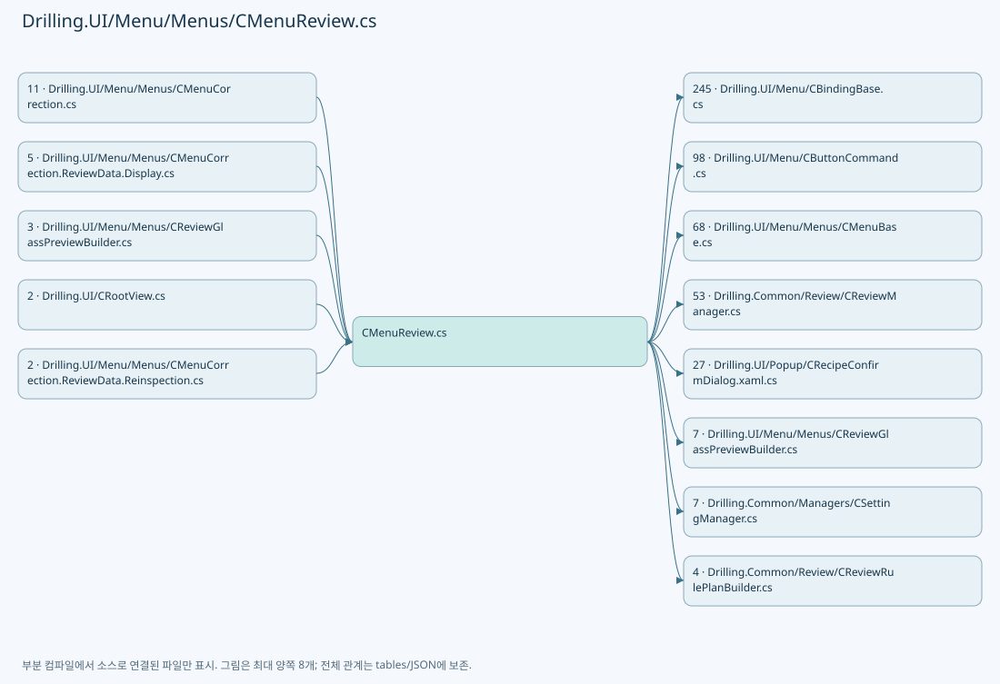

## 네임스페이스·타입·상속

| 타입 | 구분 | 원본 범위 | 선언/상속 |
| --- | --- | --- | --- |
| CMenuReview | ClassDeclaration | 19–5624 | CMenuReview: CMenuBase |
| ST_LOADED_RUN_REVIEW_RESULT | RecordDeclaration | 2886–2892 | ST_LOADED_RUN_REVIEW_RESULT |
| ST_REVIEW_TAB_ITEM | RecordDeclaration | 5626–5631 | ST_REVIEW_TAB_ITEM |
| ST_REVIEW_MODE_ITEM | RecordDeclaration | 5633–5638 | ST_REVIEW_MODE_ITEM |
| ST_REVIEW_INSPECTION_METHOD_ITEM | RecordDeclaration | 5640–5645 | ST_REVIEW_INSPECTION_METHOD_ITEM |
| ST_REVIEW_LEVEL_LEGEND_ITEM | RecordDeclaration | 5647–5647 | ST_REVIEW_LEVEL_LEGEND_ITEM |
| ST_REVIEW_SELECTED_SHOT_STATUS | RecordDeclaration | 5649–5676 | ST_REVIEW_SELECTED_SHOT_STATUS |
| ST_BEAM_INSPECTION_SHOT_ASSIGNMENT_ROW | RecordDeclaration | 5678–5698 | ST_BEAM_INSPECTION_SHOT_ASSIGNMENT_ROW |
| ST_REVIEW_RUN_SHOT_ROW | ClassDeclaration | 5700–5807 | ST_REVIEW_RUN_SHOT_ROW: CBindingBase |
| ST_REVIEW_RUN_SHOT_MATRIX_ROW | RecordDeclaration | 5809–5809 | ST_REVIEW_RUN_SHOT_MATRIX_ROW |
| ST_REVIEW_BEAM_ROW | RecordDeclaration | 5810–5821 | ST_REVIEW_BEAM_ROW |
| ST_REVIEW_BEAM_MATRIX_ROW | RecordDeclaration | 5823–5823 | ST_REVIEW_BEAM_MATRIX_ROW |
| CReviewStatusBrush | ClassDeclaration | 5824–5868 | CReviewStatusBrush |
| ST_REVIEW_POINT_SELECT_ROW | ClassDeclaration | 5870–5938 | ST_REVIEW_POINT_SELECT_ROW: CBindingBase |
| ST_REVIEW_POINT_SELECT_MATRIX_ROW | RecordDeclaration | 5940–5940 | ST_REVIEW_POINT_SELECT_MATRIX_ROW |
| ST_REVIEW_SAMPLE_DRAG_SELECTION | RecordDeclaration | 5941–5941 | ST_REVIEW_SAMPLE_DRAG_SELECTION |
| ST_REVIEW_SETTING_ITEM | RecordDeclaration | 5942–5942 | ST_REVIEW_SETTING_ITEM |
| CLazyReadOnlyList | ClassDeclaration | 5943–6009 | CLazyReadOnlyList: IReadOnlyList<T>, System.Collections.IList |
| ST_REVIEW_INSPECTION_HEAD_ROW | RecordDeclaration | 6011–6016 | ST_REVIEW_INSPECTION_HEAD_ROW |
| ST_REVIEW_RESULT_MATRIX_COLUMN | RecordDeclaration | 6018–6018 | ST_REVIEW_RESULT_MATRIX_COLUMN |
| CReviewCameraPreview | ClassDeclaration | 6020–6164 | CReviewCameraPreview: INotifyPropertyChanged |
| Projection | RecordDeclaration | 6163–6163 | Projection |

## 멤버 빠른 목록

| 이름 | 종류 | 범위 | 서명 |
| --- | --- | --- | --- |
| _beamInspectionSnapshot | FieldDeclaration | L22–22 | Drilling.Common.Review.ST_BEAM_INSPECTION_SNAPSHOT? Drilling.UI.Menu.Menus.CMenuReview._beamInspectionSnapshot |
| _beamInspectionBrowseIndex | FieldDeclaration | L23–23 | int Drilling.UI.Menu.Menus.CMenuReview._beamInspectionBrowseIndex |
| _followBeamInspection | FieldDeclaration | L24–24 | bool Drilling.UI.Menu.Menus.CMenuReview._followBeamInspection |
| _beamInspectionCancellation | FieldDeclaration | L25–25 | System.Threading.CancellationTokenSource? Drilling.UI.Menu.Menus.CMenuReview._beamInspectionCancellation |
| _loadedBeamInspectionResult | FieldDeclaration | L26–26 | Drilling.Common.Review.ST_BEAM_INSPECTION_RESULT_FILE_DATA? Drilling.UI.Menu.Menus.CMenuReview._loadedBeamInspectionResult |
| _isBeamInspectionResultLoading | FieldDeclaration | L27–27 | bool Drilling.UI.Menu.Menus.CMenuReview._isBeamInspectionResultLoading |
| _beamInspectionResultLoadGeneration | FieldDeclaration | L28–28 | long Drilling.UI.Menu.Menus.CMenuReview._beamInspectionResultLoadGeneration |
| _beamInspectionResultLoadCancellation | FieldDeclaration | L29–29 | System.Threading.CancellationTokenSource? Drilling.UI.Menu.Menus.CMenuReview._beamInspectionResultLoadCancellation |
| _beamInspectionResultLoader | FieldDeclaration | L30–30 | System.Func<System.Threading.CancellationToken, System.Threading.Tasks.Task<Drilling.Common.Review.ST_BEAM_INSPECTION_RESULT_FILE_DATA?>>? Drilling.UI.Menu.Menus.CMenuReview._beamInspectionResultLoader |
| _loadedRunReviewResult | FieldDeclaration | L31–31 | Drilling.Common.Review.ST_REVIEW_RESULT_FILE_DATA? Drilling.UI.Menu.Menus.CMenuReview._loadedRunReviewResult |
| _loadedRunReviewPlan | FieldDeclaration | L32–32 | Drilling.Common.Review.ST_REVIEW_PLAN? Drilling.UI.Menu.Menus.CMenuReview._loadedRunReviewPlan |
| _loadedRunReviewPointsByPosition | FieldDeclaration | L33–34 | System.Collections.Generic.IReadOnlyDictionary<(int CellNo, int ShotNo), Drilling.Common.Review.ST_REVIEW_PLAN_POINT> Drilling.UI.Menu.Menus.CMenuReview._loadedRunReviewPointsByPosition |
| _isRunReviewResultLoading | FieldDeclaration | L35–35 | bool Drilling.UI.Menu.Menus.CMenuReview._isRunReviewResultLoading |
| _runReviewResultLoadGeneration | FieldDeclaration | L36–36 | long Drilling.UI.Menu.Menus.CMenuReview._runReviewResultLoadGeneration |
| _runReviewResultLoadCancellation | FieldDeclaration | L37–37 | System.Threading.CancellationTokenSource? Drilling.UI.Menu.Menus.CMenuReview._runReviewResultLoadCancellation |
| PointToPointInspectionMethod | FieldDeclaration | L38–38 | string Drilling.UI.Menu.Menus.CMenuReview.PointToPointInspectionMethod |
| InspectionOnFlyMethod | FieldDeclaration | L39–39 | string Drilling.UI.Menu.Menus.CMenuReview.InspectionOnFlyMethod |
| DefaultHeadCount | FieldDeclaration | L40–40 | int Drilling.UI.Menu.Menus.CMenuReview.DefaultHeadCount |
| MaxHeadCount | FieldDeclaration | L41–41 | int Drilling.UI.Menu.Menus.CMenuReview.MaxHeadCount |
| DefaultCellCount | FieldDeclaration | L42–42 | int Drilling.UI.Menu.Menus.CMenuReview.DefaultCellCount |
| DefaultRunBeamNo | FieldDeclaration | L43–43 | int Drilling.UI.Menu.Menus.CMenuReview.DefaultRunBeamNo |
| _reviewManager | FieldDeclaration | L44–44 | Drilling.Common.Review.CReviewManager Drilling.UI.Menu.Menus.CMenuReview._reviewManager |
| _recipeManager | FieldDeclaration | L45–45 | Drilling.Common.Managers.CRecipeManager Drilling.UI.Menu.Menus.CMenuReview._recipeManager |
| _stationManager | FieldDeclaration | L46–46 | Drilling.Common.Station.CStationManager Drilling.UI.Menu.Menus.CMenuReview._stationManager |
| _productManager | FieldDeclaration | L47–47 | Drilling.Common.Product.CProductManager Drilling.UI.Menu.Menus.CMenuReview._productManager |
| _selectedRecipeIdProvider | FieldDeclaration | L48–48 | System.Func<string> Drilling.UI.Menu.Menus.CMenuReview._selectedRecipeIdProvider |
| _statusReporter | FieldDeclaration | L49–49 | System.Action<string> Drilling.UI.Menu.Menus.CMenuReview._statusReporter |
| _refreshScreen | FieldDeclaration | L50–50 | System.Action Drilling.UI.Menu.Menus.CMenuReview._refreshScreen |
| _refreshNavigationAccess | FieldDeclaration | L51–51 | System.Action Drilling.UI.Menu.Menus.CMenuReview._refreshNavigationAccess |
| _openCorrectionReview | FieldDeclaration | L52–52 | System.Action? Drilling.UI.Menu.Menus.CMenuReview._openCorrectionReview |
| OpenSavedReviewResultAsync | PropertyDeclaration | L53–53 | System.Func<string, System.Threading.Tasks.Task>? Drilling.UI.Menu.Menus.CMenuReview.OpenSavedReviewResultAsync |
| get_OpenSavedReviewResultAsync | GetAccessorDeclaration | L53–53 | System.Func<string, System.Threading.Tasks.Task>? Drilling.UI.Menu.Menus.CMenuReview.OpenSavedReviewResultAsync.get |
| set_OpenSavedReviewResultAsync | SetAccessorDeclaration | L53–53 | void Drilling.UI.Menu.Menus.CMenuReview.OpenSavedReviewResultAsync.set |
| RefreshInspectionResultsAsync | PropertyDeclaration | L54–54 | System.Func<System.Threading.Tasks.Task>? Drilling.UI.Menu.Menus.CMenuReview.RefreshInspectionResultsAsync |
| get_RefreshInspectionResultsAsync | GetAccessorDeclaration | L54–54 | System.Func<System.Threading.Tasks.Task>? Drilling.UI.Menu.Menus.CMenuReview.RefreshInspectionResultsAsync.get |
| set_RefreshInspectionResultsAsync | SetAccessorDeclaration | L54–54 | void Drilling.UI.Menu.Menus.CMenuReview.RefreshInspectionResultsAsync.set |
| RefreshInspectionRunModeAsync | PropertyDeclaration | L55–55 | System.Func<System.Threading.Tasks.Task>? Drilling.UI.Menu.Menus.CMenuReview.RefreshInspectionRunModeAsync |
| get_RefreshInspectionRunModeAsync | GetAccessorDeclaration | L55–55 | System.Func<System.Threading.Tasks.Task>? Drilling.UI.Menu.Menus.CMenuReview.RefreshInspectionRunModeAsync.get |
| set_RefreshInspectionRunModeAsync | SetAccessorDeclaration | L55–55 | void Drilling.UI.Menu.Menus.CMenuReview.RefreshInspectionRunModeAsync.set |
| IsExternalInspectionOperationActive | PropertyDeclaration | L56–56 | System.Func<bool>? Drilling.UI.Menu.Menus.CMenuReview.IsExternalInspectionOperationActive |
| get_IsExternalInspectionOperationActive | GetAccessorDeclaration | L56–56 | System.Func<bool>? Drilling.UI.Menu.Menus.CMenuReview.IsExternalInspectionOperationActive.get |
| set_IsExternalInspectionOperationActive | SetAccessorDeclaration | L56–56 | void Drilling.UI.Menu.Menus.CMenuReview.IsExternalInspectionOperationActive.set |
| _selectedSampleShotKeys | FieldDeclaration | L57–57 | System.Collections.Generic.HashSet<string> Drilling.UI.Menu.Menus.CMenuReview._selectedSampleShotKeys |
| _selectedInspectionBeamNos | FieldDeclaration | L58–58 | System.Collections.Generic.HashSet<int> Drilling.UI.Menu.Menus.CMenuReview._selectedInspectionBeamNos |
| _selectedInspectionShotKeys | FieldDeclaration | L59–59 | System.Collections.Generic.HashSet<string> Drilling.UI.Menu.Menus.CMenuReview._selectedInspectionShotKeys |
| _inspectionBeamNosByShotKey | FieldDeclaration | L60–60 | System.Collections.Generic.Dictionary<string, System.Collections.Generic.HashSet<int>> Drilling.UI.Menu.Menus.CMenuReview._inspectionBeamNosByShotKey |
| _selectedBeamInspectionAssignment | FieldDeclaration | L61–61 | Drilling.UI.Menu.Menus.ST_BEAM_INSPECTION_SHOT_ASSIGNMENT_ROW? Drilling.UI.Menu.Menus.CMenuReview._selectedBeamInspectionAssignment |
| _updatingBeamInspectionAssignmentSelection | FieldDeclaration | L62–62 | bool Drilling.UI.Menu.Menus.CMenuReview._updatingBeamInspectionAssignmentSelection |
| _selectedLineShotKeys | FieldDeclaration | L63–63 | System.Collections.Generic.HashSet<string> Drilling.UI.Menu.Menus.CMenuReview._selectedLineShotKeys |
| _headCount | FieldDeclaration | L64–64 | int Drilling.UI.Menu.Menus.CMenuReview._headCount |
| _cellCount | FieldDeclaration | L65–65 | int Drilling.UI.Menu.Menus.CMenuReview._cellCount |
| _sampleRuleHeadNo | FieldDeclaration | L66–66 | int Drilling.UI.Menu.Menus.CMenuReview._sampleRuleHeadNo |
| _sampleRuleCellNo | FieldDeclaration | L67–67 | int Drilling.UI.Menu.Menus.CMenuReview._sampleRuleCellNo |
| _selectedSampleCellNo | FieldDeclaration | L68–68 | int Drilling.UI.Menu.Menus.CMenuReview._selectedSampleCellNo |
| _selectedRunCellNo | FieldDeclaration | L69–69 | int Drilling.UI.Menu.Menus.CMenuReview._selectedRunCellNo |
| _totalReviewPointCount | FieldDeclaration | L70–70 | int Drilling.UI.Menu.Menus.CMenuReview._totalReviewPointCount |
| _activePlanPointCount | FieldDeclaration | L71–71 | int Drilling.UI.Menu.Menus.CMenuReview._activePlanPointCount |
| _sampleMapColumnCount | FieldDeclaration | L72–72 | int Drilling.UI.Menu.Menus.CMenuReview._sampleMapColumnCount |
| _isSampleCellDetailVisible | FieldDeclaration | L73–73 | bool Drilling.UI.Menu.Menus.CMenuReview._isSampleCellDetailVisible |
| _isStartRequestPending | FieldDeclaration | L74–74 | bool Drilling.UI.Menu.Menus.CMenuReview._isStartRequestPending |
| _selectedRunShotKey | FieldDeclaration | L75–75 | string Drilling.UI.Menu.Menus.CMenuReview._selectedRunShotKey |
| _runtimeBrowseShotKey | FieldDeclaration | L76–76 | string Drilling.UI.Menu.Menus.CMenuReview._runtimeBrowseShotKey |
| _runtimeBrowsePoint | FieldDeclaration | L77–77 | Drilling.Common.Review.ST_REVIEW_PLAN_POINT? Drilling.UI.Menu.Menus.CMenuReview._runtimeBrowsePoint |
| _followRunInspection | FieldDeclaration | L78–78 | bool Drilling.UI.Menu.Menus.CMenuReview._followRunInspection |
| _selectedRunBeamNo | FieldDeclaration | L79–79 | int Drilling.UI.Menu.Menus.CMenuReview._selectedRunBeamNo |
| _selectedInspectionDisplayBeamNo | FieldDeclaration | L80–80 | int Drilling.UI.Menu.Menus.CMenuReview._selectedInspectionDisplayBeamNo |
| _selectedInspectionMethod | FieldDeclaration | L81–81 | string Drilling.UI.Menu.Menus.CMenuReview._selectedInspectionMethod |
| _splitBeamCount | FieldDeclaration | L82–82 | int Drilling.UI.Menu.Menus.CMenuReview._splitBeamCount |
| _recipeId | FieldDeclaration | L83–83 | string Drilling.UI.Menu.Menus.CMenuReview._recipeId |
| _sampleSelectionRecipeId | FieldDeclaration | L84–84 | string Drilling.UI.Menu.Menus.CMenuReview._sampleSelectionRecipeId |
| _selectedTab | FieldDeclaration | L85–85 | string Drilling.UI.Menu.Menus.CMenuReview._selectedTab |
| _selectedWorkspace | FieldDeclaration | L86–86 | string Drilling.UI.Menu.Menus.CMenuReview._selectedWorkspace |
| _selectedMode | FieldDeclaration | L87–87 | string Drilling.UI.Menu.Menus.CMenuReview._selectedMode |
| _selectionRuleText | FieldDeclaration | L88–88 | string Drilling.UI.Menu.Menus.CMenuReview._selectionRuleText |
| _selectedSampleRuleUi | FieldDeclaration | L89–89 | string Drilling.UI.Menu.Menus.CMenuReview._selectedSampleRuleUi |
| _sampleRuleScope | FieldDeclaration | L90–90 | string Drilling.UI.Menu.Menus.CMenuReview._sampleRuleScope |
| _roughReference | FieldDeclaration | L91–91 | string Drilling.UI.Menu.Menus.CMenuReview._roughReference |
| _fineLineCount | FieldDeclaration | L92–92 | int Drilling.UI.Menu.Menus.CMenuReview._fineLineCount |
| _simpleSampleShotKey | FieldDeclaration | L93–93 | string Drilling.UI.Menu.Menus.CMenuReview._simpleSampleShotKey |
| _pendingSimpleShot | FieldDeclaration | L94–94 | string Drilling.UI.Menu.Menus.CMenuReview._pendingSimpleShot |
| _lastCorrectionRulePlan | FieldDeclaration | L95–95 | Drilling.Common.Review.ST_REVIEW_RULE_PLAN? Drilling.UI.Menu.Menus.CMenuReview._lastCorrectionRulePlan |
| _lastCorrectionRuleSource | FieldDeclaration | L96–96 | System.Collections.Generic.IReadOnlyList<Drilling.Common.Review.ST_REVIEW_PLAN_POINT>? Drilling.UI.Menu.Menus.CMenuReview._lastCorrectionRuleSource |
| _sampleScopeCountPlan | FieldDeclaration | L97–97 | Drilling.Common.Review.ST_REVIEW_PLAN? Drilling.UI.Menu.Menus.CMenuReview._sampleScopeCountPlan |
| _sampleHeadPointCounts | FieldDeclaration | L98–98 | System.Collections.Generic.IReadOnlyDictionary<int, int> Drilling.UI.Menu.Menus.CMenuReview._sampleHeadPointCounts |
| _sampleHeadCellPointCounts | FieldDeclaration | L99–99 | System.Collections.Generic.IReadOnlyDictionary<(int HeadNo, int CellNo), int> Drilling.UI.Menu.Menus.CMenuReview._sampleHeadCellPointCounts |
| _planBuildError | FieldDeclaration | L100–100 | string Drilling.UI.Menu.Menus.CMenuReview._planBuildError |
| _selectedRuleType | FieldDeclaration | L101–101 | Drilling.Common.Review.EN_REVIEW_RULE_TYPE Drilling.UI.Menu.Menus.CMenuReview._selectedRuleType |
| _lastAllPlan | FieldDeclaration | L102–102 | Drilling.Common.Review.ST_REVIEW_PLAN? Drilling.UI.Menu.Menus.CMenuReview._lastAllPlan |
| _lastRecipe | FieldDeclaration | L103–103 | Drilling.Common.Managers.ST_RECIPE_DEFINITION? Drilling.UI.Menu.Menus.CMenuReview._lastRecipe |
| _lastAllPlanBeamNo | FieldDeclaration | L104–104 | int Drilling.UI.Menu.Menus.CMenuReview._lastAllPlanBeamNo |
| _materializedRunShotPlan | FieldDeclaration | L105–105 | Drilling.Common.Review.ST_REVIEW_PLAN? Drilling.UI.Menu.Menus.CMenuReview._materializedRunShotPlan |
| _materializedRunShotCellNo | FieldDeclaration | L106–106 | int Drilling.UI.Menu.Menus.CMenuReview._materializedRunShotCellNo |
| _materializedRunShotMode | FieldDeclaration | L107–107 | string Drilling.UI.Menu.Menus.CMenuReview._materializedRunShotMode |
| _materializedRunShotLoadedResult | FieldDeclaration | L108–108 | bool Drilling.UI.Menu.Menus.CMenuReview._materializedRunShotLoadedResult |
| _materializedRunShotLevelSettings | FieldDeclaration | L109–109 | Drilling.Common.Review.ST_REVIEW_RESULT_LEVEL_SETTINGS? Drilling.UI.Menu.Menus.CMenuReview._materializedRunShotLevelSettings |
| _materializedRunShotMapInitialized | FieldDeclaration | L110–110 | bool Drilling.UI.Menu.Menus.CMenuReview._materializedRunShotMapInitialized |
| _runShotRowsByKey | FieldDeclaration | L111–111 | System.Collections.Generic.IReadOnlyDictionary<string, Drilling.UI.Menu.Menus.ST_REVIEW_RUN_SHOT_ROW> Drilling.UI.Menu.Menus.CMenuReview._runShotRowsByKey |
| _sampleShotRowsByKey | FieldDeclaration | L112–112 | System.Collections.Generic.Dictionary<string, Drilling.UI.Menu.Menus.ST_REVIEW_POINT_SELECT_ROW> Drilling.UI.Menu.Menus.CMenuReview._sampleShotRowsByKey |
| Tabs | PropertyDeclaration | L113–113 | System.Collections.Generic.IReadOnlyList<Drilling.UI.Menu.Menus.ST_REVIEW_TAB_ITEM> Drilling.UI.Menu.Menus.CMenuReview.Tabs |
| get_Tabs | GetAccessorDeclaration | L113–113 | System.Collections.Generic.IReadOnlyList<Drilling.UI.Menu.Menus.ST_REVIEW_TAB_ITEM> Drilling.UI.Menu.Menus.CMenuReview.Tabs.get |
| set_Tabs | SetAccessorDeclaration | L113–113 | void Drilling.UI.Menu.Menus.CMenuReview.Tabs.set |
| Modes | PropertyDeclaration | L114–114 | System.Collections.Generic.IReadOnlyList<Drilling.UI.Menu.Menus.ST_REVIEW_MODE_ITEM> Drilling.UI.Menu.Menus.CMenuReview.Modes |
| get_Modes | GetAccessorDeclaration | L114–114 | System.Collections.Generic.IReadOnlyList<Drilling.UI.Menu.Menus.ST_REVIEW_MODE_ITEM> Drilling.UI.Menu.Menus.CMenuReview.Modes.get |
| set_Modes | SetAccessorDeclaration | L114–114 | void Drilling.UI.Menu.Menus.CMenuReview.Modes.set |
| TargetItems | PropertyDeclaration | L115–115 | System.Collections.Generic.IReadOnlyList<Drilling.UI.Menu.Menus.ST_DISPLAY_ITEM> Drilling.UI.Menu.Menus.CMenuReview.TargetItems |
| get_TargetItems | GetAccessorDeclaration | L115–115 | System.Collections.Generic.IReadOnlyList<Drilling.UI.Menu.Menus.ST_DISPLAY_ITEM> Drilling.UI.Menu.Menus.CMenuReview.TargetItems.get |
| set_TargetItems | SetAccessorDeclaration | L115–115 | void Drilling.UI.Menu.Menus.CMenuReview.TargetItems.set |
| SelectionSummaryItems | PropertyDeclaration | L116–116 | System.Collections.Generic.IReadOnlyList<Drilling.UI.Menu.Menus.ST_DISPLAY_ITEM> Drilling.UI.Menu.Menus.CMenuReview.SelectionSummaryItems |
| get_SelectionSummaryItems | GetAccessorDeclaration | L116–116 | System.Collections.Generic.IReadOnlyList<Drilling.UI.Menu.Menus.ST_DISPLAY_ITEM> Drilling.UI.Menu.Menus.CMenuReview.SelectionSummaryItems.get |
| set_SelectionSummaryItems | SetAccessorDeclaration | L116–116 | void Drilling.UI.Menu.Menus.CMenuReview.SelectionSummaryItems.set |
| SelectedPointItems | PropertyDeclaration | L117–117 | System.Collections.Generic.IReadOnlyList<Drilling.UI.Menu.Menus.ST_DISPLAY_ITEM> Drilling.UI.Menu.Menus.CMenuReview.SelectedPointItems |
| get_SelectedPointItems | GetAccessorDeclaration | L117–117 | System.Collections.Generic.IReadOnlyList<Drilling.UI.Menu.Menus.ST_DISPLAY_ITEM> Drilling.UI.Menu.Menus.CMenuReview.SelectedPointItems.get |
| set_SelectedPointItems | SetAccessorDeclaration | L117–117 | void Drilling.UI.Menu.Menus.CMenuReview.SelectedPointItems.set |
| _reviewLevelSettings | FieldDeclaration | L118–118 | Drilling.Common.Review.ST_REVIEW_RESULT_LEVEL_SETTINGS Drilling.UI.Menu.Menus.CMenuReview._reviewLevelSettings |
| ReviewLevelLegendItems | PropertyDeclaration | L119–119 | System.Collections.Generic.IReadOnlyList<Drilling.UI.Menu.Menus.ST_REVIEW_LEVEL_LEGEND_ITEM> Drilling.UI.Menu.Menus.CMenuReview.ReviewLevelLegendItems |
| get_ReviewLevelLegendItems | GetAccessorDeclaration | L119–119 | System.Collections.Generic.IReadOnlyList<Drilling.UI.Menu.Menus.ST_REVIEW_LEVEL_LEGEND_ITEM> Drilling.UI.Menu.Menus.CMenuReview.ReviewLevelLegendItems.get |
| set_ReviewLevelLegendItems | SetAccessorDeclaration | L119–119 | void Drilling.UI.Menu.Menus.CMenuReview.ReviewLevelLegendItems.set |
| SelectedShotInspection | PropertyDeclaration | L120–120 | Drilling.UI.Menu.Menus.ST_REVIEW_SELECTED_SHOT_STATUS Drilling.UI.Menu.Menus.CMenuReview.SelectedShotInspection |
| get_SelectedShotInspection | GetAccessorDeclaration | L120–120 | Drilling.UI.Menu.Menus.ST_REVIEW_SELECTED_SHOT_STATUS Drilling.UI.Menu.Menus.CMenuReview.SelectedShotInspection.get |
| set_SelectedShotInspection | SetAccessorDeclaration | L120–120 | void Drilling.UI.Menu.Menus.CMenuReview.SelectedShotInspection.set |
| RunCellPreviewLabels | PropertyDeclaration | L121–121 | System.Collections.Generic.IReadOnlyList<Drilling.UI.Menu.Menus.ST_CELL_PREVIEW_LABEL> Drilling.UI.Menu.Menus.CMenuReview.RunCellPreviewLabels |
| get_RunCellPreviewLabels | GetAccessorDeclaration | L121–121 | System.Collections.Generic.IReadOnlyList<Drilling.UI.Menu.Menus.ST_CELL_PREVIEW_LABEL> Drilling.UI.Menu.Menus.CMenuReview.RunCellPreviewLabels.get |
| set_RunCellPreviewLabels | SetAccessorDeclaration | L121–121 | void Drilling.UI.Menu.Menus.CMenuReview.RunCellPreviewLabels.set |
| RunGlassPreviewSummary | PropertyDeclaration | L122–122 | string Drilling.UI.Menu.Menus.CMenuReview.RunGlassPreviewSummary |
| get_RunGlassPreviewSummary | GetAccessorDeclaration | L122–122 | string Drilling.UI.Menu.Menus.CMenuReview.RunGlassPreviewSummary.get |
| set_RunGlassPreviewSummary | SetAccessorDeclaration | L122–122 | void Drilling.UI.Menu.Menus.CMenuReview.RunGlassPreviewSummary.set |
| RunCellShotRows | PropertyDeclaration | L123–123 | System.Collections.Generic.IReadOnlyList<Drilling.UI.Menu.Menus.ST_REVIEW_RUN_SHOT_ROW> Drilling.UI.Menu.Menus.CMenuReview.RunCellShotRows |
| get_RunCellShotRows | GetAccessorDeclaration | L123–123 | System.Collections.Generic.IReadOnlyList<Drilling.UI.Menu.Menus.ST_REVIEW_RUN_SHOT_ROW> Drilling.UI.Menu.Menus.CMenuReview.RunCellShotRows.get |
| set_RunCellShotRows | SetAccessorDeclaration | L123–123 | void Drilling.UI.Menu.Menus.CMenuReview.RunCellShotRows.set |
| RunCellShotMatrixRows | PropertyDeclaration | L124–124 | System.Collections.Generic.IReadOnlyList<Drilling.UI.Menu.Menus.ST_REVIEW_RUN_SHOT_MATRIX_ROW> Drilling.UI.Menu.Menus.CMenuReview.RunCellShotMatrixRows |
| get_RunCellShotMatrixRows | GetAccessorDeclaration | L124–124 | System.Collections.Generic.IReadOnlyList<Drilling.UI.Menu.Menus.ST_REVIEW_RUN_SHOT_MATRIX_ROW> Drilling.UI.Menu.Menus.CMenuReview.RunCellShotMatrixRows.get |
| set_RunCellShotMatrixRows | SetAccessorDeclaration | L124–124 | void Drilling.UI.Menu.Menus.CMenuReview.RunCellShotMatrixRows.set |
| RunBeamRows | PropertyDeclaration | L125–125 | System.Collections.Generic.IReadOnlyList<Drilling.UI.Menu.Menus.ST_REVIEW_BEAM_MATRIX_ROW> Drilling.UI.Menu.Menus.CMenuReview.RunBeamRows |
| get_RunBeamRows | GetAccessorDeclaration | L125–125 | System.Collections.Generic.IReadOnlyList<Drilling.UI.Menu.Menus.ST_REVIEW_BEAM_MATRIX_ROW> Drilling.UI.Menu.Menus.CMenuReview.RunBeamRows.get |
| set_RunBeamRows | SetAccessorDeclaration | L125–125 | void Drilling.UI.Menu.Menus.CMenuReview.RunBeamRows.set |
| InspectionBeamResultRows | PropertyDeclaration | L126–126 | System.Collections.Generic.IReadOnlyList<Drilling.UI.Menu.Menus.ST_REVIEW_BEAM_MATRIX_ROW> Drilling.UI.Menu.Menus.CMenuReview.InspectionBeamResultRows |
| get_InspectionBeamResultRows | GetAccessorDeclaration | L126–126 | System.Collections.Generic.IReadOnlyList<Drilling.UI.Menu.Menus.ST_REVIEW_BEAM_MATRIX_ROW> Drilling.UI.Menu.Menus.CMenuReview.InspectionBeamResultRows.get |
| set_InspectionBeamResultRows | SetAccessorDeclaration | L126–126 | void Drilling.UI.Menu.Menus.CMenuReview.InspectionBeamResultRows.set |
| BeamInspectionShotAssignments | PropertyDeclaration | L127–127 | System.Collections.Generic.IReadOnlyList<Drilling.UI.Menu.Menus.ST_BEAM_INSPECTION_SHOT_ASSIGNMENT_ROW> Drilling.UI.Menu.Menus.CMenuReview.BeamInspectionShotAssignments |
| get_BeamInspectionShotAssignments | GetAccessorDeclaration | L127–127 | System.Collections.Generic.IReadOnlyList<Drilling.UI.Menu.Menus.ST_BEAM_INSPECTION_SHOT_ASSIGNMENT_ROW> Drilling.UI.Menu.Menus.CMenuReview.BeamInspectionShotAssignments.get |
| set_BeamInspectionShotAssignments | SetAccessorDeclaration | L127–127 | void Drilling.UI.Menu.Menus.CMenuReview.BeamInspectionShotAssignments.set |
| PointSelectRows | PropertyDeclaration | L128–128 | System.Collections.Generic.IReadOnlyList<Drilling.UI.Menu.Menus.ST_REVIEW_POINT_SELECT_ROW> Drilling.UI.Menu.Menus.CMenuReview.PointSelectRows |
| get_PointSelectRows | GetAccessorDeclaration | L128–128 | System.Collections.Generic.IReadOnlyList<Drilling.UI.Menu.Menus.ST_REVIEW_POINT_SELECT_ROW> Drilling.UI.Menu.Menus.CMenuReview.PointSelectRows.get |
| set_PointSelectRows | SetAccessorDeclaration | L128–128 | void Drilling.UI.Menu.Menus.CMenuReview.PointSelectRows.set |
| SampleCellPreviewLabels | PropertyDeclaration | L129–129 | System.Collections.Generic.IReadOnlyList<Drilling.UI.Menu.Menus.ST_CELL_PREVIEW_LABEL> Drilling.UI.Menu.Menus.CMenuReview.SampleCellPreviewLabels |
| get_SampleCellPreviewLabels | GetAccessorDeclaration | L129–129 | System.Collections.Generic.IReadOnlyList<Drilling.UI.Menu.Menus.ST_CELL_PREVIEW_LABEL> Drilling.UI.Menu.Menus.CMenuReview.SampleCellPreviewLabels.get |
| set_SampleCellPreviewLabels | SetAccessorDeclaration | L129–129 | void Drilling.UI.Menu.Menus.CMenuReview.SampleCellPreviewLabels.set |
| SampleGlassPreviewSummary | PropertyDeclaration | L130–130 | string Drilling.UI.Menu.Menus.CMenuReview.SampleGlassPreviewSummary |
| get_SampleGlassPreviewSummary | GetAccessorDeclaration | L130–130 | string Drilling.UI.Menu.Menus.CMenuReview.SampleGlassPreviewSummary.get |
| set_SampleGlassPreviewSummary | SetAccessorDeclaration | L130–130 | void Drilling.UI.Menu.Menus.CMenuReview.SampleGlassPreviewSummary.set |
| SampleCellShotRows | PropertyDeclaration | L131–131 | System.Collections.Generic.IReadOnlyList<Drilling.UI.Menu.Menus.ST_REVIEW_POINT_SELECT_ROW> Drilling.UI.Menu.Menus.CMenuReview.SampleCellShotRows |
| get_SampleCellShotRows | GetAccessorDeclaration | L131–131 | System.Collections.Generic.IReadOnlyList<Drilling.UI.Menu.Menus.ST_REVIEW_POINT_SELECT_ROW> Drilling.UI.Menu.Menus.CMenuReview.SampleCellShotRows.get |
| set_SampleCellShotRows | SetAccessorDeclaration | L131–131 | void Drilling.UI.Menu.Menus.CMenuReview.SampleCellShotRows.set |
| SampleCellShotMatrixRows | PropertyDeclaration | L132–132 | System.Collections.Generic.IReadOnlyList<Drilling.UI.Menu.Menus.ST_REVIEW_POINT_SELECT_MATRIX_ROW> Drilling.UI.Menu.Menus.CMenuReview.SampleCellShotMatrixRows |
| get_SampleCellShotMatrixRows | GetAccessorDeclaration | L132–132 | System.Collections.Generic.IReadOnlyList<Drilling.UI.Menu.Menus.ST_REVIEW_POINT_SELECT_MATRIX_ROW> Drilling.UI.Menu.Menus.CMenuReview.SampleCellShotMatrixRows.get |
| set_SampleCellShotMatrixRows | SetAccessorDeclaration | L132–132 | void Drilling.UI.Menu.Menus.CMenuReview.SampleCellShotMatrixRows.set |
| ResultMatrix | PropertyDeclaration | L133–133 | System.Data.DataView Drilling.UI.Menu.Menus.CMenuReview.ResultMatrix |
| get_ResultMatrix | GetAccessorDeclaration | L133–133 | System.Data.DataView Drilling.UI.Menu.Menus.CMenuReview.ResultMatrix.get |
| set_ResultMatrix | SetAccessorDeclaration | L133–133 | void Drilling.UI.Menu.Menus.CMenuReview.ResultMatrix.set |
| _oneShotCancellation | FieldDeclaration | L135–135 | System.Threading.CancellationTokenSource? Drilling.UI.Menu.Menus.CMenuReview._oneShotCancellation |
| _reviewCancellation | FieldDeclaration | L136–136 | System.Threading.CancellationTokenSource? Drilling.UI.Menu.Menus.CMenuReview._reviewCancellation |
| _oneShotRunning | FieldDeclaration | L137–137 | bool Drilling.UI.Menu.Menus.CMenuReview._oneShotRunning |
| _oneShotActiveAction | FieldDeclaration | L138–138 | Drilling.Common.Review.EN_ONE_SHOT_ACTION? Drilling.UI.Menu.Menus.CMenuReview._oneShotActiveAction |
| _oneShotMethod | FieldDeclaration | L139–139 | string Drilling.UI.Menu.Menus.CMenuReview._oneShotMethod |
| _oneShotResult | FieldDeclaration | L140–140 | Drilling.Common.Review.ST_ONE_SHOT_RESULT? Drilling.UI.Menu.Menus.CMenuReview._oneShotResult |
| OneShotActionCommand | PropertyDeclaration | L141–141 | Drilling.UI.Menu.CButtonCommand Drilling.UI.Menu.Menus.CMenuReview.OneShotActionCommand |
| get_OneShotActionCommand | GetAccessorDeclaration | L141–141 | Drilling.UI.Menu.CButtonCommand Drilling.UI.Menu.Menus.CMenuReview.OneShotActionCommand.get |
| set_OneShotActionCommand | SetAccessorDeclaration | L141–141 | void Drilling.UI.Menu.Menus.CMenuReview.OneShotActionCommand.set |
| OneShotMethods | PropertyDeclaration | L142–142 | System.Collections.Generic.IReadOnlyList<string> Drilling.UI.Menu.Menus.CMenuReview.OneShotMethods |
| get_OneShotMethods | GetAccessorDeclaration | L142–142 | System.Collections.Generic.IReadOnlyList<string> Drilling.UI.Menu.Menus.CMenuReview.OneShotMethods.get |
| OneShotStatus | PropertyDeclaration | L143–143 | string Drilling.UI.Menu.Menus.CMenuReview.OneShotStatus |
| get_OneShotStatus | GetAccessorDeclaration | L143–143 | string Drilling.UI.Menu.Menus.CMenuReview.OneShotStatus.get |
| set_OneShotStatus | SetAccessorDeclaration | L143–143 | void Drilling.UI.Menu.Menus.CMenuReview.OneShotStatus.set |
| _runtimeUiGate | FieldDeclaration | L145–145 | object Drilling.UI.Menu.Menus.CMenuReview._runtimeUiGate |
| _runtimePendingPoints | FieldDeclaration | L146–146 | System.Collections.Generic.Dictionary<string, Drilling.Common.Review.ST_REVIEW_PLAN_POINT> Drilling.UI.Menu.Menus.CMenuReview._runtimePendingPoints |
| _runtimeMeasuredPoints | FieldDeclaration | L147–147 | System.Collections.Generic.Dictionary<string, Drilling.Common.Review.ST_REVIEW_PLAN_POINT> Drilling.UI.Menu.Menus.CMenuReview._runtimeMeasuredPoints |
| _runtimePendingPlan | FieldDeclaration | L148–148 | Drilling.Common.Review.ST_REVIEW_PLAN? Drilling.UI.Menu.Menus.CMenuReview._runtimePendingPlan |
| _runtimeSeedPlan | FieldDeclaration | L149–149 | Drilling.Common.Review.ST_REVIEW_PLAN? Drilling.UI.Menu.Menus.CMenuReview._runtimeSeedPlan |
| _runtimeQueuedId | FieldDeclaration | L150–150 | System.Guid Drilling.UI.Menu.Menus.CMenuReview._runtimeQueuedId |
| _runtimeTimerScheduled | FieldDeclaration | L151–151 | int Drilling.UI.Menu.Menus.CMenuReview._runtimeTimerScheduled |
| _runtimeDisplayTimer | FieldDeclaration | L152–152 | DispatcherTimer? Drilling.UI.Menu.Menus.CMenuReview._runtimeDisplayTimer |
| _runtimeCurrentPointCells | FieldDeclaration | L153–153 | System.Collections.Generic.Dictionary<string, int> Drilling.UI.Menu.Menus.CMenuReview._runtimeCurrentPointCells |
| _emptyRuntimeMatrix | FieldDeclaration | L154–154 | System.Data.DataView Drilling.UI.Menu.Menus.CMenuReview._emptyRuntimeMatrix |
| _finishedResultPlan | FieldDeclaration | L155–155 | Drilling.Common.Review.ST_REVIEW_PLAN? Drilling.UI.Menu.Menus.CMenuReview._finishedResultPlan |
| _finishedResultMatrix | FieldDeclaration | L156–156 | System.Data.DataView? Drilling.UI.Menu.Menus.CMenuReview._finishedResultMatrix |
| _deferResultMatrix | FieldDeclaration | L157–157 | bool Drilling.UI.Menu.Menus.CMenuReview._deferResultMatrix |
| _resultDisplayGeneration | FieldDeclaration | L158–158 | int Drilling.UI.Menu.Menus.CMenuReview._resultDisplayGeneration |
| _runtimePreviewCells | FieldDeclaration | L159–159 | System.Collections.Generic.HashSet<int> Drilling.UI.Menu.Menus.CMenuReview._runtimePreviewCells |
| _runtimePreviewCell | FieldDeclaration | L160–160 | int Drilling.UI.Menu.Menus.CMenuReview._runtimePreviewCell |
| _runtimePreviewActive | FieldDeclaration | L161–161 | bool Drilling.UI.Menu.Menus.CMenuReview._runtimePreviewActive |
| _runtimePreviewBase | FieldDeclaration | L162–162 | ImageSource? Drilling.UI.Menu.Menus.CMenuReview._runtimePreviewBase |
| _runtimeDisplayRefreshCount | FieldDeclaration | L163–163 | int Drilling.UI.Menu.Menus.CMenuReview._runtimeDisplayRefreshCount |
| _cameraInterfaces | FieldDeclaration | L164–164 | Drilling.Common.Interface.CInterfaceManager? Drilling.UI.Menu.Menus.CMenuReview._cameraInterfaces |
| _cameraSettings | FieldDeclaration | L165–165 | Drilling.Common.Managers.CSettingManager? Drilling.UI.Menu.Menus.CMenuReview._cameraSettings |
| _cameraRecipe | FieldDeclaration | L166–166 | Drilling.Common.Managers.ST_RECIPE_DEFINITION? Drilling.UI.Menu.Menus.CMenuReview._cameraRecipe |
| _cameraSettingFrame | FieldDeclaration | L167–167 | System.Collections.Generic.IReadOnlyList<Drilling.Common.Managers.ST_SYSTEM_PARAMETER>? Drilling.UI.Menu.Menus.CMenuReview._cameraSettingFrame |
| _cameraParameters | FieldDeclaration | L168–168 | System.Collections.Generic.Dictionary<string, string> Drilling.UI.Menu.Menus.CMenuReview._cameraParameters |
| _cameraGlassBounds | FieldDeclaration | L169–169 | Rect Drilling.UI.Menu.Menus.CMenuReview._cameraGlassBounds |
| _cameraCanvasSize | FieldDeclaration | L170–170 | Size Drilling.UI.Menu.Menus.CMenuReview._cameraCanvasSize |
| _cameraProjectionViewportSize | FieldDeclaration | L171–171 | Size Drilling.UI.Menu.Menus.CMenuReview._cameraProjectionViewportSize |
| _cameraProjectionGlassBounds | FieldDeclaration | L172–172 | Rect Drilling.UI.Menu.Menus.CMenuReview._cameraProjectionGlassBounds |
| _cameraProjectionCanvasSize | FieldDeclaration | L173–173 | Size Drilling.UI.Menu.Menus.CMenuReview._cameraProjectionCanvasSize |
| Camera | PropertyDeclaration | L174–174 | Drilling.UI.Menu.Menus.CReviewCameraPreview Drilling.UI.Menu.Menus.CMenuReview.Camera |
| get_Camera | GetAccessorDeclaration | L174–174 | Drilling.UI.Menu.Menus.CReviewCameraPreview Drilling.UI.Menu.Menus.CMenuReview.Camera.get |
| .ctor | ConstructorDeclaration | L178–240 | Drilling.UI.Menu.Menus.CMenuReview.CMenuReview(Drilling.Common.Review.CReviewManager, Drilling.Common.Managers.CRecipeManager, Drilling.Common.Station.CStationManager, Drilling.Common.Product.CProductManager, System.Func<string>, System.Action<string>, System.Action, System.Action, Drilling.Common.Interface.CInterfaceManager?, Drilling.Common.Managers.CSettingManager?, System.Action?) |
| Menu | PropertyDeclaration | L244–244 | Drilling.UI.Menu.Menus.EN_MENU Drilling.UI.Menu.Menus.CMenuReview.Menu |
| Title | PropertyDeclaration | L245–245 | string Drilling.UI.Menu.Menus.CMenuReview.Title |
| Subtitle | PropertyDeclaration | L246–246 | string Drilling.UI.Menu.Menus.CMenuReview.Subtitle |
| PlanSummary | PropertyDeclaration | L247–247 | string Drilling.UI.Menu.Menus.CMenuReview.PlanSummary |
| SampleMapColumnCount | PropertyDeclaration | L248–248 | int Drilling.UI.Menu.Menus.CMenuReview.SampleMapColumnCount |
| IsRunTab | PropertyDeclaration | L249–249 | bool Drilling.UI.Menu.Menus.CMenuReview.IsRunTab |
| IsInspectionRunWorkspace | PropertyDeclaration | L250–250 | bool Drilling.UI.Menu.Menus.CMenuReview.IsInspectionRunWorkspace |
| IsInspectionResultWorkspace | PropertyDeclaration | L251–251 | bool Drilling.UI.Menu.Menus.CMenuReview.IsInspectionResultWorkspace |
| IsRunCommandsVisible | PropertyDeclaration | L252–252 | bool Drilling.UI.Menu.Menus.CMenuReview.IsRunCommandsVisible |
| IsRunGlassPreviewVisible | PropertyDeclaration | L253–253 | bool Drilling.UI.Menu.Menus.CMenuReview.IsRunGlassPreviewVisible |
| IsRunCellDetailVisible | PropertyDeclaration | L254–254 | bool Drilling.UI.Menu.Menus.CMenuReview.IsRunCellDetailVisible |
| IsAllShotReviewMode | PropertyDeclaration | L255–255 | bool Drilling.UI.Menu.Menus.CMenuReview.IsAllShotReviewMode |
| IsOneLineReviewMode | PropertyDeclaration | L256–256 | bool Drilling.UI.Menu.Menus.CMenuReview.IsOneLineReviewMode |
| IsAllShotStyleReviewMode | PropertyDeclaration | L257–257 | bool Drilling.UI.Menu.Menus.CMenuReview.IsAllShotStyleReviewMode |
| IsOneShotReviewMode | PropertyDeclaration | L258–258 | bool Drilling.UI.Menu.Menus.CMenuReview.IsOneShotReviewMode |
| IsRunStageStatusVisible | PropertyDeclaration | L259–259 | bool Drilling.UI.Menu.Menus.CMenuReview.IsRunStageStatusVisible |
| IsRuleReviewMode | PropertyDeclaration | L260–260 | bool Drilling.UI.Menu.Menus.CMenuReview.IsRuleReviewMode |
| IsBeamInspectionMode | PropertyDeclaration | L261–261 | bool Drilling.UI.Menu.Menus.CMenuReview.IsBeamInspectionMode |
| IsRoughInspectionMode | PropertyDeclaration | L262–262 | bool Drilling.UI.Menu.Menus.CMenuReview.IsRoughInspectionMode |
| IsFineInspectionMode | PropertyDeclaration | L263–263 | bool Drilling.UI.Menu.Menus.CMenuReview.IsFineInspectionMode |
| IsCorrectionInspectionMode | PropertyDeclaration | L264–264 | bool Drilling.UI.Menu.Menus.CMenuReview.IsCorrectionInspectionMode |
| IsStandardInspectionMode | PropertyDeclaration | L265–265 | bool Drilling.UI.Menu.Menus.CMenuReview.IsStandardInspectionMode |
| SelectedInspectionResultType | PropertyDeclaration | L266–272 | string Drilling.UI.Menu.Menus.CMenuReview.SelectedInspectionResultType |
| IsReviewHeadCardsVisible | PropertyDeclaration | L273–273 | bool Drilling.UI.Menu.Menus.CMenuReview.IsReviewHeadCardsVisible |
| IsBeamSelectionVisible | PropertyDeclaration | L274–274 | bool Drilling.UI.Menu.Menus.CMenuReview.IsBeamSelectionVisible |
| IsSingleBeamSelectionMode | PropertyDeclaration | L275–275 | bool Drilling.UI.Menu.Menus.CMenuReview.IsSingleBeamSelectionMode |
| IsLastMeasurementVisible | PropertyDeclaration | L276–276 | bool Drilling.UI.Menu.Menus.CMenuReview.IsLastMeasurementVisible |
| IsRunShotMapVisible | PropertyDeclaration | L277–277 | bool Drilling.UI.Menu.Menus.CMenuReview.IsRunShotMapVisible |
| IsRunBeamDetailVisible | PropertyDeclaration | L278–278 | bool Drilling.UI.Menu.Menus.CMenuReview.IsRunBeamDetailVisible |
| RunWorkspaceTitle | PropertyDeclaration | L279–279 | string Drilling.UI.Menu.Menus.CMenuReview.RunWorkspaceTitle |
| RunWorkspaceSummary | PropertyDeclaration | L280–280 | string Drilling.UI.Menu.Menus.CMenuReview.RunWorkspaceSummary |
| SelectedRunShotName | PropertyDeclaration | L281–281 | string Drilling.UI.Menu.Menus.CMenuReview.SelectedRunShotName |
| IsSampleSelectTab | PropertyDeclaration | L282–282 | bool Drilling.UI.Menu.Menus.CMenuReview.IsSampleSelectTab |
| IsSimpleSampleRuleUi | PropertyDeclaration | L283–283 | bool Drilling.UI.Menu.Menus.CMenuReview.IsSimpleSampleRuleUi |
| IsRoughSampleRuleUi | PropertyDeclaration | L284–284 | bool Drilling.UI.Menu.Menus.CMenuReview.IsRoughSampleRuleUi |
| IsFineSampleRuleUi | PropertyDeclaration | L285–285 | bool Drilling.UI.Menu.Menus.CMenuReview.IsFineSampleRuleUi |
| IsSampleScopeVisible | PropertyDeclaration | L286–286 | bool Drilling.UI.Menu.Menus.CMenuReview.IsSampleScopeVisible |
| IsSampleScopeHead | PropertyDeclaration | L287–287 | bool Drilling.UI.Menu.Menus.CMenuReview.IsSampleScopeHead |
| IsSampleScopeHeadCell | PropertyDeclaration | L288–288 | bool Drilling.UI.Menu.Menus.CMenuReview.IsSampleScopeHeadCell |
| IsRoughFirst | PropertyDeclaration | L289–289 | bool Drilling.UI.Menu.Menus.CMenuReview.IsRoughFirst |
| IsRoughCenter | PropertyDeclaration | L290–290 | bool Drilling.UI.Menu.Menus.CMenuReview.IsRoughCenter |
| IsRoughLast | PropertyDeclaration | L291–291 | bool Drilling.UI.Menu.Menus.CMenuReview.IsRoughLast |
| IsFineOneLine | PropertyDeclaration | L292–292 | bool Drilling.UI.Menu.Menus.CMenuReview.IsFineOneLine |
| IsFineThreeLine | PropertyDeclaration | L293–293 | bool Drilling.UI.Menu.Menus.CMenuReview.IsFineThreeLine |
| IsFineFiveLine | PropertyDeclaration | L294–294 | bool Drilling.UI.Menu.Menus.CMenuReview.IsFineFiveLine |
| IsFineSevenLine | PropertyDeclaration | L295–295 | bool Drilling.UI.Menu.Menus.CMenuReview.IsFineSevenLine |
| SelectedSampleRuleUi | PropertyDeclaration | L296–296 | string Drilling.UI.Menu.Menus.CMenuReview.SelectedSampleRuleUi |
| SampleCorrectionTitle | PropertyDeclaration | L297–297 | string Drilling.UI.Menu.Menus.CMenuReview.SampleCorrectionTitle |
| SampleTargetSectionTitle | PropertyDeclaration | L298–298 | string Drilling.UI.Menu.Menus.CMenuReview.SampleTargetSectionTitle |
| SampleReferenceThirdLabel | PropertyDeclaration | L299–303 | string Drilling.UI.Menu.Menus.CMenuReview.SampleReferenceThirdLabel |
| SampleCorrectionTarget | PropertyDeclaration | L304–304 | string Drilling.UI.Menu.Menus.CMenuReview.SampleCorrectionTarget |
| SampleReferenceHead | PropertyDeclaration | L305–305 | string Drilling.UI.Menu.Menus.CMenuReview.SampleReferenceHead |
| SampleReferenceCell | PropertyDeclaration | L306–306 | string Drilling.UI.Menu.Menus.CMenuReview.SampleReferenceCell |
| SampleReferenceShot | PropertyDeclaration | L307–312 | string Drilling.UI.Menu.Menus.CMenuReview.SampleReferenceShot |
| SampleOffsetApplyCount | PropertyDeclaration | L313–313 | string Drilling.UI.Menu.Menus.CMenuReview.SampleOffsetApplyCount |
| SampleInspectionShotCount | PropertyDeclaration | L314–314 | string Drilling.UI.Menu.Menus.CMenuReview.SampleInspectionShotCount |
| SamplePlanStatus | PropertyDeclaration | L315–315 | string Drilling.UI.Menu.Menus.CMenuReview.SamplePlanStatus |
| IsSampleGlassPreviewVisible | PropertyDeclaration | L316–316 | bool Drilling.UI.Menu.Menus.CMenuReview.IsSampleGlassPreviewVisible |
| IsSampleCellDetailVisible | PropertyDeclaration | L317–317 | bool Drilling.UI.Menu.Menus.CMenuReview.IsSampleCellDetailVisible |
| SampleWorkspaceTitle | PropertyDeclaration | L318–318 | string Drilling.UI.Menu.Menus.CMenuReview.SampleWorkspaceTitle |
| SampleWorkspaceSummary | PropertyDeclaration | L319–319 | string Drilling.UI.Menu.Menus.CMenuReview.SampleWorkspaceSummary |
| SampleRuleName | PropertyDeclaration | L320–320 | string Drilling.UI.Menu.Menus.CMenuReview.SampleRuleName |
| SampleHeadOptions | PropertyDeclaration | L321–321 | System.Collections.Generic.IReadOnlyList<string> Drilling.UI.Menu.Menus.CMenuReview.SampleHeadOptions |
| SelectedSampleHead | PropertyDeclaration | L323–339 | string Drilling.UI.Menu.Menus.CMenuReview.SelectedSampleHead |
| get_SelectedSampleHead | GetAccessorDeclaration | L325–325 | string Drilling.UI.Menu.Menus.CMenuReview.SelectedSampleHead.get |
| set_SelectedSampleHead | SetAccessorDeclaration | L326–338 | void Drilling.UI.Menu.Menus.CMenuReview.SelectedSampleHead.set |
| SampleCellOptions | PropertyDeclaration | L341–341 | System.Collections.Generic.IReadOnlyList<string> Drilling.UI.Menu.Menus.CMenuReview.SampleCellOptions |
| SelectedSampleCell | PropertyDeclaration | L343–359 | string Drilling.UI.Menu.Menus.CMenuReview.SelectedSampleCell |
| get_SelectedSampleCell | GetAccessorDeclaration | L345–345 | string Drilling.UI.Menu.Menus.CMenuReview.SelectedSampleCell.get |
| set_SelectedSampleCell | SetAccessorDeclaration | L346–358 | void Drilling.UI.Menu.Menus.CMenuReview.SelectedSampleCell.set |
| SampleRuleSelectionSummary | PropertyDeclaration | L361–367 | string Drilling.UI.Menu.Menus.CMenuReview.SampleRuleSelectionSummary |
| SampleRuleDescription | PropertyDeclaration | L368–374 | string Drilling.UI.Menu.Menus.CMenuReview.SampleRuleDescription |
| BeamOptions | PropertyDeclaration | L375–375 | System.Collections.Generic.IReadOnlyList<string> Drilling.UI.Menu.Menus.CMenuReview.BeamOptions |
| SelectedBeam | PropertyDeclaration | L376–376 | string Drilling.UI.Menu.Menus.CMenuReview.SelectedBeam |
| get_SelectedBeam | GetAccessorDeclaration | L376–376 | string Drilling.UI.Menu.Menus.CMenuReview.SelectedBeam.get |
| set_SelectedBeam | SetAccessorDeclaration | L376–376 | void Drilling.UI.Menu.Menus.CMenuReview.SelectedBeam.set |
| CanSelectBeam | PropertyDeclaration | L377–377 | bool Drilling.UI.Menu.Menus.CMenuReview.CanSelectBeam |
| CanEditActiveInspectionBeams | PropertyDeclaration | L378–382 | bool Drilling.UI.Menu.Menus.CMenuReview.CanEditActiveInspectionBeams |
| CanCommitInspectionShot | PropertyDeclaration | L383–383 | bool Drilling.UI.Menu.Menus.CMenuReview.CanCommitInspectionShot |
| CanDeleteInspectionShot | PropertyDeclaration | L384–388 | bool Drilling.UI.Menu.Menus.CMenuReview.CanDeleteInspectionShot |
| CanBrowseRunShots | PropertyDeclaration | L389–389 | bool Drilling.UI.Menu.Menus.CMenuReview.CanBrowseRunShots |
| CanStopOneShot | PropertyDeclaration | L390–390 | bool Drilling.UI.Menu.Menus.CMenuReview.CanStopOneShot |
| IsShotInspectionOngoing | PropertyDeclaration | L391–395 | bool Drilling.UI.Menu.Menus.CMenuReview.IsShotInspectionOngoing |
| BeamSelectionSummary | PropertyDeclaration | L396–398 | string Drilling.UI.Menu.Menus.CMenuReview.BeamSelectionSummary |
| BeamInspectionAssignmentSummary | PropertyDeclaration | L399–399 | string Drilling.UI.Menu.Menus.CMenuReview.BeamInspectionAssignmentSummary |
| InspectionListCommitText | PropertyDeclaration | L400–402 | string Drilling.UI.Menu.Menus.CMenuReview.InspectionListCommitText |
| ActiveInspectionShotText | PropertyDeclaration | L403–407 | string Drilling.UI.Menu.Menus.CMenuReview.ActiveInspectionShotText |
| SelectedBeamInspectionAssignment | PropertyDeclaration | L408–417 | Drilling.UI.Menu.Menus.ST_BEAM_INSPECTION_SHOT_ASSIGNMENT_ROW? Drilling.UI.Menu.Menus.CMenuReview.SelectedBeamInspectionAssignment |
| get_SelectedBeamInspectionAssignment | GetAccessorDeclaration | L410–410 | Drilling.UI.Menu.Menus.ST_BEAM_INSPECTION_SHOT_ASSIGNMENT_ROW? Drilling.UI.Menu.Menus.CMenuReview.SelectedBeamInspectionAssignment.get |
| set_SelectedBeamInspectionAssignment | SetAccessorDeclaration | L411–416 | void Drilling.UI.Menu.Menus.CMenuReview.SelectedBeamInspectionAssignment.set |
| SelectedInspectionMethod | PropertyDeclaration | L418–418 | string Drilling.UI.Menu.Menus.CMenuReview.SelectedInspectionMethod |
| CanSelectInspectionMethod | PropertyDeclaration | L419–419 | bool Drilling.UI.Menu.Menus.CMenuReview.CanSelectInspectionMethod |
| InspectionMethodItems | PropertyDeclaration | L420–420 | System.Collections.Generic.IReadOnlyList<Drilling.UI.Menu.Menus.ST_REVIEW_INSPECTION_METHOD_ITEM> Drilling.UI.Menu.Menus.CMenuReview.InspectionMethodItems |
| get_InspectionMethodItems | GetAccessorDeclaration | L420–420 | System.Collections.Generic.IReadOnlyList<Drilling.UI.Menu.Menus.ST_REVIEW_INSPECTION_METHOD_ITEM> Drilling.UI.Menu.Menus.CMenuReview.InspectionMethodItems.get |
| set_InspectionMethodItems | SetAccessorDeclaration | L420–420 | void Drilling.UI.Menu.Menus.CMenuReview.InspectionMethodItems.set |
| RunGlassPreviewImage | PropertyDeclaration | L421–421 | ImageSource? Drilling.UI.Menu.Menus.CMenuReview.RunGlassPreviewImage |
| get_RunGlassPreviewImage | GetAccessorDeclaration | L421–421 | ImageSource? Drilling.UI.Menu.Menus.CMenuReview.RunGlassPreviewImage.get |
| set_RunGlassPreviewImage | SetAccessorDeclaration | L421–421 | void Drilling.UI.Menu.Menus.CMenuReview.RunGlassPreviewImage.set |
| RunGlassPreviewInspectionOverlayImage | PropertyDeclaration | L422–422 | ImageSource? Drilling.UI.Menu.Menus.CMenuReview.RunGlassPreviewInspectionOverlayImage |
| get_RunGlassPreviewInspectionOverlayImage | GetAccessorDeclaration | L422–422 | ImageSource? Drilling.UI.Menu.Menus.CMenuReview.RunGlassPreviewInspectionOverlayImage.get |
| set_RunGlassPreviewInspectionOverlayImage | SetAccessorDeclaration | L422–422 | void Drilling.UI.Menu.Menus.CMenuReview.RunGlassPreviewInspectionOverlayImage.set |
| InspectionHeadRows | PropertyDeclaration | L424–438 | System.Collections.Generic.IReadOnlyList<Drilling.UI.Menu.Menus.ST_REVIEW_INSPECTION_HEAD_ROW> Drilling.UI.Menu.Menus.CMenuReview.InspectionHeadRows |
| get_InspectionHeadRows | GetAccessorDeclaration | L426–437 | System.Collections.Generic.IReadOnlyList<Drilling.UI.Menu.Menus.ST_REVIEW_INSPECTION_HEAD_ROW> Drilling.UI.Menu.Menus.CMenuReview.InspectionHeadRows.get |
| SampleGlassPreviewImage | PropertyDeclaration | L440–440 | ImageSource? Drilling.UI.Menu.Menus.CMenuReview.SampleGlassPreviewImage |
| get_SampleGlassPreviewImage | GetAccessorDeclaration | L440–440 | ImageSource? Drilling.UI.Menu.Menus.CMenuReview.SampleGlassPreviewImage.get |
| set_SampleGlassPreviewImage | SetAccessorDeclaration | L440–440 | void Drilling.UI.Menu.Menus.CMenuReview.SampleGlassPreviewImage.set |
| SampleGlassPreviewInspectionOverlayImage | PropertyDeclaration | L441–441 | ImageSource? Drilling.UI.Menu.Menus.CMenuReview.SampleGlassPreviewInspectionOverlayImage |
| get_SampleGlassPreviewInspectionOverlayImage | GetAccessorDeclaration | L441–441 | ImageSource? Drilling.UI.Menu.Menus.CMenuReview.SampleGlassPreviewInspectionOverlayImage.get |
| set_SampleGlassPreviewInspectionOverlayImage | SetAccessorDeclaration | L441–441 | void Drilling.UI.Menu.Menus.CMenuReview.SampleGlassPreviewInspectionOverlayImage.set |
| SelectTabCommand | PropertyDeclaration | L442–442 | Drilling.UI.Menu.CButtonCommand Drilling.UI.Menu.Menus.CMenuReview.SelectTabCommand |
| get_SelectTabCommand | GetAccessorDeclaration | L442–442 | Drilling.UI.Menu.CButtonCommand Drilling.UI.Menu.Menus.CMenuReview.SelectTabCommand.get |
| SelectWorkspaceCommand | PropertyDeclaration | L443–443 | Drilling.UI.Menu.CButtonCommand Drilling.UI.Menu.Menus.CMenuReview.SelectWorkspaceCommand |
| get_SelectWorkspaceCommand | GetAccessorDeclaration | L443–443 | Drilling.UI.Menu.CButtonCommand Drilling.UI.Menu.Menus.CMenuReview.SelectWorkspaceCommand.get |
| SelectModeCommand | PropertyDeclaration | L444–444 | Drilling.UI.Menu.CButtonCommand Drilling.UI.Menu.Menus.CMenuReview.SelectModeCommand |
| get_SelectModeCommand | GetAccessorDeclaration | L444–444 | Drilling.UI.Menu.CButtonCommand Drilling.UI.Menu.Menus.CMenuReview.SelectModeCommand.get |
| SelectSampleRuleUiCommand | PropertyDeclaration | L445–445 | Drilling.UI.Menu.CButtonCommand Drilling.UI.Menu.Menus.CMenuReview.SelectSampleRuleUiCommand |
| get_SelectSampleRuleUiCommand | GetAccessorDeclaration | L445–445 | Drilling.UI.Menu.CButtonCommand Drilling.UI.Menu.Menus.CMenuReview.SelectSampleRuleUiCommand.get |
| SelectSampleRuleScopeCommand | PropertyDeclaration | L446–446 | Drilling.UI.Menu.CButtonCommand Drilling.UI.Menu.Menus.CMenuReview.SelectSampleRuleScopeCommand |
| get_SelectSampleRuleScopeCommand | GetAccessorDeclaration | L446–446 | Drilling.UI.Menu.CButtonCommand Drilling.UI.Menu.Menus.CMenuReview.SelectSampleRuleScopeCommand.get |
| SelectRoughReferenceCommand | PropertyDeclaration | L447–447 | Drilling.UI.Menu.CButtonCommand Drilling.UI.Menu.Menus.CMenuReview.SelectRoughReferenceCommand |
| get_SelectRoughReferenceCommand | GetAccessorDeclaration | L447–447 | Drilling.UI.Menu.CButtonCommand Drilling.UI.Menu.Menus.CMenuReview.SelectRoughReferenceCommand.get |
| SelectFineLineCountCommand | PropertyDeclaration | L448–448 | Drilling.UI.Menu.CButtonCommand Drilling.UI.Menu.Menus.CMenuReview.SelectFineLineCountCommand |
| get_SelectFineLineCountCommand | GetAccessorDeclaration | L448–448 | Drilling.UI.Menu.CButtonCommand Drilling.UI.Menu.Menus.CMenuReview.SelectFineLineCountCommand.get |
| TogglePointCommand | PropertyDeclaration | L449–449 | Drilling.UI.Menu.CButtonCommand Drilling.UI.Menu.Menus.CMenuReview.TogglePointCommand |
| get_TogglePointCommand | GetAccessorDeclaration | L449–449 | Drilling.UI.Menu.CButtonCommand Drilling.UI.Menu.Menus.CMenuReview.TogglePointCommand.get |
| SetSampleShotSelectionCommand | PropertyDeclaration | L450–450 | Drilling.UI.Menu.CButtonCommand Drilling.UI.Menu.Menus.CMenuReview.SetSampleShotSelectionCommand |
| get_SetSampleShotSelectionCommand | GetAccessorDeclaration | L450–450 | Drilling.UI.Menu.CButtonCommand Drilling.UI.Menu.Menus.CMenuReview.SetSampleShotSelectionCommand.get |
| QuickSelectCommand | PropertyDeclaration | L451–451 | Drilling.UI.Menu.CButtonCommand Drilling.UI.Menu.Menus.CMenuReview.QuickSelectCommand |
| get_QuickSelectCommand | GetAccessorDeclaration | L451–451 | Drilling.UI.Menu.CButtonCommand Drilling.UI.Menu.Menus.CMenuReview.QuickSelectCommand.get |
| SelectRunCellCommand | PropertyDeclaration | L452–452 | Drilling.UI.Menu.CButtonCommand Drilling.UI.Menu.Menus.CMenuReview.SelectRunCellCommand |
| get_SelectRunCellCommand | GetAccessorDeclaration | L452–452 | Drilling.UI.Menu.CButtonCommand Drilling.UI.Menu.Menus.CMenuReview.SelectRunCellCommand.get |
| OpenCorrectionReviewCommand | PropertyDeclaration | L453–453 | Drilling.UI.Menu.CButtonCommand Drilling.UI.Menu.Menus.CMenuReview.OpenCorrectionReviewCommand |
| get_OpenCorrectionReviewCommand | GetAccessorDeclaration | L453–453 | Drilling.UI.Menu.CButtonCommand Drilling.UI.Menu.Menus.CMenuReview.OpenCorrectionReviewCommand.get |
| SelectRunShotCommand | PropertyDeclaration | L454–454 | Drilling.UI.Menu.CButtonCommand Drilling.UI.Menu.Menus.CMenuReview.SelectRunShotCommand |
| get_SelectRunShotCommand | GetAccessorDeclaration | L454–454 | Drilling.UI.Menu.CButtonCommand Drilling.UI.Menu.Menus.CMenuReview.SelectRunShotCommand.get |
| SelectRunBeamCommand | PropertyDeclaration | L455–455 | Drilling.UI.Menu.CButtonCommand Drilling.UI.Menu.Menus.CMenuReview.SelectRunBeamCommand |
| get_SelectRunBeamCommand | GetAccessorDeclaration | L455–455 | Drilling.UI.Menu.CButtonCommand Drilling.UI.Menu.Menus.CMenuReview.SelectRunBeamCommand.get |
| SelectAllInspectionBeamsCommand | PropertyDeclaration | L456–456 | Drilling.UI.Menu.CButtonCommand Drilling.UI.Menu.Menus.CMenuReview.SelectAllInspectionBeamsCommand |
| get_SelectAllInspectionBeamsCommand | GetAccessorDeclaration | L456–456 | Drilling.UI.Menu.CButtonCommand Drilling.UI.Menu.Menus.CMenuReview.SelectAllInspectionBeamsCommand.get |
| ClearInspectionBeamsCommand | PropertyDeclaration | L457–457 | Drilling.UI.Menu.CButtonCommand Drilling.UI.Menu.Menus.CMenuReview.ClearInspectionBeamsCommand |
| get_ClearInspectionBeamsCommand | GetAccessorDeclaration | L457–457 | Drilling.UI.Menu.CButtonCommand Drilling.UI.Menu.Menus.CMenuReview.ClearInspectionBeamsCommand.get |
| AddInspectionShotCommand | PropertyDeclaration | L458–458 | Drilling.UI.Menu.CButtonCommand Drilling.UI.Menu.Menus.CMenuReview.AddInspectionShotCommand |
| get_AddInspectionShotCommand | GetAccessorDeclaration | L458–458 | Drilling.UI.Menu.CButtonCommand Drilling.UI.Menu.Menus.CMenuReview.AddInspectionShotCommand.get |
| DeleteInspectionShotCommand | PropertyDeclaration | L459–459 | Drilling.UI.Menu.CButtonCommand Drilling.UI.Menu.Menus.CMenuReview.DeleteInspectionShotCommand |
| get_DeleteInspectionShotCommand | GetAccessorDeclaration | L459–459 | Drilling.UI.Menu.CButtonCommand Drilling.UI.Menu.Menus.CMenuReview.DeleteInspectionShotCommand.get |
| ShowSelectedInspectionShotsCommand | PropertyDeclaration | L460–460 | Drilling.UI.Menu.CButtonCommand Drilling.UI.Menu.Menus.CMenuReview.ShowSelectedInspectionShotsCommand |
| get_ShowSelectedInspectionShotsCommand | GetAccessorDeclaration | L460–460 | Drilling.UI.Menu.CButtonCommand Drilling.UI.Menu.Menus.CMenuReview.ShowSelectedInspectionShotsCommand.get |
| ClearInspectionShotsCommand | PropertyDeclaration | L461–461 | Drilling.UI.Menu.CButtonCommand Drilling.UI.Menu.Menus.CMenuReview.ClearInspectionShotsCommand |
| get_ClearInspectionShotsCommand | GetAccessorDeclaration | L461–461 | Drilling.UI.Menu.CButtonCommand Drilling.UI.Menu.Menus.CMenuReview.ClearInspectionShotsCommand.get |
| ShowShotBeamPositionsCommand | PropertyDeclaration | L462–462 | Drilling.UI.Menu.CButtonCommand Drilling.UI.Menu.Menus.CMenuReview.ShowShotBeamPositionsCommand |
| get_ShowShotBeamPositionsCommand | GetAccessorDeclaration | L462–462 | Drilling.UI.Menu.CButtonCommand Drilling.UI.Menu.Menus.CMenuReview.ShowShotBeamPositionsCommand.get |
| SelectInspectionMethodCommand | PropertyDeclaration | L463–463 | Drilling.UI.Menu.CButtonCommand Drilling.UI.Menu.Menus.CMenuReview.SelectInspectionMethodCommand |
| get_SelectInspectionMethodCommand | GetAccessorDeclaration | L463–463 | Drilling.UI.Menu.CButtonCommand Drilling.UI.Menu.Menus.CMenuReview.SelectInspectionMethodCommand.get |
| BackToRunShotMapCommand | PropertyDeclaration | L464–464 | Drilling.UI.Menu.CButtonCommand Drilling.UI.Menu.Menus.CMenuReview.BackToRunShotMapCommand |
| get_BackToRunShotMapCommand | GetAccessorDeclaration | L464–464 | Drilling.UI.Menu.CButtonCommand Drilling.UI.Menu.Menus.CMenuReview.BackToRunShotMapCommand.get |
| BackToRunGlassPreviewCommand | PropertyDeclaration | L465–465 | Drilling.UI.Menu.CButtonCommand Drilling.UI.Menu.Menus.CMenuReview.BackToRunGlassPreviewCommand |
| get_BackToRunGlassPreviewCommand | GetAccessorDeclaration | L465–465 | Drilling.UI.Menu.CButtonCommand Drilling.UI.Menu.Menus.CMenuReview.BackToRunGlassPreviewCommand.get |
| SelectSampleCellCommand | PropertyDeclaration | L466–466 | Drilling.UI.Menu.CButtonCommand Drilling.UI.Menu.Menus.CMenuReview.SelectSampleCellCommand |
| get_SelectSampleCellCommand | GetAccessorDeclaration | L466–466 | Drilling.UI.Menu.CButtonCommand Drilling.UI.Menu.Menus.CMenuReview.SelectSampleCellCommand.get |
| BackToSampleGlassPreviewCommand | PropertyDeclaration | L467–467 | Drilling.UI.Menu.CButtonCommand Drilling.UI.Menu.Menus.CMenuReview.BackToSampleGlassPreviewCommand |
| get_BackToSampleGlassPreviewCommand | GetAccessorDeclaration | L467–467 | Drilling.UI.Menu.CButtonCommand Drilling.UI.Menu.Menus.CMenuReview.BackToSampleGlassPreviewCommand.get |
| StartCommand | PropertyDeclaration | L468–468 | Drilling.UI.Menu.CButtonCommand Drilling.UI.Menu.Menus.CMenuReview.StartCommand |
| get_StartCommand | GetAccessorDeclaration | L468–468 | Drilling.UI.Menu.CButtonCommand Drilling.UI.Menu.Menus.CMenuReview.StartCommand.get |
| StopCommand | PropertyDeclaration | L469–469 | Drilling.UI.Menu.CButtonCommand Drilling.UI.Menu.Menus.CMenuReview.StopCommand |
| get_StopCommand | GetAccessorDeclaration | L469–469 | Drilling.UI.Menu.CButtonCommand Drilling.UI.Menu.Menus.CMenuReview.StopCommand.get |
| RetryCommand | PropertyDeclaration | L470–470 | Drilling.UI.Menu.CButtonCommand Drilling.UI.Menu.Menus.CMenuReview.RetryCommand |
| get_RetryCommand | GetAccessorDeclaration | L470–470 | Drilling.UI.Menu.CButtonCommand Drilling.UI.Menu.Menus.CMenuReview.RetryCommand.get |
| ResetForMenuOpen | MethodDeclaration | L472–480 | void Drilling.UI.Menu.Menus.CMenuReview.ResetForMenuOpen() |
| Build | MethodDeclaration | L482–520 | System.Threading.Tasks.Task<Drilling.UI.Menu.Menus.CScreenViewModel> Drilling.UI.Menu.Menus.CMenuReview.Build(System.Threading.CancellationToken) |
| CreateReviewScreen | MethodDeclaration | L522–536 | Drilling.UI.Menu.Menus.CScreenViewModel Drilling.UI.Menu.Menus.CMenuReview.CreateReviewScreen(string) |
| ResetPlanDisplayAfterBuildFailure | MethodDeclaration | L538–574 | void Drilling.UI.Menu.Menus.CMenuReview.ResetPlanDisplayAfterBuildFailure() |
| CreateFallbackRecipe | MethodDeclaration | L576–579 | Drilling.Common.Managers.ST_RECIPE_DEFINITION Drilling.UI.Menu.Menus.CMenuReview.CreateFallbackRecipe() |
| LoadSelectedRecipe | MethodDeclaration | L581–600 | System.Threading.Tasks.Task<Drilling.Common.Managers.ST_RECIPE_DEFINITION?> Drilling.UI.Menu.Menus.CMenuReview.LoadSelectedRecipe(System.Threading.CancellationToken) |
| LoadCoordinatePreviewSettings | MethodDeclaration | L602–612 | System.Collections.Generic.IReadOnlyList<Drilling.Common.Managers.ST_SYSTEM_PARAMETER> Drilling.UI.Menu.Menus.CMenuReview.LoadCoordinatePreviewSettings() |
| ApplyRecipeContext | MethodDeclaration | L614–670 | void Drilling.UI.Menu.Menus.CMenuReview.ApplyRecipeContext(Drilling.Common.Managers.ST_RECIPE_DEFINITION, Drilling.Common.Review.ST_REVIEW_PLAN) |
| IsValidShotKey | LocalFunctionStatement | L624–629 | bool IsValidShotKey(string) |
| ReadRecipeString | MethodDeclaration | L672–689 | string Drilling.UI.Menu.Menus.CMenuReview.ReadRecipeString(Drilling.Common.Managers.ST_RECIPE_DEFINITION?, params string[]) |
| ReadRecipeInt | MethodDeclaration | L691–691 | int Drilling.UI.Menu.Menus.CMenuReview.ReadRecipeInt(Drilling.Common.Managers.ST_RECIPE_DEFINITION, int, params string[]) |
| ApplySplitBeamContext | MethodDeclaration | L692–707 | void Drilling.UI.Menu.Menus.CMenuReview.ApplySplitBeamContext(Drilling.Common.Managers.ST_RECIPE_DEFINITION) |
| SelectTab | MethodDeclaration | L709–745 | void Drilling.UI.Menu.Menus.CMenuReview.SelectTab(object?) |
| SelectWorkspace | MethodDeclaration | L747–776 | void Drilling.UI.Menu.Menus.CMenuReview.SelectWorkspace(object?) |
| ShowInspectionResultWorkspace | MethodDeclaration | L778–781 | void Drilling.UI.Menu.Menus.CMenuReview.ShowInspectionResultWorkspace() |
| SetWorkspace | MethodDeclaration | L783–795 | void Drilling.UI.Menu.Menus.CMenuReview.SetWorkspace(string) |
| SelectSampleRuleUi | MethodDeclaration | L797–810 | void Drilling.UI.Menu.Menus.CMenuReview.SelectSampleRuleUi(object?) |
| SelectSampleRuleScope | MethodDeclaration | L812–820 | void Drilling.UI.Menu.Menus.CMenuReview.SelectSampleRuleScope(object?) |
| SelectRoughReference | MethodDeclaration | L822–830 | void Drilling.UI.Menu.Menus.CMenuReview.SelectRoughReference(object?) |
| SelectFineLineCount | MethodDeclaration | L832–839 | void Drilling.UI.Menu.Menus.CMenuReview.SelectFineLineCount(object?) |
| SelectMode | MethodDeclaration | L841–916 | void Drilling.UI.Menu.Menus.CMenuReview.SelectMode(object?) |
| RefreshInspectionRunMode | MethodDeclaration | L918–933 | System.Threading.Tasks.Task Drilling.UI.Menu.Menus.CMenuReview.RefreshInspectionRunMode() |
| RefreshInspectionResults | MethodDeclaration | L935–950 | System.Threading.Tasks.Task Drilling.UI.Menu.Menus.CMenuReview.RefreshInspectionResults() |
| ToggleShot | MethodDeclaration | L952–1000 | void Drilling.UI.Menu.Menus.CMenuReview.ToggleShot(object?) |
| SetSampleShotSelection | MethodDeclaration | L1002–1015 | void Drilling.UI.Menu.Menus.CMenuReview.SetSampleShotSelection(object?) |
| RefreshSampleSelectionDisplay | MethodDeclaration | L1017–1067 | void Drilling.UI.Menu.Menus.CMenuReview.RefreshSampleSelectionDisplay(System.Collections.Generic.IEnumerable<string>) |
| RefreshSampleRuleUi | MethodDeclaration | L1073–1118 | void Drilling.UI.Menu.Menus.CMenuReview.RefreshSampleRuleUi() |
| ApplyQuickSelect | MethodDeclaration | L1120–1275 | void Drilling.UI.Menu.Menus.CMenuReview.ApplyQuickSelect(object?) |
| RefreshSampleGlassPreview | MethodDeclaration | L1277–1321 | void Drilling.UI.Menu.Menus.CMenuReview.RefreshSampleGlassPreview() |
| SelectRunCell | MethodDeclaration | L1323–1369 | void Drilling.UI.Menu.Menus.CMenuReview.SelectRunCell(object?) |
| SelectRunShot | MethodDeclaration | L1371–1510 | void Drilling.UI.Menu.Menus.CMenuReview.SelectRunShot(object?) |
| SelectRunBeam | MethodDeclaration | L1512–1577 | void Drilling.UI.Menu.Menus.CMenuReview.SelectRunBeam(object?) |
| BrowseRunShotDuringInspection | MethodDeclaration | L1579–1615 | void Drilling.UI.Menu.Menus.CMenuReview.BrowseRunShotDuringInspection(string) |
| BrowseLoadedRunShot | MethodDeclaration | L1617–1637 | void Drilling.UI.Menu.Menus.CMenuReview.BrowseLoadedRunShot(string) |
| SelectInspectionMethod | MethodDeclaration | L1639–1662 | void Drilling.UI.Menu.Menus.CMenuReview.SelectInspectionMethod(object?) |
| CanSelectInspectionMethodCommand | MethodDeclaration | L1664–1667 | bool Drilling.UI.Menu.Menus.CMenuReview.CanSelectInspectionMethodCommand(object?) |
| RestoreSimpleShotSelection | MethodDeclaration | L1669–1707 | void Drilling.UI.Menu.Menus.CMenuReview.RestoreSimpleShotSelection(Drilling.Common.Review.ST_REVIEW_PLAN) |
| FormatSimpleShot | MethodDeclaration | L1709–1725 | string Drilling.UI.Menu.Menus.CMenuReview.FormatSimpleShot(Drilling.Common.Review.ST_REVIEW_PLAN?, string) |
| FormatSimpleShot | MethodDeclaration | L1727–1730 | string Drilling.UI.Menu.Menus.CMenuReview.FormatSimpleShot(Drilling.Common.Review.ST_REVIEW_PLAN_POINT) |
| BuildInspectionMethodItems | MethodDeclaration | L1732–1735 | System.Collections.Generic.IReadOnlyList<Drilling.UI.Menu.Menus.ST_REVIEW_INSPECTION_METHOD_ITEM> Drilling.UI.Menu.Menus.CMenuReview.BuildInspectionMethodItems() |
| NormalizeInspectionMethod | MethodDeclaration | L1737–1740 | string Drilling.UI.Menu.Menus.CMenuReview.NormalizeInspectionMethod(string?) |
| BackToRunShotMap | MethodDeclaration | L1742–1745 | void Drilling.UI.Menu.Menus.CMenuReview.BackToRunShotMap(object?) |
| BackToRunGlassPreview | MethodDeclaration | L1747–1759 | void Drilling.UI.Menu.Menus.CMenuReview.BackToRunGlassPreview(object?) |
| SelectSampleCell | MethodDeclaration | L1761–1780 | void Drilling.UI.Menu.Menus.CMenuReview.SelectSampleCell(object?) |
| RefreshSampleCellDetailRows | MethodDeclaration | L1782–1793 | void Drilling.UI.Menu.Menus.CMenuReview.RefreshSampleCellDetailRows() |
| BackToSampleGlassPreview | MethodDeclaration | L1795–1811 | void Drilling.UI.Menu.Menus.CMenuReview.BackToSampleGlassPreview(object?) |
| IsReviewExecutionActive | PropertyDeclaration | L1813–1819 | bool Drilling.UI.Menu.Menus.CMenuReview.IsReviewExecutionActive |
| get_IsReviewExecutionActive | GetAccessorDeclaration | L1815–1818 | bool Drilling.UI.Menu.Menus.CMenuReview.IsReviewExecutionActive.get |
| IsInspectionNavigationLocked | PropertyDeclaration | L1821–1822 | bool Drilling.UI.Menu.Menus.CMenuReview.IsInspectionNavigationLocked |
| NotifyExternalInspectionExecutionStateChanged | MethodDeclaration | L1824–1827 | void Drilling.UI.Menu.Menus.CMenuReview.NotifyExternalInspectionExecutionStateChanged() |
| BlocksMenuNavigation | PropertyDeclaration | L1829–1838 | bool Drilling.UI.Menu.Menus.CMenuReview.BlocksMenuNavigation |
| get_BlocksMenuNavigation | GetAccessorDeclaration | L1831–1837 | bool Drilling.UI.Menu.Menus.CMenuReview.BlocksMenuNavigation.get |
| ConfigureReviewCorrectionPlan | MethodDeclaration | L1840–1853 | Drilling.Common.Review.ST_REVIEW_PLAN Drilling.UI.Menu.Menus.CMenuReview.ConfigureReviewCorrectionPlan(Drilling.Common.Review.ST_REVIEW_PLAN, Drilling.Common.Review.ST_REVIEW_PLAN) |
| FindPointByShotKey | MethodDeclaration | L1855–1869 | Drilling.Common.Review.ST_REVIEW_PLAN_POINT? Drilling.UI.Menu.Menus.CMenuReview.FindPointByShotKey(Drilling.Common.Review.ST_REVIEW_PLAN?, string) |
| FindRuntimeDisplayPoint | MethodDeclaration | L1871–1881 | Drilling.Common.Review.ST_REVIEW_PLAN_POINT? Drilling.UI.Menu.Menus.CMenuReview.FindRuntimeDisplayPoint(Drilling.Common.Review.ST_REVIEW_PLAN?, string) |
| CountSelectedSampleCells | MethodDeclaration | L1883–1891 | int Drilling.UI.Menu.Menus.CMenuReview.CountSelectedSampleCells() |
| BuildSampleGlassPreviewSummary | MethodDeclaration | L1893–1901 | string Drilling.UI.Menu.Menus.CMenuReview.BuildSampleGlassPreviewSummary() |
| GetConfiguredSampleInspectionShotCount | MethodDeclaration | L1903–1903 | int Drilling.UI.Menu.Menus.CMenuReview.GetConfiguredSampleInspectionShotCount() |
| CreateSamplePlanSummaryItems | MethodDeclaration | L1904–1918 | System.Collections.Generic.IReadOnlyList<Drilling.UI.Menu.Menus.ST_DISPLAY_ITEM> Drilling.UI.Menu.Menus.CMenuReview.CreateSamplePlanSummaryItems() |
| GetAutomaticReferenceText | MethodDeclaration | L1920–1925 | string Drilling.UI.Menu.Menus.CMenuReview.GetAutomaticReferenceText() |
| GetSimpleReferencePoint | MethodDeclaration | L1926–1958 | Drilling.Common.Review.ST_REVIEW_PLAN_POINT? Drilling.UI.Menu.Menus.CMenuReview.GetSimpleReferencePoint() |
| GetSimpleOffsetApplyCount | MethodDeclaration | L1960–1970 | int Drilling.UI.Menu.Menus.CMenuReview.GetSimpleOffsetApplyCount() |
| GetAutomaticInspectionShotCount | MethodDeclaration | L1972–1975 | int Drilling.UI.Menu.Menus.CMenuReview.GetAutomaticInspectionShotCount() |
| GetAutomaticOffsetApplyCount | MethodDeclaration | L1977–1992 | int Drilling.UI.Menu.Menus.CMenuReview.GetAutomaticOffsetApplyCount() |
| EnsureSampleScopePointCounts | MethodDeclaration | L1994–2016 | void Drilling.UI.Menu.Menus.CMenuReview.EnsureSampleScopePointCounts(Drilling.Common.Review.ST_REVIEW_PLAN) |
| AddScopePointCount | MethodDeclaration | L2018–2030 | void Drilling.UI.Menu.Menus.CMenuReview.AddScopePointCount(int, int, int, System.Collections.Generic.IDictionary<int, int>, System.Collections.Generic.IDictionary<(int HeadNo, int CellNo), int>) |
| GetSelectedSampleShotCount | MethodDeclaration | L2032–2032 | int Drilling.UI.Menu.Menus.CMenuReview.GetSelectedSampleShotCount() |
| GetCellPointCount | MethodDeclaration | L2033–2033 | int Drilling.UI.Menu.Menus.CMenuReview.GetCellPointCount(Drilling.Common.Review.ST_REVIEW_PLAN?, int) |
| GetSampleCellShotCount | MethodDeclaration | L2034–2034 | int Drilling.UI.Menu.Menus.CMenuReview.GetSampleCellShotCount() |
| GetSelectedSampleCellShotCount | MethodDeclaration | L2035–2044 | int Drilling.UI.Menu.Menus.CMenuReview.GetSelectedSampleCellShotCount() |
| TryParseShotKey | MethodDeclaration | L2046–2053 | bool Drilling.UI.Menu.Menus.CMenuReview.TryParseShotKey(string, out int, out int) |
| CalculateShotMapColumnCount | MethodDeclaration | L2055–2071 | int Drilling.UI.Menu.Menus.CMenuReview.CalculateShotMapColumnCount(Drilling.Common.Review.ST_REVIEW_PLAN, int) |
| SetSampleMapColumnCount | MethodDeclaration | L2073–2082 | void Drilling.UI.Menu.Menus.CMenuReview.SetSampleMapColumnCount(int) |
| CreatePointSelectRows | MethodDeclaration | L2084–2112 | System.Collections.Generic.IReadOnlyList<Drilling.UI.Menu.Menus.ST_REVIEW_POINT_SELECT_ROW> Drilling.UI.Menu.Menus.CMenuReview.CreatePointSelectRows(Drilling.Common.Review.ST_REVIEW_PLAN, System.Collections.Generic.IReadOnlySet<string>, Drilling.UI.Menu.CButtonCommand) |
| CreateLazySampleCellShotRows | MethodDeclaration | L2114–2156 | System.Collections.Generic.IReadOnlyList<Drilling.UI.Menu.Menus.ST_REVIEW_POINT_SELECT_MATRIX_ROW> Drilling.UI.Menu.Menus.CMenuReview.CreateLazySampleCellShotRows(Drilling.Common.Review.ST_REVIEW_PLAN, int) |
| GetSelectionRuleText | MethodDeclaration | L2158–2176 | string Drilling.UI.Menu.Menus.CMenuReview.GetSelectionRuleText() |
| RefreshSelectedLineKeys | MethodDeclaration | L2178–2195 | void Drilling.UI.Menu.Menus.CMenuReview.RefreshSelectedLineKeys(Drilling.Common.Review.ST_REVIEW_PLAN?) |
| GetSelectedLinePoints | MethodDeclaration | L2197–2211 | System.Collections.Generic.IReadOnlyList<Drilling.Common.Review.ST_REVIEW_PLAN_POINT> Drilling.UI.Menu.Menus.CMenuReview.GetSelectedLinePoints(Drilling.Common.Review.ST_REVIEW_PLAN?) |
| GetPlanShotKeys | MethodDeclaration | L2213–2241 | System.Collections.Generic.IReadOnlyCollection<string> Drilling.UI.Menu.Menus.CMenuReview.GetPlanShotKeys(Drilling.Common.Review.ST_REVIEW_PLAN?) |
| CreateDefaultSampleShotKeys | MethodDeclaration | L2243–2284 | System.Collections.Generic.IReadOnlyCollection<string> Drilling.UI.Menu.Menus.CMenuReview.CreateDefaultSampleShotKeys(Drilling.Common.Review.ST_REVIEW_PLAN) |
| GetShotRow | MethodDeclaration | L2286–2286 | int Drilling.UI.Menu.Menus.CMenuReview.GetShotRow(Drilling.Common.Review.ST_REVIEW_PLAN_POINT) |
| GetCenterRow | MethodDeclaration | L2287–2287 | int Drilling.UI.Menu.Menus.CMenuReview.GetCenterRow(int) |
| SelectEdgeKeys | MethodDeclaration | L2288–2292 | System.Collections.Generic.IReadOnlyCollection<string> Drilling.UI.Menu.Menus.CMenuReview.SelectEdgeKeys(Drilling.Common.Review.ST_REVIEW_PLAN) |
| SelectCenterKeys | MethodDeclaration | L2294–2298 | System.Collections.Generic.IReadOnlyCollection<string> Drilling.UI.Menu.Menus.CMenuReview.SelectCenterKeys(Drilling.Common.Review.ST_REVIEW_PLAN) |
| SelectZeroLineKeys | MethodDeclaration | L2300–2344 | System.Collections.Generic.IReadOnlyCollection<string> Drilling.UI.Menu.Menus.CMenuReview.SelectZeroLineKeys(Drilling.Common.Review.ST_REVIEW_PLAN, int) |
| GetOrBuildCorrectionRulePlan | MethodDeclaration | L2346–2357 | Drilling.Common.Review.ST_REVIEW_RULE_PLAN Drilling.UI.Menu.Menus.CMenuReview.GetOrBuildCorrectionRulePlan(Drilling.Common.Review.ST_REVIEW_PLAN) |
| CreateCorrectionRuleConfiguration | MethodDeclaration | L2359–2374 | Drilling.Common.Review.ST_REVIEW_RULE_CONFIGURATION Drilling.UI.Menu.Menus.CMenuReview.CreateCorrectionRuleConfiguration() |
| GetAutomaticInspectionPreviewPoints | MethodDeclaration | L2376–2384 | System.Collections.Generic.IReadOnlyList<Drilling.Common.Review.ST_REVIEW_PLAN_POINT> Drilling.UI.Menu.Menus.CMenuReview.GetAutomaticInspectionPreviewPoints(Drilling.Common.Review.ST_REVIEW_PLAN) |
| GetAutomaticInspectionPreviewRule | MethodDeclaration | L2386–2391 | Drilling.Common.Review.EN_REVIEW_CORRECTION_RULE? Drilling.UI.Menu.Menus.CMenuReview.GetAutomaticInspectionPreviewRule() |
| ShouldDrawSampleScope | MethodDeclaration | L2392–2392 | bool Drilling.UI.Menu.Menus.CMenuReview.ShouldDrawSampleScope() |
| GetRoughScopeTargets | MethodDeclaration | L2393–2401 | System.Collections.Generic.IReadOnlyList<Drilling.UI.Menu.Menus.ST_REVIEW_SCOPE_TARGET> Drilling.UI.Menu.Menus.CMenuReview.GetRoughScopeTargets(Drilling.Common.Review.ST_REVIEW_PLAN) |
| GetShotReason | MethodDeclaration | L2403–2421 | string Drilling.UI.Menu.Menus.CMenuReview.GetShotReason(Drilling.Common.Review.ST_REVIEW_PLAN_POINT, bool) |
| ToRuleText | MethodDeclaration | L2423–2435 | string Drilling.UI.Menu.Menus.CMenuReview.ToRuleText(Drilling.Common.Review.EN_REVIEW_RULE_TYPE) |
| ToDisplayModeName | MethodDeclaration | L2437–2437 | string Drilling.UI.Menu.Menus.CMenuReview.ToDisplayModeName(string) |
| Mode | MethodDeclaration | L2438–2441 | Drilling.UI.Menu.Menus.ST_REVIEW_MODE_ITEM Drilling.UI.Menu.Menus.CMenuReview.Mode(string, string) |
| ReviewTab | MethodDeclaration | L2443–2446 | Drilling.UI.Menu.Menus.ST_REVIEW_TAB_ITEM Drilling.UI.Menu.Menus.CMenuReview.ReviewTab(string, bool) |
| ToReviewModeDisplayName | MethodDeclaration | L2448–2451 | string Drilling.UI.Menu.Menus.CMenuReview.ToReviewModeDisplayName(string) |
| ToReviewTabDisplayName | MethodDeclaration | L2453–2456 | string Drilling.UI.Menu.Menus.CMenuReview.ToReviewTabDisplayName(string) |
| ToStateText | MethodDeclaration | L2458–2468 | string Drilling.UI.Menu.Menus.CMenuReview.ToStateText(Drilling.Common.Review.EN_REVIEW_POINT_STATE) |
| ToMatrixShotName | MethodDeclaration | L2470–2473 | string Drilling.UI.Menu.Menus.CMenuReview.ToMatrixShotName(Drilling.Common.Review.ST_REVIEW_PLAN_POINT) |
| FormatDouble | MethodDeclaration | L2475–2478 | string Drilling.UI.Menu.Menus.CMenuReview.FormatDouble(double) |
| FormatSigned | MethodDeclaration | L2480–2483 | string Drilling.UI.Menu.Menus.CMenuReview.FormatSigned(double) |
| StopForHeavyAlarm | MethodDeclaration | L2485–2493 | System.Threading.Tasks.Task Drilling.UI.Menu.Menus.CMenuReview.StopForHeavyAlarm() |
| RequestOpenCorrectionReview | MethodDeclaration | L2495–2502 | void Drilling.UI.Menu.Menus.CMenuReview.RequestOpenCorrectionReview(System.Func<string, string, bool>?) |
| OpenSavedResultWorkspace | MethodDeclaration | L2504–2522 | System.Threading.Tasks.Task Drilling.UI.Menu.Menus.CMenuReview.OpenSavedResultWorkspace(string?) |
| RequestReviewStart | MethodDeclaration | L2524–2562 | System.Threading.Tasks.Task Drilling.UI.Menu.Menus.CMenuReview.RequestReviewStart(System.Func<string, string, bool>?) |
| RequestReviewStop | MethodDeclaration | L2564–2576 | void Drilling.UI.Menu.Menus.CMenuReview.RequestReviewStop(System.Func<string, string, bool>?) |
| IsLastResultLoadActive | PropertyDeclaration | L2580–2582 | bool Drilling.UI.Menu.Menus.CMenuReview.IsLastResultLoadActive |
| CanRequestReviewStart | MethodDeclaration | L2584–2593 | bool Drilling.UI.Menu.Menus.CMenuReview.CanRequestReviewStart() |
| ShowLastResultLoadBlockedWarning | MethodDeclaration | L2595–2604 | bool Drilling.UI.Menu.Menus.CMenuReview.ShowLastResultLoadBlockedWarning() |
| IsRunResultLoadMode | PropertyDeclaration | L2606–2606 | bool Drilling.UI.Menu.Menus.CMenuReview.IsRunResultLoadMode |
| IsRunReviewResultLoading | PropertyDeclaration | L2607–2607 | bool Drilling.UI.Menu.Menus.CMenuReview.IsRunReviewResultLoading |
| CanLoadRunReviewResult | PropertyDeclaration | L2608–2608 | bool Drilling.UI.Menu.Menus.CMenuReview.CanLoadRunReviewResult |
| CanClearLoadedRunReviewResult | PropertyDeclaration | L2609–2609 | bool Drilling.UI.Menu.Menus.CMenuReview.CanClearLoadedRunReviewResult |
| RunResultLoadStatus | PropertyDeclaration | L2610–2614 | string Drilling.UI.Menu.Menus.CMenuReview.RunResultLoadStatus |
| CurrentRunResultType | PropertyDeclaration | L2616–2620 | string Drilling.UI.Menu.Menus.CMenuReview.CurrentRunResultType |
| RequestLoadLastRunReviewResult | MethodDeclaration | L2622–2639 | System.Threading.Tasks.Task Drilling.UI.Menu.Menus.CMenuReview.RequestLoadLastRunReviewResult(System.Func<string, string, bool>?) |
| RequestClearLoadedRunReviewResult | MethodDeclaration | L2641–2655 | void Drilling.UI.Menu.Menus.CMenuReview.RequestClearLoadedRunReviewResult(System.Func<string, string, bool>?) |
| LoadLastRunReviewResult | MethodDeclaration | L2657–2730 | System.Threading.Tasks.Task Drilling.UI.Menu.Menus.CMenuReview.LoadLastRunReviewResult() |
| PrepareLoadedRunReviewResult | MethodDeclaration | L2732–2831 | Drilling.UI.Menu.Menus.CMenuReview.ST_LOADED_RUN_REVIEW_RESULT Drilling.UI.Menu.Menus.CMenuReview.PrepareLoadedRunReviewResult(Drilling.Common.Managers.ST_RECIPE_DEFINITION, Drilling.Common.Review.ST_REVIEW_RESULT_FILE_DATA, string, int, System.Threading.CancellationToken) |
| ApplyLoadedRunReviewResult | MethodDeclaration | L2833–2857 | void Drilling.UI.Menu.Menus.CMenuReview.ApplyLoadedRunReviewResult(Drilling.Common.Review.ST_REVIEW_RESULT_FILE_DATA, Drilling.UI.Menu.Menus.CMenuReview.ST_LOADED_RUN_REVIEW_RESULT) |
| ClearLoadedRunReviewResult | MethodDeclaration | L2859–2869 | void Drilling.UI.Menu.Menus.CMenuReview.ClearLoadedRunReviewResult() |
| InvalidateRunReviewResultLoad | MethodDeclaration | L2871–2881 | void Drilling.UI.Menu.Menus.CMenuReview.InvalidateRunReviewResultLoad(bool) |
| CreateCellShotNameLookupKey | MethodDeclaration | L2883–2884 | string Drilling.UI.Menu.Menus.CMenuReview.CreateCellShotNameLookupKey(int, string) |
| NotifyRunResultLoadState | MethodDeclaration | L2894–2911 | void Drilling.UI.Menu.Menus.CMenuReview.NotifyRunResultLoadState() |
| PreviousInspectionShotCommand | PropertyDeclaration | L2914–2914 | Drilling.UI.Menu.CButtonCommand Drilling.UI.Menu.Menus.CMenuReview.PreviousInspectionShotCommand |
| get_PreviousInspectionShotCommand | GetAccessorDeclaration | L2914–2914 | Drilling.UI.Menu.CButtonCommand Drilling.UI.Menu.Menus.CMenuReview.PreviousInspectionShotCommand.get |
| NextInspectionShotCommand | PropertyDeclaration | L2915–2915 | Drilling.UI.Menu.CButtonCommand Drilling.UI.Menu.Menus.CMenuReview.NextInspectionShotCommand |
| get_NextInspectionShotCommand | GetAccessorDeclaration | L2915–2915 | Drilling.UI.Menu.CButtonCommand Drilling.UI.Menu.Menus.CMenuReview.NextInspectionShotCommand.get |
| IsInspectionExecutionViewVisible | PropertyDeclaration | L2916–2916 | bool Drilling.UI.Menu.Menus.CMenuReview.IsInspectionExecutionViewVisible |
| IsInspectionSelectionControlsVisible | PropertyDeclaration | L2917–2917 | bool Drilling.UI.Menu.Menus.CMenuReview.IsInspectionSelectionControlsVisible |
| InspectionShotSummary | PropertyDeclaration | L2919–2932 | string Drilling.UI.Menu.Menus.CMenuReview.InspectionShotSummary |
| get_InspectionShotSummary | GetAccessorDeclaration | L2921–2931 | string Drilling.UI.Menu.Menus.CMenuReview.InspectionShotSummary.get |
| InspectionProgressText | PropertyDeclaration | L2934–2949 | string Drilling.UI.Menu.Menus.CMenuReview.InspectionProgressText |
| get_InspectionProgressText | GetAccessorDeclaration | L2936–2948 | string Drilling.UI.Menu.Menus.CMenuReview.InspectionProgressText.get |
| GetInspectionDisplayShots | MethodDeclaration | L2951–2951 | System.Collections.Generic.IReadOnlyList<Drilling.Common.Review.ST_REVIEW_PLAN_POINT> Drilling.UI.Menu.Menus.CMenuReview.GetInspectionDisplayShots() |
| GetDisplayedInspectionResults | MethodDeclaration | L2952–2961 | System.Collections.Generic.IReadOnlyDictionary<int, Drilling.Common.Review.ST_REVIEW_PLAN_POINT> Drilling.UI.Menu.Menus.CMenuReview.GetDisplayedInspectionResults() |
| BrowseInspectionShot | MethodDeclaration | L2963–2971 | void Drilling.UI.Menu.Menus.CMenuReview.BrowseInspectionShot(int) |
| ResetBeamInspectionResults | MethodDeclaration | L2973–2985 | void Drilling.UI.Menu.Menus.CMenuReview.ResetBeamInspectionResults() |
| RefreshBeamInspectionDisplay | MethodDeclaration | L2987–3022 | void Drilling.UI.Menu.Menus.CMenuReview.RefreshBeamInspectionDisplay() |
| ApplyBeamInspectionProgress | MethodDeclaration | L3024–3045 | void Drilling.UI.Menu.Menus.CMenuReview.ApplyBeamInspectionProgress(Drilling.Common.Review.ST_BEAM_INSPECTION_SNAPSHOT) |
| Apply | LocalFunctionStatement | L3026–3038 | void Apply() |
| StartBeamInspectionSequence | MethodDeclaration | L3047–3112 | System.Threading.Tasks.Task Drilling.UI.Menu.Menus.CMenuReview.StartBeamInspectionSequence(double, double) |
| SelectAllInspectionBeams | MethodDeclaration | L3114–3127 | void Drilling.UI.Menu.Menus.CMenuReview.SelectAllInspectionBeams(object?) |
| ClearInspectionBeams | MethodDeclaration | L3129–3142 | void Drilling.UI.Menu.Menus.CMenuReview.ClearInspectionBeams(object?) |
| RefreshInspectionBeamSelection | MethodDeclaration | L3144–3160 | void Drilling.UI.Menu.Menus.CMenuReview.RefreshInspectionBeamSelection() |
| HasValidInspectionAssignments | MethodDeclaration | L3162–3167 | bool Drilling.UI.Menu.Menus.CMenuReview.HasValidInspectionAssignments() |
| GetActiveInspectionBeamCount | MethodDeclaration | L3169–3184 | int Drilling.UI.Menu.Menus.CMenuReview.GetActiveInspectionBeamCount() |
| GetInspectionTaskCount | MethodDeclaration | L3186–3194 | int Drilling.UI.Menu.Menus.CMenuReview.GetInspectionTaskCount() |
| FormatBeamNos | MethodDeclaration | L3196–3200 | string Drilling.UI.Menu.Menus.CMenuReview.FormatBeamNos(System.Collections.Generic.IEnumerable<int>) |
| FormatBeamList | MethodDeclaration | L3202–3208 | string Drilling.UI.Menu.Menus.CMenuReview.FormatBeamList(System.Collections.Generic.IEnumerable<int>) |
| SynchronizeActiveInspectionBeamSelection | MethodDeclaration | L3210–3219 | void Drilling.UI.Menu.Menus.CMenuReview.SynchronizeActiveInspectionBeamSelection() |
| BuildBeamInspectionAssignmentRows | MethodDeclaration | L3221–3277 | System.Collections.Generic.IReadOnlyList<Drilling.UI.Menu.Menus.ST_BEAM_INSPECTION_SHOT_ASSIGNMENT_ROW> Drilling.UI.Menu.Menus.CMenuReview.BuildBeamInspectionAssignmentRows() |
| RefreshBeamInspectionAssignments | MethodDeclaration | L3279–3304 | void Drilling.UI.Menu.Menus.CMenuReview.RefreshBeamInspectionAssignments() |
| ActivateBeamInspectionAssignment | MethodDeclaration | L3306–3343 | void Drilling.UI.Menu.Menus.CMenuReview.ActivateBeamInspectionAssignment(Drilling.UI.Menu.Menus.ST_BEAM_INSPECTION_SHOT_ASSIGNMENT_ROW) |
| AddOrUpdateInspectionShot | MethodDeclaration | L3345–3366 | void Drilling.UI.Menu.Menus.CMenuReview.AddOrUpdateInspectionShot(object?) |
| DeleteInspectionShot | MethodDeclaration | L3368–3402 | void Drilling.UI.Menu.Menus.CMenuReview.DeleteInspectionShot(object?) |
| BuildSelectedInspectionShotRows | MethodDeclaration | L3404–3404 | System.Collections.Generic.IReadOnlyList<Drilling.UI.Popup.ST_REVIEW_SELECTED_SHOT_ROW> Drilling.UI.Menu.Menus.CMenuReview.BuildSelectedInspectionShotRows() |
| ClearInspectionShots | MethodDeclaration | L3405–3436 | void Drilling.UI.Menu.Menus.CMenuReview.ClearInspectionShots(object?) |
| RefreshInspectionCellSelection | MethodDeclaration | L3438–3465 | void Drilling.UI.Menu.Menus.CMenuReview.RefreshInspectionCellSelection() |
| GetSelectedInspectionCellNos | MethodDeclaration | L3467–3474 | System.Collections.Generic.IReadOnlySet<int> Drilling.UI.Menu.Menus.CMenuReview.GetSelectedInspectionCellNos() |
| ShowShotBeamPositions | MethodDeclaration | L3475–3502 | void Drilling.UI.Menu.Menus.CMenuReview.ShowShotBeamPositions(object?) |
| ShowSelectedInspectionShots | MethodDeclaration | L3504–3522 | void Drilling.UI.Menu.Menus.CMenuReview.ShowSelectedInspectionShots(object?) |
| LoadLastBeamInspectionResultCommand | PropertyDeclaration | L3524–3524 | Drilling.UI.Menu.CButtonCommand Drilling.UI.Menu.Menus.CMenuReview.LoadLastBeamInspectionResultCommand |
| get_LoadLastBeamInspectionResultCommand | GetAccessorDeclaration | L3524–3524 | Drilling.UI.Menu.CButtonCommand Drilling.UI.Menu.Menus.CMenuReview.LoadLastBeamInspectionResultCommand.get |
| ClearLoadedBeamInspectionResultCommand | PropertyDeclaration | L3525–3525 | Drilling.UI.Menu.CButtonCommand Drilling.UI.Menu.Menus.CMenuReview.ClearLoadedBeamInspectionResultCommand |
| get_ClearLoadedBeamInspectionResultCommand | GetAccessorDeclaration | L3525–3525 | Drilling.UI.Menu.CButtonCommand Drilling.UI.Menu.Menus.CMenuReview.ClearLoadedBeamInspectionResultCommand.get |
| LoadLastRunReviewResultCommand | PropertyDeclaration | L3526–3526 | Drilling.UI.Menu.CButtonCommand Drilling.UI.Menu.Menus.CMenuReview.LoadLastRunReviewResultCommand |
| get_LoadLastRunReviewResultCommand | GetAccessorDeclaration | L3526–3526 | Drilling.UI.Menu.CButtonCommand Drilling.UI.Menu.Menus.CMenuReview.LoadLastRunReviewResultCommand.get |
| ClearLoadedRunReviewResultCommand | PropertyDeclaration | L3527–3527 | Drilling.UI.Menu.CButtonCommand Drilling.UI.Menu.Menus.CMenuReview.ClearLoadedRunReviewResultCommand |
| get_ClearLoadedRunReviewResultCommand | GetAccessorDeclaration | L3527–3527 | Drilling.UI.Menu.CButtonCommand Drilling.UI.Menu.Menus.CMenuReview.ClearLoadedRunReviewResultCommand.get |
| CanLoadBeamInspectionResult | PropertyDeclaration | L3528–3528 | bool Drilling.UI.Menu.Menus.CMenuReview.CanLoadBeamInspectionResult |
| CanClearLoadedBeamInspectionResult | PropertyDeclaration | L3529–3529 | bool Drilling.UI.Menu.Menus.CMenuReview.CanClearLoadedBeamInspectionResult |
| GetInspectionDisplayShotCount | MethodDeclaration | L3531–3531 | int Drilling.UI.Menu.Menus.CMenuReview.GetInspectionDisplayShotCount() |
| GetLoadedInspectionShot | MethodDeclaration | L3532–3532 | Drilling.Common.Review.ST_BEAM_INSPECTION_RESULT_SHOT? Drilling.UI.Menu.Menus.CMenuReview.GetLoadedInspectionShot() |
| RequestLoadLastBeamInspectionResult | MethodDeclaration | L3534–3548 | System.Threading.Tasks.Task Drilling.UI.Menu.Menus.CMenuReview.RequestLoadLastBeamInspectionResult(System.Func<string, string, bool>?) |
| RequestClearLoadedBeamInspectionResult | MethodDeclaration | L3550–3564 | void Drilling.UI.Menu.Menus.CMenuReview.RequestClearLoadedBeamInspectionResult(System.Func<string, string, bool>?) |
| LoadLastBeamInspectionResult | MethodDeclaration | L3566–3609 | System.Threading.Tasks.Task Drilling.UI.Menu.Menus.CMenuReview.LoadLastBeamInspectionResult() |
| ApplyLoadedBeamInspectionResult | MethodDeclaration | L3611–3620 | void Drilling.UI.Menu.Menus.CMenuReview.ApplyLoadedBeamInspectionResult(Drilling.Common.Review.ST_BEAM_INSPECTION_RESULT_FILE_DATA) |
| ClearLoadedBeamInspectionResult | MethodDeclaration | L3622–3630 | void Drilling.UI.Menu.Menus.CMenuReview.ClearLoadedBeamInspectionResult() |
| InvalidateBeamInspectionResultLoad | MethodDeclaration | L3632–3638 | void Drilling.UI.Menu.Menus.CMenuReview.InvalidateBeamInspectionResultLoad(bool) |
| BuildLoadedInspectionBeamRows | MethodDeclaration | L3640–3659 | System.Collections.Generic.IReadOnlyList<Drilling.UI.Menu.Menus.ST_REVIEW_BEAM_MATRIX_ROW> Drilling.UI.Menu.Menus.CMenuReview.BuildLoadedInspectionBeamRows() |
| SelectedOneShotMethod | PropertyDeclaration | L3663–3680 | string Drilling.UI.Menu.Menus.CMenuReview.SelectedOneShotMethod |
| get_SelectedOneShotMethod | GetAccessorDeclaration | L3665–3665 | string Drilling.UI.Menu.Menus.CMenuReview.SelectedOneShotMethod.get |
| set_SelectedOneShotMethod | SetAccessorDeclaration | L3666–3679 | void Drilling.UI.Menu.Menus.CMenuReview.SelectedOneShotMethod.set |
| OneShotSelection | PropertyDeclaration | L3682–3682 | string Drilling.UI.Menu.Menus.CMenuReview.OneShotSelection |
| OneShotResultText | PropertyDeclaration | L3684–3695 | string Drilling.UI.Menu.Menus.CMenuReview.OneShotResultText |
| get_OneShotResultText | GetAccessorDeclaration | L3686–3694 | string Drilling.UI.Menu.Menus.CMenuReview.OneShotResultText.get |
| IsShotSelectionMode | PropertyDeclaration | L3697–3697 | bool Drilling.UI.Menu.Menus.CMenuReview.IsShotSelectionMode |
| SelectedOneShotPoint | PropertyDeclaration | L3698–3698 | Drilling.Common.Review.ST_REVIEW_PLAN_POINT? Drilling.UI.Menu.Menus.CMenuReview.SelectedOneShotPoint |
| InitializeOneShot | MethodDeclaration | L3700–3705 | void Drilling.UI.Menu.Menus.CMenuReview.InitializeOneShot() |
| CanRequestOneShotAction | MethodDeclaration | L3707–3714 | bool Drilling.UI.Menu.Menus.CMenuReview.CanRequestOneShotAction(object?) |
| RefreshOneShotSelection | MethodDeclaration | L3716–3729 | void Drilling.UI.Menu.Menus.CMenuReview.RefreshOneShotSelection(bool) |
| NotifyOneShot | MethodDeclaration | L3731–3750 | void Drilling.UI.Menu.Menus.CMenuReview.NotifyOneShot() |
| BuildOneShotResultMatrix | MethodDeclaration | L3752–3807 | System.Data.DataView Drilling.UI.Menu.Menus.CMenuReview.BuildOneShotResultMatrix() |
| SelectedShotBeamTargets | MethodDeclaration | L3809–3830 | System.Collections.Generic.IReadOnlyDictionary<int, Drilling.Common.Review.ST_REVIEW_BEAM_POSITION> Drilling.UI.Menu.Menus.CMenuReview.SelectedShotBeamTargets() |
| ExecuteOneShotAction | MethodDeclaration | L3831–3932 | System.Threading.Tasks.Task Drilling.UI.Menu.Menus.CMenuReview.ExecuteOneShotAction(string, System.Func<string, string, bool>?, System.Action<string, string>?) |
| Progress | LocalFunctionStatement | L3882–3894 | void Progress(string) |
| Apply | LocalFunctionStatement | L3884–3888 | void Apply() |
| IsReviewResultDeferred | PropertyDeclaration | L3936–3936 | bool Drilling.UI.Menu.Menus.CMenuReview.IsReviewResultDeferred |
| GetRuntimeResultMatrix | MethodDeclaration | L3938–3949 | System.Data.DataView Drilling.UI.Menu.Menus.CMenuReview.GetRuntimeResultMatrix(Drilling.Common.Review.ST_REVIEW_PLAN) |
| BeginDeferredResults | MethodDeclaration | L3951–3960 | void Drilling.UI.Menu.Menus.CMenuReview.BeginDeferredResults() |
| CompleteDeferredResults | MethodDeclaration | L3962–3977 | System.Threading.Tasks.Task Drilling.UI.Menu.Menus.CMenuReview.CompleteDeferredResults() |
| QueueRuntimeDisplayRefresh | MethodDeclaration | L3979–4035 | void Drilling.UI.Menu.Menus.CMenuReview.QueueRuntimeDisplayRefresh(Drilling.Common.Review.ST_REVIEW_PLAN) |
| FlushRuntimeDisplay | MethodDeclaration | L4037–4104 | void Drilling.UI.Menu.Menus.CMenuReview.FlushRuntimeDisplay() |
| RefreshRuntimePreview | MethodDeclaration | L4106–4144 | void Drilling.UI.Menu.Menus.CMenuReview.RefreshRuntimePreview(Drilling.Common.Review.ST_REVIEW_PLAN, Drilling.Common.Review.ST_REVIEW_PLAN_POINT?) |
| RefreshRunCellDetail | MethodDeclaration | L4146–4169 | void Drilling.UI.Menu.Menus.CMenuReview.RefreshRunCellDetail() |
| ResolveReviewPlan | MethodDeclaration | L4171–4205 | Drilling.Common.Review.ST_REVIEW_PLAN Drilling.UI.Menu.Menus.CMenuReview.ResolveReviewPlan(Drilling.Common.Managers.ST_RECIPE_DEFINITION, Drilling.Common.Review.ST_REVIEW_PLAN) |
| StartReviewSequence | MethodDeclaration | L4207–4359 | System.Threading.Tasks.Task Drilling.UI.Menu.Menus.CMenuReview.StartReviewSequence(double, double) |
| ResolveReviewProduct | MethodDeclaration | L4361–4396 | System.Threading.Tasks.Task<(string? ProductId, string Message)> Drilling.UI.Menu.Menus.CMenuReview.ResolveReviewProduct(Drilling.Common.Review.ST_REVIEW_PLAN, System.Threading.CancellationToken) |
| NotifyReviewExecutionCommandStates | MethodDeclaration | L4398–4442 | void Drilling.UI.Menu.Menus.CMenuReview.NotifyReviewExecutionCommandStates(bool) |
| StopReviewSequence | MethodDeclaration | L4444–4453 | void Drilling.UI.Menu.Menus.CMenuReview.StopReviewSequence() |
| RetryRemainingReviewPoints | MethodDeclaration | L4455–4507 | System.Threading.Tasks.Task Drilling.UI.Menu.Menus.CMenuReview.RetryRemainingReviewPoints() |
| ReportAndShowReviewFailure | MethodDeclaration | L4509–4514 | void Drilling.UI.Menu.Menus.CMenuReview.ReportAndShowReviewFailure(string) |
| RefreshRunDisplayFromCachedContext | MethodDeclaration | L4516–4573 | void Drilling.UI.Menu.Menus.CMenuReview.RefreshRunDisplayFromCachedContext(bool) |
| ApplyScreenData | MethodDeclaration | L4575–4709 | void Drilling.UI.Menu.Menus.CMenuReview.ApplyScreenData(Drilling.Common.Managers.ST_RECIPE_DEFINITION, Drilling.Common.Review.ST_REVIEW_PLAN) |
| BuildSelectedPointItems | MethodDeclaration | L4711–4745 | System.Collections.Generic.IReadOnlyList<Drilling.UI.Menu.Menus.ST_DISPLAY_ITEM> Drilling.UI.Menu.Menus.CMenuReview.BuildSelectedPointItems(Drilling.Common.Review.ST_REVIEW_PLAN_POINT?) |
| RefreshReviewLevelDisplay | MethodDeclaration | L4747–4768 | void Drilling.UI.Menu.Menus.CMenuReview.RefreshReviewLevelDisplay() |
| CreateReviewLevelLegendItems | MethodDeclaration | L4770–4778 | System.Collections.Generic.IReadOnlyList<Drilling.UI.Menu.Menus.ST_REVIEW_LEVEL_LEGEND_ITEM> Drilling.UI.Menu.Menus.CMenuReview.CreateReviewLevelLegendItems(Drilling.Common.Review.ST_REVIEW_RESULT_LEVEL_SETTINGS) |
| CreateReviewLevelBrush | MethodDeclaration | L4780–4787 | Brush Drilling.UI.Menu.Menus.CMenuReview.CreateReviewLevelBrush(string) |
| RefreshSelectedShotInspection | MethodDeclaration | L4789–4793 | void Drilling.UI.Menu.Menus.CMenuReview.RefreshSelectedShotInspection() |
| BuildSelectedShotInspection | MethodDeclaration | L4795–4872 | Drilling.UI.Menu.Menus.ST_REVIEW_SELECTED_SHOT_STATUS Drilling.UI.Menu.Menus.CMenuReview.BuildSelectedShotInspection() |
| BuildBeamInspectionShotStatus | MethodDeclaration | L4874–4954 | Drilling.UI.Menu.Menus.ST_REVIEW_SELECTED_SHOT_STATUS Drilling.UI.Menu.Menus.CMenuReview.BuildBeamInspectionShotStatus() |
| CreateSelectedShotStatus | MethodDeclaration | L4956–5003 | Drilling.UI.Menu.Menus.ST_REVIEW_SELECTED_SHOT_STATUS Drilling.UI.Menu.Menus.CMenuReview.CreateSelectedShotStatus(Drilling.Common.Review.ST_REVIEW_PLAN_POINT, Drilling.Common.Review.EN_REVIEW_POINT_STATE, string, string?, bool?) |
| ResolveReviewLevel | MethodDeclaration | L5005–5010 | (string Text, Brush Brush) Drilling.UI.Menu.Menus.CMenuReview.ResolveReviewLevel(double, double) |
| HasReviewLevelResult | MethodDeclaration | L5012–5018 | bool Drilling.UI.Menu.Menus.CMenuReview.HasReviewLevelResult(Drilling.Common.Review.ST_REVIEW_PLAN_POINT) |
| GetReviewLevelBrush | MethodDeclaration | L5020–5025 | Brush Drilling.UI.Menu.Menus.CMenuReview.GetReviewLevelBrush(Drilling.Common.Review.ST_REVIEW_PLAN_POINT) |
| FormatInspectionShot | MethodDeclaration | L5027–5028 | string Drilling.UI.Menu.Menus.CMenuReview.FormatInspectionShot(Drilling.Common.Review.ST_REVIEW_PLAN_POINT) |
| ResolveBeamTargetPoint | MethodDeclaration | L5030–5059 | Drilling.Common.Review.ST_REVIEW_PLAN_POINT? Drilling.UI.Menu.Menus.CMenuReview.ResolveBeamTargetPoint(Drilling.Common.Review.ST_REVIEW_PLAN_POINT?, int, double?, double?) |
| FormatPositionX | MethodDeclaration | L5061–5063 | string Drilling.UI.Menu.Menus.CMenuReview.FormatPositionX(Drilling.Common.Review.ST_REVIEW_PLAN_POINT?) |
| FormatPositionY | MethodDeclaration | L5065–5067 | string Drilling.UI.Menu.Menus.CMenuReview.FormatPositionY(Drilling.Common.Review.ST_REVIEW_PLAN_POINT?) |
| SynchronizeOneShotMapState | MethodDeclaration | L5069–5096 | void Drilling.UI.Menu.Menus.CMenuReview.SynchronizeOneShotMapState() |
| SynchronizeBeamInspectionShotRows | MethodDeclaration | L5098–5150 | void Drilling.UI.Menu.Menus.CMenuReview.SynchronizeBeamInspectionShotRows() |
| FollowRunShotCell | MethodDeclaration | L5152–5168 | void Drilling.UI.Menu.Menus.CMenuReview.FollowRunShotCell(int, Drilling.Common.Review.ST_REVIEW_PLAN?, Drilling.Common.Review.ST_REVIEW_PLAN?) |
| ResolveRunMeasurementDisplayPoint | MethodDeclaration | L5170–5179 | Drilling.Common.Review.ST_REVIEW_PLAN_POINT? Drilling.UI.Menu.Menus.CMenuReview.ResolveRunMeasurementDisplayPoint(bool, Drilling.Common.Review.ST_REVIEW_PLAN_POINT?, Drilling.Common.Review.ST_REVIEW_PLAN_POINT?, Drilling.Common.Review.ST_REVIEW_PLAN_POINT?, Drilling.Common.Review.ST_REVIEW_PLAN_POINT?) |
| ResolveRunShotKeyForBeamChange | MethodDeclaration | L5181–5189 | string Drilling.UI.Menu.Menus.CMenuReview.ResolveRunShotKeyForBeamChange(string, Drilling.Common.Review.ST_REVIEW_PLAN_POINT?, Drilling.Common.Review.ST_REVIEW_PLAN_POINT?) |
| GetCurrentCellNos | MethodDeclaration | L5191–5203 | System.Collections.Generic.IReadOnlySet<int> Drilling.UI.Menu.Menus.CMenuReview.GetCurrentCellNos(Drilling.Common.Review.ST_REVIEW_PLAN) |
| GetOrBuildRunCellShotMatrixRows | MethodDeclaration | L5205–5226 | System.Collections.Generic.IReadOnlyList<Drilling.UI.Menu.Menus.ST_REVIEW_RUN_SHOT_MATRIX_ROW> Drilling.UI.Menu.Menus.CMenuReview.GetOrBuildRunCellShotMatrixRows(Drilling.Common.Review.ST_REVIEW_PLAN, int) |
| InvalidateMaterializedRunShotMap | MethodDeclaration | L5228–5237 | void Drilling.UI.Menu.Menus.CMenuReview.InvalidateMaterializedRunShotMap() |
| BuildRunCellShotMatrixRows | MethodDeclaration | L5239–5282 | System.Collections.Generic.IReadOnlyList<Drilling.UI.Menu.Menus.ST_REVIEW_RUN_SHOT_MATRIX_ROW> Drilling.UI.Menu.Menus.CMenuReview.BuildRunCellShotMatrixRows(Drilling.Common.Review.ST_REVIEW_PLAN, int) |
| UpdateRunShotRuntimeState | MethodDeclaration | L5284–5297 | void Drilling.UI.Menu.Menus.CMenuReview.UpdateRunShotRuntimeState(Drilling.Common.Review.ST_REVIEW_PLAN_POINT?) |
| SynchronizeMaterializedRunShotRows | MethodDeclaration | L5299–5333 | void Drilling.UI.Menu.Menus.CMenuReview.SynchronizeMaterializedRunShotRows(Drilling.Common.Review.ST_REVIEW_PLAN) |
| GetCellPoints | MethodDeclaration | L5335–5338 | System.Collections.Generic.IReadOnlyList<Drilling.Common.Review.ST_REVIEW_PLAN_POINT> Drilling.UI.Menu.Menus.CMenuReview.GetCellPoints(Drilling.Common.Review.ST_REVIEW_PLAN, int) |
| BuildBeamRows | MethodDeclaration | L5340–5367 | System.Collections.Generic.IReadOnlyList<Drilling.UI.Menu.Menus.ST_REVIEW_BEAM_MATRIX_ROW> Drilling.UI.Menu.Menus.CMenuReview.BuildBeamRows(int) |
| GetDisplayedInspectionBeamNos | MethodDeclaration | L5369–5397 | System.Collections.Generic.IReadOnlySet<int> Drilling.UI.Menu.Menus.CMenuReview.GetDisplayedInspectionBeamNos() |
| BuildInspectionBeamResultRows | MethodDeclaration | L5399–5452 | System.Collections.Generic.IReadOnlyList<Drilling.UI.Menu.Menus.ST_REVIEW_BEAM_MATRIX_ROW> Drilling.UI.Menu.Menus.CMenuReview.BuildInspectionBeamResultRows() |
| GetMatrixColumnIndex | MethodDeclaration | L5454–5457 | int Drilling.UI.Menu.Menus.CMenuReview.GetMatrixColumnIndex(Drilling.Common.Review.ST_REVIEW_PLAN_POINT) |
| GetMatrixRowIndex | MethodDeclaration | L5459–5462 | int Drilling.UI.Menu.Menus.CMenuReview.GetMatrixRowIndex(Drilling.Common.Review.ST_REVIEW_PLAN_POINT) |
| ToRunShotDetail | MethodDeclaration | L5464–5478 | string Drilling.UI.Menu.Menus.CMenuReview.ToRunShotDetail(Drilling.Common.Review.ST_REVIEW_PLAN_POINT) |
| ToRunShotState | MethodDeclaration | L5480–5480 | string Drilling.UI.Menu.Menus.CMenuReview.ToRunShotState(Drilling.Common.Review.ST_REVIEW_PLAN_POINT) |
| IsReviewPointExcluded | MethodDeclaration | L5481–5484 | bool Drilling.UI.Menu.Menus.CMenuReview.IsReviewPointExcluded(Drilling.Common.Review.ST_REVIEW_PLAN_POINT) |
| CreateEmptyResultMatrix | MethodDeclaration | L5486–5494 | System.Data.DataView Drilling.UI.Menu.Menus.CMenuReview.CreateEmptyResultMatrix() |
| BuildResultMatrix | MethodDeclaration | L5496–5538 | System.Data.DataView Drilling.UI.Menu.Menus.CMenuReview.BuildResultMatrix(Drilling.Common.Review.ST_REVIEW_PLAN) |
| SetCameraPreviewGeometry | MethodDeclaration | L5540–5544 | void Drilling.UI.Menu.Menus.CMenuReview.SetCameraPreviewGeometry(Drilling.UI.Menu.Menus.ST_REVIEW_GLASS_PREVIEW) |
| RefreshCameraFeedback | MethodDeclaration | L5547–5615 | void Drilling.UI.Menu.Menus.CMenuReview.RefreshCameraFeedback(double, double) |
| InvalidateCameraProjectionCache | MethodDeclaration | L5617–5622 | void Drilling.UI.Menu.Menus.CMenuReview.InvalidateCameraProjectionCache() |
| .ctor | ConstructorDeclaration | L5628–5630 | Drilling.UI.Menu.Menus.ST_REVIEW_TAB_ITEM.ST_REVIEW_TAB_ITEM(string, bool, Drilling.UI.Menu.CButtonCommand) |
| .ctor | ConstructorDeclaration | L5635–5637 | Drilling.UI.Menu.Menus.ST_REVIEW_MODE_ITEM.ST_REVIEW_MODE_ITEM(string, string, bool, Drilling.UI.Menu.CButtonCommand) |
| BorderBrush | PropertyDeclaration | L5642–5642 | Brush Drilling.UI.Menu.Menus.ST_REVIEW_INSPECTION_METHOD_ITEM.BorderBrush |
| BackgroundBrush | PropertyDeclaration | L5643–5643 | Brush Drilling.UI.Menu.Menus.ST_REVIEW_INSPECTION_METHOD_ITEM.BackgroundBrush |
| TextBrush | PropertyDeclaration | L5644–5644 | Brush Drilling.UI.Menu.Menus.ST_REVIEW_INSPECTION_METHOD_ITEM.TextBrush |
| Empty | PropertyDeclaration | L5663–5675 | Drilling.UI.Menu.Menus.ST_REVIEW_SELECTED_SHOT_STATUS Drilling.UI.Menu.Menus.ST_REVIEW_SELECTED_SHOT_STATUS.Empty |
| get_Empty | GetAccessorDeclaration | L5663–5663 | Drilling.UI.Menu.Menus.ST_REVIEW_SELECTED_SHOT_STATUS Drilling.UI.Menu.Menus.ST_REVIEW_SELECTED_SHOT_STATUS.Empty.get |
| IndexText | PropertyDeclaration | L5688–5688 | string Drilling.UI.Menu.Menus.ST_BEAM_INSPECTION_SHOT_ASSIGNMENT_ROW.IndexText |
| CellText | PropertyDeclaration | L5689–5689 | string Drilling.UI.Menu.Menus.ST_BEAM_INSPECTION_SHOT_ASSIGNMENT_ROW.CellText |
| HeadText | PropertyDeclaration | L5690–5690 | string Drilling.UI.Menu.Menus.ST_BEAM_INSPECTION_SHOT_ASSIGNMENT_ROW.HeadText |
| StateBrush | PropertyDeclaration | L5691–5697 | Brush Drilling.UI.Menu.Menus.ST_BEAM_INSPECTION_SHOT_ASSIGNMENT_ROW.StateBrush |
| ReadyBackground | FieldDeclaration | L5713–5713 | Brush Drilling.UI.Menu.Menus.ST_REVIEW_RUN_SHOT_ROW.ReadyBackground |
| ReadyBorder | FieldDeclaration | L5714–5714 | Brush Drilling.UI.Menu.Menus.ST_REVIEW_RUN_SHOT_ROW.ReadyBorder |
| SelectedBorder | FieldDeclaration | L5715–5715 | Brush Drilling.UI.Menu.Menus.ST_REVIEW_RUN_SHOT_ROW.SelectedBorder |
| ActiveSelectionBorder | FieldDeclaration | L5716–5716 | Brush Drilling.UI.Menu.Menus.ST_REVIEW_RUN_SHOT_ROW.ActiveSelectionBorder |
| _detail | FieldDeclaration | L5717–5717 | string Drilling.UI.Menu.Menus.ST_REVIEW_RUN_SHOT_ROW._detail |
| _state | FieldDeclaration | L5718–5718 | string Drilling.UI.Menu.Menus.ST_REVIEW_RUN_SHOT_ROW._state |
| _isCurrent | FieldDeclaration | L5719–5719 | bool Drilling.UI.Menu.Menus.ST_REVIEW_RUN_SHOT_ROW._isCurrent |
| _isSelected | FieldDeclaration | L5720–5720 | bool Drilling.UI.Menu.Menus.ST_REVIEW_RUN_SHOT_ROW._isSelected |
| _isActiveSelection | FieldDeclaration | L5721–5721 | bool Drilling.UI.Menu.Menus.ST_REVIEW_RUN_SHOT_ROW._isActiveSelection |
| _hasResult | FieldDeclaration | L5722–5722 | bool Drilling.UI.Menu.Menus.ST_REVIEW_RUN_SHOT_ROW._hasResult |
| _resultBrush | FieldDeclaration | L5723–5723 | Brush Drilling.UI.Menu.Menus.ST_REVIEW_RUN_SHOT_ROW._resultBrush |
| ShotKey | PropertyDeclaration | L5724–5724 | string Drilling.UI.Menu.Menus.ST_REVIEW_RUN_SHOT_ROW.ShotKey |
| get_ShotKey | GetAccessorDeclaration | L5724–5724 | string Drilling.UI.Menu.Menus.ST_REVIEW_RUN_SHOT_ROW.ShotKey.get |
| ShotName | PropertyDeclaration | L5725–5725 | string Drilling.UI.Menu.Menus.ST_REVIEW_RUN_SHOT_ROW.ShotName |
| get_ShotName | GetAccessorDeclaration | L5725–5725 | string Drilling.UI.Menu.Menus.ST_REVIEW_RUN_SHOT_ROW.ShotName.get |
| Detail | PropertyDeclaration | L5726–5726 | string Drilling.UI.Menu.Menus.ST_REVIEW_RUN_SHOT_ROW.Detail |
| State | PropertyDeclaration | L5727–5727 | string Drilling.UI.Menu.Menus.ST_REVIEW_RUN_SHOT_ROW.State |
| IsCurrent | PropertyDeclaration | L5728–5728 | bool Drilling.UI.Menu.Menus.ST_REVIEW_RUN_SHOT_ROW.IsCurrent |
| IsSelected | PropertyDeclaration | L5729–5729 | bool Drilling.UI.Menu.Menus.ST_REVIEW_RUN_SHOT_ROW.IsSelected |
| IsActiveSelection | PropertyDeclaration | L5730–5730 | bool Drilling.UI.Menu.Menus.ST_REVIEW_RUN_SHOT_ROW.IsActiveSelection |
| HasResult | PropertyDeclaration | L5731–5731 | bool Drilling.UI.Menu.Menus.ST_REVIEW_RUN_SHOT_ROW.HasResult |
| ResultBrush | PropertyDeclaration | L5732–5732 | Brush Drilling.UI.Menu.Menus.ST_REVIEW_RUN_SHOT_ROW.ResultBrush |
| ExclusionReason | PropertyDeclaration | L5733–5733 | string Drilling.UI.Menu.Menus.ST_REVIEW_RUN_SHOT_ROW.ExclusionReason |
| get_ExclusionReason | GetAccessorDeclaration | L5733–5733 | string Drilling.UI.Menu.Menus.ST_REVIEW_RUN_SHOT_ROW.ExclusionReason.get |
| IsExcluded | PropertyDeclaration | L5734–5734 | bool Drilling.UI.Menu.Menus.ST_REVIEW_RUN_SHOT_ROW.IsExcluded |
| SelectCommand | PropertyDeclaration | L5735–5735 | Drilling.UI.Menu.CButtonCommand Drilling.UI.Menu.Menus.ST_REVIEW_RUN_SHOT_ROW.SelectCommand |
| get_SelectCommand | GetAccessorDeclaration | L5735–5735 | Drilling.UI.Menu.CButtonCommand Drilling.UI.Menu.Menus.ST_REVIEW_RUN_SHOT_ROW.SelectCommand.get |
| ShowBeamPositionsCommand | PropertyDeclaration | L5736–5736 | Drilling.UI.Menu.CButtonCommand? Drilling.UI.Menu.Menus.ST_REVIEW_RUN_SHOT_ROW.ShowBeamPositionsCommand |
| get_ShowBeamPositionsCommand | GetAccessorDeclaration | L5736–5736 | Drilling.UI.Menu.CButtonCommand? Drilling.UI.Menu.Menus.ST_REVIEW_RUN_SHOT_ROW.ShowBeamPositionsCommand.get |
| set_ShowBeamPositionsCommand | InitAccessorDeclaration | L5736–5736 | void Drilling.UI.Menu.Menus.ST_REVIEW_RUN_SHOT_ROW.ShowBeamPositionsCommand.init |
| StateBrush | PropertyDeclaration | L5737–5737 | Brush Drilling.UI.Menu.Menus.ST_REVIEW_RUN_SHOT_ROW.StateBrush |
| BorderBrush | PropertyDeclaration | L5738–5746 | Brush Drilling.UI.Menu.Menus.ST_REVIEW_RUN_SHOT_ROW.BorderBrush |
| BackgroundBrush | PropertyDeclaration | L5747–5753 | Brush Drilling.UI.Menu.Menus.ST_REVIEW_RUN_SHOT_ROW.BackgroundBrush |
| SetRuntimeState | MethodDeclaration | L5755–5784 | void Drilling.UI.Menu.Menus.ST_REVIEW_RUN_SHOT_ROW.SetRuntimeState(string, string, bool, bool, Brush) |
| SetSelected | MethodDeclaration | L5786–5797 | void Drilling.UI.Menu.Menus.ST_REVIEW_RUN_SHOT_ROW.SetSelected(bool) |
| SetActiveSelection | MethodDeclaration | L5799–5806 | void Drilling.UI.Menu.Menus.ST_REVIEW_RUN_SHOT_ROW.SetActiveSelection(bool) |
| TargetX | PropertyDeclaration | L5812–5812 | string Drilling.UI.Menu.Menus.ST_REVIEW_BEAM_ROW.TargetX |
| get_TargetX | GetAccessorDeclaration | L5812–5812 | string Drilling.UI.Menu.Menus.ST_REVIEW_BEAM_ROW.TargetX.get |
| set_TargetX | InitAccessorDeclaration | L5812–5812 | void Drilling.UI.Menu.Menus.ST_REVIEW_BEAM_ROW.TargetX.init |
| TargetY | PropertyDeclaration | L5813–5813 | string Drilling.UI.Menu.Menus.ST_REVIEW_BEAM_ROW.TargetY |
| get_TargetY | GetAccessorDeclaration | L5813–5813 | string Drilling.UI.Menu.Menus.ST_REVIEW_BEAM_ROW.TargetY.get |
| set_TargetY | InitAccessorDeclaration | L5813–5813 | void Drilling.UI.Menu.Menus.ST_REVIEW_BEAM_ROW.TargetY.init |
| IsInspectionResult | PropertyDeclaration | L5814–5814 | bool Drilling.UI.Menu.Menus.ST_REVIEW_BEAM_ROW.IsInspectionResult |
| get_IsInspectionResult | GetAccessorDeclaration | L5814–5814 | bool Drilling.UI.Menu.Menus.ST_REVIEW_BEAM_ROW.IsInspectionResult.get |
| set_IsInspectionResult | InitAccessorDeclaration | L5814–5814 | void Drilling.UI.Menu.Menus.ST_REVIEW_BEAM_ROW.IsInspectionResult.init |
| InspectionStatus | PropertyDeclaration | L5815–5815 | string Drilling.UI.Menu.Menus.ST_REVIEW_BEAM_ROW.InspectionStatus |
| get_InspectionStatus | GetAccessorDeclaration | L5815–5815 | string Drilling.UI.Menu.Menus.ST_REVIEW_BEAM_ROW.InspectionStatus.get |
| set_InspectionStatus | InitAccessorDeclaration | L5815–5815 | void Drilling.UI.Menu.Menus.ST_REVIEW_BEAM_ROW.InspectionStatus.init |
| InspectionResultText | PropertyDeclaration | L5816–5816 | string Drilling.UI.Menu.Menus.ST_REVIEW_BEAM_ROW.InspectionResultText |
| get_InspectionResultText | GetAccessorDeclaration | L5816–5816 | string Drilling.UI.Menu.Menus.ST_REVIEW_BEAM_ROW.InspectionResultText.get |
| set_InspectionResultText | InitAccessorDeclaration | L5816–5816 | void Drilling.UI.Menu.Menus.ST_REVIEW_BEAM_ROW.InspectionResultText.init |
| StateBrush | PropertyDeclaration | L5817–5817 | Brush Drilling.UI.Menu.Menus.ST_REVIEW_BEAM_ROW.StateBrush |
| BorderBrush | PropertyDeclaration | L5818–5818 | Brush Drilling.UI.Menu.Menus.ST_REVIEW_BEAM_ROW.BorderBrush |
| BackgroundBrush | PropertyDeclaration | L5819–5819 | Brush Drilling.UI.Menu.Menus.ST_REVIEW_BEAM_ROW.BackgroundBrush |
| TextBrush | PropertyDeclaration | L5820–5820 | Brush Drilling.UI.Menu.Menus.ST_REVIEW_BEAM_ROW.TextBrush |
| Ready | FieldDeclaration | L5826–5826 | Brush Drilling.UI.Menu.Menus.CReviewStatusBrush.Ready |
| Current | FieldDeclaration | L5827–5827 | Brush Drilling.UI.Menu.Menus.CReviewStatusBrush.Current |
| Ok | FieldDeclaration | L5828–5828 | Brush Drilling.UI.Menu.Menus.CReviewStatusBrush.Ok |
| Ng | FieldDeclaration | L5829–5829 | Brush Drilling.UI.Menu.Menus.CReviewStatusBrush.Ng |
| SampleSelected | FieldDeclaration | L5830–5830 | Brush Drilling.UI.Menu.Menus.CReviewStatusBrush.SampleSelected |
| SampleNotSelected | FieldDeclaration | L5831–5831 | Brush Drilling.UI.Menu.Menus.CReviewStatusBrush.SampleNotSelected |
| ForState | MethodDeclaration | L5832–5842 | Brush Drilling.UI.Menu.Menus.CReviewStatusBrush.ForState(string) |
| ForState | MethodDeclaration | L5844–5855 | Brush Drilling.UI.Menu.Menus.CReviewStatusBrush.ForState(Drilling.Common.Review.EN_REVIEW_POINT_STATE) |
| ForPreviewBaseState | MethodDeclaration | L5857–5862 | Brush Drilling.UI.Menu.Menus.CReviewStatusBrush.ForPreviewBaseState(Drilling.Common.Review.EN_REVIEW_POINT_STATE) |
| ForSampleSelection | MethodDeclaration | L5864–5867 | Brush Drilling.UI.Menu.Menus.CReviewStatusBrush.ForSampleSelection(Drilling.Common.Review.EN_REVIEW_POINT_STATE) |
| _use | FieldDeclaration | L5889–5889 | bool Drilling.UI.Menu.Menus.ST_REVIEW_POINT_SELECT_ROW._use |
| _reason | FieldDeclaration | L5890–5890 | string Drilling.UI.Menu.Menus.ST_REVIEW_POINT_SELECT_ROW._reason |
| No | PropertyDeclaration | L5891–5891 | int Drilling.UI.Menu.Menus.ST_REVIEW_POINT_SELECT_ROW.No |
| get_No | GetAccessorDeclaration | L5891–5891 | int Drilling.UI.Menu.Menus.ST_REVIEW_POINT_SELECT_ROW.No.get |
| ShotKey | PropertyDeclaration | L5892–5892 | string Drilling.UI.Menu.Menus.ST_REVIEW_POINT_SELECT_ROW.ShotKey |
| get_ShotKey | GetAccessorDeclaration | L5892–5892 | string Drilling.UI.Menu.Menus.ST_REVIEW_POINT_SELECT_ROW.ShotKey.get |
| Head | PropertyDeclaration | L5893–5893 | string Drilling.UI.Menu.Menus.ST_REVIEW_POINT_SELECT_ROW.Head |
| get_Head | GetAccessorDeclaration | L5893–5893 | string Drilling.UI.Menu.Menus.ST_REVIEW_POINT_SELECT_ROW.Head.get |
| Cell | PropertyDeclaration | L5894–5894 | string Drilling.UI.Menu.Menus.ST_REVIEW_POINT_SELECT_ROW.Cell |
| get_Cell | GetAccessorDeclaration | L5894–5894 | string Drilling.UI.Menu.Menus.ST_REVIEW_POINT_SELECT_ROW.Cell.get |
| Point | PropertyDeclaration | L5895–5895 | string Drilling.UI.Menu.Menus.ST_REVIEW_POINT_SELECT_ROW.Point |
| get_Point | GetAccessorDeclaration | L5895–5895 | string Drilling.UI.Menu.Menus.ST_REVIEW_POINT_SELECT_ROW.Point.get |
| Row | PropertyDeclaration | L5896–5896 | string Drilling.UI.Menu.Menus.ST_REVIEW_POINT_SELECT_ROW.Row |
| get_Row | GetAccessorDeclaration | L5896–5896 | string Drilling.UI.Menu.Menus.ST_REVIEW_POINT_SELECT_ROW.Row.get |
| Column | PropertyDeclaration | L5897–5897 | string Drilling.UI.Menu.Menus.ST_REVIEW_POINT_SELECT_ROW.Column |
| get_Column | GetAccessorDeclaration | L5897–5897 | string Drilling.UI.Menu.Menus.ST_REVIEW_POINT_SELECT_ROW.Column.get |
| DesignX | PropertyDeclaration | L5898–5898 | string Drilling.UI.Menu.Menus.ST_REVIEW_POINT_SELECT_ROW.DesignX |
| get_DesignX | GetAccessorDeclaration | L5898–5898 | string Drilling.UI.Menu.Menus.ST_REVIEW_POINT_SELECT_ROW.DesignX.get |
| DesignY | PropertyDeclaration | L5899–5899 | string Drilling.UI.Menu.Menus.ST_REVIEW_POINT_SELECT_ROW.DesignY |
| get_DesignY | GetAccessorDeclaration | L5899–5899 | string Drilling.UI.Menu.Menus.ST_REVIEW_POINT_SELECT_ROW.DesignY.get |
| ReviewX | PropertyDeclaration | L5900–5900 | string Drilling.UI.Menu.Menus.ST_REVIEW_POINT_SELECT_ROW.ReviewX |
| get_ReviewX | GetAccessorDeclaration | L5900–5900 | string Drilling.UI.Menu.Menus.ST_REVIEW_POINT_SELECT_ROW.ReviewX.get |
| ReviewY | PropertyDeclaration | L5901–5901 | string Drilling.UI.Menu.Menus.ST_REVIEW_POINT_SELECT_ROW.ReviewY |
| get_ReviewY | GetAccessorDeclaration | L5901–5901 | string Drilling.UI.Menu.Menus.ST_REVIEW_POINT_SELECT_ROW.ReviewY.get |
| Use | PropertyDeclaration | L5902–5902 | bool Drilling.UI.Menu.Menus.ST_REVIEW_POINT_SELECT_ROW.Use |
| Reason | PropertyDeclaration | L5903–5903 | string Drilling.UI.Menu.Menus.ST_REVIEW_POINT_SELECT_ROW.Reason |
| ExclusionReason | PropertyDeclaration | L5904–5904 | string Drilling.UI.Menu.Menus.ST_REVIEW_POINT_SELECT_ROW.ExclusionReason |
| get_ExclusionReason | GetAccessorDeclaration | L5904–5904 | string Drilling.UI.Menu.Menus.ST_REVIEW_POINT_SELECT_ROW.ExclusionReason.get |
| IsExcluded | PropertyDeclaration | L5905–5905 | bool Drilling.UI.Menu.Menus.ST_REVIEW_POINT_SELECT_ROW.IsExcluded |
| CanSelect | PropertyDeclaration | L5906–5906 | bool Drilling.UI.Menu.Menus.ST_REVIEW_POINT_SELECT_ROW.CanSelect |
| ToggleCommand | PropertyDeclaration | L5907–5907 | Drilling.UI.Menu.CButtonCommand Drilling.UI.Menu.Menus.ST_REVIEW_POINT_SELECT_ROW.ToggleCommand |
| get_ToggleCommand | GetAccessorDeclaration | L5907–5907 | Drilling.UI.Menu.CButtonCommand Drilling.UI.Menu.Menus.ST_REVIEW_POINT_SELECT_ROW.ToggleCommand.get |
| DragSelectionCommand | PropertyDeclaration | L5908–5908 | Drilling.UI.Menu.CButtonCommand Drilling.UI.Menu.Menus.ST_REVIEW_POINT_SELECT_ROW.DragSelectionCommand |
| get_DragSelectionCommand | GetAccessorDeclaration | L5908–5908 | Drilling.UI.Menu.CButtonCommand Drilling.UI.Menu.Menus.ST_REVIEW_POINT_SELECT_ROW.DragSelectionCommand.get |
| UseText | PropertyDeclaration | L5909–5909 | string Drilling.UI.Menu.Menus.ST_REVIEW_POINT_SELECT_ROW.UseText |
| StateText | PropertyDeclaration | L5910–5910 | string Drilling.UI.Menu.Menus.ST_REVIEW_POINT_SELECT_ROW.StateText |
| UseBrush | PropertyDeclaration | L5911–5911 | Brush Drilling.UI.Menu.Menus.ST_REVIEW_POINT_SELECT_ROW.UseBrush |
| BorderBrush | PropertyDeclaration | L5912–5912 | Brush Drilling.UI.Menu.Menus.ST_REVIEW_POINT_SELECT_ROW.BorderBrush |
| BackgroundBrush | PropertyDeclaration | L5913–5913 | Brush Drilling.UI.Menu.Menus.ST_REVIEW_POINT_SELECT_ROW.BackgroundBrush |
| SetSelection | MethodDeclaration | L5915–5937 | void Drilling.UI.Menu.Menus.ST_REVIEW_POINT_SELECT_ROW.SetSelection(bool, string) |
| _items | FieldDeclaration | L5945–5945 | System.Collections.Generic.Dictionary<int, T> Drilling.UI.Menu.Menus.CLazyReadOnlyList<T>._items |
| Count | PropertyDeclaration | L5946–5946 | int Drilling.UI.Menu.Menus.CLazyReadOnlyList<T>.Count |
| get_Count | GetAccessorDeclaration | L5946–5946 | int Drilling.UI.Menu.Menus.CLazyReadOnlyList<T>.Count.get |
| IsFixedSize | PropertyDeclaration | L5947–5947 | bool Drilling.UI.Menu.Menus.CLazyReadOnlyList<T>.IsFixedSize |
| IsReadOnly | PropertyDeclaration | L5948–5948 | bool Drilling.UI.Menu.Menus.CLazyReadOnlyList<T>.IsReadOnly |
| IsSynchronized | PropertyDeclaration | L5949–5949 | bool Drilling.UI.Menu.Menus.CLazyReadOnlyList<T>.IsSynchronized |
| SyncRoot | PropertyDeclaration | L5950–5950 | object Drilling.UI.Menu.Menus.CLazyReadOnlyList<T>.SyncRoot |
| this[] | IndexerDeclaration | L5952–5969 | T Drilling.UI.Menu.Menus.CLazyReadOnlyList<T>.this[int] |
| get_Item | GetAccessorDeclaration | L5954–5968 | T Drilling.UI.Menu.Menus.CLazyReadOnlyList<T>.this[int].get |
| System.Collections.IList.this[] | IndexerDeclaration | L5971–5971 | object? Drilling.UI.Menu.Menus.CLazyReadOnlyList<T>.System.Collections.IList.this[int] |
| System.Collections.IList.get_Item | GetAccessorDeclaration | L5971–5971 | object? Drilling.UI.Menu.Menus.CLazyReadOnlyList<T>.System.Collections.IList.this[int].get |
| System.Collections.IList.set_Item | SetAccessorDeclaration | L5971–5971 | void Drilling.UI.Menu.Menus.CLazyReadOnlyList<T>.System.Collections.IList.this[int].set |
| Contains | MethodDeclaration | L5973–5973 | bool Drilling.UI.Menu.Menus.CLazyReadOnlyList<T>.Contains(object?) |
| IndexOf | MethodDeclaration | L5974–5985 | int Drilling.UI.Menu.Menus.CLazyReadOnlyList<T>.IndexOf(object?) |
| CopyTo | MethodDeclaration | L5987–5993 | void Drilling.UI.Menu.Menus.CLazyReadOnlyList<T>.CopyTo(System.Array, int) |
| Add | MethodDeclaration | L5995–5995 | int Drilling.UI.Menu.Menus.CLazyReadOnlyList<T>.Add(object?) |
| Clear | MethodDeclaration | L5996–5996 | void Drilling.UI.Menu.Menus.CLazyReadOnlyList<T>.Clear() |
| Insert | MethodDeclaration | L5997–5997 | void Drilling.UI.Menu.Menus.CLazyReadOnlyList<T>.Insert(int, object?) |
| Remove | MethodDeclaration | L5998–5998 | void Drilling.UI.Menu.Menus.CLazyReadOnlyList<T>.Remove(object?) |
| RemoveAt | MethodDeclaration | L5999–5999 | void Drilling.UI.Menu.Menus.CLazyReadOnlyList<T>.RemoveAt(int) |
| GetEnumerator | MethodDeclaration | L6000–6006 | System.Collections.Generic.IEnumerator<T> Drilling.UI.Menu.Menus.CLazyReadOnlyList<T>.GetEnumerator() |
| System.Collections.IEnumerable.GetEnumerator | MethodDeclaration | L6008–6008 | System.Collections.IEnumerator Drilling.UI.Menu.Menus.CLazyReadOnlyList<T>.System.Collections.IEnumerable.GetEnumerator() |
| Name | PropertyDeclaration | L6013–6013 | string Drilling.UI.Menu.Menus.ST_REVIEW_INSPECTION_HEAD_ROW.Name |
| HasSelectedShots | PropertyDeclaration | L6014–6014 | bool Drilling.UI.Menu.Menus.ST_REVIEW_INSPECTION_HEAD_ROW.HasSelectedShots |
| Summary | PropertyDeclaration | L6015–6015 | string Drilling.UI.Menu.Menus.ST_REVIEW_INSPECTION_HEAD_ROW.Summary |
| UseSettingKey | FieldDeclaration | L6022–6022 | string Drilling.UI.Menu.Menus.CReviewCameraPreview.UseSettingKey |
| XFlipSettingKey | FieldDeclaration | L6023–6023 | string Drilling.UI.Menu.Menus.CReviewCameraPreview.XFlipSettingKey |
| _projection | FieldDeclaration | L6024–6024 | Drilling.UI.Menu.Menus.CReviewCameraPreview.Projection? Drilling.UI.Menu.Menus.CReviewCameraPreview._projection |
| _hasFeedback | FieldDeclaration | L6025–6025 | bool Drilling.UI.Menu.Menus.CReviewCameraPreview._hasFeedback |
| _stageY | FieldDeclaration | L6026–6026 | double Drilling.UI.Menu.Menus.CReviewCameraPreview._stageY |
| _reviewX | FieldDeclaration | L6026–6026 | double Drilling.UI.Menu.Menus.CReviewCameraPreview._reviewX |
| PropertyChanged | EventFieldDeclaration | L6027–6027 | System.ComponentModel.PropertyChangedEventHandler? Drilling.UI.Menu.Menus.CReviewCameraPreview.PropertyChanged |
| IsVisible | PropertyDeclaration | L6028–6028 | bool Drilling.UI.Menu.Menus.CReviewCameraPreview.IsVisible |
| get_IsVisible | GetAccessorDeclaration | L6028–6028 | bool Drilling.UI.Menu.Menus.CReviewCameraPreview.IsVisible.get |
| set_IsVisible | SetAccessorDeclaration | L6028–6028 | void Drilling.UI.Menu.Menus.CReviewCameraPreview.IsVisible.set |
| Center | PropertyDeclaration | L6029–6029 | Point Drilling.UI.Menu.Menus.CReviewCameraPreview.Center |
| get_Center | GetAccessorDeclaration | L6029–6029 | Point Drilling.UI.Menu.Menus.CReviewCameraPreview.Center.get |
| set_Center | SetAccessorDeclaration | L6029–6029 | void Drilling.UI.Menu.Menus.CReviewCameraPreview.Center.set |
| Bounds | PropertyDeclaration | L6030–6030 | Rect Drilling.UI.Menu.Menus.CReviewCameraPreview.Bounds |
| get_Bounds | GetAccessorDeclaration | L6030–6030 | Rect Drilling.UI.Menu.Menus.CReviewCameraPreview.Bounds.get |
| set_Bounds | SetAccessorDeclaration | L6030–6030 | void Drilling.UI.Menu.Menus.CReviewCameraPreview.Bounds.set |
| DesignX | PropertyDeclaration | L6031–6031 | double? Drilling.UI.Menu.Menus.CReviewCameraPreview.DesignX |
| get_DesignX | GetAccessorDeclaration | L6031–6031 | double? Drilling.UI.Menu.Menus.CReviewCameraPreview.DesignX.get |
| set_DesignX | SetAccessorDeclaration | L6031–6031 | void Drilling.UI.Menu.Menus.CReviewCameraPreview.DesignX.set |
| DesignY | PropertyDeclaration | L6032–6032 | double? Drilling.UI.Menu.Menus.CReviewCameraPreview.DesignY |
| get_DesignY | GetAccessorDeclaration | L6032–6032 | double? Drilling.UI.Menu.Menus.CReviewCameraPreview.DesignY.get |
| set_DesignY | SetAccessorDeclaration | L6032–6032 | void Drilling.UI.Menu.Menus.CReviewCameraPreview.DesignY.set |
| StageY | PropertyDeclaration | L6033–6033 | string Drilling.UI.Menu.Menus.CReviewCameraPreview.StageY |
| get_StageY | GetAccessorDeclaration | L6033–6033 | string Drilling.UI.Menu.Menus.CReviewCameraPreview.StageY.get |
| set_StageY | SetAccessorDeclaration | L6033–6033 | void Drilling.UI.Menu.Menus.CReviewCameraPreview.StageY.set |
| StageYSpeed | PropertyDeclaration | L6034–6034 | string Drilling.UI.Menu.Menus.CReviewCameraPreview.StageYSpeed |
| get_StageYSpeed | GetAccessorDeclaration | L6034–6034 | string Drilling.UI.Menu.Menus.CReviewCameraPreview.StageYSpeed.get |
| set_StageYSpeed | SetAccessorDeclaration | L6034–6034 | void Drilling.UI.Menu.Menus.CReviewCameraPreview.StageYSpeed.set |
| ReviewX | PropertyDeclaration | L6035–6035 | string Drilling.UI.Menu.Menus.CReviewCameraPreview.ReviewX |
| get_ReviewX | GetAccessorDeclaration | L6035–6035 | string Drilling.UI.Menu.Menus.CReviewCameraPreview.ReviewX.get |
| set_ReviewX | SetAccessorDeclaration | L6035–6035 | void Drilling.UI.Menu.Menus.CReviewCameraPreview.ReviewX.set |
| ReviewXSpeed | PropertyDeclaration | L6036–6036 | string Drilling.UI.Menu.Menus.CReviewCameraPreview.ReviewXSpeed |
| get_ReviewXSpeed | GetAccessorDeclaration | L6036–6036 | string Drilling.UI.Menu.Menus.CReviewCameraPreview.ReviewXSpeed.get |
| set_ReviewXSpeed | SetAccessorDeclaration | L6036–6036 | void Drilling.UI.Menu.Menus.CReviewCameraPreview.ReviewXSpeed.set |
| Mode | PropertyDeclaration | L6037–6037 | string Drilling.UI.Menu.Menus.CReviewCameraPreview.Mode |
| get_Mode | GetAccessorDeclaration | L6037–6037 | string Drilling.UI.Menu.Menus.CReviewCameraPreview.Mode.get |
| set_Mode | SetAccessorDeclaration | L6037–6037 | void Drilling.UI.Menu.Menus.CReviewCameraPreview.Mode.set |
| ProjectionVersion | PropertyDeclaration | L6038–6038 | int Drilling.UI.Menu.Menus.CReviewCameraPreview.ProjectionVersion |
| get_ProjectionVersion | GetAccessorDeclaration | L6038–6038 | int Drilling.UI.Menu.Menus.CReviewCameraPreview.ProjectionVersion.get |
| set_ProjectionVersion | SetAccessorDeclaration | L6038–6038 | void Drilling.UI.Menu.Menus.CReviewCameraPreview.ProjectionVersion.set |
| Configure | MethodDeclaration | L6040–6072 | void Drilling.UI.Menu.Menus.CReviewCameraPreview.Configure(System.Collections.Generic.IReadOnlyDictionary<string, string>, Rect) |
| UpdateFeedback | MethodDeclaration | L6074–6089 | void Drilling.UI.Menu.Menus.CReviewCameraPreview.UpdateFeedback(string, string, string, string, string) |
| Clear | MethodDeclaration | L6091–6115 | void Drilling.UI.Menu.Menus.CReviewCameraPreview.Clear() |
| Project | MethodDeclaration | L6117–6144 | void Drilling.UI.Menu.Menus.CReviewCameraPreview.Project(bool) |
| Read | MethodDeclaration | L6146–6155 | bool Drilling.UI.Menu.Menus.CReviewCameraPreview.Read(System.Collections.Generic.IReadOnlyDictionary<string, string>, string, double, out double) |
| FormatFeedback | MethodDeclaration | L6157–6160 | string Drilling.UI.Menu.Menus.CReviewCameraPreview.FormatFeedback(string, bool) |
| IsOn | MethodDeclaration | L6162–6162 | bool Drilling.UI.Menu.Menus.CReviewCameraPreview.IsOn(string?) |

## 멤버별 상세 계약·호출·처리 해설

### FieldDeclaration `_beamInspectionSnapshot` · L22–22

[Drilling.UI/Menu/Menus/CMenuReview.cs:22–22](https://github.com/kjuws10-rgb/A3Drilling/blob/0219666f9053b907d96d7e0aa7d0c6c1be3a73d4/Drilling.UI/Menu/Menus/CMenuReview.cs#L22-L22)

| 항목 | 실제 추출 값 |
| --- | --- |
| 서명 | Drilling.Common.Review.ST_BEAM_INSPECTION_SNAPSHOT? Drilling.UI.Menu.Menus.CMenuReview._beamInspectionSnapshot |
| 접근/수식자 | Private / private |
| 반환/값 타입 | Drilling.Common.Review.ST_BEAM_INSPECTION_SNAPSHOT? |
| 소속 타입 | NamedType:Drilling.UI.Menu.Menus.CMenuReview |

현재 부분 분석에서 직접 연결된 호출자는 없습니다. XAML/이벤트/인터페이스·델리게이트·외부 진입을 추가 확인해야 하며, 미사용으로 판정한 것이 아닙니다.

변경 전 점검: 입력/반환 타입, 위 호출자, 예외/취소 경로, 공유 상태와 저장·전송 소비자를 함께 확인합니다. 값의 단위나 물리 방향을 이름만으로 확정하지 않습니다.

### FieldDeclaration `_beamInspectionBrowseIndex` · L23–23

[Drilling.UI/Menu/Menus/CMenuReview.cs:23–23](https://github.com/kjuws10-rgb/A3Drilling/blob/0219666f9053b907d96d7e0aa7d0c6c1be3a73d4/Drilling.UI/Menu/Menus/CMenuReview.cs#L23-L23)

| 항목 | 실제 추출 값 |
| --- | --- |
| 서명 | int Drilling.UI.Menu.Menus.CMenuReview._beamInspectionBrowseIndex |
| 접근/수식자 | Private / private |
| 반환/값 타입 | int |
| 소속 타입 | NamedType:Drilling.UI.Menu.Menus.CMenuReview |

현재 부분 분석에서 직접 연결된 호출자는 없습니다. XAML/이벤트/인터페이스·델리게이트·외부 진입을 추가 확인해야 하며, 미사용으로 판정한 것이 아닙니다.

변경 전 점검: 입력/반환 타입, 위 호출자, 예외/취소 경로, 공유 상태와 저장·전송 소비자를 함께 확인합니다. 값의 단위나 물리 방향을 이름만으로 확정하지 않습니다.

### FieldDeclaration `_followBeamInspection` · L24–24

[Drilling.UI/Menu/Menus/CMenuReview.cs:24–24](https://github.com/kjuws10-rgb/A3Drilling/blob/0219666f9053b907d96d7e0aa7d0c6c1be3a73d4/Drilling.UI/Menu/Menus/CMenuReview.cs#L24-L24)

| 항목 | 실제 추출 값 |
| --- | --- |
| 서명 | bool Drilling.UI.Menu.Menus.CMenuReview._followBeamInspection |
| 접근/수식자 | Private / private |
| 반환/값 타입 | bool |
| 소속 타입 | NamedType:Drilling.UI.Menu.Menus.CMenuReview |

현재 부분 분석에서 직접 연결된 호출자는 없습니다. XAML/이벤트/인터페이스·델리게이트·외부 진입을 추가 확인해야 하며, 미사용으로 판정한 것이 아닙니다.

본문의 실제 연산·분기·예외·반환 순서(원문 위치 순):

| 원본 행 | 종류 | 주석 해설 |
| --- | --- | --- |
| 24 | variable-initializer | 변수의 초기값을 지정합니다: _followBeamInspection = true |

변경 전 점검: 입력/반환 타입, 위 호출자, 예외/취소 경로, 공유 상태와 저장·전송 소비자를 함께 확인합니다. 값의 단위나 물리 방향을 이름만으로 확정하지 않습니다.

### FieldDeclaration `_beamInspectionCancellation` · L25–25

[Drilling.UI/Menu/Menus/CMenuReview.cs:25–25](https://github.com/kjuws10-rgb/A3Drilling/blob/0219666f9053b907d96d7e0aa7d0c6c1be3a73d4/Drilling.UI/Menu/Menus/CMenuReview.cs#L25-L25)

| 항목 | 실제 추출 값 |
| --- | --- |
| 서명 | System.Threading.CancellationTokenSource? Drilling.UI.Menu.Menus.CMenuReview._beamInspectionCancellation |
| 접근/수식자 | Private / private |
| 반환/값 타입 | System.Threading.CancellationTokenSource? |
| 소속 타입 | NamedType:Drilling.UI.Menu.Menus.CMenuReview |

현재 부분 분석에서 직접 연결된 호출자는 없습니다. XAML/이벤트/인터페이스·델리게이트·외부 진입을 추가 확인해야 하며, 미사용으로 판정한 것이 아닙니다.

변경 전 점검: 입력/반환 타입, 위 호출자, 예외/취소 경로, 공유 상태와 저장·전송 소비자를 함께 확인합니다. 값의 단위나 물리 방향을 이름만으로 확정하지 않습니다.

### FieldDeclaration `_loadedBeamInspectionResult` · L26–26

[Drilling.UI/Menu/Menus/CMenuReview.cs:26–26](https://github.com/kjuws10-rgb/A3Drilling/blob/0219666f9053b907d96d7e0aa7d0c6c1be3a73d4/Drilling.UI/Menu/Menus/CMenuReview.cs#L26-L26)

| 항목 | 실제 추출 값 |
| --- | --- |
| 서명 | Drilling.Common.Review.ST_BEAM_INSPECTION_RESULT_FILE_DATA? Drilling.UI.Menu.Menus.CMenuReview._loadedBeamInspectionResult |
| 접근/수식자 | Private / private |
| 반환/값 타입 | Drilling.Common.Review.ST_BEAM_INSPECTION_RESULT_FILE_DATA? |
| 소속 타입 | NamedType:Drilling.UI.Menu.Menus.CMenuReview |

현재 부분 분석에서 직접 연결된 호출자는 없습니다. XAML/이벤트/인터페이스·델리게이트·외부 진입을 추가 확인해야 하며, 미사용으로 판정한 것이 아닙니다.

변경 전 점검: 입력/반환 타입, 위 호출자, 예외/취소 경로, 공유 상태와 저장·전송 소비자를 함께 확인합니다. 값의 단위나 물리 방향을 이름만으로 확정하지 않습니다.

### FieldDeclaration `_isBeamInspectionResultLoading` · L27–27

[Drilling.UI/Menu/Menus/CMenuReview.cs:27–27](https://github.com/kjuws10-rgb/A3Drilling/blob/0219666f9053b907d96d7e0aa7d0c6c1be3a73d4/Drilling.UI/Menu/Menus/CMenuReview.cs#L27-L27)

| 항목 | 실제 추출 값 |
| --- | --- |
| 서명 | bool Drilling.UI.Menu.Menus.CMenuReview._isBeamInspectionResultLoading |
| 접근/수식자 | Private / private |
| 반환/값 타입 | bool |
| 소속 타입 | NamedType:Drilling.UI.Menu.Menus.CMenuReview |

현재 부분 분석에서 직접 연결된 호출자는 없습니다. XAML/이벤트/인터페이스·델리게이트·외부 진입을 추가 확인해야 하며, 미사용으로 판정한 것이 아닙니다.

변경 전 점검: 입력/반환 타입, 위 호출자, 예외/취소 경로, 공유 상태와 저장·전송 소비자를 함께 확인합니다. 값의 단위나 물리 방향을 이름만으로 확정하지 않습니다.

### FieldDeclaration `_beamInspectionResultLoadGeneration` · L28–28

[Drilling.UI/Menu/Menus/CMenuReview.cs:28–28](https://github.com/kjuws10-rgb/A3Drilling/blob/0219666f9053b907d96d7e0aa7d0c6c1be3a73d4/Drilling.UI/Menu/Menus/CMenuReview.cs#L28-L28)

| 항목 | 실제 추출 값 |
| --- | --- |
| 서명 | long Drilling.UI.Menu.Menus.CMenuReview._beamInspectionResultLoadGeneration |
| 접근/수식자 | Private / private |
| 반환/값 타입 | long |
| 소속 타입 | NamedType:Drilling.UI.Menu.Menus.CMenuReview |

현재 부분 분석에서 직접 연결된 호출자는 없습니다. XAML/이벤트/인터페이스·델리게이트·외부 진입을 추가 확인해야 하며, 미사용으로 판정한 것이 아닙니다.

변경 전 점검: 입력/반환 타입, 위 호출자, 예외/취소 경로, 공유 상태와 저장·전송 소비자를 함께 확인합니다. 값의 단위나 물리 방향을 이름만으로 확정하지 않습니다.

### FieldDeclaration `_beamInspectionResultLoadCancellation` · L29–29

[Drilling.UI/Menu/Menus/CMenuReview.cs:29–29](https://github.com/kjuws10-rgb/A3Drilling/blob/0219666f9053b907d96d7e0aa7d0c6c1be3a73d4/Drilling.UI/Menu/Menus/CMenuReview.cs#L29-L29)

| 항목 | 실제 추출 값 |
| --- | --- |
| 서명 | System.Threading.CancellationTokenSource? Drilling.UI.Menu.Menus.CMenuReview._beamInspectionResultLoadCancellation |
| 접근/수식자 | Private / private |
| 반환/값 타입 | System.Threading.CancellationTokenSource? |
| 소속 타입 | NamedType:Drilling.UI.Menu.Menus.CMenuReview |

현재 부분 분석에서 직접 연결된 호출자는 없습니다. XAML/이벤트/인터페이스·델리게이트·외부 진입을 추가 확인해야 하며, 미사용으로 판정한 것이 아닙니다.

변경 전 점검: 입력/반환 타입, 위 호출자, 예외/취소 경로, 공유 상태와 저장·전송 소비자를 함께 확인합니다. 값의 단위나 물리 방향을 이름만으로 확정하지 않습니다.

### FieldDeclaration `_beamInspectionResultLoader` · L30–30

[Drilling.UI/Menu/Menus/CMenuReview.cs:30–30](https://github.com/kjuws10-rgb/A3Drilling/blob/0219666f9053b907d96d7e0aa7d0c6c1be3a73d4/Drilling.UI/Menu/Menus/CMenuReview.cs#L30-L30)

| 항목 | 실제 추출 값 |
| --- | --- |
| 서명 | System.Func<System.Threading.CancellationToken, System.Threading.Tasks.Task<Drilling.Common.Review.ST_BEAM_INSPECTION_RESULT_FILE_DATA?>>? Drilling.UI.Menu.Menus.CMenuReview._beamInspectionResultLoader |
| 접근/수식자 | Private / private |
| 반환/값 타입 | System.Func<System.Threading.CancellationToken, System.Threading.Tasks.Task<Drilling.Common.Review.ST_BEAM_INSPECTION_RESULT_FILE_DATA?>>? |
| 소속 타입 | NamedType:Drilling.UI.Menu.Menus.CMenuReview |

현재 부분 분석에서 직접 연결된 호출자는 없습니다. XAML/이벤트/인터페이스·델리게이트·외부 진입을 추가 확인해야 하며, 미사용으로 판정한 것이 아닙니다.

본문의 실제 연산·분기·예외·반환 순서(원문 위치 순):

| 원본 행 | 종류 | 주석 해설 |
| --- | --- | --- |
| 30 | variable-initializer | 변수의 초기값을 지정합니다: _beamInspectionResultLoader = null |

변경 전 점검: 입력/반환 타입, 위 호출자, 예외/취소 경로, 공유 상태와 저장·전송 소비자를 함께 확인합니다. 값의 단위나 물리 방향을 이름만으로 확정하지 않습니다.

### FieldDeclaration `_loadedRunReviewResult` · L31–31

[Drilling.UI/Menu/Menus/CMenuReview.cs:31–31](https://github.com/kjuws10-rgb/A3Drilling/blob/0219666f9053b907d96d7e0aa7d0c6c1be3a73d4/Drilling.UI/Menu/Menus/CMenuReview.cs#L31-L31)

| 항목 | 실제 추출 값 |
| --- | --- |
| 서명 | Drilling.Common.Review.ST_REVIEW_RESULT_FILE_DATA? Drilling.UI.Menu.Menus.CMenuReview._loadedRunReviewResult |
| 접근/수식자 | Private / private |
| 반환/값 타입 | Drilling.Common.Review.ST_REVIEW_RESULT_FILE_DATA? |
| 소속 타입 | NamedType:Drilling.UI.Menu.Menus.CMenuReview |

현재 부분 분석에서 직접 연결된 호출자는 없습니다. XAML/이벤트/인터페이스·델리게이트·외부 진입을 추가 확인해야 하며, 미사용으로 판정한 것이 아닙니다.

변경 전 점검: 입력/반환 타입, 위 호출자, 예외/취소 경로, 공유 상태와 저장·전송 소비자를 함께 확인합니다. 값의 단위나 물리 방향을 이름만으로 확정하지 않습니다.

### FieldDeclaration `_loadedRunReviewPlan` · L32–32

[Drilling.UI/Menu/Menus/CMenuReview.cs:32–32](https://github.com/kjuws10-rgb/A3Drilling/blob/0219666f9053b907d96d7e0aa7d0c6c1be3a73d4/Drilling.UI/Menu/Menus/CMenuReview.cs#L32-L32)

| 항목 | 실제 추출 값 |
| --- | --- |
| 서명 | Drilling.Common.Review.ST_REVIEW_PLAN? Drilling.UI.Menu.Menus.CMenuReview._loadedRunReviewPlan |
| 접근/수식자 | Private / private |
| 반환/값 타입 | Drilling.Common.Review.ST_REVIEW_PLAN? |
| 소속 타입 | NamedType:Drilling.UI.Menu.Menus.CMenuReview |

현재 부분 분석에서 직접 연결된 호출자는 없습니다. XAML/이벤트/인터페이스·델리게이트·외부 진입을 추가 확인해야 하며, 미사용으로 판정한 것이 아닙니다.

변경 전 점검: 입력/반환 타입, 위 호출자, 예외/취소 경로, 공유 상태와 저장·전송 소비자를 함께 확인합니다. 값의 단위나 물리 방향을 이름만으로 확정하지 않습니다.

### FieldDeclaration `_loadedRunReviewPointsByPosition` · L33–34

[Drilling.UI/Menu/Menus/CMenuReview.cs:33–34](https://github.com/kjuws10-rgb/A3Drilling/blob/0219666f9053b907d96d7e0aa7d0c6c1be3a73d4/Drilling.UI/Menu/Menus/CMenuReview.cs#L33-L34)

| 항목 | 실제 추출 값 |
| --- | --- |
| 서명 | System.Collections.Generic.IReadOnlyDictionary<(int CellNo, int ShotNo), Drilling.Common.Review.ST_REVIEW_PLAN_POINT> Drilling.UI.Menu.Menus.CMenuReview._loadedRunReviewPointsByPosition |
| 접근/수식자 | Private / private |
| 반환/값 타입 | System.Collections.Generic.IReadOnlyDictionary<(int CellNo, int ShotNo), Drilling.Common.Review.ST_REVIEW_PLAN_POINT> |
| 소속 타입 | NamedType:Drilling.UI.Menu.Menus.CMenuReview |

현재 부분 분석에서 직접 연결된 호출자는 없습니다. XAML/이벤트/인터페이스·델리게이트·외부 진입을 추가 확인해야 하며, 미사용으로 판정한 것이 아닙니다.

호출하는 대상과 해석 범위:

| 원본 행 | 표현식 | 분석 상태 | 대상/소스 위치 |
| --- | --- | --- | --- |
| 34 | new Dictionary<(int CellNo, int ShotNo), ST_REVIEW_PLAN_POINT> | resolved | System.Collections.Generic.Dictionary<(int CellNo, int ShotNo), Drilling.Common.Review.ST_REVIEW_PLAN_POINT>.Dictionary() |

본문의 실제 연산·분기·예외·반환 순서(원문 위치 순):

| 원본 행 | 종류 | 주석 해설 |
| --- | --- | --- |
| 33 | variable-initializer | 변수의 초기값을 지정합니다: _loadedRunReviewPointsByPosition = new Dictionary<(int CellNo, int ShotNo), ST_REVIEW_PLAN_POINT>() |
| 34 | call | 함수·델리게이트 또는 객체 생성자를 호출합니다: new Dictionary<(int CellNo, int ShotNo), ST_REVIEW_PLAN_POINT>() |

변경 전 점검: 입력/반환 타입, 위 호출자, 예외/취소 경로, 공유 상태와 저장·전송 소비자를 함께 확인합니다. 값의 단위나 물리 방향을 이름만으로 확정하지 않습니다.

### FieldDeclaration `_isRunReviewResultLoading` · L35–35

[Drilling.UI/Menu/Menus/CMenuReview.cs:35–35](https://github.com/kjuws10-rgb/A3Drilling/blob/0219666f9053b907d96d7e0aa7d0c6c1be3a73d4/Drilling.UI/Menu/Menus/CMenuReview.cs#L35-L35)

| 항목 | 실제 추출 값 |
| --- | --- |
| 서명 | bool Drilling.UI.Menu.Menus.CMenuReview._isRunReviewResultLoading |
| 접근/수식자 | Private / private |
| 반환/값 타입 | bool |
| 소속 타입 | NamedType:Drilling.UI.Menu.Menus.CMenuReview |

현재 부분 분석에서 직접 연결된 호출자는 없습니다. XAML/이벤트/인터페이스·델리게이트·외부 진입을 추가 확인해야 하며, 미사용으로 판정한 것이 아닙니다.

변경 전 점검: 입력/반환 타입, 위 호출자, 예외/취소 경로, 공유 상태와 저장·전송 소비자를 함께 확인합니다. 값의 단위나 물리 방향을 이름만으로 확정하지 않습니다.

### FieldDeclaration `_runReviewResultLoadGeneration` · L36–36

[Drilling.UI/Menu/Menus/CMenuReview.cs:36–36](https://github.com/kjuws10-rgb/A3Drilling/blob/0219666f9053b907d96d7e0aa7d0c6c1be3a73d4/Drilling.UI/Menu/Menus/CMenuReview.cs#L36-L36)

| 항목 | 실제 추출 값 |
| --- | --- |
| 서명 | long Drilling.UI.Menu.Menus.CMenuReview._runReviewResultLoadGeneration |
| 접근/수식자 | Private / private |
| 반환/값 타입 | long |
| 소속 타입 | NamedType:Drilling.UI.Menu.Menus.CMenuReview |

현재 부분 분석에서 직접 연결된 호출자는 없습니다. XAML/이벤트/인터페이스·델리게이트·외부 진입을 추가 확인해야 하며, 미사용으로 판정한 것이 아닙니다.

변경 전 점검: 입력/반환 타입, 위 호출자, 예외/취소 경로, 공유 상태와 저장·전송 소비자를 함께 확인합니다. 값의 단위나 물리 방향을 이름만으로 확정하지 않습니다.

### FieldDeclaration `_runReviewResultLoadCancellation` · L37–37

[Drilling.UI/Menu/Menus/CMenuReview.cs:37–37](https://github.com/kjuws10-rgb/A3Drilling/blob/0219666f9053b907d96d7e0aa7d0c6c1be3a73d4/Drilling.UI/Menu/Menus/CMenuReview.cs#L37-L37)

| 항목 | 실제 추출 값 |
| --- | --- |
| 서명 | System.Threading.CancellationTokenSource? Drilling.UI.Menu.Menus.CMenuReview._runReviewResultLoadCancellation |
| 접근/수식자 | Private / private |
| 반환/값 타입 | System.Threading.CancellationTokenSource? |
| 소속 타입 | NamedType:Drilling.UI.Menu.Menus.CMenuReview |

현재 부분 분석에서 직접 연결된 호출자는 없습니다. XAML/이벤트/인터페이스·델리게이트·외부 진입을 추가 확인해야 하며, 미사용으로 판정한 것이 아닙니다.

변경 전 점검: 입력/반환 타입, 위 호출자, 예외/취소 경로, 공유 상태와 저장·전송 소비자를 함께 확인합니다. 값의 단위나 물리 방향을 이름만으로 확정하지 않습니다.

### FieldDeclaration `PointToPointInspectionMethod` · L38–38

[Drilling.UI/Menu/Menus/CMenuReview.cs:38–38](https://github.com/kjuws10-rgb/A3Drilling/blob/0219666f9053b907d96d7e0aa7d0c6c1be3a73d4/Drilling.UI/Menu/Menus/CMenuReview.cs#L38-L38)

| 항목 | 실제 추출 값 |
| --- | --- |
| 서명 | string Drilling.UI.Menu.Menus.CMenuReview.PointToPointInspectionMethod |
| 접근/수식자 | Private / private, const |
| 반환/값 타입 | string |
| 소속 타입 | NamedType:Drilling.UI.Menu.Menus.CMenuReview |

현재 부분 분석에서 직접 연결된 호출자는 없습니다. XAML/이벤트/인터페이스·델리게이트·외부 진입을 추가 확인해야 하며, 미사용으로 판정한 것이 아닙니다.

본문의 실제 연산·분기·예외·반환 순서(원문 위치 순):

| 원본 행 | 종류 | 주석 해설 |
| --- | --- | --- |
| 38 | variable-initializer | 변수의 초기값을 지정합니다: PointToPointInspectionMethod = "P2P" |

변경 전 점검: 입력/반환 타입, 위 호출자, 예외/취소 경로, 공유 상태와 저장·전송 소비자를 함께 확인합니다. 값의 단위나 물리 방향을 이름만으로 확정하지 않습니다.

### FieldDeclaration `InspectionOnFlyMethod` · L39–39

[Drilling.UI/Menu/Menus/CMenuReview.cs:39–39](https://github.com/kjuws10-rgb/A3Drilling/blob/0219666f9053b907d96d7e0aa7d0c6c1be3a73d4/Drilling.UI/Menu/Menus/CMenuReview.cs#L39-L39)

| 항목 | 실제 추출 값 |
| --- | --- |
| 서명 | string Drilling.UI.Menu.Menus.CMenuReview.InspectionOnFlyMethod |
| 접근/수식자 | Private / private, const |
| 반환/값 타입 | string |
| 소속 타입 | NamedType:Drilling.UI.Menu.Menus.CMenuReview |

현재 부분 분석에서 직접 연결된 호출자는 없습니다. XAML/이벤트/인터페이스·델리게이트·외부 진입을 추가 확인해야 하며, 미사용으로 판정한 것이 아닙니다.

본문의 실제 연산·분기·예외·반환 순서(원문 위치 순):

| 원본 행 | 종류 | 주석 해설 |
| --- | --- | --- |
| 39 | variable-initializer | 변수의 초기값을 지정합니다: InspectionOnFlyMethod = "IOF" |

변경 전 점검: 입력/반환 타입, 위 호출자, 예외/취소 경로, 공유 상태와 저장·전송 소비자를 함께 확인합니다. 값의 단위나 물리 방향을 이름만으로 확정하지 않습니다.

### FieldDeclaration `DefaultHeadCount` · L40–40

[Drilling.UI/Menu/Menus/CMenuReview.cs:40–40](https://github.com/kjuws10-rgb/A3Drilling/blob/0219666f9053b907d96d7e0aa7d0c6c1be3a73d4/Drilling.UI/Menu/Menus/CMenuReview.cs#L40-L40)

| 항목 | 실제 추출 값 |
| --- | --- |
| 서명 | int Drilling.UI.Menu.Menus.CMenuReview.DefaultHeadCount |
| 접근/수식자 | Private / private, const |
| 반환/값 타입 | int |
| 소속 타입 | NamedType:Drilling.UI.Menu.Menus.CMenuReview |

현재 부분 분석에서 직접 연결된 호출자는 없습니다. XAML/이벤트/인터페이스·델리게이트·외부 진입을 추가 확인해야 하며, 미사용으로 판정한 것이 아닙니다.

본문의 실제 연산·분기·예외·반환 순서(원문 위치 순):

| 원본 행 | 종류 | 주석 해설 |
| --- | --- | --- |
| 40 | variable-initializer | 변수의 초기값을 지정합니다: DefaultHeadCount = 8 |

변경 전 점검: 입력/반환 타입, 위 호출자, 예외/취소 경로, 공유 상태와 저장·전송 소비자를 함께 확인합니다. 값의 단위나 물리 방향을 이름만으로 확정하지 않습니다.

### FieldDeclaration `MaxHeadCount` · L41–41

[Drilling.UI/Menu/Menus/CMenuReview.cs:41–41](https://github.com/kjuws10-rgb/A3Drilling/blob/0219666f9053b907d96d7e0aa7d0c6c1be3a73d4/Drilling.UI/Menu/Menus/CMenuReview.cs#L41-L41)

| 항목 | 실제 추출 값 |
| --- | --- |
| 서명 | int Drilling.UI.Menu.Menus.CMenuReview.MaxHeadCount |
| 접근/수식자 | Private / private, const |
| 반환/값 타입 | int |
| 소속 타입 | NamedType:Drilling.UI.Menu.Menus.CMenuReview |

현재 부분 분석에서 직접 연결된 호출자는 없습니다. XAML/이벤트/인터페이스·델리게이트·외부 진입을 추가 확인해야 하며, 미사용으로 판정한 것이 아닙니다.

본문의 실제 연산·분기·예외·반환 순서(원문 위치 순):

| 원본 행 | 종류 | 주석 해설 |
| --- | --- | --- |
| 41 | variable-initializer | 변수의 초기값을 지정합니다: MaxHeadCount = 8 |

변경 전 점검: 입력/반환 타입, 위 호출자, 예외/취소 경로, 공유 상태와 저장·전송 소비자를 함께 확인합니다. 값의 단위나 물리 방향을 이름만으로 확정하지 않습니다.

### FieldDeclaration `DefaultCellCount` · L42–42

[Drilling.UI/Menu/Menus/CMenuReview.cs:42–42](https://github.com/kjuws10-rgb/A3Drilling/blob/0219666f9053b907d96d7e0aa7d0c6c1be3a73d4/Drilling.UI/Menu/Menus/CMenuReview.cs#L42-L42)

| 항목 | 실제 추출 값 |
| --- | --- |
| 서명 | int Drilling.UI.Menu.Menus.CMenuReview.DefaultCellCount |
| 접근/수식자 | Private / private, const |
| 반환/값 타입 | int |
| 소속 타입 | NamedType:Drilling.UI.Menu.Menus.CMenuReview |

현재 부분 분석에서 직접 연결된 호출자는 없습니다. XAML/이벤트/인터페이스·델리게이트·외부 진입을 추가 확인해야 하며, 미사용으로 판정한 것이 아닙니다.

본문의 실제 연산·분기·예외·반환 순서(원문 위치 순):

| 원본 행 | 종류 | 주석 해설 |
| --- | --- | --- |
| 42 | variable-initializer | 변수의 초기값을 지정합니다: DefaultCellCount = 20 |

변경 전 점검: 입력/반환 타입, 위 호출자, 예외/취소 경로, 공유 상태와 저장·전송 소비자를 함께 확인합니다. 값의 단위나 물리 방향을 이름만으로 확정하지 않습니다.

### FieldDeclaration `DefaultRunBeamNo` · L43–43

[Drilling.UI/Menu/Menus/CMenuReview.cs:43–43](https://github.com/kjuws10-rgb/A3Drilling/blob/0219666f9053b907d96d7e0aa7d0c6c1be3a73d4/Drilling.UI/Menu/Menus/CMenuReview.cs#L43-L43)

| 항목 | 실제 추출 값 |
| --- | --- |
| 서명 | int Drilling.UI.Menu.Menus.CMenuReview.DefaultRunBeamNo |
| 접근/수식자 | Private / private, const |
| 반환/값 타입 | int |
| 소속 타입 | NamedType:Drilling.UI.Menu.Menus.CMenuReview |

현재 부분 분석에서 직접 연결된 호출자는 없습니다. XAML/이벤트/인터페이스·델리게이트·외부 진입을 추가 확인해야 하며, 미사용으로 판정한 것이 아닙니다.

본문의 실제 연산·분기·예외·반환 순서(원문 위치 순):

| 원본 행 | 종류 | 주석 해설 |
| --- | --- | --- |
| 43 | variable-initializer | 변수의 초기값을 지정합니다: DefaultRunBeamNo = 11 |

변경 전 점검: 입력/반환 타입, 위 호출자, 예외/취소 경로, 공유 상태와 저장·전송 소비자를 함께 확인합니다. 값의 단위나 물리 방향을 이름만으로 확정하지 않습니다.

### FieldDeclaration `_reviewManager` · L44–44

[Drilling.UI/Menu/Menus/CMenuReview.cs:44–44](https://github.com/kjuws10-rgb/A3Drilling/blob/0219666f9053b907d96d7e0aa7d0c6c1be3a73d4/Drilling.UI/Menu/Menus/CMenuReview.cs#L44-L44)

| 항목 | 실제 추출 값 |
| --- | --- |
| 서명 | Drilling.Common.Review.CReviewManager Drilling.UI.Menu.Menus.CMenuReview._reviewManager |
| 접근/수식자 | Private / private, readonly |
| 반환/값 타입 | Drilling.Common.Review.CReviewManager |
| 소속 타입 | NamedType:Drilling.UI.Menu.Menus.CMenuReview |

현재 부분 분석에서 직접 연결된 호출자는 없습니다. XAML/이벤트/인터페이스·델리게이트·외부 진입을 추가 확인해야 하며, 미사용으로 판정한 것이 아닙니다.

변경 전 점검: 입력/반환 타입, 위 호출자, 예외/취소 경로, 공유 상태와 저장·전송 소비자를 함께 확인합니다. 값의 단위나 물리 방향을 이름만으로 확정하지 않습니다.

### FieldDeclaration `_recipeManager` · L45–45

[Drilling.UI/Menu/Menus/CMenuReview.cs:45–45](https://github.com/kjuws10-rgb/A3Drilling/blob/0219666f9053b907d96d7e0aa7d0c6c1be3a73d4/Drilling.UI/Menu/Menus/CMenuReview.cs#L45-L45)

| 항목 | 실제 추출 값 |
| --- | --- |
| 서명 | Drilling.Common.Managers.CRecipeManager Drilling.UI.Menu.Menus.CMenuReview._recipeManager |
| 접근/수식자 | Private / private, readonly |
| 반환/값 타입 | Drilling.Common.Managers.CRecipeManager |
| 소속 타입 | NamedType:Drilling.UI.Menu.Menus.CMenuReview |

현재 부분 분석에서 직접 연결된 호출자는 없습니다. XAML/이벤트/인터페이스·델리게이트·외부 진입을 추가 확인해야 하며, 미사용으로 판정한 것이 아닙니다.

변경 전 점검: 입력/반환 타입, 위 호출자, 예외/취소 경로, 공유 상태와 저장·전송 소비자를 함께 확인합니다. 값의 단위나 물리 방향을 이름만으로 확정하지 않습니다.

### FieldDeclaration `_stationManager` · L46–46

[Drilling.UI/Menu/Menus/CMenuReview.cs:46–46](https://github.com/kjuws10-rgb/A3Drilling/blob/0219666f9053b907d96d7e0aa7d0c6c1be3a73d4/Drilling.UI/Menu/Menus/CMenuReview.cs#L46-L46)

| 항목 | 실제 추출 값 |
| --- | --- |
| 서명 | Drilling.Common.Station.CStationManager Drilling.UI.Menu.Menus.CMenuReview._stationManager |
| 접근/수식자 | Private / private, readonly |
| 반환/값 타입 | Drilling.Common.Station.CStationManager |
| 소속 타입 | NamedType:Drilling.UI.Menu.Menus.CMenuReview |

현재 부분 분석에서 직접 연결된 호출자는 없습니다. XAML/이벤트/인터페이스·델리게이트·외부 진입을 추가 확인해야 하며, 미사용으로 판정한 것이 아닙니다.

변경 전 점검: 입력/반환 타입, 위 호출자, 예외/취소 경로, 공유 상태와 저장·전송 소비자를 함께 확인합니다. 값의 단위나 물리 방향을 이름만으로 확정하지 않습니다.

### FieldDeclaration `_productManager` · L47–47

[Drilling.UI/Menu/Menus/CMenuReview.cs:47–47](https://github.com/kjuws10-rgb/A3Drilling/blob/0219666f9053b907d96d7e0aa7d0c6c1be3a73d4/Drilling.UI/Menu/Menus/CMenuReview.cs#L47-L47)

| 항목 | 실제 추출 값 |
| --- | --- |
| 서명 | Drilling.Common.Product.CProductManager Drilling.UI.Menu.Menus.CMenuReview._productManager |
| 접근/수식자 | Private / private, readonly |
| 반환/값 타입 | Drilling.Common.Product.CProductManager |
| 소속 타입 | NamedType:Drilling.UI.Menu.Menus.CMenuReview |

현재 부분 분석에서 직접 연결된 호출자는 없습니다. XAML/이벤트/인터페이스·델리게이트·외부 진입을 추가 확인해야 하며, 미사용으로 판정한 것이 아닙니다.

변경 전 점검: 입력/반환 타입, 위 호출자, 예외/취소 경로, 공유 상태와 저장·전송 소비자를 함께 확인합니다. 값의 단위나 물리 방향을 이름만으로 확정하지 않습니다.

### FieldDeclaration `_selectedRecipeIdProvider` · L48–48

[Drilling.UI/Menu/Menus/CMenuReview.cs:48–48](https://github.com/kjuws10-rgb/A3Drilling/blob/0219666f9053b907d96d7e0aa7d0c6c1be3a73d4/Drilling.UI/Menu/Menus/CMenuReview.cs#L48-L48)

| 항목 | 실제 추출 값 |
| --- | --- |
| 서명 | System.Func<string> Drilling.UI.Menu.Menus.CMenuReview._selectedRecipeIdProvider |
| 접근/수식자 | Private / private, readonly |
| 반환/값 타입 | System.Func<string> |
| 소속 타입 | NamedType:Drilling.UI.Menu.Menus.CMenuReview |

현재 부분 분석에서 직접 연결된 호출자는 없습니다. XAML/이벤트/인터페이스·델리게이트·외부 진입을 추가 확인해야 하며, 미사용으로 판정한 것이 아닙니다.

변경 전 점검: 입력/반환 타입, 위 호출자, 예외/취소 경로, 공유 상태와 저장·전송 소비자를 함께 확인합니다. 값의 단위나 물리 방향을 이름만으로 확정하지 않습니다.

### FieldDeclaration `_statusReporter` · L49–49

[Drilling.UI/Menu/Menus/CMenuReview.cs:49–49](https://github.com/kjuws10-rgb/A3Drilling/blob/0219666f9053b907d96d7e0aa7d0c6c1be3a73d4/Drilling.UI/Menu/Menus/CMenuReview.cs#L49-L49)

| 항목 | 실제 추출 값 |
| --- | --- |
| 서명 | System.Action<string> Drilling.UI.Menu.Menus.CMenuReview._statusReporter |
| 접근/수식자 | Private / private, readonly |
| 반환/값 타입 | System.Action<string> |
| 소속 타입 | NamedType:Drilling.UI.Menu.Menus.CMenuReview |

현재 부분 분석에서 직접 연결된 호출자는 없습니다. XAML/이벤트/인터페이스·델리게이트·외부 진입을 추가 확인해야 하며, 미사용으로 판정한 것이 아닙니다.

변경 전 점검: 입력/반환 타입, 위 호출자, 예외/취소 경로, 공유 상태와 저장·전송 소비자를 함께 확인합니다. 값의 단위나 물리 방향을 이름만으로 확정하지 않습니다.

### FieldDeclaration `_refreshScreen` · L50–50

[Drilling.UI/Menu/Menus/CMenuReview.cs:50–50](https://github.com/kjuws10-rgb/A3Drilling/blob/0219666f9053b907d96d7e0aa7d0c6c1be3a73d4/Drilling.UI/Menu/Menus/CMenuReview.cs#L50-L50)

| 항목 | 실제 추출 값 |
| --- | --- |
| 서명 | System.Action Drilling.UI.Menu.Menus.CMenuReview._refreshScreen |
| 접근/수식자 | Private / private, readonly |
| 반환/값 타입 | System.Action |
| 소속 타입 | NamedType:Drilling.UI.Menu.Menus.CMenuReview |

현재 부분 분석에서 직접 연결된 호출자는 없습니다. XAML/이벤트/인터페이스·델리게이트·외부 진입을 추가 확인해야 하며, 미사용으로 판정한 것이 아닙니다.

변경 전 점검: 입력/반환 타입, 위 호출자, 예외/취소 경로, 공유 상태와 저장·전송 소비자를 함께 확인합니다. 값의 단위나 물리 방향을 이름만으로 확정하지 않습니다.

### FieldDeclaration `_refreshNavigationAccess` · L51–51

[Drilling.UI/Menu/Menus/CMenuReview.cs:51–51](https://github.com/kjuws10-rgb/A3Drilling/blob/0219666f9053b907d96d7e0aa7d0c6c1be3a73d4/Drilling.UI/Menu/Menus/CMenuReview.cs#L51-L51)

| 항목 | 실제 추출 값 |
| --- | --- |
| 서명 | System.Action Drilling.UI.Menu.Menus.CMenuReview._refreshNavigationAccess |
| 접근/수식자 | Private / private, readonly |
| 반환/값 타입 | System.Action |
| 소속 타입 | NamedType:Drilling.UI.Menu.Menus.CMenuReview |

현재 부분 분석에서 직접 연결된 호출자는 없습니다. XAML/이벤트/인터페이스·델리게이트·외부 진입을 추가 확인해야 하며, 미사용으로 판정한 것이 아닙니다.

변경 전 점검: 입력/반환 타입, 위 호출자, 예외/취소 경로, 공유 상태와 저장·전송 소비자를 함께 확인합니다. 값의 단위나 물리 방향을 이름만으로 확정하지 않습니다.

### FieldDeclaration `_openCorrectionReview` · L52–52

[Drilling.UI/Menu/Menus/CMenuReview.cs:52–52](https://github.com/kjuws10-rgb/A3Drilling/blob/0219666f9053b907d96d7e0aa7d0c6c1be3a73d4/Drilling.UI/Menu/Menus/CMenuReview.cs#L52-L52)

| 항목 | 실제 추출 값 |
| --- | --- |
| 서명 | System.Action? Drilling.UI.Menu.Menus.CMenuReview._openCorrectionReview |
| 접근/수식자 | Private / private, readonly |
| 반환/값 타입 | System.Action? |
| 소속 타입 | NamedType:Drilling.UI.Menu.Menus.CMenuReview |

현재 부분 분석에서 직접 연결된 호출자는 없습니다. XAML/이벤트/인터페이스·델리게이트·외부 진입을 추가 확인해야 하며, 미사용으로 판정한 것이 아닙니다.

변경 전 점검: 입력/반환 타입, 위 호출자, 예외/취소 경로, 공유 상태와 저장·전송 소비자를 함께 확인합니다. 값의 단위나 물리 방향을 이름만으로 확정하지 않습니다.

### PropertyDeclaration `OpenSavedReviewResultAsync` · L53–53

[Drilling.UI/Menu/Menus/CMenuReview.cs:53–53](https://github.com/kjuws10-rgb/A3Drilling/blob/0219666f9053b907d96d7e0aa7d0c6c1be3a73d4/Drilling.UI/Menu/Menus/CMenuReview.cs#L53-L53)

| 항목 | 실제 추출 값 |
| --- | --- |
| 서명 | System.Func<string, System.Threading.Tasks.Task>? Drilling.UI.Menu.Menus.CMenuReview.OpenSavedReviewResultAsync |
| 접근/수식자 | Public / public |
| 반환/값 타입 | System.Func<string, System.Threading.Tasks.Task>? |
| 소속 타입 | NamedType:Drilling.UI.Menu.Menus.CMenuReview |

현재 부분 분석에서 직접 연결된 호출자는 없습니다. XAML/이벤트/인터페이스·델리게이트·외부 진입을 추가 확인해야 하며, 미사용으로 판정한 것이 아닙니다.

변경 전 점검: 입력/반환 타입, 위 호출자, 예외/취소 경로, 공유 상태와 저장·전송 소비자를 함께 확인합니다. 값의 단위나 물리 방향을 이름만으로 확정하지 않습니다.

### GetAccessorDeclaration `get_OpenSavedReviewResultAsync` · L53–53

[Drilling.UI/Menu/Menus/CMenuReview.cs:53–53](https://github.com/kjuws10-rgb/A3Drilling/blob/0219666f9053b907d96d7e0aa7d0c6c1be3a73d4/Drilling.UI/Menu/Menus/CMenuReview.cs#L53-L53)

| 항목 | 실제 추출 값 |
| --- | --- |
| 서명 | System.Func<string, System.Threading.Tasks.Task>? Drilling.UI.Menu.Menus.CMenuReview.OpenSavedReviewResultAsync.get |
| 접근/수식자 | Public / get |
| 반환/값 타입 | System.Func<string, System.Threading.Tasks.Task>? |
| 소속 타입 | NamedType:Drilling.UI.Menu.Menus.CMenuReview |

현재 부분 분석에서 직접 연결된 호출자는 없습니다. XAML/이벤트/인터페이스·델리게이트·외부 진입을 추가 확인해야 하며, 미사용으로 판정한 것이 아닙니다.

변경 전 점검: 입력/반환 타입, 위 호출자, 예외/취소 경로, 공유 상태와 저장·전송 소비자를 함께 확인합니다. 값의 단위나 물리 방향을 이름만으로 확정하지 않습니다.

### SetAccessorDeclaration `set_OpenSavedReviewResultAsync` · L53–53

[Drilling.UI/Menu/Menus/CMenuReview.cs:53–53](https://github.com/kjuws10-rgb/A3Drilling/blob/0219666f9053b907d96d7e0aa7d0c6c1be3a73d4/Drilling.UI/Menu/Menus/CMenuReview.cs#L53-L53)

| 항목 | 실제 추출 값 |
| --- | --- |
| 서명 | void Drilling.UI.Menu.Menus.CMenuReview.OpenSavedReviewResultAsync.set |
| 접근/수식자 | Public / set |
| 반환/값 타입 | void |
| 소속 타입 | NamedType:Drilling.UI.Menu.Menus.CMenuReview |

입력 계약:

| 이름 | 타입 | 전달 | 선택/기본값 |
| --- | --- | --- | --- |
| value | System.Func<string, System.Threading.Tasks.Task>? | None | False /  |

현재 부분 분석에서 직접 연결된 호출자는 없습니다. XAML/이벤트/인터페이스·델리게이트·외부 진입을 추가 확인해야 하며, 미사용으로 판정한 것이 아닙니다.

변경 전 점검: 입력/반환 타입, 위 호출자, 예외/취소 경로, 공유 상태와 저장·전송 소비자를 함께 확인합니다. 값의 단위나 물리 방향을 이름만으로 확정하지 않습니다.

### PropertyDeclaration `RefreshInspectionResultsAsync` · L54–54

[Drilling.UI/Menu/Menus/CMenuReview.cs:54–54](https://github.com/kjuws10-rgb/A3Drilling/blob/0219666f9053b907d96d7e0aa7d0c6c1be3a73d4/Drilling.UI/Menu/Menus/CMenuReview.cs#L54-L54)

| 항목 | 실제 추출 값 |
| --- | --- |
| 서명 | System.Func<System.Threading.Tasks.Task>? Drilling.UI.Menu.Menus.CMenuReview.RefreshInspectionResultsAsync |
| 접근/수식자 | Public / public |
| 반환/값 타입 | System.Func<System.Threading.Tasks.Task>? |
| 소속 타입 | NamedType:Drilling.UI.Menu.Menus.CMenuReview |

현재 부분 분석에서 직접 연결된 호출자는 없습니다. XAML/이벤트/인터페이스·델리게이트·외부 진입을 추가 확인해야 하며, 미사용으로 판정한 것이 아닙니다.

변경 전 점검: 입력/반환 타입, 위 호출자, 예외/취소 경로, 공유 상태와 저장·전송 소비자를 함께 확인합니다. 값의 단위나 물리 방향을 이름만으로 확정하지 않습니다.

### GetAccessorDeclaration `get_RefreshInspectionResultsAsync` · L54–54

[Drilling.UI/Menu/Menus/CMenuReview.cs:54–54](https://github.com/kjuws10-rgb/A3Drilling/blob/0219666f9053b907d96d7e0aa7d0c6c1be3a73d4/Drilling.UI/Menu/Menus/CMenuReview.cs#L54-L54)

| 항목 | 실제 추출 값 |
| --- | --- |
| 서명 | System.Func<System.Threading.Tasks.Task>? Drilling.UI.Menu.Menus.CMenuReview.RefreshInspectionResultsAsync.get |
| 접근/수식자 | Public / get |
| 반환/값 타입 | System.Func<System.Threading.Tasks.Task>? |
| 소속 타입 | NamedType:Drilling.UI.Menu.Menus.CMenuReview |

현재 부분 분석에서 직접 연결된 호출자는 없습니다. XAML/이벤트/인터페이스·델리게이트·외부 진입을 추가 확인해야 하며, 미사용으로 판정한 것이 아닙니다.

변경 전 점검: 입력/반환 타입, 위 호출자, 예외/취소 경로, 공유 상태와 저장·전송 소비자를 함께 확인합니다. 값의 단위나 물리 방향을 이름만으로 확정하지 않습니다.

### SetAccessorDeclaration `set_RefreshInspectionResultsAsync` · L54–54

[Drilling.UI/Menu/Menus/CMenuReview.cs:54–54](https://github.com/kjuws10-rgb/A3Drilling/blob/0219666f9053b907d96d7e0aa7d0c6c1be3a73d4/Drilling.UI/Menu/Menus/CMenuReview.cs#L54-L54)

| 항목 | 실제 추출 값 |
| --- | --- |
| 서명 | void Drilling.UI.Menu.Menus.CMenuReview.RefreshInspectionResultsAsync.set |
| 접근/수식자 | Public / set |
| 반환/값 타입 | void |
| 소속 타입 | NamedType:Drilling.UI.Menu.Menus.CMenuReview |

입력 계약:

| 이름 | 타입 | 전달 | 선택/기본값 |
| --- | --- | --- | --- |
| value | System.Func<System.Threading.Tasks.Task>? | None | False /  |

현재 부분 분석에서 직접 연결된 호출자는 없습니다. XAML/이벤트/인터페이스·델리게이트·외부 진입을 추가 확인해야 하며, 미사용으로 판정한 것이 아닙니다.

변경 전 점검: 입력/반환 타입, 위 호출자, 예외/취소 경로, 공유 상태와 저장·전송 소비자를 함께 확인합니다. 값의 단위나 물리 방향을 이름만으로 확정하지 않습니다.

### PropertyDeclaration `RefreshInspectionRunModeAsync` · L55–55

[Drilling.UI/Menu/Menus/CMenuReview.cs:55–55](https://github.com/kjuws10-rgb/A3Drilling/blob/0219666f9053b907d96d7e0aa7d0c6c1be3a73d4/Drilling.UI/Menu/Menus/CMenuReview.cs#L55-L55)

| 항목 | 실제 추출 값 |
| --- | --- |
| 서명 | System.Func<System.Threading.Tasks.Task>? Drilling.UI.Menu.Menus.CMenuReview.RefreshInspectionRunModeAsync |
| 접근/수식자 | Public / public |
| 반환/값 타입 | System.Func<System.Threading.Tasks.Task>? |
| 소속 타입 | NamedType:Drilling.UI.Menu.Menus.CMenuReview |

현재 부분 분석에서 직접 연결된 호출자는 없습니다. XAML/이벤트/인터페이스·델리게이트·외부 진입을 추가 확인해야 하며, 미사용으로 판정한 것이 아닙니다.

변경 전 점검: 입력/반환 타입, 위 호출자, 예외/취소 경로, 공유 상태와 저장·전송 소비자를 함께 확인합니다. 값의 단위나 물리 방향을 이름만으로 확정하지 않습니다.

### GetAccessorDeclaration `get_RefreshInspectionRunModeAsync` · L55–55

[Drilling.UI/Menu/Menus/CMenuReview.cs:55–55](https://github.com/kjuws10-rgb/A3Drilling/blob/0219666f9053b907d96d7e0aa7d0c6c1be3a73d4/Drilling.UI/Menu/Menus/CMenuReview.cs#L55-L55)

| 항목 | 실제 추출 값 |
| --- | --- |
| 서명 | System.Func<System.Threading.Tasks.Task>? Drilling.UI.Menu.Menus.CMenuReview.RefreshInspectionRunModeAsync.get |
| 접근/수식자 | Public / get |
| 반환/값 타입 | System.Func<System.Threading.Tasks.Task>? |
| 소속 타입 | NamedType:Drilling.UI.Menu.Menus.CMenuReview |

현재 부분 분석에서 직접 연결된 호출자는 없습니다. XAML/이벤트/인터페이스·델리게이트·외부 진입을 추가 확인해야 하며, 미사용으로 판정한 것이 아닙니다.

변경 전 점검: 입력/반환 타입, 위 호출자, 예외/취소 경로, 공유 상태와 저장·전송 소비자를 함께 확인합니다. 값의 단위나 물리 방향을 이름만으로 확정하지 않습니다.

### SetAccessorDeclaration `set_RefreshInspectionRunModeAsync` · L55–55

[Drilling.UI/Menu/Menus/CMenuReview.cs:55–55](https://github.com/kjuws10-rgb/A3Drilling/blob/0219666f9053b907d96d7e0aa7d0c6c1be3a73d4/Drilling.UI/Menu/Menus/CMenuReview.cs#L55-L55)

| 항목 | 실제 추출 값 |
| --- | --- |
| 서명 | void Drilling.UI.Menu.Menus.CMenuReview.RefreshInspectionRunModeAsync.set |
| 접근/수식자 | Public / set |
| 반환/값 타입 | void |
| 소속 타입 | NamedType:Drilling.UI.Menu.Menus.CMenuReview |

입력 계약:

| 이름 | 타입 | 전달 | 선택/기본값 |
| --- | --- | --- | --- |
| value | System.Func<System.Threading.Tasks.Task>? | None | False /  |

현재 부분 분석에서 직접 연결된 호출자는 없습니다. XAML/이벤트/인터페이스·델리게이트·외부 진입을 추가 확인해야 하며, 미사용으로 판정한 것이 아닙니다.

변경 전 점검: 입력/반환 타입, 위 호출자, 예외/취소 경로, 공유 상태와 저장·전송 소비자를 함께 확인합니다. 값의 단위나 물리 방향을 이름만으로 확정하지 않습니다.

### PropertyDeclaration `IsExternalInspectionOperationActive` · L56–56

[Drilling.UI/Menu/Menus/CMenuReview.cs:56–56](https://github.com/kjuws10-rgb/A3Drilling/blob/0219666f9053b907d96d7e0aa7d0c6c1be3a73d4/Drilling.UI/Menu/Menus/CMenuReview.cs#L56-L56)

| 항목 | 실제 추출 값 |
| --- | --- |
| 서명 | System.Func<bool>? Drilling.UI.Menu.Menus.CMenuReview.IsExternalInspectionOperationActive |
| 접근/수식자 | Public / public |
| 반환/값 타입 | System.Func<bool>? |
| 소속 타입 | NamedType:Drilling.UI.Menu.Menus.CMenuReview |

현재 부분 분석에서 직접 연결된 호출자는 없습니다. XAML/이벤트/인터페이스·델리게이트·외부 진입을 추가 확인해야 하며, 미사용으로 판정한 것이 아닙니다.

변경 전 점검: 입력/반환 타입, 위 호출자, 예외/취소 경로, 공유 상태와 저장·전송 소비자를 함께 확인합니다. 값의 단위나 물리 방향을 이름만으로 확정하지 않습니다.

### GetAccessorDeclaration `get_IsExternalInspectionOperationActive` · L56–56

[Drilling.UI/Menu/Menus/CMenuReview.cs:56–56](https://github.com/kjuws10-rgb/A3Drilling/blob/0219666f9053b907d96d7e0aa7d0c6c1be3a73d4/Drilling.UI/Menu/Menus/CMenuReview.cs#L56-L56)

| 항목 | 실제 추출 값 |
| --- | --- |
| 서명 | System.Func<bool>? Drilling.UI.Menu.Menus.CMenuReview.IsExternalInspectionOperationActive.get |
| 접근/수식자 | Public / get |
| 반환/값 타입 | System.Func<bool>? |
| 소속 타입 | NamedType:Drilling.UI.Menu.Menus.CMenuReview |

현재 부분 분석에서 직접 연결된 호출자는 없습니다. XAML/이벤트/인터페이스·델리게이트·외부 진입을 추가 확인해야 하며, 미사용으로 판정한 것이 아닙니다.

변경 전 점검: 입력/반환 타입, 위 호출자, 예외/취소 경로, 공유 상태와 저장·전송 소비자를 함께 확인합니다. 값의 단위나 물리 방향을 이름만으로 확정하지 않습니다.

### SetAccessorDeclaration `set_IsExternalInspectionOperationActive` · L56–56

[Drilling.UI/Menu/Menus/CMenuReview.cs:56–56](https://github.com/kjuws10-rgb/A3Drilling/blob/0219666f9053b907d96d7e0aa7d0c6c1be3a73d4/Drilling.UI/Menu/Menus/CMenuReview.cs#L56-L56)

| 항목 | 실제 추출 값 |
| --- | --- |
| 서명 | void Drilling.UI.Menu.Menus.CMenuReview.IsExternalInspectionOperationActive.set |
| 접근/수식자 | Public / set |
| 반환/값 타입 | void |
| 소속 타입 | NamedType:Drilling.UI.Menu.Menus.CMenuReview |

입력 계약:

| 이름 | 타입 | 전달 | 선택/기본값 |
| --- | --- | --- | --- |
| value | System.Func<bool>? | None | False /  |

현재 부분 분석에서 직접 연결된 호출자는 없습니다. XAML/이벤트/인터페이스·델리게이트·외부 진입을 추가 확인해야 하며, 미사용으로 판정한 것이 아닙니다.

변경 전 점검: 입력/반환 타입, 위 호출자, 예외/취소 경로, 공유 상태와 저장·전송 소비자를 함께 확인합니다. 값의 단위나 물리 방향을 이름만으로 확정하지 않습니다.

### FieldDeclaration `_selectedSampleShotKeys` · L57–57

[Drilling.UI/Menu/Menus/CMenuReview.cs:57–57](https://github.com/kjuws10-rgb/A3Drilling/blob/0219666f9053b907d96d7e0aa7d0c6c1be3a73d4/Drilling.UI/Menu/Menus/CMenuReview.cs#L57-L57)

| 항목 | 실제 추출 값 |
| --- | --- |
| 서명 | System.Collections.Generic.HashSet<string> Drilling.UI.Menu.Menus.CMenuReview._selectedSampleShotKeys |
| 접근/수식자 | Private / private, readonly |
| 반환/값 타입 | System.Collections.Generic.HashSet<string> |
| 소속 타입 | NamedType:Drilling.UI.Menu.Menus.CMenuReview |

현재 부분 분석에서 직접 연결된 호출자는 없습니다. XAML/이벤트/인터페이스·델리게이트·외부 진입을 추가 확인해야 하며, 미사용으로 판정한 것이 아닙니다.

호출하는 대상과 해석 범위:

| 원본 행 | 표현식 | 분석 상태 | 대상/소스 위치 |
| --- | --- | --- | --- |
| 57 | new | resolved | System.Collections.Generic.HashSet<string>.HashSet(System.Collections.Generic.IEqualityComparer<string>?) |

본문의 실제 연산·분기·예외·반환 순서(원문 위치 순):

| 원본 행 | 종류 | 주석 해설 |
| --- | --- | --- |
| 57 | call | 함수·델리게이트 또는 객체 생성자를 호출합니다: new(StringComparer.OrdinalIgnoreCase) |
| 57 | variable-initializer | 변수의 초기값을 지정합니다: _selectedSampleShotKeys = new(StringComparer.OrdinalIgnoreCase) |

변경 전 점검: 입력/반환 타입, 위 호출자, 예외/취소 경로, 공유 상태와 저장·전송 소비자를 함께 확인합니다. 값의 단위나 물리 방향을 이름만으로 확정하지 않습니다.

### FieldDeclaration `_selectedInspectionBeamNos` · L58–58

[Drilling.UI/Menu/Menus/CMenuReview.cs:58–58](https://github.com/kjuws10-rgb/A3Drilling/blob/0219666f9053b907d96d7e0aa7d0c6c1be3a73d4/Drilling.UI/Menu/Menus/CMenuReview.cs#L58-L58)

| 항목 | 실제 추출 값 |
| --- | --- |
| 서명 | System.Collections.Generic.HashSet<int> Drilling.UI.Menu.Menus.CMenuReview._selectedInspectionBeamNos |
| 접근/수식자 | Private / private, readonly |
| 반환/값 타입 | System.Collections.Generic.HashSet<int> |
| 소속 타입 | NamedType:Drilling.UI.Menu.Menus.CMenuReview |

현재 부분 분석에서 직접 연결된 호출자는 없습니다. XAML/이벤트/인터페이스·델리게이트·외부 진입을 추가 확인해야 하며, 미사용으로 판정한 것이 아닙니다.

본문의 실제 연산·분기·예외·반환 순서(원문 위치 순):

| 원본 행 | 종류 | 주석 해설 |
| --- | --- | --- |
| 58 | variable-initializer | 변수의 초기값을 지정합니다: _selectedInspectionBeamNos = [] |

변경 전 점검: 입력/반환 타입, 위 호출자, 예외/취소 경로, 공유 상태와 저장·전송 소비자를 함께 확인합니다. 값의 단위나 물리 방향을 이름만으로 확정하지 않습니다.

### FieldDeclaration `_selectedInspectionShotKeys` · L59–59

[Drilling.UI/Menu/Menus/CMenuReview.cs:59–59](https://github.com/kjuws10-rgb/A3Drilling/blob/0219666f9053b907d96d7e0aa7d0c6c1be3a73d4/Drilling.UI/Menu/Menus/CMenuReview.cs#L59-L59)

| 항목 | 실제 추출 값 |
| --- | --- |
| 서명 | System.Collections.Generic.HashSet<string> Drilling.UI.Menu.Menus.CMenuReview._selectedInspectionShotKeys |
| 접근/수식자 | Private / private, readonly |
| 반환/값 타입 | System.Collections.Generic.HashSet<string> |
| 소속 타입 | NamedType:Drilling.UI.Menu.Menus.CMenuReview |

현재 부분 분석에서 직접 연결된 호출자는 없습니다. XAML/이벤트/인터페이스·델리게이트·외부 진입을 추가 확인해야 하며, 미사용으로 판정한 것이 아닙니다.

호출하는 대상과 해석 범위:

| 원본 행 | 표현식 | 분석 상태 | 대상/소스 위치 |
| --- | --- | --- | --- |
| 59 | new | resolved | System.Collections.Generic.HashSet<string>.HashSet(System.Collections.Generic.IEqualityComparer<string>?) |

본문의 실제 연산·분기·예외·반환 순서(원문 위치 순):

| 원본 행 | 종류 | 주석 해설 |
| --- | --- | --- |
| 59 | call | 함수·델리게이트 또는 객체 생성자를 호출합니다: new(StringComparer.OrdinalIgnoreCase) |
| 59 | variable-initializer | 변수의 초기값을 지정합니다: _selectedInspectionShotKeys = new(StringComparer.OrdinalIgnoreCase) |

변경 전 점검: 입력/반환 타입, 위 호출자, 예외/취소 경로, 공유 상태와 저장·전송 소비자를 함께 확인합니다. 값의 단위나 물리 방향을 이름만으로 확정하지 않습니다.

### FieldDeclaration `_inspectionBeamNosByShotKey` · L60–60

[Drilling.UI/Menu/Menus/CMenuReview.cs:60–60](https://github.com/kjuws10-rgb/A3Drilling/blob/0219666f9053b907d96d7e0aa7d0c6c1be3a73d4/Drilling.UI/Menu/Menus/CMenuReview.cs#L60-L60)

| 항목 | 실제 추출 값 |
| --- | --- |
| 서명 | System.Collections.Generic.Dictionary<string, System.Collections.Generic.HashSet<int>> Drilling.UI.Menu.Menus.CMenuReview._inspectionBeamNosByShotKey |
| 접근/수식자 | Private / private, readonly |
| 반환/값 타입 | System.Collections.Generic.Dictionary<string, System.Collections.Generic.HashSet<int>> |
| 소속 타입 | NamedType:Drilling.UI.Menu.Menus.CMenuReview |

현재 부분 분석에서 직접 연결된 호출자는 없습니다. XAML/이벤트/인터페이스·델리게이트·외부 진입을 추가 확인해야 하며, 미사용으로 판정한 것이 아닙니다.

호출하는 대상과 해석 범위:

| 원본 행 | 표현식 | 분석 상태 | 대상/소스 위치 |
| --- | --- | --- | --- |
| 60 | new | resolved | System.Collections.Generic.Dictionary<string, System.Collections.Generic.HashSet<int>>.Dictionary(System.Collections.Generic.IEqualityComparer<string>?) |

본문의 실제 연산·분기·예외·반환 순서(원문 위치 순):

| 원본 행 | 종류 | 주석 해설 |
| --- | --- | --- |
| 60 | call | 함수·델리게이트 또는 객체 생성자를 호출합니다: new(StringComparer.OrdinalIgnoreCase) |
| 60 | variable-initializer | 변수의 초기값을 지정합니다: _inspectionBeamNosByShotKey = new(StringComparer.OrdinalIgnoreCase) |

변경 전 점검: 입력/반환 타입, 위 호출자, 예외/취소 경로, 공유 상태와 저장·전송 소비자를 함께 확인합니다. 값의 단위나 물리 방향을 이름만으로 확정하지 않습니다.

### FieldDeclaration `_selectedBeamInspectionAssignment` · L61–61

[Drilling.UI/Menu/Menus/CMenuReview.cs:61–61](https://github.com/kjuws10-rgb/A3Drilling/blob/0219666f9053b907d96d7e0aa7d0c6c1be3a73d4/Drilling.UI/Menu/Menus/CMenuReview.cs#L61-L61)

| 항목 | 실제 추출 값 |
| --- | --- |
| 서명 | Drilling.UI.Menu.Menus.ST_BEAM_INSPECTION_SHOT_ASSIGNMENT_ROW? Drilling.UI.Menu.Menus.CMenuReview._selectedBeamInspectionAssignment |
| 접근/수식자 | Private / private |
| 반환/값 타입 | Drilling.UI.Menu.Menus.ST_BEAM_INSPECTION_SHOT_ASSIGNMENT_ROW? |
| 소속 타입 | NamedType:Drilling.UI.Menu.Menus.CMenuReview |

현재 부분 분석에서 직접 연결된 호출자는 없습니다. XAML/이벤트/인터페이스·델리게이트·외부 진입을 추가 확인해야 하며, 미사용으로 판정한 것이 아닙니다.

변경 전 점검: 입력/반환 타입, 위 호출자, 예외/취소 경로, 공유 상태와 저장·전송 소비자를 함께 확인합니다. 값의 단위나 물리 방향을 이름만으로 확정하지 않습니다.

### FieldDeclaration `_updatingBeamInspectionAssignmentSelection` · L62–62

[Drilling.UI/Menu/Menus/CMenuReview.cs:62–62](https://github.com/kjuws10-rgb/A3Drilling/blob/0219666f9053b907d96d7e0aa7d0c6c1be3a73d4/Drilling.UI/Menu/Menus/CMenuReview.cs#L62-L62)

| 항목 | 실제 추출 값 |
| --- | --- |
| 서명 | bool Drilling.UI.Menu.Menus.CMenuReview._updatingBeamInspectionAssignmentSelection |
| 접근/수식자 | Private / private |
| 반환/값 타입 | bool |
| 소속 타입 | NamedType:Drilling.UI.Menu.Menus.CMenuReview |

현재 부분 분석에서 직접 연결된 호출자는 없습니다. XAML/이벤트/인터페이스·델리게이트·외부 진입을 추가 확인해야 하며, 미사용으로 판정한 것이 아닙니다.

변경 전 점검: 입력/반환 타입, 위 호출자, 예외/취소 경로, 공유 상태와 저장·전송 소비자를 함께 확인합니다. 값의 단위나 물리 방향을 이름만으로 확정하지 않습니다.

### FieldDeclaration `_selectedLineShotKeys` · L63–63

[Drilling.UI/Menu/Menus/CMenuReview.cs:63–63](https://github.com/kjuws10-rgb/A3Drilling/blob/0219666f9053b907d96d7e0aa7d0c6c1be3a73d4/Drilling.UI/Menu/Menus/CMenuReview.cs#L63-L63)

| 항목 | 실제 추출 값 |
| --- | --- |
| 서명 | System.Collections.Generic.HashSet<string> Drilling.UI.Menu.Menus.CMenuReview._selectedLineShotKeys |
| 접근/수식자 | Private / private, readonly |
| 반환/값 타입 | System.Collections.Generic.HashSet<string> |
| 소속 타입 | NamedType:Drilling.UI.Menu.Menus.CMenuReview |

현재 부분 분석에서 직접 연결된 호출자는 없습니다. XAML/이벤트/인터페이스·델리게이트·외부 진입을 추가 확인해야 하며, 미사용으로 판정한 것이 아닙니다.

호출하는 대상과 해석 범위:

| 원본 행 | 표현식 | 분석 상태 | 대상/소스 위치 |
| --- | --- | --- | --- |
| 63 | new | resolved | System.Collections.Generic.HashSet<string>.HashSet(System.Collections.Generic.IEqualityComparer<string>?) |

본문의 실제 연산·분기·예외·반환 순서(원문 위치 순):

| 원본 행 | 종류 | 주석 해설 |
| --- | --- | --- |
| 63 | call | 함수·델리게이트 또는 객체 생성자를 호출합니다: new(StringComparer.OrdinalIgnoreCase) |
| 63 | variable-initializer | 변수의 초기값을 지정합니다: _selectedLineShotKeys = new(StringComparer.OrdinalIgnoreCase) |

변경 전 점검: 입력/반환 타입, 위 호출자, 예외/취소 경로, 공유 상태와 저장·전송 소비자를 함께 확인합니다. 값의 단위나 물리 방향을 이름만으로 확정하지 않습니다.

### FieldDeclaration `_headCount` · L64–64

[Drilling.UI/Menu/Menus/CMenuReview.cs:64–64](https://github.com/kjuws10-rgb/A3Drilling/blob/0219666f9053b907d96d7e0aa7d0c6c1be3a73d4/Drilling.UI/Menu/Menus/CMenuReview.cs#L64-L64)

| 항목 | 실제 추출 값 |
| --- | --- |
| 서명 | int Drilling.UI.Menu.Menus.CMenuReview._headCount |
| 접근/수식자 | Private / private |
| 반환/값 타입 | int |
| 소속 타입 | NamedType:Drilling.UI.Menu.Menus.CMenuReview |

현재 부분 분석에서 직접 연결된 호출자는 없습니다. XAML/이벤트/인터페이스·델리게이트·외부 진입을 추가 확인해야 하며, 미사용으로 판정한 것이 아닙니다.

본문의 실제 연산·분기·예외·반환 순서(원문 위치 순):

| 원본 행 | 종류 | 주석 해설 |
| --- | --- | --- |
| 64 | variable-initializer | 변수의 초기값을 지정합니다: _headCount = DefaultHeadCount |

변경 전 점검: 입력/반환 타입, 위 호출자, 예외/취소 경로, 공유 상태와 저장·전송 소비자를 함께 확인합니다. 값의 단위나 물리 방향을 이름만으로 확정하지 않습니다.

### FieldDeclaration `_cellCount` · L65–65

[Drilling.UI/Menu/Menus/CMenuReview.cs:65–65](https://github.com/kjuws10-rgb/A3Drilling/blob/0219666f9053b907d96d7e0aa7d0c6c1be3a73d4/Drilling.UI/Menu/Menus/CMenuReview.cs#L65-L65)

| 항목 | 실제 추출 값 |
| --- | --- |
| 서명 | int Drilling.UI.Menu.Menus.CMenuReview._cellCount |
| 접근/수식자 | Private / private |
| 반환/값 타입 | int |
| 소속 타입 | NamedType:Drilling.UI.Menu.Menus.CMenuReview |

현재 부분 분석에서 직접 연결된 호출자는 없습니다. XAML/이벤트/인터페이스·델리게이트·외부 진입을 추가 확인해야 하며, 미사용으로 판정한 것이 아닙니다.

본문의 실제 연산·분기·예외·반환 순서(원문 위치 순):

| 원본 행 | 종류 | 주석 해설 |
| --- | --- | --- |
| 65 | variable-initializer | 변수의 초기값을 지정합니다: _cellCount = DefaultCellCount |

변경 전 점검: 입력/반환 타입, 위 호출자, 예외/취소 경로, 공유 상태와 저장·전송 소비자를 함께 확인합니다. 값의 단위나 물리 방향을 이름만으로 확정하지 않습니다.

### FieldDeclaration `_sampleRuleHeadNo` · L66–66

[Drilling.UI/Menu/Menus/CMenuReview.cs:66–66](https://github.com/kjuws10-rgb/A3Drilling/blob/0219666f9053b907d96d7e0aa7d0c6c1be3a73d4/Drilling.UI/Menu/Menus/CMenuReview.cs#L66-L66)

| 항목 | 실제 추출 값 |
| --- | --- |
| 서명 | int Drilling.UI.Menu.Menus.CMenuReview._sampleRuleHeadNo |
| 접근/수식자 | Private / private |
| 반환/값 타입 | int |
| 소속 타입 | NamedType:Drilling.UI.Menu.Menus.CMenuReview |

현재 부분 분석에서 직접 연결된 호출자는 없습니다. XAML/이벤트/인터페이스·델리게이트·외부 진입을 추가 확인해야 하며, 미사용으로 판정한 것이 아닙니다.

본문의 실제 연산·분기·예외·반환 순서(원문 위치 순):

| 원본 행 | 종류 | 주석 해설 |
| --- | --- | --- |
| 66 | variable-initializer | 변수의 초기값을 지정합니다: _sampleRuleHeadNo = 1 |

변경 전 점검: 입력/반환 타입, 위 호출자, 예외/취소 경로, 공유 상태와 저장·전송 소비자를 함께 확인합니다. 값의 단위나 물리 방향을 이름만으로 확정하지 않습니다.

### FieldDeclaration `_sampleRuleCellNo` · L67–67

[Drilling.UI/Menu/Menus/CMenuReview.cs:67–67](https://github.com/kjuws10-rgb/A3Drilling/blob/0219666f9053b907d96d7e0aa7d0c6c1be3a73d4/Drilling.UI/Menu/Menus/CMenuReview.cs#L67-L67)

| 항목 | 실제 추출 값 |
| --- | --- |
| 서명 | int Drilling.UI.Menu.Menus.CMenuReview._sampleRuleCellNo |
| 접근/수식자 | Private / private |
| 반환/값 타입 | int |
| 소속 타입 | NamedType:Drilling.UI.Menu.Menus.CMenuReview |

현재 부분 분석에서 직접 연결된 호출자는 없습니다. XAML/이벤트/인터페이스·델리게이트·외부 진입을 추가 확인해야 하며, 미사용으로 판정한 것이 아닙니다.

본문의 실제 연산·분기·예외·반환 순서(원문 위치 순):

| 원본 행 | 종류 | 주석 해설 |
| --- | --- | --- |
| 67 | variable-initializer | 변수의 초기값을 지정합니다: _sampleRuleCellNo = 1 |

변경 전 점검: 입력/반환 타입, 위 호출자, 예외/취소 경로, 공유 상태와 저장·전송 소비자를 함께 확인합니다. 값의 단위나 물리 방향을 이름만으로 확정하지 않습니다.

### FieldDeclaration `_selectedSampleCellNo` · L68–68

[Drilling.UI/Menu/Menus/CMenuReview.cs:68–68](https://github.com/kjuws10-rgb/A3Drilling/blob/0219666f9053b907d96d7e0aa7d0c6c1be3a73d4/Drilling.UI/Menu/Menus/CMenuReview.cs#L68-L68)

| 항목 | 실제 추출 값 |
| --- | --- |
| 서명 | int Drilling.UI.Menu.Menus.CMenuReview._selectedSampleCellNo |
| 접근/수식자 | Private / private |
| 반환/값 타입 | int |
| 소속 타입 | NamedType:Drilling.UI.Menu.Menus.CMenuReview |

현재 부분 분석에서 직접 연결된 호출자는 없습니다. XAML/이벤트/인터페이스·델리게이트·외부 진입을 추가 확인해야 하며, 미사용으로 판정한 것이 아닙니다.

본문의 실제 연산·분기·예외·반환 순서(원문 위치 순):

| 원본 행 | 종류 | 주석 해설 |
| --- | --- | --- |
| 68 | variable-initializer | 변수의 초기값을 지정합니다: _selectedSampleCellNo = 1 |

변경 전 점검: 입력/반환 타입, 위 호출자, 예외/취소 경로, 공유 상태와 저장·전송 소비자를 함께 확인합니다. 값의 단위나 물리 방향을 이름만으로 확정하지 않습니다.

### FieldDeclaration `_selectedRunCellNo` · L69–69

[Drilling.UI/Menu/Menus/CMenuReview.cs:69–69](https://github.com/kjuws10-rgb/A3Drilling/blob/0219666f9053b907d96d7e0aa7d0c6c1be3a73d4/Drilling.UI/Menu/Menus/CMenuReview.cs#L69-L69)

| 항목 | 실제 추출 값 |
| --- | --- |
| 서명 | int Drilling.UI.Menu.Menus.CMenuReview._selectedRunCellNo |
| 접근/수식자 | Private / private |
| 반환/값 타입 | int |
| 소속 타입 | NamedType:Drilling.UI.Menu.Menus.CMenuReview |

현재 부분 분석에서 직접 연결된 호출자는 없습니다. XAML/이벤트/인터페이스·델리게이트·외부 진입을 추가 확인해야 하며, 미사용으로 판정한 것이 아닙니다.

본문의 실제 연산·분기·예외·반환 순서(원문 위치 순):

| 원본 행 | 종류 | 주석 해설 |
| --- | --- | --- |
| 69 | variable-initializer | 변수의 초기값을 지정합니다: _selectedRunCellNo = 1 |

변경 전 점검: 입력/반환 타입, 위 호출자, 예외/취소 경로, 공유 상태와 저장·전송 소비자를 함께 확인합니다. 값의 단위나 물리 방향을 이름만으로 확정하지 않습니다.

### FieldDeclaration `_totalReviewPointCount` · L70–70

[Drilling.UI/Menu/Menus/CMenuReview.cs:70–70](https://github.com/kjuws10-rgb/A3Drilling/blob/0219666f9053b907d96d7e0aa7d0c6c1be3a73d4/Drilling.UI/Menu/Menus/CMenuReview.cs#L70-L70)

| 항목 | 실제 추출 값 |
| --- | --- |
| 서명 | int Drilling.UI.Menu.Menus.CMenuReview._totalReviewPointCount |
| 접근/수식자 | Private / private |
| 반환/값 타입 | int |
| 소속 타입 | NamedType:Drilling.UI.Menu.Menus.CMenuReview |

현재 부분 분석에서 직접 연결된 호출자는 없습니다. XAML/이벤트/인터페이스·델리게이트·외부 진입을 추가 확인해야 하며, 미사용으로 판정한 것이 아닙니다.

변경 전 점검: 입력/반환 타입, 위 호출자, 예외/취소 경로, 공유 상태와 저장·전송 소비자를 함께 확인합니다. 값의 단위나 물리 방향을 이름만으로 확정하지 않습니다.

### FieldDeclaration `_activePlanPointCount` · L71–71

[Drilling.UI/Menu/Menus/CMenuReview.cs:71–71](https://github.com/kjuws10-rgb/A3Drilling/blob/0219666f9053b907d96d7e0aa7d0c6c1be3a73d4/Drilling.UI/Menu/Menus/CMenuReview.cs#L71-L71)

| 항목 | 실제 추출 값 |
| --- | --- |
| 서명 | int Drilling.UI.Menu.Menus.CMenuReview._activePlanPointCount |
| 접근/수식자 | Private / private |
| 반환/값 타입 | int |
| 소속 타입 | NamedType:Drilling.UI.Menu.Menus.CMenuReview |

현재 부분 분석에서 직접 연결된 호출자는 없습니다. XAML/이벤트/인터페이스·델리게이트·외부 진입을 추가 확인해야 하며, 미사용으로 판정한 것이 아닙니다.

변경 전 점검: 입력/반환 타입, 위 호출자, 예외/취소 경로, 공유 상태와 저장·전송 소비자를 함께 확인합니다. 값의 단위나 물리 방향을 이름만으로 확정하지 않습니다.

### FieldDeclaration `_sampleMapColumnCount` · L72–72

[Drilling.UI/Menu/Menus/CMenuReview.cs:72–72](https://github.com/kjuws10-rgb/A3Drilling/blob/0219666f9053b907d96d7e0aa7d0c6c1be3a73d4/Drilling.UI/Menu/Menus/CMenuReview.cs#L72-L72)

| 항목 | 실제 추출 값 |
| --- | --- |
| 서명 | int Drilling.UI.Menu.Menus.CMenuReview._sampleMapColumnCount |
| 접근/수식자 | Private / private |
| 반환/값 타입 | int |
| 소속 타입 | NamedType:Drilling.UI.Menu.Menus.CMenuReview |

현재 부분 분석에서 직접 연결된 호출자는 없습니다. XAML/이벤트/인터페이스·델리게이트·외부 진입을 추가 확인해야 하며, 미사용으로 판정한 것이 아닙니다.

본문의 실제 연산·분기·예외·반환 순서(원문 위치 순):

| 원본 행 | 종류 | 주석 해설 |
| --- | --- | --- |
| 72 | variable-initializer | 변수의 초기값을 지정합니다: _sampleMapColumnCount = 8 |

변경 전 점검: 입력/반환 타입, 위 호출자, 예외/취소 경로, 공유 상태와 저장·전송 소비자를 함께 확인합니다. 값의 단위나 물리 방향을 이름만으로 확정하지 않습니다.

### FieldDeclaration `_isSampleCellDetailVisible` · L73–73

[Drilling.UI/Menu/Menus/CMenuReview.cs:73–73](https://github.com/kjuws10-rgb/A3Drilling/blob/0219666f9053b907d96d7e0aa7d0c6c1be3a73d4/Drilling.UI/Menu/Menus/CMenuReview.cs#L73-L73)

| 항목 | 실제 추출 값 |
| --- | --- |
| 서명 | bool Drilling.UI.Menu.Menus.CMenuReview._isSampleCellDetailVisible |
| 접근/수식자 | Private / private |
| 반환/값 타입 | bool |
| 소속 타입 | NamedType:Drilling.UI.Menu.Menus.CMenuReview |

현재 부분 분석에서 직접 연결된 호출자는 없습니다. XAML/이벤트/인터페이스·델리게이트·외부 진입을 추가 확인해야 하며, 미사용으로 판정한 것이 아닙니다.

변경 전 점검: 입력/반환 타입, 위 호출자, 예외/취소 경로, 공유 상태와 저장·전송 소비자를 함께 확인합니다. 값의 단위나 물리 방향을 이름만으로 확정하지 않습니다.

### FieldDeclaration `_isStartRequestPending` · L74–74

[Drilling.UI/Menu/Menus/CMenuReview.cs:74–74](https://github.com/kjuws10-rgb/A3Drilling/blob/0219666f9053b907d96d7e0aa7d0c6c1be3a73d4/Drilling.UI/Menu/Menus/CMenuReview.cs#L74-L74)

| 항목 | 실제 추출 값 |
| --- | --- |
| 서명 | bool Drilling.UI.Menu.Menus.CMenuReview._isStartRequestPending |
| 접근/수식자 | Private / private |
| 반환/값 타입 | bool |
| 소속 타입 | NamedType:Drilling.UI.Menu.Menus.CMenuReview |

현재 부분 분석에서 직접 연결된 호출자는 없습니다. XAML/이벤트/인터페이스·델리게이트·외부 진입을 추가 확인해야 하며, 미사용으로 판정한 것이 아닙니다.

변경 전 점검: 입력/반환 타입, 위 호출자, 예외/취소 경로, 공유 상태와 저장·전송 소비자를 함께 확인합니다. 값의 단위나 물리 방향을 이름만으로 확정하지 않습니다.

### FieldDeclaration `_selectedRunShotKey` · L75–75

[Drilling.UI/Menu/Menus/CMenuReview.cs:75–75](https://github.com/kjuws10-rgb/A3Drilling/blob/0219666f9053b907d96d7e0aa7d0c6c1be3a73d4/Drilling.UI/Menu/Menus/CMenuReview.cs#L75-L75)

| 항목 | 실제 추출 값 |
| --- | --- |
| 서명 | string Drilling.UI.Menu.Menus.CMenuReview._selectedRunShotKey |
| 접근/수식자 | Private / private |
| 반환/값 타입 | string |
| 소속 타입 | NamedType:Drilling.UI.Menu.Menus.CMenuReview |

현재 부분 분석에서 직접 연결된 호출자는 없습니다. XAML/이벤트/인터페이스·델리게이트·외부 진입을 추가 확인해야 하며, 미사용으로 판정한 것이 아닙니다.

본문의 실제 연산·분기·예외·반환 순서(원문 위치 순):

| 원본 행 | 종류 | 주석 해설 |
| --- | --- | --- |
| 75 | variable-initializer | 변수의 초기값을 지정합니다: _selectedRunShotKey = "" |

변경 전 점검: 입력/반환 타입, 위 호출자, 예외/취소 경로, 공유 상태와 저장·전송 소비자를 함께 확인합니다. 값의 단위나 물리 방향을 이름만으로 확정하지 않습니다.

### FieldDeclaration `_runtimeBrowseShotKey` · L76–76

[Drilling.UI/Menu/Menus/CMenuReview.cs:76–76](https://github.com/kjuws10-rgb/A3Drilling/blob/0219666f9053b907d96d7e0aa7d0c6c1be3a73d4/Drilling.UI/Menu/Menus/CMenuReview.cs#L76-L76)

| 항목 | 실제 추출 값 |
| --- | --- |
| 서명 | string Drilling.UI.Menu.Menus.CMenuReview._runtimeBrowseShotKey |
| 접근/수식자 | Private / private |
| 반환/값 타입 | string |
| 소속 타입 | NamedType:Drilling.UI.Menu.Menus.CMenuReview |

현재 부분 분석에서 직접 연결된 호출자는 없습니다. XAML/이벤트/인터페이스·델리게이트·외부 진입을 추가 확인해야 하며, 미사용으로 판정한 것이 아닙니다.

본문의 실제 연산·분기·예외·반환 순서(원문 위치 순):

| 원본 행 | 종류 | 주석 해설 |
| --- | --- | --- |
| 76 | variable-initializer | 변수의 초기값을 지정합니다: _runtimeBrowseShotKey = "" |

변경 전 점검: 입력/반환 타입, 위 호출자, 예외/취소 경로, 공유 상태와 저장·전송 소비자를 함께 확인합니다. 값의 단위나 물리 방향을 이름만으로 확정하지 않습니다.

### FieldDeclaration `_runtimeBrowsePoint` · L77–77

[Drilling.UI/Menu/Menus/CMenuReview.cs:77–77](https://github.com/kjuws10-rgb/A3Drilling/blob/0219666f9053b907d96d7e0aa7d0c6c1be3a73d4/Drilling.UI/Menu/Menus/CMenuReview.cs#L77-L77)

| 항목 | 실제 추출 값 |
| --- | --- |
| 서명 | Drilling.Common.Review.ST_REVIEW_PLAN_POINT? Drilling.UI.Menu.Menus.CMenuReview._runtimeBrowsePoint |
| 접근/수식자 | Private / private |
| 반환/값 타입 | Drilling.Common.Review.ST_REVIEW_PLAN_POINT? |
| 소속 타입 | NamedType:Drilling.UI.Menu.Menus.CMenuReview |

현재 부분 분석에서 직접 연결된 호출자는 없습니다. XAML/이벤트/인터페이스·델리게이트·외부 진입을 추가 확인해야 하며, 미사용으로 판정한 것이 아닙니다.

변경 전 점검: 입력/반환 타입, 위 호출자, 예외/취소 경로, 공유 상태와 저장·전송 소비자를 함께 확인합니다. 값의 단위나 물리 방향을 이름만으로 확정하지 않습니다.

### FieldDeclaration `_followRunInspection` · L78–78

[Drilling.UI/Menu/Menus/CMenuReview.cs:78–78](https://github.com/kjuws10-rgb/A3Drilling/blob/0219666f9053b907d96d7e0aa7d0c6c1be3a73d4/Drilling.UI/Menu/Menus/CMenuReview.cs#L78-L78)

| 항목 | 실제 추출 값 |
| --- | --- |
| 서명 | bool Drilling.UI.Menu.Menus.CMenuReview._followRunInspection |
| 접근/수식자 | Private / private |
| 반환/값 타입 | bool |
| 소속 타입 | NamedType:Drilling.UI.Menu.Menus.CMenuReview |

현재 부분 분석에서 직접 연결된 호출자는 없습니다. XAML/이벤트/인터페이스·델리게이트·외부 진입을 추가 확인해야 하며, 미사용으로 판정한 것이 아닙니다.

본문의 실제 연산·분기·예외·반환 순서(원문 위치 순):

| 원본 행 | 종류 | 주석 해설 |
| --- | --- | --- |
| 78 | variable-initializer | 변수의 초기값을 지정합니다: _followRunInspection = true |

변경 전 점검: 입력/반환 타입, 위 호출자, 예외/취소 경로, 공유 상태와 저장·전송 소비자를 함께 확인합니다. 값의 단위나 물리 방향을 이름만으로 확정하지 않습니다.

### FieldDeclaration `_selectedRunBeamNo` · L79–79

[Drilling.UI/Menu/Menus/CMenuReview.cs:79–79](https://github.com/kjuws10-rgb/A3Drilling/blob/0219666f9053b907d96d7e0aa7d0c6c1be3a73d4/Drilling.UI/Menu/Menus/CMenuReview.cs#L79-L79)

| 항목 | 실제 추출 값 |
| --- | --- |
| 서명 | int Drilling.UI.Menu.Menus.CMenuReview._selectedRunBeamNo |
| 접근/수식자 | Private / private |
| 반환/값 타입 | int |
| 소속 타입 | NamedType:Drilling.UI.Menu.Menus.CMenuReview |

현재 부분 분석에서 직접 연결된 호출자는 없습니다. XAML/이벤트/인터페이스·델리게이트·외부 진입을 추가 확인해야 하며, 미사용으로 판정한 것이 아닙니다.

본문의 실제 연산·분기·예외·반환 순서(원문 위치 순):

| 원본 행 | 종류 | 주석 해설 |
| --- | --- | --- |
| 79 | variable-initializer | 변수의 초기값을 지정합니다: _selectedRunBeamNo = DefaultRunBeamNo |

변경 전 점검: 입력/반환 타입, 위 호출자, 예외/취소 경로, 공유 상태와 저장·전송 소비자를 함께 확인합니다. 값의 단위나 물리 방향을 이름만으로 확정하지 않습니다.

### FieldDeclaration `_selectedInspectionDisplayBeamNo` · L80–80

[Drilling.UI/Menu/Menus/CMenuReview.cs:80–80](https://github.com/kjuws10-rgb/A3Drilling/blob/0219666f9053b907d96d7e0aa7d0c6c1be3a73d4/Drilling.UI/Menu/Menus/CMenuReview.cs#L80-L80)

| 항목 | 실제 추출 값 |
| --- | --- |
| 서명 | int Drilling.UI.Menu.Menus.CMenuReview._selectedInspectionDisplayBeamNo |
| 접근/수식자 | Private / private |
| 반환/값 타입 | int |
| 소속 타입 | NamedType:Drilling.UI.Menu.Menus.CMenuReview |

현재 부분 분석에서 직접 연결된 호출자는 없습니다. XAML/이벤트/인터페이스·델리게이트·외부 진입을 추가 확인해야 하며, 미사용으로 판정한 것이 아닙니다.

본문의 실제 연산·분기·예외·반환 순서(원문 위치 순):

| 원본 행 | 종류 | 주석 해설 |
| --- | --- | --- |
| 80 | variable-initializer | 변수의 초기값을 지정합니다: _selectedInspectionDisplayBeamNo = 1 |

변경 전 점검: 입력/반환 타입, 위 호출자, 예외/취소 경로, 공유 상태와 저장·전송 소비자를 함께 확인합니다. 값의 단위나 물리 방향을 이름만으로 확정하지 않습니다.

### FieldDeclaration `_selectedInspectionMethod` · L81–81

[Drilling.UI/Menu/Menus/CMenuReview.cs:81–81](https://github.com/kjuws10-rgb/A3Drilling/blob/0219666f9053b907d96d7e0aa7d0c6c1be3a73d4/Drilling.UI/Menu/Menus/CMenuReview.cs#L81-L81)

| 항목 | 실제 추출 값 |
| --- | --- |
| 서명 | string Drilling.UI.Menu.Menus.CMenuReview._selectedInspectionMethod |
| 접근/수식자 | Private / private |
| 반환/값 타입 | string |
| 소속 타입 | NamedType:Drilling.UI.Menu.Menus.CMenuReview |

현재 부분 분석에서 직접 연결된 호출자는 없습니다. XAML/이벤트/인터페이스·델리게이트·외부 진입을 추가 확인해야 하며, 미사용으로 판정한 것이 아닙니다.

본문의 실제 연산·분기·예외·반환 순서(원문 위치 순):

| 원본 행 | 종류 | 주석 해설 |
| --- | --- | --- |
| 81 | variable-initializer | 변수의 초기값을 지정합니다: _selectedInspectionMethod = PointToPointInspectionMethod |

변경 전 점검: 입력/반환 타입, 위 호출자, 예외/취소 경로, 공유 상태와 저장·전송 소비자를 함께 확인합니다. 값의 단위나 물리 방향을 이름만으로 확정하지 않습니다.

### FieldDeclaration `_splitBeamCount` · L82–82

[Drilling.UI/Menu/Menus/CMenuReview.cs:82–82](https://github.com/kjuws10-rgb/A3Drilling/blob/0219666f9053b907d96d7e0aa7d0c6c1be3a73d4/Drilling.UI/Menu/Menus/CMenuReview.cs#L82-L82)

| 항목 | 실제 추출 값 |
| --- | --- |
| 서명 | int Drilling.UI.Menu.Menus.CMenuReview._splitBeamCount |
| 접근/수식자 | Private / private |
| 반환/값 타입 | int |
| 소속 타입 | NamedType:Drilling.UI.Menu.Menus.CMenuReview |

현재 부분 분석에서 직접 연결된 호출자는 없습니다. XAML/이벤트/인터페이스·델리게이트·외부 진입을 추가 확인해야 하며, 미사용으로 판정한 것이 아닙니다.

본문의 실제 연산·분기·예외·반환 순서(원문 위치 순):

| 원본 행 | 종류 | 주석 해설 |
| --- | --- | --- |
| 82 | variable-initializer | 변수의 초기값을 지정합니다: _splitBeamCount = 1 |

변경 전 점검: 입력/반환 타입, 위 호출자, 예외/취소 경로, 공유 상태와 저장·전송 소비자를 함께 확인합니다. 값의 단위나 물리 방향을 이름만으로 확정하지 않습니다.

### FieldDeclaration `_recipeId` · L83–83

[Drilling.UI/Menu/Menus/CMenuReview.cs:83–83](https://github.com/kjuws10-rgb/A3Drilling/blob/0219666f9053b907d96d7e0aa7d0c6c1be3a73d4/Drilling.UI/Menu/Menus/CMenuReview.cs#L83-L83)

| 항목 | 실제 추출 값 |
| --- | --- |
| 서명 | string Drilling.UI.Menu.Menus.CMenuReview._recipeId |
| 접근/수식자 | Private / private |
| 반환/값 타입 | string |
| 소속 타입 | NamedType:Drilling.UI.Menu.Menus.CMenuReview |

현재 부분 분석에서 직접 연결된 호출자는 없습니다. XAML/이벤트/인터페이스·델리게이트·외부 진입을 추가 확인해야 하며, 미사용으로 판정한 것이 아닙니다.

본문의 실제 연산·분기·예외·반환 순서(원문 위치 순):

| 원본 행 | 종류 | 주석 해설 |
| --- | --- | --- |
| 83 | variable-initializer | 변수의 초기값을 지정합니다: _recipeId = "DRILL_A01" |

변경 전 점검: 입력/반환 타입, 위 호출자, 예외/취소 경로, 공유 상태와 저장·전송 소비자를 함께 확인합니다. 값의 단위나 물리 방향을 이름만으로 확정하지 않습니다.

### FieldDeclaration `_sampleSelectionRecipeId` · L84–84

[Drilling.UI/Menu/Menus/CMenuReview.cs:84–84](https://github.com/kjuws10-rgb/A3Drilling/blob/0219666f9053b907d96d7e0aa7d0c6c1be3a73d4/Drilling.UI/Menu/Menus/CMenuReview.cs#L84-L84)

| 항목 | 실제 추출 값 |
| --- | --- |
| 서명 | string Drilling.UI.Menu.Menus.CMenuReview._sampleSelectionRecipeId |
| 접근/수식자 | Private / private |
| 반환/값 타입 | string |
| 소속 타입 | NamedType:Drilling.UI.Menu.Menus.CMenuReview |

현재 부분 분석에서 직접 연결된 호출자는 없습니다. XAML/이벤트/인터페이스·델리게이트·외부 진입을 추가 확인해야 하며, 미사용으로 판정한 것이 아닙니다.

본문의 실제 연산·분기·예외·반환 순서(원문 위치 순):

| 원본 행 | 종류 | 주석 해설 |
| --- | --- | --- |
| 84 | variable-initializer | 변수의 초기값을 지정합니다: _sampleSelectionRecipeId = "" |

변경 전 점검: 입력/반환 타입, 위 호출자, 예외/취소 경로, 공유 상태와 저장·전송 소비자를 함께 확인합니다. 값의 단위나 물리 방향을 이름만으로 확정하지 않습니다.

### FieldDeclaration `_selectedTab` · L85–85

[Drilling.UI/Menu/Menus/CMenuReview.cs:85–85](https://github.com/kjuws10-rgb/A3Drilling/blob/0219666f9053b907d96d7e0aa7d0c6c1be3a73d4/Drilling.UI/Menu/Menus/CMenuReview.cs#L85-L85)

| 항목 | 실제 추출 값 |
| --- | --- |
| 서명 | string Drilling.UI.Menu.Menus.CMenuReview._selectedTab |
| 접근/수식자 | Private / private |
| 반환/값 타입 | string |
| 소속 타입 | NamedType:Drilling.UI.Menu.Menus.CMenuReview |

현재 부분 분석에서 직접 연결된 호출자는 없습니다. XAML/이벤트/인터페이스·델리게이트·외부 진입을 추가 확인해야 하며, 미사용으로 판정한 것이 아닙니다.

본문의 실제 연산·분기·예외·반환 순서(원문 위치 순):

| 원본 행 | 종류 | 주석 해설 |
| --- | --- | --- |
| 85 | variable-initializer | 변수의 초기값을 지정합니다: _selectedTab = "RUN" |

변경 전 점검: 입력/반환 타입, 위 호출자, 예외/취소 경로, 공유 상태와 저장·전송 소비자를 함께 확인합니다. 값의 단위나 물리 방향을 이름만으로 확정하지 않습니다.

### FieldDeclaration `_selectedWorkspace` · L86–86

[Drilling.UI/Menu/Menus/CMenuReview.cs:86–86](https://github.com/kjuws10-rgb/A3Drilling/blob/0219666f9053b907d96d7e0aa7d0c6c1be3a73d4/Drilling.UI/Menu/Menus/CMenuReview.cs#L86-L86)

| 항목 | 실제 추출 값 |
| --- | --- |
| 서명 | string Drilling.UI.Menu.Menus.CMenuReview._selectedWorkspace |
| 접근/수식자 | Private / private |
| 반환/값 타입 | string |
| 소속 타입 | NamedType:Drilling.UI.Menu.Menus.CMenuReview |

현재 부분 분석에서 직접 연결된 호출자는 없습니다. XAML/이벤트/인터페이스·델리게이트·외부 진입을 추가 확인해야 하며, 미사용으로 판정한 것이 아닙니다.

본문의 실제 연산·분기·예외·반환 순서(원문 위치 순):

| 원본 행 | 종류 | 주석 해설 |
| --- | --- | --- |
| 86 | variable-initializer | 변수의 초기값을 지정합니다: _selectedWorkspace = "RUN" |

변경 전 점검: 입력/반환 타입, 위 호출자, 예외/취소 경로, 공유 상태와 저장·전송 소비자를 함께 확인합니다. 값의 단위나 물리 방향을 이름만으로 확정하지 않습니다.

### FieldDeclaration `_selectedMode` · L87–87

[Drilling.UI/Menu/Menus/CMenuReview.cs:87–87](https://github.com/kjuws10-rgb/A3Drilling/blob/0219666f9053b907d96d7e0aa7d0c6c1be3a73d4/Drilling.UI/Menu/Menus/CMenuReview.cs#L87-L87)

| 항목 | 실제 추출 값 |
| --- | --- |
| 서명 | string Drilling.UI.Menu.Menus.CMenuReview._selectedMode |
| 접근/수식자 | Private / private |
| 반환/값 타입 | string |
| 소속 타입 | NamedType:Drilling.UI.Menu.Menus.CMenuReview |

현재 부분 분석에서 직접 연결된 호출자는 없습니다. XAML/이벤트/인터페이스·델리게이트·외부 진입을 추가 확인해야 하며, 미사용으로 판정한 것이 아닙니다.

본문의 실제 연산·분기·예외·반환 순서(원문 위치 순):

| 원본 행 | 종류 | 주석 해설 |
| --- | --- | --- |
| 87 | variable-initializer | 변수의 초기값을 지정합니다: _selectedMode = "ALL SHOT" |

변경 전 점검: 입력/반환 타입, 위 호출자, 예외/취소 경로, 공유 상태와 저장·전송 소비자를 함께 확인합니다. 값의 단위나 물리 방향을 이름만으로 확정하지 않습니다.

### FieldDeclaration `_selectionRuleText` · L88–88

[Drilling.UI/Menu/Menus/CMenuReview.cs:88–88](https://github.com/kjuws10-rgb/A3Drilling/blob/0219666f9053b907d96d7e0aa7d0c6c1be3a73d4/Drilling.UI/Menu/Menus/CMenuReview.cs#L88-L88)

| 항목 | 실제 추출 값 |
| --- | --- |
| 서명 | string Drilling.UI.Menu.Menus.CMenuReview._selectionRuleText |
| 접근/수식자 | Private / private |
| 반환/값 타입 | string |
| 소속 타입 | NamedType:Drilling.UI.Menu.Menus.CMenuReview |

현재 부분 분석에서 직접 연결된 호출자는 없습니다. XAML/이벤트/인터페이스·델리게이트·외부 진입을 추가 확인해야 하며, 미사용으로 판정한 것이 아닙니다.

본문의 실제 연산·분기·예외·반환 순서(원문 위치 순):

| 원본 행 | 종류 | 주석 해설 |
| --- | --- | --- |
| 88 | variable-initializer | 변수의 초기값을 지정합니다: _selectionRuleText = "All Shot" |

변경 전 점검: 입력/반환 타입, 위 호출자, 예외/취소 경로, 공유 상태와 저장·전송 소비자를 함께 확인합니다. 값의 단위나 물리 방향을 이름만으로 확정하지 않습니다.

### FieldDeclaration `_selectedSampleRuleUi` · L89–89

[Drilling.UI/Menu/Menus/CMenuReview.cs:89–89](https://github.com/kjuws10-rgb/A3Drilling/blob/0219666f9053b907d96d7e0aa7d0c6c1be3a73d4/Drilling.UI/Menu/Menus/CMenuReview.cs#L89-L89)

| 항목 | 실제 추출 값 |
| --- | --- |
| 서명 | string Drilling.UI.Menu.Menus.CMenuReview._selectedSampleRuleUi |
| 접근/수식자 | Private / private |
| 반환/값 타입 | string |
| 소속 타입 | NamedType:Drilling.UI.Menu.Menus.CMenuReview |

현재 부분 분석에서 직접 연결된 호출자는 없습니다. XAML/이벤트/인터페이스·델리게이트·외부 진입을 추가 확인해야 하며, 미사용으로 판정한 것이 아닙니다.

본문의 실제 연산·분기·예외·반환 순서(원문 위치 순):

| 원본 행 | 종류 | 주석 해설 |
| --- | --- | --- |
| 89 | variable-initializer | 변수의 초기값을 지정합니다: _selectedSampleRuleUi = "ROUGH" |

변경 전 점검: 입력/반환 타입, 위 호출자, 예외/취소 경로, 공유 상태와 저장·전송 소비자를 함께 확인합니다. 값의 단위나 물리 방향을 이름만으로 확정하지 않습니다.

### FieldDeclaration `_sampleRuleScope` · L90–90

[Drilling.UI/Menu/Menus/CMenuReview.cs:90–90](https://github.com/kjuws10-rgb/A3Drilling/blob/0219666f9053b907d96d7e0aa7d0c6c1be3a73d4/Drilling.UI/Menu/Menus/CMenuReview.cs#L90-L90)

| 항목 | 실제 추출 값 |
| --- | --- |
| 서명 | string Drilling.UI.Menu.Menus.CMenuReview._sampleRuleScope |
| 접근/수식자 | Private / private |
| 반환/값 타입 | string |
| 소속 타입 | NamedType:Drilling.UI.Menu.Menus.CMenuReview |

현재 부분 분석에서 직접 연결된 호출자는 없습니다. XAML/이벤트/인터페이스·델리게이트·외부 진입을 추가 확인해야 하며, 미사용으로 판정한 것이 아닙니다.

본문의 실제 연산·분기·예외·반환 순서(원문 위치 순):

| 원본 행 | 종류 | 주석 해설 |
| --- | --- | --- |
| 90 | variable-initializer | 변수의 초기값을 지정합니다: _sampleRuleScope = "HEAD" |

변경 전 점검: 입력/반환 타입, 위 호출자, 예외/취소 경로, 공유 상태와 저장·전송 소비자를 함께 확인합니다. 값의 단위나 물리 방향을 이름만으로 확정하지 않습니다.

### FieldDeclaration `_roughReference` · L91–91

[Drilling.UI/Menu/Menus/CMenuReview.cs:91–91](https://github.com/kjuws10-rgb/A3Drilling/blob/0219666f9053b907d96d7e0aa7d0c6c1be3a73d4/Drilling.UI/Menu/Menus/CMenuReview.cs#L91-L91)

| 항목 | 실제 추출 값 |
| --- | --- |
| 서명 | string Drilling.UI.Menu.Menus.CMenuReview._roughReference |
| 접근/수식자 | Private / private |
| 반환/값 타입 | string |
| 소속 타입 | NamedType:Drilling.UI.Menu.Menus.CMenuReview |

현재 부분 분석에서 직접 연결된 호출자는 없습니다. XAML/이벤트/인터페이스·델리게이트·외부 진입을 추가 확인해야 하며, 미사용으로 판정한 것이 아닙니다.

본문의 실제 연산·분기·예외·반환 순서(원문 위치 순):

| 원본 행 | 종류 | 주석 해설 |
| --- | --- | --- |
| 91 | variable-initializer | 변수의 초기값을 지정합니다: _roughReference = "FIRST" |

변경 전 점검: 입력/반환 타입, 위 호출자, 예외/취소 경로, 공유 상태와 저장·전송 소비자를 함께 확인합니다. 값의 단위나 물리 방향을 이름만으로 확정하지 않습니다.

### FieldDeclaration `_fineLineCount` · L92–92

[Drilling.UI/Menu/Menus/CMenuReview.cs:92–92](https://github.com/kjuws10-rgb/A3Drilling/blob/0219666f9053b907d96d7e0aa7d0c6c1be3a73d4/Drilling.UI/Menu/Menus/CMenuReview.cs#L92-L92)

| 항목 | 실제 추출 값 |
| --- | --- |
| 서명 | int Drilling.UI.Menu.Menus.CMenuReview._fineLineCount |
| 접근/수식자 | Private / private |
| 반환/값 타입 | int |
| 소속 타입 | NamedType:Drilling.UI.Menu.Menus.CMenuReview |

현재 부분 분석에서 직접 연결된 호출자는 없습니다. XAML/이벤트/인터페이스·델리게이트·외부 진입을 추가 확인해야 하며, 미사용으로 판정한 것이 아닙니다.

본문의 실제 연산·분기·예외·반환 순서(원문 위치 순):

| 원본 행 | 종류 | 주석 해설 |
| --- | --- | --- |
| 92 | variable-initializer | 변수의 초기값을 지정합니다: _fineLineCount = 3 |

변경 전 점검: 입력/반환 타입, 위 호출자, 예외/취소 경로, 공유 상태와 저장·전송 소비자를 함께 확인합니다. 값의 단위나 물리 방향을 이름만으로 확정하지 않습니다.

### FieldDeclaration `_simpleSampleShotKey` · L93–93

[Drilling.UI/Menu/Menus/CMenuReview.cs:93–93](https://github.com/kjuws10-rgb/A3Drilling/blob/0219666f9053b907d96d7e0aa7d0c6c1be3a73d4/Drilling.UI/Menu/Menus/CMenuReview.cs#L93-L93)

| 항목 | 실제 추출 값 |
| --- | --- |
| 서명 | string Drilling.UI.Menu.Menus.CMenuReview._simpleSampleShotKey |
| 접근/수식자 | Private / private |
| 반환/값 타입 | string |
| 소속 타입 | NamedType:Drilling.UI.Menu.Menus.CMenuReview |

현재 부분 분석에서 직접 연결된 호출자는 없습니다. XAML/이벤트/인터페이스·델리게이트·외부 진입을 추가 확인해야 하며, 미사용으로 판정한 것이 아닙니다.

본문의 실제 연산·분기·예외·반환 순서(원문 위치 순):

| 원본 행 | 종류 | 주석 해설 |
| --- | --- | --- |
| 93 | variable-initializer | 변수의 초기값을 지정합니다: _simpleSampleShotKey = "" |

변경 전 점검: 입력/반환 타입, 위 호출자, 예외/취소 경로, 공유 상태와 저장·전송 소비자를 함께 확인합니다. 값의 단위나 물리 방향을 이름만으로 확정하지 않습니다.

### FieldDeclaration `_pendingSimpleShot` · L94–94

[Drilling.UI/Menu/Menus/CMenuReview.cs:94–94](https://github.com/kjuws10-rgb/A3Drilling/blob/0219666f9053b907d96d7e0aa7d0c6c1be3a73d4/Drilling.UI/Menu/Menus/CMenuReview.cs#L94-L94)

| 항목 | 실제 추출 값 |
| --- | --- |
| 서명 | string Drilling.UI.Menu.Menus.CMenuReview._pendingSimpleShot |
| 접근/수식자 | Private / private |
| 반환/값 타입 | string |
| 소속 타입 | NamedType:Drilling.UI.Menu.Menus.CMenuReview |

현재 부분 분석에서 직접 연결된 호출자는 없습니다. XAML/이벤트/인터페이스·델리게이트·외부 진입을 추가 확인해야 하며, 미사용으로 판정한 것이 아닙니다.

본문의 실제 연산·분기·예외·반환 순서(원문 위치 순):

| 원본 행 | 종류 | 주석 해설 |
| --- | --- | --- |
| 94 | variable-initializer | 변수의 초기값을 지정합니다: _pendingSimpleShot = "" |

변경 전 점검: 입력/반환 타입, 위 호출자, 예외/취소 경로, 공유 상태와 저장·전송 소비자를 함께 확인합니다. 값의 단위나 물리 방향을 이름만으로 확정하지 않습니다.

### FieldDeclaration `_lastCorrectionRulePlan` · L95–95

[Drilling.UI/Menu/Menus/CMenuReview.cs:95–95](https://github.com/kjuws10-rgb/A3Drilling/blob/0219666f9053b907d96d7e0aa7d0c6c1be3a73d4/Drilling.UI/Menu/Menus/CMenuReview.cs#L95-L95)

| 항목 | 실제 추출 값 |
| --- | --- |
| 서명 | Drilling.Common.Review.ST_REVIEW_RULE_PLAN? Drilling.UI.Menu.Menus.CMenuReview._lastCorrectionRulePlan |
| 접근/수식자 | Private / private |
| 반환/값 타입 | Drilling.Common.Review.ST_REVIEW_RULE_PLAN? |
| 소속 타입 | NamedType:Drilling.UI.Menu.Menus.CMenuReview |

현재 부분 분석에서 직접 연결된 호출자는 없습니다. XAML/이벤트/인터페이스·델리게이트·외부 진입을 추가 확인해야 하며, 미사용으로 판정한 것이 아닙니다.

변경 전 점검: 입력/반환 타입, 위 호출자, 예외/취소 경로, 공유 상태와 저장·전송 소비자를 함께 확인합니다. 값의 단위나 물리 방향을 이름만으로 확정하지 않습니다.

### FieldDeclaration `_lastCorrectionRuleSource` · L96–96

[Drilling.UI/Menu/Menus/CMenuReview.cs:96–96](https://github.com/kjuws10-rgb/A3Drilling/blob/0219666f9053b907d96d7e0aa7d0c6c1be3a73d4/Drilling.UI/Menu/Menus/CMenuReview.cs#L96-L96)

| 항목 | 실제 추출 값 |
| --- | --- |
| 서명 | System.Collections.Generic.IReadOnlyList<Drilling.Common.Review.ST_REVIEW_PLAN_POINT>? Drilling.UI.Menu.Menus.CMenuReview._lastCorrectionRuleSource |
| 접근/수식자 | Private / private |
| 반환/값 타입 | System.Collections.Generic.IReadOnlyList<Drilling.Common.Review.ST_REVIEW_PLAN_POINT>? |
| 소속 타입 | NamedType:Drilling.UI.Menu.Menus.CMenuReview |

현재 부분 분석에서 직접 연결된 호출자는 없습니다. XAML/이벤트/인터페이스·델리게이트·외부 진입을 추가 확인해야 하며, 미사용으로 판정한 것이 아닙니다.

변경 전 점검: 입력/반환 타입, 위 호출자, 예외/취소 경로, 공유 상태와 저장·전송 소비자를 함께 확인합니다. 값의 단위나 물리 방향을 이름만으로 확정하지 않습니다.

### FieldDeclaration `_sampleScopeCountPlan` · L97–97

[Drilling.UI/Menu/Menus/CMenuReview.cs:97–97](https://github.com/kjuws10-rgb/A3Drilling/blob/0219666f9053b907d96d7e0aa7d0c6c1be3a73d4/Drilling.UI/Menu/Menus/CMenuReview.cs#L97-L97)

| 항목 | 실제 추출 값 |
| --- | --- |
| 서명 | Drilling.Common.Review.ST_REVIEW_PLAN? Drilling.UI.Menu.Menus.CMenuReview._sampleScopeCountPlan |
| 접근/수식자 | Private / private |
| 반환/값 타입 | Drilling.Common.Review.ST_REVIEW_PLAN? |
| 소속 타입 | NamedType:Drilling.UI.Menu.Menus.CMenuReview |

현재 부분 분석에서 직접 연결된 호출자는 없습니다. XAML/이벤트/인터페이스·델리게이트·외부 진입을 추가 확인해야 하며, 미사용으로 판정한 것이 아닙니다.

변경 전 점검: 입력/반환 타입, 위 호출자, 예외/취소 경로, 공유 상태와 저장·전송 소비자를 함께 확인합니다. 값의 단위나 물리 방향을 이름만으로 확정하지 않습니다.

### FieldDeclaration `_sampleHeadPointCounts` · L98–98

[Drilling.UI/Menu/Menus/CMenuReview.cs:98–98](https://github.com/kjuws10-rgb/A3Drilling/blob/0219666f9053b907d96d7e0aa7d0c6c1be3a73d4/Drilling.UI/Menu/Menus/CMenuReview.cs#L98-L98)

| 항목 | 실제 추출 값 |
| --- | --- |
| 서명 | System.Collections.Generic.IReadOnlyDictionary<int, int> Drilling.UI.Menu.Menus.CMenuReview._sampleHeadPointCounts |
| 접근/수식자 | Private / private |
| 반환/값 타입 | System.Collections.Generic.IReadOnlyDictionary<int, int> |
| 소속 타입 | NamedType:Drilling.UI.Menu.Menus.CMenuReview |

현재 부분 분석에서 직접 연결된 호출자는 없습니다. XAML/이벤트/인터페이스·델리게이트·외부 진입을 추가 확인해야 하며, 미사용으로 판정한 것이 아닙니다.

호출하는 대상과 해석 범위:

| 원본 행 | 표현식 | 분석 상태 | 대상/소스 위치 |
| --- | --- | --- | --- |
| 98 | new Dictionary<int, int> | resolved | System.Collections.Generic.Dictionary<int, int>.Dictionary() |

본문의 실제 연산·분기·예외·반환 순서(원문 위치 순):

| 원본 행 | 종류 | 주석 해설 |
| --- | --- | --- |
| 98 | call | 함수·델리게이트 또는 객체 생성자를 호출합니다: new Dictionary<int, int>() |
| 98 | variable-initializer | 변수의 초기값을 지정합니다: _sampleHeadPointCounts = new Dictionary<int, int>() |

변경 전 점검: 입력/반환 타입, 위 호출자, 예외/취소 경로, 공유 상태와 저장·전송 소비자를 함께 확인합니다. 값의 단위나 물리 방향을 이름만으로 확정하지 않습니다.

### FieldDeclaration `_sampleHeadCellPointCounts` · L99–99

[Drilling.UI/Menu/Menus/CMenuReview.cs:99–99](https://github.com/kjuws10-rgb/A3Drilling/blob/0219666f9053b907d96d7e0aa7d0c6c1be3a73d4/Drilling.UI/Menu/Menus/CMenuReview.cs#L99-L99)

| 항목 | 실제 추출 값 |
| --- | --- |
| 서명 | System.Collections.Generic.IReadOnlyDictionary<(int HeadNo, int CellNo), int> Drilling.UI.Menu.Menus.CMenuReview._sampleHeadCellPointCounts |
| 접근/수식자 | Private / private |
| 반환/값 타입 | System.Collections.Generic.IReadOnlyDictionary<(int HeadNo, int CellNo), int> |
| 소속 타입 | NamedType:Drilling.UI.Menu.Menus.CMenuReview |

현재 부분 분석에서 직접 연결된 호출자는 없습니다. XAML/이벤트/인터페이스·델리게이트·외부 진입을 추가 확인해야 하며, 미사용으로 판정한 것이 아닙니다.

호출하는 대상과 해석 범위:

| 원본 행 | 표현식 | 분석 상태 | 대상/소스 위치 |
| --- | --- | --- | --- |
| 99 | new Dictionary<(int HeadNo, int CellNo), int> | resolved | System.Collections.Generic.Dictionary<(int HeadNo, int CellNo), int>.Dictionary() |

본문의 실제 연산·분기·예외·반환 순서(원문 위치 순):

| 원본 행 | 종류 | 주석 해설 |
| --- | --- | --- |
| 99 | call | 함수·델리게이트 또는 객체 생성자를 호출합니다: new Dictionary<(int HeadNo, int CellNo), int>() |
| 99 | variable-initializer | 변수의 초기값을 지정합니다: _sampleHeadCellPointCounts = new Dictionary<(int HeadNo, int CellNo), int>() |

변경 전 점검: 입력/반환 타입, 위 호출자, 예외/취소 경로, 공유 상태와 저장·전송 소비자를 함께 확인합니다. 값의 단위나 물리 방향을 이름만으로 확정하지 않습니다.

### FieldDeclaration `_planBuildError` · L100–100

[Drilling.UI/Menu/Menus/CMenuReview.cs:100–100](https://github.com/kjuws10-rgb/A3Drilling/blob/0219666f9053b907d96d7e0aa7d0c6c1be3a73d4/Drilling.UI/Menu/Menus/CMenuReview.cs#L100-L100)

| 항목 | 실제 추출 값 |
| --- | --- |
| 서명 | string Drilling.UI.Menu.Menus.CMenuReview._planBuildError |
| 접근/수식자 | Private / private |
| 반환/값 타입 | string |
| 소속 타입 | NamedType:Drilling.UI.Menu.Menus.CMenuReview |

현재 부분 분석에서 직접 연결된 호출자는 없습니다. XAML/이벤트/인터페이스·델리게이트·외부 진입을 추가 확인해야 하며, 미사용으로 판정한 것이 아닙니다.

본문의 실제 연산·분기·예외·반환 순서(원문 위치 순):

| 원본 행 | 종류 | 주석 해설 |
| --- | --- | --- |
| 100 | variable-initializer | 변수의 초기값을 지정합니다: _planBuildError = "" |

변경 전 점검: 입력/반환 타입, 위 호출자, 예외/취소 경로, 공유 상태와 저장·전송 소비자를 함께 확인합니다. 값의 단위나 물리 방향을 이름만으로 확정하지 않습니다.

### FieldDeclaration `_selectedRuleType` · L101–101

[Drilling.UI/Menu/Menus/CMenuReview.cs:101–101](https://github.com/kjuws10-rgb/A3Drilling/blob/0219666f9053b907d96d7e0aa7d0c6c1be3a73d4/Drilling.UI/Menu/Menus/CMenuReview.cs#L101-L101)

| 항목 | 실제 추출 값 |
| --- | --- |
| 서명 | Drilling.Common.Review.EN_REVIEW_RULE_TYPE Drilling.UI.Menu.Menus.CMenuReview._selectedRuleType |
| 접근/수식자 | Private / private |
| 반환/값 타입 | Drilling.Common.Review.EN_REVIEW_RULE_TYPE |
| 소속 타입 | NamedType:Drilling.UI.Menu.Menus.CMenuReview |

현재 부분 분석에서 직접 연결된 호출자는 없습니다. XAML/이벤트/인터페이스·델리게이트·외부 진입을 추가 확인해야 하며, 미사용으로 판정한 것이 아닙니다.

본문의 실제 연산·분기·예외·반환 순서(원문 위치 순):

| 원본 행 | 종류 | 주석 해설 |
| --- | --- | --- |
| 101 | variable-initializer | 변수의 초기값을 지정합니다: _selectedRuleType = EN_REVIEW_RULE_TYPE.AllPoint |

변경 전 점검: 입력/반환 타입, 위 호출자, 예외/취소 경로, 공유 상태와 저장·전송 소비자를 함께 확인합니다. 값의 단위나 물리 방향을 이름만으로 확정하지 않습니다.

### FieldDeclaration `_lastAllPlan` · L102–102

[Drilling.UI/Menu/Menus/CMenuReview.cs:102–102](https://github.com/kjuws10-rgb/A3Drilling/blob/0219666f9053b907d96d7e0aa7d0c6c1be3a73d4/Drilling.UI/Menu/Menus/CMenuReview.cs#L102-L102)

| 항목 | 실제 추출 값 |
| --- | --- |
| 서명 | Drilling.Common.Review.ST_REVIEW_PLAN? Drilling.UI.Menu.Menus.CMenuReview._lastAllPlan |
| 접근/수식자 | Private / private |
| 반환/값 타입 | Drilling.Common.Review.ST_REVIEW_PLAN? |
| 소속 타입 | NamedType:Drilling.UI.Menu.Menus.CMenuReview |

현재 부분 분석에서 직접 연결된 호출자는 없습니다. XAML/이벤트/인터페이스·델리게이트·외부 진입을 추가 확인해야 하며, 미사용으로 판정한 것이 아닙니다.

변경 전 점검: 입력/반환 타입, 위 호출자, 예외/취소 경로, 공유 상태와 저장·전송 소비자를 함께 확인합니다. 값의 단위나 물리 방향을 이름만으로 확정하지 않습니다.

### FieldDeclaration `_lastRecipe` · L103–103

[Drilling.UI/Menu/Menus/CMenuReview.cs:103–103](https://github.com/kjuws10-rgb/A3Drilling/blob/0219666f9053b907d96d7e0aa7d0c6c1be3a73d4/Drilling.UI/Menu/Menus/CMenuReview.cs#L103-L103)

| 항목 | 실제 추출 값 |
| --- | --- |
| 서명 | Drilling.Common.Managers.ST_RECIPE_DEFINITION? Drilling.UI.Menu.Menus.CMenuReview._lastRecipe |
| 접근/수식자 | Private / private |
| 반환/값 타입 | Drilling.Common.Managers.ST_RECIPE_DEFINITION? |
| 소속 타입 | NamedType:Drilling.UI.Menu.Menus.CMenuReview |

현재 부분 분석에서 직접 연결된 호출자는 없습니다. XAML/이벤트/인터페이스·델리게이트·외부 진입을 추가 확인해야 하며, 미사용으로 판정한 것이 아닙니다.

변경 전 점검: 입력/반환 타입, 위 호출자, 예외/취소 경로, 공유 상태와 저장·전송 소비자를 함께 확인합니다. 값의 단위나 물리 방향을 이름만으로 확정하지 않습니다.

### FieldDeclaration `_lastAllPlanBeamNo` · L104–104

[Drilling.UI/Menu/Menus/CMenuReview.cs:104–104](https://github.com/kjuws10-rgb/A3Drilling/blob/0219666f9053b907d96d7e0aa7d0c6c1be3a73d4/Drilling.UI/Menu/Menus/CMenuReview.cs#L104-L104)

| 항목 | 실제 추출 값 |
| --- | --- |
| 서명 | int Drilling.UI.Menu.Menus.CMenuReview._lastAllPlanBeamNo |
| 접근/수식자 | Private / private |
| 반환/값 타입 | int |
| 소속 타입 | NamedType:Drilling.UI.Menu.Menus.CMenuReview |

현재 부분 분석에서 직접 연결된 호출자는 없습니다. XAML/이벤트/인터페이스·델리게이트·외부 진입을 추가 확인해야 하며, 미사용으로 판정한 것이 아닙니다.

변경 전 점검: 입력/반환 타입, 위 호출자, 예외/취소 경로, 공유 상태와 저장·전송 소비자를 함께 확인합니다. 값의 단위나 물리 방향을 이름만으로 확정하지 않습니다.

### FieldDeclaration `_materializedRunShotPlan` · L105–105

[Drilling.UI/Menu/Menus/CMenuReview.cs:105–105](https://github.com/kjuws10-rgb/A3Drilling/blob/0219666f9053b907d96d7e0aa7d0c6c1be3a73d4/Drilling.UI/Menu/Menus/CMenuReview.cs#L105-L105)

| 항목 | 실제 추출 값 |
| --- | --- |
| 서명 | Drilling.Common.Review.ST_REVIEW_PLAN? Drilling.UI.Menu.Menus.CMenuReview._materializedRunShotPlan |
| 접근/수식자 | Private / private |
| 반환/값 타입 | Drilling.Common.Review.ST_REVIEW_PLAN? |
| 소속 타입 | NamedType:Drilling.UI.Menu.Menus.CMenuReview |

현재 부분 분석에서 직접 연결된 호출자는 없습니다. XAML/이벤트/인터페이스·델리게이트·외부 진입을 추가 확인해야 하며, 미사용으로 판정한 것이 아닙니다.

변경 전 점검: 입력/반환 타입, 위 호출자, 예외/취소 경로, 공유 상태와 저장·전송 소비자를 함께 확인합니다. 값의 단위나 물리 방향을 이름만으로 확정하지 않습니다.

### FieldDeclaration `_materializedRunShotCellNo` · L106–106

[Drilling.UI/Menu/Menus/CMenuReview.cs:106–106](https://github.com/kjuws10-rgb/A3Drilling/blob/0219666f9053b907d96d7e0aa7d0c6c1be3a73d4/Drilling.UI/Menu/Menus/CMenuReview.cs#L106-L106)

| 항목 | 실제 추출 값 |
| --- | --- |
| 서명 | int Drilling.UI.Menu.Menus.CMenuReview._materializedRunShotCellNo |
| 접근/수식자 | Private / private |
| 반환/값 타입 | int |
| 소속 타입 | NamedType:Drilling.UI.Menu.Menus.CMenuReview |

현재 부분 분석에서 직접 연결된 호출자는 없습니다. XAML/이벤트/인터페이스·델리게이트·외부 진입을 추가 확인해야 하며, 미사용으로 판정한 것이 아닙니다.

변경 전 점검: 입력/반환 타입, 위 호출자, 예외/취소 경로, 공유 상태와 저장·전송 소비자를 함께 확인합니다. 값의 단위나 물리 방향을 이름만으로 확정하지 않습니다.

### FieldDeclaration `_materializedRunShotMode` · L107–107

[Drilling.UI/Menu/Menus/CMenuReview.cs:107–107](https://github.com/kjuws10-rgb/A3Drilling/blob/0219666f9053b907d96d7e0aa7d0c6c1be3a73d4/Drilling.UI/Menu/Menus/CMenuReview.cs#L107-L107)

| 항목 | 실제 추출 값 |
| --- | --- |
| 서명 | string Drilling.UI.Menu.Menus.CMenuReview._materializedRunShotMode |
| 접근/수식자 | Private / private |
| 반환/값 타입 | string |
| 소속 타입 | NamedType:Drilling.UI.Menu.Menus.CMenuReview |

현재 부분 분석에서 직접 연결된 호출자는 없습니다. XAML/이벤트/인터페이스·델리게이트·외부 진입을 추가 확인해야 하며, 미사용으로 판정한 것이 아닙니다.

본문의 실제 연산·분기·예외·반환 순서(원문 위치 순):

| 원본 행 | 종류 | 주석 해설 |
| --- | --- | --- |
| 107 | variable-initializer | 변수의 초기값을 지정합니다: _materializedRunShotMode = "" |

변경 전 점검: 입력/반환 타입, 위 호출자, 예외/취소 경로, 공유 상태와 저장·전송 소비자를 함께 확인합니다. 값의 단위나 물리 방향을 이름만으로 확정하지 않습니다.

### FieldDeclaration `_materializedRunShotLoadedResult` · L108–108

[Drilling.UI/Menu/Menus/CMenuReview.cs:108–108](https://github.com/kjuws10-rgb/A3Drilling/blob/0219666f9053b907d96d7e0aa7d0c6c1be3a73d4/Drilling.UI/Menu/Menus/CMenuReview.cs#L108-L108)

| 항목 | 실제 추출 값 |
| --- | --- |
| 서명 | bool Drilling.UI.Menu.Menus.CMenuReview._materializedRunShotLoadedResult |
| 접근/수식자 | Private / private |
| 반환/값 타입 | bool |
| 소속 타입 | NamedType:Drilling.UI.Menu.Menus.CMenuReview |

현재 부분 분석에서 직접 연결된 호출자는 없습니다. XAML/이벤트/인터페이스·델리게이트·외부 진입을 추가 확인해야 하며, 미사용으로 판정한 것이 아닙니다.

변경 전 점검: 입력/반환 타입, 위 호출자, 예외/취소 경로, 공유 상태와 저장·전송 소비자를 함께 확인합니다. 값의 단위나 물리 방향을 이름만으로 확정하지 않습니다.

### FieldDeclaration `_materializedRunShotLevelSettings` · L109–109

[Drilling.UI/Menu/Menus/CMenuReview.cs:109–109](https://github.com/kjuws10-rgb/A3Drilling/blob/0219666f9053b907d96d7e0aa7d0c6c1be3a73d4/Drilling.UI/Menu/Menus/CMenuReview.cs#L109-L109)

| 항목 | 실제 추출 값 |
| --- | --- |
| 서명 | Drilling.Common.Review.ST_REVIEW_RESULT_LEVEL_SETTINGS? Drilling.UI.Menu.Menus.CMenuReview._materializedRunShotLevelSettings |
| 접근/수식자 | Private / private |
| 반환/값 타입 | Drilling.Common.Review.ST_REVIEW_RESULT_LEVEL_SETTINGS? |
| 소속 타입 | NamedType:Drilling.UI.Menu.Menus.CMenuReview |

현재 부분 분석에서 직접 연결된 호출자는 없습니다. XAML/이벤트/인터페이스·델리게이트·외부 진입을 추가 확인해야 하며, 미사용으로 판정한 것이 아닙니다.

변경 전 점검: 입력/반환 타입, 위 호출자, 예외/취소 경로, 공유 상태와 저장·전송 소비자를 함께 확인합니다. 값의 단위나 물리 방향을 이름만으로 확정하지 않습니다.

### FieldDeclaration `_materializedRunShotMapInitialized` · L110–110

[Drilling.UI/Menu/Menus/CMenuReview.cs:110–110](https://github.com/kjuws10-rgb/A3Drilling/blob/0219666f9053b907d96d7e0aa7d0c6c1be3a73d4/Drilling.UI/Menu/Menus/CMenuReview.cs#L110-L110)

| 항목 | 실제 추출 값 |
| --- | --- |
| 서명 | bool Drilling.UI.Menu.Menus.CMenuReview._materializedRunShotMapInitialized |
| 접근/수식자 | Private / private |
| 반환/값 타입 | bool |
| 소속 타입 | NamedType:Drilling.UI.Menu.Menus.CMenuReview |

현재 부분 분석에서 직접 연결된 호출자는 없습니다. XAML/이벤트/인터페이스·델리게이트·외부 진입을 추가 확인해야 하며, 미사용으로 판정한 것이 아닙니다.

변경 전 점검: 입력/반환 타입, 위 호출자, 예외/취소 경로, 공유 상태와 저장·전송 소비자를 함께 확인합니다. 값의 단위나 물리 방향을 이름만으로 확정하지 않습니다.

### FieldDeclaration `_runShotRowsByKey` · L111–111

[Drilling.UI/Menu/Menus/CMenuReview.cs:111–111](https://github.com/kjuws10-rgb/A3Drilling/blob/0219666f9053b907d96d7e0aa7d0c6c1be3a73d4/Drilling.UI/Menu/Menus/CMenuReview.cs#L111-L111)

| 항목 | 실제 추출 값 |
| --- | --- |
| 서명 | System.Collections.Generic.IReadOnlyDictionary<string, Drilling.UI.Menu.Menus.ST_REVIEW_RUN_SHOT_ROW> Drilling.UI.Menu.Menus.CMenuReview._runShotRowsByKey |
| 접근/수식자 | Private / private |
| 반환/값 타입 | System.Collections.Generic.IReadOnlyDictionary<string, Drilling.UI.Menu.Menus.ST_REVIEW_RUN_SHOT_ROW> |
| 소속 타입 | NamedType:Drilling.UI.Menu.Menus.CMenuReview |

현재 부분 분석에서 직접 연결된 호출자는 없습니다. XAML/이벤트/인터페이스·델리게이트·외부 진입을 추가 확인해야 하며, 미사용으로 판정한 것이 아닙니다.

호출하는 대상과 해석 범위:

| 원본 행 | 표현식 | 분석 상태 | 대상/소스 위치 |
| --- | --- | --- | --- |
| 111 | new Dictionary<string, ST_REVIEW_RUN_SHOT_ROW> | resolved | System.Collections.Generic.Dictionary<string, Drilling.UI.Menu.Menus.ST_REVIEW_RUN_SHOT_ROW>.Dictionary(System.Collections.Generic.IEqualityComparer<string>?) |

본문의 실제 연산·분기·예외·반환 순서(원문 위치 순):

| 원본 행 | 종류 | 주석 해설 |
| --- | --- | --- |
| 111 | call | 함수·델리게이트 또는 객체 생성자를 호출합니다: new Dictionary<string, ST_REVIEW_RUN_SHOT_ROW>(StringComparer.OrdinalIgnoreCase) |
| 111 | variable-initializer | 변수의 초기값을 지정합니다: _runShotRowsByKey = new Dictionary<string, ST_REVIEW_RUN_SHOT_ROW>(StringComparer.OrdinalIgnoreCase) |

변경 전 점검: 입력/반환 타입, 위 호출자, 예외/취소 경로, 공유 상태와 저장·전송 소비자를 함께 확인합니다. 값의 단위나 물리 방향을 이름만으로 확정하지 않습니다.

### FieldDeclaration `_sampleShotRowsByKey` · L112–112

[Drilling.UI/Menu/Menus/CMenuReview.cs:112–112](https://github.com/kjuws10-rgb/A3Drilling/blob/0219666f9053b907d96d7e0aa7d0c6c1be3a73d4/Drilling.UI/Menu/Menus/CMenuReview.cs#L112-L112)

| 항목 | 실제 추출 값 |
| --- | --- |
| 서명 | System.Collections.Generic.Dictionary<string, Drilling.UI.Menu.Menus.ST_REVIEW_POINT_SELECT_ROW> Drilling.UI.Menu.Menus.CMenuReview._sampleShotRowsByKey |
| 접근/수식자 | Private / private, readonly |
| 반환/값 타입 | System.Collections.Generic.Dictionary<string, Drilling.UI.Menu.Menus.ST_REVIEW_POINT_SELECT_ROW> |
| 소속 타입 | NamedType:Drilling.UI.Menu.Menus.CMenuReview |

현재 부분 분석에서 직접 연결된 호출자는 없습니다. XAML/이벤트/인터페이스·델리게이트·외부 진입을 추가 확인해야 하며, 미사용으로 판정한 것이 아닙니다.

호출하는 대상과 해석 범위:

| 원본 행 | 표현식 | 분석 상태 | 대상/소스 위치 |
| --- | --- | --- | --- |
| 112 | new | resolved | System.Collections.Generic.Dictionary<string, Drilling.UI.Menu.Menus.ST_REVIEW_POINT_SELECT_ROW>.Dictionary(System.Collections.Generic.IEqualityComparer<string>?) |

본문의 실제 연산·분기·예외·반환 순서(원문 위치 순):

| 원본 행 | 종류 | 주석 해설 |
| --- | --- | --- |
| 112 | call | 함수·델리게이트 또는 객체 생성자를 호출합니다: new(StringComparer.OrdinalIgnoreCase) |
| 112 | variable-initializer | 변수의 초기값을 지정합니다: _sampleShotRowsByKey = new(StringComparer.OrdinalIgnoreCase) |

변경 전 점검: 입력/반환 타입, 위 호출자, 예외/취소 경로, 공유 상태와 저장·전송 소비자를 함께 확인합니다. 값의 단위나 물리 방향을 이름만으로 확정하지 않습니다.

### PropertyDeclaration `Tabs` · L113–113

[Drilling.UI/Menu/Menus/CMenuReview.cs:113–113](https://github.com/kjuws10-rgb/A3Drilling/blob/0219666f9053b907d96d7e0aa7d0c6c1be3a73d4/Drilling.UI/Menu/Menus/CMenuReview.cs#L113-L113)

| 항목 | 실제 추출 값 |
| --- | --- |
| 서명 | System.Collections.Generic.IReadOnlyList<Drilling.UI.Menu.Menus.ST_REVIEW_TAB_ITEM> Drilling.UI.Menu.Menus.CMenuReview.Tabs |
| 접근/수식자 | Public / public |
| 반환/값 타입 | System.Collections.Generic.IReadOnlyList<Drilling.UI.Menu.Menus.ST_REVIEW_TAB_ITEM> |
| 소속 타입 | NamedType:Drilling.UI.Menu.Menus.CMenuReview |

현재 부분 분석에서 직접 연결된 호출자는 없습니다. XAML/이벤트/인터페이스·델리게이트·외부 진입을 추가 확인해야 하며, 미사용으로 판정한 것이 아닙니다.

변경 전 점검: 입력/반환 타입, 위 호출자, 예외/취소 경로, 공유 상태와 저장·전송 소비자를 함께 확인합니다. 값의 단위나 물리 방향을 이름만으로 확정하지 않습니다.

### GetAccessorDeclaration `get_Tabs` · L113–113

[Drilling.UI/Menu/Menus/CMenuReview.cs:113–113](https://github.com/kjuws10-rgb/A3Drilling/blob/0219666f9053b907d96d7e0aa7d0c6c1be3a73d4/Drilling.UI/Menu/Menus/CMenuReview.cs#L113-L113)

| 항목 | 실제 추출 값 |
| --- | --- |
| 서명 | System.Collections.Generic.IReadOnlyList<Drilling.UI.Menu.Menus.ST_REVIEW_TAB_ITEM> Drilling.UI.Menu.Menus.CMenuReview.Tabs.get |
| 접근/수식자 | Public / get |
| 반환/값 타입 | System.Collections.Generic.IReadOnlyList<Drilling.UI.Menu.Menus.ST_REVIEW_TAB_ITEM> |
| 소속 타입 | NamedType:Drilling.UI.Menu.Menus.CMenuReview |

현재 부분 분석에서 직접 연결된 호출자는 없습니다. XAML/이벤트/인터페이스·델리게이트·외부 진입을 추가 확인해야 하며, 미사용으로 판정한 것이 아닙니다.

변경 전 점검: 입력/반환 타입, 위 호출자, 예외/취소 경로, 공유 상태와 저장·전송 소비자를 함께 확인합니다. 값의 단위나 물리 방향을 이름만으로 확정하지 않습니다.

### SetAccessorDeclaration `set_Tabs` · L113–113

[Drilling.UI/Menu/Menus/CMenuReview.cs:113–113](https://github.com/kjuws10-rgb/A3Drilling/blob/0219666f9053b907d96d7e0aa7d0c6c1be3a73d4/Drilling.UI/Menu/Menus/CMenuReview.cs#L113-L113)

| 항목 | 실제 추출 값 |
| --- | --- |
| 서명 | void Drilling.UI.Menu.Menus.CMenuReview.Tabs.set |
| 접근/수식자 | Private / private, set |
| 반환/값 타입 | void |
| 소속 타입 | NamedType:Drilling.UI.Menu.Menus.CMenuReview |

입력 계약:

| 이름 | 타입 | 전달 | 선택/기본값 |
| --- | --- | --- | --- |
| value | System.Collections.Generic.IReadOnlyList<Drilling.UI.Menu.Menus.ST_REVIEW_TAB_ITEM> | None | False /  |

현재 부분 분석에서 직접 연결된 호출자는 없습니다. XAML/이벤트/인터페이스·델리게이트·외부 진입을 추가 확인해야 하며, 미사용으로 판정한 것이 아닙니다.

변경 전 점검: 입력/반환 타입, 위 호출자, 예외/취소 경로, 공유 상태와 저장·전송 소비자를 함께 확인합니다. 값의 단위나 물리 방향을 이름만으로 확정하지 않습니다.

### PropertyDeclaration `Modes` · L114–114

[Drilling.UI/Menu/Menus/CMenuReview.cs:114–114](https://github.com/kjuws10-rgb/A3Drilling/blob/0219666f9053b907d96d7e0aa7d0c6c1be3a73d4/Drilling.UI/Menu/Menus/CMenuReview.cs#L114-L114)

| 항목 | 실제 추출 값 |
| --- | --- |
| 서명 | System.Collections.Generic.IReadOnlyList<Drilling.UI.Menu.Menus.ST_REVIEW_MODE_ITEM> Drilling.UI.Menu.Menus.CMenuReview.Modes |
| 접근/수식자 | Public / public |
| 반환/값 타입 | System.Collections.Generic.IReadOnlyList<Drilling.UI.Menu.Menus.ST_REVIEW_MODE_ITEM> |
| 소속 타입 | NamedType:Drilling.UI.Menu.Menus.CMenuReview |

현재 부분 분석에서 직접 연결된 호출자는 없습니다. XAML/이벤트/인터페이스·델리게이트·외부 진입을 추가 확인해야 하며, 미사용으로 판정한 것이 아닙니다.

변경 전 점검: 입력/반환 타입, 위 호출자, 예외/취소 경로, 공유 상태와 저장·전송 소비자를 함께 확인합니다. 값의 단위나 물리 방향을 이름만으로 확정하지 않습니다.

### GetAccessorDeclaration `get_Modes` · L114–114

[Drilling.UI/Menu/Menus/CMenuReview.cs:114–114](https://github.com/kjuws10-rgb/A3Drilling/blob/0219666f9053b907d96d7e0aa7d0c6c1be3a73d4/Drilling.UI/Menu/Menus/CMenuReview.cs#L114-L114)

| 항목 | 실제 추출 값 |
| --- | --- |
| 서명 | System.Collections.Generic.IReadOnlyList<Drilling.UI.Menu.Menus.ST_REVIEW_MODE_ITEM> Drilling.UI.Menu.Menus.CMenuReview.Modes.get |
| 접근/수식자 | Public / get |
| 반환/값 타입 | System.Collections.Generic.IReadOnlyList<Drilling.UI.Menu.Menus.ST_REVIEW_MODE_ITEM> |
| 소속 타입 | NamedType:Drilling.UI.Menu.Menus.CMenuReview |

현재 부분 분석에서 직접 연결된 호출자는 없습니다. XAML/이벤트/인터페이스·델리게이트·외부 진입을 추가 확인해야 하며, 미사용으로 판정한 것이 아닙니다.

변경 전 점검: 입력/반환 타입, 위 호출자, 예외/취소 경로, 공유 상태와 저장·전송 소비자를 함께 확인합니다. 값의 단위나 물리 방향을 이름만으로 확정하지 않습니다.

### SetAccessorDeclaration `set_Modes` · L114–114

[Drilling.UI/Menu/Menus/CMenuReview.cs:114–114](https://github.com/kjuws10-rgb/A3Drilling/blob/0219666f9053b907d96d7e0aa7d0c6c1be3a73d4/Drilling.UI/Menu/Menus/CMenuReview.cs#L114-L114)

| 항목 | 실제 추출 값 |
| --- | --- |
| 서명 | void Drilling.UI.Menu.Menus.CMenuReview.Modes.set |
| 접근/수식자 | Private / private, set |
| 반환/값 타입 | void |
| 소속 타입 | NamedType:Drilling.UI.Menu.Menus.CMenuReview |

입력 계약:

| 이름 | 타입 | 전달 | 선택/기본값 |
| --- | --- | --- | --- |
| value | System.Collections.Generic.IReadOnlyList<Drilling.UI.Menu.Menus.ST_REVIEW_MODE_ITEM> | None | False /  |

현재 부분 분석에서 직접 연결된 호출자는 없습니다. XAML/이벤트/인터페이스·델리게이트·외부 진입을 추가 확인해야 하며, 미사용으로 판정한 것이 아닙니다.

변경 전 점검: 입력/반환 타입, 위 호출자, 예외/취소 경로, 공유 상태와 저장·전송 소비자를 함께 확인합니다. 값의 단위나 물리 방향을 이름만으로 확정하지 않습니다.

### PropertyDeclaration `TargetItems` · L115–115

[Drilling.UI/Menu/Menus/CMenuReview.cs:115–115](https://github.com/kjuws10-rgb/A3Drilling/blob/0219666f9053b907d96d7e0aa7d0c6c1be3a73d4/Drilling.UI/Menu/Menus/CMenuReview.cs#L115-L115)

| 항목 | 실제 추출 값 |
| --- | --- |
| 서명 | System.Collections.Generic.IReadOnlyList<Drilling.UI.Menu.Menus.ST_DISPLAY_ITEM> Drilling.UI.Menu.Menus.CMenuReview.TargetItems |
| 접근/수식자 | Public / public |
| 반환/값 타입 | System.Collections.Generic.IReadOnlyList<Drilling.UI.Menu.Menus.ST_DISPLAY_ITEM> |
| 소속 타입 | NamedType:Drilling.UI.Menu.Menus.CMenuReview |

현재 부분 분석에서 직접 연결된 호출자는 없습니다. XAML/이벤트/인터페이스·델리게이트·외부 진입을 추가 확인해야 하며, 미사용으로 판정한 것이 아닙니다.

변경 전 점검: 입력/반환 타입, 위 호출자, 예외/취소 경로, 공유 상태와 저장·전송 소비자를 함께 확인합니다. 값의 단위나 물리 방향을 이름만으로 확정하지 않습니다.

### GetAccessorDeclaration `get_TargetItems` · L115–115

[Drilling.UI/Menu/Menus/CMenuReview.cs:115–115](https://github.com/kjuws10-rgb/A3Drilling/blob/0219666f9053b907d96d7e0aa7d0c6c1be3a73d4/Drilling.UI/Menu/Menus/CMenuReview.cs#L115-L115)

| 항목 | 실제 추출 값 |
| --- | --- |
| 서명 | System.Collections.Generic.IReadOnlyList<Drilling.UI.Menu.Menus.ST_DISPLAY_ITEM> Drilling.UI.Menu.Menus.CMenuReview.TargetItems.get |
| 접근/수식자 | Public / get |
| 반환/값 타입 | System.Collections.Generic.IReadOnlyList<Drilling.UI.Menu.Menus.ST_DISPLAY_ITEM> |
| 소속 타입 | NamedType:Drilling.UI.Menu.Menus.CMenuReview |

현재 부분 분석에서 직접 연결된 호출자는 없습니다. XAML/이벤트/인터페이스·델리게이트·외부 진입을 추가 확인해야 하며, 미사용으로 판정한 것이 아닙니다.

변경 전 점검: 입력/반환 타입, 위 호출자, 예외/취소 경로, 공유 상태와 저장·전송 소비자를 함께 확인합니다. 값의 단위나 물리 방향을 이름만으로 확정하지 않습니다.

### SetAccessorDeclaration `set_TargetItems` · L115–115

[Drilling.UI/Menu/Menus/CMenuReview.cs:115–115](https://github.com/kjuws10-rgb/A3Drilling/blob/0219666f9053b907d96d7e0aa7d0c6c1be3a73d4/Drilling.UI/Menu/Menus/CMenuReview.cs#L115-L115)

| 항목 | 실제 추출 값 |
| --- | --- |
| 서명 | void Drilling.UI.Menu.Menus.CMenuReview.TargetItems.set |
| 접근/수식자 | Private / private, set |
| 반환/값 타입 | void |
| 소속 타입 | NamedType:Drilling.UI.Menu.Menus.CMenuReview |

입력 계약:

| 이름 | 타입 | 전달 | 선택/기본값 |
| --- | --- | --- | --- |
| value | System.Collections.Generic.IReadOnlyList<Drilling.UI.Menu.Menus.ST_DISPLAY_ITEM> | None | False /  |

현재 부분 분석에서 직접 연결된 호출자는 없습니다. XAML/이벤트/인터페이스·델리게이트·외부 진입을 추가 확인해야 하며, 미사용으로 판정한 것이 아닙니다.

변경 전 점검: 입력/반환 타입, 위 호출자, 예외/취소 경로, 공유 상태와 저장·전송 소비자를 함께 확인합니다. 값의 단위나 물리 방향을 이름만으로 확정하지 않습니다.

### PropertyDeclaration `SelectionSummaryItems` · L116–116

[Drilling.UI/Menu/Menus/CMenuReview.cs:116–116](https://github.com/kjuws10-rgb/A3Drilling/blob/0219666f9053b907d96d7e0aa7d0c6c1be3a73d4/Drilling.UI/Menu/Menus/CMenuReview.cs#L116-L116)

| 항목 | 실제 추출 값 |
| --- | --- |
| 서명 | System.Collections.Generic.IReadOnlyList<Drilling.UI.Menu.Menus.ST_DISPLAY_ITEM> Drilling.UI.Menu.Menus.CMenuReview.SelectionSummaryItems |
| 접근/수식자 | Public / public |
| 반환/값 타입 | System.Collections.Generic.IReadOnlyList<Drilling.UI.Menu.Menus.ST_DISPLAY_ITEM> |
| 소속 타입 | NamedType:Drilling.UI.Menu.Menus.CMenuReview |

현재 부분 분석에서 직접 연결된 호출자는 없습니다. XAML/이벤트/인터페이스·델리게이트·외부 진입을 추가 확인해야 하며, 미사용으로 판정한 것이 아닙니다.

변경 전 점검: 입력/반환 타입, 위 호출자, 예외/취소 경로, 공유 상태와 저장·전송 소비자를 함께 확인합니다. 값의 단위나 물리 방향을 이름만으로 확정하지 않습니다.

### GetAccessorDeclaration `get_SelectionSummaryItems` · L116–116

[Drilling.UI/Menu/Menus/CMenuReview.cs:116–116](https://github.com/kjuws10-rgb/A3Drilling/blob/0219666f9053b907d96d7e0aa7d0c6c1be3a73d4/Drilling.UI/Menu/Menus/CMenuReview.cs#L116-L116)

| 항목 | 실제 추출 값 |
| --- | --- |
| 서명 | System.Collections.Generic.IReadOnlyList<Drilling.UI.Menu.Menus.ST_DISPLAY_ITEM> Drilling.UI.Menu.Menus.CMenuReview.SelectionSummaryItems.get |
| 접근/수식자 | Public / get |
| 반환/값 타입 | System.Collections.Generic.IReadOnlyList<Drilling.UI.Menu.Menus.ST_DISPLAY_ITEM> |
| 소속 타입 | NamedType:Drilling.UI.Menu.Menus.CMenuReview |

현재 부분 분석에서 직접 연결된 호출자는 없습니다. XAML/이벤트/인터페이스·델리게이트·외부 진입을 추가 확인해야 하며, 미사용으로 판정한 것이 아닙니다.

변경 전 점검: 입력/반환 타입, 위 호출자, 예외/취소 경로, 공유 상태와 저장·전송 소비자를 함께 확인합니다. 값의 단위나 물리 방향을 이름만으로 확정하지 않습니다.

### SetAccessorDeclaration `set_SelectionSummaryItems` · L116–116

[Drilling.UI/Menu/Menus/CMenuReview.cs:116–116](https://github.com/kjuws10-rgb/A3Drilling/blob/0219666f9053b907d96d7e0aa7d0c6c1be3a73d4/Drilling.UI/Menu/Menus/CMenuReview.cs#L116-L116)

| 항목 | 실제 추출 값 |
| --- | --- |
| 서명 | void Drilling.UI.Menu.Menus.CMenuReview.SelectionSummaryItems.set |
| 접근/수식자 | Private / private, set |
| 반환/값 타입 | void |
| 소속 타입 | NamedType:Drilling.UI.Menu.Menus.CMenuReview |

입력 계약:

| 이름 | 타입 | 전달 | 선택/기본값 |
| --- | --- | --- | --- |
| value | System.Collections.Generic.IReadOnlyList<Drilling.UI.Menu.Menus.ST_DISPLAY_ITEM> | None | False /  |

현재 부분 분석에서 직접 연결된 호출자는 없습니다. XAML/이벤트/인터페이스·델리게이트·외부 진입을 추가 확인해야 하며, 미사용으로 판정한 것이 아닙니다.

변경 전 점검: 입력/반환 타입, 위 호출자, 예외/취소 경로, 공유 상태와 저장·전송 소비자를 함께 확인합니다. 값의 단위나 물리 방향을 이름만으로 확정하지 않습니다.

### PropertyDeclaration `SelectedPointItems` · L117–117

[Drilling.UI/Menu/Menus/CMenuReview.cs:117–117](https://github.com/kjuws10-rgb/A3Drilling/blob/0219666f9053b907d96d7e0aa7d0c6c1be3a73d4/Drilling.UI/Menu/Menus/CMenuReview.cs#L117-L117)

| 항목 | 실제 추출 값 |
| --- | --- |
| 서명 | System.Collections.Generic.IReadOnlyList<Drilling.UI.Menu.Menus.ST_DISPLAY_ITEM> Drilling.UI.Menu.Menus.CMenuReview.SelectedPointItems |
| 접근/수식자 | Public / public |
| 반환/값 타입 | System.Collections.Generic.IReadOnlyList<Drilling.UI.Menu.Menus.ST_DISPLAY_ITEM> |
| 소속 타입 | NamedType:Drilling.UI.Menu.Menus.CMenuReview |

현재 부분 분석에서 직접 연결된 호출자는 없습니다. XAML/이벤트/인터페이스·델리게이트·외부 진입을 추가 확인해야 하며, 미사용으로 판정한 것이 아닙니다.

변경 전 점검: 입력/반환 타입, 위 호출자, 예외/취소 경로, 공유 상태와 저장·전송 소비자를 함께 확인합니다. 값의 단위나 물리 방향을 이름만으로 확정하지 않습니다.

### GetAccessorDeclaration `get_SelectedPointItems` · L117–117

[Drilling.UI/Menu/Menus/CMenuReview.cs:117–117](https://github.com/kjuws10-rgb/A3Drilling/blob/0219666f9053b907d96d7e0aa7d0c6c1be3a73d4/Drilling.UI/Menu/Menus/CMenuReview.cs#L117-L117)

| 항목 | 실제 추출 값 |
| --- | --- |
| 서명 | System.Collections.Generic.IReadOnlyList<Drilling.UI.Menu.Menus.ST_DISPLAY_ITEM> Drilling.UI.Menu.Menus.CMenuReview.SelectedPointItems.get |
| 접근/수식자 | Public / get |
| 반환/값 타입 | System.Collections.Generic.IReadOnlyList<Drilling.UI.Menu.Menus.ST_DISPLAY_ITEM> |
| 소속 타입 | NamedType:Drilling.UI.Menu.Menus.CMenuReview |

현재 부분 분석에서 직접 연결된 호출자는 없습니다. XAML/이벤트/인터페이스·델리게이트·외부 진입을 추가 확인해야 하며, 미사용으로 판정한 것이 아닙니다.

변경 전 점검: 입력/반환 타입, 위 호출자, 예외/취소 경로, 공유 상태와 저장·전송 소비자를 함께 확인합니다. 값의 단위나 물리 방향을 이름만으로 확정하지 않습니다.

### SetAccessorDeclaration `set_SelectedPointItems` · L117–117

[Drilling.UI/Menu/Menus/CMenuReview.cs:117–117](https://github.com/kjuws10-rgb/A3Drilling/blob/0219666f9053b907d96d7e0aa7d0c6c1be3a73d4/Drilling.UI/Menu/Menus/CMenuReview.cs#L117-L117)

| 항목 | 실제 추출 값 |
| --- | --- |
| 서명 | void Drilling.UI.Menu.Menus.CMenuReview.SelectedPointItems.set |
| 접근/수식자 | Private / private, set |
| 반환/값 타입 | void |
| 소속 타입 | NamedType:Drilling.UI.Menu.Menus.CMenuReview |

입력 계약:

| 이름 | 타입 | 전달 | 선택/기본값 |
| --- | --- | --- | --- |
| value | System.Collections.Generic.IReadOnlyList<Drilling.UI.Menu.Menus.ST_DISPLAY_ITEM> | None | False /  |

현재 부분 분석에서 직접 연결된 호출자는 없습니다. XAML/이벤트/인터페이스·델리게이트·외부 진입을 추가 확인해야 하며, 미사용으로 판정한 것이 아닙니다.

변경 전 점검: 입력/반환 타입, 위 호출자, 예외/취소 경로, 공유 상태와 저장·전송 소비자를 함께 확인합니다. 값의 단위나 물리 방향을 이름만으로 확정하지 않습니다.

### FieldDeclaration `_reviewLevelSettings` · L118–118

[Drilling.UI/Menu/Menus/CMenuReview.cs:118–118](https://github.com/kjuws10-rgb/A3Drilling/blob/0219666f9053b907d96d7e0aa7d0c6c1be3a73d4/Drilling.UI/Menu/Menus/CMenuReview.cs#L118-L118)

| 항목 | 실제 추출 값 |
| --- | --- |
| 서명 | Drilling.Common.Review.ST_REVIEW_RESULT_LEVEL_SETTINGS Drilling.UI.Menu.Menus.CMenuReview._reviewLevelSettings |
| 접근/수식자 | Private / private |
| 반환/값 타입 | Drilling.Common.Review.ST_REVIEW_RESULT_LEVEL_SETTINGS |
| 소속 타입 | NamedType:Drilling.UI.Menu.Menus.CMenuReview |

현재 부분 분석에서 직접 연결된 호출자는 없습니다. XAML/이벤트/인터페이스·델리게이트·외부 진입을 추가 확인해야 하며, 미사용으로 판정한 것이 아닙니다.

본문의 실제 연산·분기·예외·반환 순서(원문 위치 순):

| 원본 행 | 종류 | 주석 해설 |
| --- | --- | --- |
| 118 | variable-initializer | 변수의 초기값을 지정합니다: _reviewLevelSettings = CReviewResultLevelSettings.Default |

변경 전 점검: 입력/반환 타입, 위 호출자, 예외/취소 경로, 공유 상태와 저장·전송 소비자를 함께 확인합니다. 값의 단위나 물리 방향을 이름만으로 확정하지 않습니다.

### PropertyDeclaration `ReviewLevelLegendItems` · L119–119

[Drilling.UI/Menu/Menus/CMenuReview.cs:119–119](https://github.com/kjuws10-rgb/A3Drilling/blob/0219666f9053b907d96d7e0aa7d0c6c1be3a73d4/Drilling.UI/Menu/Menus/CMenuReview.cs#L119-L119)

| 항목 | 실제 추출 값 |
| --- | --- |
| 서명 | System.Collections.Generic.IReadOnlyList<Drilling.UI.Menu.Menus.ST_REVIEW_LEVEL_LEGEND_ITEM> Drilling.UI.Menu.Menus.CMenuReview.ReviewLevelLegendItems |
| 접근/수식자 | Public / public |
| 반환/값 타입 | System.Collections.Generic.IReadOnlyList<Drilling.UI.Menu.Menus.ST_REVIEW_LEVEL_LEGEND_ITEM> |
| 소속 타입 | NamedType:Drilling.UI.Menu.Menus.CMenuReview |

현재 부분 분석에서 직접 연결된 호출자는 없습니다. XAML/이벤트/인터페이스·델리게이트·외부 진입을 추가 확인해야 하며, 미사용으로 판정한 것이 아닙니다.

호출하는 대상과 해석 범위:

| 원본 행 | 표현식 | 분석 상태 | 대상/소스 위치 |
| --- | --- | --- | --- |
| 119 | CreateReviewLevelLegendItems | resolved | System.Collections.Generic.IReadOnlyList<Drilling.UI.Menu.Menus.ST_REVIEW_LEVEL_LEGEND_ITEM> Drilling.UI.Menu.Menus.CMenuReview.CreateReviewLevelLegendItems(Drilling.Common.Review.ST_REVIEW_RESULT_LEVEL_SETTINGS) · Drilling.UI/Menu/Menus/CMenuReview.cs:4770 |

본문의 실제 연산·분기·예외·반환 순서(원문 위치 순):

| 원본 행 | 종류 | 주석 해설 |
| --- | --- | --- |
| 119 | call | 함수·델리게이트 또는 객체 생성자를 호출합니다: CreateReviewLevelLegendItems(CReviewResultLevelSettings.Default) |

변경 전 점검: 입력/반환 타입, 위 호출자, 예외/취소 경로, 공유 상태와 저장·전송 소비자를 함께 확인합니다. 값의 단위나 물리 방향을 이름만으로 확정하지 않습니다.

### GetAccessorDeclaration `get_ReviewLevelLegendItems` · L119–119

[Drilling.UI/Menu/Menus/CMenuReview.cs:119–119](https://github.com/kjuws10-rgb/A3Drilling/blob/0219666f9053b907d96d7e0aa7d0c6c1be3a73d4/Drilling.UI/Menu/Menus/CMenuReview.cs#L119-L119)

| 항목 | 실제 추출 값 |
| --- | --- |
| 서명 | System.Collections.Generic.IReadOnlyList<Drilling.UI.Menu.Menus.ST_REVIEW_LEVEL_LEGEND_ITEM> Drilling.UI.Menu.Menus.CMenuReview.ReviewLevelLegendItems.get |
| 접근/수식자 | Public / get |
| 반환/값 타입 | System.Collections.Generic.IReadOnlyList<Drilling.UI.Menu.Menus.ST_REVIEW_LEVEL_LEGEND_ITEM> |
| 소속 타입 | NamedType:Drilling.UI.Menu.Menus.CMenuReview |

현재 부분 분석에서 직접 연결된 호출자는 없습니다. XAML/이벤트/인터페이스·델리게이트·외부 진입을 추가 확인해야 하며, 미사용으로 판정한 것이 아닙니다.

변경 전 점검: 입력/반환 타입, 위 호출자, 예외/취소 경로, 공유 상태와 저장·전송 소비자를 함께 확인합니다. 값의 단위나 물리 방향을 이름만으로 확정하지 않습니다.

### SetAccessorDeclaration `set_ReviewLevelLegendItems` · L119–119

[Drilling.UI/Menu/Menus/CMenuReview.cs:119–119](https://github.com/kjuws10-rgb/A3Drilling/blob/0219666f9053b907d96d7e0aa7d0c6c1be3a73d4/Drilling.UI/Menu/Menus/CMenuReview.cs#L119-L119)

| 항목 | 실제 추출 값 |
| --- | --- |
| 서명 | void Drilling.UI.Menu.Menus.CMenuReview.ReviewLevelLegendItems.set |
| 접근/수식자 | Private / private, set |
| 반환/값 타입 | void |
| 소속 타입 | NamedType:Drilling.UI.Menu.Menus.CMenuReview |

입력 계약:

| 이름 | 타입 | 전달 | 선택/기본값 |
| --- | --- | --- | --- |
| value | System.Collections.Generic.IReadOnlyList<Drilling.UI.Menu.Menus.ST_REVIEW_LEVEL_LEGEND_ITEM> | None | False /  |

현재 부분 분석에서 직접 연결된 호출자는 없습니다. XAML/이벤트/인터페이스·델리게이트·외부 진입을 추가 확인해야 하며, 미사용으로 판정한 것이 아닙니다.

변경 전 점검: 입력/반환 타입, 위 호출자, 예외/취소 경로, 공유 상태와 저장·전송 소비자를 함께 확인합니다. 값의 단위나 물리 방향을 이름만으로 확정하지 않습니다.

### PropertyDeclaration `SelectedShotInspection` · L120–120

[Drilling.UI/Menu/Menus/CMenuReview.cs:120–120](https://github.com/kjuws10-rgb/A3Drilling/blob/0219666f9053b907d96d7e0aa7d0c6c1be3a73d4/Drilling.UI/Menu/Menus/CMenuReview.cs#L120-L120)

| 항목 | 실제 추출 값 |
| --- | --- |
| 서명 | Drilling.UI.Menu.Menus.ST_REVIEW_SELECTED_SHOT_STATUS Drilling.UI.Menu.Menus.CMenuReview.SelectedShotInspection |
| 접근/수식자 | Public / public |
| 반환/값 타입 | Drilling.UI.Menu.Menus.ST_REVIEW_SELECTED_SHOT_STATUS |
| 소속 타입 | NamedType:Drilling.UI.Menu.Menus.CMenuReview |

현재 부분 분석에서 직접 연결된 호출자는 없습니다. XAML/이벤트/인터페이스·델리게이트·외부 진입을 추가 확인해야 하며, 미사용으로 판정한 것이 아닙니다.

변경 전 점검: 입력/반환 타입, 위 호출자, 예외/취소 경로, 공유 상태와 저장·전송 소비자를 함께 확인합니다. 값의 단위나 물리 방향을 이름만으로 확정하지 않습니다.

### GetAccessorDeclaration `get_SelectedShotInspection` · L120–120

[Drilling.UI/Menu/Menus/CMenuReview.cs:120–120](https://github.com/kjuws10-rgb/A3Drilling/blob/0219666f9053b907d96d7e0aa7d0c6c1be3a73d4/Drilling.UI/Menu/Menus/CMenuReview.cs#L120-L120)

| 항목 | 실제 추출 값 |
| --- | --- |
| 서명 | Drilling.UI.Menu.Menus.ST_REVIEW_SELECTED_SHOT_STATUS Drilling.UI.Menu.Menus.CMenuReview.SelectedShotInspection.get |
| 접근/수식자 | Public / get |
| 반환/값 타입 | Drilling.UI.Menu.Menus.ST_REVIEW_SELECTED_SHOT_STATUS |
| 소속 타입 | NamedType:Drilling.UI.Menu.Menus.CMenuReview |

현재 부분 분석에서 직접 연결된 호출자는 없습니다. XAML/이벤트/인터페이스·델리게이트·외부 진입을 추가 확인해야 하며, 미사용으로 판정한 것이 아닙니다.

변경 전 점검: 입력/반환 타입, 위 호출자, 예외/취소 경로, 공유 상태와 저장·전송 소비자를 함께 확인합니다. 값의 단위나 물리 방향을 이름만으로 확정하지 않습니다.

### SetAccessorDeclaration `set_SelectedShotInspection` · L120–120

[Drilling.UI/Menu/Menus/CMenuReview.cs:120–120](https://github.com/kjuws10-rgb/A3Drilling/blob/0219666f9053b907d96d7e0aa7d0c6c1be3a73d4/Drilling.UI/Menu/Menus/CMenuReview.cs#L120-L120)

| 항목 | 실제 추출 값 |
| --- | --- |
| 서명 | void Drilling.UI.Menu.Menus.CMenuReview.SelectedShotInspection.set |
| 접근/수식자 | Private / private, set |
| 반환/값 타입 | void |
| 소속 타입 | NamedType:Drilling.UI.Menu.Menus.CMenuReview |

입력 계약:

| 이름 | 타입 | 전달 | 선택/기본값 |
| --- | --- | --- | --- |
| value | Drilling.UI.Menu.Menus.ST_REVIEW_SELECTED_SHOT_STATUS | None | False /  |

현재 부분 분석에서 직접 연결된 호출자는 없습니다. XAML/이벤트/인터페이스·델리게이트·외부 진입을 추가 확인해야 하며, 미사용으로 판정한 것이 아닙니다.

변경 전 점검: 입력/반환 타입, 위 호출자, 예외/취소 경로, 공유 상태와 저장·전송 소비자를 함께 확인합니다. 값의 단위나 물리 방향을 이름만으로 확정하지 않습니다.

### PropertyDeclaration `RunCellPreviewLabels` · L121–121

[Drilling.UI/Menu/Menus/CMenuReview.cs:121–121](https://github.com/kjuws10-rgb/A3Drilling/blob/0219666f9053b907d96d7e0aa7d0c6c1be3a73d4/Drilling.UI/Menu/Menus/CMenuReview.cs#L121-L121)

| 항목 | 실제 추출 값 |
| --- | --- |
| 서명 | System.Collections.Generic.IReadOnlyList<Drilling.UI.Menu.Menus.ST_CELL_PREVIEW_LABEL> Drilling.UI.Menu.Menus.CMenuReview.RunCellPreviewLabels |
| 접근/수식자 | Public / public |
| 반환/값 타입 | System.Collections.Generic.IReadOnlyList<Drilling.UI.Menu.Menus.ST_CELL_PREVIEW_LABEL> |
| 소속 타입 | NamedType:Drilling.UI.Menu.Menus.CMenuReview |

현재 부분 분석에서 직접 연결된 호출자는 없습니다. XAML/이벤트/인터페이스·델리게이트·외부 진입을 추가 확인해야 하며, 미사용으로 판정한 것이 아닙니다.

변경 전 점검: 입력/반환 타입, 위 호출자, 예외/취소 경로, 공유 상태와 저장·전송 소비자를 함께 확인합니다. 값의 단위나 물리 방향을 이름만으로 확정하지 않습니다.

### GetAccessorDeclaration `get_RunCellPreviewLabels` · L121–121

[Drilling.UI/Menu/Menus/CMenuReview.cs:121–121](https://github.com/kjuws10-rgb/A3Drilling/blob/0219666f9053b907d96d7e0aa7d0c6c1be3a73d4/Drilling.UI/Menu/Menus/CMenuReview.cs#L121-L121)

| 항목 | 실제 추출 값 |
| --- | --- |
| 서명 | System.Collections.Generic.IReadOnlyList<Drilling.UI.Menu.Menus.ST_CELL_PREVIEW_LABEL> Drilling.UI.Menu.Menus.CMenuReview.RunCellPreviewLabels.get |
| 접근/수식자 | Public / get |
| 반환/값 타입 | System.Collections.Generic.IReadOnlyList<Drilling.UI.Menu.Menus.ST_CELL_PREVIEW_LABEL> |
| 소속 타입 | NamedType:Drilling.UI.Menu.Menus.CMenuReview |

현재 부분 분석에서 직접 연결된 호출자는 없습니다. XAML/이벤트/인터페이스·델리게이트·외부 진입을 추가 확인해야 하며, 미사용으로 판정한 것이 아닙니다.

변경 전 점검: 입력/반환 타입, 위 호출자, 예외/취소 경로, 공유 상태와 저장·전송 소비자를 함께 확인합니다. 값의 단위나 물리 방향을 이름만으로 확정하지 않습니다.

### SetAccessorDeclaration `set_RunCellPreviewLabels` · L121–121

[Drilling.UI/Menu/Menus/CMenuReview.cs:121–121](https://github.com/kjuws10-rgb/A3Drilling/blob/0219666f9053b907d96d7e0aa7d0c6c1be3a73d4/Drilling.UI/Menu/Menus/CMenuReview.cs#L121-L121)

| 항목 | 실제 추출 값 |
| --- | --- |
| 서명 | void Drilling.UI.Menu.Menus.CMenuReview.RunCellPreviewLabels.set |
| 접근/수식자 | Private / private, set |
| 반환/값 타입 | void |
| 소속 타입 | NamedType:Drilling.UI.Menu.Menus.CMenuReview |

입력 계약:

| 이름 | 타입 | 전달 | 선택/기본값 |
| --- | --- | --- | --- |
| value | System.Collections.Generic.IReadOnlyList<Drilling.UI.Menu.Menus.ST_CELL_PREVIEW_LABEL> | None | False /  |

현재 부분 분석에서 직접 연결된 호출자는 없습니다. XAML/이벤트/인터페이스·델리게이트·외부 진입을 추가 확인해야 하며, 미사용으로 판정한 것이 아닙니다.

변경 전 점검: 입력/반환 타입, 위 호출자, 예외/취소 경로, 공유 상태와 저장·전송 소비자를 함께 확인합니다. 값의 단위나 물리 방향을 이름만으로 확정하지 않습니다.

### PropertyDeclaration `RunGlassPreviewSummary` · L122–122

[Drilling.UI/Menu/Menus/CMenuReview.cs:122–122](https://github.com/kjuws10-rgb/A3Drilling/blob/0219666f9053b907d96d7e0aa7d0c6c1be3a73d4/Drilling.UI/Menu/Menus/CMenuReview.cs#L122-L122)

| 항목 | 실제 추출 값 |
| --- | --- |
| 서명 | string Drilling.UI.Menu.Menus.CMenuReview.RunGlassPreviewSummary |
| 접근/수식자 | Public / public |
| 반환/값 타입 | string |
| 소속 타입 | NamedType:Drilling.UI.Menu.Menus.CMenuReview |

현재 부분 분석에서 직접 연결된 호출자는 없습니다. XAML/이벤트/인터페이스·델리게이트·외부 진입을 추가 확인해야 하며, 미사용으로 판정한 것이 아닙니다.

변경 전 점검: 입력/반환 타입, 위 호출자, 예외/취소 경로, 공유 상태와 저장·전송 소비자를 함께 확인합니다. 값의 단위나 물리 방향을 이름만으로 확정하지 않습니다.

### GetAccessorDeclaration `get_RunGlassPreviewSummary` · L122–122

[Drilling.UI/Menu/Menus/CMenuReview.cs:122–122](https://github.com/kjuws10-rgb/A3Drilling/blob/0219666f9053b907d96d7e0aa7d0c6c1be3a73d4/Drilling.UI/Menu/Menus/CMenuReview.cs#L122-L122)

| 항목 | 실제 추출 값 |
| --- | --- |
| 서명 | string Drilling.UI.Menu.Menus.CMenuReview.RunGlassPreviewSummary.get |
| 접근/수식자 | Public / get |
| 반환/값 타입 | string |
| 소속 타입 | NamedType:Drilling.UI.Menu.Menus.CMenuReview |

현재 부분 분석에서 직접 연결된 호출자는 없습니다. XAML/이벤트/인터페이스·델리게이트·외부 진입을 추가 확인해야 하며, 미사용으로 판정한 것이 아닙니다.

변경 전 점검: 입력/반환 타입, 위 호출자, 예외/취소 경로, 공유 상태와 저장·전송 소비자를 함께 확인합니다. 값의 단위나 물리 방향을 이름만으로 확정하지 않습니다.

### SetAccessorDeclaration `set_RunGlassPreviewSummary` · L122–122

[Drilling.UI/Menu/Menus/CMenuReview.cs:122–122](https://github.com/kjuws10-rgb/A3Drilling/blob/0219666f9053b907d96d7e0aa7d0c6c1be3a73d4/Drilling.UI/Menu/Menus/CMenuReview.cs#L122-L122)

| 항목 | 실제 추출 값 |
| --- | --- |
| 서명 | void Drilling.UI.Menu.Menus.CMenuReview.RunGlassPreviewSummary.set |
| 접근/수식자 | Private / private, set |
| 반환/값 타입 | void |
| 소속 타입 | NamedType:Drilling.UI.Menu.Menus.CMenuReview |

입력 계약:

| 이름 | 타입 | 전달 | 선택/기본값 |
| --- | --- | --- | --- |
| value | string | None | False /  |

현재 부분 분석에서 직접 연결된 호출자는 없습니다. XAML/이벤트/인터페이스·델리게이트·외부 진입을 추가 확인해야 하며, 미사용으로 판정한 것이 아닙니다.

변경 전 점검: 입력/반환 타입, 위 호출자, 예외/취소 경로, 공유 상태와 저장·전송 소비자를 함께 확인합니다. 값의 단위나 물리 방향을 이름만으로 확정하지 않습니다.

### PropertyDeclaration `RunCellShotRows` · L123–123

[Drilling.UI/Menu/Menus/CMenuReview.cs:123–123](https://github.com/kjuws10-rgb/A3Drilling/blob/0219666f9053b907d96d7e0aa7d0c6c1be3a73d4/Drilling.UI/Menu/Menus/CMenuReview.cs#L123-L123)

| 항목 | 실제 추출 값 |
| --- | --- |
| 서명 | System.Collections.Generic.IReadOnlyList<Drilling.UI.Menu.Menus.ST_REVIEW_RUN_SHOT_ROW> Drilling.UI.Menu.Menus.CMenuReview.RunCellShotRows |
| 접근/수식자 | Public / public |
| 반환/값 타입 | System.Collections.Generic.IReadOnlyList<Drilling.UI.Menu.Menus.ST_REVIEW_RUN_SHOT_ROW> |
| 소속 타입 | NamedType:Drilling.UI.Menu.Menus.CMenuReview |

현재 부분 분석에서 직접 연결된 호출자는 없습니다. XAML/이벤트/인터페이스·델리게이트·외부 진입을 추가 확인해야 하며, 미사용으로 판정한 것이 아닙니다.

변경 전 점검: 입력/반환 타입, 위 호출자, 예외/취소 경로, 공유 상태와 저장·전송 소비자를 함께 확인합니다. 값의 단위나 물리 방향을 이름만으로 확정하지 않습니다.

### GetAccessorDeclaration `get_RunCellShotRows` · L123–123

[Drilling.UI/Menu/Menus/CMenuReview.cs:123–123](https://github.com/kjuws10-rgb/A3Drilling/blob/0219666f9053b907d96d7e0aa7d0c6c1be3a73d4/Drilling.UI/Menu/Menus/CMenuReview.cs#L123-L123)

| 항목 | 실제 추출 값 |
| --- | --- |
| 서명 | System.Collections.Generic.IReadOnlyList<Drilling.UI.Menu.Menus.ST_REVIEW_RUN_SHOT_ROW> Drilling.UI.Menu.Menus.CMenuReview.RunCellShotRows.get |
| 접근/수식자 | Public / get |
| 반환/값 타입 | System.Collections.Generic.IReadOnlyList<Drilling.UI.Menu.Menus.ST_REVIEW_RUN_SHOT_ROW> |
| 소속 타입 | NamedType:Drilling.UI.Menu.Menus.CMenuReview |

현재 부분 분석에서 직접 연결된 호출자는 없습니다. XAML/이벤트/인터페이스·델리게이트·외부 진입을 추가 확인해야 하며, 미사용으로 판정한 것이 아닙니다.

변경 전 점검: 입력/반환 타입, 위 호출자, 예외/취소 경로, 공유 상태와 저장·전송 소비자를 함께 확인합니다. 값의 단위나 물리 방향을 이름만으로 확정하지 않습니다.

### SetAccessorDeclaration `set_RunCellShotRows` · L123–123

[Drilling.UI/Menu/Menus/CMenuReview.cs:123–123](https://github.com/kjuws10-rgb/A3Drilling/blob/0219666f9053b907d96d7e0aa7d0c6c1be3a73d4/Drilling.UI/Menu/Menus/CMenuReview.cs#L123-L123)

| 항목 | 실제 추출 값 |
| --- | --- |
| 서명 | void Drilling.UI.Menu.Menus.CMenuReview.RunCellShotRows.set |
| 접근/수식자 | Private / private, set |
| 반환/값 타입 | void |
| 소속 타입 | NamedType:Drilling.UI.Menu.Menus.CMenuReview |

입력 계약:

| 이름 | 타입 | 전달 | 선택/기본값 |
| --- | --- | --- | --- |
| value | System.Collections.Generic.IReadOnlyList<Drilling.UI.Menu.Menus.ST_REVIEW_RUN_SHOT_ROW> | None | False /  |

현재 부분 분석에서 직접 연결된 호출자는 없습니다. XAML/이벤트/인터페이스·델리게이트·외부 진입을 추가 확인해야 하며, 미사용으로 판정한 것이 아닙니다.

변경 전 점검: 입력/반환 타입, 위 호출자, 예외/취소 경로, 공유 상태와 저장·전송 소비자를 함께 확인합니다. 값의 단위나 물리 방향을 이름만으로 확정하지 않습니다.

### PropertyDeclaration `RunCellShotMatrixRows` · L124–124

[Drilling.UI/Menu/Menus/CMenuReview.cs:124–124](https://github.com/kjuws10-rgb/A3Drilling/blob/0219666f9053b907d96d7e0aa7d0c6c1be3a73d4/Drilling.UI/Menu/Menus/CMenuReview.cs#L124-L124)

| 항목 | 실제 추출 값 |
| --- | --- |
| 서명 | System.Collections.Generic.IReadOnlyList<Drilling.UI.Menu.Menus.ST_REVIEW_RUN_SHOT_MATRIX_ROW> Drilling.UI.Menu.Menus.CMenuReview.RunCellShotMatrixRows |
| 접근/수식자 | Public / public |
| 반환/값 타입 | System.Collections.Generic.IReadOnlyList<Drilling.UI.Menu.Menus.ST_REVIEW_RUN_SHOT_MATRIX_ROW> |
| 소속 타입 | NamedType:Drilling.UI.Menu.Menus.CMenuReview |

현재 부분 분석에서 직접 연결된 호출자는 없습니다. XAML/이벤트/인터페이스·델리게이트·외부 진입을 추가 확인해야 하며, 미사용으로 판정한 것이 아닙니다.

변경 전 점검: 입력/반환 타입, 위 호출자, 예외/취소 경로, 공유 상태와 저장·전송 소비자를 함께 확인합니다. 값의 단위나 물리 방향을 이름만으로 확정하지 않습니다.

### GetAccessorDeclaration `get_RunCellShotMatrixRows` · L124–124

[Drilling.UI/Menu/Menus/CMenuReview.cs:124–124](https://github.com/kjuws10-rgb/A3Drilling/blob/0219666f9053b907d96d7e0aa7d0c6c1be3a73d4/Drilling.UI/Menu/Menus/CMenuReview.cs#L124-L124)

| 항목 | 실제 추출 값 |
| --- | --- |
| 서명 | System.Collections.Generic.IReadOnlyList<Drilling.UI.Menu.Menus.ST_REVIEW_RUN_SHOT_MATRIX_ROW> Drilling.UI.Menu.Menus.CMenuReview.RunCellShotMatrixRows.get |
| 접근/수식자 | Public / get |
| 반환/값 타입 | System.Collections.Generic.IReadOnlyList<Drilling.UI.Menu.Menus.ST_REVIEW_RUN_SHOT_MATRIX_ROW> |
| 소속 타입 | NamedType:Drilling.UI.Menu.Menus.CMenuReview |

현재 부분 분석에서 직접 연결된 호출자는 없습니다. XAML/이벤트/인터페이스·델리게이트·외부 진입을 추가 확인해야 하며, 미사용으로 판정한 것이 아닙니다.

변경 전 점검: 입력/반환 타입, 위 호출자, 예외/취소 경로, 공유 상태와 저장·전송 소비자를 함께 확인합니다. 값의 단위나 물리 방향을 이름만으로 확정하지 않습니다.

### SetAccessorDeclaration `set_RunCellShotMatrixRows` · L124–124

[Drilling.UI/Menu/Menus/CMenuReview.cs:124–124](https://github.com/kjuws10-rgb/A3Drilling/blob/0219666f9053b907d96d7e0aa7d0c6c1be3a73d4/Drilling.UI/Menu/Menus/CMenuReview.cs#L124-L124)

| 항목 | 실제 추출 값 |
| --- | --- |
| 서명 | void Drilling.UI.Menu.Menus.CMenuReview.RunCellShotMatrixRows.set |
| 접근/수식자 | Private / private, set |
| 반환/값 타입 | void |
| 소속 타입 | NamedType:Drilling.UI.Menu.Menus.CMenuReview |

입력 계약:

| 이름 | 타입 | 전달 | 선택/기본값 |
| --- | --- | --- | --- |
| value | System.Collections.Generic.IReadOnlyList<Drilling.UI.Menu.Menus.ST_REVIEW_RUN_SHOT_MATRIX_ROW> | None | False /  |

현재 부분 분석에서 직접 연결된 호출자는 없습니다. XAML/이벤트/인터페이스·델리게이트·외부 진입을 추가 확인해야 하며, 미사용으로 판정한 것이 아닙니다.

변경 전 점검: 입력/반환 타입, 위 호출자, 예외/취소 경로, 공유 상태와 저장·전송 소비자를 함께 확인합니다. 값의 단위나 물리 방향을 이름만으로 확정하지 않습니다.

### PropertyDeclaration `RunBeamRows` · L125–125

[Drilling.UI/Menu/Menus/CMenuReview.cs:125–125](https://github.com/kjuws10-rgb/A3Drilling/blob/0219666f9053b907d96d7e0aa7d0c6c1be3a73d4/Drilling.UI/Menu/Menus/CMenuReview.cs#L125-L125)

| 항목 | 실제 추출 값 |
| --- | --- |
| 서명 | System.Collections.Generic.IReadOnlyList<Drilling.UI.Menu.Menus.ST_REVIEW_BEAM_MATRIX_ROW> Drilling.UI.Menu.Menus.CMenuReview.RunBeamRows |
| 접근/수식자 | Public / public |
| 반환/값 타입 | System.Collections.Generic.IReadOnlyList<Drilling.UI.Menu.Menus.ST_REVIEW_BEAM_MATRIX_ROW> |
| 소속 타입 | NamedType:Drilling.UI.Menu.Menus.CMenuReview |

현재 부분 분석에서 직접 연결된 호출자는 없습니다. XAML/이벤트/인터페이스·델리게이트·외부 진입을 추가 확인해야 하며, 미사용으로 판정한 것이 아닙니다.

변경 전 점검: 입력/반환 타입, 위 호출자, 예외/취소 경로, 공유 상태와 저장·전송 소비자를 함께 확인합니다. 값의 단위나 물리 방향을 이름만으로 확정하지 않습니다.

### GetAccessorDeclaration `get_RunBeamRows` · L125–125

[Drilling.UI/Menu/Menus/CMenuReview.cs:125–125](https://github.com/kjuws10-rgb/A3Drilling/blob/0219666f9053b907d96d7e0aa7d0c6c1be3a73d4/Drilling.UI/Menu/Menus/CMenuReview.cs#L125-L125)

| 항목 | 실제 추출 값 |
| --- | --- |
| 서명 | System.Collections.Generic.IReadOnlyList<Drilling.UI.Menu.Menus.ST_REVIEW_BEAM_MATRIX_ROW> Drilling.UI.Menu.Menus.CMenuReview.RunBeamRows.get |
| 접근/수식자 | Public / get |
| 반환/값 타입 | System.Collections.Generic.IReadOnlyList<Drilling.UI.Menu.Menus.ST_REVIEW_BEAM_MATRIX_ROW> |
| 소속 타입 | NamedType:Drilling.UI.Menu.Menus.CMenuReview |

현재 부분 분석에서 직접 연결된 호출자는 없습니다. XAML/이벤트/인터페이스·델리게이트·외부 진입을 추가 확인해야 하며, 미사용으로 판정한 것이 아닙니다.

변경 전 점검: 입력/반환 타입, 위 호출자, 예외/취소 경로, 공유 상태와 저장·전송 소비자를 함께 확인합니다. 값의 단위나 물리 방향을 이름만으로 확정하지 않습니다.

### SetAccessorDeclaration `set_RunBeamRows` · L125–125

[Drilling.UI/Menu/Menus/CMenuReview.cs:125–125](https://github.com/kjuws10-rgb/A3Drilling/blob/0219666f9053b907d96d7e0aa7d0c6c1be3a73d4/Drilling.UI/Menu/Menus/CMenuReview.cs#L125-L125)

| 항목 | 실제 추출 값 |
| --- | --- |
| 서명 | void Drilling.UI.Menu.Menus.CMenuReview.RunBeamRows.set |
| 접근/수식자 | Private / private, set |
| 반환/값 타입 | void |
| 소속 타입 | NamedType:Drilling.UI.Menu.Menus.CMenuReview |

입력 계약:

| 이름 | 타입 | 전달 | 선택/기본값 |
| --- | --- | --- | --- |
| value | System.Collections.Generic.IReadOnlyList<Drilling.UI.Menu.Menus.ST_REVIEW_BEAM_MATRIX_ROW> | None | False /  |

현재 부분 분석에서 직접 연결된 호출자는 없습니다. XAML/이벤트/인터페이스·델리게이트·외부 진입을 추가 확인해야 하며, 미사용으로 판정한 것이 아닙니다.

변경 전 점검: 입력/반환 타입, 위 호출자, 예외/취소 경로, 공유 상태와 저장·전송 소비자를 함께 확인합니다. 값의 단위나 물리 방향을 이름만으로 확정하지 않습니다.

### PropertyDeclaration `InspectionBeamResultRows` · L126–126

[Drilling.UI/Menu/Menus/CMenuReview.cs:126–126](https://github.com/kjuws10-rgb/A3Drilling/blob/0219666f9053b907d96d7e0aa7d0c6c1be3a73d4/Drilling.UI/Menu/Menus/CMenuReview.cs#L126-L126)

| 항목 | 실제 추출 값 |
| --- | --- |
| 서명 | System.Collections.Generic.IReadOnlyList<Drilling.UI.Menu.Menus.ST_REVIEW_BEAM_MATRIX_ROW> Drilling.UI.Menu.Menus.CMenuReview.InspectionBeamResultRows |
| 접근/수식자 | Public / public |
| 반환/값 타입 | System.Collections.Generic.IReadOnlyList<Drilling.UI.Menu.Menus.ST_REVIEW_BEAM_MATRIX_ROW> |
| 소속 타입 | NamedType:Drilling.UI.Menu.Menus.CMenuReview |

현재 부분 분석에서 직접 연결된 호출자는 없습니다. XAML/이벤트/인터페이스·델리게이트·외부 진입을 추가 확인해야 하며, 미사용으로 판정한 것이 아닙니다.

변경 전 점검: 입력/반환 타입, 위 호출자, 예외/취소 경로, 공유 상태와 저장·전송 소비자를 함께 확인합니다. 값의 단위나 물리 방향을 이름만으로 확정하지 않습니다.

### GetAccessorDeclaration `get_InspectionBeamResultRows` · L126–126

[Drilling.UI/Menu/Menus/CMenuReview.cs:126–126](https://github.com/kjuws10-rgb/A3Drilling/blob/0219666f9053b907d96d7e0aa7d0c6c1be3a73d4/Drilling.UI/Menu/Menus/CMenuReview.cs#L126-L126)

| 항목 | 실제 추출 값 |
| --- | --- |
| 서명 | System.Collections.Generic.IReadOnlyList<Drilling.UI.Menu.Menus.ST_REVIEW_BEAM_MATRIX_ROW> Drilling.UI.Menu.Menus.CMenuReview.InspectionBeamResultRows.get |
| 접근/수식자 | Public / get |
| 반환/값 타입 | System.Collections.Generic.IReadOnlyList<Drilling.UI.Menu.Menus.ST_REVIEW_BEAM_MATRIX_ROW> |
| 소속 타입 | NamedType:Drilling.UI.Menu.Menus.CMenuReview |

현재 부분 분석에서 직접 연결된 호출자는 없습니다. XAML/이벤트/인터페이스·델리게이트·외부 진입을 추가 확인해야 하며, 미사용으로 판정한 것이 아닙니다.

변경 전 점검: 입력/반환 타입, 위 호출자, 예외/취소 경로, 공유 상태와 저장·전송 소비자를 함께 확인합니다. 값의 단위나 물리 방향을 이름만으로 확정하지 않습니다.

### SetAccessorDeclaration `set_InspectionBeamResultRows` · L126–126

[Drilling.UI/Menu/Menus/CMenuReview.cs:126–126](https://github.com/kjuws10-rgb/A3Drilling/blob/0219666f9053b907d96d7e0aa7d0c6c1be3a73d4/Drilling.UI/Menu/Menus/CMenuReview.cs#L126-L126)

| 항목 | 실제 추출 값 |
| --- | --- |
| 서명 | void Drilling.UI.Menu.Menus.CMenuReview.InspectionBeamResultRows.set |
| 접근/수식자 | Private / private, set |
| 반환/값 타입 | void |
| 소속 타입 | NamedType:Drilling.UI.Menu.Menus.CMenuReview |

입력 계약:

| 이름 | 타입 | 전달 | 선택/기본값 |
| --- | --- | --- | --- |
| value | System.Collections.Generic.IReadOnlyList<Drilling.UI.Menu.Menus.ST_REVIEW_BEAM_MATRIX_ROW> | None | False /  |

현재 부분 분석에서 직접 연결된 호출자는 없습니다. XAML/이벤트/인터페이스·델리게이트·외부 진입을 추가 확인해야 하며, 미사용으로 판정한 것이 아닙니다.

변경 전 점검: 입력/반환 타입, 위 호출자, 예외/취소 경로, 공유 상태와 저장·전송 소비자를 함께 확인합니다. 값의 단위나 물리 방향을 이름만으로 확정하지 않습니다.

### PropertyDeclaration `BeamInspectionShotAssignments` · L127–127

[Drilling.UI/Menu/Menus/CMenuReview.cs:127–127](https://github.com/kjuws10-rgb/A3Drilling/blob/0219666f9053b907d96d7e0aa7d0c6c1be3a73d4/Drilling.UI/Menu/Menus/CMenuReview.cs#L127-L127)

| 항목 | 실제 추출 값 |
| --- | --- |
| 서명 | System.Collections.Generic.IReadOnlyList<Drilling.UI.Menu.Menus.ST_BEAM_INSPECTION_SHOT_ASSIGNMENT_ROW> Drilling.UI.Menu.Menus.CMenuReview.BeamInspectionShotAssignments |
| 접근/수식자 | Public / public |
| 반환/값 타입 | System.Collections.Generic.IReadOnlyList<Drilling.UI.Menu.Menus.ST_BEAM_INSPECTION_SHOT_ASSIGNMENT_ROW> |
| 소속 타입 | NamedType:Drilling.UI.Menu.Menus.CMenuReview |

현재 부분 분석에서 직접 연결된 호출자는 없습니다. XAML/이벤트/인터페이스·델리게이트·외부 진입을 추가 확인해야 하며, 미사용으로 판정한 것이 아닙니다.

변경 전 점검: 입력/반환 타입, 위 호출자, 예외/취소 경로, 공유 상태와 저장·전송 소비자를 함께 확인합니다. 값의 단위나 물리 방향을 이름만으로 확정하지 않습니다.

### GetAccessorDeclaration `get_BeamInspectionShotAssignments` · L127–127

[Drilling.UI/Menu/Menus/CMenuReview.cs:127–127](https://github.com/kjuws10-rgb/A3Drilling/blob/0219666f9053b907d96d7e0aa7d0c6c1be3a73d4/Drilling.UI/Menu/Menus/CMenuReview.cs#L127-L127)

| 항목 | 실제 추출 값 |
| --- | --- |
| 서명 | System.Collections.Generic.IReadOnlyList<Drilling.UI.Menu.Menus.ST_BEAM_INSPECTION_SHOT_ASSIGNMENT_ROW> Drilling.UI.Menu.Menus.CMenuReview.BeamInspectionShotAssignments.get |
| 접근/수식자 | Public / get |
| 반환/값 타입 | System.Collections.Generic.IReadOnlyList<Drilling.UI.Menu.Menus.ST_BEAM_INSPECTION_SHOT_ASSIGNMENT_ROW> |
| 소속 타입 | NamedType:Drilling.UI.Menu.Menus.CMenuReview |

현재 부분 분석에서 직접 연결된 호출자는 없습니다. XAML/이벤트/인터페이스·델리게이트·외부 진입을 추가 확인해야 하며, 미사용으로 판정한 것이 아닙니다.

변경 전 점검: 입력/반환 타입, 위 호출자, 예외/취소 경로, 공유 상태와 저장·전송 소비자를 함께 확인합니다. 값의 단위나 물리 방향을 이름만으로 확정하지 않습니다.

### SetAccessorDeclaration `set_BeamInspectionShotAssignments` · L127–127

[Drilling.UI/Menu/Menus/CMenuReview.cs:127–127](https://github.com/kjuws10-rgb/A3Drilling/blob/0219666f9053b907d96d7e0aa7d0c6c1be3a73d4/Drilling.UI/Menu/Menus/CMenuReview.cs#L127-L127)

| 항목 | 실제 추출 값 |
| --- | --- |
| 서명 | void Drilling.UI.Menu.Menus.CMenuReview.BeamInspectionShotAssignments.set |
| 접근/수식자 | Private / private, set |
| 반환/값 타입 | void |
| 소속 타입 | NamedType:Drilling.UI.Menu.Menus.CMenuReview |

입력 계약:

| 이름 | 타입 | 전달 | 선택/기본값 |
| --- | --- | --- | --- |
| value | System.Collections.Generic.IReadOnlyList<Drilling.UI.Menu.Menus.ST_BEAM_INSPECTION_SHOT_ASSIGNMENT_ROW> | None | False /  |

현재 부분 분석에서 직접 연결된 호출자는 없습니다. XAML/이벤트/인터페이스·델리게이트·외부 진입을 추가 확인해야 하며, 미사용으로 판정한 것이 아닙니다.

변경 전 점검: 입력/반환 타입, 위 호출자, 예외/취소 경로, 공유 상태와 저장·전송 소비자를 함께 확인합니다. 값의 단위나 물리 방향을 이름만으로 확정하지 않습니다.

### PropertyDeclaration `PointSelectRows` · L128–128

[Drilling.UI/Menu/Menus/CMenuReview.cs:128–128](https://github.com/kjuws10-rgb/A3Drilling/blob/0219666f9053b907d96d7e0aa7d0c6c1be3a73d4/Drilling.UI/Menu/Menus/CMenuReview.cs#L128-L128)

| 항목 | 실제 추출 값 |
| --- | --- |
| 서명 | System.Collections.Generic.IReadOnlyList<Drilling.UI.Menu.Menus.ST_REVIEW_POINT_SELECT_ROW> Drilling.UI.Menu.Menus.CMenuReview.PointSelectRows |
| 접근/수식자 | Public / public |
| 반환/값 타입 | System.Collections.Generic.IReadOnlyList<Drilling.UI.Menu.Menus.ST_REVIEW_POINT_SELECT_ROW> |
| 소속 타입 | NamedType:Drilling.UI.Menu.Menus.CMenuReview |

현재 부분 분석에서 직접 연결된 호출자는 없습니다. XAML/이벤트/인터페이스·델리게이트·외부 진입을 추가 확인해야 하며, 미사용으로 판정한 것이 아닙니다.

변경 전 점검: 입력/반환 타입, 위 호출자, 예외/취소 경로, 공유 상태와 저장·전송 소비자를 함께 확인합니다. 값의 단위나 물리 방향을 이름만으로 확정하지 않습니다.

### GetAccessorDeclaration `get_PointSelectRows` · L128–128

[Drilling.UI/Menu/Menus/CMenuReview.cs:128–128](https://github.com/kjuws10-rgb/A3Drilling/blob/0219666f9053b907d96d7e0aa7d0c6c1be3a73d4/Drilling.UI/Menu/Menus/CMenuReview.cs#L128-L128)

| 항목 | 실제 추출 값 |
| --- | --- |
| 서명 | System.Collections.Generic.IReadOnlyList<Drilling.UI.Menu.Menus.ST_REVIEW_POINT_SELECT_ROW> Drilling.UI.Menu.Menus.CMenuReview.PointSelectRows.get |
| 접근/수식자 | Public / get |
| 반환/값 타입 | System.Collections.Generic.IReadOnlyList<Drilling.UI.Menu.Menus.ST_REVIEW_POINT_SELECT_ROW> |
| 소속 타입 | NamedType:Drilling.UI.Menu.Menus.CMenuReview |

현재 부분 분석에서 직접 연결된 호출자는 없습니다. XAML/이벤트/인터페이스·델리게이트·외부 진입을 추가 확인해야 하며, 미사용으로 판정한 것이 아닙니다.

변경 전 점검: 입력/반환 타입, 위 호출자, 예외/취소 경로, 공유 상태와 저장·전송 소비자를 함께 확인합니다. 값의 단위나 물리 방향을 이름만으로 확정하지 않습니다.

### SetAccessorDeclaration `set_PointSelectRows` · L128–128

[Drilling.UI/Menu/Menus/CMenuReview.cs:128–128](https://github.com/kjuws10-rgb/A3Drilling/blob/0219666f9053b907d96d7e0aa7d0c6c1be3a73d4/Drilling.UI/Menu/Menus/CMenuReview.cs#L128-L128)

| 항목 | 실제 추출 값 |
| --- | --- |
| 서명 | void Drilling.UI.Menu.Menus.CMenuReview.PointSelectRows.set |
| 접근/수식자 | Private / private, set |
| 반환/값 타입 | void |
| 소속 타입 | NamedType:Drilling.UI.Menu.Menus.CMenuReview |

입력 계약:

| 이름 | 타입 | 전달 | 선택/기본값 |
| --- | --- | --- | --- |
| value | System.Collections.Generic.IReadOnlyList<Drilling.UI.Menu.Menus.ST_REVIEW_POINT_SELECT_ROW> | None | False /  |

현재 부분 분석에서 직접 연결된 호출자는 없습니다. XAML/이벤트/인터페이스·델리게이트·외부 진입을 추가 확인해야 하며, 미사용으로 판정한 것이 아닙니다.

변경 전 점검: 입력/반환 타입, 위 호출자, 예외/취소 경로, 공유 상태와 저장·전송 소비자를 함께 확인합니다. 값의 단위나 물리 방향을 이름만으로 확정하지 않습니다.

### PropertyDeclaration `SampleCellPreviewLabels` · L129–129

[Drilling.UI/Menu/Menus/CMenuReview.cs:129–129](https://github.com/kjuws10-rgb/A3Drilling/blob/0219666f9053b907d96d7e0aa7d0c6c1be3a73d4/Drilling.UI/Menu/Menus/CMenuReview.cs#L129-L129)

| 항목 | 실제 추출 값 |
| --- | --- |
| 서명 | System.Collections.Generic.IReadOnlyList<Drilling.UI.Menu.Menus.ST_CELL_PREVIEW_LABEL> Drilling.UI.Menu.Menus.CMenuReview.SampleCellPreviewLabels |
| 접근/수식자 | Public / public |
| 반환/값 타입 | System.Collections.Generic.IReadOnlyList<Drilling.UI.Menu.Menus.ST_CELL_PREVIEW_LABEL> |
| 소속 타입 | NamedType:Drilling.UI.Menu.Menus.CMenuReview |

현재 부분 분석에서 직접 연결된 호출자는 없습니다. XAML/이벤트/인터페이스·델리게이트·외부 진입을 추가 확인해야 하며, 미사용으로 판정한 것이 아닙니다.

변경 전 점검: 입력/반환 타입, 위 호출자, 예외/취소 경로, 공유 상태와 저장·전송 소비자를 함께 확인합니다. 값의 단위나 물리 방향을 이름만으로 확정하지 않습니다.

### GetAccessorDeclaration `get_SampleCellPreviewLabels` · L129–129

[Drilling.UI/Menu/Menus/CMenuReview.cs:129–129](https://github.com/kjuws10-rgb/A3Drilling/blob/0219666f9053b907d96d7e0aa7d0c6c1be3a73d4/Drilling.UI/Menu/Menus/CMenuReview.cs#L129-L129)

| 항목 | 실제 추출 값 |
| --- | --- |
| 서명 | System.Collections.Generic.IReadOnlyList<Drilling.UI.Menu.Menus.ST_CELL_PREVIEW_LABEL> Drilling.UI.Menu.Menus.CMenuReview.SampleCellPreviewLabels.get |
| 접근/수식자 | Public / get |
| 반환/값 타입 | System.Collections.Generic.IReadOnlyList<Drilling.UI.Menu.Menus.ST_CELL_PREVIEW_LABEL> |
| 소속 타입 | NamedType:Drilling.UI.Menu.Menus.CMenuReview |

현재 부분 분석에서 직접 연결된 호출자는 없습니다. XAML/이벤트/인터페이스·델리게이트·외부 진입을 추가 확인해야 하며, 미사용으로 판정한 것이 아닙니다.

변경 전 점검: 입력/반환 타입, 위 호출자, 예외/취소 경로, 공유 상태와 저장·전송 소비자를 함께 확인합니다. 값의 단위나 물리 방향을 이름만으로 확정하지 않습니다.

### SetAccessorDeclaration `set_SampleCellPreviewLabels` · L129–129

[Drilling.UI/Menu/Menus/CMenuReview.cs:129–129](https://github.com/kjuws10-rgb/A3Drilling/blob/0219666f9053b907d96d7e0aa7d0c6c1be3a73d4/Drilling.UI/Menu/Menus/CMenuReview.cs#L129-L129)

| 항목 | 실제 추출 값 |
| --- | --- |
| 서명 | void Drilling.UI.Menu.Menus.CMenuReview.SampleCellPreviewLabels.set |
| 접근/수식자 | Private / private, set |
| 반환/값 타입 | void |
| 소속 타입 | NamedType:Drilling.UI.Menu.Menus.CMenuReview |

입력 계약:

| 이름 | 타입 | 전달 | 선택/기본값 |
| --- | --- | --- | --- |
| value | System.Collections.Generic.IReadOnlyList<Drilling.UI.Menu.Menus.ST_CELL_PREVIEW_LABEL> | None | False /  |

현재 부분 분석에서 직접 연결된 호출자는 없습니다. XAML/이벤트/인터페이스·델리게이트·외부 진입을 추가 확인해야 하며, 미사용으로 판정한 것이 아닙니다.

변경 전 점검: 입력/반환 타입, 위 호출자, 예외/취소 경로, 공유 상태와 저장·전송 소비자를 함께 확인합니다. 값의 단위나 물리 방향을 이름만으로 확정하지 않습니다.

### PropertyDeclaration `SampleGlassPreviewSummary` · L130–130

[Drilling.UI/Menu/Menus/CMenuReview.cs:130–130](https://github.com/kjuws10-rgb/A3Drilling/blob/0219666f9053b907d96d7e0aa7d0c6c1be3a73d4/Drilling.UI/Menu/Menus/CMenuReview.cs#L130-L130)

| 항목 | 실제 추출 값 |
| --- | --- |
| 서명 | string Drilling.UI.Menu.Menus.CMenuReview.SampleGlassPreviewSummary |
| 접근/수식자 | Public / public |
| 반환/값 타입 | string |
| 소속 타입 | NamedType:Drilling.UI.Menu.Menus.CMenuReview |

현재 부분 분석에서 직접 연결된 호출자는 없습니다. XAML/이벤트/인터페이스·델리게이트·외부 진입을 추가 확인해야 하며, 미사용으로 판정한 것이 아닙니다.

변경 전 점검: 입력/반환 타입, 위 호출자, 예외/취소 경로, 공유 상태와 저장·전송 소비자를 함께 확인합니다. 값의 단위나 물리 방향을 이름만으로 확정하지 않습니다.

### GetAccessorDeclaration `get_SampleGlassPreviewSummary` · L130–130

[Drilling.UI/Menu/Menus/CMenuReview.cs:130–130](https://github.com/kjuws10-rgb/A3Drilling/blob/0219666f9053b907d96d7e0aa7d0c6c1be3a73d4/Drilling.UI/Menu/Menus/CMenuReview.cs#L130-L130)

| 항목 | 실제 추출 값 |
| --- | --- |
| 서명 | string Drilling.UI.Menu.Menus.CMenuReview.SampleGlassPreviewSummary.get |
| 접근/수식자 | Public / get |
| 반환/값 타입 | string |
| 소속 타입 | NamedType:Drilling.UI.Menu.Menus.CMenuReview |

현재 부분 분석에서 직접 연결된 호출자는 없습니다. XAML/이벤트/인터페이스·델리게이트·외부 진입을 추가 확인해야 하며, 미사용으로 판정한 것이 아닙니다.

변경 전 점검: 입력/반환 타입, 위 호출자, 예외/취소 경로, 공유 상태와 저장·전송 소비자를 함께 확인합니다. 값의 단위나 물리 방향을 이름만으로 확정하지 않습니다.

### SetAccessorDeclaration `set_SampleGlassPreviewSummary` · L130–130

[Drilling.UI/Menu/Menus/CMenuReview.cs:130–130](https://github.com/kjuws10-rgb/A3Drilling/blob/0219666f9053b907d96d7e0aa7d0c6c1be3a73d4/Drilling.UI/Menu/Menus/CMenuReview.cs#L130-L130)

| 항목 | 실제 추출 값 |
| --- | --- |
| 서명 | void Drilling.UI.Menu.Menus.CMenuReview.SampleGlassPreviewSummary.set |
| 접근/수식자 | Private / private, set |
| 반환/값 타입 | void |
| 소속 타입 | NamedType:Drilling.UI.Menu.Menus.CMenuReview |

입력 계약:

| 이름 | 타입 | 전달 | 선택/기본값 |
| --- | --- | --- | --- |
| value | string | None | False /  |

현재 부분 분석에서 직접 연결된 호출자는 없습니다. XAML/이벤트/인터페이스·델리게이트·외부 진입을 추가 확인해야 하며, 미사용으로 판정한 것이 아닙니다.

변경 전 점검: 입력/반환 타입, 위 호출자, 예외/취소 경로, 공유 상태와 저장·전송 소비자를 함께 확인합니다. 값의 단위나 물리 방향을 이름만으로 확정하지 않습니다.

### PropertyDeclaration `SampleCellShotRows` · L131–131

[Drilling.UI/Menu/Menus/CMenuReview.cs:131–131](https://github.com/kjuws10-rgb/A3Drilling/blob/0219666f9053b907d96d7e0aa7d0c6c1be3a73d4/Drilling.UI/Menu/Menus/CMenuReview.cs#L131-L131)

| 항목 | 실제 추출 값 |
| --- | --- |
| 서명 | System.Collections.Generic.IReadOnlyList<Drilling.UI.Menu.Menus.ST_REVIEW_POINT_SELECT_ROW> Drilling.UI.Menu.Menus.CMenuReview.SampleCellShotRows |
| 접근/수식자 | Public / public |
| 반환/값 타입 | System.Collections.Generic.IReadOnlyList<Drilling.UI.Menu.Menus.ST_REVIEW_POINT_SELECT_ROW> |
| 소속 타입 | NamedType:Drilling.UI.Menu.Menus.CMenuReview |

현재 부분 분석에서 직접 연결된 호출자는 없습니다. XAML/이벤트/인터페이스·델리게이트·외부 진입을 추가 확인해야 하며, 미사용으로 판정한 것이 아닙니다.

변경 전 점검: 입력/반환 타입, 위 호출자, 예외/취소 경로, 공유 상태와 저장·전송 소비자를 함께 확인합니다. 값의 단위나 물리 방향을 이름만으로 확정하지 않습니다.

### GetAccessorDeclaration `get_SampleCellShotRows` · L131–131

[Drilling.UI/Menu/Menus/CMenuReview.cs:131–131](https://github.com/kjuws10-rgb/A3Drilling/blob/0219666f9053b907d96d7e0aa7d0c6c1be3a73d4/Drilling.UI/Menu/Menus/CMenuReview.cs#L131-L131)

| 항목 | 실제 추출 값 |
| --- | --- |
| 서명 | System.Collections.Generic.IReadOnlyList<Drilling.UI.Menu.Menus.ST_REVIEW_POINT_SELECT_ROW> Drilling.UI.Menu.Menus.CMenuReview.SampleCellShotRows.get |
| 접근/수식자 | Public / get |
| 반환/값 타입 | System.Collections.Generic.IReadOnlyList<Drilling.UI.Menu.Menus.ST_REVIEW_POINT_SELECT_ROW> |
| 소속 타입 | NamedType:Drilling.UI.Menu.Menus.CMenuReview |

현재 부분 분석에서 직접 연결된 호출자는 없습니다. XAML/이벤트/인터페이스·델리게이트·외부 진입을 추가 확인해야 하며, 미사용으로 판정한 것이 아닙니다.

변경 전 점검: 입력/반환 타입, 위 호출자, 예외/취소 경로, 공유 상태와 저장·전송 소비자를 함께 확인합니다. 값의 단위나 물리 방향을 이름만으로 확정하지 않습니다.

### SetAccessorDeclaration `set_SampleCellShotRows` · L131–131

[Drilling.UI/Menu/Menus/CMenuReview.cs:131–131](https://github.com/kjuws10-rgb/A3Drilling/blob/0219666f9053b907d96d7e0aa7d0c6c1be3a73d4/Drilling.UI/Menu/Menus/CMenuReview.cs#L131-L131)

| 항목 | 실제 추출 값 |
| --- | --- |
| 서명 | void Drilling.UI.Menu.Menus.CMenuReview.SampleCellShotRows.set |
| 접근/수식자 | Private / private, set |
| 반환/값 타입 | void |
| 소속 타입 | NamedType:Drilling.UI.Menu.Menus.CMenuReview |

입력 계약:

| 이름 | 타입 | 전달 | 선택/기본값 |
| --- | --- | --- | --- |
| value | System.Collections.Generic.IReadOnlyList<Drilling.UI.Menu.Menus.ST_REVIEW_POINT_SELECT_ROW> | None | False /  |

현재 부분 분석에서 직접 연결된 호출자는 없습니다. XAML/이벤트/인터페이스·델리게이트·외부 진입을 추가 확인해야 하며, 미사용으로 판정한 것이 아닙니다.

변경 전 점검: 입력/반환 타입, 위 호출자, 예외/취소 경로, 공유 상태와 저장·전송 소비자를 함께 확인합니다. 값의 단위나 물리 방향을 이름만으로 확정하지 않습니다.

### PropertyDeclaration `SampleCellShotMatrixRows` · L132–132

[Drilling.UI/Menu/Menus/CMenuReview.cs:132–132](https://github.com/kjuws10-rgb/A3Drilling/blob/0219666f9053b907d96d7e0aa7d0c6c1be3a73d4/Drilling.UI/Menu/Menus/CMenuReview.cs#L132-L132)

| 항목 | 실제 추출 값 |
| --- | --- |
| 서명 | System.Collections.Generic.IReadOnlyList<Drilling.UI.Menu.Menus.ST_REVIEW_POINT_SELECT_MATRIX_ROW> Drilling.UI.Menu.Menus.CMenuReview.SampleCellShotMatrixRows |
| 접근/수식자 | Public / public |
| 반환/값 타입 | System.Collections.Generic.IReadOnlyList<Drilling.UI.Menu.Menus.ST_REVIEW_POINT_SELECT_MATRIX_ROW> |
| 소속 타입 | NamedType:Drilling.UI.Menu.Menus.CMenuReview |

현재 부분 분석에서 직접 연결된 호출자는 없습니다. XAML/이벤트/인터페이스·델리게이트·외부 진입을 추가 확인해야 하며, 미사용으로 판정한 것이 아닙니다.

변경 전 점검: 입력/반환 타입, 위 호출자, 예외/취소 경로, 공유 상태와 저장·전송 소비자를 함께 확인합니다. 값의 단위나 물리 방향을 이름만으로 확정하지 않습니다.

### GetAccessorDeclaration `get_SampleCellShotMatrixRows` · L132–132

[Drilling.UI/Menu/Menus/CMenuReview.cs:132–132](https://github.com/kjuws10-rgb/A3Drilling/blob/0219666f9053b907d96d7e0aa7d0c6c1be3a73d4/Drilling.UI/Menu/Menus/CMenuReview.cs#L132-L132)

| 항목 | 실제 추출 값 |
| --- | --- |
| 서명 | System.Collections.Generic.IReadOnlyList<Drilling.UI.Menu.Menus.ST_REVIEW_POINT_SELECT_MATRIX_ROW> Drilling.UI.Menu.Menus.CMenuReview.SampleCellShotMatrixRows.get |
| 접근/수식자 | Public / get |
| 반환/값 타입 | System.Collections.Generic.IReadOnlyList<Drilling.UI.Menu.Menus.ST_REVIEW_POINT_SELECT_MATRIX_ROW> |
| 소속 타입 | NamedType:Drilling.UI.Menu.Menus.CMenuReview |

현재 부분 분석에서 직접 연결된 호출자는 없습니다. XAML/이벤트/인터페이스·델리게이트·외부 진입을 추가 확인해야 하며, 미사용으로 판정한 것이 아닙니다.

변경 전 점검: 입력/반환 타입, 위 호출자, 예외/취소 경로, 공유 상태와 저장·전송 소비자를 함께 확인합니다. 값의 단위나 물리 방향을 이름만으로 확정하지 않습니다.

### SetAccessorDeclaration `set_SampleCellShotMatrixRows` · L132–132

[Drilling.UI/Menu/Menus/CMenuReview.cs:132–132](https://github.com/kjuws10-rgb/A3Drilling/blob/0219666f9053b907d96d7e0aa7d0c6c1be3a73d4/Drilling.UI/Menu/Menus/CMenuReview.cs#L132-L132)

| 항목 | 실제 추출 값 |
| --- | --- |
| 서명 | void Drilling.UI.Menu.Menus.CMenuReview.SampleCellShotMatrixRows.set |
| 접근/수식자 | Private / private, set |
| 반환/값 타입 | void |
| 소속 타입 | NamedType:Drilling.UI.Menu.Menus.CMenuReview |

입력 계약:

| 이름 | 타입 | 전달 | 선택/기본값 |
| --- | --- | --- | --- |
| value | System.Collections.Generic.IReadOnlyList<Drilling.UI.Menu.Menus.ST_REVIEW_POINT_SELECT_MATRIX_ROW> | None | False /  |

현재 부분 분석에서 직접 연결된 호출자는 없습니다. XAML/이벤트/인터페이스·델리게이트·외부 진입을 추가 확인해야 하며, 미사용으로 판정한 것이 아닙니다.

변경 전 점검: 입력/반환 타입, 위 호출자, 예외/취소 경로, 공유 상태와 저장·전송 소비자를 함께 확인합니다. 값의 단위나 물리 방향을 이름만으로 확정하지 않습니다.

### PropertyDeclaration `ResultMatrix` · L133–133

[Drilling.UI/Menu/Menus/CMenuReview.cs:133–133](https://github.com/kjuws10-rgb/A3Drilling/blob/0219666f9053b907d96d7e0aa7d0c6c1be3a73d4/Drilling.UI/Menu/Menus/CMenuReview.cs#L133-L133)

| 항목 | 실제 추출 값 |
| --- | --- |
| 서명 | System.Data.DataView Drilling.UI.Menu.Menus.CMenuReview.ResultMatrix |
| 접근/수식자 | Public / public |
| 반환/값 타입 | System.Data.DataView |
| 소속 타입 | NamedType:Drilling.UI.Menu.Menus.CMenuReview |

현재 부분 분석에서 직접 연결된 호출자는 없습니다. XAML/이벤트/인터페이스·델리게이트·외부 진입을 추가 확인해야 하며, 미사용으로 판정한 것이 아닙니다.

호출하는 대상과 해석 범위:

| 원본 행 | 표현식 | 분석 상태 | 대상/소스 위치 |
| --- | --- | --- | --- |
| 133 | CreateEmptyResultMatrix | resolved | System.Data.DataView Drilling.UI.Menu.Menus.CMenuReview.CreateEmptyResultMatrix() · Drilling.UI/Menu/Menus/CMenuReview.cs:5486 |

본문의 실제 연산·분기·예외·반환 순서(원문 위치 순):

| 원본 행 | 종류 | 주석 해설 |
| --- | --- | --- |
| 133 | call | 함수·델리게이트 또는 객체 생성자를 호출합니다: CreateEmptyResultMatrix() |

변경 전 점검: 입력/반환 타입, 위 호출자, 예외/취소 경로, 공유 상태와 저장·전송 소비자를 함께 확인합니다. 값의 단위나 물리 방향을 이름만으로 확정하지 않습니다.

### GetAccessorDeclaration `get_ResultMatrix` · L133–133

[Drilling.UI/Menu/Menus/CMenuReview.cs:133–133](https://github.com/kjuws10-rgb/A3Drilling/blob/0219666f9053b907d96d7e0aa7d0c6c1be3a73d4/Drilling.UI/Menu/Menus/CMenuReview.cs#L133-L133)

| 항목 | 실제 추출 값 |
| --- | --- |
| 서명 | System.Data.DataView Drilling.UI.Menu.Menus.CMenuReview.ResultMatrix.get |
| 접근/수식자 | Public / get |
| 반환/값 타입 | System.Data.DataView |
| 소속 타입 | NamedType:Drilling.UI.Menu.Menus.CMenuReview |

현재 부분 분석에서 직접 연결된 호출자는 없습니다. XAML/이벤트/인터페이스·델리게이트·외부 진입을 추가 확인해야 하며, 미사용으로 판정한 것이 아닙니다.

변경 전 점검: 입력/반환 타입, 위 호출자, 예외/취소 경로, 공유 상태와 저장·전송 소비자를 함께 확인합니다. 값의 단위나 물리 방향을 이름만으로 확정하지 않습니다.

### SetAccessorDeclaration `set_ResultMatrix` · L133–133

[Drilling.UI/Menu/Menus/CMenuReview.cs:133–133](https://github.com/kjuws10-rgb/A3Drilling/blob/0219666f9053b907d96d7e0aa7d0c6c1be3a73d4/Drilling.UI/Menu/Menus/CMenuReview.cs#L133-L133)

| 항목 | 실제 추출 값 |
| --- | --- |
| 서명 | void Drilling.UI.Menu.Menus.CMenuReview.ResultMatrix.set |
| 접근/수식자 | Private / private, set |
| 반환/값 타입 | void |
| 소속 타입 | NamedType:Drilling.UI.Menu.Menus.CMenuReview |

입력 계약:

| 이름 | 타입 | 전달 | 선택/기본값 |
| --- | --- | --- | --- |
| value | System.Data.DataView | None | False /  |

현재 부분 분석에서 직접 연결된 호출자는 없습니다. XAML/이벤트/인터페이스·델리게이트·외부 진입을 추가 확인해야 하며, 미사용으로 판정한 것이 아닙니다.

변경 전 점검: 입력/반환 타입, 위 호출자, 예외/취소 경로, 공유 상태와 저장·전송 소비자를 함께 확인합니다. 값의 단위나 물리 방향을 이름만으로 확정하지 않습니다.

### FieldDeclaration `_oneShotCancellation` · L135–135

[Drilling.UI/Menu/Menus/CMenuReview.cs:135–135](https://github.com/kjuws10-rgb/A3Drilling/blob/0219666f9053b907d96d7e0aa7d0c6c1be3a73d4/Drilling.UI/Menu/Menus/CMenuReview.cs#L135-L135)

| 항목 | 실제 추출 값 |
| --- | --- |
| 서명 | System.Threading.CancellationTokenSource? Drilling.UI.Menu.Menus.CMenuReview._oneShotCancellation |
| 접근/수식자 | Private / private |
| 반환/값 타입 | System.Threading.CancellationTokenSource? |
| 소속 타입 | NamedType:Drilling.UI.Menu.Menus.CMenuReview |

현재 부분 분석에서 직접 연결된 호출자는 없습니다. XAML/이벤트/인터페이스·델리게이트·외부 진입을 추가 확인해야 하며, 미사용으로 판정한 것이 아닙니다.

변경 전 점검: 입력/반환 타입, 위 호출자, 예외/취소 경로, 공유 상태와 저장·전송 소비자를 함께 확인합니다. 값의 단위나 물리 방향을 이름만으로 확정하지 않습니다.

### FieldDeclaration `_reviewCancellation` · L136–136

[Drilling.UI/Menu/Menus/CMenuReview.cs:136–136](https://github.com/kjuws10-rgb/A3Drilling/blob/0219666f9053b907d96d7e0aa7d0c6c1be3a73d4/Drilling.UI/Menu/Menus/CMenuReview.cs#L136-L136)

| 항목 | 실제 추출 값 |
| --- | --- |
| 서명 | System.Threading.CancellationTokenSource? Drilling.UI.Menu.Menus.CMenuReview._reviewCancellation |
| 접근/수식자 | Private / private |
| 반환/값 타입 | System.Threading.CancellationTokenSource? |
| 소속 타입 | NamedType:Drilling.UI.Menu.Menus.CMenuReview |

현재 부분 분석에서 직접 연결된 호출자는 없습니다. XAML/이벤트/인터페이스·델리게이트·외부 진입을 추가 확인해야 하며, 미사용으로 판정한 것이 아닙니다.

변경 전 점검: 입력/반환 타입, 위 호출자, 예외/취소 경로, 공유 상태와 저장·전송 소비자를 함께 확인합니다. 값의 단위나 물리 방향을 이름만으로 확정하지 않습니다.

### FieldDeclaration `_oneShotRunning` · L137–137

[Drilling.UI/Menu/Menus/CMenuReview.cs:137–137](https://github.com/kjuws10-rgb/A3Drilling/blob/0219666f9053b907d96d7e0aa7d0c6c1be3a73d4/Drilling.UI/Menu/Menus/CMenuReview.cs#L137-L137)

| 항목 | 실제 추출 값 |
| --- | --- |
| 서명 | bool Drilling.UI.Menu.Menus.CMenuReview._oneShotRunning |
| 접근/수식자 | Private / private |
| 반환/값 타입 | bool |
| 소속 타입 | NamedType:Drilling.UI.Menu.Menus.CMenuReview |

현재 부분 분석에서 직접 연결된 호출자는 없습니다. XAML/이벤트/인터페이스·델리게이트·외부 진입을 추가 확인해야 하며, 미사용으로 판정한 것이 아닙니다.

변경 전 점검: 입력/반환 타입, 위 호출자, 예외/취소 경로, 공유 상태와 저장·전송 소비자를 함께 확인합니다. 값의 단위나 물리 방향을 이름만으로 확정하지 않습니다.

### FieldDeclaration `_oneShotActiveAction` · L138–138

[Drilling.UI/Menu/Menus/CMenuReview.cs:138–138](https://github.com/kjuws10-rgb/A3Drilling/blob/0219666f9053b907d96d7e0aa7d0c6c1be3a73d4/Drilling.UI/Menu/Menus/CMenuReview.cs#L138-L138)

| 항목 | 실제 추출 값 |
| --- | --- |
| 서명 | Drilling.Common.Review.EN_ONE_SHOT_ACTION? Drilling.UI.Menu.Menus.CMenuReview._oneShotActiveAction |
| 접근/수식자 | Private / private |
| 반환/값 타입 | Drilling.Common.Review.EN_ONE_SHOT_ACTION? |
| 소속 타입 | NamedType:Drilling.UI.Menu.Menus.CMenuReview |

현재 부분 분석에서 직접 연결된 호출자는 없습니다. XAML/이벤트/인터페이스·델리게이트·외부 진입을 추가 확인해야 하며, 미사용으로 판정한 것이 아닙니다.

변경 전 점검: 입력/반환 타입, 위 호출자, 예외/취소 경로, 공유 상태와 저장·전송 소비자를 함께 확인합니다. 값의 단위나 물리 방향을 이름만으로 확정하지 않습니다.

### FieldDeclaration `_oneShotMethod` · L139–139

[Drilling.UI/Menu/Menus/CMenuReview.cs:139–139](https://github.com/kjuws10-rgb/A3Drilling/blob/0219666f9053b907d96d7e0aa7d0c6c1be3a73d4/Drilling.UI/Menu/Menus/CMenuReview.cs#L139-L139)

| 항목 | 실제 추출 값 |
| --- | --- |
| 서명 | string Drilling.UI.Menu.Menus.CMenuReview._oneShotMethod |
| 접근/수식자 | Private / private |
| 반환/값 타입 | string |
| 소속 타입 | NamedType:Drilling.UI.Menu.Menus.CMenuReview |

현재 부분 분석에서 직접 연결된 호출자는 없습니다. XAML/이벤트/인터페이스·델리게이트·외부 진입을 추가 확인해야 하며, 미사용으로 판정한 것이 아닙니다.

본문의 실제 연산·분기·예외·반환 순서(원문 위치 순):

| 원본 행 | 종류 | 주석 해설 |
| --- | --- | --- |
| 139 | variable-initializer | 변수의 초기값을 지정합니다: _oneShotMethod = "Mark Find Single" |

변경 전 점검: 입력/반환 타입, 위 호출자, 예외/취소 경로, 공유 상태와 저장·전송 소비자를 함께 확인합니다. 값의 단위나 물리 방향을 이름만으로 확정하지 않습니다.

### FieldDeclaration `_oneShotResult` · L140–140

[Drilling.UI/Menu/Menus/CMenuReview.cs:140–140](https://github.com/kjuws10-rgb/A3Drilling/blob/0219666f9053b907d96d7e0aa7d0c6c1be3a73d4/Drilling.UI/Menu/Menus/CMenuReview.cs#L140-L140)

| 항목 | 실제 추출 값 |
| --- | --- |
| 서명 | Drilling.Common.Review.ST_ONE_SHOT_RESULT? Drilling.UI.Menu.Menus.CMenuReview._oneShotResult |
| 접근/수식자 | Private / private |
| 반환/값 타입 | Drilling.Common.Review.ST_ONE_SHOT_RESULT? |
| 소속 타입 | NamedType:Drilling.UI.Menu.Menus.CMenuReview |

현재 부분 분석에서 직접 연결된 호출자는 없습니다. XAML/이벤트/인터페이스·델리게이트·외부 진입을 추가 확인해야 하며, 미사용으로 판정한 것이 아닙니다.

변경 전 점검: 입력/반환 타입, 위 호출자, 예외/취소 경로, 공유 상태와 저장·전송 소비자를 함께 확인합니다. 값의 단위나 물리 방향을 이름만으로 확정하지 않습니다.

### PropertyDeclaration `OneShotActionCommand` · L141–141

[Drilling.UI/Menu/Menus/CMenuReview.cs:141–141](https://github.com/kjuws10-rgb/A3Drilling/blob/0219666f9053b907d96d7e0aa7d0c6c1be3a73d4/Drilling.UI/Menu/Menus/CMenuReview.cs#L141-L141)

| 항목 | 실제 추출 값 |
| --- | --- |
| 서명 | Drilling.UI.Menu.CButtonCommand Drilling.UI.Menu.Menus.CMenuReview.OneShotActionCommand |
| 접근/수식자 | Public / public |
| 반환/값 타입 | Drilling.UI.Menu.CButtonCommand |
| 소속 타입 | NamedType:Drilling.UI.Menu.Menus.CMenuReview |

현재 부분 분석에서 직접 연결된 호출자는 없습니다. XAML/이벤트/인터페이스·델리게이트·외부 진입을 추가 확인해야 하며, 미사용으로 판정한 것이 아닙니다.

변경 전 점검: 입력/반환 타입, 위 호출자, 예외/취소 경로, 공유 상태와 저장·전송 소비자를 함께 확인합니다. 값의 단위나 물리 방향을 이름만으로 확정하지 않습니다.

### GetAccessorDeclaration `get_OneShotActionCommand` · L141–141

[Drilling.UI/Menu/Menus/CMenuReview.cs:141–141](https://github.com/kjuws10-rgb/A3Drilling/blob/0219666f9053b907d96d7e0aa7d0c6c1be3a73d4/Drilling.UI/Menu/Menus/CMenuReview.cs#L141-L141)

| 항목 | 실제 추출 값 |
| --- | --- |
| 서명 | Drilling.UI.Menu.CButtonCommand Drilling.UI.Menu.Menus.CMenuReview.OneShotActionCommand.get |
| 접근/수식자 | Public / get |
| 반환/값 타입 | Drilling.UI.Menu.CButtonCommand |
| 소속 타입 | NamedType:Drilling.UI.Menu.Menus.CMenuReview |

현재 부분 분석에서 직접 연결된 호출자는 없습니다. XAML/이벤트/인터페이스·델리게이트·외부 진입을 추가 확인해야 하며, 미사용으로 판정한 것이 아닙니다.

변경 전 점검: 입력/반환 타입, 위 호출자, 예외/취소 경로, 공유 상태와 저장·전송 소비자를 함께 확인합니다. 값의 단위나 물리 방향을 이름만으로 확정하지 않습니다.

### SetAccessorDeclaration `set_OneShotActionCommand` · L141–141

[Drilling.UI/Menu/Menus/CMenuReview.cs:141–141](https://github.com/kjuws10-rgb/A3Drilling/blob/0219666f9053b907d96d7e0aa7d0c6c1be3a73d4/Drilling.UI/Menu/Menus/CMenuReview.cs#L141-L141)

| 항목 | 실제 추출 값 |
| --- | --- |
| 서명 | void Drilling.UI.Menu.Menus.CMenuReview.OneShotActionCommand.set |
| 접근/수식자 | Private / private, set |
| 반환/값 타입 | void |
| 소속 타입 | NamedType:Drilling.UI.Menu.Menus.CMenuReview |

입력 계약:

| 이름 | 타입 | 전달 | 선택/기본값 |
| --- | --- | --- | --- |
| value | Drilling.UI.Menu.CButtonCommand | None | False /  |

현재 부분 분석에서 직접 연결된 호출자는 없습니다. XAML/이벤트/인터페이스·델리게이트·외부 진입을 추가 확인해야 하며, 미사용으로 판정한 것이 아닙니다.

변경 전 점검: 입력/반환 타입, 위 호출자, 예외/취소 경로, 공유 상태와 저장·전송 소비자를 함께 확인합니다. 값의 단위나 물리 방향을 이름만으로 확정하지 않습니다.

### PropertyDeclaration `OneShotMethods` · L142–142

[Drilling.UI/Menu/Menus/CMenuReview.cs:142–142](https://github.com/kjuws10-rgb/A3Drilling/blob/0219666f9053b907d96d7e0aa7d0c6c1be3a73d4/Drilling.UI/Menu/Menus/CMenuReview.cs#L142-L142)

| 항목 | 실제 추출 값 |
| --- | --- |
| 서명 | System.Collections.Generic.IReadOnlyList<string> Drilling.UI.Menu.Menus.CMenuReview.OneShotMethods |
| 접근/수식자 | Public / public |
| 반환/값 타입 | System.Collections.Generic.IReadOnlyList<string> |
| 소속 타입 | NamedType:Drilling.UI.Menu.Menus.CMenuReview |

현재 부분 분석에서 직접 연결된 호출자는 없습니다. XAML/이벤트/인터페이스·델리게이트·외부 진입을 추가 확인해야 하며, 미사용으로 판정한 것이 아닙니다.

변경 전 점검: 입력/반환 타입, 위 호출자, 예외/취소 경로, 공유 상태와 저장·전송 소비자를 함께 확인합니다. 값의 단위나 물리 방향을 이름만으로 확정하지 않습니다.

### GetAccessorDeclaration `get_OneShotMethods` · L142–142

[Drilling.UI/Menu/Menus/CMenuReview.cs:142–142](https://github.com/kjuws10-rgb/A3Drilling/blob/0219666f9053b907d96d7e0aa7d0c6c1be3a73d4/Drilling.UI/Menu/Menus/CMenuReview.cs#L142-L142)

| 항목 | 실제 추출 값 |
| --- | --- |
| 서명 | System.Collections.Generic.IReadOnlyList<string> Drilling.UI.Menu.Menus.CMenuReview.OneShotMethods.get |
| 접근/수식자 | Public / get |
| 반환/값 타입 | System.Collections.Generic.IReadOnlyList<string> |
| 소속 타입 | NamedType:Drilling.UI.Menu.Menus.CMenuReview |

현재 부분 분석에서 직접 연결된 호출자는 없습니다. XAML/이벤트/인터페이스·델리게이트·외부 진입을 추가 확인해야 하며, 미사용으로 판정한 것이 아닙니다.

변경 전 점검: 입력/반환 타입, 위 호출자, 예외/취소 경로, 공유 상태와 저장·전송 소비자를 함께 확인합니다. 값의 단위나 물리 방향을 이름만으로 확정하지 않습니다.

### PropertyDeclaration `OneShotStatus` · L143–143

[Drilling.UI/Menu/Menus/CMenuReview.cs:143–143](https://github.com/kjuws10-rgb/A3Drilling/blob/0219666f9053b907d96d7e0aa7d0c6c1be3a73d4/Drilling.UI/Menu/Menus/CMenuReview.cs#L143-L143)

| 항목 | 실제 추출 값 |
| --- | --- |
| 서명 | string Drilling.UI.Menu.Menus.CMenuReview.OneShotStatus |
| 접근/수식자 | Public / public |
| 반환/값 타입 | string |
| 소속 타입 | NamedType:Drilling.UI.Menu.Menus.CMenuReview |

현재 부분 분석에서 직접 연결된 호출자는 없습니다. XAML/이벤트/인터페이스·델리게이트·외부 진입을 추가 확인해야 하며, 미사용으로 판정한 것이 아닙니다.

변경 전 점검: 입력/반환 타입, 위 호출자, 예외/취소 경로, 공유 상태와 저장·전송 소비자를 함께 확인합니다. 값의 단위나 물리 방향을 이름만으로 확정하지 않습니다.

### GetAccessorDeclaration `get_OneShotStatus` · L143–143

[Drilling.UI/Menu/Menus/CMenuReview.cs:143–143](https://github.com/kjuws10-rgb/A3Drilling/blob/0219666f9053b907d96d7e0aa7d0c6c1be3a73d4/Drilling.UI/Menu/Menus/CMenuReview.cs#L143-L143)

| 항목 | 실제 추출 값 |
| --- | --- |
| 서명 | string Drilling.UI.Menu.Menus.CMenuReview.OneShotStatus.get |
| 접근/수식자 | Public / get |
| 반환/값 타입 | string |
| 소속 타입 | NamedType:Drilling.UI.Menu.Menus.CMenuReview |

현재 부분 분석에서 직접 연결된 호출자는 없습니다. XAML/이벤트/인터페이스·델리게이트·외부 진입을 추가 확인해야 하며, 미사용으로 판정한 것이 아닙니다.

변경 전 점검: 입력/반환 타입, 위 호출자, 예외/취소 경로, 공유 상태와 저장·전송 소비자를 함께 확인합니다. 값의 단위나 물리 방향을 이름만으로 확정하지 않습니다.

### SetAccessorDeclaration `set_OneShotStatus` · L143–143

[Drilling.UI/Menu/Menus/CMenuReview.cs:143–143](https://github.com/kjuws10-rgb/A3Drilling/blob/0219666f9053b907d96d7e0aa7d0c6c1be3a73d4/Drilling.UI/Menu/Menus/CMenuReview.cs#L143-L143)

| 항목 | 실제 추출 값 |
| --- | --- |
| 서명 | void Drilling.UI.Menu.Menus.CMenuReview.OneShotStatus.set |
| 접근/수식자 | Private / private, set |
| 반환/값 타입 | void |
| 소속 타입 | NamedType:Drilling.UI.Menu.Menus.CMenuReview |

입력 계약:

| 이름 | 타입 | 전달 | 선택/기본값 |
| --- | --- | --- | --- |
| value | string | None | False /  |

현재 부분 분석에서 직접 연결된 호출자는 없습니다. XAML/이벤트/인터페이스·델리게이트·외부 진입을 추가 확인해야 하며, 미사용으로 판정한 것이 아닙니다.

변경 전 점검: 입력/반환 타입, 위 호출자, 예외/취소 경로, 공유 상태와 저장·전송 소비자를 함께 확인합니다. 값의 단위나 물리 방향을 이름만으로 확정하지 않습니다.

### FieldDeclaration `_runtimeUiGate` · L145–145

[Drilling.UI/Menu/Menus/CMenuReview.cs:145–145](https://github.com/kjuws10-rgb/A3Drilling/blob/0219666f9053b907d96d7e0aa7d0c6c1be3a73d4/Drilling.UI/Menu/Menus/CMenuReview.cs#L145-L145)

| 항목 | 실제 추출 값 |
| --- | --- |
| 서명 | object Drilling.UI.Menu.Menus.CMenuReview._runtimeUiGate |
| 접근/수식자 | Private / private, readonly |
| 반환/값 타입 | object |
| 소속 타입 | NamedType:Drilling.UI.Menu.Menus.CMenuReview |

현재 부분 분석에서 직접 연결된 호출자는 없습니다. XAML/이벤트/인터페이스·델리게이트·외부 진입을 추가 확인해야 하며, 미사용으로 판정한 것이 아닙니다.

호출하는 대상과 해석 범위:

| 원본 행 | 표현식 | 분석 상태 | 대상/소스 위치 |
| --- | --- | --- | --- |
| 145 | new | resolved | object.Object() |

본문의 실제 연산·분기·예외·반환 순서(원문 위치 순):

| 원본 행 | 종류 | 주석 해설 |
| --- | --- | --- |
| 145 | call | 함수·델리게이트 또는 객체 생성자를 호출합니다: new() |
| 145 | variable-initializer | 변수의 초기값을 지정합니다: _runtimeUiGate = new() |

변경 전 점검: 입력/반환 타입, 위 호출자, 예외/취소 경로, 공유 상태와 저장·전송 소비자를 함께 확인합니다. 값의 단위나 물리 방향을 이름만으로 확정하지 않습니다.

### FieldDeclaration `_runtimePendingPoints` · L146–146

[Drilling.UI/Menu/Menus/CMenuReview.cs:146–146](https://github.com/kjuws10-rgb/A3Drilling/blob/0219666f9053b907d96d7e0aa7d0c6c1be3a73d4/Drilling.UI/Menu/Menus/CMenuReview.cs#L146-L146)

| 항목 | 실제 추출 값 |
| --- | --- |
| 서명 | System.Collections.Generic.Dictionary<string, Drilling.Common.Review.ST_REVIEW_PLAN_POINT> Drilling.UI.Menu.Menus.CMenuReview._runtimePendingPoints |
| 접근/수식자 | Private / private, readonly |
| 반환/값 타입 | System.Collections.Generic.Dictionary<string, Drilling.Common.Review.ST_REVIEW_PLAN_POINT> |
| 소속 타입 | NamedType:Drilling.UI.Menu.Menus.CMenuReview |

현재 부분 분석에서 직접 연결된 호출자는 없습니다. XAML/이벤트/인터페이스·델리게이트·외부 진입을 추가 확인해야 하며, 미사용으로 판정한 것이 아닙니다.

호출하는 대상과 해석 범위:

| 원본 행 | 표현식 | 분석 상태 | 대상/소스 위치 |
| --- | --- | --- | --- |
| 146 | new | resolved | System.Collections.Generic.Dictionary<string, Drilling.Common.Review.ST_REVIEW_PLAN_POINT>.Dictionary(System.Collections.Generic.IEqualityComparer<string>?) |

본문의 실제 연산·분기·예외·반환 순서(원문 위치 순):

| 원본 행 | 종류 | 주석 해설 |
| --- | --- | --- |
| 146 | call | 함수·델리게이트 또는 객체 생성자를 호출합니다: new(StringComparer.OrdinalIgnoreCase) |
| 146 | variable-initializer | 변수의 초기값을 지정합니다: _runtimePendingPoints = new(StringComparer.OrdinalIgnoreCase) |

변경 전 점검: 입력/반환 타입, 위 호출자, 예외/취소 경로, 공유 상태와 저장·전송 소비자를 함께 확인합니다. 값의 단위나 물리 방향을 이름만으로 확정하지 않습니다.

### FieldDeclaration `_runtimeMeasuredPoints` · L147–147

[Drilling.UI/Menu/Menus/CMenuReview.cs:147–147](https://github.com/kjuws10-rgb/A3Drilling/blob/0219666f9053b907d96d7e0aa7d0c6c1be3a73d4/Drilling.UI/Menu/Menus/CMenuReview.cs#L147-L147)

| 항목 | 실제 추출 값 |
| --- | --- |
| 서명 | System.Collections.Generic.Dictionary<string, Drilling.Common.Review.ST_REVIEW_PLAN_POINT> Drilling.UI.Menu.Menus.CMenuReview._runtimeMeasuredPoints |
| 접근/수식자 | Private / private, readonly |
| 반환/값 타입 | System.Collections.Generic.Dictionary<string, Drilling.Common.Review.ST_REVIEW_PLAN_POINT> |
| 소속 타입 | NamedType:Drilling.UI.Menu.Menus.CMenuReview |

현재 부분 분석에서 직접 연결된 호출자는 없습니다. XAML/이벤트/인터페이스·델리게이트·외부 진입을 추가 확인해야 하며, 미사용으로 판정한 것이 아닙니다.

호출하는 대상과 해석 범위:

| 원본 행 | 표현식 | 분석 상태 | 대상/소스 위치 |
| --- | --- | --- | --- |
| 147 | new | resolved | System.Collections.Generic.Dictionary<string, Drilling.Common.Review.ST_REVIEW_PLAN_POINT>.Dictionary(System.Collections.Generic.IEqualityComparer<string>?) |

본문의 실제 연산·분기·예외·반환 순서(원문 위치 순):

| 원본 행 | 종류 | 주석 해설 |
| --- | --- | --- |
| 147 | call | 함수·델리게이트 또는 객체 생성자를 호출합니다: new(StringComparer.OrdinalIgnoreCase) |
| 147 | variable-initializer | 변수의 초기값을 지정합니다: _runtimeMeasuredPoints = new(StringComparer.OrdinalIgnoreCase) |

변경 전 점검: 입력/반환 타입, 위 호출자, 예외/취소 경로, 공유 상태와 저장·전송 소비자를 함께 확인합니다. 값의 단위나 물리 방향을 이름만으로 확정하지 않습니다.

### FieldDeclaration `_runtimePendingPlan` · L148–148

[Drilling.UI/Menu/Menus/CMenuReview.cs:148–148](https://github.com/kjuws10-rgb/A3Drilling/blob/0219666f9053b907d96d7e0aa7d0c6c1be3a73d4/Drilling.UI/Menu/Menus/CMenuReview.cs#L148-L148)

| 항목 | 실제 추출 값 |
| --- | --- |
| 서명 | Drilling.Common.Review.ST_REVIEW_PLAN? Drilling.UI.Menu.Menus.CMenuReview._runtimePendingPlan |
| 접근/수식자 | Private / private |
| 반환/값 타입 | Drilling.Common.Review.ST_REVIEW_PLAN? |
| 소속 타입 | NamedType:Drilling.UI.Menu.Menus.CMenuReview |

현재 부분 분석에서 직접 연결된 호출자는 없습니다. XAML/이벤트/인터페이스·델리게이트·외부 진입을 추가 확인해야 하며, 미사용으로 판정한 것이 아닙니다.

변경 전 점검: 입력/반환 타입, 위 호출자, 예외/취소 경로, 공유 상태와 저장·전송 소비자를 함께 확인합니다. 값의 단위나 물리 방향을 이름만으로 확정하지 않습니다.

### FieldDeclaration `_runtimeSeedPlan` · L149–149

[Drilling.UI/Menu/Menus/CMenuReview.cs:149–149](https://github.com/kjuws10-rgb/A3Drilling/blob/0219666f9053b907d96d7e0aa7d0c6c1be3a73d4/Drilling.UI/Menu/Menus/CMenuReview.cs#L149-L149)

| 항목 | 실제 추출 값 |
| --- | --- |
| 서명 | Drilling.Common.Review.ST_REVIEW_PLAN? Drilling.UI.Menu.Menus.CMenuReview._runtimeSeedPlan |
| 접근/수식자 | Private / private |
| 반환/값 타입 | Drilling.Common.Review.ST_REVIEW_PLAN? |
| 소속 타입 | NamedType:Drilling.UI.Menu.Menus.CMenuReview |

현재 부분 분석에서 직접 연결된 호출자는 없습니다. XAML/이벤트/인터페이스·델리게이트·외부 진입을 추가 확인해야 하며, 미사용으로 판정한 것이 아닙니다.

변경 전 점검: 입력/반환 타입, 위 호출자, 예외/취소 경로, 공유 상태와 저장·전송 소비자를 함께 확인합니다. 값의 단위나 물리 방향을 이름만으로 확정하지 않습니다.

### FieldDeclaration `_runtimeQueuedId` · L150–150

[Drilling.UI/Menu/Menus/CMenuReview.cs:150–150](https://github.com/kjuws10-rgb/A3Drilling/blob/0219666f9053b907d96d7e0aa7d0c6c1be3a73d4/Drilling.UI/Menu/Menus/CMenuReview.cs#L150-L150)

| 항목 | 실제 추출 값 |
| --- | --- |
| 서명 | System.Guid Drilling.UI.Menu.Menus.CMenuReview._runtimeQueuedId |
| 접근/수식자 | Private / private |
| 반환/값 타입 | System.Guid |
| 소속 타입 | NamedType:Drilling.UI.Menu.Menus.CMenuReview |

현재 부분 분석에서 직접 연결된 호출자는 없습니다. XAML/이벤트/인터페이스·델리게이트·외부 진입을 추가 확인해야 하며, 미사용으로 판정한 것이 아닙니다.

변경 전 점검: 입력/반환 타입, 위 호출자, 예외/취소 경로, 공유 상태와 저장·전송 소비자를 함께 확인합니다. 값의 단위나 물리 방향을 이름만으로 확정하지 않습니다.

### FieldDeclaration `_runtimeTimerScheduled` · L151–151

[Drilling.UI/Menu/Menus/CMenuReview.cs:151–151](https://github.com/kjuws10-rgb/A3Drilling/blob/0219666f9053b907d96d7e0aa7d0c6c1be3a73d4/Drilling.UI/Menu/Menus/CMenuReview.cs#L151-L151)

| 항목 | 실제 추출 값 |
| --- | --- |
| 서명 | int Drilling.UI.Menu.Menus.CMenuReview._runtimeTimerScheduled |
| 접근/수식자 | Private / private |
| 반환/값 타입 | int |
| 소속 타입 | NamedType:Drilling.UI.Menu.Menus.CMenuReview |

현재 부분 분석에서 직접 연결된 호출자는 없습니다. XAML/이벤트/인터페이스·델리게이트·외부 진입을 추가 확인해야 하며, 미사용으로 판정한 것이 아닙니다.

변경 전 점검: 입력/반환 타입, 위 호출자, 예외/취소 경로, 공유 상태와 저장·전송 소비자를 함께 확인합니다. 값의 단위나 물리 방향을 이름만으로 확정하지 않습니다.

### FieldDeclaration `_runtimeDisplayTimer` · L152–152

[Drilling.UI/Menu/Menus/CMenuReview.cs:152–152](https://github.com/kjuws10-rgb/A3Drilling/blob/0219666f9053b907d96d7e0aa7d0c6c1be3a73d4/Drilling.UI/Menu/Menus/CMenuReview.cs#L152-L152)

| 항목 | 실제 추출 값 |
| --- | --- |
| 서명 | DispatcherTimer? Drilling.UI.Menu.Menus.CMenuReview._runtimeDisplayTimer |
| 접근/수식자 | Private / private |
| 반환/값 타입 | DispatcherTimer? |
| 소속 타입 | NamedType:Drilling.UI.Menu.Menus.CMenuReview |

현재 부분 분석에서 직접 연결된 호출자는 없습니다. XAML/이벤트/인터페이스·델리게이트·외부 진입을 추가 확인해야 하며, 미사용으로 판정한 것이 아닙니다.

변경 전 점검: 입력/반환 타입, 위 호출자, 예외/취소 경로, 공유 상태와 저장·전송 소비자를 함께 확인합니다. 값의 단위나 물리 방향을 이름만으로 확정하지 않습니다.

### FieldDeclaration `_runtimeCurrentPointCells` · L153–153

[Drilling.UI/Menu/Menus/CMenuReview.cs:153–153](https://github.com/kjuws10-rgb/A3Drilling/blob/0219666f9053b907d96d7e0aa7d0c6c1be3a73d4/Drilling.UI/Menu/Menus/CMenuReview.cs#L153-L153)

| 항목 | 실제 추출 값 |
| --- | --- |
| 서명 | System.Collections.Generic.Dictionary<string, int> Drilling.UI.Menu.Menus.CMenuReview._runtimeCurrentPointCells |
| 접근/수식자 | Private / private, readonly |
| 반환/값 타입 | System.Collections.Generic.Dictionary<string, int> |
| 소속 타입 | NamedType:Drilling.UI.Menu.Menus.CMenuReview |

현재 부분 분석에서 직접 연결된 호출자는 없습니다. XAML/이벤트/인터페이스·델리게이트·외부 진입을 추가 확인해야 하며, 미사용으로 판정한 것이 아닙니다.

호출하는 대상과 해석 범위:

| 원본 행 | 표현식 | 분석 상태 | 대상/소스 위치 |
| --- | --- | --- | --- |
| 153 | new | resolved | System.Collections.Generic.Dictionary<string, int>.Dictionary(System.Collections.Generic.IEqualityComparer<string>?) |

본문의 실제 연산·분기·예외·반환 순서(원문 위치 순):

| 원본 행 | 종류 | 주석 해설 |
| --- | --- | --- |
| 153 | call | 함수·델리게이트 또는 객체 생성자를 호출합니다: new(StringComparer.OrdinalIgnoreCase) |
| 153 | variable-initializer | 변수의 초기값을 지정합니다: _runtimeCurrentPointCells = new(StringComparer.OrdinalIgnoreCase) |

변경 전 점검: 입력/반환 타입, 위 호출자, 예외/취소 경로, 공유 상태와 저장·전송 소비자를 함께 확인합니다. 값의 단위나 물리 방향을 이름만으로 확정하지 않습니다.

### FieldDeclaration `_emptyRuntimeMatrix` · L154–154

[Drilling.UI/Menu/Menus/CMenuReview.cs:154–154](https://github.com/kjuws10-rgb/A3Drilling/blob/0219666f9053b907d96d7e0aa7d0c6c1be3a73d4/Drilling.UI/Menu/Menus/CMenuReview.cs#L154-L154)

| 항목 | 실제 추출 값 |
| --- | --- |
| 서명 | System.Data.DataView Drilling.UI.Menu.Menus.CMenuReview._emptyRuntimeMatrix |
| 접근/수식자 | Private / private, readonly |
| 반환/값 타입 | System.Data.DataView |
| 소속 타입 | NamedType:Drilling.UI.Menu.Menus.CMenuReview |

현재 부분 분석에서 직접 연결된 호출자는 없습니다. XAML/이벤트/인터페이스·델리게이트·외부 진입을 추가 확인해야 하며, 미사용으로 판정한 것이 아닙니다.

호출하는 대상과 해석 범위:

| 원본 행 | 표현식 | 분석 상태 | 대상/소스 위치 |
| --- | --- | --- | --- |
| 154 | CreateEmptyResultMatrix | resolved | System.Data.DataView Drilling.UI.Menu.Menus.CMenuReview.CreateEmptyResultMatrix() · Drilling.UI/Menu/Menus/CMenuReview.cs:5486 |

본문의 실제 연산·분기·예외·반환 순서(원문 위치 순):

| 원본 행 | 종류 | 주석 해설 |
| --- | --- | --- |
| 154 | call | 함수·델리게이트 또는 객체 생성자를 호출합니다: CreateEmptyResultMatrix() |
| 154 | variable-initializer | 변수의 초기값을 지정합니다: _emptyRuntimeMatrix = CreateEmptyResultMatrix() |

변경 전 점검: 입력/반환 타입, 위 호출자, 예외/취소 경로, 공유 상태와 저장·전송 소비자를 함께 확인합니다. 값의 단위나 물리 방향을 이름만으로 확정하지 않습니다.

### FieldDeclaration `_finishedResultPlan` · L155–155

[Drilling.UI/Menu/Menus/CMenuReview.cs:155–155](https://github.com/kjuws10-rgb/A3Drilling/blob/0219666f9053b907d96d7e0aa7d0c6c1be3a73d4/Drilling.UI/Menu/Menus/CMenuReview.cs#L155-L155)

| 항목 | 실제 추출 값 |
| --- | --- |
| 서명 | Drilling.Common.Review.ST_REVIEW_PLAN? Drilling.UI.Menu.Menus.CMenuReview._finishedResultPlan |
| 접근/수식자 | Private / private |
| 반환/값 타입 | Drilling.Common.Review.ST_REVIEW_PLAN? |
| 소속 타입 | NamedType:Drilling.UI.Menu.Menus.CMenuReview |

현재 부분 분석에서 직접 연결된 호출자는 없습니다. XAML/이벤트/인터페이스·델리게이트·외부 진입을 추가 확인해야 하며, 미사용으로 판정한 것이 아닙니다.

변경 전 점검: 입력/반환 타입, 위 호출자, 예외/취소 경로, 공유 상태와 저장·전송 소비자를 함께 확인합니다. 값의 단위나 물리 방향을 이름만으로 확정하지 않습니다.

### FieldDeclaration `_finishedResultMatrix` · L156–156

[Drilling.UI/Menu/Menus/CMenuReview.cs:156–156](https://github.com/kjuws10-rgb/A3Drilling/blob/0219666f9053b907d96d7e0aa7d0c6c1be3a73d4/Drilling.UI/Menu/Menus/CMenuReview.cs#L156-L156)

| 항목 | 실제 추출 값 |
| --- | --- |
| 서명 | System.Data.DataView? Drilling.UI.Menu.Menus.CMenuReview._finishedResultMatrix |
| 접근/수식자 | Private / private |
| 반환/값 타입 | System.Data.DataView? |
| 소속 타입 | NamedType:Drilling.UI.Menu.Menus.CMenuReview |

현재 부분 분석에서 직접 연결된 호출자는 없습니다. XAML/이벤트/인터페이스·델리게이트·외부 진입을 추가 확인해야 하며, 미사용으로 판정한 것이 아닙니다.

변경 전 점검: 입력/반환 타입, 위 호출자, 예외/취소 경로, 공유 상태와 저장·전송 소비자를 함께 확인합니다. 값의 단위나 물리 방향을 이름만으로 확정하지 않습니다.

### FieldDeclaration `_deferResultMatrix` · L157–157

[Drilling.UI/Menu/Menus/CMenuReview.cs:157–157](https://github.com/kjuws10-rgb/A3Drilling/blob/0219666f9053b907d96d7e0aa7d0c6c1be3a73d4/Drilling.UI/Menu/Menus/CMenuReview.cs#L157-L157)

| 항목 | 실제 추출 값 |
| --- | --- |
| 서명 | bool Drilling.UI.Menu.Menus.CMenuReview._deferResultMatrix |
| 접근/수식자 | Private / private |
| 반환/값 타입 | bool |
| 소속 타입 | NamedType:Drilling.UI.Menu.Menus.CMenuReview |

현재 부분 분석에서 직접 연결된 호출자는 없습니다. XAML/이벤트/인터페이스·델리게이트·외부 진입을 추가 확인해야 하며, 미사용으로 판정한 것이 아닙니다.

변경 전 점검: 입력/반환 타입, 위 호출자, 예외/취소 경로, 공유 상태와 저장·전송 소비자를 함께 확인합니다. 값의 단위나 물리 방향을 이름만으로 확정하지 않습니다.

### FieldDeclaration `_resultDisplayGeneration` · L158–158

[Drilling.UI/Menu/Menus/CMenuReview.cs:158–158](https://github.com/kjuws10-rgb/A3Drilling/blob/0219666f9053b907d96d7e0aa7d0c6c1be3a73d4/Drilling.UI/Menu/Menus/CMenuReview.cs#L158-L158)

| 항목 | 실제 추출 값 |
| --- | --- |
| 서명 | int Drilling.UI.Menu.Menus.CMenuReview._resultDisplayGeneration |
| 접근/수식자 | Private / private |
| 반환/값 타입 | int |
| 소속 타입 | NamedType:Drilling.UI.Menu.Menus.CMenuReview |

현재 부분 분석에서 직접 연결된 호출자는 없습니다. XAML/이벤트/인터페이스·델리게이트·외부 진입을 추가 확인해야 하며, 미사용으로 판정한 것이 아닙니다.

변경 전 점검: 입력/반환 타입, 위 호출자, 예외/취소 경로, 공유 상태와 저장·전송 소비자를 함께 확인합니다. 값의 단위나 물리 방향을 이름만으로 확정하지 않습니다.

### FieldDeclaration `_runtimePreviewCells` · L159–159

[Drilling.UI/Menu/Menus/CMenuReview.cs:159–159](https://github.com/kjuws10-rgb/A3Drilling/blob/0219666f9053b907d96d7e0aa7d0c6c1be3a73d4/Drilling.UI/Menu/Menus/CMenuReview.cs#L159-L159)

| 항목 | 실제 추출 값 |
| --- | --- |
| 서명 | System.Collections.Generic.HashSet<int> Drilling.UI.Menu.Menus.CMenuReview._runtimePreviewCells |
| 접근/수식자 | Private / private |
| 반환/값 타입 | System.Collections.Generic.HashSet<int> |
| 소속 타입 | NamedType:Drilling.UI.Menu.Menus.CMenuReview |

현재 부분 분석에서 직접 연결된 호출자는 없습니다. XAML/이벤트/인터페이스·델리게이트·외부 진입을 추가 확인해야 하며, 미사용으로 판정한 것이 아닙니다.

본문의 실제 연산·분기·예외·반환 순서(원문 위치 순):

| 원본 행 | 종류 | 주석 해설 |
| --- | --- | --- |
| 159 | variable-initializer | 변수의 초기값을 지정합니다: _runtimePreviewCells = [] |

변경 전 점검: 입력/반환 타입, 위 호출자, 예외/취소 경로, 공유 상태와 저장·전송 소비자를 함께 확인합니다. 값의 단위나 물리 방향을 이름만으로 확정하지 않습니다.

### FieldDeclaration `_runtimePreviewCell` · L160–160

[Drilling.UI/Menu/Menus/CMenuReview.cs:160–160](https://github.com/kjuws10-rgb/A3Drilling/blob/0219666f9053b907d96d7e0aa7d0c6c1be3a73d4/Drilling.UI/Menu/Menus/CMenuReview.cs#L160-L160)

| 항목 | 실제 추출 값 |
| --- | --- |
| 서명 | int Drilling.UI.Menu.Menus.CMenuReview._runtimePreviewCell |
| 접근/수식자 | Private / private |
| 반환/값 타입 | int |
| 소속 타입 | NamedType:Drilling.UI.Menu.Menus.CMenuReview |

현재 부분 분석에서 직접 연결된 호출자는 없습니다. XAML/이벤트/인터페이스·델리게이트·외부 진입을 추가 확인해야 하며, 미사용으로 판정한 것이 아닙니다.

변경 전 점검: 입력/반환 타입, 위 호출자, 예외/취소 경로, 공유 상태와 저장·전송 소비자를 함께 확인합니다. 값의 단위나 물리 방향을 이름만으로 확정하지 않습니다.

### FieldDeclaration `_runtimePreviewActive` · L161–161

[Drilling.UI/Menu/Menus/CMenuReview.cs:161–161](https://github.com/kjuws10-rgb/A3Drilling/blob/0219666f9053b907d96d7e0aa7d0c6c1be3a73d4/Drilling.UI/Menu/Menus/CMenuReview.cs#L161-L161)

| 항목 | 실제 추출 값 |
| --- | --- |
| 서명 | bool Drilling.UI.Menu.Menus.CMenuReview._runtimePreviewActive |
| 접근/수식자 | Private / private |
| 반환/값 타입 | bool |
| 소속 타입 | NamedType:Drilling.UI.Menu.Menus.CMenuReview |

현재 부분 분석에서 직접 연결된 호출자는 없습니다. XAML/이벤트/인터페이스·델리게이트·외부 진입을 추가 확인해야 하며, 미사용으로 판정한 것이 아닙니다.

변경 전 점검: 입력/반환 타입, 위 호출자, 예외/취소 경로, 공유 상태와 저장·전송 소비자를 함께 확인합니다. 값의 단위나 물리 방향을 이름만으로 확정하지 않습니다.

### FieldDeclaration `_runtimePreviewBase` · L162–162

[Drilling.UI/Menu/Menus/CMenuReview.cs:162–162](https://github.com/kjuws10-rgb/A3Drilling/blob/0219666f9053b907d96d7e0aa7d0c6c1be3a73d4/Drilling.UI/Menu/Menus/CMenuReview.cs#L162-L162)

| 항목 | 실제 추출 값 |
| --- | --- |
| 서명 | ImageSource? Drilling.UI.Menu.Menus.CMenuReview._runtimePreviewBase |
| 접근/수식자 | Private / private |
| 반환/값 타입 | ImageSource? |
| 소속 타입 | NamedType:Drilling.UI.Menu.Menus.CMenuReview |

현재 부분 분석에서 직접 연결된 호출자는 없습니다. XAML/이벤트/인터페이스·델리게이트·외부 진입을 추가 확인해야 하며, 미사용으로 판정한 것이 아닙니다.

변경 전 점검: 입력/반환 타입, 위 호출자, 예외/취소 경로, 공유 상태와 저장·전송 소비자를 함께 확인합니다. 값의 단위나 물리 방향을 이름만으로 확정하지 않습니다.

### FieldDeclaration `_runtimeDisplayRefreshCount` · L163–163

[Drilling.UI/Menu/Menus/CMenuReview.cs:163–163](https://github.com/kjuws10-rgb/A3Drilling/blob/0219666f9053b907d96d7e0aa7d0c6c1be3a73d4/Drilling.UI/Menu/Menus/CMenuReview.cs#L163-L163)

| 항목 | 실제 추출 값 |
| --- | --- |
| 서명 | int Drilling.UI.Menu.Menus.CMenuReview._runtimeDisplayRefreshCount |
| 접근/수식자 | Private / private |
| 반환/값 타입 | int |
| 소속 타입 | NamedType:Drilling.UI.Menu.Menus.CMenuReview |

현재 부분 분석에서 직접 연결된 호출자는 없습니다. XAML/이벤트/인터페이스·델리게이트·외부 진입을 추가 확인해야 하며, 미사용으로 판정한 것이 아닙니다.

변경 전 점검: 입력/반환 타입, 위 호출자, 예외/취소 경로, 공유 상태와 저장·전송 소비자를 함께 확인합니다. 값의 단위나 물리 방향을 이름만으로 확정하지 않습니다.

### FieldDeclaration `_cameraInterfaces` · L164–164

[Drilling.UI/Menu/Menus/CMenuReview.cs:164–164](https://github.com/kjuws10-rgb/A3Drilling/blob/0219666f9053b907d96d7e0aa7d0c6c1be3a73d4/Drilling.UI/Menu/Menus/CMenuReview.cs#L164-L164)

| 항목 | 실제 추출 값 |
| --- | --- |
| 서명 | Drilling.Common.Interface.CInterfaceManager? Drilling.UI.Menu.Menus.CMenuReview._cameraInterfaces |
| 접근/수식자 | Private / private, readonly |
| 반환/값 타입 | Drilling.Common.Interface.CInterfaceManager? |
| 소속 타입 | NamedType:Drilling.UI.Menu.Menus.CMenuReview |

현재 부분 분석에서 직접 연결된 호출자는 없습니다. XAML/이벤트/인터페이스·델리게이트·외부 진입을 추가 확인해야 하며, 미사용으로 판정한 것이 아닙니다.

변경 전 점검: 입력/반환 타입, 위 호출자, 예외/취소 경로, 공유 상태와 저장·전송 소비자를 함께 확인합니다. 값의 단위나 물리 방향을 이름만으로 확정하지 않습니다.

### FieldDeclaration `_cameraSettings` · L165–165

[Drilling.UI/Menu/Menus/CMenuReview.cs:165–165](https://github.com/kjuws10-rgb/A3Drilling/blob/0219666f9053b907d96d7e0aa7d0c6c1be3a73d4/Drilling.UI/Menu/Menus/CMenuReview.cs#L165-L165)

| 항목 | 실제 추출 값 |
| --- | --- |
| 서명 | Drilling.Common.Managers.CSettingManager? Drilling.UI.Menu.Menus.CMenuReview._cameraSettings |
| 접근/수식자 | Private / private, readonly |
| 반환/값 타입 | Drilling.Common.Managers.CSettingManager? |
| 소속 타입 | NamedType:Drilling.UI.Menu.Menus.CMenuReview |

현재 부분 분석에서 직접 연결된 호출자는 없습니다. XAML/이벤트/인터페이스·델리게이트·외부 진입을 추가 확인해야 하며, 미사용으로 판정한 것이 아닙니다.

변경 전 점검: 입력/반환 타입, 위 호출자, 예외/취소 경로, 공유 상태와 저장·전송 소비자를 함께 확인합니다. 값의 단위나 물리 방향을 이름만으로 확정하지 않습니다.

### FieldDeclaration `_cameraRecipe` · L166–166

[Drilling.UI/Menu/Menus/CMenuReview.cs:166–166](https://github.com/kjuws10-rgb/A3Drilling/blob/0219666f9053b907d96d7e0aa7d0c6c1be3a73d4/Drilling.UI/Menu/Menus/CMenuReview.cs#L166-L166)

| 항목 | 실제 추출 값 |
| --- | --- |
| 서명 | Drilling.Common.Managers.ST_RECIPE_DEFINITION? Drilling.UI.Menu.Menus.CMenuReview._cameraRecipe |
| 접근/수식자 | Private / private |
| 반환/값 타입 | Drilling.Common.Managers.ST_RECIPE_DEFINITION? |
| 소속 타입 | NamedType:Drilling.UI.Menu.Menus.CMenuReview |

현재 부분 분석에서 직접 연결된 호출자는 없습니다. XAML/이벤트/인터페이스·델리게이트·외부 진입을 추가 확인해야 하며, 미사용으로 판정한 것이 아닙니다.

변경 전 점검: 입력/반환 타입, 위 호출자, 예외/취소 경로, 공유 상태와 저장·전송 소비자를 함께 확인합니다. 값의 단위나 물리 방향을 이름만으로 확정하지 않습니다.

### FieldDeclaration `_cameraSettingFrame` · L167–167

[Drilling.UI/Menu/Menus/CMenuReview.cs:167–167](https://github.com/kjuws10-rgb/A3Drilling/blob/0219666f9053b907d96d7e0aa7d0c6c1be3a73d4/Drilling.UI/Menu/Menus/CMenuReview.cs#L167-L167)

| 항목 | 실제 추출 값 |
| --- | --- |
| 서명 | System.Collections.Generic.IReadOnlyList<Drilling.Common.Managers.ST_SYSTEM_PARAMETER>? Drilling.UI.Menu.Menus.CMenuReview._cameraSettingFrame |
| 접근/수식자 | Private / private |
| 반환/값 타입 | System.Collections.Generic.IReadOnlyList<Drilling.Common.Managers.ST_SYSTEM_PARAMETER>? |
| 소속 타입 | NamedType:Drilling.UI.Menu.Menus.CMenuReview |

현재 부분 분석에서 직접 연결된 호출자는 없습니다. XAML/이벤트/인터페이스·델리게이트·외부 진입을 추가 확인해야 하며, 미사용으로 판정한 것이 아닙니다.

변경 전 점검: 입력/반환 타입, 위 호출자, 예외/취소 경로, 공유 상태와 저장·전송 소비자를 함께 확인합니다. 값의 단위나 물리 방향을 이름만으로 확정하지 않습니다.

### FieldDeclaration `_cameraParameters` · L168–168

[Drilling.UI/Menu/Menus/CMenuReview.cs:168–168](https://github.com/kjuws10-rgb/A3Drilling/blob/0219666f9053b907d96d7e0aa7d0c6c1be3a73d4/Drilling.UI/Menu/Menus/CMenuReview.cs#L168-L168)

| 항목 | 실제 추출 값 |
| --- | --- |
| 서명 | System.Collections.Generic.Dictionary<string, string> Drilling.UI.Menu.Menus.CMenuReview._cameraParameters |
| 접근/수식자 | Private / private |
| 반환/값 타입 | System.Collections.Generic.Dictionary<string, string> |
| 소속 타입 | NamedType:Drilling.UI.Menu.Menus.CMenuReview |

현재 부분 분석에서 직접 연결된 호출자는 없습니다. XAML/이벤트/인터페이스·델리게이트·외부 진입을 추가 확인해야 하며, 미사용으로 판정한 것이 아닙니다.

호출하는 대상과 해석 범위:

| 원본 행 | 표현식 | 분석 상태 | 대상/소스 위치 |
| --- | --- | --- | --- |
| 168 | new | resolved | System.Collections.Generic.Dictionary<string, string>.Dictionary(System.Collections.Generic.IEqualityComparer<string>?) |

본문의 실제 연산·분기·예외·반환 순서(원문 위치 순):

| 원본 행 | 종류 | 주석 해설 |
| --- | --- | --- |
| 168 | call | 함수·델리게이트 또는 객체 생성자를 호출합니다: new(StringComparer.OrdinalIgnoreCase) |
| 168 | variable-initializer | 변수의 초기값을 지정합니다: _cameraParameters = new(StringComparer.OrdinalIgnoreCase) |

변경 전 점검: 입력/반환 타입, 위 호출자, 예외/취소 경로, 공유 상태와 저장·전송 소비자를 함께 확인합니다. 값의 단위나 물리 방향을 이름만으로 확정하지 않습니다.

### FieldDeclaration `_cameraGlassBounds` · L169–169

[Drilling.UI/Menu/Menus/CMenuReview.cs:169–169](https://github.com/kjuws10-rgb/A3Drilling/blob/0219666f9053b907d96d7e0aa7d0c6c1be3a73d4/Drilling.UI/Menu/Menus/CMenuReview.cs#L169-L169)

| 항목 | 실제 추출 값 |
| --- | --- |
| 서명 | Rect Drilling.UI.Menu.Menus.CMenuReview._cameraGlassBounds |
| 접근/수식자 | Private / private |
| 반환/값 타입 | Rect |
| 소속 타입 | NamedType:Drilling.UI.Menu.Menus.CMenuReview |

현재 부분 분석에서 직접 연결된 호출자는 없습니다. XAML/이벤트/인터페이스·델리게이트·외부 진입을 추가 확인해야 하며, 미사용으로 판정한 것이 아닙니다.

본문의 실제 연산·분기·예외·반환 순서(원문 위치 순):

| 원본 행 | 종류 | 주석 해설 |
| --- | --- | --- |
| 169 | variable-initializer | 변수의 초기값을 지정합니다: _cameraGlassBounds = Rect.Empty |

변경 전 점검: 입력/반환 타입, 위 호출자, 예외/취소 경로, 공유 상태와 저장·전송 소비자를 함께 확인합니다. 값의 단위나 물리 방향을 이름만으로 확정하지 않습니다.

### FieldDeclaration `_cameraCanvasSize` · L170–170

[Drilling.UI/Menu/Menus/CMenuReview.cs:170–170](https://github.com/kjuws10-rgb/A3Drilling/blob/0219666f9053b907d96d7e0aa7d0c6c1be3a73d4/Drilling.UI/Menu/Menus/CMenuReview.cs#L170-L170)

| 항목 | 실제 추출 값 |
| --- | --- |
| 서명 | Size Drilling.UI.Menu.Menus.CMenuReview._cameraCanvasSize |
| 접근/수식자 | Private / private |
| 반환/값 타입 | Size |
| 소속 타입 | NamedType:Drilling.UI.Menu.Menus.CMenuReview |

현재 부분 분석에서 직접 연결된 호출자는 없습니다. XAML/이벤트/인터페이스·델리게이트·외부 진입을 추가 확인해야 하며, 미사용으로 판정한 것이 아닙니다.

변경 전 점검: 입력/반환 타입, 위 호출자, 예외/취소 경로, 공유 상태와 저장·전송 소비자를 함께 확인합니다. 값의 단위나 물리 방향을 이름만으로 확정하지 않습니다.

### FieldDeclaration `_cameraProjectionViewportSize` · L171–171

[Drilling.UI/Menu/Menus/CMenuReview.cs:171–171](https://github.com/kjuws10-rgb/A3Drilling/blob/0219666f9053b907d96d7e0aa7d0c6c1be3a73d4/Drilling.UI/Menu/Menus/CMenuReview.cs#L171-L171)

| 항목 | 실제 추출 값 |
| --- | --- |
| 서명 | Size Drilling.UI.Menu.Menus.CMenuReview._cameraProjectionViewportSize |
| 접근/수식자 | Private / private |
| 반환/값 타입 | Size |
| 소속 타입 | NamedType:Drilling.UI.Menu.Menus.CMenuReview |

현재 부분 분석에서 직접 연결된 호출자는 없습니다. XAML/이벤트/인터페이스·델리게이트·외부 진입을 추가 확인해야 하며, 미사용으로 판정한 것이 아닙니다.

변경 전 점검: 입력/반환 타입, 위 호출자, 예외/취소 경로, 공유 상태와 저장·전송 소비자를 함께 확인합니다. 값의 단위나 물리 방향을 이름만으로 확정하지 않습니다.

### FieldDeclaration `_cameraProjectionGlassBounds` · L172–172

[Drilling.UI/Menu/Menus/CMenuReview.cs:172–172](https://github.com/kjuws10-rgb/A3Drilling/blob/0219666f9053b907d96d7e0aa7d0c6c1be3a73d4/Drilling.UI/Menu/Menus/CMenuReview.cs#L172-L172)

| 항목 | 실제 추출 값 |
| --- | --- |
| 서명 | Rect Drilling.UI.Menu.Menus.CMenuReview._cameraProjectionGlassBounds |
| 접근/수식자 | Private / private |
| 반환/값 타입 | Rect |
| 소속 타입 | NamedType:Drilling.UI.Menu.Menus.CMenuReview |

현재 부분 분석에서 직접 연결된 호출자는 없습니다. XAML/이벤트/인터페이스·델리게이트·외부 진입을 추가 확인해야 하며, 미사용으로 판정한 것이 아닙니다.

본문의 실제 연산·분기·예외·반환 순서(원문 위치 순):

| 원본 행 | 종류 | 주석 해설 |
| --- | --- | --- |
| 172 | variable-initializer | 변수의 초기값을 지정합니다: _cameraProjectionGlassBounds = Rect.Empty |

변경 전 점검: 입력/반환 타입, 위 호출자, 예외/취소 경로, 공유 상태와 저장·전송 소비자를 함께 확인합니다. 값의 단위나 물리 방향을 이름만으로 확정하지 않습니다.

### FieldDeclaration `_cameraProjectionCanvasSize` · L173–173

[Drilling.UI/Menu/Menus/CMenuReview.cs:173–173](https://github.com/kjuws10-rgb/A3Drilling/blob/0219666f9053b907d96d7e0aa7d0c6c1be3a73d4/Drilling.UI/Menu/Menus/CMenuReview.cs#L173-L173)

| 항목 | 실제 추출 값 |
| --- | --- |
| 서명 | Size Drilling.UI.Menu.Menus.CMenuReview._cameraProjectionCanvasSize |
| 접근/수식자 | Private / private |
| 반환/값 타입 | Size |
| 소속 타입 | NamedType:Drilling.UI.Menu.Menus.CMenuReview |

현재 부분 분석에서 직접 연결된 호출자는 없습니다. XAML/이벤트/인터페이스·델리게이트·외부 진입을 추가 확인해야 하며, 미사용으로 판정한 것이 아닙니다.

변경 전 점검: 입력/반환 타입, 위 호출자, 예외/취소 경로, 공유 상태와 저장·전송 소비자를 함께 확인합니다. 값의 단위나 물리 방향을 이름만으로 확정하지 않습니다.

### PropertyDeclaration `Camera` · L174–174

[Drilling.UI/Menu/Menus/CMenuReview.cs:174–174](https://github.com/kjuws10-rgb/A3Drilling/blob/0219666f9053b907d96d7e0aa7d0c6c1be3a73d4/Drilling.UI/Menu/Menus/CMenuReview.cs#L174-L174)

| 항목 | 실제 추출 값 |
| --- | --- |
| 서명 | Drilling.UI.Menu.Menus.CReviewCameraPreview Drilling.UI.Menu.Menus.CMenuReview.Camera |
| 접근/수식자 | Public / public |
| 반환/값 타입 | Drilling.UI.Menu.Menus.CReviewCameraPreview |
| 소속 타입 | NamedType:Drilling.UI.Menu.Menus.CMenuReview |

현재 부분 분석에서 직접 연결된 호출자는 없습니다. XAML/이벤트/인터페이스·델리게이트·외부 진입을 추가 확인해야 하며, 미사용으로 판정한 것이 아닙니다.

호출하는 대상과 해석 범위:

| 원본 행 | 표현식 | 분석 상태 | 대상/소스 위치 |
| --- | --- | --- | --- |
| 174 | new | resolved | Drilling.UI.Menu.Menus.CReviewCameraPreview.CReviewCameraPreview() · Drilling.UI/Menu/Menus/CMenuReview.cs:6020 |

본문의 실제 연산·분기·예외·반환 순서(원문 위치 순):

| 원본 행 | 종류 | 주석 해설 |
| --- | --- | --- |
| 174 | call | 함수·델리게이트 또는 객체 생성자를 호출합니다: new() |

변경 전 점검: 입력/반환 타입, 위 호출자, 예외/취소 경로, 공유 상태와 저장·전송 소비자를 함께 확인합니다. 값의 단위나 물리 방향을 이름만으로 확정하지 않습니다.

### GetAccessorDeclaration `get_Camera` · L174–174

[Drilling.UI/Menu/Menus/CMenuReview.cs:174–174](https://github.com/kjuws10-rgb/A3Drilling/blob/0219666f9053b907d96d7e0aa7d0c6c1be3a73d4/Drilling.UI/Menu/Menus/CMenuReview.cs#L174-L174)

| 항목 | 실제 추출 값 |
| --- | --- |
| 서명 | Drilling.UI.Menu.Menus.CReviewCameraPreview Drilling.UI.Menu.Menus.CMenuReview.Camera.get |
| 접근/수식자 | Public / get |
| 반환/값 타입 | Drilling.UI.Menu.Menus.CReviewCameraPreview |
| 소속 타입 | NamedType:Drilling.UI.Menu.Menus.CMenuReview |

현재 부분 분석에서 직접 연결된 호출자는 없습니다. XAML/이벤트/인터페이스·델리게이트·외부 진입을 추가 확인해야 하며, 미사용으로 판정한 것이 아닙니다.

변경 전 점검: 입력/반환 타입, 위 호출자, 예외/취소 경로, 공유 상태와 저장·전송 소비자를 함께 확인합니다. 값의 단위나 물리 방향을 이름만으로 확정하지 않습니다.

### ConstructorDeclaration `.ctor` · L178–240

[Drilling.UI/Menu/Menus/CMenuReview.cs:178–240](https://github.com/kjuws10-rgb/A3Drilling/blob/0219666f9053b907d96d7e0aa7d0c6c1be3a73d4/Drilling.UI/Menu/Menus/CMenuReview.cs#L178-L240)

| 항목 | 실제 추출 값 |
| --- | --- |
| 서명 | Drilling.UI.Menu.Menus.CMenuReview.CMenuReview(Drilling.Common.Review.CReviewManager, Drilling.Common.Managers.CRecipeManager, Drilling.Common.Station.CStationManager, Drilling.Common.Product.CProductManager, System.Func<string>, System.Action<string>, System.Action, System.Action, Drilling.Common.Interface.CInterfaceManager?, Drilling.Common.Managers.CSettingManager?, System.Action?) |
| 접근/수식자 | Public / public |
| 반환/값 타입 | void |
| 소속 타입 | NamedType:Drilling.UI.Menu.Menus.CMenuReview |

입력 계약:

| 이름 | 타입 | 전달 | 선택/기본값 |
| --- | --- | --- | --- |
| reviewManager | Drilling.Common.Review.CReviewManager | None | False /  |
| recipeManager | Drilling.Common.Managers.CRecipeManager | None | False /  |
| stationManager | Drilling.Common.Station.CStationManager | None | False /  |
| productManager | Drilling.Common.Product.CProductManager | None | False /  |
| selectedRecipeIdProvider | System.Func<string> | None | False /  |
| statusReporter | System.Action<string> | None | False /  |
| refreshScreen | System.Action | None | False /  |
| refreshNavigationAccess | System.Action | None | False /  |
| interfaceManager | Drilling.Common.Interface.CInterfaceManager? | None | True / null |
| settingManager | Drilling.Common.Managers.CSettingManager? | None | True / null |
| openCorrectionReview | System.Action? | None | True / null |

정적 호출자로 확인된 위치:

| 호출 파일/행 | 호출 표현식 | 런타임 분기 가능 |
| --- | --- | --- |
| [Drilling.UI/CRootView.cs:2561–2573](https://github.com/kjuws10-rgb/A3Drilling/blob/0219666f9053b907d96d7e0aa7d0c6c1be3a73d4/Drilling.UI/CRootView.cs#L2561-L2573) | new CMenuReview | False |

호출하는 대상과 해석 범위:

| 원본 행 | 표현식 | 분석 상태 | 대상/소스 위치 |
| --- | --- | --- | --- |
| 203 | new CButtonCommand | resolved | Drilling.UI.Menu.CButtonCommand.CButtonCommand(System.Action<object?>, System.Predicate<object?>?) · Drilling.UI/Menu/CButtonCommand.cs:9 |
| 204 | new CButtonCommand | resolved | Drilling.UI.Menu.CButtonCommand.CButtonCommand(System.Action<object?>, System.Predicate<object?>?) · Drilling.UI/Menu/CButtonCommand.cs:9 |
| 205 | new CButtonCommand | resolved | Drilling.UI.Menu.CButtonCommand.CButtonCommand(System.Action<object?>, System.Predicate<object?>?) · Drilling.UI/Menu/CButtonCommand.cs:9 |
| 206 | new CButtonCommand | resolved | Drilling.UI.Menu.CButtonCommand.CButtonCommand(System.Action<object?>, System.Predicate<object?>?) · Drilling.UI/Menu/CButtonCommand.cs:9 |
| 206 | RequestOpenCorrectionReview | resolved | void Drilling.UI.Menu.Menus.CMenuReview.RequestOpenCorrectionReview(System.Func<string, string, bool>?) · Drilling.UI/Menu/Menus/CMenuReview.cs:2495 |
| 207 | new CButtonCommand | resolved | Drilling.UI.Menu.CButtonCommand.CButtonCommand(System.Action<object?>, System.Predicate<object?>?) · Drilling.UI/Menu/CButtonCommand.cs:9 |
| 208 | new CButtonCommand | resolved | Drilling.UI.Menu.CButtonCommand.CButtonCommand(System.Action<object?>, System.Predicate<object?>?) · Drilling.UI/Menu/CButtonCommand.cs:9 |
| 209 | new CButtonCommand | resolved | Drilling.UI.Menu.CButtonCommand.CButtonCommand(System.Action<object?>, System.Predicate<object?>?) · Drilling.UI/Menu/CButtonCommand.cs:9 |
| 210 | new CButtonCommand | resolved | Drilling.UI.Menu.CButtonCommand.CButtonCommand(System.Action<object?>, System.Predicate<object?>?) · Drilling.UI/Menu/CButtonCommand.cs:9 |
| 211 | new CButtonCommand | resolved | Drilling.UI.Menu.CButtonCommand.CButtonCommand(System.Action<object?>, System.Predicate<object?>?) · Drilling.UI/Menu/CButtonCommand.cs:9 |
| 212 | new CButtonCommand | resolved | Drilling.UI.Menu.CButtonCommand.CButtonCommand(System.Action<object?>, System.Predicate<object?>?) · Drilling.UI/Menu/CButtonCommand.cs:9 |
| 213 | new CButtonCommand | resolved | Drilling.UI.Menu.CButtonCommand.CButtonCommand(System.Action<object?>, System.Predicate<object?>?) · Drilling.UI/Menu/CButtonCommand.cs:9 |
| 214 | new CButtonCommand | resolved | Drilling.UI.Menu.CButtonCommand.CButtonCommand(System.Action<object?>, System.Predicate<object?>?) · Drilling.UI/Menu/CButtonCommand.cs:9 |
| 215 | new CButtonCommand | resolved | Drilling.UI.Menu.CButtonCommand.CButtonCommand(System.Action<object?>, System.Predicate<object?>?) · Drilling.UI/Menu/CButtonCommand.cs:9 |
| 216 | new CButtonCommand | resolved | Drilling.UI.Menu.CButtonCommand.CButtonCommand(System.Action<object?>, System.Predicate<object?>?) · Drilling.UI/Menu/CButtonCommand.cs:9 |
| 217 | new CButtonCommand | resolved | Drilling.UI.Menu.CButtonCommand.CButtonCommand(System.Action<object?>, System.Predicate<object?>?) · Drilling.UI/Menu/CButtonCommand.cs:9 |
| 218 | new CButtonCommand | resolved | Drilling.UI.Menu.CButtonCommand.CButtonCommand(System.Action<object?>, System.Predicate<object?>?) · Drilling.UI/Menu/CButtonCommand.cs:9 |
| 219 | new CButtonCommand | resolved | Drilling.UI.Menu.CButtonCommand.CButtonCommand(System.Action<object?>, System.Predicate<object?>?) · Drilling.UI/Menu/CButtonCommand.cs:9 |
| 220 | new CButtonCommand | resolved | Drilling.UI.Menu.CButtonCommand.CButtonCommand(System.Action<object?>, System.Predicate<object?>?) · Drilling.UI/Menu/CButtonCommand.cs:9 |
| 221 | new CButtonCommand | resolved | Drilling.UI.Menu.CButtonCommand.CButtonCommand(System.Action<object?>, System.Predicate<object?>?) · Drilling.UI/Menu/CButtonCommand.cs:9 |
| 222 | new CButtonCommand | resolved | Drilling.UI.Menu.CButtonCommand.CButtonCommand(System.Action<object?>, System.Predicate<object?>?) · Drilling.UI/Menu/CButtonCommand.cs:9 |
| 223 | new CButtonCommand | resolved | Drilling.UI.Menu.CButtonCommand.CButtonCommand(System.Action<object?>, System.Predicate<object?>?) · Drilling.UI/Menu/CButtonCommand.cs:9 |
| 224 | new CButtonCommand | resolved | Drilling.UI.Menu.CButtonCommand.CButtonCommand(System.Action<object?>, System.Predicate<object?>?) · Drilling.UI/Menu/CButtonCommand.cs:9 |
| 225 | BuildInspectionMethodItems | resolved | System.Collections.Generic.IReadOnlyList<Drilling.UI.Menu.Menus.ST_REVIEW_INSPECTION_METHOD_ITEM> Drilling.UI.Menu.Menus.CMenuReview.BuildInspectionMethodItems() · Drilling.UI/Menu/Menus/CMenuReview.cs:1732 |
| 226 | InitializeOneShot | resolved | void Drilling.UI.Menu.Menus.CMenuReview.InitializeOneShot() · Drilling.UI/Menu/Menus/CMenuReview.cs:3700 |
| 227 | new CButtonCommand | resolved | Drilling.UI.Menu.CButtonCommand.CButtonCommand(System.Action<object?>, System.Predicate<object?>?) · Drilling.UI/Menu/CButtonCommand.cs:9 |
| 228 | new CButtonCommand | resolved | Drilling.UI.Menu.CButtonCommand.CButtonCommand(System.Action<object?>, System.Predicate<object?>?) · Drilling.UI/Menu/CButtonCommand.cs:9 |
| 229 | new CButtonCommand | resolved | Drilling.UI.Menu.CButtonCommand.CButtonCommand(System.Action<object?>, System.Predicate<object?>?) · Drilling.UI/Menu/CButtonCommand.cs:9 |
| 230 | new CButtonCommand | resolved | Drilling.UI.Menu.CButtonCommand.CButtonCommand(System.Action<object?>, System.Predicate<object?>?) · Drilling.UI/Menu/CButtonCommand.cs:9 |
| 231 | new CButtonCommand | resolved | Drilling.UI.Menu.CButtonCommand.CButtonCommand(System.Action<object?>, System.Predicate<object?>?) · Drilling.UI/Menu/CButtonCommand.cs:9 |
| 231 | RequestReviewStart | resolved | System.Threading.Tasks.Task Drilling.UI.Menu.Menus.CMenuReview.RequestReviewStart(System.Func<string, string, bool>?) · Drilling.UI/Menu/Menus/CMenuReview.cs:2524 |
| 231 | CanRequestReviewStart | resolved | bool Drilling.UI.Menu.Menus.CMenuReview.CanRequestReviewStart() · Drilling.UI/Menu/Menus/CMenuReview.cs:2584 |
| 232 | new CButtonCommand | resolved | Drilling.UI.Menu.CButtonCommand.CButtonCommand(System.Action<object?>, System.Predicate<object?>?) · Drilling.UI/Menu/CButtonCommand.cs:9 |
| 232 | BrowseInspectionShot | resolved | void Drilling.UI.Menu.Menus.CMenuReview.BrowseInspectionShot(int) · Drilling.UI/Menu/Menus/CMenuReview.cs:2963 |
| 233 | new CButtonCommand | resolved | Drilling.UI.Menu.CButtonCommand.CButtonCommand(System.Action<object?>, System.Predicate<object?>?) · Drilling.UI/Menu/CButtonCommand.cs:9 |
| 233 | BrowseInspectionShot | resolved | void Drilling.UI.Menu.Menus.CMenuReview.BrowseInspectionShot(int) · Drilling.UI/Menu/Menus/CMenuReview.cs:2963 |
| 233 | GetInspectionDisplayShotCount | resolved | int Drilling.UI.Menu.Menus.CMenuReview.GetInspectionDisplayShotCount() · Drilling.UI/Menu/Menus/CMenuReview.cs:3531 |
| 234 | new CButtonCommand | resolved | Drilling.UI.Menu.CButtonCommand.CButtonCommand(System.Action<object?>, System.Predicate<object?>?) · Drilling.UI/Menu/CButtonCommand.cs:9 |
| 234 | RequestLoadLastBeamInspectionResult | resolved | System.Threading.Tasks.Task Drilling.UI.Menu.Menus.CMenuReview.RequestLoadLastBeamInspectionResult(System.Func<string, string, bool>?) · Drilling.UI/Menu/Menus/CMenuReview.cs:3534 |
| 235 | new CButtonCommand | resolved | Drilling.UI.Menu.CButtonCommand.CButtonCommand(System.Action<object?>, System.Predicate<object?>?) · Drilling.UI/Menu/CButtonCommand.cs:9 |
| 235 | RequestClearLoadedBeamInspectionResult | resolved | void Drilling.UI.Menu.Menus.CMenuReview.RequestClearLoadedBeamInspectionResult(System.Func<string, string, bool>?) · Drilling.UI/Menu/Menus/CMenuReview.cs:3550 |
| 236 | new CButtonCommand | resolved | Drilling.UI.Menu.CButtonCommand.CButtonCommand(System.Action<object?>, System.Predicate<object?>?) · Drilling.UI/Menu/CButtonCommand.cs:9 |
| 236 | RequestLoadLastRunReviewResult | resolved | System.Threading.Tasks.Task Drilling.UI.Menu.Menus.CMenuReview.RequestLoadLastRunReviewResult(System.Func<string, string, bool>?) · Drilling.UI/Menu/Menus/CMenuReview.cs:2622 |
| 237 | new CButtonCommand | resolved | Drilling.UI.Menu.CButtonCommand.CButtonCommand(System.Action<object?>, System.Predicate<object?>?) · Drilling.UI/Menu/CButtonCommand.cs:9 |
| 237 | RequestClearLoadedRunReviewResult | resolved | void Drilling.UI.Menu.Menus.CMenuReview.RequestClearLoadedRunReviewResult(System.Func<string, string, bool>?) · Drilling.UI/Menu/Menus/CMenuReview.cs:2641 |
| 238 | new CButtonCommand | resolved | Drilling.UI.Menu.CButtonCommand.CButtonCommand(System.Action<object?>, System.Predicate<object?>?) · Drilling.UI/Menu/CButtonCommand.cs:9 |
| 238 | RequestReviewStop | resolved | void Drilling.UI.Menu.Menus.CMenuReview.RequestReviewStop(System.Func<string, string, bool>?) · Drilling.UI/Menu/Menus/CMenuReview.cs:2564 |
| 239 | new CButtonCommand | resolved | Drilling.UI.Menu.CButtonCommand.CButtonCommand(System.Action<object?>, System.Predicate<object?>?) · Drilling.UI/Menu/CButtonCommand.cs:9 |
| 239 | RetryRemainingReviewPoints | resolved | System.Threading.Tasks.Task Drilling.UI.Menu.Menus.CMenuReview.RetryRemainingReviewPoints() · Drilling.UI/Menu/Menus/CMenuReview.cs:4455 |

본문의 실제 연산·분기·예외·반환 순서(원문 위치 순):

| 원본 행 | 종류 | 주석 해설 |
| --- | --- | --- |
| 192 | assignment | 값을 대상에 대입합니다: _reviewManager = reviewManager |
| 193 | assignment | 값을 대상에 대입합니다: _recipeManager = recipeManager |
| 194 | assignment | 값을 대상에 대입합니다: _stationManager = stationManager |
| 195 | assignment | 값을 대상에 대입합니다: _productManager = productManager |
| 196 | assignment | 값을 대상에 대입합니다: _selectedRecipeIdProvider = selectedRecipeIdProvider |
| 197 | assignment | 값을 대상에 대입합니다: _statusReporter = statusReporter |
| 198 | assignment | 값을 대상에 대입합니다: _refreshScreen = refreshScreen |
| 199 | assignment | 값을 대상에 대입합니다: _refreshNavigationAccess = refreshNavigationAccess |
| 200 | assignment | 값을 대상에 대입합니다: _openCorrectionReview = openCorrectionReview |
| 201 | assignment | 값을 대상에 대입합니다: _cameraInterfaces = interfaceManager |
| 202 | assignment | 값을 대상에 대입합니다: _cameraSettings = settingManager |
| 203 | assignment | 값을 대상에 대입합니다: SelectTabCommand = new CButtonCommand(SelectTab) |
| 203 | call | 함수·델리게이트 또는 객체 생성자를 호출합니다: new CButtonCommand(SelectTab) |
| 204 | assignment | 값을 대상에 대입합니다: SelectWorkspaceCommand = new CButtonCommand(SelectWorkspace, _ => !IsInspectionNavigationLocked) |
| 204 | call | 함수·델리게이트 또는 객체 생성자를 호출합니다: new CButtonCommand(SelectWorkspace, _ => !IsInspectionNavigationLocked) |
| 205 | assignment | 값을 대상에 대입합니다: SelectModeCommand = new CButtonCommand(SelectMode, _ => !IsInspectionNavigationLocked) |
| 205 | call | 함수·델리게이트 또는 객체 생성자를 호출합니다: new CButtonCommand(SelectMode, _ => !IsInspectionNavigationLocked) |
| 206 | assignment | 값을 대상에 대입합니다: OpenCorrectionReviewCommand = new CButtonCommand(_ => RequestOpenCorrectionReview(), _ => _openCorrectionReview is not null && !IsReviewExecutionActive) |
| 206 | call | 함수·델리게이트 또는 객체 생성자를 호출합니다: new CButtonCommand(_ => RequestOpenCorrectionReview(), _ => _openCorrectionReview is not null && !IsReviewExecutionActive) |
| 206 | call | 함수·델리게이트 또는 객체 생성자를 호출합니다: RequestOpenCorrectionReview() |
| 207 | assignment | 값을 대상에 대입합니다: SelectSampleRuleUiCommand = new CButtonCommand(SelectSampleRuleUi, _ => !IsReviewExecutionActive) |
| 207 | call | 함수·델리게이트 또는 객체 생성자를 호출합니다: new CButtonCommand(SelectSampleRuleUi, _ => !IsReviewExecutionActive) |
| 208 | assignment | 값을 대상에 대입합니다: SelectSampleRuleScopeCommand = new CButtonCommand(SelectSampleRuleScope, _ => !IsReviewExecutionActive) |
| 208 | call | 함수·델리게이트 또는 객체 생성자를 호출합니다: new CButtonCommand(SelectSampleRuleScope, _ => !IsReviewExecutionActive) |
| 209 | assignment | 값을 대상에 대입합니다: SelectRoughReferenceCommand = new CButtonCommand(SelectRoughReference, _ => !IsReviewExecutionActive) |
| 209 | call | 함수·델리게이트 또는 객체 생성자를 호출합니다: new CButtonCommand(SelectRoughReference, _ => !IsReviewExecutionActive) |
| 210 | assignment | 값을 대상에 대입합니다: SelectFineLineCountCommand = new CButtonCommand(SelectFineLineCount, _ => !IsReviewExecutionActive) |
| 210 | call | 함수·델리게이트 또는 객체 생성자를 호출합니다: new CButtonCommand(SelectFineLineCount, _ => !IsReviewExecutionActive) |
| 211 | assignment | 값을 대상에 대입합니다: TogglePointCommand = new CButtonCommand(ToggleShot, _ => IsSimpleSampleRuleUi && !IsReviewExecutionActive) |
| 211 | call | 함수·델리게이트 또는 객체 생성자를 호출합니다: new CButtonCommand(ToggleShot, _ => IsSimpleSampleRuleUi && !IsReviewExecutionActive) |
| 212 | assignment | 값을 대상에 대입합니다: SetSampleShotSelectionCommand = new CButtonCommand(SetSampleShotSelection, _ => IsSimpleSampleRuleUi && !IsReviewExecutionActive) |
| 212 | call | 함수·델리게이트 또는 객체 생성자를 호출합니다: new CButtonCommand(SetSampleShotSelection, _ => IsSimpleSampleRuleUi && !IsReviewExecutionActive) |
| 213 | assignment | 값을 대상에 대입합니다: QuickSelectCommand = new CButtonCommand(ApplyQuickSelect) |
| 213 | call | 함수·델리게이트 또는 객체 생성자를 호출합니다: new CButtonCommand(ApplyQuickSelect) |
| 214 | assignment | 값을 대상에 대입합니다: SelectRunCellCommand = new CButtonCommand(SelectRunCell, _ => CanBrowseRunShots) |
| 214 | call | 함수·델리게이트 또는 객체 생성자를 호출합니다: new CButtonCommand(SelectRunCell, _ => CanBrowseRunShots) |
| 215 | assignment | 값을 대상에 대입합니다: SelectRunShotCommand = new CButtonCommand(SelectRunShot) |
| 215 | call | 함수·델리게이트 또는 객체 생성자를 호출합니다: new CButtonCommand(SelectRunShot) |
| 216 | assignment | 값을 대상에 대입합니다: SelectRunBeamCommand = new CButtonCommand(SelectRunBeam) |
| 216 | call | 함수·델리게이트 또는 객체 생성자를 호출합니다: new CButtonCommand(SelectRunBeam) |
| 217 | assignment | 값을 대상에 대입합니다: SelectAllInspectionBeamsCommand = new CButtonCommand(SelectAllInspectionBeams) |
| 217 | call | 함수·델리게이트 또는 객체 생성자를 호출합니다: new CButtonCommand(SelectAllInspectionBeams) |
| 218 | assignment | 값을 대상에 대입합니다: ClearInspectionBeamsCommand = new CButtonCommand(ClearInspectionBeams) |
| 218 | call | 함수·델리게이트 또는 객체 생성자를 호출합니다: new CButtonCommand(ClearInspectionBeams) |
| 219 | assignment | 값을 대상에 대입합니다: AddInspectionShotCommand = new CButtonCommand(AddOrUpdateInspectionShot) |
| 219 | call | 함수·델리게이트 또는 객체 생성자를 호출합니다: new CButtonCommand(AddOrUpdateInspectionShot) |
| 220 | assignment | 값을 대상에 대입합니다: DeleteInspectionShotCommand = new CButtonCommand(DeleteInspectionShot, _ => CanDeleteInspectionShot) |
| 220 | call | 함수·델리게이트 또는 객체 생성자를 호출합니다: new CButtonCommand(DeleteInspectionShot, _ => CanDeleteInspectionShot) |
| 221 | assignment | 값을 대상에 대입합니다: ShowSelectedInspectionShotsCommand = new CButtonCommand(ShowSelectedInspectionShots, _ => IsBeamInspectionMode) |
| 221 | call | 함수·델리게이트 또는 객체 생성자를 호출합니다: new CButtonCommand(ShowSelectedInspectionShots, _ => IsBeamInspectionMode) |
| 222 | assignment | 값을 대상에 대입합니다: ClearInspectionShotsCommand = new CButtonCommand(ClearInspectionShots, _ => IsBeamInspectionMode && CanSelectBeam) |
| 222 | call | 함수·델리게이트 또는 객체 생성자를 호출합니다: new CButtonCommand(ClearInspectionShots, _ => IsBeamInspectionMode && CanSelectBeam) |
| 223 | assignment | 값을 대상에 대입합니다: ShowShotBeamPositionsCommand = new CButtonCommand(ShowShotBeamPositions, _ => IsBeamInspectionMode && CanSelectBeam) |
| 223 | call | 함수·델리게이트 또는 객체 생성자를 호출합니다: new CButtonCommand(ShowShotBeamPositions, _ => IsBeamInspectionMode && CanSelectBeam) |
| 224 | assignment | 값을 대상에 대입합니다: SelectInspectionMethodCommand = new CButtonCommand(SelectInspectionMethod, CanSelectInspectionMethodCommand) |
| 224 | call | 함수·델리게이트 또는 객체 생성자를 호출합니다: new CButtonCommand(SelectInspectionMethod, CanSelectInspectionMethodCommand) |
| 225 | assignment | 값을 대상에 대입합니다: InspectionMethodItems = BuildInspectionMethodItems() |
| 225 | call | 함수·델리게이트 또는 객체 생성자를 호출합니다: BuildInspectionMethodItems() |
| 226 | call | 함수·델리게이트 또는 객체 생성자를 호출합니다: InitializeOneShot() |
| 227 | assignment | 값을 대상에 대입합니다: BackToRunShotMapCommand = new CButtonCommand(BackToRunShotMap) |
| 227 | call | 함수·델리게이트 또는 객체 생성자를 호출합니다: new CButtonCommand(BackToRunShotMap) |
| 228 | assignment | 값을 대상에 대입합니다: BackToRunGlassPreviewCommand = new CButtonCommand(BackToRunGlassPreview) |
| 228 | call | 함수·델리게이트 또는 객체 생성자를 호출합니다: new CButtonCommand(BackToRunGlassPreview) |
| 229 | assignment | 값을 대상에 대입합니다: SelectSampleCellCommand = new CButtonCommand(SelectSampleCell) |
| 229 | call | 함수·델리게이트 또는 객체 생성자를 호출합니다: new CButtonCommand(SelectSampleCell) |
| 230 | assignment | 값을 대상에 대입합니다: BackToSampleGlassPreviewCommand = new CButtonCommand(BackToSampleGlassPreview) |
| 230 | call | 함수·델리게이트 또는 객체 생성자를 호출합니다: new CButtonCommand(BackToSampleGlassPreview) |
| 231 | assignment | 값을 대상에 대입합니다: StartCommand = new CButtonCommand(_ => _ = RequestReviewStart(), _ => CanRequestReviewStart()) |
| 231 | assignment | 값을 대상에 대입합니다: _ = RequestReviewStart() |
| 231 | call | 함수·델리게이트 또는 객체 생성자를 호출합니다: new CButtonCommand(_ => _ = RequestReviewStart(), _ => CanRequestReviewStart()) |
| 231 | call | 함수·델리게이트 또는 객체 생성자를 호출합니다: RequestReviewStart() |
| 231 | call | 함수·델리게이트 또는 객체 생성자를 호출합니다: CanRequestReviewStart() |
| 232 | assignment | 값을 대상에 대입합니다: PreviousInspectionShotCommand = new CButtonCommand(_ => BrowseInspectionShot(-1), _ => IsInspectionExecutionViewVisible && _beamInspectionBrowseIndex > 0) |
| 232 | call | 함수·델리게이트 또는 객체 생성자를 호출합니다: new CButtonCommand(_ => BrowseInspectionShot(-1), _ => IsInspectionExecutionViewVisible && _beamInspectionBrowseIndex > 0) |
| 232 | call | 함수·델리게이트 또는 객체 생성자를 호출합니다: BrowseInspectionShot(-1) |
| 233 | assignment | 값을 대상에 대입합니다: NextInspectionShotCommand = new CButtonCommand(_ => BrowseInspectionShot(1), _ => IsInspectionExecutionViewVisible && _beamInspectionBrowseIndex + 1 < GetInspectionDisplayShotCount()) |
| 233 | call | 함수·델리게이트 또는 객체 생성자를 호출합니다: new CButtonCommand(_ => BrowseInspectionShot(1), _ => IsInspectionExecutionViewVisible && _beamInspectionBrowseIndex + 1 < GetInspectionDisplayShotCount()) |
| 233 | call | 함수·델리게이트 또는 객체 생성자를 호출합니다: BrowseInspectionShot(1) |
| 233 | call | 함수·델리게이트 또는 객체 생성자를 호출합니다: GetInspectionDisplayShotCount() |
| 234 | assignment | 값을 대상에 대입합니다: LoadLastBeamInspectionResultCommand = new CButtonCommand(_ => _ = RequestLoadLastBeamInspectionResult(), _ => CanLoadBeamInspectionResult) |
| 234 | assignment | 값을 대상에 대입합니다: _ = RequestLoadLastBeamInspectionResult() |
| 234 | call | 함수·델리게이트 또는 객체 생성자를 호출합니다: new CButtonCommand(_ => _ = RequestLoadLastBeamInspectionResult(), _ => CanLoadBeamInspectionResult) |
| 234 | call | 함수·델리게이트 또는 객체 생성자를 호출합니다: RequestLoadLastBeamInspectionResult() |
| 235 | assignment | 값을 대상에 대입합니다: ClearLoadedBeamInspectionResultCommand = new CButtonCommand(_ => RequestClearLoadedBeamInspectionResult(), _ => CanClearLoadedBeamInspectionResult) |
| 235 | call | 함수·델리게이트 또는 객체 생성자를 호출합니다: new CButtonCommand(_ => RequestClearLoadedBeamInspectionResult(), _ => CanClearLoadedBeamInspectionResult) |
| 235 | call | 함수·델리게이트 또는 객체 생성자를 호출합니다: RequestClearLoadedBeamInspectionResult() |
| 236 | assignment | 값을 대상에 대입합니다: LoadLastRunReviewResultCommand = new CButtonCommand(_ => _ = RequestLoadLastRunReviewResult(), _ => CanLoadRunReviewResult) |
| 236 | assignment | 값을 대상에 대입합니다: _ = RequestLoadLastRunReviewResult() |
| 236 | call | 함수·델리게이트 또는 객체 생성자를 호출합니다: new CButtonCommand(_ => _ = RequestLoadLastRunReviewResult(), _ => CanLoadRunReviewResult) |
| 236 | call | 함수·델리게이트 또는 객체 생성자를 호출합니다: RequestLoadLastRunReviewResult() |
| 237 | assignment | 값을 대상에 대입합니다: ClearLoadedRunReviewResultCommand = new CButtonCommand(_ => RequestClearLoadedRunReviewResult(), _ => CanClearLoadedRunReviewResult) |
| 237 | call | 함수·델리게이트 또는 객체 생성자를 호출합니다: new CButtonCommand(_ => RequestClearLoadedRunReviewResult(), _ => CanClearLoadedRunReviewResult) |
| 237 | call | 함수·델리게이트 또는 객체 생성자를 호출합니다: RequestClearLoadedRunReviewResult() |
| 238 | assignment | 값을 대상에 대입합니다: StopCommand = new CButtonCommand(_ => RequestReviewStop(), _ => !IsSampleSelectTab) |
| 238 | call | 함수·델리게이트 또는 객체 생성자를 호출합니다: new CButtonCommand(_ => RequestReviewStop(), _ => !IsSampleSelectTab) |
| 238 | call | 함수·델리게이트 또는 객체 생성자를 호출합니다: RequestReviewStop() |
| 239 | assignment | 값을 대상에 대입합니다: RetryCommand = new CButtonCommand(_ => _ = RetryRemainingReviewPoints(), _ => !IsSampleSelectTab && !IsBeamInspectionMode && !IsOneShotReviewMode && !IsReviewExecutionActive) |
| 239 | assignment | 값을 대상에 대입합니다: _ = RetryRemainingReviewPoints() |
| 239 | call | 함수·델리게이트 또는 객체 생성자를 호출합니다: new CButtonCommand(_ => _ = RetryRemainingReviewPoints(), _ => !IsSampleSelectTab && !IsBeamInspectionMode && !IsOneShotReviewMode && !IsReviewExecutionActive) |
| 239 | call | 함수·델리게이트 또는 객체 생성자를 호출합니다: RetryRemainingReviewPoints() |

변경 전 점검: 입력/반환 타입, 위 호출자, 예외/취소 경로, 공유 상태와 저장·전송 소비자를 함께 확인합니다. 값의 단위나 물리 방향을 이름만으로 확정하지 않습니다.

### PropertyDeclaration `Menu` · L244–244

[Drilling.UI/Menu/Menus/CMenuReview.cs:244–244](https://github.com/kjuws10-rgb/A3Drilling/blob/0219666f9053b907d96d7e0aa7d0c6c1be3a73d4/Drilling.UI/Menu/Menus/CMenuReview.cs#L244-L244)

| 항목 | 실제 추출 값 |
| --- | --- |
| 서명 | Drilling.UI.Menu.Menus.EN_MENU Drilling.UI.Menu.Menus.CMenuReview.Menu |
| 접근/수식자 | Public / public, override |
| 반환/값 타입 | Drilling.UI.Menu.Menus.EN_MENU |
| 소속 타입 | NamedType:Drilling.UI.Menu.Menus.CMenuReview |

현재 부분 분석에서 직접 연결된 호출자는 없습니다. XAML/이벤트/인터페이스·델리게이트·외부 진입을 추가 확인해야 하며, 미사용으로 판정한 것이 아닙니다.

변경 전 점검: 입력/반환 타입, 위 호출자, 예외/취소 경로, 공유 상태와 저장·전송 소비자를 함께 확인합니다. 값의 단위나 물리 방향을 이름만으로 확정하지 않습니다.

### PropertyDeclaration `Title` · L245–245

[Drilling.UI/Menu/Menus/CMenuReview.cs:245–245](https://github.com/kjuws10-rgb/A3Drilling/blob/0219666f9053b907d96d7e0aa7d0c6c1be3a73d4/Drilling.UI/Menu/Menus/CMenuReview.cs#L245-L245)

| 항목 | 실제 추출 값 |
| --- | --- |
| 서명 | string Drilling.UI.Menu.Menus.CMenuReview.Title |
| 접근/수식자 | Public / public |
| 반환/값 타입 | string |
| 소속 타입 | NamedType:Drilling.UI.Menu.Menus.CMenuReview |

현재 부분 분석에서 직접 연결된 호출자는 없습니다. XAML/이벤트/인터페이스·델리게이트·외부 진입을 추가 확인해야 하며, 미사용으로 판정한 것이 아닙니다.

변경 전 점검: 입력/반환 타입, 위 호출자, 예외/취소 경로, 공유 상태와 저장·전송 소비자를 함께 확인합니다. 값의 단위나 물리 방향을 이름만으로 확정하지 않습니다.

### PropertyDeclaration `Subtitle` · L246–246

[Drilling.UI/Menu/Menus/CMenuReview.cs:246–246](https://github.com/kjuws10-rgb/A3Drilling/blob/0219666f9053b907d96d7e0aa7d0c6c1be3a73d4/Drilling.UI/Menu/Menus/CMenuReview.cs#L246-L246)

| 항목 | 실제 추출 값 |
| --- | --- |
| 서명 | string Drilling.UI.Menu.Menus.CMenuReview.Subtitle |
| 접근/수식자 | Public / public |
| 반환/값 타입 | string |
| 소속 타입 | NamedType:Drilling.UI.Menu.Menus.CMenuReview |

현재 부분 분석에서 직접 연결된 호출자는 없습니다. XAML/이벤트/인터페이스·델리게이트·외부 진입을 추가 확인해야 하며, 미사용으로 판정한 것이 아닙니다.

변경 전 점검: 입력/반환 타입, 위 호출자, 예외/취소 경로, 공유 상태와 저장·전송 소비자를 함께 확인합니다. 값의 단위나 물리 방향을 이름만으로 확정하지 않습니다.

### PropertyDeclaration `PlanSummary` · L247–247

[Drilling.UI/Menu/Menus/CMenuReview.cs:247–247](https://github.com/kjuws10-rgb/A3Drilling/blob/0219666f9053b907d96d7e0aa7d0c6c1be3a73d4/Drilling.UI/Menu/Menus/CMenuReview.cs#L247-L247)

| 항목 | 실제 추출 값 |
| --- | --- |
| 서명 | string Drilling.UI.Menu.Menus.CMenuReview.PlanSummary |
| 접근/수식자 | Public / public |
| 반환/값 타입 | string |
| 소속 타입 | NamedType:Drilling.UI.Menu.Menus.CMenuReview |

현재 부분 분석에서 직접 연결된 호출자는 없습니다. XAML/이벤트/인터페이스·델리게이트·외부 진입을 추가 확인해야 하며, 미사용으로 판정한 것이 아닙니다.

호출하는 대상과 해석 범위:

| 원본 행 | 표현식 | 분석 상태 | 대상/소스 위치 |
| --- | --- | --- | --- |
| 247 | GetConfiguredSampleInspectionShotCount | resolved | int Drilling.UI.Menu.Menus.CMenuReview.GetConfiguredSampleInspectionShotCount() · Drilling.UI/Menu/Menus/CMenuReview.cs:1903 |

본문의 실제 연산·분기·예외·반환 순서(원문 위치 순):

| 원본 행 | 종류 | 주석 해설 |
| --- | --- | --- |
| 247 | call | 함수·델리게이트 또는 객체 생성자를 호출합니다: GetConfiguredSampleInspectionShotCount() |
| 247 | conditional-expression | 조건에 따라 결과식을 선택합니다: IsSampleSelectTab ? $"{GetConfiguredSampleInspectionShotCount()} / {_totalReviewPointCount} shots" : $"{_activePlanPointCount} / {_totalReviewPointCount} shots" |

변경 전 점검: 입력/반환 타입, 위 호출자, 예외/취소 경로, 공유 상태와 저장·전송 소비자를 함께 확인합니다. 값의 단위나 물리 방향을 이름만으로 확정하지 않습니다.

### PropertyDeclaration `SampleMapColumnCount` · L248–248

[Drilling.UI/Menu/Menus/CMenuReview.cs:248–248](https://github.com/kjuws10-rgb/A3Drilling/blob/0219666f9053b907d96d7e0aa7d0c6c1be3a73d4/Drilling.UI/Menu/Menus/CMenuReview.cs#L248-L248)

| 항목 | 실제 추출 값 |
| --- | --- |
| 서명 | int Drilling.UI.Menu.Menus.CMenuReview.SampleMapColumnCount |
| 접근/수식자 | Public / public |
| 반환/값 타입 | int |
| 소속 타입 | NamedType:Drilling.UI.Menu.Menus.CMenuReview |

현재 부분 분석에서 직접 연결된 호출자는 없습니다. XAML/이벤트/인터페이스·델리게이트·외부 진입을 추가 확인해야 하며, 미사용으로 판정한 것이 아닙니다.

호출하는 대상과 해석 범위:

| 원본 행 | 표현식 | 분석 상태 | 대상/소스 위치 |
| --- | --- | --- | --- |
| 248 | Math.Max | resolved | int System.Math.Max(int, int) |

본문의 실제 연산·분기·예외·반환 순서(원문 위치 순):

| 원본 행 | 종류 | 주석 해설 |
| --- | --- | --- |
| 248 | call | 함수·델리게이트 또는 객체 생성자를 호출합니다: Math.Max(1, _sampleMapColumnCount) |

변경 전 점검: 입력/반환 타입, 위 호출자, 예외/취소 경로, 공유 상태와 저장·전송 소비자를 함께 확인합니다. 값의 단위나 물리 방향을 이름만으로 확정하지 않습니다.

### PropertyDeclaration `IsRunTab` · L249–249

[Drilling.UI/Menu/Menus/CMenuReview.cs:249–249](https://github.com/kjuws10-rgb/A3Drilling/blob/0219666f9053b907d96d7e0aa7d0c6c1be3a73d4/Drilling.UI/Menu/Menus/CMenuReview.cs#L249-L249)

| 항목 | 실제 추출 값 |
| --- | --- |
| 서명 | bool Drilling.UI.Menu.Menus.CMenuReview.IsRunTab |
| 접근/수식자 | Public / public |
| 반환/값 타입 | bool |
| 소속 타입 | NamedType:Drilling.UI.Menu.Menus.CMenuReview |

현재 부분 분석에서 직접 연결된 호출자는 없습니다. XAML/이벤트/인터페이스·델리게이트·외부 진입을 추가 확인해야 하며, 미사용으로 판정한 것이 아닙니다.

호출하는 대상과 해석 범위:

| 원본 행 | 표현식 | 분석 상태 | 대상/소스 위치 |
| --- | --- | --- | --- |
| 249 | _selectedTab.Equals | resolved | bool string.Equals(string?, System.StringComparison) |

본문의 실제 연산·분기·예외·반환 순서(원문 위치 순):

| 원본 행 | 종류 | 주석 해설 |
| --- | --- | --- |
| 249 | call | 함수·델리게이트 또는 객체 생성자를 호출합니다: _selectedTab.Equals("RUN", StringComparison.OrdinalIgnoreCase) |

변경 전 점검: 입력/반환 타입, 위 호출자, 예외/취소 경로, 공유 상태와 저장·전송 소비자를 함께 확인합니다. 값의 단위나 물리 방향을 이름만으로 확정하지 않습니다.

### PropertyDeclaration `IsInspectionRunWorkspace` · L250–250

[Drilling.UI/Menu/Menus/CMenuReview.cs:250–250](https://github.com/kjuws10-rgb/A3Drilling/blob/0219666f9053b907d96d7e0aa7d0c6c1be3a73d4/Drilling.UI/Menu/Menus/CMenuReview.cs#L250-L250)

| 항목 | 실제 추출 값 |
| --- | --- |
| 서명 | bool Drilling.UI.Menu.Menus.CMenuReview.IsInspectionRunWorkspace |
| 접근/수식자 | Public / public |
| 반환/값 타입 | bool |
| 소속 타입 | NamedType:Drilling.UI.Menu.Menus.CMenuReview |

현재 부분 분석에서 직접 연결된 호출자는 없습니다. XAML/이벤트/인터페이스·델리게이트·외부 진입을 추가 확인해야 하며, 미사용으로 판정한 것이 아닙니다.

호출하는 대상과 해석 범위:

| 원본 행 | 표현식 | 분석 상태 | 대상/소스 위치 |
| --- | --- | --- | --- |
| 250 | _selectedWorkspace.Equals | resolved | bool string.Equals(string?, System.StringComparison) |

본문의 실제 연산·분기·예외·반환 순서(원문 위치 순):

| 원본 행 | 종류 | 주석 해설 |
| --- | --- | --- |
| 250 | call | 함수·델리게이트 또는 객체 생성자를 호출합니다: _selectedWorkspace.Equals("RUN", StringComparison.OrdinalIgnoreCase) |

변경 전 점검: 입력/반환 타입, 위 호출자, 예외/취소 경로, 공유 상태와 저장·전송 소비자를 함께 확인합니다. 값의 단위나 물리 방향을 이름만으로 확정하지 않습니다.

### PropertyDeclaration `IsInspectionResultWorkspace` · L251–251

[Drilling.UI/Menu/Menus/CMenuReview.cs:251–251](https://github.com/kjuws10-rgb/A3Drilling/blob/0219666f9053b907d96d7e0aa7d0c6c1be3a73d4/Drilling.UI/Menu/Menus/CMenuReview.cs#L251-L251)

| 항목 | 실제 추출 값 |
| --- | --- |
| 서명 | bool Drilling.UI.Menu.Menus.CMenuReview.IsInspectionResultWorkspace |
| 접근/수식자 | Public / public |
| 반환/값 타입 | bool |
| 소속 타입 | NamedType:Drilling.UI.Menu.Menus.CMenuReview |

현재 부분 분석에서 직접 연결된 호출자는 없습니다. XAML/이벤트/인터페이스·델리게이트·외부 진입을 추가 확인해야 하며, 미사용으로 판정한 것이 아닙니다.

호출하는 대상과 해석 범위:

| 원본 행 | 표현식 | 분석 상태 | 대상/소스 위치 |
| --- | --- | --- | --- |
| 251 | _selectedWorkspace.Equals | resolved | bool string.Equals(string?, System.StringComparison) |

본문의 실제 연산·분기·예외·반환 순서(원문 위치 순):

| 원본 행 | 종류 | 주석 해설 |
| --- | --- | --- |
| 251 | call | 함수·델리게이트 또는 객체 생성자를 호출합니다: _selectedWorkspace.Equals("RESULT", StringComparison.OrdinalIgnoreCase) |

변경 전 점검: 입력/반환 타입, 위 호출자, 예외/취소 경로, 공유 상태와 저장·전송 소비자를 함께 확인합니다. 값의 단위나 물리 방향을 이름만으로 확정하지 않습니다.

### PropertyDeclaration `IsRunCommandsVisible` · L252–252

[Drilling.UI/Menu/Menus/CMenuReview.cs:252–252](https://github.com/kjuws10-rgb/A3Drilling/blob/0219666f9053b907d96d7e0aa7d0c6c1be3a73d4/Drilling.UI/Menu/Menus/CMenuReview.cs#L252-L252)

| 항목 | 실제 추출 값 |
| --- | --- |
| 서명 | bool Drilling.UI.Menu.Menus.CMenuReview.IsRunCommandsVisible |
| 접근/수식자 | Public / public |
| 반환/값 타입 | bool |
| 소속 타입 | NamedType:Drilling.UI.Menu.Menus.CMenuReview |

현재 부분 분석에서 직접 연결된 호출자는 없습니다. XAML/이벤트/인터페이스·델리게이트·외부 진입을 추가 확인해야 하며, 미사용으로 판정한 것이 아닙니다.

변경 전 점검: 입력/반환 타입, 위 호출자, 예외/취소 경로, 공유 상태와 저장·전송 소비자를 함께 확인합니다. 값의 단위나 물리 방향을 이름만으로 확정하지 않습니다.

### PropertyDeclaration `IsRunGlassPreviewVisible` · L253–253

[Drilling.UI/Menu/Menus/CMenuReview.cs:253–253](https://github.com/kjuws10-rgb/A3Drilling/blob/0219666f9053b907d96d7e0aa7d0c6c1be3a73d4/Drilling.UI/Menu/Menus/CMenuReview.cs#L253-L253)

| 항목 | 실제 추출 값 |
| --- | --- |
| 서명 | bool Drilling.UI.Menu.Menus.CMenuReview.IsRunGlassPreviewVisible |
| 접근/수식자 | Public / public |
| 반환/값 타입 | bool |
| 소속 타입 | NamedType:Drilling.UI.Menu.Menus.CMenuReview |

현재 부분 분석에서 직접 연결된 호출자는 없습니다. XAML/이벤트/인터페이스·델리게이트·외부 진입을 추가 확인해야 하며, 미사용으로 판정한 것이 아닙니다.

변경 전 점검: 입력/반환 타입, 위 호출자, 예외/취소 경로, 공유 상태와 저장·전송 소비자를 함께 확인합니다. 값의 단위나 물리 방향을 이름만으로 확정하지 않습니다.

### PropertyDeclaration `IsRunCellDetailVisible` · L254–254

[Drilling.UI/Menu/Menus/CMenuReview.cs:254–254](https://github.com/kjuws10-rgb/A3Drilling/blob/0219666f9053b907d96d7e0aa7d0c6c1be3a73d4/Drilling.UI/Menu/Menus/CMenuReview.cs#L254-L254)

| 항목 | 실제 추출 값 |
| --- | --- |
| 서명 | bool Drilling.UI.Menu.Menus.CMenuReview.IsRunCellDetailVisible |
| 접근/수식자 | Public / public |
| 반환/값 타입 | bool |
| 소속 타입 | NamedType:Drilling.UI.Menu.Menus.CMenuReview |

현재 부분 분석에서 직접 연결된 호출자는 없습니다. XAML/이벤트/인터페이스·델리게이트·외부 진입을 추가 확인해야 하며, 미사용으로 판정한 것이 아닙니다.

변경 전 점검: 입력/반환 타입, 위 호출자, 예외/취소 경로, 공유 상태와 저장·전송 소비자를 함께 확인합니다. 값의 단위나 물리 방향을 이름만으로 확정하지 않습니다.

### PropertyDeclaration `IsAllShotReviewMode` · L255–255

[Drilling.UI/Menu/Menus/CMenuReview.cs:255–255](https://github.com/kjuws10-rgb/A3Drilling/blob/0219666f9053b907d96d7e0aa7d0c6c1be3a73d4/Drilling.UI/Menu/Menus/CMenuReview.cs#L255-L255)

| 항목 | 실제 추출 값 |
| --- | --- |
| 서명 | bool Drilling.UI.Menu.Menus.CMenuReview.IsAllShotReviewMode |
| 접근/수식자 | Public / public |
| 반환/값 타입 | bool |
| 소속 타입 | NamedType:Drilling.UI.Menu.Menus.CMenuReview |

현재 부분 분석에서 직접 연결된 호출자는 없습니다. XAML/이벤트/인터페이스·델리게이트·외부 진입을 추가 확인해야 하며, 미사용으로 판정한 것이 아닙니다.

호출하는 대상과 해석 범위:

| 원본 행 | 표현식 | 분석 상태 | 대상/소스 위치 |
| --- | --- | --- | --- |
| 255 | _selectedMode.Equals | resolved | bool string.Equals(string?, System.StringComparison) |

본문의 실제 연산·분기·예외·반환 순서(원문 위치 순):

| 원본 행 | 종류 | 주석 해설 |
| --- | --- | --- |
| 255 | call | 함수·델리게이트 또는 객체 생성자를 호출합니다: _selectedMode.Equals("ALL SHOT", StringComparison.OrdinalIgnoreCase) |

변경 전 점검: 입력/반환 타입, 위 호출자, 예외/취소 경로, 공유 상태와 저장·전송 소비자를 함께 확인합니다. 값의 단위나 물리 방향을 이름만으로 확정하지 않습니다.

### PropertyDeclaration `IsOneLineReviewMode` · L256–256

[Drilling.UI/Menu/Menus/CMenuReview.cs:256–256](https://github.com/kjuws10-rgb/A3Drilling/blob/0219666f9053b907d96d7e0aa7d0c6c1be3a73d4/Drilling.UI/Menu/Menus/CMenuReview.cs#L256-L256)

| 항목 | 실제 추출 값 |
| --- | --- |
| 서명 | bool Drilling.UI.Menu.Menus.CMenuReview.IsOneLineReviewMode |
| 접근/수식자 | Public / public |
| 반환/값 타입 | bool |
| 소속 타입 | NamedType:Drilling.UI.Menu.Menus.CMenuReview |

현재 부분 분석에서 직접 연결된 호출자는 없습니다. XAML/이벤트/인터페이스·델리게이트·외부 진입을 추가 확인해야 하며, 미사용으로 판정한 것이 아닙니다.

호출하는 대상과 해석 범위:

| 원본 행 | 표현식 | 분석 상태 | 대상/소스 위치 |
| --- | --- | --- | --- |
| 256 | _selectedMode.Equals | resolved | bool string.Equals(string?, System.StringComparison) |

본문의 실제 연산·분기·예외·반환 순서(원문 위치 순):

| 원본 행 | 종류 | 주석 해설 |
| --- | --- | --- |
| 256 | call | 함수·델리게이트 또는 객체 생성자를 호출합니다: _selectedMode.Equals("ONE LINE", StringComparison.OrdinalIgnoreCase) |

변경 전 점검: 입력/반환 타입, 위 호출자, 예외/취소 경로, 공유 상태와 저장·전송 소비자를 함께 확인합니다. 값의 단위나 물리 방향을 이름만으로 확정하지 않습니다.

### PropertyDeclaration `IsAllShotStyleReviewMode` · L257–257

[Drilling.UI/Menu/Menus/CMenuReview.cs:257–257](https://github.com/kjuws10-rgb/A3Drilling/blob/0219666f9053b907d96d7e0aa7d0c6c1be3a73d4/Drilling.UI/Menu/Menus/CMenuReview.cs#L257-L257)

| 항목 | 실제 추출 값 |
| --- | --- |
| 서명 | bool Drilling.UI.Menu.Menus.CMenuReview.IsAllShotStyleReviewMode |
| 접근/수식자 | Public / public |
| 반환/값 타입 | bool |
| 소속 타입 | NamedType:Drilling.UI.Menu.Menus.CMenuReview |

현재 부분 분석에서 직접 연결된 호출자는 없습니다. XAML/이벤트/인터페이스·델리게이트·외부 진입을 추가 확인해야 하며, 미사용으로 판정한 것이 아닙니다.

변경 전 점검: 입력/반환 타입, 위 호출자, 예외/취소 경로, 공유 상태와 저장·전송 소비자를 함께 확인합니다. 값의 단위나 물리 방향을 이름만으로 확정하지 않습니다.

### PropertyDeclaration `IsOneShotReviewMode` · L258–258

[Drilling.UI/Menu/Menus/CMenuReview.cs:258–258](https://github.com/kjuws10-rgb/A3Drilling/blob/0219666f9053b907d96d7e0aa7d0c6c1be3a73d4/Drilling.UI/Menu/Menus/CMenuReview.cs#L258-L258)

| 항목 | 실제 추출 값 |
| --- | --- |
| 서명 | bool Drilling.UI.Menu.Menus.CMenuReview.IsOneShotReviewMode |
| 접근/수식자 | Public / public |
| 반환/값 타입 | bool |
| 소속 타입 | NamedType:Drilling.UI.Menu.Menus.CMenuReview |

현재 부분 분석에서 직접 연결된 호출자는 없습니다. XAML/이벤트/인터페이스·델리게이트·외부 진입을 추가 확인해야 하며, 미사용으로 판정한 것이 아닙니다.

호출하는 대상과 해석 범위:

| 원본 행 | 표현식 | 분석 상태 | 대상/소스 위치 |
| --- | --- | --- | --- |
| 258 | _selectedMode.Equals | resolved | bool string.Equals(string?, System.StringComparison) |

본문의 실제 연산·분기·예외·반환 순서(원문 위치 순):

| 원본 행 | 종류 | 주석 해설 |
| --- | --- | --- |
| 258 | call | 함수·델리게이트 또는 객체 생성자를 호출합니다: _selectedMode.Equals("ONE SHOT", StringComparison.OrdinalIgnoreCase) |

변경 전 점검: 입력/반환 타입, 위 호출자, 예외/취소 경로, 공유 상태와 저장·전송 소비자를 함께 확인합니다. 값의 단위나 물리 방향을 이름만으로 확정하지 않습니다.

### PropertyDeclaration `IsRunStageStatusVisible` · L259–259

[Drilling.UI/Menu/Menus/CMenuReview.cs:259–259](https://github.com/kjuws10-rgb/A3Drilling/blob/0219666f9053b907d96d7e0aa7d0c6c1be3a73d4/Drilling.UI/Menu/Menus/CMenuReview.cs#L259-L259)

| 항목 | 실제 추출 값 |
| --- | --- |
| 서명 | bool Drilling.UI.Menu.Menus.CMenuReview.IsRunStageStatusVisible |
| 접근/수식자 | Public / public |
| 반환/값 타입 | bool |
| 소속 타입 | NamedType:Drilling.UI.Menu.Menus.CMenuReview |

현재 부분 분석에서 직접 연결된 호출자는 없습니다. XAML/이벤트/인터페이스·델리게이트·외부 진입을 추가 확인해야 하며, 미사용으로 판정한 것이 아닙니다.

변경 전 점검: 입력/반환 타입, 위 호출자, 예외/취소 경로, 공유 상태와 저장·전송 소비자를 함께 확인합니다. 값의 단위나 물리 방향을 이름만으로 확정하지 않습니다.

### PropertyDeclaration `IsRuleReviewMode` · L260–260

[Drilling.UI/Menu/Menus/CMenuReview.cs:260–260](https://github.com/kjuws10-rgb/A3Drilling/blob/0219666f9053b907d96d7e0aa7d0c6c1be3a73d4/Drilling.UI/Menu/Menus/CMenuReview.cs#L260-L260)

| 항목 | 실제 추출 값 |
| --- | --- |
| 서명 | bool Drilling.UI.Menu.Menus.CMenuReview.IsRuleReviewMode |
| 접근/수식자 | Public / public |
| 반환/값 타입 | bool |
| 소속 타입 | NamedType:Drilling.UI.Menu.Menus.CMenuReview |

현재 부분 분석에서 직접 연결된 호출자는 없습니다. XAML/이벤트/인터페이스·델리게이트·외부 진입을 추가 확인해야 하며, 미사용으로 판정한 것이 아닙니다.

호출하는 대상과 해석 범위:

| 원본 행 | 표현식 | 분석 상태 | 대상/소스 위치 |
| --- | --- | --- | --- |
| 260 | _selectedMode.Equals | resolved | bool string.Equals(string?, System.StringComparison) |

본문의 실제 연산·분기·예외·반환 순서(원문 위치 순):

| 원본 행 | 종류 | 주석 해설 |
| --- | --- | --- |
| 260 | call | 함수·델리게이트 또는 객체 생성자를 호출합니다: _selectedMode.Equals("SAMPLE SHOT", StringComparison.OrdinalIgnoreCase) |

변경 전 점검: 입력/반환 타입, 위 호출자, 예외/취소 경로, 공유 상태와 저장·전송 소비자를 함께 확인합니다. 값의 단위나 물리 방향을 이름만으로 확정하지 않습니다.

### PropertyDeclaration `IsBeamInspectionMode` · L261–261

[Drilling.UI/Menu/Menus/CMenuReview.cs:261–261](https://github.com/kjuws10-rgb/A3Drilling/blob/0219666f9053b907d96d7e0aa7d0c6c1be3a73d4/Drilling.UI/Menu/Menus/CMenuReview.cs#L261-L261)

| 항목 | 실제 추출 값 |
| --- | --- |
| 서명 | bool Drilling.UI.Menu.Menus.CMenuReview.IsBeamInspectionMode |
| 접근/수식자 | Public / public |
| 반환/값 타입 | bool |
| 소속 타입 | NamedType:Drilling.UI.Menu.Menus.CMenuReview |

현재 부분 분석에서 직접 연결된 호출자는 없습니다. XAML/이벤트/인터페이스·델리게이트·외부 진입을 추가 확인해야 하며, 미사용으로 판정한 것이 아닙니다.

호출하는 대상과 해석 범위:

| 원본 행 | 표현식 | 분석 상태 | 대상/소스 위치 |
| --- | --- | --- | --- |
| 261 | _selectedMode.Equals | resolved | bool string.Equals(string?, System.StringComparison) |

본문의 실제 연산·분기·예외·반환 순서(원문 위치 순):

| 원본 행 | 종류 | 주석 해설 |
| --- | --- | --- |
| 261 | call | 함수·델리게이트 또는 객체 생성자를 호출합니다: _selectedMode.Equals("BEAM INSPECTION", StringComparison.OrdinalIgnoreCase) |

변경 전 점검: 입력/반환 타입, 위 호출자, 예외/취소 경로, 공유 상태와 저장·전송 소비자를 함께 확인합니다. 값의 단위나 물리 방향을 이름만으로 확정하지 않습니다.

### PropertyDeclaration `IsRoughInspectionMode` · L262–262

[Drilling.UI/Menu/Menus/CMenuReview.cs:262–262](https://github.com/kjuws10-rgb/A3Drilling/blob/0219666f9053b907d96d7e0aa7d0c6c1be3a73d4/Drilling.UI/Menu/Menus/CMenuReview.cs#L262-L262)

| 항목 | 실제 추출 값 |
| --- | --- |
| 서명 | bool Drilling.UI.Menu.Menus.CMenuReview.IsRoughInspectionMode |
| 접근/수식자 | Public / public |
| 반환/값 타입 | bool |
| 소속 타입 | NamedType:Drilling.UI.Menu.Menus.CMenuReview |

현재 부분 분석에서 직접 연결된 호출자는 없습니다. XAML/이벤트/인터페이스·델리게이트·외부 진입을 추가 확인해야 하며, 미사용으로 판정한 것이 아닙니다.

호출하는 대상과 해석 범위:

| 원본 행 | 표현식 | 분석 상태 | 대상/소스 위치 |
| --- | --- | --- | --- |
| 262 | _selectedMode.Equals | resolved | bool string.Equals(string?, System.StringComparison) |

본문의 실제 연산·분기·예외·반환 순서(원문 위치 순):

| 원본 행 | 종류 | 주석 해설 |
| --- | --- | --- |
| 262 | call | 함수·델리게이트 또는 객체 생성자를 호출합니다: _selectedMode.Equals("ROUGH", StringComparison.OrdinalIgnoreCase) |

변경 전 점검: 입력/반환 타입, 위 호출자, 예외/취소 경로, 공유 상태와 저장·전송 소비자를 함께 확인합니다. 값의 단위나 물리 방향을 이름만으로 확정하지 않습니다.

### PropertyDeclaration `IsFineInspectionMode` · L263–263

[Drilling.UI/Menu/Menus/CMenuReview.cs:263–263](https://github.com/kjuws10-rgb/A3Drilling/blob/0219666f9053b907d96d7e0aa7d0c6c1be3a73d4/Drilling.UI/Menu/Menus/CMenuReview.cs#L263-L263)

| 항목 | 실제 추출 값 |
| --- | --- |
| 서명 | bool Drilling.UI.Menu.Menus.CMenuReview.IsFineInspectionMode |
| 접근/수식자 | Public / public |
| 반환/값 타입 | bool |
| 소속 타입 | NamedType:Drilling.UI.Menu.Menus.CMenuReview |

현재 부분 분석에서 직접 연결된 호출자는 없습니다. XAML/이벤트/인터페이스·델리게이트·외부 진입을 추가 확인해야 하며, 미사용으로 판정한 것이 아닙니다.

호출하는 대상과 해석 범위:

| 원본 행 | 표현식 | 분석 상태 | 대상/소스 위치 |
| --- | --- | --- | --- |
| 263 | _selectedMode.Equals | resolved | bool string.Equals(string?, System.StringComparison) |

본문의 실제 연산·분기·예외·반환 순서(원문 위치 순):

| 원본 행 | 종류 | 주석 해설 |
| --- | --- | --- |
| 263 | call | 함수·델리게이트 또는 객체 생성자를 호출합니다: _selectedMode.Equals("FINE", StringComparison.OrdinalIgnoreCase) |

변경 전 점검: 입력/반환 타입, 위 호출자, 예외/취소 경로, 공유 상태와 저장·전송 소비자를 함께 확인합니다. 값의 단위나 물리 방향을 이름만으로 확정하지 않습니다.

### PropertyDeclaration `IsCorrectionInspectionMode` · L264–264

[Drilling.UI/Menu/Menus/CMenuReview.cs:264–264](https://github.com/kjuws10-rgb/A3Drilling/blob/0219666f9053b907d96d7e0aa7d0c6c1be3a73d4/Drilling.UI/Menu/Menus/CMenuReview.cs#L264-L264)

| 항목 | 실제 추출 값 |
| --- | --- |
| 서명 | bool Drilling.UI.Menu.Menus.CMenuReview.IsCorrectionInspectionMode |
| 접근/수식자 | Public / public |
| 반환/값 타입 | bool |
| 소속 타입 | NamedType:Drilling.UI.Menu.Menus.CMenuReview |

현재 부분 분석에서 직접 연결된 호출자는 없습니다. XAML/이벤트/인터페이스·델리게이트·외부 진입을 추가 확인해야 하며, 미사용으로 판정한 것이 아닙니다.

변경 전 점검: 입력/반환 타입, 위 호출자, 예외/취소 경로, 공유 상태와 저장·전송 소비자를 함께 확인합니다. 값의 단위나 물리 방향을 이름만으로 확정하지 않습니다.

### PropertyDeclaration `IsStandardInspectionMode` · L265–265

[Drilling.UI/Menu/Menus/CMenuReview.cs:265–265](https://github.com/kjuws10-rgb/A3Drilling/blob/0219666f9053b907d96d7e0aa7d0c6c1be3a73d4/Drilling.UI/Menu/Menus/CMenuReview.cs#L265-L265)

| 항목 | 실제 추출 값 |
| --- | --- |
| 서명 | bool Drilling.UI.Menu.Menus.CMenuReview.IsStandardInspectionMode |
| 접근/수식자 | Public / public |
| 반환/값 타입 | bool |
| 소속 타입 | NamedType:Drilling.UI.Menu.Menus.CMenuReview |

현재 부분 분석에서 직접 연결된 호출자는 없습니다. XAML/이벤트/인터페이스·델리게이트·외부 진입을 추가 확인해야 하며, 미사용으로 판정한 것이 아닙니다.

변경 전 점검: 입력/반환 타입, 위 호출자, 예외/취소 경로, 공유 상태와 저장·전송 소비자를 함께 확인합니다. 값의 단위나 물리 방향을 이름만으로 확정하지 않습니다.

### PropertyDeclaration `SelectedInspectionResultType` · L266–272

[Drilling.UI/Menu/Menus/CMenuReview.cs:266–272](https://github.com/kjuws10-rgb/A3Drilling/blob/0219666f9053b907d96d7e0aa7d0c6c1be3a73d4/Drilling.UI/Menu/Menus/CMenuReview.cs#L266-L272)

| 항목 | 실제 추출 값 |
| --- | --- |
| 서명 | string Drilling.UI.Menu.Menus.CMenuReview.SelectedInspectionResultType |
| 접근/수식자 | Public / public |
| 반환/값 타입 | string |
| 소속 타입 | NamedType:Drilling.UI.Menu.Menus.CMenuReview |

현재 부분 분석에서 직접 연결된 호출자는 없습니다. XAML/이벤트/인터페이스·델리게이트·외부 진입을 추가 확인해야 하며, 미사용으로 판정한 것이 아닙니다.

본문의 실제 연산·분기·예외·반환 순서(원문 위치 순):

| 원본 행 | 종류 | 주석 해설 |
| --- | --- | --- |
| 266 | conditional-expression | 조건에 따라 결과식을 선택합니다: IsBeamInspectionMode ? "BEAM_INSPECTION" : IsRoughInspectionMode ? "ROUGH" : IsFineInspectionMode ? "FINE" : CurrentRunResultType |
| 268 | conditional-expression | 조건에 따라 결과식을 선택합니다: IsRoughInspectionMode ? "ROUGH" : IsFineInspectionMode ? "FINE" : CurrentRunResultType |
| 270 | conditional-expression | 조건에 따라 결과식을 선택합니다: IsFineInspectionMode ? "FINE" : CurrentRunResultType |

변경 전 점검: 입력/반환 타입, 위 호출자, 예외/취소 경로, 공유 상태와 저장·전송 소비자를 함께 확인합니다. 값의 단위나 물리 방향을 이름만으로 확정하지 않습니다.

### PropertyDeclaration `IsReviewHeadCardsVisible` · L273–273

[Drilling.UI/Menu/Menus/CMenuReview.cs:273–273](https://github.com/kjuws10-rgb/A3Drilling/blob/0219666f9053b907d96d7e0aa7d0c6c1be3a73d4/Drilling.UI/Menu/Menus/CMenuReview.cs#L273-L273)

| 항목 | 실제 추출 값 |
| --- | --- |
| 서명 | bool Drilling.UI.Menu.Menus.CMenuReview.IsReviewHeadCardsVisible |
| 접근/수식자 | Public / public |
| 반환/값 타입 | bool |
| 소속 타입 | NamedType:Drilling.UI.Menu.Menus.CMenuReview |

현재 부분 분석에서 직접 연결된 호출자는 없습니다. XAML/이벤트/인터페이스·델리게이트·외부 진입을 추가 확인해야 하며, 미사용으로 판정한 것이 아닙니다.

변경 전 점검: 입력/반환 타입, 위 호출자, 예외/취소 경로, 공유 상태와 저장·전송 소비자를 함께 확인합니다. 값의 단위나 물리 방향을 이름만으로 확정하지 않습니다.

### PropertyDeclaration `IsBeamSelectionVisible` · L274–274

[Drilling.UI/Menu/Menus/CMenuReview.cs:274–274](https://github.com/kjuws10-rgb/A3Drilling/blob/0219666f9053b907d96d7e0aa7d0c6c1be3a73d4/Drilling.UI/Menu/Menus/CMenuReview.cs#L274-L274)

| 항목 | 실제 추출 값 |
| --- | --- |
| 서명 | bool Drilling.UI.Menu.Menus.CMenuReview.IsBeamSelectionVisible |
| 접근/수식자 | Public / public |
| 반환/값 타입 | bool |
| 소속 타입 | NamedType:Drilling.UI.Menu.Menus.CMenuReview |

현재 부분 분석에서 직접 연결된 호출자는 없습니다. XAML/이벤트/인터페이스·델리게이트·외부 진입을 추가 확인해야 하며, 미사용으로 판정한 것이 아닙니다.

변경 전 점검: 입력/반환 타입, 위 호출자, 예외/취소 경로, 공유 상태와 저장·전송 소비자를 함께 확인합니다. 값의 단위나 물리 방향을 이름만으로 확정하지 않습니다.

### PropertyDeclaration `IsSingleBeamSelectionMode` · L275–275

[Drilling.UI/Menu/Menus/CMenuReview.cs:275–275](https://github.com/kjuws10-rgb/A3Drilling/blob/0219666f9053b907d96d7e0aa7d0c6c1be3a73d4/Drilling.UI/Menu/Menus/CMenuReview.cs#L275-L275)

| 항목 | 실제 추출 값 |
| --- | --- |
| 서명 | bool Drilling.UI.Menu.Menus.CMenuReview.IsSingleBeamSelectionMode |
| 접근/수식자 | Public / public |
| 반환/값 타입 | bool |
| 소속 타입 | NamedType:Drilling.UI.Menu.Menus.CMenuReview |

현재 부분 분석에서 직접 연결된 호출자는 없습니다. XAML/이벤트/인터페이스·델리게이트·외부 진입을 추가 확인해야 하며, 미사용으로 판정한 것이 아닙니다.

변경 전 점검: 입력/반환 타입, 위 호출자, 예외/취소 경로, 공유 상태와 저장·전송 소비자를 함께 확인합니다. 값의 단위나 물리 방향을 이름만으로 확정하지 않습니다.

### PropertyDeclaration `IsLastMeasurementVisible` · L276–276

[Drilling.UI/Menu/Menus/CMenuReview.cs:276–276](https://github.com/kjuws10-rgb/A3Drilling/blob/0219666f9053b907d96d7e0aa7d0c6c1be3a73d4/Drilling.UI/Menu/Menus/CMenuReview.cs#L276-L276)

| 항목 | 실제 추출 값 |
| --- | --- |
| 서명 | bool Drilling.UI.Menu.Menus.CMenuReview.IsLastMeasurementVisible |
| 접근/수식자 | Public / public |
| 반환/값 타입 | bool |
| 소속 타입 | NamedType:Drilling.UI.Menu.Menus.CMenuReview |

현재 부분 분석에서 직접 연결된 호출자는 없습니다. XAML/이벤트/인터페이스·델리게이트·외부 진입을 추가 확인해야 하며, 미사용으로 판정한 것이 아닙니다.

변경 전 점검: 입력/반환 타입, 위 호출자, 예외/취소 경로, 공유 상태와 저장·전송 소비자를 함께 확인합니다. 값의 단위나 물리 방향을 이름만으로 확정하지 않습니다.

### PropertyDeclaration `IsRunShotMapVisible` · L277–277

[Drilling.UI/Menu/Menus/CMenuReview.cs:277–277](https://github.com/kjuws10-rgb/A3Drilling/blob/0219666f9053b907d96d7e0aa7d0c6c1be3a73d4/Drilling.UI/Menu/Menus/CMenuReview.cs#L277-L277)

| 항목 | 실제 추출 값 |
| --- | --- |
| 서명 | bool Drilling.UI.Menu.Menus.CMenuReview.IsRunShotMapVisible |
| 접근/수식자 | Public / public |
| 반환/값 타입 | bool |
| 소속 타입 | NamedType:Drilling.UI.Menu.Menus.CMenuReview |

현재 부분 분석에서 직접 연결된 호출자는 없습니다. XAML/이벤트/인터페이스·델리게이트·외부 진입을 추가 확인해야 하며, 미사용으로 판정한 것이 아닙니다.

변경 전 점검: 입력/반환 타입, 위 호출자, 예외/취소 경로, 공유 상태와 저장·전송 소비자를 함께 확인합니다. 값의 단위나 물리 방향을 이름만으로 확정하지 않습니다.

### PropertyDeclaration `IsRunBeamDetailVisible` · L278–278

[Drilling.UI/Menu/Menus/CMenuReview.cs:278–278](https://github.com/kjuws10-rgb/A3Drilling/blob/0219666f9053b907d96d7e0aa7d0c6c1be3a73d4/Drilling.UI/Menu/Menus/CMenuReview.cs#L278-L278)

| 항목 | 실제 추출 값 |
| --- | --- |
| 서명 | bool Drilling.UI.Menu.Menus.CMenuReview.IsRunBeamDetailVisible |
| 접근/수식자 | Public / public |
| 반환/값 타입 | bool |
| 소속 타입 | NamedType:Drilling.UI.Menu.Menus.CMenuReview |

현재 부분 분석에서 직접 연결된 호출자는 없습니다. XAML/이벤트/인터페이스·델리게이트·외부 진입을 추가 확인해야 하며, 미사용으로 판정한 것이 아닙니다.

변경 전 점검: 입력/반환 타입, 위 호출자, 예외/취소 경로, 공유 상태와 저장·전송 소비자를 함께 확인합니다. 값의 단위나 물리 방향을 이름만으로 확정하지 않습니다.

### PropertyDeclaration `RunWorkspaceTitle` · L279–279

[Drilling.UI/Menu/Menus/CMenuReview.cs:279–279](https://github.com/kjuws10-rgb/A3Drilling/blob/0219666f9053b907d96d7e0aa7d0c6c1be3a73d4/Drilling.UI/Menu/Menus/CMenuReview.cs#L279-L279)

| 항목 | 실제 추출 값 |
| --- | --- |
| 서명 | string Drilling.UI.Menu.Menus.CMenuReview.RunWorkspaceTitle |
| 접근/수식자 | Public / public |
| 반환/값 타입 | string |
| 소속 타입 | NamedType:Drilling.UI.Menu.Menus.CMenuReview |

현재 부분 분석에서 직접 연결된 호출자는 없습니다. XAML/이벤트/인터페이스·델리게이트·외부 진입을 추가 확인해야 하며, 미사용으로 판정한 것이 아닙니다.

변경 전 점검: 입력/반환 타입, 위 호출자, 예외/취소 경로, 공유 상태와 저장·전송 소비자를 함께 확인합니다. 값의 단위나 물리 방향을 이름만으로 확정하지 않습니다.

### PropertyDeclaration `RunWorkspaceSummary` · L280–280

[Drilling.UI/Menu/Menus/CMenuReview.cs:280–280](https://github.com/kjuws10-rgb/A3Drilling/blob/0219666f9053b907d96d7e0aa7d0c6c1be3a73d4/Drilling.UI/Menu/Menus/CMenuReview.cs#L280-L280)

| 항목 | 실제 추출 값 |
| --- | --- |
| 서명 | string Drilling.UI.Menu.Menus.CMenuReview.RunWorkspaceSummary |
| 접근/수식자 | Public / public |
| 반환/값 타입 | string |
| 소속 타입 | NamedType:Drilling.UI.Menu.Menus.CMenuReview |

현재 부분 분석에서 직접 연결된 호출자는 없습니다. XAML/이벤트/인터페이스·델리게이트·외부 진입을 추가 확인해야 하며, 미사용으로 판정한 것이 아닙니다.

호출하는 대상과 해석 범위:

| 원본 행 | 표현식 | 분석 상태 | 대상/소스 위치 |
| --- | --- | --- | --- |
| 280 | GetCellPointCount | resolved | int Drilling.UI.Menu.Menus.CMenuReview.GetCellPointCount(Drilling.Common.Review.ST_REVIEW_PLAN?, int) · Drilling.UI/Menu/Menus/CMenuReview.cs:2033 |

본문의 실제 연산·분기·예외·반환 순서(원문 위치 순):

| 원본 행 | 종류 | 주석 해설 |
| --- | --- | --- |
| 280 | call | 함수·델리게이트 또는 객체 생성자를 호출합니다: GetCellPointCount(_lastAllPlan, _selectedRunCellNo) |

변경 전 점검: 입력/반환 타입, 위 호출자, 예외/취소 경로, 공유 상태와 저장·전송 소비자를 함께 확인합니다. 값의 단위나 물리 방향을 이름만으로 확정하지 않습니다.

### PropertyDeclaration `SelectedRunShotName` · L281–281

[Drilling.UI/Menu/Menus/CMenuReview.cs:281–281](https://github.com/kjuws10-rgb/A3Drilling/blob/0219666f9053b907d96d7e0aa7d0c6c1be3a73d4/Drilling.UI/Menu/Menus/CMenuReview.cs#L281-L281)

| 항목 | 실제 추출 값 |
| --- | --- |
| 서명 | string Drilling.UI.Menu.Menus.CMenuReview.SelectedRunShotName |
| 접근/수식자 | Public / public |
| 반환/값 타입 | string |
| 소속 타입 | NamedType:Drilling.UI.Menu.Menus.CMenuReview |

현재 부분 분석에서 직접 연결된 호출자는 없습니다. XAML/이벤트/인터페이스·델리게이트·외부 진입을 추가 확인해야 하며, 미사용으로 판정한 것이 아닙니다.

호출하는 대상과 해석 범위:

| 원본 행 | 표현식 | 분석 상태 | 대상/소스 위치 |
| --- | --- | --- | --- |
| 281 | FindPointByShotKey | resolved | Drilling.Common.Review.ST_REVIEW_PLAN_POINT? Drilling.UI.Menu.Menus.CMenuReview.FindPointByShotKey(Drilling.Common.Review.ST_REVIEW_PLAN?, string) · Drilling.UI/Menu/Menus/CMenuReview.cs:1855 |
| 281 | ToMatrixShotName | resolved | string Drilling.UI.Menu.Menus.CMenuReview.ToMatrixShotName(Drilling.Common.Review.ST_REVIEW_PLAN_POINT) · Drilling.UI/Menu/Menus/CMenuReview.cs:2470 |

본문의 실제 연산·분기·예외·반환 순서(원문 위치 순):

| 원본 행 | 종류 | 주석 해설 |
| --- | --- | --- |
| 281 | call | 함수·델리게이트 또는 객체 생성자를 호출합니다: FindPointByShotKey(_lastAllPlan, _selectedRunShotKey) |
| 281 | call | 함수·델리게이트 또는 객체 생성자를 호출합니다: ToMatrixShotName(point) |
| 281 | conditional-expression | 조건에 따라 결과식을 선택합니다: FindPointByShotKey(_lastAllPlan, _selectedRunShotKey)is { } point ? ToMatrixShotName(point) : "Shot" |

변경 전 점검: 입력/반환 타입, 위 호출자, 예외/취소 경로, 공유 상태와 저장·전송 소비자를 함께 확인합니다. 값의 단위나 물리 방향을 이름만으로 확정하지 않습니다.

### PropertyDeclaration `IsSampleSelectTab` · L282–282

[Drilling.UI/Menu/Menus/CMenuReview.cs:282–282](https://github.com/kjuws10-rgb/A3Drilling/blob/0219666f9053b907d96d7e0aa7d0c6c1be3a73d4/Drilling.UI/Menu/Menus/CMenuReview.cs#L282-L282)

| 항목 | 실제 추출 값 |
| --- | --- |
| 서명 | bool Drilling.UI.Menu.Menus.CMenuReview.IsSampleSelectTab |
| 접근/수식자 | Public / public |
| 반환/값 타입 | bool |
| 소속 타입 | NamedType:Drilling.UI.Menu.Menus.CMenuReview |

현재 부분 분석에서 직접 연결된 호출자는 없습니다. XAML/이벤트/인터페이스·델리게이트·외부 진입을 추가 확인해야 하며, 미사용으로 판정한 것이 아닙니다.

호출하는 대상과 해석 범위:

| 원본 행 | 표현식 | 분석 상태 | 대상/소스 위치 |
| --- | --- | --- | --- |
| 282 | _selectedTab.Equals | resolved | bool string.Equals(string?, System.StringComparison) |

본문의 실제 연산·분기·예외·반환 순서(원문 위치 순):

| 원본 행 | 종류 | 주석 해설 |
| --- | --- | --- |
| 282 | call | 함수·델리게이트 또는 객체 생성자를 호출합니다: _selectedTab.Equals("SAMPLE SELECT", StringComparison.OrdinalIgnoreCase) |

변경 전 점검: 입력/반환 타입, 위 호출자, 예외/취소 경로, 공유 상태와 저장·전송 소비자를 함께 확인합니다. 값의 단위나 물리 방향을 이름만으로 확정하지 않습니다.

### PropertyDeclaration `IsSimpleSampleRuleUi` · L283–283

[Drilling.UI/Menu/Menus/CMenuReview.cs:283–283](https://github.com/kjuws10-rgb/A3Drilling/blob/0219666f9053b907d96d7e0aa7d0c6c1be3a73d4/Drilling.UI/Menu/Menus/CMenuReview.cs#L283-L283)

| 항목 | 실제 추출 값 |
| --- | --- |
| 서명 | bool Drilling.UI.Menu.Menus.CMenuReview.IsSimpleSampleRuleUi |
| 접근/수식자 | Public / public |
| 반환/값 타입 | bool |
| 소속 타입 | NamedType:Drilling.UI.Menu.Menus.CMenuReview |

현재 부분 분석에서 직접 연결된 호출자는 없습니다. XAML/이벤트/인터페이스·델리게이트·외부 진입을 추가 확인해야 하며, 미사용으로 판정한 것이 아닙니다.

변경 전 점검: 입력/반환 타입, 위 호출자, 예외/취소 경로, 공유 상태와 저장·전송 소비자를 함께 확인합니다. 값의 단위나 물리 방향을 이름만으로 확정하지 않습니다.

### PropertyDeclaration `IsRoughSampleRuleUi` · L284–284

[Drilling.UI/Menu/Menus/CMenuReview.cs:284–284](https://github.com/kjuws10-rgb/A3Drilling/blob/0219666f9053b907d96d7e0aa7d0c6c1be3a73d4/Drilling.UI/Menu/Menus/CMenuReview.cs#L284-L284)

| 항목 | 실제 추출 값 |
| --- | --- |
| 서명 | bool Drilling.UI.Menu.Menus.CMenuReview.IsRoughSampleRuleUi |
| 접근/수식자 | Public / public |
| 반환/값 타입 | bool |
| 소속 타입 | NamedType:Drilling.UI.Menu.Menus.CMenuReview |

현재 부분 분석에서 직접 연결된 호출자는 없습니다. XAML/이벤트/인터페이스·델리게이트·외부 진입을 추가 확인해야 하며, 미사용으로 판정한 것이 아닙니다.

변경 전 점검: 입력/반환 타입, 위 호출자, 예외/취소 경로, 공유 상태와 저장·전송 소비자를 함께 확인합니다. 값의 단위나 물리 방향을 이름만으로 확정하지 않습니다.

### PropertyDeclaration `IsFineSampleRuleUi` · L285–285

[Drilling.UI/Menu/Menus/CMenuReview.cs:285–285](https://github.com/kjuws10-rgb/A3Drilling/blob/0219666f9053b907d96d7e0aa7d0c6c1be3a73d4/Drilling.UI/Menu/Menus/CMenuReview.cs#L285-L285)

| 항목 | 실제 추출 값 |
| --- | --- |
| 서명 | bool Drilling.UI.Menu.Menus.CMenuReview.IsFineSampleRuleUi |
| 접근/수식자 | Public / public |
| 반환/값 타입 | bool |
| 소속 타입 | NamedType:Drilling.UI.Menu.Menus.CMenuReview |

현재 부분 분석에서 직접 연결된 호출자는 없습니다. XAML/이벤트/인터페이스·델리게이트·외부 진입을 추가 확인해야 하며, 미사용으로 판정한 것이 아닙니다.

변경 전 점검: 입력/반환 타입, 위 호출자, 예외/취소 경로, 공유 상태와 저장·전송 소비자를 함께 확인합니다. 값의 단위나 물리 방향을 이름만으로 확정하지 않습니다.

### PropertyDeclaration `IsSampleScopeVisible` · L286–286

[Drilling.UI/Menu/Menus/CMenuReview.cs:286–286](https://github.com/kjuws10-rgb/A3Drilling/blob/0219666f9053b907d96d7e0aa7d0c6c1be3a73d4/Drilling.UI/Menu/Menus/CMenuReview.cs#L286-L286)

| 항목 | 실제 추출 값 |
| --- | --- |
| 서명 | bool Drilling.UI.Menu.Menus.CMenuReview.IsSampleScopeVisible |
| 접근/수식자 | Public / public |
| 반환/값 타입 | bool |
| 소속 타입 | NamedType:Drilling.UI.Menu.Menus.CMenuReview |

현재 부분 분석에서 직접 연결된 호출자는 없습니다. XAML/이벤트/인터페이스·델리게이트·외부 진입을 추가 확인해야 하며, 미사용으로 판정한 것이 아닙니다.

변경 전 점검: 입력/반환 타입, 위 호출자, 예외/취소 경로, 공유 상태와 저장·전송 소비자를 함께 확인합니다. 값의 단위나 물리 방향을 이름만으로 확정하지 않습니다.

### PropertyDeclaration `IsSampleScopeHead` · L287–287

[Drilling.UI/Menu/Menus/CMenuReview.cs:287–287](https://github.com/kjuws10-rgb/A3Drilling/blob/0219666f9053b907d96d7e0aa7d0c6c1be3a73d4/Drilling.UI/Menu/Menus/CMenuReview.cs#L287-L287)

| 항목 | 실제 추출 값 |
| --- | --- |
| 서명 | bool Drilling.UI.Menu.Menus.CMenuReview.IsSampleScopeHead |
| 접근/수식자 | Public / public |
| 반환/값 타입 | bool |
| 소속 타입 | NamedType:Drilling.UI.Menu.Menus.CMenuReview |

현재 부분 분석에서 직접 연결된 호출자는 없습니다. XAML/이벤트/인터페이스·델리게이트·외부 진입을 추가 확인해야 하며, 미사용으로 판정한 것이 아닙니다.

변경 전 점검: 입력/반환 타입, 위 호출자, 예외/취소 경로, 공유 상태와 저장·전송 소비자를 함께 확인합니다. 값의 단위나 물리 방향을 이름만으로 확정하지 않습니다.

### PropertyDeclaration `IsSampleScopeHeadCell` · L288–288

[Drilling.UI/Menu/Menus/CMenuReview.cs:288–288](https://github.com/kjuws10-rgb/A3Drilling/blob/0219666f9053b907d96d7e0aa7d0c6c1be3a73d4/Drilling.UI/Menu/Menus/CMenuReview.cs#L288-L288)

| 항목 | 실제 추출 값 |
| --- | --- |
| 서명 | bool Drilling.UI.Menu.Menus.CMenuReview.IsSampleScopeHeadCell |
| 접근/수식자 | Public / public |
| 반환/값 타입 | bool |
| 소속 타입 | NamedType:Drilling.UI.Menu.Menus.CMenuReview |

현재 부분 분석에서 직접 연결된 호출자는 없습니다. XAML/이벤트/인터페이스·델리게이트·외부 진입을 추가 확인해야 하며, 미사용으로 판정한 것이 아닙니다.

변경 전 점검: 입력/반환 타입, 위 호출자, 예외/취소 경로, 공유 상태와 저장·전송 소비자를 함께 확인합니다. 값의 단위나 물리 방향을 이름만으로 확정하지 않습니다.

### PropertyDeclaration `IsRoughFirst` · L289–289

[Drilling.UI/Menu/Menus/CMenuReview.cs:289–289](https://github.com/kjuws10-rgb/A3Drilling/blob/0219666f9053b907d96d7e0aa7d0c6c1be3a73d4/Drilling.UI/Menu/Menus/CMenuReview.cs#L289-L289)

| 항목 | 실제 추출 값 |
| --- | --- |
| 서명 | bool Drilling.UI.Menu.Menus.CMenuReview.IsRoughFirst |
| 접근/수식자 | Public / public |
| 반환/값 타입 | bool |
| 소속 타입 | NamedType:Drilling.UI.Menu.Menus.CMenuReview |

현재 부분 분석에서 직접 연결된 호출자는 없습니다. XAML/이벤트/인터페이스·델리게이트·외부 진입을 추가 확인해야 하며, 미사용으로 판정한 것이 아닙니다.

변경 전 점검: 입력/반환 타입, 위 호출자, 예외/취소 경로, 공유 상태와 저장·전송 소비자를 함께 확인합니다. 값의 단위나 물리 방향을 이름만으로 확정하지 않습니다.

### PropertyDeclaration `IsRoughCenter` · L290–290

[Drilling.UI/Menu/Menus/CMenuReview.cs:290–290](https://github.com/kjuws10-rgb/A3Drilling/blob/0219666f9053b907d96d7e0aa7d0c6c1be3a73d4/Drilling.UI/Menu/Menus/CMenuReview.cs#L290-L290)

| 항목 | 실제 추출 값 |
| --- | --- |
| 서명 | bool Drilling.UI.Menu.Menus.CMenuReview.IsRoughCenter |
| 접근/수식자 | Public / public |
| 반환/값 타입 | bool |
| 소속 타입 | NamedType:Drilling.UI.Menu.Menus.CMenuReview |

현재 부분 분석에서 직접 연결된 호출자는 없습니다. XAML/이벤트/인터페이스·델리게이트·외부 진입을 추가 확인해야 하며, 미사용으로 판정한 것이 아닙니다.

변경 전 점검: 입력/반환 타입, 위 호출자, 예외/취소 경로, 공유 상태와 저장·전송 소비자를 함께 확인합니다. 값의 단위나 물리 방향을 이름만으로 확정하지 않습니다.

### PropertyDeclaration `IsRoughLast` · L291–291

[Drilling.UI/Menu/Menus/CMenuReview.cs:291–291](https://github.com/kjuws10-rgb/A3Drilling/blob/0219666f9053b907d96d7e0aa7d0c6c1be3a73d4/Drilling.UI/Menu/Menus/CMenuReview.cs#L291-L291)

| 항목 | 실제 추출 값 |
| --- | --- |
| 서명 | bool Drilling.UI.Menu.Menus.CMenuReview.IsRoughLast |
| 접근/수식자 | Public / public |
| 반환/값 타입 | bool |
| 소속 타입 | NamedType:Drilling.UI.Menu.Menus.CMenuReview |

현재 부분 분석에서 직접 연결된 호출자는 없습니다. XAML/이벤트/인터페이스·델리게이트·외부 진입을 추가 확인해야 하며, 미사용으로 판정한 것이 아닙니다.

변경 전 점검: 입력/반환 타입, 위 호출자, 예외/취소 경로, 공유 상태와 저장·전송 소비자를 함께 확인합니다. 값의 단위나 물리 방향을 이름만으로 확정하지 않습니다.

### PropertyDeclaration `IsFineOneLine` · L292–292

[Drilling.UI/Menu/Menus/CMenuReview.cs:292–292](https://github.com/kjuws10-rgb/A3Drilling/blob/0219666f9053b907d96d7e0aa7d0c6c1be3a73d4/Drilling.UI/Menu/Menus/CMenuReview.cs#L292-L292)

| 항목 | 실제 추출 값 |
| --- | --- |
| 서명 | bool Drilling.UI.Menu.Menus.CMenuReview.IsFineOneLine |
| 접근/수식자 | Public / public |
| 반환/값 타입 | bool |
| 소속 타입 | NamedType:Drilling.UI.Menu.Menus.CMenuReview |

현재 부분 분석에서 직접 연결된 호출자는 없습니다. XAML/이벤트/인터페이스·델리게이트·외부 진입을 추가 확인해야 하며, 미사용으로 판정한 것이 아닙니다.

변경 전 점검: 입력/반환 타입, 위 호출자, 예외/취소 경로, 공유 상태와 저장·전송 소비자를 함께 확인합니다. 값의 단위나 물리 방향을 이름만으로 확정하지 않습니다.

### PropertyDeclaration `IsFineThreeLine` · L293–293

[Drilling.UI/Menu/Menus/CMenuReview.cs:293–293](https://github.com/kjuws10-rgb/A3Drilling/blob/0219666f9053b907d96d7e0aa7d0c6c1be3a73d4/Drilling.UI/Menu/Menus/CMenuReview.cs#L293-L293)

| 항목 | 실제 추출 값 |
| --- | --- |
| 서명 | bool Drilling.UI.Menu.Menus.CMenuReview.IsFineThreeLine |
| 접근/수식자 | Public / public |
| 반환/값 타입 | bool |
| 소속 타입 | NamedType:Drilling.UI.Menu.Menus.CMenuReview |

현재 부분 분석에서 직접 연결된 호출자는 없습니다. XAML/이벤트/인터페이스·델리게이트·외부 진입을 추가 확인해야 하며, 미사용으로 판정한 것이 아닙니다.

변경 전 점검: 입력/반환 타입, 위 호출자, 예외/취소 경로, 공유 상태와 저장·전송 소비자를 함께 확인합니다. 값의 단위나 물리 방향을 이름만으로 확정하지 않습니다.

### PropertyDeclaration `IsFineFiveLine` · L294–294

[Drilling.UI/Menu/Menus/CMenuReview.cs:294–294](https://github.com/kjuws10-rgb/A3Drilling/blob/0219666f9053b907d96d7e0aa7d0c6c1be3a73d4/Drilling.UI/Menu/Menus/CMenuReview.cs#L294-L294)

| 항목 | 실제 추출 값 |
| --- | --- |
| 서명 | bool Drilling.UI.Menu.Menus.CMenuReview.IsFineFiveLine |
| 접근/수식자 | Public / public |
| 반환/값 타입 | bool |
| 소속 타입 | NamedType:Drilling.UI.Menu.Menus.CMenuReview |

현재 부분 분석에서 직접 연결된 호출자는 없습니다. XAML/이벤트/인터페이스·델리게이트·외부 진입을 추가 확인해야 하며, 미사용으로 판정한 것이 아닙니다.

변경 전 점검: 입력/반환 타입, 위 호출자, 예외/취소 경로, 공유 상태와 저장·전송 소비자를 함께 확인합니다. 값의 단위나 물리 방향을 이름만으로 확정하지 않습니다.

### PropertyDeclaration `IsFineSevenLine` · L295–295

[Drilling.UI/Menu/Menus/CMenuReview.cs:295–295](https://github.com/kjuws10-rgb/A3Drilling/blob/0219666f9053b907d96d7e0aa7d0c6c1be3a73d4/Drilling.UI/Menu/Menus/CMenuReview.cs#L295-L295)

| 항목 | 실제 추출 값 |
| --- | --- |
| 서명 | bool Drilling.UI.Menu.Menus.CMenuReview.IsFineSevenLine |
| 접근/수식자 | Public / public |
| 반환/값 타입 | bool |
| 소속 타입 | NamedType:Drilling.UI.Menu.Menus.CMenuReview |

현재 부분 분석에서 직접 연결된 호출자는 없습니다. XAML/이벤트/인터페이스·델리게이트·외부 진입을 추가 확인해야 하며, 미사용으로 판정한 것이 아닙니다.

변경 전 점검: 입력/반환 타입, 위 호출자, 예외/취소 경로, 공유 상태와 저장·전송 소비자를 함께 확인합니다. 값의 단위나 물리 방향을 이름만으로 확정하지 않습니다.

### PropertyDeclaration `SelectedSampleRuleUi` · L296–296

[Drilling.UI/Menu/Menus/CMenuReview.cs:296–296](https://github.com/kjuws10-rgb/A3Drilling/blob/0219666f9053b907d96d7e0aa7d0c6c1be3a73d4/Drilling.UI/Menu/Menus/CMenuReview.cs#L296-L296)

| 항목 | 실제 추출 값 |
| --- | --- |
| 서명 | string Drilling.UI.Menu.Menus.CMenuReview.SelectedSampleRuleUi |
| 접근/수식자 | Public / public |
| 반환/값 타입 | string |
| 소속 타입 | NamedType:Drilling.UI.Menu.Menus.CMenuReview |

현재 부분 분석에서 직접 연결된 호출자는 없습니다. XAML/이벤트/인터페이스·델리게이트·외부 진입을 추가 확인해야 하며, 미사용으로 판정한 것이 아닙니다.

변경 전 점검: 입력/반환 타입, 위 호출자, 예외/취소 경로, 공유 상태와 저장·전송 소비자를 함께 확인합니다. 값의 단위나 물리 방향을 이름만으로 확정하지 않습니다.

### PropertyDeclaration `SampleCorrectionTitle` · L297–297

[Drilling.UI/Menu/Menus/CMenuReview.cs:297–297](https://github.com/kjuws10-rgb/A3Drilling/blob/0219666f9053b907d96d7e0aa7d0c6c1be3a73d4/Drilling.UI/Menu/Menus/CMenuReview.cs#L297-L297)

| 항목 | 실제 추출 값 |
| --- | --- |
| 서명 | string Drilling.UI.Menu.Menus.CMenuReview.SampleCorrectionTitle |
| 접근/수식자 | Public / public |
| 반환/값 타입 | string |
| 소속 타입 | NamedType:Drilling.UI.Menu.Menus.CMenuReview |

현재 부분 분석에서 직접 연결된 호출자는 없습니다. XAML/이벤트/인터페이스·델리게이트·외부 진입을 추가 확인해야 하며, 미사용으로 판정한 것이 아닙니다.

변경 전 점검: 입력/반환 타입, 위 호출자, 예외/취소 경로, 공유 상태와 저장·전송 소비자를 함께 확인합니다. 값의 단위나 물리 방향을 이름만으로 확정하지 않습니다.

### PropertyDeclaration `SampleTargetSectionTitle` · L298–298

[Drilling.UI/Menu/Menus/CMenuReview.cs:298–298](https://github.com/kjuws10-rgb/A3Drilling/blob/0219666f9053b907d96d7e0aa7d0c6c1be3a73d4/Drilling.UI/Menu/Menus/CMenuReview.cs#L298-L298)

| 항목 | 실제 추출 값 |
| --- | --- |
| 서명 | string Drilling.UI.Menu.Menus.CMenuReview.SampleTargetSectionTitle |
| 접근/수식자 | Public / public |
| 반환/값 타입 | string |
| 소속 타입 | NamedType:Drilling.UI.Menu.Menus.CMenuReview |

현재 부분 분석에서 직접 연결된 호출자는 없습니다. XAML/이벤트/인터페이스·델리게이트·외부 진입을 추가 확인해야 하며, 미사용으로 판정한 것이 아닙니다.

본문의 실제 연산·분기·예외·반환 순서(원문 위치 순):

| 원본 행 | 종류 | 주석 해설 |
| --- | --- | --- |
| 298 | conditional-expression | 조건에 따라 결과식을 선택합니다: IsSimpleSampleRuleUi ? "SELECTED REFERENCE" : "RULE TARGET" |

변경 전 점검: 입력/반환 타입, 위 호출자, 예외/취소 경로, 공유 상태와 저장·전송 소비자를 함께 확인합니다. 값의 단위나 물리 방향을 이름만으로 확정하지 않습니다.

### PropertyDeclaration `SampleReferenceThirdLabel` · L299–303

[Drilling.UI/Menu/Menus/CMenuReview.cs:299–303](https://github.com/kjuws10-rgb/A3Drilling/blob/0219666f9053b907d96d7e0aa7d0c6c1be3a73d4/Drilling.UI/Menu/Menus/CMenuReview.cs#L299-L303)

| 항목 | 실제 추출 값 |
| --- | --- |
| 서명 | string Drilling.UI.Menu.Menus.CMenuReview.SampleReferenceThirdLabel |
| 접근/수식자 | Public / public |
| 반환/값 타입 | string |
| 소속 타입 | NamedType:Drilling.UI.Menu.Menus.CMenuReview |

현재 부분 분석에서 직접 연결된 호출자는 없습니다. XAML/이벤트/인터페이스·델리게이트·외부 진입을 추가 확인해야 하며, 미사용으로 판정한 것이 아닙니다.

본문의 실제 연산·분기·예외·반환 순서(원문 위치 순):

| 원본 행 | 종류 | 주석 해설 |
| --- | --- | --- |
| 299 | switch-expression | 값별 결과식을 선택합니다: _selectedSampleRuleUi switch { "FINE" => "LINE", _ => "SHOT" } |

제어 구문의 포함 구조(실제 실행 순서/CFG가 아닌 구문 탐색 그림):

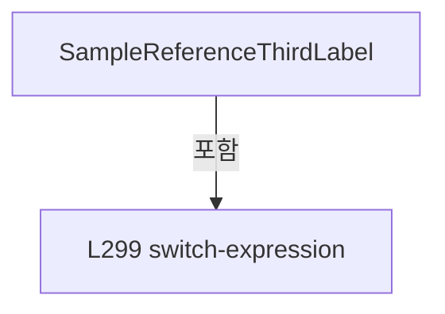

변경 전 점검: 입력/반환 타입, 위 호출자, 예외/취소 경로, 공유 상태와 저장·전송 소비자를 함께 확인합니다. 값의 단위나 물리 방향을 이름만으로 확정하지 않습니다.

### PropertyDeclaration `SampleCorrectionTarget` · L304–304

[Drilling.UI/Menu/Menus/CMenuReview.cs:304–304](https://github.com/kjuws10-rgb/A3Drilling/blob/0219666f9053b907d96d7e0aa7d0c6c1be3a73d4/Drilling.UI/Menu/Menus/CMenuReview.cs#L304-L304)

| 항목 | 실제 추출 값 |
| --- | --- |
| 서명 | string Drilling.UI.Menu.Menus.CMenuReview.SampleCorrectionTarget |
| 접근/수식자 | Public / public |
| 반환/값 타입 | string |
| 소속 타입 | NamedType:Drilling.UI.Menu.Menus.CMenuReview |

현재 부분 분석에서 직접 연결된 호출자는 없습니다. XAML/이벤트/인터페이스·델리게이트·외부 진입을 추가 확인해야 하며, 미사용으로 판정한 것이 아닙니다.

호출하는 대상과 해석 범위:

| 원본 행 | 표현식 | 분석 상태 | 대상/소스 위치 |
| --- | --- | --- | --- |
| 304 | string.IsNullOrWhiteSpace | resolved | bool string.IsNullOrWhiteSpace(string?) |

본문의 실제 연산·분기·예외·반환 순서(원문 위치 순):

| 원본 행 | 종류 | 주석 해설 |
| --- | --- | --- |
| 304 | call | 함수·델리게이트 또는 객체 생성자를 호출합니다: string.IsNullOrWhiteSpace(_simpleSampleShotKey) |
| 304 | conditional-expression | 조건에 따라 결과식을 선택합니다: string.IsNullOrWhiteSpace(_simpleSampleShotKey) ? "Select one processed Shot from Cell Preview" : $"H{_sampleRuleHeadNo:00} / {(_sampleRuleScope == "HEAD_CELL" ? $"HEAD + Cell{_sampleRuleCellNo}" : "HEAD")}" |
| 304 | conditional-expression | 조건에 따라 결과식을 선택합니다: _sampleRuleScope == "HEAD_CELL" ? $"HEAD + Cell{_sampleRuleCellNo}" : "HEAD" |

변경 전 점검: 입력/반환 타입, 위 호출자, 예외/취소 경로, 공유 상태와 저장·전송 소비자를 함께 확인합니다. 값의 단위나 물리 방향을 이름만으로 확정하지 않습니다.

### PropertyDeclaration `SampleReferenceHead` · L305–305

[Drilling.UI/Menu/Menus/CMenuReview.cs:305–305](https://github.com/kjuws10-rgb/A3Drilling/blob/0219666f9053b907d96d7e0aa7d0c6c1be3a73d4/Drilling.UI/Menu/Menus/CMenuReview.cs#L305-L305)

| 항목 | 실제 추출 값 |
| --- | --- |
| 서명 | string Drilling.UI.Menu.Menus.CMenuReview.SampleReferenceHead |
| 접근/수식자 | Public / public |
| 반환/값 타입 | string |
| 소속 타입 | NamedType:Drilling.UI.Menu.Menus.CMenuReview |

현재 부분 분석에서 직접 연결된 호출자는 없습니다. XAML/이벤트/인터페이스·델리게이트·외부 진입을 추가 확인해야 하며, 미사용으로 판정한 것이 아닙니다.

호출하는 대상과 해석 범위:

| 원본 행 | 표현식 | 분석 상태 | 대상/소스 위치 |
| --- | --- | --- | --- |
| 305 | GetSimpleReferencePoint | resolved | Drilling.Common.Review.ST_REVIEW_PLAN_POINT? Drilling.UI.Menu.Menus.CMenuReview.GetSimpleReferencePoint() · Drilling.UI/Menu/Menus/CMenuReview.cs:1926 |

본문의 실제 연산·분기·예외·반환 순서(원문 위치 순):

| 원본 행 | 종류 | 주석 해설 |
| --- | --- | --- |
| 305 | call | 함수·델리게이트 또는 객체 생성자를 호출합니다: GetSimpleReferencePoint() |
| 305 | conditional-expression | 조건에 따라 결과식을 선택합니다: IsSimpleSampleRuleUi ? (GetSimpleReferencePoint()is { } point ? $"H{point.HeadNo:00}" : "-") : "ALL" |
| 305 | conditional-expression | 조건에 따라 결과식을 선택합니다: GetSimpleReferencePoint()is { } point ? $"H{point.HeadNo:00}" : "-" |

변경 전 점검: 입력/반환 타입, 위 호출자, 예외/취소 경로, 공유 상태와 저장·전송 소비자를 함께 확인합니다. 값의 단위나 물리 방향을 이름만으로 확정하지 않습니다.

### PropertyDeclaration `SampleReferenceCell` · L306–306

[Drilling.UI/Menu/Menus/CMenuReview.cs:306–306](https://github.com/kjuws10-rgb/A3Drilling/blob/0219666f9053b907d96d7e0aa7d0c6c1be3a73d4/Drilling.UI/Menu/Menus/CMenuReview.cs#L306-L306)

| 항목 | 실제 추출 값 |
| --- | --- |
| 서명 | string Drilling.UI.Menu.Menus.CMenuReview.SampleReferenceCell |
| 접근/수식자 | Public / public |
| 반환/값 타입 | string |
| 소속 타입 | NamedType:Drilling.UI.Menu.Menus.CMenuReview |

현재 부분 분석에서 직접 연결된 호출자는 없습니다. XAML/이벤트/인터페이스·델리게이트·외부 진입을 추가 확인해야 하며, 미사용으로 판정한 것이 아닙니다.

호출하는 대상과 해석 범위:

| 원본 행 | 표현식 | 분석 상태 | 대상/소스 위치 |
| --- | --- | --- | --- |
| 306 | GetSimpleReferencePoint | resolved | Drilling.Common.Review.ST_REVIEW_PLAN_POINT? Drilling.UI.Menu.Menus.CMenuReview.GetSimpleReferencePoint() · Drilling.UI/Menu/Menus/CMenuReview.cs:1926 |

본문의 실제 연산·분기·예외·반환 순서(원문 위치 순):

| 원본 행 | 종류 | 주석 해설 |
| --- | --- | --- |
| 306 | call | 함수·델리게이트 또는 객체 생성자를 호출합니다: GetSimpleReferencePoint() |
| 306 | conditional-expression | 조건에 따라 결과식을 선택합니다: IsSimpleSampleRuleUi ? (GetSimpleReferencePoint()is { } point ? $"Cell{point.CellNo}" : "-") : IsRoughSampleRuleUi ? "HEAD RANGE" : "ALL" |
| 306 | conditional-expression | 조건에 따라 결과식을 선택합니다: GetSimpleReferencePoint()is { } point ? $"Cell{point.CellNo}" : "-" |
| 306 | conditional-expression | 조건에 따라 결과식을 선택합니다: IsRoughSampleRuleUi ? "HEAD RANGE" : "ALL" |

변경 전 점검: 입력/반환 타입, 위 호출자, 예외/취소 경로, 공유 상태와 저장·전송 소비자를 함께 확인합니다. 값의 단위나 물리 방향을 이름만으로 확정하지 않습니다.

### PropertyDeclaration `SampleReferenceShot` · L307–312

[Drilling.UI/Menu/Menus/CMenuReview.cs:307–312](https://github.com/kjuws10-rgb/A3Drilling/blob/0219666f9053b907d96d7e0aa7d0c6c1be3a73d4/Drilling.UI/Menu/Menus/CMenuReview.cs#L307-L312)

| 항목 | 실제 추출 값 |
| --- | --- |
| 서명 | string Drilling.UI.Menu.Menus.CMenuReview.SampleReferenceShot |
| 접근/수식자 | Public / public |
| 반환/값 타입 | string |
| 소속 타입 | NamedType:Drilling.UI.Menu.Menus.CMenuReview |

현재 부분 분석에서 직접 연결된 호출자는 없습니다. XAML/이벤트/인터페이스·델리게이트·외부 진입을 추가 확인해야 하며, 미사용으로 판정한 것이 아닙니다.

호출하는 대상과 해석 범위:

| 원본 행 | 표현식 | 분석 상태 | 대상/소스 위치 |
| --- | --- | --- | --- |
| 307 | GetSimpleReferencePoint | resolved | Drilling.Common.Review.ST_REVIEW_PLAN_POINT? Drilling.UI.Menu.Menus.CMenuReview.GetSimpleReferencePoint() · Drilling.UI/Menu/Menus/CMenuReview.cs:1926 |
| 307 | ToMatrixShotName | resolved | string Drilling.UI.Menu.Menus.CMenuReview.ToMatrixShotName(Drilling.Common.Review.ST_REVIEW_PLAN_POINT) · Drilling.UI/Menu/Menus/CMenuReview.cs:2470 |

본문의 실제 연산·분기·예외·반환 순서(원문 위치 순):

| 원본 행 | 종류 | 주석 해설 |
| --- | --- | --- |
| 307 | call | 함수·델리게이트 또는 객체 생성자를 호출합니다: GetSimpleReferencePoint() |
| 307 | call | 함수·델리게이트 또는 객체 생성자를 호출합니다: ToMatrixShotName(point) |
| 307 | conditional-expression | 조건에 따라 결과식을 선택합니다: GetSimpleReferencePoint()is { } point ? ToMatrixShotName(point) : "-" |
| 307 | conditional-expression | 조건에 따라 결과식을 선택합니다: IsSimpleSampleRuleUi ? (GetSimpleReferencePoint()is { } point ? ToMatrixShotName(point) : "-") : _selectedSampleRuleUi switch { "ROUGH" => _roughReference, "FINE" => _fineLineCount == 1 ? "1 LINE" : $"{_fineLineCount} LINES", _ => |
| 307 | switch-expression | 값별 결과식을 선택합니다: _selectedSampleRuleUi switch { "ROUGH" => _roughReference, "FINE" => _fineLineCount == 1 ? "1 LINE" : $"{_fineLineCount} LINES", _ => "-" } |
| 310 | conditional-expression | 조건에 따라 결과식을 선택합니다: _fineLineCount == 1 ? "1 LINE" : $"{_fineLineCount} LINES" |

제어 구문의 포함 구조(실제 실행 순서/CFG가 아닌 구문 탐색 그림):

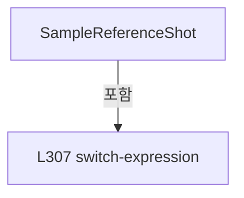

변경 전 점검: 입력/반환 타입, 위 호출자, 예외/취소 경로, 공유 상태와 저장·전송 소비자를 함께 확인합니다. 값의 단위나 물리 방향을 이름만으로 확정하지 않습니다.

### PropertyDeclaration `SampleOffsetApplyCount` · L313–313

[Drilling.UI/Menu/Menus/CMenuReview.cs:313–313](https://github.com/kjuws10-rgb/A3Drilling/blob/0219666f9053b907d96d7e0aa7d0c6c1be3a73d4/Drilling.UI/Menu/Menus/CMenuReview.cs#L313-L313)

| 항목 | 실제 추출 값 |
| --- | --- |
| 서명 | string Drilling.UI.Menu.Menus.CMenuReview.SampleOffsetApplyCount |
| 접근/수식자 | Public / public |
| 반환/값 타입 | string |
| 소속 타입 | NamedType:Drilling.UI.Menu.Menus.CMenuReview |

현재 부분 분석에서 직접 연결된 호출자는 없습니다. XAML/이벤트/인터페이스·델리게이트·외부 진입을 추가 확인해야 하며, 미사용으로 판정한 것이 아닙니다.

호출하는 대상과 해석 범위:

| 원본 행 | 표현식 | 분석 상태 | 대상/소스 위치 |
| --- | --- | --- | --- |
| 313 | GetSimpleOffsetApplyCount().ToString | resolved | string int.ToString(string?, System.IFormatProvider?) |
| 313 | GetSimpleOffsetApplyCount | resolved | int Drilling.UI.Menu.Menus.CMenuReview.GetSimpleOffsetApplyCount() · Drilling.UI/Menu/Menus/CMenuReview.cs:1960 |
| 313 | GetAutomaticOffsetApplyCount().ToString | resolved | string int.ToString(string?, System.IFormatProvider?) |
| 313 | GetAutomaticOffsetApplyCount | resolved | int Drilling.UI.Menu.Menus.CMenuReview.GetAutomaticOffsetApplyCount() · Drilling.UI/Menu/Menus/CMenuReview.cs:1977 |

본문의 실제 연산·분기·예외·반환 순서(원문 위치 순):

| 원본 행 | 종류 | 주석 해설 |
| --- | --- | --- |
| 313 | call | 함수·델리게이트 또는 객체 생성자를 호출합니다: GetSimpleOffsetApplyCount().ToString("N0", CultureInfo.InvariantCulture) |
| 313 | call | 함수·델리게이트 또는 객체 생성자를 호출합니다: GetSimpleOffsetApplyCount() |
| 313 | call | 함수·델리게이트 또는 객체 생성자를 호출합니다: GetAutomaticOffsetApplyCount().ToString("N0", CultureInfo.InvariantCulture) |
| 313 | call | 함수·델리게이트 또는 객체 생성자를 호출합니다: GetAutomaticOffsetApplyCount() |
| 313 | conditional-expression | 조건에 따라 결과식을 선택합니다: IsSimpleSampleRuleUi ? GetSimpleOffsetApplyCount().ToString("N0", CultureInfo.InvariantCulture) : GetAutomaticOffsetApplyCount().ToString("N0", CultureInfo.InvariantCulture) |

변경 전 점검: 입력/반환 타입, 위 호출자, 예외/취소 경로, 공유 상태와 저장·전송 소비자를 함께 확인합니다. 값의 단위나 물리 방향을 이름만으로 확정하지 않습니다.

### PropertyDeclaration `SampleInspectionShotCount` · L314–314

[Drilling.UI/Menu/Menus/CMenuReview.cs:314–314](https://github.com/kjuws10-rgb/A3Drilling/blob/0219666f9053b907d96d7e0aa7d0c6c1be3a73d4/Drilling.UI/Menu/Menus/CMenuReview.cs#L314-L314)

| 항목 | 실제 추출 값 |
| --- | --- |
| 서명 | string Drilling.UI.Menu.Menus.CMenuReview.SampleInspectionShotCount |
| 접근/수식자 | Public / public |
| 반환/값 타입 | string |
| 소속 타입 | NamedType:Drilling.UI.Menu.Menus.CMenuReview |

현재 부분 분석에서 직접 연결된 호출자는 없습니다. XAML/이벤트/인터페이스·델리게이트·외부 진입을 추가 확인해야 하며, 미사용으로 판정한 것이 아닙니다.

호출하는 대상과 해석 범위:

| 원본 행 | 표현식 | 분석 상태 | 대상/소스 위치 |
| --- | --- | --- | --- |
| 314 | GetSimpleReferencePoint | resolved | Drilling.Common.Review.ST_REVIEW_PLAN_POINT? Drilling.UI.Menu.Menus.CMenuReview.GetSimpleReferencePoint() · Drilling.UI/Menu/Menus/CMenuReview.cs:1926 |
| 314 | GetAutomaticInspectionShotCount().ToString | resolved | string int.ToString(string?, System.IFormatProvider?) |
| 314 | GetAutomaticInspectionShotCount | resolved | int Drilling.UI.Menu.Menus.CMenuReview.GetAutomaticInspectionShotCount() · Drilling.UI/Menu/Menus/CMenuReview.cs:1972 |

본문의 실제 연산·분기·예외·반환 순서(원문 위치 순):

| 원본 행 | 종류 | 주석 해설 |
| --- | --- | --- |
| 314 | call | 함수·델리게이트 또는 객체 생성자를 호출합니다: GetSimpleReferencePoint() |
| 314 | call | 함수·델리게이트 또는 객체 생성자를 호출합니다: GetAutomaticInspectionShotCount().ToString("N0", CultureInfo.InvariantCulture) |
| 314 | call | 함수·델리게이트 또는 객체 생성자를 호출합니다: GetAutomaticInspectionShotCount() |
| 314 | conditional-expression | 조건에 따라 결과식을 선택합니다: IsSimpleSampleRuleUi ? (GetSimpleReferencePoint()is null ? "0" : "1") : GetAutomaticInspectionShotCount().ToString("N0", CultureInfo.InvariantCulture) |
| 314 | conditional-expression | 조건에 따라 결과식을 선택합니다: GetSimpleReferencePoint()is null ? "0" : "1" |

변경 전 점검: 입력/반환 타입, 위 호출자, 예외/취소 경로, 공유 상태와 저장·전송 소비자를 함께 확인합니다. 값의 단위나 물리 방향을 이름만으로 확정하지 않습니다.

### PropertyDeclaration `SamplePlanStatus` · L315–315

[Drilling.UI/Menu/Menus/CMenuReview.cs:315–315](https://github.com/kjuws10-rgb/A3Drilling/blob/0219666f9053b907d96d7e0aa7d0c6c1be3a73d4/Drilling.UI/Menu/Menus/CMenuReview.cs#L315-L315)

| 항목 | 실제 추출 값 |
| --- | --- |
| 서명 | string Drilling.UI.Menu.Menus.CMenuReview.SamplePlanStatus |
| 접근/수식자 | Public / public |
| 반환/값 타입 | string |
| 소속 타입 | NamedType:Drilling.UI.Menu.Menus.CMenuReview |

현재 부분 분석에서 직접 연결된 호출자는 없습니다. XAML/이벤트/인터페이스·델리게이트·외부 진입을 추가 확인해야 하며, 미사용으로 판정한 것이 아닙니다.

호출하는 대상과 해석 범위:

| 원본 행 | 표현식 | 분석 상태 | 대상/소스 위치 |
| --- | --- | --- | --- |
| 315 | GetSimpleReferencePoint | resolved | Drilling.Common.Review.ST_REVIEW_PLAN_POINT? Drilling.UI.Menu.Menus.CMenuReview.GetSimpleReferencePoint() · Drilling.UI/Menu/Menus/CMenuReview.cs:1926 |

본문의 실제 연산·분기·예외·반환 순서(원문 위치 순):

| 원본 행 | 종류 | 주석 해설 |
| --- | --- | --- |
| 315 | call | 함수·델리게이트 또는 객체 생성자를 호출합니다: GetSimpleReferencePoint() |
| 315 | conditional-expression | 조건에 따라 결과식을 선택합니다: IsSimpleSampleRuleUi && GetSimpleReferencePoint()is null ? "Reference Shot Required" : "Ready" |

변경 전 점검: 입력/반환 타입, 위 호출자, 예외/취소 경로, 공유 상태와 저장·전송 소비자를 함께 확인합니다. 값의 단위나 물리 방향을 이름만으로 확정하지 않습니다.

### PropertyDeclaration `IsSampleGlassPreviewVisible` · L316–316

[Drilling.UI/Menu/Menus/CMenuReview.cs:316–316](https://github.com/kjuws10-rgb/A3Drilling/blob/0219666f9053b907d96d7e0aa7d0c6c1be3a73d4/Drilling.UI/Menu/Menus/CMenuReview.cs#L316-L316)

| 항목 | 실제 추출 값 |
| --- | --- |
| 서명 | bool Drilling.UI.Menu.Menus.CMenuReview.IsSampleGlassPreviewVisible |
| 접근/수식자 | Public / public |
| 반환/값 타입 | bool |
| 소속 타입 | NamedType:Drilling.UI.Menu.Menus.CMenuReview |

현재 부분 분석에서 직접 연결된 호출자는 없습니다. XAML/이벤트/인터페이스·델리게이트·외부 진입을 추가 확인해야 하며, 미사용으로 판정한 것이 아닙니다.

변경 전 점검: 입력/반환 타입, 위 호출자, 예외/취소 경로, 공유 상태와 저장·전송 소비자를 함께 확인합니다. 값의 단위나 물리 방향을 이름만으로 확정하지 않습니다.

### PropertyDeclaration `IsSampleCellDetailVisible` · L317–317

[Drilling.UI/Menu/Menus/CMenuReview.cs:317–317](https://github.com/kjuws10-rgb/A3Drilling/blob/0219666f9053b907d96d7e0aa7d0c6c1be3a73d4/Drilling.UI/Menu/Menus/CMenuReview.cs#L317-L317)

| 항목 | 실제 추출 값 |
| --- | --- |
| 서명 | bool Drilling.UI.Menu.Menus.CMenuReview.IsSampleCellDetailVisible |
| 접근/수식자 | Public / public |
| 반환/값 타입 | bool |
| 소속 타입 | NamedType:Drilling.UI.Menu.Menus.CMenuReview |

현재 부분 분석에서 직접 연결된 호출자는 없습니다. XAML/이벤트/인터페이스·델리게이트·외부 진입을 추가 확인해야 하며, 미사용으로 판정한 것이 아닙니다.

변경 전 점검: 입력/반환 타입, 위 호출자, 예외/취소 경로, 공유 상태와 저장·전송 소비자를 함께 확인합니다. 값의 단위나 물리 방향을 이름만으로 확정하지 않습니다.

### PropertyDeclaration `SampleWorkspaceTitle` · L318–318

[Drilling.UI/Menu/Menus/CMenuReview.cs:318–318](https://github.com/kjuws10-rgb/A3Drilling/blob/0219666f9053b907d96d7e0aa7d0c6c1be3a73d4/Drilling.UI/Menu/Menus/CMenuReview.cs#L318-L318)

| 항목 | 실제 추출 값 |
| --- | --- |
| 서명 | string Drilling.UI.Menu.Menus.CMenuReview.SampleWorkspaceTitle |
| 접근/수식자 | Public / public |
| 반환/값 타입 | string |
| 소속 타입 | NamedType:Drilling.UI.Menu.Menus.CMenuReview |

현재 부분 분석에서 직접 연결된 호출자는 없습니다. XAML/이벤트/인터페이스·델리게이트·외부 진입을 추가 확인해야 하며, 미사용으로 판정한 것이 아닙니다.

본문의 실제 연산·분기·예외·반환 순서(원문 위치 순):

| 원본 행 | 종류 | 주석 해설 |
| --- | --- | --- |
| 318 | conditional-expression | 조건에 따라 결과식을 선택합니다: !_isSampleCellDetailVisible ? "Glass / Cell Preview" : IsSimpleSampleRuleUi ? $"Cell{_selectedSampleCellNo} / SIMPLE Reference Shot Selection" : $"Cell{_selectedSampleCellNo} / {_selectedSampleRuleUi} Inspection Shot Preview" |
| 318 | conditional-expression | 조건에 따라 결과식을 선택합니다: IsSimpleSampleRuleUi ? $"Cell{_selectedSampleCellNo} / SIMPLE Reference Shot Selection" : $"Cell{_selectedSampleCellNo} / {_selectedSampleRuleUi} Inspection Shot Preview" |

변경 전 점검: 입력/반환 타입, 위 호출자, 예외/취소 경로, 공유 상태와 저장·전송 소비자를 함께 확인합니다. 값의 단위나 물리 방향을 이름만으로 확정하지 않습니다.

### PropertyDeclaration `SampleWorkspaceSummary` · L319–319

[Drilling.UI/Menu/Menus/CMenuReview.cs:319–319](https://github.com/kjuws10-rgb/A3Drilling/blob/0219666f9053b907d96d7e0aa7d0c6c1be3a73d4/Drilling.UI/Menu/Menus/CMenuReview.cs#L319-L319)

| 항목 | 실제 추출 값 |
| --- | --- |
| 서명 | string Drilling.UI.Menu.Menus.CMenuReview.SampleWorkspaceSummary |
| 접근/수식자 | Public / public |
| 반환/값 타입 | string |
| 소속 타입 | NamedType:Drilling.UI.Menu.Menus.CMenuReview |

현재 부분 분석에서 직접 연결된 호출자는 없습니다. XAML/이벤트/인터페이스·델리게이트·외부 진입을 추가 확인해야 하며, 미사용으로 판정한 것이 아닙니다.

호출하는 대상과 해석 범위:

| 원본 행 | 표현식 | 분석 상태 | 대상/소스 위치 |
| --- | --- | --- | --- |
| 319 | GetSimpleReferencePoint | resolved | Drilling.Common.Review.ST_REVIEW_PLAN_POINT? Drilling.UI.Menu.Menus.CMenuReview.GetSimpleReferencePoint() · Drilling.UI/Menu/Menus/CMenuReview.cs:1926 |
| 319 | GetSelectedSampleCellShotCount | resolved | int Drilling.UI.Menu.Menus.CMenuReview.GetSelectedSampleCellShotCount() · Drilling.UI/Menu/Menus/CMenuReview.cs:2035 |
| 319 | GetSampleCellShotCount | resolved | int Drilling.UI.Menu.Menus.CMenuReview.GetSampleCellShotCount() · Drilling.UI/Menu/Menus/CMenuReview.cs:2034 |

본문의 실제 연산·분기·예외·반환 순서(원문 위치 순):

| 원본 행 | 종류 | 주석 해설 |
| --- | --- | --- |
| 319 | call | 함수·델리게이트 또는 객체 생성자를 호출합니다: GetSimpleReferencePoint() |
| 319 | call | 함수·델리게이트 또는 객체 생성자를 호출합니다: GetSelectedSampleCellShotCount() |
| 319 | call | 함수·델리게이트 또는 객체 생성자를 호출합니다: GetSampleCellShotCount() |
| 319 | conditional-expression | 조건에 따라 결과식을 선택합니다: !_isSampleCellDetailVisible ? SampleGlassPreviewSummary : IsSimpleSampleRuleUi ? (GetSimpleReferencePoint()is null ? "Select one processed Shot" : "1 Reference Shot Selected") : $"{GetSelectedSampleCellShotCount():N0} / {GetSample |
| 319 | conditional-expression | 조건에 따라 결과식을 선택합니다: IsSimpleSampleRuleUi ? (GetSimpleReferencePoint()is null ? "Select one processed Shot" : "1 Reference Shot Selected") : $"{GetSelectedSampleCellShotCount():N0} / {GetSampleCellShotCount():N0} Inspection Shots (Read Only)" |
| 319 | conditional-expression | 조건에 따라 결과식을 선택합니다: GetSimpleReferencePoint()is null ? "Select one processed Shot" : "1 Reference Shot Selected" |

변경 전 점검: 입력/반환 타입, 위 호출자, 예외/취소 경로, 공유 상태와 저장·전송 소비자를 함께 확인합니다. 값의 단위나 물리 방향을 이름만으로 확정하지 않습니다.

### PropertyDeclaration `SampleRuleName` · L320–320

[Drilling.UI/Menu/Menus/CMenuReview.cs:320–320](https://github.com/kjuws10-rgb/A3Drilling/blob/0219666f9053b907d96d7e0aa7d0c6c1be3a73d4/Drilling.UI/Menu/Menus/CMenuReview.cs#L320-L320)

| 항목 | 실제 추출 값 |
| --- | --- |
| 서명 | string Drilling.UI.Menu.Menus.CMenuReview.SampleRuleName |
| 접근/수식자 | Public / public |
| 반환/값 타입 | string |
| 소속 타입 | NamedType:Drilling.UI.Menu.Menus.CMenuReview |

현재 부분 분석에서 직접 연결된 호출자는 없습니다. XAML/이벤트/인터페이스·델리게이트·외부 진입을 추가 확인해야 하며, 미사용으로 판정한 것이 아닙니다.

호출하는 대상과 해석 범위:

| 원본 행 | 표현식 | 분석 상태 | 대상/소스 위치 |
| --- | --- | --- | --- |
| 320 | GetSelectionRuleText | resolved | string Drilling.UI.Menu.Menus.CMenuReview.GetSelectionRuleText() · Drilling.UI/Menu/Menus/CMenuReview.cs:2158 |

본문의 실제 연산·분기·예외·반환 순서(원문 위치 순):

| 원본 행 | 종류 | 주석 해설 |
| --- | --- | --- |
| 320 | call | 함수·델리게이트 또는 객체 생성자를 호출합니다: GetSelectionRuleText() |

변경 전 점검: 입력/반환 타입, 위 호출자, 예외/취소 경로, 공유 상태와 저장·전송 소비자를 함께 확인합니다. 값의 단위나 물리 방향을 이름만으로 확정하지 않습니다.

### PropertyDeclaration `SampleHeadOptions` · L321–321

[Drilling.UI/Menu/Menus/CMenuReview.cs:321–321](https://github.com/kjuws10-rgb/A3Drilling/blob/0219666f9053b907d96d7e0aa7d0c6c1be3a73d4/Drilling.UI/Menu/Menus/CMenuReview.cs#L321-L321)

| 항목 | 실제 추출 값 |
| --- | --- |
| 서명 | System.Collections.Generic.IReadOnlyList<string> Drilling.UI.Menu.Menus.CMenuReview.SampleHeadOptions |
| 접근/수식자 | Public / public |
| 반환/값 타입 | System.Collections.Generic.IReadOnlyList<string> |
| 소속 타입 | NamedType:Drilling.UI.Menu.Menus.CMenuReview |

현재 부분 분석에서 직접 연결된 호출자는 없습니다. XAML/이벤트/인터페이스·델리게이트·외부 진입을 추가 확인해야 하며, 미사용으로 판정한 것이 아닙니다.

호출하는 대상과 해석 범위:

| 원본 행 | 표현식 | 분석 상태 | 대상/소스 위치 |
| --- | --- | --- | --- |
| 321 | Enumerable.Range(1, Math.Max(1, _headCount)).Select(headNo => $"H{headNo:00}").ToArray | resolved | string[] System.Collections.Generic.IEnumerable<string>.ToArray<string>() |
| 321 | Enumerable.Range(1, Math.Max(1, _headCount)).Select | resolved | System.Collections.Generic.IEnumerable<string> System.Collections.Generic.IEnumerable<int>.Select<int, string>(System.Func<int, string>) |
| 321 | Enumerable.Range | resolved | System.Collections.Generic.IEnumerable<int> System.Linq.Enumerable.Range(int, int) |
| 321 | Math.Max | resolved | int System.Math.Max(int, int) |

본문의 실제 연산·분기·예외·반환 순서(원문 위치 순):

| 원본 행 | 종류 | 주석 해설 |
| --- | --- | --- |
| 321 | call | 함수·델리게이트 또는 객체 생성자를 호출합니다: Enumerable.Range(1, Math.Max(1, _headCount)).Select(headNo => $"H{headNo:00}").ToArray() |
| 321 | call | 함수·델리게이트 또는 객체 생성자를 호출합니다: Enumerable.Range(1, Math.Max(1, _headCount)).Select(headNo => $"H{headNo:00}") |
| 321 | call | 함수·델리게이트 또는 객체 생성자를 호출합니다: Enumerable.Range(1, Math.Max(1, _headCount)) |
| 321 | call | 함수·델리게이트 또는 객체 생성자를 호출합니다: Math.Max(1, _headCount) |

변경 전 점검: 입력/반환 타입, 위 호출자, 예외/취소 경로, 공유 상태와 저장·전송 소비자를 함께 확인합니다. 값의 단위나 물리 방향을 이름만으로 확정하지 않습니다.

### PropertyDeclaration `SelectedSampleHead` · L323–339

[Drilling.UI/Menu/Menus/CMenuReview.cs:323–339](https://github.com/kjuws10-rgb/A3Drilling/blob/0219666f9053b907d96d7e0aa7d0c6c1be3a73d4/Drilling.UI/Menu/Menus/CMenuReview.cs#L323-L339)

| 항목 | 실제 추출 값 |
| --- | --- |
| 서명 | string Drilling.UI.Menu.Menus.CMenuReview.SelectedSampleHead |
| 접근/수식자 | Public / public |
| 반환/값 타입 | string |
| 소속 타입 | NamedType:Drilling.UI.Menu.Menus.CMenuReview |

현재 부분 분석에서 직접 연결된 호출자는 없습니다. XAML/이벤트/인터페이스·델리게이트·외부 진입을 추가 확인해야 하며, 미사용으로 판정한 것이 아닙니다.

변경 전 점검: 입력/반환 타입, 위 호출자, 예외/취소 경로, 공유 상태와 저장·전송 소비자를 함께 확인합니다. 값의 단위나 물리 방향을 이름만으로 확정하지 않습니다.

### GetAccessorDeclaration `get_SelectedSampleHead` · L325–325

[Drilling.UI/Menu/Menus/CMenuReview.cs:325–325](https://github.com/kjuws10-rgb/A3Drilling/blob/0219666f9053b907d96d7e0aa7d0c6c1be3a73d4/Drilling.UI/Menu/Menus/CMenuReview.cs#L325-L325)

| 항목 | 실제 추출 값 |
| --- | --- |
| 서명 | string Drilling.UI.Menu.Menus.CMenuReview.SelectedSampleHead.get |
| 접근/수식자 | Public / get |
| 반환/값 타입 | string |
| 소속 타입 | NamedType:Drilling.UI.Menu.Menus.CMenuReview |

현재 부분 분석에서 직접 연결된 호출자는 없습니다. XAML/이벤트/인터페이스·델리게이트·외부 진입을 추가 확인해야 하며, 미사용으로 판정한 것이 아닙니다.

변경 전 점검: 입력/반환 타입, 위 호출자, 예외/취소 경로, 공유 상태와 저장·전송 소비자를 함께 확인합니다. 값의 단위나 물리 방향을 이름만으로 확정하지 않습니다.

### SetAccessorDeclaration `set_SelectedSampleHead` · L326–338

[Drilling.UI/Menu/Menus/CMenuReview.cs:326–338](https://github.com/kjuws10-rgb/A3Drilling/blob/0219666f9053b907d96d7e0aa7d0c6c1be3a73d4/Drilling.UI/Menu/Menus/CMenuReview.cs#L326-L338)

| 항목 | 실제 추출 값 |
| --- | --- |
| 서명 | void Drilling.UI.Menu.Menus.CMenuReview.SelectedSampleHead.set |
| 접근/수식자 | Public / set |
| 반환/값 타입 | void |
| 소속 타입 | NamedType:Drilling.UI.Menu.Menus.CMenuReview |

입력 계약:

| 이름 | 타입 | 전달 | 선택/기본값 |
| --- | --- | --- | --- |
| value | string | None | False /  |

현재 부분 분석에서 직접 연결된 호출자는 없습니다. XAML/이벤트/인터페이스·델리게이트·외부 진입을 추가 확인해야 하며, 미사용으로 판정한 것이 아닙니다.

호출하는 대상과 해석 범위:

| 원본 행 | 표현식 | 분석 상태 | 대상/소스 위치 |
| --- | --- | --- | --- |
| 328 | .Trim | resolved | string string.Trim() |
| 329 | normalized.StartsWith | resolved | bool string.StartsWith(char) |
| 334 | int.TryParse | resolved | bool int.TryParse(string?, System.Globalization.NumberStyles, System.IFormatProvider?, out int) |
| 336 | Math.Clamp | resolved | int System.Math.Clamp(int, int, int) |
| 336 | Math.Max | resolved | int System.Math.Max(int, int) |

본문의 실제 연산·분기·예외·반환 순서(원문 위치 순):

| 원본 행 | 종류 | 주석 해설 |
| --- | --- | --- |
| 328 | call | 함수·델리게이트 또는 객체 생성자를 호출합니다: .Trim() |
| 328 | local-declaration | 지역 변수를 선언합니다: var normalized = value?.Trim() ?? ""; |
| 328 | variable-initializer | 변수의 초기값을 지정합니다: normalized = value?.Trim() ?? "" |
| 329 | call | 함수·델리게이트 또는 객체 생성자를 호출합니다: normalized.StartsWith('H') |
| 329 | if | 조건에 따라 분기합니다: if (normalized.StartsWith('H')) |
| 331 | assignment | 값을 대상에 대입합니다: normalized = normalized[1..] |
| 334 | call | 함수·델리게이트 또는 객체 생성자를 호출합니다: int.TryParse(normalized, NumberStyles.Integer, CultureInfo.InvariantCulture, out var headNo) |
| 334 | if | 조건에 따라 분기합니다: if (int.TryParse(normalized, NumberStyles.Integer, CultureInfo.InvariantCulture, out var headNo)) |
| 336 | assignment | 값을 대상에 대입합니다: _sampleRuleHeadNo = Math.Clamp(headNo, 1, Math.Max(1, _headCount)) |
| 336 | call | 함수·델리게이트 또는 객체 생성자를 호출합니다: Math.Clamp(headNo, 1, Math.Max(1, _headCount)) |
| 336 | call | 함수·델리게이트 또는 객체 생성자를 호출합니다: Math.Max(1, _headCount) |

제어 구문의 포함 구조(실제 실행 순서/CFG가 아닌 구문 탐색 그림):

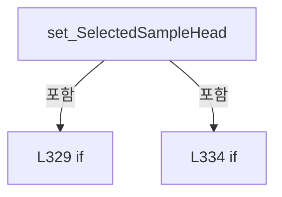

변경 전 점검: 입력/반환 타입, 위 호출자, 예외/취소 경로, 공유 상태와 저장·전송 소비자를 함께 확인합니다. 값의 단위나 물리 방향을 이름만으로 확정하지 않습니다.

### PropertyDeclaration `SampleCellOptions` · L341–341

[Drilling.UI/Menu/Menus/CMenuReview.cs:341–341](https://github.com/kjuws10-rgb/A3Drilling/blob/0219666f9053b907d96d7e0aa7d0c6c1be3a73d4/Drilling.UI/Menu/Menus/CMenuReview.cs#L341-L341)

| 항목 | 실제 추출 값 |
| --- | --- |
| 서명 | System.Collections.Generic.IReadOnlyList<string> Drilling.UI.Menu.Menus.CMenuReview.SampleCellOptions |
| 접근/수식자 | Public / public |
| 반환/값 타입 | System.Collections.Generic.IReadOnlyList<string> |
| 소속 타입 | NamedType:Drilling.UI.Menu.Menus.CMenuReview |

현재 부분 분석에서 직접 연결된 호출자는 없습니다. XAML/이벤트/인터페이스·델리게이트·외부 진입을 추가 확인해야 하며, 미사용으로 판정한 것이 아닙니다.

호출하는 대상과 해석 범위:

| 원본 행 | 표현식 | 분석 상태 | 대상/소스 위치 |
| --- | --- | --- | --- |
| 341 | Enumerable.Range(1, Math.Max(1, _cellCount)).Select(cellNo => $"Cell{cellNo}").ToArray | resolved | string[] System.Collections.Generic.IEnumerable<string>.ToArray<string>() |
| 341 | Enumerable.Range(1, Math.Max(1, _cellCount)).Select | resolved | System.Collections.Generic.IEnumerable<string> System.Collections.Generic.IEnumerable<int>.Select<int, string>(System.Func<int, string>) |
| 341 | Enumerable.Range | resolved | System.Collections.Generic.IEnumerable<int> System.Linq.Enumerable.Range(int, int) |
| 341 | Math.Max | resolved | int System.Math.Max(int, int) |

본문의 실제 연산·분기·예외·반환 순서(원문 위치 순):

| 원본 행 | 종류 | 주석 해설 |
| --- | --- | --- |
| 341 | call | 함수·델리게이트 또는 객체 생성자를 호출합니다: Enumerable.Range(1, Math.Max(1, _cellCount)).Select(cellNo => $"Cell{cellNo}").ToArray() |
| 341 | call | 함수·델리게이트 또는 객체 생성자를 호출합니다: Enumerable.Range(1, Math.Max(1, _cellCount)).Select(cellNo => $"Cell{cellNo}") |
| 341 | call | 함수·델리게이트 또는 객체 생성자를 호출합니다: Enumerable.Range(1, Math.Max(1, _cellCount)) |
| 341 | call | 함수·델리게이트 또는 객체 생성자를 호출합니다: Math.Max(1, _cellCount) |

변경 전 점검: 입력/반환 타입, 위 호출자, 예외/취소 경로, 공유 상태와 저장·전송 소비자를 함께 확인합니다. 값의 단위나 물리 방향을 이름만으로 확정하지 않습니다.

### PropertyDeclaration `SelectedSampleCell` · L343–359

[Drilling.UI/Menu/Menus/CMenuReview.cs:343–359](https://github.com/kjuws10-rgb/A3Drilling/blob/0219666f9053b907d96d7e0aa7d0c6c1be3a73d4/Drilling.UI/Menu/Menus/CMenuReview.cs#L343-L359)

| 항목 | 실제 추출 값 |
| --- | --- |
| 서명 | string Drilling.UI.Menu.Menus.CMenuReview.SelectedSampleCell |
| 접근/수식자 | Public / public |
| 반환/값 타입 | string |
| 소속 타입 | NamedType:Drilling.UI.Menu.Menus.CMenuReview |

현재 부분 분석에서 직접 연결된 호출자는 없습니다. XAML/이벤트/인터페이스·델리게이트·외부 진입을 추가 확인해야 하며, 미사용으로 판정한 것이 아닙니다.

변경 전 점검: 입력/반환 타입, 위 호출자, 예외/취소 경로, 공유 상태와 저장·전송 소비자를 함께 확인합니다. 값의 단위나 물리 방향을 이름만으로 확정하지 않습니다.

### GetAccessorDeclaration `get_SelectedSampleCell` · L345–345

[Drilling.UI/Menu/Menus/CMenuReview.cs:345–345](https://github.com/kjuws10-rgb/A3Drilling/blob/0219666f9053b907d96d7e0aa7d0c6c1be3a73d4/Drilling.UI/Menu/Menus/CMenuReview.cs#L345-L345)

| 항목 | 실제 추출 값 |
| --- | --- |
| 서명 | string Drilling.UI.Menu.Menus.CMenuReview.SelectedSampleCell.get |
| 접근/수식자 | Public / get |
| 반환/값 타입 | string |
| 소속 타입 | NamedType:Drilling.UI.Menu.Menus.CMenuReview |

현재 부분 분석에서 직접 연결된 호출자는 없습니다. XAML/이벤트/인터페이스·델리게이트·외부 진입을 추가 확인해야 하며, 미사용으로 판정한 것이 아닙니다.

변경 전 점검: 입력/반환 타입, 위 호출자, 예외/취소 경로, 공유 상태와 저장·전송 소비자를 함께 확인합니다. 값의 단위나 물리 방향을 이름만으로 확정하지 않습니다.

### SetAccessorDeclaration `set_SelectedSampleCell` · L346–358

[Drilling.UI/Menu/Menus/CMenuReview.cs:346–358](https://github.com/kjuws10-rgb/A3Drilling/blob/0219666f9053b907d96d7e0aa7d0c6c1be3a73d4/Drilling.UI/Menu/Menus/CMenuReview.cs#L346-L358)

| 항목 | 실제 추출 값 |
| --- | --- |
| 서명 | void Drilling.UI.Menu.Menus.CMenuReview.SelectedSampleCell.set |
| 접근/수식자 | Public / set |
| 반환/값 타입 | void |
| 소속 타입 | NamedType:Drilling.UI.Menu.Menus.CMenuReview |

입력 계약:

| 이름 | 타입 | 전달 | 선택/기본값 |
| --- | --- | --- | --- |
| value | string | None | False /  |

현재 부분 분석에서 직접 연결된 호출자는 없습니다. XAML/이벤트/인터페이스·델리게이트·외부 진입을 추가 확인해야 하며, 미사용으로 판정한 것이 아닙니다.

호출하는 대상과 해석 범위:

| 원본 행 | 표현식 | 분석 상태 | 대상/소스 위치 |
| --- | --- | --- | --- |
| 348 | .Trim | resolved | string string.Trim() |
| 349 | normalized.StartsWith | resolved | bool string.StartsWith(string, System.StringComparison) |
| 354 | int.TryParse | resolved | bool int.TryParse(string?, System.Globalization.NumberStyles, System.IFormatProvider?, out int) |
| 356 | Math.Clamp | resolved | int System.Math.Clamp(int, int, int) |
| 356 | Math.Max | resolved | int System.Math.Max(int, int) |

본문의 실제 연산·분기·예외·반환 순서(원문 위치 순):

| 원본 행 | 종류 | 주석 해설 |
| --- | --- | --- |
| 348 | call | 함수·델리게이트 또는 객체 생성자를 호출합니다: .Trim() |
| 348 | local-declaration | 지역 변수를 선언합니다: var normalized = value?.Trim() ?? ""; |
| 348 | variable-initializer | 변수의 초기값을 지정합니다: normalized = value?.Trim() ?? "" |
| 349 | call | 함수·델리게이트 또는 객체 생성자를 호출합니다: normalized.StartsWith("Cell", StringComparison.OrdinalIgnoreCase) |
| 349 | if | 조건에 따라 분기합니다: if (normalized.StartsWith("Cell", StringComparison.OrdinalIgnoreCase)) |
| 351 | assignment | 값을 대상에 대입합니다: normalized = normalized[4..] |
| 354 | call | 함수·델리게이트 또는 객체 생성자를 호출합니다: int.TryParse(normalized, NumberStyles.Integer, CultureInfo.InvariantCulture, out var cellNo) |
| 354 | if | 조건에 따라 분기합니다: if (int.TryParse(normalized, NumberStyles.Integer, CultureInfo.InvariantCulture, out var cellNo)) |
| 356 | assignment | 값을 대상에 대입합니다: _sampleRuleCellNo = Math.Clamp(cellNo, 1, Math.Max(1, _cellCount)) |
| 356 | call | 함수·델리게이트 또는 객체 생성자를 호출합니다: Math.Clamp(cellNo, 1, Math.Max(1, _cellCount)) |
| 356 | call | 함수·델리게이트 또는 객체 생성자를 호출합니다: Math.Max(1, _cellCount) |

제어 구문의 포함 구조(실제 실행 순서/CFG가 아닌 구문 탐색 그림):

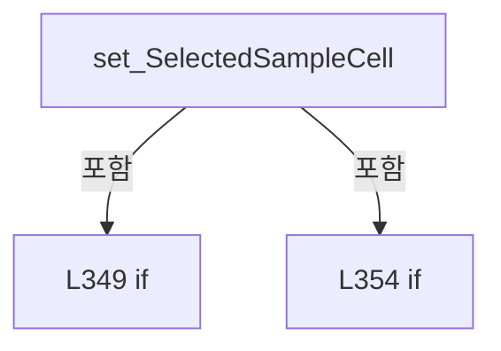

변경 전 점검: 입력/반환 타입, 위 호출자, 예외/취소 경로, 공유 상태와 저장·전송 소비자를 함께 확인합니다. 값의 단위나 물리 방향을 이름만으로 확정하지 않습니다.

### PropertyDeclaration `SampleRuleSelectionSummary` · L361–367

[Drilling.UI/Menu/Menus/CMenuReview.cs:361–367](https://github.com/kjuws10-rgb/A3Drilling/blob/0219666f9053b907d96d7e0aa7d0c6c1be3a73d4/Drilling.UI/Menu/Menus/CMenuReview.cs#L361-L367)

| 항목 | 실제 추출 값 |
| --- | --- |
| 서명 | string Drilling.UI.Menu.Menus.CMenuReview.SampleRuleSelectionSummary |
| 접근/수식자 | Public / public |
| 반환/값 타입 | string |
| 소속 타입 | NamedType:Drilling.UI.Menu.Menus.CMenuReview |

현재 부분 분석에서 직접 연결된 호출자는 없습니다. XAML/이벤트/인터페이스·델리게이트·외부 진입을 추가 확인해야 하며, 미사용으로 판정한 것이 아닙니다.

호출하는 대상과 해석 범위:

| 원본 행 | 표현식 | 분석 상태 | 대상/소스 위치 |
| --- | --- | --- | --- |
| 363 | string.IsNullOrWhiteSpace | resolved | bool string.IsNullOrWhiteSpace(string?) |

본문의 실제 연산·분기·예외·반환 순서(원문 위치 순):

| 원본 행 | 종류 | 주석 해설 |
| --- | --- | --- |
| 361 | switch-expression | 값별 결과식을 선택합니다: _selectedSampleRuleUi switch { "SIMPLE" => string.IsNullOrWhiteSpace(_simpleSampleShotKey) ? "Select 1 Shot" : SampleCorrectionTarget, "ROUGH" => $"Every Head / Full Head Range / {_roughReference}", "FINE" => $"Each Cell / {_fineL |
| 363 | call | 함수·델리게이트 또는 객체 생성자를 호출합니다: string.IsNullOrWhiteSpace(_simpleSampleShotKey) |
| 363 | conditional-expression | 조건에 따라 결과식을 선택합니다: string.IsNullOrWhiteSpace(_simpleSampleShotKey) ? "Select 1 Shot" : SampleCorrectionTarget |

제어 구문의 포함 구조(실제 실행 순서/CFG가 아닌 구문 탐색 그림):

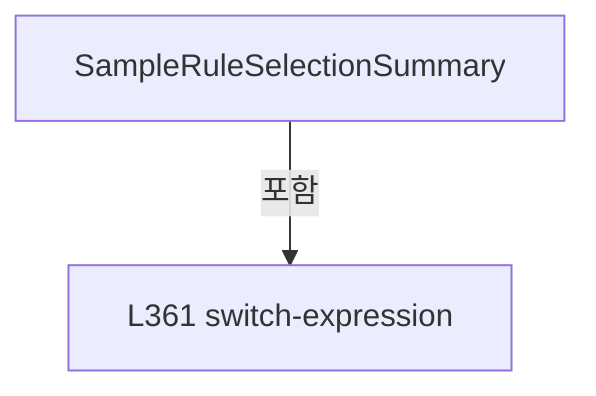

변경 전 점검: 입력/반환 타입, 위 호출자, 예외/취소 경로, 공유 상태와 저장·전송 소비자를 함께 확인합니다. 값의 단위나 물리 방향을 이름만으로 확정하지 않습니다.

### PropertyDeclaration `SampleRuleDescription` · L368–374

[Drilling.UI/Menu/Menus/CMenuReview.cs:368–374](https://github.com/kjuws10-rgb/A3Drilling/blob/0219666f9053b907d96d7e0aa7d0c6c1be3a73d4/Drilling.UI/Menu/Menus/CMenuReview.cs#L368-L374)

| 항목 | 실제 추출 값 |
| --- | --- |
| 서명 | string Drilling.UI.Menu.Menus.CMenuReview.SampleRuleDescription |
| 접근/수식자 | Public / public |
| 반환/값 타입 | string |
| 소속 타입 | NamedType:Drilling.UI.Menu.Menus.CMenuReview |

현재 부분 분석에서 직접 연결된 호출자는 없습니다. XAML/이벤트/인터페이스·델리게이트·외부 진입을 추가 확인해야 하며, 미사용으로 판정한 것이 아닙니다.

본문의 실제 연산·분기·예외·반환 순서(원문 위치 순):

| 원본 행 | 종류 | 주석 해설 |
| --- | --- | --- |
| 368 | switch-expression | 값별 결과식을 선택합니다: _selectedSampleRuleUi switch { "SIMPLE" => "Measure one Shot and apply the same correction to HEAD or HEAD + CELL.", "ROUGH" => "Measure the first processed Shot on the FIRST, CENTER, or LAST line of each Head's full processing ra |

제어 구문의 포함 구조(실제 실행 순서/CFG가 아닌 구문 탐색 그림):


변경 전 점검: 입력/반환 타입, 위 호출자, 예외/취소 경로, 공유 상태와 저장·전송 소비자를 함께 확인합니다. 값의 단위나 물리 방향을 이름만으로 확정하지 않습니다.

### PropertyDeclaration `BeamOptions` · L375–375

[Drilling.UI/Menu/Menus/CMenuReview.cs:375–375](https://github.com/kjuws10-rgb/A3Drilling/blob/0219666f9053b907d96d7e0aa7d0c6c1be3a73d4/Drilling.UI/Menu/Menus/CMenuReview.cs#L375-L375)

| 항목 | 실제 추출 값 |
| --- | --- |
| 서명 | System.Collections.Generic.IReadOnlyList<string> Drilling.UI.Menu.Menus.CMenuReview.BeamOptions |
| 접근/수식자 | Public / public |
| 반환/값 타입 | System.Collections.Generic.IReadOnlyList<string> |
| 소속 타입 | NamedType:Drilling.UI.Menu.Menus.CMenuReview |

현재 부분 분석에서 직접 연결된 호출자는 없습니다. XAML/이벤트/인터페이스·델리게이트·외부 진입을 추가 확인해야 하며, 미사용으로 판정한 것이 아닙니다.

호출하는 대상과 해석 범위:

| 원본 행 | 표현식 | 분석 상태 | 대상/소스 위치 |
| --- | --- | --- | --- |
| 375 | Enumerable.Range(1, _splitBeamCount * _splitBeamCount).Select(beamNo => $"Beam{beamNo}").ToArray | resolved | string[] System.Collections.Generic.IEnumerable<string>.ToArray<string>() |
| 375 | Enumerable.Range(1, _splitBeamCount * _splitBeamCount).Select | resolved | System.Collections.Generic.IEnumerable<string> System.Collections.Generic.IEnumerable<int>.Select<int, string>(System.Func<int, string>) |
| 375 | Enumerable.Range | resolved | System.Collections.Generic.IEnumerable<int> System.Linq.Enumerable.Range(int, int) |

본문의 실제 연산·분기·예외·반환 순서(원문 위치 순):

| 원본 행 | 종류 | 주석 해설 |
| --- | --- | --- |
| 375 | call | 함수·델리게이트 또는 객체 생성자를 호출합니다: Enumerable.Range(1, _splitBeamCount * _splitBeamCount).Select(beamNo => $"Beam{beamNo}").ToArray() |
| 375 | call | 함수·델리게이트 또는 객체 생성자를 호출합니다: Enumerable.Range(1, _splitBeamCount * _splitBeamCount).Select(beamNo => $"Beam{beamNo}") |
| 375 | call | 함수·델리게이트 또는 객체 생성자를 호출합니다: Enumerable.Range(1, _splitBeamCount * _splitBeamCount) |

변경 전 점검: 입력/반환 타입, 위 호출자, 예외/취소 경로, 공유 상태와 저장·전송 소비자를 함께 확인합니다. 값의 단위나 물리 방향을 이름만으로 확정하지 않습니다.

### PropertyDeclaration `SelectedBeam` · L376–376

[Drilling.UI/Menu/Menus/CMenuReview.cs:376–376](https://github.com/kjuws10-rgb/A3Drilling/blob/0219666f9053b907d96d7e0aa7d0c6c1be3a73d4/Drilling.UI/Menu/Menus/CMenuReview.cs#L376-L376)

| 항목 | 실제 추출 값 |
| --- | --- |
| 서명 | string Drilling.UI.Menu.Menus.CMenuReview.SelectedBeam |
| 접근/수식자 | Public / public |
| 반환/값 타입 | string |
| 소속 타입 | NamedType:Drilling.UI.Menu.Menus.CMenuReview |

현재 부분 분석에서 직접 연결된 호출자는 없습니다. XAML/이벤트/인터페이스·델리게이트·외부 진입을 추가 확인해야 하며, 미사용으로 판정한 것이 아닙니다.

변경 전 점검: 입력/반환 타입, 위 호출자, 예외/취소 경로, 공유 상태와 저장·전송 소비자를 함께 확인합니다. 값의 단위나 물리 방향을 이름만으로 확정하지 않습니다.

### GetAccessorDeclaration `get_SelectedBeam` · L376–376

[Drilling.UI/Menu/Menus/CMenuReview.cs:376–376](https://github.com/kjuws10-rgb/A3Drilling/blob/0219666f9053b907d96d7e0aa7d0c6c1be3a73d4/Drilling.UI/Menu/Menus/CMenuReview.cs#L376-L376)

| 항목 | 실제 추출 값 |
| --- | --- |
| 서명 | string Drilling.UI.Menu.Menus.CMenuReview.SelectedBeam.get |
| 접근/수식자 | Public / get |
| 반환/값 타입 | string |
| 소속 타입 | NamedType:Drilling.UI.Menu.Menus.CMenuReview |

현재 부분 분석에서 직접 연결된 호출자는 없습니다. XAML/이벤트/인터페이스·델리게이트·외부 진입을 추가 확인해야 하며, 미사용으로 판정한 것이 아닙니다.

변경 전 점검: 입력/반환 타입, 위 호출자, 예외/취소 경로, 공유 상태와 저장·전송 소비자를 함께 확인합니다. 값의 단위나 물리 방향을 이름만으로 확정하지 않습니다.

### SetAccessorDeclaration `set_SelectedBeam` · L376–376

[Drilling.UI/Menu/Menus/CMenuReview.cs:376–376](https://github.com/kjuws10-rgb/A3Drilling/blob/0219666f9053b907d96d7e0aa7d0c6c1be3a73d4/Drilling.UI/Menu/Menus/CMenuReview.cs#L376-L376)

| 항목 | 실제 추출 값 |
| --- | --- |
| 서명 | void Drilling.UI.Menu.Menus.CMenuReview.SelectedBeam.set |
| 접근/수식자 | Public / set |
| 반환/값 타입 | void |
| 소속 타입 | NamedType:Drilling.UI.Menu.Menus.CMenuReview |

입력 계약:

| 이름 | 타입 | 전달 | 선택/기본값 |
| --- | --- | --- | --- |
| value | string | None | False /  |

현재 부분 분석에서 직접 연결된 호출자는 없습니다. XAML/이벤트/인터페이스·델리게이트·외부 진입을 추가 확인해야 하며, 미사용으로 판정한 것이 아닙니다.

호출하는 대상과 해석 범위:

| 원본 행 | 표현식 | 분석 상태 | 대상/소스 위치 |
| --- | --- | --- | --- |
| 376 | SelectRunBeam | resolved | void Drilling.UI.Menu.Menus.CMenuReview.SelectRunBeam(object?) · Drilling.UI/Menu/Menus/CMenuReview.cs:1512 |

본문의 실제 연산·분기·예외·반환 순서(원문 위치 순):

| 원본 행 | 종류 | 주석 해설 |
| --- | --- | --- |
| 376 | call | 함수·델리게이트 또는 객체 생성자를 호출합니다: SelectRunBeam(value) |

변경 전 점검: 입력/반환 타입, 위 호출자, 예외/취소 경로, 공유 상태와 저장·전송 소비자를 함께 확인합니다. 값의 단위나 물리 방향을 이름만으로 확정하지 않습니다.

### PropertyDeclaration `CanSelectBeam` · L377–377

[Drilling.UI/Menu/Menus/CMenuReview.cs:377–377](https://github.com/kjuws10-rgb/A3Drilling/blob/0219666f9053b907d96d7e0aa7d0c6c1be3a73d4/Drilling.UI/Menu/Menus/CMenuReview.cs#L377-L377)

| 항목 | 실제 추출 값 |
| --- | --- |
| 서명 | bool Drilling.UI.Menu.Menus.CMenuReview.CanSelectBeam |
| 접근/수식자 | Public / public |
| 반환/값 타입 | bool |
| 소속 타입 | NamedType:Drilling.UI.Menu.Menus.CMenuReview |

현재 부분 분석에서 직접 연결된 호출자는 없습니다. XAML/이벤트/인터페이스·델리게이트·외부 진입을 추가 확인해야 하며, 미사용으로 판정한 것이 아닙니다.

변경 전 점검: 입력/반환 타입, 위 호출자, 예외/취소 경로, 공유 상태와 저장·전송 소비자를 함께 확인합니다. 값의 단위나 물리 방향을 이름만으로 확정하지 않습니다.

### PropertyDeclaration `CanEditActiveInspectionBeams` · L378–382

[Drilling.UI/Menu/Menus/CMenuReview.cs:378–382](https://github.com/kjuws10-rgb/A3Drilling/blob/0219666f9053b907d96d7e0aa7d0c6c1be3a73d4/Drilling.UI/Menu/Menus/CMenuReview.cs#L378-L382)

| 항목 | 실제 추출 값 |
| --- | --- |
| 서명 | bool Drilling.UI.Menu.Menus.CMenuReview.CanEditActiveInspectionBeams |
| 접근/수식자 | Public / public |
| 반환/값 타입 | bool |
| 소속 타입 | NamedType:Drilling.UI.Menu.Menus.CMenuReview |

현재 부분 분석에서 직접 연결된 호출자는 없습니다. XAML/이벤트/인터페이스·델리게이트·외부 진입을 추가 확인해야 하며, 미사용으로 판정한 것이 아닙니다.

호출하는 대상과 해석 범위:

| 원본 행 | 표현식 | 분석 상태 | 대상/소스 위치 |
| --- | --- | --- | --- |
| 380 | string.IsNullOrWhiteSpace | resolved | bool string.IsNullOrWhiteSpace(string?) |
| 381 | FindPointByShotKey | resolved | Drilling.Common.Review.ST_REVIEW_PLAN_POINT? Drilling.UI.Menu.Menus.CMenuReview.FindPointByShotKey(Drilling.Common.Review.ST_REVIEW_PLAN?, string) · Drilling.UI/Menu/Menus/CMenuReview.cs:1855 |
| 382 | IsReviewPointExcluded | resolved | bool Drilling.UI.Menu.Menus.CMenuReview.IsReviewPointExcluded(Drilling.Common.Review.ST_REVIEW_PLAN_POINT) · Drilling.UI/Menu/Menus/CMenuReview.cs:5481 |

본문의 실제 연산·분기·예외·반환 순서(원문 위치 순):

| 원본 행 | 종류 | 주석 해설 |
| --- | --- | --- |
| 380 | call | 함수·델리게이트 또는 객체 생성자를 호출합니다: string.IsNullOrWhiteSpace(_selectedRunShotKey) |
| 381 | call | 함수·델리게이트 또는 객체 생성자를 호출합니다: FindPointByShotKey(_lastAllPlan, _selectedRunShotKey) |
| 382 | call | 함수·델리게이트 또는 객체 생성자를 호출합니다: IsReviewPointExcluded(point) |

변경 전 점검: 입력/반환 타입, 위 호출자, 예외/취소 경로, 공유 상태와 저장·전송 소비자를 함께 확인합니다. 값의 단위나 물리 방향을 이름만으로 확정하지 않습니다.

### PropertyDeclaration `CanCommitInspectionShot` · L383–383

[Drilling.UI/Menu/Menus/CMenuReview.cs:383–383](https://github.com/kjuws10-rgb/A3Drilling/blob/0219666f9053b907d96d7e0aa7d0c6c1be3a73d4/Drilling.UI/Menu/Menus/CMenuReview.cs#L383-L383)

| 항목 | 실제 추출 값 |
| --- | --- |
| 서명 | bool Drilling.UI.Menu.Menus.CMenuReview.CanCommitInspectionShot |
| 접근/수식자 | Public / public |
| 반환/값 타입 | bool |
| 소속 타입 | NamedType:Drilling.UI.Menu.Menus.CMenuReview |

현재 부분 분석에서 직접 연결된 호출자는 없습니다. XAML/이벤트/인터페이스·델리게이트·외부 진입을 추가 확인해야 하며, 미사용으로 판정한 것이 아닙니다.

변경 전 점검: 입력/반환 타입, 위 호출자, 예외/취소 경로, 공유 상태와 저장·전송 소비자를 함께 확인합니다. 값의 단위나 물리 방향을 이름만으로 확정하지 않습니다.

### PropertyDeclaration `CanDeleteInspectionShot` · L384–388

[Drilling.UI/Menu/Menus/CMenuReview.cs:384–388](https://github.com/kjuws10-rgb/A3Drilling/blob/0219666f9053b907d96d7e0aa7d0c6c1be3a73d4/Drilling.UI/Menu/Menus/CMenuReview.cs#L384-L388)

| 항목 | 실제 추출 값 |
| --- | --- |
| 서명 | bool Drilling.UI.Menu.Menus.CMenuReview.CanDeleteInspectionShot |
| 접근/수식자 | Public / public |
| 반환/값 타입 | bool |
| 소속 타입 | NamedType:Drilling.UI.Menu.Menus.CMenuReview |

현재 부분 분석에서 직접 연결된 호출자는 없습니다. XAML/이벤트/인터페이스·델리게이트·외부 진입을 추가 확인해야 하며, 미사용으로 판정한 것이 아닙니다.

호출하는 대상과 해석 범위:

| 원본 행 | 표현식 | 분석 상태 | 대상/소스 위치 |
| --- | --- | --- | --- |
| 388 | _inspectionBeamNosByShotKey.ContainsKey | resolved | bool System.Collections.Generic.Dictionary<string, System.Collections.Generic.HashSet<int>>.ContainsKey(string) |

본문의 실제 연산·분기·예외·반환 순서(원문 위치 순):

| 원본 행 | 종류 | 주석 해설 |
| --- | --- | --- |
| 388 | call | 함수·델리게이트 또는 객체 생성자를 호출합니다: _inspectionBeamNosByShotKey.ContainsKey(row.ShotKey) |

변경 전 점검: 입력/반환 타입, 위 호출자, 예외/취소 경로, 공유 상태와 저장·전송 소비자를 함께 확인합니다. 값의 단위나 물리 방향을 이름만으로 확정하지 않습니다.

### PropertyDeclaration `CanBrowseRunShots` · L389–389

[Drilling.UI/Menu/Menus/CMenuReview.cs:389–389](https://github.com/kjuws10-rgb/A3Drilling/blob/0219666f9053b907d96d7e0aa7d0c6c1be3a73d4/Drilling.UI/Menu/Menus/CMenuReview.cs#L389-L389)

| 항목 | 실제 추출 값 |
| --- | --- |
| 서명 | bool Drilling.UI.Menu.Menus.CMenuReview.CanBrowseRunShots |
| 접근/수식자 | Public / public |
| 반환/값 타입 | bool |
| 소속 타입 | NamedType:Drilling.UI.Menu.Menus.CMenuReview |

현재 부분 분석에서 직접 연결된 호출자는 없습니다. XAML/이벤트/인터페이스·델리게이트·외부 진입을 추가 확인해야 하며, 미사용으로 판정한 것이 아닙니다.

변경 전 점검: 입력/반환 타입, 위 호출자, 예외/취소 경로, 공유 상태와 저장·전송 소비자를 함께 확인합니다. 값의 단위나 물리 방향을 이름만으로 확정하지 않습니다.

### PropertyDeclaration `CanStopOneShot` · L390–390

[Drilling.UI/Menu/Menus/CMenuReview.cs:390–390](https://github.com/kjuws10-rgb/A3Drilling/blob/0219666f9053b907d96d7e0aa7d0c6c1be3a73d4/Drilling.UI/Menu/Menus/CMenuReview.cs#L390-L390)

| 항목 | 실제 추출 값 |
| --- | --- |
| 서명 | bool Drilling.UI.Menu.Menus.CMenuReview.CanStopOneShot |
| 접근/수식자 | Public / public |
| 반환/값 타입 | bool |
| 소속 타입 | NamedType:Drilling.UI.Menu.Menus.CMenuReview |

현재 부분 분석에서 직접 연결된 호출자는 없습니다. XAML/이벤트/인터페이스·델리게이트·외부 진입을 추가 확인해야 하며, 미사용으로 판정한 것이 아닙니다.

변경 전 점검: 입력/반환 타입, 위 호출자, 예외/취소 경로, 공유 상태와 저장·전송 소비자를 함께 확인합니다. 값의 단위나 물리 방향을 이름만으로 확정하지 않습니다.

### PropertyDeclaration `IsShotInspectionOngoing` · L391–395

[Drilling.UI/Menu/Menus/CMenuReview.cs:391–395](https://github.com/kjuws10-rgb/A3Drilling/blob/0219666f9053b907d96d7e0aa7d0c6c1be3a73d4/Drilling.UI/Menu/Menus/CMenuReview.cs#L391-L395)

| 항목 | 실제 추출 값 |
| --- | --- |
| 서명 | bool Drilling.UI.Menu.Menus.CMenuReview.IsShotInspectionOngoing |
| 접근/수식자 | Public / public |
| 반환/값 타입 | bool |
| 소속 타입 | NamedType:Drilling.UI.Menu.Menus.CMenuReview |

현재 부분 분석에서 직접 연결된 호출자는 없습니다. XAML/이벤트/인터페이스·델리게이트·외부 진입을 추가 확인해야 하며, 미사용으로 판정한 것이 아닙니다.

본문의 실제 연산·분기·예외·반환 순서(원문 위치 순):

| 원본 행 | 종류 | 주석 해설 |
| --- | --- | --- |
| 391 | conditional-expression | 조건에 따라 결과식을 선택합니다: IsBeamInspectionMode ? _beamInspectionSnapshot is { ActiveIndex: >= 0 } : IsOneShotReviewMode ? _oneShotRunning && _oneShotActiveAction != EN_ONE_SHOT_ACTION.Move : IsReviewExecutionActive && _reviewManager.CurrentPoint?.State ==  |
| 393 | conditional-expression | 조건에 따라 결과식을 선택합니다: IsOneShotReviewMode ? _oneShotRunning && _oneShotActiveAction != EN_ONE_SHOT_ACTION.Move : IsReviewExecutionActive && _reviewManager.CurrentPoint?.State == EN_REVIEW_POINT_STATE.Current |

변경 전 점검: 입력/반환 타입, 위 호출자, 예외/취소 경로, 공유 상태와 저장·전송 소비자를 함께 확인합니다. 값의 단위나 물리 방향을 이름만으로 확정하지 않습니다.

### PropertyDeclaration `BeamSelectionSummary` · L396–398

[Drilling.UI/Menu/Menus/CMenuReview.cs:396–398](https://github.com/kjuws10-rgb/A3Drilling/blob/0219666f9053b907d96d7e0aa7d0c6c1be3a73d4/Drilling.UI/Menu/Menus/CMenuReview.cs#L396-L398)

| 항목 | 실제 추출 값 |
| --- | --- |
| 서명 | string Drilling.UI.Menu.Menus.CMenuReview.BeamSelectionSummary |
| 접근/수식자 | Public / public |
| 반환/값 타입 | string |
| 소속 타입 | NamedType:Drilling.UI.Menu.Menus.CMenuReview |

현재 부분 분석에서 직접 연결된 호출자는 없습니다. XAML/이벤트/인터페이스·델리게이트·외부 진입을 추가 확인해야 하며, 미사용으로 판정한 것이 아닙니다.

호출하는 대상과 해석 범위:

| 원본 행 | 표현식 | 분석 상태 | 대상/소스 위치 |
| --- | --- | --- | --- |
| 397 | GetDisplayedInspectionBeamNos | resolved | System.Collections.Generic.IReadOnlySet<int> Drilling.UI.Menu.Menus.CMenuReview.GetDisplayedInspectionBeamNos() · Drilling.UI/Menu/Menus/CMenuReview.cs:5369 |

본문의 실제 연산·분기·예외·반환 순서(원문 위치 순):

| 원본 행 | 종류 | 주석 해설 |
| --- | --- | --- |
| 396 | conditional-expression | 조건에 따라 결과식을 선택합니다: IsBeamInspectionMode ? $"{GetDisplayedInspectionBeamNos().Count} / {_splitBeamCount * _splitBeamCount} Selected" : SelectedBeam |
| 397 | call | 함수·델리게이트 또는 객체 생성자를 호출합니다: GetDisplayedInspectionBeamNos() |

변경 전 점검: 입력/반환 타입, 위 호출자, 예외/취소 경로, 공유 상태와 저장·전송 소비자를 함께 확인합니다. 값의 단위나 물리 방향을 이름만으로 확정하지 않습니다.

### PropertyDeclaration `BeamInspectionAssignmentSummary` · L399–399

[Drilling.UI/Menu/Menus/CMenuReview.cs:399–399](https://github.com/kjuws10-rgb/A3Drilling/blob/0219666f9053b907d96d7e0aa7d0c6c1be3a73d4/Drilling.UI/Menu/Menus/CMenuReview.cs#L399-L399)

| 항목 | 실제 추출 값 |
| --- | --- |
| 서명 | string Drilling.UI.Menu.Menus.CMenuReview.BeamInspectionAssignmentSummary |
| 접근/수식자 | Public / public |
| 반환/값 타입 | string |
| 소속 타입 | NamedType:Drilling.UI.Menu.Menus.CMenuReview |

현재 부분 분석에서 직접 연결된 호출자는 없습니다. XAML/이벤트/인터페이스·델리게이트·외부 진입을 추가 확인해야 하며, 미사용으로 판정한 것이 아닙니다.

호출하는 대상과 해석 범위:

| 원본 행 | 표현식 | 분석 상태 | 대상/소스 위치 |
| --- | --- | --- | --- |
| 399 | GetInspectionTaskCount | resolved | int Drilling.UI.Menu.Menus.CMenuReview.GetInspectionTaskCount() · Drilling.UI/Menu/Menus/CMenuReview.cs:3186 |

본문의 실제 연산·분기·예외·반환 순서(원문 위치 순):

| 원본 행 | 종류 | 주석 해설 |
| --- | --- | --- |
| 399 | call | 함수·델리게이트 또는 객체 생성자를 호출합니다: GetInspectionTaskCount() |

변경 전 점검: 입력/반환 타입, 위 호출자, 예외/취소 경로, 공유 상태와 저장·전송 소비자를 함께 확인합니다. 값의 단위나 물리 방향을 이름만으로 확정하지 않습니다.

### PropertyDeclaration `InspectionListCommitText` · L400–402

[Drilling.UI/Menu/Menus/CMenuReview.cs:400–402](https://github.com/kjuws10-rgb/A3Drilling/blob/0219666f9053b907d96d7e0aa7d0c6c1be3a73d4/Drilling.UI/Menu/Menus/CMenuReview.cs#L400-L402)

| 항목 | 실제 추출 값 |
| --- | --- |
| 서명 | string Drilling.UI.Menu.Menus.CMenuReview.InspectionListCommitText |
| 접근/수식자 | Public / public |
| 반환/값 타입 | string |
| 소속 타입 | NamedType:Drilling.UI.Menu.Menus.CMenuReview |

현재 부분 분석에서 직접 연결된 호출자는 없습니다. XAML/이벤트/인터페이스·델리게이트·외부 진입을 추가 확인해야 하며, 미사용으로 판정한 것이 아닙니다.

호출하는 대상과 해석 범위:

| 원본 행 | 표현식 | 분석 상태 | 대상/소스 위치 |
| --- | --- | --- | --- |
| 400 | _inspectionBeamNosByShotKey.ContainsKey | resolved | bool System.Collections.Generic.Dictionary<string, System.Collections.Generic.HashSet<int>>.ContainsKey(string) |

본문의 실제 연산·분기·예외·반환 순서(원문 위치 순):

| 원본 행 | 종류 | 주석 해설 |
| --- | --- | --- |
| 400 | call | 함수·델리게이트 또는 객체 생성자를 호출합니다: _inspectionBeamNosByShotKey.ContainsKey(_selectedRunShotKey) |
| 400 | conditional-expression | 조건에 따라 결과식을 선택합니다: _inspectionBeamNosByShotKey.ContainsKey(_selectedRunShotKey) ? "UPDATE LIST" : "ADD TO LIST" |

변경 전 점검: 입력/반환 타입, 위 호출자, 예외/취소 경로, 공유 상태와 저장·전송 소비자를 함께 확인합니다. 값의 단위나 물리 방향을 이름만으로 확정하지 않습니다.

### PropertyDeclaration `ActiveInspectionShotText` · L403–407

[Drilling.UI/Menu/Menus/CMenuReview.cs:403–407](https://github.com/kjuws10-rgb/A3Drilling/blob/0219666f9053b907d96d7e0aa7d0c6c1be3a73d4/Drilling.UI/Menu/Menus/CMenuReview.cs#L403-L407)

| 항목 | 실제 추출 값 |
| --- | --- |
| 서명 | string Drilling.UI.Menu.Menus.CMenuReview.ActiveInspectionShotText |
| 접근/수식자 | Public / public |
| 반환/값 타입 | string |
| 소속 타입 | NamedType:Drilling.UI.Menu.Menus.CMenuReview |

현재 부분 분석에서 직접 연결된 호출자는 없습니다. XAML/이벤트/인터페이스·델리게이트·외부 진입을 추가 확인해야 하며, 미사용으로 판정한 것이 아닙니다.

호출하는 대상과 해석 범위:

| 원본 행 | 표현식 | 분석 상태 | 대상/소스 위치 |
| --- | --- | --- | --- |
| 403 | FindPointByShotKey | resolved | Drilling.Common.Review.ST_REVIEW_PLAN_POINT? Drilling.UI.Menu.Menus.CMenuReview.FindPointByShotKey(Drilling.Common.Review.ST_REVIEW_PLAN?, string) · Drilling.UI/Menu/Menus/CMenuReview.cs:1855 |
| 404 | ToMatrixShotName | resolved | string Drilling.UI.Menu.Menus.CMenuReview.ToMatrixShotName(Drilling.Common.Review.ST_REVIEW_PLAN_POINT) · Drilling.UI/Menu/Menus/CMenuReview.cs:2470 |

본문의 실제 연산·분기·예외·반환 순서(원문 위치 순):

| 원본 행 | 종류 | 주석 해설 |
| --- | --- | --- |
| 403 | call | 함수·델리게이트 또는 객체 생성자를 호출합니다: FindPointByShotKey(_lastAllPlan, _selectedRunShotKey) |
| 403 | conditional-expression | 조건에 따라 결과식을 선택합니다: FindPointByShotKey(_lastAllPlan, _selectedRunShotKey) is { } point ? $"CELL {point.CellNo:00} / {ToMatrixShotName(point)}" : _selectedBeamInspectionAssignment is { } row ? $"{row.CellText} / {row.ShotName}" : "SHOT을 선택해 주세요." |
| 404 | call | 함수·델리게이트 또는 객체 생성자를 호출합니다: ToMatrixShotName(point) |
| 405 | conditional-expression | 조건에 따라 결과식을 선택합니다: _selectedBeamInspectionAssignment is { } row ? $"{row.CellText} / {row.ShotName}" : "SHOT을 선택해 주세요." |

변경 전 점검: 입력/반환 타입, 위 호출자, 예외/취소 경로, 공유 상태와 저장·전송 소비자를 함께 확인합니다. 값의 단위나 물리 방향을 이름만으로 확정하지 않습니다.

### PropertyDeclaration `SelectedBeamInspectionAssignment` · L408–417

[Drilling.UI/Menu/Menus/CMenuReview.cs:408–417](https://github.com/kjuws10-rgb/A3Drilling/blob/0219666f9053b907d96d7e0aa7d0c6c1be3a73d4/Drilling.UI/Menu/Menus/CMenuReview.cs#L408-L417)

| 항목 | 실제 추출 값 |
| --- | --- |
| 서명 | Drilling.UI.Menu.Menus.ST_BEAM_INSPECTION_SHOT_ASSIGNMENT_ROW? Drilling.UI.Menu.Menus.CMenuReview.SelectedBeamInspectionAssignment |
| 접근/수식자 | Public / public |
| 반환/값 타입 | Drilling.UI.Menu.Menus.ST_BEAM_INSPECTION_SHOT_ASSIGNMENT_ROW? |
| 소속 타입 | NamedType:Drilling.UI.Menu.Menus.CMenuReview |

현재 부분 분석에서 직접 연결된 호출자는 없습니다. XAML/이벤트/인터페이스·델리게이트·외부 진입을 추가 확인해야 하며, 미사용으로 판정한 것이 아닙니다.

변경 전 점검: 입력/반환 타입, 위 호출자, 예외/취소 경로, 공유 상태와 저장·전송 소비자를 함께 확인합니다. 값의 단위나 물리 방향을 이름만으로 확정하지 않습니다.

### GetAccessorDeclaration `get_SelectedBeamInspectionAssignment` · L410–410

[Drilling.UI/Menu/Menus/CMenuReview.cs:410–410](https://github.com/kjuws10-rgb/A3Drilling/blob/0219666f9053b907d96d7e0aa7d0c6c1be3a73d4/Drilling.UI/Menu/Menus/CMenuReview.cs#L410-L410)

| 항목 | 실제 추출 값 |
| --- | --- |
| 서명 | Drilling.UI.Menu.Menus.ST_BEAM_INSPECTION_SHOT_ASSIGNMENT_ROW? Drilling.UI.Menu.Menus.CMenuReview.SelectedBeamInspectionAssignment.get |
| 접근/수식자 | Public / get |
| 반환/값 타입 | Drilling.UI.Menu.Menus.ST_BEAM_INSPECTION_SHOT_ASSIGNMENT_ROW? |
| 소속 타입 | NamedType:Drilling.UI.Menu.Menus.CMenuReview |

현재 부분 분석에서 직접 연결된 호출자는 없습니다. XAML/이벤트/인터페이스·델리게이트·외부 진입을 추가 확인해야 하며, 미사용으로 판정한 것이 아닙니다.

변경 전 점검: 입력/반환 타입, 위 호출자, 예외/취소 경로, 공유 상태와 저장·전송 소비자를 함께 확인합니다. 값의 단위나 물리 방향을 이름만으로 확정하지 않습니다.

### SetAccessorDeclaration `set_SelectedBeamInspectionAssignment` · L411–416

[Drilling.UI/Menu/Menus/CMenuReview.cs:411–416](https://github.com/kjuws10-rgb/A3Drilling/blob/0219666f9053b907d96d7e0aa7d0c6c1be3a73d4/Drilling.UI/Menu/Menus/CMenuReview.cs#L411-L416)

| 항목 | 실제 추출 값 |
| --- | --- |
| 서명 | void Drilling.UI.Menu.Menus.CMenuReview.SelectedBeamInspectionAssignment.set |
| 접근/수식자 | Public / set |
| 반환/값 타입 | void |
| 소속 타입 | NamedType:Drilling.UI.Menu.Menus.CMenuReview |

입력 계약:

| 이름 | 타입 | 전달 | 선택/기본값 |
| --- | --- | --- | --- |
| value | Drilling.UI.Menu.Menus.ST_BEAM_INSPECTION_SHOT_ASSIGNMENT_ROW? | None | False /  |

현재 부분 분석에서 직접 연결된 호출자는 없습니다. XAML/이벤트/인터페이스·델리게이트·외부 진입을 추가 확인해야 하며, 미사용으로 판정한 것이 아닙니다.

호출하는 대상과 해석 범위:

| 원본 행 | 표현식 | 분석 상태 | 대상/소스 위치 |
| --- | --- | --- | --- |
| 413 | ReferenceEquals | resolved | bool object.ReferenceEquals(object?, object?) |
| 415 | ActivateBeamInspectionAssignment | resolved | void Drilling.UI.Menu.Menus.CMenuReview.ActivateBeamInspectionAssignment(Drilling.UI.Menu.Menus.ST_BEAM_INSPECTION_SHOT_ASSIGNMENT_ROW) · Drilling.UI/Menu/Menus/CMenuReview.cs:3306 |

본문의 실제 연산·분기·예외·반환 순서(원문 위치 순):

| 원본 행 | 종류 | 주석 해설 |
| --- | --- | --- |
| 413 | call | 함수·델리게이트 또는 객체 생성자를 호출합니다: ReferenceEquals(_selectedBeamInspectionAssignment, value) |
| 413 | if | 조건에 따라 분기합니다: if (_updatingBeamInspectionAssignmentSelection &#124;&#124; value is null &#124;&#124; ReferenceEquals(_selectedBeamInspectionAssignment, value)) |
| 414 | return | 호출자에게 값 또는 제어를 반환합니다: return; |
| 415 | call | 함수·델리게이트 또는 객체 생성자를 호출합니다: ActivateBeamInspectionAssignment(value) |

제어 구문의 포함 구조(실제 실행 순서/CFG가 아닌 구문 탐색 그림):


변경 전 점검: 입력/반환 타입, 위 호출자, 예외/취소 경로, 공유 상태와 저장·전송 소비자를 함께 확인합니다. 값의 단위나 물리 방향을 이름만으로 확정하지 않습니다.

### PropertyDeclaration `SelectedInspectionMethod` · L418–418

[Drilling.UI/Menu/Menus/CMenuReview.cs:418–418](https://github.com/kjuws10-rgb/A3Drilling/blob/0219666f9053b907d96d7e0aa7d0c6c1be3a73d4/Drilling.UI/Menu/Menus/CMenuReview.cs#L418-L418)

| 항목 | 실제 추출 값 |
| --- | --- |
| 서명 | string Drilling.UI.Menu.Menus.CMenuReview.SelectedInspectionMethod |
| 접근/수식자 | Public / public |
| 반환/값 타입 | string |
| 소속 타입 | NamedType:Drilling.UI.Menu.Menus.CMenuReview |

현재 부분 분석에서 직접 연결된 호출자는 없습니다. XAML/이벤트/인터페이스·델리게이트·외부 진입을 추가 확인해야 하며, 미사용으로 판정한 것이 아닙니다.

변경 전 점검: 입력/반환 타입, 위 호출자, 예외/취소 경로, 공유 상태와 저장·전송 소비자를 함께 확인합니다. 값의 단위나 물리 방향을 이름만으로 확정하지 않습니다.

### PropertyDeclaration `CanSelectInspectionMethod` · L419–419

[Drilling.UI/Menu/Menus/CMenuReview.cs:419–419](https://github.com/kjuws10-rgb/A3Drilling/blob/0219666f9053b907d96d7e0aa7d0c6c1be3a73d4/Drilling.UI/Menu/Menus/CMenuReview.cs#L419-L419)

| 항목 | 실제 추출 값 |
| --- | --- |
| 서명 | bool Drilling.UI.Menu.Menus.CMenuReview.CanSelectInspectionMethod |
| 접근/수식자 | Public / public |
| 반환/값 타입 | bool |
| 소속 타입 | NamedType:Drilling.UI.Menu.Menus.CMenuReview |

현재 부분 분석에서 직접 연결된 호출자는 없습니다. XAML/이벤트/인터페이스·델리게이트·외부 진입을 추가 확인해야 하며, 미사용으로 판정한 것이 아닙니다.

변경 전 점검: 입력/반환 타입, 위 호출자, 예외/취소 경로, 공유 상태와 저장·전송 소비자를 함께 확인합니다. 값의 단위나 물리 방향을 이름만으로 확정하지 않습니다.

### PropertyDeclaration `InspectionMethodItems` · L420–420

[Drilling.UI/Menu/Menus/CMenuReview.cs:420–420](https://github.com/kjuws10-rgb/A3Drilling/blob/0219666f9053b907d96d7e0aa7d0c6c1be3a73d4/Drilling.UI/Menu/Menus/CMenuReview.cs#L420-L420)

| 항목 | 실제 추출 값 |
| --- | --- |
| 서명 | System.Collections.Generic.IReadOnlyList<Drilling.UI.Menu.Menus.ST_REVIEW_INSPECTION_METHOD_ITEM> Drilling.UI.Menu.Menus.CMenuReview.InspectionMethodItems |
| 접근/수식자 | Public / public |
| 반환/값 타입 | System.Collections.Generic.IReadOnlyList<Drilling.UI.Menu.Menus.ST_REVIEW_INSPECTION_METHOD_ITEM> |
| 소속 타입 | NamedType:Drilling.UI.Menu.Menus.CMenuReview |

현재 부분 분석에서 직접 연결된 호출자는 없습니다. XAML/이벤트/인터페이스·델리게이트·외부 진입을 추가 확인해야 하며, 미사용으로 판정한 것이 아닙니다.

변경 전 점검: 입력/반환 타입, 위 호출자, 예외/취소 경로, 공유 상태와 저장·전송 소비자를 함께 확인합니다. 값의 단위나 물리 방향을 이름만으로 확정하지 않습니다.

### GetAccessorDeclaration `get_InspectionMethodItems` · L420–420

[Drilling.UI/Menu/Menus/CMenuReview.cs:420–420](https://github.com/kjuws10-rgb/A3Drilling/blob/0219666f9053b907d96d7e0aa7d0c6c1be3a73d4/Drilling.UI/Menu/Menus/CMenuReview.cs#L420-L420)

| 항목 | 실제 추출 값 |
| --- | --- |
| 서명 | System.Collections.Generic.IReadOnlyList<Drilling.UI.Menu.Menus.ST_REVIEW_INSPECTION_METHOD_ITEM> Drilling.UI.Menu.Menus.CMenuReview.InspectionMethodItems.get |
| 접근/수식자 | Public / get |
| 반환/값 타입 | System.Collections.Generic.IReadOnlyList<Drilling.UI.Menu.Menus.ST_REVIEW_INSPECTION_METHOD_ITEM> |
| 소속 타입 | NamedType:Drilling.UI.Menu.Menus.CMenuReview |

현재 부분 분석에서 직접 연결된 호출자는 없습니다. XAML/이벤트/인터페이스·델리게이트·외부 진입을 추가 확인해야 하며, 미사용으로 판정한 것이 아닙니다.

변경 전 점검: 입력/반환 타입, 위 호출자, 예외/취소 경로, 공유 상태와 저장·전송 소비자를 함께 확인합니다. 값의 단위나 물리 방향을 이름만으로 확정하지 않습니다.

### SetAccessorDeclaration `set_InspectionMethodItems` · L420–420

[Drilling.UI/Menu/Menus/CMenuReview.cs:420–420](https://github.com/kjuws10-rgb/A3Drilling/blob/0219666f9053b907d96d7e0aa7d0c6c1be3a73d4/Drilling.UI/Menu/Menus/CMenuReview.cs#L420-L420)

| 항목 | 실제 추출 값 |
| --- | --- |
| 서명 | void Drilling.UI.Menu.Menus.CMenuReview.InspectionMethodItems.set |
| 접근/수식자 | Private / private, set |
| 반환/값 타입 | void |
| 소속 타입 | NamedType:Drilling.UI.Menu.Menus.CMenuReview |

입력 계약:

| 이름 | 타입 | 전달 | 선택/기본값 |
| --- | --- | --- | --- |
| value | System.Collections.Generic.IReadOnlyList<Drilling.UI.Menu.Menus.ST_REVIEW_INSPECTION_METHOD_ITEM> | None | False /  |

현재 부분 분석에서 직접 연결된 호출자는 없습니다. XAML/이벤트/인터페이스·델리게이트·외부 진입을 추가 확인해야 하며, 미사용으로 판정한 것이 아닙니다.

변경 전 점검: 입력/반환 타입, 위 호출자, 예외/취소 경로, 공유 상태와 저장·전송 소비자를 함께 확인합니다. 값의 단위나 물리 방향을 이름만으로 확정하지 않습니다.

### PropertyDeclaration `RunGlassPreviewImage` · L421–421

[Drilling.UI/Menu/Menus/CMenuReview.cs:421–421](https://github.com/kjuws10-rgb/A3Drilling/blob/0219666f9053b907d96d7e0aa7d0c6c1be3a73d4/Drilling.UI/Menu/Menus/CMenuReview.cs#L421-L421)

| 항목 | 실제 추출 값 |
| --- | --- |
| 서명 | ImageSource? Drilling.UI.Menu.Menus.CMenuReview.RunGlassPreviewImage |
| 접근/수식자 | Public / public |
| 반환/값 타입 | ImageSource? |
| 소속 타입 | NamedType:Drilling.UI.Menu.Menus.CMenuReview |

현재 부분 분석에서 직접 연결된 호출자는 없습니다. XAML/이벤트/인터페이스·델리게이트·외부 진입을 추가 확인해야 하며, 미사용으로 판정한 것이 아닙니다.

변경 전 점검: 입력/반환 타입, 위 호출자, 예외/취소 경로, 공유 상태와 저장·전송 소비자를 함께 확인합니다. 값의 단위나 물리 방향을 이름만으로 확정하지 않습니다.

### GetAccessorDeclaration `get_RunGlassPreviewImage` · L421–421

[Drilling.UI/Menu/Menus/CMenuReview.cs:421–421](https://github.com/kjuws10-rgb/A3Drilling/blob/0219666f9053b907d96d7e0aa7d0c6c1be3a73d4/Drilling.UI/Menu/Menus/CMenuReview.cs#L421-L421)

| 항목 | 실제 추출 값 |
| --- | --- |
| 서명 | ImageSource? Drilling.UI.Menu.Menus.CMenuReview.RunGlassPreviewImage.get |
| 접근/수식자 | Public / get |
| 반환/값 타입 | ImageSource? |
| 소속 타입 | NamedType:Drilling.UI.Menu.Menus.CMenuReview |

현재 부분 분석에서 직접 연결된 호출자는 없습니다. XAML/이벤트/인터페이스·델리게이트·외부 진입을 추가 확인해야 하며, 미사용으로 판정한 것이 아닙니다.

변경 전 점검: 입력/반환 타입, 위 호출자, 예외/취소 경로, 공유 상태와 저장·전송 소비자를 함께 확인합니다. 값의 단위나 물리 방향을 이름만으로 확정하지 않습니다.

### SetAccessorDeclaration `set_RunGlassPreviewImage` · L421–421

[Drilling.UI/Menu/Menus/CMenuReview.cs:421–421](https://github.com/kjuws10-rgb/A3Drilling/blob/0219666f9053b907d96d7e0aa7d0c6c1be3a73d4/Drilling.UI/Menu/Menus/CMenuReview.cs#L421-L421)

| 항목 | 실제 추출 값 |
| --- | --- |
| 서명 | void Drilling.UI.Menu.Menus.CMenuReview.RunGlassPreviewImage.set |
| 접근/수식자 | Private / private, set |
| 반환/값 타입 | void |
| 소속 타입 | NamedType:Drilling.UI.Menu.Menus.CMenuReview |

입력 계약:

| 이름 | 타입 | 전달 | 선택/기본값 |
| --- | --- | --- | --- |
| value | ImageSource? | None | False /  |

현재 부분 분석에서 직접 연결된 호출자는 없습니다. XAML/이벤트/인터페이스·델리게이트·외부 진입을 추가 확인해야 하며, 미사용으로 판정한 것이 아닙니다.

변경 전 점검: 입력/반환 타입, 위 호출자, 예외/취소 경로, 공유 상태와 저장·전송 소비자를 함께 확인합니다. 값의 단위나 물리 방향을 이름만으로 확정하지 않습니다.

### PropertyDeclaration `RunGlassPreviewInspectionOverlayImage` · L422–422

[Drilling.UI/Menu/Menus/CMenuReview.cs:422–422](https://github.com/kjuws10-rgb/A3Drilling/blob/0219666f9053b907d96d7e0aa7d0c6c1be3a73d4/Drilling.UI/Menu/Menus/CMenuReview.cs#L422-L422)

| 항목 | 실제 추출 값 |
| --- | --- |
| 서명 | ImageSource? Drilling.UI.Menu.Menus.CMenuReview.RunGlassPreviewInspectionOverlayImage |
| 접근/수식자 | Public / public |
| 반환/값 타입 | ImageSource? |
| 소속 타입 | NamedType:Drilling.UI.Menu.Menus.CMenuReview |

현재 부분 분석에서 직접 연결된 호출자는 없습니다. XAML/이벤트/인터페이스·델리게이트·외부 진입을 추가 확인해야 하며, 미사용으로 판정한 것이 아닙니다.

변경 전 점검: 입력/반환 타입, 위 호출자, 예외/취소 경로, 공유 상태와 저장·전송 소비자를 함께 확인합니다. 값의 단위나 물리 방향을 이름만으로 확정하지 않습니다.

### GetAccessorDeclaration `get_RunGlassPreviewInspectionOverlayImage` · L422–422

[Drilling.UI/Menu/Menus/CMenuReview.cs:422–422](https://github.com/kjuws10-rgb/A3Drilling/blob/0219666f9053b907d96d7e0aa7d0c6c1be3a73d4/Drilling.UI/Menu/Menus/CMenuReview.cs#L422-L422)

| 항목 | 실제 추출 값 |
| --- | --- |
| 서명 | ImageSource? Drilling.UI.Menu.Menus.CMenuReview.RunGlassPreviewInspectionOverlayImage.get |
| 접근/수식자 | Public / get |
| 반환/값 타입 | ImageSource? |
| 소속 타입 | NamedType:Drilling.UI.Menu.Menus.CMenuReview |

현재 부분 분석에서 직접 연결된 호출자는 없습니다. XAML/이벤트/인터페이스·델리게이트·외부 진입을 추가 확인해야 하며, 미사용으로 판정한 것이 아닙니다.

변경 전 점검: 입력/반환 타입, 위 호출자, 예외/취소 경로, 공유 상태와 저장·전송 소비자를 함께 확인합니다. 값의 단위나 물리 방향을 이름만으로 확정하지 않습니다.

### SetAccessorDeclaration `set_RunGlassPreviewInspectionOverlayImage` · L422–422

[Drilling.UI/Menu/Menus/CMenuReview.cs:422–422](https://github.com/kjuws10-rgb/A3Drilling/blob/0219666f9053b907d96d7e0aa7d0c6c1be3a73d4/Drilling.UI/Menu/Menus/CMenuReview.cs#L422-L422)

| 항목 | 실제 추출 값 |
| --- | --- |
| 서명 | void Drilling.UI.Menu.Menus.CMenuReview.RunGlassPreviewInspectionOverlayImage.set |
| 접근/수식자 | Private / private, set |
| 반환/값 타입 | void |
| 소속 타입 | NamedType:Drilling.UI.Menu.Menus.CMenuReview |

입력 계약:

| 이름 | 타입 | 전달 | 선택/기본값 |
| --- | --- | --- | --- |
| value | ImageSource? | None | False /  |

현재 부분 분석에서 직접 연결된 호출자는 없습니다. XAML/이벤트/인터페이스·델리게이트·외부 진입을 추가 확인해야 하며, 미사용으로 판정한 것이 아닙니다.

변경 전 점검: 입력/반환 타입, 위 호출자, 예외/취소 경로, 공유 상태와 저장·전송 소비자를 함께 확인합니다. 값의 단위나 물리 방향을 이름만으로 확정하지 않습니다.

### PropertyDeclaration `InspectionHeadRows` · L424–438

[Drilling.UI/Menu/Menus/CMenuReview.cs:424–438](https://github.com/kjuws10-rgb/A3Drilling/blob/0219666f9053b907d96d7e0aa7d0c6c1be3a73d4/Drilling.UI/Menu/Menus/CMenuReview.cs#L424-L438)

| 항목 | 실제 추출 값 |
| --- | --- |
| 서명 | System.Collections.Generic.IReadOnlyList<Drilling.UI.Menu.Menus.ST_REVIEW_INSPECTION_HEAD_ROW> Drilling.UI.Menu.Menus.CMenuReview.InspectionHeadRows |
| 접근/수식자 | Public / public |
| 반환/값 타입 | System.Collections.Generic.IReadOnlyList<Drilling.UI.Menu.Menus.ST_REVIEW_INSPECTION_HEAD_ROW> |
| 소속 타입 | NamedType:Drilling.UI.Menu.Menus.CMenuReview |

현재 부분 분석에서 직접 연결된 호출자는 없습니다. XAML/이벤트/인터페이스·델리게이트·외부 진입을 추가 확인해야 하며, 미사용으로 판정한 것이 아닙니다.

변경 전 점검: 입력/반환 타입, 위 호출자, 예외/취소 경로, 공유 상태와 저장·전송 소비자를 함께 확인합니다. 값의 단위나 물리 방향을 이름만으로 확정하지 않습니다.

### GetAccessorDeclaration `get_InspectionHeadRows` · L426–437

[Drilling.UI/Menu/Menus/CMenuReview.cs:426–437](https://github.com/kjuws10-rgb/A3Drilling/blob/0219666f9053b907d96d7e0aa7d0c6c1be3a73d4/Drilling.UI/Menu/Menus/CMenuReview.cs#L426-L437)

| 항목 | 실제 추출 값 |
| --- | --- |
| 서명 | System.Collections.Generic.IReadOnlyList<Drilling.UI.Menu.Menus.ST_REVIEW_INSPECTION_HEAD_ROW> Drilling.UI.Menu.Menus.CMenuReview.InspectionHeadRows.get |
| 접근/수식자 | Public / get |
| 반환/값 타입 | System.Collections.Generic.IReadOnlyList<Drilling.UI.Menu.Menus.ST_REVIEW_INSPECTION_HEAD_ROW> |
| 소속 타입 | NamedType:Drilling.UI.Menu.Menus.CMenuReview |

현재 부분 분석에서 직접 연결된 호출자는 없습니다. XAML/이벤트/인터페이스·델리게이트·외부 진입을 추가 확인해야 하며, 미사용으로 판정한 것이 아닙니다.

호출하는 대상과 해석 범위:

| 원본 행 | 표현식 | 분석 상태 | 대상/소스 위치 |
| --- | --- | --- | --- |
| 428 | (IsOneShotReviewMode ? new[] { _selectedRunShotKey } : IsOneLineReviewMode ? _selectedLineShotKeys.AsEnumerable() : _selectedInspectionShotKeys.AsEnumerable()).Select(key => FindPointByShotKey(_lastAllPlan, key)).OfType<ST_REVIEW_PLAN_POINT>().GroupBy(point => point.HeadNo).ToDictionary | resolved | System.Collections.Generic.Dictionary<int, int> System.Collections.Generic.IEnumerable<System.Linq.IGrouping<int, Drilling.Common.Review.ST_REVIEW_PLAN_POINT>>.ToDictionary<System.Linq.IGrouping<int, Drilling.Common.Review.ST_REVIEW_PLAN_POINT>, int, int>(System.Func<System.Linq.IGrouping<int, Drilling.Common.Review.ST_REVIEW_PLAN_POINT>, int>, System.Func<System.Linq.IGrouping<int, Drilling.Common.Review.ST_REVIEW_PLAN_POINT>, int>) |
| 428 | (IsOneShotReviewMode ? new[] { _selectedRunShotKey } : IsOneLineReviewMode ? _selectedLineShotKeys.AsEnumerable() : _selectedInspectionShotKeys.AsEnumerable()).Select(key => FindPointByShotKey(_lastAllPlan, key)).OfType<ST_REVIEW_PLAN_POINT>().GroupBy | resolved | System.Collections.Generic.IEnumerable<System.Linq.IGrouping<int, Drilling.Common.Review.ST_REVIEW_PLAN_POINT>> System.Collections.Generic.IEnumerable<Drilling.Common.Review.ST_REVIEW_PLAN_POINT>.GroupBy<Drilling.Common.Review.ST_REVIEW_PLAN_POINT, int>(System.Func<Drilling.Common.Review.ST_REVIEW_PLAN_POINT, int>) |
| 428 | (IsOneShotReviewMode ? new[] { _selectedRunShotKey } : IsOneLineReviewMode ? _selectedLineShotKeys.AsEnumerable() : _selectedInspectionShotKeys.AsEnumerable()).Select(key => FindPointByShotKey(_lastAllPlan, key)).OfType<ST_REVIEW_PLAN_POINT> | resolved | System.Collections.Generic.IEnumerable<Drilling.Common.Review.ST_REVIEW_PLAN_POINT> System.Collections.IEnumerable.OfType<Drilling.Common.Review.ST_REVIEW_PLAN_POINT>() |
| 428 | (IsOneShotReviewMode ? new[] { _selectedRunShotKey } : IsOneLineReviewMode ? _selectedLineShotKeys.AsEnumerable() : _selectedInspectionShotKeys.AsEnumerable()).Select | resolved | System.Collections.Generic.IEnumerable<Drilling.Common.Review.ST_REVIEW_PLAN_POINT?> System.Collections.Generic.IEnumerable<string>.Select<string, Drilling.Common.Review.ST_REVIEW_PLAN_POINT?>(System.Func<string, Drilling.Common.Review.ST_REVIEW_PLAN_POINT?>) |
| 434 | _selectedLineShotKeys.AsEnumerable | resolved | System.Collections.Generic.IEnumerable<string> System.Collections.Generic.IEnumerable<string>.AsEnumerable<string>() |
| 435 | _selectedInspectionShotKeys.AsEnumerable | resolved | System.Collections.Generic.IEnumerable<string> System.Collections.Generic.IEnumerable<string>.AsEnumerable<string>() |
| 435 | FindPointByShotKey | resolved | Drilling.Common.Review.ST_REVIEW_PLAN_POINT? Drilling.UI.Menu.Menus.CMenuReview.FindPointByShotKey(Drilling.Common.Review.ST_REVIEW_PLAN?, string) · Drilling.UI/Menu/Menus/CMenuReview.cs:1855 |
| 435 | group.Count | resolved | int System.Collections.Generic.IEnumerable<Drilling.Common.Review.ST_REVIEW_PLAN_POINT>.Count<Drilling.Common.Review.ST_REVIEW_PLAN_POINT>() |
| 436 | Enumerable.Range(1, _headCount).Select(headNo => new ST_REVIEW_INSPECTION_HEAD_ROW(headNo, counts.GetValueOrDefault(headNo))).ToArray | resolved | Drilling.UI.Menu.Menus.ST_REVIEW_INSPECTION_HEAD_ROW[] System.Collections.Generic.IEnumerable<Drilling.UI.Menu.Menus.ST_REVIEW_INSPECTION_HEAD_ROW>.ToArray<Drilling.UI.Menu.Menus.ST_REVIEW_INSPECTION_HEAD_ROW>() |
| 436 | Enumerable.Range(1, _headCount).Select | resolved | System.Collections.Generic.IEnumerable<Drilling.UI.Menu.Menus.ST_REVIEW_INSPECTION_HEAD_ROW> System.Collections.Generic.IEnumerable<int>.Select<int, Drilling.UI.Menu.Menus.ST_REVIEW_INSPECTION_HEAD_ROW>(System.Func<int, Drilling.UI.Menu.Menus.ST_REVIEW_INSPECTION_HEAD_ROW>) |
| 436 | Enumerable.Range | resolved | System.Collections.Generic.IEnumerable<int> System.Linq.Enumerable.Range(int, int) |
| 436 | new ST_REVIEW_INSPECTION_HEAD_ROW | resolved | Drilling.UI.Menu.Menus.ST_REVIEW_INSPECTION_HEAD_ROW.ST_REVIEW_INSPECTION_HEAD_ROW(int, int) · Drilling.UI/Menu/Menus/CMenuReview.cs:6011 |
| 436 | counts.GetValueOrDefault | resolved | int System.Collections.Generic.IReadOnlyDictionary<int, int>.GetValueOrDefault<int, int>(int) |

본문의 실제 연산·분기·예외·반환 순서(원문 위치 순):

| 원본 행 | 종류 | 주석 해설 |
| --- | --- | --- |
| 428 | call | 함수·델리게이트 또는 객체 생성자를 호출합니다: (IsOneShotReviewMode ? new[] { _selectedRunShotKey } : IsOneLineReviewMode ? _selectedLineShotKeys.AsEnumerable() : _selectedInspectionShotKeys.AsEnumerable()).Select(key => FindPointByShotKey(_lastAllPlan, key)).OfType<… |
| 428 | call | 함수·델리게이트 또는 객체 생성자를 호출합니다: (IsOneShotReviewMode ? new[] { _selectedRunShotKey } : IsOneLineReviewMode ? _selectedLineShotKeys.AsEnumerable() : _selectedInspectionShotKeys.AsEnumerable()).Select(key => FindPointByShotKey(_lastAllPlan, key)).OfType<… |
| 428 | call | 함수·델리게이트 또는 객체 생성자를 호출합니다: (IsOneShotReviewMode ? new[] { _selectedRunShotKey } : IsOneLineReviewMode ? _selectedLineShotKeys.AsEnumerable() : _selectedInspectionShotKeys.AsEnumerable()).Select(key => FindPointByShotKey(_lastAllPlan, key)).OfType<… |
| 428 | call | 함수·델리게이트 또는 객체 생성자를 호출합니다: (IsOneShotReviewMode ? new[] { _selectedRunShotKey } : IsOneLineReviewMode ? _selectedLineShotKeys.AsEnumerable() : _selectedInspectionShotKeys.AsEnumerable()).Select(key => FindPointByShotKey(_lastAllPlan, key)) |
| 428 | conditional-expression | 조건에 따라 결과식을 선택합니다: IsOneShotReviewMode ? new[] { _selectedRunShotKey } : IsOneLineReviewMode ? _selectedLineShotKeys.AsEnumerable() : _selectedInspectionShotKeys.AsEnumerable() |
| 428 | local-declaration | 지역 변수를 선언합니다: var counts = (IsOneShotReviewMode ? new[] { _selectedRunShotKey } : IsOneLineReviewMode ? _selectedLineShotKeys.AsEnumerable() : _selectedInspectionShotKeys.AsEnumerable()).Select(key => FindPointByShotKey(_lastAllPlan, key)).OfTy |
| 428 | variable-initializer | 변수의 초기값을 지정합니다: counts = (IsOneShotReviewMode ? new[] { _selectedRunShotKey } : IsOneLineReviewMode ? _selectedLineShotKeys.AsEnumerable() : _selectedInspectionShotKeys.AsEnumerable()).Select(key => FindPointByShotKey(_lastAllPlan, key)).OfType<S |
| 433 | conditional-expression | 조건에 따라 결과식을 선택합니다: IsOneLineReviewMode ? _selectedLineShotKeys.AsEnumerable() : _selectedInspectionShotKeys.AsEnumerable() |
| 434 | call | 함수·델리게이트 또는 객체 생성자를 호출합니다: _selectedLineShotKeys.AsEnumerable() |
| 435 | call | 함수·델리게이트 또는 객체 생성자를 호출합니다: _selectedInspectionShotKeys.AsEnumerable() |
| 435 | call | 함수·델리게이트 또는 객체 생성자를 호출합니다: FindPointByShotKey(_lastAllPlan, key) |
| 435 | call | 함수·델리게이트 또는 객체 생성자를 호출합니다: group.Count() |
| 436 | call | 함수·델리게이트 또는 객체 생성자를 호출합니다: Enumerable.Range(1, _headCount).Select(headNo => new ST_REVIEW_INSPECTION_HEAD_ROW(headNo, counts.GetValueOrDefault(headNo))).ToArray() |
| 436 | call | 함수·델리게이트 또는 객체 생성자를 호출합니다: Enumerable.Range(1, _headCount).Select(headNo => new ST_REVIEW_INSPECTION_HEAD_ROW(headNo, counts.GetValueOrDefault(headNo))) |
| 436 | call | 함수·델리게이트 또는 객체 생성자를 호출합니다: Enumerable.Range(1, _headCount) |
| 436 | call | 함수·델리게이트 또는 객체 생성자를 호출합니다: new ST_REVIEW_INSPECTION_HEAD_ROW(headNo, counts.GetValueOrDefault(headNo)) |
| 436 | call | 함수·델리게이트 또는 객체 생성자를 호출합니다: counts.GetValueOrDefault(headNo) |
| 436 | return | 호출자에게 값 또는 제어를 반환합니다: return Enumerable.Range(1, _headCount).Select(headNo => new ST_REVIEW_INSPECTION_HEAD_ROW(headNo, counts.GetValueOrDefault(headNo))).ToArray(); |

변경 전 점검: 입력/반환 타입, 위 호출자, 예외/취소 경로, 공유 상태와 저장·전송 소비자를 함께 확인합니다. 값의 단위나 물리 방향을 이름만으로 확정하지 않습니다.

### PropertyDeclaration `SampleGlassPreviewImage` · L440–440

[Drilling.UI/Menu/Menus/CMenuReview.cs:440–440](https://github.com/kjuws10-rgb/A3Drilling/blob/0219666f9053b907d96d7e0aa7d0c6c1be3a73d4/Drilling.UI/Menu/Menus/CMenuReview.cs#L440-L440)

| 항목 | 실제 추출 값 |
| --- | --- |
| 서명 | ImageSource? Drilling.UI.Menu.Menus.CMenuReview.SampleGlassPreviewImage |
| 접근/수식자 | Public / public |
| 반환/값 타입 | ImageSource? |
| 소속 타입 | NamedType:Drilling.UI.Menu.Menus.CMenuReview |

현재 부분 분석에서 직접 연결된 호출자는 없습니다. XAML/이벤트/인터페이스·델리게이트·외부 진입을 추가 확인해야 하며, 미사용으로 판정한 것이 아닙니다.

변경 전 점검: 입력/반환 타입, 위 호출자, 예외/취소 경로, 공유 상태와 저장·전송 소비자를 함께 확인합니다. 값의 단위나 물리 방향을 이름만으로 확정하지 않습니다.

### GetAccessorDeclaration `get_SampleGlassPreviewImage` · L440–440

[Drilling.UI/Menu/Menus/CMenuReview.cs:440–440](https://github.com/kjuws10-rgb/A3Drilling/blob/0219666f9053b907d96d7e0aa7d0c6c1be3a73d4/Drilling.UI/Menu/Menus/CMenuReview.cs#L440-L440)

| 항목 | 실제 추출 값 |
| --- | --- |
| 서명 | ImageSource? Drilling.UI.Menu.Menus.CMenuReview.SampleGlassPreviewImage.get |
| 접근/수식자 | Public / get |
| 반환/값 타입 | ImageSource? |
| 소속 타입 | NamedType:Drilling.UI.Menu.Menus.CMenuReview |

현재 부분 분석에서 직접 연결된 호출자는 없습니다. XAML/이벤트/인터페이스·델리게이트·외부 진입을 추가 확인해야 하며, 미사용으로 판정한 것이 아닙니다.

변경 전 점검: 입력/반환 타입, 위 호출자, 예외/취소 경로, 공유 상태와 저장·전송 소비자를 함께 확인합니다. 값의 단위나 물리 방향을 이름만으로 확정하지 않습니다.

### SetAccessorDeclaration `set_SampleGlassPreviewImage` · L440–440

[Drilling.UI/Menu/Menus/CMenuReview.cs:440–440](https://github.com/kjuws10-rgb/A3Drilling/blob/0219666f9053b907d96d7e0aa7d0c6c1be3a73d4/Drilling.UI/Menu/Menus/CMenuReview.cs#L440-L440)

| 항목 | 실제 추출 값 |
| --- | --- |
| 서명 | void Drilling.UI.Menu.Menus.CMenuReview.SampleGlassPreviewImage.set |
| 접근/수식자 | Private / private, set |
| 반환/값 타입 | void |
| 소속 타입 | NamedType:Drilling.UI.Menu.Menus.CMenuReview |

입력 계약:

| 이름 | 타입 | 전달 | 선택/기본값 |
| --- | --- | --- | --- |
| value | ImageSource? | None | False /  |

현재 부분 분석에서 직접 연결된 호출자는 없습니다. XAML/이벤트/인터페이스·델리게이트·외부 진입을 추가 확인해야 하며, 미사용으로 판정한 것이 아닙니다.

변경 전 점검: 입력/반환 타입, 위 호출자, 예외/취소 경로, 공유 상태와 저장·전송 소비자를 함께 확인합니다. 값의 단위나 물리 방향을 이름만으로 확정하지 않습니다.

### PropertyDeclaration `SampleGlassPreviewInspectionOverlayImage` · L441–441

[Drilling.UI/Menu/Menus/CMenuReview.cs:441–441](https://github.com/kjuws10-rgb/A3Drilling/blob/0219666f9053b907d96d7e0aa7d0c6c1be3a73d4/Drilling.UI/Menu/Menus/CMenuReview.cs#L441-L441)

| 항목 | 실제 추출 값 |
| --- | --- |
| 서명 | ImageSource? Drilling.UI.Menu.Menus.CMenuReview.SampleGlassPreviewInspectionOverlayImage |
| 접근/수식자 | Public / public |
| 반환/값 타입 | ImageSource? |
| 소속 타입 | NamedType:Drilling.UI.Menu.Menus.CMenuReview |

현재 부분 분석에서 직접 연결된 호출자는 없습니다. XAML/이벤트/인터페이스·델리게이트·외부 진입을 추가 확인해야 하며, 미사용으로 판정한 것이 아닙니다.

변경 전 점검: 입력/반환 타입, 위 호출자, 예외/취소 경로, 공유 상태와 저장·전송 소비자를 함께 확인합니다. 값의 단위나 물리 방향을 이름만으로 확정하지 않습니다.

### GetAccessorDeclaration `get_SampleGlassPreviewInspectionOverlayImage` · L441–441

[Drilling.UI/Menu/Menus/CMenuReview.cs:441–441](https://github.com/kjuws10-rgb/A3Drilling/blob/0219666f9053b907d96d7e0aa7d0c6c1be3a73d4/Drilling.UI/Menu/Menus/CMenuReview.cs#L441-L441)

| 항목 | 실제 추출 값 |
| --- | --- |
| 서명 | ImageSource? Drilling.UI.Menu.Menus.CMenuReview.SampleGlassPreviewInspectionOverlayImage.get |
| 접근/수식자 | Public / get |
| 반환/값 타입 | ImageSource? |
| 소속 타입 | NamedType:Drilling.UI.Menu.Menus.CMenuReview |

현재 부분 분석에서 직접 연결된 호출자는 없습니다. XAML/이벤트/인터페이스·델리게이트·외부 진입을 추가 확인해야 하며, 미사용으로 판정한 것이 아닙니다.

변경 전 점검: 입력/반환 타입, 위 호출자, 예외/취소 경로, 공유 상태와 저장·전송 소비자를 함께 확인합니다. 값의 단위나 물리 방향을 이름만으로 확정하지 않습니다.

### SetAccessorDeclaration `set_SampleGlassPreviewInspectionOverlayImage` · L441–441

[Drilling.UI/Menu/Menus/CMenuReview.cs:441–441](https://github.com/kjuws10-rgb/A3Drilling/blob/0219666f9053b907d96d7e0aa7d0c6c1be3a73d4/Drilling.UI/Menu/Menus/CMenuReview.cs#L441-L441)

| 항목 | 실제 추출 값 |
| --- | --- |
| 서명 | void Drilling.UI.Menu.Menus.CMenuReview.SampleGlassPreviewInspectionOverlayImage.set |
| 접근/수식자 | Private / private, set |
| 반환/값 타입 | void |
| 소속 타입 | NamedType:Drilling.UI.Menu.Menus.CMenuReview |

입력 계약:

| 이름 | 타입 | 전달 | 선택/기본값 |
| --- | --- | --- | --- |
| value | ImageSource? | None | False /  |

현재 부분 분석에서 직접 연결된 호출자는 없습니다. XAML/이벤트/인터페이스·델리게이트·외부 진입을 추가 확인해야 하며, 미사용으로 판정한 것이 아닙니다.

변경 전 점검: 입력/반환 타입, 위 호출자, 예외/취소 경로, 공유 상태와 저장·전송 소비자를 함께 확인합니다. 값의 단위나 물리 방향을 이름만으로 확정하지 않습니다.

### PropertyDeclaration `SelectTabCommand` · L442–442

[Drilling.UI/Menu/Menus/CMenuReview.cs:442–442](https://github.com/kjuws10-rgb/A3Drilling/blob/0219666f9053b907d96d7e0aa7d0c6c1be3a73d4/Drilling.UI/Menu/Menus/CMenuReview.cs#L442-L442)

| 항목 | 실제 추출 값 |
| --- | --- |
| 서명 | Drilling.UI.Menu.CButtonCommand Drilling.UI.Menu.Menus.CMenuReview.SelectTabCommand |
| 접근/수식자 | Public / public |
| 반환/값 타입 | Drilling.UI.Menu.CButtonCommand |
| 소속 타입 | NamedType:Drilling.UI.Menu.Menus.CMenuReview |

현재 부분 분석에서 직접 연결된 호출자는 없습니다. XAML/이벤트/인터페이스·델리게이트·외부 진입을 추가 확인해야 하며, 미사용으로 판정한 것이 아닙니다.

변경 전 점검: 입력/반환 타입, 위 호출자, 예외/취소 경로, 공유 상태와 저장·전송 소비자를 함께 확인합니다. 값의 단위나 물리 방향을 이름만으로 확정하지 않습니다.

### GetAccessorDeclaration `get_SelectTabCommand` · L442–442

[Drilling.UI/Menu/Menus/CMenuReview.cs:442–442](https://github.com/kjuws10-rgb/A3Drilling/blob/0219666f9053b907d96d7e0aa7d0c6c1be3a73d4/Drilling.UI/Menu/Menus/CMenuReview.cs#L442-L442)

| 항목 | 실제 추출 값 |
| --- | --- |
| 서명 | Drilling.UI.Menu.CButtonCommand Drilling.UI.Menu.Menus.CMenuReview.SelectTabCommand.get |
| 접근/수식자 | Public / get |
| 반환/값 타입 | Drilling.UI.Menu.CButtonCommand |
| 소속 타입 | NamedType:Drilling.UI.Menu.Menus.CMenuReview |

현재 부분 분석에서 직접 연결된 호출자는 없습니다. XAML/이벤트/인터페이스·델리게이트·외부 진입을 추가 확인해야 하며, 미사용으로 판정한 것이 아닙니다.

변경 전 점검: 입력/반환 타입, 위 호출자, 예외/취소 경로, 공유 상태와 저장·전송 소비자를 함께 확인합니다. 값의 단위나 물리 방향을 이름만으로 확정하지 않습니다.

### PropertyDeclaration `SelectWorkspaceCommand` · L443–443

[Drilling.UI/Menu/Menus/CMenuReview.cs:443–443](https://github.com/kjuws10-rgb/A3Drilling/blob/0219666f9053b907d96d7e0aa7d0c6c1be3a73d4/Drilling.UI/Menu/Menus/CMenuReview.cs#L443-L443)

| 항목 | 실제 추출 값 |
| --- | --- |
| 서명 | Drilling.UI.Menu.CButtonCommand Drilling.UI.Menu.Menus.CMenuReview.SelectWorkspaceCommand |
| 접근/수식자 | Public / public |
| 반환/값 타입 | Drilling.UI.Menu.CButtonCommand |
| 소속 타입 | NamedType:Drilling.UI.Menu.Menus.CMenuReview |

현재 부분 분석에서 직접 연결된 호출자는 없습니다. XAML/이벤트/인터페이스·델리게이트·외부 진입을 추가 확인해야 하며, 미사용으로 판정한 것이 아닙니다.

변경 전 점검: 입력/반환 타입, 위 호출자, 예외/취소 경로, 공유 상태와 저장·전송 소비자를 함께 확인합니다. 값의 단위나 물리 방향을 이름만으로 확정하지 않습니다.

### GetAccessorDeclaration `get_SelectWorkspaceCommand` · L443–443

[Drilling.UI/Menu/Menus/CMenuReview.cs:443–443](https://github.com/kjuws10-rgb/A3Drilling/blob/0219666f9053b907d96d7e0aa7d0c6c1be3a73d4/Drilling.UI/Menu/Menus/CMenuReview.cs#L443-L443)

| 항목 | 실제 추출 값 |
| --- | --- |
| 서명 | Drilling.UI.Menu.CButtonCommand Drilling.UI.Menu.Menus.CMenuReview.SelectWorkspaceCommand.get |
| 접근/수식자 | Public / get |
| 반환/값 타입 | Drilling.UI.Menu.CButtonCommand |
| 소속 타입 | NamedType:Drilling.UI.Menu.Menus.CMenuReview |

현재 부분 분석에서 직접 연결된 호출자는 없습니다. XAML/이벤트/인터페이스·델리게이트·외부 진입을 추가 확인해야 하며, 미사용으로 판정한 것이 아닙니다.

변경 전 점검: 입력/반환 타입, 위 호출자, 예외/취소 경로, 공유 상태와 저장·전송 소비자를 함께 확인합니다. 값의 단위나 물리 방향을 이름만으로 확정하지 않습니다.

### PropertyDeclaration `SelectModeCommand` · L444–444

[Drilling.UI/Menu/Menus/CMenuReview.cs:444–444](https://github.com/kjuws10-rgb/A3Drilling/blob/0219666f9053b907d96d7e0aa7d0c6c1be3a73d4/Drilling.UI/Menu/Menus/CMenuReview.cs#L444-L444)

| 항목 | 실제 추출 값 |
| --- | --- |
| 서명 | Drilling.UI.Menu.CButtonCommand Drilling.UI.Menu.Menus.CMenuReview.SelectModeCommand |
| 접근/수식자 | Public / public |
| 반환/값 타입 | Drilling.UI.Menu.CButtonCommand |
| 소속 타입 | NamedType:Drilling.UI.Menu.Menus.CMenuReview |

현재 부분 분석에서 직접 연결된 호출자는 없습니다. XAML/이벤트/인터페이스·델리게이트·외부 진입을 추가 확인해야 하며, 미사용으로 판정한 것이 아닙니다.

변경 전 점검: 입력/반환 타입, 위 호출자, 예외/취소 경로, 공유 상태와 저장·전송 소비자를 함께 확인합니다. 값의 단위나 물리 방향을 이름만으로 확정하지 않습니다.

### GetAccessorDeclaration `get_SelectModeCommand` · L444–444

[Drilling.UI/Menu/Menus/CMenuReview.cs:444–444](https://github.com/kjuws10-rgb/A3Drilling/blob/0219666f9053b907d96d7e0aa7d0c6c1be3a73d4/Drilling.UI/Menu/Menus/CMenuReview.cs#L444-L444)

| 항목 | 실제 추출 값 |
| --- | --- |
| 서명 | Drilling.UI.Menu.CButtonCommand Drilling.UI.Menu.Menus.CMenuReview.SelectModeCommand.get |
| 접근/수식자 | Public / get |
| 반환/값 타입 | Drilling.UI.Menu.CButtonCommand |
| 소속 타입 | NamedType:Drilling.UI.Menu.Menus.CMenuReview |

현재 부분 분석에서 직접 연결된 호출자는 없습니다. XAML/이벤트/인터페이스·델리게이트·외부 진입을 추가 확인해야 하며, 미사용으로 판정한 것이 아닙니다.

변경 전 점검: 입력/반환 타입, 위 호출자, 예외/취소 경로, 공유 상태와 저장·전송 소비자를 함께 확인합니다. 값의 단위나 물리 방향을 이름만으로 확정하지 않습니다.

### PropertyDeclaration `SelectSampleRuleUiCommand` · L445–445

[Drilling.UI/Menu/Menus/CMenuReview.cs:445–445](https://github.com/kjuws10-rgb/A3Drilling/blob/0219666f9053b907d96d7e0aa7d0c6c1be3a73d4/Drilling.UI/Menu/Menus/CMenuReview.cs#L445-L445)

| 항목 | 실제 추출 값 |
| --- | --- |
| 서명 | Drilling.UI.Menu.CButtonCommand Drilling.UI.Menu.Menus.CMenuReview.SelectSampleRuleUiCommand |
| 접근/수식자 | Public / public |
| 반환/값 타입 | Drilling.UI.Menu.CButtonCommand |
| 소속 타입 | NamedType:Drilling.UI.Menu.Menus.CMenuReview |

현재 부분 분석에서 직접 연결된 호출자는 없습니다. XAML/이벤트/인터페이스·델리게이트·외부 진입을 추가 확인해야 하며, 미사용으로 판정한 것이 아닙니다.

변경 전 점검: 입력/반환 타입, 위 호출자, 예외/취소 경로, 공유 상태와 저장·전송 소비자를 함께 확인합니다. 값의 단위나 물리 방향을 이름만으로 확정하지 않습니다.

### GetAccessorDeclaration `get_SelectSampleRuleUiCommand` · L445–445

[Drilling.UI/Menu/Menus/CMenuReview.cs:445–445](https://github.com/kjuws10-rgb/A3Drilling/blob/0219666f9053b907d96d7e0aa7d0c6c1be3a73d4/Drilling.UI/Menu/Menus/CMenuReview.cs#L445-L445)

| 항목 | 실제 추출 값 |
| --- | --- |
| 서명 | Drilling.UI.Menu.CButtonCommand Drilling.UI.Menu.Menus.CMenuReview.SelectSampleRuleUiCommand.get |
| 접근/수식자 | Public / get |
| 반환/값 타입 | Drilling.UI.Menu.CButtonCommand |
| 소속 타입 | NamedType:Drilling.UI.Menu.Menus.CMenuReview |

현재 부분 분석에서 직접 연결된 호출자는 없습니다. XAML/이벤트/인터페이스·델리게이트·외부 진입을 추가 확인해야 하며, 미사용으로 판정한 것이 아닙니다.

변경 전 점검: 입력/반환 타입, 위 호출자, 예외/취소 경로, 공유 상태와 저장·전송 소비자를 함께 확인합니다. 값의 단위나 물리 방향을 이름만으로 확정하지 않습니다.

### PropertyDeclaration `SelectSampleRuleScopeCommand` · L446–446

[Drilling.UI/Menu/Menus/CMenuReview.cs:446–446](https://github.com/kjuws10-rgb/A3Drilling/blob/0219666f9053b907d96d7e0aa7d0c6c1be3a73d4/Drilling.UI/Menu/Menus/CMenuReview.cs#L446-L446)

| 항목 | 실제 추출 값 |
| --- | --- |
| 서명 | Drilling.UI.Menu.CButtonCommand Drilling.UI.Menu.Menus.CMenuReview.SelectSampleRuleScopeCommand |
| 접근/수식자 | Public / public |
| 반환/값 타입 | Drilling.UI.Menu.CButtonCommand |
| 소속 타입 | NamedType:Drilling.UI.Menu.Menus.CMenuReview |

현재 부분 분석에서 직접 연결된 호출자는 없습니다. XAML/이벤트/인터페이스·델리게이트·외부 진입을 추가 확인해야 하며, 미사용으로 판정한 것이 아닙니다.

변경 전 점검: 입력/반환 타입, 위 호출자, 예외/취소 경로, 공유 상태와 저장·전송 소비자를 함께 확인합니다. 값의 단위나 물리 방향을 이름만으로 확정하지 않습니다.

### GetAccessorDeclaration `get_SelectSampleRuleScopeCommand` · L446–446

[Drilling.UI/Menu/Menus/CMenuReview.cs:446–446](https://github.com/kjuws10-rgb/A3Drilling/blob/0219666f9053b907d96d7e0aa7d0c6c1be3a73d4/Drilling.UI/Menu/Menus/CMenuReview.cs#L446-L446)

| 항목 | 실제 추출 값 |
| --- | --- |
| 서명 | Drilling.UI.Menu.CButtonCommand Drilling.UI.Menu.Menus.CMenuReview.SelectSampleRuleScopeCommand.get |
| 접근/수식자 | Public / get |
| 반환/값 타입 | Drilling.UI.Menu.CButtonCommand |
| 소속 타입 | NamedType:Drilling.UI.Menu.Menus.CMenuReview |

현재 부분 분석에서 직접 연결된 호출자는 없습니다. XAML/이벤트/인터페이스·델리게이트·외부 진입을 추가 확인해야 하며, 미사용으로 판정한 것이 아닙니다.

변경 전 점검: 입력/반환 타입, 위 호출자, 예외/취소 경로, 공유 상태와 저장·전송 소비자를 함께 확인합니다. 값의 단위나 물리 방향을 이름만으로 확정하지 않습니다.

### PropertyDeclaration `SelectRoughReferenceCommand` · L447–447

[Drilling.UI/Menu/Menus/CMenuReview.cs:447–447](https://github.com/kjuws10-rgb/A3Drilling/blob/0219666f9053b907d96d7e0aa7d0c6c1be3a73d4/Drilling.UI/Menu/Menus/CMenuReview.cs#L447-L447)

| 항목 | 실제 추출 값 |
| --- | --- |
| 서명 | Drilling.UI.Menu.CButtonCommand Drilling.UI.Menu.Menus.CMenuReview.SelectRoughReferenceCommand |
| 접근/수식자 | Public / public |
| 반환/값 타입 | Drilling.UI.Menu.CButtonCommand |
| 소속 타입 | NamedType:Drilling.UI.Menu.Menus.CMenuReview |

현재 부분 분석에서 직접 연결된 호출자는 없습니다. XAML/이벤트/인터페이스·델리게이트·외부 진입을 추가 확인해야 하며, 미사용으로 판정한 것이 아닙니다.

변경 전 점검: 입력/반환 타입, 위 호출자, 예외/취소 경로, 공유 상태와 저장·전송 소비자를 함께 확인합니다. 값의 단위나 물리 방향을 이름만으로 확정하지 않습니다.

### GetAccessorDeclaration `get_SelectRoughReferenceCommand` · L447–447

[Drilling.UI/Menu/Menus/CMenuReview.cs:447–447](https://github.com/kjuws10-rgb/A3Drilling/blob/0219666f9053b907d96d7e0aa7d0c6c1be3a73d4/Drilling.UI/Menu/Menus/CMenuReview.cs#L447-L447)

| 항목 | 실제 추출 값 |
| --- | --- |
| 서명 | Drilling.UI.Menu.CButtonCommand Drilling.UI.Menu.Menus.CMenuReview.SelectRoughReferenceCommand.get |
| 접근/수식자 | Public / get |
| 반환/값 타입 | Drilling.UI.Menu.CButtonCommand |
| 소속 타입 | NamedType:Drilling.UI.Menu.Menus.CMenuReview |

현재 부분 분석에서 직접 연결된 호출자는 없습니다. XAML/이벤트/인터페이스·델리게이트·외부 진입을 추가 확인해야 하며, 미사용으로 판정한 것이 아닙니다.

변경 전 점검: 입력/반환 타입, 위 호출자, 예외/취소 경로, 공유 상태와 저장·전송 소비자를 함께 확인합니다. 값의 단위나 물리 방향을 이름만으로 확정하지 않습니다.

### PropertyDeclaration `SelectFineLineCountCommand` · L448–448

[Drilling.UI/Menu/Menus/CMenuReview.cs:448–448](https://github.com/kjuws10-rgb/A3Drilling/blob/0219666f9053b907d96d7e0aa7d0c6c1be3a73d4/Drilling.UI/Menu/Menus/CMenuReview.cs#L448-L448)

| 항목 | 실제 추출 값 |
| --- | --- |
| 서명 | Drilling.UI.Menu.CButtonCommand Drilling.UI.Menu.Menus.CMenuReview.SelectFineLineCountCommand |
| 접근/수식자 | Public / public |
| 반환/값 타입 | Drilling.UI.Menu.CButtonCommand |
| 소속 타입 | NamedType:Drilling.UI.Menu.Menus.CMenuReview |

현재 부분 분석에서 직접 연결된 호출자는 없습니다. XAML/이벤트/인터페이스·델리게이트·외부 진입을 추가 확인해야 하며, 미사용으로 판정한 것이 아닙니다.

변경 전 점검: 입력/반환 타입, 위 호출자, 예외/취소 경로, 공유 상태와 저장·전송 소비자를 함께 확인합니다. 값의 단위나 물리 방향을 이름만으로 확정하지 않습니다.

### GetAccessorDeclaration `get_SelectFineLineCountCommand` · L448–448

[Drilling.UI/Menu/Menus/CMenuReview.cs:448–448](https://github.com/kjuws10-rgb/A3Drilling/blob/0219666f9053b907d96d7e0aa7d0c6c1be3a73d4/Drilling.UI/Menu/Menus/CMenuReview.cs#L448-L448)

| 항목 | 실제 추출 값 |
| --- | --- |
| 서명 | Drilling.UI.Menu.CButtonCommand Drilling.UI.Menu.Menus.CMenuReview.SelectFineLineCountCommand.get |
| 접근/수식자 | Public / get |
| 반환/값 타입 | Drilling.UI.Menu.CButtonCommand |
| 소속 타입 | NamedType:Drilling.UI.Menu.Menus.CMenuReview |

현재 부분 분석에서 직접 연결된 호출자는 없습니다. XAML/이벤트/인터페이스·델리게이트·외부 진입을 추가 확인해야 하며, 미사용으로 판정한 것이 아닙니다.

변경 전 점검: 입력/반환 타입, 위 호출자, 예외/취소 경로, 공유 상태와 저장·전송 소비자를 함께 확인합니다. 값의 단위나 물리 방향을 이름만으로 확정하지 않습니다.

### PropertyDeclaration `TogglePointCommand` · L449–449

[Drilling.UI/Menu/Menus/CMenuReview.cs:449–449](https://github.com/kjuws10-rgb/A3Drilling/blob/0219666f9053b907d96d7e0aa7d0c6c1be3a73d4/Drilling.UI/Menu/Menus/CMenuReview.cs#L449-L449)

| 항목 | 실제 추출 값 |
| --- | --- |
| 서명 | Drilling.UI.Menu.CButtonCommand Drilling.UI.Menu.Menus.CMenuReview.TogglePointCommand |
| 접근/수식자 | Public / public |
| 반환/값 타입 | Drilling.UI.Menu.CButtonCommand |
| 소속 타입 | NamedType:Drilling.UI.Menu.Menus.CMenuReview |

현재 부분 분석에서 직접 연결된 호출자는 없습니다. XAML/이벤트/인터페이스·델리게이트·외부 진입을 추가 확인해야 하며, 미사용으로 판정한 것이 아닙니다.

변경 전 점검: 입력/반환 타입, 위 호출자, 예외/취소 경로, 공유 상태와 저장·전송 소비자를 함께 확인합니다. 값의 단위나 물리 방향을 이름만으로 확정하지 않습니다.

### GetAccessorDeclaration `get_TogglePointCommand` · L449–449

[Drilling.UI/Menu/Menus/CMenuReview.cs:449–449](https://github.com/kjuws10-rgb/A3Drilling/blob/0219666f9053b907d96d7e0aa7d0c6c1be3a73d4/Drilling.UI/Menu/Menus/CMenuReview.cs#L449-L449)

| 항목 | 실제 추출 값 |
| --- | --- |
| 서명 | Drilling.UI.Menu.CButtonCommand Drilling.UI.Menu.Menus.CMenuReview.TogglePointCommand.get |
| 접근/수식자 | Public / get |
| 반환/값 타입 | Drilling.UI.Menu.CButtonCommand |
| 소속 타입 | NamedType:Drilling.UI.Menu.Menus.CMenuReview |

현재 부분 분석에서 직접 연결된 호출자는 없습니다. XAML/이벤트/인터페이스·델리게이트·외부 진입을 추가 확인해야 하며, 미사용으로 판정한 것이 아닙니다.

변경 전 점검: 입력/반환 타입, 위 호출자, 예외/취소 경로, 공유 상태와 저장·전송 소비자를 함께 확인합니다. 값의 단위나 물리 방향을 이름만으로 확정하지 않습니다.

### PropertyDeclaration `SetSampleShotSelectionCommand` · L450–450

[Drilling.UI/Menu/Menus/CMenuReview.cs:450–450](https://github.com/kjuws10-rgb/A3Drilling/blob/0219666f9053b907d96d7e0aa7d0c6c1be3a73d4/Drilling.UI/Menu/Menus/CMenuReview.cs#L450-L450)

| 항목 | 실제 추출 값 |
| --- | --- |
| 서명 | Drilling.UI.Menu.CButtonCommand Drilling.UI.Menu.Menus.CMenuReview.SetSampleShotSelectionCommand |
| 접근/수식자 | Public / public |
| 반환/값 타입 | Drilling.UI.Menu.CButtonCommand |
| 소속 타입 | NamedType:Drilling.UI.Menu.Menus.CMenuReview |

현재 부분 분석에서 직접 연결된 호출자는 없습니다. XAML/이벤트/인터페이스·델리게이트·외부 진입을 추가 확인해야 하며, 미사용으로 판정한 것이 아닙니다.

변경 전 점검: 입력/반환 타입, 위 호출자, 예외/취소 경로, 공유 상태와 저장·전송 소비자를 함께 확인합니다. 값의 단위나 물리 방향을 이름만으로 확정하지 않습니다.

### GetAccessorDeclaration `get_SetSampleShotSelectionCommand` · L450–450

[Drilling.UI/Menu/Menus/CMenuReview.cs:450–450](https://github.com/kjuws10-rgb/A3Drilling/blob/0219666f9053b907d96d7e0aa7d0c6c1be3a73d4/Drilling.UI/Menu/Menus/CMenuReview.cs#L450-L450)

| 항목 | 실제 추출 값 |
| --- | --- |
| 서명 | Drilling.UI.Menu.CButtonCommand Drilling.UI.Menu.Menus.CMenuReview.SetSampleShotSelectionCommand.get |
| 접근/수식자 | Public / get |
| 반환/값 타입 | Drilling.UI.Menu.CButtonCommand |
| 소속 타입 | NamedType:Drilling.UI.Menu.Menus.CMenuReview |

현재 부분 분석에서 직접 연결된 호출자는 없습니다. XAML/이벤트/인터페이스·델리게이트·외부 진입을 추가 확인해야 하며, 미사용으로 판정한 것이 아닙니다.

변경 전 점검: 입력/반환 타입, 위 호출자, 예외/취소 경로, 공유 상태와 저장·전송 소비자를 함께 확인합니다. 값의 단위나 물리 방향을 이름만으로 확정하지 않습니다.

### PropertyDeclaration `QuickSelectCommand` · L451–451

[Drilling.UI/Menu/Menus/CMenuReview.cs:451–451](https://github.com/kjuws10-rgb/A3Drilling/blob/0219666f9053b907d96d7e0aa7d0c6c1be3a73d4/Drilling.UI/Menu/Menus/CMenuReview.cs#L451-L451)

| 항목 | 실제 추출 값 |
| --- | --- |
| 서명 | Drilling.UI.Menu.CButtonCommand Drilling.UI.Menu.Menus.CMenuReview.QuickSelectCommand |
| 접근/수식자 | Public / public |
| 반환/값 타입 | Drilling.UI.Menu.CButtonCommand |
| 소속 타입 | NamedType:Drilling.UI.Menu.Menus.CMenuReview |

현재 부분 분석에서 직접 연결된 호출자는 없습니다. XAML/이벤트/인터페이스·델리게이트·외부 진입을 추가 확인해야 하며, 미사용으로 판정한 것이 아닙니다.

변경 전 점검: 입력/반환 타입, 위 호출자, 예외/취소 경로, 공유 상태와 저장·전송 소비자를 함께 확인합니다. 값의 단위나 물리 방향을 이름만으로 확정하지 않습니다.

### GetAccessorDeclaration `get_QuickSelectCommand` · L451–451

[Drilling.UI/Menu/Menus/CMenuReview.cs:451–451](https://github.com/kjuws10-rgb/A3Drilling/blob/0219666f9053b907d96d7e0aa7d0c6c1be3a73d4/Drilling.UI/Menu/Menus/CMenuReview.cs#L451-L451)

| 항목 | 실제 추출 값 |
| --- | --- |
| 서명 | Drilling.UI.Menu.CButtonCommand Drilling.UI.Menu.Menus.CMenuReview.QuickSelectCommand.get |
| 접근/수식자 | Public / get |
| 반환/값 타입 | Drilling.UI.Menu.CButtonCommand |
| 소속 타입 | NamedType:Drilling.UI.Menu.Menus.CMenuReview |

현재 부분 분석에서 직접 연결된 호출자는 없습니다. XAML/이벤트/인터페이스·델리게이트·외부 진입을 추가 확인해야 하며, 미사용으로 판정한 것이 아닙니다.

변경 전 점검: 입력/반환 타입, 위 호출자, 예외/취소 경로, 공유 상태와 저장·전송 소비자를 함께 확인합니다. 값의 단위나 물리 방향을 이름만으로 확정하지 않습니다.

### PropertyDeclaration `SelectRunCellCommand` · L452–452

[Drilling.UI/Menu/Menus/CMenuReview.cs:452–452](https://github.com/kjuws10-rgb/A3Drilling/blob/0219666f9053b907d96d7e0aa7d0c6c1be3a73d4/Drilling.UI/Menu/Menus/CMenuReview.cs#L452-L452)

| 항목 | 실제 추출 값 |
| --- | --- |
| 서명 | Drilling.UI.Menu.CButtonCommand Drilling.UI.Menu.Menus.CMenuReview.SelectRunCellCommand |
| 접근/수식자 | Public / public |
| 반환/값 타입 | Drilling.UI.Menu.CButtonCommand |
| 소속 타입 | NamedType:Drilling.UI.Menu.Menus.CMenuReview |

현재 부분 분석에서 직접 연결된 호출자는 없습니다. XAML/이벤트/인터페이스·델리게이트·외부 진입을 추가 확인해야 하며, 미사용으로 판정한 것이 아닙니다.

변경 전 점검: 입력/반환 타입, 위 호출자, 예외/취소 경로, 공유 상태와 저장·전송 소비자를 함께 확인합니다. 값의 단위나 물리 방향을 이름만으로 확정하지 않습니다.

### GetAccessorDeclaration `get_SelectRunCellCommand` · L452–452

[Drilling.UI/Menu/Menus/CMenuReview.cs:452–452](https://github.com/kjuws10-rgb/A3Drilling/blob/0219666f9053b907d96d7e0aa7d0c6c1be3a73d4/Drilling.UI/Menu/Menus/CMenuReview.cs#L452-L452)

| 항목 | 실제 추출 값 |
| --- | --- |
| 서명 | Drilling.UI.Menu.CButtonCommand Drilling.UI.Menu.Menus.CMenuReview.SelectRunCellCommand.get |
| 접근/수식자 | Public / get |
| 반환/값 타입 | Drilling.UI.Menu.CButtonCommand |
| 소속 타입 | NamedType:Drilling.UI.Menu.Menus.CMenuReview |

현재 부분 분석에서 직접 연결된 호출자는 없습니다. XAML/이벤트/인터페이스·델리게이트·외부 진입을 추가 확인해야 하며, 미사용으로 판정한 것이 아닙니다.

변경 전 점검: 입력/반환 타입, 위 호출자, 예외/취소 경로, 공유 상태와 저장·전송 소비자를 함께 확인합니다. 값의 단위나 물리 방향을 이름만으로 확정하지 않습니다.

### PropertyDeclaration `OpenCorrectionReviewCommand` · L453–453

[Drilling.UI/Menu/Menus/CMenuReview.cs:453–453](https://github.com/kjuws10-rgb/A3Drilling/blob/0219666f9053b907d96d7e0aa7d0c6c1be3a73d4/Drilling.UI/Menu/Menus/CMenuReview.cs#L453-L453)

| 항목 | 실제 추출 값 |
| --- | --- |
| 서명 | Drilling.UI.Menu.CButtonCommand Drilling.UI.Menu.Menus.CMenuReview.OpenCorrectionReviewCommand |
| 접근/수식자 | Public / public |
| 반환/값 타입 | Drilling.UI.Menu.CButtonCommand |
| 소속 타입 | NamedType:Drilling.UI.Menu.Menus.CMenuReview |

현재 부분 분석에서 직접 연결된 호출자는 없습니다. XAML/이벤트/인터페이스·델리게이트·외부 진입을 추가 확인해야 하며, 미사용으로 판정한 것이 아닙니다.

변경 전 점검: 입력/반환 타입, 위 호출자, 예외/취소 경로, 공유 상태와 저장·전송 소비자를 함께 확인합니다. 값의 단위나 물리 방향을 이름만으로 확정하지 않습니다.

### GetAccessorDeclaration `get_OpenCorrectionReviewCommand` · L453–453

[Drilling.UI/Menu/Menus/CMenuReview.cs:453–453](https://github.com/kjuws10-rgb/A3Drilling/blob/0219666f9053b907d96d7e0aa7d0c6c1be3a73d4/Drilling.UI/Menu/Menus/CMenuReview.cs#L453-L453)

| 항목 | 실제 추출 값 |
| --- | --- |
| 서명 | Drilling.UI.Menu.CButtonCommand Drilling.UI.Menu.Menus.CMenuReview.OpenCorrectionReviewCommand.get |
| 접근/수식자 | Public / get |
| 반환/값 타입 | Drilling.UI.Menu.CButtonCommand |
| 소속 타입 | NamedType:Drilling.UI.Menu.Menus.CMenuReview |

현재 부분 분석에서 직접 연결된 호출자는 없습니다. XAML/이벤트/인터페이스·델리게이트·외부 진입을 추가 확인해야 하며, 미사용으로 판정한 것이 아닙니다.

변경 전 점검: 입력/반환 타입, 위 호출자, 예외/취소 경로, 공유 상태와 저장·전송 소비자를 함께 확인합니다. 값의 단위나 물리 방향을 이름만으로 확정하지 않습니다.

### PropertyDeclaration `SelectRunShotCommand` · L454–454

[Drilling.UI/Menu/Menus/CMenuReview.cs:454–454](https://github.com/kjuws10-rgb/A3Drilling/blob/0219666f9053b907d96d7e0aa7d0c6c1be3a73d4/Drilling.UI/Menu/Menus/CMenuReview.cs#L454-L454)

| 항목 | 실제 추출 값 |
| --- | --- |
| 서명 | Drilling.UI.Menu.CButtonCommand Drilling.UI.Menu.Menus.CMenuReview.SelectRunShotCommand |
| 접근/수식자 | Public / public |
| 반환/값 타입 | Drilling.UI.Menu.CButtonCommand |
| 소속 타입 | NamedType:Drilling.UI.Menu.Menus.CMenuReview |

현재 부분 분석에서 직접 연결된 호출자는 없습니다. XAML/이벤트/인터페이스·델리게이트·외부 진입을 추가 확인해야 하며, 미사용으로 판정한 것이 아닙니다.

변경 전 점검: 입력/반환 타입, 위 호출자, 예외/취소 경로, 공유 상태와 저장·전송 소비자를 함께 확인합니다. 값의 단위나 물리 방향을 이름만으로 확정하지 않습니다.

### GetAccessorDeclaration `get_SelectRunShotCommand` · L454–454

[Drilling.UI/Menu/Menus/CMenuReview.cs:454–454](https://github.com/kjuws10-rgb/A3Drilling/blob/0219666f9053b907d96d7e0aa7d0c6c1be3a73d4/Drilling.UI/Menu/Menus/CMenuReview.cs#L454-L454)

| 항목 | 실제 추출 값 |
| --- | --- |
| 서명 | Drilling.UI.Menu.CButtonCommand Drilling.UI.Menu.Menus.CMenuReview.SelectRunShotCommand.get |
| 접근/수식자 | Public / get |
| 반환/값 타입 | Drilling.UI.Menu.CButtonCommand |
| 소속 타입 | NamedType:Drilling.UI.Menu.Menus.CMenuReview |

현재 부분 분석에서 직접 연결된 호출자는 없습니다. XAML/이벤트/인터페이스·델리게이트·외부 진입을 추가 확인해야 하며, 미사용으로 판정한 것이 아닙니다.

변경 전 점검: 입력/반환 타입, 위 호출자, 예외/취소 경로, 공유 상태와 저장·전송 소비자를 함께 확인합니다. 값의 단위나 물리 방향을 이름만으로 확정하지 않습니다.

### PropertyDeclaration `SelectRunBeamCommand` · L455–455

[Drilling.UI/Menu/Menus/CMenuReview.cs:455–455](https://github.com/kjuws10-rgb/A3Drilling/blob/0219666f9053b907d96d7e0aa7d0c6c1be3a73d4/Drilling.UI/Menu/Menus/CMenuReview.cs#L455-L455)

| 항목 | 실제 추출 값 |
| --- | --- |
| 서명 | Drilling.UI.Menu.CButtonCommand Drilling.UI.Menu.Menus.CMenuReview.SelectRunBeamCommand |
| 접근/수식자 | Public / public |
| 반환/값 타입 | Drilling.UI.Menu.CButtonCommand |
| 소속 타입 | NamedType:Drilling.UI.Menu.Menus.CMenuReview |

현재 부분 분석에서 직접 연결된 호출자는 없습니다. XAML/이벤트/인터페이스·델리게이트·외부 진입을 추가 확인해야 하며, 미사용으로 판정한 것이 아닙니다.

변경 전 점검: 입력/반환 타입, 위 호출자, 예외/취소 경로, 공유 상태와 저장·전송 소비자를 함께 확인합니다. 값의 단위나 물리 방향을 이름만으로 확정하지 않습니다.

### GetAccessorDeclaration `get_SelectRunBeamCommand` · L455–455

[Drilling.UI/Menu/Menus/CMenuReview.cs:455–455](https://github.com/kjuws10-rgb/A3Drilling/blob/0219666f9053b907d96d7e0aa7d0c6c1be3a73d4/Drilling.UI/Menu/Menus/CMenuReview.cs#L455-L455)

| 항목 | 실제 추출 값 |
| --- | --- |
| 서명 | Drilling.UI.Menu.CButtonCommand Drilling.UI.Menu.Menus.CMenuReview.SelectRunBeamCommand.get |
| 접근/수식자 | Public / get |
| 반환/값 타입 | Drilling.UI.Menu.CButtonCommand |
| 소속 타입 | NamedType:Drilling.UI.Menu.Menus.CMenuReview |

현재 부분 분석에서 직접 연결된 호출자는 없습니다. XAML/이벤트/인터페이스·델리게이트·외부 진입을 추가 확인해야 하며, 미사용으로 판정한 것이 아닙니다.

변경 전 점검: 입력/반환 타입, 위 호출자, 예외/취소 경로, 공유 상태와 저장·전송 소비자를 함께 확인합니다. 값의 단위나 물리 방향을 이름만으로 확정하지 않습니다.

### PropertyDeclaration `SelectAllInspectionBeamsCommand` · L456–456

[Drilling.UI/Menu/Menus/CMenuReview.cs:456–456](https://github.com/kjuws10-rgb/A3Drilling/blob/0219666f9053b907d96d7e0aa7d0c6c1be3a73d4/Drilling.UI/Menu/Menus/CMenuReview.cs#L456-L456)

| 항목 | 실제 추출 값 |
| --- | --- |
| 서명 | Drilling.UI.Menu.CButtonCommand Drilling.UI.Menu.Menus.CMenuReview.SelectAllInspectionBeamsCommand |
| 접근/수식자 | Public / public |
| 반환/값 타입 | Drilling.UI.Menu.CButtonCommand |
| 소속 타입 | NamedType:Drilling.UI.Menu.Menus.CMenuReview |

현재 부분 분석에서 직접 연결된 호출자는 없습니다. XAML/이벤트/인터페이스·델리게이트·외부 진입을 추가 확인해야 하며, 미사용으로 판정한 것이 아닙니다.

변경 전 점검: 입력/반환 타입, 위 호출자, 예외/취소 경로, 공유 상태와 저장·전송 소비자를 함께 확인합니다. 값의 단위나 물리 방향을 이름만으로 확정하지 않습니다.

### GetAccessorDeclaration `get_SelectAllInspectionBeamsCommand` · L456–456

[Drilling.UI/Menu/Menus/CMenuReview.cs:456–456](https://github.com/kjuws10-rgb/A3Drilling/blob/0219666f9053b907d96d7e0aa7d0c6c1be3a73d4/Drilling.UI/Menu/Menus/CMenuReview.cs#L456-L456)

| 항목 | 실제 추출 값 |
| --- | --- |
| 서명 | Drilling.UI.Menu.CButtonCommand Drilling.UI.Menu.Menus.CMenuReview.SelectAllInspectionBeamsCommand.get |
| 접근/수식자 | Public / get |
| 반환/값 타입 | Drilling.UI.Menu.CButtonCommand |
| 소속 타입 | NamedType:Drilling.UI.Menu.Menus.CMenuReview |

현재 부분 분석에서 직접 연결된 호출자는 없습니다. XAML/이벤트/인터페이스·델리게이트·외부 진입을 추가 확인해야 하며, 미사용으로 판정한 것이 아닙니다.

변경 전 점검: 입력/반환 타입, 위 호출자, 예외/취소 경로, 공유 상태와 저장·전송 소비자를 함께 확인합니다. 값의 단위나 물리 방향을 이름만으로 확정하지 않습니다.

### PropertyDeclaration `ClearInspectionBeamsCommand` · L457–457

[Drilling.UI/Menu/Menus/CMenuReview.cs:457–457](https://github.com/kjuws10-rgb/A3Drilling/blob/0219666f9053b907d96d7e0aa7d0c6c1be3a73d4/Drilling.UI/Menu/Menus/CMenuReview.cs#L457-L457)

| 항목 | 실제 추출 값 |
| --- | --- |
| 서명 | Drilling.UI.Menu.CButtonCommand Drilling.UI.Menu.Menus.CMenuReview.ClearInspectionBeamsCommand |
| 접근/수식자 | Public / public |
| 반환/값 타입 | Drilling.UI.Menu.CButtonCommand |
| 소속 타입 | NamedType:Drilling.UI.Menu.Menus.CMenuReview |

현재 부분 분석에서 직접 연결된 호출자는 없습니다. XAML/이벤트/인터페이스·델리게이트·외부 진입을 추가 확인해야 하며, 미사용으로 판정한 것이 아닙니다.

변경 전 점검: 입력/반환 타입, 위 호출자, 예외/취소 경로, 공유 상태와 저장·전송 소비자를 함께 확인합니다. 값의 단위나 물리 방향을 이름만으로 확정하지 않습니다.

### GetAccessorDeclaration `get_ClearInspectionBeamsCommand` · L457–457

[Drilling.UI/Menu/Menus/CMenuReview.cs:457–457](https://github.com/kjuws10-rgb/A3Drilling/blob/0219666f9053b907d96d7e0aa7d0c6c1be3a73d4/Drilling.UI/Menu/Menus/CMenuReview.cs#L457-L457)

| 항목 | 실제 추출 값 |
| --- | --- |
| 서명 | Drilling.UI.Menu.CButtonCommand Drilling.UI.Menu.Menus.CMenuReview.ClearInspectionBeamsCommand.get |
| 접근/수식자 | Public / get |
| 반환/값 타입 | Drilling.UI.Menu.CButtonCommand |
| 소속 타입 | NamedType:Drilling.UI.Menu.Menus.CMenuReview |

현재 부분 분석에서 직접 연결된 호출자는 없습니다. XAML/이벤트/인터페이스·델리게이트·외부 진입을 추가 확인해야 하며, 미사용으로 판정한 것이 아닙니다.

변경 전 점검: 입력/반환 타입, 위 호출자, 예외/취소 경로, 공유 상태와 저장·전송 소비자를 함께 확인합니다. 값의 단위나 물리 방향을 이름만으로 확정하지 않습니다.

### PropertyDeclaration `AddInspectionShotCommand` · L458–458

[Drilling.UI/Menu/Menus/CMenuReview.cs:458–458](https://github.com/kjuws10-rgb/A3Drilling/blob/0219666f9053b907d96d7e0aa7d0c6c1be3a73d4/Drilling.UI/Menu/Menus/CMenuReview.cs#L458-L458)

| 항목 | 실제 추출 값 |
| --- | --- |
| 서명 | Drilling.UI.Menu.CButtonCommand Drilling.UI.Menu.Menus.CMenuReview.AddInspectionShotCommand |
| 접근/수식자 | Public / public |
| 반환/값 타입 | Drilling.UI.Menu.CButtonCommand |
| 소속 타입 | NamedType:Drilling.UI.Menu.Menus.CMenuReview |

현재 부분 분석에서 직접 연결된 호출자는 없습니다. XAML/이벤트/인터페이스·델리게이트·외부 진입을 추가 확인해야 하며, 미사용으로 판정한 것이 아닙니다.

변경 전 점검: 입력/반환 타입, 위 호출자, 예외/취소 경로, 공유 상태와 저장·전송 소비자를 함께 확인합니다. 값의 단위나 물리 방향을 이름만으로 확정하지 않습니다.

### GetAccessorDeclaration `get_AddInspectionShotCommand` · L458–458

[Drilling.UI/Menu/Menus/CMenuReview.cs:458–458](https://github.com/kjuws10-rgb/A3Drilling/blob/0219666f9053b907d96d7e0aa7d0c6c1be3a73d4/Drilling.UI/Menu/Menus/CMenuReview.cs#L458-L458)

| 항목 | 실제 추출 값 |
| --- | --- |
| 서명 | Drilling.UI.Menu.CButtonCommand Drilling.UI.Menu.Menus.CMenuReview.AddInspectionShotCommand.get |
| 접근/수식자 | Public / get |
| 반환/값 타입 | Drilling.UI.Menu.CButtonCommand |
| 소속 타입 | NamedType:Drilling.UI.Menu.Menus.CMenuReview |

현재 부분 분석에서 직접 연결된 호출자는 없습니다. XAML/이벤트/인터페이스·델리게이트·외부 진입을 추가 확인해야 하며, 미사용으로 판정한 것이 아닙니다.

변경 전 점검: 입력/반환 타입, 위 호출자, 예외/취소 경로, 공유 상태와 저장·전송 소비자를 함께 확인합니다. 값의 단위나 물리 방향을 이름만으로 확정하지 않습니다.

### PropertyDeclaration `DeleteInspectionShotCommand` · L459–459

[Drilling.UI/Menu/Menus/CMenuReview.cs:459–459](https://github.com/kjuws10-rgb/A3Drilling/blob/0219666f9053b907d96d7e0aa7d0c6c1be3a73d4/Drilling.UI/Menu/Menus/CMenuReview.cs#L459-L459)

| 항목 | 실제 추출 값 |
| --- | --- |
| 서명 | Drilling.UI.Menu.CButtonCommand Drilling.UI.Menu.Menus.CMenuReview.DeleteInspectionShotCommand |
| 접근/수식자 | Public / public |
| 반환/값 타입 | Drilling.UI.Menu.CButtonCommand |
| 소속 타입 | NamedType:Drilling.UI.Menu.Menus.CMenuReview |

현재 부분 분석에서 직접 연결된 호출자는 없습니다. XAML/이벤트/인터페이스·델리게이트·외부 진입을 추가 확인해야 하며, 미사용으로 판정한 것이 아닙니다.

변경 전 점검: 입력/반환 타입, 위 호출자, 예외/취소 경로, 공유 상태와 저장·전송 소비자를 함께 확인합니다. 값의 단위나 물리 방향을 이름만으로 확정하지 않습니다.

### GetAccessorDeclaration `get_DeleteInspectionShotCommand` · L459–459

[Drilling.UI/Menu/Menus/CMenuReview.cs:459–459](https://github.com/kjuws10-rgb/A3Drilling/blob/0219666f9053b907d96d7e0aa7d0c6c1be3a73d4/Drilling.UI/Menu/Menus/CMenuReview.cs#L459-L459)

| 항목 | 실제 추출 값 |
| --- | --- |
| 서명 | Drilling.UI.Menu.CButtonCommand Drilling.UI.Menu.Menus.CMenuReview.DeleteInspectionShotCommand.get |
| 접근/수식자 | Public / get |
| 반환/값 타입 | Drilling.UI.Menu.CButtonCommand |
| 소속 타입 | NamedType:Drilling.UI.Menu.Menus.CMenuReview |

현재 부분 분석에서 직접 연결된 호출자는 없습니다. XAML/이벤트/인터페이스·델리게이트·외부 진입을 추가 확인해야 하며, 미사용으로 판정한 것이 아닙니다.

변경 전 점검: 입력/반환 타입, 위 호출자, 예외/취소 경로, 공유 상태와 저장·전송 소비자를 함께 확인합니다. 값의 단위나 물리 방향을 이름만으로 확정하지 않습니다.

### PropertyDeclaration `ShowSelectedInspectionShotsCommand` · L460–460

[Drilling.UI/Menu/Menus/CMenuReview.cs:460–460](https://github.com/kjuws10-rgb/A3Drilling/blob/0219666f9053b907d96d7e0aa7d0c6c1be3a73d4/Drilling.UI/Menu/Menus/CMenuReview.cs#L460-L460)

| 항목 | 실제 추출 값 |
| --- | --- |
| 서명 | Drilling.UI.Menu.CButtonCommand Drilling.UI.Menu.Menus.CMenuReview.ShowSelectedInspectionShotsCommand |
| 접근/수식자 | Public / public |
| 반환/값 타입 | Drilling.UI.Menu.CButtonCommand |
| 소속 타입 | NamedType:Drilling.UI.Menu.Menus.CMenuReview |

현재 부분 분석에서 직접 연결된 호출자는 없습니다. XAML/이벤트/인터페이스·델리게이트·외부 진입을 추가 확인해야 하며, 미사용으로 판정한 것이 아닙니다.

변경 전 점검: 입력/반환 타입, 위 호출자, 예외/취소 경로, 공유 상태와 저장·전송 소비자를 함께 확인합니다. 값의 단위나 물리 방향을 이름만으로 확정하지 않습니다.

### GetAccessorDeclaration `get_ShowSelectedInspectionShotsCommand` · L460–460

[Drilling.UI/Menu/Menus/CMenuReview.cs:460–460](https://github.com/kjuws10-rgb/A3Drilling/blob/0219666f9053b907d96d7e0aa7d0c6c1be3a73d4/Drilling.UI/Menu/Menus/CMenuReview.cs#L460-L460)

| 항목 | 실제 추출 값 |
| --- | --- |
| 서명 | Drilling.UI.Menu.CButtonCommand Drilling.UI.Menu.Menus.CMenuReview.ShowSelectedInspectionShotsCommand.get |
| 접근/수식자 | Public / get |
| 반환/값 타입 | Drilling.UI.Menu.CButtonCommand |
| 소속 타입 | NamedType:Drilling.UI.Menu.Menus.CMenuReview |

현재 부분 분석에서 직접 연결된 호출자는 없습니다. XAML/이벤트/인터페이스·델리게이트·외부 진입을 추가 확인해야 하며, 미사용으로 판정한 것이 아닙니다.

변경 전 점검: 입력/반환 타입, 위 호출자, 예외/취소 경로, 공유 상태와 저장·전송 소비자를 함께 확인합니다. 값의 단위나 물리 방향을 이름만으로 확정하지 않습니다.

### PropertyDeclaration `ClearInspectionShotsCommand` · L461–461

[Drilling.UI/Menu/Menus/CMenuReview.cs:461–461](https://github.com/kjuws10-rgb/A3Drilling/blob/0219666f9053b907d96d7e0aa7d0c6c1be3a73d4/Drilling.UI/Menu/Menus/CMenuReview.cs#L461-L461)

| 항목 | 실제 추출 값 |
| --- | --- |
| 서명 | Drilling.UI.Menu.CButtonCommand Drilling.UI.Menu.Menus.CMenuReview.ClearInspectionShotsCommand |
| 접근/수식자 | Public / public |
| 반환/값 타입 | Drilling.UI.Menu.CButtonCommand |
| 소속 타입 | NamedType:Drilling.UI.Menu.Menus.CMenuReview |

현재 부분 분석에서 직접 연결된 호출자는 없습니다. XAML/이벤트/인터페이스·델리게이트·외부 진입을 추가 확인해야 하며, 미사용으로 판정한 것이 아닙니다.

변경 전 점검: 입력/반환 타입, 위 호출자, 예외/취소 경로, 공유 상태와 저장·전송 소비자를 함께 확인합니다. 값의 단위나 물리 방향을 이름만으로 확정하지 않습니다.

### GetAccessorDeclaration `get_ClearInspectionShotsCommand` · L461–461

[Drilling.UI/Menu/Menus/CMenuReview.cs:461–461](https://github.com/kjuws10-rgb/A3Drilling/blob/0219666f9053b907d96d7e0aa7d0c6c1be3a73d4/Drilling.UI/Menu/Menus/CMenuReview.cs#L461-L461)

| 항목 | 실제 추출 값 |
| --- | --- |
| 서명 | Drilling.UI.Menu.CButtonCommand Drilling.UI.Menu.Menus.CMenuReview.ClearInspectionShotsCommand.get |
| 접근/수식자 | Public / get |
| 반환/값 타입 | Drilling.UI.Menu.CButtonCommand |
| 소속 타입 | NamedType:Drilling.UI.Menu.Menus.CMenuReview |

현재 부분 분석에서 직접 연결된 호출자는 없습니다. XAML/이벤트/인터페이스·델리게이트·외부 진입을 추가 확인해야 하며, 미사용으로 판정한 것이 아닙니다.

변경 전 점검: 입력/반환 타입, 위 호출자, 예외/취소 경로, 공유 상태와 저장·전송 소비자를 함께 확인합니다. 값의 단위나 물리 방향을 이름만으로 확정하지 않습니다.

### PropertyDeclaration `ShowShotBeamPositionsCommand` · L462–462

[Drilling.UI/Menu/Menus/CMenuReview.cs:462–462](https://github.com/kjuws10-rgb/A3Drilling/blob/0219666f9053b907d96d7e0aa7d0c6c1be3a73d4/Drilling.UI/Menu/Menus/CMenuReview.cs#L462-L462)

| 항목 | 실제 추출 값 |
| --- | --- |
| 서명 | Drilling.UI.Menu.CButtonCommand Drilling.UI.Menu.Menus.CMenuReview.ShowShotBeamPositionsCommand |
| 접근/수식자 | Public / public |
| 반환/값 타입 | Drilling.UI.Menu.CButtonCommand |
| 소속 타입 | NamedType:Drilling.UI.Menu.Menus.CMenuReview |

현재 부분 분석에서 직접 연결된 호출자는 없습니다. XAML/이벤트/인터페이스·델리게이트·외부 진입을 추가 확인해야 하며, 미사용으로 판정한 것이 아닙니다.

변경 전 점검: 입력/반환 타입, 위 호출자, 예외/취소 경로, 공유 상태와 저장·전송 소비자를 함께 확인합니다. 값의 단위나 물리 방향을 이름만으로 확정하지 않습니다.

### GetAccessorDeclaration `get_ShowShotBeamPositionsCommand` · L462–462

[Drilling.UI/Menu/Menus/CMenuReview.cs:462–462](https://github.com/kjuws10-rgb/A3Drilling/blob/0219666f9053b907d96d7e0aa7d0c6c1be3a73d4/Drilling.UI/Menu/Menus/CMenuReview.cs#L462-L462)

| 항목 | 실제 추출 값 |
| --- | --- |
| 서명 | Drilling.UI.Menu.CButtonCommand Drilling.UI.Menu.Menus.CMenuReview.ShowShotBeamPositionsCommand.get |
| 접근/수식자 | Public / get |
| 반환/값 타입 | Drilling.UI.Menu.CButtonCommand |
| 소속 타입 | NamedType:Drilling.UI.Menu.Menus.CMenuReview |

현재 부분 분석에서 직접 연결된 호출자는 없습니다. XAML/이벤트/인터페이스·델리게이트·외부 진입을 추가 확인해야 하며, 미사용으로 판정한 것이 아닙니다.

변경 전 점검: 입력/반환 타입, 위 호출자, 예외/취소 경로, 공유 상태와 저장·전송 소비자를 함께 확인합니다. 값의 단위나 물리 방향을 이름만으로 확정하지 않습니다.

### PropertyDeclaration `SelectInspectionMethodCommand` · L463–463

[Drilling.UI/Menu/Menus/CMenuReview.cs:463–463](https://github.com/kjuws10-rgb/A3Drilling/blob/0219666f9053b907d96d7e0aa7d0c6c1be3a73d4/Drilling.UI/Menu/Menus/CMenuReview.cs#L463-L463)

| 항목 | 실제 추출 값 |
| --- | --- |
| 서명 | Drilling.UI.Menu.CButtonCommand Drilling.UI.Menu.Menus.CMenuReview.SelectInspectionMethodCommand |
| 접근/수식자 | Public / public |
| 반환/값 타입 | Drilling.UI.Menu.CButtonCommand |
| 소속 타입 | NamedType:Drilling.UI.Menu.Menus.CMenuReview |

현재 부분 분석에서 직접 연결된 호출자는 없습니다. XAML/이벤트/인터페이스·델리게이트·외부 진입을 추가 확인해야 하며, 미사용으로 판정한 것이 아닙니다.

변경 전 점검: 입력/반환 타입, 위 호출자, 예외/취소 경로, 공유 상태와 저장·전송 소비자를 함께 확인합니다. 값의 단위나 물리 방향을 이름만으로 확정하지 않습니다.

### GetAccessorDeclaration `get_SelectInspectionMethodCommand` · L463–463

[Drilling.UI/Menu/Menus/CMenuReview.cs:463–463](https://github.com/kjuws10-rgb/A3Drilling/blob/0219666f9053b907d96d7e0aa7d0c6c1be3a73d4/Drilling.UI/Menu/Menus/CMenuReview.cs#L463-L463)

| 항목 | 실제 추출 값 |
| --- | --- |
| 서명 | Drilling.UI.Menu.CButtonCommand Drilling.UI.Menu.Menus.CMenuReview.SelectInspectionMethodCommand.get |
| 접근/수식자 | Public / get |
| 반환/값 타입 | Drilling.UI.Menu.CButtonCommand |
| 소속 타입 | NamedType:Drilling.UI.Menu.Menus.CMenuReview |

현재 부분 분석에서 직접 연결된 호출자는 없습니다. XAML/이벤트/인터페이스·델리게이트·외부 진입을 추가 확인해야 하며, 미사용으로 판정한 것이 아닙니다.

변경 전 점검: 입력/반환 타입, 위 호출자, 예외/취소 경로, 공유 상태와 저장·전송 소비자를 함께 확인합니다. 값의 단위나 물리 방향을 이름만으로 확정하지 않습니다.

### PropertyDeclaration `BackToRunShotMapCommand` · L464–464

[Drilling.UI/Menu/Menus/CMenuReview.cs:464–464](https://github.com/kjuws10-rgb/A3Drilling/blob/0219666f9053b907d96d7e0aa7d0c6c1be3a73d4/Drilling.UI/Menu/Menus/CMenuReview.cs#L464-L464)

| 항목 | 실제 추출 값 |
| --- | --- |
| 서명 | Drilling.UI.Menu.CButtonCommand Drilling.UI.Menu.Menus.CMenuReview.BackToRunShotMapCommand |
| 접근/수식자 | Public / public |
| 반환/값 타입 | Drilling.UI.Menu.CButtonCommand |
| 소속 타입 | NamedType:Drilling.UI.Menu.Menus.CMenuReview |

현재 부분 분석에서 직접 연결된 호출자는 없습니다. XAML/이벤트/인터페이스·델리게이트·외부 진입을 추가 확인해야 하며, 미사용으로 판정한 것이 아닙니다.

변경 전 점검: 입력/반환 타입, 위 호출자, 예외/취소 경로, 공유 상태와 저장·전송 소비자를 함께 확인합니다. 값의 단위나 물리 방향을 이름만으로 확정하지 않습니다.

### GetAccessorDeclaration `get_BackToRunShotMapCommand` · L464–464

[Drilling.UI/Menu/Menus/CMenuReview.cs:464–464](https://github.com/kjuws10-rgb/A3Drilling/blob/0219666f9053b907d96d7e0aa7d0c6c1be3a73d4/Drilling.UI/Menu/Menus/CMenuReview.cs#L464-L464)

| 항목 | 실제 추출 값 |
| --- | --- |
| 서명 | Drilling.UI.Menu.CButtonCommand Drilling.UI.Menu.Menus.CMenuReview.BackToRunShotMapCommand.get |
| 접근/수식자 | Public / get |
| 반환/값 타입 | Drilling.UI.Menu.CButtonCommand |
| 소속 타입 | NamedType:Drilling.UI.Menu.Menus.CMenuReview |

현재 부분 분석에서 직접 연결된 호출자는 없습니다. XAML/이벤트/인터페이스·델리게이트·외부 진입을 추가 확인해야 하며, 미사용으로 판정한 것이 아닙니다.

변경 전 점검: 입력/반환 타입, 위 호출자, 예외/취소 경로, 공유 상태와 저장·전송 소비자를 함께 확인합니다. 값의 단위나 물리 방향을 이름만으로 확정하지 않습니다.

### PropertyDeclaration `BackToRunGlassPreviewCommand` · L465–465

[Drilling.UI/Menu/Menus/CMenuReview.cs:465–465](https://github.com/kjuws10-rgb/A3Drilling/blob/0219666f9053b907d96d7e0aa7d0c6c1be3a73d4/Drilling.UI/Menu/Menus/CMenuReview.cs#L465-L465)

| 항목 | 실제 추출 값 |
| --- | --- |
| 서명 | Drilling.UI.Menu.CButtonCommand Drilling.UI.Menu.Menus.CMenuReview.BackToRunGlassPreviewCommand |
| 접근/수식자 | Public / public |
| 반환/값 타입 | Drilling.UI.Menu.CButtonCommand |
| 소속 타입 | NamedType:Drilling.UI.Menu.Menus.CMenuReview |

현재 부분 분석에서 직접 연결된 호출자는 없습니다. XAML/이벤트/인터페이스·델리게이트·외부 진입을 추가 확인해야 하며, 미사용으로 판정한 것이 아닙니다.

변경 전 점검: 입력/반환 타입, 위 호출자, 예외/취소 경로, 공유 상태와 저장·전송 소비자를 함께 확인합니다. 값의 단위나 물리 방향을 이름만으로 확정하지 않습니다.

### GetAccessorDeclaration `get_BackToRunGlassPreviewCommand` · L465–465

[Drilling.UI/Menu/Menus/CMenuReview.cs:465–465](https://github.com/kjuws10-rgb/A3Drilling/blob/0219666f9053b907d96d7e0aa7d0c6c1be3a73d4/Drilling.UI/Menu/Menus/CMenuReview.cs#L465-L465)

| 항목 | 실제 추출 값 |
| --- | --- |
| 서명 | Drilling.UI.Menu.CButtonCommand Drilling.UI.Menu.Menus.CMenuReview.BackToRunGlassPreviewCommand.get |
| 접근/수식자 | Public / get |
| 반환/값 타입 | Drilling.UI.Menu.CButtonCommand |
| 소속 타입 | NamedType:Drilling.UI.Menu.Menus.CMenuReview |

현재 부분 분석에서 직접 연결된 호출자는 없습니다. XAML/이벤트/인터페이스·델리게이트·외부 진입을 추가 확인해야 하며, 미사용으로 판정한 것이 아닙니다.

변경 전 점검: 입력/반환 타입, 위 호출자, 예외/취소 경로, 공유 상태와 저장·전송 소비자를 함께 확인합니다. 값의 단위나 물리 방향을 이름만으로 확정하지 않습니다.

### PropertyDeclaration `SelectSampleCellCommand` · L466–466

[Drilling.UI/Menu/Menus/CMenuReview.cs:466–466](https://github.com/kjuws10-rgb/A3Drilling/blob/0219666f9053b907d96d7e0aa7d0c6c1be3a73d4/Drilling.UI/Menu/Menus/CMenuReview.cs#L466-L466)

| 항목 | 실제 추출 값 |
| --- | --- |
| 서명 | Drilling.UI.Menu.CButtonCommand Drilling.UI.Menu.Menus.CMenuReview.SelectSampleCellCommand |
| 접근/수식자 | Public / public |
| 반환/값 타입 | Drilling.UI.Menu.CButtonCommand |
| 소속 타입 | NamedType:Drilling.UI.Menu.Menus.CMenuReview |

현재 부분 분석에서 직접 연결된 호출자는 없습니다. XAML/이벤트/인터페이스·델리게이트·외부 진입을 추가 확인해야 하며, 미사용으로 판정한 것이 아닙니다.

변경 전 점검: 입력/반환 타입, 위 호출자, 예외/취소 경로, 공유 상태와 저장·전송 소비자를 함께 확인합니다. 값의 단위나 물리 방향을 이름만으로 확정하지 않습니다.

### GetAccessorDeclaration `get_SelectSampleCellCommand` · L466–466

[Drilling.UI/Menu/Menus/CMenuReview.cs:466–466](https://github.com/kjuws10-rgb/A3Drilling/blob/0219666f9053b907d96d7e0aa7d0c6c1be3a73d4/Drilling.UI/Menu/Menus/CMenuReview.cs#L466-L466)

| 항목 | 실제 추출 값 |
| --- | --- |
| 서명 | Drilling.UI.Menu.CButtonCommand Drilling.UI.Menu.Menus.CMenuReview.SelectSampleCellCommand.get |
| 접근/수식자 | Public / get |
| 반환/값 타입 | Drilling.UI.Menu.CButtonCommand |
| 소속 타입 | NamedType:Drilling.UI.Menu.Menus.CMenuReview |

현재 부분 분석에서 직접 연결된 호출자는 없습니다. XAML/이벤트/인터페이스·델리게이트·외부 진입을 추가 확인해야 하며, 미사용으로 판정한 것이 아닙니다.

변경 전 점검: 입력/반환 타입, 위 호출자, 예외/취소 경로, 공유 상태와 저장·전송 소비자를 함께 확인합니다. 값의 단위나 물리 방향을 이름만으로 확정하지 않습니다.

### PropertyDeclaration `BackToSampleGlassPreviewCommand` · L467–467

[Drilling.UI/Menu/Menus/CMenuReview.cs:467–467](https://github.com/kjuws10-rgb/A3Drilling/blob/0219666f9053b907d96d7e0aa7d0c6c1be3a73d4/Drilling.UI/Menu/Menus/CMenuReview.cs#L467-L467)

| 항목 | 실제 추출 값 |
| --- | --- |
| 서명 | Drilling.UI.Menu.CButtonCommand Drilling.UI.Menu.Menus.CMenuReview.BackToSampleGlassPreviewCommand |
| 접근/수식자 | Public / public |
| 반환/값 타입 | Drilling.UI.Menu.CButtonCommand |
| 소속 타입 | NamedType:Drilling.UI.Menu.Menus.CMenuReview |

현재 부분 분석에서 직접 연결된 호출자는 없습니다. XAML/이벤트/인터페이스·델리게이트·외부 진입을 추가 확인해야 하며, 미사용으로 판정한 것이 아닙니다.

변경 전 점검: 입력/반환 타입, 위 호출자, 예외/취소 경로, 공유 상태와 저장·전송 소비자를 함께 확인합니다. 값의 단위나 물리 방향을 이름만으로 확정하지 않습니다.

### GetAccessorDeclaration `get_BackToSampleGlassPreviewCommand` · L467–467

[Drilling.UI/Menu/Menus/CMenuReview.cs:467–467](https://github.com/kjuws10-rgb/A3Drilling/blob/0219666f9053b907d96d7e0aa7d0c6c1be3a73d4/Drilling.UI/Menu/Menus/CMenuReview.cs#L467-L467)

| 항목 | 실제 추출 값 |
| --- | --- |
| 서명 | Drilling.UI.Menu.CButtonCommand Drilling.UI.Menu.Menus.CMenuReview.BackToSampleGlassPreviewCommand.get |
| 접근/수식자 | Public / get |
| 반환/값 타입 | Drilling.UI.Menu.CButtonCommand |
| 소속 타입 | NamedType:Drilling.UI.Menu.Menus.CMenuReview |

현재 부분 분석에서 직접 연결된 호출자는 없습니다. XAML/이벤트/인터페이스·델리게이트·외부 진입을 추가 확인해야 하며, 미사용으로 판정한 것이 아닙니다.

변경 전 점검: 입력/반환 타입, 위 호출자, 예외/취소 경로, 공유 상태와 저장·전송 소비자를 함께 확인합니다. 값의 단위나 물리 방향을 이름만으로 확정하지 않습니다.

### PropertyDeclaration `StartCommand` · L468–468

[Drilling.UI/Menu/Menus/CMenuReview.cs:468–468](https://github.com/kjuws10-rgb/A3Drilling/blob/0219666f9053b907d96d7e0aa7d0c6c1be3a73d4/Drilling.UI/Menu/Menus/CMenuReview.cs#L468-L468)

| 항목 | 실제 추출 값 |
| --- | --- |
| 서명 | Drilling.UI.Menu.CButtonCommand Drilling.UI.Menu.Menus.CMenuReview.StartCommand |
| 접근/수식자 | Public / public |
| 반환/값 타입 | Drilling.UI.Menu.CButtonCommand |
| 소속 타입 | NamedType:Drilling.UI.Menu.Menus.CMenuReview |

현재 부분 분석에서 직접 연결된 호출자는 없습니다. XAML/이벤트/인터페이스·델리게이트·외부 진입을 추가 확인해야 하며, 미사용으로 판정한 것이 아닙니다.

변경 전 점검: 입력/반환 타입, 위 호출자, 예외/취소 경로, 공유 상태와 저장·전송 소비자를 함께 확인합니다. 값의 단위나 물리 방향을 이름만으로 확정하지 않습니다.

### GetAccessorDeclaration `get_StartCommand` · L468–468

[Drilling.UI/Menu/Menus/CMenuReview.cs:468–468](https://github.com/kjuws10-rgb/A3Drilling/blob/0219666f9053b907d96d7e0aa7d0c6c1be3a73d4/Drilling.UI/Menu/Menus/CMenuReview.cs#L468-L468)

| 항목 | 실제 추출 값 |
| --- | --- |
| 서명 | Drilling.UI.Menu.CButtonCommand Drilling.UI.Menu.Menus.CMenuReview.StartCommand.get |
| 접근/수식자 | Public / get |
| 반환/값 타입 | Drilling.UI.Menu.CButtonCommand |
| 소속 타입 | NamedType:Drilling.UI.Menu.Menus.CMenuReview |

현재 부분 분석에서 직접 연결된 호출자는 없습니다. XAML/이벤트/인터페이스·델리게이트·외부 진입을 추가 확인해야 하며, 미사용으로 판정한 것이 아닙니다.

변경 전 점검: 입력/반환 타입, 위 호출자, 예외/취소 경로, 공유 상태와 저장·전송 소비자를 함께 확인합니다. 값의 단위나 물리 방향을 이름만으로 확정하지 않습니다.

### PropertyDeclaration `StopCommand` · L469–469

[Drilling.UI/Menu/Menus/CMenuReview.cs:469–469](https://github.com/kjuws10-rgb/A3Drilling/blob/0219666f9053b907d96d7e0aa7d0c6c1be3a73d4/Drilling.UI/Menu/Menus/CMenuReview.cs#L469-L469)

| 항목 | 실제 추출 값 |
| --- | --- |
| 서명 | Drilling.UI.Menu.CButtonCommand Drilling.UI.Menu.Menus.CMenuReview.StopCommand |
| 접근/수식자 | Public / public |
| 반환/값 타입 | Drilling.UI.Menu.CButtonCommand |
| 소속 타입 | NamedType:Drilling.UI.Menu.Menus.CMenuReview |

현재 부분 분석에서 직접 연결된 호출자는 없습니다. XAML/이벤트/인터페이스·델리게이트·외부 진입을 추가 확인해야 하며, 미사용으로 판정한 것이 아닙니다.

변경 전 점검: 입력/반환 타입, 위 호출자, 예외/취소 경로, 공유 상태와 저장·전송 소비자를 함께 확인합니다. 값의 단위나 물리 방향을 이름만으로 확정하지 않습니다.

### GetAccessorDeclaration `get_StopCommand` · L469–469

[Drilling.UI/Menu/Menus/CMenuReview.cs:469–469](https://github.com/kjuws10-rgb/A3Drilling/blob/0219666f9053b907d96d7e0aa7d0c6c1be3a73d4/Drilling.UI/Menu/Menus/CMenuReview.cs#L469-L469)

| 항목 | 실제 추출 값 |
| --- | --- |
| 서명 | Drilling.UI.Menu.CButtonCommand Drilling.UI.Menu.Menus.CMenuReview.StopCommand.get |
| 접근/수식자 | Public / get |
| 반환/값 타입 | Drilling.UI.Menu.CButtonCommand |
| 소속 타입 | NamedType:Drilling.UI.Menu.Menus.CMenuReview |

현재 부분 분석에서 직접 연결된 호출자는 없습니다. XAML/이벤트/인터페이스·델리게이트·외부 진입을 추가 확인해야 하며, 미사용으로 판정한 것이 아닙니다.

변경 전 점검: 입력/반환 타입, 위 호출자, 예외/취소 경로, 공유 상태와 저장·전송 소비자를 함께 확인합니다. 값의 단위나 물리 방향을 이름만으로 확정하지 않습니다.

### PropertyDeclaration `RetryCommand` · L470–470

[Drilling.UI/Menu/Menus/CMenuReview.cs:470–470](https://github.com/kjuws10-rgb/A3Drilling/blob/0219666f9053b907d96d7e0aa7d0c6c1be3a73d4/Drilling.UI/Menu/Menus/CMenuReview.cs#L470-L470)

| 항목 | 실제 추출 값 |
| --- | --- |
| 서명 | Drilling.UI.Menu.CButtonCommand Drilling.UI.Menu.Menus.CMenuReview.RetryCommand |
| 접근/수식자 | Public / public |
| 반환/값 타입 | Drilling.UI.Menu.CButtonCommand |
| 소속 타입 | NamedType:Drilling.UI.Menu.Menus.CMenuReview |

현재 부분 분석에서 직접 연결된 호출자는 없습니다. XAML/이벤트/인터페이스·델리게이트·외부 진입을 추가 확인해야 하며, 미사용으로 판정한 것이 아닙니다.

변경 전 점검: 입력/반환 타입, 위 호출자, 예외/취소 경로, 공유 상태와 저장·전송 소비자를 함께 확인합니다. 값의 단위나 물리 방향을 이름만으로 확정하지 않습니다.

### GetAccessorDeclaration `get_RetryCommand` · L470–470

[Drilling.UI/Menu/Menus/CMenuReview.cs:470–470](https://github.com/kjuws10-rgb/A3Drilling/blob/0219666f9053b907d96d7e0aa7d0c6c1be3a73d4/Drilling.UI/Menu/Menus/CMenuReview.cs#L470-L470)

| 항목 | 실제 추출 값 |
| --- | --- |
| 서명 | Drilling.UI.Menu.CButtonCommand Drilling.UI.Menu.Menus.CMenuReview.RetryCommand.get |
| 접근/수식자 | Public / get |
| 반환/값 타입 | Drilling.UI.Menu.CButtonCommand |
| 소속 타입 | NamedType:Drilling.UI.Menu.Menus.CMenuReview |

현재 부분 분석에서 직접 연결된 호출자는 없습니다. XAML/이벤트/인터페이스·델리게이트·외부 진입을 추가 확인해야 하며, 미사용으로 판정한 것이 아닙니다.

변경 전 점검: 입력/반환 타입, 위 호출자, 예외/취소 경로, 공유 상태와 저장·전송 소비자를 함께 확인합니다. 값의 단위나 물리 방향을 이름만으로 확정하지 않습니다.

### MethodDeclaration `ResetForMenuOpen` · L472–480

[Drilling.UI/Menu/Menus/CMenuReview.cs:472–480](https://github.com/kjuws10-rgb/A3Drilling/blob/0219666f9053b907d96d7e0aa7d0c6c1be3a73d4/Drilling.UI/Menu/Menus/CMenuReview.cs#L472-L480)

| 항목 | 실제 추출 값 |
| --- | --- |
| 서명 | void Drilling.UI.Menu.Menus.CMenuReview.ResetForMenuOpen() |
| 접근/수식자 | Public / public |
| 반환/값 타입 | void |
| 소속 타입 | NamedType:Drilling.UI.Menu.Menus.CMenuReview |

정적 호출자로 확인된 위치:

| 호출 파일/행 | 호출 표현식 | 런타임 분기 가능 |
| --- | --- | --- |
| [Drilling.UI/CRootView.cs:665–665](https://github.com/kjuws10-rgb/A3Drilling/blob/0219666f9053b907d96d7e0aa7d0c6c1be3a73d4/Drilling.UI/CRootView.cs#L665-L665) | .ResetForMenuOpen | False |

본문의 실제 연산·분기·예외·반환 순서(원문 위치 순):

| 원본 행 | 종류 | 주석 해설 |
| --- | --- | --- |
| 474 | if | 조건에 따라 분기합니다: if (_reviewManager.SequenceState is EN_REVIEW_SEQUENCE_STATE.Running or EN_REVIEW_SEQUENCE_STATE.Stopping) |
| 476 | return | 호출자에게 값 또는 제어를 반환합니다: return; |
| 479 | assignment | 값을 대상에 대입합니다: _isSampleCellDetailVisible = false |

제어 구문의 포함 구조(실제 실행 순서/CFG가 아닌 구문 탐색 그림):


변경 전 점검: 입력/반환 타입, 위 호출자, 예외/취소 경로, 공유 상태와 저장·전송 소비자를 함께 확인합니다. 값의 단위나 물리 방향을 이름만으로 확정하지 않습니다.

### MethodDeclaration `Build` · L482–520

[Drilling.UI/Menu/Menus/CMenuReview.cs:482–520](https://github.com/kjuws10-rgb/A3Drilling/blob/0219666f9053b907d96d7e0aa7d0c6c1be3a73d4/Drilling.UI/Menu/Menus/CMenuReview.cs#L482-L520)

| 항목 | 실제 추출 값 |
| --- | --- |
| 서명 | System.Threading.Tasks.Task<Drilling.UI.Menu.Menus.CScreenViewModel> Drilling.UI.Menu.Menus.CMenuReview.Build(System.Threading.CancellationToken) |
| 접근/수식자 | Public / public, override, async |
| 반환/값 타입 | System.Threading.Tasks.Task<Drilling.UI.Menu.Menus.CScreenViewModel> |
| 소속 타입 | NamedType:Drilling.UI.Menu.Menus.CMenuReview |

입력 계약:

| 이름 | 타입 | 전달 | 선택/기본값 |
| --- | --- | --- | --- |
| cancellationToken | System.Threading.CancellationToken | None | True / null |

정적 호출자로 확인된 위치:

| 호출 파일/행 | 호출 표현식 | 런타임 분기 가능 |
| --- | --- | --- |
| [Drilling.UI/Menu/Menus/CMenuCorrection.cs:564–564](https://github.com/kjuws10-rgb/A3Drilling/blob/0219666f9053b907d96d7e0aa7d0c6c1be3a73d4/Drilling.UI/Menu/Menus/CMenuCorrection.cs#L564-L564) | Review.Build | True |

호출하는 대상과 해석 범위:

| 원본 행 | 표현식 | 분석 상태 | 대상/소스 위치 |
| --- | --- | --- | --- |
| 484 | cancellationToken.ThrowIfCancellationRequested | resolved | void System.Threading.CancellationToken.ThrowIfCancellationRequested() |
| 487 | LoadSelectedRecipe | resolved | System.Threading.Tasks.Task<Drilling.Common.Managers.ST_RECIPE_DEFINITION?> Drilling.UI.Menu.Menus.CMenuReview.LoadSelectedRecipe(System.Threading.CancellationToken) · Drilling.UI/Menu/Menus/CMenuReview.cs:581 |
| 487 | CreateFallbackRecipe | resolved | Drilling.Common.Managers.ST_RECIPE_DEFINITION Drilling.UI.Menu.Menus.CMenuReview.CreateFallbackRecipe() · Drilling.UI/Menu/Menus/CMenuReview.cs:576 |
| 488 | _loadedRunReviewResult.RecipeId.Equals | resolved | bool string.Equals(string?, System.StringComparison) |
| 489 | InvalidateRunReviewResultLoad | resolved | void Drilling.UI.Menu.Menus.CMenuReview.InvalidateRunReviewResultLoad(bool) · Drilling.UI/Menu/Menus/CMenuReview.cs:2871 |
| 490 | ReferenceEquals | resolved | bool object.ReferenceEquals(object?, object?) |
| 497 | ApplySplitBeamContext | resolved | void Drilling.UI.Menu.Menus.CMenuReview.ApplySplitBeamContext(Drilling.Common.Managers.ST_RECIPE_DEFINITION) · Drilling.UI/Menu/Menus/CMenuReview.cs:692 |
| 498 | _reviewManager.CreateAllPlan | resolved | Drilling.Common.Review.ST_REVIEW_PLAN Drilling.Common.Review.CReviewManager.CreateAllPlan(Drilling.Common.Managers.ST_RECIPE_DEFINITION, int) · Drilling.Common/Review/CReviewManager.cs:198 |
| 502 | RestoreSimpleShotSelection | resolved | void Drilling.UI.Menu.Menus.CMenuReview.RestoreSimpleShotSelection(Drilling.Common.Review.ST_REVIEW_PLAN) · Drilling.UI/Menu/Menus/CMenuReview.cs:1669 |
| 503 | ApplyRecipeContext | resolved | void Drilling.UI.Menu.Menus.CMenuReview.ApplyRecipeContext(Drilling.Common.Managers.ST_RECIPE_DEFINITION, Drilling.Common.Review.ST_REVIEW_PLAN) · Drilling.UI/Menu/Menus/CMenuReview.cs:614 |
| 504 | ApplyScreenData | resolved | void Drilling.UI.Menu.Menus.CMenuReview.ApplyScreenData(Drilling.Common.Managers.ST_RECIPE_DEFINITION, Drilling.Common.Review.ST_REVIEW_PLAN) · Drilling.UI/Menu/Menus/CMenuReview.cs:4575 |
| 505 | StartCommand.NotifyCanExecuteChanged | resolved | void Drilling.UI.Menu.CButtonCommand.NotifyCanExecuteChanged() · Drilling.UI/Menu/CButtonCommand.cs:24 |
| 506 | CreateReviewScreen | resolved | Drilling.UI.Menu.Menus.CScreenViewModel Drilling.UI.Menu.Menus.CMenuReview.CreateReviewScreen(string) · Drilling.UI/Menu/Menus/CMenuReview.cs:522 |
| 515 | ResetPlanDisplayAfterBuildFailure | resolved | void Drilling.UI.Menu.Menus.CMenuReview.ResetPlanDisplayAfterBuildFailure() · Drilling.UI/Menu/Menus/CMenuReview.cs:538 |
| 516 | StartCommand.NotifyCanExecuteChanged | resolved | void Drilling.UI.Menu.CButtonCommand.NotifyCanExecuteChanged() · Drilling.UI/Menu/CButtonCommand.cs:24 |
| 517 | _statusReporter | resolved · 동적 구현 선택 가능 | void System.Action<string>.Invoke(string) |
| 518 | CreateReviewScreen | resolved | Drilling.UI.Menu.Menus.CScreenViewModel Drilling.UI.Menu.Menus.CMenuReview.CreateReviewScreen(string) · Drilling.UI/Menu/Menus/CMenuReview.cs:522 |

본문의 실제 연산·분기·예외·반환 순서(원문 위치 순):

| 원본 행 | 종류 | 주석 해설 |
| --- | --- | --- |
| 484 | call | 함수·델리게이트 또는 객체 생성자를 호출합니다: cancellationToken.ThrowIfCancellationRequested() |
| 485 | try | 예외 처리 범위입니다: try |
| 487 | await | 비동기 완료를 기다립니다: await LoadSelectedRecipe(cancellationToken) |
| 487 | call | 함수·델리게이트 또는 객체 생성자를 호출합니다: LoadSelectedRecipe(cancellationToken) |
| 487 | call | 함수·델리게이트 또는 객체 생성자를 호출합니다: CreateFallbackRecipe() |
| 487 | local-declaration | 지역 변수를 선언합니다: var recipe = await LoadSelectedRecipe(cancellationToken) ?? CreateFallbackRecipe(); |
| 487 | variable-initializer | 변수의 초기값을 지정합니다: recipe = await LoadSelectedRecipe(cancellationToken) ?? CreateFallbackRecipe() |
| 488 | call | 함수·델리게이트 또는 객체 생성자를 호출합니다: _loadedRunReviewResult.RecipeId.Equals(recipe.Id, StringComparison.OrdinalIgnoreCase) |
| 488 | if | 조건에 따라 분기합니다: if (_loadedRunReviewResult is not null && !_loadedRunReviewResult.RecipeId.Equals(recipe.Id, StringComparison.OrdinalIgnoreCase)) |
| 489 | call | 함수·델리게이트 또는 객체 생성자를 호출합니다: InvalidateRunReviewResultLoad(clearLoaded: true) |
| 490 | call | 함수·델리게이트 또는 객체 생성자를 호출합니다: ReferenceEquals(recipe, _lastRecipe) |
| 490 | if | 조건에 따라 분기합니다: if (!ReferenceEquals(recipe, _lastRecipe)) |
| 492 | assignment | 값을 대상에 대입합니다: _lastAllPlan = null |
| 493 | assignment | 값을 대상에 대입합니다: _lastAllPlanBeamNo = 0 |
| 496 | assignment | 값을 대상에 대입합니다: _lastRecipe = recipe |
| 497 | call | 함수·델리게이트 또는 객체 생성자를 호출합니다: ApplySplitBeamContext(recipe) |
| 498 | call | 함수·델리게이트 또는 객체 생성자를 호출합니다: _reviewManager.CreateAllPlan(recipe, _selectedRunBeamNo) |
| 498 | conditional-expression | 조건에 따라 결과식을 선택합니다: _lastAllPlan is not null && _lastAllPlanBeamNo == _selectedRunBeamNo ? _lastAllPlan : _reviewManager.CreateAllPlan(recipe, _selectedRunBeamNo) |
| 498 | local-declaration | 지역 변수를 선언합니다: var allPlan = _lastAllPlan is not null && _lastAllPlanBeamNo == _selectedRunBeamNo ? _lastAllPlan : _reviewManager.CreateAllPlan(recipe, _selectedRunBeamNo); |
| 498 | variable-initializer | 변수의 초기값을 지정합니다: allPlan = _lastAllPlan is not null && _lastAllPlanBeamNo == _selectedRunBeamNo ? _lastAllPlan : _reviewManager.CreateAllPlan(recipe, _selectedRunBeamNo) |
| 499 | assignment | 값을 대상에 대입합니다: _planBuildError = "" |
| 500 | assignment | 값을 대상에 대입합니다: _lastAllPlan = allPlan |
| 501 | assignment | 값을 대상에 대입합니다: _lastAllPlanBeamNo = _selectedRunBeamNo |
| 502 | call | 함수·델리게이트 또는 객체 생성자를 호출합니다: RestoreSimpleShotSelection(allPlan) |
| 503 | call | 함수·델리게이트 또는 객체 생성자를 호출합니다: ApplyRecipeContext(recipe, allPlan) |
| 504 | call | 함수·델리게이트 또는 객체 생성자를 호출합니다: ApplyScreenData(recipe, allPlan) |
| 505 | call | 함수·델리게이트 또는 객체 생성자를 호출합니다: StartCommand.NotifyCanExecuteChanged() |
| 506 | call | 함수·델리게이트 또는 객체 생성자를 호출합니다: CreateReviewScreen("Ready") |
| 506 | return | 호출자에게 값 또는 제어를 반환합니다: return CreateReviewScreen("Ready"); |
| 508 | catch | 지정 예외를 처리합니다: catch (OperationCanceledException) |
| 510 | throw | 예외를 발생/전달합니다: throw; |
| 512 | catch | 지정 예외를 처리합니다: catch (Exception exception) |
| 514 | assignment | 값을 대상에 대입합니다: _planBuildError = exception.Message |
| 515 | call | 함수·델리게이트 또는 객체 생성자를 호출합니다: ResetPlanDisplayAfterBuildFailure() |
| 516 | call | 함수·델리게이트 또는 객체 생성자를 호출합니다: StartCommand.NotifyCanExecuteChanged() |
| 517 | call | 함수·델리게이트 또는 객체 생성자를 호출합니다: _statusReporter($"Review plan cannot be created: {_planBuildError}") |
| 518 | call | 함수·델리게이트 또는 객체 생성자를 호출합니다: CreateReviewScreen("Configuration Error") |
| 518 | return | 호출자에게 값 또는 제어를 반환합니다: return CreateReviewScreen("Configuration Error"); |

제어 구문의 포함 구조(실제 실행 순서/CFG가 아닌 구문 탐색 그림):

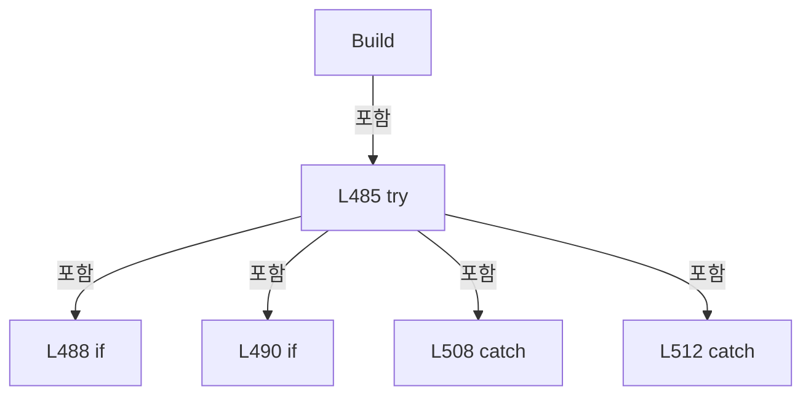

변경 전 점검: 입력/반환 타입, 위 호출자, 예외/취소 경로, 공유 상태와 저장·전송 소비자를 함께 확인합니다. 값의 단위나 물리 방향을 이름만으로 확정하지 않습니다.

### MethodDeclaration `CreateReviewScreen` · L522–536

[Drilling.UI/Menu/Menus/CMenuReview.cs:522–536](https://github.com/kjuws10-rgb/A3Drilling/blob/0219666f9053b907d96d7e0aa7d0c6c1be3a73d4/Drilling.UI/Menu/Menus/CMenuReview.cs#L522-L536)

| 항목 | 실제 추출 값 |
| --- | --- |
| 서명 | Drilling.UI.Menu.Menus.CScreenViewModel Drilling.UI.Menu.Menus.CMenuReview.CreateReviewScreen(string) |
| 접근/수식자 | Private / private |
| 반환/값 타입 | Drilling.UI.Menu.Menus.CScreenViewModel |
| 소속 타입 | NamedType:Drilling.UI.Menu.Menus.CMenuReview |

입력 계약:

| 이름 | 타입 | 전달 | 선택/기본값 |
| --- | --- | --- | --- |
| result | string | None | False /  |

정적 호출자로 확인된 위치:

| 호출 파일/행 | 호출 표현식 | 런타임 분기 가능 |
| --- | --- | --- |
| [Drilling.UI/Menu/Menus/CMenuReview.cs:506–506](https://github.com/kjuws10-rgb/A3Drilling/blob/0219666f9053b907d96d7e0aa7d0c6c1be3a73d4/Drilling.UI/Menu/Menus/CMenuReview.cs#L506-L506) | CreateReviewScreen | False |
| [Drilling.UI/Menu/Menus/CMenuReview.cs:518–518](https://github.com/kjuws10-rgb/A3Drilling/blob/0219666f9053b907d96d7e0aa7d0c6c1be3a73d4/Drilling.UI/Menu/Menus/CMenuReview.cs#L518-L518) | CreateReviewScreen | False |

호출하는 대상과 해석 범위:

| 원본 행 | 표현식 | 분석 상태 | 대상/소스 위치 |
| --- | --- | --- | --- |
| 524 | new CScreenViewModel | resolved | Drilling.UI.Menu.Menus.CScreenViewModel.CScreenViewModel(Drilling.UI.Menu.Menus.EN_MENU, string, string, System.Collections.Generic.IReadOnlyList<Drilling.UI.Menu.Menus.ST_DISPLAY_ITEM>, System.Collections.Generic.IReadOnlyList<Drilling.UI.Menu.Menus.ST_SCREEN_SECTION>, bool, Drilling.UI.Menu.Menus.CMenuMain?, Drilling.UI.Menu.Menus.CMenuManual?, Drilling.UI.Menu.Menus.CMenuRecipe?, Drilling.UI.Menu.Menus.CMenuSetting?, Drilling.UI.Menu.Menus.CMenuAlarm?, Drilling.UI.Menu.Menus.CMenuMonitor?, Drilling.UI.Menu.Menus.CMenuReview?, Drilling.UI.Menu.Menus.CMenuCorrection?, Drilling.UI.Menu.Menus.CMenuPm?) · Drilling.UI/Menu/Menus/CMenuBase.cs:411 |
| 529 | new | resolved | Drilling.UI.Menu.Menus.ST_DISPLAY_ITEM.ST_DISPLAY_ITEM(string, string, string) · Drilling.UI/Menu/Menus/CMenuBase.cs:43 |
| 529 | ToDisplayModeName | resolved | string Drilling.UI.Menu.Menus.CMenuReview.ToDisplayModeName(string) · Drilling.UI/Menu/Menus/CMenuReview.cs:2437 |
| 530 | new | resolved | Drilling.UI.Menu.Menus.ST_DISPLAY_ITEM.ST_DISPLAY_ITEM(string, string, string) · Drilling.UI/Menu/Menus/CMenuBase.cs:43 |
| 530 | GetConfiguredSampleInspectionShotCount | resolved | int Drilling.UI.Menu.Menus.CMenuReview.GetConfiguredSampleInspectionShotCount() · Drilling.UI/Menu/Menus/CMenuReview.cs:1903 |
| 531 | new | resolved | Drilling.UI.Menu.Menus.ST_DISPLAY_ITEM.ST_DISPLAY_ITEM(string, string, string) · Drilling.UI/Menu/Menus/CMenuBase.cs:43 |
| 533 | new | resolved | Drilling.UI.Menu.Menus.ST_SCREEN_SECTION.ST_SCREEN_SECTION(string, System.Collections.Generic.IReadOnlyList<Drilling.UI.Menu.Menus.ST_DISPLAY_ITEM>) · Drilling.UI/Menu/Menus/CMenuBase.cs:410 |
| 533 | new | resolved | Drilling.UI.Menu.Menus.ST_SCREEN_SECTION.ST_SCREEN_SECTION(string, System.Collections.Generic.IReadOnlyList<Drilling.UI.Menu.Menus.ST_DISPLAY_ITEM>) · Drilling.UI/Menu/Menus/CMenuBase.cs:410 |

본문의 실제 연산·분기·예외·반환 순서(원문 위치 순):

| 원본 행 | 종류 | 주석 해설 |
| --- | --- | --- |
| 524 | call | 함수·델리게이트 또는 객체 생성자를 호출합니다: new CScreenViewModel( EN_MENU.Review, Title, Subtitle, [ new("Mode", ToDisplayModeName(_selectedMode)), new("Shot", IsSampleSelectTab ? $"{GetConfiguredSampleInspectionShotCount()} / {_totalReviewPointCount}" : $"{_activ… |
| 524 | return | 호출자에게 값 또는 제어를 반환합니다: return new CScreenViewModel( EN_MENU.Review, Title, Subtitle, [ new("Mode", ToDisplayModeName(_selectedMode)), new("Shot", IsSampleSelectTab ? $"{GetConfiguredSampleInspectionShotCount()} / {_totalReviewPointCount}" : $"{_activePl |
| 529 | call | 함수·델리게이트 또는 객체 생성자를 호출합니다: new("Mode", ToDisplayModeName(_selectedMode)) |
| 529 | call | 함수·델리게이트 또는 객체 생성자를 호출합니다: ToDisplayModeName(_selectedMode) |
| 530 | call | 함수·델리게이트 또는 객체 생성자를 호출합니다: new("Shot", IsSampleSelectTab ? $"{GetConfiguredSampleInspectionShotCount()} / {_totalReviewPointCount}" : $"{_activePlanPointCount} / {_totalReviewPointCount}") |
| 530 | call | 함수·델리게이트 또는 객체 생성자를 호출합니다: GetConfiguredSampleInspectionShotCount() |
| 530 | conditional-expression | 조건에 따라 결과식을 선택합니다: IsSampleSelectTab ? $"{GetConfiguredSampleInspectionShotCount()} / {_totalReviewPointCount}" : $"{_activePlanPointCount} / {_totalReviewPointCount}" |
| 531 | call | 함수·델리게이트 또는 객체 생성자를 호출합니다: new("Result", result) |
| 533 | call | 함수·델리게이트 또는 객체 생성자를 호출합니다: new("Review Plan", []) |
| 533 | call | 함수·델리게이트 또는 객체 생성자를 호출합니다: new("Review Result", []) |

변경 전 점검: 입력/반환 타입, 위 호출자, 예외/취소 경로, 공유 상태와 저장·전송 소비자를 함께 확인합니다. 값의 단위나 물리 방향을 이름만으로 확정하지 않습니다.

### MethodDeclaration `ResetPlanDisplayAfterBuildFailure` · L538–574

[Drilling.UI/Menu/Menus/CMenuReview.cs:538–574](https://github.com/kjuws10-rgb/A3Drilling/blob/0219666f9053b907d96d7e0aa7d0c6c1be3a73d4/Drilling.UI/Menu/Menus/CMenuReview.cs#L538-L574)

| 항목 | 실제 추출 값 |
| --- | --- |
| 서명 | void Drilling.UI.Menu.Menus.CMenuReview.ResetPlanDisplayAfterBuildFailure() |
| 접근/수식자 | Private / private |
| 반환/값 타입 | void |
| 소속 타입 | NamedType:Drilling.UI.Menu.Menus.CMenuReview |

정적 호출자로 확인된 위치:

| 호출 파일/행 | 호출 표현식 | 런타임 분기 가능 |
| --- | --- | --- |
| [Drilling.UI/Menu/Menus/CMenuReview.cs:515–515](https://github.com/kjuws10-rgb/A3Drilling/blob/0219666f9053b907d96d7e0aa7d0c6c1be3a73d4/Drilling.UI/Menu/Menus/CMenuReview.cs#L515-L515) | ResetPlanDisplayAfterBuildFailure | False |

호출하는 대상과 해석 범위:

| 원본 행 | 표현식 | 분석 상태 | 대상/소스 위치 |
| --- | --- | --- | --- |
| 541 | _selectedLineShotKeys.Clear | resolved | void System.Collections.Generic.HashSet<string>.Clear() |
| 544 | new | resolved | Drilling.UI.Menu.Menus.ST_REVIEW_TAB_ITEM.ST_REVIEW_TAB_ITEM(string, bool, Drilling.UI.Menu.CButtonCommand) · Drilling.UI/Menu/Menus/CMenuReview.cs:5628 |
| 545 | Mode | resolved | Drilling.UI.Menu.Menus.ST_REVIEW_MODE_ITEM Drilling.UI.Menu.Menus.CMenuReview.Mode(string, string) · Drilling.UI/Menu/Menus/CMenuReview.cs:2438 |
| 545 | Mode | resolved | Drilling.UI.Menu.Menus.ST_REVIEW_MODE_ITEM Drilling.UI.Menu.Menus.CMenuReview.Mode(string, string) · Drilling.UI/Menu/Menus/CMenuReview.cs:2438 |
| 545 | Mode | resolved | Drilling.UI.Menu.Menus.ST_REVIEW_MODE_ITEM Drilling.UI.Menu.Menus.CMenuReview.Mode(string, string) · Drilling.UI/Menu/Menus/CMenuReview.cs:2438 |
| 545 | Mode | resolved | Drilling.UI.Menu.Menus.ST_REVIEW_MODE_ITEM Drilling.UI.Menu.Menus.CMenuReview.Mode(string, string) · Drilling.UI/Menu/Menus/CMenuReview.cs:2438 |
| 545 | Mode | resolved | Drilling.UI.Menu.Menus.ST_REVIEW_MODE_ITEM Drilling.UI.Menu.Menus.CMenuReview.Mode(string, string) · Drilling.UI/Menu/Menus/CMenuReview.cs:2438 |
| 545 | Mode | resolved | Drilling.UI.Menu.Menus.ST_REVIEW_MODE_ITEM Drilling.UI.Menu.Menus.CMenuReview.Mode(string, string) · Drilling.UI/Menu/Menus/CMenuReview.cs:2438 |
| 546 | new | resolved | Drilling.UI.Menu.Menus.ST_DISPLAY_ITEM.ST_DISPLAY_ITEM(string, string, string) · Drilling.UI/Menu/Menus/CMenuBase.cs:43 |
| 546 | _selectedRecipeIdProvider | resolved · 동적 구현 선택 가능 | string System.Func<string>.Invoke() |
| 546 | new | resolved | Drilling.UI.Menu.Menus.ST_DISPLAY_ITEM.ST_DISPLAY_ITEM(string, string, string) · Drilling.UI/Menu/Menus/CMenuBase.cs:43 |
| 546 | new | resolved | Drilling.UI.Menu.Menus.ST_DISPLAY_ITEM.ST_DISPLAY_ITEM(string, string, string) · Drilling.UI/Menu/Menus/CMenuBase.cs:43 |
| 547 | new | resolved | Drilling.UI.Menu.Menus.ST_DISPLAY_ITEM.ST_DISPLAY_ITEM(string, string, string) · Drilling.UI/Menu/Menus/CMenuBase.cs:43 |
| 547 | new | resolved | Drilling.UI.Menu.Menus.ST_DISPLAY_ITEM.ST_DISPLAY_ITEM(string, string, string) · Drilling.UI/Menu/Menus/CMenuBase.cs:43 |
| 553 | InvalidateMaterializedRunShotMap | resolved | void Drilling.UI.Menu.Menus.CMenuReview.InvalidateMaterializedRunShotMap() · Drilling.UI/Menu/Menus/CMenuReview.cs:5228 |
| 565 | Camera.Clear | resolved | void Drilling.UI.Menu.Menus.CReviewCameraPreview.Clear() · Drilling.UI/Menu/Menus/CMenuReview.cs:6091 |
| 573 | OnPropertyChanged | resolved | void Drilling.UI.Menu.CBindingBase.OnPropertyChanged(string?) · Drilling.UI/Menu/CBindingBase.cs:790 |
| 573 | nameof | unresolved | None |

본문의 실제 연산·분기·예외·반환 순서(원문 위치 순):

| 원본 행 | 종류 | 주석 해설 |
| --- | --- | --- |
| 540 | assignment | 값을 대상에 대입합니다: _lastAllPlan = null |
| 541 | call | 함수·델리게이트 또는 객체 생성자를 호출합니다: _selectedLineShotKeys.Clear() |
| 542 | assignment | 값을 대상에 대입합니다: _activePlanPointCount = 0 |
| 543 | assignment | 값을 대상에 대입합니다: _totalReviewPointCount = 0 |
| 544 | assignment | 값을 대상에 대입합니다: Tabs = [new("RUN", IsRunTab, SelectTabCommand)] |
| 544 | call | 함수·델리게이트 또는 객체 생성자를 호출합니다: new("RUN", IsRunTab, SelectTabCommand) |
| 545 | assignment | 값을 대상에 대입합니다: Modes = [Mode("ALL SHOT", ""), Mode("ONE SHOT", ""), Mode("ONE LINE", ""), Mode("BEAM INSPECTION", ""), Mode("ROUGH", ""), Mode("FINE", "")] |
| 545 | call | 함수·델리게이트 또는 객체 생성자를 호출합니다: Mode("ALL SHOT", "") |
| 545 | call | 함수·델리게이트 또는 객체 생성자를 호출합니다: Mode("ONE SHOT", "") |
| 545 | call | 함수·델리게이트 또는 객체 생성자를 호출합니다: Mode("ONE LINE", "") |
| 545 | call | 함수·델리게이트 또는 객체 생성자를 호출합니다: Mode("BEAM INSPECTION", "") |
| 545 | call | 함수·델리게이트 또는 객체 생성자를 호출합니다: Mode("ROUGH", "") |
| 545 | call | 함수·델리게이트 또는 객체 생성자를 호출합니다: Mode("FINE", "") |
| 546 | assignment | 값을 대상에 대입합니다: TargetItems = [new("Recipe Name", _selectedRecipeIdProvider()), new("Glass ID", _productManager.Current?.GlassId ?? "-"), new("Tolerance", "-")] |
| 546 | call | 함수·델리게이트 또는 객체 생성자를 호출합니다: new("Recipe Name", _selectedRecipeIdProvider()) |
| 546 | call | 함수·델리게이트 또는 객체 생성자를 호출합니다: _selectedRecipeIdProvider() |
| 546 | call | 함수·델리게이트 또는 객체 생성자를 호출합니다: new("Glass ID", _productManager.Current?.GlassId ?? "-") |
| 546 | call | 함수·델리게이트 또는 객체 생성자를 호출합니다: new("Tolerance", "-") |
| 547 | assignment | 값을 대상에 대입합니다: SelectionSummaryItems = [new("Status", "Configuration Error"), new("Reason", _planBuildError)] |
| 547 | call | 함수·델리게이트 또는 객체 생성자를 호출합니다: new("Status", "Configuration Error") |
| 547 | call | 함수·델리게이트 또는 객체 생성자를 호출합니다: new("Reason", _planBuildError) |
| 548 | assignment | 값을 대상에 대입합니다: SelectedPointItems = [] |
| 549 | assignment | 값을 대상에 대입합니다: SelectedShotInspection = ST_REVIEW_SELECTED_SHOT_STATUS.Empty |
| 550 | assignment | 값을 대상에 대입합니다: PointSelectRows = [] |
| 551 | assignment | 값을 대상에 대입합니다: RunCellShotRows = [] |
| 552 | assignment | 값을 대상에 대입합니다: RunCellShotMatrixRows = [] |
| 553 | call | 함수·델리게이트 또는 객체 생성자를 호출합니다: InvalidateMaterializedRunShotMap() |
| 554 | assignment | 값을 대상에 대입합니다: RunBeamRows = [] |
| 555 | assignment | 값을 대상에 대입합니다: InspectionBeamResultRows = [] |
| 556 | assignment | 값을 대상에 대입합니다: BeamInspectionShotAssignments = [] |
| 557 | assignment | 값을 대상에 대입합니다: _selectedBeamInspectionAssignment = null |
| 558 | assignment | 값을 대상에 대입합니다: SampleCellShotRows = [] |
| 559 | assignment | 값을 대상에 대입합니다: SampleCellShotMatrixRows = [] |
| 560 | assignment | 값을 대상에 대입합니다: RunGlassPreviewImage = null |
| 561 | assignment | 값을 대상에 대입합니다: _cameraGlassBounds = Rect.Empty |
| 562 | assignment | 값을 대상에 대입합니다: _cameraProjectionViewportSize = Size.Empty |
| 563 | assignment | 값을 대상에 대입합니다: _cameraProjectionGlassBounds = Rect.Empty |
| 564 | assignment | 값을 대상에 대입합니다: _cameraProjectionCanvasSize = Size.Empty |
| 565 | call | 함수·델리게이트 또는 객체 생성자를 호출합니다: Camera.Clear() |
| 566 | assignment | 값을 대상에 대입합니다: RunGlassPreviewInspectionOverlayImage = null |
| 567 | assignment | 값을 대상에 대입합니다: RunCellPreviewLabels = [] |
| 568 | assignment | 값을 대상에 대입합니다: RunGlassPreviewSummary = "Review plan unavailable" |
| 569 | assignment | 값을 대상에 대입합니다: SampleGlassPreviewImage = null |
| 570 | assignment | 값을 대상에 대입합니다: SampleGlassPreviewInspectionOverlayImage = null |
| 571 | assignment | 값을 대상에 대입합니다: SampleCellPreviewLabels = [] |
| 572 | assignment | 값을 대상에 대입합니다: SampleGlassPreviewSummary = "Review plan unavailable" |
| 573 | call | 함수·델리게이트 또는 객체 생성자를 호출합니다: OnPropertyChanged(nameof(SelectedShotInspection)) |
| 573 | call | 함수·델리게이트 또는 객체 생성자를 호출합니다: nameof(SelectedShotInspection) |

변경 전 점검: 입력/반환 타입, 위 호출자, 예외/취소 경로, 공유 상태와 저장·전송 소비자를 함께 확인합니다. 값의 단위나 물리 방향을 이름만으로 확정하지 않습니다.

### MethodDeclaration `CreateFallbackRecipe` · L576–579

[Drilling.UI/Menu/Menus/CMenuReview.cs:576–579](https://github.com/kjuws10-rgb/A3Drilling/blob/0219666f9053b907d96d7e0aa7d0c6c1be3a73d4/Drilling.UI/Menu/Menus/CMenuReview.cs#L576-L579)

| 항목 | 실제 추출 값 |
| --- | --- |
| 서명 | Drilling.Common.Managers.ST_RECIPE_DEFINITION Drilling.UI.Menu.Menus.CMenuReview.CreateFallbackRecipe() |
| 접근/수식자 | Private / private |
| 반환/값 타입 | Drilling.Common.Managers.ST_RECIPE_DEFINITION |
| 소속 타입 | NamedType:Drilling.UI.Menu.Menus.CMenuReview |

정적 호출자로 확인된 위치:

| 호출 파일/행 | 호출 표현식 | 런타임 분기 가능 |
| --- | --- | --- |
| [Drilling.UI/Menu/Menus/CMenuReview.cs:487–487](https://github.com/kjuws10-rgb/A3Drilling/blob/0219666f9053b907d96d7e0aa7d0c6c1be3a73d4/Drilling.UI/Menu/Menus/CMenuReview.cs#L487-L487) | CreateFallbackRecipe | False |
| [Drilling.UI/Menu/Menus/CMenuReview.cs:4260–4260](https://github.com/kjuws10-rgb/A3Drilling/blob/0219666f9053b907d96d7e0aa7d0c6c1be3a73d4/Drilling.UI/Menu/Menus/CMenuReview.cs#L4260-L4260) | CreateFallbackRecipe | False |

호출하는 대상과 해석 범위:

| 원본 행 | 표현식 | 분석 상태 | 대상/소스 위치 |
| --- | --- | --- | --- |
| 578 | new ST_RECIPE_DEFINITION | resolved | Drilling.Common.Managers.ST_RECIPE_DEFINITION.ST_RECIPE_DEFINITION(string, string, System.Collections.Generic.IReadOnlyList<Drilling.Common.Managers.ST_RECIPE_PARAMETER>, System.Collections.Generic.IReadOnlyList<Drilling.Common.Managers.ST_RECIPE_HISTORY>) · Drilling.Common/Managers/CRecipeManager.cs:387 |

본문의 실제 연산·분기·예외·반환 순서(원문 위치 순):

| 원본 행 | 종류 | 주석 해설 |
| --- | --- | --- |
| 578 | call | 함수·델리게이트 또는 객체 생성자를 호출합니다: new ST_RECIPE_DEFINITION(_recipeId, _recipeId, [], []) |
| 578 | return | 호출자에게 값 또는 제어를 반환합니다: return new ST_RECIPE_DEFINITION(_recipeId, _recipeId, [], []); |

변경 전 점검: 입력/반환 타입, 위 호출자, 예외/취소 경로, 공유 상태와 저장·전송 소비자를 함께 확인합니다. 값의 단위나 물리 방향을 이름만으로 확정하지 않습니다.

### MethodDeclaration `LoadSelectedRecipe` · L581–600

[Drilling.UI/Menu/Menus/CMenuReview.cs:581–600](https://github.com/kjuws10-rgb/A3Drilling/blob/0219666f9053b907d96d7e0aa7d0c6c1be3a73d4/Drilling.UI/Menu/Menus/CMenuReview.cs#L581-L600)

| 항목 | 실제 추출 값 |
| --- | --- |
| 서명 | System.Threading.Tasks.Task<Drilling.Common.Managers.ST_RECIPE_DEFINITION?> Drilling.UI.Menu.Menus.CMenuReview.LoadSelectedRecipe(System.Threading.CancellationToken) |
| 접근/수식자 | Private / private, async |
| 반환/값 타입 | System.Threading.Tasks.Task<Drilling.Common.Managers.ST_RECIPE_DEFINITION?> |
| 소속 타입 | NamedType:Drilling.UI.Menu.Menus.CMenuReview |

입력 계약:

| 이름 | 타입 | 전달 | 선택/기본값 |
| --- | --- | --- | --- |
| cancellationToken | System.Threading.CancellationToken | None | False /  |

정적 호출자로 확인된 위치:

| 호출 파일/행 | 호출 표현식 | 런타임 분기 가능 |
| --- | --- | --- |
| [Drilling.UI/Menu/Menus/CMenuReview.cs:487–487](https://github.com/kjuws10-rgb/A3Drilling/blob/0219666f9053b907d96d7e0aa7d0c6c1be3a73d4/Drilling.UI/Menu/Menus/CMenuReview.cs#L487-L487) | LoadSelectedRecipe | False |
| [Drilling.UI/Menu/Menus/CMenuReview.cs:3062–3062](https://github.com/kjuws10-rgb/A3Drilling/blob/0219666f9053b907d96d7e0aa7d0c6c1be3a73d4/Drilling.UI/Menu/Menus/CMenuReview.cs#L3062-L3062) | LoadSelectedRecipe | False |
| [Drilling.UI/Menu/Menus/CMenuReview.cs:3858–3858](https://github.com/kjuws10-rgb/A3Drilling/blob/0219666f9053b907d96d7e0aa7d0c6c1be3a73d4/Drilling.UI/Menu/Menus/CMenuReview.cs#L3858-L3858) | LoadSelectedRecipe | False |
| [Drilling.UI/Menu/Menus/CMenuReview.cs:4260–4260](https://github.com/kjuws10-rgb/A3Drilling/blob/0219666f9053b907d96d7e0aa7d0c6c1be3a73d4/Drilling.UI/Menu/Menus/CMenuReview.cs#L4260-L4260) | LoadSelectedRecipe | False |

호출하는 대상과 해석 범위:

| 원본 행 | 표현식 | 분석 상태 | 대상/소스 위치 |
| --- | --- | --- | --- |
| 583 | _recipeManager.LoadRecipes | resolved | System.Threading.Tasks.Task<System.Collections.Generic.IReadOnlyList<Drilling.Common.Managers.ST_RECIPE_DEFINITION>> Drilling.Common.Managers.CRecipeManager.LoadRecipes(System.Threading.CancellationToken) · Drilling.Common/Managers/CRecipeManager.cs:40 |
| 589 | _selectedRecipeIdProvider | resolved · 동적 구현 선택 가능 | string System.Func<string>.Invoke() |
| 590 | string.IsNullOrWhiteSpace | resolved | bool string.IsNullOrWhiteSpace(string?) |
| 592 | recipes.FirstOrDefault | resolved | Drilling.Common.Managers.ST_RECIPE_DEFINITION? System.Collections.Generic.IEnumerable<Drilling.Common.Managers.ST_RECIPE_DEFINITION>.FirstOrDefault<Drilling.Common.Managers.ST_RECIPE_DEFINITION>(System.Func<Drilling.Common.Managers.ST_RECIPE_DEFINITION, bool>) |
| 592 | recipe.Id.Equals | resolved | bool string.Equals(string?, System.StringComparison) |
| 599 | recipes.FirstOrDefault | resolved | Drilling.Common.Managers.ST_RECIPE_DEFINITION? System.Collections.Generic.IEnumerable<Drilling.Common.Managers.ST_RECIPE_DEFINITION>.FirstOrDefault<Drilling.Common.Managers.ST_RECIPE_DEFINITION>(System.Func<Drilling.Common.Managers.ST_RECIPE_DEFINITION, bool>) |
| 599 | recipe.Id.Equals | resolved | bool string.Equals(string?, System.StringComparison) |

본문의 실제 연산·분기·예외·반환 순서(원문 위치 순):

| 원본 행 | 종류 | 주석 해설 |
| --- | --- | --- |
| 583 | await | 비동기 완료를 기다립니다: await _recipeManager.LoadRecipes(cancellationToken) |
| 583 | call | 함수·델리게이트 또는 객체 생성자를 호출합니다: _recipeManager.LoadRecipes(cancellationToken) |
| 583 | local-declaration | 지역 변수를 선언합니다: var recipes = await _recipeManager.LoadRecipes(cancellationToken); |
| 583 | variable-initializer | 변수의 초기값을 지정합니다: recipes = await _recipeManager.LoadRecipes(cancellationToken) |
| 584 | if | 조건에 따라 분기합니다: if (recipes.Count == 0) |
| 586 | return | 호출자에게 값 또는 제어를 반환합니다: return null; |
| 589 | call | 함수·델리게이트 또는 객체 생성자를 호출합니다: _selectedRecipeIdProvider() |
| 589 | local-declaration | 지역 변수를 선언합니다: var selectedRecipeId = _selectedRecipeIdProvider(); |
| 589 | variable-initializer | 변수의 초기값을 지정합니다: selectedRecipeId = _selectedRecipeIdProvider() |
| 590 | call | 함수·델리게이트 또는 객체 생성자를 호출합니다: string.IsNullOrWhiteSpace(selectedRecipeId) |
| 590 | if | 조건에 따라 분기합니다: if (!string.IsNullOrWhiteSpace(selectedRecipeId)) |
| 592 | call | 함수·델리게이트 또는 객체 생성자를 호출합니다: recipes.FirstOrDefault(recipe => recipe.Id.Equals(selectedRecipeId, StringComparison.OrdinalIgnoreCase)) |
| 592 | call | 함수·델리게이트 또는 객체 생성자를 호출합니다: recipe.Id.Equals(selectedRecipeId, StringComparison.OrdinalIgnoreCase) |
| 592 | local-declaration | 지역 변수를 선언합니다: var selectedRecipe = recipes.FirstOrDefault(recipe => recipe.Id.Equals(selectedRecipeId, StringComparison.OrdinalIgnoreCase)); |
| 592 | variable-initializer | 변수의 초기값을 지정합니다: selectedRecipe = recipes.FirstOrDefault(recipe => recipe.Id.Equals(selectedRecipeId, StringComparison.OrdinalIgnoreCase)) |
| 593 | if | 조건에 따라 분기합니다: if (selectedRecipe is not null) |
| 595 | return | 호출자에게 값 또는 제어를 반환합니다: return selectedRecipe; |
| 599 | call | 함수·델리게이트 또는 객체 생성자를 호출합니다: recipes.FirstOrDefault(recipe => recipe.Id.Equals("DRILL_A01", StringComparison.OrdinalIgnoreCase)) |
| 599 | call | 함수·델리게이트 또는 객체 생성자를 호출합니다: recipe.Id.Equals("DRILL_A01", StringComparison.OrdinalIgnoreCase) |
| 599 | return | 호출자에게 값 또는 제어를 반환합니다: return recipes.FirstOrDefault(recipe => recipe.Id.Equals("DRILL_A01", StringComparison.OrdinalIgnoreCase)) ?? recipes[0]; |

제어 구문의 포함 구조(실제 실행 순서/CFG가 아닌 구문 탐색 그림):


변경 전 점검: 입력/반환 타입, 위 호출자, 예외/취소 경로, 공유 상태와 저장·전송 소비자를 함께 확인합니다. 값의 단위나 물리 방향을 이름만으로 확정하지 않습니다.

### MethodDeclaration `LoadCoordinatePreviewSettings` · L602–612

[Drilling.UI/Menu/Menus/CMenuReview.cs:602–612](https://github.com/kjuws10-rgb/A3Drilling/blob/0219666f9053b907d96d7e0aa7d0c6c1be3a73d4/Drilling.UI/Menu/Menus/CMenuReview.cs#L602-L612)

| 항목 | 실제 추출 값 |
| --- | --- |
| 서명 | System.Collections.Generic.IReadOnlyList<Drilling.Common.Managers.ST_SYSTEM_PARAMETER> Drilling.UI.Menu.Menus.CMenuReview.LoadCoordinatePreviewSettings() |
| 접근/수식자 | Private / private |
| 반환/값 타입 | System.Collections.Generic.IReadOnlyList<Drilling.Common.Managers.ST_SYSTEM_PARAMETER> |
| 소속 타입 | NamedType:Drilling.UI.Menu.Menus.CMenuReview |

정적 호출자로 확인된 위치:

| 호출 파일/행 | 호출 표현식 | 런타임 분기 가능 |
| --- | --- | --- |
| [Drilling.UI/Menu/Menus/CMenuReview.cs:1302–1302](https://github.com/kjuws10-rgb/A3Drilling/blob/0219666f9053b907d96d7e0aa7d0c6c1be3a73d4/Drilling.UI/Menu/Menus/CMenuReview.cs#L1302-L1302) | LoadCoordinatePreviewSettings | False |
| [Drilling.UI/Menu/Menus/CMenuReview.cs:3457–3457](https://github.com/kjuws10-rgb/A3Drilling/blob/0219666f9053b907d96d7e0aa7d0c6c1be3a73d4/Drilling.UI/Menu/Menus/CMenuReview.cs#L3457-L3457) | LoadCoordinatePreviewSettings | False |
| [Drilling.UI/Menu/Menus/CMenuReview.cs:4126–4126](https://github.com/kjuws10-rgb/A3Drilling/blob/0219666f9053b907d96d7e0aa7d0c6c1be3a73d4/Drilling.UI/Menu/Menus/CMenuReview.cs#L4126-L4126) | LoadCoordinatePreviewSettings | False |
| [Drilling.UI/Menu/Menus/CMenuReview.cs:4628–4628](https://github.com/kjuws10-rgb/A3Drilling/blob/0219666f9053b907d96d7e0aa7d0c6c1be3a73d4/Drilling.UI/Menu/Menus/CMenuReview.cs#L4628-L4628) | LoadCoordinatePreviewSettings | False |
| [Drilling.UI/Menu/Menus/CMenuReview.cs:4649–4649](https://github.com/kjuws10-rgb/A3Drilling/blob/0219666f9053b907d96d7e0aa7d0c6c1be3a73d4/Drilling.UI/Menu/Menus/CMenuReview.cs#L4649-L4649) | LoadCoordinatePreviewSettings | False |

호출하는 대상과 해석 범위:

| 원본 행 | 표현식 | 분석 상태 | 대상/소스 위치 |
| --- | --- | --- | --- |
| 609 | _cameraSettings.LoadSection(EN_SETTING_TAB.Option) .Concat(_cameraSettings.LoadSection(EN_SETTING_TAB.Motor)) .ToArray | resolved | Drilling.Common.Managers.ST_SYSTEM_PARAMETER[] System.Collections.Generic.IEnumerable<Drilling.Common.Managers.ST_SYSTEM_PARAMETER>.ToArray<Drilling.Common.Managers.ST_SYSTEM_PARAMETER>() |
| 609 | _cameraSettings.LoadSection(EN_SETTING_TAB.Option) .Concat | resolved | System.Collections.Generic.IEnumerable<Drilling.Common.Managers.ST_SYSTEM_PARAMETER> System.Collections.Generic.IEnumerable<Drilling.Common.Managers.ST_SYSTEM_PARAMETER>.Concat<Drilling.Common.Managers.ST_SYSTEM_PARAMETER>(System.Collections.Generic.IEnumerable<Drilling.Common.Managers.ST_SYSTEM_PARAMETER>) |
| 609 | _cameraSettings.LoadSection | resolved | System.Collections.Generic.IReadOnlyList<Drilling.Common.Managers.ST_SYSTEM_PARAMETER> Drilling.Common.Managers.CSettingManager.LoadSection(Drilling.Common.Managers.EN_SETTING_TAB, System.Threading.CancellationToken) · Drilling.Common/Managers/CSettingManager.cs:26 |
| 610 | _cameraSettings.LoadSection | resolved | System.Collections.Generic.IReadOnlyList<Drilling.Common.Managers.ST_SYSTEM_PARAMETER> Drilling.Common.Managers.CSettingManager.LoadSection(Drilling.Common.Managers.EN_SETTING_TAB, System.Threading.CancellationToken) · Drilling.Common/Managers/CSettingManager.cs:26 |

본문의 실제 연산·분기·예외·반환 순서(원문 위치 순):

| 원본 행 | 종류 | 주석 해설 |
| --- | --- | --- |
| 604 | if | 조건에 따라 분기합니다: if (_cameraSettings is null) |
| 606 | return | 호출자에게 값 또는 제어를 반환합니다: return []; |
| 609 | call | 함수·델리게이트 또는 객체 생성자를 호출합니다: _cameraSettings.LoadSection(EN_SETTING_TAB.Option) |
| 609 | call | 함수·델리게이트 또는 객체 생성자를 호출합니다: _cameraSettings.LoadSection(EN_SETTING_TAB.Option) .Concat(_cameraSettings.LoadSection(EN_SETTING_TAB.Motor)) |
| 609 | call | 함수·델리게이트 또는 객체 생성자를 호출합니다: _cameraSettings.LoadSection(EN_SETTING_TAB.Option) .Concat(_cameraSettings.LoadSection(EN_SETTING_TAB.Motor)) .ToArray() |
| 609 | return | 호출자에게 값 또는 제어를 반환합니다: return _cameraSettings.LoadSection(EN_SETTING_TAB.Option) .Concat(_cameraSettings.LoadSection(EN_SETTING_TAB.Motor)) .ToArray(); |
| 610 | call | 함수·델리게이트 또는 객체 생성자를 호출합니다: _cameraSettings.LoadSection(EN_SETTING_TAB.Motor) |

제어 구문의 포함 구조(실제 실행 순서/CFG가 아닌 구문 탐색 그림):

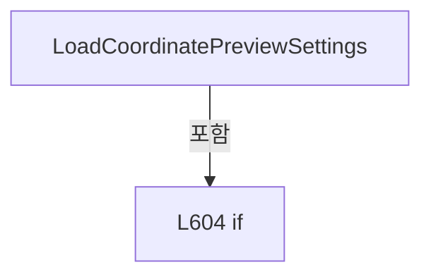

변경 전 점검: 입력/반환 타입, 위 호출자, 예외/취소 경로, 공유 상태와 저장·전송 소비자를 함께 확인합니다. 값의 단위나 물리 방향을 이름만으로 확정하지 않습니다.

### MethodDeclaration `ApplyRecipeContext` · L614–670

[Drilling.UI/Menu/Menus/CMenuReview.cs:614–670](https://github.com/kjuws10-rgb/A3Drilling/blob/0219666f9053b907d96d7e0aa7d0c6c1be3a73d4/Drilling.UI/Menu/Menus/CMenuReview.cs#L614-L670)

| 항목 | 실제 추출 값 |
| --- | --- |
| 서명 | void Drilling.UI.Menu.Menus.CMenuReview.ApplyRecipeContext(Drilling.Common.Managers.ST_RECIPE_DEFINITION, Drilling.Common.Review.ST_REVIEW_PLAN) |
| 접근/수식자 | Private / private |
| 반환/값 타입 | void |
| 소속 타입 | NamedType:Drilling.UI.Menu.Menus.CMenuReview |

입력 계약:

| 이름 | 타입 | 전달 | 선택/기본값 |
| --- | --- | --- | --- |
| recipe | Drilling.Common.Managers.ST_RECIPE_DEFINITION | None | False /  |
| allPlan | Drilling.Common.Review.ST_REVIEW_PLAN | None | False /  |

정적 호출자로 확인된 위치:

| 호출 파일/행 | 호출 표현식 | 런타임 분기 가능 |
| --- | --- | --- |
| [Drilling.UI/Menu/Menus/CMenuReview.cs:503–503](https://github.com/kjuws10-rgb/A3Drilling/blob/0219666f9053b907d96d7e0aa7d0c6c1be3a73d4/Drilling.UI/Menu/Menus/CMenuReview.cs#L503-L503) | ApplyRecipeContext | False |
| [Drilling.UI/Menu/Menus/CMenuReview.cs:4263–4263](https://github.com/kjuws10-rgb/A3Drilling/blob/0219666f9053b907d96d7e0aa7d0c6c1be3a73d4/Drilling.UI/Menu/Menus/CMenuReview.cs#L4263-L4263) | ApplyRecipeContext | False |

호출하는 대상과 해석 범위:

| 원본 행 | 표현식 | 분석 상태 | 대상/소스 위치 |
| --- | --- | --- | --- |
| 617 | Math.Clamp | resolved | int System.Math.Clamp(int, int, int) |
| 618 | Math.Max | resolved | int System.Math.Max(int, int) |
| 619 | Math.Clamp | resolved | int System.Math.Clamp(int, int, int) |
| 620 | string.IsNullOrWhiteSpace | resolved | bool string.IsNullOrWhiteSpace(string?) |
| 621 | _sampleSelectionRecipeId.Equals | resolved | bool string.Equals(string?, System.StringComparison) |
| 623 | ApplySplitBeamContext | resolved | void Drilling.UI.Menu.Menus.CMenuReview.ApplySplitBeamContext(Drilling.Common.Managers.ST_RECIPE_DEFINITION) · Drilling.UI/Menu/Menus/CMenuReview.cs:692 |
| 637 | _selectedLineShotKeys.Clear | resolved | void System.Collections.Generic.HashSet<string>.Clear() |
| 639 | NotifyOneShot | resolved | void Drilling.UI.Menu.Menus.CMenuReview.NotifyOneShot() · Drilling.UI/Menu/Menus/CMenuReview.cs:3731 |
| 642 | ResetBeamInspectionResults | resolved | void Drilling.UI.Menu.Menus.CMenuReview.ResetBeamInspectionResults() · Drilling.UI/Menu/Menus/CMenuReview.cs:2973 |
| 643 | _selectedSampleShotKeys.Clear | resolved | void System.Collections.Generic.HashSet<string>.Clear() |
| 644 | _selectedInspectionShotKeys.Clear | resolved | void System.Collections.Generic.HashSet<string>.Clear() |
| 645 | _inspectionBeamNosByShotKey.Clear | resolved | void System.Collections.Generic.Dictionary<string, System.Collections.Generic.HashSet<int>>.Clear() |
| 646 | _selectedInspectionBeamNos.Clear | resolved | void System.Collections.Generic.HashSet<int>.Clear() |
| 653 | _selectedSampleShotKeys.RemoveWhere | resolved | int System.Collections.Generic.HashSet<string>.RemoveWhere(System.Predicate<string>) |
| 653 | IsValidShotKey | resolved | bool IsValidShotKey(string) · Drilling.UI/Menu/Menus/CMenuReview.cs:624 |
| 654 | _selectedInspectionShotKeys.RemoveWhere | resolved | int System.Collections.Generic.HashSet<string>.RemoveWhere(System.Predicate<string>) |
| 654 | IsValidShotKey | resolved | bool IsValidShotKey(string) · Drilling.UI/Menu/Menus/CMenuReview.cs:624 |
| 655 | _inspectionBeamNosByShotKey.Keys.Where(key => !_selectedInspectionShotKeys.Contains(key)).ToArray | resolved | string[] System.Collections.Generic.IEnumerable<string>.ToArray<string>() |
| 655 | _inspectionBeamNosByShotKey.Keys.Where | resolved | System.Collections.Generic.IEnumerable<string> System.Collections.Generic.IEnumerable<string>.Where<string>(System.Func<string, bool>) |
| 655 | _selectedInspectionShotKeys.Contains | resolved | bool System.Collections.Generic.HashSet<string>.Contains(string) |
| 657 | _inspectionBeamNosByShotKey.Remove | resolved | bool System.Collections.Generic.Dictionary<string, System.Collections.Generic.HashSet<int>>.Remove(string) |
| 661 | Math.Clamp | resolved | int System.Math.Clamp(int, int, int) |
| 662 | SetSampleMapColumnCount | resolved | void Drilling.UI.Menu.Menus.CMenuReview.SetSampleMapColumnCount(int) · Drilling.UI/Menu/Menus/CMenuReview.cs:2073 |
| 662 | CalculateShotMapColumnCount | resolved | int Drilling.UI.Menu.Menus.CMenuReview.CalculateShotMapColumnCount(Drilling.Common.Review.ST_REVIEW_PLAN, int) · Drilling.UI/Menu/Menus/CMenuReview.cs:2055 |
| 663 | Math.Clamp | resolved | int System.Math.Clamp(int, int, int) |
| 664 | string.IsNullOrWhiteSpace | resolved | bool string.IsNullOrWhiteSpace(string?) |
| 664 | IsValidShotKey | resolved | bool IsValidShotKey(string) · Drilling.UI/Menu/Menus/CMenuReview.cs:624 |
| 669 | RefreshSelectedLineKeys | resolved | void Drilling.UI.Menu.Menus.CMenuReview.RefreshSelectedLineKeys(Drilling.Common.Review.ST_REVIEW_PLAN?) · Drilling.UI/Menu/Menus/CMenuReview.cs:2178 |

본문의 실제 연산·분기·예외·반환 순서(원문 위치 순):

| 원본 행 | 종류 | 주석 해설 |
| --- | --- | --- |
| 616 | assignment | 값을 대상에 대입합니다: _headCount = MaxHeadCount |
| 617 | assignment | 값을 대상에 대입합니다: _sampleRuleHeadNo = Math.Clamp(_sampleRuleHeadNo, 1, _headCount) |
| 617 | call | 함수·델리게이트 또는 객체 생성자를 호출합니다: Math.Clamp(_sampleRuleHeadNo, 1, _headCount) |
| 618 | assignment | 값을 대상에 대입합니다: _cellCount = Math.Max(1, allPlan.CellCount) |
| 618 | call | 함수·델리게이트 또는 객체 생성자를 호출합니다: Math.Max(1, allPlan.CellCount) |
| 619 | assignment | 값을 대상에 대입합니다: _sampleRuleCellNo = Math.Clamp(_sampleRuleCellNo, 1, _cellCount) |
| 619 | call | 함수·델리게이트 또는 객체 생성자를 호출합니다: Math.Clamp(_sampleRuleCellNo, 1, _cellCount) |
| 620 | assignment | 값을 대상에 대입합니다: _recipeId = string.IsNullOrWhiteSpace(recipe.Id) ? "DRILL_A01" : recipe.Id |
| 620 | call | 함수·델리게이트 또는 객체 생성자를 호출합니다: string.IsNullOrWhiteSpace(recipe.Id) |
| 620 | conditional-expression | 조건에 따라 결과식을 선택합니다: string.IsNullOrWhiteSpace(recipe.Id) ? "DRILL_A01" : recipe.Id |
| 621 | call | 함수·델리게이트 또는 객체 생성자를 호출합니다: _sampleSelectionRecipeId.Equals(_recipeId, StringComparison.OrdinalIgnoreCase) |
| 621 | local-declaration | 지역 변수를 선언합니다: var isSampleSelectionRecipeChanged = !_sampleSelectionRecipeId.Equals(_recipeId, StringComparison.OrdinalIgnoreCase); |
| 621 | variable-initializer | 변수의 초기값을 지정합니다: isSampleSelectionRecipeChanged = !_sampleSelectionRecipeId.Equals(_recipeId, StringComparison.OrdinalIgnoreCase) |
| 622 | assignment | 값을 대상에 대입합니다: _totalReviewPointCount = allPlan.Points.Count |
| 623 | call | 함수·델리게이트 또는 객체 생성자를 호출합니다: ApplySplitBeamContext(recipe) |
| 631 | if | 조건에 따라 분기합니다: if (isSampleSelectionRecipeChanged) |
| 633 | assignment | 값을 대상에 대입합니다: _oneShotResult = null |
| 634 | if | 조건에 따라 분기합니다: if (IsOneShotReviewMode &#124;&#124; IsOneLineReviewMode) |
| 636 | assignment | 값을 대상에 대입합니다: _selectedRunShotKey = "" |
| 637 | call | 함수·델리게이트 또는 객체 생성자를 호출합니다: _selectedLineShotKeys.Clear() |
| 638 | assignment | 값을 대상에 대입합니다: OneShotStatus = "Shot을 선택해 주세요." |
| 639 | call | 함수·델리게이트 또는 객체 생성자를 호출합니다: NotifyOneShot() |
| 642 | call | 함수·델리게이트 또는 객체 생성자를 호출합니다: ResetBeamInspectionResults() |
| 643 | call | 함수·델리게이트 또는 객체 생성자를 호출합니다: _selectedSampleShotKeys.Clear() |
| 644 | call | 함수·델리게이트 또는 객체 생성자를 호출합니다: _selectedInspectionShotKeys.Clear() |
| 645 | call | 함수·델리게이트 또는 객체 생성자를 호출합니다: _inspectionBeamNosByShotKey.Clear() |
| 646 | call | 함수·델리게이트 또는 객체 생성자를 호출합니다: _selectedInspectionBeamNos.Clear() |
| 647 | assignment | 값을 대상에 대입합니다: _simpleSampleShotKey = "" |
| 648 | assignment | 값을 대상에 대입합니다: _lastCorrectionRulePlan = null |
| 649 | assignment | 값을 대상에 대입합니다: _sampleSelectionRecipeId = _recipeId |
| 651 | else | 앞 조건이 거짓인 경로입니다: else |
| 653 | call | 함수·델리게이트 또는 객체 생성자를 호출합니다: _selectedSampleShotKeys.RemoveWhere(key => !IsValidShotKey(key)) |
| 653 | call | 함수·델리게이트 또는 객체 생성자를 호출합니다: IsValidShotKey(key) |
| 654 | call | 함수·델리게이트 또는 객체 생성자를 호출합니다: _selectedInspectionShotKeys.RemoveWhere(key => !IsValidShotKey(key)) |
| 654 | call | 함수·델리게이트 또는 객체 생성자를 호출합니다: IsValidShotKey(key) |
| 655 | call | 함수·델리게이트 또는 객체 생성자를 호출합니다: _inspectionBeamNosByShotKey.Keys.Where(key => !_selectedInspectionShotKeys.Contains(key)).ToArray() |
| 655 | call | 함수·델리게이트 또는 객체 생성자를 호출합니다: _inspectionBeamNosByShotKey.Keys.Where(key => !_selectedInspectionShotKeys.Contains(key)) |
| 655 | call | 함수·델리게이트 또는 객체 생성자를 호출합니다: _selectedInspectionShotKeys.Contains(key) |
| 655 | foreach | 컬렉션 요소를 순회합니다: foreach (var key in _inspectionBeamNosByShotKey.Keys.Where(key => !_selectedInspectionShotKeys.Contains(key)).ToArray()) |
| 657 | call | 함수·델리게이트 또는 객체 생성자를 호출합니다: _inspectionBeamNosByShotKey.Remove(key) |
| 661 | assignment | 값을 대상에 대입합니다: _selectedSampleCellNo = Math.Clamp(_selectedSampleCellNo, 1, _cellCount) |
| 661 | call | 함수·델리게이트 또는 객체 생성자를 호출합니다: Math.Clamp(_selectedSampleCellNo, 1, _cellCount) |
| 662 | call | 함수·델리게이트 또는 객체 생성자를 호출합니다: SetSampleMapColumnCount(CalculateShotMapColumnCount(allPlan, _selectedSampleCellNo)) |
| 662 | call | 함수·델리게이트 또는 객체 생성자를 호출합니다: CalculateShotMapColumnCount(allPlan, _selectedSampleCellNo) |
| 663 | assignment | 값을 대상에 대입합니다: _selectedRunCellNo = Math.Clamp(_selectedRunCellNo, 1, _cellCount) |
| 663 | call | 함수·델리게이트 또는 객체 생성자를 호출합니다: Math.Clamp(_selectedRunCellNo, 1, _cellCount) |
| 664 | call | 함수·델리게이트 또는 객체 생성자를 호출합니다: string.IsNullOrWhiteSpace(_selectedRunShotKey) |
| 664 | call | 함수·델리게이트 또는 객체 생성자를 호출합니다: IsValidShotKey(_selectedRunShotKey) |
| 664 | if | 조건에 따라 분기합니다: if (!string.IsNullOrWhiteSpace(_selectedRunShotKey) && !IsValidShotKey(_selectedRunShotKey)) |
| 666 | assignment | 값을 대상에 대입합니다: _selectedRunShotKey = "" |
| 669 | call | 함수·델리게이트 또는 객체 생성자를 호출합니다: RefreshSelectedLineKeys(allPlan) |

제어 구문의 포함 구조(실제 실행 순서/CFG가 아닌 구문 탐색 그림):

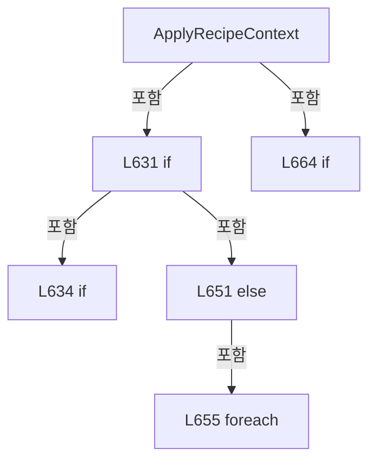

변경 전 점검: 입력/반환 타입, 위 호출자, 예외/취소 경로, 공유 상태와 저장·전송 소비자를 함께 확인합니다. 값의 단위나 물리 방향을 이름만으로 확정하지 않습니다.

### LocalFunctionStatement `IsValidShotKey` · L624–629

[Drilling.UI/Menu/Menus/CMenuReview.cs:624–629](https://github.com/kjuws10-rgb/A3Drilling/blob/0219666f9053b907d96d7e0aa7d0c6c1be3a73d4/Drilling.UI/Menu/Menus/CMenuReview.cs#L624-L629)

| 항목 | 실제 추출 값 |
| --- | --- |
| 서명 | bool IsValidShotKey(string) |
| 접근/수식자 | Private /  |
| 반환/값 타입 | bool |
| 소속 타입 | NamedType:Drilling.UI.Menu.Menus.CMenuReview |

입력 계약:

| 이름 | 타입 | 전달 | 선택/기본값 |
| --- | --- | --- | --- |
| key | string | None | False /  |

정적 호출자로 확인된 위치:

| 호출 파일/행 | 호출 표현식 | 런타임 분기 가능 |
| --- | --- | --- |
| [Drilling.UI/Menu/Menus/CMenuReview.cs:653–653](https://github.com/kjuws10-rgb/A3Drilling/blob/0219666f9053b907d96d7e0aa7d0c6c1be3a73d4/Drilling.UI/Menu/Menus/CMenuReview.cs#L653-L653) | IsValidShotKey | False |
| [Drilling.UI/Menu/Menus/CMenuReview.cs:654–654](https://github.com/kjuws10-rgb/A3Drilling/blob/0219666f9053b907d96d7e0aa7d0c6c1be3a73d4/Drilling.UI/Menu/Menus/CMenuReview.cs#L654-L654) | IsValidShotKey | False |
| [Drilling.UI/Menu/Menus/CMenuReview.cs:664–664](https://github.com/kjuws10-rgb/A3Drilling/blob/0219666f9053b907d96d7e0aa7d0c6c1be3a73d4/Drilling.UI/Menu/Menus/CMenuReview.cs#L664-L664) | IsValidShotKey | False |

호출하는 대상과 해석 범위:

| 원본 행 | 표현식 | 분석 상태 | 대상/소스 위치 |
| --- | --- | --- | --- |
| 626 | CReviewManager.NormalizeShotKey | resolved | string Drilling.Common.Review.CReviewManager.NormalizeShotKey(string) · Drilling.Common/Review/CReviewManager.cs:1245 |
| 627 | normalized.IndexOf | resolved | int string.IndexOf(string, System.StringComparison) |
| 628 | int.TryParse | resolved | bool int.TryParse(System.ReadOnlySpan<char>, System.Globalization.NumberStyles, System.IFormatProvider?, out int) |
| 628 | normalized.AsSpan | resolved | System.ReadOnlySpan<char> string?.AsSpan(int, int) |
| 628 | int.TryParse | resolved | bool int.TryParse(System.ReadOnlySpan<char>, System.Globalization.NumberStyles, System.IFormatProvider?, out int) |
| 628 | normalized.AsSpan | resolved | System.ReadOnlySpan<char> string?.AsSpan(int) |
| 628 | allPlan.FindPoint | resolved | Drilling.Common.Review.ST_REVIEW_PLAN_POINT? Drilling.Common.Review.ST_REVIEW_PLAN.FindPoint(int, int) · Drilling.Common/Review/CReviewManager.cs:4203 |

본문의 실제 연산·분기·예외·반환 순서(원문 위치 순):

| 원본 행 | 종류 | 주석 해설 |
| --- | --- | --- |
| 626 | call | 함수·델리게이트 또는 객체 생성자를 호출합니다: CReviewManager.NormalizeShotKey(key) |
| 626 | local-declaration | 지역 변수를 선언합니다: var normalized = CReviewManager.NormalizeShotKey(key); |
| 626 | variable-initializer | 변수의 초기값을 지정합니다: normalized = CReviewManager.NormalizeShotKey(key) |
| 627 | call | 함수·델리게이트 또는 객체 생성자를 호출합니다: normalized.IndexOf("_SHOT", StringComparison.Ordinal) |
| 627 | local-declaration | 지역 변수를 선언합니다: var separator = normalized.IndexOf("_SHOT", StringComparison.Ordinal); |
| 627 | variable-initializer | 변수의 초기값을 지정합니다: separator = normalized.IndexOf("_SHOT", StringComparison.Ordinal) |
| 628 | call | 함수·델리게이트 또는 객체 생성자를 호출합니다: int.TryParse(normalized.AsSpan(4, separator - 4), NumberStyles.Integer, CultureInfo.InvariantCulture, out var cellNo) |
| 628 | call | 함수·델리게이트 또는 객체 생성자를 호출합니다: normalized.AsSpan(4, separator - 4) |
| 628 | call | 함수·델리게이트 또는 객체 생성자를 호출합니다: int.TryParse(normalized.AsSpan(separator + 5), NumberStyles.Integer, CultureInfo.InvariantCulture, out var shotNo) |
| 628 | call | 함수·델리게이트 또는 객체 생성자를 호출합니다: normalized.AsSpan(separator + 5) |
| 628 | call | 함수·델리게이트 또는 객체 생성자를 호출합니다: allPlan.FindPoint(cellNo, shotNo) |
| 628 | return | 호출자에게 값 또는 제어를 반환합니다: return separator > 4 && int.TryParse(normalized.AsSpan(4, separator - 4), NumberStyles.Integer, CultureInfo.InvariantCulture, out var cellNo) && int.TryParse(normalized.AsSpan(separator + 5), NumberStyles.Integer, CultureInfo.Inva |

변경 전 점검: 입력/반환 타입, 위 호출자, 예외/취소 경로, 공유 상태와 저장·전송 소비자를 함께 확인합니다. 값의 단위나 물리 방향을 이름만으로 확정하지 않습니다.

### MethodDeclaration `ReadRecipeString` · L672–689

[Drilling.UI/Menu/Menus/CMenuReview.cs:672–689](https://github.com/kjuws10-rgb/A3Drilling/blob/0219666f9053b907d96d7e0aa7d0c6c1be3a73d4/Drilling.UI/Menu/Menus/CMenuReview.cs#L672-L689)

| 항목 | 실제 추출 값 |
| --- | --- |
| 서명 | string Drilling.UI.Menu.Menus.CMenuReview.ReadRecipeString(Drilling.Common.Managers.ST_RECIPE_DEFINITION?, params string[]) |
| 접근/수식자 | Private / private, static |
| 반환/값 타입 | string |
| 소속 타입 | NamedType:Drilling.UI.Menu.Menus.CMenuReview |

입력 계약:

| 이름 | 타입 | 전달 | 선택/기본값 |
| --- | --- | --- | --- |
| recipe | Drilling.Common.Managers.ST_RECIPE_DEFINITION? | None | False /  |
| keys | string[] | None | False /  |

정적 호출자로 확인된 위치:

| 호출 파일/행 | 호출 표현식 | 런타임 분기 가능 |
| --- | --- | --- |
| [Drilling.UI/Menu/Menus/CMenuReview.cs:691–691](https://github.com/kjuws10-rgb/A3Drilling/blob/0219666f9053b907d96d7e0aa7d0c6c1be3a73d4/Drilling.UI/Menu/Menus/CMenuReview.cs#L691-L691) | ReadRecipeString | False |

호출하는 대상과 해석 범위:

| 원본 행 | 표현식 | 분석 상태 | 대상/소스 위치 |
| --- | --- | --- | --- |
| 681 | recipe.Parameters.FirstOrDefault | resolved | Drilling.Common.Managers.ST_RECIPE_PARAMETER? System.Collections.Generic.IEnumerable<Drilling.Common.Managers.ST_RECIPE_PARAMETER>.FirstOrDefault<Drilling.Common.Managers.ST_RECIPE_PARAMETER>(System.Func<Drilling.Common.Managers.ST_RECIPE_PARAMETER, bool>) |
| 681 | item.Key.Equals | resolved | bool string.Equals(string?, System.StringComparison) |
| 681 | item.Name.Equals | resolved | bool string.Equals(string?, System.StringComparison) |
| 682 | string.IsNullOrWhiteSpace | resolved | bool string.IsNullOrWhiteSpace(string?) |
| 684 | parameter.Value.Trim | resolved | string string.Trim() |

본문의 실제 연산·분기·예외·반환 순서(원문 위치 순):

| 원본 행 | 종류 | 주석 해설 |
| --- | --- | --- |
| 674 | if | 조건에 따라 분기합니다: if (recipe is null) |
| 676 | return | 호출자에게 값 또는 제어를 반환합니다: return ""; |
| 679 | foreach | 컬렉션 요소를 순회합니다: foreach (var key in keys) |
| 681 | call | 함수·델리게이트 또는 객체 생성자를 호출합니다: recipe.Parameters.FirstOrDefault(item => item.Key.Equals(key, StringComparison.OrdinalIgnoreCase) &#124;&#124; item.Name.Equals(key, StringComparison.OrdinalIgnoreCase)) |
| 681 | call | 함수·델리게이트 또는 객체 생성자를 호출합니다: item.Key.Equals(key, StringComparison.OrdinalIgnoreCase) |
| 681 | call | 함수·델리게이트 또는 객체 생성자를 호출합니다: item.Name.Equals(key, StringComparison.OrdinalIgnoreCase) |
| 681 | local-declaration | 지역 변수를 선언합니다: var parameter = recipe.Parameters.FirstOrDefault(item => item.Key.Equals(key, StringComparison.OrdinalIgnoreCase) &#124;&#124; item.Name.Equals(key, StringComparison.OrdinalIgnoreCase)); |
| 681 | variable-initializer | 변수의 초기값을 지정합니다: parameter = recipe.Parameters.FirstOrDefault(item => item.Key.Equals(key, StringComparison.OrdinalIgnoreCase) &#124;&#124; item.Name.Equals(key, StringComparison.OrdinalIgnoreCase)) |
| 682 | call | 함수·델리게이트 또는 객체 생성자를 호출합니다: string.IsNullOrWhiteSpace(parameter.Value) |
| 682 | if | 조건에 따라 분기합니다: if (parameter is not null && !string.IsNullOrWhiteSpace(parameter.Value)) |
| 684 | call | 함수·델리게이트 또는 객체 생성자를 호출합니다: parameter.Value.Trim() |
| 684 | return | 호출자에게 값 또는 제어를 반환합니다: return parameter.Value.Trim(); |
| 688 | return | 호출자에게 값 또는 제어를 반환합니다: return ""; |

제어 구문의 포함 구조(실제 실행 순서/CFG가 아닌 구문 탐색 그림):

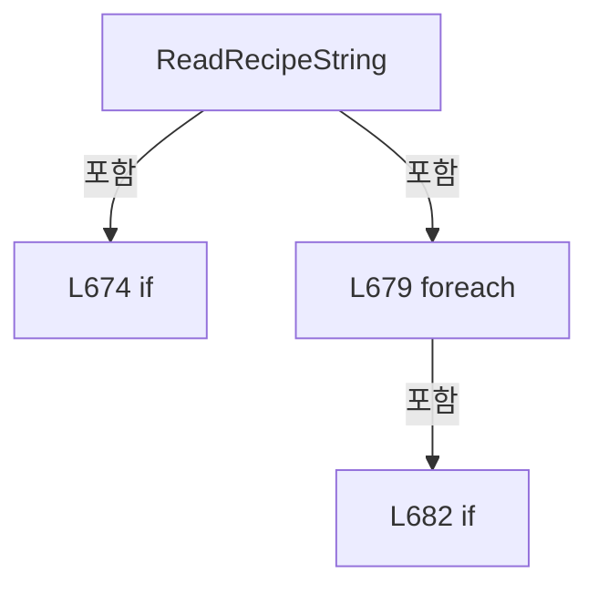

변경 전 점검: 입력/반환 타입, 위 호출자, 예외/취소 경로, 공유 상태와 저장·전송 소비자를 함께 확인합니다. 값의 단위나 물리 방향을 이름만으로 확정하지 않습니다.

### MethodDeclaration `ReadRecipeInt` · L691–691

[Drilling.UI/Menu/Menus/CMenuReview.cs:691–691](https://github.com/kjuws10-rgb/A3Drilling/blob/0219666f9053b907d96d7e0aa7d0c6c1be3a73d4/Drilling.UI/Menu/Menus/CMenuReview.cs#L691-L691)

| 항목 | 실제 추출 값 |
| --- | --- |
| 서명 | int Drilling.UI.Menu.Menus.CMenuReview.ReadRecipeInt(Drilling.Common.Managers.ST_RECIPE_DEFINITION, int, params string[]) |
| 접근/수식자 | Private / private, static |
| 반환/값 타입 | int |
| 소속 타입 | NamedType:Drilling.UI.Menu.Menus.CMenuReview |

입력 계약:

| 이름 | 타입 | 전달 | 선택/기본값 |
| --- | --- | --- | --- |
| recipe | Drilling.Common.Managers.ST_RECIPE_DEFINITION | None | False /  |
| fallback | int | None | False /  |
| keys | string[] | None | False /  |

정적 호출자로 확인된 위치:

| 호출 파일/행 | 호출 표현식 | 런타임 분기 가능 |
| --- | --- | --- |
| [Drilling.UI/Menu/Menus/CMenuReview.cs:694–694](https://github.com/kjuws10-rgb/A3Drilling/blob/0219666f9053b907d96d7e0aa7d0c6c1be3a73d4/Drilling.UI/Menu/Menus/CMenuReview.cs#L694-L694) | ReadRecipeInt | False |

호출하는 대상과 해석 범위:

| 원본 행 | 표현식 | 분석 상태 | 대상/소스 위치 |
| --- | --- | --- | --- |
| 691 | int.TryParse | resolved | bool int.TryParse(string?, System.Globalization.NumberStyles, System.IFormatProvider?, out int) |
| 691 | ReadRecipeString | resolved | string Drilling.UI.Menu.Menus.CMenuReview.ReadRecipeString(Drilling.Common.Managers.ST_RECIPE_DEFINITION?, params string[]) · Drilling.UI/Menu/Menus/CMenuReview.cs:672 |

본문의 실제 연산·분기·예외·반환 순서(원문 위치 순):

| 원본 행 | 종류 | 주석 해설 |
| --- | --- | --- |
| 691 | call | 함수·델리게이트 또는 객체 생성자를 호출합니다: int.TryParse(ReadRecipeString(recipe, keys), NumberStyles.Integer, CultureInfo.InvariantCulture, out var value) |
| 691 | call | 함수·델리게이트 또는 객체 생성자를 호출합니다: ReadRecipeString(recipe, keys) |
| 691 | conditional-expression | 조건에 따라 결과식을 선택합니다: int.TryParse(ReadRecipeString(recipe, keys), NumberStyles.Integer, CultureInfo.InvariantCulture, out var value) ? value : fallback |

변경 전 점검: 입력/반환 타입, 위 호출자, 예외/취소 경로, 공유 상태와 저장·전송 소비자를 함께 확인합니다. 값의 단위나 물리 방향을 이름만으로 확정하지 않습니다.

### MethodDeclaration `ApplySplitBeamContext` · L692–707

[Drilling.UI/Menu/Menus/CMenuReview.cs:692–707](https://github.com/kjuws10-rgb/A3Drilling/blob/0219666f9053b907d96d7e0aa7d0c6c1be3a73d4/Drilling.UI/Menu/Menus/CMenuReview.cs#L692-L707)

| 항목 | 실제 추출 값 |
| --- | --- |
| 서명 | void Drilling.UI.Menu.Menus.CMenuReview.ApplySplitBeamContext(Drilling.Common.Managers.ST_RECIPE_DEFINITION) |
| 접근/수식자 | Private / private |
| 반환/값 타입 | void |
| 소속 타입 | NamedType:Drilling.UI.Menu.Menus.CMenuReview |

입력 계약:

| 이름 | 타입 | 전달 | 선택/기본값 |
| --- | --- | --- | --- |
| recipe | Drilling.Common.Managers.ST_RECIPE_DEFINITION | None | False /  |

정적 호출자로 확인된 위치:

| 호출 파일/행 | 호출 표현식 | 런타임 분기 가능 |
| --- | --- | --- |
| [Drilling.UI/Menu/Menus/CMenuReview.cs:497–497](https://github.com/kjuws10-rgb/A3Drilling/blob/0219666f9053b907d96d7e0aa7d0c6c1be3a73d4/Drilling.UI/Menu/Menus/CMenuReview.cs#L497-L497) | ApplySplitBeamContext | False |
| [Drilling.UI/Menu/Menus/CMenuReview.cs:623–623](https://github.com/kjuws10-rgb/A3Drilling/blob/0219666f9053b907d96d7e0aa7d0c6c1be3a73d4/Drilling.UI/Menu/Menus/CMenuReview.cs#L623-L623) | ApplySplitBeamContext | False |
| [Drilling.UI/Menu/Menus/CMenuReview.cs:4261–4261](https://github.com/kjuws10-rgb/A3Drilling/blob/0219666f9053b907d96d7e0aa7d0c6c1be3a73d4/Drilling.UI/Menu/Menus/CMenuReview.cs#L4261-L4261) | ApplySplitBeamContext | False |

호출하는 대상과 해석 범위:

| 원본 행 | 표현식 | 분석 상태 | 대상/소스 위치 |
| --- | --- | --- | --- |
| 694 | ReadRecipeInt | resolved | int Drilling.UI.Menu.Menus.CMenuReview.ReadRecipeInt(Drilling.Common.Managers.ST_RECIPE_DEFINITION, int, params string[]) · Drilling.UI/Menu/Menus/CMenuReview.cs:691 |
| 695 | CCellPatternCalculator.IsSupportedSplitBeamCount | resolved | bool Drilling.Common.Recipe.CCellPatternCalculator.IsSupportedSplitBeamCount(int) · Drilling.Common/Recipe/CCellPatternCalculator.cs:15 |
| 701 | Math.Clamp | resolved | int System.Math.Clamp(int, int, int) |
| 702 | _selectedInspectionBeamNos.RemoveWhere | resolved | int System.Collections.Generic.HashSet<int>.RemoveWhere(System.Predicate<int>) |
| 705 | beams.RemoveWhere | resolved | int System.Collections.Generic.HashSet<int>.RemoveWhere(System.Predicate<int>) |

본문의 실제 연산·분기·예외·반환 순서(원문 위치 순):

| 원본 행 | 종류 | 주석 해설 |
| --- | --- | --- |
| 694 | assignment | 값을 대상에 대입합니다: _splitBeamCount = ReadRecipeInt(recipe, 1, "SPLITED_BEAM_COUNT") |
| 694 | call | 함수·델리게이트 또는 객체 생성자를 호출합니다: ReadRecipeInt(recipe, 1, "SPLITED_BEAM_COUNT") |
| 695 | call | 함수·델리게이트 또는 객체 생성자를 호출합니다: CCellPatternCalculator.IsSupportedSplitBeamCount(_splitBeamCount) |
| 695 | if | 조건에 따라 분기합니다: if (!CCellPatternCalculator.IsSupportedSplitBeamCount(_splitBeamCount)) |
| 697 | assignment | 값을 대상에 대입합니다: _splitBeamCount = 1 |
| 700 | local-declaration | 지역 변수를 선언합니다: var maximumBeamNo = _splitBeamCount * _splitBeamCount; |
| 700 | variable-initializer | 변수의 초기값을 지정합니다: maximumBeamNo = _splitBeamCount * _splitBeamCount |
| 701 | assignment | 값을 대상에 대입합니다: _selectedRunBeamNo = Math.Clamp(_selectedRunBeamNo, 1, maximumBeamNo) |
| 701 | call | 함수·델리게이트 또는 객체 생성자를 호출합니다: Math.Clamp(_selectedRunBeamNo, 1, maximumBeamNo) |
| 702 | call | 함수·델리게이트 또는 객체 생성자를 호출합니다: _selectedInspectionBeamNos.RemoveWhere(beamNo => beamNo < 1 &#124;&#124; beamNo > maximumBeamNo) |
| 703 | foreach | 컬렉션 요소를 순회합니다: foreach (var beams in _inspectionBeamNosByShotKey.Values) |
| 705 | call | 함수·델리게이트 또는 객체 생성자를 호출합니다: beams.RemoveWhere(beamNo => beamNo < 1 &#124;&#124; beamNo > maximumBeamNo) |

제어 구문의 포함 구조(실제 실행 순서/CFG가 아닌 구문 탐색 그림):


변경 전 점검: 입력/반환 타입, 위 호출자, 예외/취소 경로, 공유 상태와 저장·전송 소비자를 함께 확인합니다. 값의 단위나 물리 방향을 이름만으로 확정하지 않습니다.

### MethodDeclaration `SelectTab` · L709–745

[Drilling.UI/Menu/Menus/CMenuReview.cs:709–745](https://github.com/kjuws10-rgb/A3Drilling/blob/0219666f9053b907d96d7e0aa7d0c6c1be3a73d4/Drilling.UI/Menu/Menus/CMenuReview.cs#L709-L745)

| 항목 | 실제 추출 값 |
| --- | --- |
| 서명 | void Drilling.UI.Menu.Menus.CMenuReview.SelectTab(object?) |
| 접근/수식자 | Private / private |
| 반환/값 타입 | void |
| 소속 타입 | NamedType:Drilling.UI.Menu.Menus.CMenuReview |

입력 계약:

| 이름 | 타입 | 전달 | 선택/기본값 |
| --- | --- | --- | --- |
| parameter | object? | None | False /  |

현재 부분 분석에서 직접 연결된 호출자는 없습니다. XAML/이벤트/인터페이스·델리게이트·외부 진입을 추가 확인해야 하며, 미사용으로 판정한 것이 아닙니다.

호출하는 대상과 해석 범위:

| 원본 행 | 표현식 | 분석 상태 | 대상/소스 위치 |
| --- | --- | --- | --- |
| 711 | string.IsNullOrWhiteSpace | resolved | bool string.IsNullOrWhiteSpace(string?) |
| 721 | tab.Equals | resolved | bool string.Equals(string?, System.StringComparison) |
| 728 | _statusReporter | resolved · 동적 구현 선택 가능 | void System.Action<string>.Invoke(string) |
| 729 | CRecipeConfirmDialog.ShowWarning | resolved | void Drilling.UI.Popup.CRecipeConfirmDialog.ShowWarning(string, string, Window?) · Drilling.UI/Popup/CRecipeConfirmDialog.xaml.cs:110 |
| 733 | InvalidateBeamInspectionResultLoad | resolved | void Drilling.UI.Menu.Menus.CMenuReview.InvalidateBeamInspectionResultLoad(bool) · Drilling.UI/Menu/Menus/CMenuReview.cs:3632 |
| 742 | NotifyReviewExecutionCommandStates | resolved | void Drilling.UI.Menu.Menus.CMenuReview.NotifyReviewExecutionCommandStates(bool) · Drilling.UI/Menu/Menus/CMenuReview.cs:4398 |
| 743 | _statusReporter | resolved · 동적 구현 선택 가능 | void System.Action<string>.Invoke(string) |
| 744 | _refreshScreen | resolved · 동적 구현 선택 가능 | void System.Action.Invoke() |

본문의 실제 연산·분기·예외·반환 순서(원문 위치 순):

| 원본 행 | 종류 | 주석 해설 |
| --- | --- | --- |
| 711 | call | 함수·델리게이트 또는 객체 생성자를 호출합니다: string.IsNullOrWhiteSpace(tab) |
| 711 | if | 조건에 따라 분기합니다: if (parameter is not string tab &#124;&#124; string.IsNullOrWhiteSpace(tab)) |
| 713 | return | 호출자에게 값 또는 제어를 반환합니다: return; |
| 716 | if | 조건에 따라 분기합니다: if (tab != "RUN") |
| 718 | return | 호출자에게 값 또는 제어를 반환합니다: return; |
| 721 | call | 함수·델리게이트 또는 객체 생성자를 호출합니다: tab.Equals(_selectedTab, StringComparison.OrdinalIgnoreCase) |
| 721 | if | 조건에 따라 분기합니다: if (tab.Equals(_selectedTab, StringComparison.OrdinalIgnoreCase)) |
| 723 | return | 호출자에게 값 또는 제어를 반환합니다: return; |
| 726 | if | 조건에 따라 분기합니다: if (IsReviewExecutionActive) |
| 728 | call | 함수·델리게이트 또는 객체 생성자를 호출합니다: _statusReporter("Review is running. Stop the current review before changing the tab.") |
| 729 | call | 함수·델리게이트 또는 객체 생성자를 호출합니다: CRecipeConfirmDialog.ShowWarning("검사 진행 중", "검사를 중지한 후 탭을 변경해 주세요.") |
| 730 | return | 호출자에게 값 또는 제어를 반환합니다: return; |
| 733 | call | 함수·델리게이트 또는 객체 생성자를 호출합니다: InvalidateBeamInspectionResultLoad(clearLoaded: true) |
| 734 | assignment | 값을 대상에 대입합니다: _selectedTab = tab |
| 735 | if | 조건에 따라 분기합니다: if (IsSampleSelectTab) |
| 737 | assignment | 값을 대상에 대입합니다: _isSampleCellDetailVisible = false |
| 738 | assignment | 값을 대상에 대입합니다: _selectedMode = "SAMPLE SHOT" |
| 739 | assignment | 값을 대상에 대입합니다: _selectionRuleText = _selectedSampleRuleUi |
| 742 | call | 함수·델리게이트 또는 객체 생성자를 호출합니다: NotifyReviewExecutionCommandStates() |
| 743 | call | 함수·델리게이트 또는 객체 생성자를 호출합니다: _statusReporter($"Review tab selected: {_selectedTab}") |
| 744 | call | 함수·델리게이트 또는 객체 생성자를 호출합니다: _refreshScreen() |

제어 구문의 포함 구조(실제 실행 순서/CFG가 아닌 구문 탐색 그림):

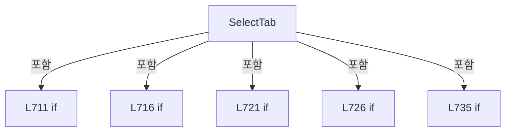

변경 전 점검: 입력/반환 타입, 위 호출자, 예외/취소 경로, 공유 상태와 저장·전송 소비자를 함께 확인합니다. 값의 단위나 물리 방향을 이름만으로 확정하지 않습니다.

### MethodDeclaration `SelectWorkspace` · L747–776

[Drilling.UI/Menu/Menus/CMenuReview.cs:747–776](https://github.com/kjuws10-rgb/A3Drilling/blob/0219666f9053b907d96d7e0aa7d0c6c1be3a73d4/Drilling.UI/Menu/Menus/CMenuReview.cs#L747-L776)

| 항목 | 실제 추출 값 |
| --- | --- |
| 서명 | void Drilling.UI.Menu.Menus.CMenuReview.SelectWorkspace(object?) |
| 접근/수식자 | Private / private |
| 반환/값 타입 | void |
| 소속 타입 | NamedType:Drilling.UI.Menu.Menus.CMenuReview |

입력 계약:

| 이름 | 타입 | 전달 | 선택/기본값 |
| --- | --- | --- | --- |
| parameter | object? | None | False /  |

현재 부분 분석에서 직접 연결된 호출자는 없습니다. XAML/이벤트/인터페이스·델리게이트·외부 진입을 추가 확인해야 하며, 미사용으로 판정한 것이 아닙니다.

호출하는 대상과 해석 범위:

| 원본 행 | 표현식 | 분석 상태 | 대상/소스 위치 |
| --- | --- | --- | --- |
| 754 | workspace.Trim().ToUpperInvariant | resolved | string string.ToUpperInvariant() |
| 754 | workspace.Trim | resolved | string string.Trim() |
| 756 | workspace.Equals | resolved | bool string.Equals(string?, System.StringComparison) |
| 763 | CRecipeConfirmDialog.ShowWarning | resolved | void Drilling.UI.Popup.CRecipeConfirmDialog.ShowWarning(string, string, Window?) · Drilling.UI/Popup/CRecipeConfirmDialog.xaml.cs:110 |
| 767 | SetWorkspace | resolved | void Drilling.UI.Menu.Menus.CMenuReview.SetWorkspace(string) · Drilling.UI/Menu/Menus/CMenuReview.cs:783 |
| 770 | RefreshInspectionResults | resolved | System.Threading.Tasks.Task Drilling.UI.Menu.Menus.CMenuReview.RefreshInspectionResults() · Drilling.UI/Menu/Menus/CMenuReview.cs:935 |
| 774 | RefreshInspectionRunMode | resolved | System.Threading.Tasks.Task Drilling.UI.Menu.Menus.CMenuReview.RefreshInspectionRunMode() · Drilling.UI/Menu/Menus/CMenuReview.cs:918 |

본문의 실제 연산·분기·예외·반환 순서(원문 위치 순):

| 원본 행 | 종류 | 주석 해설 |
| --- | --- | --- |
| 749 | if | 조건에 따라 분기합니다: if (parameter is not string workspace) |
| 751 | return | 호출자에게 값 또는 제어를 반환합니다: return; |
| 754 | assignment | 값을 대상에 대입합니다: workspace = workspace.Trim().ToUpperInvariant() |
| 754 | call | 함수·델리게이트 또는 객체 생성자를 호출합니다: workspace.Trim().ToUpperInvariant() |
| 754 | call | 함수·델리게이트 또는 객체 생성자를 호출합니다: workspace.Trim() |
| 755 | if | 조건에 따라 분기합니다: if (workspace is not ("RUN" or "RESULT") &#124;&#124; workspace.Equals(_selectedWorkspace, StringComparison.OrdinalIgnoreCase)) |
| 756 | call | 함수·델리게이트 또는 객체 생성자를 호출합니다: workspace.Equals(_selectedWorkspace, StringComparison.OrdinalIgnoreCase) |
| 758 | return | 호출자에게 값 또는 제어를 반환합니다: return; |
| 761 | if | 조건에 따라 분기합니다: if (IsInspectionNavigationLocked) |
| 763 | call | 함수·델리게이트 또는 객체 생성자를 호출합니다: CRecipeConfirmDialog.ShowWarning("검사 진행 중", "검사를 중지한 후 RUN / RESULT 화면을 변경해 주세요.") |
| 764 | return | 호출자에게 값 또는 제어를 반환합니다: return; |
| 767 | call | 함수·델리게이트 또는 객체 생성자를 호출합니다: SetWorkspace(workspace) |
| 768 | if | 조건에 따라 분기합니다: if (workspace == "RESULT") |
| 770 | assignment | 값을 대상에 대입합니다: _ = RefreshInspectionResults() |
| 770 | call | 함수·델리게이트 또는 객체 생성자를 호출합니다: RefreshInspectionResults() |
| 772 | else | 앞 조건이 거짓인 경로입니다: else |
| 772 | if | 조건에 따라 분기합니다: if (IsCorrectionInspectionMode) |
| 774 | assignment | 값을 대상에 대입합니다: _ = RefreshInspectionRunMode() |
| 774 | call | 함수·델리게이트 또는 객체 생성자를 호출합니다: RefreshInspectionRunMode() |

제어 구문의 포함 구조(실제 실행 순서/CFG가 아닌 구문 탐색 그림):

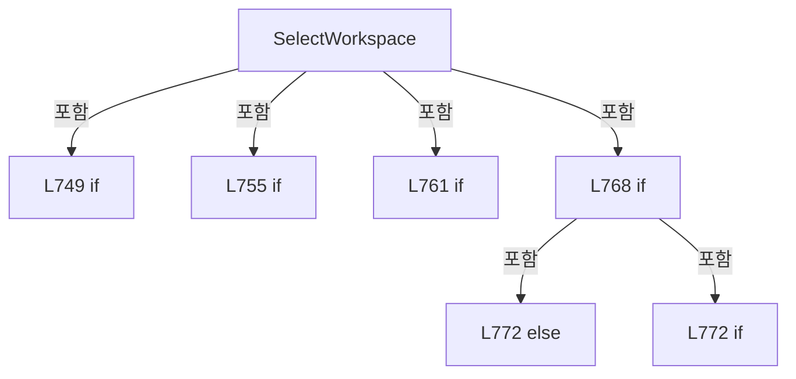

변경 전 점검: 입력/반환 타입, 위 호출자, 예외/취소 경로, 공유 상태와 저장·전송 소비자를 함께 확인합니다. 값의 단위나 물리 방향을 이름만으로 확정하지 않습니다.

### MethodDeclaration `ShowInspectionResultWorkspace` · L778–781

[Drilling.UI/Menu/Menus/CMenuReview.cs:778–781](https://github.com/kjuws10-rgb/A3Drilling/blob/0219666f9053b907d96d7e0aa7d0c6c1be3a73d4/Drilling.UI/Menu/Menus/CMenuReview.cs#L778-L781)

| 항목 | 실제 추출 값 |
| --- | --- |
| 서명 | void Drilling.UI.Menu.Menus.CMenuReview.ShowInspectionResultWorkspace() |
| 접근/수식자 | Public / public |
| 반환/값 타입 | void |
| 소속 타입 | NamedType:Drilling.UI.Menu.Menus.CMenuReview |

정적 호출자로 확인된 위치:

| 호출 파일/행 | 호출 표현식 | 런타임 분기 가능 |
| --- | --- | --- |
| [Drilling.UI/Menu/Menus/CMenuCorrection.cs:515–515](https://github.com/kjuws10-rgb/A3Drilling/blob/0219666f9053b907d96d7e0aa7d0c6c1be3a73d4/Drilling.UI/Menu/Menus/CMenuCorrection.cs#L515-L515) | .ShowInspectionResultWorkspace | False |

호출하는 대상과 해석 범위:

| 원본 행 | 표현식 | 분석 상태 | 대상/소스 위치 |
| --- | --- | --- | --- |
| 780 | SetWorkspace | resolved | void Drilling.UI.Menu.Menus.CMenuReview.SetWorkspace(string) · Drilling.UI/Menu/Menus/CMenuReview.cs:783 |

본문의 실제 연산·분기·예외·반환 순서(원문 위치 순):

| 원본 행 | 종류 | 주석 해설 |
| --- | --- | --- |
| 780 | call | 함수·델리게이트 또는 객체 생성자를 호출합니다: SetWorkspace("RESULT") |

변경 전 점검: 입력/반환 타입, 위 호출자, 예외/취소 경로, 공유 상태와 저장·전송 소비자를 함께 확인합니다. 값의 단위나 물리 방향을 이름만으로 확정하지 않습니다.

### MethodDeclaration `SetWorkspace` · L783–795

[Drilling.UI/Menu/Menus/CMenuReview.cs:783–795](https://github.com/kjuws10-rgb/A3Drilling/blob/0219666f9053b907d96d7e0aa7d0c6c1be3a73d4/Drilling.UI/Menu/Menus/CMenuReview.cs#L783-L795)

| 항목 | 실제 추출 값 |
| --- | --- |
| 서명 | void Drilling.UI.Menu.Menus.CMenuReview.SetWorkspace(string) |
| 접근/수식자 | Private / private |
| 반환/값 타입 | void |
| 소속 타입 | NamedType:Drilling.UI.Menu.Menus.CMenuReview |

입력 계약:

| 이름 | 타입 | 전달 | 선택/기본값 |
| --- | --- | --- | --- |
| workspace | string | None | False /  |

정적 호출자로 확인된 위치:

| 호출 파일/행 | 호출 표현식 | 런타임 분기 가능 |
| --- | --- | --- |
| [Drilling.UI/Menu/Menus/CMenuReview.cs:767–767](https://github.com/kjuws10-rgb/A3Drilling/blob/0219666f9053b907d96d7e0aa7d0c6c1be3a73d4/Drilling.UI/Menu/Menus/CMenuReview.cs#L767-L767) | SetWorkspace | False |
| [Drilling.UI/Menu/Menus/CMenuReview.cs:780–780](https://github.com/kjuws10-rgb/A3Drilling/blob/0219666f9053b907d96d7e0aa7d0c6c1be3a73d4/Drilling.UI/Menu/Menus/CMenuReview.cs#L780-L780) | SetWorkspace | False |

호출하는 대상과 해석 범위:

| 원본 행 | 표현식 | 분석 상태 | 대상/소스 위치 |
| --- | --- | --- | --- |
| 785 | workspace.Equals | resolved | bool string.Equals(string?, System.StringComparison) |
| 791 | OnPropertyChanged | resolved | void Drilling.UI.Menu.CBindingBase.OnPropertyChanged(string?) · Drilling.UI/Menu/CBindingBase.cs:790 |
| 791 | nameof | unresolved | None |
| 792 | OnPropertyChanged | resolved | void Drilling.UI.Menu.CBindingBase.OnPropertyChanged(string?) · Drilling.UI/Menu/CBindingBase.cs:790 |
| 792 | nameof | unresolved | None |
| 793 | SelectWorkspaceCommand.NotifyCanExecuteChanged | resolved | void Drilling.UI.Menu.CButtonCommand.NotifyCanExecuteChanged() · Drilling.UI/Menu/CButtonCommand.cs:24 |
| 794 | _statusReporter | resolved · 동적 구현 선택 가능 | void System.Action<string>.Invoke(string) |

본문의 실제 연산·분기·예외·반환 순서(원문 위치 순):

| 원본 행 | 종류 | 주석 해설 |
| --- | --- | --- |
| 785 | call | 함수·델리게이트 또는 객체 생성자를 호출합니다: workspace.Equals(_selectedWorkspace, StringComparison.OrdinalIgnoreCase) |
| 785 | if | 조건에 따라 분기합니다: if (workspace.Equals(_selectedWorkspace, StringComparison.OrdinalIgnoreCase)) |
| 787 | return | 호출자에게 값 또는 제어를 반환합니다: return; |
| 790 | assignment | 값을 대상에 대입합니다: _selectedWorkspace = workspace |
| 791 | call | 함수·델리게이트 또는 객체 생성자를 호출합니다: OnPropertyChanged(nameof(IsInspectionRunWorkspace)) |
| 791 | call | 함수·델리게이트 또는 객체 생성자를 호출합니다: nameof(IsInspectionRunWorkspace) |
| 792 | call | 함수·델리게이트 또는 객체 생성자를 호출합니다: OnPropertyChanged(nameof(IsInspectionResultWorkspace)) |
| 792 | call | 함수·델리게이트 또는 객체 생성자를 호출합니다: nameof(IsInspectionResultWorkspace) |
| 793 | call | 함수·델리게이트 또는 객체 생성자를 호출합니다: SelectWorkspaceCommand.NotifyCanExecuteChanged() |
| 794 | call | 함수·델리게이트 또는 객체 생성자를 호출합니다: _statusReporter($"Inspection workspace selected: {_selectedWorkspace}") |

제어 구문의 포함 구조(실제 실행 순서/CFG가 아닌 구문 탐색 그림):

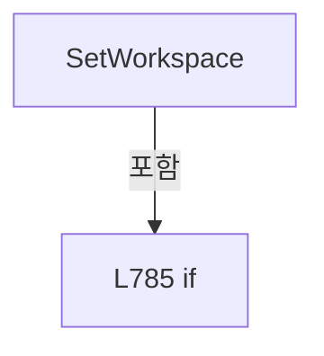

변경 전 점검: 입력/반환 타입, 위 호출자, 예외/취소 경로, 공유 상태와 저장·전송 소비자를 함께 확인합니다. 값의 단위나 물리 방향을 이름만으로 확정하지 않습니다.

### MethodDeclaration `SelectSampleRuleUi` · L797–810

[Drilling.UI/Menu/Menus/CMenuReview.cs:797–810](https://github.com/kjuws10-rgb/A3Drilling/blob/0219666f9053b907d96d7e0aa7d0c6c1be3a73d4/Drilling.UI/Menu/Menus/CMenuReview.cs#L797-L810)

| 항목 | 실제 추출 값 |
| --- | --- |
| 서명 | void Drilling.UI.Menu.Menus.CMenuReview.SelectSampleRuleUi(object?) |
| 접근/수식자 | Private / private |
| 반환/값 타입 | void |
| 소속 타입 | NamedType:Drilling.UI.Menu.Menus.CMenuReview |

입력 계약:

| 이름 | 타입 | 전달 | 선택/기본값 |
| --- | --- | --- | --- |
| parameter | object? | None | False /  |

현재 부분 분석에서 직접 연결된 호출자는 없습니다. XAML/이벤트/인터페이스·델리게이트·외부 진입을 추가 확인해야 하며, 미사용으로 판정한 것이 아닙니다.

호출하는 대상과 해석 범위:

| 원본 행 | 표현식 | 분석 상태 | 대상/소스 위치 |
| --- | --- | --- | --- |
| 799 | .ToString | resolved · 동적 구현 선택 가능 | string? object.ToString() |
| 799 | .Trim().ToUpperInvariant | resolved | string string.ToUpperInvariant() |
| 799 | .Trim | resolved | string string.Trim() |
| 805 | _selectedSampleShotKeys.Clear | resolved | void System.Collections.Generic.HashSet<string>.Clear() |
| 808 | _statusReporter | resolved · 동적 구현 선택 가능 | void System.Action<string>.Invoke(string) |
| 809 | RefreshSampleRuleUi | resolved | void Drilling.UI.Menu.Menus.CMenuReview.RefreshSampleRuleUi() · Drilling.UI/Menu/Menus/CMenuReview.cs:1073 |

본문의 실제 연산·분기·예외·반환 순서(원문 위치 순):

| 원본 행 | 종류 | 주석 해설 |
| --- | --- | --- |
| 799 | call | 함수·델리게이트 또는 객체 생성자를 호출합니다: .ToString() |
| 799 | call | 함수·델리게이트 또는 객체 생성자를 호출합니다: .Trim().ToUpperInvariant() |
| 799 | call | 함수·델리게이트 또는 객체 생성자를 호출합니다: .Trim() |
| 799 | local-declaration | 지역 변수를 선언합니다: var rule = parameter?.ToString()?.Trim().ToUpperInvariant(); |
| 799 | variable-initializer | 변수의 초기값을 지정합니다: rule = parameter?.ToString()?.Trim().ToUpperInvariant() |
| 800 | if | 조건에 따라 분기합니다: if (rule is not ("ROUGH" or "FINE") &#124;&#124; rule == _selectedSampleRuleUi) |
| 801 | return | 호출자에게 값 또는 제어를 반환합니다: return; |
| 802 | assignment | 값을 대상에 대입합니다: _selectedSampleRuleUi = rule |
| 803 | assignment | 값을 대상에 대입합니다: _lastCorrectionRulePlan = null |
| 804 | assignment | 값을 대상에 대입합니다: _isSampleCellDetailVisible = false |
| 805 | call | 함수·델리게이트 또는 객체 생성자를 호출합니다: _selectedSampleShotKeys.Clear() |
| 806 | assignment | 값을 대상에 대입합니다: _selectedMode = "SAMPLE SHOT" |
| 807 | assignment | 값을 대상에 대입합니다: _selectionRuleText = rule |
| 808 | call | 함수·델리게이트 또는 객체 생성자를 호출합니다: _statusReporter($"Review correction rule selected: {rule}") |
| 809 | call | 함수·델리게이트 또는 객체 생성자를 호출합니다: RefreshSampleRuleUi() |

제어 구문의 포함 구조(실제 실행 순서/CFG가 아닌 구문 탐색 그림):

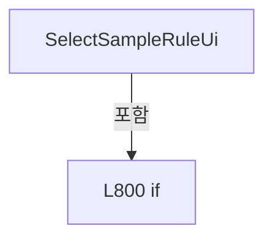

변경 전 점검: 입력/반환 타입, 위 호출자, 예외/취소 경로, 공유 상태와 저장·전송 소비자를 함께 확인합니다. 값의 단위나 물리 방향을 이름만으로 확정하지 않습니다.

### MethodDeclaration `SelectSampleRuleScope` · L812–820

[Drilling.UI/Menu/Menus/CMenuReview.cs:812–820](https://github.com/kjuws10-rgb/A3Drilling/blob/0219666f9053b907d96d7e0aa7d0c6c1be3a73d4/Drilling.UI/Menu/Menus/CMenuReview.cs#L812-L820)

| 항목 | 실제 추출 값 |
| --- | --- |
| 서명 | void Drilling.UI.Menu.Menus.CMenuReview.SelectSampleRuleScope(object?) |
| 접근/수식자 | Private / private |
| 반환/값 타입 | void |
| 소속 타입 | NamedType:Drilling.UI.Menu.Menus.CMenuReview |

입력 계약:

| 이름 | 타입 | 전달 | 선택/기본값 |
| --- | --- | --- | --- |
| parameter | object? | None | False /  |

현재 부분 분석에서 직접 연결된 호출자는 없습니다. XAML/이벤트/인터페이스·델리게이트·외부 진입을 추가 확인해야 하며, 미사용으로 판정한 것이 아닙니다.

호출하는 대상과 해석 범위:

| 원본 행 | 표현식 | 분석 상태 | 대상/소스 위치 |
| --- | --- | --- | --- |
| 814 | .ToString | resolved · 동적 구현 선택 가능 | string? object.ToString() |
| 814 | .Trim().ToUpperInvariant | resolved | string string.ToUpperInvariant() |
| 814 | .Trim | resolved | string string.Trim() |
| 819 | RefreshSampleRuleUi | resolved | void Drilling.UI.Menu.Menus.CMenuReview.RefreshSampleRuleUi() · Drilling.UI/Menu/Menus/CMenuReview.cs:1073 |

본문의 실제 연산·분기·예외·반환 순서(원문 위치 순):

| 원본 행 | 종류 | 주석 해설 |
| --- | --- | --- |
| 814 | call | 함수·델리게이트 또는 객체 생성자를 호출합니다: .ToString() |
| 814 | call | 함수·델리게이트 또는 객체 생성자를 호출합니다: .Trim().ToUpperInvariant() |
| 814 | call | 함수·델리게이트 또는 객체 생성자를 호출합니다: .Trim() |
| 814 | local-declaration | 지역 변수를 선언합니다: var scope = parameter?.ToString()?.Trim().ToUpperInvariant(); |
| 814 | variable-initializer | 변수의 초기값을 지정합니다: scope = parameter?.ToString()?.Trim().ToUpperInvariant() |
| 815 | if | 조건에 따라 분기합니다: if (scope is not ("HEAD" or "HEAD_CELL") &#124;&#124; scope == _sampleRuleScope) |
| 816 | return | 호출자에게 값 또는 제어를 반환합니다: return; |
| 817 | assignment | 값을 대상에 대입합니다: _sampleRuleScope = scope |
| 818 | assignment | 값을 대상에 대입합니다: _lastCorrectionRulePlan = null |
| 819 | call | 함수·델리게이트 또는 객체 생성자를 호출합니다: RefreshSampleRuleUi() |

제어 구문의 포함 구조(실제 실행 순서/CFG가 아닌 구문 탐색 그림):

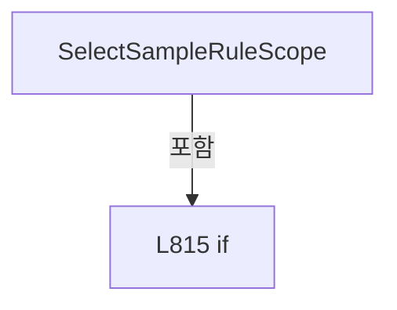

변경 전 점검: 입력/반환 타입, 위 호출자, 예외/취소 경로, 공유 상태와 저장·전송 소비자를 함께 확인합니다. 값의 단위나 물리 방향을 이름만으로 확정하지 않습니다.

### MethodDeclaration `SelectRoughReference` · L822–830

[Drilling.UI/Menu/Menus/CMenuReview.cs:822–830](https://github.com/kjuws10-rgb/A3Drilling/blob/0219666f9053b907d96d7e0aa7d0c6c1be3a73d4/Drilling.UI/Menu/Menus/CMenuReview.cs#L822-L830)

| 항목 | 실제 추출 값 |
| --- | --- |
| 서명 | void Drilling.UI.Menu.Menus.CMenuReview.SelectRoughReference(object?) |
| 접근/수식자 | Private / private |
| 반환/값 타입 | void |
| 소속 타입 | NamedType:Drilling.UI.Menu.Menus.CMenuReview |

입력 계약:

| 이름 | 타입 | 전달 | 선택/기본값 |
| --- | --- | --- | --- |
| parameter | object? | None | False /  |

현재 부분 분석에서 직접 연결된 호출자는 없습니다. XAML/이벤트/인터페이스·델리게이트·외부 진입을 추가 확인해야 하며, 미사용으로 판정한 것이 아닙니다.

호출하는 대상과 해석 범위:

| 원본 행 | 표현식 | 분석 상태 | 대상/소스 위치 |
| --- | --- | --- | --- |
| 824 | .ToString | resolved · 동적 구현 선택 가능 | string? object.ToString() |
| 824 | .Trim().ToUpperInvariant | resolved | string string.ToUpperInvariant() |
| 824 | .Trim | resolved | string string.Trim() |
| 829 | RefreshSampleRuleUi | resolved | void Drilling.UI.Menu.Menus.CMenuReview.RefreshSampleRuleUi() · Drilling.UI/Menu/Menus/CMenuReview.cs:1073 |

본문의 실제 연산·분기·예외·반환 순서(원문 위치 순):

| 원본 행 | 종류 | 주석 해설 |
| --- | --- | --- |
| 824 | call | 함수·델리게이트 또는 객체 생성자를 호출합니다: .ToString() |
| 824 | call | 함수·델리게이트 또는 객체 생성자를 호출합니다: .Trim().ToUpperInvariant() |
| 824 | call | 함수·델리게이트 또는 객체 생성자를 호출합니다: .Trim() |
| 824 | local-declaration | 지역 변수를 선언합니다: var reference = parameter?.ToString()?.Trim().ToUpperInvariant(); |
| 824 | variable-initializer | 변수의 초기값을 지정합니다: reference = parameter?.ToString()?.Trim().ToUpperInvariant() |
| 825 | if | 조건에 따라 분기합니다: if (reference is not ("FIRST" or "CENTER" or "LAST") &#124;&#124; reference == _roughReference) |
| 826 | return | 호출자에게 값 또는 제어를 반환합니다: return; |
| 827 | assignment | 값을 대상에 대입합니다: _roughReference = reference |
| 828 | assignment | 값을 대상에 대입합니다: _lastCorrectionRulePlan = null |
| 829 | call | 함수·델리게이트 또는 객체 생성자를 호출합니다: RefreshSampleRuleUi() |

제어 구문의 포함 구조(실제 실행 순서/CFG가 아닌 구문 탐색 그림):

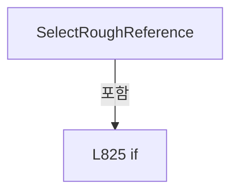

변경 전 점검: 입력/반환 타입, 위 호출자, 예외/취소 경로, 공유 상태와 저장·전송 소비자를 함께 확인합니다. 값의 단위나 물리 방향을 이름만으로 확정하지 않습니다.

### MethodDeclaration `SelectFineLineCount` · L832–839

[Drilling.UI/Menu/Menus/CMenuReview.cs:832–839](https://github.com/kjuws10-rgb/A3Drilling/blob/0219666f9053b907d96d7e0aa7d0c6c1be3a73d4/Drilling.UI/Menu/Menus/CMenuReview.cs#L832-L839)

| 항목 | 실제 추출 값 |
| --- | --- |
| 서명 | void Drilling.UI.Menu.Menus.CMenuReview.SelectFineLineCount(object?) |
| 접근/수식자 | Private / private |
| 반환/값 타입 | void |
| 소속 타입 | NamedType:Drilling.UI.Menu.Menus.CMenuReview |

입력 계약:

| 이름 | 타입 | 전달 | 선택/기본값 |
| --- | --- | --- | --- |
| parameter | object? | None | False /  |

현재 부분 분석에서 직접 연결된 호출자는 없습니다. XAML/이벤트/인터페이스·델리게이트·외부 진입을 추가 확인해야 하며, 미사용으로 판정한 것이 아닙니다.

호출하는 대상과 해석 범위:

| 원본 행 | 표현식 | 분석 상태 | 대상/소스 위치 |
| --- | --- | --- | --- |
| 834 | int.TryParse | resolved | bool int.TryParse(string?, System.Globalization.NumberStyles, System.IFormatProvider?, out int) |
| 834 | .ToString | resolved · 동적 구현 선택 가능 | string? object.ToString() |
| 838 | RefreshSampleRuleUi | resolved | void Drilling.UI.Menu.Menus.CMenuReview.RefreshSampleRuleUi() · Drilling.UI/Menu/Menus/CMenuReview.cs:1073 |

본문의 실제 연산·분기·예외·반환 순서(원문 위치 순):

| 원본 행 | 종류 | 주석 해설 |
| --- | --- | --- |
| 834 | call | 함수·델리게이트 또는 객체 생성자를 호출합니다: int.TryParse(parameter?.ToString(), NumberStyles.Integer, CultureInfo.InvariantCulture, out var count) |
| 834 | call | 함수·델리게이트 또는 객체 생성자를 호출합니다: .ToString() |
| 834 | if | 조건에 따라 분기합니다: if (!int.TryParse(parameter?.ToString(), NumberStyles.Integer, CultureInfo.InvariantCulture, out var count) &#124;&#124; count is not (1 or 3 or 5 or 7) &#124;&#124; count == _fineLineCount) |
| 835 | return | 호출자에게 값 또는 제어를 반환합니다: return; |
| 836 | assignment | 값을 대상에 대입합니다: _fineLineCount = count |
| 837 | assignment | 값을 대상에 대입합니다: _lastCorrectionRulePlan = null |
| 838 | call | 함수·델리게이트 또는 객체 생성자를 호출합니다: RefreshSampleRuleUi() |

제어 구문의 포함 구조(실제 실행 순서/CFG가 아닌 구문 탐색 그림):

```mermaid
flowchart TD
 M["SelectFineLineCount"]
 N0["L834 if"]
 M -->|포함| N0
```

변경 전 점검: 입력/반환 타입, 위 호출자, 예외/취소 경로, 공유 상태와 저장·전송 소비자를 함께 확인합니다. 값의 단위나 물리 방향을 이름만으로 확정하지 않습니다.

### MethodDeclaration `SelectMode` · L841–916

[Drilling.UI/Menu/Menus/CMenuReview.cs:841–916](https://github.com/kjuws10-rgb/A3Drilling/blob/0219666f9053b907d96d7e0aa7d0c6c1be3a73d4/Drilling.UI/Menu/Menus/CMenuReview.cs#L841-L916)

| 항목 | 실제 추출 값 |
| --- | --- |
| 서명 | void Drilling.UI.Menu.Menus.CMenuReview.SelectMode(object?) |
| 접근/수식자 | Private / private |
| 반환/값 타입 | void |
| 소속 타입 | NamedType:Drilling.UI.Menu.Menus.CMenuReview |

입력 계약:

| 이름 | 타입 | 전달 | 선택/기본값 |
| --- | --- | --- | --- |
| parameter | object? | None | False /  |

현재 부분 분석에서 직접 연결된 호출자는 없습니다. XAML/이벤트/인터페이스·델리게이트·외부 진입을 추가 확인해야 하며, 미사용으로 판정한 것이 아닙니다.

호출하는 대상과 해석 범위:

| 원본 행 | 표현식 | 분석 상태 | 대상/소스 위치 |
| --- | --- | --- | --- |
| 845 | _statusReporter | resolved · 동적 구현 선택 가능 | void System.Action<string>.Invoke(string) |
| 849 | string.IsNullOrWhiteSpace | resolved | bool string.IsNullOrWhiteSpace(string?) |
| 854 | mode.Trim().ToUpperInvariant | resolved | string string.ToUpperInvariant() |
| 854 | mode.Trim | resolved | string string.Trim() |
| 857 | InvalidateBeamInspectionResultLoad | resolved | void Drilling.UI.Menu.Menus.CMenuReview.InvalidateBeamInspectionResultLoad(bool) · Drilling.UI/Menu/Menus/CMenuReview.cs:3632 |
| 858 | InvalidateRunReviewResultLoad | resolved | void Drilling.UI.Menu.Menus.CMenuReview.InvalidateRunReviewResultLoad(bool) · Drilling.UI/Menu/Menus/CMenuReview.cs:2871 |
| 860 | mode.Trim().ToUpperInvariant | resolved | string string.ToUpperInvariant() |
| 860 | mode.Trim | resolved | string string.Trim() |
| 875 | _selectedLineShotKeys.Clear | resolved | void System.Collections.Generic.HashSet<string>.Clear() |
| 876 | SynchronizeActiveInspectionBeamSelection | resolved | void Drilling.UI.Menu.Menus.CMenuReview.SynchronizeActiveInspectionBeamSelection() · Drilling.UI/Menu/Menus/CMenuReview.cs:3210 |
| 877 | RefreshOneShotSelection | resolved | void Drilling.UI.Menu.Menus.CMenuReview.RefreshOneShotSelection(bool) · Drilling.UI/Menu/Menus/CMenuReview.cs:3716 |
| 878 | OnPropertyChanged | resolved | void Drilling.UI.Menu.CBindingBase.OnPropertyChanged(string?) · Drilling.UI/Menu/CBindingBase.cs:790 |
| 878 | nameof | unresolved | None |
| 879 | OnPropertyChanged | resolved | void Drilling.UI.Menu.CBindingBase.OnPropertyChanged(string?) · Drilling.UI/Menu/CBindingBase.cs:790 |
| 879 | nameof | unresolved | None |
| 880 | OnPropertyChanged | resolved | void Drilling.UI.Menu.CBindingBase.OnPropertyChanged(string?) · Drilling.UI/Menu/CBindingBase.cs:790 |
| 880 | nameof | unresolved | None |
| 881 | _statusReporter | resolved · 동적 구현 선택 가능 | void System.Action<string>.Invoke(string) |
| 882 | OnPropertyChanged | resolved | void Drilling.UI.Menu.CBindingBase.OnPropertyChanged(string?) · Drilling.UI/Menu/CBindingBase.cs:790 |
| 882 | nameof | unresolved | None |
| 883 | OnPropertyChanged | resolved | void Drilling.UI.Menu.CBindingBase.OnPropertyChanged(string?) · Drilling.UI/Menu/CBindingBase.cs:790 |
| 883 | nameof | unresolved | None |
| 884 | OnPropertyChanged | resolved | void Drilling.UI.Menu.CBindingBase.OnPropertyChanged(string?) · Drilling.UI/Menu/CBindingBase.cs:790 |
| 884 | nameof | unresolved | None |
| 885 | OnPropertyChanged | resolved | void Drilling.UI.Menu.CBindingBase.OnPropertyChanged(string?) · Drilling.UI/Menu/CBindingBase.cs:790 |
| 885 | nameof | unresolved | None |
| 886 | OnPropertyChanged | resolved | void Drilling.UI.Menu.CBindingBase.OnPropertyChanged(string?) · Drilling.UI/Menu/CBindingBase.cs:790 |
| 886 | nameof | unresolved | None |
| 887 | OnPropertyChanged | resolved | void Drilling.UI.Menu.CBindingBase.OnPropertyChanged(string?) · Drilling.UI/Menu/CBindingBase.cs:790 |
| 887 | nameof | unresolved | None |
| 888 | OnPropertyChanged | resolved | void Drilling.UI.Menu.CBindingBase.OnPropertyChanged(string?) · Drilling.UI/Menu/CBindingBase.cs:790 |
| 888 | nameof | unresolved | None |
| 889 | OnPropertyChanged | resolved | void Drilling.UI.Menu.CBindingBase.OnPropertyChanged(string?) · Drilling.UI/Menu/CBindingBase.cs:790 |
| 889 | nameof | unresolved | None |
| 890 | OnPropertyChanged | resolved | void Drilling.UI.Menu.CBindingBase.OnPropertyChanged(string?) · Drilling.UI/Menu/CBindingBase.cs:790 |
| 890 | nameof | unresolved | None |
| 891 | OnPropertyChanged | resolved | void Drilling.UI.Menu.CBindingBase.OnPropertyChanged(string?) · Drilling.UI/Menu/CBindingBase.cs:790 |
| 891 | nameof | unresolved | None |
| 892 | OnPropertyChanged | resolved | void Drilling.UI.Menu.CBindingBase.OnPropertyChanged(string?) · Drilling.UI/Menu/CBindingBase.cs:790 |
| 892 | nameof | unresolved | None |
| 893 | OnPropertyChanged | resolved | void Drilling.UI.Menu.CBindingBase.OnPropertyChanged(string?) · Drilling.UI/Menu/CBindingBase.cs:790 |
| 893 | nameof | unresolved | None |
| 894 | OnPropertyChanged | resolved | void Drilling.UI.Menu.CBindingBase.OnPropertyChanged(string?) · Drilling.UI/Menu/CBindingBase.cs:790 |
| 894 | nameof | unresolved | None |
| 895 | OnPropertyChanged | resolved | void Drilling.UI.Menu.CBindingBase.OnPropertyChanged(string?) · Drilling.UI/Menu/CBindingBase.cs:790 |
| 895 | nameof | unresolved | None |
| 896 | OnPropertyChanged | resolved | void Drilling.UI.Menu.CBindingBase.OnPropertyChanged(string?) · Drilling.UI/Menu/CBindingBase.cs:790 |
| 896 | nameof | unresolved | None |
| 897 | OnPropertyChanged | resolved | void Drilling.UI.Menu.CBindingBase.OnPropertyChanged(string?) · Drilling.UI/Menu/CBindingBase.cs:790 |
| 897 | nameof | unresolved | None |
| 898 | OnPropertyChanged | resolved | void Drilling.UI.Menu.CBindingBase.OnPropertyChanged(string?) · Drilling.UI/Menu/CBindingBase.cs:790 |
| 898 | nameof | unresolved | None |
| 899 | OnPropertyChanged | resolved | void Drilling.UI.Menu.CBindingBase.OnPropertyChanged(string?) · Drilling.UI/Menu/CBindingBase.cs:790 |
| 899 | nameof | unresolved | None |
| 900 | SelectRunCellCommand.NotifyCanExecuteChanged | resolved | void Drilling.UI.Menu.CButtonCommand.NotifyCanExecuteChanged() · Drilling.UI/Menu/CButtonCommand.cs:24 |
| 903 | NotifyReviewExecutionCommandStates | resolved | void Drilling.UI.Menu.Menus.CMenuReview.NotifyReviewExecutionCommandStates(bool) · Drilling.UI/Menu/Menus/CMenuReview.cs:4398 |
| 906 | RefreshRunDisplayFromCachedContext | resolved | void Drilling.UI.Menu.Menus.CMenuReview.RefreshRunDisplayFromCachedContext(bool) · Drilling.UI/Menu/Menus/CMenuReview.cs:4516 |
| 910 | RefreshInspectionRunMode | resolved | System.Threading.Tasks.Task Drilling.UI.Menu.Menus.CMenuReview.RefreshInspectionRunMode() · Drilling.UI/Menu/Menus/CMenuReview.cs:918 |
| 914 | RefreshInspectionResults | resolved | System.Threading.Tasks.Task Drilling.UI.Menu.Menus.CMenuReview.RefreshInspectionResults() · Drilling.UI/Menu/Menus/CMenuReview.cs:935 |

본문의 실제 연산·분기·예외·반환 순서(원문 위치 순):

| 원본 행 | 종류 | 주석 해설 |
| --- | --- | --- |
| 843 | if | 조건에 따라 분기합니다: if (IsInspectionNavigationLocked) |
| 845 | call | 함수·델리게이트 또는 객체 생성자를 호출합니다: _statusReporter("Review is running. Stop the current review before changing the mode.") |
| 846 | return | 호출자에게 값 또는 제어를 반환합니다: return; |
| 849 | call | 함수·델리게이트 또는 객체 생성자를 호출합니다: string.IsNullOrWhiteSpace(mode) |
| 849 | if | 조건에 따라 분기합니다: if (parameter is not string mode &#124;&#124; string.IsNullOrWhiteSpace(mode)) |
| 851 | return | 호출자에게 값 또는 제어를 반환합니다: return; |
| 854 | assignment | 값을 대상에 대입합니다: mode = mode.Trim().ToUpperInvariant() |
| 854 | call | 함수·델리게이트 또는 객체 생성자를 호출합니다: mode.Trim().ToUpperInvariant() |
| 854 | call | 함수·델리게이트 또는 객체 생성자를 호출합니다: mode.Trim() |
| 855 | if | 조건에 따라 분기합니다: if (mode is not ("ALL SHOT" or "ONE SHOT" or "ONE LINE" or "BEAM INSPECTION" or "ROUGH" or "FINE")) |
| 856 | return | 호출자에게 값 또는 제어를 반환합니다: return; |
| 857 | call | 함수·델리게이트 또는 객체 생성자를 호출합니다: InvalidateBeamInspectionResultLoad(clearLoaded: true) |
| 858 | call | 함수·델리게이트 또는 객체 생성자를 호출합니다: InvalidateRunReviewResultLoad(clearLoaded: true) |
| 859 | assignment | 값을 대상에 대입합니다: _selectedMode = mode |
| 860 | call | 함수·델리게이트 또는 객체 생성자를 호출합니다: mode.Trim().ToUpperInvariant() |
| 860 | call | 함수·델리게이트 또는 객체 생성자를 호출합니다: mode.Trim() |
| 860 | assignment | 값을 대상에 대입합니다: _selectedRuleType = mode.Trim().ToUpperInvariant() switch { "ALL SHOT" => EN_REVIEW_RULE_TYPE.AllPoint, "ZERO DEFENSE" => EN_REVIEW_RULE_TYPE.ZeroLine, _ => EN_REVIEW_RULE_TYPE.SamplePoint } |
| 860 | switch-expression | 값별 결과식을 선택합니다: mode.Trim().ToUpperInvariant() switch { "ALL SHOT" => EN_REVIEW_RULE_TYPE.AllPoint, "ZERO DEFENSE" => EN_REVIEW_RULE_TYPE.ZeroLine, _ => EN_REVIEW_RULE_TYPE.SamplePoint } |
| 866 | assignment | 값을 대상에 대입합니다: _selectionRuleText = _selectedRuleType switch { EN_REVIEW_RULE_TYPE.AllPoint => "All Shot", EN_REVIEW_RULE_TYPE.ZeroLine => "0-Line", _ when mode == "ONE LINE" => "Selected Glass Line", _ => _selectionRuleText is "All Shot" or "0- |
| 866 | switch-expression | 값별 결과식을 선택합니다: _selectedRuleType switch { EN_REVIEW_RULE_TYPE.AllPoint => "All Shot", EN_REVIEW_RULE_TYPE.ZeroLine => "0-Line", _ when mode == "ONE LINE" => "Selected Glass Line", _ => _selectionRuleText is "All Shot" or "0-Line" or "Selected Gl |
| 871 | conditional-expression | 조건에 따라 결과식을 선택합니다: _selectionRuleText is "All Shot" or "0-Line" or "Selected Glass Line" ? "Manual Sample" : _selectionRuleText |
| 873 | assignment | 값을 대상에 대입합니다: _selectedRunShotKey = "" |
| 874 | assignment | 값을 대상에 대입합니다: _runtimeBrowseShotKey = "" |
| 875 | call | 함수·델리게이트 또는 객체 생성자를 호출합니다: _selectedLineShotKeys.Clear() |
| 876 | call | 함수·델리게이트 또는 객체 생성자를 호출합니다: SynchronizeActiveInspectionBeamSelection() |
| 877 | call | 함수·델리게이트 또는 객체 생성자를 호출합니다: RefreshOneShotSelection(clearResult: true) |
| 878 | call | 함수·델리게이트 또는 객체 생성자를 호출합니다: OnPropertyChanged(nameof(IsShotSelectionMode)) |
| 878 | call | 함수·델리게이트 또는 객체 생성자를 호출합니다: nameof(IsShotSelectionMode) |
| 879 | call | 함수·델리게이트 또는 객체 생성자를 호출합니다: OnPropertyChanged(nameof(IsReviewHeadCardsVisible)) |
| 879 | call | 함수·델리게이트 또는 객체 생성자를 호출합니다: nameof(IsReviewHeadCardsVisible) |
| 880 | call | 함수·델리게이트 또는 객체 생성자를 호출합니다: OnPropertyChanged(nameof(InspectionHeadRows)) |
| 880 | call | 함수·델리게이트 또는 객체 생성자를 호출합니다: nameof(InspectionHeadRows) |
| 881 | call | 함수·델리게이트 또는 객체 생성자를 호출합니다: _statusReporter($"Review mode selected: {_selectedMode}") |
| 882 | call | 함수·델리게이트 또는 객체 생성자를 호출합니다: OnPropertyChanged(nameof(IsAllShotReviewMode)) |
| 882 | call | 함수·델리게이트 또는 객체 생성자를 호출합니다: nameof(IsAllShotReviewMode) |
| 883 | call | 함수·델리게이트 또는 객체 생성자를 호출합니다: OnPropertyChanged(nameof(IsOneLineReviewMode)) |
| 883 | call | 함수·델리게이트 또는 객체 생성자를 호출합니다: nameof(IsOneLineReviewMode) |
| 884 | call | 함수·델리게이트 또는 객체 생성자를 호출합니다: OnPropertyChanged(nameof(IsAllShotStyleReviewMode)) |
| 884 | call | 함수·델리게이트 또는 객체 생성자를 호출합니다: nameof(IsAllShotStyleReviewMode) |
| 885 | call | 함수·델리게이트 또는 객체 생성자를 호출합니다: OnPropertyChanged(nameof(IsOneShotReviewMode)) |
| 885 | call | 함수·델리게이트 또는 객체 생성자를 호출합니다: nameof(IsOneShotReviewMode) |
| 886 | call | 함수·델리게이트 또는 객체 생성자를 호출합니다: OnPropertyChanged(nameof(IsShotInspectionOngoing)) |
| 886 | call | 함수·델리게이트 또는 객체 생성자를 호출합니다: nameof(IsShotInspectionOngoing) |
| 887 | call | 함수·델리게이트 또는 객체 생성자를 호출합니다: OnPropertyChanged(nameof(IsRunStageStatusVisible)) |
| 887 | call | 함수·델리게이트 또는 객체 생성자를 호출합니다: nameof(IsRunStageStatusVisible) |
| 888 | call | 함수·델리게이트 또는 객체 생성자를 호출합니다: OnPropertyChanged(nameof(IsRunCommandsVisible)) |
| 888 | call | 함수·델리게이트 또는 객체 생성자를 호출합니다: nameof(IsRunCommandsVisible) |
| 889 | call | 함수·델리게이트 또는 객체 생성자를 호출합니다: OnPropertyChanged(nameof(IsRuleReviewMode)) |
| 889 | call | 함수·델리게이트 또는 객체 생성자를 호출합니다: nameof(IsRuleReviewMode) |
| 890 | call | 함수·델리게이트 또는 객체 생성자를 호출합니다: OnPropertyChanged(nameof(IsBeamInspectionMode)) |
| 890 | call | 함수·델리게이트 또는 객체 생성자를 호출합니다: nameof(IsBeamInspectionMode) |
| 891 | call | 함수·델리게이트 또는 객체 생성자를 호출합니다: OnPropertyChanged(nameof(IsRoughInspectionMode)) |
| 891 | call | 함수·델리게이트 또는 객체 생성자를 호출합니다: nameof(IsRoughInspectionMode) |
| 892 | call | 함수·델리게이트 또는 객체 생성자를 호출합니다: OnPropertyChanged(nameof(IsFineInspectionMode)) |
| 892 | call | 함수·델리게이트 또는 객체 생성자를 호출합니다: nameof(IsFineInspectionMode) |
| 893 | call | 함수·델리게이트 또는 객체 생성자를 호출합니다: OnPropertyChanged(nameof(IsCorrectionInspectionMode)) |
| 893 | call | 함수·델리게이트 또는 객체 생성자를 호출합니다: nameof(IsCorrectionInspectionMode) |
| 894 | call | 함수·델리게이트 또는 객체 생성자를 호출합니다: OnPropertyChanged(nameof(IsStandardInspectionMode)) |
| 894 | call | 함수·델리게이트 또는 객체 생성자를 호출합니다: nameof(IsStandardInspectionMode) |
| 895 | call | 함수·델리게이트 또는 객체 생성자를 호출합니다: OnPropertyChanged(nameof(SelectedInspectionResultType)) |
| 895 | call | 함수·델리게이트 또는 객체 생성자를 호출합니다: nameof(SelectedInspectionResultType) |
| 896 | call | 함수·델리게이트 또는 객체 생성자를 호출합니다: OnPropertyChanged(nameof(IsBeamSelectionVisible)) |
| 896 | call | 함수·델리게이트 또는 객체 생성자를 호출합니다: nameof(IsBeamSelectionVisible) |
| 897 | call | 함수·델리게이트 또는 객체 생성자를 호출합니다: OnPropertyChanged(nameof(IsSingleBeamSelectionMode)) |
| 897 | call | 함수·델리게이트 또는 객체 생성자를 호출합니다: nameof(IsSingleBeamSelectionMode) |
| 898 | call | 함수·델리게이트 또는 객체 생성자를 호출합니다: OnPropertyChanged(nameof(IsLastMeasurementVisible)) |
| 898 | call | 함수·델리게이트 또는 객체 생성자를 호출합니다: nameof(IsLastMeasurementVisible) |
| 899 | call | 함수·델리게이트 또는 객체 생성자를 호출합니다: OnPropertyChanged(nameof(BeamSelectionSummary)) |
| 899 | call | 함수·델리게이트 또는 객체 생성자를 호출합니다: nameof(BeamSelectionSummary) |
| 900 | call | 함수·델리게이트 또는 객체 생성자를 호출합니다: SelectRunCellCommand.NotifyCanExecuteChanged() |
| 903 | call | 함수·델리게이트 또는 객체 생성자를 호출합니다: NotifyReviewExecutionCommandStates(refreshBeamInspectionDisplay: false) |
| 904 | if | 조건에 따라 분기합니다: if (IsStandardInspectionMode) |
| 906 | call | 함수·델리게이트 또는 객체 생성자를 호출합니다: RefreshRunDisplayFromCachedContext() |
| 908 | else | 앞 조건이 거짓인 경로입니다: else |
| 908 | if | 조건에 따라 분기합니다: if (IsInspectionRunWorkspace) |
| 910 | assignment | 값을 대상에 대입합니다: _ = RefreshInspectionRunMode() |
| 910 | call | 함수·델리게이트 또는 객체 생성자를 호출합니다: RefreshInspectionRunMode() |
| 912 | if | 조건에 따라 분기합니다: if (IsInspectionResultWorkspace) |
| 914 | assignment | 값을 대상에 대입합니다: _ = RefreshInspectionResults() |
| 914 | call | 함수·델리게이트 또는 객체 생성자를 호출합니다: RefreshInspectionResults() |

제어 구문의 포함 구조(실제 실행 순서/CFG가 아닌 구문 탐색 그림):

```mermaid
flowchart TD
 M["SelectMode"]
 N0["L843 if"]
 M -->|포함| N0
 N1["L849 if"]
 M -->|포함| N1
 N2["L855 if"]
 M -->|포함| N2
 N3["L860 switch-expression"]
 M -->|포함| N3
 N4["L866 switch-expression"]
 M -->|포함| N4
 N5["L904 if"]
 M -->|포함| N5
 N6["L908 else"]
 N5 -->|포함| N6
 N7["L908 if"]
 N5 -->|포함| N7
 N8["L912 if"]
 M -->|포함| N8
```

변경 전 점검: 입력/반환 타입, 위 호출자, 예외/취소 경로, 공유 상태와 저장·전송 소비자를 함께 확인합니다. 값의 단위나 물리 방향을 이름만으로 확정하지 않습니다.

### MethodDeclaration `RefreshInspectionRunMode` · L918–933

[Drilling.UI/Menu/Menus/CMenuReview.cs:918–933](https://github.com/kjuws10-rgb/A3Drilling/blob/0219666f9053b907d96d7e0aa7d0c6c1be3a73d4/Drilling.UI/Menu/Menus/CMenuReview.cs#L918-L933)

| 항목 | 실제 추출 값 |
| --- | --- |
| 서명 | System.Threading.Tasks.Task Drilling.UI.Menu.Menus.CMenuReview.RefreshInspectionRunMode() |
| 접근/수식자 | Private / private, async |
| 반환/값 타입 | System.Threading.Tasks.Task |
| 소속 타입 | NamedType:Drilling.UI.Menu.Menus.CMenuReview |

정적 호출자로 확인된 위치:

| 호출 파일/행 | 호출 표현식 | 런타임 분기 가능 |
| --- | --- | --- |
| [Drilling.UI/Menu/Menus/CMenuReview.cs:774–774](https://github.com/kjuws10-rgb/A3Drilling/blob/0219666f9053b907d96d7e0aa7d0c6c1be3a73d4/Drilling.UI/Menu/Menus/CMenuReview.cs#L774-L774) | RefreshInspectionRunMode | False |
| [Drilling.UI/Menu/Menus/CMenuReview.cs:910–910](https://github.com/kjuws10-rgb/A3Drilling/blob/0219666f9053b907d96d7e0aa7d0c6c1be3a73d4/Drilling.UI/Menu/Menus/CMenuReview.cs#L910-L910) | RefreshInspectionRunMode | False |

호출하는 대상과 해석 범위:

| 원본 행 | 표현식 | 분석 상태 | 대상/소스 위치 |
| --- | --- | --- | --- |
| 927 | RefreshInspectionRunModeAsync | resolved · 동적 구현 선택 가능 | System.Threading.Tasks.Task System.Func<System.Threading.Tasks.Task>.Invoke() |
| 931 | _statusReporter | resolved · 동적 구현 선택 가능 | void System.Action<string>.Invoke(string) |

본문의 실제 연산·분기·예외·반환 순서(원문 위치 순):

| 원본 행 | 종류 | 주석 해설 |
| --- | --- | --- |
| 920 | if | 조건에 따라 분기합니다: if (RefreshInspectionRunModeAsync is null) |
| 922 | return | 호출자에게 값 또는 제어를 반환합니다: return; |
| 925 | try | 예외 처리 범위입니다: try |
| 927 | await | 비동기 완료를 기다립니다: await RefreshInspectionRunModeAsync() |
| 927 | call | 함수·델리게이트 또는 객체 생성자를 호출합니다: RefreshInspectionRunModeAsync() |
| 929 | catch | 지정 예외를 처리합니다: catch (Exception exception) |
| 931 | call | 함수·델리게이트 또는 객체 생성자를 호출합니다: _statusReporter($"Inspection mode refresh failed: {exception.Message}") |

제어 구문의 포함 구조(실제 실행 순서/CFG가 아닌 구문 탐색 그림):

```mermaid
flowchart TD
 M["RefreshInspectionRunMode"]
 N0["L920 if"]
 M -->|포함| N0
 N1["L925 try"]
 M -->|포함| N1
 N2["L929 catch"]
 N1 -->|포함| N2
```

변경 전 점검: 입력/반환 타입, 위 호출자, 예외/취소 경로, 공유 상태와 저장·전송 소비자를 함께 확인합니다. 값의 단위나 물리 방향을 이름만으로 확정하지 않습니다.

### MethodDeclaration `RefreshInspectionResults` · L935–950

[Drilling.UI/Menu/Menus/CMenuReview.cs:935–950](https://github.com/kjuws10-rgb/A3Drilling/blob/0219666f9053b907d96d7e0aa7d0c6c1be3a73d4/Drilling.UI/Menu/Menus/CMenuReview.cs#L935-L950)

| 항목 | 실제 추출 값 |
| --- | --- |
| 서명 | System.Threading.Tasks.Task Drilling.UI.Menu.Menus.CMenuReview.RefreshInspectionResults() |
| 접근/수식자 | Private / private, async |
| 반환/값 타입 | System.Threading.Tasks.Task |
| 소속 타입 | NamedType:Drilling.UI.Menu.Menus.CMenuReview |

정적 호출자로 확인된 위치:

| 호출 파일/행 | 호출 표현식 | 런타임 분기 가능 |
| --- | --- | --- |
| [Drilling.UI/Menu/Menus/CMenuReview.cs:770–770](https://github.com/kjuws10-rgb/A3Drilling/blob/0219666f9053b907d96d7e0aa7d0c6c1be3a73d4/Drilling.UI/Menu/Menus/CMenuReview.cs#L770-L770) | RefreshInspectionResults | False |
| [Drilling.UI/Menu/Menus/CMenuReview.cs:914–914](https://github.com/kjuws10-rgb/A3Drilling/blob/0219666f9053b907d96d7e0aa7d0c6c1be3a73d4/Drilling.UI/Menu/Menus/CMenuReview.cs#L914-L914) | RefreshInspectionResults | False |

호출하는 대상과 해석 범위:

| 원본 행 | 표현식 | 분석 상태 | 대상/소스 위치 |
| --- | --- | --- | --- |
| 944 | RefreshInspectionResultsAsync | resolved · 동적 구현 선택 가능 | System.Threading.Tasks.Task System.Func<System.Threading.Tasks.Task>.Invoke() |
| 948 | _statusReporter | resolved · 동적 구현 선택 가능 | void System.Action<string>.Invoke(string) |

본문의 실제 연산·분기·예외·반환 순서(원문 위치 순):

| 원본 행 | 종류 | 주석 해설 |
| --- | --- | --- |
| 937 | if | 조건에 따라 분기합니다: if (RefreshInspectionResultsAsync is null) |
| 939 | return | 호출자에게 값 또는 제어를 반환합니다: return; |
| 942 | try | 예외 처리 범위입니다: try |
| 944 | await | 비동기 완료를 기다립니다: await RefreshInspectionResultsAsync() |
| 944 | call | 함수·델리게이트 또는 객체 생성자를 호출합니다: RefreshInspectionResultsAsync() |
| 946 | catch | 지정 예외를 처리합니다: catch (Exception exception) |
| 948 | call | 함수·델리게이트 또는 객체 생성자를 호출합니다: _statusReporter($"Inspection result list refresh failed: {exception.Message}") |

제어 구문의 포함 구조(실제 실행 순서/CFG가 아닌 구문 탐색 그림):

```mermaid
flowchart TD
 M["RefreshInspectionResults"]
 N0["L937 if"]
 M -->|포함| N0
 N1["L942 try"]
 M -->|포함| N1
 N2["L946 catch"]
 N1 -->|포함| N2
```

변경 전 점검: 입력/반환 타입, 위 호출자, 예외/취소 경로, 공유 상태와 저장·전송 소비자를 함께 확인합니다. 값의 단위나 물리 방향을 이름만으로 확정하지 않습니다.

### MethodDeclaration `ToggleShot` · L952–1000

[Drilling.UI/Menu/Menus/CMenuReview.cs:952–1000](https://github.com/kjuws10-rgb/A3Drilling/blob/0219666f9053b907d96d7e0aa7d0c6c1be3a73d4/Drilling.UI/Menu/Menus/CMenuReview.cs#L952-L1000)

| 항목 | 실제 추출 값 |
| --- | --- |
| 서명 | void Drilling.UI.Menu.Menus.CMenuReview.ToggleShot(object?) |
| 접근/수식자 | Private / private |
| 반환/값 타입 | void |
| 소속 타입 | NamedType:Drilling.UI.Menu.Menus.CMenuReview |

입력 계약:

| 이름 | 타입 | 전달 | 선택/기본값 |
| --- | --- | --- | --- |
| parameter | object? | None | False /  |

정적 호출자로 확인된 위치:

| 호출 파일/행 | 호출 표현식 | 런타임 분기 가능 |
| --- | --- | --- |
| [Drilling.UI/Menu/Menus/CMenuReview.cs:1014–1014](https://github.com/kjuws10-rgb/A3Drilling/blob/0219666f9053b907d96d7e0aa7d0c6c1be3a73d4/Drilling.UI/Menu/Menus/CMenuReview.cs#L1014-L1014) | ToggleShot | False |

호출하는 대상과 해석 범위:

| 원본 행 | 표현식 | 분석 상태 | 대상/소스 위치 |
| --- | --- | --- | --- |
| 956 | _statusReporter | resolved · 동적 구현 선택 가능 | void System.Action<string>.Invoke(string) |
| 960 | CReviewManager.NormalizeShotKey | resolved | string Drilling.Common.Review.CReviewManager.NormalizeShotKey(string) · Drilling.Common/Review/CReviewManager.cs:1245 |
| 960 | .ToString | resolved · 동적 구현 선택 가능 | string? object.ToString() |
| 961 | string.IsNullOrWhiteSpace | resolved | bool string.IsNullOrWhiteSpace(string?) |
| 966 | FindPointByShotKey | resolved | Drilling.Common.Review.ST_REVIEW_PLAN_POINT? Drilling.UI.Menu.Menus.CMenuReview.FindPointByShotKey(Drilling.Common.Review.ST_REVIEW_PLAN?, string) · Drilling.UI/Menu/Menus/CMenuReview.cs:1855 |
| 974 | _selectedSampleShotKeys.Remove | resolved | bool System.Collections.Generic.HashSet<string>.Remove(string) |
| 975 | _statusReporter | resolved · 동적 구현 선택 가능 | void System.Action<string>.Invoke(string) |
| 975 | ToMatrixShotName | resolved | string Drilling.UI.Menu.Menus.CMenuReview.ToMatrixShotName(Drilling.Common.Review.ST_REVIEW_PLAN_POINT) · Drilling.UI/Menu/Menus/CMenuReview.cs:2470 |
| 976 | RefreshSampleSelectionDisplay | resolved | void Drilling.UI.Menu.Menus.CMenuReview.RefreshSampleSelectionDisplay(System.Collections.Generic.IEnumerable<string>) · Drilling.UI/Menu/Menus/CMenuReview.cs:1017 |
| 982 | _selectedSampleShotKeys.Remove | resolved | bool System.Collections.Generic.HashSet<string>.Remove(string) |
| 983 | _statusReporter | resolved · 동적 구현 선택 가능 | void System.Action<string>.Invoke(string) |
| 983 | ToMatrixShotName | resolved | string Drilling.UI.Menu.Menus.CMenuReview.ToMatrixShotName(Drilling.Common.Review.ST_REVIEW_PLAN_POINT) · Drilling.UI/Menu/Menus/CMenuReview.cs:2470 |
| 984 | RefreshSampleSelectionDisplay | resolved | void Drilling.UI.Menu.Menus.CMenuReview.RefreshSampleSelectionDisplay(System.Collections.Generic.IEnumerable<string>) · Drilling.UI/Menu/Menus/CMenuReview.cs:1017 |
| 989 | _selectedSampleShotKeys.Clear | resolved | void System.Collections.Generic.HashSet<string>.Clear() |
| 990 | _selectedSampleShotKeys.Add | resolved | bool System.Collections.Generic.HashSet<string>.Add(string) |
| 998 | _statusReporter | resolved · 동적 구현 선택 가능 | void System.Action<string>.Invoke(string) |
| 999 | RefreshSampleSelectionDisplay | resolved | void Drilling.UI.Menu.Menus.CMenuReview.RefreshSampleSelectionDisplay(System.Collections.Generic.IEnumerable<string>) · Drilling.UI/Menu/Menus/CMenuReview.cs:1017 |
| 999 | string.IsNullOrWhiteSpace | resolved | bool string.IsNullOrWhiteSpace(string?) |

본문의 실제 연산·분기·예외·반환 순서(원문 위치 순):

| 원본 행 | 종류 | 주석 해설 |
| --- | --- | --- |
| 954 | if | 조건에 따라 분기합니다: if (!IsSimpleSampleRuleUi &#124;&#124; IsReviewExecutionActive) |
| 956 | call | 함수·델리게이트 또는 객체 생성자를 호출합니다: _statusReporter($"{_selectedSampleRuleUi} Shot selection is determined automatically by its rule settings.") |
| 957 | return | 호출자에게 값 또는 제어를 반환합니다: return; |
| 960 | call | 함수·델리게이트 또는 객체 생성자를 호출합니다: CReviewManager.NormalizeShotKey(parameter?.ToString() ?? "") |
| 960 | call | 함수·델리게이트 또는 객체 생성자를 호출합니다: .ToString() |
| 960 | local-declaration | 지역 변수를 선언합니다: var shotKey = CReviewManager.NormalizeShotKey(parameter?.ToString() ?? ""); |
| 960 | variable-initializer | 변수의 초기값을 지정합니다: shotKey = CReviewManager.NormalizeShotKey(parameter?.ToString() ?? "") |
| 961 | call | 함수·델리게이트 또는 객체 생성자를 호출합니다: string.IsNullOrWhiteSpace(shotKey) |
| 961 | if | 조건에 따라 분기합니다: if (string.IsNullOrWhiteSpace(shotKey)) |
| 963 | return | 호출자에게 값 또는 제어를 반환합니다: return; |
| 966 | call | 함수·델리게이트 또는 객체 생성자를 호출합니다: FindPointByShotKey(_lastAllPlan, shotKey) |
| 966 | local-declaration | 지역 변수를 선언합니다: var point = FindPointByShotKey(_lastAllPlan, shotKey); |
| 966 | variable-initializer | 변수의 초기값을 지정합니다: point = FindPointByShotKey(_lastAllPlan, shotKey) |
| 967 | if | 조건에 따라 분기합니다: if (point is null) |
| 969 | return | 호출자에게 값 또는 제어를 반환합니다: return; |
| 972 | if | 조건에 따라 분기합니다: if (point.HeadNo <= 0) |
| 974 | call | 함수·델리게이트 또는 객체 생성자를 호출합니다: _selectedSampleShotKeys.Remove(point.ShotKey) |
| 975 | call | 함수·델리게이트 또는 객체 생성자를 호출합니다: _statusReporter($"CELL{point.CellNo:00} / {ToMatrixShotName(point)} cannot be selected because it is not assigned to a processing Head.") |
| 975 | call | 함수·델리게이트 또는 객체 생성자를 호출합니다: ToMatrixShotName(point) |
| 976 | call | 함수·델리게이트 또는 객체 생성자를 호출합니다: RefreshSampleSelectionDisplay([point.ShotKey]) |
| 977 | return | 호출자에게 값 또는 제어를 반환합니다: return; |
| 980 | if | 조건에 따라 분기합니다: if (!point.Use) |
| 982 | call | 함수·델리게이트 또는 객체 생성자를 호출합니다: _selectedSampleShotKeys.Remove(point.ShotKey) |
| 983 | call | 함수·델리게이트 또는 객체 생성자를 호출합니다: _statusReporter($"CELL{point.CellNo:00} / {ToMatrixShotName(point)} is excluded from Review by Recipe Masking/Chess settings.") |
| 983 | call | 함수·델리게이트 또는 객체 생성자를 호출합니다: ToMatrixShotName(point) |
| 984 | call | 함수·델리게이트 또는 객체 생성자를 호출합니다: RefreshSampleSelectionDisplay([point.ShotKey]) |
| 985 | return | 호출자에게 값 또는 제어를 반환합니다: return; |
| 988 | local-declaration | 지역 변수를 선언합니다: var previousSimpleKey = _simpleSampleShotKey; |
| 988 | variable-initializer | 변수의 초기값을 지정합니다: previousSimpleKey = _simpleSampleShotKey |
| 989 | call | 함수·델리게이트 또는 객체 생성자를 호출합니다: _selectedSampleShotKeys.Clear() |
| 990 | call | 함수·델리게이트 또는 객체 생성자를 호출합니다: _selectedSampleShotKeys.Add(shotKey) |
| 991 | assignment | 값을 대상에 대입합니다: _simpleSampleShotKey = shotKey |
| 992 | assignment | 값을 대상에 대입합니다: _lastCorrectionRulePlan = null |
| 993 | assignment | 값을 대상에 대입합니다: _sampleRuleHeadNo = point.HeadNo |
| 994 | assignment | 값을 대상에 대입합니다: _sampleRuleCellNo = point.CellNo |
| 995 | assignment | 값을 대상에 대입합니다: _selectedMode = "SAMPLE SHOT" |
| 996 | assignment | 값을 대상에 대입합니다: _selectedRuleType = EN_REVIEW_RULE_TYPE.SamplePoint |
| 997 | assignment | 값을 대상에 대입합니다: _selectionRuleText = _selectedSampleRuleUi |
| 998 | call | 함수·델리게이트 또는 객체 생성자를 호출합니다: _statusReporter($"Review shot selection updated: {_selectedSampleShotKeys.Count} shots.") |
| 999 | call | 함수·델리게이트 또는 객체 생성자를 호출합니다: RefreshSampleSelectionDisplay(string.IsNullOrWhiteSpace(previousSimpleKey) ? [shotKey] : [previousSimpleKey, shotKey]) |
| 999 | call | 함수·델리게이트 또는 객체 생성자를 호출합니다: string.IsNullOrWhiteSpace(previousSimpleKey) |
| 999 | conditional-expression | 조건에 따라 결과식을 선택합니다: string.IsNullOrWhiteSpace(previousSimpleKey) ? [shotKey] : [previousSimpleKey, shotKey] |

제어 구문의 포함 구조(실제 실행 순서/CFG가 아닌 구문 탐색 그림):

```mermaid
flowchart TD
 M["ToggleShot"]
 N0["L954 if"]
 M -->|포함| N0
 N1["L961 if"]
 M -->|포함| N1
 N2["L967 if"]
 M -->|포함| N2
 N3["L972 if"]
 M -->|포함| N3
 N4["L980 if"]
 M -->|포함| N4
```

변경 전 점검: 입력/반환 타입, 위 호출자, 예외/취소 경로, 공유 상태와 저장·전송 소비자를 함께 확인합니다. 값의 단위나 물리 방향을 이름만으로 확정하지 않습니다.

### MethodDeclaration `SetSampleShotSelection` · L1002–1015

[Drilling.UI/Menu/Menus/CMenuReview.cs:1002–1015](https://github.com/kjuws10-rgb/A3Drilling/blob/0219666f9053b907d96d7e0aa7d0c6c1be3a73d4/Drilling.UI/Menu/Menus/CMenuReview.cs#L1002-L1015)

| 항목 | 실제 추출 값 |
| --- | --- |
| 서명 | void Drilling.UI.Menu.Menus.CMenuReview.SetSampleShotSelection(object?) |
| 접근/수식자 | Private / private |
| 반환/값 타입 | void |
| 소속 타입 | NamedType:Drilling.UI.Menu.Menus.CMenuReview |

입력 계약:

| 이름 | 타입 | 전달 | 선택/기본값 |
| --- | --- | --- | --- |
| parameter | object? | None | False /  |

현재 부분 분석에서 직접 연결된 호출자는 없습니다. XAML/이벤트/인터페이스·델리게이트·외부 진입을 추가 확인해야 하며, 미사용으로 판정한 것이 아닙니다.

호출하는 대상과 해석 범위:

| 원본 행 | 표현식 | 분석 상태 | 대상/소스 위치 |
| --- | --- | --- | --- |
| 1014 | ToggleShot | resolved | void Drilling.UI.Menu.Menus.CMenuReview.ToggleShot(object?) · Drilling.UI/Menu/Menus/CMenuReview.cs:952 |

본문의 실제 연산·분기·예외·반환 순서(원문 위치 순):

| 원본 행 | 종류 | 주석 해설 |
| --- | --- | --- |
| 1004 | if | 조건에 따라 분기합니다: if (!IsSimpleSampleRuleUi &#124;&#124; IsReviewExecutionActive) |
| 1006 | return | 호출자에게 값 또는 제어를 반환합니다: return; |
| 1009 | if | 조건에 따라 분기합니다: if (parameter is not ST_REVIEW_SAMPLE_DRAG_SELECTION selection &#124;&#124; selection.ShotKeys.Count == 0) |
| 1011 | return | 호출자에게 값 또는 제어를 반환합니다: return; |
| 1014 | call | 함수·델리게이트 또는 객체 생성자를 호출합니다: ToggleShot(selection.ShotKeys[^1]) |

제어 구문의 포함 구조(실제 실행 순서/CFG가 아닌 구문 탐색 그림):

```mermaid
flowchart TD
 M["SetSampleShotSelection"]
 N0["L1004 if"]
 M -->|포함| N0
 N1["L1009 if"]
 M -->|포함| N1
```

변경 전 점검: 입력/반환 타입, 위 호출자, 예외/취소 경로, 공유 상태와 저장·전송 소비자를 함께 확인합니다. 값의 단위나 물리 방향을 이름만으로 확정하지 않습니다.

### MethodDeclaration `RefreshSampleSelectionDisplay` · L1017–1067

[Drilling.UI/Menu/Menus/CMenuReview.cs:1017–1067](https://github.com/kjuws10-rgb/A3Drilling/blob/0219666f9053b907d96d7e0aa7d0c6c1be3a73d4/Drilling.UI/Menu/Menus/CMenuReview.cs#L1017-L1067)

| 항목 | 실제 추출 값 |
| --- | --- |
| 서명 | void Drilling.UI.Menu.Menus.CMenuReview.RefreshSampleSelectionDisplay(System.Collections.Generic.IEnumerable<string>) |
| 접근/수식자 | Private / private |
| 반환/값 타입 | void |
| 소속 타입 | NamedType:Drilling.UI.Menu.Menus.CMenuReview |

입력 계약:

| 이름 | 타입 | 전달 | 선택/기본값 |
| --- | --- | --- | --- |
| changedShotKeys | System.Collections.Generic.IEnumerable<string> | None | False /  |

정적 호출자로 확인된 위치:

| 호출 파일/행 | 호출 표현식 | 런타임 분기 가능 |
| --- | --- | --- |
| [Drilling.UI/Menu/Menus/CMenuReview.cs:976–976](https://github.com/kjuws10-rgb/A3Drilling/blob/0219666f9053b907d96d7e0aa7d0c6c1be3a73d4/Drilling.UI/Menu/Menus/CMenuReview.cs#L976-L976) | RefreshSampleSelectionDisplay | False |
| [Drilling.UI/Menu/Menus/CMenuReview.cs:984–984](https://github.com/kjuws10-rgb/A3Drilling/blob/0219666f9053b907d96d7e0aa7d0c6c1be3a73d4/Drilling.UI/Menu/Menus/CMenuReview.cs#L984-L984) | RefreshSampleSelectionDisplay | False |
| [Drilling.UI/Menu/Menus/CMenuReview.cs:999–999](https://github.com/kjuws10-rgb/A3Drilling/blob/0219666f9053b907d96d7e0aa7d0c6c1be3a73d4/Drilling.UI/Menu/Menus/CMenuReview.cs#L999-L999) | RefreshSampleSelectionDisplay | False |
| [Drilling.UI/Menu/Menus/CMenuReview.cs:1274–1274](https://github.com/kjuws10-rgb/A3Drilling/blob/0219666f9053b907d96d7e0aa7d0c6c1be3a73d4/Drilling.UI/Menu/Menus/CMenuReview.cs#L1274-L1274) | RefreshSampleSelectionDisplay | False |

호출하는 대상과 해석 범위:

| 원본 행 | 표현식 | 분석 상태 | 대상/소스 위치 |
| --- | --- | --- | --- |
| 1019 | changedShotKeys.Select(CReviewManager.NormalizeShotKey).Where(key => !string.IsNullOrWhiteSpace(key)).ToHashSet | resolved | System.Collections.Generic.HashSet<string> System.Collections.Generic.IEnumerable<string>.ToHashSet<string>(System.Collections.Generic.IEqualityComparer<string>?) |
| 1019 | changedShotKeys.Select(CReviewManager.NormalizeShotKey).Where | resolved | System.Collections.Generic.IEnumerable<string> System.Collections.Generic.IEnumerable<string>.Where<string>(System.Func<string, bool>) |
| 1019 | changedShotKeys.Select | resolved | System.Collections.Generic.IEnumerable<string> System.Collections.Generic.IEnumerable<string>.Select<string, string>(System.Func<string, string>) |
| 1019 | string.IsNullOrWhiteSpace | resolved | bool string.IsNullOrWhiteSpace(string?) |
| 1022 | _sampleShotRowsByKey.TryGetValue | resolved | bool System.Collections.Generic.Dictionary<string, Drilling.UI.Menu.Menus.ST_REVIEW_POINT_SELECT_ROW>.TryGetValue(string, out Drilling.UI.Menu.Menus.ST_REVIEW_POINT_SELECT_ROW) |
| 1029 | row.SetSelection | resolved | void Drilling.UI.Menu.Menus.ST_REVIEW_POINT_SELECT_ROW.SetSelection(bool, string) · Drilling.UI/Menu/Menus/CMenuReview.cs:5915 |
| 1033 | _selectedMode.Equals | resolved | bool string.Equals(string?, System.StringComparison) |
| 1033 | _selectedSampleShotKeys.Contains | resolved | bool System.Collections.Generic.HashSet<string>.Contains(string) |
| 1034 | row.SetSelection | resolved | void Drilling.UI.Menu.Menus.ST_REVIEW_POINT_SELECT_ROW.SetSelection(bool, string) · Drilling.UI/Menu/Menus/CMenuReview.cs:5915 |
| 1037 | GetSelectedSampleShotCount | resolved | int Drilling.UI.Menu.Menus.CMenuReview.GetSelectedSampleShotCount() · Drilling.UI/Menu/Menus/CMenuReview.cs:2032 |
| 1040 | CreateSamplePlanSummaryItems | resolved | System.Collections.Generic.IReadOnlyList<Drilling.UI.Menu.Menus.ST_DISPLAY_ITEM> Drilling.UI.Menu.Menus.CMenuReview.CreateSamplePlanSummaryItems() · Drilling.UI/Menu/Menus/CMenuReview.cs:1904 |
| 1044 | SelectionSummaryItems.Select(item => item.Name.Equals("Selected", StringComparison.OrdinalIgnoreCase) ? item with { Value = selectedShotCount.ToString(CultureInfo.InvariantCulture) } : item).ToArray | resolved | Drilling.UI.Menu.Menus.ST_DISPLAY_ITEM[] System.Collections.Generic.IEnumerable<Drilling.UI.Menu.Menus.ST_DISPLAY_ITEM>.ToArray<Drilling.UI.Menu.Menus.ST_DISPLAY_ITEM>() |
| 1044 | SelectionSummaryItems.Select | resolved | System.Collections.Generic.IEnumerable<Drilling.UI.Menu.Menus.ST_DISPLAY_ITEM> System.Collections.Generic.IEnumerable<Drilling.UI.Menu.Menus.ST_DISPLAY_ITEM>.Select<Drilling.UI.Menu.Menus.ST_DISPLAY_ITEM, Drilling.UI.Menu.Menus.ST_DISPLAY_ITEM>(System.Func<Drilling.UI.Menu.Menus.ST_DISPLAY_ITEM, Drilling.UI.Menu.Menus.ST_DISPLAY_ITEM>) |
| 1044 | item.Name.Equals | resolved | bool string.Equals(string?, System.StringComparison) |
| 1044 | selectedShotCount.ToString | resolved | string int.ToString(System.IFormatProvider?) |
| 1047 | BuildSampleGlassPreviewSummary | resolved | string Drilling.UI.Menu.Menus.CMenuReview.BuildSampleGlassPreviewSummary() · Drilling.UI/Menu/Menus/CMenuReview.cs:1893 |
| 1048 | OnPropertyChanged | resolved | void Drilling.UI.Menu.CBindingBase.OnPropertyChanged(string?) · Drilling.UI/Menu/CBindingBase.cs:790 |
| 1048 | nameof | unresolved | None |
| 1049 | OnPropertyChanged | resolved | void Drilling.UI.Menu.CBindingBase.OnPropertyChanged(string?) · Drilling.UI/Menu/CBindingBase.cs:790 |
| 1049 | nameof | unresolved | None |
| 1050 | OnPropertyChanged | resolved | void Drilling.UI.Menu.CBindingBase.OnPropertyChanged(string?) · Drilling.UI/Menu/CBindingBase.cs:790 |
| 1050 | nameof | unresolved | None |
| 1051 | OnPropertyChanged | resolved | void Drilling.UI.Menu.CBindingBase.OnPropertyChanged(string?) · Drilling.UI/Menu/CBindingBase.cs:790 |
| 1051 | nameof | unresolved | None |
| 1052 | OnPropertyChanged | resolved | void Drilling.UI.Menu.CBindingBase.OnPropertyChanged(string?) · Drilling.UI/Menu/CBindingBase.cs:790 |
| 1052 | nameof | unresolved | None |
| 1053 | OnPropertyChanged | resolved | void Drilling.UI.Menu.CBindingBase.OnPropertyChanged(string?) · Drilling.UI/Menu/CBindingBase.cs:790 |
| 1053 | nameof | unresolved | None |
| 1054 | OnPropertyChanged | resolved | void Drilling.UI.Menu.CBindingBase.OnPropertyChanged(string?) · Drilling.UI/Menu/CBindingBase.cs:790 |
| 1054 | nameof | unresolved | None |
| 1055 | OnPropertyChanged | resolved | void Drilling.UI.Menu.CBindingBase.OnPropertyChanged(string?) · Drilling.UI/Menu/CBindingBase.cs:790 |
| 1055 | nameof | unresolved | None |
| 1056 | OnPropertyChanged | resolved | void Drilling.UI.Menu.CBindingBase.OnPropertyChanged(string?) · Drilling.UI/Menu/CBindingBase.cs:790 |
| 1056 | nameof | unresolved | None |
| 1057 | OnPropertyChanged | resolved | void Drilling.UI.Menu.CBindingBase.OnPropertyChanged(string?) · Drilling.UI/Menu/CBindingBase.cs:790 |
| 1057 | nameof | unresolved | None |
| 1058 | OnPropertyChanged | resolved | void Drilling.UI.Menu.CBindingBase.OnPropertyChanged(string?) · Drilling.UI/Menu/CBindingBase.cs:790 |
| 1058 | nameof | unresolved | None |
| 1065 | RefreshSampleGlassPreview | resolved | void Drilling.UI.Menu.Menus.CMenuReview.RefreshSampleGlassPreview() · Drilling.UI/Menu/Menus/CMenuReview.cs:1277 |

본문의 실제 연산·분기·예외·반환 순서(원문 위치 순):

| 원본 행 | 종류 | 주석 해설 |
| --- | --- | --- |
| 1019 | call | 함수·델리게이트 또는 객체 생성자를 호출합니다: changedShotKeys.Select(CReviewManager.NormalizeShotKey).Where(key => !string.IsNullOrWhiteSpace(key)).ToHashSet(StringComparer.OrdinalIgnoreCase) |
| 1019 | call | 함수·델리게이트 또는 객체 생성자를 호출합니다: changedShotKeys.Select(CReviewManager.NormalizeShotKey).Where(key => !string.IsNullOrWhiteSpace(key)) |
| 1019 | call | 함수·델리게이트 또는 객체 생성자를 호출합니다: changedShotKeys.Select(CReviewManager.NormalizeShotKey) |
| 1019 | call | 함수·델리게이트 또는 객체 생성자를 호출합니다: string.IsNullOrWhiteSpace(key) |
| 1019 | local-declaration | 지역 변수를 선언합니다: var changedKeys = changedShotKeys.Select(CReviewManager.NormalizeShotKey).Where(key => !string.IsNullOrWhiteSpace(key)).ToHashSet(StringComparer.OrdinalIgnoreCase); |
| 1019 | variable-initializer | 변수의 초기값을 지정합니다: changedKeys = changedShotKeys.Select(CReviewManager.NormalizeShotKey).Where(key => !string.IsNullOrWhiteSpace(key)).ToHashSet(StringComparer.OrdinalIgnoreCase) |
| 1020 | foreach | 컬렉션 요소를 순회합니다: foreach (var key in changedKeys) |
| 1022 | call | 함수·델리게이트 또는 객체 생성자를 호출합니다: _sampleShotRowsByKey.TryGetValue(key, out var row) |
| 1022 | if | 조건에 따라 분기합니다: if (!_sampleShotRowsByKey.TryGetValue(key, out var row)) |
| 1024 | continue | 다음 반복으로 진행합니다: continue; |
| 1027 | if | 조건에 따라 분기합니다: if (row.IsExcluded) |
| 1029 | call | 함수·델리게이트 또는 객체 생성자를 호출합니다: row.SetSelection(false, row.ExclusionReason) |
| 1030 | continue | 다음 반복으로 진행합니다: continue; |
| 1033 | call | 함수·델리게이트 또는 객체 생성자를 호출합니다: _selectedMode.Equals("ALL SHOT", StringComparison.OrdinalIgnoreCase) |
| 1033 | call | 함수·델리게이트 또는 객체 생성자를 호출합니다: _selectedSampleShotKeys.Contains(row.ShotKey) |
| 1033 | local-declaration | 지역 변수를 선언합니다: var use = _selectedMode.Equals("ALL SHOT", StringComparison.OrdinalIgnoreCase) &#124;&#124; _selectedSampleShotKeys.Contains(row.ShotKey); |
| 1033 | variable-initializer | 변수의 초기값을 지정합니다: use = _selectedMode.Equals("ALL SHOT", StringComparison.OrdinalIgnoreCase) &#124;&#124; _selectedSampleShotKeys.Contains(row.ShotKey) |
| 1034 | call | 함수·델리게이트 또는 객체 생성자를 호출합니다: row.SetSelection(use, use ? (IsSimpleSampleRuleUi ? "REFERENCE" : "SAMPLE") : "-") |
| 1034 | conditional-expression | 조건에 따라 결과식을 선택합니다: use ? (IsSimpleSampleRuleUi ? "REFERENCE" : "SAMPLE") : "-" |
| 1034 | conditional-expression | 조건에 따라 결과식을 선택합니다: IsSimpleSampleRuleUi ? "REFERENCE" : "SAMPLE" |
| 1037 | call | 함수·델리게이트 또는 객체 생성자를 호출합니다: GetSelectedSampleShotCount() |
| 1037 | local-declaration | 지역 변수를 선언합니다: var selectedShotCount = GetSelectedSampleShotCount(); |
| 1037 | variable-initializer | 변수의 초기값을 지정합니다: selectedShotCount = GetSelectedSampleShotCount() |
| 1038 | if | 조건에 따라 분기합니다: if (IsSampleSelectTab) |
| 1040 | assignment | 값을 대상에 대입합니다: SelectionSummaryItems = CreateSamplePlanSummaryItems() |
| 1040 | call | 함수·델리게이트 또는 객체 생성자를 호출합니다: CreateSamplePlanSummaryItems() |
| 1042 | else | 앞 조건이 거짓인 경로입니다: else |
| 1044 | assignment | 값을 대상에 대입합니다: SelectionSummaryItems = SelectionSummaryItems.Select(item => item.Name.Equals("Selected", StringComparison.OrdinalIgnoreCase) ? item with { Value = selectedShotCount.ToString(CultureInfo.InvariantCulture) } : item).ToArray() |
| 1044 | assignment | 값을 대상에 대입합니다: Value = selectedShotCount.ToString(CultureInfo.InvariantCulture) |
| 1044 | call | 함수·델리게이트 또는 객체 생성자를 호출합니다: SelectionSummaryItems.Select(item => item.Name.Equals("Selected", StringComparison.OrdinalIgnoreCase) ? item with { Value = selectedShotCount.ToString(CultureInfo.InvariantCulture) } : item).ToArray() |
| 1044 | call | 함수·델리게이트 또는 객체 생성자를 호출합니다: SelectionSummaryItems.Select(item => item.Name.Equals("Selected", StringComparison.OrdinalIgnoreCase) ? item with { Value = selectedShotCount.ToString(CultureInfo.InvariantCulture) } : item) |
| 1044 | call | 함수·델리게이트 또는 객체 생성자를 호출합니다: item.Name.Equals("Selected", StringComparison.OrdinalIgnoreCase) |
| 1044 | call | 함수·델리게이트 또는 객체 생성자를 호출합니다: selectedShotCount.ToString(CultureInfo.InvariantCulture) |
| 1044 | conditional-expression | 조건에 따라 결과식을 선택합니다: item.Name.Equals("Selected", StringComparison.OrdinalIgnoreCase) ? item with { Value = selectedShotCount.ToString(CultureInfo.InvariantCulture) } : item |
| 1047 | assignment | 값을 대상에 대입합니다: SampleGlassPreviewSummary = BuildSampleGlassPreviewSummary() |
| 1047 | call | 함수·델리게이트 또는 객체 생성자를 호출합니다: BuildSampleGlassPreviewSummary() |
| 1048 | call | 함수·델리게이트 또는 객체 생성자를 호출합니다: OnPropertyChanged(nameof(SelectionSummaryItems)) |
| 1048 | call | 함수·델리게이트 또는 객체 생성자를 호출합니다: nameof(SelectionSummaryItems) |
| 1049 | call | 함수·델리게이트 또는 객체 생성자를 호출합니다: OnPropertyChanged(nameof(SampleGlassPreviewSummary)) |
| 1049 | call | 함수·델리게이트 또는 객체 생성자를 호출합니다: nameof(SampleGlassPreviewSummary) |
| 1050 | call | 함수·델리게이트 또는 객체 생성자를 호출합니다: OnPropertyChanged(nameof(PlanSummary)) |
| 1050 | call | 함수·델리게이트 또는 객체 생성자를 호출합니다: nameof(PlanSummary) |
| 1051 | call | 함수·델리게이트 또는 객체 생성자를 호출합니다: OnPropertyChanged(nameof(SampleWorkspaceSummary)) |
| 1051 | call | 함수·델리게이트 또는 객체 생성자를 호출합니다: nameof(SampleWorkspaceSummary) |
| 1052 | call | 함수·델리게이트 또는 객체 생성자를 호출합니다: OnPropertyChanged(nameof(SampleRuleSelectionSummary)) |
| 1052 | call | 함수·델리게이트 또는 객체 생성자를 호출합니다: nameof(SampleRuleSelectionSummary) |
| 1053 | call | 함수·델리게이트 또는 객체 생성자를 호출합니다: OnPropertyChanged(nameof(SampleReferenceHead)) |
| 1053 | call | 함수·델리게이트 또는 객체 생성자를 호출합니다: nameof(SampleReferenceHead) |
| 1054 | call | 함수·델리게이트 또는 객체 생성자를 호출합니다: OnPropertyChanged(nameof(SampleReferenceCell)) |
| 1054 | call | 함수·델리게이트 또는 객체 생성자를 호출합니다: nameof(SampleReferenceCell) |
| 1055 | call | 함수·델리게이트 또는 객체 생성자를 호출합니다: OnPropertyChanged(nameof(SampleReferenceShot)) |
| 1055 | call | 함수·델리게이트 또는 객체 생성자를 호출합니다: nameof(SampleReferenceShot) |
| 1056 | call | 함수·델리게이트 또는 객체 생성자를 호출합니다: OnPropertyChanged(nameof(SampleOffsetApplyCount)) |
| 1056 | call | 함수·델리게이트 또는 객체 생성자를 호출합니다: nameof(SampleOffsetApplyCount) |
| 1057 | call | 함수·델리게이트 또는 객체 생성자를 호출합니다: OnPropertyChanged(nameof(SampleInspectionShotCount)) |
| 1057 | call | 함수·델리게이트 또는 객체 생성자를 호출합니다: nameof(SampleInspectionShotCount) |
| 1058 | call | 함수·델리게이트 또는 객체 생성자를 호출합니다: OnPropertyChanged(nameof(SamplePlanStatus)) |
| 1058 | call | 함수·델리게이트 또는 객체 생성자를 호출합니다: nameof(SamplePlanStatus) |
| 1063 | if | 조건에 따라 분기합니다: if (IsSampleSelectTab && !_isSampleCellDetailVisible) |
| 1065 | call | 함수·델리게이트 또는 객체 생성자를 호출합니다: RefreshSampleGlassPreview() |

제어 구문의 포함 구조(실제 실행 순서/CFG가 아닌 구문 탐색 그림):

```mermaid
flowchart TD
 M["RefreshSampleSelectionDisplay"]
 N0["L1020 foreach"]
 M -->|포함| N0
 N1["L1022 if"]
 N0 -->|포함| N1
 N2["L1027 if"]
 N0 -->|포함| N2
 N3["L1038 if"]
 M -->|포함| N3
 N4["L1042 else"]
 N3 -->|포함| N4
 N5["L1063 if"]
 M -->|포함| N5
```

변경 전 점검: 입력/반환 타입, 위 호출자, 예외/취소 경로, 공유 상태와 저장·전송 소비자를 함께 확인합니다. 값의 단위나 물리 방향을 이름만으로 확정하지 않습니다.

### MethodDeclaration `RefreshSampleRuleUi` · L1073–1118

[Drilling.UI/Menu/Menus/CMenuReview.cs:1073–1118](https://github.com/kjuws10-rgb/A3Drilling/blob/0219666f9053b907d96d7e0aa7d0c6c1be3a73d4/Drilling.UI/Menu/Menus/CMenuReview.cs#L1073-L1118)

| 항목 | 실제 추출 값 |
| --- | --- |
| 서명 | void Drilling.UI.Menu.Menus.CMenuReview.RefreshSampleRuleUi() |
| 접근/수식자 | Private / private |
| 반환/값 타입 | void |
| 소속 타입 | NamedType:Drilling.UI.Menu.Menus.CMenuReview |

정적 호출자로 확인된 위치:

| 호출 파일/행 | 호출 표현식 | 런타임 분기 가능 |
| --- | --- | --- |
| [Drilling.UI/Menu/Menus/CMenuReview.cs:809–809](https://github.com/kjuws10-rgb/A3Drilling/blob/0219666f9053b907d96d7e0aa7d0c6c1be3a73d4/Drilling.UI/Menu/Menus/CMenuReview.cs#L809-L809) | RefreshSampleRuleUi | False |
| [Drilling.UI/Menu/Menus/CMenuReview.cs:819–819](https://github.com/kjuws10-rgb/A3Drilling/blob/0219666f9053b907d96d7e0aa7d0c6c1be3a73d4/Drilling.UI/Menu/Menus/CMenuReview.cs#L819-L819) | RefreshSampleRuleUi | False |
| [Drilling.UI/Menu/Menus/CMenuReview.cs:829–829](https://github.com/kjuws10-rgb/A3Drilling/blob/0219666f9053b907d96d7e0aa7d0c6c1be3a73d4/Drilling.UI/Menu/Menus/CMenuReview.cs#L829-L829) | RefreshSampleRuleUi | False |
| [Drilling.UI/Menu/Menus/CMenuReview.cs:838–838](https://github.com/kjuws10-rgb/A3Drilling/blob/0219666f9053b907d96d7e0aa7d0c6c1be3a73d4/Drilling.UI/Menu/Menus/CMenuReview.cs#L838-L838) | RefreshSampleRuleUi | False |

호출하는 대상과 해석 범위:

| 원본 행 | 표현식 | 분석 상태 | 대상/소스 위치 |
| --- | --- | --- | --- |
| 1077 | _refreshScreen | resolved · 동적 구현 선택 가능 | void System.Action.Invoke() |
| 1083 | RefreshSampleCellDetailRows | resolved | void Drilling.UI.Menu.Menus.CMenuReview.RefreshSampleCellDetailRows() · Drilling.UI/Menu/Menus/CMenuReview.cs:1782 |
| 1087 | RefreshSampleGlassPreview | resolved | void Drilling.UI.Menu.Menus.CMenuReview.RefreshSampleGlassPreview() · Drilling.UI/Menu/Menus/CMenuReview.cs:1277 |
| 1090 | OnPropertyChanged | resolved | void Drilling.UI.Menu.CBindingBase.OnPropertyChanged(string?) · Drilling.UI/Menu/CBindingBase.cs:790 |
| 1090 | nameof | unresolved | None |
| 1091 | OnPropertyChanged | resolved | void Drilling.UI.Menu.CBindingBase.OnPropertyChanged(string?) · Drilling.UI/Menu/CBindingBase.cs:790 |
| 1091 | nameof | unresolved | None |
| 1092 | OnPropertyChanged | resolved | void Drilling.UI.Menu.CBindingBase.OnPropertyChanged(string?) · Drilling.UI/Menu/CBindingBase.cs:790 |
| 1092 | nameof | unresolved | None |
| 1093 | OnPropertyChanged | resolved | void Drilling.UI.Menu.CBindingBase.OnPropertyChanged(string?) · Drilling.UI/Menu/CBindingBase.cs:790 |
| 1093 | nameof | unresolved | None |
| 1094 | OnPropertyChanged | resolved | void Drilling.UI.Menu.CBindingBase.OnPropertyChanged(string?) · Drilling.UI/Menu/CBindingBase.cs:790 |
| 1094 | nameof | unresolved | None |
| 1095 | OnPropertyChanged | resolved | void Drilling.UI.Menu.CBindingBase.OnPropertyChanged(string?) · Drilling.UI/Menu/CBindingBase.cs:790 |
| 1095 | nameof | unresolved | None |
| 1096 | OnPropertyChanged | resolved | void Drilling.UI.Menu.CBindingBase.OnPropertyChanged(string?) · Drilling.UI/Menu/CBindingBase.cs:790 |
| 1096 | nameof | unresolved | None |
| 1097 | OnPropertyChanged | resolved | void Drilling.UI.Menu.CBindingBase.OnPropertyChanged(string?) · Drilling.UI/Menu/CBindingBase.cs:790 |
| 1097 | nameof | unresolved | None |
| 1098 | OnPropertyChanged | resolved | void Drilling.UI.Menu.CBindingBase.OnPropertyChanged(string?) · Drilling.UI/Menu/CBindingBase.cs:790 |
| 1098 | nameof | unresolved | None |
| 1099 | OnPropertyChanged | resolved | void Drilling.UI.Menu.CBindingBase.OnPropertyChanged(string?) · Drilling.UI/Menu/CBindingBase.cs:790 |
| 1099 | nameof | unresolved | None |
| 1100 | OnPropertyChanged | resolved | void Drilling.UI.Menu.CBindingBase.OnPropertyChanged(string?) · Drilling.UI/Menu/CBindingBase.cs:790 |
| 1100 | nameof | unresolved | None |
| 1101 | OnPropertyChanged | resolved | void Drilling.UI.Menu.CBindingBase.OnPropertyChanged(string?) · Drilling.UI/Menu/CBindingBase.cs:790 |
| 1101 | nameof | unresolved | None |
| 1102 | OnPropertyChanged | resolved | void Drilling.UI.Menu.CBindingBase.OnPropertyChanged(string?) · Drilling.UI/Menu/CBindingBase.cs:790 |
| 1102 | nameof | unresolved | None |
| 1103 | OnPropertyChanged | resolved | void Drilling.UI.Menu.CBindingBase.OnPropertyChanged(string?) · Drilling.UI/Menu/CBindingBase.cs:790 |
| 1103 | nameof | unresolved | None |
| 1104 | OnPropertyChanged | resolved | void Drilling.UI.Menu.CBindingBase.OnPropertyChanged(string?) · Drilling.UI/Menu/CBindingBase.cs:790 |
| 1104 | nameof | unresolved | None |
| 1105 | OnPropertyChanged | resolved | void Drilling.UI.Menu.CBindingBase.OnPropertyChanged(string?) · Drilling.UI/Menu/CBindingBase.cs:790 |
| 1105 | nameof | unresolved | None |
| 1106 | OnPropertyChanged | resolved | void Drilling.UI.Menu.CBindingBase.OnPropertyChanged(string?) · Drilling.UI/Menu/CBindingBase.cs:790 |
| 1106 | nameof | unresolved | None |
| 1107 | OnPropertyChanged | resolved | void Drilling.UI.Menu.CBindingBase.OnPropertyChanged(string?) · Drilling.UI/Menu/CBindingBase.cs:790 |
| 1107 | nameof | unresolved | None |
| 1108 | OnPropertyChanged | resolved | void Drilling.UI.Menu.CBindingBase.OnPropertyChanged(string?) · Drilling.UI/Menu/CBindingBase.cs:790 |
| 1108 | nameof | unresolved | None |
| 1109 | OnPropertyChanged | resolved | void Drilling.UI.Menu.CBindingBase.OnPropertyChanged(string?) · Drilling.UI/Menu/CBindingBase.cs:790 |
| 1109 | nameof | unresolved | None |
| 1110 | OnPropertyChanged | resolved | void Drilling.UI.Menu.CBindingBase.OnPropertyChanged(string?) · Drilling.UI/Menu/CBindingBase.cs:790 |
| 1110 | nameof | unresolved | None |
| 1111 | OnPropertyChanged | resolved | void Drilling.UI.Menu.CBindingBase.OnPropertyChanged(string?) · Drilling.UI/Menu/CBindingBase.cs:790 |
| 1111 | nameof | unresolved | None |
| 1112 | OnPropertyChanged | resolved | void Drilling.UI.Menu.CBindingBase.OnPropertyChanged(string?) · Drilling.UI/Menu/CBindingBase.cs:790 |
| 1112 | nameof | unresolved | None |
| 1113 | OnPropertyChanged | resolved | void Drilling.UI.Menu.CBindingBase.OnPropertyChanged(string?) · Drilling.UI/Menu/CBindingBase.cs:790 |
| 1113 | nameof | unresolved | None |
| 1114 | OnPropertyChanged | resolved | void Drilling.UI.Menu.CBindingBase.OnPropertyChanged(string?) · Drilling.UI/Menu/CBindingBase.cs:790 |
| 1114 | nameof | unresolved | None |
| 1115 | OnPropertyChanged | resolved | void Drilling.UI.Menu.CBindingBase.OnPropertyChanged(string?) · Drilling.UI/Menu/CBindingBase.cs:790 |
| 1115 | nameof | unresolved | None |
| 1116 | TogglePointCommand.NotifyCanExecuteChanged | resolved | void Drilling.UI.Menu.CButtonCommand.NotifyCanExecuteChanged() · Drilling.UI/Menu/CButtonCommand.cs:24 |
| 1117 | SetSampleShotSelectionCommand.NotifyCanExecuteChanged | resolved | void Drilling.UI.Menu.CButtonCommand.NotifyCanExecuteChanged() · Drilling.UI/Menu/CButtonCommand.cs:24 |

본문의 실제 연산·분기·예외·반환 순서(원문 위치 순):

| 원본 행 | 종류 | 주석 해설 |
| --- | --- | --- |
| 1075 | if | 조건에 따라 분기합니다: if (!IsSampleSelectTab) |
| 1077 | call | 함수·델리게이트 또는 객체 생성자를 호출합니다: _refreshScreen() |
| 1078 | return | 호출자에게 값 또는 제어를 반환합니다: return; |
| 1081 | if | 조건에 따라 분기합니다: if (_isSampleCellDetailVisible) |
| 1083 | call | 함수·델리게이트 또는 객체 생성자를 호출합니다: RefreshSampleCellDetailRows() |
| 1085 | else | 앞 조건이 거짓인 경로입니다: else |
| 1087 | call | 함수·델리게이트 또는 객체 생성자를 호출합니다: RefreshSampleGlassPreview() |
| 1090 | call | 함수·델리게이트 또는 객체 생성자를 호출합니다: OnPropertyChanged(nameof(PlanSummary)) |
| 1090 | call | 함수·델리게이트 또는 객체 생성자를 호출합니다: nameof(PlanSummary) |
| 1091 | call | 함수·델리게이트 또는 객체 생성자를 호출합니다: OnPropertyChanged(nameof(IsSimpleSampleRuleUi)) |
| 1091 | call | 함수·델리게이트 또는 객체 생성자를 호출합니다: nameof(IsSimpleSampleRuleUi) |
| 1092 | call | 함수·델리게이트 또는 객체 생성자를 호출합니다: OnPropertyChanged(nameof(IsRoughSampleRuleUi)) |
| 1092 | call | 함수·델리게이트 또는 객체 생성자를 호출합니다: nameof(IsRoughSampleRuleUi) |
| 1093 | call | 함수·델리게이트 또는 객체 생성자를 호출합니다: OnPropertyChanged(nameof(IsFineSampleRuleUi)) |
| 1093 | call | 함수·델리게이트 또는 객체 생성자를 호출합니다: nameof(IsFineSampleRuleUi) |
| 1094 | call | 함수·델리게이트 또는 객체 생성자를 호출합니다: OnPropertyChanged(nameof(IsSampleScopeVisible)) |
| 1094 | call | 함수·델리게이트 또는 객체 생성자를 호출합니다: nameof(IsSampleScopeVisible) |
| 1095 | call | 함수·델리게이트 또는 객체 생성자를 호출합니다: OnPropertyChanged(nameof(IsSampleScopeHead)) |
| 1095 | call | 함수·델리게이트 또는 객체 생성자를 호출합니다: nameof(IsSampleScopeHead) |
| 1096 | call | 함수·델리게이트 또는 객체 생성자를 호출합니다: OnPropertyChanged(nameof(IsSampleScopeHeadCell)) |
| 1096 | call | 함수·델리게이트 또는 객체 생성자를 호출합니다: nameof(IsSampleScopeHeadCell) |
| 1097 | call | 함수·델리게이트 또는 객체 생성자를 호출합니다: OnPropertyChanged(nameof(IsRoughFirst)) |
| 1097 | call | 함수·델리게이트 또는 객체 생성자를 호출합니다: nameof(IsRoughFirst) |
| 1098 | call | 함수·델리게이트 또는 객체 생성자를 호출합니다: OnPropertyChanged(nameof(IsRoughCenter)) |
| 1098 | call | 함수·델리게이트 또는 객체 생성자를 호출합니다: nameof(IsRoughCenter) |
| 1099 | call | 함수·델리게이트 또는 객체 생성자를 호출합니다: OnPropertyChanged(nameof(IsRoughLast)) |
| 1099 | call | 함수·델리게이트 또는 객체 생성자를 호출합니다: nameof(IsRoughLast) |
| 1100 | call | 함수·델리게이트 또는 객체 생성자를 호출합니다: OnPropertyChanged(nameof(IsFineOneLine)) |
| 1100 | call | 함수·델리게이트 또는 객체 생성자를 호출합니다: nameof(IsFineOneLine) |
| 1101 | call | 함수·델리게이트 또는 객체 생성자를 호출합니다: OnPropertyChanged(nameof(IsFineThreeLine)) |
| 1101 | call | 함수·델리게이트 또는 객체 생성자를 호출합니다: nameof(IsFineThreeLine) |
| 1102 | call | 함수·델리게이트 또는 객체 생성자를 호출합니다: OnPropertyChanged(nameof(IsFineFiveLine)) |
| 1102 | call | 함수·델리게이트 또는 객체 생성자를 호출합니다: nameof(IsFineFiveLine) |
| 1103 | call | 함수·델리게이트 또는 객체 생성자를 호출합니다: OnPropertyChanged(nameof(IsFineSevenLine)) |
| 1103 | call | 함수·델리게이트 또는 객체 생성자를 호출합니다: nameof(IsFineSevenLine) |
| 1104 | call | 함수·델리게이트 또는 객체 생성자를 호출합니다: OnPropertyChanged(nameof(SelectedSampleRuleUi)) |
| 1104 | call | 함수·델리게이트 또는 객체 생성자를 호출합니다: nameof(SelectedSampleRuleUi) |
| 1105 | call | 함수·델리게이트 또는 객체 생성자를 호출합니다: OnPropertyChanged(nameof(SampleCorrectionTitle)) |
| 1105 | call | 함수·델리게이트 또는 객체 생성자를 호출합니다: nameof(SampleCorrectionTitle) |
| 1106 | call | 함수·델리게이트 또는 객체 생성자를 호출합니다: OnPropertyChanged(nameof(SampleTargetSectionTitle)) |
| 1106 | call | 함수·델리게이트 또는 객체 생성자를 호출합니다: nameof(SampleTargetSectionTitle) |
| 1107 | call | 함수·델리게이트 또는 객체 생성자를 호출합니다: OnPropertyChanged(nameof(SampleReferenceThirdLabel)) |
| 1107 | call | 함수·델리게이트 또는 객체 생성자를 호출합니다: nameof(SampleReferenceThirdLabel) |
| 1108 | call | 함수·델리게이트 또는 객체 생성자를 호출합니다: OnPropertyChanged(nameof(SampleCorrectionTarget)) |
| 1108 | call | 함수·델리게이트 또는 객체 생성자를 호출합니다: nameof(SampleCorrectionTarget) |
| 1109 | call | 함수·델리게이트 또는 객체 생성자를 호출합니다: OnPropertyChanged(nameof(SampleRuleSelectionSummary)) |
| 1109 | call | 함수·델리게이트 또는 객체 생성자를 호출합니다: nameof(SampleRuleSelectionSummary) |
| 1110 | call | 함수·델리게이트 또는 객체 생성자를 호출합니다: OnPropertyChanged(nameof(SampleInspectionShotCount)) |
| 1110 | call | 함수·델리게이트 또는 객체 생성자를 호출합니다: nameof(SampleInspectionShotCount) |
| 1111 | call | 함수·델리게이트 또는 객체 생성자를 호출합니다: OnPropertyChanged(nameof(SampleOffsetApplyCount)) |
| 1111 | call | 함수·델리게이트 또는 객체 생성자를 호출합니다: nameof(SampleOffsetApplyCount) |
| 1112 | call | 함수·델리게이트 또는 객체 생성자를 호출합니다: OnPropertyChanged(nameof(IsSampleGlassPreviewVisible)) |
| 1112 | call | 함수·델리게이트 또는 객체 생성자를 호출합니다: nameof(IsSampleGlassPreviewVisible) |
| 1113 | call | 함수·델리게이트 또는 객체 생성자를 호출합니다: OnPropertyChanged(nameof(IsSampleCellDetailVisible)) |
| 1113 | call | 함수·델리게이트 또는 객체 생성자를 호출합니다: nameof(IsSampleCellDetailVisible) |
| 1114 | call | 함수·델리게이트 또는 객체 생성자를 호출합니다: OnPropertyChanged(nameof(SampleWorkspaceTitle)) |
| 1114 | call | 함수·델리게이트 또는 객체 생성자를 호출합니다: nameof(SampleWorkspaceTitle) |
| 1115 | call | 함수·델리게이트 또는 객체 생성자를 호출합니다: OnPropertyChanged(nameof(SampleWorkspaceSummary)) |
| 1115 | call | 함수·델리게이트 또는 객체 생성자를 호출합니다: nameof(SampleWorkspaceSummary) |
| 1116 | call | 함수·델리게이트 또는 객체 생성자를 호출합니다: TogglePointCommand.NotifyCanExecuteChanged() |
| 1117 | call | 함수·델리게이트 또는 객체 생성자를 호출합니다: SetSampleShotSelectionCommand.NotifyCanExecuteChanged() |

제어 구문의 포함 구조(실제 실행 순서/CFG가 아닌 구문 탐색 그림):

```mermaid
flowchart TD
 M["RefreshSampleRuleUi"]
 N0["L1075 if"]
 M -->|포함| N0
 N1["L1081 if"]
 M -->|포함| N1
 N2["L1085 else"]
 N1 -->|포함| N2
```

변경 전 점검: 입력/반환 타입, 위 호출자, 예외/취소 경로, 공유 상태와 저장·전송 소비자를 함께 확인합니다. 값의 단위나 물리 방향을 이름만으로 확정하지 않습니다.

### MethodDeclaration `ApplyQuickSelect` · L1120–1275

[Drilling.UI/Menu/Menus/CMenuReview.cs:1120–1275](https://github.com/kjuws10-rgb/A3Drilling/blob/0219666f9053b907d96d7e0aa7d0c6c1be3a73d4/Drilling.UI/Menu/Menus/CMenuReview.cs#L1120-L1275)

| 항목 | 실제 추출 값 |
| --- | --- |
| 서명 | void Drilling.UI.Menu.Menus.CMenuReview.ApplyQuickSelect(object?) |
| 접근/수식자 | Private / private |
| 반환/값 타입 | void |
| 소속 타입 | NamedType:Drilling.UI.Menu.Menus.CMenuReview |

입력 계약:

| 이름 | 타입 | 전달 | 선택/기본값 |
| --- | --- | --- | --- |
| parameter | object? | None | False /  |

현재 부분 분석에서 직접 연결된 호출자는 없습니다. XAML/이벤트/인터페이스·델리게이트·외부 진입을 추가 확인해야 하며, 미사용으로 판정한 것이 아닙니다.

호출하는 대상과 해석 범위:

| 원본 행 | 표현식 | 분석 상태 | 대상/소스 위치 |
| --- | --- | --- | --- |
| 1123 | .ToString | resolved · 동적 구현 선택 가능 | string? object.ToString() |
| 1123 | .Trim().ToUpperInvariant | resolved | string string.ToUpperInvariant() |
| 1123 | .Trim | resolved | string string.Trim() |
| 1124 | string.IsNullOrWhiteSpace | resolved | bool string.IsNullOrWhiteSpace(string?) |
| 1133 | allPlan.Points.FirstOrDefault | resolved | Drilling.Common.Review.ST_REVIEW_PLAN_POINT? System.Collections.Generic.IEnumerable<Drilling.Common.Review.ST_REVIEW_PLAN_POINT>.FirstOrDefault<Drilling.Common.Review.ST_REVIEW_PLAN_POINT>(System.Func<Drilling.Common.Review.ST_REVIEW_PLAN_POINT, bool>) |
| 1134 | allPlan.Points.Where(point => point.CellNo == 1 && _selectedSampleShotKeys.Contains(point.ShotKey)).Select(ToMatrixShotName).ToHashSet | resolved | System.Collections.Generic.HashSet<string> System.Collections.Generic.IEnumerable<string>.ToHashSet<string>(System.Collections.Generic.IEqualityComparer<string>?) |
| 1134 | allPlan.Points.Where(point => point.CellNo == 1 && _selectedSampleShotKeys.Contains(point.ShotKey)).Select | resolved | System.Collections.Generic.IEnumerable<string> System.Collections.Generic.IEnumerable<Drilling.Common.Review.ST_REVIEW_PLAN_POINT>.Select<Drilling.Common.Review.ST_REVIEW_PLAN_POINT, string>(System.Func<Drilling.Common.Review.ST_REVIEW_PLAN_POINT, string>) |
| 1134 | allPlan.Points.Where | resolved | System.Collections.Generic.IEnumerable<Drilling.Common.Review.ST_REVIEW_PLAN_POINT> System.Collections.Generic.IEnumerable<Drilling.Common.Review.ST_REVIEW_PLAN_POINT>.Where<Drilling.Common.Review.ST_REVIEW_PLAN_POINT>(System.Func<Drilling.Common.Review.ST_REVIEW_PLAN_POINT, bool>) |
| 1134 | _selectedSampleShotKeys.Contains | resolved | bool System.Collections.Generic.HashSet<string>.Contains(string) |
| 1137 | _statusReporter | resolved · 동적 구현 선택 가능 | void System.Action<string>.Invoke(string) |
| 1142 | _selectedSampleShotKeys.Clear | resolved | void System.Collections.Generic.HashSet<string>.Clear() |
| 1156 | SelectEdgeKeys | resolved | System.Collections.Generic.IReadOnlyCollection<string> Drilling.UI.Menu.Menus.CMenuReview.SelectEdgeKeys(Drilling.Common.Review.ST_REVIEW_PLAN) · Drilling.UI/Menu/Menus/CMenuReview.cs:2288 |
| 1158 | _selectedSampleShotKeys.Add | resolved | bool System.Collections.Generic.HashSet<string>.Add(string) |
| 1166 | SelectCenterKeys | resolved | System.Collections.Generic.IReadOnlyCollection<string> Drilling.UI.Menu.Menus.CMenuReview.SelectCenterKeys(Drilling.Common.Review.ST_REVIEW_PLAN) · Drilling.UI/Menu/Menus/CMenuReview.cs:2294 |
| 1168 | _selectedSampleShotKeys.Add | resolved | bool System.Collections.Generic.HashSet<string>.Add(string) |
| 1176 | allPlan.Points.Where(point => point.HeadNo > 0 && GetShotRow(point) == GetCenterRow(point.PixelCountY)).Select | resolved | System.Collections.Generic.IEnumerable<string> System.Collections.Generic.IEnumerable<Drilling.Common.Review.ST_REVIEW_PLAN_POINT>.Select<Drilling.Common.Review.ST_REVIEW_PLAN_POINT, string>(System.Func<Drilling.Common.Review.ST_REVIEW_PLAN_POINT, string>) |
| 1176 | allPlan.Points.Where | resolved | System.Collections.Generic.IEnumerable<Drilling.Common.Review.ST_REVIEW_PLAN_POINT> System.Collections.Generic.IEnumerable<Drilling.Common.Review.ST_REVIEW_PLAN_POINT>.Where<Drilling.Common.Review.ST_REVIEW_PLAN_POINT>(System.Func<Drilling.Common.Review.ST_REVIEW_PLAN_POINT, bool>) |
| 1176 | GetShotRow | resolved | int Drilling.UI.Menu.Menus.CMenuReview.GetShotRow(Drilling.Common.Review.ST_REVIEW_PLAN_POINT) · Drilling.UI/Menu/Menus/CMenuReview.cs:2286 |
| 1176 | GetCenterRow | resolved | int Drilling.UI.Menu.Menus.CMenuReview.GetCenterRow(int) · Drilling.UI/Menu/Menus/CMenuReview.cs:2287 |
| 1178 | _selectedSampleShotKeys.Add | resolved | bool System.Collections.Generic.HashSet<string>.Add(string) |
| 1186 | allPlan.Points.Where(point => { if (point.HeadNo <= 0) { return false; } var row = GetShotRow(point); return row == 1 &#124;&#124; row == GetCenterRow(point.PixelCountY) &#124;&#124; row == point.PixelCountY; }).Select | resolved | System.Collections.Generic.IEnumerable<string> System.Collections.Generic.IEnumerable<Drilling.Common.Review.ST_REVIEW_PLAN_POINT>.Select<Drilling.Common.Review.ST_REVIEW_PLAN_POINT, string>(System.Func<Drilling.Common.Review.ST_REVIEW_PLAN_POINT, string>) |
| 1186 | allPlan.Points.Where | resolved | System.Collections.Generic.IEnumerable<Drilling.Common.Review.ST_REVIEW_PLAN_POINT> System.Collections.Generic.IEnumerable<Drilling.Common.Review.ST_REVIEW_PLAN_POINT>.Where<Drilling.Common.Review.ST_REVIEW_PLAN_POINT>(System.Func<Drilling.Common.Review.ST_REVIEW_PLAN_POINT, bool>) |
| 1193 | GetShotRow | resolved | int Drilling.UI.Menu.Menus.CMenuReview.GetShotRow(Drilling.Common.Review.ST_REVIEW_PLAN_POINT) · Drilling.UI/Menu/Menus/CMenuReview.cs:2286 |
| 1194 | GetCenterRow | resolved | int Drilling.UI.Menu.Menus.CMenuReview.GetCenterRow(int) · Drilling.UI/Menu/Menus/CMenuReview.cs:2287 |
| 1197 | _selectedSampleShotKeys.Add | resolved | bool System.Collections.Generic.HashSet<string>.Add(string) |
| 1205 | allPlan.Points.Where(point => point.HeadNo == _sampleRuleHeadNo).Select | resolved | System.Collections.Generic.IEnumerable<string> System.Collections.Generic.IEnumerable<Drilling.Common.Review.ST_REVIEW_PLAN_POINT>.Select<Drilling.Common.Review.ST_REVIEW_PLAN_POINT, string>(System.Func<Drilling.Common.Review.ST_REVIEW_PLAN_POINT, string>) |
| 1205 | allPlan.Points.Where | resolved | System.Collections.Generic.IEnumerable<Drilling.Common.Review.ST_REVIEW_PLAN_POINT> System.Collections.Generic.IEnumerable<Drilling.Common.Review.ST_REVIEW_PLAN_POINT>.Where<Drilling.Common.Review.ST_REVIEW_PLAN_POINT>(System.Func<Drilling.Common.Review.ST_REVIEW_PLAN_POINT, bool>) |
| 1207 | _selectedSampleShotKeys.Add | resolved | bool System.Collections.Generic.HashSet<string>.Add(string) |
| 1216 | allPlan.Points.Where(point => point.HeadNo > 0 && point.CellNo == _sampleRuleCellNo).Select | resolved | System.Collections.Generic.IEnumerable<string> System.Collections.Generic.IEnumerable<Drilling.Common.Review.ST_REVIEW_PLAN_POINT>.Select<Drilling.Common.Review.ST_REVIEW_PLAN_POINT, string>(System.Func<Drilling.Common.Review.ST_REVIEW_PLAN_POINT, string>) |
| 1216 | allPlan.Points.Where | resolved | System.Collections.Generic.IEnumerable<Drilling.Common.Review.ST_REVIEW_PLAN_POINT> System.Collections.Generic.IEnumerable<Drilling.Common.Review.ST_REVIEW_PLAN_POINT>.Where<Drilling.Common.Review.ST_REVIEW_PLAN_POINT>(System.Func<Drilling.Common.Review.ST_REVIEW_PLAN_POINT, bool>) |
| 1218 | _selectedSampleShotKeys.Add | resolved | bool System.Collections.Generic.HashSet<string>.Add(string) |
| 1226 | SelectZeroLineKeys | resolved | System.Collections.Generic.IReadOnlyCollection<string> Drilling.UI.Menu.Menus.CMenuReview.SelectZeroLineKeys(Drilling.Common.Review.ST_REVIEW_PLAN, int) · Drilling.UI/Menu/Menus/CMenuReview.cs:2300 |
| 1228 | _selectedSampleShotKeys.Add | resolved | bool System.Collections.Generic.HashSet<string>.Add(string) |
| 1236 | allPlan.Points.Where(point => point.HeadNo > 0 && point.PixelCountX == cell1ReferencePoint!.PixelCountX && point.PixelCountY == cell1ReferencePoint.PixelCountY && cell1ShotNames!.Contains(ToMatrixShotName(point))).Select | resolved | System.Collections.Generic.IEnumerable<string> System.Collections.Generic.IEnumerable<Drilling.Common.Review.ST_REVIEW_PLAN_POINT>.Select<Drilling.Common.Review.ST_REVIEW_PLAN_POINT, string>(System.Func<Drilling.Common.Review.ST_REVIEW_PLAN_POINT, string>) |
| 1236 | allPlan.Points.Where | resolved | System.Collections.Generic.IEnumerable<Drilling.Common.Review.ST_REVIEW_PLAN_POINT> System.Collections.Generic.IEnumerable<Drilling.Common.Review.ST_REVIEW_PLAN_POINT>.Where<Drilling.Common.Review.ST_REVIEW_PLAN_POINT>(System.Func<Drilling.Common.Review.ST_REVIEW_PLAN_POINT, bool>) |
| 1236 | cell1ShotNames!.Contains | resolved | bool System.Collections.Generic.HashSet<string>.Contains(string) |
| 1236 | ToMatrixShotName | resolved | string Drilling.UI.Menu.Menus.CMenuReview.ToMatrixShotName(Drilling.Common.Review.ST_REVIEW_PLAN_POINT) · Drilling.UI/Menu/Menus/CMenuReview.cs:2470 |
| 1238 | _selectedSampleShotKeys.Add | resolved | bool System.Collections.Generic.HashSet<string>.Add(string) |
| 1248 | CreateDefaultSampleShotKeys | resolved | System.Collections.Generic.IReadOnlyCollection<string> Drilling.UI.Menu.Menus.CMenuReview.CreateDefaultSampleShotKeys(Drilling.Common.Review.ST_REVIEW_PLAN) · Drilling.UI/Menu/Menus/CMenuReview.cs:2243 |
| 1250 | FindPointByShotKey | resolved | Drilling.Common.Review.ST_REVIEW_PLAN_POINT? Drilling.UI.Menu.Menus.CMenuReview.FindPointByShotKey(Drilling.Common.Review.ST_REVIEW_PLAN?, string) · Drilling.UI/Menu/Menus/CMenuReview.cs:1855 |
| 1252 | _selectedSampleShotKeys.Add | resolved | bool System.Collections.Generic.HashSet<string>.Add(string) |
| 1262 | _selectedSampleShotKeys.RemoveWhere | resolved | int System.Collections.Generic.HashSet<string>.RemoveWhere(System.Predicate<string>) |
| 1262 | FindPointByShotKey | resolved | Drilling.Common.Review.ST_REVIEW_PLAN_POINT? Drilling.UI.Menu.Menus.CMenuReview.FindPointByShotKey(Drilling.Common.Review.ST_REVIEW_PLAN?, string) · Drilling.UI/Menu/Menus/CMenuReview.cs:1855 |
| 1265 | allPlan.Points.Where(point => _selectedSampleShotKeys.Contains(point.ShotKey)).Select(point => point.CellNo).Distinct().Count | resolved | int System.Collections.Generic.IEnumerable<int>.Count<int>() |
| 1265 | allPlan.Points.Where(point => _selectedSampleShotKeys.Contains(point.ShotKey)).Select(point => point.CellNo).Distinct | resolved | System.Collections.Generic.IEnumerable<int> System.Collections.Generic.IEnumerable<int>.Distinct<int>() |
| 1265 | allPlan.Points.Where(point => _selectedSampleShotKeys.Contains(point.ShotKey)).Select | resolved | System.Collections.Generic.IEnumerable<int> System.Collections.Generic.IEnumerable<Drilling.Common.Review.ST_REVIEW_PLAN_POINT>.Select<Drilling.Common.Review.ST_REVIEW_PLAN_POINT, int>(System.Func<Drilling.Common.Review.ST_REVIEW_PLAN_POINT, int>) |
| 1265 | allPlan.Points.Where | resolved | System.Collections.Generic.IEnumerable<Drilling.Common.Review.ST_REVIEW_PLAN_POINT> System.Collections.Generic.IEnumerable<Drilling.Common.Review.ST_REVIEW_PLAN_POINT>.Where<Drilling.Common.Review.ST_REVIEW_PLAN_POINT>(System.Func<Drilling.Common.Review.ST_REVIEW_PLAN_POINT, bool>) |
| 1265 | _selectedSampleShotKeys.Contains | resolved | bool System.Collections.Generic.HashSet<string>.Contains(string) |
| 1266 | Math.Max | resolved | int System.Math.Max(int, int) |
| 1267 | _statusReporter | resolved · 동적 구현 선택 가능 | void System.Action<string>.Invoke(string) |
| 1271 | _statusReporter | resolved · 동적 구현 선택 가능 | void System.Action<string>.Invoke(string) |
| 1271 | GetSelectedSampleShotCount | resolved | int Drilling.UI.Menu.Menus.CMenuReview.GetSelectedSampleShotCount() · Drilling.UI/Menu/Menus/CMenuReview.cs:2032 |
| 1274 | RefreshSampleSelectionDisplay | resolved | void Drilling.UI.Menu.Menus.CMenuReview.RefreshSampleSelectionDisplay(System.Collections.Generic.IEnumerable<string>) · Drilling.UI/Menu/Menus/CMenuReview.cs:1017 |
| 1274 | _sampleShotRowsByKey.Keys.ToArray | resolved | string[] System.Collections.Generic.IEnumerable<string>.ToArray<string>() |

본문의 실제 연산·분기·예외·반환 순서(원문 위치 순):

| 원본 행 | 종류 | 주석 해설 |
| --- | --- | --- |
| 1122 | local-declaration | 지역 변수를 선언합니다: var allPlan = _lastAllPlan; |
| 1122 | variable-initializer | 변수의 초기값을 지정합니다: allPlan = _lastAllPlan |
| 1123 | call | 함수·델리게이트 또는 객체 생성자를 호출합니다: .ToString() |
| 1123 | call | 함수·델리게이트 또는 객체 생성자를 호출합니다: .Trim().ToUpperInvariant() |
| 1123 | call | 함수·델리게이트 또는 객체 생성자를 호출합니다: .Trim() |
| 1123 | local-declaration | 지역 변수를 선언합니다: var rule = parameter?.ToString()?.Trim().ToUpperInvariant() ?? ""; |
| 1123 | variable-initializer | 변수의 초기값을 지정합니다: rule = parameter?.ToString()?.Trim().ToUpperInvariant() ?? "" |
| 1124 | call | 함수·델리게이트 또는 객체 생성자를 호출합니다: string.IsNullOrWhiteSpace(rule) |
| 1124 | if | 조건에 따라 분기합니다: if (allPlan is null &#124;&#124; string.IsNullOrWhiteSpace(rule)) |
| 1126 | return | 호출자에게 값 또는 제어를 반환합니다: return; |
| 1129 | local-declaration | 지역 변수를 선언합니다: HashSet<string>? cell1ShotNames = null; |
| 1129 | variable-initializer | 변수의 초기값을 지정합니다: cell1ShotNames = null |
| 1130 | local-declaration | 지역 변수를 선언합니다: ST_REVIEW_PLAN_POINT? cell1ReferencePoint = null; |
| 1130 | variable-initializer | 변수의 초기값을 지정합니다: cell1ReferencePoint = null |
| 1131 | if | 조건에 따라 분기합니다: if (rule == "COPY_CELL1") |
| 1133 | assignment | 값을 대상에 대입합니다: cell1ReferencePoint = allPlan.Points.FirstOrDefault(point => point.CellNo == 1) |
| 1133 | call | 함수·델리게이트 또는 객체 생성자를 호출합니다: allPlan.Points.FirstOrDefault(point => point.CellNo == 1) |
| 1134 | assignment | 값을 대상에 대입합니다: cell1ShotNames = allPlan.Points.Where(point => point.CellNo == 1 && _selectedSampleShotKeys.Contains(point.ShotKey)).Select(ToMatrixShotName).ToHashSet(StringComparer.OrdinalIgnoreCase) |
| 1134 | call | 함수·델리게이트 또는 객체 생성자를 호출합니다: allPlan.Points.Where(point => point.CellNo == 1 && _selectedSampleShotKeys.Contains(point.ShotKey)).Select(ToMatrixShotName).ToHashSet(StringComparer.OrdinalIgnoreCase) |
| 1134 | call | 함수·델리게이트 또는 객체 생성자를 호출합니다: allPlan.Points.Where(point => point.CellNo == 1 && _selectedSampleShotKeys.Contains(point.ShotKey)).Select(ToMatrixShotName) |
| 1134 | call | 함수·델리게이트 또는 객체 생성자를 호출합니다: allPlan.Points.Where(point => point.CellNo == 1 && _selectedSampleShotKeys.Contains(point.ShotKey)) |
| 1134 | call | 함수·델리게이트 또는 객체 생성자를 호출합니다: _selectedSampleShotKeys.Contains(point.ShotKey) |
| 1135 | if | 조건에 따라 분기합니다: if (cell1ReferencePoint is null &#124;&#124; cell1ShotNames.Count == 0) |
| 1137 | call | 함수·델리게이트 또는 객체 생성자를 호출합니다: _statusReporter("Select at least one shot in CELL01 before copying the pattern.") |
| 1138 | return | 호출자에게 값 또는 제어를 반환합니다: return; |
| 1142 | call | 함수·델리게이트 또는 객체 생성자를 호출합니다: _selectedSampleShotKeys.Clear() |
| 1143 | switch | 값에 따라 분기합니다: switch (rule) |
| 1145 | case | 분기값/패턴의 구간입니다: case "ALL": |
| 1146 | assignment | 값을 대상에 대입합니다: _selectedMode = "ALL SHOT" |
| 1147 | assignment | 값을 대상에 대입합니다: _selectedRuleType = EN_REVIEW_RULE_TYPE.AllPoint |
| 1148 | assignment | 값을 대상에 대입합니다: _selectionRuleText = "All Shot" |
| 1149 | break | 해당 반복/분기 구간을 종료합니다: break; |
| 1150 | case | 분기값/패턴의 구간입니다: case "CLEAR": |
| 1151 | assignment | 값을 대상에 대입합니다: _selectedMode = "SAMPLE SHOT" |
| 1152 | assignment | 값을 대상에 대입합니다: _selectedRuleType = EN_REVIEW_RULE_TYPE.SamplePoint |
| 1153 | assignment | 값을 대상에 대입합니다: _selectionRuleText = "None" |
| 1154 | break | 해당 반복/분기 구간을 종료합니다: break; |
| 1155 | case | 분기값/패턴의 구간입니다: case "EDGE": |
| 1156 | call | 함수·델리게이트 또는 객체 생성자를 호출합니다: SelectEdgeKeys(allPlan) |
| 1156 | foreach | 컬렉션 요소를 순회합니다: foreach (var key in SelectEdgeKeys(allPlan)) |
| 1158 | call | 함수·델리게이트 또는 객체 생성자를 호출합니다: _selectedSampleShotKeys.Add(key) |
| 1161 | assignment | 값을 대상에 대입합니다: _selectedMode = "SAMPLE SHOT" |
| 1162 | assignment | 값을 대상에 대입합니다: _selectedRuleType = EN_REVIEW_RULE_TYPE.Edge |
| 1163 | assignment | 값을 대상에 대입합니다: _selectionRuleText = "Edge" |
| 1164 | break | 해당 반복/분기 구간을 종료합니다: break; |
| 1165 | case | 분기값/패턴의 구간입니다: case "CENTER": |
| 1166 | call | 함수·델리게이트 또는 객체 생성자를 호출합니다: SelectCenterKeys(allPlan) |
| 1166 | foreach | 컬렉션 요소를 순회합니다: foreach (var key in SelectCenterKeys(allPlan)) |
| 1168 | call | 함수·델리게이트 또는 객체 생성자를 호출합니다: _selectedSampleShotKeys.Add(key) |
| 1171 | assignment | 값을 대상에 대입합니다: _selectedMode = "SAMPLE SHOT" |
| 1172 | assignment | 값을 대상에 대입합니다: _selectedRuleType = EN_REVIEW_RULE_TYPE.Center |
| 1173 | assignment | 값을 대상에 대입합니다: _selectionRuleText = "Center" |
| 1174 | break | 해당 반복/분기 구간을 종료합니다: break; |
| 1175 | case | 분기값/패턴의 구간입니다: case "ONE_LINE": |
| 1176 | call | 함수·델리게이트 또는 객체 생성자를 호출합니다: allPlan.Points.Where(point => point.HeadNo > 0 && GetShotRow(point) == GetCenterRow(point.PixelCountY)).Select(point => point.ShotKey) |
| 1176 | call | 함수·델리게이트 또는 객체 생성자를 호출합니다: allPlan.Points.Where(point => point.HeadNo > 0 && GetShotRow(point) == GetCenterRow(point.PixelCountY)) |
| 1176 | call | 함수·델리게이트 또는 객체 생성자를 호출합니다: GetShotRow(point) |
| 1176 | call | 함수·델리게이트 또는 객체 생성자를 호출합니다: GetCenterRow(point.PixelCountY) |
| 1176 | foreach | 컬렉션 요소를 순회합니다: foreach (var key in allPlan.Points.Where(point => point.HeadNo > 0 && GetShotRow(point) == GetCenterRow(point.PixelCountY)).Select(point => point.ShotKey)) |
| 1178 | call | 함수·델리게이트 또는 객체 생성자를 호출합니다: _selectedSampleShotKeys.Add(key) |
| 1181 | assignment | 값을 대상에 대입합니다: _selectedMode = "SAMPLE SHOT" |
| 1182 | assignment | 값을 대상에 대입합니다: _selectedRuleType = EN_REVIEW_RULE_TYPE.SamplePoint |
| 1183 | assignment | 값을 대상에 대입합니다: _selectionRuleText = "1-Line" |
| 1184 | break | 해당 반복/분기 구간을 종료합니다: break; |
| 1185 | case | 분기값/패턴의 구간입니다: case "THREE_LINE": |
| 1186 | call | 함수·델리게이트 또는 객체 생성자를 호출합니다: allPlan.Points.Where(point => { if (point.HeadNo <= 0) { return false; } var row = GetShotRow(point); return row == 1 &#124;&#124; row == GetCenterRow(point.PixelCountY) &#124;&#124; row == point.PixelCountY; }).Select(point => point.ShotKe… |
| 1186 | call | 함수·델리게이트 또는 객체 생성자를 호출합니다: allPlan.Points.Where(point => { if (point.HeadNo <= 0) { return false; } var row = GetShotRow(point); return row == 1 &#124;&#124; row == GetCenterRow(point.PixelCountY) &#124;&#124; row == point.PixelCountY; }) |
| 1186 | foreach | 컬렉션 요소를 순회합니다: foreach (var key in allPlan.Points.Where(point => { if (point.HeadNo <= 0) { return false; } var row = GetShotRow(point); return row == 1 &#124;&#124; row == GetCenterRow(point.PixelCountY) &#124;&#124; row == point.PixelCountY; }).Select(point => po |
| 1188 | if | 조건에 따라 분기합니다: if (point.HeadNo <= 0) |
| 1190 | return | 호출자에게 값 또는 제어를 반환합니다: return false; |
| 1193 | call | 함수·델리게이트 또는 객체 생성자를 호출합니다: GetShotRow(point) |
| 1193 | local-declaration | 지역 변수를 선언합니다: var row = GetShotRow(point); |
| 1193 | variable-initializer | 변수의 초기값을 지정합니다: row = GetShotRow(point) |
| 1194 | call | 함수·델리게이트 또는 객체 생성자를 호출합니다: GetCenterRow(point.PixelCountY) |
| 1194 | return | 호출자에게 값 또는 제어를 반환합니다: return row == 1 &#124;&#124; row == GetCenterRow(point.PixelCountY) &#124;&#124; row == point.PixelCountY; |
| 1197 | call | 함수·델리게이트 또는 객체 생성자를 호출합니다: _selectedSampleShotKeys.Add(key) |
| 1200 | assignment | 값을 대상에 대입합니다: _selectedMode = "SAMPLE SHOT" |
| 1201 | assignment | 값을 대상에 대입합니다: _selectedRuleType = EN_REVIEW_RULE_TYPE.SamplePoint |
| 1202 | assignment | 값을 대상에 대입합니다: _selectionRuleText = "3-Line" |
| 1203 | break | 해당 반복/분기 구간을 종료합니다: break; |
| 1204 | case | 분기값/패턴의 구간입니다: case "HEAD": |
| 1205 | call | 함수·델리게이트 또는 객체 생성자를 호출합니다: allPlan.Points.Where(point => point.HeadNo == _sampleRuleHeadNo).Select(point => point.ShotKey) |
| 1205 | call | 함수·델리게이트 또는 객체 생성자를 호출합니다: allPlan.Points.Where(point => point.HeadNo == _sampleRuleHeadNo) |
| 1205 | foreach | 컬렉션 요소를 순회합니다: foreach (var key in allPlan.Points.Where(point => point.HeadNo == _sampleRuleHeadNo).Select(point => point.ShotKey)) |
| 1207 | call | 함수·델리게이트 또는 객체 생성자를 호출합니다: _selectedSampleShotKeys.Add(key) |
| 1210 | assignment | 값을 대상에 대입합니다: _selectedMode = "SAMPLE SHOT" |
| 1211 | assignment | 값을 대상에 대입합니다: _selectedRuleType = EN_REVIEW_RULE_TYPE.HeadPoint |
| 1212 | assignment | 값을 대상에 대입합니다: _selectionRuleText = $"Head Shot H{_sampleRuleHeadNo:00}" |
| 1213 | break | 해당 반복/분기 구간을 종료합니다: break; |
| 1214 | case | 분기값/패턴의 구간입니다: case "CELL": |
| 1215 | assignment | 값을 대상에 대입합니다: _selectedSampleCellNo = _sampleRuleCellNo |
| 1216 | call | 함수·델리게이트 또는 객체 생성자를 호출합니다: allPlan.Points.Where(point => point.HeadNo > 0 && point.CellNo == _sampleRuleCellNo).Select(point => point.ShotKey) |
| 1216 | call | 함수·델리게이트 또는 객체 생성자를 호출합니다: allPlan.Points.Where(point => point.HeadNo > 0 && point.CellNo == _sampleRuleCellNo) |
| 1216 | foreach | 컬렉션 요소를 순회합니다: foreach (var key in allPlan.Points.Where(point => point.HeadNo > 0 && point.CellNo == _sampleRuleCellNo).Select(point => point.ShotKey)) |
| 1218 | call | 함수·델리게이트 또는 객체 생성자를 호출합니다: _selectedSampleShotKeys.Add(key) |
| 1221 | assignment | 값을 대상에 대입합니다: _selectedMode = "SAMPLE SHOT" |
| 1222 | assignment | 값을 대상에 대입합니다: _selectedRuleType = EN_REVIEW_RULE_TYPE.CellPoint |
| 1223 | assignment | 값을 대상에 대입합니다: _selectionRuleText = $"Cell Shot CELL{_sampleRuleCellNo:00}" |
| 1224 | break | 해당 반복/분기 구간을 종료합니다: break; |
| 1225 | case | 분기값/패턴의 구간입니다: case "ZERO": |
| 1226 | call | 함수·델리게이트 또는 객체 생성자를 호출합니다: SelectZeroLineKeys(allPlan, 0) |
| 1226 | foreach | 컬렉션 요소를 순회합니다: foreach (var key in SelectZeroLineKeys(allPlan, 0)) |
| 1228 | call | 함수·델리게이트 또는 객체 생성자를 호출합니다: _selectedSampleShotKeys.Add(key) |
| 1231 | assignment | 값을 대상에 대입합니다: _selectedMode = "ZERO DEFENSE" |
| 1232 | assignment | 값을 대상에 대입합니다: _selectedRuleType = EN_REVIEW_RULE_TYPE.ZeroLine |
| 1233 | assignment | 값을 대상에 대입합니다: _selectionRuleText = "0-Line" |
| 1234 | break | 해당 반복/분기 구간을 종료합니다: break; |
| 1235 | case | 분기값/패턴의 구간입니다: case "COPY_CELL1": |
| 1236 | call | 함수·델리게이트 또는 객체 생성자를 호출합니다: allPlan.Points.Where(point => point.HeadNo > 0 && point.PixelCountX == cell1ReferencePoint!.PixelCountX && point.PixelCountY == cell1ReferencePoint.PixelCountY && cell1ShotNames!.Contains(ToMatrixShotName(point))).Select… |
| 1236 | call | 함수·델리게이트 또는 객체 생성자를 호출합니다: allPlan.Points.Where(point => point.HeadNo > 0 && point.PixelCountX == cell1ReferencePoint!.PixelCountX && point.PixelCountY == cell1ReferencePoint.PixelCountY && cell1ShotNames!.Contains(ToMatrixShotName(point))) |
| 1236 | call | 함수·델리게이트 또는 객체 생성자를 호출합니다: cell1ShotNames!.Contains(ToMatrixShotName(point)) |
| 1236 | call | 함수·델리게이트 또는 객체 생성자를 호출합니다: ToMatrixShotName(point) |
| 1236 | foreach | 컬렉션 요소를 순회합니다: foreach (var key in allPlan.Points.Where(point => point.HeadNo > 0 && point.PixelCountX == cell1ReferencePoint!.PixelCountX && point.PixelCountY == cell1ReferencePoint.PixelCountY && cell1ShotNames!.Contains(ToMatrixShotName(point |
| 1238 | call | 함수·델리게이트 또는 객체 생성자를 호출합니다: _selectedSampleShotKeys.Add(key) |
| 1241 | assignment | 값을 대상에 대입합니다: _selectedSampleCellNo = 1 |
| 1242 | assignment | 값을 대상에 대입합니다: _sampleRuleCellNo = 1 |
| 1243 | assignment | 값을 대상에 대입합니다: _selectedMode = "SAMPLE SHOT" |
| 1244 | assignment | 값을 대상에 대입합니다: _selectedRuleType = EN_REVIEW_RULE_TYPE.SamplePoint |
| 1245 | assignment | 값을 대상에 대입합니다: _selectionRuleText = "CELL01 Pattern" |
| 1246 | break | 해당 반복/분기 구간을 종료합니다: break; |
| 1247 | case | 분기값/패턴의 구간입니다: default: |
| 1248 | call | 함수·델리게이트 또는 객체 생성자를 호출합니다: CreateDefaultSampleShotKeys(allPlan) |
| 1248 | foreach | 컬렉션 요소를 순회합니다: foreach (var key in CreateDefaultSampleShotKeys(allPlan)) |
| 1250 | call | 함수·델리게이트 또는 객체 생성자를 호출합니다: FindPointByShotKey(allPlan, key) |
| 1250 | if | 조건에 따라 분기합니다: if (FindPointByShotKey(allPlan, key)?.HeadNo > 0) |
| 1252 | call | 함수·델리게이트 또는 객체 생성자를 호출합니다: _selectedSampleShotKeys.Add(key) |
| 1256 | assignment | 값을 대상에 대입합니다: _selectedMode = "SAMPLE SHOT" |
| 1257 | assignment | 값을 대상에 대입합니다: _selectedRuleType = EN_REVIEW_RULE_TYPE.SamplePoint |
| 1258 | assignment | 값을 대상에 대입합니다: _selectionRuleText = "Default Sample" |
| 1259 | break | 해당 반복/분기 구간을 종료합니다: break; |
| 1262 | call | 함수·델리게이트 또는 객체 생성자를 호출합니다: _selectedSampleShotKeys.RemoveWhere(key => FindPointByShotKey(allPlan, key)?.Use != true) |
| 1262 | call | 함수·델리게이트 또는 객체 생성자를 호출합니다: FindPointByShotKey(allPlan, key) |
| 1263 | if | 조건에 따라 분기합니다: if (rule == "COPY_CELL1") |
| 1265 | call | 함수·델리게이트 또는 객체 생성자를 호출합니다: allPlan.Points.Where(point => _selectedSampleShotKeys.Contains(point.ShotKey)).Select(point => point.CellNo).Distinct().Count() |
| 1265 | call | 함수·델리게이트 또는 객체 생성자를 호출합니다: allPlan.Points.Where(point => _selectedSampleShotKeys.Contains(point.ShotKey)).Select(point => point.CellNo).Distinct() |
| 1265 | call | 함수·델리게이트 또는 객체 생성자를 호출합니다: allPlan.Points.Where(point => _selectedSampleShotKeys.Contains(point.ShotKey)).Select(point => point.CellNo) |
| 1265 | call | 함수·델리게이트 또는 객체 생성자를 호출합니다: allPlan.Points.Where(point => _selectedSampleShotKeys.Contains(point.ShotKey)) |
| 1265 | call | 함수·델리게이트 또는 객체 생성자를 호출합니다: _selectedSampleShotKeys.Contains(point.ShotKey) |
| 1265 | local-declaration | 지역 변수를 선언합니다: var appliedCellCount = allPlan.Points.Where(point => _selectedSampleShotKeys.Contains(point.ShotKey)).Select(point => point.CellNo).Distinct().Count(); |
| 1265 | variable-initializer | 변수의 초기값을 지정합니다: appliedCellCount = allPlan.Points.Where(point => _selectedSampleShotKeys.Contains(point.ShotKey)).Select(point => point.CellNo).Distinct().Count() |
| 1266 | call | 함수·델리게이트 또는 객체 생성자를 호출합니다: Math.Max(0, allPlan.CellCount - appliedCellCount) |
| 1266 | local-declaration | 지역 변수를 선언합니다: var skippedCellCount = Math.Max(0, allPlan.CellCount - appliedCellCount); |
| 1266 | variable-initializer | 변수의 초기값을 지정합니다: skippedCellCount = Math.Max(0, allPlan.CellCount - appliedCellCount) |
| 1267 | call | 함수·델리게이트 또는 객체 생성자를 호출합니다: _statusReporter($"CELL01 {cell1ReferencePoint!.PixelCountX}x{cell1ReferencePoint.PixelCountY} pattern copied: " + $"{appliedCellCount} cells applied, {skippedCellCount} cells skipped, " + $"{_selectedSampleShotKeys.Count… |
| 1269 | else | 앞 조건이 거짓인 경로입니다: else |
| 1271 | call | 함수·델리게이트 또는 객체 생성자를 호출합니다: _statusReporter($"Review shot rule applied: {rule}, {GetSelectedSampleShotCount()} shots.") |
| 1271 | call | 함수·델리게이트 또는 객체 생성자를 호출합니다: GetSelectedSampleShotCount() |
| 1274 | call | 함수·델리게이트 또는 객체 생성자를 호출합니다: RefreshSampleSelectionDisplay(_sampleShotRowsByKey.Keys.ToArray()) |
| 1274 | call | 함수·델리게이트 또는 객체 생성자를 호출합니다: _sampleShotRowsByKey.Keys.ToArray() |

제어 구문의 포함 구조(실제 실행 순서/CFG가 아닌 구문 탐색 그림):

```mermaid
flowchart TD
 M["ApplyQuickSelect"]
 N0["L1124 if"]
 M -->|포함| N0
 N1["L1131 if"]
 M -->|포함| N1
 N2["L1135 if"]
 N1 -->|포함| N2
 N3["L1143 switch"]
 M -->|포함| N3
 N4["L1156 foreach"]
 N3 -->|포함| N4
 N5["L1166 foreach"]
 N3 -->|포함| N5
 N6["L1176 foreach"]
 N3 -->|포함| N6
 N7["L1186 foreach"]
 N3 -->|포함| N7
 N8["L1188 if"]
 N7 -->|포함| N8
 N9["L1205 foreach"]
 N3 -->|포함| N9
 N10["L1216 foreach"]
 N3 -->|포함| N10
 N11["L1226 foreach"]
 N3 -->|포함| N11
 N12["L1236 foreach"]
 N3 -->|포함| N12
 N13["L1248 foreach"]
 N3 -->|포함| N13
 N14["L1250 if"]
 N13 -->|포함| N14
 N15["L1263 if"]
 M -->|포함| N15
 N16["L1269 else"]
 N15 -->|포함| N16
```

변경 전 점검: 입력/반환 타입, 위 호출자, 예외/취소 경로, 공유 상태와 저장·전송 소비자를 함께 확인합니다. 값의 단위나 물리 방향을 이름만으로 확정하지 않습니다.

### MethodDeclaration `RefreshSampleGlassPreview` · L1277–1321

[Drilling.UI/Menu/Menus/CMenuReview.cs:1277–1321](https://github.com/kjuws10-rgb/A3Drilling/blob/0219666f9053b907d96d7e0aa7d0c6c1be3a73d4/Drilling.UI/Menu/Menus/CMenuReview.cs#L1277-L1321)

| 항목 | 실제 추출 값 |
| --- | --- |
| 서명 | void Drilling.UI.Menu.Menus.CMenuReview.RefreshSampleGlassPreview() |
| 접근/수식자 | Private / private |
| 반환/값 타입 | void |
| 소속 타입 | NamedType:Drilling.UI.Menu.Menus.CMenuReview |

정적 호출자로 확인된 위치:

| 호출 파일/행 | 호출 표현식 | 런타임 분기 가능 |
| --- | --- | --- |
| [Drilling.UI/Menu/Menus/CMenuReview.cs:1065–1065](https://github.com/kjuws10-rgb/A3Drilling/blob/0219666f9053b907d96d7e0aa7d0c6c1be3a73d4/Drilling.UI/Menu/Menus/CMenuReview.cs#L1065-L1065) | RefreshSampleGlassPreview | False |
| [Drilling.UI/Menu/Menus/CMenuReview.cs:1087–1087](https://github.com/kjuws10-rgb/A3Drilling/blob/0219666f9053b907d96d7e0aa7d0c6c1be3a73d4/Drilling.UI/Menu/Menus/CMenuReview.cs#L1087-L1087) | RefreshSampleGlassPreview | False |
| [Drilling.UI/Menu/Menus/CMenuReview.cs:1803–1803](https://github.com/kjuws10-rgb/A3Drilling/blob/0219666f9053b907d96d7e0aa7d0c6c1be3a73d4/Drilling.UI/Menu/Menus/CMenuReview.cs#L1803-L1803) | RefreshSampleGlassPreview | False |

호출하는 대상과 해석 범위:

| 원본 행 | 표현식 | 분석 상태 | 대상/소스 위치 |
| --- | --- | --- | --- |
| 1284 | GetSimpleReferencePoint | resolved | Drilling.Common.Review.ST_REVIEW_PLAN_POINT? Drilling.UI.Menu.Menus.CMenuReview.GetSimpleReferencePoint() · Drilling.UI/Menu/Menus/CMenuReview.cs:1926 |
| 1285 | CReviewGlassPreviewBuilder.Build | resolved | Drilling.UI.Menu.Menus.ST_REVIEW_GLASS_PREVIEW Drilling.UI.Menu.Menus.CReviewGlassPreviewBuilder.Build(Drilling.Common.Managers.ST_RECIPE_DEFINITION, int, int, System.Collections.Generic.IReadOnlyList<Drilling.Common.Review.ST_REVIEW_PLAN_POINT>?, bool, System.Collections.Generic.IReadOnlySet<int>?, Drilling.UI.Menu.Menus.ST_REVIEW_GLASS_AXIS_INDICATOR?, System.Collections.Generic.IReadOnlyList<Drilling.UI.Menu.Menus.ST_REVIEW_GLASS_AXIS_INDICATOR>?, Drilling.Common.Review.EN_REVIEW_POINT_STATE, System.Collections.Generic.IReadOnlySet<string>?, bool, bool, System.Collections.Generic.IReadOnlyList<Drilling.Common.Review.ST_REVIEW_PLAN_POINT>?, Drilling.Common.Review.EN_REVIEW_CORRECTION_RULE?, System.Collections.Generic.IReadOnlyList<Drilling.UI.Menu.Menus.ST_REVIEW_SCOPE_TARGET>?, System.Collections.Generic.IReadOnlyList<Drilling.Common.Review.ST_REVIEW_PLAN_POINT>?, int, int, System.Collections.Generic.IReadOnlyList<Drilling.Common.Review.ST_REVIEW_HEAD_SCOPE>?, Drilling.Common.Review.ST_REVIEW_PLAN_POINT?, bool, bool, System.Collections.Generic.IReadOnlySet<int>?, System.Collections.Generic.IReadOnlySet<int>?, System.Collections.Generic.IReadOnlyList<Drilling.Common.Managers.ST_SYSTEM_PARAMETER>?) · Drilling.UI/Menu/Menus/CReviewGlassPreviewBuilder.cs:31 |
| 1293 | GetAutomaticInspectionPreviewPoints | resolved | System.Collections.Generic.IReadOnlyList<Drilling.Common.Review.ST_REVIEW_PLAN_POINT> Drilling.UI.Menu.Menus.CMenuReview.GetAutomaticInspectionPreviewPoints(Drilling.Common.Review.ST_REVIEW_PLAN) · Drilling.UI/Menu/Menus/CMenuReview.cs:2376 |
| 1294 | GetAutomaticInspectionPreviewRule | resolved | Drilling.Common.Review.EN_REVIEW_CORRECTION_RULE? Drilling.UI.Menu.Menus.CMenuReview.GetAutomaticInspectionPreviewRule() · Drilling.UI/Menu/Menus/CMenuReview.cs:2386 |
| 1295 | GetRoughScopeTargets | resolved | System.Collections.Generic.IReadOnlyList<Drilling.UI.Menu.Menus.ST_REVIEW_SCOPE_TARGET> Drilling.UI.Menu.Menus.CMenuReview.GetRoughScopeTargets(Drilling.Common.Review.ST_REVIEW_PLAN) · Drilling.UI/Menu/Menus/CMenuReview.cs:2393 |
| 1296 | ShouldDrawSampleScope | resolved | bool Drilling.UI.Menu.Menus.CMenuReview.ShouldDrawSampleScope() · Drilling.UI/Menu/Menus/CMenuReview.cs:2392 |
| 1299 | ShouldDrawSampleScope | resolved | bool Drilling.UI.Menu.Menus.CMenuReview.ShouldDrawSampleScope() · Drilling.UI/Menu/Menus/CMenuReview.cs:2392 |
| 1299 | _reviewManager.GetHeadScopes | resolved | System.Collections.Generic.IReadOnlyList<Drilling.Common.Review.ST_REVIEW_HEAD_SCOPE> Drilling.Common.Review.CReviewManager.GetHeadScopes(Drilling.Common.Managers.ST_RECIPE_DEFINITION) · Drilling.Common/Review/CReviewManager.cs:284 |
| 1300 | GetSimpleReferencePoint | resolved | Drilling.Common.Review.ST_REVIEW_PLAN_POINT? Drilling.UI.Menu.Menus.CMenuReview.GetSimpleReferencePoint() · Drilling.UI/Menu/Menus/CMenuReview.cs:1926 |
| 1302 | LoadCoordinatePreviewSettings | resolved | System.Collections.Generic.IReadOnlyList<Drilling.Common.Managers.ST_SYSTEM_PARAMETER> Drilling.UI.Menu.Menus.CMenuReview.LoadCoordinatePreviewSettings() · Drilling.UI/Menu/Menus/CMenuReview.cs:602 |
| 1306 | BuildSampleGlassPreviewSummary | resolved | string Drilling.UI.Menu.Menus.CMenuReview.BuildSampleGlassPreviewSummary() · Drilling.UI/Menu/Menus/CMenuReview.cs:1893 |
| 1307 | OnPropertyChanged | resolved | void Drilling.UI.Menu.CBindingBase.OnPropertyChanged(string?) · Drilling.UI/Menu/CBindingBase.cs:790 |
| 1307 | nameof | unresolved | None |
| 1308 | OnPropertyChanged | resolved | void Drilling.UI.Menu.CBindingBase.OnPropertyChanged(string?) · Drilling.UI/Menu/CBindingBase.cs:790 |
| 1308 | nameof | unresolved | None |
| 1309 | OnPropertyChanged | resolved | void Drilling.UI.Menu.CBindingBase.OnPropertyChanged(string?) · Drilling.UI/Menu/CBindingBase.cs:790 |
| 1309 | nameof | unresolved | None |
| 1310 | OnPropertyChanged | resolved | void Drilling.UI.Menu.CBindingBase.OnPropertyChanged(string?) · Drilling.UI/Menu/CBindingBase.cs:790 |
| 1310 | nameof | unresolved | None |
| 1311 | OnPropertyChanged | resolved | void Drilling.UI.Menu.CBindingBase.OnPropertyChanged(string?) · Drilling.UI/Menu/CBindingBase.cs:790 |
| 1311 | nameof | unresolved | None |
| 1312 | OnPropertyChanged | resolved | void Drilling.UI.Menu.CBindingBase.OnPropertyChanged(string?) · Drilling.UI/Menu/CBindingBase.cs:790 |
| 1312 | nameof | unresolved | None |
| 1313 | OnPropertyChanged | resolved | void Drilling.UI.Menu.CBindingBase.OnPropertyChanged(string?) · Drilling.UI/Menu/CBindingBase.cs:790 |
| 1313 | nameof | unresolved | None |
| 1314 | OnPropertyChanged | resolved | void Drilling.UI.Menu.CBindingBase.OnPropertyChanged(string?) · Drilling.UI/Menu/CBindingBase.cs:790 |
| 1314 | nameof | unresolved | None |
| 1315 | OnPropertyChanged | resolved | void Drilling.UI.Menu.CBindingBase.OnPropertyChanged(string?) · Drilling.UI/Menu/CBindingBase.cs:790 |
| 1315 | nameof | unresolved | None |
| 1316 | OnPropertyChanged | resolved | void Drilling.UI.Menu.CBindingBase.OnPropertyChanged(string?) · Drilling.UI/Menu/CBindingBase.cs:790 |
| 1316 | nameof | unresolved | None |
| 1317 | OnPropertyChanged | resolved | void Drilling.UI.Menu.CBindingBase.OnPropertyChanged(string?) · Drilling.UI/Menu/CBindingBase.cs:790 |
| 1317 | nameof | unresolved | None |
| 1318 | OnPropertyChanged | resolved | void Drilling.UI.Menu.CBindingBase.OnPropertyChanged(string?) · Drilling.UI/Menu/CBindingBase.cs:790 |
| 1318 | nameof | unresolved | None |
| 1319 | OnPropertyChanged | resolved | void Drilling.UI.Menu.CBindingBase.OnPropertyChanged(string?) · Drilling.UI/Menu/CBindingBase.cs:790 |
| 1319 | nameof | unresolved | None |
| 1320 | OnPropertyChanged | resolved | void Drilling.UI.Menu.CBindingBase.OnPropertyChanged(string?) · Drilling.UI/Menu/CBindingBase.cs:790 |
| 1320 | nameof | unresolved | None |

본문의 실제 연산·분기·예외·반환 순서(원문 위치 순):

| 원본 행 | 종류 | 주석 해설 |
| --- | --- | --- |
| 1279 | if | 조건에 따라 분기합니다: if (_lastRecipe is null &#124;&#124; _lastAllPlan is null) |
| 1281 | return | 호출자에게 값 또는 제어를 반환합니다: return; |
| 1284 | call | 함수·델리게이트 또는 객체 생성자를 호출합니다: GetSimpleReferencePoint() |
| 1284 | conditional-expression | 조건에 따라 결과식을 선택합니다: IsSimpleSampleRuleUi ? GetSimpleReferencePoint() : null |
| 1284 | local-declaration | 지역 변수를 선언합니다: var simpleReferencePoint = IsSimpleSampleRuleUi ? GetSimpleReferencePoint() : null; |
| 1284 | variable-initializer | 변수의 초기값을 지정합니다: simpleReferencePoint = IsSimpleSampleRuleUi ? GetSimpleReferencePoint() : null |
| 1285 | call | 함수·델리게이트 또는 객체 생성자를 호출합니다: CReviewGlassPreviewBuilder.Build( _lastRecipe, _lastAllPlan.CellCount, _isSampleCellDetailVisible ? _selectedSampleCellNo : simpleReferencePoint?.CellNo ?? 0, useSampleSelectionColors: true, selectedShotKeys: _selectedSa… |
| 1285 | local-declaration | 지역 변수를 선언합니다: var preview = CReviewGlassPreviewBuilder.Build( _lastRecipe, _lastAllPlan.CellCount, _isSampleCellDetailVisible ? _selectedSampleCellNo : simpleReferencePoint?.CellNo ?? 0, useSampleSelectionColors: true, selectedShotKeys: _select |
| 1285 | variable-initializer | 변수의 초기값을 지정합니다: preview = CReviewGlassPreviewBuilder.Build( _lastRecipe, _lastAllPlan.CellCount, _isSampleCellDetailVisible ? _selectedSampleCellNo : simpleReferencePoint?.CellNo ?? 0, useSampleSelectionColors: true, selectedShotKeys: _selectedSa |
| 1288 | conditional-expression | 조건에 따라 결과식을 선택합니다: _isSampleCellDetailVisible ? _selectedSampleCellNo : simpleReferencePoint?.CellNo ?? 0 |
| 1293 | call | 함수·델리게이트 또는 객체 생성자를 호출합니다: GetAutomaticInspectionPreviewPoints(_lastAllPlan) |
| 1294 | call | 함수·델리게이트 또는 객체 생성자를 호출합니다: GetAutomaticInspectionPreviewRule() |
| 1295 | call | 함수·델리게이트 또는 객체 생성자를 호출합니다: GetRoughScopeTargets(_lastAllPlan) |
| 1296 | call | 함수·델리게이트 또는 객체 생성자를 호출합니다: ShouldDrawSampleScope() |
| 1296 | conditional-expression | 조건에 따라 결과식을 선택합니다: ShouldDrawSampleScope() ? _lastAllPlan.Points : null |
| 1298 | conditional-expression | 조건에 따라 결과식을 선택합니다: IsSimpleSampleRuleUi && _sampleRuleScope == "HEAD_CELL" ? simpleReferencePoint?.CellNo ?? 0 : 0 |
| 1299 | call | 함수·델리게이트 또는 객체 생성자를 호출합니다: ShouldDrawSampleScope() |
| 1299 | call | 함수·델리게이트 또는 객체 생성자를 호출합니다: _reviewManager.GetHeadScopes(_lastRecipe) |
| 1299 | conditional-expression | 조건에 따라 결과식을 선택합니다: ShouldDrawSampleScope() ? _reviewManager.GetHeadScopes(_lastRecipe) : null |
| 1300 | call | 함수·델리게이트 또는 객체 생성자를 호출합니다: GetSimpleReferencePoint() |
| 1300 | conditional-expression | 조건에 따라 결과식을 선택합니다: IsSimpleSampleRuleUi ? GetSimpleReferencePoint() : null |
| 1302 | call | 함수·델리게이트 또는 객체 생성자를 호출합니다: LoadCoordinatePreviewSettings() |
| 1303 | assignment | 값을 대상에 대입합니다: SampleGlassPreviewImage = preview.Image |
| 1304 | assignment | 값을 대상에 대입합니다: SampleGlassPreviewInspectionOverlayImage = preview.InspectionOverlayImage |
| 1305 | assignment | 값을 대상에 대입합니다: SampleCellPreviewLabels = preview.CellLabels |
| 1306 | assignment | 값을 대상에 대입합니다: SampleGlassPreviewSummary = BuildSampleGlassPreviewSummary() |
| 1306 | call | 함수·델리게이트 또는 객체 생성자를 호출합니다: BuildSampleGlassPreviewSummary() |
| 1307 | call | 함수·델리게이트 또는 객체 생성자를 호출합니다: OnPropertyChanged(nameof(SampleGlassPreviewImage)) |
| 1307 | call | 함수·델리게이트 또는 객체 생성자를 호출합니다: nameof(SampleGlassPreviewImage) |
| 1308 | call | 함수·델리게이트 또는 객체 생성자를 호출합니다: OnPropertyChanged(nameof(SampleGlassPreviewInspectionOverlayImage)) |
| 1308 | call | 함수·델리게이트 또는 객체 생성자를 호출합니다: nameof(SampleGlassPreviewInspectionOverlayImage) |
| 1309 | call | 함수·델리게이트 또는 객체 생성자를 호출합니다: OnPropertyChanged(nameof(SampleCellPreviewLabels)) |
| 1309 | call | 함수·델리게이트 또는 객체 생성자를 호출합니다: nameof(SampleCellPreviewLabels) |
| 1310 | call | 함수·델리게이트 또는 객체 생성자를 호출합니다: OnPropertyChanged(nameof(SampleGlassPreviewSummary)) |
| 1310 | call | 함수·델리게이트 또는 객체 생성자를 호출합니다: nameof(SampleGlassPreviewSummary) |
| 1311 | call | 함수·델리게이트 또는 객체 생성자를 호출합니다: OnPropertyChanged(nameof(SampleWorkspaceSummary)) |
| 1311 | call | 함수·델리게이트 또는 객체 생성자를 호출합니다: nameof(SampleWorkspaceSummary) |
| 1312 | call | 함수·델리게이트 또는 객체 생성자를 호출합니다: OnPropertyChanged(nameof(SampleRuleName)) |
| 1312 | call | 함수·델리게이트 또는 객체 생성자를 호출합니다: nameof(SampleRuleName) |
| 1313 | call | 함수·델리게이트 또는 객체 생성자를 호출합니다: OnPropertyChanged(nameof(SampleRuleDescription)) |
| 1313 | call | 함수·델리게이트 또는 객체 생성자를 호출합니다: nameof(SampleRuleDescription) |
| 1314 | call | 함수·델리게이트 또는 객체 생성자를 호출합니다: OnPropertyChanged(nameof(SampleCorrectionTarget)) |
| 1314 | call | 함수·델리게이트 또는 객체 생성자를 호출합니다: nameof(SampleCorrectionTarget) |
| 1315 | call | 함수·델리게이트 또는 객체 생성자를 호출합니다: OnPropertyChanged(nameof(SampleReferenceHead)) |
| 1315 | call | 함수·델리게이트 또는 객체 생성자를 호출합니다: nameof(SampleReferenceHead) |
| 1316 | call | 함수·델리게이트 또는 객체 생성자를 호출합니다: OnPropertyChanged(nameof(SampleReferenceCell)) |
| 1316 | call | 함수·델리게이트 또는 객체 생성자를 호출합니다: nameof(SampleReferenceCell) |
| 1317 | call | 함수·델리게이트 또는 객체 생성자를 호출합니다: OnPropertyChanged(nameof(SampleReferenceShot)) |
| 1317 | call | 함수·델리게이트 또는 객체 생성자를 호출합니다: nameof(SampleReferenceShot) |
| 1318 | call | 함수·델리게이트 또는 객체 생성자를 호출합니다: OnPropertyChanged(nameof(SampleOffsetApplyCount)) |
| 1318 | call | 함수·델리게이트 또는 객체 생성자를 호출합니다: nameof(SampleOffsetApplyCount) |
| 1319 | call | 함수·델리게이트 또는 객체 생성자를 호출합니다: OnPropertyChanged(nameof(SampleInspectionShotCount)) |
| 1319 | call | 함수·델리게이트 또는 객체 생성자를 호출합니다: nameof(SampleInspectionShotCount) |
| 1320 | call | 함수·델리게이트 또는 객체 생성자를 호출합니다: OnPropertyChanged(nameof(SamplePlanStatus)) |
| 1320 | call | 함수·델리게이트 또는 객체 생성자를 호출합니다: nameof(SamplePlanStatus) |

제어 구문의 포함 구조(실제 실행 순서/CFG가 아닌 구문 탐색 그림):

```mermaid
flowchart TD
 M["RefreshSampleGlassPreview"]
 N0["L1279 if"]
 M -->|포함| N0
```

변경 전 점검: 입력/반환 타입, 위 호출자, 예외/취소 경로, 공유 상태와 저장·전송 소비자를 함께 확인합니다. 값의 단위나 물리 방향을 이름만으로 확정하지 않습니다.

### MethodDeclaration `SelectRunCell` · L1323–1369

[Drilling.UI/Menu/Menus/CMenuReview.cs:1323–1369](https://github.com/kjuws10-rgb/A3Drilling/blob/0219666f9053b907d96d7e0aa7d0c6c1be3a73d4/Drilling.UI/Menu/Menus/CMenuReview.cs#L1323-L1369)

| 항목 | 실제 추출 값 |
| --- | --- |
| 서명 | void Drilling.UI.Menu.Menus.CMenuReview.SelectRunCell(object?) |
| 접근/수식자 | Private / private |
| 반환/값 타입 | void |
| 소속 타입 | NamedType:Drilling.UI.Menu.Menus.CMenuReview |

입력 계약:

| 이름 | 타입 | 전달 | 선택/기본값 |
| --- | --- | --- | --- |
| parameter | object? | None | False /  |

현재 부분 분석에서 직접 연결된 호출자는 없습니다. XAML/이벤트/인터페이스·델리게이트·외부 진입을 추가 확인해야 하며, 미사용으로 판정한 것이 아닙니다.

호출하는 대상과 해석 범위:

| 원본 행 | 표현식 | 분석 상태 | 대상/소스 위치 |
| --- | --- | --- | --- |
| 1327 | int.TryParse | resolved | bool int.TryParse(string?, System.Globalization.NumberStyles, System.IFormatProvider?, out int) |
| 1327 | .ToString | resolved · 동적 구현 선택 가능 | string? object.ToString() |
| 1339 | FollowRunShotCell | resolved | void Drilling.UI.Menu.Menus.CMenuReview.FollowRunShotCell(int, Drilling.Common.Review.ST_REVIEW_PLAN?, Drilling.Common.Review.ST_REVIEW_PLAN?) · Drilling.UI/Menu/Menus/CMenuReview.cs:5152 |
| 1340 | RefreshSelectedShotInspection | resolved | void Drilling.UI.Menu.Menus.CMenuReview.RefreshSelectedShotInspection() · Drilling.UI/Menu/Menus/CMenuReview.cs:4789 |
| 1347 | FollowRunShotCell | resolved | void Drilling.UI.Menu.Menus.CMenuReview.FollowRunShotCell(int, Drilling.Common.Review.ST_REVIEW_PLAN?, Drilling.Common.Review.ST_REVIEW_PLAN?) · Drilling.UI/Menu/Menus/CMenuReview.cs:5152 |
| 1348 | RefreshSelectedShotInspection | resolved | void Drilling.UI.Menu.Menus.CMenuReview.RefreshSelectedShotInspection() · Drilling.UI/Menu/Menus/CMenuReview.cs:4789 |
| 1356 | Math.Clamp | resolved | int System.Math.Clamp(int, int, int) |
| 1358 | _selectedLineShotKeys.Clear | resolved | void System.Collections.Generic.HashSet<string>.Clear() |
| 1361 | _selectedInspectionBeamNos.Clear | resolved | void System.Collections.Generic.HashSet<int>.Clear() |
| 1364 | _statusReporter | resolved · 동적 구현 선택 가능 | void System.Action<string>.Invoke(string) |
| 1365 | RefreshRunCellDetail | resolved | void Drilling.UI.Menu.Menus.CMenuReview.RefreshRunCellDetail() · Drilling.UI/Menu/Menus/CMenuReview.cs:4146 |
| 1366 | RefreshOneShotSelection | resolved | void Drilling.UI.Menu.Menus.CMenuReview.RefreshOneShotSelection(bool) · Drilling.UI/Menu/Menus/CMenuReview.cs:3716 |
| 1367 | RefreshInspectionCellSelection | resolved | void Drilling.UI.Menu.Menus.CMenuReview.RefreshInspectionCellSelection() · Drilling.UI/Menu/Menus/CMenuReview.cs:3438 |
| 1368 | StartCommand.NotifyCanExecuteChanged | resolved | void Drilling.UI.Menu.CButtonCommand.NotifyCanExecuteChanged() · Drilling.UI/Menu/CButtonCommand.cs:24 |

본문의 실제 연산·분기·예외·반환 순서(원문 위치 순):

| 원본 행 | 종류 | 주석 해설 |
| --- | --- | --- |
| 1325 | if | 조건에 따라 분기합니다: if (!CanBrowseRunShots) |
| 1326 | return | 호출자에게 값 또는 제어를 반환합니다: return; |
| 1327 | call | 함수·델리게이트 또는 객체 생성자를 호출합니다: int.TryParse(parameter?.ToString(), NumberStyles.Integer, CultureInfo.InvariantCulture, out var cellNo) |
| 1327 | call | 함수·델리게이트 또는 객체 생성자를 호출합니다: .ToString() |
| 1327 | if | 조건에 따라 분기합니다: if (!int.TryParse(parameter?.ToString(), NumberStyles.Integer, CultureInfo.InvariantCulture, out var cellNo)) |
| 1329 | return | 호출자에게 값 또는 제어를 반환합니다: return; |
| 1332 | if | 조건에 따라 분기합니다: if (IsReviewExecutionActive) |
| 1334 | assignment | 값을 대상에 대입합니다: _followRunInspection = false |
| 1335 | assignment | 값을 대상에 대입합니다: _runtimeBrowseShotKey = "" |
| 1336 | if | 조건에 따라 분기합니다: if (IsBeamInspectionMode) |
| 1337 | assignment | 값을 대상에 대입합니다: _followBeamInspection = false |
| 1338 | conditional-expression | 조건에 따라 결과식을 선택합니다: IsOneLineReviewMode ? _lastAllPlan : _reviewManager.CurrentPlan ?? _lastAllPlan |
| 1338 | local-declaration | 지역 변수를 선언합니다: var displayPlan = IsOneLineReviewMode ? _lastAllPlan : _reviewManager.CurrentPlan ?? _lastAllPlan; |
| 1338 | variable-initializer | 변수의 초기값을 지정합니다: displayPlan = IsOneLineReviewMode ? _lastAllPlan : _reviewManager.CurrentPlan ?? _lastAllPlan |
| 1339 | call | 함수·델리게이트 또는 객체 생성자를 호출합니다: FollowRunShotCell(cellNo, displayPlan, _reviewManager.CurrentPlan) |
| 1340 | call | 함수·델리게이트 또는 객체 생성자를 호출합니다: RefreshSelectedShotInspection() |
| 1341 | return | 호출자에게 값 또는 제어를 반환합니다: return; |
| 1344 | if | 조건에 따라 분기합니다: if (_loadedRunReviewPlan is not null) |
| 1346 | assignment | 값을 대상에 대입합니다: _runtimeBrowseShotKey = "" |
| 1347 | call | 함수·델리게이트 또는 객체 생성자를 호출합니다: FollowRunShotCell(cellNo, _loadedRunReviewPlan, _loadedRunReviewPlan) |
| 1348 | call | 함수·델리게이트 또는 객체 생성자를 호출합니다: RefreshSelectedShotInspection() |
| 1349 | return | 호출자에게 값 또는 제어를 반환합니다: return; |
| 1352 | if | 조건에 따라 분기합니다: if (!CanSelectBeam) |
| 1353 | return | 호출자에게 값 또는 제어를 반환합니다: return; |
| 1355 | assignment | 값을 대상에 대입합니다: _runtimeBrowseShotKey = "" |
| 1356 | assignment | 값을 대상에 대입합니다: _selectedRunCellNo = Math.Clamp(cellNo, 1, _cellCount) |
| 1356 | call | 함수·델리게이트 또는 객체 생성자를 호출합니다: Math.Clamp(cellNo, 1, _cellCount) |
| 1357 | assignment | 값을 대상에 대입합니다: _selectedRunShotKey = "" |
| 1358 | call | 함수·델리게이트 또는 객체 생성자를 호출합니다: _selectedLineShotKeys.Clear() |
| 1359 | if | 조건에 따라 분기합니다: if (IsBeamInspectionMode) |
| 1361 | call | 함수·델리게이트 또는 객체 생성자를 호출합니다: _selectedInspectionBeamNos.Clear() |
| 1362 | assignment | 값을 대상에 대입합니다: _selectedBeamInspectionAssignment = null |
| 1364 | call | 함수·델리게이트 또는 객체 생성자를 호출합니다: _statusReporter($"Review Cell selected: Cell{_selectedRunCellNo}") |
| 1365 | call | 함수·델리게이트 또는 객체 생성자를 호출합니다: RefreshRunCellDetail() |
| 1366 | call | 함수·델리게이트 또는 객체 생성자를 호출합니다: RefreshOneShotSelection(clearResult: true) |
| 1367 | call | 함수·델리게이트 또는 객체 생성자를 호출합니다: RefreshInspectionCellSelection() |
| 1368 | call | 함수·델리게이트 또는 객체 생성자를 호출합니다: StartCommand.NotifyCanExecuteChanged() |

제어 구문의 포함 구조(실제 실행 순서/CFG가 아닌 구문 탐색 그림):

```mermaid
flowchart TD
 M["SelectRunCell"]
 N0["L1325 if"]
 M -->|포함| N0
 N1["L1327 if"]
 M -->|포함| N1
 N2["L1332 if"]
 M -->|포함| N2
 N3["L1336 if"]
 N2 -->|포함| N3
 N4["L1344 if"]
 M -->|포함| N4
 N5["L1352 if"]
 M -->|포함| N5
 N6["L1359 if"]
 M -->|포함| N6
```

변경 전 점검: 입력/반환 타입, 위 호출자, 예외/취소 경로, 공유 상태와 저장·전송 소비자를 함께 확인합니다. 값의 단위나 물리 방향을 이름만으로 확정하지 않습니다.

### MethodDeclaration `SelectRunShot` · L1371–1510

[Drilling.UI/Menu/Menus/CMenuReview.cs:1371–1510](https://github.com/kjuws10-rgb/A3Drilling/blob/0219666f9053b907d96d7e0aa7d0c6c1be3a73d4/Drilling.UI/Menu/Menus/CMenuReview.cs#L1371-L1510)

| 항목 | 실제 추출 값 |
| --- | --- |
| 서명 | void Drilling.UI.Menu.Menus.CMenuReview.SelectRunShot(object?) |
| 접근/수식자 | Private / private |
| 반환/값 타입 | void |
| 소속 타입 | NamedType:Drilling.UI.Menu.Menus.CMenuReview |

입력 계약:

| 이름 | 타입 | 전달 | 선택/기본값 |
| --- | --- | --- | --- |
| parameter | object? | None | False /  |

현재 부분 분석에서 직접 연결된 호출자는 없습니다. XAML/이벤트/인터페이스·델리게이트·외부 진입을 추가 확인해야 하며, 미사용으로 판정한 것이 아닙니다.

호출하는 대상과 해석 범위:

| 원본 행 | 표현식 | 분석 상태 | 대상/소스 위치 |
| --- | --- | --- | --- |
| 1376 | CReviewManager.NormalizeShotKey | resolved | string Drilling.Common.Review.CReviewManager.NormalizeShotKey(string) · Drilling.Common/Review/CReviewManager.cs:1245 |
| 1376 | .ToString | resolved · 동적 구현 선택 가능 | string? object.ToString() |
| 1379 | BrowseRunShotDuringInspection | resolved | void Drilling.UI.Menu.Menus.CMenuReview.BrowseRunShotDuringInspection(string) · Drilling.UI/Menu/Menus/CMenuReview.cs:1579 |
| 1385 | BrowseLoadedRunShot | resolved | void Drilling.UI.Menu.Menus.CMenuReview.BrowseLoadedRunShot(string) · Drilling.UI/Menu/Menus/CMenuReview.cs:1617 |
| 1395 | FindPointByShotKey | resolved | Drilling.Common.Review.ST_REVIEW_PLAN_POINT? Drilling.UI.Menu.Menus.CMenuReview.FindPointByShotKey(Drilling.Common.Review.ST_REVIEW_PLAN?, string) · Drilling.UI/Menu/Menus/CMenuReview.cs:1855 |
| 1396 | IsReviewPointExcluded | resolved | bool Drilling.UI.Menu.Menus.CMenuReview.IsReviewPointExcluded(Drilling.Common.Review.ST_REVIEW_PLAN_POINT) · Drilling.UI/Menu/Menus/CMenuReview.cs:5481 |
| 1398 | _runShotRowsByKey.TryGetValue | resolved · 동적 구현 선택 가능 | bool System.Collections.Generic.IReadOnlyDictionary<string, Drilling.UI.Menu.Menus.ST_REVIEW_RUN_SHOT_ROW>.TryGetValue(string, out Drilling.UI.Menu.Menus.ST_REVIEW_RUN_SHOT_ROW) |
| 1399 | previous.SetSelected | resolved | void Drilling.UI.Menu.Menus.ST_REVIEW_RUN_SHOT_ROW.SetSelected(bool) · Drilling.UI/Menu/Menus/CMenuReview.cs:5786 |
| 1402 | _runShotRowsByKey.TryGetValue | resolved · 동적 구현 선택 가능 | bool System.Collections.Generic.IReadOnlyDictionary<string, Drilling.UI.Menu.Menus.ST_REVIEW_RUN_SHOT_ROW>.TryGetValue(string, out Drilling.UI.Menu.Menus.ST_REVIEW_RUN_SHOT_ROW) |
| 1403 | row.SetSelected | resolved | void Drilling.UI.Menu.Menus.ST_REVIEW_RUN_SHOT_ROW.SetSelected(bool) · Drilling.UI/Menu/Menus/CMenuReview.cs:5786 |
| 1404 | RefreshOneShotSelection | resolved | void Drilling.UI.Menu.Menus.CMenuReview.RefreshOneShotSelection(bool) · Drilling.UI/Menu/Menus/CMenuReview.cs:3716 |
| 1405 | RefreshInspectionCellSelection | resolved | void Drilling.UI.Menu.Menus.CMenuReview.RefreshInspectionCellSelection() · Drilling.UI/Menu/Menus/CMenuReview.cs:3438 |
| 1406 | OnPropertyChanged | resolved | void Drilling.UI.Menu.CBindingBase.OnPropertyChanged(string?) · Drilling.UI/Menu/CBindingBase.cs:790 |
| 1406 | nameof | unresolved | None |
| 1410 | ResolveReviewPlan | resolved | Drilling.Common.Review.ST_REVIEW_PLAN Drilling.UI.Menu.Menus.CMenuReview.ResolveReviewPlan(Drilling.Common.Managers.ST_RECIPE_DEFINITION, Drilling.Common.Review.ST_REVIEW_PLAN) · Drilling.UI/Menu/Menus/CMenuReview.cs:4171 |
| 1411 | FindPointByShotKey | resolved | Drilling.Common.Review.ST_REVIEW_PLAN_POINT? Drilling.UI.Menu.Menus.CMenuReview.FindPointByShotKey(Drilling.Common.Review.ST_REVIEW_PLAN?, string) · Drilling.UI/Menu/Menus/CMenuReview.cs:1855 |
| 1412 | _runShotRowsByKey.TryGetValue | resolved · 동적 구현 선택 가능 | bool System.Collections.Generic.IReadOnlyDictionary<string, Drilling.UI.Menu.Menus.ST_REVIEW_RUN_SHOT_ROW>.TryGetValue(string, out Drilling.UI.Menu.Menus.ST_REVIEW_RUN_SHOT_ROW) |
| 1412 | visibleRow.State.Equals | resolved | bool string.Equals(string?, System.StringComparison) |
| 1412 | ToRunShotState | resolved | string Drilling.UI.Menu.Menus.CMenuReview.ToRunShotState(Drilling.Common.Review.ST_REVIEW_PLAN_POINT) · Drilling.UI/Menu/Menus/CMenuReview.cs:5480 |
| 1412 | visibleRow.Detail.Equals | resolved | bool string.Equals(string?, System.StringComparison) |
| 1412 | ToRunShotDetail | resolved | string Drilling.UI.Menu.Menus.CMenuReview.ToRunShotDetail(Drilling.Common.Review.ST_REVIEW_PLAN_POINT) · Drilling.UI/Menu/Menus/CMenuReview.cs:5464 |
| 1412 | FindPointByShotKey | resolved | Drilling.Common.Review.ST_REVIEW_PLAN_POINT? Drilling.UI.Menu.Menus.CMenuReview.FindPointByShotKey(Drilling.Common.Review.ST_REVIEW_PLAN?, string) · Drilling.UI/Menu/Menus/CMenuReview.cs:1855 |
| 1412 | FindPointByShotKey | resolved | Drilling.Common.Review.ST_REVIEW_PLAN_POINT? Drilling.UI.Menu.Menus.CMenuReview.FindPointByShotKey(Drilling.Common.Review.ST_REVIEW_PLAN?, string) · Drilling.UI/Menu/Menus/CMenuReview.cs:1855 |
| 1418 | FindPointByShotKey | resolved | Drilling.Common.Review.ST_REVIEW_PLAN_POINT? Drilling.UI.Menu.Menus.CMenuReview.FindPointByShotKey(Drilling.Common.Review.ST_REVIEW_PLAN?, string) · Drilling.UI/Menu/Menus/CMenuReview.cs:1855 |
| 1419 | IsReviewPointExcluded | resolved | bool Drilling.UI.Menu.Menus.CMenuReview.IsReviewPointExcluded(Drilling.Common.Review.ST_REVIEW_PLAN_POINT) · Drilling.UI/Menu/Menus/CMenuReview.cs:5481 |
| 1421 | _selectedInspectionShotKeys.Remove | resolved | bool System.Collections.Generic.HashSet<string>.Remove(string) |
| 1422 | point.ShotKey.Equals | resolved | bool string.Equals(string?, System.StringComparison) |
| 1427 | _runShotRowsByKey.TryGetValue | resolved · 동적 구현 선택 가능 | bool System.Collections.Generic.IReadOnlyDictionary<string, Drilling.UI.Menu.Menus.ST_REVIEW_RUN_SHOT_ROW>.TryGetValue(string, out Drilling.UI.Menu.Menus.ST_REVIEW_RUN_SHOT_ROW) |
| 1429 | excludedRow.SetSelected | resolved | void Drilling.UI.Menu.Menus.ST_REVIEW_RUN_SHOT_ROW.SetSelected(bool) · Drilling.UI/Menu/Menus/CMenuReview.cs:5786 |
| 1432 | RefreshInspectionCellSelection | resolved | void Drilling.UI.Menu.Menus.CMenuReview.RefreshInspectionCellSelection() · Drilling.UI/Menu/Menus/CMenuReview.cs:3438 |
| 1433 | OnPropertyChanged | resolved | void Drilling.UI.Menu.CBindingBase.OnPropertyChanged(string?) · Drilling.UI/Menu/CBindingBase.cs:790 |
| 1433 | nameof | unresolved | None |
| 1434 | _statusReporter | resolved · 동적 구현 선택 가능 | void System.Action<string>.Invoke(string) |
| 1434 | ToMatrixShotName | resolved | string Drilling.UI.Menu.Menus.CMenuReview.ToMatrixShotName(Drilling.Common.Review.ST_REVIEW_PLAN_POINT) · Drilling.UI/Menu/Menus/CMenuReview.cs:2470 |
| 1442 | _runShotRowsByKey.TryGetValue | resolved · 동적 구현 선택 가능 | bool System.Collections.Generic.IReadOnlyDictionary<string, Drilling.UI.Menu.Menus.ST_REVIEW_RUN_SHOT_ROW>.TryGetValue(string, out Drilling.UI.Menu.Menus.ST_REVIEW_RUN_SHOT_ROW) |
| 1444 | previousLineRow.SetSelected | resolved | void Drilling.UI.Menu.Menus.ST_REVIEW_RUN_SHOT_ROW.SetSelected(bool) · Drilling.UI/Menu/Menus/CMenuReview.cs:5786 |
| 1450 | RefreshSelectedLineKeys | resolved | void Drilling.UI.Menu.Menus.CMenuReview.RefreshSelectedLineKeys(Drilling.Common.Review.ST_REVIEW_PLAN?) · Drilling.UI/Menu/Menus/CMenuReview.cs:2178 |
| 1453 | _runShotRowsByKey.TryGetValue | resolved · 동적 구현 선택 가능 | bool System.Collections.Generic.IReadOnlyDictionary<string, Drilling.UI.Menu.Menus.ST_REVIEW_RUN_SHOT_ROW>.TryGetValue(string, out Drilling.UI.Menu.Menus.ST_REVIEW_RUN_SHOT_ROW) |
| 1455 | selectedLineRow.SetSelected | resolved | void Drilling.UI.Menu.Menus.ST_REVIEW_RUN_SHOT_ROW.SetSelected(bool) · Drilling.UI/Menu/Menus/CMenuReview.cs:5786 |
| 1459 | BuildSelectedPointItems | resolved | System.Collections.Generic.IReadOnlyList<Drilling.UI.Menu.Menus.ST_DISPLAY_ITEM> Drilling.UI.Menu.Menus.CMenuReview.BuildSelectedPointItems(Drilling.Common.Review.ST_REVIEW_PLAN_POINT?) · Drilling.UI/Menu/Menus/CMenuReview.cs:4711 |
| 1460 | RefreshInspectionCellSelection | resolved | void Drilling.UI.Menu.Menus.CMenuReview.RefreshInspectionCellSelection() · Drilling.UI/Menu/Menus/CMenuReview.cs:3438 |
| 1461 | OnPropertyChanged | resolved | void Drilling.UI.Menu.CBindingBase.OnPropertyChanged(string?) · Drilling.UI/Menu/CBindingBase.cs:790 |
| 1461 | nameof | unresolved | None |
| 1462 | OnPropertyChanged | resolved | void Drilling.UI.Menu.CBindingBase.OnPropertyChanged(string?) · Drilling.UI/Menu/CBindingBase.cs:790 |
| 1462 | nameof | unresolved | None |
| 1463 | OnPropertyChanged | resolved | void Drilling.UI.Menu.CBindingBase.OnPropertyChanged(string?) · Drilling.UI/Menu/CBindingBase.cs:790 |
| 1463 | nameof | unresolved | None |
| 1464 | StartCommand.NotifyCanExecuteChanged | resolved | void Drilling.UI.Menu.CButtonCommand.NotifyCanExecuteChanged() · Drilling.UI/Menu/CButtonCommand.cs:24 |
| 1465 | _statusReporter | resolved · 동적 구현 선택 가능 | void System.Action<string>.Invoke(string) |
| 1473 | OnPropertyChanged | resolved | void Drilling.UI.Menu.CBindingBase.OnPropertyChanged(string?) · Drilling.UI/Menu/CBindingBase.cs:790 |
| 1473 | nameof | unresolved | None |
| 1474 | OnPropertyChanged | resolved | void Drilling.UI.Menu.CBindingBase.OnPropertyChanged(string?) · Drilling.UI/Menu/CBindingBase.cs:790 |
| 1474 | nameof | unresolved | None |
| 1475 | SynchronizeActiveInspectionBeamSelection | resolved | void Drilling.UI.Menu.Menus.CMenuReview.SynchronizeActiveInspectionBeamSelection() · Drilling.UI/Menu/Menus/CMenuReview.cs:3210 |
| 1478 | row.SetSelected | resolved | void Drilling.UI.Menu.Menus.ST_REVIEW_RUN_SHOT_ROW.SetSelected(bool) · Drilling.UI/Menu/Menus/CMenuReview.cs:5786 |
| 1478 | _selectedInspectionShotKeys.Contains | resolved | bool System.Collections.Generic.HashSet<string>.Contains(string) |
| 1479 | row.SetActiveSelection | resolved | void Drilling.UI.Menu.Menus.ST_REVIEW_RUN_SHOT_ROW.SetActiveSelection(bool) · Drilling.UI/Menu/Menus/CMenuReview.cs:5799 |
| 1479 | row.ShotKey.Equals | resolved | bool string.Equals(string?, System.StringComparison) |
| 1482 | ResetBeamInspectionResults | resolved | void Drilling.UI.Menu.Menus.CMenuReview.ResetBeamInspectionResults() · Drilling.UI/Menu/Menus/CMenuReview.cs:2973 |
| 1483 | RefreshInspectionCellSelection | resolved | void Drilling.UI.Menu.Menus.CMenuReview.RefreshInspectionCellSelection() · Drilling.UI/Menu/Menus/CMenuReview.cs:3438 |
| 1484 | OnPropertyChanged | resolved | void Drilling.UI.Menu.CBindingBase.OnPropertyChanged(string?) · Drilling.UI/Menu/CBindingBase.cs:790 |
| 1484 | nameof | unresolved | None |
| 1485 | _inspectionBeamNosByShotKey.TryGetValue | resolved | bool System.Collections.Generic.Dictionary<string, System.Collections.Generic.HashSet<int>>.TryGetValue(string, out System.Collections.Generic.HashSet<int>) |
| 1486 | FormatBeamNos | resolved | string Drilling.UI.Menu.Menus.CMenuReview.FormatBeamNos(System.Collections.Generic.IEnumerable<int>) · Drilling.UI/Menu/Menus/CMenuReview.cs:3196 |
| 1488 | _statusReporter | resolved · 동적 구현 선택 가능 | void System.Action<string>.Invoke(string) |
| 1488 | ToMatrixShotName | resolved | string Drilling.UI.Menu.Menus.CMenuReview.ToMatrixShotName(Drilling.Common.Review.ST_REVIEW_PLAN_POINT) · Drilling.UI/Menu/Menus/CMenuReview.cs:2470 |
| 1495 | _statusReporter | resolved · 동적 구현 선택 가능 | void System.Action<string>.Invoke(string) |
| 1495 | IsReviewPointExcluded | resolved | bool Drilling.UI.Menu.Menus.CMenuReview.IsReviewPointExcluded(Drilling.Common.Review.ST_REVIEW_PLAN_POINT) · Drilling.UI/Menu/Menus/CMenuReview.cs:5481 |
| 1495 | ToMatrixShotName | resolved | string Drilling.UI.Menu.Menus.CMenuReview.ToMatrixShotName(Drilling.Common.Review.ST_REVIEW_PLAN_POINT) · Drilling.UI/Menu/Menus/CMenuReview.cs:2470 |
| 1495 | ToMatrixShotName | resolved | string Drilling.UI.Menu.Menus.CMenuReview.ToMatrixShotName(Drilling.Common.Review.ST_REVIEW_PLAN_POINT) · Drilling.UI/Menu/Menus/CMenuReview.cs:2470 |
| 1496 | _runShotRowsByKey.TryGetValue | resolved · 동적 구현 선택 가능 | bool System.Collections.Generic.IReadOnlyDictionary<string, Drilling.UI.Menu.Menus.ST_REVIEW_RUN_SHOT_ROW>.TryGetValue(string, out Drilling.UI.Menu.Menus.ST_REVIEW_RUN_SHOT_ROW) |
| 1498 | previousRow.SetSelected | resolved | void Drilling.UI.Menu.Menus.ST_REVIEW_RUN_SHOT_ROW.SetSelected(bool) · Drilling.UI/Menu/Menus/CMenuReview.cs:5786 |
| 1501 | _runShotRowsByKey.TryGetValue | resolved · 동적 구현 선택 가능 | bool System.Collections.Generic.IReadOnlyDictionary<string, Drilling.UI.Menu.Menus.ST_REVIEW_RUN_SHOT_ROW>.TryGetValue(string, out Drilling.UI.Menu.Menus.ST_REVIEW_RUN_SHOT_ROW) |
| 1503 | selectedRow.SetSelected | resolved | void Drilling.UI.Menu.Menus.ST_REVIEW_RUN_SHOT_ROW.SetSelected(bool) · Drilling.UI/Menu/Menus/CMenuReview.cs:5786 |
| 1506 | BuildSelectedPointItems | resolved | System.Collections.Generic.IReadOnlyList<Drilling.UI.Menu.Menus.ST_DISPLAY_ITEM> Drilling.UI.Menu.Menus.CMenuReview.BuildSelectedPointItems(Drilling.Common.Review.ST_REVIEW_PLAN_POINT?) · Drilling.UI/Menu/Menus/CMenuReview.cs:4711 |
| 1507 | OnPropertyChanged | resolved | void Drilling.UI.Menu.CBindingBase.OnPropertyChanged(string?) · Drilling.UI/Menu/CBindingBase.cs:790 |
| 1507 | nameof | unresolved | None |
| 1508 | OnPropertyChanged | resolved | void Drilling.UI.Menu.CBindingBase.OnPropertyChanged(string?) · Drilling.UI/Menu/CBindingBase.cs:790 |
| 1508 | nameof | unresolved | None |
| 1509 | RefreshSelectedShotInspection | resolved | void Drilling.UI.Menu.Menus.CMenuReview.RefreshSelectedShotInspection() · Drilling.UI/Menu/Menus/CMenuReview.cs:4789 |

본문의 실제 연산·분기·예외·반환 순서(원문 위치 순):

| 원본 행 | 종류 | 주석 해설 |
| --- | --- | --- |
| 1373 | if | 조건에 따라 분기합니다: if (!CanBrowseRunShots) |
| 1374 | return | 호출자에게 값 또는 제어를 반환합니다: return; |
| 1376 | call | 함수·델리게이트 또는 객체 생성자를 호출합니다: CReviewManager.NormalizeShotKey(parameter?.ToString() ?? "") |
| 1376 | call | 함수·델리게이트 또는 객체 생성자를 호출합니다: .ToString() |
| 1376 | local-declaration | 지역 변수를 선언합니다: var shotKey = CReviewManager.NormalizeShotKey(parameter?.ToString() ?? ""); |
| 1376 | variable-initializer | 변수의 초기값을 지정합니다: shotKey = CReviewManager.NormalizeShotKey(parameter?.ToString() ?? "") |
| 1377 | if | 조건에 따라 분기합니다: if (IsReviewExecutionActive) |
| 1379 | call | 함수·델리게이트 또는 객체 생성자를 호출합니다: BrowseRunShotDuringInspection(shotKey) |
| 1380 | return | 호출자에게 값 또는 제어를 반환합니다: return; |
| 1383 | if | 조건에 따라 분기합니다: if (_loadedRunReviewPlan is not null) |
| 1385 | call | 함수·델리게이트 또는 객체 생성자를 호출합니다: BrowseLoadedRunShot(shotKey) |
| 1386 | return | 호출자에게 값 또는 제어를 반환합니다: return; |
| 1389 | if | 조건에 따라 분기합니다: if (!CanSelectBeam) |
| 1390 | return | 호출자에게 값 또는 제어를 반환합니다: return; |
| 1392 | assignment | 값을 대상에 대입합니다: _runtimeBrowseShotKey = "" |
| 1393 | if | 조건에 따라 분기합니다: if (IsOneShotReviewMode) |
| 1395 | call | 함수·델리게이트 또는 객체 생성자를 호출합니다: FindPointByShotKey(_lastAllPlan, shotKey) |
| 1395 | local-declaration | 지역 변수를 선언합니다: var selected = FindPointByShotKey(_lastAllPlan, shotKey); |
| 1395 | variable-initializer | 변수의 초기값을 지정합니다: selected = FindPointByShotKey(_lastAllPlan, shotKey) |
| 1396 | call | 함수·델리게이트 또는 객체 생성자를 호출합니다: IsReviewPointExcluded(selected) |
| 1396 | if | 조건에 따라 분기합니다: if (selected is not { Use: true, HeadNo: > 0 } &#124;&#124; IsReviewPointExcluded(selected)) |
| 1397 | return | 호출자에게 값 또는 제어를 반환합니다: return; |
| 1398 | call | 함수·델리게이트 또는 객체 생성자를 호출합니다: _runShotRowsByKey.TryGetValue(_selectedRunShotKey, out var previous) |
| 1398 | if | 조건에 따라 분기합니다: if (_runShotRowsByKey.TryGetValue(_selectedRunShotKey, out var previous)) |
| 1399 | call | 함수·델리게이트 또는 객체 생성자를 호출합니다: previous.SetSelected(false) |
| 1400 | assignment | 값을 대상에 대입합니다: _selectedRunShotKey = selected.ShotKey |
| 1401 | assignment | 값을 대상에 대입합니다: _selectedRunCellNo = selected.CellNo |
| 1402 | call | 함수·델리게이트 또는 객체 생성자를 호출합니다: _runShotRowsByKey.TryGetValue(selected.ShotKey, out var row) |
| 1402 | if | 조건에 따라 분기합니다: if (_runShotRowsByKey.TryGetValue(selected.ShotKey, out var row)) |
| 1403 | call | 함수·델리게이트 또는 객체 생성자를 호출합니다: row.SetSelected(true) |
| 1404 | call | 함수·델리게이트 또는 객체 생성자를 호출합니다: RefreshOneShotSelection(clearResult: true) |
| 1405 | call | 함수·델리게이트 또는 객체 생성자를 호출합니다: RefreshInspectionCellSelection() |
| 1406 | call | 함수·델리게이트 또는 객체 생성자를 호출합니다: OnPropertyChanged(nameof(SelectedRunShotName)) |
| 1406 | call | 함수·델리게이트 또는 객체 생성자를 호출합니다: nameof(SelectedRunShotName) |
| 1407 | return | 호출자에게 값 또는 제어를 반환합니다: return; |
| 1410 | call | 함수·델리게이트 또는 객체 생성자를 호출합니다: ResolveReviewPlan(_lastRecipe, _lastAllPlan) |
| 1410 | conditional-expression | 조건에 따라 결과식을 선택합니다: _lastRecipe is not null && _lastAllPlan is not null ? ResolveReviewPlan(_lastRecipe, _lastAllPlan) : _reviewManager.CurrentPlan ?? _lastAllPlan |
| 1410 | local-declaration | 지역 변수를 선언합니다: var displayPlan = _lastRecipe is not null && _lastAllPlan is not null ? ResolveReviewPlan(_lastRecipe, _lastAllPlan) : _reviewManager.CurrentPlan ?? _lastAllPlan; |
| 1410 | variable-initializer | 변수의 초기값을 지정합니다: displayPlan = _lastRecipe is not null && _lastAllPlan is not null ? ResolveReviewPlan(_lastRecipe, _lastAllPlan) : _reviewManager.CurrentPlan ?? _lastAllPlan |
| 1411 | call | 함수·델리게이트 또는 객체 생성자를 호출합니다: FindPointByShotKey(_reviewManager.CurrentPlan, shotKey) |
| 1411 | local-declaration | 지역 변수를 선언합니다: var runtimePoint = FindPointByShotKey(_reviewManager.CurrentPlan, shotKey); |
| 1411 | variable-initializer | 변수의 초기값을 지정합니다: runtimePoint = FindPointByShotKey(_reviewManager.CurrentPlan, shotKey) |
| 1412 | call | 함수·델리게이트 또는 객체 생성자를 호출합니다: _runShotRowsByKey.TryGetValue(shotKey, out var visibleRow) |
| 1412 | call | 함수·델리게이트 또는 객체 생성자를 호출합니다: visibleRow.State.Equals(ToRunShotState(runtimePoint), StringComparison.OrdinalIgnoreCase) |
| 1412 | call | 함수·델리게이트 또는 객체 생성자를 호출합니다: ToRunShotState(runtimePoint) |
| 1412 | call | 함수·델리게이트 또는 객체 생성자를 호출합니다: visibleRow.Detail.Equals(ToRunShotDetail(runtimePoint), StringComparison.Ordinal) |
| 1412 | call | 함수·델리게이트 또는 객체 생성자를 호출합니다: ToRunShotDetail(runtimePoint) |
| 1412 | call | 함수·델리게이트 또는 객체 생성자를 호출합니다: FindPointByShotKey(displayPlan, shotKey) |
| 1412 | call | 함수·델리게이트 또는 객체 생성자를 호출합니다: FindPointByShotKey(_lastAllPlan, shotKey) |
| 1412 | conditional-expression | 조건에 따라 결과식을 선택합니다: runtimePoint is not null && _runShotRowsByKey.TryGetValue(shotKey, out var visibleRow) && visibleRow.State.Equals(ToRunShotState(runtimePoint), StringComparison.OrdinalIgnoreCase) && visibleRow.Detail.Equals(ToRunShotDetail(runtim |
| 1412 | local-declaration | 지역 변수를 선언합니다: var point = runtimePoint is not null && _runShotRowsByKey.TryGetValue(shotKey, out var visibleRow) && visibleRow.State.Equals(ToRunShotState(runtimePoint), StringComparison.OrdinalIgnoreCase) && visibleRow.Detail.Equals(ToRunShotD |
| 1412 | variable-initializer | 변수의 초기값을 지정합니다: point = runtimePoint is not null && _runShotRowsByKey.TryGetValue(shotKey, out var visibleRow) && visibleRow.State.Equals(ToRunShotState(runtimePoint), StringComparison.OrdinalIgnoreCase) && visibleRow.Detail.Equals(ToRunShotDetai |
| 1413 | if | 조건에 따라 분기합니다: if (point is null) |
| 1415 | return | 호출자에게 값 또는 제어를 반환합니다: return; |
| 1418 | call | 함수·델리게이트 또는 객체 생성자를 호출합니다: FindPointByShotKey(_lastAllPlan, point.ShotKey) |
| 1418 | local-declaration | 지역 변수를 선언합니다: var recipePoint = FindPointByShotKey(_lastAllPlan, point.ShotKey) ?? point; |
| 1418 | variable-initializer | 변수의 초기값을 지정합니다: recipePoint = FindPointByShotKey(_lastAllPlan, point.ShotKey) ?? point |
| 1419 | call | 함수·델리게이트 또는 객체 생성자를 호출합니다: IsReviewPointExcluded(recipePoint) |
| 1419 | if | 조건에 따라 분기합니다: if (IsReviewPointExcluded(recipePoint)) |
| 1421 | call | 함수·델리게이트 또는 객체 생성자를 호출합니다: _selectedInspectionShotKeys.Remove(point.ShotKey) |
| 1422 | call | 함수·델리게이트 또는 객체 생성자를 호출합니다: point.ShotKey.Equals(_selectedRunShotKey, StringComparison.OrdinalIgnoreCase) |
| 1422 | if | 조건에 따라 분기합니다: if (point.ShotKey.Equals(_selectedRunShotKey, StringComparison.OrdinalIgnoreCase)) |
| 1424 | assignment | 값을 대상에 대입합니다: _selectedRunShotKey = "" |
| 1427 | call | 함수·델리게이트 또는 객체 생성자를 호출합니다: _runShotRowsByKey.TryGetValue(point.ShotKey, out var excludedRow) |
| 1427 | if | 조건에 따라 분기합니다: if (_runShotRowsByKey.TryGetValue(point.ShotKey, out var excludedRow)) |
| 1429 | call | 함수·델리게이트 또는 객체 생성자를 호출합니다: excludedRow.SetSelected(false) |
| 1432 | call | 함수·델리게이트 또는 객체 생성자를 호출합니다: RefreshInspectionCellSelection() |
| 1433 | call | 함수·델리게이트 또는 객체 생성자를 호출합니다: OnPropertyChanged(nameof(SelectedRunShotName)) |
| 1433 | call | 함수·델리게이트 또는 객체 생성자를 호출합니다: nameof(SelectedRunShotName) |
| 1434 | call | 함수·델리게이트 또는 객체 생성자를 호출합니다: _statusReporter($"Cell{point.CellNo} / {ToMatrixShotName(point)}: {recipePoint.ExclusionReason} 제외 Shot은 선택할 수 없습니다.") |
| 1434 | call | 함수·델리게이트 또는 객체 생성자를 호출합니다: ToMatrixShotName(point) |
| 1435 | return | 호출자에게 값 또는 제어를 반환합니다: return; |
| 1438 | if | 조건에 따라 분기합니다: if (IsOneLineReviewMode) |
| 1440 | foreach | 컬렉션 요소를 순회합니다: foreach (var selectedKey in _selectedLineShotKeys) |
| 1442 | call | 함수·델리게이트 또는 객체 생성자를 호출합니다: _runShotRowsByKey.TryGetValue(selectedKey, out var previousLineRow) |
| 1442 | if | 조건에 따라 분기합니다: if (_runShotRowsByKey.TryGetValue(selectedKey, out var previousLineRow)) |
| 1444 | call | 함수·델리게이트 또는 객체 생성자를 호출합니다: previousLineRow.SetSelected(false) |
| 1448 | assignment | 값을 대상에 대입합니다: _selectedRunCellNo = point.CellNo |
| 1449 | assignment | 값을 대상에 대입합니다: _selectedRunShotKey = point.ShotKey |
| 1450 | call | 함수·델리게이트 또는 객체 생성자를 호출합니다: RefreshSelectedLineKeys(_lastAllPlan ?? displayPlan) |
| 1451 | foreach | 컬렉션 요소를 순회합니다: foreach (var selectedKey in _selectedLineShotKeys) |
| 1453 | call | 함수·델리게이트 또는 객체 생성자를 호출합니다: _runShotRowsByKey.TryGetValue(selectedKey, out var selectedLineRow) |
| 1453 | if | 조건에 따라 분기합니다: if (_runShotRowsByKey.TryGetValue(selectedKey, out var selectedLineRow)) |
| 1455 | call | 함수·델리게이트 또는 객체 생성자를 호출합니다: selectedLineRow.SetSelected(true) |
| 1459 | assignment | 값을 대상에 대입합니다: SelectedPointItems = BuildSelectedPointItems(point) |
| 1459 | call | 함수·델리게이트 또는 객체 생성자를 호출합니다: BuildSelectedPointItems(point) |
| 1460 | call | 함수·델리게이트 또는 객체 생성자를 호출합니다: RefreshInspectionCellSelection() |
| 1461 | call | 함수·델리게이트 또는 객체 생성자를 호출합니다: OnPropertyChanged(nameof(SelectedRunShotName)) |
| 1461 | call | 함수·델리게이트 또는 객체 생성자를 호출합니다: nameof(SelectedRunShotName) |
| 1462 | call | 함수·델리게이트 또는 객체 생성자를 호출합니다: OnPropertyChanged(nameof(SelectedPointItems)) |
| 1462 | call | 함수·델리게이트 또는 객체 생성자를 호출합니다: nameof(SelectedPointItems) |
| 1463 | call | 함수·델리게이트 또는 객체 생성자를 호출합니다: OnPropertyChanged(nameof(InspectionHeadRows)) |
| 1463 | call | 함수·델리게이트 또는 객체 생성자를 호출합니다: nameof(InspectionHeadRows) |
| 1464 | call | 함수·델리게이트 또는 객체 생성자를 호출합니다: StartCommand.NotifyCanExecuteChanged() |
| 1465 | call | 함수·델리게이트 또는 객체 생성자를 호출합니다: _statusReporter($"ONE LINE selected: Glass Y {point.DesignY:0.0000} mm / {_selectedLineShotKeys.Count:N0} Shots / Beam{_selectedRunBeamNo}") |
| 1466 | return | 호출자에게 값 또는 제어를 반환합니다: return; |
| 1469 | if | 조건에 따라 분기합니다: if (IsBeamInspectionMode) |
| 1471 | assignment | 값을 대상에 대입합니다: _selectedRunCellNo = point.CellNo |
| 1472 | assignment | 값을 대상에 대입합니다: _selectedRunShotKey = point.ShotKey |
| 1473 | call | 함수·델리게이트 또는 객체 생성자를 호출합니다: OnPropertyChanged(nameof(ActiveInspectionShotText)) |
| 1473 | call | 함수·델리게이트 또는 객체 생성자를 호출합니다: nameof(ActiveInspectionShotText) |
| 1474 | call | 함수·델리게이트 또는 객체 생성자를 호출합니다: OnPropertyChanged(nameof(InspectionListCommitText)) |
| 1474 | call | 함수·델리게이트 또는 객체 생성자를 호출합니다: nameof(InspectionListCommitText) |
| 1475 | call | 함수·델리게이트 또는 객체 생성자를 호출합니다: SynchronizeActiveInspectionBeamSelection() |
| 1476 | foreach | 컬렉션 요소를 순회합니다: foreach (var row in _runShotRowsByKey.Values) |
| 1478 | call | 함수·델리게이트 또는 객체 생성자를 호출합니다: row.SetSelected(_selectedInspectionShotKeys.Contains(row.ShotKey)) |
| 1478 | call | 함수·델리게이트 또는 객체 생성자를 호출합니다: _selectedInspectionShotKeys.Contains(row.ShotKey) |
| 1479 | call | 함수·델리게이트 또는 객체 생성자를 호출합니다: row.SetActiveSelection(row.ShotKey.Equals(_selectedRunShotKey, StringComparison.OrdinalIgnoreCase)) |
| 1479 | call | 함수·델리게이트 또는 객체 생성자를 호출합니다: row.ShotKey.Equals(_selectedRunShotKey, StringComparison.OrdinalIgnoreCase) |
| 1482 | call | 함수·델리게이트 또는 객체 생성자를 호출합니다: ResetBeamInspectionResults() |
| 1483 | call | 함수·델리게이트 또는 객체 생성자를 호출합니다: RefreshInspectionCellSelection() |
| 1484 | call | 함수·델리게이트 또는 객체 생성자를 호출합니다: OnPropertyChanged(nameof(SelectedRunShotName)) |
| 1484 | call | 함수·델리게이트 또는 객체 생성자를 호출합니다: nameof(SelectedRunShotName) |
| 1485 | call | 함수·델리게이트 또는 객체 생성자를 호출합니다: _inspectionBeamNosByShotKey.TryGetValue(point.ShotKey, out var assignedBeams) |
| 1485 | conditional-expression | 조건에 따라 결과식을 선택합니다: _inspectionBeamNosByShotKey.TryGetValue(point.ShotKey, out var assignedBeams) ? $"현재 설정 {FormatBeamNos(assignedBeams)}" : "Beam을 선택한 뒤 ADD TO LIST를 눌러 주세요." |
| 1485 | local-declaration | 지역 변수를 선언합니다: var assignmentStatus = _inspectionBeamNosByShotKey.TryGetValue(point.ShotKey, out var assignedBeams) ? $"현재 설정 {FormatBeamNos(assignedBeams)}" : "Beam을 선택한 뒤 ADD TO LIST를 눌러 주세요."; |
| 1485 | variable-initializer | 변수의 초기값을 지정합니다: assignmentStatus = _inspectionBeamNosByShotKey.TryGetValue(point.ShotKey, out var assignedBeams) ? $"현재 설정 {FormatBeamNos(assignedBeams)}" : "Beam을 선택한 뒤 ADD TO LIST를 눌러 주세요." |
| 1486 | call | 함수·델리게이트 또는 객체 생성자를 호출합니다: FormatBeamNos(assignedBeams) |
| 1488 | call | 함수·델리게이트 또는 객체 생성자를 호출합니다: _statusReporter($"Beam inspection Shot selected: Cell{point.CellNo} / {ToMatrixShotName(point)} / {assignmentStatus}") |
| 1488 | call | 함수·델리게이트 또는 객체 생성자를 호출합니다: ToMatrixShotName(point) |
| 1489 | return | 호출자에게 값 또는 제어를 반환합니다: return; |
| 1492 | local-declaration | 지역 변수를 선언합니다: var previousShotKey = _selectedRunShotKey; |
| 1492 | variable-initializer | 변수의 초기값을 지정합니다: previousShotKey = _selectedRunShotKey |
| 1493 | assignment | 값을 대상에 대입합니다: _selectedRunCellNo = point.CellNo |
| 1494 | assignment | 값을 대상에 대입합니다: _selectedRunShotKey = point.ShotKey |
| 1495 | call | 함수·델리게이트 또는 객체 생성자를 호출합니다: _statusReporter(IsReviewPointExcluded(point) ? $"Review Shot excluded: Cell{point.CellNo} / {ToMatrixShotName(point)} / {point.ExclusionReason}" : $"Review Shot selected: Cell{point.CellNo} / {ToMatrixShotName(point)} / … |
| 1495 | call | 함수·델리게이트 또는 객체 생성자를 호출합니다: IsReviewPointExcluded(point) |
| 1495 | call | 함수·델리게이트 또는 객체 생성자를 호출합니다: ToMatrixShotName(point) |
| 1495 | call | 함수·델리게이트 또는 객체 생성자를 호출합니다: ToMatrixShotName(point) |
| 1495 | conditional-expression | 조건에 따라 결과식을 선택합니다: IsReviewPointExcluded(point) ? $"Review Shot excluded: Cell{point.CellNo} / {ToMatrixShotName(point)} / {point.ExclusionReason}" : $"Review Shot selected: Cell{point.CellNo} / {ToMatrixShotName(point)} / Beam{_selectedRunBeamNo}" |
| 1496 | call | 함수·델리게이트 또는 객체 생성자를 호출합니다: _runShotRowsByKey.TryGetValue(previousShotKey, out var previousRow) |
| 1496 | if | 조건에 따라 분기합니다: if (_runShotRowsByKey.TryGetValue(previousShotKey, out var previousRow)) |
| 1498 | call | 함수·델리게이트 또는 객체 생성자를 호출합니다: previousRow.SetSelected(false) |
| 1501 | call | 함수·델리게이트 또는 객체 생성자를 호출합니다: _runShotRowsByKey.TryGetValue(point.ShotKey, out var selectedRow) |
| 1501 | if | 조건에 따라 분기합니다: if (_runShotRowsByKey.TryGetValue(point.ShotKey, out var selectedRow)) |
| 1503 | call | 함수·델리게이트 또는 객체 생성자를 호출합니다: selectedRow.SetSelected(true) |
| 1506 | assignment | 값을 대상에 대입합니다: SelectedPointItems = BuildSelectedPointItems(point) |
| 1506 | call | 함수·델리게이트 또는 객체 생성자를 호출합니다: BuildSelectedPointItems(point) |
| 1507 | call | 함수·델리게이트 또는 객체 생성자를 호출합니다: OnPropertyChanged(nameof(SelectedRunShotName)) |
| 1507 | call | 함수·델리게이트 또는 객체 생성자를 호출합니다: nameof(SelectedRunShotName) |
| 1508 | call | 함수·델리게이트 또는 객체 생성자를 호출합니다: OnPropertyChanged(nameof(SelectedPointItems)) |
| 1508 | call | 함수·델리게이트 또는 객체 생성자를 호출합니다: nameof(SelectedPointItems) |
| 1509 | call | 함수·델리게이트 또는 객체 생성자를 호출합니다: RefreshSelectedShotInspection() |

제어 구문의 포함 구조(실제 실행 순서/CFG가 아닌 구문 탐색 그림):

```mermaid
flowchart TD
 M["SelectRunShot"]
 N0["L1373 if"]
 M -->|포함| N0
 N1["L1377 if"]
 M -->|포함| N1
 N2["L1383 if"]
 M -->|포함| N2
 N3["L1389 if"]
 M -->|포함| N3
 N4["L1393 if"]
 M -->|포함| N4
 N5["L1396 if"]
 N4 -->|포함| N5
 N6["L1398 if"]
 N4 -->|포함| N6
 N7["L1402 if"]
 N4 -->|포함| N7
 N8["L1413 if"]
 M -->|포함| N8
 N9["L1419 if"]
 M -->|포함| N9
 N10["L1422 if"]
 N9 -->|포함| N10
 N11["L1427 if"]
 N9 -->|포함| N11
 N12["L1438 if"]
 M -->|포함| N12
 N13["L1440 foreach"]
 N12 -->|포함| N13
 N14["L1442 if"]
 N13 -->|포함| N14
 N15["L1451 foreach"]
 N12 -->|포함| N15
 N16["L1453 if"]
 N15 -->|포함| N16
 N17["L1469 if"]
 M -->|포함| N17
 N18["L1476 foreach"]
 N17 -->|포함| N18
 N19["L1496 if"]
 M -->|포함| N19
 N20["L1501 if"]
 M -->|포함| N20
```

변경 전 점검: 입력/반환 타입, 위 호출자, 예외/취소 경로, 공유 상태와 저장·전송 소비자를 함께 확인합니다. 값의 단위나 물리 방향을 이름만으로 확정하지 않습니다.

### MethodDeclaration `SelectRunBeam` · L1512–1577

[Drilling.UI/Menu/Menus/CMenuReview.cs:1512–1577](https://github.com/kjuws10-rgb/A3Drilling/blob/0219666f9053b907d96d7e0aa7d0c6c1be3a73d4/Drilling.UI/Menu/Menus/CMenuReview.cs#L1512-L1577)

| 항목 | 실제 추출 값 |
| --- | --- |
| 서명 | void Drilling.UI.Menu.Menus.CMenuReview.SelectRunBeam(object?) |
| 접근/수식자 | Private / private |
| 반환/값 타입 | void |
| 소속 타입 | NamedType:Drilling.UI.Menu.Menus.CMenuReview |

입력 계약:

| 이름 | 타입 | 전달 | 선택/기본값 |
| --- | --- | --- | --- |
| parameter | object? | None | False /  |

정적 호출자로 확인된 위치:

| 호출 파일/행 | 호출 표현식 | 런타임 분기 가능 |
| --- | --- | --- |
| [Drilling.UI/Menu/Menus/CMenuReview.cs:376–376](https://github.com/kjuws10-rgb/A3Drilling/blob/0219666f9053b907d96d7e0aa7d0c6c1be3a73d4/Drilling.UI/Menu/Menus/CMenuReview.cs#L376-L376) | SelectRunBeam | False |

호출하는 대상과 해석 범위:

| 원본 행 | 표현식 | 분석 상태 | 대상/소스 위치 |
| --- | --- | --- | --- |
| 1514 | ShowLastResultLoadBlockedWarning | resolved | bool Drilling.UI.Menu.Menus.CMenuReview.ShowLastResultLoadBlockedWarning() · Drilling.UI/Menu/Menus/CMenuReview.cs:2595 |
| 1516 | OnPropertyChanged | resolved | void Drilling.UI.Menu.CBindingBase.OnPropertyChanged(string?) · Drilling.UI/Menu/CBindingBase.cs:790 |
| 1516 | nameof | unresolved | None |
| 1522 | _statusReporter | resolved · 동적 구현 선택 가능 | void System.Action<string>.Invoke(string) |
| 1526 | .ToString | resolved · 동적 구현 선택 가능 | string? object.ToString() |
| 1526 | .Trim | resolved | string string.Trim() |
| 1527 | beamText.StartsWith | resolved | bool string.StartsWith(string, System.StringComparison) |
| 1532 | int.TryParse | resolved | bool int.TryParse(string?, System.Globalization.NumberStyles, System.IFormatProvider?, out int) |
| 1541 | _statusReporter | resolved · 동적 구현 선택 가능 | void System.Action<string>.Invoke(string) |
| 1545 | _selectedInspectionBeamNos.Add | resolved | bool System.Collections.Generic.HashSet<int>.Add(int) |
| 1551 | _selectedInspectionBeamNos.Remove | resolved | bool System.Collections.Generic.HashSet<int>.Remove(int) |
| 1553 | _selectedInspectionBeamNos.Order().FirstOrDefault | resolved | int System.Collections.Generic.IEnumerable<int>.FirstOrDefault<int>() |
| 1553 | _selectedInspectionBeamNos.Order | resolved | System.Linq.IOrderedEnumerable<int> System.Collections.Generic.IEnumerable<int>.Order<int>() |
| 1556 | RefreshInspectionBeamSelection | resolved | void Drilling.UI.Menu.Menus.CMenuReview.RefreshInspectionBeamSelection() · Drilling.UI/Menu/Menus/CMenuReview.cs:3144 |
| 1566 | ResolveRunShotKeyForBeamChange | resolved | string Drilling.UI.Menu.Menus.CMenuReview.ResolveRunShotKeyForBeamChange(string, Drilling.Common.Review.ST_REVIEW_PLAN_POINT?, Drilling.Common.Review.ST_REVIEW_PLAN_POINT?) · Drilling.UI/Menu/Menus/CMenuReview.cs:5181 |
| 1567 | FindPointByShotKey | resolved | Drilling.Common.Review.ST_REVIEW_PLAN_POINT? Drilling.UI.Menu.Menus.CMenuReview.FindPointByShotKey(Drilling.Common.Review.ST_REVIEW_PLAN?, string) · Drilling.UI/Menu/Menus/CMenuReview.cs:1855 |
| 1574 | _statusReporter | resolved · 동적 구현 선택 가능 | void System.Action<string>.Invoke(string) |
| 1575 | RefreshRunDisplayFromCachedContext | resolved | void Drilling.UI.Menu.Menus.CMenuReview.RefreshRunDisplayFromCachedContext(bool) · Drilling.UI/Menu/Menus/CMenuReview.cs:4516 |
| 1576 | RefreshOneShotSelection | resolved | void Drilling.UI.Menu.Menus.CMenuReview.RefreshOneShotSelection(bool) · Drilling.UI/Menu/Menus/CMenuReview.cs:3716 |

본문의 실제 연산·분기·예외·반환 순서(원문 위치 순):

| 원본 행 | 종류 | 주석 해설 |
| --- | --- | --- |
| 1514 | call | 함수·델리게이트 또는 객체 생성자를 호출합니다: ShowLastResultLoadBlockedWarning() |
| 1514 | if | 조건에 따라 분기합니다: if (ShowLastResultLoadBlockedWarning()) |
| 1516 | call | 함수·델리게이트 또는 객체 생성자를 호출합니다: OnPropertyChanged(nameof(SelectedBeam)) |
| 1516 | call | 함수·델리게이트 또는 객체 생성자를 호출합니다: nameof(SelectedBeam) |
| 1517 | return | 호출자에게 값 또는 제어를 반환합니다: return; |
| 1520 | if | 조건에 따라 분기합니다: if (!CanSelectBeam) |
| 1522 | call | 함수·델리게이트 또는 객체 생성자를 호출합니다: _statusReporter("Beam cannot be changed while Review is running. Stop the Review before selecting another Beam.") |
| 1523 | return | 호출자에게 값 또는 제어를 반환합니다: return; |
| 1526 | call | 함수·델리게이트 또는 객체 생성자를 호출합니다: .ToString() |
| 1526 | call | 함수·델리게이트 또는 객체 생성자를 호출합니다: .Trim() |
| 1526 | local-declaration | 지역 변수를 선언합니다: var beamText = parameter?.ToString()?.Trim() ?? ""; |
| 1526 | variable-initializer | 변수의 초기값을 지정합니다: beamText = parameter?.ToString()?.Trim() ?? "" |
| 1527 | call | 함수·델리게이트 또는 객체 생성자를 호출합니다: beamText.StartsWith("Beam", StringComparison.OrdinalIgnoreCase) |
| 1527 | if | 조건에 따라 분기합니다: if (beamText.StartsWith("Beam", StringComparison.OrdinalIgnoreCase)) |
| 1529 | assignment | 값을 대상에 대입합니다: beamText = beamText[4..] |
| 1532 | call | 함수·델리게이트 또는 객체 생성자를 호출합니다: int.TryParse(beamText, NumberStyles.Integer, CultureInfo.InvariantCulture, out var beamNo) |
| 1532 | if | 조건에 따라 분기합니다: if (!int.TryParse(beamText, NumberStyles.Integer, CultureInfo.InvariantCulture, out var beamNo) &#124;&#124; beamNo < 1 &#124;&#124; beamNo > _splitBeamCount * _splitBeamCount) |
| 1534 | return | 호출자에게 값 또는 제어를 반환합니다: return; |
| 1537 | if | 조건에 따라 분기합니다: if (IsBeamInspectionMode) |
| 1539 | if | 조건에 따라 분기합니다: if (!CanEditActiveInspectionBeams) |
| 1541 | call | 함수·델리게이트 또는 객체 생성자를 호출합니다: _statusReporter("Beam을 지정할 Shot을 먼저 선택해 주세요.") |
| 1542 | return | 호출자에게 값 또는 제어를 반환합니다: return; |
| 1545 | call | 함수·델리게이트 또는 객체 생성자를 호출합니다: _selectedInspectionBeamNos.Add(beamNo) |
| 1545 | if | 조건에 따라 분기합니다: if (_selectedInspectionBeamNos.Add(beamNo)) |
| 1547 | assignment | 값을 대상에 대입합니다: _selectedInspectionDisplayBeamNo = beamNo |
| 1549 | else | 앞 조건이 거짓인 경로입니다: else |
| 1551 | call | 함수·델리게이트 또는 객체 생성자를 호출합니다: _selectedInspectionBeamNos.Remove(beamNo) |
| 1552 | if | 조건에 따라 분기합니다: if (_selectedInspectionDisplayBeamNo == beamNo) |
| 1553 | assignment | 값을 대상에 대입합니다: _selectedInspectionDisplayBeamNo = _selectedInspectionBeamNos.Order().FirstOrDefault() |
| 1553 | call | 함수·델리게이트 또는 객체 생성자를 호출합니다: _selectedInspectionBeamNos.Order().FirstOrDefault() |
| 1553 | call | 함수·델리게이트 또는 객체 생성자를 호출합니다: _selectedInspectionBeamNos.Order() |
| 1556 | call | 함수·델리게이트 또는 객체 생성자를 호출합니다: RefreshInspectionBeamSelection() |
| 1557 | return | 호출자에게 값 또는 제어를 반환합니다: return; |
| 1560 | if | 조건에 따라 분기합니다: if (_selectedRunBeamNo == beamNo) |
| 1562 | return | 호출자에게 값 또는 제어를 반환합니다: return; |
| 1565 | if | 조건에 따라 분기합니다: if (!IsOneShotReviewMode) |
| 1566 | assignment | 값을 대상에 대입합니다: _selectedRunShotKey = ResolveRunShotKeyForBeamChange(_selectedRunShotKey, _reviewManager.CurrentPoint, _reviewManager.LastMeasuredPoint) |
| 1566 | call | 함수·델리게이트 또는 객체 생성자를 호출합니다: ResolveRunShotKeyForBeamChange(_selectedRunShotKey, _reviewManager.CurrentPoint, _reviewManager.LastMeasuredPoint) |
| 1567 | call | 함수·델리게이트 또는 객체 생성자를 호출합니다: FindPointByShotKey(_reviewManager.CurrentPlan, _selectedRunShotKey) |
| 1567 | local-declaration | 지역 변수를 선언합니다: var preservedPoint = FindPointByShotKey(_reviewManager.CurrentPlan, _selectedRunShotKey); |
| 1567 | variable-initializer | 변수의 초기값을 지정합니다: preservedPoint = FindPointByShotKey(_reviewManager.CurrentPlan, _selectedRunShotKey) |
| 1568 | if | 조건에 따라 분기합니다: if (preservedPoint is not null) |
| 1570 | assignment | 값을 대상에 대입합니다: _selectedRunCellNo = preservedPoint.CellNo |
| 1573 | assignment | 값을 대상에 대입합니다: _selectedRunBeamNo = beamNo |
| 1574 | call | 함수·델리게이트 또는 객체 생성자를 호출합니다: _statusReporter($"Review Beam selected: Beam{beamNo}") |
| 1575 | call | 함수·델리게이트 또는 객체 생성자를 호출합니다: RefreshRunDisplayFromCachedContext(rebuildAllPlan: true) |
| 1576 | call | 함수·델리게이트 또는 객체 생성자를 호출합니다: RefreshOneShotSelection(clearResult: true) |

제어 구문의 포함 구조(실제 실행 순서/CFG가 아닌 구문 탐색 그림):

```mermaid
flowchart TD
 M["SelectRunBeam"]
 N0["L1514 if"]
 M -->|포함| N0
 N1["L1520 if"]
 M -->|포함| N1
 N2["L1527 if"]
 M -->|포함| N2
 N3["L1532 if"]
 M -->|포함| N3
 N4["L1537 if"]
 M -->|포함| N4
 N5["L1539 if"]
 N4 -->|포함| N5
 N6["L1545 if"]
 N4 -->|포함| N6
 N7["L1549 else"]
 N6 -->|포함| N7
 N8["L1552 if"]
 N7 -->|포함| N8
 N9["L1560 if"]
 M -->|포함| N9
 N10["L1565 if"]
 M -->|포함| N10
 N11["L1568 if"]
 M -->|포함| N11
```

변경 전 점검: 입력/반환 타입, 위 호출자, 예외/취소 경로, 공유 상태와 저장·전송 소비자를 함께 확인합니다. 값의 단위나 물리 방향을 이름만으로 확정하지 않습니다.

### MethodDeclaration `BrowseRunShotDuringInspection` · L1579–1615

[Drilling.UI/Menu/Menus/CMenuReview.cs:1579–1615](https://github.com/kjuws10-rgb/A3Drilling/blob/0219666f9053b907d96d7e0aa7d0c6c1be3a73d4/Drilling.UI/Menu/Menus/CMenuReview.cs#L1579-L1615)

| 항목 | 실제 추출 값 |
| --- | --- |
| 서명 | void Drilling.UI.Menu.Menus.CMenuReview.BrowseRunShotDuringInspection(string) |
| 접근/수식자 | Private / private |
| 반환/값 타입 | void |
| 소속 타입 | NamedType:Drilling.UI.Menu.Menus.CMenuReview |

입력 계약:

| 이름 | 타입 | 전달 | 선택/기본값 |
| --- | --- | --- | --- |
| shotKey | string | None | False /  |

정적 호출자로 확인된 위치:

| 호출 파일/행 | 호출 표현식 | 런타임 분기 가능 |
| --- | --- | --- |
| [Drilling.UI/Menu/Menus/CMenuReview.cs:1379–1379](https://github.com/kjuws10-rgb/A3Drilling/blob/0219666f9053b907d96d7e0aa7d0c6c1be3a73d4/Drilling.UI/Menu/Menus/CMenuReview.cs#L1379-L1379) | BrowseRunShotDuringInspection | False |

호출하는 대상과 해석 범위:

| 원본 행 | 표현식 | 분석 상태 | 대상/소스 위치 |
| --- | --- | --- | --- |
| 1582 | FindRuntimeDisplayPoint | resolved | Drilling.Common.Review.ST_REVIEW_PLAN_POINT? Drilling.UI.Menu.Menus.CMenuReview.FindRuntimeDisplayPoint(Drilling.Common.Review.ST_REVIEW_PLAN?, string) · Drilling.UI/Menu/Menus/CMenuReview.cs:1871 |
| 1582 | FindPointByShotKey | resolved | Drilling.Common.Review.ST_REVIEW_PLAN_POINT? Drilling.UI.Menu.Menus.CMenuReview.FindPointByShotKey(Drilling.Common.Review.ST_REVIEW_PLAN?, string) · Drilling.UI/Menu/Menus/CMenuReview.cs:1855 |
| 1583 | IsReviewPointExcluded | resolved | bool Drilling.UI.Menu.Menus.CMenuReview.IsReviewPointExcluded(Drilling.Common.Review.ST_REVIEW_PLAN_POINT) · Drilling.UI/Menu/Menus/CMenuReview.cs:5481 |
| 1593 | GetInspectionDisplayShots | resolved | System.Collections.Generic.IReadOnlyList<Drilling.Common.Review.ST_REVIEW_PLAN_POINT> Drilling.UI.Menu.Menus.CMenuReview.GetInspectionDisplayShots() · Drilling.UI/Menu/Menus/CMenuReview.cs:2951 |
| 1594 | shots.ToList().FindIndex | resolved | int System.Collections.Generic.List<Drilling.Common.Review.ST_REVIEW_PLAN_POINT>.FindIndex(System.Predicate<Drilling.Common.Review.ST_REVIEW_PLAN_POINT>) |
| 1594 | shots.ToList | resolved | System.Collections.Generic.List<Drilling.Common.Review.ST_REVIEW_PLAN_POINT> System.Collections.Generic.IEnumerable<Drilling.Common.Review.ST_REVIEW_PLAN_POINT>.ToList<Drilling.Common.Review.ST_REVIEW_PLAN_POINT>() |
| 1594 | item.ShotKey.Equals | resolved | bool string.Equals(string?, System.StringComparison) |
| 1600 | FollowRunShotCell | resolved | void Drilling.UI.Menu.Menus.CMenuReview.FollowRunShotCell(int, Drilling.Common.Review.ST_REVIEW_PLAN?, Drilling.Common.Review.ST_REVIEW_PLAN?) · Drilling.UI/Menu/Menus/CMenuReview.cs:5152 |
| 1603 | row.ShotKey.Equals | resolved | bool string.Equals(string?, System.StringComparison) |
| 1604 | _selectedLineShotKeys.Contains | resolved | bool System.Collections.Generic.HashSet<string>.Contains(string) |
| 1605 | _selectedInspectionShotKeys.Contains | resolved | bool System.Collections.Generic.HashSet<string>.Contains(string) |
| 1606 | row.SetSelected | resolved | void Drilling.UI.Menu.Menus.ST_REVIEW_RUN_SHOT_ROW.SetSelected(bool) · Drilling.UI/Menu/Menus/CMenuReview.cs:5786 |
| 1607 | row.SetActiveSelection | resolved | void Drilling.UI.Menu.Menus.ST_REVIEW_RUN_SHOT_ROW.SetActiveSelection(bool) · Drilling.UI/Menu/Menus/CMenuReview.cs:5799 |
| 1607 | row.ShotKey.Equals | resolved | bool string.Equals(string?, System.StringComparison) |
| 1610 | BuildSelectedPointItems | resolved | System.Collections.Generic.IReadOnlyList<Drilling.UI.Menu.Menus.ST_DISPLAY_ITEM> Drilling.UI.Menu.Menus.CMenuReview.BuildSelectedPointItems(Drilling.Common.Review.ST_REVIEW_PLAN_POINT?) · Drilling.UI/Menu/Menus/CMenuReview.cs:4711 |
| 1610 | FindRuntimeDisplayPoint | resolved | Drilling.Common.Review.ST_REVIEW_PLAN_POINT? Drilling.UI.Menu.Menus.CMenuReview.FindRuntimeDisplayPoint(Drilling.Common.Review.ST_REVIEW_PLAN?, string) · Drilling.UI/Menu/Menus/CMenuReview.cs:1871 |
| 1611 | OnPropertyChanged | resolved | void Drilling.UI.Menu.CBindingBase.OnPropertyChanged(string?) · Drilling.UI/Menu/CBindingBase.cs:790 |
| 1611 | nameof | unresolved | None |
| 1612 | OnPropertyChanged | resolved | void Drilling.UI.Menu.CBindingBase.OnPropertyChanged(string?) · Drilling.UI/Menu/CBindingBase.cs:790 |
| 1612 | nameof | unresolved | None |
| 1613 | OnPropertyChanged | resolved | void Drilling.UI.Menu.CBindingBase.OnPropertyChanged(string?) · Drilling.UI/Menu/CBindingBase.cs:790 |
| 1613 | nameof | unresolved | None |
| 1614 | RefreshSelectedShotInspection | resolved | void Drilling.UI.Menu.Menus.CMenuReview.RefreshSelectedShotInspection() · Drilling.UI/Menu/Menus/CMenuReview.cs:4789 |

본문의 실제 연산·분기·예외·반환 순서(원문 위치 순):

| 원본 행 | 종류 | 주석 해설 |
| --- | --- | --- |
| 1581 | local-declaration | 지역 변수를 선언합니다: var runtimePlan = _reviewManager.CurrentPlan; |
| 1581 | variable-initializer | 변수의 초기값을 지정합니다: runtimePlan = _reviewManager.CurrentPlan |
| 1582 | call | 함수·델리게이트 또는 객체 생성자를 호출합니다: FindRuntimeDisplayPoint(runtimePlan, shotKey) |
| 1582 | call | 함수·델리게이트 또는 객체 생성자를 호출합니다: FindPointByShotKey(_lastAllPlan, shotKey) |
| 1582 | local-declaration | 지역 변수를 선언합니다: var point = FindRuntimeDisplayPoint(runtimePlan, shotKey) ?? FindPointByShotKey(_lastAllPlan, shotKey); |
| 1582 | variable-initializer | 변수의 초기값을 지정합니다: point = FindRuntimeDisplayPoint(runtimePlan, shotKey) ?? FindPointByShotKey(_lastAllPlan, shotKey) |
| 1583 | call | 함수·델리게이트 또는 객체 생성자를 호출합니다: IsReviewPointExcluded(point) |
| 1583 | if | 조건에 따라 분기합니다: if (point is null &#124;&#124; IsReviewPointExcluded(point)) |
| 1584 | return | 호출자에게 값 또는 제어를 반환합니다: return; |
| 1586 | assignment | 값을 대상에 대입합니다: _runtimeBrowseShotKey = point.ShotKey |
| 1587 | assignment | 값을 대상에 대입합니다: _runtimeBrowsePoint = point |
| 1588 | assignment | 값을 대상에 대입합니다: _selectedRunShotKey = point.ShotKey |
| 1589 | assignment | 값을 대상에 대입합니다: _followRunInspection = false |
| 1590 | if | 조건에 따라 분기합니다: if (IsBeamInspectionMode) |
| 1592 | assignment | 값을 대상에 대입합니다: _followBeamInspection = false |
| 1593 | call | 함수·델리게이트 또는 객체 생성자를 호출합니다: GetInspectionDisplayShots() |
| 1593 | local-declaration | 지역 변수를 선언합니다: var shots = GetInspectionDisplayShots(); |
| 1593 | variable-initializer | 변수의 초기값을 지정합니다: shots = GetInspectionDisplayShots() |
| 1594 | call | 함수·델리게이트 또는 객체 생성자를 호출합니다: shots.ToList().FindIndex(item => item.ShotKey.Equals(point.ShotKey, StringComparison.OrdinalIgnoreCase)) |
| 1594 | call | 함수·델리게이트 또는 객체 생성자를 호출합니다: shots.ToList() |
| 1594 | call | 함수·델리게이트 또는 객체 생성자를 호출합니다: item.ShotKey.Equals(point.ShotKey, StringComparison.OrdinalIgnoreCase) |
| 1594 | local-declaration | 지역 변수를 선언합니다: var index = shots.ToList().FindIndex(item => item.ShotKey.Equals(point.ShotKey, StringComparison.OrdinalIgnoreCase)); |
| 1594 | variable-initializer | 변수의 초기값을 지정합니다: index = shots.ToList().FindIndex(item => item.ShotKey.Equals(point.ShotKey, StringComparison.OrdinalIgnoreCase)) |
| 1595 | if | 조건에 따라 분기합니다: if (index >= 0) |
| 1596 | assignment | 값을 대상에 대입합니다: _beamInspectionBrowseIndex = index |
| 1599 | conditional-expression | 조건에 따라 결과식을 선택합니다: IsOneLineReviewMode ? _lastAllPlan : runtimePlan ?? _lastAllPlan |
| 1599 | local-declaration | 지역 변수를 선언합니다: var displayPlan = IsOneLineReviewMode ? _lastAllPlan : runtimePlan ?? _lastAllPlan; |
| 1599 | variable-initializer | 변수의 초기값을 지정합니다: displayPlan = IsOneLineReviewMode ? _lastAllPlan : runtimePlan ?? _lastAllPlan |
| 1600 | call | 함수·델리게이트 또는 객체 생성자를 호출합니다: FollowRunShotCell(point.CellNo, displayPlan, runtimePlan) |
| 1601 | foreach | 컬렉션 요소를 순회합니다: foreach (var row in _runShotRowsByKey.Values) |
| 1603 | call | 함수·델리게이트 또는 객체 생성자를 호출합니다: row.ShotKey.Equals(point.ShotKey, StringComparison.OrdinalIgnoreCase) |
| 1603 | local-declaration | 지역 변수를 선언합니다: var selected = row.ShotKey.Equals(point.ShotKey, StringComparison.OrdinalIgnoreCase) &#124;&#124; IsOneLineReviewMode && _selectedLineShotKeys.Contains(row.ShotKey) &#124;&#124; IsBeamInspectionMode && _selectedInspectionShotKeys.Contains(row.ShotKey |
| 1603 | variable-initializer | 변수의 초기값을 지정합니다: selected = row.ShotKey.Equals(point.ShotKey, StringComparison.OrdinalIgnoreCase) &#124;&#124; IsOneLineReviewMode && _selectedLineShotKeys.Contains(row.ShotKey) &#124;&#124; IsBeamInspectionMode && _selectedInspectionShotKeys.Contains(row.ShotKey) |
| 1604 | call | 함수·델리게이트 또는 객체 생성자를 호출합니다: _selectedLineShotKeys.Contains(row.ShotKey) |
| 1605 | call | 함수·델리게이트 또는 객체 생성자를 호출합니다: _selectedInspectionShotKeys.Contains(row.ShotKey) |
| 1606 | call | 함수·델리게이트 또는 객체 생성자를 호출합니다: row.SetSelected(selected) |
| 1607 | call | 함수·델리게이트 또는 객체 생성자를 호출합니다: row.SetActiveSelection(IsBeamInspectionMode && row.ShotKey.Equals(point.ShotKey, StringComparison.OrdinalIgnoreCase)) |
| 1607 | call | 함수·델리게이트 또는 객체 생성자를 호출합니다: row.ShotKey.Equals(point.ShotKey, StringComparison.OrdinalIgnoreCase) |
| 1610 | assignment | 값을 대상에 대입합니다: SelectedPointItems = BuildSelectedPointItems(FindRuntimeDisplayPoint(runtimePlan, point.ShotKey) ?? point) |
| 1610 | call | 함수·델리게이트 또는 객체 생성자를 호출합니다: BuildSelectedPointItems(FindRuntimeDisplayPoint(runtimePlan, point.ShotKey) ?? point) |
| 1610 | call | 함수·델리게이트 또는 객체 생성자를 호출합니다: FindRuntimeDisplayPoint(runtimePlan, point.ShotKey) |
| 1611 | call | 함수·델리게이트 또는 객체 생성자를 호출합니다: OnPropertyChanged(nameof(SelectedRunShotName)) |
| 1611 | call | 함수·델리게이트 또는 객체 생성자를 호출합니다: nameof(SelectedRunShotName) |
| 1612 | call | 함수·델리게이트 또는 객체 생성자를 호출합니다: OnPropertyChanged(nameof(SelectedPointItems)) |
| 1612 | call | 함수·델리게이트 또는 객체 생성자를 호출합니다: nameof(SelectedPointItems) |
| 1613 | call | 함수·델리게이트 또는 객체 생성자를 호출합니다: OnPropertyChanged(nameof(RunWorkspaceSummary)) |
| 1613 | call | 함수·델리게이트 또는 객체 생성자를 호출합니다: nameof(RunWorkspaceSummary) |
| 1614 | call | 함수·델리게이트 또는 객체 생성자를 호출합니다: RefreshSelectedShotInspection() |

제어 구문의 포함 구조(실제 실행 순서/CFG가 아닌 구문 탐색 그림):

```mermaid
flowchart TD
 M["BrowseRunShotDuringInspection"]
 N0["L1583 if"]
 M -->|포함| N0
 N1["L1590 if"]
 M -->|포함| N1
 N2["L1595 if"]
 N1 -->|포함| N2
 N3["L1601 foreach"]
 M -->|포함| N3
```

변경 전 점검: 입력/반환 타입, 위 호출자, 예외/취소 경로, 공유 상태와 저장·전송 소비자를 함께 확인합니다. 값의 단위나 물리 방향을 이름만으로 확정하지 않습니다.

### MethodDeclaration `BrowseLoadedRunShot` · L1617–1637

[Drilling.UI/Menu/Menus/CMenuReview.cs:1617–1637](https://github.com/kjuws10-rgb/A3Drilling/blob/0219666f9053b907d96d7e0aa7d0c6c1be3a73d4/Drilling.UI/Menu/Menus/CMenuReview.cs#L1617-L1637)

| 항목 | 실제 추출 값 |
| --- | --- |
| 서명 | void Drilling.UI.Menu.Menus.CMenuReview.BrowseLoadedRunShot(string) |
| 접근/수식자 | Private / private |
| 반환/값 타입 | void |
| 소속 타입 | NamedType:Drilling.UI.Menu.Menus.CMenuReview |

입력 계약:

| 이름 | 타입 | 전달 | 선택/기본값 |
| --- | --- | --- | --- |
| shotKey | string | None | False /  |

정적 호출자로 확인된 위치:

| 호출 파일/행 | 호출 표현식 | 런타임 분기 가능 |
| --- | --- | --- |
| [Drilling.UI/Menu/Menus/CMenuReview.cs:1385–1385](https://github.com/kjuws10-rgb/A3Drilling/blob/0219666f9053b907d96d7e0aa7d0c6c1be3a73d4/Drilling.UI/Menu/Menus/CMenuReview.cs#L1385-L1385) | BrowseLoadedRunShot | False |

호출하는 대상과 해석 범위:

| 원본 행 | 표현식 | 분석 상태 | 대상/소스 위치 |
| --- | --- | --- | --- |
| 1619 | FindPointByShotKey | resolved | Drilling.Common.Review.ST_REVIEW_PLAN_POINT? Drilling.UI.Menu.Menus.CMenuReview.FindPointByShotKey(Drilling.Common.Review.ST_REVIEW_PLAN?, string) · Drilling.UI/Menu/Menus/CMenuReview.cs:1855 |
| 1620 | IsReviewPointExcluded | resolved | bool Drilling.UI.Menu.Menus.CMenuReview.IsReviewPointExcluded(Drilling.Common.Review.ST_REVIEW_PLAN_POINT) · Drilling.UI/Menu/Menus/CMenuReview.cs:5481 |
| 1628 | FollowRunShotCell | resolved | void Drilling.UI.Menu.Menus.CMenuReview.FollowRunShotCell(int, Drilling.Common.Review.ST_REVIEW_PLAN?, Drilling.Common.Review.ST_REVIEW_PLAN?) · Drilling.UI/Menu/Menus/CMenuReview.cs:5152 |
| 1629 | _runShotRowsByKey.TryGetValue | resolved · 동적 구현 선택 가능 | bool System.Collections.Generic.IReadOnlyDictionary<string, Drilling.UI.Menu.Menus.ST_REVIEW_RUN_SHOT_ROW>.TryGetValue(string, out Drilling.UI.Menu.Menus.ST_REVIEW_RUN_SHOT_ROW) |
| 1630 | previousRow.SetSelected | resolved | void Drilling.UI.Menu.Menus.ST_REVIEW_RUN_SHOT_ROW.SetSelected(bool) · Drilling.UI/Menu/Menus/CMenuReview.cs:5786 |
| 1631 | _runShotRowsByKey.TryGetValue | resolved · 동적 구현 선택 가능 | bool System.Collections.Generic.IReadOnlyDictionary<string, Drilling.UI.Menu.Menus.ST_REVIEW_RUN_SHOT_ROW>.TryGetValue(string, out Drilling.UI.Menu.Menus.ST_REVIEW_RUN_SHOT_ROW) |
| 1632 | selectedRow.SetSelected | resolved | void Drilling.UI.Menu.Menus.ST_REVIEW_RUN_SHOT_ROW.SetSelected(bool) · Drilling.UI/Menu/Menus/CMenuReview.cs:5786 |
| 1633 | BuildSelectedPointItems | resolved | System.Collections.Generic.IReadOnlyList<Drilling.UI.Menu.Menus.ST_DISPLAY_ITEM> Drilling.UI.Menu.Menus.CMenuReview.BuildSelectedPointItems(Drilling.Common.Review.ST_REVIEW_PLAN_POINT?) · Drilling.UI/Menu/Menus/CMenuReview.cs:4711 |
| 1634 | OnPropertyChanged | resolved | void Drilling.UI.Menu.CBindingBase.OnPropertyChanged(string?) · Drilling.UI/Menu/CBindingBase.cs:790 |
| 1634 | nameof | unresolved | None |
| 1635 | OnPropertyChanged | resolved | void Drilling.UI.Menu.CBindingBase.OnPropertyChanged(string?) · Drilling.UI/Menu/CBindingBase.cs:790 |
| 1635 | nameof | unresolved | None |
| 1636 | RefreshSelectedShotInspection | resolved | void Drilling.UI.Menu.Menus.CMenuReview.RefreshSelectedShotInspection() · Drilling.UI/Menu/Menus/CMenuReview.cs:4789 |

본문의 실제 연산·분기·예외·반환 순서(원문 위치 순):

| 원본 행 | 종류 | 주석 해설 |
| --- | --- | --- |
| 1619 | call | 함수·델리게이트 또는 객체 생성자를 호출합니다: FindPointByShotKey(_loadedRunReviewPlan, shotKey) |
| 1619 | local-declaration | 지역 변수를 선언합니다: var point = FindPointByShotKey(_loadedRunReviewPlan, shotKey); |
| 1619 | variable-initializer | 변수의 초기값을 지정합니다: point = FindPointByShotKey(_loadedRunReviewPlan, shotKey) |
| 1620 | call | 함수·델리게이트 또는 객체 생성자를 호출합니다: IsReviewPointExcluded(point) |
| 1620 | if | 조건에 따라 분기합니다: if (point is null &#124;&#124; IsReviewPointExcluded(point)) |
| 1621 | return | 호출자에게 값 또는 제어를 반환합니다: return; |
| 1623 | local-declaration | 지역 변수를 선언합니다: var previousKey = _selectedRunShotKey; |
| 1623 | variable-initializer | 변수의 초기값을 지정합니다: previousKey = _selectedRunShotKey |
| 1624 | assignment | 값을 대상에 대입합니다: _selectedRunShotKey = point.ShotKey |
| 1625 | assignment | 값을 대상에 대입합니다: _runtimeBrowseShotKey = point.ShotKey |
| 1626 | assignment | 값을 대상에 대입합니다: _runtimeBrowsePoint = point |
| 1627 | if | 조건에 따라 분기합니다: if (_selectedRunCellNo != point.CellNo) |
| 1628 | call | 함수·델리게이트 또는 객체 생성자를 호출합니다: FollowRunShotCell(point.CellNo, _loadedRunReviewPlan, _loadedRunReviewPlan) |
| 1629 | call | 함수·델리게이트 또는 객체 생성자를 호출합니다: _runShotRowsByKey.TryGetValue(previousKey, out var previousRow) |
| 1629 | if | 조건에 따라 분기합니다: if (_runShotRowsByKey.TryGetValue(previousKey, out var previousRow)) |
| 1630 | call | 함수·델리게이트 또는 객체 생성자를 호출합니다: previousRow.SetSelected(false) |
| 1631 | call | 함수·델리게이트 또는 객체 생성자를 호출합니다: _runShotRowsByKey.TryGetValue(point.ShotKey, out var selectedRow) |
| 1631 | if | 조건에 따라 분기합니다: if (_runShotRowsByKey.TryGetValue(point.ShotKey, out var selectedRow)) |
| 1632 | call | 함수·델리게이트 또는 객체 생성자를 호출합니다: selectedRow.SetSelected(true) |
| 1633 | assignment | 값을 대상에 대입합니다: SelectedPointItems = BuildSelectedPointItems(point) |
| 1633 | call | 함수·델리게이트 또는 객체 생성자를 호출합니다: BuildSelectedPointItems(point) |
| 1634 | call | 함수·델리게이트 또는 객체 생성자를 호출합니다: OnPropertyChanged(nameof(SelectedRunShotName)) |
| 1634 | call | 함수·델리게이트 또는 객체 생성자를 호출합니다: nameof(SelectedRunShotName) |
| 1635 | call | 함수·델리게이트 또는 객체 생성자를 호출합니다: OnPropertyChanged(nameof(SelectedPointItems)) |
| 1635 | call | 함수·델리게이트 또는 객체 생성자를 호출합니다: nameof(SelectedPointItems) |
| 1636 | call | 함수·델리게이트 또는 객체 생성자를 호출합니다: RefreshSelectedShotInspection() |

제어 구문의 포함 구조(실제 실행 순서/CFG가 아닌 구문 탐색 그림):

```mermaid
flowchart TD
 M["BrowseLoadedRunShot"]
 N0["L1620 if"]
 M -->|포함| N0
 N1["L1627 if"]
 M -->|포함| N1
 N2["L1629 if"]
 M -->|포함| N2
 N3["L1631 if"]
 M -->|포함| N3
```

변경 전 점검: 입력/반환 타입, 위 호출자, 예외/취소 경로, 공유 상태와 저장·전송 소비자를 함께 확인합니다. 값의 단위나 물리 방향을 이름만으로 확정하지 않습니다.

### MethodDeclaration `SelectInspectionMethod` · L1639–1662

[Drilling.UI/Menu/Menus/CMenuReview.cs:1639–1662](https://github.com/kjuws10-rgb/A3Drilling/blob/0219666f9053b907d96d7e0aa7d0c6c1be3a73d4/Drilling.UI/Menu/Menus/CMenuReview.cs#L1639-L1662)

| 항목 | 실제 추출 값 |
| --- | --- |
| 서명 | void Drilling.UI.Menu.Menus.CMenuReview.SelectInspectionMethod(object?) |
| 접근/수식자 | Private / private |
| 반환/값 타입 | void |
| 소속 타입 | NamedType:Drilling.UI.Menu.Menus.CMenuReview |

입력 계약:

| 이름 | 타입 | 전달 | 선택/기본값 |
| --- | --- | --- | --- |
| parameter | object? | None | False /  |

현재 부분 분석에서 직접 연결된 호출자는 없습니다. XAML/이벤트/인터페이스·델리게이트·외부 진입을 추가 확인해야 하며, 미사용으로 판정한 것이 아닙니다.

호출하는 대상과 해석 범위:

| 원본 행 | 표현식 | 분석 상태 | 대상/소스 위치 |
| --- | --- | --- | --- |
| 1641 | ShowLastResultLoadBlockedWarning | resolved | bool Drilling.UI.Menu.Menus.CMenuReview.ShowLastResultLoadBlockedWarning() · Drilling.UI/Menu/Menus/CMenuReview.cs:2595 |
| 1646 | _statusReporter | resolved · 동적 구현 선택 가능 | void System.Action<string>.Invoke(string) |
| 1650 | NormalizeInspectionMethod | resolved | string Drilling.UI.Menu.Menus.CMenuReview.NormalizeInspectionMethod(string?) · Drilling.UI/Menu/Menus/CMenuReview.cs:1737 |
| 1650 | .ToString | resolved · 동적 구현 선택 가능 | string? object.ToString() |
| 1651 | _selectedInspectionMethod.Equals | resolved | bool string.Equals(string?, System.StringComparison) |
| 1657 | BuildInspectionMethodItems | resolved | System.Collections.Generic.IReadOnlyList<Drilling.UI.Menu.Menus.ST_REVIEW_INSPECTION_METHOD_ITEM> Drilling.UI.Menu.Menus.CMenuReview.BuildInspectionMethodItems() · Drilling.UI/Menu/Menus/CMenuReview.cs:1732 |
| 1658 | _statusReporter | resolved · 동적 구현 선택 가능 | void System.Action<string>.Invoke(string) |
| 1659 | OnPropertyChanged | resolved | void Drilling.UI.Menu.CBindingBase.OnPropertyChanged(string?) · Drilling.UI/Menu/CBindingBase.cs:790 |
| 1659 | nameof | unresolved | None |
| 1660 | OnPropertyChanged | resolved | void Drilling.UI.Menu.CBindingBase.OnPropertyChanged(string?) · Drilling.UI/Menu/CBindingBase.cs:790 |
| 1660 | nameof | unresolved | None |
| 1661 | OnPropertyChanged | resolved | void Drilling.UI.Menu.CBindingBase.OnPropertyChanged(string?) · Drilling.UI/Menu/CBindingBase.cs:790 |
| 1661 | nameof | unresolved | None |

본문의 실제 연산·분기·예외·반환 순서(원문 위치 순):

| 원본 행 | 종류 | 주석 해설 |
| --- | --- | --- |
| 1641 | call | 함수·델리게이트 또는 객체 생성자를 호출합니다: ShowLastResultLoadBlockedWarning() |
| 1641 | if | 조건에 따라 분기합니다: if (ShowLastResultLoadBlockedWarning()) |
| 1642 | return | 호출자에게 값 또는 제어를 반환합니다: return; |
| 1644 | if | 조건에 따라 분기합니다: if (IsReviewExecutionActive) |
| 1646 | call | 함수·델리게이트 또는 객체 생성자를 호출합니다: _statusReporter("Inspection Method cannot be changed while Review is running.") |
| 1647 | return | 호출자에게 값 또는 제어를 반환합니다: return; |
| 1650 | call | 함수·델리게이트 또는 객체 생성자를 호출합니다: NormalizeInspectionMethod(parameter?.ToString()) |
| 1650 | call | 함수·델리게이트 또는 객체 생성자를 호출합니다: .ToString() |
| 1650 | local-declaration | 지역 변수를 선언합니다: var inspectionMethod = NormalizeInspectionMethod(parameter?.ToString()); |
| 1650 | variable-initializer | 변수의 초기값을 지정합니다: inspectionMethod = NormalizeInspectionMethod(parameter?.ToString()) |
| 1651 | call | 함수·델리게이트 또는 객체 생성자를 호출합니다: _selectedInspectionMethod.Equals(inspectionMethod, StringComparison.OrdinalIgnoreCase) |
| 1651 | if | 조건에 따라 분기합니다: if (_selectedInspectionMethod.Equals(inspectionMethod, StringComparison.OrdinalIgnoreCase)) |
| 1653 | return | 호출자에게 값 또는 제어를 반환합니다: return; |
| 1656 | assignment | 값을 대상에 대입합니다: _selectedInspectionMethod = inspectionMethod |
| 1657 | assignment | 값을 대상에 대입합니다: InspectionMethodItems = BuildInspectionMethodItems() |
| 1657 | call | 함수·델리게이트 또는 객체 생성자를 호출합니다: BuildInspectionMethodItems() |
| 1658 | call | 함수·델리게이트 또는 객체 생성자를 호출합니다: _statusReporter($"Review Inspection Method selected: {_selectedInspectionMethod}") |
| 1659 | call | 함수·델리게이트 또는 객체 생성자를 호출합니다: OnPropertyChanged(nameof(SelectedInspectionMethod)) |
| 1659 | call | 함수·델리게이트 또는 객체 생성자를 호출합니다: nameof(SelectedInspectionMethod) |
| 1660 | call | 함수·델리게이트 또는 객체 생성자를 호출합니다: OnPropertyChanged(nameof(InspectionMethodItems)) |
| 1660 | call | 함수·델리게이트 또는 객체 생성자를 호출합니다: nameof(InspectionMethodItems) |
| 1661 | call | 함수·델리게이트 또는 객체 생성자를 호출합니다: OnPropertyChanged(nameof(SampleRuleSelectionSummary)) |
| 1661 | call | 함수·델리게이트 또는 객체 생성자를 호출합니다: nameof(SampleRuleSelectionSummary) |

제어 구문의 포함 구조(실제 실행 순서/CFG가 아닌 구문 탐색 그림):

```mermaid
flowchart TD
 M["SelectInspectionMethod"]
 N0["L1641 if"]
 M -->|포함| N0
 N1["L1644 if"]
 M -->|포함| N1
 N2["L1651 if"]
 M -->|포함| N2
```

변경 전 점검: 입력/반환 타입, 위 호출자, 예외/취소 경로, 공유 상태와 저장·전송 소비자를 함께 확인합니다. 값의 단위나 물리 방향을 이름만으로 확정하지 않습니다.

### MethodDeclaration `CanSelectInspectionMethodCommand` · L1664–1667

[Drilling.UI/Menu/Menus/CMenuReview.cs:1664–1667](https://github.com/kjuws10-rgb/A3Drilling/blob/0219666f9053b907d96d7e0aa7d0c6c1be3a73d4/Drilling.UI/Menu/Menus/CMenuReview.cs#L1664-L1667)

| 항목 | 실제 추출 값 |
| --- | --- |
| 서명 | bool Drilling.UI.Menu.Menus.CMenuReview.CanSelectInspectionMethodCommand(object?) |
| 접근/수식자 | Private / private |
| 반환/값 타입 | bool |
| 소속 타입 | NamedType:Drilling.UI.Menu.Menus.CMenuReview |

입력 계약:

| 이름 | 타입 | 전달 | 선택/기본값 |
| --- | --- | --- | --- |
| parameter | object? | None | False /  |

현재 부분 분석에서 직접 연결된 호출자는 없습니다. XAML/이벤트/인터페이스·델리게이트·외부 진입을 추가 확인해야 하며, 미사용으로 판정한 것이 아닙니다.

본문의 실제 연산·분기·예외·반환 순서(원문 위치 순):

| 원본 행 | 종류 | 주석 해설 |
| --- | --- | --- |
| 1666 | return | 호출자에게 값 또는 제어를 반환합니다: return CanSelectInspectionMethod; |

변경 전 점검: 입력/반환 타입, 위 호출자, 예외/취소 경로, 공유 상태와 저장·전송 소비자를 함께 확인합니다. 값의 단위나 물리 방향을 이름만으로 확정하지 않습니다.

### MethodDeclaration `RestoreSimpleShotSelection` · L1669–1707

[Drilling.UI/Menu/Menus/CMenuReview.cs:1669–1707](https://github.com/kjuws10-rgb/A3Drilling/blob/0219666f9053b907d96d7e0aa7d0c6c1be3a73d4/Drilling.UI/Menu/Menus/CMenuReview.cs#L1669-L1707)

| 항목 | 실제 추출 값 |
| --- | --- |
| 서명 | void Drilling.UI.Menu.Menus.CMenuReview.RestoreSimpleShotSelection(Drilling.Common.Review.ST_REVIEW_PLAN) |
| 접근/수식자 | Private / private |
| 반환/값 타입 | void |
| 소속 타입 | NamedType:Drilling.UI.Menu.Menus.CMenuReview |

입력 계약:

| 이름 | 타입 | 전달 | 선택/기본값 |
| --- | --- | --- | --- |
| plan | Drilling.Common.Review.ST_REVIEW_PLAN | None | False /  |

정적 호출자로 확인된 위치:

| 호출 파일/행 | 호출 표현식 | 런타임 분기 가능 |
| --- | --- | --- |
| [Drilling.UI/Menu/Menus/CMenuReview.cs:502–502](https://github.com/kjuws10-rgb/A3Drilling/blob/0219666f9053b907d96d7e0aa7d0c6c1be3a73d4/Drilling.UI/Menu/Menus/CMenuReview.cs#L502-L502) | RestoreSimpleShotSelection | False |

호출하는 대상과 해석 범위:

| 원본 행 | 표현식 | 분석 상태 | 대상/소스 위치 |
| --- | --- | --- | --- |
| 1671 | _selectedSampleShotKeys.RemoveWhere | resolved | int System.Collections.Generic.HashSet<string>.RemoveWhere(System.Predicate<string>) |
| 1671 | FindPointByShotKey | resolved | Drilling.Common.Review.ST_REVIEW_PLAN_POINT? Drilling.UI.Menu.Menus.CMenuReview.FindPointByShotKey(Drilling.Common.Review.ST_REVIEW_PLAN?, string) · Drilling.UI/Menu/Menus/CMenuReview.cs:1855 |
| 1672 | string.IsNullOrWhiteSpace | resolved | bool string.IsNullOrWhiteSpace(string?) |
| 1672 | FindPointByShotKey | resolved | Drilling.Common.Review.ST_REVIEW_PLAN_POINT? Drilling.UI.Menu.Menus.CMenuReview.FindPointByShotKey(Drilling.Common.Review.ST_REVIEW_PLAN?, string) · Drilling.UI/Menu/Menus/CMenuReview.cs:1855 |
| 1677 | string.IsNullOrWhiteSpace | resolved | bool string.IsNullOrWhiteSpace(string?) |
| 1684 | CReviewManager.NormalizeShotKey | resolved | string Drilling.Common.Review.CReviewManager.NormalizeShotKey(string) · Drilling.Common/Review/CReviewManager.cs:1245 |
| 1688 | string.IsNullOrWhiteSpace | resolved | bool string.IsNullOrWhiteSpace(string?) |
| 1688 | point.ShotKey.Equals | resolved | bool string.Equals(string?, System.StringComparison) |
| 1688 | FormatSimpleShot(point).Equals | resolved | bool string.Equals(string?, System.StringComparison) |
| 1688 | FormatSimpleShot | resolved | string Drilling.UI.Menu.Menus.CMenuReview.FormatSimpleShot(Drilling.Common.Review.ST_REVIEW_PLAN_POINT) · Drilling.UI/Menu/Menus/CMenuReview.cs:1727 |
| 1696 | _selectedSampleShotKeys.Clear | resolved | void System.Collections.Generic.HashSet<string>.Clear() |
| 1699 | _selectedSampleShotKeys.Add | resolved | bool System.Collections.Generic.HashSet<string>.Add(string) |
| 1703 | _selectedSampleRuleUi.Equals | resolved | bool string.Equals(string?, System.StringComparison) |
| 1705 | _statusReporter | resolved · 동적 구현 선택 가능 | void System.Action<string>.Invoke(string) |

본문의 실제 연산·분기·예외·반환 순서(원문 위치 순):

| 원본 행 | 종류 | 주석 해설 |
| --- | --- | --- |
| 1671 | call | 함수·델리게이트 또는 객체 생성자를 호출합니다: _selectedSampleShotKeys.RemoveWhere(key => FindPointByShotKey(plan, key)?.Use != true) |
| 1671 | call | 함수·델리게이트 또는 객체 생성자를 호출합니다: FindPointByShotKey(plan, key) |
| 1672 | call | 함수·델리게이트 또는 객체 생성자를 호출합니다: string.IsNullOrWhiteSpace(_simpleSampleShotKey) |
| 1672 | call | 함수·델리게이트 또는 객체 생성자를 호출합니다: FindPointByShotKey(plan, _simpleSampleShotKey) |
| 1672 | if | 조건에 따라 분기합니다: if (!string.IsNullOrWhiteSpace(_simpleSampleShotKey) && FindPointByShotKey(plan, _simpleSampleShotKey)?.Use != true) |
| 1674 | assignment | 값을 대상에 대입합니다: _simpleSampleShotKey = "" |
| 1677 | call | 함수·델리게이트 또는 객체 생성자를 호출합니다: string.IsNullOrWhiteSpace(_pendingSimpleShot) |
| 1677 | if | 조건에 따라 분기합니다: if (string.IsNullOrWhiteSpace(_pendingSimpleShot)) |
| 1679 | return | 호출자에게 값 또는 제어를 반환합니다: return; |
| 1682 | local-declaration | 지역 변수를 선언합니다: var savedShot = _pendingSimpleShot; |
| 1682 | variable-initializer | 변수의 초기값을 지정합니다: savedShot = _pendingSimpleShot |
| 1683 | assignment | 값을 대상에 대입합니다: _pendingSimpleShot = "" |
| 1684 | call | 함수·델리게이트 또는 객체 생성자를 호출합니다: CReviewManager.NormalizeShotKey(savedShot) |
| 1684 | local-declaration | 지역 변수를 선언합니다: var normalizedKey = CReviewManager.NormalizeShotKey(savedShot); |
| 1684 | variable-initializer | 변수의 초기값을 지정합니다: normalizedKey = CReviewManager.NormalizeShotKey(savedShot) |
| 1685 | local-declaration | 지역 변수를 선언합니다: ST_REVIEW_PLAN_POINT? selectedPoint = null; |
| 1685 | variable-initializer | 변수의 초기값을 지정합니다: selectedPoint = null |
| 1686 | foreach | 컬렉션 요소를 순회합니다: foreach (var point in plan.Points) |
| 1688 | call | 함수·델리게이트 또는 객체 생성자를 호출합니다: string.IsNullOrWhiteSpace(normalizedKey) |
| 1688 | call | 함수·델리게이트 또는 객체 생성자를 호출합니다: point.ShotKey.Equals(normalizedKey, StringComparison.OrdinalIgnoreCase) |
| 1688 | call | 함수·델리게이트 또는 객체 생성자를 호출합니다: FormatSimpleShot(point).Equals(savedShot, StringComparison.OrdinalIgnoreCase) |
| 1688 | call | 함수·델리게이트 또는 객체 생성자를 호출합니다: FormatSimpleShot(point) |
| 1688 | if | 조건에 따라 분기합니다: if ((!string.IsNullOrWhiteSpace(normalizedKey) && point.ShotKey.Equals(normalizedKey, StringComparison.OrdinalIgnoreCase)) &#124;&#124; FormatSimpleShot(point).Equals(savedShot, StringComparison.OrdinalIgnoreCase)) |
| 1690 | assignment | 값을 대상에 대입합니다: selectedPoint = point.Use ? point : null |
| 1690 | conditional-expression | 조건에 따라 결과식을 선택합니다: point.Use ? point : null |
| 1691 | break | 해당 반복/분기 구간을 종료합니다: break; |
| 1695 | assignment | 값을 대상에 대입합니다: _simpleSampleShotKey = selectedPoint?.ShotKey ?? "" |
| 1696 | call | 함수·델리게이트 또는 객체 생성자를 호출합니다: _selectedSampleShotKeys.Clear() |
| 1697 | if | 조건에 따라 분기합니다: if (selectedPoint is not null) |
| 1699 | call | 함수·델리게이트 또는 객체 생성자를 호출합니다: _selectedSampleShotKeys.Add(selectedPoint.ShotKey) |
| 1700 | return | 호출자에게 값 또는 제어를 반환합니다: return; |
| 1703 | call | 함수·델리게이트 또는 객체 생성자를 호출합니다: _selectedSampleRuleUi.Equals("SIMPLE", StringComparison.OrdinalIgnoreCase) |
| 1703 | if | 조건에 따라 분기합니다: if (_selectedSampleRuleUi.Equals("SIMPLE", StringComparison.OrdinalIgnoreCase)) |
| 1705 | call | 함수·델리게이트 또는 객체 생성자를 호출합니다: _statusReporter($"Saved SIMPLE Shot is not available in the current Recipe: {savedShot}") |

제어 구문의 포함 구조(실제 실행 순서/CFG가 아닌 구문 탐색 그림):

```mermaid
flowchart TD
 M["RestoreSimpleShotSelection"]
 N0["L1672 if"]
 M -->|포함| N0
 N1["L1677 if"]
 M -->|포함| N1
 N2["L1686 foreach"]
 M -->|포함| N2
 N3["L1688 if"]
 N2 -->|포함| N3
 N4["L1697 if"]
 M -->|포함| N4
 N5["L1703 if"]
 M -->|포함| N5
```

변경 전 점검: 입력/반환 타입, 위 호출자, 예외/취소 경로, 공유 상태와 저장·전송 소비자를 함께 확인합니다. 값의 단위나 물리 방향을 이름만으로 확정하지 않습니다.

### MethodDeclaration `FormatSimpleShot` · L1709–1725

[Drilling.UI/Menu/Menus/CMenuReview.cs:1709–1725](https://github.com/kjuws10-rgb/A3Drilling/blob/0219666f9053b907d96d7e0aa7d0c6c1be3a73d4/Drilling.UI/Menu/Menus/CMenuReview.cs#L1709-L1725)

| 항목 | 실제 추출 값 |
| --- | --- |
| 서명 | string Drilling.UI.Menu.Menus.CMenuReview.FormatSimpleShot(Drilling.Common.Review.ST_REVIEW_PLAN?, string) |
| 접근/수식자 | Private / private, static |
| 반환/값 타입 | string |
| 소속 타입 | NamedType:Drilling.UI.Menu.Menus.CMenuReview |

입력 계약:

| 이름 | 타입 | 전달 | 선택/기본값 |
| --- | --- | --- | --- |
| plan | Drilling.Common.Review.ST_REVIEW_PLAN? | None | False /  |
| shotKey | string | None | False /  |

현재 부분 분석에서 직접 연결된 호출자는 없습니다. XAML/이벤트/인터페이스·델리게이트·외부 진입을 추가 확인해야 하며, 미사용으로 판정한 것이 아닙니다.

호출하는 대상과 해석 범위:

| 원본 행 | 표현식 | 분석 상태 | 대상/소스 위치 |
| --- | --- | --- | --- |
| 1711 | string.IsNullOrWhiteSpace | resolved | bool string.IsNullOrWhiteSpace(string?) |
| 1718 | point.ShotKey.Equals | resolved | bool string.Equals(string?, System.StringComparison) |
| 1720 | FormatSimpleShot | resolved | string Drilling.UI.Menu.Menus.CMenuReview.FormatSimpleShot(Drilling.Common.Review.ST_REVIEW_PLAN_POINT) · Drilling.UI/Menu/Menus/CMenuReview.cs:1727 |

본문의 실제 연산·분기·예외·반환 순서(원문 위치 순):

| 원본 행 | 종류 | 주석 해설 |
| --- | --- | --- |
| 1711 | call | 함수·델리게이트 또는 객체 생성자를 호출합니다: string.IsNullOrWhiteSpace(shotKey) |
| 1711 | if | 조건에 따라 분기합니다: if (plan is null &#124;&#124; string.IsNullOrWhiteSpace(shotKey)) |
| 1713 | return | 호출자에게 값 또는 제어를 반환합니다: return ""; |
| 1716 | foreach | 컬렉션 요소를 순회합니다: foreach (var point in plan.Points) |
| 1718 | call | 함수·델리게이트 또는 객체 생성자를 호출합니다: point.ShotKey.Equals(shotKey, StringComparison.OrdinalIgnoreCase) |
| 1718 | if | 조건에 따라 분기합니다: if (point.ShotKey.Equals(shotKey, StringComparison.OrdinalIgnoreCase)) |
| 1720 | call | 함수·델리게이트 또는 객체 생성자를 호출합니다: FormatSimpleShot(point) |
| 1720 | return | 호출자에게 값 또는 제어를 반환합니다: return FormatSimpleShot(point); |
| 1724 | return | 호출자에게 값 또는 제어를 반환합니다: return ""; |

제어 구문의 포함 구조(실제 실행 순서/CFG가 아닌 구문 탐색 그림):

```mermaid
flowchart TD
 M["FormatSimpleShot"]
 N0["L1711 if"]
 M -->|포함| N0
 N1["L1716 foreach"]
 M -->|포함| N1
 N2["L1718 if"]
 N1 -->|포함| N2
```

변경 전 점검: 입력/반환 타입, 위 호출자, 예외/취소 경로, 공유 상태와 저장·전송 소비자를 함께 확인합니다. 값의 단위나 물리 방향을 이름만으로 확정하지 않습니다.

### MethodDeclaration `FormatSimpleShot` · L1727–1730

[Drilling.UI/Menu/Menus/CMenuReview.cs:1727–1730](https://github.com/kjuws10-rgb/A3Drilling/blob/0219666f9053b907d96d7e0aa7d0c6c1be3a73d4/Drilling.UI/Menu/Menus/CMenuReview.cs#L1727-L1730)

| 항목 | 실제 추출 값 |
| --- | --- |
| 서명 | string Drilling.UI.Menu.Menus.CMenuReview.FormatSimpleShot(Drilling.Common.Review.ST_REVIEW_PLAN_POINT) |
| 접근/수식자 | Private / private, static |
| 반환/값 타입 | string |
| 소속 타입 | NamedType:Drilling.UI.Menu.Menus.CMenuReview |

입력 계약:

| 이름 | 타입 | 전달 | 선택/기본값 |
| --- | --- | --- | --- |
| point | Drilling.Common.Review.ST_REVIEW_PLAN_POINT | None | False /  |

정적 호출자로 확인된 위치:

| 호출 파일/행 | 호출 표현식 | 런타임 분기 가능 |
| --- | --- | --- |
| [Drilling.UI/Menu/Menus/CMenuReview.cs:1688–1688](https://github.com/kjuws10-rgb/A3Drilling/blob/0219666f9053b907d96d7e0aa7d0c6c1be3a73d4/Drilling.UI/Menu/Menus/CMenuReview.cs#L1688-L1688) | FormatSimpleShot | False |
| [Drilling.UI/Menu/Menus/CMenuReview.cs:1720–1720](https://github.com/kjuws10-rgb/A3Drilling/blob/0219666f9053b907d96d7e0aa7d0c6c1be3a73d4/Drilling.UI/Menu/Menus/CMenuReview.cs#L1720-L1720) | FormatSimpleShot | False |

호출하는 대상과 해석 범위:

| 원본 행 | 표현식 | 분석 상태 | 대상/소스 위치 |
| --- | --- | --- | --- |
| 1729 | ToMatrixShotName | resolved | string Drilling.UI.Menu.Menus.CMenuReview.ToMatrixShotName(Drilling.Common.Review.ST_REVIEW_PLAN_POINT) · Drilling.UI/Menu/Menus/CMenuReview.cs:2470 |

본문의 실제 연산·분기·예외·반환 순서(원문 위치 순):

| 원본 행 | 종류 | 주석 해설 |
| --- | --- | --- |
| 1729 | call | 함수·델리게이트 또는 객체 생성자를 호출합니다: ToMatrixShotName(point) |
| 1729 | return | 호출자에게 값 또는 제어를 반환합니다: return $"CELL{point.CellNo}_{ToMatrixShotName(point)}"; |

변경 전 점검: 입력/반환 타입, 위 호출자, 예외/취소 경로, 공유 상태와 저장·전송 소비자를 함께 확인합니다. 값의 단위나 물리 방향을 이름만으로 확정하지 않습니다.

### MethodDeclaration `BuildInspectionMethodItems` · L1732–1735

[Drilling.UI/Menu/Menus/CMenuReview.cs:1732–1735](https://github.com/kjuws10-rgb/A3Drilling/blob/0219666f9053b907d96d7e0aa7d0c6c1be3a73d4/Drilling.UI/Menu/Menus/CMenuReview.cs#L1732-L1735)

| 항목 | 실제 추출 값 |
| --- | --- |
| 서명 | System.Collections.Generic.IReadOnlyList<Drilling.UI.Menu.Menus.ST_REVIEW_INSPECTION_METHOD_ITEM> Drilling.UI.Menu.Menus.CMenuReview.BuildInspectionMethodItems() |
| 접근/수식자 | Private / private |
| 반환/값 타입 | System.Collections.Generic.IReadOnlyList<Drilling.UI.Menu.Menus.ST_REVIEW_INSPECTION_METHOD_ITEM> |
| 소속 타입 | NamedType:Drilling.UI.Menu.Menus.CMenuReview |

정적 호출자로 확인된 위치:

| 호출 파일/행 | 호출 표현식 | 런타임 분기 가능 |
| --- | --- | --- |
| [Drilling.UI/Menu/Menus/CMenuReview.cs:225–225](https://github.com/kjuws10-rgb/A3Drilling/blob/0219666f9053b907d96d7e0aa7d0c6c1be3a73d4/Drilling.UI/Menu/Menus/CMenuReview.cs#L225-L225) | BuildInspectionMethodItems | False |
| [Drilling.UI/Menu/Menus/CMenuReview.cs:1657–1657](https://github.com/kjuws10-rgb/A3Drilling/blob/0219666f9053b907d96d7e0aa7d0c6c1be3a73d4/Drilling.UI/Menu/Menus/CMenuReview.cs#L1657-L1657) | BuildInspectionMethodItems | False |

호출하는 대상과 해석 범위:

| 원본 행 | 표현식 | 분석 상태 | 대상/소스 위치 |
| --- | --- | --- | --- |
| 1734 | new ST_REVIEW_INSPECTION_METHOD_ITEM | resolved | Drilling.UI.Menu.Menus.ST_REVIEW_INSPECTION_METHOD_ITEM.ST_REVIEW_INSPECTION_METHOD_ITEM(string, string, bool, Drilling.UI.Menu.CButtonCommand) · Drilling.UI/Menu/Menus/CMenuReview.cs:5640 |
| 1734 | _selectedInspectionMethod.Equals | resolved | bool string.Equals(string?, System.StringComparison) |
| 1734 | new ST_REVIEW_INSPECTION_METHOD_ITEM | resolved | Drilling.UI.Menu.Menus.ST_REVIEW_INSPECTION_METHOD_ITEM.ST_REVIEW_INSPECTION_METHOD_ITEM(string, string, bool, Drilling.UI.Menu.CButtonCommand) · Drilling.UI/Menu/Menus/CMenuReview.cs:5640 |
| 1734 | _selectedInspectionMethod.Equals | resolved | bool string.Equals(string?, System.StringComparison) |

본문의 실제 연산·분기·예외·반환 순서(원문 위치 순):

| 원본 행 | 종류 | 주석 해설 |
| --- | --- | --- |
| 1734 | call | 함수·델리게이트 또는 객체 생성자를 호출합니다: new ST_REVIEW_INSPECTION_METHOD_ITEM(PointToPointInspectionMethod, "Point to Point", _selectedInspectionMethod.Equals(PointToPointInspectionMethod, StringComparison.OrdinalIgnoreCase), SelectInspectionMethodCommand) |
| 1734 | call | 함수·델리게이트 또는 객체 생성자를 호출합니다: _selectedInspectionMethod.Equals(PointToPointInspectionMethod, StringComparison.OrdinalIgnoreCase) |
| 1734 | call | 함수·델리게이트 또는 객체 생성자를 호출합니다: new ST_REVIEW_INSPECTION_METHOD_ITEM(InspectionOnFlyMethod, "IOF", _selectedInspectionMethod.Equals(InspectionOnFlyMethod, StringComparison.OrdinalIgnoreCase), SelectInspectionMethodCommand) |
| 1734 | call | 함수·델리게이트 또는 객체 생성자를 호출합니다: _selectedInspectionMethod.Equals(InspectionOnFlyMethod, StringComparison.OrdinalIgnoreCase) |
| 1734 | return | 호출자에게 값 또는 제어를 반환합니다: return[new ST_REVIEW_INSPECTION_METHOD_ITEM(PointToPointInspectionMethod, "Point to Point", _selectedInspectionMethod.Equals(PointToPointInspectionMethod, StringComparison.OrdinalIgnoreCase), SelectInspectionMethodCommand), new ST |

변경 전 점검: 입력/반환 타입, 위 호출자, 예외/취소 경로, 공유 상태와 저장·전송 소비자를 함께 확인합니다. 값의 단위나 물리 방향을 이름만으로 확정하지 않습니다.

### MethodDeclaration `NormalizeInspectionMethod` · L1737–1740

[Drilling.UI/Menu/Menus/CMenuReview.cs:1737–1740](https://github.com/kjuws10-rgb/A3Drilling/blob/0219666f9053b907d96d7e0aa7d0c6c1be3a73d4/Drilling.UI/Menu/Menus/CMenuReview.cs#L1737-L1740)

| 항목 | 실제 추출 값 |
| --- | --- |
| 서명 | string Drilling.UI.Menu.Menus.CMenuReview.NormalizeInspectionMethod(string?) |
| 접근/수식자 | Private / private, static |
| 반환/값 타입 | string |
| 소속 타입 | NamedType:Drilling.UI.Menu.Menus.CMenuReview |

입력 계약:

| 이름 | 타입 | 전달 | 선택/기본값 |
| --- | --- | --- | --- |
| inspectionMethod | string? | None | False /  |

정적 호출자로 확인된 위치:

| 호출 파일/행 | 호출 표현식 | 런타임 분기 가능 |
| --- | --- | --- |
| [Drilling.UI/Menu/Menus/CMenuReview.cs:1650–1650](https://github.com/kjuws10-rgb/A3Drilling/blob/0219666f9053b907d96d7e0aa7d0c6c1be3a73d4/Drilling.UI/Menu/Menus/CMenuReview.cs#L1650-L1650) | NormalizeInspectionMethod | False |

호출하는 대상과 해석 범위:

| 원본 행 | 표현식 | 분석 상태 | 대상/소스 위치 |
| --- | --- | --- | --- |
| 1739 | .Trim().Equals | resolved | bool string.Equals(string?, System.StringComparison) |
| 1739 | .Trim | resolved | string string.Trim() |

본문의 실제 연산·분기·예외·반환 순서(원문 위치 순):

| 원본 행 | 종류 | 주석 해설 |
| --- | --- | --- |
| 1739 | call | 함수·델리게이트 또는 객체 생성자를 호출합니다: .Trim().Equals(InspectionOnFlyMethod, StringComparison.OrdinalIgnoreCase) |
| 1739 | call | 함수·델리게이트 또는 객체 생성자를 호출합니다: .Trim() |
| 1739 | conditional-expression | 조건에 따라 결과식을 선택합니다: inspectionMethod?.Trim().Equals(InspectionOnFlyMethod, StringComparison.OrdinalIgnoreCase) == true ? InspectionOnFlyMethod : PointToPointInspectionMethod |
| 1739 | return | 호출자에게 값 또는 제어를 반환합니다: return inspectionMethod?.Trim().Equals(InspectionOnFlyMethod, StringComparison.OrdinalIgnoreCase) == true ? InspectionOnFlyMethod : PointToPointInspectionMethod; |

변경 전 점검: 입력/반환 타입, 위 호출자, 예외/취소 경로, 공유 상태와 저장·전송 소비자를 함께 확인합니다. 값의 단위나 물리 방향을 이름만으로 확정하지 않습니다.

### MethodDeclaration `BackToRunShotMap` · L1742–1745

[Drilling.UI/Menu/Menus/CMenuReview.cs:1742–1745](https://github.com/kjuws10-rgb/A3Drilling/blob/0219666f9053b907d96d7e0aa7d0c6c1be3a73d4/Drilling.UI/Menu/Menus/CMenuReview.cs#L1742-L1745)

| 항목 | 실제 추출 값 |
| --- | --- |
| 서명 | void Drilling.UI.Menu.Menus.CMenuReview.BackToRunShotMap(object?) |
| 접근/수식자 | Private / private |
| 반환/값 타입 | void |
| 소속 타입 | NamedType:Drilling.UI.Menu.Menus.CMenuReview |

입력 계약:

| 이름 | 타입 | 전달 | 선택/기본값 |
| --- | --- | --- | --- |
| parameter | object? | None | False /  |

현재 부분 분석에서 직접 연결된 호출자는 없습니다. XAML/이벤트/인터페이스·델리게이트·외부 진입을 추가 확인해야 하며, 미사용으로 판정한 것이 아닙니다.

호출하는 대상과 해석 범위:

| 원본 행 | 표현식 | 분석 상태 | 대상/소스 위치 |
| --- | --- | --- | --- |
| 1744 | _statusReporter | resolved · 동적 구현 선택 가능 | void System.Action<string>.Invoke(string) |

본문의 실제 연산·분기·예외·반환 순서(원문 위치 순):

| 원본 행 | 종류 | 주석 해설 |
| --- | --- | --- |
| 1744 | call | 함수·델리게이트 또는 객체 생성자를 호출합니다: _statusReporter($"Review Shot selection opened: Cell{_selectedRunCellNo}") |

변경 전 점검: 입력/반환 타입, 위 호출자, 예외/취소 경로, 공유 상태와 저장·전송 소비자를 함께 확인합니다. 값의 단위나 물리 방향을 이름만으로 확정하지 않습니다.

### MethodDeclaration `BackToRunGlassPreview` · L1747–1759

[Drilling.UI/Menu/Menus/CMenuReview.cs:1747–1759](https://github.com/kjuws10-rgb/A3Drilling/blob/0219666f9053b907d96d7e0aa7d0c6c1be3a73d4/Drilling.UI/Menu/Menus/CMenuReview.cs#L1747-L1759)

| 항목 | 실제 추출 값 |
| --- | --- |
| 서명 | void Drilling.UI.Menu.Menus.CMenuReview.BackToRunGlassPreview(object?) |
| 접근/수식자 | Private / private |
| 반환/값 타입 | void |
| 소속 타입 | NamedType:Drilling.UI.Menu.Menus.CMenuReview |

입력 계약:

| 이름 | 타입 | 전달 | 선택/기본값 |
| --- | --- | --- | --- |
| parameter | object? | None | False /  |

현재 부분 분석에서 직접 연결된 호출자는 없습니다. XAML/이벤트/인터페이스·델리게이트·외부 진입을 추가 확인해야 하며, 미사용으로 판정한 것이 아닙니다.

호출하는 대상과 해석 범위:

| 원본 행 | 표현식 | 분석 상태 | 대상/소스 위치 |
| --- | --- | --- | --- |
| 1749 | _statusReporter | resolved · 동적 구현 선택 가능 | void System.Action<string>.Invoke(string) |
| 1750 | RefreshRunCellDetail | resolved | void Drilling.UI.Menu.Menus.CMenuReview.RefreshRunCellDetail() · Drilling.UI/Menu/Menus/CMenuReview.cs:4146 |
| 1751 | RefreshInspectionCellSelection | resolved | void Drilling.UI.Menu.Menus.CMenuReview.RefreshInspectionCellSelection() · Drilling.UI/Menu/Menus/CMenuReview.cs:3438 |
| 1752 | OnPropertyChanged | resolved | void Drilling.UI.Menu.CBindingBase.OnPropertyChanged(string?) · Drilling.UI/Menu/CBindingBase.cs:790 |
| 1752 | nameof | unresolved | None |
| 1753 | OnPropertyChanged | resolved | void Drilling.UI.Menu.CBindingBase.OnPropertyChanged(string?) · Drilling.UI/Menu/CBindingBase.cs:790 |
| 1753 | nameof | unresolved | None |
| 1754 | OnPropertyChanged | resolved | void Drilling.UI.Menu.CBindingBase.OnPropertyChanged(string?) · Drilling.UI/Menu/CBindingBase.cs:790 |
| 1754 | nameof | unresolved | None |
| 1755 | OnPropertyChanged | resolved | void Drilling.UI.Menu.CBindingBase.OnPropertyChanged(string?) · Drilling.UI/Menu/CBindingBase.cs:790 |
| 1755 | nameof | unresolved | None |
| 1756 | OnPropertyChanged | resolved | void Drilling.UI.Menu.CBindingBase.OnPropertyChanged(string?) · Drilling.UI/Menu/CBindingBase.cs:790 |
| 1756 | nameof | unresolved | None |
| 1757 | OnPropertyChanged | resolved | void Drilling.UI.Menu.CBindingBase.OnPropertyChanged(string?) · Drilling.UI/Menu/CBindingBase.cs:790 |
| 1757 | nameof | unresolved | None |
| 1758 | OnPropertyChanged | resolved | void Drilling.UI.Menu.CBindingBase.OnPropertyChanged(string?) · Drilling.UI/Menu/CBindingBase.cs:790 |
| 1758 | nameof | unresolved | None |

본문의 실제 연산·분기·예외·반환 순서(원문 위치 순):

| 원본 행 | 종류 | 주석 해설 |
| --- | --- | --- |
| 1749 | call | 함수·델리게이트 또는 객체 생성자를 호출합니다: _statusReporter("Review Glass / Shot preview opened.") |
| 1750 | call | 함수·델리게이트 또는 객체 생성자를 호출합니다: RefreshRunCellDetail() |
| 1751 | call | 함수·델리게이트 또는 객체 생성자를 호출합니다: RefreshInspectionCellSelection() |
| 1752 | call | 함수·델리게이트 또는 객체 생성자를 호출합니다: OnPropertyChanged(nameof(IsRunGlassPreviewVisible)) |
| 1752 | call | 함수·델리게이트 또는 객체 생성자를 호출합니다: nameof(IsRunGlassPreviewVisible) |
| 1753 | call | 함수·델리게이트 또는 객체 생성자를 호출합니다: OnPropertyChanged(nameof(IsRunCellDetailVisible)) |
| 1753 | call | 함수·델리게이트 또는 객체 생성자를 호출합니다: nameof(IsRunCellDetailVisible) |
| 1754 | call | 함수·델리게이트 또는 객체 생성자를 호출합니다: OnPropertyChanged(nameof(IsRunShotMapVisible)) |
| 1754 | call | 함수·델리게이트 또는 객체 생성자를 호출합니다: nameof(IsRunShotMapVisible) |
| 1755 | call | 함수·델리게이트 또는 객체 생성자를 호출합니다: OnPropertyChanged(nameof(RunWorkspaceTitle)) |
| 1755 | call | 함수·델리게이트 또는 객체 생성자를 호출합니다: nameof(RunWorkspaceTitle) |
| 1756 | call | 함수·델리게이트 또는 객체 생성자를 호출합니다: OnPropertyChanged(nameof(RunWorkspaceSummary)) |
| 1756 | call | 함수·델리게이트 또는 객체 생성자를 호출합니다: nameof(RunWorkspaceSummary) |
| 1757 | call | 함수·델리게이트 또는 객체 생성자를 호출합니다: OnPropertyChanged(nameof(RunCellShotRows)) |
| 1757 | call | 함수·델리게이트 또는 객체 생성자를 호출합니다: nameof(RunCellShotRows) |
| 1758 | call | 함수·델리게이트 또는 객체 생성자를 호출합니다: OnPropertyChanged(nameof(RunCellShotMatrixRows)) |
| 1758 | call | 함수·델리게이트 또는 객체 생성자를 호출합니다: nameof(RunCellShotMatrixRows) |

변경 전 점검: 입력/반환 타입, 위 호출자, 예외/취소 경로, 공유 상태와 저장·전송 소비자를 함께 확인합니다. 값의 단위나 물리 방향을 이름만으로 확정하지 않습니다.

### MethodDeclaration `SelectSampleCell` · L1761–1780

[Drilling.UI/Menu/Menus/CMenuReview.cs:1761–1780](https://github.com/kjuws10-rgb/A3Drilling/blob/0219666f9053b907d96d7e0aa7d0c6c1be3a73d4/Drilling.UI/Menu/Menus/CMenuReview.cs#L1761-L1780)

| 항목 | 실제 추출 값 |
| --- | --- |
| 서명 | void Drilling.UI.Menu.Menus.CMenuReview.SelectSampleCell(object?) |
| 접근/수식자 | Private / private |
| 반환/값 타입 | void |
| 소속 타입 | NamedType:Drilling.UI.Menu.Menus.CMenuReview |

입력 계약:

| 이름 | 타입 | 전달 | 선택/기본값 |
| --- | --- | --- | --- |
| parameter | object? | None | False /  |

현재 부분 분석에서 직접 연결된 호출자는 없습니다. XAML/이벤트/인터페이스·델리게이트·외부 진입을 추가 확인해야 하며, 미사용으로 판정한 것이 아닙니다.

호출하는 대상과 해석 범위:

| 원본 행 | 표현식 | 분석 상태 | 대상/소스 위치 |
| --- | --- | --- | --- |
| 1763 | int.TryParse | resolved | bool int.TryParse(string?, System.Globalization.NumberStyles, System.IFormatProvider?, out int) |
| 1763 | .ToString | resolved · 동적 구현 선택 가능 | string? object.ToString() |
| 1768 | Math.Clamp | resolved | int System.Math.Clamp(int, int, int) |
| 1771 | _statusReporter | resolved · 동적 구현 선택 가능 | void System.Action<string>.Invoke(string) |
| 1772 | RefreshSampleCellDetailRows | resolved | void Drilling.UI.Menu.Menus.CMenuReview.RefreshSampleCellDetailRows() · Drilling.UI/Menu/Menus/CMenuReview.cs:1782 |
| 1773 | OnPropertyChanged | resolved | void Drilling.UI.Menu.CBindingBase.OnPropertyChanged(string?) · Drilling.UI/Menu/CBindingBase.cs:790 |
| 1773 | nameof | unresolved | None |
| 1774 | OnPropertyChanged | resolved | void Drilling.UI.Menu.CBindingBase.OnPropertyChanged(string?) · Drilling.UI/Menu/CBindingBase.cs:790 |
| 1774 | nameof | unresolved | None |
| 1775 | OnPropertyChanged | resolved | void Drilling.UI.Menu.CBindingBase.OnPropertyChanged(string?) · Drilling.UI/Menu/CBindingBase.cs:790 |
| 1775 | nameof | unresolved | None |
| 1776 | OnPropertyChanged | resolved | void Drilling.UI.Menu.CBindingBase.OnPropertyChanged(string?) · Drilling.UI/Menu/CBindingBase.cs:790 |
| 1776 | nameof | unresolved | None |
| 1777 | OnPropertyChanged | resolved | void Drilling.UI.Menu.CBindingBase.OnPropertyChanged(string?) · Drilling.UI/Menu/CBindingBase.cs:790 |
| 1777 | nameof | unresolved | None |
| 1778 | OnPropertyChanged | resolved | void Drilling.UI.Menu.CBindingBase.OnPropertyChanged(string?) · Drilling.UI/Menu/CBindingBase.cs:790 |
| 1778 | nameof | unresolved | None |
| 1779 | OnPropertyChanged | resolved | void Drilling.UI.Menu.CBindingBase.OnPropertyChanged(string?) · Drilling.UI/Menu/CBindingBase.cs:790 |
| 1779 | nameof | unresolved | None |

본문의 실제 연산·분기·예외·반환 순서(원문 위치 순):

| 원본 행 | 종류 | 주석 해설 |
| --- | --- | --- |
| 1763 | call | 함수·델리게이트 또는 객체 생성자를 호출합니다: int.TryParse(parameter?.ToString(), NumberStyles.Integer, CultureInfo.InvariantCulture, out var cellNo) |
| 1763 | call | 함수·델리게이트 또는 객체 생성자를 호출합니다: .ToString() |
| 1763 | if | 조건에 따라 분기합니다: if (!int.TryParse(parameter?.ToString(), NumberStyles.Integer, CultureInfo.InvariantCulture, out var cellNo)) |
| 1765 | return | 호출자에게 값 또는 제어를 반환합니다: return; |
| 1768 | assignment | 값을 대상에 대입합니다: _selectedSampleCellNo = Math.Clamp(cellNo, 1, _cellCount) |
| 1768 | call | 함수·델리게이트 또는 객체 생성자를 호출합니다: Math.Clamp(cellNo, 1, _cellCount) |
| 1769 | assignment | 값을 대상에 대입합니다: _sampleRuleCellNo = _selectedSampleCellNo |
| 1770 | assignment | 값을 대상에 대입합니다: _isSampleCellDetailVisible = true |
| 1771 | call | 함수·델리게이트 또는 객체 생성자를 호출합니다: _statusReporter($"Sample Cell selected: Cell{_selectedSampleCellNo}") |
| 1772 | call | 함수·델리게이트 또는 객체 생성자를 호출합니다: RefreshSampleCellDetailRows() |
| 1773 | call | 함수·델리게이트 또는 객체 생성자를 호출합니다: OnPropertyChanged(nameof(SampleMapColumnCount)) |
| 1773 | call | 함수·델리게이트 또는 객체 생성자를 호출합니다: nameof(SampleMapColumnCount) |
| 1774 | call | 함수·델리게이트 또는 객체 생성자를 호출합니다: OnPropertyChanged(nameof(IsSampleGlassPreviewVisible)) |
| 1774 | call | 함수·델리게이트 또는 객체 생성자를 호출합니다: nameof(IsSampleGlassPreviewVisible) |
| 1775 | call | 함수·델리게이트 또는 객체 생성자를 호출합니다: OnPropertyChanged(nameof(IsSampleCellDetailVisible)) |
| 1775 | call | 함수·델리게이트 또는 객체 생성자를 호출합니다: nameof(IsSampleCellDetailVisible) |
| 1776 | call | 함수·델리게이트 또는 객체 생성자를 호출합니다: OnPropertyChanged(nameof(SampleWorkspaceTitle)) |
| 1776 | call | 함수·델리게이트 또는 객체 생성자를 호출합니다: nameof(SampleWorkspaceTitle) |
| 1777 | call | 함수·델리게이트 또는 객체 생성자를 호출합니다: OnPropertyChanged(nameof(SampleWorkspaceSummary)) |
| 1777 | call | 함수·델리게이트 또는 객체 생성자를 호출합니다: nameof(SampleWorkspaceSummary) |
| 1778 | call | 함수·델리게이트 또는 객체 생성자를 호출합니다: OnPropertyChanged(nameof(SampleCellShotRows)) |
| 1778 | call | 함수·델리게이트 또는 객체 생성자를 호출합니다: nameof(SampleCellShotRows) |
| 1779 | call | 함수·델리게이트 또는 객체 생성자를 호출합니다: OnPropertyChanged(nameof(SampleCellShotMatrixRows)) |
| 1779 | call | 함수·델리게이트 또는 객체 생성자를 호출합니다: nameof(SampleCellShotMatrixRows) |

제어 구문의 포함 구조(실제 실행 순서/CFG가 아닌 구문 탐색 그림):

```mermaid
flowchart TD
 M["SelectSampleCell"]
 N0["L1763 if"]
 M -->|포함| N0
```

변경 전 점검: 입력/반환 타입, 위 호출자, 예외/취소 경로, 공유 상태와 저장·전송 소비자를 함께 확인합니다. 값의 단위나 물리 방향을 이름만으로 확정하지 않습니다.

### MethodDeclaration `RefreshSampleCellDetailRows` · L1782–1793

[Drilling.UI/Menu/Menus/CMenuReview.cs:1782–1793](https://github.com/kjuws10-rgb/A3Drilling/blob/0219666f9053b907d96d7e0aa7d0c6c1be3a73d4/Drilling.UI/Menu/Menus/CMenuReview.cs#L1782-L1793)

| 항목 | 실제 추출 값 |
| --- | --- |
| 서명 | void Drilling.UI.Menu.Menus.CMenuReview.RefreshSampleCellDetailRows() |
| 접근/수식자 | Private / private |
| 반환/값 타입 | void |
| 소속 타입 | NamedType:Drilling.UI.Menu.Menus.CMenuReview |

정적 호출자로 확인된 위치:

| 호출 파일/행 | 호출 표현식 | 런타임 분기 가능 |
| --- | --- | --- |
| [Drilling.UI/Menu/Menus/CMenuReview.cs:1083–1083](https://github.com/kjuws10-rgb/A3Drilling/blob/0219666f9053b907d96d7e0aa7d0c6c1be3a73d4/Drilling.UI/Menu/Menus/CMenuReview.cs#L1083-L1083) | RefreshSampleCellDetailRows | False |
| [Drilling.UI/Menu/Menus/CMenuReview.cs:1772–1772](https://github.com/kjuws10-rgb/A3Drilling/blob/0219666f9053b907d96d7e0aa7d0c6c1be3a73d4/Drilling.UI/Menu/Menus/CMenuReview.cs#L1772-L1772) | RefreshSampleCellDetailRows | False |

호출하는 대상과 해석 범위:

| 원본 행 | 표현식 | 분석 상태 | 대상/소스 위치 |
| --- | --- | --- | --- |
| 1789 | SetSampleMapColumnCount | resolved | void Drilling.UI.Menu.Menus.CMenuReview.SetSampleMapColumnCount(int) · Drilling.UI/Menu/Menus/CMenuReview.cs:2073 |
| 1789 | CalculateShotMapColumnCount | resolved | int Drilling.UI.Menu.Menus.CMenuReview.CalculateShotMapColumnCount(Drilling.Common.Review.ST_REVIEW_PLAN, int) · Drilling.UI/Menu/Menus/CMenuReview.cs:2055 |
| 1790 | _sampleShotRowsByKey.Clear | resolved | void System.Collections.Generic.Dictionary<string, Drilling.UI.Menu.Menus.ST_REVIEW_POINT_SELECT_ROW>.Clear() |
| 1792 | CreateLazySampleCellShotRows | resolved | System.Collections.Generic.IReadOnlyList<Drilling.UI.Menu.Menus.ST_REVIEW_POINT_SELECT_MATRIX_ROW> Drilling.UI.Menu.Menus.CMenuReview.CreateLazySampleCellShotRows(Drilling.Common.Review.ST_REVIEW_PLAN, int) · Drilling.UI/Menu/Menus/CMenuReview.cs:2114 |

본문의 실제 연산·분기·예외·반환 순서(원문 위치 순):

| 원본 행 | 종류 | 주석 해설 |
| --- | --- | --- |
| 1784 | if | 조건에 따라 분기합니다: if (!_isSampleCellDetailVisible &#124;&#124; _lastAllPlan is null) |
| 1786 | return | 호출자에게 값 또는 제어를 반환합니다: return; |
| 1789 | call | 함수·델리게이트 또는 객체 생성자를 호출합니다: SetSampleMapColumnCount(CalculateShotMapColumnCount(_lastAllPlan, _selectedSampleCellNo)) |
| 1789 | call | 함수·델리게이트 또는 객체 생성자를 호출합니다: CalculateShotMapColumnCount(_lastAllPlan, _selectedSampleCellNo) |
| 1790 | call | 함수·델리게이트 또는 객체 생성자를 호출합니다: _sampleShotRowsByKey.Clear() |
| 1791 | assignment | 값을 대상에 대입합니다: SampleCellShotRows = [] |
| 1792 | assignment | 값을 대상에 대입합니다: SampleCellShotMatrixRows = CreateLazySampleCellShotRows(_lastAllPlan, _selectedSampleCellNo) |
| 1792 | call | 함수·델리게이트 또는 객체 생성자를 호출합니다: CreateLazySampleCellShotRows(_lastAllPlan, _selectedSampleCellNo) |

제어 구문의 포함 구조(실제 실행 순서/CFG가 아닌 구문 탐색 그림):

```mermaid
flowchart TD
 M["RefreshSampleCellDetailRows"]
 N0["L1784 if"]
 M -->|포함| N0
```

변경 전 점검: 입력/반환 타입, 위 호출자, 예외/취소 경로, 공유 상태와 저장·전송 소비자를 함께 확인합니다. 값의 단위나 물리 방향을 이름만으로 확정하지 않습니다.

### MethodDeclaration `BackToSampleGlassPreview` · L1795–1811

[Drilling.UI/Menu/Menus/CMenuReview.cs:1795–1811](https://github.com/kjuws10-rgb/A3Drilling/blob/0219666f9053b907d96d7e0aa7d0c6c1be3a73d4/Drilling.UI/Menu/Menus/CMenuReview.cs#L1795-L1811)

| 항목 | 실제 추출 값 |
| --- | --- |
| 서명 | void Drilling.UI.Menu.Menus.CMenuReview.BackToSampleGlassPreview(object?) |
| 접근/수식자 | Private / private |
| 반환/값 타입 | void |
| 소속 타입 | NamedType:Drilling.UI.Menu.Menus.CMenuReview |

입력 계약:

| 이름 | 타입 | 전달 | 선택/기본값 |
| --- | --- | --- | --- |
| parameter | object? | None | False /  |

현재 부분 분석에서 직접 연결된 호출자는 없습니다. XAML/이벤트/인터페이스·델리게이트·외부 진입을 추가 확인해야 하며, 미사용으로 판정한 것이 아닙니다.

호출하는 대상과 해석 범위:

| 원본 행 | 표현식 | 분석 상태 | 대상/소스 위치 |
| --- | --- | --- | --- |
| 1803 | RefreshSampleGlassPreview | resolved | void Drilling.UI.Menu.Menus.CMenuReview.RefreshSampleGlassPreview() · Drilling.UI/Menu/Menus/CMenuReview.cs:1277 |
| 1804 | _statusReporter | resolved · 동적 구현 선택 가능 | void System.Action<string>.Invoke(string) |
| 1805 | OnPropertyChanged | resolved | void Drilling.UI.Menu.CBindingBase.OnPropertyChanged(string?) · Drilling.UI/Menu/CBindingBase.cs:790 |
| 1805 | nameof | unresolved | None |
| 1806 | OnPropertyChanged | resolved | void Drilling.UI.Menu.CBindingBase.OnPropertyChanged(string?) · Drilling.UI/Menu/CBindingBase.cs:790 |
| 1806 | nameof | unresolved | None |
| 1807 | OnPropertyChanged | resolved | void Drilling.UI.Menu.CBindingBase.OnPropertyChanged(string?) · Drilling.UI/Menu/CBindingBase.cs:790 |
| 1807 | nameof | unresolved | None |
| 1808 | OnPropertyChanged | resolved | void Drilling.UI.Menu.CBindingBase.OnPropertyChanged(string?) · Drilling.UI/Menu/CBindingBase.cs:790 |
| 1808 | nameof | unresolved | None |
| 1809 | OnPropertyChanged | resolved | void Drilling.UI.Menu.CBindingBase.OnPropertyChanged(string?) · Drilling.UI/Menu/CBindingBase.cs:790 |
| 1809 | nameof | unresolved | None |
| 1810 | OnPropertyChanged | resolved | void Drilling.UI.Menu.CBindingBase.OnPropertyChanged(string?) · Drilling.UI/Menu/CBindingBase.cs:790 |
| 1810 | nameof | unresolved | None |

본문의 실제 연산·분기·예외·반환 순서(원문 위치 순):

| 원본 행 | 종류 | 주석 해설 |
| --- | --- | --- |
| 1797 | assignment | 값을 대상에 대입합니다: _isSampleCellDetailVisible = false |
| 1798 | assignment | 값을 대상에 대입합니다: SampleCellShotRows = [] |
| 1799 | assignment | 값을 대상에 대입합니다: SampleCellShotMatrixRows = [] |
| 1803 | call | 함수·델리게이트 또는 객체 생성자를 호출합니다: RefreshSampleGlassPreview() |
| 1804 | call | 함수·델리게이트 또는 객체 생성자를 호출합니다: _statusReporter("Sample Glass preview opened.") |
| 1805 | call | 함수·델리게이트 또는 객체 생성자를 호출합니다: OnPropertyChanged(nameof(IsSampleGlassPreviewVisible)) |
| 1805 | call | 함수·델리게이트 또는 객체 생성자를 호출합니다: nameof(IsSampleGlassPreviewVisible) |
| 1806 | call | 함수·델리게이트 또는 객체 생성자를 호출합니다: OnPropertyChanged(nameof(IsSampleCellDetailVisible)) |
| 1806 | call | 함수·델리게이트 또는 객체 생성자를 호출합니다: nameof(IsSampleCellDetailVisible) |
| 1807 | call | 함수·델리게이트 또는 객체 생성자를 호출합니다: OnPropertyChanged(nameof(SampleWorkspaceTitle)) |
| 1807 | call | 함수·델리게이트 또는 객체 생성자를 호출합니다: nameof(SampleWorkspaceTitle) |
| 1808 | call | 함수·델리게이트 또는 객체 생성자를 호출합니다: OnPropertyChanged(nameof(SampleWorkspaceSummary)) |
| 1808 | call | 함수·델리게이트 또는 객체 생성자를 호출합니다: nameof(SampleWorkspaceSummary) |
| 1809 | call | 함수·델리게이트 또는 객체 생성자를 호출합니다: OnPropertyChanged(nameof(SampleCellShotRows)) |
| 1809 | call | 함수·델리게이트 또는 객체 생성자를 호출합니다: nameof(SampleCellShotRows) |
| 1810 | call | 함수·델리게이트 또는 객체 생성자를 호출합니다: OnPropertyChanged(nameof(SampleCellShotMatrixRows)) |
| 1810 | call | 함수·델리게이트 또는 객체 생성자를 호출합니다: nameof(SampleCellShotMatrixRows) |

변경 전 점검: 입력/반환 타입, 위 호출자, 예외/취소 경로, 공유 상태와 저장·전송 소비자를 함께 확인합니다. 값의 단위나 물리 방향을 이름만으로 확정하지 않습니다.

### PropertyDeclaration `IsReviewExecutionActive` · L1813–1819

[Drilling.UI/Menu/Menus/CMenuReview.cs:1813–1819](https://github.com/kjuws10-rgb/A3Drilling/blob/0219666f9053b907d96d7e0aa7d0c6c1be3a73d4/Drilling.UI/Menu/Menus/CMenuReview.cs#L1813-L1819)

| 항목 | 실제 추출 값 |
| --- | --- |
| 서명 | bool Drilling.UI.Menu.Menus.CMenuReview.IsReviewExecutionActive |
| 접근/수식자 | Internal / internal |
| 반환/값 타입 | bool |
| 소속 타입 | NamedType:Drilling.UI.Menu.Menus.CMenuReview |

현재 부분 분석에서 직접 연결된 호출자는 없습니다. XAML/이벤트/인터페이스·델리게이트·외부 진입을 추가 확인해야 하며, 미사용으로 판정한 것이 아닙니다.

변경 전 점검: 입력/반환 타입, 위 호출자, 예외/취소 경로, 공유 상태와 저장·전송 소비자를 함께 확인합니다. 값의 단위나 물리 방향을 이름만으로 확정하지 않습니다.

### GetAccessorDeclaration `get_IsReviewExecutionActive` · L1815–1818

[Drilling.UI/Menu/Menus/CMenuReview.cs:1815–1818](https://github.com/kjuws10-rgb/A3Drilling/blob/0219666f9053b907d96d7e0aa7d0c6c1be3a73d4/Drilling.UI/Menu/Menus/CMenuReview.cs#L1815-L1818)

| 항목 | 실제 추출 값 |
| --- | --- |
| 서명 | bool Drilling.UI.Menu.Menus.CMenuReview.IsReviewExecutionActive.get |
| 접근/수식자 | Internal / get |
| 반환/값 타입 | bool |
| 소속 타입 | NamedType:Drilling.UI.Menu.Menus.CMenuReview |

현재 부분 분석에서 직접 연결된 호출자는 없습니다. XAML/이벤트/인터페이스·델리게이트·외부 진입을 추가 확인해야 하며, 미사용으로 판정한 것이 아닙니다.

본문의 실제 연산·분기·예외·반환 순서(원문 위치 순):

| 원본 행 | 종류 | 주석 해설 |
| --- | --- | --- |
| 1817 | return | 호출자에게 값 또는 제어를 반환합니다: return _oneShotRunning &#124;&#124; _isStartRequestPending &#124;&#124; _reviewManager.SequenceState is EN_REVIEW_SEQUENCE_STATE.Running or EN_REVIEW_SEQUENCE_STATE.Stopping; |

변경 전 점검: 입력/반환 타입, 위 호출자, 예외/취소 경로, 공유 상태와 저장·전송 소비자를 함께 확인합니다. 값의 단위나 물리 방향을 이름만으로 확정하지 않습니다.

### PropertyDeclaration `IsInspectionNavigationLocked` · L1821–1822

[Drilling.UI/Menu/Menus/CMenuReview.cs:1821–1822](https://github.com/kjuws10-rgb/A3Drilling/blob/0219666f9053b907d96d7e0aa7d0c6c1be3a73d4/Drilling.UI/Menu/Menus/CMenuReview.cs#L1821-L1822)

| 항목 | 실제 추출 값 |
| --- | --- |
| 서명 | bool Drilling.UI.Menu.Menus.CMenuReview.IsInspectionNavigationLocked |
| 접근/수식자 | Internal / internal |
| 반환/값 타입 | bool |
| 소속 타입 | NamedType:Drilling.UI.Menu.Menus.CMenuReview |

현재 부분 분석에서 직접 연결된 호출자는 없습니다. XAML/이벤트/인터페이스·델리게이트·외부 진입을 추가 확인해야 하며, 미사용으로 판정한 것이 아닙니다.

호출하는 대상과 해석 범위:

| 원본 행 | 표현식 | 분석 상태 | 대상/소스 위치 |
| --- | --- | --- | --- |
| 1822 | .Invoke | resolved · 동적 구현 선택 가능 | bool System.Func<bool>.Invoke() |

본문의 실제 연산·분기·예외·반환 순서(원문 위치 순):

| 원본 행 | 종류 | 주석 해설 |
| --- | --- | --- |
| 1822 | call | 함수·델리게이트 또는 객체 생성자를 호출합니다: .Invoke() |

변경 전 점검: 입력/반환 타입, 위 호출자, 예외/취소 경로, 공유 상태와 저장·전송 소비자를 함께 확인합니다. 값의 단위나 물리 방향을 이름만으로 확정하지 않습니다.

### MethodDeclaration `NotifyExternalInspectionExecutionStateChanged` · L1824–1827

[Drilling.UI/Menu/Menus/CMenuReview.cs:1824–1827](https://github.com/kjuws10-rgb/A3Drilling/blob/0219666f9053b907d96d7e0aa7d0c6c1be3a73d4/Drilling.UI/Menu/Menus/CMenuReview.cs#L1824-L1827)

| 항목 | 실제 추출 값 |
| --- | --- |
| 서명 | void Drilling.UI.Menu.Menus.CMenuReview.NotifyExternalInspectionExecutionStateChanged() |
| 접근/수식자 | Internal / internal |
| 반환/값 타입 | void |
| 소속 타입 | NamedType:Drilling.UI.Menu.Menus.CMenuReview |

정적 호출자로 확인된 위치:

| 호출 파일/행 | 호출 표현식 | 런타임 분기 가능 |
| --- | --- | --- |
| [Drilling.UI/Menu/Menus/CMenuCorrection.cs:505–505](https://github.com/kjuws10-rgb/A3Drilling/blob/0219666f9053b907d96d7e0aa7d0c6c1be3a73d4/Drilling.UI/Menu/Menus/CMenuCorrection.cs#L505-L505) | .NotifyExternalInspectionExecutionStateChanged | False |

호출하는 대상과 해석 범위:

| 원본 행 | 표현식 | 분석 상태 | 대상/소스 위치 |
| --- | --- | --- | --- |
| 1826 | NotifyReviewExecutionCommandStates | resolved | void Drilling.UI.Menu.Menus.CMenuReview.NotifyReviewExecutionCommandStates(bool) · Drilling.UI/Menu/Menus/CMenuReview.cs:4398 |

본문의 실제 연산·분기·예외·반환 순서(원문 위치 순):

| 원본 행 | 종류 | 주석 해설 |
| --- | --- | --- |
| 1826 | call | 함수·델리게이트 또는 객체 생성자를 호출합니다: NotifyReviewExecutionCommandStates() |

변경 전 점검: 입력/반환 타입, 위 호출자, 예외/취소 경로, 공유 상태와 저장·전송 소비자를 함께 확인합니다. 값의 단위나 물리 방향을 이름만으로 확정하지 않습니다.

### PropertyDeclaration `BlocksMenuNavigation` · L1829–1838

[Drilling.UI/Menu/Menus/CMenuReview.cs:1829–1838](https://github.com/kjuws10-rgb/A3Drilling/blob/0219666f9053b907d96d7e0aa7d0c6c1be3a73d4/Drilling.UI/Menu/Menus/CMenuReview.cs#L1829-L1838)

| 항목 | 실제 추출 값 |
| --- | --- |
| 서명 | bool Drilling.UI.Menu.Menus.CMenuReview.BlocksMenuNavigation |
| 접근/수식자 | Internal / internal |
| 반환/값 타입 | bool |
| 소속 타입 | NamedType:Drilling.UI.Menu.Menus.CMenuReview |

현재 부분 분석에서 직접 연결된 호출자는 없습니다. XAML/이벤트/인터페이스·델리게이트·외부 진입을 추가 확인해야 하며, 미사용으로 판정한 것이 아닙니다.

변경 전 점검: 입력/반환 타입, 위 호출자, 예외/취소 경로, 공유 상태와 저장·전송 소비자를 함께 확인합니다. 값의 단위나 물리 방향을 이름만으로 확정하지 않습니다.

### GetAccessorDeclaration `get_BlocksMenuNavigation` · L1831–1837

[Drilling.UI/Menu/Menus/CMenuReview.cs:1831–1837](https://github.com/kjuws10-rgb/A3Drilling/blob/0219666f9053b907d96d7e0aa7d0c6c1be3a73d4/Drilling.UI/Menu/Menus/CMenuReview.cs#L1831-L1837)

| 항목 | 실제 추출 값 |
| --- | --- |
| 서명 | bool Drilling.UI.Menu.Menus.CMenuReview.BlocksMenuNavigation.get |
| 접근/수식자 | Internal / get |
| 반환/값 타입 | bool |
| 소속 타입 | NamedType:Drilling.UI.Menu.Menus.CMenuReview |

현재 부분 분석에서 직접 연결된 호출자는 없습니다. XAML/이벤트/인터페이스·델리게이트·외부 진입을 추가 확인해야 하며, 미사용으로 판정한 것이 아닙니다.

본문의 실제 연산·분기·예외·반환 순서(원문 위치 순):

| 원본 행 | 종류 | 주석 해설 |
| --- | --- | --- |
| 1835 | conditional-expression | 조건에 따라 결과식을 선택합니다: _oneShotRunning ? _oneShotCancellation : _beamInspectionCancellation ?? _reviewCancellation |
| 1835 | local-declaration | 지역 변수를 선언합니다: var cancellation = _oneShotRunning ? _oneShotCancellation : _beamInspectionCancellation ?? _reviewCancellation; |
| 1835 | variable-initializer | 변수의 초기값을 지정합니다: cancellation = _oneShotRunning ? _oneShotCancellation : _beamInspectionCancellation ?? _reviewCancellation |
| 1836 | return | 호출자에게 값 또는 제어를 반환합니다: return (_oneShotRunning &#124;&#124; _isStartRequestPending) && cancellation?.IsCancellationRequested != true; |

변경 전 점검: 입력/반환 타입, 위 호출자, 예외/취소 경로, 공유 상태와 저장·전송 소비자를 함께 확인합니다. 값의 단위나 물리 방향을 이름만으로 확정하지 않습니다.

### MethodDeclaration `ConfigureReviewCorrectionPlan` · L1840–1853

[Drilling.UI/Menu/Menus/CMenuReview.cs:1840–1853](https://github.com/kjuws10-rgb/A3Drilling/blob/0219666f9053b907d96d7e0aa7d0c6c1be3a73d4/Drilling.UI/Menu/Menus/CMenuReview.cs#L1840-L1853)

| 항목 | 실제 추출 값 |
| --- | --- |
| 서명 | Drilling.Common.Review.ST_REVIEW_PLAN Drilling.UI.Menu.Menus.CMenuReview.ConfigureReviewCorrectionPlan(Drilling.Common.Review.ST_REVIEW_PLAN, Drilling.Common.Review.ST_REVIEW_PLAN) |
| 접근/수식자 | Private / private |
| 반환/값 타입 | Drilling.Common.Review.ST_REVIEW_PLAN |
| 소속 타입 | NamedType:Drilling.UI.Menu.Menus.CMenuReview |

입력 계약:

| 이름 | 타입 | 전달 | 선택/기본값 |
| --- | --- | --- | --- |
| reviewPlan | Drilling.Common.Review.ST_REVIEW_PLAN | None | False /  |
| allPlan | Drilling.Common.Review.ST_REVIEW_PLAN | None | False /  |

정적 호출자로 확인된 위치:

| 호출 파일/행 | 호출 표현식 | 런타임 분기 가능 |
| --- | --- | --- |
| [Drilling.UI/Menu/Menus/CMenuReview.cs:4278–4278](https://github.com/kjuws10-rgb/A3Drilling/blob/0219666f9053b907d96d7e0aa7d0c6c1be3a73d4/Drilling.UI/Menu/Menus/CMenuReview.cs#L4278-L4278) | ConfigureReviewCorrectionPlan | False |

호출하는 대상과 해석 범위:

| 원본 행 | 표현식 | 분석 상태 | 대상/소스 위치 |
| --- | --- | --- | --- |
| 1842 | _selectedMode.Equals | resolved | bool string.Equals(string?, System.StringComparison) |
| 1847 | CreateCorrectionRuleConfiguration | resolved | Drilling.Common.Review.ST_REVIEW_RULE_CONFIGURATION Drilling.UI.Menu.Menus.CMenuReview.CreateCorrectionRuleConfiguration() · Drilling.UI/Menu/Menus/CMenuReview.cs:2359 |
| 1848 | new ST_REVIEW_CORRECTION_PLAN | resolved | Drilling.Common.Review.ST_REVIEW_CORRECTION_PLAN.ST_REVIEW_CORRECTION_PLAN(Drilling.Common.Review.EN_REVIEW_CORRECTION_RULE, Drilling.Common.Review.EN_REVIEW_CORRECTION_SCOPE, System.Collections.Generic.IReadOnlyList<Drilling.Common.Review.ST_REVIEW_PLAN_POINT>, Drilling.Common.Review.EN_REVIEW_REFERENCE_LINE, int) · Drilling.Common/Review/CReviewManager.cs:4246 |

본문의 실제 연산·분기·예외·반환 순서(원문 위치 순):

| 원본 행 | 종류 | 주석 해설 |
| --- | --- | --- |
| 1842 | call | 함수·델리게이트 또는 객체 생성자를 호출합니다: _selectedMode.Equals("SAMPLE SHOT", StringComparison.OrdinalIgnoreCase) |
| 1842 | if | 조건에 따라 분기합니다: if (!_selectedMode.Equals("SAMPLE SHOT", StringComparison.OrdinalIgnoreCase) &#124;&#124; reviewPlan.ReviewPoints.Count == 0) |
| 1844 | return | 호출자에게 값 또는 제어를 반환합니다: return reviewPlan; |
| 1847 | call | 함수·델리게이트 또는 객체 생성자를 호출합니다: CreateCorrectionRuleConfiguration() |
| 1847 | local-declaration | 지역 변수를 선언합니다: var configuration = CreateCorrectionRuleConfiguration(); |
| 1847 | variable-initializer | 변수의 초기값을 지정합니다: configuration = CreateCorrectionRuleConfiguration() |
| 1848 | call | 함수·델리게이트 또는 객체 생성자를 호출합니다: new ST_REVIEW_CORRECTION_PLAN(configuration.Rule, configuration.Scope, allPlan.Points, configuration.RoughReference, configuration.FineLineCount) |
| 1848 | local-declaration | 지역 변수를 선언합니다: var correctionPlan = new ST_REVIEW_CORRECTION_PLAN(configuration.Rule, configuration.Scope, allPlan.Points, configuration.RoughReference, configuration.FineLineCount); |
| 1848 | variable-initializer | 변수의 초기값을 지정합니다: correctionPlan = new ST_REVIEW_CORRECTION_PLAN(configuration.Rule, configuration.Scope, allPlan.Points, configuration.RoughReference, configuration.FineLineCount) |
| 1849 | return | 호출자에게 값 또는 제어를 반환합니다: return reviewPlan with { CorrectionPlan = correctionPlan }; |
| 1851 | assignment | 값을 대상에 대입합니다: CorrectionPlan = correctionPlan |

제어 구문의 포함 구조(실제 실행 순서/CFG가 아닌 구문 탐색 그림):

```mermaid
flowchart TD
 M["ConfigureReviewCorrectionPlan"]
 N0["L1842 if"]
 M -->|포함| N0
```

변경 전 점검: 입력/반환 타입, 위 호출자, 예외/취소 경로, 공유 상태와 저장·전송 소비자를 함께 확인합니다. 값의 단위나 물리 방향을 이름만으로 확정하지 않습니다.

### MethodDeclaration `FindPointByShotKey` · L1855–1869

[Drilling.UI/Menu/Menus/CMenuReview.cs:1855–1869](https://github.com/kjuws10-rgb/A3Drilling/blob/0219666f9053b907d96d7e0aa7d0c6c1be3a73d4/Drilling.UI/Menu/Menus/CMenuReview.cs#L1855-L1869)

| 항목 | 실제 추출 값 |
| --- | --- |
| 서명 | Drilling.Common.Review.ST_REVIEW_PLAN_POINT? Drilling.UI.Menu.Menus.CMenuReview.FindPointByShotKey(Drilling.Common.Review.ST_REVIEW_PLAN?, string) |
| 접근/수식자 | Private / private |
| 반환/값 타입 | Drilling.Common.Review.ST_REVIEW_PLAN_POINT? |
| 소속 타입 | NamedType:Drilling.UI.Menu.Menus.CMenuReview |

입력 계약:

| 이름 | 타입 | 전달 | 선택/기본값 |
| --- | --- | --- | --- |
| plan | Drilling.Common.Review.ST_REVIEW_PLAN? | None | False /  |
| shotKey | string | None | False /  |

정적 호출자로 확인된 위치:

| 호출 파일/행 | 호출 표현식 | 런타임 분기 가능 |
| --- | --- | --- |
| [Drilling.UI/Menu/Menus/CMenuReview.cs:281–281](https://github.com/kjuws10-rgb/A3Drilling/blob/0219666f9053b907d96d7e0aa7d0c6c1be3a73d4/Drilling.UI/Menu/Menus/CMenuReview.cs#L281-L281) | FindPointByShotKey | False |
| [Drilling.UI/Menu/Menus/CMenuReview.cs:381–381](https://github.com/kjuws10-rgb/A3Drilling/blob/0219666f9053b907d96d7e0aa7d0c6c1be3a73d4/Drilling.UI/Menu/Menus/CMenuReview.cs#L381-L381) | FindPointByShotKey | False |
| [Drilling.UI/Menu/Menus/CMenuReview.cs:403–403](https://github.com/kjuws10-rgb/A3Drilling/blob/0219666f9053b907d96d7e0aa7d0c6c1be3a73d4/Drilling.UI/Menu/Menus/CMenuReview.cs#L403-L403) | FindPointByShotKey | False |
| [Drilling.UI/Menu/Menus/CMenuReview.cs:435–435](https://github.com/kjuws10-rgb/A3Drilling/blob/0219666f9053b907d96d7e0aa7d0c6c1be3a73d4/Drilling.UI/Menu/Menus/CMenuReview.cs#L435-L435) | FindPointByShotKey | False |
| [Drilling.UI/Menu/Menus/CMenuReview.cs:966–966](https://github.com/kjuws10-rgb/A3Drilling/blob/0219666f9053b907d96d7e0aa7d0c6c1be3a73d4/Drilling.UI/Menu/Menus/CMenuReview.cs#L966-L966) | FindPointByShotKey | False |
| [Drilling.UI/Menu/Menus/CMenuReview.cs:1250–1250](https://github.com/kjuws10-rgb/A3Drilling/blob/0219666f9053b907d96d7e0aa7d0c6c1be3a73d4/Drilling.UI/Menu/Menus/CMenuReview.cs#L1250-L1250) | FindPointByShotKey | False |
| [Drilling.UI/Menu/Menus/CMenuReview.cs:1262–1262](https://github.com/kjuws10-rgb/A3Drilling/blob/0219666f9053b907d96d7e0aa7d0c6c1be3a73d4/Drilling.UI/Menu/Menus/CMenuReview.cs#L1262-L1262) | FindPointByShotKey | False |
| [Drilling.UI/Menu/Menus/CMenuReview.cs:1395–1395](https://github.com/kjuws10-rgb/A3Drilling/blob/0219666f9053b907d96d7e0aa7d0c6c1be3a73d4/Drilling.UI/Menu/Menus/CMenuReview.cs#L1395-L1395) | FindPointByShotKey | False |
| [Drilling.UI/Menu/Menus/CMenuReview.cs:1411–1411](https://github.com/kjuws10-rgb/A3Drilling/blob/0219666f9053b907d96d7e0aa7d0c6c1be3a73d4/Drilling.UI/Menu/Menus/CMenuReview.cs#L1411-L1411) | FindPointByShotKey | False |
| [Drilling.UI/Menu/Menus/CMenuReview.cs:1412–1412](https://github.com/kjuws10-rgb/A3Drilling/blob/0219666f9053b907d96d7e0aa7d0c6c1be3a73d4/Drilling.UI/Menu/Menus/CMenuReview.cs#L1412-L1412) | FindPointByShotKey | False |
| [Drilling.UI/Menu/Menus/CMenuReview.cs:1412–1412](https://github.com/kjuws10-rgb/A3Drilling/blob/0219666f9053b907d96d7e0aa7d0c6c1be3a73d4/Drilling.UI/Menu/Menus/CMenuReview.cs#L1412-L1412) | FindPointByShotKey | False |
| [Drilling.UI/Menu/Menus/CMenuReview.cs:1418–1418](https://github.com/kjuws10-rgb/A3Drilling/blob/0219666f9053b907d96d7e0aa7d0c6c1be3a73d4/Drilling.UI/Menu/Menus/CMenuReview.cs#L1418-L1418) | FindPointByShotKey | False |
| [Drilling.UI/Menu/Menus/CMenuReview.cs:1567–1567](https://github.com/kjuws10-rgb/A3Drilling/blob/0219666f9053b907d96d7e0aa7d0c6c1be3a73d4/Drilling.UI/Menu/Menus/CMenuReview.cs#L1567-L1567) | FindPointByShotKey | False |
| [Drilling.UI/Menu/Menus/CMenuReview.cs:1582–1582](https://github.com/kjuws10-rgb/A3Drilling/blob/0219666f9053b907d96d7e0aa7d0c6c1be3a73d4/Drilling.UI/Menu/Menus/CMenuReview.cs#L1582-L1582) | FindPointByShotKey | False |
| [Drilling.UI/Menu/Menus/CMenuReview.cs:1619–1619](https://github.com/kjuws10-rgb/A3Drilling/blob/0219666f9053b907d96d7e0aa7d0c6c1be3a73d4/Drilling.UI/Menu/Menus/CMenuReview.cs#L1619-L1619) | FindPointByShotKey | False |
| [Drilling.UI/Menu/Menus/CMenuReview.cs:1671–1671](https://github.com/kjuws10-rgb/A3Drilling/blob/0219666f9053b907d96d7e0aa7d0c6c1be3a73d4/Drilling.UI/Menu/Menus/CMenuReview.cs#L1671-L1671) | FindPointByShotKey | False |
| [Drilling.UI/Menu/Menus/CMenuReview.cs:1672–1672](https://github.com/kjuws10-rgb/A3Drilling/blob/0219666f9053b907d96d7e0aa7d0c6c1be3a73d4/Drilling.UI/Menu/Menus/CMenuReview.cs#L1672-L1672) | FindPointByShotKey | False |
| [Drilling.UI/Menu/Menus/CMenuReview.cs:1873–1873](https://github.com/kjuws10-rgb/A3Drilling/blob/0219666f9053b907d96d7e0aa7d0c6c1be3a73d4/Drilling.UI/Menu/Menus/CMenuReview.cs#L1873-L1873) | FindPointByShotKey | False |
| [Drilling.UI/Menu/Menus/CMenuReview.cs:1933–1933](https://github.com/kjuws10-rgb/A3Drilling/blob/0219666f9053b907d96d7e0aa7d0c6c1be3a73d4/Drilling.UI/Menu/Menus/CMenuReview.cs#L1933-L1933) | FindPointByShotKey | False |
| [Drilling.UI/Menu/Menus/CMenuReview.cs:1948–1948](https://github.com/kjuws10-rgb/A3Drilling/blob/0219666f9053b907d96d7e0aa7d0c6c1be3a73d4/Drilling.UI/Menu/Menus/CMenuReview.cs#L1948-L1948) | FindPointByShotKey | False |
| [Drilling.UI/Menu/Menus/CMenuReview.cs:2205–2205](https://github.com/kjuws10-rgb/A3Drilling/blob/0219666f9053b907d96d7e0aa7d0c6c1be3a73d4/Drilling.UI/Menu/Menus/CMenuReview.cs#L2205-L2205) | FindPointByShotKey | False |
| [Drilling.UI/Menu/Menus/CMenuReview.cs:2240–2240](https://github.com/kjuws10-rgb/A3Drilling/blob/0219666f9053b907d96d7e0aa7d0c6c1be3a73d4/Drilling.UI/Menu/Menus/CMenuReview.cs#L2240-L2240) | FindPointByShotKey | False |
| [Drilling.UI/Menu/Menus/CMenuReview.cs:2383–2383](https://github.com/kjuws10-rgb/A3Drilling/blob/0219666f9053b907d96d7e0aa7d0c6c1be3a73d4/Drilling.UI/Menu/Menus/CMenuReview.cs#L2383-L2383) | FindPointByShotKey | False |
| [Drilling.UI/Menu/Menus/CMenuReview.cs:2951–2951](https://github.com/kjuws10-rgb/A3Drilling/blob/0219666f9053b907d96d7e0aa7d0c6c1be3a73d4/Drilling.UI/Menu/Menus/CMenuReview.cs#L2951-L2951) | FindPointByShotKey | False |
| [Drilling.UI/Menu/Menus/CMenuReview.cs:3350–3350](https://github.com/kjuws10-rgb/A3Drilling/blob/0219666f9053b907d96d7e0aa7d0c6c1be3a73d4/Drilling.UI/Menu/Menus/CMenuReview.cs#L3350-L3350) | FindPointByShotKey | False |
| [Drilling.UI/Menu/Menus/CMenuReview.cs:3381–3381](https://github.com/kjuws10-rgb/A3Drilling/blob/0219666f9053b907d96d7e0aa7d0c6c1be3a73d4/Drilling.UI/Menu/Menus/CMenuReview.cs#L3381-L3381) | FindPointByShotKey | False |
| [Drilling.UI/Menu/Menus/CMenuReview.cs:3404–3404](https://github.com/kjuws10-rgb/A3Drilling/blob/0219666f9053b907d96d7e0aa7d0c6c1be3a73d4/Drilling.UI/Menu/Menus/CMenuReview.cs#L3404-L3404) | FindPointByShotKey | False |
| [Drilling.UI/Menu/Menus/CMenuReview.cs:3474–3474](https://github.com/kjuws10-rgb/A3Drilling/blob/0219666f9053b907d96d7e0aa7d0c6c1be3a73d4/Drilling.UI/Menu/Menus/CMenuReview.cs#L3474-L3474) | FindPointByShotKey | False |
| [Drilling.UI/Menu/Menus/CMenuReview.cs:3482–3482](https://github.com/kjuws10-rgb/A3Drilling/blob/0219666f9053b907d96d7e0aa7d0c6c1be3a73d4/Drilling.UI/Menu/Menus/CMenuReview.cs#L3482-L3482) | FindPointByShotKey | False |
| [Drilling.UI/Menu/Menus/CMenuReview.cs:3698–3698](https://github.com/kjuws10-rgb/A3Drilling/blob/0219666f9053b907d96d7e0aa7d0c6c1be3a73d4/Drilling.UI/Menu/Menus/CMenuReview.cs#L3698-L3698) | FindPointByShotKey | False |
| [Drilling.UI/Menu/Menus/CMenuReview.cs:3817–3817](https://github.com/kjuws10-rgb/A3Drilling/blob/0219666f9053b907d96d7e0aa7d0c6c1be3a73d4/Drilling.UI/Menu/Menus/CMenuReview.cs#L3817-L3817) | FindPointByShotKey | False |
| [Drilling.UI/Menu/Menus/CMenuReview.cs:3863–3863](https://github.com/kjuws10-rgb/A3Drilling/blob/0219666f9053b907d96d7e0aa7d0c6c1be3a73d4/Drilling.UI/Menu/Menus/CMenuReview.cs#L3863-L3863) | FindPointByShotKey | False |
| [Drilling.UI/Menu/Menus/CMenuReview.cs:4578–4578](https://github.com/kjuws10-rgb/A3Drilling/blob/0219666f9053b907d96d7e0aa7d0c6c1be3a73d4/Drilling.UI/Menu/Menus/CMenuReview.cs#L4578-L4578) | FindPointByShotKey | False |
| [Drilling.UI/Menu/Menus/CMenuReview.cs:4583–4583](https://github.com/kjuws10-rgb/A3Drilling/blob/0219666f9053b907d96d7e0aa7d0c6c1be3a73d4/Drilling.UI/Menu/Menus/CMenuReview.cs#L4583-L4583) | FindPointByShotKey | False |
| [Drilling.UI/Menu/Menus/CMenuReview.cs:4670–4670](https://github.com/kjuws10-rgb/A3Drilling/blob/0219666f9053b907d96d7e0aa7d0c6c1be3a73d4/Drilling.UI/Menu/Menus/CMenuReview.cs#L4670-L4670) | FindPointByShotKey | False |
| [Drilling.UI/Menu/Menus/CMenuReview.cs:4802–4802](https://github.com/kjuws10-rgb/A3Drilling/blob/0219666f9053b907d96d7e0aa7d0c6c1be3a73d4/Drilling.UI/Menu/Menus/CMenuReview.cs#L4802-L4802) | FindPointByShotKey | False |
| [Drilling.UI/Menu/Menus/CMenuReview.cs:4817–4817](https://github.com/kjuws10-rgb/A3Drilling/blob/0219666f9053b907d96d7e0aa7d0c6c1be3a73d4/Drilling.UI/Menu/Menus/CMenuReview.cs#L4817-L4817) | FindPointByShotKey | False |
| [Drilling.UI/Menu/Menus/CMenuReview.cs:4845–4845](https://github.com/kjuws10-rgb/A3Drilling/blob/0219666f9053b907d96d7e0aa7d0c6c1be3a73d4/Drilling.UI/Menu/Menus/CMenuReview.cs#L4845-L4845) | FindPointByShotKey | False |
| [Drilling.UI/Menu/Menus/CMenuReview.cs:4860–4860](https://github.com/kjuws10-rgb/A3Drilling/blob/0219666f9053b907d96d7e0aa7d0c6c1be3a73d4/Drilling.UI/Menu/Menus/CMenuReview.cs#L4860-L4860) | FindPointByShotKey | False |
| [Drilling.UI/Menu/Menus/CMenuReview.cs:4938–4938](https://github.com/kjuws10-rgb/A3Drilling/blob/0219666f9053b907d96d7e0aa7d0c6c1be3a73d4/Drilling.UI/Menu/Menus/CMenuReview.cs#L4938-L4938) | FindPointByShotKey | False |
| [Drilling.UI/Menu/Menus/CMenuReview.cs:4949–4949](https://github.com/kjuws10-rgb/A3Drilling/blob/0219666f9053b907d96d7e0aa7d0c6c1be3a73d4/Drilling.UI/Menu/Menus/CMenuReview.cs#L4949-L4949) | FindPointByShotKey | False |
| [Drilling.UI/Menu/Menus/CMenuReview.cs:5078–5078](https://github.com/kjuws10-rgb/A3Drilling/blob/0219666f9053b907d96d7e0aa7d0c6c1be3a73d4/Drilling.UI/Menu/Menus/CMenuReview.cs#L5078-L5078) | FindPointByShotKey | False |
| [Drilling.UI/Menu/Menus/CMenuReview.cs:5081–5081](https://github.com/kjuws10-rgb/A3Drilling/blob/0219666f9053b907d96d7e0aa7d0c6c1be3a73d4/Drilling.UI/Menu/Menus/CMenuReview.cs#L5081-L5081) | FindPointByShotKey | False |
| [Drilling.UI/Menu/Menus/CMenuReview.cs:5112–5112](https://github.com/kjuws10-rgb/A3Drilling/blob/0219666f9053b907d96d7e0aa7d0c6c1be3a73d4/Drilling.UI/Menu/Menus/CMenuReview.cs#L5112-L5112) | FindPointByShotKey | False |

호출하는 대상과 해석 범위:

| 원본 행 | 표현식 | 분석 상태 | 대상/소스 위치 |
| --- | --- | --- | --- |
| 1857 | TryParseShotKey | resolved | bool Drilling.UI.Menu.Menus.CMenuReview.TryParseShotKey(string, out int, out int) · Drilling.UI/Menu/Menus/CMenuReview.cs:2046 |
| 1862 | ReferenceEquals | resolved | bool object.ReferenceEquals(object?, object?) |
| 1863 | _loadedRunReviewPointsByPosition.TryGetValue | resolved · 동적 구현 선택 가능 | bool System.Collections.Generic.IReadOnlyDictionary<(int CellNo, int ShotNo), Drilling.Common.Review.ST_REVIEW_PLAN_POINT>.TryGetValue((int CellNo, int ShotNo), out Drilling.Common.Review.ST_REVIEW_PLAN_POINT) |
| 1868 | plan.FindPoint | resolved | Drilling.Common.Review.ST_REVIEW_PLAN_POINT? Drilling.Common.Review.ST_REVIEW_PLAN.FindPoint(int, int) · Drilling.Common/Review/CReviewManager.cs:4203 |

본문의 실제 연산·분기·예외·반환 순서(원문 위치 순):

| 원본 행 | 종류 | 주석 해설 |
| --- | --- | --- |
| 1857 | call | 함수·델리게이트 또는 객체 생성자를 호출합니다: TryParseShotKey(shotKey, out var cellNo, out var shotNo) |
| 1857 | if | 조건에 따라 분기합니다: if (plan is null &#124;&#124; !TryParseShotKey(shotKey, out var cellNo, out var shotNo)) |
| 1859 | return | 호출자에게 값 또는 제어를 반환합니다: return null; |
| 1862 | call | 함수·델리게이트 또는 객체 생성자를 호출합니다: ReferenceEquals(plan, _loadedRunReviewPlan) |
| 1862 | if | 조건에 따라 분기합니다: if (ReferenceEquals(plan, _loadedRunReviewPlan) && _loadedRunReviewPointsByPosition.TryGetValue((cellNo, shotNo), out var loadedPoint)) |
| 1863 | call | 함수·델리게이트 또는 객체 생성자를 호출합니다: _loadedRunReviewPointsByPosition.TryGetValue((cellNo, shotNo), out var loadedPoint) |
| 1865 | return | 호출자에게 값 또는 제어를 반환합니다: return loadedPoint; |
| 1868 | call | 함수·델리게이트 또는 객체 생성자를 호출합니다: plan.FindPoint(cellNo, shotNo) |
| 1868 | return | 호출자에게 값 또는 제어를 반환합니다: return plan.FindPoint(cellNo, shotNo); |

제어 구문의 포함 구조(실제 실행 순서/CFG가 아닌 구문 탐색 그림):

```mermaid
flowchart TD
 M["FindPointByShotKey"]
 N0["L1857 if"]
 M -->|포함| N0
 N1["L1862 if"]
 M -->|포함| N1
```

변경 전 점검: 입력/반환 타입, 위 호출자, 예외/취소 경로, 공유 상태와 저장·전송 소비자를 함께 확인합니다. 값의 단위나 물리 방향을 이름만으로 확정하지 않습니다.

### MethodDeclaration `FindRuntimeDisplayPoint` · L1871–1881

[Drilling.UI/Menu/Menus/CMenuReview.cs:1871–1881](https://github.com/kjuws10-rgb/A3Drilling/blob/0219666f9053b907d96d7e0aa7d0c6c1be3a73d4/Drilling.UI/Menu/Menus/CMenuReview.cs#L1871-L1881)

| 항목 | 실제 추출 값 |
| --- | --- |
| 서명 | Drilling.Common.Review.ST_REVIEW_PLAN_POINT? Drilling.UI.Menu.Menus.CMenuReview.FindRuntimeDisplayPoint(Drilling.Common.Review.ST_REVIEW_PLAN?, string) |
| 접근/수식자 | Private / private |
| 반환/값 타입 | Drilling.Common.Review.ST_REVIEW_PLAN_POINT? |
| 소속 타입 | NamedType:Drilling.UI.Menu.Menus.CMenuReview |

입력 계약:

| 이름 | 타입 | 전달 | 선택/기본값 |
| --- | --- | --- | --- |
| plan | Drilling.Common.Review.ST_REVIEW_PLAN? | None | False /  |
| shotKey | string | None | False /  |

정적 호출자로 확인된 위치:

| 호출 파일/행 | 호출 표현식 | 런타임 분기 가능 |
| --- | --- | --- |
| [Drilling.UI/Menu/Menus/CMenuReview.cs:1582–1582](https://github.com/kjuws10-rgb/A3Drilling/blob/0219666f9053b907d96d7e0aa7d0c6c1be3a73d4/Drilling.UI/Menu/Menus/CMenuReview.cs#L1582-L1582) | FindRuntimeDisplayPoint | False |
| [Drilling.UI/Menu/Menus/CMenuReview.cs:1610–1610](https://github.com/kjuws10-rgb/A3Drilling/blob/0219666f9053b907d96d7e0aa7d0c6c1be3a73d4/Drilling.UI/Menu/Menus/CMenuReview.cs#L1610-L1610) | FindRuntimeDisplayPoint | False |
| [Drilling.UI/Menu/Menus/CMenuReview.cs:4073–4073](https://github.com/kjuws10-rgb/A3Drilling/blob/0219666f9053b907d96d7e0aa7d0c6c1be3a73d4/Drilling.UI/Menu/Menus/CMenuReview.cs#L4073-L4073) | FindRuntimeDisplayPoint | False |
| [Drilling.UI/Menu/Menus/CMenuReview.cs:4843–4843](https://github.com/kjuws10-rgb/A3Drilling/blob/0219666f9053b907d96d7e0aa7d0c6c1be3a73d4/Drilling.UI/Menu/Menus/CMenuReview.cs#L4843-L4843) | FindRuntimeDisplayPoint | False |
| [Drilling.UI/Menu/Menus/CMenuReview.cs:4859–4859](https://github.com/kjuws10-rgb/A3Drilling/blob/0219666f9053b907d96d7e0aa7d0c6c1be3a73d4/Drilling.UI/Menu/Menus/CMenuReview.cs#L4859-L4859) | FindRuntimeDisplayPoint | False |
| [Drilling.UI/Menu/Menus/CMenuReview.cs:5318–5318](https://github.com/kjuws10-rgb/A3Drilling/blob/0219666f9053b907d96d7e0aa7d0c6c1be3a73d4/Drilling.UI/Menu/Menus/CMenuReview.cs#L5318-L5318) | FindRuntimeDisplayPoint | False |
| [Drilling.UI/Menu/Menus/CMenuReview.cs:5319–5319](https://github.com/kjuws10-rgb/A3Drilling/blob/0219666f9053b907d96d7e0aa7d0c6c1be3a73d4/Drilling.UI/Menu/Menus/CMenuReview.cs#L5319-L5319) | FindRuntimeDisplayPoint | False |

호출하는 대상과 해석 범위:

| 원본 행 | 표현식 | 분석 상태 | 대상/소스 위치 |
| --- | --- | --- | --- |
| 1873 | FindPointByShotKey | resolved | Drilling.Common.Review.ST_REVIEW_PLAN_POINT? Drilling.UI.Menu.Menus.CMenuReview.FindPointByShotKey(Drilling.Common.Review.ST_REVIEW_PLAN?, string) · Drilling.UI/Menu/Menus/CMenuReview.cs:1855 |
| 1879 | _runtimeMeasuredPoints.GetValueOrDefault | resolved | Drilling.Common.Review.ST_REVIEW_PLAN_POINT? System.Collections.Generic.IReadOnlyDictionary<string, Drilling.Common.Review.ST_REVIEW_PLAN_POINT>.GetValueOrDefault<string, Drilling.Common.Review.ST_REVIEW_PLAN_POINT>(string) |

본문의 실제 연산·분기·예외·반환 순서(원문 위치 순):

| 원본 행 | 종류 | 주석 해설 |
| --- | --- | --- |
| 1873 | call | 함수·델리게이트 또는 객체 생성자를 호출합니다: FindPointByShotKey(plan, shotKey) |
| 1873 | local-declaration | 지역 변수를 선언합니다: var point = FindPointByShotKey(plan, shotKey); |
| 1873 | variable-initializer | 변수의 초기값을 지정합니다: point = FindPointByShotKey(plan, shotKey) |
| 1874 | if | 조건에 따라 분기합니다: if (point?.State is EN_REVIEW_POINT_STATE.Current or EN_REVIEW_POINT_STATE.Ok or EN_REVIEW_POINT_STATE.Ng) |
| 1875 | return | 호출자에게 값 또는 제어를 반환합니다: return point; |
| 1877 | lock | 공유 상태의 임계 구역에 진입합니다: lock (_runtimeUiGate) |
| 1879 | call | 함수·델리게이트 또는 객체 생성자를 호출합니다: _runtimeMeasuredPoints.GetValueOrDefault(shotKey) |
| 1879 | return | 호출자에게 값 또는 제어를 반환합니다: return _runtimeMeasuredPoints.GetValueOrDefault(shotKey) ?? point; |

제어 구문의 포함 구조(실제 실행 순서/CFG가 아닌 구문 탐색 그림):

```mermaid
flowchart TD
 M["FindRuntimeDisplayPoint"]
 N0["L1874 if"]
 M -->|포함| N0
 N1["L1877 lock"]
 M -->|포함| N1
```

변경 전 점검: 입력/반환 타입, 위 호출자, 예외/취소 경로, 공유 상태와 저장·전송 소비자를 함께 확인합니다. 값의 단위나 물리 방향을 이름만으로 확정하지 않습니다.

### MethodDeclaration `CountSelectedSampleCells` · L1883–1891

[Drilling.UI/Menu/Menus/CMenuReview.cs:1883–1891](https://github.com/kjuws10-rgb/A3Drilling/blob/0219666f9053b907d96d7e0aa7d0c6c1be3a73d4/Drilling.UI/Menu/Menus/CMenuReview.cs#L1883-L1891)

| 항목 | 실제 추출 값 |
| --- | --- |
| 서명 | int Drilling.UI.Menu.Menus.CMenuReview.CountSelectedSampleCells() |
| 접근/수식자 | Private / private |
| 반환/값 타입 | int |
| 소속 타입 | NamedType:Drilling.UI.Menu.Menus.CMenuReview |

정적 호출자로 확인된 위치:

| 호출 파일/행 | 호출 표현식 | 런타임 분기 가능 |
| --- | --- | --- |
| [Drilling.UI/Menu/Menus/CMenuReview.cs:1900–1900](https://github.com/kjuws10-rgb/A3Drilling/blob/0219666f9053b907d96d7e0aa7d0c6c1be3a73d4/Drilling.UI/Menu/Menus/CMenuReview.cs#L1900-L1900) | CountSelectedSampleCells | False |

호출하는 대상과 해석 범위:

| 원본 행 | 표현식 | 분석 상태 | 대상/소스 위치 |
| --- | --- | --- | --- |
| 1885 | _selectedMode.Equals | resolved | bool string.Equals(string?, System.StringComparison) |
| 1890 | _selectedSampleShotKeys.Select(key => TryParseShotKey(key, out var cellNo, out _) ? cellNo : 0).Where(cellNo => cellNo > 0).Distinct().Count | resolved | int System.Collections.Generic.IEnumerable<int>.Count<int>() |
| 1890 | _selectedSampleShotKeys.Select(key => TryParseShotKey(key, out var cellNo, out _) ? cellNo : 0).Where(cellNo => cellNo > 0).Distinct | resolved | System.Collections.Generic.IEnumerable<int> System.Collections.Generic.IEnumerable<int>.Distinct<int>() |
| 1890 | _selectedSampleShotKeys.Select(key => TryParseShotKey(key, out var cellNo, out _) ? cellNo : 0).Where | resolved | System.Collections.Generic.IEnumerable<int> System.Collections.Generic.IEnumerable<int>.Where<int>(System.Func<int, bool>) |
| 1890 | _selectedSampleShotKeys.Select | resolved | System.Collections.Generic.IEnumerable<int> System.Collections.Generic.IEnumerable<string>.Select<string, int>(System.Func<string, int>) |
| 1890 | TryParseShotKey | resolved | bool Drilling.UI.Menu.Menus.CMenuReview.TryParseShotKey(string, out int, out int) · Drilling.UI/Menu/Menus/CMenuReview.cs:2046 |

본문의 실제 연산·분기·예외·반환 순서(원문 위치 순):

| 원본 행 | 종류 | 주석 해설 |
| --- | --- | --- |
| 1885 | call | 함수·델리게이트 또는 객체 생성자를 호출합니다: _selectedMode.Equals("ALL SHOT", StringComparison.OrdinalIgnoreCase) |
| 1885 | if | 조건에 따라 분기합니다: if (_selectedMode.Equals("ALL SHOT", StringComparison.OrdinalIgnoreCase)) |
| 1887 | return | 호출자에게 값 또는 제어를 반환합니다: return _lastAllPlan?.CellCount ?? 0; |
| 1890 | call | 함수·델리게이트 또는 객체 생성자를 호출합니다: _selectedSampleShotKeys.Select(key => TryParseShotKey(key, out var cellNo, out _) ? cellNo : 0).Where(cellNo => cellNo > 0).Distinct().Count() |
| 1890 | call | 함수·델리게이트 또는 객체 생성자를 호출합니다: _selectedSampleShotKeys.Select(key => TryParseShotKey(key, out var cellNo, out _) ? cellNo : 0).Where(cellNo => cellNo > 0).Distinct() |
| 1890 | call | 함수·델리게이트 또는 객체 생성자를 호출합니다: _selectedSampleShotKeys.Select(key => TryParseShotKey(key, out var cellNo, out _) ? cellNo : 0).Where(cellNo => cellNo > 0) |
| 1890 | call | 함수·델리게이트 또는 객체 생성자를 호출합니다: _selectedSampleShotKeys.Select(key => TryParseShotKey(key, out var cellNo, out _) ? cellNo : 0) |
| 1890 | call | 함수·델리게이트 또는 객체 생성자를 호출합니다: TryParseShotKey(key, out var cellNo, out _) |
| 1890 | conditional-expression | 조건에 따라 결과식을 선택합니다: TryParseShotKey(key, out var cellNo, out _) ? cellNo : 0 |
| 1890 | return | 호출자에게 값 또는 제어를 반환합니다: return _selectedSampleShotKeys.Select(key => TryParseShotKey(key, out var cellNo, out _) ? cellNo : 0).Where(cellNo => cellNo > 0).Distinct().Count(); |

제어 구문의 포함 구조(실제 실행 순서/CFG가 아닌 구문 탐색 그림):

```mermaid
flowchart TD
 M["CountSelectedSampleCells"]
 N0["L1885 if"]
 M -->|포함| N0
```

변경 전 점검: 입력/반환 타입, 위 호출자, 예외/취소 경로, 공유 상태와 저장·전송 소비자를 함께 확인합니다. 값의 단위나 물리 방향을 이름만으로 확정하지 않습니다.

### MethodDeclaration `BuildSampleGlassPreviewSummary` · L1893–1901

[Drilling.UI/Menu/Menus/CMenuReview.cs:1893–1901](https://github.com/kjuws10-rgb/A3Drilling/blob/0219666f9053b907d96d7e0aa7d0c6c1be3a73d4/Drilling.UI/Menu/Menus/CMenuReview.cs#L1893-L1901)

| 항목 | 실제 추출 값 |
| --- | --- |
| 서명 | string Drilling.UI.Menu.Menus.CMenuReview.BuildSampleGlassPreviewSummary() |
| 접근/수식자 | Private / private |
| 반환/값 타입 | string |
| 소속 타입 | NamedType:Drilling.UI.Menu.Menus.CMenuReview |

정적 호출자로 확인된 위치:

| 호출 파일/행 | 호출 표현식 | 런타임 분기 가능 |
| --- | --- | --- |
| [Drilling.UI/Menu/Menus/CMenuReview.cs:1047–1047](https://github.com/kjuws10-rgb/A3Drilling/blob/0219666f9053b907d96d7e0aa7d0c6c1be3a73d4/Drilling.UI/Menu/Menus/CMenuReview.cs#L1047-L1047) | BuildSampleGlassPreviewSummary | False |
| [Drilling.UI/Menu/Menus/CMenuReview.cs:1306–1306](https://github.com/kjuws10-rgb/A3Drilling/blob/0219666f9053b907d96d7e0aa7d0c6c1be3a73d4/Drilling.UI/Menu/Menus/CMenuReview.cs#L1306-L1306) | BuildSampleGlassPreviewSummary | False |
| [Drilling.UI/Menu/Menus/CMenuReview.cs:4703–4703](https://github.com/kjuws10-rgb/A3Drilling/blob/0219666f9053b907d96d7e0aa7d0c6c1be3a73d4/Drilling.UI/Menu/Menus/CMenuReview.cs#L4703-L4703) | BuildSampleGlassPreviewSummary | False |

호출하는 대상과 해석 범위:

| 원본 행 | 표현식 | 분석 상태 | 대상/소스 위치 |
| --- | --- | --- | --- |
| 1897 | GetAutomaticInspectionShotCount | resolved | int Drilling.UI.Menu.Menus.CMenuReview.GetAutomaticInspectionShotCount() · Drilling.UI/Menu/Menus/CMenuReview.cs:1972 |
| 1900 | CountSelectedSampleCells | resolved | int Drilling.UI.Menu.Menus.CMenuReview.CountSelectedSampleCells() · Drilling.UI/Menu/Menus/CMenuReview.cs:1883 |
| 1900 | GetSelectedSampleShotCount | resolved | int Drilling.UI.Menu.Menus.CMenuReview.GetSelectedSampleShotCount() · Drilling.UI/Menu/Menus/CMenuReview.cs:2032 |

본문의 실제 연산·분기·예외·반환 순서(원문 위치 순):

| 원본 행 | 종류 | 주석 해설 |
| --- | --- | --- |
| 1895 | if | 조건에 따라 분기합니다: if (!IsSimpleSampleRuleUi) |
| 1897 | call | 함수·델리게이트 또는 객체 생성자를 호출합니다: GetAutomaticInspectionShotCount() |
| 1897 | return | 호출자에게 값 또는 제어를 반환합니다: return $"AUTO / {GetAutomaticInspectionShotCount():N0} Inspection Shots"; |
| 1900 | call | 함수·델리게이트 또는 객체 생성자를 호출합니다: CountSelectedSampleCells() |
| 1900 | call | 함수·델리게이트 또는 객체 생성자를 호출합니다: GetSelectedSampleShotCount() |
| 1900 | return | 호출자에게 값 또는 제어를 반환합니다: return $"{CountSelectedSampleCells()} Cells / {GetSelectedSampleShotCount()} Shots Selected"; |

제어 구문의 포함 구조(실제 실행 순서/CFG가 아닌 구문 탐색 그림):

```mermaid
flowchart TD
 M["BuildSampleGlassPreviewSummary"]
 N0["L1895 if"]
 M -->|포함| N0
```

변경 전 점검: 입력/반환 타입, 위 호출자, 예외/취소 경로, 공유 상태와 저장·전송 소비자를 함께 확인합니다. 값의 단위나 물리 방향을 이름만으로 확정하지 않습니다.

### MethodDeclaration `GetConfiguredSampleInspectionShotCount` · L1903–1903

[Drilling.UI/Menu/Menus/CMenuReview.cs:1903–1903](https://github.com/kjuws10-rgb/A3Drilling/blob/0219666f9053b907d96d7e0aa7d0c6c1be3a73d4/Drilling.UI/Menu/Menus/CMenuReview.cs#L1903-L1903)

| 항목 | 실제 추출 값 |
| --- | --- |
| 서명 | int Drilling.UI.Menu.Menus.CMenuReview.GetConfiguredSampleInspectionShotCount() |
| 접근/수식자 | Private / private |
| 반환/값 타입 | int |
| 소속 타입 | NamedType:Drilling.UI.Menu.Menus.CMenuReview |

정적 호출자로 확인된 위치:

| 호출 파일/행 | 호출 표현식 | 런타임 분기 가능 |
| --- | --- | --- |
| [Drilling.UI/Menu/Menus/CMenuReview.cs:247–247](https://github.com/kjuws10-rgb/A3Drilling/blob/0219666f9053b907d96d7e0aa7d0c6c1be3a73d4/Drilling.UI/Menu/Menus/CMenuReview.cs#L247-L247) | GetConfiguredSampleInspectionShotCount | False |
| [Drilling.UI/Menu/Menus/CMenuReview.cs:530–530](https://github.com/kjuws10-rgb/A3Drilling/blob/0219666f9053b907d96d7e0aa7d0c6c1be3a73d4/Drilling.UI/Menu/Menus/CMenuReview.cs#L530-L530) | GetConfiguredSampleInspectionShotCount | False |

호출하는 대상과 해석 범위:

| 원본 행 | 표현식 | 분석 상태 | 대상/소스 위치 |
| --- | --- | --- | --- |
| 1903 | GetSimpleReferencePoint | resolved | Drilling.Common.Review.ST_REVIEW_PLAN_POINT? Drilling.UI.Menu.Menus.CMenuReview.GetSimpleReferencePoint() · Drilling.UI/Menu/Menus/CMenuReview.cs:1926 |
| 1903 | GetAutomaticInspectionShotCount | resolved | int Drilling.UI.Menu.Menus.CMenuReview.GetAutomaticInspectionShotCount() · Drilling.UI/Menu/Menus/CMenuReview.cs:1972 |

본문의 실제 연산·분기·예외·반환 순서(원문 위치 순):

| 원본 행 | 종류 | 주석 해설 |
| --- | --- | --- |
| 1903 | call | 함수·델리게이트 또는 객체 생성자를 호출합니다: GetSimpleReferencePoint() |
| 1903 | call | 함수·델리게이트 또는 객체 생성자를 호출합니다: GetAutomaticInspectionShotCount() |
| 1903 | conditional-expression | 조건에 따라 결과식을 선택합니다: IsSimpleSampleRuleUi ? (GetSimpleReferencePoint()is null ? 0 : 1) : GetAutomaticInspectionShotCount() |
| 1903 | conditional-expression | 조건에 따라 결과식을 선택합니다: GetSimpleReferencePoint()is null ? 0 : 1 |

변경 전 점검: 입력/반환 타입, 위 호출자, 예외/취소 경로, 공유 상태와 저장·전송 소비자를 함께 확인합니다. 값의 단위나 물리 방향을 이름만으로 확정하지 않습니다.

### MethodDeclaration `CreateSamplePlanSummaryItems` · L1904–1918

[Drilling.UI/Menu/Menus/CMenuReview.cs:1904–1918](https://github.com/kjuws10-rgb/A3Drilling/blob/0219666f9053b907d96d7e0aa7d0c6c1be3a73d4/Drilling.UI/Menu/Menus/CMenuReview.cs#L1904-L1918)

| 항목 | 실제 추출 값 |
| --- | --- |
| 서명 | System.Collections.Generic.IReadOnlyList<Drilling.UI.Menu.Menus.ST_DISPLAY_ITEM> Drilling.UI.Menu.Menus.CMenuReview.CreateSamplePlanSummaryItems() |
| 접근/수식자 | Private / private |
| 반환/값 타입 | System.Collections.Generic.IReadOnlyList<Drilling.UI.Menu.Menus.ST_DISPLAY_ITEM> |
| 소속 타입 | NamedType:Drilling.UI.Menu.Menus.CMenuReview |

정적 호출자로 확인된 위치:

| 호출 파일/행 | 호출 표현식 | 런타임 분기 가능 |
| --- | --- | --- |
| [Drilling.UI/Menu/Menus/CMenuReview.cs:1040–1040](https://github.com/kjuws10-rgb/A3Drilling/blob/0219666f9053b907d96d7e0aa7d0c6c1be3a73d4/Drilling.UI/Menu/Menus/CMenuReview.cs#L1040-L1040) | CreateSamplePlanSummaryItems | False |
| [Drilling.UI/Menu/Menus/CMenuReview.cs:4658–4658](https://github.com/kjuws10-rgb/A3Drilling/blob/0219666f9053b907d96d7e0aa7d0c6c1be3a73d4/Drilling.UI/Menu/Menus/CMenuReview.cs#L4658-L4658) | CreateSamplePlanSummaryItems | False |

호출하는 대상과 해석 범위:

| 원본 행 | 표현식 | 분석 상태 | 대상/소스 위치 |
| --- | --- | --- | --- |
| 1906 | GetSimpleReferencePoint | resolved | Drilling.Common.Review.ST_REVIEW_PLAN_POINT? Drilling.UI.Menu.Menus.CMenuReview.GetSimpleReferencePoint() · Drilling.UI/Menu/Menus/CMenuReview.cs:1926 |
| 1909 | new | resolved | Drilling.UI.Menu.Menus.ST_DISPLAY_ITEM.ST_DISPLAY_ITEM(string, string, string) · Drilling.UI/Menu/Menus/CMenuBase.cs:43 |
| 1910 | new | resolved | Drilling.UI.Menu.Menus.ST_DISPLAY_ITEM.ST_DISPLAY_ITEM(string, string, string) · Drilling.UI/Menu/Menus/CMenuBase.cs:43 |
| 1911 | new | resolved | Drilling.UI.Menu.Menus.ST_DISPLAY_ITEM.ST_DISPLAY_ITEM(string, string, string) · Drilling.UI/Menu/Menus/CMenuBase.cs:43 |
| 1912 | new | resolved | Drilling.UI.Menu.Menus.ST_DISPLAY_ITEM.ST_DISPLAY_ITEM(string, string, string) · Drilling.UI/Menu/Menus/CMenuBase.cs:43 |
| 1912 | ToMatrixShotName | resolved | string Drilling.UI.Menu.Menus.CMenuReview.ToMatrixShotName(Drilling.Common.Review.ST_REVIEW_PLAN_POINT) · Drilling.UI/Menu/Menus/CMenuReview.cs:2470 |
| 1912 | GetAutomaticReferenceText | resolved | string Drilling.UI.Menu.Menus.CMenuReview.GetAutomaticReferenceText() · Drilling.UI/Menu/Menus/CMenuReview.cs:1920 |
| 1913 | new | resolved | Drilling.UI.Menu.Menus.ST_DISPLAY_ITEM.ST_DISPLAY_ITEM(string, string, string) · Drilling.UI/Menu/Menus/CMenuBase.cs:43 |
| 1914 | new | resolved | Drilling.UI.Menu.Menus.ST_DISPLAY_ITEM.ST_DISPLAY_ITEM(string, string, string) · Drilling.UI/Menu/Menus/CMenuBase.cs:43 |
| 1915 | new | resolved | Drilling.UI.Menu.Menus.ST_DISPLAY_ITEM.ST_DISPLAY_ITEM(string, string, string) · Drilling.UI/Menu/Menus/CMenuBase.cs:43 |
| 1915 | GetSimpleOffsetApplyCount().ToString | resolved | string int.ToString(string?, System.IFormatProvider?) |
| 1915 | GetSimpleOffsetApplyCount | resolved | int Drilling.UI.Menu.Menus.CMenuReview.GetSimpleOffsetApplyCount() · Drilling.UI/Menu/Menus/CMenuReview.cs:1960 |
| 1916 | new | resolved | Drilling.UI.Menu.Menus.ST_DISPLAY_ITEM.ST_DISPLAY_ITEM(string, string, string) · Drilling.UI/Menu/Menus/CMenuBase.cs:43 |

본문의 실제 연산·분기·예외·반환 순서(원문 위치 순):

| 원본 행 | 종류 | 주석 해설 |
| --- | --- | --- |
| 1906 | call | 함수·델리게이트 또는 객체 생성자를 호출합니다: GetSimpleReferencePoint() |
| 1906 | local-declaration | 지역 변수를 선언합니다: var simplePoint = GetSimpleReferencePoint(); |
| 1906 | variable-initializer | 변수의 초기값을 지정합니다: simplePoint = GetSimpleReferencePoint() |
| 1907 | local-declaration | 지역 변수를 선언합니다: var isSimple = _selectedSampleRuleUi == "SIMPLE"; |
| 1907 | variable-initializer | 변수의 초기값을 지정합니다: isSimple = _selectedSampleRuleUi == "SIMPLE" |
| 1908 | return | 호출자에게 값 또는 제어를 반환합니다: return[ new("Rule", _selectedSampleRuleUi), new("Head", isSimple ? (simplePoint is null ? "-" : $"H{simplePoint.HeadNo:00}") : "Every assigned Head"), new("Cell", isSimple ? (simplePoint is null ? "-" : $"Cell{simplePoint.CellNo}" |
| 1909 | call | 함수·델리게이트 또는 객체 생성자를 호출합니다: new("Rule", _selectedSampleRuleUi) |
| 1910 | call | 함수·델리게이트 또는 객체 생성자를 호출합니다: new("Head", isSimple ? (simplePoint is null ? "-" : $"H{simplePoint.HeadNo:00}") : "Every assigned Head") |
| 1910 | conditional-expression | 조건에 따라 결과식을 선택합니다: isSimple ? (simplePoint is null ? "-" : $"H{simplePoint.HeadNo:00}") : "Every assigned Head" |
| 1910 | conditional-expression | 조건에 따라 결과식을 선택합니다: simplePoint is null ? "-" : $"H{simplePoint.HeadNo:00}" |
| 1911 | call | 함수·델리게이트 또는 객체 생성자를 호출합니다: new("Cell", isSimple ? (simplePoint is null ? "-" : $"Cell{simplePoint.CellNo}") : IsRoughSampleRuleUi ? "Head range" : "Every Cell") |
| 1911 | conditional-expression | 조건에 따라 결과식을 선택합니다: isSimple ? (simplePoint is null ? "-" : $"Cell{simplePoint.CellNo}") : IsRoughSampleRuleUi ? "Head range" : "Every Cell" |
| 1911 | conditional-expression | 조건에 따라 결과식을 선택합니다: simplePoint is null ? "-" : $"Cell{simplePoint.CellNo}" |
| 1911 | conditional-expression | 조건에 따라 결과식을 선택합니다: IsRoughSampleRuleUi ? "Head range" : "Every Cell" |
| 1912 | call | 함수·델리게이트 또는 객체 생성자를 호출합니다: new("Shot", isSimple ? (simplePoint is null ? "-" : ToMatrixShotName(simplePoint)) : GetAutomaticReferenceText()) |
| 1912 | call | 함수·델리게이트 또는 객체 생성자를 호출합니다: ToMatrixShotName(simplePoint) |
| 1912 | call | 함수·델리게이트 또는 객체 생성자를 호출합니다: GetAutomaticReferenceText() |
| 1912 | conditional-expression | 조건에 따라 결과식을 선택합니다: isSimple ? (simplePoint is null ? "-" : ToMatrixShotName(simplePoint)) : GetAutomaticReferenceText() |
| 1912 | conditional-expression | 조건에 따라 결과식을 선택합니다: simplePoint is null ? "-" : ToMatrixShotName(simplePoint) |
| 1913 | call | 함수·델리게이트 또는 객체 생성자를 호출합니다: new("Apply Scope", _sampleRuleScope == "HEAD_CELL" ? "HEAD + CELL" : "HEAD") |
| 1913 | conditional-expression | 조건에 따라 결과식을 선택합니다: _sampleRuleScope == "HEAD_CELL" ? "HEAD + CELL" : "HEAD" |
| 1914 | call | 함수·델리게이트 또는 객체 생성자를 호출합니다: new("Inspection Points", isSimple ? (simplePoint is null ? "0" : "1") : "Automatic at START") |
| 1914 | conditional-expression | 조건에 따라 결과식을 선택합니다: isSimple ? (simplePoint is null ? "0" : "1") : "Automatic at START" |
| 1914 | conditional-expression | 조건에 따라 결과식을 선택합니다: simplePoint is null ? "0" : "1" |
| 1915 | call | 함수·델리게이트 또는 객체 생성자를 호출합니다: new("Offset Apply Points", isSimple ? GetSimpleOffsetApplyCount().ToString("N0", CultureInfo.InvariantCulture) : "Calculated at START") |
| 1915 | call | 함수·델리게이트 또는 객체 생성자를 호출합니다: GetSimpleOffsetApplyCount().ToString("N0", CultureInfo.InvariantCulture) |
| 1915 | call | 함수·델리게이트 또는 객체 생성자를 호출합니다: GetSimpleOffsetApplyCount() |
| 1915 | conditional-expression | 조건에 따라 결과식을 선택합니다: isSimple ? GetSimpleOffsetApplyCount().ToString("N0", CultureInfo.InvariantCulture) : "Calculated at START" |
| 1916 | call | 함수·델리게이트 또는 객체 생성자를 호출합니다: new("Output", "Review Correction Plan") |

변경 전 점검: 입력/반환 타입, 위 호출자, 예외/취소 경로, 공유 상태와 저장·전송 소비자를 함께 확인합니다. 값의 단위나 물리 방향을 이름만으로 확정하지 않습니다.

### MethodDeclaration `GetAutomaticReferenceText` · L1920–1925

[Drilling.UI/Menu/Menus/CMenuReview.cs:1920–1925](https://github.com/kjuws10-rgb/A3Drilling/blob/0219666f9053b907d96d7e0aa7d0c6c1be3a73d4/Drilling.UI/Menu/Menus/CMenuReview.cs#L1920-L1925)

| 항목 | 실제 추출 값 |
| --- | --- |
| 서명 | string Drilling.UI.Menu.Menus.CMenuReview.GetAutomaticReferenceText() |
| 접근/수식자 | Private / private |
| 반환/값 타입 | string |
| 소속 타입 | NamedType:Drilling.UI.Menu.Menus.CMenuReview |

정적 호출자로 확인된 위치:

| 호출 파일/행 | 호출 표현식 | 런타임 분기 가능 |
| --- | --- | --- |
| [Drilling.UI/Menu/Menus/CMenuReview.cs:1912–1912](https://github.com/kjuws10-rgb/A3Drilling/blob/0219666f9053b907d96d7e0aa7d0c6c1be3a73d4/Drilling.UI/Menu/Menus/CMenuReview.cs#L1912-L1912) | GetAutomaticReferenceText | False |

본문의 실제 연산·분기·예외·반환 순서(원문 위치 순):

| 원본 행 | 종류 | 주석 해설 |
| --- | --- | --- |
| 1920 | switch-expression | 값별 결과식을 선택합니다: _selectedSampleRuleUi switch { "ROUGH" => _roughReference, "FINE" => $"{_fineLineCount} automatic line(s) per Cell", _ => "-" } |

제어 구문의 포함 구조(실제 실행 순서/CFG가 아닌 구문 탐색 그림):

```mermaid
flowchart TD
 M["GetAutomaticReferenceText"]
 N0["L1920 switch-expression"]
 M -->|포함| N0
```

변경 전 점검: 입력/반환 타입, 위 호출자, 예외/취소 경로, 공유 상태와 저장·전송 소비자를 함께 확인합니다. 값의 단위나 물리 방향을 이름만으로 확정하지 않습니다.

### MethodDeclaration `GetSimpleReferencePoint` · L1926–1958

[Drilling.UI/Menu/Menus/CMenuReview.cs:1926–1958](https://github.com/kjuws10-rgb/A3Drilling/blob/0219666f9053b907d96d7e0aa7d0c6c1be3a73d4/Drilling.UI/Menu/Menus/CMenuReview.cs#L1926-L1958)

| 항목 | 실제 추출 값 |
| --- | --- |
| 서명 | Drilling.Common.Review.ST_REVIEW_PLAN_POINT? Drilling.UI.Menu.Menus.CMenuReview.GetSimpleReferencePoint() |
| 접근/수식자 | Private / private |
| 반환/값 타입 | Drilling.Common.Review.ST_REVIEW_PLAN_POINT? |
| 소속 타입 | NamedType:Drilling.UI.Menu.Menus.CMenuReview |

정적 호출자로 확인된 위치:

| 호출 파일/행 | 호출 표현식 | 런타임 분기 가능 |
| --- | --- | --- |
| [Drilling.UI/Menu/Menus/CMenuReview.cs:305–305](https://github.com/kjuws10-rgb/A3Drilling/blob/0219666f9053b907d96d7e0aa7d0c6c1be3a73d4/Drilling.UI/Menu/Menus/CMenuReview.cs#L305-L305) | GetSimpleReferencePoint | False |
| [Drilling.UI/Menu/Menus/CMenuReview.cs:306–306](https://github.com/kjuws10-rgb/A3Drilling/blob/0219666f9053b907d96d7e0aa7d0c6c1be3a73d4/Drilling.UI/Menu/Menus/CMenuReview.cs#L306-L306) | GetSimpleReferencePoint | False |
| [Drilling.UI/Menu/Menus/CMenuReview.cs:307–307](https://github.com/kjuws10-rgb/A3Drilling/blob/0219666f9053b907d96d7e0aa7d0c6c1be3a73d4/Drilling.UI/Menu/Menus/CMenuReview.cs#L307-L307) | GetSimpleReferencePoint | False |
| [Drilling.UI/Menu/Menus/CMenuReview.cs:314–314](https://github.com/kjuws10-rgb/A3Drilling/blob/0219666f9053b907d96d7e0aa7d0c6c1be3a73d4/Drilling.UI/Menu/Menus/CMenuReview.cs#L314-L314) | GetSimpleReferencePoint | False |
| [Drilling.UI/Menu/Menus/CMenuReview.cs:315–315](https://github.com/kjuws10-rgb/A3Drilling/blob/0219666f9053b907d96d7e0aa7d0c6c1be3a73d4/Drilling.UI/Menu/Menus/CMenuReview.cs#L315-L315) | GetSimpleReferencePoint | False |
| [Drilling.UI/Menu/Menus/CMenuReview.cs:319–319](https://github.com/kjuws10-rgb/A3Drilling/blob/0219666f9053b907d96d7e0aa7d0c6c1be3a73d4/Drilling.UI/Menu/Menus/CMenuReview.cs#L319-L319) | GetSimpleReferencePoint | False |
| [Drilling.UI/Menu/Menus/CMenuReview.cs:1284–1284](https://github.com/kjuws10-rgb/A3Drilling/blob/0219666f9053b907d96d7e0aa7d0c6c1be3a73d4/Drilling.UI/Menu/Menus/CMenuReview.cs#L1284-L1284) | GetSimpleReferencePoint | False |
| [Drilling.UI/Menu/Menus/CMenuReview.cs:1300–1300](https://github.com/kjuws10-rgb/A3Drilling/blob/0219666f9053b907d96d7e0aa7d0c6c1be3a73d4/Drilling.UI/Menu/Menus/CMenuReview.cs#L1300-L1300) | GetSimpleReferencePoint | False |
| [Drilling.UI/Menu/Menus/CMenuReview.cs:1903–1903](https://github.com/kjuws10-rgb/A3Drilling/blob/0219666f9053b907d96d7e0aa7d0c6c1be3a73d4/Drilling.UI/Menu/Menus/CMenuReview.cs#L1903-L1903) | GetSimpleReferencePoint | False |
| [Drilling.UI/Menu/Menus/CMenuReview.cs:1906–1906](https://github.com/kjuws10-rgb/A3Drilling/blob/0219666f9053b907d96d7e0aa7d0c6c1be3a73d4/Drilling.UI/Menu/Menus/CMenuReview.cs#L1906-L1906) | GetSimpleReferencePoint | False |
| [Drilling.UI/Menu/Menus/CMenuReview.cs:1962–1962](https://github.com/kjuws10-rgb/A3Drilling/blob/0219666f9053b907d96d7e0aa7d0c6c1be3a73d4/Drilling.UI/Menu/Menus/CMenuReview.cs#L1962-L1962) | GetSimpleReferencePoint | False |
| [Drilling.UI/Menu/Menus/CMenuReview.cs:4631–4631](https://github.com/kjuws10-rgb/A3Drilling/blob/0219666f9053b907d96d7e0aa7d0c6c1be3a73d4/Drilling.UI/Menu/Menus/CMenuReview.cs#L4631-L4631) | GetSimpleReferencePoint | False |
| [Drilling.UI/Menu/Menus/CMenuReview.cs:4647–4647](https://github.com/kjuws10-rgb/A3Drilling/blob/0219666f9053b907d96d7e0aa7d0c6c1be3a73d4/Drilling.UI/Menu/Menus/CMenuReview.cs#L4647-L4647) | GetSimpleReferencePoint | False |

호출하는 대상과 해석 범위:

| 원본 행 | 표현식 | 분석 상태 | 대상/소스 위치 |
| --- | --- | --- | --- |
| 1928 | string.IsNullOrWhiteSpace | resolved | bool string.IsNullOrWhiteSpace(string?) |
| 1933 | FindPointByShotKey | resolved | Drilling.Common.Review.ST_REVIEW_PLAN_POINT? Drilling.UI.Menu.Menus.CMenuReview.FindPointByShotKey(Drilling.Common.Review.ST_REVIEW_PLAN?, string) · Drilling.UI/Menu/Menus/CMenuReview.cs:1855 |
| 1948 | FindPointByShotKey | resolved | Drilling.Common.Review.ST_REVIEW_PLAN_POINT? Drilling.UI.Menu.Menus.CMenuReview.FindPointByShotKey(Drilling.Common.Review.ST_REVIEW_PLAN?, string) · Drilling.UI/Menu/Menus/CMenuReview.cs:1855 |
| 1948 | _selectedSampleShotKeys.First | resolved | string System.Collections.Generic.IEnumerable<string>.First<string>() |

본문의 실제 연산·분기·예외·반환 순서(원문 위치 순):

| 원본 행 | 종류 | 주석 해설 |
| --- | --- | --- |
| 1928 | call | 함수·델리게이트 또는 객체 생성자를 호출합니다: string.IsNullOrWhiteSpace(_simpleSampleShotKey) |
| 1928 | if | 조건에 따라 분기합니다: if (string.IsNullOrWhiteSpace(_simpleSampleShotKey)) |
| 1930 | return | 호출자에게 값 또는 제어를 반환합니다: return null; |
| 1933 | call | 함수·델리게이트 또는 객체 생성자를 호출합니다: FindPointByShotKey(_lastAllPlan, _simpleSampleShotKey) |
| 1933 | local-declaration | 지역 변수를 선언합니다: var referencePoint = FindPointByShotKey(_lastAllPlan, _simpleSampleShotKey); |
| 1933 | variable-initializer | 변수의 초기값을 지정합니다: referencePoint = FindPointByShotKey(_lastAllPlan, _simpleSampleShotKey) |
| 1934 | if | 조건에 따라 분기합니다: if (referencePoint is not null) |
| 1936 | return | 호출자에게 값 또는 제어를 반환합니다: return referencePoint; |
| 1943 | if | 조건에 따라 분기합니다: if (_selectedSampleShotKeys.Count != 1) |
| 1945 | return | 호출자에게 값 또는 제어를 반환합니다: return null; |
| 1948 | assignment | 값을 대상에 대입합니다: referencePoint = FindPointByShotKey(_lastAllPlan, _selectedSampleShotKeys.First()) |
| 1948 | call | 함수·델리게이트 또는 객체 생성자를 호출합니다: FindPointByShotKey(_lastAllPlan, _selectedSampleShotKeys.First()) |
| 1948 | call | 함수·델리게이트 또는 객체 생성자를 호출합니다: _selectedSampleShotKeys.First() |
| 1949 | if | 조건에 따라 분기합니다: if (referencePoint is null) |
| 1951 | return | 호출자에게 값 또는 제어를 반환합니다: return null; |
| 1954 | assignment | 값을 대상에 대입합니다: _simpleSampleShotKey = referencePoint.ShotKey |
| 1955 | assignment | 값을 대상에 대입합니다: _sampleRuleHeadNo = referencePoint.HeadNo |
| 1956 | assignment | 값을 대상에 대입합니다: _sampleRuleCellNo = referencePoint.CellNo |
| 1957 | return | 호출자에게 값 또는 제어를 반환합니다: return referencePoint; |

제어 구문의 포함 구조(실제 실행 순서/CFG가 아닌 구문 탐색 그림):

```mermaid
flowchart TD
 M["GetSimpleReferencePoint"]
 N0["L1928 if"]
 M -->|포함| N0
 N1["L1934 if"]
 M -->|포함| N1
 N2["L1943 if"]
 M -->|포함| N2
 N3["L1949 if"]
 M -->|포함| N3
```

변경 전 점검: 입력/반환 타입, 위 호출자, 예외/취소 경로, 공유 상태와 저장·전송 소비자를 함께 확인합니다. 값의 단위나 물리 방향을 이름만으로 확정하지 않습니다.

### MethodDeclaration `GetSimpleOffsetApplyCount` · L1960–1970

[Drilling.UI/Menu/Menus/CMenuReview.cs:1960–1970](https://github.com/kjuws10-rgb/A3Drilling/blob/0219666f9053b907d96d7e0aa7d0c6c1be3a73d4/Drilling.UI/Menu/Menus/CMenuReview.cs#L1960-L1970)

| 항목 | 실제 추출 값 |
| --- | --- |
| 서명 | int Drilling.UI.Menu.Menus.CMenuReview.GetSimpleOffsetApplyCount() |
| 접근/수식자 | Private / private |
| 반환/값 타입 | int |
| 소속 타입 | NamedType:Drilling.UI.Menu.Menus.CMenuReview |

정적 호출자로 확인된 위치:

| 호출 파일/행 | 호출 표현식 | 런타임 분기 가능 |
| --- | --- | --- |
| [Drilling.UI/Menu/Menus/CMenuReview.cs:313–313](https://github.com/kjuws10-rgb/A3Drilling/blob/0219666f9053b907d96d7e0aa7d0c6c1be3a73d4/Drilling.UI/Menu/Menus/CMenuReview.cs#L313-L313) | GetSimpleOffsetApplyCount | False |
| [Drilling.UI/Menu/Menus/CMenuReview.cs:1915–1915](https://github.com/kjuws10-rgb/A3Drilling/blob/0219666f9053b907d96d7e0aa7d0c6c1be3a73d4/Drilling.UI/Menu/Menus/CMenuReview.cs#L1915-L1915) | GetSimpleOffsetApplyCount | False |

호출하는 대상과 해석 범위:

| 원본 행 | 표현식 | 분석 상태 | 대상/소스 위치 |
| --- | --- | --- | --- |
| 1962 | GetSimpleReferencePoint | resolved | Drilling.Common.Review.ST_REVIEW_PLAN_POINT? Drilling.UI.Menu.Menus.CMenuReview.GetSimpleReferencePoint() · Drilling.UI/Menu/Menus/CMenuReview.cs:1926 |
| 1968 | EnsureSampleScopePointCounts | resolved | void Drilling.UI.Menu.Menus.CMenuReview.EnsureSampleScopePointCounts(Drilling.Common.Review.ST_REVIEW_PLAN) · Drilling.UI/Menu/Menus/CMenuReview.cs:1994 |
| 1969 | _sampleHeadCellPointCounts.GetValueOrDefault | resolved | int System.Collections.Generic.IReadOnlyDictionary<(int HeadNo, int CellNo), int>.GetValueOrDefault<(int HeadNo, int CellNo), int>((int HeadNo, int CellNo)) |
| 1969 | _sampleHeadPointCounts.GetValueOrDefault | resolved | int System.Collections.Generic.IReadOnlyDictionary<int, int>.GetValueOrDefault<int, int>(int) |

본문의 실제 연산·분기·예외·반환 순서(원문 위치 순):

| 원본 행 | 종류 | 주석 해설 |
| --- | --- | --- |
| 1962 | call | 함수·델리게이트 또는 객체 생성자를 호출합니다: GetSimpleReferencePoint() |
| 1962 | local-declaration | 지역 변수를 선언합니다: var point = GetSimpleReferencePoint(); |
| 1962 | variable-initializer | 변수의 초기값을 지정합니다: point = GetSimpleReferencePoint() |
| 1963 | if | 조건에 따라 분기합니다: if (point is null &#124;&#124; _lastAllPlan is null) |
| 1965 | return | 호출자에게 값 또는 제어를 반환합니다: return 0; |
| 1968 | call | 함수·델리게이트 또는 객체 생성자를 호출합니다: EnsureSampleScopePointCounts(_lastAllPlan) |
| 1969 | call | 함수·델리게이트 또는 객체 생성자를 호출합니다: _sampleHeadCellPointCounts.GetValueOrDefault((point.HeadNo, point.CellNo)) |
| 1969 | call | 함수·델리게이트 또는 객체 생성자를 호출합니다: _sampleHeadPointCounts.GetValueOrDefault(point.HeadNo) |
| 1969 | conditional-expression | 조건에 따라 결과식을 선택합니다: _sampleRuleScope == "HEAD_CELL" ? _sampleHeadCellPointCounts.GetValueOrDefault((point.HeadNo, point.CellNo)) : _sampleHeadPointCounts.GetValueOrDefault(point.HeadNo) |
| 1969 | return | 호출자에게 값 또는 제어를 반환합니다: return _sampleRuleScope == "HEAD_CELL" ? _sampleHeadCellPointCounts.GetValueOrDefault((point.HeadNo, point.CellNo)) : _sampleHeadPointCounts.GetValueOrDefault(point.HeadNo); |

제어 구문의 포함 구조(실제 실행 순서/CFG가 아닌 구문 탐색 그림):

```mermaid
flowchart TD
 M["GetSimpleOffsetApplyCount"]
 N0["L1963 if"]
 M -->|포함| N0
```

변경 전 점검: 입력/반환 타입, 위 호출자, 예외/취소 경로, 공유 상태와 저장·전송 소비자를 함께 확인합니다. 값의 단위나 물리 방향을 이름만으로 확정하지 않습니다.

### MethodDeclaration `GetAutomaticInspectionShotCount` · L1972–1975

[Drilling.UI/Menu/Menus/CMenuReview.cs:1972–1975](https://github.com/kjuws10-rgb/A3Drilling/blob/0219666f9053b907d96d7e0aa7d0c6c1be3a73d4/Drilling.UI/Menu/Menus/CMenuReview.cs#L1972-L1975)

| 항목 | 실제 추출 값 |
| --- | --- |
| 서명 | int Drilling.UI.Menu.Menus.CMenuReview.GetAutomaticInspectionShotCount() |
| 접근/수식자 | Private / private |
| 반환/값 타입 | int |
| 소속 타입 | NamedType:Drilling.UI.Menu.Menus.CMenuReview |

정적 호출자로 확인된 위치:

| 호출 파일/행 | 호출 표현식 | 런타임 분기 가능 |
| --- | --- | --- |
| [Drilling.UI/Menu/Menus/CMenuReview.cs:314–314](https://github.com/kjuws10-rgb/A3Drilling/blob/0219666f9053b907d96d7e0aa7d0c6c1be3a73d4/Drilling.UI/Menu/Menus/CMenuReview.cs#L314-L314) | GetAutomaticInspectionShotCount | False |
| [Drilling.UI/Menu/Menus/CMenuReview.cs:1897–1897](https://github.com/kjuws10-rgb/A3Drilling/blob/0219666f9053b907d96d7e0aa7d0c6c1be3a73d4/Drilling.UI/Menu/Menus/CMenuReview.cs#L1897-L1897) | GetAutomaticInspectionShotCount | False |
| [Drilling.UI/Menu/Menus/CMenuReview.cs:1903–1903](https://github.com/kjuws10-rgb/A3Drilling/blob/0219666f9053b907d96d7e0aa7d0c6c1be3a73d4/Drilling.UI/Menu/Menus/CMenuReview.cs#L1903-L1903) | GetAutomaticInspectionShotCount | False |

호출하는 대상과 해석 범위:

| 원본 행 | 표현식 | 분석 상태 | 대상/소스 위치 |
| --- | --- | --- | --- |
| 1974 | GetOrBuildCorrectionRulePlan | resolved | Drilling.Common.Review.ST_REVIEW_RULE_PLAN Drilling.UI.Menu.Menus.CMenuReview.GetOrBuildCorrectionRulePlan(Drilling.Common.Review.ST_REVIEW_PLAN) · Drilling.UI/Menu/Menus/CMenuReview.cs:2346 |

본문의 실제 연산·분기·예외·반환 순서(원문 위치 순):

| 원본 행 | 종류 | 주석 해설 |
| --- | --- | --- |
| 1974 | call | 함수·델리게이트 또는 객체 생성자를 호출합니다: GetOrBuildCorrectionRulePlan(_lastAllPlan) |
| 1974 | conditional-expression | 조건에 따라 결과식을 선택합니다: _lastAllPlan is null ? 0 : GetOrBuildCorrectionRulePlan(_lastAllPlan).Targets.Count |
| 1974 | return | 호출자에게 값 또는 제어를 반환합니다: return _lastAllPlan is null ? 0 : GetOrBuildCorrectionRulePlan(_lastAllPlan).Targets.Count; |

변경 전 점검: 입력/반환 타입, 위 호출자, 예외/취소 경로, 공유 상태와 저장·전송 소비자를 함께 확인합니다. 값의 단위나 물리 방향을 이름만으로 확정하지 않습니다.

### MethodDeclaration `GetAutomaticOffsetApplyCount` · L1977–1992

[Drilling.UI/Menu/Menus/CMenuReview.cs:1977–1992](https://github.com/kjuws10-rgb/A3Drilling/blob/0219666f9053b907d96d7e0aa7d0c6c1be3a73d4/Drilling.UI/Menu/Menus/CMenuReview.cs#L1977-L1992)

| 항목 | 실제 추출 값 |
| --- | --- |
| 서명 | int Drilling.UI.Menu.Menus.CMenuReview.GetAutomaticOffsetApplyCount() |
| 접근/수식자 | Private / private |
| 반환/값 타입 | int |
| 소속 타입 | NamedType:Drilling.UI.Menu.Menus.CMenuReview |

정적 호출자로 확인된 위치:

| 호출 파일/행 | 호출 표현식 | 런타임 분기 가능 |
| --- | --- | --- |
| [Drilling.UI/Menu/Menus/CMenuReview.cs:313–313](https://github.com/kjuws10-rgb/A3Drilling/blob/0219666f9053b907d96d7e0aa7d0c6c1be3a73d4/Drilling.UI/Menu/Menus/CMenuReview.cs#L313-L313) | GetAutomaticOffsetApplyCount | False |

호출하는 대상과 해석 범위:

| 원본 행 | 표현식 | 분석 상태 | 대상/소스 위치 |
| --- | --- | --- | --- |
| 1984 | EnsureSampleScopePointCounts | resolved | void Drilling.UI.Menu.Menus.CMenuReview.EnsureSampleScopePointCounts(Drilling.Common.Review.ST_REVIEW_PLAN) · Drilling.UI/Menu/Menus/CMenuReview.cs:1994 |
| 1985 | GetOrBuildCorrectionRulePlan | resolved | Drilling.Common.Review.ST_REVIEW_RULE_PLAN Drilling.UI.Menu.Menus.CMenuReview.GetOrBuildCorrectionRulePlan(Drilling.Common.Review.ST_REVIEW_PLAN) · Drilling.UI/Menu/Menus/CMenuReview.cs:2346 |
| 1988 | targets.Select(target => (target.HeadNo, target.CellNo)).Distinct().Sum | resolved | int System.Collections.Generic.IEnumerable<(int HeadNo, int CellNo)>.Sum<(int HeadNo, int CellNo)>(System.Func<(int HeadNo, int CellNo), int>) |
| 1988 | targets.Select(target => (target.HeadNo, target.CellNo)).Distinct | resolved | System.Collections.Generic.IEnumerable<(int HeadNo, int CellNo)> System.Collections.Generic.IEnumerable<(int HeadNo, int CellNo)>.Distinct<(int HeadNo, int CellNo)>() |
| 1988 | targets.Select | resolved | System.Collections.Generic.IEnumerable<(int HeadNo, int CellNo)> System.Collections.Generic.IEnumerable<Drilling.Common.Review.ST_REVIEW_RULE_TARGET>.Select<Drilling.Common.Review.ST_REVIEW_RULE_TARGET, (int HeadNo, int CellNo)>(System.Func<Drilling.Common.Review.ST_REVIEW_RULE_TARGET, (int HeadNo, int CellNo)>) |
| 1988 | _sampleHeadCellPointCounts.GetValueOrDefault | resolved | int System.Collections.Generic.IReadOnlyDictionary<(int HeadNo, int CellNo), int>.GetValueOrDefault<(int HeadNo, int CellNo), int>((int HeadNo, int CellNo)) |
| 1991 | targets.Select(target => target.HeadNo).Distinct().Sum | resolved | int System.Collections.Generic.IEnumerable<int>.Sum<int>(System.Func<int, int>) |
| 1991 | targets.Select(target => target.HeadNo).Distinct | resolved | System.Collections.Generic.IEnumerable<int> System.Collections.Generic.IEnumerable<int>.Distinct<int>() |
| 1991 | targets.Select | resolved | System.Collections.Generic.IEnumerable<int> System.Collections.Generic.IEnumerable<Drilling.Common.Review.ST_REVIEW_RULE_TARGET>.Select<Drilling.Common.Review.ST_REVIEW_RULE_TARGET, int>(System.Func<Drilling.Common.Review.ST_REVIEW_RULE_TARGET, int>) |
| 1991 | _sampleHeadPointCounts.GetValueOrDefault | resolved | int System.Collections.Generic.IReadOnlyDictionary<int, int>.GetValueOrDefault<int, int>(int) |

본문의 실제 연산·분기·예외·반환 순서(원문 위치 순):

| 원본 행 | 종류 | 주석 해설 |
| --- | --- | --- |
| 1979 | if | 조건에 따라 분기합니다: if (_lastAllPlan is null) |
| 1981 | return | 호출자에게 값 또는 제어를 반환합니다: return 0; |
| 1984 | call | 함수·델리게이트 또는 객체 생성자를 호출합니다: EnsureSampleScopePointCounts(_lastAllPlan) |
| 1985 | call | 함수·델리게이트 또는 객체 생성자를 호출합니다: GetOrBuildCorrectionRulePlan(_lastAllPlan) |
| 1985 | local-declaration | 지역 변수를 선언합니다: var targets = GetOrBuildCorrectionRulePlan(_lastAllPlan).Targets; |
| 1985 | variable-initializer | 변수의 초기값을 지정합니다: targets = GetOrBuildCorrectionRulePlan(_lastAllPlan).Targets |
| 1986 | if | 조건에 따라 분기합니다: if (_sampleRuleScope == "HEAD_CELL") |
| 1988 | call | 함수·델리게이트 또는 객체 생성자를 호출합니다: targets.Select(target => (target.HeadNo, target.CellNo)).Distinct().Sum(key => _sampleHeadCellPointCounts.GetValueOrDefault(key)) |
| 1988 | call | 함수·델리게이트 또는 객체 생성자를 호출합니다: targets.Select(target => (target.HeadNo, target.CellNo)).Distinct() |
| 1988 | call | 함수·델리게이트 또는 객체 생성자를 호출합니다: targets.Select(target => (target.HeadNo, target.CellNo)) |
| 1988 | call | 함수·델리게이트 또는 객체 생성자를 호출합니다: _sampleHeadCellPointCounts.GetValueOrDefault(key) |
| 1988 | return | 호출자에게 값 또는 제어를 반환합니다: return targets.Select(target => (target.HeadNo, target.CellNo)).Distinct().Sum(key => _sampleHeadCellPointCounts.GetValueOrDefault(key)); |
| 1991 | call | 함수·델리게이트 또는 객체 생성자를 호출합니다: targets.Select(target => target.HeadNo).Distinct().Sum(headNo => _sampleHeadPointCounts.GetValueOrDefault(headNo)) |
| 1991 | call | 함수·델리게이트 또는 객체 생성자를 호출합니다: targets.Select(target => target.HeadNo).Distinct() |
| 1991 | call | 함수·델리게이트 또는 객체 생성자를 호출합니다: targets.Select(target => target.HeadNo) |
| 1991 | call | 함수·델리게이트 또는 객체 생성자를 호출합니다: _sampleHeadPointCounts.GetValueOrDefault(headNo) |
| 1991 | return | 호출자에게 값 또는 제어를 반환합니다: return targets.Select(target => target.HeadNo).Distinct().Sum(headNo => _sampleHeadPointCounts.GetValueOrDefault(headNo)); |

제어 구문의 포함 구조(실제 실행 순서/CFG가 아닌 구문 탐색 그림):

```mermaid
flowchart TD
 M["GetAutomaticOffsetApplyCount"]
 N0["L1979 if"]
 M -->|포함| N0
 N1["L1986 if"]
 M -->|포함| N1
```

변경 전 점검: 입력/반환 타입, 위 호출자, 예외/취소 경로, 공유 상태와 저장·전송 소비자를 함께 확인합니다. 값의 단위나 물리 방향을 이름만으로 확정하지 않습니다.

### MethodDeclaration `EnsureSampleScopePointCounts` · L1994–2016

[Drilling.UI/Menu/Menus/CMenuReview.cs:1994–2016](https://github.com/kjuws10-rgb/A3Drilling/blob/0219666f9053b907d96d7e0aa7d0c6c1be3a73d4/Drilling.UI/Menu/Menus/CMenuReview.cs#L1994-L2016)

| 항목 | 실제 추출 값 |
| --- | --- |
| 서명 | void Drilling.UI.Menu.Menus.CMenuReview.EnsureSampleScopePointCounts(Drilling.Common.Review.ST_REVIEW_PLAN) |
| 접근/수식자 | Private / private |
| 반환/값 타입 | void |
| 소속 타입 | NamedType:Drilling.UI.Menu.Menus.CMenuReview |

입력 계약:

| 이름 | 타입 | 전달 | 선택/기본값 |
| --- | --- | --- | --- |
| plan | Drilling.Common.Review.ST_REVIEW_PLAN | None | False /  |

정적 호출자로 확인된 위치:

| 호출 파일/행 | 호출 표현식 | 런타임 분기 가능 |
| --- | --- | --- |
| [Drilling.UI/Menu/Menus/CMenuReview.cs:1968–1968](https://github.com/kjuws10-rgb/A3Drilling/blob/0219666f9053b907d96d7e0aa7d0c6c1be3a73d4/Drilling.UI/Menu/Menus/CMenuReview.cs#L1968-L1968) | EnsureSampleScopePointCounts | False |
| [Drilling.UI/Menu/Menus/CMenuReview.cs:1984–1984](https://github.com/kjuws10-rgb/A3Drilling/blob/0219666f9053b907d96d7e0aa7d0c6c1be3a73d4/Drilling.UI/Menu/Menus/CMenuReview.cs#L1984-L1984) | EnsureSampleScopePointCounts | False |

호출하는 대상과 해석 범위:

| 원본 행 | 표현식 | 분석 상태 | 대상/소스 위치 |
| --- | --- | --- | --- |
| 1996 | ReferenceEquals | resolved | bool object.ReferenceEquals(object?, object?) |
| 2001 | new Dictionary<int, int> | resolved | System.Collections.Generic.Dictionary<int, int>.Dictionary() |
| 2002 | new Dictionary<(int HeadNo, int CellNo), int> | resolved | System.Collections.Generic.Dictionary<(int HeadNo, int CellNo), int>.Dictionary() |
| 2005 | plan.GetCellPoints | resolved | System.Collections.Generic.IReadOnlyList<Drilling.Common.Review.ST_REVIEW_PLAN_POINT> Drilling.Common.Review.ST_REVIEW_PLAN.GetCellPoints(int) · Drilling.Common/Review/CReviewManager.cs:4175 |
| 2009 | AddScopePointCount | resolved | void Drilling.UI.Menu.Menus.CMenuReview.AddScopePointCount(int, int, int, System.Collections.Generic.IDictionary<int, int>, System.Collections.Generic.IDictionary<(int HeadNo, int CellNo), int>) · Drilling.UI/Menu/Menus/CMenuReview.cs:2018 |

본문의 실제 연산·분기·예외·반환 순서(원문 위치 순):

| 원본 행 | 종류 | 주석 해설 |
| --- | --- | --- |
| 1996 | call | 함수·델리게이트 또는 객체 생성자를 호출합니다: ReferenceEquals(_sampleScopeCountPlan, plan) |
| 1996 | if | 조건에 따라 분기합니다: if (ReferenceEquals(_sampleScopeCountPlan, plan)) |
| 1998 | return | 호출자에게 값 또는 제어를 반환합니다: return; |
| 2001 | call | 함수·델리게이트 또는 객체 생성자를 호출합니다: new Dictionary<int, int>() |
| 2001 | local-declaration | 지역 변수를 선언합니다: var headCounts = new Dictionary<int, int>(); |
| 2001 | variable-initializer | 변수의 초기값을 지정합니다: headCounts = new Dictionary<int, int>() |
| 2002 | call | 함수·델리게이트 또는 객체 생성자를 호출합니다: new Dictionary<(int HeadNo, int CellNo), int>() |
| 2002 | local-declaration | 지역 변수를 선언합니다: var headCellCounts = new Dictionary<(int HeadNo, int CellNo), int>(); |
| 2002 | variable-initializer | 변수의 초기값을 지정합니다: headCellCounts = new Dictionary<(int HeadNo, int CellNo), int>() |
| 2003 | variable-initializer | 변수의 초기값을 지정합니다: cellNo = 1 |
| 2003 | for | 초기화·조건·증감이 있는 반복입니다: for (var cellNo = 1; cellNo <= plan.CellCount; cellNo++) |
| 2005 | call | 함수·델리게이트 또는 객체 생성자를 호출합니다: plan.GetCellPoints(cellNo) |
| 2005 | local-declaration | 지역 변수를 선언합니다: var cellPoints = plan.GetCellPoints(cellNo); |
| 2005 | variable-initializer | 변수의 초기값을 지정합니다: cellPoints = plan.GetCellPoints(cellNo) |
| 2006 | variable-initializer | 변수의 초기값을 지정합니다: index = 0 |
| 2006 | for | 초기화·조건·증감이 있는 반복입니다: for (var index = 0; index < cellPoints.Count; index++) |
| 2008 | local-declaration | 지역 변수를 선언합니다: var point = cellPoints[index]; |
| 2008 | variable-initializer | 변수의 초기값을 지정합니다: point = cellPoints[index] |
| 2009 | call | 함수·델리게이트 또는 객체 생성자를 호출합니다: AddScopePointCount(point.HeadNo, cellNo, 1, headCounts, headCellCounts) |
| 2013 | assignment | 값을 대상에 대입합니다: _sampleScopeCountPlan = plan |
| 2014 | assignment | 값을 대상에 대입합니다: _sampleHeadPointCounts = headCounts |
| 2015 | assignment | 값을 대상에 대입합니다: _sampleHeadCellPointCounts = headCellCounts |

제어 구문의 포함 구조(실제 실행 순서/CFG가 아닌 구문 탐색 그림):

```mermaid
flowchart TD
 M["EnsureSampleScopePointCounts"]
 N0["L1996 if"]
 M -->|포함| N0
 N1["L2003 for"]
 M -->|포함| N1
 N2["L2006 for"]
 N1 -->|포함| N2
```

변경 전 점검: 입력/반환 타입, 위 호출자, 예외/취소 경로, 공유 상태와 저장·전송 소비자를 함께 확인합니다. 값의 단위나 물리 방향을 이름만으로 확정하지 않습니다.

### MethodDeclaration `AddScopePointCount` · L2018–2030

[Drilling.UI/Menu/Menus/CMenuReview.cs:2018–2030](https://github.com/kjuws10-rgb/A3Drilling/blob/0219666f9053b907d96d7e0aa7d0c6c1be3a73d4/Drilling.UI/Menu/Menus/CMenuReview.cs#L2018-L2030)

| 항목 | 실제 추출 값 |
| --- | --- |
| 서명 | void Drilling.UI.Menu.Menus.CMenuReview.AddScopePointCount(int, int, int, System.Collections.Generic.IDictionary<int, int>, System.Collections.Generic.IDictionary<(int HeadNo, int CellNo), int>) |
| 접근/수식자 | Private / private, static |
| 반환/값 타입 | void |
| 소속 타입 | NamedType:Drilling.UI.Menu.Menus.CMenuReview |

입력 계약:

| 이름 | 타입 | 전달 | 선택/기본값 |
| --- | --- | --- | --- |
| headNo | int | None | False /  |
| cellNo | int | None | False /  |
| count | int | None | False /  |
| headCounts | System.Collections.Generic.IDictionary<int, int> | None | False /  |
| headCellCounts | System.Collections.Generic.IDictionary<(int HeadNo, int CellNo), int> | None | False /  |

정적 호출자로 확인된 위치:

| 호출 파일/행 | 호출 표현식 | 런타임 분기 가능 |
| --- | --- | --- |
| [Drilling.UI/Menu/Menus/CMenuReview.cs:2009–2009](https://github.com/kjuws10-rgb/A3Drilling/blob/0219666f9053b907d96d7e0aa7d0c6c1be3a73d4/Drilling.UI/Menu/Menus/CMenuReview.cs#L2009-L2009) | AddScopePointCount | False |

호출하는 대상과 해석 범위:

| 원본 행 | 표현식 | 분석 상태 | 대상/소스 위치 |
| --- | --- | --- | --- |
| 2025 | headCounts.TryGetValue | resolved · 동적 구현 선택 가능 | bool System.Collections.Generic.IDictionary<int, int>.TryGetValue(int, out int) |
| 2028 | headCellCounts.TryGetValue | resolved · 동적 구현 선택 가능 | bool System.Collections.Generic.IDictionary<(int HeadNo, int CellNo), int>.TryGetValue((int HeadNo, int CellNo), out int) |

본문의 실제 연산·분기·예외·반환 순서(원문 위치 순):

| 원본 행 | 종류 | 주석 해설 |
| --- | --- | --- |
| 2020 | if | 조건에 따라 분기합니다: if (headNo <= 0 &#124;&#124; count <= 0) |
| 2022 | return | 호출자에게 값 또는 제어를 반환합니다: return; |
| 2025 | call | 함수·델리게이트 또는 객체 생성자를 호출합니다: headCounts.TryGetValue(headNo, out var headCount) |
| 2026 | assignment | 값을 대상에 대입합니다: headCounts[headNo] = headCount + count |
| 2027 | local-declaration | 지역 변수를 선언합니다: var key = (headNo, cellNo); |
| 2027 | variable-initializer | 변수의 초기값을 지정합니다: key = (headNo, cellNo) |
| 2028 | call | 함수·델리게이트 또는 객체 생성자를 호출합니다: headCellCounts.TryGetValue(key, out var headCellCount) |
| 2029 | assignment | 값을 대상에 대입합니다: headCellCounts[key] = headCellCount + count |

제어 구문의 포함 구조(실제 실행 순서/CFG가 아닌 구문 탐색 그림):

```mermaid
flowchart TD
 M["AddScopePointCount"]
 N0["L2020 if"]
 M -->|포함| N0
```

변경 전 점검: 입력/반환 타입, 위 호출자, 예외/취소 경로, 공유 상태와 저장·전송 소비자를 함께 확인합니다. 값의 단위나 물리 방향을 이름만으로 확정하지 않습니다.

### MethodDeclaration `GetSelectedSampleShotCount` · L2032–2032

[Drilling.UI/Menu/Menus/CMenuReview.cs:2032–2032](https://github.com/kjuws10-rgb/A3Drilling/blob/0219666f9053b907d96d7e0aa7d0c6c1be3a73d4/Drilling.UI/Menu/Menus/CMenuReview.cs#L2032-L2032)

| 항목 | 실제 추출 값 |
| --- | --- |
| 서명 | int Drilling.UI.Menu.Menus.CMenuReview.GetSelectedSampleShotCount() |
| 접근/수식자 | Private / private |
| 반환/값 타입 | int |
| 소속 타입 | NamedType:Drilling.UI.Menu.Menus.CMenuReview |

정적 호출자로 확인된 위치:

| 호출 파일/행 | 호출 표현식 | 런타임 분기 가능 |
| --- | --- | --- |
| [Drilling.UI/Menu/Menus/CMenuReview.cs:1037–1037](https://github.com/kjuws10-rgb/A3Drilling/blob/0219666f9053b907d96d7e0aa7d0c6c1be3a73d4/Drilling.UI/Menu/Menus/CMenuReview.cs#L1037-L1037) | GetSelectedSampleShotCount | False |
| [Drilling.UI/Menu/Menus/CMenuReview.cs:1271–1271](https://github.com/kjuws10-rgb/A3Drilling/blob/0219666f9053b907d96d7e0aa7d0c6c1be3a73d4/Drilling.UI/Menu/Menus/CMenuReview.cs#L1271-L1271) | GetSelectedSampleShotCount | False |
| [Drilling.UI/Menu/Menus/CMenuReview.cs:1900–1900](https://github.com/kjuws10-rgb/A3Drilling/blob/0219666f9053b907d96d7e0aa7d0c6c1be3a73d4/Drilling.UI/Menu/Menus/CMenuReview.cs#L1900-L1900) | GetSelectedSampleShotCount | False |
| [Drilling.UI/Menu/Menus/CMenuReview.cs:4598–4598](https://github.com/kjuws10-rgb/A3Drilling/blob/0219666f9053b907d96d7e0aa7d0c6c1be3a73d4/Drilling.UI/Menu/Menus/CMenuReview.cs#L4598-L4598) | GetSelectedSampleShotCount | False |

호출하는 대상과 해석 범위:

| 원본 행 | 표현식 | 분석 상태 | 대상/소스 위치 |
| --- | --- | --- | --- |
| 2032 | _selectedMode.Equals | resolved | bool string.Equals(string?, System.StringComparison) |

본문의 실제 연산·분기·예외·반환 순서(원문 위치 순):

| 원본 행 | 종류 | 주석 해설 |
| --- | --- | --- |
| 2032 | call | 함수·델리게이트 또는 객체 생성자를 호출합니다: _selectedMode.Equals("ALL SHOT", StringComparison.OrdinalIgnoreCase) |
| 2032 | conditional-expression | 조건에 따라 결과식을 선택합니다: _selectedMode.Equals("ALL SHOT", StringComparison.OrdinalIgnoreCase) ? _lastAllPlan?.ReviewPoints.Count ?? 0 : _selectedSampleShotKeys.Count |

변경 전 점검: 입력/반환 타입, 위 호출자, 예외/취소 경로, 공유 상태와 저장·전송 소비자를 함께 확인합니다. 값의 단위나 물리 방향을 이름만으로 확정하지 않습니다.

### MethodDeclaration `GetCellPointCount` · L2033–2033

[Drilling.UI/Menu/Menus/CMenuReview.cs:2033–2033](https://github.com/kjuws10-rgb/A3Drilling/blob/0219666f9053b907d96d7e0aa7d0c6c1be3a73d4/Drilling.UI/Menu/Menus/CMenuReview.cs#L2033-L2033)

| 항목 | 실제 추출 값 |
| --- | --- |
| 서명 | int Drilling.UI.Menu.Menus.CMenuReview.GetCellPointCount(Drilling.Common.Review.ST_REVIEW_PLAN?, int) |
| 접근/수식자 | Private / private, static |
| 반환/값 타입 | int |
| 소속 타입 | NamedType:Drilling.UI.Menu.Menus.CMenuReview |

입력 계약:

| 이름 | 타입 | 전달 | 선택/기본값 |
| --- | --- | --- | --- |
| plan | Drilling.Common.Review.ST_REVIEW_PLAN? | None | False /  |
| cellNo | int | None | False /  |

정적 호출자로 확인된 위치:

| 호출 파일/행 | 호출 표현식 | 런타임 분기 가능 |
| --- | --- | --- |
| [Drilling.UI/Menu/Menus/CMenuReview.cs:280–280](https://github.com/kjuws10-rgb/A3Drilling/blob/0219666f9053b907d96d7e0aa7d0c6c1be3a73d4/Drilling.UI/Menu/Menus/CMenuReview.cs#L280-L280) | GetCellPointCount | False |

호출하는 대상과 해석 범위:

| 원본 행 | 표현식 | 분석 상태 | 대상/소스 위치 |
| --- | --- | --- | --- |
| 2033 | plan.GetCellPoints | resolved | System.Collections.Generic.IReadOnlyList<Drilling.Common.Review.ST_REVIEW_PLAN_POINT> Drilling.Common.Review.ST_REVIEW_PLAN.GetCellPoints(int) · Drilling.Common/Review/CReviewManager.cs:4175 |

본문의 실제 연산·분기·예외·반환 순서(원문 위치 순):

| 원본 행 | 종류 | 주석 해설 |
| --- | --- | --- |
| 2033 | call | 함수·델리게이트 또는 객체 생성자를 호출합니다: plan.GetCellPoints(cellNo) |
| 2033 | conditional-expression | 조건에 따라 결과식을 선택합니다: plan is { CellCount: > 0 } ? plan.GetCellPoints(cellNo).Count : 0 |

변경 전 점검: 입력/반환 타입, 위 호출자, 예외/취소 경로, 공유 상태와 저장·전송 소비자를 함께 확인합니다. 값의 단위나 물리 방향을 이름만으로 확정하지 않습니다.

### MethodDeclaration `GetSampleCellShotCount` · L2034–2034

[Drilling.UI/Menu/Menus/CMenuReview.cs:2034–2034](https://github.com/kjuws10-rgb/A3Drilling/blob/0219666f9053b907d96d7e0aa7d0c6c1be3a73d4/Drilling.UI/Menu/Menus/CMenuReview.cs#L2034-L2034)

| 항목 | 실제 추출 값 |
| --- | --- |
| 서명 | int Drilling.UI.Menu.Menus.CMenuReview.GetSampleCellShotCount() |
| 접근/수식자 | Private / private |
| 반환/값 타입 | int |
| 소속 타입 | NamedType:Drilling.UI.Menu.Menus.CMenuReview |

정적 호출자로 확인된 위치:

| 호출 파일/행 | 호출 표현식 | 런타임 분기 가능 |
| --- | --- | --- |
| [Drilling.UI/Menu/Menus/CMenuReview.cs:319–319](https://github.com/kjuws10-rgb/A3Drilling/blob/0219666f9053b907d96d7e0aa7d0c6c1be3a73d4/Drilling.UI/Menu/Menus/CMenuReview.cs#L319-L319) | GetSampleCellShotCount | False |
| [Drilling.UI/Menu/Menus/CMenuReview.cs:2039–2039](https://github.com/kjuws10-rgb/A3Drilling/blob/0219666f9053b907d96d7e0aa7d0c6c1be3a73d4/Drilling.UI/Menu/Menus/CMenuReview.cs#L2039-L2039) | GetSampleCellShotCount | False |

호출하는 대상과 해석 범위:

| 원본 행 | 표현식 | 분석 상태 | 대상/소스 위치 |
| --- | --- | --- | --- |
| 2034 | plan.GetCellPoints | resolved | System.Collections.Generic.IReadOnlyList<Drilling.Common.Review.ST_REVIEW_PLAN_POINT> Drilling.Common.Review.ST_REVIEW_PLAN.GetCellPoints(int) · Drilling.Common/Review/CReviewManager.cs:4175 |

본문의 실제 연산·분기·예외·반환 순서(원문 위치 순):

| 원본 행 | 종류 | 주석 해설 |
| --- | --- | --- |
| 2034 | call | 함수·델리게이트 또는 객체 생성자를 호출합니다: plan.GetCellPoints(_selectedSampleCellNo) |
| 2034 | conditional-expression | 조건에 따라 결과식을 선택합니다: _lastAllPlan is { CellCount: > 0 } plan ? plan.GetCellPoints(_selectedSampleCellNo).Count : 0 |

변경 전 점검: 입력/반환 타입, 위 호출자, 예외/취소 경로, 공유 상태와 저장·전송 소비자를 함께 확인합니다. 값의 단위나 물리 방향을 이름만으로 확정하지 않습니다.

### MethodDeclaration `GetSelectedSampleCellShotCount` · L2035–2044

[Drilling.UI/Menu/Menus/CMenuReview.cs:2035–2044](https://github.com/kjuws10-rgb/A3Drilling/blob/0219666f9053b907d96d7e0aa7d0c6c1be3a73d4/Drilling.UI/Menu/Menus/CMenuReview.cs#L2035-L2044)

| 항목 | 실제 추출 값 |
| --- | --- |
| 서명 | int Drilling.UI.Menu.Menus.CMenuReview.GetSelectedSampleCellShotCount() |
| 접근/수식자 | Private / private |
| 반환/값 타입 | int |
| 소속 타입 | NamedType:Drilling.UI.Menu.Menus.CMenuReview |

정적 호출자로 확인된 위치:

| 호출 파일/행 | 호출 표현식 | 런타임 분기 가능 |
| --- | --- | --- |
| [Drilling.UI/Menu/Menus/CMenuReview.cs:319–319](https://github.com/kjuws10-rgb/A3Drilling/blob/0219666f9053b907d96d7e0aa7d0c6c1be3a73d4/Drilling.UI/Menu/Menus/CMenuReview.cs#L319-L319) | GetSelectedSampleCellShotCount | False |

호출하는 대상과 해석 범위:

| 원본 행 | 표현식 | 분석 상태 | 대상/소스 위치 |
| --- | --- | --- | --- |
| 2037 | _selectedMode.Equals | resolved | bool string.Equals(string?, System.StringComparison) |
| 2039 | GetSampleCellShotCount | resolved | int Drilling.UI.Menu.Menus.CMenuReview.GetSampleCellShotCount() · Drilling.UI/Menu/Menus/CMenuReview.cs:2034 |
| 2042 | GetOrBuildCorrectionRulePlan | resolved | Drilling.Common.Review.ST_REVIEW_RULE_PLAN Drilling.UI.Menu.Menus.CMenuReview.GetOrBuildCorrectionRulePlan(Drilling.Common.Review.ST_REVIEW_PLAN) · Drilling.UI/Menu/Menus/CMenuReview.cs:2346 |
| 2043 | selectedKeys.Count | resolved | int System.Collections.Generic.IEnumerable<string>.Count<string>(System.Func<string, bool>) |
| 2043 | TryParseShotKey | resolved | bool Drilling.UI.Menu.Menus.CMenuReview.TryParseShotKey(string, out int, out int) · Drilling.UI/Menu/Menus/CMenuReview.cs:2046 |

본문의 실제 연산·분기·예외·반환 순서(원문 위치 순):

| 원본 행 | 종류 | 주석 해설 |
| --- | --- | --- |
| 2037 | call | 함수·델리게이트 또는 객체 생성자를 호출합니다: _selectedMode.Equals("ALL SHOT", StringComparison.OrdinalIgnoreCase) |
| 2037 | if | 조건에 따라 분기합니다: if (_selectedMode.Equals("ALL SHOT", StringComparison.OrdinalIgnoreCase)) |
| 2039 | call | 함수·델리게이트 또는 객체 생성자를 호출합니다: GetSampleCellShotCount() |
| 2039 | return | 호출자에게 값 또는 제어를 반환합니다: return GetSampleCellShotCount(); |
| 2042 | call | 함수·델리게이트 또는 객체 생성자를 호출합니다: GetOrBuildCorrectionRulePlan(_lastAllPlan) |
| 2042 | conditional-expression | 조건에 따라 결과식을 선택합니다: IsSimpleSampleRuleUi &#124;&#124; _lastAllPlan is null ? _selectedSampleShotKeys : GetOrBuildCorrectionRulePlan(_lastAllPlan).ShotKeys |
| 2042 | local-declaration | 지역 변수를 선언합니다: var selectedKeys = IsSimpleSampleRuleUi &#124;&#124; _lastAllPlan is null ? _selectedSampleShotKeys : GetOrBuildCorrectionRulePlan(_lastAllPlan).ShotKeys; |
| 2042 | variable-initializer | 변수의 초기값을 지정합니다: selectedKeys = IsSimpleSampleRuleUi &#124;&#124; _lastAllPlan is null ? _selectedSampleShotKeys : GetOrBuildCorrectionRulePlan(_lastAllPlan).ShotKeys |
| 2043 | call | 함수·델리게이트 또는 객체 생성자를 호출합니다: selectedKeys.Count(key => TryParseShotKey(key, out var cellNo, out _) && cellNo == _selectedSampleCellNo) |
| 2043 | call | 함수·델리게이트 또는 객체 생성자를 호출합니다: TryParseShotKey(key, out var cellNo, out _) |
| 2043 | return | 호출자에게 값 또는 제어를 반환합니다: return selectedKeys.Count(key => TryParseShotKey(key, out var cellNo, out _) && cellNo == _selectedSampleCellNo); |

제어 구문의 포함 구조(실제 실행 순서/CFG가 아닌 구문 탐색 그림):

```mermaid
flowchart TD
 M["GetSelectedSampleCellShotCount"]
 N0["L2037 if"]
 M -->|포함| N0
```

변경 전 점검: 입력/반환 타입, 위 호출자, 예외/취소 경로, 공유 상태와 저장·전송 소비자를 함께 확인합니다. 값의 단위나 물리 방향을 이름만으로 확정하지 않습니다.

### MethodDeclaration `TryParseShotKey` · L2046–2053

[Drilling.UI/Menu/Menus/CMenuReview.cs:2046–2053](https://github.com/kjuws10-rgb/A3Drilling/blob/0219666f9053b907d96d7e0aa7d0c6c1be3a73d4/Drilling.UI/Menu/Menus/CMenuReview.cs#L2046-L2053)

| 항목 | 실제 추출 값 |
| --- | --- |
| 서명 | bool Drilling.UI.Menu.Menus.CMenuReview.TryParseShotKey(string, out int, out int) |
| 접근/수식자 | Private / private, static |
| 반환/값 타입 | bool |
| 소속 타입 | NamedType:Drilling.UI.Menu.Menus.CMenuReview |

입력 계약:

| 이름 | 타입 | 전달 | 선택/기본값 |
| --- | --- | --- | --- |
| value | string | None | False /  |
| cellNo | int | Out | False /  |
| shotNo | int | Out | False /  |

정적 호출자로 확인된 위치:

| 호출 파일/행 | 호출 표현식 | 런타임 분기 가능 |
| --- | --- | --- |
| [Drilling.UI/Menu/Menus/CMenuReview.cs:1857–1857](https://github.com/kjuws10-rgb/A3Drilling/blob/0219666f9053b907d96d7e0aa7d0c6c1be3a73d4/Drilling.UI/Menu/Menus/CMenuReview.cs#L1857-L1857) | TryParseShotKey | False |
| [Drilling.UI/Menu/Menus/CMenuReview.cs:1890–1890](https://github.com/kjuws10-rgb/A3Drilling/blob/0219666f9053b907d96d7e0aa7d0c6c1be3a73d4/Drilling.UI/Menu/Menus/CMenuReview.cs#L1890-L1890) | TryParseShotKey | False |
| [Drilling.UI/Menu/Menus/CMenuReview.cs:2043–2043](https://github.com/kjuws10-rgb/A3Drilling/blob/0219666f9053b907d96d7e0aa7d0c6c1be3a73d4/Drilling.UI/Menu/Menus/CMenuReview.cs#L2043-L2043) | TryParseShotKey | False |

호출하는 대상과 해석 범위:

| 원본 행 | 표현식 | 분석 상태 | 대상/소스 위치 |
| --- | --- | --- | --- |
| 2050 | CReviewManager.NormalizeShotKey | resolved | string Drilling.Common.Review.CReviewManager.NormalizeShotKey(string) · Drilling.Common/Review/CReviewManager.cs:1245 |
| 2051 | normalized.IndexOf | resolved | int string.IndexOf(string, System.StringComparison) |
| 2052 | int.TryParse | resolved | bool int.TryParse(System.ReadOnlySpan<char>, System.Globalization.NumberStyles, System.IFormatProvider?, out int) |
| 2052 | normalized.AsSpan | resolved | System.ReadOnlySpan<char> string?.AsSpan(int, int) |
| 2052 | int.TryParse | resolved | bool int.TryParse(System.ReadOnlySpan<char>, System.Globalization.NumberStyles, System.IFormatProvider?, out int) |
| 2052 | normalized.AsSpan | resolved | System.ReadOnlySpan<char> string?.AsSpan(int) |

본문의 실제 연산·분기·예외·반환 순서(원문 위치 순):

| 원본 행 | 종류 | 주석 해설 |
| --- | --- | --- |
| 2048 | assignment | 값을 대상에 대입합니다: cellNo = 0 |
| 2049 | assignment | 값을 대상에 대입합니다: shotNo = 0 |
| 2050 | call | 함수·델리게이트 또는 객체 생성자를 호출합니다: CReviewManager.NormalizeShotKey(value) |
| 2050 | local-declaration | 지역 변수를 선언합니다: var normalized = CReviewManager.NormalizeShotKey(value); |
| 2050 | variable-initializer | 변수의 초기값을 지정합니다: normalized = CReviewManager.NormalizeShotKey(value) |
| 2051 | call | 함수·델리게이트 또는 객체 생성자를 호출합니다: normalized.IndexOf("_SHOT", StringComparison.Ordinal) |
| 2051 | local-declaration | 지역 변수를 선언합니다: var separator = normalized.IndexOf("_SHOT", StringComparison.Ordinal); |
| 2051 | variable-initializer | 변수의 초기값을 지정합니다: separator = normalized.IndexOf("_SHOT", StringComparison.Ordinal) |
| 2052 | call | 함수·델리게이트 또는 객체 생성자를 호출합니다: int.TryParse(normalized.AsSpan(4, separator - 4), NumberStyles.Integer, CultureInfo.InvariantCulture, out cellNo) |
| 2052 | call | 함수·델리게이트 또는 객체 생성자를 호출합니다: normalized.AsSpan(4, separator - 4) |
| 2052 | call | 함수·델리게이트 또는 객체 생성자를 호출합니다: int.TryParse(normalized.AsSpan(separator + 5), NumberStyles.Integer, CultureInfo.InvariantCulture, out shotNo) |
| 2052 | call | 함수·델리게이트 또는 객체 생성자를 호출합니다: normalized.AsSpan(separator + 5) |
| 2052 | return | 호출자에게 값 또는 제어를 반환합니다: return separator > 4 && int.TryParse(normalized.AsSpan(4, separator - 4), NumberStyles.Integer, CultureInfo.InvariantCulture, out cellNo) && int.TryParse(normalized.AsSpan(separator + 5), NumberStyles.Integer, CultureInfo.Invarian |

변경 전 점검: 입력/반환 타입, 위 호출자, 예외/취소 경로, 공유 상태와 저장·전송 소비자를 함께 확인합니다. 값의 단위나 물리 방향을 이름만으로 확정하지 않습니다.

### MethodDeclaration `CalculateShotMapColumnCount` · L2055–2071

[Drilling.UI/Menu/Menus/CMenuReview.cs:2055–2071](https://github.com/kjuws10-rgb/A3Drilling/blob/0219666f9053b907d96d7e0aa7d0c6c1be3a73d4/Drilling.UI/Menu/Menus/CMenuReview.cs#L2055-L2071)

| 항목 | 실제 추출 값 |
| --- | --- |
| 서명 | int Drilling.UI.Menu.Menus.CMenuReview.CalculateShotMapColumnCount(Drilling.Common.Review.ST_REVIEW_PLAN, int) |
| 접근/수식자 | Private / private, static |
| 반환/값 타입 | int |
| 소속 타입 | NamedType:Drilling.UI.Menu.Menus.CMenuReview |

입력 계약:

| 이름 | 타입 | 전달 | 선택/기본값 |
| --- | --- | --- | --- |
| allPlan | Drilling.Common.Review.ST_REVIEW_PLAN | None | False /  |
| cellNo | int | None | False /  |

정적 호출자로 확인된 위치:

| 호출 파일/행 | 호출 표현식 | 런타임 분기 가능 |
| --- | --- | --- |
| [Drilling.UI/Menu/Menus/CMenuReview.cs:662–662](https://github.com/kjuws10-rgb/A3Drilling/blob/0219666f9053b907d96d7e0aa7d0c6c1be3a73d4/Drilling.UI/Menu/Menus/CMenuReview.cs#L662-L662) | CalculateShotMapColumnCount | False |
| [Drilling.UI/Menu/Menus/CMenuReview.cs:1789–1789](https://github.com/kjuws10-rgb/A3Drilling/blob/0219666f9053b907d96d7e0aa7d0c6c1be3a73d4/Drilling.UI/Menu/Menus/CMenuReview.cs#L1789-L1789) | CalculateShotMapColumnCount | False |
| [Drilling.UI/Menu/Menus/CMenuReview.cs:4630–4630](https://github.com/kjuws10-rgb/A3Drilling/blob/0219666f9053b907d96d7e0aa7d0c6c1be3a73d4/Drilling.UI/Menu/Menus/CMenuReview.cs#L4630-L4630) | CalculateShotMapColumnCount | False |

호출하는 대상과 해석 범위:

| 원본 행 | 표현식 | 분석 상태 | 대상/소스 위치 |
| --- | --- | --- | --- |
| 2062 | allPlan.GetCellPoints | resolved | System.Collections.Generic.IReadOnlyList<Drilling.Common.Review.ST_REVIEW_PLAN_POINT> Drilling.Common.Review.ST_REVIEW_PLAN.GetCellPoints(int) · Drilling.Common/Review/CReviewManager.cs:4175 |
| 2062 | Math.Clamp | resolved | int System.Math.Clamp(int, int, int) |
| 2070 | Math.Clamp | resolved | int System.Math.Clamp(int, int, int) |

본문의 실제 연산·분기·예외·반환 순서(원문 위치 순):

| 원본 행 | 종류 | 주석 해설 |
| --- | --- | --- |
| 2057 | if | 조건에 따라 분기합니다: if (allPlan.CellCount <= 0 &#124;&#124; allPlan.Points.Count == 0) |
| 2059 | return | 호출자에게 값 또는 제어를 반환합니다: return 4; |
| 2062 | call | 함수·델리게이트 또는 객체 생성자를 호출합니다: allPlan.GetCellPoints(Math.Clamp(cellNo, 1, allPlan.CellCount)) |
| 2062 | call | 함수·델리게이트 또는 객체 생성자를 호출합니다: Math.Clamp(cellNo, 1, allPlan.CellCount) |
| 2062 | local-declaration | 지역 변수를 선언합니다: var cellPoints = allPlan.GetCellPoints(Math.Clamp(cellNo, 1, allPlan.CellCount)); |
| 2062 | variable-initializer | 변수의 초기값을 지정합니다: cellPoints = allPlan.GetCellPoints(Math.Clamp(cellNo, 1, allPlan.CellCount)) |
| 2063 | if | 조건에 따라 분기합니다: if (cellPoints.Count == 0) |
| 2065 | return | 호출자에게 값 또는 제어를 반환합니다: return 4; |
| 2070 | call | 함수·델리게이트 또는 객체 생성자를 호출합니다: Math.Clamp(cellPoints[0].PixelCountX, 1, 80) |
| 2070 | return | 호출자에게 값 또는 제어를 반환합니다: return Math.Clamp(cellPoints[0].PixelCountX, 1, 80); |

제어 구문의 포함 구조(실제 실행 순서/CFG가 아닌 구문 탐색 그림):

```mermaid
flowchart TD
 M["CalculateShotMapColumnCount"]
 N0["L2057 if"]
 M -->|포함| N0
 N1["L2063 if"]
 M -->|포함| N1
```

변경 전 점검: 입력/반환 타입, 위 호출자, 예외/취소 경로, 공유 상태와 저장·전송 소비자를 함께 확인합니다. 값의 단위나 물리 방향을 이름만으로 확정하지 않습니다.

### MethodDeclaration `SetSampleMapColumnCount` · L2073–2082

[Drilling.UI/Menu/Menus/CMenuReview.cs:2073–2082](https://github.com/kjuws10-rgb/A3Drilling/blob/0219666f9053b907d96d7e0aa7d0c6c1be3a73d4/Drilling.UI/Menu/Menus/CMenuReview.cs#L2073-L2082)

| 항목 | 실제 추출 값 |
| --- | --- |
| 서명 | void Drilling.UI.Menu.Menus.CMenuReview.SetSampleMapColumnCount(int) |
| 접근/수식자 | Private / private |
| 반환/값 타입 | void |
| 소속 타입 | NamedType:Drilling.UI.Menu.Menus.CMenuReview |

입력 계약:

| 이름 | 타입 | 전달 | 선택/기본값 |
| --- | --- | --- | --- |
| columnCount | int | None | False /  |

정적 호출자로 확인된 위치:

| 호출 파일/행 | 호출 표현식 | 런타임 분기 가능 |
| --- | --- | --- |
| [Drilling.UI/Menu/Menus/CMenuReview.cs:662–662](https://github.com/kjuws10-rgb/A3Drilling/blob/0219666f9053b907d96d7e0aa7d0c6c1be3a73d4/Drilling.UI/Menu/Menus/CMenuReview.cs#L662-L662) | SetSampleMapColumnCount | False |
| [Drilling.UI/Menu/Menus/CMenuReview.cs:1789–1789](https://github.com/kjuws10-rgb/A3Drilling/blob/0219666f9053b907d96d7e0aa7d0c6c1be3a73d4/Drilling.UI/Menu/Menus/CMenuReview.cs#L1789-L1789) | SetSampleMapColumnCount | False |
| [Drilling.UI/Menu/Menus/CMenuReview.cs:4630–4630](https://github.com/kjuws10-rgb/A3Drilling/blob/0219666f9053b907d96d7e0aa7d0c6c1be3a73d4/Drilling.UI/Menu/Menus/CMenuReview.cs#L4630-L4630) | SetSampleMapColumnCount | False |

호출하는 대상과 해석 범위:

| 원본 행 | 표현식 | 분석 상태 | 대상/소스 위치 |
| --- | --- | --- | --- |
| 2075 | Math.Max | resolved | int System.Math.Max(int, int) |

본문의 실제 연산·분기·예외·반환 순서(원문 위치 순):

| 원본 행 | 종류 | 주석 해설 |
| --- | --- | --- |
| 2075 | assignment | 값을 대상에 대입합니다: columnCount = Math.Max(1, columnCount) |
| 2075 | call | 함수·델리게이트 또는 객체 생성자를 호출합니다: Math.Max(1, columnCount) |
| 2076 | if | 조건에 따라 분기합니다: if (_sampleMapColumnCount == columnCount) |
| 2078 | return | 호출자에게 값 또는 제어를 반환합니다: return; |
| 2081 | assignment | 값을 대상에 대입합니다: _sampleMapColumnCount = columnCount |

제어 구문의 포함 구조(실제 실행 순서/CFG가 아닌 구문 탐색 그림):

```mermaid
flowchart TD
 M["SetSampleMapColumnCount"]
 N0["L2076 if"]
 M -->|포함| N0
```

변경 전 점검: 입력/반환 타입, 위 호출자, 예외/취소 경로, 공유 상태와 저장·전송 소비자를 함께 확인합니다. 값의 단위나 물리 방향을 이름만으로 확정하지 않습니다.

### MethodDeclaration `CreatePointSelectRows` · L2084–2112

[Drilling.UI/Menu/Menus/CMenuReview.cs:2084–2112](https://github.com/kjuws10-rgb/A3Drilling/blob/0219666f9053b907d96d7e0aa7d0c6c1be3a73d4/Drilling.UI/Menu/Menus/CMenuReview.cs#L2084-L2112)

| 항목 | 실제 추출 값 |
| --- | --- |
| 서명 | System.Collections.Generic.IReadOnlyList<Drilling.UI.Menu.Menus.ST_REVIEW_POINT_SELECT_ROW> Drilling.UI.Menu.Menus.CMenuReview.CreatePointSelectRows(Drilling.Common.Review.ST_REVIEW_PLAN, System.Collections.Generic.IReadOnlySet<string>, Drilling.UI.Menu.CButtonCommand) |
| 접근/수식자 | Private / private |
| 반환/값 타입 | System.Collections.Generic.IReadOnlyList<Drilling.UI.Menu.Menus.ST_REVIEW_POINT_SELECT_ROW> |
| 소속 타입 | NamedType:Drilling.UI.Menu.Menus.CMenuReview |

입력 계약:

| 이름 | 타입 | 전달 | 선택/기본값 |
| --- | --- | --- | --- |
| reviewPlan | Drilling.Common.Review.ST_REVIEW_PLAN | None | False /  |
| selectedKeys | System.Collections.Generic.IReadOnlySet<string> | None | False /  |
| command | Drilling.UI.Menu.CButtonCommand | None | False /  |

정적 호출자로 확인된 위치:

| 호출 파일/행 | 호출 표현식 | 런타임 분기 가능 |
| --- | --- | --- |
| [Drilling.UI/Menu/Menus/CMenuReview.cs:2137–2137](https://github.com/kjuws10-rgb/A3Drilling/blob/0219666f9053b907d96d7e0aa7d0c6c1be3a73d4/Drilling.UI/Menu/Menus/CMenuReview.cs#L2137-L2137) | CreatePointSelectRows | False |

호출하는 대상과 해석 범위:

| 원본 행 | 표현식 | 분석 상태 | 대상/소스 위치 |
| --- | --- | --- | --- |
| 2086 | new List<ST_REVIEW_POINT_SELECT_ROW> | resolved | System.Collections.Generic.List<Drilling.UI.Menu.Menus.ST_REVIEW_POINT_SELECT_ROW>.List(int) |
| 2087 | reviewPlan.Points.OrderBy(point => point.CellNo).ThenBy | resolved | System.Linq.IOrderedEnumerable<Drilling.Common.Review.ST_REVIEW_PLAN_POINT> System.Linq.IOrderedEnumerable<Drilling.Common.Review.ST_REVIEW_PLAN_POINT>.ThenBy<Drilling.Common.Review.ST_REVIEW_PLAN_POINT, int>(System.Func<Drilling.Common.Review.ST_REVIEW_PLAN_POINT, int>) |
| 2087 | reviewPlan.Points.OrderBy | resolved | System.Linq.IOrderedEnumerable<Drilling.Common.Review.ST_REVIEW_PLAN_POINT> System.Collections.Generic.IEnumerable<Drilling.Common.Review.ST_REVIEW_PLAN_POINT>.OrderBy<Drilling.Common.Review.ST_REVIEW_PLAN_POINT, int>(System.Func<Drilling.Common.Review.ST_REVIEW_PLAN_POINT, int>) |
| 2089 | selectedKeys.Contains | resolved · 동적 구현 선택 가능 | bool System.Collections.Generic.IReadOnlySet<string>.Contains(string) |
| 2090 | IsReviewPointExcluded | resolved | bool Drilling.UI.Menu.Menus.CMenuReview.IsReviewPointExcluded(Drilling.Common.Review.ST_REVIEW_PLAN_POINT) · Drilling.UI/Menu/Menus/CMenuReview.cs:5481 |
| 2090 | GetShotReason | resolved | string Drilling.UI.Menu.Menus.CMenuReview.GetShotReason(Drilling.Common.Review.ST_REVIEW_PLAN_POINT, bool) · Drilling.UI/Menu/Menus/CMenuReview.cs:2403 |
| 2091 | rows.Add | resolved | void System.Collections.Generic.List<Drilling.UI.Menu.Menus.ST_REVIEW_POINT_SELECT_ROW>.Add(Drilling.UI.Menu.Menus.ST_REVIEW_POINT_SELECT_ROW) |
| 2091 | new ST_REVIEW_POINT_SELECT_ROW | resolved | Drilling.UI.Menu.Menus.ST_REVIEW_POINT_SELECT_ROW.ST_REVIEW_POINT_SELECT_ROW(int, string, string, string, string, string, string, string, string, string, string, bool, string, string, Drilling.UI.Menu.CButtonCommand, Drilling.UI.Menu.CButtonCommand) · Drilling.UI/Menu/Menus/CMenuReview.cs:5870 |
| 2096 | ToMatrixShotName | resolved | string Drilling.UI.Menu.Menus.CMenuReview.ToMatrixShotName(Drilling.Common.Review.ST_REVIEW_PLAN_POINT) · Drilling.UI/Menu/Menus/CMenuReview.cs:2470 |
| 2097 | point.CellNo.ToString | resolved | string int.ToString(System.IFormatProvider?) |
| 2098 | point.ShotNo.ToString | resolved | string int.ToString(System.IFormatProvider?) |
| 2099 | FormatDouble | resolved | string Drilling.UI.Menu.Menus.CMenuReview.FormatDouble(double) · Drilling.UI/Menu/Menus/CMenuReview.cs:2475 |
| 2100 | FormatDouble | resolved | string Drilling.UI.Menu.Menus.CMenuReview.FormatDouble(double) · Drilling.UI/Menu/Menus/CMenuReview.cs:2475 |
| 2101 | FormatDouble | resolved | string Drilling.UI.Menu.Menus.CMenuReview.FormatDouble(double) · Drilling.UI/Menu/Menus/CMenuReview.cs:2475 |
| 2102 | FormatDouble | resolved | string Drilling.UI.Menu.Menus.CMenuReview.FormatDouble(double) · Drilling.UI/Menu/Menus/CMenuReview.cs:2475 |

본문의 실제 연산·분기·예외·반환 순서(원문 위치 순):

| 원본 행 | 종류 | 주석 해설 |
| --- | --- | --- |
| 2086 | call | 함수·델리게이트 또는 객체 생성자를 호출합니다: new List<ST_REVIEW_POINT_SELECT_ROW>(reviewPlan.Points.Count) |
| 2086 | local-declaration | 지역 변수를 선언합니다: var rows = new List<ST_REVIEW_POINT_SELECT_ROW>(reviewPlan.Points.Count); |
| 2086 | variable-initializer | 변수의 초기값을 지정합니다: rows = new List<ST_REVIEW_POINT_SELECT_ROW>(reviewPlan.Points.Count) |
| 2087 | call | 함수·델리게이트 또는 객체 생성자를 호출합니다: reviewPlan.Points.OrderBy(point => point.CellNo).ThenBy(point => point.ShotNo) |
| 2087 | call | 함수·델리게이트 또는 객체 생성자를 호출합니다: reviewPlan.Points.OrderBy(point => point.CellNo) |
| 2087 | foreach | 컬렉션 요소를 순회합니다: foreach (var point in reviewPlan.Points.OrderBy(point => point.CellNo).ThenBy(point => point.ShotNo)) |
| 2089 | call | 함수·델리게이트 또는 객체 생성자를 호출합니다: selectedKeys.Contains(point.ShotKey) |
| 2089 | local-declaration | 지역 변수를 선언합니다: var use = point.Use && selectedKeys.Contains(point.ShotKey); |
| 2089 | variable-initializer | 변수의 초기값을 지정합니다: use = point.Use && selectedKeys.Contains(point.ShotKey) |
| 2090 | call | 함수·델리게이트 또는 객체 생성자를 호출합니다: IsReviewPointExcluded(point) |
| 2090 | call | 함수·델리게이트 또는 객체 생성자를 호출합니다: GetShotReason(point, use) |
| 2090 | conditional-expression | 조건에 따라 결과식을 선택합니다: IsReviewPointExcluded(point) ? point.ExclusionReason : GetShotReason(point, use) |
| 2090 | local-declaration | 지역 변수를 선언합니다: var reason = IsReviewPointExcluded(point) ? point.ExclusionReason : GetShotReason(point, use); |
| 2090 | variable-initializer | 변수의 초기값을 지정합니다: reason = IsReviewPointExcluded(point) ? point.ExclusionReason : GetShotReason(point, use) |
| 2091 | call | 함수·델리게이트 또는 객체 생성자를 호출합니다: rows.Add(new ST_REVIEW_POINT_SELECT_ROW( point.PointNo, point.ShotKey, $"H{point.HeadNo:00}", $"CELL{point.CellNo:00}", ToMatrixShotName(point), point.CellNo.ToString(CultureInfo.InvariantCulture), point.ShotNo.ToString(… |
| 2091 | call | 함수·델리게이트 또는 객체 생성자를 호출합니다: new ST_REVIEW_POINT_SELECT_ROW( point.PointNo, point.ShotKey, $"H{point.HeadNo:00}", $"CELL{point.CellNo:00}", ToMatrixShotName(point), point.CellNo.ToString(CultureInfo.InvariantCulture), point.ShotNo.ToString(CultureIn… |
| 2096 | call | 함수·델리게이트 또는 객체 생성자를 호출합니다: ToMatrixShotName(point) |
| 2097 | call | 함수·델리게이트 또는 객체 생성자를 호출합니다: point.CellNo.ToString(CultureInfo.InvariantCulture) |
| 2098 | call | 함수·델리게이트 또는 객체 생성자를 호출합니다: point.ShotNo.ToString(CultureInfo.InvariantCulture) |
| 2099 | call | 함수·델리게이트 또는 객체 생성자를 호출합니다: FormatDouble(point.DesignX) |
| 2100 | call | 함수·델리게이트 또는 객체 생성자를 호출합니다: FormatDouble(point.DesignY) |
| 2101 | call | 함수·델리게이트 또는 객체 생성자를 호출합니다: FormatDouble(point.ReviewTargetX) |
| 2102 | call | 함수·델리게이트 또는 객체 생성자를 호출합니다: FormatDouble(point.ReviewTargetY) |
| 2111 | return | 호출자에게 값 또는 제어를 반환합니다: return rows; |

제어 구문의 포함 구조(실제 실행 순서/CFG가 아닌 구문 탐색 그림):

```mermaid
flowchart TD
 M["CreatePointSelectRows"]
 N0["L2087 foreach"]
 M -->|포함| N0
```

변경 전 점검: 입력/반환 타입, 위 호출자, 예외/취소 경로, 공유 상태와 저장·전송 소비자를 함께 확인합니다. 값의 단위나 물리 방향을 이름만으로 확정하지 않습니다.

### MethodDeclaration `CreateLazySampleCellShotRows` · L2114–2156

[Drilling.UI/Menu/Menus/CMenuReview.cs:2114–2156](https://github.com/kjuws10-rgb/A3Drilling/blob/0219666f9053b907d96d7e0aa7d0c6c1be3a73d4/Drilling.UI/Menu/Menus/CMenuReview.cs#L2114-L2156)

| 항목 | 실제 추출 값 |
| --- | --- |
| 서명 | System.Collections.Generic.IReadOnlyList<Drilling.UI.Menu.Menus.ST_REVIEW_POINT_SELECT_MATRIX_ROW> Drilling.UI.Menu.Menus.CMenuReview.CreateLazySampleCellShotRows(Drilling.Common.Review.ST_REVIEW_PLAN, int) |
| 접근/수식자 | Private / private |
| 반환/값 타입 | System.Collections.Generic.IReadOnlyList<Drilling.UI.Menu.Menus.ST_REVIEW_POINT_SELECT_MATRIX_ROW> |
| 소속 타입 | NamedType:Drilling.UI.Menu.Menus.CMenuReview |

입력 계약:

| 이름 | 타입 | 전달 | 선택/기본값 |
| --- | --- | --- | --- |
| allPlan | Drilling.Common.Review.ST_REVIEW_PLAN | None | False /  |
| cellNo | int | None | False /  |

정적 호출자로 확인된 위치:

| 호출 파일/행 | 호출 표현식 | 런타임 분기 가능 |
| --- | --- | --- |
| [Drilling.UI/Menu/Menus/CMenuReview.cs:1792–1792](https://github.com/kjuws10-rgb/A3Drilling/blob/0219666f9053b907d96d7e0aa7d0c6c1be3a73d4/Drilling.UI/Menu/Menus/CMenuReview.cs#L1792-L1792) | CreateLazySampleCellShotRows | False |
| [Drilling.UI/Menu/Menus/CMenuReview.cs:4669–4669](https://github.com/kjuws10-rgb/A3Drilling/blob/0219666f9053b907d96d7e0aa7d0c6c1be3a73d4/Drilling.UI/Menu/Menus/CMenuReview.cs#L4669-L4669) | CreateLazySampleCellShotRows | False |

호출하는 대상과 해석 범위:

| 원본 행 | 표현식 | 분석 상태 | 대상/소스 위치 |
| --- | --- | --- | --- |
| 2121 | Math.Clamp | resolved | int System.Math.Clamp(int, int, int) |
| 2122 | allPlan.GetCellPoints | resolved | System.Collections.Generic.IReadOnlyList<Drilling.Common.Review.ST_REVIEW_PLAN_POINT> Drilling.Common.Review.ST_REVIEW_PLAN.GetCellPoints(int) · Drilling.Common/Review/CReviewManager.cs:4175 |
| 2129 | Math.Max | resolved | int System.Math.Max(int, int) |
| 2131 | GetOrBuildCorrectionRulePlan(allPlan).ShotKeys.ToHashSet | resolved | System.Collections.Generic.HashSet<string> System.Collections.Generic.IEnumerable<string>.ToHashSet<string>(System.Collections.Generic.IEqualityComparer<string>?) |
| 2131 | GetOrBuildCorrectionRulePlan | resolved | Drilling.Common.Review.ST_REVIEW_RULE_PLAN Drilling.UI.Menu.Menus.CMenuReview.GetOrBuildCorrectionRulePlan(Drilling.Common.Review.ST_REVIEW_PLAN) · Drilling.UI/Menu/Menus/CMenuReview.cs:2346 |
| 2132 | new CLazyReadOnlyList<ST_REVIEW_POINT_SELECT_MATRIX_ROW> | resolved | Drilling.UI.Menu.Menus.CLazyReadOnlyList<Drilling.UI.Menu.Menus.ST_REVIEW_POINT_SELECT_MATRIX_ROW>.CLazyReadOnlyList(int, System.Func<int, Drilling.UI.Menu.Menus.ST_REVIEW_POINT_SELECT_MATRIX_ROW>) · Drilling.UI/Menu/Menus/CMenuReview.cs:5943 |
| 2135 | Math.Min | resolved | int System.Math.Min(int, int) |
| 2136 | Enumerable.Range(0, count).Select(offset => cellPoints[firstShotIndex + offset]).ToArray | resolved | Drilling.Common.Review.ST_REVIEW_PLAN_POINT[] System.Collections.Generic.IEnumerable<Drilling.Common.Review.ST_REVIEW_PLAN_POINT>.ToArray<Drilling.Common.Review.ST_REVIEW_PLAN_POINT>() |
| 2136 | Enumerable.Range(0, count).Select | resolved | System.Collections.Generic.IEnumerable<Drilling.Common.Review.ST_REVIEW_PLAN_POINT> System.Collections.Generic.IEnumerable<int>.Select<int, Drilling.Common.Review.ST_REVIEW_PLAN_POINT>(System.Func<int, Drilling.Common.Review.ST_REVIEW_PLAN_POINT>) |
| 2136 | Enumerable.Range | resolved | System.Collections.Generic.IEnumerable<int> System.Linq.Enumerable.Range(int, int) |
| 2137 | CreatePointSelectRows | resolved | System.Collections.Generic.IReadOnlyList<Drilling.UI.Menu.Menus.ST_REVIEW_POINT_SELECT_ROW> Drilling.UI.Menu.Menus.CMenuReview.CreatePointSelectRows(Drilling.Common.Review.ST_REVIEW_PLAN, System.Collections.Generic.IReadOnlySet<string>, Drilling.UI.Menu.CButtonCommand) · Drilling.UI/Menu/Menus/CMenuReview.cs:2084 |
| 2138 | _selectedMode.Equals | resolved | bool string.Equals(string?, System.StringComparison) |
| 2144 | row.SetSelection | resolved | void Drilling.UI.Menu.Menus.ST_REVIEW_POINT_SELECT_ROW.SetSelection(bool, string) · Drilling.UI/Menu/Menus/CMenuReview.cs:5915 |
| 2154 | new ST_REVIEW_POINT_SELECT_MATRIX_ROW | resolved | Drilling.UI.Menu.Menus.ST_REVIEW_POINT_SELECT_MATRIX_ROW.ST_REVIEW_POINT_SELECT_MATRIX_ROW(int, System.Collections.Generic.IReadOnlyList<Drilling.UI.Menu.Menus.ST_REVIEW_POINT_SELECT_ROW>) · Drilling.UI/Menu/Menus/CMenuReview.cs:5940 |

본문의 실제 연산·분기·예외·반환 순서(원문 위치 순):

| 원본 행 | 종류 | 주석 해설 |
| --- | --- | --- |
| 2116 | if | 조건에 따라 분기합니다: if (allPlan.CellCount <= 0 &#124;&#124; allPlan.Points.Count == 0) |
| 2118 | return | 호출자에게 값 또는 제어를 반환합니다: return[]; |
| 2121 | call | 함수·델리게이트 또는 객체 생성자를 호출합니다: Math.Clamp(cellNo, 1, allPlan.CellCount) |
| 2121 | local-declaration | 지역 변수를 선언합니다: var normalizedCellNo = Math.Clamp(cellNo, 1, allPlan.CellCount); |
| 2121 | variable-initializer | 변수의 초기값을 지정합니다: normalizedCellNo = Math.Clamp(cellNo, 1, allPlan.CellCount) |
| 2122 | call | 함수·델리게이트 또는 객체 생성자를 호출합니다: allPlan.GetCellPoints(normalizedCellNo) |
| 2122 | local-declaration | 지역 변수를 선언합니다: var cellPoints = allPlan.GetCellPoints(normalizedCellNo); |
| 2122 | variable-initializer | 변수의 초기값을 지정합니다: cellPoints = allPlan.GetCellPoints(normalizedCellNo) |
| 2123 | local-declaration | 지역 변수를 선언합니다: var shotsPerCell = cellPoints.Count; |
| 2123 | variable-initializer | 변수의 초기값을 지정합니다: shotsPerCell = cellPoints.Count |
| 2124 | if | 조건에 따라 분기합니다: if (shotsPerCell == 0) |
| 2126 | return | 호출자에게 값 또는 제어를 반환합니다: return[]; |
| 2129 | call | 함수·델리게이트 또는 객체 생성자를 호출합니다: Math.Max(1, SampleMapColumnCount) |
| 2129 | local-declaration | 지역 변수를 선언합니다: var columnCount = Math.Max(1, SampleMapColumnCount); |
| 2129 | variable-initializer | 변수의 초기값을 지정합니다: columnCount = Math.Max(1, SampleMapColumnCount) |
| 2130 | local-declaration | 지역 변수를 선언합니다: var rowCount = (shotsPerCell + columnCount - 1) / columnCount; |
| 2130 | variable-initializer | 변수의 초기값을 지정합니다: rowCount = (shotsPerCell + columnCount - 1) / columnCount |
| 2131 | call | 함수·델리게이트 또는 객체 생성자를 호출합니다: GetOrBuildCorrectionRulePlan(allPlan).ShotKeys.ToHashSet(StringComparer.OrdinalIgnoreCase) |
| 2131 | call | 함수·델리게이트 또는 객체 생성자를 호출합니다: GetOrBuildCorrectionRulePlan(allPlan) |
| 2131 | conditional-expression | 조건에 따라 결과식을 선택합니다: IsSimpleSampleRuleUi ? _selectedSampleShotKeys : GetOrBuildCorrectionRulePlan(allPlan).ShotKeys.ToHashSet(StringComparer.OrdinalIgnoreCase) |
| 2131 | local-declaration | 지역 변수를 선언합니다: IReadOnlySet<string> selectedKeys = IsSimpleSampleRuleUi ? _selectedSampleShotKeys : GetOrBuildCorrectionRulePlan(allPlan).ShotKeys.ToHashSet(StringComparer.OrdinalIgnoreCase); |
| 2131 | variable-initializer | 변수의 초기값을 지정합니다: selectedKeys = IsSimpleSampleRuleUi ? _selectedSampleShotKeys : GetOrBuildCorrectionRulePlan(allPlan).ShotKeys.ToHashSet(StringComparer.OrdinalIgnoreCase) |
| 2132 | call | 함수·델리게이트 또는 객체 생성자를 호출합니다: new CLazyReadOnlyList<ST_REVIEW_POINT_SELECT_MATRIX_ROW>(rowCount, rowIndex => { var firstShotIndex = rowIndex * columnCount; var count = Math.Min(columnCount, shotsPerCell - firstShotIndex); var points = Enumerable.Rang… |
| 2132 | return | 호출자에게 값 또는 제어를 반환합니다: return new CLazyReadOnlyList<ST_REVIEW_POINT_SELECT_MATRIX_ROW>(rowCount, rowIndex => { var firstShotIndex = rowIndex * columnCount; var count = Math.Min(columnCount, shotsPerCell - firstShotIndex); var points = Enumerable.Range(0 |
| 2134 | local-declaration | 지역 변수를 선언합니다: var firstShotIndex = rowIndex * columnCount; |
| 2134 | variable-initializer | 변수의 초기값을 지정합니다: firstShotIndex = rowIndex * columnCount |
| 2135 | call | 함수·델리게이트 또는 객체 생성자를 호출합니다: Math.Min(columnCount, shotsPerCell - firstShotIndex) |
| 2135 | local-declaration | 지역 변수를 선언합니다: var count = Math.Min(columnCount, shotsPerCell - firstShotIndex); |
| 2135 | variable-initializer | 변수의 초기값을 지정합니다: count = Math.Min(columnCount, shotsPerCell - firstShotIndex) |
| 2136 | call | 함수·델리게이트 또는 객체 생성자를 호출합니다: Enumerable.Range(0, count).Select(offset => cellPoints[firstShotIndex + offset]).ToArray() |
| 2136 | call | 함수·델리게이트 또는 객체 생성자를 호출합니다: Enumerable.Range(0, count).Select(offset => cellPoints[firstShotIndex + offset]) |
| 2136 | call | 함수·델리게이트 또는 객체 생성자를 호출합니다: Enumerable.Range(0, count) |
| 2136 | local-declaration | 지역 변수를 선언합니다: var points = Enumerable.Range(0, count).Select(offset => cellPoints[firstShotIndex + offset]).ToArray(); |
| 2136 | variable-initializer | 변수의 초기값을 지정합니다: points = Enumerable.Range(0, count).Select(offset => cellPoints[firstShotIndex + offset]).ToArray() |
| 2137 | assignment | 값을 대상에 대입합니다: Points = points |
| 2137 | call | 함수·델리게이트 또는 객체 생성자를 호출합니다: CreatePointSelectRows(allPlan with { Points = points }, selectedKeys, TogglePointCommand) |
| 2137 | local-declaration | 지역 변수를 선언합니다: var rows = CreatePointSelectRows(allPlan with { Points = points }, selectedKeys, TogglePointCommand); |
| 2137 | variable-initializer | 변수의 초기값을 지정합니다: rows = CreatePointSelectRows(allPlan with { Points = points }, selectedKeys, TogglePointCommand) |
| 2138 | call | 함수·델리게이트 또는 객체 생성자를 호출합니다: _selectedMode.Equals("ALL SHOT", StringComparison.OrdinalIgnoreCase) |
| 2138 | if | 조건에 따라 분기합니다: if (_selectedMode.Equals("ALL SHOT", StringComparison.OrdinalIgnoreCase)) |
| 2140 | foreach | 컬렉션 요소를 순회합니다: foreach (var row in rows) |
| 2142 | if | 조건에 따라 분기합니다: if (!row.IsExcluded) |
| 2144 | call | 함수·델리게이트 또는 객체 생성자를 호출합니다: row.SetSelection(true, "ALL") |
| 2149 | foreach | 컬렉션 요소를 순회합니다: foreach (var row in rows) |
| 2151 | assignment | 값을 대상에 대입합니다: _sampleShotRowsByKey[row.ShotKey] = row |
| 2154 | call | 함수·델리게이트 또는 객체 생성자를 호출합니다: new ST_REVIEW_POINT_SELECT_MATRIX_ROW(rowIndex + 1, rows) |
| 2154 | return | 호출자에게 값 또는 제어를 반환합니다: return new ST_REVIEW_POINT_SELECT_MATRIX_ROW(rowIndex + 1, rows); |

제어 구문의 포함 구조(실제 실행 순서/CFG가 아닌 구문 탐색 그림):

```mermaid
flowchart TD
 M["CreateLazySampleCellShotRows"]
 N0["L2116 if"]
 M -->|포함| N0
 N1["L2124 if"]
 M -->|포함| N1
 N2["L2138 if"]
 M -->|포함| N2
 N3["L2140 foreach"]
 N2 -->|포함| N3
 N4["L2142 if"]
 N3 -->|포함| N4
 N5["L2149 foreach"]
 M -->|포함| N5
```

변경 전 점검: 입력/반환 타입, 위 호출자, 예외/취소 경로, 공유 상태와 저장·전송 소비자를 함께 확인합니다. 값의 단위나 물리 방향을 이름만으로 확정하지 않습니다.

### MethodDeclaration `GetSelectionRuleText` · L2158–2176

[Drilling.UI/Menu/Menus/CMenuReview.cs:2158–2176](https://github.com/kjuws10-rgb/A3Drilling/blob/0219666f9053b907d96d7e0aa7d0c6c1be3a73d4/Drilling.UI/Menu/Menus/CMenuReview.cs#L2158-L2176)

| 항목 | 실제 추출 값 |
| --- | --- |
| 서명 | string Drilling.UI.Menu.Menus.CMenuReview.GetSelectionRuleText() |
| 접근/수식자 | Private / private |
| 반환/값 타입 | string |
| 소속 타입 | NamedType:Drilling.UI.Menu.Menus.CMenuReview |

정적 호출자로 확인된 위치:

| 호출 파일/행 | 호출 표현식 | 런타임 분기 가능 |
| --- | --- | --- |
| [Drilling.UI/Menu/Menus/CMenuReview.cs:320–320](https://github.com/kjuws10-rgb/A3Drilling/blob/0219666f9053b907d96d7e0aa7d0c6c1be3a73d4/Drilling.UI/Menu/Menus/CMenuReview.cs#L320-L320) | GetSelectionRuleText | False |
| [Drilling.UI/Menu/Menus/CMenuReview.cs:4662–4662](https://github.com/kjuws10-rgb/A3Drilling/blob/0219666f9053b907d96d7e0aa7d0c6c1be3a73d4/Drilling.UI/Menu/Menus/CMenuReview.cs#L4662-L4662) | GetSelectionRuleText | False |

호출하는 대상과 해석 범위:

| 원본 행 | 표현식 | 분석 상태 | 대상/소스 위치 |
| --- | --- | --- | --- |
| 2160 | _selectedMode.Equals | resolved | bool string.Equals(string?, System.StringComparison) |
| 2165 | _selectedMode.Equals | resolved | bool string.Equals(string?, System.StringComparison) |

본문의 실제 연산·분기·예외·반환 순서(원문 위치 순):

| 원본 행 | 종류 | 주석 해설 |
| --- | --- | --- |
| 2160 | call | 함수·델리게이트 또는 객체 생성자를 호출합니다: _selectedMode.Equals("ALL SHOT", StringComparison.OrdinalIgnoreCase) |
| 2160 | if | 조건에 따라 분기합니다: if (_selectedMode.Equals("ALL SHOT", StringComparison.OrdinalIgnoreCase)) |
| 2162 | return | 호출자에게 값 또는 제어를 반환합니다: return "All Shot"; |
| 2165 | call | 함수·델리게이트 또는 객체 생성자를 호출합니다: _selectedMode.Equals("ZERO DEFENSE", StringComparison.OrdinalIgnoreCase) |
| 2165 | if | 조건에 따라 분기합니다: if (_selectedMode.Equals("ZERO DEFENSE", StringComparison.OrdinalIgnoreCase)) |
| 2167 | return | 호출자에게 값 또는 제어를 반환합니다: return "0-Line"; |
| 2170 | if | 조건에 따라 분기합니다: if (IsOneLineReviewMode) |
| 2172 | return | 호출자에게 값 또는 제어를 반환합니다: return "Selected Glass Line"; |
| 2175 | return | 호출자에게 값 또는 제어를 반환합니다: return _selectionRuleText; |

제어 구문의 포함 구조(실제 실행 순서/CFG가 아닌 구문 탐색 그림):

```mermaid
flowchart TD
 M["GetSelectionRuleText"]
 N0["L2160 if"]
 M -->|포함| N0
 N1["L2165 if"]
 M -->|포함| N1
 N2["L2170 if"]
 M -->|포함| N2
```

변경 전 점검: 입력/반환 타입, 위 호출자, 예외/취소 경로, 공유 상태와 저장·전송 소비자를 함께 확인합니다. 값의 단위나 물리 방향을 이름만으로 확정하지 않습니다.

### MethodDeclaration `RefreshSelectedLineKeys` · L2178–2195

[Drilling.UI/Menu/Menus/CMenuReview.cs:2178–2195](https://github.com/kjuws10-rgb/A3Drilling/blob/0219666f9053b907d96d7e0aa7d0c6c1be3a73d4/Drilling.UI/Menu/Menus/CMenuReview.cs#L2178-L2195)

| 항목 | 실제 추출 값 |
| --- | --- |
| 서명 | void Drilling.UI.Menu.Menus.CMenuReview.RefreshSelectedLineKeys(Drilling.Common.Review.ST_REVIEW_PLAN?) |
| 접근/수식자 | Private / private |
| 반환/값 타입 | void |
| 소속 타입 | NamedType:Drilling.UI.Menu.Menus.CMenuReview |

입력 계약:

| 이름 | 타입 | 전달 | 선택/기본값 |
| --- | --- | --- | --- |
| plan | Drilling.Common.Review.ST_REVIEW_PLAN? | None | False /  |

정적 호출자로 확인된 위치:

| 호출 파일/행 | 호출 표현식 | 런타임 분기 가능 |
| --- | --- | --- |
| [Drilling.UI/Menu/Menus/CMenuReview.cs:669–669](https://github.com/kjuws10-rgb/A3Drilling/blob/0219666f9053b907d96d7e0aa7d0c6c1be3a73d4/Drilling.UI/Menu/Menus/CMenuReview.cs#L669-L669) | RefreshSelectedLineKeys | False |
| [Drilling.UI/Menu/Menus/CMenuReview.cs:1450–1450](https://github.com/kjuws10-rgb/A3Drilling/blob/0219666f9053b907d96d7e0aa7d0c6c1be3a73d4/Drilling.UI/Menu/Menus/CMenuReview.cs#L1450-L1450) | RefreshSelectedLineKeys | False |
| [Drilling.UI/Menu/Menus/CMenuReview.cs:4588–4588](https://github.com/kjuws10-rgb/A3Drilling/blob/0219666f9053b907d96d7e0aa7d0c6c1be3a73d4/Drilling.UI/Menu/Menus/CMenuReview.cs#L4588-L4588) | RefreshSelectedLineKeys | False |

호출하는 대상과 해석 범위:

| 원본 행 | 표현식 | 분석 상태 | 대상/소스 위치 |
| --- | --- | --- | --- |
| 2180 | _selectedLineShotKeys.Clear | resolved | void System.Collections.Generic.HashSet<string>.Clear() |
| 2181 | string.IsNullOrWhiteSpace | resolved | bool string.IsNullOrWhiteSpace(string?) |
| 2186 | CReviewManager.SelectGlassLineShotKeys | resolved | System.Collections.Generic.IReadOnlyList<string> Drilling.Common.Review.CReviewManager.SelectGlassLineShotKeys(Drilling.Common.Review.ST_REVIEW_PLAN, string) · Drilling.Common/Review/CReviewManager.cs:214 |
| 2188 | _selectedLineShotKeys.Add | resolved | bool System.Collections.Generic.HashSet<string>.Add(string) |

본문의 실제 연산·분기·예외·반환 순서(원문 위치 순):

| 원본 행 | 종류 | 주석 해설 |
| --- | --- | --- |
| 2180 | call | 함수·델리게이트 또는 객체 생성자를 호출합니다: _selectedLineShotKeys.Clear() |
| 2181 | call | 함수·델리게이트 또는 객체 생성자를 호출합니다: string.IsNullOrWhiteSpace(_selectedRunShotKey) |
| 2181 | if | 조건에 따라 분기합니다: if (!IsOneLineReviewMode &#124;&#124; plan is null &#124;&#124; string.IsNullOrWhiteSpace(_selectedRunShotKey)) |
| 2183 | return | 호출자에게 값 또는 제어를 반환합니다: return; |
| 2186 | call | 함수·델리게이트 또는 객체 생성자를 호출합니다: CReviewManager.SelectGlassLineShotKeys(plan, _selectedRunShotKey) |
| 2186 | foreach | 컬렉션 요소를 순회합니다: foreach (var key in CReviewManager.SelectGlassLineShotKeys(plan, _selectedRunShotKey)) |
| 2188 | call | 함수·델리게이트 또는 객체 생성자를 호출합니다: _selectedLineShotKeys.Add(key) |
| 2191 | if | 조건에 따라 분기합니다: if (_selectedLineShotKeys.Count == 0) |
| 2193 | assignment | 값을 대상에 대입합니다: _selectedRunShotKey = "" |

제어 구문의 포함 구조(실제 실행 순서/CFG가 아닌 구문 탐색 그림):

```mermaid
flowchart TD
 M["RefreshSelectedLineKeys"]
 N0["L2181 if"]
 M -->|포함| N0
 N1["L2186 foreach"]
 M -->|포함| N1
 N2["L2191 if"]
 M -->|포함| N2
```

변경 전 점검: 입력/반환 타입, 위 호출자, 예외/취소 경로, 공유 상태와 저장·전송 소비자를 함께 확인합니다. 값의 단위나 물리 방향을 이름만으로 확정하지 않습니다.

### MethodDeclaration `GetSelectedLinePoints` · L2197–2211

[Drilling.UI/Menu/Menus/CMenuReview.cs:2197–2211](https://github.com/kjuws10-rgb/A3Drilling/blob/0219666f9053b907d96d7e0aa7d0c6c1be3a73d4/Drilling.UI/Menu/Menus/CMenuReview.cs#L2197-L2211)

| 항목 | 실제 추출 값 |
| --- | --- |
| 서명 | System.Collections.Generic.IReadOnlyList<Drilling.Common.Review.ST_REVIEW_PLAN_POINT> Drilling.UI.Menu.Menus.CMenuReview.GetSelectedLinePoints(Drilling.Common.Review.ST_REVIEW_PLAN?) |
| 접근/수식자 | Private / private |
| 반환/값 타입 | System.Collections.Generic.IReadOnlyList<Drilling.Common.Review.ST_REVIEW_PLAN_POINT> |
| 소속 타입 | NamedType:Drilling.UI.Menu.Menus.CMenuReview |

입력 계약:

| 이름 | 타입 | 전달 | 선택/기본값 |
| --- | --- | --- | --- |
| plan | Drilling.Common.Review.ST_REVIEW_PLAN? | None | False /  |

정적 호출자로 확인된 위치:

| 호출 파일/행 | 호출 표현식 | 런타임 분기 가능 |
| --- | --- | --- |
| [Drilling.UI/Menu/Menus/CMenuReview.cs:3447–3447](https://github.com/kjuws10-rgb/A3Drilling/blob/0219666f9053b907d96d7e0aa7d0c6c1be3a73d4/Drilling.UI/Menu/Menus/CMenuReview.cs#L3447-L3447) | GetSelectedLinePoints | False |
| [Drilling.UI/Menu/Menus/CMenuReview.cs:4124–4124](https://github.com/kjuws10-rgb/A3Drilling/blob/0219666f9053b907d96d7e0aa7d0c6c1be3a73d4/Drilling.UI/Menu/Menus/CMenuReview.cs#L4124-L4124) | GetSelectedLinePoints | False |
| [Drilling.UI/Menu/Menus/CMenuReview.cs:4609–4609](https://github.com/kjuws10-rgb/A3Drilling/blob/0219666f9053b907d96d7e0aa7d0c6c1be3a73d4/Drilling.UI/Menu/Menus/CMenuReview.cs#L4609-L4609) | GetSelectedLinePoints | False |

호출하는 대상과 해석 범위:

| 원본 행 | 표현식 | 분석 상태 | 대상/소스 위치 |
| --- | --- | --- | --- |
| 2204 | _selectedLineShotKeys .Select(key => FindPointByShotKey(plan, key)) .OfType<ST_REVIEW_PLAN_POINT>() .OrderBy(point => point.DesignX) .ThenBy(point => point.CellNo) .ThenBy(point => point.ShotNo) .ToArray | resolved | Drilling.Common.Review.ST_REVIEW_PLAN_POINT[] System.Collections.Generic.IEnumerable<Drilling.Common.Review.ST_REVIEW_PLAN_POINT>.ToArray<Drilling.Common.Review.ST_REVIEW_PLAN_POINT>() |
| 2204 | _selectedLineShotKeys .Select(key => FindPointByShotKey(plan, key)) .OfType<ST_REVIEW_PLAN_POINT>() .OrderBy(point => point.DesignX) .ThenBy(point => point.CellNo) .ThenBy | resolved | System.Linq.IOrderedEnumerable<Drilling.Common.Review.ST_REVIEW_PLAN_POINT> System.Linq.IOrderedEnumerable<Drilling.Common.Review.ST_REVIEW_PLAN_POINT>.ThenBy<Drilling.Common.Review.ST_REVIEW_PLAN_POINT, int>(System.Func<Drilling.Common.Review.ST_REVIEW_PLAN_POINT, int>) |
| 2204 | _selectedLineShotKeys .Select(key => FindPointByShotKey(plan, key)) .OfType<ST_REVIEW_PLAN_POINT>() .OrderBy(point => point.DesignX) .ThenBy | resolved | System.Linq.IOrderedEnumerable<Drilling.Common.Review.ST_REVIEW_PLAN_POINT> System.Linq.IOrderedEnumerable<Drilling.Common.Review.ST_REVIEW_PLAN_POINT>.ThenBy<Drilling.Common.Review.ST_REVIEW_PLAN_POINT, int>(System.Func<Drilling.Common.Review.ST_REVIEW_PLAN_POINT, int>) |
| 2204 | _selectedLineShotKeys .Select(key => FindPointByShotKey(plan, key)) .OfType<ST_REVIEW_PLAN_POINT>() .OrderBy | resolved | System.Linq.IOrderedEnumerable<Drilling.Common.Review.ST_REVIEW_PLAN_POINT> System.Collections.Generic.IEnumerable<Drilling.Common.Review.ST_REVIEW_PLAN_POINT>.OrderBy<Drilling.Common.Review.ST_REVIEW_PLAN_POINT, double>(System.Func<Drilling.Common.Review.ST_REVIEW_PLAN_POINT, double>) |
| 2204 | _selectedLineShotKeys .Select(key => FindPointByShotKey(plan, key)) .OfType<ST_REVIEW_PLAN_POINT> | resolved | System.Collections.Generic.IEnumerable<Drilling.Common.Review.ST_REVIEW_PLAN_POINT> System.Collections.IEnumerable.OfType<Drilling.Common.Review.ST_REVIEW_PLAN_POINT>() |
| 2204 | _selectedLineShotKeys .Select | resolved | System.Collections.Generic.IEnumerable<Drilling.Common.Review.ST_REVIEW_PLAN_POINT?> System.Collections.Generic.IEnumerable<string>.Select<string, Drilling.Common.Review.ST_REVIEW_PLAN_POINT?>(System.Func<string, Drilling.Common.Review.ST_REVIEW_PLAN_POINT?>) |
| 2205 | FindPointByShotKey | resolved | Drilling.Common.Review.ST_REVIEW_PLAN_POINT? Drilling.UI.Menu.Menus.CMenuReview.FindPointByShotKey(Drilling.Common.Review.ST_REVIEW_PLAN?, string) · Drilling.UI/Menu/Menus/CMenuReview.cs:1855 |

본문의 실제 연산·분기·예외·반환 순서(원문 위치 순):

| 원본 행 | 종류 | 주석 해설 |
| --- | --- | --- |
| 2199 | if | 조건에 따라 분기합니다: if (!IsOneLineReviewMode &#124;&#124; plan is null &#124;&#124; _selectedLineShotKeys.Count == 0) |
| 2201 | return | 호출자에게 값 또는 제어를 반환합니다: return []; |
| 2204 | call | 함수·델리게이트 또는 객체 생성자를 호출합니다: _selectedLineShotKeys .Select(key => FindPointByShotKey(plan, key)) |
| 2204 | call | 함수·델리게이트 또는 객체 생성자를 호출합니다: _selectedLineShotKeys .Select(key => FindPointByShotKey(plan, key)) .OfType<ST_REVIEW_PLAN_POINT>() |
| 2204 | call | 함수·델리게이트 또는 객체 생성자를 호출합니다: _selectedLineShotKeys .Select(key => FindPointByShotKey(plan, key)) .OfType<ST_REVIEW_PLAN_POINT>() .OrderBy(point => point.DesignX) |
| 2204 | call | 함수·델리게이트 또는 객체 생성자를 호출합니다: _selectedLineShotKeys .Select(key => FindPointByShotKey(plan, key)) .OfType<ST_REVIEW_PLAN_POINT>() .OrderBy(point => point.DesignX) .ThenBy(point => point.CellNo) |
| 2204 | call | 함수·델리게이트 또는 객체 생성자를 호출합니다: _selectedLineShotKeys .Select(key => FindPointByShotKey(plan, key)) .OfType<ST_REVIEW_PLAN_POINT>() .OrderBy(point => point.DesignX) .ThenBy(point => point.CellNo) .ThenBy(point => point.ShotNo) |
| 2204 | call | 함수·델리게이트 또는 객체 생성자를 호출합니다: _selectedLineShotKeys .Select(key => FindPointByShotKey(plan, key)) .OfType<ST_REVIEW_PLAN_POINT>() .OrderBy(point => point.DesignX) .ThenBy(point => point.CellNo) .ThenBy(point => point.ShotNo) .ToArray() |
| 2204 | return | 호출자에게 값 또는 제어를 반환합니다: return _selectedLineShotKeys .Select(key => FindPointByShotKey(plan, key)) .OfType<ST_REVIEW_PLAN_POINT>() .OrderBy(point => point.DesignX) .ThenBy(point => point.CellNo) .ThenBy(point => point.ShotNo) .ToArray(); |
| 2205 | call | 함수·델리게이트 또는 객체 생성자를 호출합니다: FindPointByShotKey(plan, key) |

제어 구문의 포함 구조(실제 실행 순서/CFG가 아닌 구문 탐색 그림):

```mermaid
flowchart TD
 M["GetSelectedLinePoints"]
 N0["L2199 if"]
 M -->|포함| N0
```

변경 전 점검: 입력/반환 타입, 위 호출자, 예외/취소 경로, 공유 상태와 저장·전송 소비자를 함께 확인합니다. 값의 단위나 물리 방향을 이름만으로 확정하지 않습니다.

### MethodDeclaration `GetPlanShotKeys` · L2213–2241

[Drilling.UI/Menu/Menus/CMenuReview.cs:2213–2241](https://github.com/kjuws10-rgb/A3Drilling/blob/0219666f9053b907d96d7e0aa7d0c6c1be3a73d4/Drilling.UI/Menu/Menus/CMenuReview.cs#L2213-L2241)

| 항목 | 실제 추출 값 |
| --- | --- |
| 서명 | System.Collections.Generic.IReadOnlyCollection<string> Drilling.UI.Menu.Menus.CMenuReview.GetPlanShotKeys(Drilling.Common.Review.ST_REVIEW_PLAN?) |
| 접근/수식자 | Private / private |
| 반환/값 타입 | System.Collections.Generic.IReadOnlyCollection<string> |
| 소속 타입 | NamedType:Drilling.UI.Menu.Menus.CMenuReview |

입력 계약:

| 이름 | 타입 | 전달 | 선택/기본값 |
| --- | --- | --- | --- |
| allPlan | Drilling.Common.Review.ST_REVIEW_PLAN? | None | False /  |

정적 호출자로 확인된 위치:

| 호출 파일/행 | 호출 표현식 | 런타임 분기 가능 |
| --- | --- | --- |
| [Drilling.UI/Menu/Menus/CMenuReview.cs:4198–4198](https://github.com/kjuws10-rgb/A3Drilling/blob/0219666f9053b907d96d7e0aa7d0c6c1be3a73d4/Drilling.UI/Menu/Menus/CMenuReview.cs#L4198-L4198) | GetPlanShotKeys | False |
| [Drilling.UI/Menu/Menus/CMenuReview.cs:4264–4264](https://github.com/kjuws10-rgb/A3Drilling/blob/0219666f9053b907d96d7e0aa7d0c6c1be3a73d4/Drilling.UI/Menu/Menus/CMenuReview.cs#L4264-L4264) | GetPlanShotKeys | False |

호출하는 대상과 해석 범위:

| 원본 행 | 표현식 | 분석 상태 | 대상/소스 위치 |
| --- | --- | --- | --- |
| 2220 | _selectedMode.Equals | resolved | bool string.Equals(string?, System.StringComparison) |
| 2222 | allPlan.Points.Where(point => point.HeadNo > 0).Select(point => point.ShotKey).ToArray | resolved | string[] System.Collections.Generic.IEnumerable<string>.ToArray<string>() |
| 2222 | allPlan.Points.Where(point => point.HeadNo > 0).Select | resolved | System.Collections.Generic.IEnumerable<string> System.Collections.Generic.IEnumerable<Drilling.Common.Review.ST_REVIEW_PLAN_POINT>.Select<Drilling.Common.Review.ST_REVIEW_PLAN_POINT, string>(System.Func<Drilling.Common.Review.ST_REVIEW_PLAN_POINT, string>) |
| 2222 | allPlan.Points.Where | resolved | System.Collections.Generic.IEnumerable<Drilling.Common.Review.ST_REVIEW_PLAN_POINT> System.Collections.Generic.IEnumerable<Drilling.Common.Review.ST_REVIEW_PLAN_POINT>.Where<Drilling.Common.Review.ST_REVIEW_PLAN_POINT>(System.Func<Drilling.Common.Review.ST_REVIEW_PLAN_POINT, bool>) |
| 2227 | CReviewManager.SelectGlassLineShotKeys | resolved | System.Collections.Generic.IReadOnlyList<string> Drilling.Common.Review.CReviewManager.SelectGlassLineShotKeys(Drilling.Common.Review.ST_REVIEW_PLAN, string) · Drilling.Common/Review/CReviewManager.cs:214 |
| 2230 | _selectedMode.Equals | resolved | bool string.Equals(string?, System.StringComparison) |
| 2232 | SelectZeroLineKeys | resolved | System.Collections.Generic.IReadOnlyCollection<string> Drilling.UI.Menu.Menus.CMenuReview.SelectZeroLineKeys(Drilling.Common.Review.ST_REVIEW_PLAN, int) · Drilling.UI/Menu/Menus/CMenuReview.cs:2300 |
| 2235 | _selectedMode.Equals | resolved | bool string.Equals(string?, System.StringComparison) |
| 2237 | GetOrBuildCorrectionRulePlan | resolved | Drilling.Common.Review.ST_REVIEW_RULE_PLAN Drilling.UI.Menu.Menus.CMenuReview.GetOrBuildCorrectionRulePlan(Drilling.Common.Review.ST_REVIEW_PLAN) · Drilling.UI/Menu/Menus/CMenuReview.cs:2346 |
| 2240 | _selectedSampleShotKeys.Where(key => FindPointByShotKey(allPlan, key)?.HeadNo > 0).OrderBy(key => key, StringComparer.OrdinalIgnoreCase).ToArray | resolved | string[] System.Collections.Generic.IEnumerable<string>.ToArray<string>() |
| 2240 | _selectedSampleShotKeys.Where(key => FindPointByShotKey(allPlan, key)?.HeadNo > 0).OrderBy | resolved | System.Linq.IOrderedEnumerable<string> System.Collections.Generic.IEnumerable<string>.OrderBy<string, string>(System.Func<string, string>, System.Collections.Generic.IComparer<string>?) |
| 2240 | _selectedSampleShotKeys.Where | resolved | System.Collections.Generic.IEnumerable<string> System.Collections.Generic.IEnumerable<string>.Where<string>(System.Func<string, bool>) |
| 2240 | FindPointByShotKey | resolved | Drilling.Common.Review.ST_REVIEW_PLAN_POINT? Drilling.UI.Menu.Menus.CMenuReview.FindPointByShotKey(Drilling.Common.Review.ST_REVIEW_PLAN?, string) · Drilling.UI/Menu/Menus/CMenuReview.cs:1855 |

본문의 실제 연산·분기·예외·반환 순서(원문 위치 순):

| 원본 행 | 종류 | 주석 해설 |
| --- | --- | --- |
| 2215 | if | 조건에 따라 분기합니다: if (allPlan is null &#124;&#124; IsBeamInspectionMode) |
| 2217 | return | 호출자에게 값 또는 제어를 반환합니다: return[]; |
| 2220 | call | 함수·델리게이트 또는 객체 생성자를 호출합니다: _selectedMode.Equals("ALL SHOT", StringComparison.OrdinalIgnoreCase) |
| 2220 | if | 조건에 따라 분기합니다: if (_selectedMode.Equals("ALL SHOT", StringComparison.OrdinalIgnoreCase)) |
| 2222 | call | 함수·델리게이트 또는 객체 생성자를 호출합니다: allPlan.Points.Where(point => point.HeadNo > 0).Select(point => point.ShotKey).ToArray() |
| 2222 | call | 함수·델리게이트 또는 객체 생성자를 호출합니다: allPlan.Points.Where(point => point.HeadNo > 0).Select(point => point.ShotKey) |
| 2222 | call | 함수·델리게이트 또는 객체 생성자를 호출합니다: allPlan.Points.Where(point => point.HeadNo > 0) |
| 2222 | return | 호출자에게 값 또는 제어를 반환합니다: return allPlan.Points.Where(point => point.HeadNo > 0).Select(point => point.ShotKey).ToArray(); |
| 2225 | if | 조건에 따라 분기합니다: if (IsOneLineReviewMode) |
| 2227 | call | 함수·델리게이트 또는 객체 생성자를 호출합니다: CReviewManager.SelectGlassLineShotKeys(allPlan, _selectedRunShotKey) |
| 2227 | return | 호출자에게 값 또는 제어를 반환합니다: return CReviewManager.SelectGlassLineShotKeys(allPlan, _selectedRunShotKey); |
| 2230 | call | 함수·델리게이트 또는 객체 생성자를 호출합니다: _selectedMode.Equals("ZERO DEFENSE", StringComparison.OrdinalIgnoreCase) |
| 2230 | if | 조건에 따라 분기합니다: if (_selectedMode.Equals("ZERO DEFENSE", StringComparison.OrdinalIgnoreCase)) |
| 2232 | call | 함수·델리게이트 또는 객체 생성자를 호출합니다: SelectZeroLineKeys(allPlan, 0) |
| 2232 | return | 호출자에게 값 또는 제어를 반환합니다: return SelectZeroLineKeys(allPlan, 0); |
| 2235 | call | 함수·델리게이트 또는 객체 생성자를 호출합니다: _selectedMode.Equals("SAMPLE SHOT", StringComparison.OrdinalIgnoreCase) |
| 2235 | if | 조건에 따라 분기합니다: if (_selectedMode.Equals("SAMPLE SHOT", StringComparison.OrdinalIgnoreCase)) |
| 2237 | call | 함수·델리게이트 또는 객체 생성자를 호출합니다: GetOrBuildCorrectionRulePlan(allPlan) |
| 2237 | return | 호출자에게 값 또는 제어를 반환합니다: return GetOrBuildCorrectionRulePlan(allPlan).ShotKeys; |
| 2240 | call | 함수·델리게이트 또는 객체 생성자를 호출합니다: _selectedSampleShotKeys.Where(key => FindPointByShotKey(allPlan, key)?.HeadNo > 0).OrderBy(key => key, StringComparer.OrdinalIgnoreCase).ToArray() |
| 2240 | call | 함수·델리게이트 또는 객체 생성자를 호출합니다: _selectedSampleShotKeys.Where(key => FindPointByShotKey(allPlan, key)?.HeadNo > 0).OrderBy(key => key, StringComparer.OrdinalIgnoreCase) |
| 2240 | call | 함수·델리게이트 또는 객체 생성자를 호출합니다: _selectedSampleShotKeys.Where(key => FindPointByShotKey(allPlan, key)?.HeadNo > 0) |
| 2240 | call | 함수·델리게이트 또는 객체 생성자를 호출합니다: FindPointByShotKey(allPlan, key) |
| 2240 | return | 호출자에게 값 또는 제어를 반환합니다: return _selectedSampleShotKeys.Where(key => FindPointByShotKey(allPlan, key)?.HeadNo > 0).OrderBy(key => key, StringComparer.OrdinalIgnoreCase).ToArray(); |

제어 구문의 포함 구조(실제 실행 순서/CFG가 아닌 구문 탐색 그림):

```mermaid
flowchart TD
 M["GetPlanShotKeys"]
 N0["L2215 if"]
 M -->|포함| N0
 N1["L2220 if"]
 M -->|포함| N1
 N2["L2225 if"]
 M -->|포함| N2
 N3["L2230 if"]
 M -->|포함| N3
 N4["L2235 if"]
 M -->|포함| N4
```

변경 전 점검: 입력/반환 타입, 위 호출자, 예외/취소 경로, 공유 상태와 저장·전송 소비자를 함께 확인합니다. 값의 단위나 물리 방향을 이름만으로 확정하지 않습니다.

### MethodDeclaration `CreateDefaultSampleShotKeys` · L2243–2284

[Drilling.UI/Menu/Menus/CMenuReview.cs:2243–2284](https://github.com/kjuws10-rgb/A3Drilling/blob/0219666f9053b907d96d7e0aa7d0c6c1be3a73d4/Drilling.UI/Menu/Menus/CMenuReview.cs#L2243-L2284)

| 항목 | 실제 추출 값 |
| --- | --- |
| 서명 | System.Collections.Generic.IReadOnlyCollection<string> Drilling.UI.Menu.Menus.CMenuReview.CreateDefaultSampleShotKeys(Drilling.Common.Review.ST_REVIEW_PLAN) |
| 접근/수식자 | Private / private, static |
| 반환/값 타입 | System.Collections.Generic.IReadOnlyCollection<string> |
| 소속 타입 | NamedType:Drilling.UI.Menu.Menus.CMenuReview |

입력 계약:

| 이름 | 타입 | 전달 | 선택/기본값 |
| --- | --- | --- | --- |
| allPlan | Drilling.Common.Review.ST_REVIEW_PLAN | None | False /  |

정적 호출자로 확인된 위치:

| 호출 파일/행 | 호출 표현식 | 런타임 분기 가능 |
| --- | --- | --- |
| [Drilling.UI/Menu/Menus/CMenuReview.cs:1248–1248](https://github.com/kjuws10-rgb/A3Drilling/blob/0219666f9053b907d96d7e0aa7d0c6c1be3a73d4/Drilling.UI/Menu/Menus/CMenuReview.cs#L1248-L1248) | CreateDefaultSampleShotKeys | False |

호출하는 대상과 해석 범위:

| 원본 행 | 표현식 | 분석 상태 | 대상/소스 위치 |
| --- | --- | --- | --- |
| 2250 | new List<string> | resolved | System.Collections.Generic.List<string>.List(int) |
| 2253 | allPlan.GetCellPoints | resolved | System.Collections.Generic.IReadOnlyList<Drilling.Common.Review.ST_REVIEW_PLAN_POINT> Drilling.Common.Review.ST_REVIEW_PLAN.GetCellPoints(int) · Drilling.Common/Review/CReviewManager.cs:4175 |
| 2278 | keys.Add | resolved | void System.Collections.Generic.List<string>.Add(string) |

본문의 실제 연산·분기·예외·반환 순서(원문 위치 순):

| 원본 행 | 종류 | 주석 해설 |
| --- | --- | --- |
| 2245 | if | 조건에 따라 분기합니다: if (allPlan.CellCount <= 0 &#124;&#124; allPlan.Points.Count == 0) |
| 2247 | return | 호출자에게 값 또는 제어를 반환합니다: return[]; |
| 2250 | call | 함수·델리게이트 또는 객체 생성자를 호출합니다: new List<string>(allPlan.CellCount * 3) |
| 2250 | local-declaration | 지역 변수를 선언합니다: var keys = new List<string>(allPlan.CellCount * 3); |
| 2250 | variable-initializer | 변수의 초기값을 지정합니다: keys = new List<string>(allPlan.CellCount * 3) |
| 2251 | variable-initializer | 변수의 초기값을 지정합니다: cellNo = 1 |
| 2251 | for | 초기화·조건·증감이 있는 반복입니다: for (var cellNo = 1; cellNo <= allPlan.CellCount; cellNo++) |
| 2253 | call | 함수·델리게이트 또는 객체 생성자를 호출합니다: allPlan.GetCellPoints(cellNo) |
| 2253 | local-declaration | 지역 변수를 선언합니다: var cellPoints = allPlan.GetCellPoints(cellNo); |
| 2253 | variable-initializer | 변수의 초기값을 지정합니다: cellPoints = allPlan.GetCellPoints(cellNo) |
| 2254 | if | 조건에 따라 분기합니다: if (cellPoints.Count == 0) |
| 2256 | continue | 다음 반복으로 진행합니다: continue; |
| 2259 | local-declaration | 지역 변수를 선언합니다: var offsets = new[] { 0, cellPoints.Count / 2, cellPoints.Count - 1 }; |
| 2259 | variable-initializer | 변수의 초기값을 지정합니다: offsets = new[] { 0, cellPoints.Count / 2, cellPoints.Count - 1 } |
| 2265 | local-declaration | 지역 변수를 선언합니다: var previousOffset = -1; |
| 2265 | variable-initializer | 변수의 초기값을 지정합니다: previousOffset = -1 |
| 2266 | variable-initializer | 변수의 초기값을 지정합니다: index = 0 |
| 2266 | for | 초기화·조건·증감이 있는 반복입니다: for (var index = 0; index < offsets.Length; index++) |
| 2268 | local-declaration | 지역 변수를 선언합니다: var offset = offsets[index]; |
| 2268 | variable-initializer | 변수의 초기값을 지정합니다: offset = offsets[index] |
| 2269 | if | 조건에 따라 분기합니다: if (offset == previousOffset) |
| 2271 | continue | 다음 반복으로 진행합니다: continue; |
| 2274 | assignment | 값을 대상에 대입합니다: previousOffset = offset |
| 2275 | local-declaration | 지역 변수를 선언합니다: var point = cellPoints[offset]; |
| 2275 | variable-initializer | 변수의 초기값을 지정합니다: point = cellPoints[offset] |
| 2276 | if | 조건에 따라 분기합니다: if (point.HeadNo > 0) |
| 2278 | call | 함수·델리게이트 또는 객체 생성자를 호출합니다: keys.Add(point.ShotKey) |
| 2283 | return | 호출자에게 값 또는 제어를 반환합니다: return keys; |

제어 구문의 포함 구조(실제 실행 순서/CFG가 아닌 구문 탐색 그림):

```mermaid
flowchart TD
 M["CreateDefaultSampleShotKeys"]
 N0["L2245 if"]
 M -->|포함| N0
 N1["L2251 for"]
 M -->|포함| N1
 N2["L2254 if"]
 N1 -->|포함| N2
 N3["L2266 for"]
 N1 -->|포함| N3
 N4["L2269 if"]
 N3 -->|포함| N4
 N5["L2276 if"]
 N3 -->|포함| N5
```

변경 전 점검: 입력/반환 타입, 위 호출자, 예외/취소 경로, 공유 상태와 저장·전송 소비자를 함께 확인합니다. 값의 단위나 물리 방향을 이름만으로 확정하지 않습니다.

### MethodDeclaration `GetShotRow` · L2286–2286

[Drilling.UI/Menu/Menus/CMenuReview.cs:2286–2286](https://github.com/kjuws10-rgb/A3Drilling/blob/0219666f9053b907d96d7e0aa7d0c6c1be3a73d4/Drilling.UI/Menu/Menus/CMenuReview.cs#L2286-L2286)

| 항목 | 실제 추출 값 |
| --- | --- |
| 서명 | int Drilling.UI.Menu.Menus.CMenuReview.GetShotRow(Drilling.Common.Review.ST_REVIEW_PLAN_POINT) |
| 접근/수식자 | Private / private, static |
| 반환/값 타입 | int |
| 소속 타입 | NamedType:Drilling.UI.Menu.Menus.CMenuReview |

입력 계약:

| 이름 | 타입 | 전달 | 선택/기본값 |
| --- | --- | --- | --- |
| point | Drilling.Common.Review.ST_REVIEW_PLAN_POINT | None | False /  |

정적 호출자로 확인된 위치:

| 호출 파일/행 | 호출 표현식 | 런타임 분기 가능 |
| --- | --- | --- |
| [Drilling.UI/Menu/Menus/CMenuReview.cs:1176–1176](https://github.com/kjuws10-rgb/A3Drilling/blob/0219666f9053b907d96d7e0aa7d0c6c1be3a73d4/Drilling.UI/Menu/Menus/CMenuReview.cs#L1176-L1176) | GetShotRow | False |
| [Drilling.UI/Menu/Menus/CMenuReview.cs:1193–1193](https://github.com/kjuws10-rgb/A3Drilling/blob/0219666f9053b907d96d7e0aa7d0c6c1be3a73d4/Drilling.UI/Menu/Menus/CMenuReview.cs#L1193-L1193) | GetShotRow | False |

호출하는 대상과 해석 범위:

| 원본 행 | 표현식 | 분석 상태 | 대상/소스 위치 |
| --- | --- | --- | --- |
| 2286 | Math.Max | resolved | int System.Math.Max(int, int) |
| 2286 | Math.Max | resolved | int System.Math.Max(int, int) |

본문의 실제 연산·분기·예외·반환 순서(원문 위치 순):

| 원본 행 | 종류 | 주석 해설 |
| --- | --- | --- |
| 2286 | call | 함수·델리게이트 또는 객체 생성자를 호출합니다: Math.Max(1, point.ShotNo) |
| 2286 | call | 함수·델리게이트 또는 객체 생성자를 호출합니다: Math.Max(1, point.PixelCountX) |

변경 전 점검: 입력/반환 타입, 위 호출자, 예외/취소 경로, 공유 상태와 저장·전송 소비자를 함께 확인합니다. 값의 단위나 물리 방향을 이름만으로 확정하지 않습니다.

### MethodDeclaration `GetCenterRow` · L2287–2287

[Drilling.UI/Menu/Menus/CMenuReview.cs:2287–2287](https://github.com/kjuws10-rgb/A3Drilling/blob/0219666f9053b907d96d7e0aa7d0c6c1be3a73d4/Drilling.UI/Menu/Menus/CMenuReview.cs#L2287-L2287)

| 항목 | 실제 추출 값 |
| --- | --- |
| 서명 | int Drilling.UI.Menu.Menus.CMenuReview.GetCenterRow(int) |
| 접근/수식자 | Private / private, static |
| 반환/값 타입 | int |
| 소속 타입 | NamedType:Drilling.UI.Menu.Menus.CMenuReview |

입력 계약:

| 이름 | 타입 | 전달 | 선택/기본값 |
| --- | --- | --- | --- |
| rowCount | int | None | False /  |

정적 호출자로 확인된 위치:

| 호출 파일/행 | 호출 표현식 | 런타임 분기 가능 |
| --- | --- | --- |
| [Drilling.UI/Menu/Menus/CMenuReview.cs:1176–1176](https://github.com/kjuws10-rgb/A3Drilling/blob/0219666f9053b907d96d7e0aa7d0c6c1be3a73d4/Drilling.UI/Menu/Menus/CMenuReview.cs#L1176-L1176) | GetCenterRow | False |
| [Drilling.UI/Menu/Menus/CMenuReview.cs:1194–1194](https://github.com/kjuws10-rgb/A3Drilling/blob/0219666f9053b907d96d7e0aa7d0c6c1be3a73d4/Drilling.UI/Menu/Menus/CMenuReview.cs#L1194-L1194) | GetCenterRow | False |

호출하는 대상과 해석 범위:

| 원본 행 | 표현식 | 분석 상태 | 대상/소스 위치 |
| --- | --- | --- | --- |
| 2287 | Math.Max | resolved | int System.Math.Max(int, int) |

본문의 실제 연산·분기·예외·반환 순서(원문 위치 순):

| 원본 행 | 종류 | 주석 해설 |
| --- | --- | --- |
| 2287 | call | 함수·델리게이트 또는 객체 생성자를 호출합니다: Math.Max(1, rowCount) |

변경 전 점검: 입력/반환 타입, 위 호출자, 예외/취소 경로, 공유 상태와 저장·전송 소비자를 함께 확인합니다. 값의 단위나 물리 방향을 이름만으로 확정하지 않습니다.

### MethodDeclaration `SelectEdgeKeys` · L2288–2292

[Drilling.UI/Menu/Menus/CMenuReview.cs:2288–2292](https://github.com/kjuws10-rgb/A3Drilling/blob/0219666f9053b907d96d7e0aa7d0c6c1be3a73d4/Drilling.UI/Menu/Menus/CMenuReview.cs#L2288-L2292)

| 항목 | 실제 추출 값 |
| --- | --- |
| 서명 | System.Collections.Generic.IReadOnlyCollection<string> Drilling.UI.Menu.Menus.CMenuReview.SelectEdgeKeys(Drilling.Common.Review.ST_REVIEW_PLAN) |
| 접근/수식자 | Private / private, static |
| 반환/값 타입 | System.Collections.Generic.IReadOnlyCollection<string> |
| 소속 타입 | NamedType:Drilling.UI.Menu.Menus.CMenuReview |

입력 계약:

| 이름 | 타입 | 전달 | 선택/기본값 |
| --- | --- | --- | --- |
| plan | Drilling.Common.Review.ST_REVIEW_PLAN | None | False /  |

정적 호출자로 확인된 위치:

| 호출 파일/행 | 호출 표현식 | 런타임 분기 가능 |
| --- | --- | --- |
| [Drilling.UI/Menu/Menus/CMenuReview.cs:1156–1156](https://github.com/kjuws10-rgb/A3Drilling/blob/0219666f9053b907d96d7e0aa7d0c6c1be3a73d4/Drilling.UI/Menu/Menus/CMenuReview.cs#L1156-L1156) | SelectEdgeKeys | False |

호출하는 대상과 해석 범위:

| 원본 행 | 표현식 | 분석 상태 | 대상/소스 위치 |
| --- | --- | --- | --- |
| 2290 | plan.Points.Where(point => point.HeadNo > 0).Select(point => point.ShotKey).ToHashSet | resolved | System.Collections.Generic.HashSet<string> System.Collections.Generic.IEnumerable<string>.ToHashSet<string>(System.Collections.Generic.IEqualityComparer<string>?) |
| 2290 | plan.Points.Where(point => point.HeadNo > 0).Select | resolved | System.Collections.Generic.IEnumerable<string> System.Collections.Generic.IEnumerable<Drilling.Common.Review.ST_REVIEW_PLAN_POINT>.Select<Drilling.Common.Review.ST_REVIEW_PLAN_POINT, string>(System.Func<Drilling.Common.Review.ST_REVIEW_PLAN_POINT, string>) |
| 2290 | plan.Points.Where | resolved | System.Collections.Generic.IEnumerable<Drilling.Common.Review.ST_REVIEW_PLAN_POINT> System.Collections.Generic.IEnumerable<Drilling.Common.Review.ST_REVIEW_PLAN_POINT>.Where<Drilling.Common.Review.ST_REVIEW_PLAN_POINT>(System.Func<Drilling.Common.Review.ST_REVIEW_PLAN_POINT, bool>) |
| 2291 | CReviewRulePlanBuilder.SelectEdgeShotKeys(plan).Where(executableKeys.Contains).ToArray | resolved | string[] System.Collections.Generic.IEnumerable<string>.ToArray<string>() |
| 2291 | CReviewRulePlanBuilder.SelectEdgeShotKeys(plan).Where | resolved | System.Collections.Generic.IEnumerable<string> System.Collections.Generic.IEnumerable<string>.Where<string>(System.Func<string, bool>) |
| 2291 | CReviewRulePlanBuilder.SelectEdgeShotKeys | resolved | System.Collections.Generic.IReadOnlyCollection<string> Drilling.Common.Review.CReviewRulePlanBuilder.SelectEdgeShotKeys(Drilling.Common.Review.ST_REVIEW_PLAN) · Drilling.Common/Review/CReviewRulePlanBuilder.cs:466 |

본문의 실제 연산·분기·예외·반환 순서(원문 위치 순):

| 원본 행 | 종류 | 주석 해설 |
| --- | --- | --- |
| 2290 | call | 함수·델리게이트 또는 객체 생성자를 호출합니다: plan.Points.Where(point => point.HeadNo > 0).Select(point => point.ShotKey).ToHashSet(StringComparer.OrdinalIgnoreCase) |
| 2290 | call | 함수·델리게이트 또는 객체 생성자를 호출합니다: plan.Points.Where(point => point.HeadNo > 0).Select(point => point.ShotKey) |
| 2290 | call | 함수·델리게이트 또는 객체 생성자를 호출합니다: plan.Points.Where(point => point.HeadNo > 0) |
| 2290 | local-declaration | 지역 변수를 선언합니다: var executableKeys = plan.Points.Where(point => point.HeadNo > 0).Select(point => point.ShotKey).ToHashSet(StringComparer.OrdinalIgnoreCase); |
| 2290 | variable-initializer | 변수의 초기값을 지정합니다: executableKeys = plan.Points.Where(point => point.HeadNo > 0).Select(point => point.ShotKey).ToHashSet(StringComparer.OrdinalIgnoreCase) |
| 2291 | call | 함수·델리게이트 또는 객체 생성자를 호출합니다: CReviewRulePlanBuilder.SelectEdgeShotKeys(plan).Where(executableKeys.Contains).ToArray() |
| 2291 | call | 함수·델리게이트 또는 객체 생성자를 호출합니다: CReviewRulePlanBuilder.SelectEdgeShotKeys(plan).Where(executableKeys.Contains) |
| 2291 | call | 함수·델리게이트 또는 객체 생성자를 호출합니다: CReviewRulePlanBuilder.SelectEdgeShotKeys(plan) |
| 2291 | return | 호출자에게 값 또는 제어를 반환합니다: return CReviewRulePlanBuilder.SelectEdgeShotKeys(plan).Where(executableKeys.Contains).ToArray(); |

변경 전 점검: 입력/반환 타입, 위 호출자, 예외/취소 경로, 공유 상태와 저장·전송 소비자를 함께 확인합니다. 값의 단위나 물리 방향을 이름만으로 확정하지 않습니다.

### MethodDeclaration `SelectCenterKeys` · L2294–2298

[Drilling.UI/Menu/Menus/CMenuReview.cs:2294–2298](https://github.com/kjuws10-rgb/A3Drilling/blob/0219666f9053b907d96d7e0aa7d0c6c1be3a73d4/Drilling.UI/Menu/Menus/CMenuReview.cs#L2294-L2298)

| 항목 | 실제 추출 값 |
| --- | --- |
| 서명 | System.Collections.Generic.IReadOnlyCollection<string> Drilling.UI.Menu.Menus.CMenuReview.SelectCenterKeys(Drilling.Common.Review.ST_REVIEW_PLAN) |
| 접근/수식자 | Private / private, static |
| 반환/값 타입 | System.Collections.Generic.IReadOnlyCollection<string> |
| 소속 타입 | NamedType:Drilling.UI.Menu.Menus.CMenuReview |

입력 계약:

| 이름 | 타입 | 전달 | 선택/기본값 |
| --- | --- | --- | --- |
| plan | Drilling.Common.Review.ST_REVIEW_PLAN | None | False /  |

정적 호출자로 확인된 위치:

| 호출 파일/행 | 호출 표현식 | 런타임 분기 가능 |
| --- | --- | --- |
| [Drilling.UI/Menu/Menus/CMenuReview.cs:1166–1166](https://github.com/kjuws10-rgb/A3Drilling/blob/0219666f9053b907d96d7e0aa7d0c6c1be3a73d4/Drilling.UI/Menu/Menus/CMenuReview.cs#L1166-L1166) | SelectCenterKeys | False |

호출하는 대상과 해석 범위:

| 원본 행 | 표현식 | 분석 상태 | 대상/소스 위치 |
| --- | --- | --- | --- |
| 2296 | plan.Points.Where(point => point.HeadNo > 0).Select(point => point.ShotKey).ToHashSet | resolved | System.Collections.Generic.HashSet<string> System.Collections.Generic.IEnumerable<string>.ToHashSet<string>(System.Collections.Generic.IEqualityComparer<string>?) |
| 2296 | plan.Points.Where(point => point.HeadNo > 0).Select | resolved | System.Collections.Generic.IEnumerable<string> System.Collections.Generic.IEnumerable<Drilling.Common.Review.ST_REVIEW_PLAN_POINT>.Select<Drilling.Common.Review.ST_REVIEW_PLAN_POINT, string>(System.Func<Drilling.Common.Review.ST_REVIEW_PLAN_POINT, string>) |
| 2296 | plan.Points.Where | resolved | System.Collections.Generic.IEnumerable<Drilling.Common.Review.ST_REVIEW_PLAN_POINT> System.Collections.Generic.IEnumerable<Drilling.Common.Review.ST_REVIEW_PLAN_POINT>.Where<Drilling.Common.Review.ST_REVIEW_PLAN_POINT>(System.Func<Drilling.Common.Review.ST_REVIEW_PLAN_POINT, bool>) |
| 2297 | CReviewRulePlanBuilder.SelectCenterShotKeys(plan).Where(executableKeys.Contains).ToArray | resolved | string[] System.Collections.Generic.IEnumerable<string>.ToArray<string>() |
| 2297 | CReviewRulePlanBuilder.SelectCenterShotKeys(plan).Where | resolved | System.Collections.Generic.IEnumerable<string> System.Collections.Generic.IEnumerable<string>.Where<string>(System.Func<string, bool>) |
| 2297 | CReviewRulePlanBuilder.SelectCenterShotKeys | resolved | System.Collections.Generic.IReadOnlyCollection<string> Drilling.Common.Review.CReviewRulePlanBuilder.SelectCenterShotKeys(Drilling.Common.Review.ST_REVIEW_PLAN) · Drilling.Common/Review/CReviewRulePlanBuilder.cs:476 |

본문의 실제 연산·분기·예외·반환 순서(원문 위치 순):

| 원본 행 | 종류 | 주석 해설 |
| --- | --- | --- |
| 2296 | call | 함수·델리게이트 또는 객체 생성자를 호출합니다: plan.Points.Where(point => point.HeadNo > 0).Select(point => point.ShotKey).ToHashSet(StringComparer.OrdinalIgnoreCase) |
| 2296 | call | 함수·델리게이트 또는 객체 생성자를 호출합니다: plan.Points.Where(point => point.HeadNo > 0).Select(point => point.ShotKey) |
| 2296 | call | 함수·델리게이트 또는 객체 생성자를 호출합니다: plan.Points.Where(point => point.HeadNo > 0) |
| 2296 | local-declaration | 지역 변수를 선언합니다: var executableKeys = plan.Points.Where(point => point.HeadNo > 0).Select(point => point.ShotKey).ToHashSet(StringComparer.OrdinalIgnoreCase); |
| 2296 | variable-initializer | 변수의 초기값을 지정합니다: executableKeys = plan.Points.Where(point => point.HeadNo > 0).Select(point => point.ShotKey).ToHashSet(StringComparer.OrdinalIgnoreCase) |
| 2297 | call | 함수·델리게이트 또는 객체 생성자를 호출합니다: CReviewRulePlanBuilder.SelectCenterShotKeys(plan).Where(executableKeys.Contains).ToArray() |
| 2297 | call | 함수·델리게이트 또는 객체 생성자를 호출합니다: CReviewRulePlanBuilder.SelectCenterShotKeys(plan).Where(executableKeys.Contains) |
| 2297 | call | 함수·델리게이트 또는 객체 생성자를 호출합니다: CReviewRulePlanBuilder.SelectCenterShotKeys(plan) |
| 2297 | return | 호출자에게 값 또는 제어를 반환합니다: return CReviewRulePlanBuilder.SelectCenterShotKeys(plan).Where(executableKeys.Contains).ToArray(); |

변경 전 점검: 입력/반환 타입, 위 호출자, 예외/취소 경로, 공유 상태와 저장·전송 소비자를 함께 확인합니다. 값의 단위나 물리 방향을 이름만으로 확정하지 않습니다.

### MethodDeclaration `SelectZeroLineKeys` · L2300–2344

[Drilling.UI/Menu/Menus/CMenuReview.cs:2300–2344](https://github.com/kjuws10-rgb/A3Drilling/blob/0219666f9053b907d96d7e0aa7d0c6c1be3a73d4/Drilling.UI/Menu/Menus/CMenuReview.cs#L2300-L2344)

| 항목 | 실제 추출 값 |
| --- | --- |
| 서명 | System.Collections.Generic.IReadOnlyCollection<string> Drilling.UI.Menu.Menus.CMenuReview.SelectZeroLineKeys(Drilling.Common.Review.ST_REVIEW_PLAN, int) |
| 접근/수식자 | Private / private, static |
| 반환/값 타입 | System.Collections.Generic.IReadOnlyCollection<string> |
| 소속 타입 | NamedType:Drilling.UI.Menu.Menus.CMenuReview |

입력 계약:

| 이름 | 타입 | 전달 | 선택/기본값 |
| --- | --- | --- | --- |
| plan | Drilling.Common.Review.ST_REVIEW_PLAN | None | False /  |
| zeroPointCount | int | None | False /  |

정적 호출자로 확인된 위치:

| 호출 파일/행 | 호출 표현식 | 런타임 분기 가능 |
| --- | --- | --- |
| [Drilling.UI/Menu/Menus/CMenuReview.cs:1226–1226](https://github.com/kjuws10-rgb/A3Drilling/blob/0219666f9053b907d96d7e0aa7d0c6c1be3a73d4/Drilling.UI/Menu/Menus/CMenuReview.cs#L1226-L1226) | SelectZeroLineKeys | False |
| [Drilling.UI/Menu/Menus/CMenuReview.cs:2232–2232](https://github.com/kjuws10-rgb/A3Drilling/blob/0219666f9053b907d96d7e0aa7d0c6c1be3a73d4/Drilling.UI/Menu/Menus/CMenuReview.cs#L2232-L2232) | SelectZeroLineKeys | False |

호출하는 대상과 해석 범위:

| 원본 행 | 표현식 | 분석 상태 | 대상/소스 위치 |
| --- | --- | --- | --- |
| 2313 | Math.Min | resolved | double System.Math.Min(double, double) |
| 2314 | Math.Max | resolved | double System.Math.Max(double, double) |
| 2323 | Math.Min | resolved | int System.Math.Min(int, int) |
| 2323 | Math.Min | resolved | int System.Math.Min(int, int) |
| 2324 | new PriorityQueue<ST_REVIEW_PLAN_POINT, (double Distance, double X)> | resolved | System.Collections.Generic.PriorityQueue<Drilling.Common.Review.ST_REVIEW_PLAN_POINT, (double Distance, double X)>.PriorityQueue(System.Collections.Generic.IComparer<(double Distance, double X)>?) |
| 2324 | Comparer<(double Distance, double X)>.Create | resolved | System.Collections.Generic.Comparer<(double Distance, double X)> System.Collections.Generic.Comparer<(double Distance, double X)>.Create(System.Comparison<(double Distance, double X)>) |
| 2326 | right.Distance.CompareTo | resolved | int double.CompareTo(double) |
| 2327 | right.X.CompareTo | resolved | int double.CompareTo(double) |
| 2336 | nearestPoints.Enqueue | resolved | void System.Collections.Generic.PriorityQueue<Drilling.Common.Review.ST_REVIEW_PLAN_POINT, (double Distance, double X)>.Enqueue(Drilling.Common.Review.ST_REVIEW_PLAN_POINT, (double Distance, double X)) |
| 2336 | Math.Abs | resolved | double System.Math.Abs(double) |
| 2339 | nearestPoints.Dequeue | resolved | Drilling.Common.Review.ST_REVIEW_PLAN_POINT System.Collections.Generic.PriorityQueue<Drilling.Common.Review.ST_REVIEW_PLAN_POINT, (double Distance, double X)>.Dequeue() |
| 2343 | nearestPoints.UnorderedItems.Select(item => item.Element).OrderBy(point => Math.Abs(point.DesignY - targetY)).ThenBy(point => point.DesignX).Select(point => point.ShotKey).ToArray | resolved | string[] System.Collections.Generic.IEnumerable<string>.ToArray<string>() |
| 2343 | nearestPoints.UnorderedItems.Select(item => item.Element).OrderBy(point => Math.Abs(point.DesignY - targetY)).ThenBy(point => point.DesignX).Select | resolved | System.Collections.Generic.IEnumerable<string> System.Collections.Generic.IEnumerable<Drilling.Common.Review.ST_REVIEW_PLAN_POINT>.Select<Drilling.Common.Review.ST_REVIEW_PLAN_POINT, string>(System.Func<Drilling.Common.Review.ST_REVIEW_PLAN_POINT, string>) |
| 2343 | nearestPoints.UnorderedItems.Select(item => item.Element).OrderBy(point => Math.Abs(point.DesignY - targetY)).ThenBy | resolved | System.Linq.IOrderedEnumerable<Drilling.Common.Review.ST_REVIEW_PLAN_POINT> System.Linq.IOrderedEnumerable<Drilling.Common.Review.ST_REVIEW_PLAN_POINT>.ThenBy<Drilling.Common.Review.ST_REVIEW_PLAN_POINT, double>(System.Func<Drilling.Common.Review.ST_REVIEW_PLAN_POINT, double>) |
| 2343 | nearestPoints.UnorderedItems.Select(item => item.Element).OrderBy | resolved | System.Linq.IOrderedEnumerable<Drilling.Common.Review.ST_REVIEW_PLAN_POINT> System.Collections.Generic.IEnumerable<Drilling.Common.Review.ST_REVIEW_PLAN_POINT>.OrderBy<Drilling.Common.Review.ST_REVIEW_PLAN_POINT, double>(System.Func<Drilling.Common.Review.ST_REVIEW_PLAN_POINT, double>) |
| 2343 | nearestPoints.UnorderedItems.Select | resolved | System.Collections.Generic.IEnumerable<Drilling.Common.Review.ST_REVIEW_PLAN_POINT> System.Collections.Generic.IEnumerable<(Drilling.Common.Review.ST_REVIEW_PLAN_POINT Element, (double Distance, double X) Priority)>.Select<(Drilling.Common.Review.ST_REVIEW_PLAN_POINT Element, (double Distance, double X) Priority), Drilling.Common.Review.ST_REVIEW_PLAN_POINT>(System.Func<(Drilling.Common.Review.ST_REVIEW_PLAN_POINT Element, (double Distance, double X) Priority), Drilling.Common.Review.ST_REVIEW_PLAN_POINT>) |
| 2343 | Math.Abs | resolved | double System.Math.Abs(double) |

본문의 실제 연산·분기·예외·반환 순서(원문 위치 순):

| 원본 행 | 종류 | 주석 해설 |
| --- | --- | --- |
| 2302 | local-declaration | 지역 변수를 선언합니다: var executableCount = 0; |
| 2302 | variable-initializer | 변수의 초기값을 지정합니다: executableCount = 0 |
| 2303 | local-declaration | 지역 변수를 선언합니다: var minY = double.PositiveInfinity; |
| 2303 | variable-initializer | 변수의 초기값을 지정합니다: minY = double.PositiveInfinity |
| 2304 | local-declaration | 지역 변수를 선언합니다: var maxY = double.NegativeInfinity; |
| 2304 | variable-initializer | 변수의 초기값을 지정합니다: maxY = double.NegativeInfinity |
| 2305 | foreach | 컬렉션 요소를 순회합니다: foreach (var point in plan.Points) |
| 2307 | if | 조건에 따라 분기합니다: if (point.HeadNo <= 0) |
| 2309 | continue | 다음 반복으로 진행합니다: continue; |
| 2313 | assignment | 값을 대상에 대입합니다: minY = Math.Min(minY, point.DesignY) |
| 2313 | call | 함수·델리게이트 또는 객체 생성자를 호출합니다: Math.Min(minY, point.DesignY) |
| 2314 | assignment | 값을 대상에 대입합니다: maxY = Math.Max(maxY, point.DesignY) |
| 2314 | call | 함수·델리게이트 또는 객체 생성자를 호출합니다: Math.Max(maxY, point.DesignY) |
| 2317 | if | 조건에 따라 분기합니다: if (executableCount == 0) |
| 2319 | return | 호출자에게 값 또는 제어를 반환합니다: return[]; |
| 2322 | local-declaration | 지역 변수를 선언합니다: var targetY = (minY + maxY) / 2.0; |
| 2322 | variable-initializer | 변수의 초기값을 지정합니다: targetY = (minY + maxY) / 2.0 |
| 2323 | call | 함수·델리게이트 또는 객체 생성자를 호출합니다: Math.Min(5, executableCount) |
| 2323 | call | 함수·델리게이트 또는 객체 생성자를 호출합니다: Math.Min(zeroPointCount, executableCount) |
| 2323 | conditional-expression | 조건에 따라 결과식을 선택합니다: zeroPointCount <= 0 ? Math.Min(5, executableCount) : Math.Min(zeroPointCount, executableCount) |
| 2323 | local-declaration | 지역 변수를 선언합니다: var count = zeroPointCount <= 0 ? Math.Min(5, executableCount) : Math.Min(zeroPointCount, executableCount); |
| 2323 | variable-initializer | 변수의 초기값을 지정합니다: count = zeroPointCount <= 0 ? Math.Min(5, executableCount) : Math.Min(zeroPointCount, executableCount) |
| 2324 | call | 함수·델리게이트 또는 객체 생성자를 호출합니다: new PriorityQueue<ST_REVIEW_PLAN_POINT, (double Distance, double X)>(Comparer<(double Distance, double X)>.Create((left, right) => { var distanceComparison = right.Distance.CompareTo(left.Distance); return distanceCompar… |
| 2324 | call | 함수·델리게이트 또는 객체 생성자를 호출합니다: Comparer<(double Distance, double X)>.Create((left, right) => { var distanceComparison = right.Distance.CompareTo(left.Distance); return distanceComparison != 0 ? distanceComparison : right.X.CompareTo(left.X); }) |
| 2324 | local-declaration | 지역 변수를 선언합니다: var nearestPoints = new PriorityQueue<ST_REVIEW_PLAN_POINT, (double Distance, double X)>(Comparer<(double Distance, double X)>.Create((left, right) => { var distanceComparison = right.Distance.CompareTo(left.Distance); return dist |
| 2324 | variable-initializer | 변수의 초기값을 지정합니다: nearestPoints = new PriorityQueue<ST_REVIEW_PLAN_POINT, (double Distance, double X)>(Comparer<(double Distance, double X)>.Create((left, right) => { var distanceComparison = right.Distance.CompareTo(left.Distance); return distance |
| 2326 | call | 함수·델리게이트 또는 객체 생성자를 호출합니다: right.Distance.CompareTo(left.Distance) |
| 2326 | local-declaration | 지역 변수를 선언합니다: var distanceComparison = right.Distance.CompareTo(left.Distance); |
| 2326 | variable-initializer | 변수의 초기값을 지정합니다: distanceComparison = right.Distance.CompareTo(left.Distance) |
| 2327 | call | 함수·델리게이트 또는 객체 생성자를 호출합니다: right.X.CompareTo(left.X) |
| 2327 | conditional-expression | 조건에 따라 결과식을 선택합니다: distanceComparison != 0 ? distanceComparison : right.X.CompareTo(left.X) |
| 2327 | return | 호출자에게 값 또는 제어를 반환합니다: return distanceComparison != 0 ? distanceComparison : right.X.CompareTo(left.X); |
| 2329 | foreach | 컬렉션 요소를 순회합니다: foreach (var point in plan.Points) |
| 2331 | if | 조건에 따라 분기합니다: if (point.HeadNo <= 0) |
| 2333 | continue | 다음 반복으로 진행합니다: continue; |
| 2336 | call | 함수·델리게이트 또는 객체 생성자를 호출합니다: nearestPoints.Enqueue(point, (Math.Abs(point.DesignY - targetY), point.DesignX)) |
| 2336 | call | 함수·델리게이트 또는 객체 생성자를 호출합니다: Math.Abs(point.DesignY - targetY) |
| 2337 | if | 조건에 따라 분기합니다: if (nearestPoints.Count > count) |
| 2339 | call | 함수·델리게이트 또는 객체 생성자를 호출합니다: nearestPoints.Dequeue() |
| 2343 | call | 함수·델리게이트 또는 객체 생성자를 호출합니다: nearestPoints.UnorderedItems.Select(item => item.Element).OrderBy(point => Math.Abs(point.DesignY - targetY)).ThenBy(point => point.DesignX).Select(point => point.ShotKey).ToArray() |
| 2343 | call | 함수·델리게이트 또는 객체 생성자를 호출합니다: nearestPoints.UnorderedItems.Select(item => item.Element).OrderBy(point => Math.Abs(point.DesignY - targetY)).ThenBy(point => point.DesignX).Select(point => point.ShotKey) |
| 2343 | call | 함수·델리게이트 또는 객체 생성자를 호출합니다: nearestPoints.UnorderedItems.Select(item => item.Element).OrderBy(point => Math.Abs(point.DesignY - targetY)).ThenBy(point => point.DesignX) |
| 2343 | call | 함수·델리게이트 또는 객체 생성자를 호출합니다: nearestPoints.UnorderedItems.Select(item => item.Element).OrderBy(point => Math.Abs(point.DesignY - targetY)) |
| 2343 | call | 함수·델리게이트 또는 객체 생성자를 호출합니다: nearestPoints.UnorderedItems.Select(item => item.Element) |
| 2343 | call | 함수·델리게이트 또는 객체 생성자를 호출합니다: Math.Abs(point.DesignY - targetY) |
| 2343 | return | 호출자에게 값 또는 제어를 반환합니다: return nearestPoints.UnorderedItems.Select(item => item.Element).OrderBy(point => Math.Abs(point.DesignY - targetY)).ThenBy(point => point.DesignX).Select(point => point.ShotKey).ToArray(); |

제어 구문의 포함 구조(실제 실행 순서/CFG가 아닌 구문 탐색 그림):

```mermaid
flowchart TD
 M["SelectZeroLineKeys"]
 N0["L2305 foreach"]
 M -->|포함| N0
 N1["L2307 if"]
 N0 -->|포함| N1
 N2["L2317 if"]
 M -->|포함| N2
 N3["L2329 foreach"]
 M -->|포함| N3
 N4["L2331 if"]
 N3 -->|포함| N4
 N5["L2337 if"]
 N3 -->|포함| N5
```

변경 전 점검: 입력/반환 타입, 위 호출자, 예외/취소 경로, 공유 상태와 저장·전송 소비자를 함께 확인합니다. 값의 단위나 물리 방향을 이름만으로 확정하지 않습니다.

### MethodDeclaration `GetOrBuildCorrectionRulePlan` · L2346–2357

[Drilling.UI/Menu/Menus/CMenuReview.cs:2346–2357](https://github.com/kjuws10-rgb/A3Drilling/blob/0219666f9053b907d96d7e0aa7d0c6c1be3a73d4/Drilling.UI/Menu/Menus/CMenuReview.cs#L2346-L2357)

| 항목 | 실제 추출 값 |
| --- | --- |
| 서명 | Drilling.Common.Review.ST_REVIEW_RULE_PLAN Drilling.UI.Menu.Menus.CMenuReview.GetOrBuildCorrectionRulePlan(Drilling.Common.Review.ST_REVIEW_PLAN) |
| 접근/수식자 | Private / private |
| 반환/값 타입 | Drilling.Common.Review.ST_REVIEW_RULE_PLAN |
| 소속 타입 | NamedType:Drilling.UI.Menu.Menus.CMenuReview |

입력 계약:

| 이름 | 타입 | 전달 | 선택/기본값 |
| --- | --- | --- | --- |
| allPlan | Drilling.Common.Review.ST_REVIEW_PLAN | None | False /  |

정적 호출자로 확인된 위치:

| 호출 파일/행 | 호출 표현식 | 런타임 분기 가능 |
| --- | --- | --- |
| [Drilling.UI/Menu/Menus/CMenuReview.cs:1974–1974](https://github.com/kjuws10-rgb/A3Drilling/blob/0219666f9053b907d96d7e0aa7d0c6c1be3a73d4/Drilling.UI/Menu/Menus/CMenuReview.cs#L1974-L1974) | GetOrBuildCorrectionRulePlan | False |
| [Drilling.UI/Menu/Menus/CMenuReview.cs:1985–1985](https://github.com/kjuws10-rgb/A3Drilling/blob/0219666f9053b907d96d7e0aa7d0c6c1be3a73d4/Drilling.UI/Menu/Menus/CMenuReview.cs#L1985-L1985) | GetOrBuildCorrectionRulePlan | False |
| [Drilling.UI/Menu/Menus/CMenuReview.cs:2042–2042](https://github.com/kjuws10-rgb/A3Drilling/blob/0219666f9053b907d96d7e0aa7d0c6c1be3a73d4/Drilling.UI/Menu/Menus/CMenuReview.cs#L2042-L2042) | GetOrBuildCorrectionRulePlan | False |
| [Drilling.UI/Menu/Menus/CMenuReview.cs:2131–2131](https://github.com/kjuws10-rgb/A3Drilling/blob/0219666f9053b907d96d7e0aa7d0c6c1be3a73d4/Drilling.UI/Menu/Menus/CMenuReview.cs#L2131-L2131) | GetOrBuildCorrectionRulePlan | False |
| [Drilling.UI/Menu/Menus/CMenuReview.cs:2237–2237](https://github.com/kjuws10-rgb/A3Drilling/blob/0219666f9053b907d96d7e0aa7d0c6c1be3a73d4/Drilling.UI/Menu/Menus/CMenuReview.cs#L2237-L2237) | GetOrBuildCorrectionRulePlan | False |
| [Drilling.UI/Menu/Menus/CMenuReview.cs:2383–2383](https://github.com/kjuws10-rgb/A3Drilling/blob/0219666f9053b907d96d7e0aa7d0c6c1be3a73d4/Drilling.UI/Menu/Menus/CMenuReview.cs#L2383-L2383) | GetOrBuildCorrectionRulePlan | False |
| [Drilling.UI/Menu/Menus/CMenuReview.cs:2400–2400](https://github.com/kjuws10-rgb/A3Drilling/blob/0219666f9053b907d96d7e0aa7d0c6c1be3a73d4/Drilling.UI/Menu/Menus/CMenuReview.cs#L2400-L2400) | GetOrBuildCorrectionRulePlan | False |

호출하는 대상과 해석 범위:

| 원본 행 | 표현식 | 분석 상태 | 대상/소스 위치 |
| --- | --- | --- | --- |
| 2348 | CreateCorrectionRuleConfiguration | resolved | Drilling.Common.Review.ST_REVIEW_RULE_CONFIGURATION Drilling.UI.Menu.Menus.CMenuReview.CreateCorrectionRuleConfiguration() · Drilling.UI/Menu/Menus/CMenuReview.cs:2359 |
| 2349 | ReferenceEquals | resolved | bool object.ReferenceEquals(object?, object?) |
| 2354 | CReviewRulePlanBuilder.Build | resolved | Drilling.Common.Review.ST_REVIEW_RULE_PLAN Drilling.Common.Review.CReviewRulePlanBuilder.Build(Drilling.Common.Review.ST_REVIEW_PLAN, Drilling.Common.Review.ST_REVIEW_RULE_CONFIGURATION) · Drilling.Common/Review/CReviewRulePlanBuilder.cs:5 |

본문의 실제 연산·분기·예외·반환 순서(원문 위치 순):

| 원본 행 | 종류 | 주석 해설 |
| --- | --- | --- |
| 2348 | call | 함수·델리게이트 또는 객체 생성자를 호출합니다: CreateCorrectionRuleConfiguration() |
| 2348 | local-declaration | 지역 변수를 선언합니다: var configuration = CreateCorrectionRuleConfiguration(); |
| 2348 | variable-initializer | 변수의 초기값을 지정합니다: configuration = CreateCorrectionRuleConfiguration() |
| 2349 | call | 함수·델리게이트 또는 객체 생성자를 호출합니다: ReferenceEquals(_lastCorrectionRuleSource, allPlan.Points) |
| 2349 | if | 조건에 따라 분기합니다: if (_lastCorrectionRulePlan is not null && _lastCorrectionRulePlan.Configuration == configuration && ReferenceEquals(_lastCorrectionRuleSource, allPlan.Points)) |
| 2351 | return | 호출자에게 값 또는 제어를 반환합니다: return _lastCorrectionRulePlan; |
| 2354 | assignment | 값을 대상에 대입합니다: _lastCorrectionRulePlan = CReviewRulePlanBuilder.Build(allPlan, configuration) |
| 2354 | call | 함수·델리게이트 또는 객체 생성자를 호출합니다: CReviewRulePlanBuilder.Build(allPlan, configuration) |
| 2355 | assignment | 값을 대상에 대입합니다: _lastCorrectionRuleSource = allPlan.Points |
| 2356 | return | 호출자에게 값 또는 제어를 반환합니다: return _lastCorrectionRulePlan; |

제어 구문의 포함 구조(실제 실행 순서/CFG가 아닌 구문 탐색 그림):

```mermaid
flowchart TD
 M["GetOrBuildCorrectionRulePlan"]
 N0["L2349 if"]
 M -->|포함| N0
```

변경 전 점검: 입력/반환 타입, 위 호출자, 예외/취소 경로, 공유 상태와 저장·전송 소비자를 함께 확인합니다. 값의 단위나 물리 방향을 이름만으로 확정하지 않습니다.

### MethodDeclaration `CreateCorrectionRuleConfiguration` · L2359–2374

[Drilling.UI/Menu/Menus/CMenuReview.cs:2359–2374](https://github.com/kjuws10-rgb/A3Drilling/blob/0219666f9053b907d96d7e0aa7d0c6c1be3a73d4/Drilling.UI/Menu/Menus/CMenuReview.cs#L2359-L2374)

| 항목 | 실제 추출 값 |
| --- | --- |
| 서명 | Drilling.Common.Review.ST_REVIEW_RULE_CONFIGURATION Drilling.UI.Menu.Menus.CMenuReview.CreateCorrectionRuleConfiguration() |
| 접근/수식자 | Private / private |
| 반환/값 타입 | Drilling.Common.Review.ST_REVIEW_RULE_CONFIGURATION |
| 소속 타입 | NamedType:Drilling.UI.Menu.Menus.CMenuReview |

정적 호출자로 확인된 위치:

| 호출 파일/행 | 호출 표현식 | 런타임 분기 가능 |
| --- | --- | --- |
| [Drilling.UI/Menu/Menus/CMenuReview.cs:1847–1847](https://github.com/kjuws10-rgb/A3Drilling/blob/0219666f9053b907d96d7e0aa7d0c6c1be3a73d4/Drilling.UI/Menu/Menus/CMenuReview.cs#L1847-L1847) | CreateCorrectionRuleConfiguration | False |
| [Drilling.UI/Menu/Menus/CMenuReview.cs:2348–2348](https://github.com/kjuws10-rgb/A3Drilling/blob/0219666f9053b907d96d7e0aa7d0c6c1be3a73d4/Drilling.UI/Menu/Menus/CMenuReview.cs#L2348-L2348) | CreateCorrectionRuleConfiguration | False |

호출하는 대상과 해석 범위:

| 원본 행 | 표현식 | 분석 상태 | 대상/소스 위치 |
| --- | --- | --- | --- |
| 2373 | new | resolved | Drilling.Common.Review.ST_REVIEW_RULE_CONFIGURATION.ST_REVIEW_RULE_CONFIGURATION(Drilling.Common.Review.EN_REVIEW_CORRECTION_RULE, Drilling.Common.Review.EN_REVIEW_CORRECTION_SCOPE, int, string, Drilling.Common.Review.EN_REVIEW_REFERENCE_LINE, int) · Drilling.Common/Review/CReviewRulePlanBuilder.cs:524 |

본문의 실제 연산·분기·예외·반환 순서(원문 위치 순):

| 원본 행 | 종류 | 주석 해설 |
| --- | --- | --- |
| 2361 | local-declaration | 지역 변수를 선언합니다: var rule = _selectedSampleRuleUi switch { "ROUGH" => EN_REVIEW_CORRECTION_RULE.Rough, "FINE" => EN_REVIEW_CORRECTION_RULE.Fine, _ => EN_REVIEW_CORRECTION_RULE.Rough }; |
| 2361 | switch-expression | 값별 결과식을 선택합니다: _selectedSampleRuleUi switch { "ROUGH" => EN_REVIEW_CORRECTION_RULE.Rough, "FINE" => EN_REVIEW_CORRECTION_RULE.Fine, _ => EN_REVIEW_CORRECTION_RULE.Rough } |
| 2361 | variable-initializer | 변수의 초기값을 지정합니다: rule = _selectedSampleRuleUi switch { "ROUGH" => EN_REVIEW_CORRECTION_RULE.Rough, "FINE" => EN_REVIEW_CORRECTION_RULE.Fine, _ => EN_REVIEW_CORRECTION_RULE.Rough } |
| 2367 | local-declaration | 지역 변수를 선언합니다: var reference = _roughReference switch { "CENTER" => EN_REVIEW_REFERENCE_LINE.Center, "LAST" => EN_REVIEW_REFERENCE_LINE.Last, _ => EN_REVIEW_REFERENCE_LINE.First }; |
| 2367 | switch-expression | 값별 결과식을 선택합니다: _roughReference switch { "CENTER" => EN_REVIEW_REFERENCE_LINE.Center, "LAST" => EN_REVIEW_REFERENCE_LINE.Last, _ => EN_REVIEW_REFERENCE_LINE.First } |
| 2367 | variable-initializer | 변수의 초기값을 지정합니다: reference = _roughReference switch { "CENTER" => EN_REVIEW_REFERENCE_LINE.Center, "LAST" => EN_REVIEW_REFERENCE_LINE.Last, _ => EN_REVIEW_REFERENCE_LINE.First } |
| 2373 | call | 함수·델리게이트 또는 객체 생성자를 호출합니다: new(rule, _sampleRuleScope == "HEAD_CELL" ? EN_REVIEW_CORRECTION_SCOPE.HeadCell : EN_REVIEW_CORRECTION_SCOPE.Head, _selectedRunBeamNo, _simpleSampleShotKey, reference, _fineLineCount) |
| 2373 | conditional-expression | 조건에 따라 결과식을 선택합니다: _sampleRuleScope == "HEAD_CELL" ? EN_REVIEW_CORRECTION_SCOPE.HeadCell : EN_REVIEW_CORRECTION_SCOPE.Head |
| 2373 | return | 호출자에게 값 또는 제어를 반환합니다: return new(rule, _sampleRuleScope == "HEAD_CELL" ? EN_REVIEW_CORRECTION_SCOPE.HeadCell : EN_REVIEW_CORRECTION_SCOPE.Head, _selectedRunBeamNo, _simpleSampleShotKey, reference, _fineLineCount); |

제어 구문의 포함 구조(실제 실행 순서/CFG가 아닌 구문 탐색 그림):

```mermaid
flowchart TD
 M["CreateCorrectionRuleConfiguration"]
 N0["L2361 switch-expression"]
 M -->|포함| N0
 N1["L2367 switch-expression"]
 M -->|포함| N1
```

변경 전 점검: 입력/반환 타입, 위 호출자, 예외/취소 경로, 공유 상태와 저장·전송 소비자를 함께 확인합니다. 값의 단위나 물리 방향을 이름만으로 확정하지 않습니다.

### MethodDeclaration `GetAutomaticInspectionPreviewPoints` · L2376–2384

[Drilling.UI/Menu/Menus/CMenuReview.cs:2376–2384](https://github.com/kjuws10-rgb/A3Drilling/blob/0219666f9053b907d96d7e0aa7d0c6c1be3a73d4/Drilling.UI/Menu/Menus/CMenuReview.cs#L2376-L2384)

| 항목 | 실제 추출 값 |
| --- | --- |
| 서명 | System.Collections.Generic.IReadOnlyList<Drilling.Common.Review.ST_REVIEW_PLAN_POINT> Drilling.UI.Menu.Menus.CMenuReview.GetAutomaticInspectionPreviewPoints(Drilling.Common.Review.ST_REVIEW_PLAN) |
| 접근/수식자 | Private / private |
| 반환/값 타입 | System.Collections.Generic.IReadOnlyList<Drilling.Common.Review.ST_REVIEW_PLAN_POINT> |
| 소속 타입 | NamedType:Drilling.UI.Menu.Menus.CMenuReview |

입력 계약:

| 이름 | 타입 | 전달 | 선택/기본값 |
| --- | --- | --- | --- |
| plan | Drilling.Common.Review.ST_REVIEW_PLAN | None | False /  |

정적 호출자로 확인된 위치:

| 호출 파일/행 | 호출 표현식 | 런타임 분기 가능 |
| --- | --- | --- |
| [Drilling.UI/Menu/Menus/CMenuReview.cs:1293–1293](https://github.com/kjuws10-rgb/A3Drilling/blob/0219666f9053b907d96d7e0aa7d0c6c1be3a73d4/Drilling.UI/Menu/Menus/CMenuReview.cs#L1293-L1293) | GetAutomaticInspectionPreviewPoints | False |
| [Drilling.UI/Menu/Menus/CMenuReview.cs:4640–4640](https://github.com/kjuws10-rgb/A3Drilling/blob/0219666f9053b907d96d7e0aa7d0c6c1be3a73d4/Drilling.UI/Menu/Menus/CMenuReview.cs#L4640-L4640) | GetAutomaticInspectionPreviewPoints | False |

호출하는 대상과 해석 범위:

| 원본 행 | 표현식 | 분석 상태 | 대상/소스 위치 |
| --- | --- | --- | --- |
| 2383 | GetOrBuildCorrectionRulePlan(plan).Targets.Select(target => FindPointByShotKey(plan, target.ShotKey)).Where(point => point is not null).Cast<ST_REVIEW_PLAN_POINT>().ToArray | resolved | Drilling.Common.Review.ST_REVIEW_PLAN_POINT[] System.Collections.Generic.IEnumerable<Drilling.Common.Review.ST_REVIEW_PLAN_POINT>.ToArray<Drilling.Common.Review.ST_REVIEW_PLAN_POINT>() |
| 2383 | GetOrBuildCorrectionRulePlan(plan).Targets.Select(target => FindPointByShotKey(plan, target.ShotKey)).Where(point => point is not null).Cast<ST_REVIEW_PLAN_POINT> | resolved | System.Collections.Generic.IEnumerable<Drilling.Common.Review.ST_REVIEW_PLAN_POINT> System.Collections.IEnumerable.Cast<Drilling.Common.Review.ST_REVIEW_PLAN_POINT>() |
| 2383 | GetOrBuildCorrectionRulePlan(plan).Targets.Select(target => FindPointByShotKey(plan, target.ShotKey)).Where | resolved | System.Collections.Generic.IEnumerable<Drilling.Common.Review.ST_REVIEW_PLAN_POINT?> System.Collections.Generic.IEnumerable<Drilling.Common.Review.ST_REVIEW_PLAN_POINT?>.Where<Drilling.Common.Review.ST_REVIEW_PLAN_POINT?>(System.Func<Drilling.Common.Review.ST_REVIEW_PLAN_POINT?, bool>) |
| 2383 | GetOrBuildCorrectionRulePlan(plan).Targets.Select | resolved | System.Collections.Generic.IEnumerable<Drilling.Common.Review.ST_REVIEW_PLAN_POINT?> System.Collections.Generic.IEnumerable<Drilling.Common.Review.ST_REVIEW_RULE_TARGET>.Select<Drilling.Common.Review.ST_REVIEW_RULE_TARGET, Drilling.Common.Review.ST_REVIEW_PLAN_POINT?>(System.Func<Drilling.Common.Review.ST_REVIEW_RULE_TARGET, Drilling.Common.Review.ST_REVIEW_PLAN_POINT?>) |
| 2383 | GetOrBuildCorrectionRulePlan | resolved | Drilling.Common.Review.ST_REVIEW_RULE_PLAN Drilling.UI.Menu.Menus.CMenuReview.GetOrBuildCorrectionRulePlan(Drilling.Common.Review.ST_REVIEW_PLAN) · Drilling.UI/Menu/Menus/CMenuReview.cs:2346 |
| 2383 | FindPointByShotKey | resolved | Drilling.Common.Review.ST_REVIEW_PLAN_POINT? Drilling.UI.Menu.Menus.CMenuReview.FindPointByShotKey(Drilling.Common.Review.ST_REVIEW_PLAN?, string) · Drilling.UI/Menu/Menus/CMenuReview.cs:1855 |

본문의 실제 연산·분기·예외·반환 순서(원문 위치 순):

| 원본 행 | 종류 | 주석 해설 |
| --- | --- | --- |
| 2378 | if | 조건에 따라 분기합니다: if (IsSimpleSampleRuleUi) |
| 2380 | return | 호출자에게 값 또는 제어를 반환합니다: return[]; |
| 2383 | call | 함수·델리게이트 또는 객체 생성자를 호출합니다: GetOrBuildCorrectionRulePlan(plan).Targets.Select(target => FindPointByShotKey(plan, target.ShotKey)).Where(point => point is not null).Cast<ST_REVIEW_PLAN_POINT>().ToArray() |
| 2383 | call | 함수·델리게이트 또는 객체 생성자를 호출합니다: GetOrBuildCorrectionRulePlan(plan).Targets.Select(target => FindPointByShotKey(plan, target.ShotKey)).Where(point => point is not null).Cast<ST_REVIEW_PLAN_POINT>() |
| 2383 | call | 함수·델리게이트 또는 객체 생성자를 호출합니다: GetOrBuildCorrectionRulePlan(plan).Targets.Select(target => FindPointByShotKey(plan, target.ShotKey)).Where(point => point is not null) |
| 2383 | call | 함수·델리게이트 또는 객체 생성자를 호출합니다: GetOrBuildCorrectionRulePlan(plan).Targets.Select(target => FindPointByShotKey(plan, target.ShotKey)) |
| 2383 | call | 함수·델리게이트 또는 객체 생성자를 호출합니다: GetOrBuildCorrectionRulePlan(plan) |
| 2383 | call | 함수·델리게이트 또는 객체 생성자를 호출합니다: FindPointByShotKey(plan, target.ShotKey) |
| 2383 | return | 호출자에게 값 또는 제어를 반환합니다: return GetOrBuildCorrectionRulePlan(plan).Targets.Select(target => FindPointByShotKey(plan, target.ShotKey)).Where(point => point is not null).Cast<ST_REVIEW_PLAN_POINT>().ToArray(); |

제어 구문의 포함 구조(실제 실행 순서/CFG가 아닌 구문 탐색 그림):

```mermaid
flowchart TD
 M["GetAutomaticInspectionPreviewPoints"]
 N0["L2378 if"]
 M -->|포함| N0
```

변경 전 점검: 입력/반환 타입, 위 호출자, 예외/취소 경로, 공유 상태와 저장·전송 소비자를 함께 확인합니다. 값의 단위나 물리 방향을 이름만으로 확정하지 않습니다.

### MethodDeclaration `GetAutomaticInspectionPreviewRule` · L2386–2391

[Drilling.UI/Menu/Menus/CMenuReview.cs:2386–2391](https://github.com/kjuws10-rgb/A3Drilling/blob/0219666f9053b907d96d7e0aa7d0c6c1be3a73d4/Drilling.UI/Menu/Menus/CMenuReview.cs#L2386-L2391)

| 항목 | 실제 추출 값 |
| --- | --- |
| 서명 | Drilling.Common.Review.EN_REVIEW_CORRECTION_RULE? Drilling.UI.Menu.Menus.CMenuReview.GetAutomaticInspectionPreviewRule() |
| 접근/수식자 | Private / private |
| 반환/값 타입 | Drilling.Common.Review.EN_REVIEW_CORRECTION_RULE? |
| 소속 타입 | NamedType:Drilling.UI.Menu.Menus.CMenuReview |

정적 호출자로 확인된 위치:

| 호출 파일/행 | 호출 표현식 | 런타임 분기 가능 |
| --- | --- | --- |
| [Drilling.UI/Menu/Menus/CMenuReview.cs:1294–1294](https://github.com/kjuws10-rgb/A3Drilling/blob/0219666f9053b907d96d7e0aa7d0c6c1be3a73d4/Drilling.UI/Menu/Menus/CMenuReview.cs#L1294-L1294) | GetAutomaticInspectionPreviewRule | False |
| [Drilling.UI/Menu/Menus/CMenuReview.cs:4641–4641](https://github.com/kjuws10-rgb/A3Drilling/blob/0219666f9053b907d96d7e0aa7d0c6c1be3a73d4/Drilling.UI/Menu/Menus/CMenuReview.cs#L4641-L4641) | GetAutomaticInspectionPreviewRule | False |

본문의 실제 연산·분기·예외·반환 순서(원문 위치 순):

| 원본 행 | 종류 | 주석 해설 |
| --- | --- | --- |
| 2386 | switch-expression | 값별 결과식을 선택합니다: _selectedSampleRuleUi switch { "ROUGH" => EN_REVIEW_CORRECTION_RULE.Rough, "FINE" => EN_REVIEW_CORRECTION_RULE.Fine, _ => null } |

제어 구문의 포함 구조(실제 실행 순서/CFG가 아닌 구문 탐색 그림):

```mermaid
flowchart TD
 M["GetAutomaticInspectionPreviewRule"]
 N0["L2386 switch-expression"]
 M -->|포함| N0
```

변경 전 점검: 입력/반환 타입, 위 호출자, 예외/취소 경로, 공유 상태와 저장·전송 소비자를 함께 확인합니다. 값의 단위나 물리 방향을 이름만으로 확정하지 않습니다.

### MethodDeclaration `ShouldDrawSampleScope` · L2392–2392

[Drilling.UI/Menu/Menus/CMenuReview.cs:2392–2392](https://github.com/kjuws10-rgb/A3Drilling/blob/0219666f9053b907d96d7e0aa7d0c6c1be3a73d4/Drilling.UI/Menu/Menus/CMenuReview.cs#L2392-L2392)

| 항목 | 실제 추출 값 |
| --- | --- |
| 서명 | bool Drilling.UI.Menu.Menus.CMenuReview.ShouldDrawSampleScope() |
| 접근/수식자 | Private / private |
| 반환/값 타입 | bool |
| 소속 타입 | NamedType:Drilling.UI.Menu.Menus.CMenuReview |

정적 호출자로 확인된 위치:

| 호출 파일/행 | 호출 표현식 | 런타임 분기 가능 |
| --- | --- | --- |
| [Drilling.UI/Menu/Menus/CMenuReview.cs:1296–1296](https://github.com/kjuws10-rgb/A3Drilling/blob/0219666f9053b907d96d7e0aa7d0c6c1be3a73d4/Drilling.UI/Menu/Menus/CMenuReview.cs#L1296-L1296) | ShouldDrawSampleScope | False |
| [Drilling.UI/Menu/Menus/CMenuReview.cs:1299–1299](https://github.com/kjuws10-rgb/A3Drilling/blob/0219666f9053b907d96d7e0aa7d0c6c1be3a73d4/Drilling.UI/Menu/Menus/CMenuReview.cs#L1299-L1299) | ShouldDrawSampleScope | False |
| [Drilling.UI/Menu/Menus/CMenuReview.cs:4643–4643](https://github.com/kjuws10-rgb/A3Drilling/blob/0219666f9053b907d96d7e0aa7d0c6c1be3a73d4/Drilling.UI/Menu/Menus/CMenuReview.cs#L4643-L4643) | ShouldDrawSampleScope | False |
| [Drilling.UI/Menu/Menus/CMenuReview.cs:4646–4646](https://github.com/kjuws10-rgb/A3Drilling/blob/0219666f9053b907d96d7e0aa7d0c6c1be3a73d4/Drilling.UI/Menu/Menus/CMenuReview.cs#L4646-L4646) | ShouldDrawSampleScope | False |

호출하는 대상과 해석 범위:

| 원본 행 | 표현식 | 분석 상태 | 대상/소스 위치 |
| --- | --- | --- | --- |
| 2392 | string.IsNullOrWhiteSpace | resolved | bool string.IsNullOrWhiteSpace(string?) |

본문의 실제 연산·분기·예외·반환 순서(원문 위치 순):

| 원본 행 | 종류 | 주석 해설 |
| --- | --- | --- |
| 2392 | call | 함수·델리게이트 또는 객체 생성자를 호출합니다: string.IsNullOrWhiteSpace(_simpleSampleShotKey) |

변경 전 점검: 입력/반환 타입, 위 호출자, 예외/취소 경로, 공유 상태와 저장·전송 소비자를 함께 확인합니다. 값의 단위나 물리 방향을 이름만으로 확정하지 않습니다.

### MethodDeclaration `GetRoughScopeTargets` · L2393–2401

[Drilling.UI/Menu/Menus/CMenuReview.cs:2393–2401](https://github.com/kjuws10-rgb/A3Drilling/blob/0219666f9053b907d96d7e0aa7d0c6c1be3a73d4/Drilling.UI/Menu/Menus/CMenuReview.cs#L2393-L2401)

| 항목 | 실제 추출 값 |
| --- | --- |
| 서명 | System.Collections.Generic.IReadOnlyList<Drilling.UI.Menu.Menus.ST_REVIEW_SCOPE_TARGET> Drilling.UI.Menu.Menus.CMenuReview.GetRoughScopeTargets(Drilling.Common.Review.ST_REVIEW_PLAN) |
| 접근/수식자 | Private / private |
| 반환/값 타입 | System.Collections.Generic.IReadOnlyList<Drilling.UI.Menu.Menus.ST_REVIEW_SCOPE_TARGET> |
| 소속 타입 | NamedType:Drilling.UI.Menu.Menus.CMenuReview |

입력 계약:

| 이름 | 타입 | 전달 | 선택/기본값 |
| --- | --- | --- | --- |
| plan | Drilling.Common.Review.ST_REVIEW_PLAN | None | False /  |

정적 호출자로 확인된 위치:

| 호출 파일/행 | 호출 표현식 | 런타임 분기 가능 |
| --- | --- | --- |
| [Drilling.UI/Menu/Menus/CMenuReview.cs:1295–1295](https://github.com/kjuws10-rgb/A3Drilling/blob/0219666f9053b907d96d7e0aa7d0c6c1be3a73d4/Drilling.UI/Menu/Menus/CMenuReview.cs#L1295-L1295) | GetRoughScopeTargets | False |
| [Drilling.UI/Menu/Menus/CMenuReview.cs:4642–4642](https://github.com/kjuws10-rgb/A3Drilling/blob/0219666f9053b907d96d7e0aa7d0c6c1be3a73d4/Drilling.UI/Menu/Menus/CMenuReview.cs#L4642-L4642) | GetRoughScopeTargets | False |

호출하는 대상과 해석 범위:

| 원본 행 | 표현식 | 분석 상태 | 대상/소스 위치 |
| --- | --- | --- | --- |
| 2400 | GetOrBuildCorrectionRulePlan(plan).Targets.Select(target => new ST_REVIEW_SCOPE_TARGET(target.HeadNo, _sampleRuleScope == "HEAD_CELL" ? target.CellNo : 0)).Distinct().ToArray | resolved | Drilling.UI.Menu.Menus.ST_REVIEW_SCOPE_TARGET[] System.Collections.Generic.IEnumerable<Drilling.UI.Menu.Menus.ST_REVIEW_SCOPE_TARGET>.ToArray<Drilling.UI.Menu.Menus.ST_REVIEW_SCOPE_TARGET>() |
| 2400 | GetOrBuildCorrectionRulePlan(plan).Targets.Select(target => new ST_REVIEW_SCOPE_TARGET(target.HeadNo, _sampleRuleScope == "HEAD_CELL" ? target.CellNo : 0)).Distinct | resolved | System.Collections.Generic.IEnumerable<Drilling.UI.Menu.Menus.ST_REVIEW_SCOPE_TARGET> System.Collections.Generic.IEnumerable<Drilling.UI.Menu.Menus.ST_REVIEW_SCOPE_TARGET>.Distinct<Drilling.UI.Menu.Menus.ST_REVIEW_SCOPE_TARGET>() |
| 2400 | GetOrBuildCorrectionRulePlan(plan).Targets.Select | resolved | System.Collections.Generic.IEnumerable<Drilling.UI.Menu.Menus.ST_REVIEW_SCOPE_TARGET> System.Collections.Generic.IEnumerable<Drilling.Common.Review.ST_REVIEW_RULE_TARGET>.Select<Drilling.Common.Review.ST_REVIEW_RULE_TARGET, Drilling.UI.Menu.Menus.ST_REVIEW_SCOPE_TARGET>(System.Func<Drilling.Common.Review.ST_REVIEW_RULE_TARGET, Drilling.UI.Menu.Menus.ST_REVIEW_SCOPE_TARGET>) |
| 2400 | GetOrBuildCorrectionRulePlan | resolved | Drilling.Common.Review.ST_REVIEW_RULE_PLAN Drilling.UI.Menu.Menus.CMenuReview.GetOrBuildCorrectionRulePlan(Drilling.Common.Review.ST_REVIEW_PLAN) · Drilling.UI/Menu/Menus/CMenuReview.cs:2346 |
| 2400 | new ST_REVIEW_SCOPE_TARGET | resolved | Drilling.UI.Menu.Menus.ST_REVIEW_SCOPE_TARGET.ST_REVIEW_SCOPE_TARGET(int, int) · Drilling.UI/Menu/Menus/CReviewGlassPreviewBuilder.cs:1865 |

본문의 실제 연산·분기·예외·반환 순서(원문 위치 순):

| 원본 행 | 종류 | 주석 해설 |
| --- | --- | --- |
| 2395 | if | 조건에 따라 분기합니다: if (!IsRoughSampleRuleUi) |
| 2397 | return | 호출자에게 값 또는 제어를 반환합니다: return[]; |
| 2400 | call | 함수·델리게이트 또는 객체 생성자를 호출합니다: GetOrBuildCorrectionRulePlan(plan).Targets.Select(target => new ST_REVIEW_SCOPE_TARGET(target.HeadNo, _sampleRuleScope == "HEAD_CELL" ? target.CellNo : 0)).Distinct().ToArray() |
| 2400 | call | 함수·델리게이트 또는 객체 생성자를 호출합니다: GetOrBuildCorrectionRulePlan(plan).Targets.Select(target => new ST_REVIEW_SCOPE_TARGET(target.HeadNo, _sampleRuleScope == "HEAD_CELL" ? target.CellNo : 0)).Distinct() |
| 2400 | call | 함수·델리게이트 또는 객체 생성자를 호출합니다: GetOrBuildCorrectionRulePlan(plan).Targets.Select(target => new ST_REVIEW_SCOPE_TARGET(target.HeadNo, _sampleRuleScope == "HEAD_CELL" ? target.CellNo : 0)) |
| 2400 | call | 함수·델리게이트 또는 객체 생성자를 호출합니다: GetOrBuildCorrectionRulePlan(plan) |
| 2400 | call | 함수·델리게이트 또는 객체 생성자를 호출합니다: new ST_REVIEW_SCOPE_TARGET(target.HeadNo, _sampleRuleScope == "HEAD_CELL" ? target.CellNo : 0) |
| 2400 | conditional-expression | 조건에 따라 결과식을 선택합니다: _sampleRuleScope == "HEAD_CELL" ? target.CellNo : 0 |
| 2400 | return | 호출자에게 값 또는 제어를 반환합니다: return GetOrBuildCorrectionRulePlan(plan).Targets.Select(target => new ST_REVIEW_SCOPE_TARGET(target.HeadNo, _sampleRuleScope == "HEAD_CELL" ? target.CellNo : 0)).Distinct().ToArray(); |

제어 구문의 포함 구조(실제 실행 순서/CFG가 아닌 구문 탐색 그림):

```mermaid
flowchart TD
 M["GetRoughScopeTargets"]
 N0["L2395 if"]
 M -->|포함| N0
```

변경 전 점검: 입력/반환 타입, 위 호출자, 예외/취소 경로, 공유 상태와 저장·전송 소비자를 함께 확인합니다. 값의 단위나 물리 방향을 이름만으로 확정하지 않습니다.

### MethodDeclaration `GetShotReason` · L2403–2421

[Drilling.UI/Menu/Menus/CMenuReview.cs:2403–2421](https://github.com/kjuws10-rgb/A3Drilling/blob/0219666f9053b907d96d7e0aa7d0c6c1be3a73d4/Drilling.UI/Menu/Menus/CMenuReview.cs#L2403-L2421)

| 항목 | 실제 추출 값 |
| --- | --- |
| 서명 | string Drilling.UI.Menu.Menus.CMenuReview.GetShotReason(Drilling.Common.Review.ST_REVIEW_PLAN_POINT, bool) |
| 접근/수식자 | Private / private |
| 반환/값 타입 | string |
| 소속 타입 | NamedType:Drilling.UI.Menu.Menus.CMenuReview |

입력 계약:

| 이름 | 타입 | 전달 | 선택/기본값 |
| --- | --- | --- | --- |
| point | Drilling.Common.Review.ST_REVIEW_PLAN_POINT | None | False /  |
| use | bool | None | False /  |

정적 호출자로 확인된 위치:

| 호출 파일/행 | 호출 표현식 | 런타임 분기 가능 |
| --- | --- | --- |
| [Drilling.UI/Menu/Menus/CMenuReview.cs:2090–2090](https://github.com/kjuws10-rgb/A3Drilling/blob/0219666f9053b907d96d7e0aa7d0c6c1be3a73d4/Drilling.UI/Menu/Menus/CMenuReview.cs#L2090-L2090) | GetShotReason | False |

호출하는 대상과 해석 범위:

| 원본 행 | 표현식 | 분석 상태 | 대상/소스 위치 |
| --- | --- | --- | --- |
| 2410 | _selectedMode.Equals | resolved | bool string.Equals(string?, System.StringComparison) |
| 2420 | _selectionRuleText.Equals | resolved | bool string.Equals(string?, System.StringComparison) |
| 2420 | _selectionRuleText.ToUpperInvariant | resolved | string string.ToUpperInvariant() |

본문의 실제 연산·분기·예외·반환 순서(원문 위치 순):

| 원본 행 | 종류 | 주석 해설 |
| --- | --- | --- |
| 2405 | if | 조건에 따라 분기합니다: if (!use) |
| 2407 | return | 호출자에게 값 또는 제어를 반환합니다: return "-"; |
| 2410 | call | 함수·델리게이트 또는 객체 생성자를 호출합니다: _selectedMode.Equals("ALL SHOT", StringComparison.OrdinalIgnoreCase) |
| 2410 | if | 조건에 따라 분기합니다: if (_selectedMode.Equals("ALL SHOT", StringComparison.OrdinalIgnoreCase)) |
| 2412 | return | 호출자에게 값 또는 제어를 반환합니다: return "ALL"; |
| 2415 | if | 조건에 따라 분기합니다: if (IsOneLineReviewMode) |
| 2417 | return | 호출자에게 값 또는 제어를 반환합니다: return "LINE"; |
| 2420 | call | 함수·델리게이트 또는 객체 생성자를 호출합니다: _selectionRuleText.Equals("None", StringComparison.OrdinalIgnoreCase) |
| 2420 | call | 함수·델리게이트 또는 객체 생성자를 호출합니다: _selectionRuleText.ToUpperInvariant() |
| 2420 | conditional-expression | 조건에 따라 결과식을 선택합니다: _selectionRuleText.Equals("None", StringComparison.OrdinalIgnoreCase) ? "MANUAL" : _selectionRuleText.ToUpperInvariant() |
| 2420 | return | 호출자에게 값 또는 제어를 반환합니다: return _selectionRuleText.Equals("None", StringComparison.OrdinalIgnoreCase) ? "MANUAL" : _selectionRuleText.ToUpperInvariant(); |

제어 구문의 포함 구조(실제 실행 순서/CFG가 아닌 구문 탐색 그림):

```mermaid
flowchart TD
 M["GetShotReason"]
 N0["L2405 if"]
 M -->|포함| N0
 N1["L2410 if"]
 M -->|포함| N1
 N2["L2415 if"]
 M -->|포함| N2
```

변경 전 점검: 입력/반환 타입, 위 호출자, 예외/취소 경로, 공유 상태와 저장·전송 소비자를 함께 확인합니다. 값의 단위나 물리 방향을 이름만으로 확정하지 않습니다.

### MethodDeclaration `ToRuleText` · L2423–2435

[Drilling.UI/Menu/Menus/CMenuReview.cs:2423–2435](https://github.com/kjuws10-rgb/A3Drilling/blob/0219666f9053b907d96d7e0aa7d0c6c1be3a73d4/Drilling.UI/Menu/Menus/CMenuReview.cs#L2423-L2435)

| 항목 | 실제 추출 값 |
| --- | --- |
| 서명 | string Drilling.UI.Menu.Menus.CMenuReview.ToRuleText(Drilling.Common.Review.EN_REVIEW_RULE_TYPE) |
| 접근/수식자 | Private / private, static |
| 반환/값 타입 | string |
| 소속 타입 | NamedType:Drilling.UI.Menu.Menus.CMenuReview |

입력 계약:

| 이름 | 타입 | 전달 | 선택/기본값 |
| --- | --- | --- | --- |
| ruleType | Drilling.Common.Review.EN_REVIEW_RULE_TYPE | None | False /  |

현재 부분 분석에서 직접 연결된 호출자는 없습니다. XAML/이벤트/인터페이스·델리게이트·외부 진입을 추가 확인해야 하며, 미사용으로 판정한 것이 아닙니다.

본문의 실제 연산·분기·예외·반환 순서(원문 위치 순):

| 원본 행 | 종류 | 주석 해설 |
| --- | --- | --- |
| 2425 | return | 호출자에게 값 또는 제어를 반환합니다: return ruleType switch { EN_REVIEW_RULE_TYPE.AllPoint => "All Shot", EN_REVIEW_RULE_TYPE.Edge => "Edge", EN_REVIEW_RULE_TYPE.Center => "Center", EN_REVIEW_RULE_TYPE.HeadPoint => "Head Shot", EN_REVIEW_RULE_TYPE.CellPoint => "Cell  |
| 2425 | switch-expression | 값별 결과식을 선택합니다: ruleType switch { EN_REVIEW_RULE_TYPE.AllPoint => "All Shot", EN_REVIEW_RULE_TYPE.Edge => "Edge", EN_REVIEW_RULE_TYPE.Center => "Center", EN_REVIEW_RULE_TYPE.HeadPoint => "Head Shot", EN_REVIEW_RULE_TYPE.CellPoint => "Cell Shot",  |

제어 구문의 포함 구조(실제 실행 순서/CFG가 아닌 구문 탐색 그림):

```mermaid
flowchart TD
 M["ToRuleText"]
 N0["L2425 switch-expression"]
 M -->|포함| N0
```

변경 전 점검: 입력/반환 타입, 위 호출자, 예외/취소 경로, 공유 상태와 저장·전송 소비자를 함께 확인합니다. 값의 단위나 물리 방향을 이름만으로 확정하지 않습니다.

### MethodDeclaration `ToDisplayModeName` · L2437–2437

[Drilling.UI/Menu/Menus/CMenuReview.cs:2437–2437](https://github.com/kjuws10-rgb/A3Drilling/blob/0219666f9053b907d96d7e0aa7d0c6c1be3a73d4/Drilling.UI/Menu/Menus/CMenuReview.cs#L2437-L2437)

| 항목 | 실제 추출 값 |
| --- | --- |
| 서명 | string Drilling.UI.Menu.Menus.CMenuReview.ToDisplayModeName(string) |
| 접근/수식자 | Private / private, static |
| 반환/값 타입 | string |
| 소속 타입 | NamedType:Drilling.UI.Menu.Menus.CMenuReview |

입력 계약:

| 이름 | 타입 | 전달 | 선택/기본값 |
| --- | --- | --- | --- |
| mode | string | None | False /  |

정적 호출자로 확인된 위치:

| 호출 파일/행 | 호출 표현식 | 런타임 분기 가능 |
| --- | --- | --- |
| [Drilling.UI/Menu/Menus/CMenuReview.cs:529–529](https://github.com/kjuws10-rgb/A3Drilling/blob/0219666f9053b907d96d7e0aa7d0c6c1be3a73d4/Drilling.UI/Menu/Menus/CMenuReview.cs#L529-L529) | ToDisplayModeName | False |
| [Drilling.UI/Menu/Menus/CMenuReview.cs:4661–4661](https://github.com/kjuws10-rgb/A3Drilling/blob/0219666f9053b907d96d7e0aa7d0c6c1be3a73d4/Drilling.UI/Menu/Menus/CMenuReview.cs#L4661-L4661) | ToDisplayModeName | False |

호출하는 대상과 해석 범위:

| 원본 행 | 표현식 | 분석 상태 | 대상/소스 위치 |
| --- | --- | --- | --- |
| 2437 | ToReviewModeDisplayName | resolved | string Drilling.UI.Menu.Menus.CMenuReview.ToReviewModeDisplayName(string) · Drilling.UI/Menu/Menus/CMenuReview.cs:2448 |

본문의 실제 연산·분기·예외·반환 순서(원문 위치 순):

| 원본 행 | 종류 | 주석 해설 |
| --- | --- | --- |
| 2437 | call | 함수·델리게이트 또는 객체 생성자를 호출합니다: ToReviewModeDisplayName(mode) |

변경 전 점검: 입력/반환 타입, 위 호출자, 예외/취소 경로, 공유 상태와 저장·전송 소비자를 함께 확인합니다. 값의 단위나 물리 방향을 이름만으로 확정하지 않습니다.

### MethodDeclaration `Mode` · L2438–2441

[Drilling.UI/Menu/Menus/CMenuReview.cs:2438–2441](https://github.com/kjuws10-rgb/A3Drilling/blob/0219666f9053b907d96d7e0aa7d0c6c1be3a73d4/Drilling.UI/Menu/Menus/CMenuReview.cs#L2438-L2441)

| 항목 | 실제 추출 값 |
| --- | --- |
| 서명 | Drilling.UI.Menu.Menus.ST_REVIEW_MODE_ITEM Drilling.UI.Menu.Menus.CMenuReview.Mode(string, string) |
| 접근/수식자 | Private / private |
| 반환/값 타입 | Drilling.UI.Menu.Menus.ST_REVIEW_MODE_ITEM |
| 소속 타입 | NamedType:Drilling.UI.Menu.Menus.CMenuReview |

입력 계약:

| 이름 | 타입 | 전달 | 선택/기본값 |
| --- | --- | --- | --- |
| name | string | None | False /  |
| detail | string | None | False /  |

정적 호출자로 확인된 위치:

| 호출 파일/행 | 호출 표현식 | 런타임 분기 가능 |
| --- | --- | --- |
| [Drilling.UI/Menu/Menus/CMenuReview.cs:545–545](https://github.com/kjuws10-rgb/A3Drilling/blob/0219666f9053b907d96d7e0aa7d0c6c1be3a73d4/Drilling.UI/Menu/Menus/CMenuReview.cs#L545-L545) | Mode | False |
| [Drilling.UI/Menu/Menus/CMenuReview.cs:545–545](https://github.com/kjuws10-rgb/A3Drilling/blob/0219666f9053b907d96d7e0aa7d0c6c1be3a73d4/Drilling.UI/Menu/Menus/CMenuReview.cs#L545-L545) | Mode | False |
| [Drilling.UI/Menu/Menus/CMenuReview.cs:545–545](https://github.com/kjuws10-rgb/A3Drilling/blob/0219666f9053b907d96d7e0aa7d0c6c1be3a73d4/Drilling.UI/Menu/Menus/CMenuReview.cs#L545-L545) | Mode | False |
| [Drilling.UI/Menu/Menus/CMenuReview.cs:545–545](https://github.com/kjuws10-rgb/A3Drilling/blob/0219666f9053b907d96d7e0aa7d0c6c1be3a73d4/Drilling.UI/Menu/Menus/CMenuReview.cs#L545-L545) | Mode | False |
| [Drilling.UI/Menu/Menus/CMenuReview.cs:545–545](https://github.com/kjuws10-rgb/A3Drilling/blob/0219666f9053b907d96d7e0aa7d0c6c1be3a73d4/Drilling.UI/Menu/Menus/CMenuReview.cs#L545-L545) | Mode | False |
| [Drilling.UI/Menu/Menus/CMenuReview.cs:545–545](https://github.com/kjuws10-rgb/A3Drilling/blob/0219666f9053b907d96d7e0aa7d0c6c1be3a73d4/Drilling.UI/Menu/Menus/CMenuReview.cs#L545-L545) | Mode | False |
| [Drilling.UI/Menu/Menus/CMenuReview.cs:4652–4652](https://github.com/kjuws10-rgb/A3Drilling/blob/0219666f9053b907d96d7e0aa7d0c6c1be3a73d4/Drilling.UI/Menu/Menus/CMenuReview.cs#L4652-L4652) | Mode | False |
| [Drilling.UI/Menu/Menus/CMenuReview.cs:4652–4652](https://github.com/kjuws10-rgb/A3Drilling/blob/0219666f9053b907d96d7e0aa7d0c6c1be3a73d4/Drilling.UI/Menu/Menus/CMenuReview.cs#L4652-L4652) | Mode | False |
| [Drilling.UI/Menu/Menus/CMenuReview.cs:4652–4652](https://github.com/kjuws10-rgb/A3Drilling/blob/0219666f9053b907d96d7e0aa7d0c6c1be3a73d4/Drilling.UI/Menu/Menus/CMenuReview.cs#L4652-L4652) | Mode | False |
| [Drilling.UI/Menu/Menus/CMenuReview.cs:4652–4652](https://github.com/kjuws10-rgb/A3Drilling/blob/0219666f9053b907d96d7e0aa7d0c6c1be3a73d4/Drilling.UI/Menu/Menus/CMenuReview.cs#L4652-L4652) | Mode | False |
| [Drilling.UI/Menu/Menus/CMenuReview.cs:4652–4652](https://github.com/kjuws10-rgb/A3Drilling/blob/0219666f9053b907d96d7e0aa7d0c6c1be3a73d4/Drilling.UI/Menu/Menus/CMenuReview.cs#L4652-L4652) | Mode | False |
| [Drilling.UI/Menu/Menus/CMenuReview.cs:4652–4652](https://github.com/kjuws10-rgb/A3Drilling/blob/0219666f9053b907d96d7e0aa7d0c6c1be3a73d4/Drilling.UI/Menu/Menus/CMenuReview.cs#L4652-L4652) | Mode | False |

호출하는 대상과 해석 범위:

| 원본 행 | 표현식 | 분석 상태 | 대상/소스 위치 |
| --- | --- | --- | --- |
| 2440 | new ST_REVIEW_MODE_ITEM | resolved | Drilling.UI.Menu.Menus.ST_REVIEW_MODE_ITEM.ST_REVIEW_MODE_ITEM(string, string, bool, Drilling.UI.Menu.CButtonCommand, string) · Drilling.UI/Menu/Menus/CMenuReview.cs:5633 |
| 2440 | name.Equals | resolved | bool string.Equals(string?, System.StringComparison) |
| 2440 | ToReviewModeDisplayName | resolved | string Drilling.UI.Menu.Menus.CMenuReview.ToReviewModeDisplayName(string) · Drilling.UI/Menu/Menus/CMenuReview.cs:2448 |

본문의 실제 연산·분기·예외·반환 순서(원문 위치 순):

| 원본 행 | 종류 | 주석 해설 |
| --- | --- | --- |
| 2440 | call | 함수·델리게이트 또는 객체 생성자를 호출합니다: new ST_REVIEW_MODE_ITEM(name, detail, name.Equals(_selectedMode, StringComparison.OrdinalIgnoreCase), SelectModeCommand, ToReviewModeDisplayName(name)) |
| 2440 | call | 함수·델리게이트 또는 객체 생성자를 호출합니다: name.Equals(_selectedMode, StringComparison.OrdinalIgnoreCase) |
| 2440 | call | 함수·델리게이트 또는 객체 생성자를 호출합니다: ToReviewModeDisplayName(name) |
| 2440 | return | 호출자에게 값 또는 제어를 반환합니다: return new ST_REVIEW_MODE_ITEM(name, detail, name.Equals(_selectedMode, StringComparison.OrdinalIgnoreCase), SelectModeCommand, ToReviewModeDisplayName(name)); |

변경 전 점검: 입력/반환 타입, 위 호출자, 예외/취소 경로, 공유 상태와 저장·전송 소비자를 함께 확인합니다. 값의 단위나 물리 방향을 이름만으로 확정하지 않습니다.

### MethodDeclaration `ReviewTab` · L2443–2446

[Drilling.UI/Menu/Menus/CMenuReview.cs:2443–2446](https://github.com/kjuws10-rgb/A3Drilling/blob/0219666f9053b907d96d7e0aa7d0c6c1be3a73d4/Drilling.UI/Menu/Menus/CMenuReview.cs#L2443-L2446)

| 항목 | 실제 추출 값 |
| --- | --- |
| 서명 | Drilling.UI.Menu.Menus.ST_REVIEW_TAB_ITEM Drilling.UI.Menu.Menus.CMenuReview.ReviewTab(string, bool) |
| 접근/수식자 | Private / private |
| 반환/값 타입 | Drilling.UI.Menu.Menus.ST_REVIEW_TAB_ITEM |
| 소속 타입 | NamedType:Drilling.UI.Menu.Menus.CMenuReview |

입력 계약:

| 이름 | 타입 | 전달 | 선택/기본값 |
| --- | --- | --- | --- |
| name | string | None | False /  |
| isSelected | bool | None | False /  |

현재 부분 분석에서 직접 연결된 호출자는 없습니다. XAML/이벤트/인터페이스·델리게이트·외부 진입을 추가 확인해야 하며, 미사용으로 판정한 것이 아닙니다.

호출하는 대상과 해석 범위:

| 원본 행 | 표현식 | 분석 상태 | 대상/소스 위치 |
| --- | --- | --- | --- |
| 2445 | new ST_REVIEW_TAB_ITEM | resolved | Drilling.UI.Menu.Menus.ST_REVIEW_TAB_ITEM.ST_REVIEW_TAB_ITEM(string, bool, Drilling.UI.Menu.CButtonCommand, string) · Drilling.UI/Menu/Menus/CMenuReview.cs:5626 |
| 2445 | ToReviewTabDisplayName | resolved | string Drilling.UI.Menu.Menus.CMenuReview.ToReviewTabDisplayName(string) · Drilling.UI/Menu/Menus/CMenuReview.cs:2453 |

본문의 실제 연산·분기·예외·반환 순서(원문 위치 순):

| 원본 행 | 종류 | 주석 해설 |
| --- | --- | --- |
| 2445 | call | 함수·델리게이트 또는 객체 생성자를 호출합니다: new ST_REVIEW_TAB_ITEM(name, isSelected, SelectTabCommand, ToReviewTabDisplayName(name)) |
| 2445 | call | 함수·델리게이트 또는 객체 생성자를 호출합니다: ToReviewTabDisplayName(name) |
| 2445 | return | 호출자에게 값 또는 제어를 반환합니다: return new ST_REVIEW_TAB_ITEM(name, isSelected, SelectTabCommand, ToReviewTabDisplayName(name)); |

변경 전 점검: 입력/반환 타입, 위 호출자, 예외/취소 경로, 공유 상태와 저장·전송 소비자를 함께 확인합니다. 값의 단위나 물리 방향을 이름만으로 확정하지 않습니다.

### MethodDeclaration `ToReviewModeDisplayName` · L2448–2451

[Drilling.UI/Menu/Menus/CMenuReview.cs:2448–2451](https://github.com/kjuws10-rgb/A3Drilling/blob/0219666f9053b907d96d7e0aa7d0c6c1be3a73d4/Drilling.UI/Menu/Menus/CMenuReview.cs#L2448-L2451)

| 항목 | 실제 추출 값 |
| --- | --- |
| 서명 | string Drilling.UI.Menu.Menus.CMenuReview.ToReviewModeDisplayName(string) |
| 접근/수식자 | Private / private, static |
| 반환/값 타입 | string |
| 소속 타입 | NamedType:Drilling.UI.Menu.Menus.CMenuReview |

입력 계약:

| 이름 | 타입 | 전달 | 선택/기본값 |
| --- | --- | --- | --- |
| mode | string | None | False /  |

정적 호출자로 확인된 위치:

| 호출 파일/행 | 호출 표현식 | 런타임 분기 가능 |
| --- | --- | --- |
| [Drilling.UI/Menu/Menus/CMenuReview.cs:2437–2437](https://github.com/kjuws10-rgb/A3Drilling/blob/0219666f9053b907d96d7e0aa7d0c6c1be3a73d4/Drilling.UI/Menu/Menus/CMenuReview.cs#L2437-L2437) | ToReviewModeDisplayName | False |
| [Drilling.UI/Menu/Menus/CMenuReview.cs:2440–2440](https://github.com/kjuws10-rgb/A3Drilling/blob/0219666f9053b907d96d7e0aa7d0c6c1be3a73d4/Drilling.UI/Menu/Menus/CMenuReview.cs#L2440-L2440) | ToReviewModeDisplayName | False |

호출하는 대상과 해석 범위:

| 원본 행 | 표현식 | 분석 상태 | 대상/소스 위치 |
| --- | --- | --- | --- |
| 2450 | mode.Equals | resolved | bool string.Equals(string?, System.StringComparison) |

본문의 실제 연산·분기·예외·반환 순서(원문 위치 순):

| 원본 행 | 종류 | 주석 해설 |
| --- | --- | --- |
| 2450 | call | 함수·델리게이트 또는 객체 생성자를 호출합니다: mode.Equals("SAMPLE SHOT", StringComparison.OrdinalIgnoreCase) |
| 2450 | conditional-expression | 조건에 따라 결과식을 선택합니다: mode.Equals("SAMPLE SHOT", StringComparison.OrdinalIgnoreCase) ? "RULE" : mode |
| 2450 | return | 호출자에게 값 또는 제어를 반환합니다: return mode.Equals("SAMPLE SHOT", StringComparison.OrdinalIgnoreCase) ? "RULE" : mode; |

변경 전 점검: 입력/반환 타입, 위 호출자, 예외/취소 경로, 공유 상태와 저장·전송 소비자를 함께 확인합니다. 값의 단위나 물리 방향을 이름만으로 확정하지 않습니다.

### MethodDeclaration `ToReviewTabDisplayName` · L2453–2456

[Drilling.UI/Menu/Menus/CMenuReview.cs:2453–2456](https://github.com/kjuws10-rgb/A3Drilling/blob/0219666f9053b907d96d7e0aa7d0c6c1be3a73d4/Drilling.UI/Menu/Menus/CMenuReview.cs#L2453-L2456)

| 항목 | 실제 추출 값 |
| --- | --- |
| 서명 | string Drilling.UI.Menu.Menus.CMenuReview.ToReviewTabDisplayName(string) |
| 접근/수식자 | Private / private, static |
| 반환/값 타입 | string |
| 소속 타입 | NamedType:Drilling.UI.Menu.Menus.CMenuReview |

입력 계약:

| 이름 | 타입 | 전달 | 선택/기본값 |
| --- | --- | --- | --- |
| tab | string | None | False /  |

정적 호출자로 확인된 위치:

| 호출 파일/행 | 호출 표현식 | 런타임 분기 가능 |
| --- | --- | --- |
| [Drilling.UI/Menu/Menus/CMenuReview.cs:2445–2445](https://github.com/kjuws10-rgb/A3Drilling/blob/0219666f9053b907d96d7e0aa7d0c6c1be3a73d4/Drilling.UI/Menu/Menus/CMenuReview.cs#L2445-L2445) | ToReviewTabDisplayName | False |

호출하는 대상과 해석 범위:

| 원본 행 | 표현식 | 분석 상태 | 대상/소스 위치 |
| --- | --- | --- | --- |
| 2455 | tab.Equals | resolved | bool string.Equals(string?, System.StringComparison) |

본문의 실제 연산·분기·예외·반환 순서(원문 위치 순):

| 원본 행 | 종류 | 주석 해설 |
| --- | --- | --- |
| 2455 | call | 함수·델리게이트 또는 객체 생성자를 호출합니다: tab.Equals("SAMPLE SELECT", StringComparison.OrdinalIgnoreCase) |
| 2455 | conditional-expression | 조건에 따라 결과식을 선택합니다: tab.Equals("SAMPLE SELECT", StringComparison.OrdinalIgnoreCase) ? "RULE SETTING" : tab |
| 2455 | return | 호출자에게 값 또는 제어를 반환합니다: return tab.Equals("SAMPLE SELECT", StringComparison.OrdinalIgnoreCase) ? "RULE SETTING" : tab; |

변경 전 점검: 입력/반환 타입, 위 호출자, 예외/취소 경로, 공유 상태와 저장·전송 소비자를 함께 확인합니다. 값의 단위나 물리 방향을 이름만으로 확정하지 않습니다.

### MethodDeclaration `ToStateText` · L2458–2468

[Drilling.UI/Menu/Menus/CMenuReview.cs:2458–2468](https://github.com/kjuws10-rgb/A3Drilling/blob/0219666f9053b907d96d7e0aa7d0c6c1be3a73d4/Drilling.UI/Menu/Menus/CMenuReview.cs#L2458-L2468)

| 항목 | 실제 추출 값 |
| --- | --- |
| 서명 | string Drilling.UI.Menu.Menus.CMenuReview.ToStateText(Drilling.Common.Review.EN_REVIEW_POINT_STATE) |
| 접근/수식자 | Private / private, static |
| 반환/값 타입 | string |
| 소속 타입 | NamedType:Drilling.UI.Menu.Menus.CMenuReview |

입력 계약:

| 이름 | 타입 | 전달 | 선택/기본값 |
| --- | --- | --- | --- |
| state | Drilling.Common.Review.EN_REVIEW_POINT_STATE | None | False /  |

정적 호출자로 확인된 위치:

| 호출 파일/행 | 호출 표현식 | 런타임 분기 가능 |
| --- | --- | --- |
| [Drilling.UI/Menu/Menus/CMenuReview.cs:5480–5480](https://github.com/kjuws10-rgb/A3Drilling/blob/0219666f9053b907d96d7e0aa7d0c6c1be3a73d4/Drilling.UI/Menu/Menus/CMenuReview.cs#L5480-L5480) | ToStateText | False |

본문의 실제 연산·분기·예외·반환 순서(원문 위치 순):

| 원본 행 | 종류 | 주석 해설 |
| --- | --- | --- |
| 2460 | return | 호출자에게 값 또는 제어를 반환합니다: return state switch { EN_REVIEW_POINT_STATE.Current => "Current", EN_REVIEW_POINT_STATE.Ok => "OK", EN_REVIEW_POINT_STATE.Ng => "NG", EN_REVIEW_POINT_STATE.Skip => "Skip", _ => "Ready" }; |
| 2460 | switch-expression | 값별 결과식을 선택합니다: state switch { EN_REVIEW_POINT_STATE.Current => "Current", EN_REVIEW_POINT_STATE.Ok => "OK", EN_REVIEW_POINT_STATE.Ng => "NG", EN_REVIEW_POINT_STATE.Skip => "Skip", _ => "Ready" } |

제어 구문의 포함 구조(실제 실행 순서/CFG가 아닌 구문 탐색 그림):

```mermaid
flowchart TD
 M["ToStateText"]
 N0["L2460 switch-expression"]
 M -->|포함| N0
```

변경 전 점검: 입력/반환 타입, 위 호출자, 예외/취소 경로, 공유 상태와 저장·전송 소비자를 함께 확인합니다. 값의 단위나 물리 방향을 이름만으로 확정하지 않습니다.

### MethodDeclaration `ToMatrixShotName` · L2470–2473

[Drilling.UI/Menu/Menus/CMenuReview.cs:2470–2473](https://github.com/kjuws10-rgb/A3Drilling/blob/0219666f9053b907d96d7e0aa7d0c6c1be3a73d4/Drilling.UI/Menu/Menus/CMenuReview.cs#L2470-L2473)

| 항목 | 실제 추출 값 |
| --- | --- |
| 서명 | string Drilling.UI.Menu.Menus.CMenuReview.ToMatrixShotName(Drilling.Common.Review.ST_REVIEW_PLAN_POINT) |
| 접근/수식자 | Private / private, static |
| 반환/값 타입 | string |
| 소속 타입 | NamedType:Drilling.UI.Menu.Menus.CMenuReview |

입력 계약:

| 이름 | 타입 | 전달 | 선택/기본값 |
| --- | --- | --- | --- |
| point | Drilling.Common.Review.ST_REVIEW_PLAN_POINT | None | False /  |

정적 호출자로 확인된 위치:

| 호출 파일/행 | 호출 표현식 | 런타임 분기 가능 |
| --- | --- | --- |
| [Drilling.UI/Menu/Menus/CMenuReview.cs:281–281](https://github.com/kjuws10-rgb/A3Drilling/blob/0219666f9053b907d96d7e0aa7d0c6c1be3a73d4/Drilling.UI/Menu/Menus/CMenuReview.cs#L281-L281) | ToMatrixShotName | False |
| [Drilling.UI/Menu/Menus/CMenuReview.cs:307–307](https://github.com/kjuws10-rgb/A3Drilling/blob/0219666f9053b907d96d7e0aa7d0c6c1be3a73d4/Drilling.UI/Menu/Menus/CMenuReview.cs#L307-L307) | ToMatrixShotName | False |
| [Drilling.UI/Menu/Menus/CMenuReview.cs:404–404](https://github.com/kjuws10-rgb/A3Drilling/blob/0219666f9053b907d96d7e0aa7d0c6c1be3a73d4/Drilling.UI/Menu/Menus/CMenuReview.cs#L404-L404) | ToMatrixShotName | False |
| [Drilling.UI/Menu/Menus/CMenuReview.cs:975–975](https://github.com/kjuws10-rgb/A3Drilling/blob/0219666f9053b907d96d7e0aa7d0c6c1be3a73d4/Drilling.UI/Menu/Menus/CMenuReview.cs#L975-L975) | ToMatrixShotName | False |
| [Drilling.UI/Menu/Menus/CMenuReview.cs:983–983](https://github.com/kjuws10-rgb/A3Drilling/blob/0219666f9053b907d96d7e0aa7d0c6c1be3a73d4/Drilling.UI/Menu/Menus/CMenuReview.cs#L983-L983) | ToMatrixShotName | False |
| [Drilling.UI/Menu/Menus/CMenuReview.cs:1236–1236](https://github.com/kjuws10-rgb/A3Drilling/blob/0219666f9053b907d96d7e0aa7d0c6c1be3a73d4/Drilling.UI/Menu/Menus/CMenuReview.cs#L1236-L1236) | ToMatrixShotName | False |
| [Drilling.UI/Menu/Menus/CMenuReview.cs:1434–1434](https://github.com/kjuws10-rgb/A3Drilling/blob/0219666f9053b907d96d7e0aa7d0c6c1be3a73d4/Drilling.UI/Menu/Menus/CMenuReview.cs#L1434-L1434) | ToMatrixShotName | False |
| [Drilling.UI/Menu/Menus/CMenuReview.cs:1488–1488](https://github.com/kjuws10-rgb/A3Drilling/blob/0219666f9053b907d96d7e0aa7d0c6c1be3a73d4/Drilling.UI/Menu/Menus/CMenuReview.cs#L1488-L1488) | ToMatrixShotName | False |
| [Drilling.UI/Menu/Menus/CMenuReview.cs:1495–1495](https://github.com/kjuws10-rgb/A3Drilling/blob/0219666f9053b907d96d7e0aa7d0c6c1be3a73d4/Drilling.UI/Menu/Menus/CMenuReview.cs#L1495-L1495) | ToMatrixShotName | False |
| [Drilling.UI/Menu/Menus/CMenuReview.cs:1495–1495](https://github.com/kjuws10-rgb/A3Drilling/blob/0219666f9053b907d96d7e0aa7d0c6c1be3a73d4/Drilling.UI/Menu/Menus/CMenuReview.cs#L1495-L1495) | ToMatrixShotName | False |
| [Drilling.UI/Menu/Menus/CMenuReview.cs:1729–1729](https://github.com/kjuws10-rgb/A3Drilling/blob/0219666f9053b907d96d7e0aa7d0c6c1be3a73d4/Drilling.UI/Menu/Menus/CMenuReview.cs#L1729-L1729) | ToMatrixShotName | False |
| [Drilling.UI/Menu/Menus/CMenuReview.cs:1912–1912](https://github.com/kjuws10-rgb/A3Drilling/blob/0219666f9053b907d96d7e0aa7d0c6c1be3a73d4/Drilling.UI/Menu/Menus/CMenuReview.cs#L1912-L1912) | ToMatrixShotName | False |
| [Drilling.UI/Menu/Menus/CMenuReview.cs:2096–2096](https://github.com/kjuws10-rgb/A3Drilling/blob/0219666f9053b907d96d7e0aa7d0c6c1be3a73d4/Drilling.UI/Menu/Menus/CMenuReview.cs#L2096-L2096) | ToMatrixShotName | False |
| [Drilling.UI/Menu/Menus/CMenuReview.cs:2749–2749](https://github.com/kjuws10-rgb/A3Drilling/blob/0219666f9053b907d96d7e0aa7d0c6c1be3a73d4/Drilling.UI/Menu/Menus/CMenuReview.cs#L2749-L2749) | ToMatrixShotName | False |
| [Drilling.UI/Menu/Menus/CMenuReview.cs:2930–2930](https://github.com/kjuws10-rgb/A3Drilling/blob/0219666f9053b907d96d7e0aa7d0c6c1be3a73d4/Drilling.UI/Menu/Menus/CMenuReview.cs#L2930-L2930) | ToMatrixShotName | False |
| [Drilling.UI/Menu/Menus/CMenuReview.cs:2947–2947](https://github.com/kjuws10-rgb/A3Drilling/blob/0219666f9053b907d96d7e0aa7d0c6c1be3a73d4/Drilling.UI/Menu/Menus/CMenuReview.cs#L2947-L2947) | ToMatrixShotName | False |
| [Drilling.UI/Menu/Menus/CMenuReview.cs:3232–3232](https://github.com/kjuws10-rgb/A3Drilling/blob/0219666f9053b907d96d7e0aa7d0c6c1be3a73d4/Drilling.UI/Menu/Menus/CMenuReview.cs#L3232-L3232) | ToMatrixShotName | False |
| [Drilling.UI/Menu/Menus/CMenuReview.cs:3272–3272](https://github.com/kjuws10-rgb/A3Drilling/blob/0219666f9053b907d96d7e0aa7d0c6c1be3a73d4/Drilling.UI/Menu/Menus/CMenuReview.cs#L3272-L3272) | ToMatrixShotName | False |
| [Drilling.UI/Menu/Menus/CMenuReview.cs:3334–3334](https://github.com/kjuws10-rgb/A3Drilling/blob/0219666f9053b907d96d7e0aa7d0c6c1be3a73d4/Drilling.UI/Menu/Menus/CMenuReview.cs#L3334-L3334) | ToMatrixShotName | False |
| [Drilling.UI/Menu/Menus/CMenuReview.cs:3365–3365](https://github.com/kjuws10-rgb/A3Drilling/blob/0219666f9053b907d96d7e0aa7d0c6c1be3a73d4/Drilling.UI/Menu/Menus/CMenuReview.cs#L3365-L3365) | ToMatrixShotName | False |
| [Drilling.UI/Menu/Menus/CMenuReview.cs:3404–3404](https://github.com/kjuws10-rgb/A3Drilling/blob/0219666f9053b907d96d7e0aa7d0c6c1be3a73d4/Drilling.UI/Menu/Menus/CMenuReview.cs#L3404-L3404) | ToMatrixShotName | False |
| [Drilling.UI/Menu/Menus/CMenuReview.cs:3682–3682](https://github.com/kjuws10-rgb/A3Drilling/blob/0219666f9053b907d96d7e0aa7d0c6c1be3a73d4/Drilling.UI/Menu/Menus/CMenuReview.cs#L3682-L3682) | ToMatrixShotName | False |
| [Drilling.UI/Menu/Menus/CMenuReview.cs:3792–3792](https://github.com/kjuws10-rgb/A3Drilling/blob/0219666f9053b907d96d7e0aa7d0c6c1be3a73d4/Drilling.UI/Menu/Menus/CMenuReview.cs#L3792-L3792) | ToMatrixShotName | False |
| [Drilling.UI/Menu/Menus/CMenuReview.cs:3823–3823](https://github.com/kjuws10-rgb/A3Drilling/blob/0219666f9053b907d96d7e0aa7d0c6c1be3a73d4/Drilling.UI/Menu/Menus/CMenuReview.cs#L3823-L3823) | ToMatrixShotName | False |
| [Drilling.UI/Menu/Menus/CMenuReview.cs:3874–3874](https://github.com/kjuws10-rgb/A3Drilling/blob/0219666f9053b907d96d7e0aa7d0c6c1be3a73d4/Drilling.UI/Menu/Menus/CMenuReview.cs#L3874-L3874) | ToMatrixShotName | False |
| [Drilling.UI/Menu/Menus/CMenuReview.cs:4729–4729](https://github.com/kjuws10-rgb/A3Drilling/blob/0219666f9053b907d96d7e0aa7d0c6c1be3a73d4/Drilling.UI/Menu/Menus/CMenuReview.cs#L4729-L4729) | ToMatrixShotName | False |
| [Drilling.UI/Menu/Menus/CMenuReview.cs:4739–4739](https://github.com/kjuws10-rgb/A3Drilling/blob/0219666f9053b907d96d7e0aa7d0c6c1be3a73d4/Drilling.UI/Menu/Menus/CMenuReview.cs#L4739-L4739) | ToMatrixShotName | False |
| [Drilling.UI/Menu/Menus/CMenuReview.cs:4879–4879](https://github.com/kjuws10-rgb/A3Drilling/blob/0219666f9053b907d96d7e0aa7d0c6c1be3a73d4/Drilling.UI/Menu/Menus/CMenuReview.cs#L4879-L4879) | ToMatrixShotName | False |
| [Drilling.UI/Menu/Menus/CMenuReview.cs:5028–5028](https://github.com/kjuws10-rgb/A3Drilling/blob/0219666f9053b907d96d7e0aa7d0c6c1be3a73d4/Drilling.UI/Menu/Menus/CMenuReview.cs#L5028-L5028) | ToMatrixShotName | False |
| [Drilling.UI/Menu/Menus/CMenuReview.cs:5257–5257](https://github.com/kjuws10-rgb/A3Drilling/blob/0219666f9053b907d96d7e0aa7d0c6c1be3a73d4/Drilling.UI/Menu/Menus/CMenuReview.cs#L5257-L5257) | ToMatrixShotName | False |

호출하는 대상과 해석 범위:

| 원본 행 | 표현식 | 분석 상태 | 대상/소스 위치 |
| --- | --- | --- | --- |
| 2472 | CReviewShotNameFormatter.ToMatrixName | resolved | string Drilling.Common.Review.CReviewShotNameFormatter.ToMatrixName(int, int) · Drilling.Common/Review/CReviewManager.cs:4141 |

본문의 실제 연산·분기·예외·반환 순서(원문 위치 순):

| 원본 행 | 종류 | 주석 해설 |
| --- | --- | --- |
| 2472 | call | 함수·델리게이트 또는 객체 생성자를 호출합니다: CReviewShotNameFormatter.ToMatrixName(point.ShotNo, point.PixelCountX) |
| 2472 | return | 호출자에게 값 또는 제어를 반환합니다: return CReviewShotNameFormatter.ToMatrixName(point.ShotNo, point.PixelCountX); |

변경 전 점검: 입력/반환 타입, 위 호출자, 예외/취소 경로, 공유 상태와 저장·전송 소비자를 함께 확인합니다. 값의 단위나 물리 방향을 이름만으로 확정하지 않습니다.

### MethodDeclaration `FormatDouble` · L2475–2478

[Drilling.UI/Menu/Menus/CMenuReview.cs:2475–2478](https://github.com/kjuws10-rgb/A3Drilling/blob/0219666f9053b907d96d7e0aa7d0c6c1be3a73d4/Drilling.UI/Menu/Menus/CMenuReview.cs#L2475-L2478)

| 항목 | 실제 추출 값 |
| --- | --- |
| 서명 | string Drilling.UI.Menu.Menus.CMenuReview.FormatDouble(double) |
| 접근/수식자 | Private / private, static |
| 반환/값 타입 | string |
| 소속 타입 | NamedType:Drilling.UI.Menu.Menus.CMenuReview |

입력 계약:

| 이름 | 타입 | 전달 | 선택/기본값 |
| --- | --- | --- | --- |
| value | double | None | False /  |

정적 호출자로 확인된 위치:

| 호출 파일/행 | 호출 표현식 | 런타임 분기 가능 |
| --- | --- | --- |
| [Drilling.UI/Menu/Menus/CMenuReview.cs:2099–2099](https://github.com/kjuws10-rgb/A3Drilling/blob/0219666f9053b907d96d7e0aa7d0c6c1be3a73d4/Drilling.UI/Menu/Menus/CMenuReview.cs#L2099-L2099) | FormatDouble | False |
| [Drilling.UI/Menu/Menus/CMenuReview.cs:2100–2100](https://github.com/kjuws10-rgb/A3Drilling/blob/0219666f9053b907d96d7e0aa7d0c6c1be3a73d4/Drilling.UI/Menu/Menus/CMenuReview.cs#L2100-L2100) | FormatDouble | False |
| [Drilling.UI/Menu/Menus/CMenuReview.cs:2101–2101](https://github.com/kjuws10-rgb/A3Drilling/blob/0219666f9053b907d96d7e0aa7d0c6c1be3a73d4/Drilling.UI/Menu/Menus/CMenuReview.cs#L2101-L2101) | FormatDouble | False |
| [Drilling.UI/Menu/Menus/CMenuReview.cs:2102–2102](https://github.com/kjuws10-rgb/A3Drilling/blob/0219666f9053b907d96d7e0aa7d0c6c1be3a73d4/Drilling.UI/Menu/Menus/CMenuReview.cs#L2102-L2102) | FormatDouble | False |

호출하는 대상과 해석 범위:

| 원본 행 | 표현식 | 분석 상태 | 대상/소스 위치 |
| --- | --- | --- | --- |
| 2477 | value.ToString | resolved | string double.ToString(string?, System.IFormatProvider?) |

본문의 실제 연산·분기·예외·반환 순서(원문 위치 순):

| 원본 행 | 종류 | 주석 해설 |
| --- | --- | --- |
| 2477 | call | 함수·델리게이트 또는 객체 생성자를 호출합니다: value.ToString("0.0000", CultureInfo.InvariantCulture) |
| 2477 | return | 호출자에게 값 또는 제어를 반환합니다: return value.ToString("0.0000", CultureInfo.InvariantCulture); |

변경 전 점검: 입력/반환 타입, 위 호출자, 예외/취소 경로, 공유 상태와 저장·전송 소비자를 함께 확인합니다. 값의 단위나 물리 방향을 이름만으로 확정하지 않습니다.

### MethodDeclaration `FormatSigned` · L2480–2483

[Drilling.UI/Menu/Menus/CMenuReview.cs:2480–2483](https://github.com/kjuws10-rgb/A3Drilling/blob/0219666f9053b907d96d7e0aa7d0c6c1be3a73d4/Drilling.UI/Menu/Menus/CMenuReview.cs#L2480-L2483)

| 항목 | 실제 추출 값 |
| --- | --- |
| 서명 | string Drilling.UI.Menu.Menus.CMenuReview.FormatSigned(double) |
| 접근/수식자 | Private / private, static |
| 반환/값 타입 | string |
| 소속 타입 | NamedType:Drilling.UI.Menu.Menus.CMenuReview |

입력 계약:

| 이름 | 타입 | 전달 | 선택/기본값 |
| --- | --- | --- | --- |
| value | double | None | False /  |

정적 호출자로 확인된 위치:

| 호출 파일/행 | 호출 표현식 | 런타임 분기 가능 |
| --- | --- | --- |
| [Drilling.UI/Menu/Menus/CMenuReview.cs:3693–3693](https://github.com/kjuws10-rgb/A3Drilling/blob/0219666f9053b907d96d7e0aa7d0c6c1be3a73d4/Drilling.UI/Menu/Menus/CMenuReview.cs#L3693-L3693) | FormatSigned | False |
| [Drilling.UI/Menu/Menus/CMenuReview.cs:3693–3693](https://github.com/kjuws10-rgb/A3Drilling/blob/0219666f9053b907d96d7e0aa7d0c6c1be3a73d4/Drilling.UI/Menu/Menus/CMenuReview.cs#L3693-L3693) | FormatSigned | False |
| [Drilling.UI/Menu/Menus/CMenuReview.cs:3693–3693](https://github.com/kjuws10-rgb/A3Drilling/blob/0219666f9053b907d96d7e0aa7d0c6c1be3a73d4/Drilling.UI/Menu/Menus/CMenuReview.cs#L3693-L3693) | FormatSigned | False |
| [Drilling.UI/Menu/Menus/CMenuReview.cs:3693–3693](https://github.com/kjuws10-rgb/A3Drilling/blob/0219666f9053b907d96d7e0aa7d0c6c1be3a73d4/Drilling.UI/Menu/Menus/CMenuReview.cs#L3693-L3693) | FormatSigned | False |
| [Drilling.UI/Menu/Menus/CMenuReview.cs:4741–4741](https://github.com/kjuws10-rgb/A3Drilling/blob/0219666f9053b907d96d7e0aa7d0c6c1be3a73d4/Drilling.UI/Menu/Menus/CMenuReview.cs#L4741-L4741) | FormatSigned | False |
| [Drilling.UI/Menu/Menus/CMenuReview.cs:4741–4741](https://github.com/kjuws10-rgb/A3Drilling/blob/0219666f9053b907d96d7e0aa7d0c6c1be3a73d4/Drilling.UI/Menu/Menus/CMenuReview.cs#L4741-L4741) | FormatSigned | False |
| [Drilling.UI/Menu/Menus/CMenuReview.cs:4742–4742](https://github.com/kjuws10-rgb/A3Drilling/blob/0219666f9053b907d96d7e0aa7d0c6c1be3a73d4/Drilling.UI/Menu/Menus/CMenuReview.cs#L4742-L4742) | FormatSigned | False |
| [Drilling.UI/Menu/Menus/CMenuReview.cs:4742–4742](https://github.com/kjuws10-rgb/A3Drilling/blob/0219666f9053b907d96d7e0aa7d0c6c1be3a73d4/Drilling.UI/Menu/Menus/CMenuReview.cs#L4742-L4742) | FormatSigned | False |
| [Drilling.UI/Menu/Menus/CMenuReview.cs:4900–4900](https://github.com/kjuws10-rgb/A3Drilling/blob/0219666f9053b907d96d7e0aa7d0c6c1be3a73d4/Drilling.UI/Menu/Menus/CMenuReview.cs#L4900-L4900) | FormatSigned | False |
| [Drilling.UI/Menu/Menus/CMenuReview.cs:4901–4901](https://github.com/kjuws10-rgb/A3Drilling/blob/0219666f9053b907d96d7e0aa7d0c6c1be3a73d4/Drilling.UI/Menu/Menus/CMenuReview.cs#L4901-L4901) | FormatSigned | False |
| [Drilling.UI/Menu/Menus/CMenuReview.cs:4980–4980](https://github.com/kjuws10-rgb/A3Drilling/blob/0219666f9053b907d96d7e0aa7d0c6c1be3a73d4/Drilling.UI/Menu/Menus/CMenuReview.cs#L4980-L4980) | FormatSigned | False |
| [Drilling.UI/Menu/Menus/CMenuReview.cs:4981–4981](https://github.com/kjuws10-rgb/A3Drilling/blob/0219666f9053b907d96d7e0aa7d0c6c1be3a73d4/Drilling.UI/Menu/Menus/CMenuReview.cs#L4981-L4981) | FormatSigned | False |
| [Drilling.UI/Menu/Menus/CMenuReview.cs:5063–5063](https://github.com/kjuws10-rgb/A3Drilling/blob/0219666f9053b907d96d7e0aa7d0c6c1be3a73d4/Drilling.UI/Menu/Menus/CMenuReview.cs#L5063-L5063) | FormatSigned | False |
| [Drilling.UI/Menu/Menus/CMenuReview.cs:5067–5067](https://github.com/kjuws10-rgb/A3Drilling/blob/0219666f9053b907d96d7e0aa7d0c6c1be3a73d4/Drilling.UI/Menu/Menus/CMenuReview.cs#L5067-L5067) | FormatSigned | False |
| [Drilling.UI/Menu/Menus/CMenuReview.cs:5448–5448](https://github.com/kjuws10-rgb/A3Drilling/blob/0219666f9053b907d96d7e0aa7d0c6c1be3a73d4/Drilling.UI/Menu/Menus/CMenuReview.cs#L5448-L5448) | FormatSigned | False |
| [Drilling.UI/Menu/Menus/CMenuReview.cs:5448–5448](https://github.com/kjuws10-rgb/A3Drilling/blob/0219666f9053b907d96d7e0aa7d0c6c1be3a73d4/Drilling.UI/Menu/Menus/CMenuReview.cs#L5448-L5448) | FormatSigned | False |
| [Drilling.UI/Menu/Menus/CMenuReview.cs:5473–5473](https://github.com/kjuws10-rgb/A3Drilling/blob/0219666f9053b907d96d7e0aa7d0c6c1be3a73d4/Drilling.UI/Menu/Menus/CMenuReview.cs#L5473-L5473) | FormatSigned | False |
| [Drilling.UI/Menu/Menus/CMenuReview.cs:5473–5473](https://github.com/kjuws10-rgb/A3Drilling/blob/0219666f9053b907d96d7e0aa7d0c6c1be3a73d4/Drilling.UI/Menu/Menus/CMenuReview.cs#L5473-L5473) | FormatSigned | False |

호출하는 대상과 해석 범위:

| 원본 행 | 표현식 | 분석 상태 | 대상/소스 위치 |
| --- | --- | --- | --- |
| 2482 | value.ToString | resolved | string double.ToString(string?, System.IFormatProvider?) |

본문의 실제 연산·분기·예외·반환 순서(원문 위치 순):

| 원본 행 | 종류 | 주석 해설 |
| --- | --- | --- |
| 2482 | call | 함수·델리게이트 또는 객체 생성자를 호출합니다: value.ToString("+0.0000;-0.0000;0.0000", CultureInfo.InvariantCulture) |
| 2482 | return | 호출자에게 값 또는 제어를 반환합니다: return value.ToString("+0.0000;-0.0000;0.0000", CultureInfo.InvariantCulture); |

변경 전 점검: 입력/반환 타입, 위 호출자, 예외/취소 경로, 공유 상태와 저장·전송 소비자를 함께 확인합니다. 값의 단위나 물리 방향을 이름만으로 확정하지 않습니다.

### MethodDeclaration `StopForHeavyAlarm` · L2485–2493

[Drilling.UI/Menu/Menus/CMenuReview.cs:2485–2493](https://github.com/kjuws10-rgb/A3Drilling/blob/0219666f9053b907d96d7e0aa7d0c6c1be3a73d4/Drilling.UI/Menu/Menus/CMenuReview.cs#L2485-L2493)

| 항목 | 실제 추출 값 |
| --- | --- |
| 서명 | System.Threading.Tasks.Task Drilling.UI.Menu.Menus.CMenuReview.StopForHeavyAlarm() |
| 접근/수식자 | Public / public, override |
| 반환/값 타입 | System.Threading.Tasks.Task |
| 소속 타입 | NamedType:Drilling.UI.Menu.Menus.CMenuReview |

정적 호출자로 확인된 위치:

| 호출 파일/행 | 호출 표현식 | 런타임 분기 가능 |
| --- | --- | --- |
| [Drilling.UI/Menu/Menus/CMenuCorrection.cs:2689–2689](https://github.com/kjuws10-rgb/A3Drilling/blob/0219666f9053b907d96d7e0aa7d0c6c1be3a73d4/Drilling.UI/Menu/Menus/CMenuCorrection.cs#L2689-L2689) | Review.StopForHeavyAlarm | True |

호출하는 대상과 해석 범위:

| 원본 행 | 표현식 | 분석 상태 | 대상/소스 위치 |
| --- | --- | --- | --- |
| 2487 | .Cancel | resolved | void System.Threading.CancellationTokenSource.Cancel() |
| 2488 | .Cancel | resolved | void System.Threading.CancellationTokenSource.Cancel() |
| 2489 | .Cancel | resolved | void System.Threading.CancellationTokenSource.Cancel() |
| 2491 | _reviewManager.Stop | resolved | void Drilling.Common.Review.CReviewManager.Stop() · Drilling.Common/Review/CReviewManager.cs:446 |

본문의 실제 연산·분기·예외·반환 순서(원문 위치 순):

| 원본 행 | 종류 | 주석 해설 |
| --- | --- | --- |
| 2487 | call | 함수·델리게이트 또는 객체 생성자를 호출합니다: .Cancel() |
| 2488 | call | 함수·델리게이트 또는 객체 생성자를 호출합니다: .Cancel() |
| 2489 | call | 함수·델리게이트 또는 객체 생성자를 호출합니다: .Cancel() |
| 2490 | if | 조건에 따라 분기합니다: if (IsReviewExecutionActive) |
| 2491 | call | 함수·델리게이트 또는 객체 생성자를 호출합니다: _reviewManager.Stop() |
| 2492 | return | 호출자에게 값 또는 제어를 반환합니다: return Task.CompletedTask; |

제어 구문의 포함 구조(실제 실행 순서/CFG가 아닌 구문 탐색 그림):

```mermaid
flowchart TD
 M["StopForHeavyAlarm"]
 N0["L2490 if"]
 M -->|포함| N0
```

변경 전 점검: 입력/반환 타입, 위 호출자, 예외/취소 경로, 공유 상태와 저장·전송 소비자를 함께 확인합니다. 값의 단위나 물리 방향을 이름만으로 확정하지 않습니다.

### MethodDeclaration `RequestOpenCorrectionReview` · L2495–2502

[Drilling.UI/Menu/Menus/CMenuReview.cs:2495–2502](https://github.com/kjuws10-rgb/A3Drilling/blob/0219666f9053b907d96d7e0aa7d0c6c1be3a73d4/Drilling.UI/Menu/Menus/CMenuReview.cs#L2495-L2502)

| 항목 | 실제 추출 값 |
| --- | --- |
| 서명 | void Drilling.UI.Menu.Menus.CMenuReview.RequestOpenCorrectionReview(System.Func<string, string, bool>?) |
| 접근/수식자 | Private / private |
| 반환/값 타입 | void |
| 소속 타입 | NamedType:Drilling.UI.Menu.Menus.CMenuReview |

입력 계약:

| 이름 | 타입 | 전달 | 선택/기본값 |
| --- | --- | --- | --- |
| confirm | System.Func<string, string, bool>? | None | True / null |

정적 호출자로 확인된 위치:

| 호출 파일/행 | 호출 표현식 | 런타임 분기 가능 |
| --- | --- | --- |
| [Drilling.UI/Menu/Menus/CMenuReview.cs:206–206](https://github.com/kjuws10-rgb/A3Drilling/blob/0219666f9053b907d96d7e0aa7d0c6c1be3a73d4/Drilling.UI/Menu/Menus/CMenuReview.cs#L206-L206) | RequestOpenCorrectionReview | False |

호출하는 대상과 해석 범위:

| 원본 행 | 표현식 | 분석 상태 | 대상/소스 위치 |
| --- | --- | --- | --- |
| 2497 | OpenCorrectionReviewCommand.CanExecute | resolved | bool Drilling.UI.Menu.CButtonCommand.CanExecute(object?) · Drilling.UI/Menu/CButtonCommand.cs:14 |
| 2499 | CRecipeConfirmDialog.ShowConfirmation | resolved | bool Drilling.UI.Popup.CRecipeConfirmDialog.ShowConfirmation(string, string, string, bool) · Drilling.UI/Popup/CRecipeConfirmDialog.xaml.cs:12 |
| 2500 | confirm | resolved · 동적 구현 선택 가능 | bool System.Func<string, string, bool>.Invoke(string, string) |
| 2500 | OpenCorrectionReviewCommand.CanExecute | resolved | bool Drilling.UI.Menu.CButtonCommand.CanExecute(object?) · Drilling.UI/Menu/CButtonCommand.cs:14 |
| 2501 | .Invoke | resolved · 동적 구현 선택 가능 | void System.Action.Invoke() |

본문의 실제 연산·분기·예외·반환 순서(원문 위치 순):

| 원본 행 | 종류 | 주석 해설 |
| --- | --- | --- |
| 2497 | call | 함수·델리게이트 또는 객체 생성자를 호출합니다: OpenCorrectionReviewCommand.CanExecute(null) |
| 2497 | if | 조건에 따라 분기합니다: if (!OpenCorrectionReviewCommand.CanExecute(null)) |
| 2498 | return | 호출자에게 값 또는 제어를 반환합니다: return; |
| 2499 | assignment | 값을 대상에 대입합니다: confirm ??= (title, message) => CRecipeConfirmDialog.ShowConfirmation(title, message, "OK") |
| 2499 | call | 함수·델리게이트 또는 객체 생성자를 호출합니다: CRecipeConfirmDialog.ShowConfirmation(title, message, "OK") |
| 2500 | call | 함수·델리게이트 또는 객체 생성자를 호출합니다: confirm("화면 이동", "SIMPLE/ROUGH/FINE 보정 및 검사 화면으로 이동하시겠습니까?") |
| 2500 | call | 함수·델리게이트 또는 객체 생성자를 호출합니다: OpenCorrectionReviewCommand.CanExecute(null) |
| 2500 | if | 조건에 따라 분기합니다: if (confirm("화면 이동", "SIMPLE/ROUGH/FINE 보정 및 검사 화면으로 이동하시겠습니까?") && OpenCorrectionReviewCommand.CanExecute(null)) |
| 2501 | call | 함수·델리게이트 또는 객체 생성자를 호출합니다: .Invoke() |

제어 구문의 포함 구조(실제 실행 순서/CFG가 아닌 구문 탐색 그림):

```mermaid
flowchart TD
 M["RequestOpenCorrectionReview"]
 N0["L2497 if"]
 M -->|포함| N0
 N1["L2500 if"]
 M -->|포함| N1
```

변경 전 점검: 입력/반환 타입, 위 호출자, 예외/취소 경로, 공유 상태와 저장·전송 소비자를 함께 확인합니다. 값의 단위나 물리 방향을 이름만으로 확정하지 않습니다.

### MethodDeclaration `OpenSavedResultWorkspace` · L2504–2522

[Drilling.UI/Menu/Menus/CMenuReview.cs:2504–2522](https://github.com/kjuws10-rgb/A3Drilling/blob/0219666f9053b907d96d7e0aa7d0c6c1be3a73d4/Drilling.UI/Menu/Menus/CMenuReview.cs#L2504-L2522)

| 항목 | 실제 추출 값 |
| --- | --- |
| 서명 | System.Threading.Tasks.Task Drilling.UI.Menu.Menus.CMenuReview.OpenSavedResultWorkspace(string?) |
| 접근/수식자 | Private / private, async |
| 반환/값 타입 | System.Threading.Tasks.Task |
| 소속 타입 | NamedType:Drilling.UI.Menu.Menus.CMenuReview |

입력 계약:

| 이름 | 타입 | 전달 | 선택/기본값 |
| --- | --- | --- | --- |
| resultPath | string? | None | False /  |

정적 호출자로 확인된 위치:

| 호출 파일/행 | 호출 표현식 | 런타임 분기 가능 |
| --- | --- | --- |
| [Drilling.UI/Menu/Menus/CMenuReview.cs:3092–3092](https://github.com/kjuws10-rgb/A3Drilling/blob/0219666f9053b907d96d7e0aa7d0c6c1be3a73d4/Drilling.UI/Menu/Menus/CMenuReview.cs#L3092-L3092) | OpenSavedResultWorkspace | False |
| [Drilling.UI/Menu/Menus/CMenuReview.cs:3909–3909](https://github.com/kjuws10-rgb/A3Drilling/blob/0219666f9053b907d96d7e0aa7d0c6c1be3a73d4/Drilling.UI/Menu/Menus/CMenuReview.cs#L3909-L3909) | OpenSavedResultWorkspace | False |
| [Drilling.UI/Menu/Menus/CMenuReview.cs:4334–4334](https://github.com/kjuws10-rgb/A3Drilling/blob/0219666f9053b907d96d7e0aa7d0c6c1be3a73d4/Drilling.UI/Menu/Menus/CMenuReview.cs#L4334-L4334) | OpenSavedResultWorkspace | False |

호출하는 대상과 해석 범위:

| 원본 행 | 표현식 | 분석 상태 | 대상/소스 위치 |
| --- | --- | --- | --- |
| 2506 | string.IsNullOrWhiteSpace | resolved | bool string.IsNullOrWhiteSpace(string?) |
| 2513 | OpenSavedReviewResultAsync | resolved · 동적 구현 선택 가능 | System.Threading.Tasks.Task System.Func<string, System.Threading.Tasks.Task>.Invoke(string) |
| 2517 | _statusReporter | resolved · 동적 구현 선택 가능 | void System.Action<string>.Invoke(string) |
| 2518 | CRecipeConfirmDialog.ShowWarning | resolved | void Drilling.UI.Popup.CRecipeConfirmDialog.ShowWarning(string, string, Window?) · Drilling.UI/Popup/CRecipeConfirmDialog.xaml.cs:110 |

본문의 실제 연산·분기·예외·반환 순서(원문 위치 순):

| 원본 행 | 종류 | 주석 해설 |
| --- | --- | --- |
| 2506 | call | 함수·델리게이트 또는 객체 생성자를 호출합니다: string.IsNullOrWhiteSpace(resultPath) |
| 2506 | if | 조건에 따라 분기합니다: if (string.IsNullOrWhiteSpace(resultPath) &#124;&#124; OpenSavedReviewResultAsync is null) |
| 2508 | return | 호출자에게 값 또는 제어를 반환합니다: return; |
| 2511 | try | 예외 처리 범위입니다: try |
| 2513 | await | 비동기 완료를 기다립니다: await OpenSavedReviewResultAsync(resultPath) |
| 2513 | call | 함수·델리게이트 또는 객체 생성자를 호출합니다: OpenSavedReviewResultAsync(resultPath) |
| 2515 | catch | 지정 예외를 처리합니다: catch (Exception exception) |
| 2517 | call | 함수·델리게이트 또는 객체 생성자를 호출합니다: _statusReporter($"검사 결과 자동 불러오기 실패: {exception.Message}") |
| 2518 | call | 함수·델리게이트 또는 객체 생성자를 호출합니다: CRecipeConfirmDialog.ShowWarning( "검사 결과 불러오기 실패", $"검사 결과는 저장되었지만 RESULT 화면에 자동으로 불러오지 못했습니다.\n\n{exception.Message}") |

제어 구문의 포함 구조(실제 실행 순서/CFG가 아닌 구문 탐색 그림):

```mermaid
flowchart TD
 M["OpenSavedResultWorkspace"]
 N0["L2506 if"]
 M -->|포함| N0
 N1["L2511 try"]
 M -->|포함| N1
 N2["L2515 catch"]
 N1 -->|포함| N2
```

변경 전 점검: 입력/반환 타입, 위 호출자, 예외/취소 경로, 공유 상태와 저장·전송 소비자를 함께 확인합니다. 값의 단위나 물리 방향을 이름만으로 확정하지 않습니다.

### MethodDeclaration `RequestReviewStart` · L2524–2562

[Drilling.UI/Menu/Menus/CMenuReview.cs:2524–2562](https://github.com/kjuws10-rgb/A3Drilling/blob/0219666f9053b907d96d7e0aa7d0c6c1be3a73d4/Drilling.UI/Menu/Menus/CMenuReview.cs#L2524-L2562)

| 항목 | 실제 추출 값 |
| --- | --- |
| 서명 | System.Threading.Tasks.Task Drilling.UI.Menu.Menus.CMenuReview.RequestReviewStart(System.Func<string, string, bool>?) |
| 접근/수식자 | Private / private, async |
| 반환/값 타입 | System.Threading.Tasks.Task |
| 소속 타입 | NamedType:Drilling.UI.Menu.Menus.CMenuReview |

입력 계약:

| 이름 | 타입 | 전달 | 선택/기본값 |
| --- | --- | --- | --- |
| confirm | System.Func<string, string, bool>? | None | True / null |

정적 호출자로 확인된 위치:

| 호출 파일/행 | 호출 표현식 | 런타임 분기 가능 |
| --- | --- | --- |
| [Drilling.UI/Menu/Menus/CMenuReview.cs:231–231](https://github.com/kjuws10-rgb/A3Drilling/blob/0219666f9053b907d96d7e0aa7d0c6c1be3a73d4/Drilling.UI/Menu/Menus/CMenuReview.cs#L231-L231) | RequestReviewStart | False |

호출하는 대상과 해석 범위:

| 원본 행 | 표현식 | 분석 상태 | 대상/소스 위치 |
| --- | --- | --- | --- |
| 2526 | ShowLastResultLoadBlockedWarning | resolved | bool Drilling.UI.Menu.Menus.CMenuReview.ShowLastResultLoadBlockedWarning() · Drilling.UI/Menu/Menus/CMenuReview.cs:2595 |
| 2529 | CheckOperationAlarm | resolved | bool Drilling.UI.Menu.Menus.CMenuBase.CheckOperationAlarm(string) · Drilling.UI/Menu/Menus/CMenuBase.cs:15 |
| 2531 | StartCommand.CanExecute | resolved | bool Drilling.UI.Menu.CButtonCommand.CanExecute(object?) · Drilling.UI/Menu/CButtonCommand.cs:14 |
| 2534 | GetInspectionTaskCount | resolved | int Drilling.UI.Menu.Menus.CMenuReview.GetInspectionTaskCount() · Drilling.UI/Menu/Menus/CMenuReview.cs:3186 |
| 2542 | confirm | resolved · 동적 구현 선택 가능 | bool System.Func<string, string, bool>.Invoke(string, string) |
| 2547 | CReviewShiftOffsetDialog.Show | resolved | Drilling.UI.Popup.EN_REVIEW_SHIFT_OFFSET_CHOICE Drilling.UI.Popup.CReviewShiftOffsetDialog.Show(Drilling.Common.Station.ST_MANUAL_MOF_COMPLETION, string) · Drilling.UI/Popup/CReviewShiftOffsetDialog.xaml.cs:27 |
| 2553 | CRecipeConfirmDialog.ShowConfirmation | resolved | bool Drilling.UI.Popup.CRecipeConfirmDialog.ShowConfirmation(string, string, string, bool) · Drilling.UI/Popup/CRecipeConfirmDialog.xaml.cs:12 |
| 2561 | StartReviewSequence | resolved | System.Threading.Tasks.Task Drilling.UI.Menu.Menus.CMenuReview.StartReviewSequence(double, double) · Drilling.UI/Menu/Menus/CMenuReview.cs:4207 |

본문의 실제 연산·분기·예외·반환 순서(원문 위치 순):

| 원본 행 | 종류 | 주석 해설 |
| --- | --- | --- |
| 2526 | call | 함수·델리게이트 또는 객체 생성자를 호출합니다: ShowLastResultLoadBlockedWarning() |
| 2526 | if | 조건에 따라 분기합니다: if (ShowLastResultLoadBlockedWarning()) |
| 2527 | return | 호출자에게 값 또는 제어를 반환합니다: return; |
| 2529 | call | 함수·델리게이트 또는 객체 생성자를 호출합니다: CheckOperationAlarm("REVIEW START") |
| 2529 | if | 조건에 따라 분기합니다: if (!CheckOperationAlarm("REVIEW START")) |
| 2530 | return | 호출자에게 값 또는 제어를 반환합니다: return; |
| 2531 | call | 함수·델리게이트 또는 객체 생성자를 호출합니다: StartCommand.CanExecute(null) |
| 2531 | if | 조건에 따라 분기합니다: if (!StartCommand.CanExecute(null)) |
| 2532 | return | 호출자에게 값 또는 제어를 반환합니다: return; |
| 2533 | conditional-expression | 조건에 따라 결과식을 선택합니다: IsBeamInspectionMode ? $"선택 Shot {_selectedInspectionShotKeys.Count:N0}개 / 검사 Task {GetInspectionTaskCount():N0}개\nShot별로 지정한 Beam만 검사합니다." : IsOneLineReviewMode ? $"선택 Glass Line {_selectedLineShotKeys.Count:N0} Shots / {_selecte |
| 2533 | local-declaration | 지역 변수를 선언합니다: var detail = IsBeamInspectionMode ? $"선택 Shot {_selectedInspectionShotKeys.Count:N0}개 / 검사 Task {GetInspectionTaskCount():N0}개\nShot별로 지정한 Beam만 검사합니다." : IsOneLineReviewMode ? $"선택 Glass Line {_selectedLineShotKeys.Count:N0} Shot |
| 2533 | variable-initializer | 변수의 초기값을 지정합니다: detail = IsBeamInspectionMode ? $"선택 Shot {_selectedInspectionShotKeys.Count:N0}개 / 검사 Task {GetInspectionTaskCount():N0}개\nShot별로 지정한 Beam만 검사합니다." : IsOneLineReviewMode ? $"선택 Glass Line {_selectedLineShotKeys.Count:N0} Shots /  |
| 2534 | call | 함수·델리게이트 또는 객체 생성자를 호출합니다: GetInspectionTaskCount() |
| 2535 | conditional-expression | 조건에 따라 결과식을 선택합니다: IsOneLineReviewMode ? $"선택 Glass Line {_selectedLineShotKeys.Count:N0} Shots / {_selectedInspectionMethod} / Beam{_selectedRunBeamNo}" : $"{_selectedInspectionMethod} / Beam{_selectedRunBeamNo}" |
| 2539 | local-declaration | 지역 변수를 선언합니다: var shiftOffset = (X: 0.0, Y: 0.0); |
| 2539 | variable-initializer | 변수의 초기값을 지정합니다: shiftOffset = (X: 0.0, Y: 0.0) |
| 2540 | if | 조건에 따라 분기합니다: if (confirm is not null) |
| 2542 | call | 함수·델리게이트 또는 객체 생성자를 호출합니다: confirm($"{_selectedMode} 검사 시작", $"Recipe: {_recipeId}\n{detail}\n\n{_selectedMode} 검사를 시작하시겠습니까?") |
| 2542 | if | 조건에 따라 분기합니다: if (!confirm($"{_selectedMode} 검사 시작", $"Recipe: {_recipeId}\n{detail}\n\n{_selectedMode} 검사를 시작하시겠습니까?")) |
| 2543 | return | 호출자에게 값 또는 제어를 반환합니다: return; |
| 2545 | else | 앞 조건이 거짓인 경로입니다: else |
| 2545 | if | 조건에 따라 분기합니다: if (_stationManager.LastCompletedManualMof is { } completion) |
| 2547 | call | 함수·델리게이트 또는 객체 생성자를 호출합니다: CReviewShiftOffsetDialog.Show(completion, $"Recipe: {_recipeId} / {_selectedMode} / {detail}") |
| 2547 | local-declaration | 지역 변수를 선언합니다: var choice = CReviewShiftOffsetDialog.Show(completion, $"Recipe: {_recipeId} / {_selectedMode} / {detail}"); |
| 2547 | variable-initializer | 변수의 초기값을 지정합니다: choice = CReviewShiftOffsetDialog.Show(completion, $"Recipe: {_recipeId} / {_selectedMode} / {detail}") |
| 2548 | if | 조건에 따라 분기합니다: if (choice == EN_REVIEW_SHIFT_OFFSET_CHOICE.Cancel) |
| 2549 | return | 호출자에게 값 또는 제어를 반환합니다: return; |
| 2550 | if | 조건에 따라 분기합니다: if (choice == EN_REVIEW_SHIFT_OFFSET_CHOICE.Apply) |
| 2551 | assignment | 값을 대상에 대입합니다: shiftOffset = (completion.ShiftOffsetX, completion.ShiftOffsetY) |
| 2553 | call | 함수·델리게이트 또는 객체 생성자를 호출합니다: CRecipeConfirmDialog.ShowConfirmation( $"{_selectedMode} 검사 시작", $"Recipe: {_recipeId}\n{detail}\n\n성공 완료한 Manual MOF 이력이 없습니다.\nShift Offset 0.000 / 0.000 mm로 검사를 시작하시겠습니까?", "시작") |
| 2553 | else | 앞 조건이 거짓인 경로입니다: else |
| 2553 | if | 조건에 따라 분기합니다: if (!CRecipeConfirmDialog.ShowConfirmation( $"{_selectedMode} 검사 시작", $"Recipe: {_recipeId}\n{detail}\n\n성공 완료한 Manual MOF 이력이 없습니다.\nShift Offset 0.000 / 0.000 mm로 검사를 시작하시겠습니까?", "시작")) |
| 2558 | return | 호출자에게 값 또는 제어를 반환합니다: return; |
| 2561 | await | 비동기 완료를 기다립니다: await StartReviewSequence(shiftOffset.X, shiftOffset.Y) |
| 2561 | call | 함수·델리게이트 또는 객체 생성자를 호출합니다: StartReviewSequence(shiftOffset.X, shiftOffset.Y) |

제어 구문의 포함 구조(실제 실행 순서/CFG가 아닌 구문 탐색 그림):

```mermaid
flowchart TD
 M["RequestReviewStart"]
 N0["L2526 if"]
 M -->|포함| N0
 N1["L2529 if"]
 M -->|포함| N1
 N2["L2531 if"]
 M -->|포함| N2
 N3["L2540 if"]
 M -->|포함| N3
 N4["L2542 if"]
 N3 -->|포함| N4
 N5["L2545 else"]
 N3 -->|포함| N5
 N6["L2545 if"]
 N3 -->|포함| N6
 N7["L2548 if"]
 N5 -->|포함| N7
 N8["L2550 if"]
 N5 -->|포함| N8
 N9["L2553 else"]
 N5 -->|포함| N9
 N10["L2553 if"]
 N5 -->|포함| N10
```

변경 전 점검: 입력/반환 타입, 위 호출자, 예외/취소 경로, 공유 상태와 저장·전송 소비자를 함께 확인합니다. 값의 단위나 물리 방향을 이름만으로 확정하지 않습니다.

### MethodDeclaration `RequestReviewStop` · L2564–2576

[Drilling.UI/Menu/Menus/CMenuReview.cs:2564–2576](https://github.com/kjuws10-rgb/A3Drilling/blob/0219666f9053b907d96d7e0aa7d0c6c1be3a73d4/Drilling.UI/Menu/Menus/CMenuReview.cs#L2564-L2576)

| 항목 | 실제 추출 값 |
| --- | --- |
| 서명 | void Drilling.UI.Menu.Menus.CMenuReview.RequestReviewStop(System.Func<string, string, bool>?) |
| 접근/수식자 | Private / private |
| 반환/값 타입 | void |
| 소속 타입 | NamedType:Drilling.UI.Menu.Menus.CMenuReview |

입력 계약:

| 이름 | 타입 | 전달 | 선택/기본값 |
| --- | --- | --- | --- |
| confirm | System.Func<string, string, bool>? | None | True / null |

정적 호출자로 확인된 위치:

| 호출 파일/행 | 호출 표현식 | 런타임 분기 가능 |
| --- | --- | --- |
| [Drilling.UI/Menu/Menus/CMenuReview.cs:238–238](https://github.com/kjuws10-rgb/A3Drilling/blob/0219666f9053b907d96d7e0aa7d0c6c1be3a73d4/Drilling.UI/Menu/Menus/CMenuReview.cs#L238-L238) | RequestReviewStop | False |

호출하는 대상과 해석 범위:

| 원본 행 | 표현식 | 분석 상태 | 대상/소스 위치 |
| --- | --- | --- | --- |
| 2566 | StopCommand.CanExecute | resolved | bool Drilling.UI.Menu.CButtonCommand.CanExecute(object?) · Drilling.UI/Menu/CButtonCommand.cs:14 |
| 2570 | CRecipeConfirmDialog.ShowConfirmation | resolved | bool Drilling.UI.Popup.CRecipeConfirmDialog.ShowConfirmation(string, string, string, bool) · Drilling.UI/Popup/CRecipeConfirmDialog.xaml.cs:12 |
| 2571 | confirm | resolved · 동적 구현 선택 가능 | bool System.Func<string, string, bool>.Invoke(string, string) |
| 2575 | StopReviewSequence | resolved | void Drilling.UI.Menu.Menus.CMenuReview.StopReviewSequence() · Drilling.UI/Menu/Menus/CMenuReview.cs:4444 |

본문의 실제 연산·분기·예외·반환 순서(원문 위치 순):

| 원본 행 | 종류 | 주석 해설 |
| --- | --- | --- |
| 2566 | call | 함수·델리게이트 또는 객체 생성자를 호출합니다: StopCommand.CanExecute(null) |
| 2566 | if | 조건에 따라 분기합니다: if (!StopCommand.CanExecute(null)) |
| 2567 | return | 호출자에게 값 또는 제어를 반환합니다: return; |
| 2568 | if | 조건에 따라 분기합니다: if (IsAllShotStyleReviewMode &#124;&#124; IsBeamInspectionMode) |
| 2570 | assignment | 값을 대상에 대입합니다: confirm ??= (title, message) => CRecipeConfirmDialog.ShowConfirmation(title, message, "중지", useDangerStyle: true) |
| 2570 | call | 함수·델리게이트 또는 객체 생성자를 호출합니다: CRecipeConfirmDialog.ShowConfirmation(title, message, "중지", useDangerStyle: true) |
| 2571 | call | 함수·델리게이트 또는 객체 생성자를 호출합니다: confirm($"{_selectedMode} 검사 중지", $"{_selectedMode} 검사를 중지하시겠습니까?") |
| 2571 | if | 조건에 따라 분기합니다: if (!confirm($"{_selectedMode} 검사 중지", $"{_selectedMode} 검사를 중지하시겠습니까?")) |
| 2572 | return | 호출자에게 값 또는 제어를 반환합니다: return; |
| 2575 | call | 함수·델리게이트 또는 객체 생성자를 호출합니다: StopReviewSequence() |

제어 구문의 포함 구조(실제 실행 순서/CFG가 아닌 구문 탐색 그림):

```mermaid
flowchart TD
 M["RequestReviewStop"]
 N0["L2566 if"]
 M -->|포함| N0
 N1["L2568 if"]
 M -->|포함| N1
 N2["L2571 if"]
 N1 -->|포함| N2
```

변경 전 점검: 입력/반환 타입, 위 호출자, 예외/취소 경로, 공유 상태와 저장·전송 소비자를 함께 확인합니다. 값의 단위나 물리 방향을 이름만으로 확정하지 않습니다.

### PropertyDeclaration `IsLastResultLoadActive` · L2580–2582

[Drilling.UI/Menu/Menus/CMenuReview.cs:2580–2582](https://github.com/kjuws10-rgb/A3Drilling/blob/0219666f9053b907d96d7e0aa7d0c6c1be3a73d4/Drilling.UI/Menu/Menus/CMenuReview.cs#L2580-L2582)

| 항목 | 실제 추출 값 |
| --- | --- |
| 서명 | bool Drilling.UI.Menu.Menus.CMenuReview.IsLastResultLoadActive |
| 접근/수식자 | Private / private |
| 반환/값 타입 | bool |
| 소속 타입 | NamedType:Drilling.UI.Menu.Menus.CMenuReview |

현재 부분 분석에서 직접 연결된 호출자는 없습니다. XAML/이벤트/인터페이스·델리게이트·외부 진입을 추가 확인해야 하며, 미사용으로 판정한 것이 아닙니다.

본문의 실제 연산·분기·예외·반환 순서(원문 위치 순):

| 원본 행 | 종류 | 주석 해설 |
| --- | --- | --- |
| 2580 | conditional-expression | 조건에 따라 결과식을 선택합니다: IsBeamInspectionMode ? _loadedBeamInspectionResult is not null : IsRunResultLoadMode && _loadedRunReviewResult is not null |

변경 전 점검: 입력/반환 타입, 위 호출자, 예외/취소 경로, 공유 상태와 저장·전송 소비자를 함께 확인합니다. 값의 단위나 물리 방향을 이름만으로 확정하지 않습니다.

### MethodDeclaration `CanRequestReviewStart` · L2584–2593

[Drilling.UI/Menu/Menus/CMenuReview.cs:2584–2593](https://github.com/kjuws10-rgb/A3Drilling/blob/0219666f9053b907d96d7e0aa7d0c6c1be3a73d4/Drilling.UI/Menu/Menus/CMenuReview.cs#L2584-L2593)

| 항목 | 실제 추출 값 |
| --- | --- |
| 서명 | bool Drilling.UI.Menu.Menus.CMenuReview.CanRequestReviewStart() |
| 접근/수식자 | Private / private |
| 반환/값 타입 | bool |
| 소속 타입 | NamedType:Drilling.UI.Menu.Menus.CMenuReview |

정적 호출자로 확인된 위치:

| 호출 파일/행 | 호출 표현식 | 런타임 분기 가능 |
| --- | --- | --- |
| [Drilling.UI/Menu/Menus/CMenuReview.cs:231–231](https://github.com/kjuws10-rgb/A3Drilling/blob/0219666f9053b907d96d7e0aa7d0c6c1be3a73d4/Drilling.UI/Menu/Menus/CMenuReview.cs#L231-L231) | CanRequestReviewStart | False |

호출하는 대상과 해석 범위:

| 원본 행 | 표현식 | 분석 상태 | 대상/소스 위치 |
| --- | --- | --- | --- |
| 2590 | string.IsNullOrWhiteSpace | resolved | bool string.IsNullOrWhiteSpace(string?) |
| 2592 | HasValidInspectionAssignments | resolved | bool Drilling.UI.Menu.Menus.CMenuReview.HasValidInspectionAssignments() · Drilling.UI/Menu/Menus/CMenuReview.cs:3162 |

본문의 실제 연산·분기·예외·반환 순서(원문 위치 순):

| 원본 행 | 종류 | 주석 해설 |
| --- | --- | --- |
| 2586 | if | 조건에 따라 분기합니다: if (IsReviewExecutionActive &#124;&#124; IsOneShotReviewMode &#124;&#124; IsSampleSelectTab &#124;&#124; _isBeamInspectionResultLoading &#124;&#124; _isRunReviewResultLoading) |
| 2587 | return | 호출자에게 값 또는 제어를 반환합니다: return false; |
| 2588 | if | 조건에 따라 분기합니다: if (IsLastResultLoadActive) |
| 2589 | return | 호출자에게 값 또는 제어를 반환합니다: return true; |
| 2590 | call | 함수·델리게이트 또는 객체 생성자를 호출합니다: string.IsNullOrWhiteSpace(_planBuildError) |
| 2590 | return | 호출자에게 값 또는 제어를 반환합니다: return string.IsNullOrWhiteSpace(_planBuildError) && (!IsOneLineReviewMode &#124;&#124; _selectedLineShotKeys.Count > 0) && (!IsBeamInspectionMode &#124;&#124; HasValidInspectionAssignments()); |
| 2592 | call | 함수·델리게이트 또는 객체 생성자를 호출합니다: HasValidInspectionAssignments() |

제어 구문의 포함 구조(실제 실행 순서/CFG가 아닌 구문 탐색 그림):

```mermaid
flowchart TD
 M["CanRequestReviewStart"]
 N0["L2586 if"]
 M -->|포함| N0
 N1["L2588 if"]
 M -->|포함| N1
```

변경 전 점검: 입력/반환 타입, 위 호출자, 예외/취소 경로, 공유 상태와 저장·전송 소비자를 함께 확인합니다. 값의 단위나 물리 방향을 이름만으로 확정하지 않습니다.

### MethodDeclaration `ShowLastResultLoadBlockedWarning` · L2595–2604

[Drilling.UI/Menu/Menus/CMenuReview.cs:2595–2604](https://github.com/kjuws10-rgb/A3Drilling/blob/0219666f9053b907d96d7e0aa7d0c6c1be3a73d4/Drilling.UI/Menu/Menus/CMenuReview.cs#L2595-L2604)

| 항목 | 실제 추출 값 |
| --- | --- |
| 서명 | bool Drilling.UI.Menu.Menus.CMenuReview.ShowLastResultLoadBlockedWarning() |
| 접근/수식자 | Private / private |
| 반환/값 타입 | bool |
| 소속 타입 | NamedType:Drilling.UI.Menu.Menus.CMenuReview |

정적 호출자로 확인된 위치:

| 호출 파일/행 | 호출 표현식 | 런타임 분기 가능 |
| --- | --- | --- |
| [Drilling.UI/Menu/Menus/CMenuReview.cs:1514–1514](https://github.com/kjuws10-rgb/A3Drilling/blob/0219666f9053b907d96d7e0aa7d0c6c1be3a73d4/Drilling.UI/Menu/Menus/CMenuReview.cs#L1514-L1514) | ShowLastResultLoadBlockedWarning | False |
| [Drilling.UI/Menu/Menus/CMenuReview.cs:1641–1641](https://github.com/kjuws10-rgb/A3Drilling/blob/0219666f9053b907d96d7e0aa7d0c6c1be3a73d4/Drilling.UI/Menu/Menus/CMenuReview.cs#L1641-L1641) | ShowLastResultLoadBlockedWarning | False |
| [Drilling.UI/Menu/Menus/CMenuReview.cs:2526–2526](https://github.com/kjuws10-rgb/A3Drilling/blob/0219666f9053b907d96d7e0aa7d0c6c1be3a73d4/Drilling.UI/Menu/Menus/CMenuReview.cs#L2526-L2526) | ShowLastResultLoadBlockedWarning | False |
| [Drilling.UI/Menu/Menus/CMenuReview.cs:3116–3116](https://github.com/kjuws10-rgb/A3Drilling/blob/0219666f9053b907d96d7e0aa7d0c6c1be3a73d4/Drilling.UI/Menu/Menus/CMenuReview.cs#L3116-L3116) | ShowLastResultLoadBlockedWarning | False |
| [Drilling.UI/Menu/Menus/CMenuReview.cs:3131–3131](https://github.com/kjuws10-rgb/A3Drilling/blob/0219666f9053b907d96d7e0aa7d0c6c1be3a73d4/Drilling.UI/Menu/Menus/CMenuReview.cs#L3131-L3131) | ShowLastResultLoadBlockedWarning | False |
| [Drilling.UI/Menu/Menus/CMenuReview.cs:3347–3347](https://github.com/kjuws10-rgb/A3Drilling/blob/0219666f9053b907d96d7e0aa7d0c6c1be3a73d4/Drilling.UI/Menu/Menus/CMenuReview.cs#L3347-L3347) | ShowLastResultLoadBlockedWarning | False |
| [Drilling.UI/Menu/Menus/CMenuReview.cs:3370–3370](https://github.com/kjuws10-rgb/A3Drilling/blob/0219666f9053b907d96d7e0aa7d0c6c1be3a73d4/Drilling.UI/Menu/Menus/CMenuReview.cs#L3370-L3370) | ShowLastResultLoadBlockedWarning | False |
| [Drilling.UI/Menu/Menus/CMenuReview.cs:3407–3407](https://github.com/kjuws10-rgb/A3Drilling/blob/0219666f9053b907d96d7e0aa7d0c6c1be3a73d4/Drilling.UI/Menu/Menus/CMenuReview.cs#L3407-L3407) | ShowLastResultLoadBlockedWarning | False |
| [Drilling.UI/Menu/Menus/CMenuReview.cs:3670–3670](https://github.com/kjuws10-rgb/A3Drilling/blob/0219666f9053b907d96d7e0aa7d0c6c1be3a73d4/Drilling.UI/Menu/Menus/CMenuReview.cs#L3670-L3670) | ShowLastResultLoadBlockedWarning | False |
| [Drilling.UI/Menu/Menus/CMenuReview.cs:3833–3833](https://github.com/kjuws10-rgb/A3Drilling/blob/0219666f9053b907d96d7e0aa7d0c6c1be3a73d4/Drilling.UI/Menu/Menus/CMenuReview.cs#L3833-L3833) | ShowLastResultLoadBlockedWarning | False |

호출하는 대상과 해석 범위:

| 원본 행 | 표현식 | 분석 상태 | 대상/소스 위치 |
| --- | --- | --- | --- |
| 2600 | CRecipeConfirmDialog.ShowWarning | resolved | void Drilling.UI.Popup.CRecipeConfirmDialog.ShowWarning(string, string, Window?) · Drilling.UI/Popup/CRecipeConfirmDialog.xaml.cs:110 |

본문의 실제 연산·분기·예외·반환 순서(원문 위치 순):

| 원본 행 | 종류 | 주석 해설 |
| --- | --- | --- |
| 2597 | if | 조건에 따라 분기합니다: if (!IsLastResultLoadActive) |
| 2598 | return | 호출자에게 값 또는 제어를 반환합니다: return false; |
| 2600 | call | 함수·델리게이트 또는 객체 생성자를 호출합니다: CRecipeConfirmDialog.ShowWarning( "LAST RESULT LOAD 상태", "현재 LAST RESULT LOAD 상태입니다.\nLOAD CLEAR를 먼저 실행해 주세요.") |
| 2603 | return | 호출자에게 값 또는 제어를 반환합니다: return true; |

제어 구문의 포함 구조(실제 실행 순서/CFG가 아닌 구문 탐색 그림):

```mermaid
flowchart TD
 M["ShowLastResultLoadBlockedWarning"]
 N0["L2597 if"]
 M -->|포함| N0
```

변경 전 점검: 입력/반환 타입, 위 호출자, 예외/취소 경로, 공유 상태와 저장·전송 소비자를 함께 확인합니다. 값의 단위나 물리 방향을 이름만으로 확정하지 않습니다.

### PropertyDeclaration `IsRunResultLoadMode` · L2606–2606

[Drilling.UI/Menu/Menus/CMenuReview.cs:2606–2606](https://github.com/kjuws10-rgb/A3Drilling/blob/0219666f9053b907d96d7e0aa7d0c6c1be3a73d4/Drilling.UI/Menu/Menus/CMenuReview.cs#L2606-L2606)

| 항목 | 실제 추출 값 |
| --- | --- |
| 서명 | bool Drilling.UI.Menu.Menus.CMenuReview.IsRunResultLoadMode |
| 접근/수식자 | Public / public |
| 반환/값 타입 | bool |
| 소속 타입 | NamedType:Drilling.UI.Menu.Menus.CMenuReview |

현재 부분 분석에서 직접 연결된 호출자는 없습니다. XAML/이벤트/인터페이스·델리게이트·외부 진입을 추가 확인해야 하며, 미사용으로 판정한 것이 아닙니다.

변경 전 점검: 입력/반환 타입, 위 호출자, 예외/취소 경로, 공유 상태와 저장·전송 소비자를 함께 확인합니다. 값의 단위나 물리 방향을 이름만으로 확정하지 않습니다.

### PropertyDeclaration `IsRunReviewResultLoading` · L2607–2607

[Drilling.UI/Menu/Menus/CMenuReview.cs:2607–2607](https://github.com/kjuws10-rgb/A3Drilling/blob/0219666f9053b907d96d7e0aa7d0c6c1be3a73d4/Drilling.UI/Menu/Menus/CMenuReview.cs#L2607-L2607)

| 항목 | 실제 추출 값 |
| --- | --- |
| 서명 | bool Drilling.UI.Menu.Menus.CMenuReview.IsRunReviewResultLoading |
| 접근/수식자 | Public / public |
| 반환/값 타입 | bool |
| 소속 타입 | NamedType:Drilling.UI.Menu.Menus.CMenuReview |

현재 부분 분석에서 직접 연결된 호출자는 없습니다. XAML/이벤트/인터페이스·델리게이트·외부 진입을 추가 확인해야 하며, 미사용으로 판정한 것이 아닙니다.

변경 전 점검: 입력/반환 타입, 위 호출자, 예외/취소 경로, 공유 상태와 저장·전송 소비자를 함께 확인합니다. 값의 단위나 물리 방향을 이름만으로 확정하지 않습니다.

### PropertyDeclaration `CanLoadRunReviewResult` · L2608–2608

[Drilling.UI/Menu/Menus/CMenuReview.cs:2608–2608](https://github.com/kjuws10-rgb/A3Drilling/blob/0219666f9053b907d96d7e0aa7d0c6c1be3a73d4/Drilling.UI/Menu/Menus/CMenuReview.cs#L2608-L2608)

| 항목 | 실제 추출 값 |
| --- | --- |
| 서명 | bool Drilling.UI.Menu.Menus.CMenuReview.CanLoadRunReviewResult |
| 접근/수식자 | Public / public |
| 반환/값 타입 | bool |
| 소속 타입 | NamedType:Drilling.UI.Menu.Menus.CMenuReview |

현재 부분 분석에서 직접 연결된 호출자는 없습니다. XAML/이벤트/인터페이스·델리게이트·외부 진입을 추가 확인해야 하며, 미사용으로 판정한 것이 아닙니다.

변경 전 점검: 입력/반환 타입, 위 호출자, 예외/취소 경로, 공유 상태와 저장·전송 소비자를 함께 확인합니다. 값의 단위나 물리 방향을 이름만으로 확정하지 않습니다.

### PropertyDeclaration `CanClearLoadedRunReviewResult` · L2609–2609

[Drilling.UI/Menu/Menus/CMenuReview.cs:2609–2609](https://github.com/kjuws10-rgb/A3Drilling/blob/0219666f9053b907d96d7e0aa7d0c6c1be3a73d4/Drilling.UI/Menu/Menus/CMenuReview.cs#L2609-L2609)

| 항목 | 실제 추출 값 |
| --- | --- |
| 서명 | bool Drilling.UI.Menu.Menus.CMenuReview.CanClearLoadedRunReviewResult |
| 접근/수식자 | Public / public |
| 반환/값 타입 | bool |
| 소속 타입 | NamedType:Drilling.UI.Menu.Menus.CMenuReview |

현재 부분 분석에서 직접 연결된 호출자는 없습니다. XAML/이벤트/인터페이스·델리게이트·외부 진입을 추가 확인해야 하며, 미사용으로 판정한 것이 아닙니다.

변경 전 점검: 입력/반환 타입, 위 호출자, 예외/취소 경로, 공유 상태와 저장·전송 소비자를 함께 확인합니다. 값의 단위나 물리 방향을 이름만으로 확정하지 않습니다.

### PropertyDeclaration `RunResultLoadStatus` · L2610–2614

[Drilling.UI/Menu/Menus/CMenuReview.cs:2610–2614](https://github.com/kjuws10-rgb/A3Drilling/blob/0219666f9053b907d96d7e0aa7d0c6c1be3a73d4/Drilling.UI/Menu/Menus/CMenuReview.cs#L2610-L2614)

| 항목 | 실제 추출 값 |
| --- | --- |
| 서명 | string Drilling.UI.Menu.Menus.CMenuReview.RunResultLoadStatus |
| 접근/수식자 | Public / public |
| 반환/값 타입 | string |
| 소속 타입 | NamedType:Drilling.UI.Menu.Menus.CMenuReview |

현재 부분 분석에서 직접 연결된 호출자는 없습니다. XAML/이벤트/인터페이스·델리게이트·외부 진입을 추가 확인해야 하며, 미사용으로 판정한 것이 아닙니다.

본문의 실제 연산·분기·예외·반환 순서(원문 위치 순):

| 원본 행 | 종류 | 주석 해설 |
| --- | --- | --- |
| 2610 | conditional-expression | 조건에 따라 결과식을 선택합니다: _isRunReviewResultLoading ? "최근 검사 결과를 불러오는 중입니다." : _loadedRunReviewResult is { } loaded ? $"{loaded.FileName} · {loaded.SavedAt:yyyy-MM-dd HH:mm:ss}" : "" |
| 2612 | conditional-expression | 조건에 따라 결과식을 선택합니다: _loadedRunReviewResult is { } loaded ? $"{loaded.FileName} · {loaded.SavedAt:yyyy-MM-dd HH:mm:ss}" : "" |

변경 전 점검: 입력/반환 타입, 위 호출자, 예외/취소 경로, 공유 상태와 저장·전송 소비자를 함께 확인합니다. 값의 단위나 물리 방향을 이름만으로 확정하지 않습니다.

### PropertyDeclaration `CurrentRunResultType` · L2616–2620

[Drilling.UI/Menu/Menus/CMenuReview.cs:2616–2620](https://github.com/kjuws10-rgb/A3Drilling/blob/0219666f9053b907d96d7e0aa7d0c6c1be3a73d4/Drilling.UI/Menu/Menus/CMenuReview.cs#L2616-L2620)

| 항목 | 실제 추출 값 |
| --- | --- |
| 서명 | string Drilling.UI.Menu.Menus.CMenuReview.CurrentRunResultType |
| 접근/수식자 | Private / private |
| 반환/값 타입 | string |
| 소속 타입 | NamedType:Drilling.UI.Menu.Menus.CMenuReview |

현재 부분 분석에서 직접 연결된 호출자는 없습니다. XAML/이벤트/인터페이스·델리게이트·외부 진입을 추가 확인해야 하며, 미사용으로 판정한 것이 아닙니다.

본문의 실제 연산·분기·예외·반환 순서(원문 위치 순):

| 원본 행 | 종류 | 주석 해설 |
| --- | --- | --- |
| 2616 | conditional-expression | 조건에 따라 결과식을 선택합니다: IsOneShotReviewMode ? "ONE_SHOT" : IsOneLineReviewMode ? "ONE_LINE" : "ALL_SHOT" |
| 2618 | conditional-expression | 조건에 따라 결과식을 선택합니다: IsOneLineReviewMode ? "ONE_LINE" : "ALL_SHOT" |

변경 전 점검: 입력/반환 타입, 위 호출자, 예외/취소 경로, 공유 상태와 저장·전송 소비자를 함께 확인합니다. 값의 단위나 물리 방향을 이름만으로 확정하지 않습니다.

### MethodDeclaration `RequestLoadLastRunReviewResult` · L2622–2639

[Drilling.UI/Menu/Menus/CMenuReview.cs:2622–2639](https://github.com/kjuws10-rgb/A3Drilling/blob/0219666f9053b907d96d7e0aa7d0c6c1be3a73d4/Drilling.UI/Menu/Menus/CMenuReview.cs#L2622-L2639)

| 항목 | 실제 추출 값 |
| --- | --- |
| 서명 | System.Threading.Tasks.Task Drilling.UI.Menu.Menus.CMenuReview.RequestLoadLastRunReviewResult(System.Func<string, string, bool>?) |
| 접근/수식자 | Private / private, async |
| 반환/값 타입 | System.Threading.Tasks.Task |
| 소속 타입 | NamedType:Drilling.UI.Menu.Menus.CMenuReview |

입력 계약:

| 이름 | 타입 | 전달 | 선택/기본값 |
| --- | --- | --- | --- |
| confirm | System.Func<string, string, bool>? | None | True / null |

정적 호출자로 확인된 위치:

| 호출 파일/행 | 호출 표현식 | 런타임 분기 가능 |
| --- | --- | --- |
| [Drilling.UI/Menu/Menus/CMenuReview.cs:236–236](https://github.com/kjuws10-rgb/A3Drilling/blob/0219666f9053b907d96d7e0aa7d0c6c1be3a73d4/Drilling.UI/Menu/Menus/CMenuReview.cs#L236-L236) | RequestLoadLastRunReviewResult | False |

호출하는 대상과 해석 범위:

| 원본 행 | 표현식 | 분석 상태 | 대상/소스 위치 |
| --- | --- | --- | --- |
| 2627 | _selectedRecipeIdProvider | resolved · 동적 구현 선택 가능 | string System.Func<string>.Invoke() |
| 2628 | string.IsNullOrWhiteSpace | resolved | bool string.IsNullOrWhiteSpace(string?) |
| 2630 | CRecipeConfirmDialog.ShowConfirmation | resolved | bool Drilling.UI.Popup.CRecipeConfirmDialog.ShowConfirmation(string, string, string, bool) · Drilling.UI/Popup/CRecipeConfirmDialog.xaml.cs:12 |
| 2631 | confirm | resolved · 동적 구현 선택 가능 | bool System.Func<string, string, bool>.Invoke(string, string) |
| 2633 | CurrentRunResultType.Replace | resolved | string string.Replace(char, char) |
| 2638 | LoadLastRunReviewResult | resolved | System.Threading.Tasks.Task Drilling.UI.Menu.Menus.CMenuReview.LoadLastRunReviewResult() · Drilling.UI/Menu/Menus/CMenuReview.cs:2657 |

본문의 실제 연산·분기·예외·반환 순서(원문 위치 순):

| 원본 행 | 종류 | 주석 해설 |
| --- | --- | --- |
| 2624 | if | 조건에 따라 분기합니다: if (!CanLoadRunReviewResult) |
| 2625 | return | 호출자에게 값 또는 제어를 반환합니다: return; |
| 2627 | call | 함수·델리게이트 또는 객체 생성자를 호출합니다: _selectedRecipeIdProvider() |
| 2627 | local-declaration | 지역 변수를 선언합니다: var recipeId = _selectedRecipeIdProvider(); |
| 2627 | variable-initializer | 변수의 초기값을 지정합니다: recipeId = _selectedRecipeIdProvider() |
| 2628 | call | 함수·델리게이트 또는 객체 생성자를 호출합니다: string.IsNullOrWhiteSpace(recipeId) |
| 2628 | if | 조건에 따라 분기합니다: if (string.IsNullOrWhiteSpace(recipeId)) |
| 2629 | assignment | 값을 대상에 대입합니다: recipeId = _recipeId |
| 2630 | assignment | 값을 대상에 대입합니다: confirm ??= (title, message) => CRecipeConfirmDialog.ShowConfirmation(title, message, "LOAD") |
| 2630 | call | 함수·델리게이트 또는 객체 생성자를 호출합니다: CRecipeConfirmDialog.ShowConfirmation(title, message, "LOAD") |
| 2631 | call | 함수·델리게이트 또는 객체 생성자를 호출합니다: confirm( "LAST RESULT LOAD", $"최근 {CurrentRunResultType.Replace('_', ' ')} 검사 결과를 불러오시겠습니까?\nRecipe: {recipeId}\n\nLOAD가 완료될 때까지 검사와 화면 조작이 잠깁니다.") |
| 2631 | if | 조건에 따라 분기합니다: if (!confirm( "LAST RESULT LOAD", $"최근 {CurrentRunResultType.Replace('_', ' ')} 검사 결과를 불러오시겠습니까?\nRecipe: {recipeId}\n\nLOAD가 완료될 때까지 검사와 화면 조작이 잠깁니다.")) |
| 2633 | call | 함수·델리게이트 또는 객체 생성자를 호출합니다: CurrentRunResultType.Replace('_', ' ') |
| 2635 | return | 호출자에게 값 또는 제어를 반환합니다: return; |
| 2638 | await | 비동기 완료를 기다립니다: await LoadLastRunReviewResult() |
| 2638 | call | 함수·델리게이트 또는 객체 생성자를 호출합니다: LoadLastRunReviewResult() |

제어 구문의 포함 구조(실제 실행 순서/CFG가 아닌 구문 탐색 그림):

```mermaid
flowchart TD
 M["RequestLoadLastRunReviewResult"]
 N0["L2624 if"]
 M -->|포함| N0
 N1["L2628 if"]
 M -->|포함| N1
 N2["L2631 if"]
 M -->|포함| N2
```

변경 전 점검: 입력/반환 타입, 위 호출자, 예외/취소 경로, 공유 상태와 저장·전송 소비자를 함께 확인합니다. 값의 단위나 물리 방향을 이름만으로 확정하지 않습니다.

### MethodDeclaration `RequestClearLoadedRunReviewResult` · L2641–2655

[Drilling.UI/Menu/Menus/CMenuReview.cs:2641–2655](https://github.com/kjuws10-rgb/A3Drilling/blob/0219666f9053b907d96d7e0aa7d0c6c1be3a73d4/Drilling.UI/Menu/Menus/CMenuReview.cs#L2641-L2655)

| 항목 | 실제 추출 값 |
| --- | --- |
| 서명 | void Drilling.UI.Menu.Menus.CMenuReview.RequestClearLoadedRunReviewResult(System.Func<string, string, bool>?) |
| 접근/수식자 | Private / private |
| 반환/값 타입 | void |
| 소속 타입 | NamedType:Drilling.UI.Menu.Menus.CMenuReview |

입력 계약:

| 이름 | 타입 | 전달 | 선택/기본값 |
| --- | --- | --- | --- |
| confirm | System.Func<string, string, bool>? | None | True / null |

정적 호출자로 확인된 위치:

| 호출 파일/행 | 호출 표현식 | 런타임 분기 가능 |
| --- | --- | --- |
| [Drilling.UI/Menu/Menus/CMenuReview.cs:237–237](https://github.com/kjuws10-rgb/A3Drilling/blob/0219666f9053b907d96d7e0aa7d0c6c1be3a73d4/Drilling.UI/Menu/Menus/CMenuReview.cs#L237-L237) | RequestClearLoadedRunReviewResult | False |

호출하는 대상과 해석 범위:

| 원본 행 | 표현식 | 분석 상태 | 대상/소스 위치 |
| --- | --- | --- | --- |
| 2646 | CRecipeConfirmDialog.ShowConfirmation | resolved | bool Drilling.UI.Popup.CRecipeConfirmDialog.ShowConfirmation(string, string, string, bool) · Drilling.UI/Popup/CRecipeConfirmDialog.xaml.cs:12 |
| 2647 | confirm | resolved · 동적 구현 선택 가능 | bool System.Func<string, string, bool>.Invoke(string, string) |
| 2654 | ClearLoadedRunReviewResult | resolved | void Drilling.UI.Menu.Menus.CMenuReview.ClearLoadedRunReviewResult() · Drilling.UI/Menu/Menus/CMenuReview.cs:2859 |

본문의 실제 연산·분기·예외·반환 순서(원문 위치 순):

| 원본 행 | 종류 | 주석 해설 |
| --- | --- | --- |
| 2643 | if | 조건에 따라 분기합니다: if (!CanClearLoadedRunReviewResult) |
| 2644 | return | 호출자에게 값 또는 제어를 반환합니다: return; |
| 2646 | assignment | 값을 대상에 대입합니다: confirm ??= (title, message) => CRecipeConfirmDialog.ShowConfirmation(title, message, "CLEAR") |
| 2646 | call | 함수·델리게이트 또는 객체 생성자를 호출합니다: CRecipeConfirmDialog.ShowConfirmation(title, message, "CLEAR") |
| 2647 | call | 함수·델리게이트 또는 객체 생성자를 호출합니다: confirm( "LOAD CLEAR", "현재 불러온 검사 결과 표시를 해제하시겠습니까?\n\n해제하면 검사 시작과 검사 위치 이동을 다시 실행할 수 있습니다.") |
| 2647 | if | 조건에 따라 분기합니다: if (!confirm( "LOAD CLEAR", "현재 불러온 검사 결과 표시를 해제하시겠습니까?\n\n해제하면 검사 시작과 검사 위치 이동을 다시 실행할 수 있습니다.")) |
| 2651 | return | 호출자에게 값 또는 제어를 반환합니다: return; |
| 2654 | call | 함수·델리게이트 또는 객체 생성자를 호출합니다: ClearLoadedRunReviewResult() |

제어 구문의 포함 구조(실제 실행 순서/CFG가 아닌 구문 탐색 그림):

```mermaid
flowchart TD
 M["RequestClearLoadedRunReviewResult"]
 N0["L2643 if"]
 M -->|포함| N0
 N1["L2647 if"]
 M -->|포함| N1
```

변경 전 점검: 입력/반환 타입, 위 호출자, 예외/취소 경로, 공유 상태와 저장·전송 소비자를 함께 확인합니다. 값의 단위나 물리 방향을 이름만으로 확정하지 않습니다.

### MethodDeclaration `LoadLastRunReviewResult` · L2657–2730

[Drilling.UI/Menu/Menus/CMenuReview.cs:2657–2730](https://github.com/kjuws10-rgb/A3Drilling/blob/0219666f9053b907d96d7e0aa7d0c6c1be3a73d4/Drilling.UI/Menu/Menus/CMenuReview.cs#L2657-L2730)

| 항목 | 실제 추출 값 |
| --- | --- |
| 서명 | System.Threading.Tasks.Task Drilling.UI.Menu.Menus.CMenuReview.LoadLastRunReviewResult() |
| 접근/수식자 | Private / private, async |
| 반환/값 타입 | System.Threading.Tasks.Task |
| 소속 타입 | NamedType:Drilling.UI.Menu.Menus.CMenuReview |

정적 호출자로 확인된 위치:

| 호출 파일/행 | 호출 표현식 | 런타임 분기 가능 |
| --- | --- | --- |
| [Drilling.UI/Menu/Menus/CMenuReview.cs:2638–2638](https://github.com/kjuws10-rgb/A3Drilling/blob/0219666f9053b907d96d7e0aa7d0c6c1be3a73d4/Drilling.UI/Menu/Menus/CMenuReview.cs#L2638-L2638) | LoadLastRunReviewResult | False |

호출하는 대상과 해석 범위:

| 원본 행 | 표현식 | 분석 상태 | 대상/소스 위치 |
| --- | --- | --- | --- |
| 2663 | _selectedRecipeIdProvider | resolved · 동적 구현 선택 가능 | string System.Func<string>.Invoke() |
| 2664 | string.IsNullOrWhiteSpace | resolved | bool string.IsNullOrWhiteSpace(string?) |
| 2667 | .Cancel | resolved | void System.Threading.CancellationTokenSource.Cancel() |
| 2668 | new CancellationTokenSource | resolved | System.Threading.CancellationTokenSource.CancellationTokenSource() |
| 2671 | NotifyRunResultLoadState | resolved | void Drilling.UI.Menu.Menus.CMenuReview.NotifyRunResultLoadState() · Drilling.UI/Menu/Menus/CMenuReview.cs:2894 |
| 2674 | dispatcher.CheckAccess | unresolved | None |
| 2675 | dispatcher.InvokeAsync | unresolved | None |
| 2676 | _reviewManager.LoadLastManualReviewResult | resolved | System.Threading.Tasks.Task<Drilling.Common.Review.ST_REVIEW_RESULT_FILE_DATA?> Drilling.Common.Review.CReviewManager.LoadLastManualReviewResult(string, string, System.Threading.CancellationToken) · Drilling.Common/Review/CReviewManager.cs:1575 |
| 2677 | CurrentRunResultType.Equals | resolved | bool string.Equals(string?, System.StringComparison) |
| 2681 | CRecipeConfirmDialog.ShowWarning | resolved | void Drilling.UI.Popup.CRecipeConfirmDialog.ShowWarning(string, string, Window?) · Drilling.UI/Popup/CRecipeConfirmDialog.xaml.cs:110 |
| 2688 | result.RecipeId.Equals | resolved | bool string.Equals(string?, System.StringComparison) |
| 2689 | new InvalidDataException | resolved | System.IO.InvalidDataException.InvalidDataException(string?) |
| 2691 | result.Rows.Select(row => row.BeamNo).FirstOrDefault | resolved | int System.Collections.Generic.IEnumerable<int>.FirstOrDefault<int>(System.Func<int, bool>) |
| 2691 | result.Rows.Select | resolved | System.Collections.Generic.IEnumerable<int> System.Collections.Generic.IEnumerable<Drilling.Common.Review.ST_REVIEW_RESULT_FILE_ROW>.Select<Drilling.Common.Review.ST_REVIEW_RESULT_FILE_ROW, int>(System.Func<Drilling.Common.Review.ST_REVIEW_RESULT_FILE_ROW, int>) |
| 2693 | Math.Max | resolved | int System.Math.Max(int, int) |
| 2694 | Math.Clamp | resolved | int System.Math.Clamp(int, int, int) |
| 2694 | Math.Max | resolved | int System.Math.Max(int, int) |
| 2695 | Task.Run | resolved | System.Threading.Tasks.Task<Drilling.UI.Menu.Menus.CMenuReview.ST_LOADED_RUN_REVIEW_RESULT> System.Threading.Tasks.Task.Run<Drilling.UI.Menu.Menus.CMenuReview.ST_LOADED_RUN_REVIEW_RESULT>(System.Func<Drilling.UI.Menu.Menus.CMenuReview.ST_LOADED_RUN_REVIEW_RESULT>, System.Threading.CancellationToken) |
| 2696 | PrepareLoadedRunReviewResult | resolved | Drilling.UI.Menu.Menus.CMenuReview.ST_LOADED_RUN_REVIEW_RESULT Drilling.UI.Menu.Menus.CMenuReview.PrepareLoadedRunReviewResult(Drilling.Common.Managers.ST_RECIPE_DEFINITION, Drilling.Common.Review.ST_REVIEW_RESULT_FILE_DATA, string, int, System.Threading.CancellationToken) · Drilling.UI/Menu/Menus/CMenuReview.cs:2732 |
| 2701 | CurrentRunResultType.Equals | resolved | bool string.Equals(string?, System.StringComparison) |
| 2703 | _lastRecipe.Id.Equals | resolved | bool string.Equals(string?, System.StringComparison) |
| 2708 | ApplyLoadedRunReviewResult | resolved | void Drilling.UI.Menu.Menus.CMenuReview.ApplyLoadedRunReviewResult(Drilling.Common.Review.ST_REVIEW_RESULT_FILE_DATA, Drilling.UI.Menu.Menus.CMenuReview.ST_LOADED_RUN_REVIEW_RESULT) · Drilling.UI/Menu/Menus/CMenuReview.cs:2833 |
| 2709 | _statusReporter | resolved · 동적 구현 선택 가능 | void System.Action<string>.Invoke(string) |
| 2717 | CRecipeConfirmDialog.ShowWarning | resolved | void Drilling.UI.Popup.CRecipeConfirmDialog.ShowWarning(string, string, Window?) · Drilling.UI/Popup/CRecipeConfirmDialog.xaml.cs:110 |
| 2721 | ReferenceEquals | resolved | bool object.ReferenceEquals(object?, object?) |
| 2725 | NotifyRunResultLoadState | resolved | void Drilling.UI.Menu.Menus.CMenuReview.NotifyRunResultLoadState() · Drilling.UI/Menu/Menus/CMenuReview.cs:2894 |
| 2728 | request.Dispose | resolved | void System.Threading.CancellationTokenSource.Dispose() |

본문의 실제 연산·분기·예외·반환 순서(원문 위치 순):

| 원본 행 | 종류 | 주석 해설 |
| --- | --- | --- |
| 2659 | if | 조건에 따라 분기합니다: if (!CanLoadRunReviewResult) |
| 2660 | return | 호출자에게 값 또는 제어를 반환합니다: return; |
| 2662 | local-declaration | 지역 변수를 선언합니다: var resultType = CurrentRunResultType; |
| 2662 | variable-initializer | 변수의 초기값을 지정합니다: resultType = CurrentRunResultType |
| 2663 | call | 함수·델리게이트 또는 객체 생성자를 호출합니다: _selectedRecipeIdProvider() |
| 2663 | local-declaration | 지역 변수를 선언합니다: var recipeId = _selectedRecipeIdProvider(); |
| 2663 | variable-initializer | 변수의 초기값을 지정합니다: recipeId = _selectedRecipeIdProvider() |
| 2664 | call | 함수·델리게이트 또는 객체 생성자를 호출합니다: string.IsNullOrWhiteSpace(recipeId) |
| 2664 | if | 조건에 따라 분기합니다: if (string.IsNullOrWhiteSpace(recipeId)) |
| 2665 | assignment | 값을 대상에 대입합니다: recipeId = _recipeId |
| 2666 | local-declaration | 지역 변수를 선언합니다: var generation = ++_runReviewResultLoadGeneration; |
| 2666 | variable-initializer | 변수의 초기값을 지정합니다: generation = ++_runReviewResultLoadGeneration |
| 2667 | call | 함수·델리게이트 또는 객체 생성자를 호출합니다: .Cancel() |
| 2668 | call | 함수·델리게이트 또는 객체 생성자를 호출합니다: new CancellationTokenSource() |
| 2668 | local-declaration | 지역 변수를 선언합니다: var request = new CancellationTokenSource(); |
| 2668 | variable-initializer | 변수의 초기값을 지정합니다: request = new CancellationTokenSource() |
| 2669 | assignment | 값을 대상에 대입합니다: _runReviewResultLoadCancellation = request |
| 2670 | assignment | 값을 대상에 대입합니다: _isRunReviewResultLoading = true |
| 2671 | call | 함수·델리게이트 또는 객체 생성자를 호출합니다: NotifyRunResultLoadState() |
| 2672 | try | 예외 처리 범위입니다: try |
| 2674 | call | 함수·델리게이트 또는 객체 생성자를 호출합니다: dispatcher.CheckAccess() |
| 2674 | if | 조건에 따라 분기합니다: if (Application.Current?.Dispatcher is { } dispatcher && dispatcher.CheckAccess()) |
| 2675 | await | 비동기 완료를 기다립니다: await dispatcher.InvokeAsync(() => { }, DispatcherPriority.Render) |
| 2675 | call | 함수·델리게이트 또는 객체 생성자를 호출합니다: dispatcher.InvokeAsync(() => { }, DispatcherPriority.Render) |
| 2676 | await | 비동기 완료를 기다립니다: await _reviewManager.LoadLastManualReviewResult(recipeId, resultType, request.Token) |
| 2676 | call | 함수·델리게이트 또는 객체 생성자를 호출합니다: _reviewManager.LoadLastManualReviewResult(recipeId, resultType, request.Token) |
| 2676 | local-declaration | 지역 변수를 선언합니다: var result = await _reviewManager.LoadLastManualReviewResult(recipeId, resultType, request.Token); |
| 2676 | variable-initializer | 변수의 초기값을 지정합니다: result = await _reviewManager.LoadLastManualReviewResult(recipeId, resultType, request.Token) |
| 2677 | call | 함수·델리게이트 또는 객체 생성자를 호출합니다: CurrentRunResultType.Equals(resultType, StringComparison.OrdinalIgnoreCase) |
| 2677 | if | 조건에 따라 분기합니다: if (generation != _runReviewResultLoadGeneration &#124;&#124; !IsRunResultLoadMode &#124;&#124; IsReviewExecutionActive &#124;&#124; !CurrentRunResultType.Equals(resultType, StringComparison.OrdinalIgnoreCase)) |
| 2678 | return | 호출자에게 값 또는 제어를 반환합니다: return; |
| 2679 | if | 조건에 따라 분기합니다: if (result is null) |
| 2681 | call | 함수·델리게이트 또는 객체 생성자를 호출합니다: CRecipeConfirmDialog.ShowWarning("최근 결과 불러오기", $"{recipeId} / {resultType} 결과가 없습니다.") |
| 2682 | return | 호출자에게 값 또는 제어를 반환합니다: return; |
| 2685 | local-declaration | 지역 변수를 선언합니다: var recipe = _lastRecipe; |
| 2685 | variable-initializer | 변수의 초기값을 지정합니다: recipe = _lastRecipe |
| 2686 | if | 조건에 따라 분기합니다: if (recipe is null) |
| 2687 | return | 호출자에게 값 또는 제어를 반환합니다: return; |
| 2688 | call | 함수·델리게이트 또는 객체 생성자를 호출합니다: result.RecipeId.Equals(recipe.Id, StringComparison.OrdinalIgnoreCase) |
| 2688 | if | 조건에 따라 분기합니다: if (!result.RecipeId.Equals(recipe.Id, StringComparison.OrdinalIgnoreCase)) |
| 2689 | call | 함수·델리게이트 또는 객체 생성자를 호출합니다: new InvalidDataException($"현재 Recipe({recipe.Id})와 결과 Recipe({result.RecipeId})가 다릅니다.") |
| 2689 | throw | 예외를 발생/전달합니다: throw new InvalidDataException($"현재 Recipe({recipe.Id})와 결과 Recipe({result.RecipeId})가 다릅니다."); |
| 2691 | call | 함수·델리게이트 또는 객체 생성자를 호출합니다: result.Rows.Select(row => row.BeamNo).FirstOrDefault(number => number > 0) |
| 2691 | call | 함수·델리게이트 또는 객체 생성자를 호출합니다: result.Rows.Select(row => row.BeamNo) |
| 2691 | local-declaration | 지역 변수를 선언합니다: var beamNo = result.Rows.Select(row => row.BeamNo).FirstOrDefault(number => number > 0); |
| 2691 | variable-initializer | 변수의 초기값을 지정합니다: beamNo = result.Rows.Select(row => row.BeamNo).FirstOrDefault(number => number > 0) |
| 2692 | if | 조건에 따라 분기합니다: if (beamNo <= 0) |
| 2693 | assignment | 값을 대상에 대입합니다: beamNo = Math.Max(1, result.BeamNo) |
| 2693 | call | 함수·델리게이트 또는 객체 생성자를 호출합니다: Math.Max(1, result.BeamNo) |
| 2694 | assignment | 값을 대상에 대입합니다: beamNo = Math.Clamp(beamNo, 1, Math.Max(1, _splitBeamCount * _splitBeamCount)) |
| 2694 | call | 함수·델리게이트 또는 객체 생성자를 호출합니다: Math.Clamp(beamNo, 1, Math.Max(1, _splitBeamCount * _splitBeamCount)) |
| 2694 | call | 함수·델리게이트 또는 객체 생성자를 호출합니다: Math.Max(1, _splitBeamCount * _splitBeamCount) |
| 2695 | await | 비동기 완료를 기다립니다: await Task.Run( () => PrepareLoadedRunReviewResult(recipe, result, resultType, beamNo, request.Token), request.Token) |
| 2695 | call | 함수·델리게이트 또는 객체 생성자를 호출합니다: Task.Run( () => PrepareLoadedRunReviewResult(recipe, result, resultType, beamNo, request.Token), request.Token) |
| 2695 | local-declaration | 지역 변수를 선언합니다: var prepared = await Task.Run( () => PrepareLoadedRunReviewResult(recipe, result, resultType, beamNo, request.Token), request.Token); |
| 2695 | variable-initializer | 변수의 초기값을 지정합니다: prepared = await Task.Run( () => PrepareLoadedRunReviewResult(recipe, result, resultType, beamNo, request.Token), request.Token) |
| 2696 | call | 함수·델리게이트 또는 객체 생성자를 호출합니다: PrepareLoadedRunReviewResult(recipe, result, resultType, beamNo, request.Token) |
| 2698 | if | 조건에 따라 분기합니다: if (generation != _runReviewResultLoadGeneration &#124;&#124; !IsRunResultLoadMode &#124;&#124; IsReviewExecutionActive &#124;&#124; !CurrentRunResultType.Equals(resultType, StringComparison.OrdinalIgnoreCase) &#124;&#124; _lastRecipe is null &#124;&#124; !_lastRecipe.Id.Eq…) |
| 2701 | call | 함수·델리게이트 또는 객체 생성자를 호출합니다: CurrentRunResultType.Equals(resultType, StringComparison.OrdinalIgnoreCase) |
| 2703 | call | 함수·델리게이트 또는 객체 생성자를 호출합니다: _lastRecipe.Id.Equals(recipe.Id, StringComparison.OrdinalIgnoreCase) |
| 2705 | return | 호출자에게 값 또는 제어를 반환합니다: return; |
| 2708 | call | 함수·델리게이트 또는 객체 생성자를 호출합니다: ApplyLoadedRunReviewResult(result, prepared) |
| 2709 | call | 함수·델리게이트 또는 객체 생성자를 호출합니다: _statusReporter($"최근 {resultType} 결과 불러오기: {result.FileName}") |
| 2711 | catch | 지정 예외를 처리합니다: catch (OperationCanceledException) when (request.IsCancellationRequested) |
| 2714 | catch | 지정 예외를 처리합니다: catch (Exception exception) |
| 2716 | if | 조건에 따라 분기합니다: if (generation == _runReviewResultLoadGeneration && IsRunResultLoadMode) |
| 2717 | call | 함수·델리게이트 또는 객체 생성자를 호출합니다: CRecipeConfirmDialog.ShowWarning("최근 결과 불러오기 실패", exception.Message) |
| 2719 | finally | 종료 정리 구간입니다: finally |
| 2721 | call | 함수·델리게이트 또는 객체 생성자를 호출합니다: ReferenceEquals(_runReviewResultLoadCancellation, request) |
| 2721 | if | 조건에 따라 분기합니다: if (ReferenceEquals(_runReviewResultLoadCancellation, request)) |
| 2723 | assignment | 값을 대상에 대입합니다: _runReviewResultLoadCancellation = null |
| 2724 | assignment | 값을 대상에 대입합니다: _isRunReviewResultLoading = false |
| 2725 | call | 함수·델리게이트 또는 객체 생성자를 호출합니다: NotifyRunResultLoadState() |
| 2728 | call | 함수·델리게이트 또는 객체 생성자를 호출합니다: request.Dispose() |

제어 구문의 포함 구조(실제 실행 순서/CFG가 아닌 구문 탐색 그림):

```mermaid
flowchart TD
 M["LoadLastRunReviewResult"]
 N0["L2659 if"]
 M -->|포함| N0
 N1["L2664 if"]
 M -->|포함| N1
 N2["L2672 try"]
 M -->|포함| N2
 N3["L2674 if"]
 N2 -->|포함| N3
 N4["L2677 if"]
 N2 -->|포함| N4
 N5["L2679 if"]
 N2 -->|포함| N5
 N6["L2686 if"]
 N2 -->|포함| N6
 N7["L2688 if"]
 N2 -->|포함| N7
 N8["L2692 if"]
 N2 -->|포함| N8
 N9["L2698 if"]
 N2 -->|포함| N9
 N10["L2711 catch"]
 N2 -->|포함| N10
 N11["L2714 catch"]
 N2 -->|포함| N11
 N12["L2716 if"]
 N11 -->|포함| N12
 N13["L2719 finally"]
 N2 -->|포함| N13
 N14["L2721 if"]
 N13 -->|포함| N14
```

변경 전 점검: 입력/반환 타입, 위 호출자, 예외/취소 경로, 공유 상태와 저장·전송 소비자를 함께 확인합니다. 값의 단위나 물리 방향을 이름만으로 확정하지 않습니다.

### MethodDeclaration `PrepareLoadedRunReviewResult` · L2732–2831

[Drilling.UI/Menu/Menus/CMenuReview.cs:2732–2831](https://github.com/kjuws10-rgb/A3Drilling/blob/0219666f9053b907d96d7e0aa7d0c6c1be3a73d4/Drilling.UI/Menu/Menus/CMenuReview.cs#L2732-L2831)

| 항목 | 실제 추출 값 |
| --- | --- |
| 서명 | Drilling.UI.Menu.Menus.CMenuReview.ST_LOADED_RUN_REVIEW_RESULT Drilling.UI.Menu.Menus.CMenuReview.PrepareLoadedRunReviewResult(Drilling.Common.Managers.ST_RECIPE_DEFINITION, Drilling.Common.Review.ST_REVIEW_RESULT_FILE_DATA, string, int, System.Threading.CancellationToken) |
| 접근/수식자 | Private / private |
| 반환/값 타입 | Drilling.UI.Menu.Menus.CMenuReview.ST_LOADED_RUN_REVIEW_RESULT |
| 소속 타입 | NamedType:Drilling.UI.Menu.Menus.CMenuReview |

입력 계약:

| 이름 | 타입 | 전달 | 선택/기본값 |
| --- | --- | --- | --- |
| recipe | Drilling.Common.Managers.ST_RECIPE_DEFINITION | None | False /  |
| result | Drilling.Common.Review.ST_REVIEW_RESULT_FILE_DATA | None | False /  |
| resultType | string | None | False /  |
| beamNo | int | None | False /  |
| cancellationToken | System.Threading.CancellationToken | None | False /  |

정적 호출자로 확인된 위치:

| 호출 파일/행 | 호출 표현식 | 런타임 분기 가능 |
| --- | --- | --- |
| [Drilling.UI/Menu/Menus/CMenuReview.cs:2696–2696](https://github.com/kjuws10-rgb/A3Drilling/blob/0219666f9053b907d96d7e0aa7d0c6c1be3a73d4/Drilling.UI/Menu/Menus/CMenuReview.cs#L2696-L2696) | PrepareLoadedRunReviewResult | False |

호출하는 대상과 해석 범위:

| 원본 행 | 표현식 | 분석 상태 | 대상/소스 위치 |
| --- | --- | --- | --- |
| 2739 | cancellationToken.ThrowIfCancellationRequested | resolved | void System.Threading.CancellationToken.ThrowIfCancellationRequested() |
| 2740 | _reviewManager.CreateAllPlan | resolved | Drilling.Common.Review.ST_REVIEW_PLAN Drilling.Common.Review.CReviewManager.CreateAllPlan(Drilling.Common.Managers.ST_RECIPE_DEFINITION, int, double, double) · Drilling.Common/Review/CReviewManager.cs:203 |
| 2741 | new Dictionary<string, ST_REVIEW_PLAN_POINT> | resolved | System.Collections.Generic.Dictionary<string, Drilling.Common.Review.ST_REVIEW_PLAN_POINT>.Dictionary(int, System.Collections.Generic.IEqualityComparer<string>?) |
| 2742 | new Dictionary<string, ST_REVIEW_PLAN_POINT> | resolved | System.Collections.Generic.Dictionary<string, Drilling.Common.Review.ST_REVIEW_PLAN_POINT>.Dictionary(int, System.Collections.Generic.IEqualityComparer<string>?) |
| 2746 | cancellationToken.ThrowIfCancellationRequested | resolved | void System.Threading.CancellationToken.ThrowIfCancellationRequested() |
| 2748 | pointsByKey.TryAdd | resolved | bool System.Collections.Generic.Dictionary<string, Drilling.Common.Review.ST_REVIEW_PLAN_POINT>.TryAdd(string, Drilling.Common.Review.ST_REVIEW_PLAN_POINT) |
| 2748 | CReviewManager.NormalizeShotKey | resolved | string Drilling.Common.Review.CReviewManager.NormalizeShotKey(string) · Drilling.Common/Review/CReviewManager.cs:1245 |
| 2749 | pointsByCellAndName.TryAdd | resolved | bool System.Collections.Generic.Dictionary<string, Drilling.Common.Review.ST_REVIEW_PLAN_POINT>.TryAdd(string, Drilling.Common.Review.ST_REVIEW_PLAN_POINT) |
| 2749 | CreateCellShotNameLookupKey | resolved | string Drilling.UI.Menu.Menus.CMenuReview.CreateCellShotNameLookupKey(int, string) · Drilling.UI/Menu/Menus/CMenuReview.cs:2883 |
| 2749 | ToMatrixShotName | resolved | string Drilling.UI.Menu.Menus.CMenuReview.ToMatrixShotName(Drilling.Common.Review.ST_REVIEW_PLAN_POINT) · Drilling.UI/Menu/Menus/CMenuReview.cs:2470 |
| 2752 | new Dictionary<string, (ST_REVIEW_PLAN_POINT Point, ST_REVIEW_RESULT_FILE_ROW Row)> | resolved | System.Collections.Generic.Dictionary<string, (Drilling.Common.Review.ST_REVIEW_PLAN_POINT Point, Drilling.Common.Review.ST_REVIEW_RESULT_FILE_ROW Row)>.Dictionary(System.Collections.Generic.IEqualityComparer<string>?) |
| 2756 | cancellationToken.ThrowIfCancellationRequested | resolved | void System.Threading.CancellationToken.ThrowIfCancellationRequested() |
| 2758 | pointsByKey.TryGetValue | resolved | bool System.Collections.Generic.Dictionary<string, Drilling.Common.Review.ST_REVIEW_PLAN_POINT>.TryGetValue(string, out Drilling.Common.Review.ST_REVIEW_PLAN_POINT) |
| 2758 | CReviewManager.NormalizeShotKey | resolved | string Drilling.Common.Review.CReviewManager.NormalizeShotKey(string) · Drilling.Common/Review/CReviewManager.cs:1245 |
| 2759 | pointsByCellAndName.GetValueOrDefault | resolved | Drilling.Common.Review.ST_REVIEW_PLAN_POINT? System.Collections.Generic.IReadOnlyDictionary<string, Drilling.Common.Review.ST_REVIEW_PLAN_POINT>.GetValueOrDefault<string, Drilling.Common.Review.ST_REVIEW_PLAN_POINT>(string) |
| 2759 | CreateCellShotNameLookupKey | resolved | string Drilling.UI.Menu.Menus.CMenuReview.CreateCellShotNameLookupKey(int, string) · Drilling.UI/Menu/Menus/CMenuReview.cs:2883 |
| 2765 | new InvalidDataException | resolved | System.IO.InvalidDataException.InvalidDataException(string?) |
| 2767 | CReviewManager.CreateShotBeamPositionCalculator | resolved | System.Func<Drilling.Common.Review.ST_REVIEW_PLAN_POINT, int, Drilling.Common.Review.ST_REVIEW_BEAM_POSITION> Drilling.Common.Review.CReviewManager.CreateShotBeamPositionCalculator(Drilling.Common.Managers.ST_RECIPE_DEFINITION, Drilling.Common.Managers.ST_ALIGN_KEY_MARGINS, double, double, double) · Drilling.Common/Review/CReviewManager.cs:153 |
| 2774 | new Dictionary<(int CellNo, int ShotNo), ST_REVIEW_PLAN_POINT> | resolved | System.Collections.Generic.Dictionary<(int CellNo, int ShotNo), Drilling.Common.Review.ST_REVIEW_PLAN_POINT>.Dictionary(int) |
| 2778 | cancellationToken.ThrowIfCancellationRequested | resolved | void System.Threading.CancellationToken.ThrowIfCancellationRequested() |
| 2780 | measured.TryGetValue | resolved | bool System.Collections.Generic.Dictionary<string, (Drilling.Common.Review.ST_REVIEW_PLAN_POINT Point, Drilling.Common.Review.ST_REVIEW_RESULT_FILE_ROW Row)>.TryGetValue(string, out (Drilling.Common.Review.ST_REVIEW_PLAN_POINT Point, Drilling.Common.Review.ST_REVIEW_RESULT_FILE_ROW Row)) |
| 2790 | calculateBeamPosition | resolved · 동적 구현 선택 가능 | Drilling.Common.Review.ST_REVIEW_BEAM_POSITION System.Func<Drilling.Common.Review.ST_REVIEW_PLAN_POINT, int, Drilling.Common.Review.ST_REVIEW_BEAM_POSITION>.Invoke(Drilling.Common.Review.ST_REVIEW_PLAN_POINT, int) |
| 2797 | item.Row.Judge.Trim().ToUpperInvariant | resolved | string string.ToUpperInvariant() |
| 2797 | item.Row.Judge.Trim | resolved | string string.Trim() |
| 2820 | measured.Values .OrderBy(item => item.Point.CellNo) .ThenBy(item => item.Point.ShotNo) .First | resolved | (Drilling.Common.Review.ST_REVIEW_PLAN_POINT Point, Drilling.Common.Review.ST_REVIEW_RESULT_FILE_ROW Row) System.Collections.Generic.IEnumerable<(Drilling.Common.Review.ST_REVIEW_PLAN_POINT Point, Drilling.Common.Review.ST_REVIEW_RESULT_FILE_ROW Row)>.First<(Drilling.Common.Review.ST_REVIEW_PLAN_POINT Point, Drilling.Common.Review.ST_REVIEW_RESULT_FILE_ROW Row)>() |
| 2820 | measured.Values .OrderBy(item => item.Point.CellNo) .ThenBy | resolved | System.Linq.IOrderedEnumerable<(Drilling.Common.Review.ST_REVIEW_PLAN_POINT Point, Drilling.Common.Review.ST_REVIEW_RESULT_FILE_ROW Row)> System.Linq.IOrderedEnumerable<(Drilling.Common.Review.ST_REVIEW_PLAN_POINT Point, Drilling.Common.Review.ST_REVIEW_RESULT_FILE_ROW Row)>.ThenBy<(Drilling.Common.Review.ST_REVIEW_PLAN_POINT Point, Drilling.Common.Review.ST_REVIEW_RESULT_FILE_ROW Row), int>(System.Func<(Drilling.Common.Review.ST_REVIEW_PLAN_POINT Point, Drilling.Common.Review.ST_REVIEW_RESULT_FILE_ROW Row), int>) |
| 2820 | measured.Values .OrderBy | resolved | System.Linq.IOrderedEnumerable<(Drilling.Common.Review.ST_REVIEW_PLAN_POINT Point, Drilling.Common.Review.ST_REVIEW_RESULT_FILE_ROW Row)> System.Collections.Generic.IEnumerable<(Drilling.Common.Review.ST_REVIEW_PLAN_POINT Point, Drilling.Common.Review.ST_REVIEW_RESULT_FILE_ROW Row)>.OrderBy<(Drilling.Common.Review.ST_REVIEW_PLAN_POINT Point, Drilling.Common.Review.ST_REVIEW_RESULT_FILE_ROW Row), int>(System.Func<(Drilling.Common.Review.ST_REVIEW_PLAN_POINT Point, Drilling.Common.Review.ST_REVIEW_RESULT_FILE_ROW Row), int>) |
| 2824 | new ST_LOADED_RUN_REVIEW_RESULT | resolved | Drilling.UI.Menu.Menus.CMenuReview.ST_LOADED_RUN_REVIEW_RESULT.ST_LOADED_RUN_REVIEW_RESULT(int, Drilling.Common.Review.ST_REVIEW_PLAN, Drilling.Common.Review.ST_REVIEW_PLAN, Drilling.Common.Review.ST_REVIEW_PLAN_POINT, System.Collections.Generic.IReadOnlyCollection<string>, System.Collections.Generic.IReadOnlyDictionary<(int CellNo, int ShotNo), Drilling.Common.Review.ST_REVIEW_PLAN_POINT>) · Drilling.UI/Menu/Menus/CMenuReview.cs:2886 |
| 2829 | measured.Keys.ToArray | resolved | string[] System.Collections.Generic.IEnumerable<string>.ToArray<string>() |

본문의 실제 연산·분기·예외·반환 순서(원문 위치 순):

| 원본 행 | 종류 | 주석 해설 |
| --- | --- | --- |
| 2739 | call | 함수·델리게이트 또는 객체 생성자를 호출합니다: cancellationToken.ThrowIfCancellationRequested() |
| 2740 | call | 함수·델리게이트 또는 객체 생성자를 호출합니다: _reviewManager.CreateAllPlan(recipe, beamNo, result.ShiftOffsetX, result.ShiftOffsetY) |
| 2740 | local-declaration | 지역 변수를 선언합니다: var allPlan = _reviewManager.CreateAllPlan(recipe, beamNo, result.ShiftOffsetX, result.ShiftOffsetY); |
| 2740 | variable-initializer | 변수의 초기값을 지정합니다: allPlan = _reviewManager.CreateAllPlan(recipe, beamNo, result.ShiftOffsetX, result.ShiftOffsetY) |
| 2741 | call | 함수·델리게이트 또는 객체 생성자를 호출합니다: new Dictionary<string, ST_REVIEW_PLAN_POINT>(allPlan.Points.Count, StringComparer.OrdinalIgnoreCase) |
| 2741 | local-declaration | 지역 변수를 선언합니다: var pointsByKey = new Dictionary<string, ST_REVIEW_PLAN_POINT>(allPlan.Points.Count, StringComparer.OrdinalIgnoreCase); |
| 2741 | variable-initializer | 변수의 초기값을 지정합니다: pointsByKey = new Dictionary<string, ST_REVIEW_PLAN_POINT>(allPlan.Points.Count, StringComparer.OrdinalIgnoreCase) |
| 2742 | call | 함수·델리게이트 또는 객체 생성자를 호출합니다: new Dictionary<string, ST_REVIEW_PLAN_POINT>(allPlan.Points.Count, StringComparer.OrdinalIgnoreCase) |
| 2742 | local-declaration | 지역 변수를 선언합니다: var pointsByCellAndName = new Dictionary<string, ST_REVIEW_PLAN_POINT>(allPlan.Points.Count, StringComparer.OrdinalIgnoreCase); |
| 2742 | variable-initializer | 변수의 초기값을 지정합니다: pointsByCellAndName = new Dictionary<string, ST_REVIEW_PLAN_POINT>(allPlan.Points.Count, StringComparer.OrdinalIgnoreCase) |
| 2743 | variable-initializer | 변수의 초기값을 지정합니다: index = 0 |
| 2743 | for | 초기화·조건·증감이 있는 반복입니다: for (var index = 0; index < allPlan.Points.Count; index++) |
| 2745 | if | 조건에 따라 분기합니다: if ((index & 0xFF) == 0) |
| 2746 | call | 함수·델리게이트 또는 객체 생성자를 호출합니다: cancellationToken.ThrowIfCancellationRequested() |
| 2747 | local-declaration | 지역 변수를 선언합니다: var point = allPlan.Points[index]; |
| 2747 | variable-initializer | 변수의 초기값을 지정합니다: point = allPlan.Points[index] |
| 2748 | call | 함수·델리게이트 또는 객체 생성자를 호출합니다: pointsByKey.TryAdd(CReviewManager.NormalizeShotKey(point.ShotKey), point) |
| 2748 | call | 함수·델리게이트 또는 객체 생성자를 호출합니다: CReviewManager.NormalizeShotKey(point.ShotKey) |
| 2749 | call | 함수·델리게이트 또는 객체 생성자를 호출합니다: pointsByCellAndName.TryAdd(CreateCellShotNameLookupKey(point.CellNo, ToMatrixShotName(point)), point) |
| 2749 | call | 함수·델리게이트 또는 객체 생성자를 호출합니다: CreateCellShotNameLookupKey(point.CellNo, ToMatrixShotName(point)) |
| 2749 | call | 함수·델리게이트 또는 객체 생성자를 호출합니다: ToMatrixShotName(point) |
| 2752 | call | 함수·델리게이트 또는 객체 생성자를 호출합니다: new Dictionary<string, (ST_REVIEW_PLAN_POINT Point, ST_REVIEW_RESULT_FILE_ROW Row)>(StringComparer.OrdinalIgnoreCase) |
| 2752 | local-declaration | 지역 변수를 선언합니다: var measured = new Dictionary<string, (ST_REVIEW_PLAN_POINT Point, ST_REVIEW_RESULT_FILE_ROW Row)>(StringComparer.OrdinalIgnoreCase); |
| 2752 | variable-initializer | 변수의 초기값을 지정합니다: measured = new Dictionary<string, (ST_REVIEW_PLAN_POINT Point, ST_REVIEW_RESULT_FILE_ROW Row)>(StringComparer.OrdinalIgnoreCase) |
| 2753 | variable-initializer | 변수의 초기값을 지정합니다: index = 0 |
| 2753 | for | 초기화·조건·증감이 있는 반복입니다: for (var index = 0; index < result.Rows.Count; index++) |
| 2755 | if | 조건에 따라 분기합니다: if ((index & 0xFF) == 0) |
| 2756 | call | 함수·델리게이트 또는 객체 생성자를 호출합니다: cancellationToken.ThrowIfCancellationRequested() |
| 2757 | local-declaration | 지역 변수를 선언합니다: var row = result.Rows[index]; |
| 2757 | variable-initializer | 변수의 초기값을 지정합니다: row = result.Rows[index] |
| 2758 | call | 함수·델리게이트 또는 객체 생성자를 호출합니다: pointsByKey.TryGetValue(CReviewManager.NormalizeShotKey(row.ShotKey), out var point) |
| 2758 | call | 함수·델리게이트 또는 객체 생성자를 호출합니다: CReviewManager.NormalizeShotKey(row.ShotKey) |
| 2759 | assignment | 값을 대상에 대입합니다: point ??= pointsByCellAndName.GetValueOrDefault(CreateCellShotNameLookupKey(row.CellNo, row.ShotName)) |
| 2759 | call | 함수·델리게이트 또는 객체 생성자를 호출합니다: pointsByCellAndName.GetValueOrDefault(CreateCellShotNameLookupKey(row.CellNo, row.ShotName)) |
| 2759 | call | 함수·델리게이트 또는 객체 생성자를 호출합니다: CreateCellShotNameLookupKey(row.CellNo, row.ShotName) |
| 2760 | if | 조건에 따라 분기합니다: if (point is not null) |
| 2761 | assignment | 값을 대상에 대입합니다: measured[point.ShotKey] = (point, row) |
| 2764 | if | 조건에 따라 분기합니다: if (measured.Count == 0) |
| 2765 | call | 함수·델리게이트 또는 객체 생성자를 호출합니다: new InvalidDataException("현재 Recipe에서 결과 Shot을 찾을 수 없습니다.") |
| 2765 | throw | 예외를 발생/전달합니다: throw new InvalidDataException("현재 Recipe에서 결과 Shot을 찾을 수 없습니다."); |
| 2767 | call | 함수·델리게이트 또는 객체 생성자를 호출합니다: CReviewManager.CreateShotBeamPositionCalculator( recipe, _reviewManager.AlignKeyMargins, allPlan.StageScanDirectionY, result.ShiftOffsetX, result.ShiftOffsetY) |
| 2767 | local-declaration | 지역 변수를 선언합니다: var calculateBeamPosition = CReviewManager.CreateShotBeamPositionCalculator( recipe, _reviewManager.AlignKeyMargins, allPlan.StageScanDirectionY, result.ShiftOffsetX, result.ShiftOffsetY); |
| 2767 | variable-initializer | 변수의 초기값을 지정합니다: calculateBeamPosition = CReviewManager.CreateShotBeamPositionCalculator( recipe, _reviewManager.AlignKeyMargins, allPlan.StageScanDirectionY, result.ShiftOffsetX, result.ShiftOffsetY) |
| 2773 | local-declaration | 지역 변수를 선언합니다: var displayPoints = new ST_REVIEW_PLAN_POINT[allPlan.Points.Count]; |
| 2773 | variable-initializer | 변수의 초기값을 지정합니다: displayPoints = new ST_REVIEW_PLAN_POINT[allPlan.Points.Count] |
| 2774 | call | 함수·델리게이트 또는 객체 생성자를 호출합니다: new Dictionary<(int CellNo, int ShotNo), ST_REVIEW_PLAN_POINT>(allPlan.Points.Count) |
| 2774 | local-declaration | 지역 변수를 선언합니다: var pointsByPosition = new Dictionary<(int CellNo, int ShotNo), ST_REVIEW_PLAN_POINT>(allPlan.Points.Count); |
| 2774 | variable-initializer | 변수의 초기값을 지정합니다: pointsByPosition = new Dictionary<(int CellNo, int ShotNo), ST_REVIEW_PLAN_POINT>(allPlan.Points.Count) |
| 2775 | variable-initializer | 변수의 초기값을 지정합니다: index = 0 |
| 2775 | for | 초기화·조건·증감이 있는 반복입니다: for (var index = 0; index < allPlan.Points.Count; index++) |
| 2777 | if | 조건에 따라 분기합니다: if ((index & 0xFF) == 0) |
| 2778 | call | 함수·델리게이트 또는 객체 생성자를 호출합니다: cancellationToken.ThrowIfCancellationRequested() |
| 2779 | local-declaration | 지역 변수를 선언합니다: var point = allPlan.Points[index]; |
| 2779 | variable-initializer | 변수의 초기값을 지정합니다: point = allPlan.Points[index] |
| 2780 | call | 함수·델리게이트 또는 객체 생성자를 호출합니다: measured.TryGetValue(point.ShotKey, out var item) |
| 2780 | if | 조건에 따라 분기합니다: if (!measured.TryGetValue(point.ShotKey, out var item)) |
| 2782 | assignment | 값을 대상에 대입합니다: displayPoints[index] = point with { State = EN_REVIEW_POINT_STATE.Ready, Judge = "WAIT", ErrorX = 0.0, ErrorY = 0.0, VisionResultCode = null, NgReason = "" } |
| 2782 | assignment | 값을 대상에 대입합니다: State = EN_REVIEW_POINT_STATE.Ready |
| 2782 | assignment | 값을 대상에 대입합니다: Judge = "WAIT" |
| 2782 | assignment | 값을 대상에 대입합니다: ErrorX = 0.0 |
| 2782 | assignment | 값을 대상에 대입합니다: ErrorY = 0.0 |
| 2782 | assignment | 값을 대상에 대입합니다: VisionResultCode = null |
| 2782 | assignment | 값을 대상에 대입합니다: NgReason = "" |
| 2784 | else | 앞 조건이 거짓인 경로입니다: else |
| 2786 | conditional-expression | 조건에 따라 결과식을 선택합니다: item.Row.BeamNo > 0 ? item.Row.BeamNo : beamNo |
| 2786 | local-declaration | 지역 변수를 선언합니다: var rowBeam = item.Row.BeamNo > 0 ? item.Row.BeamNo : beamNo; |
| 2786 | variable-initializer | 변수의 초기값을 지정합니다: rowBeam = item.Row.BeamNo > 0 ? item.Row.BeamNo : beamNo |
| 2787 | assignment | 값을 대상에 대입합니다: BeamNo = rowBeam |
| 2787 | local-declaration | 지역 변수를 선언합니다: var target = point with { BeamNo = rowBeam }; |
| 2787 | variable-initializer | 변수의 초기값을 지정합니다: target = point with { BeamNo = rowBeam } |
| 2788 | try | 예외 처리 범위입니다: try |
| 2790 | call | 함수·델리게이트 또는 객체 생성자를 호출합니다: calculateBeamPosition(point, rowBeam) |
| 2790 | local-declaration | 지역 변수를 선언합니다: var position = calculateBeamPosition(point, rowBeam); |
| 2790 | variable-initializer | 변수의 초기값을 지정합니다: position = calculateBeamPosition(point, rowBeam) |
| 2791 | assignment | 값을 대상에 대입합니다: target = target with { ReviewTargetX = position.ReviewX, ReviewTargetY = position.StageY } |
| 2791 | assignment | 값을 대상에 대입합니다: ReviewTargetX = position.ReviewX |
| 2791 | assignment | 값을 대상에 대입합니다: ReviewTargetY = position.StageY |
| 2793 | catch | 지정 예외를 처리합니다: catch (InvalidOperationException) |
| 2797 | call | 함수·델리게이트 또는 객체 생성자를 호출합니다: item.Row.Judge.Trim().ToUpperInvariant() |
| 2797 | call | 함수·델리게이트 또는 객체 생성자를 호출합니다: item.Row.Judge.Trim() |
| 2797 | local-declaration | 지역 변수를 선언합니다: var judge = item.Row.Judge.Trim().ToUpperInvariant(); |
| 2797 | variable-initializer | 변수의 초기값을 지정합니다: judge = item.Row.Judge.Trim().ToUpperInvariant() |
| 2798 | local-declaration | 지역 변수를 선언합니다: var isOk = judge == "OK"; |
| 2798 | variable-initializer | 변수의 초기값을 지정합니다: isOk = judge == "OK" |
| 2799 | assignment | 값을 대상에 대입합니다: displayPoints[index] = target with { State = isOk ? EN_REVIEW_POINT_STATE.Ok : EN_REVIEW_POINT_STATE.Ng, Judge = isOk ? "OK" : "NG", ErrorX = item.Row.ErrorX, ErrorY = item.Row.ErrorY, VisionResultCode = item.Row.VisionResultCode, |
| 2801 | assignment | 값을 대상에 대입합니다: State = isOk ? EN_REVIEW_POINT_STATE.Ok : EN_REVIEW_POINT_STATE.Ng |
| 2801 | conditional-expression | 조건에 따라 결과식을 선택합니다: isOk ? EN_REVIEW_POINT_STATE.Ok : EN_REVIEW_POINT_STATE.Ng |
| 2802 | assignment | 값을 대상에 대입합니다: Judge = isOk ? "OK" : "NG" |
| 2802 | conditional-expression | 조건에 따라 결과식을 선택합니다: isOk ? "OK" : "NG" |
| 2803 | assignment | 값을 대상에 대입합니다: ErrorX = item.Row.ErrorX |
| 2804 | assignment | 값을 대상에 대입합니다: ErrorY = item.Row.ErrorY |
| 2805 | assignment | 값을 대상에 대입합니다: VisionResultCode = item.Row.VisionResultCode |
| 2806 | assignment | 값을 대상에 대입합니다: NgReason = item.Row.NgReason |
| 2810 | assignment | 값을 대상에 대입합니다: pointsByPosition[(displayPoints[index].CellNo, displayPoints[index].ShotNo)] = displayPoints[index] |
| 2813 | local-declaration | 지역 변수를 선언합니다: var displayPlan = allPlan with { Points = displayPoints, ResultType = resultType, ShiftOffsetX = result.ShiftOffsetX, ShiftOffsetY = result.ShiftOffsetY }; |
| 2813 | variable-initializer | 변수의 초기값을 지정합니다: displayPlan = allPlan with { Points = displayPoints, ResultType = resultType, ShiftOffsetX = result.ShiftOffsetX, ShiftOffsetY = result.ShiftOffsetY } |
| 2815 | assignment | 값을 대상에 대입합니다: Points = displayPoints |
| 2816 | assignment | 값을 대상에 대입합니다: ResultType = resultType |
| 2817 | assignment | 값을 대상에 대입합니다: ShiftOffsetX = result.ShiftOffsetX |
| 2818 | assignment | 값을 대상에 대입합니다: ShiftOffsetY = result.ShiftOffsetY |
| 2820 | call | 함수·델리게이트 또는 객체 생성자를 호출합니다: measured.Values .OrderBy(item => item.Point.CellNo) |
| 2820 | call | 함수·델리게이트 또는 객체 생성자를 호출합니다: measured.Values .OrderBy(item => item.Point.CellNo) .ThenBy(item => item.Point.ShotNo) |
| 2820 | call | 함수·델리게이트 또는 객체 생성자를 호출합니다: measured.Values .OrderBy(item => item.Point.CellNo) .ThenBy(item => item.Point.ShotNo) .First() |
| 2820 | local-declaration | 지역 변수를 선언합니다: var first = measured.Values .OrderBy(item => item.Point.CellNo) .ThenBy(item => item.Point.ShotNo) .First().Point; |
| 2820 | variable-initializer | 변수의 초기값을 지정합니다: first = measured.Values .OrderBy(item => item.Point.CellNo) .ThenBy(item => item.Point.ShotNo) .First().Point |
| 2824 | call | 함수·델리게이트 또는 객체 생성자를 호출합니다: new ST_LOADED_RUN_REVIEW_RESULT( beamNo, allPlan, displayPlan, first, measured.Keys.ToArray(), pointsByPosition) |
| 2824 | return | 호출자에게 값 또는 제어를 반환합니다: return new ST_LOADED_RUN_REVIEW_RESULT( beamNo, allPlan, displayPlan, first, measured.Keys.ToArray(), pointsByPosition); |
| 2829 | call | 함수·델리게이트 또는 객체 생성자를 호출합니다: measured.Keys.ToArray() |

제어 구문의 포함 구조(실제 실행 순서/CFG가 아닌 구문 탐색 그림):

```mermaid
flowchart TD
 M["PrepareLoadedRunReviewResult"]
 N0["L2743 for"]
 M -->|포함| N0
 N1["L2745 if"]
 N0 -->|포함| N1
 N2["L2753 for"]
 M -->|포함| N2
 N3["L2755 if"]
 N2 -->|포함| N3
 N4["L2760 if"]
 N2 -->|포함| N4
 N5["L2764 if"]
 M -->|포함| N5
 N6["L2775 for"]
 M -->|포함| N6
 N7["L2777 if"]
 N6 -->|포함| N7
 N8["L2780 if"]
 N6 -->|포함| N8
 N9["L2784 else"]
 N8 -->|포함| N9
 N10["L2788 try"]
 N9 -->|포함| N10
 N11["L2793 catch"]
 N10 -->|포함| N11
```

변경 전 점검: 입력/반환 타입, 위 호출자, 예외/취소 경로, 공유 상태와 저장·전송 소비자를 함께 확인합니다. 값의 단위나 물리 방향을 이름만으로 확정하지 않습니다.

### MethodDeclaration `ApplyLoadedRunReviewResult` · L2833–2857

[Drilling.UI/Menu/Menus/CMenuReview.cs:2833–2857](https://github.com/kjuws10-rgb/A3Drilling/blob/0219666f9053b907d96d7e0aa7d0c6c1be3a73d4/Drilling.UI/Menu/Menus/CMenuReview.cs#L2833-L2857)

| 항목 | 실제 추출 값 |
| --- | --- |
| 서명 | void Drilling.UI.Menu.Menus.CMenuReview.ApplyLoadedRunReviewResult(Drilling.Common.Review.ST_REVIEW_RESULT_FILE_DATA, Drilling.UI.Menu.Menus.CMenuReview.ST_LOADED_RUN_REVIEW_RESULT) |
| 접근/수식자 | Private / private |
| 반환/값 타입 | void |
| 소속 타입 | NamedType:Drilling.UI.Menu.Menus.CMenuReview |

입력 계약:

| 이름 | 타입 | 전달 | 선택/기본값 |
| --- | --- | --- | --- |
| result | Drilling.Common.Review.ST_REVIEW_RESULT_FILE_DATA | None | False /  |
| prepared | Drilling.UI.Menu.Menus.CMenuReview.ST_LOADED_RUN_REVIEW_RESULT | None | False /  |

정적 호출자로 확인된 위치:

| 호출 파일/행 | 호출 표현식 | 런타임 분기 가능 |
| --- | --- | --- |
| [Drilling.UI/Menu/Menus/CMenuReview.cs:2708–2708](https://github.com/kjuws10-rgb/A3Drilling/blob/0219666f9053b907d96d7e0aa7d0c6c1be3a73d4/Drilling.UI/Menu/Menus/CMenuReview.cs#L2708-L2708) | ApplyLoadedRunReviewResult | False |

호출하는 대상과 해석 범위:

| 원본 행 | 표현식 | 분석 상태 | 대상/소스 위치 |
| --- | --- | --- | --- |
| 2851 | _selectedLineShotKeys.Clear | resolved | void System.Collections.Generic.HashSet<string>.Clear() |
| 2852 | _selectedLineShotKeys.UnionWith | resolved | void System.Collections.Generic.HashSet<string>.UnionWith(System.Collections.Generic.IEnumerable<string>) |
| 2855 | RefreshRunDisplayFromCachedContext | resolved | void Drilling.UI.Menu.Menus.CMenuReview.RefreshRunDisplayFromCachedContext(bool) · Drilling.UI/Menu/Menus/CMenuReview.cs:4516 |
| 2856 | NotifyRunResultLoadState | resolved | void Drilling.UI.Menu.Menus.CMenuReview.NotifyRunResultLoadState() · Drilling.UI/Menu/Menus/CMenuReview.cs:2894 |

본문의 실제 연산·분기·예외·반환 순서(원문 위치 순):

| 원본 행 | 종류 | 주석 해설 |
| --- | --- | --- |
| 2837 | if | 조건에 따라 분기합니다: if (IsReviewExecutionActive) |
| 2838 | return | 호출자에게 값 또는 제어를 반환합니다: return; |
| 2840 | assignment | 값을 대상에 대입합니다: _selectedRunBeamNo = prepared.BeamNo |
| 2841 | assignment | 값을 대상에 대입합니다: _lastAllPlan = prepared.AllPlan |
| 2842 | assignment | 값을 대상에 대입합니다: _lastAllPlanBeamNo = prepared.BeamNo |
| 2843 | assignment | 값을 대상에 대입합니다: _loadedRunReviewResult = result |
| 2844 | assignment | 값을 대상에 대입합니다: _loadedRunReviewPlan = prepared.DisplayPlan |
| 2845 | assignment | 값을 대상에 대입합니다: _loadedRunReviewPointsByPosition = prepared.PointsByPosition |
| 2846 | assignment | 값을 대상에 대입합니다: _selectedRunCellNo = prepared.FirstPoint.CellNo |
| 2847 | assignment | 값을 대상에 대입합니다: _selectedRunShotKey = prepared.FirstPoint.ShotKey |
| 2848 | assignment | 값을 대상에 대입합니다: _runtimeBrowseShotKey = "" |
| 2849 | if | 조건에 따라 분기합니다: if (IsOneLineReviewMode) |
| 2851 | call | 함수·델리게이트 또는 객체 생성자를 호출합니다: _selectedLineShotKeys.Clear() |
| 2852 | call | 함수·델리게이트 또는 객체 생성자를 호출합니다: _selectedLineShotKeys.UnionWith(prepared.MeasuredShotKeys) |
| 2855 | call | 함수·델리게이트 또는 객체 생성자를 호출합니다: RefreshRunDisplayFromCachedContext() |
| 2856 | call | 함수·델리게이트 또는 객체 생성자를 호출합니다: NotifyRunResultLoadState() |

제어 구문의 포함 구조(실제 실행 순서/CFG가 아닌 구문 탐색 그림):

```mermaid
flowchart TD
 M["ApplyLoadedRunReviewResult"]
 N0["L2837 if"]
 M -->|포함| N0
 N1["L2849 if"]
 M -->|포함| N1
```

변경 전 점검: 입력/반환 타입, 위 호출자, 예외/취소 경로, 공유 상태와 저장·전송 소비자를 함께 확인합니다. 값의 단위나 물리 방향을 이름만으로 확정하지 않습니다.

### MethodDeclaration `ClearLoadedRunReviewResult` · L2859–2869

[Drilling.UI/Menu/Menus/CMenuReview.cs:2859–2869](https://github.com/kjuws10-rgb/A3Drilling/blob/0219666f9053b907d96d7e0aa7d0c6c1be3a73d4/Drilling.UI/Menu/Menus/CMenuReview.cs#L2859-L2869)

| 항목 | 실제 추출 값 |
| --- | --- |
| 서명 | void Drilling.UI.Menu.Menus.CMenuReview.ClearLoadedRunReviewResult() |
| 접근/수식자 | Private / private |
| 반환/값 타입 | void |
| 소속 타입 | NamedType:Drilling.UI.Menu.Menus.CMenuReview |

정적 호출자로 확인된 위치:

| 호출 파일/행 | 호출 표현식 | 런타임 분기 가능 |
| --- | --- | --- |
| [Drilling.UI/Menu/Menus/CMenuReview.cs:2654–2654](https://github.com/kjuws10-rgb/A3Drilling/blob/0219666f9053b907d96d7e0aa7d0c6c1be3a73d4/Drilling.UI/Menu/Menus/CMenuReview.cs#L2654-L2654) | ClearLoadedRunReviewResult | False |

호출하는 대상과 해석 범위:

| 원본 행 | 표현식 | 분석 상태 | 대상/소스 위치 |
| --- | --- | --- | --- |
| 2863 | InvalidateRunReviewResultLoad | resolved | void Drilling.UI.Menu.Menus.CMenuReview.InvalidateRunReviewResultLoad(bool) · Drilling.UI/Menu/Menus/CMenuReview.cs:2871 |
| 2866 | RefreshRunDisplayFromCachedContext | resolved | void Drilling.UI.Menu.Menus.CMenuReview.RefreshRunDisplayFromCachedContext(bool) · Drilling.UI/Menu/Menus/CMenuReview.cs:4516 |
| 2867 | NotifyRunResultLoadState | resolved | void Drilling.UI.Menu.Menus.CMenuReview.NotifyRunResultLoadState() · Drilling.UI/Menu/Menus/CMenuReview.cs:2894 |
| 2868 | _statusReporter | resolved · 동적 구현 선택 가능 | void System.Action<string>.Invoke(string) |

본문의 실제 연산·분기·예외·반환 순서(원문 위치 순):

| 원본 행 | 종류 | 주석 해설 |
| --- | --- | --- |
| 2861 | if | 조건에 따라 분기합니다: if (!CanClearLoadedRunReviewResult) |
| 2862 | return | 호출자에게 값 또는 제어를 반환합니다: return; |
| 2863 | call | 함수·델리게이트 또는 객체 생성자를 호출합니다: InvalidateRunReviewResultLoad(clearLoaded: true) |
| 2864 | assignment | 값을 대상에 대입합니다: _runtimeBrowseShotKey = "" |
| 2865 | assignment | 값을 대상에 대입합니다: _followRunInspection = true |
| 2866 | call | 함수·델리게이트 또는 객체 생성자를 호출합니다: RefreshRunDisplayFromCachedContext(rebuildAllPlan: true) |
| 2867 | call | 함수·델리게이트 또는 객체 생성자를 호출합니다: NotifyRunResultLoadState() |
| 2868 | call | 함수·델리게이트 또는 객체 생성자를 호출합니다: _statusReporter("불러온 검사 결과 표시를 해제했습니다.") |

제어 구문의 포함 구조(실제 실행 순서/CFG가 아닌 구문 탐색 그림):

```mermaid
flowchart TD
 M["ClearLoadedRunReviewResult"]
 N0["L2861 if"]
 M -->|포함| N0
```

변경 전 점검: 입력/반환 타입, 위 호출자, 예외/취소 경로, 공유 상태와 저장·전송 소비자를 함께 확인합니다. 값의 단위나 물리 방향을 이름만으로 확정하지 않습니다.

### MethodDeclaration `InvalidateRunReviewResultLoad` · L2871–2881

[Drilling.UI/Menu/Menus/CMenuReview.cs:2871–2881](https://github.com/kjuws10-rgb/A3Drilling/blob/0219666f9053b907d96d7e0aa7d0c6c1be3a73d4/Drilling.UI/Menu/Menus/CMenuReview.cs#L2871-L2881)

| 항목 | 실제 추출 값 |
| --- | --- |
| 서명 | void Drilling.UI.Menu.Menus.CMenuReview.InvalidateRunReviewResultLoad(bool) |
| 접근/수식자 | Private / private |
| 반환/값 타입 | void |
| 소속 타입 | NamedType:Drilling.UI.Menu.Menus.CMenuReview |

입력 계약:

| 이름 | 타입 | 전달 | 선택/기본값 |
| --- | --- | --- | --- |
| clearLoaded | bool | None | False /  |

정적 호출자로 확인된 위치:

| 호출 파일/행 | 호출 표현식 | 런타임 분기 가능 |
| --- | --- | --- |
| [Drilling.UI/Menu/Menus/CMenuReview.cs:489–489](https://github.com/kjuws10-rgb/A3Drilling/blob/0219666f9053b907d96d7e0aa7d0c6c1be3a73d4/Drilling.UI/Menu/Menus/CMenuReview.cs#L489-L489) | InvalidateRunReviewResultLoad | False |
| [Drilling.UI/Menu/Menus/CMenuReview.cs:858–858](https://github.com/kjuws10-rgb/A3Drilling/blob/0219666f9053b907d96d7e0aa7d0c6c1be3a73d4/Drilling.UI/Menu/Menus/CMenuReview.cs#L858-L858) | InvalidateRunReviewResultLoad | False |
| [Drilling.UI/Menu/Menus/CMenuReview.cs:2863–2863](https://github.com/kjuws10-rgb/A3Drilling/blob/0219666f9053b907d96d7e0aa7d0c6c1be3a73d4/Drilling.UI/Menu/Menus/CMenuReview.cs#L2863-L2863) | InvalidateRunReviewResultLoad | False |

호출하는 대상과 해석 범위:

| 원본 행 | 표현식 | 분석 상태 | 대상/소스 위치 |
| --- | --- | --- | --- |
| 2874 | .Cancel | resolved | void System.Threading.CancellationTokenSource.Cancel() |
| 2879 | new Dictionary<(int CellNo, int ShotNo), ST_REVIEW_PLAN_POINT> | resolved | System.Collections.Generic.Dictionary<(int CellNo, int ShotNo), Drilling.Common.Review.ST_REVIEW_PLAN_POINT>.Dictionary() |

본문의 실제 연산·분기·예외·반환 순서(원문 위치 순):

| 원본 행 | 종류 | 주석 해설 |
| --- | --- | --- |
| 2874 | call | 함수·델리게이트 또는 객체 생성자를 호출합니다: .Cancel() |
| 2875 | if | 조건에 따라 분기합니다: if (clearLoaded) |
| 2877 | assignment | 값을 대상에 대입합니다: _loadedRunReviewResult = null |
| 2878 | assignment | 값을 대상에 대입합니다: _loadedRunReviewPlan = null |
| 2879 | assignment | 값을 대상에 대입합니다: _loadedRunReviewPointsByPosition = new Dictionary<(int CellNo, int ShotNo), ST_REVIEW_PLAN_POINT>() |
| 2879 | call | 함수·델리게이트 또는 객체 생성자를 호출합니다: new Dictionary<(int CellNo, int ShotNo), ST_REVIEW_PLAN_POINT>() |

제어 구문의 포함 구조(실제 실행 순서/CFG가 아닌 구문 탐색 그림):

```mermaid
flowchart TD
 M["InvalidateRunReviewResultLoad"]
 N0["L2875 if"]
 M -->|포함| N0
```

변경 전 점검: 입력/반환 타입, 위 호출자, 예외/취소 경로, 공유 상태와 저장·전송 소비자를 함께 확인합니다. 값의 단위나 물리 방향을 이름만으로 확정하지 않습니다.

### MethodDeclaration `CreateCellShotNameLookupKey` · L2883–2884

[Drilling.UI/Menu/Menus/CMenuReview.cs:2883–2884](https://github.com/kjuws10-rgb/A3Drilling/blob/0219666f9053b907d96d7e0aa7d0c6c1be3a73d4/Drilling.UI/Menu/Menus/CMenuReview.cs#L2883-L2884)

| 항목 | 실제 추출 값 |
| --- | --- |
| 서명 | string Drilling.UI.Menu.Menus.CMenuReview.CreateCellShotNameLookupKey(int, string) |
| 접근/수식자 | Private / private, static |
| 반환/값 타입 | string |
| 소속 타입 | NamedType:Drilling.UI.Menu.Menus.CMenuReview |

입력 계약:

| 이름 | 타입 | 전달 | 선택/기본값 |
| --- | --- | --- | --- |
| cellNo | int | None | False /  |
| shotName | string | None | False /  |

정적 호출자로 확인된 위치:

| 호출 파일/행 | 호출 표현식 | 런타임 분기 가능 |
| --- | --- | --- |
| [Drilling.UI/Menu/Menus/CMenuReview.cs:2749–2749](https://github.com/kjuws10-rgb/A3Drilling/blob/0219666f9053b907d96d7e0aa7d0c6c1be3a73d4/Drilling.UI/Menu/Menus/CMenuReview.cs#L2749-L2749) | CreateCellShotNameLookupKey | False |
| [Drilling.UI/Menu/Menus/CMenuReview.cs:2759–2759](https://github.com/kjuws10-rgb/A3Drilling/blob/0219666f9053b907d96d7e0aa7d0c6c1be3a73d4/Drilling.UI/Menu/Menus/CMenuReview.cs#L2759-L2759) | CreateCellShotNameLookupKey | False |

호출하는 대상과 해석 범위:

| 원본 행 | 표현식 | 분석 상태 | 대상/소스 위치 |
| --- | --- | --- | --- |
| 2884 | cellNo.ToString | resolved | string int.ToString(System.IFormatProvider?) |
| 2884 | shotName.Trim | resolved | string string.Trim() |

본문의 실제 연산·분기·예외·반환 순서(원문 위치 순):

| 원본 행 | 종류 | 주석 해설 |
| --- | --- | --- |
| 2884 | call | 함수·델리게이트 또는 객체 생성자를 호출합니다: cellNo.ToString(CultureInfo.InvariantCulture) |
| 2884 | call | 함수·델리게이트 또는 객체 생성자를 호출합니다: shotName.Trim() |

변경 전 점검: 입력/반환 타입, 위 호출자, 예외/취소 경로, 공유 상태와 저장·전송 소비자를 함께 확인합니다. 값의 단위나 물리 방향을 이름만으로 확정하지 않습니다.

### MethodDeclaration `NotifyRunResultLoadState` · L2894–2911

[Drilling.UI/Menu/Menus/CMenuReview.cs:2894–2911](https://github.com/kjuws10-rgb/A3Drilling/blob/0219666f9053b907d96d7e0aa7d0c6c1be3a73d4/Drilling.UI/Menu/Menus/CMenuReview.cs#L2894-L2911)

| 항목 | 실제 추출 값 |
| --- | --- |
| 서명 | void Drilling.UI.Menu.Menus.CMenuReview.NotifyRunResultLoadState() |
| 접근/수식자 | Private / private |
| 반환/값 타입 | void |
| 소속 타입 | NamedType:Drilling.UI.Menu.Menus.CMenuReview |

정적 호출자로 확인된 위치:

| 호출 파일/행 | 호출 표현식 | 런타임 분기 가능 |
| --- | --- | --- |
| [Drilling.UI/Menu/Menus/CMenuReview.cs:2671–2671](https://github.com/kjuws10-rgb/A3Drilling/blob/0219666f9053b907d96d7e0aa7d0c6c1be3a73d4/Drilling.UI/Menu/Menus/CMenuReview.cs#L2671-L2671) | NotifyRunResultLoadState | False |
| [Drilling.UI/Menu/Menus/CMenuReview.cs:2725–2725](https://github.com/kjuws10-rgb/A3Drilling/blob/0219666f9053b907d96d7e0aa7d0c6c1be3a73d4/Drilling.UI/Menu/Menus/CMenuReview.cs#L2725-L2725) | NotifyRunResultLoadState | False |
| [Drilling.UI/Menu/Menus/CMenuReview.cs:2856–2856](https://github.com/kjuws10-rgb/A3Drilling/blob/0219666f9053b907d96d7e0aa7d0c6c1be3a73d4/Drilling.UI/Menu/Menus/CMenuReview.cs#L2856-L2856) | NotifyRunResultLoadState | False |
| [Drilling.UI/Menu/Menus/CMenuReview.cs:2867–2867](https://github.com/kjuws10-rgb/A3Drilling/blob/0219666f9053b907d96d7e0aa7d0c6c1be3a73d4/Drilling.UI/Menu/Menus/CMenuReview.cs#L2867-L2867) | NotifyRunResultLoadState | False |

호출하는 대상과 해석 범위:

| 원본 행 | 표현식 | 분석 상태 | 대상/소스 위치 |
| --- | --- | --- | --- |
| 2896 | OnPropertyChanged | resolved | void Drilling.UI.Menu.CBindingBase.OnPropertyChanged(string?) · Drilling.UI/Menu/CBindingBase.cs:790 |
| 2896 | nameof | unresolved | None |
| 2897 | OnPropertyChanged | resolved | void Drilling.UI.Menu.CBindingBase.OnPropertyChanged(string?) · Drilling.UI/Menu/CBindingBase.cs:790 |
| 2897 | nameof | unresolved | None |
| 2898 | OnPropertyChanged | resolved | void Drilling.UI.Menu.CBindingBase.OnPropertyChanged(string?) · Drilling.UI/Menu/CBindingBase.cs:790 |
| 2898 | nameof | unresolved | None |
| 2899 | OnPropertyChanged | resolved | void Drilling.UI.Menu.CBindingBase.OnPropertyChanged(string?) · Drilling.UI/Menu/CBindingBase.cs:790 |
| 2899 | nameof | unresolved | None |
| 2900 | OnPropertyChanged | resolved | void Drilling.UI.Menu.CBindingBase.OnPropertyChanged(string?) · Drilling.UI/Menu/CBindingBase.cs:790 |
| 2900 | nameof | unresolved | None |
| 2901 | OnPropertyChanged | resolved | void Drilling.UI.Menu.CBindingBase.OnPropertyChanged(string?) · Drilling.UI/Menu/CBindingBase.cs:790 |
| 2901 | nameof | unresolved | None |
| 2902 | OnPropertyChanged | resolved | void Drilling.UI.Menu.CBindingBase.OnPropertyChanged(string?) · Drilling.UI/Menu/CBindingBase.cs:790 |
| 2902 | nameof | unresolved | None |
| 2903 | .NotifyCanExecuteChanged | resolved | void Drilling.UI.Menu.CButtonCommand.NotifyCanExecuteChanged() · Drilling.UI/Menu/CButtonCommand.cs:24 |
| 2904 | .NotifyCanExecuteChanged | resolved | void Drilling.UI.Menu.CButtonCommand.NotifyCanExecuteChanged() · Drilling.UI/Menu/CButtonCommand.cs:24 |
| 2905 | .NotifyCanExecuteChanged | resolved | void Drilling.UI.Menu.CButtonCommand.NotifyCanExecuteChanged() · Drilling.UI/Menu/CButtonCommand.cs:24 |
| 2906 | .NotifyCanExecuteChanged | resolved | void Drilling.UI.Menu.CButtonCommand.NotifyCanExecuteChanged() · Drilling.UI/Menu/CButtonCommand.cs:24 |
| 2907 | .NotifyCanExecuteChanged | resolved | void Drilling.UI.Menu.CButtonCommand.NotifyCanExecuteChanged() · Drilling.UI/Menu/CButtonCommand.cs:24 |
| 2908 | .NotifyCanExecuteChanged | resolved | void Drilling.UI.Menu.CButtonCommand.NotifyCanExecuteChanged() · Drilling.UI/Menu/CButtonCommand.cs:24 |
| 2909 | .NotifyCanExecuteChanged | resolved | void Drilling.UI.Menu.CButtonCommand.NotifyCanExecuteChanged() · Drilling.UI/Menu/CButtonCommand.cs:24 |
| 2910 | .NotifyCanExecuteChanged | resolved | void Drilling.UI.Menu.CButtonCommand.NotifyCanExecuteChanged() · Drilling.UI/Menu/CButtonCommand.cs:24 |

본문의 실제 연산·분기·예외·반환 순서(원문 위치 순):

| 원본 행 | 종류 | 주석 해설 |
| --- | --- | --- |
| 2896 | call | 함수·델리게이트 또는 객체 생성자를 호출합니다: OnPropertyChanged(nameof(IsRunReviewResultLoading)) |
| 2896 | call | 함수·델리게이트 또는 객체 생성자를 호출합니다: nameof(IsRunReviewResultLoading) |
| 2897 | call | 함수·델리게이트 또는 객체 생성자를 호출합니다: OnPropertyChanged(nameof(CanLoadRunReviewResult)) |
| 2897 | call | 함수·델리게이트 또는 객체 생성자를 호출합니다: nameof(CanLoadRunReviewResult) |
| 2898 | call | 함수·델리게이트 또는 객체 생성자를 호출합니다: OnPropertyChanged(nameof(CanClearLoadedRunReviewResult)) |
| 2898 | call | 함수·델리게이트 또는 객체 생성자를 호출합니다: nameof(CanClearLoadedRunReviewResult) |
| 2899 | call | 함수·델리게이트 또는 객체 생성자를 호출합니다: OnPropertyChanged(nameof(RunResultLoadStatus)) |
| 2899 | call | 함수·델리게이트 또는 객체 생성자를 호출합니다: nameof(RunResultLoadStatus) |
| 2900 | call | 함수·델리게이트 또는 객체 생성자를 호출합니다: OnPropertyChanged(nameof(CanSelectBeam)) |
| 2900 | call | 함수·델리게이트 또는 객체 생성자를 호출합니다: nameof(CanSelectBeam) |
| 2901 | call | 함수·델리게이트 또는 객체 생성자를 호출합니다: OnPropertyChanged(nameof(CanBrowseRunShots)) |
| 2901 | call | 함수·델리게이트 또는 객체 생성자를 호출합니다: nameof(CanBrowseRunShots) |
| 2902 | call | 함수·델리게이트 또는 객체 생성자를 호출합니다: OnPropertyChanged(nameof(CanSelectInspectionMethod)) |
| 2902 | call | 함수·델리게이트 또는 객체 생성자를 호출합니다: nameof(CanSelectInspectionMethod) |
| 2903 | call | 함수·델리게이트 또는 객체 생성자를 호출합니다: .NotifyCanExecuteChanged() |
| 2904 | call | 함수·델리게이트 또는 객체 생성자를 호출합니다: .NotifyCanExecuteChanged() |
| 2905 | call | 함수·델리게이트 또는 객체 생성자를 호출합니다: .NotifyCanExecuteChanged() |
| 2906 | call | 함수·델리게이트 또는 객체 생성자를 호출합니다: .NotifyCanExecuteChanged() |
| 2907 | call | 함수·델리게이트 또는 객체 생성자를 호출합니다: .NotifyCanExecuteChanged() |
| 2908 | call | 함수·델리게이트 또는 객체 생성자를 호출합니다: .NotifyCanExecuteChanged() |
| 2909 | call | 함수·델리게이트 또는 객체 생성자를 호출합니다: .NotifyCanExecuteChanged() |
| 2910 | call | 함수·델리게이트 또는 객체 생성자를 호출합니다: .NotifyCanExecuteChanged() |

변경 전 점검: 입력/반환 타입, 위 호출자, 예외/취소 경로, 공유 상태와 저장·전송 소비자를 함께 확인합니다. 값의 단위나 물리 방향을 이름만으로 확정하지 않습니다.

### PropertyDeclaration `PreviousInspectionShotCommand` · L2914–2914

[Drilling.UI/Menu/Menus/CMenuReview.cs:2914–2914](https://github.com/kjuws10-rgb/A3Drilling/blob/0219666f9053b907d96d7e0aa7d0c6c1be3a73d4/Drilling.UI/Menu/Menus/CMenuReview.cs#L2914-L2914)

| 항목 | 실제 추출 값 |
| --- | --- |
| 서명 | Drilling.UI.Menu.CButtonCommand Drilling.UI.Menu.Menus.CMenuReview.PreviousInspectionShotCommand |
| 접근/수식자 | Public / public |
| 반환/값 타입 | Drilling.UI.Menu.CButtonCommand |
| 소속 타입 | NamedType:Drilling.UI.Menu.Menus.CMenuReview |

현재 부분 분석에서 직접 연결된 호출자는 없습니다. XAML/이벤트/인터페이스·델리게이트·외부 진입을 추가 확인해야 하며, 미사용으로 판정한 것이 아닙니다.

변경 전 점검: 입력/반환 타입, 위 호출자, 예외/취소 경로, 공유 상태와 저장·전송 소비자를 함께 확인합니다. 값의 단위나 물리 방향을 이름만으로 확정하지 않습니다.

### GetAccessorDeclaration `get_PreviousInspectionShotCommand` · L2914–2914

[Drilling.UI/Menu/Menus/CMenuReview.cs:2914–2914](https://github.com/kjuws10-rgb/A3Drilling/blob/0219666f9053b907d96d7e0aa7d0c6c1be3a73d4/Drilling.UI/Menu/Menus/CMenuReview.cs#L2914-L2914)

| 항목 | 실제 추출 값 |
| --- | --- |
| 서명 | Drilling.UI.Menu.CButtonCommand Drilling.UI.Menu.Menus.CMenuReview.PreviousInspectionShotCommand.get |
| 접근/수식자 | Public / get |
| 반환/값 타입 | Drilling.UI.Menu.CButtonCommand |
| 소속 타입 | NamedType:Drilling.UI.Menu.Menus.CMenuReview |

현재 부분 분석에서 직접 연결된 호출자는 없습니다. XAML/이벤트/인터페이스·델리게이트·외부 진입을 추가 확인해야 하며, 미사용으로 판정한 것이 아닙니다.

변경 전 점검: 입력/반환 타입, 위 호출자, 예외/취소 경로, 공유 상태와 저장·전송 소비자를 함께 확인합니다. 값의 단위나 물리 방향을 이름만으로 확정하지 않습니다.

### PropertyDeclaration `NextInspectionShotCommand` · L2915–2915

[Drilling.UI/Menu/Menus/CMenuReview.cs:2915–2915](https://github.com/kjuws10-rgb/A3Drilling/blob/0219666f9053b907d96d7e0aa7d0c6c1be3a73d4/Drilling.UI/Menu/Menus/CMenuReview.cs#L2915-L2915)

| 항목 | 실제 추출 값 |
| --- | --- |
| 서명 | Drilling.UI.Menu.CButtonCommand Drilling.UI.Menu.Menus.CMenuReview.NextInspectionShotCommand |
| 접근/수식자 | Public / public |
| 반환/값 타입 | Drilling.UI.Menu.CButtonCommand |
| 소속 타입 | NamedType:Drilling.UI.Menu.Menus.CMenuReview |

현재 부분 분석에서 직접 연결된 호출자는 없습니다. XAML/이벤트/인터페이스·델리게이트·외부 진입을 추가 확인해야 하며, 미사용으로 판정한 것이 아닙니다.

변경 전 점검: 입력/반환 타입, 위 호출자, 예외/취소 경로, 공유 상태와 저장·전송 소비자를 함께 확인합니다. 값의 단위나 물리 방향을 이름만으로 확정하지 않습니다.

### GetAccessorDeclaration `get_NextInspectionShotCommand` · L2915–2915

[Drilling.UI/Menu/Menus/CMenuReview.cs:2915–2915](https://github.com/kjuws10-rgb/A3Drilling/blob/0219666f9053b907d96d7e0aa7d0c6c1be3a73d4/Drilling.UI/Menu/Menus/CMenuReview.cs#L2915-L2915)

| 항목 | 실제 추출 값 |
| --- | --- |
| 서명 | Drilling.UI.Menu.CButtonCommand Drilling.UI.Menu.Menus.CMenuReview.NextInspectionShotCommand.get |
| 접근/수식자 | Public / get |
| 반환/값 타입 | Drilling.UI.Menu.CButtonCommand |
| 소속 타입 | NamedType:Drilling.UI.Menu.Menus.CMenuReview |

현재 부분 분석에서 직접 연결된 호출자는 없습니다. XAML/이벤트/인터페이스·델리게이트·외부 진입을 추가 확인해야 하며, 미사용으로 판정한 것이 아닙니다.

변경 전 점검: 입력/반환 타입, 위 호출자, 예외/취소 경로, 공유 상태와 저장·전송 소비자를 함께 확인합니다. 값의 단위나 물리 방향을 이름만으로 확정하지 않습니다.

### PropertyDeclaration `IsInspectionExecutionViewVisible` · L2916–2916

[Drilling.UI/Menu/Menus/CMenuReview.cs:2916–2916](https://github.com/kjuws10-rgb/A3Drilling/blob/0219666f9053b907d96d7e0aa7d0c6c1be3a73d4/Drilling.UI/Menu/Menus/CMenuReview.cs#L2916-L2916)

| 항목 | 실제 추출 값 |
| --- | --- |
| 서명 | bool Drilling.UI.Menu.Menus.CMenuReview.IsInspectionExecutionViewVisible |
| 접근/수식자 | Public / public |
| 반환/값 타입 | bool |
| 소속 타입 | NamedType:Drilling.UI.Menu.Menus.CMenuReview |

현재 부분 분석에서 직접 연결된 호출자는 없습니다. XAML/이벤트/인터페이스·델리게이트·외부 진입을 추가 확인해야 하며, 미사용으로 판정한 것이 아닙니다.

변경 전 점검: 입력/반환 타입, 위 호출자, 예외/취소 경로, 공유 상태와 저장·전송 소비자를 함께 확인합니다. 값의 단위나 물리 방향을 이름만으로 확정하지 않습니다.

### PropertyDeclaration `IsInspectionSelectionControlsVisible` · L2917–2917

[Drilling.UI/Menu/Menus/CMenuReview.cs:2917–2917](https://github.com/kjuws10-rgb/A3Drilling/blob/0219666f9053b907d96d7e0aa7d0c6c1be3a73d4/Drilling.UI/Menu/Menus/CMenuReview.cs#L2917-L2917)

| 항목 | 실제 추출 값 |
| --- | --- |
| 서명 | bool Drilling.UI.Menu.Menus.CMenuReview.IsInspectionSelectionControlsVisible |
| 접근/수식자 | Public / public |
| 반환/값 타입 | bool |
| 소속 타입 | NamedType:Drilling.UI.Menu.Menus.CMenuReview |

현재 부분 분석에서 직접 연결된 호출자는 없습니다. XAML/이벤트/인터페이스·델리게이트·외부 진입을 추가 확인해야 하며, 미사용으로 판정한 것이 아닙니다.

변경 전 점검: 입력/반환 타입, 위 호출자, 예외/취소 경로, 공유 상태와 저장·전송 소비자를 함께 확인합니다. 값의 단위나 물리 방향을 이름만으로 확정하지 않습니다.

### PropertyDeclaration `InspectionShotSummary` · L2919–2932

[Drilling.UI/Menu/Menus/CMenuReview.cs:2919–2932](https://github.com/kjuws10-rgb/A3Drilling/blob/0219666f9053b907d96d7e0aa7d0c6c1be3a73d4/Drilling.UI/Menu/Menus/CMenuReview.cs#L2919-L2932)

| 항목 | 실제 추출 값 |
| --- | --- |
| 서명 | string Drilling.UI.Menu.Menus.CMenuReview.InspectionShotSummary |
| 접근/수식자 | Public / public |
| 반환/값 타입 | string |
| 소속 타입 | NamedType:Drilling.UI.Menu.Menus.CMenuReview |

현재 부분 분석에서 직접 연결된 호출자는 없습니다. XAML/이벤트/인터페이스·델리게이트·외부 진입을 추가 확인해야 하며, 미사용으로 판정한 것이 아닙니다.

변경 전 점검: 입력/반환 타입, 위 호출자, 예외/취소 경로, 공유 상태와 저장·전송 소비자를 함께 확인합니다. 값의 단위나 물리 방향을 이름만으로 확정하지 않습니다.

### GetAccessorDeclaration `get_InspectionShotSummary` · L2921–2931

[Drilling.UI/Menu/Menus/CMenuReview.cs:2921–2931](https://github.com/kjuws10-rgb/A3Drilling/blob/0219666f9053b907d96d7e0aa7d0c6c1be3a73d4/Drilling.UI/Menu/Menus/CMenuReview.cs#L2921-L2931)

| 항목 | 실제 추출 값 |
| --- | --- |
| 서명 | string Drilling.UI.Menu.Menus.CMenuReview.InspectionShotSummary.get |
| 접근/수식자 | Public / get |
| 반환/값 타입 | string |
| 소속 타입 | NamedType:Drilling.UI.Menu.Menus.CMenuReview |

현재 부분 분석에서 직접 연결된 호출자는 없습니다. XAML/이벤트/인터페이스·델리게이트·외부 진입을 추가 확인해야 하며, 미사용으로 판정한 것이 아닙니다.

호출하는 대상과 해석 범위:

| 원본 행 | 표현식 | 분석 상태 | 대상/소스 위치 |
| --- | --- | --- | --- |
| 2923 | GetLoadedInspectionShot | resolved | Drilling.Common.Review.ST_BEAM_INSPECTION_RESULT_SHOT? Drilling.UI.Menu.Menus.CMenuReview.GetLoadedInspectionShot() · Drilling.UI/Menu/Menus/CMenuReview.cs:3532 |
| 2925 | GetInspectionDisplayShots | resolved | System.Collections.Generic.IReadOnlyList<Drilling.Common.Review.ST_REVIEW_PLAN_POINT> Drilling.UI.Menu.Menus.CMenuReview.GetInspectionDisplayShots() · Drilling.UI/Menu/Menus/CMenuReview.cs:2951 |
| 2928 | Math.Clamp | resolved | int System.Math.Clamp(int, int, int) |
| 2930 | ToMatrixShotName | resolved | string Drilling.UI.Menu.Menus.CMenuReview.ToMatrixShotName(Drilling.Common.Review.ST_REVIEW_PLAN_POINT) · Drilling.UI/Menu/Menus/CMenuReview.cs:2470 |

본문의 실제 연산·분기·예외·반환 순서(원문 위치 순):

| 원본 행 | 종류 | 주석 해설 |
| --- | --- | --- |
| 2923 | call | 함수·델리게이트 또는 객체 생성자를 호출합니다: GetLoadedInspectionShot() |
| 2923 | if | 조건에 따라 분기합니다: if (GetLoadedInspectionShot()is { } loaded) |
| 2924 | return | 호출자에게 값 또는 제어를 반환합니다: return $"{loaded.GlassName} / {loaded.HeadName} / {loaded.CellName} / {loaded.ShotName} · {_beamInspectionBrowseIndex + 1}/{_loadedBeamInspectionResult!.Shots.Count}"; |
| 2925 | call | 함수·델리게이트 또는 객체 생성자를 호출합니다: GetInspectionDisplayShots() |
| 2925 | local-declaration | 지역 변수를 선언합니다: var shots = GetInspectionDisplayShots(); |
| 2925 | variable-initializer | 변수의 초기값을 지정합니다: shots = GetInspectionDisplayShots() |
| 2926 | if | 조건에 따라 분기합니다: if (shots.Count == 0) |
| 2927 | return | 호출자에게 값 또는 제어를 반환합니다: return "선택된 Shot 없음"; |
| 2928 | call | 함수·델리게이트 또는 객체 생성자를 호출합니다: Math.Clamp(_beamInspectionBrowseIndex, 0, shots.Count - 1) |
| 2928 | local-declaration | 지역 변수를 선언합니다: var index = Math.Clamp(_beamInspectionBrowseIndex, 0, shots.Count - 1); |
| 2928 | variable-initializer | 변수의 초기값을 지정합니다: index = Math.Clamp(_beamInspectionBrowseIndex, 0, shots.Count - 1) |
| 2929 | local-declaration | 지역 변수를 선언합니다: var shot = shots[index]; |
| 2929 | variable-initializer | 변수의 초기값을 지정합니다: shot = shots[index] |
| 2930 | call | 함수·델리게이트 또는 객체 생성자를 호출합니다: ToMatrixShotName(shot) |
| 2930 | return | 호출자에게 값 또는 제어를 반환합니다: return $"HEAD {shot.HeadNo:00} / CELL {shot.CellNo:00} / {ToMatrixShotName(shot)} · {index + 1}/{shots.Count}"; |

제어 구문의 포함 구조(실제 실행 순서/CFG가 아닌 구문 탐색 그림):

```mermaid
flowchart TD
 M["get_InspectionShotSummary"]
 N0["L2923 if"]
 M -->|포함| N0
 N1["L2926 if"]
 M -->|포함| N1
```

변경 전 점검: 입력/반환 타입, 위 호출자, 예외/취소 경로, 공유 상태와 저장·전송 소비자를 함께 확인합니다. 값의 단위나 물리 방향을 이름만으로 확정하지 않습니다.

### PropertyDeclaration `InspectionProgressText` · L2934–2949

[Drilling.UI/Menu/Menus/CMenuReview.cs:2934–2949](https://github.com/kjuws10-rgb/A3Drilling/blob/0219666f9053b907d96d7e0aa7d0c6c1be3a73d4/Drilling.UI/Menu/Menus/CMenuReview.cs#L2934-L2949)

| 항목 | 실제 추출 값 |
| --- | --- |
| 서명 | string Drilling.UI.Menu.Menus.CMenuReview.InspectionProgressText |
| 접근/수식자 | Public / public |
| 반환/값 타입 | string |
| 소속 타입 | NamedType:Drilling.UI.Menu.Menus.CMenuReview |

현재 부분 분석에서 직접 연결된 호출자는 없습니다. XAML/이벤트/인터페이스·델리게이트·외부 진입을 추가 확인해야 하며, 미사용으로 판정한 것이 아닙니다.

변경 전 점검: 입력/반환 타입, 위 호출자, 예외/취소 경로, 공유 상태와 저장·전송 소비자를 함께 확인합니다. 값의 단위나 물리 방향을 이름만으로 확정하지 않습니다.

### GetAccessorDeclaration `get_InspectionProgressText` · L2936–2948

[Drilling.UI/Menu/Menus/CMenuReview.cs:2936–2948](https://github.com/kjuws10-rgb/A3Drilling/blob/0219666f9053b907d96d7e0aa7d0c6c1be3a73d4/Drilling.UI/Menu/Menus/CMenuReview.cs#L2936-L2948)

| 항목 | 실제 추출 값 |
| --- | --- |
| 서명 | string Drilling.UI.Menu.Menus.CMenuReview.InspectionProgressText.get |
| 접근/수식자 | Public / get |
| 반환/값 타입 | string |
| 소속 타입 | NamedType:Drilling.UI.Menu.Menus.CMenuReview |

현재 부분 분석에서 직접 연결된 호출자는 없습니다. XAML/이벤트/인터페이스·델리게이트·외부 진입을 추가 확인해야 하며, 미사용으로 판정한 것이 아닙니다.

호출하는 대상과 해석 범위:

| 원본 행 | 표현식 | 분석 상태 | 대상/소스 위치 |
| --- | --- | --- | --- |
| 2947 | ToMatrixShotName | resolved | string Drilling.UI.Menu.Menus.CMenuReview.ToMatrixShotName(Drilling.Common.Review.ST_REVIEW_PLAN_POINT) · Drilling.UI/Menu/Menus/CMenuReview.cs:2470 |

본문의 실제 연산·분기·예외·반환 순서(원문 위치 순):

| 원본 행 | 종류 | 주석 해설 |
| --- | --- | --- |
| 2938 | if | 조건에 따라 분기합니다: if (_loadedBeamInspectionResult is { } loaded) |
| 2939 | conditional-expression | 조건에 따라 결과식을 선택합니다: loaded.IsSimulation ? " · SIM" : "" |
| 2939 | return | 호출자에게 값 또는 제어를 반환합니다: return $"불러온 결과{(loaded.IsSimulation ? " · SIM" : "")} · {loaded.FileName} · {loaded.SavedAt:yyyy-MM-dd HH:mm:ss}"; |
| 2940 | if | 조건에 따라 분기합니다: if (_isBeamInspectionResultLoading) |
| 2941 | return | 호출자에게 값 또는 제어를 반환합니다: return "최근 Beam Inspection 결과를 불러오는 중입니다."; |
| 2942 | local-declaration | 지역 변수를 선언합니다: var snapshot = _beamInspectionSnapshot; |
| 2942 | variable-initializer | 변수의 초기값을 지정합니다: snapshot = _beamInspectionSnapshot |
| 2943 | if | 조건에 따라 분기합니다: if (snapshot is null) |
| 2944 | return | 호출자에게 값 또는 제어를 반환합니다: return "검사 대기 · 결과: ΔX / ΔY (mm)"; |
| 2945 | conditional-expression | 조건에 따라 결과식을 선택합니다: snapshot.IsStageSimulation ? "SIM" : "REAL" |
| 2945 | conditional-expression | 조건에 따라 결과식을 선택합니다: snapshot.IsVisionSimulation ? "SIM" : "REAL" |
| 2945 | local-declaration | 지역 변수를 선언합니다: var mode = $"MELSEC {(snapshot.IsStageSimulation ? "SIM" : "REAL")} / Vision {(snapshot.IsVisionSimulation ? "SIM" : "REAL")} · "; |
| 2945 | variable-initializer | 변수의 초기값을 지정합니다: mode = $"MELSEC {(snapshot.IsStageSimulation ? "SIM" : "REAL")} / Vision {(snapshot.IsVisionSimulation ? "SIM" : "REAL")} · " |
| 2946 | conditional-expression | 조건에 따라 결과식을 선택합니다: snapshot.ActiveIndex >= 0 ? snapshot.Points[snapshot.ActiveIndex] : null |
| 2946 | local-declaration | 지역 변수를 선언합니다: var active = snapshot.ActiveIndex >= 0 ? snapshot.Points[snapshot.ActiveIndex] : null; |
| 2946 | variable-initializer | 변수의 초기값을 지정합니다: active = snapshot.ActiveIndex >= 0 ? snapshot.Points[snapshot.ActiveIndex] : null |
| 2947 | call | 함수·델리게이트 또는 객체 생성자를 호출합니다: ToMatrixShotName(active) |
| 2947 | conditional-expression | 조건에 따라 결과식을 선택합니다: active is null ? $"{mode}{snapshot.Message} · {snapshot.CompletedCount}/{snapshot.Points.Count} Beam" : $"{mode}검사 중: C{active.CellNo} / {ToMatrixShotName(active)} / Beam{active.BeamNo} · {snapshot.CompletedCount}/{snapshot.Points |
| 2947 | return | 호출자에게 값 또는 제어를 반환합니다: return active is null ? $"{mode}{snapshot.Message} · {snapshot.CompletedCount}/{snapshot.Points.Count} Beam" : $"{mode}검사 중: C{active.CellNo} / {ToMatrixShotName(active)} / Beam{active.BeamNo} · {snapshot.CompletedCount}/{snapshot |

제어 구문의 포함 구조(실제 실행 순서/CFG가 아닌 구문 탐색 그림):

```mermaid
flowchart TD
 M["get_InspectionProgressText"]
 N0["L2938 if"]
 M -->|포함| N0
 N1["L2940 if"]
 M -->|포함| N1
 N2["L2943 if"]
 M -->|포함| N2
```

변경 전 점검: 입력/반환 타입, 위 호출자, 예외/취소 경로, 공유 상태와 저장·전송 소비자를 함께 확인합니다. 값의 단위나 물리 방향을 이름만으로 확정하지 않습니다.

### MethodDeclaration `GetInspectionDisplayShots` · L2951–2951

[Drilling.UI/Menu/Menus/CMenuReview.cs:2951–2951](https://github.com/kjuws10-rgb/A3Drilling/blob/0219666f9053b907d96d7e0aa7d0c6c1be3a73d4/Drilling.UI/Menu/Menus/CMenuReview.cs#L2951-L2951)

| 항목 | 실제 추출 값 |
| --- | --- |
| 서명 | System.Collections.Generic.IReadOnlyList<Drilling.Common.Review.ST_REVIEW_PLAN_POINT> Drilling.UI.Menu.Menus.CMenuReview.GetInspectionDisplayShots() |
| 접근/수식자 | Private / private |
| 반환/값 타입 | System.Collections.Generic.IReadOnlyList<Drilling.Common.Review.ST_REVIEW_PLAN_POINT> |
| 소속 타입 | NamedType:Drilling.UI.Menu.Menus.CMenuReview |

정적 호출자로 확인된 위치:

| 호출 파일/행 | 호출 표현식 | 런타임 분기 가능 |
| --- | --- | --- |
| [Drilling.UI/Menu/Menus/CMenuReview.cs:1593–1593](https://github.com/kjuws10-rgb/A3Drilling/blob/0219666f9053b907d96d7e0aa7d0c6c1be3a73d4/Drilling.UI/Menu/Menus/CMenuReview.cs#L1593-L1593) | GetInspectionDisplayShots | False |
| [Drilling.UI/Menu/Menus/CMenuReview.cs:2925–2925](https://github.com/kjuws10-rgb/A3Drilling/blob/0219666f9053b907d96d7e0aa7d0c6c1be3a73d4/Drilling.UI/Menu/Menus/CMenuReview.cs#L2925-L2925) | GetInspectionDisplayShots | False |
| [Drilling.UI/Menu/Menus/CMenuReview.cs:2956–2956](https://github.com/kjuws10-rgb/A3Drilling/blob/0219666f9053b907d96d7e0aa7d0c6c1be3a73d4/Drilling.UI/Menu/Menus/CMenuReview.cs#L2956-L2956) | GetInspectionDisplayShots | False |
| [Drilling.UI/Menu/Menus/CMenuReview.cs:3033–3033](https://github.com/kjuws10-rgb/A3Drilling/blob/0219666f9053b907d96d7e0aa7d0c6c1be3a73d4/Drilling.UI/Menu/Menus/CMenuReview.cs#L3033-L3033) | GetInspectionDisplayShots | False |
| [Drilling.UI/Menu/Menus/CMenuReview.cs:3175–3175](https://github.com/kjuws10-rgb/A3Drilling/blob/0219666f9053b907d96d7e0aa7d0c6c1be3a73d4/Drilling.UI/Menu/Menus/CMenuReview.cs#L3175-L3175) | GetInspectionDisplayShots | False |
| [Drilling.UI/Menu/Menus/CMenuReview.cs:3248–3248](https://github.com/kjuws10-rgb/A3Drilling/blob/0219666f9053b907d96d7e0aa7d0c6c1be3a73d4/Drilling.UI/Menu/Menus/CMenuReview.cs#L3248-L3248) | GetInspectionDisplayShots | False |
| [Drilling.UI/Menu/Menus/CMenuReview.cs:3531–3531](https://github.com/kjuws10-rgb/A3Drilling/blob/0219666f9053b907d96d7e0aa7d0c6c1be3a73d4/Drilling.UI/Menu/Menus/CMenuReview.cs#L3531-L3531) | GetInspectionDisplayShots | False |
| [Drilling.UI/Menu/Menus/CMenuReview.cs:4915–4915](https://github.com/kjuws10-rgb/A3Drilling/blob/0219666f9053b907d96d7e0aa7d0c6c1be3a73d4/Drilling.UI/Menu/Menus/CMenuReview.cs#L4915-L4915) | GetInspectionDisplayShots | False |

호출하는 대상과 해석 범위:

| 원본 행 | 표현식 | 분석 상태 | 대상/소스 위치 |
| --- | --- | --- | --- |
| 2951 | snapshot.Points.DistinctBy(p => p.ShotKey, StringComparer.OrdinalIgnoreCase).ToArray | resolved | Drilling.Common.Review.ST_REVIEW_PLAN_POINT[] System.Collections.Generic.IEnumerable<Drilling.Common.Review.ST_REVIEW_PLAN_POINT>.ToArray<Drilling.Common.Review.ST_REVIEW_PLAN_POINT>() |
| 2951 | snapshot.Points.DistinctBy | resolved | System.Collections.Generic.IEnumerable<Drilling.Common.Review.ST_REVIEW_PLAN_POINT> System.Collections.Generic.IEnumerable<Drilling.Common.Review.ST_REVIEW_PLAN_POINT>.DistinctBy<Drilling.Common.Review.ST_REVIEW_PLAN_POINT, string>(System.Func<Drilling.Common.Review.ST_REVIEW_PLAN_POINT, string>, System.Collections.Generic.IEqualityComparer<string>?) |
| 2951 | _selectedInspectionShotKeys.Select(key => FindPointByShotKey(_lastAllPlan, key)).OfType<ST_REVIEW_PLAN_POINT>().Where(p => !IsReviewPointExcluded(p)).OrderBy(p => p.CellNo).ThenBy(p => p.ShotNo).ToArray | resolved | Drilling.Common.Review.ST_REVIEW_PLAN_POINT[] System.Collections.Generic.IEnumerable<Drilling.Common.Review.ST_REVIEW_PLAN_POINT>.ToArray<Drilling.Common.Review.ST_REVIEW_PLAN_POINT>() |
| 2951 | _selectedInspectionShotKeys.Select(key => FindPointByShotKey(_lastAllPlan, key)).OfType<ST_REVIEW_PLAN_POINT>().Where(p => !IsReviewPointExcluded(p)).OrderBy(p => p.CellNo).ThenBy | resolved | System.Linq.IOrderedEnumerable<Drilling.Common.Review.ST_REVIEW_PLAN_POINT> System.Linq.IOrderedEnumerable<Drilling.Common.Review.ST_REVIEW_PLAN_POINT>.ThenBy<Drilling.Common.Review.ST_REVIEW_PLAN_POINT, int>(System.Func<Drilling.Common.Review.ST_REVIEW_PLAN_POINT, int>) |
| 2951 | _selectedInspectionShotKeys.Select(key => FindPointByShotKey(_lastAllPlan, key)).OfType<ST_REVIEW_PLAN_POINT>().Where(p => !IsReviewPointExcluded(p)).OrderBy | resolved | System.Linq.IOrderedEnumerable<Drilling.Common.Review.ST_REVIEW_PLAN_POINT> System.Collections.Generic.IEnumerable<Drilling.Common.Review.ST_REVIEW_PLAN_POINT>.OrderBy<Drilling.Common.Review.ST_REVIEW_PLAN_POINT, int>(System.Func<Drilling.Common.Review.ST_REVIEW_PLAN_POINT, int>) |
| 2951 | _selectedInspectionShotKeys.Select(key => FindPointByShotKey(_lastAllPlan, key)).OfType<ST_REVIEW_PLAN_POINT>().Where | resolved | System.Collections.Generic.IEnumerable<Drilling.Common.Review.ST_REVIEW_PLAN_POINT> System.Collections.Generic.IEnumerable<Drilling.Common.Review.ST_REVIEW_PLAN_POINT>.Where<Drilling.Common.Review.ST_REVIEW_PLAN_POINT>(System.Func<Drilling.Common.Review.ST_REVIEW_PLAN_POINT, bool>) |
| 2951 | _selectedInspectionShotKeys.Select(key => FindPointByShotKey(_lastAllPlan, key)).OfType<ST_REVIEW_PLAN_POINT> | resolved | System.Collections.Generic.IEnumerable<Drilling.Common.Review.ST_REVIEW_PLAN_POINT> System.Collections.IEnumerable.OfType<Drilling.Common.Review.ST_REVIEW_PLAN_POINT>() |
| 2951 | _selectedInspectionShotKeys.Select | resolved | System.Collections.Generic.IEnumerable<Drilling.Common.Review.ST_REVIEW_PLAN_POINT?> System.Collections.Generic.IEnumerable<string>.Select<string, Drilling.Common.Review.ST_REVIEW_PLAN_POINT?>(System.Func<string, Drilling.Common.Review.ST_REVIEW_PLAN_POINT?>) |
| 2951 | FindPointByShotKey | resolved | Drilling.Common.Review.ST_REVIEW_PLAN_POINT? Drilling.UI.Menu.Menus.CMenuReview.FindPointByShotKey(Drilling.Common.Review.ST_REVIEW_PLAN?, string) · Drilling.UI/Menu/Menus/CMenuReview.cs:1855 |
| 2951 | IsReviewPointExcluded | resolved | bool Drilling.UI.Menu.Menus.CMenuReview.IsReviewPointExcluded(Drilling.Common.Review.ST_REVIEW_PLAN_POINT) · Drilling.UI/Menu/Menus/CMenuReview.cs:5481 |

본문의 실제 연산·분기·예외·반환 순서(원문 위치 순):

| 원본 행 | 종류 | 주석 해설 |
| --- | --- | --- |
| 2951 | call | 함수·델리게이트 또는 객체 생성자를 호출합니다: snapshot.Points.DistinctBy(p => p.ShotKey, StringComparer.OrdinalIgnoreCase).ToArray() |
| 2951 | call | 함수·델리게이트 또는 객체 생성자를 호출합니다: snapshot.Points.DistinctBy(p => p.ShotKey, StringComparer.OrdinalIgnoreCase) |
| 2951 | call | 함수·델리게이트 또는 객체 생성자를 호출합니다: _selectedInspectionShotKeys.Select(key => FindPointByShotKey(_lastAllPlan, key)).OfType<ST_REVIEW_PLAN_POINT>().Where(p => !IsReviewPointExcluded(p)).OrderBy(p => p.CellNo).ThenBy(p => p.ShotNo).ToArray() |
| 2951 | call | 함수·델리게이트 또는 객체 생성자를 호출합니다: _selectedInspectionShotKeys.Select(key => FindPointByShotKey(_lastAllPlan, key)).OfType<ST_REVIEW_PLAN_POINT>().Where(p => !IsReviewPointExcluded(p)).OrderBy(p => p.CellNo).ThenBy(p => p.ShotNo) |
| 2951 | call | 함수·델리게이트 또는 객체 생성자를 호출합니다: _selectedInspectionShotKeys.Select(key => FindPointByShotKey(_lastAllPlan, key)).OfType<ST_REVIEW_PLAN_POINT>().Where(p => !IsReviewPointExcluded(p)).OrderBy(p => p.CellNo) |
| 2951 | call | 함수·델리게이트 또는 객체 생성자를 호출합니다: _selectedInspectionShotKeys.Select(key => FindPointByShotKey(_lastAllPlan, key)).OfType<ST_REVIEW_PLAN_POINT>().Where(p => !IsReviewPointExcluded(p)) |
| 2951 | call | 함수·델리게이트 또는 객체 생성자를 호출합니다: _selectedInspectionShotKeys.Select(key => FindPointByShotKey(_lastAllPlan, key)).OfType<ST_REVIEW_PLAN_POINT>() |
| 2951 | call | 함수·델리게이트 또는 객체 생성자를 호출합니다: _selectedInspectionShotKeys.Select(key => FindPointByShotKey(_lastAllPlan, key)) |
| 2951 | call | 함수·델리게이트 또는 객체 생성자를 호출합니다: FindPointByShotKey(_lastAllPlan, key) |
| 2951 | call | 함수·델리게이트 또는 객체 생성자를 호출합니다: IsReviewPointExcluded(p) |
| 2951 | conditional-expression | 조건에 따라 결과식을 선택합니다: _beamInspectionSnapshot is { } snapshot ? snapshot.Points.DistinctBy(p => p.ShotKey, StringComparer.OrdinalIgnoreCase).ToArray() : _selectedInspectionShotKeys.Select(key => FindPointByShotKey(_lastAllPlan, key)).OfType<ST_REVIEW_P |

변경 전 점검: 입력/반환 타입, 위 호출자, 예외/취소 경로, 공유 상태와 저장·전송 소비자를 함께 확인합니다. 값의 단위나 물리 방향을 이름만으로 확정하지 않습니다.

### MethodDeclaration `GetDisplayedInspectionResults` · L2952–2961

[Drilling.UI/Menu/Menus/CMenuReview.cs:2952–2961](https://github.com/kjuws10-rgb/A3Drilling/blob/0219666f9053b907d96d7e0aa7d0c6c1be3a73d4/Drilling.UI/Menu/Menus/CMenuReview.cs#L2952-L2961)

| 항목 | 실제 추출 값 |
| --- | --- |
| 서명 | System.Collections.Generic.IReadOnlyDictionary<int, Drilling.Common.Review.ST_REVIEW_PLAN_POINT> Drilling.UI.Menu.Menus.CMenuReview.GetDisplayedInspectionResults() |
| 접근/수식자 | Private / private |
| 반환/값 타입 | System.Collections.Generic.IReadOnlyDictionary<int, Drilling.Common.Review.ST_REVIEW_PLAN_POINT> |
| 소속 타입 | NamedType:Drilling.UI.Menu.Menus.CMenuReview |

정적 호출자로 확인된 위치:

| 호출 파일/행 | 호출 표현식 | 런타임 분기 가능 |
| --- | --- | --- |
| [Drilling.UI/Menu/Menus/CMenuReview.cs:5406–5406](https://github.com/kjuws10-rgb/A3Drilling/blob/0219666f9053b907d96d7e0aa7d0c6c1be3a73d4/Drilling.UI/Menu/Menus/CMenuReview.cs#L5406-L5406) | GetDisplayedInspectionResults | False |

호출하는 대상과 해석 범위:

| 원본 행 | 표현식 | 분석 상태 | 대상/소스 위치 |
| --- | --- | --- | --- |
| 2955 | new Dictionary<int, ST_REVIEW_PLAN_POINT> | resolved | System.Collections.Generic.Dictionary<int, Drilling.Common.Review.ST_REVIEW_PLAN_POINT>.Dictionary() |
| 2956 | GetInspectionDisplayShots | resolved | System.Collections.Generic.IReadOnlyList<Drilling.Common.Review.ST_REVIEW_PLAN_POINT> Drilling.UI.Menu.Menus.CMenuReview.GetInspectionDisplayShots() · Drilling.UI/Menu/Menus/CMenuReview.cs:2951 |
| 2958 | new Dictionary<int, ST_REVIEW_PLAN_POINT> | resolved | System.Collections.Generic.Dictionary<int, Drilling.Common.Review.ST_REVIEW_PLAN_POINT>.Dictionary() |
| 2959 | Math.Clamp | resolved | int System.Math.Clamp(int, int, int) |
| 2960 | _beamInspectionSnapshot.Points.Where(p => p.ShotKey == shot.ShotKey).ToDictionary | resolved | System.Collections.Generic.Dictionary<int, Drilling.Common.Review.ST_REVIEW_PLAN_POINT> System.Collections.Generic.IEnumerable<Drilling.Common.Review.ST_REVIEW_PLAN_POINT>.ToDictionary<Drilling.Common.Review.ST_REVIEW_PLAN_POINT, int>(System.Func<Drilling.Common.Review.ST_REVIEW_PLAN_POINT, int>) |
| 2960 | _beamInspectionSnapshot.Points.Where | resolved | System.Collections.Generic.IEnumerable<Drilling.Common.Review.ST_REVIEW_PLAN_POINT> System.Collections.Generic.IEnumerable<Drilling.Common.Review.ST_REVIEW_PLAN_POINT>.Where<Drilling.Common.Review.ST_REVIEW_PLAN_POINT>(System.Func<Drilling.Common.Review.ST_REVIEW_PLAN_POINT, bool>) |

본문의 실제 연산·분기·예외·반환 순서(원문 위치 순):

| 원본 행 | 종류 | 주석 해설 |
| --- | --- | --- |
| 2954 | if | 조건에 따라 분기합니다: if (_beamInspectionSnapshot is null) |
| 2955 | call | 함수·델리게이트 또는 객체 생성자를 호출합니다: new Dictionary<int, ST_REVIEW_PLAN_POINT>() |
| 2955 | return | 호출자에게 값 또는 제어를 반환합니다: return new Dictionary<int, ST_REVIEW_PLAN_POINT>(); |
| 2956 | call | 함수·델리게이트 또는 객체 생성자를 호출합니다: GetInspectionDisplayShots() |
| 2956 | local-declaration | 지역 변수를 선언합니다: var shots = GetInspectionDisplayShots(); |
| 2956 | variable-initializer | 변수의 초기값을 지정합니다: shots = GetInspectionDisplayShots() |
| 2957 | if | 조건에 따라 분기합니다: if (shots.Count == 0) |
| 2958 | call | 함수·델리게이트 또는 객체 생성자를 호출합니다: new Dictionary<int, ST_REVIEW_PLAN_POINT>() |
| 2958 | return | 호출자에게 값 또는 제어를 반환합니다: return new Dictionary<int, ST_REVIEW_PLAN_POINT>(); |
| 2959 | call | 함수·델리게이트 또는 객체 생성자를 호출합니다: Math.Clamp(_beamInspectionBrowseIndex, 0, shots.Count - 1) |
| 2959 | local-declaration | 지역 변수를 선언합니다: var shot = shots[Math.Clamp(_beamInspectionBrowseIndex, 0, shots.Count - 1)]; |
| 2959 | variable-initializer | 변수의 초기값을 지정합니다: shot = shots[Math.Clamp(_beamInspectionBrowseIndex, 0, shots.Count - 1)] |
| 2960 | call | 함수·델리게이트 또는 객체 생성자를 호출합니다: _beamInspectionSnapshot.Points.Where(p => p.ShotKey == shot.ShotKey).ToDictionary(p => p.BeamNo) |
| 2960 | call | 함수·델리게이트 또는 객체 생성자를 호출합니다: _beamInspectionSnapshot.Points.Where(p => p.ShotKey == shot.ShotKey) |
| 2960 | return | 호출자에게 값 또는 제어를 반환합니다: return _beamInspectionSnapshot.Points.Where(p => p.ShotKey == shot.ShotKey).ToDictionary(p => p.BeamNo); |

제어 구문의 포함 구조(실제 실행 순서/CFG가 아닌 구문 탐색 그림):

```mermaid
flowchart TD
 M["GetDisplayedInspectionResults"]
 N0["L2954 if"]
 M -->|포함| N0
 N1["L2957 if"]
 M -->|포함| N1
```

변경 전 점검: 입력/반환 타입, 위 호출자, 예외/취소 경로, 공유 상태와 저장·전송 소비자를 함께 확인합니다. 값의 단위나 물리 방향을 이름만으로 확정하지 않습니다.

### MethodDeclaration `BrowseInspectionShot` · L2963–2971

[Drilling.UI/Menu/Menus/CMenuReview.cs:2963–2971](https://github.com/kjuws10-rgb/A3Drilling/blob/0219666f9053b907d96d7e0aa7d0c6c1be3a73d4/Drilling.UI/Menu/Menus/CMenuReview.cs#L2963-L2971)

| 항목 | 실제 추출 값 |
| --- | --- |
| 서명 | void Drilling.UI.Menu.Menus.CMenuReview.BrowseInspectionShot(int) |
| 접근/수식자 | Private / private |
| 반환/값 타입 | void |
| 소속 타입 | NamedType:Drilling.UI.Menu.Menus.CMenuReview |

입력 계약:

| 이름 | 타입 | 전달 | 선택/기본값 |
| --- | --- | --- | --- |
| delta | int | None | False /  |

정적 호출자로 확인된 위치:

| 호출 파일/행 | 호출 표현식 | 런타임 분기 가능 |
| --- | --- | --- |
| [Drilling.UI/Menu/Menus/CMenuReview.cs:232–232](https://github.com/kjuws10-rgb/A3Drilling/blob/0219666f9053b907d96d7e0aa7d0c6c1be3a73d4/Drilling.UI/Menu/Menus/CMenuReview.cs#L232-L232) | BrowseInspectionShot | False |
| [Drilling.UI/Menu/Menus/CMenuReview.cs:233–233](https://github.com/kjuws10-rgb/A3Drilling/blob/0219666f9053b907d96d7e0aa7d0c6c1be3a73d4/Drilling.UI/Menu/Menus/CMenuReview.cs#L233-L233) | BrowseInspectionShot | False |

호출하는 대상과 해석 범위:

| 원본 행 | 표현식 | 분석 상태 | 대상/소스 위치 |
| --- | --- | --- | --- |
| 2965 | GetInspectionDisplayShotCount | resolved | int Drilling.UI.Menu.Menus.CMenuReview.GetInspectionDisplayShotCount() · Drilling.UI/Menu/Menus/CMenuReview.cs:3531 |
| 2968 | Math.Clamp | resolved | int System.Math.Clamp(int, int, int) |
| 2970 | RefreshBeamInspectionDisplay | resolved | void Drilling.UI.Menu.Menus.CMenuReview.RefreshBeamInspectionDisplay() · Drilling.UI/Menu/Menus/CMenuReview.cs:2987 |

본문의 실제 연산·분기·예외·반환 순서(원문 위치 순):

| 원본 행 | 종류 | 주석 해설 |
| --- | --- | --- |
| 2965 | call | 함수·델리게이트 또는 객체 생성자를 호출합니다: GetInspectionDisplayShotCount() |
| 2965 | local-declaration | 지역 변수를 선언합니다: var count = GetInspectionDisplayShotCount(); |
| 2965 | variable-initializer | 변수의 초기값을 지정합니다: count = GetInspectionDisplayShotCount() |
| 2966 | if | 조건에 따라 분기합니다: if (!IsInspectionExecutionViewVisible &#124;&#124; count == 0) |
| 2967 | return | 호출자에게 값 또는 제어를 반환합니다: return; |
| 2968 | assignment | 값을 대상에 대입합니다: _beamInspectionBrowseIndex = Math.Clamp(_beamInspectionBrowseIndex + delta, 0, count - 1) |
| 2968 | call | 함수·델리게이트 또는 객체 생성자를 호출합니다: Math.Clamp(_beamInspectionBrowseIndex + delta, 0, count - 1) |
| 2969 | assignment | 값을 대상에 대입합니다: _followBeamInspection = false |
| 2970 | call | 함수·델리게이트 또는 객체 생성자를 호출합니다: RefreshBeamInspectionDisplay() |

제어 구문의 포함 구조(실제 실행 순서/CFG가 아닌 구문 탐색 그림):

```mermaid
flowchart TD
 M["BrowseInspectionShot"]
 N0["L2966 if"]
 M -->|포함| N0
```

변경 전 점검: 입력/반환 타입, 위 호출자, 예외/취소 경로, 공유 상태와 저장·전송 소비자를 함께 확인합니다. 값의 단위나 물리 방향을 이름만으로 확정하지 않습니다.

### MethodDeclaration `ResetBeamInspectionResults` · L2973–2985

[Drilling.UI/Menu/Menus/CMenuReview.cs:2973–2985](https://github.com/kjuws10-rgb/A3Drilling/blob/0219666f9053b907d96d7e0aa7d0c6c1be3a73d4/Drilling.UI/Menu/Menus/CMenuReview.cs#L2973-L2985)

| 항목 | 실제 추출 값 |
| --- | --- |
| 서명 | void Drilling.UI.Menu.Menus.CMenuReview.ResetBeamInspectionResults() |
| 접근/수식자 | Private / private |
| 반환/값 타입 | void |
| 소속 타입 | NamedType:Drilling.UI.Menu.Menus.CMenuReview |

정적 호출자로 확인된 위치:

| 호출 파일/행 | 호출 표현식 | 런타임 분기 가능 |
| --- | --- | --- |
| [Drilling.UI/Menu/Menus/CMenuReview.cs:642–642](https://github.com/kjuws10-rgb/A3Drilling/blob/0219666f9053b907d96d7e0aa7d0c6c1be3a73d4/Drilling.UI/Menu/Menus/CMenuReview.cs#L642-L642) | ResetBeamInspectionResults | False |
| [Drilling.UI/Menu/Menus/CMenuReview.cs:1482–1482](https://github.com/kjuws10-rgb/A3Drilling/blob/0219666f9053b907d96d7e0aa7d0c6c1be3a73d4/Drilling.UI/Menu/Menus/CMenuReview.cs#L1482-L1482) | ResetBeamInspectionResults | False |
| [Drilling.UI/Menu/Menus/CMenuReview.cs:3052–3052](https://github.com/kjuws10-rgb/A3Drilling/blob/0219666f9053b907d96d7e0aa7d0c6c1be3a73d4/Drilling.UI/Menu/Menus/CMenuReview.cs#L3052-L3052) | ResetBeamInspectionResults | False |
| [Drilling.UI/Menu/Menus/CMenuReview.cs:3146–3146](https://github.com/kjuws10-rgb/A3Drilling/blob/0219666f9053b907d96d7e0aa7d0c6c1be3a73d4/Drilling.UI/Menu/Menus/CMenuReview.cs#L3146-L3146) | ResetBeamInspectionResults | False |
| [Drilling.UI/Menu/Menus/CMenuReview.cs:3362–3362](https://github.com/kjuws10-rgb/A3Drilling/blob/0219666f9053b907d96d7e0aa7d0c6c1be3a73d4/Drilling.UI/Menu/Menus/CMenuReview.cs#L3362-L3362) | ResetBeamInspectionResults | False |
| [Drilling.UI/Menu/Menus/CMenuReview.cs:3398–3398](https://github.com/kjuws10-rgb/A3Drilling/blob/0219666f9053b907d96d7e0aa7d0c6c1be3a73d4/Drilling.UI/Menu/Menus/CMenuReview.cs#L3398-L3398) | ResetBeamInspectionResults | False |
| [Drilling.UI/Menu/Menus/CMenuReview.cs:3424–3424](https://github.com/kjuws10-rgb/A3Drilling/blob/0219666f9053b907d96d7e0aa7d0c6c1be3a73d4/Drilling.UI/Menu/Menus/CMenuReview.cs#L3424-L3424) | ResetBeamInspectionResults | False |

호출하는 대상과 해석 범위:

| 원본 행 | 표현식 | 분석 상태 | 대상/소스 위치 |
| --- | --- | --- | --- |
| 2984 | RefreshBeamInspectionDisplay | resolved | void Drilling.UI.Menu.Menus.CMenuReview.RefreshBeamInspectionDisplay() · Drilling.UI/Menu/Menus/CMenuReview.cs:2987 |

본문의 실제 연산·분기·예외·반환 순서(원문 위치 순):

| 원본 행 | 종류 | 주석 해설 |
| --- | --- | --- |
| 2975 | if | 조건에 따라 분기합니다: if (IsReviewExecutionActive) |
| 2976 | return | 호출자에게 값 또는 제어를 반환합니다: return; |
| 2977 | assignment | 값을 대상에 대입합니다: _beamInspectionSnapshot = null |
| 2978 | if | 조건에 따라 분기합니다: if (_loadedBeamInspectionResult is null) |
| 2980 | assignment | 값을 대상에 대입합니다: _beamInspectionBrowseIndex = 0 |
| 2981 | assignment | 값을 대상에 대입합니다: _followBeamInspection = true |
| 2984 | call | 함수·델리게이트 또는 객체 생성자를 호출합니다: RefreshBeamInspectionDisplay() |

제어 구문의 포함 구조(실제 실행 순서/CFG가 아닌 구문 탐색 그림):

```mermaid
flowchart TD
 M["ResetBeamInspectionResults"]
 N0["L2975 if"]
 M -->|포함| N0
 N1["L2978 if"]
 M -->|포함| N1
```

변경 전 점검: 입력/반환 타입, 위 호출자, 예외/취소 경로, 공유 상태와 저장·전송 소비자를 함께 확인합니다. 값의 단위나 물리 방향을 이름만으로 확정하지 않습니다.

### MethodDeclaration `RefreshBeamInspectionDisplay` · L2987–3022

[Drilling.UI/Menu/Menus/CMenuReview.cs:2987–3022](https://github.com/kjuws10-rgb/A3Drilling/blob/0219666f9053b907d96d7e0aa7d0c6c1be3a73d4/Drilling.UI/Menu/Menus/CMenuReview.cs#L2987-L3022)

| 항목 | 실제 추출 값 |
| --- | --- |
| 서명 | void Drilling.UI.Menu.Menus.CMenuReview.RefreshBeamInspectionDisplay() |
| 접근/수식자 | Private / private |
| 반환/값 타입 | void |
| 소속 타입 | NamedType:Drilling.UI.Menu.Menus.CMenuReview |

정적 호출자로 확인된 위치:

| 호출 파일/행 | 호출 표현식 | 런타임 분기 가능 |
| --- | --- | --- |
| [Drilling.UI/Menu/Menus/CMenuReview.cs:2970–2970](https://github.com/kjuws10-rgb/A3Drilling/blob/0219666f9053b907d96d7e0aa7d0c6c1be3a73d4/Drilling.UI/Menu/Menus/CMenuReview.cs#L2970-L2970) | RefreshBeamInspectionDisplay | False |
| [Drilling.UI/Menu/Menus/CMenuReview.cs:2984–2984](https://github.com/kjuws10-rgb/A3Drilling/blob/0219666f9053b907d96d7e0aa7d0c6c1be3a73d4/Drilling.UI/Menu/Menus/CMenuReview.cs#L2984-L2984) | RefreshBeamInspectionDisplay | False |
| [Drilling.UI/Menu/Menus/CMenuReview.cs:3037–3037](https://github.com/kjuws10-rgb/A3Drilling/blob/0219666f9053b907d96d7e0aa7d0c6c1be3a73d4/Drilling.UI/Menu/Menus/CMenuReview.cs#L3037-L3037) | RefreshBeamInspectionDisplay | False |
| [Drilling.UI/Menu/Menus/CMenuReview.cs:3109–3109](https://github.com/kjuws10-rgb/A3Drilling/blob/0219666f9053b907d96d7e0aa7d0c6c1be3a73d4/Drilling.UI/Menu/Menus/CMenuReview.cs#L3109-L3109) | RefreshBeamInspectionDisplay | False |
| [Drilling.UI/Menu/Menus/CMenuReview.cs:3313–3313](https://github.com/kjuws10-rgb/A3Drilling/blob/0219666f9053b907d96d7e0aa7d0c6c1be3a73d4/Drilling.UI/Menu/Menus/CMenuReview.cs#L3313-L3313) | RefreshBeamInspectionDisplay | False |
| [Drilling.UI/Menu/Menus/CMenuReview.cs:3342–3342](https://github.com/kjuws10-rgb/A3Drilling/blob/0219666f9053b907d96d7e0aa7d0c6c1be3a73d4/Drilling.UI/Menu/Menus/CMenuReview.cs#L3342-L3342) | RefreshBeamInspectionDisplay | False |
| [Drilling.UI/Menu/Menus/CMenuReview.cs:3440–3440](https://github.com/kjuws10-rgb/A3Drilling/blob/0219666f9053b907d96d7e0aa7d0c6c1be3a73d4/Drilling.UI/Menu/Menus/CMenuReview.cs#L3440-L3440) | RefreshBeamInspectionDisplay | False |
| [Drilling.UI/Menu/Menus/CMenuReview.cs:3574–3574](https://github.com/kjuws10-rgb/A3Drilling/blob/0219666f9053b907d96d7e0aa7d0c6c1be3a73d4/Drilling.UI/Menu/Menus/CMenuReview.cs#L3574-L3574) | RefreshBeamInspectionDisplay | False |
| [Drilling.UI/Menu/Menus/CMenuReview.cs:3604–3604](https://github.com/kjuws10-rgb/A3Drilling/blob/0219666f9053b907d96d7e0aa7d0c6c1be3a73d4/Drilling.UI/Menu/Menus/CMenuReview.cs#L3604-L3604) | RefreshBeamInspectionDisplay | False |
| [Drilling.UI/Menu/Menus/CMenuReview.cs:3619–3619](https://github.com/kjuws10-rgb/A3Drilling/blob/0219666f9053b907d96d7e0aa7d0c6c1be3a73d4/Drilling.UI/Menu/Menus/CMenuReview.cs#L3619-L3619) | RefreshBeamInspectionDisplay | False |
| [Drilling.UI/Menu/Menus/CMenuReview.cs:3628–3628](https://github.com/kjuws10-rgb/A3Drilling/blob/0219666f9053b907d96d7e0aa7d0c6c1be3a73d4/Drilling.UI/Menu/Menus/CMenuReview.cs#L3628-L3628) | RefreshBeamInspectionDisplay | False |
| [Drilling.UI/Menu/Menus/CMenuReview.cs:4435–4435](https://github.com/kjuws10-rgb/A3Drilling/blob/0219666f9053b907d96d7e0aa7d0c6c1be3a73d4/Drilling.UI/Menu/Menus/CMenuReview.cs#L4435-L4435) | RefreshBeamInspectionDisplay | False |

호출하는 대상과 해석 범위:

| 원본 행 | 표현식 | 분석 상태 | 대상/소스 위치 |
| --- | --- | --- | --- |
| 2989 | SynchronizeBeamInspectionShotRows | resolved | void Drilling.UI.Menu.Menus.CMenuReview.SynchronizeBeamInspectionShotRows() · Drilling.UI/Menu/Menus/CMenuReview.cs:5098 |
| 2990 | RefreshBeamInspectionAssignments | resolved | void Drilling.UI.Menu.Menus.CMenuReview.RefreshBeamInspectionAssignments() · Drilling.UI/Menu/Menus/CMenuReview.cs:3279 |
| 2991 | BuildBeamRows | resolved | System.Collections.Generic.IReadOnlyList<Drilling.UI.Menu.Menus.ST_REVIEW_BEAM_MATRIX_ROW> Drilling.UI.Menu.Menus.CMenuReview.BuildBeamRows(int) · Drilling.UI/Menu/Menus/CMenuReview.cs:5340 |
| 2992 | BuildInspectionBeamResultRows | resolved | System.Collections.Generic.IReadOnlyList<Drilling.UI.Menu.Menus.ST_REVIEW_BEAM_MATRIX_ROW> Drilling.UI.Menu.Menus.CMenuReview.BuildInspectionBeamResultRows() · Drilling.UI/Menu/Menus/CMenuReview.cs:5399 |
| 2993 | OnPropertyChanged | resolved | void Drilling.UI.Menu.CBindingBase.OnPropertyChanged(string?) · Drilling.UI/Menu/CBindingBase.cs:790 |
| 2993 | nameof | unresolved | None |
| 2994 | OnPropertyChanged | resolved | void Drilling.UI.Menu.CBindingBase.OnPropertyChanged(string?) · Drilling.UI/Menu/CBindingBase.cs:790 |
| 2994 | nameof | unresolved | None |
| 2995 | OnPropertyChanged | resolved | void Drilling.UI.Menu.CBindingBase.OnPropertyChanged(string?) · Drilling.UI/Menu/CBindingBase.cs:790 |
| 2995 | nameof | unresolved | None |
| 2996 | OnPropertyChanged | resolved | void Drilling.UI.Menu.CBindingBase.OnPropertyChanged(string?) · Drilling.UI/Menu/CBindingBase.cs:790 |
| 2996 | nameof | unresolved | None |
| 2997 | OnPropertyChanged | resolved | void Drilling.UI.Menu.CBindingBase.OnPropertyChanged(string?) · Drilling.UI/Menu/CBindingBase.cs:790 |
| 2997 | nameof | unresolved | None |
| 2998 | OnPropertyChanged | resolved | void Drilling.UI.Menu.CBindingBase.OnPropertyChanged(string?) · Drilling.UI/Menu/CBindingBase.cs:790 |
| 2998 | nameof | unresolved | None |
| 2999 | OnPropertyChanged | resolved | void Drilling.UI.Menu.CBindingBase.OnPropertyChanged(string?) · Drilling.UI/Menu/CBindingBase.cs:790 |
| 2999 | nameof | unresolved | None |
| 3000 | OnPropertyChanged | resolved | void Drilling.UI.Menu.CBindingBase.OnPropertyChanged(string?) · Drilling.UI/Menu/CBindingBase.cs:790 |
| 3000 | nameof | unresolved | None |
| 3001 | OnPropertyChanged | resolved | void Drilling.UI.Menu.CBindingBase.OnPropertyChanged(string?) · Drilling.UI/Menu/CBindingBase.cs:790 |
| 3001 | nameof | unresolved | None |
| 3002 | OnPropertyChanged | resolved | void Drilling.UI.Menu.CBindingBase.OnPropertyChanged(string?) · Drilling.UI/Menu/CBindingBase.cs:790 |
| 3002 | nameof | unresolved | None |
| 3003 | OnPropertyChanged | resolved | void Drilling.UI.Menu.CBindingBase.OnPropertyChanged(string?) · Drilling.UI/Menu/CBindingBase.cs:790 |
| 3003 | nameof | unresolved | None |
| 3004 | OnPropertyChanged | resolved | void Drilling.UI.Menu.CBindingBase.OnPropertyChanged(string?) · Drilling.UI/Menu/CBindingBase.cs:790 |
| 3004 | nameof | unresolved | None |
| 3005 | OnPropertyChanged | resolved | void Drilling.UI.Menu.CBindingBase.OnPropertyChanged(string?) · Drilling.UI/Menu/CBindingBase.cs:790 |
| 3005 | nameof | unresolved | None |
| 3006 | OnPropertyChanged | resolved | void Drilling.UI.Menu.CBindingBase.OnPropertyChanged(string?) · Drilling.UI/Menu/CBindingBase.cs:790 |
| 3006 | nameof | unresolved | None |
| 3007 | OnPropertyChanged | resolved | void Drilling.UI.Menu.CBindingBase.OnPropertyChanged(string?) · Drilling.UI/Menu/CBindingBase.cs:790 |
| 3007 | nameof | unresolved | None |
| 3008 | OnPropertyChanged | resolved | void Drilling.UI.Menu.CBindingBase.OnPropertyChanged(string?) · Drilling.UI/Menu/CBindingBase.cs:790 |
| 3008 | nameof | unresolved | None |
| 3009 | .NotifyCanExecuteChanged | resolved | void Drilling.UI.Menu.CButtonCommand.NotifyCanExecuteChanged() · Drilling.UI/Menu/CButtonCommand.cs:24 |
| 3010 | .NotifyCanExecuteChanged | resolved | void Drilling.UI.Menu.CButtonCommand.NotifyCanExecuteChanged() · Drilling.UI/Menu/CButtonCommand.cs:24 |
| 3011 | .NotifyCanExecuteChanged | resolved | void Drilling.UI.Menu.CButtonCommand.NotifyCanExecuteChanged() · Drilling.UI/Menu/CButtonCommand.cs:24 |
| 3012 | .NotifyCanExecuteChanged | resolved | void Drilling.UI.Menu.CButtonCommand.NotifyCanExecuteChanged() · Drilling.UI/Menu/CButtonCommand.cs:24 |
| 3013 | .NotifyCanExecuteChanged | resolved | void Drilling.UI.Menu.CButtonCommand.NotifyCanExecuteChanged() · Drilling.UI/Menu/CButtonCommand.cs:24 |
| 3014 | .NotifyCanExecuteChanged | resolved | void Drilling.UI.Menu.CButtonCommand.NotifyCanExecuteChanged() · Drilling.UI/Menu/CButtonCommand.cs:24 |
| 3015 | .NotifyCanExecuteChanged | resolved | void Drilling.UI.Menu.CButtonCommand.NotifyCanExecuteChanged() · Drilling.UI/Menu/CButtonCommand.cs:24 |
| 3016 | .NotifyCanExecuteChanged | resolved | void Drilling.UI.Menu.CButtonCommand.NotifyCanExecuteChanged() · Drilling.UI/Menu/CButtonCommand.cs:24 |
| 3017 | .NotifyCanExecuteChanged | resolved | void Drilling.UI.Menu.CButtonCommand.NotifyCanExecuteChanged() · Drilling.UI/Menu/CButtonCommand.cs:24 |
| 3018 | .NotifyCanExecuteChanged | resolved | void Drilling.UI.Menu.CButtonCommand.NotifyCanExecuteChanged() · Drilling.UI/Menu/CButtonCommand.cs:24 |
| 3019 | .NotifyCanExecuteChanged | resolved | void Drilling.UI.Menu.CButtonCommand.NotifyCanExecuteChanged() · Drilling.UI/Menu/CButtonCommand.cs:24 |
| 3020 | .NotifyCanExecuteChanged | resolved | void Drilling.UI.Menu.CButtonCommand.NotifyCanExecuteChanged() · Drilling.UI/Menu/CButtonCommand.cs:24 |
| 3021 | RefreshSelectedShotInspection | resolved | void Drilling.UI.Menu.Menus.CMenuReview.RefreshSelectedShotInspection() · Drilling.UI/Menu/Menus/CMenuReview.cs:4789 |

본문의 실제 연산·분기·예외·반환 순서(원문 위치 순):

| 원본 행 | 종류 | 주석 해설 |
| --- | --- | --- |
| 2989 | call | 함수·델리게이트 또는 객체 생성자를 호출합니다: SynchronizeBeamInspectionShotRows() |
| 2990 | call | 함수·델리게이트 또는 객체 생성자를 호출합니다: RefreshBeamInspectionAssignments() |
| 2991 | assignment | 값을 대상에 대입합니다: RunBeamRows = BuildBeamRows(_selectedRunBeamNo) |
| 2991 | call | 함수·델리게이트 또는 객체 생성자를 호출합니다: BuildBeamRows(_selectedRunBeamNo) |
| 2992 | assignment | 값을 대상에 대입합니다: InspectionBeamResultRows = BuildInspectionBeamResultRows() |
| 2992 | call | 함수·델리게이트 또는 객체 생성자를 호출합니다: BuildInspectionBeamResultRows() |
| 2993 | call | 함수·델리게이트 또는 객체 생성자를 호출합니다: OnPropertyChanged(nameof(RunBeamRows)) |
| 2993 | call | 함수·델리게이트 또는 객체 생성자를 호출합니다: nameof(RunBeamRows) |
| 2994 | call | 함수·델리게이트 또는 객체 생성자를 호출합니다: OnPropertyChanged(nameof(InspectionBeamResultRows)) |
| 2994 | call | 함수·델리게이트 또는 객체 생성자를 호출합니다: nameof(InspectionBeamResultRows) |
| 2995 | call | 함수·델리게이트 또는 객체 생성자를 호출합니다: OnPropertyChanged(nameof(BeamSelectionSummary)) |
| 2995 | call | 함수·델리게이트 또는 객체 생성자를 호출합니다: nameof(BeamSelectionSummary) |
| 2996 | call | 함수·델리게이트 또는 객체 생성자를 호출합니다: OnPropertyChanged(nameof(InspectionShotSummary)) |
| 2996 | call | 함수·델리게이트 또는 객체 생성자를 호출합니다: nameof(InspectionShotSummary) |
| 2997 | call | 함수·델리게이트 또는 객체 생성자를 호출합니다: OnPropertyChanged(nameof(InspectionProgressText)) |
| 2997 | call | 함수·델리게이트 또는 객체 생성자를 호출합니다: nameof(InspectionProgressText) |
| 2998 | call | 함수·델리게이트 또는 객체 생성자를 호출합니다: OnPropertyChanged(nameof(IsShotInspectionOngoing)) |
| 2998 | call | 함수·델리게이트 또는 객체 생성자를 호출합니다: nameof(IsShotInspectionOngoing) |
| 2999 | call | 함수·델리게이트 또는 객체 생성자를 호출합니다: OnPropertyChanged(nameof(IsInspectionExecutionViewVisible)) |
| 2999 | call | 함수·델리게이트 또는 객체 생성자를 호출합니다: nameof(IsInspectionExecutionViewVisible) |
| 3000 | call | 함수·델리게이트 또는 객체 생성자를 호출합니다: OnPropertyChanged(nameof(IsInspectionSelectionControlsVisible)) |
| 3000 | call | 함수·델리게이트 또는 객체 생성자를 호출합니다: nameof(IsInspectionSelectionControlsVisible) |
| 3001 | call | 함수·델리게이트 또는 객체 생성자를 호출합니다: OnPropertyChanged(nameof(CanSelectBeam)) |
| 3001 | call | 함수·델리게이트 또는 객체 생성자를 호출합니다: nameof(CanSelectBeam) |
| 3002 | call | 함수·델리게이트 또는 객체 생성자를 호출합니다: OnPropertyChanged(nameof(CanEditActiveInspectionBeams)) |
| 3002 | call | 함수·델리게이트 또는 객체 생성자를 호출합니다: nameof(CanEditActiveInspectionBeams) |
| 3003 | call | 함수·델리게이트 또는 객체 생성자를 호출합니다: OnPropertyChanged(nameof(CanCommitInspectionShot)) |
| 3003 | call | 함수·델리게이트 또는 객체 생성자를 호출합니다: nameof(CanCommitInspectionShot) |
| 3004 | call | 함수·델리게이트 또는 객체 생성자를 호출합니다: OnPropertyChanged(nameof(CanDeleteInspectionShot)) |
| 3004 | call | 함수·델리게이트 또는 객체 생성자를 호출합니다: nameof(CanDeleteInspectionShot) |
| 3005 | call | 함수·델리게이트 또는 객체 생성자를 호출합니다: OnPropertyChanged(nameof(InspectionListCommitText)) |
| 3005 | call | 함수·델리게이트 또는 객체 생성자를 호출합니다: nameof(InspectionListCommitText) |
| 3006 | call | 함수·델리게이트 또는 객체 생성자를 호출합니다: OnPropertyChanged(nameof(ActiveInspectionShotText)) |
| 3006 | call | 함수·델리게이트 또는 객체 생성자를 호출합니다: nameof(ActiveInspectionShotText) |
| 3007 | call | 함수·델리게이트 또는 객체 생성자를 호출합니다: OnPropertyChanged(nameof(CanLoadBeamInspectionResult)) |
| 3007 | call | 함수·델리게이트 또는 객체 생성자를 호출합니다: nameof(CanLoadBeamInspectionResult) |
| 3008 | call | 함수·델리게이트 또는 객체 생성자를 호출합니다: OnPropertyChanged(nameof(CanClearLoadedBeamInspectionResult)) |
| 3008 | call | 함수·델리게이트 또는 객체 생성자를 호출합니다: nameof(CanClearLoadedBeamInspectionResult) |
| 3009 | call | 함수·델리게이트 또는 객체 생성자를 호출합니다: .NotifyCanExecuteChanged() |
| 3010 | call | 함수·델리게이트 또는 객체 생성자를 호출합니다: .NotifyCanExecuteChanged() |
| 3011 | call | 함수·델리게이트 또는 객체 생성자를 호출합니다: .NotifyCanExecuteChanged() |
| 3012 | call | 함수·델리게이트 또는 객체 생성자를 호출합니다: .NotifyCanExecuteChanged() |
| 3013 | call | 함수·델리게이트 또는 객체 생성자를 호출합니다: .NotifyCanExecuteChanged() |
| 3014 | call | 함수·델리게이트 또는 객체 생성자를 호출합니다: .NotifyCanExecuteChanged() |
| 3015 | call | 함수·델리게이트 또는 객체 생성자를 호출합니다: .NotifyCanExecuteChanged() |
| 3016 | call | 함수·델리게이트 또는 객체 생성자를 호출합니다: .NotifyCanExecuteChanged() |
| 3017 | call | 함수·델리게이트 또는 객체 생성자를 호출합니다: .NotifyCanExecuteChanged() |
| 3018 | call | 함수·델리게이트 또는 객체 생성자를 호출합니다: .NotifyCanExecuteChanged() |
| 3019 | call | 함수·델리게이트 또는 객체 생성자를 호출합니다: .NotifyCanExecuteChanged() |
| 3020 | call | 함수·델리게이트 또는 객체 생성자를 호출합니다: .NotifyCanExecuteChanged() |
| 3021 | call | 함수·델리게이트 또는 객체 생성자를 호출합니다: RefreshSelectedShotInspection() |

변경 전 점검: 입력/반환 타입, 위 호출자, 예외/취소 경로, 공유 상태와 저장·전송 소비자를 함께 확인합니다. 값의 단위나 물리 방향을 이름만으로 확정하지 않습니다.

### MethodDeclaration `ApplyBeamInspectionProgress` · L3024–3045

[Drilling.UI/Menu/Menus/CMenuReview.cs:3024–3045](https://github.com/kjuws10-rgb/A3Drilling/blob/0219666f9053b907d96d7e0aa7d0c6c1be3a73d4/Drilling.UI/Menu/Menus/CMenuReview.cs#L3024-L3045)

| 항목 | 실제 추출 값 |
| --- | --- |
| 서명 | void Drilling.UI.Menu.Menus.CMenuReview.ApplyBeamInspectionProgress(Drilling.Common.Review.ST_BEAM_INSPECTION_SNAPSHOT) |
| 접근/수식자 | Private / private |
| 반환/값 타입 | void |
| 소속 타입 | NamedType:Drilling.UI.Menu.Menus.CMenuReview |

입력 계약:

| 이름 | 타입 | 전달 | 선택/기본값 |
| --- | --- | --- | --- |
| snapshot | Drilling.Common.Review.ST_BEAM_INSPECTION_SNAPSHOT | None | False /  |

현재 부분 분석에서 직접 연결된 호출자는 없습니다. XAML/이벤트/인터페이스·델리게이트·외부 진입을 추가 확인해야 하며, 미사용으로 판정한 것이 아닙니다.

호출하는 대상과 해석 범위:

| 원본 행 | 표현식 | 분석 상태 | 대상/소스 위치 |
| --- | --- | --- | --- |
| 3041 | dispatcher.CheckAccess | unresolved | None |
| 3042 | dispatcher.Invoke | unresolved | None |
| 3044 | Apply | resolved | void Apply() · Drilling.UI/Menu/Menus/CMenuReview.cs:3026 |

본문의 실제 연산·분기·예외·반환 순서(원문 위치 순):

| 원본 행 | 종류 | 주석 해설 |
| --- | --- | --- |
| 3040 | local-declaration | 지역 변수를 선언합니다: var dispatcher = Application.Current?.Dispatcher; |
| 3040 | variable-initializer | 변수의 초기값을 지정합니다: dispatcher = Application.Current?.Dispatcher |
| 3041 | call | 함수·델리게이트 또는 객체 생성자를 호출합니다: dispatcher.CheckAccess() |
| 3041 | if | 조건에 따라 분기합니다: if (dispatcher is not null && !dispatcher.CheckAccess()) |
| 3042 | call | 함수·델리게이트 또는 객체 생성자를 호출합니다: dispatcher.Invoke(Apply) |
| 3043 | else | 앞 조건이 거짓인 경로입니다: else |
| 3044 | call | 함수·델리게이트 또는 객체 생성자를 호출합니다: Apply() |

제어 구문의 포함 구조(실제 실행 순서/CFG가 아닌 구문 탐색 그림):

```mermaid
flowchart TD
 M["ApplyBeamInspectionProgress"]
 N0["L3041 if"]
 M -->|포함| N0
 N1["L3043 else"]
 N0 -->|포함| N1
```

변경 전 점검: 입력/반환 타입, 위 호출자, 예외/취소 경로, 공유 상태와 저장·전송 소비자를 함께 확인합니다. 값의 단위나 물리 방향을 이름만으로 확정하지 않습니다.

### LocalFunctionStatement `Apply` · L3026–3038

[Drilling.UI/Menu/Menus/CMenuReview.cs:3026–3038](https://github.com/kjuws10-rgb/A3Drilling/blob/0219666f9053b907d96d7e0aa7d0c6c1be3a73d4/Drilling.UI/Menu/Menus/CMenuReview.cs#L3026-L3038)

| 항목 | 실제 추출 값 |
| --- | --- |
| 서명 | void Apply() |
| 접근/수식자 | Private /  |
| 반환/값 타입 | void |
| 소속 타입 | NamedType:Drilling.UI.Menu.Menus.CMenuReview |

정적 호출자로 확인된 위치:

| 호출 파일/행 | 호출 표현식 | 런타임 분기 가능 |
| --- | --- | --- |
| [Drilling.UI/Menu/Menus/CMenuReview.cs:3044–3044](https://github.com/kjuws10-rgb/A3Drilling/blob/0219666f9053b907d96d7e0aa7d0c6c1be3a73d4/Drilling.UI/Menu/Menus/CMenuReview.cs#L3044-L3044) | Apply | False |

호출하는 대상과 해석 범위:

| 원본 행 | 표현식 | 분석 상태 | 대상/소스 위치 |
| --- | --- | --- | --- |
| 3033 | GetInspectionDisplayShots().ToList().FindIndex | resolved | int System.Collections.Generic.List<Drilling.Common.Review.ST_REVIEW_PLAN_POINT>.FindIndex(System.Predicate<Drilling.Common.Review.ST_REVIEW_PLAN_POINT>) |
| 3033 | GetInspectionDisplayShots().ToList | resolved | System.Collections.Generic.List<Drilling.Common.Review.ST_REVIEW_PLAN_POINT> System.Collections.Generic.IEnumerable<Drilling.Common.Review.ST_REVIEW_PLAN_POINT>.ToList<Drilling.Common.Review.ST_REVIEW_PLAN_POINT>() |
| 3033 | GetInspectionDisplayShots | resolved | System.Collections.Generic.IReadOnlyList<Drilling.Common.Review.ST_REVIEW_PLAN_POINT> Drilling.UI.Menu.Menus.CMenuReview.GetInspectionDisplayShots() · Drilling.UI/Menu/Menus/CMenuReview.cs:2951 |
| 3034 | FollowRunShotCell | resolved | void Drilling.UI.Menu.Menus.CMenuReview.FollowRunShotCell(int, Drilling.Common.Review.ST_REVIEW_PLAN?, Drilling.Common.Review.ST_REVIEW_PLAN?) · Drilling.UI/Menu/Menus/CMenuReview.cs:5152 |
| 3037 | RefreshBeamInspectionDisplay | resolved | void Drilling.UI.Menu.Menus.CMenuReview.RefreshBeamInspectionDisplay() · Drilling.UI/Menu/Menus/CMenuReview.cs:2987 |

본문의 실제 연산·분기·예외·반환 순서(원문 위치 순):

| 원본 행 | 종류 | 주석 해설 |
| --- | --- | --- |
| 3028 | assignment | 값을 대상에 대입합니다: _beamInspectionSnapshot = snapshot |
| 3029 | if | 조건에 따라 분기합니다: if (_followBeamInspection && snapshot.ActiveIndex >= 0) |
| 3031 | local-declaration | 지역 변수를 선언합니다: var activePoint = snapshot.Points[snapshot.ActiveIndex]; |
| 3031 | variable-initializer | 변수의 초기값을 지정합니다: activePoint = snapshot.Points[snapshot.ActiveIndex] |
| 3032 | local-declaration | 지역 변수를 선언합니다: var key = activePoint.ShotKey; |
| 3032 | variable-initializer | 변수의 초기값을 지정합니다: key = activePoint.ShotKey |
| 3033 | assignment | 값을 대상에 대입합니다: _beamInspectionBrowseIndex = GetInspectionDisplayShots().ToList().FindIndex(p => p.ShotKey == key) |
| 3033 | call | 함수·델리게이트 또는 객체 생성자를 호출합니다: GetInspectionDisplayShots().ToList().FindIndex(p => p.ShotKey == key) |
| 3033 | call | 함수·델리게이트 또는 객체 생성자를 호출합니다: GetInspectionDisplayShots().ToList() |
| 3033 | call | 함수·델리게이트 또는 객체 생성자를 호출합니다: GetInspectionDisplayShots() |
| 3034 | call | 함수·델리게이트 또는 객체 생성자를 호출합니다: FollowRunShotCell(activePoint.CellNo, _lastAllPlan) |
| 3037 | call | 함수·델리게이트 또는 객체 생성자를 호출합니다: RefreshBeamInspectionDisplay() |

제어 구문의 포함 구조(실제 실행 순서/CFG가 아닌 구문 탐색 그림):

```mermaid
flowchart TD
 M["Apply"]
 N0["L3029 if"]
 M -->|포함| N0
```

변경 전 점검: 입력/반환 타입, 위 호출자, 예외/취소 경로, 공유 상태와 저장·전송 소비자를 함께 확인합니다. 값의 단위나 물리 방향을 이름만으로 확정하지 않습니다.

### MethodDeclaration `StartBeamInspectionSequence` · L3047–3112

[Drilling.UI/Menu/Menus/CMenuReview.cs:3047–3112](https://github.com/kjuws10-rgb/A3Drilling/blob/0219666f9053b907d96d7e0aa7d0c6c1be3a73d4/Drilling.UI/Menu/Menus/CMenuReview.cs#L3047-L3112)

| 항목 | 실제 추출 값 |
| --- | --- |
| 서명 | System.Threading.Tasks.Task Drilling.UI.Menu.Menus.CMenuReview.StartBeamInspectionSequence(double, double) |
| 접근/수식자 | Private / private, async |
| 반환/값 타입 | System.Threading.Tasks.Task |
| 소속 타입 | NamedType:Drilling.UI.Menu.Menus.CMenuReview |

입력 계약:

| 이름 | 타입 | 전달 | 선택/기본값 |
| --- | --- | --- | --- |
| shiftOffsetX | double | None | False /  |
| shiftOffsetY | double | None | False /  |

정적 호출자로 확인된 위치:

| 호출 파일/행 | 호출 표현식 | 런타임 분기 가능 |
| --- | --- | --- |
| [Drilling.UI/Menu/Menus/CMenuReview.cs:4215–4215](https://github.com/kjuws10-rgb/A3Drilling/blob/0219666f9053b907d96d7e0aa7d0c6c1be3a73d4/Drilling.UI/Menu/Menus/CMenuReview.cs#L4215-L4215) | StartBeamInspectionSequence | False |

호출하는 대상과 해석 범위:

| 원본 행 | 표현식 | 분석 상태 | 대상/소스 위치 |
| --- | --- | --- | --- |
| 3051 | InvalidateBeamInspectionResultLoad | resolved | void Drilling.UI.Menu.Menus.CMenuReview.InvalidateBeamInspectionResultLoad(bool) · Drilling.UI/Menu/Menus/CMenuReview.cs:3632 |
| 3052 | ResetBeamInspectionResults | resolved | void Drilling.UI.Menu.Menus.CMenuReview.ResetBeamInspectionResults() · Drilling.UI/Menu/Menus/CMenuReview.cs:2973 |
| 3054 | new CancellationTokenSource | resolved | System.Threading.CancellationTokenSource.CancellationTokenSource() |
| 3059 | NotifyReviewExecutionCommandStates | resolved | void Drilling.UI.Menu.Menus.CMenuReview.NotifyReviewExecutionCommandStates(bool) · Drilling.UI/Menu/Menus/CMenuReview.cs:4398 |
| 3062 | LoadSelectedRecipe | resolved | System.Threading.Tasks.Task<Drilling.Common.Managers.ST_RECIPE_DEFINITION?> Drilling.UI.Menu.Menus.CMenuReview.LoadSelectedRecipe(System.Threading.CancellationToken) · Drilling.UI/Menu/Menus/CMenuReview.cs:581 |
| 3062 | new InvalidOperationException | resolved | System.InvalidOperationException.InvalidOperationException(string?) |
| 3063 | recipe.Id.Equals | resolved | bool string.Equals(string?, System.StringComparison) |
| 3064 | new InvalidOperationException | resolved | System.InvalidOperationException.InvalidOperationException(string?) |
| 3065 | _reviewManager.CreateAllPlan | resolved | Drilling.Common.Review.ST_REVIEW_PLAN Drilling.Common.Review.CReviewManager.CreateAllPlan(Drilling.Common.Managers.ST_RECIPE_DEFINITION, int, double, double) · Drilling.Common/Review/CReviewManager.cs:203 |
| 3067 | _selectedInspectionShotKeys .Where(key => _inspectionBeamNosByShotKey.ContainsKey(key)) .Select(key => new ST_BEAM_INSPECTION_ASSIGNMENT( key, _inspectionBeamNosByShotKey[key].Order().ToArray())) .ToArray | resolved | Drilling.Common.Review.ST_BEAM_INSPECTION_ASSIGNMENT[] System.Collections.Generic.IEnumerable<Drilling.Common.Review.ST_BEAM_INSPECTION_ASSIGNMENT>.ToArray<Drilling.Common.Review.ST_BEAM_INSPECTION_ASSIGNMENT>() |
| 3067 | _selectedInspectionShotKeys .Where(key => _inspectionBeamNosByShotKey.ContainsKey(key)) .Select | resolved | System.Collections.Generic.IEnumerable<Drilling.Common.Review.ST_BEAM_INSPECTION_ASSIGNMENT> System.Collections.Generic.IEnumerable<string>.Select<string, Drilling.Common.Review.ST_BEAM_INSPECTION_ASSIGNMENT>(System.Func<string, Drilling.Common.Review.ST_BEAM_INSPECTION_ASSIGNMENT>) |
| 3067 | _selectedInspectionShotKeys .Where | resolved | System.Collections.Generic.IEnumerable<string> System.Collections.Generic.IEnumerable<string>.Where<string>(System.Func<string, bool>) |
| 3068 | _inspectionBeamNosByShotKey.ContainsKey | resolved | bool System.Collections.Generic.Dictionary<string, System.Collections.Generic.HashSet<int>>.ContainsKey(string) |
| 3069 | new ST_BEAM_INSPECTION_ASSIGNMENT | resolved | Drilling.Common.Review.ST_BEAM_INSPECTION_ASSIGNMENT.ST_BEAM_INSPECTION_ASSIGNMENT(string, System.Collections.Generic.IReadOnlyCollection<int>) · Drilling.Common/Review/CReviewManager.cs:3991 |
| 3071 | _inspectionBeamNosByShotKey[key].Order().ToArray | resolved | int[] System.Collections.Generic.IEnumerable<int>.ToArray<int>() |
| 3071 | _inspectionBeamNosByShotKey[key].Order | resolved | System.Linq.IOrderedEnumerable<int> System.Collections.Generic.IEnumerable<int>.Order<int>() |
| 3078 | _reviewManager.StartBeamInspection | resolved | System.Threading.Tasks.Task<Drilling.Common.Review.ST_BEAM_INSPECTION_SNAPSHOT> Drilling.Common.Review.CReviewManager.StartBeamInspection(Drilling.Common.Managers.ST_RECIPE_DEFINITION, Drilling.Common.Review.ST_REVIEW_PLAN, System.Collections.Generic.IReadOnlyCollection<Drilling.Common.Review.ST_BEAM_INSPECTION_ASSIGNMENT>, System.Action<Drilling.Common.Review.ST_BEAM_INSPECTION_SNAPSHOT>, System.Threading.CancellationToken) · Drilling.Common/Review/CReviewManager.cs:1446 |
| 3079 | _statusReporter | resolved · 동적 구현 선택 가능 | void System.Action<string>.Invoke(string) |
| 3082 | CRecipeConfirmDialog.ShowWarning | resolved | void Drilling.UI.Popup.CRecipeConfirmDialog.ShowWarning(string, string, Window?) · Drilling.UI/Popup/CRecipeConfirmDialog.xaml.cs:110 |
| 3086 | _statusReporter | resolved · 동적 구현 선택 가능 | void System.Action<string>.Invoke(string) |
| 3088 | CRecipeConfirmDialog.ShowWarning | resolved | void Drilling.UI.Popup.CRecipeConfirmDialog.ShowWarning(string, string, Window?) · Drilling.UI/Popup/CRecipeConfirmDialog.xaml.cs:110 |
| 3091 | CRecipeConfirmDialog.ShowCompletion | resolved | void Drilling.UI.Popup.CRecipeConfirmDialog.ShowCompletion(string, string, Window?) · Drilling.UI/Popup/CRecipeConfirmDialog.xaml.cs:105 |
| 3092 | OpenSavedResultWorkspace | resolved | System.Threading.Tasks.Task Drilling.UI.Menu.Menus.CMenuReview.OpenSavedResultWorkspace(string?) · Drilling.UI/Menu/Menus/CMenuReview.cs:2504 |
| 3097 | _statusReporter | resolved · 동적 구현 선택 가능 | void System.Action<string>.Invoke(string) |
| 3101 | CRecipeConfirmDialog.ShowWarning | resolved | void Drilling.UI.Popup.CRecipeConfirmDialog.ShowWarning(string, string, Window?) · Drilling.UI/Popup/CRecipeConfirmDialog.xaml.cs:110 |
| 3105 | _beamInspectionCancellation.Dispose | resolved | void System.Threading.CancellationTokenSource.Dispose() |
| 3108 | NotifyReviewExecutionCommandStates | resolved | void Drilling.UI.Menu.Menus.CMenuReview.NotifyReviewExecutionCommandStates(bool) · Drilling.UI/Menu/Menus/CMenuReview.cs:4398 |
| 3109 | RefreshBeamInspectionDisplay | resolved | void Drilling.UI.Menu.Menus.CMenuReview.RefreshBeamInspectionDisplay() · Drilling.UI/Menu/Menus/CMenuReview.cs:2987 |
| 3110 | _refreshScreen | resolved · 동적 구현 선택 가능 | void System.Action.Invoke() |

본문의 실제 연산·분기·예외·반환 순서(원문 위치 순):

| 원본 행 | 종류 | 주석 해설 |
| --- | --- | --- |
| 3049 | if | 조건에 따라 분기합니다: if (IsReviewExecutionActive &#124;&#124; IsSampleSelectTab &#124;&#124; _loadedBeamInspectionResult is not null &#124;&#124; _isBeamInspectionResultLoading) |
| 3050 | return | 호출자에게 값 또는 제어를 반환합니다: return; |
| 3051 | call | 함수·델리게이트 또는 객체 생성자를 호출합니다: InvalidateBeamInspectionResultLoad(clearLoaded: true) |
| 3052 | call | 함수·델리게이트 또는 객체 생성자를 호출합니다: ResetBeamInspectionResults() |
| 3053 | assignment | 값을 대상에 대입합니다: _isStartRequestPending = true |
| 3054 | assignment | 값을 대상에 대입합니다: _beamInspectionCancellation = new CancellationTokenSource() |
| 3054 | call | 함수·델리게이트 또는 객체 생성자를 호출합니다: new CancellationTokenSource() |
| 3055 | assignment | 값을 대상에 대입합니다: _runtimeBrowseShotKey = "" |
| 3056 | assignment | 값을 대상에 대입합니다: _followRunInspection = true |
| 3057 | assignment | 값을 대상에 대입합니다: _followBeamInspection = true |
| 3058 | local-declaration | 지역 변수를 선언합니다: var token = _beamInspectionCancellation.Token; |
| 3058 | variable-initializer | 변수의 초기값을 지정합니다: token = _beamInspectionCancellation.Token |
| 3059 | call | 함수·델리게이트 또는 객체 생성자를 호출합니다: NotifyReviewExecutionCommandStates() |
| 3060 | try | 예외 처리 범위입니다: try |
| 3062 | await | 비동기 완료를 기다립니다: await LoadSelectedRecipe(token) |
| 3062 | call | 함수·델리게이트 또는 객체 생성자를 호출합니다: LoadSelectedRecipe(token) |
| 3062 | call | 함수·델리게이트 또는 객체 생성자를 호출합니다: new InvalidOperationException("Recipe를 불러올 수 없습니다.") |
| 3062 | local-declaration | 지역 변수를 선언합니다: var recipe = await LoadSelectedRecipe(token) ?? throw new InvalidOperationException("Recipe를 불러올 수 없습니다."); |
| 3062 | throw | 예외를 발생/전달합니다: throw new InvalidOperationException("Recipe를 불러올 수 없습니다.") |
| 3062 | variable-initializer | 변수의 초기값을 지정합니다: recipe = await LoadSelectedRecipe(token) ?? throw new InvalidOperationException("Recipe를 불러올 수 없습니다.") |
| 3063 | call | 함수·델리게이트 또는 객체 생성자를 호출합니다: recipe.Id.Equals(_lastRecipe.Id, StringComparison.OrdinalIgnoreCase) |
| 3063 | if | 조건에 따라 분기합니다: if (_lastRecipe is null &#124;&#124; !recipe.Id.Equals(_lastRecipe.Id, StringComparison.OrdinalIgnoreCase)) |
| 3064 | call | 함수·델리게이트 또는 객체 생성자를 호출합니다: new InvalidOperationException("Recipe가 변경되었습니다. Shot과 Beam을 다시 선택해 주세요.") |
| 3064 | throw | 예외를 발생/전달합니다: throw new InvalidOperationException("Recipe가 변경되었습니다. Shot과 Beam을 다시 선택해 주세요."); |
| 3065 | call | 함수·델리게이트 또는 객체 생성자를 호출합니다: _reviewManager.CreateAllPlan(recipe, _selectedRunBeamNo, shiftOffsetX, shiftOffsetY) |
| 3065 | local-declaration | 지역 변수를 선언합니다: var allPlan = _reviewManager.CreateAllPlan(recipe, _selectedRunBeamNo, shiftOffsetX, shiftOffsetY); |
| 3065 | variable-initializer | 변수의 초기값을 지정합니다: allPlan = _reviewManager.CreateAllPlan(recipe, _selectedRunBeamNo, shiftOffsetX, shiftOffsetY) |
| 3067 | call | 함수·델리게이트 또는 객체 생성자를 호출합니다: _selectedInspectionShotKeys .Where(key => _inspectionBeamNosByShotKey.ContainsKey(key)) |
| 3067 | call | 함수·델리게이트 또는 객체 생성자를 호출합니다: _selectedInspectionShotKeys .Where(key => _inspectionBeamNosByShotKey.ContainsKey(key)) .Select(key => new ST_BEAM_INSPECTION_ASSIGNMENT( key, _inspectionBeamNosByShotKey[key].Order().ToArray())) |
| 3067 | call | 함수·델리게이트 또는 객체 생성자를 호출합니다: _selectedInspectionShotKeys .Where(key => _inspectionBeamNosByShotKey.ContainsKey(key)) .Select(key => new ST_BEAM_INSPECTION_ASSIGNMENT( key, _inspectionBeamNosByShotKey[key].Order().ToArray())) .ToArray() |
| 3067 | local-declaration | 지역 변수를 선언합니다: var assignments = _selectedInspectionShotKeys .Where(key => _inspectionBeamNosByShotKey.ContainsKey(key)) .Select(key => new ST_BEAM_INSPECTION_ASSIGNMENT( key, _inspectionBeamNosByShotKey[key].Order().ToArray())) .ToArray(); |
| 3067 | variable-initializer | 변수의 초기값을 지정합니다: assignments = _selectedInspectionShotKeys .Where(key => _inspectionBeamNosByShotKey.ContainsKey(key)) .Select(key => new ST_BEAM_INSPECTION_ASSIGNMENT( key, _inspectionBeamNosByShotKey[key].Order().ToArray())) .ToArray() |
| 3068 | call | 함수·델리게이트 또는 객체 생성자를 호출합니다: _inspectionBeamNosByShotKey.ContainsKey(key) |
| 3069 | call | 함수·델리게이트 또는 객체 생성자를 호출합니다: new ST_BEAM_INSPECTION_ASSIGNMENT( key, _inspectionBeamNosByShotKey[key].Order().ToArray()) |
| 3071 | call | 함수·델리게이트 또는 객체 생성자를 호출합니다: _inspectionBeamNosByShotKey[key].Order().ToArray() |
| 3071 | call | 함수·델리게이트 또는 객체 생성자를 호출합니다: _inspectionBeamNosByShotKey[key].Order() |
| 3073 | assignment | 값을 대상에 대입합니다: _lastRecipe = recipe |
| 3074 | assignment | 값을 대상에 대입합니다: _lastAllPlan = allPlan |
| 3075 | assignment | 값을 대상에 대입합니다: _lastAllPlanBeamNo = _selectedRunBeamNo |
| 3076 | assignment | 값을 대상에 대입합니다: _followBeamInspection = true |
| 3077 | assignment | 값을 대상에 대입합니다: _beamInspectionBrowseIndex = 0 |
| 3078 | await | 비동기 완료를 기다립니다: await _reviewManager.StartBeamInspection(recipe, allPlan, assignments, ApplyBeamInspectionProgress, token) |
| 3078 | call | 함수·델리게이트 또는 객체 생성자를 호출합니다: _reviewManager.StartBeamInspection(recipe, allPlan, assignments, ApplyBeamInspectionProgress, token) |
| 3078 | local-declaration | 지역 변수를 선언합니다: var result = await _reviewManager.StartBeamInspection(recipe, allPlan, assignments, ApplyBeamInspectionProgress, token); |
| 3078 | variable-initializer | 변수의 초기값을 지정합니다: result = await _reviewManager.StartBeamInspection(recipe, allPlan, assignments, ApplyBeamInspectionProgress, token) |
| 3079 | call | 함수·델리게이트 또는 객체 생성자를 호출합니다: _statusReporter($"{result.Message} ({result.CompletedCount}/{result.Points.Count}, NG={result.NgCount})") |
| 3080 | if | 조건에 따라 분기합니다: if (result.SaveError is not null) |
| 3082 | call | 함수·델리게이트 또는 객체 생성자를 호출합니다: CRecipeConfirmDialog.ShowWarning("Beam Inspection 결과 저장 실패", $"{result.Message}\n검사 결과를 저장하지 못했습니다.\n{result.SaveError}") |
| 3083 | return | 호출자에게 값 또는 제어를 반환합니다: return; |
| 3086 | call | 함수·델리게이트 또는 객체 생성자를 호출합니다: _statusReporter($"{result.Message} · 결과 저장: {result.SavedPath}") |
| 3087 | if | 조건에 따라 분기합니다: if (result.State == EN_REVIEW_SEQUENCE_STATE.Failed) |
| 3088 | call | 함수·델리게이트 또는 객체 생성자를 호출합니다: CRecipeConfirmDialog.ShowWarning("Beam Inspection 실패", result.Message) |
| 3089 | else | 앞 조건이 거짓인 경로입니다: else |
| 3089 | if | 조건에 따라 분기합니다: if (result.State == EN_REVIEW_SEQUENCE_STATE.Completed) |
| 3091 | call | 함수·델리게이트 또는 객체 생성자를 호출합니다: CRecipeConfirmDialog.ShowCompletion("Beam Inspection", $"검사가 완료되었습니다.\n완료 {result.CompletedCount} Beam / NG {result.NgCount}\n결과 저장: {result.SavedPath}") |
| 3092 | await | 비동기 완료를 기다립니다: await OpenSavedResultWorkspace(result.SavedPath) |
| 3092 | call | 함수·델리게이트 또는 객체 생성자를 호출합니다: OpenSavedResultWorkspace(result.SavedPath) |
| 3095 | catch | 지정 예외를 처리합니다: catch (OperationCanceledException) |
| 3097 | call | 함수·델리게이트 또는 객체 생성자를 호출합니다: _statusReporter("Beam Inspection 시작이 취소되었습니다.") |
| 3099 | catch | 지정 예외를 처리합니다: catch (Exception exception) |
| 3101 | call | 함수·델리게이트 또는 객체 생성자를 호출합니다: CRecipeConfirmDialog.ShowWarning("Beam Inspection 시작 불가", exception.Message) |
| 3103 | finally | 종료 정리 구간입니다: finally |
| 3105 | call | 함수·델리게이트 또는 객체 생성자를 호출합니다: _beamInspectionCancellation.Dispose() |
| 3106 | assignment | 값을 대상에 대입합니다: _beamInspectionCancellation = null |
| 3107 | assignment | 값을 대상에 대입합니다: _isStartRequestPending = false |
| 3108 | call | 함수·델리게이트 또는 객체 생성자를 호출합니다: NotifyReviewExecutionCommandStates() |
| 3109 | call | 함수·델리게이트 또는 객체 생성자를 호출합니다: RefreshBeamInspectionDisplay() |
| 3110 | call | 함수·델리게이트 또는 객체 생성자를 호출합니다: _refreshScreen() |

제어 구문의 포함 구조(실제 실행 순서/CFG가 아닌 구문 탐색 그림):

```mermaid
flowchart TD
 M["StartBeamInspectionSequence"]
 N0["L3049 if"]
 M -->|포함| N0
 N1["L3060 try"]
 M -->|포함| N1
 N2["L3063 if"]
 N1 -->|포함| N2
 N3["L3080 if"]
 N1 -->|포함| N3
 N4["L3087 if"]
 N1 -->|포함| N4
 N5["L3089 else"]
 N4 -->|포함| N5
 N6["L3089 if"]
 N4 -->|포함| N6
 N7["L3095 catch"]
 N1 -->|포함| N7
 N8["L3099 catch"]
 N1 -->|포함| N8
 N9["L3103 finally"]
 N1 -->|포함| N9
```

변경 전 점검: 입력/반환 타입, 위 호출자, 예외/취소 경로, 공유 상태와 저장·전송 소비자를 함께 확인합니다. 값의 단위나 물리 방향을 이름만으로 확정하지 않습니다.

### MethodDeclaration `SelectAllInspectionBeams` · L3114–3127

[Drilling.UI/Menu/Menus/CMenuReview.cs:3114–3127](https://github.com/kjuws10-rgb/A3Drilling/blob/0219666f9053b907d96d7e0aa7d0c6c1be3a73d4/Drilling.UI/Menu/Menus/CMenuReview.cs#L3114-L3127)

| 항목 | 실제 추출 값 |
| --- | --- |
| 서명 | void Drilling.UI.Menu.Menus.CMenuReview.SelectAllInspectionBeams(object?) |
| 접근/수식자 | Private / private |
| 반환/값 타입 | void |
| 소속 타입 | NamedType:Drilling.UI.Menu.Menus.CMenuReview |

입력 계약:

| 이름 | 타입 | 전달 | 선택/기본값 |
| --- | --- | --- | --- |
| parameter | object? | None | False /  |

현재 부분 분석에서 직접 연결된 호출자는 없습니다. XAML/이벤트/인터페이스·델리게이트·외부 진입을 추가 확인해야 하며, 미사용으로 판정한 것이 아닙니다.

호출하는 대상과 해석 범위:

| 원본 행 | 표현식 | 분석 상태 | 대상/소스 위치 |
| --- | --- | --- | --- |
| 3116 | ShowLastResultLoadBlockedWarning | resolved | bool Drilling.UI.Menu.Menus.CMenuReview.ShowLastResultLoadBlockedWarning() · Drilling.UI/Menu/Menus/CMenuReview.cs:2595 |
| 3124 | _selectedInspectionBeamNos.UnionWith | resolved | void System.Collections.Generic.HashSet<int>.UnionWith(System.Collections.Generic.IEnumerable<int>) |
| 3124 | Enumerable.Range | resolved | System.Collections.Generic.IEnumerable<int> System.Linq.Enumerable.Range(int, int) |
| 3125 | _selectedInspectionBeamNos.Order().FirstOrDefault | resolved | int System.Collections.Generic.IEnumerable<int>.FirstOrDefault<int>() |
| 3125 | _selectedInspectionBeamNos.Order | resolved | System.Linq.IOrderedEnumerable<int> System.Collections.Generic.IEnumerable<int>.Order<int>() |
| 3126 | RefreshInspectionBeamSelection | resolved | void Drilling.UI.Menu.Menus.CMenuReview.RefreshInspectionBeamSelection() · Drilling.UI/Menu/Menus/CMenuReview.cs:3144 |

본문의 실제 연산·분기·예외·반환 순서(원문 위치 순):

| 원본 행 | 종류 | 주석 해설 |
| --- | --- | --- |
| 3116 | call | 함수·델리게이트 또는 객체 생성자를 호출합니다: ShowLastResultLoadBlockedWarning() |
| 3116 | if | 조건에 따라 분기합니다: if (ShowLastResultLoadBlockedWarning()) |
| 3117 | return | 호출자에게 값 또는 제어를 반환합니다: return; |
| 3119 | if | 조건에 따라 분기합니다: if (!CanEditActiveInspectionBeams) |
| 3121 | return | 호출자에게 값 또는 제어를 반환합니다: return; |
| 3124 | call | 함수·델리게이트 또는 객체 생성자를 호출합니다: _selectedInspectionBeamNos.UnionWith(Enumerable.Range(1, _splitBeamCount * _splitBeamCount)) |
| 3124 | call | 함수·델리게이트 또는 객체 생성자를 호출합니다: Enumerable.Range(1, _splitBeamCount * _splitBeamCount) |
| 3125 | assignment | 값을 대상에 대입합니다: _selectedInspectionDisplayBeamNo = _selectedInspectionBeamNos.Order().FirstOrDefault() |
| 3125 | call | 함수·델리게이트 또는 객체 생성자를 호출합니다: _selectedInspectionBeamNos.Order().FirstOrDefault() |
| 3125 | call | 함수·델리게이트 또는 객체 생성자를 호출합니다: _selectedInspectionBeamNos.Order() |
| 3126 | call | 함수·델리게이트 또는 객체 생성자를 호출합니다: RefreshInspectionBeamSelection() |

제어 구문의 포함 구조(실제 실행 순서/CFG가 아닌 구문 탐색 그림):

```mermaid
flowchart TD
 M["SelectAllInspectionBeams"]
 N0["L3116 if"]
 M -->|포함| N0
 N1["L3119 if"]
 M -->|포함| N1
```

변경 전 점검: 입력/반환 타입, 위 호출자, 예외/취소 경로, 공유 상태와 저장·전송 소비자를 함께 확인합니다. 값의 단위나 물리 방향을 이름만으로 확정하지 않습니다.

### MethodDeclaration `ClearInspectionBeams` · L3129–3142

[Drilling.UI/Menu/Menus/CMenuReview.cs:3129–3142](https://github.com/kjuws10-rgb/A3Drilling/blob/0219666f9053b907d96d7e0aa7d0c6c1be3a73d4/Drilling.UI/Menu/Menus/CMenuReview.cs#L3129-L3142)

| 항목 | 실제 추출 값 |
| --- | --- |
| 서명 | void Drilling.UI.Menu.Menus.CMenuReview.ClearInspectionBeams(object?) |
| 접근/수식자 | Private / private |
| 반환/값 타입 | void |
| 소속 타입 | NamedType:Drilling.UI.Menu.Menus.CMenuReview |

입력 계약:

| 이름 | 타입 | 전달 | 선택/기본값 |
| --- | --- | --- | --- |
| parameter | object? | None | False /  |

현재 부분 분석에서 직접 연결된 호출자는 없습니다. XAML/이벤트/인터페이스·델리게이트·외부 진입을 추가 확인해야 하며, 미사용으로 판정한 것이 아닙니다.

호출하는 대상과 해석 범위:

| 원본 행 | 표현식 | 분석 상태 | 대상/소스 위치 |
| --- | --- | --- | --- |
| 3131 | ShowLastResultLoadBlockedWarning | resolved | bool Drilling.UI.Menu.Menus.CMenuReview.ShowLastResultLoadBlockedWarning() · Drilling.UI/Menu/Menus/CMenuReview.cs:2595 |
| 3139 | _selectedInspectionBeamNos.Clear | resolved | void System.Collections.Generic.HashSet<int>.Clear() |
| 3141 | RefreshInspectionBeamSelection | resolved | void Drilling.UI.Menu.Menus.CMenuReview.RefreshInspectionBeamSelection() · Drilling.UI/Menu/Menus/CMenuReview.cs:3144 |

본문의 실제 연산·분기·예외·반환 순서(원문 위치 순):

| 원본 행 | 종류 | 주석 해설 |
| --- | --- | --- |
| 3131 | call | 함수·델리게이트 또는 객체 생성자를 호출합니다: ShowLastResultLoadBlockedWarning() |
| 3131 | if | 조건에 따라 분기합니다: if (ShowLastResultLoadBlockedWarning()) |
| 3132 | return | 호출자에게 값 또는 제어를 반환합니다: return; |
| 3134 | if | 조건에 따라 분기합니다: if (!CanEditActiveInspectionBeams) |
| 3136 | return | 호출자에게 값 또는 제어를 반환합니다: return; |
| 3139 | call | 함수·델리게이트 또는 객체 생성자를 호출합니다: _selectedInspectionBeamNos.Clear() |
| 3140 | assignment | 값을 대상에 대입합니다: _selectedInspectionDisplayBeamNo = 1 |
| 3141 | call | 함수·델리게이트 또는 객체 생성자를 호출합니다: RefreshInspectionBeamSelection() |

제어 구문의 포함 구조(실제 실행 순서/CFG가 아닌 구문 탐색 그림):

```mermaid
flowchart TD
 M["ClearInspectionBeams"]
 N0["L3131 if"]
 M -->|포함| N0
 N1["L3134 if"]
 M -->|포함| N1
```

변경 전 점검: 입력/반환 타입, 위 호출자, 예외/취소 경로, 공유 상태와 저장·전송 소비자를 함께 확인합니다. 값의 단위나 물리 방향을 이름만으로 확정하지 않습니다.

### MethodDeclaration `RefreshInspectionBeamSelection` · L3144–3160

[Drilling.UI/Menu/Menus/CMenuReview.cs:3144–3160](https://github.com/kjuws10-rgb/A3Drilling/blob/0219666f9053b907d96d7e0aa7d0c6c1be3a73d4/Drilling.UI/Menu/Menus/CMenuReview.cs#L3144-L3160)

| 항목 | 실제 추출 값 |
| --- | --- |
| 서명 | void Drilling.UI.Menu.Menus.CMenuReview.RefreshInspectionBeamSelection() |
| 접근/수식자 | Private / private |
| 반환/값 타입 | void |
| 소속 타입 | NamedType:Drilling.UI.Menu.Menus.CMenuReview |

정적 호출자로 확인된 위치:

| 호출 파일/행 | 호출 표현식 | 런타임 분기 가능 |
| --- | --- | --- |
| [Drilling.UI/Menu/Menus/CMenuReview.cs:1556–1556](https://github.com/kjuws10-rgb/A3Drilling/blob/0219666f9053b907d96d7e0aa7d0c6c1be3a73d4/Drilling.UI/Menu/Menus/CMenuReview.cs#L1556-L1556) | RefreshInspectionBeamSelection | False |
| [Drilling.UI/Menu/Menus/CMenuReview.cs:3126–3126](https://github.com/kjuws10-rgb/A3Drilling/blob/0219666f9053b907d96d7e0aa7d0c6c1be3a73d4/Drilling.UI/Menu/Menus/CMenuReview.cs#L3126-L3126) | RefreshInspectionBeamSelection | False |
| [Drilling.UI/Menu/Menus/CMenuReview.cs:3141–3141](https://github.com/kjuws10-rgb/A3Drilling/blob/0219666f9053b907d96d7e0aa7d0c6c1be3a73d4/Drilling.UI/Menu/Menus/CMenuReview.cs#L3141-L3141) | RefreshInspectionBeamSelection | False |

호출하는 대상과 해석 범위:

| 원본 행 | 표현식 | 분석 상태 | 대상/소스 위치 |
| --- | --- | --- | --- |
| 3146 | ResetBeamInspectionResults | resolved | void Drilling.UI.Menu.Menus.CMenuReview.ResetBeamInspectionResults() · Drilling.UI/Menu/Menus/CMenuReview.cs:2973 |
| 3147 | BuildBeamRows | resolved | System.Collections.Generic.IReadOnlyList<Drilling.UI.Menu.Menus.ST_REVIEW_BEAM_MATRIX_ROW> Drilling.UI.Menu.Menus.CMenuReview.BuildBeamRows(int) · Drilling.UI/Menu/Menus/CMenuReview.cs:5340 |
| 3148 | BuildInspectionBeamResultRows | resolved | System.Collections.Generic.IReadOnlyList<Drilling.UI.Menu.Menus.ST_REVIEW_BEAM_MATRIX_ROW> Drilling.UI.Menu.Menus.CMenuReview.BuildInspectionBeamResultRows() · Drilling.UI/Menu/Menus/CMenuReview.cs:5399 |
| 3149 | OnPropertyChanged | resolved | void Drilling.UI.Menu.CBindingBase.OnPropertyChanged(string?) · Drilling.UI/Menu/CBindingBase.cs:790 |
| 3149 | nameof | unresolved | None |
| 3150 | OnPropertyChanged | resolved | void Drilling.UI.Menu.CBindingBase.OnPropertyChanged(string?) · Drilling.UI/Menu/CBindingBase.cs:790 |
| 3150 | nameof | unresolved | None |
| 3151 | OnPropertyChanged | resolved | void Drilling.UI.Menu.CBindingBase.OnPropertyChanged(string?) · Drilling.UI/Menu/CBindingBase.cs:790 |
| 3151 | nameof | unresolved | None |
| 3152 | OnPropertyChanged | resolved | void Drilling.UI.Menu.CBindingBase.OnPropertyChanged(string?) · Drilling.UI/Menu/CBindingBase.cs:790 |
| 3152 | nameof | unresolved | None |
| 3153 | OnPropertyChanged | resolved | void Drilling.UI.Menu.CBindingBase.OnPropertyChanged(string?) · Drilling.UI/Menu/CBindingBase.cs:790 |
| 3153 | nameof | unresolved | None |
| 3154 | RefreshBeamInspectionAssignments | resolved | void Drilling.UI.Menu.Menus.CMenuReview.RefreshBeamInspectionAssignments() · Drilling.UI/Menu/Menus/CMenuReview.cs:3279 |
| 3155 | StartCommand.NotifyCanExecuteChanged | resolved | void Drilling.UI.Menu.CButtonCommand.NotifyCanExecuteChanged() · Drilling.UI/Menu/CButtonCommand.cs:24 |
| 3156 | SelectAllInspectionBeamsCommand.NotifyCanExecuteChanged | resolved | void Drilling.UI.Menu.CButtonCommand.NotifyCanExecuteChanged() · Drilling.UI/Menu/CButtonCommand.cs:24 |
| 3157 | ClearInspectionBeamsCommand.NotifyCanExecuteChanged | resolved | void Drilling.UI.Menu.CButtonCommand.NotifyCanExecuteChanged() · Drilling.UI/Menu/CButtonCommand.cs:24 |
| 3158 | AddInspectionShotCommand.NotifyCanExecuteChanged | resolved | void Drilling.UI.Menu.CButtonCommand.NotifyCanExecuteChanged() · Drilling.UI/Menu/CButtonCommand.cs:24 |
| 3159 | DeleteInspectionShotCommand.NotifyCanExecuteChanged | resolved | void Drilling.UI.Menu.CButtonCommand.NotifyCanExecuteChanged() · Drilling.UI/Menu/CButtonCommand.cs:24 |

본문의 실제 연산·분기·예외·반환 순서(원문 위치 순):

| 원본 행 | 종류 | 주석 해설 |
| --- | --- | --- |
| 3146 | call | 함수·델리게이트 또는 객체 생성자를 호출합니다: ResetBeamInspectionResults() |
| 3147 | assignment | 값을 대상에 대입합니다: RunBeamRows = BuildBeamRows(_selectedRunBeamNo) |
| 3147 | call | 함수·델리게이트 또는 객체 생성자를 호출합니다: BuildBeamRows(_selectedRunBeamNo) |
| 3148 | assignment | 값을 대상에 대입합니다: InspectionBeamResultRows = BuildInspectionBeamResultRows() |
| 3148 | call | 함수·델리게이트 또는 객체 생성자를 호출합니다: BuildInspectionBeamResultRows() |
| 3149 | call | 함수·델리게이트 또는 객체 생성자를 호출합니다: OnPropertyChanged(nameof(RunBeamRows)) |
| 3149 | call | 함수·델리게이트 또는 객체 생성자를 호출합니다: nameof(RunBeamRows) |
| 3150 | call | 함수·델리게이트 또는 객체 생성자를 호출합니다: OnPropertyChanged(nameof(InspectionBeamResultRows)) |
| 3150 | call | 함수·델리게이트 또는 객체 생성자를 호출합니다: nameof(InspectionBeamResultRows) |
| 3151 | call | 함수·델리게이트 또는 객체 생성자를 호출합니다: OnPropertyChanged(nameof(BeamSelectionSummary)) |
| 3151 | call | 함수·델리게이트 또는 객체 생성자를 호출합니다: nameof(BeamSelectionSummary) |
| 3152 | call | 함수·델리게이트 또는 객체 생성자를 호출합니다: OnPropertyChanged(nameof(CanCommitInspectionShot)) |
| 3152 | call | 함수·델리게이트 또는 객체 생성자를 호출합니다: nameof(CanCommitInspectionShot) |
| 3153 | call | 함수·델리게이트 또는 객체 생성자를 호출합니다: OnPropertyChanged(nameof(InspectionListCommitText)) |
| 3153 | call | 함수·델리게이트 또는 객체 생성자를 호출합니다: nameof(InspectionListCommitText) |
| 3154 | call | 함수·델리게이트 또는 객체 생성자를 호출합니다: RefreshBeamInspectionAssignments() |
| 3155 | call | 함수·델리게이트 또는 객체 생성자를 호출합니다: StartCommand.NotifyCanExecuteChanged() |
| 3156 | call | 함수·델리게이트 또는 객체 생성자를 호출합니다: SelectAllInspectionBeamsCommand.NotifyCanExecuteChanged() |
| 3157 | call | 함수·델리게이트 또는 객체 생성자를 호출합니다: ClearInspectionBeamsCommand.NotifyCanExecuteChanged() |
| 3158 | call | 함수·델리게이트 또는 객체 생성자를 호출합니다: AddInspectionShotCommand.NotifyCanExecuteChanged() |
| 3159 | call | 함수·델리게이트 또는 객체 생성자를 호출합니다: DeleteInspectionShotCommand.NotifyCanExecuteChanged() |

변경 전 점검: 입력/반환 타입, 위 호출자, 예외/취소 경로, 공유 상태와 저장·전송 소비자를 함께 확인합니다. 값의 단위나 물리 방향을 이름만으로 확정하지 않습니다.

### MethodDeclaration `HasValidInspectionAssignments` · L3162–3167

[Drilling.UI/Menu/Menus/CMenuReview.cs:3162–3167](https://github.com/kjuws10-rgb/A3Drilling/blob/0219666f9053b907d96d7e0aa7d0c6c1be3a73d4/Drilling.UI/Menu/Menus/CMenuReview.cs#L3162-L3167)

| 항목 | 실제 추출 값 |
| --- | --- |
| 서명 | bool Drilling.UI.Menu.Menus.CMenuReview.HasValidInspectionAssignments() |
| 접근/수식자 | Private / private |
| 반환/값 타입 | bool |
| 소속 타입 | NamedType:Drilling.UI.Menu.Menus.CMenuReview |

정적 호출자로 확인된 위치:

| 호출 파일/행 | 호출 표현식 | 런타임 분기 가능 |
| --- | --- | --- |
| [Drilling.UI/Menu/Menus/CMenuReview.cs:2592–2592](https://github.com/kjuws10-rgb/A3Drilling/blob/0219666f9053b907d96d7e0aa7d0c6c1be3a73d4/Drilling.UI/Menu/Menus/CMenuReview.cs#L2592-L2592) | HasValidInspectionAssignments | False |

호출하는 대상과 해석 범위:

| 원본 행 | 표현식 | 분석 상태 | 대상/소스 위치 |
| --- | --- | --- | --- |
| 3165 | _selectedInspectionShotKeys.All | resolved | bool System.Collections.Generic.IEnumerable<string>.All<string>(System.Func<string, bool>) |
| 3166 | _inspectionBeamNosByShotKey.TryGetValue | resolved | bool System.Collections.Generic.Dictionary<string, System.Collections.Generic.HashSet<int>>.TryGetValue(string, out System.Collections.Generic.HashSet<int>) |

본문의 실제 연산·분기·예외·반환 순서(원문 위치 순):

| 원본 행 | 종류 | 주석 해설 |
| --- | --- | --- |
| 3164 | return | 호출자에게 값 또는 제어를 반환합니다: return _selectedInspectionShotKeys.Count > 0 && _selectedInspectionShotKeys.All(key => _inspectionBeamNosByShotKey.TryGetValue(key, out var beams) && beams.Count > 0); |
| 3165 | call | 함수·델리게이트 또는 객체 생성자를 호출합니다: _selectedInspectionShotKeys.All(key => _inspectionBeamNosByShotKey.TryGetValue(key, out var beams) && beams.Count > 0) |
| 3166 | call | 함수·델리게이트 또는 객체 생성자를 호출합니다: _inspectionBeamNosByShotKey.TryGetValue(key, out var beams) |

변경 전 점검: 입력/반환 타입, 위 호출자, 예외/취소 경로, 공유 상태와 저장·전송 소비자를 함께 확인합니다. 값의 단위나 물리 방향을 이름만으로 확정하지 않습니다.

### MethodDeclaration `GetActiveInspectionBeamCount` · L3169–3184

[Drilling.UI/Menu/Menus/CMenuReview.cs:3169–3184](https://github.com/kjuws10-rgb/A3Drilling/blob/0219666f9053b907d96d7e0aa7d0c6c1be3a73d4/Drilling.UI/Menu/Menus/CMenuReview.cs#L3169-L3184)

| 항목 | 실제 추출 값 |
| --- | --- |
| 서명 | int Drilling.UI.Menu.Menus.CMenuReview.GetActiveInspectionBeamCount() |
| 접근/수식자 | Private / private |
| 반환/값 타입 | int |
| 소속 타입 | NamedType:Drilling.UI.Menu.Menus.CMenuReview |

현재 부분 분석에서 직접 연결된 호출자는 없습니다. XAML/이벤트/인터페이스·델리게이트·외부 진입을 추가 확인해야 하며, 미사용으로 판정한 것이 아닙니다.

호출하는 대상과 해석 범위:

| 원본 행 | 표현식 | 분석 상태 | 대상/소스 위치 |
| --- | --- | --- | --- |
| 3171 | GetLoadedInspectionShot | resolved | Drilling.Common.Review.ST_BEAM_INSPECTION_RESULT_SHOT? Drilling.UI.Menu.Menus.CMenuReview.GetLoadedInspectionShot() · Drilling.UI/Menu/Menus/CMenuReview.cs:3532 |
| 3172 | loaded.Beams.Count | resolved | int System.Collections.Generic.IEnumerable<Drilling.Common.Review.ST_BEAM_INSPECTION_RESULT_BEAM>.Count<Drilling.Common.Review.ST_BEAM_INSPECTION_RESULT_BEAM>(System.Func<Drilling.Common.Review.ST_BEAM_INSPECTION_RESULT_BEAM, bool>) |
| 3175 | GetInspectionDisplayShots | resolved | System.Collections.Generic.IReadOnlyList<Drilling.Common.Review.ST_REVIEW_PLAN_POINT> Drilling.UI.Menu.Menus.CMenuReview.GetInspectionDisplayShots() · Drilling.UI/Menu/Menus/CMenuReview.cs:2951 |
| 3178 | Math.Clamp | resolved | int System.Math.Clamp(int, int, int) |
| 3179 | snapshot.Points.Count | resolved | int System.Collections.Generic.IEnumerable<Drilling.Common.Review.ST_REVIEW_PLAN_POINT>.Count<Drilling.Common.Review.ST_REVIEW_PLAN_POINT>(System.Func<Drilling.Common.Review.ST_REVIEW_PLAN_POINT, bool>) |
| 3179 | point.ShotKey.Equals | resolved | bool string.Equals(string?, System.StringComparison) |

본문의 실제 연산·분기·예외·반환 순서(원문 위치 순):

| 원본 행 | 종류 | 주석 해설 |
| --- | --- | --- |
| 3171 | call | 함수·델리게이트 또는 객체 생성자를 호출합니다: GetLoadedInspectionShot() |
| 3171 | if | 조건에 따라 분기합니다: if (GetLoadedInspectionShot() is { } loaded) |
| 3172 | call | 함수·델리게이트 또는 객체 생성자를 호출합니다: loaded.Beams.Count(beam => beam.IsMeasured) |
| 3172 | return | 호출자에게 값 또는 제어를 반환합니다: return loaded.Beams.Count(beam => beam.IsMeasured); |
| 3173 | if | 조건에 따라 분기합니다: if (_beamInspectionSnapshot is { } snapshot && IsInspectionExecutionViewVisible) |
| 3175 | call | 함수·델리게이트 또는 객체 생성자를 호출합니다: GetInspectionDisplayShots() |
| 3175 | local-declaration | 지역 변수를 선언합니다: var shots = GetInspectionDisplayShots(); |
| 3175 | variable-initializer | 변수의 초기값을 지정합니다: shots = GetInspectionDisplayShots() |
| 3176 | if | 조건에 따라 분기합니다: if (shots.Count > 0) |
| 3178 | call | 함수·델리게이트 또는 객체 생성자를 호출합니다: Math.Clamp(_beamInspectionBrowseIndex, 0, shots.Count - 1) |
| 3178 | local-declaration | 지역 변수를 선언합니다: var key = shots[Math.Clamp(_beamInspectionBrowseIndex, 0, shots.Count - 1)].ShotKey; |
| 3178 | variable-initializer | 변수의 초기값을 지정합니다: key = shots[Math.Clamp(_beamInspectionBrowseIndex, 0, shots.Count - 1)].ShotKey |
| 3179 | call | 함수·델리게이트 또는 객체 생성자를 호출합니다: snapshot.Points.Count(point => point.ShotKey.Equals(key, StringComparison.OrdinalIgnoreCase)) |
| 3179 | call | 함수·델리게이트 또는 객체 생성자를 호출합니다: point.ShotKey.Equals(key, StringComparison.OrdinalIgnoreCase) |
| 3179 | return | 호출자에게 값 또는 제어를 반환합니다: return snapshot.Points.Count(point => point.ShotKey.Equals(key, StringComparison.OrdinalIgnoreCase)); |
| 3183 | return | 호출자에게 값 또는 제어를 반환합니다: return _selectedInspectionBeamNos.Count; |

제어 구문의 포함 구조(실제 실행 순서/CFG가 아닌 구문 탐색 그림):

```mermaid
flowchart TD
 M["GetActiveInspectionBeamCount"]
 N0["L3171 if"]
 M -->|포함| N0
 N1["L3173 if"]
 M -->|포함| N1
 N2["L3176 if"]
 N1 -->|포함| N2
```

변경 전 점검: 입력/반환 타입, 위 호출자, 예외/취소 경로, 공유 상태와 저장·전송 소비자를 함께 확인합니다. 값의 단위나 물리 방향을 이름만으로 확정하지 않습니다.

### MethodDeclaration `GetInspectionTaskCount` · L3186–3194

[Drilling.UI/Menu/Menus/CMenuReview.cs:3186–3194](https://github.com/kjuws10-rgb/A3Drilling/blob/0219666f9053b907d96d7e0aa7d0c6c1be3a73d4/Drilling.UI/Menu/Menus/CMenuReview.cs#L3186-L3194)

| 항목 | 실제 추출 값 |
| --- | --- |
| 서명 | int Drilling.UI.Menu.Menus.CMenuReview.GetInspectionTaskCount() |
| 접근/수식자 | Private / private |
| 반환/값 타입 | int |
| 소속 타입 | NamedType:Drilling.UI.Menu.Menus.CMenuReview |

정적 호출자로 확인된 위치:

| 호출 파일/행 | 호출 표현식 | 런타임 분기 가능 |
| --- | --- | --- |
| [Drilling.UI/Menu/Menus/CMenuReview.cs:399–399](https://github.com/kjuws10-rgb/A3Drilling/blob/0219666f9053b907d96d7e0aa7d0c6c1be3a73d4/Drilling.UI/Menu/Menus/CMenuReview.cs#L399-L399) | GetInspectionTaskCount | False |
| [Drilling.UI/Menu/Menus/CMenuReview.cs:2534–2534](https://github.com/kjuws10-rgb/A3Drilling/blob/0219666f9053b907d96d7e0aa7d0c6c1be3a73d4/Drilling.UI/Menu/Menus/CMenuReview.cs#L2534-L2534) | GetInspectionTaskCount | False |

호출하는 대상과 해석 범위:

| 원본 행 | 표현식 | 분석 상태 | 대상/소스 위치 |
| --- | --- | --- | --- |
| 3189 | loaded.Shots.Sum | resolved | int System.Collections.Generic.IEnumerable<Drilling.Common.Review.ST_BEAM_INSPECTION_RESULT_SHOT>.Sum<Drilling.Common.Review.ST_BEAM_INSPECTION_RESULT_SHOT>(System.Func<Drilling.Common.Review.ST_BEAM_INSPECTION_RESULT_SHOT, int>) |
| 3189 | shot.Beams.Count | resolved | int System.Collections.Generic.IEnumerable<Drilling.Common.Review.ST_BEAM_INSPECTION_RESULT_BEAM>.Count<Drilling.Common.Review.ST_BEAM_INSPECTION_RESULT_BEAM>(System.Func<Drilling.Common.Review.ST_BEAM_INSPECTION_RESULT_BEAM, bool>) |
| 3192 | _selectedInspectionShotKeys.Sum | resolved | int System.Collections.Generic.IEnumerable<string>.Sum<string>(System.Func<string, int>) |
| 3193 | _inspectionBeamNosByShotKey.TryGetValue | resolved | bool System.Collections.Generic.Dictionary<string, System.Collections.Generic.HashSet<int>>.TryGetValue(string, out System.Collections.Generic.HashSet<int>) |

본문의 실제 연산·분기·예외·반환 순서(원문 위치 순):

| 원본 행 | 종류 | 주석 해설 |
| --- | --- | --- |
| 3188 | if | 조건에 따라 분기합니다: if (_loadedBeamInspectionResult is { } loaded) |
| 3189 | call | 함수·델리게이트 또는 객체 생성자를 호출합니다: loaded.Shots.Sum(shot => shot.Beams.Count(beam => beam.IsMeasured)) |
| 3189 | call | 함수·델리게이트 또는 객체 생성자를 호출합니다: shot.Beams.Count(beam => beam.IsMeasured) |
| 3189 | return | 호출자에게 값 또는 제어를 반환합니다: return loaded.Shots.Sum(shot => shot.Beams.Count(beam => beam.IsMeasured)); |
| 3190 | if | 조건에 따라 분기합니다: if (_beamInspectionSnapshot is { } snapshot) |
| 3191 | return | 호출자에게 값 또는 제어를 반환합니다: return snapshot.Points.Count; |
| 3192 | call | 함수·델리게이트 또는 객체 생성자를 호출합니다: _selectedInspectionShotKeys.Sum(key => _inspectionBeamNosByShotKey.TryGetValue(key, out var beams) ? beams.Count : 0) |
| 3192 | return | 호출자에게 값 또는 제어를 반환합니다: return _selectedInspectionShotKeys.Sum(key => _inspectionBeamNosByShotKey.TryGetValue(key, out var beams) ? beams.Count : 0); |
| 3193 | call | 함수·델리게이트 또는 객체 생성자를 호출합니다: _inspectionBeamNosByShotKey.TryGetValue(key, out var beams) |
| 3193 | conditional-expression | 조건에 따라 결과식을 선택합니다: _inspectionBeamNosByShotKey.TryGetValue(key, out var beams) ? beams.Count : 0 |

제어 구문의 포함 구조(실제 실행 순서/CFG가 아닌 구문 탐색 그림):

```mermaid
flowchart TD
 M["GetInspectionTaskCount"]
 N0["L3188 if"]
 M -->|포함| N0
 N1["L3190 if"]
 M -->|포함| N1
```

변경 전 점검: 입력/반환 타입, 위 호출자, 예외/취소 경로, 공유 상태와 저장·전송 소비자를 함께 확인합니다. 값의 단위나 물리 방향을 이름만으로 확정하지 않습니다.

### MethodDeclaration `FormatBeamNos` · L3196–3200

[Drilling.UI/Menu/Menus/CMenuReview.cs:3196–3200](https://github.com/kjuws10-rgb/A3Drilling/blob/0219666f9053b907d96d7e0aa7d0c6c1be3a73d4/Drilling.UI/Menu/Menus/CMenuReview.cs#L3196-L3200)

| 항목 | 실제 추출 값 |
| --- | --- |
| 서명 | string Drilling.UI.Menu.Menus.CMenuReview.FormatBeamNos(System.Collections.Generic.IEnumerable<int>) |
| 접근/수식자 | Private / private, static |
| 반환/값 타입 | string |
| 소속 타입 | NamedType:Drilling.UI.Menu.Menus.CMenuReview |

입력 계약:

| 이름 | 타입 | 전달 | 선택/기본값 |
| --- | --- | --- | --- |
| beamNos | System.Collections.Generic.IEnumerable<int> | None | False /  |

정적 호출자로 확인된 위치:

| 호출 파일/행 | 호출 표현식 | 런타임 분기 가능 |
| --- | --- | --- |
| [Drilling.UI/Menu/Menus/CMenuReview.cs:1486–1486](https://github.com/kjuws10-rgb/A3Drilling/blob/0219666f9053b907d96d7e0aa7d0c6c1be3a73d4/Drilling.UI/Menu/Menus/CMenuReview.cs#L1486-L1486) | FormatBeamNos | False |
| [Drilling.UI/Menu/Menus/CMenuReview.cs:3365–3365](https://github.com/kjuws10-rgb/A3Drilling/blob/0219666f9053b907d96d7e0aa7d0c6c1be3a73d4/Drilling.UI/Menu/Menus/CMenuReview.cs#L3365-L3365) | FormatBeamNos | False |

호출하는 대상과 해석 범위:

| 원본 행 | 표현식 | 분석 상태 | 대상/소스 위치 |
| --- | --- | --- | --- |
| 3198 | beamNos.Distinct().Order().ToArray | resolved | int[] System.Collections.Generic.IEnumerable<int>.ToArray<int>() |
| 3198 | beamNos.Distinct().Order | resolved | System.Linq.IOrderedEnumerable<int> System.Collections.Generic.IEnumerable<int>.Order<int>() |
| 3198 | beamNos.Distinct | resolved | System.Collections.Generic.IEnumerable<int> System.Collections.Generic.IEnumerable<int>.Distinct<int>() |
| 3199 | string.Join | resolved | string string.Join(string?, System.Collections.Generic.IEnumerable<string?>) |
| 3199 | beams.Select | resolved | System.Collections.Generic.IEnumerable<string> System.Collections.Generic.IEnumerable<int>.Select<int, string>(System.Func<int, string>) |

본문의 실제 연산·분기·예외·반환 순서(원문 위치 순):

| 원본 행 | 종류 | 주석 해설 |
| --- | --- | --- |
| 3198 | call | 함수·델리게이트 또는 객체 생성자를 호출합니다: beamNos.Distinct().Order().ToArray() |
| 3198 | call | 함수·델리게이트 또는 객체 생성자를 호출합니다: beamNos.Distinct().Order() |
| 3198 | call | 함수·델리게이트 또는 객체 생성자를 호출합니다: beamNos.Distinct() |
| 3198 | local-declaration | 지역 변수를 선언합니다: var beams = beamNos.Distinct().Order().ToArray(); |
| 3198 | variable-initializer | 변수의 초기값을 지정합니다: beams = beamNos.Distinct().Order().ToArray() |
| 3199 | call | 함수·델리게이트 또는 객체 생성자를 호출합니다: string.Join(", ", beams.Select(beamNo => $"B{beamNo}")) |
| 3199 | call | 함수·델리게이트 또는 객체 생성자를 호출합니다: beams.Select(beamNo => $"B{beamNo}") |
| 3199 | conditional-expression | 조건에 따라 결과식을 선택합니다: beams.Length == 0 ? "NO BEAM" : string.Join(", ", beams.Select(beamNo => $"B{beamNo}")) |
| 3199 | return | 호출자에게 값 또는 제어를 반환합니다: return beams.Length == 0 ? "NO BEAM" : string.Join(", ", beams.Select(beamNo => $"B{beamNo}")); |

변경 전 점검: 입력/반환 타입, 위 호출자, 예외/취소 경로, 공유 상태와 저장·전송 소비자를 함께 확인합니다. 값의 단위나 물리 방향을 이름만으로 확정하지 않습니다.

### MethodDeclaration `FormatBeamList` · L3202–3208

[Drilling.UI/Menu/Menus/CMenuReview.cs:3202–3208](https://github.com/kjuws10-rgb/A3Drilling/blob/0219666f9053b907d96d7e0aa7d0c6c1be3a73d4/Drilling.UI/Menu/Menus/CMenuReview.cs#L3202-L3208)

| 항목 | 실제 추출 값 |
| --- | --- |
| 서명 | string Drilling.UI.Menu.Menus.CMenuReview.FormatBeamList(System.Collections.Generic.IEnumerable<int>) |
| 접근/수식자 | Private / private, static |
| 반환/값 타입 | string |
| 소속 타입 | NamedType:Drilling.UI.Menu.Menus.CMenuReview |

입력 계약:

| 이름 | 타입 | 전달 | 선택/기본값 |
| --- | --- | --- | --- |
| beamNos | System.Collections.Generic.IEnumerable<int> | None | False /  |

정적 호출자로 확인된 위치:

| 호출 파일/행 | 호출 표현식 | 런타임 분기 가능 |
| --- | --- | --- |
| [Drilling.UI/Menu/Menus/CMenuReview.cs:3239–3239](https://github.com/kjuws10-rgb/A3Drilling/blob/0219666f9053b907d96d7e0aa7d0c6c1be3a73d4/Drilling.UI/Menu/Menus/CMenuReview.cs#L3239-L3239) | FormatBeamList | False |
| [Drilling.UI/Menu/Menus/CMenuReview.cs:3273–3273](https://github.com/kjuws10-rgb/A3Drilling/blob/0219666f9053b907d96d7e0aa7d0c6c1be3a73d4/Drilling.UI/Menu/Menus/CMenuReview.cs#L3273-L3273) | FormatBeamList | False |

호출하는 대상과 해석 범위:

| 원본 행 | 표현식 | 분석 상태 | 대상/소스 위치 |
| --- | --- | --- | --- |
| 3204 | beamNos.Distinct().Order().ToArray | resolved | int[] System.Collections.Generic.IEnumerable<int>.ToArray<int>() |
| 3204 | beamNos.Distinct().Order | resolved | System.Linq.IOrderedEnumerable<int> System.Collections.Generic.IEnumerable<int>.Order<int>() |
| 3204 | beamNos.Distinct | resolved | System.Collections.Generic.IEnumerable<int> System.Collections.Generic.IEnumerable<int>.Distinct<int>() |
| 3207 | string.Join | resolved | string string.Join(string?, System.Collections.Generic.IEnumerable<string?>) |
| 3207 | beams.Select | resolved | System.Collections.Generic.IEnumerable<string> System.Collections.Generic.IEnumerable<int>.Select<int, string>(System.Func<int, string>) |
| 3207 | beamNo.ToString | resolved | string int.ToString(System.IFormatProvider?) |

본문의 실제 연산·분기·예외·반환 순서(원문 위치 순):

| 원본 행 | 종류 | 주석 해설 |
| --- | --- | --- |
| 3204 | call | 함수·델리게이트 또는 객체 생성자를 호출합니다: beamNos.Distinct().Order().ToArray() |
| 3204 | call | 함수·델리게이트 또는 객체 생성자를 호출합니다: beamNos.Distinct().Order() |
| 3204 | call | 함수·델리게이트 또는 객체 생성자를 호출합니다: beamNos.Distinct() |
| 3204 | local-declaration | 지역 변수를 선언합니다: var beams = beamNos.Distinct().Order().ToArray(); |
| 3204 | variable-initializer | 변수의 초기값을 지정합니다: beams = beamNos.Distinct().Order().ToArray() |
| 3205 | conditional-expression | 조건에 따라 결과식을 선택합니다: beams.Length == 0 ? "-" : string.Join(", ", beams.Select(beamNo => beamNo.ToString(CultureInfo.InvariantCulture))) |
| 3205 | return | 호출자에게 값 또는 제어를 반환합니다: return beams.Length == 0 ? "-" : string.Join(", ", beams.Select(beamNo => beamNo.ToString(CultureInfo.InvariantCulture))); |
| 3207 | call | 함수·델리게이트 또는 객체 생성자를 호출합니다: string.Join(", ", beams.Select(beamNo => beamNo.ToString(CultureInfo.InvariantCulture))) |
| 3207 | call | 함수·델리게이트 또는 객체 생성자를 호출합니다: beams.Select(beamNo => beamNo.ToString(CultureInfo.InvariantCulture)) |
| 3207 | call | 함수·델리게이트 또는 객체 생성자를 호출합니다: beamNo.ToString(CultureInfo.InvariantCulture) |

변경 전 점검: 입력/반환 타입, 위 호출자, 예외/취소 경로, 공유 상태와 저장·전송 소비자를 함께 확인합니다. 값의 단위나 물리 방향을 이름만으로 확정하지 않습니다.

### MethodDeclaration `SynchronizeActiveInspectionBeamSelection` · L3210–3219

[Drilling.UI/Menu/Menus/CMenuReview.cs:3210–3219](https://github.com/kjuws10-rgb/A3Drilling/blob/0219666f9053b907d96d7e0aa7d0c6c1be3a73d4/Drilling.UI/Menu/Menus/CMenuReview.cs#L3210-L3219)

| 항목 | 실제 추출 값 |
| --- | --- |
| 서명 | void Drilling.UI.Menu.Menus.CMenuReview.SynchronizeActiveInspectionBeamSelection() |
| 접근/수식자 | Private / private |
| 반환/값 타입 | void |
| 소속 타입 | NamedType:Drilling.UI.Menu.Menus.CMenuReview |

정적 호출자로 확인된 위치:

| 호출 파일/행 | 호출 표현식 | 런타임 분기 가능 |
| --- | --- | --- |
| [Drilling.UI/Menu/Menus/CMenuReview.cs:876–876](https://github.com/kjuws10-rgb/A3Drilling/blob/0219666f9053b907d96d7e0aa7d0c6c1be3a73d4/Drilling.UI/Menu/Menus/CMenuReview.cs#L876-L876) | SynchronizeActiveInspectionBeamSelection | False |
| [Drilling.UI/Menu/Menus/CMenuReview.cs:1475–1475](https://github.com/kjuws10-rgb/A3Drilling/blob/0219666f9053b907d96d7e0aa7d0c6c1be3a73d4/Drilling.UI/Menu/Menus/CMenuReview.cs#L1475-L1475) | SynchronizeActiveInspectionBeamSelection | False |
| [Drilling.UI/Menu/Menus/CMenuReview.cs:3325–3325](https://github.com/kjuws10-rgb/A3Drilling/blob/0219666f9053b907d96d7e0aa7d0c6c1be3a73d4/Drilling.UI/Menu/Menus/CMenuReview.cs#L3325-L3325) | SynchronizeActiveInspectionBeamSelection | False |
| [Drilling.UI/Menu/Menus/CMenuReview.cs:3391–3391](https://github.com/kjuws10-rgb/A3Drilling/blob/0219666f9053b907d96d7e0aa7d0c6c1be3a73d4/Drilling.UI/Menu/Menus/CMenuReview.cs#L3391-L3391) | SynchronizeActiveInspectionBeamSelection | False |
| [Drilling.UI/Menu/Menus/CMenuReview.cs:4587–4587](https://github.com/kjuws10-rgb/A3Drilling/blob/0219666f9053b907d96d7e0aa7d0c6c1be3a73d4/Drilling.UI/Menu/Menus/CMenuReview.cs#L4587-L4587) | SynchronizeActiveInspectionBeamSelection | False |

호출하는 대상과 해석 범위:

| 원본 행 | 표현식 | 분석 상태 | 대상/소스 위치 |
| --- | --- | --- | --- |
| 3212 | _selectedInspectionBeamNos.Clear | resolved | void System.Collections.Generic.HashSet<int>.Clear() |
| 3213 | _inspectionBeamNosByShotKey.TryGetValue | resolved | bool System.Collections.Generic.Dictionary<string, System.Collections.Generic.HashSet<int>>.TryGetValue(string, out System.Collections.Generic.HashSet<int>) |
| 3214 | _selectedInspectionBeamNos.UnionWith | resolved | void System.Collections.Generic.HashSet<int>.UnionWith(System.Collections.Generic.IEnumerable<int>) |
| 3215 | _selectedInspectionBeamNos.Contains | resolved | bool System.Collections.Generic.HashSet<int>.Contains(int) |
| 3216 | _selectedInspectionBeamNos.Order().FirstOrDefault | resolved | int System.Collections.Generic.IEnumerable<int>.FirstOrDefault<int>() |
| 3216 | _selectedInspectionBeamNos.Order | resolved | System.Linq.IOrderedEnumerable<int> System.Collections.Generic.IEnumerable<int>.Order<int>() |

본문의 실제 연산·분기·예외·반환 순서(원문 위치 순):

| 원본 행 | 종류 | 주석 해설 |
| --- | --- | --- |
| 3212 | call | 함수·델리게이트 또는 객체 생성자를 호출합니다: _selectedInspectionBeamNos.Clear() |
| 3213 | call | 함수·델리게이트 또는 객체 생성자를 호출합니다: _inspectionBeamNosByShotKey.TryGetValue(_selectedRunShotKey, out var beams) |
| 3213 | if | 조건에 따라 분기합니다: if (_inspectionBeamNosByShotKey.TryGetValue(_selectedRunShotKey, out var beams)) |
| 3214 | call | 함수·델리게이트 또는 객체 생성자를 호출합니다: _selectedInspectionBeamNos.UnionWith(beams) |
| 3215 | call | 함수·델리게이트 또는 객체 생성자를 호출합니다: _selectedInspectionBeamNos.Contains(_selectedInspectionDisplayBeamNo) |
| 3215 | if | 조건에 따라 분기합니다: if (!_selectedInspectionBeamNos.Contains(_selectedInspectionDisplayBeamNo)) |
| 3216 | assignment | 값을 대상에 대입합니다: _selectedInspectionDisplayBeamNo = _selectedInspectionBeamNos.Order().FirstOrDefault() |
| 3216 | call | 함수·델리게이트 또는 객체 생성자를 호출합니다: _selectedInspectionBeamNos.Order().FirstOrDefault() |
| 3216 | call | 함수·델리게이트 또는 객체 생성자를 호출합니다: _selectedInspectionBeamNos.Order() |
| 3217 | if | 조건에 따라 분기합니다: if (_selectedInspectionDisplayBeamNo <= 0) |
| 3218 | assignment | 값을 대상에 대입합니다: _selectedInspectionDisplayBeamNo = 1 |

제어 구문의 포함 구조(실제 실행 순서/CFG가 아닌 구문 탐색 그림):

```mermaid
flowchart TD
 M["SynchronizeActiveInspectionBeamSelection"]
 N0["L3213 if"]
 M -->|포함| N0
 N1["L3215 if"]
 M -->|포함| N1
 N2["L3217 if"]
 M -->|포함| N2
```

변경 전 점검: 입력/반환 타입, 위 호출자, 예외/취소 경로, 공유 상태와 저장·전송 소비자를 함께 확인합니다. 값의 단위나 물리 방향을 이름만으로 확정하지 않습니다.

### MethodDeclaration `BuildBeamInspectionAssignmentRows` · L3221–3277

[Drilling.UI/Menu/Menus/CMenuReview.cs:3221–3277](https://github.com/kjuws10-rgb/A3Drilling/blob/0219666f9053b907d96d7e0aa7d0c6c1be3a73d4/Drilling.UI/Menu/Menus/CMenuReview.cs#L3221-L3277)

| 항목 | 실제 추출 값 |
| --- | --- |
| 서명 | System.Collections.Generic.IReadOnlyList<Drilling.UI.Menu.Menus.ST_BEAM_INSPECTION_SHOT_ASSIGNMENT_ROW> Drilling.UI.Menu.Menus.CMenuReview.BuildBeamInspectionAssignmentRows() |
| 접근/수식자 | Private / private |
| 반환/값 타입 | System.Collections.Generic.IReadOnlyList<Drilling.UI.Menu.Menus.ST_BEAM_INSPECTION_SHOT_ASSIGNMENT_ROW> |
| 소속 타입 | NamedType:Drilling.UI.Menu.Menus.CMenuReview |

정적 호출자로 확인된 위치:

| 호출 파일/행 | 호출 표현식 | 런타임 분기 가능 |
| --- | --- | --- |
| [Drilling.UI/Menu/Menus/CMenuReview.cs:3281–3281](https://github.com/kjuws10-rgb/A3Drilling/blob/0219666f9053b907d96d7e0aa7d0c6c1be3a73d4/Drilling.UI/Menu/Menus/CMenuReview.cs#L3281-L3281) | BuildBeamInspectionAssignmentRows | False |

호출하는 대상과 해석 범위:

| 원본 행 | 표현식 | 분석 상태 | 대상/소스 위치 |
| --- | --- | --- | --- |
| 3225 | loaded.Shots.Select((shot, index) => { var measured = shot.Beams.Where(beam => beam.IsMeasured).ToArray(); var state = measured.Any(beam => beam.Judge.Equals("NG", StringComparison.OrdinalIgnoreCase)) ? "NG" : measured.Length > 0 ? "OK" : "WAIT"; var basePoint = _lastAllPlan?.GetCellPoints(shot.CellNo) .FirstOrDefault(point => point.HeadNo == shot.… | resolved | Drilling.UI.Menu.Menus.ST_BEAM_INSPECTION_SHOT_ASSIGNMENT_ROW[] System.Collections.Generic.IEnumerable<Drilling.UI.Menu.Menus.ST_BEAM_INSPECTION_SHOT_ASSIGNMENT_ROW>.ToArray<Drilling.UI.Menu.Menus.ST_BEAM_INSPECTION_SHOT_ASSIGNMENT_ROW>() |
| 3225 | loaded.Shots.Select | resolved | System.Collections.Generic.IEnumerable<Drilling.UI.Menu.Menus.ST_BEAM_INSPECTION_SHOT_ASSIGNMENT_ROW> System.Collections.Generic.IEnumerable<Drilling.Common.Review.ST_BEAM_INSPECTION_RESULT_SHOT>.Select<Drilling.Common.Review.ST_BEAM_INSPECTION_RESULT_SHOT, Drilling.UI.Menu.Menus.ST_BEAM_INSPECTION_SHOT_ASSIGNMENT_ROW>(System.Func<Drilling.Common.Review.ST_BEAM_INSPECTION_RESULT_SHOT, int, Drilling.UI.Menu.Menus.ST_BEAM_INSPECTION_SHOT_ASSIGNMENT_ROW>) |
| 3227 | shot.Beams.Where(beam => beam.IsMeasured).ToArray | resolved | Drilling.Common.Review.ST_BEAM_INSPECTION_RESULT_BEAM[] System.Collections.Generic.IEnumerable<Drilling.Common.Review.ST_BEAM_INSPECTION_RESULT_BEAM>.ToArray<Drilling.Common.Review.ST_BEAM_INSPECTION_RESULT_BEAM>() |
| 3227 | shot.Beams.Where | resolved | System.Collections.Generic.IEnumerable<Drilling.Common.Review.ST_BEAM_INSPECTION_RESULT_BEAM> System.Collections.Generic.IEnumerable<Drilling.Common.Review.ST_BEAM_INSPECTION_RESULT_BEAM>.Where<Drilling.Common.Review.ST_BEAM_INSPECTION_RESULT_BEAM>(System.Func<Drilling.Common.Review.ST_BEAM_INSPECTION_RESULT_BEAM, bool>) |
| 3228 | measured.Any | resolved | bool System.Collections.Generic.IEnumerable<Drilling.Common.Review.ST_BEAM_INSPECTION_RESULT_BEAM>.Any<Drilling.Common.Review.ST_BEAM_INSPECTION_RESULT_BEAM>(System.Func<Drilling.Common.Review.ST_BEAM_INSPECTION_RESULT_BEAM, bool>) |
| 3228 | beam.Judge.Equals | resolved | bool string.Equals(string?, System.StringComparison) |
| 3231 | .GetCellPoints(shot.CellNo) .FirstOrDefault | resolved | Drilling.Common.Review.ST_REVIEW_PLAN_POINT? System.Collections.Generic.IEnumerable<Drilling.Common.Review.ST_REVIEW_PLAN_POINT>.FirstOrDefault<Drilling.Common.Review.ST_REVIEW_PLAN_POINT>(System.Func<Drilling.Common.Review.ST_REVIEW_PLAN_POINT, bool>) |
| 3231 | .GetCellPoints | resolved | System.Collections.Generic.IReadOnlyList<Drilling.Common.Review.ST_REVIEW_PLAN_POINT> Drilling.Common.Review.ST_REVIEW_PLAN.GetCellPoints(int) · Drilling.Common/Review/CReviewManager.cs:4175 |
| 3232 | ToMatrixShotName(point).Equals | resolved | bool string.Equals(string?, System.StringComparison) |
| 3232 | ToMatrixShotName | resolved | string Drilling.UI.Menu.Menus.CMenuReview.ToMatrixShotName(Drilling.Common.Review.ST_REVIEW_PLAN_POINT) · Drilling.UI/Menu/Menus/CMenuReview.cs:2470 |
| 3233 | new ST_BEAM_INSPECTION_SHOT_ASSIGNMENT_ROW | resolved | Drilling.UI.Menu.Menus.ST_BEAM_INSPECTION_SHOT_ASSIGNMENT_ROW.ST_BEAM_INSPECTION_SHOT_ASSIGNMENT_ROW(int, string, int, int, string, string, int, string) · Drilling.UI/Menu/Menus/CMenuReview.cs:5678 |
| 3239 | FormatBeamList | resolved | string Drilling.UI.Menu.Menus.CMenuReview.FormatBeamList(System.Collections.Generic.IEnumerable<int>) · Drilling.UI/Menu/Menus/CMenuReview.cs:3202 |
| 3239 | measured.Select | resolved | System.Collections.Generic.IEnumerable<int> System.Collections.Generic.IEnumerable<Drilling.Common.Review.ST_BEAM_INSPECTION_RESULT_BEAM>.Select<Drilling.Common.Review.ST_BEAM_INSPECTION_RESULT_BEAM, int>(System.Func<Drilling.Common.Review.ST_BEAM_INSPECTION_RESULT_BEAM, int>) |
| 3245 | .Points .GroupBy(point => point.ShotKey, StringComparer.OrdinalIgnoreCase) .ToDictionary | resolved | System.Collections.Generic.Dictionary<string, Drilling.Common.Review.ST_REVIEW_PLAN_POINT[]> System.Collections.Generic.IEnumerable<System.Linq.IGrouping<string, Drilling.Common.Review.ST_REVIEW_PLAN_POINT>>.ToDictionary<System.Linq.IGrouping<string, Drilling.Common.Review.ST_REVIEW_PLAN_POINT>, string, Drilling.Common.Review.ST_REVIEW_PLAN_POINT[]>(System.Func<System.Linq.IGrouping<string, Drilling.Common.Review.ST_REVIEW_PLAN_POINT>, string>, System.Func<System.Linq.IGrouping<string, Drilling.Common.Review.ST_REVIEW_PLAN_POINT>, Drilling.Common.Review.ST_REVIEW_PLAN_POINT[]>, System.Collections.Generic.IEqualityComparer<string>?) |
| 3245 | .Points .GroupBy | resolved | System.Collections.Generic.IEnumerable<System.Linq.IGrouping<string, Drilling.Common.Review.ST_REVIEW_PLAN_POINT>> System.Collections.Generic.IEnumerable<Drilling.Common.Review.ST_REVIEW_PLAN_POINT>.GroupBy<Drilling.Common.Review.ST_REVIEW_PLAN_POINT, string>(System.Func<Drilling.Common.Review.ST_REVIEW_PLAN_POINT, string>, System.Collections.Generic.IEqualityComparer<string>?) |
| 3247 | group.ToArray | resolved | Drilling.Common.Review.ST_REVIEW_PLAN_POINT[] System.Collections.Generic.IEnumerable<Drilling.Common.Review.ST_REVIEW_PLAN_POINT>.ToArray<Drilling.Common.Review.ST_REVIEW_PLAN_POINT>() |
| 3248 | GetInspectionDisplayShots().Select((point, index) => { ST_REVIEW_PLAN_POINT[]? shotPoints = null; snapshotGroups?.TryGetValue(point.ShotKey, out shotPoints); var beams = shotPoints is { Length: > 0 } ? shotPoints.Select(item => item.BeamNo).Distinct().Order().ToArray() : _inspectionBeamNosByShotKey.TryGetValue(point.ShotKey, out var assigned) ? ass… | resolved | Drilling.UI.Menu.Menus.ST_BEAM_INSPECTION_SHOT_ASSIGNMENT_ROW[] System.Collections.Generic.IEnumerable<Drilling.UI.Menu.Menus.ST_BEAM_INSPECTION_SHOT_ASSIGNMENT_ROW>.ToArray<Drilling.UI.Menu.Menus.ST_BEAM_INSPECTION_SHOT_ASSIGNMENT_ROW>() |
| 3248 | GetInspectionDisplayShots().Select | resolved | System.Collections.Generic.IEnumerable<Drilling.UI.Menu.Menus.ST_BEAM_INSPECTION_SHOT_ASSIGNMENT_ROW> System.Collections.Generic.IEnumerable<Drilling.Common.Review.ST_REVIEW_PLAN_POINT>.Select<Drilling.Common.Review.ST_REVIEW_PLAN_POINT, Drilling.UI.Menu.Menus.ST_BEAM_INSPECTION_SHOT_ASSIGNMENT_ROW>(System.Func<Drilling.Common.Review.ST_REVIEW_PLAN_POINT, int, Drilling.UI.Menu.Menus.ST_BEAM_INSPECTION_SHOT_ASSIGNMENT_ROW>) |
| 3248 | GetInspectionDisplayShots | resolved | System.Collections.Generic.IReadOnlyList<Drilling.Common.Review.ST_REVIEW_PLAN_POINT> Drilling.UI.Menu.Menus.CMenuReview.GetInspectionDisplayShots() · Drilling.UI/Menu/Menus/CMenuReview.cs:2951 |
| 3251 | .TryGetValue | resolved | bool System.Collections.Generic.Dictionary<string, Drilling.Common.Review.ST_REVIEW_PLAN_POINT[]>.TryGetValue(string, out Drilling.Common.Review.ST_REVIEW_PLAN_POINT[]) |
| 3253 | shotPoints.Select(item => item.BeamNo).Distinct().Order().ToArray | resolved | int[] System.Collections.Generic.IEnumerable<int>.ToArray<int>() |
| 3253 | shotPoints.Select(item => item.BeamNo).Distinct().Order | resolved | System.Linq.IOrderedEnumerable<int> System.Collections.Generic.IEnumerable<int>.Order<int>() |
| 3253 | shotPoints.Select(item => item.BeamNo).Distinct | resolved | System.Collections.Generic.IEnumerable<int> System.Collections.Generic.IEnumerable<int>.Distinct<int>() |
| 3253 | shotPoints.Select | resolved | System.Collections.Generic.IEnumerable<int> System.Collections.Generic.IEnumerable<Drilling.Common.Review.ST_REVIEW_PLAN_POINT>.Select<Drilling.Common.Review.ST_REVIEW_PLAN_POINT, int>(System.Func<Drilling.Common.Review.ST_REVIEW_PLAN_POINT, int>) |
| 3254 | _inspectionBeamNosByShotKey.TryGetValue | resolved | bool System.Collections.Generic.Dictionary<string, System.Collections.Generic.HashSet<int>>.TryGetValue(string, out System.Collections.Generic.HashSet<int>) |
| 3255 | assigned.Order().ToArray | resolved | int[] System.Collections.Generic.IEnumerable<int>.ToArray<int>() |
| 3255 | assigned.Order | resolved | System.Linq.IOrderedEnumerable<int> System.Collections.Generic.IEnumerable<int>.Order<int>() |
| 3257 | .Where(item => item.State is EN_REVIEW_POINT_STATE.Ok or EN_REVIEW_POINT_STATE.Ng).ToArray | resolved | Drilling.Common.Review.ST_REVIEW_PLAN_POINT[] System.Collections.Generic.IEnumerable<Drilling.Common.Review.ST_REVIEW_PLAN_POINT>.ToArray<Drilling.Common.Review.ST_REVIEW_PLAN_POINT>() |
| 3257 | .Where | resolved | System.Collections.Generic.IEnumerable<Drilling.Common.Review.ST_REVIEW_PLAN_POINT> System.Collections.Generic.IEnumerable<Drilling.Common.Review.ST_REVIEW_PLAN_POINT>.Where<Drilling.Common.Review.ST_REVIEW_PLAN_POINT>(System.Func<Drilling.Common.Review.ST_REVIEW_PLAN_POINT, bool>) |
| 3258 | .Any | resolved | bool System.Collections.Generic.IEnumerable<Drilling.Common.Review.ST_REVIEW_PLAN_POINT>.Any<Drilling.Common.Review.ST_REVIEW_PLAN_POINT>(System.Func<Drilling.Common.Review.ST_REVIEW_PLAN_POINT, bool>) |
| 3260 | measured.Any | resolved | bool System.Collections.Generic.IEnumerable<Drilling.Common.Review.ST_REVIEW_PLAN_POINT>.Any<Drilling.Common.Review.ST_REVIEW_PLAN_POINT>(System.Func<Drilling.Common.Review.ST_REVIEW_PLAN_POINT, bool>) |
| 3267 | new ST_BEAM_INSPECTION_SHOT_ASSIGNMENT_ROW | resolved | Drilling.UI.Menu.Menus.ST_BEAM_INSPECTION_SHOT_ASSIGNMENT_ROW.ST_BEAM_INSPECTION_SHOT_ASSIGNMENT_ROW(int, string, int, int, string, string, int, string) · Drilling.UI/Menu/Menus/CMenuReview.cs:5678 |
| 3272 | ToMatrixShotName | resolved | string Drilling.UI.Menu.Menus.CMenuReview.ToMatrixShotName(Drilling.Common.Review.ST_REVIEW_PLAN_POINT) · Drilling.UI/Menu/Menus/CMenuReview.cs:2470 |
| 3273 | FormatBeamList | resolved | string Drilling.UI.Menu.Menus.CMenuReview.FormatBeamList(System.Collections.Generic.IEnumerable<int>) · Drilling.UI/Menu/Menus/CMenuReview.cs:3202 |

본문의 실제 연산·분기·예외·반환 순서(원문 위치 순):

| 원본 행 | 종류 | 주석 해설 |
| --- | --- | --- |
| 3223 | if | 조건에 따라 분기합니다: if (_loadedBeamInspectionResult is { } loaded) |
| 3225 | call | 함수·델리게이트 또는 객체 생성자를 호출합니다: loaded.Shots.Select((shot, index) => { var measured = shot.Beams.Where(beam => beam.IsMeasured).ToArray(); var state = measured.Any(beam => beam.Judge.Equals("NG", StringComparison.OrdinalIgnoreCase)) ? "NG" : measured.L… |
| 3225 | call | 함수·델리게이트 또는 객체 생성자를 호출합니다: loaded.Shots.Select((shot, index) => { var measured = shot.Beams.Where(beam => beam.IsMeasured).ToArray(); var state = measured.Any(beam => beam.Judge.Equals("NG", StringComparison.OrdinalIgnoreCase)) ? "NG" : measured.L… |
| 3225 | return | 호출자에게 값 또는 제어를 반환합니다: return loaded.Shots.Select((shot, index) => { var measured = shot.Beams.Where(beam => beam.IsMeasured).ToArray(); var state = measured.Any(beam => beam.Judge.Equals("NG", StringComparison.OrdinalIgnoreCase)) ? "NG" : measured.Leng |
| 3227 | call | 함수·델리게이트 또는 객체 생성자를 호출합니다: shot.Beams.Where(beam => beam.IsMeasured).ToArray() |
| 3227 | call | 함수·델리게이트 또는 객체 생성자를 호출합니다: shot.Beams.Where(beam => beam.IsMeasured) |
| 3227 | local-declaration | 지역 변수를 선언합니다: var measured = shot.Beams.Where(beam => beam.IsMeasured).ToArray(); |
| 3227 | variable-initializer | 변수의 초기값을 지정합니다: measured = shot.Beams.Where(beam => beam.IsMeasured).ToArray() |
| 3228 | call | 함수·델리게이트 또는 객체 생성자를 호출합니다: measured.Any(beam => beam.Judge.Equals("NG", StringComparison.OrdinalIgnoreCase)) |
| 3228 | call | 함수·델리게이트 또는 객체 생성자를 호출합니다: beam.Judge.Equals("NG", StringComparison.OrdinalIgnoreCase) |
| 3228 | conditional-expression | 조건에 따라 결과식을 선택합니다: measured.Any(beam => beam.Judge.Equals("NG", StringComparison.OrdinalIgnoreCase)) ? "NG" : measured.Length > 0 ? "OK" : "WAIT" |
| 3228 | local-declaration | 지역 변수를 선언합니다: var state = measured.Any(beam => beam.Judge.Equals("NG", StringComparison.OrdinalIgnoreCase)) ? "NG" : measured.Length > 0 ? "OK" : "WAIT"; |
| 3228 | variable-initializer | 변수의 초기값을 지정합니다: state = measured.Any(beam => beam.Judge.Equals("NG", StringComparison.OrdinalIgnoreCase)) ? "NG" : measured.Length > 0 ? "OK" : "WAIT" |
| 3230 | conditional-expression | 조건에 따라 결과식을 선택합니다: measured.Length > 0 ? "OK" : "WAIT" |
| 3231 | call | 함수·델리게이트 또는 객체 생성자를 호출합니다: .GetCellPoints(shot.CellNo) |
| 3231 | call | 함수·델리게이트 또는 객체 생성자를 호출합니다: .GetCellPoints(shot.CellNo) .FirstOrDefault(point => point.HeadNo == shot.HeadNo && ToMatrixShotName(point).Equals(shot.ShotName, StringComparison.OrdinalIgnoreCase)) |
| 3231 | local-declaration | 지역 변수를 선언합니다: var basePoint = _lastAllPlan?.GetCellPoints(shot.CellNo) .FirstOrDefault(point => point.HeadNo == shot.HeadNo && ToMatrixShotName(point).Equals(shot.ShotName, StringComparison.OrdinalIgnoreCase)); |
| 3231 | variable-initializer | 변수의 초기값을 지정합니다: basePoint = _lastAllPlan?.GetCellPoints(shot.CellNo) .FirstOrDefault(point => point.HeadNo == shot.HeadNo && ToMatrixShotName(point).Equals(shot.ShotName, StringComparison.OrdinalIgnoreCase)) |
| 3232 | call | 함수·델리게이트 또는 객체 생성자를 호출합니다: ToMatrixShotName(point).Equals(shot.ShotName, StringComparison.OrdinalIgnoreCase) |
| 3232 | call | 함수·델리게이트 또는 객체 생성자를 호출합니다: ToMatrixShotName(point) |
| 3233 | call | 함수·델리게이트 또는 객체 생성자를 호출합니다: new ST_BEAM_INSPECTION_SHOT_ASSIGNMENT_ROW( index + 1, basePoint?.ShotKey ?? $"LOADED:{index}", shot.HeadNo, shot.CellNo, shot.ShotName, FormatBeamList(measured.Select(beam => beam.BeamNo)), measured.Length, state) |
| 3233 | return | 호출자에게 값 또는 제어를 반환합니다: return new ST_BEAM_INSPECTION_SHOT_ASSIGNMENT_ROW( index + 1, basePoint?.ShotKey ?? $"LOADED:{index}", shot.HeadNo, shot.CellNo, shot.ShotName, FormatBeamList(measured.Select(beam => beam.BeamNo)), measured.Length, state); |
| 3239 | call | 함수·델리게이트 또는 객체 생성자를 호출합니다: FormatBeamList(measured.Select(beam => beam.BeamNo)) |
| 3239 | call | 함수·델리게이트 또는 객체 생성자를 호출합니다: measured.Select(beam => beam.BeamNo) |
| 3245 | call | 함수·델리게이트 또는 객체 생성자를 호출합니다: .Points .GroupBy(point => point.ShotKey, StringComparer.OrdinalIgnoreCase) |
| 3245 | call | 함수·델리게이트 또는 객체 생성자를 호출합니다: .Points .GroupBy(point => point.ShotKey, StringComparer.OrdinalIgnoreCase) .ToDictionary(group => group.Key, group => group.ToArray(), StringComparer.OrdinalIgnoreCase) |
| 3245 | local-declaration | 지역 변수를 선언합니다: var snapshotGroups = _beamInspectionSnapshot?.Points .GroupBy(point => point.ShotKey, StringComparer.OrdinalIgnoreCase) .ToDictionary(group => group.Key, group => group.ToArray(), StringComparer.OrdinalIgnoreCase); |
| 3245 | variable-initializer | 변수의 초기값을 지정합니다: snapshotGroups = _beamInspectionSnapshot?.Points .GroupBy(point => point.ShotKey, StringComparer.OrdinalIgnoreCase) .ToDictionary(group => group.Key, group => group.ToArray(), StringComparer.OrdinalIgnoreCase) |
| 3247 | call | 함수·델리게이트 또는 객체 생성자를 호출합니다: group.ToArray() |
| 3248 | call | 함수·델리게이트 또는 객체 생성자를 호출합니다: GetInspectionDisplayShots() |
| 3248 | call | 함수·델리게이트 또는 객체 생성자를 호출합니다: GetInspectionDisplayShots().Select((point, index) => { ST_REVIEW_PLAN_POINT[]? shotPoints = null; snapshotGroups?.TryGetValue(point.ShotKey, out shotPoints); var beams = shotPoints is { Length: > 0 } ? shotPoints.Select(… |
| 3248 | call | 함수·델리게이트 또는 객체 생성자를 호출합니다: GetInspectionDisplayShots().Select((point, index) => { ST_REVIEW_PLAN_POINT[]? shotPoints = null; snapshotGroups?.TryGetValue(point.ShotKey, out shotPoints); var beams = shotPoints is { Length: > 0 } ? shotPoints.Select(… |
| 3248 | return | 호출자에게 값 또는 제어를 반환합니다: return GetInspectionDisplayShots().Select((point, index) => { ST_REVIEW_PLAN_POINT[]? shotPoints = null; snapshotGroups?.TryGetValue(point.ShotKey, out shotPoints); var beams = shotPoints is { Length: > 0 } ? shotPoints.Select(ite |
| 3250 | local-declaration | 지역 변수를 선언합니다: ST_REVIEW_PLAN_POINT[]? shotPoints = null; |
| 3250 | variable-initializer | 변수의 초기값을 지정합니다: shotPoints = null |
| 3251 | call | 함수·델리게이트 또는 객체 생성자를 호출합니다: .TryGetValue(point.ShotKey, out shotPoints) |
| 3252 | conditional-expression | 조건에 따라 결과식을 선택합니다: shotPoints is { Length: > 0 } ? shotPoints.Select(item => item.BeamNo).Distinct().Order().ToArray() : _inspectionBeamNosByShotKey.TryGetValue(point.ShotKey, out var assigned) ? assigned.Order().ToArray() : [] |
| 3252 | local-declaration | 지역 변수를 선언합니다: var beams = shotPoints is { Length: > 0 } ? shotPoints.Select(item => item.BeamNo).Distinct().Order().ToArray() : _inspectionBeamNosByShotKey.TryGetValue(point.ShotKey, out var assigned) ? assigned.Order().ToArray() : []; |
| 3252 | variable-initializer | 변수의 초기값을 지정합니다: beams = shotPoints is { Length: > 0 } ? shotPoints.Select(item => item.BeamNo).Distinct().Order().ToArray() : _inspectionBeamNosByShotKey.TryGetValue(point.ShotKey, out var assigned) ? assigned.Order().ToArray() : [] |
| 3253 | call | 함수·델리게이트 또는 객체 생성자를 호출합니다: shotPoints.Select(item => item.BeamNo).Distinct().Order().ToArray() |
| 3253 | call | 함수·델리게이트 또는 객체 생성자를 호출합니다: shotPoints.Select(item => item.BeamNo).Distinct().Order() |
| 3253 | call | 함수·델리게이트 또는 객체 생성자를 호출합니다: shotPoints.Select(item => item.BeamNo).Distinct() |
| 3253 | call | 함수·델리게이트 또는 객체 생성자를 호출합니다: shotPoints.Select(item => item.BeamNo) |
| 3254 | call | 함수·델리게이트 또는 객체 생성자를 호출합니다: _inspectionBeamNosByShotKey.TryGetValue(point.ShotKey, out var assigned) |
| 3254 | conditional-expression | 조건에 따라 결과식을 선택합니다: _inspectionBeamNosByShotKey.TryGetValue(point.ShotKey, out var assigned) ? assigned.Order().ToArray() : [] |
| 3255 | call | 함수·델리게이트 또는 객체 생성자를 호출합니다: assigned.Order().ToArray() |
| 3255 | call | 함수·델리게이트 또는 객체 생성자를 호출합니다: assigned.Order() |
| 3257 | call | 함수·델리게이트 또는 객체 생성자를 호출합니다: .Where(item => item.State is EN_REVIEW_POINT_STATE.Ok or EN_REVIEW_POINT_STATE.Ng).ToArray() |
| 3257 | call | 함수·델리게이트 또는 객체 생성자를 호출합니다: .Where(item => item.State is EN_REVIEW_POINT_STATE.Ok or EN_REVIEW_POINT_STATE.Ng) |
| 3257 | local-declaration | 지역 변수를 선언합니다: var measured = shotPoints?.Where(item => item.State is EN_REVIEW_POINT_STATE.Ok or EN_REVIEW_POINT_STATE.Ng).ToArray() ?? []; |
| 3257 | variable-initializer | 변수의 초기값을 지정합니다: measured = shotPoints?.Where(item => item.State is EN_REVIEW_POINT_STATE.Ok or EN_REVIEW_POINT_STATE.Ng).ToArray() ?? [] |
| 3258 | call | 함수·델리게이트 또는 객체 생성자를 호출합니다: .Any(item => item.State == EN_REVIEW_POINT_STATE.Current) |
| 3258 | conditional-expression | 조건에 따라 결과식을 선택합니다: shotPoints?.Any(item => item.State == EN_REVIEW_POINT_STATE.Current) == true ? "ON GOING" : measured.Any(item => item.State == EN_REVIEW_POINT_STATE.Ng) ? "NG" : shotPoints is { Length: > 0 } && measured.Length == shotPoints.Lengt |
| 3258 | local-declaration | 지역 변수를 선언합니다: var state = shotPoints?.Any(item => item.State == EN_REVIEW_POINT_STATE.Current) == true ? "ON GOING" : measured.Any(item => item.State == EN_REVIEW_POINT_STATE.Ng) ? "NG" : shotPoints is { Length: > 0 } && measured.Length == shot |
| 3258 | variable-initializer | 변수의 초기값을 지정합니다: state = shotPoints?.Any(item => item.State == EN_REVIEW_POINT_STATE.Current) == true ? "ON GOING" : measured.Any(item => item.State == EN_REVIEW_POINT_STATE.Ng) ? "NG" : shotPoints is { Length: > 0 } && measured.Length == shotPoin |
| 3260 | call | 함수·델리게이트 또는 객체 생성자를 호출합니다: measured.Any(item => item.State == EN_REVIEW_POINT_STATE.Ng) |
| 3260 | conditional-expression | 조건에 따라 결과식을 선택합니다: measured.Any(item => item.State == EN_REVIEW_POINT_STATE.Ng) ? "NG" : shotPoints is { Length: > 0 } && measured.Length == shotPoints.Length ? "OK" : measured.Length > 0 ? "PARTIAL" : beams.Length == 0 ? "NO BEAM" : "READY" |
| 3262 | conditional-expression | 조건에 따라 결과식을 선택합니다: shotPoints is { Length: > 0 } && measured.Length == shotPoints.Length ? "OK" : measured.Length > 0 ? "PARTIAL" : beams.Length == 0 ? "NO BEAM" : "READY" |
| 3264 | conditional-expression | 조건에 따라 결과식을 선택합니다: measured.Length > 0 ? "PARTIAL" : beams.Length == 0 ? "NO BEAM" : "READY" |
| 3266 | conditional-expression | 조건에 따라 결과식을 선택합니다: beams.Length == 0 ? "NO BEAM" : "READY" |
| 3267 | call | 함수·델리게이트 또는 객체 생성자를 호출합니다: new ST_BEAM_INSPECTION_SHOT_ASSIGNMENT_ROW( index + 1, point.ShotKey, point.HeadNo, point.CellNo, ToMatrixShotName(point), FormatBeamList(beams), beams.Length, state) |
| 3267 | return | 호출자에게 값 또는 제어를 반환합니다: return new ST_BEAM_INSPECTION_SHOT_ASSIGNMENT_ROW( index + 1, point.ShotKey, point.HeadNo, point.CellNo, ToMatrixShotName(point), FormatBeamList(beams), beams.Length, state); |
| 3272 | call | 함수·델리게이트 또는 객체 생성자를 호출합니다: ToMatrixShotName(point) |
| 3273 | call | 함수·델리게이트 또는 객체 생성자를 호출합니다: FormatBeamList(beams) |

제어 구문의 포함 구조(실제 실행 순서/CFG가 아닌 구문 탐색 그림):

```mermaid
flowchart TD
 M["BuildBeamInspectionAssignmentRows"]
 N0["L3223 if"]
 M -->|포함| N0
```

변경 전 점검: 입력/반환 타입, 위 호출자, 예외/취소 경로, 공유 상태와 저장·전송 소비자를 함께 확인합니다. 값의 단위나 물리 방향을 이름만으로 확정하지 않습니다.

### MethodDeclaration `RefreshBeamInspectionAssignments` · L3279–3304

[Drilling.UI/Menu/Menus/CMenuReview.cs:3279–3304](https://github.com/kjuws10-rgb/A3Drilling/blob/0219666f9053b907d96d7e0aa7d0c6c1be3a73d4/Drilling.UI/Menu/Menus/CMenuReview.cs#L3279-L3304)

| 항목 | 실제 추출 값 |
| --- | --- |
| 서명 | void Drilling.UI.Menu.Menus.CMenuReview.RefreshBeamInspectionAssignments() |
| 접근/수식자 | Private / private |
| 반환/값 타입 | void |
| 소속 타입 | NamedType:Drilling.UI.Menu.Menus.CMenuReview |

정적 호출자로 확인된 위치:

| 호출 파일/행 | 호출 표현식 | 런타임 분기 가능 |
| --- | --- | --- |
| [Drilling.UI/Menu/Menus/CMenuReview.cs:2990–2990](https://github.com/kjuws10-rgb/A3Drilling/blob/0219666f9053b907d96d7e0aa7d0c6c1be3a73d4/Drilling.UI/Menu/Menus/CMenuReview.cs#L2990-L2990) | RefreshBeamInspectionAssignments | False |
| [Drilling.UI/Menu/Menus/CMenuReview.cs:3154–3154](https://github.com/kjuws10-rgb/A3Drilling/blob/0219666f9053b907d96d7e0aa7d0c6c1be3a73d4/Drilling.UI/Menu/Menus/CMenuReview.cs#L3154-L3154) | RefreshBeamInspectionAssignments | False |
| [Drilling.UI/Menu/Menus/CMenuReview.cs:4696–4696](https://github.com/kjuws10-rgb/A3Drilling/blob/0219666f9053b907d96d7e0aa7d0c6c1be3a73d4/Drilling.UI/Menu/Menus/CMenuReview.cs#L4696-L4696) | RefreshBeamInspectionAssignments | False |

호출하는 대상과 해석 범위:

| 원본 행 | 표현식 | 분석 상태 | 대상/소스 위치 |
| --- | --- | --- | --- |
| 3281 | BuildBeamInspectionAssignmentRows | resolved | System.Collections.Generic.IReadOnlyList<Drilling.UI.Menu.Menus.ST_BEAM_INSPECTION_SHOT_ASSIGNMENT_ROW> Drilling.UI.Menu.Menus.CMenuReview.BuildBeamInspectionAssignmentRows() · Drilling.UI/Menu/Menus/CMenuReview.cs:3221 |
| 3286 | Math.Clamp | resolved | int System.Math.Clamp(int, int, int) |
| 3287 | rows.FirstOrDefault | resolved | Drilling.UI.Menu.Menus.ST_BEAM_INSPECTION_SHOT_ASSIGNMENT_ROW? System.Collections.Generic.IEnumerable<Drilling.UI.Menu.Menus.ST_BEAM_INSPECTION_SHOT_ASSIGNMENT_ROW>.FirstOrDefault<Drilling.UI.Menu.Menus.ST_BEAM_INSPECTION_SHOT_ASSIGNMENT_ROW>(System.Func<Drilling.UI.Menu.Menus.ST_BEAM_INSPECTION_SHOT_ASSIGNMENT_ROW, bool>) |
| 3287 | row.ShotKey.Equals | resolved | bool string.Equals(string?, System.StringComparison) |
| 3295 | OnPropertyChanged | resolved | void Drilling.UI.Menu.CBindingBase.OnPropertyChanged(string?) · Drilling.UI/Menu/CBindingBase.cs:790 |
| 3295 | nameof | unresolved | None |
| 3296 | OnPropertyChanged | resolved | void Drilling.UI.Menu.CBindingBase.OnPropertyChanged(string?) · Drilling.UI/Menu/CBindingBase.cs:790 |
| 3296 | nameof | unresolved | None |
| 3297 | OnPropertyChanged | resolved | void Drilling.UI.Menu.CBindingBase.OnPropertyChanged(string?) · Drilling.UI/Menu/CBindingBase.cs:790 |
| 3297 | nameof | unresolved | None |
| 3298 | OnPropertyChanged | resolved | void Drilling.UI.Menu.CBindingBase.OnPropertyChanged(string?) · Drilling.UI/Menu/CBindingBase.cs:790 |
| 3298 | nameof | unresolved | None |

본문의 실제 연산·분기·예외·반환 순서(원문 위치 순):

| 원본 행 | 종류 | 주석 해설 |
| --- | --- | --- |
| 3281 | call | 함수·델리게이트 또는 객체 생성자를 호출합니다: BuildBeamInspectionAssignmentRows() |
| 3281 | conditional-expression | 조건에 따라 결과식을 선택합니다: IsBeamInspectionMode ? BuildBeamInspectionAssignmentRows() : [] |
| 3281 | local-declaration | 지역 변수를 선언합니다: var rows = IsBeamInspectionMode ? BuildBeamInspectionAssignmentRows() : []; |
| 3281 | variable-initializer | 변수의 초기값을 지정합니다: rows = IsBeamInspectionMode ? BuildBeamInspectionAssignmentRows() : [] |
| 3282 | local-declaration | 지역 변수를 선언합니다: ST_BEAM_INSPECTION_SHOT_ASSIGNMENT_ROW? selected = null; |
| 3282 | variable-initializer | 변수의 초기값을 지정합니다: selected = null |
| 3283 | if | 조건에 따라 분기합니다: if (rows.Count > 0) |
| 3285 | assignment | 값을 대상에 대입합니다: selected = _loadedBeamInspectionResult is not null &#124;&#124; _beamInspectionSnapshot is not null ? rows[Math.Clamp(_beamInspectionBrowseIndex, 0, rows.Count - 1)] : rows.FirstOrDefault(row => row.ShotKey.Equals(_selectedRunShotKey, Strin |
| 3285 | conditional-expression | 조건에 따라 결과식을 선택합니다: _loadedBeamInspectionResult is not null &#124;&#124; _beamInspectionSnapshot is not null ? rows[Math.Clamp(_beamInspectionBrowseIndex, 0, rows.Count - 1)] : rows.FirstOrDefault(row => row.ShotKey.Equals(_selectedRunShotKey, StringComparison |
| 3286 | call | 함수·델리게이트 또는 객체 생성자를 호출합니다: Math.Clamp(_beamInspectionBrowseIndex, 0, rows.Count - 1) |
| 3287 | call | 함수·델리게이트 또는 객체 생성자를 호출합니다: rows.FirstOrDefault(row => row.ShotKey.Equals(_selectedRunShotKey, StringComparison.OrdinalIgnoreCase)) |
| 3287 | call | 함수·델리게이트 또는 객체 생성자를 호출합니다: row.ShotKey.Equals(_selectedRunShotKey, StringComparison.OrdinalIgnoreCase) |
| 3290 | assignment | 값을 대상에 대입합니다: _updatingBeamInspectionAssignmentSelection = true |
| 3291 | try | 예외 처리 범위입니다: try |
| 3293 | assignment | 값을 대상에 대입합니다: BeamInspectionShotAssignments = rows |
| 3294 | assignment | 값을 대상에 대입합니다: _selectedBeamInspectionAssignment = selected |
| 3295 | call | 함수·델리게이트 또는 객체 생성자를 호출합니다: OnPropertyChanged(nameof(BeamInspectionShotAssignments)) |
| 3295 | call | 함수·델리게이트 또는 객체 생성자를 호출합니다: nameof(BeamInspectionShotAssignments) |
| 3296 | call | 함수·델리게이트 또는 객체 생성자를 호출합니다: OnPropertyChanged(nameof(SelectedBeamInspectionAssignment)) |
| 3296 | call | 함수·델리게이트 또는 객체 생성자를 호출합니다: nameof(SelectedBeamInspectionAssignment) |
| 3297 | call | 함수·델리게이트 또는 객체 생성자를 호출합니다: OnPropertyChanged(nameof(BeamInspectionAssignmentSummary)) |
| 3297 | call | 함수·델리게이트 또는 객체 생성자를 호출합니다: nameof(BeamInspectionAssignmentSummary) |
| 3298 | call | 함수·델리게이트 또는 객체 생성자를 호출합니다: OnPropertyChanged(nameof(ActiveInspectionShotText)) |
| 3298 | call | 함수·델리게이트 또는 객체 생성자를 호출합니다: nameof(ActiveInspectionShotText) |
| 3300 | finally | 종료 정리 구간입니다: finally |
| 3302 | assignment | 값을 대상에 대입합니다: _updatingBeamInspectionAssignmentSelection = false |

제어 구문의 포함 구조(실제 실행 순서/CFG가 아닌 구문 탐색 그림):

```mermaid
flowchart TD
 M["RefreshBeamInspectionAssignments"]
 N0["L3283 if"]
 M -->|포함| N0
 N1["L3291 try"]
 M -->|포함| N1
 N2["L3300 finally"]
 N1 -->|포함| N2
```

변경 전 점검: 입력/반환 타입, 위 호출자, 예외/취소 경로, 공유 상태와 저장·전송 소비자를 함께 확인합니다. 값의 단위나 물리 방향을 이름만으로 확정하지 않습니다.

### MethodDeclaration `ActivateBeamInspectionAssignment` · L3306–3343

[Drilling.UI/Menu/Menus/CMenuReview.cs:3306–3343](https://github.com/kjuws10-rgb/A3Drilling/blob/0219666f9053b907d96d7e0aa7d0c6c1be3a73d4/Drilling.UI/Menu/Menus/CMenuReview.cs#L3306-L3343)

| 항목 | 실제 추출 값 |
| --- | --- |
| 서명 | void Drilling.UI.Menu.Menus.CMenuReview.ActivateBeamInspectionAssignment(Drilling.UI.Menu.Menus.ST_BEAM_INSPECTION_SHOT_ASSIGNMENT_ROW) |
| 접근/수식자 | Private / private |
| 반환/값 타입 | void |
| 소속 타입 | NamedType:Drilling.UI.Menu.Menus.CMenuReview |

입력 계약:

| 이름 | 타입 | 전달 | 선택/기본값 |
| --- | --- | --- | --- |
| row | Drilling.UI.Menu.Menus.ST_BEAM_INSPECTION_SHOT_ASSIGNMENT_ROW | None | False /  |

정적 호출자로 확인된 위치:

| 호출 파일/행 | 호출 표현식 | 런타임 분기 가능 |
| --- | --- | --- |
| [Drilling.UI/Menu/Menus/CMenuReview.cs:415–415](https://github.com/kjuws10-rgb/A3Drilling/blob/0219666f9053b907d96d7e0aa7d0c6c1be3a73d4/Drilling.UI/Menu/Menus/CMenuReview.cs#L415-L415) | ActivateBeamInspectionAssignment | False |

호출하는 대상과 해석 범위:

| 원본 행 | 표현식 | 분석 상태 | 대상/소스 위치 |
| --- | --- | --- | --- |
| 3313 | RefreshBeamInspectionDisplay | resolved | void Drilling.UI.Menu.Menus.CMenuReview.RefreshBeamInspectionDisplay() · Drilling.UI/Menu/Menus/CMenuReview.cs:2987 |
| 3318 | Math.Clamp | resolved | int System.Math.Clamp(int, int, int) |
| 3318 | Math.Max | resolved | int System.Math.Max(int, int) |
| 3325 | SynchronizeActiveInspectionBeamSelection | resolved | void Drilling.UI.Menu.Menus.CMenuReview.SynchronizeActiveInspectionBeamSelection() · Drilling.UI/Menu/Menus/CMenuReview.cs:3210 |
| 3326 | FollowRunShotCell | resolved | void Drilling.UI.Menu.Menus.CMenuReview.FollowRunShotCell(int, Drilling.Common.Review.ST_REVIEW_PLAN?, Drilling.Common.Review.ST_REVIEW_PLAN?) · Drilling.UI/Menu/Menus/CMenuReview.cs:5152 |
| 3329 | shotRow.SetSelected | resolved | void Drilling.UI.Menu.Menus.ST_REVIEW_RUN_SHOT_ROW.SetSelected(bool) · Drilling.UI/Menu/Menus/CMenuReview.cs:5786 |
| 3329 | _selectedInspectionShotKeys.Contains | resolved | bool System.Collections.Generic.HashSet<string>.Contains(string) |
| 3330 | shotRow.SetActiveSelection | resolved | void Drilling.UI.Menu.Menus.ST_REVIEW_RUN_SHOT_ROW.SetActiveSelection(bool) · Drilling.UI/Menu/Menus/CMenuReview.cs:5799 |
| 3330 | shotRow.ShotKey.Equals | resolved | bool string.Equals(string?, System.StringComparison) |
| 3333 | .GetCellPoints(row.CellNo) .FirstOrDefault | resolved | Drilling.Common.Review.ST_REVIEW_PLAN_POINT? System.Collections.Generic.IEnumerable<Drilling.Common.Review.ST_REVIEW_PLAN_POINT>.FirstOrDefault<Drilling.Common.Review.ST_REVIEW_PLAN_POINT>(System.Func<Drilling.Common.Review.ST_REVIEW_PLAN_POINT, bool>) |
| 3333 | .GetCellPoints | resolved | System.Collections.Generic.IReadOnlyList<Drilling.Common.Review.ST_REVIEW_PLAN_POINT> Drilling.Common.Review.ST_REVIEW_PLAN.GetCellPoints(int) · Drilling.Common/Review/CReviewManager.cs:4175 |
| 3334 | ToMatrixShotName(point).Equals | resolved | bool string.Equals(string?, System.StringComparison) |
| 3334 | ToMatrixShotName | resolved | string Drilling.UI.Menu.Menus.CMenuReview.ToMatrixShotName(Drilling.Common.Review.ST_REVIEW_PLAN_POINT) · Drilling.UI/Menu/Menus/CMenuReview.cs:2470 |
| 3338 | FollowRunShotCell | resolved | void Drilling.UI.Menu.Menus.CMenuReview.FollowRunShotCell(int, Drilling.Common.Review.ST_REVIEW_PLAN?, Drilling.Common.Review.ST_REVIEW_PLAN?) · Drilling.UI/Menu/Menus/CMenuReview.cs:5152 |
| 3341 | OnPropertyChanged | resolved | void Drilling.UI.Menu.CBindingBase.OnPropertyChanged(string?) · Drilling.UI/Menu/CBindingBase.cs:790 |
| 3341 | nameof | unresolved | None |
| 3342 | RefreshBeamInspectionDisplay | resolved | void Drilling.UI.Menu.Menus.CMenuReview.RefreshBeamInspectionDisplay() · Drilling.UI/Menu/Menus/CMenuReview.cs:2987 |

본문의 실제 연산·분기·예외·반환 순서(원문 위치 순):

| 원본 행 | 종류 | 주석 해설 |
| --- | --- | --- |
| 3308 | if | 조건에 따라 분기합니다: if (!IsBeamInspectionMode) |
| 3309 | return | 호출자에게 값 또는 제어를 반환합니다: return; |
| 3310 | if | 조건에 따라 분기합니다: if (IsReviewExecutionActive) |
| 3312 | assignment | 값을 대상에 대입합니다: _followBeamInspection = true |
| 3313 | call | 함수·델리게이트 또는 객체 생성자를 호출합니다: RefreshBeamInspectionDisplay() |
| 3314 | return | 호출자에게 값 또는 제어를 반환합니다: return; |
| 3317 | assignment | 값을 대상에 대입합니다: _selectedBeamInspectionAssignment = row |
| 3318 | assignment | 값을 대상에 대입합니다: _beamInspectionBrowseIndex = Math.Clamp(row.Index - 1, 0, Math.Max(0, BeamInspectionShotAssignments.Count - 1)) |
| 3318 | call | 함수·델리게이트 또는 객체 생성자를 호출합니다: Math.Clamp(row.Index - 1, 0, Math.Max(0, BeamInspectionShotAssignments.Count - 1)) |
| 3318 | call | 함수·델리게이트 또는 객체 생성자를 호출합니다: Math.Max(0, BeamInspectionShotAssignments.Count - 1) |
| 3319 | assignment | 값을 대상에 대입합니다: _followBeamInspection = false |
| 3320 | if | 조건에 따라 분기합니다: if (_loadedBeamInspectionResult is null) |
| 3322 | assignment | 값을 대상에 대입합니다: _selectedRunShotKey = row.ShotKey |
| 3323 | assignment | 값을 대상에 대입합니다: _selectedRunCellNo = row.CellNo |
| 3324 | assignment | 값을 대상에 대입합니다: _runtimeBrowseShotKey = IsReviewExecutionActive ? row.ShotKey : "" |
| 3324 | conditional-expression | 조건에 따라 결과식을 선택합니다: IsReviewExecutionActive ? row.ShotKey : "" |
| 3325 | call | 함수·델리게이트 또는 객체 생성자를 호출합니다: SynchronizeActiveInspectionBeamSelection() |
| 3326 | call | 함수·델리게이트 또는 객체 생성자를 호출합니다: FollowRunShotCell(row.CellNo, _lastAllPlan, IsReviewExecutionActive ? _reviewManager.CurrentPlan : null) |
| 3326 | conditional-expression | 조건에 따라 결과식을 선택합니다: IsReviewExecutionActive ? _reviewManager.CurrentPlan : null |
| 3327 | foreach | 컬렉션 요소를 순회합니다: foreach (var shotRow in _runShotRowsByKey.Values) |
| 3329 | call | 함수·델리게이트 또는 객체 생성자를 호출합니다: shotRow.SetSelected(_selectedInspectionShotKeys.Contains(shotRow.ShotKey)) |
| 3329 | call | 함수·델리게이트 또는 객체 생성자를 호출합니다: _selectedInspectionShotKeys.Contains(shotRow.ShotKey) |
| 3330 | call | 함수·델리게이트 또는 객체 생성자를 호출합니다: shotRow.SetActiveSelection(shotRow.ShotKey.Equals(row.ShotKey, StringComparison.OrdinalIgnoreCase)) |
| 3330 | call | 함수·델리게이트 또는 객체 생성자를 호출합니다: shotRow.ShotKey.Equals(row.ShotKey, StringComparison.OrdinalIgnoreCase) |
| 3333 | call | 함수·델리게이트 또는 객체 생성자를 호출합니다: .GetCellPoints(row.CellNo) |
| 3333 | call | 함수·델리게이트 또는 객체 생성자를 호출합니다: .GetCellPoints(row.CellNo) .FirstOrDefault(point => point.HeadNo == row.HeadNo && ToMatrixShotName(point).Equals(row.ShotName, StringComparison.OrdinalIgnoreCase)) |
| 3333 | else | 앞 조건이 거짓인 경로입니다: else |
| 3333 | if | 조건에 따라 분기합니다: if (_lastAllPlan?.GetCellPoints(row.CellNo) .FirstOrDefault(point => point.HeadNo == row.HeadNo && ToMatrixShotName(point).Equals(row.ShotName, StringComparison.OrdinalIgnoreCase)) is { } loadedPoint) |
| 3334 | call | 함수·델리게이트 또는 객체 생성자를 호출합니다: ToMatrixShotName(point).Equals(row.ShotName, StringComparison.OrdinalIgnoreCase) |
| 3334 | call | 함수·델리게이트 또는 객체 생성자를 호출합니다: ToMatrixShotName(point) |
| 3336 | assignment | 값을 대상에 대입합니다: _selectedRunShotKey = loadedPoint.ShotKey |
| 3337 | assignment | 값을 대상에 대입합니다: _selectedRunCellNo = row.CellNo |
| 3338 | call | 함수·델리게이트 또는 객체 생성자를 호출합니다: FollowRunShotCell(row.CellNo, _lastAllPlan, _lastAllPlan) |
| 3341 | call | 함수·델리게이트 또는 객체 생성자를 호출합니다: OnPropertyChanged(nameof(SelectedBeamInspectionAssignment)) |
| 3341 | call | 함수·델리게이트 또는 객체 생성자를 호출합니다: nameof(SelectedBeamInspectionAssignment) |
| 3342 | call | 함수·델리게이트 또는 객체 생성자를 호출합니다: RefreshBeamInspectionDisplay() |

제어 구문의 포함 구조(실제 실행 순서/CFG가 아닌 구문 탐색 그림):

```mermaid
flowchart TD
 M["ActivateBeamInspectionAssignment"]
 N0["L3308 if"]
 M -->|포함| N0
 N1["L3310 if"]
 M -->|포함| N1
 N2["L3320 if"]
 M -->|포함| N2
 N3["L3327 foreach"]
 N2 -->|포함| N3
 N4["L3333 else"]
 N2 -->|포함| N4
 N5["L3333 if"]
 N2 -->|포함| N5
```

변경 전 점검: 입력/반환 타입, 위 호출자, 예외/취소 경로, 공유 상태와 저장·전송 소비자를 함께 확인합니다. 값의 단위나 물리 방향을 이름만으로 확정하지 않습니다.

### MethodDeclaration `AddOrUpdateInspectionShot` · L3345–3366

[Drilling.UI/Menu/Menus/CMenuReview.cs:3345–3366](https://github.com/kjuws10-rgb/A3Drilling/blob/0219666f9053b907d96d7e0aa7d0c6c1be3a73d4/Drilling.UI/Menu/Menus/CMenuReview.cs#L3345-L3366)

| 항목 | 실제 추출 값 |
| --- | --- |
| 서명 | void Drilling.UI.Menu.Menus.CMenuReview.AddOrUpdateInspectionShot(object?) |
| 접근/수식자 | Private / private |
| 반환/값 타입 | void |
| 소속 타입 | NamedType:Drilling.UI.Menu.Menus.CMenuReview |

입력 계약:

| 이름 | 타입 | 전달 | 선택/기본값 |
| --- | --- | --- | --- |
| parameter | object? | None | False /  |

현재 부분 분석에서 직접 연결된 호출자는 없습니다. XAML/이벤트/인터페이스·델리게이트·외부 진입을 추가 확인해야 하며, 미사용으로 판정한 것이 아닙니다.

호출하는 대상과 해석 범위:

| 원본 행 | 표현식 | 분석 상태 | 대상/소스 위치 |
| --- | --- | --- | --- |
| 3347 | ShowLastResultLoadBlockedWarning | resolved | bool Drilling.UI.Menu.Menus.CMenuReview.ShowLastResultLoadBlockedWarning() · Drilling.UI/Menu/Menus/CMenuReview.cs:2595 |
| 3350 | FindPointByShotKey | resolved | Drilling.Common.Review.ST_REVIEW_PLAN_POINT? Drilling.UI.Menu.Menus.CMenuReview.FindPointByShotKey(Drilling.Common.Review.ST_REVIEW_PLAN?, string) · Drilling.UI/Menu/Menus/CMenuReview.cs:1855 |
| 3353 | _inspectionBeamNosByShotKey.ContainsKey | resolved | bool System.Collections.Generic.Dictionary<string, System.Collections.Generic.HashSet<int>>.ContainsKey(string) |
| 3354 | new HashSet<int> | resolved | System.Collections.Generic.HashSet<int>.HashSet(System.Collections.Generic.IEnumerable<int>) |
| 3355 | _selectedInspectionShotKeys.Add | resolved | bool System.Collections.Generic.HashSet<string>.Add(string) |
| 3358 | row.SetSelected | resolved | void Drilling.UI.Menu.Menus.ST_REVIEW_RUN_SHOT_ROW.SetSelected(bool) · Drilling.UI/Menu/Menus/CMenuReview.cs:5786 |
| 3358 | _selectedInspectionShotKeys.Contains | resolved | bool System.Collections.Generic.HashSet<string>.Contains(string) |
| 3359 | row.SetActiveSelection | resolved | void Drilling.UI.Menu.Menus.ST_REVIEW_RUN_SHOT_ROW.SetActiveSelection(bool) · Drilling.UI/Menu/Menus/CMenuReview.cs:5799 |
| 3359 | row.ShotKey.Equals | resolved | bool string.Equals(string?, System.StringComparison) |
| 3362 | ResetBeamInspectionResults | resolved | void Drilling.UI.Menu.Menus.CMenuReview.ResetBeamInspectionResults() · Drilling.UI/Menu/Menus/CMenuReview.cs:2973 |
| 3363 | RefreshInspectionCellSelection | resolved | void Drilling.UI.Menu.Menus.CMenuReview.RefreshInspectionCellSelection() · Drilling.UI/Menu/Menus/CMenuReview.cs:3438 |
| 3364 | OnPropertyChanged | resolved | void Drilling.UI.Menu.CBindingBase.OnPropertyChanged(string?) · Drilling.UI/Menu/CBindingBase.cs:790 |
| 3364 | nameof | unresolved | None |
| 3365 | _statusReporter | resolved · 동적 구현 선택 가능 | void System.Action<string>.Invoke(string) |
| 3365 | ToMatrixShotName | resolved | string Drilling.UI.Menu.Menus.CMenuReview.ToMatrixShotName(Drilling.Common.Review.ST_REVIEW_PLAN_POINT) · Drilling.UI/Menu/Menus/CMenuReview.cs:2470 |
| 3365 | FormatBeamNos | resolved | string Drilling.UI.Menu.Menus.CMenuReview.FormatBeamNos(System.Collections.Generic.IEnumerable<int>) · Drilling.UI/Menu/Menus/CMenuReview.cs:3196 |

본문의 실제 연산·분기·예외·반환 순서(원문 위치 순):

| 원본 행 | 종류 | 주석 해설 |
| --- | --- | --- |
| 3347 | call | 함수·델리게이트 또는 객체 생성자를 호출합니다: ShowLastResultLoadBlockedWarning() |
| 3347 | if | 조건에 따라 분기합니다: if (ShowLastResultLoadBlockedWarning()) |
| 3348 | return | 호출자에게 값 또는 제어를 반환합니다: return; |
| 3350 | call | 함수·델리게이트 또는 객체 생성자를 호출합니다: FindPointByShotKey(_lastAllPlan, _selectedRunShotKey) |
| 3350 | if | 조건에 따라 분기합니다: if (!CanCommitInspectionShot &#124;&#124; FindPointByShotKey(_lastAllPlan, _selectedRunShotKey) is not { } point) |
| 3351 | return | 호출자에게 값 또는 제어를 반환합니다: return; |
| 3353 | call | 함수·델리게이트 또는 객체 생성자를 호출합니다: _inspectionBeamNosByShotKey.ContainsKey(point.ShotKey) |
| 3353 | local-declaration | 지역 변수를 선언합니다: var isUpdate = _inspectionBeamNosByShotKey.ContainsKey(point.ShotKey); |
| 3353 | variable-initializer | 변수의 초기값을 지정합니다: isUpdate = _inspectionBeamNosByShotKey.ContainsKey(point.ShotKey) |
| 3354 | assignment | 값을 대상에 대입합니다: _inspectionBeamNosByShotKey[point.ShotKey] = new HashSet<int>(_selectedInspectionBeamNos) |
| 3354 | call | 함수·델리게이트 또는 객체 생성자를 호출합니다: new HashSet<int>(_selectedInspectionBeamNos) |
| 3355 | call | 함수·델리게이트 또는 객체 생성자를 호출합니다: _selectedInspectionShotKeys.Add(point.ShotKey) |
| 3356 | foreach | 컬렉션 요소를 순회합니다: foreach (var row in _runShotRowsByKey.Values) |
| 3358 | call | 함수·델리게이트 또는 객체 생성자를 호출합니다: row.SetSelected(_selectedInspectionShotKeys.Contains(row.ShotKey)) |
| 3358 | call | 함수·델리게이트 또는 객체 생성자를 호출합니다: _selectedInspectionShotKeys.Contains(row.ShotKey) |
| 3359 | call | 함수·델리게이트 또는 객체 생성자를 호출합니다: row.SetActiveSelection(row.ShotKey.Equals(point.ShotKey, StringComparison.OrdinalIgnoreCase)) |
| 3359 | call | 함수·델리게이트 또는 객체 생성자를 호출합니다: row.ShotKey.Equals(point.ShotKey, StringComparison.OrdinalIgnoreCase) |
| 3362 | call | 함수·델리게이트 또는 객체 생성자를 호출합니다: ResetBeamInspectionResults() |
| 3363 | call | 함수·델리게이트 또는 객체 생성자를 호출합니다: RefreshInspectionCellSelection() |
| 3364 | call | 함수·델리게이트 또는 객체 생성자를 호출합니다: OnPropertyChanged(nameof(SelectedRunShotName)) |
| 3364 | call | 함수·델리게이트 또는 객체 생성자를 호출합니다: nameof(SelectedRunShotName) |
| 3365 | call | 함수·델리게이트 또는 객체 생성자를 호출합니다: _statusReporter($"Beam inspection Shot {(isUpdate ? "updated" : "added")}: Cell{point.CellNo} / {ToMatrixShotName(point)} / {FormatBeamNos(_selectedInspectionBeamNos)} ({_selectedInspectionShotKeys.Count} selected)") |
| 3365 | call | 함수·델리게이트 또는 객체 생성자를 호출합니다: ToMatrixShotName(point) |
| 3365 | call | 함수·델리게이트 또는 객체 생성자를 호출합니다: FormatBeamNos(_selectedInspectionBeamNos) |
| 3365 | conditional-expression | 조건에 따라 결과식을 선택합니다: isUpdate ? "updated" : "added" |

제어 구문의 포함 구조(실제 실행 순서/CFG가 아닌 구문 탐색 그림):

```mermaid
flowchart TD
 M["AddOrUpdateInspectionShot"]
 N0["L3347 if"]
 M -->|포함| N0
 N1["L3350 if"]
 M -->|포함| N1
 N2["L3356 foreach"]
 M -->|포함| N2
```

변경 전 점검: 입력/반환 타입, 위 호출자, 예외/취소 경로, 공유 상태와 저장·전송 소비자를 함께 확인합니다. 값의 단위나 물리 방향을 이름만으로 확정하지 않습니다.

### MethodDeclaration `DeleteInspectionShot` · L3368–3402

[Drilling.UI/Menu/Menus/CMenuReview.cs:3368–3402](https://github.com/kjuws10-rgb/A3Drilling/blob/0219666f9053b907d96d7e0aa7d0c6c1be3a73d4/Drilling.UI/Menu/Menus/CMenuReview.cs#L3368-L3402)

| 항목 | 실제 추출 값 |
| --- | --- |
| 서명 | void Drilling.UI.Menu.Menus.CMenuReview.DeleteInspectionShot(object?) |
| 접근/수식자 | Private / private |
| 반환/값 타입 | void |
| 소속 타입 | NamedType:Drilling.UI.Menu.Menus.CMenuReview |

입력 계약:

| 이름 | 타입 | 전달 | 선택/기본값 |
| --- | --- | --- | --- |
| parameter | object? | None | False /  |

현재 부분 분석에서 직접 연결된 호출자는 없습니다. XAML/이벤트/인터페이스·델리게이트·외부 진입을 추가 확인해야 하며, 미사용으로 판정한 것이 아닙니다.

호출하는 대상과 해석 범위:

| 원본 행 | 표현식 | 분석 상태 | 대상/소스 위치 |
| --- | --- | --- | --- |
| 3370 | ShowLastResultLoadBlockedWarning | resolved | bool Drilling.UI.Menu.Menus.CMenuReview.ShowLastResultLoadBlockedWarning() · Drilling.UI/Menu/Menus/CMenuReview.cs:2595 |
| 3376 | Math.Max | resolved | int System.Math.Max(int, int) |
| 3376 | currentRows.ToList().FindIndex | resolved | int System.Collections.Generic.List<Drilling.UI.Menu.Menus.ST_BEAM_INSPECTION_SHOT_ASSIGNMENT_ROW>.FindIndex(System.Predicate<Drilling.UI.Menu.Menus.ST_BEAM_INSPECTION_SHOT_ASSIGNMENT_ROW>) |
| 3376 | currentRows.ToList | resolved | System.Collections.Generic.List<Drilling.UI.Menu.Menus.ST_BEAM_INSPECTION_SHOT_ASSIGNMENT_ROW> System.Collections.Generic.IEnumerable<Drilling.UI.Menu.Menus.ST_BEAM_INSPECTION_SHOT_ASSIGNMENT_ROW>.ToList<Drilling.UI.Menu.Menus.ST_BEAM_INSPECTION_SHOT_ASSIGNMENT_ROW>() |
| 3376 | row.ShotKey.Equals | resolved | bool string.Equals(string?, System.StringComparison) |
| 3378 | _selectedInspectionShotKeys.Remove | resolved | bool System.Collections.Generic.HashSet<string>.Remove(string) |
| 3379 | _inspectionBeamNosByShotKey.Remove | resolved | bool System.Collections.Generic.Dictionary<string, System.Collections.Generic.HashSet<int>>.Remove(string) |
| 3380 | _selectedInspectionShotKeys .Select(key => FindPointByShotKey(_lastAllPlan, key)) .OfType<ST_REVIEW_PLAN_POINT>() .OrderBy(point => point.HeadNo) .ThenBy(point => point.CellNo) .ThenBy(point => point.ShotNo) .ToArray | resolved | Drilling.Common.Review.ST_REVIEW_PLAN_POINT[] System.Collections.Generic.IEnumerable<Drilling.Common.Review.ST_REVIEW_PLAN_POINT>.ToArray<Drilling.Common.Review.ST_REVIEW_PLAN_POINT>() |
| 3380 | _selectedInspectionShotKeys .Select(key => FindPointByShotKey(_lastAllPlan, key)) .OfType<ST_REVIEW_PLAN_POINT>() .OrderBy(point => point.HeadNo) .ThenBy(point => point.CellNo) .ThenBy | resolved | System.Linq.IOrderedEnumerable<Drilling.Common.Review.ST_REVIEW_PLAN_POINT> System.Linq.IOrderedEnumerable<Drilling.Common.Review.ST_REVIEW_PLAN_POINT>.ThenBy<Drilling.Common.Review.ST_REVIEW_PLAN_POINT, int>(System.Func<Drilling.Common.Review.ST_REVIEW_PLAN_POINT, int>) |
| 3380 | _selectedInspectionShotKeys .Select(key => FindPointByShotKey(_lastAllPlan, key)) .OfType<ST_REVIEW_PLAN_POINT>() .OrderBy(point => point.HeadNo) .ThenBy | resolved | System.Linq.IOrderedEnumerable<Drilling.Common.Review.ST_REVIEW_PLAN_POINT> System.Linq.IOrderedEnumerable<Drilling.Common.Review.ST_REVIEW_PLAN_POINT>.ThenBy<Drilling.Common.Review.ST_REVIEW_PLAN_POINT, int>(System.Func<Drilling.Common.Review.ST_REVIEW_PLAN_POINT, int>) |
| 3380 | _selectedInspectionShotKeys .Select(key => FindPointByShotKey(_lastAllPlan, key)) .OfType<ST_REVIEW_PLAN_POINT>() .OrderBy | resolved | System.Linq.IOrderedEnumerable<Drilling.Common.Review.ST_REVIEW_PLAN_POINT> System.Collections.Generic.IEnumerable<Drilling.Common.Review.ST_REVIEW_PLAN_POINT>.OrderBy<Drilling.Common.Review.ST_REVIEW_PLAN_POINT, int>(System.Func<Drilling.Common.Review.ST_REVIEW_PLAN_POINT, int>) |
| 3380 | _selectedInspectionShotKeys .Select(key => FindPointByShotKey(_lastAllPlan, key)) .OfType<ST_REVIEW_PLAN_POINT> | resolved | System.Collections.Generic.IEnumerable<Drilling.Common.Review.ST_REVIEW_PLAN_POINT> System.Collections.IEnumerable.OfType<Drilling.Common.Review.ST_REVIEW_PLAN_POINT>() |
| 3380 | _selectedInspectionShotKeys .Select | resolved | System.Collections.Generic.IEnumerable<Drilling.Common.Review.ST_REVIEW_PLAN_POINT?> System.Collections.Generic.IEnumerable<string>.Select<string, Drilling.Common.Review.ST_REVIEW_PLAN_POINT?>(System.Func<string, Drilling.Common.Review.ST_REVIEW_PLAN_POINT?>) |
| 3381 | FindPointByShotKey | resolved | Drilling.Common.Review.ST_REVIEW_PLAN_POINT? Drilling.UI.Menu.Menus.CMenuReview.FindPointByShotKey(Drilling.Common.Review.ST_REVIEW_PLAN?, string) · Drilling.UI/Menu/Menus/CMenuReview.cs:1855 |
| 3387 | Math.Min | resolved | int System.Math.Min(int, int) |
| 3391 | SynchronizeActiveInspectionBeamSelection | resolved | void Drilling.UI.Menu.Menus.CMenuReview.SynchronizeActiveInspectionBeamSelection() · Drilling.UI/Menu/Menus/CMenuReview.cs:3210 |
| 3394 | row.SetSelected | resolved | void Drilling.UI.Menu.Menus.ST_REVIEW_RUN_SHOT_ROW.SetSelected(bool) · Drilling.UI/Menu/Menus/CMenuReview.cs:5786 |
| 3394 | _selectedInspectionShotKeys.Contains | resolved | bool System.Collections.Generic.HashSet<string>.Contains(string) |
| 3395 | row.SetActiveSelection | resolved | void Drilling.UI.Menu.Menus.ST_REVIEW_RUN_SHOT_ROW.SetActiveSelection(bool) · Drilling.UI/Menu/Menus/CMenuReview.cs:5799 |
| 3395 | row.ShotKey.Equals | resolved | bool string.Equals(string?, System.StringComparison) |
| 3398 | ResetBeamInspectionResults | resolved | void Drilling.UI.Menu.Menus.CMenuReview.ResetBeamInspectionResults() · Drilling.UI/Menu/Menus/CMenuReview.cs:2973 |
| 3399 | RefreshInspectionCellSelection | resolved | void Drilling.UI.Menu.Menus.CMenuReview.RefreshInspectionCellSelection() · Drilling.UI/Menu/Menus/CMenuReview.cs:3438 |
| 3400 | OnPropertyChanged | resolved | void Drilling.UI.Menu.CBindingBase.OnPropertyChanged(string?) · Drilling.UI/Menu/CBindingBase.cs:790 |
| 3400 | nameof | unresolved | None |
| 3401 | _statusReporter | resolved · 동적 구현 선택 가능 | void System.Action<string>.Invoke(string) |

본문의 실제 연산·분기·예외·반환 순서(원문 위치 순):

| 원본 행 | 종류 | 주석 해설 |
| --- | --- | --- |
| 3370 | call | 함수·델리게이트 또는 객체 생성자를 호출합니다: ShowLastResultLoadBlockedWarning() |
| 3370 | if | 조건에 따라 분기합니다: if (ShowLastResultLoadBlockedWarning()) |
| 3371 | return | 호출자에게 값 또는 제어를 반환합니다: return; |
| 3373 | if | 조건에 따라 분기합니다: if (!CanDeleteInspectionShot &#124;&#124; _selectedBeamInspectionAssignment is not { } selectedAssignment) |
| 3374 | return | 호출자에게 값 또는 제어를 반환합니다: return; |
| 3375 | local-declaration | 지역 변수를 선언합니다: var currentRows = BeamInspectionShotAssignments; |
| 3375 | variable-initializer | 변수의 초기값을 지정합니다: currentRows = BeamInspectionShotAssignments |
| 3376 | call | 함수·델리게이트 또는 객체 생성자를 호출합니다: Math.Max(0, currentRows.ToList().FindIndex(row => row.ShotKey.Equals(selectedAssignment.ShotKey, StringComparison.OrdinalIgnoreCase))) |
| 3376 | call | 함수·델리게이트 또는 객체 생성자를 호출합니다: currentRows.ToList().FindIndex(row => row.ShotKey.Equals(selectedAssignment.ShotKey, StringComparison.OrdinalIgnoreCase)) |
| 3376 | call | 함수·델리게이트 또는 객체 생성자를 호출합니다: currentRows.ToList() |
| 3376 | call | 함수·델리게이트 또는 객체 생성자를 호출합니다: row.ShotKey.Equals(selectedAssignment.ShotKey, StringComparison.OrdinalIgnoreCase) |
| 3376 | local-declaration | 지역 변수를 선언합니다: var currentIndex = Math.Max(0, currentRows.ToList().FindIndex(row => row.ShotKey.Equals(selectedAssignment.ShotKey, StringComparison.OrdinalIgnoreCase))); |
| 3376 | variable-initializer | 변수의 초기값을 지정합니다: currentIndex = Math.Max(0, currentRows.ToList().FindIndex(row => row.ShotKey.Equals(selectedAssignment.ShotKey, StringComparison.OrdinalIgnoreCase))) |
| 3377 | local-declaration | 지역 변수를 선언합니다: var removedKey = selectedAssignment.ShotKey; |
| 3377 | variable-initializer | 변수의 초기값을 지정합니다: removedKey = selectedAssignment.ShotKey |
| 3378 | call | 함수·델리게이트 또는 객체 생성자를 호출합니다: _selectedInspectionShotKeys.Remove(removedKey) |
| 3379 | call | 함수·델리게이트 또는 객체 생성자를 호출합니다: _inspectionBeamNosByShotKey.Remove(removedKey) |
| 3380 | call | 함수·델리게이트 또는 객체 생성자를 호출합니다: _selectedInspectionShotKeys .Select(key => FindPointByShotKey(_lastAllPlan, key)) |
| 3380 | call | 함수·델리게이트 또는 객체 생성자를 호출합니다: _selectedInspectionShotKeys .Select(key => FindPointByShotKey(_lastAllPlan, key)) .OfType<ST_REVIEW_PLAN_POINT>() |
| 3380 | call | 함수·델리게이트 또는 객체 생성자를 호출합니다: _selectedInspectionShotKeys .Select(key => FindPointByShotKey(_lastAllPlan, key)) .OfType<ST_REVIEW_PLAN_POINT>() .OrderBy(point => point.HeadNo) |
| 3380 | call | 함수·델리게이트 또는 객체 생성자를 호출합니다: _selectedInspectionShotKeys .Select(key => FindPointByShotKey(_lastAllPlan, key)) .OfType<ST_REVIEW_PLAN_POINT>() .OrderBy(point => point.HeadNo) .ThenBy(point => point.CellNo) |
| 3380 | call | 함수·델리게이트 또는 객체 생성자를 호출합니다: _selectedInspectionShotKeys .Select(key => FindPointByShotKey(_lastAllPlan, key)) .OfType<ST_REVIEW_PLAN_POINT>() .OrderBy(point => point.HeadNo) .ThenBy(point => point.CellNo) .ThenBy(point => point.ShotNo) |
| 3380 | call | 함수·델리게이트 또는 객체 생성자를 호출합니다: _selectedInspectionShotKeys .Select(key => FindPointByShotKey(_lastAllPlan, key)) .OfType<ST_REVIEW_PLAN_POINT>() .OrderBy(point => point.HeadNo) .ThenBy(point => point.CellNo) .ThenBy(point => point.ShotNo) .ToArray() |
| 3380 | local-declaration | 지역 변수를 선언합니다: var remaining = _selectedInspectionShotKeys .Select(key => FindPointByShotKey(_lastAllPlan, key)) .OfType<ST_REVIEW_PLAN_POINT>() .OrderBy(point => point.HeadNo) .ThenBy(point => point.CellNo) .ThenBy(point => point.ShotNo) .ToArr |
| 3380 | variable-initializer | 변수의 초기값을 지정합니다: remaining = _selectedInspectionShotKeys .Select(key => FindPointByShotKey(_lastAllPlan, key)) .OfType<ST_REVIEW_PLAN_POINT>() .OrderBy(point => point.HeadNo) .ThenBy(point => point.CellNo) .ThenBy(point => point.ShotNo) .ToArray() |
| 3381 | call | 함수·델리게이트 또는 객체 생성자를 호출합니다: FindPointByShotKey(_lastAllPlan, key) |
| 3387 | call | 함수·델리게이트 또는 객체 생성자를 호출합니다: Math.Min(currentIndex, remaining.Length - 1) |
| 3387 | conditional-expression | 조건에 따라 결과식을 선택합니다: remaining.Length == 0 ? null : remaining[Math.Min(currentIndex, remaining.Length - 1)] |
| 3387 | local-declaration | 지역 변수를 선언합니다: var next = remaining.Length == 0 ? null : remaining[Math.Min(currentIndex, remaining.Length - 1)]; |
| 3387 | variable-initializer | 변수의 초기값을 지정합니다: next = remaining.Length == 0 ? null : remaining[Math.Min(currentIndex, remaining.Length - 1)] |
| 3388 | assignment | 값을 대상에 대입합니다: _selectedRunShotKey = next?.ShotKey ?? "" |
| 3389 | if | 조건에 따라 분기합니다: if (next is not null) |
| 3390 | assignment | 값을 대상에 대입합니다: _selectedRunCellNo = next.CellNo |
| 3391 | call | 함수·델리게이트 또는 객체 생성자를 호출합니다: SynchronizeActiveInspectionBeamSelection() |
| 3392 | foreach | 컬렉션 요소를 순회합니다: foreach (var row in _runShotRowsByKey.Values) |
| 3394 | call | 함수·델리게이트 또는 객체 생성자를 호출합니다: row.SetSelected(_selectedInspectionShotKeys.Contains(row.ShotKey)) |
| 3394 | call | 함수·델리게이트 또는 객체 생성자를 호출합니다: _selectedInspectionShotKeys.Contains(row.ShotKey) |
| 3395 | call | 함수·델리게이트 또는 객체 생성자를 호출합니다: row.SetActiveSelection(row.ShotKey.Equals(_selectedRunShotKey, StringComparison.OrdinalIgnoreCase)) |
| 3395 | call | 함수·델리게이트 또는 객체 생성자를 호출합니다: row.ShotKey.Equals(_selectedRunShotKey, StringComparison.OrdinalIgnoreCase) |
| 3398 | call | 함수·델리게이트 또는 객체 생성자를 호출합니다: ResetBeamInspectionResults() |
| 3399 | call | 함수·델리게이트 또는 객체 생성자를 호출합니다: RefreshInspectionCellSelection() |
| 3400 | call | 함수·델리게이트 또는 객체 생성자를 호출합니다: OnPropertyChanged(nameof(SelectedRunShotName)) |
| 3400 | call | 함수·델리게이트 또는 객체 생성자를 호출합니다: nameof(SelectedRunShotName) |
| 3401 | call | 함수·델리게이트 또는 객체 생성자를 호출합니다: _statusReporter($"Beam inspection Shot deleted: {removedKey}") |

제어 구문의 포함 구조(실제 실행 순서/CFG가 아닌 구문 탐색 그림):

```mermaid
flowchart TD
 M["DeleteInspectionShot"]
 N0["L3370 if"]
 M -->|포함| N0
 N1["L3373 if"]
 M -->|포함| N1
 N2["L3389 if"]
 M -->|포함| N2
 N3["L3392 foreach"]
 M -->|포함| N3
```

변경 전 점검: 입력/반환 타입, 위 호출자, 예외/취소 경로, 공유 상태와 저장·전송 소비자를 함께 확인합니다. 값의 단위나 물리 방향을 이름만으로 확정하지 않습니다.

### MethodDeclaration `BuildSelectedInspectionShotRows` · L3404–3404

[Drilling.UI/Menu/Menus/CMenuReview.cs:3404–3404](https://github.com/kjuws10-rgb/A3Drilling/blob/0219666f9053b907d96d7e0aa7d0c6c1be3a73d4/Drilling.UI/Menu/Menus/CMenuReview.cs#L3404-L3404)

| 항목 | 실제 추출 값 |
| --- | --- |
| 서명 | System.Collections.Generic.IReadOnlyList<Drilling.UI.Popup.ST_REVIEW_SELECTED_SHOT_ROW> Drilling.UI.Menu.Menus.CMenuReview.BuildSelectedInspectionShotRows() |
| 접근/수식자 | Private / private |
| 반환/값 타입 | System.Collections.Generic.IReadOnlyList<Drilling.UI.Popup.ST_REVIEW_SELECTED_SHOT_ROW> |
| 소속 타입 | NamedType:Drilling.UI.Menu.Menus.CMenuReview |

정적 호출자로 확인된 위치:

| 호출 파일/행 | 호출 표현식 | 런타임 분기 가능 |
| --- | --- | --- |
| [Drilling.UI/Menu/Menus/CMenuReview.cs:3517–3517](https://github.com/kjuws10-rgb/A3Drilling/blob/0219666f9053b907d96d7e0aa7d0c6c1be3a73d4/Drilling.UI/Menu/Menus/CMenuReview.cs#L3517-L3517) | BuildSelectedInspectionShotRows | False |

호출하는 대상과 해석 범위:

| 원본 행 | 표현식 | 분석 상태 | 대상/소스 위치 |
| --- | --- | --- | --- |
| 3404 | _selectedInspectionShotKeys.Select(key => FindPointByShotKey(_lastAllPlan, key)).OfType<ST_REVIEW_PLAN_POINT>().OrderBy(point => point.HeadNo > 0 ? point.HeadNo : int.MaxValue).ThenBy(point => point.CellNo).ThenBy(point => point.ShotNo).Select(point => new ST_REVIEW_SELECTED_SHOT_ROW(point.HeadNo, point.CellNo, point.ShotNo, ToMatrixShotName(point)… | resolved | Drilling.UI.Popup.ST_REVIEW_SELECTED_SHOT_ROW[] System.Collections.Generic.IEnumerable<Drilling.UI.Popup.ST_REVIEW_SELECTED_SHOT_ROW>.ToArray<Drilling.UI.Popup.ST_REVIEW_SELECTED_SHOT_ROW>() |
| 3404 | _selectedInspectionShotKeys.Select(key => FindPointByShotKey(_lastAllPlan, key)).OfType<ST_REVIEW_PLAN_POINT>().OrderBy(point => point.HeadNo > 0 ? point.HeadNo : int.MaxValue).ThenBy(point => point.CellNo).ThenBy(point => point.ShotNo).Select | resolved | System.Collections.Generic.IEnumerable<Drilling.UI.Popup.ST_REVIEW_SELECTED_SHOT_ROW> System.Collections.Generic.IEnumerable<Drilling.Common.Review.ST_REVIEW_PLAN_POINT>.Select<Drilling.Common.Review.ST_REVIEW_PLAN_POINT, Drilling.UI.Popup.ST_REVIEW_SELECTED_SHOT_ROW>(System.Func<Drilling.Common.Review.ST_REVIEW_PLAN_POINT, Drilling.UI.Popup.ST_REVIEW_SELECTED_SHOT_ROW>) |
| 3404 | _selectedInspectionShotKeys.Select(key => FindPointByShotKey(_lastAllPlan, key)).OfType<ST_REVIEW_PLAN_POINT>().OrderBy(point => point.HeadNo > 0 ? point.HeadNo : int.MaxValue).ThenBy(point => point.CellNo).ThenBy | resolved | System.Linq.IOrderedEnumerable<Drilling.Common.Review.ST_REVIEW_PLAN_POINT> System.Linq.IOrderedEnumerable<Drilling.Common.Review.ST_REVIEW_PLAN_POINT>.ThenBy<Drilling.Common.Review.ST_REVIEW_PLAN_POINT, int>(System.Func<Drilling.Common.Review.ST_REVIEW_PLAN_POINT, int>) |
| 3404 | _selectedInspectionShotKeys.Select(key => FindPointByShotKey(_lastAllPlan, key)).OfType<ST_REVIEW_PLAN_POINT>().OrderBy(point => point.HeadNo > 0 ? point.HeadNo : int.MaxValue).ThenBy | resolved | System.Linq.IOrderedEnumerable<Drilling.Common.Review.ST_REVIEW_PLAN_POINT> System.Linq.IOrderedEnumerable<Drilling.Common.Review.ST_REVIEW_PLAN_POINT>.ThenBy<Drilling.Common.Review.ST_REVIEW_PLAN_POINT, int>(System.Func<Drilling.Common.Review.ST_REVIEW_PLAN_POINT, int>) |
| 3404 | _selectedInspectionShotKeys.Select(key => FindPointByShotKey(_lastAllPlan, key)).OfType<ST_REVIEW_PLAN_POINT>().OrderBy | resolved | System.Linq.IOrderedEnumerable<Drilling.Common.Review.ST_REVIEW_PLAN_POINT> System.Collections.Generic.IEnumerable<Drilling.Common.Review.ST_REVIEW_PLAN_POINT>.OrderBy<Drilling.Common.Review.ST_REVIEW_PLAN_POINT, int>(System.Func<Drilling.Common.Review.ST_REVIEW_PLAN_POINT, int>) |
| 3404 | _selectedInspectionShotKeys.Select(key => FindPointByShotKey(_lastAllPlan, key)).OfType<ST_REVIEW_PLAN_POINT> | resolved | System.Collections.Generic.IEnumerable<Drilling.Common.Review.ST_REVIEW_PLAN_POINT> System.Collections.IEnumerable.OfType<Drilling.Common.Review.ST_REVIEW_PLAN_POINT>() |
| 3404 | _selectedInspectionShotKeys.Select | resolved | System.Collections.Generic.IEnumerable<Drilling.Common.Review.ST_REVIEW_PLAN_POINT?> System.Collections.Generic.IEnumerable<string>.Select<string, Drilling.Common.Review.ST_REVIEW_PLAN_POINT?>(System.Func<string, Drilling.Common.Review.ST_REVIEW_PLAN_POINT?>) |
| 3404 | FindPointByShotKey | resolved | Drilling.Common.Review.ST_REVIEW_PLAN_POINT? Drilling.UI.Menu.Menus.CMenuReview.FindPointByShotKey(Drilling.Common.Review.ST_REVIEW_PLAN?, string) · Drilling.UI/Menu/Menus/CMenuReview.cs:1855 |
| 3404 | new ST_REVIEW_SELECTED_SHOT_ROW | resolved | Drilling.UI.Popup.ST_REVIEW_SELECTED_SHOT_ROW.ST_REVIEW_SELECTED_SHOT_ROW(int, int, int, string) · Drilling.UI/Popup/CSelectedReviewShotsDialog.xaml.cs:29 |
| 3404 | ToMatrixShotName | resolved | string Drilling.UI.Menu.Menus.CMenuReview.ToMatrixShotName(Drilling.Common.Review.ST_REVIEW_PLAN_POINT) · Drilling.UI/Menu/Menus/CMenuReview.cs:2470 |

본문의 실제 연산·분기·예외·반환 순서(원문 위치 순):

| 원본 행 | 종류 | 주석 해설 |
| --- | --- | --- |
| 3404 | call | 함수·델리게이트 또는 객체 생성자를 호출합니다: _selectedInspectionShotKeys.Select(key => FindPointByShotKey(_lastAllPlan, key)).OfType<ST_REVIEW_PLAN_POINT>().OrderBy(point => point.HeadNo > 0 ? point.HeadNo : int.MaxValue).ThenBy(point => point.CellNo).ThenBy(point … |
| 3404 | call | 함수·델리게이트 또는 객체 생성자를 호출합니다: _selectedInspectionShotKeys.Select(key => FindPointByShotKey(_lastAllPlan, key)).OfType<ST_REVIEW_PLAN_POINT>().OrderBy(point => point.HeadNo > 0 ? point.HeadNo : int.MaxValue).ThenBy(point => point.CellNo).ThenBy(point … |
| 3404 | call | 함수·델리게이트 또는 객체 생성자를 호출합니다: _selectedInspectionShotKeys.Select(key => FindPointByShotKey(_lastAllPlan, key)).OfType<ST_REVIEW_PLAN_POINT>().OrderBy(point => point.HeadNo > 0 ? point.HeadNo : int.MaxValue).ThenBy(point => point.CellNo).ThenBy(point … |
| 3404 | call | 함수·델리게이트 또는 객체 생성자를 호출합니다: _selectedInspectionShotKeys.Select(key => FindPointByShotKey(_lastAllPlan, key)).OfType<ST_REVIEW_PLAN_POINT>().OrderBy(point => point.HeadNo > 0 ? point.HeadNo : int.MaxValue).ThenBy(point => point.CellNo) |
| 3404 | call | 함수·델리게이트 또는 객체 생성자를 호출합니다: _selectedInspectionShotKeys.Select(key => FindPointByShotKey(_lastAllPlan, key)).OfType<ST_REVIEW_PLAN_POINT>().OrderBy(point => point.HeadNo > 0 ? point.HeadNo : int.MaxValue) |
| 3404 | call | 함수·델리게이트 또는 객체 생성자를 호출합니다: _selectedInspectionShotKeys.Select(key => FindPointByShotKey(_lastAllPlan, key)).OfType<ST_REVIEW_PLAN_POINT>() |
| 3404 | call | 함수·델리게이트 또는 객체 생성자를 호출합니다: _selectedInspectionShotKeys.Select(key => FindPointByShotKey(_lastAllPlan, key)) |
| 3404 | call | 함수·델리게이트 또는 객체 생성자를 호출합니다: FindPointByShotKey(_lastAllPlan, key) |
| 3404 | call | 함수·델리게이트 또는 객체 생성자를 호출합니다: new ST_REVIEW_SELECTED_SHOT_ROW(point.HeadNo, point.CellNo, point.ShotNo, ToMatrixShotName(point)) |
| 3404 | call | 함수·델리게이트 또는 객체 생성자를 호출합니다: ToMatrixShotName(point) |
| 3404 | conditional-expression | 조건에 따라 결과식을 선택합니다: point.HeadNo > 0 ? point.HeadNo : int.MaxValue |

변경 전 점검: 입력/반환 타입, 위 호출자, 예외/취소 경로, 공유 상태와 저장·전송 소비자를 함께 확인합니다. 값의 단위나 물리 방향을 이름만으로 확정하지 않습니다.

### MethodDeclaration `ClearInspectionShots` · L3405–3436

[Drilling.UI/Menu/Menus/CMenuReview.cs:3405–3436](https://github.com/kjuws10-rgb/A3Drilling/blob/0219666f9053b907d96d7e0aa7d0c6c1be3a73d4/Drilling.UI/Menu/Menus/CMenuReview.cs#L3405-L3436)

| 항목 | 실제 추출 값 |
| --- | --- |
| 서명 | void Drilling.UI.Menu.Menus.CMenuReview.ClearInspectionShots(object?) |
| 접근/수식자 | Private / private |
| 반환/값 타입 | void |
| 소속 타입 | NamedType:Drilling.UI.Menu.Menus.CMenuReview |

입력 계약:

| 이름 | 타입 | 전달 | 선택/기본값 |
| --- | --- | --- | --- |
| parameter | object? | None | False /  |

현재 부분 분석에서 직접 연결된 호출자는 없습니다. XAML/이벤트/인터페이스·델리게이트·외부 진입을 추가 확인해야 하며, 미사용으로 판정한 것이 아닙니다.

호출하는 대상과 해석 범위:

| 원본 행 | 표현식 | 분석 상태 | 대상/소스 위치 |
| --- | --- | --- | --- |
| 3407 | ShowLastResultLoadBlockedWarning | resolved | bool Drilling.UI.Menu.Menus.CMenuReview.ShowLastResultLoadBlockedWarning() · Drilling.UI/Menu/Menus/CMenuReview.cs:2595 |
| 3415 | CRecipeConfirmDialog.ShowConfirmation | resolved | bool Drilling.UI.Popup.CRecipeConfirmDialog.ShowConfirmation(string, string, string, bool) · Drilling.UI/Popup/CRecipeConfirmDialog.xaml.cs:12 |
| 3420 | _selectedInspectionShotKeys.Clear | resolved | void System.Collections.Generic.HashSet<string>.Clear() |
| 3421 | _inspectionBeamNosByShotKey.Clear | resolved | void System.Collections.Generic.Dictionary<string, System.Collections.Generic.HashSet<int>>.Clear() |
| 3422 | _selectedInspectionBeamNos.Clear | resolved | void System.Collections.Generic.HashSet<int>.Clear() |
| 3424 | ResetBeamInspectionResults | resolved | void Drilling.UI.Menu.Menus.CMenuReview.ResetBeamInspectionResults() · Drilling.UI/Menu/Menus/CMenuReview.cs:2973 |
| 3428 | row.SetSelected | resolved | void Drilling.UI.Menu.Menus.ST_REVIEW_RUN_SHOT_ROW.SetSelected(bool) · Drilling.UI/Menu/Menus/CMenuReview.cs:5786 |
| 3429 | row.SetActiveSelection | resolved | void Drilling.UI.Menu.Menus.ST_REVIEW_RUN_SHOT_ROW.SetActiveSelection(bool) · Drilling.UI/Menu/Menus/CMenuReview.cs:5799 |
| 3432 | RefreshInspectionCellSelection | resolved | void Drilling.UI.Menu.Menus.CMenuReview.RefreshInspectionCellSelection() · Drilling.UI/Menu/Menus/CMenuReview.cs:3438 |
| 3433 | OnPropertyChanged | resolved | void Drilling.UI.Menu.CBindingBase.OnPropertyChanged(string?) · Drilling.UI/Menu/CBindingBase.cs:790 |
| 3433 | nameof | unresolved | None |
| 3434 | _statusReporter | resolved · 동적 구현 선택 가능 | void System.Action<string>.Invoke(string) |
| 3435 | CRecipeConfirmDialog.ShowCompletion | resolved | void Drilling.UI.Popup.CRecipeConfirmDialog.ShowCompletion(string, string, Window?) · Drilling.UI/Popup/CRecipeConfirmDialog.xaml.cs:105 |

본문의 실제 연산·분기·예외·반환 순서(원문 위치 순):

| 원본 행 | 종류 | 주석 해설 |
| --- | --- | --- |
| 3407 | call | 함수·델리게이트 또는 객체 생성자를 호출합니다: ShowLastResultLoadBlockedWarning() |
| 3407 | if | 조건에 따라 분기합니다: if (ShowLastResultLoadBlockedWarning()) |
| 3408 | return | 호출자에게 값 또는 제어를 반환합니다: return; |
| 3410 | if | 조건에 따라 분기합니다: if (!IsBeamInspectionMode &#124;&#124; !CanSelectBeam) |
| 3412 | return | 호출자에게 값 또는 제어를 반환합니다: return; |
| 3415 | call | 함수·델리게이트 또는 객체 생성자를 호출합니다: CRecipeConfirmDialog.ShowConfirmation("Shot Select Clear", "모든 Cell의 Shot 선택을 초기화하시겠습니까?") |
| 3415 | if | 조건에 따라 분기합니다: if (!CRecipeConfirmDialog.ShowConfirmation("Shot Select Clear", "모든 Cell의 Shot 선택을 초기화하시겠습니까?")) |
| 3417 | return | 호출자에게 값 또는 제어를 반환합니다: return; |
| 3420 | call | 함수·델리게이트 또는 객체 생성자를 호출합니다: _selectedInspectionShotKeys.Clear() |
| 3421 | call | 함수·델리게이트 또는 객체 생성자를 호출합니다: _inspectionBeamNosByShotKey.Clear() |
| 3422 | call | 함수·델리게이트 또는 객체 생성자를 호출합니다: _selectedInspectionBeamNos.Clear() |
| 3423 | assignment | 값을 대상에 대입합니다: _selectedBeamInspectionAssignment = null |
| 3424 | call | 함수·델리게이트 또는 객체 생성자를 호출합니다: ResetBeamInspectionResults() |
| 3425 | assignment | 값을 대상에 대입합니다: _selectedRunShotKey = "" |
| 3426 | foreach | 컬렉션 요소를 순회합니다: foreach (var row in _runShotRowsByKey.Values) |
| 3428 | call | 함수·델리게이트 또는 객체 생성자를 호출합니다: row.SetSelected(false) |
| 3429 | call | 함수·델리게이트 또는 객체 생성자를 호출합니다: row.SetActiveSelection(false) |
| 3432 | call | 함수·델리게이트 또는 객체 생성자를 호출합니다: RefreshInspectionCellSelection() |
| 3433 | call | 함수·델리게이트 또는 객체 생성자를 호출합니다: OnPropertyChanged(nameof(SelectedRunShotName)) |
| 3433 | call | 함수·델리게이트 또는 객체 생성자를 호출합니다: nameof(SelectedRunShotName) |
| 3434 | call | 함수·델리게이트 또는 객체 생성자를 호출합니다: _statusReporter("Beam inspection Shot selection cleared.") |
| 3435 | call | 함수·델리게이트 또는 객체 생성자를 호출합니다: CRecipeConfirmDialog.ShowCompletion("Shot Select Clear", "CLEAR 되었습니다") |

제어 구문의 포함 구조(실제 실행 순서/CFG가 아닌 구문 탐색 그림):

```mermaid
flowchart TD
 M["ClearInspectionShots"]
 N0["L3407 if"]
 M -->|포함| N0
 N1["L3410 if"]
 M -->|포함| N1
 N2["L3415 if"]
 M -->|포함| N2
 N3["L3426 foreach"]
 M -->|포함| N3
```

변경 전 점검: 입력/반환 타입, 위 호출자, 예외/취소 경로, 공유 상태와 저장·전송 소비자를 함께 확인합니다. 값의 단위나 물리 방향을 이름만으로 확정하지 않습니다.

### MethodDeclaration `RefreshInspectionCellSelection` · L3438–3465

[Drilling.UI/Menu/Menus/CMenuReview.cs:3438–3465](https://github.com/kjuws10-rgb/A3Drilling/blob/0219666f9053b907d96d7e0aa7d0c6c1be3a73d4/Drilling.UI/Menu/Menus/CMenuReview.cs#L3438-L3465)

| 항목 | 실제 추출 값 |
| --- | --- |
| 서명 | void Drilling.UI.Menu.Menus.CMenuReview.RefreshInspectionCellSelection() |
| 접근/수식자 | Private / private |
| 반환/값 타입 | void |
| 소속 타입 | NamedType:Drilling.UI.Menu.Menus.CMenuReview |

정적 호출자로 확인된 위치:

| 호출 파일/행 | 호출 표현식 | 런타임 분기 가능 |
| --- | --- | --- |
| [Drilling.UI/Menu/Menus/CMenuReview.cs:1367–1367](https://github.com/kjuws10-rgb/A3Drilling/blob/0219666f9053b907d96d7e0aa7d0c6c1be3a73d4/Drilling.UI/Menu/Menus/CMenuReview.cs#L1367-L1367) | RefreshInspectionCellSelection | False |
| [Drilling.UI/Menu/Menus/CMenuReview.cs:1405–1405](https://github.com/kjuws10-rgb/A3Drilling/blob/0219666f9053b907d96d7e0aa7d0c6c1be3a73d4/Drilling.UI/Menu/Menus/CMenuReview.cs#L1405-L1405) | RefreshInspectionCellSelection | False |
| [Drilling.UI/Menu/Menus/CMenuReview.cs:1432–1432](https://github.com/kjuws10-rgb/A3Drilling/blob/0219666f9053b907d96d7e0aa7d0c6c1be3a73d4/Drilling.UI/Menu/Menus/CMenuReview.cs#L1432-L1432) | RefreshInspectionCellSelection | False |
| [Drilling.UI/Menu/Menus/CMenuReview.cs:1460–1460](https://github.com/kjuws10-rgb/A3Drilling/blob/0219666f9053b907d96d7e0aa7d0c6c1be3a73d4/Drilling.UI/Menu/Menus/CMenuReview.cs#L1460-L1460) | RefreshInspectionCellSelection | False |
| [Drilling.UI/Menu/Menus/CMenuReview.cs:1483–1483](https://github.com/kjuws10-rgb/A3Drilling/blob/0219666f9053b907d96d7e0aa7d0c6c1be3a73d4/Drilling.UI/Menu/Menus/CMenuReview.cs#L1483-L1483) | RefreshInspectionCellSelection | False |
| [Drilling.UI/Menu/Menus/CMenuReview.cs:1751–1751](https://github.com/kjuws10-rgb/A3Drilling/blob/0219666f9053b907d96d7e0aa7d0c6c1be3a73d4/Drilling.UI/Menu/Menus/CMenuReview.cs#L1751-L1751) | RefreshInspectionCellSelection | False |
| [Drilling.UI/Menu/Menus/CMenuReview.cs:3363–3363](https://github.com/kjuws10-rgb/A3Drilling/blob/0219666f9053b907d96d7e0aa7d0c6c1be3a73d4/Drilling.UI/Menu/Menus/CMenuReview.cs#L3363-L3363) | RefreshInspectionCellSelection | False |
| [Drilling.UI/Menu/Menus/CMenuReview.cs:3399–3399](https://github.com/kjuws10-rgb/A3Drilling/blob/0219666f9053b907d96d7e0aa7d0c6c1be3a73d4/Drilling.UI/Menu/Menus/CMenuReview.cs#L3399-L3399) | RefreshInspectionCellSelection | False |
| [Drilling.UI/Menu/Menus/CMenuReview.cs:3432–3432](https://github.com/kjuws10-rgb/A3Drilling/blob/0219666f9053b907d96d7e0aa7d0c6c1be3a73d4/Drilling.UI/Menu/Menus/CMenuReview.cs#L3432-L3432) | RefreshInspectionCellSelection | False |

호출하는 대상과 해석 범위:

| 원본 행 | 표현식 | 분석 상태 | 대상/소스 위치 |
| --- | --- | --- | --- |
| 3440 | RefreshBeamInspectionDisplay | resolved | void Drilling.UI.Menu.Menus.CMenuReview.RefreshBeamInspectionDisplay() · Drilling.UI/Menu/Menus/CMenuReview.cs:2987 |
| 3441 | OnPropertyChanged | resolved | void Drilling.UI.Menu.CBindingBase.OnPropertyChanged(string?) · Drilling.UI/Menu/CBindingBase.cs:790 |
| 3441 | nameof | unresolved | None |
| 3447 | GetSelectedLinePoints | resolved | System.Collections.Generic.IReadOnlyList<Drilling.Common.Review.ST_REVIEW_PLAN_POINT> Drilling.UI.Menu.Menus.CMenuReview.GetSelectedLinePoints(Drilling.Common.Review.ST_REVIEW_PLAN?) · Drilling.UI/Menu/Menus/CMenuReview.cs:2197 |
| 3448 | CReviewGlassPreviewBuilder.Build | resolved | Drilling.UI.Menu.Menus.ST_REVIEW_GLASS_PREVIEW Drilling.UI.Menu.Menus.CReviewGlassPreviewBuilder.Build(Drilling.Common.Managers.ST_RECIPE_DEFINITION, int, int, System.Collections.Generic.IReadOnlyList<Drilling.Common.Review.ST_REVIEW_PLAN_POINT>?, bool, System.Collections.Generic.IReadOnlySet<int>?, Drilling.UI.Menu.Menus.ST_REVIEW_GLASS_AXIS_INDICATOR?, System.Collections.Generic.IReadOnlyList<Drilling.UI.Menu.Menus.ST_REVIEW_GLASS_AXIS_INDICATOR>?, Drilling.Common.Review.EN_REVIEW_POINT_STATE, System.Collections.Generic.IReadOnlySet<string>?, bool, bool, System.Collections.Generic.IReadOnlyList<Drilling.Common.Review.ST_REVIEW_PLAN_POINT>?, Drilling.Common.Review.EN_REVIEW_CORRECTION_RULE?, System.Collections.Generic.IReadOnlyList<Drilling.UI.Menu.Menus.ST_REVIEW_SCOPE_TARGET>?, System.Collections.Generic.IReadOnlyList<Drilling.Common.Review.ST_REVIEW_PLAN_POINT>?, int, int, System.Collections.Generic.IReadOnlyList<Drilling.Common.Review.ST_REVIEW_HEAD_SCOPE>?, Drilling.Common.Review.ST_REVIEW_PLAN_POINT?, bool, bool, System.Collections.Generic.IReadOnlySet<int>?, System.Collections.Generic.IReadOnlySet<int>?, System.Collections.Generic.IReadOnlyList<Drilling.Common.Managers.ST_SYSTEM_PARAMETER>?) · Drilling.UI/Menu/Menus/CReviewGlassPreviewBuilder.cs:31 |
| 3456 | GetSelectedInspectionCellNos | resolved | System.Collections.Generic.IReadOnlySet<int> Drilling.UI.Menu.Menus.CMenuReview.GetSelectedInspectionCellNos() · Drilling.UI/Menu/Menus/CMenuReview.cs:3467 |
| 3457 | LoadCoordinatePreviewSettings | resolved | System.Collections.Generic.IReadOnlyList<Drilling.Common.Managers.ST_SYSTEM_PARAMETER> Drilling.UI.Menu.Menus.CMenuReview.LoadCoordinatePreviewSettings() · Drilling.UI/Menu/Menus/CMenuReview.cs:602 |
| 3459 | SetCameraPreviewGeometry | resolved | void Drilling.UI.Menu.Menus.CMenuReview.SetCameraPreviewGeometry(Drilling.UI.Menu.Menus.ST_REVIEW_GLASS_PREVIEW) · Drilling.UI/Menu/Menus/CMenuReview.cs:5540 |
| 3462 | OnPropertyChanged | resolved | void Drilling.UI.Menu.CBindingBase.OnPropertyChanged(string?) · Drilling.UI/Menu/CBindingBase.cs:790 |
| 3462 | nameof | unresolved | None |
| 3463 | OnPropertyChanged | resolved | void Drilling.UI.Menu.CBindingBase.OnPropertyChanged(string?) · Drilling.UI/Menu/CBindingBase.cs:790 |
| 3463 | nameof | unresolved | None |
| 3464 | OnPropertyChanged | resolved | void Drilling.UI.Menu.CBindingBase.OnPropertyChanged(string?) · Drilling.UI/Menu/CBindingBase.cs:790 |
| 3464 | nameof | unresolved | None |

본문의 실제 연산·분기·예외·반환 순서(원문 위치 순):

| 원본 행 | 종류 | 주석 해설 |
| --- | --- | --- |
| 3440 | call | 함수·델리게이트 또는 객체 생성자를 호출합니다: RefreshBeamInspectionDisplay() |
| 3441 | call | 함수·델리게이트 또는 객체 생성자를 호출합니다: OnPropertyChanged(nameof(InspectionHeadRows)) |
| 3441 | call | 함수·델리게이트 또는 객체 생성자를 호출합니다: nameof(InspectionHeadRows) |
| 3442 | if | 조건에 따라 분기합니다: if (!IsRunTab &#124;&#124; _lastRecipe is null &#124;&#124; _lastAllPlan is null) |
| 3444 | return | 호출자에게 값 또는 제어를 반환합니다: return; |
| 3447 | call | 함수·델리게이트 또는 객체 생성자를 호출합니다: GetSelectedLinePoints(_lastAllPlan) |
| 3447 | local-declaration | 지역 변수를 선언합니다: var linePoints = GetSelectedLinePoints(_lastAllPlan); |
| 3447 | variable-initializer | 변수의 초기값을 지정합니다: linePoints = GetSelectedLinePoints(_lastAllPlan) |
| 3448 | call | 함수·델리게이트 또는 객체 생성자를 호출합니다: CReviewGlassPreviewBuilder.Build( _lastRecipe, _lastAllPlan.CellCount, _selectedRunCellNo, showShotPoints: false, inspectionPoints: linePoints, inspectionRule: IsOneLineReviewMode ? EN_REVIEW_CORRECTION_RULE.Fine : null,… |
| 3448 | local-declaration | 지역 변수를 선언합니다: var preview = CReviewGlassPreviewBuilder.Build( _lastRecipe, _lastAllPlan.CellCount, _selectedRunCellNo, showShotPoints: false, inspectionPoints: linePoints, inspectionRule: IsOneLineReviewMode ? EN_REVIEW_CORRECTION_RULE.Fine : n |
| 3448 | variable-initializer | 변수의 초기값을 지정합니다: preview = CReviewGlassPreviewBuilder.Build( _lastRecipe, _lastAllPlan.CellCount, _selectedRunCellNo, showShotPoints: false, inspectionPoints: linePoints, inspectionRule: IsOneLineReviewMode ? EN_REVIEW_CORRECTION_RULE.Fine : null, |
| 3454 | conditional-expression | 조건에 따라 결과식을 선택합니다: IsOneLineReviewMode ? EN_REVIEW_CORRECTION_RULE.Fine : null |
| 3456 | call | 함수·델리게이트 또는 객체 생성자를 호출합니다: GetSelectedInspectionCellNos() |
| 3456 | conditional-expression | 조건에 따라 결과식을 선택합니다: IsShotSelectionMode ? GetSelectedInspectionCellNos() : null |
| 3457 | call | 함수·델리게이트 또는 객체 생성자를 호출합니다: LoadCoordinatePreviewSettings() |
| 3458 | assignment | 값을 대상에 대입합니다: RunGlassPreviewImage = preview.Image |
| 3459 | call | 함수·델리게이트 또는 객체 생성자를 호출합니다: SetCameraPreviewGeometry(preview) |
| 3460 | assignment | 값을 대상에 대입합니다: RunGlassPreviewInspectionOverlayImage = preview.InspectionOverlayImage |
| 3461 | assignment | 값을 대상에 대입합니다: RunCellPreviewLabels = preview.CellLabels |
| 3462 | call | 함수·델리게이트 또는 객체 생성자를 호출합니다: OnPropertyChanged(nameof(RunGlassPreviewImage)) |
| 3462 | call | 함수·델리게이트 또는 객체 생성자를 호출합니다: nameof(RunGlassPreviewImage) |
| 3463 | call | 함수·델리게이트 또는 객체 생성자를 호출합니다: OnPropertyChanged(nameof(RunGlassPreviewInspectionOverlayImage)) |
| 3463 | call | 함수·델리게이트 또는 객체 생성자를 호출합니다: nameof(RunGlassPreviewInspectionOverlayImage) |
| 3464 | call | 함수·델리게이트 또는 객체 생성자를 호출합니다: OnPropertyChanged(nameof(RunCellPreviewLabels)) |
| 3464 | call | 함수·델리게이트 또는 객체 생성자를 호출합니다: nameof(RunCellPreviewLabels) |

제어 구문의 포함 구조(실제 실행 순서/CFG가 아닌 구문 탐색 그림):

```mermaid
flowchart TD
 M["RefreshInspectionCellSelection"]
 N0["L3442 if"]
 M -->|포함| N0
```

변경 전 점검: 입력/반환 타입, 위 호출자, 예외/취소 경로, 공유 상태와 저장·전송 소비자를 함께 확인합니다. 값의 단위나 물리 방향을 이름만으로 확정하지 않습니다.

### MethodDeclaration `GetSelectedInspectionCellNos` · L3467–3474

[Drilling.UI/Menu/Menus/CMenuReview.cs:3467–3474](https://github.com/kjuws10-rgb/A3Drilling/blob/0219666f9053b907d96d7e0aa7d0c6c1be3a73d4/Drilling.UI/Menu/Menus/CMenuReview.cs#L3467-L3474)

| 항목 | 실제 추출 값 |
| --- | --- |
| 서명 | System.Collections.Generic.IReadOnlySet<int> Drilling.UI.Menu.Menus.CMenuReview.GetSelectedInspectionCellNos() |
| 접근/수식자 | Private / private |
| 반환/값 타입 | System.Collections.Generic.IReadOnlySet<int> |
| 소속 타입 | NamedType:Drilling.UI.Menu.Menus.CMenuReview |

정적 호출자로 확인된 위치:

| 호출 파일/행 | 호출 표현식 | 런타임 분기 가능 |
| --- | --- | --- |
| [Drilling.UI/Menu/Menus/CMenuReview.cs:3456–3456](https://github.com/kjuws10-rgb/A3Drilling/blob/0219666f9053b907d96d7e0aa7d0c6c1be3a73d4/Drilling.UI/Menu/Menus/CMenuReview.cs#L3456-L3456) | GetSelectedInspectionCellNos | False |
| [Drilling.UI/Menu/Menus/CMenuReview.cs:4625–4625](https://github.com/kjuws10-rgb/A3Drilling/blob/0219666f9053b907d96d7e0aa7d0c6c1be3a73d4/Drilling.UI/Menu/Menus/CMenuReview.cs#L4625-L4625) | GetSelectedInspectionCellNos | False |

호출하는 대상과 해석 범위:

| 원본 행 | 표현식 | 분석 상태 | 대상/소스 위치 |
| --- | --- | --- | --- |
| 3467 | (IsOneShotReviewMode ? new[] { _selectedRunShotKey } : IsOneLineReviewMode ? _selectedLineShotKeys.AsEnumerable() : _selectedInspectionShotKeys.AsEnumerable()).Select(key => FindPointByShotKey(_lastAllPlan, key)).OfType<ST_REVIEW_PLAN_POINT>().Select(point => point.CellNo).ToHashSet | resolved | System.Collections.Generic.HashSet<int> System.Collections.Generic.IEnumerable<int>.ToHashSet<int>() |
| 3467 | (IsOneShotReviewMode ? new[] { _selectedRunShotKey } : IsOneLineReviewMode ? _selectedLineShotKeys.AsEnumerable() : _selectedInspectionShotKeys.AsEnumerable()).Select(key => FindPointByShotKey(_lastAllPlan, key)).OfType<ST_REVIEW_PLAN_POINT>().Select | resolved | System.Collections.Generic.IEnumerable<int> System.Collections.Generic.IEnumerable<Drilling.Common.Review.ST_REVIEW_PLAN_POINT>.Select<Drilling.Common.Review.ST_REVIEW_PLAN_POINT, int>(System.Func<Drilling.Common.Review.ST_REVIEW_PLAN_POINT, int>) |
| 3467 | (IsOneShotReviewMode ? new[] { _selectedRunShotKey } : IsOneLineReviewMode ? _selectedLineShotKeys.AsEnumerable() : _selectedInspectionShotKeys.AsEnumerable()).Select(key => FindPointByShotKey(_lastAllPlan, key)).OfType<ST_REVIEW_PLAN_POINT> | resolved | System.Collections.Generic.IEnumerable<Drilling.Common.Review.ST_REVIEW_PLAN_POINT> System.Collections.IEnumerable.OfType<Drilling.Common.Review.ST_REVIEW_PLAN_POINT>() |
| 3467 | (IsOneShotReviewMode ? new[] { _selectedRunShotKey } : IsOneLineReviewMode ? _selectedLineShotKeys.AsEnumerable() : _selectedInspectionShotKeys.AsEnumerable()).Select | resolved | System.Collections.Generic.IEnumerable<Drilling.Common.Review.ST_REVIEW_PLAN_POINT?> System.Collections.Generic.IEnumerable<string>.Select<string, Drilling.Common.Review.ST_REVIEW_PLAN_POINT?>(System.Func<string, Drilling.Common.Review.ST_REVIEW_PLAN_POINT?>) |
| 3473 | _selectedLineShotKeys.AsEnumerable | resolved | System.Collections.Generic.IEnumerable<string> System.Collections.Generic.IEnumerable<string>.AsEnumerable<string>() |
| 3474 | _selectedInspectionShotKeys.AsEnumerable | resolved | System.Collections.Generic.IEnumerable<string> System.Collections.Generic.IEnumerable<string>.AsEnumerable<string>() |
| 3474 | FindPointByShotKey | resolved | Drilling.Common.Review.ST_REVIEW_PLAN_POINT? Drilling.UI.Menu.Menus.CMenuReview.FindPointByShotKey(Drilling.Common.Review.ST_REVIEW_PLAN?, string) · Drilling.UI/Menu/Menus/CMenuReview.cs:1855 |

본문의 실제 연산·분기·예외·반환 순서(원문 위치 순):

| 원본 행 | 종류 | 주석 해설 |
| --- | --- | --- |
| 3467 | call | 함수·델리게이트 또는 객체 생성자를 호출합니다: (IsOneShotReviewMode ? new[] { _selectedRunShotKey } : IsOneLineReviewMode ? _selectedLineShotKeys.AsEnumerable() : _selectedInspectionShotKeys.AsEnumerable()).Select(key => FindPointByShotKey(_lastAllPlan, key)).OfType<… |
| 3467 | call | 함수·델리게이트 또는 객체 생성자를 호출합니다: (IsOneShotReviewMode ? new[] { _selectedRunShotKey } : IsOneLineReviewMode ? _selectedLineShotKeys.AsEnumerable() : _selectedInspectionShotKeys.AsEnumerable()).Select(key => FindPointByShotKey(_lastAllPlan, key)).OfType<… |
| 3467 | call | 함수·델리게이트 또는 객체 생성자를 호출합니다: (IsOneShotReviewMode ? new[] { _selectedRunShotKey } : IsOneLineReviewMode ? _selectedLineShotKeys.AsEnumerable() : _selectedInspectionShotKeys.AsEnumerable()).Select(key => FindPointByShotKey(_lastAllPlan, key)).OfType<… |
| 3467 | call | 함수·델리게이트 또는 객체 생성자를 호출합니다: (IsOneShotReviewMode ? new[] { _selectedRunShotKey } : IsOneLineReviewMode ? _selectedLineShotKeys.AsEnumerable() : _selectedInspectionShotKeys.AsEnumerable()).Select(key => FindPointByShotKey(_lastAllPlan, key)) |
| 3467 | conditional-expression | 조건에 따라 결과식을 선택합니다: IsOneShotReviewMode ? new[] { _selectedRunShotKey } : IsOneLineReviewMode ? _selectedLineShotKeys.AsEnumerable() : _selectedInspectionShotKeys.AsEnumerable() |
| 3472 | conditional-expression | 조건에 따라 결과식을 선택합니다: IsOneLineReviewMode ? _selectedLineShotKeys.AsEnumerable() : _selectedInspectionShotKeys.AsEnumerable() |
| 3473 | call | 함수·델리게이트 또는 객체 생성자를 호출합니다: _selectedLineShotKeys.AsEnumerable() |
| 3474 | call | 함수·델리게이트 또는 객체 생성자를 호출합니다: _selectedInspectionShotKeys.AsEnumerable() |
| 3474 | call | 함수·델리게이트 또는 객체 생성자를 호출합니다: FindPointByShotKey(_lastAllPlan, key) |

변경 전 점검: 입력/반환 타입, 위 호출자, 예외/취소 경로, 공유 상태와 저장·전송 소비자를 함께 확인합니다. 값의 단위나 물리 방향을 이름만으로 확정하지 않습니다.

### MethodDeclaration `ShowShotBeamPositions` · L3475–3502

[Drilling.UI/Menu/Menus/CMenuReview.cs:3475–3502](https://github.com/kjuws10-rgb/A3Drilling/blob/0219666f9053b907d96d7e0aa7d0c6c1be3a73d4/Drilling.UI/Menu/Menus/CMenuReview.cs#L3475-L3502)

| 항목 | 실제 추출 값 |
| --- | --- |
| 서명 | void Drilling.UI.Menu.Menus.CMenuReview.ShowShotBeamPositions(object?) |
| 접근/수식자 | Private / private |
| 반환/값 타입 | void |
| 소속 타입 | NamedType:Drilling.UI.Menu.Menus.CMenuReview |

입력 계약:

| 이름 | 타입 | 전달 | 선택/기본값 |
| --- | --- | --- | --- |
| parameter | object? | None | False /  |

현재 부분 분석에서 직접 연결된 호출자는 없습니다. XAML/이벤트/인터페이스·델리게이트·외부 진입을 추가 확인해야 하며, 미사용으로 판정한 것이 아닙니다.

호출하는 대상과 해석 범위:

| 원본 행 | 표현식 | 분석 상태 | 대상/소스 위치 |
| --- | --- | --- | --- |
| 3482 | FindPointByShotKey | resolved | Drilling.Common.Review.ST_REVIEW_PLAN_POINT? Drilling.UI.Menu.Menus.CMenuReview.FindPointByShotKey(Drilling.Common.Review.ST_REVIEW_PLAN?, string) · Drilling.UI/Menu/Menus/CMenuReview.cs:1855 |
| 3482 | CReviewManager.NormalizeShotKey | resolved | string Drilling.Common.Review.CReviewManager.NormalizeShotKey(string) · Drilling.Common/Review/CReviewManager.cs:1245 |
| 3482 | .ToString | resolved · 동적 구현 선택 가능 | string? object.ToString() |
| 3485 | CRecipeConfirmDialog.ShowWarning | resolved | void Drilling.UI.Popup.CRecipeConfirmDialog.ShowWarning(string, string, Window?) · Drilling.UI/Popup/CRecipeConfirmDialog.xaml.cs:110 |
| 3491 | CReviewManager.GetShotBeamPositions | resolved | System.Collections.Generic.IReadOnlyList<Drilling.Common.Review.ST_REVIEW_BEAM_POSITION> Drilling.Common.Review.CReviewManager.GetShotBeamPositions(Drilling.Common.Managers.ST_RECIPE_DEFINITION, Drilling.Common.Review.ST_REVIEW_PLAN_POINT, Drilling.Common.Managers.ST_ALIGN_KEY_MARGINS, double, double, double) · Drilling.Common/Review/CReviewManager.cs:139 |
| 3492 | new CReviewBeamPositionsDialog | resolved | Drilling.UI.Popup.CReviewBeamPositionsDialog.CReviewBeamPositionsDialog(Drilling.Common.Review.ST_REVIEW_PLAN_POINT, System.Collections.Generic.IReadOnlyList<Drilling.Common.Review.ST_REVIEW_BEAM_POSITION>) · Drilling.UI/Popup/CReviewBeamPositionsDialog.xaml.cs:11 |
| 3494 | .Windows.OfType<Window>().FirstOrDefault | unresolved | None |
| 3494 | .Windows.OfType<Window> | unresolved | None |
| 3496 | dialog.ShowDialog | unresolved | None |
| 3500 | CRecipeConfirmDialog.ShowWarning | resolved | void Drilling.UI.Popup.CRecipeConfirmDialog.ShowWarning(string, string, Window?) · Drilling.UI/Popup/CRecipeConfirmDialog.xaml.cs:110 |

본문의 실제 연산·분기·예외·반환 순서(원문 위치 순):

| 원본 행 | 종류 | 주석 해설 |
| --- | --- | --- |
| 3477 | if | 조건에 따라 분기합니다: if (!IsBeamInspectionMode &#124;&#124; IsReviewExecutionActive) |
| 3479 | return | 호출자에게 값 또는 제어를 반환합니다: return; |
| 3482 | call | 함수·델리게이트 또는 객체 생성자를 호출합니다: FindPointByShotKey(_lastAllPlan, CReviewManager.NormalizeShotKey(parameter?.ToString() ?? "")) |
| 3482 | call | 함수·델리게이트 또는 객체 생성자를 호출합니다: CReviewManager.NormalizeShotKey(parameter?.ToString() ?? "") |
| 3482 | call | 함수·델리게이트 또는 객체 생성자를 호출합니다: .ToString() |
| 3482 | local-declaration | 지역 변수를 선언합니다: var point = FindPointByShotKey(_lastAllPlan, CReviewManager.NormalizeShotKey(parameter?.ToString() ?? "")); |
| 3482 | variable-initializer | 변수의 초기값을 지정합니다: point = FindPointByShotKey(_lastAllPlan, CReviewManager.NormalizeShotKey(parameter?.ToString() ?? "")) |
| 3483 | if | 조건에 따라 분기합니다: if (_lastRecipe is null &#124;&#124; _lastAllPlan is null &#124;&#124; point is null) |
| 3485 | call | 함수·델리게이트 또는 객체 생성자를 호출합니다: CRecipeConfirmDialog.ShowWarning("Beam Positions", "현재 Recipe의 Shot 정보를 불러온 후 확인해 주세요.") |
| 3486 | return | 호출자에게 값 또는 제어를 반환합니다: return; |
| 3489 | try | 예외 처리 범위입니다: try |
| 3491 | call | 함수·델리게이트 또는 객체 생성자를 호출합니다: CReviewManager.GetShotBeamPositions(_lastRecipe, point, _reviewManager.AlignKeyMargins, _lastAllPlan.StageScanDirectionY) |
| 3491 | local-declaration | 지역 변수를 선언합니다: var positions = CReviewManager.GetShotBeamPositions(_lastRecipe, point, _reviewManager.AlignKeyMargins, _lastAllPlan.StageScanDirectionY); |
| 3491 | variable-initializer | 변수의 초기값을 지정합니다: positions = CReviewManager.GetShotBeamPositions(_lastRecipe, point, _reviewManager.AlignKeyMargins, _lastAllPlan.StageScanDirectionY) |
| 3492 | call | 함수·델리게이트 또는 객체 생성자를 호출합니다: new CReviewBeamPositionsDialog(point, positions) { Owner = Application.Current?.Windows.OfType<Window>().FirstOrDefault(window => window.IsActive) ?? Application.Current?.MainWindow } |
| 3492 | local-declaration | 지역 변수를 선언합니다: var dialog = new CReviewBeamPositionsDialog(point, positions) { Owner = Application.Current?.Windows.OfType<Window>().FirstOrDefault(window => window.IsActive) ?? Application.Current?.MainWindow }; |
| 3492 | variable-initializer | 변수의 초기값을 지정합니다: dialog = new CReviewBeamPositionsDialog(point, positions) { Owner = Application.Current?.Windows.OfType<Window>().FirstOrDefault(window => window.IsActive) ?? Application.Current?.MainWindow } |
| 3494 | assignment | 값을 대상에 대입합니다: Owner = Application.Current?.Windows.OfType<Window>().FirstOrDefault(window => window.IsActive) ?? Application.Current?.MainWindow |
| 3494 | call | 함수·델리게이트 또는 객체 생성자를 호출합니다: .Windows.OfType<Window>().FirstOrDefault(window => window.IsActive) |
| 3494 | call | 함수·델리게이트 또는 객체 생성자를 호출합니다: .Windows.OfType<Window>() |
| 3496 | call | 함수·델리게이트 또는 객체 생성자를 호출합니다: dialog.ShowDialog() |
| 3498 | catch | 지정 예외를 처리합니다: catch (Exception exception) |
| 3500 | call | 함수·델리게이트 또는 객체 생성자를 호출합니다: CRecipeConfirmDialog.ShowWarning("Beam 위치 확인 실패", exception.Message) |

제어 구문의 포함 구조(실제 실행 순서/CFG가 아닌 구문 탐색 그림):

```mermaid
flowchart TD
 M["ShowShotBeamPositions"]
 N0["L3477 if"]
 M -->|포함| N0
 N1["L3483 if"]
 M -->|포함| N1
 N2["L3489 try"]
 M -->|포함| N2
 N3["L3498 catch"]
 N2 -->|포함| N3
```

변경 전 점검: 입력/반환 타입, 위 호출자, 예외/취소 경로, 공유 상태와 저장·전송 소비자를 함께 확인합니다. 값의 단위나 물리 방향을 이름만으로 확정하지 않습니다.

### MethodDeclaration `ShowSelectedInspectionShots` · L3504–3522

[Drilling.UI/Menu/Menus/CMenuReview.cs:3504–3522](https://github.com/kjuws10-rgb/A3Drilling/blob/0219666f9053b907d96d7e0aa7d0c6c1be3a73d4/Drilling.UI/Menu/Menus/CMenuReview.cs#L3504-L3522)

| 항목 | 실제 추출 값 |
| --- | --- |
| 서명 | void Drilling.UI.Menu.Menus.CMenuReview.ShowSelectedInspectionShots(object?) |
| 접근/수식자 | Private / private |
| 반환/값 타입 | void |
| 소속 타입 | NamedType:Drilling.UI.Menu.Menus.CMenuReview |

입력 계약:

| 이름 | 타입 | 전달 | 선택/기본값 |
| --- | --- | --- | --- |
| parameter | object? | None | False /  |

현재 부분 분석에서 직접 연결된 호출자는 없습니다. XAML/이벤트/인터페이스·델리게이트·외부 진입을 추가 확인해야 하며, 미사용으로 판정한 것이 아닙니다.

호출하는 대상과 해석 범위:

| 원본 행 | 표현식 | 분석 상태 | 대상/소스 위치 |
| --- | --- | --- | --- |
| 3513 | CRecipeConfirmDialog.ShowWarning | resolved | void Drilling.UI.Popup.CRecipeConfirmDialog.ShowWarning(string, string, Window?) · Drilling.UI/Popup/CRecipeConfirmDialog.xaml.cs:110 |
| 3517 | new CSelectedReviewShotsDialog | resolved | Drilling.UI.Popup.CSelectedReviewShotsDialog.CSelectedReviewShotsDialog(System.Collections.Generic.IReadOnlyList<Drilling.UI.Popup.ST_REVIEW_SELECTED_SHOT_ROW>, int) · Drilling.UI/Popup/CSelectedReviewShotsDialog.xaml.cs:8 |
| 3517 | BuildSelectedInspectionShotRows | resolved | System.Collections.Generic.IReadOnlyList<Drilling.UI.Popup.ST_REVIEW_SELECTED_SHOT_ROW> Drilling.UI.Menu.Menus.CMenuReview.BuildSelectedInspectionShotRows() · Drilling.UI/Menu/Menus/CMenuReview.cs:3404 |
| 3519 | .Windows.OfType<Window>().FirstOrDefault | unresolved | None |
| 3519 | .Windows.OfType<Window> | unresolved | None |
| 3521 | dialog.ShowDialog | unresolved | None |

본문의 실제 연산·분기·예외·반환 순서(원문 위치 순):

| 원본 행 | 종류 | 주석 해설 |
| --- | --- | --- |
| 3506 | if | 조건에 따라 분기합니다: if (!IsBeamInspectionMode) |
| 3508 | return | 호출자에게 값 또는 제어를 반환합니다: return; |
| 3511 | if | 조건에 따라 분기합니다: if (_lastAllPlan is null && _selectedInspectionShotKeys.Count > 0) |
| 3513 | call | 함수·델리게이트 또는 객체 생성자를 호출합니다: CRecipeConfirmDialog.ShowWarning("Cur Selected Shot", "현재 Recipe의 Shot 정보를 불러온 후 확인해 주세요.") |
| 3514 | return | 호출자에게 값 또는 제어를 반환합니다: return; |
| 3517 | call | 함수·델리게이트 또는 객체 생성자를 호출합니다: BuildSelectedInspectionShotRows() |
| 3517 | call | 함수·델리게이트 또는 객체 생성자를 호출합니다: new CSelectedReviewShotsDialog(BuildSelectedInspectionShotRows(), _headCount) { Owner = Application.Current?.Windows.OfType<Window>().FirstOrDefault(window => window.IsActive) ?? Application.Current?.MainWindow } |
| 3517 | local-declaration | 지역 변수를 선언합니다: var dialog = new CSelectedReviewShotsDialog(BuildSelectedInspectionShotRows(), _headCount) { Owner = Application.Current?.Windows.OfType<Window>().FirstOrDefault(window => window.IsActive) ?? Application.Current?.MainWindow }; |
| 3517 | variable-initializer | 변수의 초기값을 지정합니다: dialog = new CSelectedReviewShotsDialog(BuildSelectedInspectionShotRows(), _headCount) { Owner = Application.Current?.Windows.OfType<Window>().FirstOrDefault(window => window.IsActive) ?? Application.Current?.MainWindow } |
| 3519 | assignment | 값을 대상에 대입합니다: Owner = Application.Current?.Windows.OfType<Window>().FirstOrDefault(window => window.IsActive) ?? Application.Current?.MainWindow |
| 3519 | call | 함수·델리게이트 또는 객체 생성자를 호출합니다: .Windows.OfType<Window>().FirstOrDefault(window => window.IsActive) |
| 3519 | call | 함수·델리게이트 또는 객체 생성자를 호출합니다: .Windows.OfType<Window>() |
| 3521 | call | 함수·델리게이트 또는 객체 생성자를 호출합니다: dialog.ShowDialog() |

제어 구문의 포함 구조(실제 실행 순서/CFG가 아닌 구문 탐색 그림):

```mermaid
flowchart TD
 M["ShowSelectedInspectionShots"]
 N0["L3506 if"]
 M -->|포함| N0
 N1["L3511 if"]
 M -->|포함| N1
```

변경 전 점검: 입력/반환 타입, 위 호출자, 예외/취소 경로, 공유 상태와 저장·전송 소비자를 함께 확인합니다. 값의 단위나 물리 방향을 이름만으로 확정하지 않습니다.

### PropertyDeclaration `LoadLastBeamInspectionResultCommand` · L3524–3524

[Drilling.UI/Menu/Menus/CMenuReview.cs:3524–3524](https://github.com/kjuws10-rgb/A3Drilling/blob/0219666f9053b907d96d7e0aa7d0c6c1be3a73d4/Drilling.UI/Menu/Menus/CMenuReview.cs#L3524-L3524)

| 항목 | 실제 추출 값 |
| --- | --- |
| 서명 | Drilling.UI.Menu.CButtonCommand Drilling.UI.Menu.Menus.CMenuReview.LoadLastBeamInspectionResultCommand |
| 접근/수식자 | Public / public |
| 반환/값 타입 | Drilling.UI.Menu.CButtonCommand |
| 소속 타입 | NamedType:Drilling.UI.Menu.Menus.CMenuReview |

현재 부분 분석에서 직접 연결된 호출자는 없습니다. XAML/이벤트/인터페이스·델리게이트·외부 진입을 추가 확인해야 하며, 미사용으로 판정한 것이 아닙니다.

변경 전 점검: 입력/반환 타입, 위 호출자, 예외/취소 경로, 공유 상태와 저장·전송 소비자를 함께 확인합니다. 값의 단위나 물리 방향을 이름만으로 확정하지 않습니다.

### GetAccessorDeclaration `get_LoadLastBeamInspectionResultCommand` · L3524–3524

[Drilling.UI/Menu/Menus/CMenuReview.cs:3524–3524](https://github.com/kjuws10-rgb/A3Drilling/blob/0219666f9053b907d96d7e0aa7d0c6c1be3a73d4/Drilling.UI/Menu/Menus/CMenuReview.cs#L3524-L3524)

| 항목 | 실제 추출 값 |
| --- | --- |
| 서명 | Drilling.UI.Menu.CButtonCommand Drilling.UI.Menu.Menus.CMenuReview.LoadLastBeamInspectionResultCommand.get |
| 접근/수식자 | Public / get |
| 반환/값 타입 | Drilling.UI.Menu.CButtonCommand |
| 소속 타입 | NamedType:Drilling.UI.Menu.Menus.CMenuReview |

현재 부분 분석에서 직접 연결된 호출자는 없습니다. XAML/이벤트/인터페이스·델리게이트·외부 진입을 추가 확인해야 하며, 미사용으로 판정한 것이 아닙니다.

변경 전 점검: 입력/반환 타입, 위 호출자, 예외/취소 경로, 공유 상태와 저장·전송 소비자를 함께 확인합니다. 값의 단위나 물리 방향을 이름만으로 확정하지 않습니다.

### PropertyDeclaration `ClearLoadedBeamInspectionResultCommand` · L3525–3525

[Drilling.UI/Menu/Menus/CMenuReview.cs:3525–3525](https://github.com/kjuws10-rgb/A3Drilling/blob/0219666f9053b907d96d7e0aa7d0c6c1be3a73d4/Drilling.UI/Menu/Menus/CMenuReview.cs#L3525-L3525)

| 항목 | 실제 추출 값 |
| --- | --- |
| 서명 | Drilling.UI.Menu.CButtonCommand Drilling.UI.Menu.Menus.CMenuReview.ClearLoadedBeamInspectionResultCommand |
| 접근/수식자 | Public / public |
| 반환/값 타입 | Drilling.UI.Menu.CButtonCommand |
| 소속 타입 | NamedType:Drilling.UI.Menu.Menus.CMenuReview |

현재 부분 분석에서 직접 연결된 호출자는 없습니다. XAML/이벤트/인터페이스·델리게이트·외부 진입을 추가 확인해야 하며, 미사용으로 판정한 것이 아닙니다.

변경 전 점검: 입력/반환 타입, 위 호출자, 예외/취소 경로, 공유 상태와 저장·전송 소비자를 함께 확인합니다. 값의 단위나 물리 방향을 이름만으로 확정하지 않습니다.

### GetAccessorDeclaration `get_ClearLoadedBeamInspectionResultCommand` · L3525–3525

[Drilling.UI/Menu/Menus/CMenuReview.cs:3525–3525](https://github.com/kjuws10-rgb/A3Drilling/blob/0219666f9053b907d96d7e0aa7d0c6c1be3a73d4/Drilling.UI/Menu/Menus/CMenuReview.cs#L3525-L3525)

| 항목 | 실제 추출 값 |
| --- | --- |
| 서명 | Drilling.UI.Menu.CButtonCommand Drilling.UI.Menu.Menus.CMenuReview.ClearLoadedBeamInspectionResultCommand.get |
| 접근/수식자 | Public / get |
| 반환/값 타입 | Drilling.UI.Menu.CButtonCommand |
| 소속 타입 | NamedType:Drilling.UI.Menu.Menus.CMenuReview |

현재 부분 분석에서 직접 연결된 호출자는 없습니다. XAML/이벤트/인터페이스·델리게이트·외부 진입을 추가 확인해야 하며, 미사용으로 판정한 것이 아닙니다.

변경 전 점검: 입력/반환 타입, 위 호출자, 예외/취소 경로, 공유 상태와 저장·전송 소비자를 함께 확인합니다. 값의 단위나 물리 방향을 이름만으로 확정하지 않습니다.

### PropertyDeclaration `LoadLastRunReviewResultCommand` · L3526–3526

[Drilling.UI/Menu/Menus/CMenuReview.cs:3526–3526](https://github.com/kjuws10-rgb/A3Drilling/blob/0219666f9053b907d96d7e0aa7d0c6c1be3a73d4/Drilling.UI/Menu/Menus/CMenuReview.cs#L3526-L3526)

| 항목 | 실제 추출 값 |
| --- | --- |
| 서명 | Drilling.UI.Menu.CButtonCommand Drilling.UI.Menu.Menus.CMenuReview.LoadLastRunReviewResultCommand |
| 접근/수식자 | Public / public |
| 반환/값 타입 | Drilling.UI.Menu.CButtonCommand |
| 소속 타입 | NamedType:Drilling.UI.Menu.Menus.CMenuReview |

현재 부분 분석에서 직접 연결된 호출자는 없습니다. XAML/이벤트/인터페이스·델리게이트·외부 진입을 추가 확인해야 하며, 미사용으로 판정한 것이 아닙니다.

변경 전 점검: 입력/반환 타입, 위 호출자, 예외/취소 경로, 공유 상태와 저장·전송 소비자를 함께 확인합니다. 값의 단위나 물리 방향을 이름만으로 확정하지 않습니다.

### GetAccessorDeclaration `get_LoadLastRunReviewResultCommand` · L3526–3526

[Drilling.UI/Menu/Menus/CMenuReview.cs:3526–3526](https://github.com/kjuws10-rgb/A3Drilling/blob/0219666f9053b907d96d7e0aa7d0c6c1be3a73d4/Drilling.UI/Menu/Menus/CMenuReview.cs#L3526-L3526)

| 항목 | 실제 추출 값 |
| --- | --- |
| 서명 | Drilling.UI.Menu.CButtonCommand Drilling.UI.Menu.Menus.CMenuReview.LoadLastRunReviewResultCommand.get |
| 접근/수식자 | Public / get |
| 반환/값 타입 | Drilling.UI.Menu.CButtonCommand |
| 소속 타입 | NamedType:Drilling.UI.Menu.Menus.CMenuReview |

현재 부분 분석에서 직접 연결된 호출자는 없습니다. XAML/이벤트/인터페이스·델리게이트·외부 진입을 추가 확인해야 하며, 미사용으로 판정한 것이 아닙니다.

변경 전 점검: 입력/반환 타입, 위 호출자, 예외/취소 경로, 공유 상태와 저장·전송 소비자를 함께 확인합니다. 값의 단위나 물리 방향을 이름만으로 확정하지 않습니다.

### PropertyDeclaration `ClearLoadedRunReviewResultCommand` · L3527–3527

[Drilling.UI/Menu/Menus/CMenuReview.cs:3527–3527](https://github.com/kjuws10-rgb/A3Drilling/blob/0219666f9053b907d96d7e0aa7d0c6c1be3a73d4/Drilling.UI/Menu/Menus/CMenuReview.cs#L3527-L3527)

| 항목 | 실제 추출 값 |
| --- | --- |
| 서명 | Drilling.UI.Menu.CButtonCommand Drilling.UI.Menu.Menus.CMenuReview.ClearLoadedRunReviewResultCommand |
| 접근/수식자 | Public / public |
| 반환/값 타입 | Drilling.UI.Menu.CButtonCommand |
| 소속 타입 | NamedType:Drilling.UI.Menu.Menus.CMenuReview |

현재 부분 분석에서 직접 연결된 호출자는 없습니다. XAML/이벤트/인터페이스·델리게이트·외부 진입을 추가 확인해야 하며, 미사용으로 판정한 것이 아닙니다.

변경 전 점검: 입력/반환 타입, 위 호출자, 예외/취소 경로, 공유 상태와 저장·전송 소비자를 함께 확인합니다. 값의 단위나 물리 방향을 이름만으로 확정하지 않습니다.

### GetAccessorDeclaration `get_ClearLoadedRunReviewResultCommand` · L3527–3527

[Drilling.UI/Menu/Menus/CMenuReview.cs:3527–3527](https://github.com/kjuws10-rgb/A3Drilling/blob/0219666f9053b907d96d7e0aa7d0c6c1be3a73d4/Drilling.UI/Menu/Menus/CMenuReview.cs#L3527-L3527)

| 항목 | 실제 추출 값 |
| --- | --- |
| 서명 | Drilling.UI.Menu.CButtonCommand Drilling.UI.Menu.Menus.CMenuReview.ClearLoadedRunReviewResultCommand.get |
| 접근/수식자 | Public / get |
| 반환/값 타입 | Drilling.UI.Menu.CButtonCommand |
| 소속 타입 | NamedType:Drilling.UI.Menu.Menus.CMenuReview |

현재 부분 분석에서 직접 연결된 호출자는 없습니다. XAML/이벤트/인터페이스·델리게이트·외부 진입을 추가 확인해야 하며, 미사용으로 판정한 것이 아닙니다.

변경 전 점검: 입력/반환 타입, 위 호출자, 예외/취소 경로, 공유 상태와 저장·전송 소비자를 함께 확인합니다. 값의 단위나 물리 방향을 이름만으로 확정하지 않습니다.

### PropertyDeclaration `CanLoadBeamInspectionResult` · L3528–3528

[Drilling.UI/Menu/Menus/CMenuReview.cs:3528–3528](https://github.com/kjuws10-rgb/A3Drilling/blob/0219666f9053b907d96d7e0aa7d0c6c1be3a73d4/Drilling.UI/Menu/Menus/CMenuReview.cs#L3528-L3528)

| 항목 | 실제 추출 값 |
| --- | --- |
| 서명 | bool Drilling.UI.Menu.Menus.CMenuReview.CanLoadBeamInspectionResult |
| 접근/수식자 | Public / public |
| 반환/값 타입 | bool |
| 소속 타입 | NamedType:Drilling.UI.Menu.Menus.CMenuReview |

현재 부분 분석에서 직접 연결된 호출자는 없습니다. XAML/이벤트/인터페이스·델리게이트·외부 진입을 추가 확인해야 하며, 미사용으로 판정한 것이 아닙니다.

변경 전 점검: 입력/반환 타입, 위 호출자, 예외/취소 경로, 공유 상태와 저장·전송 소비자를 함께 확인합니다. 값의 단위나 물리 방향을 이름만으로 확정하지 않습니다.

### PropertyDeclaration `CanClearLoadedBeamInspectionResult` · L3529–3529

[Drilling.UI/Menu/Menus/CMenuReview.cs:3529–3529](https://github.com/kjuws10-rgb/A3Drilling/blob/0219666f9053b907d96d7e0aa7d0c6c1be3a73d4/Drilling.UI/Menu/Menus/CMenuReview.cs#L3529-L3529)

| 항목 | 실제 추출 값 |
| --- | --- |
| 서명 | bool Drilling.UI.Menu.Menus.CMenuReview.CanClearLoadedBeamInspectionResult |
| 접근/수식자 | Public / public |
| 반환/값 타입 | bool |
| 소속 타입 | NamedType:Drilling.UI.Menu.Menus.CMenuReview |

현재 부분 분석에서 직접 연결된 호출자는 없습니다. XAML/이벤트/인터페이스·델리게이트·외부 진입을 추가 확인해야 하며, 미사용으로 판정한 것이 아닙니다.

변경 전 점검: 입력/반환 타입, 위 호출자, 예외/취소 경로, 공유 상태와 저장·전송 소비자를 함께 확인합니다. 값의 단위나 물리 방향을 이름만으로 확정하지 않습니다.

### MethodDeclaration `GetInspectionDisplayShotCount` · L3531–3531

[Drilling.UI/Menu/Menus/CMenuReview.cs:3531–3531](https://github.com/kjuws10-rgb/A3Drilling/blob/0219666f9053b907d96d7e0aa7d0c6c1be3a73d4/Drilling.UI/Menu/Menus/CMenuReview.cs#L3531-L3531)

| 항목 | 실제 추출 값 |
| --- | --- |
| 서명 | int Drilling.UI.Menu.Menus.CMenuReview.GetInspectionDisplayShotCount() |
| 접근/수식자 | Private / private |
| 반환/값 타입 | int |
| 소속 타입 | NamedType:Drilling.UI.Menu.Menus.CMenuReview |

정적 호출자로 확인된 위치:

| 호출 파일/행 | 호출 표현식 | 런타임 분기 가능 |
| --- | --- | --- |
| [Drilling.UI/Menu/Menus/CMenuReview.cs:233–233](https://github.com/kjuws10-rgb/A3Drilling/blob/0219666f9053b907d96d7e0aa7d0c6c1be3a73d4/Drilling.UI/Menu/Menus/CMenuReview.cs#L233-L233) | GetInspectionDisplayShotCount | False |
| [Drilling.UI/Menu/Menus/CMenuReview.cs:2965–2965](https://github.com/kjuws10-rgb/A3Drilling/blob/0219666f9053b907d96d7e0aa7d0c6c1be3a73d4/Drilling.UI/Menu/Menus/CMenuReview.cs#L2965-L2965) | GetInspectionDisplayShotCount | False |

호출하는 대상과 해석 범위:

| 원본 행 | 표현식 | 분석 상태 | 대상/소스 위치 |
| --- | --- | --- | --- |
| 3531 | GetInspectionDisplayShots | resolved | System.Collections.Generic.IReadOnlyList<Drilling.Common.Review.ST_REVIEW_PLAN_POINT> Drilling.UI.Menu.Menus.CMenuReview.GetInspectionDisplayShots() · Drilling.UI/Menu/Menus/CMenuReview.cs:2951 |

본문의 실제 연산·분기·예외·반환 순서(원문 위치 순):

| 원본 행 | 종류 | 주석 해설 |
| --- | --- | --- |
| 3531 | call | 함수·델리게이트 또는 객체 생성자를 호출합니다: GetInspectionDisplayShots() |

변경 전 점검: 입력/반환 타입, 위 호출자, 예외/취소 경로, 공유 상태와 저장·전송 소비자를 함께 확인합니다. 값의 단위나 물리 방향을 이름만으로 확정하지 않습니다.

### MethodDeclaration `GetLoadedInspectionShot` · L3532–3532

[Drilling.UI/Menu/Menus/CMenuReview.cs:3532–3532](https://github.com/kjuws10-rgb/A3Drilling/blob/0219666f9053b907d96d7e0aa7d0c6c1be3a73d4/Drilling.UI/Menu/Menus/CMenuReview.cs#L3532-L3532)

| 항목 | 실제 추출 값 |
| --- | --- |
| 서명 | Drilling.Common.Review.ST_BEAM_INSPECTION_RESULT_SHOT? Drilling.UI.Menu.Menus.CMenuReview.GetLoadedInspectionShot() |
| 접근/수식자 | Private / private |
| 반환/값 타입 | Drilling.Common.Review.ST_BEAM_INSPECTION_RESULT_SHOT? |
| 소속 타입 | NamedType:Drilling.UI.Menu.Menus.CMenuReview |

정적 호출자로 확인된 위치:

| 호출 파일/행 | 호출 표현식 | 런타임 분기 가능 |
| --- | --- | --- |
| [Drilling.UI/Menu/Menus/CMenuReview.cs:2923–2923](https://github.com/kjuws10-rgb/A3Drilling/blob/0219666f9053b907d96d7e0aa7d0c6c1be3a73d4/Drilling.UI/Menu/Menus/CMenuReview.cs#L2923-L2923) | GetLoadedInspectionShot | False |
| [Drilling.UI/Menu/Menus/CMenuReview.cs:3171–3171](https://github.com/kjuws10-rgb/A3Drilling/blob/0219666f9053b907d96d7e0aa7d0c6c1be3a73d4/Drilling.UI/Menu/Menus/CMenuReview.cs#L3171-L3171) | GetLoadedInspectionShot | False |
| [Drilling.UI/Menu/Menus/CMenuReview.cs:3642–3642](https://github.com/kjuws10-rgb/A3Drilling/blob/0219666f9053b907d96d7e0aa7d0c6c1be3a73d4/Drilling.UI/Menu/Menus/CMenuReview.cs#L3642-L3642) | GetLoadedInspectionShot | False |
| [Drilling.UI/Menu/Menus/CMenuReview.cs:3819–3819](https://github.com/kjuws10-rgb/A3Drilling/blob/0219666f9053b907d96d7e0aa7d0c6c1be3a73d4/Drilling.UI/Menu/Menus/CMenuReview.cs#L3819-L3819) | GetLoadedInspectionShot | False |
| [Drilling.UI/Menu/Menus/CMenuReview.cs:4876–4876](https://github.com/kjuws10-rgb/A3Drilling/blob/0219666f9053b907d96d7e0aa7d0c6c1be3a73d4/Drilling.UI/Menu/Menus/CMenuReview.cs#L4876-L4876) | GetLoadedInspectionShot | False |
| [Drilling.UI/Menu/Menus/CMenuReview.cs:5373–5373](https://github.com/kjuws10-rgb/A3Drilling/blob/0219666f9053b907d96d7e0aa7d0c6c1be3a73d4/Drilling.UI/Menu/Menus/CMenuReview.cs#L5373-L5373) | GetLoadedInspectionShot | False |

호출하는 대상과 해석 범위:

| 원본 행 | 표현식 | 분석 상태 | 대상/소스 위치 |
| --- | --- | --- | --- |
| 3532 | Math.Clamp | resolved | int System.Math.Clamp(int, int, int) |

본문의 실제 연산·분기·예외·반환 순서(원문 위치 순):

| 원본 행 | 종류 | 주석 해설 |
| --- | --- | --- |
| 3532 | call | 함수·델리게이트 또는 객체 생성자를 호출합니다: Math.Clamp(_beamInspectionBrowseIndex, 0, file.Shots.Count - 1) |
| 3532 | conditional-expression | 조건에 따라 결과식을 선택합니다: _loadedBeamInspectionResult is { Shots.Count: > 0 } file ? file.Shots[Math.Clamp(_beamInspectionBrowseIndex, 0, file.Shots.Count - 1)] : null |

변경 전 점검: 입력/반환 타입, 위 호출자, 예외/취소 경로, 공유 상태와 저장·전송 소비자를 함께 확인합니다. 값의 단위나 물리 방향을 이름만으로 확정하지 않습니다.

### MethodDeclaration `RequestLoadLastBeamInspectionResult` · L3534–3548

[Drilling.UI/Menu/Menus/CMenuReview.cs:3534–3548](https://github.com/kjuws10-rgb/A3Drilling/blob/0219666f9053b907d96d7e0aa7d0c6c1be3a73d4/Drilling.UI/Menu/Menus/CMenuReview.cs#L3534-L3548)

| 항목 | 실제 추출 값 |
| --- | --- |
| 서명 | System.Threading.Tasks.Task Drilling.UI.Menu.Menus.CMenuReview.RequestLoadLastBeamInspectionResult(System.Func<string, string, bool>?) |
| 접근/수식자 | Private / private, async |
| 반환/값 타입 | System.Threading.Tasks.Task |
| 소속 타입 | NamedType:Drilling.UI.Menu.Menus.CMenuReview |

입력 계약:

| 이름 | 타입 | 전달 | 선택/기본값 |
| --- | --- | --- | --- |
| confirm | System.Func<string, string, bool>? | None | True / null |

정적 호출자로 확인된 위치:

| 호출 파일/행 | 호출 표현식 | 런타임 분기 가능 |
| --- | --- | --- |
| [Drilling.UI/Menu/Menus/CMenuReview.cs:234–234](https://github.com/kjuws10-rgb/A3Drilling/blob/0219666f9053b907d96d7e0aa7d0c6c1be3a73d4/Drilling.UI/Menu/Menus/CMenuReview.cs#L234-L234) | RequestLoadLastBeamInspectionResult | False |

호출하는 대상과 해석 범위:

| 원본 행 | 표현식 | 분석 상태 | 대상/소스 위치 |
| --- | --- | --- | --- |
| 3539 | CRecipeConfirmDialog.ShowConfirmation | resolved | bool Drilling.UI.Popup.CRecipeConfirmDialog.ShowConfirmation(string, string, string, bool) · Drilling.UI/Popup/CRecipeConfirmDialog.xaml.cs:12 |
| 3540 | confirm | resolved · 동적 구현 선택 가능 | bool System.Func<string, string, bool>.Invoke(string, string) |
| 3547 | LoadLastBeamInspectionResult | resolved | System.Threading.Tasks.Task Drilling.UI.Menu.Menus.CMenuReview.LoadLastBeamInspectionResult() · Drilling.UI/Menu/Menus/CMenuReview.cs:3566 |

본문의 실제 연산·분기·예외·반환 순서(원문 위치 순):

| 원본 행 | 종류 | 주석 해설 |
| --- | --- | --- |
| 3536 | if | 조건에 따라 분기합니다: if (!CanLoadBeamInspectionResult) |
| 3537 | return | 호출자에게 값 또는 제어를 반환합니다: return; |
| 3539 | assignment | 값을 대상에 대입합니다: confirm ??= (title, message) => CRecipeConfirmDialog.ShowConfirmation(title, message, "LOAD") |
| 3539 | call | 함수·델리게이트 또는 객체 생성자를 호출합니다: CRecipeConfirmDialog.ShowConfirmation(title, message, "LOAD") |
| 3540 | call | 함수·델리게이트 또는 객체 생성자를 호출합니다: confirm( "LAST RESULT LOAD", "최근 BEAM INSPECTION 검사 결과를 불러오시겠습니까?\n\nLOAD가 완료될 때까지 검사와 화면 조작이 잠깁니다.") |
| 3540 | if | 조건에 따라 분기합니다: if (!confirm( "LAST RESULT LOAD", "최근 BEAM INSPECTION 검사 결과를 불러오시겠습니까?\n\nLOAD가 완료될 때까지 검사와 화면 조작이 잠깁니다.")) |
| 3544 | return | 호출자에게 값 또는 제어를 반환합니다: return; |
| 3547 | await | 비동기 완료를 기다립니다: await LoadLastBeamInspectionResult() |
| 3547 | call | 함수·델리게이트 또는 객체 생성자를 호출합니다: LoadLastBeamInspectionResult() |

제어 구문의 포함 구조(실제 실행 순서/CFG가 아닌 구문 탐색 그림):

```mermaid
flowchart TD
 M["RequestLoadLastBeamInspectionResult"]
 N0["L3536 if"]
 M -->|포함| N0
 N1["L3540 if"]
 M -->|포함| N1
```

변경 전 점검: 입력/반환 타입, 위 호출자, 예외/취소 경로, 공유 상태와 저장·전송 소비자를 함께 확인합니다. 값의 단위나 물리 방향을 이름만으로 확정하지 않습니다.

### MethodDeclaration `RequestClearLoadedBeamInspectionResult` · L3550–3564

[Drilling.UI/Menu/Menus/CMenuReview.cs:3550–3564](https://github.com/kjuws10-rgb/A3Drilling/blob/0219666f9053b907d96d7e0aa7d0c6c1be3a73d4/Drilling.UI/Menu/Menus/CMenuReview.cs#L3550-L3564)

| 항목 | 실제 추출 값 |
| --- | --- |
| 서명 | void Drilling.UI.Menu.Menus.CMenuReview.RequestClearLoadedBeamInspectionResult(System.Func<string, string, bool>?) |
| 접근/수식자 | Private / private |
| 반환/값 타입 | void |
| 소속 타입 | NamedType:Drilling.UI.Menu.Menus.CMenuReview |

입력 계약:

| 이름 | 타입 | 전달 | 선택/기본값 |
| --- | --- | --- | --- |
| confirm | System.Func<string, string, bool>? | None | True / null |

정적 호출자로 확인된 위치:

| 호출 파일/행 | 호출 표현식 | 런타임 분기 가능 |
| --- | --- | --- |
| [Drilling.UI/Menu/Menus/CMenuReview.cs:235–235](https://github.com/kjuws10-rgb/A3Drilling/blob/0219666f9053b907d96d7e0aa7d0c6c1be3a73d4/Drilling.UI/Menu/Menus/CMenuReview.cs#L235-L235) | RequestClearLoadedBeamInspectionResult | False |

호출하는 대상과 해석 범위:

| 원본 행 | 표현식 | 분석 상태 | 대상/소스 위치 |
| --- | --- | --- | --- |
| 3555 | CRecipeConfirmDialog.ShowConfirmation | resolved | bool Drilling.UI.Popup.CRecipeConfirmDialog.ShowConfirmation(string, string, string, bool) · Drilling.UI/Popup/CRecipeConfirmDialog.xaml.cs:12 |
| 3556 | confirm | resolved · 동적 구현 선택 가능 | bool System.Func<string, string, bool>.Invoke(string, string) |
| 3563 | ClearLoadedBeamInspectionResult | resolved | void Drilling.UI.Menu.Menus.CMenuReview.ClearLoadedBeamInspectionResult() · Drilling.UI/Menu/Menus/CMenuReview.cs:3622 |

본문의 실제 연산·분기·예외·반환 순서(원문 위치 순):

| 원본 행 | 종류 | 주석 해설 |
| --- | --- | --- |
| 3552 | if | 조건에 따라 분기합니다: if (!CanClearLoadedBeamInspectionResult) |
| 3553 | return | 호출자에게 값 또는 제어를 반환합니다: return; |
| 3555 | assignment | 값을 대상에 대입합니다: confirm ??= (title, message) => CRecipeConfirmDialog.ShowConfirmation(title, message, "CLEAR") |
| 3555 | call | 함수·델리게이트 또는 객체 생성자를 호출합니다: CRecipeConfirmDialog.ShowConfirmation(title, message, "CLEAR") |
| 3556 | call | 함수·델리게이트 또는 객체 생성자를 호출합니다: confirm( "LOAD CLEAR", "현재 불러온 BEAM INSPECTION 결과 표시를 해제하시겠습니까?\n\n해제하면 검사 시작과 Shot/Beam 편집을 다시 실행할 수 있습니다.") |
| 3556 | if | 조건에 따라 분기합니다: if (!confirm( "LOAD CLEAR", "현재 불러온 BEAM INSPECTION 결과 표시를 해제하시겠습니까?\n\n해제하면 검사 시작과 Shot/Beam 편집을 다시 실행할 수 있습니다.")) |
| 3560 | return | 호출자에게 값 또는 제어를 반환합니다: return; |
| 3563 | call | 함수·델리게이트 또는 객체 생성자를 호출합니다: ClearLoadedBeamInspectionResult() |

제어 구문의 포함 구조(실제 실행 순서/CFG가 아닌 구문 탐색 그림):

```mermaid
flowchart TD
 M["RequestClearLoadedBeamInspectionResult"]
 N0["L3552 if"]
 M -->|포함| N0
 N1["L3556 if"]
 M -->|포함| N1
```

변경 전 점검: 입력/반환 타입, 위 호출자, 예외/취소 경로, 공유 상태와 저장·전송 소비자를 함께 확인합니다. 값의 단위나 물리 방향을 이름만으로 확정하지 않습니다.

### MethodDeclaration `LoadLastBeamInspectionResult` · L3566–3609

[Drilling.UI/Menu/Menus/CMenuReview.cs:3566–3609](https://github.com/kjuws10-rgb/A3Drilling/blob/0219666f9053b907d96d7e0aa7d0c6c1be3a73d4/Drilling.UI/Menu/Menus/CMenuReview.cs#L3566-L3609)

| 항목 | 실제 추출 값 |
| --- | --- |
| 서명 | System.Threading.Tasks.Task Drilling.UI.Menu.Menus.CMenuReview.LoadLastBeamInspectionResult() |
| 접근/수식자 | Private / private, async |
| 반환/값 타입 | System.Threading.Tasks.Task |
| 소속 타입 | NamedType:Drilling.UI.Menu.Menus.CMenuReview |

정적 호출자로 확인된 위치:

| 호출 파일/행 | 호출 표현식 | 런타임 분기 가능 |
| --- | --- | --- |
| [Drilling.UI/Menu/Menus/CMenuReview.cs:3547–3547](https://github.com/kjuws10-rgb/A3Drilling/blob/0219666f9053b907d96d7e0aa7d0c6c1be3a73d4/Drilling.UI/Menu/Menus/CMenuReview.cs#L3547-L3547) | LoadLastBeamInspectionResult | False |

호출하는 대상과 해석 범위:

| 원본 행 | 표현식 | 분석 상태 | 대상/소스 위치 |
| --- | --- | --- | --- |
| 3571 | new CancellationTokenSource | resolved | System.Threading.CancellationTokenSource.CancellationTokenSource() |
| 3574 | RefreshBeamInspectionDisplay | resolved | void Drilling.UI.Menu.Menus.CMenuReview.RefreshBeamInspectionDisplay() · Drilling.UI/Menu/Menus/CMenuReview.cs:2987 |
| 3578 | Task.Run | resolved | System.Threading.Tasks.Task<Drilling.Common.Review.ST_BEAM_INSPECTION_RESULT_FILE_DATA?> System.Threading.Tasks.Task.Run<Drilling.Common.Review.ST_BEAM_INSPECTION_RESULT_FILE_DATA?>(System.Func<System.Threading.Tasks.Task<Drilling.Common.Review.ST_BEAM_INSPECTION_RESULT_FILE_DATA?>?>, System.Threading.CancellationToken) |
| 3578 | _reviewManager.LoadLastBeamInspection(request.Token).ConfigureAwait | resolved | System.Runtime.CompilerServices.ConfiguredTaskAwaitable<Drilling.Common.Review.ST_BEAM_INSPECTION_RESULT_FILE_DATA?> System.Threading.Tasks.Task<Drilling.Common.Review.ST_BEAM_INSPECTION_RESULT_FILE_DATA?>.ConfigureAwait(bool) |
| 3578 | _reviewManager.LoadLastBeamInspection | resolved | System.Threading.Tasks.Task<Drilling.Common.Review.ST_BEAM_INSPECTION_RESULT_FILE_DATA?> Drilling.Common.Review.CReviewManager.LoadLastBeamInspection(System.Threading.CancellationToken) · Drilling.Common/Review/CReviewManager.cs:1573 |
| 3578 | loader(request.Token).ConfigureAwait | resolved | System.Runtime.CompilerServices.ConfiguredTaskAwaitable<Drilling.Common.Review.ST_BEAM_INSPECTION_RESULT_FILE_DATA?> System.Threading.Tasks.Task<Drilling.Common.Review.ST_BEAM_INSPECTION_RESULT_FILE_DATA?>.ConfigureAwait(bool) |
| 3578 | loader | resolved · 동적 구현 선택 가능 | System.Threading.Tasks.Task<Drilling.Common.Review.ST_BEAM_INSPECTION_RESULT_FILE_DATA?> System.Func<System.Threading.CancellationToken, System.Threading.Tasks.Task<Drilling.Common.Review.ST_BEAM_INSPECTION_RESULT_FILE_DATA?>>.Invoke(System.Threading.CancellationToken) |
| 3583 | CRecipeConfirmDialog.ShowWarning | resolved | void Drilling.UI.Popup.CRecipeConfirmDialog.ShowWarning(string, string, Window?) · Drilling.UI/Popup/CRecipeConfirmDialog.xaml.cs:110 |
| 3587 | ApplyLoadedBeamInspectionResult | resolved | void Drilling.UI.Menu.Menus.CMenuReview.ApplyLoadedBeamInspectionResult(Drilling.Common.Review.ST_BEAM_INSPECTION_RESULT_FILE_DATA) · Drilling.UI/Menu/Menus/CMenuReview.cs:3611 |
| 3588 | _statusReporter | resolved · 동적 구현 선택 가능 | void System.Action<string>.Invoke(string) |
| 3596 | CRecipeConfirmDialog.ShowWarning | resolved | void Drilling.UI.Popup.CRecipeConfirmDialog.ShowWarning(string, string, Window?) · Drilling.UI/Popup/CRecipeConfirmDialog.xaml.cs:110 |
| 3600 | ReferenceEquals | resolved | bool object.ReferenceEquals(object?, object?) |
| 3604 | RefreshBeamInspectionDisplay | resolved | void Drilling.UI.Menu.Menus.CMenuReview.RefreshBeamInspectionDisplay() · Drilling.UI/Menu/Menus/CMenuReview.cs:2987 |
| 3607 | request.Dispose | resolved | void System.Threading.CancellationTokenSource.Dispose() |

본문의 실제 연산·분기·예외·반환 순서(원문 위치 순):

| 원본 행 | 종류 | 주석 해설 |
| --- | --- | --- |
| 3568 | if | 조건에 따라 분기합니다: if (!CanLoadBeamInspectionResult) |
| 3569 | return | 호출자에게 값 또는 제어를 반환합니다: return; |
| 3570 | local-declaration | 지역 변수를 선언합니다: var generation = ++_beamInspectionResultLoadGeneration; |
| 3570 | variable-initializer | 변수의 초기값을 지정합니다: generation = ++_beamInspectionResultLoadGeneration |
| 3571 | call | 함수·델리게이트 또는 객체 생성자를 호출합니다: new CancellationTokenSource() |
| 3571 | local-declaration | 지역 변수를 선언합니다: var request = new CancellationTokenSource(); |
| 3571 | variable-initializer | 변수의 초기값을 지정합니다: request = new CancellationTokenSource() |
| 3572 | assignment | 값을 대상에 대입합니다: _beamInspectionResultLoadCancellation = request |
| 3573 | assignment | 값을 대상에 대입합니다: _isBeamInspectionResultLoading = true |
| 3574 | call | 함수·델리게이트 또는 객체 생성자를 호출합니다: RefreshBeamInspectionDisplay() |
| 3575 | try | 예외 처리 범위입니다: try |
| 3577 | local-declaration | 지역 변수를 선언합니다: var loader = _beamInspectionResultLoader; |
| 3577 | variable-initializer | 변수의 초기값을 지정합니다: loader = _beamInspectionResultLoader |
| 3578 | await | 비동기 완료를 기다립니다: await Task.Run(async () => loader is null ? await _reviewManager.LoadLastBeamInspection(request.Token).ConfigureAwait(false) : await loader(request.Token).ConfigureAwait(false), request.Token) |
| 3578 | await | 비동기 완료를 기다립니다: await _reviewManager.LoadLastBeamInspection(request.Token).ConfigureAwait(false) |
| 3578 | await | 비동기 완료를 기다립니다: await loader(request.Token).ConfigureAwait(false) |
| 3578 | call | 함수·델리게이트 또는 객체 생성자를 호출합니다: Task.Run(async () => loader is null ? await _reviewManager.LoadLastBeamInspection(request.Token).ConfigureAwait(false) : await loader(request.Token).ConfigureAwait(false), request.Token) |
| 3578 | call | 함수·델리게이트 또는 객체 생성자를 호출합니다: _reviewManager.LoadLastBeamInspection(request.Token).ConfigureAwait(false) |
| 3578 | call | 함수·델리게이트 또는 객체 생성자를 호출합니다: _reviewManager.LoadLastBeamInspection(request.Token) |
| 3578 | call | 함수·델리게이트 또는 객체 생성자를 호출합니다: loader(request.Token).ConfigureAwait(false) |
| 3578 | call | 함수·델리게이트 또는 객체 생성자를 호출합니다: loader(request.Token) |
| 3578 | conditional-expression | 조건에 따라 결과식을 선택합니다: loader is null ? await _reviewManager.LoadLastBeamInspection(request.Token).ConfigureAwait(false) : await loader(request.Token).ConfigureAwait(false) |
| 3578 | local-declaration | 지역 변수를 선언합니다: var result = await Task.Run(async () => loader is null ? await _reviewManager.LoadLastBeamInspection(request.Token).ConfigureAwait(false) : await loader(request.Token).ConfigureAwait(false), request.Token); |
| 3578 | variable-initializer | 변수의 초기값을 지정합니다: result = await Task.Run(async () => loader is null ? await _reviewManager.LoadLastBeamInspection(request.Token).ConfigureAwait(false) : await loader(request.Token).ConfigureAwait(false), request.Token) |
| 3579 | if | 조건에 따라 분기합니다: if (generation != _beamInspectionResultLoadGeneration &#124;&#124; !IsBeamInspectionMode &#124;&#124; IsSampleSelectTab &#124;&#124; IsReviewExecutionActive) |
| 3580 | return | 호출자에게 값 또는 제어를 반환합니다: return; |
| 3581 | if | 조건에 따라 분기합니다: if (result is null) |
| 3583 | call | 함수·델리게이트 또는 객체 생성자를 호출합니다: CRecipeConfirmDialog.ShowWarning("Beam Inspection 결과", "저장된 Beam Inspection 결과가 없습니다.") |
| 3584 | return | 호출자에게 값 또는 제어를 반환합니다: return; |
| 3587 | call | 함수·델리게이트 또는 객체 생성자를 호출합니다: ApplyLoadedBeamInspectionResult(result) |
| 3588 | call | 함수·델리게이트 또는 객체 생성자를 호출합니다: _statusReporter($"Beam Inspection 결과 불러오기: {result.FileName}") |
| 3590 | catch | 지정 예외를 처리합니다: catch (OperationCanceledException) when (request.IsCancellationRequested) |
| 3593 | catch | 지정 예외를 처리합니다: catch (Exception exception) |
| 3595 | if | 조건에 따라 분기합니다: if (generation == _beamInspectionResultLoadGeneration && IsBeamInspectionMode && !IsSampleSelectTab) |
| 3596 | call | 함수·델리게이트 또는 객체 생성자를 호출합니다: CRecipeConfirmDialog.ShowWarning("Beam Inspection 결과 불러오기 실패", exception.Message) |
| 3598 | finally | 종료 정리 구간입니다: finally |
| 3600 | call | 함수·델리게이트 또는 객체 생성자를 호출합니다: ReferenceEquals(_beamInspectionResultLoadCancellation, request) |
| 3600 | if | 조건에 따라 분기합니다: if (ReferenceEquals(_beamInspectionResultLoadCancellation, request)) |
| 3602 | assignment | 값을 대상에 대입합니다: _beamInspectionResultLoadCancellation = null |
| 3603 | assignment | 값을 대상에 대입합니다: _isBeamInspectionResultLoading = false |
| 3604 | call | 함수·델리게이트 또는 객체 생성자를 호출합니다: RefreshBeamInspectionDisplay() |
| 3607 | call | 함수·델리게이트 또는 객체 생성자를 호출합니다: request.Dispose() |

제어 구문의 포함 구조(실제 실행 순서/CFG가 아닌 구문 탐색 그림):

```mermaid
flowchart TD
 M["LoadLastBeamInspectionResult"]
 N0["L3568 if"]
 M -->|포함| N0
 N1["L3575 try"]
 M -->|포함| N1
 N2["L3579 if"]
 N1 -->|포함| N2
 N3["L3581 if"]
 N1 -->|포함| N3
 N4["L3590 catch"]
 N1 -->|포함| N4
 N5["L3593 catch"]
 N1 -->|포함| N5
 N6["L3595 if"]
 N5 -->|포함| N6
 N7["L3598 finally"]
 N1 -->|포함| N7
 N8["L3600 if"]
 N7 -->|포함| N8
```

변경 전 점검: 입력/반환 타입, 위 호출자, 예외/취소 경로, 공유 상태와 저장·전송 소비자를 함께 확인합니다. 값의 단위나 물리 방향을 이름만으로 확정하지 않습니다.

### MethodDeclaration `ApplyLoadedBeamInspectionResult` · L3611–3620

[Drilling.UI/Menu/Menus/CMenuReview.cs:3611–3620](https://github.com/kjuws10-rgb/A3Drilling/blob/0219666f9053b907d96d7e0aa7d0c6c1be3a73d4/Drilling.UI/Menu/Menus/CMenuReview.cs#L3611-L3620)

| 항목 | 실제 추출 값 |
| --- | --- |
| 서명 | void Drilling.UI.Menu.Menus.CMenuReview.ApplyLoadedBeamInspectionResult(Drilling.Common.Review.ST_BEAM_INSPECTION_RESULT_FILE_DATA) |
| 접근/수식자 | Private / private |
| 반환/값 타입 | void |
| 소속 타입 | NamedType:Drilling.UI.Menu.Menus.CMenuReview |

입력 계약:

| 이름 | 타입 | 전달 | 선택/기본값 |
| --- | --- | --- | --- |
| result | Drilling.Common.Review.ST_BEAM_INSPECTION_RESULT_FILE_DATA | None | False /  |

정적 호출자로 확인된 위치:

| 호출 파일/행 | 호출 표현식 | 런타임 분기 가능 |
| --- | --- | --- |
| [Drilling.UI/Menu/Menus/CMenuReview.cs:3587–3587](https://github.com/kjuws10-rgb/A3Drilling/blob/0219666f9053b907d96d7e0aa7d0c6c1be3a73d4/Drilling.UI/Menu/Menus/CMenuReview.cs#L3587-L3587) | ApplyLoadedBeamInspectionResult | False |

호출하는 대상과 해석 범위:

| 원본 행 | 표현식 | 분석 상태 | 대상/소스 위치 |
| --- | --- | --- | --- |
| 3616 | new InvalidDataException | resolved | System.IO.InvalidDataException.InvalidDataException(string?) |
| 3619 | RefreshBeamInspectionDisplay | resolved | void Drilling.UI.Menu.Menus.CMenuReview.RefreshBeamInspectionDisplay() · Drilling.UI/Menu/Menus/CMenuReview.cs:2987 |

본문의 실제 연산·분기·예외·반환 순서(원문 위치 순):

| 원본 행 | 종류 | 주석 해설 |
| --- | --- | --- |
| 3613 | if | 조건에 따라 분기합니다: if (IsReviewExecutionActive) |
| 3614 | return | 호출자에게 값 또는 제어를 반환합니다: return; |
| 3615 | if | 조건에 따라 분기합니다: if (result.Shots.Count == 0) |
| 3616 | call | 함수·델리게이트 또는 객체 생성자를 호출합니다: new InvalidDataException("Beam Inspection 결과에 Shot이 없습니다.") |
| 3616 | throw | 예외를 발생/전달합니다: throw new InvalidDataException("Beam Inspection 결과에 Shot이 없습니다."); |
| 3617 | assignment | 값을 대상에 대입합니다: _loadedBeamInspectionResult = result |
| 3618 | assignment | 값을 대상에 대입합니다: _beamInspectionBrowseIndex = 0 |
| 3619 | call | 함수·델리게이트 또는 객체 생성자를 호출합니다: RefreshBeamInspectionDisplay() |

제어 구문의 포함 구조(실제 실행 순서/CFG가 아닌 구문 탐색 그림):

```mermaid
flowchart TD
 M["ApplyLoadedBeamInspectionResult"]
 N0["L3613 if"]
 M -->|포함| N0
 N1["L3615 if"]
 M -->|포함| N1
```

변경 전 점검: 입력/반환 타입, 위 호출자, 예외/취소 경로, 공유 상태와 저장·전송 소비자를 함께 확인합니다. 값의 단위나 물리 방향을 이름만으로 확정하지 않습니다.

### MethodDeclaration `ClearLoadedBeamInspectionResult` · L3622–3630

[Drilling.UI/Menu/Menus/CMenuReview.cs:3622–3630](https://github.com/kjuws10-rgb/A3Drilling/blob/0219666f9053b907d96d7e0aa7d0c6c1be3a73d4/Drilling.UI/Menu/Menus/CMenuReview.cs#L3622-L3630)

| 항목 | 실제 추출 값 |
| --- | --- |
| 서명 | void Drilling.UI.Menu.Menus.CMenuReview.ClearLoadedBeamInspectionResult() |
| 접근/수식자 | Private / private |
| 반환/값 타입 | void |
| 소속 타입 | NamedType:Drilling.UI.Menu.Menus.CMenuReview |

정적 호출자로 확인된 위치:

| 호출 파일/행 | 호출 표현식 | 런타임 분기 가능 |
| --- | --- | --- |
| [Drilling.UI/Menu/Menus/CMenuReview.cs:3563–3563](https://github.com/kjuws10-rgb/A3Drilling/blob/0219666f9053b907d96d7e0aa7d0c6c1be3a73d4/Drilling.UI/Menu/Menus/CMenuReview.cs#L3563-L3563) | ClearLoadedBeamInspectionResult | False |

호출하는 대상과 해석 범위:

| 원본 행 | 표현식 | 분석 상태 | 대상/소스 위치 |
| --- | --- | --- | --- |
| 3626 | InvalidateBeamInspectionResultLoad | resolved | void Drilling.UI.Menu.Menus.CMenuReview.InvalidateBeamInspectionResultLoad(bool) · Drilling.UI/Menu/Menus/CMenuReview.cs:3632 |
| 3628 | RefreshBeamInspectionDisplay | resolved | void Drilling.UI.Menu.Menus.CMenuReview.RefreshBeamInspectionDisplay() · Drilling.UI/Menu/Menus/CMenuReview.cs:2987 |
| 3629 | _statusReporter | resolved · 동적 구현 선택 가능 | void System.Action<string>.Invoke(string) |

본문의 실제 연산·분기·예외·반환 순서(원문 위치 순):

| 원본 행 | 종류 | 주석 해설 |
| --- | --- | --- |
| 3624 | if | 조건에 따라 분기합니다: if (!CanClearLoadedBeamInspectionResult) |
| 3625 | return | 호출자에게 값 또는 제어를 반환합니다: return; |
| 3626 | call | 함수·델리게이트 또는 객체 생성자를 호출합니다: InvalidateBeamInspectionResultLoad(clearLoaded: true) |
| 3627 | assignment | 값을 대상에 대입합니다: _beamInspectionBrowseIndex = 0 |
| 3628 | call | 함수·델리게이트 또는 객체 생성자를 호출합니다: RefreshBeamInspectionDisplay() |
| 3629 | call | 함수·델리게이트 또는 객체 생성자를 호출합니다: _statusReporter("불러온 Beam Inspection 결과 표시를 해제했습니다.") |

제어 구문의 포함 구조(실제 실행 순서/CFG가 아닌 구문 탐색 그림):

```mermaid
flowchart TD
 M["ClearLoadedBeamInspectionResult"]
 N0["L3624 if"]
 M -->|포함| N0
```

변경 전 점검: 입력/반환 타입, 위 호출자, 예외/취소 경로, 공유 상태와 저장·전송 소비자를 함께 확인합니다. 값의 단위나 물리 방향을 이름만으로 확정하지 않습니다.

### MethodDeclaration `InvalidateBeamInspectionResultLoad` · L3632–3638

[Drilling.UI/Menu/Menus/CMenuReview.cs:3632–3638](https://github.com/kjuws10-rgb/A3Drilling/blob/0219666f9053b907d96d7e0aa7d0c6c1be3a73d4/Drilling.UI/Menu/Menus/CMenuReview.cs#L3632-L3638)

| 항목 | 실제 추출 값 |
| --- | --- |
| 서명 | void Drilling.UI.Menu.Menus.CMenuReview.InvalidateBeamInspectionResultLoad(bool) |
| 접근/수식자 | Private / private |
| 반환/값 타입 | void |
| 소속 타입 | NamedType:Drilling.UI.Menu.Menus.CMenuReview |

입력 계약:

| 이름 | 타입 | 전달 | 선택/기본값 |
| --- | --- | --- | --- |
| clearLoaded | bool | None | False /  |

정적 호출자로 확인된 위치:

| 호출 파일/행 | 호출 표현식 | 런타임 분기 가능 |
| --- | --- | --- |
| [Drilling.UI/Menu/Menus/CMenuReview.cs:733–733](https://github.com/kjuws10-rgb/A3Drilling/blob/0219666f9053b907d96d7e0aa7d0c6c1be3a73d4/Drilling.UI/Menu/Menus/CMenuReview.cs#L733-L733) | InvalidateBeamInspectionResultLoad | False |
| [Drilling.UI/Menu/Menus/CMenuReview.cs:857–857](https://github.com/kjuws10-rgb/A3Drilling/blob/0219666f9053b907d96d7e0aa7d0c6c1be3a73d4/Drilling.UI/Menu/Menus/CMenuReview.cs#L857-L857) | InvalidateBeamInspectionResultLoad | False |
| [Drilling.UI/Menu/Menus/CMenuReview.cs:3051–3051](https://github.com/kjuws10-rgb/A3Drilling/blob/0219666f9053b907d96d7e0aa7d0c6c1be3a73d4/Drilling.UI/Menu/Menus/CMenuReview.cs#L3051-L3051) | InvalidateBeamInspectionResultLoad | False |
| [Drilling.UI/Menu/Menus/CMenuReview.cs:3626–3626](https://github.com/kjuws10-rgb/A3Drilling/blob/0219666f9053b907d96d7e0aa7d0c6c1be3a73d4/Drilling.UI/Menu/Menus/CMenuReview.cs#L3626-L3626) | InvalidateBeamInspectionResultLoad | False |

호출하는 대상과 해석 범위:

| 원본 행 | 표현식 | 분석 상태 | 대상/소스 위치 |
| --- | --- | --- | --- |
| 3635 | .Cancel | resolved | void System.Threading.CancellationTokenSource.Cancel() |

본문의 실제 연산·분기·예외·반환 순서(원문 위치 순):

| 원본 행 | 종류 | 주석 해설 |
| --- | --- | --- |
| 3635 | call | 함수·델리게이트 또는 객체 생성자를 호출합니다: .Cancel() |
| 3636 | if | 조건에 따라 분기합니다: if (clearLoaded) |
| 3637 | assignment | 값을 대상에 대입합니다: _loadedBeamInspectionResult = null |

제어 구문의 포함 구조(실제 실행 순서/CFG가 아닌 구문 탐색 그림):

```mermaid
flowchart TD
 M["InvalidateBeamInspectionResultLoad"]
 N0["L3636 if"]
 M -->|포함| N0
```

변경 전 점검: 입력/반환 타입, 위 호출자, 예외/취소 경로, 공유 상태와 저장·전송 소비자를 함께 확인합니다. 값의 단위나 물리 방향을 이름만으로 확정하지 않습니다.

### MethodDeclaration `BuildLoadedInspectionBeamRows` · L3640–3659

[Drilling.UI/Menu/Menus/CMenuReview.cs:3640–3659](https://github.com/kjuws10-rgb/A3Drilling/blob/0219666f9053b907d96d7e0aa7d0c6c1be3a73d4/Drilling.UI/Menu/Menus/CMenuReview.cs#L3640-L3659)

| 항목 | 실제 추출 값 |
| --- | --- |
| 서명 | System.Collections.Generic.IReadOnlyList<Drilling.UI.Menu.Menus.ST_REVIEW_BEAM_MATRIX_ROW> Drilling.UI.Menu.Menus.CMenuReview.BuildLoadedInspectionBeamRows() |
| 접근/수식자 | Private / private |
| 반환/값 타입 | System.Collections.Generic.IReadOnlyList<Drilling.UI.Menu.Menus.ST_REVIEW_BEAM_MATRIX_ROW> |
| 소속 타입 | NamedType:Drilling.UI.Menu.Menus.CMenuReview |

정적 호출자로 확인된 위치:

| 호출 파일/행 | 호출 표현식 | 런타임 분기 가능 |
| --- | --- | --- |
| [Drilling.UI/Menu/Menus/CMenuReview.cs:5404–5404](https://github.com/kjuws10-rgb/A3Drilling/blob/0219666f9053b907d96d7e0aa7d0c6c1be3a73d4/Drilling.UI/Menu/Menus/CMenuReview.cs#L5404-L5404) | BuildLoadedInspectionBeamRows | False |

호출하는 대상과 해석 범위:

| 원본 행 | 표현식 | 분석 상태 | 대상/소스 위치 |
| --- | --- | --- | --- |
| 3642 | GetLoadedInspectionShot | resolved | Drilling.Common.Review.ST_BEAM_INSPECTION_RESULT_SHOT? Drilling.UI.Menu.Menus.CMenuReview.GetLoadedInspectionShot() · Drilling.UI/Menu/Menus/CMenuReview.cs:3532 |
| 3643 | .Beams.ToDictionary | resolved | System.Collections.Generic.Dictionary<int, Drilling.Common.Review.ST_BEAM_INSPECTION_RESULT_BEAM> System.Collections.Generic.IEnumerable<Drilling.Common.Review.ST_BEAM_INSPECTION_RESULT_BEAM>.ToDictionary<Drilling.Common.Review.ST_BEAM_INSPECTION_RESULT_BEAM, int>(System.Func<Drilling.Common.Review.ST_BEAM_INSPECTION_RESULT_BEAM, int>) |
| 3644 | Enumerable.Range(0, 4).Select(row => new ST_REVIEW_BEAM_MATRIX_ROW(row + 1, Enumerable.Range(0, 4).Select(column => { var number = row * 4 + column + 1; beams.TryGetValue(number, out var beam); var measured = beam?.IsMeasured == true; var judge = measured ? beam!.Judge : "NOT INSPECTED"; return new ST_REVIEW_BEAM_ROW(number, $"Beam{number}", row + … | resolved | Drilling.UI.Menu.Menus.ST_REVIEW_BEAM_MATRIX_ROW[] System.Collections.Generic.IEnumerable<Drilling.UI.Menu.Menus.ST_REVIEW_BEAM_MATRIX_ROW>.ToArray<Drilling.UI.Menu.Menus.ST_REVIEW_BEAM_MATRIX_ROW>() |
| 3644 | Enumerable.Range(0, 4).Select | resolved | System.Collections.Generic.IEnumerable<Drilling.UI.Menu.Menus.ST_REVIEW_BEAM_MATRIX_ROW> System.Collections.Generic.IEnumerable<int>.Select<int, Drilling.UI.Menu.Menus.ST_REVIEW_BEAM_MATRIX_ROW>(System.Func<int, Drilling.UI.Menu.Menus.ST_REVIEW_BEAM_MATRIX_ROW>) |
| 3644 | Enumerable.Range | resolved | System.Collections.Generic.IEnumerable<int> System.Linq.Enumerable.Range(int, int) |
| 3644 | new ST_REVIEW_BEAM_MATRIX_ROW | resolved | Drilling.UI.Menu.Menus.ST_REVIEW_BEAM_MATRIX_ROW.ST_REVIEW_BEAM_MATRIX_ROW(int, System.Collections.Generic.IReadOnlyList<Drilling.UI.Menu.Menus.ST_REVIEW_BEAM_ROW>) · Drilling.UI/Menu/Menus/CMenuReview.cs:5823 |
| 3644 | Enumerable.Range(0, 4).Select(column => { var number = row * 4 + column + 1; beams.TryGetValue(number, out var beam); var measured = beam?.IsMeasured == true; var judge = measured ? beam!.Judge : "NOT INSPECTED"; return new ST_REVIEW_BEAM_ROW(number, $"Beam{number}", row + 1, column + 1, measured, false, "", measured ? judge : "READY", SelectRunBea… | resolved | Drilling.UI.Menu.Menus.ST_REVIEW_BEAM_ROW[] System.Collections.Generic.IEnumerable<Drilling.UI.Menu.Menus.ST_REVIEW_BEAM_ROW>.ToArray<Drilling.UI.Menu.Menus.ST_REVIEW_BEAM_ROW>() |
| 3644 | Enumerable.Range(0, 4).Select | resolved | System.Collections.Generic.IEnumerable<Drilling.UI.Menu.Menus.ST_REVIEW_BEAM_ROW> System.Collections.Generic.IEnumerable<int>.Select<int, Drilling.UI.Menu.Menus.ST_REVIEW_BEAM_ROW>(System.Func<int, Drilling.UI.Menu.Menus.ST_REVIEW_BEAM_ROW>) |
| 3644 | Enumerable.Range | resolved | System.Collections.Generic.IEnumerable<int> System.Linq.Enumerable.Range(int, int) |
| 3647 | beams.TryGetValue | resolved | bool System.Collections.Generic.Dictionary<int, Drilling.Common.Review.ST_BEAM_INSPECTION_RESULT_BEAM>.TryGetValue(int, out Drilling.Common.Review.ST_BEAM_INSPECTION_RESULT_BEAM) |
| 3650 | new ST_REVIEW_BEAM_ROW | resolved | Drilling.UI.Menu.Menus.ST_REVIEW_BEAM_ROW.ST_REVIEW_BEAM_ROW(int, string, int, int, bool, bool, string, string, Drilling.UI.Menu.CButtonCommand) · Drilling.UI/Menu/Menus/CMenuReview.cs:5810 |
| 3655 | beam!.XMm!.Value.ToString | resolved | string double.ToString(string?, System.IFormatProvider?) |
| 3655 | beam.YMm!.Value.ToString | resolved | string double.ToString(string?, System.IFormatProvider?) |

본문의 실제 연산·분기·예외·반환 순서(원문 위치 순):

| 원본 행 | 종류 | 주석 해설 |
| --- | --- | --- |
| 3642 | call | 함수·델리게이트 또는 객체 생성자를 호출합니다: GetLoadedInspectionShot() |
| 3642 | local-declaration | 지역 변수를 선언합니다: var shot = GetLoadedInspectionShot(); |
| 3642 | variable-initializer | 변수의 초기값을 지정합니다: shot = GetLoadedInspectionShot() |
| 3643 | call | 함수·델리게이트 또는 객체 생성자를 호출합니다: .Beams.ToDictionary(beam => beam.BeamNo) |
| 3643 | local-declaration | 지역 변수를 선언합니다: var beams = shot?.Beams.ToDictionary(beam => beam.BeamNo) ?? []; |
| 3643 | variable-initializer | 변수의 초기값을 지정합니다: beams = shot?.Beams.ToDictionary(beam => beam.BeamNo) ?? [] |
| 3644 | call | 함수·델리게이트 또는 객체 생성자를 호출합니다: Enumerable.Range(0, 4) |
| 3644 | call | 함수·델리게이트 또는 객체 생성자를 호출합니다: Enumerable.Range(0, 4) |
| 3644 | call | 함수·델리게이트 또는 객체 생성자를 호출합니다: Enumerable.Range(0, 4).Select(row => new ST_REVIEW_BEAM_MATRIX_ROW(row + 1, Enumerable.Range(0, 4).Select(column => { var number = row * 4 + column + 1; beams.TryGetValue(number, out var beam); var measured = beam?.IsMea… |
| 3644 | call | 함수·델리게이트 또는 객체 생성자를 호출합니다: Enumerable.Range(0, 4).Select(row => new ST_REVIEW_BEAM_MATRIX_ROW(row + 1, Enumerable.Range(0, 4).Select(column => { var number = row * 4 + column + 1; beams.TryGetValue(number, out var beam); var measured = beam?.IsMea… |
| 3644 | call | 함수·델리게이트 또는 객체 생성자를 호출합니다: new ST_REVIEW_BEAM_MATRIX_ROW(row + 1, Enumerable.Range(0, 4).Select(column => { var number = row * 4 + column + 1; beams.TryGetValue(number, out var beam); var measured = beam?.IsMeasured == true; var judge = measured ?… |
| 3644 | call | 함수·델리게이트 또는 객체 생성자를 호출합니다: Enumerable.Range(0, 4).Select(column => { var number = row * 4 + column + 1; beams.TryGetValue(number, out var beam); var measured = beam?.IsMeasured == true; var judge = measured ? beam!.Judge : "NOT INSPECTED"; return … |
| 3644 | call | 함수·델리게이트 또는 객체 생성자를 호출합니다: Enumerable.Range(0, 4).Select(column => { var number = row * 4 + column + 1; beams.TryGetValue(number, out var beam); var measured = beam?.IsMeasured == true; var judge = measured ? beam!.Judge : "NOT INSPECTED"; return … |
| 3644 | return | 호출자에게 값 또는 제어를 반환합니다: return Enumerable.Range(0, 4).Select(row => new ST_REVIEW_BEAM_MATRIX_ROW(row + 1, Enumerable.Range(0, 4).Select(column => { var number = row * 4 + column + 1; beams.TryGetValue(number, out var beam); var measured = beam?.IsMeasur |
| 3646 | local-declaration | 지역 변수를 선언합니다: var number = row * 4 + column + 1; |
| 3646 | variable-initializer | 변수의 초기값을 지정합니다: number = row * 4 + column + 1 |
| 3647 | call | 함수·델리게이트 또는 객체 생성자를 호출합니다: beams.TryGetValue(number, out var beam) |
| 3648 | local-declaration | 지역 변수를 선언합니다: var measured = beam?.IsMeasured == true; |
| 3648 | variable-initializer | 변수의 초기값을 지정합니다: measured = beam?.IsMeasured == true |
| 3649 | conditional-expression | 조건에 따라 결과식을 선택합니다: measured ? beam!.Judge : "NOT INSPECTED" |
| 3649 | local-declaration | 지역 변수를 선언합니다: var judge = measured ? beam!.Judge : "NOT INSPECTED"; |
| 3649 | variable-initializer | 변수의 초기값을 지정합니다: judge = measured ? beam!.Judge : "NOT INSPECTED" |
| 3650 | conditional-expression | 조건에 따라 결과식을 선택합니다: measured ? judge : "READY" |
| 3650 | call | 함수·델리게이트 또는 객체 생성자를 호출합니다: new ST_REVIEW_BEAM_ROW(number, $"Beam{number}", row + 1, column + 1, measured, false, "", measured ? judge : "READY", SelectRunBeamCommand) { IsInspectionResult = true, InspectionStatus = judge, InspectionResultText = me… |
| 3650 | return | 호출자에게 값 또는 제어를 반환합니다: return new ST_REVIEW_BEAM_ROW(number, $"Beam{number}", row + 1, column + 1, measured, false, "", measured ? judge : "READY", SelectRunBeamCommand) { IsInspectionResult = true, InspectionStatus = judge, InspectionResultText = measu |
| 3652 | assignment | 값을 대상에 대입합니다: IsInspectionResult = true |
| 3653 | assignment | 값을 대상에 대입합니다: InspectionStatus = judge |
| 3654 | assignment | 값을 대상에 대입합니다: InspectionResultText = measured ? $"X {beam!.XMm!.Value.ToString("+0.0000;-0.0000;0.0000", CultureInfo.InvariantCulture)}\nY {beam.YMm!.Value.ToString("+0.0000;-0.0000;0.0000", CultureInfo.InvariantCulture)}" : "X -\nY -" |
| 3654 | conditional-expression | 조건에 따라 결과식을 선택합니다: measured ? $"X {beam!.XMm!.Value.ToString("+0.0000;-0.0000;0.0000", CultureInfo.InvariantCulture)}\nY {beam.YMm!.Value.ToString("+0.0000;-0.0000;0.0000", CultureInfo.InvariantCulture)}" : "X -\nY -" |
| 3655 | call | 함수·델리게이트 또는 객체 생성자를 호출합니다: beam!.XMm!.Value.ToString("+0.0000;-0.0000;0.0000", CultureInfo.InvariantCulture) |
| 3655 | call | 함수·델리게이트 또는 객체 생성자를 호출합니다: beam.YMm!.Value.ToString("+0.0000;-0.0000;0.0000", CultureInfo.InvariantCulture) |

변경 전 점검: 입력/반환 타입, 위 호출자, 예외/취소 경로, 공유 상태와 저장·전송 소비자를 함께 확인합니다. 값의 단위나 물리 방향을 이름만으로 확정하지 않습니다.

### PropertyDeclaration `SelectedOneShotMethod` · L3663–3680

[Drilling.UI/Menu/Menus/CMenuReview.cs:3663–3680](https://github.com/kjuws10-rgb/A3Drilling/blob/0219666f9053b907d96d7e0aa7d0c6c1be3a73d4/Drilling.UI/Menu/Menus/CMenuReview.cs#L3663-L3680)

| 항목 | 실제 추출 값 |
| --- | --- |
| 서명 | string Drilling.UI.Menu.Menus.CMenuReview.SelectedOneShotMethod |
| 접근/수식자 | Public / public |
| 반환/값 타입 | string |
| 소속 타입 | NamedType:Drilling.UI.Menu.Menus.CMenuReview |

현재 부분 분석에서 직접 연결된 호출자는 없습니다. XAML/이벤트/인터페이스·델리게이트·외부 진입을 추가 확인해야 하며, 미사용으로 판정한 것이 아닙니다.

변경 전 점검: 입력/반환 타입, 위 호출자, 예외/취소 경로, 공유 상태와 저장·전송 소비자를 함께 확인합니다. 값의 단위나 물리 방향을 이름만으로 확정하지 않습니다.

### GetAccessorDeclaration `get_SelectedOneShotMethod` · L3665–3665

[Drilling.UI/Menu/Menus/CMenuReview.cs:3665–3665](https://github.com/kjuws10-rgb/A3Drilling/blob/0219666f9053b907d96d7e0aa7d0c6c1be3a73d4/Drilling.UI/Menu/Menus/CMenuReview.cs#L3665-L3665)

| 항목 | 실제 추출 값 |
| --- | --- |
| 서명 | string Drilling.UI.Menu.Menus.CMenuReview.SelectedOneShotMethod.get |
| 접근/수식자 | Public / get |
| 반환/값 타입 | string |
| 소속 타입 | NamedType:Drilling.UI.Menu.Menus.CMenuReview |

현재 부분 분석에서 직접 연결된 호출자는 없습니다. XAML/이벤트/인터페이스·델리게이트·외부 진입을 추가 확인해야 하며, 미사용으로 판정한 것이 아닙니다.

변경 전 점검: 입력/반환 타입, 위 호출자, 예외/취소 경로, 공유 상태와 저장·전송 소비자를 함께 확인합니다. 값의 단위나 물리 방향을 이름만으로 확정하지 않습니다.

### SetAccessorDeclaration `set_SelectedOneShotMethod` · L3666–3679

[Drilling.UI/Menu/Menus/CMenuReview.cs:3666–3679](https://github.com/kjuws10-rgb/A3Drilling/blob/0219666f9053b907d96d7e0aa7d0c6c1be3a73d4/Drilling.UI/Menu/Menus/CMenuReview.cs#L3666-L3679)

| 항목 | 실제 추출 값 |
| --- | --- |
| 서명 | void Drilling.UI.Menu.Menus.CMenuReview.SelectedOneShotMethod.set |
| 접근/수식자 | Public / set |
| 반환/값 타입 | void |
| 소속 타입 | NamedType:Drilling.UI.Menu.Menus.CMenuReview |

입력 계약:

| 이름 | 타입 | 전달 | 선택/기본값 |
| --- | --- | --- | --- |
| value | string | None | False /  |

현재 부분 분석에서 직접 연결된 호출자는 없습니다. XAML/이벤트/인터페이스·델리게이트·외부 진입을 추가 확인해야 하며, 미사용으로 판정한 것이 아닙니다.

호출하는 대상과 해석 범위:

| 원본 행 | 표현식 | 분석 상태 | 대상/소스 위치 |
| --- | --- | --- | --- |
| 3668 | OneShotMethods.Contains | resolved | bool System.Collections.Generic.IEnumerable<string>.Contains<string>(string) |
| 3670 | ShowLastResultLoadBlockedWarning | resolved | bool Drilling.UI.Menu.Menus.CMenuReview.ShowLastResultLoadBlockedWarning() · Drilling.UI/Menu/Menus/CMenuReview.cs:2595 |
| 3672 | OnPropertyChanged | resolved | void Drilling.UI.Menu.CBindingBase.OnPropertyChanged(string?) · Drilling.UI/Menu/CBindingBase.cs:790 |
| 3672 | nameof | unresolved | None |
| 3678 | NotifyOneShot | resolved | void Drilling.UI.Menu.Menus.CMenuReview.NotifyOneShot() · Drilling.UI/Menu/Menus/CMenuReview.cs:3731 |

본문의 실제 연산·분기·예외·반환 순서(원문 위치 순):

| 원본 행 | 종류 | 주석 해설 |
| --- | --- | --- |
| 3668 | call | 함수·델리게이트 또는 객체 생성자를 호출합니다: OneShotMethods.Contains(value) |
| 3668 | if | 조건에 따라 분기합니다: if (IsReviewExecutionActive &#124;&#124; !OneShotMethods.Contains(value) &#124;&#124; value == _oneShotMethod) |
| 3669 | return | 호출자에게 값 또는 제어를 반환합니다: return; |
| 3670 | call | 함수·델리게이트 또는 객체 생성자를 호출합니다: ShowLastResultLoadBlockedWarning() |
| 3670 | if | 조건에 따라 분기합니다: if (ShowLastResultLoadBlockedWarning()) |
| 3672 | call | 함수·델리게이트 또는 객체 생성자를 호출합니다: OnPropertyChanged(nameof(SelectedOneShotMethod)) |
| 3672 | call | 함수·델리게이트 또는 객체 생성자를 호출합니다: nameof(SelectedOneShotMethod) |
| 3673 | return | 호출자에게 값 또는 제어를 반환합니다: return; |
| 3675 | assignment | 값을 대상에 대입합니다: _oneShotMethod = value |
| 3676 | assignment | 값을 대상에 대입합니다: _oneShotResult = null |
| 3677 | assignment | 값을 대상에 대입합니다: OneShotStatus = "검사 대기" |
| 3678 | call | 함수·델리게이트 또는 객체 생성자를 호출합니다: NotifyOneShot() |

제어 구문의 포함 구조(실제 실행 순서/CFG가 아닌 구문 탐색 그림):

```mermaid
flowchart TD
 M["set_SelectedOneShotMethod"]
 N0["L3668 if"]
 M -->|포함| N0
 N1["L3670 if"]
 M -->|포함| N1
```

변경 전 점검: 입력/반환 타입, 위 호출자, 예외/취소 경로, 공유 상태와 저장·전송 소비자를 함께 확인합니다. 값의 단위나 물리 방향을 이름만으로 확정하지 않습니다.

### PropertyDeclaration `OneShotSelection` · L3682–3682

[Drilling.UI/Menu/Menus/CMenuReview.cs:3682–3682](https://github.com/kjuws10-rgb/A3Drilling/blob/0219666f9053b907d96d7e0aa7d0c6c1be3a73d4/Drilling.UI/Menu/Menus/CMenuReview.cs#L3682-L3682)

| 항목 | 실제 추출 값 |
| --- | --- |
| 서명 | string Drilling.UI.Menu.Menus.CMenuReview.OneShotSelection |
| 접근/수식자 | Public / public |
| 반환/값 타입 | string |
| 소속 타입 | NamedType:Drilling.UI.Menu.Menus.CMenuReview |

현재 부분 분석에서 직접 연결된 호출자는 없습니다. XAML/이벤트/인터페이스·델리게이트·외부 진입을 추가 확인해야 하며, 미사용으로 판정한 것이 아닙니다.

호출하는 대상과 해석 범위:

| 원본 행 | 표현식 | 분석 상태 | 대상/소스 위치 |
| --- | --- | --- | --- |
| 3682 | ToMatrixShotName | resolved | string Drilling.UI.Menu.Menus.CMenuReview.ToMatrixShotName(Drilling.Common.Review.ST_REVIEW_PLAN_POINT) · Drilling.UI/Menu/Menus/CMenuReview.cs:2470 |

본문의 실제 연산·분기·예외·반환 순서(원문 위치 순):

| 원본 행 | 종류 | 주석 해설 |
| --- | --- | --- |
| 3682 | call | 함수·델리게이트 또는 객체 생성자를 호출합니다: ToMatrixShotName(point) |
| 3682 | conditional-expression | 조건에 따라 결과식을 선택합니다: SelectedOneShotPoint is { } point ? $"HEAD {point.HeadNo:00} / Cell{point.CellNo:00}-{ToMatrixShotName(point)} / Beam{_selectedRunBeamNo}" : "Shot을 선택해 주세요." |

변경 전 점검: 입력/반환 타입, 위 호출자, 예외/취소 경로, 공유 상태와 저장·전송 소비자를 함께 확인합니다. 값의 단위나 물리 방향을 이름만으로 확정하지 않습니다.

### PropertyDeclaration `OneShotResultText` · L3684–3695

[Drilling.UI/Menu/Menus/CMenuReview.cs:3684–3695](https://github.com/kjuws10-rgb/A3Drilling/blob/0219666f9053b907d96d7e0aa7d0c6c1be3a73d4/Drilling.UI/Menu/Menus/CMenuReview.cs#L3684-L3695)

| 항목 | 실제 추출 값 |
| --- | --- |
| 서명 | string Drilling.UI.Menu.Menus.CMenuReview.OneShotResultText |
| 접근/수식자 | Public / public |
| 반환/값 타입 | string |
| 소속 타입 | NamedType:Drilling.UI.Menu.Menus.CMenuReview |

현재 부분 분석에서 직접 연결된 호출자는 없습니다. XAML/이벤트/인터페이스·델리게이트·외부 진입을 추가 확인해야 하며, 미사용으로 판정한 것이 아닙니다.

변경 전 점검: 입력/반환 타입, 위 호출자, 예외/취소 경로, 공유 상태와 저장·전송 소비자를 함께 확인합니다. 값의 단위나 물리 방향을 이름만으로 확정하지 않습니다.

### GetAccessorDeclaration `get_OneShotResultText` · L3686–3694

[Drilling.UI/Menu/Menus/CMenuReview.cs:3686–3694](https://github.com/kjuws10-rgb/A3Drilling/blob/0219666f9053b907d96d7e0aa7d0c6c1be3a73d4/Drilling.UI/Menu/Menus/CMenuReview.cs#L3686-L3694)

| 항목 | 실제 추출 값 |
| --- | --- |
| 서명 | string Drilling.UI.Menu.Menus.CMenuReview.OneShotResultText.get |
| 접근/수식자 | Public / get |
| 반환/값 타입 | string |
| 소속 타입 | NamedType:Drilling.UI.Menu.Menus.CMenuReview |

현재 부분 분석에서 직접 연결된 호출자는 없습니다. XAML/이벤트/인터페이스·델리게이트·외부 진입을 추가 확인해야 하며, 미사용으로 판정한 것이 아닙니다.

호출하는 대상과 해석 범위:

| 원본 행 | 표현식 | 분석 상태 | 대상/소스 위치 |
| --- | --- | --- | --- |
| 3692 | CReviewManager.VisionErrorToStageOffset | resolved | Drilling.Common.Review.ST_REVIEW_COORDINATE_OFFSET Drilling.Common.Review.CReviewManager.VisionErrorToStageOffset(double, double, Drilling.Common.Review.EN_VISION_FLIP_TYPE) · Drilling.Common/Review/CReviewManager.cs:3687 |
| 3693 | FormatSigned | resolved | string Drilling.UI.Menu.Menus.CMenuReview.FormatSigned(double) · Drilling.UI/Menu/Menus/CMenuReview.cs:2480 |
| 3693 | FormatSigned | resolved | string Drilling.UI.Menu.Menus.CMenuReview.FormatSigned(double) · Drilling.UI/Menu/Menus/CMenuReview.cs:2480 |
| 3693 | FormatSigned | resolved | string Drilling.UI.Menu.Menus.CMenuReview.FormatSigned(double) · Drilling.UI/Menu/Menus/CMenuReview.cs:2480 |
| 3693 | FormatSigned | resolved | string Drilling.UI.Menu.Menus.CMenuReview.FormatSigned(double) · Drilling.UI/Menu/Menus/CMenuReview.cs:2480 |

본문의 실제 연산·분기·예외·반환 순서(원문 위치 순):

| 원본 행 | 종류 | 주석 해설 |
| --- | --- | --- |
| 3688 | if | 조건에 따라 분기합니다: if (_oneShotResult?.Mark is null &#124;&#124; _lastAllPlan is null) |
| 3689 | return | 호출자에게 값 또는 제어를 반환합니다: return ""; |
| 3690 | local-declaration | 지역 변수를 선언합니다: var x = _oneShotResult.Point.ErrorX; |
| 3690 | variable-initializer | 변수의 초기값을 지정합니다: x = _oneShotResult.Point.ErrorX |
| 3691 | local-declaration | 지역 변수를 선언합니다: var y = _oneShotResult.Point.ErrorY; |
| 3691 | variable-initializer | 변수의 초기값을 지정합니다: y = _oneShotResult.Point.ErrorY |
| 3692 | call | 함수·델리게이트 또는 객체 생성자를 호출합니다: CReviewManager.VisionErrorToStageOffset(x, y, _lastAllPlan.VisionFlipType) |
| 3692 | local-declaration | 지역 변수를 선언합니다: var converted = CReviewManager.VisionErrorToStageOffset(x, y, _lastAllPlan.VisionFlipType); |
| 3692 | variable-initializer | 변수의 초기값을 지정합니다: converted = CReviewManager.VisionErrorToStageOffset(x, y, _lastAllPlan.VisionFlipType) |
| 3693 | call | 함수·델리게이트 또는 객체 생성자를 호출합니다: FormatSigned(x) |
| 3693 | call | 함수·델리게이트 또는 객체 생성자를 호출합니다: FormatSigned(y) |
| 3693 | call | 함수·델리게이트 또는 객체 생성자를 호출합니다: FormatSigned(converted.X) |
| 3693 | call | 함수·델리게이트 또는 객체 생성자를 호출합니다: FormatSigned(converted.Y) |
| 3693 | conditional-expression | 조건에 따라 결과식을 선택합니다: _oneShotResult.IsVisionSimulation ? " (SIMULATION)" : "" |
| 3693 | return | 호출자에게 값 또는 제어를 반환합니다: return $"Recv (mm): X {FormatSigned(x)} / Y {FormatSigned(y)}\n" + $"Vision Flip (mm): X {FormatSigned(converted.X)} / Y {FormatSigned(converted.Y)}\n" + $"RESULT: {_oneShotResult.Point.Judge}" + (_oneShotResult.IsVisionSimulation |

제어 구문의 포함 구조(실제 실행 순서/CFG가 아닌 구문 탐색 그림):

```mermaid
flowchart TD
 M["get_OneShotResultText"]
 N0["L3688 if"]
 M -->|포함| N0
```

변경 전 점검: 입력/반환 타입, 위 호출자, 예외/취소 경로, 공유 상태와 저장·전송 소비자를 함께 확인합니다. 값의 단위나 물리 방향을 이름만으로 확정하지 않습니다.

### PropertyDeclaration `IsShotSelectionMode` · L3697–3697

[Drilling.UI/Menu/Menus/CMenuReview.cs:3697–3697](https://github.com/kjuws10-rgb/A3Drilling/blob/0219666f9053b907d96d7e0aa7d0c6c1be3a73d4/Drilling.UI/Menu/Menus/CMenuReview.cs#L3697-L3697)

| 항목 | 실제 추출 값 |
| --- | --- |
| 서명 | bool Drilling.UI.Menu.Menus.CMenuReview.IsShotSelectionMode |
| 접근/수식자 | Public / public |
| 반환/값 타입 | bool |
| 소속 타입 | NamedType:Drilling.UI.Menu.Menus.CMenuReview |

현재 부분 분석에서 직접 연결된 호출자는 없습니다. XAML/이벤트/인터페이스·델리게이트·외부 진입을 추가 확인해야 하며, 미사용으로 판정한 것이 아닙니다.

변경 전 점검: 입력/반환 타입, 위 호출자, 예외/취소 경로, 공유 상태와 저장·전송 소비자를 함께 확인합니다. 값의 단위나 물리 방향을 이름만으로 확정하지 않습니다.

### PropertyDeclaration `SelectedOneShotPoint` · L3698–3698

[Drilling.UI/Menu/Menus/CMenuReview.cs:3698–3698](https://github.com/kjuws10-rgb/A3Drilling/blob/0219666f9053b907d96d7e0aa7d0c6c1be3a73d4/Drilling.UI/Menu/Menus/CMenuReview.cs#L3698-L3698)

| 항목 | 실제 추출 값 |
| --- | --- |
| 서명 | Drilling.Common.Review.ST_REVIEW_PLAN_POINT? Drilling.UI.Menu.Menus.CMenuReview.SelectedOneShotPoint |
| 접근/수식자 | Private / private |
| 반환/값 타입 | Drilling.Common.Review.ST_REVIEW_PLAN_POINT? |
| 소속 타입 | NamedType:Drilling.UI.Menu.Menus.CMenuReview |

현재 부분 분석에서 직접 연결된 호출자는 없습니다. XAML/이벤트/인터페이스·델리게이트·외부 진입을 추가 확인해야 하며, 미사용으로 판정한 것이 아닙니다.

호출하는 대상과 해석 범위:

| 원본 행 | 표현식 | 분석 상태 | 대상/소스 위치 |
| --- | --- | --- | --- |
| 3698 | FindPointByShotKey | resolved | Drilling.Common.Review.ST_REVIEW_PLAN_POINT? Drilling.UI.Menu.Menus.CMenuReview.FindPointByShotKey(Drilling.Common.Review.ST_REVIEW_PLAN?, string) · Drilling.UI/Menu/Menus/CMenuReview.cs:1855 |

본문의 실제 연산·분기·예외·반환 순서(원문 위치 순):

| 원본 행 | 종류 | 주석 해설 |
| --- | --- | --- |
| 3698 | call | 함수·델리게이트 또는 객체 생성자를 호출합니다: FindPointByShotKey(_lastAllPlan, _selectedRunShotKey) |

변경 전 점검: 입력/반환 타입, 위 호출자, 예외/취소 경로, 공유 상태와 저장·전송 소비자를 함께 확인합니다. 값의 단위나 물리 방향을 이름만으로 확정하지 않습니다.

### MethodDeclaration `InitializeOneShot` · L3700–3705

[Drilling.UI/Menu/Menus/CMenuReview.cs:3700–3705](https://github.com/kjuws10-rgb/A3Drilling/blob/0219666f9053b907d96d7e0aa7d0c6c1be3a73d4/Drilling.UI/Menu/Menus/CMenuReview.cs#L3700-L3705)

| 항목 | 실제 추출 값 |
| --- | --- |
| 서명 | void Drilling.UI.Menu.Menus.CMenuReview.InitializeOneShot() |
| 접근/수식자 | Private / private |
| 반환/값 타입 | void |
| 소속 타입 | NamedType:Drilling.UI.Menu.Menus.CMenuReview |

정적 호출자로 확인된 위치:

| 호출 파일/행 | 호출 표현식 | 런타임 분기 가능 |
| --- | --- | --- |
| [Drilling.UI/Menu/Menus/CMenuReview.cs:226–226](https://github.com/kjuws10-rgb/A3Drilling/blob/0219666f9053b907d96d7e0aa7d0c6c1be3a73d4/Drilling.UI/Menu/Menus/CMenuReview.cs#L226-L226) | InitializeOneShot | False |

호출하는 대상과 해석 범위:

| 원본 행 | 표현식 | 분석 상태 | 대상/소스 위치 |
| --- | --- | --- | --- |
| 3702 | new | resolved | Drilling.UI.Menu.CButtonCommand.CButtonCommand(System.Action<object?>, System.Predicate<object?>?) · Drilling.UI/Menu/CButtonCommand.cs:9 |
| 3703 | ExecuteOneShotAction | resolved | System.Threading.Tasks.Task Drilling.UI.Menu.Menus.CMenuReview.ExecuteOneShotAction(string, System.Func<string, string, bool>?, System.Action<string, string>?) · Drilling.UI/Menu/Menus/CMenuReview.cs:3831 |
| 3703 | .ToString | resolved · 동적 구현 선택 가능 | string? object.ToString() |
| 3704 | CanRequestOneShotAction | resolved | bool Drilling.UI.Menu.Menus.CMenuReview.CanRequestOneShotAction(object?) · Drilling.UI/Menu/Menus/CMenuReview.cs:3707 |

본문의 실제 연산·분기·예외·반환 순서(원문 위치 순):

| 원본 행 | 종류 | 주석 해설 |
| --- | --- | --- |
| 3702 | assignment | 값을 대상에 대입합니다: OneShotActionCommand = new( value => _ = ExecuteOneShotAction(value?.ToString() ?? ""), value => CanRequestOneShotAction(value)) |
| 3702 | call | 함수·델리게이트 또는 객체 생성자를 호출합니다: new( value => _ = ExecuteOneShotAction(value?.ToString() ?? ""), value => CanRequestOneShotAction(value)) |
| 3703 | assignment | 값을 대상에 대입합니다: _ = ExecuteOneShotAction(value?.ToString() ?? "") |
| 3703 | call | 함수·델리게이트 또는 객체 생성자를 호출합니다: ExecuteOneShotAction(value?.ToString() ?? "") |
| 3703 | call | 함수·델리게이트 또는 객체 생성자를 호출합니다: .ToString() |
| 3704 | call | 함수·델리게이트 또는 객체 생성자를 호출합니다: CanRequestOneShotAction(value) |

변경 전 점검: 입력/반환 타입, 위 호출자, 예외/취소 경로, 공유 상태와 저장·전송 소비자를 함께 확인합니다. 값의 단위나 물리 방향을 이름만으로 확정하지 않습니다.

### MethodDeclaration `CanRequestOneShotAction` · L3707–3714

[Drilling.UI/Menu/Menus/CMenuReview.cs:3707–3714](https://github.com/kjuws10-rgb/A3Drilling/blob/0219666f9053b907d96d7e0aa7d0c6c1be3a73d4/Drilling.UI/Menu/Menus/CMenuReview.cs#L3707-L3714)

| 항목 | 실제 추출 값 |
| --- | --- |
| 서명 | bool Drilling.UI.Menu.Menus.CMenuReview.CanRequestOneShotAction(object?) |
| 접근/수식자 | Private / private |
| 반환/값 타입 | bool |
| 소속 타입 | NamedType:Drilling.UI.Menu.Menus.CMenuReview |

입력 계약:

| 이름 | 타입 | 전달 | 선택/기본값 |
| --- | --- | --- | --- |
| value | object? | None | False /  |

정적 호출자로 확인된 위치:

| 호출 파일/행 | 호출 표현식 | 런타임 분기 가능 |
| --- | --- | --- |
| [Drilling.UI/Menu/Menus/CMenuReview.cs:3704–3704](https://github.com/kjuws10-rgb/A3Drilling/blob/0219666f9053b907d96d7e0aa7d0c6c1be3a73d4/Drilling.UI/Menu/Menus/CMenuReview.cs#L3704-L3704) | CanRequestOneShotAction | False |

호출하는 대상과 해석 범위:

| 원본 행 | 표현식 | 분석 상태 | 대상/소스 위치 |
| --- | --- | --- | --- |
| 3709 | .ToString | resolved · 동적 구현 선택 가능 | string? object.ToString() |
| 3713 | IsReviewPointExcluded | resolved | bool Drilling.UI.Menu.Menus.CMenuReview.IsReviewPointExcluded(Drilling.Common.Review.ST_REVIEW_PLAN_POINT) · Drilling.UI/Menu/Menus/CMenuReview.cs:5481 |

본문의 실제 연산·분기·예외·반환 순서(원문 위치 순):

| 원본 행 | 종류 | 주석 해설 |
| --- | --- | --- |
| 3709 | call | 함수·델리게이트 또는 객체 생성자를 호출합니다: .ToString() |
| 3709 | if | 조건에 따라 분기합니다: if (!IsOneShotReviewMode &#124;&#124; IsReviewExecutionActive &#124;&#124; _isRunReviewResultLoading &#124;&#124; value?.ToString()is not ("MOVE" or "INSPECTION" or "MOVE_INSPECTION")) |
| 3710 | return | 호출자에게 값 또는 제어를 반환합니다: return false; |
| 3711 | if | 조건에 따라 분기합니다: if (IsLastResultLoadActive) |
| 3712 | return | 호출자에게 값 또는 제어를 반환합니다: return true; |
| 3713 | call | 함수·델리게이트 또는 객체 생성자를 호출합니다: IsReviewPointExcluded(point) |
| 3713 | return | 호출자에게 값 또는 제어를 반환합니다: return SelectedOneShotPoint is { Use: true, HeadNo: > 0 } point && !IsReviewPointExcluded(point); |

제어 구문의 포함 구조(실제 실행 순서/CFG가 아닌 구문 탐색 그림):

```mermaid
flowchart TD
 M["CanRequestOneShotAction"]
 N0["L3709 if"]
 M -->|포함| N0
 N1["L3711 if"]
 M -->|포함| N1
```

변경 전 점검: 입력/반환 타입, 위 호출자, 예외/취소 경로, 공유 상태와 저장·전송 소비자를 함께 확인합니다. 값의 단위나 물리 방향을 이름만으로 확정하지 않습니다.

### MethodDeclaration `RefreshOneShotSelection` · L3716–3729

[Drilling.UI/Menu/Menus/CMenuReview.cs:3716–3729](https://github.com/kjuws10-rgb/A3Drilling/blob/0219666f9053b907d96d7e0aa7d0c6c1be3a73d4/Drilling.UI/Menu/Menus/CMenuReview.cs#L3716-L3729)

| 항목 | 실제 추출 값 |
| --- | --- |
| 서명 | void Drilling.UI.Menu.Menus.CMenuReview.RefreshOneShotSelection(bool) |
| 접근/수식자 | Private / private |
| 반환/값 타입 | void |
| 소속 타입 | NamedType:Drilling.UI.Menu.Menus.CMenuReview |

입력 계약:

| 이름 | 타입 | 전달 | 선택/기본값 |
| --- | --- | --- | --- |
| clearResult | bool | None | True / false |

정적 호출자로 확인된 위치:

| 호출 파일/행 | 호출 표현식 | 런타임 분기 가능 |
| --- | --- | --- |
| [Drilling.UI/Menu/Menus/CMenuReview.cs:877–877](https://github.com/kjuws10-rgb/A3Drilling/blob/0219666f9053b907d96d7e0aa7d0c6c1be3a73d4/Drilling.UI/Menu/Menus/CMenuReview.cs#L877-L877) | RefreshOneShotSelection | False |
| [Drilling.UI/Menu/Menus/CMenuReview.cs:1366–1366](https://github.com/kjuws10-rgb/A3Drilling/blob/0219666f9053b907d96d7e0aa7d0c6c1be3a73d4/Drilling.UI/Menu/Menus/CMenuReview.cs#L1366-L1366) | RefreshOneShotSelection | False |
| [Drilling.UI/Menu/Menus/CMenuReview.cs:1404–1404](https://github.com/kjuws10-rgb/A3Drilling/blob/0219666f9053b907d96d7e0aa7d0c6c1be3a73d4/Drilling.UI/Menu/Menus/CMenuReview.cs#L1404-L1404) | RefreshOneShotSelection | False |
| [Drilling.UI/Menu/Menus/CMenuReview.cs:1576–1576](https://github.com/kjuws10-rgb/A3Drilling/blob/0219666f9053b907d96d7e0aa7d0c6c1be3a73d4/Drilling.UI/Menu/Menus/CMenuReview.cs#L1576-L1576) | RefreshOneShotSelection | False |
| [Drilling.UI/Menu/Menus/CMenuReview.cs:3867–3867](https://github.com/kjuws10-rgb/A3Drilling/blob/0219666f9053b907d96d7e0aa7d0c6c1be3a73d4/Drilling.UI/Menu/Menus/CMenuReview.cs#L3867-L3867) | RefreshOneShotSelection | False |

호출하는 대상과 해석 범위:

| 원본 행 | 표현식 | 분석 상태 | 대상/소스 위치 |
| --- | --- | --- | --- |
| 3726 | BuildBeamRows | resolved | System.Collections.Generic.IReadOnlyList<Drilling.UI.Menu.Menus.ST_REVIEW_BEAM_MATRIX_ROW> Drilling.UI.Menu.Menus.CMenuReview.BuildBeamRows(int) · Drilling.UI/Menu/Menus/CMenuReview.cs:5340 |
| 3727 | OnPropertyChanged | resolved | void Drilling.UI.Menu.CBindingBase.OnPropertyChanged(string?) · Drilling.UI/Menu/CBindingBase.cs:790 |
| 3727 | nameof | unresolved | None |
| 3728 | NotifyOneShot | resolved | void Drilling.UI.Menu.Menus.CMenuReview.NotifyOneShot() · Drilling.UI/Menu/Menus/CMenuReview.cs:3731 |

본문의 실제 연산·분기·예외·반환 순서(원문 위치 순):

| 원본 행 | 종류 | 주석 해설 |
| --- | --- | --- |
| 3718 | if | 조건에 따라 분기합니다: if (!IsOneShotReviewMode) |
| 3719 | return | 호출자에게 값 또는 제어를 반환합니다: return; |
| 3720 | if | 조건에 따라 분기합니다: if (clearResult) |
| 3722 | assignment | 값을 대상에 대입합니다: _oneShotResult = null |
| 3723 | assignment | 값을 대상에 대입합니다: OneShotStatus = SelectedOneShotPoint is null ? "Shot을 선택해 주세요." : "동작 대기" |
| 3723 | conditional-expression | 조건에 따라 결과식을 선택합니다: SelectedOneShotPoint is null ? "Shot을 선택해 주세요." : "동작 대기" |
| 3726 | assignment | 값을 대상에 대입합니다: RunBeamRows = BuildBeamRows(_selectedRunBeamNo) |
| 3726 | call | 함수·델리게이트 또는 객체 생성자를 호출합니다: BuildBeamRows(_selectedRunBeamNo) |
| 3727 | call | 함수·델리게이트 또는 객체 생성자를 호출합니다: OnPropertyChanged(nameof(RunBeamRows)) |
| 3727 | call | 함수·델리게이트 또는 객체 생성자를 호출합니다: nameof(RunBeamRows) |
| 3728 | call | 함수·델리게이트 또는 객체 생성자를 호출합니다: NotifyOneShot() |

제어 구문의 포함 구조(실제 실행 순서/CFG가 아닌 구문 탐색 그림):

```mermaid
flowchart TD
 M["RefreshOneShotSelection"]
 N0["L3718 if"]
 M -->|포함| N0
 N1["L3720 if"]
 M -->|포함| N1
```

변경 전 점검: 입력/반환 타입, 위 호출자, 예외/취소 경로, 공유 상태와 저장·전송 소비자를 함께 확인합니다. 값의 단위나 물리 방향을 이름만으로 확정하지 않습니다.

### MethodDeclaration `NotifyOneShot` · L3731–3750

[Drilling.UI/Menu/Menus/CMenuReview.cs:3731–3750](https://github.com/kjuws10-rgb/A3Drilling/blob/0219666f9053b907d96d7e0aa7d0c6c1be3a73d4/Drilling.UI/Menu/Menus/CMenuReview.cs#L3731-L3750)

| 항목 | 실제 추출 값 |
| --- | --- |
| 서명 | void Drilling.UI.Menu.Menus.CMenuReview.NotifyOneShot() |
| 접근/수식자 | Private / private |
| 반환/값 타입 | void |
| 소속 타입 | NamedType:Drilling.UI.Menu.Menus.CMenuReview |

정적 호출자로 확인된 위치:

| 호출 파일/행 | 호출 표현식 | 런타임 분기 가능 |
| --- | --- | --- |
| [Drilling.UI/Menu/Menus/CMenuReview.cs:639–639](https://github.com/kjuws10-rgb/A3Drilling/blob/0219666f9053b907d96d7e0aa7d0c6c1be3a73d4/Drilling.UI/Menu/Menus/CMenuReview.cs#L639-L639) | NotifyOneShot | False |
| [Drilling.UI/Menu/Menus/CMenuReview.cs:3678–3678](https://github.com/kjuws10-rgb/A3Drilling/blob/0219666f9053b907d96d7e0aa7d0c6c1be3a73d4/Drilling.UI/Menu/Menus/CMenuReview.cs#L3678-L3678) | NotifyOneShot | False |
| [Drilling.UI/Menu/Menus/CMenuReview.cs:3728–3728](https://github.com/kjuws10-rgb/A3Drilling/blob/0219666f9053b907d96d7e0aa7d0c6c1be3a73d4/Drilling.UI/Menu/Menus/CMenuReview.cs#L3728-L3728) | NotifyOneShot | False |
| [Drilling.UI/Menu/Menus/CMenuReview.cs:3880–3880](https://github.com/kjuws10-rgb/A3Drilling/blob/0219666f9053b907d96d7e0aa7d0c6c1be3a73d4/Drilling.UI/Menu/Menus/CMenuReview.cs#L3880-L3880) | NotifyOneShot | False |
| [Drilling.UI/Menu/Menus/CMenuReview.cs:3887–3887](https://github.com/kjuws10-rgb/A3Drilling/blob/0219666f9053b907d96d7e0aa7d0c6c1be3a73d4/Drilling.UI/Menu/Menus/CMenuReview.cs#L3887-L3887) | NotifyOneShot | False |
| [Drilling.UI/Menu/Menus/CMenuReview.cs:3929–3929](https://github.com/kjuws10-rgb/A3Drilling/blob/0219666f9053b907d96d7e0aa7d0c6c1be3a73d4/Drilling.UI/Menu/Menus/CMenuReview.cs#L3929-L3929) | NotifyOneShot | False |
| [Drilling.UI/Menu/Menus/CMenuReview.cs:4564–4564](https://github.com/kjuws10-rgb/A3Drilling/blob/0219666f9053b907d96d7e0aa7d0c6c1be3a73d4/Drilling.UI/Menu/Menus/CMenuReview.cs#L4564-L4564) | NotifyOneShot | False |

호출하는 대상과 해석 범위:

| 원본 행 | 표현식 | 분석 상태 | 대상/소스 위치 |
| --- | --- | --- | --- |
| 3733 | SynchronizeOneShotMapState | resolved | void Drilling.UI.Menu.Menus.CMenuReview.SynchronizeOneShotMapState() · Drilling.UI/Menu/Menus/CMenuReview.cs:5069 |
| 3734 | OnPropertyChanged | resolved | void Drilling.UI.Menu.CBindingBase.OnPropertyChanged(string?) · Drilling.UI/Menu/CBindingBase.cs:790 |
| 3734 | nameof | unresolved | None |
| 3735 | OnPropertyChanged | resolved | void Drilling.UI.Menu.CBindingBase.OnPropertyChanged(string?) · Drilling.UI/Menu/CBindingBase.cs:790 |
| 3735 | nameof | unresolved | None |
| 3736 | OnPropertyChanged | resolved | void Drilling.UI.Menu.CBindingBase.OnPropertyChanged(string?) · Drilling.UI/Menu/CBindingBase.cs:790 |
| 3736 | nameof | unresolved | None |
| 3737 | OnPropertyChanged | resolved | void Drilling.UI.Menu.CBindingBase.OnPropertyChanged(string?) · Drilling.UI/Menu/CBindingBase.cs:790 |
| 3737 | nameof | unresolved | None |
| 3738 | OnPropertyChanged | resolved | void Drilling.UI.Menu.CBindingBase.OnPropertyChanged(string?) · Drilling.UI/Menu/CBindingBase.cs:790 |
| 3738 | nameof | unresolved | None |
| 3739 | OnPropertyChanged | resolved | void Drilling.UI.Menu.CBindingBase.OnPropertyChanged(string?) · Drilling.UI/Menu/CBindingBase.cs:790 |
| 3739 | nameof | unresolved | None |
| 3740 | OnPropertyChanged | resolved | void Drilling.UI.Menu.CBindingBase.OnPropertyChanged(string?) · Drilling.UI/Menu/CBindingBase.cs:790 |
| 3740 | nameof | unresolved | None |
| 3741 | OnPropertyChanged | resolved | void Drilling.UI.Menu.CBindingBase.OnPropertyChanged(string?) · Drilling.UI/Menu/CBindingBase.cs:790 |
| 3741 | nameof | unresolved | None |
| 3744 | BuildOneShotResultMatrix | resolved | System.Data.DataView Drilling.UI.Menu.Menus.CMenuReview.BuildOneShotResultMatrix() · Drilling.UI/Menu/Menus/CMenuReview.cs:3752 |
| 3745 | OnPropertyChanged | resolved | void Drilling.UI.Menu.CBindingBase.OnPropertyChanged(string?) · Drilling.UI/Menu/CBindingBase.cs:790 |
| 3745 | nameof | unresolved | None |
| 3748 | .NotifyCanExecuteChanged | resolved | void Drilling.UI.Menu.CButtonCommand.NotifyCanExecuteChanged() · Drilling.UI/Menu/CButtonCommand.cs:24 |
| 3749 | RefreshSelectedShotInspection | resolved | void Drilling.UI.Menu.Menus.CMenuReview.RefreshSelectedShotInspection() · Drilling.UI/Menu/Menus/CMenuReview.cs:4789 |

본문의 실제 연산·분기·예외·반환 순서(원문 위치 순):

| 원본 행 | 종류 | 주석 해설 |
| --- | --- | --- |
| 3733 | call | 함수·델리게이트 또는 객체 생성자를 호출합니다: SynchronizeOneShotMapState() |
| 3734 | call | 함수·델리게이트 또는 객체 생성자를 호출합니다: OnPropertyChanged(nameof(OneShotSelection)) |
| 3734 | call | 함수·델리게이트 또는 객체 생성자를 호출합니다: nameof(OneShotSelection) |
| 3735 | call | 함수·델리게이트 또는 객체 생성자를 호출합니다: OnPropertyChanged(nameof(OneShotStatus)) |
| 3735 | call | 함수·델리게이트 또는 객체 생성자를 호출합니다: nameof(OneShotStatus) |
| 3736 | call | 함수·델리게이트 또는 객체 생성자를 호출합니다: OnPropertyChanged(nameof(OneShotResultText)) |
| 3736 | call | 함수·델리게이트 또는 객체 생성자를 호출합니다: nameof(OneShotResultText) |
| 3737 | call | 함수·델리게이트 또는 객체 생성자를 호출합니다: OnPropertyChanged(nameof(SelectedOneShotMethod)) |
| 3737 | call | 함수·델리게이트 또는 객체 생성자를 호출합니다: nameof(SelectedOneShotMethod) |
| 3738 | call | 함수·델리게이트 또는 객체 생성자를 호출합니다: OnPropertyChanged(nameof(IsShotSelectionMode)) |
| 3738 | call | 함수·델리게이트 또는 객체 생성자를 호출합니다: nameof(IsShotSelectionMode) |
| 3739 | call | 함수·델리게이트 또는 객체 생성자를 호출합니다: OnPropertyChanged(nameof(IsOneShotReviewMode)) |
| 3739 | call | 함수·델리게이트 또는 객체 생성자를 호출합니다: nameof(IsOneShotReviewMode) |
| 3740 | call | 함수·델리게이트 또는 객체 생성자를 호출합니다: OnPropertyChanged(nameof(IsShotInspectionOngoing)) |
| 3740 | call | 함수·델리게이트 또는 객체 생성자를 호출합니다: nameof(IsShotInspectionOngoing) |
| 3741 | call | 함수·델리게이트 또는 객체 생성자를 호출합니다: OnPropertyChanged(nameof(InspectionHeadRows)) |
| 3741 | call | 함수·델리게이트 또는 객체 생성자를 호출합니다: nameof(InspectionHeadRows) |
| 3742 | if | 조건에 따라 분기합니다: if (IsOneShotReviewMode) |
| 3744 | assignment | 값을 대상에 대입합니다: ResultMatrix = BuildOneShotResultMatrix() |
| 3744 | call | 함수·델리게이트 또는 객체 생성자를 호출합니다: BuildOneShotResultMatrix() |
| 3745 | call | 함수·델리게이트 또는 객체 생성자를 호출합니다: OnPropertyChanged(nameof(ResultMatrix)) |
| 3745 | call | 함수·델리게이트 또는 객체 생성자를 호출합니다: nameof(ResultMatrix) |
| 3748 | call | 함수·델리게이트 또는 객체 생성자를 호출합니다: .NotifyCanExecuteChanged() |
| 3749 | call | 함수·델리게이트 또는 객체 생성자를 호출합니다: RefreshSelectedShotInspection() |

제어 구문의 포함 구조(실제 실행 순서/CFG가 아닌 구문 탐색 그림):

```mermaid
flowchart TD
 M["NotifyOneShot"]
 N0["L3742 if"]
 M -->|포함| N0
```

변경 전 점검: 입력/반환 타입, 위 호출자, 예외/취소 경로, 공유 상태와 저장·전송 소비자를 함께 확인합니다. 값의 단위나 물리 방향을 이름만으로 확정하지 않습니다.

### MethodDeclaration `BuildOneShotResultMatrix` · L3752–3807

[Drilling.UI/Menu/Menus/CMenuReview.cs:3752–3807](https://github.com/kjuws10-rgb/A3Drilling/blob/0219666f9053b907d96d7e0aa7d0c6c1be3a73d4/Drilling.UI/Menu/Menus/CMenuReview.cs#L3752-L3807)

| 항목 | 실제 추출 값 |
| --- | --- |
| 서명 | System.Data.DataView Drilling.UI.Menu.Menus.CMenuReview.BuildOneShotResultMatrix() |
| 접근/수식자 | Private / private |
| 반환/값 타입 | System.Data.DataView |
| 소속 타입 | NamedType:Drilling.UI.Menu.Menus.CMenuReview |

정적 호출자로 확인된 위치:

| 호출 파일/행 | 호출 표현식 | 런타임 분기 가능 |
| --- | --- | --- |
| [Drilling.UI/Menu/Menus/CMenuReview.cs:3744–3744](https://github.com/kjuws10-rgb/A3Drilling/blob/0219666f9053b907d96d7e0aa7d0c6c1be3a73d4/Drilling.UI/Menu/Menus/CMenuReview.cs#L3744-L3744) | BuildOneShotResultMatrix | False |
| [Drilling.UI/Menu/Menus/CMenuReview.cs:4707–4707](https://github.com/kjuws10-rgb/A3Drilling/blob/0219666f9053b907d96d7e0aa7d0c6c1be3a73d4/Drilling.UI/Menu/Menus/CMenuReview.cs#L4707-L4707) | BuildOneShotResultMatrix | False |

호출하는 대상과 해석 범위:

| 원본 행 | 표현식 | 분석 상태 | 대상/소스 위치 |
| --- | --- | --- | --- |
| 3754 | new DataTable | resolved | System.Data.DataTable.DataTable(string?) |
| 3768 | table.Columns.Add | resolved | System.Data.DataColumn System.Data.DataColumnCollection.Add(string?, System.Type) |
| 3782 | table.Columns.Add | resolved | System.Data.DataColumn System.Data.DataColumnCollection.Add(string?, System.Type) |
| 3788 | CReviewManager.VisionErrorToStageOffset | resolved | Drilling.Common.Review.ST_REVIEW_COORDINATE_OFFSET Drilling.Common.Review.CReviewManager.VisionErrorToStageOffset(double, double, Drilling.Common.Review.EN_VISION_FLIP_TYPE) · Drilling.Common/Review/CReviewManager.cs:3687 |
| 3789 | table.Rows.Add | resolved | System.Data.DataRow System.Data.DataRowCollection.Add(params object?[]) |
| 3792 | ToMatrixShotName | resolved | string Drilling.UI.Menu.Menus.CMenuReview.ToMatrixShotName(Drilling.Common.Review.ST_REVIEW_PLAN_POINT) · Drilling.UI/Menu/Menus/CMenuReview.cs:2470 |

본문의 실제 연산·분기·예외·반환 순서(원문 위치 순):

| 원본 행 | 종류 | 주석 해설 |
| --- | --- | --- |
| 3754 | call | 함수·델리게이트 또는 객체 생성자를 호출합니다: new DataTable("OneShotResult") { Locale = CultureInfo.InvariantCulture } |
| 3754 | local-declaration | 지역 변수를 선언합니다: var table = new DataTable("OneShotResult") { Locale = CultureInfo.InvariantCulture }; |
| 3754 | variable-initializer | 변수의 초기값을 지정합니다: table = new DataTable("OneShotResult") { Locale = CultureInfo.InvariantCulture } |
| 3756 | assignment | 값을 대상에 대입합니다: Locale = CultureInfo.InvariantCulture |
| 3758 | foreach | 컬렉션 요소를 순회합니다: foreach (var name in new[] { "HEAD", "CELL", "SHOT", "BEAM", "RESULT" }) |
| 3768 | call | 함수·델리게이트 또는 객체 생성자를 호출합니다: table.Columns.Add(name, typeof(string)) |
| 3769 | foreach | 컬렉션 요소를 순회합니다: foreach (var name in new[] { "Recv X (mm)", "Recv Y (mm)", "Design X (mm)", "Design Y (mm)", "Target X (pixel)", "Target Y (pixel)", "Hole X (pixel)", "Hole Y (pixel)" }) |
| 3782 | call | 함수·델리게이트 또는 객체 생성자를 호출합니다: table.Columns.Add(name, typeof(double)) |
| 3783 | if | 조건에 따라 분기합니다: if (_oneShotResult?.Mark is { } mark && _lastAllPlan is { } plan) |
| 3785 | local-declaration | 지역 변수를 선언합니다: var point = _oneShotResult.Point; |
| 3785 | variable-initializer | 변수의 초기값을 지정합니다: point = _oneShotResult.Point |
| 3786 | local-declaration | 지역 변수를 선언합니다: var x = point.ErrorX; |
| 3786 | variable-initializer | 변수의 초기값을 지정합니다: x = point.ErrorX |
| 3787 | local-declaration | 지역 변수를 선언합니다: var y = point.ErrorY; |
| 3787 | variable-initializer | 변수의 초기값을 지정합니다: y = point.ErrorY |
| 3788 | call | 함수·델리게이트 또는 객체 생성자를 호출합니다: CReviewManager.VisionErrorToStageOffset(x, y, plan.VisionFlipType) |
| 3788 | local-declaration | 지역 변수를 선언합니다: var converted = CReviewManager.VisionErrorToStageOffset(x, y, plan.VisionFlipType); |
| 3788 | variable-initializer | 변수의 초기값을 지정합니다: converted = CReviewManager.VisionErrorToStageOffset(x, y, plan.VisionFlipType) |
| 3789 | call | 함수·델리게이트 또는 객체 생성자를 호출합니다: table.Rows.Add( $"HEAD {point.HeadNo:00}", $"Cell{point.CellNo:00}", ToMatrixShotName(point), $"Beam{point.BeamNo}", point.Judge, x, y, converted.X, converted.Y, mark.TargetMarkX, mark.TargetMarkY, mark.HoleX, mark.HoleY… |
| 3792 | call | 함수·델리게이트 또는 객체 생성자를 호출합니다: ToMatrixShotName(point) |
| 3806 | return | 호출자에게 값 또는 제어를 반환합니다: return table.DefaultView; |

제어 구문의 포함 구조(실제 실행 순서/CFG가 아닌 구문 탐색 그림):

```mermaid
flowchart TD
 M["BuildOneShotResultMatrix"]
 N0["L3758 foreach"]
 M -->|포함| N0
 N1["L3769 foreach"]
 M -->|포함| N1
 N2["L3783 if"]
 M -->|포함| N2
```

변경 전 점검: 입력/반환 타입, 위 호출자, 예외/취소 경로, 공유 상태와 저장·전송 소비자를 함께 확인합니다. 값의 단위나 물리 방향을 이름만으로 확정하지 않습니다.

### MethodDeclaration `SelectedShotBeamTargets` · L3809–3830

[Drilling.UI/Menu/Menus/CMenuReview.cs:3809–3830](https://github.com/kjuws10-rgb/A3Drilling/blob/0219666f9053b907d96d7e0aa7d0c6c1be3a73d4/Drilling.UI/Menu/Menus/CMenuReview.cs#L3809-L3830)

| 항목 | 실제 추출 값 |
| --- | --- |
| 서명 | System.Collections.Generic.IReadOnlyDictionary<int, Drilling.Common.Review.ST_REVIEW_BEAM_POSITION> Drilling.UI.Menu.Menus.CMenuReview.SelectedShotBeamTargets() |
| 접근/수식자 | Private / private |
| 반환/값 타입 | System.Collections.Generic.IReadOnlyDictionary<int, Drilling.Common.Review.ST_REVIEW_BEAM_POSITION> |
| 소속 타입 | NamedType:Drilling.UI.Menu.Menus.CMenuReview |

정적 호출자로 확인된 위치:

| 호출 파일/행 | 호출 표현식 | 런타임 분기 가능 |
| --- | --- | --- |
| [Drilling.UI/Menu/Menus/CMenuReview.cs:5342–5342](https://github.com/kjuws10-rgb/A3Drilling/blob/0219666f9053b907d96d7e0aa7d0c6c1be3a73d4/Drilling.UI/Menu/Menus/CMenuReview.cs#L5342-L5342) | SelectedShotBeamTargets | False |

호출하는 대상과 해석 범위:

| 원본 행 | 표현식 | 분석 상태 | 대상/소스 위치 |
| --- | --- | --- | --- |
| 3812 | new Dictionary<int, ST_REVIEW_BEAM_POSITION> | resolved | System.Collections.Generic.Dictionary<int, Drilling.Common.Review.ST_REVIEW_BEAM_POSITION>.Dictionary() |
| 3817 | FindPointByShotKey | resolved | Drilling.Common.Review.ST_REVIEW_PLAN_POINT? Drilling.UI.Menu.Menus.CMenuReview.FindPointByShotKey(Drilling.Common.Review.ST_REVIEW_PLAN?, string) · Drilling.UI/Menu/Menus/CMenuReview.cs:1855 |
| 3819 | GetLoadedInspectionShot | resolved | Drilling.Common.Review.ST_BEAM_INSPECTION_RESULT_SHOT? Drilling.UI.Menu.Menus.CMenuReview.GetLoadedInspectionShot() · Drilling.UI/Menu/Menus/CMenuReview.cs:3532 |
| 3821 | _lastAllPlan.GetCellPoints(loadedShot.CellNo) .FirstOrDefault | resolved | Drilling.Common.Review.ST_REVIEW_PLAN_POINT? System.Collections.Generic.IEnumerable<Drilling.Common.Review.ST_REVIEW_PLAN_POINT>.FirstOrDefault<Drilling.Common.Review.ST_REVIEW_PLAN_POINT>(System.Func<Drilling.Common.Review.ST_REVIEW_PLAN_POINT, bool>) |
| 3821 | _lastAllPlan.GetCellPoints | resolved | System.Collections.Generic.IReadOnlyList<Drilling.Common.Review.ST_REVIEW_PLAN_POINT> Drilling.Common.Review.ST_REVIEW_PLAN.GetCellPoints(int) · Drilling.Common/Review/CReviewManager.cs:4175 |
| 3823 | ToMatrixShotName(item).Equals | resolved | bool string.Equals(string?, System.StringComparison) |
| 3823 | ToMatrixShotName | resolved | string Drilling.UI.Menu.Menus.CMenuReview.ToMatrixShotName(Drilling.Common.Review.ST_REVIEW_PLAN_POINT) · Drilling.UI/Menu/Menus/CMenuReview.cs:2470 |
| 3827 | new Dictionary<int, ST_REVIEW_BEAM_POSITION> | resolved | System.Collections.Generic.Dictionary<int, Drilling.Common.Review.ST_REVIEW_BEAM_POSITION>.Dictionary() |
| 3828 | CReviewManager.GetShotBeamPositions(_lastRecipe, point, _reviewManager.AlignKeyMargins, _lastAllPlan.StageScanDirectionY) .ToDictionary | resolved | System.Collections.Generic.Dictionary<int, Drilling.Common.Review.ST_REVIEW_BEAM_POSITION> System.Collections.Generic.IEnumerable<Drilling.Common.Review.ST_REVIEW_BEAM_POSITION>.ToDictionary<Drilling.Common.Review.ST_REVIEW_BEAM_POSITION, int>(System.Func<Drilling.Common.Review.ST_REVIEW_BEAM_POSITION, int>) |
| 3828 | CReviewManager.GetShotBeamPositions | resolved | System.Collections.Generic.IReadOnlyList<Drilling.Common.Review.ST_REVIEW_BEAM_POSITION> Drilling.Common.Review.CReviewManager.GetShotBeamPositions(Drilling.Common.Managers.ST_RECIPE_DEFINITION, Drilling.Common.Review.ST_REVIEW_PLAN_POINT, Drilling.Common.Managers.ST_ALIGN_KEY_MARGINS, double, double, double) · Drilling.Common/Review/CReviewManager.cs:139 |

본문의 실제 연산·분기·예외·반환 순서(원문 위치 순):

| 원본 행 | 종류 | 주석 해설 |
| --- | --- | --- |
| 3811 | if | 조건에 따라 분기합니다: if (_lastRecipe is null &#124;&#124; _lastAllPlan is null) |
| 3812 | call | 함수·델리게이트 또는 객체 생성자를 호출합니다: new Dictionary<int, ST_REVIEW_BEAM_POSITION>() |
| 3812 | return | 호출자에게 값 또는 제어를 반환합니다: return new Dictionary<int, ST_REVIEW_BEAM_POSITION>(); |
| 3814 | conditional-expression | 조건에 따라 결과식을 선택합니다: IsOneShotReviewMode ? SelectedOneShotPoint : IsBeamInspectionMode ? FindPointByShotKey(_lastAllPlan, _selectedRunShotKey) : null |
| 3814 | local-declaration | 지역 변수를 선언합니다: var point = IsOneShotReviewMode ? SelectedOneShotPoint : IsBeamInspectionMode ? FindPointByShotKey(_lastAllPlan, _selectedRunShotKey) : null; |
| 3814 | variable-initializer | 변수의 초기값을 지정합니다: point = IsOneShotReviewMode ? SelectedOneShotPoint : IsBeamInspectionMode ? FindPointByShotKey(_lastAllPlan, _selectedRunShotKey) : null |
| 3816 | conditional-expression | 조건에 따라 결과식을 선택합니다: IsBeamInspectionMode ? FindPointByShotKey(_lastAllPlan, _selectedRunShotKey) : null |
| 3817 | call | 함수·델리게이트 또는 객체 생성자를 호출합니다: FindPointByShotKey(_lastAllPlan, _selectedRunShotKey) |
| 3819 | call | 함수·델리게이트 또는 객체 생성자를 호출합니다: GetLoadedInspectionShot() |
| 3819 | if | 조건에 따라 분기합니다: if (point is null && IsBeamInspectionMode && GetLoadedInspectionShot() is { } loadedShot) |
| 3821 | call | 함수·델리게이트 또는 객체 생성자를 호출합니다: _lastAllPlan.GetCellPoints(loadedShot.CellNo) |
| 3821 | assignment | 값을 대상에 대입합니다: point = _lastAllPlan.GetCellPoints(loadedShot.CellNo) .FirstOrDefault(item => item.HeadNo == loadedShot.HeadNo && ToMatrixShotName(item).Equals(loadedShot.ShotName, StringComparison.OrdinalIgnoreCase)) |
| 3821 | call | 함수·델리게이트 또는 객체 생성자를 호출합니다: _lastAllPlan.GetCellPoints(loadedShot.CellNo) .FirstOrDefault(item => item.HeadNo == loadedShot.HeadNo && ToMatrixShotName(item).Equals(loadedShot.ShotName, StringComparison.OrdinalIgnoreCase)) |
| 3823 | call | 함수·델리게이트 또는 객체 생성자를 호출합니다: ToMatrixShotName(item).Equals(loadedShot.ShotName, StringComparison.OrdinalIgnoreCase) |
| 3823 | call | 함수·델리게이트 또는 객체 생성자를 호출합니다: ToMatrixShotName(item) |
| 3826 | conditional-expression | 조건에 따라 결과식을 선택합니다: point is null ? new Dictionary<int, ST_REVIEW_BEAM_POSITION>() : CReviewManager.GetShotBeamPositions(_lastRecipe, point, _reviewManager.AlignKeyMargins, _lastAllPlan.StageScanDirectionY) .ToDictionary(item => item.BeamNo) |
| 3826 | return | 호출자에게 값 또는 제어를 반환합니다: return point is null ? new Dictionary<int, ST_REVIEW_BEAM_POSITION>() : CReviewManager.GetShotBeamPositions(_lastRecipe, point, _reviewManager.AlignKeyMargins, _lastAllPlan.StageScanDirectionY) .ToDictionary(item => item.BeamNo); |
| 3827 | call | 함수·델리게이트 또는 객체 생성자를 호출합니다: new Dictionary<int, ST_REVIEW_BEAM_POSITION>() |
| 3828 | call | 함수·델리게이트 또는 객체 생성자를 호출합니다: CReviewManager.GetShotBeamPositions(_lastRecipe, point, _reviewManager.AlignKeyMargins, _lastAllPlan.StageScanDirectionY) |
| 3828 | call | 함수·델리게이트 또는 객체 생성자를 호출합니다: CReviewManager.GetShotBeamPositions(_lastRecipe, point, _reviewManager.AlignKeyMargins, _lastAllPlan.StageScanDirectionY) .ToDictionary(item => item.BeamNo) |

제어 구문의 포함 구조(실제 실행 순서/CFG가 아닌 구문 탐색 그림):

```mermaid
flowchart TD
 M["SelectedShotBeamTargets"]
 N0["L3811 if"]
 M -->|포함| N0
 N1["L3819 if"]
 M -->|포함| N1
```

변경 전 점검: 입력/반환 타입, 위 호출자, 예외/취소 경로, 공유 상태와 저장·전송 소비자를 함께 확인합니다. 값의 단위나 물리 방향을 이름만으로 확정하지 않습니다.

### MethodDeclaration `ExecuteOneShotAction` · L3831–3932

[Drilling.UI/Menu/Menus/CMenuReview.cs:3831–3932](https://github.com/kjuws10-rgb/A3Drilling/blob/0219666f9053b907d96d7e0aa7d0c6c1be3a73d4/Drilling.UI/Menu/Menus/CMenuReview.cs#L3831-L3932)

| 항목 | 실제 추출 값 |
| --- | --- |
| 서명 | System.Threading.Tasks.Task Drilling.UI.Menu.Menus.CMenuReview.ExecuteOneShotAction(string, System.Func<string, string, bool>?, System.Action<string, string>?) |
| 접근/수식자 | Private / private, async |
| 반환/값 타입 | System.Threading.Tasks.Task |
| 소속 타입 | NamedType:Drilling.UI.Menu.Menus.CMenuReview |

입력 계약:

| 이름 | 타입 | 전달 | 선택/기본값 |
| --- | --- | --- | --- |
| action | string | None | False /  |
| confirm | System.Func<string, string, bool>? | None | True / null |
| warn | System.Action<string, string>? | None | True / null |

정적 호출자로 확인된 위치:

| 호출 파일/행 | 호출 표현식 | 런타임 분기 가능 |
| --- | --- | --- |
| [Drilling.UI/Menu/Menus/CMenuReview.cs:3703–3703](https://github.com/kjuws10-rgb/A3Drilling/blob/0219666f9053b907d96d7e0aa7d0c6c1be3a73d4/Drilling.UI/Menu/Menus/CMenuReview.cs#L3703-L3703) | ExecuteOneShotAction | False |

호출하는 대상과 해석 범위:

| 원본 행 | 표현식 | 분석 상태 | 대상/소스 위치 |
| --- | --- | --- | --- |
| 3833 | ShowLastResultLoadBlockedWarning | resolved | bool Drilling.UI.Menu.Menus.CMenuReview.ShowLastResultLoadBlockedWarning() · Drilling.UI/Menu/Menus/CMenuReview.cs:2595 |
| 3836 | CheckOperationAlarm | resolved | bool Drilling.UI.Menu.Menus.CMenuBase.CheckOperationAlarm(string) · Drilling.UI/Menu/Menus/CMenuBase.cs:15 |
| 3838 | OneShotActionCommand.CanExecute | resolved | bool Drilling.UI.Menu.CButtonCommand.CanExecute(object?) · Drilling.UI/Menu/CButtonCommand.cs:14 |
| 3847 | CRecipeConfirmDialog.ShowConfirmation | resolved | bool Drilling.UI.Popup.CRecipeConfirmDialog.ShowConfirmation(string, string, string, bool) · Drilling.UI/Popup/CRecipeConfirmDialog.xaml.cs:12 |
| 3848 | CRecipeConfirmDialog.ShowWarning | resolved | void Drilling.UI.Popup.CRecipeConfirmDialog.ShowWarning(string, string, Window?) · Drilling.UI/Popup/CRecipeConfirmDialog.xaml.cs:110 |
| 3853 | NotifyReviewExecutionCommandStates | resolved | void Drilling.UI.Menu.Menus.CMenuReview.NotifyReviewExecutionCommandStates(bool) · Drilling.UI/Menu/Menus/CMenuReview.cs:4398 |
| 3854 | new CancellationTokenSource | resolved | System.Threading.CancellationTokenSource.CancellationTokenSource() |
| 3858 | LoadSelectedRecipe | resolved | System.Threading.Tasks.Task<Drilling.Common.Managers.ST_RECIPE_DEFINITION?> Drilling.UI.Menu.Menus.CMenuReview.LoadSelectedRecipe(System.Threading.CancellationToken) · Drilling.UI/Menu/Menus/CMenuReview.cs:581 |
| 3858 | new InvalidOperationException | resolved | System.InvalidOperationException.InvalidOperationException(string?) |
| 3859 | token.ThrowIfCancellationRequested | resolved | void System.Threading.CancellationToken.ThrowIfCancellationRequested() |
| 3861 | new InvalidOperationException | resolved | System.InvalidOperationException.InvalidOperationException(string?) |
| 3862 | _reviewManager.CreateAllPlan | resolved | Drilling.Common.Review.ST_REVIEW_PLAN Drilling.Common.Review.CReviewManager.CreateAllPlan(Drilling.Common.Managers.ST_RECIPE_DEFINITION, int) · Drilling.Common/Review/CReviewManager.cs:198 |
| 3863 | FindPointByShotKey | resolved | Drilling.Common.Review.ST_REVIEW_PLAN_POINT? Drilling.UI.Menu.Menus.CMenuReview.FindPointByShotKey(Drilling.Common.Review.ST_REVIEW_PLAN?, string) · Drilling.UI/Menu/Menus/CMenuReview.cs:1855 |
| 3863 | new InvalidOperationException | resolved | System.InvalidOperationException.InvalidOperationException(string?) |
| 3867 | RefreshOneShotSelection | resolved | void Drilling.UI.Menu.Menus.CMenuReview.RefreshOneShotSelection(bool) · Drilling.UI/Menu/Menus/CMenuReview.cs:3716 |
| 3874 | ToMatrixShotName | resolved | string Drilling.UI.Menu.Menus.CMenuReview.ToMatrixShotName(Drilling.Common.Review.ST_REVIEW_PLAN_POINT) · Drilling.UI/Menu/Menus/CMenuReview.cs:2470 |
| 3875 | confirm | resolved · 동적 구현 선택 가능 | bool System.Func<string, string, bool>.Invoke(string, string) |
| 3877 | token.ThrowIfCancellationRequested | resolved | void System.Threading.CancellationToken.ThrowIfCancellationRequested() |
| 3880 | NotifyOneShot | resolved | void Drilling.UI.Menu.Menus.CMenuReview.NotifyOneShot() · Drilling.UI/Menu/Menus/CMenuReview.cs:3731 |
| 3896 | _reviewManager.ExecuteOneShot | resolved | System.Threading.Tasks.Task<Drilling.Common.Review.ST_ONE_SHOT_RESULT> Drilling.Common.Review.CReviewManager.ExecuteOneShot(Drilling.Common.Review.ST_REVIEW_PLAN, Drilling.Common.Review.ST_REVIEW_PLAN_POINT, Drilling.Common.Review.EN_ONE_SHOT_ACTION, Drilling.Common.Review.EN_ONE_SHOT_METHOD, System.Action<string>, System.Threading.CancellationToken, bool) · Drilling.Common/Review/CReviewManager.cs:3230 |
| 3900 | string.IsNullOrWhiteSpace | resolved | bool string.IsNullOrWhiteSpace(string?) |
| 3903 | _statusReporter | resolved · 동적 구현 선택 가능 | void System.Action<string>.Invoke(string) |
| 3904 | string.IsNullOrWhiteSpace | resolved | bool string.IsNullOrWhiteSpace(string?) |
| 3905 | warn | resolved · 동적 구현 선택 가능 | void System.Action<string, string>.Invoke(string, string) |
| 3906 | string.IsNullOrWhiteSpace | resolved | bool string.IsNullOrWhiteSpace(string?) |
| 3908 | _statusReporter | resolved · 동적 구현 선택 가능 | void System.Action<string>.Invoke(string) |
| 3909 | OpenSavedResultWorkspace | resolved | System.Threading.Tasks.Task Drilling.UI.Menu.Menus.CMenuReview.OpenSavedResultWorkspace(string?) · Drilling.UI/Menu/Menus/CMenuReview.cs:2504 |
| 3919 | _statusReporter | resolved · 동적 구현 선택 가능 | void System.Action<string>.Invoke(string) |
| 3920 | warn | resolved · 동적 구현 선택 가능 | void System.Action<string, string>.Invoke(string, string) |
| 3924 | .Dispose | resolved | void System.Threading.CancellationTokenSource.Dispose() |
| 3928 | NotifyReviewExecutionCommandStates | resolved | void Drilling.UI.Menu.Menus.CMenuReview.NotifyReviewExecutionCommandStates(bool) · Drilling.UI/Menu/Menus/CMenuReview.cs:4398 |
| 3929 | NotifyOneShot | resolved | void Drilling.UI.Menu.Menus.CMenuReview.NotifyOneShot() · Drilling.UI/Menu/Menus/CMenuReview.cs:3731 |

본문의 실제 연산·분기·예외·반환 순서(원문 위치 순):

| 원본 행 | 종류 | 주석 해설 |
| --- | --- | --- |
| 3833 | call | 함수·델리게이트 또는 객체 생성자를 호출합니다: ShowLastResultLoadBlockedWarning() |
| 3833 | if | 조건에 따라 분기합니다: if (ShowLastResultLoadBlockedWarning()) |
| 3834 | return | 호출자에게 값 또는 제어를 반환합니다: return; |
| 3836 | call | 함수·델리게이트 또는 객체 생성자를 호출합니다: CheckOperationAlarm("ONE SHOT " + action) |
| 3836 | if | 조건에 따라 분기합니다: if (!CheckOperationAlarm("ONE SHOT " + action)) |
| 3837 | return | 호출자에게 값 또는 제어를 반환합니다: return; |
| 3838 | call | 함수·델리게이트 또는 객체 생성자를 호출합니다: OneShotActionCommand.CanExecute(action) |
| 3838 | if | 조건에 따라 분기합니다: if (!OneShotActionCommand.CanExecute(action)) |
| 3839 | return | 호출자에게 값 또는 제어를 반환합니다: return; |
| 3840 | local-declaration | 지역 변수를 선언합니다: var operation = action switch { "MOVE" => EN_ONE_SHOT_ACTION.Move, "INSPECTION" => EN_ONE_SHOT_ACTION.Inspection, _ => EN_ONE_SHOT_ACTION.MoveAndInspection }; |
| 3840 | switch-expression | 값별 결과식을 선택합니다: action switch { "MOVE" => EN_ONE_SHOT_ACTION.Move, "INSPECTION" => EN_ONE_SHOT_ACTION.Inspection, _ => EN_ONE_SHOT_ACTION.MoveAndInspection } |
| 3840 | variable-initializer | 변수의 초기값을 지정합니다: operation = action switch { "MOVE" => EN_ONE_SHOT_ACTION.Move, "INSPECTION" => EN_ONE_SHOT_ACTION.Inspection, _ => EN_ONE_SHOT_ACTION.MoveAndInspection } |
| 3846 | conditional-expression | 조건에 따라 결과식을 선택합니다: _oneShotMethod == "Mark Find Single" ? EN_ONE_SHOT_METHOD.MarkFindSingle : EN_ONE_SHOT_METHOD.MarkFindSettingSingle |
| 3846 | local-declaration | 지역 변수를 선언합니다: var method = _oneShotMethod == "Mark Find Single" ? EN_ONE_SHOT_METHOD.MarkFindSingle : EN_ONE_SHOT_METHOD.MarkFindSettingSingle; |
| 3846 | variable-initializer | 변수의 초기값을 지정합니다: method = _oneShotMethod == "Mark Find Single" ? EN_ONE_SHOT_METHOD.MarkFindSingle : EN_ONE_SHOT_METHOD.MarkFindSettingSingle |
| 3847 | assignment | 값을 대상에 대입합니다: confirm ??= (title, message) => CRecipeConfirmDialog.ShowConfirmation(title, message) |
| 3847 | call | 함수·델리게이트 또는 객체 생성자를 호출합니다: CRecipeConfirmDialog.ShowConfirmation(title, message) |
| 3848 | assignment | 값을 대상에 대입합니다: warn ??= (title, message) => CRecipeConfirmDialog.ShowWarning(title, message) |
| 3848 | call | 함수·델리게이트 또는 객체 생성자를 호출합니다: CRecipeConfirmDialog.ShowWarning(title, message) |
| 3849 | assignment | 값을 대상에 대입합니다: _oneShotActiveAction = operation |
| 3850 | assignment | 값을 대상에 대입합니다: _oneShotRunning = true |
| 3851 | assignment | 값을 대상에 대입합니다: _runtimeBrowseShotKey = "" |
| 3852 | assignment | 값을 대상에 대입합니다: _followRunInspection = true |
| 3853 | call | 함수·델리게이트 또는 객체 생성자를 호출합니다: NotifyReviewExecutionCommandStates() |
| 3854 | assignment | 값을 대상에 대입합니다: _oneShotCancellation = new CancellationTokenSource() |
| 3854 | call | 함수·델리게이트 또는 객체 생성자를 호출합니다: new CancellationTokenSource() |
| 3855 | local-declaration | 지역 변수를 선언합니다: var token = _oneShotCancellation.Token; |
| 3855 | variable-initializer | 변수의 초기값을 지정합니다: token = _oneShotCancellation.Token |
| 3856 | try | 예외 처리 범위입니다: try |
| 3858 | await | 비동기 완료를 기다립니다: await LoadSelectedRecipe(token) |
| 3858 | call | 함수·델리게이트 또는 객체 생성자를 호출합니다: LoadSelectedRecipe(token) |
| 3858 | call | 함수·델리게이트 또는 객체 생성자를 호출합니다: new InvalidOperationException("현재 레시피가 없습니다.") |
| 3858 | local-declaration | 지역 변수를 선언합니다: var recipe = await LoadSelectedRecipe(token) ?? throw new InvalidOperationException("현재 레시피가 없습니다."); |
| 3858 | throw | 예외를 발생/전달합니다: throw new InvalidOperationException("현재 레시피가 없습니다.") |
| 3858 | variable-initializer | 변수의 초기값을 지정합니다: recipe = await LoadSelectedRecipe(token) ?? throw new InvalidOperationException("현재 레시피가 없습니다.") |
| 3859 | call | 함수·델리게이트 또는 객체 생성자를 호출합니다: token.ThrowIfCancellationRequested() |
| 3860 | if | 조건에 따라 분기합니다: if (recipe.Id != _lastRecipe?.Id) |
| 3861 | call | 함수·델리게이트 또는 객체 생성자를 호출합니다: new InvalidOperationException("Recipe가 변경되었습니다. Shot을 다시 선택해 주세요.") |
| 3861 | throw | 예외를 발생/전달합니다: throw new InvalidOperationException("Recipe가 변경되었습니다. Shot을 다시 선택해 주세요."); |
| 3862 | call | 함수·델리게이트 또는 객체 생성자를 호출합니다: _reviewManager.CreateAllPlan(recipe, _selectedRunBeamNo) |
| 3862 | local-declaration | 지역 변수를 선언합니다: var plan = _reviewManager.CreateAllPlan(recipe, _selectedRunBeamNo); |
| 3862 | variable-initializer | 변수의 초기값을 지정합니다: plan = _reviewManager.CreateAllPlan(recipe, _selectedRunBeamNo) |
| 3863 | call | 함수·델리게이트 또는 객체 생성자를 호출합니다: FindPointByShotKey(plan, _selectedRunShotKey) |
| 3863 | call | 함수·델리게이트 또는 객체 생성자를 호출합니다: new InvalidOperationException("선택한 Shot이 없습니다.") |
| 3863 | local-declaration | 지역 변수를 선언합니다: var point = FindPointByShotKey(plan, _selectedRunShotKey) ?? throw new InvalidOperationException("선택한 Shot이 없습니다."); |
| 3863 | throw | 예외를 발생/전달합니다: throw new InvalidOperationException("선택한 Shot이 없습니다.") |
| 3863 | variable-initializer | 변수의 초기값을 지정합니다: point = FindPointByShotKey(plan, _selectedRunShotKey) ?? throw new InvalidOperationException("선택한 Shot이 없습니다.") |
| 3864 | assignment | 값을 대상에 대입합니다: _lastRecipe = recipe |
| 3865 | assignment | 값을 대상에 대입합니다: _lastAllPlan = plan |
| 3866 | assignment | 값을 대상에 대입합니다: _lastAllPlanBeamNo = _selectedRunBeamNo |
| 3867 | call | 함수·델리게이트 또는 객체 생성자를 호출합니다: RefreshOneShotSelection() |
| 3868 | local-declaration | 지역 변수를 선언합니다: var title = action switch { "MOVE" => "Move", "INSPECTION" => "Inspection", _ => "Move&Inspection" }; |
| 3868 | switch-expression | 값별 결과식을 선택합니다: action switch { "MOVE" => "Move", "INSPECTION" => "Inspection", _ => "Move&Inspection" } |
| 3868 | variable-initializer | 변수의 초기값을 지정합니다: title = action switch { "MOVE" => "Move", "INSPECTION" => "Inspection", _ => "Move&Inspection" } |
| 3874 | call | 함수·델리게이트 또는 객체 생성자를 호출합니다: ToMatrixShotName(point) |
| 3874 | conditional-expression | 조건에 따라 결과식을 선택합니다: operation == EN_ONE_SHOT_ACTION.Inspection ? "현재 위치에서 검사합니다.\n" : $"목표: Review X {point.ReviewTargetX:0.000} mm / Stage Y {point.ReviewTargetY:0.000} mm\n" |
| 3874 | conditional-expression | 조건에 따라 결과식을 선택합니다: operation == EN_ONE_SHOT_ACTION.Move ? "이동하시겠습니까?" : $"{_oneShotMethod} 명령으로 {(operation == EN_ONE_SHOT_ACTION.MoveAndInspection ? "이동 후 " : "")}검사하시겠습니까?" |
| 3874 | conditional-expression | 조건에 따라 결과식을 선택합니다: operation == EN_ONE_SHOT_ACTION.MoveAndInspection ? "이동 후 " : "" |
| 3874 | local-declaration | 지역 변수를 선언합니다: var message = $"HEAD {point.HeadNo:00} / Cell{point.CellNo:00}-{ToMatrixShotName(point)} / Beam{point.BeamNo}\n" + (operation == EN_ONE_SHOT_ACTION.Inspection ? "현재 위치에서 검사합니다.\n" : $"목표: Review X {point.ReviewTargetX:0.000} mm /  |
| 3874 | variable-initializer | 변수의 초기값을 지정합니다: message = $"HEAD {point.HeadNo:00} / Cell{point.CellNo:00}-{ToMatrixShotName(point)} / Beam{point.BeamNo}\n" + (operation == EN_ONE_SHOT_ACTION.Inspection ? "현재 위치에서 검사합니다.\n" : $"목표: Review X {point.ReviewTargetX:0.000} mm / Stag |
| 3875 | call | 함수·델리게이트 또는 객체 생성자를 호출합니다: confirm(title, message) |
| 3875 | if | 조건에 따라 분기합니다: if (!confirm(title, message)) |
| 3876 | return | 호출자에게 값 또는 제어를 반환합니다: return; |
| 3877 | call | 함수·델리게이트 또는 객체 생성자를 호출합니다: token.ThrowIfCancellationRequested() |
| 3878 | assignment | 값을 대상에 대입합니다: _oneShotResult = null |
| 3879 | assignment | 값을 대상에 대입합니다: OneShotStatus = "동작 준비 중" |
| 3880 | call | 함수·델리게이트 또는 객체 생성자를 호출합니다: NotifyOneShot() |
| 3881 | local-declaration | 지역 변수를 선언합니다: var dispatcher = Application.Current?.Dispatcher; |
| 3881 | variable-initializer | 변수의 초기값을 지정합니다: dispatcher = Application.Current?.Dispatcher |
| 3896 | await | 비동기 완료를 기다립니다: await _reviewManager.ExecuteOneShot(plan, point, operation, method, Progress, _oneShotCancellation.Token) |
| 3896 | call | 함수·델리게이트 또는 객체 생성자를 호출합니다: _reviewManager.ExecuteOneShot(plan, point, operation, method, Progress, _oneShotCancellation.Token) |
| 3896 | local-declaration | 지역 변수를 선언합니다: var result = await _reviewManager.ExecuteOneShot(plan, point, operation, method, Progress, _oneShotCancellation.Token); |
| 3896 | variable-initializer | 변수의 초기값을 지정합니다: result = await _reviewManager.ExecuteOneShot(plan, point, operation, method, Progress, _oneShotCancellation.Token) |
| 3897 | assignment | 값을 대상에 대입합니다: _oneShotResult = result |
| 3898 | assignment | 값을 대상에 대입합니다: OneShotStatus = operation == EN_ONE_SHOT_ACTION.Move ? result.IsStageSimulation ? "이동 완료 (SIMULATION)" : "이동 완료" : string.IsNullOrWhiteSpace(result.ResultSaveError) ? $"검사 완료 · {result.Point.Judge}" : $"검사 완료 · {result.Point.Judge |
| 3898 | conditional-expression | 조건에 따라 결과식을 선택합니다: operation == EN_ONE_SHOT_ACTION.Move ? result.IsStageSimulation ? "이동 완료 (SIMULATION)" : "이동 완료" : string.IsNullOrWhiteSpace(result.ResultSaveError) ? $"검사 완료 · {result.Point.Judge}" : $"검사 완료 · {result.Point.Judge} / 결과 저장 실패" |
| 3899 | conditional-expression | 조건에 따라 결과식을 선택합니다: result.IsStageSimulation ? "이동 완료 (SIMULATION)" : "이동 완료" |
| 3900 | call | 함수·델리게이트 또는 객체 생성자를 호출합니다: string.IsNullOrWhiteSpace(result.ResultSaveError) |
| 3900 | conditional-expression | 조건에 따라 결과식을 선택합니다: string.IsNullOrWhiteSpace(result.ResultSaveError) ? $"검사 완료 · {result.Point.Judge}" : $"검사 완료 · {result.Point.Judge} / 결과 저장 실패" |
| 3903 | call | 함수·델리게이트 또는 객체 생성자를 호출합니다: _statusReporter($"{OneShotSelection} · {OneShotStatus}") |
| 3904 | call | 함수·델리게이트 또는 객체 생성자를 호출합니다: string.IsNullOrWhiteSpace(result.ResultSaveError) |
| 3904 | if | 조건에 따라 분기합니다: if (!string.IsNullOrWhiteSpace(result.ResultSaveError)) |
| 3905 | call | 함수·델리게이트 또는 객체 생성자를 호출합니다: warn("One Shot 결과 저장", result.ResultSaveError) |
| 3906 | call | 함수·델리게이트 또는 객체 생성자를 호출합니다: string.IsNullOrWhiteSpace(result.ResultFilePath) |
| 3906 | else | 앞 조건이 거짓인 경로입니다: else |
| 3906 | if | 조건에 따라 분기합니다: if (operation != EN_ONE_SHOT_ACTION.Move && !string.IsNullOrWhiteSpace(result.ResultFilePath)) |
| 3908 | call | 함수·델리게이트 또는 객체 생성자를 호출합니다: _statusReporter($"One Shot 결과 저장: {result.ResultFilePath}") |
| 3909 | await | 비동기 완료를 기다립니다: await OpenSavedResultWorkspace(result.ResultFilePath) |
| 3909 | call | 함수·델리게이트 또는 객체 생성자를 호출합니다: OpenSavedResultWorkspace(result.ResultFilePath) |
| 3912 | catch | 지정 예외를 처리합니다: catch (OperationCanceledException) |
| 3914 | assignment | 값을 대상에 대입합니다: OneShotStatus = "동작 중지" |
| 3916 | catch | 지정 예외를 처리합니다: catch (Exception error) |
| 3918 | assignment | 값을 대상에 대입합니다: OneShotStatus = error.Message |
| 3919 | call | 함수·델리게이트 또는 객체 생성자를 호출합니다: _statusReporter(error.Message) |
| 3920 | call | 함수·델리게이트 또는 객체 생성자를 호출합니다: warn("One Shot 확인", error.Message) |
| 3922 | finally | 종료 정리 구간입니다: finally |
| 3924 | call | 함수·델리게이트 또는 객체 생성자를 호출합니다: .Dispose() |
| 3925 | assignment | 값을 대상에 대입합니다: _oneShotCancellation = null |
| 3926 | assignment | 값을 대상에 대입합니다: _oneShotRunning = false |
| 3927 | assignment | 값을 대상에 대입합니다: _oneShotActiveAction = null |
| 3928 | call | 함수·델리게이트 또는 객체 생성자를 호출합니다: NotifyReviewExecutionCommandStates() |
| 3929 | call | 함수·델리게이트 또는 객체 생성자를 호출합니다: NotifyOneShot() |

제어 구문의 포함 구조(실제 실행 순서/CFG가 아닌 구문 탐색 그림):

```mermaid
flowchart TD
 M["ExecuteOneShotAction"]
 N0["L3833 if"]
 M -->|포함| N0
 N1["L3836 if"]
 M -->|포함| N1
 N2["L3838 if"]
 M -->|포함| N2
 N3["L3840 switch-expression"]
 M -->|포함| N3
 N4["L3856 try"]
 M -->|포함| N4
 N5["L3860 if"]
 N4 -->|포함| N5
 N6["L3868 switch-expression"]
 N4 -->|포함| N6
 N7["L3875 if"]
 N4 -->|포함| N7
 N8["L3904 if"]
 N4 -->|포함| N8
 N9["L3906 else"]
 N8 -->|포함| N9
 N10["L3906 if"]
 N8 -->|포함| N10
 N11["L3912 catch"]
 N4 -->|포함| N11
 N12["L3916 catch"]
 N4 -->|포함| N12
 N13["L3922 finally"]
 N4 -->|포함| N13
```

변경 전 점검: 입력/반환 타입, 위 호출자, 예외/취소 경로, 공유 상태와 저장·전송 소비자를 함께 확인합니다. 값의 단위나 물리 방향을 이름만으로 확정하지 않습니다.

### LocalFunctionStatement `Progress` · L3882–3894

[Drilling.UI/Menu/Menus/CMenuReview.cs:3882–3894](https://github.com/kjuws10-rgb/A3Drilling/blob/0219666f9053b907d96d7e0aa7d0c6c1be3a73d4/Drilling.UI/Menu/Menus/CMenuReview.cs#L3882-L3894)

| 항목 | 실제 추출 값 |
| --- | --- |
| 서명 | void Progress(string) |
| 접근/수식자 | Private /  |
| 반환/값 타입 | void |
| 소속 타입 | NamedType:Drilling.UI.Menu.Menus.CMenuReview |

입력 계약:

| 이름 | 타입 | 전달 | 선택/기본값 |
| --- | --- | --- | --- |
| status | string | None | False /  |

현재 부분 분석에서 직접 연결된 호출자는 없습니다. XAML/이벤트/인터페이스·델리게이트·외부 진입을 추가 확인해야 하며, 미사용으로 판정한 것이 아닙니다.

호출하는 대상과 해석 범위:

| 원본 행 | 표현식 | 분석 상태 | 대상/소스 위치 |
| --- | --- | --- | --- |
| 3890 | dispatcher.CheckAccess | unresolved | None |
| 3891 | Apply | resolved | void Apply() · Drilling.UI/Menu/Menus/CMenuReview.cs:3884 |
| 3893 | dispatcher.Invoke | unresolved | None |

본문의 실제 연산·분기·예외·반환 순서(원문 위치 순):

| 원본 행 | 종류 | 주석 해설 |
| --- | --- | --- |
| 3890 | call | 함수·델리게이트 또는 객체 생성자를 호출합니다: dispatcher.CheckAccess() |
| 3890 | if | 조건에 따라 분기합니다: if (dispatcher is null &#124;&#124; dispatcher.CheckAccess()) |
| 3891 | call | 함수·델리게이트 또는 객체 생성자를 호출합니다: Apply() |
| 3892 | else | 앞 조건이 거짓인 경로입니다: else |
| 3893 | call | 함수·델리게이트 또는 객체 생성자를 호출합니다: dispatcher.Invoke(Apply) |

제어 구문의 포함 구조(실제 실행 순서/CFG가 아닌 구문 탐색 그림):

```mermaid
flowchart TD
 M["Progress"]
 N0["L3890 if"]
 M -->|포함| N0
 N1["L3892 else"]
 N0 -->|포함| N1
```

변경 전 점검: 입력/반환 타입, 위 호출자, 예외/취소 경로, 공유 상태와 저장·전송 소비자를 함께 확인합니다. 값의 단위나 물리 방향을 이름만으로 확정하지 않습니다.

### LocalFunctionStatement `Apply` · L3884–3888

[Drilling.UI/Menu/Menus/CMenuReview.cs:3884–3888](https://github.com/kjuws10-rgb/A3Drilling/blob/0219666f9053b907d96d7e0aa7d0c6c1be3a73d4/Drilling.UI/Menu/Menus/CMenuReview.cs#L3884-L3888)

| 항목 | 실제 추출 값 |
| --- | --- |
| 서명 | void Apply() |
| 접근/수식자 | Private /  |
| 반환/값 타입 | void |
| 소속 타입 | NamedType:Drilling.UI.Menu.Menus.CMenuReview |

정적 호출자로 확인된 위치:

| 호출 파일/행 | 호출 표현식 | 런타임 분기 가능 |
| --- | --- | --- |
| [Drilling.UI/Menu/Menus/CMenuReview.cs:3891–3891](https://github.com/kjuws10-rgb/A3Drilling/blob/0219666f9053b907d96d7e0aa7d0c6c1be3a73d4/Drilling.UI/Menu/Menus/CMenuReview.cs#L3891-L3891) | Apply | False |

호출하는 대상과 해석 범위:

| 원본 행 | 표현식 | 분석 상태 | 대상/소스 위치 |
| --- | --- | --- | --- |
| 3887 | NotifyOneShot | resolved | void Drilling.UI.Menu.Menus.CMenuReview.NotifyOneShot() · Drilling.UI/Menu/Menus/CMenuReview.cs:3731 |

본문의 실제 연산·분기·예외·반환 순서(원문 위치 순):

| 원본 행 | 종류 | 주석 해설 |
| --- | --- | --- |
| 3886 | assignment | 값을 대상에 대입합니다: OneShotStatus = status |
| 3887 | call | 함수·델리게이트 또는 객체 생성자를 호출합니다: NotifyOneShot() |

변경 전 점검: 입력/반환 타입, 위 호출자, 예외/취소 경로, 공유 상태와 저장·전송 소비자를 함께 확인합니다. 값의 단위나 물리 방향을 이름만으로 확정하지 않습니다.

### PropertyDeclaration `IsReviewResultDeferred` · L3936–3936

[Drilling.UI/Menu/Menus/CMenuReview.cs:3936–3936](https://github.com/kjuws10-rgb/A3Drilling/blob/0219666f9053b907d96d7e0aa7d0c6c1be3a73d4/Drilling.UI/Menu/Menus/CMenuReview.cs#L3936-L3936)

| 항목 | 실제 추출 값 |
| --- | --- |
| 서명 | bool Drilling.UI.Menu.Menus.CMenuReview.IsReviewResultDeferred |
| 접근/수식자 | Public / public |
| 반환/값 타입 | bool |
| 소속 타입 | NamedType:Drilling.UI.Menu.Menus.CMenuReview |

현재 부분 분석에서 직접 연결된 호출자는 없습니다. XAML/이벤트/인터페이스·델리게이트·외부 진입을 추가 확인해야 하며, 미사용으로 판정한 것이 아닙니다.

변경 전 점검: 입력/반환 타입, 위 호출자, 예외/취소 경로, 공유 상태와 저장·전송 소비자를 함께 확인합니다. 값의 단위나 물리 방향을 이름만으로 확정하지 않습니다.

### MethodDeclaration `GetRuntimeResultMatrix` · L3938–3949

[Drilling.UI/Menu/Menus/CMenuReview.cs:3938–3949](https://github.com/kjuws10-rgb/A3Drilling/blob/0219666f9053b907d96d7e0aa7d0c6c1be3a73d4/Drilling.UI/Menu/Menus/CMenuReview.cs#L3938-L3949)

| 항목 | 실제 추출 값 |
| --- | --- |
| 서명 | System.Data.DataView Drilling.UI.Menu.Menus.CMenuReview.GetRuntimeResultMatrix(Drilling.Common.Review.ST_REVIEW_PLAN) |
| 접근/수식자 | Private / private |
| 반환/값 타입 | System.Data.DataView |
| 소속 타입 | NamedType:Drilling.UI.Menu.Menus.CMenuReview |

입력 계약:

| 이름 | 타입 | 전달 | 선택/기본값 |
| --- | --- | --- | --- |
| plan | Drilling.Common.Review.ST_REVIEW_PLAN | None | False /  |

정적 호출자로 확인된 위치:

| 호출 파일/행 | 호출 표현식 | 런타임 분기 가능 |
| --- | --- | --- |
| [Drilling.UI/Menu/Menus/CMenuReview.cs:4707–4707](https://github.com/kjuws10-rgb/A3Drilling/blob/0219666f9053b907d96d7e0aa7d0c6c1be3a73d4/Drilling.UI/Menu/Menus/CMenuReview.cs#L4707-L4707) | GetRuntimeResultMatrix | False |

호출하는 대상과 해석 범위:

| 원본 행 | 표현식 | 분석 상태 | 대상/소스 위치 |
| --- | --- | --- | --- |
| 3942 | ReferenceEquals | resolved | bool object.ReferenceEquals(object?, object?) |
| 3945 | BuildResultMatrix | resolved | System.Data.DataView Drilling.UI.Menu.Menus.CMenuReview.BuildResultMatrix(Drilling.Common.Review.ST_REVIEW_PLAN) · Drilling.UI/Menu/Menus/CMenuReview.cs:5496 |

본문의 실제 연산·분기·예외·반환 순서(원문 위치 순):

| 원본 행 | 종류 | 주석 해설 |
| --- | --- | --- |
| 3940 | if | 조건에 따라 분기합니다: if (_deferResultMatrix &#124;&#124; _reviewManager.SequenceState is EN_REVIEW_SEQUENCE_STATE.Running or EN_REVIEW_SEQUENCE_STATE.Stopping) |
| 3941 | return | 호출자에게 값 또는 제어를 반환합니다: return _emptyRuntimeMatrix; |
| 3942 | call | 함수·델리게이트 또는 객체 생성자를 호출합니다: ReferenceEquals(_finishedResultPlan, plan) |
| 3942 | if | 조건에 따라 분기합니다: if (!ReferenceEquals(_finishedResultPlan, plan) &#124;&#124; _finishedResultMatrix is null) |
| 3944 | assignment | 값을 대상에 대입합니다: _finishedResultPlan = plan |
| 3945 | assignment | 값을 대상에 대입합니다: _finishedResultMatrix = BuildResultMatrix(plan) |
| 3945 | call | 함수·델리게이트 또는 객체 생성자를 호출합니다: BuildResultMatrix(plan) |
| 3948 | return | 호출자에게 값 또는 제어를 반환합니다: return _finishedResultMatrix; |

제어 구문의 포함 구조(실제 실행 순서/CFG가 아닌 구문 탐색 그림):

```mermaid
flowchart TD
 M["GetRuntimeResultMatrix"]
 N0["L3940 if"]
 M -->|포함| N0
 N1["L3942 if"]
 M -->|포함| N1
```

변경 전 점검: 입력/반환 타입, 위 호출자, 예외/취소 경로, 공유 상태와 저장·전송 소비자를 함께 확인합니다. 값의 단위나 물리 방향을 이름만으로 확정하지 않습니다.

### MethodDeclaration `BeginDeferredResults` · L3951–3960

[Drilling.UI/Menu/Menus/CMenuReview.cs:3951–3960](https://github.com/kjuws10-rgb/A3Drilling/blob/0219666f9053b907d96d7e0aa7d0c6c1be3a73d4/Drilling.UI/Menu/Menus/CMenuReview.cs#L3951-L3960)

| 항목 | 실제 추출 값 |
| --- | --- |
| 서명 | void Drilling.UI.Menu.Menus.CMenuReview.BeginDeferredResults() |
| 접근/수식자 | Private / private |
| 반환/값 타입 | void |
| 소속 타입 | NamedType:Drilling.UI.Menu.Menus.CMenuReview |

정적 호출자로 확인된 위치:

| 호출 파일/행 | 호출 표현식 | 런타임 분기 가능 |
| --- | --- | --- |
| [Drilling.UI/Menu/Menus/CMenuReview.cs:4320–4320](https://github.com/kjuws10-rgb/A3Drilling/blob/0219666f9053b907d96d7e0aa7d0c6c1be3a73d4/Drilling.UI/Menu/Menus/CMenuReview.cs#L4320-L4320) | BeginDeferredResults | False |
| [Drilling.UI/Menu/Menus/CMenuReview.cs:4475–4475](https://github.com/kjuws10-rgb/A3Drilling/blob/0219666f9053b907d96d7e0aa7d0c6c1be3a73d4/Drilling.UI/Menu/Menus/CMenuReview.cs#L4475-L4475) | BeginDeferredResults | False |

호출하는 대상과 해석 범위:

| 원본 행 | 표현식 | 분석 상태 | 대상/소스 위치 |
| --- | --- | --- | --- |
| 3958 | OnPropertyChanged | resolved | void Drilling.UI.Menu.CBindingBase.OnPropertyChanged(string?) · Drilling.UI/Menu/CBindingBase.cs:790 |
| 3958 | nameof | unresolved | None |
| 3959 | OnPropertyChanged | resolved | void Drilling.UI.Menu.CBindingBase.OnPropertyChanged(string?) · Drilling.UI/Menu/CBindingBase.cs:790 |
| 3959 | nameof | unresolved | None |

본문의 실제 연산·분기·예외·반환 순서(원문 위치 순):

| 원본 행 | 종류 | 주석 해설 |
| --- | --- | --- |
| 3954 | assignment | 값을 대상에 대입합니다: _deferResultMatrix = true |
| 3955 | assignment | 값을 대상에 대입합니다: _finishedResultPlan = null |
| 3956 | assignment | 값을 대상에 대입합니다: _finishedResultMatrix = null |
| 3957 | assignment | 값을 대상에 대입합니다: ResultMatrix = _emptyRuntimeMatrix |
| 3958 | call | 함수·델리게이트 또는 객체 생성자를 호출합니다: OnPropertyChanged(nameof(ResultMatrix)) |
| 3958 | call | 함수·델리게이트 또는 객체 생성자를 호출합니다: nameof(ResultMatrix) |
| 3959 | call | 함수·델리게이트 또는 객체 생성자를 호출합니다: OnPropertyChanged(nameof(IsReviewResultDeferred)) |
| 3959 | call | 함수·델리게이트 또는 객체 생성자를 호출합니다: nameof(IsReviewResultDeferred) |

변경 전 점검: 입력/반환 타입, 위 호출자, 예외/취소 경로, 공유 상태와 저장·전송 소비자를 함께 확인합니다. 값의 단위나 물리 방향을 이름만으로 확정하지 않습니다.

### MethodDeclaration `CompleteDeferredResults` · L3962–3977

[Drilling.UI/Menu/Menus/CMenuReview.cs:3962–3977](https://github.com/kjuws10-rgb/A3Drilling/blob/0219666f9053b907d96d7e0aa7d0c6c1be3a73d4/Drilling.UI/Menu/Menus/CMenuReview.cs#L3962-L3977)

| 항목 | 실제 추출 값 |
| --- | --- |
| 서명 | System.Threading.Tasks.Task Drilling.UI.Menu.Menus.CMenuReview.CompleteDeferredResults() |
| 접근/수식자 | Private / private, async |
| 반환/값 타입 | System.Threading.Tasks.Task |
| 소속 타입 | NamedType:Drilling.UI.Menu.Menus.CMenuReview |

정적 호출자로 확인된 위치:

| 호출 파일/행 | 호출 표현식 | 런타임 분기 가능 |
| --- | --- | --- |
| [Drilling.UI/Menu/Menus/CMenuReview.cs:4323–4323](https://github.com/kjuws10-rgb/A3Drilling/blob/0219666f9053b907d96d7e0aa7d0c6c1be3a73d4/Drilling.UI/Menu/Menus/CMenuReview.cs#L4323-L4323) | CompleteDeferredResults | False |
| [Drilling.UI/Menu/Menus/CMenuReview.cs:4478–4478](https://github.com/kjuws10-rgb/A3Drilling/blob/0219666f9053b907d96d7e0aa7d0c6c1be3a73d4/Drilling.UI/Menu/Menus/CMenuReview.cs#L4478-L4478) | CompleteDeferredResults | False |

호출하는 대상과 해석 범위:

| 원본 행 | 표현식 | 분석 상태 | 대상/소스 위치 |
| --- | --- | --- | --- |
| 3968 | Task.Run | resolved | System.Threading.Tasks.Task<System.Data.DataView> System.Threading.Tasks.Task.Run<System.Data.DataView>(System.Func<System.Data.DataView>) |
| 3968 | BuildResultMatrix | resolved | System.Data.DataView Drilling.UI.Menu.Menus.CMenuReview.BuildResultMatrix(Drilling.Common.Review.ST_REVIEW_PLAN) · Drilling.UI/Menu/Menus/CMenuReview.cs:5496 |
| 3975 | OnPropertyChanged | resolved | void Drilling.UI.Menu.CBindingBase.OnPropertyChanged(string?) · Drilling.UI/Menu/CBindingBase.cs:790 |
| 3975 | nameof | unresolved | None |
| 3976 | OnPropertyChanged | resolved | void Drilling.UI.Menu.CBindingBase.OnPropertyChanged(string?) · Drilling.UI/Menu/CBindingBase.cs:790 |
| 3976 | nameof | unresolved | None |

본문의 실제 연산·분기·예외·반환 순서(원문 위치 순):

| 원본 행 | 종류 | 주석 해설 |
| --- | --- | --- |
| 3964 | local-declaration | 지역 변수를 선언합니다: var generation = _resultDisplayGeneration; |
| 3964 | variable-initializer | 변수의 초기값을 지정합니다: generation = _resultDisplayGeneration |
| 3965 | local-declaration | 지역 변수를 선언합니다: var plan = _reviewManager.CurrentPlan; |
| 3965 | variable-initializer | 변수의 초기값을 지정합니다: plan = _reviewManager.CurrentPlan |
| 3968 | await | 비동기 완료를 기다립니다: await Task.Run(() => BuildResultMatrix(plan)) |
| 3968 | call | 함수·델리게이트 또는 객체 생성자를 호출합니다: Task.Run(() => BuildResultMatrix(plan)) |
| 3968 | call | 함수·델리게이트 또는 객체 생성자를 호출합니다: BuildResultMatrix(plan) |
| 3968 | conditional-expression | 조건에 따라 결과식을 선택합니다: plan is null ? _emptyRuntimeMatrix : await Task.Run(() => BuildResultMatrix(plan)) |
| 3968 | local-declaration | 지역 변수를 선언합니다: var matrix = plan is null ? _emptyRuntimeMatrix : await Task.Run(() => BuildResultMatrix(plan)); |
| 3968 | variable-initializer | 변수의 초기값을 지정합니다: matrix = plan is null ? _emptyRuntimeMatrix : await Task.Run(() => BuildResultMatrix(plan)) |
| 3969 | if | 조건에 따라 분기합니다: if (generation != _resultDisplayGeneration) |
| 3970 | return | 호출자에게 값 또는 제어를 반환합니다: return; |
| 3971 | assignment | 값을 대상에 대입합니다: _finishedResultPlan = plan |
| 3972 | assignment | 값을 대상에 대입합니다: _finishedResultMatrix = matrix |
| 3973 | assignment | 값을 대상에 대입합니다: _deferResultMatrix = false |
| 3974 | assignment | 값을 대상에 대입합니다: ResultMatrix = matrix |
| 3975 | call | 함수·델리게이트 또는 객체 생성자를 호출합니다: OnPropertyChanged(nameof(ResultMatrix)) |
| 3975 | call | 함수·델리게이트 또는 객체 생성자를 호출합니다: nameof(ResultMatrix) |
| 3976 | call | 함수·델리게이트 또는 객체 생성자를 호출합니다: OnPropertyChanged(nameof(IsReviewResultDeferred)) |
| 3976 | call | 함수·델리게이트 또는 객체 생성자를 호출합니다: nameof(IsReviewResultDeferred) |

제어 구문의 포함 구조(실제 실행 순서/CFG가 아닌 구문 탐색 그림):

```mermaid
flowchart TD
 M["CompleteDeferredResults"]
 N0["L3969 if"]
 M -->|포함| N0
```

변경 전 점검: 입력/반환 타입, 위 호출자, 예외/취소 경로, 공유 상태와 저장·전송 소비자를 함께 확인합니다. 값의 단위나 물리 방향을 이름만으로 확정하지 않습니다.

### MethodDeclaration `QueueRuntimeDisplayRefresh` · L3979–4035

[Drilling.UI/Menu/Menus/CMenuReview.cs:3979–4035](https://github.com/kjuws10-rgb/A3Drilling/blob/0219666f9053b907d96d7e0aa7d0c6c1be3a73d4/Drilling.UI/Menu/Menus/CMenuReview.cs#L3979-L4035)

| 항목 | 실제 추출 값 |
| --- | --- |
| 서명 | void Drilling.UI.Menu.Menus.CMenuReview.QueueRuntimeDisplayRefresh(Drilling.Common.Review.ST_REVIEW_PLAN) |
| 접근/수식자 | Private / private |
| 반환/값 타입 | void |
| 소속 타입 | NamedType:Drilling.UI.Menu.Menus.CMenuReview |

입력 계약:

| 이름 | 타입 | 전달 | 선택/기본값 |
| --- | --- | --- | --- |
| plan | Drilling.Common.Review.ST_REVIEW_PLAN | None | False /  |

현재 부분 분석에서 직접 연결된 호출자는 없습니다. XAML/이벤트/인터페이스·델리게이트·외부 진입을 추가 확인해야 하며, 미사용으로 판정한 것이 아닙니다.

호출하는 대상과 해석 범위:

| 원본 행 | 표현식 | 분석 상태 | 대상/소스 위치 |
| --- | --- | --- | --- |
| 3989 | _runtimePendingPoints.Clear | resolved | void System.Collections.Generic.Dictionary<string, Drilling.Common.Review.ST_REVIEW_PLAN_POINT>.Clear() |
| 3990 | _runtimeMeasuredPoints.Clear | resolved | void System.Collections.Generic.Dictionary<string, Drilling.Common.Review.ST_REVIEW_PLAN_POINT>.Clear() |
| 3991 | plan.ReviewPoints.Where | resolved | System.Collections.Generic.IEnumerable<Drilling.Common.Review.ST_REVIEW_PLAN_POINT> System.Collections.Generic.IEnumerable<Drilling.Common.Review.ST_REVIEW_PLAN_POINT>.Where<Drilling.Common.Review.ST_REVIEW_PLAN_POINT>(System.Func<Drilling.Common.Review.ST_REVIEW_PLAN_POINT, bool>) |
| 4004 | Interlocked.Exchange | resolved | int System.Threading.Interlocked.Exchange(ref int, int) |
| 4009 | Interlocked.Exchange | resolved | int System.Threading.Interlocked.Exchange(ref int, int) |
| 4013 | dispatcher.BeginInvoke | unresolved | None |
| 4013 | new Action | unresolved | None |
| 4019 | Interlocked.Exchange | resolved | int System.Threading.Interlocked.Exchange(ref int, int) |
| 4026 | new DispatcherTimer | unresolved | None |
| 4028 | TimeSpan.FromMilliseconds | resolved | System.TimeSpan System.TimeSpan.FromMilliseconds(long) |
| 4030 | FlushRuntimeDisplay | resolved | void Drilling.UI.Menu.Menus.CMenuReview.FlushRuntimeDisplay() · Drilling.UI/Menu/Menus/CMenuReview.cs:4037 |
| 4033 | _runtimeDisplayTimer.Start | unresolved | None |

본문의 실제 연산·분기·예외·반환 순서(원문 위치 순):

| 원본 행 | 종류 | 주석 해설 |
| --- | --- | --- |
| 3983 | lock | 공유 상태의 임계 구역에 진입합니다: lock (_runtimeUiGate) |
| 3985 | if | 조건에 따라 분기합니다: if (_runtimeQueuedId != plan.RuntimeId &#124;&#124; plan.PointUpdates is null) |
| 3987 | assignment | 값을 대상에 대입합니다: _runtimeQueuedId = plan.RuntimeId |
| 3988 | assignment | 값을 대상에 대입합니다: _runtimeSeedPlan = plan |
| 3989 | call | 함수·델리게이트 또는 객체 생성자를 호출합니다: _runtimePendingPoints.Clear() |
| 3990 | call | 함수·델리게이트 또는 객체 생성자를 호출합니다: _runtimeMeasuredPoints.Clear() |
| 3991 | call | 함수·델리게이트 또는 객체 생성자를 호출합니다: plan.ReviewPoints.Where(point => point.State is EN_REVIEW_POINT_STATE.Ok or EN_REVIEW_POINT_STATE.Ng) |
| 3991 | foreach | 컬렉션 요소를 순회합니다: foreach (var measuredPoint in plan.ReviewPoints.Where(point => point.State is EN_REVIEW_POINT_STATE.Ok or EN_REVIEW_POINT_STATE.Ng)) |
| 3992 | assignment | 값을 대상에 대입합니다: _runtimeMeasuredPoints[measuredPoint.ShotKey] = measuredPoint |
| 3995 | assignment | 값을 대상에 대입합니다: _runtimePendingPlan = plan |
| 3996 | foreach | 컬렉션 요소를 순회합니다: foreach (var point in plan.PointUpdates ?? []) |
| 3998 | assignment | 값을 대상에 대입합니다: _runtimePendingPoints[point.ShotKey] = point |
| 3999 | if | 조건에 따라 분기합니다: if (point.State is EN_REVIEW_POINT_STATE.Ok or EN_REVIEW_POINT_STATE.Ng) |
| 4000 | assignment | 값을 대상에 대입합니다: _runtimeMeasuredPoints[point.ShotKey] = point |
| 4004 | call | 함수·델리게이트 또는 객체 생성자를 호출합니다: Interlocked.Exchange(ref _runtimeTimerScheduled, 1) |
| 4004 | if | 조건에 따라 분기합니다: if (Interlocked.Exchange(ref _runtimeTimerScheduled, 1) != 0) |
| 4005 | return | 호출자에게 값 또는 제어를 반환합니다: return; |
| 4006 | local-declaration | 지역 변수를 선언합니다: var dispatcher = Application.Current?.Dispatcher; |
| 4006 | variable-initializer | 변수의 초기값을 지정합니다: dispatcher = Application.Current?.Dispatcher |
| 4007 | if | 조건에 따라 분기합니다: if (dispatcher is null &#124;&#124; dispatcher.HasShutdownStarted &#124;&#124; dispatcher.HasShutdownFinished) |
| 4009 | call | 함수·델리게이트 또는 객체 생성자를 호출합니다: Interlocked.Exchange(ref _runtimeTimerScheduled, 0) |
| 4010 | return | 호출자에게 값 또는 제어를 반환합니다: return; |
| 4013 | assignment | 값을 대상에 대입합니다: _ = dispatcher.BeginInvoke(DispatcherPriority.Background, new Action(() => { lock (_runtimeUiGate) { if (_runtimePendingPlan is null) { Interlocked.Exchange(ref _runtimeTimerScheduled, 0); return; } } if (_runtimeDisplayTimer is n |
| 4013 | call | 함수·델리게이트 또는 객체 생성자를 호출합니다: dispatcher.BeginInvoke(DispatcherPriority.Background, new Action(() => { lock (_runtimeUiGate) { if (_runtimePendingPlan is null) { Interlocked.Exchange(ref _runtimeTimerScheduled, 0); return; } } if (_runtimeDisplayTime… |
| 4013 | call | 함수·델리게이트 또는 객체 생성자를 호출합니다: new Action(() => { lock (_runtimeUiGate) { if (_runtimePendingPlan is null) { Interlocked.Exchange(ref _runtimeTimerScheduled, 0); return; } } if (_runtimeDisplayTimer is null) { _runtimeDisplayTimer = new DispatcherTime… |
| 4015 | lock | 공유 상태의 임계 구역에 진입합니다: lock (_runtimeUiGate) |
| 4017 | if | 조건에 따라 분기합니다: if (_runtimePendingPlan is null) |
| 4019 | call | 함수·델리게이트 또는 객체 생성자를 호출합니다: Interlocked.Exchange(ref _runtimeTimerScheduled, 0) |
| 4020 | return | 호출자에게 값 또는 제어를 반환합니다: return; |
| 4024 | if | 조건에 따라 분기합니다: if (_runtimeDisplayTimer is null) |
| 4026 | assignment | 값을 대상에 대입합니다: _runtimeDisplayTimer = new DispatcherTimer(DispatcherPriority.Background, dispatcher) { Interval = TimeSpan.FromMilliseconds(200) } |
| 4026 | call | 함수·델리게이트 또는 객체 생성자를 호출합니다: new DispatcherTimer(DispatcherPriority.Background, dispatcher) { Interval = TimeSpan.FromMilliseconds(200) } |
| 4028 | assignment | 값을 대상에 대입합니다: Interval = TimeSpan.FromMilliseconds(200) |
| 4028 | call | 함수·델리게이트 또는 객체 생성자를 호출합니다: TimeSpan.FromMilliseconds(200) |
| 4030 | call | 함수·델리게이트 또는 객체 생성자를 호출합니다: FlushRuntimeDisplay() |
| 4030 | compound-assignment-or-event-subscription | 복합 대입 또는 이벤트 구독/해지 표현입니다: _runtimeDisplayTimer.Tick += (_, _) => FlushRuntimeDisplay() |
| 4033 | call | 함수·델리게이트 또는 객체 생성자를 호출합니다: _runtimeDisplayTimer.Start() |

제어 구문의 포함 구조(실제 실행 순서/CFG가 아닌 구문 탐색 그림):

```mermaid
flowchart TD
 M["QueueRuntimeDisplayRefresh"]
 N0["L3983 lock"]
 M -->|포함| N0
 N1["L3985 if"]
 N0 -->|포함| N1
 N2["L3991 foreach"]
 N1 -->|포함| N2
 N3["L3996 foreach"]
 N0 -->|포함| N3
 N4["L3999 if"]
 N3 -->|포함| N4
 N5["L4004 if"]
 M -->|포함| N5
 N6["L4007 if"]
 M -->|포함| N6
 N7["L4015 lock"]
 M -->|포함| N7
 N8["L4017 if"]
 N7 -->|포함| N8
 N9["L4024 if"]
 M -->|포함| N9
```

변경 전 점검: 입력/반환 타입, 위 호출자, 예외/취소 경로, 공유 상태와 저장·전송 소비자를 함께 확인합니다. 값의 단위나 물리 방향을 이름만으로 확정하지 않습니다.

### MethodDeclaration `FlushRuntimeDisplay` · L4037–4104

[Drilling.UI/Menu/Menus/CMenuReview.cs:4037–4104](https://github.com/kjuws10-rgb/A3Drilling/blob/0219666f9053b907d96d7e0aa7d0c6c1be3a73d4/Drilling.UI/Menu/Menus/CMenuReview.cs#L4037-L4104)

| 항목 | 실제 추출 값 |
| --- | --- |
| 서명 | void Drilling.UI.Menu.Menus.CMenuReview.FlushRuntimeDisplay() |
| 접근/수식자 | Private / private |
| 반환/값 타입 | void |
| 소속 타입 | NamedType:Drilling.UI.Menu.Menus.CMenuReview |

정적 호출자로 확인된 위치:

| 호출 파일/행 | 호출 표현식 | 런타임 분기 가능 |
| --- | --- | --- |
| [Drilling.UI/Menu/Menus/CMenuReview.cs:4030–4030](https://github.com/kjuws10-rgb/A3Drilling/blob/0219666f9053b907d96d7e0aa7d0c6c1be3a73d4/Drilling.UI/Menu/Menus/CMenuReview.cs#L4030-L4030) | FlushRuntimeDisplay | False |
| [Drilling.UI/Menu/Menus/CMenuReview.cs:4322–4322](https://github.com/kjuws10-rgb/A3Drilling/blob/0219666f9053b907d96d7e0aa7d0c6c1be3a73d4/Drilling.UI/Menu/Menus/CMenuReview.cs#L4322-L4322) | FlushRuntimeDisplay | False |
| [Drilling.UI/Menu/Menus/CMenuReview.cs:4477–4477](https://github.com/kjuws10-rgb/A3Drilling/blob/0219666f9053b907d96d7e0aa7d0c6c1be3a73d4/Drilling.UI/Menu/Menus/CMenuReview.cs#L4477-L4477) | FlushRuntimeDisplay | False |

호출하는 대상과 해석 범위:

| 원본 행 | 표현식 | 분석 상태 | 대상/소스 위치 |
| --- | --- | --- | --- |
| 4046 | _runtimePendingPoints.Values.ToArray | resolved | Drilling.Common.Review.ST_REVIEW_PLAN_POINT[] System.Collections.Generic.IEnumerable<Drilling.Common.Review.ST_REVIEW_PLAN_POINT>.ToArray<Drilling.Common.Review.ST_REVIEW_PLAN_POINT>() |
| 4049 | _runtimePendingPoints.Clear | resolved | void System.Collections.Generic.Dictionary<string, Drilling.Common.Review.ST_REVIEW_PLAN_POINT>.Clear() |
| 4057 | _runtimeCurrentPointCells.Clear | resolved | void System.Collections.Generic.Dictionary<string, int>.Clear() |
| 4067 | _runtimeCurrentPointCells.Remove | resolved | bool System.Collections.Generic.Dictionary<string, int>.Remove(string) |
| 4071 | string.IsNullOrWhiteSpace | resolved | bool string.IsNullOrWhiteSpace(string?) |
| 4073 | FindRuntimeDisplayPoint | resolved | Drilling.Common.Review.ST_REVIEW_PLAN_POINT? Drilling.UI.Menu.Menus.CMenuReview.FindRuntimeDisplayPoint(Drilling.Common.Review.ST_REVIEW_PLAN?, string) · Drilling.UI/Menu/Menus/CMenuReview.cs:1871 |
| 4078 | BuildSelectedPointItems | resolved | System.Collections.Generic.IReadOnlyList<Drilling.UI.Menu.Menus.ST_DISPLAY_ITEM> Drilling.UI.Menu.Menus.CMenuReview.BuildSelectedPointItems(Drilling.Common.Review.ST_REVIEW_PLAN_POINT?) · Drilling.UI/Menu/Menus/CMenuReview.cs:4711 |
| 4079 | string.IsNullOrWhiteSpace | resolved | bool string.IsNullOrWhiteSpace(string?) |
| 4083 | FollowRunShotCell | resolved | void Drilling.UI.Menu.Menus.CMenuReview.FollowRunShotCell(int, Drilling.Common.Review.ST_REVIEW_PLAN?, Drilling.Common.Review.ST_REVIEW_PLAN?) · Drilling.UI/Menu/Menus/CMenuReview.cs:5152 |
| 4085 | SynchronizeMaterializedRunShotRows | resolved | void Drilling.UI.Menu.Menus.CMenuReview.SynchronizeMaterializedRunShotRows(Drilling.Common.Review.ST_REVIEW_PLAN) · Drilling.UI/Menu/Menus/CMenuReview.cs:5299 |
| 4088 | UpdateRunShotRuntimeState | resolved | void Drilling.UI.Menu.Menus.CMenuReview.UpdateRunShotRuntimeState(Drilling.Common.Review.ST_REVIEW_PLAN_POINT?) · Drilling.UI/Menu/Menus/CMenuReview.cs:5284 |
| 4089 | RefreshRuntimePreview | resolved | void Drilling.UI.Menu.Menus.CMenuReview.RefreshRuntimePreview(Drilling.Common.Review.ST_REVIEW_PLAN, Drilling.Common.Review.ST_REVIEW_PLAN_POINT?) · Drilling.UI/Menu/Menus/CMenuReview.cs:4106 |
| 4090 | RefreshSelectedShotInspection | resolved | void Drilling.UI.Menu.Menus.CMenuReview.RefreshSelectedShotInspection() · Drilling.UI/Menu/Menus/CMenuReview.cs:4789 |
| 4091 | OnPropertyChanged | resolved | void Drilling.UI.Menu.CBindingBase.OnPropertyChanged(string?) · Drilling.UI/Menu/CBindingBase.cs:790 |
| 4091 | nameof | unresolved | None |
| 4092 | OnPropertyChanged | resolved | void Drilling.UI.Menu.CBindingBase.OnPropertyChanged(string?) · Drilling.UI/Menu/CBindingBase.cs:790 |
| 4092 | nameof | unresolved | None |
| 4093 | NotifyReviewExecutionCommandStates | resolved | void Drilling.UI.Menu.Menus.CMenuReview.NotifyReviewExecutionCommandStates(bool) · Drilling.UI/Menu/Menus/CMenuReview.cs:4398 |
| 4100 | .Stop | unresolved | None |
| 4101 | Interlocked.Exchange | resolved | int System.Threading.Interlocked.Exchange(ref int, int) |

본문의 실제 연산·분기·예외·반환 순서(원문 위치 순):

| 원본 행 | 종류 | 주석 해설 |
| --- | --- | --- |
| 4039 | local-declaration | 지역 변수를 선언합니다: ST_REVIEW_PLAN? plan; |
| 4040 | local-declaration | 지역 변수를 선언합니다: ST_REVIEW_PLAN? seed; |
| 4041 | local-declaration | 지역 변수를 선언합니다: ST_REVIEW_PLAN_POINT[] changes; |
| 4042 | lock | 공유 상태의 임계 구역에 진입합니다: lock (_runtimeUiGate) |
| 4044 | assignment | 값을 대상에 대입합니다: plan = _runtimePendingPlan |
| 4045 | assignment | 값을 대상에 대입합니다: seed = _runtimeSeedPlan |
| 4046 | assignment | 값을 대상에 대입합니다: changes = _runtimePendingPoints.Values.ToArray() |
| 4046 | call | 함수·델리게이트 또는 객체 생성자를 호출합니다: _runtimePendingPoints.Values.ToArray() |
| 4047 | assignment | 값을 대상에 대입합니다: _runtimePendingPlan = null |
| 4048 | assignment | 값을 대상에 대입합니다: _runtimeSeedPlan = null |
| 4049 | call | 함수·델리게이트 또는 객체 생성자를 호출합니다: _runtimePendingPoints.Clear() |
| 4052 | if | 조건에 따라 분기합니다: if (plan is not null && !IsOneShotReviewMode && !IsBeamInspectionMode) |
| 4055 | if | 조건에 따라 분기합니다: if (seed is not null) |
| 4057 | call | 함수·델리게이트 또는 객체 생성자를 호출합니다: _runtimeCurrentPointCells.Clear() |
| 4058 | foreach | 컬렉션 요소를 순회합니다: foreach (var point in seed.ReviewPoints) |
| 4059 | if | 조건에 따라 분기합니다: if (point.State == EN_REVIEW_POINT_STATE.Current) |
| 4060 | assignment | 값을 대상에 대입합니다: _runtimeCurrentPointCells[point.ShotKey] = point.CellNo |
| 4063 | foreach | 컬렉션 요소를 순회합니다: foreach (var point in changes) |
| 4064 | if | 조건에 따라 분기합니다: if (point.State == EN_REVIEW_POINT_STATE.Current) |
| 4065 | assignment | 값을 대상에 대입합니다: _runtimeCurrentPointCells[point.ShotKey] = point.CellNo |
| 4066 | else | 앞 조건이 거짓인 경로입니다: else |
| 4067 | call | 함수·델리게이트 또는 객체 생성자를 호출합니다: _runtimeCurrentPointCells.Remove(point.ShotKey) |
| 4068 | assignment | 값을 대상에 대입합니다: _activePlanPointCount = plan.ReviewPoints.Count |
| 4069 | local-declaration | 지역 변수를 선언합니다: var currentPoint = _reviewManager.CurrentPoint; |
| 4069 | variable-initializer | 변수의 초기값을 지정합니다: currentPoint = _reviewManager.CurrentPoint |
| 4070 | local-declaration | 지역 변수를 선언합니다: var measurementPoint = _reviewManager.LastMeasuredPoint; |
| 4070 | variable-initializer | 변수의 초기값을 지정합니다: measurementPoint = _reviewManager.LastMeasuredPoint |
| 4071 | call | 함수·델리게이트 또는 객체 생성자를 호출합니다: string.IsNullOrWhiteSpace(_runtimeBrowseShotKey) |
| 4071 | if | 조건에 따라 분기합니다: if (!string.IsNullOrWhiteSpace(_runtimeBrowseShotKey)) |
| 4073 | call | 함수·델리게이트 또는 객체 생성자를 호출합니다: FindRuntimeDisplayPoint(plan, _runtimeBrowseShotKey) |
| 4073 | local-declaration | 지역 변수를 선언합니다: var latestBrowsePoint = FindRuntimeDisplayPoint(plan, _runtimeBrowseShotKey); |
| 4073 | variable-initializer | 변수의 초기값을 지정합니다: latestBrowsePoint = FindRuntimeDisplayPoint(plan, _runtimeBrowseShotKey) |
| 4074 | if | 조건에 따라 분기합니다: if (latestBrowsePoint is not null) |
| 4075 | assignment | 값을 대상에 대입합니다: _runtimeBrowsePoint = latestBrowsePoint |
| 4078 | assignment | 값을 대상에 대입합니다: SelectedPointItems = BuildSelectedPointItems( !string.IsNullOrWhiteSpace(_runtimeBrowseShotKey) ? _runtimeBrowsePoint ?? measurementPoint : measurementPoint) |
| 4078 | call | 함수·델리게이트 또는 객체 생성자를 호출합니다: BuildSelectedPointItems( !string.IsNullOrWhiteSpace(_runtimeBrowseShotKey) ? _runtimeBrowsePoint ?? measurementPoint : measurementPoint) |
| 4079 | call | 함수·델리게이트 또는 객체 생성자를 호출합니다: string.IsNullOrWhiteSpace(_runtimeBrowseShotKey) |
| 4079 | conditional-expression | 조건에 따라 결과식을 선택합니다: !string.IsNullOrWhiteSpace(_runtimeBrowseShotKey) ? _runtimeBrowsePoint ?? measurementPoint : measurementPoint |
| 4082 | if | 조건에 따라 분기합니다: if (_followRunInspection) |
| 4083 | call | 함수·델리게이트 또는 객체 생성자를 호출합니다: FollowRunShotCell((currentPoint ?? measurementPoint)?.CellNo ?? 0, IsOneLineReviewMode ? _lastAllPlan : plan, plan) |
| 4083 | conditional-expression | 조건에 따라 결과식을 선택합니다: IsOneLineReviewMode ? _lastAllPlan : plan |
| 4084 | if | 조건에 따라 분기합니다: if (seed is not null) |
| 4085 | call | 함수·델리게이트 또는 객체 생성자를 호출합니다: SynchronizeMaterializedRunShotRows(plan) |
| 4086 | else | 앞 조건이 거짓인 경로입니다: else |
| 4087 | foreach | 컬렉션 요소를 순회합니다: foreach (var point in changes) |
| 4088 | call | 함수·델리게이트 또는 객체 생성자를 호출합니다: UpdateRunShotRuntimeState(point) |
| 4089 | call | 함수·델리게이트 또는 객체 생성자를 호출합니다: RefreshRuntimePreview(plan, currentPoint ?? measurementPoint) |
| 4090 | call | 함수·델리게이트 또는 객체 생성자를 호출합니다: RefreshSelectedShotInspection() |
| 4091 | call | 함수·델리게이트 또는 객체 생성자를 호출합니다: OnPropertyChanged(nameof(PlanSummary)) |
| 4091 | call | 함수·델리게이트 또는 객체 생성자를 호출합니다: nameof(PlanSummary) |
| 4092 | call | 함수·델리게이트 또는 객체 생성자를 호출합니다: OnPropertyChanged(nameof(SelectedPointItems)) |
| 4092 | call | 함수·델리게이트 또는 객체 생성자를 호출합니다: nameof(SelectedPointItems) |
| 4093 | call | 함수·델리게이트 또는 객체 생성자를 호출합니다: NotifyReviewExecutionCommandStates() |
| 4096 | lock | 공유 상태의 임계 구역에 진입합니다: lock (_runtimeUiGate) |
| 4098 | if | 조건에 따라 분기합니다: if (_runtimePendingPlan is null && _reviewManager.SequenceState is not (EN_REVIEW_SEQUENCE_STATE.Running or EN_REVIEW_SEQUENCE_STATE.Stopping)) |
| 4100 | call | 함수·델리게이트 또는 객체 생성자를 호출합니다: .Stop() |
| 4101 | call | 함수·델리게이트 또는 객체 생성자를 호출합니다: Interlocked.Exchange(ref _runtimeTimerScheduled, 0) |

제어 구문의 포함 구조(실제 실행 순서/CFG가 아닌 구문 탐색 그림):

```mermaid
flowchart TD
 M["FlushRuntimeDisplay"]
 N0["L4042 lock"]
 M -->|포함| N0
 N1["L4052 if"]
 M -->|포함| N1
 N2["L4055 if"]
 N1 -->|포함| N2
 N3["L4058 foreach"]
 N2 -->|포함| N3
 N4["L4059 if"]
 N3 -->|포함| N4
 N5["L4063 foreach"]
 N1 -->|포함| N5
 N6["L4064 if"]
 N5 -->|포함| N6
 N7["L4066 else"]
 N6 -->|포함| N7
 N8["L4071 if"]
 N1 -->|포함| N8
 N9["L4074 if"]
 N8 -->|포함| N9
 N10["L4082 if"]
 N1 -->|포함| N10
 N11["L4084 if"]
 N1 -->|포함| N11
 N12["L4086 else"]
 N11 -->|포함| N12
 N13["L4087 foreach"]
 N12 -->|포함| N13
 N14["L4096 lock"]
 M -->|포함| N14
 N15["L4098 if"]
 N14 -->|포함| N15
```

변경 전 점검: 입력/반환 타입, 위 호출자, 예외/취소 경로, 공유 상태와 저장·전송 소비자를 함께 확인합니다. 값의 단위나 물리 방향을 이름만으로 확정하지 않습니다.

### MethodDeclaration `RefreshRuntimePreview` · L4106–4144

[Drilling.UI/Menu/Menus/CMenuReview.cs:4106–4144](https://github.com/kjuws10-rgb/A3Drilling/blob/0219666f9053b907d96d7e0aa7d0c6c1be3a73d4/Drilling.UI/Menu/Menus/CMenuReview.cs#L4106-L4144)

| 항목 | 실제 추출 값 |
| --- | --- |
| 서명 | void Drilling.UI.Menu.Menus.CMenuReview.RefreshRuntimePreview(Drilling.Common.Review.ST_REVIEW_PLAN, Drilling.Common.Review.ST_REVIEW_PLAN_POINT?) |
| 접근/수식자 | Private / private |
| 반환/값 타입 | void |
| 소속 타입 | NamedType:Drilling.UI.Menu.Menus.CMenuReview |

입력 계약:

| 이름 | 타입 | 전달 | 선택/기본값 |
| --- | --- | --- | --- |
| plan | Drilling.Common.Review.ST_REVIEW_PLAN | None | False /  |
| point | Drilling.Common.Review.ST_REVIEW_PLAN_POINT? | None | False /  |

정적 호출자로 확인된 위치:

| 호출 파일/행 | 호출 표현식 | 런타임 분기 가능 |
| --- | --- | --- |
| [Drilling.UI/Menu/Menus/CMenuReview.cs:4089–4089](https://github.com/kjuws10-rgb/A3Drilling/blob/0219666f9053b907d96d7e0aa7d0c6c1be3a73d4/Drilling.UI/Menu/Menus/CMenuReview.cs#L4089-L4089) | RefreshRuntimePreview | False |

호출하는 대상과 해석 범위:

| 원본 행 | 표현식 | 분석 상태 | 대상/소스 위치 |
| --- | --- | --- | --- |
| 4110 | _runtimeCurrentPointCells.Values.ToHashSet | resolved | System.Collections.Generic.HashSet<int> System.Collections.Generic.IEnumerable<int>.ToHashSet<int>() |
| 4112 | _runtimePreviewCells.SetEquals | resolved | bool System.Collections.Generic.HashSet<int>.SetEquals(System.Collections.Generic.IEnumerable<int>) |
| 4112 | ReferenceEquals | candidate | OverloadResolutionFailure |
| 4114 | CReviewGlassPreviewBuilder.Build | resolved | Drilling.UI.Menu.Menus.ST_REVIEW_GLASS_PREVIEW Drilling.UI.Menu.Menus.CReviewGlassPreviewBuilder.Build(Drilling.Common.Managers.ST_RECIPE_DEFINITION, int, int, System.Collections.Generic.IReadOnlyList<Drilling.Common.Review.ST_REVIEW_PLAN_POINT>?, bool, System.Collections.Generic.IReadOnlySet<int>?, Drilling.UI.Menu.Menus.ST_REVIEW_GLASS_AXIS_INDICATOR?, System.Collections.Generic.IReadOnlyList<Drilling.UI.Menu.Menus.ST_REVIEW_GLASS_AXIS_INDICATOR>?, Drilling.Common.Review.EN_REVIEW_POINT_STATE, System.Collections.Generic.IReadOnlySet<string>?, bool, bool, System.Collections.Generic.IReadOnlyList<Drilling.Common.Review.ST_REVIEW_PLAN_POINT>?, Drilling.Common.Review.EN_REVIEW_CORRECTION_RULE?, System.Collections.Generic.IReadOnlyList<Drilling.UI.Menu.Menus.ST_REVIEW_SCOPE_TARGET>?, System.Collections.Generic.IReadOnlyList<Drilling.Common.Review.ST_REVIEW_PLAN_POINT>?, int, int, System.Collections.Generic.IReadOnlyList<Drilling.Common.Review.ST_REVIEW_HEAD_SCOPE>?, Drilling.Common.Review.ST_REVIEW_PLAN_POINT?, bool, bool, System.Collections.Generic.IReadOnlySet<int>?, System.Collections.Generic.IReadOnlySet<int>?, System.Collections.Generic.IReadOnlyList<Drilling.Common.Managers.ST_SYSTEM_PARAMETER>?) · Drilling.UI/Menu/Menus/CReviewGlassPreviewBuilder.cs:31 |
| 4118 | plan.ReviewPoints.Select(p => p.CellNo).ToHashSet | resolved | System.Collections.Generic.HashSet<int> System.Collections.Generic.IEnumerable<int>.ToHashSet<int>() |
| 4118 | plan.ReviewPoints.Select | resolved | System.Collections.Generic.IEnumerable<int> System.Collections.Generic.IEnumerable<Drilling.Common.Review.ST_REVIEW_PLAN_POINT>.Select<Drilling.Common.Review.ST_REVIEW_PLAN_POINT, int>(System.Func<Drilling.Common.Review.ST_REVIEW_PLAN_POINT, int>) |
| 4124 | GetSelectedLinePoints | resolved | System.Collections.Generic.IReadOnlyList<Drilling.Common.Review.ST_REVIEW_PLAN_POINT> Drilling.UI.Menu.Menus.CMenuReview.GetSelectedLinePoints(Drilling.Common.Review.ST_REVIEW_PLAN?) · Drilling.UI/Menu/Menus/CMenuReview.cs:2197 |
| 4126 | LoadCoordinatePreviewSettings | resolved | System.Collections.Generic.IReadOnlyList<Drilling.Common.Managers.ST_SYSTEM_PARAMETER> Drilling.UI.Menu.Menus.CMenuReview.LoadCoordinatePreviewSettings() · Drilling.UI/Menu/Menus/CMenuReview.cs:602 |
| 4132 | SetCameraPreviewGeometry | resolved | void Drilling.UI.Menu.Menus.CMenuReview.SetCameraPreviewGeometry(Drilling.UI.Menu.Menus.ST_REVIEW_GLASS_PREVIEW) · Drilling.UI/Menu/Menus/CMenuReview.cs:5540 |
| 4133 | OnPropertyChanged | resolved | void Drilling.UI.Menu.CBindingBase.OnPropertyChanged(string?) · Drilling.UI/Menu/CBindingBase.cs:790 |
| 4133 | nameof | unresolved | None |
| 4138 | OnPropertyChanged | resolved | void Drilling.UI.Menu.CBindingBase.OnPropertyChanged(string?) · Drilling.UI/Menu/CBindingBase.cs:790 |
| 4138 | nameof | unresolved | None |
| 4139 | OnPropertyChanged | resolved | void Drilling.UI.Menu.CBindingBase.OnPropertyChanged(string?) · Drilling.UI/Menu/CBindingBase.cs:790 |
| 4139 | nameof | unresolved | None |
| 4140 | cells.ToHashSet | resolved | System.Collections.Generic.HashSet<int> System.Collections.Generic.IEnumerable<int>.ToHashSet<int>() |

본문의 실제 연산·분기·예외·반환 순서(원문 위치 순):

| 원본 행 | 종류 | 주석 해설 |
| --- | --- | --- |
| 4108 | if | 조건에 따라 분기합니다: if (_lastRecipe is null &#124;&#124; point is null &#124;&#124; !IsRunTab) |
| 4109 | return | 호출자에게 값 또는 제어를 반환합니다: return; |
| 4110 | call | 함수·델리게이트 또는 객체 생성자를 호출합니다: _runtimeCurrentPointCells.Values.ToHashSet() |
| 4110 | local-declaration | 지역 변수를 선언합니다: var cells = _runtimeCurrentPointCells.Values.ToHashSet(); |
| 4110 | variable-initializer | 변수의 초기값을 지정합니다: cells = _runtimeCurrentPointCells.Values.ToHashSet() |
| 4111 | local-declaration | 지역 변수를 선언합니다: var active = _reviewManager.SequenceState is EN_REVIEW_SEQUENCE_STATE.Running or EN_REVIEW_SEQUENCE_STATE.Stopping; |
| 4111 | variable-initializer | 변수의 초기값을 지정합니다: active = _reviewManager.SequenceState is EN_REVIEW_SEQUENCE_STATE.Running or EN_REVIEW_SEQUENCE_STATE.Stopping |
| 4112 | call | 함수·델리게이트 또는 객체 생성자를 호출합니다: _runtimePreviewCells.SetEquals(cells) |
| 4112 | call | 함수·델리게이트 또는 객체 생성자를 호출합니다: ReferenceEquals(_runtimePreviewBase, RunGlassPreviewImage) |
| 4112 | if | 조건에 따라 분기합니다: if (_runtimePreviewCells.SetEquals(cells) && _runtimePreviewCell == point.CellNo && _runtimePreviewActive == active && ReferenceEquals(_runtimePreviewBase, RunGlassPreviewImage)) |
| 4113 | return | 호출자에게 값 또는 제어를 반환합니다: return; |
| 4114 | call | 함수·델리게이트 또는 객체 생성자를 호출합니다: CReviewGlassPreviewBuilder.Build( _lastRecipe, plan.CellCount, point.CellNo, visibleCellNos: IsRuleReviewMode ? plan.ReviewPoints.Select(p => p.CellNo).ToHashSet() : null, defaultPointState: IsRuleReviewMode ? EN_REVIEW_… |
| 4114 | local-declaration | 지역 변수를 선언합니다: var preview = CReviewGlassPreviewBuilder.Build( _lastRecipe, plan.CellCount, point.CellNo, visibleCellNos: IsRuleReviewMode ? plan.ReviewPoints.Select(p => p.CellNo).ToHashSet() : null, defaultPointState: IsRuleReviewMode ? EN_REV |
| 4114 | variable-initializer | 변수의 초기값을 지정합니다: preview = CReviewGlassPreviewBuilder.Build( _lastRecipe, plan.CellCount, point.CellNo, visibleCellNos: IsRuleReviewMode ? plan.ReviewPoints.Select(p => p.CellNo).ToHashSet() : null, defaultPointState: IsRuleReviewMode ? EN_REVIEW_ |
| 4118 | call | 함수·델리게이트 또는 객체 생성자를 호출합니다: plan.ReviewPoints.Select(p => p.CellNo).ToHashSet() |
| 4118 | call | 함수·델리게이트 또는 객체 생성자를 호출합니다: plan.ReviewPoints.Select(p => p.CellNo) |
| 4118 | conditional-expression | 조건에 따라 결과식을 선택합니다: IsRuleReviewMode ? plan.ReviewPoints.Select(p => p.CellNo).ToHashSet() : null |
| 4119 | conditional-expression | 조건에 따라 결과식을 선택합니다: IsRuleReviewMode ? EN_REVIEW_POINT_STATE.Skip : EN_REVIEW_POINT_STATE.Ready |
| 4124 | call | 함수·델리게이트 또는 객체 생성자를 호출합니다: GetSelectedLinePoints(_lastAllPlan) |
| 4125 | conditional-expression | 조건에 따라 결과식을 선택합니다: IsOneLineReviewMode ? EN_REVIEW_CORRECTION_RULE.Fine : null |
| 4126 | call | 함수·델리게이트 또는 객체 생성자를 호출합니다: LoadCoordinatePreviewSettings() |
| 4129 | if | 조건에 따라 분기합니다: if (RunGlassPreviewImage is null) |
| 4131 | assignment | 값을 대상에 대입합니다: RunGlassPreviewImage = preview.Image |
| 4132 | call | 함수·델리게이트 또는 객체 생성자를 호출합니다: SetCameraPreviewGeometry(preview) |
| 4133 | call | 함수·델리게이트 또는 객체 생성자를 호출합니다: OnPropertyChanged(nameof(RunGlassPreviewImage)) |
| 4133 | call | 함수·델리게이트 또는 객체 생성자를 호출합니다: nameof(RunGlassPreviewImage) |
| 4136 | assignment | 값을 대상에 대입합니다: RunGlassPreviewInspectionOverlayImage = preview.InspectionOverlayImage |
| 4137 | assignment | 값을 대상에 대입합니다: RunCellPreviewLabels = preview.CellLabels |
| 4138 | call | 함수·델리게이트 또는 객체 생성자를 호출합니다: OnPropertyChanged(nameof(RunGlassPreviewInspectionOverlayImage)) |
| 4138 | call | 함수·델리게이트 또는 객체 생성자를 호출합니다: nameof(RunGlassPreviewInspectionOverlayImage) |
| 4139 | call | 함수·델리게이트 또는 객체 생성자를 호출합니다: OnPropertyChanged(nameof(RunCellPreviewLabels)) |
| 4139 | call | 함수·델리게이트 또는 객체 생성자를 호출합니다: nameof(RunCellPreviewLabels) |
| 4140 | assignment | 값을 대상에 대입합니다: _runtimePreviewCells = cells.ToHashSet() |
| 4140 | call | 함수·델리게이트 또는 객체 생성자를 호출합니다: cells.ToHashSet() |
| 4141 | assignment | 값을 대상에 대입합니다: _runtimePreviewCell = point.CellNo |
| 4142 | assignment | 값을 대상에 대입합니다: _runtimePreviewActive = active |
| 4143 | assignment | 값을 대상에 대입합니다: _runtimePreviewBase = RunGlassPreviewImage |

제어 구문의 포함 구조(실제 실행 순서/CFG가 아닌 구문 탐색 그림):

```mermaid
flowchart TD
 M["RefreshRuntimePreview"]
 N0["L4108 if"]
 M -->|포함| N0
 N1["L4112 if"]
 M -->|포함| N1
 N2["L4129 if"]
 M -->|포함| N2
```

변경 전 점검: 입력/반환 타입, 위 호출자, 예외/취소 경로, 공유 상태와 저장·전송 소비자를 함께 확인합니다. 값의 단위나 물리 방향을 이름만으로 확정하지 않습니다.

### MethodDeclaration `RefreshRunCellDetail` · L4146–4169

[Drilling.UI/Menu/Menus/CMenuReview.cs:4146–4169](https://github.com/kjuws10-rgb/A3Drilling/blob/0219666f9053b907d96d7e0aa7d0c6c1be3a73d4/Drilling.UI/Menu/Menus/CMenuReview.cs#L4146-L4169)

| 항목 | 실제 추출 값 |
| --- | --- |
| 서명 | void Drilling.UI.Menu.Menus.CMenuReview.RefreshRunCellDetail() |
| 접근/수식자 | Private / private |
| 반환/값 타입 | void |
| 소속 타입 | NamedType:Drilling.UI.Menu.Menus.CMenuReview |

정적 호출자로 확인된 위치:

| 호출 파일/행 | 호출 표현식 | 런타임 분기 가능 |
| --- | --- | --- |
| [Drilling.UI/Menu/Menus/CMenuReview.cs:1365–1365](https://github.com/kjuws10-rgb/A3Drilling/blob/0219666f9053b907d96d7e0aa7d0c6c1be3a73d4/Drilling.UI/Menu/Menus/CMenuReview.cs#L1365-L1365) | RefreshRunCellDetail | False |
| [Drilling.UI/Menu/Menus/CMenuReview.cs:1750–1750](https://github.com/kjuws10-rgb/A3Drilling/blob/0219666f9053b907d96d7e0aa7d0c6c1be3a73d4/Drilling.UI/Menu/Menus/CMenuReview.cs#L1750-L1750) | RefreshRunCellDetail | False |

호출하는 대상과 해석 범위:

| 원본 행 | 표현식 | 분석 상태 | 대상/소스 위치 |
| --- | --- | --- | --- |
| 4154 | runtimePlan.RecipeId.Equals | resolved | bool string.Equals(string?, System.StringComparison) |
| 4154 | runtimePlan.ReviewPoints.FirstOrDefault | resolved | Drilling.Common.Review.ST_REVIEW_PLAN_POINT? System.Collections.Generic.IEnumerable<Drilling.Common.Review.ST_REVIEW_PLAN_POINT>.FirstOrDefault<Drilling.Common.Review.ST_REVIEW_PLAN_POINT>() |
| 4156 | ResolveReviewPlan | resolved | Drilling.Common.Review.ST_REVIEW_PLAN Drilling.UI.Menu.Menus.CMenuReview.ResolveReviewPlan(Drilling.Common.Managers.ST_RECIPE_DEFINITION, Drilling.Common.Review.ST_REVIEW_PLAN) · Drilling.UI/Menu/Menus/CMenuReview.cs:4171 |
| 4157 | GetOrBuildRunCellShotMatrixRows | resolved | System.Collections.Generic.IReadOnlyList<Drilling.UI.Menu.Menus.ST_REVIEW_RUN_SHOT_MATRIX_ROW> Drilling.UI.Menu.Menus.CMenuReview.GetOrBuildRunCellShotMatrixRows(Drilling.Common.Review.ST_REVIEW_PLAN, int) · Drilling.UI/Menu/Menus/CMenuReview.cs:5205 |
| 4161 | OnPropertyChanged | resolved | void Drilling.UI.Menu.CBindingBase.OnPropertyChanged(string?) · Drilling.UI/Menu/CBindingBase.cs:790 |
| 4161 | nameof | unresolved | None |
| 4162 | OnPropertyChanged | resolved | void Drilling.UI.Menu.CBindingBase.OnPropertyChanged(string?) · Drilling.UI/Menu/CBindingBase.cs:790 |
| 4162 | nameof | unresolved | None |
| 4163 | OnPropertyChanged | resolved | void Drilling.UI.Menu.CBindingBase.OnPropertyChanged(string?) · Drilling.UI/Menu/CBindingBase.cs:790 |
| 4163 | nameof | unresolved | None |
| 4164 | OnPropertyChanged | resolved | void Drilling.UI.Menu.CBindingBase.OnPropertyChanged(string?) · Drilling.UI/Menu/CBindingBase.cs:790 |
| 4164 | nameof | unresolved | None |
| 4165 | OnPropertyChanged | resolved | void Drilling.UI.Menu.CBindingBase.OnPropertyChanged(string?) · Drilling.UI/Menu/CBindingBase.cs:790 |
| 4165 | nameof | unresolved | None |
| 4166 | OnPropertyChanged | resolved | void Drilling.UI.Menu.CBindingBase.OnPropertyChanged(string?) · Drilling.UI/Menu/CBindingBase.cs:790 |
| 4166 | nameof | unresolved | None |
| 4167 | OnPropertyChanged | resolved | void Drilling.UI.Menu.CBindingBase.OnPropertyChanged(string?) · Drilling.UI/Menu/CBindingBase.cs:790 |
| 4167 | nameof | unresolved | None |
| 4168 | OnPropertyChanged | resolved | void Drilling.UI.Menu.CBindingBase.OnPropertyChanged(string?) · Drilling.UI/Menu/CBindingBase.cs:790 |
| 4168 | nameof | unresolved | None |

본문의 실제 연산·분기·예외·반환 순서(원문 위치 순):

| 원본 행 | 종류 | 주석 해설 |
| --- | --- | --- |
| 4148 | if | 조건에 따라 분기합니다: if (_lastRecipe is not null && _lastAllPlan is not null) |
| 4150 | local-declaration | 지역 변수를 선언합니다: var runtimePlan = _reviewManager.CurrentPlan; |
| 4150 | variable-initializer | 변수의 초기값을 지정합니다: runtimePlan = _reviewManager.CurrentPlan |
| 4151 | local-declaration | 지역 변수를 선언합니다: var reviewPlan = _loadedRunReviewPlan ?? (IsOneLineReviewMode ? _lastAllPlan : IsReviewExecutionActive && runtimePlan is not null && runtimePlan.RecipeId.Equals(_lastRecipe.Id, StringComparison.OrdinalIgnoreCase) && (runtimePlan.R |
| 4151 | variable-initializer | 변수의 초기값을 지정합니다: reviewPlan = _loadedRunReviewPlan ?? (IsOneLineReviewMode ? _lastAllPlan : IsReviewExecutionActive && runtimePlan is not null && runtimePlan.RecipeId.Equals(_lastRecipe.Id, StringComparison.OrdinalIgnoreCase) && (runtimePlan.Revie |
| 4152 | conditional-expression | 조건에 따라 결과식을 선택합니다: IsOneLineReviewMode ? _lastAllPlan : IsReviewExecutionActive && runtimePlan is not null && runtimePlan.RecipeId.Equals(_lastRecipe.Id, StringComparison.OrdinalIgnoreCase) && (runtimePlan.ReviewPoints.FirstOrDefault()?.BeamNo ?? _s |
| 4154 | call | 함수·델리게이트 또는 객체 생성자를 호출합니다: runtimePlan.RecipeId.Equals(_lastRecipe.Id, StringComparison.OrdinalIgnoreCase) |
| 4154 | call | 함수·델리게이트 또는 객체 생성자를 호출합니다: runtimePlan.ReviewPoints.FirstOrDefault() |
| 4154 | conditional-expression | 조건에 따라 결과식을 선택합니다: IsReviewExecutionActive && runtimePlan is not null && runtimePlan.RecipeId.Equals(_lastRecipe.Id, StringComparison.OrdinalIgnoreCase) && (runtimePlan.ReviewPoints.FirstOrDefault()?.BeamNo ?? _selectedRunBeamNo) == _selectedRunBeam |
| 4156 | call | 함수·델리게이트 또는 객체 생성자를 호출합니다: ResolveReviewPlan(_lastRecipe, _lastAllPlan) |
| 4157 | assignment | 값을 대상에 대입합니다: RunCellShotMatrixRows = GetOrBuildRunCellShotMatrixRows(reviewPlan, _selectedRunCellNo) |
| 4157 | call | 함수·델리게이트 또는 객체 생성자를 호출합니다: GetOrBuildRunCellShotMatrixRows(reviewPlan, _selectedRunCellNo) |
| 4158 | assignment | 값을 대상에 대입합니다: RunCellShotRows = [] |
| 4161 | call | 함수·델리게이트 또는 객체 생성자를 호출합니다: OnPropertyChanged(nameof(IsRunGlassPreviewVisible)) |
| 4161 | call | 함수·델리게이트 또는 객체 생성자를 호출합니다: nameof(IsRunGlassPreviewVisible) |
| 4162 | call | 함수·델리게이트 또는 객체 생성자를 호출합니다: OnPropertyChanged(nameof(IsRunCellDetailVisible)) |
| 4162 | call | 함수·델리게이트 또는 객체 생성자를 호출합니다: nameof(IsRunCellDetailVisible) |
| 4163 | call | 함수·델리게이트 또는 객체 생성자를 호출합니다: OnPropertyChanged(nameof(IsRunShotMapVisible)) |
| 4163 | call | 함수·델리게이트 또는 객체 생성자를 호출합니다: nameof(IsRunShotMapVisible) |
| 4164 | call | 함수·델리게이트 또는 객체 생성자를 호출합니다: OnPropertyChanged(nameof(RunWorkspaceTitle)) |
| 4164 | call | 함수·델리게이트 또는 객체 생성자를 호출합니다: nameof(RunWorkspaceTitle) |
| 4165 | call | 함수·델리게이트 또는 객체 생성자를 호출합니다: OnPropertyChanged(nameof(RunWorkspaceSummary)) |
| 4165 | call | 함수·델리게이트 또는 객체 생성자를 호출합니다: nameof(RunWorkspaceSummary) |
| 4166 | call | 함수·델리게이트 또는 객체 생성자를 호출합니다: OnPropertyChanged(nameof(SelectedRunShotName)) |
| 4166 | call | 함수·델리게이트 또는 객체 생성자를 호출합니다: nameof(SelectedRunShotName) |
| 4167 | call | 함수·델리게이트 또는 객체 생성자를 호출합니다: OnPropertyChanged(nameof(RunCellShotRows)) |
| 4167 | call | 함수·델리게이트 또는 객체 생성자를 호출합니다: nameof(RunCellShotRows) |
| 4168 | call | 함수·델리게이트 또는 객체 생성자를 호출합니다: OnPropertyChanged(nameof(RunCellShotMatrixRows)) |
| 4168 | call | 함수·델리게이트 또는 객체 생성자를 호출합니다: nameof(RunCellShotMatrixRows) |

제어 구문의 포함 구조(실제 실행 순서/CFG가 아닌 구문 탐색 그림):

```mermaid
flowchart TD
 M["RefreshRunCellDetail"]
 N0["L4148 if"]
 M -->|포함| N0
```

변경 전 점검: 입력/반환 타입, 위 호출자, 예외/취소 경로, 공유 상태와 저장·전송 소비자를 함께 확인합니다. 값의 단위나 물리 방향을 이름만으로 확정하지 않습니다.

### MethodDeclaration `ResolveReviewPlan` · L4171–4205

[Drilling.UI/Menu/Menus/CMenuReview.cs:4171–4205](https://github.com/kjuws10-rgb/A3Drilling/blob/0219666f9053b907d96d7e0aa7d0c6c1be3a73d4/Drilling.UI/Menu/Menus/CMenuReview.cs#L4171-L4205)

| 항목 | 실제 추출 값 |
| --- | --- |
| 서명 | Drilling.Common.Review.ST_REVIEW_PLAN Drilling.UI.Menu.Menus.CMenuReview.ResolveReviewPlan(Drilling.Common.Managers.ST_RECIPE_DEFINITION, Drilling.Common.Review.ST_REVIEW_PLAN) |
| 접근/수식자 | Private / private |
| 반환/값 타입 | Drilling.Common.Review.ST_REVIEW_PLAN |
| 소속 타입 | NamedType:Drilling.UI.Menu.Menus.CMenuReview |

입력 계약:

| 이름 | 타입 | 전달 | 선택/기본값 |
| --- | --- | --- | --- |
| recipe | Drilling.Common.Managers.ST_RECIPE_DEFINITION | None | False /  |
| allPlan | Drilling.Common.Review.ST_REVIEW_PLAN | None | False /  |

정적 호출자로 확인된 위치:

| 호출 파일/행 | 호출 표현식 | 런타임 분기 가능 |
| --- | --- | --- |
| [Drilling.UI/Menu/Menus/CMenuReview.cs:1410–1410](https://github.com/kjuws10-rgb/A3Drilling/blob/0219666f9053b907d96d7e0aa7d0c6c1be3a73d4/Drilling.UI/Menu/Menus/CMenuReview.cs#L1410-L1410) | ResolveReviewPlan | False |
| [Drilling.UI/Menu/Menus/CMenuReview.cs:4156–4156](https://github.com/kjuws10-rgb/A3Drilling/blob/0219666f9053b907d96d7e0aa7d0c6c1be3a73d4/Drilling.UI/Menu/Menus/CMenuReview.cs#L4156-L4156) | ResolveReviewPlan | False |
| [Drilling.UI/Menu/Menus/CMenuReview.cs:4597–4597](https://github.com/kjuws10-rgb/A3Drilling/blob/0219666f9053b907d96d7e0aa7d0c6c1be3a73d4/Drilling.UI/Menu/Menus/CMenuReview.cs#L4597-L4597) | ResolveReviewPlan | False |

호출하는 대상과 해석 범위:

| 원본 행 | 표현식 | 분석 상태 | 대상/소스 위치 |
| --- | --- | --- | --- |
| 4188 | _selectedMode.Equals | resolved | bool string.Equals(string?, System.StringComparison) |
| 4190 | currentPlan.RecipeId.Equals | resolved | bool string.Equals(string?, System.StringComparison) |
| 4190 | currentPlan.ReviewPoints.All | resolved | bool System.Collections.Generic.IEnumerable<Drilling.Common.Review.ST_REVIEW_PLAN_POINT>.All<Drilling.Common.Review.ST_REVIEW_PLAN_POINT>(System.Func<Drilling.Common.Review.ST_REVIEW_PLAN_POINT, bool>) |
| 4198 | GetPlanShotKeys(allPlan).ToHashSet | resolved | System.Collections.Generic.HashSet<string> System.Collections.Generic.IEnumerable<string>.ToHashSet<string>(System.Collections.Generic.IEqualityComparer<string>?) |
| 4198 | GetPlanShotKeys | resolved | System.Collections.Generic.IReadOnlyCollection<string> Drilling.UI.Menu.Menus.CMenuReview.GetPlanShotKeys(Drilling.Common.Review.ST_REVIEW_PLAN?) · Drilling.UI/Menu/Menus/CMenuReview.cs:2213 |
| 4199 | currentPlan.RecipeId.Equals | resolved | bool string.Equals(string?, System.StringComparison) |
| 4199 | currentPlan.ReviewPoints.All | resolved | bool System.Collections.Generic.IEnumerable<Drilling.Common.Review.ST_REVIEW_PLAN_POINT>.All<Drilling.Common.Review.ST_REVIEW_PLAN_POINT>(System.Func<Drilling.Common.Review.ST_REVIEW_PLAN_POINT, bool>) |
| 4199 | currentPlan.ReviewPoints.Select(point => point.ShotKey).ToHashSet(StringComparer.OrdinalIgnoreCase).SetEquals | resolved | bool System.Collections.Generic.HashSet<string>.SetEquals(System.Collections.Generic.IEnumerable<string>) |
| 4199 | currentPlan.ReviewPoints.Select(point => point.ShotKey).ToHashSet | resolved | System.Collections.Generic.HashSet<string> System.Collections.Generic.IEnumerable<string>.ToHashSet<string>(System.Collections.Generic.IEqualityComparer<string>?) |
| 4199 | currentPlan.ReviewPoints.Select | resolved | System.Collections.Generic.IEnumerable<string> System.Collections.Generic.IEnumerable<Drilling.Common.Review.ST_REVIEW_PLAN_POINT>.Select<Drilling.Common.Review.ST_REVIEW_PLAN_POINT, string>(System.Func<Drilling.Common.Review.ST_REVIEW_PLAN_POINT, string>) |
| 4204 | _reviewManager.CreatePlan | resolved | Drilling.Common.Review.ST_REVIEW_PLAN Drilling.Common.Review.CReviewManager.CreatePlan(Drilling.Common.Managers.ST_RECIPE_DEFINITION, System.Collections.Generic.IReadOnlyCollection<string>, int) · Drilling.Common/Review/CReviewManager.cs:70 |

본문의 실제 연산·분기·예외·반환 순서(원문 위치 순):

| 원본 행 | 종류 | 주석 해설 |
| --- | --- | --- |
| 4173 | if | 조건에 따라 분기합니다: if (IsOneShotReviewMode) |
| 4175 | return | 호출자에게 값 또는 제어를 반환합니다: return allPlan; |
| 4178 | if | 조건에 따라 분기합니다: if (IsBeamInspectionMode) |
| 4181 | return | 호출자에게 값 또는 제어를 반환합니다: return allPlan; |
| 4184 | local-declaration | 지역 변수를 선언합니다: var currentPlan = _reviewManager.CurrentPlan; |
| 4184 | variable-initializer | 변수의 초기값을 지정합니다: currentPlan = _reviewManager.CurrentPlan |
| 4188 | call | 함수·델리게이트 또는 객체 생성자를 호출합니다: _selectedMode.Equals("ALL SHOT", StringComparison.OrdinalIgnoreCase) |
| 4188 | if | 조건에 따라 분기합니다: if (IsRunTab && _selectedMode.Equals("ALL SHOT", StringComparison.OrdinalIgnoreCase)) |
| 4190 | call | 함수·델리게이트 또는 객체 생성자를 호출합니다: currentPlan.RecipeId.Equals(recipe.Id, StringComparison.OrdinalIgnoreCase) |
| 4190 | call | 함수·델리게이트 또는 객체 생성자를 호출합니다: currentPlan.ReviewPoints.All(point => point.BeamNo == _selectedRunBeamNo) |
| 4190 | if | 조건에 따라 분기합니다: if (currentPlan is not null && currentPlan.RecipeId.Equals(recipe.Id, StringComparison.OrdinalIgnoreCase) && currentPlan.ReviewPoints.Count == allPlan.ReviewPoints.Count && currentPlan.ReviewPoints.All(point => point.BeamNo …) |
| 4192 | return | 호출자에게 값 또는 제어를 반환합니다: return currentPlan; |
| 4195 | return | 호출자에게 값 또는 제어를 반환합니다: return allPlan; |
| 4198 | call | 함수·델리게이트 또는 객체 생성자를 호출합니다: GetPlanShotKeys(allPlan).ToHashSet(StringComparer.OrdinalIgnoreCase) |
| 4198 | call | 함수·델리게이트 또는 객체 생성자를 호출합니다: GetPlanShotKeys(allPlan) |
| 4198 | local-declaration | 지역 변수를 선언합니다: var targetKeys = GetPlanShotKeys(allPlan).ToHashSet(StringComparer.OrdinalIgnoreCase); |
| 4198 | variable-initializer | 변수의 초기값을 지정합니다: targetKeys = GetPlanShotKeys(allPlan).ToHashSet(StringComparer.OrdinalIgnoreCase) |
| 4199 | call | 함수·델리게이트 또는 객체 생성자를 호출합니다: currentPlan.RecipeId.Equals(recipe.Id, StringComparison.OrdinalIgnoreCase) |
| 4199 | call | 함수·델리게이트 또는 객체 생성자를 호출합니다: currentPlan.ReviewPoints.All(point => point.BeamNo == _selectedRunBeamNo) |
| 4199 | call | 함수·델리게이트 또는 객체 생성자를 호출합니다: currentPlan.ReviewPoints.Select(point => point.ShotKey).ToHashSet(StringComparer.OrdinalIgnoreCase).SetEquals(targetKeys) |
| 4199 | call | 함수·델리게이트 또는 객체 생성자를 호출합니다: currentPlan.ReviewPoints.Select(point => point.ShotKey).ToHashSet(StringComparer.OrdinalIgnoreCase) |
| 4199 | call | 함수·델리게이트 또는 객체 생성자를 호출합니다: currentPlan.ReviewPoints.Select(point => point.ShotKey) |
| 4199 | if | 조건에 따라 분기합니다: if (currentPlan is not null && currentPlan.RecipeId.Equals(recipe.Id, StringComparison.OrdinalIgnoreCase) && currentPlan.ReviewPoints.Count == targetKeys.Count && currentPlan.ReviewPoints.All(point => point.BeamNo == _select…) |
| 4201 | return | 호출자에게 값 또는 제어를 반환합니다: return currentPlan; |
| 4204 | call | 함수·델리게이트 또는 객체 생성자를 호출합니다: _reviewManager.CreatePlan(recipe, targetKeys, _selectedRunBeamNo) |
| 4204 | return | 호출자에게 값 또는 제어를 반환합니다: return _reviewManager.CreatePlan(recipe, targetKeys, _selectedRunBeamNo); |

제어 구문의 포함 구조(실제 실행 순서/CFG가 아닌 구문 탐색 그림):

```mermaid
flowchart TD
 M["ResolveReviewPlan"]
 N0["L4173 if"]
 M -->|포함| N0
 N1["L4178 if"]
 M -->|포함| N1
 N2["L4188 if"]
 M -->|포함| N2
 N3["L4190 if"]
 N2 -->|포함| N3
 N4["L4199 if"]
 M -->|포함| N4
```

변경 전 점검: 입력/반환 타입, 위 호출자, 예외/취소 경로, 공유 상태와 저장·전송 소비자를 함께 확인합니다. 값의 단위나 물리 방향을 이름만으로 확정하지 않습니다.

### MethodDeclaration `StartReviewSequence` · L4207–4359

[Drilling.UI/Menu/Menus/CMenuReview.cs:4207–4359](https://github.com/kjuws10-rgb/A3Drilling/blob/0219666f9053b907d96d7e0aa7d0c6c1be3a73d4/Drilling.UI/Menu/Menus/CMenuReview.cs#L4207-L4359)

| 항목 | 실제 추출 값 |
| --- | --- |
| 서명 | System.Threading.Tasks.Task Drilling.UI.Menu.Menus.CMenuReview.StartReviewSequence(double, double) |
| 접근/수식자 | Private / private, async |
| 반환/값 타입 | System.Threading.Tasks.Task |
| 소속 타입 | NamedType:Drilling.UI.Menu.Menus.CMenuReview |

입력 계약:

| 이름 | 타입 | 전달 | 선택/기본값 |
| --- | --- | --- | --- |
| shiftOffsetX | double | None | False /  |
| shiftOffsetY | double | None | False /  |

정적 호출자로 확인된 위치:

| 호출 파일/행 | 호출 표현식 | 런타임 분기 가능 |
| --- | --- | --- |
| [Drilling.UI/Menu/Menus/CMenuReview.cs:2561–2561](https://github.com/kjuws10-rgb/A3Drilling/blob/0219666f9053b907d96d7e0aa7d0c6c1be3a73d4/Drilling.UI/Menu/Menus/CMenuReview.cs#L2561-L2561) | StartReviewSequence | False |

호출하는 대상과 해석 범위:

| 원본 행 | 표현식 | 분석 상태 | 대상/소스 위치 |
| --- | --- | --- | --- |
| 4209 | CheckOperationAlarm | resolved | bool Drilling.UI.Menu.Menus.CMenuBase.CheckOperationAlarm(string) · Drilling.UI/Menu/Menus/CMenuBase.cs:15 |
| 4215 | StartBeamInspectionSequence | resolved | System.Threading.Tasks.Task Drilling.UI.Menu.Menus.CMenuReview.StartBeamInspectionSequence(double, double) · Drilling.UI/Menu/Menus/CMenuReview.cs:3047 |
| 4221 | _statusReporter | resolved · 동적 구현 선택 가능 | void System.Action<string>.Invoke(string) |
| 4227 | _statusReporter | resolved · 동적 구현 선택 가능 | void System.Action<string>.Invoke(string) |
| 4233 | new CancellationTokenSource | resolved | System.Threading.CancellationTokenSource.CancellationTokenSource() |
| 4237 | NotifyReviewExecutionCommandStates | resolved | void Drilling.UI.Menu.Menus.CMenuReview.NotifyReviewExecutionCommandStates(bool) · Drilling.UI/Menu/Menus/CMenuReview.cs:4398 |
| 4238 | _refreshScreen | resolved · 동적 구현 선택 가능 | void System.Action.Invoke() |
| 4244 | _statusReporter | resolved · 동적 구현 선택 가능 | void System.Action<string>.Invoke(string) |
| 4245 | _refreshScreen | resolved · 동적 구현 선택 가능 | void System.Action.Invoke() |
| 4256 | _statusReporter | resolved · 동적 구현 선택 가능 | void System.Action<string>.Invoke(string) |
| 4257 | _refreshScreen | resolved · 동적 구현 선택 가능 | void System.Action.Invoke() |
| 4260 | LoadSelectedRecipe | resolved | System.Threading.Tasks.Task<Drilling.Common.Managers.ST_RECIPE_DEFINITION?> Drilling.UI.Menu.Menus.CMenuReview.LoadSelectedRecipe(System.Threading.CancellationToken) · Drilling.UI/Menu/Menus/CMenuReview.cs:581 |
| 4260 | CreateFallbackRecipe | resolved | Drilling.Common.Managers.ST_RECIPE_DEFINITION Drilling.UI.Menu.Menus.CMenuReview.CreateFallbackRecipe() · Drilling.UI/Menu/Menus/CMenuReview.cs:576 |
| 4261 | ApplySplitBeamContext | resolved | void Drilling.UI.Menu.Menus.CMenuReview.ApplySplitBeamContext(Drilling.Common.Managers.ST_RECIPE_DEFINITION) · Drilling.UI/Menu/Menus/CMenuReview.cs:692 |
| 4262 | _reviewManager.CreateAllPlan | resolved | Drilling.Common.Review.ST_REVIEW_PLAN Drilling.Common.Review.CReviewManager.CreateAllPlan(Drilling.Common.Managers.ST_RECIPE_DEFINITION, int, double, double) · Drilling.Common/Review/CReviewManager.cs:203 |
| 4263 | ApplyRecipeContext | resolved | void Drilling.UI.Menu.Menus.CMenuReview.ApplyRecipeContext(Drilling.Common.Managers.ST_RECIPE_DEFINITION, Drilling.Common.Review.ST_REVIEW_PLAN) · Drilling.UI/Menu/Menus/CMenuReview.cs:614 |
| 4264 | _selectedMode.Equals | resolved | bool string.Equals(string?, System.StringComparison) |
| 4264 | GetPlanShotKeys | resolved | System.Collections.Generic.IReadOnlyCollection<string> Drilling.UI.Menu.Menus.CMenuReview.GetPlanShotKeys(Drilling.Common.Review.ST_REVIEW_PLAN?) · Drilling.UI/Menu/Menus/CMenuReview.cs:2213 |
| 4267 | _statusReporter | resolved · 동적 구현 선택 가능 | void System.Action<string>.Invoke(string) |
| 4277 | _reviewManager.CreatePlan | resolved | Drilling.Common.Review.ST_REVIEW_PLAN Drilling.Common.Review.CReviewManager.CreatePlan(Drilling.Common.Managers.ST_RECIPE_DEFINITION, System.Collections.Generic.IReadOnlyCollection<string>, int, double, double) · Drilling.Common/Review/CReviewManager.cs:75 |
| 4278 | ConfigureReviewCorrectionPlan | resolved | Drilling.Common.Review.ST_REVIEW_PLAN Drilling.UI.Menu.Menus.CMenuReview.ConfigureReviewCorrectionPlan(Drilling.Common.Review.ST_REVIEW_PLAN, Drilling.Common.Review.ST_REVIEW_PLAN) · Drilling.UI/Menu/Menus/CMenuReview.cs:1840 |
| 4286 | row.SetSelected | resolved | void Drilling.UI.Menu.Menus.ST_REVIEW_RUN_SHOT_ROW.SetSelected(bool) · Drilling.UI/Menu/Menus/CMenuReview.cs:5786 |
| 4286 | _selectedLineShotKeys.Contains | resolved | bool System.Collections.Generic.HashSet<string>.Contains(string) |
| 4294 | OnPropertyChanged | resolved | void Drilling.UI.Menu.CBindingBase.OnPropertyChanged(string?) · Drilling.UI/Menu/CBindingBase.cs:790 |
| 4294 | nameof | unresolved | None |
| 4295 | ResolveReviewProduct | resolved | System.Threading.Tasks.Task<(string? ProductId, string Message)> Drilling.UI.Menu.Menus.CMenuReview.ResolveReviewProduct(Drilling.Common.Review.ST_REVIEW_PLAN, System.Threading.CancellationToken) · Drilling.UI/Menu/Menus/CMenuReview.cs:4361 |
| 4296 | string.IsNullOrWhiteSpace | resolved | bool string.IsNullOrWhiteSpace(string?) |
| 4298 | _statusReporter | resolved · 동적 구현 선택 가능 | void System.Action<string>.Invoke(string) |
| 4299 | CRecipeConfirmDialog.ShowWarning | resolved | void Drilling.UI.Popup.CRecipeConfirmDialog.ShowWarning(string, string, Window?) · Drilling.UI/Popup/CRecipeConfirmDialog.xaml.cs:110 |
| 4305 | _reviewManager.FindIncompleteProductReview | resolved | System.Threading.Tasks.Task<Drilling.Common.Product.ST_PRODUCT_REVIEW_DATA?> Drilling.Common.Review.CReviewManager.FindIncompleteProductReview(Drilling.Common.Review.ST_REVIEW_PLAN, string, System.Threading.CancellationToken) · Drilling.Common/Review/CReviewManager.cs:458 |
| 4308 | CRecipeConfirmDialog.ShowReviewResumeChoice | resolved | Drilling.UI.Popup.EN_REVIEW_RESUME_CHOICE Drilling.UI.Popup.CRecipeConfirmDialog.ShowReviewResumeChoice(string) · Drilling.UI/Popup/CRecipeConfirmDialog.xaml.cs:115 |
| 4311 | _statusReporter | resolved · 동적 구현 선택 가능 | void System.Action<string>.Invoke(string) |
| 4316 | _statusReporter | resolved · 동적 구현 선택 가능 | void System.Action<string>.Invoke(string) |
| 4320 | BeginDeferredResults | resolved | void Drilling.UI.Menu.Menus.CMenuReview.BeginDeferredResults() · Drilling.UI/Menu/Menus/CMenuReview.cs:3951 |
| 4321 | Task.Run | resolved | System.Threading.Tasks.Task<Drilling.Common.Review.ST_REVIEW_SEQUENCE_STATUS> System.Threading.Tasks.Task.Run<Drilling.Common.Review.ST_REVIEW_SEQUENCE_STATUS>(System.Func<System.Threading.Tasks.Task<Drilling.Common.Review.ST_REVIEW_SEQUENCE_STATUS>?>) |
| 4321 | _reviewManager.Start | resolved | System.Threading.Tasks.Task<Drilling.Common.Review.ST_REVIEW_SEQUENCE_STATUS> Drilling.Common.Review.CReviewManager.Start(Drilling.Common.Review.ST_REVIEW_PLAN, string?, Drilling.Common.Product.ST_PRODUCT_REVIEW_DATA?, bool, System.Action<Drilling.Common.Review.ST_REVIEW_PLAN>?, System.Threading.CancellationToken) · Drilling.Common/Review/CReviewManager.cs:294 |
| 4322 | FlushRuntimeDisplay | resolved | void Drilling.UI.Menu.Menus.CMenuReview.FlushRuntimeDisplay() · Drilling.UI/Menu/Menus/CMenuReview.cs:4037 |
| 4323 | CompleteDeferredResults | resolved | System.Threading.Tasks.Task Drilling.UI.Menu.Menus.CMenuReview.CompleteDeferredResults() · Drilling.UI/Menu/Menus/CMenuReview.cs:3962 |
| 4326 | ReportAndShowReviewFailure | resolved | void Drilling.UI.Menu.Menus.CMenuReview.ReportAndShowReviewFailure(string) · Drilling.UI/Menu/Menus/CMenuReview.cs:4509 |
| 4330 | _statusReporter | resolved · 동적 구현 선택 가능 | void System.Action<string>.Invoke(string) |
| 4333 | _statusReporter | resolved · 동적 구현 선택 가능 | void System.Action<string>.Invoke(string) |
| 4334 | OpenSavedResultWorkspace | resolved | System.Threading.Tasks.Task Drilling.UI.Menu.Menus.CMenuReview.OpenSavedResultWorkspace(string?) · Drilling.UI/Menu/Menus/CMenuReview.cs:2504 |
| 4338 | _refreshScreen | resolved · 동적 구현 선택 가능 | void System.Action.Invoke() |
| 4342 | _statusReporter | resolved · 동적 구현 선택 가능 | void System.Action<string>.Invoke(string) |
| 4346 | ReportAndShowReviewFailure | resolved | void Drilling.UI.Menu.Menus.CMenuReview.ReportAndShowReviewFailure(string) · Drilling.UI/Menu/Menus/CMenuReview.cs:4509 |
| 4350 | .Dispose | resolved | void System.Threading.CancellationTokenSource.Dispose() |
| 4354 | OnPropertyChanged | resolved | void Drilling.UI.Menu.CBindingBase.OnPropertyChanged(string?) · Drilling.UI/Menu/CBindingBase.cs:790 |
| 4354 | nameof | unresolved | None |
| 4355 | NotifyReviewExecutionCommandStates | resolved | void Drilling.UI.Menu.Menus.CMenuReview.NotifyReviewExecutionCommandStates(bool) · Drilling.UI/Menu/Menus/CMenuReview.cs:4398 |
| 4356 | _refreshScreen | resolved · 동적 구현 선택 가능 | void System.Action.Invoke() |

본문의 실제 연산·분기·예외·반환 순서(원문 위치 순):

| 원본 행 | 종류 | 주석 해설 |
| --- | --- | --- |
| 4209 | call | 함수·델리게이트 또는 객체 생성자를 호출합니다: CheckOperationAlarm("REVIEW START") |
| 4209 | if | 조건에 따라 분기합니다: if (!CheckOperationAlarm("REVIEW START")) |
| 4210 | return | 호출자에게 값 또는 제어를 반환합니다: return; |
| 4211 | if | 조건에 따라 분기합니다: if (IsOneShotReviewMode) |
| 4212 | return | 호출자에게 값 또는 제어를 반환합니다: return; |
| 4213 | if | 조건에 따라 분기합니다: if (IsBeamInspectionMode) |
| 4215 | await | 비동기 완료를 기다립니다: await StartBeamInspectionSequence(shiftOffsetX, shiftOffsetY) |
| 4215 | call | 함수·델리게이트 또는 객체 생성자를 호출합니다: StartBeamInspectionSequence(shiftOffsetX, shiftOffsetY) |
| 4216 | return | 호출자에게 값 또는 제어를 반환합니다: return; |
| 4219 | if | 조건에 따라 분기합니다: if (IsSampleSelectTab) |
| 4221 | call | 함수·델리게이트 또는 객체 생성자를 호출합니다: _statusReporter("Rule Setting is for configuring review shots. Start Review from the Run tab.") |
| 4222 | return | 호출자에게 값 또는 제어를 반환합니다: return; |
| 4225 | if | 조건에 따라 분기합니다: if (IsReviewExecutionActive) |
| 4227 | call | 함수·델리게이트 또는 객체 생성자를 호출합니다: _statusReporter("Review sequence is already running. Stop it before starting another review.") |
| 4228 | return | 호출자에게 값 또는 제어를 반환합니다: return; |
| 4232 | assignment | 값을 대상에 대입합니다: _isStartRequestPending = true |
| 4233 | assignment | 값을 대상에 대입합니다: _reviewCancellation = new CancellationTokenSource() |
| 4233 | call | 함수·델리게이트 또는 객체 생성자를 호출합니다: new CancellationTokenSource() |
| 4234 | assignment | 값을 대상에 대입합니다: _runtimeBrowseShotKey = "" |
| 4235 | assignment | 값을 대상에 대입합니다: _followRunInspection = true |
| 4236 | local-declaration | 지역 변수를 선언합니다: var token = _reviewCancellation.Token; |
| 4236 | variable-initializer | 변수의 초기값을 지정합니다: token = _reviewCancellation.Token |
| 4237 | call | 함수·델리게이트 또는 객체 생성자를 호출합니다: NotifyReviewExecutionCommandStates() |
| 4238 | call | 함수·델리게이트 또는 객체 생성자를 호출합니다: _refreshScreen() |
| 4239 | try | 예외 처리 범위입니다: try |
| 4241 | local-declaration | 지역 변수를 선언합니다: var isSampleSelectRun = IsSampleSelectTab; |
| 4241 | variable-initializer | 변수의 초기값을 지정합니다: isSampleSelectRun = IsSampleSelectTab |
| 4242 | if | 조건에 따라 분기합니다: if (isSampleSelectRun && _selectedSampleShotKeys.Count == 0) |
| 4244 | call | 함수·델리게이트 또는 객체 생성자를 호출합니다: _statusReporter("Select at least one rule shot before starting Rule review.") |
| 4245 | call | 함수·델리게이트 또는 객체 생성자를 호출합니다: _refreshScreen() |
| 4246 | return | 호출자에게 값 또는 제어를 반환합니다: return; |
| 4249 | if | 조건에 따라 분기합니다: if (isSampleSelectRun) |
| 4251 | assignment | 값을 대상에 대입합니다: _selectedTab = "RUN" |
| 4252 | assignment | 값을 대상에 대입합니다: _selectedMode = "SAMPLE SHOT" |
| 4253 | assignment | 값을 대상에 대입합니다: _selectedRuleType = EN_REVIEW_RULE_TYPE.SamplePoint |
| 4254 | assignment | 값을 대상에 대입합니다: _isSampleCellDetailVisible = false |
| 4255 | assignment | 값을 대상에 대입합니다: _selectedRunShotKey = "" |
| 4256 | call | 함수·델리게이트 또는 객체 생성자를 호출합니다: _statusReporter($"Sample review started: {_selectedSampleShotKeys.Count} shots selected.") |
| 4257 | call | 함수·델리게이트 또는 객체 생성자를 호출합니다: _refreshScreen() |
| 4260 | await | 비동기 완료를 기다립니다: await LoadSelectedRecipe(token) |
| 4260 | call | 함수·델리게이트 또는 객체 생성자를 호출합니다: LoadSelectedRecipe(token) |
| 4260 | call | 함수·델리게이트 또는 객체 생성자를 호출합니다: CreateFallbackRecipe() |
| 4260 | local-declaration | 지역 변수를 선언합니다: var recipe = await LoadSelectedRecipe(token) ?? CreateFallbackRecipe(); |
| 4260 | variable-initializer | 변수의 초기값을 지정합니다: recipe = await LoadSelectedRecipe(token) ?? CreateFallbackRecipe() |
| 4261 | call | 함수·델리게이트 또는 객체 생성자를 호출합니다: ApplySplitBeamContext(recipe) |
| 4262 | call | 함수·델리게이트 또는 객체 생성자를 호출합니다: _reviewManager.CreateAllPlan(recipe, _selectedRunBeamNo, shiftOffsetX, shiftOffsetY) |
| 4262 | local-declaration | 지역 변수를 선언합니다: var allPlan = _reviewManager.CreateAllPlan(recipe, _selectedRunBeamNo, shiftOffsetX, shiftOffsetY); |
| 4262 | variable-initializer | 변수의 초기값을 지정합니다: allPlan = _reviewManager.CreateAllPlan(recipe, _selectedRunBeamNo, shiftOffsetX, shiftOffsetY) |
| 4263 | call | 함수·델리게이트 또는 객체 생성자를 호출합니다: ApplyRecipeContext(recipe, allPlan) |
| 4264 | call | 함수·델리게이트 또는 객체 생성자를 호출합니다: _selectedMode.Equals("ALL SHOT", StringComparison.OrdinalIgnoreCase) |
| 4264 | call | 함수·델리게이트 또는 객체 생성자를 호출합니다: GetPlanShotKeys(allPlan) |
| 4264 | conditional-expression | 조건에 따라 결과식을 선택합니다: _selectedMode.Equals("ALL SHOT", StringComparison.OrdinalIgnoreCase) ? null : GetPlanShotKeys(allPlan) |
| 4264 | local-declaration | 지역 변수를 선언합니다: var planShotKeys = _selectedMode.Equals("ALL SHOT", StringComparison.OrdinalIgnoreCase) ? null : GetPlanShotKeys(allPlan); |
| 4264 | variable-initializer | 변수의 초기값을 지정합니다: planShotKeys = _selectedMode.Equals("ALL SHOT", StringComparison.OrdinalIgnoreCase) ? null : GetPlanShotKeys(allPlan) |
| 4265 | if | 조건에 따라 분기합니다: if (planShotKeys is { Count: 0 }) |
| 4267 | call | 함수·델리게이트 또는 객체 생성자를 호출합니다: _statusReporter(IsOneLineReviewMode ? "Select one executable Shot to define the Glass line before starting ONE LINE Review." : IsSimpleSampleRuleUi ? "Select one processed Shot for SIMPLE Review before starting." : $"{_s… |
| 4267 | conditional-expression | 조건에 따라 결과식을 선택합니다: IsOneLineReviewMode ? "Select one executable Shot to define the Glass line before starting ONE LINE Review." : IsSimpleSampleRuleUi ? "Select one processed Shot for SIMPLE Review before starting." : $"{_selectedSampleRuleUi} has n |
| 4269 | conditional-expression | 조건에 따라 결과식을 선택합니다: IsSimpleSampleRuleUi ? "Select one processed Shot for SIMPLE Review before starting." : $"{_selectedSampleRuleUi} has no executable Review points." |
| 4272 | return | 호출자에게 값 또는 제어를 반환합니다: return; |
| 4275 | conditional-expression | 조건에 따라 결과식을 선택합니다: planShotKeys is null ? allPlan : _reviewManager.CreatePlan(recipe, planShotKeys, _selectedRunBeamNo, shiftOffsetX, shiftOffsetY) |
| 4275 | local-declaration | 지역 변수를 선언합니다: var reviewPlan = planShotKeys is null ? allPlan : _reviewManager.CreatePlan(recipe, planShotKeys, _selectedRunBeamNo, shiftOffsetX, shiftOffsetY); |
| 4275 | variable-initializer | 변수의 초기값을 지정합니다: reviewPlan = planShotKeys is null ? allPlan : _reviewManager.CreatePlan(recipe, planShotKeys, _selectedRunBeamNo, shiftOffsetX, shiftOffsetY) |
| 4277 | call | 함수·델리게이트 또는 객체 생성자를 호출합니다: _reviewManager.CreatePlan(recipe, planShotKeys, _selectedRunBeamNo, shiftOffsetX, shiftOffsetY) |
| 4278 | assignment | 값을 대상에 대입합니다: reviewPlan = ConfigureReviewCorrectionPlan(reviewPlan, allPlan) |
| 4278 | call | 함수·델리게이트 또는 객체 생성자를 호출합니다: ConfigureReviewCorrectionPlan(reviewPlan, allPlan) |
| 4279 | assignment | 값을 대상에 대입합니다: reviewPlan = reviewPlan with { InspectionMethod = _selectedInspectionMethod, ResultType = IsOneLineReviewMode ? "ONE_LINE" : "ALL_SHOT" } |
| 4281 | assignment | 값을 대상에 대입합니다: InspectionMethod = _selectedInspectionMethod |
| 4282 | assignment | 값을 대상에 대입합니다: ResultType = IsOneLineReviewMode ? "ONE_LINE" : "ALL_SHOT" |
| 4282 | conditional-expression | 조건에 따라 결과식을 선택합니다: IsOneLineReviewMode ? "ONE_LINE" : "ALL_SHOT" |
| 4284 | foreach | 컬렉션 요소를 순회합니다: foreach (var row in _runShotRowsByKey.Values) |
| 4286 | call | 함수·델리게이트 또는 객체 생성자를 호출합니다: row.SetSelected(IsOneLineReviewMode && _selectedLineShotKeys.Contains(row.ShotKey)) |
| 4286 | call | 함수·델리게이트 또는 객체 생성자를 호출합니다: _selectedLineShotKeys.Contains(row.ShotKey) |
| 4289 | if | 조건에 따라 분기합니다: if (!IsOneLineReviewMode) |
| 4291 | assignment | 값을 대상에 대입합니다: _selectedRunShotKey = "" |
| 4294 | call | 함수·델리게이트 또는 객체 생성자를 호출합니다: OnPropertyChanged(nameof(SelectedRunShotName)) |
| 4294 | call | 함수·델리게이트 또는 객체 생성자를 호출합니다: nameof(SelectedRunShotName) |
| 4295 | await | 비동기 완료를 기다립니다: await ResolveReviewProduct(reviewPlan, token) |
| 4295 | call | 함수·델리게이트 또는 객체 생성자를 호출합니다: ResolveReviewProduct(reviewPlan, token) |
| 4295 | local-declaration | 지역 변수를 선언합니다: var productLink = await ResolveReviewProduct(reviewPlan, token); |
| 4295 | variable-initializer | 변수의 초기값을 지정합니다: productLink = await ResolveReviewProduct(reviewPlan, token) |
| 4296 | call | 함수·델리게이트 또는 객체 생성자를 호출합니다: string.IsNullOrWhiteSpace(productLink.ProductId) |
| 4296 | if | 조건에 따라 분기합니다: if (string.IsNullOrWhiteSpace(productLink.ProductId)) |
| 4298 | call | 함수·델리게이트 또는 객체 생성자를 호출합니다: _statusReporter($"Review start blocked: {productLink.Message}") |
| 4299 | call | 함수·델리게이트 또는 객체 생성자를 호출합니다: CRecipeConfirmDialog.ShowWarning("검사 시작 불가", "Review 가능한 Glass가 없습니다.\nGlass 연결 상태를 확인해 주세요.") |
| 4300 | return | 호출자에게 값 또는 제어를 반환합니다: return; |
| 4303 | local-declaration | 지역 변수를 선언합니다: ST_PRODUCT_REVIEW_DATA? checkpoint = null; |
| 4303 | variable-initializer | 변수의 초기값을 지정합니다: checkpoint = null |
| 4304 | local-declaration | 지역 변수를 선언합니다: var resumeCheckpoint = false; |
| 4304 | variable-initializer | 변수의 초기값을 지정합니다: resumeCheckpoint = false |
| 4305 | assignment | 값을 대상에 대입합니다: checkpoint = await _reviewManager.FindIncompleteProductReview(reviewPlan, productLink.ProductId, token) |
| 4305 | await | 비동기 완료를 기다립니다: await _reviewManager.FindIncompleteProductReview(reviewPlan, productLink.ProductId, token) |
| 4305 | call | 함수·델리게이트 또는 객체 생성자를 호출합니다: _reviewManager.FindIncompleteProductReview(reviewPlan, productLink.ProductId, token) |
| 4306 | if | 조건에 따라 분기합니다: if (checkpoint is not null) |
| 4308 | call | 함수·델리게이트 또는 객체 생성자를 호출합니다: CRecipeConfirmDialog.ShowReviewResumeChoice($"중단된 Review 검사가 있습니다. (완료 {checkpoint.Results.Count}/{checkpoint.TotalCount})\n" + (_selectedInspectionMethod == InspectionOnFlyMethod ? "이어서 검사: 미완료 라인을 현재 카메라 위치에 가까운 끝에서 다시… |
| 4308 | conditional-expression | 조건에 따라 결과식을 선택합니다: _selectedInspectionMethod == InspectionOnFlyMethod ? "이어서 검사: 미완료 라인을 현재 카메라 위치에 가까운 끝에서 다시 검사합니다.\n" : "이어서 검사: 완료한 Shot은 유지하고 미검사 Shot부터 검사합니다.\n" |
| 4308 | local-declaration | 지역 변수를 선언합니다: var choice = CRecipeConfirmDialog.ShowReviewResumeChoice($"중단된 Review 검사가 있습니다. (완료 {checkpoint.Results.Count}/{checkpoint.TotalCount})\n" + (_selectedInspectionMethod == InspectionOnFlyMethod ? "이어서 검사: 미완료 라인을 현재 카메라 위치에 가까운 끝에서 |
| 4308 | variable-initializer | 변수의 초기값을 지정합니다: choice = CRecipeConfirmDialog.ShowReviewResumeChoice($"중단된 Review 검사가 있습니다. (완료 {checkpoint.Results.Count}/{checkpoint.TotalCount})\n" + (_selectedInspectionMethod == InspectionOnFlyMethod ? "이어서 검사: 미완료 라인을 현재 카메라 위치에 가까운 끝에서 다시  |
| 4309 | if | 조건에 따라 분기합니다: if (choice == EN_REVIEW_RESUME_CHOICE.Cancel) |
| 4311 | call | 함수·델리게이트 또는 객체 생성자를 호출합니다: _statusReporter("Review start canceled.") |
| 4312 | return | 호출자에게 값 또는 제어를 반환합니다: return; |
| 4315 | assignment | 값을 대상에 대입합니다: resumeCheckpoint = choice == EN_REVIEW_RESUME_CHOICE.Resume |
| 4316 | call | 함수·델리게이트 또는 객체 생성자를 호출합니다: _statusReporter(resumeCheckpoint ? $"Review resumes: {checkpoint.Results.Count}/{checkpoint.TotalCount}." : "Review restarts from the beginning.") |
| 4316 | conditional-expression | 조건에 따라 결과식을 선택합니다: resumeCheckpoint ? $"Review resumes: {checkpoint.Results.Count}/{checkpoint.TotalCount}." : "Review restarts from the beginning." |
| 4320 | call | 함수·델리게이트 또는 객체 생성자를 호출합니다: BeginDeferredResults() |
| 4321 | await | 비동기 완료를 기다립니다: await Task.Run(() => _reviewManager.Start(reviewPlan, productLink.ProductId, checkpoint, resumeCheckpoint, QueueRuntimeDisplayRefresh, token)) |
| 4321 | call | 함수·델리게이트 또는 객체 생성자를 호출합니다: Task.Run(() => _reviewManager.Start(reviewPlan, productLink.ProductId, checkpoint, resumeCheckpoint, QueueRuntimeDisplayRefresh, token)) |
| 4321 | call | 함수·델리게이트 또는 객체 생성자를 호출합니다: _reviewManager.Start(reviewPlan, productLink.ProductId, checkpoint, resumeCheckpoint, QueueRuntimeDisplayRefresh, token) |
| 4321 | local-declaration | 지역 변수를 선언합니다: var status = await Task.Run(() => _reviewManager.Start(reviewPlan, productLink.ProductId, checkpoint, resumeCheckpoint, QueueRuntimeDisplayRefresh, token)); |
| 4321 | variable-initializer | 변수의 초기값을 지정합니다: status = await Task.Run(() => _reviewManager.Start(reviewPlan, productLink.ProductId, checkpoint, resumeCheckpoint, QueueRuntimeDisplayRefresh, token)) |
| 4322 | call | 함수·델리게이트 또는 객체 생성자를 호출합니다: FlushRuntimeDisplay() |
| 4323 | await | 비동기 완료를 기다립니다: await CompleteDeferredResults() |
| 4323 | call | 함수·델리게이트 또는 객체 생성자를 호출합니다: CompleteDeferredResults() |
| 4324 | if | 조건에 따라 분기합니다: if (status.State == EN_REVIEW_SEQUENCE_STATE.Failed) |
| 4326 | call | 함수·델리게이트 또는 객체 생성자를 호출합니다: ReportAndShowReviewFailure(status.Message) |
| 4328 | else | 앞 조건이 거짓인 경로입니다: else |
| 4330 | call | 함수·델리게이트 또는 객체 생성자를 호출합니다: _statusReporter($"{status.Message} ({status.CompletedCount}/{status.TotalCount}, NG={status.NgCount}) " + $"[{productLink.Message}]") |
| 4331 | if | 조건에 따라 분기합니다: if (status.State == EN_REVIEW_SEQUENCE_STATE.Completed) |
| 4333 | call | 함수·델리게이트 또는 객체 생성자를 호출합니다: _statusReporter($"Review 결과 저장: {_reviewManager.LastSavedResultPath ?? "-"}") |
| 4334 | await | 비동기 완료를 기다립니다: await OpenSavedResultWorkspace(_reviewManager.LastSavedResultPath) |
| 4334 | call | 함수·델리게이트 또는 객체 생성자를 호출합니다: OpenSavedResultWorkspace(_reviewManager.LastSavedResultPath) |
| 4338 | call | 함수·델리게이트 또는 객체 생성자를 호출합니다: _refreshScreen() |
| 4340 | catch | 지정 예외를 처리합니다: catch (OperationCanceledException) when (token.IsCancellationRequested) |
| 4342 | call | 함수·델리게이트 또는 객체 생성자를 호출합니다: _statusReporter("Review 검사 중지 요청을 처리했습니다.") |
| 4344 | catch | 지정 예외를 처리합니다: catch (Exception exception) |
| 4346 | call | 함수·델리게이트 또는 객체 생성자를 호출합니다: ReportAndShowReviewFailure(exception.Message) |
| 4348 | finally | 종료 정리 구간입니다: finally |
| 4350 | call | 함수·델리게이트 또는 객체 생성자를 호출합니다: .Dispose() |
| 4351 | assignment | 값을 대상에 대입합니다: _reviewCancellation = null |
| 4352 | assignment | 값을 대상에 대입합니다: _isStartRequestPending = false |
| 4353 | assignment | 값을 대상에 대입합니다: _deferResultMatrix = false |
| 4354 | call | 함수·델리게이트 또는 객체 생성자를 호출합니다: OnPropertyChanged(nameof(IsReviewResultDeferred)) |
| 4354 | call | 함수·델리게이트 또는 객체 생성자를 호출합니다: nameof(IsReviewResultDeferred) |
| 4355 | call | 함수·델리게이트 또는 객체 생성자를 호출합니다: NotifyReviewExecutionCommandStates() |
| 4356 | call | 함수·델리게이트 또는 객체 생성자를 호출합니다: _refreshScreen() |

제어 구문의 포함 구조(실제 실행 순서/CFG가 아닌 구문 탐색 그림):

```mermaid
flowchart TD
 M["StartReviewSequence"]
 N0["L4209 if"]
 M -->|포함| N0
 N1["L4211 if"]
 M -->|포함| N1
 N2["L4213 if"]
 M -->|포함| N2
 N3["L4219 if"]
 M -->|포함| N3
 N4["L4225 if"]
 M -->|포함| N4
 N5["L4239 try"]
 M -->|포함| N5
 N6["L4242 if"]
 N5 -->|포함| N6
 N7["L4249 if"]
 N5 -->|포함| N7
 N8["L4265 if"]
 N5 -->|포함| N8
 N9["L4284 foreach"]
 N5 -->|포함| N9
 N10["L4289 if"]
 N5 -->|포함| N10
 N11["L4296 if"]
 N5 -->|포함| N11
 N12["L4306 if"]
 N5 -->|포함| N12
 N13["L4309 if"]
 N12 -->|포함| N13
 N14["L4324 if"]
 N5 -->|포함| N14
 N15["L4328 else"]
 N14 -->|포함| N15
 N16["L4331 if"]
 N15 -->|포함| N16
 N17["L4340 catch"]
 N5 -->|포함| N17
 N18["L4344 catch"]
 N5 -->|포함| N18
 N19["L4348 finally"]
 N5 -->|포함| N19
```

변경 전 점검: 입력/반환 타입, 위 호출자, 예외/취소 경로, 공유 상태와 저장·전송 소비자를 함께 확인합니다. 값의 단위나 물리 방향을 이름만으로 확정하지 않습니다.

### MethodDeclaration `ResolveReviewProduct` · L4361–4396

[Drilling.UI/Menu/Menus/CMenuReview.cs:4361–4396](https://github.com/kjuws10-rgb/A3Drilling/blob/0219666f9053b907d96d7e0aa7d0c6c1be3a73d4/Drilling.UI/Menu/Menus/CMenuReview.cs#L4361-L4396)

| 항목 | 실제 추출 값 |
| --- | --- |
| 서명 | System.Threading.Tasks.Task<(string? ProductId, string Message)> Drilling.UI.Menu.Menus.CMenuReview.ResolveReviewProduct(Drilling.Common.Review.ST_REVIEW_PLAN, System.Threading.CancellationToken) |
| 접근/수식자 | Private / private |
| 반환/값 타입 | System.Threading.Tasks.Task<(string? ProductId, string Message)> |
| 소속 타입 | NamedType:Drilling.UI.Menu.Menus.CMenuReview |

입력 계약:

| 이름 | 타입 | 전달 | 선택/기본값 |
| --- | --- | --- | --- |
| reviewPlan | Drilling.Common.Review.ST_REVIEW_PLAN | None | False /  |
| cancellationToken | System.Threading.CancellationToken | None | False /  |

정적 호출자로 확인된 위치:

| 호출 파일/행 | 호출 표현식 | 런타임 분기 가능 |
| --- | --- | --- |
| [Drilling.UI/Menu/Menus/CMenuReview.cs:4295–4295](https://github.com/kjuws10-rgb/A3Drilling/blob/0219666f9053b907d96d7e0aa7d0c6c1be3a73d4/Drilling.UI/Menu/Menus/CMenuReview.cs#L4295-L4295) | ResolveReviewProduct | False |

호출하는 대상과 해석 범위:

| 원본 행 | 표현식 | 분석 상태 | 대상/소스 위치 |
| --- | --- | --- | --- |
| 4364 | string.IsNullOrWhiteSpace | resolved | bool string.IsNullOrWhiteSpace(string?) |
| 4366 | Task.FromResult<(string? ProductId, string Message)> | resolved | System.Threading.Tasks.Task<(string? ProductId, string Message)> System.Threading.Tasks.Task.FromResult<(string? ProductId, string Message)>((string? ProductId, string Message)) |
| 4371 | Task.FromResult<(string? ProductId, string Message)> | resolved | System.Threading.Tasks.Task<(string? ProductId, string Message)> System.Threading.Tasks.Task.FromResult<(string? ProductId, string Message)>((string? ProductId, string Message)) |
| 4374 | string.IsNullOrWhiteSpace | resolved | bool string.IsNullOrWhiteSpace(string?) |
| 4374 | product.RecipeId.Equals | resolved | bool string.Equals(string?, System.StringComparison) |
| 4376 | Task.FromResult<(string? ProductId, string Message)> | resolved | System.Threading.Tasks.Task<(string? ProductId, string Message)> System.Threading.Tasks.Task.FromResult<(string? ProductId, string Message)>((string? ProductId, string Message)) |
| 4379 | _stationManager.GetStatus | resolved | Drilling.Common.Station.ST_STATION_PROCESS_STATUS Drilling.Common.Station.CStationManager.GetStatus(System.Threading.CancellationToken) · Drilling.Common/Station/CStationManager.cs:66 |
| 4380 | string.IsNullOrWhiteSpace | resolved | bool string.IsNullOrWhiteSpace(string?) |
| 4382 | Task.FromResult<(string? ProductId, string Message)> | resolved | System.Threading.Tasks.Task<(string? ProductId, string Message)> System.Threading.Tasks.Task.FromResult<(string? ProductId, string Message)>((string? ProductId, string Message)) |
| 4385 | product.ProcessId.Equals | resolved | bool string.Equals(string?, System.StringComparison) |
| 4387 | Task.FromResult<(string? ProductId, string Message)> | resolved | System.Threading.Tasks.Task<(string? ProductId, string Message)> System.Threading.Tasks.Task.FromResult<(string? ProductId, string Message)>((string? ProductId, string Message)) |
| 4392 | Task.FromResult<(string? ProductId, string Message)> | resolved | System.Threading.Tasks.Task<(string? ProductId, string Message)> System.Threading.Tasks.Task.FromResult<(string? ProductId, string Message)>((string? ProductId, string Message)) |
| 4395 | Task.FromResult<(string? ProductId, string Message)> | resolved | System.Threading.Tasks.Task<(string? ProductId, string Message)> System.Threading.Tasks.Task.FromResult<(string? ProductId, string Message)>((string? ProductId, string Message)) |

본문의 실제 연산·분기·예외·반환 순서(원문 위치 순):

| 원본 행 | 종류 | 주석 해설 |
| --- | --- | --- |
| 4363 | local-declaration | 지역 변수를 선언합니다: var product = _productManager.Current; |
| 4363 | variable-initializer | 변수의 초기값을 지정합니다: product = _productManager.Current |
| 4364 | call | 함수·델리게이트 또는 객체 생성자를 호출합니다: string.IsNullOrWhiteSpace(product.GlassId) |
| 4364 | if | 조건에 따라 분기합니다: if (product is null &#124;&#124; string.IsNullOrWhiteSpace(product.GlassId)) |
| 4366 | call | 함수·델리게이트 또는 객체 생성자를 호출합니다: Task.FromResult<(string? ProductId, string Message)>((null, "UNLINKED REVIEW: Glass is unavailable")) |
| 4366 | return | 호출자에게 값 또는 제어를 반환합니다: return Task.FromResult<(string? ProductId, string Message)>((null, "UNLINKED REVIEW: Glass is unavailable")); |
| 4369 | if | 조건에 따라 분기합니다: if (product.Result == EN_PRODUCT_RESULT.Skipped) |
| 4371 | call | 함수·델리게이트 또는 객체 생성자를 호출합니다: Task.FromResult<(string? ProductId, string Message)>((null, "UNLINKED REVIEW: Product process was skipped")) |
| 4371 | return | 호출자에게 값 또는 제어를 반환합니다: return Task.FromResult<(string? ProductId, string Message)>((null, "UNLINKED REVIEW: Product process was skipped")); |
| 4374 | call | 함수·델리게이트 또는 객체 생성자를 호출합니다: string.IsNullOrWhiteSpace(product.RecipeId) |
| 4374 | call | 함수·델리게이트 또는 객체 생성자를 호출합니다: product.RecipeId.Equals(reviewPlan.RecipeId, StringComparison.OrdinalIgnoreCase) |
| 4374 | if | 조건에 따라 분기합니다: if (!string.IsNullOrWhiteSpace(product.RecipeId) && !product.RecipeId.Equals(reviewPlan.RecipeId, StringComparison.OrdinalIgnoreCase)) |
| 4376 | call | 함수·델리게이트 또는 객체 생성자를 호출합니다: Task.FromResult<(string? ProductId, string Message)>((null, "UNLINKED REVIEW: Product Recipe does not match")) |
| 4376 | return | 호출자에게 값 또는 제어를 반환합니다: return Task.FromResult<(string? ProductId, string Message)>((null, "UNLINKED REVIEW: Product Recipe does not match")); |
| 4379 | call | 함수·델리게이트 또는 객체 생성자를 호출합니다: _stationManager.GetStatus(cancellationToken) |
| 4379 | local-declaration | 지역 변수를 선언합니다: var station = _stationManager.GetStatus(cancellationToken); |
| 4379 | variable-initializer | 변수의 초기값을 지정합니다: station = _stationManager.GetStatus(cancellationToken) |
| 4380 | call | 함수·델리게이트 또는 객체 생성자를 호출합니다: string.IsNullOrWhiteSpace(product.ProcessId) |
| 4380 | if | 조건에 따라 분기합니다: if (string.IsNullOrWhiteSpace(product.ProcessId)) |
| 4382 | call | 함수·델리게이트 또는 객체 생성자를 호출합니다: Task.FromResult<(string? ProductId, string Message)>((product.GlassId, $"PRODUCT: {product.GlassId}")) |
| 4382 | return | 호출자에게 값 또는 제어를 반환합니다: return Task.FromResult<(string? ProductId, string Message)>((product.GlassId, $"PRODUCT: {product.GlassId}")); |
| 4385 | call | 함수·델리게이트 또는 객체 생성자를 호출합니다: product.ProcessId.Equals(station.ProcessModel.ProcessId, StringComparison.OrdinalIgnoreCase) |
| 4385 | if | 조건에 따라 분기합니다: if (station.ProcessModel is not null && product.ProcessId.Equals(station.ProcessModel.ProcessId, StringComparison.OrdinalIgnoreCase)) |
| 4387 | call | 함수·델리게이트 또는 객체 생성자를 호출합니다: Task.FromResult<(string? ProductId, string Message)>((product.GlassId, $"PRODUCT: {product.GlassId}")) |
| 4387 | return | 호출자에게 값 또는 제어를 반환합니다: return Task.FromResult<(string? ProductId, string Message)>((product.GlassId, $"PRODUCT: {product.GlassId}")); |
| 4390 | if | 조건에 따라 분기합니다: if (product.State == EN_PRODUCT_STATE.Completed) |
| 4392 | call | 함수·델리게이트 또는 객체 생성자를 호출합니다: Task.FromResult<(string? ProductId, string Message)>((product.GlassId, $"LAST COMPLETED PRODUCT: {product.GlassId}")) |
| 4392 | return | 호출자에게 값 또는 제어를 반환합니다: return Task.FromResult<(string? ProductId, string Message)>((product.GlassId, $"LAST COMPLETED PRODUCT: {product.GlassId}")); |
| 4395 | call | 함수·델리게이트 또는 객체 생성자를 호출합니다: Task.FromResult<(string? ProductId, string Message)>((null, "UNLINKED REVIEW: Product process does not match the current Station process")) |
| 4395 | return | 호출자에게 값 또는 제어를 반환합니다: return Task.FromResult<(string? ProductId, string Message)>((null, "UNLINKED REVIEW: Product process does not match the current Station process")); |

제어 구문의 포함 구조(실제 실행 순서/CFG가 아닌 구문 탐색 그림):

```mermaid
flowchart TD
 M["ResolveReviewProduct"]
 N0["L4364 if"]
 M -->|포함| N0
 N1["L4369 if"]
 M -->|포함| N1
 N2["L4374 if"]
 M -->|포함| N2
 N3["L4380 if"]
 M -->|포함| N3
 N4["L4385 if"]
 M -->|포함| N4
 N5["L4390 if"]
 M -->|포함| N5
```

변경 전 점검: 입력/반환 타입, 위 호출자, 예외/취소 경로, 공유 상태와 저장·전송 소비자를 함께 확인합니다. 값의 단위나 물리 방향을 이름만으로 확정하지 않습니다.

### MethodDeclaration `NotifyReviewExecutionCommandStates` · L4398–4442

[Drilling.UI/Menu/Menus/CMenuReview.cs:4398–4442](https://github.com/kjuws10-rgb/A3Drilling/blob/0219666f9053b907d96d7e0aa7d0c6c1be3a73d4/Drilling.UI/Menu/Menus/CMenuReview.cs#L4398-L4442)

| 항목 | 실제 추출 값 |
| --- | --- |
| 서명 | void Drilling.UI.Menu.Menus.CMenuReview.NotifyReviewExecutionCommandStates(bool) |
| 접근/수식자 | Private / private |
| 반환/값 타입 | void |
| 소속 타입 | NamedType:Drilling.UI.Menu.Menus.CMenuReview |

입력 계약:

| 이름 | 타입 | 전달 | 선택/기본값 |
| --- | --- | --- | --- |
| refreshBeamInspectionDisplay | bool | None | True / true |

정적 호출자로 확인된 위치:

| 호출 파일/행 | 호출 표현식 | 런타임 분기 가능 |
| --- | --- | --- |
| [Drilling.UI/Menu/Menus/CMenuReview.cs:742–742](https://github.com/kjuws10-rgb/A3Drilling/blob/0219666f9053b907d96d7e0aa7d0c6c1be3a73d4/Drilling.UI/Menu/Menus/CMenuReview.cs#L742-L742) | NotifyReviewExecutionCommandStates | False |
| [Drilling.UI/Menu/Menus/CMenuReview.cs:903–903](https://github.com/kjuws10-rgb/A3Drilling/blob/0219666f9053b907d96d7e0aa7d0c6c1be3a73d4/Drilling.UI/Menu/Menus/CMenuReview.cs#L903-L903) | NotifyReviewExecutionCommandStates | False |
| [Drilling.UI/Menu/Menus/CMenuReview.cs:1826–1826](https://github.com/kjuws10-rgb/A3Drilling/blob/0219666f9053b907d96d7e0aa7d0c6c1be3a73d4/Drilling.UI/Menu/Menus/CMenuReview.cs#L1826-L1826) | NotifyReviewExecutionCommandStates | False |
| [Drilling.UI/Menu/Menus/CMenuReview.cs:3059–3059](https://github.com/kjuws10-rgb/A3Drilling/blob/0219666f9053b907d96d7e0aa7d0c6c1be3a73d4/Drilling.UI/Menu/Menus/CMenuReview.cs#L3059-L3059) | NotifyReviewExecutionCommandStates | False |
| [Drilling.UI/Menu/Menus/CMenuReview.cs:3108–3108](https://github.com/kjuws10-rgb/A3Drilling/blob/0219666f9053b907d96d7e0aa7d0c6c1be3a73d4/Drilling.UI/Menu/Menus/CMenuReview.cs#L3108-L3108) | NotifyReviewExecutionCommandStates | False |
| [Drilling.UI/Menu/Menus/CMenuReview.cs:3853–3853](https://github.com/kjuws10-rgb/A3Drilling/blob/0219666f9053b907d96d7e0aa7d0c6c1be3a73d4/Drilling.UI/Menu/Menus/CMenuReview.cs#L3853-L3853) | NotifyReviewExecutionCommandStates | False |
| [Drilling.UI/Menu/Menus/CMenuReview.cs:3928–3928](https://github.com/kjuws10-rgb/A3Drilling/blob/0219666f9053b907d96d7e0aa7d0c6c1be3a73d4/Drilling.UI/Menu/Menus/CMenuReview.cs#L3928-L3928) | NotifyReviewExecutionCommandStates | False |
| [Drilling.UI/Menu/Menus/CMenuReview.cs:4093–4093](https://github.com/kjuws10-rgb/A3Drilling/blob/0219666f9053b907d96d7e0aa7d0c6c1be3a73d4/Drilling.UI/Menu/Menus/CMenuReview.cs#L4093-L4093) | NotifyReviewExecutionCommandStates | False |
| [Drilling.UI/Menu/Menus/CMenuReview.cs:4237–4237](https://github.com/kjuws10-rgb/A3Drilling/blob/0219666f9053b907d96d7e0aa7d0c6c1be3a73d4/Drilling.UI/Menu/Menus/CMenuReview.cs#L4237-L4237) | NotifyReviewExecutionCommandStates | False |
| [Drilling.UI/Menu/Menus/CMenuReview.cs:4355–4355](https://github.com/kjuws10-rgb/A3Drilling/blob/0219666f9053b907d96d7e0aa7d0c6c1be3a73d4/Drilling.UI/Menu/Menus/CMenuReview.cs#L4355-L4355) | NotifyReviewExecutionCommandStates | False |
| [Drilling.UI/Menu/Menus/CMenuReview.cs:4450–4450](https://github.com/kjuws10-rgb/A3Drilling/blob/0219666f9053b907d96d7e0aa7d0c6c1be3a73d4/Drilling.UI/Menu/Menus/CMenuReview.cs#L4450-L4450) | NotifyReviewExecutionCommandStates | False |
| [Drilling.UI/Menu/Menus/CMenuReview.cs:4472–4472](https://github.com/kjuws10-rgb/A3Drilling/blob/0219666f9053b907d96d7e0aa7d0c6c1be3a73d4/Drilling.UI/Menu/Menus/CMenuReview.cs#L4472-L4472) | NotifyReviewExecutionCommandStates | False |
| [Drilling.UI/Menu/Menus/CMenuReview.cs:4505–4505](https://github.com/kjuws10-rgb/A3Drilling/blob/0219666f9053b907d96d7e0aa7d0c6c1be3a73d4/Drilling.UI/Menu/Menus/CMenuReview.cs#L4505-L4505) | NotifyReviewExecutionCommandStates | False |

호출하는 대상과 해석 범위:

| 원본 행 | 표현식 | 분석 상태 | 대상/소스 위치 |
| --- | --- | --- | --- |
| 4400 | .NotifyCanExecuteChanged | resolved | void Drilling.UI.Menu.CButtonCommand.NotifyCanExecuteChanged() · Drilling.UI/Menu/CButtonCommand.cs:24 |
| 4401 | StartCommand.NotifyCanExecuteChanged | resolved | void Drilling.UI.Menu.CButtonCommand.NotifyCanExecuteChanged() · Drilling.UI/Menu/CButtonCommand.cs:24 |
| 4402 | StopCommand.NotifyCanExecuteChanged | resolved | void Drilling.UI.Menu.CButtonCommand.NotifyCanExecuteChanged() · Drilling.UI/Menu/CButtonCommand.cs:24 |
| 4403 | RetryCommand.NotifyCanExecuteChanged | resolved | void Drilling.UI.Menu.CButtonCommand.NotifyCanExecuteChanged() · Drilling.UI/Menu/CButtonCommand.cs:24 |
| 4404 | SelectTabCommand.NotifyCanExecuteChanged | resolved | void Drilling.UI.Menu.CButtonCommand.NotifyCanExecuteChanged() · Drilling.UI/Menu/CButtonCommand.cs:24 |
| 4405 | SelectWorkspaceCommand.NotifyCanExecuteChanged | resolved | void Drilling.UI.Menu.CButtonCommand.NotifyCanExecuteChanged() · Drilling.UI/Menu/CButtonCommand.cs:24 |
| 4406 | SelectModeCommand.NotifyCanExecuteChanged | resolved | void Drilling.UI.Menu.CButtonCommand.NotifyCanExecuteChanged() · Drilling.UI/Menu/CButtonCommand.cs:24 |
| 4407 | OpenCorrectionReviewCommand.NotifyCanExecuteChanged | resolved | void Drilling.UI.Menu.CButtonCommand.NotifyCanExecuteChanged() · Drilling.UI/Menu/CButtonCommand.cs:24 |
| 4408 | SelectRunBeamCommand.NotifyCanExecuteChanged | resolved | void Drilling.UI.Menu.CButtonCommand.NotifyCanExecuteChanged() · Drilling.UI/Menu/CButtonCommand.cs:24 |
| 4409 | SelectAllInspectionBeamsCommand.NotifyCanExecuteChanged | resolved | void Drilling.UI.Menu.CButtonCommand.NotifyCanExecuteChanged() · Drilling.UI/Menu/CButtonCommand.cs:24 |
| 4410 | ClearInspectionBeamsCommand.NotifyCanExecuteChanged | resolved | void Drilling.UI.Menu.CButtonCommand.NotifyCanExecuteChanged() · Drilling.UI/Menu/CButtonCommand.cs:24 |
| 4411 | AddInspectionShotCommand.NotifyCanExecuteChanged | resolved | void Drilling.UI.Menu.CButtonCommand.NotifyCanExecuteChanged() · Drilling.UI/Menu/CButtonCommand.cs:24 |
| 4412 | DeleteInspectionShotCommand.NotifyCanExecuteChanged | resolved | void Drilling.UI.Menu.CButtonCommand.NotifyCanExecuteChanged() · Drilling.UI/Menu/CButtonCommand.cs:24 |
| 4413 | ShowSelectedInspectionShotsCommand.NotifyCanExecuteChanged | resolved | void Drilling.UI.Menu.CButtonCommand.NotifyCanExecuteChanged() · Drilling.UI/Menu/CButtonCommand.cs:24 |
| 4414 | ClearInspectionShotsCommand.NotifyCanExecuteChanged | resolved | void Drilling.UI.Menu.CButtonCommand.NotifyCanExecuteChanged() · Drilling.UI/Menu/CButtonCommand.cs:24 |
| 4415 | ShowShotBeamPositionsCommand.NotifyCanExecuteChanged | resolved | void Drilling.UI.Menu.CButtonCommand.NotifyCanExecuteChanged() · Drilling.UI/Menu/CButtonCommand.cs:24 |
| 4416 | SelectRunShotCommand.NotifyCanExecuteChanged | resolved | void Drilling.UI.Menu.CButtonCommand.NotifyCanExecuteChanged() · Drilling.UI/Menu/CButtonCommand.cs:24 |
| 4417 | SelectRunCellCommand.NotifyCanExecuteChanged | resolved | void Drilling.UI.Menu.CButtonCommand.NotifyCanExecuteChanged() · Drilling.UI/Menu/CButtonCommand.cs:24 |
| 4418 | PreviousInspectionShotCommand.NotifyCanExecuteChanged | resolved | void Drilling.UI.Menu.CButtonCommand.NotifyCanExecuteChanged() · Drilling.UI/Menu/CButtonCommand.cs:24 |
| 4419 | NextInspectionShotCommand.NotifyCanExecuteChanged | resolved | void Drilling.UI.Menu.CButtonCommand.NotifyCanExecuteChanged() · Drilling.UI/Menu/CButtonCommand.cs:24 |
| 4420 | LoadLastRunReviewResultCommand.NotifyCanExecuteChanged | resolved | void Drilling.UI.Menu.CButtonCommand.NotifyCanExecuteChanged() · Drilling.UI/Menu/CButtonCommand.cs:24 |
| 4421 | ClearLoadedRunReviewResultCommand.NotifyCanExecuteChanged | resolved | void Drilling.UI.Menu.CButtonCommand.NotifyCanExecuteChanged() · Drilling.UI/Menu/CButtonCommand.cs:24 |
| 4422 | OnPropertyChanged | resolved | void Drilling.UI.Menu.CBindingBase.OnPropertyChanged(string?) · Drilling.UI/Menu/CBindingBase.cs:790 |
| 4422 | nameof | unresolved | None |
| 4423 | OnPropertyChanged | resolved | void Drilling.UI.Menu.CBindingBase.OnPropertyChanged(string?) · Drilling.UI/Menu/CBindingBase.cs:790 |
| 4423 | nameof | unresolved | None |
| 4424 | OnPropertyChanged | resolved | void Drilling.UI.Menu.CBindingBase.OnPropertyChanged(string?) · Drilling.UI/Menu/CBindingBase.cs:790 |
| 4424 | nameof | unresolved | None |
| 4425 | OnPropertyChanged | resolved | void Drilling.UI.Menu.CBindingBase.OnPropertyChanged(string?) · Drilling.UI/Menu/CBindingBase.cs:790 |
| 4425 | nameof | unresolved | None |
| 4426 | OnPropertyChanged | resolved | void Drilling.UI.Menu.CBindingBase.OnPropertyChanged(string?) · Drilling.UI/Menu/CBindingBase.cs:790 |
| 4426 | nameof | unresolved | None |
| 4427 | OnPropertyChanged | resolved | void Drilling.UI.Menu.CBindingBase.OnPropertyChanged(string?) · Drilling.UI/Menu/CBindingBase.cs:790 |
| 4427 | nameof | unresolved | None |
| 4428 | OnPropertyChanged | resolved | void Drilling.UI.Menu.CBindingBase.OnPropertyChanged(string?) · Drilling.UI/Menu/CBindingBase.cs:790 |
| 4428 | nameof | unresolved | None |
| 4429 | OnPropertyChanged | resolved | void Drilling.UI.Menu.CBindingBase.OnPropertyChanged(string?) · Drilling.UI/Menu/CBindingBase.cs:790 |
| 4429 | nameof | unresolved | None |
| 4430 | OnPropertyChanged | resolved | void Drilling.UI.Menu.CBindingBase.OnPropertyChanged(string?) · Drilling.UI/Menu/CBindingBase.cs:790 |
| 4430 | nameof | unresolved | None |
| 4431 | OnPropertyChanged | resolved | void Drilling.UI.Menu.CBindingBase.OnPropertyChanged(string?) · Drilling.UI/Menu/CBindingBase.cs:790 |
| 4431 | nameof | unresolved | None |
| 4432 | OnPropertyChanged | resolved | void Drilling.UI.Menu.CBindingBase.OnPropertyChanged(string?) · Drilling.UI/Menu/CBindingBase.cs:790 |
| 4432 | nameof | unresolved | None |
| 4435 | RefreshBeamInspectionDisplay | resolved | void Drilling.UI.Menu.Menus.CMenuReview.RefreshBeamInspectionDisplay() · Drilling.UI/Menu/Menus/CMenuReview.cs:2987 |
| 4437 | SelectInspectionMethodCommand.NotifyCanExecuteChanged | resolved | void Drilling.UI.Menu.CButtonCommand.NotifyCanExecuteChanged() · Drilling.UI/Menu/CButtonCommand.cs:24 |
| 4438 | OnPropertyChanged | resolved | void Drilling.UI.Menu.CBindingBase.OnPropertyChanged(string?) · Drilling.UI/Menu/CBindingBase.cs:790 |
| 4438 | nameof | unresolved | None |
| 4439 | TogglePointCommand.NotifyCanExecuteChanged | resolved | void Drilling.UI.Menu.CButtonCommand.NotifyCanExecuteChanged() · Drilling.UI/Menu/CButtonCommand.cs:24 |
| 4440 | SetSampleShotSelectionCommand.NotifyCanExecuteChanged | resolved | void Drilling.UI.Menu.CButtonCommand.NotifyCanExecuteChanged() · Drilling.UI/Menu/CButtonCommand.cs:24 |
| 4441 | _refreshNavigationAccess | resolved · 동적 구현 선택 가능 | void System.Action.Invoke() |

본문의 실제 연산·분기·예외·반환 순서(원문 위치 순):

| 원본 행 | 종류 | 주석 해설 |
| --- | --- | --- |
| 4400 | call | 함수·델리게이트 또는 객체 생성자를 호출합니다: .NotifyCanExecuteChanged() |
| 4401 | call | 함수·델리게이트 또는 객체 생성자를 호출합니다: StartCommand.NotifyCanExecuteChanged() |
| 4402 | call | 함수·델리게이트 또는 객체 생성자를 호출합니다: StopCommand.NotifyCanExecuteChanged() |
| 4403 | call | 함수·델리게이트 또는 객체 생성자를 호출합니다: RetryCommand.NotifyCanExecuteChanged() |
| 4404 | call | 함수·델리게이트 또는 객체 생성자를 호출합니다: SelectTabCommand.NotifyCanExecuteChanged() |
| 4405 | call | 함수·델리게이트 또는 객체 생성자를 호출합니다: SelectWorkspaceCommand.NotifyCanExecuteChanged() |
| 4406 | call | 함수·델리게이트 또는 객체 생성자를 호출합니다: SelectModeCommand.NotifyCanExecuteChanged() |
| 4407 | call | 함수·델리게이트 또는 객체 생성자를 호출합니다: OpenCorrectionReviewCommand.NotifyCanExecuteChanged() |
| 4408 | call | 함수·델리게이트 또는 객체 생성자를 호출합니다: SelectRunBeamCommand.NotifyCanExecuteChanged() |
| 4409 | call | 함수·델리게이트 또는 객체 생성자를 호출합니다: SelectAllInspectionBeamsCommand.NotifyCanExecuteChanged() |
| 4410 | call | 함수·델리게이트 또는 객체 생성자를 호출합니다: ClearInspectionBeamsCommand.NotifyCanExecuteChanged() |
| 4411 | call | 함수·델리게이트 또는 객체 생성자를 호출합니다: AddInspectionShotCommand.NotifyCanExecuteChanged() |
| 4412 | call | 함수·델리게이트 또는 객체 생성자를 호출합니다: DeleteInspectionShotCommand.NotifyCanExecuteChanged() |
| 4413 | call | 함수·델리게이트 또는 객체 생성자를 호출합니다: ShowSelectedInspectionShotsCommand.NotifyCanExecuteChanged() |
| 4414 | call | 함수·델리게이트 또는 객체 생성자를 호출합니다: ClearInspectionShotsCommand.NotifyCanExecuteChanged() |
| 4415 | call | 함수·델리게이트 또는 객체 생성자를 호출합니다: ShowShotBeamPositionsCommand.NotifyCanExecuteChanged() |
| 4416 | call | 함수·델리게이트 또는 객체 생성자를 호출합니다: SelectRunShotCommand.NotifyCanExecuteChanged() |
| 4417 | call | 함수·델리게이트 또는 객체 생성자를 호출합니다: SelectRunCellCommand.NotifyCanExecuteChanged() |
| 4418 | call | 함수·델리게이트 또는 객체 생성자를 호출합니다: PreviousInspectionShotCommand.NotifyCanExecuteChanged() |
| 4419 | call | 함수·델리게이트 또는 객체 생성자를 호출합니다: NextInspectionShotCommand.NotifyCanExecuteChanged() |
| 4420 | call | 함수·델리게이트 또는 객체 생성자를 호출합니다: LoadLastRunReviewResultCommand.NotifyCanExecuteChanged() |
| 4421 | call | 함수·델리게이트 또는 객체 생성자를 호출합니다: ClearLoadedRunReviewResultCommand.NotifyCanExecuteChanged() |
| 4422 | call | 함수·델리게이트 또는 객체 생성자를 호출합니다: OnPropertyChanged(nameof(CanSelectBeam)) |
| 4422 | call | 함수·델리게이트 또는 객체 생성자를 호출합니다: nameof(CanSelectBeam) |
| 4423 | call | 함수·델리게이트 또는 객체 생성자를 호출합니다: OnPropertyChanged(nameof(CanEditActiveInspectionBeams)) |
| 4423 | call | 함수·델리게이트 또는 객체 생성자를 호출합니다: nameof(CanEditActiveInspectionBeams) |
| 4424 | call | 함수·델리게이트 또는 객체 생성자를 호출합니다: OnPropertyChanged(nameof(CanCommitInspectionShot)) |
| 4424 | call | 함수·델리게이트 또는 객체 생성자를 호출합니다: nameof(CanCommitInspectionShot) |
| 4425 | call | 함수·델리게이트 또는 객체 생성자를 호출합니다: OnPropertyChanged(nameof(CanDeleteInspectionShot)) |
| 4425 | call | 함수·델리게이트 또는 객체 생성자를 호출합니다: nameof(CanDeleteInspectionShot) |
| 4426 | call | 함수·델리게이트 또는 객체 생성자를 호출합니다: OnPropertyChanged(nameof(InspectionListCommitText)) |
| 4426 | call | 함수·델리게이트 또는 객체 생성자를 호출합니다: nameof(InspectionListCommitText) |
| 4427 | call | 함수·델리게이트 또는 객체 생성자를 호출합니다: OnPropertyChanged(nameof(CanStopOneShot)) |
| 4427 | call | 함수·델리게이트 또는 객체 생성자를 호출합니다: nameof(CanStopOneShot) |
| 4428 | call | 함수·델리게이트 또는 객체 생성자를 호출합니다: OnPropertyChanged(nameof(IsShotInspectionOngoing)) |
| 4428 | call | 함수·델리게이트 또는 객체 생성자를 호출합니다: nameof(IsShotInspectionOngoing) |
| 4429 | call | 함수·델리게이트 또는 객체 생성자를 호출합니다: OnPropertyChanged(nameof(IsRunReviewResultLoading)) |
| 4429 | call | 함수·델리게이트 또는 객체 생성자를 호출합니다: nameof(IsRunReviewResultLoading) |
| 4430 | call | 함수·델리게이트 또는 객체 생성자를 호출합니다: OnPropertyChanged(nameof(CanLoadRunReviewResult)) |
| 4430 | call | 함수·델리게이트 또는 객체 생성자를 호출합니다: nameof(CanLoadRunReviewResult) |
| 4431 | call | 함수·델리게이트 또는 객체 생성자를 호출합니다: OnPropertyChanged(nameof(CanClearLoadedRunReviewResult)) |
| 4431 | call | 함수·델리게이트 또는 객체 생성자를 호출합니다: nameof(CanClearLoadedRunReviewResult) |
| 4432 | call | 함수·델리게이트 또는 객체 생성자를 호출합니다: OnPropertyChanged(nameof(RunResultLoadStatus)) |
| 4432 | call | 함수·델리게이트 또는 객체 생성자를 호출합니다: nameof(RunResultLoadStatus) |
| 4433 | if | 조건에 따라 분기합니다: if (refreshBeamInspectionDisplay) |
| 4435 | call | 함수·델리게이트 또는 객체 생성자를 호출합니다: RefreshBeamInspectionDisplay() |
| 4437 | call | 함수·델리게이트 또는 객체 생성자를 호출합니다: SelectInspectionMethodCommand.NotifyCanExecuteChanged() |
| 4438 | call | 함수·델리게이트 또는 객체 생성자를 호출합니다: OnPropertyChanged(nameof(CanSelectInspectionMethod)) |
| 4438 | call | 함수·델리게이트 또는 객체 생성자를 호출합니다: nameof(CanSelectInspectionMethod) |
| 4439 | call | 함수·델리게이트 또는 객체 생성자를 호출합니다: TogglePointCommand.NotifyCanExecuteChanged() |
| 4440 | call | 함수·델리게이트 또는 객체 생성자를 호출합니다: SetSampleShotSelectionCommand.NotifyCanExecuteChanged() |
| 4441 | call | 함수·델리게이트 또는 객체 생성자를 호출합니다: _refreshNavigationAccess() |

제어 구문의 포함 구조(실제 실행 순서/CFG가 아닌 구문 탐색 그림):

```mermaid
flowchart TD
 M["NotifyReviewExecutionCommandStates"]
 N0["L4433 if"]
 M -->|포함| N0
```

변경 전 점검: 입력/반환 타입, 위 호출자, 예외/취소 경로, 공유 상태와 저장·전송 소비자를 함께 확인합니다. 값의 단위나 물리 방향을 이름만으로 확정하지 않습니다.

### MethodDeclaration `StopReviewSequence` · L4444–4453

[Drilling.UI/Menu/Menus/CMenuReview.cs:4444–4453](https://github.com/kjuws10-rgb/A3Drilling/blob/0219666f9053b907d96d7e0aa7d0c6c1be3a73d4/Drilling.UI/Menu/Menus/CMenuReview.cs#L4444-L4453)

| 항목 | 실제 추출 값 |
| --- | --- |
| 서명 | void Drilling.UI.Menu.Menus.CMenuReview.StopReviewSequence() |
| 접근/수식자 | Private / private |
| 반환/값 타입 | void |
| 소속 타입 | NamedType:Drilling.UI.Menu.Menus.CMenuReview |

정적 호출자로 확인된 위치:

| 호출 파일/행 | 호출 표현식 | 런타임 분기 가능 |
| --- | --- | --- |
| [Drilling.UI/Menu/Menus/CMenuReview.cs:2575–2575](https://github.com/kjuws10-rgb/A3Drilling/blob/0219666f9053b907d96d7e0aa7d0c6c1be3a73d4/Drilling.UI/Menu/Menus/CMenuReview.cs#L2575-L2575) | StopReviewSequence | False |

호출하는 대상과 해석 범위:

| 원본 행 | 표현식 | 분석 상태 | 대상/소스 위치 |
| --- | --- | --- | --- |
| 4446 | .Cancel | resolved | void System.Threading.CancellationTokenSource.Cancel() |
| 4447 | .Cancel | resolved | void System.Threading.CancellationTokenSource.Cancel() |
| 4448 | .Cancel | resolved | void System.Threading.CancellationTokenSource.Cancel() |
| 4449 | _reviewManager.Stop | resolved | void Drilling.Common.Review.CReviewManager.Stop() · Drilling.Common/Review/CReviewManager.cs:446 |
| 4450 | NotifyReviewExecutionCommandStates | resolved | void Drilling.UI.Menu.Menus.CMenuReview.NotifyReviewExecutionCommandStates(bool) · Drilling.UI/Menu/Menus/CMenuReview.cs:4398 |
| 4451 | _statusReporter | resolved · 동적 구현 선택 가능 | void System.Action<string>.Invoke(string) |
| 4452 | _refreshScreen | resolved · 동적 구현 선택 가능 | void System.Action.Invoke() |

본문의 실제 연산·분기·예외·반환 순서(원문 위치 순):

| 원본 행 | 종류 | 주석 해설 |
| --- | --- | --- |
| 4446 | call | 함수·델리게이트 또는 객체 생성자를 호출합니다: .Cancel() |
| 4447 | call | 함수·델리게이트 또는 객체 생성자를 호출합니다: .Cancel() |
| 4448 | call | 함수·델리게이트 또는 객체 생성자를 호출합니다: .Cancel() |
| 4449 | call | 함수·델리게이트 또는 객체 생성자를 호출합니다: _reviewManager.Stop() |
| 4450 | call | 함수·델리게이트 또는 객체 생성자를 호출합니다: NotifyReviewExecutionCommandStates() |
| 4451 | call | 함수·델리게이트 또는 객체 생성자를 호출합니다: _statusReporter("Review sequence stop requested.") |
| 4452 | call | 함수·델리게이트 또는 객체 생성자를 호출합니다: _refreshScreen() |

변경 전 점검: 입력/반환 타입, 위 호출자, 예외/취소 경로, 공유 상태와 저장·전송 소비자를 함께 확인합니다. 값의 단위나 물리 방향을 이름만으로 확정하지 않습니다.

### MethodDeclaration `RetryRemainingReviewPoints` · L4455–4507

[Drilling.UI/Menu/Menus/CMenuReview.cs:4455–4507](https://github.com/kjuws10-rgb/A3Drilling/blob/0219666f9053b907d96d7e0aa7d0c6c1be3a73d4/Drilling.UI/Menu/Menus/CMenuReview.cs#L4455-L4507)

| 항목 | 실제 추출 값 |
| --- | --- |
| 서명 | System.Threading.Tasks.Task Drilling.UI.Menu.Menus.CMenuReview.RetryRemainingReviewPoints() |
| 접근/수식자 | Private / private, async |
| 반환/값 타입 | System.Threading.Tasks.Task |
| 소속 타입 | NamedType:Drilling.UI.Menu.Menus.CMenuReview |

정적 호출자로 확인된 위치:

| 호출 파일/행 | 호출 표현식 | 런타임 분기 가능 |
| --- | --- | --- |
| [Drilling.UI/Menu/Menus/CMenuReview.cs:239–239](https://github.com/kjuws10-rgb/A3Drilling/blob/0219666f9053b907d96d7e0aa7d0c6c1be3a73d4/Drilling.UI/Menu/Menus/CMenuReview.cs#L239-L239) | RetryRemainingReviewPoints | False |

호출하는 대상과 해석 범위:

| 원본 행 | 표현식 | 분석 상태 | 대상/소스 위치 |
| --- | --- | --- | --- |
| 4457 | CheckOperationAlarm | resolved | bool Drilling.UI.Menu.Menus.CMenuBase.CheckOperationAlarm(string) · Drilling.UI/Menu/Menus/CMenuBase.cs:15 |
| 4465 | _statusReporter | resolved · 동적 구현 선택 가능 | void System.Action<string>.Invoke(string) |
| 4470 | new CancellationTokenSource | resolved | System.Threading.CancellationTokenSource.CancellationTokenSource() |
| 4472 | NotifyReviewExecutionCommandStates | resolved | void Drilling.UI.Menu.Menus.CMenuReview.NotifyReviewExecutionCommandStates(bool) · Drilling.UI/Menu/Menus/CMenuReview.cs:4398 |
| 4475 | BeginDeferredResults | resolved | void Drilling.UI.Menu.Menus.CMenuReview.BeginDeferredResults() · Drilling.UI/Menu/Menus/CMenuReview.cs:3951 |
| 4476 | Task.Run | resolved | System.Threading.Tasks.Task<Drilling.Common.Review.ST_REVIEW_SEQUENCE_STATUS> System.Threading.Tasks.Task.Run<Drilling.Common.Review.ST_REVIEW_SEQUENCE_STATUS>(System.Func<System.Threading.Tasks.Task<Drilling.Common.Review.ST_REVIEW_SEQUENCE_STATUS>?>) |
| 4476 | _reviewManager.RetryRemaining | resolved | System.Threading.Tasks.Task<Drilling.Common.Review.ST_REVIEW_SEQUENCE_STATUS> Drilling.Common.Review.CReviewManager.RetryRemaining(System.Action<Drilling.Common.Review.ST_REVIEW_PLAN>?, System.Threading.CancellationToken) · Drilling.Common/Review/CReviewManager.cs:481 |
| 4477 | FlushRuntimeDisplay | resolved | void Drilling.UI.Menu.Menus.CMenuReview.FlushRuntimeDisplay() · Drilling.UI/Menu/Menus/CMenuReview.cs:4037 |
| 4478 | CompleteDeferredResults | resolved | System.Threading.Tasks.Task Drilling.UI.Menu.Menus.CMenuReview.CompleteDeferredResults() · Drilling.UI/Menu/Menus/CMenuReview.cs:3962 |
| 4481 | ReportAndShowReviewFailure | resolved | void Drilling.UI.Menu.Menus.CMenuReview.ReportAndShowReviewFailure(string) · Drilling.UI/Menu/Menus/CMenuReview.cs:4509 |
| 4485 | _statusReporter | resolved · 동적 구현 선택 가능 | void System.Action<string>.Invoke(string) |
| 4488 | _refreshScreen | resolved · 동적 구현 선택 가능 | void System.Action.Invoke() |
| 4492 | _statusReporter | resolved · 동적 구현 선택 가능 | void System.Action<string>.Invoke(string) |
| 4496 | ReportAndShowReviewFailure | resolved | void Drilling.UI.Menu.Menus.CMenuReview.ReportAndShowReviewFailure(string) · Drilling.UI/Menu/Menus/CMenuReview.cs:4509 |
| 4500 | .Dispose | resolved | void System.Threading.CancellationTokenSource.Dispose() |
| 4504 | OnPropertyChanged | resolved | void Drilling.UI.Menu.CBindingBase.OnPropertyChanged(string?) · Drilling.UI/Menu/CBindingBase.cs:790 |
| 4504 | nameof | unresolved | None |
| 4505 | NotifyReviewExecutionCommandStates | resolved | void Drilling.UI.Menu.Menus.CMenuReview.NotifyReviewExecutionCommandStates(bool) · Drilling.UI/Menu/Menus/CMenuReview.cs:4398 |

본문의 실제 연산·분기·예외·반환 순서(원문 위치 순):

| 원본 행 | 종류 | 주석 해설 |
| --- | --- | --- |
| 4457 | call | 함수·델리게이트 또는 객체 생성자를 호출합니다: CheckOperationAlarm("REVIEW RETRY") |
| 4457 | if | 조건에 따라 분기합니다: if (!CheckOperationAlarm("REVIEW RETRY")) |
| 4458 | return | 호출자에게 값 또는 제어를 반환합니다: return; |
| 4459 | if | 조건에 따라 분기합니다: if (IsReviewExecutionActive) |
| 4460 | return | 호출자에게 값 또는 제어를 반환합니다: return; |
| 4461 | if | 조건에 따라 분기합니다: if (IsOneShotReviewMode) |
| 4462 | return | 호출자에게 값 또는 제어를 반환합니다: return; |
| 4463 | if | 조건에 따라 분기합니다: if (IsBeamInspectionMode) |
| 4465 | call | 함수·델리게이트 또는 객체 생성자를 호출합니다: _statusReporter("BEAM INSPECTION 검사 동작은 아직 연결되지 않았습니다.") |
| 4466 | return | 호출자에게 값 또는 제어를 반환합니다: return; |
| 4469 | assignment | 값을 대상에 대입합니다: _isStartRequestPending = true |
| 4470 | assignment | 값을 대상에 대입합니다: _reviewCancellation = new CancellationTokenSource() |
| 4470 | call | 함수·델리게이트 또는 객체 생성자를 호출합니다: new CancellationTokenSource() |
| 4471 | local-declaration | 지역 변수를 선언합니다: var token = _reviewCancellation.Token; |
| 4471 | variable-initializer | 변수의 초기값을 지정합니다: token = _reviewCancellation.Token |
| 4472 | call | 함수·델리게이트 또는 객체 생성자를 호출합니다: NotifyReviewExecutionCommandStates() |
| 4473 | try | 예외 처리 범위입니다: try |
| 4475 | call | 함수·델리게이트 또는 객체 생성자를 호출합니다: BeginDeferredResults() |
| 4476 | await | 비동기 완료를 기다립니다: await Task.Run(() => _reviewManager.RetryRemaining(QueueRuntimeDisplayRefresh, token)) |
| 4476 | call | 함수·델리게이트 또는 객체 생성자를 호출합니다: Task.Run(() => _reviewManager.RetryRemaining(QueueRuntimeDisplayRefresh, token)) |
| 4476 | call | 함수·델리게이트 또는 객체 생성자를 호출합니다: _reviewManager.RetryRemaining(QueueRuntimeDisplayRefresh, token) |
| 4476 | local-declaration | 지역 변수를 선언합니다: var status = await Task.Run(() => _reviewManager.RetryRemaining(QueueRuntimeDisplayRefresh, token)); |
| 4476 | variable-initializer | 변수의 초기값을 지정합니다: status = await Task.Run(() => _reviewManager.RetryRemaining(QueueRuntimeDisplayRefresh, token)) |
| 4477 | call | 함수·델리게이트 또는 객체 생성자를 호출합니다: FlushRuntimeDisplay() |
| 4478 | await | 비동기 완료를 기다립니다: await CompleteDeferredResults() |
| 4478 | call | 함수·델리게이트 또는 객체 생성자를 호출합니다: CompleteDeferredResults() |
| 4479 | if | 조건에 따라 분기합니다: if (status.State == EN_REVIEW_SEQUENCE_STATE.Failed) |
| 4481 | call | 함수·델리게이트 또는 객체 생성자를 호출합니다: ReportAndShowReviewFailure(status.Message) |
| 4483 | else | 앞 조건이 거짓인 경로입니다: else |
| 4485 | call | 함수·델리게이트 또는 객체 생성자를 호출합니다: _statusReporter($"{status.Message} ({status.CompletedCount}/{status.TotalCount}, NG={status.NgCount})") |
| 4488 | call | 함수·델리게이트 또는 객체 생성자를 호출합니다: _refreshScreen() |
| 4490 | catch | 지정 예외를 처리합니다: catch (OperationCanceledException) when (token.IsCancellationRequested) |
| 4492 | call | 함수·델리게이트 또는 객체 생성자를 호출합니다: _statusReporter("Review 검사 중지 요청을 처리했습니다.") |
| 4494 | catch | 지정 예외를 처리합니다: catch (Exception exception) |
| 4496 | call | 함수·델리게이트 또는 객체 생성자를 호출합니다: ReportAndShowReviewFailure(exception.Message) |
| 4498 | finally | 종료 정리 구간입니다: finally |
| 4500 | call | 함수·델리게이트 또는 객체 생성자를 호출합니다: .Dispose() |
| 4501 | assignment | 값을 대상에 대입합니다: _reviewCancellation = null |
| 4502 | assignment | 값을 대상에 대입합니다: _isStartRequestPending = false |
| 4503 | assignment | 값을 대상에 대입합니다: _deferResultMatrix = false |
| 4504 | call | 함수·델리게이트 또는 객체 생성자를 호출합니다: OnPropertyChanged(nameof(IsReviewResultDeferred)) |
| 4504 | call | 함수·델리게이트 또는 객체 생성자를 호출합니다: nameof(IsReviewResultDeferred) |
| 4505 | call | 함수·델리게이트 또는 객체 생성자를 호출합니다: NotifyReviewExecutionCommandStates() |

제어 구문의 포함 구조(실제 실행 순서/CFG가 아닌 구문 탐색 그림):

```mermaid
flowchart TD
 M["RetryRemainingReviewPoints"]
 N0["L4457 if"]
 M -->|포함| N0
 N1["L4459 if"]
 M -->|포함| N1
 N2["L4461 if"]
 M -->|포함| N2
 N3["L4463 if"]
 M -->|포함| N3
 N4["L4473 try"]
 M -->|포함| N4
 N5["L4479 if"]
 N4 -->|포함| N5
 N6["L4483 else"]
 N5 -->|포함| N6
 N7["L4490 catch"]
 N4 -->|포함| N7
 N8["L4494 catch"]
 N4 -->|포함| N8
 N9["L4498 finally"]
 N4 -->|포함| N9
```

변경 전 점검: 입력/반환 타입, 위 호출자, 예외/취소 경로, 공유 상태와 저장·전송 소비자를 함께 확인합니다. 값의 단위나 물리 방향을 이름만으로 확정하지 않습니다.

### MethodDeclaration `ReportAndShowReviewFailure` · L4509–4514

[Drilling.UI/Menu/Menus/CMenuReview.cs:4509–4514](https://github.com/kjuws10-rgb/A3Drilling/blob/0219666f9053b907d96d7e0aa7d0c6c1be3a73d4/Drilling.UI/Menu/Menus/CMenuReview.cs#L4509-L4514)

| 항목 | 실제 추출 값 |
| --- | --- |
| 서명 | void Drilling.UI.Menu.Menus.CMenuReview.ReportAndShowReviewFailure(string) |
| 접근/수식자 | Private / private |
| 반환/값 타입 | void |
| 소속 타입 | NamedType:Drilling.UI.Menu.Menus.CMenuReview |

입력 계약:

| 이름 | 타입 | 전달 | 선택/기본값 |
| --- | --- | --- | --- |
| message | string | None | False /  |

정적 호출자로 확인된 위치:

| 호출 파일/행 | 호출 표현식 | 런타임 분기 가능 |
| --- | --- | --- |
| [Drilling.UI/Menu/Menus/CMenuReview.cs:4326–4326](https://github.com/kjuws10-rgb/A3Drilling/blob/0219666f9053b907d96d7e0aa7d0c6c1be3a73d4/Drilling.UI/Menu/Menus/CMenuReview.cs#L4326-L4326) | ReportAndShowReviewFailure | False |
| [Drilling.UI/Menu/Menus/CMenuReview.cs:4346–4346](https://github.com/kjuws10-rgb/A3Drilling/blob/0219666f9053b907d96d7e0aa7d0c6c1be3a73d4/Drilling.UI/Menu/Menus/CMenuReview.cs#L4346-L4346) | ReportAndShowReviewFailure | False |
| [Drilling.UI/Menu/Menus/CMenuReview.cs:4481–4481](https://github.com/kjuws10-rgb/A3Drilling/blob/0219666f9053b907d96d7e0aa7d0c6c1be3a73d4/Drilling.UI/Menu/Menus/CMenuReview.cs#L4481-L4481) | ReportAndShowReviewFailure | False |
| [Drilling.UI/Menu/Menus/CMenuReview.cs:4496–4496](https://github.com/kjuws10-rgb/A3Drilling/blob/0219666f9053b907d96d7e0aa7d0c6c1be3a73d4/Drilling.UI/Menu/Menus/CMenuReview.cs#L4496-L4496) | ReportAndShowReviewFailure | False |

호출하는 대상과 해석 범위:

| 원본 행 | 표현식 | 분석 상태 | 대상/소스 위치 |
| --- | --- | --- | --- |
| 4511 | CReviewFailureMessageBuilder.Create | resolved | Drilling.Common.Review.ST_REVIEW_FAILURE_MESSAGE Drilling.Common.Review.CReviewFailureMessageBuilder.Create(string?) · Drilling.Common/Review/CReviewManager.cs:3816 |
| 4512 | _statusReporter | resolved · 동적 구현 선택 가능 | void System.Action<string>.Invoke(string) |
| 4513 | CRecipeConfirmDialog.ShowWarning | resolved | void Drilling.UI.Popup.CRecipeConfirmDialog.ShowWarning(string, string, Window?) · Drilling.UI/Popup/CRecipeConfirmDialog.xaml.cs:110 |
| 4513 | failureMessage.ToDisplayText | resolved | string Drilling.Common.Review.ST_REVIEW_FAILURE_MESSAGE.ToDisplayText() · Drilling.Common/Review/CReviewManager.cs:3794 |

본문의 실제 연산·분기·예외·반환 순서(원문 위치 순):

| 원본 행 | 종류 | 주석 해설 |
| --- | --- | --- |
| 4511 | call | 함수·델리게이트 또는 객체 생성자를 호출합니다: CReviewFailureMessageBuilder.Create(message) |
| 4511 | local-declaration | 지역 변수를 선언합니다: var failureMessage = CReviewFailureMessageBuilder.Create(message); |
| 4511 | variable-initializer | 변수의 초기값을 지정합니다: failureMessage = CReviewFailureMessageBuilder.Create(message) |
| 4512 | call | 함수·델리게이트 또는 객체 생성자를 호출합니다: _statusReporter($"Review failed: {failureMessage.Stage} / {failureMessage.Cause}") |
| 4513 | call | 함수·델리게이트 또는 객체 생성자를 호출합니다: CRecipeConfirmDialog.ShowWarning("검사 실패", failureMessage.ToDisplayText()) |
| 4513 | call | 함수·델리게이트 또는 객체 생성자를 호출합니다: failureMessage.ToDisplayText() |

변경 전 점검: 입력/반환 타입, 위 호출자, 예외/취소 경로, 공유 상태와 저장·전송 소비자를 함께 확인합니다. 값의 단위나 물리 방향을 이름만으로 확정하지 않습니다.

### MethodDeclaration `RefreshRunDisplayFromCachedContext` · L4516–4573

[Drilling.UI/Menu/Menus/CMenuReview.cs:4516–4573](https://github.com/kjuws10-rgb/A3Drilling/blob/0219666f9053b907d96d7e0aa7d0c6c1be3a73d4/Drilling.UI/Menu/Menus/CMenuReview.cs#L4516-L4573)

| 항목 | 실제 추출 값 |
| --- | --- |
| 서명 | void Drilling.UI.Menu.Menus.CMenuReview.RefreshRunDisplayFromCachedContext(bool) |
| 접근/수식자 | Private / private |
| 반환/값 타입 | void |
| 소속 타입 | NamedType:Drilling.UI.Menu.Menus.CMenuReview |

입력 계약:

| 이름 | 타입 | 전달 | 선택/기본값 |
| --- | --- | --- | --- |
| rebuildAllPlan | bool | None | True / false |

정적 호출자로 확인된 위치:

| 호출 파일/행 | 호출 표현식 | 런타임 분기 가능 |
| --- | --- | --- |
| [Drilling.UI/Menu/Menus/CMenuReview.cs:906–906](https://github.com/kjuws10-rgb/A3Drilling/blob/0219666f9053b907d96d7e0aa7d0c6c1be3a73d4/Drilling.UI/Menu/Menus/CMenuReview.cs#L906-L906) | RefreshRunDisplayFromCachedContext | False |
| [Drilling.UI/Menu/Menus/CMenuReview.cs:1575–1575](https://github.com/kjuws10-rgb/A3Drilling/blob/0219666f9053b907d96d7e0aa7d0c6c1be3a73d4/Drilling.UI/Menu/Menus/CMenuReview.cs#L1575-L1575) | RefreshRunDisplayFromCachedContext | False |
| [Drilling.UI/Menu/Menus/CMenuReview.cs:2855–2855](https://github.com/kjuws10-rgb/A3Drilling/blob/0219666f9053b907d96d7e0aa7d0c6c1be3a73d4/Drilling.UI/Menu/Menus/CMenuReview.cs#L2855-L2855) | RefreshRunDisplayFromCachedContext | False |
| [Drilling.UI/Menu/Menus/CMenuReview.cs:2866–2866](https://github.com/kjuws10-rgb/A3Drilling/blob/0219666f9053b907d96d7e0aa7d0c6c1be3a73d4/Drilling.UI/Menu/Menus/CMenuReview.cs#L2866-L2866) | RefreshRunDisplayFromCachedContext | False |

호출하는 대상과 해석 범위:

| 원본 행 | 표현식 | 분석 상태 | 대상/소스 위치 |
| --- | --- | --- | --- |
| 4520 | _refreshScreen | resolved · 동적 구현 선택 가능 | void System.Action.Invoke() |
| 4529 | _reviewManager.CreateAllPlan | resolved | Drilling.Common.Review.ST_REVIEW_PLAN Drilling.Common.Review.CReviewManager.CreateAllPlan(Drilling.Common.Managers.ST_RECIPE_DEFINITION, int) · Drilling.Common/Review/CReviewManager.cs:198 |
| 4534 | ApplyScreenData | resolved | void Drilling.UI.Menu.Menus.CMenuReview.ApplyScreenData(Drilling.Common.Managers.ST_RECIPE_DEFINITION, Drilling.Common.Review.ST_REVIEW_PLAN) · Drilling.UI/Menu/Menus/CMenuReview.cs:4575 |
| 4535 | OnPropertyChanged | resolved | void Drilling.UI.Menu.CBindingBase.OnPropertyChanged(string?) · Drilling.UI/Menu/CBindingBase.cs:790 |
| 4535 | nameof | unresolved | None |
| 4536 | OnPropertyChanged | resolved | void Drilling.UI.Menu.CBindingBase.OnPropertyChanged(string?) · Drilling.UI/Menu/CBindingBase.cs:790 |
| 4536 | nameof | unresolved | None |
| 4537 | OnPropertyChanged | resolved | void Drilling.UI.Menu.CBindingBase.OnPropertyChanged(string?) · Drilling.UI/Menu/CBindingBase.cs:790 |
| 4537 | nameof | unresolved | None |
| 4538 | OnPropertyChanged | resolved | void Drilling.UI.Menu.CBindingBase.OnPropertyChanged(string?) · Drilling.UI/Menu/CBindingBase.cs:790 |
| 4538 | nameof | unresolved | None |
| 4539 | OnPropertyChanged | resolved | void Drilling.UI.Menu.CBindingBase.OnPropertyChanged(string?) · Drilling.UI/Menu/CBindingBase.cs:790 |
| 4539 | nameof | unresolved | None |
| 4540 | OnPropertyChanged | resolved | void Drilling.UI.Menu.CBindingBase.OnPropertyChanged(string?) · Drilling.UI/Menu/CBindingBase.cs:790 |
| 4540 | nameof | unresolved | None |
| 4541 | OnPropertyChanged | resolved | void Drilling.UI.Menu.CBindingBase.OnPropertyChanged(string?) · Drilling.UI/Menu/CBindingBase.cs:790 |
| 4541 | nameof | unresolved | None |
| 4542 | OnPropertyChanged | resolved | void Drilling.UI.Menu.CBindingBase.OnPropertyChanged(string?) · Drilling.UI/Menu/CBindingBase.cs:790 |
| 4542 | nameof | unresolved | None |
| 4543 | OnPropertyChanged | resolved | void Drilling.UI.Menu.CBindingBase.OnPropertyChanged(string?) · Drilling.UI/Menu/CBindingBase.cs:790 |
| 4543 | nameof | unresolved | None |
| 4544 | OnPropertyChanged | resolved | void Drilling.UI.Menu.CBindingBase.OnPropertyChanged(string?) · Drilling.UI/Menu/CBindingBase.cs:790 |
| 4544 | nameof | unresolved | None |
| 4545 | OnPropertyChanged | resolved | void Drilling.UI.Menu.CBindingBase.OnPropertyChanged(string?) · Drilling.UI/Menu/CBindingBase.cs:790 |
| 4545 | nameof | unresolved | None |
| 4546 | OnPropertyChanged | resolved | void Drilling.UI.Menu.CBindingBase.OnPropertyChanged(string?) · Drilling.UI/Menu/CBindingBase.cs:790 |
| 4546 | nameof | unresolved | None |
| 4547 | OnPropertyChanged | resolved | void Drilling.UI.Menu.CBindingBase.OnPropertyChanged(string?) · Drilling.UI/Menu/CBindingBase.cs:790 |
| 4547 | nameof | unresolved | None |
| 4548 | OnPropertyChanged | resolved | void Drilling.UI.Menu.CBindingBase.OnPropertyChanged(string?) · Drilling.UI/Menu/CBindingBase.cs:790 |
| 4548 | nameof | unresolved | None |
| 4549 | OnPropertyChanged | resolved | void Drilling.UI.Menu.CBindingBase.OnPropertyChanged(string?) · Drilling.UI/Menu/CBindingBase.cs:790 |
| 4549 | nameof | unresolved | None |
| 4550 | OnPropertyChanged | resolved | void Drilling.UI.Menu.CBindingBase.OnPropertyChanged(string?) · Drilling.UI/Menu/CBindingBase.cs:790 |
| 4550 | nameof | unresolved | None |
| 4551 | OnPropertyChanged | resolved | void Drilling.UI.Menu.CBindingBase.OnPropertyChanged(string?) · Drilling.UI/Menu/CBindingBase.cs:790 |
| 4551 | nameof | unresolved | None |
| 4552 | OnPropertyChanged | resolved | void Drilling.UI.Menu.CBindingBase.OnPropertyChanged(string?) · Drilling.UI/Menu/CBindingBase.cs:790 |
| 4552 | nameof | unresolved | None |
| 4553 | OnPropertyChanged | resolved | void Drilling.UI.Menu.CBindingBase.OnPropertyChanged(string?) · Drilling.UI/Menu/CBindingBase.cs:790 |
| 4553 | nameof | unresolved | None |
| 4554 | OnPropertyChanged | resolved | void Drilling.UI.Menu.CBindingBase.OnPropertyChanged(string?) · Drilling.UI/Menu/CBindingBase.cs:790 |
| 4554 | nameof | unresolved | None |
| 4555 | OnPropertyChanged | resolved | void Drilling.UI.Menu.CBindingBase.OnPropertyChanged(string?) · Drilling.UI/Menu/CBindingBase.cs:790 |
| 4555 | nameof | unresolved | None |
| 4556 | OnPropertyChanged | resolved | void Drilling.UI.Menu.CBindingBase.OnPropertyChanged(string?) · Drilling.UI/Menu/CBindingBase.cs:790 |
| 4556 | nameof | unresolved | None |
| 4557 | OnPropertyChanged | resolved | void Drilling.UI.Menu.CBindingBase.OnPropertyChanged(string?) · Drilling.UI/Menu/CBindingBase.cs:790 |
| 4557 | nameof | unresolved | None |
| 4558 | OnPropertyChanged | resolved | void Drilling.UI.Menu.CBindingBase.OnPropertyChanged(string?) · Drilling.UI/Menu/CBindingBase.cs:790 |
| 4558 | nameof | unresolved | None |
| 4559 | OnPropertyChanged | resolved | void Drilling.UI.Menu.CBindingBase.OnPropertyChanged(string?) · Drilling.UI/Menu/CBindingBase.cs:790 |
| 4559 | nameof | unresolved | None |
| 4560 | OnPropertyChanged | resolved | void Drilling.UI.Menu.CBindingBase.OnPropertyChanged(string?) · Drilling.UI/Menu/CBindingBase.cs:790 |
| 4560 | nameof | unresolved | None |
| 4561 | OnPropertyChanged | resolved | void Drilling.UI.Menu.CBindingBase.OnPropertyChanged(string?) · Drilling.UI/Menu/CBindingBase.cs:790 |
| 4561 | nameof | unresolved | None |
| 4562 | OnPropertyChanged | resolved | void Drilling.UI.Menu.CBindingBase.OnPropertyChanged(string?) · Drilling.UI/Menu/CBindingBase.cs:790 |
| 4562 | nameof | unresolved | None |
| 4563 | OnPropertyChanged | resolved | void Drilling.UI.Menu.CBindingBase.OnPropertyChanged(string?) · Drilling.UI/Menu/CBindingBase.cs:790 |
| 4563 | nameof | unresolved | None |
| 4564 | NotifyOneShot | resolved | void Drilling.UI.Menu.Menus.CMenuReview.NotifyOneShot() · Drilling.UI/Menu/Menus/CMenuReview.cs:3731 |
| 4565 | StartCommand.NotifyCanExecuteChanged | resolved | void Drilling.UI.Menu.CButtonCommand.NotifyCanExecuteChanged() · Drilling.UI/Menu/CButtonCommand.cs:24 |
| 4570 | _statusReporter | resolved · 동적 구현 선택 가능 | void System.Action<string>.Invoke(string) |
| 4571 | _refreshScreen | resolved · 동적 구현 선택 가능 | void System.Action.Invoke() |

본문의 실제 연산·분기·예외·반환 순서(원문 위치 순):

| 원본 행 | 종류 | 주석 해설 |
| --- | --- | --- |
| 4518 | if | 조건에 따라 분기합니다: if (!IsRunTab &#124;&#124; _lastRecipe is null &#124;&#124; _lastAllPlan is null) |
| 4520 | call | 함수·델리게이트 또는 객체 생성자를 호출합니다: _refreshScreen() |
| 4521 | return | 호출자에게 값 또는 제어를 반환합니다: return; |
| 4524 | try | 예외 처리 범위입니다: try |
| 4526 | local-declaration | 지역 변수를 선언합니다: var allPlan = _lastAllPlan; |
| 4526 | variable-initializer | 변수의 초기값을 지정합니다: allPlan = _lastAllPlan |
| 4527 | if | 조건에 따라 분기합니다: if (rebuildAllPlan &#124;&#124; _lastAllPlanBeamNo != _selectedRunBeamNo) |
| 4529 | assignment | 값을 대상에 대입합니다: allPlan = _reviewManager.CreateAllPlan(_lastRecipe, _selectedRunBeamNo) |
| 4529 | call | 함수·델리게이트 또는 객체 생성자를 호출합니다: _reviewManager.CreateAllPlan(_lastRecipe, _selectedRunBeamNo) |
| 4530 | assignment | 값을 대상에 대입합니다: _lastAllPlan = allPlan |
| 4531 | assignment | 값을 대상에 대입합니다: _lastAllPlanBeamNo = _selectedRunBeamNo |
| 4534 | call | 함수·델리게이트 또는 객체 생성자를 호출합니다: ApplyScreenData(_lastRecipe, allPlan) |
| 4535 | call | 함수·델리게이트 또는 객체 생성자를 호출합니다: OnPropertyChanged(nameof(PlanSummary)) |
| 4535 | call | 함수·델리게이트 또는 객체 생성자를 호출합니다: nameof(PlanSummary) |
| 4536 | call | 함수·델리게이트 또는 객체 생성자를 호출합니다: OnPropertyChanged(nameof(Modes)) |
| 4536 | call | 함수·델리게이트 또는 객체 생성자를 호출합니다: nameof(Modes) |
| 4537 | call | 함수·델리게이트 또는 객체 생성자를 호출합니다: OnPropertyChanged(nameof(TargetItems)) |
| 4537 | call | 함수·델리게이트 또는 객체 생성자를 호출합니다: nameof(TargetItems) |
| 4538 | call | 함수·델리게이트 또는 객체 생성자를 호출합니다: OnPropertyChanged(nameof(SelectionSummaryItems)) |
| 4538 | call | 함수·델리게이트 또는 객체 생성자를 호출합니다: nameof(SelectionSummaryItems) |
| 4539 | call | 함수·델리게이트 또는 객체 생성자를 호출합니다: OnPropertyChanged(nameof(SelectedPointItems)) |
| 4539 | call | 함수·델리게이트 또는 객체 생성자를 호출합니다: nameof(SelectedPointItems) |
| 4540 | call | 함수·델리게이트 또는 객체 생성자를 호출합니다: OnPropertyChanged(nameof(RunGlassPreviewImage)) |
| 4540 | call | 함수·델리게이트 또는 객체 생성자를 호출합니다: nameof(RunGlassPreviewImage) |
| 4541 | call | 함수·델리게이트 또는 객체 생성자를 호출합니다: OnPropertyChanged(nameof(RunGlassPreviewInspectionOverlayImage)) |
| 4541 | call | 함수·델리게이트 또는 객체 생성자를 호출합니다: nameof(RunGlassPreviewInspectionOverlayImage) |
| 4542 | call | 함수·델리게이트 또는 객체 생성자를 호출합니다: OnPropertyChanged(nameof(RunCellPreviewLabels)) |
| 4542 | call | 함수·델리게이트 또는 객체 생성자를 호출합니다: nameof(RunCellPreviewLabels) |
| 4543 | call | 함수·델리게이트 또는 객체 생성자를 호출합니다: OnPropertyChanged(nameof(RunGlassPreviewSummary)) |
| 4543 | call | 함수·델리게이트 또는 객체 생성자를 호출합니다: nameof(RunGlassPreviewSummary) |
| 4544 | call | 함수·델리게이트 또는 객체 생성자를 호출합니다: OnPropertyChanged(nameof(RunWorkspaceTitle)) |
| 4544 | call | 함수·델리게이트 또는 객체 생성자를 호출합니다: nameof(RunWorkspaceTitle) |
| 4545 | call | 함수·델리게이트 또는 객체 생성자를 호출합니다: OnPropertyChanged(nameof(RunWorkspaceSummary)) |
| 4545 | call | 함수·델리게이트 또는 객체 생성자를 호출합니다: nameof(RunWorkspaceSummary) |
| 4546 | call | 함수·델리게이트 또는 객체 생성자를 호출합니다: OnPropertyChanged(nameof(RunCellShotRows)) |
| 4546 | call | 함수·델리게이트 또는 객체 생성자를 호출합니다: nameof(RunCellShotRows) |
| 4547 | call | 함수·델리게이트 또는 객체 생성자를 호출합니다: OnPropertyChanged(nameof(RunCellShotMatrixRows)) |
| 4547 | call | 함수·델리게이트 또는 객체 생성자를 호출합니다: nameof(RunCellShotMatrixRows) |
| 4548 | call | 함수·델리게이트 또는 객체 생성자를 호출합니다: OnPropertyChanged(nameof(RunBeamRows)) |
| 4548 | call | 함수·델리게이트 또는 객체 생성자를 호출합니다: nameof(RunBeamRows) |
| 4549 | call | 함수·델리게이트 또는 객체 생성자를 호출합니다: OnPropertyChanged(nameof(SelectedBeam)) |
| 4549 | call | 함수·델리게이트 또는 객체 생성자를 호출합니다: nameof(SelectedBeam) |
| 4550 | call | 함수·델리게이트 또는 객체 생성자를 호출합니다: OnPropertyChanged(nameof(BeamSelectionSummary)) |
| 4550 | call | 함수·델리게이트 또는 객체 생성자를 호출합니다: nameof(BeamSelectionSummary) |
| 4551 | call | 함수·델리게이트 또는 객체 생성자를 호출합니다: OnPropertyChanged(nameof(IsAllShotReviewMode)) |
| 4551 | call | 함수·델리게이트 또는 객체 생성자를 호출합니다: nameof(IsAllShotReviewMode) |
| 4552 | call | 함수·델리게이트 또는 객체 생성자를 호출합니다: OnPropertyChanged(nameof(IsOneLineReviewMode)) |
| 4552 | call | 함수·델리게이트 또는 객체 생성자를 호출합니다: nameof(IsOneLineReviewMode) |
| 4553 | call | 함수·델리게이트 또는 객체 생성자를 호출합니다: OnPropertyChanged(nameof(IsAllShotStyleReviewMode)) |
| 4553 | call | 함수·델리게이트 또는 객체 생성자를 호출합니다: nameof(IsAllShotStyleReviewMode) |
| 4554 | call | 함수·델리게이트 또는 객체 생성자를 호출합니다: OnPropertyChanged(nameof(IsRunStageStatusVisible)) |
| 4554 | call | 함수·델리게이트 또는 객체 생성자를 호출합니다: nameof(IsRunStageStatusVisible) |
| 4555 | call | 함수·델리게이트 또는 객체 생성자를 호출합니다: OnPropertyChanged(nameof(IsRuleReviewMode)) |
| 4555 | call | 함수·델리게이트 또는 객체 생성자를 호출합니다: nameof(IsRuleReviewMode) |
| 4556 | call | 함수·델리게이트 또는 객체 생성자를 호출합니다: OnPropertyChanged(nameof(IsBeamInspectionMode)) |
| 4556 | call | 함수·델리게이트 또는 객체 생성자를 호출합니다: nameof(IsBeamInspectionMode) |
| 4557 | call | 함수·델리게이트 또는 객체 생성자를 호출합니다: OnPropertyChanged(nameof(IsBeamSelectionVisible)) |
| 4557 | call | 함수·델리게이트 또는 객체 생성자를 호출합니다: nameof(IsBeamSelectionVisible) |
| 4558 | call | 함수·델리게이트 또는 객체 생성자를 호출합니다: OnPropertyChanged(nameof(IsSingleBeamSelectionMode)) |
| 4558 | call | 함수·델리게이트 또는 객체 생성자를 호출합니다: nameof(IsSingleBeamSelectionMode) |
| 4559 | call | 함수·델리게이트 또는 객체 생성자를 호출합니다: OnPropertyChanged(nameof(IsLastMeasurementVisible)) |
| 4559 | call | 함수·델리게이트 또는 객체 생성자를 호출합니다: nameof(IsLastMeasurementVisible) |
| 4560 | call | 함수·델리게이트 또는 객체 생성자를 호출합니다: OnPropertyChanged(nameof(SampleRuleSelectionSummary)) |
| 4560 | call | 함수·델리게이트 또는 객체 생성자를 호출합니다: nameof(SampleRuleSelectionSummary) |
| 4561 | call | 함수·델리게이트 또는 객체 생성자를 호출합니다: OnPropertyChanged(nameof(SampleInspectionShotCount)) |
| 4561 | call | 함수·델리게이트 또는 객체 생성자를 호출합니다: nameof(SampleInspectionShotCount) |
| 4562 | call | 함수·델리게이트 또는 객체 생성자를 호출합니다: OnPropertyChanged(nameof(SampleOffsetApplyCount)) |
| 4562 | call | 함수·델리게이트 또는 객체 생성자를 호출합니다: nameof(SampleOffsetApplyCount) |
| 4563 | call | 함수·델리게이트 또는 객체 생성자를 호출합니다: OnPropertyChanged(nameof(ResultMatrix)) |
| 4563 | call | 함수·델리게이트 또는 객체 생성자를 호출합니다: nameof(ResultMatrix) |
| 4564 | call | 함수·델리게이트 또는 객체 생성자를 호출합니다: NotifyOneShot() |
| 4565 | call | 함수·델리게이트 또는 객체 생성자를 호출합니다: StartCommand.NotifyCanExecuteChanged() |
| 4567 | catch | 지정 예외를 처리합니다: catch (Exception exception) |
| 4569 | assignment | 값을 대상에 대입합니다: _planBuildError = exception.Message |
| 4570 | call | 함수·델리게이트 또는 객체 생성자를 호출합니다: _statusReporter($"Review plan cannot be refreshed: {_planBuildError}") |
| 4571 | call | 함수·델리게이트 또는 객체 생성자를 호출합니다: _refreshScreen() |

제어 구문의 포함 구조(실제 실행 순서/CFG가 아닌 구문 탐색 그림):

```mermaid
flowchart TD
 M["RefreshRunDisplayFromCachedContext"]
 N0["L4518 if"]
 M -->|포함| N0
 N1["L4524 try"]
 M -->|포함| N1
 N2["L4527 if"]
 N1 -->|포함| N2
 N3["L4567 catch"]
 N1 -->|포함| N3
```

변경 전 점검: 입력/반환 타입, 위 호출자, 예외/취소 경로, 공유 상태와 저장·전송 소비자를 함께 확인합니다. 값의 단위나 물리 방향을 이름만으로 확정하지 않습니다.

### MethodDeclaration `ApplyScreenData` · L4575–4709

[Drilling.UI/Menu/Menus/CMenuReview.cs:4575–4709](https://github.com/kjuws10-rgb/A3Drilling/blob/0219666f9053b907d96d7e0aa7d0c6c1be3a73d4/Drilling.UI/Menu/Menus/CMenuReview.cs#L4575-L4709)

| 항목 | 실제 추출 값 |
| --- | --- |
| 서명 | void Drilling.UI.Menu.Menus.CMenuReview.ApplyScreenData(Drilling.Common.Managers.ST_RECIPE_DEFINITION, Drilling.Common.Review.ST_REVIEW_PLAN) |
| 접근/수식자 | Private / private |
| 반환/값 타입 | void |
| 소속 타입 | NamedType:Drilling.UI.Menu.Menus.CMenuReview |

입력 계약:

| 이름 | 타입 | 전달 | 선택/기본값 |
| --- | --- | --- | --- |
| recipe | Drilling.Common.Managers.ST_RECIPE_DEFINITION | None | False /  |
| allPlan | Drilling.Common.Review.ST_REVIEW_PLAN | None | False /  |

정적 호출자로 확인된 위치:

| 호출 파일/행 | 호출 표현식 | 런타임 분기 가능 |
| --- | --- | --- |
| [Drilling.UI/Menu/Menus/CMenuReview.cs:504–504](https://github.com/kjuws10-rgb/A3Drilling/blob/0219666f9053b907d96d7e0aa7d0c6c1be3a73d4/Drilling.UI/Menu/Menus/CMenuReview.cs#L504-L504) | ApplyScreenData | False |
| [Drilling.UI/Menu/Menus/CMenuReview.cs:4534–4534](https://github.com/kjuws10-rgb/A3Drilling/blob/0219666f9053b907d96d7e0aa7d0c6c1be3a73d4/Drilling.UI/Menu/Menus/CMenuReview.cs#L4534-L4534) | ApplyScreenData | False |

호출하는 대상과 해석 범위:

| 원본 행 | 표현식 | 분석 상태 | 대상/소스 위치 |
| --- | --- | --- | --- |
| 4577 | RefreshReviewLevelDisplay | resolved | void Drilling.UI.Menu.Menus.CMenuReview.RefreshReviewLevelDisplay() · Drilling.UI/Menu/Menus/CMenuReview.cs:4747 |
| 4578 | _selectedInspectionShotKeys.RemoveWhere | resolved | int System.Collections.Generic.HashSet<string>.RemoveWhere(System.Predicate<string>) |
| 4578 | FindPointByShotKey | resolved | Drilling.Common.Review.ST_REVIEW_PLAN_POINT? Drilling.UI.Menu.Menus.CMenuReview.FindPointByShotKey(Drilling.Common.Review.ST_REVIEW_PLAN?, string) · Drilling.UI/Menu/Menus/CMenuReview.cs:1855 |
| 4578 | IsReviewPointExcluded | resolved | bool Drilling.UI.Menu.Menus.CMenuReview.IsReviewPointExcluded(Drilling.Common.Review.ST_REVIEW_PLAN_POINT) · Drilling.UI/Menu/Menus/CMenuReview.cs:5481 |
| 4579 | _inspectionBeamNosByShotKey.Keys.Where(key => !_selectedInspectionShotKeys.Contains(key)).ToArray | resolved | string[] System.Collections.Generic.IEnumerable<string>.ToArray<string>() |
| 4579 | _inspectionBeamNosByShotKey.Keys.Where | resolved | System.Collections.Generic.IEnumerable<string> System.Collections.Generic.IEnumerable<string>.Where<string>(System.Func<string, bool>) |
| 4579 | _selectedInspectionShotKeys.Contains | resolved | bool System.Collections.Generic.HashSet<string>.Contains(string) |
| 4581 | _inspectionBeamNosByShotKey.Remove | resolved | bool System.Collections.Generic.Dictionary<string, System.Collections.Generic.HashSet<int>>.Remove(string) |
| 4583 | FindPointByShotKey | resolved | Drilling.Common.Review.ST_REVIEW_PLAN_POINT? Drilling.UI.Menu.Menus.CMenuReview.FindPointByShotKey(Drilling.Common.Review.ST_REVIEW_PLAN?, string) · Drilling.UI/Menu/Menus/CMenuReview.cs:1855 |
| 4583 | IsReviewPointExcluded | resolved | bool Drilling.UI.Menu.Menus.CMenuReview.IsReviewPointExcluded(Drilling.Common.Review.ST_REVIEW_PLAN_POINT) · Drilling.UI/Menu/Menus/CMenuReview.cs:5481 |
| 4587 | SynchronizeActiveInspectionBeamSelection | resolved | void Drilling.UI.Menu.Menus.CMenuReview.SynchronizeActiveInspectionBeamSelection() · Drilling.UI/Menu/Menus/CMenuReview.cs:3210 |
| 4588 | RefreshSelectedLineKeys | resolved | void Drilling.UI.Menu.Menus.CMenuReview.RefreshSelectedLineKeys(Drilling.Common.Review.ST_REVIEW_PLAN?) · Drilling.UI/Menu/Menus/CMenuReview.cs:2178 |
| 4597 | ResolveReviewPlan | resolved | Drilling.Common.Review.ST_REVIEW_PLAN Drilling.UI.Menu.Menus.CMenuReview.ResolveReviewPlan(Drilling.Common.Managers.ST_RECIPE_DEFINITION, Drilling.Common.Review.ST_REVIEW_PLAN) · Drilling.UI/Menu/Menus/CMenuReview.cs:4171 |
| 4598 | GetSelectedSampleShotCount | resolved | int Drilling.UI.Menu.Menus.CMenuReview.GetSelectedSampleShotCount() · Drilling.UI/Menu/Menus/CMenuReview.cs:2032 |
| 4599 | ReferenceEquals | resolved | bool object.ReferenceEquals(object?, object?) |
| 4601 | new[] { currentPoint, _reviewManager.LastMeasuredPoint }.Where(point => point is not null).Select(point => point!).DistinctBy(point => point.ShotKey, StringComparer.OrdinalIgnoreCase).ToArray | resolved | Drilling.Common.Review.ST_REVIEW_PLAN_POINT[] System.Collections.Generic.IEnumerable<Drilling.Common.Review.ST_REVIEW_PLAN_POINT>.ToArray<Drilling.Common.Review.ST_REVIEW_PLAN_POINT>() |
| 4601 | new[] { currentPoint, _reviewManager.LastMeasuredPoint }.Where(point => point is not null).Select(point => point!).DistinctBy | resolved | System.Collections.Generic.IEnumerable<Drilling.Common.Review.ST_REVIEW_PLAN_POINT> System.Collections.Generic.IEnumerable<Drilling.Common.Review.ST_REVIEW_PLAN_POINT>.DistinctBy<Drilling.Common.Review.ST_REVIEW_PLAN_POINT, string>(System.Func<Drilling.Common.Review.ST_REVIEW_PLAN_POINT, string>, System.Collections.Generic.IEqualityComparer<string>?) |
| 4601 | new[] { currentPoint, _reviewManager.LastMeasuredPoint }.Where(point => point is not null).Select | resolved | System.Collections.Generic.IEnumerable<Drilling.Common.Review.ST_REVIEW_PLAN_POINT> System.Collections.Generic.IEnumerable<Drilling.Common.Review.ST_REVIEW_PLAN_POINT?>.Select<Drilling.Common.Review.ST_REVIEW_PLAN_POINT?, Drilling.Common.Review.ST_REVIEW_PLAN_POINT>(System.Func<Drilling.Common.Review.ST_REVIEW_PLAN_POINT?, Drilling.Common.Review.ST_REVIEW_PLAN_POINT>) |
| 4601 | new[] { currentPoint, _reviewManager.LastMeasuredPoint }.Where | resolved | System.Collections.Generic.IEnumerable<Drilling.Common.Review.ST_REVIEW_PLAN_POINT?> System.Collections.Generic.IEnumerable<Drilling.Common.Review.ST_REVIEW_PLAN_POINT?>.Where<Drilling.Common.Review.ST_REVIEW_PLAN_POINT?>(System.Func<Drilling.Common.Review.ST_REVIEW_PLAN_POINT?, bool>) |
| 4606 | GetCurrentCellNos | resolved | System.Collections.Generic.IReadOnlySet<int> Drilling.UI.Menu.Menus.CMenuReview.GetCurrentCellNos(Drilling.Common.Review.ST_REVIEW_PLAN) · Drilling.UI/Menu/Menus/CMenuReview.cs:5191 |
| 4607 | Math.Clamp | resolved | int System.Math.Clamp(int, int, int) |
| 4607 | Math.Max | resolved | int System.Math.Max(int, int) |
| 4608 | _selectedMode.Equals | resolved | bool string.Equals(string?, System.StringComparison) |
| 4608 | reviewPlan.ReviewPoints.Select(point => point.CellNo).ToHashSet | resolved | System.Collections.Generic.HashSet<int> System.Collections.Generic.IEnumerable<int>.ToHashSet<int>() |
| 4608 | reviewPlan.ReviewPoints.Select | resolved | System.Collections.Generic.IEnumerable<int> System.Collections.Generic.IEnumerable<Drilling.Common.Review.ST_REVIEW_PLAN_POINT>.Select<Drilling.Common.Review.ST_REVIEW_PLAN_POINT, int>(System.Func<Drilling.Common.Review.ST_REVIEW_PLAN_POINT, int>) |
| 4609 | GetSelectedLinePoints | resolved | System.Collections.Generic.IReadOnlyList<Drilling.Common.Review.ST_REVIEW_PLAN_POINT> Drilling.UI.Menu.Menus.CMenuReview.GetSelectedLinePoints(Drilling.Common.Review.ST_REVIEW_PLAN?) · Drilling.UI/Menu/Menus/CMenuReview.cs:2197 |
| 4610 | new ST_REVIEW_GLASS_PREVIEW | resolved | Drilling.UI.Menu.Menus.ST_REVIEW_GLASS_PREVIEW.ST_REVIEW_GLASS_PREVIEW(ImageSource?, ImageSource?, System.Collections.Generic.IReadOnlyList<Drilling.UI.Menu.Menus.ST_CELL_PREVIEW_LABEL>, string) · Drilling.UI/Menu/Menus/CReviewGlassPreviewBuilder.cs:1855 |
| 4611 | CReviewGlassPreviewBuilder.Build | resolved | Drilling.UI.Menu.Menus.ST_REVIEW_GLASS_PREVIEW Drilling.UI.Menu.Menus.CReviewGlassPreviewBuilder.Build(Drilling.Common.Managers.ST_RECIPE_DEFINITION, int, int, System.Collections.Generic.IReadOnlyList<Drilling.Common.Review.ST_REVIEW_PLAN_POINT>?, bool, System.Collections.Generic.IReadOnlySet<int>?, Drilling.UI.Menu.Menus.ST_REVIEW_GLASS_AXIS_INDICATOR?, System.Collections.Generic.IReadOnlyList<Drilling.UI.Menu.Menus.ST_REVIEW_GLASS_AXIS_INDICATOR>?, Drilling.Common.Review.EN_REVIEW_POINT_STATE, System.Collections.Generic.IReadOnlySet<string>?, bool, bool, System.Collections.Generic.IReadOnlyList<Drilling.Common.Review.ST_REVIEW_PLAN_POINT>?, Drilling.Common.Review.EN_REVIEW_CORRECTION_RULE?, System.Collections.Generic.IReadOnlyList<Drilling.UI.Menu.Menus.ST_REVIEW_SCOPE_TARGET>?, System.Collections.Generic.IReadOnlyList<Drilling.Common.Review.ST_REVIEW_PLAN_POINT>?, int, int, System.Collections.Generic.IReadOnlyList<Drilling.Common.Review.ST_REVIEW_HEAD_SCOPE>?, Drilling.Common.Review.ST_REVIEW_PLAN_POINT?, bool, bool, System.Collections.Generic.IReadOnlySet<int>?, System.Collections.Generic.IReadOnlySet<int>?, System.Collections.Generic.IReadOnlyList<Drilling.Common.Managers.ST_SYSTEM_PARAMETER>?) · Drilling.UI/Menu/Menus/CReviewGlassPreviewBuilder.cs:31 |
| 4619 | _selectedMode.Equals | resolved | bool string.Equals(string?, System.StringComparison) |
| 4625 | GetSelectedInspectionCellNos | resolved | System.Collections.Generic.IReadOnlySet<int> Drilling.UI.Menu.Menus.CMenuReview.GetSelectedInspectionCellNos() · Drilling.UI/Menu/Menus/CMenuReview.cs:3467 |
| 4628 | LoadCoordinatePreviewSettings | resolved | System.Collections.Generic.IReadOnlyList<Drilling.Common.Managers.ST_SYSTEM_PARAMETER> Drilling.UI.Menu.Menus.CMenuReview.LoadCoordinatePreviewSettings() · Drilling.UI/Menu/Menus/CMenuReview.cs:602 |
| 4629 | Math.Clamp | resolved | int System.Math.Clamp(int, int, int) |
| 4629 | Math.Max | resolved | int System.Math.Max(int, int) |
| 4630 | SetSampleMapColumnCount | resolved | void Drilling.UI.Menu.Menus.CMenuReview.SetSampleMapColumnCount(int) · Drilling.UI/Menu/Menus/CMenuReview.cs:2073 |
| 4630 | CalculateShotMapColumnCount | resolved | int Drilling.UI.Menu.Menus.CMenuReview.CalculateShotMapColumnCount(Drilling.Common.Review.ST_REVIEW_PLAN, int) · Drilling.UI/Menu/Menus/CMenuReview.cs:2055 |
| 4631 | GetSimpleReferencePoint | resolved | Drilling.Common.Review.ST_REVIEW_PLAN_POINT? Drilling.UI.Menu.Menus.CMenuReview.GetSimpleReferencePoint() · Drilling.UI/Menu/Menus/CMenuReview.cs:1926 |
| 4632 | CReviewGlassPreviewBuilder.Build | resolved | Drilling.UI.Menu.Menus.ST_REVIEW_GLASS_PREVIEW Drilling.UI.Menu.Menus.CReviewGlassPreviewBuilder.Build(Drilling.Common.Managers.ST_RECIPE_DEFINITION, int, int, System.Collections.Generic.IReadOnlyList<Drilling.Common.Review.ST_REVIEW_PLAN_POINT>?, bool, System.Collections.Generic.IReadOnlySet<int>?, Drilling.UI.Menu.Menus.ST_REVIEW_GLASS_AXIS_INDICATOR?, System.Collections.Generic.IReadOnlyList<Drilling.UI.Menu.Menus.ST_REVIEW_GLASS_AXIS_INDICATOR>?, Drilling.Common.Review.EN_REVIEW_POINT_STATE, System.Collections.Generic.IReadOnlySet<string>?, bool, bool, System.Collections.Generic.IReadOnlyList<Drilling.Common.Review.ST_REVIEW_PLAN_POINT>?, Drilling.Common.Review.EN_REVIEW_CORRECTION_RULE?, System.Collections.Generic.IReadOnlyList<Drilling.UI.Menu.Menus.ST_REVIEW_SCOPE_TARGET>?, System.Collections.Generic.IReadOnlyList<Drilling.Common.Review.ST_REVIEW_PLAN_POINT>?, int, int, System.Collections.Generic.IReadOnlyList<Drilling.Common.Review.ST_REVIEW_HEAD_SCOPE>?, Drilling.Common.Review.ST_REVIEW_PLAN_POINT?, bool, bool, System.Collections.Generic.IReadOnlySet<int>?, System.Collections.Generic.IReadOnlySet<int>?, System.Collections.Generic.IReadOnlyList<Drilling.Common.Managers.ST_SYSTEM_PARAMETER>?) · Drilling.UI/Menu/Menus/CReviewGlassPreviewBuilder.cs:31 |
| 4640 | GetAutomaticInspectionPreviewPoints | resolved | System.Collections.Generic.IReadOnlyList<Drilling.Common.Review.ST_REVIEW_PLAN_POINT> Drilling.UI.Menu.Menus.CMenuReview.GetAutomaticInspectionPreviewPoints(Drilling.Common.Review.ST_REVIEW_PLAN) · Drilling.UI/Menu/Menus/CMenuReview.cs:2376 |
| 4641 | GetAutomaticInspectionPreviewRule | resolved | Drilling.Common.Review.EN_REVIEW_CORRECTION_RULE? Drilling.UI.Menu.Menus.CMenuReview.GetAutomaticInspectionPreviewRule() · Drilling.UI/Menu/Menus/CMenuReview.cs:2386 |
| 4642 | GetRoughScopeTargets | resolved | System.Collections.Generic.IReadOnlyList<Drilling.UI.Menu.Menus.ST_REVIEW_SCOPE_TARGET> Drilling.UI.Menu.Menus.CMenuReview.GetRoughScopeTargets(Drilling.Common.Review.ST_REVIEW_PLAN) · Drilling.UI/Menu/Menus/CMenuReview.cs:2393 |
| 4643 | ShouldDrawSampleScope | resolved | bool Drilling.UI.Menu.Menus.CMenuReview.ShouldDrawSampleScope() · Drilling.UI/Menu/Menus/CMenuReview.cs:2392 |
| 4646 | ShouldDrawSampleScope | resolved | bool Drilling.UI.Menu.Menus.CMenuReview.ShouldDrawSampleScope() · Drilling.UI/Menu/Menus/CMenuReview.cs:2392 |
| 4646 | _reviewManager.GetHeadScopes | resolved | System.Collections.Generic.IReadOnlyList<Drilling.Common.Review.ST_REVIEW_HEAD_SCOPE> Drilling.Common.Review.CReviewManager.GetHeadScopes(Drilling.Common.Managers.ST_RECIPE_DEFINITION) · Drilling.Common/Review/CReviewManager.cs:284 |
| 4647 | GetSimpleReferencePoint | resolved | Drilling.Common.Review.ST_REVIEW_PLAN_POINT? Drilling.UI.Menu.Menus.CMenuReview.GetSimpleReferencePoint() · Drilling.UI/Menu/Menus/CMenuReview.cs:1926 |
| 4649 | LoadCoordinatePreviewSettings | resolved | System.Collections.Generic.IReadOnlyList<Drilling.Common.Managers.ST_SYSTEM_PARAMETER> Drilling.UI.Menu.Menus.CMenuReview.LoadCoordinatePreviewSettings() · Drilling.UI/Menu/Menus/CMenuReview.cs:602 |
| 4651 | new | resolved | Drilling.UI.Menu.Menus.ST_REVIEW_TAB_ITEM.ST_REVIEW_TAB_ITEM(string, bool, Drilling.UI.Menu.CButtonCommand) · Drilling.UI/Menu/Menus/CMenuReview.cs:5628 |
| 4652 | Mode | resolved | Drilling.UI.Menu.Menus.ST_REVIEW_MODE_ITEM Drilling.UI.Menu.Menus.CMenuReview.Mode(string, string) · Drilling.UI/Menu/Menus/CMenuReview.cs:2438 |
| 4652 | Mode | resolved | Drilling.UI.Menu.Menus.ST_REVIEW_MODE_ITEM Drilling.UI.Menu.Menus.CMenuReview.Mode(string, string) · Drilling.UI/Menu/Menus/CMenuReview.cs:2438 |
| 4652 | Mode | resolved | Drilling.UI.Menu.Menus.ST_REVIEW_MODE_ITEM Drilling.UI.Menu.Menus.CMenuReview.Mode(string, string) · Drilling.UI/Menu/Menus/CMenuReview.cs:2438 |
| 4652 | Mode | resolved | Drilling.UI.Menu.Menus.ST_REVIEW_MODE_ITEM Drilling.UI.Menu.Menus.CMenuReview.Mode(string, string) · Drilling.UI/Menu/Menus/CMenuReview.cs:2438 |
| 4652 | Mode | resolved | Drilling.UI.Menu.Menus.ST_REVIEW_MODE_ITEM Drilling.UI.Menu.Menus.CMenuReview.Mode(string, string) · Drilling.UI/Menu/Menus/CMenuReview.cs:2438 |
| 4652 | Mode | resolved | Drilling.UI.Menu.Menus.ST_REVIEW_MODE_ITEM Drilling.UI.Menu.Menus.CMenuReview.Mode(string, string) · Drilling.UI/Menu/Menus/CMenuReview.cs:2438 |
| 4654 | new | resolved | Drilling.UI.Menu.Menus.ST_DISPLAY_ITEM.ST_DISPLAY_ITEM(string, string, string) · Drilling.UI/Menu/Menus/CMenuBase.cs:43 |
| 4655 | new | resolved | Drilling.UI.Menu.Menus.ST_DISPLAY_ITEM.ST_DISPLAY_ITEM(string, string, string) · Drilling.UI/Menu/Menus/CMenuBase.cs:43 |
| 4656 | new | resolved | Drilling.UI.Menu.Menus.ST_DISPLAY_ITEM.ST_DISPLAY_ITEM(string, string, string) · Drilling.UI/Menu/Menus/CMenuBase.cs:43 |
| 4658 | CreateSamplePlanSummaryItems | resolved | System.Collections.Generic.IReadOnlyList<Drilling.UI.Menu.Menus.ST_DISPLAY_ITEM> Drilling.UI.Menu.Menus.CMenuReview.CreateSamplePlanSummaryItems() · Drilling.UI/Menu/Menus/CMenuReview.cs:1904 |
| 4659 | new | resolved | Drilling.UI.Menu.Menus.ST_DISPLAY_ITEM.ST_DISPLAY_ITEM(string, string, string) · Drilling.UI/Menu/Menus/CMenuBase.cs:43 |
| 4659 | allPlan.Points.Count.ToString | resolved | string int.ToString(System.IFormatProvider?) |
| 4660 | new | resolved | Drilling.UI.Menu.Menus.ST_DISPLAY_ITEM.ST_DISPLAY_ITEM(string, string, string) · Drilling.UI/Menu/Menus/CMenuBase.cs:43 |
| 4660 | activePointCount.ToString | resolved | string int.ToString(System.IFormatProvider?) |
| 4661 | new | resolved | Drilling.UI.Menu.Menus.ST_DISPLAY_ITEM.ST_DISPLAY_ITEM(string, string, string) · Drilling.UI/Menu/Menus/CMenuBase.cs:43 |
| 4661 | ToDisplayModeName | resolved | string Drilling.UI.Menu.Menus.CMenuReview.ToDisplayModeName(string) · Drilling.UI/Menu/Menus/CMenuReview.cs:2437 |
| 4662 | new | resolved | Drilling.UI.Menu.Menus.ST_DISPLAY_ITEM.ST_DISPLAY_ITEM(string, string, string) · Drilling.UI/Menu/Menus/CMenuBase.cs:43 |
| 4662 | GetSelectionRuleText | resolved | string Drilling.UI.Menu.Menus.CMenuReview.GetSelectionRuleText() · Drilling.UI/Menu/Menus/CMenuReview.cs:2158 |
| 4663 | new | resolved | Drilling.UI.Menu.Menus.ST_DISPLAY_ITEM.ST_DISPLAY_ITEM(string, string, string) · Drilling.UI/Menu/Menus/CMenuBase.cs:43 |
| 4663 | Math.Max | resolved | long System.Math.Max(long, long) |
| 4664 | new | resolved | Drilling.UI.Menu.Menus.ST_DISPLAY_ITEM.ST_DISPLAY_ITEM(string, string, string) · Drilling.UI/Menu/Menus/CMenuBase.cs:43 |
| 4668 | _sampleShotRowsByKey.Clear | resolved | void System.Collections.Generic.Dictionary<string, Drilling.UI.Menu.Menus.ST_REVIEW_POINT_SELECT_ROW>.Clear() |
| 4669 | CreateLazySampleCellShotRows | resolved | System.Collections.Generic.IReadOnlyList<Drilling.UI.Menu.Menus.ST_REVIEW_POINT_SELECT_MATRIX_ROW> Drilling.UI.Menu.Menus.CMenuReview.CreateLazySampleCellShotRows(Drilling.Common.Review.ST_REVIEW_PLAN, int) · Drilling.UI/Menu/Menus/CMenuReview.cs:2114 |
| 4670 | string.IsNullOrWhiteSpace | resolved | bool string.IsNullOrWhiteSpace(string?) |
| 4670 | FindPointByShotKey | resolved | Drilling.Common.Review.ST_REVIEW_PLAN_POINT? Drilling.UI.Menu.Menus.CMenuReview.FindPointByShotKey(Drilling.Common.Review.ST_REVIEW_PLAN?, string) · Drilling.UI/Menu/Menus/CMenuReview.cs:1855 |
| 4671 | ResolveRunMeasurementDisplayPoint | resolved | Drilling.Common.Review.ST_REVIEW_PLAN_POINT? Drilling.UI.Menu.Menus.CMenuReview.ResolveRunMeasurementDisplayPoint(bool, Drilling.Common.Review.ST_REVIEW_PLAN_POINT?, Drilling.Common.Review.ST_REVIEW_PLAN_POINT?, Drilling.Common.Review.ST_REVIEW_PLAN_POINT?, Drilling.Common.Review.ST_REVIEW_PLAN_POINT?) · Drilling.UI/Menu/Menus/CMenuReview.cs:5170 |
| 4671 | reviewPlan.ReviewPoints.FirstOrDefault | resolved | Drilling.Common.Review.ST_REVIEW_PLAN_POINT? System.Collections.Generic.IEnumerable<Drilling.Common.Review.ST_REVIEW_PLAN_POINT>.FirstOrDefault<Drilling.Common.Review.ST_REVIEW_PLAN_POINT>() |
| 4672 | BuildSelectedPointItems | resolved | System.Collections.Generic.IReadOnlyList<Drilling.UI.Menu.Menus.ST_DISPLAY_ITEM> Drilling.UI.Menu.Menus.CMenuReview.BuildSelectedPointItems(Drilling.Common.Review.ST_REVIEW_PLAN_POINT?) · Drilling.UI/Menu/Menus/CMenuReview.cs:4711 |
| 4674 | SetCameraPreviewGeometry | resolved | void Drilling.UI.Menu.Menus.CMenuReview.SetCameraPreviewGeometry(Drilling.UI.Menu.Menus.ST_REVIEW_GLASS_PREVIEW) · Drilling.UI/Menu/Menus/CMenuReview.cs:5540 |
| 4677 | OnPropertyChanged | resolved | void Drilling.UI.Menu.CBindingBase.OnPropertyChanged(string?) · Drilling.UI/Menu/CBindingBase.cs:790 |
| 4677 | nameof | unresolved | None |
| 4686 | SynchronizeMaterializedRunShotRows | resolved | void Drilling.UI.Menu.Menus.CMenuReview.SynchronizeMaterializedRunShotRows(Drilling.Common.Review.ST_REVIEW_PLAN) · Drilling.UI/Menu/Menus/CMenuReview.cs:5299 |
| 4692 | GetOrBuildRunCellShotMatrixRows | resolved | System.Collections.Generic.IReadOnlyList<Drilling.UI.Menu.Menus.ST_REVIEW_RUN_SHOT_MATRIX_ROW> Drilling.UI.Menu.Menus.CMenuReview.GetOrBuildRunCellShotMatrixRows(Drilling.Common.Review.ST_REVIEW_PLAN, int) · Drilling.UI/Menu/Menus/CMenuReview.cs:5205 |
| 4696 | RefreshBeamInspectionAssignments | resolved | void Drilling.UI.Menu.Menus.CMenuReview.RefreshBeamInspectionAssignments() · Drilling.UI/Menu/Menus/CMenuReview.cs:3279 |
| 4697 | BuildBeamRows | resolved | System.Collections.Generic.IReadOnlyList<Drilling.UI.Menu.Menus.ST_REVIEW_BEAM_MATRIX_ROW> Drilling.UI.Menu.Menus.CMenuReview.BuildBeamRows(int) · Drilling.UI/Menu/Menus/CMenuReview.cs:5340 |
| 4698 | BuildInspectionBeamResultRows | resolved | System.Collections.Generic.IReadOnlyList<Drilling.UI.Menu.Menus.ST_REVIEW_BEAM_MATRIX_ROW> Drilling.UI.Menu.Menus.CMenuReview.BuildInspectionBeamResultRows() · Drilling.UI/Menu/Menus/CMenuReview.cs:5399 |
| 4699 | OnPropertyChanged | resolved | void Drilling.UI.Menu.CBindingBase.OnPropertyChanged(string?) · Drilling.UI/Menu/CBindingBase.cs:790 |
| 4699 | nameof | unresolved | None |
| 4703 | BuildSampleGlassPreviewSummary | resolved | string Drilling.UI.Menu.Menus.CMenuReview.BuildSampleGlassPreviewSummary() · Drilling.UI/Menu/Menus/CMenuReview.cs:1893 |
| 4707 | BuildOneShotResultMatrix | resolved | System.Data.DataView Drilling.UI.Menu.Menus.CMenuReview.BuildOneShotResultMatrix() · Drilling.UI/Menu/Menus/CMenuReview.cs:3752 |
| 4707 | GetRuntimeResultMatrix | resolved | System.Data.DataView Drilling.UI.Menu.Menus.CMenuReview.GetRuntimeResultMatrix(Drilling.Common.Review.ST_REVIEW_PLAN) · Drilling.UI/Menu/Menus/CMenuReview.cs:3938 |
| 4707 | CreateEmptyResultMatrix | resolved | System.Data.DataView Drilling.UI.Menu.Menus.CMenuReview.CreateEmptyResultMatrix() · Drilling.UI/Menu/Menus/CMenuReview.cs:5486 |
| 4708 | RefreshSelectedShotInspection | resolved | void Drilling.UI.Menu.Menus.CMenuReview.RefreshSelectedShotInspection() · Drilling.UI/Menu/Menus/CMenuReview.cs:4789 |

본문의 실제 연산·분기·예외·반환 순서(원문 위치 순):

| 원본 행 | 종류 | 주석 해설 |
| --- | --- | --- |
| 4577 | call | 함수·델리게이트 또는 객체 생성자를 호출합니다: RefreshReviewLevelDisplay() |
| 4578 | call | 함수·델리게이트 또는 객체 생성자를 호출합니다: _selectedInspectionShotKeys.RemoveWhere(key => FindPointByShotKey(allPlan, key)is not { } point &#124;&#124; IsReviewPointExcluded(point)) |
| 4578 | call | 함수·델리게이트 또는 객체 생성자를 호출합니다: FindPointByShotKey(allPlan, key) |
| 4578 | call | 함수·델리게이트 또는 객체 생성자를 호출합니다: IsReviewPointExcluded(point) |
| 4579 | call | 함수·델리게이트 또는 객체 생성자를 호출합니다: _inspectionBeamNosByShotKey.Keys.Where(key => !_selectedInspectionShotKeys.Contains(key)).ToArray() |
| 4579 | call | 함수·델리게이트 또는 객체 생성자를 호출합니다: _inspectionBeamNosByShotKey.Keys.Where(key => !_selectedInspectionShotKeys.Contains(key)) |
| 4579 | call | 함수·델리게이트 또는 객체 생성자를 호출합니다: _selectedInspectionShotKeys.Contains(key) |
| 4579 | foreach | 컬렉션 요소를 순회합니다: foreach (var key in _inspectionBeamNosByShotKey.Keys.Where(key => !_selectedInspectionShotKeys.Contains(key)).ToArray()) |
| 4581 | call | 함수·델리게이트 또는 객체 생성자를 호출합니다: _inspectionBeamNosByShotKey.Remove(key) |
| 4583 | call | 함수·델리게이트 또는 객체 생성자를 호출합니다: FindPointByShotKey(allPlan, _selectedRunShotKey) |
| 4583 | call | 함수·델리게이트 또는 객체 생성자를 호출합니다: IsReviewPointExcluded(selectedPoint) |
| 4583 | if | 조건에 따라 분기합니다: if (FindPointByShotKey(allPlan, _selectedRunShotKey)is { } selectedPoint && IsReviewPointExcluded(selectedPoint)) |
| 4585 | assignment | 값을 대상에 대입합니다: _selectedRunShotKey = "" |
| 4587 | call | 함수·델리게이트 또는 객체 생성자를 호출합니다: SynchronizeActiveInspectionBeamSelection() |
| 4588 | call | 함수·델리게이트 또는 객체 생성자를 호출합니다: RefreshSelectedLineKeys(allPlan) |
| 4592 | conditional-expression | 조건에 따라 결과식을 선택합니다: IsSampleSelectTab ? allPlan with { Points = [] } : _loadedRunReviewPlan ?? ResolveReviewPlan(recipe, allPlan) |
| 4592 | local-declaration | 지역 변수를 선언합니다: var reviewPlan = IsSampleSelectTab ? allPlan with { Points = [] } : _loadedRunReviewPlan ?? ResolveReviewPlan(recipe, allPlan); |
| 4592 | variable-initializer | 변수의 초기값을 지정합니다: reviewPlan = IsSampleSelectTab ? allPlan with { Points = [] } : _loadedRunReviewPlan ?? ResolveReviewPlan(recipe, allPlan) |
| 4594 | assignment | 값을 대상에 대입합니다: Points = [] |
| 4597 | call | 함수·델리게이트 또는 객체 생성자를 호출합니다: ResolveReviewPlan(recipe, allPlan) |
| 4598 | call | 함수·델리게이트 또는 객체 생성자를 호출합니다: GetSelectedSampleShotCount() |
| 4598 | conditional-expression | 조건에 따라 결과식을 선택합니다: IsSampleSelectTab ? GetSelectedSampleShotCount() : IsOneShotReviewMode ? (SelectedOneShotPoint is null ? 0 : 1) : reviewPlan.ReviewPoints.Count |
| 4598 | conditional-expression | 조건에 따라 결과식을 선택합니다: IsOneShotReviewMode ? (SelectedOneShotPoint is null ? 0 : 1) : reviewPlan.ReviewPoints.Count |
| 4598 | conditional-expression | 조건에 따라 결과식을 선택합니다: SelectedOneShotPoint is null ? 0 : 1 |
| 4598 | local-declaration | 지역 변수를 선언합니다: var activePointCount = IsSampleSelectTab ? GetSelectedSampleShotCount() : IsOneShotReviewMode ? (SelectedOneShotPoint is null ? 0 : 1) : reviewPlan.ReviewPoints.Count; |
| 4598 | variable-initializer | 변수의 초기값을 지정합니다: activePointCount = IsSampleSelectTab ? GetSelectedSampleShotCount() : IsOneShotReviewMode ? (SelectedOneShotPoint is null ? 0 : 1) : reviewPlan.ReviewPoints.Count |
| 4599 | call | 함수·델리게이트 또는 객체 생성자를 호출합니다: ReferenceEquals(reviewPlan, _reviewManager.CurrentPlan) |
| 4599 | local-declaration | 지역 변수를 선언합니다: var hasRuntimePlan = !IsOneShotReviewMode && ReferenceEquals(reviewPlan, _reviewManager.CurrentPlan); |
| 4599 | variable-initializer | 변수의 초기값을 지정합니다: hasRuntimePlan = !IsOneShotReviewMode && ReferenceEquals(reviewPlan, _reviewManager.CurrentPlan) |
| 4600 | conditional-expression | 조건에 따라 결과식을 선택합니다: hasRuntimePlan ? _reviewManager.CurrentPoint : null |
| 4600 | local-declaration | 지역 변수를 선언합니다: var currentPoint = hasRuntimePlan ? _reviewManager.CurrentPoint : null; |
| 4600 | variable-initializer | 변수의 초기값을 지정합니다: currentPoint = hasRuntimePlan ? _reviewManager.CurrentPoint : null |
| 4601 | call | 함수·델리게이트 또는 객체 생성자를 호출합니다: new[] { currentPoint, _reviewManager.LastMeasuredPoint }.Where(point => point is not null).Select(point => point!).DistinctBy(point => point.ShotKey, StringComparer.OrdinalIgnoreCase).ToArray() |
| 4601 | call | 함수·델리게이트 또는 객체 생성자를 호출합니다: new[] { currentPoint, _reviewManager.LastMeasuredPoint }.Where(point => point is not null).Select(point => point!).DistinctBy(point => point.ShotKey, StringComparer.OrdinalIgnoreCase) |
| 4601 | call | 함수·델리게이트 또는 객체 생성자를 호출합니다: new[] { currentPoint, _reviewManager.LastMeasuredPoint }.Where(point => point is not null).Select(point => point!) |
| 4601 | call | 함수·델리게이트 또는 객체 생성자를 호출합니다: new[] { currentPoint, _reviewManager.LastMeasuredPoint }.Where(point => point is not null) |
| 4601 | conditional-expression | 조건에 따라 결과식을 선택합니다: hasRuntimePlan ? new[] { currentPoint, _reviewManager.LastMeasuredPoint }.Where(point => point is not null).Select(point => point!).DistinctBy(point => point.ShotKey, StringComparer.OrdinalIgnoreCase).ToArray() : [] |
| 4601 | local-declaration | 지역 변수를 선언합니다: var runtimePreviewPoints = hasRuntimePlan ? new[] { currentPoint, _reviewManager.LastMeasuredPoint }.Where(point => point is not null).Select(point => point!).DistinctBy(point => point.ShotKey, StringComparer.OrdinalIgnoreCase).To |
| 4601 | variable-initializer | 변수의 초기값을 지정합니다: runtimePreviewPoints = hasRuntimePlan ? new[] { currentPoint, _reviewManager.LastMeasuredPoint }.Where(point => point is not null).Select(point => point!).DistinctBy(point => point.ShotKey, StringComparer.OrdinalIgnoreCase).ToArra |
| 4606 | call | 함수·델리게이트 또는 객체 생성자를 호출합니다: GetCurrentCellNos(reviewPlan) |
| 4606 | conditional-expression | 조건에 따라 결과식을 선택합니다: hasRuntimePlan && IsReviewExecutionActive ? GetCurrentCellNos(reviewPlan) : null |
| 4606 | local-declaration | 지역 변수를 선언합니다: var currentCellNos = hasRuntimePlan && IsReviewExecutionActive ? GetCurrentCellNos(reviewPlan) : null; |
| 4606 | variable-initializer | 변수의 초기값을 지정합니다: currentCellNos = hasRuntimePlan && IsReviewExecutionActive ? GetCurrentCellNos(reviewPlan) : null |
| 4607 | assignment | 값을 대상에 대입합니다: _selectedRunCellNo = Math.Clamp(_selectedRunCellNo, 1, Math.Max(1, allPlan.CellCount)) |
| 4607 | call | 함수·델리게이트 또는 객체 생성자를 호출합니다: Math.Clamp(_selectedRunCellNo, 1, Math.Max(1, allPlan.CellCount)) |
| 4607 | call | 함수·델리게이트 또는 객체 생성자를 호출합니다: Math.Max(1, allPlan.CellCount) |
| 4608 | call | 함수·델리게이트 또는 객체 생성자를 호출합니다: _selectedMode.Equals("SAMPLE SHOT", StringComparison.OrdinalIgnoreCase) |
| 4608 | call | 함수·델리게이트 또는 객체 생성자를 호출합니다: reviewPlan.ReviewPoints.Select(point => point.CellNo).ToHashSet() |
| 4608 | call | 함수·델리게이트 또는 객체 생성자를 호출합니다: reviewPlan.ReviewPoints.Select(point => point.CellNo) |
| 4608 | conditional-expression | 조건에 따라 결과식을 선택합니다: _selectedMode.Equals("SAMPLE SHOT", StringComparison.OrdinalIgnoreCase) ? reviewPlan.ReviewPoints.Select(point => point.CellNo).ToHashSet() : null |
| 4608 | local-declaration | 지역 변수를 선언합니다: IReadOnlySet<int>? visibleRunCellNos = _selectedMode.Equals("SAMPLE SHOT", StringComparison.OrdinalIgnoreCase) ? reviewPlan.ReviewPoints.Select(point => point.CellNo).ToHashSet() : null; |
| 4608 | variable-initializer | 변수의 초기값을 지정합니다: visibleRunCellNos = _selectedMode.Equals("SAMPLE SHOT", StringComparison.OrdinalIgnoreCase) ? reviewPlan.ReviewPoints.Select(point => point.CellNo).ToHashSet() : null |
| 4609 | call | 함수·델리게이트 또는 객체 생성자를 호출합니다: GetSelectedLinePoints(allPlan) |
| 4609 | local-declaration | 지역 변수를 선언합니다: var selectedLinePoints = GetSelectedLinePoints(allPlan); |
| 4609 | variable-initializer | 변수의 초기값을 지정합니다: selectedLinePoints = GetSelectedLinePoints(allPlan) |
| 4610 | call | 함수·델리게이트 또는 객체 생성자를 호출합니다: new ST_REVIEW_GLASS_PREVIEW(null, null, [], "") |
| 4610 | local-declaration | 지역 변수를 선언합니다: var emptyPreview = new ST_REVIEW_GLASS_PREVIEW(null, null, [], ""); |
| 4610 | variable-initializer | 변수의 초기값을 지정합니다: emptyPreview = new ST_REVIEW_GLASS_PREVIEW(null, null, [], "") |
| 4611 | call | 함수·델리게이트 또는 객체 생성자를 호출합니다: CReviewGlassPreviewBuilder.Build( recipe, allPlan.CellCount, IsReviewExecutionActive ? currentPoint?.CellNo ?? _reviewManager.LastMeasuredPoint?.CellNo ?? _selectedRunCellNo : _selectedRunCellNo, runtimePreviewPoints, vi… |
| 4611 | conditional-expression | 조건에 따라 결과식을 선택합니다: IsRunTab ? CReviewGlassPreviewBuilder.Build( recipe, allPlan.CellCount, IsReviewExecutionActive ? currentPoint?.CellNo ?? _reviewManager.LastMeasuredPoint?.CellNo ?? _selectedRunCellNo : _selectedRunCellNo, runtimePreviewPoints, v |
| 4611 | local-declaration | 지역 변수를 선언합니다: var glassPreview = IsRunTab ? CReviewGlassPreviewBuilder.Build( recipe, allPlan.CellCount, IsReviewExecutionActive ? currentPoint?.CellNo ?? _reviewManager.LastMeasuredPoint?.CellNo ?? _selectedRunCellNo : _selectedRunCellNo, runt |
| 4611 | variable-initializer | 변수의 초기값을 지정합니다: glassPreview = IsRunTab ? CReviewGlassPreviewBuilder.Build( recipe, allPlan.CellCount, IsReviewExecutionActive ? currentPoint?.CellNo ?? _reviewManager.LastMeasuredPoint?.CellNo ?? _selectedRunCellNo : _selectedRunCellNo, runtimeP |
| 4614 | conditional-expression | 조건에 따라 결과식을 선택합니다: IsReviewExecutionActive ? currentPoint?.CellNo ?? _reviewManager.LastMeasuredPoint?.CellNo ?? _selectedRunCellNo : _selectedRunCellNo |
| 4619 | call | 함수·델리게이트 또는 객체 생성자를 호출합니다: _selectedMode.Equals("SAMPLE SHOT", StringComparison.OrdinalIgnoreCase) |
| 4619 | conditional-expression | 조건에 따라 결과식을 선택합니다: _selectedMode.Equals("SAMPLE SHOT", StringComparison.OrdinalIgnoreCase) ? EN_REVIEW_POINT_STATE.Skip : EN_REVIEW_POINT_STATE.Ready |
| 4625 | call | 함수·델리게이트 또는 객체 생성자를 호출합니다: GetSelectedInspectionCellNos() |
| 4625 | conditional-expression | 조건에 따라 결과식을 선택합니다: IsShotSelectionMode ? GetSelectedInspectionCellNos() : null |
| 4627 | conditional-expression | 조건에 따라 결과식을 선택합니다: IsOneLineReviewMode ? EN_REVIEW_CORRECTION_RULE.Fine : null |
| 4628 | call | 함수·델리게이트 또는 객체 생성자를 호출합니다: LoadCoordinatePreviewSettings() |
| 4629 | assignment | 값을 대상에 대입합니다: _selectedSampleCellNo = Math.Clamp(_selectedSampleCellNo, 1, Math.Max(1, allPlan.CellCount)) |
| 4629 | call | 함수·델리게이트 또는 객체 생성자를 호출합니다: Math.Clamp(_selectedSampleCellNo, 1, Math.Max(1, allPlan.CellCount)) |
| 4629 | call | 함수·델리게이트 또는 객체 생성자를 호출합니다: Math.Max(1, allPlan.CellCount) |
| 4630 | call | 함수·델리게이트 또는 객체 생성자를 호출합니다: SetSampleMapColumnCount(CalculateShotMapColumnCount(allPlan, _selectedSampleCellNo)) |
| 4630 | call | 함수·델리게이트 또는 객체 생성자를 호출합니다: CalculateShotMapColumnCount(allPlan, _selectedSampleCellNo) |
| 4631 | call | 함수·델리게이트 또는 객체 생성자를 호출합니다: GetSimpleReferencePoint() |
| 4631 | conditional-expression | 조건에 따라 결과식을 선택합니다: IsSimpleSampleRuleUi ? GetSimpleReferencePoint() : null |
| 4631 | local-declaration | 지역 변수를 선언합니다: var simpleReferencePoint = IsSimpleSampleRuleUi ? GetSimpleReferencePoint() : null; |
| 4631 | variable-initializer | 변수의 초기값을 지정합니다: simpleReferencePoint = IsSimpleSampleRuleUi ? GetSimpleReferencePoint() : null |
| 4632 | call | 함수·델리게이트 또는 객체 생성자를 호출합니다: CReviewGlassPreviewBuilder.Build( recipe, allPlan.CellCount, _isSampleCellDetailVisible ? _selectedSampleCellNo : simpleReferencePoint?.CellNo ?? 0, useSampleSelectionColors: true, selectedShotKeys: _selectedSampleShotKe… |
| 4632 | conditional-expression | 조건에 따라 결과식을 선택합니다: IsSampleSelectTab ? CReviewGlassPreviewBuilder.Build( recipe, allPlan.CellCount, _isSampleCellDetailVisible ? _selectedSampleCellNo : simpleReferencePoint?.CellNo ?? 0, useSampleSelectionColors: true, selectedShotKeys: _selectedSa |
| 4632 | local-declaration | 지역 변수를 선언합니다: var sampleGlassPreview = IsSampleSelectTab ? CReviewGlassPreviewBuilder.Build( recipe, allPlan.CellCount, _isSampleCellDetailVisible ? _selectedSampleCellNo : simpleReferencePoint?.CellNo ?? 0, useSampleSelectionColors: true, sele |
| 4632 | variable-initializer | 변수의 초기값을 지정합니다: sampleGlassPreview = IsSampleSelectTab ? CReviewGlassPreviewBuilder.Build( recipe, allPlan.CellCount, _isSampleCellDetailVisible ? _selectedSampleCellNo : simpleReferencePoint?.CellNo ?? 0, useSampleSelectionColors: true, selected |
| 4635 | conditional-expression | 조건에 따라 결과식을 선택합니다: _isSampleCellDetailVisible ? _selectedSampleCellNo : simpleReferencePoint?.CellNo ?? 0 |
| 4640 | call | 함수·델리게이트 또는 객체 생성자를 호출합니다: GetAutomaticInspectionPreviewPoints(allPlan) |
| 4641 | call | 함수·델리게이트 또는 객체 생성자를 호출합니다: GetAutomaticInspectionPreviewRule() |
| 4642 | call | 함수·델리게이트 또는 객체 생성자를 호출합니다: GetRoughScopeTargets(allPlan) |
| 4643 | call | 함수·델리게이트 또는 객체 생성자를 호출합니다: ShouldDrawSampleScope() |
| 4643 | conditional-expression | 조건에 따라 결과식을 선택합니다: ShouldDrawSampleScope() ? allPlan.Points : null |
| 4645 | conditional-expression | 조건에 따라 결과식을 선택합니다: IsSimpleSampleRuleUi && _sampleRuleScope == "HEAD_CELL" ? simpleReferencePoint?.CellNo ?? 0 : 0 |
| 4646 | call | 함수·델리게이트 또는 객체 생성자를 호출합니다: ShouldDrawSampleScope() |
| 4646 | call | 함수·델리게이트 또는 객체 생성자를 호출합니다: _reviewManager.GetHeadScopes(recipe) |
| 4646 | conditional-expression | 조건에 따라 결과식을 선택합니다: ShouldDrawSampleScope() ? _reviewManager.GetHeadScopes(recipe) : null |
| 4647 | call | 함수·델리게이트 또는 객체 생성자를 호출합니다: GetSimpleReferencePoint() |
| 4647 | conditional-expression | 조건에 따라 결과식을 선택합니다: IsSimpleSampleRuleUi ? GetSimpleReferencePoint() : null |
| 4649 | call | 함수·델리게이트 또는 객체 생성자를 호출합니다: LoadCoordinatePreviewSettings() |
| 4650 | assignment | 값을 대상에 대입합니다: _activePlanPointCount = activePointCount |
| 4651 | assignment | 값을 대상에 대입합니다: Tabs = [new("RUN", IsRunTab, SelectTabCommand)] |
| 4651 | call | 함수·델리게이트 또는 객체 생성자를 호출합니다: new("RUN", IsRunTab, SelectTabCommand) |
| 4652 | assignment | 값을 대상에 대입합니다: Modes = [Mode("ALL SHOT", ""), Mode("ONE SHOT", ""), Mode("ONE LINE", ""), Mode("BEAM INSPECTION", ""), Mode("ROUGH", ""), Mode("FINE", "")] |
| 4652 | call | 함수·델리게이트 또는 객체 생성자를 호출합니다: Mode("ALL SHOT", "") |
| 4652 | call | 함수·델리게이트 또는 객체 생성자를 호출합니다: Mode("ONE SHOT", "") |
| 4652 | call | 함수·델리게이트 또는 객체 생성자를 호출합니다: Mode("ONE LINE", "") |
| 4652 | call | 함수·델리게이트 또는 객체 생성자를 호출합니다: Mode("BEAM INSPECTION", "") |
| 4652 | call | 함수·델리게이트 또는 객체 생성자를 호출합니다: Mode("ROUGH", "") |
| 4652 | call | 함수·델리게이트 또는 객체 생성자를 호출합니다: Mode("FINE", "") |
| 4653 | assignment | 값을 대상에 대입합니다: TargetItems = [ new("Recipe Name", reviewPlan.RecipeId), new("Glass ID", _productManager.Current?.GlassId ?? "-"), new("Tolerance", $"X ±{reviewPlan.ToleranceX:0.000} mm\nY ±{reviewPlan.ToleranceY:0.000} mm") ] |
| 4654 | call | 함수·델리게이트 또는 객체 생성자를 호출합니다: new("Recipe Name", reviewPlan.RecipeId) |
| 4655 | call | 함수·델리게이트 또는 객체 생성자를 호출합니다: new("Glass ID", _productManager.Current?.GlassId ?? "-") |
| 4656 | call | 함수·델리게이트 또는 객체 생성자를 호출합니다: new("Tolerance", $"X ±{reviewPlan.ToleranceX:0.000} mm\nY ±{reviewPlan.ToleranceY:0.000} mm") |
| 4658 | call | 함수·델리게이트 또는 객체 생성자를 호출합니다: CreateSamplePlanSummaryItems() |
| 4658 | assignment | 값을 대상에 대입합니다: SelectionSummaryItems = IsSampleSelectTab ? CreateSamplePlanSummaryItems() : [ new("Total Shot", allPlan.Points.Count.ToString(CultureInfo.InvariantCulture)), new("Selected", activePointCount.ToString(CultureInfo.InvariantCulture) |
| 4658 | conditional-expression | 조건에 따라 결과식을 선택합니다: IsSampleSelectTab ? CreateSamplePlanSummaryItems() : [ new("Total Shot", allPlan.Points.Count.ToString(CultureInfo.InvariantCulture)), new("Selected", activePointCount.ToString(CultureInfo.InvariantCulture)), new("Review Mode", To |
| 4659 | call | 함수·델리게이트 또는 객체 생성자를 호출합니다: new("Total Shot", allPlan.Points.Count.ToString(CultureInfo.InvariantCulture)) |
| 4659 | call | 함수·델리게이트 또는 객체 생성자를 호출합니다: allPlan.Points.Count.ToString(CultureInfo.InvariantCulture) |
| 4660 | call | 함수·델리게이트 또는 객체 생성자를 호출합니다: new("Selected", activePointCount.ToString(CultureInfo.InvariantCulture)) |
| 4660 | call | 함수·델리게이트 또는 객체 생성자를 호출합니다: activePointCount.ToString(CultureInfo.InvariantCulture) |
| 4661 | call | 함수·델리게이트 또는 객체 생성자를 호출합니다: new("Review Mode", ToDisplayModeName(_selectedMode)) |
| 4661 | call | 함수·델리게이트 또는 객체 생성자를 호출합니다: ToDisplayModeName(_selectedMode) |
| 4662 | call | 함수·델리게이트 또는 객체 생성자를 호출합니다: new("Selection Rule", GetSelectionRuleText()) |
| 4662 | call | 함수·델리게이트 또는 객체 생성자를 호출합니다: GetSelectionRuleText() |
| 4663 | call | 함수·델리게이트 또는 객체 생성자를 호출합니다: new("Expected Time", $"{Math.Max(1L, (long)activePointCount * 3L)} sec") |
| 4663 | call | 함수·델리게이트 또는 객체 생성자를 호출합니다: Math.Max(1L, (long)activePointCount * 3L) |
| 4664 | call | 함수·델리게이트 또는 객체 생성자를 호출합니다: new("Output", "Review Plan") |
| 4666 | assignment | 값을 대상에 대입합니다: PointSelectRows = [] |
| 4667 | assignment | 값을 대상에 대입합니다: SampleCellShotRows = IsSampleCellDetailVisible ? [] : [] |
| 4667 | conditional-expression | 조건에 따라 결과식을 선택합니다: IsSampleCellDetailVisible ? [] : [] |
| 4668 | call | 함수·델리게이트 또는 객체 생성자를 호출합니다: _sampleShotRowsByKey.Clear() |
| 4669 | assignment | 값을 대상에 대입합니다: SampleCellShotMatrixRows = IsSampleCellDetailVisible ? CreateLazySampleCellShotRows(allPlan, _selectedSampleCellNo) : [] |
| 4669 | call | 함수·델리게이트 또는 객체 생성자를 호출합니다: CreateLazySampleCellShotRows(allPlan, _selectedSampleCellNo) |
| 4669 | conditional-expression | 조건에 따라 결과식을 선택합니다: IsSampleCellDetailVisible ? CreateLazySampleCellShotRows(allPlan, _selectedSampleCellNo) : [] |
| 4670 | call | 함수·델리게이트 또는 객체 생성자를 호출합니다: string.IsNullOrWhiteSpace(_selectedRunShotKey) |
| 4670 | call | 함수·델리게이트 또는 객체 생성자를 호출합니다: FindPointByShotKey(reviewPlan, _selectedRunShotKey) |
| 4670 | conditional-expression | 조건에 따라 결과식을 선택합니다: string.IsNullOrWhiteSpace(_selectedRunShotKey) ? null : FindPointByShotKey(reviewPlan, _selectedRunShotKey) |
| 4670 | local-declaration | 지역 변수를 선언합니다: var selectedRunPoint = string.IsNullOrWhiteSpace(_selectedRunShotKey) ? null : FindPointByShotKey(reviewPlan, _selectedRunShotKey); |
| 4670 | variable-initializer | 변수의 초기값을 지정합니다: selectedRunPoint = string.IsNullOrWhiteSpace(_selectedRunShotKey) ? null : FindPointByShotKey(reviewPlan, _selectedRunShotKey) |
| 4671 | call | 함수·델리게이트 또는 객체 생성자를 호출합니다: ResolveRunMeasurementDisplayPoint(IsReviewExecutionActive, currentPoint, hasRuntimePlan ? _reviewManager.LastMeasuredPoint : null, selectedRunPoint, reviewPlan.ReviewPoints.FirstOrDefault()) |
| 4671 | call | 함수·델리게이트 또는 객체 생성자를 호출합니다: reviewPlan.ReviewPoints.FirstOrDefault() |
| 4671 | conditional-expression | 조건에 따라 결과식을 선택합니다: hasRuntimePlan ? _reviewManager.LastMeasuredPoint : null |
| 4671 | local-declaration | 지역 변수를 선언합니다: var runMeasurementPoint = ResolveRunMeasurementDisplayPoint(IsReviewExecutionActive, currentPoint, hasRuntimePlan ? _reviewManager.LastMeasuredPoint : null, selectedRunPoint, reviewPlan.ReviewPoints.FirstOrDefault()); |
| 4671 | variable-initializer | 변수의 초기값을 지정합니다: runMeasurementPoint = ResolveRunMeasurementDisplayPoint(IsReviewExecutionActive, currentPoint, hasRuntimePlan ? _reviewManager.LastMeasuredPoint : null, selectedRunPoint, reviewPlan.ReviewPoints.FirstOrDefault()) |
| 4672 | assignment | 값을 대상에 대입합니다: SelectedPointItems = BuildSelectedPointItems(runMeasurementPoint) |
| 4672 | call | 함수·델리게이트 또는 객체 생성자를 호출합니다: BuildSelectedPointItems(runMeasurementPoint) |
| 4673 | assignment | 값을 대상에 대입합니다: RunGlassPreviewImage = glassPreview.Image |
| 4674 | call | 함수·델리게이트 또는 객체 생성자를 호출합니다: SetCameraPreviewGeometry(glassPreview) |
| 4675 | assignment | 값을 대상에 대입합니다: RunGlassPreviewInspectionOverlayImage = glassPreview.InspectionOverlayImage |
| 4676 | assignment | 값을 대상에 대입합니다: RunCellPreviewLabels = glassPreview.CellLabels |
| 4677 | call | 함수·델리게이트 또는 객체 생성자를 호출합니다: OnPropertyChanged(nameof(InspectionHeadRows)) |
| 4677 | call | 함수·델리게이트 또는 객체 생성자를 호출합니다: nameof(InspectionHeadRows) |
| 4678 | assignment | 값을 대상에 대입합니다: RunGlassPreviewSummary = glassPreview.Summary |
| 4679 | if | 조건에 따라 분기합니다: if (IsReviewExecutionActive && RunCellShotMatrixRows.Count > 0) |
| 4684 | if | 조건에 따라 분기합니다: if (hasRuntimePlan) |
| 4686 | call | 함수·델리게이트 또는 객체 생성자를 호출합니다: SynchronizeMaterializedRunShotRows(reviewPlan) |
| 4689 | else | 앞 조건이 거짓인 경로입니다: else |
| 4691 | conditional-expression | 조건에 따라 결과식을 선택합니다: IsOneLineReviewMode && _loadedRunReviewPlan is null ? allPlan : reviewPlan |
| 4691 | local-declaration | 지역 변수를 선언합니다: var shotMapPlan = IsOneLineReviewMode && _loadedRunReviewPlan is null ? allPlan : reviewPlan; |
| 4691 | variable-initializer | 변수의 초기값을 지정합니다: shotMapPlan = IsOneLineReviewMode && _loadedRunReviewPlan is null ? allPlan : reviewPlan |
| 4692 | assignment | 값을 대상에 대입합니다: RunCellShotMatrixRows = GetOrBuildRunCellShotMatrixRows(shotMapPlan, _selectedRunCellNo) |
| 4692 | call | 함수·델리게이트 또는 객체 생성자를 호출합니다: GetOrBuildRunCellShotMatrixRows(shotMapPlan, _selectedRunCellNo) |
| 4695 | assignment | 값을 대상에 대입합니다: RunCellShotRows = [] |
| 4696 | call | 함수·델리게이트 또는 객체 생성자를 호출합니다: RefreshBeamInspectionAssignments() |
| 4697 | assignment | 값을 대상에 대입합니다: RunBeamRows = BuildBeamRows(_selectedRunBeamNo) |
| 4697 | call | 함수·델리게이트 또는 객체 생성자를 호출합니다: BuildBeamRows(_selectedRunBeamNo) |
| 4698 | assignment | 값을 대상에 대입합니다: InspectionBeamResultRows = BuildInspectionBeamResultRows() |
| 4698 | call | 함수·델리게이트 또는 객체 생성자를 호출합니다: BuildInspectionBeamResultRows() |
| 4699 | call | 함수·델리게이트 또는 객체 생성자를 호출합니다: OnPropertyChanged(nameof(InspectionBeamResultRows)) |
| 4699 | call | 함수·델리게이트 또는 객체 생성자를 호출합니다: nameof(InspectionBeamResultRows) |
| 4700 | assignment | 값을 대상에 대입합니다: SampleGlassPreviewImage = sampleGlassPreview.Image |
| 4701 | assignment | 값을 대상에 대입합니다: SampleGlassPreviewInspectionOverlayImage = sampleGlassPreview.InspectionOverlayImage |
| 4702 | assignment | 값을 대상에 대입합니다: SampleCellPreviewLabels = sampleGlassPreview.CellLabels |
| 4703 | assignment | 값을 대상에 대입합니다: SampleGlassPreviewSummary = BuildSampleGlassPreviewSummary() |
| 4703 | call | 함수·델리게이트 또는 객체 생성자를 호출합니다: BuildSampleGlassPreviewSummary() |
| 4707 | assignment | 값을 대상에 대입합니다: ResultMatrix = IsOneShotReviewMode ? BuildOneShotResultMatrix() : hasRuntimePlan ? GetRuntimeResultMatrix(reviewPlan) : CreateEmptyResultMatrix() |
| 4707 | call | 함수·델리게이트 또는 객체 생성자를 호출합니다: BuildOneShotResultMatrix() |
| 4707 | call | 함수·델리게이트 또는 객체 생성자를 호출합니다: GetRuntimeResultMatrix(reviewPlan) |
| 4707 | call | 함수·델리게이트 또는 객체 생성자를 호출합니다: CreateEmptyResultMatrix() |
| 4707 | conditional-expression | 조건에 따라 결과식을 선택합니다: IsOneShotReviewMode ? BuildOneShotResultMatrix() : hasRuntimePlan ? GetRuntimeResultMatrix(reviewPlan) : CreateEmptyResultMatrix() |
| 4707 | conditional-expression | 조건에 따라 결과식을 선택합니다: hasRuntimePlan ? GetRuntimeResultMatrix(reviewPlan) : CreateEmptyResultMatrix() |
| 4708 | call | 함수·델리게이트 또는 객체 생성자를 호출합니다: RefreshSelectedShotInspection() |

제어 구문의 포함 구조(실제 실행 순서/CFG가 아닌 구문 탐색 그림):

```mermaid
flowchart TD
 M["ApplyScreenData"]
 N0["L4579 foreach"]
 M -->|포함| N0
 N1["L4583 if"]
 M -->|포함| N1
 N2["L4679 if"]
 M -->|포함| N2
 N3["L4684 if"]
 N2 -->|포함| N3
 N4["L4689 else"]
 N2 -->|포함| N4
```

변경 전 점검: 입력/반환 타입, 위 호출자, 예외/취소 경로, 공유 상태와 저장·전송 소비자를 함께 확인합니다. 값의 단위나 물리 방향을 이름만으로 확정하지 않습니다.

### MethodDeclaration `BuildSelectedPointItems` · L4711–4745

[Drilling.UI/Menu/Menus/CMenuReview.cs:4711–4745](https://github.com/kjuws10-rgb/A3Drilling/blob/0219666f9053b907d96d7e0aa7d0c6c1be3a73d4/Drilling.UI/Menu/Menus/CMenuReview.cs#L4711-L4745)

| 항목 | 실제 추출 값 |
| --- | --- |
| 서명 | System.Collections.Generic.IReadOnlyList<Drilling.UI.Menu.Menus.ST_DISPLAY_ITEM> Drilling.UI.Menu.Menus.CMenuReview.BuildSelectedPointItems(Drilling.Common.Review.ST_REVIEW_PLAN_POINT?) |
| 접근/수식자 | Private / private |
| 반환/값 타입 | System.Collections.Generic.IReadOnlyList<Drilling.UI.Menu.Menus.ST_DISPLAY_ITEM> |
| 소속 타입 | NamedType:Drilling.UI.Menu.Menus.CMenuReview |

입력 계약:

| 이름 | 타입 | 전달 | 선택/기본값 |
| --- | --- | --- | --- |
| selectedPoint | Drilling.Common.Review.ST_REVIEW_PLAN_POINT? | None | False /  |

정적 호출자로 확인된 위치:

| 호출 파일/행 | 호출 표현식 | 런타임 분기 가능 |
| --- | --- | --- |
| [Drilling.UI/Menu/Menus/CMenuReview.cs:1459–1459](https://github.com/kjuws10-rgb/A3Drilling/blob/0219666f9053b907d96d7e0aa7d0c6c1be3a73d4/Drilling.UI/Menu/Menus/CMenuReview.cs#L1459-L1459) | BuildSelectedPointItems | False |
| [Drilling.UI/Menu/Menus/CMenuReview.cs:1506–1506](https://github.com/kjuws10-rgb/A3Drilling/blob/0219666f9053b907d96d7e0aa7d0c6c1be3a73d4/Drilling.UI/Menu/Menus/CMenuReview.cs#L1506-L1506) | BuildSelectedPointItems | False |
| [Drilling.UI/Menu/Menus/CMenuReview.cs:1610–1610](https://github.com/kjuws10-rgb/A3Drilling/blob/0219666f9053b907d96d7e0aa7d0c6c1be3a73d4/Drilling.UI/Menu/Menus/CMenuReview.cs#L1610-L1610) | BuildSelectedPointItems | False |
| [Drilling.UI/Menu/Menus/CMenuReview.cs:1633–1633](https://github.com/kjuws10-rgb/A3Drilling/blob/0219666f9053b907d96d7e0aa7d0c6c1be3a73d4/Drilling.UI/Menu/Menus/CMenuReview.cs#L1633-L1633) | BuildSelectedPointItems | False |
| [Drilling.UI/Menu/Menus/CMenuReview.cs:4078–4081](https://github.com/kjuws10-rgb/A3Drilling/blob/0219666f9053b907d96d7e0aa7d0c6c1be3a73d4/Drilling.UI/Menu/Menus/CMenuReview.cs#L4078-L4081) | BuildSelectedPointItems | False |
| [Drilling.UI/Menu/Menus/CMenuReview.cs:4672–4672](https://github.com/kjuws10-rgb/A3Drilling/blob/0219666f9053b907d96d7e0aa7d0c6c1be3a73d4/Drilling.UI/Menu/Menus/CMenuReview.cs#L4672-L4672) | BuildSelectedPointItems | False |

호출하는 대상과 해석 범위:

| 원본 행 | 표현식 | 분석 상태 | 대상/소스 위치 |
| --- | --- | --- | --- |
| 4716 | new | resolved | Drilling.UI.Menu.Menus.ST_DISPLAY_ITEM.ST_DISPLAY_ITEM(string, string, string) · Drilling.UI/Menu/Menus/CMenuBase.cs:43 |
| 4717 | new | resolved | Drilling.UI.Menu.Menus.ST_DISPLAY_ITEM.ST_DISPLAY_ITEM(string, string, string) · Drilling.UI/Menu/Menus/CMenuBase.cs:43 |
| 4718 | new | resolved | Drilling.UI.Menu.Menus.ST_DISPLAY_ITEM.ST_DISPLAY_ITEM(string, string, string) · Drilling.UI/Menu/Menus/CMenuBase.cs:43 |
| 4719 | new | resolved | Drilling.UI.Menu.Menus.ST_DISPLAY_ITEM.ST_DISPLAY_ITEM(string, string, string) · Drilling.UI/Menu/Menus/CMenuBase.cs:43 |
| 4720 | new | resolved | Drilling.UI.Menu.Menus.ST_DISPLAY_ITEM.ST_DISPLAY_ITEM(string, string, string) · Drilling.UI/Menu/Menus/CMenuBase.cs:43 |
| 4726 | IsReviewPointExcluded | resolved | bool Drilling.UI.Menu.Menus.CMenuReview.IsReviewPointExcluded(Drilling.Common.Review.ST_REVIEW_PLAN_POINT) · Drilling.UI/Menu/Menus/CMenuReview.cs:5481 |
| 4729 | new | resolved | Drilling.UI.Menu.Menus.ST_DISPLAY_ITEM.ST_DISPLAY_ITEM(string, string, string) · Drilling.UI/Menu/Menus/CMenuBase.cs:43 |
| 4729 | ToMatrixShotName | resolved | string Drilling.UI.Menu.Menus.CMenuReview.ToMatrixShotName(Drilling.Common.Review.ST_REVIEW_PLAN_POINT) · Drilling.UI/Menu/Menus/CMenuReview.cs:2470 |
| 4730 | new | resolved | Drilling.UI.Menu.Menus.ST_DISPLAY_ITEM.ST_DISPLAY_ITEM(string, string, string) · Drilling.UI/Menu/Menus/CMenuBase.cs:43 |
| 4731 | new | resolved | Drilling.UI.Menu.Menus.ST_DISPLAY_ITEM.ST_DISPLAY_ITEM(string, string, string) · Drilling.UI/Menu/Menus/CMenuBase.cs:43 |
| 4732 | new | resolved | Drilling.UI.Menu.Menus.ST_DISPLAY_ITEM.ST_DISPLAY_ITEM(string, string, string) · Drilling.UI/Menu/Menus/CMenuBase.cs:43 |
| 4733 | new | resolved | Drilling.UI.Menu.Menus.ST_DISPLAY_ITEM.ST_DISPLAY_ITEM(string, string, string) · Drilling.UI/Menu/Menus/CMenuBase.cs:43 |
| 4737 | string.IsNullOrWhiteSpace | resolved | bool string.IsNullOrWhiteSpace(string?) |
| 4739 | new | resolved | Drilling.UI.Menu.Menus.ST_DISPLAY_ITEM.ST_DISPLAY_ITEM(string, string, string) · Drilling.UI/Menu/Menus/CMenuBase.cs:43 |
| 4739 | ToMatrixShotName | resolved | string Drilling.UI.Menu.Menus.CMenuReview.ToMatrixShotName(Drilling.Common.Review.ST_REVIEW_PLAN_POINT) · Drilling.UI/Menu/Menus/CMenuReview.cs:2470 |
| 4740 | new | resolved | Drilling.UI.Menu.Menus.ST_DISPLAY_ITEM.ST_DISPLAY_ITEM(string, string, string) · Drilling.UI/Menu/Menus/CMenuBase.cs:43 |
| 4741 | new | resolved | Drilling.UI.Menu.Menus.ST_DISPLAY_ITEM.ST_DISPLAY_ITEM(string, string, string) · Drilling.UI/Menu/Menus/CMenuBase.cs:43 |
| 4741 | FormatSigned | resolved | string Drilling.UI.Menu.Menus.CMenuReview.FormatSigned(double) · Drilling.UI/Menu/Menus/CMenuReview.cs:2480 |
| 4741 | FormatSigned | resolved | string Drilling.UI.Menu.Menus.CMenuReview.FormatSigned(double) · Drilling.UI/Menu/Menus/CMenuReview.cs:2480 |
| 4742 | new | resolved | Drilling.UI.Menu.Menus.ST_DISPLAY_ITEM.ST_DISPLAY_ITEM(string, string, string) · Drilling.UI/Menu/Menus/CMenuBase.cs:43 |
| 4742 | FormatSigned | resolved | string Drilling.UI.Menu.Menus.CMenuReview.FormatSigned(double) · Drilling.UI/Menu/Menus/CMenuReview.cs:2480 |
| 4742 | FormatSigned | resolved | string Drilling.UI.Menu.Menus.CMenuReview.FormatSigned(double) · Drilling.UI/Menu/Menus/CMenuReview.cs:2480 |
| 4743 | new | resolved | Drilling.UI.Menu.Menus.ST_DISPLAY_ITEM.ST_DISPLAY_ITEM(string, string, string) · Drilling.UI/Menu/Menus/CMenuBase.cs:43 |

본문의 실제 연산·분기·예외·반환 순서(원문 위치 순):

| 원본 행 | 종류 | 주석 해설 |
| --- | --- | --- |
| 4713 | if | 조건에 따라 분기합니다: if (selectedPoint is null) |
| 4715 | return | 호출자에게 값 또는 제어를 반환합니다: return[ new("Measured Shot", "-"), new("Selected Beam", $"Beam{_selectedRunBeamNo}"), new("Move Target", "Review X - / Stage Y -"), new("Error Amount", "X - / Y -", "WAIT"), new("Judge", "WAIT") ]; |
| 4716 | call | 함수·델리게이트 또는 객체 생성자를 호출합니다: new("Measured Shot", "-") |
| 4717 | call | 함수·델리게이트 또는 객체 생성자를 호출합니다: new("Selected Beam", $"Beam{_selectedRunBeamNo}") |
| 4718 | call | 함수·델리게이트 또는 객체 생성자를 호출합니다: new("Move Target", "Review X - / Stage Y -") |
| 4719 | call | 함수·델리게이트 또는 객체 생성자를 호출합니다: new("Error Amount", "X - / Y -", "WAIT") |
| 4720 | call | 함수·델리게이트 또는 객체 생성자를 호출합니다: new("Judge", "WAIT") |
| 4724 | local-declaration | 지역 변수를 선언합니다: var errorX = selectedPoint.ErrorX; |
| 4724 | variable-initializer | 변수의 초기값을 지정합니다: errorX = selectedPoint.ErrorX |
| 4725 | local-declaration | 지역 변수를 선언합니다: var errorY = selectedPoint.ErrorY; |
| 4725 | variable-initializer | 변수의 초기값을 지정합니다: errorY = selectedPoint.ErrorY |
| 4726 | call | 함수·델리게이트 또는 객체 생성자를 호출합니다: IsReviewPointExcluded(selectedPoint) |
| 4726 | if | 조건에 따라 분기합니다: if (IsReviewPointExcluded(selectedPoint)) |
| 4728 | return | 호출자에게 값 또는 제어를 반환합니다: return[ new("Measured Shot", $"Cell{selectedPoint.CellNo}-{ToMatrixShotName(selectedPoint)}"), new("Selected Beam", $"Beam{selectedPoint.BeamNo}"), new("Move Target", "Excluded from Review"), new("Error Amount", "X - / Y -", "SKIP |
| 4729 | call | 함수·델리게이트 또는 객체 생성자를 호출합니다: new("Measured Shot", $"Cell{selectedPoint.CellNo}-{ToMatrixShotName(selectedPoint)}") |
| 4729 | call | 함수·델리게이트 또는 객체 생성자를 호출합니다: ToMatrixShotName(selectedPoint) |
| 4730 | call | 함수·델리게이트 또는 객체 생성자를 호출합니다: new("Selected Beam", $"Beam{selectedPoint.BeamNo}") |
| 4731 | call | 함수·델리게이트 또는 객체 생성자를 호출합니다: new("Move Target", "Excluded from Review") |
| 4732 | call | 함수·델리게이트 또는 객체 생성자를 호출합니다: new("Error Amount", "X - / Y -", "SKIP") |
| 4733 | call | 함수·델리게이트 또는 객체 생성자를 호출합니다: new("Judge", $"EXCLUDED / {selectedPoint.ExclusionReason}", "SKIP") |
| 4737 | call | 함수·델리게이트 또는 객체 생성자를 호출합니다: string.IsNullOrWhiteSpace(selectedPoint.Judge) |
| 4737 | conditional-expression | 조건에 따라 결과식을 선택합니다: string.IsNullOrWhiteSpace(selectedPoint.Judge) ? "WAIT" : selectedPoint.Judge |
| 4737 | local-declaration | 지역 변수를 선언합니다: var judge = string.IsNullOrWhiteSpace(selectedPoint.Judge) ? "WAIT" : selectedPoint.Judge; |
| 4737 | variable-initializer | 변수의 초기값을 지정합니다: judge = string.IsNullOrWhiteSpace(selectedPoint.Judge) ? "WAIT" : selectedPoint.Judge |
| 4738 | return | 호출자에게 값 또는 제어를 반환합니다: return[ new("Measured Shot", $"Cell{selectedPoint.CellNo}-{ToMatrixShotName(selectedPoint)}"), new("Selected Beam", $"Beam{selectedPoint.BeamNo}"), new("Move Target", $"Review X {FormatSigned(selectedPoint.ReviewTargetX)} / Stage  |
| 4739 | call | 함수·델리게이트 또는 객체 생성자를 호출합니다: new("Measured Shot", $"Cell{selectedPoint.CellNo}-{ToMatrixShotName(selectedPoint)}") |
| 4739 | call | 함수·델리게이트 또는 객체 생성자를 호출합니다: ToMatrixShotName(selectedPoint) |
| 4740 | call | 함수·델리게이트 또는 객체 생성자를 호출합니다: new("Selected Beam", $"Beam{selectedPoint.BeamNo}") |
| 4741 | call | 함수·델리게이트 또는 객체 생성자를 호출합니다: new("Move Target", $"Review X {FormatSigned(selectedPoint.ReviewTargetX)} / Stage Y {FormatSigned(selectedPoint.ReviewTargetY)}") |
| 4741 | call | 함수·델리게이트 또는 객체 생성자를 호출합니다: FormatSigned(selectedPoint.ReviewTargetX) |
| 4741 | call | 함수·델리게이트 또는 객체 생성자를 호출합니다: FormatSigned(selectedPoint.ReviewTargetY) |
| 4742 | call | 함수·델리게이트 또는 객체 생성자를 호출합니다: new("Error Amount", $"X {FormatSigned(errorX)} / Y {FormatSigned(errorY)}", judge) |
| 4742 | call | 함수·델리게이트 또는 객체 생성자를 호출합니다: FormatSigned(errorX) |
| 4742 | call | 함수·델리게이트 또는 객체 생성자를 호출합니다: FormatSigned(errorY) |
| 4743 | call | 함수·델리게이트 또는 객체 생성자를 호출합니다: new("Judge", judge) |

제어 구문의 포함 구조(실제 실행 순서/CFG가 아닌 구문 탐색 그림):

```mermaid
flowchart TD
 M["BuildSelectedPointItems"]
 N0["L4713 if"]
 M -->|포함| N0
 N1["L4726 if"]
 M -->|포함| N1
```

변경 전 점검: 입력/반환 타입, 위 호출자, 예외/취소 경로, 공유 상태와 저장·전송 소비자를 함께 확인합니다. 값의 단위나 물리 방향을 이름만으로 확정하지 않습니다.

### MethodDeclaration `RefreshReviewLevelDisplay` · L4747–4768

[Drilling.UI/Menu/Menus/CMenuReview.cs:4747–4768](https://github.com/kjuws10-rgb/A3Drilling/blob/0219666f9053b907d96d7e0aa7d0c6c1be3a73d4/Drilling.UI/Menu/Menus/CMenuReview.cs#L4747-L4768)

| 항목 | 실제 추출 값 |
| --- | --- |
| 서명 | void Drilling.UI.Menu.Menus.CMenuReview.RefreshReviewLevelDisplay() |
| 접근/수식자 | Private / private |
| 반환/값 타입 | void |
| 소속 타입 | NamedType:Drilling.UI.Menu.Menus.CMenuReview |

정적 호출자로 확인된 위치:

| 호출 파일/행 | 호출 표현식 | 런타임 분기 가능 |
| --- | --- | --- |
| [Drilling.UI/Menu/Menus/CMenuReview.cs:4577–4577](https://github.com/kjuws10-rgb/A3Drilling/blob/0219666f9053b907d96d7e0aa7d0c6c1be3a73d4/Drilling.UI/Menu/Menus/CMenuReview.cs#L4577-L4577) | RefreshReviewLevelDisplay | False |

호출하는 대상과 해석 범위:

| 원본 행 | 표현식 | 분석 상태 | 대상/소스 위치 |
| --- | --- | --- | --- |
| 4754 | CReviewResultLevelSettings.Read | resolved | Drilling.Common.Review.ST_REVIEW_RESULT_LEVEL_SETTINGS Drilling.Common.Review.CReviewResultLevelSettings.Read(System.Collections.Generic.IEnumerable<Drilling.Common.Managers.ST_SYSTEM_PARAMETER>) · Drilling.Common/Review/CReviewResultLevelSettings.cs:94 |
| 4754 | _cameraSettings.LoadSection | resolved | System.Collections.Generic.IReadOnlyList<Drilling.Common.Managers.ST_SYSTEM_PARAMETER> Drilling.Common.Managers.CSettingManager.LoadSection(Drilling.Common.Managers.EN_SETTING_TAB, System.Threading.CancellationToken) · Drilling.Common/Managers/CSettingManager.cs:26 |
| 4766 | CreateReviewLevelLegendItems | resolved | System.Collections.Generic.IReadOnlyList<Drilling.UI.Menu.Menus.ST_REVIEW_LEVEL_LEGEND_ITEM> Drilling.UI.Menu.Menus.CMenuReview.CreateReviewLevelLegendItems(Drilling.Common.Review.ST_REVIEW_RESULT_LEVEL_SETTINGS) · Drilling.UI/Menu/Menus/CMenuReview.cs:4770 |
| 4767 | OnPropertyChanged | resolved | void Drilling.UI.Menu.CBindingBase.OnPropertyChanged(string?) · Drilling.UI/Menu/CBindingBase.cs:790 |
| 4767 | nameof | unresolved | None |

본문의 실제 연산·분기·예외·반환 순서(원문 위치 순):

| 원본 행 | 종류 | 주석 해설 |
| --- | --- | --- |
| 4749 | local-declaration | 지역 변수를 선언합니다: var settings = CReviewResultLevelSettings.Default; |
| 4749 | variable-initializer | 변수의 초기값을 지정합니다: settings = CReviewResultLevelSettings.Default |
| 4750 | if | 조건에 따라 분기합니다: if (_cameraSettings is not null) |
| 4752 | try | 예외 처리 범위입니다: try |
| 4754 | assignment | 값을 대상에 대입합니다: settings = CReviewResultLevelSettings.Read(_cameraSettings.LoadSection(EN_SETTING_TAB.Option)) |
| 4754 | call | 함수·델리게이트 또는 객체 생성자를 호출합니다: CReviewResultLevelSettings.Read(_cameraSettings.LoadSection(EN_SETTING_TAB.Option)) |
| 4754 | call | 함수·델리게이트 또는 객체 생성자를 호출합니다: _cameraSettings.LoadSection(EN_SETTING_TAB.Option) |
| 4756 | catch | 지정 예외를 처리합니다: catch (InvalidDataException) |
| 4758 | assignment | 값을 대상에 대입합니다: settings = CReviewResultLevelSettings.Default |
| 4762 | if | 조건에 따라 분기합니다: if (_reviewLevelSettings == settings && ReviewLevelLegendItems.Count == 4) |
| 4763 | return | 호출자에게 값 또는 제어를 반환합니다: return; |
| 4765 | assignment | 값을 대상에 대입합니다: _reviewLevelSettings = settings |
| 4766 | assignment | 값을 대상에 대입합니다: ReviewLevelLegendItems = CreateReviewLevelLegendItems(settings) |
| 4766 | call | 함수·델리게이트 또는 객체 생성자를 호출합니다: CreateReviewLevelLegendItems(settings) |
| 4767 | call | 함수·델리게이트 또는 객체 생성자를 호출합니다: OnPropertyChanged(nameof(ReviewLevelLegendItems)) |
| 4767 | call | 함수·델리게이트 또는 객체 생성자를 호출합니다: nameof(ReviewLevelLegendItems) |

제어 구문의 포함 구조(실제 실행 순서/CFG가 아닌 구문 탐색 그림):

```mermaid
flowchart TD
 M["RefreshReviewLevelDisplay"]
 N0["L4750 if"]
 M -->|포함| N0
 N1["L4752 try"]
 N0 -->|포함| N1
 N2["L4756 catch"]
 N1 -->|포함| N2
 N3["L4762 if"]
 M -->|포함| N3
```

변경 전 점검: 입력/반환 타입, 위 호출자, 예외/취소 경로, 공유 상태와 저장·전송 소비자를 함께 확인합니다. 값의 단위나 물리 방향을 이름만으로 확정하지 않습니다.

### MethodDeclaration `CreateReviewLevelLegendItems` · L4770–4778

[Drilling.UI/Menu/Menus/CMenuReview.cs:4770–4778](https://github.com/kjuws10-rgb/A3Drilling/blob/0219666f9053b907d96d7e0aa7d0c6c1be3a73d4/Drilling.UI/Menu/Menus/CMenuReview.cs#L4770-L4778)

| 항목 | 실제 추출 값 |
| --- | --- |
| 서명 | System.Collections.Generic.IReadOnlyList<Drilling.UI.Menu.Menus.ST_REVIEW_LEVEL_LEGEND_ITEM> Drilling.UI.Menu.Menus.CMenuReview.CreateReviewLevelLegendItems(Drilling.Common.Review.ST_REVIEW_RESULT_LEVEL_SETTINGS) |
| 접근/수식자 | Private / private, static |
| 반환/값 타입 | System.Collections.Generic.IReadOnlyList<Drilling.UI.Menu.Menus.ST_REVIEW_LEVEL_LEGEND_ITEM> |
| 소속 타입 | NamedType:Drilling.UI.Menu.Menus.CMenuReview |

입력 계약:

| 이름 | 타입 | 전달 | 선택/기본값 |
| --- | --- | --- | --- |
| settings | Drilling.Common.Review.ST_REVIEW_RESULT_LEVEL_SETTINGS | None | False /  |

정적 호출자로 확인된 위치:

| 호출 파일/행 | 호출 표현식 | 런타임 분기 가능 |
| --- | --- | --- |
| [Drilling.UI/Menu/Menus/CMenuReview.cs:119–119](https://github.com/kjuws10-rgb/A3Drilling/blob/0219666f9053b907d96d7e0aa7d0c6c1be3a73d4/Drilling.UI/Menu/Menus/CMenuReview.cs#L119-L119) | CreateReviewLevelLegendItems | False |
| [Drilling.UI/Menu/Menus/CMenuReview.cs:4766–4766](https://github.com/kjuws10-rgb/A3Drilling/blob/0219666f9053b907d96d7e0aa7d0c6c1be3a73d4/Drilling.UI/Menu/Menus/CMenuReview.cs#L4766-L4766) | CreateReviewLevelLegendItems | False |

호출하는 대상과 해석 범위:

| 원본 행 | 표현식 | 분석 상태 | 대상/소스 위치 |
| --- | --- | --- | --- |
| 4773 | new | resolved | Drilling.UI.Menu.Menus.ST_REVIEW_LEVEL_LEGEND_ITEM.ST_REVIEW_LEVEL_LEGEND_ITEM(string, string, Brush) · Drilling.UI/Menu/Menus/CMenuReview.cs:5647 |
| 4773 | CreateReviewLevelBrush | resolved | Brush Drilling.UI.Menu.Menus.CMenuReview.CreateReviewLevelBrush(string) · Drilling.UI/Menu/Menus/CMenuReview.cs:4780 |
| 4774 | new | resolved | Drilling.UI.Menu.Menus.ST_REVIEW_LEVEL_LEGEND_ITEM.ST_REVIEW_LEVEL_LEGEND_ITEM(string, string, Brush) · Drilling.UI/Menu/Menus/CMenuReview.cs:5647 |
| 4774 | CreateReviewLevelBrush | resolved | Brush Drilling.UI.Menu.Menus.CMenuReview.CreateReviewLevelBrush(string) · Drilling.UI/Menu/Menus/CMenuReview.cs:4780 |
| 4775 | new | resolved | Drilling.UI.Menu.Menus.ST_REVIEW_LEVEL_LEGEND_ITEM.ST_REVIEW_LEVEL_LEGEND_ITEM(string, string, Brush) · Drilling.UI/Menu/Menus/CMenuReview.cs:5647 |
| 4775 | CreateReviewLevelBrush | resolved | Brush Drilling.UI.Menu.Menus.CMenuReview.CreateReviewLevelBrush(string) · Drilling.UI/Menu/Menus/CMenuReview.cs:4780 |
| 4776 | new | resolved | Drilling.UI.Menu.Menus.ST_REVIEW_LEVEL_LEGEND_ITEM.ST_REVIEW_LEVEL_LEGEND_ITEM(string, string, Brush) · Drilling.UI/Menu/Menus/CMenuReview.cs:5647 |
| 4776 | CreateReviewLevelBrush | resolved | Brush Drilling.UI.Menu.Menus.CMenuReview.CreateReviewLevelBrush(string) · Drilling.UI/Menu/Menus/CMenuReview.cs:4780 |

본문의 실제 연산·분기·예외·반환 순서(원문 위치 순):

| 원본 행 | 종류 | 주석 해설 |
| --- | --- | --- |
| 4772 | return | 호출자에게 값 또는 제어를 반환합니다: return[ new("L1", $"0.0000 ~ {settings.Level1Maximum:0.0000} mm", CreateReviewLevelBrush(settings.Level1Color)), new("L2", $"> {settings.Level1Maximum:0.0000} ~ {settings.Level2Maximum:0.0000} mm", CreateReviewLevelBrush(settings. |
| 4773 | call | 함수·델리게이트 또는 객체 생성자를 호출합니다: new("L1", $"0.0000 ~ {settings.Level1Maximum:0.0000} mm", CreateReviewLevelBrush(settings.Level1Color)) |
| 4773 | call | 함수·델리게이트 또는 객체 생성자를 호출합니다: CreateReviewLevelBrush(settings.Level1Color) |
| 4774 | call | 함수·델리게이트 또는 객체 생성자를 호출합니다: new("L2", $"> {settings.Level1Maximum:0.0000} ~ {settings.Level2Maximum:0.0000} mm", CreateReviewLevelBrush(settings.Level2Color)) |
| 4774 | call | 함수·델리게이트 또는 객체 생성자를 호출합니다: CreateReviewLevelBrush(settings.Level2Color) |
| 4775 | call | 함수·델리게이트 또는 객체 생성자를 호출합니다: new("L3", $"> {settings.Level2Maximum:0.0000} ~ {settings.Level3Maximum:0.0000} mm", CreateReviewLevelBrush(settings.Level3Color)) |
| 4775 | call | 함수·델리게이트 또는 객체 생성자를 호출합니다: CreateReviewLevelBrush(settings.Level3Color) |
| 4776 | call | 함수·델리게이트 또는 객체 생성자를 호출합니다: new("L4", $"> {settings.Level3Maximum:0.0000} mm", CreateReviewLevelBrush(settings.Level4Color)) |
| 4776 | call | 함수·델리게이트 또는 객체 생성자를 호출합니다: CreateReviewLevelBrush(settings.Level4Color) |

변경 전 점검: 입력/반환 타입, 위 호출자, 예외/취소 경로, 공유 상태와 저장·전송 소비자를 함께 확인합니다. 값의 단위나 물리 방향을 이름만으로 확정하지 않습니다.

### MethodDeclaration `CreateReviewLevelBrush` · L4780–4787

[Drilling.UI/Menu/Menus/CMenuReview.cs:4780–4787](https://github.com/kjuws10-rgb/A3Drilling/blob/0219666f9053b907d96d7e0aa7d0c6c1be3a73d4/Drilling.UI/Menu/Menus/CMenuReview.cs#L4780-L4787)

| 항목 | 실제 추출 값 |
| --- | --- |
| 서명 | Brush Drilling.UI.Menu.Menus.CMenuReview.CreateReviewLevelBrush(string) |
| 접근/수식자 | Private / private, static |
| 반환/값 타입 | Brush |
| 소속 타입 | NamedType:Drilling.UI.Menu.Menus.CMenuReview |

입력 계약:

| 이름 | 타입 | 전달 | 선택/기본값 |
| --- | --- | --- | --- |
| colorHex | string | None | False /  |

정적 호출자로 확인된 위치:

| 호출 파일/행 | 호출 표현식 | 런타임 분기 가능 |
| --- | --- | --- |
| [Drilling.UI/Menu/Menus/CMenuReview.cs:4773–4773](https://github.com/kjuws10-rgb/A3Drilling/blob/0219666f9053b907d96d7e0aa7d0c6c1be3a73d4/Drilling.UI/Menu/Menus/CMenuReview.cs#L4773-L4773) | CreateReviewLevelBrush | False |
| [Drilling.UI/Menu/Menus/CMenuReview.cs:4774–4774](https://github.com/kjuws10-rgb/A3Drilling/blob/0219666f9053b907d96d7e0aa7d0c6c1be3a73d4/Drilling.UI/Menu/Menus/CMenuReview.cs#L4774-L4774) | CreateReviewLevelBrush | False |
| [Drilling.UI/Menu/Menus/CMenuReview.cs:4775–4775](https://github.com/kjuws10-rgb/A3Drilling/blob/0219666f9053b907d96d7e0aa7d0c6c1be3a73d4/Drilling.UI/Menu/Menus/CMenuReview.cs#L4775-L4775) | CreateReviewLevelBrush | False |
| [Drilling.UI/Menu/Menus/CMenuReview.cs:4776–4776](https://github.com/kjuws10-rgb/A3Drilling/blob/0219666f9053b907d96d7e0aa7d0c6c1be3a73d4/Drilling.UI/Menu/Menus/CMenuReview.cs#L4776-L4776) | CreateReviewLevelBrush | False |

호출하는 대상과 해석 범위:

| 원본 행 | 표현식 | 분석 상태 | 대상/소스 위치 |
| --- | --- | --- | --- |
| 4782 | CReviewResultLevelSettings.NormalizeColor | resolved | string Drilling.Common.Review.CReviewResultLevelSettings.NormalizeColor(string) · Drilling.Common/Review/CReviewResultLevelSettings.cs:136 |
| 4783 | ColorConverter.ConvertFromString | unresolved | None |
| 4784 | new SolidColorBrush | unresolved | None |
| 4785 | brush.Freeze | unresolved | None |

본문의 실제 연산·분기·예외·반환 순서(원문 위치 순):

| 원본 행 | 종류 | 주석 해설 |
| --- | --- | --- |
| 4782 | call | 함수·델리게이트 또는 객체 생성자를 호출합니다: CReviewResultLevelSettings.NormalizeColor(colorHex) |
| 4782 | local-declaration | 지역 변수를 선언합니다: var normalized = CReviewResultLevelSettings.NormalizeColor(colorHex); |
| 4782 | variable-initializer | 변수의 초기값을 지정합니다: normalized = CReviewResultLevelSettings.NormalizeColor(colorHex) |
| 4783 | call | 함수·델리게이트 또는 객체 생성자를 호출합니다: ColorConverter.ConvertFromString(normalized) |
| 4783 | local-declaration | 지역 변수를 선언합니다: var color = (Color)ColorConverter.ConvertFromString(normalized); |
| 4783 | variable-initializer | 변수의 초기값을 지정합니다: color = (Color)ColorConverter.ConvertFromString(normalized) |
| 4784 | call | 함수·델리게이트 또는 객체 생성자를 호출합니다: new SolidColorBrush(color) |
| 4784 | local-declaration | 지역 변수를 선언합니다: var brush = new SolidColorBrush(color); |
| 4784 | variable-initializer | 변수의 초기값을 지정합니다: brush = new SolidColorBrush(color) |
| 4785 | call | 함수·델리게이트 또는 객체 생성자를 호출합니다: brush.Freeze() |
| 4786 | return | 호출자에게 값 또는 제어를 반환합니다: return brush; |

변경 전 점검: 입력/반환 타입, 위 호출자, 예외/취소 경로, 공유 상태와 저장·전송 소비자를 함께 확인합니다. 값의 단위나 물리 방향을 이름만으로 확정하지 않습니다.

### MethodDeclaration `RefreshSelectedShotInspection` · L4789–4793

[Drilling.UI/Menu/Menus/CMenuReview.cs:4789–4793](https://github.com/kjuws10-rgb/A3Drilling/blob/0219666f9053b907d96d7e0aa7d0c6c1be3a73d4/Drilling.UI/Menu/Menus/CMenuReview.cs#L4789-L4793)

| 항목 | 실제 추출 값 |
| --- | --- |
| 서명 | void Drilling.UI.Menu.Menus.CMenuReview.RefreshSelectedShotInspection() |
| 접근/수식자 | Private / private |
| 반환/값 타입 | void |
| 소속 타입 | NamedType:Drilling.UI.Menu.Menus.CMenuReview |

정적 호출자로 확인된 위치:

| 호출 파일/행 | 호출 표현식 | 런타임 분기 가능 |
| --- | --- | --- |
| [Drilling.UI/Menu/Menus/CMenuReview.cs:1340–1340](https://github.com/kjuws10-rgb/A3Drilling/blob/0219666f9053b907d96d7e0aa7d0c6c1be3a73d4/Drilling.UI/Menu/Menus/CMenuReview.cs#L1340-L1340) | RefreshSelectedShotInspection | False |
| [Drilling.UI/Menu/Menus/CMenuReview.cs:1348–1348](https://github.com/kjuws10-rgb/A3Drilling/blob/0219666f9053b907d96d7e0aa7d0c6c1be3a73d4/Drilling.UI/Menu/Menus/CMenuReview.cs#L1348-L1348) | RefreshSelectedShotInspection | False |
| [Drilling.UI/Menu/Menus/CMenuReview.cs:1509–1509](https://github.com/kjuws10-rgb/A3Drilling/blob/0219666f9053b907d96d7e0aa7d0c6c1be3a73d4/Drilling.UI/Menu/Menus/CMenuReview.cs#L1509-L1509) | RefreshSelectedShotInspection | False |
| [Drilling.UI/Menu/Menus/CMenuReview.cs:1614–1614](https://github.com/kjuws10-rgb/A3Drilling/blob/0219666f9053b907d96d7e0aa7d0c6c1be3a73d4/Drilling.UI/Menu/Menus/CMenuReview.cs#L1614-L1614) | RefreshSelectedShotInspection | False |
| [Drilling.UI/Menu/Menus/CMenuReview.cs:1636–1636](https://github.com/kjuws10-rgb/A3Drilling/blob/0219666f9053b907d96d7e0aa7d0c6c1be3a73d4/Drilling.UI/Menu/Menus/CMenuReview.cs#L1636-L1636) | RefreshSelectedShotInspection | False |
| [Drilling.UI/Menu/Menus/CMenuReview.cs:3021–3021](https://github.com/kjuws10-rgb/A3Drilling/blob/0219666f9053b907d96d7e0aa7d0c6c1be3a73d4/Drilling.UI/Menu/Menus/CMenuReview.cs#L3021-L3021) | RefreshSelectedShotInspection | False |
| [Drilling.UI/Menu/Menus/CMenuReview.cs:3749–3749](https://github.com/kjuws10-rgb/A3Drilling/blob/0219666f9053b907d96d7e0aa7d0c6c1be3a73d4/Drilling.UI/Menu/Menus/CMenuReview.cs#L3749-L3749) | RefreshSelectedShotInspection | False |
| [Drilling.UI/Menu/Menus/CMenuReview.cs:4090–4090](https://github.com/kjuws10-rgb/A3Drilling/blob/0219666f9053b907d96d7e0aa7d0c6c1be3a73d4/Drilling.UI/Menu/Menus/CMenuReview.cs#L4090-L4090) | RefreshSelectedShotInspection | False |
| [Drilling.UI/Menu/Menus/CMenuReview.cs:4708–4708](https://github.com/kjuws10-rgb/A3Drilling/blob/0219666f9053b907d96d7e0aa7d0c6c1be3a73d4/Drilling.UI/Menu/Menus/CMenuReview.cs#L4708-L4708) | RefreshSelectedShotInspection | False |

호출하는 대상과 해석 범위:

| 원본 행 | 표현식 | 분석 상태 | 대상/소스 위치 |
| --- | --- | --- | --- |
| 4791 | BuildSelectedShotInspection | resolved | Drilling.UI.Menu.Menus.ST_REVIEW_SELECTED_SHOT_STATUS Drilling.UI.Menu.Menus.CMenuReview.BuildSelectedShotInspection() · Drilling.UI/Menu/Menus/CMenuReview.cs:4795 |
| 4792 | OnPropertyChanged | resolved | void Drilling.UI.Menu.CBindingBase.OnPropertyChanged(string?) · Drilling.UI/Menu/CBindingBase.cs:790 |
| 4792 | nameof | unresolved | None |

본문의 실제 연산·분기·예외·반환 순서(원문 위치 순):

| 원본 행 | 종류 | 주석 해설 |
| --- | --- | --- |
| 4791 | assignment | 값을 대상에 대입합니다: SelectedShotInspection = BuildSelectedShotInspection() |
| 4791 | call | 함수·델리게이트 또는 객체 생성자를 호출합니다: BuildSelectedShotInspection() |
| 4792 | call | 함수·델리게이트 또는 객체 생성자를 호출합니다: OnPropertyChanged(nameof(SelectedShotInspection)) |
| 4792 | call | 함수·델리게이트 또는 객체 생성자를 호출합니다: nameof(SelectedShotInspection) |

변경 전 점검: 입력/반환 타입, 위 호출자, 예외/취소 경로, 공유 상태와 저장·전송 소비자를 함께 확인합니다. 값의 단위나 물리 방향을 이름만으로 확정하지 않습니다.

### MethodDeclaration `BuildSelectedShotInspection` · L4795–4872

[Drilling.UI/Menu/Menus/CMenuReview.cs:4795–4872](https://github.com/kjuws10-rgb/A3Drilling/blob/0219666f9053b907d96d7e0aa7d0c6c1be3a73d4/Drilling.UI/Menu/Menus/CMenuReview.cs#L4795-L4872)

| 항목 | 실제 추출 값 |
| --- | --- |
| 서명 | Drilling.UI.Menu.Menus.ST_REVIEW_SELECTED_SHOT_STATUS Drilling.UI.Menu.Menus.CMenuReview.BuildSelectedShotInspection() |
| 접근/수식자 | Private / private |
| 반환/값 타입 | Drilling.UI.Menu.Menus.ST_REVIEW_SELECTED_SHOT_STATUS |
| 소속 타입 | NamedType:Drilling.UI.Menu.Menus.CMenuReview |

정적 호출자로 확인된 위치:

| 호출 파일/행 | 호출 표현식 | 런타임 분기 가능 |
| --- | --- | --- |
| [Drilling.UI/Menu/Menus/CMenuReview.cs:4791–4791](https://github.com/kjuws10-rgb/A3Drilling/blob/0219666f9053b907d96d7e0aa7d0c6c1be3a73d4/Drilling.UI/Menu/Menus/CMenuReview.cs#L4791-L4791) | BuildSelectedShotInspection | False |

호출하는 대상과 해석 범위:

| 원본 행 | 표현식 | 분석 상태 | 대상/소스 위치 |
| --- | --- | --- | --- |
| 4799 | string.IsNullOrWhiteSpace | resolved | bool string.IsNullOrWhiteSpace(string?) |
| 4802 | FindPointByShotKey | resolved | Drilling.Common.Review.ST_REVIEW_PLAN_POINT? Drilling.UI.Menu.Menus.CMenuReview.FindPointByShotKey(Drilling.Common.Review.ST_REVIEW_PLAN?, string) · Drilling.UI/Menu/Menus/CMenuReview.cs:1855 |
| 4803 | _loadedRunReviewPlan.ReviewPoints.FirstOrDefault | resolved | Drilling.Common.Review.ST_REVIEW_PLAN_POINT? System.Collections.Generic.IEnumerable<Drilling.Common.Review.ST_REVIEW_PLAN_POINT>.FirstOrDefault<Drilling.Common.Review.ST_REVIEW_PLAN_POINT>(System.Func<Drilling.Common.Review.ST_REVIEW_PLAN_POINT, bool>) |
| 4806 | CreateSelectedShotStatus | resolved | Drilling.UI.Menu.Menus.ST_REVIEW_SELECTED_SHOT_STATUS Drilling.UI.Menu.Menus.CMenuReview.CreateSelectedShotStatus(Drilling.Common.Review.ST_REVIEW_PLAN_POINT, Drilling.Common.Review.EN_REVIEW_POINT_STATE, string, string?, bool?) · Drilling.UI/Menu/Menus/CMenuReview.cs:4956 |
| 4811 | BuildBeamInspectionShotStatus | resolved | Drilling.UI.Menu.Menus.ST_REVIEW_SELECTED_SHOT_STATUS Drilling.UI.Menu.Menus.CMenuReview.BuildBeamInspectionShotStatus() · Drilling.UI/Menu/Menus/CMenuReview.cs:4874 |
| 4816 | string.IsNullOrWhiteSpace | resolved | bool string.IsNullOrWhiteSpace(string?) |
| 4817 | FindPointByShotKey | resolved | Drilling.Common.Review.ST_REVIEW_PLAN_POINT? Drilling.UI.Menu.Menus.CMenuReview.FindPointByShotKey(Drilling.Common.Review.ST_REVIEW_PLAN?, string) · Drilling.UI/Menu/Menus/CMenuReview.cs:1855 |
| 4825 | selected.ShotKey.Equals | resolved | bool string.Equals(string?, System.StringComparison) |
| 4828 | CreateSelectedShotStatus | resolved | Drilling.UI.Menu.Menus.ST_REVIEW_SELECTED_SHOT_STATUS Drilling.UI.Menu.Menus.CMenuReview.CreateSelectedShotStatus(Drilling.Common.Review.ST_REVIEW_PLAN_POINT, Drilling.Common.Review.EN_REVIEW_POINT_STATE, string, string?, bool?) · Drilling.UI/Menu/Menus/CMenuReview.cs:4956 |
| 4836 | CreateSelectedShotStatus | resolved | Drilling.UI.Menu.Menus.ST_REVIEW_SELECTED_SHOT_STATUS Drilling.UI.Menu.Menus.CMenuReview.CreateSelectedShotStatus(Drilling.Common.Review.ST_REVIEW_PLAN_POINT, Drilling.Common.Review.EN_REVIEW_POINT_STATE, string, string?, bool?) · Drilling.UI/Menu/Menus/CMenuReview.cs:4956 |
| 4841 | string.IsNullOrWhiteSpace | resolved | bool string.IsNullOrWhiteSpace(string?) |
| 4843 | FindRuntimeDisplayPoint | resolved | Drilling.Common.Review.ST_REVIEW_PLAN_POINT? Drilling.UI.Menu.Menus.CMenuReview.FindRuntimeDisplayPoint(Drilling.Common.Review.ST_REVIEW_PLAN?, string) · Drilling.UI/Menu/Menus/CMenuReview.cs:1871 |
| 4845 | FindPointByShotKey | resolved | Drilling.Common.Review.ST_REVIEW_PLAN_POINT? Drilling.UI.Menu.Menus.CMenuReview.FindPointByShotKey(Drilling.Common.Review.ST_REVIEW_PLAN?, string) · Drilling.UI/Menu/Menus/CMenuReview.cs:1855 |
| 4853 | .ReviewPoints.FirstOrDefault | resolved | Drilling.Common.Review.ST_REVIEW_PLAN_POINT? System.Collections.Generic.IEnumerable<Drilling.Common.Review.ST_REVIEW_PLAN_POINT>.FirstOrDefault<Drilling.Common.Review.ST_REVIEW_PLAN_POINT>(System.Func<Drilling.Common.Review.ST_REVIEW_PLAN_POINT, bool>) |
| 4857 | string.IsNullOrWhiteSpace | resolved | bool string.IsNullOrWhiteSpace(string?) |
| 4859 | FindRuntimeDisplayPoint | resolved | Drilling.Common.Review.ST_REVIEW_PLAN_POINT? Drilling.UI.Menu.Menus.CMenuReview.FindRuntimeDisplayPoint(Drilling.Common.Review.ST_REVIEW_PLAN?, string) · Drilling.UI/Menu/Menus/CMenuReview.cs:1871 |
| 4860 | FindPointByShotKey | resolved | Drilling.Common.Review.ST_REVIEW_PLAN_POINT? Drilling.UI.Menu.Menus.CMenuReview.FindPointByShotKey(Drilling.Common.Review.ST_REVIEW_PLAN?, string) · Drilling.UI/Menu/Menus/CMenuReview.cs:1855 |
| 4868 | CreateSelectedShotStatus | resolved | Drilling.UI.Menu.Menus.ST_REVIEW_SELECTED_SHOT_STATUS Drilling.UI.Menu.Menus.CMenuReview.CreateSelectedShotStatus(Drilling.Common.Review.ST_REVIEW_PLAN_POINT, Drilling.Common.Review.EN_REVIEW_POINT_STATE, string, string?, bool?) · Drilling.UI/Menu/Menus/CMenuReview.cs:4956 |

본문의 실제 연산·분기·예외·반환 순서(원문 위치 순):

| 원본 행 | 종류 | 주석 해설 |
| --- | --- | --- |
| 4797 | if | 조건에 따라 분기합니다: if (_loadedRunReviewPlan is not null && !IsBeamInspectionMode) |
| 4799 | call | 함수·델리게이트 또는 객체 생성자를 호출합니다: string.IsNullOrWhiteSpace(_runtimeBrowseShotKey) |
| 4799 | conditional-expression | 조건에 따라 결과식을 선택합니다: !string.IsNullOrWhiteSpace(_runtimeBrowseShotKey) ? _runtimeBrowseShotKey : _selectedRunShotKey |
| 4799 | local-declaration | 지역 변수를 선언합니다: var selectedKey = !string.IsNullOrWhiteSpace(_runtimeBrowseShotKey) ? _runtimeBrowseShotKey : _selectedRunShotKey; |
| 4799 | variable-initializer | 변수의 초기값을 지정합니다: selectedKey = !string.IsNullOrWhiteSpace(_runtimeBrowseShotKey) ? _runtimeBrowseShotKey : _selectedRunShotKey |
| 4802 | call | 함수·델리게이트 또는 객체 생성자를 호출합니다: FindPointByShotKey(_loadedRunReviewPlan, selectedKey) |
| 4802 | local-declaration | 지역 변수를 선언합니다: var loadedPoint = FindPointByShotKey(_loadedRunReviewPlan, selectedKey) ?? _loadedRunReviewPlan.ReviewPoints.FirstOrDefault(point => point.State is EN_REVIEW_POINT_STATE.Ok or EN_REVIEW_POINT_STATE.Ng); |
| 4802 | variable-initializer | 변수의 초기값을 지정합니다: loadedPoint = FindPointByShotKey(_loadedRunReviewPlan, selectedKey) ?? _loadedRunReviewPlan.ReviewPoints.FirstOrDefault(point => point.State is EN_REVIEW_POINT_STATE.Ok or EN_REVIEW_POINT_STATE.Ng) |
| 4803 | call | 함수·델리게이트 또는 객체 생성자를 호출합니다: _loadedRunReviewPlan.ReviewPoints.FirstOrDefault(point => point.State is EN_REVIEW_POINT_STATE.Ok or EN_REVIEW_POINT_STATE.Ng) |
| 4804 | conditional-expression | 조건에 따라 결과식을 선택합니다: loadedPoint is null ? ST_REVIEW_SELECTED_SHOT_STATUS.Empty : CreateSelectedShotStatus(loadedPoint, loadedPoint.State, "SELECTED SHOT") |
| 4804 | return | 호출자에게 값 또는 제어를 반환합니다: return loadedPoint is null ? ST_REVIEW_SELECTED_SHOT_STATUS.Empty : CreateSelectedShotStatus(loadedPoint, loadedPoint.State, "SELECTED SHOT"); |
| 4806 | call | 함수·델리게이트 또는 객체 생성자를 호출합니다: CreateSelectedShotStatus(loadedPoint, loadedPoint.State, "SELECTED SHOT") |
| 4809 | if | 조건에 따라 분기합니다: if (IsBeamInspectionMode) |
| 4811 | call | 함수·델리게이트 또는 객체 생성자를 호출합니다: BuildBeamInspectionShotStatus() |
| 4811 | return | 호출자에게 값 또는 제어를 반환합니다: return BuildBeamInspectionShotStatus(); |
| 4814 | if | 조건에 따라 분기합니다: if (IsOneShotReviewMode) |
| 4816 | call | 함수·델리게이트 또는 객체 생성자를 호출합니다: string.IsNullOrWhiteSpace(_runtimeBrowseShotKey) |
| 4816 | conditional-expression | 조건에 따라 결과식을 선택합니다: _oneShotRunning && !string.IsNullOrWhiteSpace(_runtimeBrowseShotKey) ? FindPointByShotKey(_lastAllPlan, _runtimeBrowseShotKey) : null |
| 4816 | local-declaration | 지역 변수를 선언합니다: var browsePoint = _oneShotRunning && !string.IsNullOrWhiteSpace(_runtimeBrowseShotKey) ? FindPointByShotKey(_lastAllPlan, _runtimeBrowseShotKey) : null; |
| 4816 | variable-initializer | 변수의 초기값을 지정합니다: browsePoint = _oneShotRunning && !string.IsNullOrWhiteSpace(_runtimeBrowseShotKey) ? FindPointByShotKey(_lastAllPlan, _runtimeBrowseShotKey) : null |
| 4817 | call | 함수·델리게이트 또는 객체 생성자를 호출합니다: FindPointByShotKey(_lastAllPlan, _runtimeBrowseShotKey) |
| 4819 | local-declaration | 지역 변수를 선언합니다: var selected = browsePoint ?? _oneShotResult?.Point ?? SelectedOneShotPoint; |
| 4819 | variable-initializer | 변수의 초기값을 지정합니다: selected = browsePoint ?? _oneShotResult?.Point ?? SelectedOneShotPoint |
| 4820 | if | 조건에 따라 분기합니다: if (selected is null) |
| 4822 | return | 호출자에게 값 또는 제어를 반환합니다: return ST_REVIEW_SELECTED_SHOT_STATUS.Empty; |
| 4825 | call | 함수·델리게이트 또는 객체 생성자를 호출합니다: selected.ShotKey.Equals(_selectedRunShotKey, StringComparison.OrdinalIgnoreCase) |
| 4825 | if | 조건에 따라 분기합니다: if (_oneShotRunning && selected.ShotKey.Equals(_selectedRunShotKey, StringComparison.OrdinalIgnoreCase)) |
| 4827 | local-declaration | 지역 변수를 선언합니다: var isInspection = _oneShotActiveAction != EN_ONE_SHOT_ACTION.Move; |
| 4827 | variable-initializer | 변수의 초기값을 지정합니다: isInspection = _oneShotActiveAction != EN_ONE_SHOT_ACTION.Move |
| 4828 | call | 함수·델리게이트 또는 객체 생성자를 호출합니다: CreateSelectedShotStatus( selected, EN_REVIEW_POINT_STATE.Current, isInspection ? "ON GOING SHOT" : "MOVING SHOT", isInspection ? "검사 중" : "이동 중", isInspection) |
| 4828 | return | 호출자에게 값 또는 제어를 반환합니다: return CreateSelectedShotStatus( selected, EN_REVIEW_POINT_STATE.Current, isInspection ? "ON GOING SHOT" : "MOVING SHOT", isInspection ? "검사 중" : "이동 중", isInspection); |
| 4831 | conditional-expression | 조건에 따라 결과식을 선택합니다: isInspection ? "ON GOING SHOT" : "MOVING SHOT" |
| 4832 | conditional-expression | 조건에 따라 결과식을 선택합니다: isInspection ? "검사 중" : "이동 중" |
| 4836 | call | 함수·델리게이트 또는 객체 생성자를 호출합니다: CreateSelectedShotStatus(selected, _oneShotResult?.Point.State ?? EN_REVIEW_POINT_STATE.Ready, "SELECTED SHOT") |
| 4836 | return | 호출자에게 값 또는 제어를 반환합니다: return CreateSelectedShotStatus(selected, _oneShotResult?.Point.State ?? EN_REVIEW_POINT_STATE.Ready, "SELECTED SHOT"); |
| 4839 | local-declaration | 지역 변수를 선언합니다: var sequenceActive = _reviewManager.SequenceState is EN_REVIEW_SEQUENCE_STATE.Running or EN_REVIEW_SEQUENCE_STATE.Stopping; |
| 4839 | variable-initializer | 변수의 초기값을 지정합니다: sequenceActive = _reviewManager.SequenceState is EN_REVIEW_SEQUENCE_STATE.Running or EN_REVIEW_SEQUENCE_STATE.Stopping |
| 4840 | local-declaration | 지역 변수를 선언합니다: ST_REVIEW_PLAN_POINT? point = null; |
| 4840 | variable-initializer | 변수의 초기값을 지정합니다: point = null |
| 4841 | call | 함수·델리게이트 또는 객체 생성자를 호출합니다: string.IsNullOrWhiteSpace(_runtimeBrowseShotKey) |
| 4841 | if | 조건에 따라 분기합니다: if (!string.IsNullOrWhiteSpace(_runtimeBrowseShotKey)) |
| 4843 | call | 함수·델리게이트 또는 객체 생성자를 호출합니다: FindRuntimeDisplayPoint(_reviewManager.CurrentPlan, _runtimeBrowseShotKey) |
| 4843 | assignment | 값을 대상에 대입합니다: point = FindRuntimeDisplayPoint(_reviewManager.CurrentPlan, _runtimeBrowseShotKey) ?? _runtimeBrowsePoint ?? FindPointByShotKey(_lastAllPlan, _runtimeBrowseShotKey) |
| 4845 | call | 함수·델리게이트 또는 객체 생성자를 호출합니다: FindPointByShotKey(_lastAllPlan, _runtimeBrowseShotKey) |
| 4846 | if | 조건에 따라 분기합니다: if (point is not null) |
| 4847 | assignment | 값을 대상에 대입합니다: _runtimeBrowsePoint = point |
| 4850 | if | 조건에 따라 분기합니다: if (point is null && sequenceActive) |
| 4852 | assignment | 값을 대상에 대입합니다: point = _reviewManager.CurrentPoint ?? _reviewManager.CurrentPlan?.ReviewPoints.FirstOrDefault(item => item.State == EN_REVIEW_POINT_STATE.Current) ?? _reviewManager.LastMeasuredPoint |
| 4853 | call | 함수·델리게이트 또는 객체 생성자를 호출합니다: .ReviewPoints.FirstOrDefault(item => item.State == EN_REVIEW_POINT_STATE.Current) |
| 4857 | call | 함수·델리게이트 또는 객체 생성자를 호출합니다: string.IsNullOrWhiteSpace(_selectedRunShotKey) |
| 4857 | if | 조건에 따라 분기합니다: if (point is null && !string.IsNullOrWhiteSpace(_selectedRunShotKey)) |
| 4859 | call | 함수·델리게이트 또는 객체 생성자를 호출합니다: FindRuntimeDisplayPoint(_reviewManager.CurrentPlan, _selectedRunShotKey) |
| 4859 | assignment | 값을 대상에 대입합니다: point = FindRuntimeDisplayPoint(_reviewManager.CurrentPlan, _selectedRunShotKey) ?? FindPointByShotKey(_lastAllPlan, _selectedRunShotKey) |
| 4860 | call | 함수·델리게이트 또는 객체 생성자를 호출합니다: FindPointByShotKey(_lastAllPlan, _selectedRunShotKey) |
| 4863 | if | 조건에 따라 분기합니다: if (point is null) |
| 4865 | return | 호출자에게 값 또는 제어를 반환합니다: return ST_REVIEW_SELECTED_SHOT_STATUS.Empty; |
| 4868 | call | 함수·델리게이트 또는 객체 생성자를 호출합니다: CreateSelectedShotStatus( point, point.State, point.State == EN_REVIEW_POINT_STATE.Current ? "ON GOING SHOT" : "SELECTED SHOT") |
| 4868 | return | 호출자에게 값 또는 제어를 반환합니다: return CreateSelectedShotStatus( point, point.State, point.State == EN_REVIEW_POINT_STATE.Current ? "ON GOING SHOT" : "SELECTED SHOT"); |
| 4871 | conditional-expression | 조건에 따라 결과식을 선택합니다: point.State == EN_REVIEW_POINT_STATE.Current ? "ON GOING SHOT" : "SELECTED SHOT" |

제어 구문의 포함 구조(실제 실행 순서/CFG가 아닌 구문 탐색 그림):

```mermaid
flowchart TD
 M["BuildSelectedShotInspection"]
 N0["L4797 if"]
 M -->|포함| N0
 N1["L4809 if"]
 M -->|포함| N1
 N2["L4814 if"]
 M -->|포함| N2
 N3["L4820 if"]
 N2 -->|포함| N3
 N4["L4825 if"]
 N2 -->|포함| N4
 N5["L4841 if"]
 M -->|포함| N5
 N6["L4846 if"]
 N5 -->|포함| N6
 N7["L4850 if"]
 M -->|포함| N7
 N8["L4857 if"]
 M -->|포함| N8
 N9["L4863 if"]
 M -->|포함| N9
```

변경 전 점검: 입력/반환 타입, 위 호출자, 예외/취소 경로, 공유 상태와 저장·전송 소비자를 함께 확인합니다. 값의 단위나 물리 방향을 이름만으로 확정하지 않습니다.

### MethodDeclaration `BuildBeamInspectionShotStatus` · L4874–4954

[Drilling.UI/Menu/Menus/CMenuReview.cs:4874–4954](https://github.com/kjuws10-rgb/A3Drilling/blob/0219666f9053b907d96d7e0aa7d0c6c1be3a73d4/Drilling.UI/Menu/Menus/CMenuReview.cs#L4874-L4954)

| 항목 | 실제 추출 값 |
| --- | --- |
| 서명 | Drilling.UI.Menu.Menus.ST_REVIEW_SELECTED_SHOT_STATUS Drilling.UI.Menu.Menus.CMenuReview.BuildBeamInspectionShotStatus() |
| 접근/수식자 | Private / private |
| 반환/값 타입 | Drilling.UI.Menu.Menus.ST_REVIEW_SELECTED_SHOT_STATUS |
| 소속 타입 | NamedType:Drilling.UI.Menu.Menus.CMenuReview |

정적 호출자로 확인된 위치:

| 호출 파일/행 | 호출 표현식 | 런타임 분기 가능 |
| --- | --- | --- |
| [Drilling.UI/Menu/Menus/CMenuReview.cs:4811–4811](https://github.com/kjuws10-rgb/A3Drilling/blob/0219666f9053b907d96d7e0aa7d0c6c1be3a73d4/Drilling.UI/Menu/Menus/CMenuReview.cs#L4811-L4811) | BuildBeamInspectionShotStatus | False |

호출하는 대상과 해석 범위:

| 원본 행 | 표현식 | 분석 상태 | 대상/소스 위치 |
| --- | --- | --- | --- |
| 4876 | GetLoadedInspectionShot | resolved | Drilling.Common.Review.ST_BEAM_INSPECTION_RESULT_SHOT? Drilling.UI.Menu.Menus.CMenuReview.GetLoadedInspectionShot() · Drilling.UI/Menu/Menus/CMenuReview.cs:3532 |
| 4878 | .GetCellPoints(loaded.CellNo) .FirstOrDefault | resolved | Drilling.Common.Review.ST_REVIEW_PLAN_POINT? System.Collections.Generic.IEnumerable<Drilling.Common.Review.ST_REVIEW_PLAN_POINT>.FirstOrDefault<Drilling.Common.Review.ST_REVIEW_PLAN_POINT>(System.Func<Drilling.Common.Review.ST_REVIEW_PLAN_POINT, bool>) |
| 4878 | .GetCellPoints | resolved | System.Collections.Generic.IReadOnlyList<Drilling.Common.Review.ST_REVIEW_PLAN_POINT> Drilling.Common.Review.ST_REVIEW_PLAN.GetCellPoints(int) · Drilling.Common/Review/CReviewManager.cs:4175 |
| 4879 | ToMatrixShotName(point).Equals | resolved | bool string.Equals(string?, System.StringComparison) |
| 4879 | ToMatrixShotName | resolved | string Drilling.UI.Menu.Menus.CMenuReview.ToMatrixShotName(Drilling.Common.Review.ST_REVIEW_PLAN_POINT) · Drilling.UI/Menu/Menus/CMenuReview.cs:2470 |
| 4880 | loaded.Beams.FirstOrDefault | resolved | Drilling.Common.Review.ST_BEAM_INSPECTION_RESULT_BEAM? System.Collections.Generic.IEnumerable<Drilling.Common.Review.ST_BEAM_INSPECTION_RESULT_BEAM>.FirstOrDefault<Drilling.Common.Review.ST_BEAM_INSPECTION_RESULT_BEAM>(System.Func<Drilling.Common.Review.ST_BEAM_INSPECTION_RESULT_BEAM, bool>) |
| 4881 | loaded.Beams.FirstOrDefault | resolved | Drilling.Common.Review.ST_BEAM_INSPECTION_RESULT_BEAM? System.Collections.Generic.IEnumerable<Drilling.Common.Review.ST_BEAM_INSPECTION_RESULT_BEAM>.FirstOrDefault<Drilling.Common.Review.ST_BEAM_INSPECTION_RESULT_BEAM>(System.Func<Drilling.Common.Review.ST_BEAM_INSPECTION_RESULT_BEAM, bool>) |
| 4882 | loaded.Beams.FirstOrDefault | resolved | Drilling.Common.Review.ST_BEAM_INSPECTION_RESULT_BEAM? System.Collections.Generic.IEnumerable<Drilling.Common.Review.ST_BEAM_INSPECTION_RESULT_BEAM>.FirstOrDefault<Drilling.Common.Review.ST_BEAM_INSPECTION_RESULT_BEAM>() |
| 4883 | Math.Max | resolved | int System.Math.Max(int, int) |
| 4884 | ResolveBeamTargetPoint | resolved | Drilling.Common.Review.ST_REVIEW_PLAN_POINT? Drilling.UI.Menu.Menus.CMenuReview.ResolveBeamTargetPoint(Drilling.Common.Review.ST_REVIEW_PLAN_POINT?, int, double?, double?) · Drilling.UI/Menu/Menus/CMenuReview.cs:5030 |
| 4891 | ResolveReviewLevel | resolved | (string Text, Brush Brush) Drilling.UI.Menu.Menus.CMenuReview.ResolveReviewLevel(double, double) · Drilling.UI/Menu/Menus/CMenuReview.cs:5005 |
| 4894 | new | resolved | Drilling.UI.Menu.Menus.ST_REVIEW_SELECTED_SHOT_STATUS.ST_REVIEW_SELECTED_SHOT_STATUS(string, string, string, string, string, string, string, string, string, Brush, Brush, bool) · Drilling.UI/Menu/Menus/CMenuReview.cs:5649 |
| 4898 | FormatPositionX | resolved | string Drilling.UI.Menu.Menus.CMenuReview.FormatPositionX(Drilling.Common.Review.ST_REVIEW_PLAN_POINT?) · Drilling.UI/Menu/Menus/CMenuReview.cs:5061 |
| 4899 | FormatPositionY | resolved | string Drilling.UI.Menu.Menus.CMenuReview.FormatPositionY(Drilling.Common.Review.ST_REVIEW_PLAN_POINT?) · Drilling.UI/Menu/Menus/CMenuReview.cs:5065 |
| 4900 | FormatSigned | resolved | string Drilling.UI.Menu.Menus.CMenuReview.FormatSigned(double) · Drilling.UI/Menu/Menus/CMenuReview.cs:2480 |
| 4901 | FormatSigned | resolved | string Drilling.UI.Menu.Menus.CMenuReview.FormatSigned(double) · Drilling.UI/Menu/Menus/CMenuReview.cs:2480 |
| 4904 | judge.Equals | resolved | bool string.Equals(string?, System.StringComparison) |
| 4915 | GetInspectionDisplayShots | resolved | System.Collections.Generic.IReadOnlyList<Drilling.Common.Review.ST_REVIEW_PLAN_POINT> Drilling.UI.Menu.Menus.CMenuReview.GetInspectionDisplayShots() · Drilling.UI/Menu/Menus/CMenuReview.cs:2951 |
| 4917 | string.IsNullOrWhiteSpace | resolved | bool string.IsNullOrWhiteSpace(string?) |
| 4922 | Math.Clamp | resolved | int System.Math.Clamp(int, int, int) |
| 4924 | string.IsNullOrWhiteSpace | resolved | bool string.IsNullOrWhiteSpace(string?) |
| 4926 | snapshot.Points.Where(point => point.ShotKey.Equals(selectedKey, StringComparison.OrdinalIgnoreCase)).ToArray | resolved | Drilling.Common.Review.ST_REVIEW_PLAN_POINT[] System.Collections.Generic.IEnumerable<Drilling.Common.Review.ST_REVIEW_PLAN_POINT>.ToArray<Drilling.Common.Review.ST_REVIEW_PLAN_POINT>() |
| 4926 | snapshot.Points.Where | resolved | System.Collections.Generic.IEnumerable<Drilling.Common.Review.ST_REVIEW_PLAN_POINT> System.Collections.Generic.IEnumerable<Drilling.Common.Review.ST_REVIEW_PLAN_POINT>.Where<Drilling.Common.Review.ST_REVIEW_PLAN_POINT>(System.Func<Drilling.Common.Review.ST_REVIEW_PLAN_POINT, bool>) |
| 4926 | point.ShotKey.Equals | resolved | bool string.Equals(string?, System.StringComparison) |
| 4927 | shotPoints.FirstOrDefault | resolved | Drilling.Common.Review.ST_REVIEW_PLAN_POINT? System.Collections.Generic.IEnumerable<Drilling.Common.Review.ST_REVIEW_PLAN_POINT>.FirstOrDefault<Drilling.Common.Review.ST_REVIEW_PLAN_POINT>(System.Func<Drilling.Common.Review.ST_REVIEW_PLAN_POINT, bool>) |
| 4929 | shotPoints.FirstOrDefault | resolved | Drilling.Common.Review.ST_REVIEW_PLAN_POINT? System.Collections.Generic.IEnumerable<Drilling.Common.Review.ST_REVIEW_PLAN_POINT>.FirstOrDefault<Drilling.Common.Review.ST_REVIEW_PLAN_POINT>(System.Func<Drilling.Common.Review.ST_REVIEW_PLAN_POINT, bool>) |
| 4930 | shotPoints.LastOrDefault | resolved | Drilling.Common.Review.ST_REVIEW_PLAN_POINT? System.Collections.Generic.IEnumerable<Drilling.Common.Review.ST_REVIEW_PLAN_POINT>.LastOrDefault<Drilling.Common.Review.ST_REVIEW_PLAN_POINT>(System.Func<Drilling.Common.Review.ST_REVIEW_PLAN_POINT, bool>) |
| 4931 | shotPoints.FirstOrDefault | resolved | Drilling.Common.Review.ST_REVIEW_PLAN_POINT? System.Collections.Generic.IEnumerable<Drilling.Common.Review.ST_REVIEW_PLAN_POINT>.FirstOrDefault<Drilling.Common.Review.ST_REVIEW_PLAN_POINT>() |
| 4933 | CreateSelectedShotStatus | resolved | Drilling.UI.Menu.Menus.ST_REVIEW_SELECTED_SHOT_STATUS Drilling.UI.Menu.Menus.CMenuReview.CreateSelectedShotStatus(Drilling.Common.Review.ST_REVIEW_PLAN_POINT, Drilling.Common.Review.EN_REVIEW_POINT_STATE, string, string?, bool?) · Drilling.UI/Menu/Menus/CMenuReview.cs:4956 |
| 4938 | FindPointByShotKey | resolved | Drilling.Common.Review.ST_REVIEW_PLAN_POINT? Drilling.UI.Menu.Menus.CMenuReview.FindPointByShotKey(Drilling.Common.Review.ST_REVIEW_PLAN?, string) · Drilling.UI/Menu/Menus/CMenuReview.cs:1855 |
| 4939 | ResolveBeamTargetPoint | resolved | Drilling.Common.Review.ST_REVIEW_PLAN_POINT? Drilling.UI.Menu.Menus.CMenuReview.ResolveBeamTargetPoint(Drilling.Common.Review.ST_REVIEW_PLAN_POINT?, int, double?, double?) · Drilling.UI/Menu/Menus/CMenuReview.cs:5030 |
| 4939 | Math.Max | resolved | int System.Math.Max(int, int) |
| 4941 | CreateSelectedShotStatus | resolved | Drilling.UI.Menu.Menus.ST_REVIEW_SELECTED_SHOT_STATUS Drilling.UI.Menu.Menus.CMenuReview.CreateSelectedShotStatus(Drilling.Common.Review.ST_REVIEW_PLAN_POINT, Drilling.Common.Review.EN_REVIEW_POINT_STATE, string, string?, bool?) · Drilling.UI/Menu/Menus/CMenuReview.cs:4956 |
| 4945 | string.IsNullOrWhiteSpace | resolved | bool string.IsNullOrWhiteSpace(string?) |
| 4945 | _selectedInspectionShotKeys.Contains | resolved | bool System.Collections.Generic.HashSet<string>.Contains(string) |
| 4947 | _selectedInspectionShotKeys.FirstOrDefault | resolved | string? System.Collections.Generic.IEnumerable<string>.FirstOrDefault<string>() |
| 4948 | ResolveBeamTargetPoint | resolved | Drilling.Common.Review.ST_REVIEW_PLAN_POINT? Drilling.UI.Menu.Menus.CMenuReview.ResolveBeamTargetPoint(Drilling.Common.Review.ST_REVIEW_PLAN_POINT?, int, double?, double?) · Drilling.UI/Menu/Menus/CMenuReview.cs:5030 |
| 4949 | FindPointByShotKey | resolved | Drilling.Common.Review.ST_REVIEW_PLAN_POINT? Drilling.UI.Menu.Menus.CMenuReview.FindPointByShotKey(Drilling.Common.Review.ST_REVIEW_PLAN?, string) · Drilling.UI/Menu/Menus/CMenuReview.cs:1855 |
| 4950 | Math.Max | resolved | int System.Math.Max(int, int) |
| 4953 | CreateSelectedShotStatus | resolved | Drilling.UI.Menu.Menus.ST_REVIEW_SELECTED_SHOT_STATUS Drilling.UI.Menu.Menus.CMenuReview.CreateSelectedShotStatus(Drilling.Common.Review.ST_REVIEW_PLAN_POINT, Drilling.Common.Review.EN_REVIEW_POINT_STATE, string, string?, bool?) · Drilling.UI/Menu/Menus/CMenuReview.cs:4956 |

본문의 실제 연산·분기·예외·반환 순서(원문 위치 순):

| 원본 행 | 종류 | 주석 해설 |
| --- | --- | --- |
| 4876 | call | 함수·델리게이트 또는 객체 생성자를 호출합니다: GetLoadedInspectionShot() |
| 4876 | if | 조건에 따라 분기합니다: if (GetLoadedInspectionShot()is { } loaded) |
| 4878 | call | 함수·델리게이트 또는 객체 생성자를 호출합니다: .GetCellPoints(loaded.CellNo) |
| 4878 | call | 함수·델리게이트 또는 객체 생성자를 호출합니다: .GetCellPoints(loaded.CellNo) .FirstOrDefault(point => point.HeadNo == loaded.HeadNo && ToMatrixShotName(point).Equals(loaded.ShotName, StringComparison.OrdinalIgnoreCase)) |
| 4878 | local-declaration | 지역 변수를 선언합니다: var basePoint = _lastAllPlan?.GetCellPoints(loaded.CellNo) .FirstOrDefault(point => point.HeadNo == loaded.HeadNo && ToMatrixShotName(point).Equals(loaded.ShotName, StringComparison.OrdinalIgnoreCase)); |
| 4878 | variable-initializer | 변수의 초기값을 지정합니다: basePoint = _lastAllPlan?.GetCellPoints(loaded.CellNo) .FirstOrDefault(point => point.HeadNo == loaded.HeadNo && ToMatrixShotName(point).Equals(loaded.ShotName, StringComparison.OrdinalIgnoreCase)) |
| 4879 | call | 함수·델리게이트 또는 객체 생성자를 호출합니다: ToMatrixShotName(point).Equals(loaded.ShotName, StringComparison.OrdinalIgnoreCase) |
| 4879 | call | 함수·델리게이트 또는 객체 생성자를 호출합니다: ToMatrixShotName(point) |
| 4880 | call | 함수·델리게이트 또는 객체 생성자를 호출합니다: loaded.Beams.FirstOrDefault(item => item.BeamNo == _selectedInspectionDisplayBeamNo) |
| 4880 | local-declaration | 지역 변수를 선언합니다: var beam = loaded.Beams.FirstOrDefault(item => item.BeamNo == _selectedInspectionDisplayBeamNo) ?? loaded.Beams.FirstOrDefault(item => item.IsMeasured) ?? loaded.Beams.FirstOrDefault(); |
| 4880 | variable-initializer | 변수의 초기값을 지정합니다: beam = loaded.Beams.FirstOrDefault(item => item.BeamNo == _selectedInspectionDisplayBeamNo) ?? loaded.Beams.FirstOrDefault(item => item.IsMeasured) ?? loaded.Beams.FirstOrDefault() |
| 4881 | call | 함수·델리게이트 또는 객체 생성자를 호출합니다: loaded.Beams.FirstOrDefault(item => item.IsMeasured) |
| 4882 | call | 함수·델리게이트 또는 객체 생성자를 호출합니다: loaded.Beams.FirstOrDefault() |
| 4883 | call | 함수·델리게이트 또는 객체 생성자를 호출합니다: Math.Max(1, _selectedInspectionDisplayBeamNo) |
| 4883 | local-declaration | 지역 변수를 선언합니다: var beamNo = beam?.BeamNo ?? Math.Max(1, _selectedInspectionDisplayBeamNo); |
| 4883 | variable-initializer | 변수의 초기값을 지정합니다: beamNo = beam?.BeamNo ?? Math.Max(1, _selectedInspectionDisplayBeamNo) |
| 4884 | call | 함수·델리게이트 또는 객체 생성자를 호출합니다: ResolveBeamTargetPoint( basePoint, beamNo, _loadedBeamInspectionResult?.ShiftOffsetX, _loadedBeamInspectionResult?.ShiftOffsetY) |
| 4884 | local-declaration | 지역 변수를 선언합니다: var target = ResolveBeamTargetPoint( basePoint, beamNo, _loadedBeamInspectionResult?.ShiftOffsetX, _loadedBeamInspectionResult?.ShiftOffsetY); |
| 4884 | variable-initializer | 변수의 초기값을 지정합니다: target = ResolveBeamTargetPoint( basePoint, beamNo, _loadedBeamInspectionResult?.ShiftOffsetX, _loadedBeamInspectionResult?.ShiftOffsetY) |
| 4889 | local-declaration | 지역 변수를 선언합니다: var measured = beam is { IsMeasured: true, XMm: not null, YMm: not null }; |
| 4889 | variable-initializer | 변수의 초기값을 지정합니다: measured = beam is { IsMeasured: true, XMm: not null, YMm: not null } |
| 4890 | conditional-expression | 조건에 따라 결과식을 선택합니다: measured ? ResolveReviewLevel(beam!.XMm!.Value, beam.YMm!.Value) : (Text: "-", Brush: CStatusBrush.Muted) |
| 4890 | local-declaration | 지역 변수를 선언합니다: var level = measured ? ResolveReviewLevel(beam!.XMm!.Value, beam.YMm!.Value) : (Text: "-", Brush: CStatusBrush.Muted); |
| 4890 | variable-initializer | 변수의 초기값을 지정합니다: level = measured ? ResolveReviewLevel(beam!.XMm!.Value, beam.YMm!.Value) : (Text: "-", Brush: CStatusBrush.Muted) |
| 4891 | call | 함수·델리게이트 또는 객체 생성자를 호출합니다: ResolveReviewLevel(beam!.XMm!.Value, beam.YMm!.Value) |
| 4893 | conditional-expression | 조건에 따라 결과식을 선택합니다: measured ? beam!.Judge : "-" |
| 4893 | local-declaration | 지역 변수를 선언합니다: var judge = measured ? beam!.Judge : "-"; |
| 4893 | variable-initializer | 변수의 초기값을 지정합니다: judge = measured ? beam!.Judge : "-" |
| 4894 | call | 함수·델리게이트 또는 객체 생성자를 호출합니다: new( "SELECTED SHOT", $"H{loaded.HeadNo:00} / CELL{loaded.CellNo:000} / {loaded.ShotName} / BEAM{beamNo}", measured ? "검사 완료" : "검사 전", FormatPositionX(target), FormatPositionY(target), measured ? $"{FormatSigned(beam!.X… |
| 4894 | return | 호출자에게 값 또는 제어를 반환합니다: return new( "SELECTED SHOT", $"H{loaded.HeadNo:00} / CELL{loaded.CellNo:000} / {loaded.ShotName} / BEAM{beamNo}", measured ? "검사 완료" : "검사 전", FormatPositionX(target), FormatPositionY(target), measured ? $"{FormatSigned(beam!.XMm! |
| 4897 | conditional-expression | 조건에 따라 결과식을 선택합니다: measured ? "검사 완료" : "검사 전" |
| 4898 | call | 함수·델리게이트 또는 객체 생성자를 호출합니다: FormatPositionX(target) |
| 4899 | call | 함수·델리게이트 또는 객체 생성자를 호출합니다: FormatPositionY(target) |
| 4900 | call | 함수·델리게이트 또는 객체 생성자를 호출합니다: FormatSigned(beam!.XMm!.Value) |
| 4900 | conditional-expression | 조건에 따라 결과식을 선택합니다: measured ? $"{FormatSigned(beam!.XMm!.Value)} mm" : "-" |
| 4901 | call | 함수·델리게이트 또는 객체 생성자를 호출합니다: FormatSigned(beam!.YMm!.Value) |
| 4901 | conditional-expression | 조건에 따라 결과식을 선택합니다: measured ? $"{FormatSigned(beam!.YMm!.Value)} mm" : "-" |
| 4904 | call | 함수·델리게이트 또는 객체 생성자를 호출합니다: judge.Equals("NG", StringComparison.OrdinalIgnoreCase) |
| 4904 | conditional-expression | 조건에 따라 결과식을 선택합니다: judge.Equals("NG", StringComparison.OrdinalIgnoreCase) ? CStatusBrush.Offline : measured ? CStatusBrush.Online : CStatusBrush.Muted |
| 4904 | conditional-expression | 조건에 따라 결과식을 선택합니다: measured ? CStatusBrush.Online : CStatusBrush.Muted |
| 4909 | local-declaration | 지역 변수를 선언합니다: var snapshot = _beamInspectionSnapshot; |
| 4909 | variable-initializer | 변수의 초기값을 지정합니다: snapshot = _beamInspectionSnapshot |
| 4910 | if | 조건에 따라 분기합니다: if (snapshot is { Points.Count: > 0 }) |
| 4912 | conditional-expression | 조건에 따라 결과식을 선택합니다: snapshot.ActiveIndex >= 0 && snapshot.ActiveIndex < snapshot.Points.Count ? snapshot.Points[snapshot.ActiveIndex] : null |
| 4912 | local-declaration | 지역 변수를 선언합니다: var active = snapshot.ActiveIndex >= 0 && snapshot.ActiveIndex < snapshot.Points.Count ? snapshot.Points[snapshot.ActiveIndex] : null; |
| 4912 | variable-initializer | 변수의 초기값을 지정합니다: active = snapshot.ActiveIndex >= 0 && snapshot.ActiveIndex < snapshot.Points.Count ? snapshot.Points[snapshot.ActiveIndex] : null |
| 4915 | call | 함수·델리게이트 또는 객체 생성자를 호출합니다: GetInspectionDisplayShots() |
| 4915 | local-declaration | 지역 변수를 선언합니다: var shots = GetInspectionDisplayShots(); |
| 4915 | variable-initializer | 변수의 초기값을 지정합니다: shots = GetInspectionDisplayShots() |
| 4916 | local-declaration | 지역 변수를 선언합니다: var browseKey = _runtimeBrowseShotKey; |
| 4916 | variable-initializer | 변수의 초기값을 지정합니다: browseKey = _runtimeBrowseShotKey |
| 4917 | call | 함수·델리게이트 또는 객체 생성자를 호출합니다: string.IsNullOrWhiteSpace(browseKey) |
| 4917 | conditional-expression | 조건에 따라 결과식을 선택합니다: !string.IsNullOrWhiteSpace(browseKey) ? browseKey : _followBeamInspection && active is not null ? active.ShotKey : shots.Count > 0 ? shots[Math.Clamp(_beamInspectionBrowseIndex, 0, shots.Count - 1)].ShotKey : "" |
| 4917 | local-declaration | 지역 변수를 선언합니다: var selectedKey = !string.IsNullOrWhiteSpace(browseKey) ? browseKey : _followBeamInspection && active is not null ? active.ShotKey : shots.Count > 0 ? shots[Math.Clamp(_beamInspectionBrowseIndex, 0, shots.Count - 1)].ShotKey : ""; |
| 4917 | variable-initializer | 변수의 초기값을 지정합니다: selectedKey = !string.IsNullOrWhiteSpace(browseKey) ? browseKey : _followBeamInspection && active is not null ? active.ShotKey : shots.Count > 0 ? shots[Math.Clamp(_beamInspectionBrowseIndex, 0, shots.Count - 1)].ShotKey : "" |
| 4919 | conditional-expression | 조건에 따라 결과식을 선택합니다: _followBeamInspection && active is not null ? active.ShotKey : shots.Count > 0 ? shots[Math.Clamp(_beamInspectionBrowseIndex, 0, shots.Count - 1)].ShotKey : "" |
| 4921 | conditional-expression | 조건에 따라 결과식을 선택합니다: shots.Count > 0 ? shots[Math.Clamp(_beamInspectionBrowseIndex, 0, shots.Count - 1)].ShotKey : "" |
| 4922 | call | 함수·델리게이트 또는 객체 생성자를 호출합니다: Math.Clamp(_beamInspectionBrowseIndex, 0, shots.Count - 1) |
| 4924 | call | 함수·델리게이트 또는 객체 생성자를 호출합니다: string.IsNullOrWhiteSpace(selectedKey) |
| 4924 | if | 조건에 따라 분기합니다: if (!string.IsNullOrWhiteSpace(selectedKey)) |
| 4926 | call | 함수·델리게이트 또는 객체 생성자를 호출합니다: snapshot.Points.Where(point => point.ShotKey.Equals(selectedKey, StringComparison.OrdinalIgnoreCase)).ToArray() |
| 4926 | call | 함수·델리게이트 또는 객체 생성자를 호출합니다: snapshot.Points.Where(point => point.ShotKey.Equals(selectedKey, StringComparison.OrdinalIgnoreCase)) |
| 4926 | call | 함수·델리게이트 또는 객체 생성자를 호출합니다: point.ShotKey.Equals(selectedKey, StringComparison.OrdinalIgnoreCase) |
| 4926 | local-declaration | 지역 변수를 선언합니다: var shotPoints = snapshot.Points.Where(point => point.ShotKey.Equals(selectedKey, StringComparison.OrdinalIgnoreCase)).ToArray(); |
| 4926 | variable-initializer | 변수의 초기값을 지정합니다: shotPoints = snapshot.Points.Where(point => point.ShotKey.Equals(selectedKey, StringComparison.OrdinalIgnoreCase)).ToArray() |
| 4927 | call | 함수·델리게이트 또는 객체 생성자를 호출합니다: shotPoints.FirstOrDefault(point => point.State == EN_REVIEW_POINT_STATE.Current) |
| 4927 | local-declaration | 지역 변수를 선언합니다: var current = shotPoints.FirstOrDefault(point => point.State == EN_REVIEW_POINT_STATE.Current); |
| 4927 | variable-initializer | 변수의 초기값을 지정합니다: current = shotPoints.FirstOrDefault(point => point.State == EN_REVIEW_POINT_STATE.Current) |
| 4928 | local-declaration | 지역 변수를 선언합니다: var displayPoint = current ?? shotPoints.FirstOrDefault(point => point.BeamNo == _selectedInspectionDisplayBeamNo) ?? shotPoints.LastOrDefault(point => point.State is EN_REVIEW_POINT_STATE.Ok or EN_REVIEW_POINT_STATE.Ng) ?? shotPo |
| 4928 | variable-initializer | 변수의 초기값을 지정합니다: displayPoint = current ?? shotPoints.FirstOrDefault(point => point.BeamNo == _selectedInspectionDisplayBeamNo) ?? shotPoints.LastOrDefault(point => point.State is EN_REVIEW_POINT_STATE.Ok or EN_REVIEW_POINT_STATE.Ng) ?? shotPoints |
| 4929 | call | 함수·델리게이트 또는 객체 생성자를 호출합니다: shotPoints.FirstOrDefault(point => point.BeamNo == _selectedInspectionDisplayBeamNo) |
| 4930 | call | 함수·델리게이트 또는 객체 생성자를 호출합니다: shotPoints.LastOrDefault(point => point.State is EN_REVIEW_POINT_STATE.Ok or EN_REVIEW_POINT_STATE.Ng) |
| 4931 | call | 함수·델리게이트 또는 객체 생성자를 호출합니다: shotPoints.FirstOrDefault() |
| 4932 | if | 조건에 따라 분기합니다: if (displayPoint is not null) |
| 4933 | call | 함수·델리게이트 또는 객체 생성자를 호출합니다: CreateSelectedShotStatus( displayPoint, displayPoint.State, displayPoint.State == EN_REVIEW_POINT_STATE.Current ? "ON GOING SHOT" : "SELECTED SHOT") |
| 4933 | return | 호출자에게 값 또는 제어를 반환합니다: return CreateSelectedShotStatus( displayPoint, displayPoint.State, displayPoint.State == EN_REVIEW_POINT_STATE.Current ? "ON GOING SHOT" : "SELECTED SHOT"); |
| 4936 | conditional-expression | 조건에 따라 결과식을 선택합니다: displayPoint.State == EN_REVIEW_POINT_STATE.Current ? "ON GOING SHOT" : "SELECTED SHOT" |
| 4938 | call | 함수·델리게이트 또는 객체 생성자를 호출합니다: FindPointByShotKey(_lastAllPlan, selectedKey) |
| 4938 | local-declaration | 지역 변수를 선언합니다: var basePoint = FindPointByShotKey(_lastAllPlan, selectedKey); |
| 4938 | variable-initializer | 변수의 초기값을 지정합니다: basePoint = FindPointByShotKey(_lastAllPlan, selectedKey) |
| 4939 | call | 함수·델리게이트 또는 객체 생성자를 호출합니다: ResolveBeamTargetPoint(basePoint, Math.Max(1, _selectedInspectionDisplayBeamNo)) |
| 4939 | call | 함수·델리게이트 또는 객체 생성자를 호출합니다: Math.Max(1, _selectedInspectionDisplayBeamNo) |
| 4939 | local-declaration | 지역 변수를 선언합니다: var target = ResolveBeamTargetPoint(basePoint, Math.Max(1, _selectedInspectionDisplayBeamNo)); |
| 4939 | variable-initializer | 변수의 초기값을 지정합니다: target = ResolveBeamTargetPoint(basePoint, Math.Max(1, _selectedInspectionDisplayBeamNo)) |
| 4940 | if | 조건에 따라 분기합니다: if (target is not null) |
| 4941 | call | 함수·델리게이트 또는 객체 생성자를 호출합니다: CreateSelectedShotStatus(target, EN_REVIEW_POINT_STATE.Ready, "SELECTED SHOT") |
| 4941 | return | 호출자에게 값 또는 제어를 반환합니다: return CreateSelectedShotStatus(target, EN_REVIEW_POINT_STATE.Ready, "SELECTED SHOT"); |
| 4945 | call | 함수·델리게이트 또는 객체 생성자를 호출합니다: string.IsNullOrWhiteSpace(_selectedRunShotKey) |
| 4945 | call | 함수·델리게이트 또는 객체 생성자를 호출합니다: _selectedInspectionShotKeys.Contains(_selectedRunShotKey) |
| 4945 | conditional-expression | 조건에 따라 결과식을 선택합니다: !string.IsNullOrWhiteSpace(_selectedRunShotKey) && _selectedInspectionShotKeys.Contains(_selectedRunShotKey) ? _selectedRunShotKey : _selectedInspectionShotKeys.FirstOrDefault() ?? "" |
| 4945 | local-declaration | 지역 변수를 선언합니다: var idleSelectedKey = !string.IsNullOrWhiteSpace(_selectedRunShotKey) && _selectedInspectionShotKeys.Contains(_selectedRunShotKey) ? _selectedRunShotKey : _selectedInspectionShotKeys.FirstOrDefault() ?? ""; |
| 4945 | variable-initializer | 변수의 초기값을 지정합니다: idleSelectedKey = !string.IsNullOrWhiteSpace(_selectedRunShotKey) && _selectedInspectionShotKeys.Contains(_selectedRunShotKey) ? _selectedRunShotKey : _selectedInspectionShotKeys.FirstOrDefault() ?? "" |
| 4947 | call | 함수·델리게이트 또는 객체 생성자를 호출합니다: _selectedInspectionShotKeys.FirstOrDefault() |
| 4948 | call | 함수·델리게이트 또는 객체 생성자를 호출합니다: ResolveBeamTargetPoint( FindPointByShotKey(_lastAllPlan, idleSelectedKey), Math.Max(1, _selectedInspectionDisplayBeamNo)) |
| 4948 | local-declaration | 지역 변수를 선언합니다: var point = ResolveBeamTargetPoint( FindPointByShotKey(_lastAllPlan, idleSelectedKey), Math.Max(1, _selectedInspectionDisplayBeamNo)); |
| 4948 | variable-initializer | 변수의 초기값을 지정합니다: point = ResolveBeamTargetPoint( FindPointByShotKey(_lastAllPlan, idleSelectedKey), Math.Max(1, _selectedInspectionDisplayBeamNo)) |
| 4949 | call | 함수·델리게이트 또는 객체 생성자를 호출합니다: FindPointByShotKey(_lastAllPlan, idleSelectedKey) |
| 4950 | call | 함수·델리게이트 또는 객체 생성자를 호출합니다: Math.Max(1, _selectedInspectionDisplayBeamNo) |
| 4951 | conditional-expression | 조건에 따라 결과식을 선택합니다: point is null ? ST_REVIEW_SELECTED_SHOT_STATUS.Empty : CreateSelectedShotStatus(point, EN_REVIEW_POINT_STATE.Ready, "SELECTED SHOT") |
| 4951 | return | 호출자에게 값 또는 제어를 반환합니다: return point is null ? ST_REVIEW_SELECTED_SHOT_STATUS.Empty : CreateSelectedShotStatus(point, EN_REVIEW_POINT_STATE.Ready, "SELECTED SHOT"); |
| 4953 | call | 함수·델리게이트 또는 객체 생성자를 호출합니다: CreateSelectedShotStatus(point, EN_REVIEW_POINT_STATE.Ready, "SELECTED SHOT") |

제어 구문의 포함 구조(실제 실행 순서/CFG가 아닌 구문 탐색 그림):

```mermaid
flowchart TD
 M["BuildBeamInspectionShotStatus"]
 N0["L4876 if"]
 M -->|포함| N0
 N1["L4910 if"]
 M -->|포함| N1
 N2["L4924 if"]
 N1 -->|포함| N2
 N3["L4932 if"]
 N2 -->|포함| N3
 N4["L4940 if"]
 N2 -->|포함| N4
```

변경 전 점검: 입력/반환 타입, 위 호출자, 예외/취소 경로, 공유 상태와 저장·전송 소비자를 함께 확인합니다. 값의 단위나 물리 방향을 이름만으로 확정하지 않습니다.

### MethodDeclaration `CreateSelectedShotStatus` · L4956–5003

[Drilling.UI/Menu/Menus/CMenuReview.cs:4956–5003](https://github.com/kjuws10-rgb/A3Drilling/blob/0219666f9053b907d96d7e0aa7d0c6c1be3a73d4/Drilling.UI/Menu/Menus/CMenuReview.cs#L4956-L5003)

| 항목 | 실제 추출 값 |
| --- | --- |
| 서명 | Drilling.UI.Menu.Menus.ST_REVIEW_SELECTED_SHOT_STATUS Drilling.UI.Menu.Menus.CMenuReview.CreateSelectedShotStatus(Drilling.Common.Review.ST_REVIEW_PLAN_POINT, Drilling.Common.Review.EN_REVIEW_POINT_STATE, string, string?, bool?) |
| 접근/수식자 | Private / private |
| 반환/값 타입 | Drilling.UI.Menu.Menus.ST_REVIEW_SELECTED_SHOT_STATUS |
| 소속 타입 | NamedType:Drilling.UI.Menu.Menus.CMenuReview |

입력 계약:

| 이름 | 타입 | 전달 | 선택/기본값 |
| --- | --- | --- | --- |
| point | Drilling.Common.Review.ST_REVIEW_PLAN_POINT | None | False /  |
| displayState | Drilling.Common.Review.EN_REVIEW_POINT_STATE | None | False /  |
| caption | string | None | False /  |
| statusOverride | string? | None | True / null |
| inspectingOverride | bool? | None | True / null |

정적 호출자로 확인된 위치:

| 호출 파일/행 | 호출 표현식 | 런타임 분기 가능 |
| --- | --- | --- |
| [Drilling.UI/Menu/Menus/CMenuReview.cs:4806–4806](https://github.com/kjuws10-rgb/A3Drilling/blob/0219666f9053b907d96d7e0aa7d0c6c1be3a73d4/Drilling.UI/Menu/Menus/CMenuReview.cs#L4806-L4806) | CreateSelectedShotStatus | False |
| [Drilling.UI/Menu/Menus/CMenuReview.cs:4828–4833](https://github.com/kjuws10-rgb/A3Drilling/blob/0219666f9053b907d96d7e0aa7d0c6c1be3a73d4/Drilling.UI/Menu/Menus/CMenuReview.cs#L4828-L4833) | CreateSelectedShotStatus | False |
| [Drilling.UI/Menu/Menus/CMenuReview.cs:4836–4836](https://github.com/kjuws10-rgb/A3Drilling/blob/0219666f9053b907d96d7e0aa7d0c6c1be3a73d4/Drilling.UI/Menu/Menus/CMenuReview.cs#L4836-L4836) | CreateSelectedShotStatus | False |
| [Drilling.UI/Menu/Menus/CMenuReview.cs:4868–4871](https://github.com/kjuws10-rgb/A3Drilling/blob/0219666f9053b907d96d7e0aa7d0c6c1be3a73d4/Drilling.UI/Menu/Menus/CMenuReview.cs#L4868-L4871) | CreateSelectedShotStatus | False |
| [Drilling.UI/Menu/Menus/CMenuReview.cs:4933–4936](https://github.com/kjuws10-rgb/A3Drilling/blob/0219666f9053b907d96d7e0aa7d0c6c1be3a73d4/Drilling.UI/Menu/Menus/CMenuReview.cs#L4933-L4936) | CreateSelectedShotStatus | False |
| [Drilling.UI/Menu/Menus/CMenuReview.cs:4941–4941](https://github.com/kjuws10-rgb/A3Drilling/blob/0219666f9053b907d96d7e0aa7d0c6c1be3a73d4/Drilling.UI/Menu/Menus/CMenuReview.cs#L4941-L4941) | CreateSelectedShotStatus | False |
| [Drilling.UI/Menu/Menus/CMenuReview.cs:4953–4953](https://github.com/kjuws10-rgb/A3Drilling/blob/0219666f9053b907d96d7e0aa7d0c6c1be3a73d4/Drilling.UI/Menu/Menus/CMenuReview.cs#L4953-L4953) | CreateSelectedShotStatus | False |

호출하는 대상과 해석 범위:

| 원본 행 | 표현식 | 분석 상태 | 대상/소스 위치 |
| --- | --- | --- | --- |
| 4974 | CStatusBrush.Frozen | resolved | SolidColorBrush Drilling.UI.Menu.Menus.CStatusBrush.Frozen(byte, byte, byte) · Drilling.UI/Menu/Menus/CMenuBase.cs:330 |
| 4980 | FormatSigned | resolved | string Drilling.UI.Menu.Menus.CMenuReview.FormatSigned(double) · Drilling.UI/Menu/Menus/CMenuReview.cs:2480 |
| 4981 | FormatSigned | resolved | string Drilling.UI.Menu.Menus.CMenuReview.FormatSigned(double) · Drilling.UI/Menu/Menus/CMenuReview.cs:2480 |
| 4984 | IsReviewPointExcluded | resolved | bool Drilling.UI.Menu.Menus.CMenuReview.IsReviewPointExcluded(Drilling.Common.Review.ST_REVIEW_PLAN_POINT) · Drilling.UI/Menu/Menus/CMenuReview.cs:5481 |
| 4987 | point.NgReason.Equals | resolved | bool string.Equals(string?, System.StringComparison) |
| 4988 | ResolveReviewLevel | resolved | (string Text, Brush Brush) Drilling.UI.Menu.Menus.CMenuReview.ResolveReviewLevel(double, double) · Drilling.UI/Menu/Menus/CMenuReview.cs:5005 |
| 4990 | new | candidate | OverloadResolutionFailure |
| 4992 | FormatInspectionShot | resolved | string Drilling.UI.Menu.Menus.CMenuReview.FormatInspectionShot(Drilling.Common.Review.ST_REVIEW_PLAN_POINT) · Drilling.UI/Menu/Menus/CMenuReview.cs:5027 |
| 4994 | FormatPositionX | resolved | string Drilling.UI.Menu.Menus.CMenuReview.FormatPositionX(Drilling.Common.Review.ST_REVIEW_PLAN_POINT?) · Drilling.UI/Menu/Menus/CMenuReview.cs:5061 |
| 4995 | FormatPositionY | resolved | string Drilling.UI.Menu.Menus.CMenuReview.FormatPositionY(Drilling.Common.Review.ST_REVIEW_PLAN_POINT?) · Drilling.UI/Menu/Menus/CMenuReview.cs:5065 |

본문의 실제 연산·분기·예외·반환 순서(원문 위치 순):

| 원본 행 | 종류 | 주석 해설 |
| --- | --- | --- |
| 4963 | local-declaration | 지역 변수를 선언합니다: var measured = displayState is not EN_REVIEW_POINT_STATE.Current && point.State is EN_REVIEW_POINT_STATE.Ok or EN_REVIEW_POINT_STATE.Ng; |
| 4963 | variable-initializer | 변수의 초기값을 지정합니다: measured = displayState is not EN_REVIEW_POINT_STATE.Current && point.State is EN_REVIEW_POINT_STATE.Ok or EN_REVIEW_POINT_STATE.Ng |
| 4965 | local-declaration | 지역 변수를 선언합니다: var status = statusOverride ?? displayState switch { EN_REVIEW_POINT_STATE.Current => "검사 중", EN_REVIEW_POINT_STATE.Ok or EN_REVIEW_POINT_STATE.Ng => "검사 완료", EN_REVIEW_POINT_STATE.Skip => "검사 제외", _ => "검사 전" }; |
| 4965 | switch-expression | 값별 결과식을 선택합니다: displayState switch { EN_REVIEW_POINT_STATE.Current => "검사 중", EN_REVIEW_POINT_STATE.Ok or EN_REVIEW_POINT_STATE.Ng => "검사 완료", EN_REVIEW_POINT_STATE.Skip => "검사 제외", _ => "검사 전" } |
| 4965 | variable-initializer | 변수의 초기값을 지정합니다: status = statusOverride ?? displayState switch { EN_REVIEW_POINT_STATE.Current => "검사 중", EN_REVIEW_POINT_STATE.Ok or EN_REVIEW_POINT_STATE.Ng => "검사 완료", EN_REVIEW_POINT_STATE.Skip => "검사 제외", _ => "검사 전" } |
| 4972 | local-declaration | 지역 변수를 선언합니다: var statusBrush = displayState switch { EN_REVIEW_POINT_STATE.Current => CStatusBrush.Frozen(0x16, 0xA3, 0x4A), EN_REVIEW_POINT_STATE.Ok => CStatusBrush.Online, EN_REVIEW_POINT_STATE.Ng => CStatusBrush.Offline, EN_REVIEW_POINT_STA |
| 4972 | switch-expression | 값별 결과식을 선택합니다: displayState switch { EN_REVIEW_POINT_STATE.Current => CStatusBrush.Frozen(0x16, 0xA3, 0x4A), EN_REVIEW_POINT_STATE.Ok => CStatusBrush.Online, EN_REVIEW_POINT_STATE.Ng => CStatusBrush.Offline, EN_REVIEW_POINT_STATE.Skip => CStatus |
| 4972 | variable-initializer | 변수의 초기값을 지정합니다: statusBrush = displayState switch { EN_REVIEW_POINT_STATE.Current => CStatusBrush.Frozen(0x16, 0xA3, 0x4A), EN_REVIEW_POINT_STATE.Ok => CStatusBrush.Online, EN_REVIEW_POINT_STATE.Ng => CStatusBrush.Offline, EN_REVIEW_POINT_STATE.S |
| 4974 | call | 함수·델리게이트 또는 객체 생성자를 호출합니다: CStatusBrush.Frozen(0x16, 0xA3, 0x4A) |
| 4980 | call | 함수·델리게이트 또는 객체 생성자를 호출합니다: FormatSigned(point.ErrorX) |
| 4980 | conditional-expression | 조건에 따라 결과식을 선택합니다: measured ? $"{FormatSigned(point.ErrorX)} mm" : "-" |
| 4980 | local-declaration | 지역 변수를 선언합니다: var resultX = measured ? $"{FormatSigned(point.ErrorX)} mm" : "-"; |
| 4980 | variable-initializer | 변수의 초기값을 지정합니다: resultX = measured ? $"{FormatSigned(point.ErrorX)} mm" : "-" |
| 4981 | call | 함수·델리게이트 또는 객체 생성자를 호출합니다: FormatSigned(point.ErrorY) |
| 4981 | conditional-expression | 조건에 따라 결과식을 선택합니다: measured ? $"{FormatSigned(point.ErrorY)} mm" : "-" |
| 4981 | local-declaration | 지역 변수를 선언합니다: var resultY = measured ? $"{FormatSigned(point.ErrorY)} mm" : "-"; |
| 4981 | variable-initializer | 변수의 초기값을 지정합니다: resultY = measured ? $"{FormatSigned(point.ErrorY)} mm" : "-" |
| 4982 | conditional-expression | 조건에 따라 결과식을 선택합니다: measured ? point.Judge : IsReviewPointExcluded(point) ? point.ExclusionReason : "-" |
| 4982 | local-declaration | 지역 변수를 선언합니다: var judge = measured ? point.Judge : IsReviewPointExcluded(point) ? point.ExclusionReason : "-"; |
| 4982 | variable-initializer | 변수의 초기값을 지정합니다: judge = measured ? point.Judge : IsReviewPointExcluded(point) ? point.ExclusionReason : "-" |
| 4984 | call | 함수·델리게이트 또는 객체 생성자를 호출합니다: IsReviewPointExcluded(point) |
| 4984 | conditional-expression | 조건에 따라 결과식을 선택합니다: IsReviewPointExcluded(point) ? point.ExclusionReason : "-" |
| 4987 | call | 함수·델리게이트 또는 객체 생성자를 호출합니다: point.NgReason.Equals(CReviewNgReasons.VisionFind, StringComparison.OrdinalIgnoreCase) |
| 4987 | conditional-expression | 조건에 따라 결과식을 선택합니다: measured && !point.NgReason.Equals(CReviewNgReasons.VisionFind, StringComparison.OrdinalIgnoreCase) ? ResolveReviewLevel(point.ErrorX, point.ErrorY) : ("-", CStatusBrush.Muted) |
| 4987 | local-declaration | 지역 변수를 선언합니다: var level = measured && !point.NgReason.Equals(CReviewNgReasons.VisionFind, StringComparison.OrdinalIgnoreCase) ? ResolveReviewLevel(point.ErrorX, point.ErrorY) : ("-", CStatusBrush.Muted); |
| 4987 | variable-initializer | 변수의 초기값을 지정합니다: level = measured && !point.NgReason.Equals(CReviewNgReasons.VisionFind, StringComparison.OrdinalIgnoreCase) ? ResolveReviewLevel(point.ErrorX, point.ErrorY) : ("-", CStatusBrush.Muted) |
| 4988 | call | 함수·델리게이트 또는 객체 생성자를 호출합니다: ResolveReviewLevel(point.ErrorX, point.ErrorY) |
| 4990 | call | 함수·델리게이트 또는 객체 생성자를 호출합니다: new( caption, FormatInspectionShot(point), status, FormatPositionX(point), FormatPositionY(point), resultX, resultY, judge, level.Item1, statusBrush, level.Item2, inspectingOverride ?? displayState == EN_REVIEW_POINT_STA… |
| 4990 | return | 호출자에게 값 또는 제어를 반환합니다: return new( caption, FormatInspectionShot(point), status, FormatPositionX(point), FormatPositionY(point), resultX, resultY, judge, level.Item1, statusBrush, level.Item2, inspectingOverride ?? displayState == EN_REVIEW_POINT_STATE. |
| 4992 | call | 함수·델리게이트 또는 객체 생성자를 호출합니다: FormatInspectionShot(point) |
| 4994 | call | 함수·델리게이트 또는 객체 생성자를 호출합니다: FormatPositionX(point) |
| 4995 | call | 함수·델리게이트 또는 객체 생성자를 호출합니다: FormatPositionY(point) |

제어 구문의 포함 구조(실제 실행 순서/CFG가 아닌 구문 탐색 그림):

```mermaid
flowchart TD
 M["CreateSelectedShotStatus"]
 N0["L4965 switch-expression"]
 M -->|포함| N0
 N1["L4972 switch-expression"]
 M -->|포함| N1
```

변경 전 점검: 입력/반환 타입, 위 호출자, 예외/취소 경로, 공유 상태와 저장·전송 소비자를 함께 확인합니다. 값의 단위나 물리 방향을 이름만으로 확정하지 않습니다.

### MethodDeclaration `ResolveReviewLevel` · L5005–5010

[Drilling.UI/Menu/Menus/CMenuReview.cs:5005–5010](https://github.com/kjuws10-rgb/A3Drilling/blob/0219666f9053b907d96d7e0aa7d0c6c1be3a73d4/Drilling.UI/Menu/Menus/CMenuReview.cs#L5005-L5010)

| 항목 | 실제 추출 값 |
| --- | --- |
| 서명 | (string Text, Brush Brush) Drilling.UI.Menu.Menus.CMenuReview.ResolveReviewLevel(double, double) |
| 접근/수식자 | Private / private |
| 반환/값 타입 | (string Text, Brush Brush) |
| 소속 타입 | NamedType:Drilling.UI.Menu.Menus.CMenuReview |

입력 계약:

| 이름 | 타입 | 전달 | 선택/기본값 |
| --- | --- | --- | --- |
| resultX | double | None | False /  |
| resultY | double | None | False /  |

정적 호출자로 확인된 위치:

| 호출 파일/행 | 호출 표현식 | 런타임 분기 가능 |
| --- | --- | --- |
| [Drilling.UI/Menu/Menus/CMenuReview.cs:4891–4891](https://github.com/kjuws10-rgb/A3Drilling/blob/0219666f9053b907d96d7e0aa7d0c6c1be3a73d4/Drilling.UI/Menu/Menus/CMenuReview.cs#L4891-L4891) | ResolveReviewLevel | False |
| [Drilling.UI/Menu/Menus/CMenuReview.cs:4988–4988](https://github.com/kjuws10-rgb/A3Drilling/blob/0219666f9053b907d96d7e0aa7d0c6c1be3a73d4/Drilling.UI/Menu/Menus/CMenuReview.cs#L4988-L4988) | ResolveReviewLevel | False |
| [Drilling.UI/Menu/Menus/CMenuReview.cs:5023–5023](https://github.com/kjuws10-rgb/A3Drilling/blob/0219666f9053b907d96d7e0aa7d0c6c1be3a73d4/Drilling.UI/Menu/Menus/CMenuReview.cs#L5023-L5023) | ResolveReviewLevel | False |

호출하는 대상과 해석 범위:

| 원본 행 | 표현식 | 분석 상태 | 대상/소스 위치 |
| --- | --- | --- | --- |
| 5007 | _reviewLevelSettings.Resolve | resolved | Drilling.Common.Review.EN_REVIEW_RESULT_LEVEL Drilling.Common.Review.ST_REVIEW_RESULT_LEVEL_SETTINGS.Resolve(double, double) · Drilling.Common/Review/CReviewResultLevelSettings.cs:23 |
| 5008 | Math.Clamp | resolved | int System.Math.Clamp(int, int, int) |

본문의 실제 연산·분기·예외·반환 순서(원문 위치 순):

| 원본 행 | 종류 | 주석 해설 |
| --- | --- | --- |
| 5007 | call | 함수·델리게이트 또는 객체 생성자를 호출합니다: _reviewLevelSettings.Resolve(resultX, resultY) |
| 5007 | local-declaration | 지역 변수를 선언합니다: var level = _reviewLevelSettings.Resolve(resultX, resultY); |
| 5007 | variable-initializer | 변수의 초기값을 지정합니다: level = _reviewLevelSettings.Resolve(resultX, resultY) |
| 5008 | call | 함수·델리게이트 또는 객체 생성자를 호출합니다: Math.Clamp((int)level - 1, 0, ReviewLevelLegendItems.Count - 1) |
| 5008 | local-declaration | 지역 변수를 선언합니다: var index = Math.Clamp((int)level - 1, 0, ReviewLevelLegendItems.Count - 1); |
| 5008 | variable-initializer | 변수의 초기값을 지정합니다: index = Math.Clamp((int)level - 1, 0, ReviewLevelLegendItems.Count - 1) |
| 5009 | return | 호출자에게 값 또는 제어를 반환합니다: return ($"L{(int)level}", ReviewLevelLegendItems[index].ColorBrush); |

변경 전 점검: 입력/반환 타입, 위 호출자, 예외/취소 경로, 공유 상태와 저장·전송 소비자를 함께 확인합니다. 값의 단위나 물리 방향을 이름만으로 확정하지 않습니다.

### MethodDeclaration `HasReviewLevelResult` · L5012–5018

[Drilling.UI/Menu/Menus/CMenuReview.cs:5012–5018](https://github.com/kjuws10-rgb/A3Drilling/blob/0219666f9053b907d96d7e0aa7d0c6c1be3a73d4/Drilling.UI/Menu/Menus/CMenuReview.cs#L5012-L5018)

| 항목 | 실제 추출 값 |
| --- | --- |
| 서명 | bool Drilling.UI.Menu.Menus.CMenuReview.HasReviewLevelResult(Drilling.Common.Review.ST_REVIEW_PLAN_POINT) |
| 접근/수식자 | Private / private, static |
| 반환/값 타입 | bool |
| 소속 타입 | NamedType:Drilling.UI.Menu.Menus.CMenuReview |

입력 계약:

| 이름 | 타입 | 전달 | 선택/기본값 |
| --- | --- | --- | --- |
| point | Drilling.Common.Review.ST_REVIEW_PLAN_POINT | None | False /  |

정적 호출자로 확인된 위치:

| 호출 파일/행 | 호출 표현식 | 런타임 분기 가능 |
| --- | --- | --- |
| [Drilling.UI/Menu/Menus/CMenuReview.cs:5022–5022](https://github.com/kjuws10-rgb/A3Drilling/blob/0219666f9053b907d96d7e0aa7d0c6c1be3a73d4/Drilling.UI/Menu/Menus/CMenuReview.cs#L5022-L5022) | HasReviewLevelResult | False |
| [Drilling.UI/Menu/Menus/CMenuReview.cs:5093–5093](https://github.com/kjuws10-rgb/A3Drilling/blob/0219666f9053b907d96d7e0aa7d0c6c1be3a73d4/Drilling.UI/Menu/Menus/CMenuReview.cs#L5093-L5093) | HasReviewLevelResult | False |
| [Drilling.UI/Menu/Menus/CMenuReview.cs:5118–5118](https://github.com/kjuws10-rgb/A3Drilling/blob/0219666f9053b907d96d7e0aa7d0c6c1be3a73d4/Drilling.UI/Menu/Menus/CMenuReview.cs#L5118-L5118) | HasReviewLevelResult | False |
| [Drilling.UI/Menu/Menus/CMenuReview.cs:5270–5270](https://github.com/kjuws10-rgb/A3Drilling/blob/0219666f9053b907d96d7e0aa7d0c6c1be3a73d4/Drilling.UI/Menu/Menus/CMenuReview.cs#L5270-L5270) | HasReviewLevelResult | False |
| [Drilling.UI/Menu/Menus/CMenuReview.cs:5295–5295](https://github.com/kjuws10-rgb/A3Drilling/blob/0219666f9053b907d96d7e0aa7d0c6c1be3a73d4/Drilling.UI/Menu/Menus/CMenuReview.cs#L5295-L5295) | HasReviewLevelResult | False |
| [Drilling.UI/Menu/Menus/CMenuReview.cs:5329–5329](https://github.com/kjuws10-rgb/A3Drilling/blob/0219666f9053b907d96d7e0aa7d0c6c1be3a73d4/Drilling.UI/Menu/Menus/CMenuReview.cs#L5329-L5329) | HasReviewLevelResult | False |

호출하는 대상과 해석 범위:

| 원본 행 | 표현식 | 분석 상태 | 대상/소스 위치 |
| --- | --- | --- | --- |
| 5015 | point.NgReason.Equals | resolved | bool string.Equals(string?, System.StringComparison) |
| 5016 | double.IsFinite | resolved | bool double.IsFinite(double) |
| 5017 | double.IsFinite | resolved | bool double.IsFinite(double) |

본문의 실제 연산·분기·예외·반환 순서(원문 위치 순):

| 원본 행 | 종류 | 주석 해설 |
| --- | --- | --- |
| 5014 | return | 호출자에게 값 또는 제어를 반환합니다: return point.State is EN_REVIEW_POINT_STATE.Ok or EN_REVIEW_POINT_STATE.Ng && !point.NgReason.Equals(CReviewNgReasons.VisionFind, StringComparison.OrdinalIgnoreCase) && double.IsFinite(point.ErrorX) && double.IsFinite(point.ErrorY |
| 5015 | call | 함수·델리게이트 또는 객체 생성자를 호출합니다: point.NgReason.Equals(CReviewNgReasons.VisionFind, StringComparison.OrdinalIgnoreCase) |
| 5016 | call | 함수·델리게이트 또는 객체 생성자를 호출합니다: double.IsFinite(point.ErrorX) |
| 5017 | call | 함수·델리게이트 또는 객체 생성자를 호출합니다: double.IsFinite(point.ErrorY) |

변경 전 점검: 입력/반환 타입, 위 호출자, 예외/취소 경로, 공유 상태와 저장·전송 소비자를 함께 확인합니다. 값의 단위나 물리 방향을 이름만으로 확정하지 않습니다.

### MethodDeclaration `GetReviewLevelBrush` · L5020–5025

[Drilling.UI/Menu/Menus/CMenuReview.cs:5020–5025](https://github.com/kjuws10-rgb/A3Drilling/blob/0219666f9053b907d96d7e0aa7d0c6c1be3a73d4/Drilling.UI/Menu/Menus/CMenuReview.cs#L5020-L5025)

| 항목 | 실제 추출 값 |
| --- | --- |
| 서명 | Brush Drilling.UI.Menu.Menus.CMenuReview.GetReviewLevelBrush(Drilling.Common.Review.ST_REVIEW_PLAN_POINT) |
| 접근/수식자 | Private / private |
| 반환/값 타입 | Brush |
| 소속 타입 | NamedType:Drilling.UI.Menu.Menus.CMenuReview |

입력 계약:

| 이름 | 타입 | 전달 | 선택/기본값 |
| --- | --- | --- | --- |
| point | Drilling.Common.Review.ST_REVIEW_PLAN_POINT | None | False /  |

정적 호출자로 확인된 위치:

| 호출 파일/행 | 호출 표현식 | 런타임 분기 가능 |
| --- | --- | --- |
| [Drilling.UI/Menu/Menus/CMenuReview.cs:5094–5094](https://github.com/kjuws10-rgb/A3Drilling/blob/0219666f9053b907d96d7e0aa7d0c6c1be3a73d4/Drilling.UI/Menu/Menus/CMenuReview.cs#L5094-L5094) | GetReviewLevelBrush | False |
| [Drilling.UI/Menu/Menus/CMenuReview.cs:5119–5119](https://github.com/kjuws10-rgb/A3Drilling/blob/0219666f9053b907d96d7e0aa7d0c6c1be3a73d4/Drilling.UI/Menu/Menus/CMenuReview.cs#L5119-L5119) | GetReviewLevelBrush | False |
| [Drilling.UI/Menu/Menus/CMenuReview.cs:5148–5148](https://github.com/kjuws10-rgb/A3Drilling/blob/0219666f9053b907d96d7e0aa7d0c6c1be3a73d4/Drilling.UI/Menu/Menus/CMenuReview.cs#L5148-L5148) | GetReviewLevelBrush | False |
| [Drilling.UI/Menu/Menus/CMenuReview.cs:5271–5271](https://github.com/kjuws10-rgb/A3Drilling/blob/0219666f9053b907d96d7e0aa7d0c6c1be3a73d4/Drilling.UI/Menu/Menus/CMenuReview.cs#L5271-L5271) | GetReviewLevelBrush | False |
| [Drilling.UI/Menu/Menus/CMenuReview.cs:5296–5296](https://github.com/kjuws10-rgb/A3Drilling/blob/0219666f9053b907d96d7e0aa7d0c6c1be3a73d4/Drilling.UI/Menu/Menus/CMenuReview.cs#L5296-L5296) | GetReviewLevelBrush | False |
| [Drilling.UI/Menu/Menus/CMenuReview.cs:5330–5330](https://github.com/kjuws10-rgb/A3Drilling/blob/0219666f9053b907d96d7e0aa7d0c6c1be3a73d4/Drilling.UI/Menu/Menus/CMenuReview.cs#L5330-L5330) | GetReviewLevelBrush | False |

호출하는 대상과 해석 범위:

| 원본 행 | 표현식 | 분석 상태 | 대상/소스 위치 |
| --- | --- | --- | --- |
| 5022 | HasReviewLevelResult | resolved | bool Drilling.UI.Menu.Menus.CMenuReview.HasReviewLevelResult(Drilling.Common.Review.ST_REVIEW_PLAN_POINT) · Drilling.UI/Menu/Menus/CMenuReview.cs:5012 |
| 5023 | ResolveReviewLevel | resolved | (string Text, Brush Brush) Drilling.UI.Menu.Menus.CMenuReview.ResolveReviewLevel(double, double) · Drilling.UI/Menu/Menus/CMenuReview.cs:5005 |

본문의 실제 연산·분기·예외·반환 순서(원문 위치 순):

| 원본 행 | 종류 | 주석 해설 |
| --- | --- | --- |
| 5022 | call | 함수·델리게이트 또는 객체 생성자를 호출합니다: HasReviewLevelResult(point) |
| 5022 | conditional-expression | 조건에 따라 결과식을 선택합니다: HasReviewLevelResult(point) ? ResolveReviewLevel(point.ErrorX, point.ErrorY).Brush : CStatusBrush.CardBackground |
| 5022 | return | 호출자에게 값 또는 제어를 반환합니다: return HasReviewLevelResult(point) ? ResolveReviewLevel(point.ErrorX, point.ErrorY).Brush : CStatusBrush.CardBackground; |
| 5023 | call | 함수·델리게이트 또는 객체 생성자를 호출합니다: ResolveReviewLevel(point.ErrorX, point.ErrorY) |

변경 전 점검: 입력/반환 타입, 위 호출자, 예외/취소 경로, 공유 상태와 저장·전송 소비자를 함께 확인합니다. 값의 단위나 물리 방향을 이름만으로 확정하지 않습니다.

### MethodDeclaration `FormatInspectionShot` · L5027–5028

[Drilling.UI/Menu/Menus/CMenuReview.cs:5027–5028](https://github.com/kjuws10-rgb/A3Drilling/blob/0219666f9053b907d96d7e0aa7d0c6c1be3a73d4/Drilling.UI/Menu/Menus/CMenuReview.cs#L5027-L5028)

| 항목 | 실제 추출 값 |
| --- | --- |
| 서명 | string Drilling.UI.Menu.Menus.CMenuReview.FormatInspectionShot(Drilling.Common.Review.ST_REVIEW_PLAN_POINT) |
| 접근/수식자 | Private / private, static |
| 반환/값 타입 | string |
| 소속 타입 | NamedType:Drilling.UI.Menu.Menus.CMenuReview |

입력 계약:

| 이름 | 타입 | 전달 | 선택/기본값 |
| --- | --- | --- | --- |
| point | Drilling.Common.Review.ST_REVIEW_PLAN_POINT | None | False /  |

정적 호출자로 확인된 위치:

| 호출 파일/행 | 호출 표현식 | 런타임 분기 가능 |
| --- | --- | --- |
| [Drilling.UI/Menu/Menus/CMenuReview.cs:4992–4992](https://github.com/kjuws10-rgb/A3Drilling/blob/0219666f9053b907d96d7e0aa7d0c6c1be3a73d4/Drilling.UI/Menu/Menus/CMenuReview.cs#L4992-L4992) | FormatInspectionShot | False |

호출하는 대상과 해석 범위:

| 원본 행 | 표현식 | 분석 상태 | 대상/소스 위치 |
| --- | --- | --- | --- |
| 5028 | ToMatrixShotName | resolved | string Drilling.UI.Menu.Menus.CMenuReview.ToMatrixShotName(Drilling.Common.Review.ST_REVIEW_PLAN_POINT) · Drilling.UI/Menu/Menus/CMenuReview.cs:2470 |

본문의 실제 연산·분기·예외·반환 순서(원문 위치 순):

| 원본 행 | 종류 | 주석 해설 |
| --- | --- | --- |
| 5028 | call | 함수·델리게이트 또는 객체 생성자를 호출합니다: ToMatrixShotName(point) |

변경 전 점검: 입력/반환 타입, 위 호출자, 예외/취소 경로, 공유 상태와 저장·전송 소비자를 함께 확인합니다. 값의 단위나 물리 방향을 이름만으로 확정하지 않습니다.

### MethodDeclaration `ResolveBeamTargetPoint` · L5030–5059

[Drilling.UI/Menu/Menus/CMenuReview.cs:5030–5059](https://github.com/kjuws10-rgb/A3Drilling/blob/0219666f9053b907d96d7e0aa7d0c6c1be3a73d4/Drilling.UI/Menu/Menus/CMenuReview.cs#L5030-L5059)

| 항목 | 실제 추출 값 |
| --- | --- |
| 서명 | Drilling.Common.Review.ST_REVIEW_PLAN_POINT? Drilling.UI.Menu.Menus.CMenuReview.ResolveBeamTargetPoint(Drilling.Common.Review.ST_REVIEW_PLAN_POINT?, int, double?, double?) |
| 접근/수식자 | Private / private |
| 반환/값 타입 | Drilling.Common.Review.ST_REVIEW_PLAN_POINT? |
| 소속 타입 | NamedType:Drilling.UI.Menu.Menus.CMenuReview |

입력 계약:

| 이름 | 타입 | 전달 | 선택/기본값 |
| --- | --- | --- | --- |
| point | Drilling.Common.Review.ST_REVIEW_PLAN_POINT? | None | False /  |
| beamNo | int | None | False /  |
| shiftOffsetX | double? | None | True / null |
| shiftOffsetY | double? | None | True / null |

정적 호출자로 확인된 위치:

| 호출 파일/행 | 호출 표현식 | 런타임 분기 가능 |
| --- | --- | --- |
| [Drilling.UI/Menu/Menus/CMenuReview.cs:4884–4888](https://github.com/kjuws10-rgb/A3Drilling/blob/0219666f9053b907d96d7e0aa7d0c6c1be3a73d4/Drilling.UI/Menu/Menus/CMenuReview.cs#L4884-L4888) | ResolveBeamTargetPoint | False |
| [Drilling.UI/Menu/Menus/CMenuReview.cs:4939–4939](https://github.com/kjuws10-rgb/A3Drilling/blob/0219666f9053b907d96d7e0aa7d0c6c1be3a73d4/Drilling.UI/Menu/Menus/CMenuReview.cs#L4939-L4939) | ResolveBeamTargetPoint | False |
| [Drilling.UI/Menu/Menus/CMenuReview.cs:4948–4950](https://github.com/kjuws10-rgb/A3Drilling/blob/0219666f9053b907d96d7e0aa7d0c6c1be3a73d4/Drilling.UI/Menu/Menus/CMenuReview.cs#L4948-L4950) | ResolveBeamTargetPoint | False |

호출하는 대상과 해석 범위:

| 원본 행 | 표현식 | 분석 상태 | 대상/소스 위치 |
| --- | --- | --- | --- |
| 5041 | CReviewManager.GetShotBeamPositions( _lastRecipe, point, _reviewManager.AlignKeyMargins, _lastAllPlan.StageScanDirectionY, shiftOffsetX ?? _lastAllPlan.ShiftOffsetX, shiftOffsetY ?? _lastAllPlan.ShiftOffsetY).First | resolved | Drilling.Common.Review.ST_REVIEW_BEAM_POSITION System.Collections.Generic.IEnumerable<Drilling.Common.Review.ST_REVIEW_BEAM_POSITION>.First<Drilling.Common.Review.ST_REVIEW_BEAM_POSITION>(System.Func<Drilling.Common.Review.ST_REVIEW_BEAM_POSITION, bool>) |
| 5041 | CReviewManager.GetShotBeamPositions | resolved | System.Collections.Generic.IReadOnlyList<Drilling.Common.Review.ST_REVIEW_BEAM_POSITION> Drilling.Common.Review.CReviewManager.GetShotBeamPositions(Drilling.Common.Managers.ST_RECIPE_DEFINITION, Drilling.Common.Review.ST_REVIEW_PLAN_POINT, Drilling.Common.Managers.ST_ALIGN_KEY_MARGINS, double, double, double) · Drilling.Common/Review/CReviewManager.cs:139 |

본문의 실제 연산·분기·예외·반환 순서(원문 위치 순):

| 원본 행 | 종류 | 주석 해설 |
| --- | --- | --- |
| 5036 | if | 조건에 따라 분기합니다: if (point is null &#124;&#124; _lastRecipe is null &#124;&#124; _lastAllPlan is null) |
| 5037 | return | 호출자에게 값 또는 제어를 반환합니다: return point; |
| 5039 | try | 예외 처리 범위입니다: try |
| 5041 | call | 함수·델리게이트 또는 객체 생성자를 호출합니다: CReviewManager.GetShotBeamPositions( _lastRecipe, point, _reviewManager.AlignKeyMargins, _lastAllPlan.StageScanDirectionY, shiftOffsetX ?? _lastAllPlan.ShiftOffsetX, shiftOffsetY ?? _lastAllPlan.ShiftOffsetY).First(item … |
| 5041 | call | 함수·델리게이트 또는 객체 생성자를 호출합니다: CReviewManager.GetShotBeamPositions( _lastRecipe, point, _reviewManager.AlignKeyMargins, _lastAllPlan.StageScanDirectionY, shiftOffsetX ?? _lastAllPlan.ShiftOffsetX, shiftOffsetY ?? _lastAllPlan.ShiftOffsetY) |
| 5041 | local-declaration | 지역 변수를 선언합니다: var position = CReviewManager.GetShotBeamPositions( _lastRecipe, point, _reviewManager.AlignKeyMargins, _lastAllPlan.StageScanDirectionY, shiftOffsetX ?? _lastAllPlan.ShiftOffsetX, shiftOffsetY ?? _lastAllPlan.ShiftOffsetY).First( |
| 5041 | variable-initializer | 변수의 초기값을 지정합니다: position = CReviewManager.GetShotBeamPositions( _lastRecipe, point, _reviewManager.AlignKeyMargins, _lastAllPlan.StageScanDirectionY, shiftOffsetX ?? _lastAllPlan.ShiftOffsetX, shiftOffsetY ?? _lastAllPlan.ShiftOffsetY).First(item |
| 5048 | return | 호출자에게 값 또는 제어를 반환합니다: return point with { BeamNo = beamNo, ReviewTargetX = position.ReviewX, ReviewTargetY = position.StageY }; |
| 5050 | assignment | 값을 대상에 대입합니다: BeamNo = beamNo |
| 5051 | assignment | 값을 대상에 대입합니다: ReviewTargetX = position.ReviewX |
| 5052 | assignment | 값을 대상에 대입합니다: ReviewTargetY = position.StageY |
| 5055 | catch | 지정 예외를 처리합니다: catch (InvalidOperationException) |
| 5057 | assignment | 값을 대상에 대입합니다: BeamNo = beamNo |
| 5057 | return | 호출자에게 값 또는 제어를 반환합니다: return point with { BeamNo = beamNo }; |

제어 구문의 포함 구조(실제 실행 순서/CFG가 아닌 구문 탐색 그림):

```mermaid
flowchart TD
 M["ResolveBeamTargetPoint"]
 N0["L5036 if"]
 M -->|포함| N0
 N1["L5039 try"]
 M -->|포함| N1
 N2["L5055 catch"]
 N1 -->|포함| N2
```

변경 전 점검: 입력/반환 타입, 위 호출자, 예외/취소 경로, 공유 상태와 저장·전송 소비자를 함께 확인합니다. 값의 단위나 물리 방향을 이름만으로 확정하지 않습니다.

### MethodDeclaration `FormatPositionX` · L5061–5063

[Drilling.UI/Menu/Menus/CMenuReview.cs:5061–5063](https://github.com/kjuws10-rgb/A3Drilling/blob/0219666f9053b907d96d7e0aa7d0c6c1be3a73d4/Drilling.UI/Menu/Menus/CMenuReview.cs#L5061-L5063)

| 항목 | 실제 추출 값 |
| --- | --- |
| 서명 | string Drilling.UI.Menu.Menus.CMenuReview.FormatPositionX(Drilling.Common.Review.ST_REVIEW_PLAN_POINT?) |
| 접근/수식자 | Private / private, static |
| 반환/값 타입 | string |
| 소속 타입 | NamedType:Drilling.UI.Menu.Menus.CMenuReview |

입력 계약:

| 이름 | 타입 | 전달 | 선택/기본값 |
| --- | --- | --- | --- |
| point | Drilling.Common.Review.ST_REVIEW_PLAN_POINT? | None | False /  |

정적 호출자로 확인된 위치:

| 호출 파일/행 | 호출 표현식 | 런타임 분기 가능 |
| --- | --- | --- |
| [Drilling.UI/Menu/Menus/CMenuReview.cs:4898–4898](https://github.com/kjuws10-rgb/A3Drilling/blob/0219666f9053b907d96d7e0aa7d0c6c1be3a73d4/Drilling.UI/Menu/Menus/CMenuReview.cs#L4898-L4898) | FormatPositionX | False |
| [Drilling.UI/Menu/Menus/CMenuReview.cs:4994–4994](https://github.com/kjuws10-rgb/A3Drilling/blob/0219666f9053b907d96d7e0aa7d0c6c1be3a73d4/Drilling.UI/Menu/Menus/CMenuReview.cs#L4994-L4994) | FormatPositionX | False |

호출하는 대상과 해석 범위:

| 원본 행 | 표현식 | 분석 상태 | 대상/소스 위치 |
| --- | --- | --- | --- |
| 5063 | FormatSigned | resolved | string Drilling.UI.Menu.Menus.CMenuReview.FormatSigned(double) · Drilling.UI/Menu/Menus/CMenuReview.cs:2480 |

본문의 실제 연산·분기·예외·반환 순서(원문 위치 순):

| 원본 행 | 종류 | 주석 해설 |
| --- | --- | --- |
| 5061 | conditional-expression | 조건에 따라 결과식을 선택합니다: point is null ? "-" : $"{FormatSigned(point.ReviewTargetX)} mm" |
| 5063 | call | 함수·델리게이트 또는 객체 생성자를 호출합니다: FormatSigned(point.ReviewTargetX) |

변경 전 점검: 입력/반환 타입, 위 호출자, 예외/취소 경로, 공유 상태와 저장·전송 소비자를 함께 확인합니다. 값의 단위나 물리 방향을 이름만으로 확정하지 않습니다.

### MethodDeclaration `FormatPositionY` · L5065–5067

[Drilling.UI/Menu/Menus/CMenuReview.cs:5065–5067](https://github.com/kjuws10-rgb/A3Drilling/blob/0219666f9053b907d96d7e0aa7d0c6c1be3a73d4/Drilling.UI/Menu/Menus/CMenuReview.cs#L5065-L5067)

| 항목 | 실제 추출 값 |
| --- | --- |
| 서명 | string Drilling.UI.Menu.Menus.CMenuReview.FormatPositionY(Drilling.Common.Review.ST_REVIEW_PLAN_POINT?) |
| 접근/수식자 | Private / private, static |
| 반환/값 타입 | string |
| 소속 타입 | NamedType:Drilling.UI.Menu.Menus.CMenuReview |

입력 계약:

| 이름 | 타입 | 전달 | 선택/기본값 |
| --- | --- | --- | --- |
| point | Drilling.Common.Review.ST_REVIEW_PLAN_POINT? | None | False /  |

정적 호출자로 확인된 위치:

| 호출 파일/행 | 호출 표현식 | 런타임 분기 가능 |
| --- | --- | --- |
| [Drilling.UI/Menu/Menus/CMenuReview.cs:4899–4899](https://github.com/kjuws10-rgb/A3Drilling/blob/0219666f9053b907d96d7e0aa7d0c6c1be3a73d4/Drilling.UI/Menu/Menus/CMenuReview.cs#L4899-L4899) | FormatPositionY | False |
| [Drilling.UI/Menu/Menus/CMenuReview.cs:4995–4995](https://github.com/kjuws10-rgb/A3Drilling/blob/0219666f9053b907d96d7e0aa7d0c6c1be3a73d4/Drilling.UI/Menu/Menus/CMenuReview.cs#L4995-L4995) | FormatPositionY | False |

호출하는 대상과 해석 범위:

| 원본 행 | 표현식 | 분석 상태 | 대상/소스 위치 |
| --- | --- | --- | --- |
| 5067 | FormatSigned | resolved | string Drilling.UI.Menu.Menus.CMenuReview.FormatSigned(double) · Drilling.UI/Menu/Menus/CMenuReview.cs:2480 |

본문의 실제 연산·분기·예외·반환 순서(원문 위치 순):

| 원본 행 | 종류 | 주석 해설 |
| --- | --- | --- |
| 5065 | conditional-expression | 조건에 따라 결과식을 선택합니다: point is null ? "-" : $"{FormatSigned(point.ReviewTargetY)} mm" |
| 5067 | call | 함수·델리게이트 또는 객체 생성자를 호출합니다: FormatSigned(point.ReviewTargetY) |

변경 전 점검: 입력/반환 타입, 위 호출자, 예외/취소 경로, 공유 상태와 저장·전송 소비자를 함께 확인합니다. 값의 단위나 물리 방향을 이름만으로 확정하지 않습니다.

### MethodDeclaration `SynchronizeOneShotMapState` · L5069–5096

[Drilling.UI/Menu/Menus/CMenuReview.cs:5069–5096](https://github.com/kjuws10-rgb/A3Drilling/blob/0219666f9053b907d96d7e0aa7d0c6c1be3a73d4/Drilling.UI/Menu/Menus/CMenuReview.cs#L5069-L5096)

| 항목 | 실제 추출 값 |
| --- | --- |
| 서명 | void Drilling.UI.Menu.Menus.CMenuReview.SynchronizeOneShotMapState() |
| 접근/수식자 | Private / private |
| 반환/값 타입 | void |
| 소속 타입 | NamedType:Drilling.UI.Menu.Menus.CMenuReview |

정적 호출자로 확인된 위치:

| 호출 파일/행 | 호출 표현식 | 런타임 분기 가능 |
| --- | --- | --- |
| [Drilling.UI/Menu/Menus/CMenuReview.cs:3733–3733](https://github.com/kjuws10-rgb/A3Drilling/blob/0219666f9053b907d96d7e0aa7d0c6c1be3a73d4/Drilling.UI/Menu/Menus/CMenuReview.cs#L3733-L3733) | SynchronizeOneShotMapState | False |

호출하는 대상과 해석 범위:

| 원본 행 | 표현식 | 분석 상태 | 대상/소스 위치 |
| --- | --- | --- | --- |
| 5078 | FindPointByShotKey | resolved | Drilling.Common.Review.ST_REVIEW_PLAN_POINT? Drilling.UI.Menu.Menus.CMenuReview.FindPointByShotKey(Drilling.Common.Review.ST_REVIEW_PLAN?, string) · Drilling.UI/Menu/Menus/CMenuReview.cs:1855 |
| 5079 | row.ShotKey.Equals | resolved | bool string.Equals(string?, System.StringComparison) |
| 5081 | FindPointByShotKey | resolved | Drilling.Common.Review.ST_REVIEW_PLAN_POINT? Drilling.UI.Menu.Menus.CMenuReview.FindPointByShotKey(Drilling.Common.Review.ST_REVIEW_PLAN?, string) · Drilling.UI/Menu/Menus/CMenuReview.cs:1855 |
| 5087 | row.ShotKey.Equals | resolved | bool string.Equals(string?, System.StringComparison) |
| 5089 | row.SetRuntimeState | resolved | void Drilling.UI.Menu.Menus.ST_REVIEW_RUN_SHOT_ROW.SetRuntimeState(string, string, bool, bool, Brush) · Drilling.UI/Menu/Menus/CMenuReview.cs:5755 |
| 5090 | ToRunShotDetail | resolved | string Drilling.UI.Menu.Menus.CMenuReview.ToRunShotDetail(Drilling.Common.Review.ST_REVIEW_PLAN_POINT) · Drilling.UI/Menu/Menus/CMenuReview.cs:5464 |
| 5091 | ToRunShotState | resolved | string Drilling.UI.Menu.Menus.CMenuReview.ToRunShotState(Drilling.Common.Review.ST_REVIEW_PLAN_POINT) · Drilling.UI/Menu/Menus/CMenuReview.cs:5480 |
| 5093 | HasReviewLevelResult | resolved | bool Drilling.UI.Menu.Menus.CMenuReview.HasReviewLevelResult(Drilling.Common.Review.ST_REVIEW_PLAN_POINT) · Drilling.UI/Menu/Menus/CMenuReview.cs:5012 |
| 5094 | GetReviewLevelBrush | resolved | Brush Drilling.UI.Menu.Menus.CMenuReview.GetReviewLevelBrush(Drilling.Common.Review.ST_REVIEW_PLAN_POINT) · Drilling.UI/Menu/Menus/CMenuReview.cs:5020 |

본문의 실제 연산·분기·예외·반환 순서(원문 위치 순):

| 원본 행 | 종류 | 주석 해설 |
| --- | --- | --- |
| 5071 | if | 조건에 따라 분기합니다: if (!IsOneShotReviewMode &#124;&#124; _runShotRowsByKey.Count == 0) |
| 5073 | return | 호출자에게 값 또는 제어를 반환합니다: return; |
| 5076 | foreach | 컬렉션 요소를 순회합니다: foreach (var row in _runShotRowsByKey.Values) |
| 5078 | call | 함수·델리게이트 또는 객체 생성자를 호출합니다: FindPointByShotKey(_loadedRunReviewPlan, row.ShotKey) |
| 5078 | local-declaration | 지역 변수를 선언합니다: var point = FindPointByShotKey(_loadedRunReviewPlan, row.ShotKey) ?? (row.ShotKey.Equals(_selectedRunShotKey, StringComparison.OrdinalIgnoreCase) && _oneShotResult is not null ? _oneShotResult.Point : FindPointByShotKey(_lastAllPl |
| 5078 | variable-initializer | 변수의 초기값을 지정합니다: point = FindPointByShotKey(_loadedRunReviewPlan, row.ShotKey) ?? (row.ShotKey.Equals(_selectedRunShotKey, StringComparison.OrdinalIgnoreCase) && _oneShotResult is not null ? _oneShotResult.Point : FindPointByShotKey(_lastAllPlan,  |
| 5079 | call | 함수·델리게이트 또는 객체 생성자를 호출합니다: row.ShotKey.Equals(_selectedRunShotKey, StringComparison.OrdinalIgnoreCase) |
| 5079 | conditional-expression | 조건에 따라 결과식을 선택합니다: row.ShotKey.Equals(_selectedRunShotKey, StringComparison.OrdinalIgnoreCase) && _oneShotResult is not null ? _oneShotResult.Point : FindPointByShotKey(_lastAllPlan, row.ShotKey) |
| 5081 | call | 함수·델리게이트 또는 객체 생성자를 호출합니다: FindPointByShotKey(_lastAllPlan, row.ShotKey) |
| 5082 | if | 조건에 따라 분기합니다: if (point is null) |
| 5084 | continue | 다음 반복으로 진행합니다: continue; |
| 5087 | call | 함수·델리게이트 또는 객체 생성자를 호출합니다: row.ShotKey.Equals(_selectedRunShotKey, StringComparison.OrdinalIgnoreCase) |
| 5087 | local-declaration | 지역 변수를 선언합니다: var isCurrent = _oneShotRunning && row.ShotKey.Equals(_selectedRunShotKey, StringComparison.OrdinalIgnoreCase); |
| 5087 | variable-initializer | 변수의 초기값을 지정합니다: isCurrent = _oneShotRunning && row.ShotKey.Equals(_selectedRunShotKey, StringComparison.OrdinalIgnoreCase) |
| 5088 | assignment | 값을 대상에 대입합니다: State = EN_REVIEW_POINT_STATE.Current |
| 5088 | assignment | 값을 대상에 대입합니다: Judge = "CURRENT" |
| 5088 | conditional-expression | 조건에 따라 결과식을 선택합니다: isCurrent ? point with { State = EN_REVIEW_POINT_STATE.Current, Judge = "CURRENT" } : point |
| 5088 | local-declaration | 지역 변수를 선언합니다: var displayPoint = isCurrent ? point with { State = EN_REVIEW_POINT_STATE.Current, Judge = "CURRENT" } : point; |
| 5088 | variable-initializer | 변수의 초기값을 지정합니다: displayPoint = isCurrent ? point with { State = EN_REVIEW_POINT_STATE.Current, Judge = "CURRENT" } : point |
| 5089 | call | 함수·델리게이트 또는 객체 생성자를 호출합니다: row.SetRuntimeState( ToRunShotDetail(displayPoint), ToRunShotState(displayPoint), isCurrent, HasReviewLevelResult(point), GetReviewLevelBrush(point)) |
| 5090 | call | 함수·델리게이트 또는 객체 생성자를 호출합니다: ToRunShotDetail(displayPoint) |
| 5091 | call | 함수·델리게이트 또는 객체 생성자를 호출합니다: ToRunShotState(displayPoint) |
| 5093 | call | 함수·델리게이트 또는 객체 생성자를 호출합니다: HasReviewLevelResult(point) |
| 5094 | call | 함수·델리게이트 또는 객체 생성자를 호출합니다: GetReviewLevelBrush(point) |

제어 구문의 포함 구조(실제 실행 순서/CFG가 아닌 구문 탐색 그림):

```mermaid
flowchart TD
 M["SynchronizeOneShotMapState"]
 N0["L5071 if"]
 M -->|포함| N0
 N1["L5076 foreach"]
 M -->|포함| N1
 N2["L5082 if"]
 N1 -->|포함| N2
```

변경 전 점검: 입력/반환 타입, 위 호출자, 예외/취소 경로, 공유 상태와 저장·전송 소비자를 함께 확인합니다. 값의 단위나 물리 방향을 이름만으로 확정하지 않습니다.

### MethodDeclaration `SynchronizeBeamInspectionShotRows` · L5098–5150

[Drilling.UI/Menu/Menus/CMenuReview.cs:5098–5150](https://github.com/kjuws10-rgb/A3Drilling/blob/0219666f9053b907d96d7e0aa7d0c6c1be3a73d4/Drilling.UI/Menu/Menus/CMenuReview.cs#L5098-L5150)

| 항목 | 실제 추출 값 |
| --- | --- |
| 서명 | void Drilling.UI.Menu.Menus.CMenuReview.SynchronizeBeamInspectionShotRows() |
| 접근/수식자 | Private / private |
| 반환/값 타입 | void |
| 소속 타입 | NamedType:Drilling.UI.Menu.Menus.CMenuReview |

정적 호출자로 확인된 위치:

| 호출 파일/행 | 호출 표현식 | 런타임 분기 가능 |
| --- | --- | --- |
| [Drilling.UI/Menu/Menus/CMenuReview.cs:2989–2989](https://github.com/kjuws10-rgb/A3Drilling/blob/0219666f9053b907d96d7e0aa7d0c6c1be3a73d4/Drilling.UI/Menu/Menus/CMenuReview.cs#L2989-L2989) | SynchronizeBeamInspectionShotRows | False |

호출하는 대상과 해석 범위:

| 원본 행 | 표현식 | 분석 상태 | 대상/소스 위치 |
| --- | --- | --- | --- |
| 5105 | .Points .GroupBy(point => point.ShotKey, StringComparer.OrdinalIgnoreCase) .ToDictionary | resolved | System.Collections.Generic.Dictionary<string, Drilling.Common.Review.ST_REVIEW_PLAN_POINT[]> System.Collections.Generic.IEnumerable<System.Linq.IGrouping<string, Drilling.Common.Review.ST_REVIEW_PLAN_POINT>>.ToDictionary<System.Linq.IGrouping<string, Drilling.Common.Review.ST_REVIEW_PLAN_POINT>, string, Drilling.Common.Review.ST_REVIEW_PLAN_POINT[]>(System.Func<System.Linq.IGrouping<string, Drilling.Common.Review.ST_REVIEW_PLAN_POINT>, string>, System.Func<System.Linq.IGrouping<string, Drilling.Common.Review.ST_REVIEW_PLAN_POINT>, Drilling.Common.Review.ST_REVIEW_PLAN_POINT[]>, System.Collections.Generic.IEqualityComparer<string>?) |
| 5105 | .Points .GroupBy | resolved | System.Collections.Generic.IEnumerable<System.Linq.IGrouping<string, Drilling.Common.Review.ST_REVIEW_PLAN_POINT>> System.Collections.Generic.IEnumerable<Drilling.Common.Review.ST_REVIEW_PLAN_POINT>.GroupBy<Drilling.Common.Review.ST_REVIEW_PLAN_POINT, string>(System.Func<Drilling.Common.Review.ST_REVIEW_PLAN_POINT, string>, System.Collections.Generic.IEqualityComparer<string>?) |
| 5107 | group.ToArray | resolved | Drilling.Common.Review.ST_REVIEW_PLAN_POINT[] System.Collections.Generic.IEnumerable<Drilling.Common.Review.ST_REVIEW_PLAN_POINT>.ToArray<Drilling.Common.Review.ST_REVIEW_PLAN_POINT>() |
| 5110 | groups.TryGetValue | resolved | bool System.Collections.Generic.Dictionary<string, Drilling.Common.Review.ST_REVIEW_PLAN_POINT[]>.TryGetValue(string, out Drilling.Common.Review.ST_REVIEW_PLAN_POINT[]) |
| 5112 | FindPointByShotKey | resolved | Drilling.Common.Review.ST_REVIEW_PLAN_POINT? Drilling.UI.Menu.Menus.CMenuReview.FindPointByShotKey(Drilling.Common.Review.ST_REVIEW_PLAN?, string) · Drilling.UI/Menu/Menus/CMenuReview.cs:1855 |
| 5114 | row.SetRuntimeState | resolved | void Drilling.UI.Menu.Menus.ST_REVIEW_RUN_SHOT_ROW.SetRuntimeState(string, string, bool, bool, Brush) · Drilling.UI/Menu/Menus/CMenuReview.cs:5755 |
| 5115 | ToRunShotDetail | resolved | string Drilling.UI.Menu.Menus.CMenuReview.ToRunShotDetail(Drilling.Common.Review.ST_REVIEW_PLAN_POINT) · Drilling.UI/Menu/Menus/CMenuReview.cs:5464 |
| 5116 | ToRunShotState | resolved | string Drilling.UI.Menu.Menus.CMenuReview.ToRunShotState(Drilling.Common.Review.ST_REVIEW_PLAN_POINT) · Drilling.UI/Menu/Menus/CMenuReview.cs:5480 |
| 5118 | HasReviewLevelResult | resolved | bool Drilling.UI.Menu.Menus.CMenuReview.HasReviewLevelResult(Drilling.Common.Review.ST_REVIEW_PLAN_POINT) · Drilling.UI/Menu/Menus/CMenuReview.cs:5012 |
| 5119 | GetReviewLevelBrush | resolved | Brush Drilling.UI.Menu.Menus.CMenuReview.GetReviewLevelBrush(Drilling.Common.Review.ST_REVIEW_PLAN_POINT) · Drilling.UI/Menu/Menus/CMenuReview.cs:5020 |
| 5124 | shotPoints.FirstOrDefault | resolved | Drilling.Common.Review.ST_REVIEW_PLAN_POINT? System.Collections.Generic.IEnumerable<Drilling.Common.Review.ST_REVIEW_PLAN_POINT>.FirstOrDefault<Drilling.Common.Review.ST_REVIEW_PLAN_POINT>(System.Func<Drilling.Common.Review.ST_REVIEW_PLAN_POINT, bool>) |
| 5125 | shotPoints.Where(point => point.State is EN_REVIEW_POINT_STATE.Ok or EN_REVIEW_POINT_STATE.Ng).ToArray | resolved | Drilling.Common.Review.ST_REVIEW_PLAN_POINT[] System.Collections.Generic.IEnumerable<Drilling.Common.Review.ST_REVIEW_PLAN_POINT>.ToArray<Drilling.Common.Review.ST_REVIEW_PLAN_POINT>() |
| 5125 | shotPoints.Where | resolved | System.Collections.Generic.IEnumerable<Drilling.Common.Review.ST_REVIEW_PLAN_POINT> System.Collections.Generic.IEnumerable<Drilling.Common.Review.ST_REVIEW_PLAN_POINT>.Where<Drilling.Common.Review.ST_REVIEW_PLAN_POINT>(System.Func<Drilling.Common.Review.ST_REVIEW_PLAN_POINT, bool>) |
| 5130 | measured.Any | resolved | bool System.Collections.Generic.IEnumerable<Drilling.Common.Review.ST_REVIEW_PLAN_POINT>.Any<Drilling.Common.Review.ST_REVIEW_PLAN_POINT>(System.Func<Drilling.Common.Review.ST_REVIEW_PLAN_POINT, bool>) |
| 5137 | measured.Count | resolved | int System.Collections.Generic.IEnumerable<Drilling.Common.Review.ST_REVIEW_PLAN_POINT>.Count<Drilling.Common.Review.ST_REVIEW_PLAN_POINT>(System.Func<Drilling.Common.Review.ST_REVIEW_PLAN_POINT, bool>) |
| 5137 | measured.Count | resolved | int System.Collections.Generic.IEnumerable<Drilling.Common.Review.ST_REVIEW_PLAN_POINT>.Count<Drilling.Common.Review.ST_REVIEW_PLAN_POINT>(System.Func<Drilling.Common.Review.ST_REVIEW_PLAN_POINT, bool>) |
| 5139 | measured .Where(HasReviewLevelResult) .OrderByDescending(point => Math.Max(Math.Abs(point.ErrorX), Math.Abs(point.ErrorY))) .FirstOrDefault | resolved | Drilling.Common.Review.ST_REVIEW_PLAN_POINT? System.Collections.Generic.IEnumerable<Drilling.Common.Review.ST_REVIEW_PLAN_POINT>.FirstOrDefault<Drilling.Common.Review.ST_REVIEW_PLAN_POINT>() |
| 5139 | measured .Where(HasReviewLevelResult) .OrderByDescending | resolved | System.Linq.IOrderedEnumerable<Drilling.Common.Review.ST_REVIEW_PLAN_POINT> System.Collections.Generic.IEnumerable<Drilling.Common.Review.ST_REVIEW_PLAN_POINT>.OrderByDescending<Drilling.Common.Review.ST_REVIEW_PLAN_POINT, double>(System.Func<Drilling.Common.Review.ST_REVIEW_PLAN_POINT, double>) |
| 5139 | measured .Where | resolved | System.Collections.Generic.IEnumerable<Drilling.Common.Review.ST_REVIEW_PLAN_POINT> System.Collections.Generic.IEnumerable<Drilling.Common.Review.ST_REVIEW_PLAN_POINT>.Where<Drilling.Common.Review.ST_REVIEW_PLAN_POINT>(System.Func<Drilling.Common.Review.ST_REVIEW_PLAN_POINT, bool>) |
| 5141 | Math.Max | resolved | double System.Math.Max(double, double) |
| 5141 | Math.Abs | resolved | double System.Math.Abs(double) |
| 5141 | Math.Abs | resolved | double System.Math.Abs(double) |
| 5143 | row.SetRuntimeState | resolved | void Drilling.UI.Menu.Menus.ST_REVIEW_RUN_SHOT_ROW.SetRuntimeState(string, string, bool, bool, Brush) · Drilling.UI/Menu/Menus/CMenuReview.cs:5755 |
| 5148 | GetReviewLevelBrush | resolved | Brush Drilling.UI.Menu.Menus.CMenuReview.GetReviewLevelBrush(Drilling.Common.Review.ST_REVIEW_PLAN_POINT) · Drilling.UI/Menu/Menus/CMenuReview.cs:5020 |

본문의 실제 연산·분기·예외·반환 순서(원문 위치 순):

| 원본 행 | 종류 | 주석 해설 |
| --- | --- | --- |
| 5100 | if | 조건에 따라 분기합니다: if (!IsBeamInspectionMode &#124;&#124; _runShotRowsByKey.Count == 0) |
| 5102 | return | 호출자에게 값 또는 제어를 반환합니다: return; |
| 5105 | call | 함수·델리게이트 또는 객체 생성자를 호출합니다: .Points .GroupBy(point => point.ShotKey, StringComparer.OrdinalIgnoreCase) |
| 5105 | call | 함수·델리게이트 또는 객체 생성자를 호출합니다: .Points .GroupBy(point => point.ShotKey, StringComparer.OrdinalIgnoreCase) .ToDictionary(group => group.Key, group => group.ToArray(), StringComparer.OrdinalIgnoreCase) |
| 5105 | local-declaration | 지역 변수를 선언합니다: var groups = _beamInspectionSnapshot?.Points .GroupBy(point => point.ShotKey, StringComparer.OrdinalIgnoreCase) .ToDictionary(group => group.Key, group => group.ToArray(), StringComparer.OrdinalIgnoreCase); |
| 5105 | variable-initializer | 변수의 초기값을 지정합니다: groups = _beamInspectionSnapshot?.Points .GroupBy(point => point.ShotKey, StringComparer.OrdinalIgnoreCase) .ToDictionary(group => group.Key, group => group.ToArray(), StringComparer.OrdinalIgnoreCase) |
| 5107 | call | 함수·델리게이트 또는 객체 생성자를 호출합니다: group.ToArray() |
| 5108 | foreach | 컬렉션 요소를 순회합니다: foreach (var row in _runShotRowsByKey.Values) |
| 5110 | call | 함수·델리게이트 또는 객체 생성자를 호출합니다: groups.TryGetValue(row.ShotKey, out var shotPoints) |
| 5110 | if | 조건에 따라 분기합니다: if (groups is null &#124;&#124; !groups.TryGetValue(row.ShotKey, out var shotPoints)) |
| 5112 | call | 함수·델리게이트 또는 객체 생성자를 호출합니다: FindPointByShotKey(_lastAllPlan, row.ShotKey) |
| 5112 | if | 조건에 따라 분기합니다: if (FindPointByShotKey(_lastAllPlan, row.ShotKey)is { } basePoint) |
| 5114 | call | 함수·델리게이트 또는 객체 생성자를 호출합니다: row.SetRuntimeState( ToRunShotDetail(basePoint), ToRunShotState(basePoint), false, HasReviewLevelResult(basePoint), GetReviewLevelBrush(basePoint)) |
| 5115 | call | 함수·델리게이트 또는 객체 생성자를 호출합니다: ToRunShotDetail(basePoint) |
| 5116 | call | 함수·델리게이트 또는 객체 생성자를 호출합니다: ToRunShotState(basePoint) |
| 5118 | call | 함수·델리게이트 또는 객체 생성자를 호출합니다: HasReviewLevelResult(basePoint) |
| 5119 | call | 함수·델리게이트 또는 객체 생성자를 호출합니다: GetReviewLevelBrush(basePoint) |
| 5121 | continue | 다음 반복으로 진행합니다: continue; |
| 5124 | call | 함수·델리게이트 또는 객체 생성자를 호출합니다: shotPoints.FirstOrDefault(point => point.State == EN_REVIEW_POINT_STATE.Current) |
| 5124 | local-declaration | 지역 변수를 선언합니다: var current = shotPoints.FirstOrDefault(point => point.State == EN_REVIEW_POINT_STATE.Current); |
| 5124 | variable-initializer | 변수의 초기값을 지정합니다: current = shotPoints.FirstOrDefault(point => point.State == EN_REVIEW_POINT_STATE.Current) |
| 5125 | call | 함수·델리게이트 또는 객체 생성자를 호출합니다: shotPoints.Where(point => point.State is EN_REVIEW_POINT_STATE.Ok or EN_REVIEW_POINT_STATE.Ng).ToArray() |
| 5125 | call | 함수·델리게이트 또는 객체 생성자를 호출합니다: shotPoints.Where(point => point.State is EN_REVIEW_POINT_STATE.Ok or EN_REVIEW_POINT_STATE.Ng) |
| 5125 | local-declaration | 지역 변수를 선언합니다: var measured = shotPoints.Where(point => point.State is EN_REVIEW_POINT_STATE.Ok or EN_REVIEW_POINT_STATE.Ng).ToArray(); |
| 5125 | variable-initializer | 변수의 초기값을 지정합니다: measured = shotPoints.Where(point => point.State is EN_REVIEW_POINT_STATE.Ok or EN_REVIEW_POINT_STATE.Ng).ToArray() |
| 5126 | local-declaration | 지역 변수를 선언합니다: var allMeasured = measured.Length == shotPoints.Length; |
| 5126 | variable-initializer | 변수의 초기값을 지정합니다: allMeasured = measured.Length == shotPoints.Length |
| 5127 | conditional-expression | 조건에 따라 결과식을 선택합니다: current is not null ? "Current" : allMeasured ? measured.Any(point => point.State == EN_REVIEW_POINT_STATE.Ng) ? "NG" : "OK" : "Ready" |
| 5127 | local-declaration | 지역 변수를 선언합니다: var state = current is not null ? "Current" : allMeasured ? measured.Any(point => point.State == EN_REVIEW_POINT_STATE.Ng) ? "NG" : "OK" : "Ready"; |
| 5127 | variable-initializer | 변수의 초기값을 지정합니다: state = current is not null ? "Current" : allMeasured ? measured.Any(point => point.State == EN_REVIEW_POINT_STATE.Ng) ? "NG" : "OK" : "Ready" |
| 5129 | conditional-expression | 조건에 따라 결과식을 선택합니다: allMeasured ? measured.Any(point => point.State == EN_REVIEW_POINT_STATE.Ng) ? "NG" : "OK" : "Ready" |
| 5130 | call | 함수·델리게이트 또는 객체 생성자를 호출합니다: measured.Any(point => point.State == EN_REVIEW_POINT_STATE.Ng) |
| 5130 | conditional-expression | 조건에 따라 결과식을 선택합니다: measured.Any(point => point.State == EN_REVIEW_POINT_STATE.Ng) ? "NG" : "OK" |
| 5132 | conditional-expression | 조건에 따라 결과식을 선택합니다: current is not null ? "CURRENT" : measured.Length > 0 && !allMeasured ? $"{measured.Length}/{shotPoints.Length} DONE" : allMeasured ? $"OK {measured.Count(point => point.State == EN_REVIEW_POINT_STATE.Ok)} / NG {measured.Count(poi |
| 5132 | local-declaration | 지역 변수를 선언합니다: var detail = current is not null ? "CURRENT" : measured.Length > 0 && !allMeasured ? $"{measured.Length}/{shotPoints.Length} DONE" : allMeasured ? $"OK {measured.Count(point => point.State == EN_REVIEW_POINT_STATE.Ok)} / NG {measu |
| 5132 | variable-initializer | 변수의 초기값을 지정합니다: detail = current is not null ? "CURRENT" : measured.Length > 0 && !allMeasured ? $"{measured.Length}/{shotPoints.Length} DONE" : allMeasured ? $"OK {measured.Count(point => point.State == EN_REVIEW_POINT_STATE.Ok)} / NG {measured. |
| 5134 | conditional-expression | 조건에 따라 결과식을 선택합니다: measured.Length > 0 && !allMeasured ? $"{measured.Length}/{shotPoints.Length} DONE" : allMeasured ? $"OK {measured.Count(point => point.State == EN_REVIEW_POINT_STATE.Ok)} / NG {measured.Count(point => point.State == EN_REVIEW_POI |
| 5136 | conditional-expression | 조건에 따라 결과식을 선택합니다: allMeasured ? $"OK {measured.Count(point => point.State == EN_REVIEW_POINT_STATE.Ok)} / NG {measured.Count(point => point.State == EN_REVIEW_POINT_STATE.Ng)}" : "READY" |
| 5137 | call | 함수·델리게이트 또는 객체 생성자를 호출합니다: measured.Count(point => point.State == EN_REVIEW_POINT_STATE.Ok) |
| 5137 | call | 함수·델리게이트 또는 객체 생성자를 호출합니다: measured.Count(point => point.State == EN_REVIEW_POINT_STATE.Ng) |
| 5139 | call | 함수·델리게이트 또는 객체 생성자를 호출합니다: measured .Where(HasReviewLevelResult) |
| 5139 | call | 함수·델리게이트 또는 객체 생성자를 호출합니다: measured .Where(HasReviewLevelResult) .OrderByDescending(point => Math.Max(Math.Abs(point.ErrorX), Math.Abs(point.ErrorY))) |
| 5139 | call | 함수·델리게이트 또는 객체 생성자를 호출합니다: measured .Where(HasReviewLevelResult) .OrderByDescending(point => Math.Max(Math.Abs(point.ErrorX), Math.Abs(point.ErrorY))) .FirstOrDefault() |
| 5139 | local-declaration | 지역 변수를 선언합니다: var resultPoint = measured .Where(HasReviewLevelResult) .OrderByDescending(point => Math.Max(Math.Abs(point.ErrorX), Math.Abs(point.ErrorY))) .FirstOrDefault(); |
| 5139 | variable-initializer | 변수의 초기값을 지정합니다: resultPoint = measured .Where(HasReviewLevelResult) .OrderByDescending(point => Math.Max(Math.Abs(point.ErrorX), Math.Abs(point.ErrorY))) .FirstOrDefault() |
| 5141 | call | 함수·델리게이트 또는 객체 생성자를 호출합니다: Math.Max(Math.Abs(point.ErrorX), Math.Abs(point.ErrorY)) |
| 5141 | call | 함수·델리게이트 또는 객체 생성자를 호출합니다: Math.Abs(point.ErrorX) |
| 5141 | call | 함수·델리게이트 또는 객체 생성자를 호출합니다: Math.Abs(point.ErrorY) |
| 5143 | call | 함수·델리게이트 또는 객체 생성자를 호출합니다: row.SetRuntimeState( detail, state, current is not null, resultPoint is not null, resultPoint is null ? CStatusBrush.CardBackground : GetReviewLevelBrush(resultPoint)) |
| 5148 | call | 함수·델리게이트 또는 객체 생성자를 호출합니다: GetReviewLevelBrush(resultPoint) |
| 5148 | conditional-expression | 조건에 따라 결과식을 선택합니다: resultPoint is null ? CStatusBrush.CardBackground : GetReviewLevelBrush(resultPoint) |

제어 구문의 포함 구조(실제 실행 순서/CFG가 아닌 구문 탐색 그림):

```mermaid
flowchart TD
 M["SynchronizeBeamInspectionShotRows"]
 N0["L5100 if"]
 M -->|포함| N0
 N1["L5108 foreach"]
 M -->|포함| N1
 N2["L5110 if"]
 N1 -->|포함| N2
 N3["L5112 if"]
 N2 -->|포함| N3
```

변경 전 점검: 입력/반환 타입, 위 호출자, 예외/취소 경로, 공유 상태와 저장·전송 소비자를 함께 확인합니다. 값의 단위나 물리 방향을 이름만으로 확정하지 않습니다.

### MethodDeclaration `FollowRunShotCell` · L5152–5168

[Drilling.UI/Menu/Menus/CMenuReview.cs:5152–5168](https://github.com/kjuws10-rgb/A3Drilling/blob/0219666f9053b907d96d7e0aa7d0c6c1be3a73d4/Drilling.UI/Menu/Menus/CMenuReview.cs#L5152-L5168)

| 항목 | 실제 추출 값 |
| --- | --- |
| 서명 | void Drilling.UI.Menu.Menus.CMenuReview.FollowRunShotCell(int, Drilling.Common.Review.ST_REVIEW_PLAN?, Drilling.Common.Review.ST_REVIEW_PLAN?) |
| 접근/수식자 | Private / private |
| 반환/값 타입 | void |
| 소속 타입 | NamedType:Drilling.UI.Menu.Menus.CMenuReview |

입력 계약:

| 이름 | 타입 | 전달 | 선택/기본값 |
| --- | --- | --- | --- |
| cellNo | int | None | False /  |
| displayPlan | Drilling.Common.Review.ST_REVIEW_PLAN? | None | False /  |
| runtimePlan | Drilling.Common.Review.ST_REVIEW_PLAN? | None | True / null |

정적 호출자로 확인된 위치:

| 호출 파일/행 | 호출 표현식 | 런타임 분기 가능 |
| --- | --- | --- |
| [Drilling.UI/Menu/Menus/CMenuReview.cs:1339–1339](https://github.com/kjuws10-rgb/A3Drilling/blob/0219666f9053b907d96d7e0aa7d0c6c1be3a73d4/Drilling.UI/Menu/Menus/CMenuReview.cs#L1339-L1339) | FollowRunShotCell | False |
| [Drilling.UI/Menu/Menus/CMenuReview.cs:1347–1347](https://github.com/kjuws10-rgb/A3Drilling/blob/0219666f9053b907d96d7e0aa7d0c6c1be3a73d4/Drilling.UI/Menu/Menus/CMenuReview.cs#L1347-L1347) | FollowRunShotCell | False |
| [Drilling.UI/Menu/Menus/CMenuReview.cs:1600–1600](https://github.com/kjuws10-rgb/A3Drilling/blob/0219666f9053b907d96d7e0aa7d0c6c1be3a73d4/Drilling.UI/Menu/Menus/CMenuReview.cs#L1600-L1600) | FollowRunShotCell | False |
| [Drilling.UI/Menu/Menus/CMenuReview.cs:1628–1628](https://github.com/kjuws10-rgb/A3Drilling/blob/0219666f9053b907d96d7e0aa7d0c6c1be3a73d4/Drilling.UI/Menu/Menus/CMenuReview.cs#L1628-L1628) | FollowRunShotCell | False |
| [Drilling.UI/Menu/Menus/CMenuReview.cs:3034–3034](https://github.com/kjuws10-rgb/A3Drilling/blob/0219666f9053b907d96d7e0aa7d0c6c1be3a73d4/Drilling.UI/Menu/Menus/CMenuReview.cs#L3034-L3034) | FollowRunShotCell | False |
| [Drilling.UI/Menu/Menus/CMenuReview.cs:3326–3326](https://github.com/kjuws10-rgb/A3Drilling/blob/0219666f9053b907d96d7e0aa7d0c6c1be3a73d4/Drilling.UI/Menu/Menus/CMenuReview.cs#L3326-L3326) | FollowRunShotCell | False |
| [Drilling.UI/Menu/Menus/CMenuReview.cs:3338–3338](https://github.com/kjuws10-rgb/A3Drilling/blob/0219666f9053b907d96d7e0aa7d0c6c1be3a73d4/Drilling.UI/Menu/Menus/CMenuReview.cs#L3338-L3338) | FollowRunShotCell | False |
| [Drilling.UI/Menu/Menus/CMenuReview.cs:4083–4083](https://github.com/kjuws10-rgb/A3Drilling/blob/0219666f9053b907d96d7e0aa7d0c6c1be3a73d4/Drilling.UI/Menu/Menus/CMenuReview.cs#L4083-L4083) | FollowRunShotCell | False |

호출하는 대상과 해석 범위:

| 원본 행 | 표현식 | 분석 상태 | 대상/소스 위치 |
| --- | --- | --- | --- |
| 5159 | Math.Clamp | resolved | int System.Math.Clamp(int, int, int) |
| 5159 | Math.Max | resolved | int System.Math.Max(int, int) |
| 5160 | GetOrBuildRunCellShotMatrixRows | resolved | System.Collections.Generic.IReadOnlyList<Drilling.UI.Menu.Menus.ST_REVIEW_RUN_SHOT_MATRIX_ROW> Drilling.UI.Menu.Menus.CMenuReview.GetOrBuildRunCellShotMatrixRows(Drilling.Common.Review.ST_REVIEW_PLAN, int) · Drilling.UI/Menu/Menus/CMenuReview.cs:5205 |
| 5163 | SynchronizeMaterializedRunShotRows | resolved | void Drilling.UI.Menu.Menus.CMenuReview.SynchronizeMaterializedRunShotRows(Drilling.Common.Review.ST_REVIEW_PLAN) · Drilling.UI/Menu/Menus/CMenuReview.cs:5299 |
| 5166 | OnPropertyChanged | resolved | void Drilling.UI.Menu.CBindingBase.OnPropertyChanged(string?) · Drilling.UI/Menu/CBindingBase.cs:790 |
| 5166 | nameof | unresolved | None |
| 5167 | OnPropertyChanged | resolved | void Drilling.UI.Menu.CBindingBase.OnPropertyChanged(string?) · Drilling.UI/Menu/CBindingBase.cs:790 |
| 5167 | nameof | unresolved | None |

본문의 실제 연산·분기·예외·반환 순서(원문 위치 순):

| 원본 행 | 종류 | 주석 해설 |
| --- | --- | --- |
| 5154 | if | 조건에 따라 분기합니다: if (cellNo <= 0 &#124;&#124; displayPlan is null &#124;&#124; (_selectedRunCellNo == cellNo && RunCellShotMatrixRows.Count > 0)) |
| 5156 | return | 호출자에게 값 또는 제어를 반환합니다: return; |
| 5159 | assignment | 값을 대상에 대입합니다: _selectedRunCellNo = Math.Clamp(cellNo, 1, Math.Max(1, displayPlan.CellCount)) |
| 5159 | call | 함수·델리게이트 또는 객체 생성자를 호출합니다: Math.Clamp(cellNo, 1, Math.Max(1, displayPlan.CellCount)) |
| 5159 | call | 함수·델리게이트 또는 객체 생성자를 호출합니다: Math.Max(1, displayPlan.CellCount) |
| 5160 | assignment | 값을 대상에 대입합니다: RunCellShotMatrixRows = GetOrBuildRunCellShotMatrixRows(displayPlan, _selectedRunCellNo) |
| 5160 | call | 함수·델리게이트 또는 객체 생성자를 호출합니다: GetOrBuildRunCellShotMatrixRows(displayPlan, _selectedRunCellNo) |
| 5161 | if | 조건에 따라 분기합니다: if (runtimePlan is not null) |
| 5163 | call | 함수·델리게이트 또는 객체 생성자를 호출합니다: SynchronizeMaterializedRunShotRows(runtimePlan) |
| 5166 | call | 함수·델리게이트 또는 객체 생성자를 호출합니다: OnPropertyChanged(nameof(RunWorkspaceSummary)) |
| 5166 | call | 함수·델리게이트 또는 객체 생성자를 호출합니다: nameof(RunWorkspaceSummary) |
| 5167 | call | 함수·델리게이트 또는 객체 생성자를 호출합니다: OnPropertyChanged(nameof(RunCellShotMatrixRows)) |
| 5167 | call | 함수·델리게이트 또는 객체 생성자를 호출합니다: nameof(RunCellShotMatrixRows) |

제어 구문의 포함 구조(실제 실행 순서/CFG가 아닌 구문 탐색 그림):

```mermaid
flowchart TD
 M["FollowRunShotCell"]
 N0["L5154 if"]
 M -->|포함| N0
 N1["L5161 if"]
 M -->|포함| N1
```

변경 전 점검: 입력/반환 타입, 위 호출자, 예외/취소 경로, 공유 상태와 저장·전송 소비자를 함께 확인합니다. 값의 단위나 물리 방향을 이름만으로 확정하지 않습니다.

### MethodDeclaration `ResolveRunMeasurementDisplayPoint` · L5170–5179

[Drilling.UI/Menu/Menus/CMenuReview.cs:5170–5179](https://github.com/kjuws10-rgb/A3Drilling/blob/0219666f9053b907d96d7e0aa7d0c6c1be3a73d4/Drilling.UI/Menu/Menus/CMenuReview.cs#L5170-L5179)

| 항목 | 실제 추출 값 |
| --- | --- |
| 서명 | Drilling.Common.Review.ST_REVIEW_PLAN_POINT? Drilling.UI.Menu.Menus.CMenuReview.ResolveRunMeasurementDisplayPoint(bool, Drilling.Common.Review.ST_REVIEW_PLAN_POINT?, Drilling.Common.Review.ST_REVIEW_PLAN_POINT?, Drilling.Common.Review.ST_REVIEW_PLAN_POINT?, Drilling.Common.Review.ST_REVIEW_PLAN_POINT?) |
| 접근/수식자 | Private / private, static |
| 반환/값 타입 | Drilling.Common.Review.ST_REVIEW_PLAN_POINT? |
| 소속 타입 | NamedType:Drilling.UI.Menu.Menus.CMenuReview |

입력 계약:

| 이름 | 타입 | 전달 | 선택/기본값 |
| --- | --- | --- | --- |
| isExecutionActive | bool | None | False /  |
| currentPoint | Drilling.Common.Review.ST_REVIEW_PLAN_POINT? | None | False /  |
| lastMeasuredPoint | Drilling.Common.Review.ST_REVIEW_PLAN_POINT? | None | False /  |
| selectedPoint | Drilling.Common.Review.ST_REVIEW_PLAN_POINT? | None | False /  |
| fallbackPoint | Drilling.Common.Review.ST_REVIEW_PLAN_POINT? | None | False /  |

정적 호출자로 확인된 위치:

| 호출 파일/행 | 호출 표현식 | 런타임 분기 가능 |
| --- | --- | --- |
| [Drilling.UI/Menu/Menus/CMenuReview.cs:4671–4671](https://github.com/kjuws10-rgb/A3Drilling/blob/0219666f9053b907d96d7e0aa7d0c6c1be3a73d4/Drilling.UI/Menu/Menus/CMenuReview.cs#L4671-L4671) | ResolveRunMeasurementDisplayPoint | False |

본문의 실제 연산·분기·예외·반환 순서(원문 위치 순):

| 원본 행 | 종류 | 주석 해설 |
| --- | --- | --- |
| 5178 | conditional-expression | 조건에 따라 결과식을 선택합니다: isExecutionActive ? lastMeasuredPoint : currentPoint ?? selectedPoint ?? lastMeasuredPoint ?? fallbackPoint |
| 5178 | return | 호출자에게 값 또는 제어를 반환합니다: return isExecutionActive ? lastMeasuredPoint : currentPoint ?? selectedPoint ?? lastMeasuredPoint ?? fallbackPoint; |

변경 전 점검: 입력/반환 타입, 위 호출자, 예외/취소 경로, 공유 상태와 저장·전송 소비자를 함께 확인합니다. 값의 단위나 물리 방향을 이름만으로 확정하지 않습니다.

### MethodDeclaration `ResolveRunShotKeyForBeamChange` · L5181–5189

[Drilling.UI/Menu/Menus/CMenuReview.cs:5181–5189](https://github.com/kjuws10-rgb/A3Drilling/blob/0219666f9053b907d96d7e0aa7d0c6c1be3a73d4/Drilling.UI/Menu/Menus/CMenuReview.cs#L5181-L5189)

| 항목 | 실제 추출 값 |
| --- | --- |
| 서명 | string Drilling.UI.Menu.Menus.CMenuReview.ResolveRunShotKeyForBeamChange(string, Drilling.Common.Review.ST_REVIEW_PLAN_POINT?, Drilling.Common.Review.ST_REVIEW_PLAN_POINT?) |
| 접근/수식자 | Private / private, static |
| 반환/값 타입 | string |
| 소속 타입 | NamedType:Drilling.UI.Menu.Menus.CMenuReview |

입력 계약:

| 이름 | 타입 | 전달 | 선택/기본값 |
| --- | --- | --- | --- |
| selectedShotKey | string | None | False /  |
| currentPoint | Drilling.Common.Review.ST_REVIEW_PLAN_POINT? | None | False /  |
| lastMeasuredPoint | Drilling.Common.Review.ST_REVIEW_PLAN_POINT? | None | False /  |

정적 호출자로 확인된 위치:

| 호출 파일/행 | 호출 표현식 | 런타임 분기 가능 |
| --- | --- | --- |
| [Drilling.UI/Menu/Menus/CMenuReview.cs:1566–1566](https://github.com/kjuws10-rgb/A3Drilling/blob/0219666f9053b907d96d7e0aa7d0c6c1be3a73d4/Drilling.UI/Menu/Menus/CMenuReview.cs#L1566-L1566) | ResolveRunShotKeyForBeamChange | False |

호출하는 대상과 해석 범위:

| 원본 행 | 표현식 | 분석 상태 | 대상/소스 위치 |
| --- | --- | --- | --- |
| 5183 | string.IsNullOrWhiteSpace | resolved | bool string.IsNullOrWhiteSpace(string?) |

본문의 실제 연산·분기·예외·반환 순서(원문 위치 순):

| 원본 행 | 종류 | 주석 해설 |
| --- | --- | --- |
| 5183 | call | 함수·델리게이트 또는 객체 생성자를 호출합니다: string.IsNullOrWhiteSpace(selectedShotKey) |
| 5183 | if | 조건에 따라 분기합니다: if (!string.IsNullOrWhiteSpace(selectedShotKey)) |
| 5185 | return | 호출자에게 값 또는 제어를 반환합니다: return selectedShotKey; |
| 5188 | return | 호출자에게 값 또는 제어를 반환합니다: return currentPoint?.ShotKey ?? lastMeasuredPoint?.ShotKey ?? ""; |

제어 구문의 포함 구조(실제 실행 순서/CFG가 아닌 구문 탐색 그림):

```mermaid
flowchart TD
 M["ResolveRunShotKeyForBeamChange"]
 N0["L5183 if"]
 M -->|포함| N0
```

변경 전 점검: 입력/반환 타입, 위 호출자, 예외/취소 경로, 공유 상태와 저장·전송 소비자를 함께 확인합니다. 값의 단위나 물리 방향을 이름만으로 확정하지 않습니다.

### MethodDeclaration `GetCurrentCellNos` · L5191–5203

[Drilling.UI/Menu/Menus/CMenuReview.cs:5191–5203](https://github.com/kjuws10-rgb/A3Drilling/blob/0219666f9053b907d96d7e0aa7d0c6c1be3a73d4/Drilling.UI/Menu/Menus/CMenuReview.cs#L5191-L5203)

| 항목 | 실제 추출 값 |
| --- | --- |
| 서명 | System.Collections.Generic.IReadOnlySet<int> Drilling.UI.Menu.Menus.CMenuReview.GetCurrentCellNos(Drilling.Common.Review.ST_REVIEW_PLAN) |
| 접근/수식자 | Private / private, static |
| 반환/값 타입 | System.Collections.Generic.IReadOnlySet<int> |
| 소속 타입 | NamedType:Drilling.UI.Menu.Menus.CMenuReview |

입력 계약:

| 이름 | 타입 | 전달 | 선택/기본값 |
| --- | --- | --- | --- |
| plan | Drilling.Common.Review.ST_REVIEW_PLAN | None | False /  |

정적 호출자로 확인된 위치:

| 호출 파일/행 | 호출 표현식 | 런타임 분기 가능 |
| --- | --- | --- |
| [Drilling.UI/Menu/Menus/CMenuReview.cs:4606–4606](https://github.com/kjuws10-rgb/A3Drilling/blob/0219666f9053b907d96d7e0aa7d0c6c1be3a73d4/Drilling.UI/Menu/Menus/CMenuReview.cs#L4606-L4606) | GetCurrentCellNos | False |

호출하는 대상과 해석 범위:

| 원본 행 | 표현식 | 분석 상태 | 대상/소스 위치 |
| --- | --- | --- | --- |
| 5193 | new HashSet<int> | resolved | System.Collections.Generic.HashSet<int>.HashSet() |
| 5198 | currentCellNos.Add | resolved | bool System.Collections.Generic.HashSet<int>.Add(int) |

본문의 실제 연산·분기·예외·반환 순서(원문 위치 순):

| 원본 행 | 종류 | 주석 해설 |
| --- | --- | --- |
| 5193 | call | 함수·델리게이트 또는 객체 생성자를 호출합니다: new HashSet<int>() |
| 5193 | local-declaration | 지역 변수를 선언합니다: var currentCellNos = new HashSet<int>(); |
| 5193 | variable-initializer | 변수의 초기값을 지정합니다: currentCellNos = new HashSet<int>() |
| 5194 | foreach | 컬렉션 요소를 순회합니다: foreach (var point in plan.ReviewPoints) |
| 5196 | if | 조건에 따라 분기합니다: if (point.State == EN_REVIEW_POINT_STATE.Current && point.CellNo > 0) |
| 5198 | call | 함수·델리게이트 또는 객체 생성자를 호출합니다: currentCellNos.Add(point.CellNo) |
| 5202 | return | 호출자에게 값 또는 제어를 반환합니다: return currentCellNos; |

제어 구문의 포함 구조(실제 실행 순서/CFG가 아닌 구문 탐색 그림):

```mermaid
flowchart TD
 M["GetCurrentCellNos"]
 N0["L5194 foreach"]
 M -->|포함| N0
 N1["L5196 if"]
 N0 -->|포함| N1
```

변경 전 점검: 입력/반환 타입, 위 호출자, 예외/취소 경로, 공유 상태와 저장·전송 소비자를 함께 확인합니다. 값의 단위나 물리 방향을 이름만으로 확정하지 않습니다.

### MethodDeclaration `GetOrBuildRunCellShotMatrixRows` · L5205–5226

[Drilling.UI/Menu/Menus/CMenuReview.cs:5205–5226](https://github.com/kjuws10-rgb/A3Drilling/blob/0219666f9053b907d96d7e0aa7d0c6c1be3a73d4/Drilling.UI/Menu/Menus/CMenuReview.cs#L5205-L5226)

| 항목 | 실제 추출 값 |
| --- | --- |
| 서명 | System.Collections.Generic.IReadOnlyList<Drilling.UI.Menu.Menus.ST_REVIEW_RUN_SHOT_MATRIX_ROW> Drilling.UI.Menu.Menus.CMenuReview.GetOrBuildRunCellShotMatrixRows(Drilling.Common.Review.ST_REVIEW_PLAN, int) |
| 접근/수식자 | Private / private |
| 반환/값 타입 | System.Collections.Generic.IReadOnlyList<Drilling.UI.Menu.Menus.ST_REVIEW_RUN_SHOT_MATRIX_ROW> |
| 소속 타입 | NamedType:Drilling.UI.Menu.Menus.CMenuReview |

입력 계약:

| 이름 | 타입 | 전달 | 선택/기본값 |
| --- | --- | --- | --- |
| reviewPlan | Drilling.Common.Review.ST_REVIEW_PLAN | None | False /  |
| cellNo | int | None | False /  |

정적 호출자로 확인된 위치:

| 호출 파일/행 | 호출 표현식 | 런타임 분기 가능 |
| --- | --- | --- |
| [Drilling.UI/Menu/Menus/CMenuReview.cs:4157–4157](https://github.com/kjuws10-rgb/A3Drilling/blob/0219666f9053b907d96d7e0aa7d0c6c1be3a73d4/Drilling.UI/Menu/Menus/CMenuReview.cs#L4157-L4157) | GetOrBuildRunCellShotMatrixRows | False |
| [Drilling.UI/Menu/Menus/CMenuReview.cs:4692–4692](https://github.com/kjuws10-rgb/A3Drilling/blob/0219666f9053b907d96d7e0aa7d0c6c1be3a73d4/Drilling.UI/Menu/Menus/CMenuReview.cs#L4692-L4692) | GetOrBuildRunCellShotMatrixRows | False |
| [Drilling.UI/Menu/Menus/CMenuReview.cs:5160–5160](https://github.com/kjuws10-rgb/A3Drilling/blob/0219666f9053b907d96d7e0aa7d0c6c1be3a73d4/Drilling.UI/Menu/Menus/CMenuReview.cs#L5160-L5160) | GetOrBuildRunCellShotMatrixRows | False |

호출하는 대상과 해석 범위:

| 원본 행 | 표현식 | 분석 상태 | 대상/소스 위치 |
| --- | --- | --- | --- |
| 5209 | ReferenceEquals | resolved | bool object.ReferenceEquals(object?, object?) |
| 5211 | _materializedRunShotMode.Equals | resolved | bool string.Equals(string?, System.StringComparison) |
| 5218 | BuildRunCellShotMatrixRows | resolved | System.Collections.Generic.IReadOnlyList<Drilling.UI.Menu.Menus.ST_REVIEW_RUN_SHOT_MATRIX_ROW> Drilling.UI.Menu.Menus.CMenuReview.BuildRunCellShotMatrixRows(Drilling.Common.Review.ST_REVIEW_PLAN, int) · Drilling.UI/Menu/Menus/CMenuReview.cs:5239 |

본문의 실제 연산·분기·예외·반환 순서(원문 위치 순):

| 원본 행 | 종류 | 주석 해설 |
| --- | --- | --- |
| 5207 | local-declaration | 지역 변수를 선언합니다: var loadedResult = _loadedRunReviewPlan is not null; |
| 5207 | variable-initializer | 변수의 초기값을 지정합니다: loadedResult = _loadedRunReviewPlan is not null |
| 5208 | if | 조건에 따라 분기합니다: if (_materializedRunShotMapInitialized && ReferenceEquals(_materializedRunShotPlan, reviewPlan) && _materializedRunShotCellNo == cellNo && _materializedRunShotMode.Equals(_selectedMode, StringComparison.OrdinalIgnoreCase) &&…) |
| 5209 | call | 함수·델리게이트 또는 객체 생성자를 호출합니다: ReferenceEquals(_materializedRunShotPlan, reviewPlan) |
| 5211 | call | 함수·델리게이트 또는 객체 생성자를 호출합니다: _materializedRunShotMode.Equals(_selectedMode, StringComparison.OrdinalIgnoreCase) |
| 5215 | return | 호출자에게 값 또는 제어를 반환합니다: return RunCellShotMatrixRows; |
| 5218 | call | 함수·델리게이트 또는 객체 생성자를 호출합니다: BuildRunCellShotMatrixRows(reviewPlan, cellNo) |
| 5218 | local-declaration | 지역 변수를 선언합니다: var rows = BuildRunCellShotMatrixRows(reviewPlan, cellNo); |
| 5218 | variable-initializer | 변수의 초기값을 지정합니다: rows = BuildRunCellShotMatrixRows(reviewPlan, cellNo) |
| 5219 | assignment | 값을 대상에 대입합니다: _materializedRunShotPlan = reviewPlan |
| 5220 | assignment | 값을 대상에 대입합니다: _materializedRunShotCellNo = cellNo |
| 5221 | assignment | 값을 대상에 대입합니다: _materializedRunShotMode = _selectedMode |
| 5222 | assignment | 값을 대상에 대입합니다: _materializedRunShotLoadedResult = loadedResult |
| 5223 | assignment | 값을 대상에 대입합니다: _materializedRunShotLevelSettings = _reviewLevelSettings |
| 5224 | assignment | 값을 대상에 대입합니다: _materializedRunShotMapInitialized = true |
| 5225 | return | 호출자에게 값 또는 제어를 반환합니다: return rows; |

제어 구문의 포함 구조(실제 실행 순서/CFG가 아닌 구문 탐색 그림):

```mermaid
flowchart TD
 M["GetOrBuildRunCellShotMatrixRows"]
 N0["L5208 if"]
 M -->|포함| N0
```

변경 전 점검: 입력/반환 타입, 위 호출자, 예외/취소 경로, 공유 상태와 저장·전송 소비자를 함께 확인합니다. 값의 단위나 물리 방향을 이름만으로 확정하지 않습니다.

### MethodDeclaration `InvalidateMaterializedRunShotMap` · L5228–5237

[Drilling.UI/Menu/Menus/CMenuReview.cs:5228–5237](https://github.com/kjuws10-rgb/A3Drilling/blob/0219666f9053b907d96d7e0aa7d0c6c1be3a73d4/Drilling.UI/Menu/Menus/CMenuReview.cs#L5228-L5237)

| 항목 | 실제 추출 값 |
| --- | --- |
| 서명 | void Drilling.UI.Menu.Menus.CMenuReview.InvalidateMaterializedRunShotMap() |
| 접근/수식자 | Private / private |
| 반환/값 타입 | void |
| 소속 타입 | NamedType:Drilling.UI.Menu.Menus.CMenuReview |

정적 호출자로 확인된 위치:

| 호출 파일/행 | 호출 표현식 | 런타임 분기 가능 |
| --- | --- | --- |
| [Drilling.UI/Menu/Menus/CMenuReview.cs:553–553](https://github.com/kjuws10-rgb/A3Drilling/blob/0219666f9053b907d96d7e0aa7d0c6c1be3a73d4/Drilling.UI/Menu/Menus/CMenuReview.cs#L553-L553) | InvalidateMaterializedRunShotMap | False |

호출하는 대상과 해석 범위:

| 원본 행 | 표현식 | 분석 상태 | 대상/소스 위치 |
| --- | --- | --- | --- |
| 5236 | new Dictionary<string, ST_REVIEW_RUN_SHOT_ROW> | resolved | System.Collections.Generic.Dictionary<string, Drilling.UI.Menu.Menus.ST_REVIEW_RUN_SHOT_ROW>.Dictionary(System.Collections.Generic.IEqualityComparer<string>?) |

본문의 실제 연산·분기·예외·반환 순서(원문 위치 순):

| 원본 행 | 종류 | 주석 해설 |
| --- | --- | --- |
| 5230 | assignment | 값을 대상에 대입합니다: _materializedRunShotPlan = null |
| 5231 | assignment | 값을 대상에 대입합니다: _materializedRunShotCellNo = 0 |
| 5232 | assignment | 값을 대상에 대입합니다: _materializedRunShotMode = "" |
| 5233 | assignment | 값을 대상에 대입합니다: _materializedRunShotLoadedResult = false |
| 5234 | assignment | 값을 대상에 대입합니다: _materializedRunShotLevelSettings = null |
| 5235 | assignment | 값을 대상에 대입합니다: _materializedRunShotMapInitialized = false |
| 5236 | assignment | 값을 대상에 대입합니다: _runShotRowsByKey = new Dictionary<string, ST_REVIEW_RUN_SHOT_ROW>(StringComparer.OrdinalIgnoreCase) |
| 5236 | call | 함수·델리게이트 또는 객체 생성자를 호출합니다: new Dictionary<string, ST_REVIEW_RUN_SHOT_ROW>(StringComparer.OrdinalIgnoreCase) |

변경 전 점검: 입력/반환 타입, 위 호출자, 예외/취소 경로, 공유 상태와 저장·전송 소비자를 함께 확인합니다. 값의 단위나 물리 방향을 이름만으로 확정하지 않습니다.

### MethodDeclaration `BuildRunCellShotMatrixRows` · L5239–5282

[Drilling.UI/Menu/Menus/CMenuReview.cs:5239–5282](https://github.com/kjuws10-rgb/A3Drilling/blob/0219666f9053b907d96d7e0aa7d0c6c1be3a73d4/Drilling.UI/Menu/Menus/CMenuReview.cs#L5239-L5282)

| 항목 | 실제 추출 값 |
| --- | --- |
| 서명 | System.Collections.Generic.IReadOnlyList<Drilling.UI.Menu.Menus.ST_REVIEW_RUN_SHOT_MATRIX_ROW> Drilling.UI.Menu.Menus.CMenuReview.BuildRunCellShotMatrixRows(Drilling.Common.Review.ST_REVIEW_PLAN, int) |
| 접근/수식자 | Private / private |
| 반환/값 타입 | System.Collections.Generic.IReadOnlyList<Drilling.UI.Menu.Menus.ST_REVIEW_RUN_SHOT_MATRIX_ROW> |
| 소속 타입 | NamedType:Drilling.UI.Menu.Menus.CMenuReview |

입력 계약:

| 이름 | 타입 | 전달 | 선택/기본값 |
| --- | --- | --- | --- |
| reviewPlan | Drilling.Common.Review.ST_REVIEW_PLAN | None | False /  |
| cellNo | int | None | False /  |

정적 호출자로 확인된 위치:

| 호출 파일/행 | 호출 표현식 | 런타임 분기 가능 |
| --- | --- | --- |
| [Drilling.UI/Menu/Menus/CMenuReview.cs:5218–5218](https://github.com/kjuws10-rgb/A3Drilling/blob/0219666f9053b907d96d7e0aa7d0c6c1be3a73d4/Drilling.UI/Menu/Menus/CMenuReview.cs#L5218-L5218) | BuildRunCellShotMatrixRows | False |

호출하는 대상과 해석 범위:

| 원본 행 | 표현식 | 분석 상태 | 대상/소스 위치 |
| --- | --- | --- | --- |
| 5241 | GetCellPoints | resolved | System.Collections.Generic.IReadOnlyList<Drilling.Common.Review.ST_REVIEW_PLAN_POINT> Drilling.UI.Menu.Menus.CMenuReview.GetCellPoints(Drilling.Common.Review.ST_REVIEW_PLAN, int) · Drilling.UI/Menu/Menus/CMenuReview.cs:5335 |
| 5242 | new Dictionary<string, ST_REVIEW_RUN_SHOT_ROW> | resolved | System.Collections.Generic.Dictionary<string, Drilling.UI.Menu.Menus.ST_REVIEW_RUN_SHOT_ROW>.Dictionary(System.Collections.Generic.IEqualityComparer<string>?) |
| 5249 | Math.Max | resolved | int System.Math.Max(int, int) |
| 5251 | Enumerable.Range(0, rowCount).Select(rowIndex => { var start = rowIndex * columnCount; var count = Math.Min(columnCount, points.Count - start); var shots = Enumerable.Range(0, count).Select(offset => points[start + offset]).Select(point => new ST_REVIEW_RUN_SHOT_ROW( point.ShotKey, ToMatrixShotName(point), ToRunShotDetail(point), ToRunShotState(poi… | resolved | Drilling.UI.Menu.Menus.ST_REVIEW_RUN_SHOT_MATRIX_ROW[] System.Collections.Generic.IEnumerable<Drilling.UI.Menu.Menus.ST_REVIEW_RUN_SHOT_MATRIX_ROW>.ToArray<Drilling.UI.Menu.Menus.ST_REVIEW_RUN_SHOT_MATRIX_ROW>() |
| 5251 | Enumerable.Range(0, rowCount).Select | resolved | System.Collections.Generic.IEnumerable<Drilling.UI.Menu.Menus.ST_REVIEW_RUN_SHOT_MATRIX_ROW> System.Collections.Generic.IEnumerable<int>.Select<int, Drilling.UI.Menu.Menus.ST_REVIEW_RUN_SHOT_MATRIX_ROW>(System.Func<int, Drilling.UI.Menu.Menus.ST_REVIEW_RUN_SHOT_MATRIX_ROW>) |
| 5251 | Enumerable.Range | resolved | System.Collections.Generic.IEnumerable<int> System.Linq.Enumerable.Range(int, int) |
| 5254 | Math.Min | resolved | int System.Math.Min(int, int) |
| 5255 | Enumerable.Range(0, count).Select(offset => points[start + offset]).Select(point => new ST_REVIEW_RUN_SHOT_ROW( point.ShotKey, ToMatrixShotName(point), ToRunShotDetail(point), ToRunShotState(point), point.State == EN_REVIEW_POINT_STATE.Current, _loadedRunReviewPlan is not null ? point.ShotKey.Equals(_selectedRunShotKey, StringComparison.OrdinalIgno… | resolved | Drilling.UI.Menu.Menus.ST_REVIEW_RUN_SHOT_ROW[] System.Collections.Generic.IEnumerable<Drilling.UI.Menu.Menus.ST_REVIEW_RUN_SHOT_ROW>.ToArray<Drilling.UI.Menu.Menus.ST_REVIEW_RUN_SHOT_ROW>() |
| 5255 | Enumerable.Range(0, count).Select(offset => points[start + offset]).Select | resolved | System.Collections.Generic.IEnumerable<Drilling.UI.Menu.Menus.ST_REVIEW_RUN_SHOT_ROW> System.Collections.Generic.IEnumerable<Drilling.Common.Review.ST_REVIEW_PLAN_POINT>.Select<Drilling.Common.Review.ST_REVIEW_PLAN_POINT, Drilling.UI.Menu.Menus.ST_REVIEW_RUN_SHOT_ROW>(System.Func<Drilling.Common.Review.ST_REVIEW_PLAN_POINT, Drilling.UI.Menu.Menus.ST_REVIEW_RUN_SHOT_ROW>) |
| 5255 | Enumerable.Range(0, count).Select | resolved | System.Collections.Generic.IEnumerable<Drilling.Common.Review.ST_REVIEW_PLAN_POINT> System.Collections.Generic.IEnumerable<int>.Select<int, Drilling.Common.Review.ST_REVIEW_PLAN_POINT>(System.Func<int, Drilling.Common.Review.ST_REVIEW_PLAN_POINT>) |
| 5255 | Enumerable.Range | resolved | System.Collections.Generic.IEnumerable<int> System.Linq.Enumerable.Range(int, int) |
| 5255 | new ST_REVIEW_RUN_SHOT_ROW | resolved | Drilling.UI.Menu.Menus.ST_REVIEW_RUN_SHOT_ROW.ST_REVIEW_RUN_SHOT_ROW(string, string, string, string, bool, bool, bool, bool, Brush, string, Drilling.UI.Menu.CButtonCommand) · Drilling.UI/Menu/Menus/CMenuReview.cs:5700 |
| 5257 | ToMatrixShotName | resolved | string Drilling.UI.Menu.Menus.CMenuReview.ToMatrixShotName(Drilling.Common.Review.ST_REVIEW_PLAN_POINT) · Drilling.UI/Menu/Menus/CMenuReview.cs:2470 |
| 5258 | ToRunShotDetail | resolved | string Drilling.UI.Menu.Menus.CMenuReview.ToRunShotDetail(Drilling.Common.Review.ST_REVIEW_PLAN_POINT) · Drilling.UI/Menu/Menus/CMenuReview.cs:5464 |
| 5259 | ToRunShotState | resolved | string Drilling.UI.Menu.Menus.CMenuReview.ToRunShotState(Drilling.Common.Review.ST_REVIEW_PLAN_POINT) · Drilling.UI/Menu/Menus/CMenuReview.cs:5480 |
| 5262 | point.ShotKey.Equals | resolved | bool string.Equals(string?, System.StringComparison) |
| 5263 | string.IsNullOrWhiteSpace | resolved | bool string.IsNullOrWhiteSpace(string?) |
| 5263 | point.ShotKey.Equals | resolved | bool string.Equals(string?, System.StringComparison) |
| 5265 | _selectedInspectionShotKeys.Contains | resolved | bool System.Collections.Generic.HashSet<string>.Contains(string) |
| 5267 | _selectedLineShotKeys.Contains | resolved | bool System.Collections.Generic.HashSet<string>.Contains(string) |
| 5268 | point.ShotKey.Equals | resolved | bool string.Equals(string?, System.StringComparison) |
| 5269 | point.ShotKey.Equals | resolved | bool string.Equals(string?, System.StringComparison) |
| 5270 | HasReviewLevelResult | resolved | bool Drilling.UI.Menu.Menus.CMenuReview.HasReviewLevelResult(Drilling.Common.Review.ST_REVIEW_PLAN_POINT) · Drilling.UI/Menu/Menus/CMenuReview.cs:5012 |
| 5271 | GetReviewLevelBrush | resolved | Brush Drilling.UI.Menu.Menus.CMenuReview.GetReviewLevelBrush(Drilling.Common.Review.ST_REVIEW_PLAN_POINT) · Drilling.UI/Menu/Menus/CMenuReview.cs:5020 |
| 5280 | new ST_REVIEW_RUN_SHOT_MATRIX_ROW | resolved | Drilling.UI.Menu.Menus.ST_REVIEW_RUN_SHOT_MATRIX_ROW.ST_REVIEW_RUN_SHOT_MATRIX_ROW(int, System.Collections.Generic.IReadOnlyList<Drilling.UI.Menu.Menus.ST_REVIEW_RUN_SHOT_ROW>) · Drilling.UI/Menu/Menus/CMenuReview.cs:5809 |

본문의 실제 연산·분기·예외·반환 순서(원문 위치 순):

| 원본 행 | 종류 | 주석 해설 |
| --- | --- | --- |
| 5241 | call | 함수·델리게이트 또는 객체 생성자를 호출합니다: GetCellPoints(reviewPlan, cellNo) |
| 5241 | local-declaration | 지역 변수를 선언합니다: var points = GetCellPoints(reviewPlan, cellNo); |
| 5241 | variable-initializer | 변수의 초기값을 지정합니다: points = GetCellPoints(reviewPlan, cellNo) |
| 5242 | call | 함수·델리게이트 또는 객체 생성자를 호출합니다: new Dictionary<string, ST_REVIEW_RUN_SHOT_ROW>(StringComparer.OrdinalIgnoreCase) |
| 5242 | local-declaration | 지역 변수를 선언합니다: var materializedRows = new Dictionary<string, ST_REVIEW_RUN_SHOT_ROW>(StringComparer.OrdinalIgnoreCase); |
| 5242 | variable-initializer | 변수의 초기값을 지정합니다: materializedRows = new Dictionary<string, ST_REVIEW_RUN_SHOT_ROW>(StringComparer.OrdinalIgnoreCase) |
| 5243 | assignment | 값을 대상에 대입합니다: _runShotRowsByKey = materializedRows |
| 5244 | if | 조건에 따라 분기합니다: if (points.Count == 0) |
| 5246 | return | 호출자에게 값 또는 제어를 반환합니다: return[]; |
| 5249 | call | 함수·델리게이트 또는 객체 생성자를 호출합니다: Math.Max(1, points[0].PixelCountX) |
| 5249 | local-declaration | 지역 변수를 선언합니다: var columnCount = Math.Max(1, points[0].PixelCountX); |
| 5249 | variable-initializer | 변수의 초기값을 지정합니다: columnCount = Math.Max(1, points[0].PixelCountX) |
| 5250 | local-declaration | 지역 변수를 선언합니다: var rowCount = (points.Count + columnCount - 1) / columnCount; |
| 5250 | variable-initializer | 변수의 초기값을 지정합니다: rowCount = (points.Count + columnCount - 1) / columnCount |
| 5251 | call | 함수·델리게이트 또는 객체 생성자를 호출합니다: Enumerable.Range(0, rowCount) |
| 5251 | call | 함수·델리게이트 또는 객체 생성자를 호출합니다: Enumerable.Range(0, rowCount).Select(rowIndex => { var start = rowIndex * columnCount; var count = Math.Min(columnCount, points.Count - start); var shots = Enumerable.Range(0, count).Select(offset => points[start + offse… |
| 5251 | call | 함수·델리게이트 또는 객체 생성자를 호출합니다: Enumerable.Range(0, rowCount).Select(rowIndex => { var start = rowIndex * columnCount; var count = Math.Min(columnCount, points.Count - start); var shots = Enumerable.Range(0, count).Select(offset => points[start + offse… |
| 5251 | return | 호출자에게 값 또는 제어를 반환합니다: return Enumerable.Range(0, rowCount).Select(rowIndex => { var start = rowIndex * columnCount; var count = Math.Min(columnCount, points.Count - start); var shots = Enumerable.Range(0, count).Select(offset => points[start + offset]) |
| 5253 | local-declaration | 지역 변수를 선언합니다: var start = rowIndex * columnCount; |
| 5253 | variable-initializer | 변수의 초기값을 지정합니다: start = rowIndex * columnCount |
| 5254 | call | 함수·델리게이트 또는 객체 생성자를 호출합니다: Math.Min(columnCount, points.Count - start) |
| 5254 | local-declaration | 지역 변수를 선언합니다: var count = Math.Min(columnCount, points.Count - start); |
| 5254 | variable-initializer | 변수의 초기값을 지정합니다: count = Math.Min(columnCount, points.Count - start) |
| 5255 | call | 함수·델리게이트 또는 객체 생성자를 호출합니다: Enumerable.Range(0, count).Select(offset => points[start + offset]) |
| 5255 | call | 함수·델리게이트 또는 객체 생성자를 호출합니다: Enumerable.Range(0, count) |
| 5255 | call | 함수·델리게이트 또는 객체 생성자를 호출합니다: Enumerable.Range(0, count).Select(offset => points[start + offset]).Select(point => new ST_REVIEW_RUN_SHOT_ROW( point.ShotKey, ToMatrixShotName(point), ToRunShotDetail(point), ToRunShotState(point), point.State == EN_REV… |
| 5255 | call | 함수·델리게이트 또는 객체 생성자를 호출합니다: Enumerable.Range(0, count).Select(offset => points[start + offset]).Select(point => new ST_REVIEW_RUN_SHOT_ROW( point.ShotKey, ToMatrixShotName(point), ToRunShotDetail(point), ToRunShotState(point), point.State == EN_REV… |
| 5255 | call | 함수·델리게이트 또는 객체 생성자를 호출합니다: new ST_REVIEW_RUN_SHOT_ROW( point.ShotKey, ToMatrixShotName(point), ToRunShotDetail(point), ToRunShotState(point), point.State == EN_REVIEW_POINT_STATE.Current, _loadedRunReviewPlan is not null ? point.ShotKey.Equals(_se… |
| 5255 | local-declaration | 지역 변수를 선언합니다: var shots = Enumerable.Range(0, count).Select(offset => points[start + offset]).Select(point => new ST_REVIEW_RUN_SHOT_ROW( point.ShotKey, ToMatrixShotName(point), ToRunShotDetail(point), ToRunShotState(point), point.State == EN_R |
| 5255 | variable-initializer | 변수의 초기값을 지정합니다: shots = Enumerable.Range(0, count).Select(offset => points[start + offset]).Select(point => new ST_REVIEW_RUN_SHOT_ROW( point.ShotKey, ToMatrixShotName(point), ToRunShotDetail(point), ToRunShotState(point), point.State == EN_REVIE |
| 5257 | call | 함수·델리게이트 또는 객체 생성자를 호출합니다: ToMatrixShotName(point) |
| 5258 | call | 함수·델리게이트 또는 객체 생성자를 호출합니다: ToRunShotDetail(point) |
| 5259 | call | 함수·델리게이트 또는 객체 생성자를 호출합니다: ToRunShotState(point) |
| 5261 | conditional-expression | 조건에 따라 결과식을 선택합니다: _loadedRunReviewPlan is not null ? point.ShotKey.Equals(_selectedRunShotKey, StringComparison.OrdinalIgnoreCase) : !string.IsNullOrWhiteSpace(_runtimeBrowseShotKey) && point.ShotKey.Equals(_runtimeBrowseShotKey, StringComparison.O |
| 5262 | call | 함수·델리게이트 또는 객체 생성자를 호출합니다: point.ShotKey.Equals(_selectedRunShotKey, StringComparison.OrdinalIgnoreCase) |
| 5263 | call | 함수·델리게이트 또는 객체 생성자를 호출합니다: string.IsNullOrWhiteSpace(_runtimeBrowseShotKey) |
| 5263 | call | 함수·델리게이트 또는 객체 생성자를 호출합니다: point.ShotKey.Equals(_runtimeBrowseShotKey, StringComparison.OrdinalIgnoreCase) |
| 5264 | conditional-expression | 조건에 따라 결과식을 선택합니다: IsBeamInspectionMode ? _selectedInspectionShotKeys.Contains(point.ShotKey) : IsOneLineReviewMode ? _selectedLineShotKeys.Contains(point.ShotKey) : point.ShotKey.Equals(_selectedRunShotKey, StringComparison.OrdinalIgnoreCase) |
| 5265 | call | 함수·델리게이트 또는 객체 생성자를 호출합니다: _selectedInspectionShotKeys.Contains(point.ShotKey) |
| 5266 | conditional-expression | 조건에 따라 결과식을 선택합니다: IsOneLineReviewMode ? _selectedLineShotKeys.Contains(point.ShotKey) : point.ShotKey.Equals(_selectedRunShotKey, StringComparison.OrdinalIgnoreCase) |
| 5267 | call | 함수·델리게이트 또는 객체 생성자를 호출합니다: _selectedLineShotKeys.Contains(point.ShotKey) |
| 5268 | call | 함수·델리게이트 또는 객체 생성자를 호출합니다: point.ShotKey.Equals(_selectedRunShotKey, StringComparison.OrdinalIgnoreCase) |
| 5269 | call | 함수·델리게이트 또는 객체 생성자를 호출합니다: point.ShotKey.Equals(_selectedRunShotKey, StringComparison.OrdinalIgnoreCase) |
| 5270 | call | 함수·델리게이트 또는 객체 생성자를 호출합니다: HasReviewLevelResult(point) |
| 5271 | call | 함수·델리게이트 또는 객체 생성자를 호출합니다: GetReviewLevelBrush(point) |
| 5274 | assignment | 값을 대상에 대입합니다: ShowBeamPositionsCommand = ShowShotBeamPositionsCommand |
| 5275 | foreach | 컬렉션 요소를 순회합니다: foreach (var shot in shots) |
| 5277 | assignment | 값을 대상에 대입합니다: materializedRows[shot.ShotKey] = shot |
| 5280 | call | 함수·델리게이트 또는 객체 생성자를 호출합니다: new ST_REVIEW_RUN_SHOT_MATRIX_ROW(rowIndex + 1, shots) |
| 5280 | return | 호출자에게 값 또는 제어를 반환합니다: return new ST_REVIEW_RUN_SHOT_MATRIX_ROW(rowIndex + 1, shots); |

제어 구문의 포함 구조(실제 실행 순서/CFG가 아닌 구문 탐색 그림):

```mermaid
flowchart TD
 M["BuildRunCellShotMatrixRows"]
 N0["L5244 if"]
 M -->|포함| N0
 N1["L5275 foreach"]
 M -->|포함| N1
```

변경 전 점검: 입력/반환 타입, 위 호출자, 예외/취소 경로, 공유 상태와 저장·전송 소비자를 함께 확인합니다. 값의 단위나 물리 방향을 이름만으로 확정하지 않습니다.

### MethodDeclaration `UpdateRunShotRuntimeState` · L5284–5297

[Drilling.UI/Menu/Menus/CMenuReview.cs:5284–5297](https://github.com/kjuws10-rgb/A3Drilling/blob/0219666f9053b907d96d7e0aa7d0c6c1be3a73d4/Drilling.UI/Menu/Menus/CMenuReview.cs#L5284-L5297)

| 항목 | 실제 추출 값 |
| --- | --- |
| 서명 | void Drilling.UI.Menu.Menus.CMenuReview.UpdateRunShotRuntimeState(Drilling.Common.Review.ST_REVIEW_PLAN_POINT?) |
| 접근/수식자 | Private / private |
| 반환/값 타입 | void |
| 소속 타입 | NamedType:Drilling.UI.Menu.Menus.CMenuReview |

입력 계약:

| 이름 | 타입 | 전달 | 선택/기본값 |
| --- | --- | --- | --- |
| point | Drilling.Common.Review.ST_REVIEW_PLAN_POINT? | None | False /  |

정적 호출자로 확인된 위치:

| 호출 파일/행 | 호출 표현식 | 런타임 분기 가능 |
| --- | --- | --- |
| [Drilling.UI/Menu/Menus/CMenuReview.cs:4088–4088](https://github.com/kjuws10-rgb/A3Drilling/blob/0219666f9053b907d96d7e0aa7d0c6c1be3a73d4/Drilling.UI/Menu/Menus/CMenuReview.cs#L4088-L4088) | UpdateRunShotRuntimeState | False |

호출하는 대상과 해석 범위:

| 원본 행 | 표현식 | 분석 상태 | 대상/소스 위치 |
| --- | --- | --- | --- |
| 5286 | _runShotRowsByKey.TryGetValue | resolved · 동적 구현 선택 가능 | bool System.Collections.Generic.IReadOnlyDictionary<string, Drilling.UI.Menu.Menus.ST_REVIEW_RUN_SHOT_ROW>.TryGetValue(string, out Drilling.UI.Menu.Menus.ST_REVIEW_RUN_SHOT_ROW) |
| 5291 | row.SetRuntimeState | resolved | void Drilling.UI.Menu.Menus.ST_REVIEW_RUN_SHOT_ROW.SetRuntimeState(string, string, bool, bool, Brush) · Drilling.UI/Menu/Menus/CMenuReview.cs:5755 |
| 5292 | ToRunShotDetail | resolved | string Drilling.UI.Menu.Menus.CMenuReview.ToRunShotDetail(Drilling.Common.Review.ST_REVIEW_PLAN_POINT) · Drilling.UI/Menu/Menus/CMenuReview.cs:5464 |
| 5293 | ToRunShotState | resolved | string Drilling.UI.Menu.Menus.CMenuReview.ToRunShotState(Drilling.Common.Review.ST_REVIEW_PLAN_POINT) · Drilling.UI/Menu/Menus/CMenuReview.cs:5480 |
| 5295 | HasReviewLevelResult | resolved | bool Drilling.UI.Menu.Menus.CMenuReview.HasReviewLevelResult(Drilling.Common.Review.ST_REVIEW_PLAN_POINT) · Drilling.UI/Menu/Menus/CMenuReview.cs:5012 |
| 5296 | GetReviewLevelBrush | resolved | Brush Drilling.UI.Menu.Menus.CMenuReview.GetReviewLevelBrush(Drilling.Common.Review.ST_REVIEW_PLAN_POINT) · Drilling.UI/Menu/Menus/CMenuReview.cs:5020 |

본문의 실제 연산·분기·예외·반환 순서(원문 위치 순):

| 원본 행 | 종류 | 주석 해설 |
| --- | --- | --- |
| 5286 | call | 함수·델리게이트 또는 객체 생성자를 호출합니다: _runShotRowsByKey.TryGetValue(point.ShotKey, out var row) |
| 5286 | if | 조건에 따라 분기합니다: if (point is null &#124;&#124; !_runShotRowsByKey.TryGetValue(point.ShotKey, out var row)) |
| 5288 | return | 호출자에게 값 또는 제어를 반환합니다: return; |
| 5291 | call | 함수·델리게이트 또는 객체 생성자를 호출합니다: row.SetRuntimeState( ToRunShotDetail(point), ToRunShotState(point), point.State == EN_REVIEW_POINT_STATE.Current, HasReviewLevelResult(point), GetReviewLevelBrush(point)) |
| 5292 | call | 함수·델리게이트 또는 객체 생성자를 호출합니다: ToRunShotDetail(point) |
| 5293 | call | 함수·델리게이트 또는 객체 생성자를 호출합니다: ToRunShotState(point) |
| 5295 | call | 함수·델리게이트 또는 객체 생성자를 호출합니다: HasReviewLevelResult(point) |
| 5296 | call | 함수·델리게이트 또는 객체 생성자를 호출합니다: GetReviewLevelBrush(point) |

제어 구문의 포함 구조(실제 실행 순서/CFG가 아닌 구문 탐색 그림):

```mermaid
flowchart TD
 M["UpdateRunShotRuntimeState"]
 N0["L5286 if"]
 M -->|포함| N0
```

변경 전 점검: 입력/반환 타입, 위 호출자, 예외/취소 경로, 공유 상태와 저장·전송 소비자를 함께 확인합니다. 값의 단위나 물리 방향을 이름만으로 확정하지 않습니다.

### MethodDeclaration `SynchronizeMaterializedRunShotRows` · L5299–5333

[Drilling.UI/Menu/Menus/CMenuReview.cs:5299–5333](https://github.com/kjuws10-rgb/A3Drilling/blob/0219666f9053b907d96d7e0aa7d0c6c1be3a73d4/Drilling.UI/Menu/Menus/CMenuReview.cs#L5299-L5333)

| 항목 | 실제 추출 값 |
| --- | --- |
| 서명 | void Drilling.UI.Menu.Menus.CMenuReview.SynchronizeMaterializedRunShotRows(Drilling.Common.Review.ST_REVIEW_PLAN) |
| 접근/수식자 | Private / private |
| 반환/값 타입 | void |
| 소속 타입 | NamedType:Drilling.UI.Menu.Menus.CMenuReview |

입력 계약:

| 이름 | 타입 | 전달 | 선택/기본값 |
| --- | --- | --- | --- |
| runtimePlan | Drilling.Common.Review.ST_REVIEW_PLAN | None | False /  |

정적 호출자로 확인된 위치:

| 호출 파일/행 | 호출 표현식 | 런타임 분기 가능 |
| --- | --- | --- |
| [Drilling.UI/Menu/Menus/CMenuReview.cs:4085–4085](https://github.com/kjuws10-rgb/A3Drilling/blob/0219666f9053b907d96d7e0aa7d0c6c1be3a73d4/Drilling.UI/Menu/Menus/CMenuReview.cs#L4085-L4085) | SynchronizeMaterializedRunShotRows | False |
| [Drilling.UI/Menu/Menus/CMenuReview.cs:4686–4686](https://github.com/kjuws10-rgb/A3Drilling/blob/0219666f9053b907d96d7e0aa7d0c6c1be3a73d4/Drilling.UI/Menu/Menus/CMenuReview.cs#L4686-L4686) | SynchronizeMaterializedRunShotRows | False |
| [Drilling.UI/Menu/Menus/CMenuReview.cs:5163–5163](https://github.com/kjuws10-rgb/A3Drilling/blob/0219666f9053b907d96d7e0aa7d0c6c1be3a73d4/Drilling.UI/Menu/Menus/CMenuReview.cs#L5163-L5163) | SynchronizeMaterializedRunShotRows | False |

호출하는 대상과 해석 범위:

| 원본 행 | 표현식 | 분석 상태 | 대상/소스 위치 |
| --- | --- | --- | --- |
| 5310 | runtimePlan.ReviewPoints.ToDictionary | resolved | System.Collections.Generic.Dictionary<string, Drilling.Common.Review.ST_REVIEW_PLAN_POINT> System.Collections.Generic.IEnumerable<Drilling.Common.Review.ST_REVIEW_PLAN_POINT>.ToDictionary<Drilling.Common.Review.ST_REVIEW_PLAN_POINT, string>(System.Func<Drilling.Common.Review.ST_REVIEW_PLAN_POINT, string>, System.Collections.Generic.IEqualityComparer<string>?) |
| 5318 | FindRuntimeDisplayPoint | resolved | Drilling.Common.Review.ST_REVIEW_PLAN_POINT? Drilling.UI.Menu.Menus.CMenuReview.FindRuntimeDisplayPoint(Drilling.Common.Review.ST_REVIEW_PLAN?, string) · Drilling.UI/Menu/Menus/CMenuReview.cs:1871 |
| 5319 | runtimePointsByKey!.GetValueOrDefault | resolved | Drilling.Common.Review.ST_REVIEW_PLAN_POINT? System.Collections.Generic.IReadOnlyDictionary<string, Drilling.Common.Review.ST_REVIEW_PLAN_POINT>.GetValueOrDefault<string, Drilling.Common.Review.ST_REVIEW_PLAN_POINT>(string) |
| 5319 | FindRuntimeDisplayPoint | resolved | Drilling.Common.Review.ST_REVIEW_PLAN_POINT? Drilling.UI.Menu.Menus.CMenuReview.FindRuntimeDisplayPoint(Drilling.Common.Review.ST_REVIEW_PLAN?, string) · Drilling.UI/Menu/Menus/CMenuReview.cs:1871 |
| 5325 | row.SetRuntimeState | resolved | void Drilling.UI.Menu.Menus.ST_REVIEW_RUN_SHOT_ROW.SetRuntimeState(string, string, bool, bool, Brush) · Drilling.UI/Menu/Menus/CMenuReview.cs:5755 |
| 5326 | ToRunShotDetail | resolved | string Drilling.UI.Menu.Menus.CMenuReview.ToRunShotDetail(Drilling.Common.Review.ST_REVIEW_PLAN_POINT) · Drilling.UI/Menu/Menus/CMenuReview.cs:5464 |
| 5327 | ToRunShotState | resolved | string Drilling.UI.Menu.Menus.CMenuReview.ToRunShotState(Drilling.Common.Review.ST_REVIEW_PLAN_POINT) · Drilling.UI/Menu/Menus/CMenuReview.cs:5480 |
| 5329 | HasReviewLevelResult | resolved | bool Drilling.UI.Menu.Menus.CMenuReview.HasReviewLevelResult(Drilling.Common.Review.ST_REVIEW_PLAN_POINT) · Drilling.UI/Menu/Menus/CMenuReview.cs:5012 |
| 5330 | GetReviewLevelBrush | resolved | Brush Drilling.UI.Menu.Menus.CMenuReview.GetReviewLevelBrush(Drilling.Common.Review.ST_REVIEW_PLAN_POINT) · Drilling.UI/Menu/Menus/CMenuReview.cs:5020 |

본문의 실제 연산·분기·예외·반환 순서(원문 위치 순):

| 원본 행 | 종류 | 주석 해설 |
| --- | --- | --- |
| 5301 | if | 조건에 따라 분기합니다: if (RunCellShotMatrixRows.Count == 0) |
| 5303 | return | 호출자에게 값 또는 제어를 반환합니다: return; |
| 5306 | local-declaration | 지역 변수를 선언합니다: Dictionary<string, ST_REVIEW_PLAN_POINT>? runtimePointsByKey = null; |
| 5306 | variable-initializer | 변수의 초기값을 지정합니다: runtimePointsByKey = null |
| 5307 | local-declaration | 지역 변수를 선언합니다: var isFullPlan = _lastAllPlan is not null && runtimePlan.Points.Count == _lastAllPlan.Points.Count && runtimePlan.CellCount > 0; |
| 5307 | variable-initializer | 변수의 초기값을 지정합니다: isFullPlan = _lastAllPlan is not null && runtimePlan.Points.Count == _lastAllPlan.Points.Count && runtimePlan.CellCount > 0 |
| 5308 | if | 조건에 따라 분기합니다: if (!isFullPlan) |
| 5310 | assignment | 값을 대상에 대입합니다: runtimePointsByKey = runtimePlan.ReviewPoints.ToDictionary(point => point.ShotKey, StringComparer.OrdinalIgnoreCase) |
| 5310 | call | 함수·델리게이트 또는 객체 생성자를 호출합니다: runtimePlan.ReviewPoints.ToDictionary(point => point.ShotKey, StringComparer.OrdinalIgnoreCase) |
| 5313 | foreach | 컬렉션 요소를 순회합니다: foreach (var matrixRow in RunCellShotMatrixRows) |
| 5315 | foreach | 컬렉션 요소를 순회합니다: foreach (var row in matrixRow.Shots) |
| 5317 | conditional-expression | 조건에 따라 결과식을 선택합니다: isFullPlan ? FindRuntimeDisplayPoint(runtimePlan, row.ShotKey) : runtimePointsByKey!.GetValueOrDefault(row.ShotKey) ?? FindRuntimeDisplayPoint(null, row.ShotKey) |
| 5317 | local-declaration | 지역 변수를 선언합니다: var point = isFullPlan ? FindRuntimeDisplayPoint(runtimePlan, row.ShotKey) : runtimePointsByKey!.GetValueOrDefault(row.ShotKey) ?? FindRuntimeDisplayPoint(null, row.ShotKey); |
| 5317 | variable-initializer | 변수의 초기값을 지정합니다: point = isFullPlan ? FindRuntimeDisplayPoint(runtimePlan, row.ShotKey) : runtimePointsByKey!.GetValueOrDefault(row.ShotKey) ?? FindRuntimeDisplayPoint(null, row.ShotKey) |
| 5318 | call | 함수·델리게이트 또는 객체 생성자를 호출합니다: FindRuntimeDisplayPoint(runtimePlan, row.ShotKey) |
| 5319 | call | 함수·델리게이트 또는 객체 생성자를 호출합니다: runtimePointsByKey!.GetValueOrDefault(row.ShotKey) |
| 5319 | call | 함수·델리게이트 또는 객체 생성자를 호출합니다: FindRuntimeDisplayPoint(null, row.ShotKey) |
| 5320 | if | 조건에 따라 분기합니다: if (point is null) |
| 5322 | continue | 다음 반복으로 진행합니다: continue; |
| 5325 | call | 함수·델리게이트 또는 객체 생성자를 호출합니다: row.SetRuntimeState( ToRunShotDetail(point), ToRunShotState(point), point.State == EN_REVIEW_POINT_STATE.Current, HasReviewLevelResult(point), GetReviewLevelBrush(point)) |
| 5326 | call | 함수·델리게이트 또는 객체 생성자를 호출합니다: ToRunShotDetail(point) |
| 5327 | call | 함수·델리게이트 또는 객체 생성자를 호출합니다: ToRunShotState(point) |
| 5329 | call | 함수·델리게이트 또는 객체 생성자를 호출합니다: HasReviewLevelResult(point) |
| 5330 | call | 함수·델리게이트 또는 객체 생성자를 호출합니다: GetReviewLevelBrush(point) |

제어 구문의 포함 구조(실제 실행 순서/CFG가 아닌 구문 탐색 그림):

```mermaid
flowchart TD
 M["SynchronizeMaterializedRunShotRows"]
 N0["L5301 if"]
 M -->|포함| N0
 N1["L5308 if"]
 M -->|포함| N1
 N2["L5313 foreach"]
 M -->|포함| N2
 N3["L5315 foreach"]
 N2 -->|포함| N3
 N4["L5320 if"]
 N3 -->|포함| N4
```

변경 전 점검: 입력/반환 타입, 위 호출자, 예외/취소 경로, 공유 상태와 저장·전송 소비자를 함께 확인합니다. 값의 단위나 물리 방향을 이름만으로 확정하지 않습니다.

### MethodDeclaration `GetCellPoints` · L5335–5338

[Drilling.UI/Menu/Menus/CMenuReview.cs:5335–5338](https://github.com/kjuws10-rgb/A3Drilling/blob/0219666f9053b907d96d7e0aa7d0c6c1be3a73d4/Drilling.UI/Menu/Menus/CMenuReview.cs#L5335-L5338)

| 항목 | 실제 추출 값 |
| --- | --- |
| 서명 | System.Collections.Generic.IReadOnlyList<Drilling.Common.Review.ST_REVIEW_PLAN_POINT> Drilling.UI.Menu.Menus.CMenuReview.GetCellPoints(Drilling.Common.Review.ST_REVIEW_PLAN, int) |
| 접근/수식자 | Private / private |
| 반환/값 타입 | System.Collections.Generic.IReadOnlyList<Drilling.Common.Review.ST_REVIEW_PLAN_POINT> |
| 소속 타입 | NamedType:Drilling.UI.Menu.Menus.CMenuReview |

입력 계약:

| 이름 | 타입 | 전달 | 선택/기본값 |
| --- | --- | --- | --- |
| plan | Drilling.Common.Review.ST_REVIEW_PLAN | None | False /  |
| cellNo | int | None | False /  |

정적 호출자로 확인된 위치:

| 호출 파일/행 | 호출 표현식 | 런타임 분기 가능 |
| --- | --- | --- |
| [Drilling.UI/Menu/Menus/CMenuReview.cs:5241–5241](https://github.com/kjuws10-rgb/A3Drilling/blob/0219666f9053b907d96d7e0aa7d0c6c1be3a73d4/Drilling.UI/Menu/Menus/CMenuReview.cs#L5241-L5241) | GetCellPoints | False |

호출하는 대상과 해석 범위:

| 원본 행 | 표현식 | 분석 상태 | 대상/소스 위치 |
| --- | --- | --- | --- |
| 5337 | plan.GetCellPoints | resolved | System.Collections.Generic.IReadOnlyList<Drilling.Common.Review.ST_REVIEW_PLAN_POINT> Drilling.Common.Review.ST_REVIEW_PLAN.GetCellPoints(int) · Drilling.Common/Review/CReviewManager.cs:4175 |

본문의 실제 연산·분기·예외·반환 순서(원문 위치 순):

| 원본 행 | 종류 | 주석 해설 |
| --- | --- | --- |
| 5337 | call | 함수·델리게이트 또는 객체 생성자를 호출합니다: plan.GetCellPoints(cellNo) |
| 5337 | return | 호출자에게 값 또는 제어를 반환합니다: return plan.GetCellPoints(cellNo); |

변경 전 점검: 입력/반환 타입, 위 호출자, 예외/취소 경로, 공유 상태와 저장·전송 소비자를 함께 확인합니다. 값의 단위나 물리 방향을 이름만으로 확정하지 않습니다.

### MethodDeclaration `BuildBeamRows` · L5340–5367

[Drilling.UI/Menu/Menus/CMenuReview.cs:5340–5367](https://github.com/kjuws10-rgb/A3Drilling/blob/0219666f9053b907d96d7e0aa7d0c6c1be3a73d4/Drilling.UI/Menu/Menus/CMenuReview.cs#L5340-L5367)

| 항목 | 실제 추출 값 |
| --- | --- |
| 서명 | System.Collections.Generic.IReadOnlyList<Drilling.UI.Menu.Menus.ST_REVIEW_BEAM_MATRIX_ROW> Drilling.UI.Menu.Menus.CMenuReview.BuildBeamRows(int) |
| 접근/수식자 | Private / private |
| 반환/값 타입 | System.Collections.Generic.IReadOnlyList<Drilling.UI.Menu.Menus.ST_REVIEW_BEAM_MATRIX_ROW> |
| 소속 타입 | NamedType:Drilling.UI.Menu.Menus.CMenuReview |

입력 계약:

| 이름 | 타입 | 전달 | 선택/기본값 |
| --- | --- | --- | --- |
| selectedBeamNo | int | None | False /  |

정적 호출자로 확인된 위치:

| 호출 파일/행 | 호출 표현식 | 런타임 분기 가능 |
| --- | --- | --- |
| [Drilling.UI/Menu/Menus/CMenuReview.cs:2991–2991](https://github.com/kjuws10-rgb/A3Drilling/blob/0219666f9053b907d96d7e0aa7d0c6c1be3a73d4/Drilling.UI/Menu/Menus/CMenuReview.cs#L2991-L2991) | BuildBeamRows | False |
| [Drilling.UI/Menu/Menus/CMenuReview.cs:3147–3147](https://github.com/kjuws10-rgb/A3Drilling/blob/0219666f9053b907d96d7e0aa7d0c6c1be3a73d4/Drilling.UI/Menu/Menus/CMenuReview.cs#L3147-L3147) | BuildBeamRows | False |
| [Drilling.UI/Menu/Menus/CMenuReview.cs:3726–3726](https://github.com/kjuws10-rgb/A3Drilling/blob/0219666f9053b907d96d7e0aa7d0c6c1be3a73d4/Drilling.UI/Menu/Menus/CMenuReview.cs#L3726-L3726) | BuildBeamRows | False |
| [Drilling.UI/Menu/Menus/CMenuReview.cs:4697–4697](https://github.com/kjuws10-rgb/A3Drilling/blob/0219666f9053b907d96d7e0aa7d0c6c1be3a73d4/Drilling.UI/Menu/Menus/CMenuReview.cs#L4697-L4697) | BuildBeamRows | False |

호출하는 대상과 해석 범위:

| 원본 행 | 표현식 | 분석 상태 | 대상/소스 위치 |
| --- | --- | --- | --- |
| 5342 | SelectedShotBeamTargets | resolved | System.Collections.Generic.IReadOnlyDictionary<int, Drilling.Common.Review.ST_REVIEW_BEAM_POSITION> Drilling.UI.Menu.Menus.CMenuReview.SelectedShotBeamTargets() · Drilling.UI/Menu/Menus/CMenuReview.cs:3809 |
| 5343 | Math.Max | resolved | int System.Math.Max(int, int) |
| 5344 | GetDisplayedInspectionBeamNos | resolved | System.Collections.Generic.IReadOnlySet<int> Drilling.UI.Menu.Menus.CMenuReview.GetDisplayedInspectionBeamNos() · Drilling.UI/Menu/Menus/CMenuReview.cs:5369 |
| 5345 | Enumerable.Range(0, side).Select(row => new ST_REVIEW_BEAM_MATRIX_ROW(row + 1, Enumerable.Range(0, side).Select(column => { var beamNo = (row * side) + column + 1; var isSelected = IsBeamInspectionMode ? displayedInspectionBeams!.Contains(beamNo) : beamNo == selectedBeamNo; return new ST_REVIEW_BEAM_ROW( beamNo, $"Beam{beamNo}", row + 1, column + 1… | resolved | Drilling.UI.Menu.Menus.ST_REVIEW_BEAM_MATRIX_ROW[] System.Collections.Generic.IEnumerable<Drilling.UI.Menu.Menus.ST_REVIEW_BEAM_MATRIX_ROW>.ToArray<Drilling.UI.Menu.Menus.ST_REVIEW_BEAM_MATRIX_ROW>() |
| 5345 | Enumerable.Range(0, side).Select | resolved | System.Collections.Generic.IEnumerable<Drilling.UI.Menu.Menus.ST_REVIEW_BEAM_MATRIX_ROW> System.Collections.Generic.IEnumerable<int>.Select<int, Drilling.UI.Menu.Menus.ST_REVIEW_BEAM_MATRIX_ROW>(System.Func<int, Drilling.UI.Menu.Menus.ST_REVIEW_BEAM_MATRIX_ROW>) |
| 5345 | Enumerable.Range | resolved | System.Collections.Generic.IEnumerable<int> System.Linq.Enumerable.Range(int, int) |
| 5345 | new ST_REVIEW_BEAM_MATRIX_ROW | resolved | Drilling.UI.Menu.Menus.ST_REVIEW_BEAM_MATRIX_ROW.ST_REVIEW_BEAM_MATRIX_ROW(int, System.Collections.Generic.IReadOnlyList<Drilling.UI.Menu.Menus.ST_REVIEW_BEAM_ROW>) · Drilling.UI/Menu/Menus/CMenuReview.cs:5823 |
| 5345 | Enumerable.Range(0, side).Select(column => { var beamNo = (row * side) + column + 1; var isSelected = IsBeamInspectionMode ? displayedInspectionBeams!.Contains(beamNo) : beamNo == selectedBeamNo; return new ST_REVIEW_BEAM_ROW( beamNo, $"Beam{beamNo}", row + 1, column + 1, isSelected, false, isSelected ? "SELECTED" : "", "READY", SelectRunBeamComman… | resolved | Drilling.UI.Menu.Menus.ST_REVIEW_BEAM_ROW[] System.Collections.Generic.IEnumerable<Drilling.UI.Menu.Menus.ST_REVIEW_BEAM_ROW>.ToArray<Drilling.UI.Menu.Menus.ST_REVIEW_BEAM_ROW>() |
| 5345 | Enumerable.Range(0, side).Select | resolved | System.Collections.Generic.IEnumerable<Drilling.UI.Menu.Menus.ST_REVIEW_BEAM_ROW> System.Collections.Generic.IEnumerable<int>.Select<int, Drilling.UI.Menu.Menus.ST_REVIEW_BEAM_ROW>(System.Func<int, Drilling.UI.Menu.Menus.ST_REVIEW_BEAM_ROW>) |
| 5345 | Enumerable.Range | resolved | System.Collections.Generic.IEnumerable<int> System.Linq.Enumerable.Range(int, int) |
| 5349 | displayedInspectionBeams!.Contains | resolved · 동적 구현 선택 가능 | bool System.Collections.Generic.IReadOnlySet<int>.Contains(int) |
| 5351 | new ST_REVIEW_BEAM_ROW | resolved | Drilling.UI.Menu.Menus.ST_REVIEW_BEAM_ROW.ST_REVIEW_BEAM_ROW(int, string, int, int, bool, bool, string, string, Drilling.UI.Menu.CButtonCommand) · Drilling.UI/Menu/Menus/CMenuReview.cs:5810 |
| 5363 | targets.TryGetValue | resolved · 동적 구현 선택 가능 | bool System.Collections.Generic.IReadOnlyDictionary<int, Drilling.Common.Review.ST_REVIEW_BEAM_POSITION>.TryGetValue(int, out Drilling.Common.Review.ST_REVIEW_BEAM_POSITION) |
| 5363 | target.ReviewX.ToString | resolved | string double.ToString(string?, System.IFormatProvider?) |
| 5364 | target.StageY.ToString | resolved | string double.ToString(string?, System.IFormatProvider?) |

본문의 실제 연산·분기·예외·반환 순서(원문 위치 순):

| 원본 행 | 종류 | 주석 해설 |
| --- | --- | --- |
| 5342 | call | 함수·델리게이트 또는 객체 생성자를 호출합니다: SelectedShotBeamTargets() |
| 5342 | local-declaration | 지역 변수를 선언합니다: var targets = SelectedShotBeamTargets(); |
| 5342 | variable-initializer | 변수의 초기값을 지정합니다: targets = SelectedShotBeamTargets() |
| 5343 | call | 함수·델리게이트 또는 객체 생성자를 호출합니다: Math.Max(1, _splitBeamCount) |
| 5343 | conditional-expression | 조건에 따라 결과식을 선택합니다: IsBeamInspectionMode ? 4 : Math.Max(1, _splitBeamCount) |
| 5343 | local-declaration | 지역 변수를 선언합니다: var side = IsBeamInspectionMode ? 4 : Math.Max(1, _splitBeamCount); |
| 5343 | variable-initializer | 변수의 초기값을 지정합니다: side = IsBeamInspectionMode ? 4 : Math.Max(1, _splitBeamCount) |
| 5344 | call | 함수·델리게이트 또는 객체 생성자를 호출합니다: GetDisplayedInspectionBeamNos() |
| 5344 | conditional-expression | 조건에 따라 결과식을 선택합니다: IsBeamInspectionMode ? GetDisplayedInspectionBeamNos() : null |
| 5344 | local-declaration | 지역 변수를 선언합니다: var displayedInspectionBeams = IsBeamInspectionMode ? GetDisplayedInspectionBeamNos() : null; |
| 5344 | variable-initializer | 변수의 초기값을 지정합니다: displayedInspectionBeams = IsBeamInspectionMode ? GetDisplayedInspectionBeamNos() : null |
| 5345 | call | 함수·델리게이트 또는 객체 생성자를 호출합니다: Enumerable.Range(0, side) |
| 5345 | call | 함수·델리게이트 또는 객체 생성자를 호출합니다: Enumerable.Range(0, side) |
| 5345 | call | 함수·델리게이트 또는 객체 생성자를 호출합니다: Enumerable.Range(0, side).Select(row => new ST_REVIEW_BEAM_MATRIX_ROW(row + 1, Enumerable.Range(0, side).Select(column => { var beamNo = (row * side) + column + 1; var isSelected = IsBeamInspectionMode ? displayedInspect… |
| 5345 | call | 함수·델리게이트 또는 객체 생성자를 호출합니다: Enumerable.Range(0, side).Select(row => new ST_REVIEW_BEAM_MATRIX_ROW(row + 1, Enumerable.Range(0, side).Select(column => { var beamNo = (row * side) + column + 1; var isSelected = IsBeamInspectionMode ? displayedInspect… |
| 5345 | call | 함수·델리게이트 또는 객체 생성자를 호출합니다: new ST_REVIEW_BEAM_MATRIX_ROW(row + 1, Enumerable.Range(0, side).Select(column => { var beamNo = (row * side) + column + 1; var isSelected = IsBeamInspectionMode ? displayedInspectionBeams!.Contains(beamNo) : beamNo == s… |
| 5345 | call | 함수·델리게이트 또는 객체 생성자를 호출합니다: Enumerable.Range(0, side).Select(column => { var beamNo = (row * side) + column + 1; var isSelected = IsBeamInspectionMode ? displayedInspectionBeams!.Contains(beamNo) : beamNo == selectedBeamNo; return new ST_REVIEW_BEA… |
| 5345 | call | 함수·델리게이트 또는 객체 생성자를 호출합니다: Enumerable.Range(0, side).Select(column => { var beamNo = (row * side) + column + 1; var isSelected = IsBeamInspectionMode ? displayedInspectionBeams!.Contains(beamNo) : beamNo == selectedBeamNo; return new ST_REVIEW_BEA… |
| 5345 | return | 호출자에게 값 또는 제어를 반환합니다: return Enumerable.Range(0, side).Select(row => new ST_REVIEW_BEAM_MATRIX_ROW(row + 1, Enumerable.Range(0, side).Select(column => { var beamNo = (row * side) + column + 1; var isSelected = IsBeamInspectionMode ? displayedInspection |
| 5347 | local-declaration | 지역 변수를 선언합니다: var beamNo = (row * side) + column + 1; |
| 5347 | variable-initializer | 변수의 초기값을 지정합니다: beamNo = (row * side) + column + 1 |
| 5348 | conditional-expression | 조건에 따라 결과식을 선택합니다: IsBeamInspectionMode ? displayedInspectionBeams!.Contains(beamNo) : beamNo == selectedBeamNo |
| 5348 | local-declaration | 지역 변수를 선언합니다: var isSelected = IsBeamInspectionMode ? displayedInspectionBeams!.Contains(beamNo) : beamNo == selectedBeamNo; |
| 5348 | variable-initializer | 변수의 초기값을 지정합니다: isSelected = IsBeamInspectionMode ? displayedInspectionBeams!.Contains(beamNo) : beamNo == selectedBeamNo |
| 5349 | call | 함수·델리게이트 또는 객체 생성자를 호출합니다: displayedInspectionBeams!.Contains(beamNo) |
| 5351 | call | 함수·델리게이트 또는 객체 생성자를 호출합니다: new ST_REVIEW_BEAM_ROW( beamNo, $"Beam{beamNo}", row + 1, column + 1, isSelected, false, isSelected ? "SELECTED" : "", "READY", SelectRunBeamCommand ) { TargetX = targets.TryGetValue(beamNo, out var target) ? target.Revi… |
| 5351 | return | 호출자에게 값 또는 제어를 반환합니다: return new ST_REVIEW_BEAM_ROW( beamNo, $"Beam{beamNo}", row + 1, column + 1, isSelected, false, isSelected ? "SELECTED" : "", "READY", SelectRunBeamCommand ) { TargetX = targets.TryGetValue(beamNo, out var target) ? target.ReviewX |
| 5358 | conditional-expression | 조건에 따라 결과식을 선택합니다: isSelected ? "SELECTED" : "" |
| 5363 | assignment | 값을 대상에 대입합니다: TargetX = targets.TryGetValue(beamNo, out var target) ? target.ReviewX.ToString("0.000", CultureInfo.InvariantCulture) : "-" |
| 5363 | call | 함수·델리게이트 또는 객체 생성자를 호출합니다: targets.TryGetValue(beamNo, out var target) |
| 5363 | call | 함수·델리게이트 또는 객체 생성자를 호출합니다: target.ReviewX.ToString("0.000", CultureInfo.InvariantCulture) |
| 5363 | conditional-expression | 조건에 따라 결과식을 선택합니다: targets.TryGetValue(beamNo, out var target) ? target.ReviewX.ToString("0.000", CultureInfo.InvariantCulture) : "-" |
| 5364 | assignment | 값을 대상에 대입합니다: TargetY = target is not null ? target.StageY.ToString("0.000", CultureInfo.InvariantCulture) : "-" |
| 5364 | call | 함수·델리게이트 또는 객체 생성자를 호출합니다: target.StageY.ToString("0.000", CultureInfo.InvariantCulture) |
| 5364 | conditional-expression | 조건에 따라 결과식을 선택합니다: target is not null ? target.StageY.ToString("0.000", CultureInfo.InvariantCulture) : "-" |

변경 전 점검: 입력/반환 타입, 위 호출자, 예외/취소 경로, 공유 상태와 저장·전송 소비자를 함께 확인합니다. 값의 단위나 물리 방향을 이름만으로 확정하지 않습니다.

### MethodDeclaration `GetDisplayedInspectionBeamNos` · L5369–5397

[Drilling.UI/Menu/Menus/CMenuReview.cs:5369–5397](https://github.com/kjuws10-rgb/A3Drilling/blob/0219666f9053b907d96d7e0aa7d0c6c1be3a73d4/Drilling.UI/Menu/Menus/CMenuReview.cs#L5369-L5397)

| 항목 | 실제 추출 값 |
| --- | --- |
| 서명 | System.Collections.Generic.IReadOnlySet<int> Drilling.UI.Menu.Menus.CMenuReview.GetDisplayedInspectionBeamNos() |
| 접근/수식자 | Private / private |
| 반환/값 타입 | System.Collections.Generic.IReadOnlySet<int> |
| 소속 타입 | NamedType:Drilling.UI.Menu.Menus.CMenuReview |

정적 호출자로 확인된 위치:

| 호출 파일/행 | 호출 표현식 | 런타임 분기 가능 |
| --- | --- | --- |
| [Drilling.UI/Menu/Menus/CMenuReview.cs:397–397](https://github.com/kjuws10-rgb/A3Drilling/blob/0219666f9053b907d96d7e0aa7d0c6c1be3a73d4/Drilling.UI/Menu/Menus/CMenuReview.cs#L397-L397) | GetDisplayedInspectionBeamNos | False |
| [Drilling.UI/Menu/Menus/CMenuReview.cs:5344–5344](https://github.com/kjuws10-rgb/A3Drilling/blob/0219666f9053b907d96d7e0aa7d0c6c1be3a73d4/Drilling.UI/Menu/Menus/CMenuReview.cs#L5344-L5344) | GetDisplayedInspectionBeamNos | False |
| [Drilling.UI/Menu/Menus/CMenuReview.cs:5407–5407](https://github.com/kjuws10-rgb/A3Drilling/blob/0219666f9053b907d96d7e0aa7d0c6c1be3a73d4/Drilling.UI/Menu/Menus/CMenuReview.cs#L5407-L5407) | GetDisplayedInspectionBeamNos | False |

호출하는 대상과 해석 범위:

| 원본 행 | 표현식 | 분석 상태 | 대상/소스 위치 |
| --- | --- | --- | --- |
| 5372 | new HashSet<int> | resolved | System.Collections.Generic.HashSet<int>.HashSet() |
| 5373 | GetLoadedInspectionShot | resolved | Drilling.Common.Review.ST_BEAM_INSPECTION_RESULT_SHOT? Drilling.UI.Menu.Menus.CMenuReview.GetLoadedInspectionShot() · Drilling.UI/Menu/Menus/CMenuReview.cs:3532 |
| 5374 | loaded.Beams.Where(beam => beam.IsMeasured).Select(beam => beam.BeamNo).ToHashSet | resolved | System.Collections.Generic.HashSet<int> System.Collections.Generic.IEnumerable<int>.ToHashSet<int>() |
| 5374 | loaded.Beams.Where(beam => beam.IsMeasured).Select | resolved | System.Collections.Generic.IEnumerable<int> System.Collections.Generic.IEnumerable<Drilling.Common.Review.ST_BEAM_INSPECTION_RESULT_BEAM>.Select<Drilling.Common.Review.ST_BEAM_INSPECTION_RESULT_BEAM, int>(System.Func<Drilling.Common.Review.ST_BEAM_INSPECTION_RESULT_BEAM, int>) |
| 5374 | loaded.Beams.Where | resolved | System.Collections.Generic.IEnumerable<Drilling.Common.Review.ST_BEAM_INSPECTION_RESULT_BEAM> System.Collections.Generic.IEnumerable<Drilling.Common.Review.ST_BEAM_INSPECTION_RESULT_BEAM>.Where<Drilling.Common.Review.ST_BEAM_INSPECTION_RESULT_BEAM>(System.Func<Drilling.Common.Review.ST_BEAM_INSPECTION_RESULT_BEAM, bool>) |
| 5380 | string.IsNullOrWhiteSpace | resolved | bool string.IsNullOrWhiteSpace(string?) |
| 5382 | _selectedInspectionBeamNos.ToHashSet | resolved | System.Collections.Generic.HashSet<int> System.Collections.Generic.IEnumerable<int>.ToHashSet<int>() |
| 5386 | string.IsNullOrWhiteSpace | resolved | bool string.IsNullOrWhiteSpace(string?) |
| 5388 | string.IsNullOrWhiteSpace | resolved | bool string.IsNullOrWhiteSpace(string?) |
| 5389 | _inspectionBeamNosByShotKey.TryGetValue | resolved | bool System.Collections.Generic.Dictionary<string, System.Collections.Generic.HashSet<int>>.TryGetValue(string, out System.Collections.Generic.HashSet<int>) |
| 5390 | assigned.ToHashSet | resolved | System.Collections.Generic.HashSet<int> System.Collections.Generic.IEnumerable<int>.ToHashSet<int>() |
| 5391 | string.IsNullOrWhiteSpace | resolved | bool string.IsNullOrWhiteSpace(string?) |
| 5392 | snapshot.Points.Where(point => point.ShotKey.Equals(shotKey, StringComparison.OrdinalIgnoreCase)) .Select(point => point.BeamNo) .ToHashSet | resolved | System.Collections.Generic.HashSet<int> System.Collections.Generic.IEnumerable<int>.ToHashSet<int>() |
| 5392 | snapshot.Points.Where(point => point.ShotKey.Equals(shotKey, StringComparison.OrdinalIgnoreCase)) .Select | resolved | System.Collections.Generic.IEnumerable<int> System.Collections.Generic.IEnumerable<Drilling.Common.Review.ST_REVIEW_PLAN_POINT>.Select<Drilling.Common.Review.ST_REVIEW_PLAN_POINT, int>(System.Func<Drilling.Common.Review.ST_REVIEW_PLAN_POINT, int>) |
| 5392 | snapshot.Points.Where | resolved | System.Collections.Generic.IEnumerable<Drilling.Common.Review.ST_REVIEW_PLAN_POINT> System.Collections.Generic.IEnumerable<Drilling.Common.Review.ST_REVIEW_PLAN_POINT>.Where<Drilling.Common.Review.ST_REVIEW_PLAN_POINT>(System.Func<Drilling.Common.Review.ST_REVIEW_PLAN_POINT, bool>) |
| 5392 | point.ShotKey.Equals | resolved | bool string.Equals(string?, System.StringComparison) |
| 5396 | _selectedInspectionBeamNos.ToHashSet | resolved | System.Collections.Generic.HashSet<int> System.Collections.Generic.IEnumerable<int>.ToHashSet<int>() |

본문의 실제 연산·분기·예외·반환 순서(원문 위치 순):

| 원본 행 | 종류 | 주석 해설 |
| --- | --- | --- |
| 5371 | if | 조건에 따라 분기합니다: if (!IsBeamInspectionMode) |
| 5372 | call | 함수·델리게이트 또는 객체 생성자를 호출합니다: new HashSet<int>() |
| 5372 | return | 호출자에게 값 또는 제어를 반환합니다: return new HashSet<int>(); |
| 5373 | call | 함수·델리게이트 또는 객체 생성자를 호출합니다: GetLoadedInspectionShot() |
| 5373 | if | 조건에 따라 분기합니다: if (GetLoadedInspectionShot() is { } loaded) |
| 5374 | call | 함수·델리게이트 또는 객체 생성자를 호출합니다: loaded.Beams.Where(beam => beam.IsMeasured).Select(beam => beam.BeamNo).ToHashSet() |
| 5374 | call | 함수·델리게이트 또는 객체 생성자를 호출합니다: loaded.Beams.Where(beam => beam.IsMeasured).Select(beam => beam.BeamNo) |
| 5374 | call | 함수·델리게이트 또는 객체 생성자를 호출합니다: loaded.Beams.Where(beam => beam.IsMeasured) |
| 5374 | return | 호출자에게 값 또는 제어를 반환합니다: return loaded.Beams.Where(beam => beam.IsMeasured).Select(beam => beam.BeamNo).ToHashSet(); |
| 5378 | if | 조건에 따라 분기합니다: if (!IsReviewExecutionActive && _beamInspectionSnapshot is null && !string.IsNullOrWhiteSpace(_selectedRunShotKey)) |
| 5380 | call | 함수·델리게이트 또는 객체 생성자를 호출합니다: string.IsNullOrWhiteSpace(_selectedRunShotKey) |
| 5382 | call | 함수·델리게이트 또는 객체 생성자를 호출합니다: _selectedInspectionBeamNos.ToHashSet() |
| 5382 | return | 호출자에게 값 또는 제어를 반환합니다: return _selectedInspectionBeamNos.ToHashSet(); |
| 5385 | local-declaration | 지역 변수를 선언합니다: var shotKey = _selectedBeamInspectionAssignment?.ShotKey; |
| 5385 | variable-initializer | 변수의 초기값을 지정합니다: shotKey = _selectedBeamInspectionAssignment?.ShotKey |
| 5386 | call | 함수·델리게이트 또는 객체 생성자를 호출합니다: string.IsNullOrWhiteSpace(shotKey) |
| 5386 | if | 조건에 따라 분기합니다: if (string.IsNullOrWhiteSpace(shotKey)) |
| 5387 | assignment | 값을 대상에 대입합니다: shotKey = _selectedRunShotKey |
| 5388 | call | 함수·델리게이트 또는 객체 생성자를 호출합니다: string.IsNullOrWhiteSpace(shotKey) |
| 5388 | if | 조건에 따라 분기합니다: if (!string.IsNullOrWhiteSpace(shotKey) && _inspectionBeamNosByShotKey.TryGetValue(shotKey, out var assigned)) |
| 5389 | call | 함수·델리게이트 또는 객체 생성자를 호출합니다: _inspectionBeamNosByShotKey.TryGetValue(shotKey, out var assigned) |
| 5390 | call | 함수·델리게이트 또는 객체 생성자를 호출합니다: assigned.ToHashSet() |
| 5390 | return | 호출자에게 값 또는 제어를 반환합니다: return assigned.ToHashSet(); |
| 5391 | call | 함수·델리게이트 또는 객체 생성자를 호출합니다: string.IsNullOrWhiteSpace(shotKey) |
| 5391 | if | 조건에 따라 분기합니다: if (!string.IsNullOrWhiteSpace(shotKey) && _beamInspectionSnapshot is { } snapshot) |
| 5392 | call | 함수·델리게이트 또는 객체 생성자를 호출합니다: snapshot.Points.Where(point => point.ShotKey.Equals(shotKey, StringComparison.OrdinalIgnoreCase)) |
| 5392 | call | 함수·델리게이트 또는 객체 생성자를 호출합니다: point.ShotKey.Equals(shotKey, StringComparison.OrdinalIgnoreCase) |
| 5392 | call | 함수·델리게이트 또는 객체 생성자를 호출합니다: snapshot.Points.Where(point => point.ShotKey.Equals(shotKey, StringComparison.OrdinalIgnoreCase)) .Select(point => point.BeamNo) |
| 5392 | call | 함수·델리게이트 또는 객체 생성자를 호출합니다: snapshot.Points.Where(point => point.ShotKey.Equals(shotKey, StringComparison.OrdinalIgnoreCase)) .Select(point => point.BeamNo) .ToHashSet() |
| 5392 | return | 호출자에게 값 또는 제어를 반환합니다: return snapshot.Points.Where(point => point.ShotKey.Equals(shotKey, StringComparison.OrdinalIgnoreCase)) .Select(point => point.BeamNo) .ToHashSet(); |
| 5396 | call | 함수·델리게이트 또는 객체 생성자를 호출합니다: _selectedInspectionBeamNos.ToHashSet() |
| 5396 | return | 호출자에게 값 또는 제어를 반환합니다: return _selectedInspectionBeamNos.ToHashSet(); |

제어 구문의 포함 구조(실제 실행 순서/CFG가 아닌 구문 탐색 그림):

```mermaid
flowchart TD
 M["GetDisplayedInspectionBeamNos"]
 N0["L5371 if"]
 M -->|포함| N0
 N1["L5373 if"]
 M -->|포함| N1
 N2["L5378 if"]
 M -->|포함| N2
 N3["L5386 if"]
 M -->|포함| N3
 N4["L5388 if"]
 M -->|포함| N4
 N5["L5391 if"]
 M -->|포함| N5
```

변경 전 점검: 입력/반환 타입, 위 호출자, 예외/취소 경로, 공유 상태와 저장·전송 소비자를 함께 확인합니다. 값의 단위나 물리 방향을 이름만으로 확정하지 않습니다.

### MethodDeclaration `BuildInspectionBeamResultRows` · L5399–5452

[Drilling.UI/Menu/Menus/CMenuReview.cs:5399–5452](https://github.com/kjuws10-rgb/A3Drilling/blob/0219666f9053b907d96d7e0aa7d0c6c1be3a73d4/Drilling.UI/Menu/Menus/CMenuReview.cs#L5399-L5452)

| 항목 | 실제 추출 값 |
| --- | --- |
| 서명 | System.Collections.Generic.IReadOnlyList<Drilling.UI.Menu.Menus.ST_REVIEW_BEAM_MATRIX_ROW> Drilling.UI.Menu.Menus.CMenuReview.BuildInspectionBeamResultRows() |
| 접근/수식자 | Private / private |
| 반환/값 타입 | System.Collections.Generic.IReadOnlyList<Drilling.UI.Menu.Menus.ST_REVIEW_BEAM_MATRIX_ROW> |
| 소속 타입 | NamedType:Drilling.UI.Menu.Menus.CMenuReview |

정적 호출자로 확인된 위치:

| 호출 파일/행 | 호출 표현식 | 런타임 분기 가능 |
| --- | --- | --- |
| [Drilling.UI/Menu/Menus/CMenuReview.cs:2992–2992](https://github.com/kjuws10-rgb/A3Drilling/blob/0219666f9053b907d96d7e0aa7d0c6c1be3a73d4/Drilling.UI/Menu/Menus/CMenuReview.cs#L2992-L2992) | BuildInspectionBeamResultRows | False |
| [Drilling.UI/Menu/Menus/CMenuReview.cs:3148–3148](https://github.com/kjuws10-rgb/A3Drilling/blob/0219666f9053b907d96d7e0aa7d0c6c1be3a73d4/Drilling.UI/Menu/Menus/CMenuReview.cs#L3148-L3148) | BuildInspectionBeamResultRows | False |
| [Drilling.UI/Menu/Menus/CMenuReview.cs:4698–4698](https://github.com/kjuws10-rgb/A3Drilling/blob/0219666f9053b907d96d7e0aa7d0c6c1be3a73d4/Drilling.UI/Menu/Menus/CMenuReview.cs#L4698-L4698) | BuildInspectionBeamResultRows | False |

호출하는 대상과 해석 범위:

| 원본 행 | 표현식 | 분석 상태 | 대상/소스 위치 |
| --- | --- | --- | --- |
| 5404 | BuildLoadedInspectionBeamRows | resolved | System.Collections.Generic.IReadOnlyList<Drilling.UI.Menu.Menus.ST_REVIEW_BEAM_MATRIX_ROW> Drilling.UI.Menu.Menus.CMenuReview.BuildLoadedInspectionBeamRows() · Drilling.UI/Menu/Menus/CMenuReview.cs:3640 |
| 5406 | GetDisplayedInspectionResults | resolved | System.Collections.Generic.IReadOnlyDictionary<int, Drilling.Common.Review.ST_REVIEW_PLAN_POINT> Drilling.UI.Menu.Menus.CMenuReview.GetDisplayedInspectionResults() · Drilling.UI/Menu/Menus/CMenuReview.cs:2952 |
| 5407 | GetDisplayedInspectionBeamNos | resolved | System.Collections.Generic.IReadOnlySet<int> Drilling.UI.Menu.Menus.CMenuReview.GetDisplayedInspectionBeamNos() · Drilling.UI/Menu/Menus/CMenuReview.cs:5369 |
| 5408 | Enumerable.Range(0, 4).Select(row => new ST_REVIEW_BEAM_MATRIX_ROW(row + 1, Enumerable.Range(0, 4).Select(column => { var beamNo = row * 4 + column + 1; results.TryGetValue(beamNo, out var result); var isAssigned = assignedBeams.Contains(beamNo); var isCurrent = result?.State == EN_REVIEW_POINT_STATE.Current; var status = !isAssigned ? "NOT SELECTE… | resolved | Drilling.UI.Menu.Menus.ST_REVIEW_BEAM_MATRIX_ROW[] System.Collections.Generic.IEnumerable<Drilling.UI.Menu.Menus.ST_REVIEW_BEAM_MATRIX_ROW>.ToArray<Drilling.UI.Menu.Menus.ST_REVIEW_BEAM_MATRIX_ROW>() |
| 5408 | Enumerable.Range(0, 4).Select | resolved | System.Collections.Generic.IEnumerable<Drilling.UI.Menu.Menus.ST_REVIEW_BEAM_MATRIX_ROW> System.Collections.Generic.IEnumerable<int>.Select<int, Drilling.UI.Menu.Menus.ST_REVIEW_BEAM_MATRIX_ROW>(System.Func<int, Drilling.UI.Menu.Menus.ST_REVIEW_BEAM_MATRIX_ROW>) |
| 5408 | Enumerable.Range | resolved | System.Collections.Generic.IEnumerable<int> System.Linq.Enumerable.Range(int, int) |
| 5408 | new ST_REVIEW_BEAM_MATRIX_ROW | resolved | Drilling.UI.Menu.Menus.ST_REVIEW_BEAM_MATRIX_ROW.ST_REVIEW_BEAM_MATRIX_ROW(int, System.Collections.Generic.IReadOnlyList<Drilling.UI.Menu.Menus.ST_REVIEW_BEAM_ROW>) · Drilling.UI/Menu/Menus/CMenuReview.cs:5823 |
| 5408 | Enumerable.Range(0, 4).Select(column => { var beamNo = row * 4 + column + 1; results.TryGetValue(beamNo, out var result); var isAssigned = assignedBeams.Contains(beamNo); var isCurrent = result?.State == EN_REVIEW_POINT_STATE.Current; var status = !isAssigned ? "NOT SELECTED" : result?.Judge.Equals("ERROR", StringComparison.OrdinalIgnoreCase) == tr… | resolved | Drilling.UI.Menu.Menus.ST_REVIEW_BEAM_ROW[] System.Collections.Generic.IEnumerable<Drilling.UI.Menu.Menus.ST_REVIEW_BEAM_ROW>.ToArray<Drilling.UI.Menu.Menus.ST_REVIEW_BEAM_ROW>() |
| 5408 | Enumerable.Range(0, 4).Select | resolved | System.Collections.Generic.IEnumerable<Drilling.UI.Menu.Menus.ST_REVIEW_BEAM_ROW> System.Collections.Generic.IEnumerable<int>.Select<int, Drilling.UI.Menu.Menus.ST_REVIEW_BEAM_ROW>(System.Func<int, Drilling.UI.Menu.Menus.ST_REVIEW_BEAM_ROW>) |
| 5408 | Enumerable.Range | resolved | System.Collections.Generic.IEnumerable<int> System.Linq.Enumerable.Range(int, int) |
| 5411 | results.TryGetValue | resolved · 동적 구현 선택 가능 | bool System.Collections.Generic.IReadOnlyDictionary<int, Drilling.Common.Review.ST_REVIEW_PLAN_POINT>.TryGetValue(int, out Drilling.Common.Review.ST_REVIEW_PLAN_POINT) |
| 5412 | assignedBeams.Contains | resolved · 동적 구현 선택 가능 | bool System.Collections.Generic.IReadOnlySet<int>.Contains(int) |
| 5416 | .Judge.Equals | resolved | bool string.Equals(string?, System.StringComparison) |
| 5434 | new ST_REVIEW_BEAM_ROW | resolved | Drilling.UI.Menu.Menus.ST_REVIEW_BEAM_ROW.ST_REVIEW_BEAM_ROW(int, string, int, int, bool, bool, string, string, Drilling.UI.Menu.CButtonCommand) · Drilling.UI/Menu/Menus/CMenuReview.cs:5810 |
| 5448 | FormatSigned | resolved | string Drilling.UI.Menu.Menus.CMenuReview.FormatSigned(double) · Drilling.UI/Menu/Menus/CMenuReview.cs:2480 |
| 5448 | FormatSigned | resolved | string Drilling.UI.Menu.Menus.CMenuReview.FormatSigned(double) · Drilling.UI/Menu/Menus/CMenuReview.cs:2480 |

본문의 실제 연산·분기·예외·반환 순서(원문 위치 순):

| 원본 행 | 종류 | 주석 해설 |
| --- | --- | --- |
| 5401 | if | 조건에 따라 분기합니다: if (!IsBeamInspectionMode) |
| 5402 | return | 호출자에게 값 또는 제어를 반환합니다: return []; |
| 5403 | if | 조건에 따라 분기합니다: if (_loadedBeamInspectionResult is not null) |
| 5404 | call | 함수·델리게이트 또는 객체 생성자를 호출합니다: BuildLoadedInspectionBeamRows() |
| 5404 | return | 호출자에게 값 또는 제어를 반환합니다: return BuildLoadedInspectionBeamRows(); |
| 5406 | call | 함수·델리게이트 또는 객체 생성자를 호출합니다: GetDisplayedInspectionResults() |
| 5406 | local-declaration | 지역 변수를 선언합니다: var results = GetDisplayedInspectionResults(); |
| 5406 | variable-initializer | 변수의 초기값을 지정합니다: results = GetDisplayedInspectionResults() |
| 5407 | call | 함수·델리게이트 또는 객체 생성자를 호출합니다: GetDisplayedInspectionBeamNos() |
| 5407 | local-declaration | 지역 변수를 선언합니다: var assignedBeams = GetDisplayedInspectionBeamNos(); |
| 5407 | variable-initializer | 변수의 초기값을 지정합니다: assignedBeams = GetDisplayedInspectionBeamNos() |
| 5408 | call | 함수·델리게이트 또는 객체 생성자를 호출합니다: Enumerable.Range(0, 4) |
| 5408 | call | 함수·델리게이트 또는 객체 생성자를 호출합니다: Enumerable.Range(0, 4) |
| 5408 | call | 함수·델리게이트 또는 객체 생성자를 호출합니다: Enumerable.Range(0, 4).Select(row => new ST_REVIEW_BEAM_MATRIX_ROW(row + 1, Enumerable.Range(0, 4).Select(column => { var beamNo = row * 4 + column + 1; results.TryGetValue(beamNo, out var result); var isAssigned = assig… |
| 5408 | call | 함수·델리게이트 또는 객체 생성자를 호출합니다: Enumerable.Range(0, 4).Select(row => new ST_REVIEW_BEAM_MATRIX_ROW(row + 1, Enumerable.Range(0, 4).Select(column => { var beamNo = row * 4 + column + 1; results.TryGetValue(beamNo, out var result); var isAssigned = assig… |
| 5408 | call | 함수·델리게이트 또는 객체 생성자를 호출합니다: new ST_REVIEW_BEAM_MATRIX_ROW(row + 1, Enumerable.Range(0, 4).Select(column => { var beamNo = row * 4 + column + 1; results.TryGetValue(beamNo, out var result); var isAssigned = assignedBeams.Contains(beamNo); var isCurr… |
| 5408 | call | 함수·델리게이트 또는 객체 생성자를 호출합니다: Enumerable.Range(0, 4).Select(column => { var beamNo = row * 4 + column + 1; results.TryGetValue(beamNo, out var result); var isAssigned = assignedBeams.Contains(beamNo); var isCurrent = result?.State == EN_REVIEW_POINT_… |
| 5408 | call | 함수·델리게이트 또는 객체 생성자를 호출합니다: Enumerable.Range(0, 4).Select(column => { var beamNo = row * 4 + column + 1; results.TryGetValue(beamNo, out var result); var isAssigned = assignedBeams.Contains(beamNo); var isCurrent = result?.State == EN_REVIEW_POINT_… |
| 5408 | return | 호출자에게 값 또는 제어를 반환합니다: return Enumerable.Range(0, 4).Select(row => new ST_REVIEW_BEAM_MATRIX_ROW(row + 1, Enumerable.Range(0, 4).Select(column => { var beamNo = row * 4 + column + 1; results.TryGetValue(beamNo, out var result); var isAssigned = assigned |
| 5410 | local-declaration | 지역 변수를 선언합니다: var beamNo = row * 4 + column + 1; |
| 5410 | variable-initializer | 변수의 초기값을 지정합니다: beamNo = row * 4 + column + 1 |
| 5411 | call | 함수·델리게이트 또는 객체 생성자를 호출합니다: results.TryGetValue(beamNo, out var result) |
| 5412 | call | 함수·델리게이트 또는 객체 생성자를 호출합니다: assignedBeams.Contains(beamNo) |
| 5412 | local-declaration | 지역 변수를 선언합니다: var isAssigned = assignedBeams.Contains(beamNo); |
| 5412 | variable-initializer | 변수의 초기값을 지정합니다: isAssigned = assignedBeams.Contains(beamNo) |
| 5413 | local-declaration | 지역 변수를 선언합니다: var isCurrent = result?.State == EN_REVIEW_POINT_STATE.Current; |
| 5413 | variable-initializer | 변수의 초기값을 지정합니다: isCurrent = result?.State == EN_REVIEW_POINT_STATE.Current |
| 5414 | conditional-expression | 조건에 따라 결과식을 선택합니다: !isAssigned ? "NOT SELECTED" : result?.Judge.Equals("ERROR", StringComparison.OrdinalIgnoreCase) == true ? "ERROR" : result?.State switch { EN_REVIEW_POINT_STATE.Current => "ON GOING", EN_REVIEW_POINT_STATE.Ok => "OK", EN_REVIEW_P |
| 5414 | local-declaration | 지역 변수를 선언합니다: var status = !isAssigned ? "NOT SELECTED" : result?.Judge.Equals("ERROR", StringComparison.OrdinalIgnoreCase) == true ? "ERROR" : result?.State switch { EN_REVIEW_POINT_STATE.Current => "ON GOING", EN_REVIEW_POINT_STATE.Ok => "OK" |
| 5414 | variable-initializer | 변수의 초기값을 지정합니다: status = !isAssigned ? "NOT SELECTED" : result?.Judge.Equals("ERROR", StringComparison.OrdinalIgnoreCase) == true ? "ERROR" : result?.State switch { EN_REVIEW_POINT_STATE.Current => "ON GOING", EN_REVIEW_POINT_STATE.Ok => "OK", EN |
| 5416 | call | 함수·델리게이트 또는 객체 생성자를 호출합니다: .Judge.Equals("ERROR", StringComparison.OrdinalIgnoreCase) |
| 5416 | conditional-expression | 조건에 따라 결과식을 선택합니다: result?.Judge.Equals("ERROR", StringComparison.OrdinalIgnoreCase) == true ? "ERROR" : result?.State switch { EN_REVIEW_POINT_STATE.Current => "ON GOING", EN_REVIEW_POINT_STATE.Ok => "OK", EN_REVIEW_POINT_STATE.Ng => "NG", _ => "WA |
| 5418 | switch-expression | 값별 결과식을 선택합니다: result?.State switch { EN_REVIEW_POINT_STATE.Current => "ON GOING", EN_REVIEW_POINT_STATE.Ok => "OK", EN_REVIEW_POINT_STATE.Ng => "NG", _ => "WAIT" } |
| 5425 | local-declaration | 지역 변수를 선언합니다: var state = status switch { "ON GOING" => "CURRENT", "OK" => "OK", "NG" => "NG", "ERROR" => "ERROR", _ => "READY" }; |
| 5425 | switch-expression | 값별 결과식을 선택합니다: status switch { "ON GOING" => "CURRENT", "OK" => "OK", "NG" => "NG", "ERROR" => "ERROR", _ => "READY" } |
| 5425 | variable-initializer | 변수의 초기값을 지정합니다: state = status switch { "ON GOING" => "CURRENT", "OK" => "OK", "NG" => "NG", "ERROR" => "ERROR", _ => "READY" } |
| 5433 | local-declaration | 지역 변수를 선언합니다: var hasResult = result?.State is EN_REVIEW_POINT_STATE.Ok or EN_REVIEW_POINT_STATE.Ng; |
| 5433 | variable-initializer | 변수의 초기값을 지정합니다: hasResult = result?.State is EN_REVIEW_POINT_STATE.Ok or EN_REVIEW_POINT_STATE.Ng |
| 5434 | call | 함수·델리게이트 또는 객체 생성자를 호출합니다: new ST_REVIEW_BEAM_ROW( beamNo, $"Beam{beamNo}", row + 1, column + 1, isAssigned, isCurrent, isAssigned ? "ASSIGNED" : "", state, SelectRunBeamCommand) { IsInspectionResult = true, InspectionStatus = status, InspectionRe… |
| 5434 | return | 호출자에게 값 또는 제어를 반환합니다: return new ST_REVIEW_BEAM_ROW( beamNo, $"Beam{beamNo}", row + 1, column + 1, isAssigned, isCurrent, isAssigned ? "ASSIGNED" : "", state, SelectRunBeamCommand) { IsInspectionResult = true, InspectionStatus = status, InspectionResul |
| 5441 | conditional-expression | 조건에 따라 결과식을 선택합니다: isAssigned ? "ASSIGNED" : "" |
| 5445 | assignment | 값을 대상에 대입합니다: IsInspectionResult = true |
| 5446 | assignment | 값을 대상에 대입합니다: InspectionStatus = status |
| 5447 | assignment | 값을 대상에 대입합니다: InspectionResultText = hasResult ? $"X {FormatSigned(result!.ErrorX)}\nY {FormatSigned(result.ErrorY)}" : "X -\nY -" |
| 5447 | conditional-expression | 조건에 따라 결과식을 선택합니다: hasResult ? $"X {FormatSigned(result!.ErrorX)}\nY {FormatSigned(result.ErrorY)}" : "X -\nY -" |
| 5448 | call | 함수·델리게이트 또는 객체 생성자를 호출합니다: FormatSigned(result!.ErrorX) |
| 5448 | call | 함수·델리게이트 또는 객체 생성자를 호출합니다: FormatSigned(result.ErrorY) |

제어 구문의 포함 구조(실제 실행 순서/CFG가 아닌 구문 탐색 그림):

```mermaid
flowchart TD
 M["BuildInspectionBeamResultRows"]
 N0["L5401 if"]
 M -->|포함| N0
 N1["L5403 if"]
 M -->|포함| N1
 N2["L5418 switch-expression"]
 M -->|포함| N2
 N3["L5425 switch-expression"]
 M -->|포함| N3
```

변경 전 점검: 입력/반환 타입, 위 호출자, 예외/취소 경로, 공유 상태와 저장·전송 소비자를 함께 확인합니다. 값의 단위나 물리 방향을 이름만으로 확정하지 않습니다.

### MethodDeclaration `GetMatrixColumnIndex` · L5454–5457

[Drilling.UI/Menu/Menus/CMenuReview.cs:5454–5457](https://github.com/kjuws10-rgb/A3Drilling/blob/0219666f9053b907d96d7e0aa7d0c6c1be3a73d4/Drilling.UI/Menu/Menus/CMenuReview.cs#L5454-L5457)

| 항목 | 실제 추출 값 |
| --- | --- |
| 서명 | int Drilling.UI.Menu.Menus.CMenuReview.GetMatrixColumnIndex(Drilling.Common.Review.ST_REVIEW_PLAN_POINT) |
| 접근/수식자 | Private / private, static |
| 반환/값 타입 | int |
| 소속 타입 | NamedType:Drilling.UI.Menu.Menus.CMenuReview |

입력 계약:

| 이름 | 타입 | 전달 | 선택/기본값 |
| --- | --- | --- | --- |
| point | Drilling.Common.Review.ST_REVIEW_PLAN_POINT | None | False /  |

현재 부분 분석에서 직접 연결된 호출자는 없습니다. XAML/이벤트/인터페이스·델리게이트·외부 진입을 추가 확인해야 하며, 미사용으로 판정한 것이 아닙니다.

호출하는 대상과 해석 범위:

| 원본 행 | 표현식 | 분석 상태 | 대상/소스 위치 |
| --- | --- | --- | --- |
| 5456 | Math.Max | resolved | int System.Math.Max(int, int) |
| 5456 | Math.Max | resolved | int System.Math.Max(int, int) |

본문의 실제 연산·분기·예외·반환 순서(원문 위치 순):

| 원본 행 | 종류 | 주석 해설 |
| --- | --- | --- |
| 5456 | call | 함수·델리게이트 또는 객체 생성자를 호출합니다: Math.Max(1, point.ShotNo) |
| 5456 | call | 함수·델리게이트 또는 객체 생성자를 호출합니다: Math.Max(1, point.PixelCountX) |
| 5456 | return | 호출자에게 값 또는 제어를 반환합니다: return (Math.Max(1, point.ShotNo) - 1) % Math.Max(1, point.PixelCountX); |

변경 전 점검: 입력/반환 타입, 위 호출자, 예외/취소 경로, 공유 상태와 저장·전송 소비자를 함께 확인합니다. 값의 단위나 물리 방향을 이름만으로 확정하지 않습니다.

### MethodDeclaration `GetMatrixRowIndex` · L5459–5462

[Drilling.UI/Menu/Menus/CMenuReview.cs:5459–5462](https://github.com/kjuws10-rgb/A3Drilling/blob/0219666f9053b907d96d7e0aa7d0c6c1be3a73d4/Drilling.UI/Menu/Menus/CMenuReview.cs#L5459-L5462)

| 항목 | 실제 추출 값 |
| --- | --- |
| 서명 | int Drilling.UI.Menu.Menus.CMenuReview.GetMatrixRowIndex(Drilling.Common.Review.ST_REVIEW_PLAN_POINT) |
| 접근/수식자 | Private / private, static |
| 반환/값 타입 | int |
| 소속 타입 | NamedType:Drilling.UI.Menu.Menus.CMenuReview |

입력 계약:

| 이름 | 타입 | 전달 | 선택/기본값 |
| --- | --- | --- | --- |
| point | Drilling.Common.Review.ST_REVIEW_PLAN_POINT | None | False /  |

현재 부분 분석에서 직접 연결된 호출자는 없습니다. XAML/이벤트/인터페이스·델리게이트·외부 진입을 추가 확인해야 하며, 미사용으로 판정한 것이 아닙니다.

호출하는 대상과 해석 범위:

| 원본 행 | 표현식 | 분석 상태 | 대상/소스 위치 |
| --- | --- | --- | --- |
| 5461 | Math.Max | resolved | int System.Math.Max(int, int) |
| 5461 | Math.Max | resolved | int System.Math.Max(int, int) |

본문의 실제 연산·분기·예외·반환 순서(원문 위치 순):

| 원본 행 | 종류 | 주석 해설 |
| --- | --- | --- |
| 5461 | call | 함수·델리게이트 또는 객체 생성자를 호출합니다: Math.Max(1, point.ShotNo) |
| 5461 | call | 함수·델리게이트 또는 객체 생성자를 호출합니다: Math.Max(1, point.PixelCountX) |
| 5461 | return | 호출자에게 값 또는 제어를 반환합니다: return (Math.Max(1, point.ShotNo) - 1) / Math.Max(1, point.PixelCountX); |

변경 전 점검: 입력/반환 타입, 위 호출자, 예외/취소 경로, 공유 상태와 저장·전송 소비자를 함께 확인합니다. 값의 단위나 물리 방향을 이름만으로 확정하지 않습니다.

### MethodDeclaration `ToRunShotDetail` · L5464–5478

[Drilling.UI/Menu/Menus/CMenuReview.cs:5464–5478](https://github.com/kjuws10-rgb/A3Drilling/blob/0219666f9053b907d96d7e0aa7d0c6c1be3a73d4/Drilling.UI/Menu/Menus/CMenuReview.cs#L5464-L5478)

| 항목 | 실제 추출 값 |
| --- | --- |
| 서명 | string Drilling.UI.Menu.Menus.CMenuReview.ToRunShotDetail(Drilling.Common.Review.ST_REVIEW_PLAN_POINT) |
| 접근/수식자 | Private / private, static |
| 반환/값 타입 | string |
| 소속 타입 | NamedType:Drilling.UI.Menu.Menus.CMenuReview |

입력 계약:

| 이름 | 타입 | 전달 | 선택/기본값 |
| --- | --- | --- | --- |
| point | Drilling.Common.Review.ST_REVIEW_PLAN_POINT | None | False /  |

정적 호출자로 확인된 위치:

| 호출 파일/행 | 호출 표현식 | 런타임 분기 가능 |
| --- | --- | --- |
| [Drilling.UI/Menu/Menus/CMenuReview.cs:1412–1412](https://github.com/kjuws10-rgb/A3Drilling/blob/0219666f9053b907d96d7e0aa7d0c6c1be3a73d4/Drilling.UI/Menu/Menus/CMenuReview.cs#L1412-L1412) | ToRunShotDetail | False |
| [Drilling.UI/Menu/Menus/CMenuReview.cs:5090–5090](https://github.com/kjuws10-rgb/A3Drilling/blob/0219666f9053b907d96d7e0aa7d0c6c1be3a73d4/Drilling.UI/Menu/Menus/CMenuReview.cs#L5090-L5090) | ToRunShotDetail | False |
| [Drilling.UI/Menu/Menus/CMenuReview.cs:5115–5115](https://github.com/kjuws10-rgb/A3Drilling/blob/0219666f9053b907d96d7e0aa7d0c6c1be3a73d4/Drilling.UI/Menu/Menus/CMenuReview.cs#L5115-L5115) | ToRunShotDetail | False |
| [Drilling.UI/Menu/Menus/CMenuReview.cs:5258–5258](https://github.com/kjuws10-rgb/A3Drilling/blob/0219666f9053b907d96d7e0aa7d0c6c1be3a73d4/Drilling.UI/Menu/Menus/CMenuReview.cs#L5258-L5258) | ToRunShotDetail | False |
| [Drilling.UI/Menu/Menus/CMenuReview.cs:5292–5292](https://github.com/kjuws10-rgb/A3Drilling/blob/0219666f9053b907d96d7e0aa7d0c6c1be3a73d4/Drilling.UI/Menu/Menus/CMenuReview.cs#L5292-L5292) | ToRunShotDetail | False |
| [Drilling.UI/Menu/Menus/CMenuReview.cs:5326–5326](https://github.com/kjuws10-rgb/A3Drilling/blob/0219666f9053b907d96d7e0aa7d0c6c1be3a73d4/Drilling.UI/Menu/Menus/CMenuReview.cs#L5326-L5326) | ToRunShotDetail | False |

호출하는 대상과 해석 범위:

| 원본 행 | 표현식 | 분석 상태 | 대상/소스 위치 |
| --- | --- | --- | --- |
| 5466 | IsReviewPointExcluded | resolved | bool Drilling.UI.Menu.Menus.CMenuReview.IsReviewPointExcluded(Drilling.Common.Review.ST_REVIEW_PLAN_POINT) · Drilling.UI/Menu/Menus/CMenuReview.cs:5481 |
| 5468 | point.ExclusionReason.Equals | resolved | bool string.Equals(string?, System.StringComparison) |
| 5473 | FormatSigned | resolved | string Drilling.UI.Menu.Menus.CMenuReview.FormatSigned(double) · Drilling.UI/Menu/Menus/CMenuReview.cs:2480 |
| 5473 | FormatSigned | resolved | string Drilling.UI.Menu.Menus.CMenuReview.FormatSigned(double) · Drilling.UI/Menu/Menus/CMenuReview.cs:2480 |

본문의 실제 연산·분기·예외·반환 순서(원문 위치 순):

| 원본 행 | 종류 | 주석 해설 |
| --- | --- | --- |
| 5466 | call | 함수·델리게이트 또는 객체 생성자를 호출합니다: IsReviewPointExcluded(point) |
| 5466 | if | 조건에 따라 분기합니다: if (IsReviewPointExcluded(point)) |
| 5468 | call | 함수·델리게이트 또는 객체 생성자를 호출합니다: point.ExclusionReason.Equals("MASKING + CHESS", StringComparison.OrdinalIgnoreCase) |
| 5468 | conditional-expression | 조건에 따라 결과식을 선택합니다: point.ExclusionReason.Equals("MASKING + CHESS", StringComparison.OrdinalIgnoreCase) ? "MASK/CHESS\nEXCLUDED" : $"{point.ExclusionReason}\nEXCLUDED" |
| 5468 | return | 호출자에게 값 또는 제어를 반환합니다: return point.ExclusionReason.Equals("MASKING + CHESS", StringComparison.OrdinalIgnoreCase) ? "MASK/CHESS\nEXCLUDED" : $"{point.ExclusionReason}\nEXCLUDED"; |
| 5471 | return | 호출자에게 값 또는 제어를 반환합니다: return point.State switch { EN_REVIEW_POINT_STATE.Ok or EN_REVIEW_POINT_STATE.Ng => $"X {FormatSigned(point.ErrorX)}\nY {FormatSigned(point.ErrorY)}", EN_REVIEW_POINT_STATE.Current => "CURRENT", EN_REVIEW_POINT_STATE.Skip => "SKIP |
| 5471 | switch-expression | 값별 결과식을 선택합니다: point.State switch { EN_REVIEW_POINT_STATE.Ok or EN_REVIEW_POINT_STATE.Ng => $"X {FormatSigned(point.ErrorX)}\nY {FormatSigned(point.ErrorY)}", EN_REVIEW_POINT_STATE.Current => "CURRENT", EN_REVIEW_POINT_STATE.Skip => "SKIP", _ => |
| 5473 | call | 함수·델리게이트 또는 객체 생성자를 호출합니다: FormatSigned(point.ErrorX) |
| 5473 | call | 함수·델리게이트 또는 객체 생성자를 호출합니다: FormatSigned(point.ErrorY) |

제어 구문의 포함 구조(실제 실행 순서/CFG가 아닌 구문 탐색 그림):

```mermaid
flowchart TD
 M["ToRunShotDetail"]
 N0["L5466 if"]
 M -->|포함| N0
 N1["L5471 switch-expression"]
 M -->|포함| N1
```

변경 전 점검: 입력/반환 타입, 위 호출자, 예외/취소 경로, 공유 상태와 저장·전송 소비자를 함께 확인합니다. 값의 단위나 물리 방향을 이름만으로 확정하지 않습니다.

### MethodDeclaration `ToRunShotState` · L5480–5480

[Drilling.UI/Menu/Menus/CMenuReview.cs:5480–5480](https://github.com/kjuws10-rgb/A3Drilling/blob/0219666f9053b907d96d7e0aa7d0c6c1be3a73d4/Drilling.UI/Menu/Menus/CMenuReview.cs#L5480-L5480)

| 항목 | 실제 추출 값 |
| --- | --- |
| 서명 | string Drilling.UI.Menu.Menus.CMenuReview.ToRunShotState(Drilling.Common.Review.ST_REVIEW_PLAN_POINT) |
| 접근/수식자 | Private / private, static |
| 반환/값 타입 | string |
| 소속 타입 | NamedType:Drilling.UI.Menu.Menus.CMenuReview |

입력 계약:

| 이름 | 타입 | 전달 | 선택/기본값 |
| --- | --- | --- | --- |
| point | Drilling.Common.Review.ST_REVIEW_PLAN_POINT | None | False /  |

정적 호출자로 확인된 위치:

| 호출 파일/행 | 호출 표현식 | 런타임 분기 가능 |
| --- | --- | --- |
| [Drilling.UI/Menu/Menus/CMenuReview.cs:1412–1412](https://github.com/kjuws10-rgb/A3Drilling/blob/0219666f9053b907d96d7e0aa7d0c6c1be3a73d4/Drilling.UI/Menu/Menus/CMenuReview.cs#L1412-L1412) | ToRunShotState | False |
| [Drilling.UI/Menu/Menus/CMenuReview.cs:5091–5091](https://github.com/kjuws10-rgb/A3Drilling/blob/0219666f9053b907d96d7e0aa7d0c6c1be3a73d4/Drilling.UI/Menu/Menus/CMenuReview.cs#L5091-L5091) | ToRunShotState | False |
| [Drilling.UI/Menu/Menus/CMenuReview.cs:5116–5116](https://github.com/kjuws10-rgb/A3Drilling/blob/0219666f9053b907d96d7e0aa7d0c6c1be3a73d4/Drilling.UI/Menu/Menus/CMenuReview.cs#L5116-L5116) | ToRunShotState | False |
| [Drilling.UI/Menu/Menus/CMenuReview.cs:5259–5259](https://github.com/kjuws10-rgb/A3Drilling/blob/0219666f9053b907d96d7e0aa7d0c6c1be3a73d4/Drilling.UI/Menu/Menus/CMenuReview.cs#L5259-L5259) | ToRunShotState | False |
| [Drilling.UI/Menu/Menus/CMenuReview.cs:5293–5293](https://github.com/kjuws10-rgb/A3Drilling/blob/0219666f9053b907d96d7e0aa7d0c6c1be3a73d4/Drilling.UI/Menu/Menus/CMenuReview.cs#L5293-L5293) | ToRunShotState | False |
| [Drilling.UI/Menu/Menus/CMenuReview.cs:5327–5327](https://github.com/kjuws10-rgb/A3Drilling/blob/0219666f9053b907d96d7e0aa7d0c6c1be3a73d4/Drilling.UI/Menu/Menus/CMenuReview.cs#L5327-L5327) | ToRunShotState | False |

호출하는 대상과 해석 범위:

| 원본 행 | 표현식 | 분석 상태 | 대상/소스 위치 |
| --- | --- | --- | --- |
| 5480 | IsReviewPointExcluded | resolved | bool Drilling.UI.Menu.Menus.CMenuReview.IsReviewPointExcluded(Drilling.Common.Review.ST_REVIEW_PLAN_POINT) · Drilling.UI/Menu/Menus/CMenuReview.cs:5481 |
| 5480 | ToStateText | resolved | string Drilling.UI.Menu.Menus.CMenuReview.ToStateText(Drilling.Common.Review.EN_REVIEW_POINT_STATE) · Drilling.UI/Menu/Menus/CMenuReview.cs:2458 |

본문의 실제 연산·분기·예외·반환 순서(원문 위치 순):

| 원본 행 | 종류 | 주석 해설 |
| --- | --- | --- |
| 5480 | call | 함수·델리게이트 또는 객체 생성자를 호출합니다: IsReviewPointExcluded(point) |
| 5480 | call | 함수·델리게이트 또는 객체 생성자를 호출합니다: ToStateText(point.State) |
| 5480 | conditional-expression | 조건에 따라 결과식을 선택합니다: IsReviewPointExcluded(point) ? point.ExclusionReason : ToStateText(point.State) |

변경 전 점검: 입력/반환 타입, 위 호출자, 예외/취소 경로, 공유 상태와 저장·전송 소비자를 함께 확인합니다. 값의 단위나 물리 방향을 이름만으로 확정하지 않습니다.

### MethodDeclaration `IsReviewPointExcluded` · L5481–5484

[Drilling.UI/Menu/Menus/CMenuReview.cs:5481–5484](https://github.com/kjuws10-rgb/A3Drilling/blob/0219666f9053b907d96d7e0aa7d0c6c1be3a73d4/Drilling.UI/Menu/Menus/CMenuReview.cs#L5481-L5484)

| 항목 | 실제 추출 값 |
| --- | --- |
| 서명 | bool Drilling.UI.Menu.Menus.CMenuReview.IsReviewPointExcluded(Drilling.Common.Review.ST_REVIEW_PLAN_POINT) |
| 접근/수식자 | Private / private, static |
| 반환/값 타입 | bool |
| 소속 타입 | NamedType:Drilling.UI.Menu.Menus.CMenuReview |

입력 계약:

| 이름 | 타입 | 전달 | 선택/기본값 |
| --- | --- | --- | --- |
| point | Drilling.Common.Review.ST_REVIEW_PLAN_POINT | None | False /  |

정적 호출자로 확인된 위치:

| 호출 파일/행 | 호출 표현식 | 런타임 분기 가능 |
| --- | --- | --- |
| [Drilling.UI/Menu/Menus/CMenuReview.cs:382–382](https://github.com/kjuws10-rgb/A3Drilling/blob/0219666f9053b907d96d7e0aa7d0c6c1be3a73d4/Drilling.UI/Menu/Menus/CMenuReview.cs#L382-L382) | IsReviewPointExcluded | False |
| [Drilling.UI/Menu/Menus/CMenuReview.cs:1396–1396](https://github.com/kjuws10-rgb/A3Drilling/blob/0219666f9053b907d96d7e0aa7d0c6c1be3a73d4/Drilling.UI/Menu/Menus/CMenuReview.cs#L1396-L1396) | IsReviewPointExcluded | False |
| [Drilling.UI/Menu/Menus/CMenuReview.cs:1419–1419](https://github.com/kjuws10-rgb/A3Drilling/blob/0219666f9053b907d96d7e0aa7d0c6c1be3a73d4/Drilling.UI/Menu/Menus/CMenuReview.cs#L1419-L1419) | IsReviewPointExcluded | False |
| [Drilling.UI/Menu/Menus/CMenuReview.cs:1495–1495](https://github.com/kjuws10-rgb/A3Drilling/blob/0219666f9053b907d96d7e0aa7d0c6c1be3a73d4/Drilling.UI/Menu/Menus/CMenuReview.cs#L1495-L1495) | IsReviewPointExcluded | False |
| [Drilling.UI/Menu/Menus/CMenuReview.cs:1583–1583](https://github.com/kjuws10-rgb/A3Drilling/blob/0219666f9053b907d96d7e0aa7d0c6c1be3a73d4/Drilling.UI/Menu/Menus/CMenuReview.cs#L1583-L1583) | IsReviewPointExcluded | False |
| [Drilling.UI/Menu/Menus/CMenuReview.cs:1620–1620](https://github.com/kjuws10-rgb/A3Drilling/blob/0219666f9053b907d96d7e0aa7d0c6c1be3a73d4/Drilling.UI/Menu/Menus/CMenuReview.cs#L1620-L1620) | IsReviewPointExcluded | False |
| [Drilling.UI/Menu/Menus/CMenuReview.cs:2090–2090](https://github.com/kjuws10-rgb/A3Drilling/blob/0219666f9053b907d96d7e0aa7d0c6c1be3a73d4/Drilling.UI/Menu/Menus/CMenuReview.cs#L2090-L2090) | IsReviewPointExcluded | False |
| [Drilling.UI/Menu/Menus/CMenuReview.cs:2951–2951](https://github.com/kjuws10-rgb/A3Drilling/blob/0219666f9053b907d96d7e0aa7d0c6c1be3a73d4/Drilling.UI/Menu/Menus/CMenuReview.cs#L2951-L2951) | IsReviewPointExcluded | False |
| [Drilling.UI/Menu/Menus/CMenuReview.cs:3713–3713](https://github.com/kjuws10-rgb/A3Drilling/blob/0219666f9053b907d96d7e0aa7d0c6c1be3a73d4/Drilling.UI/Menu/Menus/CMenuReview.cs#L3713-L3713) | IsReviewPointExcluded | False |
| [Drilling.UI/Menu/Menus/CMenuReview.cs:4578–4578](https://github.com/kjuws10-rgb/A3Drilling/blob/0219666f9053b907d96d7e0aa7d0c6c1be3a73d4/Drilling.UI/Menu/Menus/CMenuReview.cs#L4578-L4578) | IsReviewPointExcluded | False |
| [Drilling.UI/Menu/Menus/CMenuReview.cs:4583–4583](https://github.com/kjuws10-rgb/A3Drilling/blob/0219666f9053b907d96d7e0aa7d0c6c1be3a73d4/Drilling.UI/Menu/Menus/CMenuReview.cs#L4583-L4583) | IsReviewPointExcluded | False |
| [Drilling.UI/Menu/Menus/CMenuReview.cs:4726–4726](https://github.com/kjuws10-rgb/A3Drilling/blob/0219666f9053b907d96d7e0aa7d0c6c1be3a73d4/Drilling.UI/Menu/Menus/CMenuReview.cs#L4726-L4726) | IsReviewPointExcluded | False |
| [Drilling.UI/Menu/Menus/CMenuReview.cs:4984–4984](https://github.com/kjuws10-rgb/A3Drilling/blob/0219666f9053b907d96d7e0aa7d0c6c1be3a73d4/Drilling.UI/Menu/Menus/CMenuReview.cs#L4984-L4984) | IsReviewPointExcluded | False |
| [Drilling.UI/Menu/Menus/CMenuReview.cs:5466–5466](https://github.com/kjuws10-rgb/A3Drilling/blob/0219666f9053b907d96d7e0aa7d0c6c1be3a73d4/Drilling.UI/Menu/Menus/CMenuReview.cs#L5466-L5466) | IsReviewPointExcluded | False |
| [Drilling.UI/Menu/Menus/CMenuReview.cs:5480–5480](https://github.com/kjuws10-rgb/A3Drilling/blob/0219666f9053b907d96d7e0aa7d0c6c1be3a73d4/Drilling.UI/Menu/Menus/CMenuReview.cs#L5480-L5480) | IsReviewPointExcluded | False |

호출하는 대상과 해석 범위:

| 원본 행 | 표현식 | 분석 상태 | 대상/소스 위치 |
| --- | --- | --- | --- |
| 5483 | string.IsNullOrWhiteSpace | resolved | bool string.IsNullOrWhiteSpace(string?) |

본문의 실제 연산·분기·예외·반환 순서(원문 위치 순):

| 원본 행 | 종류 | 주석 해설 |
| --- | --- | --- |
| 5483 | call | 함수·델리게이트 또는 객체 생성자를 호출합니다: string.IsNullOrWhiteSpace(point.ExclusionReason) |
| 5483 | return | 호출자에게 값 또는 제어를 반환합니다: return !string.IsNullOrWhiteSpace(point.ExclusionReason); |

변경 전 점검: 입력/반환 타입, 위 호출자, 예외/취소 경로, 공유 상태와 저장·전송 소비자를 함께 확인합니다. 값의 단위나 물리 방향을 이름만으로 확정하지 않습니다.

### MethodDeclaration `CreateEmptyResultMatrix` · L5486–5494

[Drilling.UI/Menu/Menus/CMenuReview.cs:5486–5494](https://github.com/kjuws10-rgb/A3Drilling/blob/0219666f9053b907d96d7e0aa7d0c6c1be3a73d4/Drilling.UI/Menu/Menus/CMenuReview.cs#L5486-L5494)

| 항목 | 실제 추출 값 |
| --- | --- |
| 서명 | System.Data.DataView Drilling.UI.Menu.Menus.CMenuReview.CreateEmptyResultMatrix() |
| 접근/수식자 | Private / private, static |
| 반환/값 타입 | System.Data.DataView |
| 소속 타입 | NamedType:Drilling.UI.Menu.Menus.CMenuReview |

정적 호출자로 확인된 위치:

| 호출 파일/행 | 호출 표현식 | 런타임 분기 가능 |
| --- | --- | --- |
| [Drilling.UI/Menu/Menus/CMenuReview.cs:133–133](https://github.com/kjuws10-rgb/A3Drilling/blob/0219666f9053b907d96d7e0aa7d0c6c1be3a73d4/Drilling.UI/Menu/Menus/CMenuReview.cs#L133-L133) | CreateEmptyResultMatrix | False |
| [Drilling.UI/Menu/Menus/CMenuReview.cs:154–154](https://github.com/kjuws10-rgb/A3Drilling/blob/0219666f9053b907d96d7e0aa7d0c6c1be3a73d4/Drilling.UI/Menu/Menus/CMenuReview.cs#L154-L154) | CreateEmptyResultMatrix | False |
| [Drilling.UI/Menu/Menus/CMenuReview.cs:4707–4707](https://github.com/kjuws10-rgb/A3Drilling/blob/0219666f9053b907d96d7e0aa7d0c6c1be3a73d4/Drilling.UI/Menu/Menus/CMenuReview.cs#L4707-L4707) | CreateEmptyResultMatrix | False |
| [Drilling.UI/Menu/Menus/CMenuReview.cs:5501–5501](https://github.com/kjuws10-rgb/A3Drilling/blob/0219666f9053b907d96d7e0aa7d0c6c1be3a73d4/Drilling.UI/Menu/Menus/CMenuReview.cs#L5501-L5501) | CreateEmptyResultMatrix | False |

호출하는 대상과 해석 범위:

| 원본 행 | 표현식 | 분석 상태 | 대상/소스 위치 |
| --- | --- | --- | --- |
| 5488 | new DataTable | resolved | System.Data.DataTable.DataTable(string?) |
| 5492 | table.Columns.Add | resolved | System.Data.DataColumn System.Data.DataColumnCollection.Add(string?, System.Type) |

본문의 실제 연산·분기·예외·반환 순서(원문 위치 순):

| 원본 행 | 종류 | 주석 해설 |
| --- | --- | --- |
| 5488 | call | 함수·델리게이트 또는 객체 생성자를 호출합니다: new DataTable("ReviewResultMatrix") { Locale = CultureInfo.InvariantCulture } |
| 5488 | local-declaration | 지역 변수를 선언합니다: var table = new DataTable("ReviewResultMatrix") { Locale = CultureInfo.InvariantCulture }; |
| 5488 | variable-initializer | 변수의 초기값을 지정합니다: table = new DataTable("ReviewResultMatrix") { Locale = CultureInfo.InvariantCulture } |
| 5490 | assignment | 값을 대상에 대입합니다: Locale = CultureInfo.InvariantCulture |
| 5492 | call | 함수·델리게이트 또는 객체 생성자를 호출합니다: table.Columns.Add("LINE", typeof(string)) |
| 5493 | return | 호출자에게 값 또는 제어를 반환합니다: return table.DefaultView; |

변경 전 점검: 입력/반환 타입, 위 호출자, 예외/취소 경로, 공유 상태와 저장·전송 소비자를 함께 확인합니다. 값의 단위나 물리 방향을 이름만으로 확정하지 않습니다.

### MethodDeclaration `BuildResultMatrix` · L5496–5538

[Drilling.UI/Menu/Menus/CMenuReview.cs:5496–5538](https://github.com/kjuws10-rgb/A3Drilling/blob/0219666f9053b907d96d7e0aa7d0c6c1be3a73d4/Drilling.UI/Menu/Menus/CMenuReview.cs#L5496-L5538)

| 항목 | 실제 추출 값 |
| --- | --- |
| 서명 | System.Data.DataView Drilling.UI.Menu.Menus.CMenuReview.BuildResultMatrix(Drilling.Common.Review.ST_REVIEW_PLAN) |
| 접근/수식자 | Private / private, static |
| 반환/값 타입 | System.Data.DataView |
| 소속 타입 | NamedType:Drilling.UI.Menu.Menus.CMenuReview |

입력 계약:

| 이름 | 타입 | 전달 | 선택/기본값 |
| --- | --- | --- | --- |
| reviewPlan | Drilling.Common.Review.ST_REVIEW_PLAN | None | False /  |

정적 호출자로 확인된 위치:

| 호출 파일/행 | 호출 표현식 | 런타임 분기 가능 |
| --- | --- | --- |
| [Drilling.UI/Menu/Menus/CMenuReview.cs:3945–3945](https://github.com/kjuws10-rgb/A3Drilling/blob/0219666f9053b907d96d7e0aa7d0c6c1be3a73d4/Drilling.UI/Menu/Menus/CMenuReview.cs#L3945-L3945) | BuildResultMatrix | False |
| [Drilling.UI/Menu/Menus/CMenuReview.cs:3968–3968](https://github.com/kjuws10-rgb/A3Drilling/blob/0219666f9053b907d96d7e0aa7d0c6c1be3a73d4/Drilling.UI/Menu/Menus/CMenuReview.cs#L3968-L3968) | BuildResultMatrix | False |

호출하는 대상과 해석 범위:

| 원본 행 | 표현식 | 분석 상태 | 대상/소스 위치 |
| --- | --- | --- | --- |
| 5498 | reviewPlan.ReviewPoints.Where(point => point.HeadNo > 0 && point.CellNo > 0 && point.Use && (point.State == EN_REVIEW_POINT_STATE.Ok &#124;&#124; point.State == EN_REVIEW_POINT_STATE.Ng)).OrderBy(point => point.ReviewTargetY).ThenBy(point => point.HeadNo).ThenBy(point => point.ShotNo).ToArray | resolved | Drilling.Common.Review.ST_REVIEW_PLAN_POINT[] System.Collections.Generic.IEnumerable<Drilling.Common.Review.ST_REVIEW_PLAN_POINT>.ToArray<Drilling.Common.Review.ST_REVIEW_PLAN_POINT>() |
| 5498 | reviewPlan.ReviewPoints.Where(point => point.HeadNo > 0 && point.CellNo > 0 && point.Use && (point.State == EN_REVIEW_POINT_STATE.Ok &#124;&#124; point.State == EN_REVIEW_POINT_STATE.Ng)).OrderBy(point => point.ReviewTargetY).ThenBy(point => point.HeadNo).ThenBy | resolved | System.Linq.IOrderedEnumerable<Drilling.Common.Review.ST_REVIEW_PLAN_POINT> System.Linq.IOrderedEnumerable<Drilling.Common.Review.ST_REVIEW_PLAN_POINT>.ThenBy<Drilling.Common.Review.ST_REVIEW_PLAN_POINT, int>(System.Func<Drilling.Common.Review.ST_REVIEW_PLAN_POINT, int>) |
| 5498 | reviewPlan.ReviewPoints.Where(point => point.HeadNo > 0 && point.CellNo > 0 && point.Use && (point.State == EN_REVIEW_POINT_STATE.Ok &#124;&#124; point.State == EN_REVIEW_POINT_STATE.Ng)).OrderBy(point => point.ReviewTargetY).ThenBy | resolved | System.Linq.IOrderedEnumerable<Drilling.Common.Review.ST_REVIEW_PLAN_POINT> System.Linq.IOrderedEnumerable<Drilling.Common.Review.ST_REVIEW_PLAN_POINT>.ThenBy<Drilling.Common.Review.ST_REVIEW_PLAN_POINT, int>(System.Func<Drilling.Common.Review.ST_REVIEW_PLAN_POINT, int>) |
| 5498 | reviewPlan.ReviewPoints.Where(point => point.HeadNo > 0 && point.CellNo > 0 && point.Use && (point.State == EN_REVIEW_POINT_STATE.Ok &#124;&#124; point.State == EN_REVIEW_POINT_STATE.Ng)).OrderBy | resolved | System.Linq.IOrderedEnumerable<Drilling.Common.Review.ST_REVIEW_PLAN_POINT> System.Collections.Generic.IEnumerable<Drilling.Common.Review.ST_REVIEW_PLAN_POINT>.OrderBy<Drilling.Common.Review.ST_REVIEW_PLAN_POINT, double>(System.Func<Drilling.Common.Review.ST_REVIEW_PLAN_POINT, double>) |
| 5498 | reviewPlan.ReviewPoints.Where | resolved | System.Collections.Generic.IEnumerable<Drilling.Common.Review.ST_REVIEW_PLAN_POINT> System.Collections.Generic.IEnumerable<Drilling.Common.Review.ST_REVIEW_PLAN_POINT>.Where<Drilling.Common.Review.ST_REVIEW_PLAN_POINT>(System.Func<Drilling.Common.Review.ST_REVIEW_PLAN_POINT, bool>) |
| 5501 | CreateEmptyResultMatrix | resolved | System.Data.DataView Drilling.UI.Menu.Menus.CMenuReview.CreateEmptyResultMatrix() · Drilling.UI/Menu/Menus/CMenuReview.cs:5486 |
| 5504 | measuredPoints.Select(point => new ST_REVIEW_RESULT_MATRIX_COLUMN(point.HeadNo, point.ShotNo, CReviewShotNameFormatter.ToMatrixName(point.ShotNo, point.PixelCountX))).Distinct().OrderBy(column => column.HeadNo).ThenBy(column => column.ShotNo).ToArray | resolved | Drilling.UI.Menu.Menus.ST_REVIEW_RESULT_MATRIX_COLUMN[] System.Collections.Generic.IEnumerable<Drilling.UI.Menu.Menus.ST_REVIEW_RESULT_MATRIX_COLUMN>.ToArray<Drilling.UI.Menu.Menus.ST_REVIEW_RESULT_MATRIX_COLUMN>() |
| 5504 | measuredPoints.Select(point => new ST_REVIEW_RESULT_MATRIX_COLUMN(point.HeadNo, point.ShotNo, CReviewShotNameFormatter.ToMatrixName(point.ShotNo, point.PixelCountX))).Distinct().OrderBy(column => column.HeadNo).ThenBy | resolved | System.Linq.IOrderedEnumerable<Drilling.UI.Menu.Menus.ST_REVIEW_RESULT_MATRIX_COLUMN> System.Linq.IOrderedEnumerable<Drilling.UI.Menu.Menus.ST_REVIEW_RESULT_MATRIX_COLUMN>.ThenBy<Drilling.UI.Menu.Menus.ST_REVIEW_RESULT_MATRIX_COLUMN, int>(System.Func<Drilling.UI.Menu.Menus.ST_REVIEW_RESULT_MATRIX_COLUMN, int>) |
| 5504 | measuredPoints.Select(point => new ST_REVIEW_RESULT_MATRIX_COLUMN(point.HeadNo, point.ShotNo, CReviewShotNameFormatter.ToMatrixName(point.ShotNo, point.PixelCountX))).Distinct().OrderBy | resolved | System.Linq.IOrderedEnumerable<Drilling.UI.Menu.Menus.ST_REVIEW_RESULT_MATRIX_COLUMN> System.Collections.Generic.IEnumerable<Drilling.UI.Menu.Menus.ST_REVIEW_RESULT_MATRIX_COLUMN>.OrderBy<Drilling.UI.Menu.Menus.ST_REVIEW_RESULT_MATRIX_COLUMN, int>(System.Func<Drilling.UI.Menu.Menus.ST_REVIEW_RESULT_MATRIX_COLUMN, int>) |
| 5504 | measuredPoints.Select(point => new ST_REVIEW_RESULT_MATRIX_COLUMN(point.HeadNo, point.ShotNo, CReviewShotNameFormatter.ToMatrixName(point.ShotNo, point.PixelCountX))).Distinct | resolved | System.Collections.Generic.IEnumerable<Drilling.UI.Menu.Menus.ST_REVIEW_RESULT_MATRIX_COLUMN> System.Collections.Generic.IEnumerable<Drilling.UI.Menu.Menus.ST_REVIEW_RESULT_MATRIX_COLUMN>.Distinct<Drilling.UI.Menu.Menus.ST_REVIEW_RESULT_MATRIX_COLUMN>() |
| 5504 | measuredPoints.Select | resolved | System.Collections.Generic.IEnumerable<Drilling.UI.Menu.Menus.ST_REVIEW_RESULT_MATRIX_COLUMN> System.Collections.Generic.IEnumerable<Drilling.Common.Review.ST_REVIEW_PLAN_POINT>.Select<Drilling.Common.Review.ST_REVIEW_PLAN_POINT, Drilling.UI.Menu.Menus.ST_REVIEW_RESULT_MATRIX_COLUMN>(System.Func<Drilling.Common.Review.ST_REVIEW_PLAN_POINT, Drilling.UI.Menu.Menus.ST_REVIEW_RESULT_MATRIX_COLUMN>) |
| 5504 | new ST_REVIEW_RESULT_MATRIX_COLUMN | resolved | Drilling.UI.Menu.Menus.ST_REVIEW_RESULT_MATRIX_COLUMN.ST_REVIEW_RESULT_MATRIX_COLUMN(int, int, string) · Drilling.UI/Menu/Menus/CMenuReview.cs:6018 |
| 5504 | CReviewShotNameFormatter.ToMatrixName | resolved | string Drilling.Common.Review.CReviewShotNameFormatter.ToMatrixName(int, int) · Drilling.Common/Review/CReviewManager.cs:4141 |
| 5505 | new DataTable | resolved | System.Data.DataTable.DataTable(string?) |
| 5509 | table.Columns.Add | resolved | System.Data.DataColumn System.Data.DataColumnCollection.Add(string?, System.Type) |
| 5512 | table.Columns.Add | resolved | System.Data.DataColumn System.Data.DataColumnCollection.Add(string?, System.Type) |
| 5518 | measuredPoints.GroupBy(point => Math.Round(point.DesignY, 6, MidpointRounding.AwayFromZero)).OrderBy(group => group.Key).ToArray | resolved | System.Linq.IGrouping<double, Drilling.Common.Review.ST_REVIEW_PLAN_POINT>[] System.Collections.Generic.IEnumerable<System.Linq.IGrouping<double, Drilling.Common.Review.ST_REVIEW_PLAN_POINT>>.ToArray<System.Linq.IGrouping<double, Drilling.Common.Review.ST_REVIEW_PLAN_POINT>>() |
| 5518 | measuredPoints.GroupBy(point => Math.Round(point.DesignY, 6, MidpointRounding.AwayFromZero)).OrderBy | resolved | System.Linq.IOrderedEnumerable<System.Linq.IGrouping<double, Drilling.Common.Review.ST_REVIEW_PLAN_POINT>> System.Collections.Generic.IEnumerable<System.Linq.IGrouping<double, Drilling.Common.Review.ST_REVIEW_PLAN_POINT>>.OrderBy<System.Linq.IGrouping<double, Drilling.Common.Review.ST_REVIEW_PLAN_POINT>, double>(System.Func<System.Linq.IGrouping<double, Drilling.Common.Review.ST_REVIEW_PLAN_POINT>, double>) |
| 5518 | measuredPoints.GroupBy | resolved | System.Collections.Generic.IEnumerable<System.Linq.IGrouping<double, Drilling.Common.Review.ST_REVIEW_PLAN_POINT>> System.Collections.Generic.IEnumerable<Drilling.Common.Review.ST_REVIEW_PLAN_POINT>.GroupBy<Drilling.Common.Review.ST_REVIEW_PLAN_POINT, double>(System.Func<Drilling.Common.Review.ST_REVIEW_PLAN_POINT, double>) |
| 5518 | Math.Round | resolved | double System.Math.Round(double, int, System.MidpointRounding) |
| 5521 | table.NewRow | resolved | System.Data.DataRow System.Data.DataTable.NewRow() |
| 5522 | table.NewRow | resolved | System.Data.DataRow System.Data.DataTable.NewRow() |
| 5527 | CReviewShotNameFormatter.ToMatrixName | resolved | string Drilling.Common.Review.CReviewShotNameFormatter.ToMatrixName(int, int) · Drilling.Common/Review/CReviewManager.cs:4141 |
| 5533 | table.Rows.Add | resolved | void System.Data.DataRowCollection.Add(System.Data.DataRow) |
| 5534 | table.Rows.Add | resolved | void System.Data.DataRowCollection.Add(System.Data.DataRow) |

본문의 실제 연산·분기·예외·반환 순서(원문 위치 순):

| 원본 행 | 종류 | 주석 해설 |
| --- | --- | --- |
| 5498 | call | 함수·델리게이트 또는 객체 생성자를 호출합니다: reviewPlan.ReviewPoints.Where(point => point.HeadNo > 0 && point.CellNo > 0 && point.Use && (point.State == EN_REVIEW_POINT_STATE.Ok &#124;&#124; point.State == EN_REVIEW_POINT_STATE.Ng)).OrderBy(point => point.ReviewTargetY).Then… |
| 5498 | call | 함수·델리게이트 또는 객체 생성자를 호출합니다: reviewPlan.ReviewPoints.Where(point => point.HeadNo > 0 && point.CellNo > 0 && point.Use && (point.State == EN_REVIEW_POINT_STATE.Ok &#124;&#124; point.State == EN_REVIEW_POINT_STATE.Ng)).OrderBy(point => point.ReviewTargetY).Then… |
| 5498 | call | 함수·델리게이트 또는 객체 생성자를 호출합니다: reviewPlan.ReviewPoints.Where(point => point.HeadNo > 0 && point.CellNo > 0 && point.Use && (point.State == EN_REVIEW_POINT_STATE.Ok &#124;&#124; point.State == EN_REVIEW_POINT_STATE.Ng)).OrderBy(point => point.ReviewTargetY).Then… |
| 5498 | call | 함수·델리게이트 또는 객체 생성자를 호출합니다: reviewPlan.ReviewPoints.Where(point => point.HeadNo > 0 && point.CellNo > 0 && point.Use && (point.State == EN_REVIEW_POINT_STATE.Ok &#124;&#124; point.State == EN_REVIEW_POINT_STATE.Ng)).OrderBy(point => point.ReviewTargetY) |
| 5498 | call | 함수·델리게이트 또는 객체 생성자를 호출합니다: reviewPlan.ReviewPoints.Where(point => point.HeadNo > 0 && point.CellNo > 0 && point.Use && (point.State == EN_REVIEW_POINT_STATE.Ok &#124;&#124; point.State == EN_REVIEW_POINT_STATE.Ng)) |
| 5498 | local-declaration | 지역 변수를 선언합니다: var measuredPoints = reviewPlan.ReviewPoints.Where(point => point.HeadNo > 0 && point.CellNo > 0 && point.Use && (point.State == EN_REVIEW_POINT_STATE.Ok &#124;&#124; point.State == EN_REVIEW_POINT_STATE.Ng)).OrderBy(point => point.ReviewTa |
| 5498 | variable-initializer | 변수의 초기값을 지정합니다: measuredPoints = reviewPlan.ReviewPoints.Where(point => point.HeadNo > 0 && point.CellNo > 0 && point.Use && (point.State == EN_REVIEW_POINT_STATE.Ok &#124;&#124; point.State == EN_REVIEW_POINT_STATE.Ng)).OrderBy(point => point.ReviewTarget |
| 5499 | if | 조건에 따라 분기합니다: if (measuredPoints.Length == 0) |
| 5501 | call | 함수·델리게이트 또는 객체 생성자를 호출합니다: CreateEmptyResultMatrix() |
| 5501 | return | 호출자에게 값 또는 제어를 반환합니다: return CreateEmptyResultMatrix(); |
| 5504 | call | 함수·델리게이트 또는 객체 생성자를 호출합니다: measuredPoints.Select(point => new ST_REVIEW_RESULT_MATRIX_COLUMN(point.HeadNo, point.ShotNo, CReviewShotNameFormatter.ToMatrixName(point.ShotNo, point.PixelCountX))).Distinct().OrderBy(column => column.HeadNo).ThenBy(co… |
| 5504 | call | 함수·델리게이트 또는 객체 생성자를 호출합니다: measuredPoints.Select(point => new ST_REVIEW_RESULT_MATRIX_COLUMN(point.HeadNo, point.ShotNo, CReviewShotNameFormatter.ToMatrixName(point.ShotNo, point.PixelCountX))).Distinct().OrderBy(column => column.HeadNo).ThenBy(co… |
| 5504 | call | 함수·델리게이트 또는 객체 생성자를 호출합니다: measuredPoints.Select(point => new ST_REVIEW_RESULT_MATRIX_COLUMN(point.HeadNo, point.ShotNo, CReviewShotNameFormatter.ToMatrixName(point.ShotNo, point.PixelCountX))).Distinct().OrderBy(column => column.HeadNo) |
| 5504 | call | 함수·델리게이트 또는 객체 생성자를 호출합니다: measuredPoints.Select(point => new ST_REVIEW_RESULT_MATRIX_COLUMN(point.HeadNo, point.ShotNo, CReviewShotNameFormatter.ToMatrixName(point.ShotNo, point.PixelCountX))).Distinct() |
| 5504 | call | 함수·델리게이트 또는 객체 생성자를 호출합니다: measuredPoints.Select(point => new ST_REVIEW_RESULT_MATRIX_COLUMN(point.HeadNo, point.ShotNo, CReviewShotNameFormatter.ToMatrixName(point.ShotNo, point.PixelCountX))) |
| 5504 | call | 함수·델리게이트 또는 객체 생성자를 호출합니다: new ST_REVIEW_RESULT_MATRIX_COLUMN(point.HeadNo, point.ShotNo, CReviewShotNameFormatter.ToMatrixName(point.ShotNo, point.PixelCountX)) |
| 5504 | call | 함수·델리게이트 또는 객체 생성자를 호출합니다: CReviewShotNameFormatter.ToMatrixName(point.ShotNo, point.PixelCountX) |
| 5504 | local-declaration | 지역 변수를 선언합니다: var columnKeys = measuredPoints.Select(point => new ST_REVIEW_RESULT_MATRIX_COLUMN(point.HeadNo, point.ShotNo, CReviewShotNameFormatter.ToMatrixName(point.ShotNo, point.PixelCountX))).Distinct().OrderBy(column => column.HeadNo).Th |
| 5504 | variable-initializer | 변수의 초기값을 지정합니다: columnKeys = measuredPoints.Select(point => new ST_REVIEW_RESULT_MATRIX_COLUMN(point.HeadNo, point.ShotNo, CReviewShotNameFormatter.ToMatrixName(point.ShotNo, point.PixelCountX))).Distinct().OrderBy(column => column.HeadNo).ThenBy |
| 5505 | call | 함수·델리게이트 또는 객체 생성자를 호출합니다: new DataTable("ReviewResultMatrix") { Locale = CultureInfo.InvariantCulture } |
| 5505 | local-declaration | 지역 변수를 선언합니다: var table = new DataTable("ReviewResultMatrix") { Locale = CultureInfo.InvariantCulture }; |
| 5505 | variable-initializer | 변수의 초기값을 지정합니다: table = new DataTable("ReviewResultMatrix") { Locale = CultureInfo.InvariantCulture } |
| 5507 | assignment | 값을 대상에 대입합니다: Locale = CultureInfo.InvariantCulture |
| 5509 | call | 함수·델리게이트 또는 객체 생성자를 호출합니다: table.Columns.Add("LINE", typeof(string)) |
| 5510 | foreach | 컬렉션 요소를 순회합니다: foreach (var column in columnKeys) |
| 5512 | call | 함수·델리게이트 또는 객체 생성자를 호출합니다: table.Columns.Add($"H{column.HeadNo:00}-{column.ShotName}", typeof(double)) |
| 5518 | call | 함수·델리게이트 또는 객체 생성자를 호출합니다: measuredPoints.GroupBy(point => Math.Round(point.DesignY, 6, MidpointRounding.AwayFromZero)).OrderBy(group => group.Key).ToArray() |
| 5518 | call | 함수·델리게이트 또는 객체 생성자를 호출합니다: measuredPoints.GroupBy(point => Math.Round(point.DesignY, 6, MidpointRounding.AwayFromZero)).OrderBy(group => group.Key) |
| 5518 | call | 함수·델리게이트 또는 객체 생성자를 호출합니다: measuredPoints.GroupBy(point => Math.Round(point.DesignY, 6, MidpointRounding.AwayFromZero)) |
| 5518 | call | 함수·델리게이트 또는 객체 생성자를 호출합니다: Math.Round(point.DesignY, 6, MidpointRounding.AwayFromZero) |
| 5518 | local-declaration | 지역 변수를 선언합니다: var lineGroups = measuredPoints.GroupBy(point => Math.Round(point.DesignY, 6, MidpointRounding.AwayFromZero)).OrderBy(group => group.Key).ToArray(); |
| 5518 | variable-initializer | 변수의 초기값을 지정합니다: lineGroups = measuredPoints.GroupBy(point => Math.Round(point.DesignY, 6, MidpointRounding.AwayFromZero)).OrderBy(group => group.Key).ToArray() |
| 5519 | variable-initializer | 변수의 초기값을 지정합니다: lineIndex = 0 |
| 5519 | for | 초기화·조건·증감이 있는 반복입니다: for (var lineIndex = 0; lineIndex < lineGroups.Length; lineIndex++) |
| 5521 | call | 함수·델리게이트 또는 객체 생성자를 호출합니다: table.NewRow() |
| 5521 | local-declaration | 지역 변수를 선언합니다: var xRow = table.NewRow(); |
| 5521 | variable-initializer | 변수의 초기값을 지정합니다: xRow = table.NewRow() |
| 5522 | call | 함수·델리게이트 또는 객체 생성자를 호출합니다: table.NewRow() |
| 5522 | local-declaration | 지역 변수를 선언합니다: var yRow = table.NewRow(); |
| 5522 | variable-initializer | 변수의 초기값을 지정합니다: yRow = table.NewRow() |
| 5523 | assignment | 값을 대상에 대입합니다: xRow["LINE"] = $"L{lineIndex + 1:00}-X" |
| 5524 | assignment | 값을 대상에 대입합니다: yRow["LINE"] = $"L{lineIndex + 1:00}-Y" |
| 5525 | foreach | 컬렉션 요소를 순회합니다: foreach (var point in lineGroups[lineIndex]) |
| 5527 | call | 함수·델리게이트 또는 객체 생성자를 호출합니다: CReviewShotNameFormatter.ToMatrixName(point.ShotNo, point.PixelCountX) |
| 5527 | local-declaration | 지역 변수를 선언합니다: var shotName = CReviewShotNameFormatter.ToMatrixName(point.ShotNo, point.PixelCountX); |
| 5527 | variable-initializer | 변수의 초기값을 지정합니다: shotName = CReviewShotNameFormatter.ToMatrixName(point.ShotNo, point.PixelCountX) |
| 5528 | local-declaration | 지역 변수를 선언합니다: var columnName = $"H{point.HeadNo:00}-{shotName}"; |
| 5528 | variable-initializer | 변수의 초기값을 지정합니다: columnName = $"H{point.HeadNo:00}-{shotName}" |
| 5529 | assignment | 값을 대상에 대입합니다: xRow[columnName] = point.ErrorX |
| 5530 | assignment | 값을 대상에 대입합니다: yRow[columnName] = point.ErrorY |
| 5533 | call | 함수·델리게이트 또는 객체 생성자를 호출합니다: table.Rows.Add(xRow) |
| 5534 | call | 함수·델리게이트 또는 객체 생성자를 호출합니다: table.Rows.Add(yRow) |
| 5537 | return | 호출자에게 값 또는 제어를 반환합니다: return table.DefaultView; |

제어 구문의 포함 구조(실제 실행 순서/CFG가 아닌 구문 탐색 그림):

```mermaid
flowchart TD
 M["BuildResultMatrix"]
 N0["L5499 if"]
 M -->|포함| N0
 N1["L5510 foreach"]
 M -->|포함| N1
 N2["L5519 for"]
 M -->|포함| N2
 N3["L5525 foreach"]
 N2 -->|포함| N3
```

변경 전 점검: 입력/반환 타입, 위 호출자, 예외/취소 경로, 공유 상태와 저장·전송 소비자를 함께 확인합니다. 값의 단위나 물리 방향을 이름만으로 확정하지 않습니다.

### MethodDeclaration `SetCameraPreviewGeometry` · L5540–5544

[Drilling.UI/Menu/Menus/CMenuReview.cs:5540–5544](https://github.com/kjuws10-rgb/A3Drilling/blob/0219666f9053b907d96d7e0aa7d0c6c1be3a73d4/Drilling.UI/Menu/Menus/CMenuReview.cs#L5540-L5544)

| 항목 | 실제 추출 값 |
| --- | --- |
| 서명 | void Drilling.UI.Menu.Menus.CMenuReview.SetCameraPreviewGeometry(Drilling.UI.Menu.Menus.ST_REVIEW_GLASS_PREVIEW) |
| 접근/수식자 | Private / private |
| 반환/값 타입 | void |
| 소속 타입 | NamedType:Drilling.UI.Menu.Menus.CMenuReview |

입력 계약:

| 이름 | 타입 | 전달 | 선택/기본값 |
| --- | --- | --- | --- |
| preview | Drilling.UI.Menu.Menus.ST_REVIEW_GLASS_PREVIEW | None | False /  |

정적 호출자로 확인된 위치:

| 호출 파일/행 | 호출 표현식 | 런타임 분기 가능 |
| --- | --- | --- |
| [Drilling.UI/Menu/Menus/CMenuReview.cs:3459–3459](https://github.com/kjuws10-rgb/A3Drilling/blob/0219666f9053b907d96d7e0aa7d0c6c1be3a73d4/Drilling.UI/Menu/Menus/CMenuReview.cs#L3459-L3459) | SetCameraPreviewGeometry | False |
| [Drilling.UI/Menu/Menus/CMenuReview.cs:4132–4132](https://github.com/kjuws10-rgb/A3Drilling/blob/0219666f9053b907d96d7e0aa7d0c6c1be3a73d4/Drilling.UI/Menu/Menus/CMenuReview.cs#L4132-L4132) | SetCameraPreviewGeometry | False |
| [Drilling.UI/Menu/Menus/CMenuReview.cs:4674–4674](https://github.com/kjuws10-rgb/A3Drilling/blob/0219666f9053b907d96d7e0aa7d0c6c1be3a73d4/Drilling.UI/Menu/Menus/CMenuReview.cs#L4674-L4674) | SetCameraPreviewGeometry | False |

본문의 실제 연산·분기·예외·반환 순서(원문 위치 순):

| 원본 행 | 종류 | 주석 해설 |
| --- | --- | --- |
| 5542 | assignment | 값을 대상에 대입합니다: _cameraGlassBounds = preview.GlassBounds |
| 5543 | assignment | 값을 대상에 대입합니다: _cameraCanvasSize = preview.CanvasSize |

변경 전 점검: 입력/반환 타입, 위 호출자, 예외/취소 경로, 공유 상태와 저장·전송 소비자를 함께 확인합니다. 값의 단위나 물리 방향을 이름만으로 확정하지 않습니다.

### MethodDeclaration `RefreshCameraFeedback` · L5547–5615

[Drilling.UI/Menu/Menus/CMenuReview.cs:5547–5615](https://github.com/kjuws10-rgb/A3Drilling/blob/0219666f9053b907d96d7e0aa7d0c6c1be3a73d4/Drilling.UI/Menu/Menus/CMenuReview.cs#L5547-L5615)

| 항목 | 실제 추출 값 |
| --- | --- |
| 서명 | void Drilling.UI.Menu.Menus.CMenuReview.RefreshCameraFeedback(double, double) |
| 접근/수식자 | Public / public |
| 반환/값 타입 | void |
| 소속 타입 | NamedType:Drilling.UI.Menu.Menus.CMenuReview |

원본 XML 주석:

````xml
/// <summary>Refreshes presentation from shared memory only. No device reads or file polling.</summary>
````

입력 계약:

| 이름 | 타입 | 전달 | 선택/기본값 |
| --- | --- | --- | --- |
| viewportWidth | double | None | False /  |
| viewportHeight | double | None | False /  |

현재 부분 분석에서 직접 연결된 호출자는 없습니다. XAML/이벤트/인터페이스·델리게이트·외부 진입을 추가 확인해야 하며, 미사용으로 판정한 것이 아닙니다.

호출하는 대상과 해석 범위:

| 원본 행 | 표현식 | 분석 상태 | 대상/소스 위치 |
| --- | --- | --- | --- |
| 5551 | InvalidateCameraProjectionCache | resolved | void Drilling.UI.Menu.Menus.CMenuReview.InvalidateCameraProjectionCache() · Drilling.UI/Menu/Menus/CMenuReview.cs:5617 |
| 5552 | Camera.Clear | resolved | void Drilling.UI.Menu.Menus.CReviewCameraPreview.Clear() · Drilling.UI/Menu/Menus/CMenuReview.cs:6091 |
| 5556 | .LoadSection | resolved | System.Collections.Generic.IReadOnlyList<Drilling.Common.Managers.ST_SYSTEM_PARAMETER> Drilling.Common.Managers.CSettingManager.LoadSection(Drilling.Common.Managers.EN_SETTING_TAB, System.Threading.CancellationToken) · Drilling.Common/Managers/CSettingManager.cs:26 |
| 5557 | ReferenceEquals | resolved | bool object.ReferenceEquals(object?, object?) |
| 5557 | ReferenceEquals | resolved | bool object.ReferenceEquals(object?, object?) |
| 5562 | new Dictionary<string, string> | resolved | System.Collections.Generic.Dictionary<string, string>.Dictionary(System.Collections.Generic.IEqualityComparer<string>?) |
| 5566 | string.IsNullOrWhiteSpace | resolved | bool string.IsNullOrWhiteSpace(string?) |
| 5573 | string.IsNullOrWhiteSpace | resolved | bool string.IsNullOrWhiteSpace(string?) |
| 5580 | CMotorStatusPollingService.ReadCachedSnapshot | resolved | System.Collections.Generic.IReadOnlyList<Drilling.UI.Menu.Menus.ST_MOTOR_STATUS_ITEM> Drilling.UI.Menu.Menus.CMotorStatusPollingService.ReadCachedSnapshot(Drilling.Common.Interface.CInterfaceManager) · Drilling.UI/Menu/Menus/CMenuMain.cs:4117 |
| 5581 | CMotorStatusPollingService.ReadStageConnectionState | resolved | Drilling.Common.Interface.EN_COMM_STATE Drilling.UI.Menu.Menus.CMotorStatusPollingService.ReadStageConnectionState(Drilling.Common.Interface.CInterfaceManager) · Drilling.UI/Menu/Menus/CMenuMain.cs:4154 |
| 5582 | values.FirstOrDefault | resolved | Drilling.UI.Menu.Menus.ST_MOTOR_STATUS_ITEM? System.Collections.Generic.IEnumerable<Drilling.UI.Menu.Menus.ST_MOTOR_STATUS_ITEM>.FirstOrDefault<Drilling.UI.Menu.Menus.ST_MOTOR_STATUS_ITEM>(System.Func<Drilling.UI.Menu.Menus.ST_MOTOR_STATUS_ITEM, bool>) |
| 5583 | values.FirstOrDefault | resolved | Drilling.UI.Menu.Menus.ST_MOTOR_STATUS_ITEM? System.Collections.Generic.IEnumerable<Drilling.UI.Menu.Menus.ST_MOTOR_STATUS_ITEM>.FirstOrDefault<Drilling.UI.Menu.Menus.ST_MOTOR_STATUS_ITEM>(System.Func<Drilling.UI.Menu.Menus.ST_MOTOR_STATUS_ITEM, bool>) |
| 5592 | new Size | unresolved | None |
| 5599 | Math.Min | candidate | OverloadResolutionFailure |
| 5602 | Camera.Configure | resolved | void Drilling.UI.Menu.Menus.CReviewCameraPreview.Configure(System.Collections.Generic.IReadOnlyDictionary<string, string>, Rect) · Drilling.UI/Menu/Menus/CMenuReview.cs:6040 |
| 5602 | new Rect | unresolved | None |
| 5608 | Camera.UpdateFeedback | resolved | void Drilling.UI.Menu.Menus.CReviewCameraPreview.UpdateFeedback(string, string, string, string, string) · Drilling.UI/Menu/Menus/CMenuReview.cs:6074 |
| 5612 | InvalidateCameraProjectionCache | resolved | void Drilling.UI.Menu.Menus.CMenuReview.InvalidateCameraProjectionCache() · Drilling.UI/Menu/Menus/CMenuReview.cs:5617 |
| 5613 | Camera.Clear | resolved | void Drilling.UI.Menu.Menus.CReviewCameraPreview.Clear() · Drilling.UI/Menu/Menus/CMenuReview.cs:6091 |

본문의 실제 연산·분기·예외·반환 순서(원문 위치 순):

| 원본 행 | 종류 | 주석 해설 |
| --- | --- | --- |
| 5549 | if | 조건에 따라 분기합니다: if (_cameraInterfaces is null &#124;&#124; _lastRecipe is null &#124;&#124; _cameraGlassBounds.IsEmpty &#124;&#124; _cameraCanvasSize.Width <= 0 &#124;&#124; _cameraCanvasSize.Height <= 0) |
| 5551 | call | 함수·델리게이트 또는 객체 생성자를 호출합니다: InvalidateCameraProjectionCache() |
| 5552 | call | 함수·델리게이트 또는 객체 생성자를 호출합니다: Camera.Clear() |
| 5553 | return | 호출자에게 값 또는 제어를 반환합니다: return; |
| 5556 | call | 함수·델리게이트 또는 객체 생성자를 호출합니다: .LoadSection(EN_SETTING_TAB.Option) |
| 5556 | local-declaration | 지역 변수를 선언합니다: var settings = _cameraSettings?.LoadSection(EN_SETTING_TAB.Option); |
| 5556 | variable-initializer | 변수의 초기값을 지정합니다: settings = _cameraSettings?.LoadSection(EN_SETTING_TAB.Option) |
| 5557 | call | 함수·델리게이트 또는 객체 생성자를 호출합니다: ReferenceEquals(_cameraRecipe, _lastRecipe) |
| 5557 | call | 함수·델리게이트 또는 객체 생성자를 호출합니다: ReferenceEquals(_cameraSettingFrame, settings) |
| 5557 | local-declaration | 지역 변수를 선언합니다: var configurationChanged = !ReferenceEquals(_cameraRecipe, _lastRecipe) &#124;&#124; !ReferenceEquals(_cameraSettingFrame, settings); |
| 5557 | variable-initializer | 변수의 초기값을 지정합니다: configurationChanged = !ReferenceEquals(_cameraRecipe, _lastRecipe) &#124;&#124; !ReferenceEquals(_cameraSettingFrame, settings) |
| 5558 | if | 조건에 따라 분기합니다: if (configurationChanged) |
| 5560 | assignment | 값을 대상에 대입합니다: _cameraRecipe = _lastRecipe |
| 5561 | assignment | 값을 대상에 대입합니다: _cameraSettingFrame = settings |
| 5562 | call | 함수·델리게이트 또는 객체 생성자를 호출합니다: new Dictionary<string, string>(StringComparer.OrdinalIgnoreCase) |
| 5562 | local-declaration | 지역 변수를 선언합니다: var parameters = new Dictionary<string, string>(StringComparer.OrdinalIgnoreCase); |
| 5562 | variable-initializer | 변수의 초기값을 지정합니다: parameters = new Dictionary<string, string>(StringComparer.OrdinalIgnoreCase) |
| 5563 | foreach | 컬렉션 요소를 순회합니다: foreach (var item in _lastRecipe.Parameters) |
| 5565 | assignment | 값을 대상에 대입합니다: parameters[item.Name] = item.Value |
| 5566 | call | 함수·델리게이트 또는 객체 생성자를 호출합니다: string.IsNullOrWhiteSpace(item.Key) |
| 5566 | if | 조건에 따라 분기합니다: if (!string.IsNullOrWhiteSpace(item.Key)) |
| 5567 | assignment | 값을 대상에 대입합니다: parameters[item.Key] = item.Value |
| 5570 | foreach | 컬렉션 요소를 순회합니다: foreach (var item in settings ?? []) |
| 5572 | assignment | 값을 대상에 대입합니다: parameters[item.Name] = item.Value |
| 5573 | call | 함수·델리게이트 또는 객체 생성자를 호출합니다: string.IsNullOrWhiteSpace(item.Key) |
| 5573 | if | 조건에 따라 분기합니다: if (!string.IsNullOrWhiteSpace(item.Key)) |
| 5574 | assignment | 값을 대상에 대입합니다: parameters[item.Key] = item.Value |
| 5577 | assignment | 값을 대상에 대입합니다: _cameraParameters = parameters |
| 5580 | call | 함수·델리게이트 또는 객체 생성자를 호출합니다: CMotorStatusPollingService.ReadCachedSnapshot(_cameraInterfaces) |
| 5580 | local-declaration | 지역 변수를 선언합니다: var values = CMotorStatusPollingService.ReadCachedSnapshot(_cameraInterfaces); |
| 5580 | variable-initializer | 변수의 초기값을 지정합니다: values = CMotorStatusPollingService.ReadCachedSnapshot(_cameraInterfaces) |
| 5581 | call | 함수·델리게이트 또는 객체 생성자를 호출합니다: CMotorStatusPollingService.ReadStageConnectionState(_cameraInterfaces) |
| 5581 | local-declaration | 지역 변수를 선언합니다: var state = CMotorStatusPollingService.ReadStageConnectionState(_cameraInterfaces); |
| 5581 | variable-initializer | 변수의 초기값을 지정합니다: state = CMotorStatusPollingService.ReadStageConnectionState(_cameraInterfaces) |
| 5582 | call | 함수·델리게이트 또는 객체 생성자를 호출합니다: values.FirstOrDefault(row => row.Name == "Stage Y") |
| 5582 | local-declaration | 지역 변수를 선언합니다: var stage = values.FirstOrDefault(row => row.Name == "Stage Y"); |
| 5582 | variable-initializer | 변수의 초기값을 지정합니다: stage = values.FirstOrDefault(row => row.Name == "Stage Y") |
| 5583 | call | 함수·델리게이트 또는 객체 생성자를 호출합니다: values.FirstOrDefault(row => row.Name == "Review X") |
| 5583 | local-declaration | 지역 변수를 선언합니다: var review = values.FirstOrDefault(row => row.Name == "Review X"); |
| 5583 | variable-initializer | 변수의 초기값을 지정합니다: review = values.FirstOrDefault(row => row.Name == "Review X") |
| 5584 | local-declaration | 지역 변수를 선언합니다: var stageY = stage?.Position ?? "-"; |
| 5584 | variable-initializer | 변수의 초기값을 지정합니다: stageY = stage?.Position ?? "-" |
| 5585 | local-declaration | 지역 변수를 선언합니다: var reviewX = review?.Position ?? "-"; |
| 5585 | variable-initializer | 변수의 초기값을 지정합니다: reviewX = review?.Position ?? "-" |
| 5586 | local-declaration | 지역 변수를 선언합니다: var stageYSpeed = stage?.Speed ?? "-"; |
| 5586 | variable-initializer | 변수의 초기값을 지정합니다: stageYSpeed = stage?.Speed ?? "-" |
| 5587 | local-declaration | 지역 변수를 선언합니다: var reviewXSpeed = review?.Speed ?? "-"; |
| 5587 | variable-initializer | 변수의 초기값을 지정합니다: reviewXSpeed = review?.Speed ?? "-" |
| 5588 | conditional-expression | 조건에 따라 결과식을 선택합니다: state == EN_COMM_STATE.Simulation ? "SIMULATION" : state == EN_COMM_STATE.Online ? "ONLINE" : "OFFLINE" |
| 5588 | conditional-expression | 조건에 따라 결과식을 선택합니다: state == EN_COMM_STATE.Online ? "ONLINE" : "OFFLINE" |
| 5588 | local-declaration | 지역 변수를 선언합니다: var mode = state == EN_COMM_STATE.Simulation ? "SIMULATION" : state == EN_COMM_STATE.Online ? "ONLINE" : "OFFLINE"; |
| 5588 | variable-initializer | 변수의 초기값을 지정합니다: mode = state == EN_COMM_STATE.Simulation ? "SIMULATION" : state == EN_COMM_STATE.Online ? "ONLINE" : "OFFLINE" |
| 5590 | if | 조건에 따라 분기합니다: if (viewportWidth > 0 && viewportHeight > 0) |
| 5592 | call | 함수·델리게이트 또는 객체 생성자를 호출합니다: new Size(viewportWidth, viewportHeight) |
| 5592 | local-declaration | 지역 변수를 선언합니다: var viewportSize = new Size(viewportWidth, viewportHeight); |
| 5592 | variable-initializer | 변수의 초기값을 지정합니다: viewportSize = new Size(viewportWidth, viewportHeight) |
| 5593 | if | 조건에 따라 분기합니다: if (configurationChanged &#124;&#124; viewportSize != _cameraProjectionViewportSize &#124;&#124; _cameraGlassBounds != _cameraProjectionGlassBounds &#124;&#124; _cameraCanvasSize != _cameraProjectionCanvasSize) |
| 5599 | call | 함수·델리게이트 또는 객체 생성자를 호출합니다: Math.Min(viewportWidth / _cameraCanvasSize.Width, viewportHeight / _cameraCanvasSize.Height) |
| 5599 | local-declaration | 지역 변수를 선언합니다: var scale = Math.Min(viewportWidth / _cameraCanvasSize.Width, viewportHeight / _cameraCanvasSize.Height); |
| 5599 | variable-initializer | 변수의 초기값을 지정합니다: scale = Math.Min(viewportWidth / _cameraCanvasSize.Width, viewportHeight / _cameraCanvasSize.Height) |
| 5600 | local-declaration | 지역 변수를 선언합니다: var left = (viewportWidth - _cameraCanvasSize.Width * scale) / 2; |
| 5600 | variable-initializer | 변수의 초기값을 지정합니다: left = (viewportWidth - _cameraCanvasSize.Width * scale) / 2 |
| 5601 | local-declaration | 지역 변수를 선언합니다: var top = (viewportHeight - _cameraCanvasSize.Height * scale) / 2; |
| 5601 | variable-initializer | 변수의 초기값을 지정합니다: top = (viewportHeight - _cameraCanvasSize.Height * scale) / 2 |
| 5602 | call | 함수·델리게이트 또는 객체 생성자를 호출합니다: Camera.Configure(_cameraParameters, new Rect(left + _cameraGlassBounds.Left * scale, top + _cameraGlassBounds.Top * scale, _cameraGlassBounds.Width * scale, _cameraGlassBounds.Height * scale)) |
| 5602 | call | 함수·델리게이트 또는 객체 생성자를 호출합니다: new Rect(left + _cameraGlassBounds.Left * scale, top + _cameraGlassBounds.Top * scale, _cameraGlassBounds.Width * scale, _cameraGlassBounds.Height * scale) |
| 5603 | assignment | 값을 대상에 대입합니다: _cameraProjectionViewportSize = viewportSize |
| 5604 | assignment | 값을 대상에 대입합니다: _cameraProjectionGlassBounds = _cameraGlassBounds |
| 5605 | assignment | 값을 대상에 대입합니다: _cameraProjectionCanvasSize = _cameraCanvasSize |
| 5608 | call | 함수·델리게이트 또는 객체 생성자를 호출합니다: Camera.UpdateFeedback(stageY, reviewX, mode, stageYSpeed, reviewXSpeed) |
| 5610 | else | 앞 조건이 거짓인 경로입니다: else |
| 5612 | call | 함수·델리게이트 또는 객체 생성자를 호출합니다: InvalidateCameraProjectionCache() |
| 5613 | call | 함수·델리게이트 또는 객체 생성자를 호출합니다: Camera.Clear() |

제어 구문의 포함 구조(실제 실행 순서/CFG가 아닌 구문 탐색 그림):

```mermaid
flowchart TD
 M["RefreshCameraFeedback"]
 N0["L5549 if"]
 M -->|포함| N0
 N1["L5558 if"]
 M -->|포함| N1
 N2["L5563 foreach"]
 N1 -->|포함| N2
 N3["L5566 if"]
 N2 -->|포함| N3
 N4["L5570 foreach"]
 N1 -->|포함| N4
 N5["L5573 if"]
 N4 -->|포함| N5
 N6["L5590 if"]
 M -->|포함| N6
 N7["L5593 if"]
 N6 -->|포함| N7
 N8["L5610 else"]
 N6 -->|포함| N8
```

변경 전 점검: 입력/반환 타입, 위 호출자, 예외/취소 경로, 공유 상태와 저장·전송 소비자를 함께 확인합니다. 값의 단위나 물리 방향을 이름만으로 확정하지 않습니다.

### MethodDeclaration `InvalidateCameraProjectionCache` · L5617–5622

[Drilling.UI/Menu/Menus/CMenuReview.cs:5617–5622](https://github.com/kjuws10-rgb/A3Drilling/blob/0219666f9053b907d96d7e0aa7d0c6c1be3a73d4/Drilling.UI/Menu/Menus/CMenuReview.cs#L5617-L5622)

| 항목 | 실제 추출 값 |
| --- | --- |
| 서명 | void Drilling.UI.Menu.Menus.CMenuReview.InvalidateCameraProjectionCache() |
| 접근/수식자 | Private / private |
| 반환/값 타입 | void |
| 소속 타입 | NamedType:Drilling.UI.Menu.Menus.CMenuReview |

정적 호출자로 확인된 위치:

| 호출 파일/행 | 호출 표현식 | 런타임 분기 가능 |
| --- | --- | --- |
| [Drilling.UI/Menu/Menus/CMenuReview.cs:5551–5551](https://github.com/kjuws10-rgb/A3Drilling/blob/0219666f9053b907d96d7e0aa7d0c6c1be3a73d4/Drilling.UI/Menu/Menus/CMenuReview.cs#L5551-L5551) | InvalidateCameraProjectionCache | False |
| [Drilling.UI/Menu/Menus/CMenuReview.cs:5612–5612](https://github.com/kjuws10-rgb/A3Drilling/blob/0219666f9053b907d96d7e0aa7d0c6c1be3a73d4/Drilling.UI/Menu/Menus/CMenuReview.cs#L5612-L5612) | InvalidateCameraProjectionCache | False |

본문의 실제 연산·분기·예외·반환 순서(원문 위치 순):

| 원본 행 | 종류 | 주석 해설 |
| --- | --- | --- |
| 5619 | assignment | 값을 대상에 대입합니다: _cameraProjectionViewportSize = Size.Empty |
| 5620 | assignment | 값을 대상에 대입합니다: _cameraProjectionGlassBounds = Rect.Empty |
| 5621 | assignment | 값을 대상에 대입합니다: _cameraProjectionCanvasSize = Size.Empty |

변경 전 점검: 입력/반환 타입, 위 호출자, 예외/취소 경로, 공유 상태와 저장·전송 소비자를 함께 확인합니다. 값의 단위나 물리 방향을 이름만으로 확정하지 않습니다.

### ConstructorDeclaration `.ctor` · L5628–5630

[Drilling.UI/Menu/Menus/CMenuReview.cs:5628–5630](https://github.com/kjuws10-rgb/A3Drilling/blob/0219666f9053b907d96d7e0aa7d0c6c1be3a73d4/Drilling.UI/Menu/Menus/CMenuReview.cs#L5628-L5630)

| 항목 | 실제 추출 값 |
| --- | --- |
| 서명 | Drilling.UI.Menu.Menus.ST_REVIEW_TAB_ITEM.ST_REVIEW_TAB_ITEM(string, bool, Drilling.UI.Menu.CButtonCommand) |
| 접근/수식자 | Public / public |
| 반환/값 타입 | void |
| 소속 타입 | NamedType:Drilling.UI.Menu.Menus.ST_REVIEW_TAB_ITEM |

입력 계약:

| 이름 | 타입 | 전달 | 선택/기본값 |
| --- | --- | --- | --- |
| name | string | None | False /  |
| isSelected | bool | None | False /  |
| selectCommand | Drilling.UI.Menu.CButtonCommand | None | False /  |

정적 호출자로 확인된 위치:

| 호출 파일/행 | 호출 표현식 | 런타임 분기 가능 |
| --- | --- | --- |
| [Drilling.UI/Menu/Menus/CMenuReview.cs:544–544](https://github.com/kjuws10-rgb/A3Drilling/blob/0219666f9053b907d96d7e0aa7d0c6c1be3a73d4/Drilling.UI/Menu/Menus/CMenuReview.cs#L544-L544) | new | False |
| [Drilling.UI/Menu/Menus/CMenuReview.cs:4651–4651](https://github.com/kjuws10-rgb/A3Drilling/blob/0219666f9053b907d96d7e0aa7d0c6c1be3a73d4/Drilling.UI/Menu/Menus/CMenuReview.cs#L4651-L4651) | new | False |

변경 전 점검: 입력/반환 타입, 위 호출자, 예외/취소 경로, 공유 상태와 저장·전송 소비자를 함께 확인합니다. 값의 단위나 물리 방향을 이름만으로 확정하지 않습니다.

### ConstructorDeclaration `.ctor` · L5635–5637

[Drilling.UI/Menu/Menus/CMenuReview.cs:5635–5637](https://github.com/kjuws10-rgb/A3Drilling/blob/0219666f9053b907d96d7e0aa7d0c6c1be3a73d4/Drilling.UI/Menu/Menus/CMenuReview.cs#L5635-L5637)

| 항목 | 실제 추출 값 |
| --- | --- |
| 서명 | Drilling.UI.Menu.Menus.ST_REVIEW_MODE_ITEM.ST_REVIEW_MODE_ITEM(string, string, bool, Drilling.UI.Menu.CButtonCommand) |
| 접근/수식자 | Public / public |
| 반환/값 타입 | void |
| 소속 타입 | NamedType:Drilling.UI.Menu.Menus.ST_REVIEW_MODE_ITEM |

입력 계약:

| 이름 | 타입 | 전달 | 선택/기본값 |
| --- | --- | --- | --- |
| name | string | None | False /  |
| detail | string | None | False /  |
| isSelected | bool | None | False /  |
| selectCommand | Drilling.UI.Menu.CButtonCommand | None | False /  |

현재 부분 분석에서 직접 연결된 호출자는 없습니다. XAML/이벤트/인터페이스·델리게이트·외부 진입을 추가 확인해야 하며, 미사용으로 판정한 것이 아닙니다.

변경 전 점검: 입력/반환 타입, 위 호출자, 예외/취소 경로, 공유 상태와 저장·전송 소비자를 함께 확인합니다. 값의 단위나 물리 방향을 이름만으로 확정하지 않습니다.

### PropertyDeclaration `BorderBrush` · L5642–5642

[Drilling.UI/Menu/Menus/CMenuReview.cs:5642–5642](https://github.com/kjuws10-rgb/A3Drilling/blob/0219666f9053b907d96d7e0aa7d0c6c1be3a73d4/Drilling.UI/Menu/Menus/CMenuReview.cs#L5642-L5642)

| 항목 | 실제 추출 값 |
| --- | --- |
| 서명 | Brush Drilling.UI.Menu.Menus.ST_REVIEW_INSPECTION_METHOD_ITEM.BorderBrush |
| 접근/수식자 | Public / public |
| 반환/값 타입 | Brush |
| 소속 타입 | NamedType:Drilling.UI.Menu.Menus.ST_REVIEW_INSPECTION_METHOD_ITEM |

현재 부분 분석에서 직접 연결된 호출자는 없습니다. XAML/이벤트/인터페이스·델리게이트·외부 진입을 추가 확인해야 하며, 미사용으로 판정한 것이 아닙니다.

본문의 실제 연산·분기·예외·반환 순서(원문 위치 순):

| 원본 행 | 종류 | 주석 해설 |
| --- | --- | --- |
| 5642 | conditional-expression | 조건에 따라 결과식을 선택합니다: IsSelected ? CStatusBrush.Active : CStatusBrush.CommandDarkBorder |

변경 전 점검: 입력/반환 타입, 위 호출자, 예외/취소 경로, 공유 상태와 저장·전송 소비자를 함께 확인합니다. 값의 단위나 물리 방향을 이름만으로 확정하지 않습니다.

### PropertyDeclaration `BackgroundBrush` · L5643–5643

[Drilling.UI/Menu/Menus/CMenuReview.cs:5643–5643](https://github.com/kjuws10-rgb/A3Drilling/blob/0219666f9053b907d96d7e0aa7d0c6c1be3a73d4/Drilling.UI/Menu/Menus/CMenuReview.cs#L5643-L5643)

| 항목 | 실제 추출 값 |
| --- | --- |
| 서명 | Brush Drilling.UI.Menu.Menus.ST_REVIEW_INSPECTION_METHOD_ITEM.BackgroundBrush |
| 접근/수식자 | Public / public |
| 반환/값 타입 | Brush |
| 소속 타입 | NamedType:Drilling.UI.Menu.Menus.ST_REVIEW_INSPECTION_METHOD_ITEM |

현재 부분 분석에서 직접 연결된 호출자는 없습니다. XAML/이벤트/인터페이스·델리게이트·외부 진입을 추가 확인해야 하며, 미사용으로 판정한 것이 아닙니다.

본문의 실제 연산·분기·예외·반환 순서(원문 위치 순):

| 원본 행 | 종류 | 주석 해설 |
| --- | --- | --- |
| 5643 | conditional-expression | 조건에 따라 결과식을 선택합니다: IsSelected ? CStatusBrush.CommandBlue : CStatusBrush.CardBackground |

변경 전 점검: 입력/반환 타입, 위 호출자, 예외/취소 경로, 공유 상태와 저장·전송 소비자를 함께 확인합니다. 값의 단위나 물리 방향을 이름만으로 확정하지 않습니다.

### PropertyDeclaration `TextBrush` · L5644–5644

[Drilling.UI/Menu/Menus/CMenuReview.cs:5644–5644](https://github.com/kjuws10-rgb/A3Drilling/blob/0219666f9053b907d96d7e0aa7d0c6c1be3a73d4/Drilling.UI/Menu/Menus/CMenuReview.cs#L5644-L5644)

| 항목 | 실제 추출 값 |
| --- | --- |
| 서명 | Brush Drilling.UI.Menu.Menus.ST_REVIEW_INSPECTION_METHOD_ITEM.TextBrush |
| 접근/수식자 | Public / public |
| 반환/값 타입 | Brush |
| 소속 타입 | NamedType:Drilling.UI.Menu.Menus.ST_REVIEW_INSPECTION_METHOD_ITEM |

현재 부분 분석에서 직접 연결된 호출자는 없습니다. XAML/이벤트/인터페이스·델리게이트·외부 진입을 추가 확인해야 하며, 미사용으로 판정한 것이 아닙니다.

본문의 실제 연산·분기·예외·반환 순서(원문 위치 순):

| 원본 행 | 종류 | 주석 해설 |
| --- | --- | --- |
| 5644 | conditional-expression | 조건에 따라 결과식을 선택합니다: IsSelected ? Brushes.White : CStatusBrush.PrimaryText |

변경 전 점검: 입력/반환 타입, 위 호출자, 예외/취소 경로, 공유 상태와 저장·전송 소비자를 함께 확인합니다. 값의 단위나 물리 방향을 이름만으로 확정하지 않습니다.

### PropertyDeclaration `Empty` · L5663–5675

[Drilling.UI/Menu/Menus/CMenuReview.cs:5663–5675](https://github.com/kjuws10-rgb/A3Drilling/blob/0219666f9053b907d96d7e0aa7d0c6c1be3a73d4/Drilling.UI/Menu/Menus/CMenuReview.cs#L5663-L5675)

| 항목 | 실제 추출 값 |
| --- | --- |
| 서명 | Drilling.UI.Menu.Menus.ST_REVIEW_SELECTED_SHOT_STATUS Drilling.UI.Menu.Menus.ST_REVIEW_SELECTED_SHOT_STATUS.Empty |
| 접근/수식자 | Public / public, static |
| 반환/값 타입 | Drilling.UI.Menu.Menus.ST_REVIEW_SELECTED_SHOT_STATUS |
| 소속 타입 | NamedType:Drilling.UI.Menu.Menus.ST_REVIEW_SELECTED_SHOT_STATUS |

현재 부분 분석에서 직접 연결된 호출자는 없습니다. XAML/이벤트/인터페이스·델리게이트·외부 진입을 추가 확인해야 하며, 미사용으로 판정한 것이 아닙니다.

호출하는 대상과 해석 범위:

| 원본 행 | 표현식 | 분석 상태 | 대상/소스 위치 |
| --- | --- | --- | --- |
| 5663 | new | resolved | Drilling.UI.Menu.Menus.ST_REVIEW_SELECTED_SHOT_STATUS.ST_REVIEW_SELECTED_SHOT_STATUS(string, string, string, string, string, string, string, string, string, Brush, Brush, bool) · Drilling.UI/Menu/Menus/CMenuReview.cs:5649 |

본문의 실제 연산·분기·예외·반환 순서(원문 위치 순):

| 원본 행 | 종류 | 주석 해설 |
| --- | --- | --- |
| 5663 | call | 함수·델리게이트 또는 객체 생성자를 호출합니다: new( "SELECTED SHOT", "Shot을 선택해 주세요.", "검사 전", "-", "-", "-", "-", "-", "-", CStatusBrush.Muted, CStatusBrush.Muted, false) |

변경 전 점검: 입력/반환 타입, 위 호출자, 예외/취소 경로, 공유 상태와 저장·전송 소비자를 함께 확인합니다. 값의 단위나 물리 방향을 이름만으로 확정하지 않습니다.

### GetAccessorDeclaration `get_Empty` · L5663–5663

[Drilling.UI/Menu/Menus/CMenuReview.cs:5663–5663](https://github.com/kjuws10-rgb/A3Drilling/blob/0219666f9053b907d96d7e0aa7d0c6c1be3a73d4/Drilling.UI/Menu/Menus/CMenuReview.cs#L5663-L5663)

| 항목 | 실제 추출 값 |
| --- | --- |
| 서명 | Drilling.UI.Menu.Menus.ST_REVIEW_SELECTED_SHOT_STATUS Drilling.UI.Menu.Menus.ST_REVIEW_SELECTED_SHOT_STATUS.Empty.get |
| 접근/수식자 | Public / get |
| 반환/값 타입 | Drilling.UI.Menu.Menus.ST_REVIEW_SELECTED_SHOT_STATUS |
| 소속 타입 | NamedType:Drilling.UI.Menu.Menus.ST_REVIEW_SELECTED_SHOT_STATUS |

현재 부분 분석에서 직접 연결된 호출자는 없습니다. XAML/이벤트/인터페이스·델리게이트·외부 진입을 추가 확인해야 하며, 미사용으로 판정한 것이 아닙니다.

변경 전 점검: 입력/반환 타입, 위 호출자, 예외/취소 경로, 공유 상태와 저장·전송 소비자를 함께 확인합니다. 값의 단위나 물리 방향을 이름만으로 확정하지 않습니다.

### PropertyDeclaration `IndexText` · L5688–5688

[Drilling.UI/Menu/Menus/CMenuReview.cs:5688–5688](https://github.com/kjuws10-rgb/A3Drilling/blob/0219666f9053b907d96d7e0aa7d0c6c1be3a73d4/Drilling.UI/Menu/Menus/CMenuReview.cs#L5688-L5688)

| 항목 | 실제 추출 값 |
| --- | --- |
| 서명 | string Drilling.UI.Menu.Menus.ST_BEAM_INSPECTION_SHOT_ASSIGNMENT_ROW.IndexText |
| 접근/수식자 | Public / public |
| 반환/값 타입 | string |
| 소속 타입 | NamedType:Drilling.UI.Menu.Menus.ST_BEAM_INSPECTION_SHOT_ASSIGNMENT_ROW |

현재 부분 분석에서 직접 연결된 호출자는 없습니다. XAML/이벤트/인터페이스·델리게이트·외부 진입을 추가 확인해야 하며, 미사용으로 판정한 것이 아닙니다.

호출하는 대상과 해석 범위:

| 원본 행 | 표현식 | 분석 상태 | 대상/소스 위치 |
| --- | --- | --- | --- |
| 5688 | Index.ToString | resolved | string int.ToString(System.IFormatProvider?) |

본문의 실제 연산·분기·예외·반환 순서(원문 위치 순):

| 원본 행 | 종류 | 주석 해설 |
| --- | --- | --- |
| 5688 | call | 함수·델리게이트 또는 객체 생성자를 호출합니다: Index.ToString(CultureInfo.InvariantCulture) |

변경 전 점검: 입력/반환 타입, 위 호출자, 예외/취소 경로, 공유 상태와 저장·전송 소비자를 함께 확인합니다. 값의 단위나 물리 방향을 이름만으로 확정하지 않습니다.

### PropertyDeclaration `CellText` · L5689–5689

[Drilling.UI/Menu/Menus/CMenuReview.cs:5689–5689](https://github.com/kjuws10-rgb/A3Drilling/blob/0219666f9053b907d96d7e0aa7d0c6c1be3a73d4/Drilling.UI/Menu/Menus/CMenuReview.cs#L5689-L5689)

| 항목 | 실제 추출 값 |
| --- | --- |
| 서명 | string Drilling.UI.Menu.Menus.ST_BEAM_INSPECTION_SHOT_ASSIGNMENT_ROW.CellText |
| 접근/수식자 | Public / public |
| 반환/값 타입 | string |
| 소속 타입 | NamedType:Drilling.UI.Menu.Menus.ST_BEAM_INSPECTION_SHOT_ASSIGNMENT_ROW |

현재 부분 분석에서 직접 연결된 호출자는 없습니다. XAML/이벤트/인터페이스·델리게이트·외부 진입을 추가 확인해야 하며, 미사용으로 판정한 것이 아닙니다.

변경 전 점검: 입력/반환 타입, 위 호출자, 예외/취소 경로, 공유 상태와 저장·전송 소비자를 함께 확인합니다. 값의 단위나 물리 방향을 이름만으로 확정하지 않습니다.

### PropertyDeclaration `HeadText` · L5690–5690

[Drilling.UI/Menu/Menus/CMenuReview.cs:5690–5690](https://github.com/kjuws10-rgb/A3Drilling/blob/0219666f9053b907d96d7e0aa7d0c6c1be3a73d4/Drilling.UI/Menu/Menus/CMenuReview.cs#L5690-L5690)

| 항목 | 실제 추출 값 |
| --- | --- |
| 서명 | string Drilling.UI.Menu.Menus.ST_BEAM_INSPECTION_SHOT_ASSIGNMENT_ROW.HeadText |
| 접근/수식자 | Public / public |
| 반환/값 타입 | string |
| 소속 타입 | NamedType:Drilling.UI.Menu.Menus.ST_BEAM_INSPECTION_SHOT_ASSIGNMENT_ROW |

현재 부분 분석에서 직접 연결된 호출자는 없습니다. XAML/이벤트/인터페이스·델리게이트·외부 진입을 추가 확인해야 하며, 미사용으로 판정한 것이 아닙니다.

변경 전 점검: 입력/반환 타입, 위 호출자, 예외/취소 경로, 공유 상태와 저장·전송 소비자를 함께 확인합니다. 값의 단위나 물리 방향을 이름만으로 확정하지 않습니다.

### PropertyDeclaration `StateBrush` · L5691–5697

[Drilling.UI/Menu/Menus/CMenuReview.cs:5691–5697](https://github.com/kjuws10-rgb/A3Drilling/blob/0219666f9053b907d96d7e0aa7d0c6c1be3a73d4/Drilling.UI/Menu/Menus/CMenuReview.cs#L5691-L5697)

| 항목 | 실제 추출 값 |
| --- | --- |
| 서명 | Brush Drilling.UI.Menu.Menus.ST_BEAM_INSPECTION_SHOT_ASSIGNMENT_ROW.StateBrush |
| 접근/수식자 | Public / public |
| 반환/값 타입 | Brush |
| 소속 타입 | NamedType:Drilling.UI.Menu.Menus.ST_BEAM_INSPECTION_SHOT_ASSIGNMENT_ROW |

현재 부분 분석에서 직접 연결된 호출자는 없습니다. XAML/이벤트/인터페이스·델리게이트·외부 진입을 추가 확인해야 하며, 미사용으로 판정한 것이 아닙니다.

호출하는 대상과 해석 범위:

| 원본 행 | 표현식 | 분석 상태 | 대상/소스 위치 |
| --- | --- | --- | --- |
| 5695 | CStatusBrush.Frozen | resolved | SolidColorBrush Drilling.UI.Menu.Menus.CStatusBrush.Frozen(byte, byte, byte) · Drilling.UI/Menu/Menus/CMenuBase.cs:330 |

본문의 실제 연산·분기·예외·반환 순서(원문 위치 순):

| 원본 행 | 종류 | 주석 해설 |
| --- | --- | --- |
| 5691 | switch-expression | 값별 결과식을 선택합니다: State switch { "ON GOING" or "OK" => CStatusBrush.Online, "NG" or "NO BEAM" => CStatusBrush.Offline, "PARTIAL" => CStatusBrush.Frozen(0xD9, 0x77, 0x06), _ => CStatusBrush.Muted } |
| 5695 | call | 함수·델리게이트 또는 객체 생성자를 호출합니다: CStatusBrush.Frozen(0xD9, 0x77, 0x06) |

제어 구문의 포함 구조(실제 실행 순서/CFG가 아닌 구문 탐색 그림):

```mermaid
flowchart TD
 M["StateBrush"]
 N0["L5691 switch-expression"]
 M -->|포함| N0
```

변경 전 점검: 입력/반환 타입, 위 호출자, 예외/취소 경로, 공유 상태와 저장·전송 소비자를 함께 확인합니다. 값의 단위나 물리 방향을 이름만으로 확정하지 않습니다.

### FieldDeclaration `ReadyBackground` · L5713–5713

[Drilling.UI/Menu/Menus/CMenuReview.cs:5713–5713](https://github.com/kjuws10-rgb/A3Drilling/blob/0219666f9053b907d96d7e0aa7d0c6c1be3a73d4/Drilling.UI/Menu/Menus/CMenuReview.cs#L5713-L5713)

| 항목 | 실제 추출 값 |
| --- | --- |
| 서명 | Brush Drilling.UI.Menu.Menus.ST_REVIEW_RUN_SHOT_ROW.ReadyBackground |
| 접근/수식자 | Private / private, static, readonly |
| 반환/값 타입 | Brush |
| 소속 타입 | NamedType:Drilling.UI.Menu.Menus.ST_REVIEW_RUN_SHOT_ROW |

현재 부분 분석에서 직접 연결된 호출자는 없습니다. XAML/이벤트/인터페이스·델리게이트·외부 진입을 추가 확인해야 하며, 미사용으로 판정한 것이 아닙니다.

호출하는 대상과 해석 범위:

| 원본 행 | 표현식 | 분석 상태 | 대상/소스 위치 |
| --- | --- | --- | --- |
| 5713 | CStatusBrush.Frozen | resolved | SolidColorBrush Drilling.UI.Menu.Menus.CStatusBrush.Frozen(byte, byte, byte) · Drilling.UI/Menu/Menus/CMenuBase.cs:330 |

본문의 실제 연산·분기·예외·반환 순서(원문 위치 순):

| 원본 행 | 종류 | 주석 해설 |
| --- | --- | --- |
| 5713 | call | 함수·델리게이트 또는 객체 생성자를 호출합니다: CStatusBrush.Frozen(0x64, 0x74, 0x8B) |
| 5713 | variable-initializer | 변수의 초기값을 지정합니다: ReadyBackground = CStatusBrush.Frozen(0x64, 0x74, 0x8B) |

변경 전 점검: 입력/반환 타입, 위 호출자, 예외/취소 경로, 공유 상태와 저장·전송 소비자를 함께 확인합니다. 값의 단위나 물리 방향을 이름만으로 확정하지 않습니다.

### FieldDeclaration `ReadyBorder` · L5714–5714

[Drilling.UI/Menu/Menus/CMenuReview.cs:5714–5714](https://github.com/kjuws10-rgb/A3Drilling/blob/0219666f9053b907d96d7e0aa7d0c6c1be3a73d4/Drilling.UI/Menu/Menus/CMenuReview.cs#L5714-L5714)

| 항목 | 실제 추출 값 |
| --- | --- |
| 서명 | Brush Drilling.UI.Menu.Menus.ST_REVIEW_RUN_SHOT_ROW.ReadyBorder |
| 접근/수식자 | Private / private, static, readonly |
| 반환/값 타입 | Brush |
| 소속 타입 | NamedType:Drilling.UI.Menu.Menus.ST_REVIEW_RUN_SHOT_ROW |

현재 부분 분석에서 직접 연결된 호출자는 없습니다. XAML/이벤트/인터페이스·델리게이트·외부 진입을 추가 확인해야 하며, 미사용으로 판정한 것이 아닙니다.

호출하는 대상과 해석 범위:

| 원본 행 | 표현식 | 분석 상태 | 대상/소스 위치 |
| --- | --- | --- | --- |
| 5714 | CStatusBrush.Frozen | resolved | SolidColorBrush Drilling.UI.Menu.Menus.CStatusBrush.Frozen(byte, byte, byte) · Drilling.UI/Menu/Menus/CMenuBase.cs:330 |

본문의 실제 연산·분기·예외·반환 순서(원문 위치 순):

| 원본 행 | 종류 | 주석 해설 |
| --- | --- | --- |
| 5714 | call | 함수·델리게이트 또는 객체 생성자를 호출합니다: CStatusBrush.Frozen(0xD7, 0xE0, 0xE8) |
| 5714 | variable-initializer | 변수의 초기값을 지정합니다: ReadyBorder = CStatusBrush.Frozen(0xD7, 0xE0, 0xE8) |

변경 전 점검: 입력/반환 타입, 위 호출자, 예외/취소 경로, 공유 상태와 저장·전송 소비자를 함께 확인합니다. 값의 단위나 물리 방향을 이름만으로 확정하지 않습니다.

### FieldDeclaration `SelectedBorder` · L5715–5715

[Drilling.UI/Menu/Menus/CMenuReview.cs:5715–5715](https://github.com/kjuws10-rgb/A3Drilling/blob/0219666f9053b907d96d7e0aa7d0c6c1be3a73d4/Drilling.UI/Menu/Menus/CMenuReview.cs#L5715-L5715)

| 항목 | 실제 추출 값 |
| --- | --- |
| 서명 | Brush Drilling.UI.Menu.Menus.ST_REVIEW_RUN_SHOT_ROW.SelectedBorder |
| 접근/수식자 | Private / private, static, readonly |
| 반환/값 타입 | Brush |
| 소속 타입 | NamedType:Drilling.UI.Menu.Menus.ST_REVIEW_RUN_SHOT_ROW |

현재 부분 분석에서 직접 연결된 호출자는 없습니다. XAML/이벤트/인터페이스·델리게이트·외부 진입을 추가 확인해야 하며, 미사용으로 판정한 것이 아닙니다.

호출하는 대상과 해석 범위:

| 원본 행 | 표현식 | 분석 상태 | 대상/소스 위치 |
| --- | --- | --- | --- |
| 5715 | CStatusBrush.Frozen | resolved | SolidColorBrush Drilling.UI.Menu.Menus.CStatusBrush.Frozen(byte, byte, byte) · Drilling.UI/Menu/Menus/CMenuBase.cs:330 |

본문의 실제 연산·분기·예외·반환 순서(원문 위치 순):

| 원본 행 | 종류 | 주석 해설 |
| --- | --- | --- |
| 5715 | call | 함수·델리게이트 또는 객체 생성자를 호출합니다: CStatusBrush.Frozen(0x0F, 0x17, 0x2A) |
| 5715 | variable-initializer | 변수의 초기값을 지정합니다: SelectedBorder = CStatusBrush.Frozen(0x0F, 0x17, 0x2A) |

변경 전 점검: 입력/반환 타입, 위 호출자, 예외/취소 경로, 공유 상태와 저장·전송 소비자를 함께 확인합니다. 값의 단위나 물리 방향을 이름만으로 확정하지 않습니다.

### FieldDeclaration `ActiveSelectionBorder` · L5716–5716

[Drilling.UI/Menu/Menus/CMenuReview.cs:5716–5716](https://github.com/kjuws10-rgb/A3Drilling/blob/0219666f9053b907d96d7e0aa7d0c6c1be3a73d4/Drilling.UI/Menu/Menus/CMenuReview.cs#L5716-L5716)

| 항목 | 실제 추출 값 |
| --- | --- |
| 서명 | Brush Drilling.UI.Menu.Menus.ST_REVIEW_RUN_SHOT_ROW.ActiveSelectionBorder |
| 접근/수식자 | Private / private, static, readonly |
| 반환/값 타입 | Brush |
| 소속 타입 | NamedType:Drilling.UI.Menu.Menus.ST_REVIEW_RUN_SHOT_ROW |

현재 부분 분석에서 직접 연결된 호출자는 없습니다. XAML/이벤트/인터페이스·델리게이트·외부 진입을 추가 확인해야 하며, 미사용으로 판정한 것이 아닙니다.

호출하는 대상과 해석 범위:

| 원본 행 | 표현식 | 분석 상태 | 대상/소스 위치 |
| --- | --- | --- | --- |
| 5716 | CStatusBrush.Frozen | resolved | SolidColorBrush Drilling.UI.Menu.Menus.CStatusBrush.Frozen(byte, byte, byte) · Drilling.UI/Menu/Menus/CMenuBase.cs:330 |

본문의 실제 연산·분기·예외·반환 순서(원문 위치 순):

| 원본 행 | 종류 | 주석 해설 |
| --- | --- | --- |
| 5716 | call | 함수·델리게이트 또는 객체 생성자를 호출합니다: CStatusBrush.Frozen(0xF5, 0x9E, 0x0B) |
| 5716 | variable-initializer | 변수의 초기값을 지정합니다: ActiveSelectionBorder = CStatusBrush.Frozen(0xF5, 0x9E, 0x0B) |

변경 전 점검: 입력/반환 타입, 위 호출자, 예외/취소 경로, 공유 상태와 저장·전송 소비자를 함께 확인합니다. 값의 단위나 물리 방향을 이름만으로 확정하지 않습니다.

### FieldDeclaration `_detail` · L5717–5717

[Drilling.UI/Menu/Menus/CMenuReview.cs:5717–5717](https://github.com/kjuws10-rgb/A3Drilling/blob/0219666f9053b907d96d7e0aa7d0c6c1be3a73d4/Drilling.UI/Menu/Menus/CMenuReview.cs#L5717-L5717)

| 항목 | 실제 추출 값 |
| --- | --- |
| 서명 | string Drilling.UI.Menu.Menus.ST_REVIEW_RUN_SHOT_ROW._detail |
| 접근/수식자 | Private / private |
| 반환/값 타입 | string |
| 소속 타입 | NamedType:Drilling.UI.Menu.Menus.ST_REVIEW_RUN_SHOT_ROW |

현재 부분 분석에서 직접 연결된 호출자는 없습니다. XAML/이벤트/인터페이스·델리게이트·외부 진입을 추가 확인해야 하며, 미사용으로 판정한 것이 아닙니다.

본문의 실제 연산·분기·예외·반환 순서(원문 위치 순):

| 원본 행 | 종류 | 주석 해설 |
| --- | --- | --- |
| 5717 | variable-initializer | 변수의 초기값을 지정합니다: _detail = detail |

변경 전 점검: 입력/반환 타입, 위 호출자, 예외/취소 경로, 공유 상태와 저장·전송 소비자를 함께 확인합니다. 값의 단위나 물리 방향을 이름만으로 확정하지 않습니다.

### FieldDeclaration `_state` · L5718–5718

[Drilling.UI/Menu/Menus/CMenuReview.cs:5718–5718](https://github.com/kjuws10-rgb/A3Drilling/blob/0219666f9053b907d96d7e0aa7d0c6c1be3a73d4/Drilling.UI/Menu/Menus/CMenuReview.cs#L5718-L5718)

| 항목 | 실제 추출 값 |
| --- | --- |
| 서명 | string Drilling.UI.Menu.Menus.ST_REVIEW_RUN_SHOT_ROW._state |
| 접근/수식자 | Private / private |
| 반환/값 타입 | string |
| 소속 타입 | NamedType:Drilling.UI.Menu.Menus.ST_REVIEW_RUN_SHOT_ROW |

현재 부분 분석에서 직접 연결된 호출자는 없습니다. XAML/이벤트/인터페이스·델리게이트·외부 진입을 추가 확인해야 하며, 미사용으로 판정한 것이 아닙니다.

본문의 실제 연산·분기·예외·반환 순서(원문 위치 순):

| 원본 행 | 종류 | 주석 해설 |
| --- | --- | --- |
| 5718 | variable-initializer | 변수의 초기값을 지정합니다: _state = state |

변경 전 점검: 입력/반환 타입, 위 호출자, 예외/취소 경로, 공유 상태와 저장·전송 소비자를 함께 확인합니다. 값의 단위나 물리 방향을 이름만으로 확정하지 않습니다.

### FieldDeclaration `_isCurrent` · L5719–5719

[Drilling.UI/Menu/Menus/CMenuReview.cs:5719–5719](https://github.com/kjuws10-rgb/A3Drilling/blob/0219666f9053b907d96d7e0aa7d0c6c1be3a73d4/Drilling.UI/Menu/Menus/CMenuReview.cs#L5719-L5719)

| 항목 | 실제 추출 값 |
| --- | --- |
| 서명 | bool Drilling.UI.Menu.Menus.ST_REVIEW_RUN_SHOT_ROW._isCurrent |
| 접근/수식자 | Private / private |
| 반환/값 타입 | bool |
| 소속 타입 | NamedType:Drilling.UI.Menu.Menus.ST_REVIEW_RUN_SHOT_ROW |

현재 부분 분석에서 직접 연결된 호출자는 없습니다. XAML/이벤트/인터페이스·델리게이트·외부 진입을 추가 확인해야 하며, 미사용으로 판정한 것이 아닙니다.

본문의 실제 연산·분기·예외·반환 순서(원문 위치 순):

| 원본 행 | 종류 | 주석 해설 |
| --- | --- | --- |
| 5719 | variable-initializer | 변수의 초기값을 지정합니다: _isCurrent = isCurrent |

변경 전 점검: 입력/반환 타입, 위 호출자, 예외/취소 경로, 공유 상태와 저장·전송 소비자를 함께 확인합니다. 값의 단위나 물리 방향을 이름만으로 확정하지 않습니다.

### FieldDeclaration `_isSelected` · L5720–5720

[Drilling.UI/Menu/Menus/CMenuReview.cs:5720–5720](https://github.com/kjuws10-rgb/A3Drilling/blob/0219666f9053b907d96d7e0aa7d0c6c1be3a73d4/Drilling.UI/Menu/Menus/CMenuReview.cs#L5720-L5720)

| 항목 | 실제 추출 값 |
| --- | --- |
| 서명 | bool Drilling.UI.Menu.Menus.ST_REVIEW_RUN_SHOT_ROW._isSelected |
| 접근/수식자 | Private / private |
| 반환/값 타입 | bool |
| 소속 타입 | NamedType:Drilling.UI.Menu.Menus.ST_REVIEW_RUN_SHOT_ROW |

현재 부분 분석에서 직접 연결된 호출자는 없습니다. XAML/이벤트/인터페이스·델리게이트·외부 진입을 추가 확인해야 하며, 미사용으로 판정한 것이 아닙니다.

본문의 실제 연산·분기·예외·반환 순서(원문 위치 순):

| 원본 행 | 종류 | 주석 해설 |
| --- | --- | --- |
| 5720 | variable-initializer | 변수의 초기값을 지정합니다: _isSelected = isSelected |

변경 전 점검: 입력/반환 타입, 위 호출자, 예외/취소 경로, 공유 상태와 저장·전송 소비자를 함께 확인합니다. 값의 단위나 물리 방향을 이름만으로 확정하지 않습니다.

### FieldDeclaration `_isActiveSelection` · L5721–5721

[Drilling.UI/Menu/Menus/CMenuReview.cs:5721–5721](https://github.com/kjuws10-rgb/A3Drilling/blob/0219666f9053b907d96d7e0aa7d0c6c1be3a73d4/Drilling.UI/Menu/Menus/CMenuReview.cs#L5721-L5721)

| 항목 | 실제 추출 값 |
| --- | --- |
| 서명 | bool Drilling.UI.Menu.Menus.ST_REVIEW_RUN_SHOT_ROW._isActiveSelection |
| 접근/수식자 | Private / private |
| 반환/값 타입 | bool |
| 소속 타입 | NamedType:Drilling.UI.Menu.Menus.ST_REVIEW_RUN_SHOT_ROW |

현재 부분 분석에서 직접 연결된 호출자는 없습니다. XAML/이벤트/인터페이스·델리게이트·외부 진입을 추가 확인해야 하며, 미사용으로 판정한 것이 아닙니다.

본문의 실제 연산·분기·예외·반환 순서(원문 위치 순):

| 원본 행 | 종류 | 주석 해설 |
| --- | --- | --- |
| 5721 | variable-initializer | 변수의 초기값을 지정합니다: _isActiveSelection = isActiveSelection |

변경 전 점검: 입력/반환 타입, 위 호출자, 예외/취소 경로, 공유 상태와 저장·전송 소비자를 함께 확인합니다. 값의 단위나 물리 방향을 이름만으로 확정하지 않습니다.

### FieldDeclaration `_hasResult` · L5722–5722

[Drilling.UI/Menu/Menus/CMenuReview.cs:5722–5722](https://github.com/kjuws10-rgb/A3Drilling/blob/0219666f9053b907d96d7e0aa7d0c6c1be3a73d4/Drilling.UI/Menu/Menus/CMenuReview.cs#L5722-L5722)

| 항목 | 실제 추출 값 |
| --- | --- |
| 서명 | bool Drilling.UI.Menu.Menus.ST_REVIEW_RUN_SHOT_ROW._hasResult |
| 접근/수식자 | Private / private |
| 반환/값 타입 | bool |
| 소속 타입 | NamedType:Drilling.UI.Menu.Menus.ST_REVIEW_RUN_SHOT_ROW |

현재 부분 분석에서 직접 연결된 호출자는 없습니다. XAML/이벤트/인터페이스·델리게이트·외부 진입을 추가 확인해야 하며, 미사용으로 판정한 것이 아닙니다.

본문의 실제 연산·분기·예외·반환 순서(원문 위치 순):

| 원본 행 | 종류 | 주석 해설 |
| --- | --- | --- |
| 5722 | variable-initializer | 변수의 초기값을 지정합니다: _hasResult = hasResult |

변경 전 점검: 입력/반환 타입, 위 호출자, 예외/취소 경로, 공유 상태와 저장·전송 소비자를 함께 확인합니다. 값의 단위나 물리 방향을 이름만으로 확정하지 않습니다.

### FieldDeclaration `_resultBrush` · L5723–5723

[Drilling.UI/Menu/Menus/CMenuReview.cs:5723–5723](https://github.com/kjuws10-rgb/A3Drilling/blob/0219666f9053b907d96d7e0aa7d0c6c1be3a73d4/Drilling.UI/Menu/Menus/CMenuReview.cs#L5723-L5723)

| 항목 | 실제 추출 값 |
| --- | --- |
| 서명 | Brush Drilling.UI.Menu.Menus.ST_REVIEW_RUN_SHOT_ROW._resultBrush |
| 접근/수식자 | Private / private |
| 반환/값 타입 | Brush |
| 소속 타입 | NamedType:Drilling.UI.Menu.Menus.ST_REVIEW_RUN_SHOT_ROW |

현재 부분 분석에서 직접 연결된 호출자는 없습니다. XAML/이벤트/인터페이스·델리게이트·외부 진입을 추가 확인해야 하며, 미사용으로 판정한 것이 아닙니다.

본문의 실제 연산·분기·예외·반환 순서(원문 위치 순):

| 원본 행 | 종류 | 주석 해설 |
| --- | --- | --- |
| 5723 | variable-initializer | 변수의 초기값을 지정합니다: _resultBrush = resultBrush |

변경 전 점검: 입력/반환 타입, 위 호출자, 예외/취소 경로, 공유 상태와 저장·전송 소비자를 함께 확인합니다. 값의 단위나 물리 방향을 이름만으로 확정하지 않습니다.

### PropertyDeclaration `ShotKey` · L5724–5724

[Drilling.UI/Menu/Menus/CMenuReview.cs:5724–5724](https://github.com/kjuws10-rgb/A3Drilling/blob/0219666f9053b907d96d7e0aa7d0c6c1be3a73d4/Drilling.UI/Menu/Menus/CMenuReview.cs#L5724-L5724)

| 항목 | 실제 추출 값 |
| --- | --- |
| 서명 | string Drilling.UI.Menu.Menus.ST_REVIEW_RUN_SHOT_ROW.ShotKey |
| 접근/수식자 | Public / public |
| 반환/값 타입 | string |
| 소속 타입 | NamedType:Drilling.UI.Menu.Menus.ST_REVIEW_RUN_SHOT_ROW |

현재 부분 분석에서 직접 연결된 호출자는 없습니다. XAML/이벤트/인터페이스·델리게이트·외부 진입을 추가 확인해야 하며, 미사용으로 판정한 것이 아닙니다.

변경 전 점검: 입력/반환 타입, 위 호출자, 예외/취소 경로, 공유 상태와 저장·전송 소비자를 함께 확인합니다. 값의 단위나 물리 방향을 이름만으로 확정하지 않습니다.

### GetAccessorDeclaration `get_ShotKey` · L5724–5724

[Drilling.UI/Menu/Menus/CMenuReview.cs:5724–5724](https://github.com/kjuws10-rgb/A3Drilling/blob/0219666f9053b907d96d7e0aa7d0c6c1be3a73d4/Drilling.UI/Menu/Menus/CMenuReview.cs#L5724-L5724)

| 항목 | 실제 추출 값 |
| --- | --- |
| 서명 | string Drilling.UI.Menu.Menus.ST_REVIEW_RUN_SHOT_ROW.ShotKey.get |
| 접근/수식자 | Public / get |
| 반환/값 타입 | string |
| 소속 타입 | NamedType:Drilling.UI.Menu.Menus.ST_REVIEW_RUN_SHOT_ROW |

현재 부분 분석에서 직접 연결된 호출자는 없습니다. XAML/이벤트/인터페이스·델리게이트·외부 진입을 추가 확인해야 하며, 미사용으로 판정한 것이 아닙니다.

변경 전 점검: 입력/반환 타입, 위 호출자, 예외/취소 경로, 공유 상태와 저장·전송 소비자를 함께 확인합니다. 값의 단위나 물리 방향을 이름만으로 확정하지 않습니다.

### PropertyDeclaration `ShotName` · L5725–5725

[Drilling.UI/Menu/Menus/CMenuReview.cs:5725–5725](https://github.com/kjuws10-rgb/A3Drilling/blob/0219666f9053b907d96d7e0aa7d0c6c1be3a73d4/Drilling.UI/Menu/Menus/CMenuReview.cs#L5725-L5725)

| 항목 | 실제 추출 값 |
| --- | --- |
| 서명 | string Drilling.UI.Menu.Menus.ST_REVIEW_RUN_SHOT_ROW.ShotName |
| 접근/수식자 | Public / public |
| 반환/값 타입 | string |
| 소속 타입 | NamedType:Drilling.UI.Menu.Menus.ST_REVIEW_RUN_SHOT_ROW |

현재 부분 분석에서 직접 연결된 호출자는 없습니다. XAML/이벤트/인터페이스·델리게이트·외부 진입을 추가 확인해야 하며, 미사용으로 판정한 것이 아닙니다.

변경 전 점검: 입력/반환 타입, 위 호출자, 예외/취소 경로, 공유 상태와 저장·전송 소비자를 함께 확인합니다. 값의 단위나 물리 방향을 이름만으로 확정하지 않습니다.

### GetAccessorDeclaration `get_ShotName` · L5725–5725

[Drilling.UI/Menu/Menus/CMenuReview.cs:5725–5725](https://github.com/kjuws10-rgb/A3Drilling/blob/0219666f9053b907d96d7e0aa7d0c6c1be3a73d4/Drilling.UI/Menu/Menus/CMenuReview.cs#L5725-L5725)

| 항목 | 실제 추출 값 |
| --- | --- |
| 서명 | string Drilling.UI.Menu.Menus.ST_REVIEW_RUN_SHOT_ROW.ShotName.get |
| 접근/수식자 | Public / get |
| 반환/값 타입 | string |
| 소속 타입 | NamedType:Drilling.UI.Menu.Menus.ST_REVIEW_RUN_SHOT_ROW |

현재 부분 분석에서 직접 연결된 호출자는 없습니다. XAML/이벤트/인터페이스·델리게이트·외부 진입을 추가 확인해야 하며, 미사용으로 판정한 것이 아닙니다.

변경 전 점검: 입력/반환 타입, 위 호출자, 예외/취소 경로, 공유 상태와 저장·전송 소비자를 함께 확인합니다. 값의 단위나 물리 방향을 이름만으로 확정하지 않습니다.

### PropertyDeclaration `Detail` · L5726–5726

[Drilling.UI/Menu/Menus/CMenuReview.cs:5726–5726](https://github.com/kjuws10-rgb/A3Drilling/blob/0219666f9053b907d96d7e0aa7d0c6c1be3a73d4/Drilling.UI/Menu/Menus/CMenuReview.cs#L5726-L5726)

| 항목 | 실제 추출 값 |
| --- | --- |
| 서명 | string Drilling.UI.Menu.Menus.ST_REVIEW_RUN_SHOT_ROW.Detail |
| 접근/수식자 | Public / public |
| 반환/값 타입 | string |
| 소속 타입 | NamedType:Drilling.UI.Menu.Menus.ST_REVIEW_RUN_SHOT_ROW |

현재 부분 분석에서 직접 연결된 호출자는 없습니다. XAML/이벤트/인터페이스·델리게이트·외부 진입을 추가 확인해야 하며, 미사용으로 판정한 것이 아닙니다.

변경 전 점검: 입력/반환 타입, 위 호출자, 예외/취소 경로, 공유 상태와 저장·전송 소비자를 함께 확인합니다. 값의 단위나 물리 방향을 이름만으로 확정하지 않습니다.

### PropertyDeclaration `State` · L5727–5727

[Drilling.UI/Menu/Menus/CMenuReview.cs:5727–5727](https://github.com/kjuws10-rgb/A3Drilling/blob/0219666f9053b907d96d7e0aa7d0c6c1be3a73d4/Drilling.UI/Menu/Menus/CMenuReview.cs#L5727-L5727)

| 항목 | 실제 추출 값 |
| --- | --- |
| 서명 | string Drilling.UI.Menu.Menus.ST_REVIEW_RUN_SHOT_ROW.State |
| 접근/수식자 | Public / public |
| 반환/값 타입 | string |
| 소속 타입 | NamedType:Drilling.UI.Menu.Menus.ST_REVIEW_RUN_SHOT_ROW |

현재 부분 분석에서 직접 연결된 호출자는 없습니다. XAML/이벤트/인터페이스·델리게이트·외부 진입을 추가 확인해야 하며, 미사용으로 판정한 것이 아닙니다.

변경 전 점검: 입력/반환 타입, 위 호출자, 예외/취소 경로, 공유 상태와 저장·전송 소비자를 함께 확인합니다. 값의 단위나 물리 방향을 이름만으로 확정하지 않습니다.

### PropertyDeclaration `IsCurrent` · L5728–5728

[Drilling.UI/Menu/Menus/CMenuReview.cs:5728–5728](https://github.com/kjuws10-rgb/A3Drilling/blob/0219666f9053b907d96d7e0aa7d0c6c1be3a73d4/Drilling.UI/Menu/Menus/CMenuReview.cs#L5728-L5728)

| 항목 | 실제 추출 값 |
| --- | --- |
| 서명 | bool Drilling.UI.Menu.Menus.ST_REVIEW_RUN_SHOT_ROW.IsCurrent |
| 접근/수식자 | Public / public |
| 반환/값 타입 | bool |
| 소속 타입 | NamedType:Drilling.UI.Menu.Menus.ST_REVIEW_RUN_SHOT_ROW |

현재 부분 분석에서 직접 연결된 호출자는 없습니다. XAML/이벤트/인터페이스·델리게이트·외부 진입을 추가 확인해야 하며, 미사용으로 판정한 것이 아닙니다.

변경 전 점검: 입력/반환 타입, 위 호출자, 예외/취소 경로, 공유 상태와 저장·전송 소비자를 함께 확인합니다. 값의 단위나 물리 방향을 이름만으로 확정하지 않습니다.

### PropertyDeclaration `IsSelected` · L5729–5729

[Drilling.UI/Menu/Menus/CMenuReview.cs:5729–5729](https://github.com/kjuws10-rgb/A3Drilling/blob/0219666f9053b907d96d7e0aa7d0c6c1be3a73d4/Drilling.UI/Menu/Menus/CMenuReview.cs#L5729-L5729)

| 항목 | 실제 추출 값 |
| --- | --- |
| 서명 | bool Drilling.UI.Menu.Menus.ST_REVIEW_RUN_SHOT_ROW.IsSelected |
| 접근/수식자 | Public / public |
| 반환/값 타입 | bool |
| 소속 타입 | NamedType:Drilling.UI.Menu.Menus.ST_REVIEW_RUN_SHOT_ROW |

현재 부분 분석에서 직접 연결된 호출자는 없습니다. XAML/이벤트/인터페이스·델리게이트·외부 진입을 추가 확인해야 하며, 미사용으로 판정한 것이 아닙니다.

변경 전 점검: 입력/반환 타입, 위 호출자, 예외/취소 경로, 공유 상태와 저장·전송 소비자를 함께 확인합니다. 값의 단위나 물리 방향을 이름만으로 확정하지 않습니다.

### PropertyDeclaration `IsActiveSelection` · L5730–5730

[Drilling.UI/Menu/Menus/CMenuReview.cs:5730–5730](https://github.com/kjuws10-rgb/A3Drilling/blob/0219666f9053b907d96d7e0aa7d0c6c1be3a73d4/Drilling.UI/Menu/Menus/CMenuReview.cs#L5730-L5730)

| 항목 | 실제 추출 값 |
| --- | --- |
| 서명 | bool Drilling.UI.Menu.Menus.ST_REVIEW_RUN_SHOT_ROW.IsActiveSelection |
| 접근/수식자 | Public / public |
| 반환/값 타입 | bool |
| 소속 타입 | NamedType:Drilling.UI.Menu.Menus.ST_REVIEW_RUN_SHOT_ROW |

현재 부분 분석에서 직접 연결된 호출자는 없습니다. XAML/이벤트/인터페이스·델리게이트·외부 진입을 추가 확인해야 하며, 미사용으로 판정한 것이 아닙니다.

변경 전 점검: 입력/반환 타입, 위 호출자, 예외/취소 경로, 공유 상태와 저장·전송 소비자를 함께 확인합니다. 값의 단위나 물리 방향을 이름만으로 확정하지 않습니다.

### PropertyDeclaration `HasResult` · L5731–5731

[Drilling.UI/Menu/Menus/CMenuReview.cs:5731–5731](https://github.com/kjuws10-rgb/A3Drilling/blob/0219666f9053b907d96d7e0aa7d0c6c1be3a73d4/Drilling.UI/Menu/Menus/CMenuReview.cs#L5731-L5731)

| 항목 | 실제 추출 값 |
| --- | --- |
| 서명 | bool Drilling.UI.Menu.Menus.ST_REVIEW_RUN_SHOT_ROW.HasResult |
| 접근/수식자 | Public / public |
| 반환/값 타입 | bool |
| 소속 타입 | NamedType:Drilling.UI.Menu.Menus.ST_REVIEW_RUN_SHOT_ROW |

현재 부분 분석에서 직접 연결된 호출자는 없습니다. XAML/이벤트/인터페이스·델리게이트·외부 진입을 추가 확인해야 하며, 미사용으로 판정한 것이 아닙니다.

변경 전 점검: 입력/반환 타입, 위 호출자, 예외/취소 경로, 공유 상태와 저장·전송 소비자를 함께 확인합니다. 값의 단위나 물리 방향을 이름만으로 확정하지 않습니다.

### PropertyDeclaration `ResultBrush` · L5732–5732

[Drilling.UI/Menu/Menus/CMenuReview.cs:5732–5732](https://github.com/kjuws10-rgb/A3Drilling/blob/0219666f9053b907d96d7e0aa7d0c6c1be3a73d4/Drilling.UI/Menu/Menus/CMenuReview.cs#L5732-L5732)

| 항목 | 실제 추출 값 |
| --- | --- |
| 서명 | Brush Drilling.UI.Menu.Menus.ST_REVIEW_RUN_SHOT_ROW.ResultBrush |
| 접근/수식자 | Public / public |
| 반환/값 타입 | Brush |
| 소속 타입 | NamedType:Drilling.UI.Menu.Menus.ST_REVIEW_RUN_SHOT_ROW |

현재 부분 분석에서 직접 연결된 호출자는 없습니다. XAML/이벤트/인터페이스·델리게이트·외부 진입을 추가 확인해야 하며, 미사용으로 판정한 것이 아닙니다.

변경 전 점검: 입력/반환 타입, 위 호출자, 예외/취소 경로, 공유 상태와 저장·전송 소비자를 함께 확인합니다. 값의 단위나 물리 방향을 이름만으로 확정하지 않습니다.

### PropertyDeclaration `ExclusionReason` · L5733–5733

[Drilling.UI/Menu/Menus/CMenuReview.cs:5733–5733](https://github.com/kjuws10-rgb/A3Drilling/blob/0219666f9053b907d96d7e0aa7d0c6c1be3a73d4/Drilling.UI/Menu/Menus/CMenuReview.cs#L5733-L5733)

| 항목 | 실제 추출 값 |
| --- | --- |
| 서명 | string Drilling.UI.Menu.Menus.ST_REVIEW_RUN_SHOT_ROW.ExclusionReason |
| 접근/수식자 | Public / public |
| 반환/값 타입 | string |
| 소속 타입 | NamedType:Drilling.UI.Menu.Menus.ST_REVIEW_RUN_SHOT_ROW |

현재 부분 분석에서 직접 연결된 호출자는 없습니다. XAML/이벤트/인터페이스·델리게이트·외부 진입을 추가 확인해야 하며, 미사용으로 판정한 것이 아닙니다.

변경 전 점검: 입력/반환 타입, 위 호출자, 예외/취소 경로, 공유 상태와 저장·전송 소비자를 함께 확인합니다. 값의 단위나 물리 방향을 이름만으로 확정하지 않습니다.

### GetAccessorDeclaration `get_ExclusionReason` · L5733–5733

[Drilling.UI/Menu/Menus/CMenuReview.cs:5733–5733](https://github.com/kjuws10-rgb/A3Drilling/blob/0219666f9053b907d96d7e0aa7d0c6c1be3a73d4/Drilling.UI/Menu/Menus/CMenuReview.cs#L5733-L5733)

| 항목 | 실제 추출 값 |
| --- | --- |
| 서명 | string Drilling.UI.Menu.Menus.ST_REVIEW_RUN_SHOT_ROW.ExclusionReason.get |
| 접근/수식자 | Public / get |
| 반환/값 타입 | string |
| 소속 타입 | NamedType:Drilling.UI.Menu.Menus.ST_REVIEW_RUN_SHOT_ROW |

현재 부분 분석에서 직접 연결된 호출자는 없습니다. XAML/이벤트/인터페이스·델리게이트·외부 진입을 추가 확인해야 하며, 미사용으로 판정한 것이 아닙니다.

변경 전 점검: 입력/반환 타입, 위 호출자, 예외/취소 경로, 공유 상태와 저장·전송 소비자를 함께 확인합니다. 값의 단위나 물리 방향을 이름만으로 확정하지 않습니다.

### PropertyDeclaration `IsExcluded` · L5734–5734

[Drilling.UI/Menu/Menus/CMenuReview.cs:5734–5734](https://github.com/kjuws10-rgb/A3Drilling/blob/0219666f9053b907d96d7e0aa7d0c6c1be3a73d4/Drilling.UI/Menu/Menus/CMenuReview.cs#L5734-L5734)

| 항목 | 실제 추출 값 |
| --- | --- |
| 서명 | bool Drilling.UI.Menu.Menus.ST_REVIEW_RUN_SHOT_ROW.IsExcluded |
| 접근/수식자 | Public / public |
| 반환/값 타입 | bool |
| 소속 타입 | NamedType:Drilling.UI.Menu.Menus.ST_REVIEW_RUN_SHOT_ROW |

현재 부분 분석에서 직접 연결된 호출자는 없습니다. XAML/이벤트/인터페이스·델리게이트·외부 진입을 추가 확인해야 하며, 미사용으로 판정한 것이 아닙니다.

호출하는 대상과 해석 범위:

| 원본 행 | 표현식 | 분석 상태 | 대상/소스 위치 |
| --- | --- | --- | --- |
| 5734 | string.IsNullOrWhiteSpace | resolved | bool string.IsNullOrWhiteSpace(string?) |

본문의 실제 연산·분기·예외·반환 순서(원문 위치 순):

| 원본 행 | 종류 | 주석 해설 |
| --- | --- | --- |
| 5734 | call | 함수·델리게이트 또는 객체 생성자를 호출합니다: string.IsNullOrWhiteSpace(ExclusionReason) |

변경 전 점검: 입력/반환 타입, 위 호출자, 예외/취소 경로, 공유 상태와 저장·전송 소비자를 함께 확인합니다. 값의 단위나 물리 방향을 이름만으로 확정하지 않습니다.

### PropertyDeclaration `SelectCommand` · L5735–5735

[Drilling.UI/Menu/Menus/CMenuReview.cs:5735–5735](https://github.com/kjuws10-rgb/A3Drilling/blob/0219666f9053b907d96d7e0aa7d0c6c1be3a73d4/Drilling.UI/Menu/Menus/CMenuReview.cs#L5735-L5735)

| 항목 | 실제 추출 값 |
| --- | --- |
| 서명 | Drilling.UI.Menu.CButtonCommand Drilling.UI.Menu.Menus.ST_REVIEW_RUN_SHOT_ROW.SelectCommand |
| 접근/수식자 | Public / public |
| 반환/값 타입 | Drilling.UI.Menu.CButtonCommand |
| 소속 타입 | NamedType:Drilling.UI.Menu.Menus.ST_REVIEW_RUN_SHOT_ROW |

현재 부분 분석에서 직접 연결된 호출자는 없습니다. XAML/이벤트/인터페이스·델리게이트·외부 진입을 추가 확인해야 하며, 미사용으로 판정한 것이 아닙니다.

변경 전 점검: 입력/반환 타입, 위 호출자, 예외/취소 경로, 공유 상태와 저장·전송 소비자를 함께 확인합니다. 값의 단위나 물리 방향을 이름만으로 확정하지 않습니다.

### GetAccessorDeclaration `get_SelectCommand` · L5735–5735

[Drilling.UI/Menu/Menus/CMenuReview.cs:5735–5735](https://github.com/kjuws10-rgb/A3Drilling/blob/0219666f9053b907d96d7e0aa7d0c6c1be3a73d4/Drilling.UI/Menu/Menus/CMenuReview.cs#L5735-L5735)

| 항목 | 실제 추출 값 |
| --- | --- |
| 서명 | Drilling.UI.Menu.CButtonCommand Drilling.UI.Menu.Menus.ST_REVIEW_RUN_SHOT_ROW.SelectCommand.get |
| 접근/수식자 | Public / get |
| 반환/값 타입 | Drilling.UI.Menu.CButtonCommand |
| 소속 타입 | NamedType:Drilling.UI.Menu.Menus.ST_REVIEW_RUN_SHOT_ROW |

현재 부분 분석에서 직접 연결된 호출자는 없습니다. XAML/이벤트/인터페이스·델리게이트·외부 진입을 추가 확인해야 하며, 미사용으로 판정한 것이 아닙니다.

변경 전 점검: 입력/반환 타입, 위 호출자, 예외/취소 경로, 공유 상태와 저장·전송 소비자를 함께 확인합니다. 값의 단위나 물리 방향을 이름만으로 확정하지 않습니다.

### PropertyDeclaration `ShowBeamPositionsCommand` · L5736–5736

[Drilling.UI/Menu/Menus/CMenuReview.cs:5736–5736](https://github.com/kjuws10-rgb/A3Drilling/blob/0219666f9053b907d96d7e0aa7d0c6c1be3a73d4/Drilling.UI/Menu/Menus/CMenuReview.cs#L5736-L5736)

| 항목 | 실제 추출 값 |
| --- | --- |
| 서명 | Drilling.UI.Menu.CButtonCommand? Drilling.UI.Menu.Menus.ST_REVIEW_RUN_SHOT_ROW.ShowBeamPositionsCommand |
| 접근/수식자 | Public / public |
| 반환/값 타입 | Drilling.UI.Menu.CButtonCommand? |
| 소속 타입 | NamedType:Drilling.UI.Menu.Menus.ST_REVIEW_RUN_SHOT_ROW |

현재 부분 분석에서 직접 연결된 호출자는 없습니다. XAML/이벤트/인터페이스·델리게이트·외부 진입을 추가 확인해야 하며, 미사용으로 판정한 것이 아닙니다.

변경 전 점검: 입력/반환 타입, 위 호출자, 예외/취소 경로, 공유 상태와 저장·전송 소비자를 함께 확인합니다. 값의 단위나 물리 방향을 이름만으로 확정하지 않습니다.

### GetAccessorDeclaration `get_ShowBeamPositionsCommand` · L5736–5736

[Drilling.UI/Menu/Menus/CMenuReview.cs:5736–5736](https://github.com/kjuws10-rgb/A3Drilling/blob/0219666f9053b907d96d7e0aa7d0c6c1be3a73d4/Drilling.UI/Menu/Menus/CMenuReview.cs#L5736-L5736)

| 항목 | 실제 추출 값 |
| --- | --- |
| 서명 | Drilling.UI.Menu.CButtonCommand? Drilling.UI.Menu.Menus.ST_REVIEW_RUN_SHOT_ROW.ShowBeamPositionsCommand.get |
| 접근/수식자 | Public / get |
| 반환/값 타입 | Drilling.UI.Menu.CButtonCommand? |
| 소속 타입 | NamedType:Drilling.UI.Menu.Menus.ST_REVIEW_RUN_SHOT_ROW |

현재 부분 분석에서 직접 연결된 호출자는 없습니다. XAML/이벤트/인터페이스·델리게이트·외부 진입을 추가 확인해야 하며, 미사용으로 판정한 것이 아닙니다.

변경 전 점검: 입력/반환 타입, 위 호출자, 예외/취소 경로, 공유 상태와 저장·전송 소비자를 함께 확인합니다. 값의 단위나 물리 방향을 이름만으로 확정하지 않습니다.

### InitAccessorDeclaration `set_ShowBeamPositionsCommand` · L5736–5736

[Drilling.UI/Menu/Menus/CMenuReview.cs:5736–5736](https://github.com/kjuws10-rgb/A3Drilling/blob/0219666f9053b907d96d7e0aa7d0c6c1be3a73d4/Drilling.UI/Menu/Menus/CMenuReview.cs#L5736-L5736)

| 항목 | 실제 추출 값 |
| --- | --- |
| 서명 | void Drilling.UI.Menu.Menus.ST_REVIEW_RUN_SHOT_ROW.ShowBeamPositionsCommand.init |
| 접근/수식자 | Public / init |
| 반환/값 타입 | void |
| 소속 타입 | NamedType:Drilling.UI.Menu.Menus.ST_REVIEW_RUN_SHOT_ROW |

입력 계약:

| 이름 | 타입 | 전달 | 선택/기본값 |
| --- | --- | --- | --- |
| value | Drilling.UI.Menu.CButtonCommand? | None | False /  |

현재 부분 분석에서 직접 연결된 호출자는 없습니다. XAML/이벤트/인터페이스·델리게이트·외부 진입을 추가 확인해야 하며, 미사용으로 판정한 것이 아닙니다.

변경 전 점검: 입력/반환 타입, 위 호출자, 예외/취소 경로, 공유 상태와 저장·전송 소비자를 함께 확인합니다. 값의 단위나 물리 방향을 이름만으로 확정하지 않습니다.

### PropertyDeclaration `StateBrush` · L5737–5737

[Drilling.UI/Menu/Menus/CMenuReview.cs:5737–5737](https://github.com/kjuws10-rgb/A3Drilling/blob/0219666f9053b907d96d7e0aa7d0c6c1be3a73d4/Drilling.UI/Menu/Menus/CMenuReview.cs#L5737-L5737)

| 항목 | 실제 추출 값 |
| --- | --- |
| 서명 | Brush Drilling.UI.Menu.Menus.ST_REVIEW_RUN_SHOT_ROW.StateBrush |
| 접근/수식자 | Public / public |
| 반환/값 타입 | Brush |
| 소속 타입 | NamedType:Drilling.UI.Menu.Menus.ST_REVIEW_RUN_SHOT_ROW |

현재 부분 분석에서 직접 연결된 호출자는 없습니다. XAML/이벤트/인터페이스·델리게이트·외부 진입을 추가 확인해야 하며, 미사용으로 판정한 것이 아닙니다.

호출하는 대상과 해석 범위:

| 원본 행 | 표현식 | 분석 상태 | 대상/소스 위치 |
| --- | --- | --- | --- |
| 5737 | ExclusionReason.Equals | resolved | bool string.Equals(string?, System.StringComparison) |
| 5737 | CStatusBrush.Frozen | resolved | SolidColorBrush Drilling.UI.Menu.Menus.CStatusBrush.Frozen(byte, byte, byte) · Drilling.UI/Menu/Menus/CMenuBase.cs:330 |
| 5737 | CStatusBrush.Frozen | resolved | SolidColorBrush Drilling.UI.Menu.Menus.CStatusBrush.Frozen(byte, byte, byte) · Drilling.UI/Menu/Menus/CMenuBase.cs:330 |
| 5737 | CReviewStatusBrush.ForState | resolved | Brush Drilling.UI.Menu.Menus.CReviewStatusBrush.ForState(string) · Drilling.UI/Menu/Menus/CMenuReview.cs:5832 |

본문의 실제 연산·분기·예외·반환 순서(원문 위치 순):

| 원본 행 | 종류 | 주석 해설 |
| --- | --- | --- |
| 5737 | call | 함수·델리게이트 또는 객체 생성자를 호출합니다: ExclusionReason.Equals("CHESS", StringComparison.OrdinalIgnoreCase) |
| 5737 | call | 함수·델리게이트 또는 객체 생성자를 호출합니다: CStatusBrush.Frozen(0x7A, 0x1F, 0xD0) |
| 5737 | call | 함수·델리게이트 또는 객체 생성자를 호출합니다: CStatusBrush.Frozen(0xD7, 0x19, 0x20) |
| 5737 | call | 함수·델리게이트 또는 객체 생성자를 호출합니다: CReviewStatusBrush.ForState(State) |
| 5737 | conditional-expression | 조건에 따라 결과식을 선택합니다: IsExcluded ? ExclusionReason.Equals("CHESS", StringComparison.OrdinalIgnoreCase) ? CStatusBrush.Frozen(0x7A, 0x1F, 0xD0) : CStatusBrush.Frozen(0xD7, 0x19, 0x20) : CReviewStatusBrush.ForState(State) |
| 5737 | conditional-expression | 조건에 따라 결과식을 선택합니다: ExclusionReason.Equals("CHESS", StringComparison.OrdinalIgnoreCase) ? CStatusBrush.Frozen(0x7A, 0x1F, 0xD0) : CStatusBrush.Frozen(0xD7, 0x19, 0x20) |

변경 전 점검: 입력/반환 타입, 위 호출자, 예외/취소 경로, 공유 상태와 저장·전송 소비자를 함께 확인합니다. 값의 단위나 물리 방향을 이름만으로 확정하지 않습니다.

### PropertyDeclaration `BorderBrush` · L5738–5746

[Drilling.UI/Menu/Menus/CMenuReview.cs:5738–5746](https://github.com/kjuws10-rgb/A3Drilling/blob/0219666f9053b907d96d7e0aa7d0c6c1be3a73d4/Drilling.UI/Menu/Menus/CMenuReview.cs#L5738-L5746)

| 항목 | 실제 추출 값 |
| --- | --- |
| 서명 | Brush Drilling.UI.Menu.Menus.ST_REVIEW_RUN_SHOT_ROW.BorderBrush |
| 접근/수식자 | Public / public |
| 반환/값 타입 | Brush |
| 소속 타입 | NamedType:Drilling.UI.Menu.Menus.ST_REVIEW_RUN_SHOT_ROW |

현재 부분 분석에서 직접 연결된 호출자는 없습니다. XAML/이벤트/인터페이스·델리게이트·외부 진입을 추가 확인해야 하며, 미사용으로 판정한 것이 아닙니다.

본문의 실제 연산·분기·예외·반환 순서(원문 위치 순):

| 원본 행 | 종류 | 주석 해설 |
| --- | --- | --- |
| 5738 | conditional-expression | 조건에 따라 결과식을 선택합니다: IsActiveSelection ? ActiveSelectionBorder : IsSelected ? SelectedBorder : IsExcluded ? StateBrush : HasResult ? ResultBrush : ReadyBorder |
| 5740 | conditional-expression | 조건에 따라 결과식을 선택합니다: IsSelected ? SelectedBorder : IsExcluded ? StateBrush : HasResult ? ResultBrush : ReadyBorder |
| 5742 | conditional-expression | 조건에 따라 결과식을 선택합니다: IsExcluded ? StateBrush : HasResult ? ResultBrush : ReadyBorder |
| 5744 | conditional-expression | 조건에 따라 결과식을 선택합니다: HasResult ? ResultBrush : ReadyBorder |

변경 전 점검: 입력/반환 타입, 위 호출자, 예외/취소 경로, 공유 상태와 저장·전송 소비자를 함께 확인합니다. 값의 단위나 물리 방향을 이름만으로 확정하지 않습니다.

### PropertyDeclaration `BackgroundBrush` · L5747–5753

[Drilling.UI/Menu/Menus/CMenuReview.cs:5747–5753](https://github.com/kjuws10-rgb/A3Drilling/blob/0219666f9053b907d96d7e0aa7d0c6c1be3a73d4/Drilling.UI/Menu/Menus/CMenuReview.cs#L5747-L5753)

| 항목 | 실제 추출 값 |
| --- | --- |
| 서명 | Brush Drilling.UI.Menu.Menus.ST_REVIEW_RUN_SHOT_ROW.BackgroundBrush |
| 접근/수식자 | Public / public |
| 반환/값 타입 | Brush |
| 소속 타입 | NamedType:Drilling.UI.Menu.Menus.ST_REVIEW_RUN_SHOT_ROW |

현재 부분 분석에서 직접 연결된 호출자는 없습니다. XAML/이벤트/인터페이스·델리게이트·외부 진입을 추가 확인해야 하며, 미사용으로 판정한 것이 아닙니다.

호출하는 대상과 해석 범위:

| 원본 행 | 표현식 | 분석 상태 | 대상/소스 위치 |
| --- | --- | --- | --- |
| 5748 | ExclusionReason.Equals | resolved | bool string.Equals(string?, System.StringComparison) |

본문의 실제 연산·분기·예외·반환 순서(원문 위치 순):

| 원본 행 | 종류 | 주석 해설 |
| --- | --- | --- |
| 5747 | conditional-expression | 조건에 따라 결과식을 선택합니다: IsExcluded ? ExclusionReason.Equals("CHESS", StringComparison.OrdinalIgnoreCase) ? CStatusBrush.ChessBackground : CStatusBrush.MaskBackground : HasResult ? ResultBrush : ReadyBackground |
| 5748 | call | 함수·델리게이트 또는 객체 생성자를 호출합니다: ExclusionReason.Equals("CHESS", StringComparison.OrdinalIgnoreCase) |
| 5748 | conditional-expression | 조건에 따라 결과식을 선택합니다: ExclusionReason.Equals("CHESS", StringComparison.OrdinalIgnoreCase) ? CStatusBrush.ChessBackground : CStatusBrush.MaskBackground |
| 5751 | conditional-expression | 조건에 따라 결과식을 선택합니다: HasResult ? ResultBrush : ReadyBackground |

변경 전 점검: 입력/반환 타입, 위 호출자, 예외/취소 경로, 공유 상태와 저장·전송 소비자를 함께 확인합니다. 값의 단위나 물리 방향을 이름만으로 확정하지 않습니다.

### MethodDeclaration `SetRuntimeState` · L5755–5784

[Drilling.UI/Menu/Menus/CMenuReview.cs:5755–5784](https://github.com/kjuws10-rgb/A3Drilling/blob/0219666f9053b907d96d7e0aa7d0c6c1be3a73d4/Drilling.UI/Menu/Menus/CMenuReview.cs#L5755-L5784)

| 항목 | 실제 추출 값 |
| --- | --- |
| 서명 | void Drilling.UI.Menu.Menus.ST_REVIEW_RUN_SHOT_ROW.SetRuntimeState(string, string, bool, bool, Brush) |
| 접근/수식자 | Public / public |
| 반환/값 타입 | void |
| 소속 타입 | NamedType:Drilling.UI.Menu.Menus.ST_REVIEW_RUN_SHOT_ROW |

입력 계약:

| 이름 | 타입 | 전달 | 선택/기본값 |
| --- | --- | --- | --- |
| detailValue | string | None | False /  |
| stateValue | string | None | False /  |
| currentValue | bool | None | False /  |
| hasResultValue | bool | None | False /  |
| resultBrushValue | Brush | None | False /  |

정적 호출자로 확인된 위치:

| 호출 파일/행 | 호출 표현식 | 런타임 분기 가능 |
| --- | --- | --- |
| [Drilling.UI/Menu/Menus/CMenuReview.cs:5089–5094](https://github.com/kjuws10-rgb/A3Drilling/blob/0219666f9053b907d96d7e0aa7d0c6c1be3a73d4/Drilling.UI/Menu/Menus/CMenuReview.cs#L5089-L5094) | row.SetRuntimeState | False |
| [Drilling.UI/Menu/Menus/CMenuReview.cs:5114–5119](https://github.com/kjuws10-rgb/A3Drilling/blob/0219666f9053b907d96d7e0aa7d0c6c1be3a73d4/Drilling.UI/Menu/Menus/CMenuReview.cs#L5114-L5119) | row.SetRuntimeState | False |
| [Drilling.UI/Menu/Menus/CMenuReview.cs:5143–5148](https://github.com/kjuws10-rgb/A3Drilling/blob/0219666f9053b907d96d7e0aa7d0c6c1be3a73d4/Drilling.UI/Menu/Menus/CMenuReview.cs#L5143-L5148) | row.SetRuntimeState | False |
| [Drilling.UI/Menu/Menus/CMenuReview.cs:5291–5296](https://github.com/kjuws10-rgb/A3Drilling/blob/0219666f9053b907d96d7e0aa7d0c6c1be3a73d4/Drilling.UI/Menu/Menus/CMenuReview.cs#L5291-L5296) | row.SetRuntimeState | False |
| [Drilling.UI/Menu/Menus/CMenuReview.cs:5325–5330](https://github.com/kjuws10-rgb/A3Drilling/blob/0219666f9053b907d96d7e0aa7d0c6c1be3a73d4/Drilling.UI/Menu/Menus/CMenuReview.cs#L5325-L5330) | row.SetRuntimeState | False |

호출하는 대상과 해석 범위:

| 원본 행 | 표현식 | 분석 상태 | 대상/소스 위치 |
| --- | --- | --- | --- |
| 5762 | _detail.Equals | resolved | bool string.Equals(string?, System.StringComparison) |
| 5763 | _state.Equals | resolved | bool string.Equals(string?, System.StringComparison) |
| 5766 | Equals | candidate | OverloadResolutionFailure |
| 5776 | OnPropertyChanged | resolved | void Drilling.UI.Menu.CBindingBase.OnPropertyChanged(string?) · Drilling.UI/Menu/CBindingBase.cs:790 |
| 5776 | nameof | unresolved | None |
| 5777 | OnPropertyChanged | resolved | void Drilling.UI.Menu.CBindingBase.OnPropertyChanged(string?) · Drilling.UI/Menu/CBindingBase.cs:790 |
| 5777 | nameof | unresolved | None |
| 5778 | OnPropertyChanged | resolved | void Drilling.UI.Menu.CBindingBase.OnPropertyChanged(string?) · Drilling.UI/Menu/CBindingBase.cs:790 |
| 5778 | nameof | unresolved | None |
| 5779 | OnPropertyChanged | resolved | void Drilling.UI.Menu.CBindingBase.OnPropertyChanged(string?) · Drilling.UI/Menu/CBindingBase.cs:790 |
| 5779 | nameof | unresolved | None |
| 5780 | OnPropertyChanged | resolved | void Drilling.UI.Menu.CBindingBase.OnPropertyChanged(string?) · Drilling.UI/Menu/CBindingBase.cs:790 |
| 5780 | nameof | unresolved | None |
| 5781 | OnPropertyChanged | resolved | void Drilling.UI.Menu.CBindingBase.OnPropertyChanged(string?) · Drilling.UI/Menu/CBindingBase.cs:790 |
| 5781 | nameof | unresolved | None |
| 5782 | OnPropertyChanged | resolved | void Drilling.UI.Menu.CBindingBase.OnPropertyChanged(string?) · Drilling.UI/Menu/CBindingBase.cs:790 |
| 5782 | nameof | unresolved | None |
| 5783 | OnPropertyChanged | resolved | void Drilling.UI.Menu.CBindingBase.OnPropertyChanged(string?) · Drilling.UI/Menu/CBindingBase.cs:790 |
| 5783 | nameof | unresolved | None |

본문의 실제 연산·분기·예외·반환 순서(원문 위치 순):

| 원본 행 | 종류 | 주석 해설 |
| --- | --- | --- |
| 5762 | call | 함수·델리게이트 또는 객체 생성자를 호출합니다: _detail.Equals(detailValue, StringComparison.Ordinal) |
| 5762 | if | 조건에 따라 분기합니다: if (_detail.Equals(detailValue, StringComparison.Ordinal) && _state.Equals(stateValue, StringComparison.Ordinal) && _isCurrent == currentValue && _hasResult == hasResultValue && Equals(_resultBrush, resultBrushValue)) |
| 5763 | call | 함수·델리게이트 또는 객체 생성자를 호출합니다: _state.Equals(stateValue, StringComparison.Ordinal) |
| 5766 | call | 함수·델리게이트 또는 객체 생성자를 호출합니다: Equals(_resultBrush, resultBrushValue) |
| 5768 | return | 호출자에게 값 또는 제어를 반환합니다: return; |
| 5771 | assignment | 값을 대상에 대입합니다: _detail = detailValue |
| 5772 | assignment | 값을 대상에 대입합니다: _state = stateValue |
| 5773 | assignment | 값을 대상에 대입합니다: _isCurrent = currentValue |
| 5774 | assignment | 값을 대상에 대입합니다: _hasResult = hasResultValue |
| 5775 | assignment | 값을 대상에 대입합니다: _resultBrush = resultBrushValue |
| 5776 | call | 함수·델리게이트 또는 객체 생성자를 호출합니다: OnPropertyChanged(nameof(Detail)) |
| 5776 | call | 함수·델리게이트 또는 객체 생성자를 호출합니다: nameof(Detail) |
| 5777 | call | 함수·델리게이트 또는 객체 생성자를 호출합니다: OnPropertyChanged(nameof(State)) |
| 5777 | call | 함수·델리게이트 또는 객체 생성자를 호출합니다: nameof(State) |
| 5778 | call | 함수·델리게이트 또는 객체 생성자를 호출합니다: OnPropertyChanged(nameof(IsCurrent)) |
| 5778 | call | 함수·델리게이트 또는 객체 생성자를 호출합니다: nameof(IsCurrent) |
| 5779 | call | 함수·델리게이트 또는 객체 생성자를 호출합니다: OnPropertyChanged(nameof(HasResult)) |
| 5779 | call | 함수·델리게이트 또는 객체 생성자를 호출합니다: nameof(HasResult) |
| 5780 | call | 함수·델리게이트 또는 객체 생성자를 호출합니다: OnPropertyChanged(nameof(ResultBrush)) |
| 5780 | call | 함수·델리게이트 또는 객체 생성자를 호출합니다: nameof(ResultBrush) |
| 5781 | call | 함수·델리게이트 또는 객체 생성자를 호출합니다: OnPropertyChanged(nameof(StateBrush)) |
| 5781 | call | 함수·델리게이트 또는 객체 생성자를 호출합니다: nameof(StateBrush) |
| 5782 | call | 함수·델리게이트 또는 객체 생성자를 호출합니다: OnPropertyChanged(nameof(BorderBrush)) |
| 5782 | call | 함수·델리게이트 또는 객체 생성자를 호출합니다: nameof(BorderBrush) |
| 5783 | call | 함수·델리게이트 또는 객체 생성자를 호출합니다: OnPropertyChanged(nameof(BackgroundBrush)) |
| 5783 | call | 함수·델리게이트 또는 객체 생성자를 호출합니다: nameof(BackgroundBrush) |

제어 구문의 포함 구조(실제 실행 순서/CFG가 아닌 구문 탐색 그림):

```mermaid
flowchart TD
 M["SetRuntimeState"]
 N0["L5762 if"]
 M -->|포함| N0
```

변경 전 점검: 입력/반환 타입, 위 호출자, 예외/취소 경로, 공유 상태와 저장·전송 소비자를 함께 확인합니다. 값의 단위나 물리 방향을 이름만으로 확정하지 않습니다.

### MethodDeclaration `SetSelected` · L5786–5797

[Drilling.UI/Menu/Menus/CMenuReview.cs:5786–5797](https://github.com/kjuws10-rgb/A3Drilling/blob/0219666f9053b907d96d7e0aa7d0c6c1be3a73d4/Drilling.UI/Menu/Menus/CMenuReview.cs#L5786-L5797)

| 항목 | 실제 추출 값 |
| --- | --- |
| 서명 | void Drilling.UI.Menu.Menus.ST_REVIEW_RUN_SHOT_ROW.SetSelected(bool) |
| 접근/수식자 | Public / public |
| 반환/값 타입 | void |
| 소속 타입 | NamedType:Drilling.UI.Menu.Menus.ST_REVIEW_RUN_SHOT_ROW |

입력 계약:

| 이름 | 타입 | 전달 | 선택/기본값 |
| --- | --- | --- | --- |
| selectedValue | bool | None | False /  |

정적 호출자로 확인된 위치:

| 호출 파일/행 | 호출 표현식 | 런타임 분기 가능 |
| --- | --- | --- |
| [Drilling.UI/Menu/Menus/CMenuReview.cs:1399–1399](https://github.com/kjuws10-rgb/A3Drilling/blob/0219666f9053b907d96d7e0aa7d0c6c1be3a73d4/Drilling.UI/Menu/Menus/CMenuReview.cs#L1399-L1399) | previous.SetSelected | False |
| [Drilling.UI/Menu/Menus/CMenuReview.cs:1403–1403](https://github.com/kjuws10-rgb/A3Drilling/blob/0219666f9053b907d96d7e0aa7d0c6c1be3a73d4/Drilling.UI/Menu/Menus/CMenuReview.cs#L1403-L1403) | row.SetSelected | False |
| [Drilling.UI/Menu/Menus/CMenuReview.cs:1429–1429](https://github.com/kjuws10-rgb/A3Drilling/blob/0219666f9053b907d96d7e0aa7d0c6c1be3a73d4/Drilling.UI/Menu/Menus/CMenuReview.cs#L1429-L1429) | excludedRow.SetSelected | False |
| [Drilling.UI/Menu/Menus/CMenuReview.cs:1444–1444](https://github.com/kjuws10-rgb/A3Drilling/blob/0219666f9053b907d96d7e0aa7d0c6c1be3a73d4/Drilling.UI/Menu/Menus/CMenuReview.cs#L1444-L1444) | previousLineRow.SetSelected | False |
| [Drilling.UI/Menu/Menus/CMenuReview.cs:1455–1455](https://github.com/kjuws10-rgb/A3Drilling/blob/0219666f9053b907d96d7e0aa7d0c6c1be3a73d4/Drilling.UI/Menu/Menus/CMenuReview.cs#L1455-L1455) | selectedLineRow.SetSelected | False |
| [Drilling.UI/Menu/Menus/CMenuReview.cs:1478–1478](https://github.com/kjuws10-rgb/A3Drilling/blob/0219666f9053b907d96d7e0aa7d0c6c1be3a73d4/Drilling.UI/Menu/Menus/CMenuReview.cs#L1478-L1478) | row.SetSelected | False |
| [Drilling.UI/Menu/Menus/CMenuReview.cs:1498–1498](https://github.com/kjuws10-rgb/A3Drilling/blob/0219666f9053b907d96d7e0aa7d0c6c1be3a73d4/Drilling.UI/Menu/Menus/CMenuReview.cs#L1498-L1498) | previousRow.SetSelected | False |
| [Drilling.UI/Menu/Menus/CMenuReview.cs:1503–1503](https://github.com/kjuws10-rgb/A3Drilling/blob/0219666f9053b907d96d7e0aa7d0c6c1be3a73d4/Drilling.UI/Menu/Menus/CMenuReview.cs#L1503-L1503) | selectedRow.SetSelected | False |
| [Drilling.UI/Menu/Menus/CMenuReview.cs:1606–1606](https://github.com/kjuws10-rgb/A3Drilling/blob/0219666f9053b907d96d7e0aa7d0c6c1be3a73d4/Drilling.UI/Menu/Menus/CMenuReview.cs#L1606-L1606) | row.SetSelected | False |
| [Drilling.UI/Menu/Menus/CMenuReview.cs:1630–1630](https://github.com/kjuws10-rgb/A3Drilling/blob/0219666f9053b907d96d7e0aa7d0c6c1be3a73d4/Drilling.UI/Menu/Menus/CMenuReview.cs#L1630-L1630) | previousRow.SetSelected | False |
| [Drilling.UI/Menu/Menus/CMenuReview.cs:1632–1632](https://github.com/kjuws10-rgb/A3Drilling/blob/0219666f9053b907d96d7e0aa7d0c6c1be3a73d4/Drilling.UI/Menu/Menus/CMenuReview.cs#L1632-L1632) | selectedRow.SetSelected | False |
| [Drilling.UI/Menu/Menus/CMenuReview.cs:3329–3329](https://github.com/kjuws10-rgb/A3Drilling/blob/0219666f9053b907d96d7e0aa7d0c6c1be3a73d4/Drilling.UI/Menu/Menus/CMenuReview.cs#L3329-L3329) | shotRow.SetSelected | False |
| [Drilling.UI/Menu/Menus/CMenuReview.cs:3358–3358](https://github.com/kjuws10-rgb/A3Drilling/blob/0219666f9053b907d96d7e0aa7d0c6c1be3a73d4/Drilling.UI/Menu/Menus/CMenuReview.cs#L3358-L3358) | row.SetSelected | False |
| [Drilling.UI/Menu/Menus/CMenuReview.cs:3394–3394](https://github.com/kjuws10-rgb/A3Drilling/blob/0219666f9053b907d96d7e0aa7d0c6c1be3a73d4/Drilling.UI/Menu/Menus/CMenuReview.cs#L3394-L3394) | row.SetSelected | False |
| [Drilling.UI/Menu/Menus/CMenuReview.cs:3428–3428](https://github.com/kjuws10-rgb/A3Drilling/blob/0219666f9053b907d96d7e0aa7d0c6c1be3a73d4/Drilling.UI/Menu/Menus/CMenuReview.cs#L3428-L3428) | row.SetSelected | False |
| [Drilling.UI/Menu/Menus/CMenuReview.cs:4286–4286](https://github.com/kjuws10-rgb/A3Drilling/blob/0219666f9053b907d96d7e0aa7d0c6c1be3a73d4/Drilling.UI/Menu/Menus/CMenuReview.cs#L4286-L4286) | row.SetSelected | False |

호출하는 대상과 해석 범위:

| 원본 행 | 표현식 | 분석 상태 | 대상/소스 위치 |
| --- | --- | --- | --- |
| 5794 | OnPropertyChanged | resolved | void Drilling.UI.Menu.CBindingBase.OnPropertyChanged(string?) · Drilling.UI/Menu/CBindingBase.cs:790 |
| 5794 | nameof | unresolved | None |
| 5795 | OnPropertyChanged | resolved | void Drilling.UI.Menu.CBindingBase.OnPropertyChanged(string?) · Drilling.UI/Menu/CBindingBase.cs:790 |
| 5795 | nameof | unresolved | None |
| 5796 | OnPropertyChanged | resolved | void Drilling.UI.Menu.CBindingBase.OnPropertyChanged(string?) · Drilling.UI/Menu/CBindingBase.cs:790 |
| 5796 | nameof | unresolved | None |

본문의 실제 연산·분기·예외·반환 순서(원문 위치 순):

| 원본 행 | 종류 | 주석 해설 |
| --- | --- | --- |
| 5788 | if | 조건에 따라 분기합니다: if (_isSelected == selectedValue) |
| 5790 | return | 호출자에게 값 또는 제어를 반환합니다: return; |
| 5793 | assignment | 값을 대상에 대입합니다: _isSelected = selectedValue |
| 5794 | call | 함수·델리게이트 또는 객체 생성자를 호출합니다: OnPropertyChanged(nameof(IsSelected)) |
| 5794 | call | 함수·델리게이트 또는 객체 생성자를 호출합니다: nameof(IsSelected) |
| 5795 | call | 함수·델리게이트 또는 객체 생성자를 호출합니다: OnPropertyChanged(nameof(BorderBrush)) |
| 5795 | call | 함수·델리게이트 또는 객체 생성자를 호출합니다: nameof(BorderBrush) |
| 5796 | call | 함수·델리게이트 또는 객체 생성자를 호출합니다: OnPropertyChanged(nameof(BackgroundBrush)) |
| 5796 | call | 함수·델리게이트 또는 객체 생성자를 호출합니다: nameof(BackgroundBrush) |

제어 구문의 포함 구조(실제 실행 순서/CFG가 아닌 구문 탐색 그림):

```mermaid
flowchart TD
 M["SetSelected"]
 N0["L5788 if"]
 M -->|포함| N0
```

변경 전 점검: 입력/반환 타입, 위 호출자, 예외/취소 경로, 공유 상태와 저장·전송 소비자를 함께 확인합니다. 값의 단위나 물리 방향을 이름만으로 확정하지 않습니다.

### MethodDeclaration `SetActiveSelection` · L5799–5806

[Drilling.UI/Menu/Menus/CMenuReview.cs:5799–5806](https://github.com/kjuws10-rgb/A3Drilling/blob/0219666f9053b907d96d7e0aa7d0c6c1be3a73d4/Drilling.UI/Menu/Menus/CMenuReview.cs#L5799-L5806)

| 항목 | 실제 추출 값 |
| --- | --- |
| 서명 | void Drilling.UI.Menu.Menus.ST_REVIEW_RUN_SHOT_ROW.SetActiveSelection(bool) |
| 접근/수식자 | Public / public |
| 반환/값 타입 | void |
| 소속 타입 | NamedType:Drilling.UI.Menu.Menus.ST_REVIEW_RUN_SHOT_ROW |

입력 계약:

| 이름 | 타입 | 전달 | 선택/기본값 |
| --- | --- | --- | --- |
| activeValue | bool | None | False /  |

정적 호출자로 확인된 위치:

| 호출 파일/행 | 호출 표현식 | 런타임 분기 가능 |
| --- | --- | --- |
| [Drilling.UI/Menu/Menus/CMenuReview.cs:1479–1479](https://github.com/kjuws10-rgb/A3Drilling/blob/0219666f9053b907d96d7e0aa7d0c6c1be3a73d4/Drilling.UI/Menu/Menus/CMenuReview.cs#L1479-L1479) | row.SetActiveSelection | False |
| [Drilling.UI/Menu/Menus/CMenuReview.cs:1607–1607](https://github.com/kjuws10-rgb/A3Drilling/blob/0219666f9053b907d96d7e0aa7d0c6c1be3a73d4/Drilling.UI/Menu/Menus/CMenuReview.cs#L1607-L1607) | row.SetActiveSelection | False |
| [Drilling.UI/Menu/Menus/CMenuReview.cs:3330–3330](https://github.com/kjuws10-rgb/A3Drilling/blob/0219666f9053b907d96d7e0aa7d0c6c1be3a73d4/Drilling.UI/Menu/Menus/CMenuReview.cs#L3330-L3330) | shotRow.SetActiveSelection | False |
| [Drilling.UI/Menu/Menus/CMenuReview.cs:3359–3359](https://github.com/kjuws10-rgb/A3Drilling/blob/0219666f9053b907d96d7e0aa7d0c6c1be3a73d4/Drilling.UI/Menu/Menus/CMenuReview.cs#L3359-L3359) | row.SetActiveSelection | False |
| [Drilling.UI/Menu/Menus/CMenuReview.cs:3395–3395](https://github.com/kjuws10-rgb/A3Drilling/blob/0219666f9053b907d96d7e0aa7d0c6c1be3a73d4/Drilling.UI/Menu/Menus/CMenuReview.cs#L3395-L3395) | row.SetActiveSelection | False |
| [Drilling.UI/Menu/Menus/CMenuReview.cs:3429–3429](https://github.com/kjuws10-rgb/A3Drilling/blob/0219666f9053b907d96d7e0aa7d0c6c1be3a73d4/Drilling.UI/Menu/Menus/CMenuReview.cs#L3429-L3429) | row.SetActiveSelection | False |

호출하는 대상과 해석 범위:

| 원본 행 | 표현식 | 분석 상태 | 대상/소스 위치 |
| --- | --- | --- | --- |
| 5804 | OnPropertyChanged | resolved | void Drilling.UI.Menu.CBindingBase.OnPropertyChanged(string?) · Drilling.UI/Menu/CBindingBase.cs:790 |
| 5804 | nameof | unresolved | None |
| 5805 | OnPropertyChanged | resolved | void Drilling.UI.Menu.CBindingBase.OnPropertyChanged(string?) · Drilling.UI/Menu/CBindingBase.cs:790 |
| 5805 | nameof | unresolved | None |

본문의 실제 연산·분기·예외·반환 순서(원문 위치 순):

| 원본 행 | 종류 | 주석 해설 |
| --- | --- | --- |
| 5801 | if | 조건에 따라 분기합니다: if (_isActiveSelection == activeValue) |
| 5802 | return | 호출자에게 값 또는 제어를 반환합니다: return; |
| 5803 | assignment | 값을 대상에 대입합니다: _isActiveSelection = activeValue |
| 5804 | call | 함수·델리게이트 또는 객체 생성자를 호출합니다: OnPropertyChanged(nameof(IsActiveSelection)) |
| 5804 | call | 함수·델리게이트 또는 객체 생성자를 호출합니다: nameof(IsActiveSelection) |
| 5805 | call | 함수·델리게이트 또는 객체 생성자를 호출합니다: OnPropertyChanged(nameof(BorderBrush)) |
| 5805 | call | 함수·델리게이트 또는 객체 생성자를 호출합니다: nameof(BorderBrush) |

제어 구문의 포함 구조(실제 실행 순서/CFG가 아닌 구문 탐색 그림):

```mermaid
flowchart TD
 M["SetActiveSelection"]
 N0["L5801 if"]
 M -->|포함| N0
```

변경 전 점검: 입력/반환 타입, 위 호출자, 예외/취소 경로, 공유 상태와 저장·전송 소비자를 함께 확인합니다. 값의 단위나 물리 방향을 이름만으로 확정하지 않습니다.

### PropertyDeclaration `TargetX` · L5812–5812

[Drilling.UI/Menu/Menus/CMenuReview.cs:5812–5812](https://github.com/kjuws10-rgb/A3Drilling/blob/0219666f9053b907d96d7e0aa7d0c6c1be3a73d4/Drilling.UI/Menu/Menus/CMenuReview.cs#L5812-L5812)

| 항목 | 실제 추출 값 |
| --- | --- |
| 서명 | string Drilling.UI.Menu.Menus.ST_REVIEW_BEAM_ROW.TargetX |
| 접근/수식자 | Public / public |
| 반환/값 타입 | string |
| 소속 타입 | NamedType:Drilling.UI.Menu.Menus.ST_REVIEW_BEAM_ROW |

현재 부분 분석에서 직접 연결된 호출자는 없습니다. XAML/이벤트/인터페이스·델리게이트·외부 진입을 추가 확인해야 하며, 미사용으로 판정한 것이 아닙니다.

변경 전 점검: 입력/반환 타입, 위 호출자, 예외/취소 경로, 공유 상태와 저장·전송 소비자를 함께 확인합니다. 값의 단위나 물리 방향을 이름만으로 확정하지 않습니다.

### GetAccessorDeclaration `get_TargetX` · L5812–5812

[Drilling.UI/Menu/Menus/CMenuReview.cs:5812–5812](https://github.com/kjuws10-rgb/A3Drilling/blob/0219666f9053b907d96d7e0aa7d0c6c1be3a73d4/Drilling.UI/Menu/Menus/CMenuReview.cs#L5812-L5812)

| 항목 | 실제 추출 값 |
| --- | --- |
| 서명 | string Drilling.UI.Menu.Menus.ST_REVIEW_BEAM_ROW.TargetX.get |
| 접근/수식자 | Public / get |
| 반환/값 타입 | string |
| 소속 타입 | NamedType:Drilling.UI.Menu.Menus.ST_REVIEW_BEAM_ROW |

현재 부분 분석에서 직접 연결된 호출자는 없습니다. XAML/이벤트/인터페이스·델리게이트·외부 진입을 추가 확인해야 하며, 미사용으로 판정한 것이 아닙니다.

변경 전 점검: 입력/반환 타입, 위 호출자, 예외/취소 경로, 공유 상태와 저장·전송 소비자를 함께 확인합니다. 값의 단위나 물리 방향을 이름만으로 확정하지 않습니다.

### InitAccessorDeclaration `set_TargetX` · L5812–5812

[Drilling.UI/Menu/Menus/CMenuReview.cs:5812–5812](https://github.com/kjuws10-rgb/A3Drilling/blob/0219666f9053b907d96d7e0aa7d0c6c1be3a73d4/Drilling.UI/Menu/Menus/CMenuReview.cs#L5812-L5812)

| 항목 | 실제 추출 값 |
| --- | --- |
| 서명 | void Drilling.UI.Menu.Menus.ST_REVIEW_BEAM_ROW.TargetX.init |
| 접근/수식자 | Public / init |
| 반환/값 타입 | void |
| 소속 타입 | NamedType:Drilling.UI.Menu.Menus.ST_REVIEW_BEAM_ROW |

입력 계약:

| 이름 | 타입 | 전달 | 선택/기본값 |
| --- | --- | --- | --- |
| value | string | None | False /  |

현재 부분 분석에서 직접 연결된 호출자는 없습니다. XAML/이벤트/인터페이스·델리게이트·외부 진입을 추가 확인해야 하며, 미사용으로 판정한 것이 아닙니다.

변경 전 점검: 입력/반환 타입, 위 호출자, 예외/취소 경로, 공유 상태와 저장·전송 소비자를 함께 확인합니다. 값의 단위나 물리 방향을 이름만으로 확정하지 않습니다.

### PropertyDeclaration `TargetY` · L5813–5813

[Drilling.UI/Menu/Menus/CMenuReview.cs:5813–5813](https://github.com/kjuws10-rgb/A3Drilling/blob/0219666f9053b907d96d7e0aa7d0c6c1be3a73d4/Drilling.UI/Menu/Menus/CMenuReview.cs#L5813-L5813)

| 항목 | 실제 추출 값 |
| --- | --- |
| 서명 | string Drilling.UI.Menu.Menus.ST_REVIEW_BEAM_ROW.TargetY |
| 접근/수식자 | Public / public |
| 반환/값 타입 | string |
| 소속 타입 | NamedType:Drilling.UI.Menu.Menus.ST_REVIEW_BEAM_ROW |

현재 부분 분석에서 직접 연결된 호출자는 없습니다. XAML/이벤트/인터페이스·델리게이트·외부 진입을 추가 확인해야 하며, 미사용으로 판정한 것이 아닙니다.

변경 전 점검: 입력/반환 타입, 위 호출자, 예외/취소 경로, 공유 상태와 저장·전송 소비자를 함께 확인합니다. 값의 단위나 물리 방향을 이름만으로 확정하지 않습니다.

### GetAccessorDeclaration `get_TargetY` · L5813–5813

[Drilling.UI/Menu/Menus/CMenuReview.cs:5813–5813](https://github.com/kjuws10-rgb/A3Drilling/blob/0219666f9053b907d96d7e0aa7d0c6c1be3a73d4/Drilling.UI/Menu/Menus/CMenuReview.cs#L5813-L5813)

| 항목 | 실제 추출 값 |
| --- | --- |
| 서명 | string Drilling.UI.Menu.Menus.ST_REVIEW_BEAM_ROW.TargetY.get |
| 접근/수식자 | Public / get |
| 반환/값 타입 | string |
| 소속 타입 | NamedType:Drilling.UI.Menu.Menus.ST_REVIEW_BEAM_ROW |

현재 부분 분석에서 직접 연결된 호출자는 없습니다. XAML/이벤트/인터페이스·델리게이트·외부 진입을 추가 확인해야 하며, 미사용으로 판정한 것이 아닙니다.

변경 전 점검: 입력/반환 타입, 위 호출자, 예외/취소 경로, 공유 상태와 저장·전송 소비자를 함께 확인합니다. 값의 단위나 물리 방향을 이름만으로 확정하지 않습니다.

### InitAccessorDeclaration `set_TargetY` · L5813–5813

[Drilling.UI/Menu/Menus/CMenuReview.cs:5813–5813](https://github.com/kjuws10-rgb/A3Drilling/blob/0219666f9053b907d96d7e0aa7d0c6c1be3a73d4/Drilling.UI/Menu/Menus/CMenuReview.cs#L5813-L5813)

| 항목 | 실제 추출 값 |
| --- | --- |
| 서명 | void Drilling.UI.Menu.Menus.ST_REVIEW_BEAM_ROW.TargetY.init |
| 접근/수식자 | Public / init |
| 반환/값 타입 | void |
| 소속 타입 | NamedType:Drilling.UI.Menu.Menus.ST_REVIEW_BEAM_ROW |

입력 계약:

| 이름 | 타입 | 전달 | 선택/기본값 |
| --- | --- | --- | --- |
| value | string | None | False /  |

현재 부분 분석에서 직접 연결된 호출자는 없습니다. XAML/이벤트/인터페이스·델리게이트·외부 진입을 추가 확인해야 하며, 미사용으로 판정한 것이 아닙니다.

변경 전 점검: 입력/반환 타입, 위 호출자, 예외/취소 경로, 공유 상태와 저장·전송 소비자를 함께 확인합니다. 값의 단위나 물리 방향을 이름만으로 확정하지 않습니다.

### PropertyDeclaration `IsInspectionResult` · L5814–5814

[Drilling.UI/Menu/Menus/CMenuReview.cs:5814–5814](https://github.com/kjuws10-rgb/A3Drilling/blob/0219666f9053b907d96d7e0aa7d0c6c1be3a73d4/Drilling.UI/Menu/Menus/CMenuReview.cs#L5814-L5814)

| 항목 | 실제 추출 값 |
| --- | --- |
| 서명 | bool Drilling.UI.Menu.Menus.ST_REVIEW_BEAM_ROW.IsInspectionResult |
| 접근/수식자 | Public / public |
| 반환/값 타입 | bool |
| 소속 타입 | NamedType:Drilling.UI.Menu.Menus.ST_REVIEW_BEAM_ROW |

현재 부분 분석에서 직접 연결된 호출자는 없습니다. XAML/이벤트/인터페이스·델리게이트·외부 진입을 추가 확인해야 하며, 미사용으로 판정한 것이 아닙니다.

변경 전 점검: 입력/반환 타입, 위 호출자, 예외/취소 경로, 공유 상태와 저장·전송 소비자를 함께 확인합니다. 값의 단위나 물리 방향을 이름만으로 확정하지 않습니다.

### GetAccessorDeclaration `get_IsInspectionResult` · L5814–5814

[Drilling.UI/Menu/Menus/CMenuReview.cs:5814–5814](https://github.com/kjuws10-rgb/A3Drilling/blob/0219666f9053b907d96d7e0aa7d0c6c1be3a73d4/Drilling.UI/Menu/Menus/CMenuReview.cs#L5814-L5814)

| 항목 | 실제 추출 값 |
| --- | --- |
| 서명 | bool Drilling.UI.Menu.Menus.ST_REVIEW_BEAM_ROW.IsInspectionResult.get |
| 접근/수식자 | Public / get |
| 반환/값 타입 | bool |
| 소속 타입 | NamedType:Drilling.UI.Menu.Menus.ST_REVIEW_BEAM_ROW |

현재 부분 분석에서 직접 연결된 호출자는 없습니다. XAML/이벤트/인터페이스·델리게이트·외부 진입을 추가 확인해야 하며, 미사용으로 판정한 것이 아닙니다.

변경 전 점검: 입력/반환 타입, 위 호출자, 예외/취소 경로, 공유 상태와 저장·전송 소비자를 함께 확인합니다. 값의 단위나 물리 방향을 이름만으로 확정하지 않습니다.

### InitAccessorDeclaration `set_IsInspectionResult` · L5814–5814

[Drilling.UI/Menu/Menus/CMenuReview.cs:5814–5814](https://github.com/kjuws10-rgb/A3Drilling/blob/0219666f9053b907d96d7e0aa7d0c6c1be3a73d4/Drilling.UI/Menu/Menus/CMenuReview.cs#L5814-L5814)

| 항목 | 실제 추출 값 |
| --- | --- |
| 서명 | void Drilling.UI.Menu.Menus.ST_REVIEW_BEAM_ROW.IsInspectionResult.init |
| 접근/수식자 | Public / init |
| 반환/값 타입 | void |
| 소속 타입 | NamedType:Drilling.UI.Menu.Menus.ST_REVIEW_BEAM_ROW |

입력 계약:

| 이름 | 타입 | 전달 | 선택/기본값 |
| --- | --- | --- | --- |
| value | bool | None | False /  |

현재 부분 분석에서 직접 연결된 호출자는 없습니다. XAML/이벤트/인터페이스·델리게이트·외부 진입을 추가 확인해야 하며, 미사용으로 판정한 것이 아닙니다.

변경 전 점검: 입력/반환 타입, 위 호출자, 예외/취소 경로, 공유 상태와 저장·전송 소비자를 함께 확인합니다. 값의 단위나 물리 방향을 이름만으로 확정하지 않습니다.

### PropertyDeclaration `InspectionStatus` · L5815–5815

[Drilling.UI/Menu/Menus/CMenuReview.cs:5815–5815](https://github.com/kjuws10-rgb/A3Drilling/blob/0219666f9053b907d96d7e0aa7d0c6c1be3a73d4/Drilling.UI/Menu/Menus/CMenuReview.cs#L5815-L5815)

| 항목 | 실제 추출 값 |
| --- | --- |
| 서명 | string Drilling.UI.Menu.Menus.ST_REVIEW_BEAM_ROW.InspectionStatus |
| 접근/수식자 | Public / public |
| 반환/값 타입 | string |
| 소속 타입 | NamedType:Drilling.UI.Menu.Menus.ST_REVIEW_BEAM_ROW |

현재 부분 분석에서 직접 연결된 호출자는 없습니다. XAML/이벤트/인터페이스·델리게이트·외부 진입을 추가 확인해야 하며, 미사용으로 판정한 것이 아닙니다.

변경 전 점검: 입력/반환 타입, 위 호출자, 예외/취소 경로, 공유 상태와 저장·전송 소비자를 함께 확인합니다. 값의 단위나 물리 방향을 이름만으로 확정하지 않습니다.

### GetAccessorDeclaration `get_InspectionStatus` · L5815–5815

[Drilling.UI/Menu/Menus/CMenuReview.cs:5815–5815](https://github.com/kjuws10-rgb/A3Drilling/blob/0219666f9053b907d96d7e0aa7d0c6c1be3a73d4/Drilling.UI/Menu/Menus/CMenuReview.cs#L5815-L5815)

| 항목 | 실제 추출 값 |
| --- | --- |
| 서명 | string Drilling.UI.Menu.Menus.ST_REVIEW_BEAM_ROW.InspectionStatus.get |
| 접근/수식자 | Public / get |
| 반환/값 타입 | string |
| 소속 타입 | NamedType:Drilling.UI.Menu.Menus.ST_REVIEW_BEAM_ROW |

현재 부분 분석에서 직접 연결된 호출자는 없습니다. XAML/이벤트/인터페이스·델리게이트·외부 진입을 추가 확인해야 하며, 미사용으로 판정한 것이 아닙니다.

변경 전 점검: 입력/반환 타입, 위 호출자, 예외/취소 경로, 공유 상태와 저장·전송 소비자를 함께 확인합니다. 값의 단위나 물리 방향을 이름만으로 확정하지 않습니다.

### InitAccessorDeclaration `set_InspectionStatus` · L5815–5815

[Drilling.UI/Menu/Menus/CMenuReview.cs:5815–5815](https://github.com/kjuws10-rgb/A3Drilling/blob/0219666f9053b907d96d7e0aa7d0c6c1be3a73d4/Drilling.UI/Menu/Menus/CMenuReview.cs#L5815-L5815)

| 항목 | 실제 추출 값 |
| --- | --- |
| 서명 | void Drilling.UI.Menu.Menus.ST_REVIEW_BEAM_ROW.InspectionStatus.init |
| 접근/수식자 | Public / init |
| 반환/값 타입 | void |
| 소속 타입 | NamedType:Drilling.UI.Menu.Menus.ST_REVIEW_BEAM_ROW |

입력 계약:

| 이름 | 타입 | 전달 | 선택/기본값 |
| --- | --- | --- | --- |
| value | string | None | False /  |

현재 부분 분석에서 직접 연결된 호출자는 없습니다. XAML/이벤트/인터페이스·델리게이트·외부 진입을 추가 확인해야 하며, 미사용으로 판정한 것이 아닙니다.

변경 전 점검: 입력/반환 타입, 위 호출자, 예외/취소 경로, 공유 상태와 저장·전송 소비자를 함께 확인합니다. 값의 단위나 물리 방향을 이름만으로 확정하지 않습니다.

### PropertyDeclaration `InspectionResultText` · L5816–5816

[Drilling.UI/Menu/Menus/CMenuReview.cs:5816–5816](https://github.com/kjuws10-rgb/A3Drilling/blob/0219666f9053b907d96d7e0aa7d0c6c1be3a73d4/Drilling.UI/Menu/Menus/CMenuReview.cs#L5816-L5816)

| 항목 | 실제 추출 값 |
| --- | --- |
| 서명 | string Drilling.UI.Menu.Menus.ST_REVIEW_BEAM_ROW.InspectionResultText |
| 접근/수식자 | Public / public |
| 반환/값 타입 | string |
| 소속 타입 | NamedType:Drilling.UI.Menu.Menus.ST_REVIEW_BEAM_ROW |

현재 부분 분석에서 직접 연결된 호출자는 없습니다. XAML/이벤트/인터페이스·델리게이트·외부 진입을 추가 확인해야 하며, 미사용으로 판정한 것이 아닙니다.

변경 전 점검: 입력/반환 타입, 위 호출자, 예외/취소 경로, 공유 상태와 저장·전송 소비자를 함께 확인합니다. 값의 단위나 물리 방향을 이름만으로 확정하지 않습니다.

### GetAccessorDeclaration `get_InspectionResultText` · L5816–5816

[Drilling.UI/Menu/Menus/CMenuReview.cs:5816–5816](https://github.com/kjuws10-rgb/A3Drilling/blob/0219666f9053b907d96d7e0aa7d0c6c1be3a73d4/Drilling.UI/Menu/Menus/CMenuReview.cs#L5816-L5816)

| 항목 | 실제 추출 값 |
| --- | --- |
| 서명 | string Drilling.UI.Menu.Menus.ST_REVIEW_BEAM_ROW.InspectionResultText.get |
| 접근/수식자 | Public / get |
| 반환/값 타입 | string |
| 소속 타입 | NamedType:Drilling.UI.Menu.Menus.ST_REVIEW_BEAM_ROW |

현재 부분 분석에서 직접 연결된 호출자는 없습니다. XAML/이벤트/인터페이스·델리게이트·외부 진입을 추가 확인해야 하며, 미사용으로 판정한 것이 아닙니다.

변경 전 점검: 입력/반환 타입, 위 호출자, 예외/취소 경로, 공유 상태와 저장·전송 소비자를 함께 확인합니다. 값의 단위나 물리 방향을 이름만으로 확정하지 않습니다.

### InitAccessorDeclaration `set_InspectionResultText` · L5816–5816

[Drilling.UI/Menu/Menus/CMenuReview.cs:5816–5816](https://github.com/kjuws10-rgb/A3Drilling/blob/0219666f9053b907d96d7e0aa7d0c6c1be3a73d4/Drilling.UI/Menu/Menus/CMenuReview.cs#L5816-L5816)

| 항목 | 실제 추출 값 |
| --- | --- |
| 서명 | void Drilling.UI.Menu.Menus.ST_REVIEW_BEAM_ROW.InspectionResultText.init |
| 접근/수식자 | Public / init |
| 반환/값 타입 | void |
| 소속 타입 | NamedType:Drilling.UI.Menu.Menus.ST_REVIEW_BEAM_ROW |

입력 계약:

| 이름 | 타입 | 전달 | 선택/기본값 |
| --- | --- | --- | --- |
| value | string | None | False /  |

현재 부분 분석에서 직접 연결된 호출자는 없습니다. XAML/이벤트/인터페이스·델리게이트·외부 진입을 추가 확인해야 하며, 미사용으로 판정한 것이 아닙니다.

변경 전 점검: 입력/반환 타입, 위 호출자, 예외/취소 경로, 공유 상태와 저장·전송 소비자를 함께 확인합니다. 값의 단위나 물리 방향을 이름만으로 확정하지 않습니다.

### PropertyDeclaration `StateBrush` · L5817–5817

[Drilling.UI/Menu/Menus/CMenuReview.cs:5817–5817](https://github.com/kjuws10-rgb/A3Drilling/blob/0219666f9053b907d96d7e0aa7d0c6c1be3a73d4/Drilling.UI/Menu/Menus/CMenuReview.cs#L5817-L5817)

| 항목 | 실제 추출 값 |
| --- | --- |
| 서명 | Brush Drilling.UI.Menu.Menus.ST_REVIEW_BEAM_ROW.StateBrush |
| 접근/수식자 | Public / public |
| 반환/값 타입 | Brush |
| 소속 타입 | NamedType:Drilling.UI.Menu.Menus.ST_REVIEW_BEAM_ROW |

현재 부분 분석에서 직접 연결된 호출자는 없습니다. XAML/이벤트/인터페이스·델리게이트·외부 진입을 추가 확인해야 하며, 미사용으로 판정한 것이 아닙니다.

호출하는 대상과 해석 범위:

| 원본 행 | 표현식 | 분석 상태 | 대상/소스 위치 |
| --- | --- | --- | --- |
| 5817 | CReviewStatusBrush.ForState | resolved | Brush Drilling.UI.Menu.Menus.CReviewStatusBrush.ForState(string) · Drilling.UI/Menu/Menus/CMenuReview.cs:5832 |

본문의 실제 연산·분기·예외·반환 순서(원문 위치 순):

| 원본 행 | 종류 | 주석 해설 |
| --- | --- | --- |
| 5817 | call | 함수·델리게이트 또는 객체 생성자를 호출합니다: CReviewStatusBrush.ForState(State) |

변경 전 점검: 입력/반환 타입, 위 호출자, 예외/취소 경로, 공유 상태와 저장·전송 소비자를 함께 확인합니다. 값의 단위나 물리 방향을 이름만으로 확정하지 않습니다.

### PropertyDeclaration `BorderBrush` · L5818–5818

[Drilling.UI/Menu/Menus/CMenuReview.cs:5818–5818](https://github.com/kjuws10-rgb/A3Drilling/blob/0219666f9053b907d96d7e0aa7d0c6c1be3a73d4/Drilling.UI/Menu/Menus/CMenuReview.cs#L5818-L5818)

| 항목 | 실제 추출 값 |
| --- | --- |
| 서명 | Brush Drilling.UI.Menu.Menus.ST_REVIEW_BEAM_ROW.BorderBrush |
| 접근/수식자 | Public / public |
| 반환/값 타입 | Brush |
| 소속 타입 | NamedType:Drilling.UI.Menu.Menus.ST_REVIEW_BEAM_ROW |

현재 부분 분석에서 직접 연결된 호출자는 없습니다. XAML/이벤트/인터페이스·델리게이트·외부 진입을 추가 확인해야 하며, 미사용으로 판정한 것이 아닙니다.

본문의 실제 연산·분기·예외·반환 순서(원문 위치 순):

| 원본 행 | 종류 | 주석 해설 |
| --- | --- | --- |
| 5818 | conditional-expression | 조건에 따라 결과식을 선택합니다: IsSelected ? CStatusBrush.Active : CStatusBrush.CommandDarkBorder |

변경 전 점검: 입력/반환 타입, 위 호출자, 예외/취소 경로, 공유 상태와 저장·전송 소비자를 함께 확인합니다. 값의 단위나 물리 방향을 이름만으로 확정하지 않습니다.

### PropertyDeclaration `BackgroundBrush` · L5819–5819

[Drilling.UI/Menu/Menus/CMenuReview.cs:5819–5819](https://github.com/kjuws10-rgb/A3Drilling/blob/0219666f9053b907d96d7e0aa7d0c6c1be3a73d4/Drilling.UI/Menu/Menus/CMenuReview.cs#L5819-L5819)

| 항목 | 실제 추출 값 |
| --- | --- |
| 서명 | Brush Drilling.UI.Menu.Menus.ST_REVIEW_BEAM_ROW.BackgroundBrush |
| 접근/수식자 | Public / public |
| 반환/값 타입 | Brush |
| 소속 타입 | NamedType:Drilling.UI.Menu.Menus.ST_REVIEW_BEAM_ROW |

현재 부분 분석에서 직접 연결된 호출자는 없습니다. XAML/이벤트/인터페이스·델리게이트·외부 진입을 추가 확인해야 하며, 미사용으로 판정한 것이 아닙니다.

호출하는 대상과 해석 범위:

| 원본 행 | 표현식 | 분석 상태 | 대상/소스 위치 |
| --- | --- | --- | --- |
| 5819 | CStatusBrush.Frozen | resolved | SolidColorBrush Drilling.UI.Menu.Menus.CStatusBrush.Frozen(byte, byte, byte) · Drilling.UI/Menu/Menus/CMenuBase.cs:330 |
| 5819 | CStatusBrush.Frozen | resolved | SolidColorBrush Drilling.UI.Menu.Menus.CStatusBrush.Frozen(byte, byte, byte) · Drilling.UI/Menu/Menus/CMenuBase.cs:330 |
| 5819 | CStatusBrush.Frozen | resolved | SolidColorBrush Drilling.UI.Menu.Menus.CStatusBrush.Frozen(byte, byte, byte) · Drilling.UI/Menu/Menus/CMenuBase.cs:330 |

본문의 실제 연산·분기·예외·반환 순서(원문 위치 순):

| 원본 행 | 종류 | 주석 해설 |
| --- | --- | --- |
| 5819 | call | 함수·델리게이트 또는 객체 생성자를 호출합니다: CStatusBrush.Frozen(0xFF, 0xE0, 0x82) |
| 5819 | call | 함수·델리게이트 또는 객체 생성자를 호출합니다: CStatusBrush.Frozen(0xC8, 0xE6, 0xC9) |
| 5819 | call | 함수·델리게이트 또는 객체 생성자를 호출합니다: CStatusBrush.Frozen(0xFF, 0xCD, 0xD2) |
| 5819 | conditional-expression | 조건에 따라 결과식을 선택합니다: IsInspectionResult ? IsCurrent ? CStatusBrush.Frozen(0xFF, 0xE0, 0x82) : State == "OK" ? CStatusBrush.Frozen(0xC8, 0xE6, 0xC9) : State is "NG" or "ERROR" ? CStatusBrush.Frozen(0xFF, 0xCD, 0xD2) : CStatusBrush.CardBackground : IsSe |
| 5819 | conditional-expression | 조건에 따라 결과식을 선택합니다: IsCurrent ? CStatusBrush.Frozen(0xFF, 0xE0, 0x82) : State == "OK" ? CStatusBrush.Frozen(0xC8, 0xE6, 0xC9) : State is "NG" or "ERROR" ? CStatusBrush.Frozen(0xFF, 0xCD, 0xD2) : CStatusBrush.CardBackground |
| 5819 | conditional-expression | 조건에 따라 결과식을 선택합니다: State == "OK" ? CStatusBrush.Frozen(0xC8, 0xE6, 0xC9) : State is "NG" or "ERROR" ? CStatusBrush.Frozen(0xFF, 0xCD, 0xD2) : CStatusBrush.CardBackground |
| 5819 | conditional-expression | 조건에 따라 결과식을 선택합니다: State is "NG" or "ERROR" ? CStatusBrush.Frozen(0xFF, 0xCD, 0xD2) : CStatusBrush.CardBackground |
| 5819 | conditional-expression | 조건에 따라 결과식을 선택합니다: IsSelected ? CStatusBrush.CommandBlue : CStatusBrush.CardBackground |

변경 전 점검: 입력/반환 타입, 위 호출자, 예외/취소 경로, 공유 상태와 저장·전송 소비자를 함께 확인합니다. 값의 단위나 물리 방향을 이름만으로 확정하지 않습니다.

### PropertyDeclaration `TextBrush` · L5820–5820

[Drilling.UI/Menu/Menus/CMenuReview.cs:5820–5820](https://github.com/kjuws10-rgb/A3Drilling/blob/0219666f9053b907d96d7e0aa7d0c6c1be3a73d4/Drilling.UI/Menu/Menus/CMenuReview.cs#L5820-L5820)

| 항목 | 실제 추출 값 |
| --- | --- |
| 서명 | Brush Drilling.UI.Menu.Menus.ST_REVIEW_BEAM_ROW.TextBrush |
| 접근/수식자 | Public / public |
| 반환/값 타입 | Brush |
| 소속 타입 | NamedType:Drilling.UI.Menu.Menus.ST_REVIEW_BEAM_ROW |

현재 부분 분석에서 직접 연결된 호출자는 없습니다. XAML/이벤트/인터페이스·델리게이트·외부 진입을 추가 확인해야 하며, 미사용으로 판정한 것이 아닙니다.

본문의 실제 연산·분기·예외·반환 순서(원문 위치 순):

| 원본 행 | 종류 | 주석 해설 |
| --- | --- | --- |
| 5820 | conditional-expression | 조건에 따라 결과식을 선택합니다: IsInspectionResult ? CStatusBrush.PrimaryText : IsSelected ? Brushes.White : CStatusBrush.PrimaryText |
| 5820 | conditional-expression | 조건에 따라 결과식을 선택합니다: IsSelected ? Brushes.White : CStatusBrush.PrimaryText |

변경 전 점검: 입력/반환 타입, 위 호출자, 예외/취소 경로, 공유 상태와 저장·전송 소비자를 함께 확인합니다. 값의 단위나 물리 방향을 이름만으로 확정하지 않습니다.

### FieldDeclaration `Ready` · L5826–5826

[Drilling.UI/Menu/Menus/CMenuReview.cs:5826–5826](https://github.com/kjuws10-rgb/A3Drilling/blob/0219666f9053b907d96d7e0aa7d0c6c1be3a73d4/Drilling.UI/Menu/Menus/CMenuReview.cs#L5826-L5826)

| 항목 | 실제 추출 값 |
| --- | --- |
| 서명 | Brush Drilling.UI.Menu.Menus.CReviewStatusBrush.Ready |
| 접근/수식자 | Private / private, static, readonly |
| 반환/값 타입 | Brush |
| 소속 타입 | NamedType:Drilling.UI.Menu.Menus.CReviewStatusBrush |

현재 부분 분석에서 직접 연결된 호출자는 없습니다. XAML/이벤트/인터페이스·델리게이트·외부 진입을 추가 확인해야 하며, 미사용으로 판정한 것이 아닙니다.

호출하는 대상과 해석 범위:

| 원본 행 | 표현식 | 분석 상태 | 대상/소스 위치 |
| --- | --- | --- | --- |
| 5826 | CStatusBrush.Frozen | resolved | SolidColorBrush Drilling.UI.Menu.Menus.CStatusBrush.Frozen(byte, byte, byte) · Drilling.UI/Menu/Menus/CMenuBase.cs:330 |

본문의 실제 연산·분기·예외·반환 순서(원문 위치 순):

| 원본 행 | 종류 | 주석 해설 |
| --- | --- | --- |
| 5826 | call | 함수·델리게이트 또는 객체 생성자를 호출합니다: CStatusBrush.Frozen(0x1F, 0x1F, 0x1F) |
| 5826 | variable-initializer | 변수의 초기값을 지정합니다: Ready = CStatusBrush.Frozen(0x1F, 0x1F, 0x1F) |

변경 전 점검: 입력/반환 타입, 위 호출자, 예외/취소 경로, 공유 상태와 저장·전송 소비자를 함께 확인합니다. 값의 단위나 물리 방향을 이름만으로 확정하지 않습니다.

### FieldDeclaration `Current` · L5827–5827

[Drilling.UI/Menu/Menus/CMenuReview.cs:5827–5827](https://github.com/kjuws10-rgb/A3Drilling/blob/0219666f9053b907d96d7e0aa7d0c6c1be3a73d4/Drilling.UI/Menu/Menus/CMenuReview.cs#L5827-L5827)

| 항목 | 실제 추출 값 |
| --- | --- |
| 서명 | Brush Drilling.UI.Menu.Menus.CReviewStatusBrush.Current |
| 접근/수식자 | Private / private, static, readonly |
| 반환/값 타입 | Brush |
| 소속 타입 | NamedType:Drilling.UI.Menu.Menus.CReviewStatusBrush |

현재 부분 분석에서 직접 연결된 호출자는 없습니다. XAML/이벤트/인터페이스·델리게이트·외부 진입을 추가 확인해야 하며, 미사용으로 판정한 것이 아닙니다.

호출하는 대상과 해석 범위:

| 원본 행 | 표현식 | 분석 상태 | 대상/소스 위치 |
| --- | --- | --- | --- |
| 5827 | CStatusBrush.Frozen | resolved | SolidColorBrush Drilling.UI.Menu.Menus.CStatusBrush.Frozen(byte, byte, byte) · Drilling.UI/Menu/Menus/CMenuBase.cs:330 |

본문의 실제 연산·분기·예외·반환 순서(원문 위치 순):

| 원본 행 | 종류 | 주석 해설 |
| --- | --- | --- |
| 5827 | call | 함수·델리게이트 또는 객체 생성자를 호출합니다: CStatusBrush.Frozen(0xB8, 0x7A, 0x00) |
| 5827 | variable-initializer | 변수의 초기값을 지정합니다: Current = CStatusBrush.Frozen(0xB8, 0x7A, 0x00) |

변경 전 점검: 입력/반환 타입, 위 호출자, 예외/취소 경로, 공유 상태와 저장·전송 소비자를 함께 확인합니다. 값의 단위나 물리 방향을 이름만으로 확정하지 않습니다.

### FieldDeclaration `Ok` · L5828–5828

[Drilling.UI/Menu/Menus/CMenuReview.cs:5828–5828](https://github.com/kjuws10-rgb/A3Drilling/blob/0219666f9053b907d96d7e0aa7d0c6c1be3a73d4/Drilling.UI/Menu/Menus/CMenuReview.cs#L5828-L5828)

| 항목 | 실제 추출 값 |
| --- | --- |
| 서명 | Brush Drilling.UI.Menu.Menus.CReviewStatusBrush.Ok |
| 접근/수식자 | Private / private, static, readonly |
| 반환/값 타입 | Brush |
| 소속 타입 | NamedType:Drilling.UI.Menu.Menus.CReviewStatusBrush |

현재 부분 분석에서 직접 연결된 호출자는 없습니다. XAML/이벤트/인터페이스·델리게이트·외부 진입을 추가 확인해야 하며, 미사용으로 판정한 것이 아닙니다.

호출하는 대상과 해석 범위:

| 원본 행 | 표현식 | 분석 상태 | 대상/소스 위치 |
| --- | --- | --- | --- |
| 5828 | CStatusBrush.Frozen | resolved | SolidColorBrush Drilling.UI.Menu.Menus.CStatusBrush.Frozen(byte, byte, byte) · Drilling.UI/Menu/Menus/CMenuBase.cs:330 |

본문의 실제 연산·분기·예외·반환 순서(원문 위치 순):

| 원본 행 | 종류 | 주석 해설 |
| --- | --- | --- |
| 5828 | call | 함수·델리게이트 또는 객체 생성자를 호출합니다: CStatusBrush.Frozen(0x00, 0x72, 0x3A) |
| 5828 | variable-initializer | 변수의 초기값을 지정합니다: Ok = CStatusBrush.Frozen(0x00, 0x72, 0x3A) |

변경 전 점검: 입력/반환 타입, 위 호출자, 예외/취소 경로, 공유 상태와 저장·전송 소비자를 함께 확인합니다. 값의 단위나 물리 방향을 이름만으로 확정하지 않습니다.

### FieldDeclaration `Ng` · L5829–5829

[Drilling.UI/Menu/Menus/CMenuReview.cs:5829–5829](https://github.com/kjuws10-rgb/A3Drilling/blob/0219666f9053b907d96d7e0aa7d0c6c1be3a73d4/Drilling.UI/Menu/Menus/CMenuReview.cs#L5829-L5829)

| 항목 | 실제 추출 값 |
| --- | --- |
| 서명 | Brush Drilling.UI.Menu.Menus.CReviewStatusBrush.Ng |
| 접근/수식자 | Private / private, static, readonly |
| 반환/값 타입 | Brush |
| 소속 타입 | NamedType:Drilling.UI.Menu.Menus.CReviewStatusBrush |

현재 부분 분석에서 직접 연결된 호출자는 없습니다. XAML/이벤트/인터페이스·델리게이트·외부 진입을 추가 확인해야 하며, 미사용으로 판정한 것이 아닙니다.

호출하는 대상과 해석 범위:

| 원본 행 | 표현식 | 분석 상태 | 대상/소스 위치 |
| --- | --- | --- | --- |
| 5829 | CStatusBrush.Frozen | resolved | SolidColorBrush Drilling.UI.Menu.Menus.CStatusBrush.Frozen(byte, byte, byte) · Drilling.UI/Menu/Menus/CMenuBase.cs:330 |

본문의 실제 연산·분기·예외·반환 순서(원문 위치 순):

| 원본 행 | 종류 | 주석 해설 |
| --- | --- | --- |
| 5829 | call | 함수·델리게이트 또는 객체 생성자를 호출합니다: CStatusBrush.Frozen(0xD7, 0x19, 0x20) |
| 5829 | variable-initializer | 변수의 초기값을 지정합니다: Ng = CStatusBrush.Frozen(0xD7, 0x19, 0x20) |

변경 전 점검: 입력/반환 타입, 위 호출자, 예외/취소 경로, 공유 상태와 저장·전송 소비자를 함께 확인합니다. 값의 단위나 물리 방향을 이름만으로 확정하지 않습니다.

### FieldDeclaration `SampleSelected` · L5830–5830

[Drilling.UI/Menu/Menus/CMenuReview.cs:5830–5830](https://github.com/kjuws10-rgb/A3Drilling/blob/0219666f9053b907d96d7e0aa7d0c6c1be3a73d4/Drilling.UI/Menu/Menus/CMenuReview.cs#L5830-L5830)

| 항목 | 실제 추출 값 |
| --- | --- |
| 서명 | Brush Drilling.UI.Menu.Menus.CReviewStatusBrush.SampleSelected |
| 접근/수식자 | Private / private, static, readonly |
| 반환/값 타입 | Brush |
| 소속 타입 | NamedType:Drilling.UI.Menu.Menus.CReviewStatusBrush |

현재 부분 분석에서 직접 연결된 호출자는 없습니다. XAML/이벤트/인터페이스·델리게이트·외부 진입을 추가 확인해야 하며, 미사용으로 판정한 것이 아닙니다.

호출하는 대상과 해석 범위:

| 원본 행 | 표현식 | 분석 상태 | 대상/소스 위치 |
| --- | --- | --- | --- |
| 5830 | CStatusBrush.Frozen | resolved | SolidColorBrush Drilling.UI.Menu.Menus.CStatusBrush.Frozen(byte, byte, byte) · Drilling.UI/Menu/Menus/CMenuBase.cs:330 |

본문의 실제 연산·분기·예외·반환 순서(원문 위치 순):

| 원본 행 | 종류 | 주석 해설 |
| --- | --- | --- |
| 5830 | call | 함수·델리게이트 또는 객체 생성자를 호출합니다: CStatusBrush.Frozen(0x00, 0x5F, 0x7D) |
| 5830 | variable-initializer | 변수의 초기값을 지정합니다: SampleSelected = CStatusBrush.Frozen(0x00, 0x5F, 0x7D) |

변경 전 점검: 입력/반환 타입, 위 호출자, 예외/취소 경로, 공유 상태와 저장·전송 소비자를 함께 확인합니다. 값의 단위나 물리 방향을 이름만으로 확정하지 않습니다.

### FieldDeclaration `SampleNotSelected` · L5831–5831

[Drilling.UI/Menu/Menus/CMenuReview.cs:5831–5831](https://github.com/kjuws10-rgb/A3Drilling/blob/0219666f9053b907d96d7e0aa7d0c6c1be3a73d4/Drilling.UI/Menu/Menus/CMenuReview.cs#L5831-L5831)

| 항목 | 실제 추출 값 |
| --- | --- |
| 서명 | Brush Drilling.UI.Menu.Menus.CReviewStatusBrush.SampleNotSelected |
| 접근/수식자 | Private / private, static, readonly |
| 반환/값 타입 | Brush |
| 소속 타입 | NamedType:Drilling.UI.Menu.Menus.CReviewStatusBrush |

현재 부분 분석에서 직접 연결된 호출자는 없습니다. XAML/이벤트/인터페이스·델리게이트·외부 진입을 추가 확인해야 하며, 미사용으로 판정한 것이 아닙니다.

호출하는 대상과 해석 범위:

| 원본 행 | 표현식 | 분석 상태 | 대상/소스 위치 |
| --- | --- | --- | --- |
| 5831 | CStatusBrush.Frozen | resolved | SolidColorBrush Drilling.UI.Menu.Menus.CStatusBrush.Frozen(byte, byte, byte) · Drilling.UI/Menu/Menus/CMenuBase.cs:330 |

본문의 실제 연산·분기·예외·반환 순서(원문 위치 순):

| 원본 행 | 종류 | 주석 해설 |
| --- | --- | --- |
| 5831 | call | 함수·델리게이트 또는 객체 생성자를 호출합니다: CStatusBrush.Frozen(0x1F, 0x1F, 0x1F) |
| 5831 | variable-initializer | 변수의 초기값을 지정합니다: SampleNotSelected = CStatusBrush.Frozen(0x1F, 0x1F, 0x1F) |

변경 전 점검: 입력/반환 타입, 위 호출자, 예외/취소 경로, 공유 상태와 저장·전송 소비자를 함께 확인합니다. 값의 단위나 물리 방향을 이름만으로 확정하지 않습니다.

### MethodDeclaration `ForState` · L5832–5842

[Drilling.UI/Menu/Menus/CMenuReview.cs:5832–5842](https://github.com/kjuws10-rgb/A3Drilling/blob/0219666f9053b907d96d7e0aa7d0c6c1be3a73d4/Drilling.UI/Menu/Menus/CMenuReview.cs#L5832-L5842)

| 항목 | 실제 추출 값 |
| --- | --- |
| 서명 | Brush Drilling.UI.Menu.Menus.CReviewStatusBrush.ForState(string) |
| 접근/수식자 | Public / public, static |
| 반환/값 타입 | Brush |
| 소속 타입 | NamedType:Drilling.UI.Menu.Menus.CReviewStatusBrush |

입력 계약:

| 이름 | 타입 | 전달 | 선택/기본값 |
| --- | --- | --- | --- |
| state | string | None | False /  |

정적 호출자로 확인된 위치:

| 호출 파일/행 | 호출 표현식 | 런타임 분기 가능 |
| --- | --- | --- |
| [Drilling.UI/Menu/Menus/CMenuReview.cs:5737–5737](https://github.com/kjuws10-rgb/A3Drilling/blob/0219666f9053b907d96d7e0aa7d0c6c1be3a73d4/Drilling.UI/Menu/Menus/CMenuReview.cs#L5737-L5737) | CReviewStatusBrush.ForState | False |
| [Drilling.UI/Menu/Menus/CMenuReview.cs:5817–5817](https://github.com/kjuws10-rgb/A3Drilling/blob/0219666f9053b907d96d7e0aa7d0c6c1be3a73d4/Drilling.UI/Menu/Menus/CMenuReview.cs#L5817-L5817) | CReviewStatusBrush.ForState | False |

호출하는 대상과 해석 범위:

| 원본 행 | 표현식 | 분석 상태 | 대상/소스 위치 |
| --- | --- | --- | --- |
| 5834 | state.Trim().ToUpperInvariant | resolved | string string.ToUpperInvariant() |
| 5834 | state.Trim | resolved | string string.Trim() |
| 5841 | CStatusBrush.ForDisplayState | resolved | Brush Drilling.UI.Menu.Menus.CStatusBrush.ForDisplayState(string) · Drilling.UI/Menu/Menus/CMenuBase.cs:294 |

본문의 실제 연산·분기·예외·반환 순서(원문 위치 순):

| 원본 행 | 종류 | 주석 해설 |
| --- | --- | --- |
| 5834 | call | 함수·델리게이트 또는 객체 생성자를 호출합니다: state.Trim().ToUpperInvariant() |
| 5834 | call | 함수·델리게이트 또는 객체 생성자를 호출합니다: state.Trim() |
| 5834 | return | 호출자에게 값 또는 제어를 반환합니다: return state.Trim().ToUpperInvariant() switch { "READY" => Ready, "CURRENT" => Current, "OK" => Ok, "NG" => Ng, "SKIP" => CStatusBrush.Muted, _ => CStatusBrush.ForDisplayState(state)}; |
| 5834 | switch-expression | 값별 결과식을 선택합니다: state.Trim().ToUpperInvariant() switch { "READY" => Ready, "CURRENT" => Current, "OK" => Ok, "NG" => Ng, "SKIP" => CStatusBrush.Muted, _ => CStatusBrush.ForDisplayState(state)} |
| 5841 | call | 함수·델리게이트 또는 객체 생성자를 호출합니다: CStatusBrush.ForDisplayState(state) |

제어 구문의 포함 구조(실제 실행 순서/CFG가 아닌 구문 탐색 그림):

```mermaid
flowchart TD
 M["ForState"]
 N0["L5834 switch-expression"]
 M -->|포함| N0
```

변경 전 점검: 입력/반환 타입, 위 호출자, 예외/취소 경로, 공유 상태와 저장·전송 소비자를 함께 확인합니다. 값의 단위나 물리 방향을 이름만으로 확정하지 않습니다.

### MethodDeclaration `ForState` · L5844–5855

[Drilling.UI/Menu/Menus/CMenuReview.cs:5844–5855](https://github.com/kjuws10-rgb/A3Drilling/blob/0219666f9053b907d96d7e0aa7d0c6c1be3a73d4/Drilling.UI/Menu/Menus/CMenuReview.cs#L5844-L5855)

| 항목 | 실제 추출 값 |
| --- | --- |
| 서명 | Brush Drilling.UI.Menu.Menus.CReviewStatusBrush.ForState(Drilling.Common.Review.EN_REVIEW_POINT_STATE) |
| 접근/수식자 | Public / public, static |
| 반환/값 타입 | Brush |
| 소속 타입 | NamedType:Drilling.UI.Menu.Menus.CReviewStatusBrush |

입력 계약:

| 이름 | 타입 | 전달 | 선택/기본값 |
| --- | --- | --- | --- |
| state | Drilling.Common.Review.EN_REVIEW_POINT_STATE | None | False /  |

정적 호출자로 확인된 위치:

| 호출 파일/행 | 호출 표현식 | 런타임 분기 가능 |
| --- | --- | --- |
| [Drilling.UI/Menu/Menus/CMenuReview.cs:5861–5861](https://github.com/kjuws10-rgb/A3Drilling/blob/0219666f9053b907d96d7e0aa7d0c6c1be3a73d4/Drilling.UI/Menu/Menus/CMenuReview.cs#L5861-L5861) | ForState | False |
| [Drilling.UI/Menu/Menus/CReviewGlassPreviewBuilder.cs:1213–1213](https://github.com/kjuws10-rgb/A3Drilling/blob/0219666f9053b907d96d7e0aa7d0c6c1be3a73d4/Drilling.UI/Menu/Menus/CReviewGlassPreviewBuilder.cs#L1213-L1213) | CReviewStatusBrush.ForState | False |

본문의 실제 연산·분기·예외·반환 순서(원문 위치 순):

| 원본 행 | 종류 | 주석 해설 |
| --- | --- | --- |
| 5846 | return | 호출자에게 값 또는 제어를 반환합니다: return state switch { EN_REVIEW_POINT_STATE.Ready => Ready, EN_REVIEW_POINT_STATE.Current => Current, EN_REVIEW_POINT_STATE.Ok => Ok, EN_REVIEW_POINT_STATE.Ng => Ng, EN_REVIEW_POINT_STATE.Skip => CStatusBrush.Muted, _ => CStatusBr |
| 5846 | switch-expression | 값별 결과식을 선택합니다: state switch { EN_REVIEW_POINT_STATE.Ready => Ready, EN_REVIEW_POINT_STATE.Current => Current, EN_REVIEW_POINT_STATE.Ok => Ok, EN_REVIEW_POINT_STATE.Ng => Ng, EN_REVIEW_POINT_STATE.Skip => CStatusBrush.Muted, _ => CStatusBrush.Mut |

제어 구문의 포함 구조(실제 실행 순서/CFG가 아닌 구문 탐색 그림):

```mermaid
flowchart TD
 M["ForState"]
 N0["L5846 switch-expression"]
 M -->|포함| N0
```

변경 전 점검: 입력/반환 타입, 위 호출자, 예외/취소 경로, 공유 상태와 저장·전송 소비자를 함께 확인합니다. 값의 단위나 물리 방향을 이름만으로 확정하지 않습니다.

### MethodDeclaration `ForPreviewBaseState` · L5857–5862

[Drilling.UI/Menu/Menus/CMenuReview.cs:5857–5862](https://github.com/kjuws10-rgb/A3Drilling/blob/0219666f9053b907d96d7e0aa7d0c6c1be3a73d4/Drilling.UI/Menu/Menus/CMenuReview.cs#L5857-L5862)

| 항목 | 실제 추출 값 |
| --- | --- |
| 서명 | Brush Drilling.UI.Menu.Menus.CReviewStatusBrush.ForPreviewBaseState(Drilling.Common.Review.EN_REVIEW_POINT_STATE) |
| 접근/수식자 | Public / public, static |
| 반환/값 타입 | Brush |
| 소속 타입 | NamedType:Drilling.UI.Menu.Menus.CReviewStatusBrush |

입력 계약:

| 이름 | 타입 | 전달 | 선택/기본값 |
| --- | --- | --- | --- |
| state | Drilling.Common.Review.EN_REVIEW_POINT_STATE | None | False /  |

정적 호출자로 확인된 위치:

| 호출 파일/행 | 호출 표현식 | 런타임 분기 가능 |
| --- | --- | --- |
| [Drilling.UI/Menu/Menus/CReviewGlassPreviewBuilder.cs:575–575](https://github.com/kjuws10-rgb/A3Drilling/blob/0219666f9053b907d96d7e0aa7d0c6c1be3a73d4/Drilling.UI/Menu/Menus/CReviewGlassPreviewBuilder.cs#L575-L575) | CReviewStatusBrush.ForPreviewBaseState | False |

호출하는 대상과 해석 범위:

| 원본 행 | 표현식 | 분석 상태 | 대상/소스 위치 |
| --- | --- | --- | --- |
| 5861 | ForState | resolved | Brush Drilling.UI.Menu.Menus.CReviewStatusBrush.ForState(Drilling.Common.Review.EN_REVIEW_POINT_STATE) · Drilling.UI/Menu/Menus/CMenuReview.cs:5844 |

본문의 실제 연산·분기·예외·반환 순서(원문 위치 순):

| 원본 행 | 종류 | 주석 해설 |
| --- | --- | --- |
| 5861 | call | 함수·델리게이트 또는 객체 생성자를 호출합니다: ForState(state) |
| 5861 | conditional-expression | 조건에 따라 결과식을 선택합니다: state == EN_REVIEW_POINT_STATE.Current ? Ready : ForState(state) |
| 5861 | return | 호출자에게 값 또는 제어를 반환합니다: return state == EN_REVIEW_POINT_STATE.Current ? Ready : ForState(state); |

변경 전 점검: 입력/반환 타입, 위 호출자, 예외/취소 경로, 공유 상태와 저장·전송 소비자를 함께 확인합니다. 값의 단위나 물리 방향을 이름만으로 확정하지 않습니다.

### MethodDeclaration `ForSampleSelection` · L5864–5867

[Drilling.UI/Menu/Menus/CMenuReview.cs:5864–5867](https://github.com/kjuws10-rgb/A3Drilling/blob/0219666f9053b907d96d7e0aa7d0c6c1be3a73d4/Drilling.UI/Menu/Menus/CMenuReview.cs#L5864-L5867)

| 항목 | 실제 추출 값 |
| --- | --- |
| 서명 | Brush Drilling.UI.Menu.Menus.CReviewStatusBrush.ForSampleSelection(Drilling.Common.Review.EN_REVIEW_POINT_STATE) |
| 접근/수식자 | Public / public, static |
| 반환/값 타입 | Brush |
| 소속 타입 | NamedType:Drilling.UI.Menu.Menus.CReviewStatusBrush |

입력 계약:

| 이름 | 타입 | 전달 | 선택/기본값 |
| --- | --- | --- | --- |
| state | Drilling.Common.Review.EN_REVIEW_POINT_STATE | None | False /  |

정적 호출자로 확인된 위치:

| 호출 파일/행 | 호출 표현식 | 런타임 분기 가능 |
| --- | --- | --- |
| [Drilling.UI/Menu/Menus/CReviewGlassPreviewBuilder.cs:574–574](https://github.com/kjuws10-rgb/A3Drilling/blob/0219666f9053b907d96d7e0aa7d0c6c1be3a73d4/Drilling.UI/Menu/Menus/CReviewGlassPreviewBuilder.cs#L574-L574) | CReviewStatusBrush.ForSampleSelection | False |

본문의 실제 연산·분기·예외·반환 순서(원문 위치 순):

| 원본 행 | 종류 | 주석 해설 |
| --- | --- | --- |
| 5866 | conditional-expression | 조건에 따라 결과식을 선택합니다: state == EN_REVIEW_POINT_STATE.Skip ? SampleNotSelected : SampleSelected |
| 5866 | return | 호출자에게 값 또는 제어를 반환합니다: return state == EN_REVIEW_POINT_STATE.Skip ? SampleNotSelected : SampleSelected; |

변경 전 점검: 입력/반환 타입, 위 호출자, 예외/취소 경로, 공유 상태와 저장·전송 소비자를 함께 확인합니다. 값의 단위나 물리 방향을 이름만으로 확정하지 않습니다.

### FieldDeclaration `_use` · L5889–5889

[Drilling.UI/Menu/Menus/CMenuReview.cs:5889–5889](https://github.com/kjuws10-rgb/A3Drilling/blob/0219666f9053b907d96d7e0aa7d0c6c1be3a73d4/Drilling.UI/Menu/Menus/CMenuReview.cs#L5889-L5889)

| 항목 | 실제 추출 값 |
| --- | --- |
| 서명 | bool Drilling.UI.Menu.Menus.ST_REVIEW_POINT_SELECT_ROW._use |
| 접근/수식자 | Private / private |
| 반환/값 타입 | bool |
| 소속 타입 | NamedType:Drilling.UI.Menu.Menus.ST_REVIEW_POINT_SELECT_ROW |

현재 부분 분석에서 직접 연결된 호출자는 없습니다. XAML/이벤트/인터페이스·델리게이트·외부 진입을 추가 확인해야 하며, 미사용으로 판정한 것이 아닙니다.

본문의 실제 연산·분기·예외·반환 순서(원문 위치 순):

| 원본 행 | 종류 | 주석 해설 |
| --- | --- | --- |
| 5889 | variable-initializer | 변수의 초기값을 지정합니다: _use = use |

변경 전 점검: 입력/반환 타입, 위 호출자, 예외/취소 경로, 공유 상태와 저장·전송 소비자를 함께 확인합니다. 값의 단위나 물리 방향을 이름만으로 확정하지 않습니다.

### FieldDeclaration `_reason` · L5890–5890

[Drilling.UI/Menu/Menus/CMenuReview.cs:5890–5890](https://github.com/kjuws10-rgb/A3Drilling/blob/0219666f9053b907d96d7e0aa7d0c6c1be3a73d4/Drilling.UI/Menu/Menus/CMenuReview.cs#L5890-L5890)

| 항목 | 실제 추출 값 |
| --- | --- |
| 서명 | string Drilling.UI.Menu.Menus.ST_REVIEW_POINT_SELECT_ROW._reason |
| 접근/수식자 | Private / private |
| 반환/값 타입 | string |
| 소속 타입 | NamedType:Drilling.UI.Menu.Menus.ST_REVIEW_POINT_SELECT_ROW |

현재 부분 분석에서 직접 연결된 호출자는 없습니다. XAML/이벤트/인터페이스·델리게이트·외부 진입을 추가 확인해야 하며, 미사용으로 판정한 것이 아닙니다.

본문의 실제 연산·분기·예외·반환 순서(원문 위치 순):

| 원본 행 | 종류 | 주석 해설 |
| --- | --- | --- |
| 5890 | variable-initializer | 변수의 초기값을 지정합니다: _reason = reason |

변경 전 점검: 입력/반환 타입, 위 호출자, 예외/취소 경로, 공유 상태와 저장·전송 소비자를 함께 확인합니다. 값의 단위나 물리 방향을 이름만으로 확정하지 않습니다.

### PropertyDeclaration `No` · L5891–5891

[Drilling.UI/Menu/Menus/CMenuReview.cs:5891–5891](https://github.com/kjuws10-rgb/A3Drilling/blob/0219666f9053b907d96d7e0aa7d0c6c1be3a73d4/Drilling.UI/Menu/Menus/CMenuReview.cs#L5891-L5891)

| 항목 | 실제 추출 값 |
| --- | --- |
| 서명 | int Drilling.UI.Menu.Menus.ST_REVIEW_POINT_SELECT_ROW.No |
| 접근/수식자 | Public / public |
| 반환/값 타입 | int |
| 소속 타입 | NamedType:Drilling.UI.Menu.Menus.ST_REVIEW_POINT_SELECT_ROW |

현재 부분 분석에서 직접 연결된 호출자는 없습니다. XAML/이벤트/인터페이스·델리게이트·외부 진입을 추가 확인해야 하며, 미사용으로 판정한 것이 아닙니다.

변경 전 점검: 입력/반환 타입, 위 호출자, 예외/취소 경로, 공유 상태와 저장·전송 소비자를 함께 확인합니다. 값의 단위나 물리 방향을 이름만으로 확정하지 않습니다.

### GetAccessorDeclaration `get_No` · L5891–5891

[Drilling.UI/Menu/Menus/CMenuReview.cs:5891–5891](https://github.com/kjuws10-rgb/A3Drilling/blob/0219666f9053b907d96d7e0aa7d0c6c1be3a73d4/Drilling.UI/Menu/Menus/CMenuReview.cs#L5891-L5891)

| 항목 | 실제 추출 값 |
| --- | --- |
| 서명 | int Drilling.UI.Menu.Menus.ST_REVIEW_POINT_SELECT_ROW.No.get |
| 접근/수식자 | Public / get |
| 반환/값 타입 | int |
| 소속 타입 | NamedType:Drilling.UI.Menu.Menus.ST_REVIEW_POINT_SELECT_ROW |

현재 부분 분석에서 직접 연결된 호출자는 없습니다. XAML/이벤트/인터페이스·델리게이트·외부 진입을 추가 확인해야 하며, 미사용으로 판정한 것이 아닙니다.

변경 전 점검: 입력/반환 타입, 위 호출자, 예외/취소 경로, 공유 상태와 저장·전송 소비자를 함께 확인합니다. 값의 단위나 물리 방향을 이름만으로 확정하지 않습니다.

### PropertyDeclaration `ShotKey` · L5892–5892

[Drilling.UI/Menu/Menus/CMenuReview.cs:5892–5892](https://github.com/kjuws10-rgb/A3Drilling/blob/0219666f9053b907d96d7e0aa7d0c6c1be3a73d4/Drilling.UI/Menu/Menus/CMenuReview.cs#L5892-L5892)

| 항목 | 실제 추출 값 |
| --- | --- |
| 서명 | string Drilling.UI.Menu.Menus.ST_REVIEW_POINT_SELECT_ROW.ShotKey |
| 접근/수식자 | Public / public |
| 반환/값 타입 | string |
| 소속 타입 | NamedType:Drilling.UI.Menu.Menus.ST_REVIEW_POINT_SELECT_ROW |

현재 부분 분석에서 직접 연결된 호출자는 없습니다. XAML/이벤트/인터페이스·델리게이트·외부 진입을 추가 확인해야 하며, 미사용으로 판정한 것이 아닙니다.

변경 전 점검: 입력/반환 타입, 위 호출자, 예외/취소 경로, 공유 상태와 저장·전송 소비자를 함께 확인합니다. 값의 단위나 물리 방향을 이름만으로 확정하지 않습니다.

### GetAccessorDeclaration `get_ShotKey` · L5892–5892

[Drilling.UI/Menu/Menus/CMenuReview.cs:5892–5892](https://github.com/kjuws10-rgb/A3Drilling/blob/0219666f9053b907d96d7e0aa7d0c6c1be3a73d4/Drilling.UI/Menu/Menus/CMenuReview.cs#L5892-L5892)

| 항목 | 실제 추출 값 |
| --- | --- |
| 서명 | string Drilling.UI.Menu.Menus.ST_REVIEW_POINT_SELECT_ROW.ShotKey.get |
| 접근/수식자 | Public / get |
| 반환/값 타입 | string |
| 소속 타입 | NamedType:Drilling.UI.Menu.Menus.ST_REVIEW_POINT_SELECT_ROW |

현재 부분 분석에서 직접 연결된 호출자는 없습니다. XAML/이벤트/인터페이스·델리게이트·외부 진입을 추가 확인해야 하며, 미사용으로 판정한 것이 아닙니다.

변경 전 점검: 입력/반환 타입, 위 호출자, 예외/취소 경로, 공유 상태와 저장·전송 소비자를 함께 확인합니다. 값의 단위나 물리 방향을 이름만으로 확정하지 않습니다.

### PropertyDeclaration `Head` · L5893–5893

[Drilling.UI/Menu/Menus/CMenuReview.cs:5893–5893](https://github.com/kjuws10-rgb/A3Drilling/blob/0219666f9053b907d96d7e0aa7d0c6c1be3a73d4/Drilling.UI/Menu/Menus/CMenuReview.cs#L5893-L5893)

| 항목 | 실제 추출 값 |
| --- | --- |
| 서명 | string Drilling.UI.Menu.Menus.ST_REVIEW_POINT_SELECT_ROW.Head |
| 접근/수식자 | Public / public |
| 반환/값 타입 | string |
| 소속 타입 | NamedType:Drilling.UI.Menu.Menus.ST_REVIEW_POINT_SELECT_ROW |

현재 부분 분석에서 직접 연결된 호출자는 없습니다. XAML/이벤트/인터페이스·델리게이트·외부 진입을 추가 확인해야 하며, 미사용으로 판정한 것이 아닙니다.

변경 전 점검: 입력/반환 타입, 위 호출자, 예외/취소 경로, 공유 상태와 저장·전송 소비자를 함께 확인합니다. 값의 단위나 물리 방향을 이름만으로 확정하지 않습니다.

### GetAccessorDeclaration `get_Head` · L5893–5893

[Drilling.UI/Menu/Menus/CMenuReview.cs:5893–5893](https://github.com/kjuws10-rgb/A3Drilling/blob/0219666f9053b907d96d7e0aa7d0c6c1be3a73d4/Drilling.UI/Menu/Menus/CMenuReview.cs#L5893-L5893)

| 항목 | 실제 추출 값 |
| --- | --- |
| 서명 | string Drilling.UI.Menu.Menus.ST_REVIEW_POINT_SELECT_ROW.Head.get |
| 접근/수식자 | Public / get |
| 반환/값 타입 | string |
| 소속 타입 | NamedType:Drilling.UI.Menu.Menus.ST_REVIEW_POINT_SELECT_ROW |

현재 부분 분석에서 직접 연결된 호출자는 없습니다. XAML/이벤트/인터페이스·델리게이트·외부 진입을 추가 확인해야 하며, 미사용으로 판정한 것이 아닙니다.

변경 전 점검: 입력/반환 타입, 위 호출자, 예외/취소 경로, 공유 상태와 저장·전송 소비자를 함께 확인합니다. 값의 단위나 물리 방향을 이름만으로 확정하지 않습니다.

### PropertyDeclaration `Cell` · L5894–5894

[Drilling.UI/Menu/Menus/CMenuReview.cs:5894–5894](https://github.com/kjuws10-rgb/A3Drilling/blob/0219666f9053b907d96d7e0aa7d0c6c1be3a73d4/Drilling.UI/Menu/Menus/CMenuReview.cs#L5894-L5894)

| 항목 | 실제 추출 값 |
| --- | --- |
| 서명 | string Drilling.UI.Menu.Menus.ST_REVIEW_POINT_SELECT_ROW.Cell |
| 접근/수식자 | Public / public |
| 반환/값 타입 | string |
| 소속 타입 | NamedType:Drilling.UI.Menu.Menus.ST_REVIEW_POINT_SELECT_ROW |

현재 부분 분석에서 직접 연결된 호출자는 없습니다. XAML/이벤트/인터페이스·델리게이트·외부 진입을 추가 확인해야 하며, 미사용으로 판정한 것이 아닙니다.

변경 전 점검: 입력/반환 타입, 위 호출자, 예외/취소 경로, 공유 상태와 저장·전송 소비자를 함께 확인합니다. 값의 단위나 물리 방향을 이름만으로 확정하지 않습니다.

### GetAccessorDeclaration `get_Cell` · L5894–5894

[Drilling.UI/Menu/Menus/CMenuReview.cs:5894–5894](https://github.com/kjuws10-rgb/A3Drilling/blob/0219666f9053b907d96d7e0aa7d0c6c1be3a73d4/Drilling.UI/Menu/Menus/CMenuReview.cs#L5894-L5894)

| 항목 | 실제 추출 값 |
| --- | --- |
| 서명 | string Drilling.UI.Menu.Menus.ST_REVIEW_POINT_SELECT_ROW.Cell.get |
| 접근/수식자 | Public / get |
| 반환/값 타입 | string |
| 소속 타입 | NamedType:Drilling.UI.Menu.Menus.ST_REVIEW_POINT_SELECT_ROW |

현재 부분 분석에서 직접 연결된 호출자는 없습니다. XAML/이벤트/인터페이스·델리게이트·외부 진입을 추가 확인해야 하며, 미사용으로 판정한 것이 아닙니다.

변경 전 점검: 입력/반환 타입, 위 호출자, 예외/취소 경로, 공유 상태와 저장·전송 소비자를 함께 확인합니다. 값의 단위나 물리 방향을 이름만으로 확정하지 않습니다.

### PropertyDeclaration `Point` · L5895–5895

[Drilling.UI/Menu/Menus/CMenuReview.cs:5895–5895](https://github.com/kjuws10-rgb/A3Drilling/blob/0219666f9053b907d96d7e0aa7d0c6c1be3a73d4/Drilling.UI/Menu/Menus/CMenuReview.cs#L5895-L5895)

| 항목 | 실제 추출 값 |
| --- | --- |
| 서명 | string Drilling.UI.Menu.Menus.ST_REVIEW_POINT_SELECT_ROW.Point |
| 접근/수식자 | Public / public |
| 반환/값 타입 | string |
| 소속 타입 | NamedType:Drilling.UI.Menu.Menus.ST_REVIEW_POINT_SELECT_ROW |

현재 부분 분석에서 직접 연결된 호출자는 없습니다. XAML/이벤트/인터페이스·델리게이트·외부 진입을 추가 확인해야 하며, 미사용으로 판정한 것이 아닙니다.

변경 전 점검: 입력/반환 타입, 위 호출자, 예외/취소 경로, 공유 상태와 저장·전송 소비자를 함께 확인합니다. 값의 단위나 물리 방향을 이름만으로 확정하지 않습니다.

### GetAccessorDeclaration `get_Point` · L5895–5895

[Drilling.UI/Menu/Menus/CMenuReview.cs:5895–5895](https://github.com/kjuws10-rgb/A3Drilling/blob/0219666f9053b907d96d7e0aa7d0c6c1be3a73d4/Drilling.UI/Menu/Menus/CMenuReview.cs#L5895-L5895)

| 항목 | 실제 추출 값 |
| --- | --- |
| 서명 | string Drilling.UI.Menu.Menus.ST_REVIEW_POINT_SELECT_ROW.Point.get |
| 접근/수식자 | Public / get |
| 반환/값 타입 | string |
| 소속 타입 | NamedType:Drilling.UI.Menu.Menus.ST_REVIEW_POINT_SELECT_ROW |

현재 부분 분석에서 직접 연결된 호출자는 없습니다. XAML/이벤트/인터페이스·델리게이트·외부 진입을 추가 확인해야 하며, 미사용으로 판정한 것이 아닙니다.

변경 전 점검: 입력/반환 타입, 위 호출자, 예외/취소 경로, 공유 상태와 저장·전송 소비자를 함께 확인합니다. 값의 단위나 물리 방향을 이름만으로 확정하지 않습니다.

### PropertyDeclaration `Row` · L5896–5896

[Drilling.UI/Menu/Menus/CMenuReview.cs:5896–5896](https://github.com/kjuws10-rgb/A3Drilling/blob/0219666f9053b907d96d7e0aa7d0c6c1be3a73d4/Drilling.UI/Menu/Menus/CMenuReview.cs#L5896-L5896)

| 항목 | 실제 추출 값 |
| --- | --- |
| 서명 | string Drilling.UI.Menu.Menus.ST_REVIEW_POINT_SELECT_ROW.Row |
| 접근/수식자 | Public / public |
| 반환/값 타입 | string |
| 소속 타입 | NamedType:Drilling.UI.Menu.Menus.ST_REVIEW_POINT_SELECT_ROW |

현재 부분 분석에서 직접 연결된 호출자는 없습니다. XAML/이벤트/인터페이스·델리게이트·외부 진입을 추가 확인해야 하며, 미사용으로 판정한 것이 아닙니다.

변경 전 점검: 입력/반환 타입, 위 호출자, 예외/취소 경로, 공유 상태와 저장·전송 소비자를 함께 확인합니다. 값의 단위나 물리 방향을 이름만으로 확정하지 않습니다.

### GetAccessorDeclaration `get_Row` · L5896–5896

[Drilling.UI/Menu/Menus/CMenuReview.cs:5896–5896](https://github.com/kjuws10-rgb/A3Drilling/blob/0219666f9053b907d96d7e0aa7d0c6c1be3a73d4/Drilling.UI/Menu/Menus/CMenuReview.cs#L5896-L5896)

| 항목 | 실제 추출 값 |
| --- | --- |
| 서명 | string Drilling.UI.Menu.Menus.ST_REVIEW_POINT_SELECT_ROW.Row.get |
| 접근/수식자 | Public / get |
| 반환/값 타입 | string |
| 소속 타입 | NamedType:Drilling.UI.Menu.Menus.ST_REVIEW_POINT_SELECT_ROW |

현재 부분 분석에서 직접 연결된 호출자는 없습니다. XAML/이벤트/인터페이스·델리게이트·외부 진입을 추가 확인해야 하며, 미사용으로 판정한 것이 아닙니다.

변경 전 점검: 입력/반환 타입, 위 호출자, 예외/취소 경로, 공유 상태와 저장·전송 소비자를 함께 확인합니다. 값의 단위나 물리 방향을 이름만으로 확정하지 않습니다.

### PropertyDeclaration `Column` · L5897–5897

[Drilling.UI/Menu/Menus/CMenuReview.cs:5897–5897](https://github.com/kjuws10-rgb/A3Drilling/blob/0219666f9053b907d96d7e0aa7d0c6c1be3a73d4/Drilling.UI/Menu/Menus/CMenuReview.cs#L5897-L5897)

| 항목 | 실제 추출 값 |
| --- | --- |
| 서명 | string Drilling.UI.Menu.Menus.ST_REVIEW_POINT_SELECT_ROW.Column |
| 접근/수식자 | Public / public |
| 반환/값 타입 | string |
| 소속 타입 | NamedType:Drilling.UI.Menu.Menus.ST_REVIEW_POINT_SELECT_ROW |

현재 부분 분석에서 직접 연결된 호출자는 없습니다. XAML/이벤트/인터페이스·델리게이트·외부 진입을 추가 확인해야 하며, 미사용으로 판정한 것이 아닙니다.

변경 전 점검: 입력/반환 타입, 위 호출자, 예외/취소 경로, 공유 상태와 저장·전송 소비자를 함께 확인합니다. 값의 단위나 물리 방향을 이름만으로 확정하지 않습니다.

### GetAccessorDeclaration `get_Column` · L5897–5897

[Drilling.UI/Menu/Menus/CMenuReview.cs:5897–5897](https://github.com/kjuws10-rgb/A3Drilling/blob/0219666f9053b907d96d7e0aa7d0c6c1be3a73d4/Drilling.UI/Menu/Menus/CMenuReview.cs#L5897-L5897)

| 항목 | 실제 추출 값 |
| --- | --- |
| 서명 | string Drilling.UI.Menu.Menus.ST_REVIEW_POINT_SELECT_ROW.Column.get |
| 접근/수식자 | Public / get |
| 반환/값 타입 | string |
| 소속 타입 | NamedType:Drilling.UI.Menu.Menus.ST_REVIEW_POINT_SELECT_ROW |

현재 부분 분석에서 직접 연결된 호출자는 없습니다. XAML/이벤트/인터페이스·델리게이트·외부 진입을 추가 확인해야 하며, 미사용으로 판정한 것이 아닙니다.

변경 전 점검: 입력/반환 타입, 위 호출자, 예외/취소 경로, 공유 상태와 저장·전송 소비자를 함께 확인합니다. 값의 단위나 물리 방향을 이름만으로 확정하지 않습니다.

### PropertyDeclaration `DesignX` · L5898–5898

[Drilling.UI/Menu/Menus/CMenuReview.cs:5898–5898](https://github.com/kjuws10-rgb/A3Drilling/blob/0219666f9053b907d96d7e0aa7d0c6c1be3a73d4/Drilling.UI/Menu/Menus/CMenuReview.cs#L5898-L5898)

| 항목 | 실제 추출 값 |
| --- | --- |
| 서명 | string Drilling.UI.Menu.Menus.ST_REVIEW_POINT_SELECT_ROW.DesignX |
| 접근/수식자 | Public / public |
| 반환/값 타입 | string |
| 소속 타입 | NamedType:Drilling.UI.Menu.Menus.ST_REVIEW_POINT_SELECT_ROW |

현재 부분 분석에서 직접 연결된 호출자는 없습니다. XAML/이벤트/인터페이스·델리게이트·외부 진입을 추가 확인해야 하며, 미사용으로 판정한 것이 아닙니다.

변경 전 점검: 입력/반환 타입, 위 호출자, 예외/취소 경로, 공유 상태와 저장·전송 소비자를 함께 확인합니다. 값의 단위나 물리 방향을 이름만으로 확정하지 않습니다.

### GetAccessorDeclaration `get_DesignX` · L5898–5898

[Drilling.UI/Menu/Menus/CMenuReview.cs:5898–5898](https://github.com/kjuws10-rgb/A3Drilling/blob/0219666f9053b907d96d7e0aa7d0c6c1be3a73d4/Drilling.UI/Menu/Menus/CMenuReview.cs#L5898-L5898)

| 항목 | 실제 추출 값 |
| --- | --- |
| 서명 | string Drilling.UI.Menu.Menus.ST_REVIEW_POINT_SELECT_ROW.DesignX.get |
| 접근/수식자 | Public / get |
| 반환/값 타입 | string |
| 소속 타입 | NamedType:Drilling.UI.Menu.Menus.ST_REVIEW_POINT_SELECT_ROW |

현재 부분 분석에서 직접 연결된 호출자는 없습니다. XAML/이벤트/인터페이스·델리게이트·외부 진입을 추가 확인해야 하며, 미사용으로 판정한 것이 아닙니다.

변경 전 점검: 입력/반환 타입, 위 호출자, 예외/취소 경로, 공유 상태와 저장·전송 소비자를 함께 확인합니다. 값의 단위나 물리 방향을 이름만으로 확정하지 않습니다.

### PropertyDeclaration `DesignY` · L5899–5899

[Drilling.UI/Menu/Menus/CMenuReview.cs:5899–5899](https://github.com/kjuws10-rgb/A3Drilling/blob/0219666f9053b907d96d7e0aa7d0c6c1be3a73d4/Drilling.UI/Menu/Menus/CMenuReview.cs#L5899-L5899)

| 항목 | 실제 추출 값 |
| --- | --- |
| 서명 | string Drilling.UI.Menu.Menus.ST_REVIEW_POINT_SELECT_ROW.DesignY |
| 접근/수식자 | Public / public |
| 반환/값 타입 | string |
| 소속 타입 | NamedType:Drilling.UI.Menu.Menus.ST_REVIEW_POINT_SELECT_ROW |

현재 부분 분석에서 직접 연결된 호출자는 없습니다. XAML/이벤트/인터페이스·델리게이트·외부 진입을 추가 확인해야 하며, 미사용으로 판정한 것이 아닙니다.

변경 전 점검: 입력/반환 타입, 위 호출자, 예외/취소 경로, 공유 상태와 저장·전송 소비자를 함께 확인합니다. 값의 단위나 물리 방향을 이름만으로 확정하지 않습니다.

### GetAccessorDeclaration `get_DesignY` · L5899–5899

[Drilling.UI/Menu/Menus/CMenuReview.cs:5899–5899](https://github.com/kjuws10-rgb/A3Drilling/blob/0219666f9053b907d96d7e0aa7d0c6c1be3a73d4/Drilling.UI/Menu/Menus/CMenuReview.cs#L5899-L5899)

| 항목 | 실제 추출 값 |
| --- | --- |
| 서명 | string Drilling.UI.Menu.Menus.ST_REVIEW_POINT_SELECT_ROW.DesignY.get |
| 접근/수식자 | Public / get |
| 반환/값 타입 | string |
| 소속 타입 | NamedType:Drilling.UI.Menu.Menus.ST_REVIEW_POINT_SELECT_ROW |

현재 부분 분석에서 직접 연결된 호출자는 없습니다. XAML/이벤트/인터페이스·델리게이트·외부 진입을 추가 확인해야 하며, 미사용으로 판정한 것이 아닙니다.

변경 전 점검: 입력/반환 타입, 위 호출자, 예외/취소 경로, 공유 상태와 저장·전송 소비자를 함께 확인합니다. 값의 단위나 물리 방향을 이름만으로 확정하지 않습니다.

### PropertyDeclaration `ReviewX` · L5900–5900

[Drilling.UI/Menu/Menus/CMenuReview.cs:5900–5900](https://github.com/kjuws10-rgb/A3Drilling/blob/0219666f9053b907d96d7e0aa7d0c6c1be3a73d4/Drilling.UI/Menu/Menus/CMenuReview.cs#L5900-L5900)

| 항목 | 실제 추출 값 |
| --- | --- |
| 서명 | string Drilling.UI.Menu.Menus.ST_REVIEW_POINT_SELECT_ROW.ReviewX |
| 접근/수식자 | Public / public |
| 반환/값 타입 | string |
| 소속 타입 | NamedType:Drilling.UI.Menu.Menus.ST_REVIEW_POINT_SELECT_ROW |

현재 부분 분석에서 직접 연결된 호출자는 없습니다. XAML/이벤트/인터페이스·델리게이트·외부 진입을 추가 확인해야 하며, 미사용으로 판정한 것이 아닙니다.

변경 전 점검: 입력/반환 타입, 위 호출자, 예외/취소 경로, 공유 상태와 저장·전송 소비자를 함께 확인합니다. 값의 단위나 물리 방향을 이름만으로 확정하지 않습니다.

### GetAccessorDeclaration `get_ReviewX` · L5900–5900

[Drilling.UI/Menu/Menus/CMenuReview.cs:5900–5900](https://github.com/kjuws10-rgb/A3Drilling/blob/0219666f9053b907d96d7e0aa7d0c6c1be3a73d4/Drilling.UI/Menu/Menus/CMenuReview.cs#L5900-L5900)

| 항목 | 실제 추출 값 |
| --- | --- |
| 서명 | string Drilling.UI.Menu.Menus.ST_REVIEW_POINT_SELECT_ROW.ReviewX.get |
| 접근/수식자 | Public / get |
| 반환/값 타입 | string |
| 소속 타입 | NamedType:Drilling.UI.Menu.Menus.ST_REVIEW_POINT_SELECT_ROW |

현재 부분 분석에서 직접 연결된 호출자는 없습니다. XAML/이벤트/인터페이스·델리게이트·외부 진입을 추가 확인해야 하며, 미사용으로 판정한 것이 아닙니다.

변경 전 점검: 입력/반환 타입, 위 호출자, 예외/취소 경로, 공유 상태와 저장·전송 소비자를 함께 확인합니다. 값의 단위나 물리 방향을 이름만으로 확정하지 않습니다.

### PropertyDeclaration `ReviewY` · L5901–5901

[Drilling.UI/Menu/Menus/CMenuReview.cs:5901–5901](https://github.com/kjuws10-rgb/A3Drilling/blob/0219666f9053b907d96d7e0aa7d0c6c1be3a73d4/Drilling.UI/Menu/Menus/CMenuReview.cs#L5901-L5901)

| 항목 | 실제 추출 값 |
| --- | --- |
| 서명 | string Drilling.UI.Menu.Menus.ST_REVIEW_POINT_SELECT_ROW.ReviewY |
| 접근/수식자 | Public / public |
| 반환/값 타입 | string |
| 소속 타입 | NamedType:Drilling.UI.Menu.Menus.ST_REVIEW_POINT_SELECT_ROW |

현재 부분 분석에서 직접 연결된 호출자는 없습니다. XAML/이벤트/인터페이스·델리게이트·외부 진입을 추가 확인해야 하며, 미사용으로 판정한 것이 아닙니다.

변경 전 점검: 입력/반환 타입, 위 호출자, 예외/취소 경로, 공유 상태와 저장·전송 소비자를 함께 확인합니다. 값의 단위나 물리 방향을 이름만으로 확정하지 않습니다.

### GetAccessorDeclaration `get_ReviewY` · L5901–5901

[Drilling.UI/Menu/Menus/CMenuReview.cs:5901–5901](https://github.com/kjuws10-rgb/A3Drilling/blob/0219666f9053b907d96d7e0aa7d0c6c1be3a73d4/Drilling.UI/Menu/Menus/CMenuReview.cs#L5901-L5901)

| 항목 | 실제 추출 값 |
| --- | --- |
| 서명 | string Drilling.UI.Menu.Menus.ST_REVIEW_POINT_SELECT_ROW.ReviewY.get |
| 접근/수식자 | Public / get |
| 반환/값 타입 | string |
| 소속 타입 | NamedType:Drilling.UI.Menu.Menus.ST_REVIEW_POINT_SELECT_ROW |

현재 부분 분석에서 직접 연결된 호출자는 없습니다. XAML/이벤트/인터페이스·델리게이트·외부 진입을 추가 확인해야 하며, 미사용으로 판정한 것이 아닙니다.

변경 전 점검: 입력/반환 타입, 위 호출자, 예외/취소 경로, 공유 상태와 저장·전송 소비자를 함께 확인합니다. 값의 단위나 물리 방향을 이름만으로 확정하지 않습니다.

### PropertyDeclaration `Use` · L5902–5902

[Drilling.UI/Menu/Menus/CMenuReview.cs:5902–5902](https://github.com/kjuws10-rgb/A3Drilling/blob/0219666f9053b907d96d7e0aa7d0c6c1be3a73d4/Drilling.UI/Menu/Menus/CMenuReview.cs#L5902-L5902)

| 항목 | 실제 추출 값 |
| --- | --- |
| 서명 | bool Drilling.UI.Menu.Menus.ST_REVIEW_POINT_SELECT_ROW.Use |
| 접근/수식자 | Public / public |
| 반환/값 타입 | bool |
| 소속 타입 | NamedType:Drilling.UI.Menu.Menus.ST_REVIEW_POINT_SELECT_ROW |

현재 부분 분석에서 직접 연결된 호출자는 없습니다. XAML/이벤트/인터페이스·델리게이트·외부 진입을 추가 확인해야 하며, 미사용으로 판정한 것이 아닙니다.

변경 전 점검: 입력/반환 타입, 위 호출자, 예외/취소 경로, 공유 상태와 저장·전송 소비자를 함께 확인합니다. 값의 단위나 물리 방향을 이름만으로 확정하지 않습니다.

### PropertyDeclaration `Reason` · L5903–5903

[Drilling.UI/Menu/Menus/CMenuReview.cs:5903–5903](https://github.com/kjuws10-rgb/A3Drilling/blob/0219666f9053b907d96d7e0aa7d0c6c1be3a73d4/Drilling.UI/Menu/Menus/CMenuReview.cs#L5903-L5903)

| 항목 | 실제 추출 값 |
| --- | --- |
| 서명 | string Drilling.UI.Menu.Menus.ST_REVIEW_POINT_SELECT_ROW.Reason |
| 접근/수식자 | Public / public |
| 반환/값 타입 | string |
| 소속 타입 | NamedType:Drilling.UI.Menu.Menus.ST_REVIEW_POINT_SELECT_ROW |

현재 부분 분석에서 직접 연결된 호출자는 없습니다. XAML/이벤트/인터페이스·델리게이트·외부 진입을 추가 확인해야 하며, 미사용으로 판정한 것이 아닙니다.

변경 전 점검: 입력/반환 타입, 위 호출자, 예외/취소 경로, 공유 상태와 저장·전송 소비자를 함께 확인합니다. 값의 단위나 물리 방향을 이름만으로 확정하지 않습니다.

### PropertyDeclaration `ExclusionReason` · L5904–5904

[Drilling.UI/Menu/Menus/CMenuReview.cs:5904–5904](https://github.com/kjuws10-rgb/A3Drilling/blob/0219666f9053b907d96d7e0aa7d0c6c1be3a73d4/Drilling.UI/Menu/Menus/CMenuReview.cs#L5904-L5904)

| 항목 | 실제 추출 값 |
| --- | --- |
| 서명 | string Drilling.UI.Menu.Menus.ST_REVIEW_POINT_SELECT_ROW.ExclusionReason |
| 접근/수식자 | Public / public |
| 반환/값 타입 | string |
| 소속 타입 | NamedType:Drilling.UI.Menu.Menus.ST_REVIEW_POINT_SELECT_ROW |

현재 부분 분석에서 직접 연결된 호출자는 없습니다. XAML/이벤트/인터페이스·델리게이트·외부 진입을 추가 확인해야 하며, 미사용으로 판정한 것이 아닙니다.

변경 전 점검: 입력/반환 타입, 위 호출자, 예외/취소 경로, 공유 상태와 저장·전송 소비자를 함께 확인합니다. 값의 단위나 물리 방향을 이름만으로 확정하지 않습니다.

### GetAccessorDeclaration `get_ExclusionReason` · L5904–5904

[Drilling.UI/Menu/Menus/CMenuReview.cs:5904–5904](https://github.com/kjuws10-rgb/A3Drilling/blob/0219666f9053b907d96d7e0aa7d0c6c1be3a73d4/Drilling.UI/Menu/Menus/CMenuReview.cs#L5904-L5904)

| 항목 | 실제 추출 값 |
| --- | --- |
| 서명 | string Drilling.UI.Menu.Menus.ST_REVIEW_POINT_SELECT_ROW.ExclusionReason.get |
| 접근/수식자 | Public / get |
| 반환/값 타입 | string |
| 소속 타입 | NamedType:Drilling.UI.Menu.Menus.ST_REVIEW_POINT_SELECT_ROW |

현재 부분 분석에서 직접 연결된 호출자는 없습니다. XAML/이벤트/인터페이스·델리게이트·외부 진입을 추가 확인해야 하며, 미사용으로 판정한 것이 아닙니다.

변경 전 점검: 입력/반환 타입, 위 호출자, 예외/취소 경로, 공유 상태와 저장·전송 소비자를 함께 확인합니다. 값의 단위나 물리 방향을 이름만으로 확정하지 않습니다.

### PropertyDeclaration `IsExcluded` · L5905–5905

[Drilling.UI/Menu/Menus/CMenuReview.cs:5905–5905](https://github.com/kjuws10-rgb/A3Drilling/blob/0219666f9053b907d96d7e0aa7d0c6c1be3a73d4/Drilling.UI/Menu/Menus/CMenuReview.cs#L5905-L5905)

| 항목 | 실제 추출 값 |
| --- | --- |
| 서명 | bool Drilling.UI.Menu.Menus.ST_REVIEW_POINT_SELECT_ROW.IsExcluded |
| 접근/수식자 | Public / public |
| 반환/값 타입 | bool |
| 소속 타입 | NamedType:Drilling.UI.Menu.Menus.ST_REVIEW_POINT_SELECT_ROW |

현재 부분 분석에서 직접 연결된 호출자는 없습니다. XAML/이벤트/인터페이스·델리게이트·외부 진입을 추가 확인해야 하며, 미사용으로 판정한 것이 아닙니다.

호출하는 대상과 해석 범위:

| 원본 행 | 표현식 | 분석 상태 | 대상/소스 위치 |
| --- | --- | --- | --- |
| 5905 | string.IsNullOrWhiteSpace | resolved | bool string.IsNullOrWhiteSpace(string?) |

본문의 실제 연산·분기·예외·반환 순서(원문 위치 순):

| 원본 행 | 종류 | 주석 해설 |
| --- | --- | --- |
| 5905 | call | 함수·델리게이트 또는 객체 생성자를 호출합니다: string.IsNullOrWhiteSpace(ExclusionReason) |

변경 전 점검: 입력/반환 타입, 위 호출자, 예외/취소 경로, 공유 상태와 저장·전송 소비자를 함께 확인합니다. 값의 단위나 물리 방향을 이름만으로 확정하지 않습니다.

### PropertyDeclaration `CanSelect` · L5906–5906

[Drilling.UI/Menu/Menus/CMenuReview.cs:5906–5906](https://github.com/kjuws10-rgb/A3Drilling/blob/0219666f9053b907d96d7e0aa7d0c6c1be3a73d4/Drilling.UI/Menu/Menus/CMenuReview.cs#L5906-L5906)

| 항목 | 실제 추출 값 |
| --- | --- |
| 서명 | bool Drilling.UI.Menu.Menus.ST_REVIEW_POINT_SELECT_ROW.CanSelect |
| 접근/수식자 | Public / public |
| 반환/값 타입 | bool |
| 소속 타입 | NamedType:Drilling.UI.Menu.Menus.ST_REVIEW_POINT_SELECT_ROW |

현재 부분 분석에서 직접 연결된 호출자는 없습니다. XAML/이벤트/인터페이스·델리게이트·외부 진입을 추가 확인해야 하며, 미사용으로 판정한 것이 아닙니다.

변경 전 점검: 입력/반환 타입, 위 호출자, 예외/취소 경로, 공유 상태와 저장·전송 소비자를 함께 확인합니다. 값의 단위나 물리 방향을 이름만으로 확정하지 않습니다.

### PropertyDeclaration `ToggleCommand` · L5907–5907

[Drilling.UI/Menu/Menus/CMenuReview.cs:5907–5907](https://github.com/kjuws10-rgb/A3Drilling/blob/0219666f9053b907d96d7e0aa7d0c6c1be3a73d4/Drilling.UI/Menu/Menus/CMenuReview.cs#L5907-L5907)

| 항목 | 실제 추출 값 |
| --- | --- |
| 서명 | Drilling.UI.Menu.CButtonCommand Drilling.UI.Menu.Menus.ST_REVIEW_POINT_SELECT_ROW.ToggleCommand |
| 접근/수식자 | Public / public |
| 반환/값 타입 | Drilling.UI.Menu.CButtonCommand |
| 소속 타입 | NamedType:Drilling.UI.Menu.Menus.ST_REVIEW_POINT_SELECT_ROW |

현재 부분 분석에서 직접 연결된 호출자는 없습니다. XAML/이벤트/인터페이스·델리게이트·외부 진입을 추가 확인해야 하며, 미사용으로 판정한 것이 아닙니다.

변경 전 점검: 입력/반환 타입, 위 호출자, 예외/취소 경로, 공유 상태와 저장·전송 소비자를 함께 확인합니다. 값의 단위나 물리 방향을 이름만으로 확정하지 않습니다.

### GetAccessorDeclaration `get_ToggleCommand` · L5907–5907

[Drilling.UI/Menu/Menus/CMenuReview.cs:5907–5907](https://github.com/kjuws10-rgb/A3Drilling/blob/0219666f9053b907d96d7e0aa7d0c6c1be3a73d4/Drilling.UI/Menu/Menus/CMenuReview.cs#L5907-L5907)

| 항목 | 실제 추출 값 |
| --- | --- |
| 서명 | Drilling.UI.Menu.CButtonCommand Drilling.UI.Menu.Menus.ST_REVIEW_POINT_SELECT_ROW.ToggleCommand.get |
| 접근/수식자 | Public / get |
| 반환/값 타입 | Drilling.UI.Menu.CButtonCommand |
| 소속 타입 | NamedType:Drilling.UI.Menu.Menus.ST_REVIEW_POINT_SELECT_ROW |

현재 부분 분석에서 직접 연결된 호출자는 없습니다. XAML/이벤트/인터페이스·델리게이트·외부 진입을 추가 확인해야 하며, 미사용으로 판정한 것이 아닙니다.

변경 전 점검: 입력/반환 타입, 위 호출자, 예외/취소 경로, 공유 상태와 저장·전송 소비자를 함께 확인합니다. 값의 단위나 물리 방향을 이름만으로 확정하지 않습니다.

### PropertyDeclaration `DragSelectionCommand` · L5908–5908

[Drilling.UI/Menu/Menus/CMenuReview.cs:5908–5908](https://github.com/kjuws10-rgb/A3Drilling/blob/0219666f9053b907d96d7e0aa7d0c6c1be3a73d4/Drilling.UI/Menu/Menus/CMenuReview.cs#L5908-L5908)

| 항목 | 실제 추출 값 |
| --- | --- |
| 서명 | Drilling.UI.Menu.CButtonCommand Drilling.UI.Menu.Menus.ST_REVIEW_POINT_SELECT_ROW.DragSelectionCommand |
| 접근/수식자 | Public / public |
| 반환/값 타입 | Drilling.UI.Menu.CButtonCommand |
| 소속 타입 | NamedType:Drilling.UI.Menu.Menus.ST_REVIEW_POINT_SELECT_ROW |

현재 부분 분석에서 직접 연결된 호출자는 없습니다. XAML/이벤트/인터페이스·델리게이트·외부 진입을 추가 확인해야 하며, 미사용으로 판정한 것이 아닙니다.

변경 전 점검: 입력/반환 타입, 위 호출자, 예외/취소 경로, 공유 상태와 저장·전송 소비자를 함께 확인합니다. 값의 단위나 물리 방향을 이름만으로 확정하지 않습니다.

### GetAccessorDeclaration `get_DragSelectionCommand` · L5908–5908

[Drilling.UI/Menu/Menus/CMenuReview.cs:5908–5908](https://github.com/kjuws10-rgb/A3Drilling/blob/0219666f9053b907d96d7e0aa7d0c6c1be3a73d4/Drilling.UI/Menu/Menus/CMenuReview.cs#L5908-L5908)

| 항목 | 실제 추출 값 |
| --- | --- |
| 서명 | Drilling.UI.Menu.CButtonCommand Drilling.UI.Menu.Menus.ST_REVIEW_POINT_SELECT_ROW.DragSelectionCommand.get |
| 접근/수식자 | Public / get |
| 반환/값 타입 | Drilling.UI.Menu.CButtonCommand |
| 소속 타입 | NamedType:Drilling.UI.Menu.Menus.ST_REVIEW_POINT_SELECT_ROW |

현재 부분 분석에서 직접 연결된 호출자는 없습니다. XAML/이벤트/인터페이스·델리게이트·외부 진입을 추가 확인해야 하며, 미사용으로 판정한 것이 아닙니다.

변경 전 점검: 입력/반환 타입, 위 호출자, 예외/취소 경로, 공유 상태와 저장·전송 소비자를 함께 확인합니다. 값의 단위나 물리 방향을 이름만으로 확정하지 않습니다.

### PropertyDeclaration `UseText` · L5909–5909

[Drilling.UI/Menu/Menus/CMenuReview.cs:5909–5909](https://github.com/kjuws10-rgb/A3Drilling/blob/0219666f9053b907d96d7e0aa7d0c6c1be3a73d4/Drilling.UI/Menu/Menus/CMenuReview.cs#L5909-L5909)

| 항목 | 실제 추출 값 |
| --- | --- |
| 서명 | string Drilling.UI.Menu.Menus.ST_REVIEW_POINT_SELECT_ROW.UseText |
| 접근/수식자 | Public / public |
| 반환/값 타입 | string |
| 소속 타입 | NamedType:Drilling.UI.Menu.Menus.ST_REVIEW_POINT_SELECT_ROW |

현재 부분 분석에서 직접 연결된 호출자는 없습니다. XAML/이벤트/인터페이스·델리게이트·외부 진입을 추가 확인해야 하며, 미사용으로 판정한 것이 아닙니다.

본문의 실제 연산·분기·예외·반환 순서(원문 위치 순):

| 원본 행 | 종류 | 주석 해설 |
| --- | --- | --- |
| 5909 | conditional-expression | 조건에 따라 결과식을 선택합니다: Use ? "USE" : "-" |

변경 전 점검: 입력/반환 타입, 위 호출자, 예외/취소 경로, 공유 상태와 저장·전송 소비자를 함께 확인합니다. 값의 단위나 물리 방향을 이름만으로 확정하지 않습니다.

### PropertyDeclaration `StateText` · L5910–5910

[Drilling.UI/Menu/Menus/CMenuReview.cs:5910–5910](https://github.com/kjuws10-rgb/A3Drilling/blob/0219666f9053b907d96d7e0aa7d0c6c1be3a73d4/Drilling.UI/Menu/Menus/CMenuReview.cs#L5910-L5910)

| 항목 | 실제 추출 값 |
| --- | --- |
| 서명 | string Drilling.UI.Menu.Menus.ST_REVIEW_POINT_SELECT_ROW.StateText |
| 접근/수식자 | Public / public |
| 반환/값 타입 | string |
| 소속 타입 | NamedType:Drilling.UI.Menu.Menus.ST_REVIEW_POINT_SELECT_ROW |

현재 부분 분석에서 직접 연결된 호출자는 없습니다. XAML/이벤트/인터페이스·델리게이트·외부 진입을 추가 확인해야 하며, 미사용으로 판정한 것이 아닙니다.

호출하는 대상과 해석 범위:

| 원본 행 | 표현식 | 분석 상태 | 대상/소스 위치 |
| --- | --- | --- | --- |
| 5910 | ExclusionReason.Equals | resolved | bool string.Equals(string?, System.StringComparison) |

본문의 실제 연산·분기·예외·반환 순서(원문 위치 순):

| 원본 행 | 종류 | 주석 해설 |
| --- | --- | --- |
| 5910 | call | 함수·델리게이트 또는 객체 생성자를 호출합니다: ExclusionReason.Equals("MASKING + CHESS", StringComparison.OrdinalIgnoreCase) |
| 5910 | conditional-expression | 조건에 따라 결과식을 선택합니다: IsExcluded ? ExclusionReason.Equals("MASKING + CHESS", StringComparison.OrdinalIgnoreCase) ? "MASK/CHESS" : ExclusionReason : Use ? "Selected" : "Skip" |
| 5910 | conditional-expression | 조건에 따라 결과식을 선택합니다: ExclusionReason.Equals("MASKING + CHESS", StringComparison.OrdinalIgnoreCase) ? "MASK/CHESS" : ExclusionReason |
| 5910 | conditional-expression | 조건에 따라 결과식을 선택합니다: Use ? "Selected" : "Skip" |

변경 전 점검: 입력/반환 타입, 위 호출자, 예외/취소 경로, 공유 상태와 저장·전송 소비자를 함께 확인합니다. 값의 단위나 물리 방향을 이름만으로 확정하지 않습니다.

### PropertyDeclaration `UseBrush` · L5911–5911

[Drilling.UI/Menu/Menus/CMenuReview.cs:5911–5911](https://github.com/kjuws10-rgb/A3Drilling/blob/0219666f9053b907d96d7e0aa7d0c6c1be3a73d4/Drilling.UI/Menu/Menus/CMenuReview.cs#L5911-L5911)

| 항목 | 실제 추출 값 |
| --- | --- |
| 서명 | Brush Drilling.UI.Menu.Menus.ST_REVIEW_POINT_SELECT_ROW.UseBrush |
| 접근/수식자 | Public / public |
| 반환/값 타입 | Brush |
| 소속 타입 | NamedType:Drilling.UI.Menu.Menus.ST_REVIEW_POINT_SELECT_ROW |

현재 부분 분석에서 직접 연결된 호출자는 없습니다. XAML/이벤트/인터페이스·델리게이트·외부 진입을 추가 확인해야 하며, 미사용으로 판정한 것이 아닙니다.

본문의 실제 연산·분기·예외·반환 순서(원문 위치 순):

| 원본 행 | 종류 | 주석 해설 |
| --- | --- | --- |
| 5911 | conditional-expression | 조건에 따라 결과식을 선택합니다: Use ? CStatusBrush.Active : CStatusBrush.Muted |

변경 전 점검: 입력/반환 타입, 위 호출자, 예외/취소 경로, 공유 상태와 저장·전송 소비자를 함께 확인합니다. 값의 단위나 물리 방향을 이름만으로 확정하지 않습니다.

### PropertyDeclaration `BorderBrush` · L5912–5912

[Drilling.UI/Menu/Menus/CMenuReview.cs:5912–5912](https://github.com/kjuws10-rgb/A3Drilling/blob/0219666f9053b907d96d7e0aa7d0c6c1be3a73d4/Drilling.UI/Menu/Menus/CMenuReview.cs#L5912-L5912)

| 항목 | 실제 추출 값 |
| --- | --- |
| 서명 | Brush Drilling.UI.Menu.Menus.ST_REVIEW_POINT_SELECT_ROW.BorderBrush |
| 접근/수식자 | Public / public |
| 반환/값 타입 | Brush |
| 소속 타입 | NamedType:Drilling.UI.Menu.Menus.ST_REVIEW_POINT_SELECT_ROW |

현재 부분 분석에서 직접 연결된 호출자는 없습니다. XAML/이벤트/인터페이스·델리게이트·외부 진입을 추가 확인해야 하며, 미사용으로 판정한 것이 아닙니다.

호출하는 대상과 해석 범위:

| 원본 행 | 표현식 | 분석 상태 | 대상/소스 위치 |
| --- | --- | --- | --- |
| 5912 | CStatusBrush.Frozen | resolved | SolidColorBrush Drilling.UI.Menu.Menus.CStatusBrush.Frozen(byte, byte, byte) · Drilling.UI/Menu/Menus/CMenuBase.cs:330 |

본문의 실제 연산·분기·예외·반환 순서(원문 위치 순):

| 원본 행 | 종류 | 주석 해설 |
| --- | --- | --- |
| 5912 | call | 함수·델리게이트 또는 객체 생성자를 호출합니다: CStatusBrush.Frozen(0x27, 0x32, 0x41) |
| 5912 | conditional-expression | 조건에 따라 결과식을 선택합니다: Use ? CStatusBrush.Active : CStatusBrush.Frozen(0x27, 0x32, 0x41) |

변경 전 점검: 입력/반환 타입, 위 호출자, 예외/취소 경로, 공유 상태와 저장·전송 소비자를 함께 확인합니다. 값의 단위나 물리 방향을 이름만으로 확정하지 않습니다.

### PropertyDeclaration `BackgroundBrush` · L5913–5913

[Drilling.UI/Menu/Menus/CMenuReview.cs:5913–5913](https://github.com/kjuws10-rgb/A3Drilling/blob/0219666f9053b907d96d7e0aa7d0c6c1be3a73d4/Drilling.UI/Menu/Menus/CMenuReview.cs#L5913-L5913)

| 항목 | 실제 추출 값 |
| --- | --- |
| 서명 | Brush Drilling.UI.Menu.Menus.ST_REVIEW_POINT_SELECT_ROW.BackgroundBrush |
| 접근/수식자 | Public / public |
| 반환/값 타입 | Brush |
| 소속 타입 | NamedType:Drilling.UI.Menu.Menus.ST_REVIEW_POINT_SELECT_ROW |

현재 부분 분석에서 직접 연결된 호출자는 없습니다. XAML/이벤트/인터페이스·델리게이트·외부 진입을 추가 확인해야 하며, 미사용으로 판정한 것이 아닙니다.

호출하는 대상과 해석 범위:

| 원본 행 | 표현식 | 분석 상태 | 대상/소스 위치 |
| --- | --- | --- | --- |
| 5913 | CStatusBrush.Frozen | resolved | SolidColorBrush Drilling.UI.Menu.Menus.CStatusBrush.Frozen(byte, byte, byte) · Drilling.UI/Menu/Menus/CMenuBase.cs:330 |
| 5913 | CStatusBrush.Frozen | resolved | SolidColorBrush Drilling.UI.Menu.Menus.CStatusBrush.Frozen(byte, byte, byte) · Drilling.UI/Menu/Menus/CMenuBase.cs:330 |

본문의 실제 연산·분기·예외·반환 순서(원문 위치 순):

| 원본 행 | 종류 | 주석 해설 |
| --- | --- | --- |
| 5913 | call | 함수·델리게이트 또는 객체 생성자를 호출합니다: CStatusBrush.Frozen(0x0B, 0x3B, 0x78) |
| 5913 | call | 함수·델리게이트 또는 객체 생성자를 호출합니다: CStatusBrush.Frozen(0x0B, 0x11, 0x19) |
| 5913 | conditional-expression | 조건에 따라 결과식을 선택합니다: Use ? CStatusBrush.Frozen(0x0B, 0x3B, 0x78) : CStatusBrush.Frozen(0x0B, 0x11, 0x19) |

변경 전 점검: 입력/반환 타입, 위 호출자, 예외/취소 경로, 공유 상태와 저장·전송 소비자를 함께 확인합니다. 값의 단위나 물리 방향을 이름만으로 확정하지 않습니다.

### MethodDeclaration `SetSelection` · L5915–5937

[Drilling.UI/Menu/Menus/CMenuReview.cs:5915–5937](https://github.com/kjuws10-rgb/A3Drilling/blob/0219666f9053b907d96d7e0aa7d0c6c1be3a73d4/Drilling.UI/Menu/Menus/CMenuReview.cs#L5915-L5937)

| 항목 | 실제 추출 값 |
| --- | --- |
| 서명 | void Drilling.UI.Menu.Menus.ST_REVIEW_POINT_SELECT_ROW.SetSelection(bool, string) |
| 접근/수식자 | Public / public |
| 반환/값 타입 | void |
| 소속 타입 | NamedType:Drilling.UI.Menu.Menus.ST_REVIEW_POINT_SELECT_ROW |

입력 계약:

| 이름 | 타입 | 전달 | 선택/기본값 |
| --- | --- | --- | --- |
| useValue | bool | None | False /  |
| reasonValue | string | None | False /  |

정적 호출자로 확인된 위치:

| 호출 파일/행 | 호출 표현식 | 런타임 분기 가능 |
| --- | --- | --- |
| [Drilling.UI/Menu/Menus/CMenuReview.cs:1029–1029](https://github.com/kjuws10-rgb/A3Drilling/blob/0219666f9053b907d96d7e0aa7d0c6c1be3a73d4/Drilling.UI/Menu/Menus/CMenuReview.cs#L1029-L1029) | row.SetSelection | False |
| [Drilling.UI/Menu/Menus/CMenuReview.cs:1034–1034](https://github.com/kjuws10-rgb/A3Drilling/blob/0219666f9053b907d96d7e0aa7d0c6c1be3a73d4/Drilling.UI/Menu/Menus/CMenuReview.cs#L1034-L1034) | row.SetSelection | False |
| [Drilling.UI/Menu/Menus/CMenuReview.cs:2144–2144](https://github.com/kjuws10-rgb/A3Drilling/blob/0219666f9053b907d96d7e0aa7d0c6c1be3a73d4/Drilling.UI/Menu/Menus/CMenuReview.cs#L2144-L2144) | row.SetSelection | False |

호출하는 대상과 해석 범위:

| 원본 행 | 표현식 | 분석 상태 | 대상/소스 위치 |
| --- | --- | --- | --- |
| 5923 | _reason.Equals | resolved | bool string.Equals(string?, System.StringComparison) |
| 5930 | OnPropertyChanged | resolved | void Drilling.UI.Menu.CBindingBase.OnPropertyChanged(string?) · Drilling.UI/Menu/CBindingBase.cs:790 |
| 5930 | nameof | unresolved | None |
| 5931 | OnPropertyChanged | resolved | void Drilling.UI.Menu.CBindingBase.OnPropertyChanged(string?) · Drilling.UI/Menu/CBindingBase.cs:790 |
| 5931 | nameof | unresolved | None |
| 5932 | OnPropertyChanged | resolved | void Drilling.UI.Menu.CBindingBase.OnPropertyChanged(string?) · Drilling.UI/Menu/CBindingBase.cs:790 |
| 5932 | nameof | unresolved | None |
| 5933 | OnPropertyChanged | resolved | void Drilling.UI.Menu.CBindingBase.OnPropertyChanged(string?) · Drilling.UI/Menu/CBindingBase.cs:790 |
| 5933 | nameof | unresolved | None |
| 5934 | OnPropertyChanged | resolved | void Drilling.UI.Menu.CBindingBase.OnPropertyChanged(string?) · Drilling.UI/Menu/CBindingBase.cs:790 |
| 5934 | nameof | unresolved | None |
| 5935 | OnPropertyChanged | resolved | void Drilling.UI.Menu.CBindingBase.OnPropertyChanged(string?) · Drilling.UI/Menu/CBindingBase.cs:790 |
| 5935 | nameof | unresolved | None |
| 5936 | OnPropertyChanged | resolved | void Drilling.UI.Menu.CBindingBase.OnPropertyChanged(string?) · Drilling.UI/Menu/CBindingBase.cs:790 |
| 5936 | nameof | unresolved | None |

본문의 실제 연산·분기·예외·반환 순서(원문 위치 순):

| 원본 행 | 종류 | 주석 해설 |
| --- | --- | --- |
| 5917 | if | 조건에 따라 분기합니다: if (IsExcluded) |
| 5919 | assignment | 값을 대상에 대입합니다: useValue = false |
| 5920 | assignment | 값을 대상에 대입합니다: reasonValue = ExclusionReason |
| 5923 | call | 함수·델리게이트 또는 객체 생성자를 호출합니다: _reason.Equals(reasonValue, StringComparison.Ordinal) |
| 5923 | if | 조건에 따라 분기합니다: if (_use == useValue && _reason.Equals(reasonValue, StringComparison.Ordinal)) |
| 5925 | return | 호출자에게 값 또는 제어를 반환합니다: return; |
| 5928 | assignment | 값을 대상에 대입합니다: _use = useValue |
| 5929 | assignment | 값을 대상에 대입합니다: _reason = reasonValue |
| 5930 | call | 함수·델리게이트 또는 객체 생성자를 호출합니다: OnPropertyChanged(nameof(Use)) |
| 5930 | call | 함수·델리게이트 또는 객체 생성자를 호출합니다: nameof(Use) |
| 5931 | call | 함수·델리게이트 또는 객체 생성자를 호출합니다: OnPropertyChanged(nameof(Reason)) |
| 5931 | call | 함수·델리게이트 또는 객체 생성자를 호출합니다: nameof(Reason) |
| 5932 | call | 함수·델리게이트 또는 객체 생성자를 호출합니다: OnPropertyChanged(nameof(UseText)) |
| 5932 | call | 함수·델리게이트 또는 객체 생성자를 호출합니다: nameof(UseText) |
| 5933 | call | 함수·델리게이트 또는 객체 생성자를 호출합니다: OnPropertyChanged(nameof(StateText)) |
| 5933 | call | 함수·델리게이트 또는 객체 생성자를 호출합니다: nameof(StateText) |
| 5934 | call | 함수·델리게이트 또는 객체 생성자를 호출합니다: OnPropertyChanged(nameof(UseBrush)) |
| 5934 | call | 함수·델리게이트 또는 객체 생성자를 호출합니다: nameof(UseBrush) |
| 5935 | call | 함수·델리게이트 또는 객체 생성자를 호출합니다: OnPropertyChanged(nameof(BorderBrush)) |
| 5935 | call | 함수·델리게이트 또는 객체 생성자를 호출합니다: nameof(BorderBrush) |
| 5936 | call | 함수·델리게이트 또는 객체 생성자를 호출합니다: OnPropertyChanged(nameof(BackgroundBrush)) |
| 5936 | call | 함수·델리게이트 또는 객체 생성자를 호출합니다: nameof(BackgroundBrush) |

제어 구문의 포함 구조(실제 실행 순서/CFG가 아닌 구문 탐색 그림):

```mermaid
flowchart TD
 M["SetSelection"]
 N0["L5917 if"]
 M -->|포함| N0
 N1["L5923 if"]
 M -->|포함| N1
```

변경 전 점검: 입력/반환 타입, 위 호출자, 예외/취소 경로, 공유 상태와 저장·전송 소비자를 함께 확인합니다. 값의 단위나 물리 방향을 이름만으로 확정하지 않습니다.

### FieldDeclaration `_items` · L5945–5945

[Drilling.UI/Menu/Menus/CMenuReview.cs:5945–5945](https://github.com/kjuws10-rgb/A3Drilling/blob/0219666f9053b907d96d7e0aa7d0c6c1be3a73d4/Drilling.UI/Menu/Menus/CMenuReview.cs#L5945-L5945)

| 항목 | 실제 추출 값 |
| --- | --- |
| 서명 | System.Collections.Generic.Dictionary<int, T> Drilling.UI.Menu.Menus.CLazyReadOnlyList<T>._items |
| 접근/수식자 | Private / private, readonly |
| 반환/값 타입 | System.Collections.Generic.Dictionary<int, T> |
| 소속 타입 | NamedType:Drilling.UI.Menu.Menus.CLazyReadOnlyList<T> |

현재 부분 분석에서 직접 연결된 호출자는 없습니다. XAML/이벤트/인터페이스·델리게이트·외부 진입을 추가 확인해야 하며, 미사용으로 판정한 것이 아닙니다.

본문의 실제 연산·분기·예외·반환 순서(원문 위치 순):

| 원본 행 | 종류 | 주석 해설 |
| --- | --- | --- |
| 5945 | variable-initializer | 변수의 초기값을 지정합니다: _items = [] |

변경 전 점검: 입력/반환 타입, 위 호출자, 예외/취소 경로, 공유 상태와 저장·전송 소비자를 함께 확인합니다. 값의 단위나 물리 방향을 이름만으로 확정하지 않습니다.

### PropertyDeclaration `Count` · L5946–5946

[Drilling.UI/Menu/Menus/CMenuReview.cs:5946–5946](https://github.com/kjuws10-rgb/A3Drilling/blob/0219666f9053b907d96d7e0aa7d0c6c1be3a73d4/Drilling.UI/Menu/Menus/CMenuReview.cs#L5946-L5946)

| 항목 | 실제 추출 값 |
| --- | --- |
| 서명 | int Drilling.UI.Menu.Menus.CLazyReadOnlyList<T>.Count |
| 접근/수식자 | Public / public |
| 반환/값 타입 | int |
| 소속 타입 | NamedType:Drilling.UI.Menu.Menus.CLazyReadOnlyList<T> |

현재 부분 분석에서 직접 연결된 호출자는 없습니다. XAML/이벤트/인터페이스·델리게이트·외부 진입을 추가 확인해야 하며, 미사용으로 판정한 것이 아닙니다.

호출하는 대상과 해석 범위:

| 원본 행 | 표현식 | 분석 상태 | 대상/소스 위치 |
| --- | --- | --- | --- |
| 5946 | Math.Max | resolved | int System.Math.Max(int, int) |

본문의 실제 연산·분기·예외·반환 순서(원문 위치 순):

| 원본 행 | 종류 | 주석 해설 |
| --- | --- | --- |
| 5946 | call | 함수·델리게이트 또는 객체 생성자를 호출합니다: Math.Max(0, count) |

변경 전 점검: 입력/반환 타입, 위 호출자, 예외/취소 경로, 공유 상태와 저장·전송 소비자를 함께 확인합니다. 값의 단위나 물리 방향을 이름만으로 확정하지 않습니다.

### GetAccessorDeclaration `get_Count` · L5946–5946

[Drilling.UI/Menu/Menus/CMenuReview.cs:5946–5946](https://github.com/kjuws10-rgb/A3Drilling/blob/0219666f9053b907d96d7e0aa7d0c6c1be3a73d4/Drilling.UI/Menu/Menus/CMenuReview.cs#L5946-L5946)

| 항목 | 실제 추출 값 |
| --- | --- |
| 서명 | int Drilling.UI.Menu.Menus.CLazyReadOnlyList<T>.Count.get |
| 접근/수식자 | Public / get |
| 반환/값 타입 | int |
| 소속 타입 | NamedType:Drilling.UI.Menu.Menus.CLazyReadOnlyList<T> |

현재 부분 분석에서 직접 연결된 호출자는 없습니다. XAML/이벤트/인터페이스·델리게이트·외부 진입을 추가 확인해야 하며, 미사용으로 판정한 것이 아닙니다.

변경 전 점검: 입력/반환 타입, 위 호출자, 예외/취소 경로, 공유 상태와 저장·전송 소비자를 함께 확인합니다. 값의 단위나 물리 방향을 이름만으로 확정하지 않습니다.

### PropertyDeclaration `IsFixedSize` · L5947–5947

[Drilling.UI/Menu/Menus/CMenuReview.cs:5947–5947](https://github.com/kjuws10-rgb/A3Drilling/blob/0219666f9053b907d96d7e0aa7d0c6c1be3a73d4/Drilling.UI/Menu/Menus/CMenuReview.cs#L5947-L5947)

| 항목 | 실제 추출 값 |
| --- | --- |
| 서명 | bool Drilling.UI.Menu.Menus.CLazyReadOnlyList<T>.IsFixedSize |
| 접근/수식자 | Public / public |
| 반환/값 타입 | bool |
| 소속 타입 | NamedType:Drilling.UI.Menu.Menus.CLazyReadOnlyList<T> |

현재 부분 분석에서 직접 연결된 호출자는 없습니다. XAML/이벤트/인터페이스·델리게이트·외부 진입을 추가 확인해야 하며, 미사용으로 판정한 것이 아닙니다.

변경 전 점검: 입력/반환 타입, 위 호출자, 예외/취소 경로, 공유 상태와 저장·전송 소비자를 함께 확인합니다. 값의 단위나 물리 방향을 이름만으로 확정하지 않습니다.

### PropertyDeclaration `IsReadOnly` · L5948–5948

[Drilling.UI/Menu/Menus/CMenuReview.cs:5948–5948](https://github.com/kjuws10-rgb/A3Drilling/blob/0219666f9053b907d96d7e0aa7d0c6c1be3a73d4/Drilling.UI/Menu/Menus/CMenuReview.cs#L5948-L5948)

| 항목 | 실제 추출 값 |
| --- | --- |
| 서명 | bool Drilling.UI.Menu.Menus.CLazyReadOnlyList<T>.IsReadOnly |
| 접근/수식자 | Public / public |
| 반환/값 타입 | bool |
| 소속 타입 | NamedType:Drilling.UI.Menu.Menus.CLazyReadOnlyList<T> |

현재 부분 분석에서 직접 연결된 호출자는 없습니다. XAML/이벤트/인터페이스·델리게이트·외부 진입을 추가 확인해야 하며, 미사용으로 판정한 것이 아닙니다.

변경 전 점검: 입력/반환 타입, 위 호출자, 예외/취소 경로, 공유 상태와 저장·전송 소비자를 함께 확인합니다. 값의 단위나 물리 방향을 이름만으로 확정하지 않습니다.

### PropertyDeclaration `IsSynchronized` · L5949–5949

[Drilling.UI/Menu/Menus/CMenuReview.cs:5949–5949](https://github.com/kjuws10-rgb/A3Drilling/blob/0219666f9053b907d96d7e0aa7d0c6c1be3a73d4/Drilling.UI/Menu/Menus/CMenuReview.cs#L5949-L5949)

| 항목 | 실제 추출 값 |
| --- | --- |
| 서명 | bool Drilling.UI.Menu.Menus.CLazyReadOnlyList<T>.IsSynchronized |
| 접근/수식자 | Public / public |
| 반환/값 타입 | bool |
| 소속 타입 | NamedType:Drilling.UI.Menu.Menus.CLazyReadOnlyList<T> |

현재 부분 분석에서 직접 연결된 호출자는 없습니다. XAML/이벤트/인터페이스·델리게이트·외부 진입을 추가 확인해야 하며, 미사용으로 판정한 것이 아닙니다.

변경 전 점검: 입력/반환 타입, 위 호출자, 예외/취소 경로, 공유 상태와 저장·전송 소비자를 함께 확인합니다. 값의 단위나 물리 방향을 이름만으로 확정하지 않습니다.

### PropertyDeclaration `SyncRoot` · L5950–5950

[Drilling.UI/Menu/Menus/CMenuReview.cs:5950–5950](https://github.com/kjuws10-rgb/A3Drilling/blob/0219666f9053b907d96d7e0aa7d0c6c1be3a73d4/Drilling.UI/Menu/Menus/CMenuReview.cs#L5950-L5950)

| 항목 | 실제 추출 값 |
| --- | --- |
| 서명 | object Drilling.UI.Menu.Menus.CLazyReadOnlyList<T>.SyncRoot |
| 접근/수식자 | Public / public |
| 반환/값 타입 | object |
| 소속 타입 | NamedType:Drilling.UI.Menu.Menus.CLazyReadOnlyList<T> |

현재 부분 분석에서 직접 연결된 호출자는 없습니다. XAML/이벤트/인터페이스·델리게이트·외부 진입을 추가 확인해야 하며, 미사용으로 판정한 것이 아닙니다.

변경 전 점검: 입력/반환 타입, 위 호출자, 예외/취소 경로, 공유 상태와 저장·전송 소비자를 함께 확인합니다. 값의 단위나 물리 방향을 이름만으로 확정하지 않습니다.

### IndexerDeclaration `this[]` · L5952–5969

[Drilling.UI/Menu/Menus/CMenuReview.cs:5952–5969](https://github.com/kjuws10-rgb/A3Drilling/blob/0219666f9053b907d96d7e0aa7d0c6c1be3a73d4/Drilling.UI/Menu/Menus/CMenuReview.cs#L5952-L5969)

| 항목 | 실제 추출 값 |
| --- | --- |
| 서명 | T Drilling.UI.Menu.Menus.CLazyReadOnlyList<T>.this[int] |
| 접근/수식자 | Public / public, this |
| 반환/값 타입 | T |
| 소속 타입 | NamedType:Drilling.UI.Menu.Menus.CLazyReadOnlyList<T> |

입력 계약:

| 이름 | 타입 | 전달 | 선택/기본값 |
| --- | --- | --- | --- |
| index | int | None | False /  |

현재 부분 분석에서 직접 연결된 호출자는 없습니다. XAML/이벤트/인터페이스·델리게이트·외부 진입을 추가 확인해야 하며, 미사용으로 판정한 것이 아닙니다.

변경 전 점검: 입력/반환 타입, 위 호출자, 예외/취소 경로, 공유 상태와 저장·전송 소비자를 함께 확인합니다. 값의 단위나 물리 방향을 이름만으로 확정하지 않습니다.

### GetAccessorDeclaration `get_Item` · L5954–5968

[Drilling.UI/Menu/Menus/CMenuReview.cs:5954–5968](https://github.com/kjuws10-rgb/A3Drilling/blob/0219666f9053b907d96d7e0aa7d0c6c1be3a73d4/Drilling.UI/Menu/Menus/CMenuReview.cs#L5954-L5968)

| 항목 | 실제 추출 값 |
| --- | --- |
| 서명 | T Drilling.UI.Menu.Menus.CLazyReadOnlyList<T>.this[int].get |
| 접근/수식자 | Public / get |
| 반환/값 타입 | T |
| 소속 타입 | NamedType:Drilling.UI.Menu.Menus.CLazyReadOnlyList<T> |

입력 계약:

| 이름 | 타입 | 전달 | 선택/기본값 |
| --- | --- | --- | --- |
| index | int | None | False /  |

현재 부분 분석에서 직접 연결된 호출자는 없습니다. XAML/이벤트/인터페이스·델리게이트·외부 진입을 추가 확인해야 하며, 미사용으로 판정한 것이 아닙니다.

호출하는 대상과 해석 범위:

| 원본 행 | 표현식 | 분석 상태 | 대상/소스 위치 |
| --- | --- | --- | --- |
| 5958 | new ArgumentOutOfRangeException | resolved | System.ArgumentOutOfRangeException.ArgumentOutOfRangeException(string?) |
| 5958 | nameof | unresolved | None |
| 5961 | _items.TryGetValue | resolved | bool System.Collections.Generic.Dictionary<int, T>.TryGetValue(int, out T) |
| 5963 | factory | resolved · 동적 구현 선택 가능 | T System.Func<int, T>.Invoke(int) |

본문의 실제 연산·분기·예외·반환 순서(원문 위치 순):

| 원본 행 | 종류 | 주석 해설 |
| --- | --- | --- |
| 5956 | if | 조건에 따라 분기합니다: if (index < 0 &#124;&#124; index >= Count) |
| 5958 | call | 함수·델리게이트 또는 객체 생성자를 호출합니다: new ArgumentOutOfRangeException(nameof(index)) |
| 5958 | call | 함수·델리게이트 또는 객체 생성자를 호출합니다: nameof(index) |
| 5958 | throw | 예외를 발생/전달합니다: throw new ArgumentOutOfRangeException(nameof(index)); |
| 5961 | call | 함수·델리게이트 또는 객체 생성자를 호출합니다: _items.TryGetValue(index, out var item) |
| 5961 | if | 조건에 따라 분기합니다: if (!_items.TryGetValue(index, out var item)) |
| 5963 | assignment | 값을 대상에 대입합니다: item = factory(index) |
| 5963 | call | 함수·델리게이트 또는 객체 생성자를 호출합니다: factory(index) |
| 5964 | assignment | 값을 대상에 대입합니다: _items[index] = item |
| 5967 | return | 호출자에게 값 또는 제어를 반환합니다: return item; |

제어 구문의 포함 구조(실제 실행 순서/CFG가 아닌 구문 탐색 그림):

```mermaid
flowchart TD
 M["get_Item"]
 N0["L5956 if"]
 M -->|포함| N0
 N1["L5961 if"]
 M -->|포함| N1
```

변경 전 점검: 입력/반환 타입, 위 호출자, 예외/취소 경로, 공유 상태와 저장·전송 소비자를 함께 확인합니다. 값의 단위나 물리 방향을 이름만으로 확정하지 않습니다.

### IndexerDeclaration `System.Collections.IList.this[]` · L5971–5971

[Drilling.UI/Menu/Menus/CMenuReview.cs:5971–5971](https://github.com/kjuws10-rgb/A3Drilling/blob/0219666f9053b907d96d7e0aa7d0c6c1be3a73d4/Drilling.UI/Menu/Menus/CMenuReview.cs#L5971-L5971)

| 항목 | 실제 추출 값 |
| --- | --- |
| 서명 | object? Drilling.UI.Menu.Menus.CLazyReadOnlyList<T>.System.Collections.IList.this[int] |
| 접근/수식자 | Private / this |
| 반환/값 타입 | object? |
| 소속 타입 | NamedType:Drilling.UI.Menu.Menus.CLazyReadOnlyList<T> |

입력 계약:

| 이름 | 타입 | 전달 | 선택/기본값 |
| --- | --- | --- | --- |
| index | int | None | False /  |

현재 부분 분석에서 직접 연결된 호출자는 없습니다. XAML/이벤트/인터페이스·델리게이트·외부 진입을 추가 확인해야 하며, 미사용으로 판정한 것이 아닙니다.

변경 전 점검: 입력/반환 타입, 위 호출자, 예외/취소 경로, 공유 상태와 저장·전송 소비자를 함께 확인합니다. 값의 단위나 물리 방향을 이름만으로 확정하지 않습니다.

### GetAccessorDeclaration `System.Collections.IList.get_Item` · L5971–5971

[Drilling.UI/Menu/Menus/CMenuReview.cs:5971–5971](https://github.com/kjuws10-rgb/A3Drilling/blob/0219666f9053b907d96d7e0aa7d0c6c1be3a73d4/Drilling.UI/Menu/Menus/CMenuReview.cs#L5971-L5971)

| 항목 | 실제 추출 값 |
| --- | --- |
| 서명 | object? Drilling.UI.Menu.Menus.CLazyReadOnlyList<T>.System.Collections.IList.this[int].get |
| 접근/수식자 | Private / get |
| 반환/값 타입 | object? |
| 소속 타입 | NamedType:Drilling.UI.Menu.Menus.CLazyReadOnlyList<T> |

입력 계약:

| 이름 | 타입 | 전달 | 선택/기본값 |
| --- | --- | --- | --- |
| index | int | None | False /  |

현재 부분 분석에서 직접 연결된 호출자는 없습니다. XAML/이벤트/인터페이스·델리게이트·외부 진입을 추가 확인해야 하며, 미사용으로 판정한 것이 아닙니다.

변경 전 점검: 입력/반환 타입, 위 호출자, 예외/취소 경로, 공유 상태와 저장·전송 소비자를 함께 확인합니다. 값의 단위나 물리 방향을 이름만으로 확정하지 않습니다.

### SetAccessorDeclaration `System.Collections.IList.set_Item` · L5971–5971

[Drilling.UI/Menu/Menus/CMenuReview.cs:5971–5971](https://github.com/kjuws10-rgb/A3Drilling/blob/0219666f9053b907d96d7e0aa7d0c6c1be3a73d4/Drilling.UI/Menu/Menus/CMenuReview.cs#L5971-L5971)

| 항목 | 실제 추출 값 |
| --- | --- |
| 서명 | void Drilling.UI.Menu.Menus.CLazyReadOnlyList<T>.System.Collections.IList.this[int].set |
| 접근/수식자 | Private / set |
| 반환/값 타입 | void |
| 소속 타입 | NamedType:Drilling.UI.Menu.Menus.CLazyReadOnlyList<T> |

입력 계약:

| 이름 | 타입 | 전달 | 선택/기본값 |
| --- | --- | --- | --- |
| index | int | None | False /  |
| value | object? | None | False /  |

현재 부분 분석에서 직접 연결된 호출자는 없습니다. XAML/이벤트/인터페이스·델리게이트·외부 진입을 추가 확인해야 하며, 미사용으로 판정한 것이 아닙니다.

호출하는 대상과 해석 범위:

| 원본 행 | 표현식 | 분석 상태 | 대상/소스 위치 |
| --- | --- | --- | --- |
| 5971 | new NotSupportedException | resolved | System.NotSupportedException.NotSupportedException() |

본문의 실제 연산·분기·예외·반환 순서(원문 위치 순):

| 원본 행 | 종류 | 주석 해설 |
| --- | --- | --- |
| 5971 | call | 함수·델리게이트 또는 객체 생성자를 호출합니다: new NotSupportedException() |
| 5971 | throw | 예외를 발생/전달합니다: throw new NotSupportedException() |

변경 전 점검: 입력/반환 타입, 위 호출자, 예외/취소 경로, 공유 상태와 저장·전송 소비자를 함께 확인합니다. 값의 단위나 물리 방향을 이름만으로 확정하지 않습니다.

### MethodDeclaration `Contains` · L5973–5973

[Drilling.UI/Menu/Menus/CMenuReview.cs:5973–5973](https://github.com/kjuws10-rgb/A3Drilling/blob/0219666f9053b907d96d7e0aa7d0c6c1be3a73d4/Drilling.UI/Menu/Menus/CMenuReview.cs#L5973-L5973)

| 항목 | 실제 추출 값 |
| --- | --- |
| 서명 | bool Drilling.UI.Menu.Menus.CLazyReadOnlyList<T>.Contains(object?) |
| 접근/수식자 | Public / public |
| 반환/값 타입 | bool |
| 소속 타입 | NamedType:Drilling.UI.Menu.Menus.CLazyReadOnlyList<T> |

입력 계약:

| 이름 | 타입 | 전달 | 선택/기본값 |
| --- | --- | --- | --- |
| value | object? | None | False /  |

현재 부분 분석에서 직접 연결된 호출자는 없습니다. XAML/이벤트/인터페이스·델리게이트·외부 진입을 추가 확인해야 하며, 미사용으로 판정한 것이 아닙니다.

호출하는 대상과 해석 범위:

| 원본 행 | 표현식 | 분석 상태 | 대상/소스 위치 |
| --- | --- | --- | --- |
| 5973 | IndexOf | resolved | int Drilling.UI.Menu.Menus.CLazyReadOnlyList<T>.IndexOf(object?) · Drilling.UI/Menu/Menus/CMenuReview.cs:5974 |

본문의 실제 연산·분기·예외·반환 순서(원문 위치 순):

| 원본 행 | 종류 | 주석 해설 |
| --- | --- | --- |
| 5973 | call | 함수·델리게이트 또는 객체 생성자를 호출합니다: IndexOf(value) |

변경 전 점검: 입력/반환 타입, 위 호출자, 예외/취소 경로, 공유 상태와 저장·전송 소비자를 함께 확인합니다. 값의 단위나 물리 방향을 이름만으로 확정하지 않습니다.

### MethodDeclaration `IndexOf` · L5974–5985

[Drilling.UI/Menu/Menus/CMenuReview.cs:5974–5985](https://github.com/kjuws10-rgb/A3Drilling/blob/0219666f9053b907d96d7e0aa7d0c6c1be3a73d4/Drilling.UI/Menu/Menus/CMenuReview.cs#L5974-L5985)

| 항목 | 실제 추출 값 |
| --- | --- |
| 서명 | int Drilling.UI.Menu.Menus.CLazyReadOnlyList<T>.IndexOf(object?) |
| 접근/수식자 | Public / public |
| 반환/값 타입 | int |
| 소속 타입 | NamedType:Drilling.UI.Menu.Menus.CLazyReadOnlyList<T> |

입력 계약:

| 이름 | 타입 | 전달 | 선택/기본값 |
| --- | --- | --- | --- |
| value | object? | None | False /  |

정적 호출자로 확인된 위치:

| 호출 파일/행 | 호출 표현식 | 런타임 분기 가능 |
| --- | --- | --- |
| [Drilling.UI/Menu/Menus/CMenuReview.cs:5973–5973](https://github.com/kjuws10-rgb/A3Drilling/blob/0219666f9053b907d96d7e0aa7d0c6c1be3a73d4/Drilling.UI/Menu/Menus/CMenuReview.cs#L5973-L5973) | IndexOf | False |

호출하는 대상과 해석 범위:

| 원본 행 | 표현식 | 분석 상태 | 대상/소스 위치 |
| --- | --- | --- | --- |
| 5978 | Equals | resolved | bool object.Equals(object?, object?) |

본문의 실제 연산·분기·예외·반환 순서(원문 위치 순):

| 원본 행 | 종류 | 주석 해설 |
| --- | --- | --- |
| 5976 | variable-initializer | 변수의 초기값을 지정합니다: index = 0 |
| 5976 | for | 초기화·조건·증감이 있는 반복입니다: for (var index = 0; index < Count; index++) |
| 5978 | call | 함수·델리게이트 또는 객체 생성자를 호출합니다: Equals(this[index], value) |
| 5978 | if | 조건에 따라 분기합니다: if (Equals(this[index], value)) |
| 5980 | return | 호출자에게 값 또는 제어를 반환합니다: return index; |
| 5984 | return | 호출자에게 값 또는 제어를 반환합니다: return -1; |

제어 구문의 포함 구조(실제 실행 순서/CFG가 아닌 구문 탐색 그림):

```mermaid
flowchart TD
 M["IndexOf"]
 N0["L5976 for"]
 M -->|포함| N0
 N1["L5978 if"]
 N0 -->|포함| N1
```

변경 전 점검: 입력/반환 타입, 위 호출자, 예외/취소 경로, 공유 상태와 저장·전송 소비자를 함께 확인합니다. 값의 단위나 물리 방향을 이름만으로 확정하지 않습니다.

### MethodDeclaration `CopyTo` · L5987–5993

[Drilling.UI/Menu/Menus/CMenuReview.cs:5987–5993](https://github.com/kjuws10-rgb/A3Drilling/blob/0219666f9053b907d96d7e0aa7d0c6c1be3a73d4/Drilling.UI/Menu/Menus/CMenuReview.cs#L5987-L5993)

| 항목 | 실제 추출 값 |
| --- | --- |
| 서명 | void Drilling.UI.Menu.Menus.CLazyReadOnlyList<T>.CopyTo(System.Array, int) |
| 접근/수식자 | Public / public |
| 반환/값 타입 | void |
| 소속 타입 | NamedType:Drilling.UI.Menu.Menus.CLazyReadOnlyList<T> |

입력 계약:

| 이름 | 타입 | 전달 | 선택/기본값 |
| --- | --- | --- | --- |
| array | System.Array | None | False /  |
| index | int | None | False /  |

현재 부분 분석에서 직접 연결된 호출자는 없습니다. XAML/이벤트/인터페이스·델리게이트·외부 진입을 추가 확인해야 하며, 미사용으로 판정한 것이 아닙니다.

호출하는 대상과 해석 범위:

| 원본 행 | 표현식 | 분석 상태 | 대상/소스 위치 |
| --- | --- | --- | --- |
| 5991 | array.SetValue | resolved | void System.Array.SetValue(object?, int) |

본문의 실제 연산·분기·예외·반환 순서(원문 위치 순):

| 원본 행 | 종류 | 주석 해설 |
| --- | --- | --- |
| 5989 | variable-initializer | 변수의 초기값을 지정합니다: itemIndex = 0 |
| 5989 | for | 초기화·조건·증감이 있는 반복입니다: for (var itemIndex = 0; itemIndex < Count; itemIndex++) |
| 5991 | call | 함수·델리게이트 또는 객체 생성자를 호출합니다: array.SetValue(this[itemIndex], index + itemIndex) |

제어 구문의 포함 구조(실제 실행 순서/CFG가 아닌 구문 탐색 그림):

```mermaid
flowchart TD
 M["CopyTo"]
 N0["L5989 for"]
 M -->|포함| N0
```

변경 전 점검: 입력/반환 타입, 위 호출자, 예외/취소 경로, 공유 상태와 저장·전송 소비자를 함께 확인합니다. 값의 단위나 물리 방향을 이름만으로 확정하지 않습니다.

### MethodDeclaration `Add` · L5995–5995

[Drilling.UI/Menu/Menus/CMenuReview.cs:5995–5995](https://github.com/kjuws10-rgb/A3Drilling/blob/0219666f9053b907d96d7e0aa7d0c6c1be3a73d4/Drilling.UI/Menu/Menus/CMenuReview.cs#L5995-L5995)

| 항목 | 실제 추출 값 |
| --- | --- |
| 서명 | int Drilling.UI.Menu.Menus.CLazyReadOnlyList<T>.Add(object?) |
| 접근/수식자 | Public / public |
| 반환/값 타입 | int |
| 소속 타입 | NamedType:Drilling.UI.Menu.Menus.CLazyReadOnlyList<T> |

입력 계약:

| 이름 | 타입 | 전달 | 선택/기본값 |
| --- | --- | --- | --- |
| value | object? | None | False /  |

현재 부분 분석에서 직접 연결된 호출자는 없습니다. XAML/이벤트/인터페이스·델리게이트·외부 진입을 추가 확인해야 하며, 미사용으로 판정한 것이 아닙니다.

호출하는 대상과 해석 범위:

| 원본 행 | 표현식 | 분석 상태 | 대상/소스 위치 |
| --- | --- | --- | --- |
| 5995 | new NotSupportedException | resolved | System.NotSupportedException.NotSupportedException() |

본문의 실제 연산·분기·예외·반환 순서(원문 위치 순):

| 원본 행 | 종류 | 주석 해설 |
| --- | --- | --- |
| 5995 | call | 함수·델리게이트 또는 객체 생성자를 호출합니다: new NotSupportedException() |
| 5995 | throw | 예외를 발생/전달합니다: throw new NotSupportedException() |

변경 전 점검: 입력/반환 타입, 위 호출자, 예외/취소 경로, 공유 상태와 저장·전송 소비자를 함께 확인합니다. 값의 단위나 물리 방향을 이름만으로 확정하지 않습니다.

### MethodDeclaration `Clear` · L5996–5996

[Drilling.UI/Menu/Menus/CMenuReview.cs:5996–5996](https://github.com/kjuws10-rgb/A3Drilling/blob/0219666f9053b907d96d7e0aa7d0c6c1be3a73d4/Drilling.UI/Menu/Menus/CMenuReview.cs#L5996-L5996)

| 항목 | 실제 추출 값 |
| --- | --- |
| 서명 | void Drilling.UI.Menu.Menus.CLazyReadOnlyList<T>.Clear() |
| 접근/수식자 | Public / public |
| 반환/값 타입 | void |
| 소속 타입 | NamedType:Drilling.UI.Menu.Menus.CLazyReadOnlyList<T> |

현재 부분 분석에서 직접 연결된 호출자는 없습니다. XAML/이벤트/인터페이스·델리게이트·외부 진입을 추가 확인해야 하며, 미사용으로 판정한 것이 아닙니다.

호출하는 대상과 해석 범위:

| 원본 행 | 표현식 | 분석 상태 | 대상/소스 위치 |
| --- | --- | --- | --- |
| 5996 | new NotSupportedException | resolved | System.NotSupportedException.NotSupportedException() |

본문의 실제 연산·분기·예외·반환 순서(원문 위치 순):

| 원본 행 | 종류 | 주석 해설 |
| --- | --- | --- |
| 5996 | call | 함수·델리게이트 또는 객체 생성자를 호출합니다: new NotSupportedException() |
| 5996 | throw | 예외를 발생/전달합니다: throw new NotSupportedException() |

변경 전 점검: 입력/반환 타입, 위 호출자, 예외/취소 경로, 공유 상태와 저장·전송 소비자를 함께 확인합니다. 값의 단위나 물리 방향을 이름만으로 확정하지 않습니다.

### MethodDeclaration `Insert` · L5997–5997

[Drilling.UI/Menu/Menus/CMenuReview.cs:5997–5997](https://github.com/kjuws10-rgb/A3Drilling/blob/0219666f9053b907d96d7e0aa7d0c6c1be3a73d4/Drilling.UI/Menu/Menus/CMenuReview.cs#L5997-L5997)

| 항목 | 실제 추출 값 |
| --- | --- |
| 서명 | void Drilling.UI.Menu.Menus.CLazyReadOnlyList<T>.Insert(int, object?) |
| 접근/수식자 | Public / public |
| 반환/값 타입 | void |
| 소속 타입 | NamedType:Drilling.UI.Menu.Menus.CLazyReadOnlyList<T> |

입력 계약:

| 이름 | 타입 | 전달 | 선택/기본값 |
| --- | --- | --- | --- |
| index | int | None | False /  |
| value | object? | None | False /  |

현재 부분 분석에서 직접 연결된 호출자는 없습니다. XAML/이벤트/인터페이스·델리게이트·외부 진입을 추가 확인해야 하며, 미사용으로 판정한 것이 아닙니다.

호출하는 대상과 해석 범위:

| 원본 행 | 표현식 | 분석 상태 | 대상/소스 위치 |
| --- | --- | --- | --- |
| 5997 | new NotSupportedException | resolved | System.NotSupportedException.NotSupportedException() |

본문의 실제 연산·분기·예외·반환 순서(원문 위치 순):

| 원본 행 | 종류 | 주석 해설 |
| --- | --- | --- |
| 5997 | call | 함수·델리게이트 또는 객체 생성자를 호출합니다: new NotSupportedException() |
| 5997 | throw | 예외를 발생/전달합니다: throw new NotSupportedException() |

변경 전 점검: 입력/반환 타입, 위 호출자, 예외/취소 경로, 공유 상태와 저장·전송 소비자를 함께 확인합니다. 값의 단위나 물리 방향을 이름만으로 확정하지 않습니다.

### MethodDeclaration `Remove` · L5998–5998

[Drilling.UI/Menu/Menus/CMenuReview.cs:5998–5998](https://github.com/kjuws10-rgb/A3Drilling/blob/0219666f9053b907d96d7e0aa7d0c6c1be3a73d4/Drilling.UI/Menu/Menus/CMenuReview.cs#L5998-L5998)

| 항목 | 실제 추출 값 |
| --- | --- |
| 서명 | void Drilling.UI.Menu.Menus.CLazyReadOnlyList<T>.Remove(object?) |
| 접근/수식자 | Public / public |
| 반환/값 타입 | void |
| 소속 타입 | NamedType:Drilling.UI.Menu.Menus.CLazyReadOnlyList<T> |

입력 계약:

| 이름 | 타입 | 전달 | 선택/기본값 |
| --- | --- | --- | --- |
| value | object? | None | False /  |

현재 부분 분석에서 직접 연결된 호출자는 없습니다. XAML/이벤트/인터페이스·델리게이트·외부 진입을 추가 확인해야 하며, 미사용으로 판정한 것이 아닙니다.

호출하는 대상과 해석 범위:

| 원본 행 | 표현식 | 분석 상태 | 대상/소스 위치 |
| --- | --- | --- | --- |
| 5998 | new NotSupportedException | resolved | System.NotSupportedException.NotSupportedException() |

본문의 실제 연산·분기·예외·반환 순서(원문 위치 순):

| 원본 행 | 종류 | 주석 해설 |
| --- | --- | --- |
| 5998 | call | 함수·델리게이트 또는 객체 생성자를 호출합니다: new NotSupportedException() |
| 5998 | throw | 예외를 발생/전달합니다: throw new NotSupportedException() |

변경 전 점검: 입력/반환 타입, 위 호출자, 예외/취소 경로, 공유 상태와 저장·전송 소비자를 함께 확인합니다. 값의 단위나 물리 방향을 이름만으로 확정하지 않습니다.

### MethodDeclaration `RemoveAt` · L5999–5999

[Drilling.UI/Menu/Menus/CMenuReview.cs:5999–5999](https://github.com/kjuws10-rgb/A3Drilling/blob/0219666f9053b907d96d7e0aa7d0c6c1be3a73d4/Drilling.UI/Menu/Menus/CMenuReview.cs#L5999-L5999)

| 항목 | 실제 추출 값 |
| --- | --- |
| 서명 | void Drilling.UI.Menu.Menus.CLazyReadOnlyList<T>.RemoveAt(int) |
| 접근/수식자 | Public / public |
| 반환/값 타입 | void |
| 소속 타입 | NamedType:Drilling.UI.Menu.Menus.CLazyReadOnlyList<T> |

입력 계약:

| 이름 | 타입 | 전달 | 선택/기본값 |
| --- | --- | --- | --- |
| index | int | None | False /  |

현재 부분 분석에서 직접 연결된 호출자는 없습니다. XAML/이벤트/인터페이스·델리게이트·외부 진입을 추가 확인해야 하며, 미사용으로 판정한 것이 아닙니다.

호출하는 대상과 해석 범위:

| 원본 행 | 표현식 | 분석 상태 | 대상/소스 위치 |
| --- | --- | --- | --- |
| 5999 | new NotSupportedException | resolved | System.NotSupportedException.NotSupportedException() |

본문의 실제 연산·분기·예외·반환 순서(원문 위치 순):

| 원본 행 | 종류 | 주석 해설 |
| --- | --- | --- |
| 5999 | call | 함수·델리게이트 또는 객체 생성자를 호출합니다: new NotSupportedException() |
| 5999 | throw | 예외를 발생/전달합니다: throw new NotSupportedException() |

변경 전 점검: 입력/반환 타입, 위 호출자, 예외/취소 경로, 공유 상태와 저장·전송 소비자를 함께 확인합니다. 값의 단위나 물리 방향을 이름만으로 확정하지 않습니다.

### MethodDeclaration `GetEnumerator` · L6000–6006

[Drilling.UI/Menu/Menus/CMenuReview.cs:6000–6006](https://github.com/kjuws10-rgb/A3Drilling/blob/0219666f9053b907d96d7e0aa7d0c6c1be3a73d4/Drilling.UI/Menu/Menus/CMenuReview.cs#L6000-L6006)

| 항목 | 실제 추출 값 |
| --- | --- |
| 서명 | System.Collections.Generic.IEnumerator<T> Drilling.UI.Menu.Menus.CLazyReadOnlyList<T>.GetEnumerator() |
| 접근/수식자 | Public / public |
| 반환/값 타입 | System.Collections.Generic.IEnumerator<T> |
| 소속 타입 | NamedType:Drilling.UI.Menu.Menus.CLazyReadOnlyList<T> |

정적 호출자로 확인된 위치:

| 호출 파일/행 | 호출 표현식 | 런타임 분기 가능 |
| --- | --- | --- |
| [Drilling.UI/Menu/Menus/CMenuReview.cs:6008–6008](https://github.com/kjuws10-rgb/A3Drilling/blob/0219666f9053b907d96d7e0aa7d0c6c1be3a73d4/Drilling.UI/Menu/Menus/CMenuReview.cs#L6008-L6008) | GetEnumerator | False |

본문의 실제 연산·분기·예외·반환 순서(원문 위치 순):

| 원본 행 | 종류 | 주석 해설 |
| --- | --- | --- |
| 6002 | variable-initializer | 변수의 초기값을 지정합니다: index = 0 |
| 6002 | for | 초기화·조건·증감이 있는 반복입니다: for (var index = 0; index < Count; index++) |
| 6004 | yield | 열거값/종료를 전달합니다: yield return this[index]; |

제어 구문의 포함 구조(실제 실행 순서/CFG가 아닌 구문 탐색 그림):

```mermaid
flowchart TD
 M["GetEnumerator"]
 N0["L6002 for"]
 M -->|포함| N0
```

변경 전 점검: 입력/반환 타입, 위 호출자, 예외/취소 경로, 공유 상태와 저장·전송 소비자를 함께 확인합니다. 값의 단위나 물리 방향을 이름만으로 확정하지 않습니다.

### MethodDeclaration `System.Collections.IEnumerable.GetEnumerator` · L6008–6008

[Drilling.UI/Menu/Menus/CMenuReview.cs:6008–6008](https://github.com/kjuws10-rgb/A3Drilling/blob/0219666f9053b907d96d7e0aa7d0c6c1be3a73d4/Drilling.UI/Menu/Menus/CMenuReview.cs#L6008-L6008)

| 항목 | 실제 추출 값 |
| --- | --- |
| 서명 | System.Collections.IEnumerator Drilling.UI.Menu.Menus.CLazyReadOnlyList<T>.System.Collections.IEnumerable.GetEnumerator() |
| 접근/수식자 | Private /  |
| 반환/값 타입 | System.Collections.IEnumerator |
| 소속 타입 | NamedType:Drilling.UI.Menu.Menus.CLazyReadOnlyList<T> |

현재 부분 분석에서 직접 연결된 호출자는 없습니다. XAML/이벤트/인터페이스·델리게이트·외부 진입을 추가 확인해야 하며, 미사용으로 판정한 것이 아닙니다.

호출하는 대상과 해석 범위:

| 원본 행 | 표현식 | 분석 상태 | 대상/소스 위치 |
| --- | --- | --- | --- |
| 6008 | GetEnumerator | resolved | System.Collections.Generic.IEnumerator<T> Drilling.UI.Menu.Menus.CLazyReadOnlyList<T>.GetEnumerator() · Drilling.UI/Menu/Menus/CMenuReview.cs:6000 |

본문의 실제 연산·분기·예외·반환 순서(원문 위치 순):

| 원본 행 | 종류 | 주석 해설 |
| --- | --- | --- |
| 6008 | call | 함수·델리게이트 또는 객체 생성자를 호출합니다: GetEnumerator() |

변경 전 점검: 입력/반환 타입, 위 호출자, 예외/취소 경로, 공유 상태와 저장·전송 소비자를 함께 확인합니다. 값의 단위나 물리 방향을 이름만으로 확정하지 않습니다.

### PropertyDeclaration `Name` · L6013–6013

[Drilling.UI/Menu/Menus/CMenuReview.cs:6013–6013](https://github.com/kjuws10-rgb/A3Drilling/blob/0219666f9053b907d96d7e0aa7d0c6c1be3a73d4/Drilling.UI/Menu/Menus/CMenuReview.cs#L6013-L6013)

| 항목 | 실제 추출 값 |
| --- | --- |
| 서명 | string Drilling.UI.Menu.Menus.ST_REVIEW_INSPECTION_HEAD_ROW.Name |
| 접근/수식자 | Public / public |
| 반환/값 타입 | string |
| 소속 타입 | NamedType:Drilling.UI.Menu.Menus.ST_REVIEW_INSPECTION_HEAD_ROW |

현재 부분 분석에서 직접 연결된 호출자는 없습니다. XAML/이벤트/인터페이스·델리게이트·외부 진입을 추가 확인해야 하며, 미사용으로 판정한 것이 아닙니다.

변경 전 점검: 입력/반환 타입, 위 호출자, 예외/취소 경로, 공유 상태와 저장·전송 소비자를 함께 확인합니다. 값의 단위나 물리 방향을 이름만으로 확정하지 않습니다.

### PropertyDeclaration `HasSelectedShots` · L6014–6014

[Drilling.UI/Menu/Menus/CMenuReview.cs:6014–6014](https://github.com/kjuws10-rgb/A3Drilling/blob/0219666f9053b907d96d7e0aa7d0c6c1be3a73d4/Drilling.UI/Menu/Menus/CMenuReview.cs#L6014-L6014)

| 항목 | 실제 추출 값 |
| --- | --- |
| 서명 | bool Drilling.UI.Menu.Menus.ST_REVIEW_INSPECTION_HEAD_ROW.HasSelectedShots |
| 접근/수식자 | Public / public |
| 반환/값 타입 | bool |
| 소속 타입 | NamedType:Drilling.UI.Menu.Menus.ST_REVIEW_INSPECTION_HEAD_ROW |

현재 부분 분석에서 직접 연결된 호출자는 없습니다. XAML/이벤트/인터페이스·델리게이트·외부 진입을 추가 확인해야 하며, 미사용으로 판정한 것이 아닙니다.

변경 전 점검: 입력/반환 타입, 위 호출자, 예외/취소 경로, 공유 상태와 저장·전송 소비자를 함께 확인합니다. 값의 단위나 물리 방향을 이름만으로 확정하지 않습니다.

### PropertyDeclaration `Summary` · L6015–6015

[Drilling.UI/Menu/Menus/CMenuReview.cs:6015–6015](https://github.com/kjuws10-rgb/A3Drilling/blob/0219666f9053b907d96d7e0aa7d0c6c1be3a73d4/Drilling.UI/Menu/Menus/CMenuReview.cs#L6015-L6015)

| 항목 | 실제 추출 값 |
| --- | --- |
| 서명 | string Drilling.UI.Menu.Menus.ST_REVIEW_INSPECTION_HEAD_ROW.Summary |
| 접근/수식자 | Public / public |
| 반환/값 타입 | string |
| 소속 타입 | NamedType:Drilling.UI.Menu.Menus.ST_REVIEW_INSPECTION_HEAD_ROW |

현재 부분 분석에서 직접 연결된 호출자는 없습니다. XAML/이벤트/인터페이스·델리게이트·외부 진입을 추가 확인해야 하며, 미사용으로 판정한 것이 아닙니다.

변경 전 점검: 입력/반환 타입, 위 호출자, 예외/취소 경로, 공유 상태와 저장·전송 소비자를 함께 확인합니다. 값의 단위나 물리 방향을 이름만으로 확정하지 않습니다.

### FieldDeclaration `UseSettingKey` · L6022–6022

[Drilling.UI/Menu/Menus/CMenuReview.cs:6022–6022](https://github.com/kjuws10-rgb/A3Drilling/blob/0219666f9053b907d96d7e0aa7d0c6c1be3a73d4/Drilling.UI/Menu/Menus/CMenuReview.cs#L6022-L6022)

| 항목 | 실제 추출 값 |
| --- | --- |
| 서명 | string Drilling.UI.Menu.Menus.CReviewCameraPreview.UseSettingKey |
| 접근/수식자 | Public / public, const |
| 반환/값 타입 | string |
| 소속 타입 | NamedType:Drilling.UI.Menu.Menus.CReviewCameraPreview |

현재 부분 분석에서 직접 연결된 호출자는 없습니다. XAML/이벤트/인터페이스·델리게이트·외부 진입을 추가 확인해야 하며, 미사용으로 판정한 것이 아닙니다.

본문의 실제 연산·분기·예외·반환 순서(원문 위치 순):

| 원본 행 | 종류 | 주석 해설 |
| --- | --- | --- |
| 6022 | variable-initializer | 변수의 초기값을 지정합니다: UseSettingKey = "VISION_ANIMATION_USE" |

변경 전 점검: 입력/반환 타입, 위 호출자, 예외/취소 경로, 공유 상태와 저장·전송 소비자를 함께 확인합니다. 값의 단위나 물리 방향을 이름만으로 확정하지 않습니다.

### FieldDeclaration `XFlipSettingKey` · L6023–6023

[Drilling.UI/Menu/Menus/CMenuReview.cs:6023–6023](https://github.com/kjuws10-rgb/A3Drilling/blob/0219666f9053b907d96d7e0aa7d0c6c1be3a73d4/Drilling.UI/Menu/Menus/CMenuReview.cs#L6023-L6023)

| 항목 | 실제 추출 값 |
| --- | --- |
| 서명 | string Drilling.UI.Menu.Menus.CReviewCameraPreview.XFlipSettingKey |
| 접근/수식자 | Public / public, const |
| 반환/값 타입 | string |
| 소속 타입 | NamedType:Drilling.UI.Menu.Menus.CReviewCameraPreview |

현재 부분 분석에서 직접 연결된 호출자는 없습니다. XAML/이벤트/인터페이스·델리게이트·외부 진입을 추가 확인해야 하며, 미사용으로 판정한 것이 아닙니다.

본문의 실제 연산·분기·예외·반환 순서(원문 위치 순):

| 원본 행 | 종류 | 주석 해설 |
| --- | --- | --- |
| 6023 | variable-initializer | 변수의 초기값을 지정합니다: XFlipSettingKey = "REVIEW_X_ANIMATION_FLIP" |

변경 전 점검: 입력/반환 타입, 위 호출자, 예외/취소 경로, 공유 상태와 저장·전송 소비자를 함께 확인합니다. 값의 단위나 물리 방향을 이름만으로 확정하지 않습니다.

### FieldDeclaration `_projection` · L6024–6024

[Drilling.UI/Menu/Menus/CMenuReview.cs:6024–6024](https://github.com/kjuws10-rgb/A3Drilling/blob/0219666f9053b907d96d7e0aa7d0c6c1be3a73d4/Drilling.UI/Menu/Menus/CMenuReview.cs#L6024-L6024)

| 항목 | 실제 추출 값 |
| --- | --- |
| 서명 | Drilling.UI.Menu.Menus.CReviewCameraPreview.Projection? Drilling.UI.Menu.Menus.CReviewCameraPreview._projection |
| 접근/수식자 | Private / private |
| 반환/값 타입 | Drilling.UI.Menu.Menus.CReviewCameraPreview.Projection? |
| 소속 타입 | NamedType:Drilling.UI.Menu.Menus.CReviewCameraPreview |

현재 부분 분석에서 직접 연결된 호출자는 없습니다. XAML/이벤트/인터페이스·델리게이트·외부 진입을 추가 확인해야 하며, 미사용으로 판정한 것이 아닙니다.

변경 전 점검: 입력/반환 타입, 위 호출자, 예외/취소 경로, 공유 상태와 저장·전송 소비자를 함께 확인합니다. 값의 단위나 물리 방향을 이름만으로 확정하지 않습니다.

### FieldDeclaration `_hasFeedback` · L6025–6025

[Drilling.UI/Menu/Menus/CMenuReview.cs:6025–6025](https://github.com/kjuws10-rgb/A3Drilling/blob/0219666f9053b907d96d7e0aa7d0c6c1be3a73d4/Drilling.UI/Menu/Menus/CMenuReview.cs#L6025-L6025)

| 항목 | 실제 추출 값 |
| --- | --- |
| 서명 | bool Drilling.UI.Menu.Menus.CReviewCameraPreview._hasFeedback |
| 접근/수식자 | Private / private |
| 반환/값 타입 | bool |
| 소속 타입 | NamedType:Drilling.UI.Menu.Menus.CReviewCameraPreview |

현재 부분 분석에서 직접 연결된 호출자는 없습니다. XAML/이벤트/인터페이스·델리게이트·외부 진입을 추가 확인해야 하며, 미사용으로 판정한 것이 아닙니다.

변경 전 점검: 입력/반환 타입, 위 호출자, 예외/취소 경로, 공유 상태와 저장·전송 소비자를 함께 확인합니다. 값의 단위나 물리 방향을 이름만으로 확정하지 않습니다.

### FieldDeclaration `_stageY` · L6026–6026

[Drilling.UI/Menu/Menus/CMenuReview.cs:6026–6026](https://github.com/kjuws10-rgb/A3Drilling/blob/0219666f9053b907d96d7e0aa7d0c6c1be3a73d4/Drilling.UI/Menu/Menus/CMenuReview.cs#L6026-L6026)

| 항목 | 실제 추출 값 |
| --- | --- |
| 서명 | double Drilling.UI.Menu.Menus.CReviewCameraPreview._stageY |
| 접근/수식자 | Private / private |
| 반환/값 타입 | double |
| 소속 타입 | NamedType:Drilling.UI.Menu.Menus.CReviewCameraPreview |

현재 부분 분석에서 직접 연결된 호출자는 없습니다. XAML/이벤트/인터페이스·델리게이트·외부 진입을 추가 확인해야 하며, 미사용으로 판정한 것이 아닙니다.

변경 전 점검: 입력/반환 타입, 위 호출자, 예외/취소 경로, 공유 상태와 저장·전송 소비자를 함께 확인합니다. 값의 단위나 물리 방향을 이름만으로 확정하지 않습니다.

### FieldDeclaration `_reviewX` · L6026–6026

[Drilling.UI/Menu/Menus/CMenuReview.cs:6026–6026](https://github.com/kjuws10-rgb/A3Drilling/blob/0219666f9053b907d96d7e0aa7d0c6c1be3a73d4/Drilling.UI/Menu/Menus/CMenuReview.cs#L6026-L6026)

| 항목 | 실제 추출 값 |
| --- | --- |
| 서명 | double Drilling.UI.Menu.Menus.CReviewCameraPreview._reviewX |
| 접근/수식자 | Private / private |
| 반환/값 타입 | double |
| 소속 타입 | NamedType:Drilling.UI.Menu.Menus.CReviewCameraPreview |

현재 부분 분석에서 직접 연결된 호출자는 없습니다. XAML/이벤트/인터페이스·델리게이트·외부 진입을 추가 확인해야 하며, 미사용으로 판정한 것이 아닙니다.

변경 전 점검: 입력/반환 타입, 위 호출자, 예외/취소 경로, 공유 상태와 저장·전송 소비자를 함께 확인합니다. 값의 단위나 물리 방향을 이름만으로 확정하지 않습니다.

### EventFieldDeclaration `PropertyChanged` · L6027–6027

[Drilling.UI/Menu/Menus/CMenuReview.cs:6027–6027](https://github.com/kjuws10-rgb/A3Drilling/blob/0219666f9053b907d96d7e0aa7d0c6c1be3a73d4/Drilling.UI/Menu/Menus/CMenuReview.cs#L6027-L6027)

| 항목 | 실제 추출 값 |
| --- | --- |
| 서명 | System.ComponentModel.PropertyChangedEventHandler? Drilling.UI.Menu.Menus.CReviewCameraPreview.PropertyChanged |
| 접근/수식자 | Public / public, event |
| 반환/값 타입 | System.ComponentModel.PropertyChangedEventHandler? |
| 소속 타입 | NamedType:Drilling.UI.Menu.Menus.CReviewCameraPreview |

현재 부분 분석에서 직접 연결된 호출자는 없습니다. XAML/이벤트/인터페이스·델리게이트·외부 진입을 추가 확인해야 하며, 미사용으로 판정한 것이 아닙니다.

변경 전 점검: 입력/반환 타입, 위 호출자, 예외/취소 경로, 공유 상태와 저장·전송 소비자를 함께 확인합니다. 값의 단위나 물리 방향을 이름만으로 확정하지 않습니다.

### PropertyDeclaration `IsVisible` · L6028–6028

[Drilling.UI/Menu/Menus/CMenuReview.cs:6028–6028](https://github.com/kjuws10-rgb/A3Drilling/blob/0219666f9053b907d96d7e0aa7d0c6c1be3a73d4/Drilling.UI/Menu/Menus/CMenuReview.cs#L6028-L6028)

| 항목 | 실제 추출 값 |
| --- | --- |
| 서명 | bool Drilling.UI.Menu.Menus.CReviewCameraPreview.IsVisible |
| 접근/수식자 | Public / public |
| 반환/값 타입 | bool |
| 소속 타입 | NamedType:Drilling.UI.Menu.Menus.CReviewCameraPreview |

현재 부분 분석에서 직접 연결된 호출자는 없습니다. XAML/이벤트/인터페이스·델리게이트·외부 진입을 추가 확인해야 하며, 미사용으로 판정한 것이 아닙니다.

변경 전 점검: 입력/반환 타입, 위 호출자, 예외/취소 경로, 공유 상태와 저장·전송 소비자를 함께 확인합니다. 값의 단위나 물리 방향을 이름만으로 확정하지 않습니다.

### GetAccessorDeclaration `get_IsVisible` · L6028–6028

[Drilling.UI/Menu/Menus/CMenuReview.cs:6028–6028](https://github.com/kjuws10-rgb/A3Drilling/blob/0219666f9053b907d96d7e0aa7d0c6c1be3a73d4/Drilling.UI/Menu/Menus/CMenuReview.cs#L6028-L6028)

| 항목 | 실제 추출 값 |
| --- | --- |
| 서명 | bool Drilling.UI.Menu.Menus.CReviewCameraPreview.IsVisible.get |
| 접근/수식자 | Public / get |
| 반환/값 타입 | bool |
| 소속 타입 | NamedType:Drilling.UI.Menu.Menus.CReviewCameraPreview |

현재 부분 분석에서 직접 연결된 호출자는 없습니다. XAML/이벤트/인터페이스·델리게이트·외부 진입을 추가 확인해야 하며, 미사용으로 판정한 것이 아닙니다.

변경 전 점검: 입력/반환 타입, 위 호출자, 예외/취소 경로, 공유 상태와 저장·전송 소비자를 함께 확인합니다. 값의 단위나 물리 방향을 이름만으로 확정하지 않습니다.

### SetAccessorDeclaration `set_IsVisible` · L6028–6028

[Drilling.UI/Menu/Menus/CMenuReview.cs:6028–6028](https://github.com/kjuws10-rgb/A3Drilling/blob/0219666f9053b907d96d7e0aa7d0c6c1be3a73d4/Drilling.UI/Menu/Menus/CMenuReview.cs#L6028-L6028)

| 항목 | 실제 추출 값 |
| --- | --- |
| 서명 | void Drilling.UI.Menu.Menus.CReviewCameraPreview.IsVisible.set |
| 접근/수식자 | Private / private, set |
| 반환/값 타입 | void |
| 소속 타입 | NamedType:Drilling.UI.Menu.Menus.CReviewCameraPreview |

입력 계약:

| 이름 | 타입 | 전달 | 선택/기본값 |
| --- | --- | --- | --- |
| value | bool | None | False /  |

현재 부분 분석에서 직접 연결된 호출자는 없습니다. XAML/이벤트/인터페이스·델리게이트·외부 진입을 추가 확인해야 하며, 미사용으로 판정한 것이 아닙니다.

변경 전 점검: 입력/반환 타입, 위 호출자, 예외/취소 경로, 공유 상태와 저장·전송 소비자를 함께 확인합니다. 값의 단위나 물리 방향을 이름만으로 확정하지 않습니다.

### PropertyDeclaration `Center` · L6029–6029

[Drilling.UI/Menu/Menus/CMenuReview.cs:6029–6029](https://github.com/kjuws10-rgb/A3Drilling/blob/0219666f9053b907d96d7e0aa7d0c6c1be3a73d4/Drilling.UI/Menu/Menus/CMenuReview.cs#L6029-L6029)

| 항목 | 실제 추출 값 |
| --- | --- |
| 서명 | Point Drilling.UI.Menu.Menus.CReviewCameraPreview.Center |
| 접근/수식자 | Public / public |
| 반환/값 타입 | Point |
| 소속 타입 | NamedType:Drilling.UI.Menu.Menus.CReviewCameraPreview |

현재 부분 분석에서 직접 연결된 호출자는 없습니다. XAML/이벤트/인터페이스·델리게이트·외부 진입을 추가 확인해야 하며, 미사용으로 판정한 것이 아닙니다.

변경 전 점검: 입력/반환 타입, 위 호출자, 예외/취소 경로, 공유 상태와 저장·전송 소비자를 함께 확인합니다. 값의 단위나 물리 방향을 이름만으로 확정하지 않습니다.

### GetAccessorDeclaration `get_Center` · L6029–6029

[Drilling.UI/Menu/Menus/CMenuReview.cs:6029–6029](https://github.com/kjuws10-rgb/A3Drilling/blob/0219666f9053b907d96d7e0aa7d0c6c1be3a73d4/Drilling.UI/Menu/Menus/CMenuReview.cs#L6029-L6029)

| 항목 | 실제 추출 값 |
| --- | --- |
| 서명 | Point Drilling.UI.Menu.Menus.CReviewCameraPreview.Center.get |
| 접근/수식자 | Public / get |
| 반환/값 타입 | Point |
| 소속 타입 | NamedType:Drilling.UI.Menu.Menus.CReviewCameraPreview |

현재 부분 분석에서 직접 연결된 호출자는 없습니다. XAML/이벤트/인터페이스·델리게이트·외부 진입을 추가 확인해야 하며, 미사용으로 판정한 것이 아닙니다.

변경 전 점검: 입력/반환 타입, 위 호출자, 예외/취소 경로, 공유 상태와 저장·전송 소비자를 함께 확인합니다. 값의 단위나 물리 방향을 이름만으로 확정하지 않습니다.

### SetAccessorDeclaration `set_Center` · L6029–6029

[Drilling.UI/Menu/Menus/CMenuReview.cs:6029–6029](https://github.com/kjuws10-rgb/A3Drilling/blob/0219666f9053b907d96d7e0aa7d0c6c1be3a73d4/Drilling.UI/Menu/Menus/CMenuReview.cs#L6029-L6029)

| 항목 | 실제 추출 값 |
| --- | --- |
| 서명 | void Drilling.UI.Menu.Menus.CReviewCameraPreview.Center.set |
| 접근/수식자 | Private / private, set |
| 반환/값 타입 | void |
| 소속 타입 | NamedType:Drilling.UI.Menu.Menus.CReviewCameraPreview |

입력 계약:

| 이름 | 타입 | 전달 | 선택/기본값 |
| --- | --- | --- | --- |
| value | Point | None | False /  |

현재 부분 분석에서 직접 연결된 호출자는 없습니다. XAML/이벤트/인터페이스·델리게이트·외부 진입을 추가 확인해야 하며, 미사용으로 판정한 것이 아닙니다.

변경 전 점검: 입력/반환 타입, 위 호출자, 예외/취소 경로, 공유 상태와 저장·전송 소비자를 함께 확인합니다. 값의 단위나 물리 방향을 이름만으로 확정하지 않습니다.

### PropertyDeclaration `Bounds` · L6030–6030

[Drilling.UI/Menu/Menus/CMenuReview.cs:6030–6030](https://github.com/kjuws10-rgb/A3Drilling/blob/0219666f9053b907d96d7e0aa7d0c6c1be3a73d4/Drilling.UI/Menu/Menus/CMenuReview.cs#L6030-L6030)

| 항목 | 실제 추출 값 |
| --- | --- |
| 서명 | Rect Drilling.UI.Menu.Menus.CReviewCameraPreview.Bounds |
| 접근/수식자 | Public / public |
| 반환/값 타입 | Rect |
| 소속 타입 | NamedType:Drilling.UI.Menu.Menus.CReviewCameraPreview |

현재 부분 분석에서 직접 연결된 호출자는 없습니다. XAML/이벤트/인터페이스·델리게이트·외부 진입을 추가 확인해야 하며, 미사용으로 판정한 것이 아닙니다.

변경 전 점검: 입력/반환 타입, 위 호출자, 예외/취소 경로, 공유 상태와 저장·전송 소비자를 함께 확인합니다. 값의 단위나 물리 방향을 이름만으로 확정하지 않습니다.

### GetAccessorDeclaration `get_Bounds` · L6030–6030

[Drilling.UI/Menu/Menus/CMenuReview.cs:6030–6030](https://github.com/kjuws10-rgb/A3Drilling/blob/0219666f9053b907d96d7e0aa7d0c6c1be3a73d4/Drilling.UI/Menu/Menus/CMenuReview.cs#L6030-L6030)

| 항목 | 실제 추출 값 |
| --- | --- |
| 서명 | Rect Drilling.UI.Menu.Menus.CReviewCameraPreview.Bounds.get |
| 접근/수식자 | Public / get |
| 반환/값 타입 | Rect |
| 소속 타입 | NamedType:Drilling.UI.Menu.Menus.CReviewCameraPreview |

현재 부분 분석에서 직접 연결된 호출자는 없습니다. XAML/이벤트/인터페이스·델리게이트·외부 진입을 추가 확인해야 하며, 미사용으로 판정한 것이 아닙니다.

변경 전 점검: 입력/반환 타입, 위 호출자, 예외/취소 경로, 공유 상태와 저장·전송 소비자를 함께 확인합니다. 값의 단위나 물리 방향을 이름만으로 확정하지 않습니다.

### SetAccessorDeclaration `set_Bounds` · L6030–6030

[Drilling.UI/Menu/Menus/CMenuReview.cs:6030–6030](https://github.com/kjuws10-rgb/A3Drilling/blob/0219666f9053b907d96d7e0aa7d0c6c1be3a73d4/Drilling.UI/Menu/Menus/CMenuReview.cs#L6030-L6030)

| 항목 | 실제 추출 값 |
| --- | --- |
| 서명 | void Drilling.UI.Menu.Menus.CReviewCameraPreview.Bounds.set |
| 접근/수식자 | Private / private, set |
| 반환/값 타입 | void |
| 소속 타입 | NamedType:Drilling.UI.Menu.Menus.CReviewCameraPreview |

입력 계약:

| 이름 | 타입 | 전달 | 선택/기본값 |
| --- | --- | --- | --- |
| value | Rect | None | False /  |

현재 부분 분석에서 직접 연결된 호출자는 없습니다. XAML/이벤트/인터페이스·델리게이트·외부 진입을 추가 확인해야 하며, 미사용으로 판정한 것이 아닙니다.

변경 전 점검: 입력/반환 타입, 위 호출자, 예외/취소 경로, 공유 상태와 저장·전송 소비자를 함께 확인합니다. 값의 단위나 물리 방향을 이름만으로 확정하지 않습니다.

### PropertyDeclaration `DesignX` · L6031–6031

[Drilling.UI/Menu/Menus/CMenuReview.cs:6031–6031](https://github.com/kjuws10-rgb/A3Drilling/blob/0219666f9053b907d96d7e0aa7d0c6c1be3a73d4/Drilling.UI/Menu/Menus/CMenuReview.cs#L6031-L6031)

| 항목 | 실제 추출 값 |
| --- | --- |
| 서명 | double? Drilling.UI.Menu.Menus.CReviewCameraPreview.DesignX |
| 접근/수식자 | Public / public |
| 반환/값 타입 | double? |
| 소속 타입 | NamedType:Drilling.UI.Menu.Menus.CReviewCameraPreview |

현재 부분 분석에서 직접 연결된 호출자는 없습니다. XAML/이벤트/인터페이스·델리게이트·외부 진입을 추가 확인해야 하며, 미사용으로 판정한 것이 아닙니다.

변경 전 점검: 입력/반환 타입, 위 호출자, 예외/취소 경로, 공유 상태와 저장·전송 소비자를 함께 확인합니다. 값의 단위나 물리 방향을 이름만으로 확정하지 않습니다.

### GetAccessorDeclaration `get_DesignX` · L6031–6031

[Drilling.UI/Menu/Menus/CMenuReview.cs:6031–6031](https://github.com/kjuws10-rgb/A3Drilling/blob/0219666f9053b907d96d7e0aa7d0c6c1be3a73d4/Drilling.UI/Menu/Menus/CMenuReview.cs#L6031-L6031)

| 항목 | 실제 추출 값 |
| --- | --- |
| 서명 | double? Drilling.UI.Menu.Menus.CReviewCameraPreview.DesignX.get |
| 접근/수식자 | Public / get |
| 반환/값 타입 | double? |
| 소속 타입 | NamedType:Drilling.UI.Menu.Menus.CReviewCameraPreview |

현재 부분 분석에서 직접 연결된 호출자는 없습니다. XAML/이벤트/인터페이스·델리게이트·외부 진입을 추가 확인해야 하며, 미사용으로 판정한 것이 아닙니다.

변경 전 점검: 입력/반환 타입, 위 호출자, 예외/취소 경로, 공유 상태와 저장·전송 소비자를 함께 확인합니다. 값의 단위나 물리 방향을 이름만으로 확정하지 않습니다.

### SetAccessorDeclaration `set_DesignX` · L6031–6031

[Drilling.UI/Menu/Menus/CMenuReview.cs:6031–6031](https://github.com/kjuws10-rgb/A3Drilling/blob/0219666f9053b907d96d7e0aa7d0c6c1be3a73d4/Drilling.UI/Menu/Menus/CMenuReview.cs#L6031-L6031)

| 항목 | 실제 추출 값 |
| --- | --- |
| 서명 | void Drilling.UI.Menu.Menus.CReviewCameraPreview.DesignX.set |
| 접근/수식자 | Private / private, set |
| 반환/값 타입 | void |
| 소속 타입 | NamedType:Drilling.UI.Menu.Menus.CReviewCameraPreview |

입력 계약:

| 이름 | 타입 | 전달 | 선택/기본값 |
| --- | --- | --- | --- |
| value | double? | None | False /  |

현재 부분 분석에서 직접 연결된 호출자는 없습니다. XAML/이벤트/인터페이스·델리게이트·외부 진입을 추가 확인해야 하며, 미사용으로 판정한 것이 아닙니다.

변경 전 점검: 입력/반환 타입, 위 호출자, 예외/취소 경로, 공유 상태와 저장·전송 소비자를 함께 확인합니다. 값의 단위나 물리 방향을 이름만으로 확정하지 않습니다.

### PropertyDeclaration `DesignY` · L6032–6032

[Drilling.UI/Menu/Menus/CMenuReview.cs:6032–6032](https://github.com/kjuws10-rgb/A3Drilling/blob/0219666f9053b907d96d7e0aa7d0c6c1be3a73d4/Drilling.UI/Menu/Menus/CMenuReview.cs#L6032-L6032)

| 항목 | 실제 추출 값 |
| --- | --- |
| 서명 | double? Drilling.UI.Menu.Menus.CReviewCameraPreview.DesignY |
| 접근/수식자 | Public / public |
| 반환/값 타입 | double? |
| 소속 타입 | NamedType:Drilling.UI.Menu.Menus.CReviewCameraPreview |

현재 부분 분석에서 직접 연결된 호출자는 없습니다. XAML/이벤트/인터페이스·델리게이트·외부 진입을 추가 확인해야 하며, 미사용으로 판정한 것이 아닙니다.

변경 전 점검: 입력/반환 타입, 위 호출자, 예외/취소 경로, 공유 상태와 저장·전송 소비자를 함께 확인합니다. 값의 단위나 물리 방향을 이름만으로 확정하지 않습니다.

### GetAccessorDeclaration `get_DesignY` · L6032–6032

[Drilling.UI/Menu/Menus/CMenuReview.cs:6032–6032](https://github.com/kjuws10-rgb/A3Drilling/blob/0219666f9053b907d96d7e0aa7d0c6c1be3a73d4/Drilling.UI/Menu/Menus/CMenuReview.cs#L6032-L6032)

| 항목 | 실제 추출 값 |
| --- | --- |
| 서명 | double? Drilling.UI.Menu.Menus.CReviewCameraPreview.DesignY.get |
| 접근/수식자 | Public / get |
| 반환/값 타입 | double? |
| 소속 타입 | NamedType:Drilling.UI.Menu.Menus.CReviewCameraPreview |

현재 부분 분석에서 직접 연결된 호출자는 없습니다. XAML/이벤트/인터페이스·델리게이트·외부 진입을 추가 확인해야 하며, 미사용으로 판정한 것이 아닙니다.

변경 전 점검: 입력/반환 타입, 위 호출자, 예외/취소 경로, 공유 상태와 저장·전송 소비자를 함께 확인합니다. 값의 단위나 물리 방향을 이름만으로 확정하지 않습니다.

### SetAccessorDeclaration `set_DesignY` · L6032–6032

[Drilling.UI/Menu/Menus/CMenuReview.cs:6032–6032](https://github.com/kjuws10-rgb/A3Drilling/blob/0219666f9053b907d96d7e0aa7d0c6c1be3a73d4/Drilling.UI/Menu/Menus/CMenuReview.cs#L6032-L6032)

| 항목 | 실제 추출 값 |
| --- | --- |
| 서명 | void Drilling.UI.Menu.Menus.CReviewCameraPreview.DesignY.set |
| 접근/수식자 | Private / private, set |
| 반환/값 타입 | void |
| 소속 타입 | NamedType:Drilling.UI.Menu.Menus.CReviewCameraPreview |

입력 계약:

| 이름 | 타입 | 전달 | 선택/기본값 |
| --- | --- | --- | --- |
| value | double? | None | False /  |

현재 부분 분석에서 직접 연결된 호출자는 없습니다. XAML/이벤트/인터페이스·델리게이트·외부 진입을 추가 확인해야 하며, 미사용으로 판정한 것이 아닙니다.

변경 전 점검: 입력/반환 타입, 위 호출자, 예외/취소 경로, 공유 상태와 저장·전송 소비자를 함께 확인합니다. 값의 단위나 물리 방향을 이름만으로 확정하지 않습니다.

### PropertyDeclaration `StageY` · L6033–6033

[Drilling.UI/Menu/Menus/CMenuReview.cs:6033–6033](https://github.com/kjuws10-rgb/A3Drilling/blob/0219666f9053b907d96d7e0aa7d0c6c1be3a73d4/Drilling.UI/Menu/Menus/CMenuReview.cs#L6033-L6033)

| 항목 | 실제 추출 값 |
| --- | --- |
| 서명 | string Drilling.UI.Menu.Menus.CReviewCameraPreview.StageY |
| 접근/수식자 | Public / public |
| 반환/값 타입 | string |
| 소속 타입 | NamedType:Drilling.UI.Menu.Menus.CReviewCameraPreview |

현재 부분 분석에서 직접 연결된 호출자는 없습니다. XAML/이벤트/인터페이스·델리게이트·외부 진입을 추가 확인해야 하며, 미사용으로 판정한 것이 아닙니다.

변경 전 점검: 입력/반환 타입, 위 호출자, 예외/취소 경로, 공유 상태와 저장·전송 소비자를 함께 확인합니다. 값의 단위나 물리 방향을 이름만으로 확정하지 않습니다.

### GetAccessorDeclaration `get_StageY` · L6033–6033

[Drilling.UI/Menu/Menus/CMenuReview.cs:6033–6033](https://github.com/kjuws10-rgb/A3Drilling/blob/0219666f9053b907d96d7e0aa7d0c6c1be3a73d4/Drilling.UI/Menu/Menus/CMenuReview.cs#L6033-L6033)

| 항목 | 실제 추출 값 |
| --- | --- |
| 서명 | string Drilling.UI.Menu.Menus.CReviewCameraPreview.StageY.get |
| 접근/수식자 | Public / get |
| 반환/값 타입 | string |
| 소속 타입 | NamedType:Drilling.UI.Menu.Menus.CReviewCameraPreview |

현재 부분 분석에서 직접 연결된 호출자는 없습니다. XAML/이벤트/인터페이스·델리게이트·외부 진입을 추가 확인해야 하며, 미사용으로 판정한 것이 아닙니다.

변경 전 점검: 입력/반환 타입, 위 호출자, 예외/취소 경로, 공유 상태와 저장·전송 소비자를 함께 확인합니다. 값의 단위나 물리 방향을 이름만으로 확정하지 않습니다.

### SetAccessorDeclaration `set_StageY` · L6033–6033

[Drilling.UI/Menu/Menus/CMenuReview.cs:6033–6033](https://github.com/kjuws10-rgb/A3Drilling/blob/0219666f9053b907d96d7e0aa7d0c6c1be3a73d4/Drilling.UI/Menu/Menus/CMenuReview.cs#L6033-L6033)

| 항목 | 실제 추출 값 |
| --- | --- |
| 서명 | void Drilling.UI.Menu.Menus.CReviewCameraPreview.StageY.set |
| 접근/수식자 | Private / private, set |
| 반환/값 타입 | void |
| 소속 타입 | NamedType:Drilling.UI.Menu.Menus.CReviewCameraPreview |

입력 계약:

| 이름 | 타입 | 전달 | 선택/기본값 |
| --- | --- | --- | --- |
| value | string | None | False /  |

현재 부분 분석에서 직접 연결된 호출자는 없습니다. XAML/이벤트/인터페이스·델리게이트·외부 진입을 추가 확인해야 하며, 미사용으로 판정한 것이 아닙니다.

변경 전 점검: 입력/반환 타입, 위 호출자, 예외/취소 경로, 공유 상태와 저장·전송 소비자를 함께 확인합니다. 값의 단위나 물리 방향을 이름만으로 확정하지 않습니다.

### PropertyDeclaration `StageYSpeed` · L6034–6034

[Drilling.UI/Menu/Menus/CMenuReview.cs:6034–6034](https://github.com/kjuws10-rgb/A3Drilling/blob/0219666f9053b907d96d7e0aa7d0c6c1be3a73d4/Drilling.UI/Menu/Menus/CMenuReview.cs#L6034-L6034)

| 항목 | 실제 추출 값 |
| --- | --- |
| 서명 | string Drilling.UI.Menu.Menus.CReviewCameraPreview.StageYSpeed |
| 접근/수식자 | Public / public |
| 반환/값 타입 | string |
| 소속 타입 | NamedType:Drilling.UI.Menu.Menus.CReviewCameraPreview |

현재 부분 분석에서 직접 연결된 호출자는 없습니다. XAML/이벤트/인터페이스·델리게이트·외부 진입을 추가 확인해야 하며, 미사용으로 판정한 것이 아닙니다.

변경 전 점검: 입력/반환 타입, 위 호출자, 예외/취소 경로, 공유 상태와 저장·전송 소비자를 함께 확인합니다. 값의 단위나 물리 방향을 이름만으로 확정하지 않습니다.

### GetAccessorDeclaration `get_StageYSpeed` · L6034–6034

[Drilling.UI/Menu/Menus/CMenuReview.cs:6034–6034](https://github.com/kjuws10-rgb/A3Drilling/blob/0219666f9053b907d96d7e0aa7d0c6c1be3a73d4/Drilling.UI/Menu/Menus/CMenuReview.cs#L6034-L6034)

| 항목 | 실제 추출 값 |
| --- | --- |
| 서명 | string Drilling.UI.Menu.Menus.CReviewCameraPreview.StageYSpeed.get |
| 접근/수식자 | Public / get |
| 반환/값 타입 | string |
| 소속 타입 | NamedType:Drilling.UI.Menu.Menus.CReviewCameraPreview |

현재 부분 분석에서 직접 연결된 호출자는 없습니다. XAML/이벤트/인터페이스·델리게이트·외부 진입을 추가 확인해야 하며, 미사용으로 판정한 것이 아닙니다.

변경 전 점검: 입력/반환 타입, 위 호출자, 예외/취소 경로, 공유 상태와 저장·전송 소비자를 함께 확인합니다. 값의 단위나 물리 방향을 이름만으로 확정하지 않습니다.

### SetAccessorDeclaration `set_StageYSpeed` · L6034–6034

[Drilling.UI/Menu/Menus/CMenuReview.cs:6034–6034](https://github.com/kjuws10-rgb/A3Drilling/blob/0219666f9053b907d96d7e0aa7d0c6c1be3a73d4/Drilling.UI/Menu/Menus/CMenuReview.cs#L6034-L6034)

| 항목 | 실제 추출 값 |
| --- | --- |
| 서명 | void Drilling.UI.Menu.Menus.CReviewCameraPreview.StageYSpeed.set |
| 접근/수식자 | Private / private, set |
| 반환/값 타입 | void |
| 소속 타입 | NamedType:Drilling.UI.Menu.Menus.CReviewCameraPreview |

입력 계약:

| 이름 | 타입 | 전달 | 선택/기본값 |
| --- | --- | --- | --- |
| value | string | None | False /  |

현재 부분 분석에서 직접 연결된 호출자는 없습니다. XAML/이벤트/인터페이스·델리게이트·외부 진입을 추가 확인해야 하며, 미사용으로 판정한 것이 아닙니다.

변경 전 점검: 입력/반환 타입, 위 호출자, 예외/취소 경로, 공유 상태와 저장·전송 소비자를 함께 확인합니다. 값의 단위나 물리 방향을 이름만으로 확정하지 않습니다.

### PropertyDeclaration `ReviewX` · L6035–6035

[Drilling.UI/Menu/Menus/CMenuReview.cs:6035–6035](https://github.com/kjuws10-rgb/A3Drilling/blob/0219666f9053b907d96d7e0aa7d0c6c1be3a73d4/Drilling.UI/Menu/Menus/CMenuReview.cs#L6035-L6035)

| 항목 | 실제 추출 값 |
| --- | --- |
| 서명 | string Drilling.UI.Menu.Menus.CReviewCameraPreview.ReviewX |
| 접근/수식자 | Public / public |
| 반환/값 타입 | string |
| 소속 타입 | NamedType:Drilling.UI.Menu.Menus.CReviewCameraPreview |

현재 부분 분석에서 직접 연결된 호출자는 없습니다. XAML/이벤트/인터페이스·델리게이트·외부 진입을 추가 확인해야 하며, 미사용으로 판정한 것이 아닙니다.

변경 전 점검: 입력/반환 타입, 위 호출자, 예외/취소 경로, 공유 상태와 저장·전송 소비자를 함께 확인합니다. 값의 단위나 물리 방향을 이름만으로 확정하지 않습니다.

### GetAccessorDeclaration `get_ReviewX` · L6035–6035

[Drilling.UI/Menu/Menus/CMenuReview.cs:6035–6035](https://github.com/kjuws10-rgb/A3Drilling/blob/0219666f9053b907d96d7e0aa7d0c6c1be3a73d4/Drilling.UI/Menu/Menus/CMenuReview.cs#L6035-L6035)

| 항목 | 실제 추출 값 |
| --- | --- |
| 서명 | string Drilling.UI.Menu.Menus.CReviewCameraPreview.ReviewX.get |
| 접근/수식자 | Public / get |
| 반환/값 타입 | string |
| 소속 타입 | NamedType:Drilling.UI.Menu.Menus.CReviewCameraPreview |

현재 부분 분석에서 직접 연결된 호출자는 없습니다. XAML/이벤트/인터페이스·델리게이트·외부 진입을 추가 확인해야 하며, 미사용으로 판정한 것이 아닙니다.

변경 전 점검: 입력/반환 타입, 위 호출자, 예외/취소 경로, 공유 상태와 저장·전송 소비자를 함께 확인합니다. 값의 단위나 물리 방향을 이름만으로 확정하지 않습니다.

### SetAccessorDeclaration `set_ReviewX` · L6035–6035

[Drilling.UI/Menu/Menus/CMenuReview.cs:6035–6035](https://github.com/kjuws10-rgb/A3Drilling/blob/0219666f9053b907d96d7e0aa7d0c6c1be3a73d4/Drilling.UI/Menu/Menus/CMenuReview.cs#L6035-L6035)

| 항목 | 실제 추출 값 |
| --- | --- |
| 서명 | void Drilling.UI.Menu.Menus.CReviewCameraPreview.ReviewX.set |
| 접근/수식자 | Private / private, set |
| 반환/값 타입 | void |
| 소속 타입 | NamedType:Drilling.UI.Menu.Menus.CReviewCameraPreview |

입력 계약:

| 이름 | 타입 | 전달 | 선택/기본값 |
| --- | --- | --- | --- |
| value | string | None | False /  |

현재 부분 분석에서 직접 연결된 호출자는 없습니다. XAML/이벤트/인터페이스·델리게이트·외부 진입을 추가 확인해야 하며, 미사용으로 판정한 것이 아닙니다.

변경 전 점검: 입력/반환 타입, 위 호출자, 예외/취소 경로, 공유 상태와 저장·전송 소비자를 함께 확인합니다. 값의 단위나 물리 방향을 이름만으로 확정하지 않습니다.

### PropertyDeclaration `ReviewXSpeed` · L6036–6036

[Drilling.UI/Menu/Menus/CMenuReview.cs:6036–6036](https://github.com/kjuws10-rgb/A3Drilling/blob/0219666f9053b907d96d7e0aa7d0c6c1be3a73d4/Drilling.UI/Menu/Menus/CMenuReview.cs#L6036-L6036)

| 항목 | 실제 추출 값 |
| --- | --- |
| 서명 | string Drilling.UI.Menu.Menus.CReviewCameraPreview.ReviewXSpeed |
| 접근/수식자 | Public / public |
| 반환/값 타입 | string |
| 소속 타입 | NamedType:Drilling.UI.Menu.Menus.CReviewCameraPreview |

현재 부분 분석에서 직접 연결된 호출자는 없습니다. XAML/이벤트/인터페이스·델리게이트·외부 진입을 추가 확인해야 하며, 미사용으로 판정한 것이 아닙니다.

변경 전 점검: 입력/반환 타입, 위 호출자, 예외/취소 경로, 공유 상태와 저장·전송 소비자를 함께 확인합니다. 값의 단위나 물리 방향을 이름만으로 확정하지 않습니다.

### GetAccessorDeclaration `get_ReviewXSpeed` · L6036–6036

[Drilling.UI/Menu/Menus/CMenuReview.cs:6036–6036](https://github.com/kjuws10-rgb/A3Drilling/blob/0219666f9053b907d96d7e0aa7d0c6c1be3a73d4/Drilling.UI/Menu/Menus/CMenuReview.cs#L6036-L6036)

| 항목 | 실제 추출 값 |
| --- | --- |
| 서명 | string Drilling.UI.Menu.Menus.CReviewCameraPreview.ReviewXSpeed.get |
| 접근/수식자 | Public / get |
| 반환/값 타입 | string |
| 소속 타입 | NamedType:Drilling.UI.Menu.Menus.CReviewCameraPreview |

현재 부분 분석에서 직접 연결된 호출자는 없습니다. XAML/이벤트/인터페이스·델리게이트·외부 진입을 추가 확인해야 하며, 미사용으로 판정한 것이 아닙니다.

변경 전 점검: 입력/반환 타입, 위 호출자, 예외/취소 경로, 공유 상태와 저장·전송 소비자를 함께 확인합니다. 값의 단위나 물리 방향을 이름만으로 확정하지 않습니다.

### SetAccessorDeclaration `set_ReviewXSpeed` · L6036–6036

[Drilling.UI/Menu/Menus/CMenuReview.cs:6036–6036](https://github.com/kjuws10-rgb/A3Drilling/blob/0219666f9053b907d96d7e0aa7d0c6c1be3a73d4/Drilling.UI/Menu/Menus/CMenuReview.cs#L6036-L6036)

| 항목 | 실제 추출 값 |
| --- | --- |
| 서명 | void Drilling.UI.Menu.Menus.CReviewCameraPreview.ReviewXSpeed.set |
| 접근/수식자 | Private / private, set |
| 반환/값 타입 | void |
| 소속 타입 | NamedType:Drilling.UI.Menu.Menus.CReviewCameraPreview |

입력 계약:

| 이름 | 타입 | 전달 | 선택/기본값 |
| --- | --- | --- | --- |
| value | string | None | False /  |

현재 부분 분석에서 직접 연결된 호출자는 없습니다. XAML/이벤트/인터페이스·델리게이트·외부 진입을 추가 확인해야 하며, 미사용으로 판정한 것이 아닙니다.

변경 전 점검: 입력/반환 타입, 위 호출자, 예외/취소 경로, 공유 상태와 저장·전송 소비자를 함께 확인합니다. 값의 단위나 물리 방향을 이름만으로 확정하지 않습니다.

### PropertyDeclaration `Mode` · L6037–6037

[Drilling.UI/Menu/Menus/CMenuReview.cs:6037–6037](https://github.com/kjuws10-rgb/A3Drilling/blob/0219666f9053b907d96d7e0aa7d0c6c1be3a73d4/Drilling.UI/Menu/Menus/CMenuReview.cs#L6037-L6037)

| 항목 | 실제 추출 값 |
| --- | --- |
| 서명 | string Drilling.UI.Menu.Menus.CReviewCameraPreview.Mode |
| 접근/수식자 | Public / public |
| 반환/값 타입 | string |
| 소속 타입 | NamedType:Drilling.UI.Menu.Menus.CReviewCameraPreview |

현재 부분 분석에서 직접 연결된 호출자는 없습니다. XAML/이벤트/인터페이스·델리게이트·외부 진입을 추가 확인해야 하며, 미사용으로 판정한 것이 아닙니다.

변경 전 점검: 입력/반환 타입, 위 호출자, 예외/취소 경로, 공유 상태와 저장·전송 소비자를 함께 확인합니다. 값의 단위나 물리 방향을 이름만으로 확정하지 않습니다.

### GetAccessorDeclaration `get_Mode` · L6037–6037

[Drilling.UI/Menu/Menus/CMenuReview.cs:6037–6037](https://github.com/kjuws10-rgb/A3Drilling/blob/0219666f9053b907d96d7e0aa7d0c6c1be3a73d4/Drilling.UI/Menu/Menus/CMenuReview.cs#L6037-L6037)

| 항목 | 실제 추출 값 |
| --- | --- |
| 서명 | string Drilling.UI.Menu.Menus.CReviewCameraPreview.Mode.get |
| 접근/수식자 | Public / get |
| 반환/값 타입 | string |
| 소속 타입 | NamedType:Drilling.UI.Menu.Menus.CReviewCameraPreview |

현재 부분 분석에서 직접 연결된 호출자는 없습니다. XAML/이벤트/인터페이스·델리게이트·외부 진입을 추가 확인해야 하며, 미사용으로 판정한 것이 아닙니다.

변경 전 점검: 입력/반환 타입, 위 호출자, 예외/취소 경로, 공유 상태와 저장·전송 소비자를 함께 확인합니다. 값의 단위나 물리 방향을 이름만으로 확정하지 않습니다.

### SetAccessorDeclaration `set_Mode` · L6037–6037

[Drilling.UI/Menu/Menus/CMenuReview.cs:6037–6037](https://github.com/kjuws10-rgb/A3Drilling/blob/0219666f9053b907d96d7e0aa7d0c6c1be3a73d4/Drilling.UI/Menu/Menus/CMenuReview.cs#L6037-L6037)

| 항목 | 실제 추출 값 |
| --- | --- |
| 서명 | void Drilling.UI.Menu.Menus.CReviewCameraPreview.Mode.set |
| 접근/수식자 | Private / private, set |
| 반환/값 타입 | void |
| 소속 타입 | NamedType:Drilling.UI.Menu.Menus.CReviewCameraPreview |

입력 계약:

| 이름 | 타입 | 전달 | 선택/기본값 |
| --- | --- | --- | --- |
| value | string | None | False /  |

현재 부분 분석에서 직접 연결된 호출자는 없습니다. XAML/이벤트/인터페이스·델리게이트·외부 진입을 추가 확인해야 하며, 미사용으로 판정한 것이 아닙니다.

변경 전 점검: 입력/반환 타입, 위 호출자, 예외/취소 경로, 공유 상태와 저장·전송 소비자를 함께 확인합니다. 값의 단위나 물리 방향을 이름만으로 확정하지 않습니다.

### PropertyDeclaration `ProjectionVersion` · L6038–6038

[Drilling.UI/Menu/Menus/CMenuReview.cs:6038–6038](https://github.com/kjuws10-rgb/A3Drilling/blob/0219666f9053b907d96d7e0aa7d0c6c1be3a73d4/Drilling.UI/Menu/Menus/CMenuReview.cs#L6038-L6038)

| 항목 | 실제 추출 값 |
| --- | --- |
| 서명 | int Drilling.UI.Menu.Menus.CReviewCameraPreview.ProjectionVersion |
| 접근/수식자 | Public / public |
| 반환/값 타입 | int |
| 소속 타입 | NamedType:Drilling.UI.Menu.Menus.CReviewCameraPreview |

현재 부분 분석에서 직접 연결된 호출자는 없습니다. XAML/이벤트/인터페이스·델리게이트·외부 진입을 추가 확인해야 하며, 미사용으로 판정한 것이 아닙니다.

변경 전 점검: 입력/반환 타입, 위 호출자, 예외/취소 경로, 공유 상태와 저장·전송 소비자를 함께 확인합니다. 값의 단위나 물리 방향을 이름만으로 확정하지 않습니다.

### GetAccessorDeclaration `get_ProjectionVersion` · L6038–6038

[Drilling.UI/Menu/Menus/CMenuReview.cs:6038–6038](https://github.com/kjuws10-rgb/A3Drilling/blob/0219666f9053b907d96d7e0aa7d0c6c1be3a73d4/Drilling.UI/Menu/Menus/CMenuReview.cs#L6038-L6038)

| 항목 | 실제 추출 값 |
| --- | --- |
| 서명 | int Drilling.UI.Menu.Menus.CReviewCameraPreview.ProjectionVersion.get |
| 접근/수식자 | Public / get |
| 반환/값 타입 | int |
| 소속 타입 | NamedType:Drilling.UI.Menu.Menus.CReviewCameraPreview |

현재 부분 분석에서 직접 연결된 호출자는 없습니다. XAML/이벤트/인터페이스·델리게이트·외부 진입을 추가 확인해야 하며, 미사용으로 판정한 것이 아닙니다.

변경 전 점검: 입력/반환 타입, 위 호출자, 예외/취소 경로, 공유 상태와 저장·전송 소비자를 함께 확인합니다. 값의 단위나 물리 방향을 이름만으로 확정하지 않습니다.

### SetAccessorDeclaration `set_ProjectionVersion` · L6038–6038

[Drilling.UI/Menu/Menus/CMenuReview.cs:6038–6038](https://github.com/kjuws10-rgb/A3Drilling/blob/0219666f9053b907d96d7e0aa7d0c6c1be3a73d4/Drilling.UI/Menu/Menus/CMenuReview.cs#L6038-L6038)

| 항목 | 실제 추출 값 |
| --- | --- |
| 서명 | void Drilling.UI.Menu.Menus.CReviewCameraPreview.ProjectionVersion.set |
| 접근/수식자 | Private / private, set |
| 반환/값 타입 | void |
| 소속 타입 | NamedType:Drilling.UI.Menu.Menus.CReviewCameraPreview |

입력 계약:

| 이름 | 타입 | 전달 | 선택/기본값 |
| --- | --- | --- | --- |
| value | int | None | False /  |

현재 부분 분석에서 직접 연결된 호출자는 없습니다. XAML/이벤트/인터페이스·델리게이트·외부 진입을 추가 확인해야 하며, 미사용으로 판정한 것이 아닙니다.

변경 전 점검: 입력/반환 타입, 위 호출자, 예외/취소 경로, 공유 상태와 저장·전송 소비자를 함께 확인합니다. 값의 단위나 물리 방향을 이름만으로 확정하지 않습니다.

### MethodDeclaration `Configure` · L6040–6072

[Drilling.UI/Menu/Menus/CMenuReview.cs:6040–6072](https://github.com/kjuws10-rgb/A3Drilling/blob/0219666f9053b907d96d7e0aa7d0c6c1be3a73d4/Drilling.UI/Menu/Menus/CMenuReview.cs#L6040-L6072)

| 항목 | 실제 추출 값 |
| --- | --- |
| 서명 | void Drilling.UI.Menu.Menus.CReviewCameraPreview.Configure(System.Collections.Generic.IReadOnlyDictionary<string, string>, Rect) |
| 접근/수식자 | Public / public |
| 반환/값 타입 | void |
| 소속 타입 | NamedType:Drilling.UI.Menu.Menus.CReviewCameraPreview |

입력 계약:

| 이름 | 타입 | 전달 | 선택/기본값 |
| --- | --- | --- | --- |
| parameters | System.Collections.Generic.IReadOnlyDictionary<string, string> | None | False /  |
| glassBounds | Rect | None | False /  |

정적 호출자로 확인된 위치:

| 호출 파일/행 | 호출 표현식 | 런타임 분기 가능 |
| --- | --- | --- |
| [Drilling.UI/Menu/Menus/CMenuCorrection.ReviewData.Display.cs:669–669](https://github.com/kjuws10-rgb/A3Drilling/blob/0219666f9053b907d96d7e0aa7d0c6c1be3a73d4/Drilling.UI/Menu/Menus/CMenuCorrection.ReviewData.Display.cs#L669-L669) | Camera.Configure | False |
| [Drilling.UI/Menu/Menus/CMenuCorrection.cs:6603–6603](https://github.com/kjuws10-rgb/A3Drilling/blob/0219666f9053b907d96d7e0aa7d0c6c1be3a73d4/Drilling.UI/Menu/Menus/CMenuCorrection.cs#L6603-L6603) | Camera.Configure | False |
| [Drilling.UI/Menu/Menus/CMenuReview.cs:5602–5602](https://github.com/kjuws10-rgb/A3Drilling/blob/0219666f9053b907d96d7e0aa7d0c6c1be3a73d4/Drilling.UI/Menu/Menus/CMenuReview.cs#L5602-L5602) | Camera.Configure | False |

호출하는 대상과 해석 범위:

| 원본 행 | 표현식 | 분석 상태 | 대상/소스 위치 |
| --- | --- | --- | --- |
| 6043 | Read | resolved | bool Drilling.UI.Menu.Menus.CReviewCameraPreview.Read(System.Collections.Generic.IReadOnlyDictionary<string, string>, string, double, out double) · Drilling.UI/Menu/Menus/CMenuReview.cs:6146 |
| 6043 | Read | resolved | bool Drilling.UI.Menu.Menus.CReviewCameraPreview.Read(System.Collections.Generic.IReadOnlyDictionary<string, string>, string, double, out double) · Drilling.UI/Menu/Menus/CMenuReview.cs:6146 |
| 6043 | Read | resolved | bool Drilling.UI.Menu.Menus.CReviewCameraPreview.Read(System.Collections.Generic.IReadOnlyDictionary<string, string>, string, double, out double) · Drilling.UI/Menu/Menus/CMenuReview.cs:6146 |
| 6043 | Read | resolved | bool Drilling.UI.Menu.Menus.CReviewCameraPreview.Read(System.Collections.Generic.IReadOnlyDictionary<string, string>, string, double, out double) · Drilling.UI/Menu/Menus/CMenuReview.cs:6146 |
| 6047 | CAlignKeyMarginSettings.Read | resolved | Drilling.Common.Managers.ST_ALIGN_KEY_MARGINS Drilling.Common.Managers.CAlignKeyMarginSettings.Read(System.Collections.Generic.IReadOnlyDictionary<string, string>) · Drilling.Common/Managers/CAlignKeyMarginSettings.cs:21 |
| 6048 | new | resolved | Drilling.UI.Menu.Menus.CReviewCameraPreview.Projection.Projection(Rect, double, double, double, double, double, double, double, bool, double) · Drilling.UI/Menu/Menus/CMenuReview.cs:6163 |
| 6056 | CScannerAxisTransform.ReadStageDirection | resolved | double Drilling.Common.Recipe.CScannerAxisTransform.ReadStageDirection(System.Collections.Generic.IReadOnlyDictionary<string, string>) · Drilling.Common/Recipe/CShotCoordinatePlanBuilder.cs:1256 |
| 6057 | IsOn | resolved | bool Drilling.UI.Menu.Menus.CReviewCameraPreview.IsOn(string?) · Drilling.UI/Menu/Menus/CMenuReview.cs:6162 |
| 6057 | parameters.GetValueOrDefault | resolved | string? System.Collections.Generic.IReadOnlyDictionary<string, string>.GetValueOrDefault<string, string>(string) |
| 6058 | IsOn | resolved | bool Drilling.UI.Menu.Menus.CReviewCameraPreview.IsOn(string?) · Drilling.UI/Menu/Menus/CMenuReview.cs:6162 |
| 6058 | parameters.GetValueOrDefault | resolved | string? System.Collections.Generic.IReadOnlyDictionary<string, string>.GetValueOrDefault<string, string>(string) |
| 6071 | Project | resolved | void Drilling.UI.Menu.Menus.CReviewCameraPreview.Project(bool) · Drilling.UI/Menu/Menus/CMenuReview.cs:6117 |

본문의 실제 연산·분기·예외·반환 순서(원문 위치 순):

| 원본 행 | 종류 | 주석 해설 |
| --- | --- | --- |
| 6042 | local-declaration | 지역 변수를 선언합니다: Projection? next = null; |
| 6042 | variable-initializer | 변수의 초기값을 지정합니다: next = null |
| 6043 | call | 함수·델리게이트 또는 객체 생성자를 호출합니다: Read(parameters, "GLASS_SIZE_X", double.NaN, out var width) |
| 6043 | call | 함수·델리게이트 또는 객체 생성자를 호출합니다: Read(parameters, "GLASS_SIZE_Y", double.NaN, out var height) |
| 6043 | call | 함수·델리게이트 또는 객체 생성자를 호출합니다: Read(parameters, "REVIEW_CAMERA_ALIGN_KEY_POS_X", 0, out var akX) |
| 6043 | call | 함수·델리게이트 또는 객체 생성자를 호출합니다: Read(parameters, "REVIEW_CAMERA_ALIGN_KEY_POS_Y", 0, out var akY) |
| 6043 | if | 조건에 따라 분기합니다: if (!glassBounds.IsEmpty && glassBounds.Width > 0 && glassBounds.Height > 0 && Read(parameters, "GLASS_SIZE_X", double.NaN, out var width) && width > 0 && Read(parameters, "GLASS_SIZE_Y", double.NaN, out var height) && heigh…) |
| 6045 | try | 예외 처리 범위입니다: try |
| 6047 | call | 함수·델리게이트 또는 객체 생성자를 호출합니다: CAlignKeyMarginSettings.Read(parameters) |
| 6047 | local-declaration | 지역 변수를 선언합니다: var margins = CAlignKeyMarginSettings.Read(parameters); |
| 6047 | variable-initializer | 변수의 초기값을 지정합니다: margins = CAlignKeyMarginSettings.Read(parameters) |
| 6048 | assignment | 값을 대상에 대입합니다: next = new( glassBounds, width, height, akX, akY, margins.X, margins.Y, CScannerAxisTransform.ReadStageDirection(parameters), IsOn(parameters.GetValueOrDefault(UseSettingKey)), IsOn(parameters.GetValueOrDefault(XFlipSettingKey)) ? |
| 6048 | call | 함수·델리게이트 또는 객체 생성자를 호출합니다: new( glassBounds, width, height, akX, akY, margins.X, margins.Y, CScannerAxisTransform.ReadStageDirection(parameters), IsOn(parameters.GetValueOrDefault(UseSettingKey)), IsOn(parameters.GetValueOrDefault(XFlipSettingKey)… |
| 6056 | call | 함수·델리게이트 또는 객체 생성자를 호출합니다: CScannerAxisTransform.ReadStageDirection(parameters) |
| 6057 | call | 함수·델리게이트 또는 객체 생성자를 호출합니다: IsOn(parameters.GetValueOrDefault(UseSettingKey)) |
| 6057 | call | 함수·델리게이트 또는 객체 생성자를 호출합니다: parameters.GetValueOrDefault(UseSettingKey) |
| 6058 | call | 함수·델리게이트 또는 객체 생성자를 호출합니다: IsOn(parameters.GetValueOrDefault(XFlipSettingKey)) |
| 6058 | call | 함수·델리게이트 또는 객체 생성자를 호출합니다: parameters.GetValueOrDefault(XFlipSettingKey) |
| 6058 | conditional-expression | 조건에 따라 결과식을 선택합니다: IsOn(parameters.GetValueOrDefault(XFlipSettingKey)) ? -1 : 1 |
| 6061 | catch | 지정 예외를 처리합니다: catch (Exception exception) when (exception is InvalidOperationException or InvalidDataException) |
| 6066 | if | 조건에 따라 분기합니다: if (_projection == next) |
| 6067 | return | 호출자에게 값 또는 제어를 반환합니다: return; |
| 6068 | assignment | 값을 대상에 대입합니다: _projection = next |
| 6069 | assignment | 값을 대상에 대입합니다: Bounds = next?.Bounds ?? Rect.Empty |
| 6071 | call | 함수·델리게이트 또는 객체 생성자를 호출합니다: Project(forceNotify: true) |

제어 구문의 포함 구조(실제 실행 순서/CFG가 아닌 구문 탐색 그림):

```mermaid
flowchart TD
 M["Configure"]
 N0["L6043 if"]
 M -->|포함| N0
 N1["L6045 try"]
 N0 -->|포함| N1
 N2["L6061 catch"]
 N1 -->|포함| N2
 N3["L6066 if"]
 M -->|포함| N3
```

변경 전 점검: 입력/반환 타입, 위 호출자, 예외/취소 경로, 공유 상태와 저장·전송 소비자를 함께 확인합니다. 값의 단위나 물리 방향을 이름만으로 확정하지 않습니다.

### MethodDeclaration `UpdateFeedback` · L6074–6089

[Drilling.UI/Menu/Menus/CMenuReview.cs:6074–6089](https://github.com/kjuws10-rgb/A3Drilling/blob/0219666f9053b907d96d7e0aa7d0c6c1be3a73d4/Drilling.UI/Menu/Menus/CMenuReview.cs#L6074-L6089)

| 항목 | 실제 추출 값 |
| --- | --- |
| 서명 | void Drilling.UI.Menu.Menus.CReviewCameraPreview.UpdateFeedback(string, string, string, string, string) |
| 접근/수식자 | Public / public |
| 반환/값 타입 | void |
| 소속 타입 | NamedType:Drilling.UI.Menu.Menus.CReviewCameraPreview |

입력 계약:

| 이름 | 타입 | 전달 | 선택/기본값 |
| --- | --- | --- | --- |
| stageY | string | None | False /  |
| reviewX | string | None | False /  |
| mode | string | None | False /  |
| stageYSpeed | string | None | True / "-" |
| reviewXSpeed | string | None | True / "-" |

정적 호출자로 확인된 위치:

| 호출 파일/행 | 호출 표현식 | 런타임 분기 가능 |
| --- | --- | --- |
| [Drilling.UI/Menu/Menus/CMenuCorrection.ReviewData.Reinspection.cs:590–593](https://github.com/kjuws10-rgb/A3Drilling/blob/0219666f9053b907d96d7e0aa7d0c6c1be3a73d4/Drilling.UI/Menu/Menus/CMenuCorrection.ReviewData.Reinspection.cs#L590-L593) | Camera.UpdateFeedback | False |
| [Drilling.UI/Menu/Menus/CMenuCorrection.cs:4701–4701](https://github.com/kjuws10-rgb/A3Drilling/blob/0219666f9053b907d96d7e0aa7d0c6c1be3a73d4/Drilling.UI/Menu/Menus/CMenuCorrection.cs#L4701-L4701) | Camera.UpdateFeedback | False |
| [Drilling.UI/Menu/Menus/CMenuCorrection.cs:6563–6563](https://github.com/kjuws10-rgb/A3Drilling/blob/0219666f9053b907d96d7e0aa7d0c6c1be3a73d4/Drilling.UI/Menu/Menus/CMenuCorrection.cs#L6563-L6563) | Camera.UpdateFeedback | False |
| [Drilling.UI/Menu/Menus/CMenuCorrection.cs:7561–7561](https://github.com/kjuws10-rgb/A3Drilling/blob/0219666f9053b907d96d7e0aa7d0c6c1be3a73d4/Drilling.UI/Menu/Menus/CMenuCorrection.cs#L7561-L7561) | owner.Camera.UpdateFeedback | False |
| [Drilling.UI/Menu/Menus/CMenuReview.cs:5608–5608](https://github.com/kjuws10-rgb/A3Drilling/blob/0219666f9053b907d96d7e0aa7d0c6c1be3a73d4/Drilling.UI/Menu/Menus/CMenuReview.cs#L5608-L5608) | Camera.UpdateFeedback | False |

호출하는 대상과 해석 범위:

| 원본 행 | 표현식 | 분석 상태 | 대상/소스 위치 |
| --- | --- | --- | --- |
| 6077 | double.TryParse | resolved | bool double.TryParse(string?, System.Globalization.NumberStyles, System.IFormatProvider?, out double) |
| 6077 | double.IsFinite | resolved | bool double.IsFinite(double) |
| 6077 | double.TryParse | resolved | bool double.TryParse(string?, System.Globalization.NumberStyles, System.IFormatProvider?, out double) |
| 6077 | double.IsFinite | resolved | bool double.IsFinite(double) |
| 6078 | _stageY.ToString | resolved | string double.ToString(string?, System.IFormatProvider?) |
| 6079 | _reviewX.ToString | resolved | string double.ToString(string?, System.IFormatProvider?) |
| 6080 | FormatFeedback | resolved | string Drilling.UI.Menu.Menus.CReviewCameraPreview.FormatFeedback(string, bool) · Drilling.UI/Menu/Menus/CMenuReview.cs:6157 |
| 6081 | FormatFeedback | resolved | string Drilling.UI.Menu.Menus.CReviewCameraPreview.FormatFeedback(string, bool) · Drilling.UI/Menu/Menus/CMenuReview.cs:6157 |
| 6088 | Project | resolved | void Drilling.UI.Menu.Menus.CReviewCameraPreview.Project(bool) · Drilling.UI/Menu/Menus/CMenuReview.cs:6117 |

본문의 실제 연산·분기·예외·반환 순서(원문 위치 순):

| 원본 행 | 종류 | 주석 해설 |
| --- | --- | --- |
| 6076 | local-declaration | 지역 변수를 선언합니다: var isConnected = mode is "ONLINE" or "SIMULATION"; |
| 6076 | variable-initializer | 변수의 초기값을 지정합니다: isConnected = mode is "ONLINE" or "SIMULATION" |
| 6077 | assignment | 값을 대상에 대입합니다: _hasFeedback = isConnected && double.TryParse(stageY, NumberStyles.Float, CultureInfo.InvariantCulture, out _stageY) && double.IsFinite(_stageY) && double.TryParse(reviewX, NumberStyles.Float, CultureInfo.InvariantCulture, out _re |
| 6077 | call | 함수·델리게이트 또는 객체 생성자를 호출합니다: double.TryParse(stageY, NumberStyles.Float, CultureInfo.InvariantCulture, out _stageY) |
| 6077 | call | 함수·델리게이트 또는 객체 생성자를 호출합니다: double.IsFinite(_stageY) |
| 6077 | call | 함수·델리게이트 또는 객체 생성자를 호출합니다: double.TryParse(reviewX, NumberStyles.Float, CultureInfo.InvariantCulture, out _reviewX) |
| 6077 | call | 함수·델리게이트 또는 객체 생성자를 호출합니다: double.IsFinite(_reviewX) |
| 6078 | call | 함수·델리게이트 또는 객체 생성자를 호출합니다: _stageY.ToString("0.000", CultureInfo.InvariantCulture) |
| 6078 | conditional-expression | 조건에 따라 결과식을 선택합니다: _hasFeedback ? _stageY.ToString("0.000", CultureInfo.InvariantCulture) : "-" |
| 6078 | local-declaration | 지역 변수를 선언합니다: var nextStageY = _hasFeedback ? _stageY.ToString("0.000", CultureInfo.InvariantCulture) : "-"; |
| 6078 | variable-initializer | 변수의 초기값을 지정합니다: nextStageY = _hasFeedback ? _stageY.ToString("0.000", CultureInfo.InvariantCulture) : "-" |
| 6079 | call | 함수·델리게이트 또는 객체 생성자를 호출합니다: _reviewX.ToString("0.000", CultureInfo.InvariantCulture) |
| 6079 | conditional-expression | 조건에 따라 결과식을 선택합니다: _hasFeedback ? _reviewX.ToString("0.000", CultureInfo.InvariantCulture) : "-" |
| 6079 | local-declaration | 지역 변수를 선언합니다: var nextReviewX = _hasFeedback ? _reviewX.ToString("0.000", CultureInfo.InvariantCulture) : "-"; |
| 6079 | variable-initializer | 변수의 초기값을 지정합니다: nextReviewX = _hasFeedback ? _reviewX.ToString("0.000", CultureInfo.InvariantCulture) : "-" |
| 6080 | call | 함수·델리게이트 또는 객체 생성자를 호출합니다: FormatFeedback(stageYSpeed, isConnected) |
| 6080 | local-declaration | 지역 변수를 선언합니다: var nextStageYSpeed = FormatFeedback(stageYSpeed, isConnected); |
| 6080 | variable-initializer | 변수의 초기값을 지정합니다: nextStageYSpeed = FormatFeedback(stageYSpeed, isConnected) |
| 6081 | call | 함수·델리게이트 또는 객체 생성자를 호출합니다: FormatFeedback(reviewXSpeed, isConnected) |
| 6081 | local-declaration | 지역 변수를 선언합니다: var nextReviewXSpeed = FormatFeedback(reviewXSpeed, isConnected); |
| 6081 | variable-initializer | 변수의 초기값을 지정합니다: nextReviewXSpeed = FormatFeedback(reviewXSpeed, isConnected) |
| 6082 | local-declaration | 지역 변수를 선언합니다: var displayChanged = StageY != nextStageY &#124;&#124; StageYSpeed != nextStageYSpeed &#124;&#124; ReviewX != nextReviewX &#124;&#124; ReviewXSpeed != nextReviewXSpeed &#124;&#124; Mode != mode; |
| 6082 | variable-initializer | 변수의 초기값을 지정합니다: displayChanged = StageY != nextStageY &#124;&#124; StageYSpeed != nextStageYSpeed &#124;&#124; ReviewX != nextReviewX &#124;&#124; ReviewXSpeed != nextReviewXSpeed &#124;&#124; Mode != mode |
| 6083 | assignment | 값을 대상에 대입합니다: StageY = nextStageY |
| 6084 | assignment | 값을 대상에 대입합니다: StageYSpeed = nextStageYSpeed |
| 6085 | assignment | 값을 대상에 대입합니다: ReviewX = nextReviewX |
| 6086 | assignment | 값을 대상에 대입합니다: ReviewXSpeed = nextReviewXSpeed |
| 6087 | assignment | 값을 대상에 대입합니다: Mode = mode |
| 6088 | call | 함수·델리게이트 또는 객체 생성자를 호출합니다: Project(forceNotify: displayChanged) |

변경 전 점검: 입력/반환 타입, 위 호출자, 예외/취소 경로, 공유 상태와 저장·전송 소비자를 함께 확인합니다. 값의 단위나 물리 방향을 이름만으로 확정하지 않습니다.

### MethodDeclaration `Clear` · L6091–6115

[Drilling.UI/Menu/Menus/CMenuReview.cs:6091–6115](https://github.com/kjuws10-rgb/A3Drilling/blob/0219666f9053b907d96d7e0aa7d0c6c1be3a73d4/Drilling.UI/Menu/Menus/CMenuReview.cs#L6091-L6115)

| 항목 | 실제 추출 값 |
| --- | --- |
| 서명 | void Drilling.UI.Menu.Menus.CReviewCameraPreview.Clear() |
| 접근/수식자 | Public / public |
| 반환/값 타입 | void |
| 소속 타입 | NamedType:Drilling.UI.Menu.Menus.CReviewCameraPreview |

정적 호출자로 확인된 위치:

| 호출 파일/행 | 호출 표현식 | 런타임 분기 가능 |
| --- | --- | --- |
| [Drilling.UI/Menu/Menus/CMenuCorrection.ReviewData.Display.cs:647–647](https://github.com/kjuws10-rgb/A3Drilling/blob/0219666f9053b907d96d7e0aa7d0c6c1be3a73d4/Drilling.UI/Menu/Menus/CMenuCorrection.ReviewData.Display.cs#L647-L647) | Camera.Clear | False |
| [Drilling.UI/Menu/Menus/CMenuCorrection.ReviewData.Display.cs:673–673](https://github.com/kjuws10-rgb/A3Drilling/blob/0219666f9053b907d96d7e0aa7d0c6c1be3a73d4/Drilling.UI/Menu/Menus/CMenuCorrection.ReviewData.Display.cs#L673-L673) | Camera.Clear | False |
| [Drilling.UI/Menu/Menus/CMenuCorrection.ReviewData.Display.cs:1344–1344](https://github.com/kjuws10-rgb/A3Drilling/blob/0219666f9053b907d96d7e0aa7d0c6c1be3a73d4/Drilling.UI/Menu/Menus/CMenuCorrection.ReviewData.Display.cs#L1344-L1344) | Camera.Clear | False |
| [Drilling.UI/Menu/Menus/CMenuCorrection.ReviewData.Reinspection.cs:138–138](https://github.com/kjuws10-rgb/A3Drilling/blob/0219666f9053b907d96d7e0aa7d0c6c1be3a73d4/Drilling.UI/Menu/Menus/CMenuCorrection.ReviewData.Reinspection.cs#L138-L138) | Camera.Clear | False |
| [Drilling.UI/Menu/Menus/CMenuCorrection.cs:6313–6313](https://github.com/kjuws10-rgb/A3Drilling/blob/0219666f9053b907d96d7e0aa7d0c6c1be3a73d4/Drilling.UI/Menu/Menus/CMenuCorrection.cs#L6313-L6313) | Camera.Clear | False |
| [Drilling.UI/Menu/Menus/CMenuCorrection.cs:7878–7878](https://github.com/kjuws10-rgb/A3Drilling/blob/0219666f9053b907d96d7e0aa7d0c6c1be3a73d4/Drilling.UI/Menu/Menus/CMenuCorrection.cs#L7878-L7878) | Camera.Clear | False |
| [Drilling.UI/Menu/Menus/CMenuReview.cs:565–565](https://github.com/kjuws10-rgb/A3Drilling/blob/0219666f9053b907d96d7e0aa7d0c6c1be3a73d4/Drilling.UI/Menu/Menus/CMenuReview.cs#L565-L565) | Camera.Clear | False |
| [Drilling.UI/Menu/Menus/CMenuReview.cs:5552–5552](https://github.com/kjuws10-rgb/A3Drilling/blob/0219666f9053b907d96d7e0aa7d0c6c1be3a73d4/Drilling.UI/Menu/Menus/CMenuReview.cs#L5552-L5552) | Camera.Clear | False |
| [Drilling.UI/Menu/Menus/CMenuReview.cs:5613–5613](https://github.com/kjuws10-rgb/A3Drilling/blob/0219666f9053b907d96d7e0aa7d0c6c1be3a73d4/Drilling.UI/Menu/Menus/CMenuReview.cs#L5613-L5613) | Camera.Clear | False |

호출하는 대상과 해석 범위:

| 원본 행 | 표현식 | 분석 상태 | 대상/소스 위치 |
| --- | --- | --- | --- |
| 6114 | Project | resolved | void Drilling.UI.Menu.Menus.CReviewCameraPreview.Project(bool) · Drilling.UI/Menu/Menus/CMenuReview.cs:6117 |

본문의 실제 연산·분기·예외·반환 순서(원문 위치 순):

| 원본 행 | 종류 | 주석 해설 |
| --- | --- | --- |
| 6093 | if | 조건에 따라 분기합니다: if (_projection is null && !_hasFeedback && Bounds.IsEmpty && StageY == "-" && StageYSpeed == "-" && ReviewX == "-" && ReviewXSpeed == "-" && Mode == "OFFLINE") |
| 6102 | return | 호출자에게 값 또는 제어를 반환합니다: return; |
| 6105 | assignment | 값을 대상에 대입합니다: _projection = null |
| 6106 | assignment | 값을 대상에 대입합니다: _hasFeedback = false |
| 6107 | assignment | 값을 대상에 대입합니다: Bounds = Rect.Empty |
| 6108 | assignment | 값을 대상에 대입합니다: StageY = "-" |
| 6109 | assignment | 값을 대상에 대입합니다: StageYSpeed = "-" |
| 6110 | assignment | 값을 대상에 대입합니다: ReviewX = "-" |
| 6111 | assignment | 값을 대상에 대입합니다: ReviewXSpeed = "-" |
| 6112 | assignment | 값을 대상에 대입합니다: Mode = "OFFLINE" |
| 6114 | call | 함수·델리게이트 또는 객체 생성자를 호출합니다: Project(forceNotify: true) |

제어 구문의 포함 구조(실제 실행 순서/CFG가 아닌 구문 탐색 그림):

```mermaid
flowchart TD
 M["Clear"]
 N0["L6093 if"]
 M -->|포함| N0
```

변경 전 점검: 입력/반환 타입, 위 호출자, 예외/취소 경로, 공유 상태와 저장·전송 소비자를 함께 확인합니다. 값의 단위나 물리 방향을 이름만으로 확정하지 않습니다.

### MethodDeclaration `Project` · L6117–6144

[Drilling.UI/Menu/Menus/CMenuReview.cs:6117–6144](https://github.com/kjuws10-rgb/A3Drilling/blob/0219666f9053b907d96d7e0aa7d0c6c1be3a73d4/Drilling.UI/Menu/Menus/CMenuReview.cs#L6117-L6144)

| 항목 | 실제 추출 값 |
| --- | --- |
| 서명 | void Drilling.UI.Menu.Menus.CReviewCameraPreview.Project(bool) |
| 접근/수식자 | Private / private |
| 반환/값 타입 | void |
| 소속 타입 | NamedType:Drilling.UI.Menu.Menus.CReviewCameraPreview |

입력 계약:

| 이름 | 타입 | 전달 | 선택/기본값 |
| --- | --- | --- | --- |
| forceNotify | bool | None | True / false |

정적 호출자로 확인된 위치:

| 호출 파일/행 | 호출 표현식 | 런타임 분기 가능 |
| --- | --- | --- |
| [Drilling.UI/Menu/Menus/CMenuReview.cs:6071–6071](https://github.com/kjuws10-rgb/A3Drilling/blob/0219666f9053b907d96d7e0aa7d0c6c1be3a73d4/Drilling.UI/Menu/Menus/CMenuReview.cs#L6071-L6071) | Project | False |
| [Drilling.UI/Menu/Menus/CMenuReview.cs:6088–6088](https://github.com/kjuws10-rgb/A3Drilling/blob/0219666f9053b907d96d7e0aa7d0c6c1be3a73d4/Drilling.UI/Menu/Menus/CMenuReview.cs#L6088-L6088) | Project | False |
| [Drilling.UI/Menu/Menus/CMenuReview.cs:6114–6114](https://github.com/kjuws10-rgb/A3Drilling/blob/0219666f9053b907d96d7e0aa7d0c6c1be3a73d4/Drilling.UI/Menu/Menus/CMenuReview.cs#L6114-L6114) | Project | False |

호출하는 대상과 해석 범위:

| 원본 행 | 표현식 | 분석 상태 | 대상/소스 위치 |
| --- | --- | --- | --- |
| 6120 | new Point | unresolved | None |
| 6128 | double.IsFinite | resolved | bool double.IsFinite(double) |
| 6128 | double.IsFinite | resolved | bool double.IsFinite(double) |
| 6128 | double.IsFinite | candidate | OverloadResolutionFailure |
| 6128 | double.IsFinite | candidate | OverloadResolutionFailure |
| 6132 | new | unresolved | None |
| 6143 | .Invoke | resolved · 동적 구현 선택 가능 | void System.ComponentModel.PropertyChangedEventHandler.Invoke(object?, System.ComponentModel.PropertyChangedEventArgs) |
| 6143 | new | resolved | System.ComponentModel.PropertyChangedEventArgs.PropertyChangedEventArgs(string?) |

본문의 실제 연산·분기·예외·반환 순서(원문 위치 순):

| 원본 행 | 종류 | 주석 해설 |
| --- | --- | --- |
| 6119 | local-declaration | 지역 변수를 선언합니다: double? x = null, y = null; |
| 6119 | variable-initializer | 변수의 초기값을 지정합니다: x = null |
| 6119 | variable-initializer | 변수의 초기값을 지정합니다: y = null |
| 6120 | call | 함수·델리게이트 또는 객체 생성자를 호출합니다: new Point() |
| 6120 | local-declaration | 지역 변수를 선언합니다: var center = new Point(); |
| 6120 | variable-initializer | 변수의 초기값을 지정합니다: center = new Point() |
| 6121 | if | 조건에 따라 분기합니다: if (_hasFeedback && _projection is { Enabled: true } p) |
| 6124 | local-declaration | 지역 변수를 선언합니다: var designX = (_reviewX - p.AkX) * p.XDirection + p.MarginX; |
| 6124 | variable-initializer | 변수의 초기값을 지정합니다: designX = (_reviewX - p.AkX) * p.XDirection + p.MarginX |
| 6125 | local-declaration | 지역 변수를 선언합니다: var designY = (_stageY - p.AkY) / p.Direction + p.MarginY; |
| 6125 | variable-initializer | 변수의 초기값을 지정합니다: designY = (_stageY - p.AkY) / p.Direction + p.MarginY |
| 6126 | local-declaration | 지역 변수를 선언합니다: var pixelX = p.Bounds.Left + designX / p.Width * p.Bounds.Width; |
| 6126 | variable-initializer | 변수의 초기값을 지정합니다: pixelX = p.Bounds.Left + designX / p.Width * p.Bounds.Width |
| 6127 | local-declaration | 지역 변수를 선언합니다: var pixelY = p.Bounds.Top + designY / p.Height * p.Bounds.Height; |
| 6127 | variable-initializer | 변수의 초기값을 지정합니다: pixelY = p.Bounds.Top + designY / p.Height * p.Bounds.Height |
| 6128 | call | 함수·델리게이트 또는 객체 생성자를 호출합니다: double.IsFinite(designX) |
| 6128 | call | 함수·델리게이트 또는 객체 생성자를 호출합니다: double.IsFinite(designY) |
| 6128 | call | 함수·델리게이트 또는 객체 생성자를 호출합니다: double.IsFinite(pixelX) |
| 6128 | call | 함수·델리게이트 또는 객체 생성자를 호출합니다: double.IsFinite(pixelY) |
| 6128 | if | 조건에 따라 분기합니다: if (double.IsFinite(designX) && double.IsFinite(designY) && double.IsFinite(pixelX) && double.IsFinite(pixelY)) |
| 6130 | assignment | 값을 대상에 대입합니다: x = designX |
| 6131 | assignment | 값을 대상에 대입합니다: y = designY |
| 6132 | assignment | 값을 대상에 대입합니다: center = new(pixelX, pixelY) |
| 6132 | call | 함수·델리게이트 또는 객체 생성자를 호출합니다: new(pixelX, pixelY) |
| 6136 | local-declaration | 지역 변수를 선언합니다: var visible = x.HasValue && y.HasValue; |
| 6136 | variable-initializer | 변수의 초기값을 지정합니다: visible = x.HasValue && y.HasValue |
| 6137 | if | 조건에 따라 분기합니다: if (!forceNotify && IsVisible == visible && DesignX == x && DesignY == y && Center == center) |
| 6138 | return | 호출자에게 값 또는 제어를 반환합니다: return; |
| 6139 | assignment | 값을 대상에 대입합니다: IsVisible = visible |
| 6140 | assignment | 값을 대상에 대입합니다: DesignX = x |
| 6141 | assignment | 값을 대상에 대입합니다: DesignY = y |
| 6142 | assignment | 값을 대상에 대입합니다: Center = center |
| 6143 | call | 함수·델리게이트 또는 객체 생성자를 호출합니다: .Invoke(this, new(null)) |
| 6143 | call | 함수·델리게이트 또는 객체 생성자를 호출합니다: new(null) |

제어 구문의 포함 구조(실제 실행 순서/CFG가 아닌 구문 탐색 그림):

```mermaid
flowchart TD
 M["Project"]
 N0["L6121 if"]
 M -->|포함| N0
 N1["L6128 if"]
 N0 -->|포함| N1
 N2["L6137 if"]
 M -->|포함| N2
```

변경 전 점검: 입력/반환 타입, 위 호출자, 예외/취소 경로, 공유 상태와 저장·전송 소비자를 함께 확인합니다. 값의 단위나 물리 방향을 이름만으로 확정하지 않습니다.

### MethodDeclaration `Read` · L6146–6155

[Drilling.UI/Menu/Menus/CMenuReview.cs:6146–6155](https://github.com/kjuws10-rgb/A3Drilling/blob/0219666f9053b907d96d7e0aa7d0c6c1be3a73d4/Drilling.UI/Menu/Menus/CMenuReview.cs#L6146-L6155)

| 항목 | 실제 추출 값 |
| --- | --- |
| 서명 | bool Drilling.UI.Menu.Menus.CReviewCameraPreview.Read(System.Collections.Generic.IReadOnlyDictionary<string, string>, string, double, out double) |
| 접근/수식자 | Private / private, static |
| 반환/값 타입 | bool |
| 소속 타입 | NamedType:Drilling.UI.Menu.Menus.CReviewCameraPreview |

입력 계약:

| 이름 | 타입 | 전달 | 선택/기본값 |
| --- | --- | --- | --- |
| parameters | System.Collections.Generic.IReadOnlyDictionary<string, string> | None | False /  |
| key | string | None | False /  |
| fallback | double | None | False /  |
| value | double | Out | False /  |

정적 호출자로 확인된 위치:

| 호출 파일/행 | 호출 표현식 | 런타임 분기 가능 |
| --- | --- | --- |
| [Drilling.UI/Menu/Menus/CMenuReview.cs:6043–6043](https://github.com/kjuws10-rgb/A3Drilling/blob/0219666f9053b907d96d7e0aa7d0c6c1be3a73d4/Drilling.UI/Menu/Menus/CMenuReview.cs#L6043-L6043) | Read | False |
| [Drilling.UI/Menu/Menus/CMenuReview.cs:6043–6043](https://github.com/kjuws10-rgb/A3Drilling/blob/0219666f9053b907d96d7e0aa7d0c6c1be3a73d4/Drilling.UI/Menu/Menus/CMenuReview.cs#L6043-L6043) | Read | False |
| [Drilling.UI/Menu/Menus/CMenuReview.cs:6043–6043](https://github.com/kjuws10-rgb/A3Drilling/blob/0219666f9053b907d96d7e0aa7d0c6c1be3a73d4/Drilling.UI/Menu/Menus/CMenuReview.cs#L6043-L6043) | Read | False |
| [Drilling.UI/Menu/Menus/CMenuReview.cs:6043–6043](https://github.com/kjuws10-rgb/A3Drilling/blob/0219666f9053b907d96d7e0aa7d0c6c1be3a73d4/Drilling.UI/Menu/Menus/CMenuReview.cs#L6043-L6043) | Read | False |

호출하는 대상과 해석 범위:

| 원본 행 | 표현식 | 분석 상태 | 대상/소스 위치 |
| --- | --- | --- | --- |
| 6148 | parameters.TryGetValue | resolved · 동적 구현 선택 가능 | bool System.Collections.Generic.IReadOnlyDictionary<string, string>.TryGetValue(string, out string) |
| 6151 | double.IsFinite | resolved | bool double.IsFinite(double) |
| 6154 | double.TryParse | resolved | bool double.TryParse(string?, System.Globalization.NumberStyles, System.IFormatProvider?, out double) |
| 6154 | double.IsFinite | resolved | bool double.IsFinite(double) |

본문의 실제 연산·분기·예외·반환 순서(원문 위치 순):

| 원본 행 | 종류 | 주석 해설 |
| --- | --- | --- |
| 6148 | call | 함수·델리게이트 또는 객체 생성자를 호출합니다: parameters.TryGetValue(key, out var text) |
| 6148 | if | 조건에 따라 분기합니다: if (!parameters.TryGetValue(key, out var text)) |
| 6150 | assignment | 값을 대상에 대입합니다: value = fallback |
| 6151 | call | 함수·델리게이트 또는 객체 생성자를 호출합니다: double.IsFinite(value) |
| 6151 | return | 호출자에게 값 또는 제어를 반환합니다: return double.IsFinite(value); |
| 6154 | call | 함수·델리게이트 또는 객체 생성자를 호출합니다: double.TryParse(text, NumberStyles.Float, CultureInfo.InvariantCulture, out value) |
| 6154 | call | 함수·델리게이트 또는 객체 생성자를 호출합니다: double.IsFinite(value) |
| 6154 | return | 호출자에게 값 또는 제어를 반환합니다: return double.TryParse(text, NumberStyles.Float, CultureInfo.InvariantCulture, out value) && double.IsFinite(value); |

제어 구문의 포함 구조(실제 실행 순서/CFG가 아닌 구문 탐색 그림):

```mermaid
flowchart TD
 M["Read"]
 N0["L6148 if"]
 M -->|포함| N0
```

변경 전 점검: 입력/반환 타입, 위 호출자, 예외/취소 경로, 공유 상태와 저장·전송 소비자를 함께 확인합니다. 값의 단위나 물리 방향을 이름만으로 확정하지 않습니다.

### MethodDeclaration `FormatFeedback` · L6157–6160

[Drilling.UI/Menu/Menus/CMenuReview.cs:6157–6160](https://github.com/kjuws10-rgb/A3Drilling/blob/0219666f9053b907d96d7e0aa7d0c6c1be3a73d4/Drilling.UI/Menu/Menus/CMenuReview.cs#L6157-L6160)

| 항목 | 실제 추출 값 |
| --- | --- |
| 서명 | string Drilling.UI.Menu.Menus.CReviewCameraPreview.FormatFeedback(string, bool) |
| 접근/수식자 | Private / private, static |
| 반환/값 타입 | string |
| 소속 타입 | NamedType:Drilling.UI.Menu.Menus.CReviewCameraPreview |

입력 계약:

| 이름 | 타입 | 전달 | 선택/기본값 |
| --- | --- | --- | --- |
| value | string | None | False /  |
| isConnected | bool | None | False /  |

정적 호출자로 확인된 위치:

| 호출 파일/행 | 호출 표현식 | 런타임 분기 가능 |
| --- | --- | --- |
| [Drilling.UI/Menu/Menus/CMenuReview.cs:6080–6080](https://github.com/kjuws10-rgb/A3Drilling/blob/0219666f9053b907d96d7e0aa7d0c6c1be3a73d4/Drilling.UI/Menu/Menus/CMenuReview.cs#L6080-L6080) | FormatFeedback | False |
| [Drilling.UI/Menu/Menus/CMenuReview.cs:6081–6081](https://github.com/kjuws10-rgb/A3Drilling/blob/0219666f9053b907d96d7e0aa7d0c6c1be3a73d4/Drilling.UI/Menu/Menus/CMenuReview.cs#L6081-L6081) | FormatFeedback | False |

호출하는 대상과 해석 범위:

| 원본 행 | 표현식 | 분석 상태 | 대상/소스 위치 |
| --- | --- | --- | --- |
| 6158 | double.TryParse | resolved | bool double.TryParse(string?, System.Globalization.NumberStyles, System.IFormatProvider?, out double) |
| 6158 | double.IsFinite | resolved | bool double.IsFinite(double) |
| 6159 | number.ToString | resolved | string double.ToString(string?, System.IFormatProvider?) |

본문의 실제 연산·분기·예외·반환 순서(원문 위치 순):

| 원본 행 | 종류 | 주석 해설 |
| --- | --- | --- |
| 6158 | call | 함수·델리게이트 또는 객체 생성자를 호출합니다: double.TryParse(value, NumberStyles.Float, CultureInfo.InvariantCulture, out var number) |
| 6158 | call | 함수·델리게이트 또는 객체 생성자를 호출합니다: double.IsFinite(number) |
| 6158 | conditional-expression | 조건에 따라 결과식을 선택합니다: isConnected && double.TryParse(value, NumberStyles.Float, CultureInfo.InvariantCulture, out var number) && double.IsFinite(number) ? number.ToString("0.000", CultureInfo.InvariantCulture) : "-" |
| 6159 | call | 함수·델리게이트 또는 객체 생성자를 호출합니다: number.ToString("0.000", CultureInfo.InvariantCulture) |

변경 전 점검: 입력/반환 타입, 위 호출자, 예외/취소 경로, 공유 상태와 저장·전송 소비자를 함께 확인합니다. 값의 단위나 물리 방향을 이름만으로 확정하지 않습니다.

### MethodDeclaration `IsOn` · L6162–6162

[Drilling.UI/Menu/Menus/CMenuReview.cs:6162–6162](https://github.com/kjuws10-rgb/A3Drilling/blob/0219666f9053b907d96d7e0aa7d0c6c1be3a73d4/Drilling.UI/Menu/Menus/CMenuReview.cs#L6162-L6162)

| 항목 | 실제 추출 값 |
| --- | --- |
| 서명 | bool Drilling.UI.Menu.Menus.CReviewCameraPreview.IsOn(string?) |
| 접근/수식자 | Private / private, static |
| 반환/값 타입 | bool |
| 소속 타입 | NamedType:Drilling.UI.Menu.Menus.CReviewCameraPreview |

입력 계약:

| 이름 | 타입 | 전달 | 선택/기본값 |
| --- | --- | --- | --- |
| value | string? | None | False /  |

정적 호출자로 확인된 위치:

| 호출 파일/행 | 호출 표현식 | 런타임 분기 가능 |
| --- | --- | --- |
| [Drilling.UI/Menu/Menus/CMenuReview.cs:6057–6057](https://github.com/kjuws10-rgb/A3Drilling/blob/0219666f9053b907d96d7e0aa7d0c6c1be3a73d4/Drilling.UI/Menu/Menus/CMenuReview.cs#L6057-L6057) | IsOn | False |
| [Drilling.UI/Menu/Menus/CMenuReview.cs:6058–6058](https://github.com/kjuws10-rgb/A3Drilling/blob/0219666f9053b907d96d7e0aa7d0c6c1be3a73d4/Drilling.UI/Menu/Menus/CMenuReview.cs#L6058-L6058) | IsOn | False |

호출하는 대상과 해석 범위:

| 원본 행 | 표현식 | 분석 상태 | 대상/소스 위치 |
| --- | --- | --- | --- |
| 6162 | .Trim().ToUpperInvariant | resolved | string string.ToUpperInvariant() |
| 6162 | .Trim | resolved | string string.Trim() |

본문의 실제 연산·분기·예외·반환 순서(원문 위치 순):

| 원본 행 | 종류 | 주석 해설 |
| --- | --- | --- |
| 6162 | call | 함수·델리게이트 또는 객체 생성자를 호출합니다: .Trim().ToUpperInvariant() |
| 6162 | call | 함수·델리게이트 또는 객체 생성자를 호출합니다: .Trim() |

변경 전 점검: 입력/반환 타입, 위 호출자, 예외/취소 경로, 공유 상태와 저장·전송 소비자를 함께 확인합니다. 값의 단위나 물리 방향을 이름만으로 확정하지 않습니다.

## 구문·바인딩 한계

전체 WPF/벤더 SDK/프로젝트별 빌드 조건을 로드한 정식 빌드가 아닙니다. `resolved`는 이 부분 컴파일에서의 심볼 연결이며 virtual/interface/delegate/이벤트/Reflection/XAML의 실제 런타임 구현을 확정하지 않습니다. `candidate`와 `unresolved`는 후속 확인 대상으로 남깁니다.

## 원문 전체 주석 해설본

[원본 모든 행과 행별 해설 보기](../../../../annotated/Drilling.UI/Menu/Menus/CMenuReview.cs.annotated.txt)

원본을 빠뜨리거나 임의로 줄이지 않았습니다. `L000001 |` 표시는 원본 행 번호, `// 해설`은 별도 설명입니다. 실행용 소스가 아닌 문서입니다.

## 수정·재검증 체크

- 원본 Commit과 현재 작업 파일 SHA가 같은지 먼저 확인합니다. 다르면 이 문서를 과거 버전 자료로 취급합니다.
- 선언·직접 호출·이벤트/인터페이스 경계·설정 소비를 함께 확인합니다. 정적 연결의 빈 곳을 정상 경로로 추정하지 않습니다.
- 저장 형식/단위/식별자·재시도·취소·예외·롤백에 영향을 주는 변경은 상세 해설장과 호출자를 다시 검토합니다.
- 도구의 구문 추출과 별도 정적 추적 해설, 실제 빌드·시뮬레이션·실장비 검증 결과를 분리합니다.
