# Drilling.UI/Menu/Menus/CMenuReview.cs

| 항목 | 내용 |
| --- | --- |
| 원본 저장소 | https://github.com/kjuws10-rgb/A3Drilling.git |
| 원본 Commit | 96e22cd027c84bf302b23f2949b98985d7f301bb |
| 원본 SHA256 | e56a9321e321f09bf23bfe26056488d7c3e681f9c1b4aa301f878e68a498b568 |
| 파일 분류 | code |
| 원본 크기/행 | 289,456 bytes / 5,883 physical lines |
| 인코딩 | utf-8-sig |
| 검토 범위 | 구문/부분 의미 분석에서 추출한 사실. 동작·물리 단위·실장비 합격을 보증하지 않습니다. |
| 원본 링크 | [고정 Commit 원본](https://github.com/kjuws10-rgb/A3Drilling/blob/96e22cd027c84bf302b23f2949b98985d7f301bb/Drilling.UI/Menu/Menus/CMenuReview.cs) |

## 파일의 역할과 읽는 순서

WPF 화면·사용자 명령·표시 상태를 구성합니다. XAML 이벤트와 코드 비하인드, RootView의 조립 경로를 함께 추적합니다.


## 네임스페이스·타입·상속

| 타입 | 구분 | 원본 범위 | 선언/상속 |
| --- | --- | --- | --- |
| CMenuReview | ClassDeclaration | 19–5343 | CMenuReview: CMenuBase |
| ST_REVIEW_TAB_ITEM | RecordDeclaration | 5345–5350 | ST_REVIEW_TAB_ITEM |
| ST_REVIEW_MODE_ITEM | RecordDeclaration | 5352–5357 | ST_REVIEW_MODE_ITEM |
| ST_REVIEW_INSPECTION_METHOD_ITEM | RecordDeclaration | 5359–5364 | ST_REVIEW_INSPECTION_METHOD_ITEM |
| ST_REVIEW_LEVEL_LEGEND_ITEM | RecordDeclaration | 5366–5366 | ST_REVIEW_LEVEL_LEGEND_ITEM |
| ST_REVIEW_SELECTED_SHOT_STATUS | RecordDeclaration | 5368–5395 | ST_REVIEW_SELECTED_SHOT_STATUS |
| ST_BEAM_INSPECTION_SHOT_ASSIGNMENT_ROW | RecordDeclaration | 5397–5417 | ST_BEAM_INSPECTION_SHOT_ASSIGNMENT_ROW |
| ST_REVIEW_RUN_SHOT_ROW | ClassDeclaration | 5419–5526 | ST_REVIEW_RUN_SHOT_ROW: CBindingBase |
| ST_REVIEW_RUN_SHOT_MATRIX_ROW | RecordDeclaration | 5528–5528 | ST_REVIEW_RUN_SHOT_MATRIX_ROW |
| ST_REVIEW_BEAM_ROW | RecordDeclaration | 5529–5540 | ST_REVIEW_BEAM_ROW |
| ST_REVIEW_BEAM_MATRIX_ROW | RecordDeclaration | 5542–5542 | ST_REVIEW_BEAM_MATRIX_ROW |
| CReviewStatusBrush | ClassDeclaration | 5543–5587 | CReviewStatusBrush |
| ST_REVIEW_POINT_SELECT_ROW | ClassDeclaration | 5589–5657 | ST_REVIEW_POINT_SELECT_ROW: CBindingBase |
| ST_REVIEW_POINT_SELECT_MATRIX_ROW | RecordDeclaration | 5659–5659 | ST_REVIEW_POINT_SELECT_MATRIX_ROW |
| ST_REVIEW_SAMPLE_DRAG_SELECTION | RecordDeclaration | 5660–5660 | ST_REVIEW_SAMPLE_DRAG_SELECTION |
| ST_REVIEW_SETTING_ITEM | RecordDeclaration | 5661–5661 | ST_REVIEW_SETTING_ITEM |
| CLazyReadOnlyList | ClassDeclaration | 5662–5728 | CLazyReadOnlyList: IReadOnlyList<T>, System.Collections.IList |
| ST_REVIEW_INSPECTION_HEAD_ROW | RecordDeclaration | 5730–5735 | ST_REVIEW_INSPECTION_HEAD_ROW |
| ST_REVIEW_RESULT_MATRIX_COLUMN | RecordDeclaration | 5737–5737 | ST_REVIEW_RESULT_MATRIX_COLUMN |
| CReviewCameraPreview | ClassDeclaration | 5739–5882 | CReviewCameraPreview: INotifyPropertyChanged |
| Projection | RecordDeclaration | 5881–5881 | Projection |

## 멤버 빠른 목록

| 이름 | 종류 | 범위 | 서명 |
| --- | --- | --- | --- |
| _beamInspectionSnapshot | FieldDeclaration | L22–22 | Drilling.Common.Review.ST_BEAM_INSPECTION_SNAPSHOT? Drilling.UI.Menu.Menus.CMenuReview._beamInspectionSnapshot |
| _beamInspectionBrowseIndex | FieldDeclaration | L23–23 | int Drilling.UI.Menu.Menus.CMenuReview._beamInspectionBrowseIndex |
| _followBeamInspection | FieldDeclaration | L24–24 | bool Drilling.UI.Menu.Menus.CMenuReview._followBeamInspection |
| _beamInspectionCancellation | FieldDeclaration | L25–25 | System.Threading.CancellationTokenSource? Drilling.UI.Menu.Menus.CMenuReview._beamInspectionCancellation |
| _loadedBeamInspectionResult | FieldDeclaration | L26–26 | Drilling.Common.Review.ST_BEAM_INSPECTION_RESULT_FILE_DATA? Drilling.UI.Menu.Menus.CMenuReview._loadedBeamInspectionResult |
| _isBeamInspectionResultLoading | FieldDeclaration | L27–27 | bool Drilling.UI.Menu.Menus.CMenuReview._isBeamInspectionResultLoading |
| _beamInspectionResultLoadGeneration | FieldDeclaration | L28–28 | long Drilling.UI.Menu.Menus.CMenuReview._beamInspectionResultLoadGeneration |
| _beamInspectionResultLoadCancellation | FieldDeclaration | L29–29 | System.Threading.CancellationTokenSource? Drilling.UI.Menu.Menus.CMenuReview._beamInspectionResultLoadCancellation |
| _beamInspectionResultLoader | FieldDeclaration | L30–30 | System.Func<System.Threading.CancellationToken, System.Threading.Tasks.Task<Drilling.Common.Review.ST_BEAM_INSPECTION_RESULT_FILE_DATA?>>? Drilling.UI.Menu.Menus.CMenuReview._beamInspectionResultLoader |
| _loadedRunReviewResult | FieldDeclaration | L31–31 | Drilling.Common.Review.ST_REVIEW_RESULT_FILE_DATA? Drilling.UI.Menu.Menus.CMenuReview._loadedRunReviewResult |
| _loadedRunReviewPlan | FieldDeclaration | L32–32 | Drilling.Common.Review.ST_REVIEW_PLAN? Drilling.UI.Menu.Menus.CMenuReview._loadedRunReviewPlan |
| _isRunReviewResultLoading | FieldDeclaration | L33–33 | bool Drilling.UI.Menu.Menus.CMenuReview._isRunReviewResultLoading |
| _runReviewResultLoadGeneration | FieldDeclaration | L34–34 | long Drilling.UI.Menu.Menus.CMenuReview._runReviewResultLoadGeneration |
| _runReviewResultLoadCancellation | FieldDeclaration | L35–35 | System.Threading.CancellationTokenSource? Drilling.UI.Menu.Menus.CMenuReview._runReviewResultLoadCancellation |
| PointToPointInspectionMethod | FieldDeclaration | L36–36 | string Drilling.UI.Menu.Menus.CMenuReview.PointToPointInspectionMethod |
| InspectionOnFlyMethod | FieldDeclaration | L37–37 | string Drilling.UI.Menu.Menus.CMenuReview.InspectionOnFlyMethod |
| DefaultHeadCount | FieldDeclaration | L38–38 | int Drilling.UI.Menu.Menus.CMenuReview.DefaultHeadCount |
| MaxHeadCount | FieldDeclaration | L39–39 | int Drilling.UI.Menu.Menus.CMenuReview.MaxHeadCount |
| DefaultCellCount | FieldDeclaration | L40–40 | int Drilling.UI.Menu.Menus.CMenuReview.DefaultCellCount |
| DefaultRunBeamNo | FieldDeclaration | L41–41 | int Drilling.UI.Menu.Menus.CMenuReview.DefaultRunBeamNo |
| _reviewManager | FieldDeclaration | L42–42 | Drilling.Common.Review.CReviewManager Drilling.UI.Menu.Menus.CMenuReview._reviewManager |
| _recipeManager | FieldDeclaration | L43–43 | Drilling.Common.Managers.CRecipeManager Drilling.UI.Menu.Menus.CMenuReview._recipeManager |
| _stationManager | FieldDeclaration | L44–44 | Drilling.Common.Station.CStationManager Drilling.UI.Menu.Menus.CMenuReview._stationManager |
| _productManager | FieldDeclaration | L45–45 | Drilling.Common.Product.CProductManager Drilling.UI.Menu.Menus.CMenuReview._productManager |
| _selectedRecipeIdProvider | FieldDeclaration | L46–46 | System.Func<string> Drilling.UI.Menu.Menus.CMenuReview._selectedRecipeIdProvider |
| _statusReporter | FieldDeclaration | L47–47 | System.Action<string> Drilling.UI.Menu.Menus.CMenuReview._statusReporter |
| _refreshScreen | FieldDeclaration | L48–48 | System.Action Drilling.UI.Menu.Menus.CMenuReview._refreshScreen |
| _refreshNavigationAccess | FieldDeclaration | L49–49 | System.Action Drilling.UI.Menu.Menus.CMenuReview._refreshNavigationAccess |
| _openCorrectionReview | FieldDeclaration | L50–50 | System.Action? Drilling.UI.Menu.Menus.CMenuReview._openCorrectionReview |
| OpenSavedReviewResultAsync | PropertyDeclaration | L51–51 | System.Func<string, System.Threading.Tasks.Task>? Drilling.UI.Menu.Menus.CMenuReview.OpenSavedReviewResultAsync |
| get_OpenSavedReviewResultAsync | GetAccessorDeclaration | L51–51 | System.Func<string, System.Threading.Tasks.Task>? Drilling.UI.Menu.Menus.CMenuReview.OpenSavedReviewResultAsync.get |
| set_OpenSavedReviewResultAsync | SetAccessorDeclaration | L51–51 | void Drilling.UI.Menu.Menus.CMenuReview.OpenSavedReviewResultAsync.set |
| _selectedSampleShotKeys | FieldDeclaration | L52–52 | System.Collections.Generic.HashSet<string> Drilling.UI.Menu.Menus.CMenuReview._selectedSampleShotKeys |
| _selectedInspectionBeamNos | FieldDeclaration | L53–53 | System.Collections.Generic.HashSet<int> Drilling.UI.Menu.Menus.CMenuReview._selectedInspectionBeamNos |
| _selectedInspectionShotKeys | FieldDeclaration | L54–54 | System.Collections.Generic.HashSet<string> Drilling.UI.Menu.Menus.CMenuReview._selectedInspectionShotKeys |
| _inspectionBeamNosByShotKey | FieldDeclaration | L55–55 | System.Collections.Generic.Dictionary<string, System.Collections.Generic.HashSet<int>> Drilling.UI.Menu.Menus.CMenuReview._inspectionBeamNosByShotKey |
| _selectedBeamInspectionAssignment | FieldDeclaration | L56–56 | Drilling.UI.Menu.Menus.ST_BEAM_INSPECTION_SHOT_ASSIGNMENT_ROW? Drilling.UI.Menu.Menus.CMenuReview._selectedBeamInspectionAssignment |
| _updatingBeamInspectionAssignmentSelection | FieldDeclaration | L57–57 | bool Drilling.UI.Menu.Menus.CMenuReview._updatingBeamInspectionAssignmentSelection |
| _selectedLineShotKeys | FieldDeclaration | L58–58 | System.Collections.Generic.HashSet<string> Drilling.UI.Menu.Menus.CMenuReview._selectedLineShotKeys |
| _headCount | FieldDeclaration | L59–59 | int Drilling.UI.Menu.Menus.CMenuReview._headCount |
| _cellCount | FieldDeclaration | L60–60 | int Drilling.UI.Menu.Menus.CMenuReview._cellCount |
| _sampleRuleHeadNo | FieldDeclaration | L61–61 | int Drilling.UI.Menu.Menus.CMenuReview._sampleRuleHeadNo |
| _sampleRuleCellNo | FieldDeclaration | L62–62 | int Drilling.UI.Menu.Menus.CMenuReview._sampleRuleCellNo |
| _selectedSampleCellNo | FieldDeclaration | L63–63 | int Drilling.UI.Menu.Menus.CMenuReview._selectedSampleCellNo |
| _selectedRunCellNo | FieldDeclaration | L64–64 | int Drilling.UI.Menu.Menus.CMenuReview._selectedRunCellNo |
| _totalReviewPointCount | FieldDeclaration | L65–65 | int Drilling.UI.Menu.Menus.CMenuReview._totalReviewPointCount |
| _activePlanPointCount | FieldDeclaration | L66–66 | int Drilling.UI.Menu.Menus.CMenuReview._activePlanPointCount |
| _sampleMapColumnCount | FieldDeclaration | L67–67 | int Drilling.UI.Menu.Menus.CMenuReview._sampleMapColumnCount |
| _isSampleCellDetailVisible | FieldDeclaration | L68–68 | bool Drilling.UI.Menu.Menus.CMenuReview._isSampleCellDetailVisible |
| _isStartRequestPending | FieldDeclaration | L69–69 | bool Drilling.UI.Menu.Menus.CMenuReview._isStartRequestPending |
| _selectedRunShotKey | FieldDeclaration | L70–70 | string Drilling.UI.Menu.Menus.CMenuReview._selectedRunShotKey |
| _runtimeBrowseShotKey | FieldDeclaration | L71–71 | string Drilling.UI.Menu.Menus.CMenuReview._runtimeBrowseShotKey |
| _runtimeBrowsePoint | FieldDeclaration | L72–72 | Drilling.Common.Review.ST_REVIEW_PLAN_POINT? Drilling.UI.Menu.Menus.CMenuReview._runtimeBrowsePoint |
| _followRunInspection | FieldDeclaration | L73–73 | bool Drilling.UI.Menu.Menus.CMenuReview._followRunInspection |
| _selectedRunBeamNo | FieldDeclaration | L74–74 | int Drilling.UI.Menu.Menus.CMenuReview._selectedRunBeamNo |
| _selectedInspectionDisplayBeamNo | FieldDeclaration | L75–75 | int Drilling.UI.Menu.Menus.CMenuReview._selectedInspectionDisplayBeamNo |
| _selectedInspectionMethod | FieldDeclaration | L76–76 | string Drilling.UI.Menu.Menus.CMenuReview._selectedInspectionMethod |
| _splitBeamCount | FieldDeclaration | L77–77 | int Drilling.UI.Menu.Menus.CMenuReview._splitBeamCount |
| _recipeId | FieldDeclaration | L78–78 | string Drilling.UI.Menu.Menus.CMenuReview._recipeId |
| _sampleSelectionRecipeId | FieldDeclaration | L79–79 | string Drilling.UI.Menu.Menus.CMenuReview._sampleSelectionRecipeId |
| _selectedTab | FieldDeclaration | L80–80 | string Drilling.UI.Menu.Menus.CMenuReview._selectedTab |
| _selectedMode | FieldDeclaration | L81–81 | string Drilling.UI.Menu.Menus.CMenuReview._selectedMode |
| _selectionRuleText | FieldDeclaration | L82–82 | string Drilling.UI.Menu.Menus.CMenuReview._selectionRuleText |
| _selectedSampleRuleUi | FieldDeclaration | L83–83 | string Drilling.UI.Menu.Menus.CMenuReview._selectedSampleRuleUi |
| _sampleRuleScope | FieldDeclaration | L84–84 | string Drilling.UI.Menu.Menus.CMenuReview._sampleRuleScope |
| _roughReference | FieldDeclaration | L85–85 | string Drilling.UI.Menu.Menus.CMenuReview._roughReference |
| _fineLineCount | FieldDeclaration | L86–86 | int Drilling.UI.Menu.Menus.CMenuReview._fineLineCount |
| _simpleSampleShotKey | FieldDeclaration | L87–87 | string Drilling.UI.Menu.Menus.CMenuReview._simpleSampleShotKey |
| _pendingSimpleShot | FieldDeclaration | L88–88 | string Drilling.UI.Menu.Menus.CMenuReview._pendingSimpleShot |
| _lastCorrectionRulePlan | FieldDeclaration | L89–89 | Drilling.Common.Review.ST_REVIEW_RULE_PLAN? Drilling.UI.Menu.Menus.CMenuReview._lastCorrectionRulePlan |
| _lastCorrectionRuleSource | FieldDeclaration | L90–90 | System.Collections.Generic.IReadOnlyList<Drilling.Common.Review.ST_REVIEW_PLAN_POINT>? Drilling.UI.Menu.Menus.CMenuReview._lastCorrectionRuleSource |
| _sampleScopeCountPlan | FieldDeclaration | L91–91 | Drilling.Common.Review.ST_REVIEW_PLAN? Drilling.UI.Menu.Menus.CMenuReview._sampleScopeCountPlan |
| _sampleHeadPointCounts | FieldDeclaration | L92–92 | System.Collections.Generic.IReadOnlyDictionary<int, int> Drilling.UI.Menu.Menus.CMenuReview._sampleHeadPointCounts |
| _sampleHeadCellPointCounts | FieldDeclaration | L93–93 | System.Collections.Generic.IReadOnlyDictionary<(int HeadNo, int CellNo), int> Drilling.UI.Menu.Menus.CMenuReview._sampleHeadCellPointCounts |
| _planBuildError | FieldDeclaration | L94–94 | string Drilling.UI.Menu.Menus.CMenuReview._planBuildError |
| _selectedRuleType | FieldDeclaration | L95–95 | Drilling.Common.Review.EN_REVIEW_RULE_TYPE Drilling.UI.Menu.Menus.CMenuReview._selectedRuleType |
| _lastAllPlan | FieldDeclaration | L96–96 | Drilling.Common.Review.ST_REVIEW_PLAN? Drilling.UI.Menu.Menus.CMenuReview._lastAllPlan |
| _lastRecipe | FieldDeclaration | L97–97 | Drilling.Common.Managers.ST_RECIPE_DEFINITION? Drilling.UI.Menu.Menus.CMenuReview._lastRecipe |
| _lastAllPlanBeamNo | FieldDeclaration | L98–98 | int Drilling.UI.Menu.Menus.CMenuReview._lastAllPlanBeamNo |
| _materializedRunShotPlan | FieldDeclaration | L99–99 | Drilling.Common.Review.ST_REVIEW_PLAN? Drilling.UI.Menu.Menus.CMenuReview._materializedRunShotPlan |
| _materializedRunShotCellNo | FieldDeclaration | L100–100 | int Drilling.UI.Menu.Menus.CMenuReview._materializedRunShotCellNo |
| _materializedRunShotMode | FieldDeclaration | L101–101 | string Drilling.UI.Menu.Menus.CMenuReview._materializedRunShotMode |
| _materializedRunShotLoadedResult | FieldDeclaration | L102–102 | bool Drilling.UI.Menu.Menus.CMenuReview._materializedRunShotLoadedResult |
| _materializedRunShotLevelSettings | FieldDeclaration | L103–103 | Drilling.Common.Review.ST_REVIEW_RESULT_LEVEL_SETTINGS? Drilling.UI.Menu.Menus.CMenuReview._materializedRunShotLevelSettings |
| _materializedRunShotMapInitialized | FieldDeclaration | L104–104 | bool Drilling.UI.Menu.Menus.CMenuReview._materializedRunShotMapInitialized |
| _runShotRowsByKey | FieldDeclaration | L105–105 | System.Collections.Generic.IReadOnlyDictionary<string, Drilling.UI.Menu.Menus.ST_REVIEW_RUN_SHOT_ROW> Drilling.UI.Menu.Menus.CMenuReview._runShotRowsByKey |
| _sampleShotRowsByKey | FieldDeclaration | L106–106 | System.Collections.Generic.Dictionary<string, Drilling.UI.Menu.Menus.ST_REVIEW_POINT_SELECT_ROW> Drilling.UI.Menu.Menus.CMenuReview._sampleShotRowsByKey |
| Tabs | PropertyDeclaration | L107–107 | System.Collections.Generic.IReadOnlyList<Drilling.UI.Menu.Menus.ST_REVIEW_TAB_ITEM> Drilling.UI.Menu.Menus.CMenuReview.Tabs |
| get_Tabs | GetAccessorDeclaration | L107–107 | System.Collections.Generic.IReadOnlyList<Drilling.UI.Menu.Menus.ST_REVIEW_TAB_ITEM> Drilling.UI.Menu.Menus.CMenuReview.Tabs.get |
| set_Tabs | SetAccessorDeclaration | L107–107 | void Drilling.UI.Menu.Menus.CMenuReview.Tabs.set |
| Modes | PropertyDeclaration | L108–108 | System.Collections.Generic.IReadOnlyList<Drilling.UI.Menu.Menus.ST_REVIEW_MODE_ITEM> Drilling.UI.Menu.Menus.CMenuReview.Modes |
| get_Modes | GetAccessorDeclaration | L108–108 | System.Collections.Generic.IReadOnlyList<Drilling.UI.Menu.Menus.ST_REVIEW_MODE_ITEM> Drilling.UI.Menu.Menus.CMenuReview.Modes.get |
| set_Modes | SetAccessorDeclaration | L108–108 | void Drilling.UI.Menu.Menus.CMenuReview.Modes.set |
| TargetItems | PropertyDeclaration | L109–109 | System.Collections.Generic.IReadOnlyList<Drilling.UI.Menu.Menus.ST_DISPLAY_ITEM> Drilling.UI.Menu.Menus.CMenuReview.TargetItems |
| get_TargetItems | GetAccessorDeclaration | L109–109 | System.Collections.Generic.IReadOnlyList<Drilling.UI.Menu.Menus.ST_DISPLAY_ITEM> Drilling.UI.Menu.Menus.CMenuReview.TargetItems.get |
| set_TargetItems | SetAccessorDeclaration | L109–109 | void Drilling.UI.Menu.Menus.CMenuReview.TargetItems.set |
| SelectionSummaryItems | PropertyDeclaration | L110–110 | System.Collections.Generic.IReadOnlyList<Drilling.UI.Menu.Menus.ST_DISPLAY_ITEM> Drilling.UI.Menu.Menus.CMenuReview.SelectionSummaryItems |
| get_SelectionSummaryItems | GetAccessorDeclaration | L110–110 | System.Collections.Generic.IReadOnlyList<Drilling.UI.Menu.Menus.ST_DISPLAY_ITEM> Drilling.UI.Menu.Menus.CMenuReview.SelectionSummaryItems.get |
| set_SelectionSummaryItems | SetAccessorDeclaration | L110–110 | void Drilling.UI.Menu.Menus.CMenuReview.SelectionSummaryItems.set |
| SelectedPointItems | PropertyDeclaration | L111–111 | System.Collections.Generic.IReadOnlyList<Drilling.UI.Menu.Menus.ST_DISPLAY_ITEM> Drilling.UI.Menu.Menus.CMenuReview.SelectedPointItems |
| get_SelectedPointItems | GetAccessorDeclaration | L111–111 | System.Collections.Generic.IReadOnlyList<Drilling.UI.Menu.Menus.ST_DISPLAY_ITEM> Drilling.UI.Menu.Menus.CMenuReview.SelectedPointItems.get |
| set_SelectedPointItems | SetAccessorDeclaration | L111–111 | void Drilling.UI.Menu.Menus.CMenuReview.SelectedPointItems.set |
| _reviewLevelSettings | FieldDeclaration | L112–112 | Drilling.Common.Review.ST_REVIEW_RESULT_LEVEL_SETTINGS Drilling.UI.Menu.Menus.CMenuReview._reviewLevelSettings |
| ReviewLevelLegendItems | PropertyDeclaration | L113–113 | System.Collections.Generic.IReadOnlyList<Drilling.UI.Menu.Menus.ST_REVIEW_LEVEL_LEGEND_ITEM> Drilling.UI.Menu.Menus.CMenuReview.ReviewLevelLegendItems |
| get_ReviewLevelLegendItems | GetAccessorDeclaration | L113–113 | System.Collections.Generic.IReadOnlyList<Drilling.UI.Menu.Menus.ST_REVIEW_LEVEL_LEGEND_ITEM> Drilling.UI.Menu.Menus.CMenuReview.ReviewLevelLegendItems.get |
| set_ReviewLevelLegendItems | SetAccessorDeclaration | L113–113 | void Drilling.UI.Menu.Menus.CMenuReview.ReviewLevelLegendItems.set |
| SelectedShotInspection | PropertyDeclaration | L114–114 | Drilling.UI.Menu.Menus.ST_REVIEW_SELECTED_SHOT_STATUS Drilling.UI.Menu.Menus.CMenuReview.SelectedShotInspection |
| get_SelectedShotInspection | GetAccessorDeclaration | L114–114 | Drilling.UI.Menu.Menus.ST_REVIEW_SELECTED_SHOT_STATUS Drilling.UI.Menu.Menus.CMenuReview.SelectedShotInspection.get |
| set_SelectedShotInspection | SetAccessorDeclaration | L114–114 | void Drilling.UI.Menu.Menus.CMenuReview.SelectedShotInspection.set |
| RunCellPreviewLabels | PropertyDeclaration | L115–115 | System.Collections.Generic.IReadOnlyList<Drilling.UI.Menu.Menus.ST_CELL_PREVIEW_LABEL> Drilling.UI.Menu.Menus.CMenuReview.RunCellPreviewLabels |
| get_RunCellPreviewLabels | GetAccessorDeclaration | L115–115 | System.Collections.Generic.IReadOnlyList<Drilling.UI.Menu.Menus.ST_CELL_PREVIEW_LABEL> Drilling.UI.Menu.Menus.CMenuReview.RunCellPreviewLabels.get |
| set_RunCellPreviewLabels | SetAccessorDeclaration | L115–115 | void Drilling.UI.Menu.Menus.CMenuReview.RunCellPreviewLabels.set |
| RunGlassPreviewSummary | PropertyDeclaration | L116–116 | string Drilling.UI.Menu.Menus.CMenuReview.RunGlassPreviewSummary |
| get_RunGlassPreviewSummary | GetAccessorDeclaration | L116–116 | string Drilling.UI.Menu.Menus.CMenuReview.RunGlassPreviewSummary.get |
| set_RunGlassPreviewSummary | SetAccessorDeclaration | L116–116 | void Drilling.UI.Menu.Menus.CMenuReview.RunGlassPreviewSummary.set |
| RunCellShotRows | PropertyDeclaration | L117–117 | System.Collections.Generic.IReadOnlyList<Drilling.UI.Menu.Menus.ST_REVIEW_RUN_SHOT_ROW> Drilling.UI.Menu.Menus.CMenuReview.RunCellShotRows |
| get_RunCellShotRows | GetAccessorDeclaration | L117–117 | System.Collections.Generic.IReadOnlyList<Drilling.UI.Menu.Menus.ST_REVIEW_RUN_SHOT_ROW> Drilling.UI.Menu.Menus.CMenuReview.RunCellShotRows.get |
| set_RunCellShotRows | SetAccessorDeclaration | L117–117 | void Drilling.UI.Menu.Menus.CMenuReview.RunCellShotRows.set |
| RunCellShotMatrixRows | PropertyDeclaration | L118–118 | System.Collections.Generic.IReadOnlyList<Drilling.UI.Menu.Menus.ST_REVIEW_RUN_SHOT_MATRIX_ROW> Drilling.UI.Menu.Menus.CMenuReview.RunCellShotMatrixRows |
| get_RunCellShotMatrixRows | GetAccessorDeclaration | L118–118 | System.Collections.Generic.IReadOnlyList<Drilling.UI.Menu.Menus.ST_REVIEW_RUN_SHOT_MATRIX_ROW> Drilling.UI.Menu.Menus.CMenuReview.RunCellShotMatrixRows.get |
| set_RunCellShotMatrixRows | SetAccessorDeclaration | L118–118 | void Drilling.UI.Menu.Menus.CMenuReview.RunCellShotMatrixRows.set |
| RunBeamRows | PropertyDeclaration | L119–119 | System.Collections.Generic.IReadOnlyList<Drilling.UI.Menu.Menus.ST_REVIEW_BEAM_MATRIX_ROW> Drilling.UI.Menu.Menus.CMenuReview.RunBeamRows |
| get_RunBeamRows | GetAccessorDeclaration | L119–119 | System.Collections.Generic.IReadOnlyList<Drilling.UI.Menu.Menus.ST_REVIEW_BEAM_MATRIX_ROW> Drilling.UI.Menu.Menus.CMenuReview.RunBeamRows.get |
| set_RunBeamRows | SetAccessorDeclaration | L119–119 | void Drilling.UI.Menu.Menus.CMenuReview.RunBeamRows.set |
| InspectionBeamResultRows | PropertyDeclaration | L120–120 | System.Collections.Generic.IReadOnlyList<Drilling.UI.Menu.Menus.ST_REVIEW_BEAM_MATRIX_ROW> Drilling.UI.Menu.Menus.CMenuReview.InspectionBeamResultRows |
| get_InspectionBeamResultRows | GetAccessorDeclaration | L120–120 | System.Collections.Generic.IReadOnlyList<Drilling.UI.Menu.Menus.ST_REVIEW_BEAM_MATRIX_ROW> Drilling.UI.Menu.Menus.CMenuReview.InspectionBeamResultRows.get |
| set_InspectionBeamResultRows | SetAccessorDeclaration | L120–120 | void Drilling.UI.Menu.Menus.CMenuReview.InspectionBeamResultRows.set |
| BeamInspectionShotAssignments | PropertyDeclaration | L121–121 | System.Collections.Generic.IReadOnlyList<Drilling.UI.Menu.Menus.ST_BEAM_INSPECTION_SHOT_ASSIGNMENT_ROW> Drilling.UI.Menu.Menus.CMenuReview.BeamInspectionShotAssignments |
| get_BeamInspectionShotAssignments | GetAccessorDeclaration | L121–121 | System.Collections.Generic.IReadOnlyList<Drilling.UI.Menu.Menus.ST_BEAM_INSPECTION_SHOT_ASSIGNMENT_ROW> Drilling.UI.Menu.Menus.CMenuReview.BeamInspectionShotAssignments.get |
| set_BeamInspectionShotAssignments | SetAccessorDeclaration | L121–121 | void Drilling.UI.Menu.Menus.CMenuReview.BeamInspectionShotAssignments.set |
| PointSelectRows | PropertyDeclaration | L122–122 | System.Collections.Generic.IReadOnlyList<Drilling.UI.Menu.Menus.ST_REVIEW_POINT_SELECT_ROW> Drilling.UI.Menu.Menus.CMenuReview.PointSelectRows |
| get_PointSelectRows | GetAccessorDeclaration | L122–122 | System.Collections.Generic.IReadOnlyList<Drilling.UI.Menu.Menus.ST_REVIEW_POINT_SELECT_ROW> Drilling.UI.Menu.Menus.CMenuReview.PointSelectRows.get |
| set_PointSelectRows | SetAccessorDeclaration | L122–122 | void Drilling.UI.Menu.Menus.CMenuReview.PointSelectRows.set |
| SampleCellPreviewLabels | PropertyDeclaration | L123–123 | System.Collections.Generic.IReadOnlyList<Drilling.UI.Menu.Menus.ST_CELL_PREVIEW_LABEL> Drilling.UI.Menu.Menus.CMenuReview.SampleCellPreviewLabels |
| get_SampleCellPreviewLabels | GetAccessorDeclaration | L123–123 | System.Collections.Generic.IReadOnlyList<Drilling.UI.Menu.Menus.ST_CELL_PREVIEW_LABEL> Drilling.UI.Menu.Menus.CMenuReview.SampleCellPreviewLabels.get |
| set_SampleCellPreviewLabels | SetAccessorDeclaration | L123–123 | void Drilling.UI.Menu.Menus.CMenuReview.SampleCellPreviewLabels.set |
| SampleGlassPreviewSummary | PropertyDeclaration | L124–124 | string Drilling.UI.Menu.Menus.CMenuReview.SampleGlassPreviewSummary |
| get_SampleGlassPreviewSummary | GetAccessorDeclaration | L124–124 | string Drilling.UI.Menu.Menus.CMenuReview.SampleGlassPreviewSummary.get |
| set_SampleGlassPreviewSummary | SetAccessorDeclaration | L124–124 | void Drilling.UI.Menu.Menus.CMenuReview.SampleGlassPreviewSummary.set |
| SampleCellShotRows | PropertyDeclaration | L125–125 | System.Collections.Generic.IReadOnlyList<Drilling.UI.Menu.Menus.ST_REVIEW_POINT_SELECT_ROW> Drilling.UI.Menu.Menus.CMenuReview.SampleCellShotRows |
| get_SampleCellShotRows | GetAccessorDeclaration | L125–125 | System.Collections.Generic.IReadOnlyList<Drilling.UI.Menu.Menus.ST_REVIEW_POINT_SELECT_ROW> Drilling.UI.Menu.Menus.CMenuReview.SampleCellShotRows.get |
| set_SampleCellShotRows | SetAccessorDeclaration | L125–125 | void Drilling.UI.Menu.Menus.CMenuReview.SampleCellShotRows.set |
| SampleCellShotMatrixRows | PropertyDeclaration | L126–126 | System.Collections.Generic.IReadOnlyList<Drilling.UI.Menu.Menus.ST_REVIEW_POINT_SELECT_MATRIX_ROW> Drilling.UI.Menu.Menus.CMenuReview.SampleCellShotMatrixRows |
| get_SampleCellShotMatrixRows | GetAccessorDeclaration | L126–126 | System.Collections.Generic.IReadOnlyList<Drilling.UI.Menu.Menus.ST_REVIEW_POINT_SELECT_MATRIX_ROW> Drilling.UI.Menu.Menus.CMenuReview.SampleCellShotMatrixRows.get |
| set_SampleCellShotMatrixRows | SetAccessorDeclaration | L126–126 | void Drilling.UI.Menu.Menus.CMenuReview.SampleCellShotMatrixRows.set |
| ResultMatrix | PropertyDeclaration | L127–127 | System.Data.DataView Drilling.UI.Menu.Menus.CMenuReview.ResultMatrix |
| get_ResultMatrix | GetAccessorDeclaration | L127–127 | System.Data.DataView Drilling.UI.Menu.Menus.CMenuReview.ResultMatrix.get |
| set_ResultMatrix | SetAccessorDeclaration | L127–127 | void Drilling.UI.Menu.Menus.CMenuReview.ResultMatrix.set |
| _oneShotCancellation | FieldDeclaration | L129–129 | System.Threading.CancellationTokenSource? Drilling.UI.Menu.Menus.CMenuReview._oneShotCancellation |
| _reviewCancellation | FieldDeclaration | L130–130 | System.Threading.CancellationTokenSource? Drilling.UI.Menu.Menus.CMenuReview._reviewCancellation |
| _oneShotRunning | FieldDeclaration | L131–131 | bool Drilling.UI.Menu.Menus.CMenuReview._oneShotRunning |
| _oneShotActiveAction | FieldDeclaration | L132–132 | Drilling.Common.Review.EN_ONE_SHOT_ACTION? Drilling.UI.Menu.Menus.CMenuReview._oneShotActiveAction |
| _oneShotMethod | FieldDeclaration | L133–133 | string Drilling.UI.Menu.Menus.CMenuReview._oneShotMethod |
| _oneShotResult | FieldDeclaration | L134–134 | Drilling.Common.Review.ST_ONE_SHOT_RESULT? Drilling.UI.Menu.Menus.CMenuReview._oneShotResult |
| OneShotActionCommand | PropertyDeclaration | L135–135 | Drilling.UI.Menu.CButtonCommand Drilling.UI.Menu.Menus.CMenuReview.OneShotActionCommand |
| get_OneShotActionCommand | GetAccessorDeclaration | L135–135 | Drilling.UI.Menu.CButtonCommand Drilling.UI.Menu.Menus.CMenuReview.OneShotActionCommand.get |
| set_OneShotActionCommand | SetAccessorDeclaration | L135–135 | void Drilling.UI.Menu.Menus.CMenuReview.OneShotActionCommand.set |
| OneShotMethods | PropertyDeclaration | L136–136 | System.Collections.Generic.IReadOnlyList<string> Drilling.UI.Menu.Menus.CMenuReview.OneShotMethods |
| get_OneShotMethods | GetAccessorDeclaration | L136–136 | System.Collections.Generic.IReadOnlyList<string> Drilling.UI.Menu.Menus.CMenuReview.OneShotMethods.get |
| OneShotStatus | PropertyDeclaration | L137–137 | string Drilling.UI.Menu.Menus.CMenuReview.OneShotStatus |
| get_OneShotStatus | GetAccessorDeclaration | L137–137 | string Drilling.UI.Menu.Menus.CMenuReview.OneShotStatus.get |
| set_OneShotStatus | SetAccessorDeclaration | L137–137 | void Drilling.UI.Menu.Menus.CMenuReview.OneShotStatus.set |
| _runtimeUiGate | FieldDeclaration | L139–139 | object Drilling.UI.Menu.Menus.CMenuReview._runtimeUiGate |
| _runtimePendingPoints | FieldDeclaration | L140–140 | System.Collections.Generic.Dictionary<string, Drilling.Common.Review.ST_REVIEW_PLAN_POINT> Drilling.UI.Menu.Menus.CMenuReview._runtimePendingPoints |
| _runtimeMeasuredPoints | FieldDeclaration | L141–141 | System.Collections.Generic.Dictionary<string, Drilling.Common.Review.ST_REVIEW_PLAN_POINT> Drilling.UI.Menu.Menus.CMenuReview._runtimeMeasuredPoints |
| _runtimePendingPlan | FieldDeclaration | L142–142 | Drilling.Common.Review.ST_REVIEW_PLAN? Drilling.UI.Menu.Menus.CMenuReview._runtimePendingPlan |
| _runtimeSeedPlan | FieldDeclaration | L143–143 | Drilling.Common.Review.ST_REVIEW_PLAN? Drilling.UI.Menu.Menus.CMenuReview._runtimeSeedPlan |
| _runtimeQueuedId | FieldDeclaration | L144–144 | System.Guid Drilling.UI.Menu.Menus.CMenuReview._runtimeQueuedId |
| _runtimeTimerScheduled | FieldDeclaration | L145–145 | int Drilling.UI.Menu.Menus.CMenuReview._runtimeTimerScheduled |
| _runtimeDisplayTimer | FieldDeclaration | L146–146 | DispatcherTimer? Drilling.UI.Menu.Menus.CMenuReview._runtimeDisplayTimer |
| _runtimeCurrentPointCells | FieldDeclaration | L147–147 | System.Collections.Generic.Dictionary<string, int> Drilling.UI.Menu.Menus.CMenuReview._runtimeCurrentPointCells |
| _emptyRuntimeMatrix | FieldDeclaration | L148–148 | System.Data.DataView Drilling.UI.Menu.Menus.CMenuReview._emptyRuntimeMatrix |
| _finishedResultPlan | FieldDeclaration | L149–149 | Drilling.Common.Review.ST_REVIEW_PLAN? Drilling.UI.Menu.Menus.CMenuReview._finishedResultPlan |
| _finishedResultMatrix | FieldDeclaration | L150–150 | System.Data.DataView? Drilling.UI.Menu.Menus.CMenuReview._finishedResultMatrix |
| _deferResultMatrix | FieldDeclaration | L151–151 | bool Drilling.UI.Menu.Menus.CMenuReview._deferResultMatrix |
| _resultDisplayGeneration | FieldDeclaration | L152–152 | int Drilling.UI.Menu.Menus.CMenuReview._resultDisplayGeneration |
| _runtimePreviewCells | FieldDeclaration | L153–153 | System.Collections.Generic.HashSet<int> Drilling.UI.Menu.Menus.CMenuReview._runtimePreviewCells |
| _runtimePreviewCell | FieldDeclaration | L154–154 | int Drilling.UI.Menu.Menus.CMenuReview._runtimePreviewCell |
| _runtimePreviewActive | FieldDeclaration | L155–155 | bool Drilling.UI.Menu.Menus.CMenuReview._runtimePreviewActive |
| _runtimePreviewBase | FieldDeclaration | L156–156 | ImageSource? Drilling.UI.Menu.Menus.CMenuReview._runtimePreviewBase |
| _runtimeDisplayRefreshCount | FieldDeclaration | L157–157 | int Drilling.UI.Menu.Menus.CMenuReview._runtimeDisplayRefreshCount |
| _cameraInterfaces | FieldDeclaration | L158–158 | Drilling.Common.Interface.CInterfaceManager? Drilling.UI.Menu.Menus.CMenuReview._cameraInterfaces |
| _cameraSettings | FieldDeclaration | L159–159 | Drilling.Common.Managers.CSettingManager? Drilling.UI.Menu.Menus.CMenuReview._cameraSettings |
| _cameraRecipe | FieldDeclaration | L160–160 | Drilling.Common.Managers.ST_RECIPE_DEFINITION? Drilling.UI.Menu.Menus.CMenuReview._cameraRecipe |
| _cameraSettingFrame | FieldDeclaration | L161–161 | System.Collections.Generic.IReadOnlyList<Drilling.Common.Managers.ST_SYSTEM_PARAMETER>? Drilling.UI.Menu.Menus.CMenuReview._cameraSettingFrame |
| _cameraParameters | FieldDeclaration | L162–162 | System.Collections.Generic.Dictionary<string, string> Drilling.UI.Menu.Menus.CMenuReview._cameraParameters |
| _cameraGlassBounds | FieldDeclaration | L163–163 | Rect Drilling.UI.Menu.Menus.CMenuReview._cameraGlassBounds |
| _cameraCanvasSize | FieldDeclaration | L164–164 | Size Drilling.UI.Menu.Menus.CMenuReview._cameraCanvasSize |
| _cameraProjectionViewportSize | FieldDeclaration | L165–165 | Size Drilling.UI.Menu.Menus.CMenuReview._cameraProjectionViewportSize |
| _cameraProjectionGlassBounds | FieldDeclaration | L166–166 | Rect Drilling.UI.Menu.Menus.CMenuReview._cameraProjectionGlassBounds |
| _cameraProjectionCanvasSize | FieldDeclaration | L167–167 | Size Drilling.UI.Menu.Menus.CMenuReview._cameraProjectionCanvasSize |
| Camera | PropertyDeclaration | L168–168 | Drilling.UI.Menu.Menus.CReviewCameraPreview Drilling.UI.Menu.Menus.CMenuReview.Camera |
| get_Camera | GetAccessorDeclaration | L168–168 | Drilling.UI.Menu.Menus.CReviewCameraPreview Drilling.UI.Menu.Menus.CMenuReview.Camera.get |
| .ctor | ConstructorDeclaration | L172–233 | Drilling.UI.Menu.Menus.CMenuReview.CMenuReview(Drilling.Common.Review.CReviewManager, Drilling.Common.Managers.CRecipeManager, Drilling.Common.Station.CStationManager, Drilling.Common.Product.CProductManager, System.Func<string>, System.Action<string>, System.Action, System.Action, Drilling.Common.Interface.CInterfaceManager?, Drilling.Common.Managers.CSettingManager?, System.Action?) |
| Menu | PropertyDeclaration | L237–237 | Drilling.UI.Menu.Menus.EN_MENU Drilling.UI.Menu.Menus.CMenuReview.Menu |
| Title | PropertyDeclaration | L238–238 | string Drilling.UI.Menu.Menus.CMenuReview.Title |
| Subtitle | PropertyDeclaration | L239–239 | string Drilling.UI.Menu.Menus.CMenuReview.Subtitle |
| PlanSummary | PropertyDeclaration | L240–240 | string Drilling.UI.Menu.Menus.CMenuReview.PlanSummary |
| SampleMapColumnCount | PropertyDeclaration | L241–241 | int Drilling.UI.Menu.Menus.CMenuReview.SampleMapColumnCount |
| IsRunTab | PropertyDeclaration | L242–242 | bool Drilling.UI.Menu.Menus.CMenuReview.IsRunTab |
| IsRunCommandsVisible | PropertyDeclaration | L243–243 | bool Drilling.UI.Menu.Menus.CMenuReview.IsRunCommandsVisible |
| IsRunGlassPreviewVisible | PropertyDeclaration | L244–244 | bool Drilling.UI.Menu.Menus.CMenuReview.IsRunGlassPreviewVisible |
| IsRunCellDetailVisible | PropertyDeclaration | L245–245 | bool Drilling.UI.Menu.Menus.CMenuReview.IsRunCellDetailVisible |
| IsAllShotReviewMode | PropertyDeclaration | L246–246 | bool Drilling.UI.Menu.Menus.CMenuReview.IsAllShotReviewMode |
| IsOneLineReviewMode | PropertyDeclaration | L247–247 | bool Drilling.UI.Menu.Menus.CMenuReview.IsOneLineReviewMode |
| IsAllShotStyleReviewMode | PropertyDeclaration | L248–248 | bool Drilling.UI.Menu.Menus.CMenuReview.IsAllShotStyleReviewMode |
| IsOneShotReviewMode | PropertyDeclaration | L249–249 | bool Drilling.UI.Menu.Menus.CMenuReview.IsOneShotReviewMode |
| IsRunStageStatusVisible | PropertyDeclaration | L250–250 | bool Drilling.UI.Menu.Menus.CMenuReview.IsRunStageStatusVisible |
| IsRuleReviewMode | PropertyDeclaration | L251–251 | bool Drilling.UI.Menu.Menus.CMenuReview.IsRuleReviewMode |
| IsBeamInspectionMode | PropertyDeclaration | L252–252 | bool Drilling.UI.Menu.Menus.CMenuReview.IsBeamInspectionMode |
| IsReviewHeadCardsVisible | PropertyDeclaration | L253–253 | bool Drilling.UI.Menu.Menus.CMenuReview.IsReviewHeadCardsVisible |
| IsBeamSelectionVisible | PropertyDeclaration | L254–254 | bool Drilling.UI.Menu.Menus.CMenuReview.IsBeamSelectionVisible |
| IsSingleBeamSelectionMode | PropertyDeclaration | L255–255 | bool Drilling.UI.Menu.Menus.CMenuReview.IsSingleBeamSelectionMode |
| IsLastMeasurementVisible | PropertyDeclaration | L256–256 | bool Drilling.UI.Menu.Menus.CMenuReview.IsLastMeasurementVisible |
| IsRunShotMapVisible | PropertyDeclaration | L257–257 | bool Drilling.UI.Menu.Menus.CMenuReview.IsRunShotMapVisible |
| IsRunBeamDetailVisible | PropertyDeclaration | L258–258 | bool Drilling.UI.Menu.Menus.CMenuReview.IsRunBeamDetailVisible |
| RunWorkspaceTitle | PropertyDeclaration | L259–259 | string Drilling.UI.Menu.Menus.CMenuReview.RunWorkspaceTitle |
| RunWorkspaceSummary | PropertyDeclaration | L260–260 | string Drilling.UI.Menu.Menus.CMenuReview.RunWorkspaceSummary |
| SelectedRunShotName | PropertyDeclaration | L261–261 | string Drilling.UI.Menu.Menus.CMenuReview.SelectedRunShotName |
| IsSampleSelectTab | PropertyDeclaration | L262–262 | bool Drilling.UI.Menu.Menus.CMenuReview.IsSampleSelectTab |
| IsSimpleSampleRuleUi | PropertyDeclaration | L263–263 | bool Drilling.UI.Menu.Menus.CMenuReview.IsSimpleSampleRuleUi |
| IsRoughSampleRuleUi | PropertyDeclaration | L264–264 | bool Drilling.UI.Menu.Menus.CMenuReview.IsRoughSampleRuleUi |
| IsFineSampleRuleUi | PropertyDeclaration | L265–265 | bool Drilling.UI.Menu.Menus.CMenuReview.IsFineSampleRuleUi |
| IsSampleScopeVisible | PropertyDeclaration | L266–266 | bool Drilling.UI.Menu.Menus.CMenuReview.IsSampleScopeVisible |
| IsSampleScopeHead | PropertyDeclaration | L267–267 | bool Drilling.UI.Menu.Menus.CMenuReview.IsSampleScopeHead |
| IsSampleScopeHeadCell | PropertyDeclaration | L268–268 | bool Drilling.UI.Menu.Menus.CMenuReview.IsSampleScopeHeadCell |
| IsRoughFirst | PropertyDeclaration | L269–269 | bool Drilling.UI.Menu.Menus.CMenuReview.IsRoughFirst |
| IsRoughCenter | PropertyDeclaration | L270–270 | bool Drilling.UI.Menu.Menus.CMenuReview.IsRoughCenter |
| IsRoughLast | PropertyDeclaration | L271–271 | bool Drilling.UI.Menu.Menus.CMenuReview.IsRoughLast |
| IsFineOneLine | PropertyDeclaration | L272–272 | bool Drilling.UI.Menu.Menus.CMenuReview.IsFineOneLine |
| IsFineThreeLine | PropertyDeclaration | L273–273 | bool Drilling.UI.Menu.Menus.CMenuReview.IsFineThreeLine |
| IsFineFiveLine | PropertyDeclaration | L274–274 | bool Drilling.UI.Menu.Menus.CMenuReview.IsFineFiveLine |
| IsFineSevenLine | PropertyDeclaration | L275–275 | bool Drilling.UI.Menu.Menus.CMenuReview.IsFineSevenLine |
| SelectedSampleRuleUi | PropertyDeclaration | L276–276 | string Drilling.UI.Menu.Menus.CMenuReview.SelectedSampleRuleUi |
| SampleCorrectionTitle | PropertyDeclaration | L277–277 | string Drilling.UI.Menu.Menus.CMenuReview.SampleCorrectionTitle |
| SampleTargetSectionTitle | PropertyDeclaration | L278–278 | string Drilling.UI.Menu.Menus.CMenuReview.SampleTargetSectionTitle |
| SampleReferenceThirdLabel | PropertyDeclaration | L279–283 | string Drilling.UI.Menu.Menus.CMenuReview.SampleReferenceThirdLabel |
| SampleCorrectionTarget | PropertyDeclaration | L284–284 | string Drilling.UI.Menu.Menus.CMenuReview.SampleCorrectionTarget |
| SampleReferenceHead | PropertyDeclaration | L285–285 | string Drilling.UI.Menu.Menus.CMenuReview.SampleReferenceHead |
| SampleReferenceCell | PropertyDeclaration | L286–286 | string Drilling.UI.Menu.Menus.CMenuReview.SampleReferenceCell |
| SampleReferenceShot | PropertyDeclaration | L287–292 | string Drilling.UI.Menu.Menus.CMenuReview.SampleReferenceShot |
| SampleOffsetApplyCount | PropertyDeclaration | L293–293 | string Drilling.UI.Menu.Menus.CMenuReview.SampleOffsetApplyCount |
| SampleInspectionShotCount | PropertyDeclaration | L294–294 | string Drilling.UI.Menu.Menus.CMenuReview.SampleInspectionShotCount |
| SamplePlanStatus | PropertyDeclaration | L295–295 | string Drilling.UI.Menu.Menus.CMenuReview.SamplePlanStatus |
| IsSampleGlassPreviewVisible | PropertyDeclaration | L296–296 | bool Drilling.UI.Menu.Menus.CMenuReview.IsSampleGlassPreviewVisible |
| IsSampleCellDetailVisible | PropertyDeclaration | L297–297 | bool Drilling.UI.Menu.Menus.CMenuReview.IsSampleCellDetailVisible |
| SampleWorkspaceTitle | PropertyDeclaration | L298–298 | string Drilling.UI.Menu.Menus.CMenuReview.SampleWorkspaceTitle |
| SampleWorkspaceSummary | PropertyDeclaration | L299–299 | string Drilling.UI.Menu.Menus.CMenuReview.SampleWorkspaceSummary |
| SampleRuleName | PropertyDeclaration | L300–300 | string Drilling.UI.Menu.Menus.CMenuReview.SampleRuleName |
| SampleHeadOptions | PropertyDeclaration | L301–301 | System.Collections.Generic.IReadOnlyList<string> Drilling.UI.Menu.Menus.CMenuReview.SampleHeadOptions |
| SelectedSampleHead | PropertyDeclaration | L303–319 | string Drilling.UI.Menu.Menus.CMenuReview.SelectedSampleHead |
| get_SelectedSampleHead | GetAccessorDeclaration | L305–305 | string Drilling.UI.Menu.Menus.CMenuReview.SelectedSampleHead.get |
| set_SelectedSampleHead | SetAccessorDeclaration | L306–318 | void Drilling.UI.Menu.Menus.CMenuReview.SelectedSampleHead.set |
| SampleCellOptions | PropertyDeclaration | L321–321 | System.Collections.Generic.IReadOnlyList<string> Drilling.UI.Menu.Menus.CMenuReview.SampleCellOptions |
| SelectedSampleCell | PropertyDeclaration | L323–339 | string Drilling.UI.Menu.Menus.CMenuReview.SelectedSampleCell |
| get_SelectedSampleCell | GetAccessorDeclaration | L325–325 | string Drilling.UI.Menu.Menus.CMenuReview.SelectedSampleCell.get |
| set_SelectedSampleCell | SetAccessorDeclaration | L326–338 | void Drilling.UI.Menu.Menus.CMenuReview.SelectedSampleCell.set |
| SampleRuleSelectionSummary | PropertyDeclaration | L341–347 | string Drilling.UI.Menu.Menus.CMenuReview.SampleRuleSelectionSummary |
| SampleRuleDescription | PropertyDeclaration | L348–354 | string Drilling.UI.Menu.Menus.CMenuReview.SampleRuleDescription |
| BeamOptions | PropertyDeclaration | L355–355 | System.Collections.Generic.IReadOnlyList<string> Drilling.UI.Menu.Menus.CMenuReview.BeamOptions |
| SelectedBeam | PropertyDeclaration | L356–356 | string Drilling.UI.Menu.Menus.CMenuReview.SelectedBeam |
| get_SelectedBeam | GetAccessorDeclaration | L356–356 | string Drilling.UI.Menu.Menus.CMenuReview.SelectedBeam.get |
| set_SelectedBeam | SetAccessorDeclaration | L356–356 | void Drilling.UI.Menu.Menus.CMenuReview.SelectedBeam.set |
| CanSelectBeam | PropertyDeclaration | L357–357 | bool Drilling.UI.Menu.Menus.CMenuReview.CanSelectBeam |
| CanEditActiveInspectionBeams | PropertyDeclaration | L358–362 | bool Drilling.UI.Menu.Menus.CMenuReview.CanEditActiveInspectionBeams |
| CanCommitInspectionShot | PropertyDeclaration | L363–363 | bool Drilling.UI.Menu.Menus.CMenuReview.CanCommitInspectionShot |
| CanDeleteInspectionShot | PropertyDeclaration | L364–368 | bool Drilling.UI.Menu.Menus.CMenuReview.CanDeleteInspectionShot |
| CanBrowseRunShots | PropertyDeclaration | L369–369 | bool Drilling.UI.Menu.Menus.CMenuReview.CanBrowseRunShots |
| CanStopOneShot | PropertyDeclaration | L370–370 | bool Drilling.UI.Menu.Menus.CMenuReview.CanStopOneShot |
| IsShotInspectionOngoing | PropertyDeclaration | L371–375 | bool Drilling.UI.Menu.Menus.CMenuReview.IsShotInspectionOngoing |
| BeamSelectionSummary | PropertyDeclaration | L376–378 | string Drilling.UI.Menu.Menus.CMenuReview.BeamSelectionSummary |
| BeamInspectionAssignmentSummary | PropertyDeclaration | L379–379 | string Drilling.UI.Menu.Menus.CMenuReview.BeamInspectionAssignmentSummary |
| InspectionListCommitText | PropertyDeclaration | L380–382 | string Drilling.UI.Menu.Menus.CMenuReview.InspectionListCommitText |
| ActiveInspectionShotText | PropertyDeclaration | L383–387 | string Drilling.UI.Menu.Menus.CMenuReview.ActiveInspectionShotText |
| SelectedBeamInspectionAssignment | PropertyDeclaration | L388–397 | Drilling.UI.Menu.Menus.ST_BEAM_INSPECTION_SHOT_ASSIGNMENT_ROW? Drilling.UI.Menu.Menus.CMenuReview.SelectedBeamInspectionAssignment |
| get_SelectedBeamInspectionAssignment | GetAccessorDeclaration | L390–390 | Drilling.UI.Menu.Menus.ST_BEAM_INSPECTION_SHOT_ASSIGNMENT_ROW? Drilling.UI.Menu.Menus.CMenuReview.SelectedBeamInspectionAssignment.get |
| set_SelectedBeamInspectionAssignment | SetAccessorDeclaration | L391–396 | void Drilling.UI.Menu.Menus.CMenuReview.SelectedBeamInspectionAssignment.set |
| SelectedInspectionMethod | PropertyDeclaration | L398–398 | string Drilling.UI.Menu.Menus.CMenuReview.SelectedInspectionMethod |
| CanSelectInspectionMethod | PropertyDeclaration | L399–399 | bool Drilling.UI.Menu.Menus.CMenuReview.CanSelectInspectionMethod |
| InspectionMethodItems | PropertyDeclaration | L400–400 | System.Collections.Generic.IReadOnlyList<Drilling.UI.Menu.Menus.ST_REVIEW_INSPECTION_METHOD_ITEM> Drilling.UI.Menu.Menus.CMenuReview.InspectionMethodItems |
| get_InspectionMethodItems | GetAccessorDeclaration | L400–400 | System.Collections.Generic.IReadOnlyList<Drilling.UI.Menu.Menus.ST_REVIEW_INSPECTION_METHOD_ITEM> Drilling.UI.Menu.Menus.CMenuReview.InspectionMethodItems.get |
| set_InspectionMethodItems | SetAccessorDeclaration | L400–400 | void Drilling.UI.Menu.Menus.CMenuReview.InspectionMethodItems.set |
| RunGlassPreviewImage | PropertyDeclaration | L401–401 | ImageSource? Drilling.UI.Menu.Menus.CMenuReview.RunGlassPreviewImage |
| get_RunGlassPreviewImage | GetAccessorDeclaration | L401–401 | ImageSource? Drilling.UI.Menu.Menus.CMenuReview.RunGlassPreviewImage.get |
| set_RunGlassPreviewImage | SetAccessorDeclaration | L401–401 | void Drilling.UI.Menu.Menus.CMenuReview.RunGlassPreviewImage.set |
| RunGlassPreviewInspectionOverlayImage | PropertyDeclaration | L402–402 | ImageSource? Drilling.UI.Menu.Menus.CMenuReview.RunGlassPreviewInspectionOverlayImage |
| get_RunGlassPreviewInspectionOverlayImage | GetAccessorDeclaration | L402–402 | ImageSource? Drilling.UI.Menu.Menus.CMenuReview.RunGlassPreviewInspectionOverlayImage.get |
| set_RunGlassPreviewInspectionOverlayImage | SetAccessorDeclaration | L402–402 | void Drilling.UI.Menu.Menus.CMenuReview.RunGlassPreviewInspectionOverlayImage.set |
| InspectionHeadRows | PropertyDeclaration | L404–418 | System.Collections.Generic.IReadOnlyList<Drilling.UI.Menu.Menus.ST_REVIEW_INSPECTION_HEAD_ROW> Drilling.UI.Menu.Menus.CMenuReview.InspectionHeadRows |
| get_InspectionHeadRows | GetAccessorDeclaration | L406–417 | System.Collections.Generic.IReadOnlyList<Drilling.UI.Menu.Menus.ST_REVIEW_INSPECTION_HEAD_ROW> Drilling.UI.Menu.Menus.CMenuReview.InspectionHeadRows.get |
| SampleGlassPreviewImage | PropertyDeclaration | L420–420 | ImageSource? Drilling.UI.Menu.Menus.CMenuReview.SampleGlassPreviewImage |
| get_SampleGlassPreviewImage | GetAccessorDeclaration | L420–420 | ImageSource? Drilling.UI.Menu.Menus.CMenuReview.SampleGlassPreviewImage.get |
| set_SampleGlassPreviewImage | SetAccessorDeclaration | L420–420 | void Drilling.UI.Menu.Menus.CMenuReview.SampleGlassPreviewImage.set |
| SampleGlassPreviewInspectionOverlayImage | PropertyDeclaration | L421–421 | ImageSource? Drilling.UI.Menu.Menus.CMenuReview.SampleGlassPreviewInspectionOverlayImage |
| get_SampleGlassPreviewInspectionOverlayImage | GetAccessorDeclaration | L421–421 | ImageSource? Drilling.UI.Menu.Menus.CMenuReview.SampleGlassPreviewInspectionOverlayImage.get |
| set_SampleGlassPreviewInspectionOverlayImage | SetAccessorDeclaration | L421–421 | void Drilling.UI.Menu.Menus.CMenuReview.SampleGlassPreviewInspectionOverlayImage.set |
| SelectTabCommand | PropertyDeclaration | L422–422 | Drilling.UI.Menu.CButtonCommand Drilling.UI.Menu.Menus.CMenuReview.SelectTabCommand |
| get_SelectTabCommand | GetAccessorDeclaration | L422–422 | Drilling.UI.Menu.CButtonCommand Drilling.UI.Menu.Menus.CMenuReview.SelectTabCommand.get |
| SelectModeCommand | PropertyDeclaration | L423–423 | Drilling.UI.Menu.CButtonCommand Drilling.UI.Menu.Menus.CMenuReview.SelectModeCommand |
| get_SelectModeCommand | GetAccessorDeclaration | L423–423 | Drilling.UI.Menu.CButtonCommand Drilling.UI.Menu.Menus.CMenuReview.SelectModeCommand.get |
| SelectSampleRuleUiCommand | PropertyDeclaration | L424–424 | Drilling.UI.Menu.CButtonCommand Drilling.UI.Menu.Menus.CMenuReview.SelectSampleRuleUiCommand |
| get_SelectSampleRuleUiCommand | GetAccessorDeclaration | L424–424 | Drilling.UI.Menu.CButtonCommand Drilling.UI.Menu.Menus.CMenuReview.SelectSampleRuleUiCommand.get |
| SelectSampleRuleScopeCommand | PropertyDeclaration | L425–425 | Drilling.UI.Menu.CButtonCommand Drilling.UI.Menu.Menus.CMenuReview.SelectSampleRuleScopeCommand |
| get_SelectSampleRuleScopeCommand | GetAccessorDeclaration | L425–425 | Drilling.UI.Menu.CButtonCommand Drilling.UI.Menu.Menus.CMenuReview.SelectSampleRuleScopeCommand.get |
| SelectRoughReferenceCommand | PropertyDeclaration | L426–426 | Drilling.UI.Menu.CButtonCommand Drilling.UI.Menu.Menus.CMenuReview.SelectRoughReferenceCommand |
| get_SelectRoughReferenceCommand | GetAccessorDeclaration | L426–426 | Drilling.UI.Menu.CButtonCommand Drilling.UI.Menu.Menus.CMenuReview.SelectRoughReferenceCommand.get |
| SelectFineLineCountCommand | PropertyDeclaration | L427–427 | Drilling.UI.Menu.CButtonCommand Drilling.UI.Menu.Menus.CMenuReview.SelectFineLineCountCommand |
| get_SelectFineLineCountCommand | GetAccessorDeclaration | L427–427 | Drilling.UI.Menu.CButtonCommand Drilling.UI.Menu.Menus.CMenuReview.SelectFineLineCountCommand.get |
| TogglePointCommand | PropertyDeclaration | L428–428 | Drilling.UI.Menu.CButtonCommand Drilling.UI.Menu.Menus.CMenuReview.TogglePointCommand |
| get_TogglePointCommand | GetAccessorDeclaration | L428–428 | Drilling.UI.Menu.CButtonCommand Drilling.UI.Menu.Menus.CMenuReview.TogglePointCommand.get |
| SetSampleShotSelectionCommand | PropertyDeclaration | L429–429 | Drilling.UI.Menu.CButtonCommand Drilling.UI.Menu.Menus.CMenuReview.SetSampleShotSelectionCommand |
| get_SetSampleShotSelectionCommand | GetAccessorDeclaration | L429–429 | Drilling.UI.Menu.CButtonCommand Drilling.UI.Menu.Menus.CMenuReview.SetSampleShotSelectionCommand.get |
| QuickSelectCommand | PropertyDeclaration | L430–430 | Drilling.UI.Menu.CButtonCommand Drilling.UI.Menu.Menus.CMenuReview.QuickSelectCommand |
| get_QuickSelectCommand | GetAccessorDeclaration | L430–430 | Drilling.UI.Menu.CButtonCommand Drilling.UI.Menu.Menus.CMenuReview.QuickSelectCommand.get |
| SelectRunCellCommand | PropertyDeclaration | L431–431 | Drilling.UI.Menu.CButtonCommand Drilling.UI.Menu.Menus.CMenuReview.SelectRunCellCommand |
| get_SelectRunCellCommand | GetAccessorDeclaration | L431–431 | Drilling.UI.Menu.CButtonCommand Drilling.UI.Menu.Menus.CMenuReview.SelectRunCellCommand.get |
| OpenCorrectionReviewCommand | PropertyDeclaration | L432–432 | Drilling.UI.Menu.CButtonCommand Drilling.UI.Menu.Menus.CMenuReview.OpenCorrectionReviewCommand |
| get_OpenCorrectionReviewCommand | GetAccessorDeclaration | L432–432 | Drilling.UI.Menu.CButtonCommand Drilling.UI.Menu.Menus.CMenuReview.OpenCorrectionReviewCommand.get |
| SelectRunShotCommand | PropertyDeclaration | L433–433 | Drilling.UI.Menu.CButtonCommand Drilling.UI.Menu.Menus.CMenuReview.SelectRunShotCommand |
| get_SelectRunShotCommand | GetAccessorDeclaration | L433–433 | Drilling.UI.Menu.CButtonCommand Drilling.UI.Menu.Menus.CMenuReview.SelectRunShotCommand.get |
| SelectRunBeamCommand | PropertyDeclaration | L434–434 | Drilling.UI.Menu.CButtonCommand Drilling.UI.Menu.Menus.CMenuReview.SelectRunBeamCommand |
| get_SelectRunBeamCommand | GetAccessorDeclaration | L434–434 | Drilling.UI.Menu.CButtonCommand Drilling.UI.Menu.Menus.CMenuReview.SelectRunBeamCommand.get |
| SelectAllInspectionBeamsCommand | PropertyDeclaration | L435–435 | Drilling.UI.Menu.CButtonCommand Drilling.UI.Menu.Menus.CMenuReview.SelectAllInspectionBeamsCommand |
| get_SelectAllInspectionBeamsCommand | GetAccessorDeclaration | L435–435 | Drilling.UI.Menu.CButtonCommand Drilling.UI.Menu.Menus.CMenuReview.SelectAllInspectionBeamsCommand.get |
| ClearInspectionBeamsCommand | PropertyDeclaration | L436–436 | Drilling.UI.Menu.CButtonCommand Drilling.UI.Menu.Menus.CMenuReview.ClearInspectionBeamsCommand |
| get_ClearInspectionBeamsCommand | GetAccessorDeclaration | L436–436 | Drilling.UI.Menu.CButtonCommand Drilling.UI.Menu.Menus.CMenuReview.ClearInspectionBeamsCommand.get |
| AddInspectionShotCommand | PropertyDeclaration | L437–437 | Drilling.UI.Menu.CButtonCommand Drilling.UI.Menu.Menus.CMenuReview.AddInspectionShotCommand |
| get_AddInspectionShotCommand | GetAccessorDeclaration | L437–437 | Drilling.UI.Menu.CButtonCommand Drilling.UI.Menu.Menus.CMenuReview.AddInspectionShotCommand.get |
| DeleteInspectionShotCommand | PropertyDeclaration | L438–438 | Drilling.UI.Menu.CButtonCommand Drilling.UI.Menu.Menus.CMenuReview.DeleteInspectionShotCommand |
| get_DeleteInspectionShotCommand | GetAccessorDeclaration | L438–438 | Drilling.UI.Menu.CButtonCommand Drilling.UI.Menu.Menus.CMenuReview.DeleteInspectionShotCommand.get |
| ShowSelectedInspectionShotsCommand | PropertyDeclaration | L439–439 | Drilling.UI.Menu.CButtonCommand Drilling.UI.Menu.Menus.CMenuReview.ShowSelectedInspectionShotsCommand |
| get_ShowSelectedInspectionShotsCommand | GetAccessorDeclaration | L439–439 | Drilling.UI.Menu.CButtonCommand Drilling.UI.Menu.Menus.CMenuReview.ShowSelectedInspectionShotsCommand.get |
| ClearInspectionShotsCommand | PropertyDeclaration | L440–440 | Drilling.UI.Menu.CButtonCommand Drilling.UI.Menu.Menus.CMenuReview.ClearInspectionShotsCommand |
| get_ClearInspectionShotsCommand | GetAccessorDeclaration | L440–440 | Drilling.UI.Menu.CButtonCommand Drilling.UI.Menu.Menus.CMenuReview.ClearInspectionShotsCommand.get |
| ShowShotBeamPositionsCommand | PropertyDeclaration | L441–441 | Drilling.UI.Menu.CButtonCommand Drilling.UI.Menu.Menus.CMenuReview.ShowShotBeamPositionsCommand |
| get_ShowShotBeamPositionsCommand | GetAccessorDeclaration | L441–441 | Drilling.UI.Menu.CButtonCommand Drilling.UI.Menu.Menus.CMenuReview.ShowShotBeamPositionsCommand.get |
| SelectInspectionMethodCommand | PropertyDeclaration | L442–442 | Drilling.UI.Menu.CButtonCommand Drilling.UI.Menu.Menus.CMenuReview.SelectInspectionMethodCommand |
| get_SelectInspectionMethodCommand | GetAccessorDeclaration | L442–442 | Drilling.UI.Menu.CButtonCommand Drilling.UI.Menu.Menus.CMenuReview.SelectInspectionMethodCommand.get |
| BackToRunShotMapCommand | PropertyDeclaration | L443–443 | Drilling.UI.Menu.CButtonCommand Drilling.UI.Menu.Menus.CMenuReview.BackToRunShotMapCommand |
| get_BackToRunShotMapCommand | GetAccessorDeclaration | L443–443 | Drilling.UI.Menu.CButtonCommand Drilling.UI.Menu.Menus.CMenuReview.BackToRunShotMapCommand.get |
| BackToRunGlassPreviewCommand | PropertyDeclaration | L444–444 | Drilling.UI.Menu.CButtonCommand Drilling.UI.Menu.Menus.CMenuReview.BackToRunGlassPreviewCommand |
| get_BackToRunGlassPreviewCommand | GetAccessorDeclaration | L444–444 | Drilling.UI.Menu.CButtonCommand Drilling.UI.Menu.Menus.CMenuReview.BackToRunGlassPreviewCommand.get |
| SelectSampleCellCommand | PropertyDeclaration | L445–445 | Drilling.UI.Menu.CButtonCommand Drilling.UI.Menu.Menus.CMenuReview.SelectSampleCellCommand |
| get_SelectSampleCellCommand | GetAccessorDeclaration | L445–445 | Drilling.UI.Menu.CButtonCommand Drilling.UI.Menu.Menus.CMenuReview.SelectSampleCellCommand.get |
| BackToSampleGlassPreviewCommand | PropertyDeclaration | L446–446 | Drilling.UI.Menu.CButtonCommand Drilling.UI.Menu.Menus.CMenuReview.BackToSampleGlassPreviewCommand |
| get_BackToSampleGlassPreviewCommand | GetAccessorDeclaration | L446–446 | Drilling.UI.Menu.CButtonCommand Drilling.UI.Menu.Menus.CMenuReview.BackToSampleGlassPreviewCommand.get |
| StartCommand | PropertyDeclaration | L447–447 | Drilling.UI.Menu.CButtonCommand Drilling.UI.Menu.Menus.CMenuReview.StartCommand |
| get_StartCommand | GetAccessorDeclaration | L447–447 | Drilling.UI.Menu.CButtonCommand Drilling.UI.Menu.Menus.CMenuReview.StartCommand.get |
| StopCommand | PropertyDeclaration | L448–448 | Drilling.UI.Menu.CButtonCommand Drilling.UI.Menu.Menus.CMenuReview.StopCommand |
| get_StopCommand | GetAccessorDeclaration | L448–448 | Drilling.UI.Menu.CButtonCommand Drilling.UI.Menu.Menus.CMenuReview.StopCommand.get |
| RetryCommand | PropertyDeclaration | L449–449 | Drilling.UI.Menu.CButtonCommand Drilling.UI.Menu.Menus.CMenuReview.RetryCommand |
| get_RetryCommand | GetAccessorDeclaration | L449–449 | Drilling.UI.Menu.CButtonCommand Drilling.UI.Menu.Menus.CMenuReview.RetryCommand.get |
| ResetForMenuOpen | MethodDeclaration | L451–459 | void Drilling.UI.Menu.Menus.CMenuReview.ResetForMenuOpen() |
| Build | MethodDeclaration | L461–499 | System.Threading.Tasks.Task<Drilling.UI.Menu.Menus.CScreenViewModel> Drilling.UI.Menu.Menus.CMenuReview.Build(System.Threading.CancellationToken) |
| CreateReviewScreen | MethodDeclaration | L501–515 | Drilling.UI.Menu.Menus.CScreenViewModel Drilling.UI.Menu.Menus.CMenuReview.CreateReviewScreen(string) |
| ResetPlanDisplayAfterBuildFailure | MethodDeclaration | L517–553 | void Drilling.UI.Menu.Menus.CMenuReview.ResetPlanDisplayAfterBuildFailure() |
| CreateFallbackRecipe | MethodDeclaration | L555–558 | Drilling.Common.Managers.ST_RECIPE_DEFINITION Drilling.UI.Menu.Menus.CMenuReview.CreateFallbackRecipe() |
| LoadSelectedRecipe | MethodDeclaration | L560–579 | System.Threading.Tasks.Task<Drilling.Common.Managers.ST_RECIPE_DEFINITION?> Drilling.UI.Menu.Menus.CMenuReview.LoadSelectedRecipe(System.Threading.CancellationToken) |
| ApplyRecipeContext | MethodDeclaration | L581–637 | void Drilling.UI.Menu.Menus.CMenuReview.ApplyRecipeContext(Drilling.Common.Managers.ST_RECIPE_DEFINITION, Drilling.Common.Review.ST_REVIEW_PLAN) |
| IsValidShotKey | LocalFunctionStatement | L591–596 | bool IsValidShotKey(string) |
| ReadRecipeString | MethodDeclaration | L639–656 | string Drilling.UI.Menu.Menus.CMenuReview.ReadRecipeString(Drilling.Common.Managers.ST_RECIPE_DEFINITION?, params string[]) |
| ReadRecipeInt | MethodDeclaration | L658–658 | int Drilling.UI.Menu.Menus.CMenuReview.ReadRecipeInt(Drilling.Common.Managers.ST_RECIPE_DEFINITION, int, params string[]) |
| ApplySplitBeamContext | MethodDeclaration | L659–674 | void Drilling.UI.Menu.Menus.CMenuReview.ApplySplitBeamContext(Drilling.Common.Managers.ST_RECIPE_DEFINITION) |
| SelectTab | MethodDeclaration | L676–712 | void Drilling.UI.Menu.Menus.CMenuReview.SelectTab(object?) |
| SelectSampleRuleUi | MethodDeclaration | L714–727 | void Drilling.UI.Menu.Menus.CMenuReview.SelectSampleRuleUi(object?) |
| SelectSampleRuleScope | MethodDeclaration | L729–737 | void Drilling.UI.Menu.Menus.CMenuReview.SelectSampleRuleScope(object?) |
| SelectRoughReference | MethodDeclaration | L739–747 | void Drilling.UI.Menu.Menus.CMenuReview.SelectRoughReference(object?) |
| SelectFineLineCount | MethodDeclaration | L749–756 | void Drilling.UI.Menu.Menus.CMenuReview.SelectFineLineCount(object?) |
| SelectMode | MethodDeclaration | L758–815 | void Drilling.UI.Menu.Menus.CMenuReview.SelectMode(object?) |
| ToggleShot | MethodDeclaration | L817–865 | void Drilling.UI.Menu.Menus.CMenuReview.ToggleShot(object?) |
| SetSampleShotSelection | MethodDeclaration | L867–880 | void Drilling.UI.Menu.Menus.CMenuReview.SetSampleShotSelection(object?) |
| RefreshSampleSelectionDisplay | MethodDeclaration | L882–932 | void Drilling.UI.Menu.Menus.CMenuReview.RefreshSampleSelectionDisplay(System.Collections.Generic.IEnumerable<string>) |
| RefreshSampleRuleUi | MethodDeclaration | L938–983 | void Drilling.UI.Menu.Menus.CMenuReview.RefreshSampleRuleUi() |
| ApplyQuickSelect | MethodDeclaration | L985–1140 | void Drilling.UI.Menu.Menus.CMenuReview.ApplyQuickSelect(object?) |
| RefreshSampleGlassPreview | MethodDeclaration | L1142–1186 | void Drilling.UI.Menu.Menus.CMenuReview.RefreshSampleGlassPreview() |
| SelectRunCell | MethodDeclaration | L1188–1234 | void Drilling.UI.Menu.Menus.CMenuReview.SelectRunCell(object?) |
| SelectRunShot | MethodDeclaration | L1236–1375 | void Drilling.UI.Menu.Menus.CMenuReview.SelectRunShot(object?) |
| SelectRunBeam | MethodDeclaration | L1377–1442 | void Drilling.UI.Menu.Menus.CMenuReview.SelectRunBeam(object?) |
| BrowseRunShotDuringInspection | MethodDeclaration | L1444–1480 | void Drilling.UI.Menu.Menus.CMenuReview.BrowseRunShotDuringInspection(string) |
| BrowseLoadedRunShot | MethodDeclaration | L1482–1502 | void Drilling.UI.Menu.Menus.CMenuReview.BrowseLoadedRunShot(string) |
| SelectInspectionMethod | MethodDeclaration | L1504–1527 | void Drilling.UI.Menu.Menus.CMenuReview.SelectInspectionMethod(object?) |
| CanSelectInspectionMethodCommand | MethodDeclaration | L1529–1532 | bool Drilling.UI.Menu.Menus.CMenuReview.CanSelectInspectionMethodCommand(object?) |
| RestoreSimpleShotSelection | MethodDeclaration | L1534–1572 | void Drilling.UI.Menu.Menus.CMenuReview.RestoreSimpleShotSelection(Drilling.Common.Review.ST_REVIEW_PLAN) |
| FormatSimpleShot | MethodDeclaration | L1574–1590 | string Drilling.UI.Menu.Menus.CMenuReview.FormatSimpleShot(Drilling.Common.Review.ST_REVIEW_PLAN?, string) |
| FormatSimpleShot | MethodDeclaration | L1592–1595 | string Drilling.UI.Menu.Menus.CMenuReview.FormatSimpleShot(Drilling.Common.Review.ST_REVIEW_PLAN_POINT) |
| BuildInspectionMethodItems | MethodDeclaration | L1597–1600 | System.Collections.Generic.IReadOnlyList<Drilling.UI.Menu.Menus.ST_REVIEW_INSPECTION_METHOD_ITEM> Drilling.UI.Menu.Menus.CMenuReview.BuildInspectionMethodItems() |
| NormalizeInspectionMethod | MethodDeclaration | L1602–1605 | string Drilling.UI.Menu.Menus.CMenuReview.NormalizeInspectionMethod(string?) |
| BackToRunShotMap | MethodDeclaration | L1607–1610 | void Drilling.UI.Menu.Menus.CMenuReview.BackToRunShotMap(object?) |
| BackToRunGlassPreview | MethodDeclaration | L1612–1624 | void Drilling.UI.Menu.Menus.CMenuReview.BackToRunGlassPreview(object?) |
| SelectSampleCell | MethodDeclaration | L1626–1645 | void Drilling.UI.Menu.Menus.CMenuReview.SelectSampleCell(object?) |
| RefreshSampleCellDetailRows | MethodDeclaration | L1647–1658 | void Drilling.UI.Menu.Menus.CMenuReview.RefreshSampleCellDetailRows() |
| BackToSampleGlassPreview | MethodDeclaration | L1660–1676 | void Drilling.UI.Menu.Menus.CMenuReview.BackToSampleGlassPreview(object?) |
| IsReviewExecutionActive | PropertyDeclaration | L1678–1684 | bool Drilling.UI.Menu.Menus.CMenuReview.IsReviewExecutionActive |
| get_IsReviewExecutionActive | GetAccessorDeclaration | L1680–1683 | bool Drilling.UI.Menu.Menus.CMenuReview.IsReviewExecutionActive.get |
| BlocksMenuNavigation | PropertyDeclaration | L1686–1695 | bool Drilling.UI.Menu.Menus.CMenuReview.BlocksMenuNavigation |
| get_BlocksMenuNavigation | GetAccessorDeclaration | L1688–1694 | bool Drilling.UI.Menu.Menus.CMenuReview.BlocksMenuNavigation.get |
| ConfigureReviewCorrectionPlan | MethodDeclaration | L1697–1710 | Drilling.Common.Review.ST_REVIEW_PLAN Drilling.UI.Menu.Menus.CMenuReview.ConfigureReviewCorrectionPlan(Drilling.Common.Review.ST_REVIEW_PLAN, Drilling.Common.Review.ST_REVIEW_PLAN) |
| FindPointByShotKey | MethodDeclaration | L1712–1720 | Drilling.Common.Review.ST_REVIEW_PLAN_POINT? Drilling.UI.Menu.Menus.CMenuReview.FindPointByShotKey(Drilling.Common.Review.ST_REVIEW_PLAN?, string) |
| FindRuntimeDisplayPoint | MethodDeclaration | L1722–1732 | Drilling.Common.Review.ST_REVIEW_PLAN_POINT? Drilling.UI.Menu.Menus.CMenuReview.FindRuntimeDisplayPoint(Drilling.Common.Review.ST_REVIEW_PLAN?, string) |
| CountSelectedSampleCells | MethodDeclaration | L1734–1742 | int Drilling.UI.Menu.Menus.CMenuReview.CountSelectedSampleCells() |
| BuildSampleGlassPreviewSummary | MethodDeclaration | L1744–1752 | string Drilling.UI.Menu.Menus.CMenuReview.BuildSampleGlassPreviewSummary() |
| GetConfiguredSampleInspectionShotCount | MethodDeclaration | L1754–1754 | int Drilling.UI.Menu.Menus.CMenuReview.GetConfiguredSampleInspectionShotCount() |
| CreateSamplePlanSummaryItems | MethodDeclaration | L1755–1769 | System.Collections.Generic.IReadOnlyList<Drilling.UI.Menu.Menus.ST_DISPLAY_ITEM> Drilling.UI.Menu.Menus.CMenuReview.CreateSamplePlanSummaryItems() |
| GetAutomaticReferenceText | MethodDeclaration | L1771–1776 | string Drilling.UI.Menu.Menus.CMenuReview.GetAutomaticReferenceText() |
| GetSimpleReferencePoint | MethodDeclaration | L1777–1809 | Drilling.Common.Review.ST_REVIEW_PLAN_POINT? Drilling.UI.Menu.Menus.CMenuReview.GetSimpleReferencePoint() |
| GetSimpleOffsetApplyCount | MethodDeclaration | L1811–1821 | int Drilling.UI.Menu.Menus.CMenuReview.GetSimpleOffsetApplyCount() |
| GetAutomaticInspectionShotCount | MethodDeclaration | L1823–1826 | int Drilling.UI.Menu.Menus.CMenuReview.GetAutomaticInspectionShotCount() |
| GetAutomaticOffsetApplyCount | MethodDeclaration | L1828–1843 | int Drilling.UI.Menu.Menus.CMenuReview.GetAutomaticOffsetApplyCount() |
| EnsureSampleScopePointCounts | MethodDeclaration | L1845–1867 | void Drilling.UI.Menu.Menus.CMenuReview.EnsureSampleScopePointCounts(Drilling.Common.Review.ST_REVIEW_PLAN) |
| AddScopePointCount | MethodDeclaration | L1869–1881 | void Drilling.UI.Menu.Menus.CMenuReview.AddScopePointCount(int, int, int, System.Collections.Generic.IDictionary<int, int>, System.Collections.Generic.IDictionary<(int HeadNo, int CellNo), int>) |
| GetSelectedSampleShotCount | MethodDeclaration | L1883–1883 | int Drilling.UI.Menu.Menus.CMenuReview.GetSelectedSampleShotCount() |
| GetCellPointCount | MethodDeclaration | L1884–1884 | int Drilling.UI.Menu.Menus.CMenuReview.GetCellPointCount(Drilling.Common.Review.ST_REVIEW_PLAN?, int) |
| GetSampleCellShotCount | MethodDeclaration | L1885–1885 | int Drilling.UI.Menu.Menus.CMenuReview.GetSampleCellShotCount() |
| GetSelectedSampleCellShotCount | MethodDeclaration | L1886–1895 | int Drilling.UI.Menu.Menus.CMenuReview.GetSelectedSampleCellShotCount() |
| TryParseShotKey | MethodDeclaration | L1897–1904 | bool Drilling.UI.Menu.Menus.CMenuReview.TryParseShotKey(string, out int, out int) |
| CalculateShotMapColumnCount | MethodDeclaration | L1906–1922 | int Drilling.UI.Menu.Menus.CMenuReview.CalculateShotMapColumnCount(Drilling.Common.Review.ST_REVIEW_PLAN, int) |
| SetSampleMapColumnCount | MethodDeclaration | L1924–1933 | void Drilling.UI.Menu.Menus.CMenuReview.SetSampleMapColumnCount(int) |
| CreatePointSelectRows | MethodDeclaration | L1935–1963 | System.Collections.Generic.IReadOnlyList<Drilling.UI.Menu.Menus.ST_REVIEW_POINT_SELECT_ROW> Drilling.UI.Menu.Menus.CMenuReview.CreatePointSelectRows(Drilling.Common.Review.ST_REVIEW_PLAN, System.Collections.Generic.IReadOnlySet<string>, Drilling.UI.Menu.CButtonCommand) |
| CreateLazySampleCellShotRows | MethodDeclaration | L1965–2007 | System.Collections.Generic.IReadOnlyList<Drilling.UI.Menu.Menus.ST_REVIEW_POINT_SELECT_MATRIX_ROW> Drilling.UI.Menu.Menus.CMenuReview.CreateLazySampleCellShotRows(Drilling.Common.Review.ST_REVIEW_PLAN, int) |
| GetSelectionRuleText | MethodDeclaration | L2009–2027 | string Drilling.UI.Menu.Menus.CMenuReview.GetSelectionRuleText() |
| RefreshSelectedLineKeys | MethodDeclaration | L2029–2046 | void Drilling.UI.Menu.Menus.CMenuReview.RefreshSelectedLineKeys(Drilling.Common.Review.ST_REVIEW_PLAN?) |
| GetSelectedLinePoints | MethodDeclaration | L2048–2062 | System.Collections.Generic.IReadOnlyList<Drilling.Common.Review.ST_REVIEW_PLAN_POINT> Drilling.UI.Menu.Menus.CMenuReview.GetSelectedLinePoints(Drilling.Common.Review.ST_REVIEW_PLAN?) |
| GetPlanShotKeys | MethodDeclaration | L2064–2092 | System.Collections.Generic.IReadOnlyCollection<string> Drilling.UI.Menu.Menus.CMenuReview.GetPlanShotKeys(Drilling.Common.Review.ST_REVIEW_PLAN?) |
| CreateDefaultSampleShotKeys | MethodDeclaration | L2094–2135 | System.Collections.Generic.IReadOnlyCollection<string> Drilling.UI.Menu.Menus.CMenuReview.CreateDefaultSampleShotKeys(Drilling.Common.Review.ST_REVIEW_PLAN) |
| GetShotRow | MethodDeclaration | L2137–2137 | int Drilling.UI.Menu.Menus.CMenuReview.GetShotRow(Drilling.Common.Review.ST_REVIEW_PLAN_POINT) |
| GetCenterRow | MethodDeclaration | L2138–2138 | int Drilling.UI.Menu.Menus.CMenuReview.GetCenterRow(int) |
| SelectEdgeKeys | MethodDeclaration | L2139–2143 | System.Collections.Generic.IReadOnlyCollection<string> Drilling.UI.Menu.Menus.CMenuReview.SelectEdgeKeys(Drilling.Common.Review.ST_REVIEW_PLAN) |
| SelectCenterKeys | MethodDeclaration | L2145–2149 | System.Collections.Generic.IReadOnlyCollection<string> Drilling.UI.Menu.Menus.CMenuReview.SelectCenterKeys(Drilling.Common.Review.ST_REVIEW_PLAN) |
| SelectZeroLineKeys | MethodDeclaration | L2151–2195 | System.Collections.Generic.IReadOnlyCollection<string> Drilling.UI.Menu.Menus.CMenuReview.SelectZeroLineKeys(Drilling.Common.Review.ST_REVIEW_PLAN, int) |
| GetOrBuildCorrectionRulePlan | MethodDeclaration | L2197–2208 | Drilling.Common.Review.ST_REVIEW_RULE_PLAN Drilling.UI.Menu.Menus.CMenuReview.GetOrBuildCorrectionRulePlan(Drilling.Common.Review.ST_REVIEW_PLAN) |
| CreateCorrectionRuleConfiguration | MethodDeclaration | L2210–2225 | Drilling.Common.Review.ST_REVIEW_RULE_CONFIGURATION Drilling.UI.Menu.Menus.CMenuReview.CreateCorrectionRuleConfiguration() |
| GetAutomaticInspectionPreviewPoints | MethodDeclaration | L2227–2235 | System.Collections.Generic.IReadOnlyList<Drilling.Common.Review.ST_REVIEW_PLAN_POINT> Drilling.UI.Menu.Menus.CMenuReview.GetAutomaticInspectionPreviewPoints(Drilling.Common.Review.ST_REVIEW_PLAN) |
| GetAutomaticInspectionPreviewRule | MethodDeclaration | L2237–2242 | Drilling.Common.Review.EN_REVIEW_CORRECTION_RULE? Drilling.UI.Menu.Menus.CMenuReview.GetAutomaticInspectionPreviewRule() |
| ShouldDrawSampleScope | MethodDeclaration | L2243–2243 | bool Drilling.UI.Menu.Menus.CMenuReview.ShouldDrawSampleScope() |
| GetRoughScopeTargets | MethodDeclaration | L2244–2252 | System.Collections.Generic.IReadOnlyList<Drilling.UI.Menu.Menus.ST_REVIEW_SCOPE_TARGET> Drilling.UI.Menu.Menus.CMenuReview.GetRoughScopeTargets(Drilling.Common.Review.ST_REVIEW_PLAN) |
| GetShotReason | MethodDeclaration | L2254–2272 | string Drilling.UI.Menu.Menus.CMenuReview.GetShotReason(Drilling.Common.Review.ST_REVIEW_PLAN_POINT, bool) |
| ToRuleText | MethodDeclaration | L2274–2286 | string Drilling.UI.Menu.Menus.CMenuReview.ToRuleText(Drilling.Common.Review.EN_REVIEW_RULE_TYPE) |
| ToDisplayModeName | MethodDeclaration | L2288–2288 | string Drilling.UI.Menu.Menus.CMenuReview.ToDisplayModeName(string) |
| Mode | MethodDeclaration | L2289–2292 | Drilling.UI.Menu.Menus.ST_REVIEW_MODE_ITEM Drilling.UI.Menu.Menus.CMenuReview.Mode(string, string) |
| ReviewTab | MethodDeclaration | L2294–2297 | Drilling.UI.Menu.Menus.ST_REVIEW_TAB_ITEM Drilling.UI.Menu.Menus.CMenuReview.ReviewTab(string, bool) |
| ToReviewModeDisplayName | MethodDeclaration | L2299–2302 | string Drilling.UI.Menu.Menus.CMenuReview.ToReviewModeDisplayName(string) |
| ToReviewTabDisplayName | MethodDeclaration | L2304–2307 | string Drilling.UI.Menu.Menus.CMenuReview.ToReviewTabDisplayName(string) |
| ToStateText | MethodDeclaration | L2309–2319 | string Drilling.UI.Menu.Menus.CMenuReview.ToStateText(Drilling.Common.Review.EN_REVIEW_POINT_STATE) |
| ToMatrixShotName | MethodDeclaration | L2321–2324 | string Drilling.UI.Menu.Menus.CMenuReview.ToMatrixShotName(Drilling.Common.Review.ST_REVIEW_PLAN_POINT) |
| FormatDouble | MethodDeclaration | L2326–2329 | string Drilling.UI.Menu.Menus.CMenuReview.FormatDouble(double) |
| FormatSigned | MethodDeclaration | L2331–2334 | string Drilling.UI.Menu.Menus.CMenuReview.FormatSigned(double) |
| StopForHeavyAlarm | MethodDeclaration | L2336–2344 | System.Threading.Tasks.Task Drilling.UI.Menu.Menus.CMenuReview.StopForHeavyAlarm() |
| RequestOpenCorrectionReview | MethodDeclaration | L2346–2353 | void Drilling.UI.Menu.Menus.CMenuReview.RequestOpenCorrectionReview(System.Func<string, string, bool>?) |
| RequestReviewStart | MethodDeclaration | L2355–2392 | System.Threading.Tasks.Task Drilling.UI.Menu.Menus.CMenuReview.RequestReviewStart(System.Func<string, string, bool>?) |
| RequestReviewStop | MethodDeclaration | L2394–2406 | void Drilling.UI.Menu.Menus.CMenuReview.RequestReviewStop(System.Func<string, string, bool>?) |
| IsLastResultLoadActive | PropertyDeclaration | L2410–2412 | bool Drilling.UI.Menu.Menus.CMenuReview.IsLastResultLoadActive |
| CanRequestReviewStart | MethodDeclaration | L2414–2423 | bool Drilling.UI.Menu.Menus.CMenuReview.CanRequestReviewStart() |
| ShowLastResultLoadBlockedWarning | MethodDeclaration | L2425–2434 | bool Drilling.UI.Menu.Menus.CMenuReview.ShowLastResultLoadBlockedWarning() |
| IsRunResultLoadMode | PropertyDeclaration | L2436–2436 | bool Drilling.UI.Menu.Menus.CMenuReview.IsRunResultLoadMode |
| IsRunReviewResultLoading | PropertyDeclaration | L2437–2437 | bool Drilling.UI.Menu.Menus.CMenuReview.IsRunReviewResultLoading |
| CanLoadRunReviewResult | PropertyDeclaration | L2438–2438 | bool Drilling.UI.Menu.Menus.CMenuReview.CanLoadRunReviewResult |
| CanClearLoadedRunReviewResult | PropertyDeclaration | L2439–2439 | bool Drilling.UI.Menu.Menus.CMenuReview.CanClearLoadedRunReviewResult |
| RunResultLoadStatus | PropertyDeclaration | L2440–2444 | string Drilling.UI.Menu.Menus.CMenuReview.RunResultLoadStatus |
| CurrentRunResultType | PropertyDeclaration | L2446–2450 | string Drilling.UI.Menu.Menus.CMenuReview.CurrentRunResultType |
| RequestLoadLastRunReviewResult | MethodDeclaration | L2452–2469 | System.Threading.Tasks.Task Drilling.UI.Menu.Menus.CMenuReview.RequestLoadLastRunReviewResult(System.Func<string, string, bool>?) |
| RequestClearLoadedRunReviewResult | MethodDeclaration | L2471–2485 | void Drilling.UI.Menu.Menus.CMenuReview.RequestClearLoadedRunReviewResult(System.Func<string, string, bool>?) |
| LoadLastRunReviewResult | MethodDeclaration | L2487–2537 | System.Threading.Tasks.Task Drilling.UI.Menu.Menus.CMenuReview.LoadLastRunReviewResult() |
| ApplyLoadedRunReviewResult | MethodDeclaration | L2539–2604 | void Drilling.UI.Menu.Menus.CMenuReview.ApplyLoadedRunReviewResult(Drilling.Common.Review.ST_REVIEW_RESULT_FILE_DATA) |
| ClearLoadedRunReviewResult | MethodDeclaration | L2606–2616 | void Drilling.UI.Menu.Menus.CMenuReview.ClearLoadedRunReviewResult() |
| InvalidateRunReviewResultLoad | MethodDeclaration | L2618–2627 | void Drilling.UI.Menu.Menus.CMenuReview.InvalidateRunReviewResultLoad(bool) |
| NotifyRunResultLoadState | MethodDeclaration | L2629–2646 | void Drilling.UI.Menu.Menus.CMenuReview.NotifyRunResultLoadState() |
| PreviousInspectionShotCommand | PropertyDeclaration | L2649–2649 | Drilling.UI.Menu.CButtonCommand Drilling.UI.Menu.Menus.CMenuReview.PreviousInspectionShotCommand |
| get_PreviousInspectionShotCommand | GetAccessorDeclaration | L2649–2649 | Drilling.UI.Menu.CButtonCommand Drilling.UI.Menu.Menus.CMenuReview.PreviousInspectionShotCommand.get |
| NextInspectionShotCommand | PropertyDeclaration | L2650–2650 | Drilling.UI.Menu.CButtonCommand Drilling.UI.Menu.Menus.CMenuReview.NextInspectionShotCommand |
| get_NextInspectionShotCommand | GetAccessorDeclaration | L2650–2650 | Drilling.UI.Menu.CButtonCommand Drilling.UI.Menu.Menus.CMenuReview.NextInspectionShotCommand.get |
| IsInspectionExecutionViewVisible | PropertyDeclaration | L2651–2651 | bool Drilling.UI.Menu.Menus.CMenuReview.IsInspectionExecutionViewVisible |
| IsInspectionSelectionControlsVisible | PropertyDeclaration | L2652–2652 | bool Drilling.UI.Menu.Menus.CMenuReview.IsInspectionSelectionControlsVisible |
| InspectionShotSummary | PropertyDeclaration | L2654–2667 | string Drilling.UI.Menu.Menus.CMenuReview.InspectionShotSummary |
| get_InspectionShotSummary | GetAccessorDeclaration | L2656–2666 | string Drilling.UI.Menu.Menus.CMenuReview.InspectionShotSummary.get |
| InspectionProgressText | PropertyDeclaration | L2669–2684 | string Drilling.UI.Menu.Menus.CMenuReview.InspectionProgressText |
| get_InspectionProgressText | GetAccessorDeclaration | L2671–2683 | string Drilling.UI.Menu.Menus.CMenuReview.InspectionProgressText.get |
| GetInspectionDisplayShots | MethodDeclaration | L2686–2686 | System.Collections.Generic.IReadOnlyList<Drilling.Common.Review.ST_REVIEW_PLAN_POINT> Drilling.UI.Menu.Menus.CMenuReview.GetInspectionDisplayShots() |
| GetDisplayedInspectionResults | MethodDeclaration | L2687–2696 | System.Collections.Generic.IReadOnlyDictionary<int, Drilling.Common.Review.ST_REVIEW_PLAN_POINT> Drilling.UI.Menu.Menus.CMenuReview.GetDisplayedInspectionResults() |
| BrowseInspectionShot | MethodDeclaration | L2698–2706 | void Drilling.UI.Menu.Menus.CMenuReview.BrowseInspectionShot(int) |
| ResetBeamInspectionResults | MethodDeclaration | L2708–2720 | void Drilling.UI.Menu.Menus.CMenuReview.ResetBeamInspectionResults() |
| RefreshBeamInspectionDisplay | MethodDeclaration | L2722–2757 | void Drilling.UI.Menu.Menus.CMenuReview.RefreshBeamInspectionDisplay() |
| ApplyBeamInspectionProgress | MethodDeclaration | L2759–2780 | void Drilling.UI.Menu.Menus.CMenuReview.ApplyBeamInspectionProgress(Drilling.Common.Review.ST_BEAM_INSPECTION_SNAPSHOT) |
| Apply | LocalFunctionStatement | L2761–2773 | void Apply() |
| StartBeamInspectionSequence | MethodDeclaration | L2782–2844 | System.Threading.Tasks.Task Drilling.UI.Menu.Menus.CMenuReview.StartBeamInspectionSequence(double, double) |
| SelectAllInspectionBeams | MethodDeclaration | L2846–2859 | void Drilling.UI.Menu.Menus.CMenuReview.SelectAllInspectionBeams(object?) |
| ClearInspectionBeams | MethodDeclaration | L2861–2874 | void Drilling.UI.Menu.Menus.CMenuReview.ClearInspectionBeams(object?) |
| RefreshInspectionBeamSelection | MethodDeclaration | L2876–2892 | void Drilling.UI.Menu.Menus.CMenuReview.RefreshInspectionBeamSelection() |
| HasValidInspectionAssignments | MethodDeclaration | L2894–2899 | bool Drilling.UI.Menu.Menus.CMenuReview.HasValidInspectionAssignments() |
| GetActiveInspectionBeamCount | MethodDeclaration | L2901–2916 | int Drilling.UI.Menu.Menus.CMenuReview.GetActiveInspectionBeamCount() |
| GetInspectionTaskCount | MethodDeclaration | L2918–2926 | int Drilling.UI.Menu.Menus.CMenuReview.GetInspectionTaskCount() |
| FormatBeamNos | MethodDeclaration | L2928–2932 | string Drilling.UI.Menu.Menus.CMenuReview.FormatBeamNos(System.Collections.Generic.IEnumerable<int>) |
| FormatBeamList | MethodDeclaration | L2934–2940 | string Drilling.UI.Menu.Menus.CMenuReview.FormatBeamList(System.Collections.Generic.IEnumerable<int>) |
| SynchronizeActiveInspectionBeamSelection | MethodDeclaration | L2942–2951 | void Drilling.UI.Menu.Menus.CMenuReview.SynchronizeActiveInspectionBeamSelection() |
| BuildBeamInspectionAssignmentRows | MethodDeclaration | L2953–3009 | System.Collections.Generic.IReadOnlyList<Drilling.UI.Menu.Menus.ST_BEAM_INSPECTION_SHOT_ASSIGNMENT_ROW> Drilling.UI.Menu.Menus.CMenuReview.BuildBeamInspectionAssignmentRows() |
| RefreshBeamInspectionAssignments | MethodDeclaration | L3011–3036 | void Drilling.UI.Menu.Menus.CMenuReview.RefreshBeamInspectionAssignments() |
| ActivateBeamInspectionAssignment | MethodDeclaration | L3038–3075 | void Drilling.UI.Menu.Menus.CMenuReview.ActivateBeamInspectionAssignment(Drilling.UI.Menu.Menus.ST_BEAM_INSPECTION_SHOT_ASSIGNMENT_ROW) |
| AddOrUpdateInspectionShot | MethodDeclaration | L3077–3098 | void Drilling.UI.Menu.Menus.CMenuReview.AddOrUpdateInspectionShot(object?) |
| DeleteInspectionShot | MethodDeclaration | L3100–3134 | void Drilling.UI.Menu.Menus.CMenuReview.DeleteInspectionShot(object?) |
| BuildSelectedInspectionShotRows | MethodDeclaration | L3136–3136 | System.Collections.Generic.IReadOnlyList<Drilling.UI.Popup.ST_REVIEW_SELECTED_SHOT_ROW> Drilling.UI.Menu.Menus.CMenuReview.BuildSelectedInspectionShotRows() |
| ClearInspectionShots | MethodDeclaration | L3137–3168 | void Drilling.UI.Menu.Menus.CMenuReview.ClearInspectionShots(object?) |
| RefreshInspectionCellSelection | MethodDeclaration | L3170–3197 | void Drilling.UI.Menu.Menus.CMenuReview.RefreshInspectionCellSelection() |
| GetSelectedInspectionCellNos | MethodDeclaration | L3199–3206 | System.Collections.Generic.IReadOnlySet<int> Drilling.UI.Menu.Menus.CMenuReview.GetSelectedInspectionCellNos() |
| ShowShotBeamPositions | MethodDeclaration | L3207–3234 | void Drilling.UI.Menu.Menus.CMenuReview.ShowShotBeamPositions(object?) |
| ShowSelectedInspectionShots | MethodDeclaration | L3236–3254 | void Drilling.UI.Menu.Menus.CMenuReview.ShowSelectedInspectionShots(object?) |
| LoadLastBeamInspectionResultCommand | PropertyDeclaration | L3256–3256 | Drilling.UI.Menu.CButtonCommand Drilling.UI.Menu.Menus.CMenuReview.LoadLastBeamInspectionResultCommand |
| get_LoadLastBeamInspectionResultCommand | GetAccessorDeclaration | L3256–3256 | Drilling.UI.Menu.CButtonCommand Drilling.UI.Menu.Menus.CMenuReview.LoadLastBeamInspectionResultCommand.get |
| ClearLoadedBeamInspectionResultCommand | PropertyDeclaration | L3257–3257 | Drilling.UI.Menu.CButtonCommand Drilling.UI.Menu.Menus.CMenuReview.ClearLoadedBeamInspectionResultCommand |
| get_ClearLoadedBeamInspectionResultCommand | GetAccessorDeclaration | L3257–3257 | Drilling.UI.Menu.CButtonCommand Drilling.UI.Menu.Menus.CMenuReview.ClearLoadedBeamInspectionResultCommand.get |
| LoadLastRunReviewResultCommand | PropertyDeclaration | L3258–3258 | Drilling.UI.Menu.CButtonCommand Drilling.UI.Menu.Menus.CMenuReview.LoadLastRunReviewResultCommand |
| get_LoadLastRunReviewResultCommand | GetAccessorDeclaration | L3258–3258 | Drilling.UI.Menu.CButtonCommand Drilling.UI.Menu.Menus.CMenuReview.LoadLastRunReviewResultCommand.get |
| ClearLoadedRunReviewResultCommand | PropertyDeclaration | L3259–3259 | Drilling.UI.Menu.CButtonCommand Drilling.UI.Menu.Menus.CMenuReview.ClearLoadedRunReviewResultCommand |
| get_ClearLoadedRunReviewResultCommand | GetAccessorDeclaration | L3259–3259 | Drilling.UI.Menu.CButtonCommand Drilling.UI.Menu.Menus.CMenuReview.ClearLoadedRunReviewResultCommand.get |
| CanLoadBeamInspectionResult | PropertyDeclaration | L3260–3260 | bool Drilling.UI.Menu.Menus.CMenuReview.CanLoadBeamInspectionResult |
| CanClearLoadedBeamInspectionResult | PropertyDeclaration | L3261–3261 | bool Drilling.UI.Menu.Menus.CMenuReview.CanClearLoadedBeamInspectionResult |
| GetInspectionDisplayShotCount | MethodDeclaration | L3263–3263 | int Drilling.UI.Menu.Menus.CMenuReview.GetInspectionDisplayShotCount() |
| GetLoadedInspectionShot | MethodDeclaration | L3264–3264 | Drilling.Common.Review.ST_BEAM_INSPECTION_RESULT_SHOT? Drilling.UI.Menu.Menus.CMenuReview.GetLoadedInspectionShot() |
| RequestLoadLastBeamInspectionResult | MethodDeclaration | L3266–3280 | System.Threading.Tasks.Task Drilling.UI.Menu.Menus.CMenuReview.RequestLoadLastBeamInspectionResult(System.Func<string, string, bool>?) |
| RequestClearLoadedBeamInspectionResult | MethodDeclaration | L3282–3296 | void Drilling.UI.Menu.Menus.CMenuReview.RequestClearLoadedBeamInspectionResult(System.Func<string, string, bool>?) |
| LoadLastBeamInspectionResult | MethodDeclaration | L3298–3341 | System.Threading.Tasks.Task Drilling.UI.Menu.Menus.CMenuReview.LoadLastBeamInspectionResult() |
| ApplyLoadedBeamInspectionResult | MethodDeclaration | L3343–3352 | void Drilling.UI.Menu.Menus.CMenuReview.ApplyLoadedBeamInspectionResult(Drilling.Common.Review.ST_BEAM_INSPECTION_RESULT_FILE_DATA) |
| ClearLoadedBeamInspectionResult | MethodDeclaration | L3354–3362 | void Drilling.UI.Menu.Menus.CMenuReview.ClearLoadedBeamInspectionResult() |
| InvalidateBeamInspectionResultLoad | MethodDeclaration | L3364–3370 | void Drilling.UI.Menu.Menus.CMenuReview.InvalidateBeamInspectionResultLoad(bool) |
| BuildLoadedInspectionBeamRows | MethodDeclaration | L3372–3391 | System.Collections.Generic.IReadOnlyList<Drilling.UI.Menu.Menus.ST_REVIEW_BEAM_MATRIX_ROW> Drilling.UI.Menu.Menus.CMenuReview.BuildLoadedInspectionBeamRows() |
| SelectedOneShotMethod | PropertyDeclaration | L3395–3412 | string Drilling.UI.Menu.Menus.CMenuReview.SelectedOneShotMethod |
| get_SelectedOneShotMethod | GetAccessorDeclaration | L3397–3397 | string Drilling.UI.Menu.Menus.CMenuReview.SelectedOneShotMethod.get |
| set_SelectedOneShotMethod | SetAccessorDeclaration | L3398–3411 | void Drilling.UI.Menu.Menus.CMenuReview.SelectedOneShotMethod.set |
| OneShotSelection | PropertyDeclaration | L3414–3414 | string Drilling.UI.Menu.Menus.CMenuReview.OneShotSelection |
| OneShotResultText | PropertyDeclaration | L3416–3427 | string Drilling.UI.Menu.Menus.CMenuReview.OneShotResultText |
| get_OneShotResultText | GetAccessorDeclaration | L3418–3426 | string Drilling.UI.Menu.Menus.CMenuReview.OneShotResultText.get |
| IsShotSelectionMode | PropertyDeclaration | L3429–3429 | bool Drilling.UI.Menu.Menus.CMenuReview.IsShotSelectionMode |
| SelectedOneShotPoint | PropertyDeclaration | L3430–3430 | Drilling.Common.Review.ST_REVIEW_PLAN_POINT? Drilling.UI.Menu.Menus.CMenuReview.SelectedOneShotPoint |
| InitializeOneShot | MethodDeclaration | L3432–3437 | void Drilling.UI.Menu.Menus.CMenuReview.InitializeOneShot() |
| CanRequestOneShotAction | MethodDeclaration | L3439–3446 | bool Drilling.UI.Menu.Menus.CMenuReview.CanRequestOneShotAction(object?) |
| RefreshOneShotSelection | MethodDeclaration | L3448–3461 | void Drilling.UI.Menu.Menus.CMenuReview.RefreshOneShotSelection(bool) |
| NotifyOneShot | MethodDeclaration | L3463–3482 | void Drilling.UI.Menu.Menus.CMenuReview.NotifyOneShot() |
| BuildOneShotResultMatrix | MethodDeclaration | L3484–3539 | System.Data.DataView Drilling.UI.Menu.Menus.CMenuReview.BuildOneShotResultMatrix() |
| SelectedShotBeamTargets | MethodDeclaration | L3541–3562 | System.Collections.Generic.IReadOnlyDictionary<int, Drilling.Common.Review.ST_REVIEW_BEAM_POSITION> Drilling.UI.Menu.Menus.CMenuReview.SelectedShotBeamTargets() |
| ExecuteOneShotAction | MethodDeclaration | L3563–3661 | System.Threading.Tasks.Task Drilling.UI.Menu.Menus.CMenuReview.ExecuteOneShotAction(string, System.Func<string, string, bool>?, System.Action<string, string>?) |
| Progress | LocalFunctionStatement | L3614–3626 | void Progress(string) |
| Apply | LocalFunctionStatement | L3616–3620 | void Apply() |
| IsReviewResultDeferred | PropertyDeclaration | L3665–3665 | bool Drilling.UI.Menu.Menus.CMenuReview.IsReviewResultDeferred |
| GetRuntimeResultMatrix | MethodDeclaration | L3667–3678 | System.Data.DataView Drilling.UI.Menu.Menus.CMenuReview.GetRuntimeResultMatrix(Drilling.Common.Review.ST_REVIEW_PLAN) |
| BeginDeferredResults | MethodDeclaration | L3680–3689 | void Drilling.UI.Menu.Menus.CMenuReview.BeginDeferredResults() |
| CompleteDeferredResults | MethodDeclaration | L3691–3706 | System.Threading.Tasks.Task Drilling.UI.Menu.Menus.CMenuReview.CompleteDeferredResults() |
| QueueRuntimeDisplayRefresh | MethodDeclaration | L3708–3764 | void Drilling.UI.Menu.Menus.CMenuReview.QueueRuntimeDisplayRefresh(Drilling.Common.Review.ST_REVIEW_PLAN) |
| FlushRuntimeDisplay | MethodDeclaration | L3766–3833 | void Drilling.UI.Menu.Menus.CMenuReview.FlushRuntimeDisplay() |
| RefreshRuntimePreview | MethodDeclaration | L3835–3873 | void Drilling.UI.Menu.Menus.CMenuReview.RefreshRuntimePreview(Drilling.Common.Review.ST_REVIEW_PLAN, Drilling.Common.Review.ST_REVIEW_PLAN_POINT?) |
| RefreshRunCellDetail | MethodDeclaration | L3875–3898 | void Drilling.UI.Menu.Menus.CMenuReview.RefreshRunCellDetail() |
| ResolveReviewPlan | MethodDeclaration | L3900–3934 | Drilling.Common.Review.ST_REVIEW_PLAN Drilling.UI.Menu.Menus.CMenuReview.ResolveReviewPlan(Drilling.Common.Managers.ST_RECIPE_DEFINITION, Drilling.Common.Review.ST_REVIEW_PLAN) |
| StartReviewSequence | MethodDeclaration | L3936–4083 | System.Threading.Tasks.Task Drilling.UI.Menu.Menus.CMenuReview.StartReviewSequence(double, double) |
| ResolveReviewProduct | MethodDeclaration | L4085–4120 | System.Threading.Tasks.Task<(string? ProductId, string Message)> Drilling.UI.Menu.Menus.CMenuReview.ResolveReviewProduct(Drilling.Common.Review.ST_REVIEW_PLAN, System.Threading.CancellationToken) |
| NotifyReviewExecutionCommandStates | MethodDeclaration | L4122–4162 | void Drilling.UI.Menu.Menus.CMenuReview.NotifyReviewExecutionCommandStates() |
| StopReviewSequence | MethodDeclaration | L4164–4173 | void Drilling.UI.Menu.Menus.CMenuReview.StopReviewSequence() |
| RetryRemainingReviewPoints | MethodDeclaration | L4175–4227 | System.Threading.Tasks.Task Drilling.UI.Menu.Menus.CMenuReview.RetryRemainingReviewPoints() |
| ReportAndShowReviewFailure | MethodDeclaration | L4229–4234 | void Drilling.UI.Menu.Menus.CMenuReview.ReportAndShowReviewFailure(string) |
| RefreshRunDisplayFromCachedContext | MethodDeclaration | L4236–4293 | void Drilling.UI.Menu.Menus.CMenuReview.RefreshRunDisplayFromCachedContext(bool) |
| ApplyScreenData | MethodDeclaration | L4295–4429 | void Drilling.UI.Menu.Menus.CMenuReview.ApplyScreenData(Drilling.Common.Managers.ST_RECIPE_DEFINITION, Drilling.Common.Review.ST_REVIEW_PLAN) |
| BuildSelectedPointItems | MethodDeclaration | L4431–4465 | System.Collections.Generic.IReadOnlyList<Drilling.UI.Menu.Menus.ST_DISPLAY_ITEM> Drilling.UI.Menu.Menus.CMenuReview.BuildSelectedPointItems(Drilling.Common.Review.ST_REVIEW_PLAN_POINT?) |
| RefreshReviewLevelDisplay | MethodDeclaration | L4467–4488 | void Drilling.UI.Menu.Menus.CMenuReview.RefreshReviewLevelDisplay() |
| CreateReviewLevelLegendItems | MethodDeclaration | L4490–4498 | System.Collections.Generic.IReadOnlyList<Drilling.UI.Menu.Menus.ST_REVIEW_LEVEL_LEGEND_ITEM> Drilling.UI.Menu.Menus.CMenuReview.CreateReviewLevelLegendItems(Drilling.Common.Review.ST_REVIEW_RESULT_LEVEL_SETTINGS) |
| CreateReviewLevelBrush | MethodDeclaration | L4500–4507 | Brush Drilling.UI.Menu.Menus.CMenuReview.CreateReviewLevelBrush(string) |
| RefreshSelectedShotInspection | MethodDeclaration | L4509–4513 | void Drilling.UI.Menu.Menus.CMenuReview.RefreshSelectedShotInspection() |
| BuildSelectedShotInspection | MethodDeclaration | L4515–4592 | Drilling.UI.Menu.Menus.ST_REVIEW_SELECTED_SHOT_STATUS Drilling.UI.Menu.Menus.CMenuReview.BuildSelectedShotInspection() |
| BuildBeamInspectionShotStatus | MethodDeclaration | L4594–4674 | Drilling.UI.Menu.Menus.ST_REVIEW_SELECTED_SHOT_STATUS Drilling.UI.Menu.Menus.CMenuReview.BuildBeamInspectionShotStatus() |
| CreateSelectedShotStatus | MethodDeclaration | L4676–4723 | Drilling.UI.Menu.Menus.ST_REVIEW_SELECTED_SHOT_STATUS Drilling.UI.Menu.Menus.CMenuReview.CreateSelectedShotStatus(Drilling.Common.Review.ST_REVIEW_PLAN_POINT, Drilling.Common.Review.EN_REVIEW_POINT_STATE, string, string?, bool?) |
| ResolveReviewLevel | MethodDeclaration | L4725–4730 | (string Text, Brush Brush) Drilling.UI.Menu.Menus.CMenuReview.ResolveReviewLevel(double, double) |
| HasReviewLevelResult | MethodDeclaration | L4732–4738 | bool Drilling.UI.Menu.Menus.CMenuReview.HasReviewLevelResult(Drilling.Common.Review.ST_REVIEW_PLAN_POINT) |
| GetReviewLevelBrush | MethodDeclaration | L4740–4745 | Brush Drilling.UI.Menu.Menus.CMenuReview.GetReviewLevelBrush(Drilling.Common.Review.ST_REVIEW_PLAN_POINT) |
| FormatInspectionShot | MethodDeclaration | L4747–4748 | string Drilling.UI.Menu.Menus.CMenuReview.FormatInspectionShot(Drilling.Common.Review.ST_REVIEW_PLAN_POINT) |
| ResolveBeamTargetPoint | MethodDeclaration | L4750–4778 | Drilling.Common.Review.ST_REVIEW_PLAN_POINT? Drilling.UI.Menu.Menus.CMenuReview.ResolveBeamTargetPoint(Drilling.Common.Review.ST_REVIEW_PLAN_POINT?, int, double?, double?) |
| FormatPositionX | MethodDeclaration | L4780–4782 | string Drilling.UI.Menu.Menus.CMenuReview.FormatPositionX(Drilling.Common.Review.ST_REVIEW_PLAN_POINT?) |
| FormatPositionY | MethodDeclaration | L4784–4786 | string Drilling.UI.Menu.Menus.CMenuReview.FormatPositionY(Drilling.Common.Review.ST_REVIEW_PLAN_POINT?) |
| SynchronizeOneShotMapState | MethodDeclaration | L4788–4815 | void Drilling.UI.Menu.Menus.CMenuReview.SynchronizeOneShotMapState() |
| SynchronizeBeamInspectionShotRows | MethodDeclaration | L4817–4869 | void Drilling.UI.Menu.Menus.CMenuReview.SynchronizeBeamInspectionShotRows() |
| FollowRunShotCell | MethodDeclaration | L4871–4887 | void Drilling.UI.Menu.Menus.CMenuReview.FollowRunShotCell(int, Drilling.Common.Review.ST_REVIEW_PLAN?, Drilling.Common.Review.ST_REVIEW_PLAN?) |
| ResolveRunMeasurementDisplayPoint | MethodDeclaration | L4889–4898 | Drilling.Common.Review.ST_REVIEW_PLAN_POINT? Drilling.UI.Menu.Menus.CMenuReview.ResolveRunMeasurementDisplayPoint(bool, Drilling.Common.Review.ST_REVIEW_PLAN_POINT?, Drilling.Common.Review.ST_REVIEW_PLAN_POINT?, Drilling.Common.Review.ST_REVIEW_PLAN_POINT?, Drilling.Common.Review.ST_REVIEW_PLAN_POINT?) |
| ResolveRunShotKeyForBeamChange | MethodDeclaration | L4900–4908 | string Drilling.UI.Menu.Menus.CMenuReview.ResolveRunShotKeyForBeamChange(string, Drilling.Common.Review.ST_REVIEW_PLAN_POINT?, Drilling.Common.Review.ST_REVIEW_PLAN_POINT?) |
| GetCurrentCellNos | MethodDeclaration | L4910–4922 | System.Collections.Generic.IReadOnlySet<int> Drilling.UI.Menu.Menus.CMenuReview.GetCurrentCellNos(Drilling.Common.Review.ST_REVIEW_PLAN) |
| GetOrBuildRunCellShotMatrixRows | MethodDeclaration | L4924–4945 | System.Collections.Generic.IReadOnlyList<Drilling.UI.Menu.Menus.ST_REVIEW_RUN_SHOT_MATRIX_ROW> Drilling.UI.Menu.Menus.CMenuReview.GetOrBuildRunCellShotMatrixRows(Drilling.Common.Review.ST_REVIEW_PLAN, int) |
| InvalidateMaterializedRunShotMap | MethodDeclaration | L4947–4956 | void Drilling.UI.Menu.Menus.CMenuReview.InvalidateMaterializedRunShotMap() |
| BuildRunCellShotMatrixRows | MethodDeclaration | L4958–5001 | System.Collections.Generic.IReadOnlyList<Drilling.UI.Menu.Menus.ST_REVIEW_RUN_SHOT_MATRIX_ROW> Drilling.UI.Menu.Menus.CMenuReview.BuildRunCellShotMatrixRows(Drilling.Common.Review.ST_REVIEW_PLAN, int) |
| UpdateRunShotRuntimeState | MethodDeclaration | L5003–5016 | void Drilling.UI.Menu.Menus.CMenuReview.UpdateRunShotRuntimeState(Drilling.Common.Review.ST_REVIEW_PLAN_POINT?) |
| SynchronizeMaterializedRunShotRows | MethodDeclaration | L5018–5052 | void Drilling.UI.Menu.Menus.CMenuReview.SynchronizeMaterializedRunShotRows(Drilling.Common.Review.ST_REVIEW_PLAN) |
| GetCellPoints | MethodDeclaration | L5054–5057 | System.Collections.Generic.IReadOnlyList<Drilling.Common.Review.ST_REVIEW_PLAN_POINT> Drilling.UI.Menu.Menus.CMenuReview.GetCellPoints(Drilling.Common.Review.ST_REVIEW_PLAN, int) |
| BuildBeamRows | MethodDeclaration | L5059–5086 | System.Collections.Generic.IReadOnlyList<Drilling.UI.Menu.Menus.ST_REVIEW_BEAM_MATRIX_ROW> Drilling.UI.Menu.Menus.CMenuReview.BuildBeamRows(int) |
| GetDisplayedInspectionBeamNos | MethodDeclaration | L5088–5116 | System.Collections.Generic.IReadOnlySet<int> Drilling.UI.Menu.Menus.CMenuReview.GetDisplayedInspectionBeamNos() |
| BuildInspectionBeamResultRows | MethodDeclaration | L5118–5171 | System.Collections.Generic.IReadOnlyList<Drilling.UI.Menu.Menus.ST_REVIEW_BEAM_MATRIX_ROW> Drilling.UI.Menu.Menus.CMenuReview.BuildInspectionBeamResultRows() |
| GetMatrixColumnIndex | MethodDeclaration | L5173–5176 | int Drilling.UI.Menu.Menus.CMenuReview.GetMatrixColumnIndex(Drilling.Common.Review.ST_REVIEW_PLAN_POINT) |
| GetMatrixRowIndex | MethodDeclaration | L5178–5181 | int Drilling.UI.Menu.Menus.CMenuReview.GetMatrixRowIndex(Drilling.Common.Review.ST_REVIEW_PLAN_POINT) |
| ToRunShotDetail | MethodDeclaration | L5183–5197 | string Drilling.UI.Menu.Menus.CMenuReview.ToRunShotDetail(Drilling.Common.Review.ST_REVIEW_PLAN_POINT) |
| ToRunShotState | MethodDeclaration | L5199–5199 | string Drilling.UI.Menu.Menus.CMenuReview.ToRunShotState(Drilling.Common.Review.ST_REVIEW_PLAN_POINT) |
| IsReviewPointExcluded | MethodDeclaration | L5200–5203 | bool Drilling.UI.Menu.Menus.CMenuReview.IsReviewPointExcluded(Drilling.Common.Review.ST_REVIEW_PLAN_POINT) |
| CreateEmptyResultMatrix | MethodDeclaration | L5205–5213 | System.Data.DataView Drilling.UI.Menu.Menus.CMenuReview.CreateEmptyResultMatrix() |
| BuildResultMatrix | MethodDeclaration | L5215–5257 | System.Data.DataView Drilling.UI.Menu.Menus.CMenuReview.BuildResultMatrix(Drilling.Common.Review.ST_REVIEW_PLAN) |
| SetCameraPreviewGeometry | MethodDeclaration | L5259–5263 | void Drilling.UI.Menu.Menus.CMenuReview.SetCameraPreviewGeometry(Drilling.UI.Menu.Menus.ST_REVIEW_GLASS_PREVIEW) |
| RefreshCameraFeedback | MethodDeclaration | L5266–5334 | void Drilling.UI.Menu.Menus.CMenuReview.RefreshCameraFeedback(double, double) |
| InvalidateCameraProjectionCache | MethodDeclaration | L5336–5341 | void Drilling.UI.Menu.Menus.CMenuReview.InvalidateCameraProjectionCache() |
| .ctor | ConstructorDeclaration | L5347–5349 | Drilling.UI.Menu.Menus.ST_REVIEW_TAB_ITEM.ST_REVIEW_TAB_ITEM(string, bool, Drilling.UI.Menu.CButtonCommand) |
| .ctor | ConstructorDeclaration | L5354–5356 | Drilling.UI.Menu.Menus.ST_REVIEW_MODE_ITEM.ST_REVIEW_MODE_ITEM(string, string, bool, Drilling.UI.Menu.CButtonCommand) |
| BorderBrush | PropertyDeclaration | L5361–5361 | Brush Drilling.UI.Menu.Menus.ST_REVIEW_INSPECTION_METHOD_ITEM.BorderBrush |
| BackgroundBrush | PropertyDeclaration | L5362–5362 | Brush Drilling.UI.Menu.Menus.ST_REVIEW_INSPECTION_METHOD_ITEM.BackgroundBrush |
| TextBrush | PropertyDeclaration | L5363–5363 | Brush Drilling.UI.Menu.Menus.ST_REVIEW_INSPECTION_METHOD_ITEM.TextBrush |
| Empty | PropertyDeclaration | L5382–5394 | Drilling.UI.Menu.Menus.ST_REVIEW_SELECTED_SHOT_STATUS Drilling.UI.Menu.Menus.ST_REVIEW_SELECTED_SHOT_STATUS.Empty |
| get_Empty | GetAccessorDeclaration | L5382–5382 | Drilling.UI.Menu.Menus.ST_REVIEW_SELECTED_SHOT_STATUS Drilling.UI.Menu.Menus.ST_REVIEW_SELECTED_SHOT_STATUS.Empty.get |
| IndexText | PropertyDeclaration | L5407–5407 | string Drilling.UI.Menu.Menus.ST_BEAM_INSPECTION_SHOT_ASSIGNMENT_ROW.IndexText |
| CellText | PropertyDeclaration | L5408–5408 | string Drilling.UI.Menu.Menus.ST_BEAM_INSPECTION_SHOT_ASSIGNMENT_ROW.CellText |
| HeadText | PropertyDeclaration | L5409–5409 | string Drilling.UI.Menu.Menus.ST_BEAM_INSPECTION_SHOT_ASSIGNMENT_ROW.HeadText |
| StateBrush | PropertyDeclaration | L5410–5416 | Brush Drilling.UI.Menu.Menus.ST_BEAM_INSPECTION_SHOT_ASSIGNMENT_ROW.StateBrush |
| ReadyBackground | FieldDeclaration | L5432–5432 | Brush Drilling.UI.Menu.Menus.ST_REVIEW_RUN_SHOT_ROW.ReadyBackground |
| ReadyBorder | FieldDeclaration | L5433–5433 | Brush Drilling.UI.Menu.Menus.ST_REVIEW_RUN_SHOT_ROW.ReadyBorder |
| SelectedBorder | FieldDeclaration | L5434–5434 | Brush Drilling.UI.Menu.Menus.ST_REVIEW_RUN_SHOT_ROW.SelectedBorder |
| ActiveSelectionBorder | FieldDeclaration | L5435–5435 | Brush Drilling.UI.Menu.Menus.ST_REVIEW_RUN_SHOT_ROW.ActiveSelectionBorder |
| _detail | FieldDeclaration | L5436–5436 | string Drilling.UI.Menu.Menus.ST_REVIEW_RUN_SHOT_ROW._detail |
| _state | FieldDeclaration | L5437–5437 | string Drilling.UI.Menu.Menus.ST_REVIEW_RUN_SHOT_ROW._state |
| _isCurrent | FieldDeclaration | L5438–5438 | bool Drilling.UI.Menu.Menus.ST_REVIEW_RUN_SHOT_ROW._isCurrent |
| _isSelected | FieldDeclaration | L5439–5439 | bool Drilling.UI.Menu.Menus.ST_REVIEW_RUN_SHOT_ROW._isSelected |
| _isActiveSelection | FieldDeclaration | L5440–5440 | bool Drilling.UI.Menu.Menus.ST_REVIEW_RUN_SHOT_ROW._isActiveSelection |
| _hasResult | FieldDeclaration | L5441–5441 | bool Drilling.UI.Menu.Menus.ST_REVIEW_RUN_SHOT_ROW._hasResult |
| _resultBrush | FieldDeclaration | L5442–5442 | Brush Drilling.UI.Menu.Menus.ST_REVIEW_RUN_SHOT_ROW._resultBrush |
| ShotKey | PropertyDeclaration | L5443–5443 | string Drilling.UI.Menu.Menus.ST_REVIEW_RUN_SHOT_ROW.ShotKey |
| get_ShotKey | GetAccessorDeclaration | L5443–5443 | string Drilling.UI.Menu.Menus.ST_REVIEW_RUN_SHOT_ROW.ShotKey.get |
| ShotName | PropertyDeclaration | L5444–5444 | string Drilling.UI.Menu.Menus.ST_REVIEW_RUN_SHOT_ROW.ShotName |
| get_ShotName | GetAccessorDeclaration | L5444–5444 | string Drilling.UI.Menu.Menus.ST_REVIEW_RUN_SHOT_ROW.ShotName.get |
| Detail | PropertyDeclaration | L5445–5445 | string Drilling.UI.Menu.Menus.ST_REVIEW_RUN_SHOT_ROW.Detail |
| State | PropertyDeclaration | L5446–5446 | string Drilling.UI.Menu.Menus.ST_REVIEW_RUN_SHOT_ROW.State |
| IsCurrent | PropertyDeclaration | L5447–5447 | bool Drilling.UI.Menu.Menus.ST_REVIEW_RUN_SHOT_ROW.IsCurrent |
| IsSelected | PropertyDeclaration | L5448–5448 | bool Drilling.UI.Menu.Menus.ST_REVIEW_RUN_SHOT_ROW.IsSelected |
| IsActiveSelection | PropertyDeclaration | L5449–5449 | bool Drilling.UI.Menu.Menus.ST_REVIEW_RUN_SHOT_ROW.IsActiveSelection |
| HasResult | PropertyDeclaration | L5450–5450 | bool Drilling.UI.Menu.Menus.ST_REVIEW_RUN_SHOT_ROW.HasResult |
| ResultBrush | PropertyDeclaration | L5451–5451 | Brush Drilling.UI.Menu.Menus.ST_REVIEW_RUN_SHOT_ROW.ResultBrush |
| ExclusionReason | PropertyDeclaration | L5452–5452 | string Drilling.UI.Menu.Menus.ST_REVIEW_RUN_SHOT_ROW.ExclusionReason |
| get_ExclusionReason | GetAccessorDeclaration | L5452–5452 | string Drilling.UI.Menu.Menus.ST_REVIEW_RUN_SHOT_ROW.ExclusionReason.get |
| IsExcluded | PropertyDeclaration | L5453–5453 | bool Drilling.UI.Menu.Menus.ST_REVIEW_RUN_SHOT_ROW.IsExcluded |
| SelectCommand | PropertyDeclaration | L5454–5454 | Drilling.UI.Menu.CButtonCommand Drilling.UI.Menu.Menus.ST_REVIEW_RUN_SHOT_ROW.SelectCommand |
| get_SelectCommand | GetAccessorDeclaration | L5454–5454 | Drilling.UI.Menu.CButtonCommand Drilling.UI.Menu.Menus.ST_REVIEW_RUN_SHOT_ROW.SelectCommand.get |
| ShowBeamPositionsCommand | PropertyDeclaration | L5455–5455 | Drilling.UI.Menu.CButtonCommand? Drilling.UI.Menu.Menus.ST_REVIEW_RUN_SHOT_ROW.ShowBeamPositionsCommand |
| get_ShowBeamPositionsCommand | GetAccessorDeclaration | L5455–5455 | Drilling.UI.Menu.CButtonCommand? Drilling.UI.Menu.Menus.ST_REVIEW_RUN_SHOT_ROW.ShowBeamPositionsCommand.get |
| set_ShowBeamPositionsCommand | InitAccessorDeclaration | L5455–5455 | void Drilling.UI.Menu.Menus.ST_REVIEW_RUN_SHOT_ROW.ShowBeamPositionsCommand.init |
| StateBrush | PropertyDeclaration | L5456–5456 | Brush Drilling.UI.Menu.Menus.ST_REVIEW_RUN_SHOT_ROW.StateBrush |
| BorderBrush | PropertyDeclaration | L5457–5465 | Brush Drilling.UI.Menu.Menus.ST_REVIEW_RUN_SHOT_ROW.BorderBrush |
| BackgroundBrush | PropertyDeclaration | L5466–5472 | Brush Drilling.UI.Menu.Menus.ST_REVIEW_RUN_SHOT_ROW.BackgroundBrush |
| SetRuntimeState | MethodDeclaration | L5474–5503 | void Drilling.UI.Menu.Menus.ST_REVIEW_RUN_SHOT_ROW.SetRuntimeState(string, string, bool, bool, Brush) |
| SetSelected | MethodDeclaration | L5505–5516 | void Drilling.UI.Menu.Menus.ST_REVIEW_RUN_SHOT_ROW.SetSelected(bool) |
| SetActiveSelection | MethodDeclaration | L5518–5525 | void Drilling.UI.Menu.Menus.ST_REVIEW_RUN_SHOT_ROW.SetActiveSelection(bool) |
| TargetX | PropertyDeclaration | L5531–5531 | string Drilling.UI.Menu.Menus.ST_REVIEW_BEAM_ROW.TargetX |
| get_TargetX | GetAccessorDeclaration | L5531–5531 | string Drilling.UI.Menu.Menus.ST_REVIEW_BEAM_ROW.TargetX.get |
| set_TargetX | InitAccessorDeclaration | L5531–5531 | void Drilling.UI.Menu.Menus.ST_REVIEW_BEAM_ROW.TargetX.init |
| TargetY | PropertyDeclaration | L5532–5532 | string Drilling.UI.Menu.Menus.ST_REVIEW_BEAM_ROW.TargetY |
| get_TargetY | GetAccessorDeclaration | L5532–5532 | string Drilling.UI.Menu.Menus.ST_REVIEW_BEAM_ROW.TargetY.get |
| set_TargetY | InitAccessorDeclaration | L5532–5532 | void Drilling.UI.Menu.Menus.ST_REVIEW_BEAM_ROW.TargetY.init |
| IsInspectionResult | PropertyDeclaration | L5533–5533 | bool Drilling.UI.Menu.Menus.ST_REVIEW_BEAM_ROW.IsInspectionResult |
| get_IsInspectionResult | GetAccessorDeclaration | L5533–5533 | bool Drilling.UI.Menu.Menus.ST_REVIEW_BEAM_ROW.IsInspectionResult.get |
| set_IsInspectionResult | InitAccessorDeclaration | L5533–5533 | void Drilling.UI.Menu.Menus.ST_REVIEW_BEAM_ROW.IsInspectionResult.init |
| InspectionStatus | PropertyDeclaration | L5534–5534 | string Drilling.UI.Menu.Menus.ST_REVIEW_BEAM_ROW.InspectionStatus |
| get_InspectionStatus | GetAccessorDeclaration | L5534–5534 | string Drilling.UI.Menu.Menus.ST_REVIEW_BEAM_ROW.InspectionStatus.get |
| set_InspectionStatus | InitAccessorDeclaration | L5534–5534 | void Drilling.UI.Menu.Menus.ST_REVIEW_BEAM_ROW.InspectionStatus.init |
| InspectionResultText | PropertyDeclaration | L5535–5535 | string Drilling.UI.Menu.Menus.ST_REVIEW_BEAM_ROW.InspectionResultText |
| get_InspectionResultText | GetAccessorDeclaration | L5535–5535 | string Drilling.UI.Menu.Menus.ST_REVIEW_BEAM_ROW.InspectionResultText.get |
| set_InspectionResultText | InitAccessorDeclaration | L5535–5535 | void Drilling.UI.Menu.Menus.ST_REVIEW_BEAM_ROW.InspectionResultText.init |
| StateBrush | PropertyDeclaration | L5536–5536 | Brush Drilling.UI.Menu.Menus.ST_REVIEW_BEAM_ROW.StateBrush |
| BorderBrush | PropertyDeclaration | L5537–5537 | Brush Drilling.UI.Menu.Menus.ST_REVIEW_BEAM_ROW.BorderBrush |
| BackgroundBrush | PropertyDeclaration | L5538–5538 | Brush Drilling.UI.Menu.Menus.ST_REVIEW_BEAM_ROW.BackgroundBrush |
| TextBrush | PropertyDeclaration | L5539–5539 | Brush Drilling.UI.Menu.Menus.ST_REVIEW_BEAM_ROW.TextBrush |
| Ready | FieldDeclaration | L5545–5545 | Brush Drilling.UI.Menu.Menus.CReviewStatusBrush.Ready |
| Current | FieldDeclaration | L5546–5546 | Brush Drilling.UI.Menu.Menus.CReviewStatusBrush.Current |
| Ok | FieldDeclaration | L5547–5547 | Brush Drilling.UI.Menu.Menus.CReviewStatusBrush.Ok |
| Ng | FieldDeclaration | L5548–5548 | Brush Drilling.UI.Menu.Menus.CReviewStatusBrush.Ng |
| SampleSelected | FieldDeclaration | L5549–5549 | Brush Drilling.UI.Menu.Menus.CReviewStatusBrush.SampleSelected |
| SampleNotSelected | FieldDeclaration | L5550–5550 | Brush Drilling.UI.Menu.Menus.CReviewStatusBrush.SampleNotSelected |
| ForState | MethodDeclaration | L5551–5561 | Brush Drilling.UI.Menu.Menus.CReviewStatusBrush.ForState(string) |
| ForState | MethodDeclaration | L5563–5574 | Brush Drilling.UI.Menu.Menus.CReviewStatusBrush.ForState(Drilling.Common.Review.EN_REVIEW_POINT_STATE) |
| ForPreviewBaseState | MethodDeclaration | L5576–5581 | Brush Drilling.UI.Menu.Menus.CReviewStatusBrush.ForPreviewBaseState(Drilling.Common.Review.EN_REVIEW_POINT_STATE) |
| ForSampleSelection | MethodDeclaration | L5583–5586 | Brush Drilling.UI.Menu.Menus.CReviewStatusBrush.ForSampleSelection(Drilling.Common.Review.EN_REVIEW_POINT_STATE) |
| _use | FieldDeclaration | L5608–5608 | bool Drilling.UI.Menu.Menus.ST_REVIEW_POINT_SELECT_ROW._use |
| _reason | FieldDeclaration | L5609–5609 | string Drilling.UI.Menu.Menus.ST_REVIEW_POINT_SELECT_ROW._reason |
| No | PropertyDeclaration | L5610–5610 | int Drilling.UI.Menu.Menus.ST_REVIEW_POINT_SELECT_ROW.No |
| get_No | GetAccessorDeclaration | L5610–5610 | int Drilling.UI.Menu.Menus.ST_REVIEW_POINT_SELECT_ROW.No.get |
| ShotKey | PropertyDeclaration | L5611–5611 | string Drilling.UI.Menu.Menus.ST_REVIEW_POINT_SELECT_ROW.ShotKey |
| get_ShotKey | GetAccessorDeclaration | L5611–5611 | string Drilling.UI.Menu.Menus.ST_REVIEW_POINT_SELECT_ROW.ShotKey.get |
| Head | PropertyDeclaration | L5612–5612 | string Drilling.UI.Menu.Menus.ST_REVIEW_POINT_SELECT_ROW.Head |
| get_Head | GetAccessorDeclaration | L5612–5612 | string Drilling.UI.Menu.Menus.ST_REVIEW_POINT_SELECT_ROW.Head.get |
| Cell | PropertyDeclaration | L5613–5613 | string Drilling.UI.Menu.Menus.ST_REVIEW_POINT_SELECT_ROW.Cell |
| get_Cell | GetAccessorDeclaration | L5613–5613 | string Drilling.UI.Menu.Menus.ST_REVIEW_POINT_SELECT_ROW.Cell.get |
| Point | PropertyDeclaration | L5614–5614 | string Drilling.UI.Menu.Menus.ST_REVIEW_POINT_SELECT_ROW.Point |
| get_Point | GetAccessorDeclaration | L5614–5614 | string Drilling.UI.Menu.Menus.ST_REVIEW_POINT_SELECT_ROW.Point.get |
| Row | PropertyDeclaration | L5615–5615 | string Drilling.UI.Menu.Menus.ST_REVIEW_POINT_SELECT_ROW.Row |
| get_Row | GetAccessorDeclaration | L5615–5615 | string Drilling.UI.Menu.Menus.ST_REVIEW_POINT_SELECT_ROW.Row.get |
| Column | PropertyDeclaration | L5616–5616 | string Drilling.UI.Menu.Menus.ST_REVIEW_POINT_SELECT_ROW.Column |
| get_Column | GetAccessorDeclaration | L5616–5616 | string Drilling.UI.Menu.Menus.ST_REVIEW_POINT_SELECT_ROW.Column.get |
| DesignX | PropertyDeclaration | L5617–5617 | string Drilling.UI.Menu.Menus.ST_REVIEW_POINT_SELECT_ROW.DesignX |
| get_DesignX | GetAccessorDeclaration | L5617–5617 | string Drilling.UI.Menu.Menus.ST_REVIEW_POINT_SELECT_ROW.DesignX.get |
| DesignY | PropertyDeclaration | L5618–5618 | string Drilling.UI.Menu.Menus.ST_REVIEW_POINT_SELECT_ROW.DesignY |
| get_DesignY | GetAccessorDeclaration | L5618–5618 | string Drilling.UI.Menu.Menus.ST_REVIEW_POINT_SELECT_ROW.DesignY.get |
| ReviewX | PropertyDeclaration | L5619–5619 | string Drilling.UI.Menu.Menus.ST_REVIEW_POINT_SELECT_ROW.ReviewX |
| get_ReviewX | GetAccessorDeclaration | L5619–5619 | string Drilling.UI.Menu.Menus.ST_REVIEW_POINT_SELECT_ROW.ReviewX.get |
| ReviewY | PropertyDeclaration | L5620–5620 | string Drilling.UI.Menu.Menus.ST_REVIEW_POINT_SELECT_ROW.ReviewY |
| get_ReviewY | GetAccessorDeclaration | L5620–5620 | string Drilling.UI.Menu.Menus.ST_REVIEW_POINT_SELECT_ROW.ReviewY.get |
| Use | PropertyDeclaration | L5621–5621 | bool Drilling.UI.Menu.Menus.ST_REVIEW_POINT_SELECT_ROW.Use |
| Reason | PropertyDeclaration | L5622–5622 | string Drilling.UI.Menu.Menus.ST_REVIEW_POINT_SELECT_ROW.Reason |
| ExclusionReason | PropertyDeclaration | L5623–5623 | string Drilling.UI.Menu.Menus.ST_REVIEW_POINT_SELECT_ROW.ExclusionReason |
| get_ExclusionReason | GetAccessorDeclaration | L5623–5623 | string Drilling.UI.Menu.Menus.ST_REVIEW_POINT_SELECT_ROW.ExclusionReason.get |
| IsExcluded | PropertyDeclaration | L5624–5624 | bool Drilling.UI.Menu.Menus.ST_REVIEW_POINT_SELECT_ROW.IsExcluded |
| CanSelect | PropertyDeclaration | L5625–5625 | bool Drilling.UI.Menu.Menus.ST_REVIEW_POINT_SELECT_ROW.CanSelect |
| ToggleCommand | PropertyDeclaration | L5626–5626 | Drilling.UI.Menu.CButtonCommand Drilling.UI.Menu.Menus.ST_REVIEW_POINT_SELECT_ROW.ToggleCommand |
| get_ToggleCommand | GetAccessorDeclaration | L5626–5626 | Drilling.UI.Menu.CButtonCommand Drilling.UI.Menu.Menus.ST_REVIEW_POINT_SELECT_ROW.ToggleCommand.get |
| DragSelectionCommand | PropertyDeclaration | L5627–5627 | Drilling.UI.Menu.CButtonCommand Drilling.UI.Menu.Menus.ST_REVIEW_POINT_SELECT_ROW.DragSelectionCommand |
| get_DragSelectionCommand | GetAccessorDeclaration | L5627–5627 | Drilling.UI.Menu.CButtonCommand Drilling.UI.Menu.Menus.ST_REVIEW_POINT_SELECT_ROW.DragSelectionCommand.get |
| UseText | PropertyDeclaration | L5628–5628 | string Drilling.UI.Menu.Menus.ST_REVIEW_POINT_SELECT_ROW.UseText |
| StateText | PropertyDeclaration | L5629–5629 | string Drilling.UI.Menu.Menus.ST_REVIEW_POINT_SELECT_ROW.StateText |
| UseBrush | PropertyDeclaration | L5630–5630 | Brush Drilling.UI.Menu.Menus.ST_REVIEW_POINT_SELECT_ROW.UseBrush |
| BorderBrush | PropertyDeclaration | L5631–5631 | Brush Drilling.UI.Menu.Menus.ST_REVIEW_POINT_SELECT_ROW.BorderBrush |
| BackgroundBrush | PropertyDeclaration | L5632–5632 | Brush Drilling.UI.Menu.Menus.ST_REVIEW_POINT_SELECT_ROW.BackgroundBrush |
| SetSelection | MethodDeclaration | L5634–5656 | void Drilling.UI.Menu.Menus.ST_REVIEW_POINT_SELECT_ROW.SetSelection(bool, string) |
| _items | FieldDeclaration | L5664–5664 | System.Collections.Generic.Dictionary<int, T> Drilling.UI.Menu.Menus.CLazyReadOnlyList<T>._items |
| Count | PropertyDeclaration | L5665–5665 | int Drilling.UI.Menu.Menus.CLazyReadOnlyList<T>.Count |
| get_Count | GetAccessorDeclaration | L5665–5665 | int Drilling.UI.Menu.Menus.CLazyReadOnlyList<T>.Count.get |
| IsFixedSize | PropertyDeclaration | L5666–5666 | bool Drilling.UI.Menu.Menus.CLazyReadOnlyList<T>.IsFixedSize |
| IsReadOnly | PropertyDeclaration | L5667–5667 | bool Drilling.UI.Menu.Menus.CLazyReadOnlyList<T>.IsReadOnly |
| IsSynchronized | PropertyDeclaration | L5668–5668 | bool Drilling.UI.Menu.Menus.CLazyReadOnlyList<T>.IsSynchronized |
| SyncRoot | PropertyDeclaration | L5669–5669 | object Drilling.UI.Menu.Menus.CLazyReadOnlyList<T>.SyncRoot |
| this[] | IndexerDeclaration | L5671–5688 | T Drilling.UI.Menu.Menus.CLazyReadOnlyList<T>.this[int] |
| get_Item | GetAccessorDeclaration | L5673–5687 | T Drilling.UI.Menu.Menus.CLazyReadOnlyList<T>.this[int].get |
| System.Collections.IList.this[] | IndexerDeclaration | L5690–5690 | object? Drilling.UI.Menu.Menus.CLazyReadOnlyList<T>.System.Collections.IList.this[int] |
| System.Collections.IList.get_Item | GetAccessorDeclaration | L5690–5690 | object? Drilling.UI.Menu.Menus.CLazyReadOnlyList<T>.System.Collections.IList.this[int].get |
| System.Collections.IList.set_Item | SetAccessorDeclaration | L5690–5690 | void Drilling.UI.Menu.Menus.CLazyReadOnlyList<T>.System.Collections.IList.this[int].set |
| Contains | MethodDeclaration | L5692–5692 | bool Drilling.UI.Menu.Menus.CLazyReadOnlyList<T>.Contains(object?) |
| IndexOf | MethodDeclaration | L5693–5704 | int Drilling.UI.Menu.Menus.CLazyReadOnlyList<T>.IndexOf(object?) |
| CopyTo | MethodDeclaration | L5706–5712 | void Drilling.UI.Menu.Menus.CLazyReadOnlyList<T>.CopyTo(System.Array, int) |
| Add | MethodDeclaration | L5714–5714 | int Drilling.UI.Menu.Menus.CLazyReadOnlyList<T>.Add(object?) |
| Clear | MethodDeclaration | L5715–5715 | void Drilling.UI.Menu.Menus.CLazyReadOnlyList<T>.Clear() |
| Insert | MethodDeclaration | L5716–5716 | void Drilling.UI.Menu.Menus.CLazyReadOnlyList<T>.Insert(int, object?) |
| Remove | MethodDeclaration | L5717–5717 | void Drilling.UI.Menu.Menus.CLazyReadOnlyList<T>.Remove(object?) |
| RemoveAt | MethodDeclaration | L5718–5718 | void Drilling.UI.Menu.Menus.CLazyReadOnlyList<T>.RemoveAt(int) |
| GetEnumerator | MethodDeclaration | L5719–5725 | System.Collections.Generic.IEnumerator<T> Drilling.UI.Menu.Menus.CLazyReadOnlyList<T>.GetEnumerator() |
| System.Collections.IEnumerable.GetEnumerator | MethodDeclaration | L5727–5727 | System.Collections.IEnumerator Drilling.UI.Menu.Menus.CLazyReadOnlyList<T>.System.Collections.IEnumerable.GetEnumerator() |
| Name | PropertyDeclaration | L5732–5732 | string Drilling.UI.Menu.Menus.ST_REVIEW_INSPECTION_HEAD_ROW.Name |
| HasSelectedShots | PropertyDeclaration | L5733–5733 | bool Drilling.UI.Menu.Menus.ST_REVIEW_INSPECTION_HEAD_ROW.HasSelectedShots |
| Summary | PropertyDeclaration | L5734–5734 | string Drilling.UI.Menu.Menus.ST_REVIEW_INSPECTION_HEAD_ROW.Summary |
| UseSettingKey | FieldDeclaration | L5741–5741 | string Drilling.UI.Menu.Menus.CReviewCameraPreview.UseSettingKey |
| XFlipSettingKey | FieldDeclaration | L5742–5742 | string Drilling.UI.Menu.Menus.CReviewCameraPreview.XFlipSettingKey |
| _projection | FieldDeclaration | L5743–5743 | Drilling.UI.Menu.Menus.CReviewCameraPreview.Projection? Drilling.UI.Menu.Menus.CReviewCameraPreview._projection |
| _hasFeedback | FieldDeclaration | L5744–5744 | bool Drilling.UI.Menu.Menus.CReviewCameraPreview._hasFeedback |
| _stageY | FieldDeclaration | L5745–5745 | double Drilling.UI.Menu.Menus.CReviewCameraPreview._stageY |
| _reviewX | FieldDeclaration | L5745–5745 | double Drilling.UI.Menu.Menus.CReviewCameraPreview._reviewX |
| PropertyChanged | EventFieldDeclaration | L5746–5746 | System.ComponentModel.PropertyChangedEventHandler? Drilling.UI.Menu.Menus.CReviewCameraPreview.PropertyChanged |
| IsVisible | PropertyDeclaration | L5747–5747 | bool Drilling.UI.Menu.Menus.CReviewCameraPreview.IsVisible |
| get_IsVisible | GetAccessorDeclaration | L5747–5747 | bool Drilling.UI.Menu.Menus.CReviewCameraPreview.IsVisible.get |
| set_IsVisible | SetAccessorDeclaration | L5747–5747 | void Drilling.UI.Menu.Menus.CReviewCameraPreview.IsVisible.set |
| Center | PropertyDeclaration | L5748–5748 | Point Drilling.UI.Menu.Menus.CReviewCameraPreview.Center |
| get_Center | GetAccessorDeclaration | L5748–5748 | Point Drilling.UI.Menu.Menus.CReviewCameraPreview.Center.get |
| set_Center | SetAccessorDeclaration | L5748–5748 | void Drilling.UI.Menu.Menus.CReviewCameraPreview.Center.set |
| Bounds | PropertyDeclaration | L5749–5749 | Rect Drilling.UI.Menu.Menus.CReviewCameraPreview.Bounds |
| get_Bounds | GetAccessorDeclaration | L5749–5749 | Rect Drilling.UI.Menu.Menus.CReviewCameraPreview.Bounds.get |
| set_Bounds | SetAccessorDeclaration | L5749–5749 | void Drilling.UI.Menu.Menus.CReviewCameraPreview.Bounds.set |
| DesignX | PropertyDeclaration | L5750–5750 | double? Drilling.UI.Menu.Menus.CReviewCameraPreview.DesignX |
| get_DesignX | GetAccessorDeclaration | L5750–5750 | double? Drilling.UI.Menu.Menus.CReviewCameraPreview.DesignX.get |
| set_DesignX | SetAccessorDeclaration | L5750–5750 | void Drilling.UI.Menu.Menus.CReviewCameraPreview.DesignX.set |
| DesignY | PropertyDeclaration | L5751–5751 | double? Drilling.UI.Menu.Menus.CReviewCameraPreview.DesignY |
| get_DesignY | GetAccessorDeclaration | L5751–5751 | double? Drilling.UI.Menu.Menus.CReviewCameraPreview.DesignY.get |
| set_DesignY | SetAccessorDeclaration | L5751–5751 | void Drilling.UI.Menu.Menus.CReviewCameraPreview.DesignY.set |
| StageY | PropertyDeclaration | L5752–5752 | string Drilling.UI.Menu.Menus.CReviewCameraPreview.StageY |
| get_StageY | GetAccessorDeclaration | L5752–5752 | string Drilling.UI.Menu.Menus.CReviewCameraPreview.StageY.get |
| set_StageY | SetAccessorDeclaration | L5752–5752 | void Drilling.UI.Menu.Menus.CReviewCameraPreview.StageY.set |
| StageYSpeed | PropertyDeclaration | L5753–5753 | string Drilling.UI.Menu.Menus.CReviewCameraPreview.StageYSpeed |
| get_StageYSpeed | GetAccessorDeclaration | L5753–5753 | string Drilling.UI.Menu.Menus.CReviewCameraPreview.StageYSpeed.get |
| set_StageYSpeed | SetAccessorDeclaration | L5753–5753 | void Drilling.UI.Menu.Menus.CReviewCameraPreview.StageYSpeed.set |
| ReviewX | PropertyDeclaration | L5754–5754 | string Drilling.UI.Menu.Menus.CReviewCameraPreview.ReviewX |
| get_ReviewX | GetAccessorDeclaration | L5754–5754 | string Drilling.UI.Menu.Menus.CReviewCameraPreview.ReviewX.get |
| set_ReviewX | SetAccessorDeclaration | L5754–5754 | void Drilling.UI.Menu.Menus.CReviewCameraPreview.ReviewX.set |
| ReviewXSpeed | PropertyDeclaration | L5755–5755 | string Drilling.UI.Menu.Menus.CReviewCameraPreview.ReviewXSpeed |
| get_ReviewXSpeed | GetAccessorDeclaration | L5755–5755 | string Drilling.UI.Menu.Menus.CReviewCameraPreview.ReviewXSpeed.get |
| set_ReviewXSpeed | SetAccessorDeclaration | L5755–5755 | void Drilling.UI.Menu.Menus.CReviewCameraPreview.ReviewXSpeed.set |
| Mode | PropertyDeclaration | L5756–5756 | string Drilling.UI.Menu.Menus.CReviewCameraPreview.Mode |
| get_Mode | GetAccessorDeclaration | L5756–5756 | string Drilling.UI.Menu.Menus.CReviewCameraPreview.Mode.get |
| set_Mode | SetAccessorDeclaration | L5756–5756 | void Drilling.UI.Menu.Menus.CReviewCameraPreview.Mode.set |
| ProjectionVersion | PropertyDeclaration | L5757–5757 | int Drilling.UI.Menu.Menus.CReviewCameraPreview.ProjectionVersion |
| get_ProjectionVersion | GetAccessorDeclaration | L5757–5757 | int Drilling.UI.Menu.Menus.CReviewCameraPreview.ProjectionVersion.get |
| set_ProjectionVersion | SetAccessorDeclaration | L5757–5757 | void Drilling.UI.Menu.Menus.CReviewCameraPreview.ProjectionVersion.set |
| Configure | MethodDeclaration | L5759–5790 | void Drilling.UI.Menu.Menus.CReviewCameraPreview.Configure(System.Collections.Generic.IReadOnlyDictionary<string, string>, Rect) |
| UpdateFeedback | MethodDeclaration | L5792–5807 | void Drilling.UI.Menu.Menus.CReviewCameraPreview.UpdateFeedback(string, string, string, string, string) |
| Clear | MethodDeclaration | L5809–5833 | void Drilling.UI.Menu.Menus.CReviewCameraPreview.Clear() |
| Project | MethodDeclaration | L5835–5862 | void Drilling.UI.Menu.Menus.CReviewCameraPreview.Project(bool) |
| Read | MethodDeclaration | L5864–5873 | bool Drilling.UI.Menu.Menus.CReviewCameraPreview.Read(System.Collections.Generic.IReadOnlyDictionary<string, string>, string, double, out double, string?) |
| FormatFeedback | MethodDeclaration | L5875–5878 | string Drilling.UI.Menu.Menus.CReviewCameraPreview.FormatFeedback(string, bool) |
| IsOn | MethodDeclaration | L5880–5880 | bool Drilling.UI.Menu.Menus.CReviewCameraPreview.IsOn(string?) |

## 멤버별 상세 계약·호출·처리 해설

### FieldDeclaration `_beamInspectionSnapshot` · L22–22

[Drilling.UI/Menu/Menus/CMenuReview.cs:22–22](https://github.com/kjuws10-rgb/A3Drilling/blob/96e22cd027c84bf302b23f2949b98985d7f301bb/Drilling.UI/Menu/Menus/CMenuReview.cs#L22-L22)

| 항목 | 실제 추출 값 |
| --- | --- |
| 서명 | Drilling.Common.Review.ST_BEAM_INSPECTION_SNAPSHOT? Drilling.UI.Menu.Menus.CMenuReview._beamInspectionSnapshot |
| 접근/수식자 | Private / private |
| 반환/값 타입 | Drilling.Common.Review.ST_BEAM_INSPECTION_SNAPSHOT? |
| 소속 타입 | NamedType:Drilling.UI.Menu.Menus.CMenuReview |

현재 부분 분석에서 직접 연결된 호출자는 없습니다. XAML/이벤트/인터페이스·델리게이트·외부 진입을 추가 확인해야 하며, 미사용으로 판정한 것이 아닙니다.

변경 전 점검: 입력/반환 타입, 위 호출자, 예외/취소 경로, 공유 상태와 저장·전송 소비자를 함께 확인합니다. 값의 단위나 물리 방향을 이름만으로 확정하지 않습니다.

### FieldDeclaration `_beamInspectionBrowseIndex` · L23–23

[Drilling.UI/Menu/Menus/CMenuReview.cs:23–23](https://github.com/kjuws10-rgb/A3Drilling/blob/96e22cd027c84bf302b23f2949b98985d7f301bb/Drilling.UI/Menu/Menus/CMenuReview.cs#L23-L23)

| 항목 | 실제 추출 값 |
| --- | --- |
| 서명 | int Drilling.UI.Menu.Menus.CMenuReview._beamInspectionBrowseIndex |
| 접근/수식자 | Private / private |
| 반환/값 타입 | int |
| 소속 타입 | NamedType:Drilling.UI.Menu.Menus.CMenuReview |

현재 부분 분석에서 직접 연결된 호출자는 없습니다. XAML/이벤트/인터페이스·델리게이트·외부 진입을 추가 확인해야 하며, 미사용으로 판정한 것이 아닙니다.

변경 전 점검: 입력/반환 타입, 위 호출자, 예외/취소 경로, 공유 상태와 저장·전송 소비자를 함께 확인합니다. 값의 단위나 물리 방향을 이름만으로 확정하지 않습니다.

### FieldDeclaration `_followBeamInspection` · L24–24

[Drilling.UI/Menu/Menus/CMenuReview.cs:24–24](https://github.com/kjuws10-rgb/A3Drilling/blob/96e22cd027c84bf302b23f2949b98985d7f301bb/Drilling.UI/Menu/Menus/CMenuReview.cs#L24-L24)

| 항목 | 실제 추출 값 |
| --- | --- |
| 서명 | bool Drilling.UI.Menu.Menus.CMenuReview._followBeamInspection |
| 접근/수식자 | Private / private |
| 반환/값 타입 | bool |
| 소속 타입 | NamedType:Drilling.UI.Menu.Menus.CMenuReview |

현재 부분 분석에서 직접 연결된 호출자는 없습니다. XAML/이벤트/인터페이스·델리게이트·외부 진입을 추가 확인해야 하며, 미사용으로 판정한 것이 아닙니다.

본문의 실제 연산·분기·예외·반환 순서(원문 위치 순):

| 원본 행 | 종류 | 주석 해설 |
| --- | --- | --- |
| 24 | variable-initializer | 변수의 초기값을 지정합니다: _followBeamInspection = true |

변경 전 점검: 입력/반환 타입, 위 호출자, 예외/취소 경로, 공유 상태와 저장·전송 소비자를 함께 확인합니다. 값의 단위나 물리 방향을 이름만으로 확정하지 않습니다.

### FieldDeclaration `_beamInspectionCancellation` · L25–25

[Drilling.UI/Menu/Menus/CMenuReview.cs:25–25](https://github.com/kjuws10-rgb/A3Drilling/blob/96e22cd027c84bf302b23f2949b98985d7f301bb/Drilling.UI/Menu/Menus/CMenuReview.cs#L25-L25)

| 항목 | 실제 추출 값 |
| --- | --- |
| 서명 | System.Threading.CancellationTokenSource? Drilling.UI.Menu.Menus.CMenuReview._beamInspectionCancellation |
| 접근/수식자 | Private / private |
| 반환/값 타입 | System.Threading.CancellationTokenSource? |
| 소속 타입 | NamedType:Drilling.UI.Menu.Menus.CMenuReview |

현재 부분 분석에서 직접 연결된 호출자는 없습니다. XAML/이벤트/인터페이스·델리게이트·외부 진입을 추가 확인해야 하며, 미사용으로 판정한 것이 아닙니다.

변경 전 점검: 입력/반환 타입, 위 호출자, 예외/취소 경로, 공유 상태와 저장·전송 소비자를 함께 확인합니다. 값의 단위나 물리 방향을 이름만으로 확정하지 않습니다.

### FieldDeclaration `_loadedBeamInspectionResult` · L26–26

[Drilling.UI/Menu/Menus/CMenuReview.cs:26–26](https://github.com/kjuws10-rgb/A3Drilling/blob/96e22cd027c84bf302b23f2949b98985d7f301bb/Drilling.UI/Menu/Menus/CMenuReview.cs#L26-L26)

| 항목 | 실제 추출 값 |
| --- | --- |
| 서명 | Drilling.Common.Review.ST_BEAM_INSPECTION_RESULT_FILE_DATA? Drilling.UI.Menu.Menus.CMenuReview._loadedBeamInspectionResult |
| 접근/수식자 | Private / private |
| 반환/값 타입 | Drilling.Common.Review.ST_BEAM_INSPECTION_RESULT_FILE_DATA? |
| 소속 타입 | NamedType:Drilling.UI.Menu.Menus.CMenuReview |

현재 부분 분석에서 직접 연결된 호출자는 없습니다. XAML/이벤트/인터페이스·델리게이트·외부 진입을 추가 확인해야 하며, 미사용으로 판정한 것이 아닙니다.

변경 전 점검: 입력/반환 타입, 위 호출자, 예외/취소 경로, 공유 상태와 저장·전송 소비자를 함께 확인합니다. 값의 단위나 물리 방향을 이름만으로 확정하지 않습니다.

### FieldDeclaration `_isBeamInspectionResultLoading` · L27–27

[Drilling.UI/Menu/Menus/CMenuReview.cs:27–27](https://github.com/kjuws10-rgb/A3Drilling/blob/96e22cd027c84bf302b23f2949b98985d7f301bb/Drilling.UI/Menu/Menus/CMenuReview.cs#L27-L27)

| 항목 | 실제 추출 값 |
| --- | --- |
| 서명 | bool Drilling.UI.Menu.Menus.CMenuReview._isBeamInspectionResultLoading |
| 접근/수식자 | Private / private |
| 반환/값 타입 | bool |
| 소속 타입 | NamedType:Drilling.UI.Menu.Menus.CMenuReview |

현재 부분 분석에서 직접 연결된 호출자는 없습니다. XAML/이벤트/인터페이스·델리게이트·외부 진입을 추가 확인해야 하며, 미사용으로 판정한 것이 아닙니다.

변경 전 점검: 입력/반환 타입, 위 호출자, 예외/취소 경로, 공유 상태와 저장·전송 소비자를 함께 확인합니다. 값의 단위나 물리 방향을 이름만으로 확정하지 않습니다.

### FieldDeclaration `_beamInspectionResultLoadGeneration` · L28–28

[Drilling.UI/Menu/Menus/CMenuReview.cs:28–28](https://github.com/kjuws10-rgb/A3Drilling/blob/96e22cd027c84bf302b23f2949b98985d7f301bb/Drilling.UI/Menu/Menus/CMenuReview.cs#L28-L28)

| 항목 | 실제 추출 값 |
| --- | --- |
| 서명 | long Drilling.UI.Menu.Menus.CMenuReview._beamInspectionResultLoadGeneration |
| 접근/수식자 | Private / private |
| 반환/값 타입 | long |
| 소속 타입 | NamedType:Drilling.UI.Menu.Menus.CMenuReview |

현재 부분 분석에서 직접 연결된 호출자는 없습니다. XAML/이벤트/인터페이스·델리게이트·외부 진입을 추가 확인해야 하며, 미사용으로 판정한 것이 아닙니다.

변경 전 점검: 입력/반환 타입, 위 호출자, 예외/취소 경로, 공유 상태와 저장·전송 소비자를 함께 확인합니다. 값의 단위나 물리 방향을 이름만으로 확정하지 않습니다.

### FieldDeclaration `_beamInspectionResultLoadCancellation` · L29–29

[Drilling.UI/Menu/Menus/CMenuReview.cs:29–29](https://github.com/kjuws10-rgb/A3Drilling/blob/96e22cd027c84bf302b23f2949b98985d7f301bb/Drilling.UI/Menu/Menus/CMenuReview.cs#L29-L29)

| 항목 | 실제 추출 값 |
| --- | --- |
| 서명 | System.Threading.CancellationTokenSource? Drilling.UI.Menu.Menus.CMenuReview._beamInspectionResultLoadCancellation |
| 접근/수식자 | Private / private |
| 반환/값 타입 | System.Threading.CancellationTokenSource? |
| 소속 타입 | NamedType:Drilling.UI.Menu.Menus.CMenuReview |

현재 부분 분석에서 직접 연결된 호출자는 없습니다. XAML/이벤트/인터페이스·델리게이트·외부 진입을 추가 확인해야 하며, 미사용으로 판정한 것이 아닙니다.

변경 전 점검: 입력/반환 타입, 위 호출자, 예외/취소 경로, 공유 상태와 저장·전송 소비자를 함께 확인합니다. 값의 단위나 물리 방향을 이름만으로 확정하지 않습니다.

### FieldDeclaration `_beamInspectionResultLoader` · L30–30

[Drilling.UI/Menu/Menus/CMenuReview.cs:30–30](https://github.com/kjuws10-rgb/A3Drilling/blob/96e22cd027c84bf302b23f2949b98985d7f301bb/Drilling.UI/Menu/Menus/CMenuReview.cs#L30-L30)

| 항목 | 실제 추출 값 |
| --- | --- |
| 서명 | System.Func<System.Threading.CancellationToken, System.Threading.Tasks.Task<Drilling.Common.Review.ST_BEAM_INSPECTION_RESULT_FILE_DATA?>>? Drilling.UI.Menu.Menus.CMenuReview._beamInspectionResultLoader |
| 접근/수식자 | Private / private |
| 반환/값 타입 | System.Func<System.Threading.CancellationToken, System.Threading.Tasks.Task<Drilling.Common.Review.ST_BEAM_INSPECTION_RESULT_FILE_DATA?>>? |
| 소속 타입 | NamedType:Drilling.UI.Menu.Menus.CMenuReview |

현재 부분 분석에서 직접 연결된 호출자는 없습니다. XAML/이벤트/인터페이스·델리게이트·외부 진입을 추가 확인해야 하며, 미사용으로 판정한 것이 아닙니다.

본문의 실제 연산·분기·예외·반환 순서(원문 위치 순):

| 원본 행 | 종류 | 주석 해설 |
| --- | --- | --- |
| 30 | variable-initializer | 변수의 초기값을 지정합니다: _beamInspectionResultLoader = null |

변경 전 점검: 입력/반환 타입, 위 호출자, 예외/취소 경로, 공유 상태와 저장·전송 소비자를 함께 확인합니다. 값의 단위나 물리 방향을 이름만으로 확정하지 않습니다.

### FieldDeclaration `_loadedRunReviewResult` · L31–31

[Drilling.UI/Menu/Menus/CMenuReview.cs:31–31](https://github.com/kjuws10-rgb/A3Drilling/blob/96e22cd027c84bf302b23f2949b98985d7f301bb/Drilling.UI/Menu/Menus/CMenuReview.cs#L31-L31)

| 항목 | 실제 추출 값 |
| --- | --- |
| 서명 | Drilling.Common.Review.ST_REVIEW_RESULT_FILE_DATA? Drilling.UI.Menu.Menus.CMenuReview._loadedRunReviewResult |
| 접근/수식자 | Private / private |
| 반환/값 타입 | Drilling.Common.Review.ST_REVIEW_RESULT_FILE_DATA? |
| 소속 타입 | NamedType:Drilling.UI.Menu.Menus.CMenuReview |

현재 부분 분석에서 직접 연결된 호출자는 없습니다. XAML/이벤트/인터페이스·델리게이트·외부 진입을 추가 확인해야 하며, 미사용으로 판정한 것이 아닙니다.

변경 전 점검: 입력/반환 타입, 위 호출자, 예외/취소 경로, 공유 상태와 저장·전송 소비자를 함께 확인합니다. 값의 단위나 물리 방향을 이름만으로 확정하지 않습니다.

### FieldDeclaration `_loadedRunReviewPlan` · L32–32

[Drilling.UI/Menu/Menus/CMenuReview.cs:32–32](https://github.com/kjuws10-rgb/A3Drilling/blob/96e22cd027c84bf302b23f2949b98985d7f301bb/Drilling.UI/Menu/Menus/CMenuReview.cs#L32-L32)

| 항목 | 실제 추출 값 |
| --- | --- |
| 서명 | Drilling.Common.Review.ST_REVIEW_PLAN? Drilling.UI.Menu.Menus.CMenuReview._loadedRunReviewPlan |
| 접근/수식자 | Private / private |
| 반환/값 타입 | Drilling.Common.Review.ST_REVIEW_PLAN? |
| 소속 타입 | NamedType:Drilling.UI.Menu.Menus.CMenuReview |

현재 부분 분석에서 직접 연결된 호출자는 없습니다. XAML/이벤트/인터페이스·델리게이트·외부 진입을 추가 확인해야 하며, 미사용으로 판정한 것이 아닙니다.

변경 전 점검: 입력/반환 타입, 위 호출자, 예외/취소 경로, 공유 상태와 저장·전송 소비자를 함께 확인합니다. 값의 단위나 물리 방향을 이름만으로 확정하지 않습니다.

### FieldDeclaration `_isRunReviewResultLoading` · L33–33

[Drilling.UI/Menu/Menus/CMenuReview.cs:33–33](https://github.com/kjuws10-rgb/A3Drilling/blob/96e22cd027c84bf302b23f2949b98985d7f301bb/Drilling.UI/Menu/Menus/CMenuReview.cs#L33-L33)

| 항목 | 실제 추출 값 |
| --- | --- |
| 서명 | bool Drilling.UI.Menu.Menus.CMenuReview._isRunReviewResultLoading |
| 접근/수식자 | Private / private |
| 반환/값 타입 | bool |
| 소속 타입 | NamedType:Drilling.UI.Menu.Menus.CMenuReview |

현재 부분 분석에서 직접 연결된 호출자는 없습니다. XAML/이벤트/인터페이스·델리게이트·외부 진입을 추가 확인해야 하며, 미사용으로 판정한 것이 아닙니다.

변경 전 점검: 입력/반환 타입, 위 호출자, 예외/취소 경로, 공유 상태와 저장·전송 소비자를 함께 확인합니다. 값의 단위나 물리 방향을 이름만으로 확정하지 않습니다.

### FieldDeclaration `_runReviewResultLoadGeneration` · L34–34

[Drilling.UI/Menu/Menus/CMenuReview.cs:34–34](https://github.com/kjuws10-rgb/A3Drilling/blob/96e22cd027c84bf302b23f2949b98985d7f301bb/Drilling.UI/Menu/Menus/CMenuReview.cs#L34-L34)

| 항목 | 실제 추출 값 |
| --- | --- |
| 서명 | long Drilling.UI.Menu.Menus.CMenuReview._runReviewResultLoadGeneration |
| 접근/수식자 | Private / private |
| 반환/값 타입 | long |
| 소속 타입 | NamedType:Drilling.UI.Menu.Menus.CMenuReview |

현재 부분 분석에서 직접 연결된 호출자는 없습니다. XAML/이벤트/인터페이스·델리게이트·외부 진입을 추가 확인해야 하며, 미사용으로 판정한 것이 아닙니다.

변경 전 점검: 입력/반환 타입, 위 호출자, 예외/취소 경로, 공유 상태와 저장·전송 소비자를 함께 확인합니다. 값의 단위나 물리 방향을 이름만으로 확정하지 않습니다.

### FieldDeclaration `_runReviewResultLoadCancellation` · L35–35

[Drilling.UI/Menu/Menus/CMenuReview.cs:35–35](https://github.com/kjuws10-rgb/A3Drilling/blob/96e22cd027c84bf302b23f2949b98985d7f301bb/Drilling.UI/Menu/Menus/CMenuReview.cs#L35-L35)

| 항목 | 실제 추출 값 |
| --- | --- |
| 서명 | System.Threading.CancellationTokenSource? Drilling.UI.Menu.Menus.CMenuReview._runReviewResultLoadCancellation |
| 접근/수식자 | Private / private |
| 반환/값 타입 | System.Threading.CancellationTokenSource? |
| 소속 타입 | NamedType:Drilling.UI.Menu.Menus.CMenuReview |

현재 부분 분석에서 직접 연결된 호출자는 없습니다. XAML/이벤트/인터페이스·델리게이트·외부 진입을 추가 확인해야 하며, 미사용으로 판정한 것이 아닙니다.

변경 전 점검: 입력/반환 타입, 위 호출자, 예외/취소 경로, 공유 상태와 저장·전송 소비자를 함께 확인합니다. 값의 단위나 물리 방향을 이름만으로 확정하지 않습니다.

### FieldDeclaration `PointToPointInspectionMethod` · L36–36

[Drilling.UI/Menu/Menus/CMenuReview.cs:36–36](https://github.com/kjuws10-rgb/A3Drilling/blob/96e22cd027c84bf302b23f2949b98985d7f301bb/Drilling.UI/Menu/Menus/CMenuReview.cs#L36-L36)

| 항목 | 실제 추출 값 |
| --- | --- |
| 서명 | string Drilling.UI.Menu.Menus.CMenuReview.PointToPointInspectionMethod |
| 접근/수식자 | Private / private, const |
| 반환/값 타입 | string |
| 소속 타입 | NamedType:Drilling.UI.Menu.Menus.CMenuReview |

현재 부분 분석에서 직접 연결된 호출자는 없습니다. XAML/이벤트/인터페이스·델리게이트·외부 진입을 추가 확인해야 하며, 미사용으로 판정한 것이 아닙니다.

본문의 실제 연산·분기·예외·반환 순서(원문 위치 순):

| 원본 행 | 종류 | 주석 해설 |
| --- | --- | --- |
| 36 | variable-initializer | 변수의 초기값을 지정합니다: PointToPointInspectionMethod = "P2P" |

변경 전 점검: 입력/반환 타입, 위 호출자, 예외/취소 경로, 공유 상태와 저장·전송 소비자를 함께 확인합니다. 값의 단위나 물리 방향을 이름만으로 확정하지 않습니다.

### FieldDeclaration `InspectionOnFlyMethod` · L37–37

[Drilling.UI/Menu/Menus/CMenuReview.cs:37–37](https://github.com/kjuws10-rgb/A3Drilling/blob/96e22cd027c84bf302b23f2949b98985d7f301bb/Drilling.UI/Menu/Menus/CMenuReview.cs#L37-L37)

| 항목 | 실제 추출 값 |
| --- | --- |
| 서명 | string Drilling.UI.Menu.Menus.CMenuReview.InspectionOnFlyMethod |
| 접근/수식자 | Private / private, const |
| 반환/값 타입 | string |
| 소속 타입 | NamedType:Drilling.UI.Menu.Menus.CMenuReview |

현재 부분 분석에서 직접 연결된 호출자는 없습니다. XAML/이벤트/인터페이스·델리게이트·외부 진입을 추가 확인해야 하며, 미사용으로 판정한 것이 아닙니다.

본문의 실제 연산·분기·예외·반환 순서(원문 위치 순):

| 원본 행 | 종류 | 주석 해설 |
| --- | --- | --- |
| 37 | variable-initializer | 변수의 초기값을 지정합니다: InspectionOnFlyMethod = "IOF" |

변경 전 점검: 입력/반환 타입, 위 호출자, 예외/취소 경로, 공유 상태와 저장·전송 소비자를 함께 확인합니다. 값의 단위나 물리 방향을 이름만으로 확정하지 않습니다.

### FieldDeclaration `DefaultHeadCount` · L38–38

[Drilling.UI/Menu/Menus/CMenuReview.cs:38–38](https://github.com/kjuws10-rgb/A3Drilling/blob/96e22cd027c84bf302b23f2949b98985d7f301bb/Drilling.UI/Menu/Menus/CMenuReview.cs#L38-L38)

| 항목 | 실제 추출 값 |
| --- | --- |
| 서명 | int Drilling.UI.Menu.Menus.CMenuReview.DefaultHeadCount |
| 접근/수식자 | Private / private, const |
| 반환/값 타입 | int |
| 소속 타입 | NamedType:Drilling.UI.Menu.Menus.CMenuReview |

현재 부분 분석에서 직접 연결된 호출자는 없습니다. XAML/이벤트/인터페이스·델리게이트·외부 진입을 추가 확인해야 하며, 미사용으로 판정한 것이 아닙니다.

본문의 실제 연산·분기·예외·반환 순서(원문 위치 순):

| 원본 행 | 종류 | 주석 해설 |
| --- | --- | --- |
| 38 | variable-initializer | 변수의 초기값을 지정합니다: DefaultHeadCount = 8 |

변경 전 점검: 입력/반환 타입, 위 호출자, 예외/취소 경로, 공유 상태와 저장·전송 소비자를 함께 확인합니다. 값의 단위나 물리 방향을 이름만으로 확정하지 않습니다.

### FieldDeclaration `MaxHeadCount` · L39–39

[Drilling.UI/Menu/Menus/CMenuReview.cs:39–39](https://github.com/kjuws10-rgb/A3Drilling/blob/96e22cd027c84bf302b23f2949b98985d7f301bb/Drilling.UI/Menu/Menus/CMenuReview.cs#L39-L39)

| 항목 | 실제 추출 값 |
| --- | --- |
| 서명 | int Drilling.UI.Menu.Menus.CMenuReview.MaxHeadCount |
| 접근/수식자 | Private / private, const |
| 반환/값 타입 | int |
| 소속 타입 | NamedType:Drilling.UI.Menu.Menus.CMenuReview |

현재 부분 분석에서 직접 연결된 호출자는 없습니다. XAML/이벤트/인터페이스·델리게이트·외부 진입을 추가 확인해야 하며, 미사용으로 판정한 것이 아닙니다.

본문의 실제 연산·분기·예외·반환 순서(원문 위치 순):

| 원본 행 | 종류 | 주석 해설 |
| --- | --- | --- |
| 39 | variable-initializer | 변수의 초기값을 지정합니다: MaxHeadCount = 8 |

변경 전 점검: 입력/반환 타입, 위 호출자, 예외/취소 경로, 공유 상태와 저장·전송 소비자를 함께 확인합니다. 값의 단위나 물리 방향을 이름만으로 확정하지 않습니다.

### FieldDeclaration `DefaultCellCount` · L40–40

[Drilling.UI/Menu/Menus/CMenuReview.cs:40–40](https://github.com/kjuws10-rgb/A3Drilling/blob/96e22cd027c84bf302b23f2949b98985d7f301bb/Drilling.UI/Menu/Menus/CMenuReview.cs#L40-L40)

| 항목 | 실제 추출 값 |
| --- | --- |
| 서명 | int Drilling.UI.Menu.Menus.CMenuReview.DefaultCellCount |
| 접근/수식자 | Private / private, const |
| 반환/값 타입 | int |
| 소속 타입 | NamedType:Drilling.UI.Menu.Menus.CMenuReview |

현재 부분 분석에서 직접 연결된 호출자는 없습니다. XAML/이벤트/인터페이스·델리게이트·외부 진입을 추가 확인해야 하며, 미사용으로 판정한 것이 아닙니다.

본문의 실제 연산·분기·예외·반환 순서(원문 위치 순):

| 원본 행 | 종류 | 주석 해설 |
| --- | --- | --- |
| 40 | variable-initializer | 변수의 초기값을 지정합니다: DefaultCellCount = 20 |

변경 전 점검: 입력/반환 타입, 위 호출자, 예외/취소 경로, 공유 상태와 저장·전송 소비자를 함께 확인합니다. 값의 단위나 물리 방향을 이름만으로 확정하지 않습니다.

### FieldDeclaration `DefaultRunBeamNo` · L41–41

[Drilling.UI/Menu/Menus/CMenuReview.cs:41–41](https://github.com/kjuws10-rgb/A3Drilling/blob/96e22cd027c84bf302b23f2949b98985d7f301bb/Drilling.UI/Menu/Menus/CMenuReview.cs#L41-L41)

| 항목 | 실제 추출 값 |
| --- | --- |
| 서명 | int Drilling.UI.Menu.Menus.CMenuReview.DefaultRunBeamNo |
| 접근/수식자 | Private / private, const |
| 반환/값 타입 | int |
| 소속 타입 | NamedType:Drilling.UI.Menu.Menus.CMenuReview |

현재 부분 분석에서 직접 연결된 호출자는 없습니다. XAML/이벤트/인터페이스·델리게이트·외부 진입을 추가 확인해야 하며, 미사용으로 판정한 것이 아닙니다.

본문의 실제 연산·분기·예외·반환 순서(원문 위치 순):

| 원본 행 | 종류 | 주석 해설 |
| --- | --- | --- |
| 41 | variable-initializer | 변수의 초기값을 지정합니다: DefaultRunBeamNo = 11 |

변경 전 점검: 입력/반환 타입, 위 호출자, 예외/취소 경로, 공유 상태와 저장·전송 소비자를 함께 확인합니다. 값의 단위나 물리 방향을 이름만으로 확정하지 않습니다.

### FieldDeclaration `_reviewManager` · L42–42

[Drilling.UI/Menu/Menus/CMenuReview.cs:42–42](https://github.com/kjuws10-rgb/A3Drilling/blob/96e22cd027c84bf302b23f2949b98985d7f301bb/Drilling.UI/Menu/Menus/CMenuReview.cs#L42-L42)

| 항목 | 실제 추출 값 |
| --- | --- |
| 서명 | Drilling.Common.Review.CReviewManager Drilling.UI.Menu.Menus.CMenuReview._reviewManager |
| 접근/수식자 | Private / private, readonly |
| 반환/값 타입 | Drilling.Common.Review.CReviewManager |
| 소속 타입 | NamedType:Drilling.UI.Menu.Menus.CMenuReview |

현재 부분 분석에서 직접 연결된 호출자는 없습니다. XAML/이벤트/인터페이스·델리게이트·외부 진입을 추가 확인해야 하며, 미사용으로 판정한 것이 아닙니다.

변경 전 점검: 입력/반환 타입, 위 호출자, 예외/취소 경로, 공유 상태와 저장·전송 소비자를 함께 확인합니다. 값의 단위나 물리 방향을 이름만으로 확정하지 않습니다.

### FieldDeclaration `_recipeManager` · L43–43

[Drilling.UI/Menu/Menus/CMenuReview.cs:43–43](https://github.com/kjuws10-rgb/A3Drilling/blob/96e22cd027c84bf302b23f2949b98985d7f301bb/Drilling.UI/Menu/Menus/CMenuReview.cs#L43-L43)

| 항목 | 실제 추출 값 |
| --- | --- |
| 서명 | Drilling.Common.Managers.CRecipeManager Drilling.UI.Menu.Menus.CMenuReview._recipeManager |
| 접근/수식자 | Private / private, readonly |
| 반환/값 타입 | Drilling.Common.Managers.CRecipeManager |
| 소속 타입 | NamedType:Drilling.UI.Menu.Menus.CMenuReview |

현재 부분 분석에서 직접 연결된 호출자는 없습니다. XAML/이벤트/인터페이스·델리게이트·외부 진입을 추가 확인해야 하며, 미사용으로 판정한 것이 아닙니다.

변경 전 점검: 입력/반환 타입, 위 호출자, 예외/취소 경로, 공유 상태와 저장·전송 소비자를 함께 확인합니다. 값의 단위나 물리 방향을 이름만으로 확정하지 않습니다.

### FieldDeclaration `_stationManager` · L44–44

[Drilling.UI/Menu/Menus/CMenuReview.cs:44–44](https://github.com/kjuws10-rgb/A3Drilling/blob/96e22cd027c84bf302b23f2949b98985d7f301bb/Drilling.UI/Menu/Menus/CMenuReview.cs#L44-L44)

| 항목 | 실제 추출 값 |
| --- | --- |
| 서명 | Drilling.Common.Station.CStationManager Drilling.UI.Menu.Menus.CMenuReview._stationManager |
| 접근/수식자 | Private / private, readonly |
| 반환/값 타입 | Drilling.Common.Station.CStationManager |
| 소속 타입 | NamedType:Drilling.UI.Menu.Menus.CMenuReview |

현재 부분 분석에서 직접 연결된 호출자는 없습니다. XAML/이벤트/인터페이스·델리게이트·외부 진입을 추가 확인해야 하며, 미사용으로 판정한 것이 아닙니다.

변경 전 점검: 입력/반환 타입, 위 호출자, 예외/취소 경로, 공유 상태와 저장·전송 소비자를 함께 확인합니다. 값의 단위나 물리 방향을 이름만으로 확정하지 않습니다.

### FieldDeclaration `_productManager` · L45–45

[Drilling.UI/Menu/Menus/CMenuReview.cs:45–45](https://github.com/kjuws10-rgb/A3Drilling/blob/96e22cd027c84bf302b23f2949b98985d7f301bb/Drilling.UI/Menu/Menus/CMenuReview.cs#L45-L45)

| 항목 | 실제 추출 값 |
| --- | --- |
| 서명 | Drilling.Common.Product.CProductManager Drilling.UI.Menu.Menus.CMenuReview._productManager |
| 접근/수식자 | Private / private, readonly |
| 반환/값 타입 | Drilling.Common.Product.CProductManager |
| 소속 타입 | NamedType:Drilling.UI.Menu.Menus.CMenuReview |

현재 부분 분석에서 직접 연결된 호출자는 없습니다. XAML/이벤트/인터페이스·델리게이트·외부 진입을 추가 확인해야 하며, 미사용으로 판정한 것이 아닙니다.

변경 전 점검: 입력/반환 타입, 위 호출자, 예외/취소 경로, 공유 상태와 저장·전송 소비자를 함께 확인합니다. 값의 단위나 물리 방향을 이름만으로 확정하지 않습니다.

### FieldDeclaration `_selectedRecipeIdProvider` · L46–46

[Drilling.UI/Menu/Menus/CMenuReview.cs:46–46](https://github.com/kjuws10-rgb/A3Drilling/blob/96e22cd027c84bf302b23f2949b98985d7f301bb/Drilling.UI/Menu/Menus/CMenuReview.cs#L46-L46)

| 항목 | 실제 추출 값 |
| --- | --- |
| 서명 | System.Func<string> Drilling.UI.Menu.Menus.CMenuReview._selectedRecipeIdProvider |
| 접근/수식자 | Private / private, readonly |
| 반환/값 타입 | System.Func<string> |
| 소속 타입 | NamedType:Drilling.UI.Menu.Menus.CMenuReview |

현재 부분 분석에서 직접 연결된 호출자는 없습니다. XAML/이벤트/인터페이스·델리게이트·외부 진입을 추가 확인해야 하며, 미사용으로 판정한 것이 아닙니다.

변경 전 점검: 입력/반환 타입, 위 호출자, 예외/취소 경로, 공유 상태와 저장·전송 소비자를 함께 확인합니다. 값의 단위나 물리 방향을 이름만으로 확정하지 않습니다.

### FieldDeclaration `_statusReporter` · L47–47

[Drilling.UI/Menu/Menus/CMenuReview.cs:47–47](https://github.com/kjuws10-rgb/A3Drilling/blob/96e22cd027c84bf302b23f2949b98985d7f301bb/Drilling.UI/Menu/Menus/CMenuReview.cs#L47-L47)

| 항목 | 실제 추출 값 |
| --- | --- |
| 서명 | System.Action<string> Drilling.UI.Menu.Menus.CMenuReview._statusReporter |
| 접근/수식자 | Private / private, readonly |
| 반환/값 타입 | System.Action<string> |
| 소속 타입 | NamedType:Drilling.UI.Menu.Menus.CMenuReview |

현재 부분 분석에서 직접 연결된 호출자는 없습니다. XAML/이벤트/인터페이스·델리게이트·외부 진입을 추가 확인해야 하며, 미사용으로 판정한 것이 아닙니다.

변경 전 점검: 입력/반환 타입, 위 호출자, 예외/취소 경로, 공유 상태와 저장·전송 소비자를 함께 확인합니다. 값의 단위나 물리 방향을 이름만으로 확정하지 않습니다.

### FieldDeclaration `_refreshScreen` · L48–48

[Drilling.UI/Menu/Menus/CMenuReview.cs:48–48](https://github.com/kjuws10-rgb/A3Drilling/blob/96e22cd027c84bf302b23f2949b98985d7f301bb/Drilling.UI/Menu/Menus/CMenuReview.cs#L48-L48)

| 항목 | 실제 추출 값 |
| --- | --- |
| 서명 | System.Action Drilling.UI.Menu.Menus.CMenuReview._refreshScreen |
| 접근/수식자 | Private / private, readonly |
| 반환/값 타입 | System.Action |
| 소속 타입 | NamedType:Drilling.UI.Menu.Menus.CMenuReview |

현재 부분 분석에서 직접 연결된 호출자는 없습니다. XAML/이벤트/인터페이스·델리게이트·외부 진입을 추가 확인해야 하며, 미사용으로 판정한 것이 아닙니다.

변경 전 점검: 입력/반환 타입, 위 호출자, 예외/취소 경로, 공유 상태와 저장·전송 소비자를 함께 확인합니다. 값의 단위나 물리 방향을 이름만으로 확정하지 않습니다.

### FieldDeclaration `_refreshNavigationAccess` · L49–49

[Drilling.UI/Menu/Menus/CMenuReview.cs:49–49](https://github.com/kjuws10-rgb/A3Drilling/blob/96e22cd027c84bf302b23f2949b98985d7f301bb/Drilling.UI/Menu/Menus/CMenuReview.cs#L49-L49)

| 항목 | 실제 추출 값 |
| --- | --- |
| 서명 | System.Action Drilling.UI.Menu.Menus.CMenuReview._refreshNavigationAccess |
| 접근/수식자 | Private / private, readonly |
| 반환/값 타입 | System.Action |
| 소속 타입 | NamedType:Drilling.UI.Menu.Menus.CMenuReview |

현재 부분 분석에서 직접 연결된 호출자는 없습니다. XAML/이벤트/인터페이스·델리게이트·외부 진입을 추가 확인해야 하며, 미사용으로 판정한 것이 아닙니다.

변경 전 점검: 입력/반환 타입, 위 호출자, 예외/취소 경로, 공유 상태와 저장·전송 소비자를 함께 확인합니다. 값의 단위나 물리 방향을 이름만으로 확정하지 않습니다.

### FieldDeclaration `_openCorrectionReview` · L50–50

[Drilling.UI/Menu/Menus/CMenuReview.cs:50–50](https://github.com/kjuws10-rgb/A3Drilling/blob/96e22cd027c84bf302b23f2949b98985d7f301bb/Drilling.UI/Menu/Menus/CMenuReview.cs#L50-L50)

| 항목 | 실제 추출 값 |
| --- | --- |
| 서명 | System.Action? Drilling.UI.Menu.Menus.CMenuReview._openCorrectionReview |
| 접근/수식자 | Private / private, readonly |
| 반환/값 타입 | System.Action? |
| 소속 타입 | NamedType:Drilling.UI.Menu.Menus.CMenuReview |

현재 부분 분석에서 직접 연결된 호출자는 없습니다. XAML/이벤트/인터페이스·델리게이트·외부 진입을 추가 확인해야 하며, 미사용으로 판정한 것이 아닙니다.

변경 전 점검: 입력/반환 타입, 위 호출자, 예외/취소 경로, 공유 상태와 저장·전송 소비자를 함께 확인합니다. 값의 단위나 물리 방향을 이름만으로 확정하지 않습니다.

### PropertyDeclaration `OpenSavedReviewResultAsync` · L51–51

[Drilling.UI/Menu/Menus/CMenuReview.cs:51–51](https://github.com/kjuws10-rgb/A3Drilling/blob/96e22cd027c84bf302b23f2949b98985d7f301bb/Drilling.UI/Menu/Menus/CMenuReview.cs#L51-L51)

| 항목 | 실제 추출 값 |
| --- | --- |
| 서명 | System.Func<string, System.Threading.Tasks.Task>? Drilling.UI.Menu.Menus.CMenuReview.OpenSavedReviewResultAsync |
| 접근/수식자 | Public / public |
| 반환/값 타입 | System.Func<string, System.Threading.Tasks.Task>? |
| 소속 타입 | NamedType:Drilling.UI.Menu.Menus.CMenuReview |

현재 부분 분석에서 직접 연결된 호출자는 없습니다. XAML/이벤트/인터페이스·델리게이트·외부 진입을 추가 확인해야 하며, 미사용으로 판정한 것이 아닙니다.

변경 전 점검: 입력/반환 타입, 위 호출자, 예외/취소 경로, 공유 상태와 저장·전송 소비자를 함께 확인합니다. 값의 단위나 물리 방향을 이름만으로 확정하지 않습니다.

### GetAccessorDeclaration `get_OpenSavedReviewResultAsync` · L51–51

[Drilling.UI/Menu/Menus/CMenuReview.cs:51–51](https://github.com/kjuws10-rgb/A3Drilling/blob/96e22cd027c84bf302b23f2949b98985d7f301bb/Drilling.UI/Menu/Menus/CMenuReview.cs#L51-L51)

| 항목 | 실제 추출 값 |
| --- | --- |
| 서명 | System.Func<string, System.Threading.Tasks.Task>? Drilling.UI.Menu.Menus.CMenuReview.OpenSavedReviewResultAsync.get |
| 접근/수식자 | Public / get |
| 반환/값 타입 | System.Func<string, System.Threading.Tasks.Task>? |
| 소속 타입 | NamedType:Drilling.UI.Menu.Menus.CMenuReview |

현재 부분 분석에서 직접 연결된 호출자는 없습니다. XAML/이벤트/인터페이스·델리게이트·외부 진입을 추가 확인해야 하며, 미사용으로 판정한 것이 아닙니다.

변경 전 점검: 입력/반환 타입, 위 호출자, 예외/취소 경로, 공유 상태와 저장·전송 소비자를 함께 확인합니다. 값의 단위나 물리 방향을 이름만으로 확정하지 않습니다.

### SetAccessorDeclaration `set_OpenSavedReviewResultAsync` · L51–51

[Drilling.UI/Menu/Menus/CMenuReview.cs:51–51](https://github.com/kjuws10-rgb/A3Drilling/blob/96e22cd027c84bf302b23f2949b98985d7f301bb/Drilling.UI/Menu/Menus/CMenuReview.cs#L51-L51)

| 항목 | 실제 추출 값 |
| --- | --- |
| 서명 | void Drilling.UI.Menu.Menus.CMenuReview.OpenSavedReviewResultAsync.set |
| 접근/수식자 | Public / set |
| 반환/값 타입 | void |
| 소속 타입 | NamedType:Drilling.UI.Menu.Menus.CMenuReview |

입력 계약:

| 이름 | 타입 | 전달 | 선택/기본값 |
| --- | --- | --- | --- |
| value | System.Func<string, System.Threading.Tasks.Task>? | None | False /  |

현재 부분 분석에서 직접 연결된 호출자는 없습니다. XAML/이벤트/인터페이스·델리게이트·외부 진입을 추가 확인해야 하며, 미사용으로 판정한 것이 아닙니다.

변경 전 점검: 입력/반환 타입, 위 호출자, 예외/취소 경로, 공유 상태와 저장·전송 소비자를 함께 확인합니다. 값의 단위나 물리 방향을 이름만으로 확정하지 않습니다.

### FieldDeclaration `_selectedSampleShotKeys` · L52–52

[Drilling.UI/Menu/Menus/CMenuReview.cs:52–52](https://github.com/kjuws10-rgb/A3Drilling/blob/96e22cd027c84bf302b23f2949b98985d7f301bb/Drilling.UI/Menu/Menus/CMenuReview.cs#L52-L52)

| 항목 | 실제 추출 값 |
| --- | --- |
| 서명 | System.Collections.Generic.HashSet<string> Drilling.UI.Menu.Menus.CMenuReview._selectedSampleShotKeys |
| 접근/수식자 | Private / private, readonly |
| 반환/값 타입 | System.Collections.Generic.HashSet<string> |
| 소속 타입 | NamedType:Drilling.UI.Menu.Menus.CMenuReview |

현재 부분 분석에서 직접 연결된 호출자는 없습니다. XAML/이벤트/인터페이스·델리게이트·외부 진입을 추가 확인해야 하며, 미사용으로 판정한 것이 아닙니다.

호출하는 대상과 해석 범위:

| 원본 행 | 표현식 | 분석 상태 | 대상/소스 위치 |
| --- | --- | --- | --- |
| 52 | new | resolved | System.Collections.Generic.HashSet<string>.HashSet(System.Collections.Generic.IEqualityComparer<string>?) |

본문의 실제 연산·분기·예외·반환 순서(원문 위치 순):

| 원본 행 | 종류 | 주석 해설 |
| --- | --- | --- |
| 52 | call | 함수·델리게이트 또는 객체 생성자를 호출합니다: new(StringComparer.OrdinalIgnoreCase) |
| 52 | variable-initializer | 변수의 초기값을 지정합니다: _selectedSampleShotKeys = new(StringComparer.OrdinalIgnoreCase) |

변경 전 점검: 입력/반환 타입, 위 호출자, 예외/취소 경로, 공유 상태와 저장·전송 소비자를 함께 확인합니다. 값의 단위나 물리 방향을 이름만으로 확정하지 않습니다.

### FieldDeclaration `_selectedInspectionBeamNos` · L53–53

[Drilling.UI/Menu/Menus/CMenuReview.cs:53–53](https://github.com/kjuws10-rgb/A3Drilling/blob/96e22cd027c84bf302b23f2949b98985d7f301bb/Drilling.UI/Menu/Menus/CMenuReview.cs#L53-L53)

| 항목 | 실제 추출 값 |
| --- | --- |
| 서명 | System.Collections.Generic.HashSet<int> Drilling.UI.Menu.Menus.CMenuReview._selectedInspectionBeamNos |
| 접근/수식자 | Private / private, readonly |
| 반환/값 타입 | System.Collections.Generic.HashSet<int> |
| 소속 타입 | NamedType:Drilling.UI.Menu.Menus.CMenuReview |

현재 부분 분석에서 직접 연결된 호출자는 없습니다. XAML/이벤트/인터페이스·델리게이트·외부 진입을 추가 확인해야 하며, 미사용으로 판정한 것이 아닙니다.

본문의 실제 연산·분기·예외·반환 순서(원문 위치 순):

| 원본 행 | 종류 | 주석 해설 |
| --- | --- | --- |
| 53 | variable-initializer | 변수의 초기값을 지정합니다: _selectedInspectionBeamNos = [] |

변경 전 점검: 입력/반환 타입, 위 호출자, 예외/취소 경로, 공유 상태와 저장·전송 소비자를 함께 확인합니다. 값의 단위나 물리 방향을 이름만으로 확정하지 않습니다.

### FieldDeclaration `_selectedInspectionShotKeys` · L54–54

[Drilling.UI/Menu/Menus/CMenuReview.cs:54–54](https://github.com/kjuws10-rgb/A3Drilling/blob/96e22cd027c84bf302b23f2949b98985d7f301bb/Drilling.UI/Menu/Menus/CMenuReview.cs#L54-L54)

| 항목 | 실제 추출 값 |
| --- | --- |
| 서명 | System.Collections.Generic.HashSet<string> Drilling.UI.Menu.Menus.CMenuReview._selectedInspectionShotKeys |
| 접근/수식자 | Private / private, readonly |
| 반환/값 타입 | System.Collections.Generic.HashSet<string> |
| 소속 타입 | NamedType:Drilling.UI.Menu.Menus.CMenuReview |

현재 부분 분석에서 직접 연결된 호출자는 없습니다. XAML/이벤트/인터페이스·델리게이트·외부 진입을 추가 확인해야 하며, 미사용으로 판정한 것이 아닙니다.

호출하는 대상과 해석 범위:

| 원본 행 | 표현식 | 분석 상태 | 대상/소스 위치 |
| --- | --- | --- | --- |
| 54 | new | resolved | System.Collections.Generic.HashSet<string>.HashSet(System.Collections.Generic.IEqualityComparer<string>?) |

본문의 실제 연산·분기·예외·반환 순서(원문 위치 순):

| 원본 행 | 종류 | 주석 해설 |
| --- | --- | --- |
| 54 | call | 함수·델리게이트 또는 객체 생성자를 호출합니다: new(StringComparer.OrdinalIgnoreCase) |
| 54 | variable-initializer | 변수의 초기값을 지정합니다: _selectedInspectionShotKeys = new(StringComparer.OrdinalIgnoreCase) |

변경 전 점검: 입력/반환 타입, 위 호출자, 예외/취소 경로, 공유 상태와 저장·전송 소비자를 함께 확인합니다. 값의 단위나 물리 방향을 이름만으로 확정하지 않습니다.

### FieldDeclaration `_inspectionBeamNosByShotKey` · L55–55

[Drilling.UI/Menu/Menus/CMenuReview.cs:55–55](https://github.com/kjuws10-rgb/A3Drilling/blob/96e22cd027c84bf302b23f2949b98985d7f301bb/Drilling.UI/Menu/Menus/CMenuReview.cs#L55-L55)

| 항목 | 실제 추출 값 |
| --- | --- |
| 서명 | System.Collections.Generic.Dictionary<string, System.Collections.Generic.HashSet<int>> Drilling.UI.Menu.Menus.CMenuReview._inspectionBeamNosByShotKey |
| 접근/수식자 | Private / private, readonly |
| 반환/값 타입 | System.Collections.Generic.Dictionary<string, System.Collections.Generic.HashSet<int>> |
| 소속 타입 | NamedType:Drilling.UI.Menu.Menus.CMenuReview |

현재 부분 분석에서 직접 연결된 호출자는 없습니다. XAML/이벤트/인터페이스·델리게이트·외부 진입을 추가 확인해야 하며, 미사용으로 판정한 것이 아닙니다.

호출하는 대상과 해석 범위:

| 원본 행 | 표현식 | 분석 상태 | 대상/소스 위치 |
| --- | --- | --- | --- |
| 55 | new | resolved | System.Collections.Generic.Dictionary<string, System.Collections.Generic.HashSet<int>>.Dictionary(System.Collections.Generic.IEqualityComparer<string>?) |

본문의 실제 연산·분기·예외·반환 순서(원문 위치 순):

| 원본 행 | 종류 | 주석 해설 |
| --- | --- | --- |
| 55 | call | 함수·델리게이트 또는 객체 생성자를 호출합니다: new(StringComparer.OrdinalIgnoreCase) |
| 55 | variable-initializer | 변수의 초기값을 지정합니다: _inspectionBeamNosByShotKey = new(StringComparer.OrdinalIgnoreCase) |

변경 전 점검: 입력/반환 타입, 위 호출자, 예외/취소 경로, 공유 상태와 저장·전송 소비자를 함께 확인합니다. 값의 단위나 물리 방향을 이름만으로 확정하지 않습니다.

### FieldDeclaration `_selectedBeamInspectionAssignment` · L56–56

[Drilling.UI/Menu/Menus/CMenuReview.cs:56–56](https://github.com/kjuws10-rgb/A3Drilling/blob/96e22cd027c84bf302b23f2949b98985d7f301bb/Drilling.UI/Menu/Menus/CMenuReview.cs#L56-L56)

| 항목 | 실제 추출 값 |
| --- | --- |
| 서명 | Drilling.UI.Menu.Menus.ST_BEAM_INSPECTION_SHOT_ASSIGNMENT_ROW? Drilling.UI.Menu.Menus.CMenuReview._selectedBeamInspectionAssignment |
| 접근/수식자 | Private / private |
| 반환/값 타입 | Drilling.UI.Menu.Menus.ST_BEAM_INSPECTION_SHOT_ASSIGNMENT_ROW? |
| 소속 타입 | NamedType:Drilling.UI.Menu.Menus.CMenuReview |

현재 부분 분석에서 직접 연결된 호출자는 없습니다. XAML/이벤트/인터페이스·델리게이트·외부 진입을 추가 확인해야 하며, 미사용으로 판정한 것이 아닙니다.

변경 전 점검: 입력/반환 타입, 위 호출자, 예외/취소 경로, 공유 상태와 저장·전송 소비자를 함께 확인합니다. 값의 단위나 물리 방향을 이름만으로 확정하지 않습니다.

### FieldDeclaration `_updatingBeamInspectionAssignmentSelection` · L57–57

[Drilling.UI/Menu/Menus/CMenuReview.cs:57–57](https://github.com/kjuws10-rgb/A3Drilling/blob/96e22cd027c84bf302b23f2949b98985d7f301bb/Drilling.UI/Menu/Menus/CMenuReview.cs#L57-L57)

| 항목 | 실제 추출 값 |
| --- | --- |
| 서명 | bool Drilling.UI.Menu.Menus.CMenuReview._updatingBeamInspectionAssignmentSelection |
| 접근/수식자 | Private / private |
| 반환/값 타입 | bool |
| 소속 타입 | NamedType:Drilling.UI.Menu.Menus.CMenuReview |

현재 부분 분석에서 직접 연결된 호출자는 없습니다. XAML/이벤트/인터페이스·델리게이트·외부 진입을 추가 확인해야 하며, 미사용으로 판정한 것이 아닙니다.

변경 전 점검: 입력/반환 타입, 위 호출자, 예외/취소 경로, 공유 상태와 저장·전송 소비자를 함께 확인합니다. 값의 단위나 물리 방향을 이름만으로 확정하지 않습니다.

### FieldDeclaration `_selectedLineShotKeys` · L58–58

[Drilling.UI/Menu/Menus/CMenuReview.cs:58–58](https://github.com/kjuws10-rgb/A3Drilling/blob/96e22cd027c84bf302b23f2949b98985d7f301bb/Drilling.UI/Menu/Menus/CMenuReview.cs#L58-L58)

| 항목 | 실제 추출 값 |
| --- | --- |
| 서명 | System.Collections.Generic.HashSet<string> Drilling.UI.Menu.Menus.CMenuReview._selectedLineShotKeys |
| 접근/수식자 | Private / private, readonly |
| 반환/값 타입 | System.Collections.Generic.HashSet<string> |
| 소속 타입 | NamedType:Drilling.UI.Menu.Menus.CMenuReview |

현재 부분 분석에서 직접 연결된 호출자는 없습니다. XAML/이벤트/인터페이스·델리게이트·외부 진입을 추가 확인해야 하며, 미사용으로 판정한 것이 아닙니다.

호출하는 대상과 해석 범위:

| 원본 행 | 표현식 | 분석 상태 | 대상/소스 위치 |
| --- | --- | --- | --- |
| 58 | new | resolved | System.Collections.Generic.HashSet<string>.HashSet(System.Collections.Generic.IEqualityComparer<string>?) |

본문의 실제 연산·분기·예외·반환 순서(원문 위치 순):

| 원본 행 | 종류 | 주석 해설 |
| --- | --- | --- |
| 58 | call | 함수·델리게이트 또는 객체 생성자를 호출합니다: new(StringComparer.OrdinalIgnoreCase) |
| 58 | variable-initializer | 변수의 초기값을 지정합니다: _selectedLineShotKeys = new(StringComparer.OrdinalIgnoreCase) |

변경 전 점검: 입력/반환 타입, 위 호출자, 예외/취소 경로, 공유 상태와 저장·전송 소비자를 함께 확인합니다. 값의 단위나 물리 방향을 이름만으로 확정하지 않습니다.

### FieldDeclaration `_headCount` · L59–59

[Drilling.UI/Menu/Menus/CMenuReview.cs:59–59](https://github.com/kjuws10-rgb/A3Drilling/blob/96e22cd027c84bf302b23f2949b98985d7f301bb/Drilling.UI/Menu/Menus/CMenuReview.cs#L59-L59)

| 항목 | 실제 추출 값 |
| --- | --- |
| 서명 | int Drilling.UI.Menu.Menus.CMenuReview._headCount |
| 접근/수식자 | Private / private |
| 반환/값 타입 | int |
| 소속 타입 | NamedType:Drilling.UI.Menu.Menus.CMenuReview |

현재 부분 분석에서 직접 연결된 호출자는 없습니다. XAML/이벤트/인터페이스·델리게이트·외부 진입을 추가 확인해야 하며, 미사용으로 판정한 것이 아닙니다.

본문의 실제 연산·분기·예외·반환 순서(원문 위치 순):

| 원본 행 | 종류 | 주석 해설 |
| --- | --- | --- |
| 59 | variable-initializer | 변수의 초기값을 지정합니다: _headCount = DefaultHeadCount |

변경 전 점검: 입력/반환 타입, 위 호출자, 예외/취소 경로, 공유 상태와 저장·전송 소비자를 함께 확인합니다. 값의 단위나 물리 방향을 이름만으로 확정하지 않습니다.

### FieldDeclaration `_cellCount` · L60–60

[Drilling.UI/Menu/Menus/CMenuReview.cs:60–60](https://github.com/kjuws10-rgb/A3Drilling/blob/96e22cd027c84bf302b23f2949b98985d7f301bb/Drilling.UI/Menu/Menus/CMenuReview.cs#L60-L60)

| 항목 | 실제 추출 값 |
| --- | --- |
| 서명 | int Drilling.UI.Menu.Menus.CMenuReview._cellCount |
| 접근/수식자 | Private / private |
| 반환/값 타입 | int |
| 소속 타입 | NamedType:Drilling.UI.Menu.Menus.CMenuReview |

현재 부분 분석에서 직접 연결된 호출자는 없습니다. XAML/이벤트/인터페이스·델리게이트·외부 진입을 추가 확인해야 하며, 미사용으로 판정한 것이 아닙니다.

본문의 실제 연산·분기·예외·반환 순서(원문 위치 순):

| 원본 행 | 종류 | 주석 해설 |
| --- | --- | --- |
| 60 | variable-initializer | 변수의 초기값을 지정합니다: _cellCount = DefaultCellCount |

변경 전 점검: 입력/반환 타입, 위 호출자, 예외/취소 경로, 공유 상태와 저장·전송 소비자를 함께 확인합니다. 값의 단위나 물리 방향을 이름만으로 확정하지 않습니다.

### FieldDeclaration `_sampleRuleHeadNo` · L61–61

[Drilling.UI/Menu/Menus/CMenuReview.cs:61–61](https://github.com/kjuws10-rgb/A3Drilling/blob/96e22cd027c84bf302b23f2949b98985d7f301bb/Drilling.UI/Menu/Menus/CMenuReview.cs#L61-L61)

| 항목 | 실제 추출 값 |
| --- | --- |
| 서명 | int Drilling.UI.Menu.Menus.CMenuReview._sampleRuleHeadNo |
| 접근/수식자 | Private / private |
| 반환/값 타입 | int |
| 소속 타입 | NamedType:Drilling.UI.Menu.Menus.CMenuReview |

현재 부분 분석에서 직접 연결된 호출자는 없습니다. XAML/이벤트/인터페이스·델리게이트·외부 진입을 추가 확인해야 하며, 미사용으로 판정한 것이 아닙니다.

본문의 실제 연산·분기·예외·반환 순서(원문 위치 순):

| 원본 행 | 종류 | 주석 해설 |
| --- | --- | --- |
| 61 | variable-initializer | 변수의 초기값을 지정합니다: _sampleRuleHeadNo = 1 |

변경 전 점검: 입력/반환 타입, 위 호출자, 예외/취소 경로, 공유 상태와 저장·전송 소비자를 함께 확인합니다. 값의 단위나 물리 방향을 이름만으로 확정하지 않습니다.

### FieldDeclaration `_sampleRuleCellNo` · L62–62

[Drilling.UI/Menu/Menus/CMenuReview.cs:62–62](https://github.com/kjuws10-rgb/A3Drilling/blob/96e22cd027c84bf302b23f2949b98985d7f301bb/Drilling.UI/Menu/Menus/CMenuReview.cs#L62-L62)

| 항목 | 실제 추출 값 |
| --- | --- |
| 서명 | int Drilling.UI.Menu.Menus.CMenuReview._sampleRuleCellNo |
| 접근/수식자 | Private / private |
| 반환/값 타입 | int |
| 소속 타입 | NamedType:Drilling.UI.Menu.Menus.CMenuReview |

현재 부분 분석에서 직접 연결된 호출자는 없습니다. XAML/이벤트/인터페이스·델리게이트·외부 진입을 추가 확인해야 하며, 미사용으로 판정한 것이 아닙니다.

본문의 실제 연산·분기·예외·반환 순서(원문 위치 순):

| 원본 행 | 종류 | 주석 해설 |
| --- | --- | --- |
| 62 | variable-initializer | 변수의 초기값을 지정합니다: _sampleRuleCellNo = 1 |

변경 전 점검: 입력/반환 타입, 위 호출자, 예외/취소 경로, 공유 상태와 저장·전송 소비자를 함께 확인합니다. 값의 단위나 물리 방향을 이름만으로 확정하지 않습니다.

### FieldDeclaration `_selectedSampleCellNo` · L63–63

[Drilling.UI/Menu/Menus/CMenuReview.cs:63–63](https://github.com/kjuws10-rgb/A3Drilling/blob/96e22cd027c84bf302b23f2949b98985d7f301bb/Drilling.UI/Menu/Menus/CMenuReview.cs#L63-L63)

| 항목 | 실제 추출 값 |
| --- | --- |
| 서명 | int Drilling.UI.Menu.Menus.CMenuReview._selectedSampleCellNo |
| 접근/수식자 | Private / private |
| 반환/값 타입 | int |
| 소속 타입 | NamedType:Drilling.UI.Menu.Menus.CMenuReview |

현재 부분 분석에서 직접 연결된 호출자는 없습니다. XAML/이벤트/인터페이스·델리게이트·외부 진입을 추가 확인해야 하며, 미사용으로 판정한 것이 아닙니다.

본문의 실제 연산·분기·예외·반환 순서(원문 위치 순):

| 원본 행 | 종류 | 주석 해설 |
| --- | --- | --- |
| 63 | variable-initializer | 변수의 초기값을 지정합니다: _selectedSampleCellNo = 1 |

변경 전 점검: 입력/반환 타입, 위 호출자, 예외/취소 경로, 공유 상태와 저장·전송 소비자를 함께 확인합니다. 값의 단위나 물리 방향을 이름만으로 확정하지 않습니다.

### FieldDeclaration `_selectedRunCellNo` · L64–64

[Drilling.UI/Menu/Menus/CMenuReview.cs:64–64](https://github.com/kjuws10-rgb/A3Drilling/blob/96e22cd027c84bf302b23f2949b98985d7f301bb/Drilling.UI/Menu/Menus/CMenuReview.cs#L64-L64)

| 항목 | 실제 추출 값 |
| --- | --- |
| 서명 | int Drilling.UI.Menu.Menus.CMenuReview._selectedRunCellNo |
| 접근/수식자 | Private / private |
| 반환/값 타입 | int |
| 소속 타입 | NamedType:Drilling.UI.Menu.Menus.CMenuReview |

현재 부분 분석에서 직접 연결된 호출자는 없습니다. XAML/이벤트/인터페이스·델리게이트·외부 진입을 추가 확인해야 하며, 미사용으로 판정한 것이 아닙니다.

본문의 실제 연산·분기·예외·반환 순서(원문 위치 순):

| 원본 행 | 종류 | 주석 해설 |
| --- | --- | --- |
| 64 | variable-initializer | 변수의 초기값을 지정합니다: _selectedRunCellNo = 1 |

변경 전 점검: 입력/반환 타입, 위 호출자, 예외/취소 경로, 공유 상태와 저장·전송 소비자를 함께 확인합니다. 값의 단위나 물리 방향을 이름만으로 확정하지 않습니다.

### FieldDeclaration `_totalReviewPointCount` · L65–65

[Drilling.UI/Menu/Menus/CMenuReview.cs:65–65](https://github.com/kjuws10-rgb/A3Drilling/blob/96e22cd027c84bf302b23f2949b98985d7f301bb/Drilling.UI/Menu/Menus/CMenuReview.cs#L65-L65)

| 항목 | 실제 추출 값 |
| --- | --- |
| 서명 | int Drilling.UI.Menu.Menus.CMenuReview._totalReviewPointCount |
| 접근/수식자 | Private / private |
| 반환/값 타입 | int |
| 소속 타입 | NamedType:Drilling.UI.Menu.Menus.CMenuReview |

현재 부분 분석에서 직접 연결된 호출자는 없습니다. XAML/이벤트/인터페이스·델리게이트·외부 진입을 추가 확인해야 하며, 미사용으로 판정한 것이 아닙니다.

변경 전 점검: 입력/반환 타입, 위 호출자, 예외/취소 경로, 공유 상태와 저장·전송 소비자를 함께 확인합니다. 값의 단위나 물리 방향을 이름만으로 확정하지 않습니다.

### FieldDeclaration `_activePlanPointCount` · L66–66

[Drilling.UI/Menu/Menus/CMenuReview.cs:66–66](https://github.com/kjuws10-rgb/A3Drilling/blob/96e22cd027c84bf302b23f2949b98985d7f301bb/Drilling.UI/Menu/Menus/CMenuReview.cs#L66-L66)

| 항목 | 실제 추출 값 |
| --- | --- |
| 서명 | int Drilling.UI.Menu.Menus.CMenuReview._activePlanPointCount |
| 접근/수식자 | Private / private |
| 반환/값 타입 | int |
| 소속 타입 | NamedType:Drilling.UI.Menu.Menus.CMenuReview |

현재 부분 분석에서 직접 연결된 호출자는 없습니다. XAML/이벤트/인터페이스·델리게이트·외부 진입을 추가 확인해야 하며, 미사용으로 판정한 것이 아닙니다.

변경 전 점검: 입력/반환 타입, 위 호출자, 예외/취소 경로, 공유 상태와 저장·전송 소비자를 함께 확인합니다. 값의 단위나 물리 방향을 이름만으로 확정하지 않습니다.

### FieldDeclaration `_sampleMapColumnCount` · L67–67

[Drilling.UI/Menu/Menus/CMenuReview.cs:67–67](https://github.com/kjuws10-rgb/A3Drilling/blob/96e22cd027c84bf302b23f2949b98985d7f301bb/Drilling.UI/Menu/Menus/CMenuReview.cs#L67-L67)

| 항목 | 실제 추출 값 |
| --- | --- |
| 서명 | int Drilling.UI.Menu.Menus.CMenuReview._sampleMapColumnCount |
| 접근/수식자 | Private / private |
| 반환/값 타입 | int |
| 소속 타입 | NamedType:Drilling.UI.Menu.Menus.CMenuReview |

현재 부분 분석에서 직접 연결된 호출자는 없습니다. XAML/이벤트/인터페이스·델리게이트·외부 진입을 추가 확인해야 하며, 미사용으로 판정한 것이 아닙니다.

본문의 실제 연산·분기·예외·반환 순서(원문 위치 순):

| 원본 행 | 종류 | 주석 해설 |
| --- | --- | --- |
| 67 | variable-initializer | 변수의 초기값을 지정합니다: _sampleMapColumnCount = 8 |

변경 전 점검: 입력/반환 타입, 위 호출자, 예외/취소 경로, 공유 상태와 저장·전송 소비자를 함께 확인합니다. 값의 단위나 물리 방향을 이름만으로 확정하지 않습니다.

### FieldDeclaration `_isSampleCellDetailVisible` · L68–68

[Drilling.UI/Menu/Menus/CMenuReview.cs:68–68](https://github.com/kjuws10-rgb/A3Drilling/blob/96e22cd027c84bf302b23f2949b98985d7f301bb/Drilling.UI/Menu/Menus/CMenuReview.cs#L68-L68)

| 항목 | 실제 추출 값 |
| --- | --- |
| 서명 | bool Drilling.UI.Menu.Menus.CMenuReview._isSampleCellDetailVisible |
| 접근/수식자 | Private / private |
| 반환/값 타입 | bool |
| 소속 타입 | NamedType:Drilling.UI.Menu.Menus.CMenuReview |

현재 부분 분석에서 직접 연결된 호출자는 없습니다. XAML/이벤트/인터페이스·델리게이트·외부 진입을 추가 확인해야 하며, 미사용으로 판정한 것이 아닙니다.

변경 전 점검: 입력/반환 타입, 위 호출자, 예외/취소 경로, 공유 상태와 저장·전송 소비자를 함께 확인합니다. 값의 단위나 물리 방향을 이름만으로 확정하지 않습니다.

### FieldDeclaration `_isStartRequestPending` · L69–69

[Drilling.UI/Menu/Menus/CMenuReview.cs:69–69](https://github.com/kjuws10-rgb/A3Drilling/blob/96e22cd027c84bf302b23f2949b98985d7f301bb/Drilling.UI/Menu/Menus/CMenuReview.cs#L69-L69)

| 항목 | 실제 추출 값 |
| --- | --- |
| 서명 | bool Drilling.UI.Menu.Menus.CMenuReview._isStartRequestPending |
| 접근/수식자 | Private / private |
| 반환/값 타입 | bool |
| 소속 타입 | NamedType:Drilling.UI.Menu.Menus.CMenuReview |

현재 부분 분석에서 직접 연결된 호출자는 없습니다. XAML/이벤트/인터페이스·델리게이트·외부 진입을 추가 확인해야 하며, 미사용으로 판정한 것이 아닙니다.

변경 전 점검: 입력/반환 타입, 위 호출자, 예외/취소 경로, 공유 상태와 저장·전송 소비자를 함께 확인합니다. 값의 단위나 물리 방향을 이름만으로 확정하지 않습니다.

### FieldDeclaration `_selectedRunShotKey` · L70–70

[Drilling.UI/Menu/Menus/CMenuReview.cs:70–70](https://github.com/kjuws10-rgb/A3Drilling/blob/96e22cd027c84bf302b23f2949b98985d7f301bb/Drilling.UI/Menu/Menus/CMenuReview.cs#L70-L70)

| 항목 | 실제 추출 값 |
| --- | --- |
| 서명 | string Drilling.UI.Menu.Menus.CMenuReview._selectedRunShotKey |
| 접근/수식자 | Private / private |
| 반환/값 타입 | string |
| 소속 타입 | NamedType:Drilling.UI.Menu.Menus.CMenuReview |

현재 부분 분석에서 직접 연결된 호출자는 없습니다. XAML/이벤트/인터페이스·델리게이트·외부 진입을 추가 확인해야 하며, 미사용으로 판정한 것이 아닙니다.

본문의 실제 연산·분기·예외·반환 순서(원문 위치 순):

| 원본 행 | 종류 | 주석 해설 |
| --- | --- | --- |
| 70 | variable-initializer | 변수의 초기값을 지정합니다: _selectedRunShotKey = "" |

변경 전 점검: 입력/반환 타입, 위 호출자, 예외/취소 경로, 공유 상태와 저장·전송 소비자를 함께 확인합니다. 값의 단위나 물리 방향을 이름만으로 확정하지 않습니다.

### FieldDeclaration `_runtimeBrowseShotKey` · L71–71

[Drilling.UI/Menu/Menus/CMenuReview.cs:71–71](https://github.com/kjuws10-rgb/A3Drilling/blob/96e22cd027c84bf302b23f2949b98985d7f301bb/Drilling.UI/Menu/Menus/CMenuReview.cs#L71-L71)

| 항목 | 실제 추출 값 |
| --- | --- |
| 서명 | string Drilling.UI.Menu.Menus.CMenuReview._runtimeBrowseShotKey |
| 접근/수식자 | Private / private |
| 반환/값 타입 | string |
| 소속 타입 | NamedType:Drilling.UI.Menu.Menus.CMenuReview |

현재 부분 분석에서 직접 연결된 호출자는 없습니다. XAML/이벤트/인터페이스·델리게이트·외부 진입을 추가 확인해야 하며, 미사용으로 판정한 것이 아닙니다.

본문의 실제 연산·분기·예외·반환 순서(원문 위치 순):

| 원본 행 | 종류 | 주석 해설 |
| --- | --- | --- |
| 71 | variable-initializer | 변수의 초기값을 지정합니다: _runtimeBrowseShotKey = "" |

변경 전 점검: 입력/반환 타입, 위 호출자, 예외/취소 경로, 공유 상태와 저장·전송 소비자를 함께 확인합니다. 값의 단위나 물리 방향을 이름만으로 확정하지 않습니다.

### FieldDeclaration `_runtimeBrowsePoint` · L72–72

[Drilling.UI/Menu/Menus/CMenuReview.cs:72–72](https://github.com/kjuws10-rgb/A3Drilling/blob/96e22cd027c84bf302b23f2949b98985d7f301bb/Drilling.UI/Menu/Menus/CMenuReview.cs#L72-L72)

| 항목 | 실제 추출 값 |
| --- | --- |
| 서명 | Drilling.Common.Review.ST_REVIEW_PLAN_POINT? Drilling.UI.Menu.Menus.CMenuReview._runtimeBrowsePoint |
| 접근/수식자 | Private / private |
| 반환/값 타입 | Drilling.Common.Review.ST_REVIEW_PLAN_POINT? |
| 소속 타입 | NamedType:Drilling.UI.Menu.Menus.CMenuReview |

현재 부분 분석에서 직접 연결된 호출자는 없습니다. XAML/이벤트/인터페이스·델리게이트·외부 진입을 추가 확인해야 하며, 미사용으로 판정한 것이 아닙니다.

변경 전 점검: 입력/반환 타입, 위 호출자, 예외/취소 경로, 공유 상태와 저장·전송 소비자를 함께 확인합니다. 값의 단위나 물리 방향을 이름만으로 확정하지 않습니다.

### FieldDeclaration `_followRunInspection` · L73–73

[Drilling.UI/Menu/Menus/CMenuReview.cs:73–73](https://github.com/kjuws10-rgb/A3Drilling/blob/96e22cd027c84bf302b23f2949b98985d7f301bb/Drilling.UI/Menu/Menus/CMenuReview.cs#L73-L73)

| 항목 | 실제 추출 값 |
| --- | --- |
| 서명 | bool Drilling.UI.Menu.Menus.CMenuReview._followRunInspection |
| 접근/수식자 | Private / private |
| 반환/값 타입 | bool |
| 소속 타입 | NamedType:Drilling.UI.Menu.Menus.CMenuReview |

현재 부분 분석에서 직접 연결된 호출자는 없습니다. XAML/이벤트/인터페이스·델리게이트·외부 진입을 추가 확인해야 하며, 미사용으로 판정한 것이 아닙니다.

본문의 실제 연산·분기·예외·반환 순서(원문 위치 순):

| 원본 행 | 종류 | 주석 해설 |
| --- | --- | --- |
| 73 | variable-initializer | 변수의 초기값을 지정합니다: _followRunInspection = true |

변경 전 점검: 입력/반환 타입, 위 호출자, 예외/취소 경로, 공유 상태와 저장·전송 소비자를 함께 확인합니다. 값의 단위나 물리 방향을 이름만으로 확정하지 않습니다.

### FieldDeclaration `_selectedRunBeamNo` · L74–74

[Drilling.UI/Menu/Menus/CMenuReview.cs:74–74](https://github.com/kjuws10-rgb/A3Drilling/blob/96e22cd027c84bf302b23f2949b98985d7f301bb/Drilling.UI/Menu/Menus/CMenuReview.cs#L74-L74)

| 항목 | 실제 추출 값 |
| --- | --- |
| 서명 | int Drilling.UI.Menu.Menus.CMenuReview._selectedRunBeamNo |
| 접근/수식자 | Private / private |
| 반환/값 타입 | int |
| 소속 타입 | NamedType:Drilling.UI.Menu.Menus.CMenuReview |

현재 부분 분석에서 직접 연결된 호출자는 없습니다. XAML/이벤트/인터페이스·델리게이트·외부 진입을 추가 확인해야 하며, 미사용으로 판정한 것이 아닙니다.

본문의 실제 연산·분기·예외·반환 순서(원문 위치 순):

| 원본 행 | 종류 | 주석 해설 |
| --- | --- | --- |
| 74 | variable-initializer | 변수의 초기값을 지정합니다: _selectedRunBeamNo = DefaultRunBeamNo |

변경 전 점검: 입력/반환 타입, 위 호출자, 예외/취소 경로, 공유 상태와 저장·전송 소비자를 함께 확인합니다. 값의 단위나 물리 방향을 이름만으로 확정하지 않습니다.

### FieldDeclaration `_selectedInspectionDisplayBeamNo` · L75–75

[Drilling.UI/Menu/Menus/CMenuReview.cs:75–75](https://github.com/kjuws10-rgb/A3Drilling/blob/96e22cd027c84bf302b23f2949b98985d7f301bb/Drilling.UI/Menu/Menus/CMenuReview.cs#L75-L75)

| 항목 | 실제 추출 값 |
| --- | --- |
| 서명 | int Drilling.UI.Menu.Menus.CMenuReview._selectedInspectionDisplayBeamNo |
| 접근/수식자 | Private / private |
| 반환/값 타입 | int |
| 소속 타입 | NamedType:Drilling.UI.Menu.Menus.CMenuReview |

현재 부분 분석에서 직접 연결된 호출자는 없습니다. XAML/이벤트/인터페이스·델리게이트·외부 진입을 추가 확인해야 하며, 미사용으로 판정한 것이 아닙니다.

본문의 실제 연산·분기·예외·반환 순서(원문 위치 순):

| 원본 행 | 종류 | 주석 해설 |
| --- | --- | --- |
| 75 | variable-initializer | 변수의 초기값을 지정합니다: _selectedInspectionDisplayBeamNo = 1 |

변경 전 점검: 입력/반환 타입, 위 호출자, 예외/취소 경로, 공유 상태와 저장·전송 소비자를 함께 확인합니다. 값의 단위나 물리 방향을 이름만으로 확정하지 않습니다.

### FieldDeclaration `_selectedInspectionMethod` · L76–76

[Drilling.UI/Menu/Menus/CMenuReview.cs:76–76](https://github.com/kjuws10-rgb/A3Drilling/blob/96e22cd027c84bf302b23f2949b98985d7f301bb/Drilling.UI/Menu/Menus/CMenuReview.cs#L76-L76)

| 항목 | 실제 추출 값 |
| --- | --- |
| 서명 | string Drilling.UI.Menu.Menus.CMenuReview._selectedInspectionMethod |
| 접근/수식자 | Private / private |
| 반환/값 타입 | string |
| 소속 타입 | NamedType:Drilling.UI.Menu.Menus.CMenuReview |

현재 부분 분석에서 직접 연결된 호출자는 없습니다. XAML/이벤트/인터페이스·델리게이트·외부 진입을 추가 확인해야 하며, 미사용으로 판정한 것이 아닙니다.

본문의 실제 연산·분기·예외·반환 순서(원문 위치 순):

| 원본 행 | 종류 | 주석 해설 |
| --- | --- | --- |
| 76 | variable-initializer | 변수의 초기값을 지정합니다: _selectedInspectionMethod = PointToPointInspectionMethod |

변경 전 점검: 입력/반환 타입, 위 호출자, 예외/취소 경로, 공유 상태와 저장·전송 소비자를 함께 확인합니다. 값의 단위나 물리 방향을 이름만으로 확정하지 않습니다.

### FieldDeclaration `_splitBeamCount` · L77–77

[Drilling.UI/Menu/Menus/CMenuReview.cs:77–77](https://github.com/kjuws10-rgb/A3Drilling/blob/96e22cd027c84bf302b23f2949b98985d7f301bb/Drilling.UI/Menu/Menus/CMenuReview.cs#L77-L77)

| 항목 | 실제 추출 값 |
| --- | --- |
| 서명 | int Drilling.UI.Menu.Menus.CMenuReview._splitBeamCount |
| 접근/수식자 | Private / private |
| 반환/값 타입 | int |
| 소속 타입 | NamedType:Drilling.UI.Menu.Menus.CMenuReview |

현재 부분 분석에서 직접 연결된 호출자는 없습니다. XAML/이벤트/인터페이스·델리게이트·외부 진입을 추가 확인해야 하며, 미사용으로 판정한 것이 아닙니다.

본문의 실제 연산·분기·예외·반환 순서(원문 위치 순):

| 원본 행 | 종류 | 주석 해설 |
| --- | --- | --- |
| 77 | variable-initializer | 변수의 초기값을 지정합니다: _splitBeamCount = 1 |

변경 전 점검: 입력/반환 타입, 위 호출자, 예외/취소 경로, 공유 상태와 저장·전송 소비자를 함께 확인합니다. 값의 단위나 물리 방향을 이름만으로 확정하지 않습니다.

### FieldDeclaration `_recipeId` · L78–78

[Drilling.UI/Menu/Menus/CMenuReview.cs:78–78](https://github.com/kjuws10-rgb/A3Drilling/blob/96e22cd027c84bf302b23f2949b98985d7f301bb/Drilling.UI/Menu/Menus/CMenuReview.cs#L78-L78)

| 항목 | 실제 추출 값 |
| --- | --- |
| 서명 | string Drilling.UI.Menu.Menus.CMenuReview._recipeId |
| 접근/수식자 | Private / private |
| 반환/값 타입 | string |
| 소속 타입 | NamedType:Drilling.UI.Menu.Menus.CMenuReview |

현재 부분 분석에서 직접 연결된 호출자는 없습니다. XAML/이벤트/인터페이스·델리게이트·외부 진입을 추가 확인해야 하며, 미사용으로 판정한 것이 아닙니다.

본문의 실제 연산·분기·예외·반환 순서(원문 위치 순):

| 원본 행 | 종류 | 주석 해설 |
| --- | --- | --- |
| 78 | variable-initializer | 변수의 초기값을 지정합니다: _recipeId = "DRILL_A01" |

변경 전 점검: 입력/반환 타입, 위 호출자, 예외/취소 경로, 공유 상태와 저장·전송 소비자를 함께 확인합니다. 값의 단위나 물리 방향을 이름만으로 확정하지 않습니다.

### FieldDeclaration `_sampleSelectionRecipeId` · L79–79

[Drilling.UI/Menu/Menus/CMenuReview.cs:79–79](https://github.com/kjuws10-rgb/A3Drilling/blob/96e22cd027c84bf302b23f2949b98985d7f301bb/Drilling.UI/Menu/Menus/CMenuReview.cs#L79-L79)

| 항목 | 실제 추출 값 |
| --- | --- |
| 서명 | string Drilling.UI.Menu.Menus.CMenuReview._sampleSelectionRecipeId |
| 접근/수식자 | Private / private |
| 반환/값 타입 | string |
| 소속 타입 | NamedType:Drilling.UI.Menu.Menus.CMenuReview |

현재 부분 분석에서 직접 연결된 호출자는 없습니다. XAML/이벤트/인터페이스·델리게이트·외부 진입을 추가 확인해야 하며, 미사용으로 판정한 것이 아닙니다.

본문의 실제 연산·분기·예외·반환 순서(원문 위치 순):

| 원본 행 | 종류 | 주석 해설 |
| --- | --- | --- |
| 79 | variable-initializer | 변수의 초기값을 지정합니다: _sampleSelectionRecipeId = "" |

변경 전 점검: 입력/반환 타입, 위 호출자, 예외/취소 경로, 공유 상태와 저장·전송 소비자를 함께 확인합니다. 값의 단위나 물리 방향을 이름만으로 확정하지 않습니다.

### FieldDeclaration `_selectedTab` · L80–80

[Drilling.UI/Menu/Menus/CMenuReview.cs:80–80](https://github.com/kjuws10-rgb/A3Drilling/blob/96e22cd027c84bf302b23f2949b98985d7f301bb/Drilling.UI/Menu/Menus/CMenuReview.cs#L80-L80)

| 항목 | 실제 추출 값 |
| --- | --- |
| 서명 | string Drilling.UI.Menu.Menus.CMenuReview._selectedTab |
| 접근/수식자 | Private / private |
| 반환/값 타입 | string |
| 소속 타입 | NamedType:Drilling.UI.Menu.Menus.CMenuReview |

현재 부분 분석에서 직접 연결된 호출자는 없습니다. XAML/이벤트/인터페이스·델리게이트·외부 진입을 추가 확인해야 하며, 미사용으로 판정한 것이 아닙니다.

본문의 실제 연산·분기·예외·반환 순서(원문 위치 순):

| 원본 행 | 종류 | 주석 해설 |
| --- | --- | --- |
| 80 | variable-initializer | 변수의 초기값을 지정합니다: _selectedTab = "RUN" |

변경 전 점검: 입력/반환 타입, 위 호출자, 예외/취소 경로, 공유 상태와 저장·전송 소비자를 함께 확인합니다. 값의 단위나 물리 방향을 이름만으로 확정하지 않습니다.

### FieldDeclaration `_selectedMode` · L81–81

[Drilling.UI/Menu/Menus/CMenuReview.cs:81–81](https://github.com/kjuws10-rgb/A3Drilling/blob/96e22cd027c84bf302b23f2949b98985d7f301bb/Drilling.UI/Menu/Menus/CMenuReview.cs#L81-L81)

| 항목 | 실제 추출 값 |
| --- | --- |
| 서명 | string Drilling.UI.Menu.Menus.CMenuReview._selectedMode |
| 접근/수식자 | Private / private |
| 반환/값 타입 | string |
| 소속 타입 | NamedType:Drilling.UI.Menu.Menus.CMenuReview |

현재 부분 분석에서 직접 연결된 호출자는 없습니다. XAML/이벤트/인터페이스·델리게이트·외부 진입을 추가 확인해야 하며, 미사용으로 판정한 것이 아닙니다.

본문의 실제 연산·분기·예외·반환 순서(원문 위치 순):

| 원본 행 | 종류 | 주석 해설 |
| --- | --- | --- |
| 81 | variable-initializer | 변수의 초기값을 지정합니다: _selectedMode = "ALL SHOT" |

변경 전 점검: 입력/반환 타입, 위 호출자, 예외/취소 경로, 공유 상태와 저장·전송 소비자를 함께 확인합니다. 값의 단위나 물리 방향을 이름만으로 확정하지 않습니다.

### FieldDeclaration `_selectionRuleText` · L82–82

[Drilling.UI/Menu/Menus/CMenuReview.cs:82–82](https://github.com/kjuws10-rgb/A3Drilling/blob/96e22cd027c84bf302b23f2949b98985d7f301bb/Drilling.UI/Menu/Menus/CMenuReview.cs#L82-L82)

| 항목 | 실제 추출 값 |
| --- | --- |
| 서명 | string Drilling.UI.Menu.Menus.CMenuReview._selectionRuleText |
| 접근/수식자 | Private / private |
| 반환/값 타입 | string |
| 소속 타입 | NamedType:Drilling.UI.Menu.Menus.CMenuReview |

현재 부분 분석에서 직접 연결된 호출자는 없습니다. XAML/이벤트/인터페이스·델리게이트·외부 진입을 추가 확인해야 하며, 미사용으로 판정한 것이 아닙니다.

본문의 실제 연산·분기·예외·반환 순서(원문 위치 순):

| 원본 행 | 종류 | 주석 해설 |
| --- | --- | --- |
| 82 | variable-initializer | 변수의 초기값을 지정합니다: _selectionRuleText = "All Shot" |

변경 전 점검: 입력/반환 타입, 위 호출자, 예외/취소 경로, 공유 상태와 저장·전송 소비자를 함께 확인합니다. 값의 단위나 물리 방향을 이름만으로 확정하지 않습니다.

### FieldDeclaration `_selectedSampleRuleUi` · L83–83

[Drilling.UI/Menu/Menus/CMenuReview.cs:83–83](https://github.com/kjuws10-rgb/A3Drilling/blob/96e22cd027c84bf302b23f2949b98985d7f301bb/Drilling.UI/Menu/Menus/CMenuReview.cs#L83-L83)

| 항목 | 실제 추출 값 |
| --- | --- |
| 서명 | string Drilling.UI.Menu.Menus.CMenuReview._selectedSampleRuleUi |
| 접근/수식자 | Private / private |
| 반환/값 타입 | string |
| 소속 타입 | NamedType:Drilling.UI.Menu.Menus.CMenuReview |

현재 부분 분석에서 직접 연결된 호출자는 없습니다. XAML/이벤트/인터페이스·델리게이트·외부 진입을 추가 확인해야 하며, 미사용으로 판정한 것이 아닙니다.

본문의 실제 연산·분기·예외·반환 순서(원문 위치 순):

| 원본 행 | 종류 | 주석 해설 |
| --- | --- | --- |
| 83 | variable-initializer | 변수의 초기값을 지정합니다: _selectedSampleRuleUi = "ROUGH" |

변경 전 점검: 입력/반환 타입, 위 호출자, 예외/취소 경로, 공유 상태와 저장·전송 소비자를 함께 확인합니다. 값의 단위나 물리 방향을 이름만으로 확정하지 않습니다.

### FieldDeclaration `_sampleRuleScope` · L84–84

[Drilling.UI/Menu/Menus/CMenuReview.cs:84–84](https://github.com/kjuws10-rgb/A3Drilling/blob/96e22cd027c84bf302b23f2949b98985d7f301bb/Drilling.UI/Menu/Menus/CMenuReview.cs#L84-L84)

| 항목 | 실제 추출 값 |
| --- | --- |
| 서명 | string Drilling.UI.Menu.Menus.CMenuReview._sampleRuleScope |
| 접근/수식자 | Private / private |
| 반환/값 타입 | string |
| 소속 타입 | NamedType:Drilling.UI.Menu.Menus.CMenuReview |

현재 부분 분석에서 직접 연결된 호출자는 없습니다. XAML/이벤트/인터페이스·델리게이트·외부 진입을 추가 확인해야 하며, 미사용으로 판정한 것이 아닙니다.

본문의 실제 연산·분기·예외·반환 순서(원문 위치 순):

| 원본 행 | 종류 | 주석 해설 |
| --- | --- | --- |
| 84 | variable-initializer | 변수의 초기값을 지정합니다: _sampleRuleScope = "HEAD" |

변경 전 점검: 입력/반환 타입, 위 호출자, 예외/취소 경로, 공유 상태와 저장·전송 소비자를 함께 확인합니다. 값의 단위나 물리 방향을 이름만으로 확정하지 않습니다.

### FieldDeclaration `_roughReference` · L85–85

[Drilling.UI/Menu/Menus/CMenuReview.cs:85–85](https://github.com/kjuws10-rgb/A3Drilling/blob/96e22cd027c84bf302b23f2949b98985d7f301bb/Drilling.UI/Menu/Menus/CMenuReview.cs#L85-L85)

| 항목 | 실제 추출 값 |
| --- | --- |
| 서명 | string Drilling.UI.Menu.Menus.CMenuReview._roughReference |
| 접근/수식자 | Private / private |
| 반환/값 타입 | string |
| 소속 타입 | NamedType:Drilling.UI.Menu.Menus.CMenuReview |

현재 부분 분석에서 직접 연결된 호출자는 없습니다. XAML/이벤트/인터페이스·델리게이트·외부 진입을 추가 확인해야 하며, 미사용으로 판정한 것이 아닙니다.

본문의 실제 연산·분기·예외·반환 순서(원문 위치 순):

| 원본 행 | 종류 | 주석 해설 |
| --- | --- | --- |
| 85 | variable-initializer | 변수의 초기값을 지정합니다: _roughReference = "FIRST" |

변경 전 점검: 입력/반환 타입, 위 호출자, 예외/취소 경로, 공유 상태와 저장·전송 소비자를 함께 확인합니다. 값의 단위나 물리 방향을 이름만으로 확정하지 않습니다.

### FieldDeclaration `_fineLineCount` · L86–86

[Drilling.UI/Menu/Menus/CMenuReview.cs:86–86](https://github.com/kjuws10-rgb/A3Drilling/blob/96e22cd027c84bf302b23f2949b98985d7f301bb/Drilling.UI/Menu/Menus/CMenuReview.cs#L86-L86)

| 항목 | 실제 추출 값 |
| --- | --- |
| 서명 | int Drilling.UI.Menu.Menus.CMenuReview._fineLineCount |
| 접근/수식자 | Private / private |
| 반환/값 타입 | int |
| 소속 타입 | NamedType:Drilling.UI.Menu.Menus.CMenuReview |

현재 부분 분석에서 직접 연결된 호출자는 없습니다. XAML/이벤트/인터페이스·델리게이트·외부 진입을 추가 확인해야 하며, 미사용으로 판정한 것이 아닙니다.

본문의 실제 연산·분기·예외·반환 순서(원문 위치 순):

| 원본 행 | 종류 | 주석 해설 |
| --- | --- | --- |
| 86 | variable-initializer | 변수의 초기값을 지정합니다: _fineLineCount = 3 |

변경 전 점검: 입력/반환 타입, 위 호출자, 예외/취소 경로, 공유 상태와 저장·전송 소비자를 함께 확인합니다. 값의 단위나 물리 방향을 이름만으로 확정하지 않습니다.

### FieldDeclaration `_simpleSampleShotKey` · L87–87

[Drilling.UI/Menu/Menus/CMenuReview.cs:87–87](https://github.com/kjuws10-rgb/A3Drilling/blob/96e22cd027c84bf302b23f2949b98985d7f301bb/Drilling.UI/Menu/Menus/CMenuReview.cs#L87-L87)

| 항목 | 실제 추출 값 |
| --- | --- |
| 서명 | string Drilling.UI.Menu.Menus.CMenuReview._simpleSampleShotKey |
| 접근/수식자 | Private / private |
| 반환/값 타입 | string |
| 소속 타입 | NamedType:Drilling.UI.Menu.Menus.CMenuReview |

현재 부분 분석에서 직접 연결된 호출자는 없습니다. XAML/이벤트/인터페이스·델리게이트·외부 진입을 추가 확인해야 하며, 미사용으로 판정한 것이 아닙니다.

본문의 실제 연산·분기·예외·반환 순서(원문 위치 순):

| 원본 행 | 종류 | 주석 해설 |
| --- | --- | --- |
| 87 | variable-initializer | 변수의 초기값을 지정합니다: _simpleSampleShotKey = "" |

변경 전 점검: 입력/반환 타입, 위 호출자, 예외/취소 경로, 공유 상태와 저장·전송 소비자를 함께 확인합니다. 값의 단위나 물리 방향을 이름만으로 확정하지 않습니다.

### FieldDeclaration `_pendingSimpleShot` · L88–88

[Drilling.UI/Menu/Menus/CMenuReview.cs:88–88](https://github.com/kjuws10-rgb/A3Drilling/blob/96e22cd027c84bf302b23f2949b98985d7f301bb/Drilling.UI/Menu/Menus/CMenuReview.cs#L88-L88)

| 항목 | 실제 추출 값 |
| --- | --- |
| 서명 | string Drilling.UI.Menu.Menus.CMenuReview._pendingSimpleShot |
| 접근/수식자 | Private / private |
| 반환/값 타입 | string |
| 소속 타입 | NamedType:Drilling.UI.Menu.Menus.CMenuReview |

현재 부분 분석에서 직접 연결된 호출자는 없습니다. XAML/이벤트/인터페이스·델리게이트·외부 진입을 추가 확인해야 하며, 미사용으로 판정한 것이 아닙니다.

본문의 실제 연산·분기·예외·반환 순서(원문 위치 순):

| 원본 행 | 종류 | 주석 해설 |
| --- | --- | --- |
| 88 | variable-initializer | 변수의 초기값을 지정합니다: _pendingSimpleShot = "" |

변경 전 점검: 입력/반환 타입, 위 호출자, 예외/취소 경로, 공유 상태와 저장·전송 소비자를 함께 확인합니다. 값의 단위나 물리 방향을 이름만으로 확정하지 않습니다.

### FieldDeclaration `_lastCorrectionRulePlan` · L89–89

[Drilling.UI/Menu/Menus/CMenuReview.cs:89–89](https://github.com/kjuws10-rgb/A3Drilling/blob/96e22cd027c84bf302b23f2949b98985d7f301bb/Drilling.UI/Menu/Menus/CMenuReview.cs#L89-L89)

| 항목 | 실제 추출 값 |
| --- | --- |
| 서명 | Drilling.Common.Review.ST_REVIEW_RULE_PLAN? Drilling.UI.Menu.Menus.CMenuReview._lastCorrectionRulePlan |
| 접근/수식자 | Private / private |
| 반환/값 타입 | Drilling.Common.Review.ST_REVIEW_RULE_PLAN? |
| 소속 타입 | NamedType:Drilling.UI.Menu.Menus.CMenuReview |

현재 부분 분석에서 직접 연결된 호출자는 없습니다. XAML/이벤트/인터페이스·델리게이트·외부 진입을 추가 확인해야 하며, 미사용으로 판정한 것이 아닙니다.

변경 전 점검: 입력/반환 타입, 위 호출자, 예외/취소 경로, 공유 상태와 저장·전송 소비자를 함께 확인합니다. 값의 단위나 물리 방향을 이름만으로 확정하지 않습니다.

### FieldDeclaration `_lastCorrectionRuleSource` · L90–90

[Drilling.UI/Menu/Menus/CMenuReview.cs:90–90](https://github.com/kjuws10-rgb/A3Drilling/blob/96e22cd027c84bf302b23f2949b98985d7f301bb/Drilling.UI/Menu/Menus/CMenuReview.cs#L90-L90)

| 항목 | 실제 추출 값 |
| --- | --- |
| 서명 | System.Collections.Generic.IReadOnlyList<Drilling.Common.Review.ST_REVIEW_PLAN_POINT>? Drilling.UI.Menu.Menus.CMenuReview._lastCorrectionRuleSource |
| 접근/수식자 | Private / private |
| 반환/값 타입 | System.Collections.Generic.IReadOnlyList<Drilling.Common.Review.ST_REVIEW_PLAN_POINT>? |
| 소속 타입 | NamedType:Drilling.UI.Menu.Menus.CMenuReview |

현재 부분 분석에서 직접 연결된 호출자는 없습니다. XAML/이벤트/인터페이스·델리게이트·외부 진입을 추가 확인해야 하며, 미사용으로 판정한 것이 아닙니다.

변경 전 점검: 입력/반환 타입, 위 호출자, 예외/취소 경로, 공유 상태와 저장·전송 소비자를 함께 확인합니다. 값의 단위나 물리 방향을 이름만으로 확정하지 않습니다.

### FieldDeclaration `_sampleScopeCountPlan` · L91–91

[Drilling.UI/Menu/Menus/CMenuReview.cs:91–91](https://github.com/kjuws10-rgb/A3Drilling/blob/96e22cd027c84bf302b23f2949b98985d7f301bb/Drilling.UI/Menu/Menus/CMenuReview.cs#L91-L91)

| 항목 | 실제 추출 값 |
| --- | --- |
| 서명 | Drilling.Common.Review.ST_REVIEW_PLAN? Drilling.UI.Menu.Menus.CMenuReview._sampleScopeCountPlan |
| 접근/수식자 | Private / private |
| 반환/값 타입 | Drilling.Common.Review.ST_REVIEW_PLAN? |
| 소속 타입 | NamedType:Drilling.UI.Menu.Menus.CMenuReview |

현재 부분 분석에서 직접 연결된 호출자는 없습니다. XAML/이벤트/인터페이스·델리게이트·외부 진입을 추가 확인해야 하며, 미사용으로 판정한 것이 아닙니다.

변경 전 점검: 입력/반환 타입, 위 호출자, 예외/취소 경로, 공유 상태와 저장·전송 소비자를 함께 확인합니다. 값의 단위나 물리 방향을 이름만으로 확정하지 않습니다.

### FieldDeclaration `_sampleHeadPointCounts` · L92–92

[Drilling.UI/Menu/Menus/CMenuReview.cs:92–92](https://github.com/kjuws10-rgb/A3Drilling/blob/96e22cd027c84bf302b23f2949b98985d7f301bb/Drilling.UI/Menu/Menus/CMenuReview.cs#L92-L92)

| 항목 | 실제 추출 값 |
| --- | --- |
| 서명 | System.Collections.Generic.IReadOnlyDictionary<int, int> Drilling.UI.Menu.Menus.CMenuReview._sampleHeadPointCounts |
| 접근/수식자 | Private / private |
| 반환/값 타입 | System.Collections.Generic.IReadOnlyDictionary<int, int> |
| 소속 타입 | NamedType:Drilling.UI.Menu.Menus.CMenuReview |

현재 부분 분석에서 직접 연결된 호출자는 없습니다. XAML/이벤트/인터페이스·델리게이트·외부 진입을 추가 확인해야 하며, 미사용으로 판정한 것이 아닙니다.

호출하는 대상과 해석 범위:

| 원본 행 | 표현식 | 분석 상태 | 대상/소스 위치 |
| --- | --- | --- | --- |
| 92 | new Dictionary<int, int> | resolved | System.Collections.Generic.Dictionary<int, int>.Dictionary() |

본문의 실제 연산·분기·예외·반환 순서(원문 위치 순):

| 원본 행 | 종류 | 주석 해설 |
| --- | --- | --- |
| 92 | call | 함수·델리게이트 또는 객체 생성자를 호출합니다: new Dictionary<int, int>() |
| 92 | variable-initializer | 변수의 초기값을 지정합니다: _sampleHeadPointCounts = new Dictionary<int, int>() |

변경 전 점검: 입력/반환 타입, 위 호출자, 예외/취소 경로, 공유 상태와 저장·전송 소비자를 함께 확인합니다. 값의 단위나 물리 방향을 이름만으로 확정하지 않습니다.

### FieldDeclaration `_sampleHeadCellPointCounts` · L93–93

[Drilling.UI/Menu/Menus/CMenuReview.cs:93–93](https://github.com/kjuws10-rgb/A3Drilling/blob/96e22cd027c84bf302b23f2949b98985d7f301bb/Drilling.UI/Menu/Menus/CMenuReview.cs#L93-L93)

| 항목 | 실제 추출 값 |
| --- | --- |
| 서명 | System.Collections.Generic.IReadOnlyDictionary<(int HeadNo, int CellNo), int> Drilling.UI.Menu.Menus.CMenuReview._sampleHeadCellPointCounts |
| 접근/수식자 | Private / private |
| 반환/값 타입 | System.Collections.Generic.IReadOnlyDictionary<(int HeadNo, int CellNo), int> |
| 소속 타입 | NamedType:Drilling.UI.Menu.Menus.CMenuReview |

현재 부분 분석에서 직접 연결된 호출자는 없습니다. XAML/이벤트/인터페이스·델리게이트·외부 진입을 추가 확인해야 하며, 미사용으로 판정한 것이 아닙니다.

호출하는 대상과 해석 범위:

| 원본 행 | 표현식 | 분석 상태 | 대상/소스 위치 |
| --- | --- | --- | --- |
| 93 | new Dictionary<(int HeadNo, int CellNo), int> | resolved | System.Collections.Generic.Dictionary<(int HeadNo, int CellNo), int>.Dictionary() |

본문의 실제 연산·분기·예외·반환 순서(원문 위치 순):

| 원본 행 | 종류 | 주석 해설 |
| --- | --- | --- |
| 93 | call | 함수·델리게이트 또는 객체 생성자를 호출합니다: new Dictionary<(int HeadNo, int CellNo), int>() |
| 93 | variable-initializer | 변수의 초기값을 지정합니다: _sampleHeadCellPointCounts = new Dictionary<(int HeadNo, int CellNo), int>() |

변경 전 점검: 입력/반환 타입, 위 호출자, 예외/취소 경로, 공유 상태와 저장·전송 소비자를 함께 확인합니다. 값의 단위나 물리 방향을 이름만으로 확정하지 않습니다.

### FieldDeclaration `_planBuildError` · L94–94

[Drilling.UI/Menu/Menus/CMenuReview.cs:94–94](https://github.com/kjuws10-rgb/A3Drilling/blob/96e22cd027c84bf302b23f2949b98985d7f301bb/Drilling.UI/Menu/Menus/CMenuReview.cs#L94-L94)

| 항목 | 실제 추출 값 |
| --- | --- |
| 서명 | string Drilling.UI.Menu.Menus.CMenuReview._planBuildError |
| 접근/수식자 | Private / private |
| 반환/값 타입 | string |
| 소속 타입 | NamedType:Drilling.UI.Menu.Menus.CMenuReview |

현재 부분 분석에서 직접 연결된 호출자는 없습니다. XAML/이벤트/인터페이스·델리게이트·외부 진입을 추가 확인해야 하며, 미사용으로 판정한 것이 아닙니다.

본문의 실제 연산·분기·예외·반환 순서(원문 위치 순):

| 원본 행 | 종류 | 주석 해설 |
| --- | --- | --- |
| 94 | variable-initializer | 변수의 초기값을 지정합니다: _planBuildError = "" |

변경 전 점검: 입력/반환 타입, 위 호출자, 예외/취소 경로, 공유 상태와 저장·전송 소비자를 함께 확인합니다. 값의 단위나 물리 방향을 이름만으로 확정하지 않습니다.

### FieldDeclaration `_selectedRuleType` · L95–95

[Drilling.UI/Menu/Menus/CMenuReview.cs:95–95](https://github.com/kjuws10-rgb/A3Drilling/blob/96e22cd027c84bf302b23f2949b98985d7f301bb/Drilling.UI/Menu/Menus/CMenuReview.cs#L95-L95)

| 항목 | 실제 추출 값 |
| --- | --- |
| 서명 | Drilling.Common.Review.EN_REVIEW_RULE_TYPE Drilling.UI.Menu.Menus.CMenuReview._selectedRuleType |
| 접근/수식자 | Private / private |
| 반환/값 타입 | Drilling.Common.Review.EN_REVIEW_RULE_TYPE |
| 소속 타입 | NamedType:Drilling.UI.Menu.Menus.CMenuReview |

현재 부분 분석에서 직접 연결된 호출자는 없습니다. XAML/이벤트/인터페이스·델리게이트·외부 진입을 추가 확인해야 하며, 미사용으로 판정한 것이 아닙니다.

본문의 실제 연산·분기·예외·반환 순서(원문 위치 순):

| 원본 행 | 종류 | 주석 해설 |
| --- | --- | --- |
| 95 | variable-initializer | 변수의 초기값을 지정합니다: _selectedRuleType = EN_REVIEW_RULE_TYPE.AllPoint |

변경 전 점검: 입력/반환 타입, 위 호출자, 예외/취소 경로, 공유 상태와 저장·전송 소비자를 함께 확인합니다. 값의 단위나 물리 방향을 이름만으로 확정하지 않습니다.

### FieldDeclaration `_lastAllPlan` · L96–96

[Drilling.UI/Menu/Menus/CMenuReview.cs:96–96](https://github.com/kjuws10-rgb/A3Drilling/blob/96e22cd027c84bf302b23f2949b98985d7f301bb/Drilling.UI/Menu/Menus/CMenuReview.cs#L96-L96)

| 항목 | 실제 추출 값 |
| --- | --- |
| 서명 | Drilling.Common.Review.ST_REVIEW_PLAN? Drilling.UI.Menu.Menus.CMenuReview._lastAllPlan |
| 접근/수식자 | Private / private |
| 반환/값 타입 | Drilling.Common.Review.ST_REVIEW_PLAN? |
| 소속 타입 | NamedType:Drilling.UI.Menu.Menus.CMenuReview |

현재 부분 분석에서 직접 연결된 호출자는 없습니다. XAML/이벤트/인터페이스·델리게이트·외부 진입을 추가 확인해야 하며, 미사용으로 판정한 것이 아닙니다.

변경 전 점검: 입력/반환 타입, 위 호출자, 예외/취소 경로, 공유 상태와 저장·전송 소비자를 함께 확인합니다. 값의 단위나 물리 방향을 이름만으로 확정하지 않습니다.

### FieldDeclaration `_lastRecipe` · L97–97

[Drilling.UI/Menu/Menus/CMenuReview.cs:97–97](https://github.com/kjuws10-rgb/A3Drilling/blob/96e22cd027c84bf302b23f2949b98985d7f301bb/Drilling.UI/Menu/Menus/CMenuReview.cs#L97-L97)

| 항목 | 실제 추출 값 |
| --- | --- |
| 서명 | Drilling.Common.Managers.ST_RECIPE_DEFINITION? Drilling.UI.Menu.Menus.CMenuReview._lastRecipe |
| 접근/수식자 | Private / private |
| 반환/값 타입 | Drilling.Common.Managers.ST_RECIPE_DEFINITION? |
| 소속 타입 | NamedType:Drilling.UI.Menu.Menus.CMenuReview |

현재 부분 분석에서 직접 연결된 호출자는 없습니다. XAML/이벤트/인터페이스·델리게이트·외부 진입을 추가 확인해야 하며, 미사용으로 판정한 것이 아닙니다.

변경 전 점검: 입력/반환 타입, 위 호출자, 예외/취소 경로, 공유 상태와 저장·전송 소비자를 함께 확인합니다. 값의 단위나 물리 방향을 이름만으로 확정하지 않습니다.

### FieldDeclaration `_lastAllPlanBeamNo` · L98–98

[Drilling.UI/Menu/Menus/CMenuReview.cs:98–98](https://github.com/kjuws10-rgb/A3Drilling/blob/96e22cd027c84bf302b23f2949b98985d7f301bb/Drilling.UI/Menu/Menus/CMenuReview.cs#L98-L98)

| 항목 | 실제 추출 값 |
| --- | --- |
| 서명 | int Drilling.UI.Menu.Menus.CMenuReview._lastAllPlanBeamNo |
| 접근/수식자 | Private / private |
| 반환/값 타입 | int |
| 소속 타입 | NamedType:Drilling.UI.Menu.Menus.CMenuReview |

현재 부분 분석에서 직접 연결된 호출자는 없습니다. XAML/이벤트/인터페이스·델리게이트·외부 진입을 추가 확인해야 하며, 미사용으로 판정한 것이 아닙니다.

변경 전 점검: 입력/반환 타입, 위 호출자, 예외/취소 경로, 공유 상태와 저장·전송 소비자를 함께 확인합니다. 값의 단위나 물리 방향을 이름만으로 확정하지 않습니다.

### FieldDeclaration `_materializedRunShotPlan` · L99–99

[Drilling.UI/Menu/Menus/CMenuReview.cs:99–99](https://github.com/kjuws10-rgb/A3Drilling/blob/96e22cd027c84bf302b23f2949b98985d7f301bb/Drilling.UI/Menu/Menus/CMenuReview.cs#L99-L99)

| 항목 | 실제 추출 값 |
| --- | --- |
| 서명 | Drilling.Common.Review.ST_REVIEW_PLAN? Drilling.UI.Menu.Menus.CMenuReview._materializedRunShotPlan |
| 접근/수식자 | Private / private |
| 반환/값 타입 | Drilling.Common.Review.ST_REVIEW_PLAN? |
| 소속 타입 | NamedType:Drilling.UI.Menu.Menus.CMenuReview |

현재 부분 분석에서 직접 연결된 호출자는 없습니다. XAML/이벤트/인터페이스·델리게이트·외부 진입을 추가 확인해야 하며, 미사용으로 판정한 것이 아닙니다.

변경 전 점검: 입력/반환 타입, 위 호출자, 예외/취소 경로, 공유 상태와 저장·전송 소비자를 함께 확인합니다. 값의 단위나 물리 방향을 이름만으로 확정하지 않습니다.

### FieldDeclaration `_materializedRunShotCellNo` · L100–100

[Drilling.UI/Menu/Menus/CMenuReview.cs:100–100](https://github.com/kjuws10-rgb/A3Drilling/blob/96e22cd027c84bf302b23f2949b98985d7f301bb/Drilling.UI/Menu/Menus/CMenuReview.cs#L100-L100)

| 항목 | 실제 추출 값 |
| --- | --- |
| 서명 | int Drilling.UI.Menu.Menus.CMenuReview._materializedRunShotCellNo |
| 접근/수식자 | Private / private |
| 반환/값 타입 | int |
| 소속 타입 | NamedType:Drilling.UI.Menu.Menus.CMenuReview |

현재 부분 분석에서 직접 연결된 호출자는 없습니다. XAML/이벤트/인터페이스·델리게이트·외부 진입을 추가 확인해야 하며, 미사용으로 판정한 것이 아닙니다.

변경 전 점검: 입력/반환 타입, 위 호출자, 예외/취소 경로, 공유 상태와 저장·전송 소비자를 함께 확인합니다. 값의 단위나 물리 방향을 이름만으로 확정하지 않습니다.

### FieldDeclaration `_materializedRunShotMode` · L101–101

[Drilling.UI/Menu/Menus/CMenuReview.cs:101–101](https://github.com/kjuws10-rgb/A3Drilling/blob/96e22cd027c84bf302b23f2949b98985d7f301bb/Drilling.UI/Menu/Menus/CMenuReview.cs#L101-L101)

| 항목 | 실제 추출 값 |
| --- | --- |
| 서명 | string Drilling.UI.Menu.Menus.CMenuReview._materializedRunShotMode |
| 접근/수식자 | Private / private |
| 반환/값 타입 | string |
| 소속 타입 | NamedType:Drilling.UI.Menu.Menus.CMenuReview |

현재 부분 분석에서 직접 연결된 호출자는 없습니다. XAML/이벤트/인터페이스·델리게이트·외부 진입을 추가 확인해야 하며, 미사용으로 판정한 것이 아닙니다.

본문의 실제 연산·분기·예외·반환 순서(원문 위치 순):

| 원본 행 | 종류 | 주석 해설 |
| --- | --- | --- |
| 101 | variable-initializer | 변수의 초기값을 지정합니다: _materializedRunShotMode = "" |

변경 전 점검: 입력/반환 타입, 위 호출자, 예외/취소 경로, 공유 상태와 저장·전송 소비자를 함께 확인합니다. 값의 단위나 물리 방향을 이름만으로 확정하지 않습니다.

### FieldDeclaration `_materializedRunShotLoadedResult` · L102–102

[Drilling.UI/Menu/Menus/CMenuReview.cs:102–102](https://github.com/kjuws10-rgb/A3Drilling/blob/96e22cd027c84bf302b23f2949b98985d7f301bb/Drilling.UI/Menu/Menus/CMenuReview.cs#L102-L102)

| 항목 | 실제 추출 값 |
| --- | --- |
| 서명 | bool Drilling.UI.Menu.Menus.CMenuReview._materializedRunShotLoadedResult |
| 접근/수식자 | Private / private |
| 반환/값 타입 | bool |
| 소속 타입 | NamedType:Drilling.UI.Menu.Menus.CMenuReview |

현재 부분 분석에서 직접 연결된 호출자는 없습니다. XAML/이벤트/인터페이스·델리게이트·외부 진입을 추가 확인해야 하며, 미사용으로 판정한 것이 아닙니다.

변경 전 점검: 입력/반환 타입, 위 호출자, 예외/취소 경로, 공유 상태와 저장·전송 소비자를 함께 확인합니다. 값의 단위나 물리 방향을 이름만으로 확정하지 않습니다.

### FieldDeclaration `_materializedRunShotLevelSettings` · L103–103

[Drilling.UI/Menu/Menus/CMenuReview.cs:103–103](https://github.com/kjuws10-rgb/A3Drilling/blob/96e22cd027c84bf302b23f2949b98985d7f301bb/Drilling.UI/Menu/Menus/CMenuReview.cs#L103-L103)

| 항목 | 실제 추출 값 |
| --- | --- |
| 서명 | Drilling.Common.Review.ST_REVIEW_RESULT_LEVEL_SETTINGS? Drilling.UI.Menu.Menus.CMenuReview._materializedRunShotLevelSettings |
| 접근/수식자 | Private / private |
| 반환/값 타입 | Drilling.Common.Review.ST_REVIEW_RESULT_LEVEL_SETTINGS? |
| 소속 타입 | NamedType:Drilling.UI.Menu.Menus.CMenuReview |

현재 부분 분석에서 직접 연결된 호출자는 없습니다. XAML/이벤트/인터페이스·델리게이트·외부 진입을 추가 확인해야 하며, 미사용으로 판정한 것이 아닙니다.

변경 전 점검: 입력/반환 타입, 위 호출자, 예외/취소 경로, 공유 상태와 저장·전송 소비자를 함께 확인합니다. 값의 단위나 물리 방향을 이름만으로 확정하지 않습니다.

### FieldDeclaration `_materializedRunShotMapInitialized` · L104–104

[Drilling.UI/Menu/Menus/CMenuReview.cs:104–104](https://github.com/kjuws10-rgb/A3Drilling/blob/96e22cd027c84bf302b23f2949b98985d7f301bb/Drilling.UI/Menu/Menus/CMenuReview.cs#L104-L104)

| 항목 | 실제 추출 값 |
| --- | --- |
| 서명 | bool Drilling.UI.Menu.Menus.CMenuReview._materializedRunShotMapInitialized |
| 접근/수식자 | Private / private |
| 반환/값 타입 | bool |
| 소속 타입 | NamedType:Drilling.UI.Menu.Menus.CMenuReview |

현재 부분 분석에서 직접 연결된 호출자는 없습니다. XAML/이벤트/인터페이스·델리게이트·외부 진입을 추가 확인해야 하며, 미사용으로 판정한 것이 아닙니다.

변경 전 점검: 입력/반환 타입, 위 호출자, 예외/취소 경로, 공유 상태와 저장·전송 소비자를 함께 확인합니다. 값의 단위나 물리 방향을 이름만으로 확정하지 않습니다.

### FieldDeclaration `_runShotRowsByKey` · L105–105

[Drilling.UI/Menu/Menus/CMenuReview.cs:105–105](https://github.com/kjuws10-rgb/A3Drilling/blob/96e22cd027c84bf302b23f2949b98985d7f301bb/Drilling.UI/Menu/Menus/CMenuReview.cs#L105-L105)

| 항목 | 실제 추출 값 |
| --- | --- |
| 서명 | System.Collections.Generic.IReadOnlyDictionary<string, Drilling.UI.Menu.Menus.ST_REVIEW_RUN_SHOT_ROW> Drilling.UI.Menu.Menus.CMenuReview._runShotRowsByKey |
| 접근/수식자 | Private / private |
| 반환/값 타입 | System.Collections.Generic.IReadOnlyDictionary<string, Drilling.UI.Menu.Menus.ST_REVIEW_RUN_SHOT_ROW> |
| 소속 타입 | NamedType:Drilling.UI.Menu.Menus.CMenuReview |

현재 부분 분석에서 직접 연결된 호출자는 없습니다. XAML/이벤트/인터페이스·델리게이트·외부 진입을 추가 확인해야 하며, 미사용으로 판정한 것이 아닙니다.

호출하는 대상과 해석 범위:

| 원본 행 | 표현식 | 분석 상태 | 대상/소스 위치 |
| --- | --- | --- | --- |
| 105 | new Dictionary<string, ST_REVIEW_RUN_SHOT_ROW> | resolved | System.Collections.Generic.Dictionary<string, Drilling.UI.Menu.Menus.ST_REVIEW_RUN_SHOT_ROW>.Dictionary(System.Collections.Generic.IEqualityComparer<string>?) |

본문의 실제 연산·분기·예외·반환 순서(원문 위치 순):

| 원본 행 | 종류 | 주석 해설 |
| --- | --- | --- |
| 105 | call | 함수·델리게이트 또는 객체 생성자를 호출합니다: new Dictionary<string, ST_REVIEW_RUN_SHOT_ROW>(StringComparer.OrdinalIgnoreCase) |
| 105 | variable-initializer | 변수의 초기값을 지정합니다: _runShotRowsByKey = new Dictionary<string, ST_REVIEW_RUN_SHOT_ROW>(StringComparer.OrdinalIgnoreCase) |

변경 전 점검: 입력/반환 타입, 위 호출자, 예외/취소 경로, 공유 상태와 저장·전송 소비자를 함께 확인합니다. 값의 단위나 물리 방향을 이름만으로 확정하지 않습니다.

### FieldDeclaration `_sampleShotRowsByKey` · L106–106

[Drilling.UI/Menu/Menus/CMenuReview.cs:106–106](https://github.com/kjuws10-rgb/A3Drilling/blob/96e22cd027c84bf302b23f2949b98985d7f301bb/Drilling.UI/Menu/Menus/CMenuReview.cs#L106-L106)

| 항목 | 실제 추출 값 |
| --- | --- |
| 서명 | System.Collections.Generic.Dictionary<string, Drilling.UI.Menu.Menus.ST_REVIEW_POINT_SELECT_ROW> Drilling.UI.Menu.Menus.CMenuReview._sampleShotRowsByKey |
| 접근/수식자 | Private / private, readonly |
| 반환/값 타입 | System.Collections.Generic.Dictionary<string, Drilling.UI.Menu.Menus.ST_REVIEW_POINT_SELECT_ROW> |
| 소속 타입 | NamedType:Drilling.UI.Menu.Menus.CMenuReview |

현재 부분 분석에서 직접 연결된 호출자는 없습니다. XAML/이벤트/인터페이스·델리게이트·외부 진입을 추가 확인해야 하며, 미사용으로 판정한 것이 아닙니다.

호출하는 대상과 해석 범위:

| 원본 행 | 표현식 | 분석 상태 | 대상/소스 위치 |
| --- | --- | --- | --- |
| 106 | new | resolved | System.Collections.Generic.Dictionary<string, Drilling.UI.Menu.Menus.ST_REVIEW_POINT_SELECT_ROW>.Dictionary(System.Collections.Generic.IEqualityComparer<string>?) |

본문의 실제 연산·분기·예외·반환 순서(원문 위치 순):

| 원본 행 | 종류 | 주석 해설 |
| --- | --- | --- |
| 106 | call | 함수·델리게이트 또는 객체 생성자를 호출합니다: new(StringComparer.OrdinalIgnoreCase) |
| 106 | variable-initializer | 변수의 초기값을 지정합니다: _sampleShotRowsByKey = new(StringComparer.OrdinalIgnoreCase) |

변경 전 점검: 입력/반환 타입, 위 호출자, 예외/취소 경로, 공유 상태와 저장·전송 소비자를 함께 확인합니다. 값의 단위나 물리 방향을 이름만으로 확정하지 않습니다.

### PropertyDeclaration `Tabs` · L107–107

[Drilling.UI/Menu/Menus/CMenuReview.cs:107–107](https://github.com/kjuws10-rgb/A3Drilling/blob/96e22cd027c84bf302b23f2949b98985d7f301bb/Drilling.UI/Menu/Menus/CMenuReview.cs#L107-L107)

| 항목 | 실제 추출 값 |
| --- | --- |
| 서명 | System.Collections.Generic.IReadOnlyList<Drilling.UI.Menu.Menus.ST_REVIEW_TAB_ITEM> Drilling.UI.Menu.Menus.CMenuReview.Tabs |
| 접근/수식자 | Public / public |
| 반환/값 타입 | System.Collections.Generic.IReadOnlyList<Drilling.UI.Menu.Menus.ST_REVIEW_TAB_ITEM> |
| 소속 타입 | NamedType:Drilling.UI.Menu.Menus.CMenuReview |

현재 부분 분석에서 직접 연결된 호출자는 없습니다. XAML/이벤트/인터페이스·델리게이트·외부 진입을 추가 확인해야 하며, 미사용으로 판정한 것이 아닙니다.

변경 전 점검: 입력/반환 타입, 위 호출자, 예외/취소 경로, 공유 상태와 저장·전송 소비자를 함께 확인합니다. 값의 단위나 물리 방향을 이름만으로 확정하지 않습니다.

### GetAccessorDeclaration `get_Tabs` · L107–107

[Drilling.UI/Menu/Menus/CMenuReview.cs:107–107](https://github.com/kjuws10-rgb/A3Drilling/blob/96e22cd027c84bf302b23f2949b98985d7f301bb/Drilling.UI/Menu/Menus/CMenuReview.cs#L107-L107)

| 항목 | 실제 추출 값 |
| --- | --- |
| 서명 | System.Collections.Generic.IReadOnlyList<Drilling.UI.Menu.Menus.ST_REVIEW_TAB_ITEM> Drilling.UI.Menu.Menus.CMenuReview.Tabs.get |
| 접근/수식자 | Public / get |
| 반환/값 타입 | System.Collections.Generic.IReadOnlyList<Drilling.UI.Menu.Menus.ST_REVIEW_TAB_ITEM> |
| 소속 타입 | NamedType:Drilling.UI.Menu.Menus.CMenuReview |

현재 부분 분석에서 직접 연결된 호출자는 없습니다. XAML/이벤트/인터페이스·델리게이트·외부 진입을 추가 확인해야 하며, 미사용으로 판정한 것이 아닙니다.

변경 전 점검: 입력/반환 타입, 위 호출자, 예외/취소 경로, 공유 상태와 저장·전송 소비자를 함께 확인합니다. 값의 단위나 물리 방향을 이름만으로 확정하지 않습니다.

### SetAccessorDeclaration `set_Tabs` · L107–107

[Drilling.UI/Menu/Menus/CMenuReview.cs:107–107](https://github.com/kjuws10-rgb/A3Drilling/blob/96e22cd027c84bf302b23f2949b98985d7f301bb/Drilling.UI/Menu/Menus/CMenuReview.cs#L107-L107)

| 항목 | 실제 추출 값 |
| --- | --- |
| 서명 | void Drilling.UI.Menu.Menus.CMenuReview.Tabs.set |
| 접근/수식자 | Private / private, set |
| 반환/값 타입 | void |
| 소속 타입 | NamedType:Drilling.UI.Menu.Menus.CMenuReview |

입력 계약:

| 이름 | 타입 | 전달 | 선택/기본값 |
| --- | --- | --- | --- |
| value | System.Collections.Generic.IReadOnlyList<Drilling.UI.Menu.Menus.ST_REVIEW_TAB_ITEM> | None | False /  |

현재 부분 분석에서 직접 연결된 호출자는 없습니다. XAML/이벤트/인터페이스·델리게이트·외부 진입을 추가 확인해야 하며, 미사용으로 판정한 것이 아닙니다.

변경 전 점검: 입력/반환 타입, 위 호출자, 예외/취소 경로, 공유 상태와 저장·전송 소비자를 함께 확인합니다. 값의 단위나 물리 방향을 이름만으로 확정하지 않습니다.

### PropertyDeclaration `Modes` · L108–108

[Drilling.UI/Menu/Menus/CMenuReview.cs:108–108](https://github.com/kjuws10-rgb/A3Drilling/blob/96e22cd027c84bf302b23f2949b98985d7f301bb/Drilling.UI/Menu/Menus/CMenuReview.cs#L108-L108)

| 항목 | 실제 추출 값 |
| --- | --- |
| 서명 | System.Collections.Generic.IReadOnlyList<Drilling.UI.Menu.Menus.ST_REVIEW_MODE_ITEM> Drilling.UI.Menu.Menus.CMenuReview.Modes |
| 접근/수식자 | Public / public |
| 반환/값 타입 | System.Collections.Generic.IReadOnlyList<Drilling.UI.Menu.Menus.ST_REVIEW_MODE_ITEM> |
| 소속 타입 | NamedType:Drilling.UI.Menu.Menus.CMenuReview |

현재 부분 분석에서 직접 연결된 호출자는 없습니다. XAML/이벤트/인터페이스·델리게이트·외부 진입을 추가 확인해야 하며, 미사용으로 판정한 것이 아닙니다.

변경 전 점검: 입력/반환 타입, 위 호출자, 예외/취소 경로, 공유 상태와 저장·전송 소비자를 함께 확인합니다. 값의 단위나 물리 방향을 이름만으로 확정하지 않습니다.

### GetAccessorDeclaration `get_Modes` · L108–108

[Drilling.UI/Menu/Menus/CMenuReview.cs:108–108](https://github.com/kjuws10-rgb/A3Drilling/blob/96e22cd027c84bf302b23f2949b98985d7f301bb/Drilling.UI/Menu/Menus/CMenuReview.cs#L108-L108)

| 항목 | 실제 추출 값 |
| --- | --- |
| 서명 | System.Collections.Generic.IReadOnlyList<Drilling.UI.Menu.Menus.ST_REVIEW_MODE_ITEM> Drilling.UI.Menu.Menus.CMenuReview.Modes.get |
| 접근/수식자 | Public / get |
| 반환/값 타입 | System.Collections.Generic.IReadOnlyList<Drilling.UI.Menu.Menus.ST_REVIEW_MODE_ITEM> |
| 소속 타입 | NamedType:Drilling.UI.Menu.Menus.CMenuReview |

현재 부분 분석에서 직접 연결된 호출자는 없습니다. XAML/이벤트/인터페이스·델리게이트·외부 진입을 추가 확인해야 하며, 미사용으로 판정한 것이 아닙니다.

변경 전 점검: 입력/반환 타입, 위 호출자, 예외/취소 경로, 공유 상태와 저장·전송 소비자를 함께 확인합니다. 값의 단위나 물리 방향을 이름만으로 확정하지 않습니다.

### SetAccessorDeclaration `set_Modes` · L108–108

[Drilling.UI/Menu/Menus/CMenuReview.cs:108–108](https://github.com/kjuws10-rgb/A3Drilling/blob/96e22cd027c84bf302b23f2949b98985d7f301bb/Drilling.UI/Menu/Menus/CMenuReview.cs#L108-L108)

| 항목 | 실제 추출 값 |
| --- | --- |
| 서명 | void Drilling.UI.Menu.Menus.CMenuReview.Modes.set |
| 접근/수식자 | Private / private, set |
| 반환/값 타입 | void |
| 소속 타입 | NamedType:Drilling.UI.Menu.Menus.CMenuReview |

입력 계약:

| 이름 | 타입 | 전달 | 선택/기본값 |
| --- | --- | --- | --- |
| value | System.Collections.Generic.IReadOnlyList<Drilling.UI.Menu.Menus.ST_REVIEW_MODE_ITEM> | None | False /  |

현재 부분 분석에서 직접 연결된 호출자는 없습니다. XAML/이벤트/인터페이스·델리게이트·외부 진입을 추가 확인해야 하며, 미사용으로 판정한 것이 아닙니다.

변경 전 점검: 입력/반환 타입, 위 호출자, 예외/취소 경로, 공유 상태와 저장·전송 소비자를 함께 확인합니다. 값의 단위나 물리 방향을 이름만으로 확정하지 않습니다.

### PropertyDeclaration `TargetItems` · L109–109

[Drilling.UI/Menu/Menus/CMenuReview.cs:109–109](https://github.com/kjuws10-rgb/A3Drilling/blob/96e22cd027c84bf302b23f2949b98985d7f301bb/Drilling.UI/Menu/Menus/CMenuReview.cs#L109-L109)

| 항목 | 실제 추출 값 |
| --- | --- |
| 서명 | System.Collections.Generic.IReadOnlyList<Drilling.UI.Menu.Menus.ST_DISPLAY_ITEM> Drilling.UI.Menu.Menus.CMenuReview.TargetItems |
| 접근/수식자 | Public / public |
| 반환/값 타입 | System.Collections.Generic.IReadOnlyList<Drilling.UI.Menu.Menus.ST_DISPLAY_ITEM> |
| 소속 타입 | NamedType:Drilling.UI.Menu.Menus.CMenuReview |

현재 부분 분석에서 직접 연결된 호출자는 없습니다. XAML/이벤트/인터페이스·델리게이트·외부 진입을 추가 확인해야 하며, 미사용으로 판정한 것이 아닙니다.

변경 전 점검: 입력/반환 타입, 위 호출자, 예외/취소 경로, 공유 상태와 저장·전송 소비자를 함께 확인합니다. 값의 단위나 물리 방향을 이름만으로 확정하지 않습니다.

### GetAccessorDeclaration `get_TargetItems` · L109–109

[Drilling.UI/Menu/Menus/CMenuReview.cs:109–109](https://github.com/kjuws10-rgb/A3Drilling/blob/96e22cd027c84bf302b23f2949b98985d7f301bb/Drilling.UI/Menu/Menus/CMenuReview.cs#L109-L109)

| 항목 | 실제 추출 값 |
| --- | --- |
| 서명 | System.Collections.Generic.IReadOnlyList<Drilling.UI.Menu.Menus.ST_DISPLAY_ITEM> Drilling.UI.Menu.Menus.CMenuReview.TargetItems.get |
| 접근/수식자 | Public / get |
| 반환/값 타입 | System.Collections.Generic.IReadOnlyList<Drilling.UI.Menu.Menus.ST_DISPLAY_ITEM> |
| 소속 타입 | NamedType:Drilling.UI.Menu.Menus.CMenuReview |

현재 부분 분석에서 직접 연결된 호출자는 없습니다. XAML/이벤트/인터페이스·델리게이트·외부 진입을 추가 확인해야 하며, 미사용으로 판정한 것이 아닙니다.

변경 전 점검: 입력/반환 타입, 위 호출자, 예외/취소 경로, 공유 상태와 저장·전송 소비자를 함께 확인합니다. 값의 단위나 물리 방향을 이름만으로 확정하지 않습니다.

### SetAccessorDeclaration `set_TargetItems` · L109–109

[Drilling.UI/Menu/Menus/CMenuReview.cs:109–109](https://github.com/kjuws10-rgb/A3Drilling/blob/96e22cd027c84bf302b23f2949b98985d7f301bb/Drilling.UI/Menu/Menus/CMenuReview.cs#L109-L109)

| 항목 | 실제 추출 값 |
| --- | --- |
| 서명 | void Drilling.UI.Menu.Menus.CMenuReview.TargetItems.set |
| 접근/수식자 | Private / private, set |
| 반환/값 타입 | void |
| 소속 타입 | NamedType:Drilling.UI.Menu.Menus.CMenuReview |

입력 계약:

| 이름 | 타입 | 전달 | 선택/기본값 |
| --- | --- | --- | --- |
| value | System.Collections.Generic.IReadOnlyList<Drilling.UI.Menu.Menus.ST_DISPLAY_ITEM> | None | False /  |

현재 부분 분석에서 직접 연결된 호출자는 없습니다. XAML/이벤트/인터페이스·델리게이트·외부 진입을 추가 확인해야 하며, 미사용으로 판정한 것이 아닙니다.

변경 전 점검: 입력/반환 타입, 위 호출자, 예외/취소 경로, 공유 상태와 저장·전송 소비자를 함께 확인합니다. 값의 단위나 물리 방향을 이름만으로 확정하지 않습니다.

### PropertyDeclaration `SelectionSummaryItems` · L110–110

[Drilling.UI/Menu/Menus/CMenuReview.cs:110–110](https://github.com/kjuws10-rgb/A3Drilling/blob/96e22cd027c84bf302b23f2949b98985d7f301bb/Drilling.UI/Menu/Menus/CMenuReview.cs#L110-L110)

| 항목 | 실제 추출 값 |
| --- | --- |
| 서명 | System.Collections.Generic.IReadOnlyList<Drilling.UI.Menu.Menus.ST_DISPLAY_ITEM> Drilling.UI.Menu.Menus.CMenuReview.SelectionSummaryItems |
| 접근/수식자 | Public / public |
| 반환/값 타입 | System.Collections.Generic.IReadOnlyList<Drilling.UI.Menu.Menus.ST_DISPLAY_ITEM> |
| 소속 타입 | NamedType:Drilling.UI.Menu.Menus.CMenuReview |

현재 부분 분석에서 직접 연결된 호출자는 없습니다. XAML/이벤트/인터페이스·델리게이트·외부 진입을 추가 확인해야 하며, 미사용으로 판정한 것이 아닙니다.

변경 전 점검: 입력/반환 타입, 위 호출자, 예외/취소 경로, 공유 상태와 저장·전송 소비자를 함께 확인합니다. 값의 단위나 물리 방향을 이름만으로 확정하지 않습니다.

### GetAccessorDeclaration `get_SelectionSummaryItems` · L110–110

[Drilling.UI/Menu/Menus/CMenuReview.cs:110–110](https://github.com/kjuws10-rgb/A3Drilling/blob/96e22cd027c84bf302b23f2949b98985d7f301bb/Drilling.UI/Menu/Menus/CMenuReview.cs#L110-L110)

| 항목 | 실제 추출 값 |
| --- | --- |
| 서명 | System.Collections.Generic.IReadOnlyList<Drilling.UI.Menu.Menus.ST_DISPLAY_ITEM> Drilling.UI.Menu.Menus.CMenuReview.SelectionSummaryItems.get |
| 접근/수식자 | Public / get |
| 반환/값 타입 | System.Collections.Generic.IReadOnlyList<Drilling.UI.Menu.Menus.ST_DISPLAY_ITEM> |
| 소속 타입 | NamedType:Drilling.UI.Menu.Menus.CMenuReview |

현재 부분 분석에서 직접 연결된 호출자는 없습니다. XAML/이벤트/인터페이스·델리게이트·외부 진입을 추가 확인해야 하며, 미사용으로 판정한 것이 아닙니다.

변경 전 점검: 입력/반환 타입, 위 호출자, 예외/취소 경로, 공유 상태와 저장·전송 소비자를 함께 확인합니다. 값의 단위나 물리 방향을 이름만으로 확정하지 않습니다.

### SetAccessorDeclaration `set_SelectionSummaryItems` · L110–110

[Drilling.UI/Menu/Menus/CMenuReview.cs:110–110](https://github.com/kjuws10-rgb/A3Drilling/blob/96e22cd027c84bf302b23f2949b98985d7f301bb/Drilling.UI/Menu/Menus/CMenuReview.cs#L110-L110)

| 항목 | 실제 추출 값 |
| --- | --- |
| 서명 | void Drilling.UI.Menu.Menus.CMenuReview.SelectionSummaryItems.set |
| 접근/수식자 | Private / private, set |
| 반환/값 타입 | void |
| 소속 타입 | NamedType:Drilling.UI.Menu.Menus.CMenuReview |

입력 계약:

| 이름 | 타입 | 전달 | 선택/기본값 |
| --- | --- | --- | --- |
| value | System.Collections.Generic.IReadOnlyList<Drilling.UI.Menu.Menus.ST_DISPLAY_ITEM> | None | False /  |

현재 부분 분석에서 직접 연결된 호출자는 없습니다. XAML/이벤트/인터페이스·델리게이트·외부 진입을 추가 확인해야 하며, 미사용으로 판정한 것이 아닙니다.

변경 전 점검: 입력/반환 타입, 위 호출자, 예외/취소 경로, 공유 상태와 저장·전송 소비자를 함께 확인합니다. 값의 단위나 물리 방향을 이름만으로 확정하지 않습니다.

### PropertyDeclaration `SelectedPointItems` · L111–111

[Drilling.UI/Menu/Menus/CMenuReview.cs:111–111](https://github.com/kjuws10-rgb/A3Drilling/blob/96e22cd027c84bf302b23f2949b98985d7f301bb/Drilling.UI/Menu/Menus/CMenuReview.cs#L111-L111)

| 항목 | 실제 추출 값 |
| --- | --- |
| 서명 | System.Collections.Generic.IReadOnlyList<Drilling.UI.Menu.Menus.ST_DISPLAY_ITEM> Drilling.UI.Menu.Menus.CMenuReview.SelectedPointItems |
| 접근/수식자 | Public / public |
| 반환/값 타입 | System.Collections.Generic.IReadOnlyList<Drilling.UI.Menu.Menus.ST_DISPLAY_ITEM> |
| 소속 타입 | NamedType:Drilling.UI.Menu.Menus.CMenuReview |

현재 부분 분석에서 직접 연결된 호출자는 없습니다. XAML/이벤트/인터페이스·델리게이트·외부 진입을 추가 확인해야 하며, 미사용으로 판정한 것이 아닙니다.

변경 전 점검: 입력/반환 타입, 위 호출자, 예외/취소 경로, 공유 상태와 저장·전송 소비자를 함께 확인합니다. 값의 단위나 물리 방향을 이름만으로 확정하지 않습니다.

### GetAccessorDeclaration `get_SelectedPointItems` · L111–111

[Drilling.UI/Menu/Menus/CMenuReview.cs:111–111](https://github.com/kjuws10-rgb/A3Drilling/blob/96e22cd027c84bf302b23f2949b98985d7f301bb/Drilling.UI/Menu/Menus/CMenuReview.cs#L111-L111)

| 항목 | 실제 추출 값 |
| --- | --- |
| 서명 | System.Collections.Generic.IReadOnlyList<Drilling.UI.Menu.Menus.ST_DISPLAY_ITEM> Drilling.UI.Menu.Menus.CMenuReview.SelectedPointItems.get |
| 접근/수식자 | Public / get |
| 반환/값 타입 | System.Collections.Generic.IReadOnlyList<Drilling.UI.Menu.Menus.ST_DISPLAY_ITEM> |
| 소속 타입 | NamedType:Drilling.UI.Menu.Menus.CMenuReview |

현재 부분 분석에서 직접 연결된 호출자는 없습니다. XAML/이벤트/인터페이스·델리게이트·외부 진입을 추가 확인해야 하며, 미사용으로 판정한 것이 아닙니다.

변경 전 점검: 입력/반환 타입, 위 호출자, 예외/취소 경로, 공유 상태와 저장·전송 소비자를 함께 확인합니다. 값의 단위나 물리 방향을 이름만으로 확정하지 않습니다.

### SetAccessorDeclaration `set_SelectedPointItems` · L111–111

[Drilling.UI/Menu/Menus/CMenuReview.cs:111–111](https://github.com/kjuws10-rgb/A3Drilling/blob/96e22cd027c84bf302b23f2949b98985d7f301bb/Drilling.UI/Menu/Menus/CMenuReview.cs#L111-L111)

| 항목 | 실제 추출 값 |
| --- | --- |
| 서명 | void Drilling.UI.Menu.Menus.CMenuReview.SelectedPointItems.set |
| 접근/수식자 | Private / private, set |
| 반환/값 타입 | void |
| 소속 타입 | NamedType:Drilling.UI.Menu.Menus.CMenuReview |

입력 계약:

| 이름 | 타입 | 전달 | 선택/기본값 |
| --- | --- | --- | --- |
| value | System.Collections.Generic.IReadOnlyList<Drilling.UI.Menu.Menus.ST_DISPLAY_ITEM> | None | False /  |

현재 부분 분석에서 직접 연결된 호출자는 없습니다. XAML/이벤트/인터페이스·델리게이트·외부 진입을 추가 확인해야 하며, 미사용으로 판정한 것이 아닙니다.

변경 전 점검: 입력/반환 타입, 위 호출자, 예외/취소 경로, 공유 상태와 저장·전송 소비자를 함께 확인합니다. 값의 단위나 물리 방향을 이름만으로 확정하지 않습니다.

### FieldDeclaration `_reviewLevelSettings` · L112–112

[Drilling.UI/Menu/Menus/CMenuReview.cs:112–112](https://github.com/kjuws10-rgb/A3Drilling/blob/96e22cd027c84bf302b23f2949b98985d7f301bb/Drilling.UI/Menu/Menus/CMenuReview.cs#L112-L112)

| 항목 | 실제 추출 값 |
| --- | --- |
| 서명 | Drilling.Common.Review.ST_REVIEW_RESULT_LEVEL_SETTINGS Drilling.UI.Menu.Menus.CMenuReview._reviewLevelSettings |
| 접근/수식자 | Private / private |
| 반환/값 타입 | Drilling.Common.Review.ST_REVIEW_RESULT_LEVEL_SETTINGS |
| 소속 타입 | NamedType:Drilling.UI.Menu.Menus.CMenuReview |

현재 부분 분석에서 직접 연결된 호출자는 없습니다. XAML/이벤트/인터페이스·델리게이트·외부 진입을 추가 확인해야 하며, 미사용으로 판정한 것이 아닙니다.

본문의 실제 연산·분기·예외·반환 순서(원문 위치 순):

| 원본 행 | 종류 | 주석 해설 |
| --- | --- | --- |
| 112 | variable-initializer | 변수의 초기값을 지정합니다: _reviewLevelSettings = CReviewResultLevelSettings.Default |

변경 전 점검: 입력/반환 타입, 위 호출자, 예외/취소 경로, 공유 상태와 저장·전송 소비자를 함께 확인합니다. 값의 단위나 물리 방향을 이름만으로 확정하지 않습니다.

### PropertyDeclaration `ReviewLevelLegendItems` · L113–113

[Drilling.UI/Menu/Menus/CMenuReview.cs:113–113](https://github.com/kjuws10-rgb/A3Drilling/blob/96e22cd027c84bf302b23f2949b98985d7f301bb/Drilling.UI/Menu/Menus/CMenuReview.cs#L113-L113)

| 항목 | 실제 추출 값 |
| --- | --- |
| 서명 | System.Collections.Generic.IReadOnlyList<Drilling.UI.Menu.Menus.ST_REVIEW_LEVEL_LEGEND_ITEM> Drilling.UI.Menu.Menus.CMenuReview.ReviewLevelLegendItems |
| 접근/수식자 | Public / public |
| 반환/값 타입 | System.Collections.Generic.IReadOnlyList<Drilling.UI.Menu.Menus.ST_REVIEW_LEVEL_LEGEND_ITEM> |
| 소속 타입 | NamedType:Drilling.UI.Menu.Menus.CMenuReview |

현재 부분 분석에서 직접 연결된 호출자는 없습니다. XAML/이벤트/인터페이스·델리게이트·외부 진입을 추가 확인해야 하며, 미사용으로 판정한 것이 아닙니다.

호출하는 대상과 해석 범위:

| 원본 행 | 표현식 | 분석 상태 | 대상/소스 위치 |
| --- | --- | --- | --- |
| 113 | CreateReviewLevelLegendItems | resolved | System.Collections.Generic.IReadOnlyList<Drilling.UI.Menu.Menus.ST_REVIEW_LEVEL_LEGEND_ITEM> Drilling.UI.Menu.Menus.CMenuReview.CreateReviewLevelLegendItems(Drilling.Common.Review.ST_REVIEW_RESULT_LEVEL_SETTINGS) · Drilling.UI/Menu/Menus/CMenuReview.cs:4490 |

본문의 실제 연산·분기·예외·반환 순서(원문 위치 순):

| 원본 행 | 종류 | 주석 해설 |
| --- | --- | --- |
| 113 | call | 함수·델리게이트 또는 객체 생성자를 호출합니다: CreateReviewLevelLegendItems(CReviewResultLevelSettings.Default) |

변경 전 점검: 입력/반환 타입, 위 호출자, 예외/취소 경로, 공유 상태와 저장·전송 소비자를 함께 확인합니다. 값의 단위나 물리 방향을 이름만으로 확정하지 않습니다.

### GetAccessorDeclaration `get_ReviewLevelLegendItems` · L113–113

[Drilling.UI/Menu/Menus/CMenuReview.cs:113–113](https://github.com/kjuws10-rgb/A3Drilling/blob/96e22cd027c84bf302b23f2949b98985d7f301bb/Drilling.UI/Menu/Menus/CMenuReview.cs#L113-L113)

| 항목 | 실제 추출 값 |
| --- | --- |
| 서명 | System.Collections.Generic.IReadOnlyList<Drilling.UI.Menu.Menus.ST_REVIEW_LEVEL_LEGEND_ITEM> Drilling.UI.Menu.Menus.CMenuReview.ReviewLevelLegendItems.get |
| 접근/수식자 | Public / get |
| 반환/값 타입 | System.Collections.Generic.IReadOnlyList<Drilling.UI.Menu.Menus.ST_REVIEW_LEVEL_LEGEND_ITEM> |
| 소속 타입 | NamedType:Drilling.UI.Menu.Menus.CMenuReview |

현재 부분 분석에서 직접 연결된 호출자는 없습니다. XAML/이벤트/인터페이스·델리게이트·외부 진입을 추가 확인해야 하며, 미사용으로 판정한 것이 아닙니다.

변경 전 점검: 입력/반환 타입, 위 호출자, 예외/취소 경로, 공유 상태와 저장·전송 소비자를 함께 확인합니다. 값의 단위나 물리 방향을 이름만으로 확정하지 않습니다.

### SetAccessorDeclaration `set_ReviewLevelLegendItems` · L113–113

[Drilling.UI/Menu/Menus/CMenuReview.cs:113–113](https://github.com/kjuws10-rgb/A3Drilling/blob/96e22cd027c84bf302b23f2949b98985d7f301bb/Drilling.UI/Menu/Menus/CMenuReview.cs#L113-L113)

| 항목 | 실제 추출 값 |
| --- | --- |
| 서명 | void Drilling.UI.Menu.Menus.CMenuReview.ReviewLevelLegendItems.set |
| 접근/수식자 | Private / private, set |
| 반환/값 타입 | void |
| 소속 타입 | NamedType:Drilling.UI.Menu.Menus.CMenuReview |

입력 계약:

| 이름 | 타입 | 전달 | 선택/기본값 |
| --- | --- | --- | --- |
| value | System.Collections.Generic.IReadOnlyList<Drilling.UI.Menu.Menus.ST_REVIEW_LEVEL_LEGEND_ITEM> | None | False /  |

현재 부분 분석에서 직접 연결된 호출자는 없습니다. XAML/이벤트/인터페이스·델리게이트·외부 진입을 추가 확인해야 하며, 미사용으로 판정한 것이 아닙니다.

변경 전 점검: 입력/반환 타입, 위 호출자, 예외/취소 경로, 공유 상태와 저장·전송 소비자를 함께 확인합니다. 값의 단위나 물리 방향을 이름만으로 확정하지 않습니다.

### PropertyDeclaration `SelectedShotInspection` · L114–114

[Drilling.UI/Menu/Menus/CMenuReview.cs:114–114](https://github.com/kjuws10-rgb/A3Drilling/blob/96e22cd027c84bf302b23f2949b98985d7f301bb/Drilling.UI/Menu/Menus/CMenuReview.cs#L114-L114)

| 항목 | 실제 추출 값 |
| --- | --- |
| 서명 | Drilling.UI.Menu.Menus.ST_REVIEW_SELECTED_SHOT_STATUS Drilling.UI.Menu.Menus.CMenuReview.SelectedShotInspection |
| 접근/수식자 | Public / public |
| 반환/값 타입 | Drilling.UI.Menu.Menus.ST_REVIEW_SELECTED_SHOT_STATUS |
| 소속 타입 | NamedType:Drilling.UI.Menu.Menus.CMenuReview |

현재 부분 분석에서 직접 연결된 호출자는 없습니다. XAML/이벤트/인터페이스·델리게이트·외부 진입을 추가 확인해야 하며, 미사용으로 판정한 것이 아닙니다.

변경 전 점검: 입력/반환 타입, 위 호출자, 예외/취소 경로, 공유 상태와 저장·전송 소비자를 함께 확인합니다. 값의 단위나 물리 방향을 이름만으로 확정하지 않습니다.

### GetAccessorDeclaration `get_SelectedShotInspection` · L114–114

[Drilling.UI/Menu/Menus/CMenuReview.cs:114–114](https://github.com/kjuws10-rgb/A3Drilling/blob/96e22cd027c84bf302b23f2949b98985d7f301bb/Drilling.UI/Menu/Menus/CMenuReview.cs#L114-L114)

| 항목 | 실제 추출 값 |
| --- | --- |
| 서명 | Drilling.UI.Menu.Menus.ST_REVIEW_SELECTED_SHOT_STATUS Drilling.UI.Menu.Menus.CMenuReview.SelectedShotInspection.get |
| 접근/수식자 | Public / get |
| 반환/값 타입 | Drilling.UI.Menu.Menus.ST_REVIEW_SELECTED_SHOT_STATUS |
| 소속 타입 | NamedType:Drilling.UI.Menu.Menus.CMenuReview |

현재 부분 분석에서 직접 연결된 호출자는 없습니다. XAML/이벤트/인터페이스·델리게이트·외부 진입을 추가 확인해야 하며, 미사용으로 판정한 것이 아닙니다.

변경 전 점검: 입력/반환 타입, 위 호출자, 예외/취소 경로, 공유 상태와 저장·전송 소비자를 함께 확인합니다. 값의 단위나 물리 방향을 이름만으로 확정하지 않습니다.

### SetAccessorDeclaration `set_SelectedShotInspection` · L114–114

[Drilling.UI/Menu/Menus/CMenuReview.cs:114–114](https://github.com/kjuws10-rgb/A3Drilling/blob/96e22cd027c84bf302b23f2949b98985d7f301bb/Drilling.UI/Menu/Menus/CMenuReview.cs#L114-L114)

| 항목 | 실제 추출 값 |
| --- | --- |
| 서명 | void Drilling.UI.Menu.Menus.CMenuReview.SelectedShotInspection.set |
| 접근/수식자 | Private / private, set |
| 반환/값 타입 | void |
| 소속 타입 | NamedType:Drilling.UI.Menu.Menus.CMenuReview |

입력 계약:

| 이름 | 타입 | 전달 | 선택/기본값 |
| --- | --- | --- | --- |
| value | Drilling.UI.Menu.Menus.ST_REVIEW_SELECTED_SHOT_STATUS | None | False /  |

현재 부분 분석에서 직접 연결된 호출자는 없습니다. XAML/이벤트/인터페이스·델리게이트·외부 진입을 추가 확인해야 하며, 미사용으로 판정한 것이 아닙니다.

변경 전 점검: 입력/반환 타입, 위 호출자, 예외/취소 경로, 공유 상태와 저장·전송 소비자를 함께 확인합니다. 값의 단위나 물리 방향을 이름만으로 확정하지 않습니다.

### PropertyDeclaration `RunCellPreviewLabels` · L115–115

[Drilling.UI/Menu/Menus/CMenuReview.cs:115–115](https://github.com/kjuws10-rgb/A3Drilling/blob/96e22cd027c84bf302b23f2949b98985d7f301bb/Drilling.UI/Menu/Menus/CMenuReview.cs#L115-L115)

| 항목 | 실제 추출 값 |
| --- | --- |
| 서명 | System.Collections.Generic.IReadOnlyList<Drilling.UI.Menu.Menus.ST_CELL_PREVIEW_LABEL> Drilling.UI.Menu.Menus.CMenuReview.RunCellPreviewLabels |
| 접근/수식자 | Public / public |
| 반환/값 타입 | System.Collections.Generic.IReadOnlyList<Drilling.UI.Menu.Menus.ST_CELL_PREVIEW_LABEL> |
| 소속 타입 | NamedType:Drilling.UI.Menu.Menus.CMenuReview |

현재 부분 분석에서 직접 연결된 호출자는 없습니다. XAML/이벤트/인터페이스·델리게이트·외부 진입을 추가 확인해야 하며, 미사용으로 판정한 것이 아닙니다.

변경 전 점검: 입력/반환 타입, 위 호출자, 예외/취소 경로, 공유 상태와 저장·전송 소비자를 함께 확인합니다. 값의 단위나 물리 방향을 이름만으로 확정하지 않습니다.

### GetAccessorDeclaration `get_RunCellPreviewLabels` · L115–115

[Drilling.UI/Menu/Menus/CMenuReview.cs:115–115](https://github.com/kjuws10-rgb/A3Drilling/blob/96e22cd027c84bf302b23f2949b98985d7f301bb/Drilling.UI/Menu/Menus/CMenuReview.cs#L115-L115)

| 항목 | 실제 추출 값 |
| --- | --- |
| 서명 | System.Collections.Generic.IReadOnlyList<Drilling.UI.Menu.Menus.ST_CELL_PREVIEW_LABEL> Drilling.UI.Menu.Menus.CMenuReview.RunCellPreviewLabels.get |
| 접근/수식자 | Public / get |
| 반환/값 타입 | System.Collections.Generic.IReadOnlyList<Drilling.UI.Menu.Menus.ST_CELL_PREVIEW_LABEL> |
| 소속 타입 | NamedType:Drilling.UI.Menu.Menus.CMenuReview |

현재 부분 분석에서 직접 연결된 호출자는 없습니다. XAML/이벤트/인터페이스·델리게이트·외부 진입을 추가 확인해야 하며, 미사용으로 판정한 것이 아닙니다.

변경 전 점검: 입력/반환 타입, 위 호출자, 예외/취소 경로, 공유 상태와 저장·전송 소비자를 함께 확인합니다. 값의 단위나 물리 방향을 이름만으로 확정하지 않습니다.

### SetAccessorDeclaration `set_RunCellPreviewLabels` · L115–115

[Drilling.UI/Menu/Menus/CMenuReview.cs:115–115](https://github.com/kjuws10-rgb/A3Drilling/blob/96e22cd027c84bf302b23f2949b98985d7f301bb/Drilling.UI/Menu/Menus/CMenuReview.cs#L115-L115)

| 항목 | 실제 추출 값 |
| --- | --- |
| 서명 | void Drilling.UI.Menu.Menus.CMenuReview.RunCellPreviewLabels.set |
| 접근/수식자 | Private / private, set |
| 반환/값 타입 | void |
| 소속 타입 | NamedType:Drilling.UI.Menu.Menus.CMenuReview |

입력 계약:

| 이름 | 타입 | 전달 | 선택/기본값 |
| --- | --- | --- | --- |
| value | System.Collections.Generic.IReadOnlyList<Drilling.UI.Menu.Menus.ST_CELL_PREVIEW_LABEL> | None | False /  |

현재 부분 분석에서 직접 연결된 호출자는 없습니다. XAML/이벤트/인터페이스·델리게이트·외부 진입을 추가 확인해야 하며, 미사용으로 판정한 것이 아닙니다.

변경 전 점검: 입력/반환 타입, 위 호출자, 예외/취소 경로, 공유 상태와 저장·전송 소비자를 함께 확인합니다. 값의 단위나 물리 방향을 이름만으로 확정하지 않습니다.

### PropertyDeclaration `RunGlassPreviewSummary` · L116–116

[Drilling.UI/Menu/Menus/CMenuReview.cs:116–116](https://github.com/kjuws10-rgb/A3Drilling/blob/96e22cd027c84bf302b23f2949b98985d7f301bb/Drilling.UI/Menu/Menus/CMenuReview.cs#L116-L116)

| 항목 | 실제 추출 값 |
| --- | --- |
| 서명 | string Drilling.UI.Menu.Menus.CMenuReview.RunGlassPreviewSummary |
| 접근/수식자 | Public / public |
| 반환/값 타입 | string |
| 소속 타입 | NamedType:Drilling.UI.Menu.Menus.CMenuReview |

현재 부분 분석에서 직접 연결된 호출자는 없습니다. XAML/이벤트/인터페이스·델리게이트·외부 진입을 추가 확인해야 하며, 미사용으로 판정한 것이 아닙니다.

변경 전 점검: 입력/반환 타입, 위 호출자, 예외/취소 경로, 공유 상태와 저장·전송 소비자를 함께 확인합니다. 값의 단위나 물리 방향을 이름만으로 확정하지 않습니다.

### GetAccessorDeclaration `get_RunGlassPreviewSummary` · L116–116

[Drilling.UI/Menu/Menus/CMenuReview.cs:116–116](https://github.com/kjuws10-rgb/A3Drilling/blob/96e22cd027c84bf302b23f2949b98985d7f301bb/Drilling.UI/Menu/Menus/CMenuReview.cs#L116-L116)

| 항목 | 실제 추출 값 |
| --- | --- |
| 서명 | string Drilling.UI.Menu.Menus.CMenuReview.RunGlassPreviewSummary.get |
| 접근/수식자 | Public / get |
| 반환/값 타입 | string |
| 소속 타입 | NamedType:Drilling.UI.Menu.Menus.CMenuReview |

현재 부분 분석에서 직접 연결된 호출자는 없습니다. XAML/이벤트/인터페이스·델리게이트·외부 진입을 추가 확인해야 하며, 미사용으로 판정한 것이 아닙니다.

변경 전 점검: 입력/반환 타입, 위 호출자, 예외/취소 경로, 공유 상태와 저장·전송 소비자를 함께 확인합니다. 값의 단위나 물리 방향을 이름만으로 확정하지 않습니다.

### SetAccessorDeclaration `set_RunGlassPreviewSummary` · L116–116

[Drilling.UI/Menu/Menus/CMenuReview.cs:116–116](https://github.com/kjuws10-rgb/A3Drilling/blob/96e22cd027c84bf302b23f2949b98985d7f301bb/Drilling.UI/Menu/Menus/CMenuReview.cs#L116-L116)

| 항목 | 실제 추출 값 |
| --- | --- |
| 서명 | void Drilling.UI.Menu.Menus.CMenuReview.RunGlassPreviewSummary.set |
| 접근/수식자 | Private / private, set |
| 반환/값 타입 | void |
| 소속 타입 | NamedType:Drilling.UI.Menu.Menus.CMenuReview |

입력 계약:

| 이름 | 타입 | 전달 | 선택/기본값 |
| --- | --- | --- | --- |
| value | string | None | False /  |

현재 부분 분석에서 직접 연결된 호출자는 없습니다. XAML/이벤트/인터페이스·델리게이트·외부 진입을 추가 확인해야 하며, 미사용으로 판정한 것이 아닙니다.

변경 전 점검: 입력/반환 타입, 위 호출자, 예외/취소 경로, 공유 상태와 저장·전송 소비자를 함께 확인합니다. 값의 단위나 물리 방향을 이름만으로 확정하지 않습니다.

### PropertyDeclaration `RunCellShotRows` · L117–117

[Drilling.UI/Menu/Menus/CMenuReview.cs:117–117](https://github.com/kjuws10-rgb/A3Drilling/blob/96e22cd027c84bf302b23f2949b98985d7f301bb/Drilling.UI/Menu/Menus/CMenuReview.cs#L117-L117)

| 항목 | 실제 추출 값 |
| --- | --- |
| 서명 | System.Collections.Generic.IReadOnlyList<Drilling.UI.Menu.Menus.ST_REVIEW_RUN_SHOT_ROW> Drilling.UI.Menu.Menus.CMenuReview.RunCellShotRows |
| 접근/수식자 | Public / public |
| 반환/값 타입 | System.Collections.Generic.IReadOnlyList<Drilling.UI.Menu.Menus.ST_REVIEW_RUN_SHOT_ROW> |
| 소속 타입 | NamedType:Drilling.UI.Menu.Menus.CMenuReview |

현재 부분 분석에서 직접 연결된 호출자는 없습니다. XAML/이벤트/인터페이스·델리게이트·외부 진입을 추가 확인해야 하며, 미사용으로 판정한 것이 아닙니다.

변경 전 점검: 입력/반환 타입, 위 호출자, 예외/취소 경로, 공유 상태와 저장·전송 소비자를 함께 확인합니다. 값의 단위나 물리 방향을 이름만으로 확정하지 않습니다.

### GetAccessorDeclaration `get_RunCellShotRows` · L117–117

[Drilling.UI/Menu/Menus/CMenuReview.cs:117–117](https://github.com/kjuws10-rgb/A3Drilling/blob/96e22cd027c84bf302b23f2949b98985d7f301bb/Drilling.UI/Menu/Menus/CMenuReview.cs#L117-L117)

| 항목 | 실제 추출 값 |
| --- | --- |
| 서명 | System.Collections.Generic.IReadOnlyList<Drilling.UI.Menu.Menus.ST_REVIEW_RUN_SHOT_ROW> Drilling.UI.Menu.Menus.CMenuReview.RunCellShotRows.get |
| 접근/수식자 | Public / get |
| 반환/값 타입 | System.Collections.Generic.IReadOnlyList<Drilling.UI.Menu.Menus.ST_REVIEW_RUN_SHOT_ROW> |
| 소속 타입 | NamedType:Drilling.UI.Menu.Menus.CMenuReview |

현재 부분 분석에서 직접 연결된 호출자는 없습니다. XAML/이벤트/인터페이스·델리게이트·외부 진입을 추가 확인해야 하며, 미사용으로 판정한 것이 아닙니다.

변경 전 점검: 입력/반환 타입, 위 호출자, 예외/취소 경로, 공유 상태와 저장·전송 소비자를 함께 확인합니다. 값의 단위나 물리 방향을 이름만으로 확정하지 않습니다.

### SetAccessorDeclaration `set_RunCellShotRows` · L117–117

[Drilling.UI/Menu/Menus/CMenuReview.cs:117–117](https://github.com/kjuws10-rgb/A3Drilling/blob/96e22cd027c84bf302b23f2949b98985d7f301bb/Drilling.UI/Menu/Menus/CMenuReview.cs#L117-L117)

| 항목 | 실제 추출 값 |
| --- | --- |
| 서명 | void Drilling.UI.Menu.Menus.CMenuReview.RunCellShotRows.set |
| 접근/수식자 | Private / private, set |
| 반환/값 타입 | void |
| 소속 타입 | NamedType:Drilling.UI.Menu.Menus.CMenuReview |

입력 계약:

| 이름 | 타입 | 전달 | 선택/기본값 |
| --- | --- | --- | --- |
| value | System.Collections.Generic.IReadOnlyList<Drilling.UI.Menu.Menus.ST_REVIEW_RUN_SHOT_ROW> | None | False /  |

현재 부분 분석에서 직접 연결된 호출자는 없습니다. XAML/이벤트/인터페이스·델리게이트·외부 진입을 추가 확인해야 하며, 미사용으로 판정한 것이 아닙니다.

변경 전 점검: 입력/반환 타입, 위 호출자, 예외/취소 경로, 공유 상태와 저장·전송 소비자를 함께 확인합니다. 값의 단위나 물리 방향을 이름만으로 확정하지 않습니다.

### PropertyDeclaration `RunCellShotMatrixRows` · L118–118

[Drilling.UI/Menu/Menus/CMenuReview.cs:118–118](https://github.com/kjuws10-rgb/A3Drilling/blob/96e22cd027c84bf302b23f2949b98985d7f301bb/Drilling.UI/Menu/Menus/CMenuReview.cs#L118-L118)

| 항목 | 실제 추출 값 |
| --- | --- |
| 서명 | System.Collections.Generic.IReadOnlyList<Drilling.UI.Menu.Menus.ST_REVIEW_RUN_SHOT_MATRIX_ROW> Drilling.UI.Menu.Menus.CMenuReview.RunCellShotMatrixRows |
| 접근/수식자 | Public / public |
| 반환/값 타입 | System.Collections.Generic.IReadOnlyList<Drilling.UI.Menu.Menus.ST_REVIEW_RUN_SHOT_MATRIX_ROW> |
| 소속 타입 | NamedType:Drilling.UI.Menu.Menus.CMenuReview |

현재 부분 분석에서 직접 연결된 호출자는 없습니다. XAML/이벤트/인터페이스·델리게이트·외부 진입을 추가 확인해야 하며, 미사용으로 판정한 것이 아닙니다.

변경 전 점검: 입력/반환 타입, 위 호출자, 예외/취소 경로, 공유 상태와 저장·전송 소비자를 함께 확인합니다. 값의 단위나 물리 방향을 이름만으로 확정하지 않습니다.

### GetAccessorDeclaration `get_RunCellShotMatrixRows` · L118–118

[Drilling.UI/Menu/Menus/CMenuReview.cs:118–118](https://github.com/kjuws10-rgb/A3Drilling/blob/96e22cd027c84bf302b23f2949b98985d7f301bb/Drilling.UI/Menu/Menus/CMenuReview.cs#L118-L118)

| 항목 | 실제 추출 값 |
| --- | --- |
| 서명 | System.Collections.Generic.IReadOnlyList<Drilling.UI.Menu.Menus.ST_REVIEW_RUN_SHOT_MATRIX_ROW> Drilling.UI.Menu.Menus.CMenuReview.RunCellShotMatrixRows.get |
| 접근/수식자 | Public / get |
| 반환/값 타입 | System.Collections.Generic.IReadOnlyList<Drilling.UI.Menu.Menus.ST_REVIEW_RUN_SHOT_MATRIX_ROW> |
| 소속 타입 | NamedType:Drilling.UI.Menu.Menus.CMenuReview |

현재 부분 분석에서 직접 연결된 호출자는 없습니다. XAML/이벤트/인터페이스·델리게이트·외부 진입을 추가 확인해야 하며, 미사용으로 판정한 것이 아닙니다.

변경 전 점검: 입력/반환 타입, 위 호출자, 예외/취소 경로, 공유 상태와 저장·전송 소비자를 함께 확인합니다. 값의 단위나 물리 방향을 이름만으로 확정하지 않습니다.

### SetAccessorDeclaration `set_RunCellShotMatrixRows` · L118–118

[Drilling.UI/Menu/Menus/CMenuReview.cs:118–118](https://github.com/kjuws10-rgb/A3Drilling/blob/96e22cd027c84bf302b23f2949b98985d7f301bb/Drilling.UI/Menu/Menus/CMenuReview.cs#L118-L118)

| 항목 | 실제 추출 값 |
| --- | --- |
| 서명 | void Drilling.UI.Menu.Menus.CMenuReview.RunCellShotMatrixRows.set |
| 접근/수식자 | Private / private, set |
| 반환/값 타입 | void |
| 소속 타입 | NamedType:Drilling.UI.Menu.Menus.CMenuReview |

입력 계약:

| 이름 | 타입 | 전달 | 선택/기본값 |
| --- | --- | --- | --- |
| value | System.Collections.Generic.IReadOnlyList<Drilling.UI.Menu.Menus.ST_REVIEW_RUN_SHOT_MATRIX_ROW> | None | False /  |

현재 부분 분석에서 직접 연결된 호출자는 없습니다. XAML/이벤트/인터페이스·델리게이트·외부 진입을 추가 확인해야 하며, 미사용으로 판정한 것이 아닙니다.

변경 전 점검: 입력/반환 타입, 위 호출자, 예외/취소 경로, 공유 상태와 저장·전송 소비자를 함께 확인합니다. 값의 단위나 물리 방향을 이름만으로 확정하지 않습니다.

### PropertyDeclaration `RunBeamRows` · L119–119

[Drilling.UI/Menu/Menus/CMenuReview.cs:119–119](https://github.com/kjuws10-rgb/A3Drilling/blob/96e22cd027c84bf302b23f2949b98985d7f301bb/Drilling.UI/Menu/Menus/CMenuReview.cs#L119-L119)

| 항목 | 실제 추출 값 |
| --- | --- |
| 서명 | System.Collections.Generic.IReadOnlyList<Drilling.UI.Menu.Menus.ST_REVIEW_BEAM_MATRIX_ROW> Drilling.UI.Menu.Menus.CMenuReview.RunBeamRows |
| 접근/수식자 | Public / public |
| 반환/값 타입 | System.Collections.Generic.IReadOnlyList<Drilling.UI.Menu.Menus.ST_REVIEW_BEAM_MATRIX_ROW> |
| 소속 타입 | NamedType:Drilling.UI.Menu.Menus.CMenuReview |

현재 부분 분석에서 직접 연결된 호출자는 없습니다. XAML/이벤트/인터페이스·델리게이트·외부 진입을 추가 확인해야 하며, 미사용으로 판정한 것이 아닙니다.

변경 전 점검: 입력/반환 타입, 위 호출자, 예외/취소 경로, 공유 상태와 저장·전송 소비자를 함께 확인합니다. 값의 단위나 물리 방향을 이름만으로 확정하지 않습니다.

### GetAccessorDeclaration `get_RunBeamRows` · L119–119

[Drilling.UI/Menu/Menus/CMenuReview.cs:119–119](https://github.com/kjuws10-rgb/A3Drilling/blob/96e22cd027c84bf302b23f2949b98985d7f301bb/Drilling.UI/Menu/Menus/CMenuReview.cs#L119-L119)

| 항목 | 실제 추출 값 |
| --- | --- |
| 서명 | System.Collections.Generic.IReadOnlyList<Drilling.UI.Menu.Menus.ST_REVIEW_BEAM_MATRIX_ROW> Drilling.UI.Menu.Menus.CMenuReview.RunBeamRows.get |
| 접근/수식자 | Public / get |
| 반환/값 타입 | System.Collections.Generic.IReadOnlyList<Drilling.UI.Menu.Menus.ST_REVIEW_BEAM_MATRIX_ROW> |
| 소속 타입 | NamedType:Drilling.UI.Menu.Menus.CMenuReview |

현재 부분 분석에서 직접 연결된 호출자는 없습니다. XAML/이벤트/인터페이스·델리게이트·외부 진입을 추가 확인해야 하며, 미사용으로 판정한 것이 아닙니다.

변경 전 점검: 입력/반환 타입, 위 호출자, 예외/취소 경로, 공유 상태와 저장·전송 소비자를 함께 확인합니다. 값의 단위나 물리 방향을 이름만으로 확정하지 않습니다.

### SetAccessorDeclaration `set_RunBeamRows` · L119–119

[Drilling.UI/Menu/Menus/CMenuReview.cs:119–119](https://github.com/kjuws10-rgb/A3Drilling/blob/96e22cd027c84bf302b23f2949b98985d7f301bb/Drilling.UI/Menu/Menus/CMenuReview.cs#L119-L119)

| 항목 | 실제 추출 값 |
| --- | --- |
| 서명 | void Drilling.UI.Menu.Menus.CMenuReview.RunBeamRows.set |
| 접근/수식자 | Private / private, set |
| 반환/값 타입 | void |
| 소속 타입 | NamedType:Drilling.UI.Menu.Menus.CMenuReview |

입력 계약:

| 이름 | 타입 | 전달 | 선택/기본값 |
| --- | --- | --- | --- |
| value | System.Collections.Generic.IReadOnlyList<Drilling.UI.Menu.Menus.ST_REVIEW_BEAM_MATRIX_ROW> | None | False /  |

현재 부분 분석에서 직접 연결된 호출자는 없습니다. XAML/이벤트/인터페이스·델리게이트·외부 진입을 추가 확인해야 하며, 미사용으로 판정한 것이 아닙니다.

변경 전 점검: 입력/반환 타입, 위 호출자, 예외/취소 경로, 공유 상태와 저장·전송 소비자를 함께 확인합니다. 값의 단위나 물리 방향을 이름만으로 확정하지 않습니다.

### PropertyDeclaration `InspectionBeamResultRows` · L120–120

[Drilling.UI/Menu/Menus/CMenuReview.cs:120–120](https://github.com/kjuws10-rgb/A3Drilling/blob/96e22cd027c84bf302b23f2949b98985d7f301bb/Drilling.UI/Menu/Menus/CMenuReview.cs#L120-L120)

| 항목 | 실제 추출 값 |
| --- | --- |
| 서명 | System.Collections.Generic.IReadOnlyList<Drilling.UI.Menu.Menus.ST_REVIEW_BEAM_MATRIX_ROW> Drilling.UI.Menu.Menus.CMenuReview.InspectionBeamResultRows |
| 접근/수식자 | Public / public |
| 반환/값 타입 | System.Collections.Generic.IReadOnlyList<Drilling.UI.Menu.Menus.ST_REVIEW_BEAM_MATRIX_ROW> |
| 소속 타입 | NamedType:Drilling.UI.Menu.Menus.CMenuReview |

현재 부분 분석에서 직접 연결된 호출자는 없습니다. XAML/이벤트/인터페이스·델리게이트·외부 진입을 추가 확인해야 하며, 미사용으로 판정한 것이 아닙니다.

변경 전 점검: 입력/반환 타입, 위 호출자, 예외/취소 경로, 공유 상태와 저장·전송 소비자를 함께 확인합니다. 값의 단위나 물리 방향을 이름만으로 확정하지 않습니다.

### GetAccessorDeclaration `get_InspectionBeamResultRows` · L120–120

[Drilling.UI/Menu/Menus/CMenuReview.cs:120–120](https://github.com/kjuws10-rgb/A3Drilling/blob/96e22cd027c84bf302b23f2949b98985d7f301bb/Drilling.UI/Menu/Menus/CMenuReview.cs#L120-L120)

| 항목 | 실제 추출 값 |
| --- | --- |
| 서명 | System.Collections.Generic.IReadOnlyList<Drilling.UI.Menu.Menus.ST_REVIEW_BEAM_MATRIX_ROW> Drilling.UI.Menu.Menus.CMenuReview.InspectionBeamResultRows.get |
| 접근/수식자 | Public / get |
| 반환/값 타입 | System.Collections.Generic.IReadOnlyList<Drilling.UI.Menu.Menus.ST_REVIEW_BEAM_MATRIX_ROW> |
| 소속 타입 | NamedType:Drilling.UI.Menu.Menus.CMenuReview |

현재 부분 분석에서 직접 연결된 호출자는 없습니다. XAML/이벤트/인터페이스·델리게이트·외부 진입을 추가 확인해야 하며, 미사용으로 판정한 것이 아닙니다.

변경 전 점검: 입력/반환 타입, 위 호출자, 예외/취소 경로, 공유 상태와 저장·전송 소비자를 함께 확인합니다. 값의 단위나 물리 방향을 이름만으로 확정하지 않습니다.

### SetAccessorDeclaration `set_InspectionBeamResultRows` · L120–120

[Drilling.UI/Menu/Menus/CMenuReview.cs:120–120](https://github.com/kjuws10-rgb/A3Drilling/blob/96e22cd027c84bf302b23f2949b98985d7f301bb/Drilling.UI/Menu/Menus/CMenuReview.cs#L120-L120)

| 항목 | 실제 추출 값 |
| --- | --- |
| 서명 | void Drilling.UI.Menu.Menus.CMenuReview.InspectionBeamResultRows.set |
| 접근/수식자 | Private / private, set |
| 반환/값 타입 | void |
| 소속 타입 | NamedType:Drilling.UI.Menu.Menus.CMenuReview |

입력 계약:

| 이름 | 타입 | 전달 | 선택/기본값 |
| --- | --- | --- | --- |
| value | System.Collections.Generic.IReadOnlyList<Drilling.UI.Menu.Menus.ST_REVIEW_BEAM_MATRIX_ROW> | None | False /  |

현재 부분 분석에서 직접 연결된 호출자는 없습니다. XAML/이벤트/인터페이스·델리게이트·외부 진입을 추가 확인해야 하며, 미사용으로 판정한 것이 아닙니다.

변경 전 점검: 입력/반환 타입, 위 호출자, 예외/취소 경로, 공유 상태와 저장·전송 소비자를 함께 확인합니다. 값의 단위나 물리 방향을 이름만으로 확정하지 않습니다.

### PropertyDeclaration `BeamInspectionShotAssignments` · L121–121

[Drilling.UI/Menu/Menus/CMenuReview.cs:121–121](https://github.com/kjuws10-rgb/A3Drilling/blob/96e22cd027c84bf302b23f2949b98985d7f301bb/Drilling.UI/Menu/Menus/CMenuReview.cs#L121-L121)

| 항목 | 실제 추출 값 |
| --- | --- |
| 서명 | System.Collections.Generic.IReadOnlyList<Drilling.UI.Menu.Menus.ST_BEAM_INSPECTION_SHOT_ASSIGNMENT_ROW> Drilling.UI.Menu.Menus.CMenuReview.BeamInspectionShotAssignments |
| 접근/수식자 | Public / public |
| 반환/값 타입 | System.Collections.Generic.IReadOnlyList<Drilling.UI.Menu.Menus.ST_BEAM_INSPECTION_SHOT_ASSIGNMENT_ROW> |
| 소속 타입 | NamedType:Drilling.UI.Menu.Menus.CMenuReview |

현재 부분 분석에서 직접 연결된 호출자는 없습니다. XAML/이벤트/인터페이스·델리게이트·외부 진입을 추가 확인해야 하며, 미사용으로 판정한 것이 아닙니다.

변경 전 점검: 입력/반환 타입, 위 호출자, 예외/취소 경로, 공유 상태와 저장·전송 소비자를 함께 확인합니다. 값의 단위나 물리 방향을 이름만으로 확정하지 않습니다.

### GetAccessorDeclaration `get_BeamInspectionShotAssignments` · L121–121

[Drilling.UI/Menu/Menus/CMenuReview.cs:121–121](https://github.com/kjuws10-rgb/A3Drilling/blob/96e22cd027c84bf302b23f2949b98985d7f301bb/Drilling.UI/Menu/Menus/CMenuReview.cs#L121-L121)

| 항목 | 실제 추출 값 |
| --- | --- |
| 서명 | System.Collections.Generic.IReadOnlyList<Drilling.UI.Menu.Menus.ST_BEAM_INSPECTION_SHOT_ASSIGNMENT_ROW> Drilling.UI.Menu.Menus.CMenuReview.BeamInspectionShotAssignments.get |
| 접근/수식자 | Public / get |
| 반환/값 타입 | System.Collections.Generic.IReadOnlyList<Drilling.UI.Menu.Menus.ST_BEAM_INSPECTION_SHOT_ASSIGNMENT_ROW> |
| 소속 타입 | NamedType:Drilling.UI.Menu.Menus.CMenuReview |

현재 부분 분석에서 직접 연결된 호출자는 없습니다. XAML/이벤트/인터페이스·델리게이트·외부 진입을 추가 확인해야 하며, 미사용으로 판정한 것이 아닙니다.

변경 전 점검: 입력/반환 타입, 위 호출자, 예외/취소 경로, 공유 상태와 저장·전송 소비자를 함께 확인합니다. 값의 단위나 물리 방향을 이름만으로 확정하지 않습니다.

### SetAccessorDeclaration `set_BeamInspectionShotAssignments` · L121–121

[Drilling.UI/Menu/Menus/CMenuReview.cs:121–121](https://github.com/kjuws10-rgb/A3Drilling/blob/96e22cd027c84bf302b23f2949b98985d7f301bb/Drilling.UI/Menu/Menus/CMenuReview.cs#L121-L121)

| 항목 | 실제 추출 값 |
| --- | --- |
| 서명 | void Drilling.UI.Menu.Menus.CMenuReview.BeamInspectionShotAssignments.set |
| 접근/수식자 | Private / private, set |
| 반환/값 타입 | void |
| 소속 타입 | NamedType:Drilling.UI.Menu.Menus.CMenuReview |

입력 계약:

| 이름 | 타입 | 전달 | 선택/기본값 |
| --- | --- | --- | --- |
| value | System.Collections.Generic.IReadOnlyList<Drilling.UI.Menu.Menus.ST_BEAM_INSPECTION_SHOT_ASSIGNMENT_ROW> | None | False /  |

현재 부분 분석에서 직접 연결된 호출자는 없습니다. XAML/이벤트/인터페이스·델리게이트·외부 진입을 추가 확인해야 하며, 미사용으로 판정한 것이 아닙니다.

변경 전 점검: 입력/반환 타입, 위 호출자, 예외/취소 경로, 공유 상태와 저장·전송 소비자를 함께 확인합니다. 값의 단위나 물리 방향을 이름만으로 확정하지 않습니다.

### PropertyDeclaration `PointSelectRows` · L122–122

[Drilling.UI/Menu/Menus/CMenuReview.cs:122–122](https://github.com/kjuws10-rgb/A3Drilling/blob/96e22cd027c84bf302b23f2949b98985d7f301bb/Drilling.UI/Menu/Menus/CMenuReview.cs#L122-L122)

| 항목 | 실제 추출 값 |
| --- | --- |
| 서명 | System.Collections.Generic.IReadOnlyList<Drilling.UI.Menu.Menus.ST_REVIEW_POINT_SELECT_ROW> Drilling.UI.Menu.Menus.CMenuReview.PointSelectRows |
| 접근/수식자 | Public / public |
| 반환/값 타입 | System.Collections.Generic.IReadOnlyList<Drilling.UI.Menu.Menus.ST_REVIEW_POINT_SELECT_ROW> |
| 소속 타입 | NamedType:Drilling.UI.Menu.Menus.CMenuReview |

현재 부분 분석에서 직접 연결된 호출자는 없습니다. XAML/이벤트/인터페이스·델리게이트·외부 진입을 추가 확인해야 하며, 미사용으로 판정한 것이 아닙니다.

변경 전 점검: 입력/반환 타입, 위 호출자, 예외/취소 경로, 공유 상태와 저장·전송 소비자를 함께 확인합니다. 값의 단위나 물리 방향을 이름만으로 확정하지 않습니다.

### GetAccessorDeclaration `get_PointSelectRows` · L122–122

[Drilling.UI/Menu/Menus/CMenuReview.cs:122–122](https://github.com/kjuws10-rgb/A3Drilling/blob/96e22cd027c84bf302b23f2949b98985d7f301bb/Drilling.UI/Menu/Menus/CMenuReview.cs#L122-L122)

| 항목 | 실제 추출 값 |
| --- | --- |
| 서명 | System.Collections.Generic.IReadOnlyList<Drilling.UI.Menu.Menus.ST_REVIEW_POINT_SELECT_ROW> Drilling.UI.Menu.Menus.CMenuReview.PointSelectRows.get |
| 접근/수식자 | Public / get |
| 반환/값 타입 | System.Collections.Generic.IReadOnlyList<Drilling.UI.Menu.Menus.ST_REVIEW_POINT_SELECT_ROW> |
| 소속 타입 | NamedType:Drilling.UI.Menu.Menus.CMenuReview |

현재 부분 분석에서 직접 연결된 호출자는 없습니다. XAML/이벤트/인터페이스·델리게이트·외부 진입을 추가 확인해야 하며, 미사용으로 판정한 것이 아닙니다.

변경 전 점검: 입력/반환 타입, 위 호출자, 예외/취소 경로, 공유 상태와 저장·전송 소비자를 함께 확인합니다. 값의 단위나 물리 방향을 이름만으로 확정하지 않습니다.

### SetAccessorDeclaration `set_PointSelectRows` · L122–122

[Drilling.UI/Menu/Menus/CMenuReview.cs:122–122](https://github.com/kjuws10-rgb/A3Drilling/blob/96e22cd027c84bf302b23f2949b98985d7f301bb/Drilling.UI/Menu/Menus/CMenuReview.cs#L122-L122)

| 항목 | 실제 추출 값 |
| --- | --- |
| 서명 | void Drilling.UI.Menu.Menus.CMenuReview.PointSelectRows.set |
| 접근/수식자 | Private / private, set |
| 반환/값 타입 | void |
| 소속 타입 | NamedType:Drilling.UI.Menu.Menus.CMenuReview |

입력 계약:

| 이름 | 타입 | 전달 | 선택/기본값 |
| --- | --- | --- | --- |
| value | System.Collections.Generic.IReadOnlyList<Drilling.UI.Menu.Menus.ST_REVIEW_POINT_SELECT_ROW> | None | False /  |

현재 부분 분석에서 직접 연결된 호출자는 없습니다. XAML/이벤트/인터페이스·델리게이트·외부 진입을 추가 확인해야 하며, 미사용으로 판정한 것이 아닙니다.

변경 전 점검: 입력/반환 타입, 위 호출자, 예외/취소 경로, 공유 상태와 저장·전송 소비자를 함께 확인합니다. 값의 단위나 물리 방향을 이름만으로 확정하지 않습니다.

### PropertyDeclaration `SampleCellPreviewLabels` · L123–123

[Drilling.UI/Menu/Menus/CMenuReview.cs:123–123](https://github.com/kjuws10-rgb/A3Drilling/blob/96e22cd027c84bf302b23f2949b98985d7f301bb/Drilling.UI/Menu/Menus/CMenuReview.cs#L123-L123)

| 항목 | 실제 추출 값 |
| --- | --- |
| 서명 | System.Collections.Generic.IReadOnlyList<Drilling.UI.Menu.Menus.ST_CELL_PREVIEW_LABEL> Drilling.UI.Menu.Menus.CMenuReview.SampleCellPreviewLabels |
| 접근/수식자 | Public / public |
| 반환/값 타입 | System.Collections.Generic.IReadOnlyList<Drilling.UI.Menu.Menus.ST_CELL_PREVIEW_LABEL> |
| 소속 타입 | NamedType:Drilling.UI.Menu.Menus.CMenuReview |

현재 부분 분석에서 직접 연결된 호출자는 없습니다. XAML/이벤트/인터페이스·델리게이트·외부 진입을 추가 확인해야 하며, 미사용으로 판정한 것이 아닙니다.

변경 전 점검: 입력/반환 타입, 위 호출자, 예외/취소 경로, 공유 상태와 저장·전송 소비자를 함께 확인합니다. 값의 단위나 물리 방향을 이름만으로 확정하지 않습니다.

### GetAccessorDeclaration `get_SampleCellPreviewLabels` · L123–123

[Drilling.UI/Menu/Menus/CMenuReview.cs:123–123](https://github.com/kjuws10-rgb/A3Drilling/blob/96e22cd027c84bf302b23f2949b98985d7f301bb/Drilling.UI/Menu/Menus/CMenuReview.cs#L123-L123)

| 항목 | 실제 추출 값 |
| --- | --- |
| 서명 | System.Collections.Generic.IReadOnlyList<Drilling.UI.Menu.Menus.ST_CELL_PREVIEW_LABEL> Drilling.UI.Menu.Menus.CMenuReview.SampleCellPreviewLabels.get |
| 접근/수식자 | Public / get |
| 반환/값 타입 | System.Collections.Generic.IReadOnlyList<Drilling.UI.Menu.Menus.ST_CELL_PREVIEW_LABEL> |
| 소속 타입 | NamedType:Drilling.UI.Menu.Menus.CMenuReview |

현재 부분 분석에서 직접 연결된 호출자는 없습니다. XAML/이벤트/인터페이스·델리게이트·외부 진입을 추가 확인해야 하며, 미사용으로 판정한 것이 아닙니다.

변경 전 점검: 입력/반환 타입, 위 호출자, 예외/취소 경로, 공유 상태와 저장·전송 소비자를 함께 확인합니다. 값의 단위나 물리 방향을 이름만으로 확정하지 않습니다.

### SetAccessorDeclaration `set_SampleCellPreviewLabels` · L123–123

[Drilling.UI/Menu/Menus/CMenuReview.cs:123–123](https://github.com/kjuws10-rgb/A3Drilling/blob/96e22cd027c84bf302b23f2949b98985d7f301bb/Drilling.UI/Menu/Menus/CMenuReview.cs#L123-L123)

| 항목 | 실제 추출 값 |
| --- | --- |
| 서명 | void Drilling.UI.Menu.Menus.CMenuReview.SampleCellPreviewLabels.set |
| 접근/수식자 | Private / private, set |
| 반환/값 타입 | void |
| 소속 타입 | NamedType:Drilling.UI.Menu.Menus.CMenuReview |

입력 계약:

| 이름 | 타입 | 전달 | 선택/기본값 |
| --- | --- | --- | --- |
| value | System.Collections.Generic.IReadOnlyList<Drilling.UI.Menu.Menus.ST_CELL_PREVIEW_LABEL> | None | False /  |

현재 부분 분석에서 직접 연결된 호출자는 없습니다. XAML/이벤트/인터페이스·델리게이트·외부 진입을 추가 확인해야 하며, 미사용으로 판정한 것이 아닙니다.

변경 전 점검: 입력/반환 타입, 위 호출자, 예외/취소 경로, 공유 상태와 저장·전송 소비자를 함께 확인합니다. 값의 단위나 물리 방향을 이름만으로 확정하지 않습니다.

### PropertyDeclaration `SampleGlassPreviewSummary` · L124–124

[Drilling.UI/Menu/Menus/CMenuReview.cs:124–124](https://github.com/kjuws10-rgb/A3Drilling/blob/96e22cd027c84bf302b23f2949b98985d7f301bb/Drilling.UI/Menu/Menus/CMenuReview.cs#L124-L124)

| 항목 | 실제 추출 값 |
| --- | --- |
| 서명 | string Drilling.UI.Menu.Menus.CMenuReview.SampleGlassPreviewSummary |
| 접근/수식자 | Public / public |
| 반환/값 타입 | string |
| 소속 타입 | NamedType:Drilling.UI.Menu.Menus.CMenuReview |

현재 부분 분석에서 직접 연결된 호출자는 없습니다. XAML/이벤트/인터페이스·델리게이트·외부 진입을 추가 확인해야 하며, 미사용으로 판정한 것이 아닙니다.

변경 전 점검: 입력/반환 타입, 위 호출자, 예외/취소 경로, 공유 상태와 저장·전송 소비자를 함께 확인합니다. 값의 단위나 물리 방향을 이름만으로 확정하지 않습니다.

### GetAccessorDeclaration `get_SampleGlassPreviewSummary` · L124–124

[Drilling.UI/Menu/Menus/CMenuReview.cs:124–124](https://github.com/kjuws10-rgb/A3Drilling/blob/96e22cd027c84bf302b23f2949b98985d7f301bb/Drilling.UI/Menu/Menus/CMenuReview.cs#L124-L124)

| 항목 | 실제 추출 값 |
| --- | --- |
| 서명 | string Drilling.UI.Menu.Menus.CMenuReview.SampleGlassPreviewSummary.get |
| 접근/수식자 | Public / get |
| 반환/값 타입 | string |
| 소속 타입 | NamedType:Drilling.UI.Menu.Menus.CMenuReview |

현재 부분 분석에서 직접 연결된 호출자는 없습니다. XAML/이벤트/인터페이스·델리게이트·외부 진입을 추가 확인해야 하며, 미사용으로 판정한 것이 아닙니다.

변경 전 점검: 입력/반환 타입, 위 호출자, 예외/취소 경로, 공유 상태와 저장·전송 소비자를 함께 확인합니다. 값의 단위나 물리 방향을 이름만으로 확정하지 않습니다.

### SetAccessorDeclaration `set_SampleGlassPreviewSummary` · L124–124

[Drilling.UI/Menu/Menus/CMenuReview.cs:124–124](https://github.com/kjuws10-rgb/A3Drilling/blob/96e22cd027c84bf302b23f2949b98985d7f301bb/Drilling.UI/Menu/Menus/CMenuReview.cs#L124-L124)

| 항목 | 실제 추출 값 |
| --- | --- |
| 서명 | void Drilling.UI.Menu.Menus.CMenuReview.SampleGlassPreviewSummary.set |
| 접근/수식자 | Private / private, set |
| 반환/값 타입 | void |
| 소속 타입 | NamedType:Drilling.UI.Menu.Menus.CMenuReview |

입력 계약:

| 이름 | 타입 | 전달 | 선택/기본값 |
| --- | --- | --- | --- |
| value | string | None | False /  |

현재 부분 분석에서 직접 연결된 호출자는 없습니다. XAML/이벤트/인터페이스·델리게이트·외부 진입을 추가 확인해야 하며, 미사용으로 판정한 것이 아닙니다.

변경 전 점검: 입력/반환 타입, 위 호출자, 예외/취소 경로, 공유 상태와 저장·전송 소비자를 함께 확인합니다. 값의 단위나 물리 방향을 이름만으로 확정하지 않습니다.

### PropertyDeclaration `SampleCellShotRows` · L125–125

[Drilling.UI/Menu/Menus/CMenuReview.cs:125–125](https://github.com/kjuws10-rgb/A3Drilling/blob/96e22cd027c84bf302b23f2949b98985d7f301bb/Drilling.UI/Menu/Menus/CMenuReview.cs#L125-L125)

| 항목 | 실제 추출 값 |
| --- | --- |
| 서명 | System.Collections.Generic.IReadOnlyList<Drilling.UI.Menu.Menus.ST_REVIEW_POINT_SELECT_ROW> Drilling.UI.Menu.Menus.CMenuReview.SampleCellShotRows |
| 접근/수식자 | Public / public |
| 반환/값 타입 | System.Collections.Generic.IReadOnlyList<Drilling.UI.Menu.Menus.ST_REVIEW_POINT_SELECT_ROW> |
| 소속 타입 | NamedType:Drilling.UI.Menu.Menus.CMenuReview |

현재 부분 분석에서 직접 연결된 호출자는 없습니다. XAML/이벤트/인터페이스·델리게이트·외부 진입을 추가 확인해야 하며, 미사용으로 판정한 것이 아닙니다.

변경 전 점검: 입력/반환 타입, 위 호출자, 예외/취소 경로, 공유 상태와 저장·전송 소비자를 함께 확인합니다. 값의 단위나 물리 방향을 이름만으로 확정하지 않습니다.

### GetAccessorDeclaration `get_SampleCellShotRows` · L125–125

[Drilling.UI/Menu/Menus/CMenuReview.cs:125–125](https://github.com/kjuws10-rgb/A3Drilling/blob/96e22cd027c84bf302b23f2949b98985d7f301bb/Drilling.UI/Menu/Menus/CMenuReview.cs#L125-L125)

| 항목 | 실제 추출 값 |
| --- | --- |
| 서명 | System.Collections.Generic.IReadOnlyList<Drilling.UI.Menu.Menus.ST_REVIEW_POINT_SELECT_ROW> Drilling.UI.Menu.Menus.CMenuReview.SampleCellShotRows.get |
| 접근/수식자 | Public / get |
| 반환/값 타입 | System.Collections.Generic.IReadOnlyList<Drilling.UI.Menu.Menus.ST_REVIEW_POINT_SELECT_ROW> |
| 소속 타입 | NamedType:Drilling.UI.Menu.Menus.CMenuReview |

현재 부분 분석에서 직접 연결된 호출자는 없습니다. XAML/이벤트/인터페이스·델리게이트·외부 진입을 추가 확인해야 하며, 미사용으로 판정한 것이 아닙니다.

변경 전 점검: 입력/반환 타입, 위 호출자, 예외/취소 경로, 공유 상태와 저장·전송 소비자를 함께 확인합니다. 값의 단위나 물리 방향을 이름만으로 확정하지 않습니다.

### SetAccessorDeclaration `set_SampleCellShotRows` · L125–125

[Drilling.UI/Menu/Menus/CMenuReview.cs:125–125](https://github.com/kjuws10-rgb/A3Drilling/blob/96e22cd027c84bf302b23f2949b98985d7f301bb/Drilling.UI/Menu/Menus/CMenuReview.cs#L125-L125)

| 항목 | 실제 추출 값 |
| --- | --- |
| 서명 | void Drilling.UI.Menu.Menus.CMenuReview.SampleCellShotRows.set |
| 접근/수식자 | Private / private, set |
| 반환/값 타입 | void |
| 소속 타입 | NamedType:Drilling.UI.Menu.Menus.CMenuReview |

입력 계약:

| 이름 | 타입 | 전달 | 선택/기본값 |
| --- | --- | --- | --- |
| value | System.Collections.Generic.IReadOnlyList<Drilling.UI.Menu.Menus.ST_REVIEW_POINT_SELECT_ROW> | None | False /  |

현재 부분 분석에서 직접 연결된 호출자는 없습니다. XAML/이벤트/인터페이스·델리게이트·외부 진입을 추가 확인해야 하며, 미사용으로 판정한 것이 아닙니다.

변경 전 점검: 입력/반환 타입, 위 호출자, 예외/취소 경로, 공유 상태와 저장·전송 소비자를 함께 확인합니다. 값의 단위나 물리 방향을 이름만으로 확정하지 않습니다.

### PropertyDeclaration `SampleCellShotMatrixRows` · L126–126

[Drilling.UI/Menu/Menus/CMenuReview.cs:126–126](https://github.com/kjuws10-rgb/A3Drilling/blob/96e22cd027c84bf302b23f2949b98985d7f301bb/Drilling.UI/Menu/Menus/CMenuReview.cs#L126-L126)

| 항목 | 실제 추출 값 |
| --- | --- |
| 서명 | System.Collections.Generic.IReadOnlyList<Drilling.UI.Menu.Menus.ST_REVIEW_POINT_SELECT_MATRIX_ROW> Drilling.UI.Menu.Menus.CMenuReview.SampleCellShotMatrixRows |
| 접근/수식자 | Public / public |
| 반환/값 타입 | System.Collections.Generic.IReadOnlyList<Drilling.UI.Menu.Menus.ST_REVIEW_POINT_SELECT_MATRIX_ROW> |
| 소속 타입 | NamedType:Drilling.UI.Menu.Menus.CMenuReview |

현재 부분 분석에서 직접 연결된 호출자는 없습니다. XAML/이벤트/인터페이스·델리게이트·외부 진입을 추가 확인해야 하며, 미사용으로 판정한 것이 아닙니다.

변경 전 점검: 입력/반환 타입, 위 호출자, 예외/취소 경로, 공유 상태와 저장·전송 소비자를 함께 확인합니다. 값의 단위나 물리 방향을 이름만으로 확정하지 않습니다.

### GetAccessorDeclaration `get_SampleCellShotMatrixRows` · L126–126

[Drilling.UI/Menu/Menus/CMenuReview.cs:126–126](https://github.com/kjuws10-rgb/A3Drilling/blob/96e22cd027c84bf302b23f2949b98985d7f301bb/Drilling.UI/Menu/Menus/CMenuReview.cs#L126-L126)

| 항목 | 실제 추출 값 |
| --- | --- |
| 서명 | System.Collections.Generic.IReadOnlyList<Drilling.UI.Menu.Menus.ST_REVIEW_POINT_SELECT_MATRIX_ROW> Drilling.UI.Menu.Menus.CMenuReview.SampleCellShotMatrixRows.get |
| 접근/수식자 | Public / get |
| 반환/값 타입 | System.Collections.Generic.IReadOnlyList<Drilling.UI.Menu.Menus.ST_REVIEW_POINT_SELECT_MATRIX_ROW> |
| 소속 타입 | NamedType:Drilling.UI.Menu.Menus.CMenuReview |

현재 부분 분석에서 직접 연결된 호출자는 없습니다. XAML/이벤트/인터페이스·델리게이트·외부 진입을 추가 확인해야 하며, 미사용으로 판정한 것이 아닙니다.

변경 전 점검: 입력/반환 타입, 위 호출자, 예외/취소 경로, 공유 상태와 저장·전송 소비자를 함께 확인합니다. 값의 단위나 물리 방향을 이름만으로 확정하지 않습니다.

### SetAccessorDeclaration `set_SampleCellShotMatrixRows` · L126–126

[Drilling.UI/Menu/Menus/CMenuReview.cs:126–126](https://github.com/kjuws10-rgb/A3Drilling/blob/96e22cd027c84bf302b23f2949b98985d7f301bb/Drilling.UI/Menu/Menus/CMenuReview.cs#L126-L126)

| 항목 | 실제 추출 값 |
| --- | --- |
| 서명 | void Drilling.UI.Menu.Menus.CMenuReview.SampleCellShotMatrixRows.set |
| 접근/수식자 | Private / private, set |
| 반환/값 타입 | void |
| 소속 타입 | NamedType:Drilling.UI.Menu.Menus.CMenuReview |

입력 계약:

| 이름 | 타입 | 전달 | 선택/기본값 |
| --- | --- | --- | --- |
| value | System.Collections.Generic.IReadOnlyList<Drilling.UI.Menu.Menus.ST_REVIEW_POINT_SELECT_MATRIX_ROW> | None | False /  |

현재 부분 분석에서 직접 연결된 호출자는 없습니다. XAML/이벤트/인터페이스·델리게이트·외부 진입을 추가 확인해야 하며, 미사용으로 판정한 것이 아닙니다.

변경 전 점검: 입력/반환 타입, 위 호출자, 예외/취소 경로, 공유 상태와 저장·전송 소비자를 함께 확인합니다. 값의 단위나 물리 방향을 이름만으로 확정하지 않습니다.

### PropertyDeclaration `ResultMatrix` · L127–127

[Drilling.UI/Menu/Menus/CMenuReview.cs:127–127](https://github.com/kjuws10-rgb/A3Drilling/blob/96e22cd027c84bf302b23f2949b98985d7f301bb/Drilling.UI/Menu/Menus/CMenuReview.cs#L127-L127)

| 항목 | 실제 추출 값 |
| --- | --- |
| 서명 | System.Data.DataView Drilling.UI.Menu.Menus.CMenuReview.ResultMatrix |
| 접근/수식자 | Public / public |
| 반환/값 타입 | System.Data.DataView |
| 소속 타입 | NamedType:Drilling.UI.Menu.Menus.CMenuReview |

현재 부분 분석에서 직접 연결된 호출자는 없습니다. XAML/이벤트/인터페이스·델리게이트·외부 진입을 추가 확인해야 하며, 미사용으로 판정한 것이 아닙니다.

호출하는 대상과 해석 범위:

| 원본 행 | 표현식 | 분석 상태 | 대상/소스 위치 |
| --- | --- | --- | --- |
| 127 | CreateEmptyResultMatrix | resolved | System.Data.DataView Drilling.UI.Menu.Menus.CMenuReview.CreateEmptyResultMatrix() · Drilling.UI/Menu/Menus/CMenuReview.cs:5205 |

본문의 실제 연산·분기·예외·반환 순서(원문 위치 순):

| 원본 행 | 종류 | 주석 해설 |
| --- | --- | --- |
| 127 | call | 함수·델리게이트 또는 객체 생성자를 호출합니다: CreateEmptyResultMatrix() |

변경 전 점검: 입력/반환 타입, 위 호출자, 예외/취소 경로, 공유 상태와 저장·전송 소비자를 함께 확인합니다. 값의 단위나 물리 방향을 이름만으로 확정하지 않습니다.

### GetAccessorDeclaration `get_ResultMatrix` · L127–127

[Drilling.UI/Menu/Menus/CMenuReview.cs:127–127](https://github.com/kjuws10-rgb/A3Drilling/blob/96e22cd027c84bf302b23f2949b98985d7f301bb/Drilling.UI/Menu/Menus/CMenuReview.cs#L127-L127)

| 항목 | 실제 추출 값 |
| --- | --- |
| 서명 | System.Data.DataView Drilling.UI.Menu.Menus.CMenuReview.ResultMatrix.get |
| 접근/수식자 | Public / get |
| 반환/값 타입 | System.Data.DataView |
| 소속 타입 | NamedType:Drilling.UI.Menu.Menus.CMenuReview |

현재 부분 분석에서 직접 연결된 호출자는 없습니다. XAML/이벤트/인터페이스·델리게이트·외부 진입을 추가 확인해야 하며, 미사용으로 판정한 것이 아닙니다.

변경 전 점검: 입력/반환 타입, 위 호출자, 예외/취소 경로, 공유 상태와 저장·전송 소비자를 함께 확인합니다. 값의 단위나 물리 방향을 이름만으로 확정하지 않습니다.

### SetAccessorDeclaration `set_ResultMatrix` · L127–127

[Drilling.UI/Menu/Menus/CMenuReview.cs:127–127](https://github.com/kjuws10-rgb/A3Drilling/blob/96e22cd027c84bf302b23f2949b98985d7f301bb/Drilling.UI/Menu/Menus/CMenuReview.cs#L127-L127)

| 항목 | 실제 추출 값 |
| --- | --- |
| 서명 | void Drilling.UI.Menu.Menus.CMenuReview.ResultMatrix.set |
| 접근/수식자 | Private / private, set |
| 반환/값 타입 | void |
| 소속 타입 | NamedType:Drilling.UI.Menu.Menus.CMenuReview |

입력 계약:

| 이름 | 타입 | 전달 | 선택/기본값 |
| --- | --- | --- | --- |
| value | System.Data.DataView | None | False /  |

현재 부분 분석에서 직접 연결된 호출자는 없습니다. XAML/이벤트/인터페이스·델리게이트·외부 진입을 추가 확인해야 하며, 미사용으로 판정한 것이 아닙니다.

변경 전 점검: 입력/반환 타입, 위 호출자, 예외/취소 경로, 공유 상태와 저장·전송 소비자를 함께 확인합니다. 값의 단위나 물리 방향을 이름만으로 확정하지 않습니다.

### FieldDeclaration `_oneShotCancellation` · L129–129

[Drilling.UI/Menu/Menus/CMenuReview.cs:129–129](https://github.com/kjuws10-rgb/A3Drilling/blob/96e22cd027c84bf302b23f2949b98985d7f301bb/Drilling.UI/Menu/Menus/CMenuReview.cs#L129-L129)

| 항목 | 실제 추출 값 |
| --- | --- |
| 서명 | System.Threading.CancellationTokenSource? Drilling.UI.Menu.Menus.CMenuReview._oneShotCancellation |
| 접근/수식자 | Private / private |
| 반환/값 타입 | System.Threading.CancellationTokenSource? |
| 소속 타입 | NamedType:Drilling.UI.Menu.Menus.CMenuReview |

현재 부분 분석에서 직접 연결된 호출자는 없습니다. XAML/이벤트/인터페이스·델리게이트·외부 진입을 추가 확인해야 하며, 미사용으로 판정한 것이 아닙니다.

변경 전 점검: 입력/반환 타입, 위 호출자, 예외/취소 경로, 공유 상태와 저장·전송 소비자를 함께 확인합니다. 값의 단위나 물리 방향을 이름만으로 확정하지 않습니다.

### FieldDeclaration `_reviewCancellation` · L130–130

[Drilling.UI/Menu/Menus/CMenuReview.cs:130–130](https://github.com/kjuws10-rgb/A3Drilling/blob/96e22cd027c84bf302b23f2949b98985d7f301bb/Drilling.UI/Menu/Menus/CMenuReview.cs#L130-L130)

| 항목 | 실제 추출 값 |
| --- | --- |
| 서명 | System.Threading.CancellationTokenSource? Drilling.UI.Menu.Menus.CMenuReview._reviewCancellation |
| 접근/수식자 | Private / private |
| 반환/값 타입 | System.Threading.CancellationTokenSource? |
| 소속 타입 | NamedType:Drilling.UI.Menu.Menus.CMenuReview |

현재 부분 분석에서 직접 연결된 호출자는 없습니다. XAML/이벤트/인터페이스·델리게이트·외부 진입을 추가 확인해야 하며, 미사용으로 판정한 것이 아닙니다.

변경 전 점검: 입력/반환 타입, 위 호출자, 예외/취소 경로, 공유 상태와 저장·전송 소비자를 함께 확인합니다. 값의 단위나 물리 방향을 이름만으로 확정하지 않습니다.

### FieldDeclaration `_oneShotRunning` · L131–131

[Drilling.UI/Menu/Menus/CMenuReview.cs:131–131](https://github.com/kjuws10-rgb/A3Drilling/blob/96e22cd027c84bf302b23f2949b98985d7f301bb/Drilling.UI/Menu/Menus/CMenuReview.cs#L131-L131)

| 항목 | 실제 추출 값 |
| --- | --- |
| 서명 | bool Drilling.UI.Menu.Menus.CMenuReview._oneShotRunning |
| 접근/수식자 | Private / private |
| 반환/값 타입 | bool |
| 소속 타입 | NamedType:Drilling.UI.Menu.Menus.CMenuReview |

현재 부분 분석에서 직접 연결된 호출자는 없습니다. XAML/이벤트/인터페이스·델리게이트·외부 진입을 추가 확인해야 하며, 미사용으로 판정한 것이 아닙니다.

변경 전 점검: 입력/반환 타입, 위 호출자, 예외/취소 경로, 공유 상태와 저장·전송 소비자를 함께 확인합니다. 값의 단위나 물리 방향을 이름만으로 확정하지 않습니다.

### FieldDeclaration `_oneShotActiveAction` · L132–132

[Drilling.UI/Menu/Menus/CMenuReview.cs:132–132](https://github.com/kjuws10-rgb/A3Drilling/blob/96e22cd027c84bf302b23f2949b98985d7f301bb/Drilling.UI/Menu/Menus/CMenuReview.cs#L132-L132)

| 항목 | 실제 추출 값 |
| --- | --- |
| 서명 | Drilling.Common.Review.EN_ONE_SHOT_ACTION? Drilling.UI.Menu.Menus.CMenuReview._oneShotActiveAction |
| 접근/수식자 | Private / private |
| 반환/값 타입 | Drilling.Common.Review.EN_ONE_SHOT_ACTION? |
| 소속 타입 | NamedType:Drilling.UI.Menu.Menus.CMenuReview |

현재 부분 분석에서 직접 연결된 호출자는 없습니다. XAML/이벤트/인터페이스·델리게이트·외부 진입을 추가 확인해야 하며, 미사용으로 판정한 것이 아닙니다.

변경 전 점검: 입력/반환 타입, 위 호출자, 예외/취소 경로, 공유 상태와 저장·전송 소비자를 함께 확인합니다. 값의 단위나 물리 방향을 이름만으로 확정하지 않습니다.

### FieldDeclaration `_oneShotMethod` · L133–133

[Drilling.UI/Menu/Menus/CMenuReview.cs:133–133](https://github.com/kjuws10-rgb/A3Drilling/blob/96e22cd027c84bf302b23f2949b98985d7f301bb/Drilling.UI/Menu/Menus/CMenuReview.cs#L133-L133)

| 항목 | 실제 추출 값 |
| --- | --- |
| 서명 | string Drilling.UI.Menu.Menus.CMenuReview._oneShotMethod |
| 접근/수식자 | Private / private |
| 반환/값 타입 | string |
| 소속 타입 | NamedType:Drilling.UI.Menu.Menus.CMenuReview |

현재 부분 분석에서 직접 연결된 호출자는 없습니다. XAML/이벤트/인터페이스·델리게이트·외부 진입을 추가 확인해야 하며, 미사용으로 판정한 것이 아닙니다.

본문의 실제 연산·분기·예외·반환 순서(원문 위치 순):

| 원본 행 | 종류 | 주석 해설 |
| --- | --- | --- |
| 133 | variable-initializer | 변수의 초기값을 지정합니다: _oneShotMethod = "Mark Find Single" |

변경 전 점검: 입력/반환 타입, 위 호출자, 예외/취소 경로, 공유 상태와 저장·전송 소비자를 함께 확인합니다. 값의 단위나 물리 방향을 이름만으로 확정하지 않습니다.

### FieldDeclaration `_oneShotResult` · L134–134

[Drilling.UI/Menu/Menus/CMenuReview.cs:134–134](https://github.com/kjuws10-rgb/A3Drilling/blob/96e22cd027c84bf302b23f2949b98985d7f301bb/Drilling.UI/Menu/Menus/CMenuReview.cs#L134-L134)

| 항목 | 실제 추출 값 |
| --- | --- |
| 서명 | Drilling.Common.Review.ST_ONE_SHOT_RESULT? Drilling.UI.Menu.Menus.CMenuReview._oneShotResult |
| 접근/수식자 | Private / private |
| 반환/값 타입 | Drilling.Common.Review.ST_ONE_SHOT_RESULT? |
| 소속 타입 | NamedType:Drilling.UI.Menu.Menus.CMenuReview |

현재 부분 분석에서 직접 연결된 호출자는 없습니다. XAML/이벤트/인터페이스·델리게이트·외부 진입을 추가 확인해야 하며, 미사용으로 판정한 것이 아닙니다.

변경 전 점검: 입력/반환 타입, 위 호출자, 예외/취소 경로, 공유 상태와 저장·전송 소비자를 함께 확인합니다. 값의 단위나 물리 방향을 이름만으로 확정하지 않습니다.

### PropertyDeclaration `OneShotActionCommand` · L135–135

[Drilling.UI/Menu/Menus/CMenuReview.cs:135–135](https://github.com/kjuws10-rgb/A3Drilling/blob/96e22cd027c84bf302b23f2949b98985d7f301bb/Drilling.UI/Menu/Menus/CMenuReview.cs#L135-L135)

| 항목 | 실제 추출 값 |
| --- | --- |
| 서명 | Drilling.UI.Menu.CButtonCommand Drilling.UI.Menu.Menus.CMenuReview.OneShotActionCommand |
| 접근/수식자 | Public / public |
| 반환/값 타입 | Drilling.UI.Menu.CButtonCommand |
| 소속 타입 | NamedType:Drilling.UI.Menu.Menus.CMenuReview |

현재 부분 분석에서 직접 연결된 호출자는 없습니다. XAML/이벤트/인터페이스·델리게이트·외부 진입을 추가 확인해야 하며, 미사용으로 판정한 것이 아닙니다.

변경 전 점검: 입력/반환 타입, 위 호출자, 예외/취소 경로, 공유 상태와 저장·전송 소비자를 함께 확인합니다. 값의 단위나 물리 방향을 이름만으로 확정하지 않습니다.

### GetAccessorDeclaration `get_OneShotActionCommand` · L135–135

[Drilling.UI/Menu/Menus/CMenuReview.cs:135–135](https://github.com/kjuws10-rgb/A3Drilling/blob/96e22cd027c84bf302b23f2949b98985d7f301bb/Drilling.UI/Menu/Menus/CMenuReview.cs#L135-L135)

| 항목 | 실제 추출 값 |
| --- | --- |
| 서명 | Drilling.UI.Menu.CButtonCommand Drilling.UI.Menu.Menus.CMenuReview.OneShotActionCommand.get |
| 접근/수식자 | Public / get |
| 반환/값 타입 | Drilling.UI.Menu.CButtonCommand |
| 소속 타입 | NamedType:Drilling.UI.Menu.Menus.CMenuReview |

현재 부분 분석에서 직접 연결된 호출자는 없습니다. XAML/이벤트/인터페이스·델리게이트·외부 진입을 추가 확인해야 하며, 미사용으로 판정한 것이 아닙니다.

변경 전 점검: 입력/반환 타입, 위 호출자, 예외/취소 경로, 공유 상태와 저장·전송 소비자를 함께 확인합니다. 값의 단위나 물리 방향을 이름만으로 확정하지 않습니다.

### SetAccessorDeclaration `set_OneShotActionCommand` · L135–135

[Drilling.UI/Menu/Menus/CMenuReview.cs:135–135](https://github.com/kjuws10-rgb/A3Drilling/blob/96e22cd027c84bf302b23f2949b98985d7f301bb/Drilling.UI/Menu/Menus/CMenuReview.cs#L135-L135)

| 항목 | 실제 추출 값 |
| --- | --- |
| 서명 | void Drilling.UI.Menu.Menus.CMenuReview.OneShotActionCommand.set |
| 접근/수식자 | Private / private, set |
| 반환/값 타입 | void |
| 소속 타입 | NamedType:Drilling.UI.Menu.Menus.CMenuReview |

입력 계약:

| 이름 | 타입 | 전달 | 선택/기본값 |
| --- | --- | --- | --- |
| value | Drilling.UI.Menu.CButtonCommand | None | False /  |

현재 부분 분석에서 직접 연결된 호출자는 없습니다. XAML/이벤트/인터페이스·델리게이트·외부 진입을 추가 확인해야 하며, 미사용으로 판정한 것이 아닙니다.

변경 전 점검: 입력/반환 타입, 위 호출자, 예외/취소 경로, 공유 상태와 저장·전송 소비자를 함께 확인합니다. 값의 단위나 물리 방향을 이름만으로 확정하지 않습니다.

### PropertyDeclaration `OneShotMethods` · L136–136

[Drilling.UI/Menu/Menus/CMenuReview.cs:136–136](https://github.com/kjuws10-rgb/A3Drilling/blob/96e22cd027c84bf302b23f2949b98985d7f301bb/Drilling.UI/Menu/Menus/CMenuReview.cs#L136-L136)

| 항목 | 실제 추출 값 |
| --- | --- |
| 서명 | System.Collections.Generic.IReadOnlyList<string> Drilling.UI.Menu.Menus.CMenuReview.OneShotMethods |
| 접근/수식자 | Public / public |
| 반환/값 타입 | System.Collections.Generic.IReadOnlyList<string> |
| 소속 타입 | NamedType:Drilling.UI.Menu.Menus.CMenuReview |

현재 부분 분석에서 직접 연결된 호출자는 없습니다. XAML/이벤트/인터페이스·델리게이트·외부 진입을 추가 확인해야 하며, 미사용으로 판정한 것이 아닙니다.

변경 전 점검: 입력/반환 타입, 위 호출자, 예외/취소 경로, 공유 상태와 저장·전송 소비자를 함께 확인합니다. 값의 단위나 물리 방향을 이름만으로 확정하지 않습니다.

### GetAccessorDeclaration `get_OneShotMethods` · L136–136

[Drilling.UI/Menu/Menus/CMenuReview.cs:136–136](https://github.com/kjuws10-rgb/A3Drilling/blob/96e22cd027c84bf302b23f2949b98985d7f301bb/Drilling.UI/Menu/Menus/CMenuReview.cs#L136-L136)

| 항목 | 실제 추출 값 |
| --- | --- |
| 서명 | System.Collections.Generic.IReadOnlyList<string> Drilling.UI.Menu.Menus.CMenuReview.OneShotMethods.get |
| 접근/수식자 | Public / get |
| 반환/값 타입 | System.Collections.Generic.IReadOnlyList<string> |
| 소속 타입 | NamedType:Drilling.UI.Menu.Menus.CMenuReview |

현재 부분 분석에서 직접 연결된 호출자는 없습니다. XAML/이벤트/인터페이스·델리게이트·외부 진입을 추가 확인해야 하며, 미사용으로 판정한 것이 아닙니다.

변경 전 점검: 입력/반환 타입, 위 호출자, 예외/취소 경로, 공유 상태와 저장·전송 소비자를 함께 확인합니다. 값의 단위나 물리 방향을 이름만으로 확정하지 않습니다.

### PropertyDeclaration `OneShotStatus` · L137–137

[Drilling.UI/Menu/Menus/CMenuReview.cs:137–137](https://github.com/kjuws10-rgb/A3Drilling/blob/96e22cd027c84bf302b23f2949b98985d7f301bb/Drilling.UI/Menu/Menus/CMenuReview.cs#L137-L137)

| 항목 | 실제 추출 값 |
| --- | --- |
| 서명 | string Drilling.UI.Menu.Menus.CMenuReview.OneShotStatus |
| 접근/수식자 | Public / public |
| 반환/값 타입 | string |
| 소속 타입 | NamedType:Drilling.UI.Menu.Menus.CMenuReview |

현재 부분 분석에서 직접 연결된 호출자는 없습니다. XAML/이벤트/인터페이스·델리게이트·외부 진입을 추가 확인해야 하며, 미사용으로 판정한 것이 아닙니다.

변경 전 점검: 입력/반환 타입, 위 호출자, 예외/취소 경로, 공유 상태와 저장·전송 소비자를 함께 확인합니다. 값의 단위나 물리 방향을 이름만으로 확정하지 않습니다.

### GetAccessorDeclaration `get_OneShotStatus` · L137–137

[Drilling.UI/Menu/Menus/CMenuReview.cs:137–137](https://github.com/kjuws10-rgb/A3Drilling/blob/96e22cd027c84bf302b23f2949b98985d7f301bb/Drilling.UI/Menu/Menus/CMenuReview.cs#L137-L137)

| 항목 | 실제 추출 값 |
| --- | --- |
| 서명 | string Drilling.UI.Menu.Menus.CMenuReview.OneShotStatus.get |
| 접근/수식자 | Public / get |
| 반환/값 타입 | string |
| 소속 타입 | NamedType:Drilling.UI.Menu.Menus.CMenuReview |

현재 부분 분석에서 직접 연결된 호출자는 없습니다. XAML/이벤트/인터페이스·델리게이트·외부 진입을 추가 확인해야 하며, 미사용으로 판정한 것이 아닙니다.

변경 전 점검: 입력/반환 타입, 위 호출자, 예외/취소 경로, 공유 상태와 저장·전송 소비자를 함께 확인합니다. 값의 단위나 물리 방향을 이름만으로 확정하지 않습니다.

### SetAccessorDeclaration `set_OneShotStatus` · L137–137

[Drilling.UI/Menu/Menus/CMenuReview.cs:137–137](https://github.com/kjuws10-rgb/A3Drilling/blob/96e22cd027c84bf302b23f2949b98985d7f301bb/Drilling.UI/Menu/Menus/CMenuReview.cs#L137-L137)

| 항목 | 실제 추출 값 |
| --- | --- |
| 서명 | void Drilling.UI.Menu.Menus.CMenuReview.OneShotStatus.set |
| 접근/수식자 | Private / private, set |
| 반환/값 타입 | void |
| 소속 타입 | NamedType:Drilling.UI.Menu.Menus.CMenuReview |

입력 계약:

| 이름 | 타입 | 전달 | 선택/기본값 |
| --- | --- | --- | --- |
| value | string | None | False /  |

현재 부분 분석에서 직접 연결된 호출자는 없습니다. XAML/이벤트/인터페이스·델리게이트·외부 진입을 추가 확인해야 하며, 미사용으로 판정한 것이 아닙니다.

변경 전 점검: 입력/반환 타입, 위 호출자, 예외/취소 경로, 공유 상태와 저장·전송 소비자를 함께 확인합니다. 값의 단위나 물리 방향을 이름만으로 확정하지 않습니다.

### FieldDeclaration `_runtimeUiGate` · L139–139

[Drilling.UI/Menu/Menus/CMenuReview.cs:139–139](https://github.com/kjuws10-rgb/A3Drilling/blob/96e22cd027c84bf302b23f2949b98985d7f301bb/Drilling.UI/Menu/Menus/CMenuReview.cs#L139-L139)

| 항목 | 실제 추출 값 |
| --- | --- |
| 서명 | object Drilling.UI.Menu.Menus.CMenuReview._runtimeUiGate |
| 접근/수식자 | Private / private, readonly |
| 반환/값 타입 | object |
| 소속 타입 | NamedType:Drilling.UI.Menu.Menus.CMenuReview |

현재 부분 분석에서 직접 연결된 호출자는 없습니다. XAML/이벤트/인터페이스·델리게이트·외부 진입을 추가 확인해야 하며, 미사용으로 판정한 것이 아닙니다.

호출하는 대상과 해석 범위:

| 원본 행 | 표현식 | 분석 상태 | 대상/소스 위치 |
| --- | --- | --- | --- |
| 139 | new | resolved | object.Object() |

본문의 실제 연산·분기·예외·반환 순서(원문 위치 순):

| 원본 행 | 종류 | 주석 해설 |
| --- | --- | --- |
| 139 | call | 함수·델리게이트 또는 객체 생성자를 호출합니다: new() |
| 139 | variable-initializer | 변수의 초기값을 지정합니다: _runtimeUiGate = new() |

변경 전 점검: 입력/반환 타입, 위 호출자, 예외/취소 경로, 공유 상태와 저장·전송 소비자를 함께 확인합니다. 값의 단위나 물리 방향을 이름만으로 확정하지 않습니다.

### FieldDeclaration `_runtimePendingPoints` · L140–140

[Drilling.UI/Menu/Menus/CMenuReview.cs:140–140](https://github.com/kjuws10-rgb/A3Drilling/blob/96e22cd027c84bf302b23f2949b98985d7f301bb/Drilling.UI/Menu/Menus/CMenuReview.cs#L140-L140)

| 항목 | 실제 추출 값 |
| --- | --- |
| 서명 | System.Collections.Generic.Dictionary<string, Drilling.Common.Review.ST_REVIEW_PLAN_POINT> Drilling.UI.Menu.Menus.CMenuReview._runtimePendingPoints |
| 접근/수식자 | Private / private, readonly |
| 반환/값 타입 | System.Collections.Generic.Dictionary<string, Drilling.Common.Review.ST_REVIEW_PLAN_POINT> |
| 소속 타입 | NamedType:Drilling.UI.Menu.Menus.CMenuReview |

현재 부분 분석에서 직접 연결된 호출자는 없습니다. XAML/이벤트/인터페이스·델리게이트·외부 진입을 추가 확인해야 하며, 미사용으로 판정한 것이 아닙니다.

호출하는 대상과 해석 범위:

| 원본 행 | 표현식 | 분석 상태 | 대상/소스 위치 |
| --- | --- | --- | --- |
| 140 | new | resolved | System.Collections.Generic.Dictionary<string, Drilling.Common.Review.ST_REVIEW_PLAN_POINT>.Dictionary(System.Collections.Generic.IEqualityComparer<string>?) |

본문의 실제 연산·분기·예외·반환 순서(원문 위치 순):

| 원본 행 | 종류 | 주석 해설 |
| --- | --- | --- |
| 140 | call | 함수·델리게이트 또는 객체 생성자를 호출합니다: new(StringComparer.OrdinalIgnoreCase) |
| 140 | variable-initializer | 변수의 초기값을 지정합니다: _runtimePendingPoints = new(StringComparer.OrdinalIgnoreCase) |

변경 전 점검: 입력/반환 타입, 위 호출자, 예외/취소 경로, 공유 상태와 저장·전송 소비자를 함께 확인합니다. 값의 단위나 물리 방향을 이름만으로 확정하지 않습니다.

### FieldDeclaration `_runtimeMeasuredPoints` · L141–141

[Drilling.UI/Menu/Menus/CMenuReview.cs:141–141](https://github.com/kjuws10-rgb/A3Drilling/blob/96e22cd027c84bf302b23f2949b98985d7f301bb/Drilling.UI/Menu/Menus/CMenuReview.cs#L141-L141)

| 항목 | 실제 추출 값 |
| --- | --- |
| 서명 | System.Collections.Generic.Dictionary<string, Drilling.Common.Review.ST_REVIEW_PLAN_POINT> Drilling.UI.Menu.Menus.CMenuReview._runtimeMeasuredPoints |
| 접근/수식자 | Private / private, readonly |
| 반환/값 타입 | System.Collections.Generic.Dictionary<string, Drilling.Common.Review.ST_REVIEW_PLAN_POINT> |
| 소속 타입 | NamedType:Drilling.UI.Menu.Menus.CMenuReview |

현재 부분 분석에서 직접 연결된 호출자는 없습니다. XAML/이벤트/인터페이스·델리게이트·외부 진입을 추가 확인해야 하며, 미사용으로 판정한 것이 아닙니다.

호출하는 대상과 해석 범위:

| 원본 행 | 표현식 | 분석 상태 | 대상/소스 위치 |
| --- | --- | --- | --- |
| 141 | new | resolved | System.Collections.Generic.Dictionary<string, Drilling.Common.Review.ST_REVIEW_PLAN_POINT>.Dictionary(System.Collections.Generic.IEqualityComparer<string>?) |

본문의 실제 연산·분기·예외·반환 순서(원문 위치 순):

| 원본 행 | 종류 | 주석 해설 |
| --- | --- | --- |
| 141 | call | 함수·델리게이트 또는 객체 생성자를 호출합니다: new(StringComparer.OrdinalIgnoreCase) |
| 141 | variable-initializer | 변수의 초기값을 지정합니다: _runtimeMeasuredPoints = new(StringComparer.OrdinalIgnoreCase) |

변경 전 점검: 입력/반환 타입, 위 호출자, 예외/취소 경로, 공유 상태와 저장·전송 소비자를 함께 확인합니다. 값의 단위나 물리 방향을 이름만으로 확정하지 않습니다.

### FieldDeclaration `_runtimePendingPlan` · L142–142

[Drilling.UI/Menu/Menus/CMenuReview.cs:142–142](https://github.com/kjuws10-rgb/A3Drilling/blob/96e22cd027c84bf302b23f2949b98985d7f301bb/Drilling.UI/Menu/Menus/CMenuReview.cs#L142-L142)

| 항목 | 실제 추출 값 |
| --- | --- |
| 서명 | Drilling.Common.Review.ST_REVIEW_PLAN? Drilling.UI.Menu.Menus.CMenuReview._runtimePendingPlan |
| 접근/수식자 | Private / private |
| 반환/값 타입 | Drilling.Common.Review.ST_REVIEW_PLAN? |
| 소속 타입 | NamedType:Drilling.UI.Menu.Menus.CMenuReview |

현재 부분 분석에서 직접 연결된 호출자는 없습니다. XAML/이벤트/인터페이스·델리게이트·외부 진입을 추가 확인해야 하며, 미사용으로 판정한 것이 아닙니다.

변경 전 점검: 입력/반환 타입, 위 호출자, 예외/취소 경로, 공유 상태와 저장·전송 소비자를 함께 확인합니다. 값의 단위나 물리 방향을 이름만으로 확정하지 않습니다.

### FieldDeclaration `_runtimeSeedPlan` · L143–143

[Drilling.UI/Menu/Menus/CMenuReview.cs:143–143](https://github.com/kjuws10-rgb/A3Drilling/blob/96e22cd027c84bf302b23f2949b98985d7f301bb/Drilling.UI/Menu/Menus/CMenuReview.cs#L143-L143)

| 항목 | 실제 추출 값 |
| --- | --- |
| 서명 | Drilling.Common.Review.ST_REVIEW_PLAN? Drilling.UI.Menu.Menus.CMenuReview._runtimeSeedPlan |
| 접근/수식자 | Private / private |
| 반환/값 타입 | Drilling.Common.Review.ST_REVIEW_PLAN? |
| 소속 타입 | NamedType:Drilling.UI.Menu.Menus.CMenuReview |

현재 부분 분석에서 직접 연결된 호출자는 없습니다. XAML/이벤트/인터페이스·델리게이트·외부 진입을 추가 확인해야 하며, 미사용으로 판정한 것이 아닙니다.

변경 전 점검: 입력/반환 타입, 위 호출자, 예외/취소 경로, 공유 상태와 저장·전송 소비자를 함께 확인합니다. 값의 단위나 물리 방향을 이름만으로 확정하지 않습니다.

### FieldDeclaration `_runtimeQueuedId` · L144–144

[Drilling.UI/Menu/Menus/CMenuReview.cs:144–144](https://github.com/kjuws10-rgb/A3Drilling/blob/96e22cd027c84bf302b23f2949b98985d7f301bb/Drilling.UI/Menu/Menus/CMenuReview.cs#L144-L144)

| 항목 | 실제 추출 값 |
| --- | --- |
| 서명 | System.Guid Drilling.UI.Menu.Menus.CMenuReview._runtimeQueuedId |
| 접근/수식자 | Private / private |
| 반환/값 타입 | System.Guid |
| 소속 타입 | NamedType:Drilling.UI.Menu.Menus.CMenuReview |

현재 부분 분석에서 직접 연결된 호출자는 없습니다. XAML/이벤트/인터페이스·델리게이트·외부 진입을 추가 확인해야 하며, 미사용으로 판정한 것이 아닙니다.

변경 전 점검: 입력/반환 타입, 위 호출자, 예외/취소 경로, 공유 상태와 저장·전송 소비자를 함께 확인합니다. 값의 단위나 물리 방향을 이름만으로 확정하지 않습니다.

### FieldDeclaration `_runtimeTimerScheduled` · L145–145

[Drilling.UI/Menu/Menus/CMenuReview.cs:145–145](https://github.com/kjuws10-rgb/A3Drilling/blob/96e22cd027c84bf302b23f2949b98985d7f301bb/Drilling.UI/Menu/Menus/CMenuReview.cs#L145-L145)

| 항목 | 실제 추출 값 |
| --- | --- |
| 서명 | int Drilling.UI.Menu.Menus.CMenuReview._runtimeTimerScheduled |
| 접근/수식자 | Private / private |
| 반환/값 타입 | int |
| 소속 타입 | NamedType:Drilling.UI.Menu.Menus.CMenuReview |

현재 부분 분석에서 직접 연결된 호출자는 없습니다. XAML/이벤트/인터페이스·델리게이트·외부 진입을 추가 확인해야 하며, 미사용으로 판정한 것이 아닙니다.

변경 전 점검: 입력/반환 타입, 위 호출자, 예외/취소 경로, 공유 상태와 저장·전송 소비자를 함께 확인합니다. 값의 단위나 물리 방향을 이름만으로 확정하지 않습니다.

### FieldDeclaration `_runtimeDisplayTimer` · L146–146

[Drilling.UI/Menu/Menus/CMenuReview.cs:146–146](https://github.com/kjuws10-rgb/A3Drilling/blob/96e22cd027c84bf302b23f2949b98985d7f301bb/Drilling.UI/Menu/Menus/CMenuReview.cs#L146-L146)

| 항목 | 실제 추출 값 |
| --- | --- |
| 서명 | DispatcherTimer? Drilling.UI.Menu.Menus.CMenuReview._runtimeDisplayTimer |
| 접근/수식자 | Private / private |
| 반환/값 타입 | DispatcherTimer? |
| 소속 타입 | NamedType:Drilling.UI.Menu.Menus.CMenuReview |

현재 부분 분석에서 직접 연결된 호출자는 없습니다. XAML/이벤트/인터페이스·델리게이트·외부 진입을 추가 확인해야 하며, 미사용으로 판정한 것이 아닙니다.

변경 전 점검: 입력/반환 타입, 위 호출자, 예외/취소 경로, 공유 상태와 저장·전송 소비자를 함께 확인합니다. 값의 단위나 물리 방향을 이름만으로 확정하지 않습니다.

### FieldDeclaration `_runtimeCurrentPointCells` · L147–147

[Drilling.UI/Menu/Menus/CMenuReview.cs:147–147](https://github.com/kjuws10-rgb/A3Drilling/blob/96e22cd027c84bf302b23f2949b98985d7f301bb/Drilling.UI/Menu/Menus/CMenuReview.cs#L147-L147)

| 항목 | 실제 추출 값 |
| --- | --- |
| 서명 | System.Collections.Generic.Dictionary<string, int> Drilling.UI.Menu.Menus.CMenuReview._runtimeCurrentPointCells |
| 접근/수식자 | Private / private, readonly |
| 반환/값 타입 | System.Collections.Generic.Dictionary<string, int> |
| 소속 타입 | NamedType:Drilling.UI.Menu.Menus.CMenuReview |

현재 부분 분석에서 직접 연결된 호출자는 없습니다. XAML/이벤트/인터페이스·델리게이트·외부 진입을 추가 확인해야 하며, 미사용으로 판정한 것이 아닙니다.

호출하는 대상과 해석 범위:

| 원본 행 | 표현식 | 분석 상태 | 대상/소스 위치 |
| --- | --- | --- | --- |
| 147 | new | resolved | System.Collections.Generic.Dictionary<string, int>.Dictionary(System.Collections.Generic.IEqualityComparer<string>?) |

본문의 실제 연산·분기·예외·반환 순서(원문 위치 순):

| 원본 행 | 종류 | 주석 해설 |
| --- | --- | --- |
| 147 | call | 함수·델리게이트 또는 객체 생성자를 호출합니다: new(StringComparer.OrdinalIgnoreCase) |
| 147 | variable-initializer | 변수의 초기값을 지정합니다: _runtimeCurrentPointCells = new(StringComparer.OrdinalIgnoreCase) |

변경 전 점검: 입력/반환 타입, 위 호출자, 예외/취소 경로, 공유 상태와 저장·전송 소비자를 함께 확인합니다. 값의 단위나 물리 방향을 이름만으로 확정하지 않습니다.

### FieldDeclaration `_emptyRuntimeMatrix` · L148–148

[Drilling.UI/Menu/Menus/CMenuReview.cs:148–148](https://github.com/kjuws10-rgb/A3Drilling/blob/96e22cd027c84bf302b23f2949b98985d7f301bb/Drilling.UI/Menu/Menus/CMenuReview.cs#L148-L148)

| 항목 | 실제 추출 값 |
| --- | --- |
| 서명 | System.Data.DataView Drilling.UI.Menu.Menus.CMenuReview._emptyRuntimeMatrix |
| 접근/수식자 | Private / private, readonly |
| 반환/값 타입 | System.Data.DataView |
| 소속 타입 | NamedType:Drilling.UI.Menu.Menus.CMenuReview |

현재 부분 분석에서 직접 연결된 호출자는 없습니다. XAML/이벤트/인터페이스·델리게이트·외부 진입을 추가 확인해야 하며, 미사용으로 판정한 것이 아닙니다.

호출하는 대상과 해석 범위:

| 원본 행 | 표현식 | 분석 상태 | 대상/소스 위치 |
| --- | --- | --- | --- |
| 148 | CreateEmptyResultMatrix | resolved | System.Data.DataView Drilling.UI.Menu.Menus.CMenuReview.CreateEmptyResultMatrix() · Drilling.UI/Menu/Menus/CMenuReview.cs:5205 |

본문의 실제 연산·분기·예외·반환 순서(원문 위치 순):

| 원본 행 | 종류 | 주석 해설 |
| --- | --- | --- |
| 148 | call | 함수·델리게이트 또는 객체 생성자를 호출합니다: CreateEmptyResultMatrix() |
| 148 | variable-initializer | 변수의 초기값을 지정합니다: _emptyRuntimeMatrix = CreateEmptyResultMatrix() |

변경 전 점검: 입력/반환 타입, 위 호출자, 예외/취소 경로, 공유 상태와 저장·전송 소비자를 함께 확인합니다. 값의 단위나 물리 방향을 이름만으로 확정하지 않습니다.

### FieldDeclaration `_finishedResultPlan` · L149–149

[Drilling.UI/Menu/Menus/CMenuReview.cs:149–149](https://github.com/kjuws10-rgb/A3Drilling/blob/96e22cd027c84bf302b23f2949b98985d7f301bb/Drilling.UI/Menu/Menus/CMenuReview.cs#L149-L149)

| 항목 | 실제 추출 값 |
| --- | --- |
| 서명 | Drilling.Common.Review.ST_REVIEW_PLAN? Drilling.UI.Menu.Menus.CMenuReview._finishedResultPlan |
| 접근/수식자 | Private / private |
| 반환/값 타입 | Drilling.Common.Review.ST_REVIEW_PLAN? |
| 소속 타입 | NamedType:Drilling.UI.Menu.Menus.CMenuReview |

현재 부분 분석에서 직접 연결된 호출자는 없습니다. XAML/이벤트/인터페이스·델리게이트·외부 진입을 추가 확인해야 하며, 미사용으로 판정한 것이 아닙니다.

변경 전 점검: 입력/반환 타입, 위 호출자, 예외/취소 경로, 공유 상태와 저장·전송 소비자를 함께 확인합니다. 값의 단위나 물리 방향을 이름만으로 확정하지 않습니다.

### FieldDeclaration `_finishedResultMatrix` · L150–150

[Drilling.UI/Menu/Menus/CMenuReview.cs:150–150](https://github.com/kjuws10-rgb/A3Drilling/blob/96e22cd027c84bf302b23f2949b98985d7f301bb/Drilling.UI/Menu/Menus/CMenuReview.cs#L150-L150)

| 항목 | 실제 추출 값 |
| --- | --- |
| 서명 | System.Data.DataView? Drilling.UI.Menu.Menus.CMenuReview._finishedResultMatrix |
| 접근/수식자 | Private / private |
| 반환/값 타입 | System.Data.DataView? |
| 소속 타입 | NamedType:Drilling.UI.Menu.Menus.CMenuReview |

현재 부분 분석에서 직접 연결된 호출자는 없습니다. XAML/이벤트/인터페이스·델리게이트·외부 진입을 추가 확인해야 하며, 미사용으로 판정한 것이 아닙니다.

변경 전 점검: 입력/반환 타입, 위 호출자, 예외/취소 경로, 공유 상태와 저장·전송 소비자를 함께 확인합니다. 값의 단위나 물리 방향을 이름만으로 확정하지 않습니다.

### FieldDeclaration `_deferResultMatrix` · L151–151

[Drilling.UI/Menu/Menus/CMenuReview.cs:151–151](https://github.com/kjuws10-rgb/A3Drilling/blob/96e22cd027c84bf302b23f2949b98985d7f301bb/Drilling.UI/Menu/Menus/CMenuReview.cs#L151-L151)

| 항목 | 실제 추출 값 |
| --- | --- |
| 서명 | bool Drilling.UI.Menu.Menus.CMenuReview._deferResultMatrix |
| 접근/수식자 | Private / private |
| 반환/값 타입 | bool |
| 소속 타입 | NamedType:Drilling.UI.Menu.Menus.CMenuReview |

현재 부분 분석에서 직접 연결된 호출자는 없습니다. XAML/이벤트/인터페이스·델리게이트·외부 진입을 추가 확인해야 하며, 미사용으로 판정한 것이 아닙니다.

변경 전 점검: 입력/반환 타입, 위 호출자, 예외/취소 경로, 공유 상태와 저장·전송 소비자를 함께 확인합니다. 값의 단위나 물리 방향을 이름만으로 확정하지 않습니다.

### FieldDeclaration `_resultDisplayGeneration` · L152–152

[Drilling.UI/Menu/Menus/CMenuReview.cs:152–152](https://github.com/kjuws10-rgb/A3Drilling/blob/96e22cd027c84bf302b23f2949b98985d7f301bb/Drilling.UI/Menu/Menus/CMenuReview.cs#L152-L152)

| 항목 | 실제 추출 값 |
| --- | --- |
| 서명 | int Drilling.UI.Menu.Menus.CMenuReview._resultDisplayGeneration |
| 접근/수식자 | Private / private |
| 반환/값 타입 | int |
| 소속 타입 | NamedType:Drilling.UI.Menu.Menus.CMenuReview |

현재 부분 분석에서 직접 연결된 호출자는 없습니다. XAML/이벤트/인터페이스·델리게이트·외부 진입을 추가 확인해야 하며, 미사용으로 판정한 것이 아닙니다.

변경 전 점검: 입력/반환 타입, 위 호출자, 예외/취소 경로, 공유 상태와 저장·전송 소비자를 함께 확인합니다. 값의 단위나 물리 방향을 이름만으로 확정하지 않습니다.

### FieldDeclaration `_runtimePreviewCells` · L153–153

[Drilling.UI/Menu/Menus/CMenuReview.cs:153–153](https://github.com/kjuws10-rgb/A3Drilling/blob/96e22cd027c84bf302b23f2949b98985d7f301bb/Drilling.UI/Menu/Menus/CMenuReview.cs#L153-L153)

| 항목 | 실제 추출 값 |
| --- | --- |
| 서명 | System.Collections.Generic.HashSet<int> Drilling.UI.Menu.Menus.CMenuReview._runtimePreviewCells |
| 접근/수식자 | Private / private |
| 반환/값 타입 | System.Collections.Generic.HashSet<int> |
| 소속 타입 | NamedType:Drilling.UI.Menu.Menus.CMenuReview |

현재 부분 분석에서 직접 연결된 호출자는 없습니다. XAML/이벤트/인터페이스·델리게이트·외부 진입을 추가 확인해야 하며, 미사용으로 판정한 것이 아닙니다.

본문의 실제 연산·분기·예외·반환 순서(원문 위치 순):

| 원본 행 | 종류 | 주석 해설 |
| --- | --- | --- |
| 153 | variable-initializer | 변수의 초기값을 지정합니다: _runtimePreviewCells = [] |

변경 전 점검: 입력/반환 타입, 위 호출자, 예외/취소 경로, 공유 상태와 저장·전송 소비자를 함께 확인합니다. 값의 단위나 물리 방향을 이름만으로 확정하지 않습니다.

### FieldDeclaration `_runtimePreviewCell` · L154–154

[Drilling.UI/Menu/Menus/CMenuReview.cs:154–154](https://github.com/kjuws10-rgb/A3Drilling/blob/96e22cd027c84bf302b23f2949b98985d7f301bb/Drilling.UI/Menu/Menus/CMenuReview.cs#L154-L154)

| 항목 | 실제 추출 값 |
| --- | --- |
| 서명 | int Drilling.UI.Menu.Menus.CMenuReview._runtimePreviewCell |
| 접근/수식자 | Private / private |
| 반환/값 타입 | int |
| 소속 타입 | NamedType:Drilling.UI.Menu.Menus.CMenuReview |

현재 부분 분석에서 직접 연결된 호출자는 없습니다. XAML/이벤트/인터페이스·델리게이트·외부 진입을 추가 확인해야 하며, 미사용으로 판정한 것이 아닙니다.

변경 전 점검: 입력/반환 타입, 위 호출자, 예외/취소 경로, 공유 상태와 저장·전송 소비자를 함께 확인합니다. 값의 단위나 물리 방향을 이름만으로 확정하지 않습니다.

### FieldDeclaration `_runtimePreviewActive` · L155–155

[Drilling.UI/Menu/Menus/CMenuReview.cs:155–155](https://github.com/kjuws10-rgb/A3Drilling/blob/96e22cd027c84bf302b23f2949b98985d7f301bb/Drilling.UI/Menu/Menus/CMenuReview.cs#L155-L155)

| 항목 | 실제 추출 값 |
| --- | --- |
| 서명 | bool Drilling.UI.Menu.Menus.CMenuReview._runtimePreviewActive |
| 접근/수식자 | Private / private |
| 반환/값 타입 | bool |
| 소속 타입 | NamedType:Drilling.UI.Menu.Menus.CMenuReview |

현재 부분 분석에서 직접 연결된 호출자는 없습니다. XAML/이벤트/인터페이스·델리게이트·외부 진입을 추가 확인해야 하며, 미사용으로 판정한 것이 아닙니다.

변경 전 점검: 입력/반환 타입, 위 호출자, 예외/취소 경로, 공유 상태와 저장·전송 소비자를 함께 확인합니다. 값의 단위나 물리 방향을 이름만으로 확정하지 않습니다.

### FieldDeclaration `_runtimePreviewBase` · L156–156

[Drilling.UI/Menu/Menus/CMenuReview.cs:156–156](https://github.com/kjuws10-rgb/A3Drilling/blob/96e22cd027c84bf302b23f2949b98985d7f301bb/Drilling.UI/Menu/Menus/CMenuReview.cs#L156-L156)

| 항목 | 실제 추출 값 |
| --- | --- |
| 서명 | ImageSource? Drilling.UI.Menu.Menus.CMenuReview._runtimePreviewBase |
| 접근/수식자 | Private / private |
| 반환/값 타입 | ImageSource? |
| 소속 타입 | NamedType:Drilling.UI.Menu.Menus.CMenuReview |

현재 부분 분석에서 직접 연결된 호출자는 없습니다. XAML/이벤트/인터페이스·델리게이트·외부 진입을 추가 확인해야 하며, 미사용으로 판정한 것이 아닙니다.

변경 전 점검: 입력/반환 타입, 위 호출자, 예외/취소 경로, 공유 상태와 저장·전송 소비자를 함께 확인합니다. 값의 단위나 물리 방향을 이름만으로 확정하지 않습니다.

### FieldDeclaration `_runtimeDisplayRefreshCount` · L157–157

[Drilling.UI/Menu/Menus/CMenuReview.cs:157–157](https://github.com/kjuws10-rgb/A3Drilling/blob/96e22cd027c84bf302b23f2949b98985d7f301bb/Drilling.UI/Menu/Menus/CMenuReview.cs#L157-L157)

| 항목 | 실제 추출 값 |
| --- | --- |
| 서명 | int Drilling.UI.Menu.Menus.CMenuReview._runtimeDisplayRefreshCount |
| 접근/수식자 | Private / private |
| 반환/값 타입 | int |
| 소속 타입 | NamedType:Drilling.UI.Menu.Menus.CMenuReview |

현재 부분 분석에서 직접 연결된 호출자는 없습니다. XAML/이벤트/인터페이스·델리게이트·외부 진입을 추가 확인해야 하며, 미사용으로 판정한 것이 아닙니다.

변경 전 점검: 입력/반환 타입, 위 호출자, 예외/취소 경로, 공유 상태와 저장·전송 소비자를 함께 확인합니다. 값의 단위나 물리 방향을 이름만으로 확정하지 않습니다.

### FieldDeclaration `_cameraInterfaces` · L158–158

[Drilling.UI/Menu/Menus/CMenuReview.cs:158–158](https://github.com/kjuws10-rgb/A3Drilling/blob/96e22cd027c84bf302b23f2949b98985d7f301bb/Drilling.UI/Menu/Menus/CMenuReview.cs#L158-L158)

| 항목 | 실제 추출 값 |
| --- | --- |
| 서명 | Drilling.Common.Interface.CInterfaceManager? Drilling.UI.Menu.Menus.CMenuReview._cameraInterfaces |
| 접근/수식자 | Private / private, readonly |
| 반환/값 타입 | Drilling.Common.Interface.CInterfaceManager? |
| 소속 타입 | NamedType:Drilling.UI.Menu.Menus.CMenuReview |

현재 부분 분석에서 직접 연결된 호출자는 없습니다. XAML/이벤트/인터페이스·델리게이트·외부 진입을 추가 확인해야 하며, 미사용으로 판정한 것이 아닙니다.

변경 전 점검: 입력/반환 타입, 위 호출자, 예외/취소 경로, 공유 상태와 저장·전송 소비자를 함께 확인합니다. 값의 단위나 물리 방향을 이름만으로 확정하지 않습니다.

### FieldDeclaration `_cameraSettings` · L159–159

[Drilling.UI/Menu/Menus/CMenuReview.cs:159–159](https://github.com/kjuws10-rgb/A3Drilling/blob/96e22cd027c84bf302b23f2949b98985d7f301bb/Drilling.UI/Menu/Menus/CMenuReview.cs#L159-L159)

| 항목 | 실제 추출 값 |
| --- | --- |
| 서명 | Drilling.Common.Managers.CSettingManager? Drilling.UI.Menu.Menus.CMenuReview._cameraSettings |
| 접근/수식자 | Private / private, readonly |
| 반환/값 타입 | Drilling.Common.Managers.CSettingManager? |
| 소속 타입 | NamedType:Drilling.UI.Menu.Menus.CMenuReview |

현재 부분 분석에서 직접 연결된 호출자는 없습니다. XAML/이벤트/인터페이스·델리게이트·외부 진입을 추가 확인해야 하며, 미사용으로 판정한 것이 아닙니다.

변경 전 점검: 입력/반환 타입, 위 호출자, 예외/취소 경로, 공유 상태와 저장·전송 소비자를 함께 확인합니다. 값의 단위나 물리 방향을 이름만으로 확정하지 않습니다.

### FieldDeclaration `_cameraRecipe` · L160–160

[Drilling.UI/Menu/Menus/CMenuReview.cs:160–160](https://github.com/kjuws10-rgb/A3Drilling/blob/96e22cd027c84bf302b23f2949b98985d7f301bb/Drilling.UI/Menu/Menus/CMenuReview.cs#L160-L160)

| 항목 | 실제 추출 값 |
| --- | --- |
| 서명 | Drilling.Common.Managers.ST_RECIPE_DEFINITION? Drilling.UI.Menu.Menus.CMenuReview._cameraRecipe |
| 접근/수식자 | Private / private |
| 반환/값 타입 | Drilling.Common.Managers.ST_RECIPE_DEFINITION? |
| 소속 타입 | NamedType:Drilling.UI.Menu.Menus.CMenuReview |

현재 부분 분석에서 직접 연결된 호출자는 없습니다. XAML/이벤트/인터페이스·델리게이트·외부 진입을 추가 확인해야 하며, 미사용으로 판정한 것이 아닙니다.

변경 전 점검: 입력/반환 타입, 위 호출자, 예외/취소 경로, 공유 상태와 저장·전송 소비자를 함께 확인합니다. 값의 단위나 물리 방향을 이름만으로 확정하지 않습니다.

### FieldDeclaration `_cameraSettingFrame` · L161–161

[Drilling.UI/Menu/Menus/CMenuReview.cs:161–161](https://github.com/kjuws10-rgb/A3Drilling/blob/96e22cd027c84bf302b23f2949b98985d7f301bb/Drilling.UI/Menu/Menus/CMenuReview.cs#L161-L161)

| 항목 | 실제 추출 값 |
| --- | --- |
| 서명 | System.Collections.Generic.IReadOnlyList<Drilling.Common.Managers.ST_SYSTEM_PARAMETER>? Drilling.UI.Menu.Menus.CMenuReview._cameraSettingFrame |
| 접근/수식자 | Private / private |
| 반환/값 타입 | System.Collections.Generic.IReadOnlyList<Drilling.Common.Managers.ST_SYSTEM_PARAMETER>? |
| 소속 타입 | NamedType:Drilling.UI.Menu.Menus.CMenuReview |

현재 부분 분석에서 직접 연결된 호출자는 없습니다. XAML/이벤트/인터페이스·델리게이트·외부 진입을 추가 확인해야 하며, 미사용으로 판정한 것이 아닙니다.

변경 전 점검: 입력/반환 타입, 위 호출자, 예외/취소 경로, 공유 상태와 저장·전송 소비자를 함께 확인합니다. 값의 단위나 물리 방향을 이름만으로 확정하지 않습니다.

### FieldDeclaration `_cameraParameters` · L162–162

[Drilling.UI/Menu/Menus/CMenuReview.cs:162–162](https://github.com/kjuws10-rgb/A3Drilling/blob/96e22cd027c84bf302b23f2949b98985d7f301bb/Drilling.UI/Menu/Menus/CMenuReview.cs#L162-L162)

| 항목 | 실제 추출 값 |
| --- | --- |
| 서명 | System.Collections.Generic.Dictionary<string, string> Drilling.UI.Menu.Menus.CMenuReview._cameraParameters |
| 접근/수식자 | Private / private |
| 반환/값 타입 | System.Collections.Generic.Dictionary<string, string> |
| 소속 타입 | NamedType:Drilling.UI.Menu.Menus.CMenuReview |

현재 부분 분석에서 직접 연결된 호출자는 없습니다. XAML/이벤트/인터페이스·델리게이트·외부 진입을 추가 확인해야 하며, 미사용으로 판정한 것이 아닙니다.

호출하는 대상과 해석 범위:

| 원본 행 | 표현식 | 분석 상태 | 대상/소스 위치 |
| --- | --- | --- | --- |
| 162 | new | resolved | System.Collections.Generic.Dictionary<string, string>.Dictionary(System.Collections.Generic.IEqualityComparer<string>?) |

본문의 실제 연산·분기·예외·반환 순서(원문 위치 순):

| 원본 행 | 종류 | 주석 해설 |
| --- | --- | --- |
| 162 | call | 함수·델리게이트 또는 객체 생성자를 호출합니다: new(StringComparer.OrdinalIgnoreCase) |
| 162 | variable-initializer | 변수의 초기값을 지정합니다: _cameraParameters = new(StringComparer.OrdinalIgnoreCase) |

변경 전 점검: 입력/반환 타입, 위 호출자, 예외/취소 경로, 공유 상태와 저장·전송 소비자를 함께 확인합니다. 값의 단위나 물리 방향을 이름만으로 확정하지 않습니다.

### FieldDeclaration `_cameraGlassBounds` · L163–163

[Drilling.UI/Menu/Menus/CMenuReview.cs:163–163](https://github.com/kjuws10-rgb/A3Drilling/blob/96e22cd027c84bf302b23f2949b98985d7f301bb/Drilling.UI/Menu/Menus/CMenuReview.cs#L163-L163)

| 항목 | 실제 추출 값 |
| --- | --- |
| 서명 | Rect Drilling.UI.Menu.Menus.CMenuReview._cameraGlassBounds |
| 접근/수식자 | Private / private |
| 반환/값 타입 | Rect |
| 소속 타입 | NamedType:Drilling.UI.Menu.Menus.CMenuReview |

현재 부분 분석에서 직접 연결된 호출자는 없습니다. XAML/이벤트/인터페이스·델리게이트·외부 진입을 추가 확인해야 하며, 미사용으로 판정한 것이 아닙니다.

본문의 실제 연산·분기·예외·반환 순서(원문 위치 순):

| 원본 행 | 종류 | 주석 해설 |
| --- | --- | --- |
| 163 | variable-initializer | 변수의 초기값을 지정합니다: _cameraGlassBounds = Rect.Empty |

변경 전 점검: 입력/반환 타입, 위 호출자, 예외/취소 경로, 공유 상태와 저장·전송 소비자를 함께 확인합니다. 값의 단위나 물리 방향을 이름만으로 확정하지 않습니다.

### FieldDeclaration `_cameraCanvasSize` · L164–164

[Drilling.UI/Menu/Menus/CMenuReview.cs:164–164](https://github.com/kjuws10-rgb/A3Drilling/blob/96e22cd027c84bf302b23f2949b98985d7f301bb/Drilling.UI/Menu/Menus/CMenuReview.cs#L164-L164)

| 항목 | 실제 추출 값 |
| --- | --- |
| 서명 | Size Drilling.UI.Menu.Menus.CMenuReview._cameraCanvasSize |
| 접근/수식자 | Private / private |
| 반환/값 타입 | Size |
| 소속 타입 | NamedType:Drilling.UI.Menu.Menus.CMenuReview |

현재 부분 분석에서 직접 연결된 호출자는 없습니다. XAML/이벤트/인터페이스·델리게이트·외부 진입을 추가 확인해야 하며, 미사용으로 판정한 것이 아닙니다.

변경 전 점검: 입력/반환 타입, 위 호출자, 예외/취소 경로, 공유 상태와 저장·전송 소비자를 함께 확인합니다. 값의 단위나 물리 방향을 이름만으로 확정하지 않습니다.

### FieldDeclaration `_cameraProjectionViewportSize` · L165–165

[Drilling.UI/Menu/Menus/CMenuReview.cs:165–165](https://github.com/kjuws10-rgb/A3Drilling/blob/96e22cd027c84bf302b23f2949b98985d7f301bb/Drilling.UI/Menu/Menus/CMenuReview.cs#L165-L165)

| 항목 | 실제 추출 값 |
| --- | --- |
| 서명 | Size Drilling.UI.Menu.Menus.CMenuReview._cameraProjectionViewportSize |
| 접근/수식자 | Private / private |
| 반환/값 타입 | Size |
| 소속 타입 | NamedType:Drilling.UI.Menu.Menus.CMenuReview |

현재 부분 분석에서 직접 연결된 호출자는 없습니다. XAML/이벤트/인터페이스·델리게이트·외부 진입을 추가 확인해야 하며, 미사용으로 판정한 것이 아닙니다.

변경 전 점검: 입력/반환 타입, 위 호출자, 예외/취소 경로, 공유 상태와 저장·전송 소비자를 함께 확인합니다. 값의 단위나 물리 방향을 이름만으로 확정하지 않습니다.

### FieldDeclaration `_cameraProjectionGlassBounds` · L166–166

[Drilling.UI/Menu/Menus/CMenuReview.cs:166–166](https://github.com/kjuws10-rgb/A3Drilling/blob/96e22cd027c84bf302b23f2949b98985d7f301bb/Drilling.UI/Menu/Menus/CMenuReview.cs#L166-L166)

| 항목 | 실제 추출 값 |
| --- | --- |
| 서명 | Rect Drilling.UI.Menu.Menus.CMenuReview._cameraProjectionGlassBounds |
| 접근/수식자 | Private / private |
| 반환/값 타입 | Rect |
| 소속 타입 | NamedType:Drilling.UI.Menu.Menus.CMenuReview |

현재 부분 분석에서 직접 연결된 호출자는 없습니다. XAML/이벤트/인터페이스·델리게이트·외부 진입을 추가 확인해야 하며, 미사용으로 판정한 것이 아닙니다.

본문의 실제 연산·분기·예외·반환 순서(원문 위치 순):

| 원본 행 | 종류 | 주석 해설 |
| --- | --- | --- |
| 166 | variable-initializer | 변수의 초기값을 지정합니다: _cameraProjectionGlassBounds = Rect.Empty |

변경 전 점검: 입력/반환 타입, 위 호출자, 예외/취소 경로, 공유 상태와 저장·전송 소비자를 함께 확인합니다. 값의 단위나 물리 방향을 이름만으로 확정하지 않습니다.

### FieldDeclaration `_cameraProjectionCanvasSize` · L167–167

[Drilling.UI/Menu/Menus/CMenuReview.cs:167–167](https://github.com/kjuws10-rgb/A3Drilling/blob/96e22cd027c84bf302b23f2949b98985d7f301bb/Drilling.UI/Menu/Menus/CMenuReview.cs#L167-L167)

| 항목 | 실제 추출 값 |
| --- | --- |
| 서명 | Size Drilling.UI.Menu.Menus.CMenuReview._cameraProjectionCanvasSize |
| 접근/수식자 | Private / private |
| 반환/값 타입 | Size |
| 소속 타입 | NamedType:Drilling.UI.Menu.Menus.CMenuReview |

현재 부분 분석에서 직접 연결된 호출자는 없습니다. XAML/이벤트/인터페이스·델리게이트·외부 진입을 추가 확인해야 하며, 미사용으로 판정한 것이 아닙니다.

변경 전 점검: 입력/반환 타입, 위 호출자, 예외/취소 경로, 공유 상태와 저장·전송 소비자를 함께 확인합니다. 값의 단위나 물리 방향을 이름만으로 확정하지 않습니다.

### PropertyDeclaration `Camera` · L168–168

[Drilling.UI/Menu/Menus/CMenuReview.cs:168–168](https://github.com/kjuws10-rgb/A3Drilling/blob/96e22cd027c84bf302b23f2949b98985d7f301bb/Drilling.UI/Menu/Menus/CMenuReview.cs#L168-L168)

| 항목 | 실제 추출 값 |
| --- | --- |
| 서명 | Drilling.UI.Menu.Menus.CReviewCameraPreview Drilling.UI.Menu.Menus.CMenuReview.Camera |
| 접근/수식자 | Public / public |
| 반환/값 타입 | Drilling.UI.Menu.Menus.CReviewCameraPreview |
| 소속 타입 | NamedType:Drilling.UI.Menu.Menus.CMenuReview |

현재 부분 분석에서 직접 연결된 호출자는 없습니다. XAML/이벤트/인터페이스·델리게이트·외부 진입을 추가 확인해야 하며, 미사용으로 판정한 것이 아닙니다.

호출하는 대상과 해석 범위:

| 원본 행 | 표현식 | 분석 상태 | 대상/소스 위치 |
| --- | --- | --- | --- |
| 168 | new | resolved | Drilling.UI.Menu.Menus.CReviewCameraPreview.CReviewCameraPreview() · Drilling.UI/Menu/Menus/CMenuReview.cs:5739 |

본문의 실제 연산·분기·예외·반환 순서(원문 위치 순):

| 원본 행 | 종류 | 주석 해설 |
| --- | --- | --- |
| 168 | call | 함수·델리게이트 또는 객체 생성자를 호출합니다: new() |

변경 전 점검: 입력/반환 타입, 위 호출자, 예외/취소 경로, 공유 상태와 저장·전송 소비자를 함께 확인합니다. 값의 단위나 물리 방향을 이름만으로 확정하지 않습니다.

### GetAccessorDeclaration `get_Camera` · L168–168

[Drilling.UI/Menu/Menus/CMenuReview.cs:168–168](https://github.com/kjuws10-rgb/A3Drilling/blob/96e22cd027c84bf302b23f2949b98985d7f301bb/Drilling.UI/Menu/Menus/CMenuReview.cs#L168-L168)

| 항목 | 실제 추출 값 |
| --- | --- |
| 서명 | Drilling.UI.Menu.Menus.CReviewCameraPreview Drilling.UI.Menu.Menus.CMenuReview.Camera.get |
| 접근/수식자 | Public / get |
| 반환/값 타입 | Drilling.UI.Menu.Menus.CReviewCameraPreview |
| 소속 타입 | NamedType:Drilling.UI.Menu.Menus.CMenuReview |

현재 부분 분석에서 직접 연결된 호출자는 없습니다. XAML/이벤트/인터페이스·델리게이트·외부 진입을 추가 확인해야 하며, 미사용으로 판정한 것이 아닙니다.

변경 전 점검: 입력/반환 타입, 위 호출자, 예외/취소 경로, 공유 상태와 저장·전송 소비자를 함께 확인합니다. 값의 단위나 물리 방향을 이름만으로 확정하지 않습니다.

### ConstructorDeclaration `.ctor` · L172–233

[Drilling.UI/Menu/Menus/CMenuReview.cs:172–233](https://github.com/kjuws10-rgb/A3Drilling/blob/96e22cd027c84bf302b23f2949b98985d7f301bb/Drilling.UI/Menu/Menus/CMenuReview.cs#L172-L233)

| 항목 | 실제 추출 값 |
| --- | --- |
| 서명 | Drilling.UI.Menu.Menus.CMenuReview.CMenuReview(Drilling.Common.Review.CReviewManager, Drilling.Common.Managers.CRecipeManager, Drilling.Common.Station.CStationManager, Drilling.Common.Product.CProductManager, System.Func<string>, System.Action<string>, System.Action, System.Action, Drilling.Common.Interface.CInterfaceManager?, Drilling.Common.Managers.CSettingManager?, System.Action?) |
| 접근/수식자 | Public / public |
| 반환/값 타입 | void |
| 소속 타입 | NamedType:Drilling.UI.Menu.Menus.CMenuReview |

입력 계약:

| 이름 | 타입 | 전달 | 선택/기본값 |
| --- | --- | --- | --- |
| reviewManager | Drilling.Common.Review.CReviewManager | None | False /  |
| recipeManager | Drilling.Common.Managers.CRecipeManager | None | False /  |
| stationManager | Drilling.Common.Station.CStationManager | None | False /  |
| productManager | Drilling.Common.Product.CProductManager | None | False /  |
| selectedRecipeIdProvider | System.Func<string> | None | False /  |
| statusReporter | System.Action<string> | None | False /  |
| refreshScreen | System.Action | None | False /  |
| refreshNavigationAccess | System.Action | None | False /  |
| interfaceManager | Drilling.Common.Interface.CInterfaceManager? | None | True / null |
| settingManager | Drilling.Common.Managers.CSettingManager? | None | True / null |
| openCorrectionReview | System.Action? | None | True / null |

정적 호출자로 확인된 위치:

| 호출 파일/행 | 호출 표현식 | 런타임 분기 가능 |
| --- | --- | --- |
| [Drilling.UI/CRootView.cs:2174–2186](https://github.com/kjuws10-rgb/A3Drilling/blob/96e22cd027c84bf302b23f2949b98985d7f301bb/Drilling.UI/CRootView.cs#L2174-L2186) | new CMenuReview | False |

호출하는 대상과 해석 범위:

| 원본 행 | 표현식 | 분석 상태 | 대상/소스 위치 |
| --- | --- | --- | --- |
| 197 | new CButtonCommand | resolved | Drilling.UI.Menu.CButtonCommand.CButtonCommand(System.Action<object?>, System.Predicate<object?>?) · Drilling.UI/Menu/CButtonCommand.cs:9 |
| 198 | new CButtonCommand | resolved | Drilling.UI.Menu.CButtonCommand.CButtonCommand(System.Action<object?>, System.Predicate<object?>?) · Drilling.UI/Menu/CButtonCommand.cs:9 |
| 199 | new CButtonCommand | resolved | Drilling.UI.Menu.CButtonCommand.CButtonCommand(System.Action<object?>, System.Predicate<object?>?) · Drilling.UI/Menu/CButtonCommand.cs:9 |
| 199 | RequestOpenCorrectionReview | resolved | void Drilling.UI.Menu.Menus.CMenuReview.RequestOpenCorrectionReview(System.Func<string, string, bool>?) · Drilling.UI/Menu/Menus/CMenuReview.cs:2346 |
| 200 | new CButtonCommand | resolved | Drilling.UI.Menu.CButtonCommand.CButtonCommand(System.Action<object?>, System.Predicate<object?>?) · Drilling.UI/Menu/CButtonCommand.cs:9 |
| 201 | new CButtonCommand | resolved | Drilling.UI.Menu.CButtonCommand.CButtonCommand(System.Action<object?>, System.Predicate<object?>?) · Drilling.UI/Menu/CButtonCommand.cs:9 |
| 202 | new CButtonCommand | resolved | Drilling.UI.Menu.CButtonCommand.CButtonCommand(System.Action<object?>, System.Predicate<object?>?) · Drilling.UI/Menu/CButtonCommand.cs:9 |
| 203 | new CButtonCommand | resolved | Drilling.UI.Menu.CButtonCommand.CButtonCommand(System.Action<object?>, System.Predicate<object?>?) · Drilling.UI/Menu/CButtonCommand.cs:9 |
| 204 | new CButtonCommand | resolved | Drilling.UI.Menu.CButtonCommand.CButtonCommand(System.Action<object?>, System.Predicate<object?>?) · Drilling.UI/Menu/CButtonCommand.cs:9 |
| 205 | new CButtonCommand | resolved | Drilling.UI.Menu.CButtonCommand.CButtonCommand(System.Action<object?>, System.Predicate<object?>?) · Drilling.UI/Menu/CButtonCommand.cs:9 |
| 206 | new CButtonCommand | resolved | Drilling.UI.Menu.CButtonCommand.CButtonCommand(System.Action<object?>, System.Predicate<object?>?) · Drilling.UI/Menu/CButtonCommand.cs:9 |
| 207 | new CButtonCommand | resolved | Drilling.UI.Menu.CButtonCommand.CButtonCommand(System.Action<object?>, System.Predicate<object?>?) · Drilling.UI/Menu/CButtonCommand.cs:9 |
| 208 | new CButtonCommand | resolved | Drilling.UI.Menu.CButtonCommand.CButtonCommand(System.Action<object?>, System.Predicate<object?>?) · Drilling.UI/Menu/CButtonCommand.cs:9 |
| 209 | new CButtonCommand | resolved | Drilling.UI.Menu.CButtonCommand.CButtonCommand(System.Action<object?>, System.Predicate<object?>?) · Drilling.UI/Menu/CButtonCommand.cs:9 |
| 210 | new CButtonCommand | resolved | Drilling.UI.Menu.CButtonCommand.CButtonCommand(System.Action<object?>, System.Predicate<object?>?) · Drilling.UI/Menu/CButtonCommand.cs:9 |
| 211 | new CButtonCommand | resolved | Drilling.UI.Menu.CButtonCommand.CButtonCommand(System.Action<object?>, System.Predicate<object?>?) · Drilling.UI/Menu/CButtonCommand.cs:9 |
| 212 | new CButtonCommand | resolved | Drilling.UI.Menu.CButtonCommand.CButtonCommand(System.Action<object?>, System.Predicate<object?>?) · Drilling.UI/Menu/CButtonCommand.cs:9 |
| 213 | new CButtonCommand | resolved | Drilling.UI.Menu.CButtonCommand.CButtonCommand(System.Action<object?>, System.Predicate<object?>?) · Drilling.UI/Menu/CButtonCommand.cs:9 |
| 214 | new CButtonCommand | resolved | Drilling.UI.Menu.CButtonCommand.CButtonCommand(System.Action<object?>, System.Predicate<object?>?) · Drilling.UI/Menu/CButtonCommand.cs:9 |
| 215 | new CButtonCommand | resolved | Drilling.UI.Menu.CButtonCommand.CButtonCommand(System.Action<object?>, System.Predicate<object?>?) · Drilling.UI/Menu/CButtonCommand.cs:9 |
| 216 | new CButtonCommand | resolved | Drilling.UI.Menu.CButtonCommand.CButtonCommand(System.Action<object?>, System.Predicate<object?>?) · Drilling.UI/Menu/CButtonCommand.cs:9 |
| 217 | new CButtonCommand | resolved | Drilling.UI.Menu.CButtonCommand.CButtonCommand(System.Action<object?>, System.Predicate<object?>?) · Drilling.UI/Menu/CButtonCommand.cs:9 |
| 218 | BuildInspectionMethodItems | resolved | System.Collections.Generic.IReadOnlyList<Drilling.UI.Menu.Menus.ST_REVIEW_INSPECTION_METHOD_ITEM> Drilling.UI.Menu.Menus.CMenuReview.BuildInspectionMethodItems() · Drilling.UI/Menu/Menus/CMenuReview.cs:1597 |
| 219 | InitializeOneShot | resolved | void Drilling.UI.Menu.Menus.CMenuReview.InitializeOneShot() · Drilling.UI/Menu/Menus/CMenuReview.cs:3432 |
| 220 | new CButtonCommand | resolved | Drilling.UI.Menu.CButtonCommand.CButtonCommand(System.Action<object?>, System.Predicate<object?>?) · Drilling.UI/Menu/CButtonCommand.cs:9 |
| 221 | new CButtonCommand | resolved | Drilling.UI.Menu.CButtonCommand.CButtonCommand(System.Action<object?>, System.Predicate<object?>?) · Drilling.UI/Menu/CButtonCommand.cs:9 |
| 222 | new CButtonCommand | resolved | Drilling.UI.Menu.CButtonCommand.CButtonCommand(System.Action<object?>, System.Predicate<object?>?) · Drilling.UI/Menu/CButtonCommand.cs:9 |
| 223 | new CButtonCommand | resolved | Drilling.UI.Menu.CButtonCommand.CButtonCommand(System.Action<object?>, System.Predicate<object?>?) · Drilling.UI/Menu/CButtonCommand.cs:9 |
| 224 | new CButtonCommand | resolved | Drilling.UI.Menu.CButtonCommand.CButtonCommand(System.Action<object?>, System.Predicate<object?>?) · Drilling.UI/Menu/CButtonCommand.cs:9 |
| 224 | RequestReviewStart | resolved | System.Threading.Tasks.Task Drilling.UI.Menu.Menus.CMenuReview.RequestReviewStart(System.Func<string, string, bool>?) · Drilling.UI/Menu/Menus/CMenuReview.cs:2355 |
| 224 | CanRequestReviewStart | resolved | bool Drilling.UI.Menu.Menus.CMenuReview.CanRequestReviewStart() · Drilling.UI/Menu/Menus/CMenuReview.cs:2414 |
| 225 | new CButtonCommand | resolved | Drilling.UI.Menu.CButtonCommand.CButtonCommand(System.Action<object?>, System.Predicate<object?>?) · Drilling.UI/Menu/CButtonCommand.cs:9 |
| 225 | BrowseInspectionShot | resolved | void Drilling.UI.Menu.Menus.CMenuReview.BrowseInspectionShot(int) · Drilling.UI/Menu/Menus/CMenuReview.cs:2698 |
| 226 | new CButtonCommand | resolved | Drilling.UI.Menu.CButtonCommand.CButtonCommand(System.Action<object?>, System.Predicate<object?>?) · Drilling.UI/Menu/CButtonCommand.cs:9 |
| 226 | BrowseInspectionShot | resolved | void Drilling.UI.Menu.Menus.CMenuReview.BrowseInspectionShot(int) · Drilling.UI/Menu/Menus/CMenuReview.cs:2698 |
| 226 | GetInspectionDisplayShotCount | resolved | int Drilling.UI.Menu.Menus.CMenuReview.GetInspectionDisplayShotCount() · Drilling.UI/Menu/Menus/CMenuReview.cs:3263 |
| 227 | new CButtonCommand | resolved | Drilling.UI.Menu.CButtonCommand.CButtonCommand(System.Action<object?>, System.Predicate<object?>?) · Drilling.UI/Menu/CButtonCommand.cs:9 |
| 227 | RequestLoadLastBeamInspectionResult | resolved | System.Threading.Tasks.Task Drilling.UI.Menu.Menus.CMenuReview.RequestLoadLastBeamInspectionResult(System.Func<string, string, bool>?) · Drilling.UI/Menu/Menus/CMenuReview.cs:3266 |
| 228 | new CButtonCommand | resolved | Drilling.UI.Menu.CButtonCommand.CButtonCommand(System.Action<object?>, System.Predicate<object?>?) · Drilling.UI/Menu/CButtonCommand.cs:9 |
| 228 | RequestClearLoadedBeamInspectionResult | resolved | void Drilling.UI.Menu.Menus.CMenuReview.RequestClearLoadedBeamInspectionResult(System.Func<string, string, bool>?) · Drilling.UI/Menu/Menus/CMenuReview.cs:3282 |
| 229 | new CButtonCommand | resolved | Drilling.UI.Menu.CButtonCommand.CButtonCommand(System.Action<object?>, System.Predicate<object?>?) · Drilling.UI/Menu/CButtonCommand.cs:9 |
| 229 | RequestLoadLastRunReviewResult | resolved | System.Threading.Tasks.Task Drilling.UI.Menu.Menus.CMenuReview.RequestLoadLastRunReviewResult(System.Func<string, string, bool>?) · Drilling.UI/Menu/Menus/CMenuReview.cs:2452 |
| 230 | new CButtonCommand | resolved | Drilling.UI.Menu.CButtonCommand.CButtonCommand(System.Action<object?>, System.Predicate<object?>?) · Drilling.UI/Menu/CButtonCommand.cs:9 |
| 230 | RequestClearLoadedRunReviewResult | resolved | void Drilling.UI.Menu.Menus.CMenuReview.RequestClearLoadedRunReviewResult(System.Func<string, string, bool>?) · Drilling.UI/Menu/Menus/CMenuReview.cs:2471 |
| 231 | new CButtonCommand | resolved | Drilling.UI.Menu.CButtonCommand.CButtonCommand(System.Action<object?>, System.Predicate<object?>?) · Drilling.UI/Menu/CButtonCommand.cs:9 |
| 231 | RequestReviewStop | resolved | void Drilling.UI.Menu.Menus.CMenuReview.RequestReviewStop(System.Func<string, string, bool>?) · Drilling.UI/Menu/Menus/CMenuReview.cs:2394 |
| 232 | new CButtonCommand | resolved | Drilling.UI.Menu.CButtonCommand.CButtonCommand(System.Action<object?>, System.Predicate<object?>?) · Drilling.UI/Menu/CButtonCommand.cs:9 |
| 232 | RetryRemainingReviewPoints | resolved | System.Threading.Tasks.Task Drilling.UI.Menu.Menus.CMenuReview.RetryRemainingReviewPoints() · Drilling.UI/Menu/Menus/CMenuReview.cs:4175 |

본문의 실제 연산·분기·예외·반환 순서(원문 위치 순):

| 원본 행 | 종류 | 주석 해설 |
| --- | --- | --- |
| 186 | assignment | 값을 대상에 대입합니다: _reviewManager = reviewManager |
| 187 | assignment | 값을 대상에 대입합니다: _recipeManager = recipeManager |
| 188 | assignment | 값을 대상에 대입합니다: _stationManager = stationManager |
| 189 | assignment | 값을 대상에 대입합니다: _productManager = productManager |
| 190 | assignment | 값을 대상에 대입합니다: _selectedRecipeIdProvider = selectedRecipeIdProvider |
| 191 | assignment | 값을 대상에 대입합니다: _statusReporter = statusReporter |
| 192 | assignment | 값을 대상에 대입합니다: _refreshScreen = refreshScreen |
| 193 | assignment | 값을 대상에 대입합니다: _refreshNavigationAccess = refreshNavigationAccess |
| 194 | assignment | 값을 대상에 대입합니다: _openCorrectionReview = openCorrectionReview |
| 195 | assignment | 값을 대상에 대입합니다: _cameraInterfaces = interfaceManager |
| 196 | assignment | 값을 대상에 대입합니다: _cameraSettings = settingManager |
| 197 | assignment | 값을 대상에 대입합니다: SelectTabCommand = new CButtonCommand(SelectTab) |
| 197 | call | 함수·델리게이트 또는 객체 생성자를 호출합니다: new CButtonCommand(SelectTab) |
| 198 | assignment | 값을 대상에 대입합니다: SelectModeCommand = new CButtonCommand(SelectMode, _ => !IsReviewExecutionActive) |
| 198 | call | 함수·델리게이트 또는 객체 생성자를 호출합니다: new CButtonCommand(SelectMode, _ => !IsReviewExecutionActive) |
| 199 | assignment | 값을 대상에 대입합니다: OpenCorrectionReviewCommand = new CButtonCommand(_ => RequestOpenCorrectionReview(), _ => _openCorrectionReview is not null && !IsReviewExecutionActive) |
| 199 | call | 함수·델리게이트 또는 객체 생성자를 호출합니다: new CButtonCommand(_ => RequestOpenCorrectionReview(), _ => _openCorrectionReview is not null && !IsReviewExecutionActive) |
| 199 | call | 함수·델리게이트 또는 객체 생성자를 호출합니다: RequestOpenCorrectionReview() |
| 200 | assignment | 값을 대상에 대입합니다: SelectSampleRuleUiCommand = new CButtonCommand(SelectSampleRuleUi, _ => !IsReviewExecutionActive) |
| 200 | call | 함수·델리게이트 또는 객체 생성자를 호출합니다: new CButtonCommand(SelectSampleRuleUi, _ => !IsReviewExecutionActive) |
| 201 | assignment | 값을 대상에 대입합니다: SelectSampleRuleScopeCommand = new CButtonCommand(SelectSampleRuleScope, _ => !IsReviewExecutionActive) |
| 201 | call | 함수·델리게이트 또는 객체 생성자를 호출합니다: new CButtonCommand(SelectSampleRuleScope, _ => !IsReviewExecutionActive) |
| 202 | assignment | 값을 대상에 대입합니다: SelectRoughReferenceCommand = new CButtonCommand(SelectRoughReference, _ => !IsReviewExecutionActive) |
| 202 | call | 함수·델리게이트 또는 객체 생성자를 호출합니다: new CButtonCommand(SelectRoughReference, _ => !IsReviewExecutionActive) |
| 203 | assignment | 값을 대상에 대입합니다: SelectFineLineCountCommand = new CButtonCommand(SelectFineLineCount, _ => !IsReviewExecutionActive) |
| 203 | call | 함수·델리게이트 또는 객체 생성자를 호출합니다: new CButtonCommand(SelectFineLineCount, _ => !IsReviewExecutionActive) |
| 204 | assignment | 값을 대상에 대입합니다: TogglePointCommand = new CButtonCommand(ToggleShot, _ => IsSimpleSampleRuleUi && !IsReviewExecutionActive) |
| 204 | call | 함수·델리게이트 또는 객체 생성자를 호출합니다: new CButtonCommand(ToggleShot, _ => IsSimpleSampleRuleUi && !IsReviewExecutionActive) |
| 205 | assignment | 값을 대상에 대입합니다: SetSampleShotSelectionCommand = new CButtonCommand(SetSampleShotSelection, _ => IsSimpleSampleRuleUi && !IsReviewExecutionActive) |
| 205 | call | 함수·델리게이트 또는 객체 생성자를 호출합니다: new CButtonCommand(SetSampleShotSelection, _ => IsSimpleSampleRuleUi && !IsReviewExecutionActive) |
| 206 | assignment | 값을 대상에 대입합니다: QuickSelectCommand = new CButtonCommand(ApplyQuickSelect) |
| 206 | call | 함수·델리게이트 또는 객체 생성자를 호출합니다: new CButtonCommand(ApplyQuickSelect) |
| 207 | assignment | 값을 대상에 대입합니다: SelectRunCellCommand = new CButtonCommand(SelectRunCell, _ => CanBrowseRunShots) |
| 207 | call | 함수·델리게이트 또는 객체 생성자를 호출합니다: new CButtonCommand(SelectRunCell, _ => CanBrowseRunShots) |
| 208 | assignment | 값을 대상에 대입합니다: SelectRunShotCommand = new CButtonCommand(SelectRunShot) |
| 208 | call | 함수·델리게이트 또는 객체 생성자를 호출합니다: new CButtonCommand(SelectRunShot) |
| 209 | assignment | 값을 대상에 대입합니다: SelectRunBeamCommand = new CButtonCommand(SelectRunBeam) |
| 209 | call | 함수·델리게이트 또는 객체 생성자를 호출합니다: new CButtonCommand(SelectRunBeam) |
| 210 | assignment | 값을 대상에 대입합니다: SelectAllInspectionBeamsCommand = new CButtonCommand(SelectAllInspectionBeams) |
| 210 | call | 함수·델리게이트 또는 객체 생성자를 호출합니다: new CButtonCommand(SelectAllInspectionBeams) |
| 211 | assignment | 값을 대상에 대입합니다: ClearInspectionBeamsCommand = new CButtonCommand(ClearInspectionBeams) |
| 211 | call | 함수·델리게이트 또는 객체 생성자를 호출합니다: new CButtonCommand(ClearInspectionBeams) |
| 212 | assignment | 값을 대상에 대입합니다: AddInspectionShotCommand = new CButtonCommand(AddOrUpdateInspectionShot) |
| 212 | call | 함수·델리게이트 또는 객체 생성자를 호출합니다: new CButtonCommand(AddOrUpdateInspectionShot) |
| 213 | assignment | 값을 대상에 대입합니다: DeleteInspectionShotCommand = new CButtonCommand(DeleteInspectionShot, _ => CanDeleteInspectionShot) |
| 213 | call | 함수·델리게이트 또는 객체 생성자를 호출합니다: new CButtonCommand(DeleteInspectionShot, _ => CanDeleteInspectionShot) |
| 214 | assignment | 값을 대상에 대입합니다: ShowSelectedInspectionShotsCommand = new CButtonCommand(ShowSelectedInspectionShots, _ => IsBeamInspectionMode) |
| 214 | call | 함수·델리게이트 또는 객체 생성자를 호출합니다: new CButtonCommand(ShowSelectedInspectionShots, _ => IsBeamInspectionMode) |
| 215 | assignment | 값을 대상에 대입합니다: ClearInspectionShotsCommand = new CButtonCommand(ClearInspectionShots, _ => IsBeamInspectionMode && CanSelectBeam) |
| 215 | call | 함수·델리게이트 또는 객체 생성자를 호출합니다: new CButtonCommand(ClearInspectionShots, _ => IsBeamInspectionMode && CanSelectBeam) |
| 216 | assignment | 값을 대상에 대입합니다: ShowShotBeamPositionsCommand = new CButtonCommand(ShowShotBeamPositions, _ => IsBeamInspectionMode && CanSelectBeam) |
| 216 | call | 함수·델리게이트 또는 객체 생성자를 호출합니다: new CButtonCommand(ShowShotBeamPositions, _ => IsBeamInspectionMode && CanSelectBeam) |
| 217 | assignment | 값을 대상에 대입합니다: SelectInspectionMethodCommand = new CButtonCommand(SelectInspectionMethod, CanSelectInspectionMethodCommand) |
| 217 | call | 함수·델리게이트 또는 객체 생성자를 호출합니다: new CButtonCommand(SelectInspectionMethod, CanSelectInspectionMethodCommand) |
| 218 | assignment | 값을 대상에 대입합니다: InspectionMethodItems = BuildInspectionMethodItems() |
| 218 | call | 함수·델리게이트 또는 객체 생성자를 호출합니다: BuildInspectionMethodItems() |
| 219 | call | 함수·델리게이트 또는 객체 생성자를 호출합니다: InitializeOneShot() |
| 220 | assignment | 값을 대상에 대입합니다: BackToRunShotMapCommand = new CButtonCommand(BackToRunShotMap) |
| 220 | call | 함수·델리게이트 또는 객체 생성자를 호출합니다: new CButtonCommand(BackToRunShotMap) |
| 221 | assignment | 값을 대상에 대입합니다: BackToRunGlassPreviewCommand = new CButtonCommand(BackToRunGlassPreview) |
| 221 | call | 함수·델리게이트 또는 객체 생성자를 호출합니다: new CButtonCommand(BackToRunGlassPreview) |
| 222 | assignment | 값을 대상에 대입합니다: SelectSampleCellCommand = new CButtonCommand(SelectSampleCell) |
| 222 | call | 함수·델리게이트 또는 객체 생성자를 호출합니다: new CButtonCommand(SelectSampleCell) |
| 223 | assignment | 값을 대상에 대입합니다: BackToSampleGlassPreviewCommand = new CButtonCommand(BackToSampleGlassPreview) |
| 223 | call | 함수·델리게이트 또는 객체 생성자를 호출합니다: new CButtonCommand(BackToSampleGlassPreview) |
| 224 | assignment | 값을 대상에 대입합니다: StartCommand = new CButtonCommand(_ => _ = RequestReviewStart(), _ => CanRequestReviewStart()) |
| 224 | assignment | 값을 대상에 대입합니다: _ = RequestReviewStart() |
| 224 | call | 함수·델리게이트 또는 객체 생성자를 호출합니다: new CButtonCommand(_ => _ = RequestReviewStart(), _ => CanRequestReviewStart()) |
| 224 | call | 함수·델리게이트 또는 객체 생성자를 호출합니다: RequestReviewStart() |
| 224 | call | 함수·델리게이트 또는 객체 생성자를 호출합니다: CanRequestReviewStart() |
| 225 | assignment | 값을 대상에 대입합니다: PreviousInspectionShotCommand = new CButtonCommand(_ => BrowseInspectionShot(-1), _ => IsInspectionExecutionViewVisible && _beamInspectionBrowseIndex > 0) |
| 225 | call | 함수·델리게이트 또는 객체 생성자를 호출합니다: new CButtonCommand(_ => BrowseInspectionShot(-1), _ => IsInspectionExecutionViewVisible && _beamInspectionBrowseIndex > 0) |
| 225 | call | 함수·델리게이트 또는 객체 생성자를 호출합니다: BrowseInspectionShot(-1) |
| 226 | assignment | 값을 대상에 대입합니다: NextInspectionShotCommand = new CButtonCommand(_ => BrowseInspectionShot(1), _ => IsInspectionExecutionViewVisible && _beamInspectionBrowseIndex + 1 < GetInspectionDisplayShotCount()) |
| 226 | call | 함수·델리게이트 또는 객체 생성자를 호출합니다: new CButtonCommand(_ => BrowseInspectionShot(1), _ => IsInspectionExecutionViewVisible && _beamInspectionBrowseIndex + 1 < GetInspectionDisplayShotCount()) |
| 226 | call | 함수·델리게이트 또는 객체 생성자를 호출합니다: BrowseInspectionShot(1) |
| 226 | call | 함수·델리게이트 또는 객체 생성자를 호출합니다: GetInspectionDisplayShotCount() |
| 227 | assignment | 값을 대상에 대입합니다: LoadLastBeamInspectionResultCommand = new CButtonCommand(_ => _ = RequestLoadLastBeamInspectionResult(), _ => CanLoadBeamInspectionResult) |
| 227 | assignment | 값을 대상에 대입합니다: _ = RequestLoadLastBeamInspectionResult() |
| 227 | call | 함수·델리게이트 또는 객체 생성자를 호출합니다: new CButtonCommand(_ => _ = RequestLoadLastBeamInspectionResult(), _ => CanLoadBeamInspectionResult) |
| 227 | call | 함수·델리게이트 또는 객체 생성자를 호출합니다: RequestLoadLastBeamInspectionResult() |
| 228 | assignment | 값을 대상에 대입합니다: ClearLoadedBeamInspectionResultCommand = new CButtonCommand(_ => RequestClearLoadedBeamInspectionResult(), _ => CanClearLoadedBeamInspectionResult) |
| 228 | call | 함수·델리게이트 또는 객체 생성자를 호출합니다: new CButtonCommand(_ => RequestClearLoadedBeamInspectionResult(), _ => CanClearLoadedBeamInspectionResult) |
| 228 | call | 함수·델리게이트 또는 객체 생성자를 호출합니다: RequestClearLoadedBeamInspectionResult() |
| 229 | assignment | 값을 대상에 대입합니다: LoadLastRunReviewResultCommand = new CButtonCommand(_ => _ = RequestLoadLastRunReviewResult(), _ => CanLoadRunReviewResult) |
| 229 | assignment | 값을 대상에 대입합니다: _ = RequestLoadLastRunReviewResult() |
| 229 | call | 함수·델리게이트 또는 객체 생성자를 호출합니다: new CButtonCommand(_ => _ = RequestLoadLastRunReviewResult(), _ => CanLoadRunReviewResult) |
| 229 | call | 함수·델리게이트 또는 객체 생성자를 호출합니다: RequestLoadLastRunReviewResult() |
| 230 | assignment | 값을 대상에 대입합니다: ClearLoadedRunReviewResultCommand = new CButtonCommand(_ => RequestClearLoadedRunReviewResult(), _ => CanClearLoadedRunReviewResult) |
| 230 | call | 함수·델리게이트 또는 객체 생성자를 호출합니다: new CButtonCommand(_ => RequestClearLoadedRunReviewResult(), _ => CanClearLoadedRunReviewResult) |
| 230 | call | 함수·델리게이트 또는 객체 생성자를 호출합니다: RequestClearLoadedRunReviewResult() |
| 231 | assignment | 값을 대상에 대입합니다: StopCommand = new CButtonCommand(_ => RequestReviewStop(), _ => !IsSampleSelectTab) |
| 231 | call | 함수·델리게이트 또는 객체 생성자를 호출합니다: new CButtonCommand(_ => RequestReviewStop(), _ => !IsSampleSelectTab) |
| 231 | call | 함수·델리게이트 또는 객체 생성자를 호출합니다: RequestReviewStop() |
| 232 | assignment | 값을 대상에 대입합니다: RetryCommand = new CButtonCommand(_ => _ = RetryRemainingReviewPoints(), _ => !IsSampleSelectTab && !IsBeamInspectionMode && !IsOneShotReviewMode && !IsReviewExecutionActive) |
| 232 | assignment | 값을 대상에 대입합니다: _ = RetryRemainingReviewPoints() |
| 232 | call | 함수·델리게이트 또는 객체 생성자를 호출합니다: new CButtonCommand(_ => _ = RetryRemainingReviewPoints(), _ => !IsSampleSelectTab && !IsBeamInspectionMode && !IsOneShotReviewMode && !IsReviewExecutionActive) |
| 232 | call | 함수·델리게이트 또는 객체 생성자를 호출합니다: RetryRemainingReviewPoints() |

변경 전 점검: 입력/반환 타입, 위 호출자, 예외/취소 경로, 공유 상태와 저장·전송 소비자를 함께 확인합니다. 값의 단위나 물리 방향을 이름만으로 확정하지 않습니다.

### PropertyDeclaration `Menu` · L237–237

[Drilling.UI/Menu/Menus/CMenuReview.cs:237–237](https://github.com/kjuws10-rgb/A3Drilling/blob/96e22cd027c84bf302b23f2949b98985d7f301bb/Drilling.UI/Menu/Menus/CMenuReview.cs#L237-L237)

| 항목 | 실제 추출 값 |
| --- | --- |
| 서명 | Drilling.UI.Menu.Menus.EN_MENU Drilling.UI.Menu.Menus.CMenuReview.Menu |
| 접근/수식자 | Public / public, override |
| 반환/값 타입 | Drilling.UI.Menu.Menus.EN_MENU |
| 소속 타입 | NamedType:Drilling.UI.Menu.Menus.CMenuReview |

현재 부분 분석에서 직접 연결된 호출자는 없습니다. XAML/이벤트/인터페이스·델리게이트·외부 진입을 추가 확인해야 하며, 미사용으로 판정한 것이 아닙니다.

변경 전 점검: 입력/반환 타입, 위 호출자, 예외/취소 경로, 공유 상태와 저장·전송 소비자를 함께 확인합니다. 값의 단위나 물리 방향을 이름만으로 확정하지 않습니다.

### PropertyDeclaration `Title` · L238–238

[Drilling.UI/Menu/Menus/CMenuReview.cs:238–238](https://github.com/kjuws10-rgb/A3Drilling/blob/96e22cd027c84bf302b23f2949b98985d7f301bb/Drilling.UI/Menu/Menus/CMenuReview.cs#L238-L238)

| 항목 | 실제 추출 값 |
| --- | --- |
| 서명 | string Drilling.UI.Menu.Menus.CMenuReview.Title |
| 접근/수식자 | Public / public |
| 반환/값 타입 | string |
| 소속 타입 | NamedType:Drilling.UI.Menu.Menus.CMenuReview |

현재 부분 분석에서 직접 연결된 호출자는 없습니다. XAML/이벤트/인터페이스·델리게이트·외부 진입을 추가 확인해야 하며, 미사용으로 판정한 것이 아닙니다.

변경 전 점검: 입력/반환 타입, 위 호출자, 예외/취소 경로, 공유 상태와 저장·전송 소비자를 함께 확인합니다. 값의 단위나 물리 방향을 이름만으로 확정하지 않습니다.

### PropertyDeclaration `Subtitle` · L239–239

[Drilling.UI/Menu/Menus/CMenuReview.cs:239–239](https://github.com/kjuws10-rgb/A3Drilling/blob/96e22cd027c84bf302b23f2949b98985d7f301bb/Drilling.UI/Menu/Menus/CMenuReview.cs#L239-L239)

| 항목 | 실제 추출 값 |
| --- | --- |
| 서명 | string Drilling.UI.Menu.Menus.CMenuReview.Subtitle |
| 접근/수식자 | Public / public |
| 반환/값 타입 | string |
| 소속 타입 | NamedType:Drilling.UI.Menu.Menus.CMenuReview |

현재 부분 분석에서 직접 연결된 호출자는 없습니다. XAML/이벤트/인터페이스·델리게이트·외부 진입을 추가 확인해야 하며, 미사용으로 판정한 것이 아닙니다.

변경 전 점검: 입력/반환 타입, 위 호출자, 예외/취소 경로, 공유 상태와 저장·전송 소비자를 함께 확인합니다. 값의 단위나 물리 방향을 이름만으로 확정하지 않습니다.

### PropertyDeclaration `PlanSummary` · L240–240

[Drilling.UI/Menu/Menus/CMenuReview.cs:240–240](https://github.com/kjuws10-rgb/A3Drilling/blob/96e22cd027c84bf302b23f2949b98985d7f301bb/Drilling.UI/Menu/Menus/CMenuReview.cs#L240-L240)

| 항목 | 실제 추출 값 |
| --- | --- |
| 서명 | string Drilling.UI.Menu.Menus.CMenuReview.PlanSummary |
| 접근/수식자 | Public / public |
| 반환/값 타입 | string |
| 소속 타입 | NamedType:Drilling.UI.Menu.Menus.CMenuReview |

현재 부분 분석에서 직접 연결된 호출자는 없습니다. XAML/이벤트/인터페이스·델리게이트·외부 진입을 추가 확인해야 하며, 미사용으로 판정한 것이 아닙니다.

호출하는 대상과 해석 범위:

| 원본 행 | 표현식 | 분석 상태 | 대상/소스 위치 |
| --- | --- | --- | --- |
| 240 | GetConfiguredSampleInspectionShotCount | resolved | int Drilling.UI.Menu.Menus.CMenuReview.GetConfiguredSampleInspectionShotCount() · Drilling.UI/Menu/Menus/CMenuReview.cs:1754 |

본문의 실제 연산·분기·예외·반환 순서(원문 위치 순):

| 원본 행 | 종류 | 주석 해설 |
| --- | --- | --- |
| 240 | call | 함수·델리게이트 또는 객체 생성자를 호출합니다: GetConfiguredSampleInspectionShotCount() |
| 240 | conditional-expression | 조건에 따라 결과식을 선택합니다: IsSampleSelectTab ? $"{GetConfiguredSampleInspectionShotCount()} / {_totalReviewPointCount} shots" : $"{_activePlanPointCount} / {_totalReviewPointCount} shots" |

변경 전 점검: 입력/반환 타입, 위 호출자, 예외/취소 경로, 공유 상태와 저장·전송 소비자를 함께 확인합니다. 값의 단위나 물리 방향을 이름만으로 확정하지 않습니다.

### PropertyDeclaration `SampleMapColumnCount` · L241–241

[Drilling.UI/Menu/Menus/CMenuReview.cs:241–241](https://github.com/kjuws10-rgb/A3Drilling/blob/96e22cd027c84bf302b23f2949b98985d7f301bb/Drilling.UI/Menu/Menus/CMenuReview.cs#L241-L241)

| 항목 | 실제 추출 값 |
| --- | --- |
| 서명 | int Drilling.UI.Menu.Menus.CMenuReview.SampleMapColumnCount |
| 접근/수식자 | Public / public |
| 반환/값 타입 | int |
| 소속 타입 | NamedType:Drilling.UI.Menu.Menus.CMenuReview |

현재 부분 분석에서 직접 연결된 호출자는 없습니다. XAML/이벤트/인터페이스·델리게이트·외부 진입을 추가 확인해야 하며, 미사용으로 판정한 것이 아닙니다.

호출하는 대상과 해석 범위:

| 원본 행 | 표현식 | 분석 상태 | 대상/소스 위치 |
| --- | --- | --- | --- |
| 241 | Math.Max | resolved | int System.Math.Max(int, int) |

본문의 실제 연산·분기·예외·반환 순서(원문 위치 순):

| 원본 행 | 종류 | 주석 해설 |
| --- | --- | --- |
| 241 | call | 함수·델리게이트 또는 객체 생성자를 호출합니다: Math.Max(1, _sampleMapColumnCount) |

변경 전 점검: 입력/반환 타입, 위 호출자, 예외/취소 경로, 공유 상태와 저장·전송 소비자를 함께 확인합니다. 값의 단위나 물리 방향을 이름만으로 확정하지 않습니다.

### PropertyDeclaration `IsRunTab` · L242–242

[Drilling.UI/Menu/Menus/CMenuReview.cs:242–242](https://github.com/kjuws10-rgb/A3Drilling/blob/96e22cd027c84bf302b23f2949b98985d7f301bb/Drilling.UI/Menu/Menus/CMenuReview.cs#L242-L242)

| 항목 | 실제 추출 값 |
| --- | --- |
| 서명 | bool Drilling.UI.Menu.Menus.CMenuReview.IsRunTab |
| 접근/수식자 | Public / public |
| 반환/값 타입 | bool |
| 소속 타입 | NamedType:Drilling.UI.Menu.Menus.CMenuReview |

현재 부분 분석에서 직접 연결된 호출자는 없습니다. XAML/이벤트/인터페이스·델리게이트·외부 진입을 추가 확인해야 하며, 미사용으로 판정한 것이 아닙니다.

호출하는 대상과 해석 범위:

| 원본 행 | 표현식 | 분석 상태 | 대상/소스 위치 |
| --- | --- | --- | --- |
| 242 | _selectedTab.Equals | resolved | bool string.Equals(string?, System.StringComparison) |

본문의 실제 연산·분기·예외·반환 순서(원문 위치 순):

| 원본 행 | 종류 | 주석 해설 |
| --- | --- | --- |
| 242 | call | 함수·델리게이트 또는 객체 생성자를 호출합니다: _selectedTab.Equals("RUN", StringComparison.OrdinalIgnoreCase) |

변경 전 점검: 입력/반환 타입, 위 호출자, 예외/취소 경로, 공유 상태와 저장·전송 소비자를 함께 확인합니다. 값의 단위나 물리 방향을 이름만으로 확정하지 않습니다.

### PropertyDeclaration `IsRunCommandsVisible` · L243–243

[Drilling.UI/Menu/Menus/CMenuReview.cs:243–243](https://github.com/kjuws10-rgb/A3Drilling/blob/96e22cd027c84bf302b23f2949b98985d7f301bb/Drilling.UI/Menu/Menus/CMenuReview.cs#L243-L243)

| 항목 | 실제 추출 값 |
| --- | --- |
| 서명 | bool Drilling.UI.Menu.Menus.CMenuReview.IsRunCommandsVisible |
| 접근/수식자 | Public / public |
| 반환/값 타입 | bool |
| 소속 타입 | NamedType:Drilling.UI.Menu.Menus.CMenuReview |

현재 부분 분석에서 직접 연결된 호출자는 없습니다. XAML/이벤트/인터페이스·델리게이트·외부 진입을 추가 확인해야 하며, 미사용으로 판정한 것이 아닙니다.

변경 전 점검: 입력/반환 타입, 위 호출자, 예외/취소 경로, 공유 상태와 저장·전송 소비자를 함께 확인합니다. 값의 단위나 물리 방향을 이름만으로 확정하지 않습니다.

### PropertyDeclaration `IsRunGlassPreviewVisible` · L244–244

[Drilling.UI/Menu/Menus/CMenuReview.cs:244–244](https://github.com/kjuws10-rgb/A3Drilling/blob/96e22cd027c84bf302b23f2949b98985d7f301bb/Drilling.UI/Menu/Menus/CMenuReview.cs#L244-L244)

| 항목 | 실제 추출 값 |
| --- | --- |
| 서명 | bool Drilling.UI.Menu.Menus.CMenuReview.IsRunGlassPreviewVisible |
| 접근/수식자 | Public / public |
| 반환/값 타입 | bool |
| 소속 타입 | NamedType:Drilling.UI.Menu.Menus.CMenuReview |

현재 부분 분석에서 직접 연결된 호출자는 없습니다. XAML/이벤트/인터페이스·델리게이트·외부 진입을 추가 확인해야 하며, 미사용으로 판정한 것이 아닙니다.

변경 전 점검: 입력/반환 타입, 위 호출자, 예외/취소 경로, 공유 상태와 저장·전송 소비자를 함께 확인합니다. 값의 단위나 물리 방향을 이름만으로 확정하지 않습니다.

### PropertyDeclaration `IsRunCellDetailVisible` · L245–245

[Drilling.UI/Menu/Menus/CMenuReview.cs:245–245](https://github.com/kjuws10-rgb/A3Drilling/blob/96e22cd027c84bf302b23f2949b98985d7f301bb/Drilling.UI/Menu/Menus/CMenuReview.cs#L245-L245)

| 항목 | 실제 추출 값 |
| --- | --- |
| 서명 | bool Drilling.UI.Menu.Menus.CMenuReview.IsRunCellDetailVisible |
| 접근/수식자 | Public / public |
| 반환/값 타입 | bool |
| 소속 타입 | NamedType:Drilling.UI.Menu.Menus.CMenuReview |

현재 부분 분석에서 직접 연결된 호출자는 없습니다. XAML/이벤트/인터페이스·델리게이트·외부 진입을 추가 확인해야 하며, 미사용으로 판정한 것이 아닙니다.

변경 전 점검: 입력/반환 타입, 위 호출자, 예외/취소 경로, 공유 상태와 저장·전송 소비자를 함께 확인합니다. 값의 단위나 물리 방향을 이름만으로 확정하지 않습니다.

### PropertyDeclaration `IsAllShotReviewMode` · L246–246

[Drilling.UI/Menu/Menus/CMenuReview.cs:246–246](https://github.com/kjuws10-rgb/A3Drilling/blob/96e22cd027c84bf302b23f2949b98985d7f301bb/Drilling.UI/Menu/Menus/CMenuReview.cs#L246-L246)

| 항목 | 실제 추출 값 |
| --- | --- |
| 서명 | bool Drilling.UI.Menu.Menus.CMenuReview.IsAllShotReviewMode |
| 접근/수식자 | Public / public |
| 반환/값 타입 | bool |
| 소속 타입 | NamedType:Drilling.UI.Menu.Menus.CMenuReview |

현재 부분 분석에서 직접 연결된 호출자는 없습니다. XAML/이벤트/인터페이스·델리게이트·외부 진입을 추가 확인해야 하며, 미사용으로 판정한 것이 아닙니다.

호출하는 대상과 해석 범위:

| 원본 행 | 표현식 | 분석 상태 | 대상/소스 위치 |
| --- | --- | --- | --- |
| 246 | _selectedMode.Equals | resolved | bool string.Equals(string?, System.StringComparison) |

본문의 실제 연산·분기·예외·반환 순서(원문 위치 순):

| 원본 행 | 종류 | 주석 해설 |
| --- | --- | --- |
| 246 | call | 함수·델리게이트 또는 객체 생성자를 호출합니다: _selectedMode.Equals("ALL SHOT", StringComparison.OrdinalIgnoreCase) |

변경 전 점검: 입력/반환 타입, 위 호출자, 예외/취소 경로, 공유 상태와 저장·전송 소비자를 함께 확인합니다. 값의 단위나 물리 방향을 이름만으로 확정하지 않습니다.

### PropertyDeclaration `IsOneLineReviewMode` · L247–247

[Drilling.UI/Menu/Menus/CMenuReview.cs:247–247](https://github.com/kjuws10-rgb/A3Drilling/blob/96e22cd027c84bf302b23f2949b98985d7f301bb/Drilling.UI/Menu/Menus/CMenuReview.cs#L247-L247)

| 항목 | 실제 추출 값 |
| --- | --- |
| 서명 | bool Drilling.UI.Menu.Menus.CMenuReview.IsOneLineReviewMode |
| 접근/수식자 | Public / public |
| 반환/값 타입 | bool |
| 소속 타입 | NamedType:Drilling.UI.Menu.Menus.CMenuReview |

현재 부분 분석에서 직접 연결된 호출자는 없습니다. XAML/이벤트/인터페이스·델리게이트·외부 진입을 추가 확인해야 하며, 미사용으로 판정한 것이 아닙니다.

호출하는 대상과 해석 범위:

| 원본 행 | 표현식 | 분석 상태 | 대상/소스 위치 |
| --- | --- | --- | --- |
| 247 | _selectedMode.Equals | resolved | bool string.Equals(string?, System.StringComparison) |

본문의 실제 연산·분기·예외·반환 순서(원문 위치 순):

| 원본 행 | 종류 | 주석 해설 |
| --- | --- | --- |
| 247 | call | 함수·델리게이트 또는 객체 생성자를 호출합니다: _selectedMode.Equals("ONE LINE", StringComparison.OrdinalIgnoreCase) |

변경 전 점검: 입력/반환 타입, 위 호출자, 예외/취소 경로, 공유 상태와 저장·전송 소비자를 함께 확인합니다. 값의 단위나 물리 방향을 이름만으로 확정하지 않습니다.

### PropertyDeclaration `IsAllShotStyleReviewMode` · L248–248

[Drilling.UI/Menu/Menus/CMenuReview.cs:248–248](https://github.com/kjuws10-rgb/A3Drilling/blob/96e22cd027c84bf302b23f2949b98985d7f301bb/Drilling.UI/Menu/Menus/CMenuReview.cs#L248-L248)

| 항목 | 실제 추출 값 |
| --- | --- |
| 서명 | bool Drilling.UI.Menu.Menus.CMenuReview.IsAllShotStyleReviewMode |
| 접근/수식자 | Public / public |
| 반환/값 타입 | bool |
| 소속 타입 | NamedType:Drilling.UI.Menu.Menus.CMenuReview |

현재 부분 분석에서 직접 연결된 호출자는 없습니다. XAML/이벤트/인터페이스·델리게이트·외부 진입을 추가 확인해야 하며, 미사용으로 판정한 것이 아닙니다.

변경 전 점검: 입력/반환 타입, 위 호출자, 예외/취소 경로, 공유 상태와 저장·전송 소비자를 함께 확인합니다. 값의 단위나 물리 방향을 이름만으로 확정하지 않습니다.

### PropertyDeclaration `IsOneShotReviewMode` · L249–249

[Drilling.UI/Menu/Menus/CMenuReview.cs:249–249](https://github.com/kjuws10-rgb/A3Drilling/blob/96e22cd027c84bf302b23f2949b98985d7f301bb/Drilling.UI/Menu/Menus/CMenuReview.cs#L249-L249)

| 항목 | 실제 추출 값 |
| --- | --- |
| 서명 | bool Drilling.UI.Menu.Menus.CMenuReview.IsOneShotReviewMode |
| 접근/수식자 | Public / public |
| 반환/값 타입 | bool |
| 소속 타입 | NamedType:Drilling.UI.Menu.Menus.CMenuReview |

현재 부분 분석에서 직접 연결된 호출자는 없습니다. XAML/이벤트/인터페이스·델리게이트·외부 진입을 추가 확인해야 하며, 미사용으로 판정한 것이 아닙니다.

호출하는 대상과 해석 범위:

| 원본 행 | 표현식 | 분석 상태 | 대상/소스 위치 |
| --- | --- | --- | --- |
| 249 | _selectedMode.Equals | resolved | bool string.Equals(string?, System.StringComparison) |

본문의 실제 연산·분기·예외·반환 순서(원문 위치 순):

| 원본 행 | 종류 | 주석 해설 |
| --- | --- | --- |
| 249 | call | 함수·델리게이트 또는 객체 생성자를 호출합니다: _selectedMode.Equals("ONE SHOT", StringComparison.OrdinalIgnoreCase) |

변경 전 점검: 입력/반환 타입, 위 호출자, 예외/취소 경로, 공유 상태와 저장·전송 소비자를 함께 확인합니다. 값의 단위나 물리 방향을 이름만으로 확정하지 않습니다.

### PropertyDeclaration `IsRunStageStatusVisible` · L250–250

[Drilling.UI/Menu/Menus/CMenuReview.cs:250–250](https://github.com/kjuws10-rgb/A3Drilling/blob/96e22cd027c84bf302b23f2949b98985d7f301bb/Drilling.UI/Menu/Menus/CMenuReview.cs#L250-L250)

| 항목 | 실제 추출 값 |
| --- | --- |
| 서명 | bool Drilling.UI.Menu.Menus.CMenuReview.IsRunStageStatusVisible |
| 접근/수식자 | Public / public |
| 반환/값 타입 | bool |
| 소속 타입 | NamedType:Drilling.UI.Menu.Menus.CMenuReview |

현재 부분 분석에서 직접 연결된 호출자는 없습니다. XAML/이벤트/인터페이스·델리게이트·외부 진입을 추가 확인해야 하며, 미사용으로 판정한 것이 아닙니다.

변경 전 점검: 입력/반환 타입, 위 호출자, 예외/취소 경로, 공유 상태와 저장·전송 소비자를 함께 확인합니다. 값의 단위나 물리 방향을 이름만으로 확정하지 않습니다.

### PropertyDeclaration `IsRuleReviewMode` · L251–251

[Drilling.UI/Menu/Menus/CMenuReview.cs:251–251](https://github.com/kjuws10-rgb/A3Drilling/blob/96e22cd027c84bf302b23f2949b98985d7f301bb/Drilling.UI/Menu/Menus/CMenuReview.cs#L251-L251)

| 항목 | 실제 추출 값 |
| --- | --- |
| 서명 | bool Drilling.UI.Menu.Menus.CMenuReview.IsRuleReviewMode |
| 접근/수식자 | Public / public |
| 반환/값 타입 | bool |
| 소속 타입 | NamedType:Drilling.UI.Menu.Menus.CMenuReview |

현재 부분 분석에서 직접 연결된 호출자는 없습니다. XAML/이벤트/인터페이스·델리게이트·외부 진입을 추가 확인해야 하며, 미사용으로 판정한 것이 아닙니다.

호출하는 대상과 해석 범위:

| 원본 행 | 표현식 | 분석 상태 | 대상/소스 위치 |
| --- | --- | --- | --- |
| 251 | _selectedMode.Equals | resolved | bool string.Equals(string?, System.StringComparison) |

본문의 실제 연산·분기·예외·반환 순서(원문 위치 순):

| 원본 행 | 종류 | 주석 해설 |
| --- | --- | --- |
| 251 | call | 함수·델리게이트 또는 객체 생성자를 호출합니다: _selectedMode.Equals("SAMPLE SHOT", StringComparison.OrdinalIgnoreCase) |

변경 전 점검: 입력/반환 타입, 위 호출자, 예외/취소 경로, 공유 상태와 저장·전송 소비자를 함께 확인합니다. 값의 단위나 물리 방향을 이름만으로 확정하지 않습니다.

### PropertyDeclaration `IsBeamInspectionMode` · L252–252

[Drilling.UI/Menu/Menus/CMenuReview.cs:252–252](https://github.com/kjuws10-rgb/A3Drilling/blob/96e22cd027c84bf302b23f2949b98985d7f301bb/Drilling.UI/Menu/Menus/CMenuReview.cs#L252-L252)

| 항목 | 실제 추출 값 |
| --- | --- |
| 서명 | bool Drilling.UI.Menu.Menus.CMenuReview.IsBeamInspectionMode |
| 접근/수식자 | Public / public |
| 반환/값 타입 | bool |
| 소속 타입 | NamedType:Drilling.UI.Menu.Menus.CMenuReview |

현재 부분 분석에서 직접 연결된 호출자는 없습니다. XAML/이벤트/인터페이스·델리게이트·외부 진입을 추가 확인해야 하며, 미사용으로 판정한 것이 아닙니다.

호출하는 대상과 해석 범위:

| 원본 행 | 표현식 | 분석 상태 | 대상/소스 위치 |
| --- | --- | --- | --- |
| 252 | _selectedMode.Equals | resolved | bool string.Equals(string?, System.StringComparison) |

본문의 실제 연산·분기·예외·반환 순서(원문 위치 순):

| 원본 행 | 종류 | 주석 해설 |
| --- | --- | --- |
| 252 | call | 함수·델리게이트 또는 객체 생성자를 호출합니다: _selectedMode.Equals("BEAM INSPECTION", StringComparison.OrdinalIgnoreCase) |

변경 전 점검: 입력/반환 타입, 위 호출자, 예외/취소 경로, 공유 상태와 저장·전송 소비자를 함께 확인합니다. 값의 단위나 물리 방향을 이름만으로 확정하지 않습니다.

### PropertyDeclaration `IsReviewHeadCardsVisible` · L253–253

[Drilling.UI/Menu/Menus/CMenuReview.cs:253–253](https://github.com/kjuws10-rgb/A3Drilling/blob/96e22cd027c84bf302b23f2949b98985d7f301bb/Drilling.UI/Menu/Menus/CMenuReview.cs#L253-L253)

| 항목 | 실제 추출 값 |
| --- | --- |
| 서명 | bool Drilling.UI.Menu.Menus.CMenuReview.IsReviewHeadCardsVisible |
| 접근/수식자 | Public / public |
| 반환/값 타입 | bool |
| 소속 타입 | NamedType:Drilling.UI.Menu.Menus.CMenuReview |

현재 부분 분석에서 직접 연결된 호출자는 없습니다. XAML/이벤트/인터페이스·델리게이트·외부 진입을 추가 확인해야 하며, 미사용으로 판정한 것이 아닙니다.

변경 전 점검: 입력/반환 타입, 위 호출자, 예외/취소 경로, 공유 상태와 저장·전송 소비자를 함께 확인합니다. 값의 단위나 물리 방향을 이름만으로 확정하지 않습니다.

### PropertyDeclaration `IsBeamSelectionVisible` · L254–254

[Drilling.UI/Menu/Menus/CMenuReview.cs:254–254](https://github.com/kjuws10-rgb/A3Drilling/blob/96e22cd027c84bf302b23f2949b98985d7f301bb/Drilling.UI/Menu/Menus/CMenuReview.cs#L254-L254)

| 항목 | 실제 추출 값 |
| --- | --- |
| 서명 | bool Drilling.UI.Menu.Menus.CMenuReview.IsBeamSelectionVisible |
| 접근/수식자 | Public / public |
| 반환/값 타입 | bool |
| 소속 타입 | NamedType:Drilling.UI.Menu.Menus.CMenuReview |

현재 부분 분석에서 직접 연결된 호출자는 없습니다. XAML/이벤트/인터페이스·델리게이트·외부 진입을 추가 확인해야 하며, 미사용으로 판정한 것이 아닙니다.

변경 전 점검: 입력/반환 타입, 위 호출자, 예외/취소 경로, 공유 상태와 저장·전송 소비자를 함께 확인합니다. 값의 단위나 물리 방향을 이름만으로 확정하지 않습니다.

### PropertyDeclaration `IsSingleBeamSelectionMode` · L255–255

[Drilling.UI/Menu/Menus/CMenuReview.cs:255–255](https://github.com/kjuws10-rgb/A3Drilling/blob/96e22cd027c84bf302b23f2949b98985d7f301bb/Drilling.UI/Menu/Menus/CMenuReview.cs#L255-L255)

| 항목 | 실제 추출 값 |
| --- | --- |
| 서명 | bool Drilling.UI.Menu.Menus.CMenuReview.IsSingleBeamSelectionMode |
| 접근/수식자 | Public / public |
| 반환/값 타입 | bool |
| 소속 타입 | NamedType:Drilling.UI.Menu.Menus.CMenuReview |

현재 부분 분석에서 직접 연결된 호출자는 없습니다. XAML/이벤트/인터페이스·델리게이트·외부 진입을 추가 확인해야 하며, 미사용으로 판정한 것이 아닙니다.

변경 전 점검: 입력/반환 타입, 위 호출자, 예외/취소 경로, 공유 상태와 저장·전송 소비자를 함께 확인합니다. 값의 단위나 물리 방향을 이름만으로 확정하지 않습니다.

### PropertyDeclaration `IsLastMeasurementVisible` · L256–256

[Drilling.UI/Menu/Menus/CMenuReview.cs:256–256](https://github.com/kjuws10-rgb/A3Drilling/blob/96e22cd027c84bf302b23f2949b98985d7f301bb/Drilling.UI/Menu/Menus/CMenuReview.cs#L256-L256)

| 항목 | 실제 추출 값 |
| --- | --- |
| 서명 | bool Drilling.UI.Menu.Menus.CMenuReview.IsLastMeasurementVisible |
| 접근/수식자 | Public / public |
| 반환/값 타입 | bool |
| 소속 타입 | NamedType:Drilling.UI.Menu.Menus.CMenuReview |

현재 부분 분석에서 직접 연결된 호출자는 없습니다. XAML/이벤트/인터페이스·델리게이트·외부 진입을 추가 확인해야 하며, 미사용으로 판정한 것이 아닙니다.

변경 전 점검: 입력/반환 타입, 위 호출자, 예외/취소 경로, 공유 상태와 저장·전송 소비자를 함께 확인합니다. 값의 단위나 물리 방향을 이름만으로 확정하지 않습니다.

### PropertyDeclaration `IsRunShotMapVisible` · L257–257

[Drilling.UI/Menu/Menus/CMenuReview.cs:257–257](https://github.com/kjuws10-rgb/A3Drilling/blob/96e22cd027c84bf302b23f2949b98985d7f301bb/Drilling.UI/Menu/Menus/CMenuReview.cs#L257-L257)

| 항목 | 실제 추출 값 |
| --- | --- |
| 서명 | bool Drilling.UI.Menu.Menus.CMenuReview.IsRunShotMapVisible |
| 접근/수식자 | Public / public |
| 반환/값 타입 | bool |
| 소속 타입 | NamedType:Drilling.UI.Menu.Menus.CMenuReview |

현재 부분 분석에서 직접 연결된 호출자는 없습니다. XAML/이벤트/인터페이스·델리게이트·외부 진입을 추가 확인해야 하며, 미사용으로 판정한 것이 아닙니다.

변경 전 점검: 입력/반환 타입, 위 호출자, 예외/취소 경로, 공유 상태와 저장·전송 소비자를 함께 확인합니다. 값의 단위나 물리 방향을 이름만으로 확정하지 않습니다.

### PropertyDeclaration `IsRunBeamDetailVisible` · L258–258

[Drilling.UI/Menu/Menus/CMenuReview.cs:258–258](https://github.com/kjuws10-rgb/A3Drilling/blob/96e22cd027c84bf302b23f2949b98985d7f301bb/Drilling.UI/Menu/Menus/CMenuReview.cs#L258-L258)

| 항목 | 실제 추출 값 |
| --- | --- |
| 서명 | bool Drilling.UI.Menu.Menus.CMenuReview.IsRunBeamDetailVisible |
| 접근/수식자 | Public / public |
| 반환/값 타입 | bool |
| 소속 타입 | NamedType:Drilling.UI.Menu.Menus.CMenuReview |

현재 부분 분석에서 직접 연결된 호출자는 없습니다. XAML/이벤트/인터페이스·델리게이트·외부 진입을 추가 확인해야 하며, 미사용으로 판정한 것이 아닙니다.

변경 전 점검: 입력/반환 타입, 위 호출자, 예외/취소 경로, 공유 상태와 저장·전송 소비자를 함께 확인합니다. 값의 단위나 물리 방향을 이름만으로 확정하지 않습니다.

### PropertyDeclaration `RunWorkspaceTitle` · L259–259

[Drilling.UI/Menu/Menus/CMenuReview.cs:259–259](https://github.com/kjuws10-rgb/A3Drilling/blob/96e22cd027c84bf302b23f2949b98985d7f301bb/Drilling.UI/Menu/Menus/CMenuReview.cs#L259-L259)

| 항목 | 실제 추출 값 |
| --- | --- |
| 서명 | string Drilling.UI.Menu.Menus.CMenuReview.RunWorkspaceTitle |
| 접근/수식자 | Public / public |
| 반환/값 타입 | string |
| 소속 타입 | NamedType:Drilling.UI.Menu.Menus.CMenuReview |

현재 부분 분석에서 직접 연결된 호출자는 없습니다. XAML/이벤트/인터페이스·델리게이트·외부 진입을 추가 확인해야 하며, 미사용으로 판정한 것이 아닙니다.

변경 전 점검: 입력/반환 타입, 위 호출자, 예외/취소 경로, 공유 상태와 저장·전송 소비자를 함께 확인합니다. 값의 단위나 물리 방향을 이름만으로 확정하지 않습니다.

### PropertyDeclaration `RunWorkspaceSummary` · L260–260

[Drilling.UI/Menu/Menus/CMenuReview.cs:260–260](https://github.com/kjuws10-rgb/A3Drilling/blob/96e22cd027c84bf302b23f2949b98985d7f301bb/Drilling.UI/Menu/Menus/CMenuReview.cs#L260-L260)

| 항목 | 실제 추출 값 |
| --- | --- |
| 서명 | string Drilling.UI.Menu.Menus.CMenuReview.RunWorkspaceSummary |
| 접근/수식자 | Public / public |
| 반환/값 타입 | string |
| 소속 타입 | NamedType:Drilling.UI.Menu.Menus.CMenuReview |

현재 부분 분석에서 직접 연결된 호출자는 없습니다. XAML/이벤트/인터페이스·델리게이트·외부 진입을 추가 확인해야 하며, 미사용으로 판정한 것이 아닙니다.

호출하는 대상과 해석 범위:

| 원본 행 | 표현식 | 분석 상태 | 대상/소스 위치 |
| --- | --- | --- | --- |
| 260 | GetCellPointCount | resolved | int Drilling.UI.Menu.Menus.CMenuReview.GetCellPointCount(Drilling.Common.Review.ST_REVIEW_PLAN?, int) · Drilling.UI/Menu/Menus/CMenuReview.cs:1884 |

본문의 실제 연산·분기·예외·반환 순서(원문 위치 순):

| 원본 행 | 종류 | 주석 해설 |
| --- | --- | --- |
| 260 | call | 함수·델리게이트 또는 객체 생성자를 호출합니다: GetCellPointCount(_lastAllPlan, _selectedRunCellNo) |

변경 전 점검: 입력/반환 타입, 위 호출자, 예외/취소 경로, 공유 상태와 저장·전송 소비자를 함께 확인합니다. 값의 단위나 물리 방향을 이름만으로 확정하지 않습니다.

### PropertyDeclaration `SelectedRunShotName` · L261–261

[Drilling.UI/Menu/Menus/CMenuReview.cs:261–261](https://github.com/kjuws10-rgb/A3Drilling/blob/96e22cd027c84bf302b23f2949b98985d7f301bb/Drilling.UI/Menu/Menus/CMenuReview.cs#L261-L261)

| 항목 | 실제 추출 값 |
| --- | --- |
| 서명 | string Drilling.UI.Menu.Menus.CMenuReview.SelectedRunShotName |
| 접근/수식자 | Public / public |
| 반환/값 타입 | string |
| 소속 타입 | NamedType:Drilling.UI.Menu.Menus.CMenuReview |

현재 부분 분석에서 직접 연결된 호출자는 없습니다. XAML/이벤트/인터페이스·델리게이트·외부 진입을 추가 확인해야 하며, 미사용으로 판정한 것이 아닙니다.

호출하는 대상과 해석 범위:

| 원본 행 | 표현식 | 분석 상태 | 대상/소스 위치 |
| --- | --- | --- | --- |
| 261 | FindPointByShotKey | resolved | Drilling.Common.Review.ST_REVIEW_PLAN_POINT? Drilling.UI.Menu.Menus.CMenuReview.FindPointByShotKey(Drilling.Common.Review.ST_REVIEW_PLAN?, string) · Drilling.UI/Menu/Menus/CMenuReview.cs:1712 |
| 261 | ToMatrixShotName | resolved | string Drilling.UI.Menu.Menus.CMenuReview.ToMatrixShotName(Drilling.Common.Review.ST_REVIEW_PLAN_POINT) · Drilling.UI/Menu/Menus/CMenuReview.cs:2321 |

본문의 실제 연산·분기·예외·반환 순서(원문 위치 순):

| 원본 행 | 종류 | 주석 해설 |
| --- | --- | --- |
| 261 | call | 함수·델리게이트 또는 객체 생성자를 호출합니다: FindPointByShotKey(_lastAllPlan, _selectedRunShotKey) |
| 261 | call | 함수·델리게이트 또는 객체 생성자를 호출합니다: ToMatrixShotName(point) |
| 261 | conditional-expression | 조건에 따라 결과식을 선택합니다: FindPointByShotKey(_lastAllPlan, _selectedRunShotKey)is { } point ? ToMatrixShotName(point) : "Shot" |

변경 전 점검: 입력/반환 타입, 위 호출자, 예외/취소 경로, 공유 상태와 저장·전송 소비자를 함께 확인합니다. 값의 단위나 물리 방향을 이름만으로 확정하지 않습니다.

### PropertyDeclaration `IsSampleSelectTab` · L262–262

[Drilling.UI/Menu/Menus/CMenuReview.cs:262–262](https://github.com/kjuws10-rgb/A3Drilling/blob/96e22cd027c84bf302b23f2949b98985d7f301bb/Drilling.UI/Menu/Menus/CMenuReview.cs#L262-L262)

| 항목 | 실제 추출 값 |
| --- | --- |
| 서명 | bool Drilling.UI.Menu.Menus.CMenuReview.IsSampleSelectTab |
| 접근/수식자 | Public / public |
| 반환/값 타입 | bool |
| 소속 타입 | NamedType:Drilling.UI.Menu.Menus.CMenuReview |

현재 부분 분석에서 직접 연결된 호출자는 없습니다. XAML/이벤트/인터페이스·델리게이트·외부 진입을 추가 확인해야 하며, 미사용으로 판정한 것이 아닙니다.

호출하는 대상과 해석 범위:

| 원본 행 | 표현식 | 분석 상태 | 대상/소스 위치 |
| --- | --- | --- | --- |
| 262 | _selectedTab.Equals | resolved | bool string.Equals(string?, System.StringComparison) |

본문의 실제 연산·분기·예외·반환 순서(원문 위치 순):

| 원본 행 | 종류 | 주석 해설 |
| --- | --- | --- |
| 262 | call | 함수·델리게이트 또는 객체 생성자를 호출합니다: _selectedTab.Equals("SAMPLE SELECT", StringComparison.OrdinalIgnoreCase) |

변경 전 점검: 입력/반환 타입, 위 호출자, 예외/취소 경로, 공유 상태와 저장·전송 소비자를 함께 확인합니다. 값의 단위나 물리 방향을 이름만으로 확정하지 않습니다.

### PropertyDeclaration `IsSimpleSampleRuleUi` · L263–263

[Drilling.UI/Menu/Menus/CMenuReview.cs:263–263](https://github.com/kjuws10-rgb/A3Drilling/blob/96e22cd027c84bf302b23f2949b98985d7f301bb/Drilling.UI/Menu/Menus/CMenuReview.cs#L263-L263)

| 항목 | 실제 추출 값 |
| --- | --- |
| 서명 | bool Drilling.UI.Menu.Menus.CMenuReview.IsSimpleSampleRuleUi |
| 접근/수식자 | Public / public |
| 반환/값 타입 | bool |
| 소속 타입 | NamedType:Drilling.UI.Menu.Menus.CMenuReview |

현재 부분 분석에서 직접 연결된 호출자는 없습니다. XAML/이벤트/인터페이스·델리게이트·외부 진입을 추가 확인해야 하며, 미사용으로 판정한 것이 아닙니다.

변경 전 점검: 입력/반환 타입, 위 호출자, 예외/취소 경로, 공유 상태와 저장·전송 소비자를 함께 확인합니다. 값의 단위나 물리 방향을 이름만으로 확정하지 않습니다.

### PropertyDeclaration `IsRoughSampleRuleUi` · L264–264

[Drilling.UI/Menu/Menus/CMenuReview.cs:264–264](https://github.com/kjuws10-rgb/A3Drilling/blob/96e22cd027c84bf302b23f2949b98985d7f301bb/Drilling.UI/Menu/Menus/CMenuReview.cs#L264-L264)

| 항목 | 실제 추출 값 |
| --- | --- |
| 서명 | bool Drilling.UI.Menu.Menus.CMenuReview.IsRoughSampleRuleUi |
| 접근/수식자 | Public / public |
| 반환/값 타입 | bool |
| 소속 타입 | NamedType:Drilling.UI.Menu.Menus.CMenuReview |

현재 부분 분석에서 직접 연결된 호출자는 없습니다. XAML/이벤트/인터페이스·델리게이트·외부 진입을 추가 확인해야 하며, 미사용으로 판정한 것이 아닙니다.

변경 전 점검: 입력/반환 타입, 위 호출자, 예외/취소 경로, 공유 상태와 저장·전송 소비자를 함께 확인합니다. 값의 단위나 물리 방향을 이름만으로 확정하지 않습니다.

### PropertyDeclaration `IsFineSampleRuleUi` · L265–265

[Drilling.UI/Menu/Menus/CMenuReview.cs:265–265](https://github.com/kjuws10-rgb/A3Drilling/blob/96e22cd027c84bf302b23f2949b98985d7f301bb/Drilling.UI/Menu/Menus/CMenuReview.cs#L265-L265)

| 항목 | 실제 추출 값 |
| --- | --- |
| 서명 | bool Drilling.UI.Menu.Menus.CMenuReview.IsFineSampleRuleUi |
| 접근/수식자 | Public / public |
| 반환/값 타입 | bool |
| 소속 타입 | NamedType:Drilling.UI.Menu.Menus.CMenuReview |

현재 부분 분석에서 직접 연결된 호출자는 없습니다. XAML/이벤트/인터페이스·델리게이트·외부 진입을 추가 확인해야 하며, 미사용으로 판정한 것이 아닙니다.

변경 전 점검: 입력/반환 타입, 위 호출자, 예외/취소 경로, 공유 상태와 저장·전송 소비자를 함께 확인합니다. 값의 단위나 물리 방향을 이름만으로 확정하지 않습니다.

### PropertyDeclaration `IsSampleScopeVisible` · L266–266

[Drilling.UI/Menu/Menus/CMenuReview.cs:266–266](https://github.com/kjuws10-rgb/A3Drilling/blob/96e22cd027c84bf302b23f2949b98985d7f301bb/Drilling.UI/Menu/Menus/CMenuReview.cs#L266-L266)

| 항목 | 실제 추출 값 |
| --- | --- |
| 서명 | bool Drilling.UI.Menu.Menus.CMenuReview.IsSampleScopeVisible |
| 접근/수식자 | Public / public |
| 반환/값 타입 | bool |
| 소속 타입 | NamedType:Drilling.UI.Menu.Menus.CMenuReview |

현재 부분 분석에서 직접 연결된 호출자는 없습니다. XAML/이벤트/인터페이스·델리게이트·외부 진입을 추가 확인해야 하며, 미사용으로 판정한 것이 아닙니다.

변경 전 점검: 입력/반환 타입, 위 호출자, 예외/취소 경로, 공유 상태와 저장·전송 소비자를 함께 확인합니다. 값의 단위나 물리 방향을 이름만으로 확정하지 않습니다.

### PropertyDeclaration `IsSampleScopeHead` · L267–267

[Drilling.UI/Menu/Menus/CMenuReview.cs:267–267](https://github.com/kjuws10-rgb/A3Drilling/blob/96e22cd027c84bf302b23f2949b98985d7f301bb/Drilling.UI/Menu/Menus/CMenuReview.cs#L267-L267)

| 항목 | 실제 추출 값 |
| --- | --- |
| 서명 | bool Drilling.UI.Menu.Menus.CMenuReview.IsSampleScopeHead |
| 접근/수식자 | Public / public |
| 반환/값 타입 | bool |
| 소속 타입 | NamedType:Drilling.UI.Menu.Menus.CMenuReview |

현재 부분 분석에서 직접 연결된 호출자는 없습니다. XAML/이벤트/인터페이스·델리게이트·외부 진입을 추가 확인해야 하며, 미사용으로 판정한 것이 아닙니다.

변경 전 점검: 입력/반환 타입, 위 호출자, 예외/취소 경로, 공유 상태와 저장·전송 소비자를 함께 확인합니다. 값의 단위나 물리 방향을 이름만으로 확정하지 않습니다.

### PropertyDeclaration `IsSampleScopeHeadCell` · L268–268

[Drilling.UI/Menu/Menus/CMenuReview.cs:268–268](https://github.com/kjuws10-rgb/A3Drilling/blob/96e22cd027c84bf302b23f2949b98985d7f301bb/Drilling.UI/Menu/Menus/CMenuReview.cs#L268-L268)

| 항목 | 실제 추출 값 |
| --- | --- |
| 서명 | bool Drilling.UI.Menu.Menus.CMenuReview.IsSampleScopeHeadCell |
| 접근/수식자 | Public / public |
| 반환/값 타입 | bool |
| 소속 타입 | NamedType:Drilling.UI.Menu.Menus.CMenuReview |

현재 부분 분석에서 직접 연결된 호출자는 없습니다. XAML/이벤트/인터페이스·델리게이트·외부 진입을 추가 확인해야 하며, 미사용으로 판정한 것이 아닙니다.

변경 전 점검: 입력/반환 타입, 위 호출자, 예외/취소 경로, 공유 상태와 저장·전송 소비자를 함께 확인합니다. 값의 단위나 물리 방향을 이름만으로 확정하지 않습니다.

### PropertyDeclaration `IsRoughFirst` · L269–269

[Drilling.UI/Menu/Menus/CMenuReview.cs:269–269](https://github.com/kjuws10-rgb/A3Drilling/blob/96e22cd027c84bf302b23f2949b98985d7f301bb/Drilling.UI/Menu/Menus/CMenuReview.cs#L269-L269)

| 항목 | 실제 추출 값 |
| --- | --- |
| 서명 | bool Drilling.UI.Menu.Menus.CMenuReview.IsRoughFirst |
| 접근/수식자 | Public / public |
| 반환/값 타입 | bool |
| 소속 타입 | NamedType:Drilling.UI.Menu.Menus.CMenuReview |

현재 부분 분석에서 직접 연결된 호출자는 없습니다. XAML/이벤트/인터페이스·델리게이트·외부 진입을 추가 확인해야 하며, 미사용으로 판정한 것이 아닙니다.

변경 전 점검: 입력/반환 타입, 위 호출자, 예외/취소 경로, 공유 상태와 저장·전송 소비자를 함께 확인합니다. 값의 단위나 물리 방향을 이름만으로 확정하지 않습니다.

### PropertyDeclaration `IsRoughCenter` · L270–270

[Drilling.UI/Menu/Menus/CMenuReview.cs:270–270](https://github.com/kjuws10-rgb/A3Drilling/blob/96e22cd027c84bf302b23f2949b98985d7f301bb/Drilling.UI/Menu/Menus/CMenuReview.cs#L270-L270)

| 항목 | 실제 추출 값 |
| --- | --- |
| 서명 | bool Drilling.UI.Menu.Menus.CMenuReview.IsRoughCenter |
| 접근/수식자 | Public / public |
| 반환/값 타입 | bool |
| 소속 타입 | NamedType:Drilling.UI.Menu.Menus.CMenuReview |

현재 부분 분석에서 직접 연결된 호출자는 없습니다. XAML/이벤트/인터페이스·델리게이트·외부 진입을 추가 확인해야 하며, 미사용으로 판정한 것이 아닙니다.

변경 전 점검: 입력/반환 타입, 위 호출자, 예외/취소 경로, 공유 상태와 저장·전송 소비자를 함께 확인합니다. 값의 단위나 물리 방향을 이름만으로 확정하지 않습니다.

### PropertyDeclaration `IsRoughLast` · L271–271

[Drilling.UI/Menu/Menus/CMenuReview.cs:271–271](https://github.com/kjuws10-rgb/A3Drilling/blob/96e22cd027c84bf302b23f2949b98985d7f301bb/Drilling.UI/Menu/Menus/CMenuReview.cs#L271-L271)

| 항목 | 실제 추출 값 |
| --- | --- |
| 서명 | bool Drilling.UI.Menu.Menus.CMenuReview.IsRoughLast |
| 접근/수식자 | Public / public |
| 반환/값 타입 | bool |
| 소속 타입 | NamedType:Drilling.UI.Menu.Menus.CMenuReview |

현재 부분 분석에서 직접 연결된 호출자는 없습니다. XAML/이벤트/인터페이스·델리게이트·외부 진입을 추가 확인해야 하며, 미사용으로 판정한 것이 아닙니다.

변경 전 점검: 입력/반환 타입, 위 호출자, 예외/취소 경로, 공유 상태와 저장·전송 소비자를 함께 확인합니다. 값의 단위나 물리 방향을 이름만으로 확정하지 않습니다.

### PropertyDeclaration `IsFineOneLine` · L272–272

[Drilling.UI/Menu/Menus/CMenuReview.cs:272–272](https://github.com/kjuws10-rgb/A3Drilling/blob/96e22cd027c84bf302b23f2949b98985d7f301bb/Drilling.UI/Menu/Menus/CMenuReview.cs#L272-L272)

| 항목 | 실제 추출 값 |
| --- | --- |
| 서명 | bool Drilling.UI.Menu.Menus.CMenuReview.IsFineOneLine |
| 접근/수식자 | Public / public |
| 반환/값 타입 | bool |
| 소속 타입 | NamedType:Drilling.UI.Menu.Menus.CMenuReview |

현재 부분 분석에서 직접 연결된 호출자는 없습니다. XAML/이벤트/인터페이스·델리게이트·외부 진입을 추가 확인해야 하며, 미사용으로 판정한 것이 아닙니다.

변경 전 점검: 입력/반환 타입, 위 호출자, 예외/취소 경로, 공유 상태와 저장·전송 소비자를 함께 확인합니다. 값의 단위나 물리 방향을 이름만으로 확정하지 않습니다.

### PropertyDeclaration `IsFineThreeLine` · L273–273

[Drilling.UI/Menu/Menus/CMenuReview.cs:273–273](https://github.com/kjuws10-rgb/A3Drilling/blob/96e22cd027c84bf302b23f2949b98985d7f301bb/Drilling.UI/Menu/Menus/CMenuReview.cs#L273-L273)

| 항목 | 실제 추출 값 |
| --- | --- |
| 서명 | bool Drilling.UI.Menu.Menus.CMenuReview.IsFineThreeLine |
| 접근/수식자 | Public / public |
| 반환/값 타입 | bool |
| 소속 타입 | NamedType:Drilling.UI.Menu.Menus.CMenuReview |

현재 부분 분석에서 직접 연결된 호출자는 없습니다. XAML/이벤트/인터페이스·델리게이트·외부 진입을 추가 확인해야 하며, 미사용으로 판정한 것이 아닙니다.

변경 전 점검: 입력/반환 타입, 위 호출자, 예외/취소 경로, 공유 상태와 저장·전송 소비자를 함께 확인합니다. 값의 단위나 물리 방향을 이름만으로 확정하지 않습니다.

### PropertyDeclaration `IsFineFiveLine` · L274–274

[Drilling.UI/Menu/Menus/CMenuReview.cs:274–274](https://github.com/kjuws10-rgb/A3Drilling/blob/96e22cd027c84bf302b23f2949b98985d7f301bb/Drilling.UI/Menu/Menus/CMenuReview.cs#L274-L274)

| 항목 | 실제 추출 값 |
| --- | --- |
| 서명 | bool Drilling.UI.Menu.Menus.CMenuReview.IsFineFiveLine |
| 접근/수식자 | Public / public |
| 반환/값 타입 | bool |
| 소속 타입 | NamedType:Drilling.UI.Menu.Menus.CMenuReview |

현재 부분 분석에서 직접 연결된 호출자는 없습니다. XAML/이벤트/인터페이스·델리게이트·외부 진입을 추가 확인해야 하며, 미사용으로 판정한 것이 아닙니다.

변경 전 점검: 입력/반환 타입, 위 호출자, 예외/취소 경로, 공유 상태와 저장·전송 소비자를 함께 확인합니다. 값의 단위나 물리 방향을 이름만으로 확정하지 않습니다.

### PropertyDeclaration `IsFineSevenLine` · L275–275

[Drilling.UI/Menu/Menus/CMenuReview.cs:275–275](https://github.com/kjuws10-rgb/A3Drilling/blob/96e22cd027c84bf302b23f2949b98985d7f301bb/Drilling.UI/Menu/Menus/CMenuReview.cs#L275-L275)

| 항목 | 실제 추출 값 |
| --- | --- |
| 서명 | bool Drilling.UI.Menu.Menus.CMenuReview.IsFineSevenLine |
| 접근/수식자 | Public / public |
| 반환/값 타입 | bool |
| 소속 타입 | NamedType:Drilling.UI.Menu.Menus.CMenuReview |

현재 부분 분석에서 직접 연결된 호출자는 없습니다. XAML/이벤트/인터페이스·델리게이트·외부 진입을 추가 확인해야 하며, 미사용으로 판정한 것이 아닙니다.

변경 전 점검: 입력/반환 타입, 위 호출자, 예외/취소 경로, 공유 상태와 저장·전송 소비자를 함께 확인합니다. 값의 단위나 물리 방향을 이름만으로 확정하지 않습니다.

### PropertyDeclaration `SelectedSampleRuleUi` · L276–276

[Drilling.UI/Menu/Menus/CMenuReview.cs:276–276](https://github.com/kjuws10-rgb/A3Drilling/blob/96e22cd027c84bf302b23f2949b98985d7f301bb/Drilling.UI/Menu/Menus/CMenuReview.cs#L276-L276)

| 항목 | 실제 추출 값 |
| --- | --- |
| 서명 | string Drilling.UI.Menu.Menus.CMenuReview.SelectedSampleRuleUi |
| 접근/수식자 | Public / public |
| 반환/값 타입 | string |
| 소속 타입 | NamedType:Drilling.UI.Menu.Menus.CMenuReview |

현재 부분 분석에서 직접 연결된 호출자는 없습니다. XAML/이벤트/인터페이스·델리게이트·외부 진입을 추가 확인해야 하며, 미사용으로 판정한 것이 아닙니다.

변경 전 점검: 입력/반환 타입, 위 호출자, 예외/취소 경로, 공유 상태와 저장·전송 소비자를 함께 확인합니다. 값의 단위나 물리 방향을 이름만으로 확정하지 않습니다.

### PropertyDeclaration `SampleCorrectionTitle` · L277–277

[Drilling.UI/Menu/Menus/CMenuReview.cs:277–277](https://github.com/kjuws10-rgb/A3Drilling/blob/96e22cd027c84bf302b23f2949b98985d7f301bb/Drilling.UI/Menu/Menus/CMenuReview.cs#L277-L277)

| 항목 | 실제 추출 값 |
| --- | --- |
| 서명 | string Drilling.UI.Menu.Menus.CMenuReview.SampleCorrectionTitle |
| 접근/수식자 | Public / public |
| 반환/값 타입 | string |
| 소속 타입 | NamedType:Drilling.UI.Menu.Menus.CMenuReview |

현재 부분 분석에서 직접 연결된 호출자는 없습니다. XAML/이벤트/인터페이스·델리게이트·외부 진입을 추가 확인해야 하며, 미사용으로 판정한 것이 아닙니다.

변경 전 점검: 입력/반환 타입, 위 호출자, 예외/취소 경로, 공유 상태와 저장·전송 소비자를 함께 확인합니다. 값의 단위나 물리 방향을 이름만으로 확정하지 않습니다.

### PropertyDeclaration `SampleTargetSectionTitle` · L278–278

[Drilling.UI/Menu/Menus/CMenuReview.cs:278–278](https://github.com/kjuws10-rgb/A3Drilling/blob/96e22cd027c84bf302b23f2949b98985d7f301bb/Drilling.UI/Menu/Menus/CMenuReview.cs#L278-L278)

| 항목 | 실제 추출 값 |
| --- | --- |
| 서명 | string Drilling.UI.Menu.Menus.CMenuReview.SampleTargetSectionTitle |
| 접근/수식자 | Public / public |
| 반환/값 타입 | string |
| 소속 타입 | NamedType:Drilling.UI.Menu.Menus.CMenuReview |

현재 부분 분석에서 직접 연결된 호출자는 없습니다. XAML/이벤트/인터페이스·델리게이트·외부 진입을 추가 확인해야 하며, 미사용으로 판정한 것이 아닙니다.

본문의 실제 연산·분기·예외·반환 순서(원문 위치 순):

| 원본 행 | 종류 | 주석 해설 |
| --- | --- | --- |
| 278 | conditional-expression | 조건에 따라 결과식을 선택합니다: IsSimpleSampleRuleUi ? "SELECTED REFERENCE" : "RULE TARGET" |

변경 전 점검: 입력/반환 타입, 위 호출자, 예외/취소 경로, 공유 상태와 저장·전송 소비자를 함께 확인합니다. 값의 단위나 물리 방향을 이름만으로 확정하지 않습니다.

### PropertyDeclaration `SampleReferenceThirdLabel` · L279–283

[Drilling.UI/Menu/Menus/CMenuReview.cs:279–283](https://github.com/kjuws10-rgb/A3Drilling/blob/96e22cd027c84bf302b23f2949b98985d7f301bb/Drilling.UI/Menu/Menus/CMenuReview.cs#L279-L283)

| 항목 | 실제 추출 값 |
| --- | --- |
| 서명 | string Drilling.UI.Menu.Menus.CMenuReview.SampleReferenceThirdLabel |
| 접근/수식자 | Public / public |
| 반환/값 타입 | string |
| 소속 타입 | NamedType:Drilling.UI.Menu.Menus.CMenuReview |

현재 부분 분석에서 직접 연결된 호출자는 없습니다. XAML/이벤트/인터페이스·델리게이트·외부 진입을 추가 확인해야 하며, 미사용으로 판정한 것이 아닙니다.

본문의 실제 연산·분기·예외·반환 순서(원문 위치 순):

| 원본 행 | 종류 | 주석 해설 |
| --- | --- | --- |
| 279 | switch-expression | 값별 결과식을 선택합니다: _selectedSampleRuleUi switch { "FINE" => "LINE", _ => "SHOT" } |

제어 구문의 포함 구조(실제 실행 순서/CFG가 아닌 구문 탐색 그림):


변경 전 점검: 입력/반환 타입, 위 호출자, 예외/취소 경로, 공유 상태와 저장·전송 소비자를 함께 확인합니다. 값의 단위나 물리 방향을 이름만으로 확정하지 않습니다.

### PropertyDeclaration `SampleCorrectionTarget` · L284–284

[Drilling.UI/Menu/Menus/CMenuReview.cs:284–284](https://github.com/kjuws10-rgb/A3Drilling/blob/96e22cd027c84bf302b23f2949b98985d7f301bb/Drilling.UI/Menu/Menus/CMenuReview.cs#L284-L284)

| 항목 | 실제 추출 값 |
| --- | --- |
| 서명 | string Drilling.UI.Menu.Menus.CMenuReview.SampleCorrectionTarget |
| 접근/수식자 | Public / public |
| 반환/값 타입 | string |
| 소속 타입 | NamedType:Drilling.UI.Menu.Menus.CMenuReview |

현재 부분 분석에서 직접 연결된 호출자는 없습니다. XAML/이벤트/인터페이스·델리게이트·외부 진입을 추가 확인해야 하며, 미사용으로 판정한 것이 아닙니다.

호출하는 대상과 해석 범위:

| 원본 행 | 표현식 | 분석 상태 | 대상/소스 위치 |
| --- | --- | --- | --- |
| 284 | string.IsNullOrWhiteSpace | resolved | bool string.IsNullOrWhiteSpace(string?) |

본문의 실제 연산·분기·예외·반환 순서(원문 위치 순):

| 원본 행 | 종류 | 주석 해설 |
| --- | --- | --- |
| 284 | call | 함수·델리게이트 또는 객체 생성자를 호출합니다: string.IsNullOrWhiteSpace(_simpleSampleShotKey) |
| 284 | conditional-expression | 조건에 따라 결과식을 선택합니다: string.IsNullOrWhiteSpace(_simpleSampleShotKey) ? "Select one processed Shot from Cell Preview" : $"H{_sampleRuleHeadNo:00} / {(_sampleRuleScope == "HEAD_CELL" ? $"HEAD + Cell{_sampleRuleCellNo}" : "HEAD")}" |
| 284 | conditional-expression | 조건에 따라 결과식을 선택합니다: _sampleRuleScope == "HEAD_CELL" ? $"HEAD + Cell{_sampleRuleCellNo}" : "HEAD" |

변경 전 점검: 입력/반환 타입, 위 호출자, 예외/취소 경로, 공유 상태와 저장·전송 소비자를 함께 확인합니다. 값의 단위나 물리 방향을 이름만으로 확정하지 않습니다.

### PropertyDeclaration `SampleReferenceHead` · L285–285

[Drilling.UI/Menu/Menus/CMenuReview.cs:285–285](https://github.com/kjuws10-rgb/A3Drilling/blob/96e22cd027c84bf302b23f2949b98985d7f301bb/Drilling.UI/Menu/Menus/CMenuReview.cs#L285-L285)

| 항목 | 실제 추출 값 |
| --- | --- |
| 서명 | string Drilling.UI.Menu.Menus.CMenuReview.SampleReferenceHead |
| 접근/수식자 | Public / public |
| 반환/값 타입 | string |
| 소속 타입 | NamedType:Drilling.UI.Menu.Menus.CMenuReview |

현재 부분 분석에서 직접 연결된 호출자는 없습니다. XAML/이벤트/인터페이스·델리게이트·외부 진입을 추가 확인해야 하며, 미사용으로 판정한 것이 아닙니다.

호출하는 대상과 해석 범위:

| 원본 행 | 표현식 | 분석 상태 | 대상/소스 위치 |
| --- | --- | --- | --- |
| 285 | GetSimpleReferencePoint | resolved | Drilling.Common.Review.ST_REVIEW_PLAN_POINT? Drilling.UI.Menu.Menus.CMenuReview.GetSimpleReferencePoint() · Drilling.UI/Menu/Menus/CMenuReview.cs:1777 |

본문의 실제 연산·분기·예외·반환 순서(원문 위치 순):

| 원본 행 | 종류 | 주석 해설 |
| --- | --- | --- |
| 285 | call | 함수·델리게이트 또는 객체 생성자를 호출합니다: GetSimpleReferencePoint() |
| 285 | conditional-expression | 조건에 따라 결과식을 선택합니다: IsSimpleSampleRuleUi ? (GetSimpleReferencePoint()is { } point ? $"H{point.HeadNo:00}" : "-") : "ALL" |
| 285 | conditional-expression | 조건에 따라 결과식을 선택합니다: GetSimpleReferencePoint()is { } point ? $"H{point.HeadNo:00}" : "-" |

변경 전 점검: 입력/반환 타입, 위 호출자, 예외/취소 경로, 공유 상태와 저장·전송 소비자를 함께 확인합니다. 값의 단위나 물리 방향을 이름만으로 확정하지 않습니다.

### PropertyDeclaration `SampleReferenceCell` · L286–286

[Drilling.UI/Menu/Menus/CMenuReview.cs:286–286](https://github.com/kjuws10-rgb/A3Drilling/blob/96e22cd027c84bf302b23f2949b98985d7f301bb/Drilling.UI/Menu/Menus/CMenuReview.cs#L286-L286)

| 항목 | 실제 추출 값 |
| --- | --- |
| 서명 | string Drilling.UI.Menu.Menus.CMenuReview.SampleReferenceCell |
| 접근/수식자 | Public / public |
| 반환/값 타입 | string |
| 소속 타입 | NamedType:Drilling.UI.Menu.Menus.CMenuReview |

현재 부분 분석에서 직접 연결된 호출자는 없습니다. XAML/이벤트/인터페이스·델리게이트·외부 진입을 추가 확인해야 하며, 미사용으로 판정한 것이 아닙니다.

호출하는 대상과 해석 범위:

| 원본 행 | 표현식 | 분석 상태 | 대상/소스 위치 |
| --- | --- | --- | --- |
| 286 | GetSimpleReferencePoint | resolved | Drilling.Common.Review.ST_REVIEW_PLAN_POINT? Drilling.UI.Menu.Menus.CMenuReview.GetSimpleReferencePoint() · Drilling.UI/Menu/Menus/CMenuReview.cs:1777 |

본문의 실제 연산·분기·예외·반환 순서(원문 위치 순):

| 원본 행 | 종류 | 주석 해설 |
| --- | --- | --- |
| 286 | call | 함수·델리게이트 또는 객체 생성자를 호출합니다: GetSimpleReferencePoint() |
| 286 | conditional-expression | 조건에 따라 결과식을 선택합니다: IsSimpleSampleRuleUi ? (GetSimpleReferencePoint()is { } point ? $"Cell{point.CellNo}" : "-") : IsRoughSampleRuleUi ? "HEAD RANGE" : "ALL" |
| 286 | conditional-expression | 조건에 따라 결과식을 선택합니다: GetSimpleReferencePoint()is { } point ? $"Cell{point.CellNo}" : "-" |
| 286 | conditional-expression | 조건에 따라 결과식을 선택합니다: IsRoughSampleRuleUi ? "HEAD RANGE" : "ALL" |

변경 전 점검: 입력/반환 타입, 위 호출자, 예외/취소 경로, 공유 상태와 저장·전송 소비자를 함께 확인합니다. 값의 단위나 물리 방향을 이름만으로 확정하지 않습니다.

### PropertyDeclaration `SampleReferenceShot` · L287–292

[Drilling.UI/Menu/Menus/CMenuReview.cs:287–292](https://github.com/kjuws10-rgb/A3Drilling/blob/96e22cd027c84bf302b23f2949b98985d7f301bb/Drilling.UI/Menu/Menus/CMenuReview.cs#L287-L292)

| 항목 | 실제 추출 값 |
| --- | --- |
| 서명 | string Drilling.UI.Menu.Menus.CMenuReview.SampleReferenceShot |
| 접근/수식자 | Public / public |
| 반환/값 타입 | string |
| 소속 타입 | NamedType:Drilling.UI.Menu.Menus.CMenuReview |

현재 부분 분석에서 직접 연결된 호출자는 없습니다. XAML/이벤트/인터페이스·델리게이트·외부 진입을 추가 확인해야 하며, 미사용으로 판정한 것이 아닙니다.

호출하는 대상과 해석 범위:

| 원본 행 | 표현식 | 분석 상태 | 대상/소스 위치 |
| --- | --- | --- | --- |
| 287 | GetSimpleReferencePoint | resolved | Drilling.Common.Review.ST_REVIEW_PLAN_POINT? Drilling.UI.Menu.Menus.CMenuReview.GetSimpleReferencePoint() · Drilling.UI/Menu/Menus/CMenuReview.cs:1777 |
| 287 | ToMatrixShotName | resolved | string Drilling.UI.Menu.Menus.CMenuReview.ToMatrixShotName(Drilling.Common.Review.ST_REVIEW_PLAN_POINT) · Drilling.UI/Menu/Menus/CMenuReview.cs:2321 |

본문의 실제 연산·분기·예외·반환 순서(원문 위치 순):

| 원본 행 | 종류 | 주석 해설 |
| --- | --- | --- |
| 287 | call | 함수·델리게이트 또는 객체 생성자를 호출합니다: GetSimpleReferencePoint() |
| 287 | call | 함수·델리게이트 또는 객체 생성자를 호출합니다: ToMatrixShotName(point) |
| 287 | conditional-expression | 조건에 따라 결과식을 선택합니다: GetSimpleReferencePoint()is { } point ? ToMatrixShotName(point) : "-" |
| 287 | conditional-expression | 조건에 따라 결과식을 선택합니다: IsSimpleSampleRuleUi ? (GetSimpleReferencePoint()is { } point ? ToMatrixShotName(point) : "-") : _selectedSampleRuleUi switch { "ROUGH" => _roughReference, "FINE" => _fineLineCount == 1 ? "1 LINE" : $"{_fineLineCount} LINES", _ => |
| 287 | switch-expression | 값별 결과식을 선택합니다: _selectedSampleRuleUi switch { "ROUGH" => _roughReference, "FINE" => _fineLineCount == 1 ? "1 LINE" : $"{_fineLineCount} LINES", _ => "-" } |
| 290 | conditional-expression | 조건에 따라 결과식을 선택합니다: _fineLineCount == 1 ? "1 LINE" : $"{_fineLineCount} LINES" |

제어 구문의 포함 구조(실제 실행 순서/CFG가 아닌 구문 탐색 그림):


변경 전 점검: 입력/반환 타입, 위 호출자, 예외/취소 경로, 공유 상태와 저장·전송 소비자를 함께 확인합니다. 값의 단위나 물리 방향을 이름만으로 확정하지 않습니다.

### PropertyDeclaration `SampleOffsetApplyCount` · L293–293

[Drilling.UI/Menu/Menus/CMenuReview.cs:293–293](https://github.com/kjuws10-rgb/A3Drilling/blob/96e22cd027c84bf302b23f2949b98985d7f301bb/Drilling.UI/Menu/Menus/CMenuReview.cs#L293-L293)

| 항목 | 실제 추출 값 |
| --- | --- |
| 서명 | string Drilling.UI.Menu.Menus.CMenuReview.SampleOffsetApplyCount |
| 접근/수식자 | Public / public |
| 반환/값 타입 | string |
| 소속 타입 | NamedType:Drilling.UI.Menu.Menus.CMenuReview |

현재 부분 분석에서 직접 연결된 호출자는 없습니다. XAML/이벤트/인터페이스·델리게이트·외부 진입을 추가 확인해야 하며, 미사용으로 판정한 것이 아닙니다.

호출하는 대상과 해석 범위:

| 원본 행 | 표현식 | 분석 상태 | 대상/소스 위치 |
| --- | --- | --- | --- |
| 293 | GetSimpleOffsetApplyCount().ToString | resolved | string int.ToString(string?, System.IFormatProvider?) |
| 293 | GetSimpleOffsetApplyCount | resolved | int Drilling.UI.Menu.Menus.CMenuReview.GetSimpleOffsetApplyCount() · Drilling.UI/Menu/Menus/CMenuReview.cs:1811 |
| 293 | GetAutomaticOffsetApplyCount().ToString | resolved | string int.ToString(string?, System.IFormatProvider?) |
| 293 | GetAutomaticOffsetApplyCount | resolved | int Drilling.UI.Menu.Menus.CMenuReview.GetAutomaticOffsetApplyCount() · Drilling.UI/Menu/Menus/CMenuReview.cs:1828 |

본문의 실제 연산·분기·예외·반환 순서(원문 위치 순):

| 원본 행 | 종류 | 주석 해설 |
| --- | --- | --- |
| 293 | call | 함수·델리게이트 또는 객체 생성자를 호출합니다: GetSimpleOffsetApplyCount().ToString("N0", CultureInfo.InvariantCulture) |
| 293 | call | 함수·델리게이트 또는 객체 생성자를 호출합니다: GetSimpleOffsetApplyCount() |
| 293 | call | 함수·델리게이트 또는 객체 생성자를 호출합니다: GetAutomaticOffsetApplyCount().ToString("N0", CultureInfo.InvariantCulture) |
| 293 | call | 함수·델리게이트 또는 객체 생성자를 호출합니다: GetAutomaticOffsetApplyCount() |
| 293 | conditional-expression | 조건에 따라 결과식을 선택합니다: IsSimpleSampleRuleUi ? GetSimpleOffsetApplyCount().ToString("N0", CultureInfo.InvariantCulture) : GetAutomaticOffsetApplyCount().ToString("N0", CultureInfo.InvariantCulture) |

변경 전 점검: 입력/반환 타입, 위 호출자, 예외/취소 경로, 공유 상태와 저장·전송 소비자를 함께 확인합니다. 값의 단위나 물리 방향을 이름만으로 확정하지 않습니다.

### PropertyDeclaration `SampleInspectionShotCount` · L294–294

[Drilling.UI/Menu/Menus/CMenuReview.cs:294–294](https://github.com/kjuws10-rgb/A3Drilling/blob/96e22cd027c84bf302b23f2949b98985d7f301bb/Drilling.UI/Menu/Menus/CMenuReview.cs#L294-L294)

| 항목 | 실제 추출 값 |
| --- | --- |
| 서명 | string Drilling.UI.Menu.Menus.CMenuReview.SampleInspectionShotCount |
| 접근/수식자 | Public / public |
| 반환/값 타입 | string |
| 소속 타입 | NamedType:Drilling.UI.Menu.Menus.CMenuReview |

현재 부분 분석에서 직접 연결된 호출자는 없습니다. XAML/이벤트/인터페이스·델리게이트·외부 진입을 추가 확인해야 하며, 미사용으로 판정한 것이 아닙니다.

호출하는 대상과 해석 범위:

| 원본 행 | 표현식 | 분석 상태 | 대상/소스 위치 |
| --- | --- | --- | --- |
| 294 | GetSimpleReferencePoint | resolved | Drilling.Common.Review.ST_REVIEW_PLAN_POINT? Drilling.UI.Menu.Menus.CMenuReview.GetSimpleReferencePoint() · Drilling.UI/Menu/Menus/CMenuReview.cs:1777 |
| 294 | GetAutomaticInspectionShotCount().ToString | resolved | string int.ToString(string?, System.IFormatProvider?) |
| 294 | GetAutomaticInspectionShotCount | resolved | int Drilling.UI.Menu.Menus.CMenuReview.GetAutomaticInspectionShotCount() · Drilling.UI/Menu/Menus/CMenuReview.cs:1823 |

본문의 실제 연산·분기·예외·반환 순서(원문 위치 순):

| 원본 행 | 종류 | 주석 해설 |
| --- | --- | --- |
| 294 | call | 함수·델리게이트 또는 객체 생성자를 호출합니다: GetSimpleReferencePoint() |
| 294 | call | 함수·델리게이트 또는 객체 생성자를 호출합니다: GetAutomaticInspectionShotCount().ToString("N0", CultureInfo.InvariantCulture) |
| 294 | call | 함수·델리게이트 또는 객체 생성자를 호출합니다: GetAutomaticInspectionShotCount() |
| 294 | conditional-expression | 조건에 따라 결과식을 선택합니다: IsSimpleSampleRuleUi ? (GetSimpleReferencePoint()is null ? "0" : "1") : GetAutomaticInspectionShotCount().ToString("N0", CultureInfo.InvariantCulture) |
| 294 | conditional-expression | 조건에 따라 결과식을 선택합니다: GetSimpleReferencePoint()is null ? "0" : "1" |

변경 전 점검: 입력/반환 타입, 위 호출자, 예외/취소 경로, 공유 상태와 저장·전송 소비자를 함께 확인합니다. 값의 단위나 물리 방향을 이름만으로 확정하지 않습니다.

### PropertyDeclaration `SamplePlanStatus` · L295–295

[Drilling.UI/Menu/Menus/CMenuReview.cs:295–295](https://github.com/kjuws10-rgb/A3Drilling/blob/96e22cd027c84bf302b23f2949b98985d7f301bb/Drilling.UI/Menu/Menus/CMenuReview.cs#L295-L295)

| 항목 | 실제 추출 값 |
| --- | --- |
| 서명 | string Drilling.UI.Menu.Menus.CMenuReview.SamplePlanStatus |
| 접근/수식자 | Public / public |
| 반환/값 타입 | string |
| 소속 타입 | NamedType:Drilling.UI.Menu.Menus.CMenuReview |

현재 부분 분석에서 직접 연결된 호출자는 없습니다. XAML/이벤트/인터페이스·델리게이트·외부 진입을 추가 확인해야 하며, 미사용으로 판정한 것이 아닙니다.

호출하는 대상과 해석 범위:

| 원본 행 | 표현식 | 분석 상태 | 대상/소스 위치 |
| --- | --- | --- | --- |
| 295 | GetSimpleReferencePoint | resolved | Drilling.Common.Review.ST_REVIEW_PLAN_POINT? Drilling.UI.Menu.Menus.CMenuReview.GetSimpleReferencePoint() · Drilling.UI/Menu/Menus/CMenuReview.cs:1777 |

본문의 실제 연산·분기·예외·반환 순서(원문 위치 순):

| 원본 행 | 종류 | 주석 해설 |
| --- | --- | --- |
| 295 | call | 함수·델리게이트 또는 객체 생성자를 호출합니다: GetSimpleReferencePoint() |
| 295 | conditional-expression | 조건에 따라 결과식을 선택합니다: IsSimpleSampleRuleUi && GetSimpleReferencePoint()is null ? "Reference Shot Required" : "Ready" |

변경 전 점검: 입력/반환 타입, 위 호출자, 예외/취소 경로, 공유 상태와 저장·전송 소비자를 함께 확인합니다. 값의 단위나 물리 방향을 이름만으로 확정하지 않습니다.

### PropertyDeclaration `IsSampleGlassPreviewVisible` · L296–296

[Drilling.UI/Menu/Menus/CMenuReview.cs:296–296](https://github.com/kjuws10-rgb/A3Drilling/blob/96e22cd027c84bf302b23f2949b98985d7f301bb/Drilling.UI/Menu/Menus/CMenuReview.cs#L296-L296)

| 항목 | 실제 추출 값 |
| --- | --- |
| 서명 | bool Drilling.UI.Menu.Menus.CMenuReview.IsSampleGlassPreviewVisible |
| 접근/수식자 | Public / public |
| 반환/값 타입 | bool |
| 소속 타입 | NamedType:Drilling.UI.Menu.Menus.CMenuReview |

현재 부분 분석에서 직접 연결된 호출자는 없습니다. XAML/이벤트/인터페이스·델리게이트·외부 진입을 추가 확인해야 하며, 미사용으로 판정한 것이 아닙니다.

변경 전 점검: 입력/반환 타입, 위 호출자, 예외/취소 경로, 공유 상태와 저장·전송 소비자를 함께 확인합니다. 값의 단위나 물리 방향을 이름만으로 확정하지 않습니다.

### PropertyDeclaration `IsSampleCellDetailVisible` · L297–297

[Drilling.UI/Menu/Menus/CMenuReview.cs:297–297](https://github.com/kjuws10-rgb/A3Drilling/blob/96e22cd027c84bf302b23f2949b98985d7f301bb/Drilling.UI/Menu/Menus/CMenuReview.cs#L297-L297)

| 항목 | 실제 추출 값 |
| --- | --- |
| 서명 | bool Drilling.UI.Menu.Menus.CMenuReview.IsSampleCellDetailVisible |
| 접근/수식자 | Public / public |
| 반환/값 타입 | bool |
| 소속 타입 | NamedType:Drilling.UI.Menu.Menus.CMenuReview |

현재 부분 분석에서 직접 연결된 호출자는 없습니다. XAML/이벤트/인터페이스·델리게이트·외부 진입을 추가 확인해야 하며, 미사용으로 판정한 것이 아닙니다.

변경 전 점검: 입력/반환 타입, 위 호출자, 예외/취소 경로, 공유 상태와 저장·전송 소비자를 함께 확인합니다. 값의 단위나 물리 방향을 이름만으로 확정하지 않습니다.

### PropertyDeclaration `SampleWorkspaceTitle` · L298–298

[Drilling.UI/Menu/Menus/CMenuReview.cs:298–298](https://github.com/kjuws10-rgb/A3Drilling/blob/96e22cd027c84bf302b23f2949b98985d7f301bb/Drilling.UI/Menu/Menus/CMenuReview.cs#L298-L298)

| 항목 | 실제 추출 값 |
| --- | --- |
| 서명 | string Drilling.UI.Menu.Menus.CMenuReview.SampleWorkspaceTitle |
| 접근/수식자 | Public / public |
| 반환/값 타입 | string |
| 소속 타입 | NamedType:Drilling.UI.Menu.Menus.CMenuReview |

현재 부분 분석에서 직접 연결된 호출자는 없습니다. XAML/이벤트/인터페이스·델리게이트·외부 진입을 추가 확인해야 하며, 미사용으로 판정한 것이 아닙니다.

본문의 실제 연산·분기·예외·반환 순서(원문 위치 순):

| 원본 행 | 종류 | 주석 해설 |
| --- | --- | --- |
| 298 | conditional-expression | 조건에 따라 결과식을 선택합니다: !_isSampleCellDetailVisible ? "Glass / Cell Preview" : IsSimpleSampleRuleUi ? $"Cell{_selectedSampleCellNo} / SIMPLE Reference Shot Selection" : $"Cell{_selectedSampleCellNo} / {_selectedSampleRuleUi} Inspection Shot Preview" |
| 298 | conditional-expression | 조건에 따라 결과식을 선택합니다: IsSimpleSampleRuleUi ? $"Cell{_selectedSampleCellNo} / SIMPLE Reference Shot Selection" : $"Cell{_selectedSampleCellNo} / {_selectedSampleRuleUi} Inspection Shot Preview" |

변경 전 점검: 입력/반환 타입, 위 호출자, 예외/취소 경로, 공유 상태와 저장·전송 소비자를 함께 확인합니다. 값의 단위나 물리 방향을 이름만으로 확정하지 않습니다.

### PropertyDeclaration `SampleWorkspaceSummary` · L299–299

[Drilling.UI/Menu/Menus/CMenuReview.cs:299–299](https://github.com/kjuws10-rgb/A3Drilling/blob/96e22cd027c84bf302b23f2949b98985d7f301bb/Drilling.UI/Menu/Menus/CMenuReview.cs#L299-L299)

| 항목 | 실제 추출 값 |
| --- | --- |
| 서명 | string Drilling.UI.Menu.Menus.CMenuReview.SampleWorkspaceSummary |
| 접근/수식자 | Public / public |
| 반환/값 타입 | string |
| 소속 타입 | NamedType:Drilling.UI.Menu.Menus.CMenuReview |

현재 부분 분석에서 직접 연결된 호출자는 없습니다. XAML/이벤트/인터페이스·델리게이트·외부 진입을 추가 확인해야 하며, 미사용으로 판정한 것이 아닙니다.

호출하는 대상과 해석 범위:

| 원본 행 | 표현식 | 분석 상태 | 대상/소스 위치 |
| --- | --- | --- | --- |
| 299 | GetSimpleReferencePoint | resolved | Drilling.Common.Review.ST_REVIEW_PLAN_POINT? Drilling.UI.Menu.Menus.CMenuReview.GetSimpleReferencePoint() · Drilling.UI/Menu/Menus/CMenuReview.cs:1777 |
| 299 | GetSelectedSampleCellShotCount | resolved | int Drilling.UI.Menu.Menus.CMenuReview.GetSelectedSampleCellShotCount() · Drilling.UI/Menu/Menus/CMenuReview.cs:1886 |
| 299 | GetSampleCellShotCount | resolved | int Drilling.UI.Menu.Menus.CMenuReview.GetSampleCellShotCount() · Drilling.UI/Menu/Menus/CMenuReview.cs:1885 |

본문의 실제 연산·분기·예외·반환 순서(원문 위치 순):

| 원본 행 | 종류 | 주석 해설 |
| --- | --- | --- |
| 299 | call | 함수·델리게이트 또는 객체 생성자를 호출합니다: GetSimpleReferencePoint() |
| 299 | call | 함수·델리게이트 또는 객체 생성자를 호출합니다: GetSelectedSampleCellShotCount() |
| 299 | call | 함수·델리게이트 또는 객체 생성자를 호출합니다: GetSampleCellShotCount() |
| 299 | conditional-expression | 조건에 따라 결과식을 선택합니다: !_isSampleCellDetailVisible ? SampleGlassPreviewSummary : IsSimpleSampleRuleUi ? (GetSimpleReferencePoint()is null ? "Select one processed Shot" : "1 Reference Shot Selected") : $"{GetSelectedSampleCellShotCount():N0} / {GetSample |
| 299 | conditional-expression | 조건에 따라 결과식을 선택합니다: IsSimpleSampleRuleUi ? (GetSimpleReferencePoint()is null ? "Select one processed Shot" : "1 Reference Shot Selected") : $"{GetSelectedSampleCellShotCount():N0} / {GetSampleCellShotCount():N0} Inspection Shots (Read Only)" |
| 299 | conditional-expression | 조건에 따라 결과식을 선택합니다: GetSimpleReferencePoint()is null ? "Select one processed Shot" : "1 Reference Shot Selected" |

변경 전 점검: 입력/반환 타입, 위 호출자, 예외/취소 경로, 공유 상태와 저장·전송 소비자를 함께 확인합니다. 값의 단위나 물리 방향을 이름만으로 확정하지 않습니다.

### PropertyDeclaration `SampleRuleName` · L300–300

[Drilling.UI/Menu/Menus/CMenuReview.cs:300–300](https://github.com/kjuws10-rgb/A3Drilling/blob/96e22cd027c84bf302b23f2949b98985d7f301bb/Drilling.UI/Menu/Menus/CMenuReview.cs#L300-L300)

| 항목 | 실제 추출 값 |
| --- | --- |
| 서명 | string Drilling.UI.Menu.Menus.CMenuReview.SampleRuleName |
| 접근/수식자 | Public / public |
| 반환/값 타입 | string |
| 소속 타입 | NamedType:Drilling.UI.Menu.Menus.CMenuReview |

현재 부분 분석에서 직접 연결된 호출자는 없습니다. XAML/이벤트/인터페이스·델리게이트·외부 진입을 추가 확인해야 하며, 미사용으로 판정한 것이 아닙니다.

호출하는 대상과 해석 범위:

| 원본 행 | 표현식 | 분석 상태 | 대상/소스 위치 |
| --- | --- | --- | --- |
| 300 | GetSelectionRuleText | resolved | string Drilling.UI.Menu.Menus.CMenuReview.GetSelectionRuleText() · Drilling.UI/Menu/Menus/CMenuReview.cs:2009 |

본문의 실제 연산·분기·예외·반환 순서(원문 위치 순):

| 원본 행 | 종류 | 주석 해설 |
| --- | --- | --- |
| 300 | call | 함수·델리게이트 또는 객체 생성자를 호출합니다: GetSelectionRuleText() |

변경 전 점검: 입력/반환 타입, 위 호출자, 예외/취소 경로, 공유 상태와 저장·전송 소비자를 함께 확인합니다. 값의 단위나 물리 방향을 이름만으로 확정하지 않습니다.

### PropertyDeclaration `SampleHeadOptions` · L301–301

[Drilling.UI/Menu/Menus/CMenuReview.cs:301–301](https://github.com/kjuws10-rgb/A3Drilling/blob/96e22cd027c84bf302b23f2949b98985d7f301bb/Drilling.UI/Menu/Menus/CMenuReview.cs#L301-L301)

| 항목 | 실제 추출 값 |
| --- | --- |
| 서명 | System.Collections.Generic.IReadOnlyList<string> Drilling.UI.Menu.Menus.CMenuReview.SampleHeadOptions |
| 접근/수식자 | Public / public |
| 반환/값 타입 | System.Collections.Generic.IReadOnlyList<string> |
| 소속 타입 | NamedType:Drilling.UI.Menu.Menus.CMenuReview |

현재 부분 분석에서 직접 연결된 호출자는 없습니다. XAML/이벤트/인터페이스·델리게이트·외부 진입을 추가 확인해야 하며, 미사용으로 판정한 것이 아닙니다.

호출하는 대상과 해석 범위:

| 원본 행 | 표현식 | 분석 상태 | 대상/소스 위치 |
| --- | --- | --- | --- |
| 301 | Enumerable.Range(1, Math.Max(1, _headCount)).Select(headNo => $"H{headNo:00}").ToArray | resolved | string[] System.Collections.Generic.IEnumerable<string>.ToArray<string>() |
| 301 | Enumerable.Range(1, Math.Max(1, _headCount)).Select | resolved | System.Collections.Generic.IEnumerable<string> System.Collections.Generic.IEnumerable<int>.Select<int, string>(System.Func<int, string>) |
| 301 | Enumerable.Range | resolved | System.Collections.Generic.IEnumerable<int> System.Linq.Enumerable.Range(int, int) |
| 301 | Math.Max | resolved | int System.Math.Max(int, int) |

본문의 실제 연산·분기·예외·반환 순서(원문 위치 순):

| 원본 행 | 종류 | 주석 해설 |
| --- | --- | --- |
| 301 | call | 함수·델리게이트 또는 객체 생성자를 호출합니다: Enumerable.Range(1, Math.Max(1, _headCount)).Select(headNo => $"H{headNo:00}").ToArray() |
| 301 | call | 함수·델리게이트 또는 객체 생성자를 호출합니다: Enumerable.Range(1, Math.Max(1, _headCount)).Select(headNo => $"H{headNo:00}") |
| 301 | call | 함수·델리게이트 또는 객체 생성자를 호출합니다: Enumerable.Range(1, Math.Max(1, _headCount)) |
| 301 | call | 함수·델리게이트 또는 객체 생성자를 호출합니다: Math.Max(1, _headCount) |

변경 전 점검: 입력/반환 타입, 위 호출자, 예외/취소 경로, 공유 상태와 저장·전송 소비자를 함께 확인합니다. 값의 단위나 물리 방향을 이름만으로 확정하지 않습니다.

### PropertyDeclaration `SelectedSampleHead` · L303–319

[Drilling.UI/Menu/Menus/CMenuReview.cs:303–319](https://github.com/kjuws10-rgb/A3Drilling/blob/96e22cd027c84bf302b23f2949b98985d7f301bb/Drilling.UI/Menu/Menus/CMenuReview.cs#L303-L319)

| 항목 | 실제 추출 값 |
| --- | --- |
| 서명 | string Drilling.UI.Menu.Menus.CMenuReview.SelectedSampleHead |
| 접근/수식자 | Public / public |
| 반환/값 타입 | string |
| 소속 타입 | NamedType:Drilling.UI.Menu.Menus.CMenuReview |

현재 부분 분석에서 직접 연결된 호출자는 없습니다. XAML/이벤트/인터페이스·델리게이트·외부 진입을 추가 확인해야 하며, 미사용으로 판정한 것이 아닙니다.

변경 전 점검: 입력/반환 타입, 위 호출자, 예외/취소 경로, 공유 상태와 저장·전송 소비자를 함께 확인합니다. 값의 단위나 물리 방향을 이름만으로 확정하지 않습니다.

### GetAccessorDeclaration `get_SelectedSampleHead` · L305–305

[Drilling.UI/Menu/Menus/CMenuReview.cs:305–305](https://github.com/kjuws10-rgb/A3Drilling/blob/96e22cd027c84bf302b23f2949b98985d7f301bb/Drilling.UI/Menu/Menus/CMenuReview.cs#L305-L305)

| 항목 | 실제 추출 값 |
| --- | --- |
| 서명 | string Drilling.UI.Menu.Menus.CMenuReview.SelectedSampleHead.get |
| 접근/수식자 | Public / get |
| 반환/값 타입 | string |
| 소속 타입 | NamedType:Drilling.UI.Menu.Menus.CMenuReview |

현재 부분 분석에서 직접 연결된 호출자는 없습니다. XAML/이벤트/인터페이스·델리게이트·외부 진입을 추가 확인해야 하며, 미사용으로 판정한 것이 아닙니다.

변경 전 점검: 입력/반환 타입, 위 호출자, 예외/취소 경로, 공유 상태와 저장·전송 소비자를 함께 확인합니다. 값의 단위나 물리 방향을 이름만으로 확정하지 않습니다.

### SetAccessorDeclaration `set_SelectedSampleHead` · L306–318

[Drilling.UI/Menu/Menus/CMenuReview.cs:306–318](https://github.com/kjuws10-rgb/A3Drilling/blob/96e22cd027c84bf302b23f2949b98985d7f301bb/Drilling.UI/Menu/Menus/CMenuReview.cs#L306-L318)

| 항목 | 실제 추출 값 |
| --- | --- |
| 서명 | void Drilling.UI.Menu.Menus.CMenuReview.SelectedSampleHead.set |
| 접근/수식자 | Public / set |
| 반환/값 타입 | void |
| 소속 타입 | NamedType:Drilling.UI.Menu.Menus.CMenuReview |

입력 계약:

| 이름 | 타입 | 전달 | 선택/기본값 |
| --- | --- | --- | --- |
| value | string | None | False /  |

현재 부분 분석에서 직접 연결된 호출자는 없습니다. XAML/이벤트/인터페이스·델리게이트·외부 진입을 추가 확인해야 하며, 미사용으로 판정한 것이 아닙니다.

호출하는 대상과 해석 범위:

| 원본 행 | 표현식 | 분석 상태 | 대상/소스 위치 |
| --- | --- | --- | --- |
| 308 | .Trim | resolved | string string.Trim() |
| 309 | normalized.StartsWith | resolved | bool string.StartsWith(char) |
| 314 | int.TryParse | resolved | bool int.TryParse(string?, System.Globalization.NumberStyles, System.IFormatProvider?, out int) |
| 316 | Math.Clamp | resolved | int System.Math.Clamp(int, int, int) |
| 316 | Math.Max | resolved | int System.Math.Max(int, int) |

본문의 실제 연산·분기·예외·반환 순서(원문 위치 순):

| 원본 행 | 종류 | 주석 해설 |
| --- | --- | --- |
| 308 | call | 함수·델리게이트 또는 객체 생성자를 호출합니다: .Trim() |
| 308 | local-declaration | 지역 변수를 선언합니다: var normalized = value?.Trim() ?? ""; |
| 308 | variable-initializer | 변수의 초기값을 지정합니다: normalized = value?.Trim() ?? "" |
| 309 | call | 함수·델리게이트 또는 객체 생성자를 호출합니다: normalized.StartsWith('H') |
| 309 | if | 조건에 따라 분기합니다: if (normalized.StartsWith('H')) |
| 311 | assignment | 값을 대상에 대입합니다: normalized = normalized[1..] |
| 314 | call | 함수·델리게이트 또는 객체 생성자를 호출합니다: int.TryParse(normalized, NumberStyles.Integer, CultureInfo.InvariantCulture, out var headNo) |
| 314 | if | 조건에 따라 분기합니다: if (int.TryParse(normalized, NumberStyles.Integer, CultureInfo.InvariantCulture, out var headNo)) |
| 316 | assignment | 값을 대상에 대입합니다: _sampleRuleHeadNo = Math.Clamp(headNo, 1, Math.Max(1, _headCount)) |
| 316 | call | 함수·델리게이트 또는 객체 생성자를 호출합니다: Math.Clamp(headNo, 1, Math.Max(1, _headCount)) |
| 316 | call | 함수·델리게이트 또는 객체 생성자를 호출합니다: Math.Max(1, _headCount) |

제어 구문의 포함 구조(실제 실행 순서/CFG가 아닌 구문 탐색 그림):


변경 전 점검: 입력/반환 타입, 위 호출자, 예외/취소 경로, 공유 상태와 저장·전송 소비자를 함께 확인합니다. 값의 단위나 물리 방향을 이름만으로 확정하지 않습니다.

### PropertyDeclaration `SampleCellOptions` · L321–321

[Drilling.UI/Menu/Menus/CMenuReview.cs:321–321](https://github.com/kjuws10-rgb/A3Drilling/blob/96e22cd027c84bf302b23f2949b98985d7f301bb/Drilling.UI/Menu/Menus/CMenuReview.cs#L321-L321)

| 항목 | 실제 추출 값 |
| --- | --- |
| 서명 | System.Collections.Generic.IReadOnlyList<string> Drilling.UI.Menu.Menus.CMenuReview.SampleCellOptions |
| 접근/수식자 | Public / public |
| 반환/값 타입 | System.Collections.Generic.IReadOnlyList<string> |
| 소속 타입 | NamedType:Drilling.UI.Menu.Menus.CMenuReview |

현재 부분 분석에서 직접 연결된 호출자는 없습니다. XAML/이벤트/인터페이스·델리게이트·외부 진입을 추가 확인해야 하며, 미사용으로 판정한 것이 아닙니다.

호출하는 대상과 해석 범위:

| 원본 행 | 표현식 | 분석 상태 | 대상/소스 위치 |
| --- | --- | --- | --- |
| 321 | Enumerable.Range(1, Math.Max(1, _cellCount)).Select(cellNo => $"Cell{cellNo}").ToArray | resolved | string[] System.Collections.Generic.IEnumerable<string>.ToArray<string>() |
| 321 | Enumerable.Range(1, Math.Max(1, _cellCount)).Select | resolved | System.Collections.Generic.IEnumerable<string> System.Collections.Generic.IEnumerable<int>.Select<int, string>(System.Func<int, string>) |
| 321 | Enumerable.Range | resolved | System.Collections.Generic.IEnumerable<int> System.Linq.Enumerable.Range(int, int) |
| 321 | Math.Max | resolved | int System.Math.Max(int, int) |

본문의 실제 연산·분기·예외·반환 순서(원문 위치 순):

| 원본 행 | 종류 | 주석 해설 |
| --- | --- | --- |
| 321 | call | 함수·델리게이트 또는 객체 생성자를 호출합니다: Enumerable.Range(1, Math.Max(1, _cellCount)).Select(cellNo => $"Cell{cellNo}").ToArray() |
| 321 | call | 함수·델리게이트 또는 객체 생성자를 호출합니다: Enumerable.Range(1, Math.Max(1, _cellCount)).Select(cellNo => $"Cell{cellNo}") |
| 321 | call | 함수·델리게이트 또는 객체 생성자를 호출합니다: Enumerable.Range(1, Math.Max(1, _cellCount)) |
| 321 | call | 함수·델리게이트 또는 객체 생성자를 호출합니다: Math.Max(1, _cellCount) |

변경 전 점검: 입력/반환 타입, 위 호출자, 예외/취소 경로, 공유 상태와 저장·전송 소비자를 함께 확인합니다. 값의 단위나 물리 방향을 이름만으로 확정하지 않습니다.

### PropertyDeclaration `SelectedSampleCell` · L323–339

[Drilling.UI/Menu/Menus/CMenuReview.cs:323–339](https://github.com/kjuws10-rgb/A3Drilling/blob/96e22cd027c84bf302b23f2949b98985d7f301bb/Drilling.UI/Menu/Menus/CMenuReview.cs#L323-L339)

| 항목 | 실제 추출 값 |
| --- | --- |
| 서명 | string Drilling.UI.Menu.Menus.CMenuReview.SelectedSampleCell |
| 접근/수식자 | Public / public |
| 반환/값 타입 | string |
| 소속 타입 | NamedType:Drilling.UI.Menu.Menus.CMenuReview |

현재 부분 분석에서 직접 연결된 호출자는 없습니다. XAML/이벤트/인터페이스·델리게이트·외부 진입을 추가 확인해야 하며, 미사용으로 판정한 것이 아닙니다.

변경 전 점검: 입력/반환 타입, 위 호출자, 예외/취소 경로, 공유 상태와 저장·전송 소비자를 함께 확인합니다. 값의 단위나 물리 방향을 이름만으로 확정하지 않습니다.

### GetAccessorDeclaration `get_SelectedSampleCell` · L325–325

[Drilling.UI/Menu/Menus/CMenuReview.cs:325–325](https://github.com/kjuws10-rgb/A3Drilling/blob/96e22cd027c84bf302b23f2949b98985d7f301bb/Drilling.UI/Menu/Menus/CMenuReview.cs#L325-L325)

| 항목 | 실제 추출 값 |
| --- | --- |
| 서명 | string Drilling.UI.Menu.Menus.CMenuReview.SelectedSampleCell.get |
| 접근/수식자 | Public / get |
| 반환/값 타입 | string |
| 소속 타입 | NamedType:Drilling.UI.Menu.Menus.CMenuReview |

현재 부분 분석에서 직접 연결된 호출자는 없습니다. XAML/이벤트/인터페이스·델리게이트·외부 진입을 추가 확인해야 하며, 미사용으로 판정한 것이 아닙니다.

변경 전 점검: 입력/반환 타입, 위 호출자, 예외/취소 경로, 공유 상태와 저장·전송 소비자를 함께 확인합니다. 값의 단위나 물리 방향을 이름만으로 확정하지 않습니다.

### SetAccessorDeclaration `set_SelectedSampleCell` · L326–338

[Drilling.UI/Menu/Menus/CMenuReview.cs:326–338](https://github.com/kjuws10-rgb/A3Drilling/blob/96e22cd027c84bf302b23f2949b98985d7f301bb/Drilling.UI/Menu/Menus/CMenuReview.cs#L326-L338)

| 항목 | 실제 추출 값 |
| --- | --- |
| 서명 | void Drilling.UI.Menu.Menus.CMenuReview.SelectedSampleCell.set |
| 접근/수식자 | Public / set |
| 반환/값 타입 | void |
| 소속 타입 | NamedType:Drilling.UI.Menu.Menus.CMenuReview |

입력 계약:

| 이름 | 타입 | 전달 | 선택/기본값 |
| --- | --- | --- | --- |
| value | string | None | False /  |

현재 부분 분석에서 직접 연결된 호출자는 없습니다. XAML/이벤트/인터페이스·델리게이트·외부 진입을 추가 확인해야 하며, 미사용으로 판정한 것이 아닙니다.

호출하는 대상과 해석 범위:

| 원본 행 | 표현식 | 분석 상태 | 대상/소스 위치 |
| --- | --- | --- | --- |
| 328 | .Trim | resolved | string string.Trim() |
| 329 | normalized.StartsWith | resolved | bool string.StartsWith(string, System.StringComparison) |
| 334 | int.TryParse | resolved | bool int.TryParse(string?, System.Globalization.NumberStyles, System.IFormatProvider?, out int) |
| 336 | Math.Clamp | resolved | int System.Math.Clamp(int, int, int) |
| 336 | Math.Max | resolved | int System.Math.Max(int, int) |

본문의 실제 연산·분기·예외·반환 순서(원문 위치 순):

| 원본 행 | 종류 | 주석 해설 |
| --- | --- | --- |
| 328 | call | 함수·델리게이트 또는 객체 생성자를 호출합니다: .Trim() |
| 328 | local-declaration | 지역 변수를 선언합니다: var normalized = value?.Trim() ?? ""; |
| 328 | variable-initializer | 변수의 초기값을 지정합니다: normalized = value?.Trim() ?? "" |
| 329 | call | 함수·델리게이트 또는 객체 생성자를 호출합니다: normalized.StartsWith("Cell", StringComparison.OrdinalIgnoreCase) |
| 329 | if | 조건에 따라 분기합니다: if (normalized.StartsWith("Cell", StringComparison.OrdinalIgnoreCase)) |
| 331 | assignment | 값을 대상에 대입합니다: normalized = normalized[4..] |
| 334 | call | 함수·델리게이트 또는 객체 생성자를 호출합니다: int.TryParse(normalized, NumberStyles.Integer, CultureInfo.InvariantCulture, out var cellNo) |
| 334 | if | 조건에 따라 분기합니다: if (int.TryParse(normalized, NumberStyles.Integer, CultureInfo.InvariantCulture, out var cellNo)) |
| 336 | assignment | 값을 대상에 대입합니다: _sampleRuleCellNo = Math.Clamp(cellNo, 1, Math.Max(1, _cellCount)) |
| 336 | call | 함수·델리게이트 또는 객체 생성자를 호출합니다: Math.Clamp(cellNo, 1, Math.Max(1, _cellCount)) |
| 336 | call | 함수·델리게이트 또는 객체 생성자를 호출합니다: Math.Max(1, _cellCount) |

제어 구문의 포함 구조(실제 실행 순서/CFG가 아닌 구문 탐색 그림):

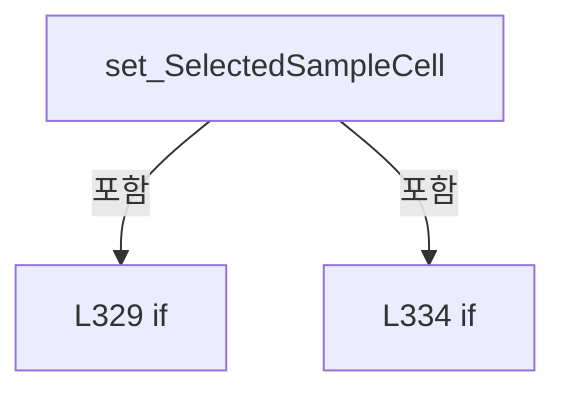

변경 전 점검: 입력/반환 타입, 위 호출자, 예외/취소 경로, 공유 상태와 저장·전송 소비자를 함께 확인합니다. 값의 단위나 물리 방향을 이름만으로 확정하지 않습니다.

### PropertyDeclaration `SampleRuleSelectionSummary` · L341–347

[Drilling.UI/Menu/Menus/CMenuReview.cs:341–347](https://github.com/kjuws10-rgb/A3Drilling/blob/96e22cd027c84bf302b23f2949b98985d7f301bb/Drilling.UI/Menu/Menus/CMenuReview.cs#L341-L347)

| 항목 | 실제 추출 값 |
| --- | --- |
| 서명 | string Drilling.UI.Menu.Menus.CMenuReview.SampleRuleSelectionSummary |
| 접근/수식자 | Public / public |
| 반환/값 타입 | string |
| 소속 타입 | NamedType:Drilling.UI.Menu.Menus.CMenuReview |

현재 부분 분석에서 직접 연결된 호출자는 없습니다. XAML/이벤트/인터페이스·델리게이트·외부 진입을 추가 확인해야 하며, 미사용으로 판정한 것이 아닙니다.

호출하는 대상과 해석 범위:

| 원본 행 | 표현식 | 분석 상태 | 대상/소스 위치 |
| --- | --- | --- | --- |
| 343 | string.IsNullOrWhiteSpace | resolved | bool string.IsNullOrWhiteSpace(string?) |

본문의 실제 연산·분기·예외·반환 순서(원문 위치 순):

| 원본 행 | 종류 | 주석 해설 |
| --- | --- | --- |
| 341 | switch-expression | 값별 결과식을 선택합니다: _selectedSampleRuleUi switch { "SIMPLE" => string.IsNullOrWhiteSpace(_simpleSampleShotKey) ? "Select 1 Shot" : SampleCorrectionTarget, "ROUGH" => $"Every Head / Full Head Range / {_roughReference}", "FINE" => $"Each Cell / {_fineL |
| 343 | call | 함수·델리게이트 또는 객체 생성자를 호출합니다: string.IsNullOrWhiteSpace(_simpleSampleShotKey) |
| 343 | conditional-expression | 조건에 따라 결과식을 선택합니다: string.IsNullOrWhiteSpace(_simpleSampleShotKey) ? "Select 1 Shot" : SampleCorrectionTarget |

제어 구문의 포함 구조(실제 실행 순서/CFG가 아닌 구문 탐색 그림):


변경 전 점검: 입력/반환 타입, 위 호출자, 예외/취소 경로, 공유 상태와 저장·전송 소비자를 함께 확인합니다. 값의 단위나 물리 방향을 이름만으로 확정하지 않습니다.

### PropertyDeclaration `SampleRuleDescription` · L348–354

[Drilling.UI/Menu/Menus/CMenuReview.cs:348–354](https://github.com/kjuws10-rgb/A3Drilling/blob/96e22cd027c84bf302b23f2949b98985d7f301bb/Drilling.UI/Menu/Menus/CMenuReview.cs#L348-L354)

| 항목 | 실제 추출 값 |
| --- | --- |
| 서명 | string Drilling.UI.Menu.Menus.CMenuReview.SampleRuleDescription |
| 접근/수식자 | Public / public |
| 반환/값 타입 | string |
| 소속 타입 | NamedType:Drilling.UI.Menu.Menus.CMenuReview |

현재 부분 분석에서 직접 연결된 호출자는 없습니다. XAML/이벤트/인터페이스·델리게이트·외부 진입을 추가 확인해야 하며, 미사용으로 판정한 것이 아닙니다.

본문의 실제 연산·분기·예외·반환 순서(원문 위치 순):

| 원본 행 | 종류 | 주석 해설 |
| --- | --- | --- |
| 348 | switch-expression | 값별 결과식을 선택합니다: _selectedSampleRuleUi switch { "SIMPLE" => "Measure one Shot and apply the same correction to HEAD or HEAD + CELL.", "ROUGH" => "Measure the first processed Shot on the FIRST, CENTER, or LAST line of each Head's full processing ra |

제어 구문의 포함 구조(실제 실행 순서/CFG가 아닌 구문 탐색 그림):

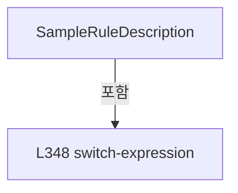

변경 전 점검: 입력/반환 타입, 위 호출자, 예외/취소 경로, 공유 상태와 저장·전송 소비자를 함께 확인합니다. 값의 단위나 물리 방향을 이름만으로 확정하지 않습니다.

### PropertyDeclaration `BeamOptions` · L355–355

[Drilling.UI/Menu/Menus/CMenuReview.cs:355–355](https://github.com/kjuws10-rgb/A3Drilling/blob/96e22cd027c84bf302b23f2949b98985d7f301bb/Drilling.UI/Menu/Menus/CMenuReview.cs#L355-L355)

| 항목 | 실제 추출 값 |
| --- | --- |
| 서명 | System.Collections.Generic.IReadOnlyList<string> Drilling.UI.Menu.Menus.CMenuReview.BeamOptions |
| 접근/수식자 | Public / public |
| 반환/값 타입 | System.Collections.Generic.IReadOnlyList<string> |
| 소속 타입 | NamedType:Drilling.UI.Menu.Menus.CMenuReview |

현재 부분 분석에서 직접 연결된 호출자는 없습니다. XAML/이벤트/인터페이스·델리게이트·외부 진입을 추가 확인해야 하며, 미사용으로 판정한 것이 아닙니다.

호출하는 대상과 해석 범위:

| 원본 행 | 표현식 | 분석 상태 | 대상/소스 위치 |
| --- | --- | --- | --- |
| 355 | Enumerable.Range(1, _splitBeamCount * _splitBeamCount).Select(beamNo => $"Beam{beamNo}").ToArray | resolved | string[] System.Collections.Generic.IEnumerable<string>.ToArray<string>() |
| 355 | Enumerable.Range(1, _splitBeamCount * _splitBeamCount).Select | resolved | System.Collections.Generic.IEnumerable<string> System.Collections.Generic.IEnumerable<int>.Select<int, string>(System.Func<int, string>) |
| 355 | Enumerable.Range | resolved | System.Collections.Generic.IEnumerable<int> System.Linq.Enumerable.Range(int, int) |

본문의 실제 연산·분기·예외·반환 순서(원문 위치 순):

| 원본 행 | 종류 | 주석 해설 |
| --- | --- | --- |
| 355 | call | 함수·델리게이트 또는 객체 생성자를 호출합니다: Enumerable.Range(1, _splitBeamCount * _splitBeamCount).Select(beamNo => $"Beam{beamNo}").ToArray() |
| 355 | call | 함수·델리게이트 또는 객체 생성자를 호출합니다: Enumerable.Range(1, _splitBeamCount * _splitBeamCount).Select(beamNo => $"Beam{beamNo}") |
| 355 | call | 함수·델리게이트 또는 객체 생성자를 호출합니다: Enumerable.Range(1, _splitBeamCount * _splitBeamCount) |

변경 전 점검: 입력/반환 타입, 위 호출자, 예외/취소 경로, 공유 상태와 저장·전송 소비자를 함께 확인합니다. 값의 단위나 물리 방향을 이름만으로 확정하지 않습니다.

### PropertyDeclaration `SelectedBeam` · L356–356

[Drilling.UI/Menu/Menus/CMenuReview.cs:356–356](https://github.com/kjuws10-rgb/A3Drilling/blob/96e22cd027c84bf302b23f2949b98985d7f301bb/Drilling.UI/Menu/Menus/CMenuReview.cs#L356-L356)

| 항목 | 실제 추출 값 |
| --- | --- |
| 서명 | string Drilling.UI.Menu.Menus.CMenuReview.SelectedBeam |
| 접근/수식자 | Public / public |
| 반환/값 타입 | string |
| 소속 타입 | NamedType:Drilling.UI.Menu.Menus.CMenuReview |

현재 부분 분석에서 직접 연결된 호출자는 없습니다. XAML/이벤트/인터페이스·델리게이트·외부 진입을 추가 확인해야 하며, 미사용으로 판정한 것이 아닙니다.

변경 전 점검: 입력/반환 타입, 위 호출자, 예외/취소 경로, 공유 상태와 저장·전송 소비자를 함께 확인합니다. 값의 단위나 물리 방향을 이름만으로 확정하지 않습니다.

### GetAccessorDeclaration `get_SelectedBeam` · L356–356

[Drilling.UI/Menu/Menus/CMenuReview.cs:356–356](https://github.com/kjuws10-rgb/A3Drilling/blob/96e22cd027c84bf302b23f2949b98985d7f301bb/Drilling.UI/Menu/Menus/CMenuReview.cs#L356-L356)

| 항목 | 실제 추출 값 |
| --- | --- |
| 서명 | string Drilling.UI.Menu.Menus.CMenuReview.SelectedBeam.get |
| 접근/수식자 | Public / get |
| 반환/값 타입 | string |
| 소속 타입 | NamedType:Drilling.UI.Menu.Menus.CMenuReview |

현재 부분 분석에서 직접 연결된 호출자는 없습니다. XAML/이벤트/인터페이스·델리게이트·외부 진입을 추가 확인해야 하며, 미사용으로 판정한 것이 아닙니다.

변경 전 점검: 입력/반환 타입, 위 호출자, 예외/취소 경로, 공유 상태와 저장·전송 소비자를 함께 확인합니다. 값의 단위나 물리 방향을 이름만으로 확정하지 않습니다.

### SetAccessorDeclaration `set_SelectedBeam` · L356–356

[Drilling.UI/Menu/Menus/CMenuReview.cs:356–356](https://github.com/kjuws10-rgb/A3Drilling/blob/96e22cd027c84bf302b23f2949b98985d7f301bb/Drilling.UI/Menu/Menus/CMenuReview.cs#L356-L356)

| 항목 | 실제 추출 값 |
| --- | --- |
| 서명 | void Drilling.UI.Menu.Menus.CMenuReview.SelectedBeam.set |
| 접근/수식자 | Public / set |
| 반환/값 타입 | void |
| 소속 타입 | NamedType:Drilling.UI.Menu.Menus.CMenuReview |

입력 계약:

| 이름 | 타입 | 전달 | 선택/기본값 |
| --- | --- | --- | --- |
| value | string | None | False /  |

현재 부분 분석에서 직접 연결된 호출자는 없습니다. XAML/이벤트/인터페이스·델리게이트·외부 진입을 추가 확인해야 하며, 미사용으로 판정한 것이 아닙니다.

호출하는 대상과 해석 범위:

| 원본 행 | 표현식 | 분석 상태 | 대상/소스 위치 |
| --- | --- | --- | --- |
| 356 | SelectRunBeam | resolved | void Drilling.UI.Menu.Menus.CMenuReview.SelectRunBeam(object?) · Drilling.UI/Menu/Menus/CMenuReview.cs:1377 |

본문의 실제 연산·분기·예외·반환 순서(원문 위치 순):

| 원본 행 | 종류 | 주석 해설 |
| --- | --- | --- |
| 356 | call | 함수·델리게이트 또는 객체 생성자를 호출합니다: SelectRunBeam(value) |

변경 전 점검: 입력/반환 타입, 위 호출자, 예외/취소 경로, 공유 상태와 저장·전송 소비자를 함께 확인합니다. 값의 단위나 물리 방향을 이름만으로 확정하지 않습니다.

### PropertyDeclaration `CanSelectBeam` · L357–357

[Drilling.UI/Menu/Menus/CMenuReview.cs:357–357](https://github.com/kjuws10-rgb/A3Drilling/blob/96e22cd027c84bf302b23f2949b98985d7f301bb/Drilling.UI/Menu/Menus/CMenuReview.cs#L357-L357)

| 항목 | 실제 추출 값 |
| --- | --- |
| 서명 | bool Drilling.UI.Menu.Menus.CMenuReview.CanSelectBeam |
| 접근/수식자 | Public / public |
| 반환/값 타입 | bool |
| 소속 타입 | NamedType:Drilling.UI.Menu.Menus.CMenuReview |

현재 부분 분석에서 직접 연결된 호출자는 없습니다. XAML/이벤트/인터페이스·델리게이트·외부 진입을 추가 확인해야 하며, 미사용으로 판정한 것이 아닙니다.

변경 전 점검: 입력/반환 타입, 위 호출자, 예외/취소 경로, 공유 상태와 저장·전송 소비자를 함께 확인합니다. 값의 단위나 물리 방향을 이름만으로 확정하지 않습니다.

### PropertyDeclaration `CanEditActiveInspectionBeams` · L358–362

[Drilling.UI/Menu/Menus/CMenuReview.cs:358–362](https://github.com/kjuws10-rgb/A3Drilling/blob/96e22cd027c84bf302b23f2949b98985d7f301bb/Drilling.UI/Menu/Menus/CMenuReview.cs#L358-L362)

| 항목 | 실제 추출 값 |
| --- | --- |
| 서명 | bool Drilling.UI.Menu.Menus.CMenuReview.CanEditActiveInspectionBeams |
| 접근/수식자 | Public / public |
| 반환/값 타입 | bool |
| 소속 타입 | NamedType:Drilling.UI.Menu.Menus.CMenuReview |

현재 부분 분석에서 직접 연결된 호출자는 없습니다. XAML/이벤트/인터페이스·델리게이트·외부 진입을 추가 확인해야 하며, 미사용으로 판정한 것이 아닙니다.

호출하는 대상과 해석 범위:

| 원본 행 | 표현식 | 분석 상태 | 대상/소스 위치 |
| --- | --- | --- | --- |
| 360 | string.IsNullOrWhiteSpace | resolved | bool string.IsNullOrWhiteSpace(string?) |
| 361 | FindPointByShotKey | resolved | Drilling.Common.Review.ST_REVIEW_PLAN_POINT? Drilling.UI.Menu.Menus.CMenuReview.FindPointByShotKey(Drilling.Common.Review.ST_REVIEW_PLAN?, string) · Drilling.UI/Menu/Menus/CMenuReview.cs:1712 |
| 362 | IsReviewPointExcluded | resolved | bool Drilling.UI.Menu.Menus.CMenuReview.IsReviewPointExcluded(Drilling.Common.Review.ST_REVIEW_PLAN_POINT) · Drilling.UI/Menu/Menus/CMenuReview.cs:5200 |

본문의 실제 연산·분기·예외·반환 순서(원문 위치 순):

| 원본 행 | 종류 | 주석 해설 |
| --- | --- | --- |
| 360 | call | 함수·델리게이트 또는 객체 생성자를 호출합니다: string.IsNullOrWhiteSpace(_selectedRunShotKey) |
| 361 | call | 함수·델리게이트 또는 객체 생성자를 호출합니다: FindPointByShotKey(_lastAllPlan, _selectedRunShotKey) |
| 362 | call | 함수·델리게이트 또는 객체 생성자를 호출합니다: IsReviewPointExcluded(point) |

변경 전 점검: 입력/반환 타입, 위 호출자, 예외/취소 경로, 공유 상태와 저장·전송 소비자를 함께 확인합니다. 값의 단위나 물리 방향을 이름만으로 확정하지 않습니다.

### PropertyDeclaration `CanCommitInspectionShot` · L363–363

[Drilling.UI/Menu/Menus/CMenuReview.cs:363–363](https://github.com/kjuws10-rgb/A3Drilling/blob/96e22cd027c84bf302b23f2949b98985d7f301bb/Drilling.UI/Menu/Menus/CMenuReview.cs#L363-L363)

| 항목 | 실제 추출 값 |
| --- | --- |
| 서명 | bool Drilling.UI.Menu.Menus.CMenuReview.CanCommitInspectionShot |
| 접근/수식자 | Public / public |
| 반환/값 타입 | bool |
| 소속 타입 | NamedType:Drilling.UI.Menu.Menus.CMenuReview |

현재 부분 분석에서 직접 연결된 호출자는 없습니다. XAML/이벤트/인터페이스·델리게이트·외부 진입을 추가 확인해야 하며, 미사용으로 판정한 것이 아닙니다.

변경 전 점검: 입력/반환 타입, 위 호출자, 예외/취소 경로, 공유 상태와 저장·전송 소비자를 함께 확인합니다. 값의 단위나 물리 방향을 이름만으로 확정하지 않습니다.

### PropertyDeclaration `CanDeleteInspectionShot` · L364–368

[Drilling.UI/Menu/Menus/CMenuReview.cs:364–368](https://github.com/kjuws10-rgb/A3Drilling/blob/96e22cd027c84bf302b23f2949b98985d7f301bb/Drilling.UI/Menu/Menus/CMenuReview.cs#L364-L368)

| 항목 | 실제 추출 값 |
| --- | --- |
| 서명 | bool Drilling.UI.Menu.Menus.CMenuReview.CanDeleteInspectionShot |
| 접근/수식자 | Public / public |
| 반환/값 타입 | bool |
| 소속 타입 | NamedType:Drilling.UI.Menu.Menus.CMenuReview |

현재 부분 분석에서 직접 연결된 호출자는 없습니다. XAML/이벤트/인터페이스·델리게이트·외부 진입을 추가 확인해야 하며, 미사용으로 판정한 것이 아닙니다.

호출하는 대상과 해석 범위:

| 원본 행 | 표현식 | 분석 상태 | 대상/소스 위치 |
| --- | --- | --- | --- |
| 368 | _inspectionBeamNosByShotKey.ContainsKey | resolved | bool System.Collections.Generic.Dictionary<string, System.Collections.Generic.HashSet<int>>.ContainsKey(string) |

본문의 실제 연산·분기·예외·반환 순서(원문 위치 순):

| 원본 행 | 종류 | 주석 해설 |
| --- | --- | --- |
| 368 | call | 함수·델리게이트 또는 객체 생성자를 호출합니다: _inspectionBeamNosByShotKey.ContainsKey(row.ShotKey) |

변경 전 점검: 입력/반환 타입, 위 호출자, 예외/취소 경로, 공유 상태와 저장·전송 소비자를 함께 확인합니다. 값의 단위나 물리 방향을 이름만으로 확정하지 않습니다.

### PropertyDeclaration `CanBrowseRunShots` · L369–369

[Drilling.UI/Menu/Menus/CMenuReview.cs:369–369](https://github.com/kjuws10-rgb/A3Drilling/blob/96e22cd027c84bf302b23f2949b98985d7f301bb/Drilling.UI/Menu/Menus/CMenuReview.cs#L369-L369)

| 항목 | 실제 추출 값 |
| --- | --- |
| 서명 | bool Drilling.UI.Menu.Menus.CMenuReview.CanBrowseRunShots |
| 접근/수식자 | Public / public |
| 반환/값 타입 | bool |
| 소속 타입 | NamedType:Drilling.UI.Menu.Menus.CMenuReview |

현재 부분 분석에서 직접 연결된 호출자는 없습니다. XAML/이벤트/인터페이스·델리게이트·외부 진입을 추가 확인해야 하며, 미사용으로 판정한 것이 아닙니다.

변경 전 점검: 입력/반환 타입, 위 호출자, 예외/취소 경로, 공유 상태와 저장·전송 소비자를 함께 확인합니다. 값의 단위나 물리 방향을 이름만으로 확정하지 않습니다.

### PropertyDeclaration `CanStopOneShot` · L370–370

[Drilling.UI/Menu/Menus/CMenuReview.cs:370–370](https://github.com/kjuws10-rgb/A3Drilling/blob/96e22cd027c84bf302b23f2949b98985d7f301bb/Drilling.UI/Menu/Menus/CMenuReview.cs#L370-L370)

| 항목 | 실제 추출 값 |
| --- | --- |
| 서명 | bool Drilling.UI.Menu.Menus.CMenuReview.CanStopOneShot |
| 접근/수식자 | Public / public |
| 반환/값 타입 | bool |
| 소속 타입 | NamedType:Drilling.UI.Menu.Menus.CMenuReview |

현재 부분 분석에서 직접 연결된 호출자는 없습니다. XAML/이벤트/인터페이스·델리게이트·외부 진입을 추가 확인해야 하며, 미사용으로 판정한 것이 아닙니다.

변경 전 점검: 입력/반환 타입, 위 호출자, 예외/취소 경로, 공유 상태와 저장·전송 소비자를 함께 확인합니다. 값의 단위나 물리 방향을 이름만으로 확정하지 않습니다.

### PropertyDeclaration `IsShotInspectionOngoing` · L371–375

[Drilling.UI/Menu/Menus/CMenuReview.cs:371–375](https://github.com/kjuws10-rgb/A3Drilling/blob/96e22cd027c84bf302b23f2949b98985d7f301bb/Drilling.UI/Menu/Menus/CMenuReview.cs#L371-L375)

| 항목 | 실제 추출 값 |
| --- | --- |
| 서명 | bool Drilling.UI.Menu.Menus.CMenuReview.IsShotInspectionOngoing |
| 접근/수식자 | Public / public |
| 반환/값 타입 | bool |
| 소속 타입 | NamedType:Drilling.UI.Menu.Menus.CMenuReview |

현재 부분 분석에서 직접 연결된 호출자는 없습니다. XAML/이벤트/인터페이스·델리게이트·외부 진입을 추가 확인해야 하며, 미사용으로 판정한 것이 아닙니다.

본문의 실제 연산·분기·예외·반환 순서(원문 위치 순):

| 원본 행 | 종류 | 주석 해설 |
| --- | --- | --- |
| 371 | conditional-expression | 조건에 따라 결과식을 선택합니다: IsBeamInspectionMode ? _beamInspectionSnapshot is { ActiveIndex: >= 0 } : IsOneShotReviewMode ? _oneShotRunning && _oneShotActiveAction != EN_ONE_SHOT_ACTION.Move : IsReviewExecutionActive && _reviewManager.CurrentPoint?.State ==  |
| 373 | conditional-expression | 조건에 따라 결과식을 선택합니다: IsOneShotReviewMode ? _oneShotRunning && _oneShotActiveAction != EN_ONE_SHOT_ACTION.Move : IsReviewExecutionActive && _reviewManager.CurrentPoint?.State == EN_REVIEW_POINT_STATE.Current |

변경 전 점검: 입력/반환 타입, 위 호출자, 예외/취소 경로, 공유 상태와 저장·전송 소비자를 함께 확인합니다. 값의 단위나 물리 방향을 이름만으로 확정하지 않습니다.

### PropertyDeclaration `BeamSelectionSummary` · L376–378

[Drilling.UI/Menu/Menus/CMenuReview.cs:376–378](https://github.com/kjuws10-rgb/A3Drilling/blob/96e22cd027c84bf302b23f2949b98985d7f301bb/Drilling.UI/Menu/Menus/CMenuReview.cs#L376-L378)

| 항목 | 실제 추출 값 |
| --- | --- |
| 서명 | string Drilling.UI.Menu.Menus.CMenuReview.BeamSelectionSummary |
| 접근/수식자 | Public / public |
| 반환/값 타입 | string |
| 소속 타입 | NamedType:Drilling.UI.Menu.Menus.CMenuReview |

현재 부분 분석에서 직접 연결된 호출자는 없습니다. XAML/이벤트/인터페이스·델리게이트·외부 진입을 추가 확인해야 하며, 미사용으로 판정한 것이 아닙니다.

호출하는 대상과 해석 범위:

| 원본 행 | 표현식 | 분석 상태 | 대상/소스 위치 |
| --- | --- | --- | --- |
| 377 | GetDisplayedInspectionBeamNos | resolved | System.Collections.Generic.IReadOnlySet<int> Drilling.UI.Menu.Menus.CMenuReview.GetDisplayedInspectionBeamNos() · Drilling.UI/Menu/Menus/CMenuReview.cs:5088 |

본문의 실제 연산·분기·예외·반환 순서(원문 위치 순):

| 원본 행 | 종류 | 주석 해설 |
| --- | --- | --- |
| 376 | conditional-expression | 조건에 따라 결과식을 선택합니다: IsBeamInspectionMode ? $"{GetDisplayedInspectionBeamNos().Count} / {_splitBeamCount * _splitBeamCount} Selected" : SelectedBeam |
| 377 | call | 함수·델리게이트 또는 객체 생성자를 호출합니다: GetDisplayedInspectionBeamNos() |

변경 전 점검: 입력/반환 타입, 위 호출자, 예외/취소 경로, 공유 상태와 저장·전송 소비자를 함께 확인합니다. 값의 단위나 물리 방향을 이름만으로 확정하지 않습니다.

### PropertyDeclaration `BeamInspectionAssignmentSummary` · L379–379

[Drilling.UI/Menu/Menus/CMenuReview.cs:379–379](https://github.com/kjuws10-rgb/A3Drilling/blob/96e22cd027c84bf302b23f2949b98985d7f301bb/Drilling.UI/Menu/Menus/CMenuReview.cs#L379-L379)

| 항목 | 실제 추출 값 |
| --- | --- |
| 서명 | string Drilling.UI.Menu.Menus.CMenuReview.BeamInspectionAssignmentSummary |
| 접근/수식자 | Public / public |
| 반환/값 타입 | string |
| 소속 타입 | NamedType:Drilling.UI.Menu.Menus.CMenuReview |

현재 부분 분석에서 직접 연결된 호출자는 없습니다. XAML/이벤트/인터페이스·델리게이트·외부 진입을 추가 확인해야 하며, 미사용으로 판정한 것이 아닙니다.

호출하는 대상과 해석 범위:

| 원본 행 | 표현식 | 분석 상태 | 대상/소스 위치 |
| --- | --- | --- | --- |
| 379 | GetInspectionTaskCount | resolved | int Drilling.UI.Menu.Menus.CMenuReview.GetInspectionTaskCount() · Drilling.UI/Menu/Menus/CMenuReview.cs:2918 |

본문의 실제 연산·분기·예외·반환 순서(원문 위치 순):

| 원본 행 | 종류 | 주석 해설 |
| --- | --- | --- |
| 379 | call | 함수·델리게이트 또는 객체 생성자를 호출합니다: GetInspectionTaskCount() |

변경 전 점검: 입력/반환 타입, 위 호출자, 예외/취소 경로, 공유 상태와 저장·전송 소비자를 함께 확인합니다. 값의 단위나 물리 방향을 이름만으로 확정하지 않습니다.

### PropertyDeclaration `InspectionListCommitText` · L380–382

[Drilling.UI/Menu/Menus/CMenuReview.cs:380–382](https://github.com/kjuws10-rgb/A3Drilling/blob/96e22cd027c84bf302b23f2949b98985d7f301bb/Drilling.UI/Menu/Menus/CMenuReview.cs#L380-L382)

| 항목 | 실제 추출 값 |
| --- | --- |
| 서명 | string Drilling.UI.Menu.Menus.CMenuReview.InspectionListCommitText |
| 접근/수식자 | Public / public |
| 반환/값 타입 | string |
| 소속 타입 | NamedType:Drilling.UI.Menu.Menus.CMenuReview |

현재 부분 분석에서 직접 연결된 호출자는 없습니다. XAML/이벤트/인터페이스·델리게이트·외부 진입을 추가 확인해야 하며, 미사용으로 판정한 것이 아닙니다.

호출하는 대상과 해석 범위:

| 원본 행 | 표현식 | 분석 상태 | 대상/소스 위치 |
| --- | --- | --- | --- |
| 380 | _inspectionBeamNosByShotKey.ContainsKey | resolved | bool System.Collections.Generic.Dictionary<string, System.Collections.Generic.HashSet<int>>.ContainsKey(string) |

본문의 실제 연산·분기·예외·반환 순서(원문 위치 순):

| 원본 행 | 종류 | 주석 해설 |
| --- | --- | --- |
| 380 | call | 함수·델리게이트 또는 객체 생성자를 호출합니다: _inspectionBeamNosByShotKey.ContainsKey(_selectedRunShotKey) |
| 380 | conditional-expression | 조건에 따라 결과식을 선택합니다: _inspectionBeamNosByShotKey.ContainsKey(_selectedRunShotKey) ? "UPDATE LIST" : "ADD TO LIST" |

변경 전 점검: 입력/반환 타입, 위 호출자, 예외/취소 경로, 공유 상태와 저장·전송 소비자를 함께 확인합니다. 값의 단위나 물리 방향을 이름만으로 확정하지 않습니다.

### PropertyDeclaration `ActiveInspectionShotText` · L383–387

[Drilling.UI/Menu/Menus/CMenuReview.cs:383–387](https://github.com/kjuws10-rgb/A3Drilling/blob/96e22cd027c84bf302b23f2949b98985d7f301bb/Drilling.UI/Menu/Menus/CMenuReview.cs#L383-L387)

| 항목 | 실제 추출 값 |
| --- | --- |
| 서명 | string Drilling.UI.Menu.Menus.CMenuReview.ActiveInspectionShotText |
| 접근/수식자 | Public / public |
| 반환/값 타입 | string |
| 소속 타입 | NamedType:Drilling.UI.Menu.Menus.CMenuReview |

현재 부분 분석에서 직접 연결된 호출자는 없습니다. XAML/이벤트/인터페이스·델리게이트·외부 진입을 추가 확인해야 하며, 미사용으로 판정한 것이 아닙니다.

호출하는 대상과 해석 범위:

| 원본 행 | 표현식 | 분석 상태 | 대상/소스 위치 |
| --- | --- | --- | --- |
| 383 | FindPointByShotKey | resolved | Drilling.Common.Review.ST_REVIEW_PLAN_POINT? Drilling.UI.Menu.Menus.CMenuReview.FindPointByShotKey(Drilling.Common.Review.ST_REVIEW_PLAN?, string) · Drilling.UI/Menu/Menus/CMenuReview.cs:1712 |
| 384 | ToMatrixShotName | resolved | string Drilling.UI.Menu.Menus.CMenuReview.ToMatrixShotName(Drilling.Common.Review.ST_REVIEW_PLAN_POINT) · Drilling.UI/Menu/Menus/CMenuReview.cs:2321 |

본문의 실제 연산·분기·예외·반환 순서(원문 위치 순):

| 원본 행 | 종류 | 주석 해설 |
| --- | --- | --- |
| 383 | call | 함수·델리게이트 또는 객체 생성자를 호출합니다: FindPointByShotKey(_lastAllPlan, _selectedRunShotKey) |
| 383 | conditional-expression | 조건에 따라 결과식을 선택합니다: FindPointByShotKey(_lastAllPlan, _selectedRunShotKey) is { } point ? $"CELL {point.CellNo:00} / {ToMatrixShotName(point)}" : _selectedBeamInspectionAssignment is { } row ? $"{row.CellText} / {row.ShotName}" : "SHOT을 선택해 주세요." |
| 384 | call | 함수·델리게이트 또는 객체 생성자를 호출합니다: ToMatrixShotName(point) |
| 385 | conditional-expression | 조건에 따라 결과식을 선택합니다: _selectedBeamInspectionAssignment is { } row ? $"{row.CellText} / {row.ShotName}" : "SHOT을 선택해 주세요." |

변경 전 점검: 입력/반환 타입, 위 호출자, 예외/취소 경로, 공유 상태와 저장·전송 소비자를 함께 확인합니다. 값의 단위나 물리 방향을 이름만으로 확정하지 않습니다.

### PropertyDeclaration `SelectedBeamInspectionAssignment` · L388–397

[Drilling.UI/Menu/Menus/CMenuReview.cs:388–397](https://github.com/kjuws10-rgb/A3Drilling/blob/96e22cd027c84bf302b23f2949b98985d7f301bb/Drilling.UI/Menu/Menus/CMenuReview.cs#L388-L397)

| 항목 | 실제 추출 값 |
| --- | --- |
| 서명 | Drilling.UI.Menu.Menus.ST_BEAM_INSPECTION_SHOT_ASSIGNMENT_ROW? Drilling.UI.Menu.Menus.CMenuReview.SelectedBeamInspectionAssignment |
| 접근/수식자 | Public / public |
| 반환/값 타입 | Drilling.UI.Menu.Menus.ST_BEAM_INSPECTION_SHOT_ASSIGNMENT_ROW? |
| 소속 타입 | NamedType:Drilling.UI.Menu.Menus.CMenuReview |

현재 부분 분석에서 직접 연결된 호출자는 없습니다. XAML/이벤트/인터페이스·델리게이트·외부 진입을 추가 확인해야 하며, 미사용으로 판정한 것이 아닙니다.

변경 전 점검: 입력/반환 타입, 위 호출자, 예외/취소 경로, 공유 상태와 저장·전송 소비자를 함께 확인합니다. 값의 단위나 물리 방향을 이름만으로 확정하지 않습니다.

### GetAccessorDeclaration `get_SelectedBeamInspectionAssignment` · L390–390

[Drilling.UI/Menu/Menus/CMenuReview.cs:390–390](https://github.com/kjuws10-rgb/A3Drilling/blob/96e22cd027c84bf302b23f2949b98985d7f301bb/Drilling.UI/Menu/Menus/CMenuReview.cs#L390-L390)

| 항목 | 실제 추출 값 |
| --- | --- |
| 서명 | Drilling.UI.Menu.Menus.ST_BEAM_INSPECTION_SHOT_ASSIGNMENT_ROW? Drilling.UI.Menu.Menus.CMenuReview.SelectedBeamInspectionAssignment.get |
| 접근/수식자 | Public / get |
| 반환/값 타입 | Drilling.UI.Menu.Menus.ST_BEAM_INSPECTION_SHOT_ASSIGNMENT_ROW? |
| 소속 타입 | NamedType:Drilling.UI.Menu.Menus.CMenuReview |

현재 부분 분석에서 직접 연결된 호출자는 없습니다. XAML/이벤트/인터페이스·델리게이트·외부 진입을 추가 확인해야 하며, 미사용으로 판정한 것이 아닙니다.

변경 전 점검: 입력/반환 타입, 위 호출자, 예외/취소 경로, 공유 상태와 저장·전송 소비자를 함께 확인합니다. 값의 단위나 물리 방향을 이름만으로 확정하지 않습니다.

### SetAccessorDeclaration `set_SelectedBeamInspectionAssignment` · L391–396

[Drilling.UI/Menu/Menus/CMenuReview.cs:391–396](https://github.com/kjuws10-rgb/A3Drilling/blob/96e22cd027c84bf302b23f2949b98985d7f301bb/Drilling.UI/Menu/Menus/CMenuReview.cs#L391-L396)

| 항목 | 실제 추출 값 |
| --- | --- |
| 서명 | void Drilling.UI.Menu.Menus.CMenuReview.SelectedBeamInspectionAssignment.set |
| 접근/수식자 | Public / set |
| 반환/값 타입 | void |
| 소속 타입 | NamedType:Drilling.UI.Menu.Menus.CMenuReview |

입력 계약:

| 이름 | 타입 | 전달 | 선택/기본값 |
| --- | --- | --- | --- |
| value | Drilling.UI.Menu.Menus.ST_BEAM_INSPECTION_SHOT_ASSIGNMENT_ROW? | None | False /  |

현재 부분 분석에서 직접 연결된 호출자는 없습니다. XAML/이벤트/인터페이스·델리게이트·외부 진입을 추가 확인해야 하며, 미사용으로 판정한 것이 아닙니다.

호출하는 대상과 해석 범위:

| 원본 행 | 표현식 | 분석 상태 | 대상/소스 위치 |
| --- | --- | --- | --- |
| 393 | ReferenceEquals | resolved | bool object.ReferenceEquals(object?, object?) |
| 395 | ActivateBeamInspectionAssignment | resolved | void Drilling.UI.Menu.Menus.CMenuReview.ActivateBeamInspectionAssignment(Drilling.UI.Menu.Menus.ST_BEAM_INSPECTION_SHOT_ASSIGNMENT_ROW) · Drilling.UI/Menu/Menus/CMenuReview.cs:3038 |

본문의 실제 연산·분기·예외·반환 순서(원문 위치 순):

| 원본 행 | 종류 | 주석 해설 |
| --- | --- | --- |
| 393 | call | 함수·델리게이트 또는 객체 생성자를 호출합니다: ReferenceEquals(_selectedBeamInspectionAssignment, value) |
| 393 | if | 조건에 따라 분기합니다: if (_updatingBeamInspectionAssignmentSelection &#124;&#124; value is null &#124;&#124; ReferenceEquals(_selectedBeamInspectionAssignment, value)) |
| 394 | return | 호출자에게 값 또는 제어를 반환합니다: return; |
| 395 | call | 함수·델리게이트 또는 객체 생성자를 호출합니다: ActivateBeamInspectionAssignment(value) |

제어 구문의 포함 구조(실제 실행 순서/CFG가 아닌 구문 탐색 그림):

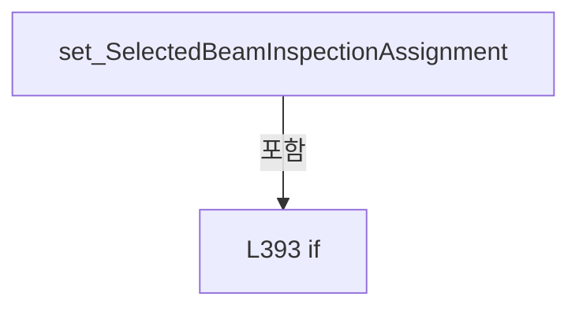

변경 전 점검: 입력/반환 타입, 위 호출자, 예외/취소 경로, 공유 상태와 저장·전송 소비자를 함께 확인합니다. 값의 단위나 물리 방향을 이름만으로 확정하지 않습니다.

### PropertyDeclaration `SelectedInspectionMethod` · L398–398

[Drilling.UI/Menu/Menus/CMenuReview.cs:398–398](https://github.com/kjuws10-rgb/A3Drilling/blob/96e22cd027c84bf302b23f2949b98985d7f301bb/Drilling.UI/Menu/Menus/CMenuReview.cs#L398-L398)

| 항목 | 실제 추출 값 |
| --- | --- |
| 서명 | string Drilling.UI.Menu.Menus.CMenuReview.SelectedInspectionMethod |
| 접근/수식자 | Public / public |
| 반환/값 타입 | string |
| 소속 타입 | NamedType:Drilling.UI.Menu.Menus.CMenuReview |

현재 부분 분석에서 직접 연결된 호출자는 없습니다. XAML/이벤트/인터페이스·델리게이트·외부 진입을 추가 확인해야 하며, 미사용으로 판정한 것이 아닙니다.

변경 전 점검: 입력/반환 타입, 위 호출자, 예외/취소 경로, 공유 상태와 저장·전송 소비자를 함께 확인합니다. 값의 단위나 물리 방향을 이름만으로 확정하지 않습니다.

### PropertyDeclaration `CanSelectInspectionMethod` · L399–399

[Drilling.UI/Menu/Menus/CMenuReview.cs:399–399](https://github.com/kjuws10-rgb/A3Drilling/blob/96e22cd027c84bf302b23f2949b98985d7f301bb/Drilling.UI/Menu/Menus/CMenuReview.cs#L399-L399)

| 항목 | 실제 추출 값 |
| --- | --- |
| 서명 | bool Drilling.UI.Menu.Menus.CMenuReview.CanSelectInspectionMethod |
| 접근/수식자 | Public / public |
| 반환/값 타입 | bool |
| 소속 타입 | NamedType:Drilling.UI.Menu.Menus.CMenuReview |

현재 부분 분석에서 직접 연결된 호출자는 없습니다. XAML/이벤트/인터페이스·델리게이트·외부 진입을 추가 확인해야 하며, 미사용으로 판정한 것이 아닙니다.

변경 전 점검: 입력/반환 타입, 위 호출자, 예외/취소 경로, 공유 상태와 저장·전송 소비자를 함께 확인합니다. 값의 단위나 물리 방향을 이름만으로 확정하지 않습니다.

### PropertyDeclaration `InspectionMethodItems` · L400–400

[Drilling.UI/Menu/Menus/CMenuReview.cs:400–400](https://github.com/kjuws10-rgb/A3Drilling/blob/96e22cd027c84bf302b23f2949b98985d7f301bb/Drilling.UI/Menu/Menus/CMenuReview.cs#L400-L400)

| 항목 | 실제 추출 값 |
| --- | --- |
| 서명 | System.Collections.Generic.IReadOnlyList<Drilling.UI.Menu.Menus.ST_REVIEW_INSPECTION_METHOD_ITEM> Drilling.UI.Menu.Menus.CMenuReview.InspectionMethodItems |
| 접근/수식자 | Public / public |
| 반환/값 타입 | System.Collections.Generic.IReadOnlyList<Drilling.UI.Menu.Menus.ST_REVIEW_INSPECTION_METHOD_ITEM> |
| 소속 타입 | NamedType:Drilling.UI.Menu.Menus.CMenuReview |

현재 부분 분석에서 직접 연결된 호출자는 없습니다. XAML/이벤트/인터페이스·델리게이트·외부 진입을 추가 확인해야 하며, 미사용으로 판정한 것이 아닙니다.

변경 전 점검: 입력/반환 타입, 위 호출자, 예외/취소 경로, 공유 상태와 저장·전송 소비자를 함께 확인합니다. 값의 단위나 물리 방향을 이름만으로 확정하지 않습니다.

### GetAccessorDeclaration `get_InspectionMethodItems` · L400–400

[Drilling.UI/Menu/Menus/CMenuReview.cs:400–400](https://github.com/kjuws10-rgb/A3Drilling/blob/96e22cd027c84bf302b23f2949b98985d7f301bb/Drilling.UI/Menu/Menus/CMenuReview.cs#L400-L400)

| 항목 | 실제 추출 값 |
| --- | --- |
| 서명 | System.Collections.Generic.IReadOnlyList<Drilling.UI.Menu.Menus.ST_REVIEW_INSPECTION_METHOD_ITEM> Drilling.UI.Menu.Menus.CMenuReview.InspectionMethodItems.get |
| 접근/수식자 | Public / get |
| 반환/값 타입 | System.Collections.Generic.IReadOnlyList<Drilling.UI.Menu.Menus.ST_REVIEW_INSPECTION_METHOD_ITEM> |
| 소속 타입 | NamedType:Drilling.UI.Menu.Menus.CMenuReview |

현재 부분 분석에서 직접 연결된 호출자는 없습니다. XAML/이벤트/인터페이스·델리게이트·외부 진입을 추가 확인해야 하며, 미사용으로 판정한 것이 아닙니다.

변경 전 점검: 입력/반환 타입, 위 호출자, 예외/취소 경로, 공유 상태와 저장·전송 소비자를 함께 확인합니다. 값의 단위나 물리 방향을 이름만으로 확정하지 않습니다.

### SetAccessorDeclaration `set_InspectionMethodItems` · L400–400

[Drilling.UI/Menu/Menus/CMenuReview.cs:400–400](https://github.com/kjuws10-rgb/A3Drilling/blob/96e22cd027c84bf302b23f2949b98985d7f301bb/Drilling.UI/Menu/Menus/CMenuReview.cs#L400-L400)

| 항목 | 실제 추출 값 |
| --- | --- |
| 서명 | void Drilling.UI.Menu.Menus.CMenuReview.InspectionMethodItems.set |
| 접근/수식자 | Private / private, set |
| 반환/값 타입 | void |
| 소속 타입 | NamedType:Drilling.UI.Menu.Menus.CMenuReview |

입력 계약:

| 이름 | 타입 | 전달 | 선택/기본값 |
| --- | --- | --- | --- |
| value | System.Collections.Generic.IReadOnlyList<Drilling.UI.Menu.Menus.ST_REVIEW_INSPECTION_METHOD_ITEM> | None | False /  |

현재 부분 분석에서 직접 연결된 호출자는 없습니다. XAML/이벤트/인터페이스·델리게이트·외부 진입을 추가 확인해야 하며, 미사용으로 판정한 것이 아닙니다.

변경 전 점검: 입력/반환 타입, 위 호출자, 예외/취소 경로, 공유 상태와 저장·전송 소비자를 함께 확인합니다. 값의 단위나 물리 방향을 이름만으로 확정하지 않습니다.

### PropertyDeclaration `RunGlassPreviewImage` · L401–401

[Drilling.UI/Menu/Menus/CMenuReview.cs:401–401](https://github.com/kjuws10-rgb/A3Drilling/blob/96e22cd027c84bf302b23f2949b98985d7f301bb/Drilling.UI/Menu/Menus/CMenuReview.cs#L401-L401)

| 항목 | 실제 추출 값 |
| --- | --- |
| 서명 | ImageSource? Drilling.UI.Menu.Menus.CMenuReview.RunGlassPreviewImage |
| 접근/수식자 | Public / public |
| 반환/값 타입 | ImageSource? |
| 소속 타입 | NamedType:Drilling.UI.Menu.Menus.CMenuReview |

현재 부분 분석에서 직접 연결된 호출자는 없습니다. XAML/이벤트/인터페이스·델리게이트·외부 진입을 추가 확인해야 하며, 미사용으로 판정한 것이 아닙니다.

변경 전 점검: 입력/반환 타입, 위 호출자, 예외/취소 경로, 공유 상태와 저장·전송 소비자를 함께 확인합니다. 값의 단위나 물리 방향을 이름만으로 확정하지 않습니다.

### GetAccessorDeclaration `get_RunGlassPreviewImage` · L401–401

[Drilling.UI/Menu/Menus/CMenuReview.cs:401–401](https://github.com/kjuws10-rgb/A3Drilling/blob/96e22cd027c84bf302b23f2949b98985d7f301bb/Drilling.UI/Menu/Menus/CMenuReview.cs#L401-L401)

| 항목 | 실제 추출 값 |
| --- | --- |
| 서명 | ImageSource? Drilling.UI.Menu.Menus.CMenuReview.RunGlassPreviewImage.get |
| 접근/수식자 | Public / get |
| 반환/값 타입 | ImageSource? |
| 소속 타입 | NamedType:Drilling.UI.Menu.Menus.CMenuReview |

현재 부분 분석에서 직접 연결된 호출자는 없습니다. XAML/이벤트/인터페이스·델리게이트·외부 진입을 추가 확인해야 하며, 미사용으로 판정한 것이 아닙니다.

변경 전 점검: 입력/반환 타입, 위 호출자, 예외/취소 경로, 공유 상태와 저장·전송 소비자를 함께 확인합니다. 값의 단위나 물리 방향을 이름만으로 확정하지 않습니다.

### SetAccessorDeclaration `set_RunGlassPreviewImage` · L401–401

[Drilling.UI/Menu/Menus/CMenuReview.cs:401–401](https://github.com/kjuws10-rgb/A3Drilling/blob/96e22cd027c84bf302b23f2949b98985d7f301bb/Drilling.UI/Menu/Menus/CMenuReview.cs#L401-L401)

| 항목 | 실제 추출 값 |
| --- | --- |
| 서명 | void Drilling.UI.Menu.Menus.CMenuReview.RunGlassPreviewImage.set |
| 접근/수식자 | Private / private, set |
| 반환/값 타입 | void |
| 소속 타입 | NamedType:Drilling.UI.Menu.Menus.CMenuReview |

입력 계약:

| 이름 | 타입 | 전달 | 선택/기본값 |
| --- | --- | --- | --- |
| value | ImageSource? | None | False /  |

현재 부분 분석에서 직접 연결된 호출자는 없습니다. XAML/이벤트/인터페이스·델리게이트·외부 진입을 추가 확인해야 하며, 미사용으로 판정한 것이 아닙니다.

변경 전 점검: 입력/반환 타입, 위 호출자, 예외/취소 경로, 공유 상태와 저장·전송 소비자를 함께 확인합니다. 값의 단위나 물리 방향을 이름만으로 확정하지 않습니다.

### PropertyDeclaration `RunGlassPreviewInspectionOverlayImage` · L402–402

[Drilling.UI/Menu/Menus/CMenuReview.cs:402–402](https://github.com/kjuws10-rgb/A3Drilling/blob/96e22cd027c84bf302b23f2949b98985d7f301bb/Drilling.UI/Menu/Menus/CMenuReview.cs#L402-L402)

| 항목 | 실제 추출 값 |
| --- | --- |
| 서명 | ImageSource? Drilling.UI.Menu.Menus.CMenuReview.RunGlassPreviewInspectionOverlayImage |
| 접근/수식자 | Public / public |
| 반환/값 타입 | ImageSource? |
| 소속 타입 | NamedType:Drilling.UI.Menu.Menus.CMenuReview |

현재 부분 분석에서 직접 연결된 호출자는 없습니다. XAML/이벤트/인터페이스·델리게이트·외부 진입을 추가 확인해야 하며, 미사용으로 판정한 것이 아닙니다.

변경 전 점검: 입력/반환 타입, 위 호출자, 예외/취소 경로, 공유 상태와 저장·전송 소비자를 함께 확인합니다. 값의 단위나 물리 방향을 이름만으로 확정하지 않습니다.

### GetAccessorDeclaration `get_RunGlassPreviewInspectionOverlayImage` · L402–402

[Drilling.UI/Menu/Menus/CMenuReview.cs:402–402](https://github.com/kjuws10-rgb/A3Drilling/blob/96e22cd027c84bf302b23f2949b98985d7f301bb/Drilling.UI/Menu/Menus/CMenuReview.cs#L402-L402)

| 항목 | 실제 추출 값 |
| --- | --- |
| 서명 | ImageSource? Drilling.UI.Menu.Menus.CMenuReview.RunGlassPreviewInspectionOverlayImage.get |
| 접근/수식자 | Public / get |
| 반환/값 타입 | ImageSource? |
| 소속 타입 | NamedType:Drilling.UI.Menu.Menus.CMenuReview |

현재 부분 분석에서 직접 연결된 호출자는 없습니다. XAML/이벤트/인터페이스·델리게이트·외부 진입을 추가 확인해야 하며, 미사용으로 판정한 것이 아닙니다.

변경 전 점검: 입력/반환 타입, 위 호출자, 예외/취소 경로, 공유 상태와 저장·전송 소비자를 함께 확인합니다. 값의 단위나 물리 방향을 이름만으로 확정하지 않습니다.

### SetAccessorDeclaration `set_RunGlassPreviewInspectionOverlayImage` · L402–402

[Drilling.UI/Menu/Menus/CMenuReview.cs:402–402](https://github.com/kjuws10-rgb/A3Drilling/blob/96e22cd027c84bf302b23f2949b98985d7f301bb/Drilling.UI/Menu/Menus/CMenuReview.cs#L402-L402)

| 항목 | 실제 추출 값 |
| --- | --- |
| 서명 | void Drilling.UI.Menu.Menus.CMenuReview.RunGlassPreviewInspectionOverlayImage.set |
| 접근/수식자 | Private / private, set |
| 반환/값 타입 | void |
| 소속 타입 | NamedType:Drilling.UI.Menu.Menus.CMenuReview |

입력 계약:

| 이름 | 타입 | 전달 | 선택/기본값 |
| --- | --- | --- | --- |
| value | ImageSource? | None | False /  |

현재 부분 분석에서 직접 연결된 호출자는 없습니다. XAML/이벤트/인터페이스·델리게이트·외부 진입을 추가 확인해야 하며, 미사용으로 판정한 것이 아닙니다.

변경 전 점검: 입력/반환 타입, 위 호출자, 예외/취소 경로, 공유 상태와 저장·전송 소비자를 함께 확인합니다. 값의 단위나 물리 방향을 이름만으로 확정하지 않습니다.

### PropertyDeclaration `InspectionHeadRows` · L404–418

[Drilling.UI/Menu/Menus/CMenuReview.cs:404–418](https://github.com/kjuws10-rgb/A3Drilling/blob/96e22cd027c84bf302b23f2949b98985d7f301bb/Drilling.UI/Menu/Menus/CMenuReview.cs#L404-L418)

| 항목 | 실제 추출 값 |
| --- | --- |
| 서명 | System.Collections.Generic.IReadOnlyList<Drilling.UI.Menu.Menus.ST_REVIEW_INSPECTION_HEAD_ROW> Drilling.UI.Menu.Menus.CMenuReview.InspectionHeadRows |
| 접근/수식자 | Public / public |
| 반환/값 타입 | System.Collections.Generic.IReadOnlyList<Drilling.UI.Menu.Menus.ST_REVIEW_INSPECTION_HEAD_ROW> |
| 소속 타입 | NamedType:Drilling.UI.Menu.Menus.CMenuReview |

현재 부분 분석에서 직접 연결된 호출자는 없습니다. XAML/이벤트/인터페이스·델리게이트·외부 진입을 추가 확인해야 하며, 미사용으로 판정한 것이 아닙니다.

변경 전 점검: 입력/반환 타입, 위 호출자, 예외/취소 경로, 공유 상태와 저장·전송 소비자를 함께 확인합니다. 값의 단위나 물리 방향을 이름만으로 확정하지 않습니다.

### GetAccessorDeclaration `get_InspectionHeadRows` · L406–417

[Drilling.UI/Menu/Menus/CMenuReview.cs:406–417](https://github.com/kjuws10-rgb/A3Drilling/blob/96e22cd027c84bf302b23f2949b98985d7f301bb/Drilling.UI/Menu/Menus/CMenuReview.cs#L406-L417)

| 항목 | 실제 추출 값 |
| --- | --- |
| 서명 | System.Collections.Generic.IReadOnlyList<Drilling.UI.Menu.Menus.ST_REVIEW_INSPECTION_HEAD_ROW> Drilling.UI.Menu.Menus.CMenuReview.InspectionHeadRows.get |
| 접근/수식자 | Public / get |
| 반환/값 타입 | System.Collections.Generic.IReadOnlyList<Drilling.UI.Menu.Menus.ST_REVIEW_INSPECTION_HEAD_ROW> |
| 소속 타입 | NamedType:Drilling.UI.Menu.Menus.CMenuReview |

현재 부분 분석에서 직접 연결된 호출자는 없습니다. XAML/이벤트/인터페이스·델리게이트·외부 진입을 추가 확인해야 하며, 미사용으로 판정한 것이 아닙니다.

호출하는 대상과 해석 범위:

| 원본 행 | 표현식 | 분석 상태 | 대상/소스 위치 |
| --- | --- | --- | --- |
| 408 | (IsOneShotReviewMode ? new[] { _selectedRunShotKey } : IsOneLineReviewMode ? _selectedLineShotKeys.AsEnumerable() : _selectedInspectionShotKeys.AsEnumerable()).Select(key => FindPointByShotKey(_lastAllPlan, key)).OfType<ST_REVIEW_PLAN_POINT>().GroupBy(point => point.HeadNo).ToDictionary | resolved | System.Collections.Generic.Dictionary<int, int> System.Collections.Generic.IEnumerable<System.Linq.IGrouping<int, Drilling.Common.Review.ST_REVIEW_PLAN_POINT>>.ToDictionary<System.Linq.IGrouping<int, Drilling.Common.Review.ST_REVIEW_PLAN_POINT>, int, int>(System.Func<System.Linq.IGrouping<int, Drilling.Common.Review.ST_REVIEW_PLAN_POINT>, int>, System.Func<System.Linq.IGrouping<int, Drilling.Common.Review.ST_REVIEW_PLAN_POINT>, int>) |
| 408 | (IsOneShotReviewMode ? new[] { _selectedRunShotKey } : IsOneLineReviewMode ? _selectedLineShotKeys.AsEnumerable() : _selectedInspectionShotKeys.AsEnumerable()).Select(key => FindPointByShotKey(_lastAllPlan, key)).OfType<ST_REVIEW_PLAN_POINT>().GroupBy | resolved | System.Collections.Generic.IEnumerable<System.Linq.IGrouping<int, Drilling.Common.Review.ST_REVIEW_PLAN_POINT>> System.Collections.Generic.IEnumerable<Drilling.Common.Review.ST_REVIEW_PLAN_POINT>.GroupBy<Drilling.Common.Review.ST_REVIEW_PLAN_POINT, int>(System.Func<Drilling.Common.Review.ST_REVIEW_PLAN_POINT, int>) |
| 408 | (IsOneShotReviewMode ? new[] { _selectedRunShotKey } : IsOneLineReviewMode ? _selectedLineShotKeys.AsEnumerable() : _selectedInspectionShotKeys.AsEnumerable()).Select(key => FindPointByShotKey(_lastAllPlan, key)).OfType<ST_REVIEW_PLAN_POINT> | resolved | System.Collections.Generic.IEnumerable<Drilling.Common.Review.ST_REVIEW_PLAN_POINT> System.Collections.IEnumerable.OfType<Drilling.Common.Review.ST_REVIEW_PLAN_POINT>() |
| 408 | (IsOneShotReviewMode ? new[] { _selectedRunShotKey } : IsOneLineReviewMode ? _selectedLineShotKeys.AsEnumerable() : _selectedInspectionShotKeys.AsEnumerable()).Select | resolved | System.Collections.Generic.IEnumerable<Drilling.Common.Review.ST_REVIEW_PLAN_POINT?> System.Collections.Generic.IEnumerable<string>.Select<string, Drilling.Common.Review.ST_REVIEW_PLAN_POINT?>(System.Func<string, Drilling.Common.Review.ST_REVIEW_PLAN_POINT?>) |
| 414 | _selectedLineShotKeys.AsEnumerable | resolved | System.Collections.Generic.IEnumerable<string> System.Collections.Generic.IEnumerable<string>.AsEnumerable<string>() |
| 415 | _selectedInspectionShotKeys.AsEnumerable | resolved | System.Collections.Generic.IEnumerable<string> System.Collections.Generic.IEnumerable<string>.AsEnumerable<string>() |
| 415 | FindPointByShotKey | resolved | Drilling.Common.Review.ST_REVIEW_PLAN_POINT? Drilling.UI.Menu.Menus.CMenuReview.FindPointByShotKey(Drilling.Common.Review.ST_REVIEW_PLAN?, string) · Drilling.UI/Menu/Menus/CMenuReview.cs:1712 |
| 415 | group.Count | resolved | int System.Collections.Generic.IEnumerable<Drilling.Common.Review.ST_REVIEW_PLAN_POINT>.Count<Drilling.Common.Review.ST_REVIEW_PLAN_POINT>() |
| 416 | Enumerable.Range(1, _headCount).Select(headNo => new ST_REVIEW_INSPECTION_HEAD_ROW(headNo, counts.GetValueOrDefault(headNo))).ToArray | resolved | Drilling.UI.Menu.Menus.ST_REVIEW_INSPECTION_HEAD_ROW[] System.Collections.Generic.IEnumerable<Drilling.UI.Menu.Menus.ST_REVIEW_INSPECTION_HEAD_ROW>.ToArray<Drilling.UI.Menu.Menus.ST_REVIEW_INSPECTION_HEAD_ROW>() |
| 416 | Enumerable.Range(1, _headCount).Select | resolved | System.Collections.Generic.IEnumerable<Drilling.UI.Menu.Menus.ST_REVIEW_INSPECTION_HEAD_ROW> System.Collections.Generic.IEnumerable<int>.Select<int, Drilling.UI.Menu.Menus.ST_REVIEW_INSPECTION_HEAD_ROW>(System.Func<int, Drilling.UI.Menu.Menus.ST_REVIEW_INSPECTION_HEAD_ROW>) |
| 416 | Enumerable.Range | resolved | System.Collections.Generic.IEnumerable<int> System.Linq.Enumerable.Range(int, int) |
| 416 | new ST_REVIEW_INSPECTION_HEAD_ROW | resolved | Drilling.UI.Menu.Menus.ST_REVIEW_INSPECTION_HEAD_ROW.ST_REVIEW_INSPECTION_HEAD_ROW(int, int) · Drilling.UI/Menu/Menus/CMenuReview.cs:5730 |
| 416 | counts.GetValueOrDefault | resolved | int System.Collections.Generic.IReadOnlyDictionary<int, int>.GetValueOrDefault<int, int>(int) |

본문의 실제 연산·분기·예외·반환 순서(원문 위치 순):

| 원본 행 | 종류 | 주석 해설 |
| --- | --- | --- |
| 408 | call | 함수·델리게이트 또는 객체 생성자를 호출합니다: (IsOneShotReviewMode ? new[] { _selectedRunShotKey } : IsOneLineReviewMode ? _selectedLineShotKeys.AsEnumerable() : _selectedInspectionShotKeys.AsEnumerable()).Select(key => FindPointByShotKey(_lastAllPlan, key)).OfType<… |
| 408 | call | 함수·델리게이트 또는 객체 생성자를 호출합니다: (IsOneShotReviewMode ? new[] { _selectedRunShotKey } : IsOneLineReviewMode ? _selectedLineShotKeys.AsEnumerable() : _selectedInspectionShotKeys.AsEnumerable()).Select(key => FindPointByShotKey(_lastAllPlan, key)).OfType<… |
| 408 | call | 함수·델리게이트 또는 객체 생성자를 호출합니다: (IsOneShotReviewMode ? new[] { _selectedRunShotKey } : IsOneLineReviewMode ? _selectedLineShotKeys.AsEnumerable() : _selectedInspectionShotKeys.AsEnumerable()).Select(key => FindPointByShotKey(_lastAllPlan, key)).OfType<… |
| 408 | call | 함수·델리게이트 또는 객체 생성자를 호출합니다: (IsOneShotReviewMode ? new[] { _selectedRunShotKey } : IsOneLineReviewMode ? _selectedLineShotKeys.AsEnumerable() : _selectedInspectionShotKeys.AsEnumerable()).Select(key => FindPointByShotKey(_lastAllPlan, key)) |
| 408 | conditional-expression | 조건에 따라 결과식을 선택합니다: IsOneShotReviewMode ? new[] { _selectedRunShotKey } : IsOneLineReviewMode ? _selectedLineShotKeys.AsEnumerable() : _selectedInspectionShotKeys.AsEnumerable() |
| 408 | local-declaration | 지역 변수를 선언합니다: var counts = (IsOneShotReviewMode ? new[] { _selectedRunShotKey } : IsOneLineReviewMode ? _selectedLineShotKeys.AsEnumerable() : _selectedInspectionShotKeys.AsEnumerable()).Select(key => FindPointByShotKey(_lastAllPlan, key)).OfTy |
| 408 | variable-initializer | 변수의 초기값을 지정합니다: counts = (IsOneShotReviewMode ? new[] { _selectedRunShotKey } : IsOneLineReviewMode ? _selectedLineShotKeys.AsEnumerable() : _selectedInspectionShotKeys.AsEnumerable()).Select(key => FindPointByShotKey(_lastAllPlan, key)).OfType<S |
| 413 | conditional-expression | 조건에 따라 결과식을 선택합니다: IsOneLineReviewMode ? _selectedLineShotKeys.AsEnumerable() : _selectedInspectionShotKeys.AsEnumerable() |
| 414 | call | 함수·델리게이트 또는 객체 생성자를 호출합니다: _selectedLineShotKeys.AsEnumerable() |
| 415 | call | 함수·델리게이트 또는 객체 생성자를 호출합니다: _selectedInspectionShotKeys.AsEnumerable() |
| 415 | call | 함수·델리게이트 또는 객체 생성자를 호출합니다: FindPointByShotKey(_lastAllPlan, key) |
| 415 | call | 함수·델리게이트 또는 객체 생성자를 호출합니다: group.Count() |
| 416 | call | 함수·델리게이트 또는 객체 생성자를 호출합니다: Enumerable.Range(1, _headCount).Select(headNo => new ST_REVIEW_INSPECTION_HEAD_ROW(headNo, counts.GetValueOrDefault(headNo))).ToArray() |
| 416 | call | 함수·델리게이트 또는 객체 생성자를 호출합니다: Enumerable.Range(1, _headCount).Select(headNo => new ST_REVIEW_INSPECTION_HEAD_ROW(headNo, counts.GetValueOrDefault(headNo))) |
| 416 | call | 함수·델리게이트 또는 객체 생성자를 호출합니다: Enumerable.Range(1, _headCount) |
| 416 | call | 함수·델리게이트 또는 객체 생성자를 호출합니다: new ST_REVIEW_INSPECTION_HEAD_ROW(headNo, counts.GetValueOrDefault(headNo)) |
| 416 | call | 함수·델리게이트 또는 객체 생성자를 호출합니다: counts.GetValueOrDefault(headNo) |
| 416 | return | 호출자에게 값 또는 제어를 반환합니다: return Enumerable.Range(1, _headCount).Select(headNo => new ST_REVIEW_INSPECTION_HEAD_ROW(headNo, counts.GetValueOrDefault(headNo))).ToArray(); |

변경 전 점검: 입력/반환 타입, 위 호출자, 예외/취소 경로, 공유 상태와 저장·전송 소비자를 함께 확인합니다. 값의 단위나 물리 방향을 이름만으로 확정하지 않습니다.

### PropertyDeclaration `SampleGlassPreviewImage` · L420–420

[Drilling.UI/Menu/Menus/CMenuReview.cs:420–420](https://github.com/kjuws10-rgb/A3Drilling/blob/96e22cd027c84bf302b23f2949b98985d7f301bb/Drilling.UI/Menu/Menus/CMenuReview.cs#L420-L420)

| 항목 | 실제 추출 값 |
| --- | --- |
| 서명 | ImageSource? Drilling.UI.Menu.Menus.CMenuReview.SampleGlassPreviewImage |
| 접근/수식자 | Public / public |
| 반환/값 타입 | ImageSource? |
| 소속 타입 | NamedType:Drilling.UI.Menu.Menus.CMenuReview |

현재 부분 분석에서 직접 연결된 호출자는 없습니다. XAML/이벤트/인터페이스·델리게이트·외부 진입을 추가 확인해야 하며, 미사용으로 판정한 것이 아닙니다.

변경 전 점검: 입력/반환 타입, 위 호출자, 예외/취소 경로, 공유 상태와 저장·전송 소비자를 함께 확인합니다. 값의 단위나 물리 방향을 이름만으로 확정하지 않습니다.

### GetAccessorDeclaration `get_SampleGlassPreviewImage` · L420–420

[Drilling.UI/Menu/Menus/CMenuReview.cs:420–420](https://github.com/kjuws10-rgb/A3Drilling/blob/96e22cd027c84bf302b23f2949b98985d7f301bb/Drilling.UI/Menu/Menus/CMenuReview.cs#L420-L420)

| 항목 | 실제 추출 값 |
| --- | --- |
| 서명 | ImageSource? Drilling.UI.Menu.Menus.CMenuReview.SampleGlassPreviewImage.get |
| 접근/수식자 | Public / get |
| 반환/값 타입 | ImageSource? |
| 소속 타입 | NamedType:Drilling.UI.Menu.Menus.CMenuReview |

현재 부분 분석에서 직접 연결된 호출자는 없습니다. XAML/이벤트/인터페이스·델리게이트·외부 진입을 추가 확인해야 하며, 미사용으로 판정한 것이 아닙니다.

변경 전 점검: 입력/반환 타입, 위 호출자, 예외/취소 경로, 공유 상태와 저장·전송 소비자를 함께 확인합니다. 값의 단위나 물리 방향을 이름만으로 확정하지 않습니다.

### SetAccessorDeclaration `set_SampleGlassPreviewImage` · L420–420

[Drilling.UI/Menu/Menus/CMenuReview.cs:420–420](https://github.com/kjuws10-rgb/A3Drilling/blob/96e22cd027c84bf302b23f2949b98985d7f301bb/Drilling.UI/Menu/Menus/CMenuReview.cs#L420-L420)

| 항목 | 실제 추출 값 |
| --- | --- |
| 서명 | void Drilling.UI.Menu.Menus.CMenuReview.SampleGlassPreviewImage.set |
| 접근/수식자 | Private / private, set |
| 반환/값 타입 | void |
| 소속 타입 | NamedType:Drilling.UI.Menu.Menus.CMenuReview |

입력 계약:

| 이름 | 타입 | 전달 | 선택/기본값 |
| --- | --- | --- | --- |
| value | ImageSource? | None | False /  |

현재 부분 분석에서 직접 연결된 호출자는 없습니다. XAML/이벤트/인터페이스·델리게이트·외부 진입을 추가 확인해야 하며, 미사용으로 판정한 것이 아닙니다.

변경 전 점검: 입력/반환 타입, 위 호출자, 예외/취소 경로, 공유 상태와 저장·전송 소비자를 함께 확인합니다. 값의 단위나 물리 방향을 이름만으로 확정하지 않습니다.

### PropertyDeclaration `SampleGlassPreviewInspectionOverlayImage` · L421–421

[Drilling.UI/Menu/Menus/CMenuReview.cs:421–421](https://github.com/kjuws10-rgb/A3Drilling/blob/96e22cd027c84bf302b23f2949b98985d7f301bb/Drilling.UI/Menu/Menus/CMenuReview.cs#L421-L421)

| 항목 | 실제 추출 값 |
| --- | --- |
| 서명 | ImageSource? Drilling.UI.Menu.Menus.CMenuReview.SampleGlassPreviewInspectionOverlayImage |
| 접근/수식자 | Public / public |
| 반환/값 타입 | ImageSource? |
| 소속 타입 | NamedType:Drilling.UI.Menu.Menus.CMenuReview |

현재 부분 분석에서 직접 연결된 호출자는 없습니다. XAML/이벤트/인터페이스·델리게이트·외부 진입을 추가 확인해야 하며, 미사용으로 판정한 것이 아닙니다.

변경 전 점검: 입력/반환 타입, 위 호출자, 예외/취소 경로, 공유 상태와 저장·전송 소비자를 함께 확인합니다. 값의 단위나 물리 방향을 이름만으로 확정하지 않습니다.

### GetAccessorDeclaration `get_SampleGlassPreviewInspectionOverlayImage` · L421–421

[Drilling.UI/Menu/Menus/CMenuReview.cs:421–421](https://github.com/kjuws10-rgb/A3Drilling/blob/96e22cd027c84bf302b23f2949b98985d7f301bb/Drilling.UI/Menu/Menus/CMenuReview.cs#L421-L421)

| 항목 | 실제 추출 값 |
| --- | --- |
| 서명 | ImageSource? Drilling.UI.Menu.Menus.CMenuReview.SampleGlassPreviewInspectionOverlayImage.get |
| 접근/수식자 | Public / get |
| 반환/값 타입 | ImageSource? |
| 소속 타입 | NamedType:Drilling.UI.Menu.Menus.CMenuReview |

현재 부분 분석에서 직접 연결된 호출자는 없습니다. XAML/이벤트/인터페이스·델리게이트·외부 진입을 추가 확인해야 하며, 미사용으로 판정한 것이 아닙니다.

변경 전 점검: 입력/반환 타입, 위 호출자, 예외/취소 경로, 공유 상태와 저장·전송 소비자를 함께 확인합니다. 값의 단위나 물리 방향을 이름만으로 확정하지 않습니다.

### SetAccessorDeclaration `set_SampleGlassPreviewInspectionOverlayImage` · L421–421

[Drilling.UI/Menu/Menus/CMenuReview.cs:421–421](https://github.com/kjuws10-rgb/A3Drilling/blob/96e22cd027c84bf302b23f2949b98985d7f301bb/Drilling.UI/Menu/Menus/CMenuReview.cs#L421-L421)

| 항목 | 실제 추출 값 |
| --- | --- |
| 서명 | void Drilling.UI.Menu.Menus.CMenuReview.SampleGlassPreviewInspectionOverlayImage.set |
| 접근/수식자 | Private / private, set |
| 반환/값 타입 | void |
| 소속 타입 | NamedType:Drilling.UI.Menu.Menus.CMenuReview |

입력 계약:

| 이름 | 타입 | 전달 | 선택/기본값 |
| --- | --- | --- | --- |
| value | ImageSource? | None | False /  |

현재 부분 분석에서 직접 연결된 호출자는 없습니다. XAML/이벤트/인터페이스·델리게이트·외부 진입을 추가 확인해야 하며, 미사용으로 판정한 것이 아닙니다.

변경 전 점검: 입력/반환 타입, 위 호출자, 예외/취소 경로, 공유 상태와 저장·전송 소비자를 함께 확인합니다. 값의 단위나 물리 방향을 이름만으로 확정하지 않습니다.

### PropertyDeclaration `SelectTabCommand` · L422–422

[Drilling.UI/Menu/Menus/CMenuReview.cs:422–422](https://github.com/kjuws10-rgb/A3Drilling/blob/96e22cd027c84bf302b23f2949b98985d7f301bb/Drilling.UI/Menu/Menus/CMenuReview.cs#L422-L422)

| 항목 | 실제 추출 값 |
| --- | --- |
| 서명 | Drilling.UI.Menu.CButtonCommand Drilling.UI.Menu.Menus.CMenuReview.SelectTabCommand |
| 접근/수식자 | Public / public |
| 반환/값 타입 | Drilling.UI.Menu.CButtonCommand |
| 소속 타입 | NamedType:Drilling.UI.Menu.Menus.CMenuReview |

현재 부분 분석에서 직접 연결된 호출자는 없습니다. XAML/이벤트/인터페이스·델리게이트·외부 진입을 추가 확인해야 하며, 미사용으로 판정한 것이 아닙니다.

변경 전 점검: 입력/반환 타입, 위 호출자, 예외/취소 경로, 공유 상태와 저장·전송 소비자를 함께 확인합니다. 값의 단위나 물리 방향을 이름만으로 확정하지 않습니다.

### GetAccessorDeclaration `get_SelectTabCommand` · L422–422

[Drilling.UI/Menu/Menus/CMenuReview.cs:422–422](https://github.com/kjuws10-rgb/A3Drilling/blob/96e22cd027c84bf302b23f2949b98985d7f301bb/Drilling.UI/Menu/Menus/CMenuReview.cs#L422-L422)

| 항목 | 실제 추출 값 |
| --- | --- |
| 서명 | Drilling.UI.Menu.CButtonCommand Drilling.UI.Menu.Menus.CMenuReview.SelectTabCommand.get |
| 접근/수식자 | Public / get |
| 반환/값 타입 | Drilling.UI.Menu.CButtonCommand |
| 소속 타입 | NamedType:Drilling.UI.Menu.Menus.CMenuReview |

현재 부분 분석에서 직접 연결된 호출자는 없습니다. XAML/이벤트/인터페이스·델리게이트·외부 진입을 추가 확인해야 하며, 미사용으로 판정한 것이 아닙니다.

변경 전 점검: 입력/반환 타입, 위 호출자, 예외/취소 경로, 공유 상태와 저장·전송 소비자를 함께 확인합니다. 값의 단위나 물리 방향을 이름만으로 확정하지 않습니다.

### PropertyDeclaration `SelectModeCommand` · L423–423

[Drilling.UI/Menu/Menus/CMenuReview.cs:423–423](https://github.com/kjuws10-rgb/A3Drilling/blob/96e22cd027c84bf302b23f2949b98985d7f301bb/Drilling.UI/Menu/Menus/CMenuReview.cs#L423-L423)

| 항목 | 실제 추출 값 |
| --- | --- |
| 서명 | Drilling.UI.Menu.CButtonCommand Drilling.UI.Menu.Menus.CMenuReview.SelectModeCommand |
| 접근/수식자 | Public / public |
| 반환/값 타입 | Drilling.UI.Menu.CButtonCommand |
| 소속 타입 | NamedType:Drilling.UI.Menu.Menus.CMenuReview |

현재 부분 분석에서 직접 연결된 호출자는 없습니다. XAML/이벤트/인터페이스·델리게이트·외부 진입을 추가 확인해야 하며, 미사용으로 판정한 것이 아닙니다.

변경 전 점검: 입력/반환 타입, 위 호출자, 예외/취소 경로, 공유 상태와 저장·전송 소비자를 함께 확인합니다. 값의 단위나 물리 방향을 이름만으로 확정하지 않습니다.

### GetAccessorDeclaration `get_SelectModeCommand` · L423–423

[Drilling.UI/Menu/Menus/CMenuReview.cs:423–423](https://github.com/kjuws10-rgb/A3Drilling/blob/96e22cd027c84bf302b23f2949b98985d7f301bb/Drilling.UI/Menu/Menus/CMenuReview.cs#L423-L423)

| 항목 | 실제 추출 값 |
| --- | --- |
| 서명 | Drilling.UI.Menu.CButtonCommand Drilling.UI.Menu.Menus.CMenuReview.SelectModeCommand.get |
| 접근/수식자 | Public / get |
| 반환/값 타입 | Drilling.UI.Menu.CButtonCommand |
| 소속 타입 | NamedType:Drilling.UI.Menu.Menus.CMenuReview |

현재 부분 분석에서 직접 연결된 호출자는 없습니다. XAML/이벤트/인터페이스·델리게이트·외부 진입을 추가 확인해야 하며, 미사용으로 판정한 것이 아닙니다.

변경 전 점검: 입력/반환 타입, 위 호출자, 예외/취소 경로, 공유 상태와 저장·전송 소비자를 함께 확인합니다. 값의 단위나 물리 방향을 이름만으로 확정하지 않습니다.

### PropertyDeclaration `SelectSampleRuleUiCommand` · L424–424

[Drilling.UI/Menu/Menus/CMenuReview.cs:424–424](https://github.com/kjuws10-rgb/A3Drilling/blob/96e22cd027c84bf302b23f2949b98985d7f301bb/Drilling.UI/Menu/Menus/CMenuReview.cs#L424-L424)

| 항목 | 실제 추출 값 |
| --- | --- |
| 서명 | Drilling.UI.Menu.CButtonCommand Drilling.UI.Menu.Menus.CMenuReview.SelectSampleRuleUiCommand |
| 접근/수식자 | Public / public |
| 반환/값 타입 | Drilling.UI.Menu.CButtonCommand |
| 소속 타입 | NamedType:Drilling.UI.Menu.Menus.CMenuReview |

현재 부분 분석에서 직접 연결된 호출자는 없습니다. XAML/이벤트/인터페이스·델리게이트·외부 진입을 추가 확인해야 하며, 미사용으로 판정한 것이 아닙니다.

변경 전 점검: 입력/반환 타입, 위 호출자, 예외/취소 경로, 공유 상태와 저장·전송 소비자를 함께 확인합니다. 값의 단위나 물리 방향을 이름만으로 확정하지 않습니다.

### GetAccessorDeclaration `get_SelectSampleRuleUiCommand` · L424–424

[Drilling.UI/Menu/Menus/CMenuReview.cs:424–424](https://github.com/kjuws10-rgb/A3Drilling/blob/96e22cd027c84bf302b23f2949b98985d7f301bb/Drilling.UI/Menu/Menus/CMenuReview.cs#L424-L424)

| 항목 | 실제 추출 값 |
| --- | --- |
| 서명 | Drilling.UI.Menu.CButtonCommand Drilling.UI.Menu.Menus.CMenuReview.SelectSampleRuleUiCommand.get |
| 접근/수식자 | Public / get |
| 반환/값 타입 | Drilling.UI.Menu.CButtonCommand |
| 소속 타입 | NamedType:Drilling.UI.Menu.Menus.CMenuReview |

현재 부분 분석에서 직접 연결된 호출자는 없습니다. XAML/이벤트/인터페이스·델리게이트·외부 진입을 추가 확인해야 하며, 미사용으로 판정한 것이 아닙니다.

변경 전 점검: 입력/반환 타입, 위 호출자, 예외/취소 경로, 공유 상태와 저장·전송 소비자를 함께 확인합니다. 값의 단위나 물리 방향을 이름만으로 확정하지 않습니다.

### PropertyDeclaration `SelectSampleRuleScopeCommand` · L425–425

[Drilling.UI/Menu/Menus/CMenuReview.cs:425–425](https://github.com/kjuws10-rgb/A3Drilling/blob/96e22cd027c84bf302b23f2949b98985d7f301bb/Drilling.UI/Menu/Menus/CMenuReview.cs#L425-L425)

| 항목 | 실제 추출 값 |
| --- | --- |
| 서명 | Drilling.UI.Menu.CButtonCommand Drilling.UI.Menu.Menus.CMenuReview.SelectSampleRuleScopeCommand |
| 접근/수식자 | Public / public |
| 반환/값 타입 | Drilling.UI.Menu.CButtonCommand |
| 소속 타입 | NamedType:Drilling.UI.Menu.Menus.CMenuReview |

현재 부분 분석에서 직접 연결된 호출자는 없습니다. XAML/이벤트/인터페이스·델리게이트·외부 진입을 추가 확인해야 하며, 미사용으로 판정한 것이 아닙니다.

변경 전 점검: 입력/반환 타입, 위 호출자, 예외/취소 경로, 공유 상태와 저장·전송 소비자를 함께 확인합니다. 값의 단위나 물리 방향을 이름만으로 확정하지 않습니다.

### GetAccessorDeclaration `get_SelectSampleRuleScopeCommand` · L425–425

[Drilling.UI/Menu/Menus/CMenuReview.cs:425–425](https://github.com/kjuws10-rgb/A3Drilling/blob/96e22cd027c84bf302b23f2949b98985d7f301bb/Drilling.UI/Menu/Menus/CMenuReview.cs#L425-L425)

| 항목 | 실제 추출 값 |
| --- | --- |
| 서명 | Drilling.UI.Menu.CButtonCommand Drilling.UI.Menu.Menus.CMenuReview.SelectSampleRuleScopeCommand.get |
| 접근/수식자 | Public / get |
| 반환/값 타입 | Drilling.UI.Menu.CButtonCommand |
| 소속 타입 | NamedType:Drilling.UI.Menu.Menus.CMenuReview |

현재 부분 분석에서 직접 연결된 호출자는 없습니다. XAML/이벤트/인터페이스·델리게이트·외부 진입을 추가 확인해야 하며, 미사용으로 판정한 것이 아닙니다.

변경 전 점검: 입력/반환 타입, 위 호출자, 예외/취소 경로, 공유 상태와 저장·전송 소비자를 함께 확인합니다. 값의 단위나 물리 방향을 이름만으로 확정하지 않습니다.

### PropertyDeclaration `SelectRoughReferenceCommand` · L426–426

[Drilling.UI/Menu/Menus/CMenuReview.cs:426–426](https://github.com/kjuws10-rgb/A3Drilling/blob/96e22cd027c84bf302b23f2949b98985d7f301bb/Drilling.UI/Menu/Menus/CMenuReview.cs#L426-L426)

| 항목 | 실제 추출 값 |
| --- | --- |
| 서명 | Drilling.UI.Menu.CButtonCommand Drilling.UI.Menu.Menus.CMenuReview.SelectRoughReferenceCommand |
| 접근/수식자 | Public / public |
| 반환/값 타입 | Drilling.UI.Menu.CButtonCommand |
| 소속 타입 | NamedType:Drilling.UI.Menu.Menus.CMenuReview |

현재 부분 분석에서 직접 연결된 호출자는 없습니다. XAML/이벤트/인터페이스·델리게이트·외부 진입을 추가 확인해야 하며, 미사용으로 판정한 것이 아닙니다.

변경 전 점검: 입력/반환 타입, 위 호출자, 예외/취소 경로, 공유 상태와 저장·전송 소비자를 함께 확인합니다. 값의 단위나 물리 방향을 이름만으로 확정하지 않습니다.

### GetAccessorDeclaration `get_SelectRoughReferenceCommand` · L426–426

[Drilling.UI/Menu/Menus/CMenuReview.cs:426–426](https://github.com/kjuws10-rgb/A3Drilling/blob/96e22cd027c84bf302b23f2949b98985d7f301bb/Drilling.UI/Menu/Menus/CMenuReview.cs#L426-L426)

| 항목 | 실제 추출 값 |
| --- | --- |
| 서명 | Drilling.UI.Menu.CButtonCommand Drilling.UI.Menu.Menus.CMenuReview.SelectRoughReferenceCommand.get |
| 접근/수식자 | Public / get |
| 반환/값 타입 | Drilling.UI.Menu.CButtonCommand |
| 소속 타입 | NamedType:Drilling.UI.Menu.Menus.CMenuReview |

현재 부분 분석에서 직접 연결된 호출자는 없습니다. XAML/이벤트/인터페이스·델리게이트·외부 진입을 추가 확인해야 하며, 미사용으로 판정한 것이 아닙니다.

변경 전 점검: 입력/반환 타입, 위 호출자, 예외/취소 경로, 공유 상태와 저장·전송 소비자를 함께 확인합니다. 값의 단위나 물리 방향을 이름만으로 확정하지 않습니다.

### PropertyDeclaration `SelectFineLineCountCommand` · L427–427

[Drilling.UI/Menu/Menus/CMenuReview.cs:427–427](https://github.com/kjuws10-rgb/A3Drilling/blob/96e22cd027c84bf302b23f2949b98985d7f301bb/Drilling.UI/Menu/Menus/CMenuReview.cs#L427-L427)

| 항목 | 실제 추출 값 |
| --- | --- |
| 서명 | Drilling.UI.Menu.CButtonCommand Drilling.UI.Menu.Menus.CMenuReview.SelectFineLineCountCommand |
| 접근/수식자 | Public / public |
| 반환/값 타입 | Drilling.UI.Menu.CButtonCommand |
| 소속 타입 | NamedType:Drilling.UI.Menu.Menus.CMenuReview |

현재 부분 분석에서 직접 연결된 호출자는 없습니다. XAML/이벤트/인터페이스·델리게이트·외부 진입을 추가 확인해야 하며, 미사용으로 판정한 것이 아닙니다.

변경 전 점검: 입력/반환 타입, 위 호출자, 예외/취소 경로, 공유 상태와 저장·전송 소비자를 함께 확인합니다. 값의 단위나 물리 방향을 이름만으로 확정하지 않습니다.

### GetAccessorDeclaration `get_SelectFineLineCountCommand` · L427–427

[Drilling.UI/Menu/Menus/CMenuReview.cs:427–427](https://github.com/kjuws10-rgb/A3Drilling/blob/96e22cd027c84bf302b23f2949b98985d7f301bb/Drilling.UI/Menu/Menus/CMenuReview.cs#L427-L427)

| 항목 | 실제 추출 값 |
| --- | --- |
| 서명 | Drilling.UI.Menu.CButtonCommand Drilling.UI.Menu.Menus.CMenuReview.SelectFineLineCountCommand.get |
| 접근/수식자 | Public / get |
| 반환/값 타입 | Drilling.UI.Menu.CButtonCommand |
| 소속 타입 | NamedType:Drilling.UI.Menu.Menus.CMenuReview |

현재 부분 분석에서 직접 연결된 호출자는 없습니다. XAML/이벤트/인터페이스·델리게이트·외부 진입을 추가 확인해야 하며, 미사용으로 판정한 것이 아닙니다.

변경 전 점검: 입력/반환 타입, 위 호출자, 예외/취소 경로, 공유 상태와 저장·전송 소비자를 함께 확인합니다. 값의 단위나 물리 방향을 이름만으로 확정하지 않습니다.

### PropertyDeclaration `TogglePointCommand` · L428–428

[Drilling.UI/Menu/Menus/CMenuReview.cs:428–428](https://github.com/kjuws10-rgb/A3Drilling/blob/96e22cd027c84bf302b23f2949b98985d7f301bb/Drilling.UI/Menu/Menus/CMenuReview.cs#L428-L428)

| 항목 | 실제 추출 값 |
| --- | --- |
| 서명 | Drilling.UI.Menu.CButtonCommand Drilling.UI.Menu.Menus.CMenuReview.TogglePointCommand |
| 접근/수식자 | Public / public |
| 반환/값 타입 | Drilling.UI.Menu.CButtonCommand |
| 소속 타입 | NamedType:Drilling.UI.Menu.Menus.CMenuReview |

현재 부분 분석에서 직접 연결된 호출자는 없습니다. XAML/이벤트/인터페이스·델리게이트·외부 진입을 추가 확인해야 하며, 미사용으로 판정한 것이 아닙니다.

변경 전 점검: 입력/반환 타입, 위 호출자, 예외/취소 경로, 공유 상태와 저장·전송 소비자를 함께 확인합니다. 값의 단위나 물리 방향을 이름만으로 확정하지 않습니다.

### GetAccessorDeclaration `get_TogglePointCommand` · L428–428

[Drilling.UI/Menu/Menus/CMenuReview.cs:428–428](https://github.com/kjuws10-rgb/A3Drilling/blob/96e22cd027c84bf302b23f2949b98985d7f301bb/Drilling.UI/Menu/Menus/CMenuReview.cs#L428-L428)

| 항목 | 실제 추출 값 |
| --- | --- |
| 서명 | Drilling.UI.Menu.CButtonCommand Drilling.UI.Menu.Menus.CMenuReview.TogglePointCommand.get |
| 접근/수식자 | Public / get |
| 반환/값 타입 | Drilling.UI.Menu.CButtonCommand |
| 소속 타입 | NamedType:Drilling.UI.Menu.Menus.CMenuReview |

현재 부분 분석에서 직접 연결된 호출자는 없습니다. XAML/이벤트/인터페이스·델리게이트·외부 진입을 추가 확인해야 하며, 미사용으로 판정한 것이 아닙니다.

변경 전 점검: 입력/반환 타입, 위 호출자, 예외/취소 경로, 공유 상태와 저장·전송 소비자를 함께 확인합니다. 값의 단위나 물리 방향을 이름만으로 확정하지 않습니다.

### PropertyDeclaration `SetSampleShotSelectionCommand` · L429–429

[Drilling.UI/Menu/Menus/CMenuReview.cs:429–429](https://github.com/kjuws10-rgb/A3Drilling/blob/96e22cd027c84bf302b23f2949b98985d7f301bb/Drilling.UI/Menu/Menus/CMenuReview.cs#L429-L429)

| 항목 | 실제 추출 값 |
| --- | --- |
| 서명 | Drilling.UI.Menu.CButtonCommand Drilling.UI.Menu.Menus.CMenuReview.SetSampleShotSelectionCommand |
| 접근/수식자 | Public / public |
| 반환/값 타입 | Drilling.UI.Menu.CButtonCommand |
| 소속 타입 | NamedType:Drilling.UI.Menu.Menus.CMenuReview |

현재 부분 분석에서 직접 연결된 호출자는 없습니다. XAML/이벤트/인터페이스·델리게이트·외부 진입을 추가 확인해야 하며, 미사용으로 판정한 것이 아닙니다.

변경 전 점검: 입력/반환 타입, 위 호출자, 예외/취소 경로, 공유 상태와 저장·전송 소비자를 함께 확인합니다. 값의 단위나 물리 방향을 이름만으로 확정하지 않습니다.

### GetAccessorDeclaration `get_SetSampleShotSelectionCommand` · L429–429

[Drilling.UI/Menu/Menus/CMenuReview.cs:429–429](https://github.com/kjuws10-rgb/A3Drilling/blob/96e22cd027c84bf302b23f2949b98985d7f301bb/Drilling.UI/Menu/Menus/CMenuReview.cs#L429-L429)

| 항목 | 실제 추출 값 |
| --- | --- |
| 서명 | Drilling.UI.Menu.CButtonCommand Drilling.UI.Menu.Menus.CMenuReview.SetSampleShotSelectionCommand.get |
| 접근/수식자 | Public / get |
| 반환/값 타입 | Drilling.UI.Menu.CButtonCommand |
| 소속 타입 | NamedType:Drilling.UI.Menu.Menus.CMenuReview |

현재 부분 분석에서 직접 연결된 호출자는 없습니다. XAML/이벤트/인터페이스·델리게이트·외부 진입을 추가 확인해야 하며, 미사용으로 판정한 것이 아닙니다.

변경 전 점검: 입력/반환 타입, 위 호출자, 예외/취소 경로, 공유 상태와 저장·전송 소비자를 함께 확인합니다. 값의 단위나 물리 방향을 이름만으로 확정하지 않습니다.

### PropertyDeclaration `QuickSelectCommand` · L430–430

[Drilling.UI/Menu/Menus/CMenuReview.cs:430–430](https://github.com/kjuws10-rgb/A3Drilling/blob/96e22cd027c84bf302b23f2949b98985d7f301bb/Drilling.UI/Menu/Menus/CMenuReview.cs#L430-L430)

| 항목 | 실제 추출 값 |
| --- | --- |
| 서명 | Drilling.UI.Menu.CButtonCommand Drilling.UI.Menu.Menus.CMenuReview.QuickSelectCommand |
| 접근/수식자 | Public / public |
| 반환/값 타입 | Drilling.UI.Menu.CButtonCommand |
| 소속 타입 | NamedType:Drilling.UI.Menu.Menus.CMenuReview |

현재 부분 분석에서 직접 연결된 호출자는 없습니다. XAML/이벤트/인터페이스·델리게이트·외부 진입을 추가 확인해야 하며, 미사용으로 판정한 것이 아닙니다.

변경 전 점검: 입력/반환 타입, 위 호출자, 예외/취소 경로, 공유 상태와 저장·전송 소비자를 함께 확인합니다. 값의 단위나 물리 방향을 이름만으로 확정하지 않습니다.

### GetAccessorDeclaration `get_QuickSelectCommand` · L430–430

[Drilling.UI/Menu/Menus/CMenuReview.cs:430–430](https://github.com/kjuws10-rgb/A3Drilling/blob/96e22cd027c84bf302b23f2949b98985d7f301bb/Drilling.UI/Menu/Menus/CMenuReview.cs#L430-L430)

| 항목 | 실제 추출 값 |
| --- | --- |
| 서명 | Drilling.UI.Menu.CButtonCommand Drilling.UI.Menu.Menus.CMenuReview.QuickSelectCommand.get |
| 접근/수식자 | Public / get |
| 반환/값 타입 | Drilling.UI.Menu.CButtonCommand |
| 소속 타입 | NamedType:Drilling.UI.Menu.Menus.CMenuReview |

현재 부분 분석에서 직접 연결된 호출자는 없습니다. XAML/이벤트/인터페이스·델리게이트·외부 진입을 추가 확인해야 하며, 미사용으로 판정한 것이 아닙니다.

변경 전 점검: 입력/반환 타입, 위 호출자, 예외/취소 경로, 공유 상태와 저장·전송 소비자를 함께 확인합니다. 값의 단위나 물리 방향을 이름만으로 확정하지 않습니다.

### PropertyDeclaration `SelectRunCellCommand` · L431–431

[Drilling.UI/Menu/Menus/CMenuReview.cs:431–431](https://github.com/kjuws10-rgb/A3Drilling/blob/96e22cd027c84bf302b23f2949b98985d7f301bb/Drilling.UI/Menu/Menus/CMenuReview.cs#L431-L431)

| 항목 | 실제 추출 값 |
| --- | --- |
| 서명 | Drilling.UI.Menu.CButtonCommand Drilling.UI.Menu.Menus.CMenuReview.SelectRunCellCommand |
| 접근/수식자 | Public / public |
| 반환/값 타입 | Drilling.UI.Menu.CButtonCommand |
| 소속 타입 | NamedType:Drilling.UI.Menu.Menus.CMenuReview |

현재 부분 분석에서 직접 연결된 호출자는 없습니다. XAML/이벤트/인터페이스·델리게이트·외부 진입을 추가 확인해야 하며, 미사용으로 판정한 것이 아닙니다.

변경 전 점검: 입력/반환 타입, 위 호출자, 예외/취소 경로, 공유 상태와 저장·전송 소비자를 함께 확인합니다. 값의 단위나 물리 방향을 이름만으로 확정하지 않습니다.

### GetAccessorDeclaration `get_SelectRunCellCommand` · L431–431

[Drilling.UI/Menu/Menus/CMenuReview.cs:431–431](https://github.com/kjuws10-rgb/A3Drilling/blob/96e22cd027c84bf302b23f2949b98985d7f301bb/Drilling.UI/Menu/Menus/CMenuReview.cs#L431-L431)

| 항목 | 실제 추출 값 |
| --- | --- |
| 서명 | Drilling.UI.Menu.CButtonCommand Drilling.UI.Menu.Menus.CMenuReview.SelectRunCellCommand.get |
| 접근/수식자 | Public / get |
| 반환/값 타입 | Drilling.UI.Menu.CButtonCommand |
| 소속 타입 | NamedType:Drilling.UI.Menu.Menus.CMenuReview |

현재 부분 분석에서 직접 연결된 호출자는 없습니다. XAML/이벤트/인터페이스·델리게이트·외부 진입을 추가 확인해야 하며, 미사용으로 판정한 것이 아닙니다.

변경 전 점검: 입력/반환 타입, 위 호출자, 예외/취소 경로, 공유 상태와 저장·전송 소비자를 함께 확인합니다. 값의 단위나 물리 방향을 이름만으로 확정하지 않습니다.

### PropertyDeclaration `OpenCorrectionReviewCommand` · L432–432

[Drilling.UI/Menu/Menus/CMenuReview.cs:432–432](https://github.com/kjuws10-rgb/A3Drilling/blob/96e22cd027c84bf302b23f2949b98985d7f301bb/Drilling.UI/Menu/Menus/CMenuReview.cs#L432-L432)

| 항목 | 실제 추출 값 |
| --- | --- |
| 서명 | Drilling.UI.Menu.CButtonCommand Drilling.UI.Menu.Menus.CMenuReview.OpenCorrectionReviewCommand |
| 접근/수식자 | Public / public |
| 반환/값 타입 | Drilling.UI.Menu.CButtonCommand |
| 소속 타입 | NamedType:Drilling.UI.Menu.Menus.CMenuReview |

현재 부분 분석에서 직접 연결된 호출자는 없습니다. XAML/이벤트/인터페이스·델리게이트·외부 진입을 추가 확인해야 하며, 미사용으로 판정한 것이 아닙니다.

변경 전 점검: 입력/반환 타입, 위 호출자, 예외/취소 경로, 공유 상태와 저장·전송 소비자를 함께 확인합니다. 값의 단위나 물리 방향을 이름만으로 확정하지 않습니다.

### GetAccessorDeclaration `get_OpenCorrectionReviewCommand` · L432–432

[Drilling.UI/Menu/Menus/CMenuReview.cs:432–432](https://github.com/kjuws10-rgb/A3Drilling/blob/96e22cd027c84bf302b23f2949b98985d7f301bb/Drilling.UI/Menu/Menus/CMenuReview.cs#L432-L432)

| 항목 | 실제 추출 값 |
| --- | --- |
| 서명 | Drilling.UI.Menu.CButtonCommand Drilling.UI.Menu.Menus.CMenuReview.OpenCorrectionReviewCommand.get |
| 접근/수식자 | Public / get |
| 반환/값 타입 | Drilling.UI.Menu.CButtonCommand |
| 소속 타입 | NamedType:Drilling.UI.Menu.Menus.CMenuReview |

현재 부분 분석에서 직접 연결된 호출자는 없습니다. XAML/이벤트/인터페이스·델리게이트·외부 진입을 추가 확인해야 하며, 미사용으로 판정한 것이 아닙니다.

변경 전 점검: 입력/반환 타입, 위 호출자, 예외/취소 경로, 공유 상태와 저장·전송 소비자를 함께 확인합니다. 값의 단위나 물리 방향을 이름만으로 확정하지 않습니다.

### PropertyDeclaration `SelectRunShotCommand` · L433–433

[Drilling.UI/Menu/Menus/CMenuReview.cs:433–433](https://github.com/kjuws10-rgb/A3Drilling/blob/96e22cd027c84bf302b23f2949b98985d7f301bb/Drilling.UI/Menu/Menus/CMenuReview.cs#L433-L433)

| 항목 | 실제 추출 값 |
| --- | --- |
| 서명 | Drilling.UI.Menu.CButtonCommand Drilling.UI.Menu.Menus.CMenuReview.SelectRunShotCommand |
| 접근/수식자 | Public / public |
| 반환/값 타입 | Drilling.UI.Menu.CButtonCommand |
| 소속 타입 | NamedType:Drilling.UI.Menu.Menus.CMenuReview |

현재 부분 분석에서 직접 연결된 호출자는 없습니다. XAML/이벤트/인터페이스·델리게이트·외부 진입을 추가 확인해야 하며, 미사용으로 판정한 것이 아닙니다.

변경 전 점검: 입력/반환 타입, 위 호출자, 예외/취소 경로, 공유 상태와 저장·전송 소비자를 함께 확인합니다. 값의 단위나 물리 방향을 이름만으로 확정하지 않습니다.

### GetAccessorDeclaration `get_SelectRunShotCommand` · L433–433

[Drilling.UI/Menu/Menus/CMenuReview.cs:433–433](https://github.com/kjuws10-rgb/A3Drilling/blob/96e22cd027c84bf302b23f2949b98985d7f301bb/Drilling.UI/Menu/Menus/CMenuReview.cs#L433-L433)

| 항목 | 실제 추출 값 |
| --- | --- |
| 서명 | Drilling.UI.Menu.CButtonCommand Drilling.UI.Menu.Menus.CMenuReview.SelectRunShotCommand.get |
| 접근/수식자 | Public / get |
| 반환/값 타입 | Drilling.UI.Menu.CButtonCommand |
| 소속 타입 | NamedType:Drilling.UI.Menu.Menus.CMenuReview |

현재 부분 분석에서 직접 연결된 호출자는 없습니다. XAML/이벤트/인터페이스·델리게이트·외부 진입을 추가 확인해야 하며, 미사용으로 판정한 것이 아닙니다.

변경 전 점검: 입력/반환 타입, 위 호출자, 예외/취소 경로, 공유 상태와 저장·전송 소비자를 함께 확인합니다. 값의 단위나 물리 방향을 이름만으로 확정하지 않습니다.

### PropertyDeclaration `SelectRunBeamCommand` · L434–434

[Drilling.UI/Menu/Menus/CMenuReview.cs:434–434](https://github.com/kjuws10-rgb/A3Drilling/blob/96e22cd027c84bf302b23f2949b98985d7f301bb/Drilling.UI/Menu/Menus/CMenuReview.cs#L434-L434)

| 항목 | 실제 추출 값 |
| --- | --- |
| 서명 | Drilling.UI.Menu.CButtonCommand Drilling.UI.Menu.Menus.CMenuReview.SelectRunBeamCommand |
| 접근/수식자 | Public / public |
| 반환/값 타입 | Drilling.UI.Menu.CButtonCommand |
| 소속 타입 | NamedType:Drilling.UI.Menu.Menus.CMenuReview |

현재 부분 분석에서 직접 연결된 호출자는 없습니다. XAML/이벤트/인터페이스·델리게이트·외부 진입을 추가 확인해야 하며, 미사용으로 판정한 것이 아닙니다.

변경 전 점검: 입력/반환 타입, 위 호출자, 예외/취소 경로, 공유 상태와 저장·전송 소비자를 함께 확인합니다. 값의 단위나 물리 방향을 이름만으로 확정하지 않습니다.

### GetAccessorDeclaration `get_SelectRunBeamCommand` · L434–434

[Drilling.UI/Menu/Menus/CMenuReview.cs:434–434](https://github.com/kjuws10-rgb/A3Drilling/blob/96e22cd027c84bf302b23f2949b98985d7f301bb/Drilling.UI/Menu/Menus/CMenuReview.cs#L434-L434)

| 항목 | 실제 추출 값 |
| --- | --- |
| 서명 | Drilling.UI.Menu.CButtonCommand Drilling.UI.Menu.Menus.CMenuReview.SelectRunBeamCommand.get |
| 접근/수식자 | Public / get |
| 반환/값 타입 | Drilling.UI.Menu.CButtonCommand |
| 소속 타입 | NamedType:Drilling.UI.Menu.Menus.CMenuReview |

현재 부분 분석에서 직접 연결된 호출자는 없습니다. XAML/이벤트/인터페이스·델리게이트·외부 진입을 추가 확인해야 하며, 미사용으로 판정한 것이 아닙니다.

변경 전 점검: 입력/반환 타입, 위 호출자, 예외/취소 경로, 공유 상태와 저장·전송 소비자를 함께 확인합니다. 값의 단위나 물리 방향을 이름만으로 확정하지 않습니다.

### PropertyDeclaration `SelectAllInspectionBeamsCommand` · L435–435

[Drilling.UI/Menu/Menus/CMenuReview.cs:435–435](https://github.com/kjuws10-rgb/A3Drilling/blob/96e22cd027c84bf302b23f2949b98985d7f301bb/Drilling.UI/Menu/Menus/CMenuReview.cs#L435-L435)

| 항목 | 실제 추출 값 |
| --- | --- |
| 서명 | Drilling.UI.Menu.CButtonCommand Drilling.UI.Menu.Menus.CMenuReview.SelectAllInspectionBeamsCommand |
| 접근/수식자 | Public / public |
| 반환/값 타입 | Drilling.UI.Menu.CButtonCommand |
| 소속 타입 | NamedType:Drilling.UI.Menu.Menus.CMenuReview |

현재 부분 분석에서 직접 연결된 호출자는 없습니다. XAML/이벤트/인터페이스·델리게이트·외부 진입을 추가 확인해야 하며, 미사용으로 판정한 것이 아닙니다.

변경 전 점검: 입력/반환 타입, 위 호출자, 예외/취소 경로, 공유 상태와 저장·전송 소비자를 함께 확인합니다. 값의 단위나 물리 방향을 이름만으로 확정하지 않습니다.

### GetAccessorDeclaration `get_SelectAllInspectionBeamsCommand` · L435–435

[Drilling.UI/Menu/Menus/CMenuReview.cs:435–435](https://github.com/kjuws10-rgb/A3Drilling/blob/96e22cd027c84bf302b23f2949b98985d7f301bb/Drilling.UI/Menu/Menus/CMenuReview.cs#L435-L435)

| 항목 | 실제 추출 값 |
| --- | --- |
| 서명 | Drilling.UI.Menu.CButtonCommand Drilling.UI.Menu.Menus.CMenuReview.SelectAllInspectionBeamsCommand.get |
| 접근/수식자 | Public / get |
| 반환/값 타입 | Drilling.UI.Menu.CButtonCommand |
| 소속 타입 | NamedType:Drilling.UI.Menu.Menus.CMenuReview |

현재 부분 분석에서 직접 연결된 호출자는 없습니다. XAML/이벤트/인터페이스·델리게이트·외부 진입을 추가 확인해야 하며, 미사용으로 판정한 것이 아닙니다.

변경 전 점검: 입력/반환 타입, 위 호출자, 예외/취소 경로, 공유 상태와 저장·전송 소비자를 함께 확인합니다. 값의 단위나 물리 방향을 이름만으로 확정하지 않습니다.

### PropertyDeclaration `ClearInspectionBeamsCommand` · L436–436

[Drilling.UI/Menu/Menus/CMenuReview.cs:436–436](https://github.com/kjuws10-rgb/A3Drilling/blob/96e22cd027c84bf302b23f2949b98985d7f301bb/Drilling.UI/Menu/Menus/CMenuReview.cs#L436-L436)

| 항목 | 실제 추출 값 |
| --- | --- |
| 서명 | Drilling.UI.Menu.CButtonCommand Drilling.UI.Menu.Menus.CMenuReview.ClearInspectionBeamsCommand |
| 접근/수식자 | Public / public |
| 반환/값 타입 | Drilling.UI.Menu.CButtonCommand |
| 소속 타입 | NamedType:Drilling.UI.Menu.Menus.CMenuReview |

현재 부분 분석에서 직접 연결된 호출자는 없습니다. XAML/이벤트/인터페이스·델리게이트·외부 진입을 추가 확인해야 하며, 미사용으로 판정한 것이 아닙니다.

변경 전 점검: 입력/반환 타입, 위 호출자, 예외/취소 경로, 공유 상태와 저장·전송 소비자를 함께 확인합니다. 값의 단위나 물리 방향을 이름만으로 확정하지 않습니다.

### GetAccessorDeclaration `get_ClearInspectionBeamsCommand` · L436–436

[Drilling.UI/Menu/Menus/CMenuReview.cs:436–436](https://github.com/kjuws10-rgb/A3Drilling/blob/96e22cd027c84bf302b23f2949b98985d7f301bb/Drilling.UI/Menu/Menus/CMenuReview.cs#L436-L436)

| 항목 | 실제 추출 값 |
| --- | --- |
| 서명 | Drilling.UI.Menu.CButtonCommand Drilling.UI.Menu.Menus.CMenuReview.ClearInspectionBeamsCommand.get |
| 접근/수식자 | Public / get |
| 반환/값 타입 | Drilling.UI.Menu.CButtonCommand |
| 소속 타입 | NamedType:Drilling.UI.Menu.Menus.CMenuReview |

현재 부분 분석에서 직접 연결된 호출자는 없습니다. XAML/이벤트/인터페이스·델리게이트·외부 진입을 추가 확인해야 하며, 미사용으로 판정한 것이 아닙니다.

변경 전 점검: 입력/반환 타입, 위 호출자, 예외/취소 경로, 공유 상태와 저장·전송 소비자를 함께 확인합니다. 값의 단위나 물리 방향을 이름만으로 확정하지 않습니다.

### PropertyDeclaration `AddInspectionShotCommand` · L437–437

[Drilling.UI/Menu/Menus/CMenuReview.cs:437–437](https://github.com/kjuws10-rgb/A3Drilling/blob/96e22cd027c84bf302b23f2949b98985d7f301bb/Drilling.UI/Menu/Menus/CMenuReview.cs#L437-L437)

| 항목 | 실제 추출 값 |
| --- | --- |
| 서명 | Drilling.UI.Menu.CButtonCommand Drilling.UI.Menu.Menus.CMenuReview.AddInspectionShotCommand |
| 접근/수식자 | Public / public |
| 반환/값 타입 | Drilling.UI.Menu.CButtonCommand |
| 소속 타입 | NamedType:Drilling.UI.Menu.Menus.CMenuReview |

현재 부분 분석에서 직접 연결된 호출자는 없습니다. XAML/이벤트/인터페이스·델리게이트·외부 진입을 추가 확인해야 하며, 미사용으로 판정한 것이 아닙니다.

변경 전 점검: 입력/반환 타입, 위 호출자, 예외/취소 경로, 공유 상태와 저장·전송 소비자를 함께 확인합니다. 값의 단위나 물리 방향을 이름만으로 확정하지 않습니다.

### GetAccessorDeclaration `get_AddInspectionShotCommand` · L437–437

[Drilling.UI/Menu/Menus/CMenuReview.cs:437–437](https://github.com/kjuws10-rgb/A3Drilling/blob/96e22cd027c84bf302b23f2949b98985d7f301bb/Drilling.UI/Menu/Menus/CMenuReview.cs#L437-L437)

| 항목 | 실제 추출 값 |
| --- | --- |
| 서명 | Drilling.UI.Menu.CButtonCommand Drilling.UI.Menu.Menus.CMenuReview.AddInspectionShotCommand.get |
| 접근/수식자 | Public / get |
| 반환/값 타입 | Drilling.UI.Menu.CButtonCommand |
| 소속 타입 | NamedType:Drilling.UI.Menu.Menus.CMenuReview |

현재 부분 분석에서 직접 연결된 호출자는 없습니다. XAML/이벤트/인터페이스·델리게이트·외부 진입을 추가 확인해야 하며, 미사용으로 판정한 것이 아닙니다.

변경 전 점검: 입력/반환 타입, 위 호출자, 예외/취소 경로, 공유 상태와 저장·전송 소비자를 함께 확인합니다. 값의 단위나 물리 방향을 이름만으로 확정하지 않습니다.

### PropertyDeclaration `DeleteInspectionShotCommand` · L438–438

[Drilling.UI/Menu/Menus/CMenuReview.cs:438–438](https://github.com/kjuws10-rgb/A3Drilling/blob/96e22cd027c84bf302b23f2949b98985d7f301bb/Drilling.UI/Menu/Menus/CMenuReview.cs#L438-L438)

| 항목 | 실제 추출 값 |
| --- | --- |
| 서명 | Drilling.UI.Menu.CButtonCommand Drilling.UI.Menu.Menus.CMenuReview.DeleteInspectionShotCommand |
| 접근/수식자 | Public / public |
| 반환/값 타입 | Drilling.UI.Menu.CButtonCommand |
| 소속 타입 | NamedType:Drilling.UI.Menu.Menus.CMenuReview |

현재 부분 분석에서 직접 연결된 호출자는 없습니다. XAML/이벤트/인터페이스·델리게이트·외부 진입을 추가 확인해야 하며, 미사용으로 판정한 것이 아닙니다.

변경 전 점검: 입력/반환 타입, 위 호출자, 예외/취소 경로, 공유 상태와 저장·전송 소비자를 함께 확인합니다. 값의 단위나 물리 방향을 이름만으로 확정하지 않습니다.

### GetAccessorDeclaration `get_DeleteInspectionShotCommand` · L438–438

[Drilling.UI/Menu/Menus/CMenuReview.cs:438–438](https://github.com/kjuws10-rgb/A3Drilling/blob/96e22cd027c84bf302b23f2949b98985d7f301bb/Drilling.UI/Menu/Menus/CMenuReview.cs#L438-L438)

| 항목 | 실제 추출 값 |
| --- | --- |
| 서명 | Drilling.UI.Menu.CButtonCommand Drilling.UI.Menu.Menus.CMenuReview.DeleteInspectionShotCommand.get |
| 접근/수식자 | Public / get |
| 반환/값 타입 | Drilling.UI.Menu.CButtonCommand |
| 소속 타입 | NamedType:Drilling.UI.Menu.Menus.CMenuReview |

현재 부분 분석에서 직접 연결된 호출자는 없습니다. XAML/이벤트/인터페이스·델리게이트·외부 진입을 추가 확인해야 하며, 미사용으로 판정한 것이 아닙니다.

변경 전 점검: 입력/반환 타입, 위 호출자, 예외/취소 경로, 공유 상태와 저장·전송 소비자를 함께 확인합니다. 값의 단위나 물리 방향을 이름만으로 확정하지 않습니다.

### PropertyDeclaration `ShowSelectedInspectionShotsCommand` · L439–439

[Drilling.UI/Menu/Menus/CMenuReview.cs:439–439](https://github.com/kjuws10-rgb/A3Drilling/blob/96e22cd027c84bf302b23f2949b98985d7f301bb/Drilling.UI/Menu/Menus/CMenuReview.cs#L439-L439)

| 항목 | 실제 추출 값 |
| --- | --- |
| 서명 | Drilling.UI.Menu.CButtonCommand Drilling.UI.Menu.Menus.CMenuReview.ShowSelectedInspectionShotsCommand |
| 접근/수식자 | Public / public |
| 반환/값 타입 | Drilling.UI.Menu.CButtonCommand |
| 소속 타입 | NamedType:Drilling.UI.Menu.Menus.CMenuReview |

현재 부분 분석에서 직접 연결된 호출자는 없습니다. XAML/이벤트/인터페이스·델리게이트·외부 진입을 추가 확인해야 하며, 미사용으로 판정한 것이 아닙니다.

변경 전 점검: 입력/반환 타입, 위 호출자, 예외/취소 경로, 공유 상태와 저장·전송 소비자를 함께 확인합니다. 값의 단위나 물리 방향을 이름만으로 확정하지 않습니다.

### GetAccessorDeclaration `get_ShowSelectedInspectionShotsCommand` · L439–439

[Drilling.UI/Menu/Menus/CMenuReview.cs:439–439](https://github.com/kjuws10-rgb/A3Drilling/blob/96e22cd027c84bf302b23f2949b98985d7f301bb/Drilling.UI/Menu/Menus/CMenuReview.cs#L439-L439)

| 항목 | 실제 추출 값 |
| --- | --- |
| 서명 | Drilling.UI.Menu.CButtonCommand Drilling.UI.Menu.Menus.CMenuReview.ShowSelectedInspectionShotsCommand.get |
| 접근/수식자 | Public / get |
| 반환/값 타입 | Drilling.UI.Menu.CButtonCommand |
| 소속 타입 | NamedType:Drilling.UI.Menu.Menus.CMenuReview |

현재 부분 분석에서 직접 연결된 호출자는 없습니다. XAML/이벤트/인터페이스·델리게이트·외부 진입을 추가 확인해야 하며, 미사용으로 판정한 것이 아닙니다.

변경 전 점검: 입력/반환 타입, 위 호출자, 예외/취소 경로, 공유 상태와 저장·전송 소비자를 함께 확인합니다. 값의 단위나 물리 방향을 이름만으로 확정하지 않습니다.

### PropertyDeclaration `ClearInspectionShotsCommand` · L440–440

[Drilling.UI/Menu/Menus/CMenuReview.cs:440–440](https://github.com/kjuws10-rgb/A3Drilling/blob/96e22cd027c84bf302b23f2949b98985d7f301bb/Drilling.UI/Menu/Menus/CMenuReview.cs#L440-L440)

| 항목 | 실제 추출 값 |
| --- | --- |
| 서명 | Drilling.UI.Menu.CButtonCommand Drilling.UI.Menu.Menus.CMenuReview.ClearInspectionShotsCommand |
| 접근/수식자 | Public / public |
| 반환/값 타입 | Drilling.UI.Menu.CButtonCommand |
| 소속 타입 | NamedType:Drilling.UI.Menu.Menus.CMenuReview |

현재 부분 분석에서 직접 연결된 호출자는 없습니다. XAML/이벤트/인터페이스·델리게이트·외부 진입을 추가 확인해야 하며, 미사용으로 판정한 것이 아닙니다.

변경 전 점검: 입력/반환 타입, 위 호출자, 예외/취소 경로, 공유 상태와 저장·전송 소비자를 함께 확인합니다. 값의 단위나 물리 방향을 이름만으로 확정하지 않습니다.

### GetAccessorDeclaration `get_ClearInspectionShotsCommand` · L440–440

[Drilling.UI/Menu/Menus/CMenuReview.cs:440–440](https://github.com/kjuws10-rgb/A3Drilling/blob/96e22cd027c84bf302b23f2949b98985d7f301bb/Drilling.UI/Menu/Menus/CMenuReview.cs#L440-L440)

| 항목 | 실제 추출 값 |
| --- | --- |
| 서명 | Drilling.UI.Menu.CButtonCommand Drilling.UI.Menu.Menus.CMenuReview.ClearInspectionShotsCommand.get |
| 접근/수식자 | Public / get |
| 반환/값 타입 | Drilling.UI.Menu.CButtonCommand |
| 소속 타입 | NamedType:Drilling.UI.Menu.Menus.CMenuReview |

현재 부분 분석에서 직접 연결된 호출자는 없습니다. XAML/이벤트/인터페이스·델리게이트·외부 진입을 추가 확인해야 하며, 미사용으로 판정한 것이 아닙니다.

변경 전 점검: 입력/반환 타입, 위 호출자, 예외/취소 경로, 공유 상태와 저장·전송 소비자를 함께 확인합니다. 값의 단위나 물리 방향을 이름만으로 확정하지 않습니다.

### PropertyDeclaration `ShowShotBeamPositionsCommand` · L441–441

[Drilling.UI/Menu/Menus/CMenuReview.cs:441–441](https://github.com/kjuws10-rgb/A3Drilling/blob/96e22cd027c84bf302b23f2949b98985d7f301bb/Drilling.UI/Menu/Menus/CMenuReview.cs#L441-L441)

| 항목 | 실제 추출 값 |
| --- | --- |
| 서명 | Drilling.UI.Menu.CButtonCommand Drilling.UI.Menu.Menus.CMenuReview.ShowShotBeamPositionsCommand |
| 접근/수식자 | Public / public |
| 반환/값 타입 | Drilling.UI.Menu.CButtonCommand |
| 소속 타입 | NamedType:Drilling.UI.Menu.Menus.CMenuReview |

현재 부분 분석에서 직접 연결된 호출자는 없습니다. XAML/이벤트/인터페이스·델리게이트·외부 진입을 추가 확인해야 하며, 미사용으로 판정한 것이 아닙니다.

변경 전 점검: 입력/반환 타입, 위 호출자, 예외/취소 경로, 공유 상태와 저장·전송 소비자를 함께 확인합니다. 값의 단위나 물리 방향을 이름만으로 확정하지 않습니다.

### GetAccessorDeclaration `get_ShowShotBeamPositionsCommand` · L441–441

[Drilling.UI/Menu/Menus/CMenuReview.cs:441–441](https://github.com/kjuws10-rgb/A3Drilling/blob/96e22cd027c84bf302b23f2949b98985d7f301bb/Drilling.UI/Menu/Menus/CMenuReview.cs#L441-L441)

| 항목 | 실제 추출 값 |
| --- | --- |
| 서명 | Drilling.UI.Menu.CButtonCommand Drilling.UI.Menu.Menus.CMenuReview.ShowShotBeamPositionsCommand.get |
| 접근/수식자 | Public / get |
| 반환/값 타입 | Drilling.UI.Menu.CButtonCommand |
| 소속 타입 | NamedType:Drilling.UI.Menu.Menus.CMenuReview |

현재 부분 분석에서 직접 연결된 호출자는 없습니다. XAML/이벤트/인터페이스·델리게이트·외부 진입을 추가 확인해야 하며, 미사용으로 판정한 것이 아닙니다.

변경 전 점검: 입력/반환 타입, 위 호출자, 예외/취소 경로, 공유 상태와 저장·전송 소비자를 함께 확인합니다. 값의 단위나 물리 방향을 이름만으로 확정하지 않습니다.

### PropertyDeclaration `SelectInspectionMethodCommand` · L442–442

[Drilling.UI/Menu/Menus/CMenuReview.cs:442–442](https://github.com/kjuws10-rgb/A3Drilling/blob/96e22cd027c84bf302b23f2949b98985d7f301bb/Drilling.UI/Menu/Menus/CMenuReview.cs#L442-L442)

| 항목 | 실제 추출 값 |
| --- | --- |
| 서명 | Drilling.UI.Menu.CButtonCommand Drilling.UI.Menu.Menus.CMenuReview.SelectInspectionMethodCommand |
| 접근/수식자 | Public / public |
| 반환/값 타입 | Drilling.UI.Menu.CButtonCommand |
| 소속 타입 | NamedType:Drilling.UI.Menu.Menus.CMenuReview |

현재 부분 분석에서 직접 연결된 호출자는 없습니다. XAML/이벤트/인터페이스·델리게이트·외부 진입을 추가 확인해야 하며, 미사용으로 판정한 것이 아닙니다.

변경 전 점검: 입력/반환 타입, 위 호출자, 예외/취소 경로, 공유 상태와 저장·전송 소비자를 함께 확인합니다. 값의 단위나 물리 방향을 이름만으로 확정하지 않습니다.

### GetAccessorDeclaration `get_SelectInspectionMethodCommand` · L442–442

[Drilling.UI/Menu/Menus/CMenuReview.cs:442–442](https://github.com/kjuws10-rgb/A3Drilling/blob/96e22cd027c84bf302b23f2949b98985d7f301bb/Drilling.UI/Menu/Menus/CMenuReview.cs#L442-L442)

| 항목 | 실제 추출 값 |
| --- | --- |
| 서명 | Drilling.UI.Menu.CButtonCommand Drilling.UI.Menu.Menus.CMenuReview.SelectInspectionMethodCommand.get |
| 접근/수식자 | Public / get |
| 반환/값 타입 | Drilling.UI.Menu.CButtonCommand |
| 소속 타입 | NamedType:Drilling.UI.Menu.Menus.CMenuReview |

현재 부분 분석에서 직접 연결된 호출자는 없습니다. XAML/이벤트/인터페이스·델리게이트·외부 진입을 추가 확인해야 하며, 미사용으로 판정한 것이 아닙니다.

변경 전 점검: 입력/반환 타입, 위 호출자, 예외/취소 경로, 공유 상태와 저장·전송 소비자를 함께 확인합니다. 값의 단위나 물리 방향을 이름만으로 확정하지 않습니다.

### PropertyDeclaration `BackToRunShotMapCommand` · L443–443

[Drilling.UI/Menu/Menus/CMenuReview.cs:443–443](https://github.com/kjuws10-rgb/A3Drilling/blob/96e22cd027c84bf302b23f2949b98985d7f301bb/Drilling.UI/Menu/Menus/CMenuReview.cs#L443-L443)

| 항목 | 실제 추출 값 |
| --- | --- |
| 서명 | Drilling.UI.Menu.CButtonCommand Drilling.UI.Menu.Menus.CMenuReview.BackToRunShotMapCommand |
| 접근/수식자 | Public / public |
| 반환/값 타입 | Drilling.UI.Menu.CButtonCommand |
| 소속 타입 | NamedType:Drilling.UI.Menu.Menus.CMenuReview |

현재 부분 분석에서 직접 연결된 호출자는 없습니다. XAML/이벤트/인터페이스·델리게이트·외부 진입을 추가 확인해야 하며, 미사용으로 판정한 것이 아닙니다.

변경 전 점검: 입력/반환 타입, 위 호출자, 예외/취소 경로, 공유 상태와 저장·전송 소비자를 함께 확인합니다. 값의 단위나 물리 방향을 이름만으로 확정하지 않습니다.

### GetAccessorDeclaration `get_BackToRunShotMapCommand` · L443–443

[Drilling.UI/Menu/Menus/CMenuReview.cs:443–443](https://github.com/kjuws10-rgb/A3Drilling/blob/96e22cd027c84bf302b23f2949b98985d7f301bb/Drilling.UI/Menu/Menus/CMenuReview.cs#L443-L443)

| 항목 | 실제 추출 값 |
| --- | --- |
| 서명 | Drilling.UI.Menu.CButtonCommand Drilling.UI.Menu.Menus.CMenuReview.BackToRunShotMapCommand.get |
| 접근/수식자 | Public / get |
| 반환/값 타입 | Drilling.UI.Menu.CButtonCommand |
| 소속 타입 | NamedType:Drilling.UI.Menu.Menus.CMenuReview |

현재 부분 분석에서 직접 연결된 호출자는 없습니다. XAML/이벤트/인터페이스·델리게이트·외부 진입을 추가 확인해야 하며, 미사용으로 판정한 것이 아닙니다.

변경 전 점검: 입력/반환 타입, 위 호출자, 예외/취소 경로, 공유 상태와 저장·전송 소비자를 함께 확인합니다. 값의 단위나 물리 방향을 이름만으로 확정하지 않습니다.

### PropertyDeclaration `BackToRunGlassPreviewCommand` · L444–444

[Drilling.UI/Menu/Menus/CMenuReview.cs:444–444](https://github.com/kjuws10-rgb/A3Drilling/blob/96e22cd027c84bf302b23f2949b98985d7f301bb/Drilling.UI/Menu/Menus/CMenuReview.cs#L444-L444)

| 항목 | 실제 추출 값 |
| --- | --- |
| 서명 | Drilling.UI.Menu.CButtonCommand Drilling.UI.Menu.Menus.CMenuReview.BackToRunGlassPreviewCommand |
| 접근/수식자 | Public / public |
| 반환/값 타입 | Drilling.UI.Menu.CButtonCommand |
| 소속 타입 | NamedType:Drilling.UI.Menu.Menus.CMenuReview |

현재 부분 분석에서 직접 연결된 호출자는 없습니다. XAML/이벤트/인터페이스·델리게이트·외부 진입을 추가 확인해야 하며, 미사용으로 판정한 것이 아닙니다.

변경 전 점검: 입력/반환 타입, 위 호출자, 예외/취소 경로, 공유 상태와 저장·전송 소비자를 함께 확인합니다. 값의 단위나 물리 방향을 이름만으로 확정하지 않습니다.

### GetAccessorDeclaration `get_BackToRunGlassPreviewCommand` · L444–444

[Drilling.UI/Menu/Menus/CMenuReview.cs:444–444](https://github.com/kjuws10-rgb/A3Drilling/blob/96e22cd027c84bf302b23f2949b98985d7f301bb/Drilling.UI/Menu/Menus/CMenuReview.cs#L444-L444)

| 항목 | 실제 추출 값 |
| --- | --- |
| 서명 | Drilling.UI.Menu.CButtonCommand Drilling.UI.Menu.Menus.CMenuReview.BackToRunGlassPreviewCommand.get |
| 접근/수식자 | Public / get |
| 반환/값 타입 | Drilling.UI.Menu.CButtonCommand |
| 소속 타입 | NamedType:Drilling.UI.Menu.Menus.CMenuReview |

현재 부분 분석에서 직접 연결된 호출자는 없습니다. XAML/이벤트/인터페이스·델리게이트·외부 진입을 추가 확인해야 하며, 미사용으로 판정한 것이 아닙니다.

변경 전 점검: 입력/반환 타입, 위 호출자, 예외/취소 경로, 공유 상태와 저장·전송 소비자를 함께 확인합니다. 값의 단위나 물리 방향을 이름만으로 확정하지 않습니다.

### PropertyDeclaration `SelectSampleCellCommand` · L445–445

[Drilling.UI/Menu/Menus/CMenuReview.cs:445–445](https://github.com/kjuws10-rgb/A3Drilling/blob/96e22cd027c84bf302b23f2949b98985d7f301bb/Drilling.UI/Menu/Menus/CMenuReview.cs#L445-L445)

| 항목 | 실제 추출 값 |
| --- | --- |
| 서명 | Drilling.UI.Menu.CButtonCommand Drilling.UI.Menu.Menus.CMenuReview.SelectSampleCellCommand |
| 접근/수식자 | Public / public |
| 반환/값 타입 | Drilling.UI.Menu.CButtonCommand |
| 소속 타입 | NamedType:Drilling.UI.Menu.Menus.CMenuReview |

현재 부분 분석에서 직접 연결된 호출자는 없습니다. XAML/이벤트/인터페이스·델리게이트·외부 진입을 추가 확인해야 하며, 미사용으로 판정한 것이 아닙니다.

변경 전 점검: 입력/반환 타입, 위 호출자, 예외/취소 경로, 공유 상태와 저장·전송 소비자를 함께 확인합니다. 값의 단위나 물리 방향을 이름만으로 확정하지 않습니다.

### GetAccessorDeclaration `get_SelectSampleCellCommand` · L445–445

[Drilling.UI/Menu/Menus/CMenuReview.cs:445–445](https://github.com/kjuws10-rgb/A3Drilling/blob/96e22cd027c84bf302b23f2949b98985d7f301bb/Drilling.UI/Menu/Menus/CMenuReview.cs#L445-L445)

| 항목 | 실제 추출 값 |
| --- | --- |
| 서명 | Drilling.UI.Menu.CButtonCommand Drilling.UI.Menu.Menus.CMenuReview.SelectSampleCellCommand.get |
| 접근/수식자 | Public / get |
| 반환/값 타입 | Drilling.UI.Menu.CButtonCommand |
| 소속 타입 | NamedType:Drilling.UI.Menu.Menus.CMenuReview |

현재 부분 분석에서 직접 연결된 호출자는 없습니다. XAML/이벤트/인터페이스·델리게이트·외부 진입을 추가 확인해야 하며, 미사용으로 판정한 것이 아닙니다.

변경 전 점검: 입력/반환 타입, 위 호출자, 예외/취소 경로, 공유 상태와 저장·전송 소비자를 함께 확인합니다. 값의 단위나 물리 방향을 이름만으로 확정하지 않습니다.

### PropertyDeclaration `BackToSampleGlassPreviewCommand` · L446–446

[Drilling.UI/Menu/Menus/CMenuReview.cs:446–446](https://github.com/kjuws10-rgb/A3Drilling/blob/96e22cd027c84bf302b23f2949b98985d7f301bb/Drilling.UI/Menu/Menus/CMenuReview.cs#L446-L446)

| 항목 | 실제 추출 값 |
| --- | --- |
| 서명 | Drilling.UI.Menu.CButtonCommand Drilling.UI.Menu.Menus.CMenuReview.BackToSampleGlassPreviewCommand |
| 접근/수식자 | Public / public |
| 반환/값 타입 | Drilling.UI.Menu.CButtonCommand |
| 소속 타입 | NamedType:Drilling.UI.Menu.Menus.CMenuReview |

현재 부분 분석에서 직접 연결된 호출자는 없습니다. XAML/이벤트/인터페이스·델리게이트·외부 진입을 추가 확인해야 하며, 미사용으로 판정한 것이 아닙니다.

변경 전 점검: 입력/반환 타입, 위 호출자, 예외/취소 경로, 공유 상태와 저장·전송 소비자를 함께 확인합니다. 값의 단위나 물리 방향을 이름만으로 확정하지 않습니다.

### GetAccessorDeclaration `get_BackToSampleGlassPreviewCommand` · L446–446

[Drilling.UI/Menu/Menus/CMenuReview.cs:446–446](https://github.com/kjuws10-rgb/A3Drilling/blob/96e22cd027c84bf302b23f2949b98985d7f301bb/Drilling.UI/Menu/Menus/CMenuReview.cs#L446-L446)

| 항목 | 실제 추출 값 |
| --- | --- |
| 서명 | Drilling.UI.Menu.CButtonCommand Drilling.UI.Menu.Menus.CMenuReview.BackToSampleGlassPreviewCommand.get |
| 접근/수식자 | Public / get |
| 반환/값 타입 | Drilling.UI.Menu.CButtonCommand |
| 소속 타입 | NamedType:Drilling.UI.Menu.Menus.CMenuReview |

현재 부분 분석에서 직접 연결된 호출자는 없습니다. XAML/이벤트/인터페이스·델리게이트·외부 진입을 추가 확인해야 하며, 미사용으로 판정한 것이 아닙니다.

변경 전 점검: 입력/반환 타입, 위 호출자, 예외/취소 경로, 공유 상태와 저장·전송 소비자를 함께 확인합니다. 값의 단위나 물리 방향을 이름만으로 확정하지 않습니다.

### PropertyDeclaration `StartCommand` · L447–447

[Drilling.UI/Menu/Menus/CMenuReview.cs:447–447](https://github.com/kjuws10-rgb/A3Drilling/blob/96e22cd027c84bf302b23f2949b98985d7f301bb/Drilling.UI/Menu/Menus/CMenuReview.cs#L447-L447)

| 항목 | 실제 추출 값 |
| --- | --- |
| 서명 | Drilling.UI.Menu.CButtonCommand Drilling.UI.Menu.Menus.CMenuReview.StartCommand |
| 접근/수식자 | Public / public |
| 반환/값 타입 | Drilling.UI.Menu.CButtonCommand |
| 소속 타입 | NamedType:Drilling.UI.Menu.Menus.CMenuReview |

현재 부분 분석에서 직접 연결된 호출자는 없습니다. XAML/이벤트/인터페이스·델리게이트·외부 진입을 추가 확인해야 하며, 미사용으로 판정한 것이 아닙니다.

변경 전 점검: 입력/반환 타입, 위 호출자, 예외/취소 경로, 공유 상태와 저장·전송 소비자를 함께 확인합니다. 값의 단위나 물리 방향을 이름만으로 확정하지 않습니다.

### GetAccessorDeclaration `get_StartCommand` · L447–447

[Drilling.UI/Menu/Menus/CMenuReview.cs:447–447](https://github.com/kjuws10-rgb/A3Drilling/blob/96e22cd027c84bf302b23f2949b98985d7f301bb/Drilling.UI/Menu/Menus/CMenuReview.cs#L447-L447)

| 항목 | 실제 추출 값 |
| --- | --- |
| 서명 | Drilling.UI.Menu.CButtonCommand Drilling.UI.Menu.Menus.CMenuReview.StartCommand.get |
| 접근/수식자 | Public / get |
| 반환/값 타입 | Drilling.UI.Menu.CButtonCommand |
| 소속 타입 | NamedType:Drilling.UI.Menu.Menus.CMenuReview |

현재 부분 분석에서 직접 연결된 호출자는 없습니다. XAML/이벤트/인터페이스·델리게이트·외부 진입을 추가 확인해야 하며, 미사용으로 판정한 것이 아닙니다.

변경 전 점검: 입력/반환 타입, 위 호출자, 예외/취소 경로, 공유 상태와 저장·전송 소비자를 함께 확인합니다. 값의 단위나 물리 방향을 이름만으로 확정하지 않습니다.

### PropertyDeclaration `StopCommand` · L448–448

[Drilling.UI/Menu/Menus/CMenuReview.cs:448–448](https://github.com/kjuws10-rgb/A3Drilling/blob/96e22cd027c84bf302b23f2949b98985d7f301bb/Drilling.UI/Menu/Menus/CMenuReview.cs#L448-L448)

| 항목 | 실제 추출 값 |
| --- | --- |
| 서명 | Drilling.UI.Menu.CButtonCommand Drilling.UI.Menu.Menus.CMenuReview.StopCommand |
| 접근/수식자 | Public / public |
| 반환/값 타입 | Drilling.UI.Menu.CButtonCommand |
| 소속 타입 | NamedType:Drilling.UI.Menu.Menus.CMenuReview |

현재 부분 분석에서 직접 연결된 호출자는 없습니다. XAML/이벤트/인터페이스·델리게이트·외부 진입을 추가 확인해야 하며, 미사용으로 판정한 것이 아닙니다.

변경 전 점검: 입력/반환 타입, 위 호출자, 예외/취소 경로, 공유 상태와 저장·전송 소비자를 함께 확인합니다. 값의 단위나 물리 방향을 이름만으로 확정하지 않습니다.

### GetAccessorDeclaration `get_StopCommand` · L448–448

[Drilling.UI/Menu/Menus/CMenuReview.cs:448–448](https://github.com/kjuws10-rgb/A3Drilling/blob/96e22cd027c84bf302b23f2949b98985d7f301bb/Drilling.UI/Menu/Menus/CMenuReview.cs#L448-L448)

| 항목 | 실제 추출 값 |
| --- | --- |
| 서명 | Drilling.UI.Menu.CButtonCommand Drilling.UI.Menu.Menus.CMenuReview.StopCommand.get |
| 접근/수식자 | Public / get |
| 반환/값 타입 | Drilling.UI.Menu.CButtonCommand |
| 소속 타입 | NamedType:Drilling.UI.Menu.Menus.CMenuReview |

현재 부분 분석에서 직접 연결된 호출자는 없습니다. XAML/이벤트/인터페이스·델리게이트·외부 진입을 추가 확인해야 하며, 미사용으로 판정한 것이 아닙니다.

변경 전 점검: 입력/반환 타입, 위 호출자, 예외/취소 경로, 공유 상태와 저장·전송 소비자를 함께 확인합니다. 값의 단위나 물리 방향을 이름만으로 확정하지 않습니다.

### PropertyDeclaration `RetryCommand` · L449–449

[Drilling.UI/Menu/Menus/CMenuReview.cs:449–449](https://github.com/kjuws10-rgb/A3Drilling/blob/96e22cd027c84bf302b23f2949b98985d7f301bb/Drilling.UI/Menu/Menus/CMenuReview.cs#L449-L449)

| 항목 | 실제 추출 값 |
| --- | --- |
| 서명 | Drilling.UI.Menu.CButtonCommand Drilling.UI.Menu.Menus.CMenuReview.RetryCommand |
| 접근/수식자 | Public / public |
| 반환/값 타입 | Drilling.UI.Menu.CButtonCommand |
| 소속 타입 | NamedType:Drilling.UI.Menu.Menus.CMenuReview |

현재 부분 분석에서 직접 연결된 호출자는 없습니다. XAML/이벤트/인터페이스·델리게이트·외부 진입을 추가 확인해야 하며, 미사용으로 판정한 것이 아닙니다.

변경 전 점검: 입력/반환 타입, 위 호출자, 예외/취소 경로, 공유 상태와 저장·전송 소비자를 함께 확인합니다. 값의 단위나 물리 방향을 이름만으로 확정하지 않습니다.

### GetAccessorDeclaration `get_RetryCommand` · L449–449

[Drilling.UI/Menu/Menus/CMenuReview.cs:449–449](https://github.com/kjuws10-rgb/A3Drilling/blob/96e22cd027c84bf302b23f2949b98985d7f301bb/Drilling.UI/Menu/Menus/CMenuReview.cs#L449-L449)

| 항목 | 실제 추출 값 |
| --- | --- |
| 서명 | Drilling.UI.Menu.CButtonCommand Drilling.UI.Menu.Menus.CMenuReview.RetryCommand.get |
| 접근/수식자 | Public / get |
| 반환/값 타입 | Drilling.UI.Menu.CButtonCommand |
| 소속 타입 | NamedType:Drilling.UI.Menu.Menus.CMenuReview |

현재 부분 분석에서 직접 연결된 호출자는 없습니다. XAML/이벤트/인터페이스·델리게이트·외부 진입을 추가 확인해야 하며, 미사용으로 판정한 것이 아닙니다.

변경 전 점검: 입력/반환 타입, 위 호출자, 예외/취소 경로, 공유 상태와 저장·전송 소비자를 함께 확인합니다. 값의 단위나 물리 방향을 이름만으로 확정하지 않습니다.

### MethodDeclaration `ResetForMenuOpen` · L451–459

[Drilling.UI/Menu/Menus/CMenuReview.cs:451–459](https://github.com/kjuws10-rgb/A3Drilling/blob/96e22cd027c84bf302b23f2949b98985d7f301bb/Drilling.UI/Menu/Menus/CMenuReview.cs#L451-L459)

| 항목 | 실제 추출 값 |
| --- | --- |
| 서명 | void Drilling.UI.Menu.Menus.CMenuReview.ResetForMenuOpen() |
| 접근/수식자 | Public / public |
| 반환/값 타입 | void |
| 소속 타입 | NamedType:Drilling.UI.Menu.Menus.CMenuReview |

정적 호출자로 확인된 위치:

| 호출 파일/행 | 호출 표현식 | 런타임 분기 가능 |
| --- | --- | --- |
| [Drilling.UI/CRootView.cs:552–552](https://github.com/kjuws10-rgb/A3Drilling/blob/96e22cd027c84bf302b23f2949b98985d7f301bb/Drilling.UI/CRootView.cs#L552-L552) | .ResetForMenuOpen | False |

본문의 실제 연산·분기·예외·반환 순서(원문 위치 순):

| 원본 행 | 종류 | 주석 해설 |
| --- | --- | --- |
| 453 | if | 조건에 따라 분기합니다: if (_reviewManager.SequenceState is EN_REVIEW_SEQUENCE_STATE.Running or EN_REVIEW_SEQUENCE_STATE.Stopping) |
| 455 | return | 호출자에게 값 또는 제어를 반환합니다: return; |
| 458 | assignment | 값을 대상에 대입합니다: _isSampleCellDetailVisible = false |

제어 구문의 포함 구조(실제 실행 순서/CFG가 아닌 구문 탐색 그림):


변경 전 점검: 입력/반환 타입, 위 호출자, 예외/취소 경로, 공유 상태와 저장·전송 소비자를 함께 확인합니다. 값의 단위나 물리 방향을 이름만으로 확정하지 않습니다.

### MethodDeclaration `Build` · L461–499

[Drilling.UI/Menu/Menus/CMenuReview.cs:461–499](https://github.com/kjuws10-rgb/A3Drilling/blob/96e22cd027c84bf302b23f2949b98985d7f301bb/Drilling.UI/Menu/Menus/CMenuReview.cs#L461-L499)

| 항목 | 실제 추출 값 |
| --- | --- |
| 서명 | System.Threading.Tasks.Task<Drilling.UI.Menu.Menus.CScreenViewModel> Drilling.UI.Menu.Menus.CMenuReview.Build(System.Threading.CancellationToken) |
| 접근/수식자 | Public / public, override, async |
| 반환/값 타입 | System.Threading.Tasks.Task<Drilling.UI.Menu.Menus.CScreenViewModel> |
| 소속 타입 | NamedType:Drilling.UI.Menu.Menus.CMenuReview |

입력 계약:

| 이름 | 타입 | 전달 | 선택/기본값 |
| --- | --- | --- | --- |
| cancellationToken | System.Threading.CancellationToken | None | True / null |

정적 호출자로 확인된 위치:

| 호출 파일/행 | 호출 표현식 | 런타임 분기 가능 |
| --- | --- | --- |
| [Drilling.UI/Menu/Menus/CMenuCorrection.cs:445–445](https://github.com/kjuws10-rgb/A3Drilling/blob/96e22cd027c84bf302b23f2949b98985d7f301bb/Drilling.UI/Menu/Menus/CMenuCorrection.cs#L445-L445) | Review.Build | True |

호출하는 대상과 해석 범위:

| 원본 행 | 표현식 | 분석 상태 | 대상/소스 위치 |
| --- | --- | --- | --- |
| 463 | cancellationToken.ThrowIfCancellationRequested | resolved | void System.Threading.CancellationToken.ThrowIfCancellationRequested() |
| 466 | LoadSelectedRecipe | resolved | System.Threading.Tasks.Task<Drilling.Common.Managers.ST_RECIPE_DEFINITION?> Drilling.UI.Menu.Menus.CMenuReview.LoadSelectedRecipe(System.Threading.CancellationToken) · Drilling.UI/Menu/Menus/CMenuReview.cs:560 |
| 466 | CreateFallbackRecipe | resolved | Drilling.Common.Managers.ST_RECIPE_DEFINITION Drilling.UI.Menu.Menus.CMenuReview.CreateFallbackRecipe() · Drilling.UI/Menu/Menus/CMenuReview.cs:555 |
| 467 | _loadedRunReviewResult.RecipeId.Equals | resolved | bool string.Equals(string?, System.StringComparison) |
| 468 | InvalidateRunReviewResultLoad | resolved | void Drilling.UI.Menu.Menus.CMenuReview.InvalidateRunReviewResultLoad(bool) · Drilling.UI/Menu/Menus/CMenuReview.cs:2618 |
| 469 | ReferenceEquals | resolved | bool object.ReferenceEquals(object?, object?) |
| 476 | ApplySplitBeamContext | resolved | void Drilling.UI.Menu.Menus.CMenuReview.ApplySplitBeamContext(Drilling.Common.Managers.ST_RECIPE_DEFINITION) · Drilling.UI/Menu/Menus/CMenuReview.cs:659 |
| 477 | _reviewManager.CreateAllPlan | resolved | Drilling.Common.Review.ST_REVIEW_PLAN Drilling.Common.Review.CReviewManager.CreateAllPlan(Drilling.Common.Managers.ST_RECIPE_DEFINITION, int) · Drilling.Common/Review/CReviewManager.cs:195 |
| 481 | RestoreSimpleShotSelection | resolved | void Drilling.UI.Menu.Menus.CMenuReview.RestoreSimpleShotSelection(Drilling.Common.Review.ST_REVIEW_PLAN) · Drilling.UI/Menu/Menus/CMenuReview.cs:1534 |
| 482 | ApplyRecipeContext | resolved | void Drilling.UI.Menu.Menus.CMenuReview.ApplyRecipeContext(Drilling.Common.Managers.ST_RECIPE_DEFINITION, Drilling.Common.Review.ST_REVIEW_PLAN) · Drilling.UI/Menu/Menus/CMenuReview.cs:581 |
| 483 | ApplyScreenData | resolved | void Drilling.UI.Menu.Menus.CMenuReview.ApplyScreenData(Drilling.Common.Managers.ST_RECIPE_DEFINITION, Drilling.Common.Review.ST_REVIEW_PLAN) · Drilling.UI/Menu/Menus/CMenuReview.cs:4295 |
| 484 | StartCommand.NotifyCanExecuteChanged | resolved | void Drilling.UI.Menu.CButtonCommand.NotifyCanExecuteChanged() · Drilling.UI/Menu/CButtonCommand.cs:24 |
| 485 | CreateReviewScreen | resolved | Drilling.UI.Menu.Menus.CScreenViewModel Drilling.UI.Menu.Menus.CMenuReview.CreateReviewScreen(string) · Drilling.UI/Menu/Menus/CMenuReview.cs:501 |
| 494 | ResetPlanDisplayAfterBuildFailure | resolved | void Drilling.UI.Menu.Menus.CMenuReview.ResetPlanDisplayAfterBuildFailure() · Drilling.UI/Menu/Menus/CMenuReview.cs:517 |
| 495 | StartCommand.NotifyCanExecuteChanged | resolved | void Drilling.UI.Menu.CButtonCommand.NotifyCanExecuteChanged() · Drilling.UI/Menu/CButtonCommand.cs:24 |
| 496 | _statusReporter | resolved · 동적 구현 선택 가능 | void System.Action<string>.Invoke(string) |
| 497 | CreateReviewScreen | resolved | Drilling.UI.Menu.Menus.CScreenViewModel Drilling.UI.Menu.Menus.CMenuReview.CreateReviewScreen(string) · Drilling.UI/Menu/Menus/CMenuReview.cs:501 |

본문의 실제 연산·분기·예외·반환 순서(원문 위치 순):

| 원본 행 | 종류 | 주석 해설 |
| --- | --- | --- |
| 463 | call | 함수·델리게이트 또는 객체 생성자를 호출합니다: cancellationToken.ThrowIfCancellationRequested() |
| 464 | try | 예외 처리 범위입니다: try |
| 466 | await | 비동기 완료를 기다립니다: await LoadSelectedRecipe(cancellationToken) |
| 466 | call | 함수·델리게이트 또는 객체 생성자를 호출합니다: LoadSelectedRecipe(cancellationToken) |
| 466 | call | 함수·델리게이트 또는 객체 생성자를 호출합니다: CreateFallbackRecipe() |
| 466 | local-declaration | 지역 변수를 선언합니다: var recipe = await LoadSelectedRecipe(cancellationToken) ?? CreateFallbackRecipe(); |
| 466 | variable-initializer | 변수의 초기값을 지정합니다: recipe = await LoadSelectedRecipe(cancellationToken) ?? CreateFallbackRecipe() |
| 467 | call | 함수·델리게이트 또는 객체 생성자를 호출합니다: _loadedRunReviewResult.RecipeId.Equals(recipe.Id, StringComparison.OrdinalIgnoreCase) |
| 467 | if | 조건에 따라 분기합니다: if (_loadedRunReviewResult is not null && !_loadedRunReviewResult.RecipeId.Equals(recipe.Id, StringComparison.OrdinalIgnoreCase)) |
| 468 | call | 함수·델리게이트 또는 객체 생성자를 호출합니다: InvalidateRunReviewResultLoad(clearLoaded: true) |
| 469 | call | 함수·델리게이트 또는 객체 생성자를 호출합니다: ReferenceEquals(recipe, _lastRecipe) |
| 469 | if | 조건에 따라 분기합니다: if (!ReferenceEquals(recipe, _lastRecipe)) |
| 471 | assignment | 값을 대상에 대입합니다: _lastAllPlan = null |
| 472 | assignment | 값을 대상에 대입합니다: _lastAllPlanBeamNo = 0 |
| 475 | assignment | 값을 대상에 대입합니다: _lastRecipe = recipe |
| 476 | call | 함수·델리게이트 또는 객체 생성자를 호출합니다: ApplySplitBeamContext(recipe) |
| 477 | call | 함수·델리게이트 또는 객체 생성자를 호출합니다: _reviewManager.CreateAllPlan(recipe, _selectedRunBeamNo) |
| 477 | conditional-expression | 조건에 따라 결과식을 선택합니다: _lastAllPlan is not null && _lastAllPlanBeamNo == _selectedRunBeamNo ? _lastAllPlan : _reviewManager.CreateAllPlan(recipe, _selectedRunBeamNo) |
| 477 | local-declaration | 지역 변수를 선언합니다: var allPlan = _lastAllPlan is not null && _lastAllPlanBeamNo == _selectedRunBeamNo ? _lastAllPlan : _reviewManager.CreateAllPlan(recipe, _selectedRunBeamNo); |
| 477 | variable-initializer | 변수의 초기값을 지정합니다: allPlan = _lastAllPlan is not null && _lastAllPlanBeamNo == _selectedRunBeamNo ? _lastAllPlan : _reviewManager.CreateAllPlan(recipe, _selectedRunBeamNo) |
| 478 | assignment | 값을 대상에 대입합니다: _planBuildError = "" |
| 479 | assignment | 값을 대상에 대입합니다: _lastAllPlan = allPlan |
| 480 | assignment | 값을 대상에 대입합니다: _lastAllPlanBeamNo = _selectedRunBeamNo |
| 481 | call | 함수·델리게이트 또는 객체 생성자를 호출합니다: RestoreSimpleShotSelection(allPlan) |
| 482 | call | 함수·델리게이트 또는 객체 생성자를 호출합니다: ApplyRecipeContext(recipe, allPlan) |
| 483 | call | 함수·델리게이트 또는 객체 생성자를 호출합니다: ApplyScreenData(recipe, allPlan) |
| 484 | call | 함수·델리게이트 또는 객체 생성자를 호출합니다: StartCommand.NotifyCanExecuteChanged() |
| 485 | call | 함수·델리게이트 또는 객체 생성자를 호출합니다: CreateReviewScreen("Ready") |
| 485 | return | 호출자에게 값 또는 제어를 반환합니다: return CreateReviewScreen("Ready"); |
| 487 | catch | 지정 예외를 처리합니다: catch (OperationCanceledException) |
| 489 | throw | 예외를 발생/전달합니다: throw; |
| 491 | catch | 지정 예외를 처리합니다: catch (Exception exception) |
| 493 | assignment | 값을 대상에 대입합니다: _planBuildError = exception.Message |
| 494 | call | 함수·델리게이트 또는 객체 생성자를 호출합니다: ResetPlanDisplayAfterBuildFailure() |
| 495 | call | 함수·델리게이트 또는 객체 생성자를 호출합니다: StartCommand.NotifyCanExecuteChanged() |
| 496 | call | 함수·델리게이트 또는 객체 생성자를 호출합니다: _statusReporter($"Review plan cannot be created: {_planBuildError}") |
| 497 | call | 함수·델리게이트 또는 객체 생성자를 호출합니다: CreateReviewScreen("Configuration Error") |
| 497 | return | 호출자에게 값 또는 제어를 반환합니다: return CreateReviewScreen("Configuration Error"); |

제어 구문의 포함 구조(실제 실행 순서/CFG가 아닌 구문 탐색 그림):

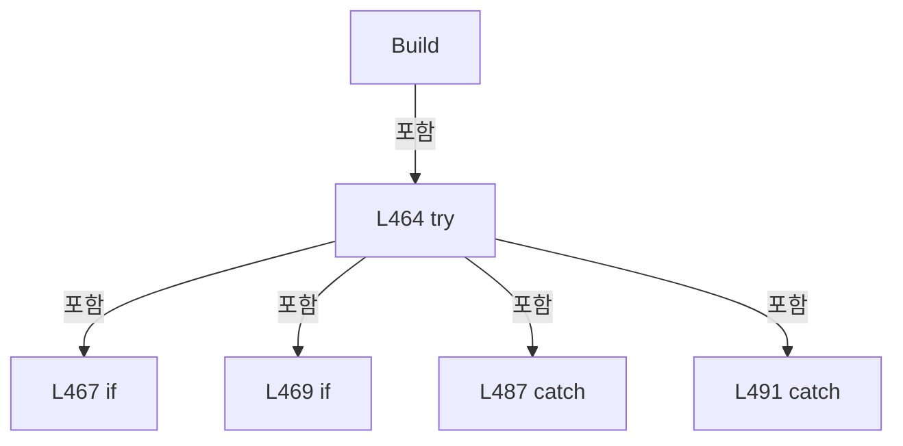

변경 전 점검: 입력/반환 타입, 위 호출자, 예외/취소 경로, 공유 상태와 저장·전송 소비자를 함께 확인합니다. 값의 단위나 물리 방향을 이름만으로 확정하지 않습니다.

### MethodDeclaration `CreateReviewScreen` · L501–515

[Drilling.UI/Menu/Menus/CMenuReview.cs:501–515](https://github.com/kjuws10-rgb/A3Drilling/blob/96e22cd027c84bf302b23f2949b98985d7f301bb/Drilling.UI/Menu/Menus/CMenuReview.cs#L501-L515)

| 항목 | 실제 추출 값 |
| --- | --- |
| 서명 | Drilling.UI.Menu.Menus.CScreenViewModel Drilling.UI.Menu.Menus.CMenuReview.CreateReviewScreen(string) |
| 접근/수식자 | Private / private |
| 반환/값 타입 | Drilling.UI.Menu.Menus.CScreenViewModel |
| 소속 타입 | NamedType:Drilling.UI.Menu.Menus.CMenuReview |

입력 계약:

| 이름 | 타입 | 전달 | 선택/기본값 |
| --- | --- | --- | --- |
| result | string | None | False /  |

정적 호출자로 확인된 위치:

| 호출 파일/행 | 호출 표현식 | 런타임 분기 가능 |
| --- | --- | --- |
| [Drilling.UI/Menu/Menus/CMenuReview.cs:485–485](https://github.com/kjuws10-rgb/A3Drilling/blob/96e22cd027c84bf302b23f2949b98985d7f301bb/Drilling.UI/Menu/Menus/CMenuReview.cs#L485-L485) | CreateReviewScreen | False |
| [Drilling.UI/Menu/Menus/CMenuReview.cs:497–497](https://github.com/kjuws10-rgb/A3Drilling/blob/96e22cd027c84bf302b23f2949b98985d7f301bb/Drilling.UI/Menu/Menus/CMenuReview.cs#L497-L497) | CreateReviewScreen | False |

호출하는 대상과 해석 범위:

| 원본 행 | 표현식 | 분석 상태 | 대상/소스 위치 |
| --- | --- | --- | --- |
| 503 | new CScreenViewModel | resolved | Drilling.UI.Menu.Menus.CScreenViewModel.CScreenViewModel(Drilling.UI.Menu.Menus.EN_MENU, string, string, System.Collections.Generic.IReadOnlyList<Drilling.UI.Menu.Menus.ST_DISPLAY_ITEM>, System.Collections.Generic.IReadOnlyList<Drilling.UI.Menu.Menus.ST_SCREEN_SECTION>, bool, Drilling.UI.Menu.Menus.CMenuMain?, Drilling.UI.Menu.Menus.CMenuManual?, Drilling.UI.Menu.Menus.CMenuRecipe?, Drilling.UI.Menu.Menus.CMenuSetting?, Drilling.UI.Menu.Menus.CMenuAlarm?, Drilling.UI.Menu.Menus.CMenuMonitor?, Drilling.UI.Menu.Menus.CMenuReview?, Drilling.UI.Menu.Menus.CMenuCorrection?, Drilling.UI.Menu.Menus.CMenuPm?) · Drilling.UI/Menu/Menus/CMenuBase.cs:411 |
| 508 | new | resolved | Drilling.UI.Menu.Menus.ST_DISPLAY_ITEM.ST_DISPLAY_ITEM(string, string, string) · Drilling.UI/Menu/Menus/CMenuBase.cs:43 |
| 508 | ToDisplayModeName | resolved | string Drilling.UI.Menu.Menus.CMenuReview.ToDisplayModeName(string) · Drilling.UI/Menu/Menus/CMenuReview.cs:2288 |
| 509 | new | resolved | Drilling.UI.Menu.Menus.ST_DISPLAY_ITEM.ST_DISPLAY_ITEM(string, string, string) · Drilling.UI/Menu/Menus/CMenuBase.cs:43 |
| 509 | GetConfiguredSampleInspectionShotCount | resolved | int Drilling.UI.Menu.Menus.CMenuReview.GetConfiguredSampleInspectionShotCount() · Drilling.UI/Menu/Menus/CMenuReview.cs:1754 |
| 510 | new | resolved | Drilling.UI.Menu.Menus.ST_DISPLAY_ITEM.ST_DISPLAY_ITEM(string, string, string) · Drilling.UI/Menu/Menus/CMenuBase.cs:43 |
| 512 | new | resolved | Drilling.UI.Menu.Menus.ST_SCREEN_SECTION.ST_SCREEN_SECTION(string, System.Collections.Generic.IReadOnlyList<Drilling.UI.Menu.Menus.ST_DISPLAY_ITEM>) · Drilling.UI/Menu/Menus/CMenuBase.cs:410 |
| 512 | new | resolved | Drilling.UI.Menu.Menus.ST_SCREEN_SECTION.ST_SCREEN_SECTION(string, System.Collections.Generic.IReadOnlyList<Drilling.UI.Menu.Menus.ST_DISPLAY_ITEM>) · Drilling.UI/Menu/Menus/CMenuBase.cs:410 |

본문의 실제 연산·분기·예외·반환 순서(원문 위치 순):

| 원본 행 | 종류 | 주석 해설 |
| --- | --- | --- |
| 503 | call | 함수·델리게이트 또는 객체 생성자를 호출합니다: new CScreenViewModel( EN_MENU.Review, Title, Subtitle, [ new("Mode", ToDisplayModeName(_selectedMode)), new("Shot", IsSampleSelectTab ? $"{GetConfiguredSampleInspectionShotCount()} / {_totalReviewPointCount}" : $"{_activ… |
| 503 | return | 호출자에게 값 또는 제어를 반환합니다: return new CScreenViewModel( EN_MENU.Review, Title, Subtitle, [ new("Mode", ToDisplayModeName(_selectedMode)), new("Shot", IsSampleSelectTab ? $"{GetConfiguredSampleInspectionShotCount()} / {_totalReviewPointCount}" : $"{_activePl |
| 508 | call | 함수·델리게이트 또는 객체 생성자를 호출합니다: new("Mode", ToDisplayModeName(_selectedMode)) |
| 508 | call | 함수·델리게이트 또는 객체 생성자를 호출합니다: ToDisplayModeName(_selectedMode) |
| 509 | call | 함수·델리게이트 또는 객체 생성자를 호출합니다: new("Shot", IsSampleSelectTab ? $"{GetConfiguredSampleInspectionShotCount()} / {_totalReviewPointCount}" : $"{_activePlanPointCount} / {_totalReviewPointCount}") |
| 509 | call | 함수·델리게이트 또는 객체 생성자를 호출합니다: GetConfiguredSampleInspectionShotCount() |
| 509 | conditional-expression | 조건에 따라 결과식을 선택합니다: IsSampleSelectTab ? $"{GetConfiguredSampleInspectionShotCount()} / {_totalReviewPointCount}" : $"{_activePlanPointCount} / {_totalReviewPointCount}" |
| 510 | call | 함수·델리게이트 또는 객체 생성자를 호출합니다: new("Result", result) |
| 512 | call | 함수·델리게이트 또는 객체 생성자를 호출합니다: new("Review Plan", []) |
| 512 | call | 함수·델리게이트 또는 객체 생성자를 호출합니다: new("Review Result", []) |

변경 전 점검: 입력/반환 타입, 위 호출자, 예외/취소 경로, 공유 상태와 저장·전송 소비자를 함께 확인합니다. 값의 단위나 물리 방향을 이름만으로 확정하지 않습니다.

### MethodDeclaration `ResetPlanDisplayAfterBuildFailure` · L517–553

[Drilling.UI/Menu/Menus/CMenuReview.cs:517–553](https://github.com/kjuws10-rgb/A3Drilling/blob/96e22cd027c84bf302b23f2949b98985d7f301bb/Drilling.UI/Menu/Menus/CMenuReview.cs#L517-L553)

| 항목 | 실제 추출 값 |
| --- | --- |
| 서명 | void Drilling.UI.Menu.Menus.CMenuReview.ResetPlanDisplayAfterBuildFailure() |
| 접근/수식자 | Private / private |
| 반환/값 타입 | void |
| 소속 타입 | NamedType:Drilling.UI.Menu.Menus.CMenuReview |

정적 호출자로 확인된 위치:

| 호출 파일/행 | 호출 표현식 | 런타임 분기 가능 |
| --- | --- | --- |
| [Drilling.UI/Menu/Menus/CMenuReview.cs:494–494](https://github.com/kjuws10-rgb/A3Drilling/blob/96e22cd027c84bf302b23f2949b98985d7f301bb/Drilling.UI/Menu/Menus/CMenuReview.cs#L494-L494) | ResetPlanDisplayAfterBuildFailure | False |

호출하는 대상과 해석 범위:

| 원본 행 | 표현식 | 분석 상태 | 대상/소스 위치 |
| --- | --- | --- | --- |
| 520 | _selectedLineShotKeys.Clear | resolved | void System.Collections.Generic.HashSet<string>.Clear() |
| 523 | new | resolved | Drilling.UI.Menu.Menus.ST_REVIEW_TAB_ITEM.ST_REVIEW_TAB_ITEM(string, bool, Drilling.UI.Menu.CButtonCommand) · Drilling.UI/Menu/Menus/CMenuReview.cs:5347 |
| 524 | Mode | resolved | Drilling.UI.Menu.Menus.ST_REVIEW_MODE_ITEM Drilling.UI.Menu.Menus.CMenuReview.Mode(string, string) · Drilling.UI/Menu/Menus/CMenuReview.cs:2289 |
| 524 | Mode | resolved | Drilling.UI.Menu.Menus.ST_REVIEW_MODE_ITEM Drilling.UI.Menu.Menus.CMenuReview.Mode(string, string) · Drilling.UI/Menu/Menus/CMenuReview.cs:2289 |
| 524 | Mode | resolved | Drilling.UI.Menu.Menus.ST_REVIEW_MODE_ITEM Drilling.UI.Menu.Menus.CMenuReview.Mode(string, string) · Drilling.UI/Menu/Menus/CMenuReview.cs:2289 |
| 524 | Mode | resolved | Drilling.UI.Menu.Menus.ST_REVIEW_MODE_ITEM Drilling.UI.Menu.Menus.CMenuReview.Mode(string, string) · Drilling.UI/Menu/Menus/CMenuReview.cs:2289 |
| 525 | new | resolved | Drilling.UI.Menu.Menus.ST_DISPLAY_ITEM.ST_DISPLAY_ITEM(string, string, string) · Drilling.UI/Menu/Menus/CMenuBase.cs:43 |
| 525 | _selectedRecipeIdProvider | resolved · 동적 구현 선택 가능 | string System.Func<string>.Invoke() |
| 525 | new | resolved | Drilling.UI.Menu.Menus.ST_DISPLAY_ITEM.ST_DISPLAY_ITEM(string, string, string) · Drilling.UI/Menu/Menus/CMenuBase.cs:43 |
| 525 | new | resolved | Drilling.UI.Menu.Menus.ST_DISPLAY_ITEM.ST_DISPLAY_ITEM(string, string, string) · Drilling.UI/Menu/Menus/CMenuBase.cs:43 |
| 526 | new | resolved | Drilling.UI.Menu.Menus.ST_DISPLAY_ITEM.ST_DISPLAY_ITEM(string, string, string) · Drilling.UI/Menu/Menus/CMenuBase.cs:43 |
| 526 | new | resolved | Drilling.UI.Menu.Menus.ST_DISPLAY_ITEM.ST_DISPLAY_ITEM(string, string, string) · Drilling.UI/Menu/Menus/CMenuBase.cs:43 |
| 532 | InvalidateMaterializedRunShotMap | resolved | void Drilling.UI.Menu.Menus.CMenuReview.InvalidateMaterializedRunShotMap() · Drilling.UI/Menu/Menus/CMenuReview.cs:4947 |
| 544 | Camera.Clear | resolved | void Drilling.UI.Menu.Menus.CReviewCameraPreview.Clear() · Drilling.UI/Menu/Menus/CMenuReview.cs:5809 |
| 552 | OnPropertyChanged | resolved | void Drilling.UI.Menu.CBindingBase.OnPropertyChanged(string?) · Drilling.UI/Menu/CBindingBase.cs:784 |
| 552 | nameof | unresolved | None |

본문의 실제 연산·분기·예외·반환 순서(원문 위치 순):

| 원본 행 | 종류 | 주석 해설 |
| --- | --- | --- |
| 519 | assignment | 값을 대상에 대입합니다: _lastAllPlan = null |
| 520 | call | 함수·델리게이트 또는 객체 생성자를 호출합니다: _selectedLineShotKeys.Clear() |
| 521 | assignment | 값을 대상에 대입합니다: _activePlanPointCount = 0 |
| 522 | assignment | 값을 대상에 대입합니다: _totalReviewPointCount = 0 |
| 523 | assignment | 값을 대상에 대입합니다: Tabs = [new("RUN", IsRunTab, SelectTabCommand)] |
| 523 | call | 함수·델리게이트 또는 객체 생성자를 호출합니다: new("RUN", IsRunTab, SelectTabCommand) |
| 524 | assignment | 값을 대상에 대입합니다: Modes = [Mode("ALL SHOT", ""), Mode("ONE SHOT", ""), Mode("ONE LINE", ""), Mode("BEAM INSPECTION", "")] |
| 524 | call | 함수·델리게이트 또는 객체 생성자를 호출합니다: Mode("ALL SHOT", "") |
| 524 | call | 함수·델리게이트 또는 객체 생성자를 호출합니다: Mode("ONE SHOT", "") |
| 524 | call | 함수·델리게이트 또는 객체 생성자를 호출합니다: Mode("ONE LINE", "") |
| 524 | call | 함수·델리게이트 또는 객체 생성자를 호출합니다: Mode("BEAM INSPECTION", "") |
| 525 | assignment | 값을 대상에 대입합니다: TargetItems = [new("Recipe Name", _selectedRecipeIdProvider()), new("Glass ID", _productManager.Current?.GlassId ?? "-"), new("Tolerance", "-")] |
| 525 | call | 함수·델리게이트 또는 객체 생성자를 호출합니다: new("Recipe Name", _selectedRecipeIdProvider()) |
| 525 | call | 함수·델리게이트 또는 객체 생성자를 호출합니다: _selectedRecipeIdProvider() |
| 525 | call | 함수·델리게이트 또는 객체 생성자를 호출합니다: new("Glass ID", _productManager.Current?.GlassId ?? "-") |
| 525 | call | 함수·델리게이트 또는 객체 생성자를 호출합니다: new("Tolerance", "-") |
| 526 | assignment | 값을 대상에 대입합니다: SelectionSummaryItems = [new("Status", "Configuration Error"), new("Reason", _planBuildError)] |
| 526 | call | 함수·델리게이트 또는 객체 생성자를 호출합니다: new("Status", "Configuration Error") |
| 526 | call | 함수·델리게이트 또는 객체 생성자를 호출합니다: new("Reason", _planBuildError) |
| 527 | assignment | 값을 대상에 대입합니다: SelectedPointItems = [] |
| 528 | assignment | 값을 대상에 대입합니다: SelectedShotInspection = ST_REVIEW_SELECTED_SHOT_STATUS.Empty |
| 529 | assignment | 값을 대상에 대입합니다: PointSelectRows = [] |
| 530 | assignment | 값을 대상에 대입합니다: RunCellShotRows = [] |
| 531 | assignment | 값을 대상에 대입합니다: RunCellShotMatrixRows = [] |
| 532 | call | 함수·델리게이트 또는 객체 생성자를 호출합니다: InvalidateMaterializedRunShotMap() |
| 533 | assignment | 값을 대상에 대입합니다: RunBeamRows = [] |
| 534 | assignment | 값을 대상에 대입합니다: InspectionBeamResultRows = [] |
| 535 | assignment | 값을 대상에 대입합니다: BeamInspectionShotAssignments = [] |
| 536 | assignment | 값을 대상에 대입합니다: _selectedBeamInspectionAssignment = null |
| 537 | assignment | 값을 대상에 대입합니다: SampleCellShotRows = [] |
| 538 | assignment | 값을 대상에 대입합니다: SampleCellShotMatrixRows = [] |
| 539 | assignment | 값을 대상에 대입합니다: RunGlassPreviewImage = null |
| 540 | assignment | 값을 대상에 대입합니다: _cameraGlassBounds = Rect.Empty |
| 541 | assignment | 값을 대상에 대입합니다: _cameraProjectionViewportSize = Size.Empty |
| 542 | assignment | 값을 대상에 대입합니다: _cameraProjectionGlassBounds = Rect.Empty |
| 543 | assignment | 값을 대상에 대입합니다: _cameraProjectionCanvasSize = Size.Empty |
| 544 | call | 함수·델리게이트 또는 객체 생성자를 호출합니다: Camera.Clear() |
| 545 | assignment | 값을 대상에 대입합니다: RunGlassPreviewInspectionOverlayImage = null |
| 546 | assignment | 값을 대상에 대입합니다: RunCellPreviewLabels = [] |
| 547 | assignment | 값을 대상에 대입합니다: RunGlassPreviewSummary = "Review plan unavailable" |
| 548 | assignment | 값을 대상에 대입합니다: SampleGlassPreviewImage = null |
| 549 | assignment | 값을 대상에 대입합니다: SampleGlassPreviewInspectionOverlayImage = null |
| 550 | assignment | 값을 대상에 대입합니다: SampleCellPreviewLabels = [] |
| 551 | assignment | 값을 대상에 대입합니다: SampleGlassPreviewSummary = "Review plan unavailable" |
| 552 | call | 함수·델리게이트 또는 객체 생성자를 호출합니다: OnPropertyChanged(nameof(SelectedShotInspection)) |
| 552 | call | 함수·델리게이트 또는 객체 생성자를 호출합니다: nameof(SelectedShotInspection) |

변경 전 점검: 입력/반환 타입, 위 호출자, 예외/취소 경로, 공유 상태와 저장·전송 소비자를 함께 확인합니다. 값의 단위나 물리 방향을 이름만으로 확정하지 않습니다.

### MethodDeclaration `CreateFallbackRecipe` · L555–558

[Drilling.UI/Menu/Menus/CMenuReview.cs:555–558](https://github.com/kjuws10-rgb/A3Drilling/blob/96e22cd027c84bf302b23f2949b98985d7f301bb/Drilling.UI/Menu/Menus/CMenuReview.cs#L555-L558)

| 항목 | 실제 추출 값 |
| --- | --- |
| 서명 | Drilling.Common.Managers.ST_RECIPE_DEFINITION Drilling.UI.Menu.Menus.CMenuReview.CreateFallbackRecipe() |
| 접근/수식자 | Private / private |
| 반환/값 타입 | Drilling.Common.Managers.ST_RECIPE_DEFINITION |
| 소속 타입 | NamedType:Drilling.UI.Menu.Menus.CMenuReview |

정적 호출자로 확인된 위치:

| 호출 파일/행 | 호출 표현식 | 런타임 분기 가능 |
| --- | --- | --- |
| [Drilling.UI/Menu/Menus/CMenuReview.cs:466–466](https://github.com/kjuws10-rgb/A3Drilling/blob/96e22cd027c84bf302b23f2949b98985d7f301bb/Drilling.UI/Menu/Menus/CMenuReview.cs#L466-L466) | CreateFallbackRecipe | False |
| [Drilling.UI/Menu/Menus/CMenuReview.cs:3988–3988](https://github.com/kjuws10-rgb/A3Drilling/blob/96e22cd027c84bf302b23f2949b98985d7f301bb/Drilling.UI/Menu/Menus/CMenuReview.cs#L3988-L3988) | CreateFallbackRecipe | False |

호출하는 대상과 해석 범위:

| 원본 행 | 표현식 | 분석 상태 | 대상/소스 위치 |
| --- | --- | --- | --- |
| 557 | new ST_RECIPE_DEFINITION | resolved | Drilling.Common.Managers.ST_RECIPE_DEFINITION.ST_RECIPE_DEFINITION(string, string, System.Collections.Generic.IReadOnlyList<Drilling.Common.Managers.ST_RECIPE_PARAMETER>, System.Collections.Generic.IReadOnlyList<Drilling.Common.Managers.ST_RECIPE_HISTORY>) · Drilling.Common/Managers/CRecipeManager.cs:385 |

본문의 실제 연산·분기·예외·반환 순서(원문 위치 순):

| 원본 행 | 종류 | 주석 해설 |
| --- | --- | --- |
| 557 | call | 함수·델리게이트 또는 객체 생성자를 호출합니다: new ST_RECIPE_DEFINITION(_recipeId, _recipeId, [], []) |
| 557 | return | 호출자에게 값 또는 제어를 반환합니다: return new ST_RECIPE_DEFINITION(_recipeId, _recipeId, [], []); |

변경 전 점검: 입력/반환 타입, 위 호출자, 예외/취소 경로, 공유 상태와 저장·전송 소비자를 함께 확인합니다. 값의 단위나 물리 방향을 이름만으로 확정하지 않습니다.

### MethodDeclaration `LoadSelectedRecipe` · L560–579

[Drilling.UI/Menu/Menus/CMenuReview.cs:560–579](https://github.com/kjuws10-rgb/A3Drilling/blob/96e22cd027c84bf302b23f2949b98985d7f301bb/Drilling.UI/Menu/Menus/CMenuReview.cs#L560-L579)

| 항목 | 실제 추출 값 |
| --- | --- |
| 서명 | System.Threading.Tasks.Task<Drilling.Common.Managers.ST_RECIPE_DEFINITION?> Drilling.UI.Menu.Menus.CMenuReview.LoadSelectedRecipe(System.Threading.CancellationToken) |
| 접근/수식자 | Private / private, async |
| 반환/값 타입 | System.Threading.Tasks.Task<Drilling.Common.Managers.ST_RECIPE_DEFINITION?> |
| 소속 타입 | NamedType:Drilling.UI.Menu.Menus.CMenuReview |

입력 계약:

| 이름 | 타입 | 전달 | 선택/기본값 |
| --- | --- | --- | --- |
| cancellationToken | System.Threading.CancellationToken | None | False /  |

정적 호출자로 확인된 위치:

| 호출 파일/행 | 호출 표현식 | 런타임 분기 가능 |
| --- | --- | --- |
| [Drilling.UI/Menu/Menus/CMenuReview.cs:466–466](https://github.com/kjuws10-rgb/A3Drilling/blob/96e22cd027c84bf302b23f2949b98985d7f301bb/Drilling.UI/Menu/Menus/CMenuReview.cs#L466-L466) | LoadSelectedRecipe | False |
| [Drilling.UI/Menu/Menus/CMenuReview.cs:2797–2797](https://github.com/kjuws10-rgb/A3Drilling/blob/96e22cd027c84bf302b23f2949b98985d7f301bb/Drilling.UI/Menu/Menus/CMenuReview.cs#L2797-L2797) | LoadSelectedRecipe | False |
| [Drilling.UI/Menu/Menus/CMenuReview.cs:3590–3590](https://github.com/kjuws10-rgb/A3Drilling/blob/96e22cd027c84bf302b23f2949b98985d7f301bb/Drilling.UI/Menu/Menus/CMenuReview.cs#L3590-L3590) | LoadSelectedRecipe | False |
| [Drilling.UI/Menu/Menus/CMenuReview.cs:3988–3988](https://github.com/kjuws10-rgb/A3Drilling/blob/96e22cd027c84bf302b23f2949b98985d7f301bb/Drilling.UI/Menu/Menus/CMenuReview.cs#L3988-L3988) | LoadSelectedRecipe | False |

호출하는 대상과 해석 범위:

| 원본 행 | 표현식 | 분석 상태 | 대상/소스 위치 |
| --- | --- | --- | --- |
| 562 | _recipeManager.LoadRecipes | resolved | System.Threading.Tasks.Task<System.Collections.Generic.IReadOnlyList<Drilling.Common.Managers.ST_RECIPE_DEFINITION>> Drilling.Common.Managers.CRecipeManager.LoadRecipes(System.Threading.CancellationToken) · Drilling.Common/Managers/CRecipeManager.cs:40 |
| 568 | _selectedRecipeIdProvider | resolved · 동적 구현 선택 가능 | string System.Func<string>.Invoke() |
| 569 | string.IsNullOrWhiteSpace | resolved | bool string.IsNullOrWhiteSpace(string?) |
| 571 | recipes.FirstOrDefault | resolved | Drilling.Common.Managers.ST_RECIPE_DEFINITION? System.Collections.Generic.IEnumerable<Drilling.Common.Managers.ST_RECIPE_DEFINITION>.FirstOrDefault<Drilling.Common.Managers.ST_RECIPE_DEFINITION>(System.Func<Drilling.Common.Managers.ST_RECIPE_DEFINITION, bool>) |
| 571 | recipe.Id.Equals | resolved | bool string.Equals(string?, System.StringComparison) |
| 578 | recipes.FirstOrDefault | resolved | Drilling.Common.Managers.ST_RECIPE_DEFINITION? System.Collections.Generic.IEnumerable<Drilling.Common.Managers.ST_RECIPE_DEFINITION>.FirstOrDefault<Drilling.Common.Managers.ST_RECIPE_DEFINITION>(System.Func<Drilling.Common.Managers.ST_RECIPE_DEFINITION, bool>) |
| 578 | recipe.Id.Equals | resolved | bool string.Equals(string?, System.StringComparison) |

본문의 실제 연산·분기·예외·반환 순서(원문 위치 순):

| 원본 행 | 종류 | 주석 해설 |
| --- | --- | --- |
| 562 | await | 비동기 완료를 기다립니다: await _recipeManager.LoadRecipes(cancellationToken) |
| 562 | call | 함수·델리게이트 또는 객체 생성자를 호출합니다: _recipeManager.LoadRecipes(cancellationToken) |
| 562 | local-declaration | 지역 변수를 선언합니다: var recipes = await _recipeManager.LoadRecipes(cancellationToken); |
| 562 | variable-initializer | 변수의 초기값을 지정합니다: recipes = await _recipeManager.LoadRecipes(cancellationToken) |
| 563 | if | 조건에 따라 분기합니다: if (recipes.Count == 0) |
| 565 | return | 호출자에게 값 또는 제어를 반환합니다: return null; |
| 568 | call | 함수·델리게이트 또는 객체 생성자를 호출합니다: _selectedRecipeIdProvider() |
| 568 | local-declaration | 지역 변수를 선언합니다: var selectedRecipeId = _selectedRecipeIdProvider(); |
| 568 | variable-initializer | 변수의 초기값을 지정합니다: selectedRecipeId = _selectedRecipeIdProvider() |
| 569 | call | 함수·델리게이트 또는 객체 생성자를 호출합니다: string.IsNullOrWhiteSpace(selectedRecipeId) |
| 569 | if | 조건에 따라 분기합니다: if (!string.IsNullOrWhiteSpace(selectedRecipeId)) |
| 571 | call | 함수·델리게이트 또는 객체 생성자를 호출합니다: recipes.FirstOrDefault(recipe => recipe.Id.Equals(selectedRecipeId, StringComparison.OrdinalIgnoreCase)) |
| 571 | call | 함수·델리게이트 또는 객체 생성자를 호출합니다: recipe.Id.Equals(selectedRecipeId, StringComparison.OrdinalIgnoreCase) |
| 571 | local-declaration | 지역 변수를 선언합니다: var selectedRecipe = recipes.FirstOrDefault(recipe => recipe.Id.Equals(selectedRecipeId, StringComparison.OrdinalIgnoreCase)); |
| 571 | variable-initializer | 변수의 초기값을 지정합니다: selectedRecipe = recipes.FirstOrDefault(recipe => recipe.Id.Equals(selectedRecipeId, StringComparison.OrdinalIgnoreCase)) |
| 572 | if | 조건에 따라 분기합니다: if (selectedRecipe is not null) |
| 574 | return | 호출자에게 값 또는 제어를 반환합니다: return selectedRecipe; |
| 578 | call | 함수·델리게이트 또는 객체 생성자를 호출합니다: recipes.FirstOrDefault(recipe => recipe.Id.Equals("DRILL_A01", StringComparison.OrdinalIgnoreCase)) |
| 578 | call | 함수·델리게이트 또는 객체 생성자를 호출합니다: recipe.Id.Equals("DRILL_A01", StringComparison.OrdinalIgnoreCase) |
| 578 | return | 호출자에게 값 또는 제어를 반환합니다: return recipes.FirstOrDefault(recipe => recipe.Id.Equals("DRILL_A01", StringComparison.OrdinalIgnoreCase)) ?? recipes[0]; |

제어 구문의 포함 구조(실제 실행 순서/CFG가 아닌 구문 탐색 그림):

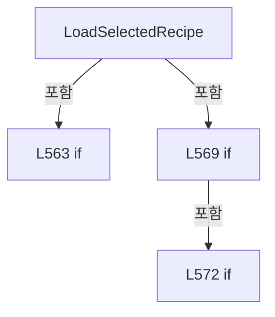

변경 전 점검: 입력/반환 타입, 위 호출자, 예외/취소 경로, 공유 상태와 저장·전송 소비자를 함께 확인합니다. 값의 단위나 물리 방향을 이름만으로 확정하지 않습니다.

### MethodDeclaration `ApplyRecipeContext` · L581–637

[Drilling.UI/Menu/Menus/CMenuReview.cs:581–637](https://github.com/kjuws10-rgb/A3Drilling/blob/96e22cd027c84bf302b23f2949b98985d7f301bb/Drilling.UI/Menu/Menus/CMenuReview.cs#L581-L637)

| 항목 | 실제 추출 값 |
| --- | --- |
| 서명 | void Drilling.UI.Menu.Menus.CMenuReview.ApplyRecipeContext(Drilling.Common.Managers.ST_RECIPE_DEFINITION, Drilling.Common.Review.ST_REVIEW_PLAN) |
| 접근/수식자 | Private / private |
| 반환/값 타입 | void |
| 소속 타입 | NamedType:Drilling.UI.Menu.Menus.CMenuReview |

입력 계약:

| 이름 | 타입 | 전달 | 선택/기본값 |
| --- | --- | --- | --- |
| recipe | Drilling.Common.Managers.ST_RECIPE_DEFINITION | None | False /  |
| allPlan | Drilling.Common.Review.ST_REVIEW_PLAN | None | False /  |

정적 호출자로 확인된 위치:

| 호출 파일/행 | 호출 표현식 | 런타임 분기 가능 |
| --- | --- | --- |
| [Drilling.UI/Menu/Menus/CMenuReview.cs:482–482](https://github.com/kjuws10-rgb/A3Drilling/blob/96e22cd027c84bf302b23f2949b98985d7f301bb/Drilling.UI/Menu/Menus/CMenuReview.cs#L482-L482) | ApplyRecipeContext | False |
| [Drilling.UI/Menu/Menus/CMenuReview.cs:3991–3991](https://github.com/kjuws10-rgb/A3Drilling/blob/96e22cd027c84bf302b23f2949b98985d7f301bb/Drilling.UI/Menu/Menus/CMenuReview.cs#L3991-L3991) | ApplyRecipeContext | False |

호출하는 대상과 해석 범위:

| 원본 행 | 표현식 | 분석 상태 | 대상/소스 위치 |
| --- | --- | --- | --- |
| 584 | Math.Clamp | resolved | int System.Math.Clamp(int, int, int) |
| 585 | Math.Max | resolved | int System.Math.Max(int, int) |
| 586 | Math.Clamp | resolved | int System.Math.Clamp(int, int, int) |
| 587 | string.IsNullOrWhiteSpace | resolved | bool string.IsNullOrWhiteSpace(string?) |
| 588 | _sampleSelectionRecipeId.Equals | resolved | bool string.Equals(string?, System.StringComparison) |
| 590 | ApplySplitBeamContext | resolved | void Drilling.UI.Menu.Menus.CMenuReview.ApplySplitBeamContext(Drilling.Common.Managers.ST_RECIPE_DEFINITION) · Drilling.UI/Menu/Menus/CMenuReview.cs:659 |
| 604 | _selectedLineShotKeys.Clear | resolved | void System.Collections.Generic.HashSet<string>.Clear() |
| 606 | NotifyOneShot | resolved | void Drilling.UI.Menu.Menus.CMenuReview.NotifyOneShot() · Drilling.UI/Menu/Menus/CMenuReview.cs:3463 |
| 609 | ResetBeamInspectionResults | resolved | void Drilling.UI.Menu.Menus.CMenuReview.ResetBeamInspectionResults() · Drilling.UI/Menu/Menus/CMenuReview.cs:2708 |
| 610 | _selectedSampleShotKeys.Clear | resolved | void System.Collections.Generic.HashSet<string>.Clear() |
| 611 | _selectedInspectionShotKeys.Clear | resolved | void System.Collections.Generic.HashSet<string>.Clear() |
| 612 | _inspectionBeamNosByShotKey.Clear | resolved | void System.Collections.Generic.Dictionary<string, System.Collections.Generic.HashSet<int>>.Clear() |
| 613 | _selectedInspectionBeamNos.Clear | resolved | void System.Collections.Generic.HashSet<int>.Clear() |
| 620 | _selectedSampleShotKeys.RemoveWhere | resolved | int System.Collections.Generic.HashSet<string>.RemoveWhere(System.Predicate<string>) |
| 620 | IsValidShotKey | resolved | bool IsValidShotKey(string) · Drilling.UI/Menu/Menus/CMenuReview.cs:591 |
| 621 | _selectedInspectionShotKeys.RemoveWhere | resolved | int System.Collections.Generic.HashSet<string>.RemoveWhere(System.Predicate<string>) |
| 621 | IsValidShotKey | resolved | bool IsValidShotKey(string) · Drilling.UI/Menu/Menus/CMenuReview.cs:591 |
| 622 | _inspectionBeamNosByShotKey.Keys.Where(key => !_selectedInspectionShotKeys.Contains(key)).ToArray | resolved | string[] System.Collections.Generic.IEnumerable<string>.ToArray<string>() |
| 622 | _inspectionBeamNosByShotKey.Keys.Where | resolved | System.Collections.Generic.IEnumerable<string> System.Collections.Generic.IEnumerable<string>.Where<string>(System.Func<string, bool>) |
| 622 | _selectedInspectionShotKeys.Contains | resolved | bool System.Collections.Generic.HashSet<string>.Contains(string) |
| 624 | _inspectionBeamNosByShotKey.Remove | resolved | bool System.Collections.Generic.Dictionary<string, System.Collections.Generic.HashSet<int>>.Remove(string) |
| 628 | Math.Clamp | resolved | int System.Math.Clamp(int, int, int) |
| 629 | SetSampleMapColumnCount | resolved | void Drilling.UI.Menu.Menus.CMenuReview.SetSampleMapColumnCount(int) · Drilling.UI/Menu/Menus/CMenuReview.cs:1924 |
| 629 | CalculateShotMapColumnCount | resolved | int Drilling.UI.Menu.Menus.CMenuReview.CalculateShotMapColumnCount(Drilling.Common.Review.ST_REVIEW_PLAN, int) · Drilling.UI/Menu/Menus/CMenuReview.cs:1906 |
| 630 | Math.Clamp | resolved | int System.Math.Clamp(int, int, int) |
| 631 | string.IsNullOrWhiteSpace | resolved | bool string.IsNullOrWhiteSpace(string?) |
| 631 | IsValidShotKey | resolved | bool IsValidShotKey(string) · Drilling.UI/Menu/Menus/CMenuReview.cs:591 |
| 636 | RefreshSelectedLineKeys | resolved | void Drilling.UI.Menu.Menus.CMenuReview.RefreshSelectedLineKeys(Drilling.Common.Review.ST_REVIEW_PLAN?) · Drilling.UI/Menu/Menus/CMenuReview.cs:2029 |

본문의 실제 연산·분기·예외·반환 순서(원문 위치 순):

| 원본 행 | 종류 | 주석 해설 |
| --- | --- | --- |
| 583 | assignment | 값을 대상에 대입합니다: _headCount = MaxHeadCount |
| 584 | assignment | 값을 대상에 대입합니다: _sampleRuleHeadNo = Math.Clamp(_sampleRuleHeadNo, 1, _headCount) |
| 584 | call | 함수·델리게이트 또는 객체 생성자를 호출합니다: Math.Clamp(_sampleRuleHeadNo, 1, _headCount) |
| 585 | assignment | 값을 대상에 대입합니다: _cellCount = Math.Max(1, allPlan.CellCount) |
| 585 | call | 함수·델리게이트 또는 객체 생성자를 호출합니다: Math.Max(1, allPlan.CellCount) |
| 586 | assignment | 값을 대상에 대입합니다: _sampleRuleCellNo = Math.Clamp(_sampleRuleCellNo, 1, _cellCount) |
| 586 | call | 함수·델리게이트 또는 객체 생성자를 호출합니다: Math.Clamp(_sampleRuleCellNo, 1, _cellCount) |
| 587 | assignment | 값을 대상에 대입합니다: _recipeId = string.IsNullOrWhiteSpace(recipe.Id) ? "DRILL_A01" : recipe.Id |
| 587 | call | 함수·델리게이트 또는 객체 생성자를 호출합니다: string.IsNullOrWhiteSpace(recipe.Id) |
| 587 | conditional-expression | 조건에 따라 결과식을 선택합니다: string.IsNullOrWhiteSpace(recipe.Id) ? "DRILL_A01" : recipe.Id |
| 588 | call | 함수·델리게이트 또는 객체 생성자를 호출합니다: _sampleSelectionRecipeId.Equals(_recipeId, StringComparison.OrdinalIgnoreCase) |
| 588 | local-declaration | 지역 변수를 선언합니다: var isSampleSelectionRecipeChanged = !_sampleSelectionRecipeId.Equals(_recipeId, StringComparison.OrdinalIgnoreCase); |
| 588 | variable-initializer | 변수의 초기값을 지정합니다: isSampleSelectionRecipeChanged = !_sampleSelectionRecipeId.Equals(_recipeId, StringComparison.OrdinalIgnoreCase) |
| 589 | assignment | 값을 대상에 대입합니다: _totalReviewPointCount = allPlan.Points.Count |
| 590 | call | 함수·델리게이트 또는 객체 생성자를 호출합니다: ApplySplitBeamContext(recipe) |
| 598 | if | 조건에 따라 분기합니다: if (isSampleSelectionRecipeChanged) |
| 600 | assignment | 값을 대상에 대입합니다: _oneShotResult = null |
| 601 | if | 조건에 따라 분기합니다: if (IsOneShotReviewMode &#124;&#124; IsOneLineReviewMode) |
| 603 | assignment | 값을 대상에 대입합니다: _selectedRunShotKey = "" |
| 604 | call | 함수·델리게이트 또는 객체 생성자를 호출합니다: _selectedLineShotKeys.Clear() |
| 605 | assignment | 값을 대상에 대입합니다: OneShotStatus = "Shot을 선택해 주세요." |
| 606 | call | 함수·델리게이트 또는 객체 생성자를 호출합니다: NotifyOneShot() |
| 609 | call | 함수·델리게이트 또는 객체 생성자를 호출합니다: ResetBeamInspectionResults() |
| 610 | call | 함수·델리게이트 또는 객체 생성자를 호출합니다: _selectedSampleShotKeys.Clear() |
| 611 | call | 함수·델리게이트 또는 객체 생성자를 호출합니다: _selectedInspectionShotKeys.Clear() |
| 612 | call | 함수·델리게이트 또는 객체 생성자를 호출합니다: _inspectionBeamNosByShotKey.Clear() |
| 613 | call | 함수·델리게이트 또는 객체 생성자를 호출합니다: _selectedInspectionBeamNos.Clear() |
| 614 | assignment | 값을 대상에 대입합니다: _simpleSampleShotKey = "" |
| 615 | assignment | 값을 대상에 대입합니다: _lastCorrectionRulePlan = null |
| 616 | assignment | 값을 대상에 대입합니다: _sampleSelectionRecipeId = _recipeId |
| 618 | else | 앞 조건이 거짓인 경로입니다: else |
| 620 | call | 함수·델리게이트 또는 객체 생성자를 호출합니다: _selectedSampleShotKeys.RemoveWhere(key => !IsValidShotKey(key)) |
| 620 | call | 함수·델리게이트 또는 객체 생성자를 호출합니다: IsValidShotKey(key) |
| 621 | call | 함수·델리게이트 또는 객체 생성자를 호출합니다: _selectedInspectionShotKeys.RemoveWhere(key => !IsValidShotKey(key)) |
| 621 | call | 함수·델리게이트 또는 객체 생성자를 호출합니다: IsValidShotKey(key) |
| 622 | call | 함수·델리게이트 또는 객체 생성자를 호출합니다: _inspectionBeamNosByShotKey.Keys.Where(key => !_selectedInspectionShotKeys.Contains(key)).ToArray() |
| 622 | call | 함수·델리게이트 또는 객체 생성자를 호출합니다: _inspectionBeamNosByShotKey.Keys.Where(key => !_selectedInspectionShotKeys.Contains(key)) |
| 622 | call | 함수·델리게이트 또는 객체 생성자를 호출합니다: _selectedInspectionShotKeys.Contains(key) |
| 622 | foreach | 컬렉션 요소를 순회합니다: foreach (var key in _inspectionBeamNosByShotKey.Keys.Where(key => !_selectedInspectionShotKeys.Contains(key)).ToArray()) |
| 624 | call | 함수·델리게이트 또는 객체 생성자를 호출합니다: _inspectionBeamNosByShotKey.Remove(key) |
| 628 | assignment | 값을 대상에 대입합니다: _selectedSampleCellNo = Math.Clamp(_selectedSampleCellNo, 1, _cellCount) |
| 628 | call | 함수·델리게이트 또는 객체 생성자를 호출합니다: Math.Clamp(_selectedSampleCellNo, 1, _cellCount) |
| 629 | call | 함수·델리게이트 또는 객체 생성자를 호출합니다: SetSampleMapColumnCount(CalculateShotMapColumnCount(allPlan, _selectedSampleCellNo)) |
| 629 | call | 함수·델리게이트 또는 객체 생성자를 호출합니다: CalculateShotMapColumnCount(allPlan, _selectedSampleCellNo) |
| 630 | assignment | 값을 대상에 대입합니다: _selectedRunCellNo = Math.Clamp(_selectedRunCellNo, 1, _cellCount) |
| 630 | call | 함수·델리게이트 또는 객체 생성자를 호출합니다: Math.Clamp(_selectedRunCellNo, 1, _cellCount) |
| 631 | call | 함수·델리게이트 또는 객체 생성자를 호출합니다: string.IsNullOrWhiteSpace(_selectedRunShotKey) |
| 631 | call | 함수·델리게이트 또는 객체 생성자를 호출합니다: IsValidShotKey(_selectedRunShotKey) |
| 631 | if | 조건에 따라 분기합니다: if (!string.IsNullOrWhiteSpace(_selectedRunShotKey) && !IsValidShotKey(_selectedRunShotKey)) |
| 633 | assignment | 값을 대상에 대입합니다: _selectedRunShotKey = "" |
| 636 | call | 함수·델리게이트 또는 객체 생성자를 호출합니다: RefreshSelectedLineKeys(allPlan) |

제어 구문의 포함 구조(실제 실행 순서/CFG가 아닌 구문 탐색 그림):

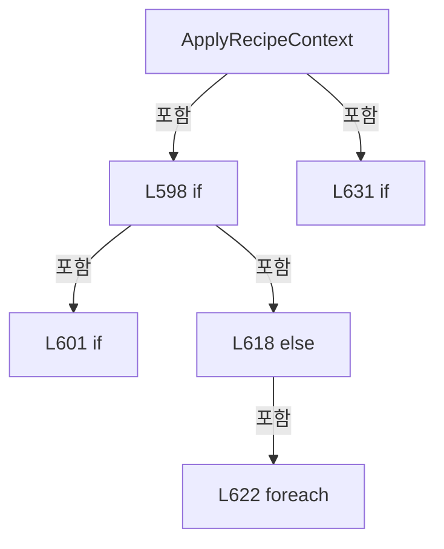

변경 전 점검: 입력/반환 타입, 위 호출자, 예외/취소 경로, 공유 상태와 저장·전송 소비자를 함께 확인합니다. 값의 단위나 물리 방향을 이름만으로 확정하지 않습니다.

### LocalFunctionStatement `IsValidShotKey` · L591–596

[Drilling.UI/Menu/Menus/CMenuReview.cs:591–596](https://github.com/kjuws10-rgb/A3Drilling/blob/96e22cd027c84bf302b23f2949b98985d7f301bb/Drilling.UI/Menu/Menus/CMenuReview.cs#L591-L596)

| 항목 | 실제 추출 값 |
| --- | --- |
| 서명 | bool IsValidShotKey(string) |
| 접근/수식자 | Private /  |
| 반환/값 타입 | bool |
| 소속 타입 | NamedType:Drilling.UI.Menu.Menus.CMenuReview |

입력 계약:

| 이름 | 타입 | 전달 | 선택/기본값 |
| --- | --- | --- | --- |
| key | string | None | False /  |

정적 호출자로 확인된 위치:

| 호출 파일/행 | 호출 표현식 | 런타임 분기 가능 |
| --- | --- | --- |
| [Drilling.UI/Menu/Menus/CMenuReview.cs:620–620](https://github.com/kjuws10-rgb/A3Drilling/blob/96e22cd027c84bf302b23f2949b98985d7f301bb/Drilling.UI/Menu/Menus/CMenuReview.cs#L620-L620) | IsValidShotKey | False |
| [Drilling.UI/Menu/Menus/CMenuReview.cs:621–621](https://github.com/kjuws10-rgb/A3Drilling/blob/96e22cd027c84bf302b23f2949b98985d7f301bb/Drilling.UI/Menu/Menus/CMenuReview.cs#L621-L621) | IsValidShotKey | False |
| [Drilling.UI/Menu/Menus/CMenuReview.cs:631–631](https://github.com/kjuws10-rgb/A3Drilling/blob/96e22cd027c84bf302b23f2949b98985d7f301bb/Drilling.UI/Menu/Menus/CMenuReview.cs#L631-L631) | IsValidShotKey | False |

호출하는 대상과 해석 범위:

| 원본 행 | 표현식 | 분석 상태 | 대상/소스 위치 |
| --- | --- | --- | --- |
| 593 | CReviewManager.NormalizeShotKey | resolved | string Drilling.Common.Review.CReviewManager.NormalizeShotKey(string) · Drilling.Common/Review/CReviewManager.cs:1238 |
| 594 | normalized.IndexOf | resolved | int string.IndexOf(string, System.StringComparison) |
| 595 | int.TryParse | resolved | bool int.TryParse(System.ReadOnlySpan<char>, System.Globalization.NumberStyles, System.IFormatProvider?, out int) |
| 595 | normalized.AsSpan | resolved | System.ReadOnlySpan<char> string?.AsSpan(int, int) |
| 595 | int.TryParse | resolved | bool int.TryParse(System.ReadOnlySpan<char>, System.Globalization.NumberStyles, System.IFormatProvider?, out int) |
| 595 | normalized.AsSpan | resolved | System.ReadOnlySpan<char> string?.AsSpan(int) |
| 595 | allPlan.FindPoint | resolved | Drilling.Common.Review.ST_REVIEW_PLAN_POINT? Drilling.Common.Review.ST_REVIEW_PLAN.FindPoint(int, int) · Drilling.Common/Review/CReviewManager.cs:4182 |

본문의 실제 연산·분기·예외·반환 순서(원문 위치 순):

| 원본 행 | 종류 | 주석 해설 |
| --- | --- | --- |
| 593 | call | 함수·델리게이트 또는 객체 생성자를 호출합니다: CReviewManager.NormalizeShotKey(key) |
| 593 | local-declaration | 지역 변수를 선언합니다: var normalized = CReviewManager.NormalizeShotKey(key); |
| 593 | variable-initializer | 변수의 초기값을 지정합니다: normalized = CReviewManager.NormalizeShotKey(key) |
| 594 | call | 함수·델리게이트 또는 객체 생성자를 호출합니다: normalized.IndexOf("_SHOT", StringComparison.Ordinal) |
| 594 | local-declaration | 지역 변수를 선언합니다: var separator = normalized.IndexOf("_SHOT", StringComparison.Ordinal); |
| 594 | variable-initializer | 변수의 초기값을 지정합니다: separator = normalized.IndexOf("_SHOT", StringComparison.Ordinal) |
| 595 | call | 함수·델리게이트 또는 객체 생성자를 호출합니다: int.TryParse(normalized.AsSpan(4, separator - 4), NumberStyles.Integer, CultureInfo.InvariantCulture, out var cellNo) |
| 595 | call | 함수·델리게이트 또는 객체 생성자를 호출합니다: normalized.AsSpan(4, separator - 4) |
| 595 | call | 함수·델리게이트 또는 객체 생성자를 호출합니다: int.TryParse(normalized.AsSpan(separator + 5), NumberStyles.Integer, CultureInfo.InvariantCulture, out var shotNo) |
| 595 | call | 함수·델리게이트 또는 객체 생성자를 호출합니다: normalized.AsSpan(separator + 5) |
| 595 | call | 함수·델리게이트 또는 객체 생성자를 호출합니다: allPlan.FindPoint(cellNo, shotNo) |
| 595 | return | 호출자에게 값 또는 제어를 반환합니다: return separator > 4 && int.TryParse(normalized.AsSpan(4, separator - 4), NumberStyles.Integer, CultureInfo.InvariantCulture, out var cellNo) && int.TryParse(normalized.AsSpan(separator + 5), NumberStyles.Integer, CultureInfo.Inva |

변경 전 점검: 입력/반환 타입, 위 호출자, 예외/취소 경로, 공유 상태와 저장·전송 소비자를 함께 확인합니다. 값의 단위나 물리 방향을 이름만으로 확정하지 않습니다.

### MethodDeclaration `ReadRecipeString` · L639–656

[Drilling.UI/Menu/Menus/CMenuReview.cs:639–656](https://github.com/kjuws10-rgb/A3Drilling/blob/96e22cd027c84bf302b23f2949b98985d7f301bb/Drilling.UI/Menu/Menus/CMenuReview.cs#L639-L656)

| 항목 | 실제 추출 값 |
| --- | --- |
| 서명 | string Drilling.UI.Menu.Menus.CMenuReview.ReadRecipeString(Drilling.Common.Managers.ST_RECIPE_DEFINITION?, params string[]) |
| 접근/수식자 | Private / private, static |
| 반환/값 타입 | string |
| 소속 타입 | NamedType:Drilling.UI.Menu.Menus.CMenuReview |

입력 계약:

| 이름 | 타입 | 전달 | 선택/기본값 |
| --- | --- | --- | --- |
| recipe | Drilling.Common.Managers.ST_RECIPE_DEFINITION? | None | False /  |
| keys | string[] | None | False /  |

정적 호출자로 확인된 위치:

| 호출 파일/행 | 호출 표현식 | 런타임 분기 가능 |
| --- | --- | --- |
| [Drilling.UI/Menu/Menus/CMenuReview.cs:658–658](https://github.com/kjuws10-rgb/A3Drilling/blob/96e22cd027c84bf302b23f2949b98985d7f301bb/Drilling.UI/Menu/Menus/CMenuReview.cs#L658-L658) | ReadRecipeString | False |

호출하는 대상과 해석 범위:

| 원본 행 | 표현식 | 분석 상태 | 대상/소스 위치 |
| --- | --- | --- | --- |
| 648 | recipe.Parameters.FirstOrDefault | resolved | Drilling.Common.Managers.ST_RECIPE_PARAMETER? System.Collections.Generic.IEnumerable<Drilling.Common.Managers.ST_RECIPE_PARAMETER>.FirstOrDefault<Drilling.Common.Managers.ST_RECIPE_PARAMETER>(System.Func<Drilling.Common.Managers.ST_RECIPE_PARAMETER, bool>) |
| 648 | item.Key.Equals | resolved | bool string.Equals(string?, System.StringComparison) |
| 648 | item.Name.Equals | resolved | bool string.Equals(string?, System.StringComparison) |
| 649 | string.IsNullOrWhiteSpace | resolved | bool string.IsNullOrWhiteSpace(string?) |
| 651 | parameter.Value.Trim | resolved | string string.Trim() |

본문의 실제 연산·분기·예외·반환 순서(원문 위치 순):

| 원본 행 | 종류 | 주석 해설 |
| --- | --- | --- |
| 641 | if | 조건에 따라 분기합니다: if (recipe is null) |
| 643 | return | 호출자에게 값 또는 제어를 반환합니다: return ""; |
| 646 | foreach | 컬렉션 요소를 순회합니다: foreach (var key in keys) |
| 648 | call | 함수·델리게이트 또는 객체 생성자를 호출합니다: recipe.Parameters.FirstOrDefault(item => item.Key.Equals(key, StringComparison.OrdinalIgnoreCase) &#124;&#124; item.Name.Equals(key, StringComparison.OrdinalIgnoreCase)) |
| 648 | call | 함수·델리게이트 또는 객체 생성자를 호출합니다: item.Key.Equals(key, StringComparison.OrdinalIgnoreCase) |
| 648 | call | 함수·델리게이트 또는 객체 생성자를 호출합니다: item.Name.Equals(key, StringComparison.OrdinalIgnoreCase) |
| 648 | local-declaration | 지역 변수를 선언합니다: var parameter = recipe.Parameters.FirstOrDefault(item => item.Key.Equals(key, StringComparison.OrdinalIgnoreCase) &#124;&#124; item.Name.Equals(key, StringComparison.OrdinalIgnoreCase)); |
| 648 | variable-initializer | 변수의 초기값을 지정합니다: parameter = recipe.Parameters.FirstOrDefault(item => item.Key.Equals(key, StringComparison.OrdinalIgnoreCase) &#124;&#124; item.Name.Equals(key, StringComparison.OrdinalIgnoreCase)) |
| 649 | call | 함수·델리게이트 또는 객체 생성자를 호출합니다: string.IsNullOrWhiteSpace(parameter.Value) |
| 649 | if | 조건에 따라 분기합니다: if (parameter is not null && !string.IsNullOrWhiteSpace(parameter.Value)) |
| 651 | call | 함수·델리게이트 또는 객체 생성자를 호출합니다: parameter.Value.Trim() |
| 651 | return | 호출자에게 값 또는 제어를 반환합니다: return parameter.Value.Trim(); |
| 655 | return | 호출자에게 값 또는 제어를 반환합니다: return ""; |

제어 구문의 포함 구조(실제 실행 순서/CFG가 아닌 구문 탐색 그림):


변경 전 점검: 입력/반환 타입, 위 호출자, 예외/취소 경로, 공유 상태와 저장·전송 소비자를 함께 확인합니다. 값의 단위나 물리 방향을 이름만으로 확정하지 않습니다.

### MethodDeclaration `ReadRecipeInt` · L658–658

[Drilling.UI/Menu/Menus/CMenuReview.cs:658–658](https://github.com/kjuws10-rgb/A3Drilling/blob/96e22cd027c84bf302b23f2949b98985d7f301bb/Drilling.UI/Menu/Menus/CMenuReview.cs#L658-L658)

| 항목 | 실제 추출 값 |
| --- | --- |
| 서명 | int Drilling.UI.Menu.Menus.CMenuReview.ReadRecipeInt(Drilling.Common.Managers.ST_RECIPE_DEFINITION, int, params string[]) |
| 접근/수식자 | Private / private, static |
| 반환/값 타입 | int |
| 소속 타입 | NamedType:Drilling.UI.Menu.Menus.CMenuReview |

입력 계약:

| 이름 | 타입 | 전달 | 선택/기본값 |
| --- | --- | --- | --- |
| recipe | Drilling.Common.Managers.ST_RECIPE_DEFINITION | None | False /  |
| fallback | int | None | False /  |
| keys | string[] | None | False /  |

정적 호출자로 확인된 위치:

| 호출 파일/행 | 호출 표현식 | 런타임 분기 가능 |
| --- | --- | --- |
| [Drilling.UI/Menu/Menus/CMenuReview.cs:661–661](https://github.com/kjuws10-rgb/A3Drilling/blob/96e22cd027c84bf302b23f2949b98985d7f301bb/Drilling.UI/Menu/Menus/CMenuReview.cs#L661-L661) | ReadRecipeInt | False |

호출하는 대상과 해석 범위:

| 원본 행 | 표현식 | 분석 상태 | 대상/소스 위치 |
| --- | --- | --- | --- |
| 658 | int.TryParse | resolved | bool int.TryParse(string?, System.Globalization.NumberStyles, System.IFormatProvider?, out int) |
| 658 | ReadRecipeString | resolved | string Drilling.UI.Menu.Menus.CMenuReview.ReadRecipeString(Drilling.Common.Managers.ST_RECIPE_DEFINITION?, params string[]) · Drilling.UI/Menu/Menus/CMenuReview.cs:639 |

본문의 실제 연산·분기·예외·반환 순서(원문 위치 순):

| 원본 행 | 종류 | 주석 해설 |
| --- | --- | --- |
| 658 | call | 함수·델리게이트 또는 객체 생성자를 호출합니다: int.TryParse(ReadRecipeString(recipe, keys), NumberStyles.Integer, CultureInfo.InvariantCulture, out var value) |
| 658 | call | 함수·델리게이트 또는 객체 생성자를 호출합니다: ReadRecipeString(recipe, keys) |
| 658 | conditional-expression | 조건에 따라 결과식을 선택합니다: int.TryParse(ReadRecipeString(recipe, keys), NumberStyles.Integer, CultureInfo.InvariantCulture, out var value) ? value : fallback |

변경 전 점검: 입력/반환 타입, 위 호출자, 예외/취소 경로, 공유 상태와 저장·전송 소비자를 함께 확인합니다. 값의 단위나 물리 방향을 이름만으로 확정하지 않습니다.

### MethodDeclaration `ApplySplitBeamContext` · L659–674

[Drilling.UI/Menu/Menus/CMenuReview.cs:659–674](https://github.com/kjuws10-rgb/A3Drilling/blob/96e22cd027c84bf302b23f2949b98985d7f301bb/Drilling.UI/Menu/Menus/CMenuReview.cs#L659-L674)

| 항목 | 실제 추출 값 |
| --- | --- |
| 서명 | void Drilling.UI.Menu.Menus.CMenuReview.ApplySplitBeamContext(Drilling.Common.Managers.ST_RECIPE_DEFINITION) |
| 접근/수식자 | Private / private |
| 반환/값 타입 | void |
| 소속 타입 | NamedType:Drilling.UI.Menu.Menus.CMenuReview |

입력 계약:

| 이름 | 타입 | 전달 | 선택/기본값 |
| --- | --- | --- | --- |
| recipe | Drilling.Common.Managers.ST_RECIPE_DEFINITION | None | False /  |

정적 호출자로 확인된 위치:

| 호출 파일/행 | 호출 표현식 | 런타임 분기 가능 |
| --- | --- | --- |
| [Drilling.UI/Menu/Menus/CMenuReview.cs:476–476](https://github.com/kjuws10-rgb/A3Drilling/blob/96e22cd027c84bf302b23f2949b98985d7f301bb/Drilling.UI/Menu/Menus/CMenuReview.cs#L476-L476) | ApplySplitBeamContext | False |
| [Drilling.UI/Menu/Menus/CMenuReview.cs:590–590](https://github.com/kjuws10-rgb/A3Drilling/blob/96e22cd027c84bf302b23f2949b98985d7f301bb/Drilling.UI/Menu/Menus/CMenuReview.cs#L590-L590) | ApplySplitBeamContext | False |
| [Drilling.UI/Menu/Menus/CMenuReview.cs:3989–3989](https://github.com/kjuws10-rgb/A3Drilling/blob/96e22cd027c84bf302b23f2949b98985d7f301bb/Drilling.UI/Menu/Menus/CMenuReview.cs#L3989-L3989) | ApplySplitBeamContext | False |

호출하는 대상과 해석 범위:

| 원본 행 | 표현식 | 분석 상태 | 대상/소스 위치 |
| --- | --- | --- | --- |
| 661 | ReadRecipeInt | resolved | int Drilling.UI.Menu.Menus.CMenuReview.ReadRecipeInt(Drilling.Common.Managers.ST_RECIPE_DEFINITION, int, params string[]) · Drilling.UI/Menu/Menus/CMenuReview.cs:658 |
| 662 | CCellPatternCalculator.IsSupportedSplitBeamCount | resolved | bool Drilling.Common.Recipe.CCellPatternCalculator.IsSupportedSplitBeamCount(int) · Drilling.Common/Recipe/CCellPatternCalculator.cs:15 |
| 668 | Math.Clamp | resolved | int System.Math.Clamp(int, int, int) |
| 669 | _selectedInspectionBeamNos.RemoveWhere | resolved | int System.Collections.Generic.HashSet<int>.RemoveWhere(System.Predicate<int>) |
| 672 | beams.RemoveWhere | resolved | int System.Collections.Generic.HashSet<int>.RemoveWhere(System.Predicate<int>) |

본문의 실제 연산·분기·예외·반환 순서(원문 위치 순):

| 원본 행 | 종류 | 주석 해설 |
| --- | --- | --- |
| 661 | assignment | 값을 대상에 대입합니다: _splitBeamCount = ReadRecipeInt(recipe, 1, "SPLITED_BEAM_COUNT") |
| 661 | call | 함수·델리게이트 또는 객체 생성자를 호출합니다: ReadRecipeInt(recipe, 1, "SPLITED_BEAM_COUNT") |
| 662 | call | 함수·델리게이트 또는 객체 생성자를 호출합니다: CCellPatternCalculator.IsSupportedSplitBeamCount(_splitBeamCount) |
| 662 | if | 조건에 따라 분기합니다: if (!CCellPatternCalculator.IsSupportedSplitBeamCount(_splitBeamCount)) |
| 664 | assignment | 값을 대상에 대입합니다: _splitBeamCount = 1 |
| 667 | local-declaration | 지역 변수를 선언합니다: var maximumBeamNo = _splitBeamCount * _splitBeamCount; |
| 667 | variable-initializer | 변수의 초기값을 지정합니다: maximumBeamNo = _splitBeamCount * _splitBeamCount |
| 668 | assignment | 값을 대상에 대입합니다: _selectedRunBeamNo = Math.Clamp(_selectedRunBeamNo, 1, maximumBeamNo) |
| 668 | call | 함수·델리게이트 또는 객체 생성자를 호출합니다: Math.Clamp(_selectedRunBeamNo, 1, maximumBeamNo) |
| 669 | call | 함수·델리게이트 또는 객체 생성자를 호출합니다: _selectedInspectionBeamNos.RemoveWhere(beamNo => beamNo < 1 &#124;&#124; beamNo > maximumBeamNo) |
| 670 | foreach | 컬렉션 요소를 순회합니다: foreach (var beams in _inspectionBeamNosByShotKey.Values) |
| 672 | call | 함수·델리게이트 또는 객체 생성자를 호출합니다: beams.RemoveWhere(beamNo => beamNo < 1 &#124;&#124; beamNo > maximumBeamNo) |

제어 구문의 포함 구조(실제 실행 순서/CFG가 아닌 구문 탐색 그림):

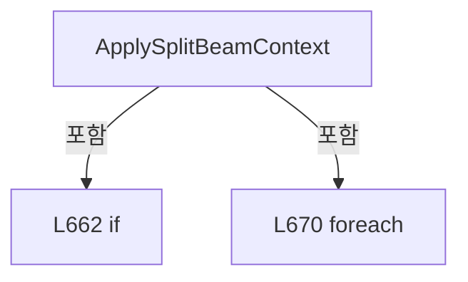

변경 전 점검: 입력/반환 타입, 위 호출자, 예외/취소 경로, 공유 상태와 저장·전송 소비자를 함께 확인합니다. 값의 단위나 물리 방향을 이름만으로 확정하지 않습니다.

### MethodDeclaration `SelectTab` · L676–712

[Drilling.UI/Menu/Menus/CMenuReview.cs:676–712](https://github.com/kjuws10-rgb/A3Drilling/blob/96e22cd027c84bf302b23f2949b98985d7f301bb/Drilling.UI/Menu/Menus/CMenuReview.cs#L676-L712)

| 항목 | 실제 추출 값 |
| --- | --- |
| 서명 | void Drilling.UI.Menu.Menus.CMenuReview.SelectTab(object?) |
| 접근/수식자 | Private / private |
| 반환/값 타입 | void |
| 소속 타입 | NamedType:Drilling.UI.Menu.Menus.CMenuReview |

입력 계약:

| 이름 | 타입 | 전달 | 선택/기본값 |
| --- | --- | --- | --- |
| parameter | object? | None | False /  |

현재 부분 분석에서 직접 연결된 호출자는 없습니다. XAML/이벤트/인터페이스·델리게이트·외부 진입을 추가 확인해야 하며, 미사용으로 판정한 것이 아닙니다.

호출하는 대상과 해석 범위:

| 원본 행 | 표현식 | 분석 상태 | 대상/소스 위치 |
| --- | --- | --- | --- |
| 678 | string.IsNullOrWhiteSpace | resolved | bool string.IsNullOrWhiteSpace(string?) |
| 688 | tab.Equals | resolved | bool string.Equals(string?, System.StringComparison) |
| 695 | _statusReporter | resolved · 동적 구현 선택 가능 | void System.Action<string>.Invoke(string) |
| 696 | CRecipeConfirmDialog.ShowWarning | resolved | void Drilling.UI.Popup.CRecipeConfirmDialog.ShowWarning(string, string, Window?) · Drilling.UI/Popup/CRecipeConfirmDialog.xaml.cs:86 |
| 700 | InvalidateBeamInspectionResultLoad | resolved | void Drilling.UI.Menu.Menus.CMenuReview.InvalidateBeamInspectionResultLoad(bool) · Drilling.UI/Menu/Menus/CMenuReview.cs:3364 |
| 709 | NotifyReviewExecutionCommandStates | resolved | void Drilling.UI.Menu.Menus.CMenuReview.NotifyReviewExecutionCommandStates() · Drilling.UI/Menu/Menus/CMenuReview.cs:4122 |
| 710 | _statusReporter | resolved · 동적 구현 선택 가능 | void System.Action<string>.Invoke(string) |
| 711 | _refreshScreen | resolved · 동적 구현 선택 가능 | void System.Action.Invoke() |

본문의 실제 연산·분기·예외·반환 순서(원문 위치 순):

| 원본 행 | 종류 | 주석 해설 |
| --- | --- | --- |
| 678 | call | 함수·델리게이트 또는 객체 생성자를 호출합니다: string.IsNullOrWhiteSpace(tab) |
| 678 | if | 조건에 따라 분기합니다: if (parameter is not string tab &#124;&#124; string.IsNullOrWhiteSpace(tab)) |
| 680 | return | 호출자에게 값 또는 제어를 반환합니다: return; |
| 683 | if | 조건에 따라 분기합니다: if (tab != "RUN") |
| 685 | return | 호출자에게 값 또는 제어를 반환합니다: return; |
| 688 | call | 함수·델리게이트 또는 객체 생성자를 호출합니다: tab.Equals(_selectedTab, StringComparison.OrdinalIgnoreCase) |
| 688 | if | 조건에 따라 분기합니다: if (tab.Equals(_selectedTab, StringComparison.OrdinalIgnoreCase)) |
| 690 | return | 호출자에게 값 또는 제어를 반환합니다: return; |
| 693 | if | 조건에 따라 분기합니다: if (IsReviewExecutionActive) |
| 695 | call | 함수·델리게이트 또는 객체 생성자를 호출합니다: _statusReporter("Review is running. Stop the current review before changing the tab.") |
| 696 | call | 함수·델리게이트 또는 객체 생성자를 호출합니다: CRecipeConfirmDialog.ShowWarning("검사 진행 중", "검사를 중지한 후 탭을 변경해 주세요.") |
| 697 | return | 호출자에게 값 또는 제어를 반환합니다: return; |
| 700 | call | 함수·델리게이트 또는 객체 생성자를 호출합니다: InvalidateBeamInspectionResultLoad(clearLoaded: true) |
| 701 | assignment | 값을 대상에 대입합니다: _selectedTab = tab |
| 702 | if | 조건에 따라 분기합니다: if (IsSampleSelectTab) |
| 704 | assignment | 값을 대상에 대입합니다: _isSampleCellDetailVisible = false |
| 705 | assignment | 값을 대상에 대입합니다: _selectedMode = "SAMPLE SHOT" |
| 706 | assignment | 값을 대상에 대입합니다: _selectionRuleText = _selectedSampleRuleUi |
| 709 | call | 함수·델리게이트 또는 객체 생성자를 호출합니다: NotifyReviewExecutionCommandStates() |
| 710 | call | 함수·델리게이트 또는 객체 생성자를 호출합니다: _statusReporter($"Review tab selected: {_selectedTab}") |
| 711 | call | 함수·델리게이트 또는 객체 생성자를 호출합니다: _refreshScreen() |

제어 구문의 포함 구조(실제 실행 순서/CFG가 아닌 구문 탐색 그림):

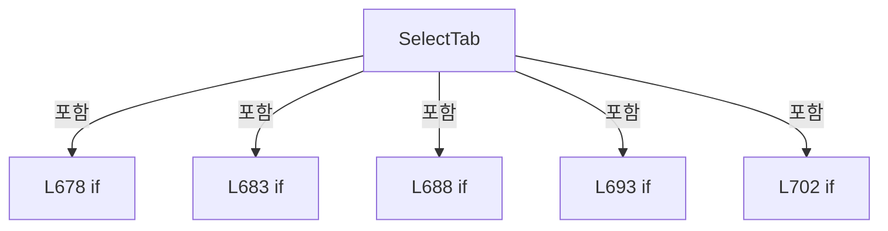

변경 전 점검: 입력/반환 타입, 위 호출자, 예외/취소 경로, 공유 상태와 저장·전송 소비자를 함께 확인합니다. 값의 단위나 물리 방향을 이름만으로 확정하지 않습니다.

### MethodDeclaration `SelectSampleRuleUi` · L714–727

[Drilling.UI/Menu/Menus/CMenuReview.cs:714–727](https://github.com/kjuws10-rgb/A3Drilling/blob/96e22cd027c84bf302b23f2949b98985d7f301bb/Drilling.UI/Menu/Menus/CMenuReview.cs#L714-L727)

| 항목 | 실제 추출 값 |
| --- | --- |
| 서명 | void Drilling.UI.Menu.Menus.CMenuReview.SelectSampleRuleUi(object?) |
| 접근/수식자 | Private / private |
| 반환/값 타입 | void |
| 소속 타입 | NamedType:Drilling.UI.Menu.Menus.CMenuReview |

입력 계약:

| 이름 | 타입 | 전달 | 선택/기본값 |
| --- | --- | --- | --- |
| parameter | object? | None | False /  |

현재 부분 분석에서 직접 연결된 호출자는 없습니다. XAML/이벤트/인터페이스·델리게이트·외부 진입을 추가 확인해야 하며, 미사용으로 판정한 것이 아닙니다.

호출하는 대상과 해석 범위:

| 원본 행 | 표현식 | 분석 상태 | 대상/소스 위치 |
| --- | --- | --- | --- |
| 716 | .ToString | resolved · 동적 구현 선택 가능 | string? object.ToString() |
| 716 | .Trim().ToUpperInvariant | resolved | string string.ToUpperInvariant() |
| 716 | .Trim | resolved | string string.Trim() |
| 722 | _selectedSampleShotKeys.Clear | resolved | void System.Collections.Generic.HashSet<string>.Clear() |
| 725 | _statusReporter | resolved · 동적 구현 선택 가능 | void System.Action<string>.Invoke(string) |
| 726 | RefreshSampleRuleUi | resolved | void Drilling.UI.Menu.Menus.CMenuReview.RefreshSampleRuleUi() · Drilling.UI/Menu/Menus/CMenuReview.cs:938 |

본문의 실제 연산·분기·예외·반환 순서(원문 위치 순):

| 원본 행 | 종류 | 주석 해설 |
| --- | --- | --- |
| 716 | call | 함수·델리게이트 또는 객체 생성자를 호출합니다: .ToString() |
| 716 | call | 함수·델리게이트 또는 객체 생성자를 호출합니다: .Trim().ToUpperInvariant() |
| 716 | call | 함수·델리게이트 또는 객체 생성자를 호출합니다: .Trim() |
| 716 | local-declaration | 지역 변수를 선언합니다: var rule = parameter?.ToString()?.Trim().ToUpperInvariant(); |
| 716 | variable-initializer | 변수의 초기값을 지정합니다: rule = parameter?.ToString()?.Trim().ToUpperInvariant() |
| 717 | if | 조건에 따라 분기합니다: if (rule is not ("ROUGH" or "FINE") &#124;&#124; rule == _selectedSampleRuleUi) |
| 718 | return | 호출자에게 값 또는 제어를 반환합니다: return; |
| 719 | assignment | 값을 대상에 대입합니다: _selectedSampleRuleUi = rule |
| 720 | assignment | 값을 대상에 대입합니다: _lastCorrectionRulePlan = null |
| 721 | assignment | 값을 대상에 대입합니다: _isSampleCellDetailVisible = false |
| 722 | call | 함수·델리게이트 또는 객체 생성자를 호출합니다: _selectedSampleShotKeys.Clear() |
| 723 | assignment | 값을 대상에 대입합니다: _selectedMode = "SAMPLE SHOT" |
| 724 | assignment | 값을 대상에 대입합니다: _selectionRuleText = rule |
| 725 | call | 함수·델리게이트 또는 객체 생성자를 호출합니다: _statusReporter($"Review correction rule selected: {rule}") |
| 726 | call | 함수·델리게이트 또는 객체 생성자를 호출합니다: RefreshSampleRuleUi() |

제어 구문의 포함 구조(실제 실행 순서/CFG가 아닌 구문 탐색 그림):


변경 전 점검: 입력/반환 타입, 위 호출자, 예외/취소 경로, 공유 상태와 저장·전송 소비자를 함께 확인합니다. 값의 단위나 물리 방향을 이름만으로 확정하지 않습니다.

### MethodDeclaration `SelectSampleRuleScope` · L729–737

[Drilling.UI/Menu/Menus/CMenuReview.cs:729–737](https://github.com/kjuws10-rgb/A3Drilling/blob/96e22cd027c84bf302b23f2949b98985d7f301bb/Drilling.UI/Menu/Menus/CMenuReview.cs#L729-L737)

| 항목 | 실제 추출 값 |
| --- | --- |
| 서명 | void Drilling.UI.Menu.Menus.CMenuReview.SelectSampleRuleScope(object?) |
| 접근/수식자 | Private / private |
| 반환/값 타입 | void |
| 소속 타입 | NamedType:Drilling.UI.Menu.Menus.CMenuReview |

입력 계약:

| 이름 | 타입 | 전달 | 선택/기본값 |
| --- | --- | --- | --- |
| parameter | object? | None | False /  |

현재 부분 분석에서 직접 연결된 호출자는 없습니다. XAML/이벤트/인터페이스·델리게이트·외부 진입을 추가 확인해야 하며, 미사용으로 판정한 것이 아닙니다.

호출하는 대상과 해석 범위:

| 원본 행 | 표현식 | 분석 상태 | 대상/소스 위치 |
| --- | --- | --- | --- |
| 731 | .ToString | resolved · 동적 구현 선택 가능 | string? object.ToString() |
| 731 | .Trim().ToUpperInvariant | resolved | string string.ToUpperInvariant() |
| 731 | .Trim | resolved | string string.Trim() |
| 736 | RefreshSampleRuleUi | resolved | void Drilling.UI.Menu.Menus.CMenuReview.RefreshSampleRuleUi() · Drilling.UI/Menu/Menus/CMenuReview.cs:938 |

본문의 실제 연산·분기·예외·반환 순서(원문 위치 순):

| 원본 행 | 종류 | 주석 해설 |
| --- | --- | --- |
| 731 | call | 함수·델리게이트 또는 객체 생성자를 호출합니다: .ToString() |
| 731 | call | 함수·델리게이트 또는 객체 생성자를 호출합니다: .Trim().ToUpperInvariant() |
| 731 | call | 함수·델리게이트 또는 객체 생성자를 호출합니다: .Trim() |
| 731 | local-declaration | 지역 변수를 선언합니다: var scope = parameter?.ToString()?.Trim().ToUpperInvariant(); |
| 731 | variable-initializer | 변수의 초기값을 지정합니다: scope = parameter?.ToString()?.Trim().ToUpperInvariant() |
| 732 | if | 조건에 따라 분기합니다: if (scope is not ("HEAD" or "HEAD_CELL") &#124;&#124; scope == _sampleRuleScope) |
| 733 | return | 호출자에게 값 또는 제어를 반환합니다: return; |
| 734 | assignment | 값을 대상에 대입합니다: _sampleRuleScope = scope |
| 735 | assignment | 값을 대상에 대입합니다: _lastCorrectionRulePlan = null |
| 736 | call | 함수·델리게이트 또는 객체 생성자를 호출합니다: RefreshSampleRuleUi() |

제어 구문의 포함 구조(실제 실행 순서/CFG가 아닌 구문 탐색 그림):


변경 전 점검: 입력/반환 타입, 위 호출자, 예외/취소 경로, 공유 상태와 저장·전송 소비자를 함께 확인합니다. 값의 단위나 물리 방향을 이름만으로 확정하지 않습니다.

### MethodDeclaration `SelectRoughReference` · L739–747

[Drilling.UI/Menu/Menus/CMenuReview.cs:739–747](https://github.com/kjuws10-rgb/A3Drilling/blob/96e22cd027c84bf302b23f2949b98985d7f301bb/Drilling.UI/Menu/Menus/CMenuReview.cs#L739-L747)

| 항목 | 실제 추출 값 |
| --- | --- |
| 서명 | void Drilling.UI.Menu.Menus.CMenuReview.SelectRoughReference(object?) |
| 접근/수식자 | Private / private |
| 반환/값 타입 | void |
| 소속 타입 | NamedType:Drilling.UI.Menu.Menus.CMenuReview |

입력 계약:

| 이름 | 타입 | 전달 | 선택/기본값 |
| --- | --- | --- | --- |
| parameter | object? | None | False /  |

현재 부분 분석에서 직접 연결된 호출자는 없습니다. XAML/이벤트/인터페이스·델리게이트·외부 진입을 추가 확인해야 하며, 미사용으로 판정한 것이 아닙니다.

호출하는 대상과 해석 범위:

| 원본 행 | 표현식 | 분석 상태 | 대상/소스 위치 |
| --- | --- | --- | --- |
| 741 | .ToString | resolved · 동적 구현 선택 가능 | string? object.ToString() |
| 741 | .Trim().ToUpperInvariant | resolved | string string.ToUpperInvariant() |
| 741 | .Trim | resolved | string string.Trim() |
| 746 | RefreshSampleRuleUi | resolved | void Drilling.UI.Menu.Menus.CMenuReview.RefreshSampleRuleUi() · Drilling.UI/Menu/Menus/CMenuReview.cs:938 |

본문의 실제 연산·분기·예외·반환 순서(원문 위치 순):

| 원본 행 | 종류 | 주석 해설 |
| --- | --- | --- |
| 741 | call | 함수·델리게이트 또는 객체 생성자를 호출합니다: .ToString() |
| 741 | call | 함수·델리게이트 또는 객체 생성자를 호출합니다: .Trim().ToUpperInvariant() |
| 741 | call | 함수·델리게이트 또는 객체 생성자를 호출합니다: .Trim() |
| 741 | local-declaration | 지역 변수를 선언합니다: var reference = parameter?.ToString()?.Trim().ToUpperInvariant(); |
| 741 | variable-initializer | 변수의 초기값을 지정합니다: reference = parameter?.ToString()?.Trim().ToUpperInvariant() |
| 742 | if | 조건에 따라 분기합니다: if (reference is not ("FIRST" or "CENTER" or "LAST") &#124;&#124; reference == _roughReference) |
| 743 | return | 호출자에게 값 또는 제어를 반환합니다: return; |
| 744 | assignment | 값을 대상에 대입합니다: _roughReference = reference |
| 745 | assignment | 값을 대상에 대입합니다: _lastCorrectionRulePlan = null |
| 746 | call | 함수·델리게이트 또는 객체 생성자를 호출합니다: RefreshSampleRuleUi() |

제어 구문의 포함 구조(실제 실행 순서/CFG가 아닌 구문 탐색 그림):

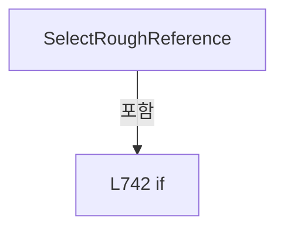

변경 전 점검: 입력/반환 타입, 위 호출자, 예외/취소 경로, 공유 상태와 저장·전송 소비자를 함께 확인합니다. 값의 단위나 물리 방향을 이름만으로 확정하지 않습니다.

### MethodDeclaration `SelectFineLineCount` · L749–756

[Drilling.UI/Menu/Menus/CMenuReview.cs:749–756](https://github.com/kjuws10-rgb/A3Drilling/blob/96e22cd027c84bf302b23f2949b98985d7f301bb/Drilling.UI/Menu/Menus/CMenuReview.cs#L749-L756)

| 항목 | 실제 추출 값 |
| --- | --- |
| 서명 | void Drilling.UI.Menu.Menus.CMenuReview.SelectFineLineCount(object?) |
| 접근/수식자 | Private / private |
| 반환/값 타입 | void |
| 소속 타입 | NamedType:Drilling.UI.Menu.Menus.CMenuReview |

입력 계약:

| 이름 | 타입 | 전달 | 선택/기본값 |
| --- | --- | --- | --- |
| parameter | object? | None | False /  |

현재 부분 분석에서 직접 연결된 호출자는 없습니다. XAML/이벤트/인터페이스·델리게이트·외부 진입을 추가 확인해야 하며, 미사용으로 판정한 것이 아닙니다.

호출하는 대상과 해석 범위:

| 원본 행 | 표현식 | 분석 상태 | 대상/소스 위치 |
| --- | --- | --- | --- |
| 751 | int.TryParse | resolved | bool int.TryParse(string?, System.Globalization.NumberStyles, System.IFormatProvider?, out int) |
| 751 | .ToString | resolved · 동적 구현 선택 가능 | string? object.ToString() |
| 755 | RefreshSampleRuleUi | resolved | void Drilling.UI.Menu.Menus.CMenuReview.RefreshSampleRuleUi() · Drilling.UI/Menu/Menus/CMenuReview.cs:938 |

본문의 실제 연산·분기·예외·반환 순서(원문 위치 순):

| 원본 행 | 종류 | 주석 해설 |
| --- | --- | --- |
| 751 | call | 함수·델리게이트 또는 객체 생성자를 호출합니다: int.TryParse(parameter?.ToString(), NumberStyles.Integer, CultureInfo.InvariantCulture, out var count) |
| 751 | call | 함수·델리게이트 또는 객체 생성자를 호출합니다: .ToString() |
| 751 | if | 조건에 따라 분기합니다: if (!int.TryParse(parameter?.ToString(), NumberStyles.Integer, CultureInfo.InvariantCulture, out var count) &#124;&#124; count is not (1 or 3 or 5 or 7) &#124;&#124; count == _fineLineCount) |
| 752 | return | 호출자에게 값 또는 제어를 반환합니다: return; |
| 753 | assignment | 값을 대상에 대입합니다: _fineLineCount = count |
| 754 | assignment | 값을 대상에 대입합니다: _lastCorrectionRulePlan = null |
| 755 | call | 함수·델리게이트 또는 객체 생성자를 호출합니다: RefreshSampleRuleUi() |

제어 구문의 포함 구조(실제 실행 순서/CFG가 아닌 구문 탐색 그림):

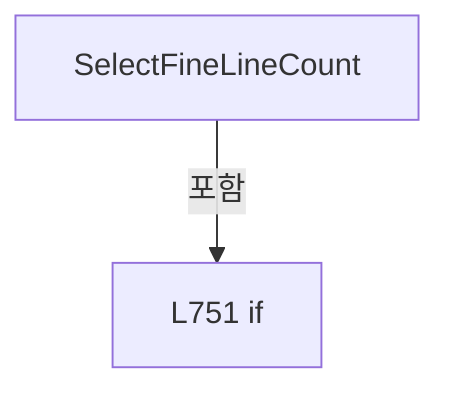

변경 전 점검: 입력/반환 타입, 위 호출자, 예외/취소 경로, 공유 상태와 저장·전송 소비자를 함께 확인합니다. 값의 단위나 물리 방향을 이름만으로 확정하지 않습니다.

### MethodDeclaration `SelectMode` · L758–815

[Drilling.UI/Menu/Menus/CMenuReview.cs:758–815](https://github.com/kjuws10-rgb/A3Drilling/blob/96e22cd027c84bf302b23f2949b98985d7f301bb/Drilling.UI/Menu/Menus/CMenuReview.cs#L758-L815)

| 항목 | 실제 추출 값 |
| --- | --- |
| 서명 | void Drilling.UI.Menu.Menus.CMenuReview.SelectMode(object?) |
| 접근/수식자 | Private / private |
| 반환/값 타입 | void |
| 소속 타입 | NamedType:Drilling.UI.Menu.Menus.CMenuReview |

입력 계약:

| 이름 | 타입 | 전달 | 선택/기본값 |
| --- | --- | --- | --- |
| parameter | object? | None | False /  |

현재 부분 분석에서 직접 연결된 호출자는 없습니다. XAML/이벤트/인터페이스·델리게이트·외부 진입을 추가 확인해야 하며, 미사용으로 판정한 것이 아닙니다.

호출하는 대상과 해석 범위:

| 원본 행 | 표현식 | 분석 상태 | 대상/소스 위치 |
| --- | --- | --- | --- |
| 762 | _statusReporter | resolved · 동적 구현 선택 가능 | void System.Action<string>.Invoke(string) |
| 766 | string.IsNullOrWhiteSpace | resolved | bool string.IsNullOrWhiteSpace(string?) |
| 771 | mode.Trim().ToUpperInvariant | resolved | string string.ToUpperInvariant() |
| 771 | mode.Trim | resolved | string string.Trim() |
| 774 | InvalidateBeamInspectionResultLoad | resolved | void Drilling.UI.Menu.Menus.CMenuReview.InvalidateBeamInspectionResultLoad(bool) · Drilling.UI/Menu/Menus/CMenuReview.cs:3364 |
| 775 | InvalidateRunReviewResultLoad | resolved | void Drilling.UI.Menu.Menus.CMenuReview.InvalidateRunReviewResultLoad(bool) · Drilling.UI/Menu/Menus/CMenuReview.cs:2618 |
| 777 | mode.Trim().ToUpperInvariant | resolved | string string.ToUpperInvariant() |
| 777 | mode.Trim | resolved | string string.Trim() |
| 792 | _selectedLineShotKeys.Clear | resolved | void System.Collections.Generic.HashSet<string>.Clear() |
| 793 | SynchronizeActiveInspectionBeamSelection | resolved | void Drilling.UI.Menu.Menus.CMenuReview.SynchronizeActiveInspectionBeamSelection() · Drilling.UI/Menu/Menus/CMenuReview.cs:2942 |
| 794 | RefreshOneShotSelection | resolved | void Drilling.UI.Menu.Menus.CMenuReview.RefreshOneShotSelection(bool) · Drilling.UI/Menu/Menus/CMenuReview.cs:3448 |
| 795 | OnPropertyChanged | resolved | void Drilling.UI.Menu.CBindingBase.OnPropertyChanged(string?) · Drilling.UI/Menu/CBindingBase.cs:784 |
| 795 | nameof | unresolved | None |
| 796 | OnPropertyChanged | resolved | void Drilling.UI.Menu.CBindingBase.OnPropertyChanged(string?) · Drilling.UI/Menu/CBindingBase.cs:784 |
| 796 | nameof | unresolved | None |
| 797 | OnPropertyChanged | resolved | void Drilling.UI.Menu.CBindingBase.OnPropertyChanged(string?) · Drilling.UI/Menu/CBindingBase.cs:784 |
| 797 | nameof | unresolved | None |
| 798 | _statusReporter | resolved · 동적 구현 선택 가능 | void System.Action<string>.Invoke(string) |
| 799 | OnPropertyChanged | resolved | void Drilling.UI.Menu.CBindingBase.OnPropertyChanged(string?) · Drilling.UI/Menu/CBindingBase.cs:784 |
| 799 | nameof | unresolved | None |
| 800 | OnPropertyChanged | resolved | void Drilling.UI.Menu.CBindingBase.OnPropertyChanged(string?) · Drilling.UI/Menu/CBindingBase.cs:784 |
| 800 | nameof | unresolved | None |
| 801 | OnPropertyChanged | resolved | void Drilling.UI.Menu.CBindingBase.OnPropertyChanged(string?) · Drilling.UI/Menu/CBindingBase.cs:784 |
| 801 | nameof | unresolved | None |
| 802 | OnPropertyChanged | resolved | void Drilling.UI.Menu.CBindingBase.OnPropertyChanged(string?) · Drilling.UI/Menu/CBindingBase.cs:784 |
| 802 | nameof | unresolved | None |
| 803 | OnPropertyChanged | resolved | void Drilling.UI.Menu.CBindingBase.OnPropertyChanged(string?) · Drilling.UI/Menu/CBindingBase.cs:784 |
| 803 | nameof | unresolved | None |
| 804 | OnPropertyChanged | resolved | void Drilling.UI.Menu.CBindingBase.OnPropertyChanged(string?) · Drilling.UI/Menu/CBindingBase.cs:784 |
| 804 | nameof | unresolved | None |
| 805 | OnPropertyChanged | resolved | void Drilling.UI.Menu.CBindingBase.OnPropertyChanged(string?) · Drilling.UI/Menu/CBindingBase.cs:784 |
| 805 | nameof | unresolved | None |
| 806 | OnPropertyChanged | resolved | void Drilling.UI.Menu.CBindingBase.OnPropertyChanged(string?) · Drilling.UI/Menu/CBindingBase.cs:784 |
| 806 | nameof | unresolved | None |
| 807 | OnPropertyChanged | resolved | void Drilling.UI.Menu.CBindingBase.OnPropertyChanged(string?) · Drilling.UI/Menu/CBindingBase.cs:784 |
| 807 | nameof | unresolved | None |
| 808 | OnPropertyChanged | resolved | void Drilling.UI.Menu.CBindingBase.OnPropertyChanged(string?) · Drilling.UI/Menu/CBindingBase.cs:784 |
| 808 | nameof | unresolved | None |
| 809 | OnPropertyChanged | resolved | void Drilling.UI.Menu.CBindingBase.OnPropertyChanged(string?) · Drilling.UI/Menu/CBindingBase.cs:784 |
| 809 | nameof | unresolved | None |
| 810 | OnPropertyChanged | resolved | void Drilling.UI.Menu.CBindingBase.OnPropertyChanged(string?) · Drilling.UI/Menu/CBindingBase.cs:784 |
| 810 | nameof | unresolved | None |
| 811 | OnPropertyChanged | resolved | void Drilling.UI.Menu.CBindingBase.OnPropertyChanged(string?) · Drilling.UI/Menu/CBindingBase.cs:784 |
| 811 | nameof | unresolved | None |
| 812 | SelectRunCellCommand.NotifyCanExecuteChanged | resolved | void Drilling.UI.Menu.CButtonCommand.NotifyCanExecuteChanged() · Drilling.UI/Menu/CButtonCommand.cs:24 |
| 813 | NotifyReviewExecutionCommandStates | resolved | void Drilling.UI.Menu.Menus.CMenuReview.NotifyReviewExecutionCommandStates() · Drilling.UI/Menu/Menus/CMenuReview.cs:4122 |
| 814 | RefreshRunDisplayFromCachedContext | resolved | void Drilling.UI.Menu.Menus.CMenuReview.RefreshRunDisplayFromCachedContext(bool) · Drilling.UI/Menu/Menus/CMenuReview.cs:4236 |

본문의 실제 연산·분기·예외·반환 순서(원문 위치 순):

| 원본 행 | 종류 | 주석 해설 |
| --- | --- | --- |
| 760 | if | 조건에 따라 분기합니다: if (IsReviewExecutionActive) |
| 762 | call | 함수·델리게이트 또는 객체 생성자를 호출합니다: _statusReporter("Review is running. Stop the current review before changing the mode.") |
| 763 | return | 호출자에게 값 또는 제어를 반환합니다: return; |
| 766 | call | 함수·델리게이트 또는 객체 생성자를 호출합니다: string.IsNullOrWhiteSpace(mode) |
| 766 | if | 조건에 따라 분기합니다: if (parameter is not string mode &#124;&#124; string.IsNullOrWhiteSpace(mode)) |
| 768 | return | 호출자에게 값 또는 제어를 반환합니다: return; |
| 771 | assignment | 값을 대상에 대입합니다: mode = mode.Trim().ToUpperInvariant() |
| 771 | call | 함수·델리게이트 또는 객체 생성자를 호출합니다: mode.Trim().ToUpperInvariant() |
| 771 | call | 함수·델리게이트 또는 객체 생성자를 호출합니다: mode.Trim() |
| 772 | if | 조건에 따라 분기합니다: if (mode is not ("ALL SHOT" or "ONE SHOT" or "ONE LINE" or "BEAM INSPECTION")) |
| 773 | return | 호출자에게 값 또는 제어를 반환합니다: return; |
| 774 | call | 함수·델리게이트 또는 객체 생성자를 호출합니다: InvalidateBeamInspectionResultLoad(clearLoaded: true) |
| 775 | call | 함수·델리게이트 또는 객체 생성자를 호출합니다: InvalidateRunReviewResultLoad(clearLoaded: true) |
| 776 | assignment | 값을 대상에 대입합니다: _selectedMode = mode |
| 777 | call | 함수·델리게이트 또는 객체 생성자를 호출합니다: mode.Trim().ToUpperInvariant() |
| 777 | call | 함수·델리게이트 또는 객체 생성자를 호출합니다: mode.Trim() |
| 777 | assignment | 값을 대상에 대입합니다: _selectedRuleType = mode.Trim().ToUpperInvariant() switch { "ALL SHOT" => EN_REVIEW_RULE_TYPE.AllPoint, "ZERO DEFENSE" => EN_REVIEW_RULE_TYPE.ZeroLine, _ => EN_REVIEW_RULE_TYPE.SamplePoint } |
| 777 | switch-expression | 값별 결과식을 선택합니다: mode.Trim().ToUpperInvariant() switch { "ALL SHOT" => EN_REVIEW_RULE_TYPE.AllPoint, "ZERO DEFENSE" => EN_REVIEW_RULE_TYPE.ZeroLine, _ => EN_REVIEW_RULE_TYPE.SamplePoint } |
| 783 | assignment | 값을 대상에 대입합니다: _selectionRuleText = _selectedRuleType switch { EN_REVIEW_RULE_TYPE.AllPoint => "All Shot", EN_REVIEW_RULE_TYPE.ZeroLine => "0-Line", _ when mode == "ONE LINE" => "Selected Glass Line", _ => _selectionRuleText is "All Shot" or "0- |
| 783 | switch-expression | 값별 결과식을 선택합니다: _selectedRuleType switch { EN_REVIEW_RULE_TYPE.AllPoint => "All Shot", EN_REVIEW_RULE_TYPE.ZeroLine => "0-Line", _ when mode == "ONE LINE" => "Selected Glass Line", _ => _selectionRuleText is "All Shot" or "0-Line" or "Selected Gl |
| 788 | conditional-expression | 조건에 따라 결과식을 선택합니다: _selectionRuleText is "All Shot" or "0-Line" or "Selected Glass Line" ? "Manual Sample" : _selectionRuleText |
| 790 | assignment | 값을 대상에 대입합니다: _selectedRunShotKey = "" |
| 791 | assignment | 값을 대상에 대입합니다: _runtimeBrowseShotKey = "" |
| 792 | call | 함수·델리게이트 또는 객체 생성자를 호출합니다: _selectedLineShotKeys.Clear() |
| 793 | call | 함수·델리게이트 또는 객체 생성자를 호출합니다: SynchronizeActiveInspectionBeamSelection() |
| 794 | call | 함수·델리게이트 또는 객체 생성자를 호출합니다: RefreshOneShotSelection(clearResult: true) |
| 795 | call | 함수·델리게이트 또는 객체 생성자를 호출합니다: OnPropertyChanged(nameof(IsShotSelectionMode)) |
| 795 | call | 함수·델리게이트 또는 객체 생성자를 호출합니다: nameof(IsShotSelectionMode) |
| 796 | call | 함수·델리게이트 또는 객체 생성자를 호출합니다: OnPropertyChanged(nameof(IsReviewHeadCardsVisible)) |
| 796 | call | 함수·델리게이트 또는 객체 생성자를 호출합니다: nameof(IsReviewHeadCardsVisible) |
| 797 | call | 함수·델리게이트 또는 객체 생성자를 호출합니다: OnPropertyChanged(nameof(InspectionHeadRows)) |
| 797 | call | 함수·델리게이트 또는 객체 생성자를 호출합니다: nameof(InspectionHeadRows) |
| 798 | call | 함수·델리게이트 또는 객체 생성자를 호출합니다: _statusReporter($"Review mode selected: {_selectedMode}") |
| 799 | call | 함수·델리게이트 또는 객체 생성자를 호출합니다: OnPropertyChanged(nameof(IsAllShotReviewMode)) |
| 799 | call | 함수·델리게이트 또는 객체 생성자를 호출합니다: nameof(IsAllShotReviewMode) |
| 800 | call | 함수·델리게이트 또는 객체 생성자를 호출합니다: OnPropertyChanged(nameof(IsOneLineReviewMode)) |
| 800 | call | 함수·델리게이트 또는 객체 생성자를 호출합니다: nameof(IsOneLineReviewMode) |
| 801 | call | 함수·델리게이트 또는 객체 생성자를 호출합니다: OnPropertyChanged(nameof(IsAllShotStyleReviewMode)) |
| 801 | call | 함수·델리게이트 또는 객체 생성자를 호출합니다: nameof(IsAllShotStyleReviewMode) |
| 802 | call | 함수·델리게이트 또는 객체 생성자를 호출합니다: OnPropertyChanged(nameof(IsOneShotReviewMode)) |
| 802 | call | 함수·델리게이트 또는 객체 생성자를 호출합니다: nameof(IsOneShotReviewMode) |
| 803 | call | 함수·델리게이트 또는 객체 생성자를 호출합니다: OnPropertyChanged(nameof(IsShotInspectionOngoing)) |
| 803 | call | 함수·델리게이트 또는 객체 생성자를 호출합니다: nameof(IsShotInspectionOngoing) |
| 804 | call | 함수·델리게이트 또는 객체 생성자를 호출합니다: OnPropertyChanged(nameof(IsRunStageStatusVisible)) |
| 804 | call | 함수·델리게이트 또는 객체 생성자를 호출합니다: nameof(IsRunStageStatusVisible) |
| 805 | call | 함수·델리게이트 또는 객체 생성자를 호출합니다: OnPropertyChanged(nameof(IsRunCommandsVisible)) |
| 805 | call | 함수·델리게이트 또는 객체 생성자를 호출합니다: nameof(IsRunCommandsVisible) |
| 806 | call | 함수·델리게이트 또는 객체 생성자를 호출합니다: OnPropertyChanged(nameof(IsRuleReviewMode)) |
| 806 | call | 함수·델리게이트 또는 객체 생성자를 호출합니다: nameof(IsRuleReviewMode) |
| 807 | call | 함수·델리게이트 또는 객체 생성자를 호출합니다: OnPropertyChanged(nameof(IsBeamInspectionMode)) |
| 807 | call | 함수·델리게이트 또는 객체 생성자를 호출합니다: nameof(IsBeamInspectionMode) |
| 808 | call | 함수·델리게이트 또는 객체 생성자를 호출합니다: OnPropertyChanged(nameof(IsBeamSelectionVisible)) |
| 808 | call | 함수·델리게이트 또는 객체 생성자를 호출합니다: nameof(IsBeamSelectionVisible) |
| 809 | call | 함수·델리게이트 또는 객체 생성자를 호출합니다: OnPropertyChanged(nameof(IsSingleBeamSelectionMode)) |
| 809 | call | 함수·델리게이트 또는 객체 생성자를 호출합니다: nameof(IsSingleBeamSelectionMode) |
| 810 | call | 함수·델리게이트 또는 객체 생성자를 호출합니다: OnPropertyChanged(nameof(IsLastMeasurementVisible)) |
| 810 | call | 함수·델리게이트 또는 객체 생성자를 호출합니다: nameof(IsLastMeasurementVisible) |
| 811 | call | 함수·델리게이트 또는 객체 생성자를 호출합니다: OnPropertyChanged(nameof(BeamSelectionSummary)) |
| 811 | call | 함수·델리게이트 또는 객체 생성자를 호출합니다: nameof(BeamSelectionSummary) |
| 812 | call | 함수·델리게이트 또는 객체 생성자를 호출합니다: SelectRunCellCommand.NotifyCanExecuteChanged() |
| 813 | call | 함수·델리게이트 또는 객체 생성자를 호출합니다: NotifyReviewExecutionCommandStates() |
| 814 | call | 함수·델리게이트 또는 객체 생성자를 호출합니다: RefreshRunDisplayFromCachedContext() |

제어 구문의 포함 구조(실제 실행 순서/CFG가 아닌 구문 탐색 그림):


변경 전 점검: 입력/반환 타입, 위 호출자, 예외/취소 경로, 공유 상태와 저장·전송 소비자를 함께 확인합니다. 값의 단위나 물리 방향을 이름만으로 확정하지 않습니다.

### MethodDeclaration `ToggleShot` · L817–865

[Drilling.UI/Menu/Menus/CMenuReview.cs:817–865](https://github.com/kjuws10-rgb/A3Drilling/blob/96e22cd027c84bf302b23f2949b98985d7f301bb/Drilling.UI/Menu/Menus/CMenuReview.cs#L817-L865)

| 항목 | 실제 추출 값 |
| --- | --- |
| 서명 | void Drilling.UI.Menu.Menus.CMenuReview.ToggleShot(object?) |
| 접근/수식자 | Private / private |
| 반환/값 타입 | void |
| 소속 타입 | NamedType:Drilling.UI.Menu.Menus.CMenuReview |

입력 계약:

| 이름 | 타입 | 전달 | 선택/기본값 |
| --- | --- | --- | --- |
| parameter | object? | None | False /  |

정적 호출자로 확인된 위치:

| 호출 파일/행 | 호출 표현식 | 런타임 분기 가능 |
| --- | --- | --- |
| [Drilling.UI/Menu/Menus/CMenuReview.cs:879–879](https://github.com/kjuws10-rgb/A3Drilling/blob/96e22cd027c84bf302b23f2949b98985d7f301bb/Drilling.UI/Menu/Menus/CMenuReview.cs#L879-L879) | ToggleShot | False |

호출하는 대상과 해석 범위:

| 원본 행 | 표현식 | 분석 상태 | 대상/소스 위치 |
| --- | --- | --- | --- |
| 821 | _statusReporter | resolved · 동적 구현 선택 가능 | void System.Action<string>.Invoke(string) |
| 825 | CReviewManager.NormalizeShotKey | resolved | string Drilling.Common.Review.CReviewManager.NormalizeShotKey(string) · Drilling.Common/Review/CReviewManager.cs:1238 |
| 825 | .ToString | resolved · 동적 구현 선택 가능 | string? object.ToString() |
| 826 | string.IsNullOrWhiteSpace | resolved | bool string.IsNullOrWhiteSpace(string?) |
| 831 | FindPointByShotKey | resolved | Drilling.Common.Review.ST_REVIEW_PLAN_POINT? Drilling.UI.Menu.Menus.CMenuReview.FindPointByShotKey(Drilling.Common.Review.ST_REVIEW_PLAN?, string) · Drilling.UI/Menu/Menus/CMenuReview.cs:1712 |
| 839 | _selectedSampleShotKeys.Remove | resolved | bool System.Collections.Generic.HashSet<string>.Remove(string) |
| 840 | _statusReporter | resolved · 동적 구현 선택 가능 | void System.Action<string>.Invoke(string) |
| 840 | ToMatrixShotName | resolved | string Drilling.UI.Menu.Menus.CMenuReview.ToMatrixShotName(Drilling.Common.Review.ST_REVIEW_PLAN_POINT) · Drilling.UI/Menu/Menus/CMenuReview.cs:2321 |
| 841 | RefreshSampleSelectionDisplay | resolved | void Drilling.UI.Menu.Menus.CMenuReview.RefreshSampleSelectionDisplay(System.Collections.Generic.IEnumerable<string>) · Drilling.UI/Menu/Menus/CMenuReview.cs:882 |
| 847 | _selectedSampleShotKeys.Remove | resolved | bool System.Collections.Generic.HashSet<string>.Remove(string) |
| 848 | _statusReporter | resolved · 동적 구현 선택 가능 | void System.Action<string>.Invoke(string) |
| 848 | ToMatrixShotName | resolved | string Drilling.UI.Menu.Menus.CMenuReview.ToMatrixShotName(Drilling.Common.Review.ST_REVIEW_PLAN_POINT) · Drilling.UI/Menu/Menus/CMenuReview.cs:2321 |
| 849 | RefreshSampleSelectionDisplay | resolved | void Drilling.UI.Menu.Menus.CMenuReview.RefreshSampleSelectionDisplay(System.Collections.Generic.IEnumerable<string>) · Drilling.UI/Menu/Menus/CMenuReview.cs:882 |
| 854 | _selectedSampleShotKeys.Clear | resolved | void System.Collections.Generic.HashSet<string>.Clear() |
| 855 | _selectedSampleShotKeys.Add | resolved | bool System.Collections.Generic.HashSet<string>.Add(string) |
| 863 | _statusReporter | resolved · 동적 구현 선택 가능 | void System.Action<string>.Invoke(string) |
| 864 | RefreshSampleSelectionDisplay | resolved | void Drilling.UI.Menu.Menus.CMenuReview.RefreshSampleSelectionDisplay(System.Collections.Generic.IEnumerable<string>) · Drilling.UI/Menu/Menus/CMenuReview.cs:882 |
| 864 | string.IsNullOrWhiteSpace | resolved | bool string.IsNullOrWhiteSpace(string?) |

본문의 실제 연산·분기·예외·반환 순서(원문 위치 순):

| 원본 행 | 종류 | 주석 해설 |
| --- | --- | --- |
| 819 | if | 조건에 따라 분기합니다: if (!IsSimpleSampleRuleUi &#124;&#124; IsReviewExecutionActive) |
| 821 | call | 함수·델리게이트 또는 객체 생성자를 호출합니다: _statusReporter($"{_selectedSampleRuleUi} Shot selection is determined automatically by its rule settings.") |
| 822 | return | 호출자에게 값 또는 제어를 반환합니다: return; |
| 825 | call | 함수·델리게이트 또는 객체 생성자를 호출합니다: CReviewManager.NormalizeShotKey(parameter?.ToString() ?? "") |
| 825 | call | 함수·델리게이트 또는 객체 생성자를 호출합니다: .ToString() |
| 825 | local-declaration | 지역 변수를 선언합니다: var shotKey = CReviewManager.NormalizeShotKey(parameter?.ToString() ?? ""); |
| 825 | variable-initializer | 변수의 초기값을 지정합니다: shotKey = CReviewManager.NormalizeShotKey(parameter?.ToString() ?? "") |
| 826 | call | 함수·델리게이트 또는 객체 생성자를 호출합니다: string.IsNullOrWhiteSpace(shotKey) |
| 826 | if | 조건에 따라 분기합니다: if (string.IsNullOrWhiteSpace(shotKey)) |
| 828 | return | 호출자에게 값 또는 제어를 반환합니다: return; |
| 831 | call | 함수·델리게이트 또는 객체 생성자를 호출합니다: FindPointByShotKey(_lastAllPlan, shotKey) |
| 831 | local-declaration | 지역 변수를 선언합니다: var point = FindPointByShotKey(_lastAllPlan, shotKey); |
| 831 | variable-initializer | 변수의 초기값을 지정합니다: point = FindPointByShotKey(_lastAllPlan, shotKey) |
| 832 | if | 조건에 따라 분기합니다: if (point is null) |
| 834 | return | 호출자에게 값 또는 제어를 반환합니다: return; |
| 837 | if | 조건에 따라 분기합니다: if (point.HeadNo <= 0) |
| 839 | call | 함수·델리게이트 또는 객체 생성자를 호출합니다: _selectedSampleShotKeys.Remove(point.ShotKey) |
| 840 | call | 함수·델리게이트 또는 객체 생성자를 호출합니다: _statusReporter($"CELL{point.CellNo:00} / {ToMatrixShotName(point)} cannot be selected because it is not assigned to a processing Head.") |
| 840 | call | 함수·델리게이트 또는 객체 생성자를 호출합니다: ToMatrixShotName(point) |
| 841 | call | 함수·델리게이트 또는 객체 생성자를 호출합니다: RefreshSampleSelectionDisplay([point.ShotKey]) |
| 842 | return | 호출자에게 값 또는 제어를 반환합니다: return; |
| 845 | if | 조건에 따라 분기합니다: if (!point.Use) |
| 847 | call | 함수·델리게이트 또는 객체 생성자를 호출합니다: _selectedSampleShotKeys.Remove(point.ShotKey) |
| 848 | call | 함수·델리게이트 또는 객체 생성자를 호출합니다: _statusReporter($"CELL{point.CellNo:00} / {ToMatrixShotName(point)} is excluded from Review by Recipe Masking/Chess settings.") |
| 848 | call | 함수·델리게이트 또는 객체 생성자를 호출합니다: ToMatrixShotName(point) |
| 849 | call | 함수·델리게이트 또는 객체 생성자를 호출합니다: RefreshSampleSelectionDisplay([point.ShotKey]) |
| 850 | return | 호출자에게 값 또는 제어를 반환합니다: return; |
| 853 | local-declaration | 지역 변수를 선언합니다: var previousSimpleKey = _simpleSampleShotKey; |
| 853 | variable-initializer | 변수의 초기값을 지정합니다: previousSimpleKey = _simpleSampleShotKey |
| 854 | call | 함수·델리게이트 또는 객체 생성자를 호출합니다: _selectedSampleShotKeys.Clear() |
| 855 | call | 함수·델리게이트 또는 객체 생성자를 호출합니다: _selectedSampleShotKeys.Add(shotKey) |
| 856 | assignment | 값을 대상에 대입합니다: _simpleSampleShotKey = shotKey |
| 857 | assignment | 값을 대상에 대입합니다: _lastCorrectionRulePlan = null |
| 858 | assignment | 값을 대상에 대입합니다: _sampleRuleHeadNo = point.HeadNo |
| 859 | assignment | 값을 대상에 대입합니다: _sampleRuleCellNo = point.CellNo |
| 860 | assignment | 값을 대상에 대입합니다: _selectedMode = "SAMPLE SHOT" |
| 861 | assignment | 값을 대상에 대입합니다: _selectedRuleType = EN_REVIEW_RULE_TYPE.SamplePoint |
| 862 | assignment | 값을 대상에 대입합니다: _selectionRuleText = _selectedSampleRuleUi |
| 863 | call | 함수·델리게이트 또는 객체 생성자를 호출합니다: _statusReporter($"Review shot selection updated: {_selectedSampleShotKeys.Count} shots.") |
| 864 | call | 함수·델리게이트 또는 객체 생성자를 호출합니다: RefreshSampleSelectionDisplay(string.IsNullOrWhiteSpace(previousSimpleKey) ? [shotKey] : [previousSimpleKey, shotKey]) |
| 864 | call | 함수·델리게이트 또는 객체 생성자를 호출합니다: string.IsNullOrWhiteSpace(previousSimpleKey) |
| 864 | conditional-expression | 조건에 따라 결과식을 선택합니다: string.IsNullOrWhiteSpace(previousSimpleKey) ? [shotKey] : [previousSimpleKey, shotKey] |

제어 구문의 포함 구조(실제 실행 순서/CFG가 아닌 구문 탐색 그림):

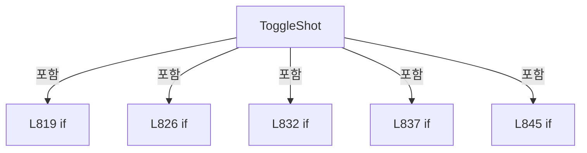

변경 전 점검: 입력/반환 타입, 위 호출자, 예외/취소 경로, 공유 상태와 저장·전송 소비자를 함께 확인합니다. 값의 단위나 물리 방향을 이름만으로 확정하지 않습니다.

### MethodDeclaration `SetSampleShotSelection` · L867–880

[Drilling.UI/Menu/Menus/CMenuReview.cs:867–880](https://github.com/kjuws10-rgb/A3Drilling/blob/96e22cd027c84bf302b23f2949b98985d7f301bb/Drilling.UI/Menu/Menus/CMenuReview.cs#L867-L880)

| 항목 | 실제 추출 값 |
| --- | --- |
| 서명 | void Drilling.UI.Menu.Menus.CMenuReview.SetSampleShotSelection(object?) |
| 접근/수식자 | Private / private |
| 반환/값 타입 | void |
| 소속 타입 | NamedType:Drilling.UI.Menu.Menus.CMenuReview |

입력 계약:

| 이름 | 타입 | 전달 | 선택/기본값 |
| --- | --- | --- | --- |
| parameter | object? | None | False /  |

현재 부분 분석에서 직접 연결된 호출자는 없습니다. XAML/이벤트/인터페이스·델리게이트·외부 진입을 추가 확인해야 하며, 미사용으로 판정한 것이 아닙니다.

호출하는 대상과 해석 범위:

| 원본 행 | 표현식 | 분석 상태 | 대상/소스 위치 |
| --- | --- | --- | --- |
| 879 | ToggleShot | resolved | void Drilling.UI.Menu.Menus.CMenuReview.ToggleShot(object?) · Drilling.UI/Menu/Menus/CMenuReview.cs:817 |

본문의 실제 연산·분기·예외·반환 순서(원문 위치 순):

| 원본 행 | 종류 | 주석 해설 |
| --- | --- | --- |
| 869 | if | 조건에 따라 분기합니다: if (!IsSimpleSampleRuleUi &#124;&#124; IsReviewExecutionActive) |
| 871 | return | 호출자에게 값 또는 제어를 반환합니다: return; |
| 874 | if | 조건에 따라 분기합니다: if (parameter is not ST_REVIEW_SAMPLE_DRAG_SELECTION selection &#124;&#124; selection.ShotKeys.Count == 0) |
| 876 | return | 호출자에게 값 또는 제어를 반환합니다: return; |
| 879 | call | 함수·델리게이트 또는 객체 생성자를 호출합니다: ToggleShot(selection.ShotKeys[^1]) |

제어 구문의 포함 구조(실제 실행 순서/CFG가 아닌 구문 탐색 그림):

```mermaid
flowchart TD
 M["SetSampleShotSelection"]
 N0["L869 if"]
 M -->|포함| N0
 N1["L874 if"]
 M -->|포함| N1
```

변경 전 점검: 입력/반환 타입, 위 호출자, 예외/취소 경로, 공유 상태와 저장·전송 소비자를 함께 확인합니다. 값의 단위나 물리 방향을 이름만으로 확정하지 않습니다.

### MethodDeclaration `RefreshSampleSelectionDisplay` · L882–932

[Drilling.UI/Menu/Menus/CMenuReview.cs:882–932](https://github.com/kjuws10-rgb/A3Drilling/blob/96e22cd027c84bf302b23f2949b98985d7f301bb/Drilling.UI/Menu/Menus/CMenuReview.cs#L882-L932)

| 항목 | 실제 추출 값 |
| --- | --- |
| 서명 | void Drilling.UI.Menu.Menus.CMenuReview.RefreshSampleSelectionDisplay(System.Collections.Generic.IEnumerable<string>) |
| 접근/수식자 | Private / private |
| 반환/값 타입 | void |
| 소속 타입 | NamedType:Drilling.UI.Menu.Menus.CMenuReview |

입력 계약:

| 이름 | 타입 | 전달 | 선택/기본값 |
| --- | --- | --- | --- |
| changedShotKeys | System.Collections.Generic.IEnumerable<string> | None | False /  |

정적 호출자로 확인된 위치:

| 호출 파일/행 | 호출 표현식 | 런타임 분기 가능 |
| --- | --- | --- |
| [Drilling.UI/Menu/Menus/CMenuReview.cs:841–841](https://github.com/kjuws10-rgb/A3Drilling/blob/96e22cd027c84bf302b23f2949b98985d7f301bb/Drilling.UI/Menu/Menus/CMenuReview.cs#L841-L841) | RefreshSampleSelectionDisplay | False |
| [Drilling.UI/Menu/Menus/CMenuReview.cs:849–849](https://github.com/kjuws10-rgb/A3Drilling/blob/96e22cd027c84bf302b23f2949b98985d7f301bb/Drilling.UI/Menu/Menus/CMenuReview.cs#L849-L849) | RefreshSampleSelectionDisplay | False |
| [Drilling.UI/Menu/Menus/CMenuReview.cs:864–864](https://github.com/kjuws10-rgb/A3Drilling/blob/96e22cd027c84bf302b23f2949b98985d7f301bb/Drilling.UI/Menu/Menus/CMenuReview.cs#L864-L864) | RefreshSampleSelectionDisplay | False |
| [Drilling.UI/Menu/Menus/CMenuReview.cs:1139–1139](https://github.com/kjuws10-rgb/A3Drilling/blob/96e22cd027c84bf302b23f2949b98985d7f301bb/Drilling.UI/Menu/Menus/CMenuReview.cs#L1139-L1139) | RefreshSampleSelectionDisplay | False |

호출하는 대상과 해석 범위:

| 원본 행 | 표현식 | 분석 상태 | 대상/소스 위치 |
| --- | --- | --- | --- |
| 884 | changedShotKeys.Select(CReviewManager.NormalizeShotKey).Where(key => !string.IsNullOrWhiteSpace(key)).ToHashSet | resolved | System.Collections.Generic.HashSet<string> System.Collections.Generic.IEnumerable<string>.ToHashSet<string>(System.Collections.Generic.IEqualityComparer<string>?) |
| 884 | changedShotKeys.Select(CReviewManager.NormalizeShotKey).Where | resolved | System.Collections.Generic.IEnumerable<string> System.Collections.Generic.IEnumerable<string>.Where<string>(System.Func<string, bool>) |
| 884 | changedShotKeys.Select | resolved | System.Collections.Generic.IEnumerable<string> System.Collections.Generic.IEnumerable<string>.Select<string, string>(System.Func<string, string>) |
| 884 | string.IsNullOrWhiteSpace | resolved | bool string.IsNullOrWhiteSpace(string?) |
| 887 | _sampleShotRowsByKey.TryGetValue | resolved | bool System.Collections.Generic.Dictionary<string, Drilling.UI.Menu.Menus.ST_REVIEW_POINT_SELECT_ROW>.TryGetValue(string, out Drilling.UI.Menu.Menus.ST_REVIEW_POINT_SELECT_ROW) |
| 894 | row.SetSelection | resolved | void Drilling.UI.Menu.Menus.ST_REVIEW_POINT_SELECT_ROW.SetSelection(bool, string) · Drilling.UI/Menu/Menus/CMenuReview.cs:5634 |
| 898 | _selectedMode.Equals | resolved | bool string.Equals(string?, System.StringComparison) |
| 898 | _selectedSampleShotKeys.Contains | resolved | bool System.Collections.Generic.HashSet<string>.Contains(string) |
| 899 | row.SetSelection | resolved | void Drilling.UI.Menu.Menus.ST_REVIEW_POINT_SELECT_ROW.SetSelection(bool, string) · Drilling.UI/Menu/Menus/CMenuReview.cs:5634 |
| 902 | GetSelectedSampleShotCount | resolved | int Drilling.UI.Menu.Menus.CMenuReview.GetSelectedSampleShotCount() · Drilling.UI/Menu/Menus/CMenuReview.cs:1883 |
| 905 | CreateSamplePlanSummaryItems | resolved | System.Collections.Generic.IReadOnlyList<Drilling.UI.Menu.Menus.ST_DISPLAY_ITEM> Drilling.UI.Menu.Menus.CMenuReview.CreateSamplePlanSummaryItems() · Drilling.UI/Menu/Menus/CMenuReview.cs:1755 |
| 909 | SelectionSummaryItems.Select(item => item.Name.Equals("Selected", StringComparison.OrdinalIgnoreCase) ? item with { Value = selectedShotCount.ToString(CultureInfo.InvariantCulture) } : item).ToArray | resolved | Drilling.UI.Menu.Menus.ST_DISPLAY_ITEM[] System.Collections.Generic.IEnumerable<Drilling.UI.Menu.Menus.ST_DISPLAY_ITEM>.ToArray<Drilling.UI.Menu.Menus.ST_DISPLAY_ITEM>() |
| 909 | SelectionSummaryItems.Select | resolved | System.Collections.Generic.IEnumerable<Drilling.UI.Menu.Menus.ST_DISPLAY_ITEM> System.Collections.Generic.IEnumerable<Drilling.UI.Menu.Menus.ST_DISPLAY_ITEM>.Select<Drilling.UI.Menu.Menus.ST_DISPLAY_ITEM, Drilling.UI.Menu.Menus.ST_DISPLAY_ITEM>(System.Func<Drilling.UI.Menu.Menus.ST_DISPLAY_ITEM, Drilling.UI.Menu.Menus.ST_DISPLAY_ITEM>) |
| 909 | item.Name.Equals | resolved | bool string.Equals(string?, System.StringComparison) |
| 909 | selectedShotCount.ToString | resolved | string int.ToString(System.IFormatProvider?) |
| 912 | BuildSampleGlassPreviewSummary | resolved | string Drilling.UI.Menu.Menus.CMenuReview.BuildSampleGlassPreviewSummary() · Drilling.UI/Menu/Menus/CMenuReview.cs:1744 |
| 913 | OnPropertyChanged | resolved | void Drilling.UI.Menu.CBindingBase.OnPropertyChanged(string?) · Drilling.UI/Menu/CBindingBase.cs:784 |
| 913 | nameof | unresolved | None |
| 914 | OnPropertyChanged | resolved | void Drilling.UI.Menu.CBindingBase.OnPropertyChanged(string?) · Drilling.UI/Menu/CBindingBase.cs:784 |
| 914 | nameof | unresolved | None |
| 915 | OnPropertyChanged | resolved | void Drilling.UI.Menu.CBindingBase.OnPropertyChanged(string?) · Drilling.UI/Menu/CBindingBase.cs:784 |
| 915 | nameof | unresolved | None |
| 916 | OnPropertyChanged | resolved | void Drilling.UI.Menu.CBindingBase.OnPropertyChanged(string?) · Drilling.UI/Menu/CBindingBase.cs:784 |
| 916 | nameof | unresolved | None |
| 917 | OnPropertyChanged | resolved | void Drilling.UI.Menu.CBindingBase.OnPropertyChanged(string?) · Drilling.UI/Menu/CBindingBase.cs:784 |
| 917 | nameof | unresolved | None |
| 918 | OnPropertyChanged | resolved | void Drilling.UI.Menu.CBindingBase.OnPropertyChanged(string?) · Drilling.UI/Menu/CBindingBase.cs:784 |
| 918 | nameof | unresolved | None |
| 919 | OnPropertyChanged | resolved | void Drilling.UI.Menu.CBindingBase.OnPropertyChanged(string?) · Drilling.UI/Menu/CBindingBase.cs:784 |
| 919 | nameof | unresolved | None |
| 920 | OnPropertyChanged | resolved | void Drilling.UI.Menu.CBindingBase.OnPropertyChanged(string?) · Drilling.UI/Menu/CBindingBase.cs:784 |
| 920 | nameof | unresolved | None |
| 921 | OnPropertyChanged | resolved | void Drilling.UI.Menu.CBindingBase.OnPropertyChanged(string?) · Drilling.UI/Menu/CBindingBase.cs:784 |
| 921 | nameof | unresolved | None |
| 922 | OnPropertyChanged | resolved | void Drilling.UI.Menu.CBindingBase.OnPropertyChanged(string?) · Drilling.UI/Menu/CBindingBase.cs:784 |
| 922 | nameof | unresolved | None |
| 923 | OnPropertyChanged | resolved | void Drilling.UI.Menu.CBindingBase.OnPropertyChanged(string?) · Drilling.UI/Menu/CBindingBase.cs:784 |
| 923 | nameof | unresolved | None |
| 930 | RefreshSampleGlassPreview | resolved | void Drilling.UI.Menu.Menus.CMenuReview.RefreshSampleGlassPreview() · Drilling.UI/Menu/Menus/CMenuReview.cs:1142 |

본문의 실제 연산·분기·예외·반환 순서(원문 위치 순):

| 원본 행 | 종류 | 주석 해설 |
| --- | --- | --- |
| 884 | call | 함수·델리게이트 또는 객체 생성자를 호출합니다: changedShotKeys.Select(CReviewManager.NormalizeShotKey).Where(key => !string.IsNullOrWhiteSpace(key)).ToHashSet(StringComparer.OrdinalIgnoreCase) |
| 884 | call | 함수·델리게이트 또는 객체 생성자를 호출합니다: changedShotKeys.Select(CReviewManager.NormalizeShotKey).Where(key => !string.IsNullOrWhiteSpace(key)) |
| 884 | call | 함수·델리게이트 또는 객체 생성자를 호출합니다: changedShotKeys.Select(CReviewManager.NormalizeShotKey) |
| 884 | call | 함수·델리게이트 또는 객체 생성자를 호출합니다: string.IsNullOrWhiteSpace(key) |
| 884 | local-declaration | 지역 변수를 선언합니다: var changedKeys = changedShotKeys.Select(CReviewManager.NormalizeShotKey).Where(key => !string.IsNullOrWhiteSpace(key)).ToHashSet(StringComparer.OrdinalIgnoreCase); |
| 884 | variable-initializer | 변수의 초기값을 지정합니다: changedKeys = changedShotKeys.Select(CReviewManager.NormalizeShotKey).Where(key => !string.IsNullOrWhiteSpace(key)).ToHashSet(StringComparer.OrdinalIgnoreCase) |
| 885 | foreach | 컬렉션 요소를 순회합니다: foreach (var key in changedKeys) |
| 887 | call | 함수·델리게이트 또는 객체 생성자를 호출합니다: _sampleShotRowsByKey.TryGetValue(key, out var row) |
| 887 | if | 조건에 따라 분기합니다: if (!_sampleShotRowsByKey.TryGetValue(key, out var row)) |
| 889 | continue | 다음 반복으로 진행합니다: continue; |
| 892 | if | 조건에 따라 분기합니다: if (row.IsExcluded) |
| 894 | call | 함수·델리게이트 또는 객체 생성자를 호출합니다: row.SetSelection(false, row.ExclusionReason) |
| 895 | continue | 다음 반복으로 진행합니다: continue; |
| 898 | call | 함수·델리게이트 또는 객체 생성자를 호출합니다: _selectedMode.Equals("ALL SHOT", StringComparison.OrdinalIgnoreCase) |
| 898 | call | 함수·델리게이트 또는 객체 생성자를 호출합니다: _selectedSampleShotKeys.Contains(row.ShotKey) |
| 898 | local-declaration | 지역 변수를 선언합니다: var use = _selectedMode.Equals("ALL SHOT", StringComparison.OrdinalIgnoreCase) &#124;&#124; _selectedSampleShotKeys.Contains(row.ShotKey); |
| 898 | variable-initializer | 변수의 초기값을 지정합니다: use = _selectedMode.Equals("ALL SHOT", StringComparison.OrdinalIgnoreCase) &#124;&#124; _selectedSampleShotKeys.Contains(row.ShotKey) |
| 899 | call | 함수·델리게이트 또는 객체 생성자를 호출합니다: row.SetSelection(use, use ? (IsSimpleSampleRuleUi ? "REFERENCE" : "SAMPLE") : "-") |
| 899 | conditional-expression | 조건에 따라 결과식을 선택합니다: use ? (IsSimpleSampleRuleUi ? "REFERENCE" : "SAMPLE") : "-" |
| 899 | conditional-expression | 조건에 따라 결과식을 선택합니다: IsSimpleSampleRuleUi ? "REFERENCE" : "SAMPLE" |
| 902 | call | 함수·델리게이트 또는 객체 생성자를 호출합니다: GetSelectedSampleShotCount() |
| 902 | local-declaration | 지역 변수를 선언합니다: var selectedShotCount = GetSelectedSampleShotCount(); |
| 902 | variable-initializer | 변수의 초기값을 지정합니다: selectedShotCount = GetSelectedSampleShotCount() |
| 903 | if | 조건에 따라 분기합니다: if (IsSampleSelectTab) |
| 905 | assignment | 값을 대상에 대입합니다: SelectionSummaryItems = CreateSamplePlanSummaryItems() |
| 905 | call | 함수·델리게이트 또는 객체 생성자를 호출합니다: CreateSamplePlanSummaryItems() |
| 907 | else | 앞 조건이 거짓인 경로입니다: else |
| 909 | assignment | 값을 대상에 대입합니다: SelectionSummaryItems = SelectionSummaryItems.Select(item => item.Name.Equals("Selected", StringComparison.OrdinalIgnoreCase) ? item with { Value = selectedShotCount.ToString(CultureInfo.InvariantCulture) } : item).ToArray() |
| 909 | assignment | 값을 대상에 대입합니다: Value = selectedShotCount.ToString(CultureInfo.InvariantCulture) |
| 909 | call | 함수·델리게이트 또는 객체 생성자를 호출합니다: SelectionSummaryItems.Select(item => item.Name.Equals("Selected", StringComparison.OrdinalIgnoreCase) ? item with { Value = selectedShotCount.ToString(CultureInfo.InvariantCulture) } : item).ToArray() |
| 909 | call | 함수·델리게이트 또는 객체 생성자를 호출합니다: SelectionSummaryItems.Select(item => item.Name.Equals("Selected", StringComparison.OrdinalIgnoreCase) ? item with { Value = selectedShotCount.ToString(CultureInfo.InvariantCulture) } : item) |
| 909 | call | 함수·델리게이트 또는 객체 생성자를 호출합니다: item.Name.Equals("Selected", StringComparison.OrdinalIgnoreCase) |
| 909 | call | 함수·델리게이트 또는 객체 생성자를 호출합니다: selectedShotCount.ToString(CultureInfo.InvariantCulture) |
| 909 | conditional-expression | 조건에 따라 결과식을 선택합니다: item.Name.Equals("Selected", StringComparison.OrdinalIgnoreCase) ? item with { Value = selectedShotCount.ToString(CultureInfo.InvariantCulture) } : item |
| 912 | assignment | 값을 대상에 대입합니다: SampleGlassPreviewSummary = BuildSampleGlassPreviewSummary() |
| 912 | call | 함수·델리게이트 또는 객체 생성자를 호출합니다: BuildSampleGlassPreviewSummary() |
| 913 | call | 함수·델리게이트 또는 객체 생성자를 호출합니다: OnPropertyChanged(nameof(SelectionSummaryItems)) |
| 913 | call | 함수·델리게이트 또는 객체 생성자를 호출합니다: nameof(SelectionSummaryItems) |
| 914 | call | 함수·델리게이트 또는 객체 생성자를 호출합니다: OnPropertyChanged(nameof(SampleGlassPreviewSummary)) |
| 914 | call | 함수·델리게이트 또는 객체 생성자를 호출합니다: nameof(SampleGlassPreviewSummary) |
| 915 | call | 함수·델리게이트 또는 객체 생성자를 호출합니다: OnPropertyChanged(nameof(PlanSummary)) |
| 915 | call | 함수·델리게이트 또는 객체 생성자를 호출합니다: nameof(PlanSummary) |
| 916 | call | 함수·델리게이트 또는 객체 생성자를 호출합니다: OnPropertyChanged(nameof(SampleWorkspaceSummary)) |
| 916 | call | 함수·델리게이트 또는 객체 생성자를 호출합니다: nameof(SampleWorkspaceSummary) |
| 917 | call | 함수·델리게이트 또는 객체 생성자를 호출합니다: OnPropertyChanged(nameof(SampleRuleSelectionSummary)) |
| 917 | call | 함수·델리게이트 또는 객체 생성자를 호출합니다: nameof(SampleRuleSelectionSummary) |
| 918 | call | 함수·델리게이트 또는 객체 생성자를 호출합니다: OnPropertyChanged(nameof(SampleReferenceHead)) |
| 918 | call | 함수·델리게이트 또는 객체 생성자를 호출합니다: nameof(SampleReferenceHead) |
| 919 | call | 함수·델리게이트 또는 객체 생성자를 호출합니다: OnPropertyChanged(nameof(SampleReferenceCell)) |
| 919 | call | 함수·델리게이트 또는 객체 생성자를 호출합니다: nameof(SampleReferenceCell) |
| 920 | call | 함수·델리게이트 또는 객체 생성자를 호출합니다: OnPropertyChanged(nameof(SampleReferenceShot)) |
| 920 | call | 함수·델리게이트 또는 객체 생성자를 호출합니다: nameof(SampleReferenceShot) |
| 921 | call | 함수·델리게이트 또는 객체 생성자를 호출합니다: OnPropertyChanged(nameof(SampleOffsetApplyCount)) |
| 921 | call | 함수·델리게이트 또는 객체 생성자를 호출합니다: nameof(SampleOffsetApplyCount) |
| 922 | call | 함수·델리게이트 또는 객체 생성자를 호출합니다: OnPropertyChanged(nameof(SampleInspectionShotCount)) |
| 922 | call | 함수·델리게이트 또는 객체 생성자를 호출합니다: nameof(SampleInspectionShotCount) |
| 923 | call | 함수·델리게이트 또는 객체 생성자를 호출합니다: OnPropertyChanged(nameof(SamplePlanStatus)) |
| 923 | call | 함수·델리게이트 또는 객체 생성자를 호출합니다: nameof(SamplePlanStatus) |
| 928 | if | 조건에 따라 분기합니다: if (IsSampleSelectTab && !_isSampleCellDetailVisible) |
| 930 | call | 함수·델리게이트 또는 객체 생성자를 호출합니다: RefreshSampleGlassPreview() |

제어 구문의 포함 구조(실제 실행 순서/CFG가 아닌 구문 탐색 그림):

```mermaid
flowchart TD
 M["RefreshSampleSelectionDisplay"]
 N0["L885 foreach"]
 M -->|포함| N0
 N1["L887 if"]
 N0 -->|포함| N1
 N2["L892 if"]
 N0 -->|포함| N2
 N3["L903 if"]
 M -->|포함| N3
 N4["L907 else"]
 N3 -->|포함| N4
 N5["L928 if"]
 M -->|포함| N5
```

변경 전 점검: 입력/반환 타입, 위 호출자, 예외/취소 경로, 공유 상태와 저장·전송 소비자를 함께 확인합니다. 값의 단위나 물리 방향을 이름만으로 확정하지 않습니다.

### MethodDeclaration `RefreshSampleRuleUi` · L938–983

[Drilling.UI/Menu/Menus/CMenuReview.cs:938–983](https://github.com/kjuws10-rgb/A3Drilling/blob/96e22cd027c84bf302b23f2949b98985d7f301bb/Drilling.UI/Menu/Menus/CMenuReview.cs#L938-L983)

| 항목 | 실제 추출 값 |
| --- | --- |
| 서명 | void Drilling.UI.Menu.Menus.CMenuReview.RefreshSampleRuleUi() |
| 접근/수식자 | Private / private |
| 반환/값 타입 | void |
| 소속 타입 | NamedType:Drilling.UI.Menu.Menus.CMenuReview |

정적 호출자로 확인된 위치:

| 호출 파일/행 | 호출 표현식 | 런타임 분기 가능 |
| --- | --- | --- |
| [Drilling.UI/Menu/Menus/CMenuReview.cs:726–726](https://github.com/kjuws10-rgb/A3Drilling/blob/96e22cd027c84bf302b23f2949b98985d7f301bb/Drilling.UI/Menu/Menus/CMenuReview.cs#L726-L726) | RefreshSampleRuleUi | False |
| [Drilling.UI/Menu/Menus/CMenuReview.cs:736–736](https://github.com/kjuws10-rgb/A3Drilling/blob/96e22cd027c84bf302b23f2949b98985d7f301bb/Drilling.UI/Menu/Menus/CMenuReview.cs#L736-L736) | RefreshSampleRuleUi | False |
| [Drilling.UI/Menu/Menus/CMenuReview.cs:746–746](https://github.com/kjuws10-rgb/A3Drilling/blob/96e22cd027c84bf302b23f2949b98985d7f301bb/Drilling.UI/Menu/Menus/CMenuReview.cs#L746-L746) | RefreshSampleRuleUi | False |
| [Drilling.UI/Menu/Menus/CMenuReview.cs:755–755](https://github.com/kjuws10-rgb/A3Drilling/blob/96e22cd027c84bf302b23f2949b98985d7f301bb/Drilling.UI/Menu/Menus/CMenuReview.cs#L755-L755) | RefreshSampleRuleUi | False |

호출하는 대상과 해석 범위:

| 원본 행 | 표현식 | 분석 상태 | 대상/소스 위치 |
| --- | --- | --- | --- |
| 942 | _refreshScreen | resolved · 동적 구현 선택 가능 | void System.Action.Invoke() |
| 948 | RefreshSampleCellDetailRows | resolved | void Drilling.UI.Menu.Menus.CMenuReview.RefreshSampleCellDetailRows() · Drilling.UI/Menu/Menus/CMenuReview.cs:1647 |
| 952 | RefreshSampleGlassPreview | resolved | void Drilling.UI.Menu.Menus.CMenuReview.RefreshSampleGlassPreview() · Drilling.UI/Menu/Menus/CMenuReview.cs:1142 |
| 955 | OnPropertyChanged | resolved | void Drilling.UI.Menu.CBindingBase.OnPropertyChanged(string?) · Drilling.UI/Menu/CBindingBase.cs:784 |
| 955 | nameof | unresolved | None |
| 956 | OnPropertyChanged | resolved | void Drilling.UI.Menu.CBindingBase.OnPropertyChanged(string?) · Drilling.UI/Menu/CBindingBase.cs:784 |
| 956 | nameof | unresolved | None |
| 957 | OnPropertyChanged | resolved | void Drilling.UI.Menu.CBindingBase.OnPropertyChanged(string?) · Drilling.UI/Menu/CBindingBase.cs:784 |
| 957 | nameof | unresolved | None |
| 958 | OnPropertyChanged | resolved | void Drilling.UI.Menu.CBindingBase.OnPropertyChanged(string?) · Drilling.UI/Menu/CBindingBase.cs:784 |
| 958 | nameof | unresolved | None |
| 959 | OnPropertyChanged | resolved | void Drilling.UI.Menu.CBindingBase.OnPropertyChanged(string?) · Drilling.UI/Menu/CBindingBase.cs:784 |
| 959 | nameof | unresolved | None |
| 960 | OnPropertyChanged | resolved | void Drilling.UI.Menu.CBindingBase.OnPropertyChanged(string?) · Drilling.UI/Menu/CBindingBase.cs:784 |
| 960 | nameof | unresolved | None |
| 961 | OnPropertyChanged | resolved | void Drilling.UI.Menu.CBindingBase.OnPropertyChanged(string?) · Drilling.UI/Menu/CBindingBase.cs:784 |
| 961 | nameof | unresolved | None |
| 962 | OnPropertyChanged | resolved | void Drilling.UI.Menu.CBindingBase.OnPropertyChanged(string?) · Drilling.UI/Menu/CBindingBase.cs:784 |
| 962 | nameof | unresolved | None |
| 963 | OnPropertyChanged | resolved | void Drilling.UI.Menu.CBindingBase.OnPropertyChanged(string?) · Drilling.UI/Menu/CBindingBase.cs:784 |
| 963 | nameof | unresolved | None |
| 964 | OnPropertyChanged | resolved | void Drilling.UI.Menu.CBindingBase.OnPropertyChanged(string?) · Drilling.UI/Menu/CBindingBase.cs:784 |
| 964 | nameof | unresolved | None |
| 965 | OnPropertyChanged | resolved | void Drilling.UI.Menu.CBindingBase.OnPropertyChanged(string?) · Drilling.UI/Menu/CBindingBase.cs:784 |
| 965 | nameof | unresolved | None |
| 966 | OnPropertyChanged | resolved | void Drilling.UI.Menu.CBindingBase.OnPropertyChanged(string?) · Drilling.UI/Menu/CBindingBase.cs:784 |
| 966 | nameof | unresolved | None |
| 967 | OnPropertyChanged | resolved | void Drilling.UI.Menu.CBindingBase.OnPropertyChanged(string?) · Drilling.UI/Menu/CBindingBase.cs:784 |
| 967 | nameof | unresolved | None |
| 968 | OnPropertyChanged | resolved | void Drilling.UI.Menu.CBindingBase.OnPropertyChanged(string?) · Drilling.UI/Menu/CBindingBase.cs:784 |
| 968 | nameof | unresolved | None |
| 969 | OnPropertyChanged | resolved | void Drilling.UI.Menu.CBindingBase.OnPropertyChanged(string?) · Drilling.UI/Menu/CBindingBase.cs:784 |
| 969 | nameof | unresolved | None |
| 970 | OnPropertyChanged | resolved | void Drilling.UI.Menu.CBindingBase.OnPropertyChanged(string?) · Drilling.UI/Menu/CBindingBase.cs:784 |
| 970 | nameof | unresolved | None |
| 971 | OnPropertyChanged | resolved | void Drilling.UI.Menu.CBindingBase.OnPropertyChanged(string?) · Drilling.UI/Menu/CBindingBase.cs:784 |
| 971 | nameof | unresolved | None |
| 972 | OnPropertyChanged | resolved | void Drilling.UI.Menu.CBindingBase.OnPropertyChanged(string?) · Drilling.UI/Menu/CBindingBase.cs:784 |
| 972 | nameof | unresolved | None |
| 973 | OnPropertyChanged | resolved | void Drilling.UI.Menu.CBindingBase.OnPropertyChanged(string?) · Drilling.UI/Menu/CBindingBase.cs:784 |
| 973 | nameof | unresolved | None |
| 974 | OnPropertyChanged | resolved | void Drilling.UI.Menu.CBindingBase.OnPropertyChanged(string?) · Drilling.UI/Menu/CBindingBase.cs:784 |
| 974 | nameof | unresolved | None |
| 975 | OnPropertyChanged | resolved | void Drilling.UI.Menu.CBindingBase.OnPropertyChanged(string?) · Drilling.UI/Menu/CBindingBase.cs:784 |
| 975 | nameof | unresolved | None |
| 976 | OnPropertyChanged | resolved | void Drilling.UI.Menu.CBindingBase.OnPropertyChanged(string?) · Drilling.UI/Menu/CBindingBase.cs:784 |
| 976 | nameof | unresolved | None |
| 977 | OnPropertyChanged | resolved | void Drilling.UI.Menu.CBindingBase.OnPropertyChanged(string?) · Drilling.UI/Menu/CBindingBase.cs:784 |
| 977 | nameof | unresolved | None |
| 978 | OnPropertyChanged | resolved | void Drilling.UI.Menu.CBindingBase.OnPropertyChanged(string?) · Drilling.UI/Menu/CBindingBase.cs:784 |
| 978 | nameof | unresolved | None |
| 979 | OnPropertyChanged | resolved | void Drilling.UI.Menu.CBindingBase.OnPropertyChanged(string?) · Drilling.UI/Menu/CBindingBase.cs:784 |
| 979 | nameof | unresolved | None |
| 980 | OnPropertyChanged | resolved | void Drilling.UI.Menu.CBindingBase.OnPropertyChanged(string?) · Drilling.UI/Menu/CBindingBase.cs:784 |
| 980 | nameof | unresolved | None |
| 981 | TogglePointCommand.NotifyCanExecuteChanged | resolved | void Drilling.UI.Menu.CButtonCommand.NotifyCanExecuteChanged() · Drilling.UI/Menu/CButtonCommand.cs:24 |
| 982 | SetSampleShotSelectionCommand.NotifyCanExecuteChanged | resolved | void Drilling.UI.Menu.CButtonCommand.NotifyCanExecuteChanged() · Drilling.UI/Menu/CButtonCommand.cs:24 |

본문의 실제 연산·분기·예외·반환 순서(원문 위치 순):

| 원본 행 | 종류 | 주석 해설 |
| --- | --- | --- |
| 940 | if | 조건에 따라 분기합니다: if (!IsSampleSelectTab) |
| 942 | call | 함수·델리게이트 또는 객체 생성자를 호출합니다: _refreshScreen() |
| 943 | return | 호출자에게 값 또는 제어를 반환합니다: return; |
| 946 | if | 조건에 따라 분기합니다: if (_isSampleCellDetailVisible) |
| 948 | call | 함수·델리게이트 또는 객체 생성자를 호출합니다: RefreshSampleCellDetailRows() |
| 950 | else | 앞 조건이 거짓인 경로입니다: else |
| 952 | call | 함수·델리게이트 또는 객체 생성자를 호출합니다: RefreshSampleGlassPreview() |
| 955 | call | 함수·델리게이트 또는 객체 생성자를 호출합니다: OnPropertyChanged(nameof(PlanSummary)) |
| 955 | call | 함수·델리게이트 또는 객체 생성자를 호출합니다: nameof(PlanSummary) |
| 956 | call | 함수·델리게이트 또는 객체 생성자를 호출합니다: OnPropertyChanged(nameof(IsSimpleSampleRuleUi)) |
| 956 | call | 함수·델리게이트 또는 객체 생성자를 호출합니다: nameof(IsSimpleSampleRuleUi) |
| 957 | call | 함수·델리게이트 또는 객체 생성자를 호출합니다: OnPropertyChanged(nameof(IsRoughSampleRuleUi)) |
| 957 | call | 함수·델리게이트 또는 객체 생성자를 호출합니다: nameof(IsRoughSampleRuleUi) |
| 958 | call | 함수·델리게이트 또는 객체 생성자를 호출합니다: OnPropertyChanged(nameof(IsFineSampleRuleUi)) |
| 958 | call | 함수·델리게이트 또는 객체 생성자를 호출합니다: nameof(IsFineSampleRuleUi) |
| 959 | call | 함수·델리게이트 또는 객체 생성자를 호출합니다: OnPropertyChanged(nameof(IsSampleScopeVisible)) |
| 959 | call | 함수·델리게이트 또는 객체 생성자를 호출합니다: nameof(IsSampleScopeVisible) |
| 960 | call | 함수·델리게이트 또는 객체 생성자를 호출합니다: OnPropertyChanged(nameof(IsSampleScopeHead)) |
| 960 | call | 함수·델리게이트 또는 객체 생성자를 호출합니다: nameof(IsSampleScopeHead) |
| 961 | call | 함수·델리게이트 또는 객체 생성자를 호출합니다: OnPropertyChanged(nameof(IsSampleScopeHeadCell)) |
| 961 | call | 함수·델리게이트 또는 객체 생성자를 호출합니다: nameof(IsSampleScopeHeadCell) |
| 962 | call | 함수·델리게이트 또는 객체 생성자를 호출합니다: OnPropertyChanged(nameof(IsRoughFirst)) |
| 962 | call | 함수·델리게이트 또는 객체 생성자를 호출합니다: nameof(IsRoughFirst) |
| 963 | call | 함수·델리게이트 또는 객체 생성자를 호출합니다: OnPropertyChanged(nameof(IsRoughCenter)) |
| 963 | call | 함수·델리게이트 또는 객체 생성자를 호출합니다: nameof(IsRoughCenter) |
| 964 | call | 함수·델리게이트 또는 객체 생성자를 호출합니다: OnPropertyChanged(nameof(IsRoughLast)) |
| 964 | call | 함수·델리게이트 또는 객체 생성자를 호출합니다: nameof(IsRoughLast) |
| 965 | call | 함수·델리게이트 또는 객체 생성자를 호출합니다: OnPropertyChanged(nameof(IsFineOneLine)) |
| 965 | call | 함수·델리게이트 또는 객체 생성자를 호출합니다: nameof(IsFineOneLine) |
| 966 | call | 함수·델리게이트 또는 객체 생성자를 호출합니다: OnPropertyChanged(nameof(IsFineThreeLine)) |
| 966 | call | 함수·델리게이트 또는 객체 생성자를 호출합니다: nameof(IsFineThreeLine) |
| 967 | call | 함수·델리게이트 또는 객체 생성자를 호출합니다: OnPropertyChanged(nameof(IsFineFiveLine)) |
| 967 | call | 함수·델리게이트 또는 객체 생성자를 호출합니다: nameof(IsFineFiveLine) |
| 968 | call | 함수·델리게이트 또는 객체 생성자를 호출합니다: OnPropertyChanged(nameof(IsFineSevenLine)) |
| 968 | call | 함수·델리게이트 또는 객체 생성자를 호출합니다: nameof(IsFineSevenLine) |
| 969 | call | 함수·델리게이트 또는 객체 생성자를 호출합니다: OnPropertyChanged(nameof(SelectedSampleRuleUi)) |
| 969 | call | 함수·델리게이트 또는 객체 생성자를 호출합니다: nameof(SelectedSampleRuleUi) |
| 970 | call | 함수·델리게이트 또는 객체 생성자를 호출합니다: OnPropertyChanged(nameof(SampleCorrectionTitle)) |
| 970 | call | 함수·델리게이트 또는 객체 생성자를 호출합니다: nameof(SampleCorrectionTitle) |
| 971 | call | 함수·델리게이트 또는 객체 생성자를 호출합니다: OnPropertyChanged(nameof(SampleTargetSectionTitle)) |
| 971 | call | 함수·델리게이트 또는 객체 생성자를 호출합니다: nameof(SampleTargetSectionTitle) |
| 972 | call | 함수·델리게이트 또는 객체 생성자를 호출합니다: OnPropertyChanged(nameof(SampleReferenceThirdLabel)) |
| 972 | call | 함수·델리게이트 또는 객체 생성자를 호출합니다: nameof(SampleReferenceThirdLabel) |
| 973 | call | 함수·델리게이트 또는 객체 생성자를 호출합니다: OnPropertyChanged(nameof(SampleCorrectionTarget)) |
| 973 | call | 함수·델리게이트 또는 객체 생성자를 호출합니다: nameof(SampleCorrectionTarget) |
| 974 | call | 함수·델리게이트 또는 객체 생성자를 호출합니다: OnPropertyChanged(nameof(SampleRuleSelectionSummary)) |
| 974 | call | 함수·델리게이트 또는 객체 생성자를 호출합니다: nameof(SampleRuleSelectionSummary) |
| 975 | call | 함수·델리게이트 또는 객체 생성자를 호출합니다: OnPropertyChanged(nameof(SampleInspectionShotCount)) |
| 975 | call | 함수·델리게이트 또는 객체 생성자를 호출합니다: nameof(SampleInspectionShotCount) |
| 976 | call | 함수·델리게이트 또는 객체 생성자를 호출합니다: OnPropertyChanged(nameof(SampleOffsetApplyCount)) |
| 976 | call | 함수·델리게이트 또는 객체 생성자를 호출합니다: nameof(SampleOffsetApplyCount) |
| 977 | call | 함수·델리게이트 또는 객체 생성자를 호출합니다: OnPropertyChanged(nameof(IsSampleGlassPreviewVisible)) |
| 977 | call | 함수·델리게이트 또는 객체 생성자를 호출합니다: nameof(IsSampleGlassPreviewVisible) |
| 978 | call | 함수·델리게이트 또는 객체 생성자를 호출합니다: OnPropertyChanged(nameof(IsSampleCellDetailVisible)) |
| 978 | call | 함수·델리게이트 또는 객체 생성자를 호출합니다: nameof(IsSampleCellDetailVisible) |
| 979 | call | 함수·델리게이트 또는 객체 생성자를 호출합니다: OnPropertyChanged(nameof(SampleWorkspaceTitle)) |
| 979 | call | 함수·델리게이트 또는 객체 생성자를 호출합니다: nameof(SampleWorkspaceTitle) |
| 980 | call | 함수·델리게이트 또는 객체 생성자를 호출합니다: OnPropertyChanged(nameof(SampleWorkspaceSummary)) |
| 980 | call | 함수·델리게이트 또는 객체 생성자를 호출합니다: nameof(SampleWorkspaceSummary) |
| 981 | call | 함수·델리게이트 또는 객체 생성자를 호출합니다: TogglePointCommand.NotifyCanExecuteChanged() |
| 982 | call | 함수·델리게이트 또는 객체 생성자를 호출합니다: SetSampleShotSelectionCommand.NotifyCanExecuteChanged() |

제어 구문의 포함 구조(실제 실행 순서/CFG가 아닌 구문 탐색 그림):

```mermaid
flowchart TD
 M["RefreshSampleRuleUi"]
 N0["L940 if"]
 M -->|포함| N0
 N1["L946 if"]
 M -->|포함| N1
 N2["L950 else"]
 N1 -->|포함| N2
```

변경 전 점검: 입력/반환 타입, 위 호출자, 예외/취소 경로, 공유 상태와 저장·전송 소비자를 함께 확인합니다. 값의 단위나 물리 방향을 이름만으로 확정하지 않습니다.

### MethodDeclaration `ApplyQuickSelect` · L985–1140

[Drilling.UI/Menu/Menus/CMenuReview.cs:985–1140](https://github.com/kjuws10-rgb/A3Drilling/blob/96e22cd027c84bf302b23f2949b98985d7f301bb/Drilling.UI/Menu/Menus/CMenuReview.cs#L985-L1140)

| 항목 | 실제 추출 값 |
| --- | --- |
| 서명 | void Drilling.UI.Menu.Menus.CMenuReview.ApplyQuickSelect(object?) |
| 접근/수식자 | Private / private |
| 반환/값 타입 | void |
| 소속 타입 | NamedType:Drilling.UI.Menu.Menus.CMenuReview |

입력 계약:

| 이름 | 타입 | 전달 | 선택/기본값 |
| --- | --- | --- | --- |
| parameter | object? | None | False /  |

현재 부분 분석에서 직접 연결된 호출자는 없습니다. XAML/이벤트/인터페이스·델리게이트·외부 진입을 추가 확인해야 하며, 미사용으로 판정한 것이 아닙니다.

호출하는 대상과 해석 범위:

| 원본 행 | 표현식 | 분석 상태 | 대상/소스 위치 |
| --- | --- | --- | --- |
| 988 | .ToString | resolved · 동적 구현 선택 가능 | string? object.ToString() |
| 988 | .Trim().ToUpperInvariant | resolved | string string.ToUpperInvariant() |
| 988 | .Trim | resolved | string string.Trim() |
| 989 | string.IsNullOrWhiteSpace | resolved | bool string.IsNullOrWhiteSpace(string?) |
| 998 | allPlan.Points.FirstOrDefault | resolved | Drilling.Common.Review.ST_REVIEW_PLAN_POINT? System.Collections.Generic.IEnumerable<Drilling.Common.Review.ST_REVIEW_PLAN_POINT>.FirstOrDefault<Drilling.Common.Review.ST_REVIEW_PLAN_POINT>(System.Func<Drilling.Common.Review.ST_REVIEW_PLAN_POINT, bool>) |
| 999 | allPlan.Points.Where(point => point.CellNo == 1 && _selectedSampleShotKeys.Contains(point.ShotKey)).Select(ToMatrixShotName).ToHashSet | resolved | System.Collections.Generic.HashSet<string> System.Collections.Generic.IEnumerable<string>.ToHashSet<string>(System.Collections.Generic.IEqualityComparer<string>?) |
| 999 | allPlan.Points.Where(point => point.CellNo == 1 && _selectedSampleShotKeys.Contains(point.ShotKey)).Select | resolved | System.Collections.Generic.IEnumerable<string> System.Collections.Generic.IEnumerable<Drilling.Common.Review.ST_REVIEW_PLAN_POINT>.Select<Drilling.Common.Review.ST_REVIEW_PLAN_POINT, string>(System.Func<Drilling.Common.Review.ST_REVIEW_PLAN_POINT, string>) |
| 999 | allPlan.Points.Where | resolved | System.Collections.Generic.IEnumerable<Drilling.Common.Review.ST_REVIEW_PLAN_POINT> System.Collections.Generic.IEnumerable<Drilling.Common.Review.ST_REVIEW_PLAN_POINT>.Where<Drilling.Common.Review.ST_REVIEW_PLAN_POINT>(System.Func<Drilling.Common.Review.ST_REVIEW_PLAN_POINT, bool>) |
| 999 | _selectedSampleShotKeys.Contains | resolved | bool System.Collections.Generic.HashSet<string>.Contains(string) |
| 1002 | _statusReporter | resolved · 동적 구현 선택 가능 | void System.Action<string>.Invoke(string) |
| 1007 | _selectedSampleShotKeys.Clear | resolved | void System.Collections.Generic.HashSet<string>.Clear() |
| 1021 | SelectEdgeKeys | resolved | System.Collections.Generic.IReadOnlyCollection<string> Drilling.UI.Menu.Menus.CMenuReview.SelectEdgeKeys(Drilling.Common.Review.ST_REVIEW_PLAN) · Drilling.UI/Menu/Menus/CMenuReview.cs:2139 |
| 1023 | _selectedSampleShotKeys.Add | resolved | bool System.Collections.Generic.HashSet<string>.Add(string) |
| 1031 | SelectCenterKeys | resolved | System.Collections.Generic.IReadOnlyCollection<string> Drilling.UI.Menu.Menus.CMenuReview.SelectCenterKeys(Drilling.Common.Review.ST_REVIEW_PLAN) · Drilling.UI/Menu/Menus/CMenuReview.cs:2145 |
| 1033 | _selectedSampleShotKeys.Add | resolved | bool System.Collections.Generic.HashSet<string>.Add(string) |
| 1041 | allPlan.Points.Where(point => point.HeadNo > 0 && GetShotRow(point) == GetCenterRow(point.PixelCountY)).Select | resolved | System.Collections.Generic.IEnumerable<string> System.Collections.Generic.IEnumerable<Drilling.Common.Review.ST_REVIEW_PLAN_POINT>.Select<Drilling.Common.Review.ST_REVIEW_PLAN_POINT, string>(System.Func<Drilling.Common.Review.ST_REVIEW_PLAN_POINT, string>) |
| 1041 | allPlan.Points.Where | resolved | System.Collections.Generic.IEnumerable<Drilling.Common.Review.ST_REVIEW_PLAN_POINT> System.Collections.Generic.IEnumerable<Drilling.Common.Review.ST_REVIEW_PLAN_POINT>.Where<Drilling.Common.Review.ST_REVIEW_PLAN_POINT>(System.Func<Drilling.Common.Review.ST_REVIEW_PLAN_POINT, bool>) |
| 1041 | GetShotRow | resolved | int Drilling.UI.Menu.Menus.CMenuReview.GetShotRow(Drilling.Common.Review.ST_REVIEW_PLAN_POINT) · Drilling.UI/Menu/Menus/CMenuReview.cs:2137 |
| 1041 | GetCenterRow | resolved | int Drilling.UI.Menu.Menus.CMenuReview.GetCenterRow(int) · Drilling.UI/Menu/Menus/CMenuReview.cs:2138 |
| 1043 | _selectedSampleShotKeys.Add | resolved | bool System.Collections.Generic.HashSet<string>.Add(string) |
| 1051 | allPlan.Points.Where(point => { if (point.HeadNo <= 0) { return false; } var row = GetShotRow(point); return row == 1 &#124;&#124; row == GetCenterRow(point.PixelCountY) &#124;&#124; row == point.PixelCountY; }).Select | resolved | System.Collections.Generic.IEnumerable<string> System.Collections.Generic.IEnumerable<Drilling.Common.Review.ST_REVIEW_PLAN_POINT>.Select<Drilling.Common.Review.ST_REVIEW_PLAN_POINT, string>(System.Func<Drilling.Common.Review.ST_REVIEW_PLAN_POINT, string>) |
| 1051 | allPlan.Points.Where | resolved | System.Collections.Generic.IEnumerable<Drilling.Common.Review.ST_REVIEW_PLAN_POINT> System.Collections.Generic.IEnumerable<Drilling.Common.Review.ST_REVIEW_PLAN_POINT>.Where<Drilling.Common.Review.ST_REVIEW_PLAN_POINT>(System.Func<Drilling.Common.Review.ST_REVIEW_PLAN_POINT, bool>) |
| 1058 | GetShotRow | resolved | int Drilling.UI.Menu.Menus.CMenuReview.GetShotRow(Drilling.Common.Review.ST_REVIEW_PLAN_POINT) · Drilling.UI/Menu/Menus/CMenuReview.cs:2137 |
| 1059 | GetCenterRow | resolved | int Drilling.UI.Menu.Menus.CMenuReview.GetCenterRow(int) · Drilling.UI/Menu/Menus/CMenuReview.cs:2138 |
| 1062 | _selectedSampleShotKeys.Add | resolved | bool System.Collections.Generic.HashSet<string>.Add(string) |
| 1070 | allPlan.Points.Where(point => point.HeadNo == _sampleRuleHeadNo).Select | resolved | System.Collections.Generic.IEnumerable<string> System.Collections.Generic.IEnumerable<Drilling.Common.Review.ST_REVIEW_PLAN_POINT>.Select<Drilling.Common.Review.ST_REVIEW_PLAN_POINT, string>(System.Func<Drilling.Common.Review.ST_REVIEW_PLAN_POINT, string>) |
| 1070 | allPlan.Points.Where | resolved | System.Collections.Generic.IEnumerable<Drilling.Common.Review.ST_REVIEW_PLAN_POINT> System.Collections.Generic.IEnumerable<Drilling.Common.Review.ST_REVIEW_PLAN_POINT>.Where<Drilling.Common.Review.ST_REVIEW_PLAN_POINT>(System.Func<Drilling.Common.Review.ST_REVIEW_PLAN_POINT, bool>) |
| 1072 | _selectedSampleShotKeys.Add | resolved | bool System.Collections.Generic.HashSet<string>.Add(string) |
| 1081 | allPlan.Points.Where(point => point.HeadNo > 0 && point.CellNo == _sampleRuleCellNo).Select | resolved | System.Collections.Generic.IEnumerable<string> System.Collections.Generic.IEnumerable<Drilling.Common.Review.ST_REVIEW_PLAN_POINT>.Select<Drilling.Common.Review.ST_REVIEW_PLAN_POINT, string>(System.Func<Drilling.Common.Review.ST_REVIEW_PLAN_POINT, string>) |
| 1081 | allPlan.Points.Where | resolved | System.Collections.Generic.IEnumerable<Drilling.Common.Review.ST_REVIEW_PLAN_POINT> System.Collections.Generic.IEnumerable<Drilling.Common.Review.ST_REVIEW_PLAN_POINT>.Where<Drilling.Common.Review.ST_REVIEW_PLAN_POINT>(System.Func<Drilling.Common.Review.ST_REVIEW_PLAN_POINT, bool>) |
| 1083 | _selectedSampleShotKeys.Add | resolved | bool System.Collections.Generic.HashSet<string>.Add(string) |
| 1091 | SelectZeroLineKeys | resolved | System.Collections.Generic.IReadOnlyCollection<string> Drilling.UI.Menu.Menus.CMenuReview.SelectZeroLineKeys(Drilling.Common.Review.ST_REVIEW_PLAN, int) · Drilling.UI/Menu/Menus/CMenuReview.cs:2151 |
| 1093 | _selectedSampleShotKeys.Add | resolved | bool System.Collections.Generic.HashSet<string>.Add(string) |
| 1101 | allPlan.Points.Where(point => point.HeadNo > 0 && point.PixelCountX == cell1ReferencePoint!.PixelCountX && point.PixelCountY == cell1ReferencePoint.PixelCountY && cell1ShotNames!.Contains(ToMatrixShotName(point))).Select | resolved | System.Collections.Generic.IEnumerable<string> System.Collections.Generic.IEnumerable<Drilling.Common.Review.ST_REVIEW_PLAN_POINT>.Select<Drilling.Common.Review.ST_REVIEW_PLAN_POINT, string>(System.Func<Drilling.Common.Review.ST_REVIEW_PLAN_POINT, string>) |
| 1101 | allPlan.Points.Where | resolved | System.Collections.Generic.IEnumerable<Drilling.Common.Review.ST_REVIEW_PLAN_POINT> System.Collections.Generic.IEnumerable<Drilling.Common.Review.ST_REVIEW_PLAN_POINT>.Where<Drilling.Common.Review.ST_REVIEW_PLAN_POINT>(System.Func<Drilling.Common.Review.ST_REVIEW_PLAN_POINT, bool>) |
| 1101 | cell1ShotNames!.Contains | resolved | bool System.Collections.Generic.HashSet<string>.Contains(string) |
| 1101 | ToMatrixShotName | resolved | string Drilling.UI.Menu.Menus.CMenuReview.ToMatrixShotName(Drilling.Common.Review.ST_REVIEW_PLAN_POINT) · Drilling.UI/Menu/Menus/CMenuReview.cs:2321 |
| 1103 | _selectedSampleShotKeys.Add | resolved | bool System.Collections.Generic.HashSet<string>.Add(string) |
| 1113 | CreateDefaultSampleShotKeys | resolved | System.Collections.Generic.IReadOnlyCollection<string> Drilling.UI.Menu.Menus.CMenuReview.CreateDefaultSampleShotKeys(Drilling.Common.Review.ST_REVIEW_PLAN) · Drilling.UI/Menu/Menus/CMenuReview.cs:2094 |
| 1115 | FindPointByShotKey | resolved | Drilling.Common.Review.ST_REVIEW_PLAN_POINT? Drilling.UI.Menu.Menus.CMenuReview.FindPointByShotKey(Drilling.Common.Review.ST_REVIEW_PLAN?, string) · Drilling.UI/Menu/Menus/CMenuReview.cs:1712 |
| 1117 | _selectedSampleShotKeys.Add | resolved | bool System.Collections.Generic.HashSet<string>.Add(string) |
| 1127 | _selectedSampleShotKeys.RemoveWhere | resolved | int System.Collections.Generic.HashSet<string>.RemoveWhere(System.Predicate<string>) |
| 1127 | FindPointByShotKey | resolved | Drilling.Common.Review.ST_REVIEW_PLAN_POINT? Drilling.UI.Menu.Menus.CMenuReview.FindPointByShotKey(Drilling.Common.Review.ST_REVIEW_PLAN?, string) · Drilling.UI/Menu/Menus/CMenuReview.cs:1712 |
| 1130 | allPlan.Points.Where(point => _selectedSampleShotKeys.Contains(point.ShotKey)).Select(point => point.CellNo).Distinct().Count | resolved | int System.Collections.Generic.IEnumerable<int>.Count<int>() |
| 1130 | allPlan.Points.Where(point => _selectedSampleShotKeys.Contains(point.ShotKey)).Select(point => point.CellNo).Distinct | resolved | System.Collections.Generic.IEnumerable<int> System.Collections.Generic.IEnumerable<int>.Distinct<int>() |
| 1130 | allPlan.Points.Where(point => _selectedSampleShotKeys.Contains(point.ShotKey)).Select | resolved | System.Collections.Generic.IEnumerable<int> System.Collections.Generic.IEnumerable<Drilling.Common.Review.ST_REVIEW_PLAN_POINT>.Select<Drilling.Common.Review.ST_REVIEW_PLAN_POINT, int>(System.Func<Drilling.Common.Review.ST_REVIEW_PLAN_POINT, int>) |
| 1130 | allPlan.Points.Where | resolved | System.Collections.Generic.IEnumerable<Drilling.Common.Review.ST_REVIEW_PLAN_POINT> System.Collections.Generic.IEnumerable<Drilling.Common.Review.ST_REVIEW_PLAN_POINT>.Where<Drilling.Common.Review.ST_REVIEW_PLAN_POINT>(System.Func<Drilling.Common.Review.ST_REVIEW_PLAN_POINT, bool>) |
| 1130 | _selectedSampleShotKeys.Contains | resolved | bool System.Collections.Generic.HashSet<string>.Contains(string) |
| 1131 | Math.Max | resolved | int System.Math.Max(int, int) |
| 1132 | _statusReporter | resolved · 동적 구현 선택 가능 | void System.Action<string>.Invoke(string) |
| 1136 | _statusReporter | resolved · 동적 구현 선택 가능 | void System.Action<string>.Invoke(string) |
| 1136 | GetSelectedSampleShotCount | resolved | int Drilling.UI.Menu.Menus.CMenuReview.GetSelectedSampleShotCount() · Drilling.UI/Menu/Menus/CMenuReview.cs:1883 |
| 1139 | RefreshSampleSelectionDisplay | resolved | void Drilling.UI.Menu.Menus.CMenuReview.RefreshSampleSelectionDisplay(System.Collections.Generic.IEnumerable<string>) · Drilling.UI/Menu/Menus/CMenuReview.cs:882 |
| 1139 | _sampleShotRowsByKey.Keys.ToArray | resolved | string[] System.Collections.Generic.IEnumerable<string>.ToArray<string>() |

본문의 실제 연산·분기·예외·반환 순서(원문 위치 순):

| 원본 행 | 종류 | 주석 해설 |
| --- | --- | --- |
| 987 | local-declaration | 지역 변수를 선언합니다: var allPlan = _lastAllPlan; |
| 987 | variable-initializer | 변수의 초기값을 지정합니다: allPlan = _lastAllPlan |
| 988 | call | 함수·델리게이트 또는 객체 생성자를 호출합니다: .ToString() |
| 988 | call | 함수·델리게이트 또는 객체 생성자를 호출합니다: .Trim().ToUpperInvariant() |
| 988 | call | 함수·델리게이트 또는 객체 생성자를 호출합니다: .Trim() |
| 988 | local-declaration | 지역 변수를 선언합니다: var rule = parameter?.ToString()?.Trim().ToUpperInvariant() ?? ""; |
| 988 | variable-initializer | 변수의 초기값을 지정합니다: rule = parameter?.ToString()?.Trim().ToUpperInvariant() ?? "" |
| 989 | call | 함수·델리게이트 또는 객체 생성자를 호출합니다: string.IsNullOrWhiteSpace(rule) |
| 989 | if | 조건에 따라 분기합니다: if (allPlan is null &#124;&#124; string.IsNullOrWhiteSpace(rule)) |
| 991 | return | 호출자에게 값 또는 제어를 반환합니다: return; |
| 994 | local-declaration | 지역 변수를 선언합니다: HashSet<string>? cell1ShotNames = null; |
| 994 | variable-initializer | 변수의 초기값을 지정합니다: cell1ShotNames = null |
| 995 | local-declaration | 지역 변수를 선언합니다: ST_REVIEW_PLAN_POINT? cell1ReferencePoint = null; |
| 995 | variable-initializer | 변수의 초기값을 지정합니다: cell1ReferencePoint = null |
| 996 | if | 조건에 따라 분기합니다: if (rule == "COPY_CELL1") |
| 998 | assignment | 값을 대상에 대입합니다: cell1ReferencePoint = allPlan.Points.FirstOrDefault(point => point.CellNo == 1) |
| 998 | call | 함수·델리게이트 또는 객체 생성자를 호출합니다: allPlan.Points.FirstOrDefault(point => point.CellNo == 1) |
| 999 | assignment | 값을 대상에 대입합니다: cell1ShotNames = allPlan.Points.Where(point => point.CellNo == 1 && _selectedSampleShotKeys.Contains(point.ShotKey)).Select(ToMatrixShotName).ToHashSet(StringComparer.OrdinalIgnoreCase) |
| 999 | call | 함수·델리게이트 또는 객체 생성자를 호출합니다: allPlan.Points.Where(point => point.CellNo == 1 && _selectedSampleShotKeys.Contains(point.ShotKey)).Select(ToMatrixShotName).ToHashSet(StringComparer.OrdinalIgnoreCase) |
| 999 | call | 함수·델리게이트 또는 객체 생성자를 호출합니다: allPlan.Points.Where(point => point.CellNo == 1 && _selectedSampleShotKeys.Contains(point.ShotKey)).Select(ToMatrixShotName) |
| 999 | call | 함수·델리게이트 또는 객체 생성자를 호출합니다: allPlan.Points.Where(point => point.CellNo == 1 && _selectedSampleShotKeys.Contains(point.ShotKey)) |
| 999 | call | 함수·델리게이트 또는 객체 생성자를 호출합니다: _selectedSampleShotKeys.Contains(point.ShotKey) |
| 1000 | if | 조건에 따라 분기합니다: if (cell1ReferencePoint is null &#124;&#124; cell1ShotNames.Count == 0) |
| 1002 | call | 함수·델리게이트 또는 객체 생성자를 호출합니다: _statusReporter("Select at least one shot in CELL01 before copying the pattern.") |
| 1003 | return | 호출자에게 값 또는 제어를 반환합니다: return; |
| 1007 | call | 함수·델리게이트 또는 객체 생성자를 호출합니다: _selectedSampleShotKeys.Clear() |
| 1008 | switch | 값에 따라 분기합니다: switch (rule) |
| 1010 | case | 분기값/패턴의 구간입니다: case "ALL": |
| 1011 | assignment | 값을 대상에 대입합니다: _selectedMode = "ALL SHOT" |
| 1012 | assignment | 값을 대상에 대입합니다: _selectedRuleType = EN_REVIEW_RULE_TYPE.AllPoint |
| 1013 | assignment | 값을 대상에 대입합니다: _selectionRuleText = "All Shot" |
| 1014 | break | 해당 반복/분기 구간을 종료합니다: break; |
| 1015 | case | 분기값/패턴의 구간입니다: case "CLEAR": |
| 1016 | assignment | 값을 대상에 대입합니다: _selectedMode = "SAMPLE SHOT" |
| 1017 | assignment | 값을 대상에 대입합니다: _selectedRuleType = EN_REVIEW_RULE_TYPE.SamplePoint |
| 1018 | assignment | 값을 대상에 대입합니다: _selectionRuleText = "None" |
| 1019 | break | 해당 반복/분기 구간을 종료합니다: break; |
| 1020 | case | 분기값/패턴의 구간입니다: case "EDGE": |
| 1021 | call | 함수·델리게이트 또는 객체 생성자를 호출합니다: SelectEdgeKeys(allPlan) |
| 1021 | foreach | 컬렉션 요소를 순회합니다: foreach (var key in SelectEdgeKeys(allPlan)) |
| 1023 | call | 함수·델리게이트 또는 객체 생성자를 호출합니다: _selectedSampleShotKeys.Add(key) |
| 1026 | assignment | 값을 대상에 대입합니다: _selectedMode = "SAMPLE SHOT" |
| 1027 | assignment | 값을 대상에 대입합니다: _selectedRuleType = EN_REVIEW_RULE_TYPE.Edge |
| 1028 | assignment | 값을 대상에 대입합니다: _selectionRuleText = "Edge" |
| 1029 | break | 해당 반복/분기 구간을 종료합니다: break; |
| 1030 | case | 분기값/패턴의 구간입니다: case "CENTER": |
| 1031 | call | 함수·델리게이트 또는 객체 생성자를 호출합니다: SelectCenterKeys(allPlan) |
| 1031 | foreach | 컬렉션 요소를 순회합니다: foreach (var key in SelectCenterKeys(allPlan)) |
| 1033 | call | 함수·델리게이트 또는 객체 생성자를 호출합니다: _selectedSampleShotKeys.Add(key) |
| 1036 | assignment | 값을 대상에 대입합니다: _selectedMode = "SAMPLE SHOT" |
| 1037 | assignment | 값을 대상에 대입합니다: _selectedRuleType = EN_REVIEW_RULE_TYPE.Center |
| 1038 | assignment | 값을 대상에 대입합니다: _selectionRuleText = "Center" |
| 1039 | break | 해당 반복/분기 구간을 종료합니다: break; |
| 1040 | case | 분기값/패턴의 구간입니다: case "ONE_LINE": |
| 1041 | call | 함수·델리게이트 또는 객체 생성자를 호출합니다: allPlan.Points.Where(point => point.HeadNo > 0 && GetShotRow(point) == GetCenterRow(point.PixelCountY)).Select(point => point.ShotKey) |
| 1041 | call | 함수·델리게이트 또는 객체 생성자를 호출합니다: allPlan.Points.Where(point => point.HeadNo > 0 && GetShotRow(point) == GetCenterRow(point.PixelCountY)) |
| 1041 | call | 함수·델리게이트 또는 객체 생성자를 호출합니다: GetShotRow(point) |
| 1041 | call | 함수·델리게이트 또는 객체 생성자를 호출합니다: GetCenterRow(point.PixelCountY) |
| 1041 | foreach | 컬렉션 요소를 순회합니다: foreach (var key in allPlan.Points.Where(point => point.HeadNo > 0 && GetShotRow(point) == GetCenterRow(point.PixelCountY)).Select(point => point.ShotKey)) |
| 1043 | call | 함수·델리게이트 또는 객체 생성자를 호출합니다: _selectedSampleShotKeys.Add(key) |
| 1046 | assignment | 값을 대상에 대입합니다: _selectedMode = "SAMPLE SHOT" |
| 1047 | assignment | 값을 대상에 대입합니다: _selectedRuleType = EN_REVIEW_RULE_TYPE.SamplePoint |
| 1048 | assignment | 값을 대상에 대입합니다: _selectionRuleText = "1-Line" |
| 1049 | break | 해당 반복/분기 구간을 종료합니다: break; |
| 1050 | case | 분기값/패턴의 구간입니다: case "THREE_LINE": |
| 1051 | call | 함수·델리게이트 또는 객체 생성자를 호출합니다: allPlan.Points.Where(point => { if (point.HeadNo <= 0) { return false; } var row = GetShotRow(point); return row == 1 &#124;&#124; row == GetCenterRow(point.PixelCountY) &#124;&#124; row == point.PixelCountY; }).Select(point => point.ShotKe… |
| 1051 | call | 함수·델리게이트 또는 객체 생성자를 호출합니다: allPlan.Points.Where(point => { if (point.HeadNo <= 0) { return false; } var row = GetShotRow(point); return row == 1 &#124;&#124; row == GetCenterRow(point.PixelCountY) &#124;&#124; row == point.PixelCountY; }) |
| 1051 | foreach | 컬렉션 요소를 순회합니다: foreach (var key in allPlan.Points.Where(point => { if (point.HeadNo <= 0) { return false; } var row = GetShotRow(point); return row == 1 &#124;&#124; row == GetCenterRow(point.PixelCountY) &#124;&#124; row == point.PixelCountY; }).Select(point => po |
| 1053 | if | 조건에 따라 분기합니다: if (point.HeadNo <= 0) |
| 1055 | return | 호출자에게 값 또는 제어를 반환합니다: return false; |
| 1058 | call | 함수·델리게이트 또는 객체 생성자를 호출합니다: GetShotRow(point) |
| 1058 | local-declaration | 지역 변수를 선언합니다: var row = GetShotRow(point); |
| 1058 | variable-initializer | 변수의 초기값을 지정합니다: row = GetShotRow(point) |
| 1059 | call | 함수·델리게이트 또는 객체 생성자를 호출합니다: GetCenterRow(point.PixelCountY) |
| 1059 | return | 호출자에게 값 또는 제어를 반환합니다: return row == 1 &#124;&#124; row == GetCenterRow(point.PixelCountY) &#124;&#124; row == point.PixelCountY; |
| 1062 | call | 함수·델리게이트 또는 객체 생성자를 호출합니다: _selectedSampleShotKeys.Add(key) |
| 1065 | assignment | 값을 대상에 대입합니다: _selectedMode = "SAMPLE SHOT" |
| 1066 | assignment | 값을 대상에 대입합니다: _selectedRuleType = EN_REVIEW_RULE_TYPE.SamplePoint |
| 1067 | assignment | 값을 대상에 대입합니다: _selectionRuleText = "3-Line" |
| 1068 | break | 해당 반복/분기 구간을 종료합니다: break; |
| 1069 | case | 분기값/패턴의 구간입니다: case "HEAD": |
| 1070 | call | 함수·델리게이트 또는 객체 생성자를 호출합니다: allPlan.Points.Where(point => point.HeadNo == _sampleRuleHeadNo).Select(point => point.ShotKey) |
| 1070 | call | 함수·델리게이트 또는 객체 생성자를 호출합니다: allPlan.Points.Where(point => point.HeadNo == _sampleRuleHeadNo) |
| 1070 | foreach | 컬렉션 요소를 순회합니다: foreach (var key in allPlan.Points.Where(point => point.HeadNo == _sampleRuleHeadNo).Select(point => point.ShotKey)) |
| 1072 | call | 함수·델리게이트 또는 객체 생성자를 호출합니다: _selectedSampleShotKeys.Add(key) |
| 1075 | assignment | 값을 대상에 대입합니다: _selectedMode = "SAMPLE SHOT" |
| 1076 | assignment | 값을 대상에 대입합니다: _selectedRuleType = EN_REVIEW_RULE_TYPE.HeadPoint |
| 1077 | assignment | 값을 대상에 대입합니다: _selectionRuleText = $"Head Shot H{_sampleRuleHeadNo:00}" |
| 1078 | break | 해당 반복/분기 구간을 종료합니다: break; |
| 1079 | case | 분기값/패턴의 구간입니다: case "CELL": |
| 1080 | assignment | 값을 대상에 대입합니다: _selectedSampleCellNo = _sampleRuleCellNo |
| 1081 | call | 함수·델리게이트 또는 객체 생성자를 호출합니다: allPlan.Points.Where(point => point.HeadNo > 0 && point.CellNo == _sampleRuleCellNo).Select(point => point.ShotKey) |
| 1081 | call | 함수·델리게이트 또는 객체 생성자를 호출합니다: allPlan.Points.Where(point => point.HeadNo > 0 && point.CellNo == _sampleRuleCellNo) |
| 1081 | foreach | 컬렉션 요소를 순회합니다: foreach (var key in allPlan.Points.Where(point => point.HeadNo > 0 && point.CellNo == _sampleRuleCellNo).Select(point => point.ShotKey)) |
| 1083 | call | 함수·델리게이트 또는 객체 생성자를 호출합니다: _selectedSampleShotKeys.Add(key) |
| 1086 | assignment | 값을 대상에 대입합니다: _selectedMode = "SAMPLE SHOT" |
| 1087 | assignment | 값을 대상에 대입합니다: _selectedRuleType = EN_REVIEW_RULE_TYPE.CellPoint |
| 1088 | assignment | 값을 대상에 대입합니다: _selectionRuleText = $"Cell Shot CELL{_sampleRuleCellNo:00}" |
| 1089 | break | 해당 반복/분기 구간을 종료합니다: break; |
| 1090 | case | 분기값/패턴의 구간입니다: case "ZERO": |
| 1091 | call | 함수·델리게이트 또는 객체 생성자를 호출합니다: SelectZeroLineKeys(allPlan, 0) |
| 1091 | foreach | 컬렉션 요소를 순회합니다: foreach (var key in SelectZeroLineKeys(allPlan, 0)) |
| 1093 | call | 함수·델리게이트 또는 객체 생성자를 호출합니다: _selectedSampleShotKeys.Add(key) |
| 1096 | assignment | 값을 대상에 대입합니다: _selectedMode = "ZERO DEFENSE" |
| 1097 | assignment | 값을 대상에 대입합니다: _selectedRuleType = EN_REVIEW_RULE_TYPE.ZeroLine |
| 1098 | assignment | 값을 대상에 대입합니다: _selectionRuleText = "0-Line" |
| 1099 | break | 해당 반복/분기 구간을 종료합니다: break; |
| 1100 | case | 분기값/패턴의 구간입니다: case "COPY_CELL1": |
| 1101 | call | 함수·델리게이트 또는 객체 생성자를 호출합니다: allPlan.Points.Where(point => point.HeadNo > 0 && point.PixelCountX == cell1ReferencePoint!.PixelCountX && point.PixelCountY == cell1ReferencePoint.PixelCountY && cell1ShotNames!.Contains(ToMatrixShotName(point))).Select… |
| 1101 | call | 함수·델리게이트 또는 객체 생성자를 호출합니다: allPlan.Points.Where(point => point.HeadNo > 0 && point.PixelCountX == cell1ReferencePoint!.PixelCountX && point.PixelCountY == cell1ReferencePoint.PixelCountY && cell1ShotNames!.Contains(ToMatrixShotName(point))) |
| 1101 | call | 함수·델리게이트 또는 객체 생성자를 호출합니다: cell1ShotNames!.Contains(ToMatrixShotName(point)) |
| 1101 | call | 함수·델리게이트 또는 객체 생성자를 호출합니다: ToMatrixShotName(point) |
| 1101 | foreach | 컬렉션 요소를 순회합니다: foreach (var key in allPlan.Points.Where(point => point.HeadNo > 0 && point.PixelCountX == cell1ReferencePoint!.PixelCountX && point.PixelCountY == cell1ReferencePoint.PixelCountY && cell1ShotNames!.Contains(ToMatrixShotName(point |
| 1103 | call | 함수·델리게이트 또는 객체 생성자를 호출합니다: _selectedSampleShotKeys.Add(key) |
| 1106 | assignment | 값을 대상에 대입합니다: _selectedSampleCellNo = 1 |
| 1107 | assignment | 값을 대상에 대입합니다: _sampleRuleCellNo = 1 |
| 1108 | assignment | 값을 대상에 대입합니다: _selectedMode = "SAMPLE SHOT" |
| 1109 | assignment | 값을 대상에 대입합니다: _selectedRuleType = EN_REVIEW_RULE_TYPE.SamplePoint |
| 1110 | assignment | 값을 대상에 대입합니다: _selectionRuleText = "CELL01 Pattern" |
| 1111 | break | 해당 반복/분기 구간을 종료합니다: break; |
| 1112 | case | 분기값/패턴의 구간입니다: default: |
| 1113 | call | 함수·델리게이트 또는 객체 생성자를 호출합니다: CreateDefaultSampleShotKeys(allPlan) |
| 1113 | foreach | 컬렉션 요소를 순회합니다: foreach (var key in CreateDefaultSampleShotKeys(allPlan)) |
| 1115 | call | 함수·델리게이트 또는 객체 생성자를 호출합니다: FindPointByShotKey(allPlan, key) |
| 1115 | if | 조건에 따라 분기합니다: if (FindPointByShotKey(allPlan, key)?.HeadNo > 0) |
| 1117 | call | 함수·델리게이트 또는 객체 생성자를 호출합니다: _selectedSampleShotKeys.Add(key) |
| 1121 | assignment | 값을 대상에 대입합니다: _selectedMode = "SAMPLE SHOT" |
| 1122 | assignment | 값을 대상에 대입합니다: _selectedRuleType = EN_REVIEW_RULE_TYPE.SamplePoint |
| 1123 | assignment | 값을 대상에 대입합니다: _selectionRuleText = "Default Sample" |
| 1124 | break | 해당 반복/분기 구간을 종료합니다: break; |
| 1127 | call | 함수·델리게이트 또는 객체 생성자를 호출합니다: _selectedSampleShotKeys.RemoveWhere(key => FindPointByShotKey(allPlan, key)?.Use != true) |
| 1127 | call | 함수·델리게이트 또는 객체 생성자를 호출합니다: FindPointByShotKey(allPlan, key) |
| 1128 | if | 조건에 따라 분기합니다: if (rule == "COPY_CELL1") |
| 1130 | call | 함수·델리게이트 또는 객체 생성자를 호출합니다: allPlan.Points.Where(point => _selectedSampleShotKeys.Contains(point.ShotKey)).Select(point => point.CellNo).Distinct().Count() |
| 1130 | call | 함수·델리게이트 또는 객체 생성자를 호출합니다: allPlan.Points.Where(point => _selectedSampleShotKeys.Contains(point.ShotKey)).Select(point => point.CellNo).Distinct() |
| 1130 | call | 함수·델리게이트 또는 객체 생성자를 호출합니다: allPlan.Points.Where(point => _selectedSampleShotKeys.Contains(point.ShotKey)).Select(point => point.CellNo) |
| 1130 | call | 함수·델리게이트 또는 객체 생성자를 호출합니다: allPlan.Points.Where(point => _selectedSampleShotKeys.Contains(point.ShotKey)) |
| 1130 | call | 함수·델리게이트 또는 객체 생성자를 호출합니다: _selectedSampleShotKeys.Contains(point.ShotKey) |
| 1130 | local-declaration | 지역 변수를 선언합니다: var appliedCellCount = allPlan.Points.Where(point => _selectedSampleShotKeys.Contains(point.ShotKey)).Select(point => point.CellNo).Distinct().Count(); |
| 1130 | variable-initializer | 변수의 초기값을 지정합니다: appliedCellCount = allPlan.Points.Where(point => _selectedSampleShotKeys.Contains(point.ShotKey)).Select(point => point.CellNo).Distinct().Count() |
| 1131 | call | 함수·델리게이트 또는 객체 생성자를 호출합니다: Math.Max(0, allPlan.CellCount - appliedCellCount) |
| 1131 | local-declaration | 지역 변수를 선언합니다: var skippedCellCount = Math.Max(0, allPlan.CellCount - appliedCellCount); |
| 1131 | variable-initializer | 변수의 초기값을 지정합니다: skippedCellCount = Math.Max(0, allPlan.CellCount - appliedCellCount) |
| 1132 | call | 함수·델리게이트 또는 객체 생성자를 호출합니다: _statusReporter($"CELL01 {cell1ReferencePoint!.PixelCountX}x{cell1ReferencePoint.PixelCountY} pattern copied: " + $"{appliedCellCount} cells applied, {skippedCellCount} cells skipped, " + $"{_selectedSampleShotKeys.Count… |
| 1134 | else | 앞 조건이 거짓인 경로입니다: else |
| 1136 | call | 함수·델리게이트 또는 객체 생성자를 호출합니다: _statusReporter($"Review shot rule applied: {rule}, {GetSelectedSampleShotCount()} shots.") |
| 1136 | call | 함수·델리게이트 또는 객체 생성자를 호출합니다: GetSelectedSampleShotCount() |
| 1139 | call | 함수·델리게이트 또는 객체 생성자를 호출합니다: RefreshSampleSelectionDisplay(_sampleShotRowsByKey.Keys.ToArray()) |
| 1139 | call | 함수·델리게이트 또는 객체 생성자를 호출합니다: _sampleShotRowsByKey.Keys.ToArray() |

제어 구문의 포함 구조(실제 실행 순서/CFG가 아닌 구문 탐색 그림):

```mermaid
flowchart TD
 M["ApplyQuickSelect"]
 N0["L989 if"]
 M -->|포함| N0
 N1["L996 if"]
 M -->|포함| N1
 N2["L1000 if"]
 N1 -->|포함| N2
 N3["L1008 switch"]
 M -->|포함| N3
 N4["L1021 foreach"]
 N3 -->|포함| N4
 N5["L1031 foreach"]
 N3 -->|포함| N5
 N6["L1041 foreach"]
 N3 -->|포함| N6
 N7["L1051 foreach"]
 N3 -->|포함| N7
 N8["L1053 if"]
 N7 -->|포함| N8
 N9["L1070 foreach"]
 N3 -->|포함| N9
 N10["L1081 foreach"]
 N3 -->|포함| N10
 N11["L1091 foreach"]
 N3 -->|포함| N11
 N12["L1101 foreach"]
 N3 -->|포함| N12
 N13["L1113 foreach"]
 N3 -->|포함| N13
 N14["L1115 if"]
 N13 -->|포함| N14
 N15["L1128 if"]
 M -->|포함| N15
 N16["L1134 else"]
 N15 -->|포함| N16
```

변경 전 점검: 입력/반환 타입, 위 호출자, 예외/취소 경로, 공유 상태와 저장·전송 소비자를 함께 확인합니다. 값의 단위나 물리 방향을 이름만으로 확정하지 않습니다.

### MethodDeclaration `RefreshSampleGlassPreview` · L1142–1186

[Drilling.UI/Menu/Menus/CMenuReview.cs:1142–1186](https://github.com/kjuws10-rgb/A3Drilling/blob/96e22cd027c84bf302b23f2949b98985d7f301bb/Drilling.UI/Menu/Menus/CMenuReview.cs#L1142-L1186)

| 항목 | 실제 추출 값 |
| --- | --- |
| 서명 | void Drilling.UI.Menu.Menus.CMenuReview.RefreshSampleGlassPreview() |
| 접근/수식자 | Private / private |
| 반환/값 타입 | void |
| 소속 타입 | NamedType:Drilling.UI.Menu.Menus.CMenuReview |

정적 호출자로 확인된 위치:

| 호출 파일/행 | 호출 표현식 | 런타임 분기 가능 |
| --- | --- | --- |
| [Drilling.UI/Menu/Menus/CMenuReview.cs:930–930](https://github.com/kjuws10-rgb/A3Drilling/blob/96e22cd027c84bf302b23f2949b98985d7f301bb/Drilling.UI/Menu/Menus/CMenuReview.cs#L930-L930) | RefreshSampleGlassPreview | False |
| [Drilling.UI/Menu/Menus/CMenuReview.cs:952–952](https://github.com/kjuws10-rgb/A3Drilling/blob/96e22cd027c84bf302b23f2949b98985d7f301bb/Drilling.UI/Menu/Menus/CMenuReview.cs#L952-L952) | RefreshSampleGlassPreview | False |
| [Drilling.UI/Menu/Menus/CMenuReview.cs:1668–1668](https://github.com/kjuws10-rgb/A3Drilling/blob/96e22cd027c84bf302b23f2949b98985d7f301bb/Drilling.UI/Menu/Menus/CMenuReview.cs#L1668-L1668) | RefreshSampleGlassPreview | False |

호출하는 대상과 해석 범위:

| 원본 행 | 표현식 | 분석 상태 | 대상/소스 위치 |
| --- | --- | --- | --- |
| 1149 | GetSimpleReferencePoint | resolved | Drilling.Common.Review.ST_REVIEW_PLAN_POINT? Drilling.UI.Menu.Menus.CMenuReview.GetSimpleReferencePoint() · Drilling.UI/Menu/Menus/CMenuReview.cs:1777 |
| 1150 | CReviewGlassPreviewBuilder.Build | resolved | Drilling.UI.Menu.Menus.ST_REVIEW_GLASS_PREVIEW Drilling.UI.Menu.Menus.CReviewGlassPreviewBuilder.Build(Drilling.Common.Managers.ST_RECIPE_DEFINITION, int, int, System.Collections.Generic.IReadOnlyList<Drilling.Common.Review.ST_REVIEW_PLAN_POINT>?, bool, System.Collections.Generic.IReadOnlySet<int>?, Drilling.UI.Menu.Menus.ST_REVIEW_GLASS_AXIS_INDICATOR?, System.Collections.Generic.IReadOnlyList<Drilling.UI.Menu.Menus.ST_REVIEW_GLASS_AXIS_INDICATOR>?, Drilling.Common.Review.EN_REVIEW_POINT_STATE, System.Collections.Generic.IReadOnlySet<string>?, bool, bool, System.Collections.Generic.IReadOnlyList<Drilling.Common.Review.ST_REVIEW_PLAN_POINT>?, Drilling.Common.Review.EN_REVIEW_CORRECTION_RULE?, System.Collections.Generic.IReadOnlyList<Drilling.UI.Menu.Menus.ST_REVIEW_SCOPE_TARGET>?, System.Collections.Generic.IReadOnlyList<Drilling.Common.Review.ST_REVIEW_PLAN_POINT>?, int, int, System.Collections.Generic.IReadOnlyList<Drilling.Common.Review.ST_REVIEW_HEAD_SCOPE>?, Drilling.Common.Review.ST_REVIEW_PLAN_POINT?, bool, bool, System.Collections.Generic.IReadOnlySet<int>?, System.Collections.Generic.IReadOnlySet<int>?, System.Collections.Generic.IReadOnlyList<Drilling.Common.Managers.ST_SYSTEM_PARAMETER>?) · Drilling.UI/Menu/Menus/CReviewGlassPreviewBuilder.cs:30 |
| 1158 | GetAutomaticInspectionPreviewPoints | resolved | System.Collections.Generic.IReadOnlyList<Drilling.Common.Review.ST_REVIEW_PLAN_POINT> Drilling.UI.Menu.Menus.CMenuReview.GetAutomaticInspectionPreviewPoints(Drilling.Common.Review.ST_REVIEW_PLAN) · Drilling.UI/Menu/Menus/CMenuReview.cs:2227 |
| 1159 | GetAutomaticInspectionPreviewRule | resolved | Drilling.Common.Review.EN_REVIEW_CORRECTION_RULE? Drilling.UI.Menu.Menus.CMenuReview.GetAutomaticInspectionPreviewRule() · Drilling.UI/Menu/Menus/CMenuReview.cs:2237 |
| 1160 | GetRoughScopeTargets | resolved | System.Collections.Generic.IReadOnlyList<Drilling.UI.Menu.Menus.ST_REVIEW_SCOPE_TARGET> Drilling.UI.Menu.Menus.CMenuReview.GetRoughScopeTargets(Drilling.Common.Review.ST_REVIEW_PLAN) · Drilling.UI/Menu/Menus/CMenuReview.cs:2244 |
| 1161 | ShouldDrawSampleScope | resolved | bool Drilling.UI.Menu.Menus.CMenuReview.ShouldDrawSampleScope() · Drilling.UI/Menu/Menus/CMenuReview.cs:2243 |
| 1164 | ShouldDrawSampleScope | resolved | bool Drilling.UI.Menu.Menus.CMenuReview.ShouldDrawSampleScope() · Drilling.UI/Menu/Menus/CMenuReview.cs:2243 |
| 1164 | _reviewManager.GetHeadScopes | resolved | System.Collections.Generic.IReadOnlyList<Drilling.Common.Review.ST_REVIEW_HEAD_SCOPE> Drilling.Common.Review.CReviewManager.GetHeadScopes(Drilling.Common.Managers.ST_RECIPE_DEFINITION) · Drilling.Common/Review/CReviewManager.cs:280 |
| 1165 | GetSimpleReferencePoint | resolved | Drilling.Common.Review.ST_REVIEW_PLAN_POINT? Drilling.UI.Menu.Menus.CMenuReview.GetSimpleReferencePoint() · Drilling.UI/Menu/Menus/CMenuReview.cs:1777 |
| 1167 | .LoadSection | resolved | System.Collections.Generic.IReadOnlyList<Drilling.Common.Managers.ST_SYSTEM_PARAMETER> Drilling.Common.Managers.CSettingManager.LoadSection(Drilling.Common.Managers.EN_SETTING_TAB, System.Threading.CancellationToken) · Drilling.Common/Managers/CSettingManager.cs:26 |
| 1171 | BuildSampleGlassPreviewSummary | resolved | string Drilling.UI.Menu.Menus.CMenuReview.BuildSampleGlassPreviewSummary() · Drilling.UI/Menu/Menus/CMenuReview.cs:1744 |
| 1172 | OnPropertyChanged | resolved | void Drilling.UI.Menu.CBindingBase.OnPropertyChanged(string?) · Drilling.UI/Menu/CBindingBase.cs:784 |
| 1172 | nameof | unresolved | None |
| 1173 | OnPropertyChanged | resolved | void Drilling.UI.Menu.CBindingBase.OnPropertyChanged(string?) · Drilling.UI/Menu/CBindingBase.cs:784 |
| 1173 | nameof | unresolved | None |
| 1174 | OnPropertyChanged | resolved | void Drilling.UI.Menu.CBindingBase.OnPropertyChanged(string?) · Drilling.UI/Menu/CBindingBase.cs:784 |
| 1174 | nameof | unresolved | None |
| 1175 | OnPropertyChanged | resolved | void Drilling.UI.Menu.CBindingBase.OnPropertyChanged(string?) · Drilling.UI/Menu/CBindingBase.cs:784 |
| 1175 | nameof | unresolved | None |
| 1176 | OnPropertyChanged | resolved | void Drilling.UI.Menu.CBindingBase.OnPropertyChanged(string?) · Drilling.UI/Menu/CBindingBase.cs:784 |
| 1176 | nameof | unresolved | None |
| 1177 | OnPropertyChanged | resolved | void Drilling.UI.Menu.CBindingBase.OnPropertyChanged(string?) · Drilling.UI/Menu/CBindingBase.cs:784 |
| 1177 | nameof | unresolved | None |
| 1178 | OnPropertyChanged | resolved | void Drilling.UI.Menu.CBindingBase.OnPropertyChanged(string?) · Drilling.UI/Menu/CBindingBase.cs:784 |
| 1178 | nameof | unresolved | None |
| 1179 | OnPropertyChanged | resolved | void Drilling.UI.Menu.CBindingBase.OnPropertyChanged(string?) · Drilling.UI/Menu/CBindingBase.cs:784 |
| 1179 | nameof | unresolved | None |
| 1180 | OnPropertyChanged | resolved | void Drilling.UI.Menu.CBindingBase.OnPropertyChanged(string?) · Drilling.UI/Menu/CBindingBase.cs:784 |
| 1180 | nameof | unresolved | None |
| 1181 | OnPropertyChanged | resolved | void Drilling.UI.Menu.CBindingBase.OnPropertyChanged(string?) · Drilling.UI/Menu/CBindingBase.cs:784 |
| 1181 | nameof | unresolved | None |
| 1182 | OnPropertyChanged | resolved | void Drilling.UI.Menu.CBindingBase.OnPropertyChanged(string?) · Drilling.UI/Menu/CBindingBase.cs:784 |
| 1182 | nameof | unresolved | None |
| 1183 | OnPropertyChanged | resolved | void Drilling.UI.Menu.CBindingBase.OnPropertyChanged(string?) · Drilling.UI/Menu/CBindingBase.cs:784 |
| 1183 | nameof | unresolved | None |
| 1184 | OnPropertyChanged | resolved | void Drilling.UI.Menu.CBindingBase.OnPropertyChanged(string?) · Drilling.UI/Menu/CBindingBase.cs:784 |
| 1184 | nameof | unresolved | None |
| 1185 | OnPropertyChanged | resolved | void Drilling.UI.Menu.CBindingBase.OnPropertyChanged(string?) · Drilling.UI/Menu/CBindingBase.cs:784 |
| 1185 | nameof | unresolved | None |

본문의 실제 연산·분기·예외·반환 순서(원문 위치 순):

| 원본 행 | 종류 | 주석 해설 |
| --- | --- | --- |
| 1144 | if | 조건에 따라 분기합니다: if (_lastRecipe is null &#124;&#124; _lastAllPlan is null) |
| 1146 | return | 호출자에게 값 또는 제어를 반환합니다: return; |
| 1149 | call | 함수·델리게이트 또는 객체 생성자를 호출합니다: GetSimpleReferencePoint() |
| 1149 | conditional-expression | 조건에 따라 결과식을 선택합니다: IsSimpleSampleRuleUi ? GetSimpleReferencePoint() : null |
| 1149 | local-declaration | 지역 변수를 선언합니다: var simpleReferencePoint = IsSimpleSampleRuleUi ? GetSimpleReferencePoint() : null; |
| 1149 | variable-initializer | 변수의 초기값을 지정합니다: simpleReferencePoint = IsSimpleSampleRuleUi ? GetSimpleReferencePoint() : null |
| 1150 | call | 함수·델리게이트 또는 객체 생성자를 호출합니다: CReviewGlassPreviewBuilder.Build( _lastRecipe, _lastAllPlan.CellCount, _isSampleCellDetailVisible ? _selectedSampleCellNo : simpleReferencePoint?.CellNo ?? 0, useSampleSelectionColors: true, selectedShotKeys: _selectedSa… |
| 1150 | local-declaration | 지역 변수를 선언합니다: var preview = CReviewGlassPreviewBuilder.Build( _lastRecipe, _lastAllPlan.CellCount, _isSampleCellDetailVisible ? _selectedSampleCellNo : simpleReferencePoint?.CellNo ?? 0, useSampleSelectionColors: true, selectedShotKeys: _select |
| 1150 | variable-initializer | 변수의 초기값을 지정합니다: preview = CReviewGlassPreviewBuilder.Build( _lastRecipe, _lastAllPlan.CellCount, _isSampleCellDetailVisible ? _selectedSampleCellNo : simpleReferencePoint?.CellNo ?? 0, useSampleSelectionColors: true, selectedShotKeys: _selectedSa |
| 1153 | conditional-expression | 조건에 따라 결과식을 선택합니다: _isSampleCellDetailVisible ? _selectedSampleCellNo : simpleReferencePoint?.CellNo ?? 0 |
| 1158 | call | 함수·델리게이트 또는 객체 생성자를 호출합니다: GetAutomaticInspectionPreviewPoints(_lastAllPlan) |
| 1159 | call | 함수·델리게이트 또는 객체 생성자를 호출합니다: GetAutomaticInspectionPreviewRule() |
| 1160 | call | 함수·델리게이트 또는 객체 생성자를 호출합니다: GetRoughScopeTargets(_lastAllPlan) |
| 1161 | call | 함수·델리게이트 또는 객체 생성자를 호출합니다: ShouldDrawSampleScope() |
| 1161 | conditional-expression | 조건에 따라 결과식을 선택합니다: ShouldDrawSampleScope() ? _lastAllPlan.Points : null |
| 1163 | conditional-expression | 조건에 따라 결과식을 선택합니다: IsSimpleSampleRuleUi && _sampleRuleScope == "HEAD_CELL" ? simpleReferencePoint?.CellNo ?? 0 : 0 |
| 1164 | call | 함수·델리게이트 또는 객체 생성자를 호출합니다: ShouldDrawSampleScope() |
| 1164 | call | 함수·델리게이트 또는 객체 생성자를 호출합니다: _reviewManager.GetHeadScopes(_lastRecipe) |
| 1164 | conditional-expression | 조건에 따라 결과식을 선택합니다: ShouldDrawSampleScope() ? _reviewManager.GetHeadScopes(_lastRecipe) : null |
| 1165 | call | 함수·델리게이트 또는 객체 생성자를 호출합니다: GetSimpleReferencePoint() |
| 1165 | conditional-expression | 조건에 따라 결과식을 선택합니다: IsSimpleSampleRuleUi ? GetSimpleReferencePoint() : null |
| 1167 | call | 함수·델리게이트 또는 객체 생성자를 호출합니다: .LoadSection(EN_SETTING_TAB.Motor) |
| 1168 | assignment | 값을 대상에 대입합니다: SampleGlassPreviewImage = preview.Image |
| 1169 | assignment | 값을 대상에 대입합니다: SampleGlassPreviewInspectionOverlayImage = preview.InspectionOverlayImage |
| 1170 | assignment | 값을 대상에 대입합니다: SampleCellPreviewLabels = preview.CellLabels |
| 1171 | assignment | 값을 대상에 대입합니다: SampleGlassPreviewSummary = BuildSampleGlassPreviewSummary() |
| 1171 | call | 함수·델리게이트 또는 객체 생성자를 호출합니다: BuildSampleGlassPreviewSummary() |
| 1172 | call | 함수·델리게이트 또는 객체 생성자를 호출합니다: OnPropertyChanged(nameof(SampleGlassPreviewImage)) |
| 1172 | call | 함수·델리게이트 또는 객체 생성자를 호출합니다: nameof(SampleGlassPreviewImage) |
| 1173 | call | 함수·델리게이트 또는 객체 생성자를 호출합니다: OnPropertyChanged(nameof(SampleGlassPreviewInspectionOverlayImage)) |
| 1173 | call | 함수·델리게이트 또는 객체 생성자를 호출합니다: nameof(SampleGlassPreviewInspectionOverlayImage) |
| 1174 | call | 함수·델리게이트 또는 객체 생성자를 호출합니다: OnPropertyChanged(nameof(SampleCellPreviewLabels)) |
| 1174 | call | 함수·델리게이트 또는 객체 생성자를 호출합니다: nameof(SampleCellPreviewLabels) |
| 1175 | call | 함수·델리게이트 또는 객체 생성자를 호출합니다: OnPropertyChanged(nameof(SampleGlassPreviewSummary)) |
| 1175 | call | 함수·델리게이트 또는 객체 생성자를 호출합니다: nameof(SampleGlassPreviewSummary) |
| 1176 | call | 함수·델리게이트 또는 객체 생성자를 호출합니다: OnPropertyChanged(nameof(SampleWorkspaceSummary)) |
| 1176 | call | 함수·델리게이트 또는 객체 생성자를 호출합니다: nameof(SampleWorkspaceSummary) |
| 1177 | call | 함수·델리게이트 또는 객체 생성자를 호출합니다: OnPropertyChanged(nameof(SampleRuleName)) |
| 1177 | call | 함수·델리게이트 또는 객체 생성자를 호출합니다: nameof(SampleRuleName) |
| 1178 | call | 함수·델리게이트 또는 객체 생성자를 호출합니다: OnPropertyChanged(nameof(SampleRuleDescription)) |
| 1178 | call | 함수·델리게이트 또는 객체 생성자를 호출합니다: nameof(SampleRuleDescription) |
| 1179 | call | 함수·델리게이트 또는 객체 생성자를 호출합니다: OnPropertyChanged(nameof(SampleCorrectionTarget)) |
| 1179 | call | 함수·델리게이트 또는 객체 생성자를 호출합니다: nameof(SampleCorrectionTarget) |
| 1180 | call | 함수·델리게이트 또는 객체 생성자를 호출합니다: OnPropertyChanged(nameof(SampleReferenceHead)) |
| 1180 | call | 함수·델리게이트 또는 객체 생성자를 호출합니다: nameof(SampleReferenceHead) |
| 1181 | call | 함수·델리게이트 또는 객체 생성자를 호출합니다: OnPropertyChanged(nameof(SampleReferenceCell)) |
| 1181 | call | 함수·델리게이트 또는 객체 생성자를 호출합니다: nameof(SampleReferenceCell) |
| 1182 | call | 함수·델리게이트 또는 객체 생성자를 호출합니다: OnPropertyChanged(nameof(SampleReferenceShot)) |
| 1182 | call | 함수·델리게이트 또는 객체 생성자를 호출합니다: nameof(SampleReferenceShot) |
| 1183 | call | 함수·델리게이트 또는 객체 생성자를 호출합니다: OnPropertyChanged(nameof(SampleOffsetApplyCount)) |
| 1183 | call | 함수·델리게이트 또는 객체 생성자를 호출합니다: nameof(SampleOffsetApplyCount) |
| 1184 | call | 함수·델리게이트 또는 객체 생성자를 호출합니다: OnPropertyChanged(nameof(SampleInspectionShotCount)) |
| 1184 | call | 함수·델리게이트 또는 객체 생성자를 호출합니다: nameof(SampleInspectionShotCount) |
| 1185 | call | 함수·델리게이트 또는 객체 생성자를 호출합니다: OnPropertyChanged(nameof(SamplePlanStatus)) |
| 1185 | call | 함수·델리게이트 또는 객체 생성자를 호출합니다: nameof(SamplePlanStatus) |

제어 구문의 포함 구조(실제 실행 순서/CFG가 아닌 구문 탐색 그림):

```mermaid
flowchart TD
 M["RefreshSampleGlassPreview"]
 N0["L1144 if"]
 M -->|포함| N0
```

변경 전 점검: 입력/반환 타입, 위 호출자, 예외/취소 경로, 공유 상태와 저장·전송 소비자를 함께 확인합니다. 값의 단위나 물리 방향을 이름만으로 확정하지 않습니다.

### MethodDeclaration `SelectRunCell` · L1188–1234

[Drilling.UI/Menu/Menus/CMenuReview.cs:1188–1234](https://github.com/kjuws10-rgb/A3Drilling/blob/96e22cd027c84bf302b23f2949b98985d7f301bb/Drilling.UI/Menu/Menus/CMenuReview.cs#L1188-L1234)

| 항목 | 실제 추출 값 |
| --- | --- |
| 서명 | void Drilling.UI.Menu.Menus.CMenuReview.SelectRunCell(object?) |
| 접근/수식자 | Private / private |
| 반환/값 타입 | void |
| 소속 타입 | NamedType:Drilling.UI.Menu.Menus.CMenuReview |

입력 계약:

| 이름 | 타입 | 전달 | 선택/기본값 |
| --- | --- | --- | --- |
| parameter | object? | None | False /  |

현재 부분 분석에서 직접 연결된 호출자는 없습니다. XAML/이벤트/인터페이스·델리게이트·외부 진입을 추가 확인해야 하며, 미사용으로 판정한 것이 아닙니다.

호출하는 대상과 해석 범위:

| 원본 행 | 표현식 | 분석 상태 | 대상/소스 위치 |
| --- | --- | --- | --- |
| 1192 | int.TryParse | resolved | bool int.TryParse(string?, System.Globalization.NumberStyles, System.IFormatProvider?, out int) |
| 1192 | .ToString | resolved · 동적 구현 선택 가능 | string? object.ToString() |
| 1204 | FollowRunShotCell | resolved | void Drilling.UI.Menu.Menus.CMenuReview.FollowRunShotCell(int, Drilling.Common.Review.ST_REVIEW_PLAN?, Drilling.Common.Review.ST_REVIEW_PLAN?) · Drilling.UI/Menu/Menus/CMenuReview.cs:4871 |
| 1205 | RefreshSelectedShotInspection | resolved | void Drilling.UI.Menu.Menus.CMenuReview.RefreshSelectedShotInspection() · Drilling.UI/Menu/Menus/CMenuReview.cs:4509 |
| 1212 | FollowRunShotCell | resolved | void Drilling.UI.Menu.Menus.CMenuReview.FollowRunShotCell(int, Drilling.Common.Review.ST_REVIEW_PLAN?, Drilling.Common.Review.ST_REVIEW_PLAN?) · Drilling.UI/Menu/Menus/CMenuReview.cs:4871 |
| 1213 | RefreshSelectedShotInspection | resolved | void Drilling.UI.Menu.Menus.CMenuReview.RefreshSelectedShotInspection() · Drilling.UI/Menu/Menus/CMenuReview.cs:4509 |
| 1221 | Math.Clamp | resolved | int System.Math.Clamp(int, int, int) |
| 1223 | _selectedLineShotKeys.Clear | resolved | void System.Collections.Generic.HashSet<string>.Clear() |
| 1226 | _selectedInspectionBeamNos.Clear | resolved | void System.Collections.Generic.HashSet<int>.Clear() |
| 1229 | _statusReporter | resolved · 동적 구현 선택 가능 | void System.Action<string>.Invoke(string) |
| 1230 | RefreshRunCellDetail | resolved | void Drilling.UI.Menu.Menus.CMenuReview.RefreshRunCellDetail() · Drilling.UI/Menu/Menus/CMenuReview.cs:3875 |
| 1231 | RefreshOneShotSelection | resolved | void Drilling.UI.Menu.Menus.CMenuReview.RefreshOneShotSelection(bool) · Drilling.UI/Menu/Menus/CMenuReview.cs:3448 |
| 1232 | RefreshInspectionCellSelection | resolved | void Drilling.UI.Menu.Menus.CMenuReview.RefreshInspectionCellSelection() · Drilling.UI/Menu/Menus/CMenuReview.cs:3170 |
| 1233 | StartCommand.NotifyCanExecuteChanged | resolved | void Drilling.UI.Menu.CButtonCommand.NotifyCanExecuteChanged() · Drilling.UI/Menu/CButtonCommand.cs:24 |

본문의 실제 연산·분기·예외·반환 순서(원문 위치 순):

| 원본 행 | 종류 | 주석 해설 |
| --- | --- | --- |
| 1190 | if | 조건에 따라 분기합니다: if (!CanBrowseRunShots) |
| 1191 | return | 호출자에게 값 또는 제어를 반환합니다: return; |
| 1192 | call | 함수·델리게이트 또는 객체 생성자를 호출합니다: int.TryParse(parameter?.ToString(), NumberStyles.Integer, CultureInfo.InvariantCulture, out var cellNo) |
| 1192 | call | 함수·델리게이트 또는 객체 생성자를 호출합니다: .ToString() |
| 1192 | if | 조건에 따라 분기합니다: if (!int.TryParse(parameter?.ToString(), NumberStyles.Integer, CultureInfo.InvariantCulture, out var cellNo)) |
| 1194 | return | 호출자에게 값 또는 제어를 반환합니다: return; |
| 1197 | if | 조건에 따라 분기합니다: if (IsReviewExecutionActive) |
| 1199 | assignment | 값을 대상에 대입합니다: _followRunInspection = false |
| 1200 | assignment | 값을 대상에 대입합니다: _runtimeBrowseShotKey = "" |
| 1201 | if | 조건에 따라 분기합니다: if (IsBeamInspectionMode) |
| 1202 | assignment | 값을 대상에 대입합니다: _followBeamInspection = false |
| 1203 | conditional-expression | 조건에 따라 결과식을 선택합니다: IsOneLineReviewMode ? _lastAllPlan : _reviewManager.CurrentPlan ?? _lastAllPlan |
| 1203 | local-declaration | 지역 변수를 선언합니다: var displayPlan = IsOneLineReviewMode ? _lastAllPlan : _reviewManager.CurrentPlan ?? _lastAllPlan; |
| 1203 | variable-initializer | 변수의 초기값을 지정합니다: displayPlan = IsOneLineReviewMode ? _lastAllPlan : _reviewManager.CurrentPlan ?? _lastAllPlan |
| 1204 | call | 함수·델리게이트 또는 객체 생성자를 호출합니다: FollowRunShotCell(cellNo, displayPlan, _reviewManager.CurrentPlan) |
| 1205 | call | 함수·델리게이트 또는 객체 생성자를 호출합니다: RefreshSelectedShotInspection() |
| 1206 | return | 호출자에게 값 또는 제어를 반환합니다: return; |
| 1209 | if | 조건에 따라 분기합니다: if (_loadedRunReviewPlan is not null) |
| 1211 | assignment | 값을 대상에 대입합니다: _runtimeBrowseShotKey = "" |
| 1212 | call | 함수·델리게이트 또는 객체 생성자를 호출합니다: FollowRunShotCell(cellNo, _loadedRunReviewPlan, _loadedRunReviewPlan) |
| 1213 | call | 함수·델리게이트 또는 객체 생성자를 호출합니다: RefreshSelectedShotInspection() |
| 1214 | return | 호출자에게 값 또는 제어를 반환합니다: return; |
| 1217 | if | 조건에 따라 분기합니다: if (!CanSelectBeam) |
| 1218 | return | 호출자에게 값 또는 제어를 반환합니다: return; |
| 1220 | assignment | 값을 대상에 대입합니다: _runtimeBrowseShotKey = "" |
| 1221 | assignment | 값을 대상에 대입합니다: _selectedRunCellNo = Math.Clamp(cellNo, 1, _cellCount) |
| 1221 | call | 함수·델리게이트 또는 객체 생성자를 호출합니다: Math.Clamp(cellNo, 1, _cellCount) |
| 1222 | assignment | 값을 대상에 대입합니다: _selectedRunShotKey = "" |
| 1223 | call | 함수·델리게이트 또는 객체 생성자를 호출합니다: _selectedLineShotKeys.Clear() |
| 1224 | if | 조건에 따라 분기합니다: if (IsBeamInspectionMode) |
| 1226 | call | 함수·델리게이트 또는 객체 생성자를 호출합니다: _selectedInspectionBeamNos.Clear() |
| 1227 | assignment | 값을 대상에 대입합니다: _selectedBeamInspectionAssignment = null |
| 1229 | call | 함수·델리게이트 또는 객체 생성자를 호출합니다: _statusReporter($"Review Cell selected: Cell{_selectedRunCellNo}") |
| 1230 | call | 함수·델리게이트 또는 객체 생성자를 호출합니다: RefreshRunCellDetail() |
| 1231 | call | 함수·델리게이트 또는 객체 생성자를 호출합니다: RefreshOneShotSelection(clearResult: true) |
| 1232 | call | 함수·델리게이트 또는 객체 생성자를 호출합니다: RefreshInspectionCellSelection() |
| 1233 | call | 함수·델리게이트 또는 객체 생성자를 호출합니다: StartCommand.NotifyCanExecuteChanged() |

제어 구문의 포함 구조(실제 실행 순서/CFG가 아닌 구문 탐색 그림):

```mermaid
flowchart TD
 M["SelectRunCell"]
 N0["L1190 if"]
 M -->|포함| N0
 N1["L1192 if"]
 M -->|포함| N1
 N2["L1197 if"]
 M -->|포함| N2
 N3["L1201 if"]
 N2 -->|포함| N3
 N4["L1209 if"]
 M -->|포함| N4
 N5["L1217 if"]
 M -->|포함| N5
 N6["L1224 if"]
 M -->|포함| N6
```

변경 전 점검: 입력/반환 타입, 위 호출자, 예외/취소 경로, 공유 상태와 저장·전송 소비자를 함께 확인합니다. 값의 단위나 물리 방향을 이름만으로 확정하지 않습니다.

### MethodDeclaration `SelectRunShot` · L1236–1375

[Drilling.UI/Menu/Menus/CMenuReview.cs:1236–1375](https://github.com/kjuws10-rgb/A3Drilling/blob/96e22cd027c84bf302b23f2949b98985d7f301bb/Drilling.UI/Menu/Menus/CMenuReview.cs#L1236-L1375)

| 항목 | 실제 추출 값 |
| --- | --- |
| 서명 | void Drilling.UI.Menu.Menus.CMenuReview.SelectRunShot(object?) |
| 접근/수식자 | Private / private |
| 반환/값 타입 | void |
| 소속 타입 | NamedType:Drilling.UI.Menu.Menus.CMenuReview |

입력 계약:

| 이름 | 타입 | 전달 | 선택/기본값 |
| --- | --- | --- | --- |
| parameter | object? | None | False /  |

현재 부분 분석에서 직접 연결된 호출자는 없습니다. XAML/이벤트/인터페이스·델리게이트·외부 진입을 추가 확인해야 하며, 미사용으로 판정한 것이 아닙니다.

호출하는 대상과 해석 범위:

| 원본 행 | 표현식 | 분석 상태 | 대상/소스 위치 |
| --- | --- | --- | --- |
| 1241 | CReviewManager.NormalizeShotKey | resolved | string Drilling.Common.Review.CReviewManager.NormalizeShotKey(string) · Drilling.Common/Review/CReviewManager.cs:1238 |
| 1241 | .ToString | resolved · 동적 구현 선택 가능 | string? object.ToString() |
| 1244 | BrowseRunShotDuringInspection | resolved | void Drilling.UI.Menu.Menus.CMenuReview.BrowseRunShotDuringInspection(string) · Drilling.UI/Menu/Menus/CMenuReview.cs:1444 |
| 1250 | BrowseLoadedRunShot | resolved | void Drilling.UI.Menu.Menus.CMenuReview.BrowseLoadedRunShot(string) · Drilling.UI/Menu/Menus/CMenuReview.cs:1482 |
| 1260 | FindPointByShotKey | resolved | Drilling.Common.Review.ST_REVIEW_PLAN_POINT? Drilling.UI.Menu.Menus.CMenuReview.FindPointByShotKey(Drilling.Common.Review.ST_REVIEW_PLAN?, string) · Drilling.UI/Menu/Menus/CMenuReview.cs:1712 |
| 1261 | IsReviewPointExcluded | resolved | bool Drilling.UI.Menu.Menus.CMenuReview.IsReviewPointExcluded(Drilling.Common.Review.ST_REVIEW_PLAN_POINT) · Drilling.UI/Menu/Menus/CMenuReview.cs:5200 |
| 1263 | _runShotRowsByKey.TryGetValue | resolved · 동적 구현 선택 가능 | bool System.Collections.Generic.IReadOnlyDictionary<string, Drilling.UI.Menu.Menus.ST_REVIEW_RUN_SHOT_ROW>.TryGetValue(string, out Drilling.UI.Menu.Menus.ST_REVIEW_RUN_SHOT_ROW) |
| 1264 | previous.SetSelected | resolved | void Drilling.UI.Menu.Menus.ST_REVIEW_RUN_SHOT_ROW.SetSelected(bool) · Drilling.UI/Menu/Menus/CMenuReview.cs:5505 |
| 1267 | _runShotRowsByKey.TryGetValue | resolved · 동적 구현 선택 가능 | bool System.Collections.Generic.IReadOnlyDictionary<string, Drilling.UI.Menu.Menus.ST_REVIEW_RUN_SHOT_ROW>.TryGetValue(string, out Drilling.UI.Menu.Menus.ST_REVIEW_RUN_SHOT_ROW) |
| 1268 | row.SetSelected | resolved | void Drilling.UI.Menu.Menus.ST_REVIEW_RUN_SHOT_ROW.SetSelected(bool) · Drilling.UI/Menu/Menus/CMenuReview.cs:5505 |
| 1269 | RefreshOneShotSelection | resolved | void Drilling.UI.Menu.Menus.CMenuReview.RefreshOneShotSelection(bool) · Drilling.UI/Menu/Menus/CMenuReview.cs:3448 |
| 1270 | RefreshInspectionCellSelection | resolved | void Drilling.UI.Menu.Menus.CMenuReview.RefreshInspectionCellSelection() · Drilling.UI/Menu/Menus/CMenuReview.cs:3170 |
| 1271 | OnPropertyChanged | resolved | void Drilling.UI.Menu.CBindingBase.OnPropertyChanged(string?) · Drilling.UI/Menu/CBindingBase.cs:784 |
| 1271 | nameof | unresolved | None |
| 1275 | ResolveReviewPlan | resolved | Drilling.Common.Review.ST_REVIEW_PLAN Drilling.UI.Menu.Menus.CMenuReview.ResolveReviewPlan(Drilling.Common.Managers.ST_RECIPE_DEFINITION, Drilling.Common.Review.ST_REVIEW_PLAN) · Drilling.UI/Menu/Menus/CMenuReview.cs:3900 |
| 1276 | FindPointByShotKey | resolved | Drilling.Common.Review.ST_REVIEW_PLAN_POINT? Drilling.UI.Menu.Menus.CMenuReview.FindPointByShotKey(Drilling.Common.Review.ST_REVIEW_PLAN?, string) · Drilling.UI/Menu/Menus/CMenuReview.cs:1712 |
| 1277 | _runShotRowsByKey.TryGetValue | resolved · 동적 구현 선택 가능 | bool System.Collections.Generic.IReadOnlyDictionary<string, Drilling.UI.Menu.Menus.ST_REVIEW_RUN_SHOT_ROW>.TryGetValue(string, out Drilling.UI.Menu.Menus.ST_REVIEW_RUN_SHOT_ROW) |
| 1277 | visibleRow.State.Equals | resolved | bool string.Equals(string?, System.StringComparison) |
| 1277 | ToRunShotState | resolved | string Drilling.UI.Menu.Menus.CMenuReview.ToRunShotState(Drilling.Common.Review.ST_REVIEW_PLAN_POINT) · Drilling.UI/Menu/Menus/CMenuReview.cs:5199 |
| 1277 | visibleRow.Detail.Equals | resolved | bool string.Equals(string?, System.StringComparison) |
| 1277 | ToRunShotDetail | resolved | string Drilling.UI.Menu.Menus.CMenuReview.ToRunShotDetail(Drilling.Common.Review.ST_REVIEW_PLAN_POINT) · Drilling.UI/Menu/Menus/CMenuReview.cs:5183 |
| 1277 | FindPointByShotKey | resolved | Drilling.Common.Review.ST_REVIEW_PLAN_POINT? Drilling.UI.Menu.Menus.CMenuReview.FindPointByShotKey(Drilling.Common.Review.ST_REVIEW_PLAN?, string) · Drilling.UI/Menu/Menus/CMenuReview.cs:1712 |
| 1277 | FindPointByShotKey | resolved | Drilling.Common.Review.ST_REVIEW_PLAN_POINT? Drilling.UI.Menu.Menus.CMenuReview.FindPointByShotKey(Drilling.Common.Review.ST_REVIEW_PLAN?, string) · Drilling.UI/Menu/Menus/CMenuReview.cs:1712 |
| 1283 | FindPointByShotKey | resolved | Drilling.Common.Review.ST_REVIEW_PLAN_POINT? Drilling.UI.Menu.Menus.CMenuReview.FindPointByShotKey(Drilling.Common.Review.ST_REVIEW_PLAN?, string) · Drilling.UI/Menu/Menus/CMenuReview.cs:1712 |
| 1284 | IsReviewPointExcluded | resolved | bool Drilling.UI.Menu.Menus.CMenuReview.IsReviewPointExcluded(Drilling.Common.Review.ST_REVIEW_PLAN_POINT) · Drilling.UI/Menu/Menus/CMenuReview.cs:5200 |
| 1286 | _selectedInspectionShotKeys.Remove | resolved | bool System.Collections.Generic.HashSet<string>.Remove(string) |
| 1287 | point.ShotKey.Equals | resolved | bool string.Equals(string?, System.StringComparison) |
| 1292 | _runShotRowsByKey.TryGetValue | resolved · 동적 구현 선택 가능 | bool System.Collections.Generic.IReadOnlyDictionary<string, Drilling.UI.Menu.Menus.ST_REVIEW_RUN_SHOT_ROW>.TryGetValue(string, out Drilling.UI.Menu.Menus.ST_REVIEW_RUN_SHOT_ROW) |
| 1294 | excludedRow.SetSelected | resolved | void Drilling.UI.Menu.Menus.ST_REVIEW_RUN_SHOT_ROW.SetSelected(bool) · Drilling.UI/Menu/Menus/CMenuReview.cs:5505 |
| 1297 | RefreshInspectionCellSelection | resolved | void Drilling.UI.Menu.Menus.CMenuReview.RefreshInspectionCellSelection() · Drilling.UI/Menu/Menus/CMenuReview.cs:3170 |
| 1298 | OnPropertyChanged | resolved | void Drilling.UI.Menu.CBindingBase.OnPropertyChanged(string?) · Drilling.UI/Menu/CBindingBase.cs:784 |
| 1298 | nameof | unresolved | None |
| 1299 | _statusReporter | resolved · 동적 구현 선택 가능 | void System.Action<string>.Invoke(string) |
| 1299 | ToMatrixShotName | resolved | string Drilling.UI.Menu.Menus.CMenuReview.ToMatrixShotName(Drilling.Common.Review.ST_REVIEW_PLAN_POINT) · Drilling.UI/Menu/Menus/CMenuReview.cs:2321 |
| 1307 | _runShotRowsByKey.TryGetValue | resolved · 동적 구현 선택 가능 | bool System.Collections.Generic.IReadOnlyDictionary<string, Drilling.UI.Menu.Menus.ST_REVIEW_RUN_SHOT_ROW>.TryGetValue(string, out Drilling.UI.Menu.Menus.ST_REVIEW_RUN_SHOT_ROW) |
| 1309 | previousLineRow.SetSelected | resolved | void Drilling.UI.Menu.Menus.ST_REVIEW_RUN_SHOT_ROW.SetSelected(bool) · Drilling.UI/Menu/Menus/CMenuReview.cs:5505 |
| 1315 | RefreshSelectedLineKeys | resolved | void Drilling.UI.Menu.Menus.CMenuReview.RefreshSelectedLineKeys(Drilling.Common.Review.ST_REVIEW_PLAN?) · Drilling.UI/Menu/Menus/CMenuReview.cs:2029 |
| 1318 | _runShotRowsByKey.TryGetValue | resolved · 동적 구현 선택 가능 | bool System.Collections.Generic.IReadOnlyDictionary<string, Drilling.UI.Menu.Menus.ST_REVIEW_RUN_SHOT_ROW>.TryGetValue(string, out Drilling.UI.Menu.Menus.ST_REVIEW_RUN_SHOT_ROW) |
| 1320 | selectedLineRow.SetSelected | resolved | void Drilling.UI.Menu.Menus.ST_REVIEW_RUN_SHOT_ROW.SetSelected(bool) · Drilling.UI/Menu/Menus/CMenuReview.cs:5505 |
| 1324 | BuildSelectedPointItems | resolved | System.Collections.Generic.IReadOnlyList<Drilling.UI.Menu.Menus.ST_DISPLAY_ITEM> Drilling.UI.Menu.Menus.CMenuReview.BuildSelectedPointItems(Drilling.Common.Review.ST_REVIEW_PLAN_POINT?) · Drilling.UI/Menu/Menus/CMenuReview.cs:4431 |
| 1325 | RefreshInspectionCellSelection | resolved | void Drilling.UI.Menu.Menus.CMenuReview.RefreshInspectionCellSelection() · Drilling.UI/Menu/Menus/CMenuReview.cs:3170 |
| 1326 | OnPropertyChanged | resolved | void Drilling.UI.Menu.CBindingBase.OnPropertyChanged(string?) · Drilling.UI/Menu/CBindingBase.cs:784 |
| 1326 | nameof | unresolved | None |
| 1327 | OnPropertyChanged | resolved | void Drilling.UI.Menu.CBindingBase.OnPropertyChanged(string?) · Drilling.UI/Menu/CBindingBase.cs:784 |
| 1327 | nameof | unresolved | None |
| 1328 | OnPropertyChanged | resolved | void Drilling.UI.Menu.CBindingBase.OnPropertyChanged(string?) · Drilling.UI/Menu/CBindingBase.cs:784 |
| 1328 | nameof | unresolved | None |
| 1329 | StartCommand.NotifyCanExecuteChanged | resolved | void Drilling.UI.Menu.CButtonCommand.NotifyCanExecuteChanged() · Drilling.UI/Menu/CButtonCommand.cs:24 |
| 1330 | _statusReporter | resolved · 동적 구현 선택 가능 | void System.Action<string>.Invoke(string) |
| 1338 | OnPropertyChanged | resolved | void Drilling.UI.Menu.CBindingBase.OnPropertyChanged(string?) · Drilling.UI/Menu/CBindingBase.cs:784 |
| 1338 | nameof | unresolved | None |
| 1339 | OnPropertyChanged | resolved | void Drilling.UI.Menu.CBindingBase.OnPropertyChanged(string?) · Drilling.UI/Menu/CBindingBase.cs:784 |
| 1339 | nameof | unresolved | None |
| 1340 | SynchronizeActiveInspectionBeamSelection | resolved | void Drilling.UI.Menu.Menus.CMenuReview.SynchronizeActiveInspectionBeamSelection() · Drilling.UI/Menu/Menus/CMenuReview.cs:2942 |
| 1343 | row.SetSelected | resolved | void Drilling.UI.Menu.Menus.ST_REVIEW_RUN_SHOT_ROW.SetSelected(bool) · Drilling.UI/Menu/Menus/CMenuReview.cs:5505 |
| 1343 | _selectedInspectionShotKeys.Contains | resolved | bool System.Collections.Generic.HashSet<string>.Contains(string) |
| 1344 | row.SetActiveSelection | resolved | void Drilling.UI.Menu.Menus.ST_REVIEW_RUN_SHOT_ROW.SetActiveSelection(bool) · Drilling.UI/Menu/Menus/CMenuReview.cs:5518 |
| 1344 | row.ShotKey.Equals | resolved | bool string.Equals(string?, System.StringComparison) |
| 1347 | ResetBeamInspectionResults | resolved | void Drilling.UI.Menu.Menus.CMenuReview.ResetBeamInspectionResults() · Drilling.UI/Menu/Menus/CMenuReview.cs:2708 |
| 1348 | RefreshInspectionCellSelection | resolved | void Drilling.UI.Menu.Menus.CMenuReview.RefreshInspectionCellSelection() · Drilling.UI/Menu/Menus/CMenuReview.cs:3170 |
| 1349 | OnPropertyChanged | resolved | void Drilling.UI.Menu.CBindingBase.OnPropertyChanged(string?) · Drilling.UI/Menu/CBindingBase.cs:784 |
| 1349 | nameof | unresolved | None |
| 1350 | _inspectionBeamNosByShotKey.TryGetValue | resolved | bool System.Collections.Generic.Dictionary<string, System.Collections.Generic.HashSet<int>>.TryGetValue(string, out System.Collections.Generic.HashSet<int>) |
| 1351 | FormatBeamNos | resolved | string Drilling.UI.Menu.Menus.CMenuReview.FormatBeamNos(System.Collections.Generic.IEnumerable<int>) · Drilling.UI/Menu/Menus/CMenuReview.cs:2928 |
| 1353 | _statusReporter | resolved · 동적 구현 선택 가능 | void System.Action<string>.Invoke(string) |
| 1353 | ToMatrixShotName | resolved | string Drilling.UI.Menu.Menus.CMenuReview.ToMatrixShotName(Drilling.Common.Review.ST_REVIEW_PLAN_POINT) · Drilling.UI/Menu/Menus/CMenuReview.cs:2321 |
| 1360 | _statusReporter | resolved · 동적 구현 선택 가능 | void System.Action<string>.Invoke(string) |
| 1360 | IsReviewPointExcluded | resolved | bool Drilling.UI.Menu.Menus.CMenuReview.IsReviewPointExcluded(Drilling.Common.Review.ST_REVIEW_PLAN_POINT) · Drilling.UI/Menu/Menus/CMenuReview.cs:5200 |
| 1360 | ToMatrixShotName | resolved | string Drilling.UI.Menu.Menus.CMenuReview.ToMatrixShotName(Drilling.Common.Review.ST_REVIEW_PLAN_POINT) · Drilling.UI/Menu/Menus/CMenuReview.cs:2321 |
| 1360 | ToMatrixShotName | resolved | string Drilling.UI.Menu.Menus.CMenuReview.ToMatrixShotName(Drilling.Common.Review.ST_REVIEW_PLAN_POINT) · Drilling.UI/Menu/Menus/CMenuReview.cs:2321 |
| 1361 | _runShotRowsByKey.TryGetValue | resolved · 동적 구현 선택 가능 | bool System.Collections.Generic.IReadOnlyDictionary<string, Drilling.UI.Menu.Menus.ST_REVIEW_RUN_SHOT_ROW>.TryGetValue(string, out Drilling.UI.Menu.Menus.ST_REVIEW_RUN_SHOT_ROW) |
| 1363 | previousRow.SetSelected | resolved | void Drilling.UI.Menu.Menus.ST_REVIEW_RUN_SHOT_ROW.SetSelected(bool) · Drilling.UI/Menu/Menus/CMenuReview.cs:5505 |
| 1366 | _runShotRowsByKey.TryGetValue | resolved · 동적 구현 선택 가능 | bool System.Collections.Generic.IReadOnlyDictionary<string, Drilling.UI.Menu.Menus.ST_REVIEW_RUN_SHOT_ROW>.TryGetValue(string, out Drilling.UI.Menu.Menus.ST_REVIEW_RUN_SHOT_ROW) |
| 1368 | selectedRow.SetSelected | resolved | void Drilling.UI.Menu.Menus.ST_REVIEW_RUN_SHOT_ROW.SetSelected(bool) · Drilling.UI/Menu/Menus/CMenuReview.cs:5505 |
| 1371 | BuildSelectedPointItems | resolved | System.Collections.Generic.IReadOnlyList<Drilling.UI.Menu.Menus.ST_DISPLAY_ITEM> Drilling.UI.Menu.Menus.CMenuReview.BuildSelectedPointItems(Drilling.Common.Review.ST_REVIEW_PLAN_POINT?) · Drilling.UI/Menu/Menus/CMenuReview.cs:4431 |
| 1372 | OnPropertyChanged | resolved | void Drilling.UI.Menu.CBindingBase.OnPropertyChanged(string?) · Drilling.UI/Menu/CBindingBase.cs:784 |
| 1372 | nameof | unresolved | None |
| 1373 | OnPropertyChanged | resolved | void Drilling.UI.Menu.CBindingBase.OnPropertyChanged(string?) · Drilling.UI/Menu/CBindingBase.cs:784 |
| 1373 | nameof | unresolved | None |
| 1374 | RefreshSelectedShotInspection | resolved | void Drilling.UI.Menu.Menus.CMenuReview.RefreshSelectedShotInspection() · Drilling.UI/Menu/Menus/CMenuReview.cs:4509 |

본문의 실제 연산·분기·예외·반환 순서(원문 위치 순):

| 원본 행 | 종류 | 주석 해설 |
| --- | --- | --- |
| 1238 | if | 조건에 따라 분기합니다: if (!CanBrowseRunShots) |
| 1239 | return | 호출자에게 값 또는 제어를 반환합니다: return; |
| 1241 | call | 함수·델리게이트 또는 객체 생성자를 호출합니다: CReviewManager.NormalizeShotKey(parameter?.ToString() ?? "") |
| 1241 | call | 함수·델리게이트 또는 객체 생성자를 호출합니다: .ToString() |
| 1241 | local-declaration | 지역 변수를 선언합니다: var shotKey = CReviewManager.NormalizeShotKey(parameter?.ToString() ?? ""); |
| 1241 | variable-initializer | 변수의 초기값을 지정합니다: shotKey = CReviewManager.NormalizeShotKey(parameter?.ToString() ?? "") |
| 1242 | if | 조건에 따라 분기합니다: if (IsReviewExecutionActive) |
| 1244 | call | 함수·델리게이트 또는 객체 생성자를 호출합니다: BrowseRunShotDuringInspection(shotKey) |
| 1245 | return | 호출자에게 값 또는 제어를 반환합니다: return; |
| 1248 | if | 조건에 따라 분기합니다: if (_loadedRunReviewPlan is not null) |
| 1250 | call | 함수·델리게이트 또는 객체 생성자를 호출합니다: BrowseLoadedRunShot(shotKey) |
| 1251 | return | 호출자에게 값 또는 제어를 반환합니다: return; |
| 1254 | if | 조건에 따라 분기합니다: if (!CanSelectBeam) |
| 1255 | return | 호출자에게 값 또는 제어를 반환합니다: return; |
| 1257 | assignment | 값을 대상에 대입합니다: _runtimeBrowseShotKey = "" |
| 1258 | if | 조건에 따라 분기합니다: if (IsOneShotReviewMode) |
| 1260 | call | 함수·델리게이트 또는 객체 생성자를 호출합니다: FindPointByShotKey(_lastAllPlan, shotKey) |
| 1260 | local-declaration | 지역 변수를 선언합니다: var selected = FindPointByShotKey(_lastAllPlan, shotKey); |
| 1260 | variable-initializer | 변수의 초기값을 지정합니다: selected = FindPointByShotKey(_lastAllPlan, shotKey) |
| 1261 | call | 함수·델리게이트 또는 객체 생성자를 호출합니다: IsReviewPointExcluded(selected) |
| 1261 | if | 조건에 따라 분기합니다: if (selected is not { Use: true, HeadNo: > 0 } &#124;&#124; IsReviewPointExcluded(selected)) |
| 1262 | return | 호출자에게 값 또는 제어를 반환합니다: return; |
| 1263 | call | 함수·델리게이트 또는 객체 생성자를 호출합니다: _runShotRowsByKey.TryGetValue(_selectedRunShotKey, out var previous) |
| 1263 | if | 조건에 따라 분기합니다: if (_runShotRowsByKey.TryGetValue(_selectedRunShotKey, out var previous)) |
| 1264 | call | 함수·델리게이트 또는 객체 생성자를 호출합니다: previous.SetSelected(false) |
| 1265 | assignment | 값을 대상에 대입합니다: _selectedRunShotKey = selected.ShotKey |
| 1266 | assignment | 값을 대상에 대입합니다: _selectedRunCellNo = selected.CellNo |
| 1267 | call | 함수·델리게이트 또는 객체 생성자를 호출합니다: _runShotRowsByKey.TryGetValue(selected.ShotKey, out var row) |
| 1267 | if | 조건에 따라 분기합니다: if (_runShotRowsByKey.TryGetValue(selected.ShotKey, out var row)) |
| 1268 | call | 함수·델리게이트 또는 객체 생성자를 호출합니다: row.SetSelected(true) |
| 1269 | call | 함수·델리게이트 또는 객체 생성자를 호출합니다: RefreshOneShotSelection(clearResult: true) |
| 1270 | call | 함수·델리게이트 또는 객체 생성자를 호출합니다: RefreshInspectionCellSelection() |
| 1271 | call | 함수·델리게이트 또는 객체 생성자를 호출합니다: OnPropertyChanged(nameof(SelectedRunShotName)) |
| 1271 | call | 함수·델리게이트 또는 객체 생성자를 호출합니다: nameof(SelectedRunShotName) |
| 1272 | return | 호출자에게 값 또는 제어를 반환합니다: return; |
| 1275 | call | 함수·델리게이트 또는 객체 생성자를 호출합니다: ResolveReviewPlan(_lastRecipe, _lastAllPlan) |
| 1275 | conditional-expression | 조건에 따라 결과식을 선택합니다: _lastRecipe is not null && _lastAllPlan is not null ? ResolveReviewPlan(_lastRecipe, _lastAllPlan) : _reviewManager.CurrentPlan ?? _lastAllPlan |
| 1275 | local-declaration | 지역 변수를 선언합니다: var displayPlan = _lastRecipe is not null && _lastAllPlan is not null ? ResolveReviewPlan(_lastRecipe, _lastAllPlan) : _reviewManager.CurrentPlan ?? _lastAllPlan; |
| 1275 | variable-initializer | 변수의 초기값을 지정합니다: displayPlan = _lastRecipe is not null && _lastAllPlan is not null ? ResolveReviewPlan(_lastRecipe, _lastAllPlan) : _reviewManager.CurrentPlan ?? _lastAllPlan |
| 1276 | call | 함수·델리게이트 또는 객체 생성자를 호출합니다: FindPointByShotKey(_reviewManager.CurrentPlan, shotKey) |
| 1276 | local-declaration | 지역 변수를 선언합니다: var runtimePoint = FindPointByShotKey(_reviewManager.CurrentPlan, shotKey); |
| 1276 | variable-initializer | 변수의 초기값을 지정합니다: runtimePoint = FindPointByShotKey(_reviewManager.CurrentPlan, shotKey) |
| 1277 | call | 함수·델리게이트 또는 객체 생성자를 호출합니다: _runShotRowsByKey.TryGetValue(shotKey, out var visibleRow) |
| 1277 | call | 함수·델리게이트 또는 객체 생성자를 호출합니다: visibleRow.State.Equals(ToRunShotState(runtimePoint), StringComparison.OrdinalIgnoreCase) |
| 1277 | call | 함수·델리게이트 또는 객체 생성자를 호출합니다: ToRunShotState(runtimePoint) |
| 1277 | call | 함수·델리게이트 또는 객체 생성자를 호출합니다: visibleRow.Detail.Equals(ToRunShotDetail(runtimePoint), StringComparison.Ordinal) |
| 1277 | call | 함수·델리게이트 또는 객체 생성자를 호출합니다: ToRunShotDetail(runtimePoint) |
| 1277 | call | 함수·델리게이트 또는 객체 생성자를 호출합니다: FindPointByShotKey(displayPlan, shotKey) |
| 1277 | call | 함수·델리게이트 또는 객체 생성자를 호출합니다: FindPointByShotKey(_lastAllPlan, shotKey) |
| 1277 | conditional-expression | 조건에 따라 결과식을 선택합니다: runtimePoint is not null && _runShotRowsByKey.TryGetValue(shotKey, out var visibleRow) && visibleRow.State.Equals(ToRunShotState(runtimePoint), StringComparison.OrdinalIgnoreCase) && visibleRow.Detail.Equals(ToRunShotDetail(runtim |
| 1277 | local-declaration | 지역 변수를 선언합니다: var point = runtimePoint is not null && _runShotRowsByKey.TryGetValue(shotKey, out var visibleRow) && visibleRow.State.Equals(ToRunShotState(runtimePoint), StringComparison.OrdinalIgnoreCase) && visibleRow.Detail.Equals(ToRunShotD |
| 1277 | variable-initializer | 변수의 초기값을 지정합니다: point = runtimePoint is not null && _runShotRowsByKey.TryGetValue(shotKey, out var visibleRow) && visibleRow.State.Equals(ToRunShotState(runtimePoint), StringComparison.OrdinalIgnoreCase) && visibleRow.Detail.Equals(ToRunShotDetai |
| 1278 | if | 조건에 따라 분기합니다: if (point is null) |
| 1280 | return | 호출자에게 값 또는 제어를 반환합니다: return; |
| 1283 | call | 함수·델리게이트 또는 객체 생성자를 호출합니다: FindPointByShotKey(_lastAllPlan, point.ShotKey) |
| 1283 | local-declaration | 지역 변수를 선언합니다: var recipePoint = FindPointByShotKey(_lastAllPlan, point.ShotKey) ?? point; |
| 1283 | variable-initializer | 변수의 초기값을 지정합니다: recipePoint = FindPointByShotKey(_lastAllPlan, point.ShotKey) ?? point |
| 1284 | call | 함수·델리게이트 또는 객체 생성자를 호출합니다: IsReviewPointExcluded(recipePoint) |
| 1284 | if | 조건에 따라 분기합니다: if (IsReviewPointExcluded(recipePoint)) |
| 1286 | call | 함수·델리게이트 또는 객체 생성자를 호출합니다: _selectedInspectionShotKeys.Remove(point.ShotKey) |
| 1287 | call | 함수·델리게이트 또는 객체 생성자를 호출합니다: point.ShotKey.Equals(_selectedRunShotKey, StringComparison.OrdinalIgnoreCase) |
| 1287 | if | 조건에 따라 분기합니다: if (point.ShotKey.Equals(_selectedRunShotKey, StringComparison.OrdinalIgnoreCase)) |
| 1289 | assignment | 값을 대상에 대입합니다: _selectedRunShotKey = "" |
| 1292 | call | 함수·델리게이트 또는 객체 생성자를 호출합니다: _runShotRowsByKey.TryGetValue(point.ShotKey, out var excludedRow) |
| 1292 | if | 조건에 따라 분기합니다: if (_runShotRowsByKey.TryGetValue(point.ShotKey, out var excludedRow)) |
| 1294 | call | 함수·델리게이트 또는 객체 생성자를 호출합니다: excludedRow.SetSelected(false) |
| 1297 | call | 함수·델리게이트 또는 객체 생성자를 호출합니다: RefreshInspectionCellSelection() |
| 1298 | call | 함수·델리게이트 또는 객체 생성자를 호출합니다: OnPropertyChanged(nameof(SelectedRunShotName)) |
| 1298 | call | 함수·델리게이트 또는 객체 생성자를 호출합니다: nameof(SelectedRunShotName) |
| 1299 | call | 함수·델리게이트 또는 객체 생성자를 호출합니다: _statusReporter($"Cell{point.CellNo} / {ToMatrixShotName(point)}: {recipePoint.ExclusionReason} 제외 Shot은 선택할 수 없습니다.") |
| 1299 | call | 함수·델리게이트 또는 객체 생성자를 호출합니다: ToMatrixShotName(point) |
| 1300 | return | 호출자에게 값 또는 제어를 반환합니다: return; |
| 1303 | if | 조건에 따라 분기합니다: if (IsOneLineReviewMode) |
| 1305 | foreach | 컬렉션 요소를 순회합니다: foreach (var selectedKey in _selectedLineShotKeys) |
| 1307 | call | 함수·델리게이트 또는 객체 생성자를 호출합니다: _runShotRowsByKey.TryGetValue(selectedKey, out var previousLineRow) |
| 1307 | if | 조건에 따라 분기합니다: if (_runShotRowsByKey.TryGetValue(selectedKey, out var previousLineRow)) |
| 1309 | call | 함수·델리게이트 또는 객체 생성자를 호출합니다: previousLineRow.SetSelected(false) |
| 1313 | assignment | 값을 대상에 대입합니다: _selectedRunCellNo = point.CellNo |
| 1314 | assignment | 값을 대상에 대입합니다: _selectedRunShotKey = point.ShotKey |
| 1315 | call | 함수·델리게이트 또는 객체 생성자를 호출합니다: RefreshSelectedLineKeys(_lastAllPlan ?? displayPlan) |
| 1316 | foreach | 컬렉션 요소를 순회합니다: foreach (var selectedKey in _selectedLineShotKeys) |
| 1318 | call | 함수·델리게이트 또는 객체 생성자를 호출합니다: _runShotRowsByKey.TryGetValue(selectedKey, out var selectedLineRow) |
| 1318 | if | 조건에 따라 분기합니다: if (_runShotRowsByKey.TryGetValue(selectedKey, out var selectedLineRow)) |
| 1320 | call | 함수·델리게이트 또는 객체 생성자를 호출합니다: selectedLineRow.SetSelected(true) |
| 1324 | assignment | 값을 대상에 대입합니다: SelectedPointItems = BuildSelectedPointItems(point) |
| 1324 | call | 함수·델리게이트 또는 객체 생성자를 호출합니다: BuildSelectedPointItems(point) |
| 1325 | call | 함수·델리게이트 또는 객체 생성자를 호출합니다: RefreshInspectionCellSelection() |
| 1326 | call | 함수·델리게이트 또는 객체 생성자를 호출합니다: OnPropertyChanged(nameof(SelectedRunShotName)) |
| 1326 | call | 함수·델리게이트 또는 객체 생성자를 호출합니다: nameof(SelectedRunShotName) |
| 1327 | call | 함수·델리게이트 또는 객체 생성자를 호출합니다: OnPropertyChanged(nameof(SelectedPointItems)) |
| 1327 | call | 함수·델리게이트 또는 객체 생성자를 호출합니다: nameof(SelectedPointItems) |
| 1328 | call | 함수·델리게이트 또는 객체 생성자를 호출합니다: OnPropertyChanged(nameof(InspectionHeadRows)) |
| 1328 | call | 함수·델리게이트 또는 객체 생성자를 호출합니다: nameof(InspectionHeadRows) |
| 1329 | call | 함수·델리게이트 또는 객체 생성자를 호출합니다: StartCommand.NotifyCanExecuteChanged() |
| 1330 | call | 함수·델리게이트 또는 객체 생성자를 호출합니다: _statusReporter($"ONE LINE selected: Glass Y {point.DesignY:0.0000} mm / {_selectedLineShotKeys.Count:N0} Shots / Beam{_selectedRunBeamNo}") |
| 1331 | return | 호출자에게 값 또는 제어를 반환합니다: return; |
| 1334 | if | 조건에 따라 분기합니다: if (IsBeamInspectionMode) |
| 1336 | assignment | 값을 대상에 대입합니다: _selectedRunCellNo = point.CellNo |
| 1337 | assignment | 값을 대상에 대입합니다: _selectedRunShotKey = point.ShotKey |
| 1338 | call | 함수·델리게이트 또는 객체 생성자를 호출합니다: OnPropertyChanged(nameof(ActiveInspectionShotText)) |
| 1338 | call | 함수·델리게이트 또는 객체 생성자를 호출합니다: nameof(ActiveInspectionShotText) |
| 1339 | call | 함수·델리게이트 또는 객체 생성자를 호출합니다: OnPropertyChanged(nameof(InspectionListCommitText)) |
| 1339 | call | 함수·델리게이트 또는 객체 생성자를 호출합니다: nameof(InspectionListCommitText) |
| 1340 | call | 함수·델리게이트 또는 객체 생성자를 호출합니다: SynchronizeActiveInspectionBeamSelection() |
| 1341 | foreach | 컬렉션 요소를 순회합니다: foreach (var row in _runShotRowsByKey.Values) |
| 1343 | call | 함수·델리게이트 또는 객체 생성자를 호출합니다: row.SetSelected(_selectedInspectionShotKeys.Contains(row.ShotKey)) |
| 1343 | call | 함수·델리게이트 또는 객체 생성자를 호출합니다: _selectedInspectionShotKeys.Contains(row.ShotKey) |
| 1344 | call | 함수·델리게이트 또는 객체 생성자를 호출합니다: row.SetActiveSelection(row.ShotKey.Equals(_selectedRunShotKey, StringComparison.OrdinalIgnoreCase)) |
| 1344 | call | 함수·델리게이트 또는 객체 생성자를 호출합니다: row.ShotKey.Equals(_selectedRunShotKey, StringComparison.OrdinalIgnoreCase) |
| 1347 | call | 함수·델리게이트 또는 객체 생성자를 호출합니다: ResetBeamInspectionResults() |
| 1348 | call | 함수·델리게이트 또는 객체 생성자를 호출합니다: RefreshInspectionCellSelection() |
| 1349 | call | 함수·델리게이트 또는 객체 생성자를 호출합니다: OnPropertyChanged(nameof(SelectedRunShotName)) |
| 1349 | call | 함수·델리게이트 또는 객체 생성자를 호출합니다: nameof(SelectedRunShotName) |
| 1350 | call | 함수·델리게이트 또는 객체 생성자를 호출합니다: _inspectionBeamNosByShotKey.TryGetValue(point.ShotKey, out var assignedBeams) |
| 1350 | conditional-expression | 조건에 따라 결과식을 선택합니다: _inspectionBeamNosByShotKey.TryGetValue(point.ShotKey, out var assignedBeams) ? $"현재 설정 {FormatBeamNos(assignedBeams)}" : "Beam을 선택한 뒤 ADD TO LIST를 눌러 주세요." |
| 1350 | local-declaration | 지역 변수를 선언합니다: var assignmentStatus = _inspectionBeamNosByShotKey.TryGetValue(point.ShotKey, out var assignedBeams) ? $"현재 설정 {FormatBeamNos(assignedBeams)}" : "Beam을 선택한 뒤 ADD TO LIST를 눌러 주세요."; |
| 1350 | variable-initializer | 변수의 초기값을 지정합니다: assignmentStatus = _inspectionBeamNosByShotKey.TryGetValue(point.ShotKey, out var assignedBeams) ? $"현재 설정 {FormatBeamNos(assignedBeams)}" : "Beam을 선택한 뒤 ADD TO LIST를 눌러 주세요." |
| 1351 | call | 함수·델리게이트 또는 객체 생성자를 호출합니다: FormatBeamNos(assignedBeams) |
| 1353 | call | 함수·델리게이트 또는 객체 생성자를 호출합니다: _statusReporter($"Beam inspection Shot selected: Cell{point.CellNo} / {ToMatrixShotName(point)} / {assignmentStatus}") |
| 1353 | call | 함수·델리게이트 또는 객체 생성자를 호출합니다: ToMatrixShotName(point) |
| 1354 | return | 호출자에게 값 또는 제어를 반환합니다: return; |
| 1357 | local-declaration | 지역 변수를 선언합니다: var previousShotKey = _selectedRunShotKey; |
| 1357 | variable-initializer | 변수의 초기값을 지정합니다: previousShotKey = _selectedRunShotKey |
| 1358 | assignment | 값을 대상에 대입합니다: _selectedRunCellNo = point.CellNo |
| 1359 | assignment | 값을 대상에 대입합니다: _selectedRunShotKey = point.ShotKey |
| 1360 | call | 함수·델리게이트 또는 객체 생성자를 호출합니다: _statusReporter(IsReviewPointExcluded(point) ? $"Review Shot excluded: Cell{point.CellNo} / {ToMatrixShotName(point)} / {point.ExclusionReason}" : $"Review Shot selected: Cell{point.CellNo} / {ToMatrixShotName(point)} / … |
| 1360 | call | 함수·델리게이트 또는 객체 생성자를 호출합니다: IsReviewPointExcluded(point) |
| 1360 | call | 함수·델리게이트 또는 객체 생성자를 호출합니다: ToMatrixShotName(point) |
| 1360 | call | 함수·델리게이트 또는 객체 생성자를 호출합니다: ToMatrixShotName(point) |
| 1360 | conditional-expression | 조건에 따라 결과식을 선택합니다: IsReviewPointExcluded(point) ? $"Review Shot excluded: Cell{point.CellNo} / {ToMatrixShotName(point)} / {point.ExclusionReason}" : $"Review Shot selected: Cell{point.CellNo} / {ToMatrixShotName(point)} / Beam{_selectedRunBeamNo}" |
| 1361 | call | 함수·델리게이트 또는 객체 생성자를 호출합니다: _runShotRowsByKey.TryGetValue(previousShotKey, out var previousRow) |
| 1361 | if | 조건에 따라 분기합니다: if (_runShotRowsByKey.TryGetValue(previousShotKey, out var previousRow)) |
| 1363 | call | 함수·델리게이트 또는 객체 생성자를 호출합니다: previousRow.SetSelected(false) |
| 1366 | call | 함수·델리게이트 또는 객체 생성자를 호출합니다: _runShotRowsByKey.TryGetValue(point.ShotKey, out var selectedRow) |
| 1366 | if | 조건에 따라 분기합니다: if (_runShotRowsByKey.TryGetValue(point.ShotKey, out var selectedRow)) |
| 1368 | call | 함수·델리게이트 또는 객체 생성자를 호출합니다: selectedRow.SetSelected(true) |
| 1371 | assignment | 값을 대상에 대입합니다: SelectedPointItems = BuildSelectedPointItems(point) |
| 1371 | call | 함수·델리게이트 또는 객체 생성자를 호출합니다: BuildSelectedPointItems(point) |
| 1372 | call | 함수·델리게이트 또는 객체 생성자를 호출합니다: OnPropertyChanged(nameof(SelectedRunShotName)) |
| 1372 | call | 함수·델리게이트 또는 객체 생성자를 호출합니다: nameof(SelectedRunShotName) |
| 1373 | call | 함수·델리게이트 또는 객체 생성자를 호출합니다: OnPropertyChanged(nameof(SelectedPointItems)) |
| 1373 | call | 함수·델리게이트 또는 객체 생성자를 호출합니다: nameof(SelectedPointItems) |
| 1374 | call | 함수·델리게이트 또는 객체 생성자를 호출합니다: RefreshSelectedShotInspection() |

제어 구문의 포함 구조(실제 실행 순서/CFG가 아닌 구문 탐색 그림):

```mermaid
flowchart TD
 M["SelectRunShot"]
 N0["L1238 if"]
 M -->|포함| N0
 N1["L1242 if"]
 M -->|포함| N1
 N2["L1248 if"]
 M -->|포함| N2
 N3["L1254 if"]
 M -->|포함| N3
 N4["L1258 if"]
 M -->|포함| N4
 N5["L1261 if"]
 N4 -->|포함| N5
 N6["L1263 if"]
 N4 -->|포함| N6
 N7["L1267 if"]
 N4 -->|포함| N7
 N8["L1278 if"]
 M -->|포함| N8
 N9["L1284 if"]
 M -->|포함| N9
 N10["L1287 if"]
 N9 -->|포함| N10
 N11["L1292 if"]
 N9 -->|포함| N11
 N12["L1303 if"]
 M -->|포함| N12
 N13["L1305 foreach"]
 N12 -->|포함| N13
 N14["L1307 if"]
 N13 -->|포함| N14
 N15["L1316 foreach"]
 N12 -->|포함| N15
 N16["L1318 if"]
 N15 -->|포함| N16
 N17["L1334 if"]
 M -->|포함| N17
 N18["L1341 foreach"]
 N17 -->|포함| N18
 N19["L1361 if"]
 M -->|포함| N19
 N20["L1366 if"]
 M -->|포함| N20
```

변경 전 점검: 입력/반환 타입, 위 호출자, 예외/취소 경로, 공유 상태와 저장·전송 소비자를 함께 확인합니다. 값의 단위나 물리 방향을 이름만으로 확정하지 않습니다.

### MethodDeclaration `SelectRunBeam` · L1377–1442

[Drilling.UI/Menu/Menus/CMenuReview.cs:1377–1442](https://github.com/kjuws10-rgb/A3Drilling/blob/96e22cd027c84bf302b23f2949b98985d7f301bb/Drilling.UI/Menu/Menus/CMenuReview.cs#L1377-L1442)

| 항목 | 실제 추출 값 |
| --- | --- |
| 서명 | void Drilling.UI.Menu.Menus.CMenuReview.SelectRunBeam(object?) |
| 접근/수식자 | Private / private |
| 반환/값 타입 | void |
| 소속 타입 | NamedType:Drilling.UI.Menu.Menus.CMenuReview |

입력 계약:

| 이름 | 타입 | 전달 | 선택/기본값 |
| --- | --- | --- | --- |
| parameter | object? | None | False /  |

정적 호출자로 확인된 위치:

| 호출 파일/행 | 호출 표현식 | 런타임 분기 가능 |
| --- | --- | --- |
| [Drilling.UI/Menu/Menus/CMenuReview.cs:356–356](https://github.com/kjuws10-rgb/A3Drilling/blob/96e22cd027c84bf302b23f2949b98985d7f301bb/Drilling.UI/Menu/Menus/CMenuReview.cs#L356-L356) | SelectRunBeam | False |

호출하는 대상과 해석 범위:

| 원본 행 | 표현식 | 분석 상태 | 대상/소스 위치 |
| --- | --- | --- | --- |
| 1379 | ShowLastResultLoadBlockedWarning | resolved | bool Drilling.UI.Menu.Menus.CMenuReview.ShowLastResultLoadBlockedWarning() · Drilling.UI/Menu/Menus/CMenuReview.cs:2425 |
| 1381 | OnPropertyChanged | resolved | void Drilling.UI.Menu.CBindingBase.OnPropertyChanged(string?) · Drilling.UI/Menu/CBindingBase.cs:784 |
| 1381 | nameof | unresolved | None |
| 1387 | _statusReporter | resolved · 동적 구현 선택 가능 | void System.Action<string>.Invoke(string) |
| 1391 | .ToString | resolved · 동적 구현 선택 가능 | string? object.ToString() |
| 1391 | .Trim | resolved | string string.Trim() |
| 1392 | beamText.StartsWith | resolved | bool string.StartsWith(string, System.StringComparison) |
| 1397 | int.TryParse | resolved | bool int.TryParse(string?, System.Globalization.NumberStyles, System.IFormatProvider?, out int) |
| 1406 | _statusReporter | resolved · 동적 구현 선택 가능 | void System.Action<string>.Invoke(string) |
| 1410 | _selectedInspectionBeamNos.Add | resolved | bool System.Collections.Generic.HashSet<int>.Add(int) |
| 1416 | _selectedInspectionBeamNos.Remove | resolved | bool System.Collections.Generic.HashSet<int>.Remove(int) |
| 1418 | _selectedInspectionBeamNos.Order().FirstOrDefault | resolved | int System.Collections.Generic.IEnumerable<int>.FirstOrDefault<int>() |
| 1418 | _selectedInspectionBeamNos.Order | resolved | System.Linq.IOrderedEnumerable<int> System.Collections.Generic.IEnumerable<int>.Order<int>() |
| 1421 | RefreshInspectionBeamSelection | resolved | void Drilling.UI.Menu.Menus.CMenuReview.RefreshInspectionBeamSelection() · Drilling.UI/Menu/Menus/CMenuReview.cs:2876 |
| 1431 | ResolveRunShotKeyForBeamChange | resolved | string Drilling.UI.Menu.Menus.CMenuReview.ResolveRunShotKeyForBeamChange(string, Drilling.Common.Review.ST_REVIEW_PLAN_POINT?, Drilling.Common.Review.ST_REVIEW_PLAN_POINT?) · Drilling.UI/Menu/Menus/CMenuReview.cs:4900 |
| 1432 | FindPointByShotKey | resolved | Drilling.Common.Review.ST_REVIEW_PLAN_POINT? Drilling.UI.Menu.Menus.CMenuReview.FindPointByShotKey(Drilling.Common.Review.ST_REVIEW_PLAN?, string) · Drilling.UI/Menu/Menus/CMenuReview.cs:1712 |
| 1439 | _statusReporter | resolved · 동적 구현 선택 가능 | void System.Action<string>.Invoke(string) |
| 1440 | RefreshRunDisplayFromCachedContext | resolved | void Drilling.UI.Menu.Menus.CMenuReview.RefreshRunDisplayFromCachedContext(bool) · Drilling.UI/Menu/Menus/CMenuReview.cs:4236 |
| 1441 | RefreshOneShotSelection | resolved | void Drilling.UI.Menu.Menus.CMenuReview.RefreshOneShotSelection(bool) · Drilling.UI/Menu/Menus/CMenuReview.cs:3448 |

본문의 실제 연산·분기·예외·반환 순서(원문 위치 순):

| 원본 행 | 종류 | 주석 해설 |
| --- | --- | --- |
| 1379 | call | 함수·델리게이트 또는 객체 생성자를 호출합니다: ShowLastResultLoadBlockedWarning() |
| 1379 | if | 조건에 따라 분기합니다: if (ShowLastResultLoadBlockedWarning()) |
| 1381 | call | 함수·델리게이트 또는 객체 생성자를 호출합니다: OnPropertyChanged(nameof(SelectedBeam)) |
| 1381 | call | 함수·델리게이트 또는 객체 생성자를 호출합니다: nameof(SelectedBeam) |
| 1382 | return | 호출자에게 값 또는 제어를 반환합니다: return; |
| 1385 | if | 조건에 따라 분기합니다: if (!CanSelectBeam) |
| 1387 | call | 함수·델리게이트 또는 객체 생성자를 호출합니다: _statusReporter("Beam cannot be changed while Review is running. Stop the Review before selecting another Beam.") |
| 1388 | return | 호출자에게 값 또는 제어를 반환합니다: return; |
| 1391 | call | 함수·델리게이트 또는 객체 생성자를 호출합니다: .ToString() |
| 1391 | call | 함수·델리게이트 또는 객체 생성자를 호출합니다: .Trim() |
| 1391 | local-declaration | 지역 변수를 선언합니다: var beamText = parameter?.ToString()?.Trim() ?? ""; |
| 1391 | variable-initializer | 변수의 초기값을 지정합니다: beamText = parameter?.ToString()?.Trim() ?? "" |
| 1392 | call | 함수·델리게이트 또는 객체 생성자를 호출합니다: beamText.StartsWith("Beam", StringComparison.OrdinalIgnoreCase) |
| 1392 | if | 조건에 따라 분기합니다: if (beamText.StartsWith("Beam", StringComparison.OrdinalIgnoreCase)) |
| 1394 | assignment | 값을 대상에 대입합니다: beamText = beamText[4..] |
| 1397 | call | 함수·델리게이트 또는 객체 생성자를 호출합니다: int.TryParse(beamText, NumberStyles.Integer, CultureInfo.InvariantCulture, out var beamNo) |
| 1397 | if | 조건에 따라 분기합니다: if (!int.TryParse(beamText, NumberStyles.Integer, CultureInfo.InvariantCulture, out var beamNo) &#124;&#124; beamNo < 1 &#124;&#124; beamNo > _splitBeamCount * _splitBeamCount) |
| 1399 | return | 호출자에게 값 또는 제어를 반환합니다: return; |
| 1402 | if | 조건에 따라 분기합니다: if (IsBeamInspectionMode) |
| 1404 | if | 조건에 따라 분기합니다: if (!CanEditActiveInspectionBeams) |
| 1406 | call | 함수·델리게이트 또는 객체 생성자를 호출합니다: _statusReporter("Beam을 지정할 Shot을 먼저 선택해 주세요.") |
| 1407 | return | 호출자에게 값 또는 제어를 반환합니다: return; |
| 1410 | call | 함수·델리게이트 또는 객체 생성자를 호출합니다: _selectedInspectionBeamNos.Add(beamNo) |
| 1410 | if | 조건에 따라 분기합니다: if (_selectedInspectionBeamNos.Add(beamNo)) |
| 1412 | assignment | 값을 대상에 대입합니다: _selectedInspectionDisplayBeamNo = beamNo |
| 1414 | else | 앞 조건이 거짓인 경로입니다: else |
| 1416 | call | 함수·델리게이트 또는 객체 생성자를 호출합니다: _selectedInspectionBeamNos.Remove(beamNo) |
| 1417 | if | 조건에 따라 분기합니다: if (_selectedInspectionDisplayBeamNo == beamNo) |
| 1418 | assignment | 값을 대상에 대입합니다: _selectedInspectionDisplayBeamNo = _selectedInspectionBeamNos.Order().FirstOrDefault() |
| 1418 | call | 함수·델리게이트 또는 객체 생성자를 호출합니다: _selectedInspectionBeamNos.Order().FirstOrDefault() |
| 1418 | call | 함수·델리게이트 또는 객체 생성자를 호출합니다: _selectedInspectionBeamNos.Order() |
| 1421 | call | 함수·델리게이트 또는 객체 생성자를 호출합니다: RefreshInspectionBeamSelection() |
| 1422 | return | 호출자에게 값 또는 제어를 반환합니다: return; |
| 1425 | if | 조건에 따라 분기합니다: if (_selectedRunBeamNo == beamNo) |
| 1427 | return | 호출자에게 값 또는 제어를 반환합니다: return; |
| 1430 | if | 조건에 따라 분기합니다: if (!IsOneShotReviewMode) |
| 1431 | assignment | 값을 대상에 대입합니다: _selectedRunShotKey = ResolveRunShotKeyForBeamChange(_selectedRunShotKey, _reviewManager.CurrentPoint, _reviewManager.LastMeasuredPoint) |
| 1431 | call | 함수·델리게이트 또는 객체 생성자를 호출합니다: ResolveRunShotKeyForBeamChange(_selectedRunShotKey, _reviewManager.CurrentPoint, _reviewManager.LastMeasuredPoint) |
| 1432 | call | 함수·델리게이트 또는 객체 생성자를 호출합니다: FindPointByShotKey(_reviewManager.CurrentPlan, _selectedRunShotKey) |
| 1432 | local-declaration | 지역 변수를 선언합니다: var preservedPoint = FindPointByShotKey(_reviewManager.CurrentPlan, _selectedRunShotKey); |
| 1432 | variable-initializer | 변수의 초기값을 지정합니다: preservedPoint = FindPointByShotKey(_reviewManager.CurrentPlan, _selectedRunShotKey) |
| 1433 | if | 조건에 따라 분기합니다: if (preservedPoint is not null) |
| 1435 | assignment | 값을 대상에 대입합니다: _selectedRunCellNo = preservedPoint.CellNo |
| 1438 | assignment | 값을 대상에 대입합니다: _selectedRunBeamNo = beamNo |
| 1439 | call | 함수·델리게이트 또는 객체 생성자를 호출합니다: _statusReporter($"Review Beam selected: Beam{beamNo}") |
| 1440 | call | 함수·델리게이트 또는 객체 생성자를 호출합니다: RefreshRunDisplayFromCachedContext(rebuildAllPlan: true) |
| 1441 | call | 함수·델리게이트 또는 객체 생성자를 호출합니다: RefreshOneShotSelection(clearResult: true) |

제어 구문의 포함 구조(실제 실행 순서/CFG가 아닌 구문 탐색 그림):

```mermaid
flowchart TD
 M["SelectRunBeam"]
 N0["L1379 if"]
 M -->|포함| N0
 N1["L1385 if"]
 M -->|포함| N1
 N2["L1392 if"]
 M -->|포함| N2
 N3["L1397 if"]
 M -->|포함| N3
 N4["L1402 if"]
 M -->|포함| N4
 N5["L1404 if"]
 N4 -->|포함| N5
 N6["L1410 if"]
 N4 -->|포함| N6
 N7["L1414 else"]
 N6 -->|포함| N7
 N8["L1417 if"]
 N7 -->|포함| N8
 N9["L1425 if"]
 M -->|포함| N9
 N10["L1430 if"]
 M -->|포함| N10
 N11["L1433 if"]
 M -->|포함| N11
```

변경 전 점검: 입력/반환 타입, 위 호출자, 예외/취소 경로, 공유 상태와 저장·전송 소비자를 함께 확인합니다. 값의 단위나 물리 방향을 이름만으로 확정하지 않습니다.

### MethodDeclaration `BrowseRunShotDuringInspection` · L1444–1480

[Drilling.UI/Menu/Menus/CMenuReview.cs:1444–1480](https://github.com/kjuws10-rgb/A3Drilling/blob/96e22cd027c84bf302b23f2949b98985d7f301bb/Drilling.UI/Menu/Menus/CMenuReview.cs#L1444-L1480)

| 항목 | 실제 추출 값 |
| --- | --- |
| 서명 | void Drilling.UI.Menu.Menus.CMenuReview.BrowseRunShotDuringInspection(string) |
| 접근/수식자 | Private / private |
| 반환/값 타입 | void |
| 소속 타입 | NamedType:Drilling.UI.Menu.Menus.CMenuReview |

입력 계약:

| 이름 | 타입 | 전달 | 선택/기본값 |
| --- | --- | --- | --- |
| shotKey | string | None | False /  |

정적 호출자로 확인된 위치:

| 호출 파일/행 | 호출 표현식 | 런타임 분기 가능 |
| --- | --- | --- |
| [Drilling.UI/Menu/Menus/CMenuReview.cs:1244–1244](https://github.com/kjuws10-rgb/A3Drilling/blob/96e22cd027c84bf302b23f2949b98985d7f301bb/Drilling.UI/Menu/Menus/CMenuReview.cs#L1244-L1244) | BrowseRunShotDuringInspection | False |

호출하는 대상과 해석 범위:

| 원본 행 | 표현식 | 분석 상태 | 대상/소스 위치 |
| --- | --- | --- | --- |
| 1447 | FindRuntimeDisplayPoint | resolved | Drilling.Common.Review.ST_REVIEW_PLAN_POINT? Drilling.UI.Menu.Menus.CMenuReview.FindRuntimeDisplayPoint(Drilling.Common.Review.ST_REVIEW_PLAN?, string) · Drilling.UI/Menu/Menus/CMenuReview.cs:1722 |
| 1447 | FindPointByShotKey | resolved | Drilling.Common.Review.ST_REVIEW_PLAN_POINT? Drilling.UI.Menu.Menus.CMenuReview.FindPointByShotKey(Drilling.Common.Review.ST_REVIEW_PLAN?, string) · Drilling.UI/Menu/Menus/CMenuReview.cs:1712 |
| 1448 | IsReviewPointExcluded | resolved | bool Drilling.UI.Menu.Menus.CMenuReview.IsReviewPointExcluded(Drilling.Common.Review.ST_REVIEW_PLAN_POINT) · Drilling.UI/Menu/Menus/CMenuReview.cs:5200 |
| 1458 | GetInspectionDisplayShots | resolved | System.Collections.Generic.IReadOnlyList<Drilling.Common.Review.ST_REVIEW_PLAN_POINT> Drilling.UI.Menu.Menus.CMenuReview.GetInspectionDisplayShots() · Drilling.UI/Menu/Menus/CMenuReview.cs:2686 |
| 1459 | shots.ToList().FindIndex | resolved | int System.Collections.Generic.List<Drilling.Common.Review.ST_REVIEW_PLAN_POINT>.FindIndex(System.Predicate<Drilling.Common.Review.ST_REVIEW_PLAN_POINT>) |
| 1459 | shots.ToList | resolved | System.Collections.Generic.List<Drilling.Common.Review.ST_REVIEW_PLAN_POINT> System.Collections.Generic.IEnumerable<Drilling.Common.Review.ST_REVIEW_PLAN_POINT>.ToList<Drilling.Common.Review.ST_REVIEW_PLAN_POINT>() |
| 1459 | item.ShotKey.Equals | resolved | bool string.Equals(string?, System.StringComparison) |
| 1465 | FollowRunShotCell | resolved | void Drilling.UI.Menu.Menus.CMenuReview.FollowRunShotCell(int, Drilling.Common.Review.ST_REVIEW_PLAN?, Drilling.Common.Review.ST_REVIEW_PLAN?) · Drilling.UI/Menu/Menus/CMenuReview.cs:4871 |
| 1468 | row.ShotKey.Equals | resolved | bool string.Equals(string?, System.StringComparison) |
| 1469 | _selectedLineShotKeys.Contains | resolved | bool System.Collections.Generic.HashSet<string>.Contains(string) |
| 1470 | _selectedInspectionShotKeys.Contains | resolved | bool System.Collections.Generic.HashSet<string>.Contains(string) |
| 1471 | row.SetSelected | resolved | void Drilling.UI.Menu.Menus.ST_REVIEW_RUN_SHOT_ROW.SetSelected(bool) · Drilling.UI/Menu/Menus/CMenuReview.cs:5505 |
| 1472 | row.SetActiveSelection | resolved | void Drilling.UI.Menu.Menus.ST_REVIEW_RUN_SHOT_ROW.SetActiveSelection(bool) · Drilling.UI/Menu/Menus/CMenuReview.cs:5518 |
| 1472 | row.ShotKey.Equals | resolved | bool string.Equals(string?, System.StringComparison) |
| 1475 | BuildSelectedPointItems | resolved | System.Collections.Generic.IReadOnlyList<Drilling.UI.Menu.Menus.ST_DISPLAY_ITEM> Drilling.UI.Menu.Menus.CMenuReview.BuildSelectedPointItems(Drilling.Common.Review.ST_REVIEW_PLAN_POINT?) · Drilling.UI/Menu/Menus/CMenuReview.cs:4431 |
| 1475 | FindRuntimeDisplayPoint | resolved | Drilling.Common.Review.ST_REVIEW_PLAN_POINT? Drilling.UI.Menu.Menus.CMenuReview.FindRuntimeDisplayPoint(Drilling.Common.Review.ST_REVIEW_PLAN?, string) · Drilling.UI/Menu/Menus/CMenuReview.cs:1722 |
| 1476 | OnPropertyChanged | resolved | void Drilling.UI.Menu.CBindingBase.OnPropertyChanged(string?) · Drilling.UI/Menu/CBindingBase.cs:784 |
| 1476 | nameof | unresolved | None |
| 1477 | OnPropertyChanged | resolved | void Drilling.UI.Menu.CBindingBase.OnPropertyChanged(string?) · Drilling.UI/Menu/CBindingBase.cs:784 |
| 1477 | nameof | unresolved | None |
| 1478 | OnPropertyChanged | resolved | void Drilling.UI.Menu.CBindingBase.OnPropertyChanged(string?) · Drilling.UI/Menu/CBindingBase.cs:784 |
| 1478 | nameof | unresolved | None |
| 1479 | RefreshSelectedShotInspection | resolved | void Drilling.UI.Menu.Menus.CMenuReview.RefreshSelectedShotInspection() · Drilling.UI/Menu/Menus/CMenuReview.cs:4509 |

본문의 실제 연산·분기·예외·반환 순서(원문 위치 순):

| 원본 행 | 종류 | 주석 해설 |
| --- | --- | --- |
| 1446 | local-declaration | 지역 변수를 선언합니다: var runtimePlan = _reviewManager.CurrentPlan; |
| 1446 | variable-initializer | 변수의 초기값을 지정합니다: runtimePlan = _reviewManager.CurrentPlan |
| 1447 | call | 함수·델리게이트 또는 객체 생성자를 호출합니다: FindRuntimeDisplayPoint(runtimePlan, shotKey) |
| 1447 | call | 함수·델리게이트 또는 객체 생성자를 호출합니다: FindPointByShotKey(_lastAllPlan, shotKey) |
| 1447 | local-declaration | 지역 변수를 선언합니다: var point = FindRuntimeDisplayPoint(runtimePlan, shotKey) ?? FindPointByShotKey(_lastAllPlan, shotKey); |
| 1447 | variable-initializer | 변수의 초기값을 지정합니다: point = FindRuntimeDisplayPoint(runtimePlan, shotKey) ?? FindPointByShotKey(_lastAllPlan, shotKey) |
| 1448 | call | 함수·델리게이트 또는 객체 생성자를 호출합니다: IsReviewPointExcluded(point) |
| 1448 | if | 조건에 따라 분기합니다: if (point is null &#124;&#124; IsReviewPointExcluded(point)) |
| 1449 | return | 호출자에게 값 또는 제어를 반환합니다: return; |
| 1451 | assignment | 값을 대상에 대입합니다: _runtimeBrowseShotKey = point.ShotKey |
| 1452 | assignment | 값을 대상에 대입합니다: _runtimeBrowsePoint = point |
| 1453 | assignment | 값을 대상에 대입합니다: _selectedRunShotKey = point.ShotKey |
| 1454 | assignment | 값을 대상에 대입합니다: _followRunInspection = false |
| 1455 | if | 조건에 따라 분기합니다: if (IsBeamInspectionMode) |
| 1457 | assignment | 값을 대상에 대입합니다: _followBeamInspection = false |
| 1458 | call | 함수·델리게이트 또는 객체 생성자를 호출합니다: GetInspectionDisplayShots() |
| 1458 | local-declaration | 지역 변수를 선언합니다: var shots = GetInspectionDisplayShots(); |
| 1458 | variable-initializer | 변수의 초기값을 지정합니다: shots = GetInspectionDisplayShots() |
| 1459 | call | 함수·델리게이트 또는 객체 생성자를 호출합니다: shots.ToList().FindIndex(item => item.ShotKey.Equals(point.ShotKey, StringComparison.OrdinalIgnoreCase)) |
| 1459 | call | 함수·델리게이트 또는 객체 생성자를 호출합니다: shots.ToList() |
| 1459 | call | 함수·델리게이트 또는 객체 생성자를 호출합니다: item.ShotKey.Equals(point.ShotKey, StringComparison.OrdinalIgnoreCase) |
| 1459 | local-declaration | 지역 변수를 선언합니다: var index = shots.ToList().FindIndex(item => item.ShotKey.Equals(point.ShotKey, StringComparison.OrdinalIgnoreCase)); |
| 1459 | variable-initializer | 변수의 초기값을 지정합니다: index = shots.ToList().FindIndex(item => item.ShotKey.Equals(point.ShotKey, StringComparison.OrdinalIgnoreCase)) |
| 1460 | if | 조건에 따라 분기합니다: if (index >= 0) |
| 1461 | assignment | 값을 대상에 대입합니다: _beamInspectionBrowseIndex = index |
| 1464 | conditional-expression | 조건에 따라 결과식을 선택합니다: IsOneLineReviewMode ? _lastAllPlan : runtimePlan ?? _lastAllPlan |
| 1464 | local-declaration | 지역 변수를 선언합니다: var displayPlan = IsOneLineReviewMode ? _lastAllPlan : runtimePlan ?? _lastAllPlan; |
| 1464 | variable-initializer | 변수의 초기값을 지정합니다: displayPlan = IsOneLineReviewMode ? _lastAllPlan : runtimePlan ?? _lastAllPlan |
| 1465 | call | 함수·델리게이트 또는 객체 생성자를 호출합니다: FollowRunShotCell(point.CellNo, displayPlan, runtimePlan) |
| 1466 | foreach | 컬렉션 요소를 순회합니다: foreach (var row in _runShotRowsByKey.Values) |
| 1468 | call | 함수·델리게이트 또는 객체 생성자를 호출합니다: row.ShotKey.Equals(point.ShotKey, StringComparison.OrdinalIgnoreCase) |
| 1468 | local-declaration | 지역 변수를 선언합니다: var selected = row.ShotKey.Equals(point.ShotKey, StringComparison.OrdinalIgnoreCase) &#124;&#124; IsOneLineReviewMode && _selectedLineShotKeys.Contains(row.ShotKey) &#124;&#124; IsBeamInspectionMode && _selectedInspectionShotKeys.Contains(row.ShotKey |
| 1468 | variable-initializer | 변수의 초기값을 지정합니다: selected = row.ShotKey.Equals(point.ShotKey, StringComparison.OrdinalIgnoreCase) &#124;&#124; IsOneLineReviewMode && _selectedLineShotKeys.Contains(row.ShotKey) &#124;&#124; IsBeamInspectionMode && _selectedInspectionShotKeys.Contains(row.ShotKey) |
| 1469 | call | 함수·델리게이트 또는 객체 생성자를 호출합니다: _selectedLineShotKeys.Contains(row.ShotKey) |
| 1470 | call | 함수·델리게이트 또는 객체 생성자를 호출합니다: _selectedInspectionShotKeys.Contains(row.ShotKey) |
| 1471 | call | 함수·델리게이트 또는 객체 생성자를 호출합니다: row.SetSelected(selected) |
| 1472 | call | 함수·델리게이트 또는 객체 생성자를 호출합니다: row.SetActiveSelection(IsBeamInspectionMode && row.ShotKey.Equals(point.ShotKey, StringComparison.OrdinalIgnoreCase)) |
| 1472 | call | 함수·델리게이트 또는 객체 생성자를 호출합니다: row.ShotKey.Equals(point.ShotKey, StringComparison.OrdinalIgnoreCase) |
| 1475 | assignment | 값을 대상에 대입합니다: SelectedPointItems = BuildSelectedPointItems(FindRuntimeDisplayPoint(runtimePlan, point.ShotKey) ?? point) |
| 1475 | call | 함수·델리게이트 또는 객체 생성자를 호출합니다: BuildSelectedPointItems(FindRuntimeDisplayPoint(runtimePlan, point.ShotKey) ?? point) |
| 1475 | call | 함수·델리게이트 또는 객체 생성자를 호출합니다: FindRuntimeDisplayPoint(runtimePlan, point.ShotKey) |
| 1476 | call | 함수·델리게이트 또는 객체 생성자를 호출합니다: OnPropertyChanged(nameof(SelectedRunShotName)) |
| 1476 | call | 함수·델리게이트 또는 객체 생성자를 호출합니다: nameof(SelectedRunShotName) |
| 1477 | call | 함수·델리게이트 또는 객체 생성자를 호출합니다: OnPropertyChanged(nameof(SelectedPointItems)) |
| 1477 | call | 함수·델리게이트 또는 객체 생성자를 호출합니다: nameof(SelectedPointItems) |
| 1478 | call | 함수·델리게이트 또는 객체 생성자를 호출합니다: OnPropertyChanged(nameof(RunWorkspaceSummary)) |
| 1478 | call | 함수·델리게이트 또는 객체 생성자를 호출합니다: nameof(RunWorkspaceSummary) |
| 1479 | call | 함수·델리게이트 또는 객체 생성자를 호출합니다: RefreshSelectedShotInspection() |

제어 구문의 포함 구조(실제 실행 순서/CFG가 아닌 구문 탐색 그림):

```mermaid
flowchart TD
 M["BrowseRunShotDuringInspection"]
 N0["L1448 if"]
 M -->|포함| N0
 N1["L1455 if"]
 M -->|포함| N1
 N2["L1460 if"]
 N1 -->|포함| N2
 N3["L1466 foreach"]
 M -->|포함| N3
```

변경 전 점검: 입력/반환 타입, 위 호출자, 예외/취소 경로, 공유 상태와 저장·전송 소비자를 함께 확인합니다. 값의 단위나 물리 방향을 이름만으로 확정하지 않습니다.

### MethodDeclaration `BrowseLoadedRunShot` · L1482–1502

[Drilling.UI/Menu/Menus/CMenuReview.cs:1482–1502](https://github.com/kjuws10-rgb/A3Drilling/blob/96e22cd027c84bf302b23f2949b98985d7f301bb/Drilling.UI/Menu/Menus/CMenuReview.cs#L1482-L1502)

| 항목 | 실제 추출 값 |
| --- | --- |
| 서명 | void Drilling.UI.Menu.Menus.CMenuReview.BrowseLoadedRunShot(string) |
| 접근/수식자 | Private / private |
| 반환/값 타입 | void |
| 소속 타입 | NamedType:Drilling.UI.Menu.Menus.CMenuReview |

입력 계약:

| 이름 | 타입 | 전달 | 선택/기본값 |
| --- | --- | --- | --- |
| shotKey | string | None | False /  |

정적 호출자로 확인된 위치:

| 호출 파일/행 | 호출 표현식 | 런타임 분기 가능 |
| --- | --- | --- |
| [Drilling.UI/Menu/Menus/CMenuReview.cs:1250–1250](https://github.com/kjuws10-rgb/A3Drilling/blob/96e22cd027c84bf302b23f2949b98985d7f301bb/Drilling.UI/Menu/Menus/CMenuReview.cs#L1250-L1250) | BrowseLoadedRunShot | False |

호출하는 대상과 해석 범위:

| 원본 행 | 표현식 | 분석 상태 | 대상/소스 위치 |
| --- | --- | --- | --- |
| 1484 | FindPointByShotKey | resolved | Drilling.Common.Review.ST_REVIEW_PLAN_POINT? Drilling.UI.Menu.Menus.CMenuReview.FindPointByShotKey(Drilling.Common.Review.ST_REVIEW_PLAN?, string) · Drilling.UI/Menu/Menus/CMenuReview.cs:1712 |
| 1485 | IsReviewPointExcluded | resolved | bool Drilling.UI.Menu.Menus.CMenuReview.IsReviewPointExcluded(Drilling.Common.Review.ST_REVIEW_PLAN_POINT) · Drilling.UI/Menu/Menus/CMenuReview.cs:5200 |
| 1493 | FollowRunShotCell | resolved | void Drilling.UI.Menu.Menus.CMenuReview.FollowRunShotCell(int, Drilling.Common.Review.ST_REVIEW_PLAN?, Drilling.Common.Review.ST_REVIEW_PLAN?) · Drilling.UI/Menu/Menus/CMenuReview.cs:4871 |
| 1494 | _runShotRowsByKey.TryGetValue | resolved · 동적 구현 선택 가능 | bool System.Collections.Generic.IReadOnlyDictionary<string, Drilling.UI.Menu.Menus.ST_REVIEW_RUN_SHOT_ROW>.TryGetValue(string, out Drilling.UI.Menu.Menus.ST_REVIEW_RUN_SHOT_ROW) |
| 1495 | previousRow.SetSelected | resolved | void Drilling.UI.Menu.Menus.ST_REVIEW_RUN_SHOT_ROW.SetSelected(bool) · Drilling.UI/Menu/Menus/CMenuReview.cs:5505 |
| 1496 | _runShotRowsByKey.TryGetValue | resolved · 동적 구현 선택 가능 | bool System.Collections.Generic.IReadOnlyDictionary<string, Drilling.UI.Menu.Menus.ST_REVIEW_RUN_SHOT_ROW>.TryGetValue(string, out Drilling.UI.Menu.Menus.ST_REVIEW_RUN_SHOT_ROW) |
| 1497 | selectedRow.SetSelected | resolved | void Drilling.UI.Menu.Menus.ST_REVIEW_RUN_SHOT_ROW.SetSelected(bool) · Drilling.UI/Menu/Menus/CMenuReview.cs:5505 |
| 1498 | BuildSelectedPointItems | resolved | System.Collections.Generic.IReadOnlyList<Drilling.UI.Menu.Menus.ST_DISPLAY_ITEM> Drilling.UI.Menu.Menus.CMenuReview.BuildSelectedPointItems(Drilling.Common.Review.ST_REVIEW_PLAN_POINT?) · Drilling.UI/Menu/Menus/CMenuReview.cs:4431 |
| 1499 | OnPropertyChanged | resolved | void Drilling.UI.Menu.CBindingBase.OnPropertyChanged(string?) · Drilling.UI/Menu/CBindingBase.cs:784 |
| 1499 | nameof | unresolved | None |
| 1500 | OnPropertyChanged | resolved | void Drilling.UI.Menu.CBindingBase.OnPropertyChanged(string?) · Drilling.UI/Menu/CBindingBase.cs:784 |
| 1500 | nameof | unresolved | None |
| 1501 | RefreshSelectedShotInspection | resolved | void Drilling.UI.Menu.Menus.CMenuReview.RefreshSelectedShotInspection() · Drilling.UI/Menu/Menus/CMenuReview.cs:4509 |

본문의 실제 연산·분기·예외·반환 순서(원문 위치 순):

| 원본 행 | 종류 | 주석 해설 |
| --- | --- | --- |
| 1484 | call | 함수·델리게이트 또는 객체 생성자를 호출합니다: FindPointByShotKey(_loadedRunReviewPlan, shotKey) |
| 1484 | local-declaration | 지역 변수를 선언합니다: var point = FindPointByShotKey(_loadedRunReviewPlan, shotKey); |
| 1484 | variable-initializer | 변수의 초기값을 지정합니다: point = FindPointByShotKey(_loadedRunReviewPlan, shotKey) |
| 1485 | call | 함수·델리게이트 또는 객체 생성자를 호출합니다: IsReviewPointExcluded(point) |
| 1485 | if | 조건에 따라 분기합니다: if (point is null &#124;&#124; IsReviewPointExcluded(point)) |
| 1486 | return | 호출자에게 값 또는 제어를 반환합니다: return; |
| 1488 | local-declaration | 지역 변수를 선언합니다: var previousKey = _selectedRunShotKey; |
| 1488 | variable-initializer | 변수의 초기값을 지정합니다: previousKey = _selectedRunShotKey |
| 1489 | assignment | 값을 대상에 대입합니다: _selectedRunShotKey = point.ShotKey |
| 1490 | assignment | 값을 대상에 대입합니다: _runtimeBrowseShotKey = point.ShotKey |
| 1491 | assignment | 값을 대상에 대입합니다: _runtimeBrowsePoint = point |
| 1492 | if | 조건에 따라 분기합니다: if (_selectedRunCellNo != point.CellNo) |
| 1493 | call | 함수·델리게이트 또는 객체 생성자를 호출합니다: FollowRunShotCell(point.CellNo, _loadedRunReviewPlan, _loadedRunReviewPlan) |
| 1494 | call | 함수·델리게이트 또는 객체 생성자를 호출합니다: _runShotRowsByKey.TryGetValue(previousKey, out var previousRow) |
| 1494 | if | 조건에 따라 분기합니다: if (_runShotRowsByKey.TryGetValue(previousKey, out var previousRow)) |
| 1495 | call | 함수·델리게이트 또는 객체 생성자를 호출합니다: previousRow.SetSelected(false) |
| 1496 | call | 함수·델리게이트 또는 객체 생성자를 호출합니다: _runShotRowsByKey.TryGetValue(point.ShotKey, out var selectedRow) |
| 1496 | if | 조건에 따라 분기합니다: if (_runShotRowsByKey.TryGetValue(point.ShotKey, out var selectedRow)) |
| 1497 | call | 함수·델리게이트 또는 객체 생성자를 호출합니다: selectedRow.SetSelected(true) |
| 1498 | assignment | 값을 대상에 대입합니다: SelectedPointItems = BuildSelectedPointItems(point) |
| 1498 | call | 함수·델리게이트 또는 객체 생성자를 호출합니다: BuildSelectedPointItems(point) |
| 1499 | call | 함수·델리게이트 또는 객체 생성자를 호출합니다: OnPropertyChanged(nameof(SelectedRunShotName)) |
| 1499 | call | 함수·델리게이트 또는 객체 생성자를 호출합니다: nameof(SelectedRunShotName) |
| 1500 | call | 함수·델리게이트 또는 객체 생성자를 호출합니다: OnPropertyChanged(nameof(SelectedPointItems)) |
| 1500 | call | 함수·델리게이트 또는 객체 생성자를 호출합니다: nameof(SelectedPointItems) |
| 1501 | call | 함수·델리게이트 또는 객체 생성자를 호출합니다: RefreshSelectedShotInspection() |

제어 구문의 포함 구조(실제 실행 순서/CFG가 아닌 구문 탐색 그림):

```mermaid
flowchart TD
 M["BrowseLoadedRunShot"]
 N0["L1485 if"]
 M -->|포함| N0
 N1["L1492 if"]
 M -->|포함| N1
 N2["L1494 if"]
 M -->|포함| N2
 N3["L1496 if"]
 M -->|포함| N3
```

변경 전 점검: 입력/반환 타입, 위 호출자, 예외/취소 경로, 공유 상태와 저장·전송 소비자를 함께 확인합니다. 값의 단위나 물리 방향을 이름만으로 확정하지 않습니다.

### MethodDeclaration `SelectInspectionMethod` · L1504–1527

[Drilling.UI/Menu/Menus/CMenuReview.cs:1504–1527](https://github.com/kjuws10-rgb/A3Drilling/blob/96e22cd027c84bf302b23f2949b98985d7f301bb/Drilling.UI/Menu/Menus/CMenuReview.cs#L1504-L1527)

| 항목 | 실제 추출 값 |
| --- | --- |
| 서명 | void Drilling.UI.Menu.Menus.CMenuReview.SelectInspectionMethod(object?) |
| 접근/수식자 | Private / private |
| 반환/값 타입 | void |
| 소속 타입 | NamedType:Drilling.UI.Menu.Menus.CMenuReview |

입력 계약:

| 이름 | 타입 | 전달 | 선택/기본값 |
| --- | --- | --- | --- |
| parameter | object? | None | False /  |

현재 부분 분석에서 직접 연결된 호출자는 없습니다. XAML/이벤트/인터페이스·델리게이트·외부 진입을 추가 확인해야 하며, 미사용으로 판정한 것이 아닙니다.

호출하는 대상과 해석 범위:

| 원본 행 | 표현식 | 분석 상태 | 대상/소스 위치 |
| --- | --- | --- | --- |
| 1506 | ShowLastResultLoadBlockedWarning | resolved | bool Drilling.UI.Menu.Menus.CMenuReview.ShowLastResultLoadBlockedWarning() · Drilling.UI/Menu/Menus/CMenuReview.cs:2425 |
| 1511 | _statusReporter | resolved · 동적 구현 선택 가능 | void System.Action<string>.Invoke(string) |
| 1515 | NormalizeInspectionMethod | resolved | string Drilling.UI.Menu.Menus.CMenuReview.NormalizeInspectionMethod(string?) · Drilling.UI/Menu/Menus/CMenuReview.cs:1602 |
| 1515 | .ToString | resolved · 동적 구현 선택 가능 | string? object.ToString() |
| 1516 | _selectedInspectionMethod.Equals | resolved | bool string.Equals(string?, System.StringComparison) |
| 1522 | BuildInspectionMethodItems | resolved | System.Collections.Generic.IReadOnlyList<Drilling.UI.Menu.Menus.ST_REVIEW_INSPECTION_METHOD_ITEM> Drilling.UI.Menu.Menus.CMenuReview.BuildInspectionMethodItems() · Drilling.UI/Menu/Menus/CMenuReview.cs:1597 |
| 1523 | _statusReporter | resolved · 동적 구현 선택 가능 | void System.Action<string>.Invoke(string) |
| 1524 | OnPropertyChanged | resolved | void Drilling.UI.Menu.CBindingBase.OnPropertyChanged(string?) · Drilling.UI/Menu/CBindingBase.cs:784 |
| 1524 | nameof | unresolved | None |
| 1525 | OnPropertyChanged | resolved | void Drilling.UI.Menu.CBindingBase.OnPropertyChanged(string?) · Drilling.UI/Menu/CBindingBase.cs:784 |
| 1525 | nameof | unresolved | None |
| 1526 | OnPropertyChanged | resolved | void Drilling.UI.Menu.CBindingBase.OnPropertyChanged(string?) · Drilling.UI/Menu/CBindingBase.cs:784 |
| 1526 | nameof | unresolved | None |

본문의 실제 연산·분기·예외·반환 순서(원문 위치 순):

| 원본 행 | 종류 | 주석 해설 |
| --- | --- | --- |
| 1506 | call | 함수·델리게이트 또는 객체 생성자를 호출합니다: ShowLastResultLoadBlockedWarning() |
| 1506 | if | 조건에 따라 분기합니다: if (ShowLastResultLoadBlockedWarning()) |
| 1507 | return | 호출자에게 값 또는 제어를 반환합니다: return; |
| 1509 | if | 조건에 따라 분기합니다: if (IsReviewExecutionActive) |
| 1511 | call | 함수·델리게이트 또는 객체 생성자를 호출합니다: _statusReporter("Inspection Method cannot be changed while Review is running.") |
| 1512 | return | 호출자에게 값 또는 제어를 반환합니다: return; |
| 1515 | call | 함수·델리게이트 또는 객체 생성자를 호출합니다: NormalizeInspectionMethod(parameter?.ToString()) |
| 1515 | call | 함수·델리게이트 또는 객체 생성자를 호출합니다: .ToString() |
| 1515 | local-declaration | 지역 변수를 선언합니다: var inspectionMethod = NormalizeInspectionMethod(parameter?.ToString()); |
| 1515 | variable-initializer | 변수의 초기값을 지정합니다: inspectionMethod = NormalizeInspectionMethod(parameter?.ToString()) |
| 1516 | call | 함수·델리게이트 또는 객체 생성자를 호출합니다: _selectedInspectionMethod.Equals(inspectionMethod, StringComparison.OrdinalIgnoreCase) |
| 1516 | if | 조건에 따라 분기합니다: if (_selectedInspectionMethod.Equals(inspectionMethod, StringComparison.OrdinalIgnoreCase)) |
| 1518 | return | 호출자에게 값 또는 제어를 반환합니다: return; |
| 1521 | assignment | 값을 대상에 대입합니다: _selectedInspectionMethod = inspectionMethod |
| 1522 | assignment | 값을 대상에 대입합니다: InspectionMethodItems = BuildInspectionMethodItems() |
| 1522 | call | 함수·델리게이트 또는 객체 생성자를 호출합니다: BuildInspectionMethodItems() |
| 1523 | call | 함수·델리게이트 또는 객체 생성자를 호출합니다: _statusReporter($"Review Inspection Method selected: {_selectedInspectionMethod}") |
| 1524 | call | 함수·델리게이트 또는 객체 생성자를 호출합니다: OnPropertyChanged(nameof(SelectedInspectionMethod)) |
| 1524 | call | 함수·델리게이트 또는 객체 생성자를 호출합니다: nameof(SelectedInspectionMethod) |
| 1525 | call | 함수·델리게이트 또는 객체 생성자를 호출합니다: OnPropertyChanged(nameof(InspectionMethodItems)) |
| 1525 | call | 함수·델리게이트 또는 객체 생성자를 호출합니다: nameof(InspectionMethodItems) |
| 1526 | call | 함수·델리게이트 또는 객체 생성자를 호출합니다: OnPropertyChanged(nameof(SampleRuleSelectionSummary)) |
| 1526 | call | 함수·델리게이트 또는 객체 생성자를 호출합니다: nameof(SampleRuleSelectionSummary) |

제어 구문의 포함 구조(실제 실행 순서/CFG가 아닌 구문 탐색 그림):

```mermaid
flowchart TD
 M["SelectInspectionMethod"]
 N0["L1506 if"]
 M -->|포함| N0
 N1["L1509 if"]
 M -->|포함| N1
 N2["L1516 if"]
 M -->|포함| N2
```

변경 전 점검: 입력/반환 타입, 위 호출자, 예외/취소 경로, 공유 상태와 저장·전송 소비자를 함께 확인합니다. 값의 단위나 물리 방향을 이름만으로 확정하지 않습니다.

### MethodDeclaration `CanSelectInspectionMethodCommand` · L1529–1532

[Drilling.UI/Menu/Menus/CMenuReview.cs:1529–1532](https://github.com/kjuws10-rgb/A3Drilling/blob/96e22cd027c84bf302b23f2949b98985d7f301bb/Drilling.UI/Menu/Menus/CMenuReview.cs#L1529-L1532)

| 항목 | 실제 추출 값 |
| --- | --- |
| 서명 | bool Drilling.UI.Menu.Menus.CMenuReview.CanSelectInspectionMethodCommand(object?) |
| 접근/수식자 | Private / private |
| 반환/값 타입 | bool |
| 소속 타입 | NamedType:Drilling.UI.Menu.Menus.CMenuReview |

입력 계약:

| 이름 | 타입 | 전달 | 선택/기본값 |
| --- | --- | --- | --- |
| parameter | object? | None | False /  |

현재 부분 분석에서 직접 연결된 호출자는 없습니다. XAML/이벤트/인터페이스·델리게이트·외부 진입을 추가 확인해야 하며, 미사용으로 판정한 것이 아닙니다.

본문의 실제 연산·분기·예외·반환 순서(원문 위치 순):

| 원본 행 | 종류 | 주석 해설 |
| --- | --- | --- |
| 1531 | return | 호출자에게 값 또는 제어를 반환합니다: return CanSelectInspectionMethod; |

변경 전 점검: 입력/반환 타입, 위 호출자, 예외/취소 경로, 공유 상태와 저장·전송 소비자를 함께 확인합니다. 값의 단위나 물리 방향을 이름만으로 확정하지 않습니다.

### MethodDeclaration `RestoreSimpleShotSelection` · L1534–1572

[Drilling.UI/Menu/Menus/CMenuReview.cs:1534–1572](https://github.com/kjuws10-rgb/A3Drilling/blob/96e22cd027c84bf302b23f2949b98985d7f301bb/Drilling.UI/Menu/Menus/CMenuReview.cs#L1534-L1572)

| 항목 | 실제 추출 값 |
| --- | --- |
| 서명 | void Drilling.UI.Menu.Menus.CMenuReview.RestoreSimpleShotSelection(Drilling.Common.Review.ST_REVIEW_PLAN) |
| 접근/수식자 | Private / private |
| 반환/값 타입 | void |
| 소속 타입 | NamedType:Drilling.UI.Menu.Menus.CMenuReview |

입력 계약:

| 이름 | 타입 | 전달 | 선택/기본값 |
| --- | --- | --- | --- |
| plan | Drilling.Common.Review.ST_REVIEW_PLAN | None | False /  |

정적 호출자로 확인된 위치:

| 호출 파일/행 | 호출 표현식 | 런타임 분기 가능 |
| --- | --- | --- |
| [Drilling.UI/Menu/Menus/CMenuReview.cs:481–481](https://github.com/kjuws10-rgb/A3Drilling/blob/96e22cd027c84bf302b23f2949b98985d7f301bb/Drilling.UI/Menu/Menus/CMenuReview.cs#L481-L481) | RestoreSimpleShotSelection | False |

호출하는 대상과 해석 범위:

| 원본 행 | 표현식 | 분석 상태 | 대상/소스 위치 |
| --- | --- | --- | --- |
| 1536 | _selectedSampleShotKeys.RemoveWhere | resolved | int System.Collections.Generic.HashSet<string>.RemoveWhere(System.Predicate<string>) |
| 1536 | FindPointByShotKey | resolved | Drilling.Common.Review.ST_REVIEW_PLAN_POINT? Drilling.UI.Menu.Menus.CMenuReview.FindPointByShotKey(Drilling.Common.Review.ST_REVIEW_PLAN?, string) · Drilling.UI/Menu/Menus/CMenuReview.cs:1712 |
| 1537 | string.IsNullOrWhiteSpace | resolved | bool string.IsNullOrWhiteSpace(string?) |
| 1537 | FindPointByShotKey | resolved | Drilling.Common.Review.ST_REVIEW_PLAN_POINT? Drilling.UI.Menu.Menus.CMenuReview.FindPointByShotKey(Drilling.Common.Review.ST_REVIEW_PLAN?, string) · Drilling.UI/Menu/Menus/CMenuReview.cs:1712 |
| 1542 | string.IsNullOrWhiteSpace | resolved | bool string.IsNullOrWhiteSpace(string?) |
| 1549 | CReviewManager.NormalizeShotKey | resolved | string Drilling.Common.Review.CReviewManager.NormalizeShotKey(string) · Drilling.Common/Review/CReviewManager.cs:1238 |
| 1553 | string.IsNullOrWhiteSpace | resolved | bool string.IsNullOrWhiteSpace(string?) |
| 1553 | point.ShotKey.Equals | resolved | bool string.Equals(string?, System.StringComparison) |
| 1553 | FormatSimpleShot(point).Equals | resolved | bool string.Equals(string?, System.StringComparison) |
| 1553 | FormatSimpleShot | resolved | string Drilling.UI.Menu.Menus.CMenuReview.FormatSimpleShot(Drilling.Common.Review.ST_REVIEW_PLAN_POINT) · Drilling.UI/Menu/Menus/CMenuReview.cs:1592 |
| 1561 | _selectedSampleShotKeys.Clear | resolved | void System.Collections.Generic.HashSet<string>.Clear() |
| 1564 | _selectedSampleShotKeys.Add | resolved | bool System.Collections.Generic.HashSet<string>.Add(string) |
| 1568 | _selectedSampleRuleUi.Equals | resolved | bool string.Equals(string?, System.StringComparison) |
| 1570 | _statusReporter | resolved · 동적 구현 선택 가능 | void System.Action<string>.Invoke(string) |

본문의 실제 연산·분기·예외·반환 순서(원문 위치 순):

| 원본 행 | 종류 | 주석 해설 |
| --- | --- | --- |
| 1536 | call | 함수·델리게이트 또는 객체 생성자를 호출합니다: _selectedSampleShotKeys.RemoveWhere(key => FindPointByShotKey(plan, key)?.Use != true) |
| 1536 | call | 함수·델리게이트 또는 객체 생성자를 호출합니다: FindPointByShotKey(plan, key) |
| 1537 | call | 함수·델리게이트 또는 객체 생성자를 호출합니다: string.IsNullOrWhiteSpace(_simpleSampleShotKey) |
| 1537 | call | 함수·델리게이트 또는 객체 생성자를 호출합니다: FindPointByShotKey(plan, _simpleSampleShotKey) |
| 1537 | if | 조건에 따라 분기합니다: if (!string.IsNullOrWhiteSpace(_simpleSampleShotKey) && FindPointByShotKey(plan, _simpleSampleShotKey)?.Use != true) |
| 1539 | assignment | 값을 대상에 대입합니다: _simpleSampleShotKey = "" |
| 1542 | call | 함수·델리게이트 또는 객체 생성자를 호출합니다: string.IsNullOrWhiteSpace(_pendingSimpleShot) |
| 1542 | if | 조건에 따라 분기합니다: if (string.IsNullOrWhiteSpace(_pendingSimpleShot)) |
| 1544 | return | 호출자에게 값 또는 제어를 반환합니다: return; |
| 1547 | local-declaration | 지역 변수를 선언합니다: var savedShot = _pendingSimpleShot; |
| 1547 | variable-initializer | 변수의 초기값을 지정합니다: savedShot = _pendingSimpleShot |
| 1548 | assignment | 값을 대상에 대입합니다: _pendingSimpleShot = "" |
| 1549 | call | 함수·델리게이트 또는 객체 생성자를 호출합니다: CReviewManager.NormalizeShotKey(savedShot) |
| 1549 | local-declaration | 지역 변수를 선언합니다: var normalizedKey = CReviewManager.NormalizeShotKey(savedShot); |
| 1549 | variable-initializer | 변수의 초기값을 지정합니다: normalizedKey = CReviewManager.NormalizeShotKey(savedShot) |
| 1550 | local-declaration | 지역 변수를 선언합니다: ST_REVIEW_PLAN_POINT? selectedPoint = null; |
| 1550 | variable-initializer | 변수의 초기값을 지정합니다: selectedPoint = null |
| 1551 | foreach | 컬렉션 요소를 순회합니다: foreach (var point in plan.Points) |
| 1553 | call | 함수·델리게이트 또는 객체 생성자를 호출합니다: string.IsNullOrWhiteSpace(normalizedKey) |
| 1553 | call | 함수·델리게이트 또는 객체 생성자를 호출합니다: point.ShotKey.Equals(normalizedKey, StringComparison.OrdinalIgnoreCase) |
| 1553 | call | 함수·델리게이트 또는 객체 생성자를 호출합니다: FormatSimpleShot(point).Equals(savedShot, StringComparison.OrdinalIgnoreCase) |
| 1553 | call | 함수·델리게이트 또는 객체 생성자를 호출합니다: FormatSimpleShot(point) |
| 1553 | if | 조건에 따라 분기합니다: if ((!string.IsNullOrWhiteSpace(normalizedKey) && point.ShotKey.Equals(normalizedKey, StringComparison.OrdinalIgnoreCase)) &#124;&#124; FormatSimpleShot(point).Equals(savedShot, StringComparison.OrdinalIgnoreCase)) |
| 1555 | assignment | 값을 대상에 대입합니다: selectedPoint = point.Use ? point : null |
| 1555 | conditional-expression | 조건에 따라 결과식을 선택합니다: point.Use ? point : null |
| 1556 | break | 해당 반복/분기 구간을 종료합니다: break; |
| 1560 | assignment | 값을 대상에 대입합니다: _simpleSampleShotKey = selectedPoint?.ShotKey ?? "" |
| 1561 | call | 함수·델리게이트 또는 객체 생성자를 호출합니다: _selectedSampleShotKeys.Clear() |
| 1562 | if | 조건에 따라 분기합니다: if (selectedPoint is not null) |
| 1564 | call | 함수·델리게이트 또는 객체 생성자를 호출합니다: _selectedSampleShotKeys.Add(selectedPoint.ShotKey) |
| 1565 | return | 호출자에게 값 또는 제어를 반환합니다: return; |
| 1568 | call | 함수·델리게이트 또는 객체 생성자를 호출합니다: _selectedSampleRuleUi.Equals("SIMPLE", StringComparison.OrdinalIgnoreCase) |
| 1568 | if | 조건에 따라 분기합니다: if (_selectedSampleRuleUi.Equals("SIMPLE", StringComparison.OrdinalIgnoreCase)) |
| 1570 | call | 함수·델리게이트 또는 객체 생성자를 호출합니다: _statusReporter($"Saved SIMPLE Shot is not available in the current Recipe: {savedShot}") |

제어 구문의 포함 구조(실제 실행 순서/CFG가 아닌 구문 탐색 그림):

```mermaid
flowchart TD
 M["RestoreSimpleShotSelection"]
 N0["L1537 if"]
 M -->|포함| N0
 N1["L1542 if"]
 M -->|포함| N1
 N2["L1551 foreach"]
 M -->|포함| N2
 N3["L1553 if"]
 N2 -->|포함| N3
 N4["L1562 if"]
 M -->|포함| N4
 N5["L1568 if"]
 M -->|포함| N5
```

변경 전 점검: 입력/반환 타입, 위 호출자, 예외/취소 경로, 공유 상태와 저장·전송 소비자를 함께 확인합니다. 값의 단위나 물리 방향을 이름만으로 확정하지 않습니다.

### MethodDeclaration `FormatSimpleShot` · L1574–1590

[Drilling.UI/Menu/Menus/CMenuReview.cs:1574–1590](https://github.com/kjuws10-rgb/A3Drilling/blob/96e22cd027c84bf302b23f2949b98985d7f301bb/Drilling.UI/Menu/Menus/CMenuReview.cs#L1574-L1590)

| 항목 | 실제 추출 값 |
| --- | --- |
| 서명 | string Drilling.UI.Menu.Menus.CMenuReview.FormatSimpleShot(Drilling.Common.Review.ST_REVIEW_PLAN?, string) |
| 접근/수식자 | Private / private, static |
| 반환/값 타입 | string |
| 소속 타입 | NamedType:Drilling.UI.Menu.Menus.CMenuReview |

입력 계약:

| 이름 | 타입 | 전달 | 선택/기본값 |
| --- | --- | --- | --- |
| plan | Drilling.Common.Review.ST_REVIEW_PLAN? | None | False /  |
| shotKey | string | None | False /  |

현재 부분 분석에서 직접 연결된 호출자는 없습니다. XAML/이벤트/인터페이스·델리게이트·외부 진입을 추가 확인해야 하며, 미사용으로 판정한 것이 아닙니다.

호출하는 대상과 해석 범위:

| 원본 행 | 표현식 | 분석 상태 | 대상/소스 위치 |
| --- | --- | --- | --- |
| 1576 | string.IsNullOrWhiteSpace | resolved | bool string.IsNullOrWhiteSpace(string?) |
| 1583 | point.ShotKey.Equals | resolved | bool string.Equals(string?, System.StringComparison) |
| 1585 | FormatSimpleShot | resolved | string Drilling.UI.Menu.Menus.CMenuReview.FormatSimpleShot(Drilling.Common.Review.ST_REVIEW_PLAN_POINT) · Drilling.UI/Menu/Menus/CMenuReview.cs:1592 |

본문의 실제 연산·분기·예외·반환 순서(원문 위치 순):

| 원본 행 | 종류 | 주석 해설 |
| --- | --- | --- |
| 1576 | call | 함수·델리게이트 또는 객체 생성자를 호출합니다: string.IsNullOrWhiteSpace(shotKey) |
| 1576 | if | 조건에 따라 분기합니다: if (plan is null &#124;&#124; string.IsNullOrWhiteSpace(shotKey)) |
| 1578 | return | 호출자에게 값 또는 제어를 반환합니다: return ""; |
| 1581 | foreach | 컬렉션 요소를 순회합니다: foreach (var point in plan.Points) |
| 1583 | call | 함수·델리게이트 또는 객체 생성자를 호출합니다: point.ShotKey.Equals(shotKey, StringComparison.OrdinalIgnoreCase) |
| 1583 | if | 조건에 따라 분기합니다: if (point.ShotKey.Equals(shotKey, StringComparison.OrdinalIgnoreCase)) |
| 1585 | call | 함수·델리게이트 또는 객체 생성자를 호출합니다: FormatSimpleShot(point) |
| 1585 | return | 호출자에게 값 또는 제어를 반환합니다: return FormatSimpleShot(point); |
| 1589 | return | 호출자에게 값 또는 제어를 반환합니다: return ""; |

제어 구문의 포함 구조(실제 실행 순서/CFG가 아닌 구문 탐색 그림):

```mermaid
flowchart TD
 M["FormatSimpleShot"]
 N0["L1576 if"]
 M -->|포함| N0
 N1["L1581 foreach"]
 M -->|포함| N1
 N2["L1583 if"]
 N1 -->|포함| N2
```

변경 전 점검: 입력/반환 타입, 위 호출자, 예외/취소 경로, 공유 상태와 저장·전송 소비자를 함께 확인합니다. 값의 단위나 물리 방향을 이름만으로 확정하지 않습니다.

### MethodDeclaration `FormatSimpleShot` · L1592–1595

[Drilling.UI/Menu/Menus/CMenuReview.cs:1592–1595](https://github.com/kjuws10-rgb/A3Drilling/blob/96e22cd027c84bf302b23f2949b98985d7f301bb/Drilling.UI/Menu/Menus/CMenuReview.cs#L1592-L1595)

| 항목 | 실제 추출 값 |
| --- | --- |
| 서명 | string Drilling.UI.Menu.Menus.CMenuReview.FormatSimpleShot(Drilling.Common.Review.ST_REVIEW_PLAN_POINT) |
| 접근/수식자 | Private / private, static |
| 반환/값 타입 | string |
| 소속 타입 | NamedType:Drilling.UI.Menu.Menus.CMenuReview |

입력 계약:

| 이름 | 타입 | 전달 | 선택/기본값 |
| --- | --- | --- | --- |
| point | Drilling.Common.Review.ST_REVIEW_PLAN_POINT | None | False /  |

정적 호출자로 확인된 위치:

| 호출 파일/행 | 호출 표현식 | 런타임 분기 가능 |
| --- | --- | --- |
| [Drilling.UI/Menu/Menus/CMenuReview.cs:1553–1553](https://github.com/kjuws10-rgb/A3Drilling/blob/96e22cd027c84bf302b23f2949b98985d7f301bb/Drilling.UI/Menu/Menus/CMenuReview.cs#L1553-L1553) | FormatSimpleShot | False |
| [Drilling.UI/Menu/Menus/CMenuReview.cs:1585–1585](https://github.com/kjuws10-rgb/A3Drilling/blob/96e22cd027c84bf302b23f2949b98985d7f301bb/Drilling.UI/Menu/Menus/CMenuReview.cs#L1585-L1585) | FormatSimpleShot | False |

호출하는 대상과 해석 범위:

| 원본 행 | 표현식 | 분석 상태 | 대상/소스 위치 |
| --- | --- | --- | --- |
| 1594 | ToMatrixShotName | resolved | string Drilling.UI.Menu.Menus.CMenuReview.ToMatrixShotName(Drilling.Common.Review.ST_REVIEW_PLAN_POINT) · Drilling.UI/Menu/Menus/CMenuReview.cs:2321 |

본문의 실제 연산·분기·예외·반환 순서(원문 위치 순):

| 원본 행 | 종류 | 주석 해설 |
| --- | --- | --- |
| 1594 | call | 함수·델리게이트 또는 객체 생성자를 호출합니다: ToMatrixShotName(point) |
| 1594 | return | 호출자에게 값 또는 제어를 반환합니다: return $"CELL{point.CellNo}_{ToMatrixShotName(point)}"; |

변경 전 점검: 입력/반환 타입, 위 호출자, 예외/취소 경로, 공유 상태와 저장·전송 소비자를 함께 확인합니다. 값의 단위나 물리 방향을 이름만으로 확정하지 않습니다.

### MethodDeclaration `BuildInspectionMethodItems` · L1597–1600

[Drilling.UI/Menu/Menus/CMenuReview.cs:1597–1600](https://github.com/kjuws10-rgb/A3Drilling/blob/96e22cd027c84bf302b23f2949b98985d7f301bb/Drilling.UI/Menu/Menus/CMenuReview.cs#L1597-L1600)

| 항목 | 실제 추출 값 |
| --- | --- |
| 서명 | System.Collections.Generic.IReadOnlyList<Drilling.UI.Menu.Menus.ST_REVIEW_INSPECTION_METHOD_ITEM> Drilling.UI.Menu.Menus.CMenuReview.BuildInspectionMethodItems() |
| 접근/수식자 | Private / private |
| 반환/값 타입 | System.Collections.Generic.IReadOnlyList<Drilling.UI.Menu.Menus.ST_REVIEW_INSPECTION_METHOD_ITEM> |
| 소속 타입 | NamedType:Drilling.UI.Menu.Menus.CMenuReview |

정적 호출자로 확인된 위치:

| 호출 파일/행 | 호출 표현식 | 런타임 분기 가능 |
| --- | --- | --- |
| [Drilling.UI/Menu/Menus/CMenuReview.cs:218–218](https://github.com/kjuws10-rgb/A3Drilling/blob/96e22cd027c84bf302b23f2949b98985d7f301bb/Drilling.UI/Menu/Menus/CMenuReview.cs#L218-L218) | BuildInspectionMethodItems | False |
| [Drilling.UI/Menu/Menus/CMenuReview.cs:1522–1522](https://github.com/kjuws10-rgb/A3Drilling/blob/96e22cd027c84bf302b23f2949b98985d7f301bb/Drilling.UI/Menu/Menus/CMenuReview.cs#L1522-L1522) | BuildInspectionMethodItems | False |

호출하는 대상과 해석 범위:

| 원본 행 | 표현식 | 분석 상태 | 대상/소스 위치 |
| --- | --- | --- | --- |
| 1599 | new ST_REVIEW_INSPECTION_METHOD_ITEM | resolved | Drilling.UI.Menu.Menus.ST_REVIEW_INSPECTION_METHOD_ITEM.ST_REVIEW_INSPECTION_METHOD_ITEM(string, string, bool, Drilling.UI.Menu.CButtonCommand) · Drilling.UI/Menu/Menus/CMenuReview.cs:5359 |
| 1599 | _selectedInspectionMethod.Equals | resolved | bool string.Equals(string?, System.StringComparison) |
| 1599 | new ST_REVIEW_INSPECTION_METHOD_ITEM | resolved | Drilling.UI.Menu.Menus.ST_REVIEW_INSPECTION_METHOD_ITEM.ST_REVIEW_INSPECTION_METHOD_ITEM(string, string, bool, Drilling.UI.Menu.CButtonCommand) · Drilling.UI/Menu/Menus/CMenuReview.cs:5359 |
| 1599 | _selectedInspectionMethod.Equals | resolved | bool string.Equals(string?, System.StringComparison) |

본문의 실제 연산·분기·예외·반환 순서(원문 위치 순):

| 원본 행 | 종류 | 주석 해설 |
| --- | --- | --- |
| 1599 | call | 함수·델리게이트 또는 객체 생성자를 호출합니다: new ST_REVIEW_INSPECTION_METHOD_ITEM(PointToPointInspectionMethod, "Point to Point", _selectedInspectionMethod.Equals(PointToPointInspectionMethod, StringComparison.OrdinalIgnoreCase), SelectInspectionMethodCommand) |
| 1599 | call | 함수·델리게이트 또는 객체 생성자를 호출합니다: _selectedInspectionMethod.Equals(PointToPointInspectionMethod, StringComparison.OrdinalIgnoreCase) |
| 1599 | call | 함수·델리게이트 또는 객체 생성자를 호출합니다: new ST_REVIEW_INSPECTION_METHOD_ITEM(InspectionOnFlyMethod, "IOF", _selectedInspectionMethod.Equals(InspectionOnFlyMethod, StringComparison.OrdinalIgnoreCase), SelectInspectionMethodCommand) |
| 1599 | call | 함수·델리게이트 또는 객체 생성자를 호출합니다: _selectedInspectionMethod.Equals(InspectionOnFlyMethod, StringComparison.OrdinalIgnoreCase) |
| 1599 | return | 호출자에게 값 또는 제어를 반환합니다: return[new ST_REVIEW_INSPECTION_METHOD_ITEM(PointToPointInspectionMethod, "Point to Point", _selectedInspectionMethod.Equals(PointToPointInspectionMethod, StringComparison.OrdinalIgnoreCase), SelectInspectionMethodCommand), new ST |

변경 전 점검: 입력/반환 타입, 위 호출자, 예외/취소 경로, 공유 상태와 저장·전송 소비자를 함께 확인합니다. 값의 단위나 물리 방향을 이름만으로 확정하지 않습니다.

### MethodDeclaration `NormalizeInspectionMethod` · L1602–1605

[Drilling.UI/Menu/Menus/CMenuReview.cs:1602–1605](https://github.com/kjuws10-rgb/A3Drilling/blob/96e22cd027c84bf302b23f2949b98985d7f301bb/Drilling.UI/Menu/Menus/CMenuReview.cs#L1602-L1605)

| 항목 | 실제 추출 값 |
| --- | --- |
| 서명 | string Drilling.UI.Menu.Menus.CMenuReview.NormalizeInspectionMethod(string?) |
| 접근/수식자 | Private / private, static |
| 반환/값 타입 | string |
| 소속 타입 | NamedType:Drilling.UI.Menu.Menus.CMenuReview |

입력 계약:

| 이름 | 타입 | 전달 | 선택/기본값 |
| --- | --- | --- | --- |
| inspectionMethod | string? | None | False /  |

정적 호출자로 확인된 위치:

| 호출 파일/행 | 호출 표현식 | 런타임 분기 가능 |
| --- | --- | --- |
| [Drilling.UI/Menu/Menus/CMenuReview.cs:1515–1515](https://github.com/kjuws10-rgb/A3Drilling/blob/96e22cd027c84bf302b23f2949b98985d7f301bb/Drilling.UI/Menu/Menus/CMenuReview.cs#L1515-L1515) | NormalizeInspectionMethod | False |

호출하는 대상과 해석 범위:

| 원본 행 | 표현식 | 분석 상태 | 대상/소스 위치 |
| --- | --- | --- | --- |
| 1604 | .Trim().Equals | resolved | bool string.Equals(string?, System.StringComparison) |
| 1604 | .Trim | resolved | string string.Trim() |

본문의 실제 연산·분기·예외·반환 순서(원문 위치 순):

| 원본 행 | 종류 | 주석 해설 |
| --- | --- | --- |
| 1604 | call | 함수·델리게이트 또는 객체 생성자를 호출합니다: .Trim().Equals(InspectionOnFlyMethod, StringComparison.OrdinalIgnoreCase) |
| 1604 | call | 함수·델리게이트 또는 객체 생성자를 호출합니다: .Trim() |
| 1604 | conditional-expression | 조건에 따라 결과식을 선택합니다: inspectionMethod?.Trim().Equals(InspectionOnFlyMethod, StringComparison.OrdinalIgnoreCase) == true ? InspectionOnFlyMethod : PointToPointInspectionMethod |
| 1604 | return | 호출자에게 값 또는 제어를 반환합니다: return inspectionMethod?.Trim().Equals(InspectionOnFlyMethod, StringComparison.OrdinalIgnoreCase) == true ? InspectionOnFlyMethod : PointToPointInspectionMethod; |

변경 전 점검: 입력/반환 타입, 위 호출자, 예외/취소 경로, 공유 상태와 저장·전송 소비자를 함께 확인합니다. 값의 단위나 물리 방향을 이름만으로 확정하지 않습니다.

### MethodDeclaration `BackToRunShotMap` · L1607–1610

[Drilling.UI/Menu/Menus/CMenuReview.cs:1607–1610](https://github.com/kjuws10-rgb/A3Drilling/blob/96e22cd027c84bf302b23f2949b98985d7f301bb/Drilling.UI/Menu/Menus/CMenuReview.cs#L1607-L1610)

| 항목 | 실제 추출 값 |
| --- | --- |
| 서명 | void Drilling.UI.Menu.Menus.CMenuReview.BackToRunShotMap(object?) |
| 접근/수식자 | Private / private |
| 반환/값 타입 | void |
| 소속 타입 | NamedType:Drilling.UI.Menu.Menus.CMenuReview |

입력 계약:

| 이름 | 타입 | 전달 | 선택/기본값 |
| --- | --- | --- | --- |
| parameter | object? | None | False /  |

현재 부분 분석에서 직접 연결된 호출자는 없습니다. XAML/이벤트/인터페이스·델리게이트·외부 진입을 추가 확인해야 하며, 미사용으로 판정한 것이 아닙니다.

호출하는 대상과 해석 범위:

| 원본 행 | 표현식 | 분석 상태 | 대상/소스 위치 |
| --- | --- | --- | --- |
| 1609 | _statusReporter | resolved · 동적 구현 선택 가능 | void System.Action<string>.Invoke(string) |

본문의 실제 연산·분기·예외·반환 순서(원문 위치 순):

| 원본 행 | 종류 | 주석 해설 |
| --- | --- | --- |
| 1609 | call | 함수·델리게이트 또는 객체 생성자를 호출합니다: _statusReporter($"Review Shot selection opened: Cell{_selectedRunCellNo}") |

변경 전 점검: 입력/반환 타입, 위 호출자, 예외/취소 경로, 공유 상태와 저장·전송 소비자를 함께 확인합니다. 값의 단위나 물리 방향을 이름만으로 확정하지 않습니다.

### MethodDeclaration `BackToRunGlassPreview` · L1612–1624

[Drilling.UI/Menu/Menus/CMenuReview.cs:1612–1624](https://github.com/kjuws10-rgb/A3Drilling/blob/96e22cd027c84bf302b23f2949b98985d7f301bb/Drilling.UI/Menu/Menus/CMenuReview.cs#L1612-L1624)

| 항목 | 실제 추출 값 |
| --- | --- |
| 서명 | void Drilling.UI.Menu.Menus.CMenuReview.BackToRunGlassPreview(object?) |
| 접근/수식자 | Private / private |
| 반환/값 타입 | void |
| 소속 타입 | NamedType:Drilling.UI.Menu.Menus.CMenuReview |

입력 계약:

| 이름 | 타입 | 전달 | 선택/기본값 |
| --- | --- | --- | --- |
| parameter | object? | None | False /  |

현재 부분 분석에서 직접 연결된 호출자는 없습니다. XAML/이벤트/인터페이스·델리게이트·외부 진입을 추가 확인해야 하며, 미사용으로 판정한 것이 아닙니다.

호출하는 대상과 해석 범위:

| 원본 행 | 표현식 | 분석 상태 | 대상/소스 위치 |
| --- | --- | --- | --- |
| 1614 | _statusReporter | resolved · 동적 구현 선택 가능 | void System.Action<string>.Invoke(string) |
| 1615 | RefreshRunCellDetail | resolved | void Drilling.UI.Menu.Menus.CMenuReview.RefreshRunCellDetail() · Drilling.UI/Menu/Menus/CMenuReview.cs:3875 |
| 1616 | RefreshInspectionCellSelection | resolved | void Drilling.UI.Menu.Menus.CMenuReview.RefreshInspectionCellSelection() · Drilling.UI/Menu/Menus/CMenuReview.cs:3170 |
| 1617 | OnPropertyChanged | resolved | void Drilling.UI.Menu.CBindingBase.OnPropertyChanged(string?) · Drilling.UI/Menu/CBindingBase.cs:784 |
| 1617 | nameof | unresolved | None |
| 1618 | OnPropertyChanged | resolved | void Drilling.UI.Menu.CBindingBase.OnPropertyChanged(string?) · Drilling.UI/Menu/CBindingBase.cs:784 |
| 1618 | nameof | unresolved | None |
| 1619 | OnPropertyChanged | resolved | void Drilling.UI.Menu.CBindingBase.OnPropertyChanged(string?) · Drilling.UI/Menu/CBindingBase.cs:784 |
| 1619 | nameof | unresolved | None |
| 1620 | OnPropertyChanged | resolved | void Drilling.UI.Menu.CBindingBase.OnPropertyChanged(string?) · Drilling.UI/Menu/CBindingBase.cs:784 |
| 1620 | nameof | unresolved | None |
| 1621 | OnPropertyChanged | resolved | void Drilling.UI.Menu.CBindingBase.OnPropertyChanged(string?) · Drilling.UI/Menu/CBindingBase.cs:784 |
| 1621 | nameof | unresolved | None |
| 1622 | OnPropertyChanged | resolved | void Drilling.UI.Menu.CBindingBase.OnPropertyChanged(string?) · Drilling.UI/Menu/CBindingBase.cs:784 |
| 1622 | nameof | unresolved | None |
| 1623 | OnPropertyChanged | resolved | void Drilling.UI.Menu.CBindingBase.OnPropertyChanged(string?) · Drilling.UI/Menu/CBindingBase.cs:784 |
| 1623 | nameof | unresolved | None |

본문의 실제 연산·분기·예외·반환 순서(원문 위치 순):

| 원본 행 | 종류 | 주석 해설 |
| --- | --- | --- |
| 1614 | call | 함수·델리게이트 또는 객체 생성자를 호출합니다: _statusReporter("Review Glass / Shot preview opened.") |
| 1615 | call | 함수·델리게이트 또는 객체 생성자를 호출합니다: RefreshRunCellDetail() |
| 1616 | call | 함수·델리게이트 또는 객체 생성자를 호출합니다: RefreshInspectionCellSelection() |
| 1617 | call | 함수·델리게이트 또는 객체 생성자를 호출합니다: OnPropertyChanged(nameof(IsRunGlassPreviewVisible)) |
| 1617 | call | 함수·델리게이트 또는 객체 생성자를 호출합니다: nameof(IsRunGlassPreviewVisible) |
| 1618 | call | 함수·델리게이트 또는 객체 생성자를 호출합니다: OnPropertyChanged(nameof(IsRunCellDetailVisible)) |
| 1618 | call | 함수·델리게이트 또는 객체 생성자를 호출합니다: nameof(IsRunCellDetailVisible) |
| 1619 | call | 함수·델리게이트 또는 객체 생성자를 호출합니다: OnPropertyChanged(nameof(IsRunShotMapVisible)) |
| 1619 | call | 함수·델리게이트 또는 객체 생성자를 호출합니다: nameof(IsRunShotMapVisible) |
| 1620 | call | 함수·델리게이트 또는 객체 생성자를 호출합니다: OnPropertyChanged(nameof(RunWorkspaceTitle)) |
| 1620 | call | 함수·델리게이트 또는 객체 생성자를 호출합니다: nameof(RunWorkspaceTitle) |
| 1621 | call | 함수·델리게이트 또는 객체 생성자를 호출합니다: OnPropertyChanged(nameof(RunWorkspaceSummary)) |
| 1621 | call | 함수·델리게이트 또는 객체 생성자를 호출합니다: nameof(RunWorkspaceSummary) |
| 1622 | call | 함수·델리게이트 또는 객체 생성자를 호출합니다: OnPropertyChanged(nameof(RunCellShotRows)) |
| 1622 | call | 함수·델리게이트 또는 객체 생성자를 호출합니다: nameof(RunCellShotRows) |
| 1623 | call | 함수·델리게이트 또는 객체 생성자를 호출합니다: OnPropertyChanged(nameof(RunCellShotMatrixRows)) |
| 1623 | call | 함수·델리게이트 또는 객체 생성자를 호출합니다: nameof(RunCellShotMatrixRows) |

변경 전 점검: 입력/반환 타입, 위 호출자, 예외/취소 경로, 공유 상태와 저장·전송 소비자를 함께 확인합니다. 값의 단위나 물리 방향을 이름만으로 확정하지 않습니다.

### MethodDeclaration `SelectSampleCell` · L1626–1645

[Drilling.UI/Menu/Menus/CMenuReview.cs:1626–1645](https://github.com/kjuws10-rgb/A3Drilling/blob/96e22cd027c84bf302b23f2949b98985d7f301bb/Drilling.UI/Menu/Menus/CMenuReview.cs#L1626-L1645)

| 항목 | 실제 추출 값 |
| --- | --- |
| 서명 | void Drilling.UI.Menu.Menus.CMenuReview.SelectSampleCell(object?) |
| 접근/수식자 | Private / private |
| 반환/값 타입 | void |
| 소속 타입 | NamedType:Drilling.UI.Menu.Menus.CMenuReview |

입력 계약:

| 이름 | 타입 | 전달 | 선택/기본값 |
| --- | --- | --- | --- |
| parameter | object? | None | False /  |

현재 부분 분석에서 직접 연결된 호출자는 없습니다. XAML/이벤트/인터페이스·델리게이트·외부 진입을 추가 확인해야 하며, 미사용으로 판정한 것이 아닙니다.

호출하는 대상과 해석 범위:

| 원본 행 | 표현식 | 분석 상태 | 대상/소스 위치 |
| --- | --- | --- | --- |
| 1628 | int.TryParse | resolved | bool int.TryParse(string?, System.Globalization.NumberStyles, System.IFormatProvider?, out int) |
| 1628 | .ToString | resolved · 동적 구현 선택 가능 | string? object.ToString() |
| 1633 | Math.Clamp | resolved | int System.Math.Clamp(int, int, int) |
| 1636 | _statusReporter | resolved · 동적 구현 선택 가능 | void System.Action<string>.Invoke(string) |
| 1637 | RefreshSampleCellDetailRows | resolved | void Drilling.UI.Menu.Menus.CMenuReview.RefreshSampleCellDetailRows() · Drilling.UI/Menu/Menus/CMenuReview.cs:1647 |
| 1638 | OnPropertyChanged | resolved | void Drilling.UI.Menu.CBindingBase.OnPropertyChanged(string?) · Drilling.UI/Menu/CBindingBase.cs:784 |
| 1638 | nameof | unresolved | None |
| 1639 | OnPropertyChanged | resolved | void Drilling.UI.Menu.CBindingBase.OnPropertyChanged(string?) · Drilling.UI/Menu/CBindingBase.cs:784 |
| 1639 | nameof | unresolved | None |
| 1640 | OnPropertyChanged | resolved | void Drilling.UI.Menu.CBindingBase.OnPropertyChanged(string?) · Drilling.UI/Menu/CBindingBase.cs:784 |
| 1640 | nameof | unresolved | None |
| 1641 | OnPropertyChanged | resolved | void Drilling.UI.Menu.CBindingBase.OnPropertyChanged(string?) · Drilling.UI/Menu/CBindingBase.cs:784 |
| 1641 | nameof | unresolved | None |
| 1642 | OnPropertyChanged | resolved | void Drilling.UI.Menu.CBindingBase.OnPropertyChanged(string?) · Drilling.UI/Menu/CBindingBase.cs:784 |
| 1642 | nameof | unresolved | None |
| 1643 | OnPropertyChanged | resolved | void Drilling.UI.Menu.CBindingBase.OnPropertyChanged(string?) · Drilling.UI/Menu/CBindingBase.cs:784 |
| 1643 | nameof | unresolved | None |
| 1644 | OnPropertyChanged | resolved | void Drilling.UI.Menu.CBindingBase.OnPropertyChanged(string?) · Drilling.UI/Menu/CBindingBase.cs:784 |
| 1644 | nameof | unresolved | None |

본문의 실제 연산·분기·예외·반환 순서(원문 위치 순):

| 원본 행 | 종류 | 주석 해설 |
| --- | --- | --- |
| 1628 | call | 함수·델리게이트 또는 객체 생성자를 호출합니다: int.TryParse(parameter?.ToString(), NumberStyles.Integer, CultureInfo.InvariantCulture, out var cellNo) |
| 1628 | call | 함수·델리게이트 또는 객체 생성자를 호출합니다: .ToString() |
| 1628 | if | 조건에 따라 분기합니다: if (!int.TryParse(parameter?.ToString(), NumberStyles.Integer, CultureInfo.InvariantCulture, out var cellNo)) |
| 1630 | return | 호출자에게 값 또는 제어를 반환합니다: return; |
| 1633 | assignment | 값을 대상에 대입합니다: _selectedSampleCellNo = Math.Clamp(cellNo, 1, _cellCount) |
| 1633 | call | 함수·델리게이트 또는 객체 생성자를 호출합니다: Math.Clamp(cellNo, 1, _cellCount) |
| 1634 | assignment | 값을 대상에 대입합니다: _sampleRuleCellNo = _selectedSampleCellNo |
| 1635 | assignment | 값을 대상에 대입합니다: _isSampleCellDetailVisible = true |
| 1636 | call | 함수·델리게이트 또는 객체 생성자를 호출합니다: _statusReporter($"Sample Cell selected: Cell{_selectedSampleCellNo}") |
| 1637 | call | 함수·델리게이트 또는 객체 생성자를 호출합니다: RefreshSampleCellDetailRows() |
| 1638 | call | 함수·델리게이트 또는 객체 생성자를 호출합니다: OnPropertyChanged(nameof(SampleMapColumnCount)) |
| 1638 | call | 함수·델리게이트 또는 객체 생성자를 호출합니다: nameof(SampleMapColumnCount) |
| 1639 | call | 함수·델리게이트 또는 객체 생성자를 호출합니다: OnPropertyChanged(nameof(IsSampleGlassPreviewVisible)) |
| 1639 | call | 함수·델리게이트 또는 객체 생성자를 호출합니다: nameof(IsSampleGlassPreviewVisible) |
| 1640 | call | 함수·델리게이트 또는 객체 생성자를 호출합니다: OnPropertyChanged(nameof(IsSampleCellDetailVisible)) |
| 1640 | call | 함수·델리게이트 또는 객체 생성자를 호출합니다: nameof(IsSampleCellDetailVisible) |
| 1641 | call | 함수·델리게이트 또는 객체 생성자를 호출합니다: OnPropertyChanged(nameof(SampleWorkspaceTitle)) |
| 1641 | call | 함수·델리게이트 또는 객체 생성자를 호출합니다: nameof(SampleWorkspaceTitle) |
| 1642 | call | 함수·델리게이트 또는 객체 생성자를 호출합니다: OnPropertyChanged(nameof(SampleWorkspaceSummary)) |
| 1642 | call | 함수·델리게이트 또는 객체 생성자를 호출합니다: nameof(SampleWorkspaceSummary) |
| 1643 | call | 함수·델리게이트 또는 객체 생성자를 호출합니다: OnPropertyChanged(nameof(SampleCellShotRows)) |
| 1643 | call | 함수·델리게이트 또는 객체 생성자를 호출합니다: nameof(SampleCellShotRows) |
| 1644 | call | 함수·델리게이트 또는 객체 생성자를 호출합니다: OnPropertyChanged(nameof(SampleCellShotMatrixRows)) |
| 1644 | call | 함수·델리게이트 또는 객체 생성자를 호출합니다: nameof(SampleCellShotMatrixRows) |

제어 구문의 포함 구조(실제 실행 순서/CFG가 아닌 구문 탐색 그림):

```mermaid
flowchart TD
 M["SelectSampleCell"]
 N0["L1628 if"]
 M -->|포함| N0
```

변경 전 점검: 입력/반환 타입, 위 호출자, 예외/취소 경로, 공유 상태와 저장·전송 소비자를 함께 확인합니다. 값의 단위나 물리 방향을 이름만으로 확정하지 않습니다.

### MethodDeclaration `RefreshSampleCellDetailRows` · L1647–1658

[Drilling.UI/Menu/Menus/CMenuReview.cs:1647–1658](https://github.com/kjuws10-rgb/A3Drilling/blob/96e22cd027c84bf302b23f2949b98985d7f301bb/Drilling.UI/Menu/Menus/CMenuReview.cs#L1647-L1658)

| 항목 | 실제 추출 값 |
| --- | --- |
| 서명 | void Drilling.UI.Menu.Menus.CMenuReview.RefreshSampleCellDetailRows() |
| 접근/수식자 | Private / private |
| 반환/값 타입 | void |
| 소속 타입 | NamedType:Drilling.UI.Menu.Menus.CMenuReview |

정적 호출자로 확인된 위치:

| 호출 파일/행 | 호출 표현식 | 런타임 분기 가능 |
| --- | --- | --- |
| [Drilling.UI/Menu/Menus/CMenuReview.cs:948–948](https://github.com/kjuws10-rgb/A3Drilling/blob/96e22cd027c84bf302b23f2949b98985d7f301bb/Drilling.UI/Menu/Menus/CMenuReview.cs#L948-L948) | RefreshSampleCellDetailRows | False |
| [Drilling.UI/Menu/Menus/CMenuReview.cs:1637–1637](https://github.com/kjuws10-rgb/A3Drilling/blob/96e22cd027c84bf302b23f2949b98985d7f301bb/Drilling.UI/Menu/Menus/CMenuReview.cs#L1637-L1637) | RefreshSampleCellDetailRows | False |

호출하는 대상과 해석 범위:

| 원본 행 | 표현식 | 분석 상태 | 대상/소스 위치 |
| --- | --- | --- | --- |
| 1654 | SetSampleMapColumnCount | resolved | void Drilling.UI.Menu.Menus.CMenuReview.SetSampleMapColumnCount(int) · Drilling.UI/Menu/Menus/CMenuReview.cs:1924 |
| 1654 | CalculateShotMapColumnCount | resolved | int Drilling.UI.Menu.Menus.CMenuReview.CalculateShotMapColumnCount(Drilling.Common.Review.ST_REVIEW_PLAN, int) · Drilling.UI/Menu/Menus/CMenuReview.cs:1906 |
| 1655 | _sampleShotRowsByKey.Clear | resolved | void System.Collections.Generic.Dictionary<string, Drilling.UI.Menu.Menus.ST_REVIEW_POINT_SELECT_ROW>.Clear() |
| 1657 | CreateLazySampleCellShotRows | resolved | System.Collections.Generic.IReadOnlyList<Drilling.UI.Menu.Menus.ST_REVIEW_POINT_SELECT_MATRIX_ROW> Drilling.UI.Menu.Menus.CMenuReview.CreateLazySampleCellShotRows(Drilling.Common.Review.ST_REVIEW_PLAN, int) · Drilling.UI/Menu/Menus/CMenuReview.cs:1965 |

본문의 실제 연산·분기·예외·반환 순서(원문 위치 순):

| 원본 행 | 종류 | 주석 해설 |
| --- | --- | --- |
| 1649 | if | 조건에 따라 분기합니다: if (!_isSampleCellDetailVisible &#124;&#124; _lastAllPlan is null) |
| 1651 | return | 호출자에게 값 또는 제어를 반환합니다: return; |
| 1654 | call | 함수·델리게이트 또는 객체 생성자를 호출합니다: SetSampleMapColumnCount(CalculateShotMapColumnCount(_lastAllPlan, _selectedSampleCellNo)) |
| 1654 | call | 함수·델리게이트 또는 객체 생성자를 호출합니다: CalculateShotMapColumnCount(_lastAllPlan, _selectedSampleCellNo) |
| 1655 | call | 함수·델리게이트 또는 객체 생성자를 호출합니다: _sampleShotRowsByKey.Clear() |
| 1656 | assignment | 값을 대상에 대입합니다: SampleCellShotRows = [] |
| 1657 | assignment | 값을 대상에 대입합니다: SampleCellShotMatrixRows = CreateLazySampleCellShotRows(_lastAllPlan, _selectedSampleCellNo) |
| 1657 | call | 함수·델리게이트 또는 객체 생성자를 호출합니다: CreateLazySampleCellShotRows(_lastAllPlan, _selectedSampleCellNo) |

제어 구문의 포함 구조(실제 실행 순서/CFG가 아닌 구문 탐색 그림):

```mermaid
flowchart TD
 M["RefreshSampleCellDetailRows"]
 N0["L1649 if"]
 M -->|포함| N0
```

변경 전 점검: 입력/반환 타입, 위 호출자, 예외/취소 경로, 공유 상태와 저장·전송 소비자를 함께 확인합니다. 값의 단위나 물리 방향을 이름만으로 확정하지 않습니다.

### MethodDeclaration `BackToSampleGlassPreview` · L1660–1676

[Drilling.UI/Menu/Menus/CMenuReview.cs:1660–1676](https://github.com/kjuws10-rgb/A3Drilling/blob/96e22cd027c84bf302b23f2949b98985d7f301bb/Drilling.UI/Menu/Menus/CMenuReview.cs#L1660-L1676)

| 항목 | 실제 추출 값 |
| --- | --- |
| 서명 | void Drilling.UI.Menu.Menus.CMenuReview.BackToSampleGlassPreview(object?) |
| 접근/수식자 | Private / private |
| 반환/값 타입 | void |
| 소속 타입 | NamedType:Drilling.UI.Menu.Menus.CMenuReview |

입력 계약:

| 이름 | 타입 | 전달 | 선택/기본값 |
| --- | --- | --- | --- |
| parameter | object? | None | False /  |

현재 부분 분석에서 직접 연결된 호출자는 없습니다. XAML/이벤트/인터페이스·델리게이트·외부 진입을 추가 확인해야 하며, 미사용으로 판정한 것이 아닙니다.

호출하는 대상과 해석 범위:

| 원본 행 | 표현식 | 분석 상태 | 대상/소스 위치 |
| --- | --- | --- | --- |
| 1668 | RefreshSampleGlassPreview | resolved | void Drilling.UI.Menu.Menus.CMenuReview.RefreshSampleGlassPreview() · Drilling.UI/Menu/Menus/CMenuReview.cs:1142 |
| 1669 | _statusReporter | resolved · 동적 구현 선택 가능 | void System.Action<string>.Invoke(string) |
| 1670 | OnPropertyChanged | resolved | void Drilling.UI.Menu.CBindingBase.OnPropertyChanged(string?) · Drilling.UI/Menu/CBindingBase.cs:784 |
| 1670 | nameof | unresolved | None |
| 1671 | OnPropertyChanged | resolved | void Drilling.UI.Menu.CBindingBase.OnPropertyChanged(string?) · Drilling.UI/Menu/CBindingBase.cs:784 |
| 1671 | nameof | unresolved | None |
| 1672 | OnPropertyChanged | resolved | void Drilling.UI.Menu.CBindingBase.OnPropertyChanged(string?) · Drilling.UI/Menu/CBindingBase.cs:784 |
| 1672 | nameof | unresolved | None |
| 1673 | OnPropertyChanged | resolved | void Drilling.UI.Menu.CBindingBase.OnPropertyChanged(string?) · Drilling.UI/Menu/CBindingBase.cs:784 |
| 1673 | nameof | unresolved | None |
| 1674 | OnPropertyChanged | resolved | void Drilling.UI.Menu.CBindingBase.OnPropertyChanged(string?) · Drilling.UI/Menu/CBindingBase.cs:784 |
| 1674 | nameof | unresolved | None |
| 1675 | OnPropertyChanged | resolved | void Drilling.UI.Menu.CBindingBase.OnPropertyChanged(string?) · Drilling.UI/Menu/CBindingBase.cs:784 |
| 1675 | nameof | unresolved | None |

본문의 실제 연산·분기·예외·반환 순서(원문 위치 순):

| 원본 행 | 종류 | 주석 해설 |
| --- | --- | --- |
| 1662 | assignment | 값을 대상에 대입합니다: _isSampleCellDetailVisible = false |
| 1663 | assignment | 값을 대상에 대입합니다: SampleCellShotRows = [] |
| 1664 | assignment | 값을 대상에 대입합니다: SampleCellShotMatrixRows = [] |
| 1668 | call | 함수·델리게이트 또는 객체 생성자를 호출합니다: RefreshSampleGlassPreview() |
| 1669 | call | 함수·델리게이트 또는 객체 생성자를 호출합니다: _statusReporter("Sample Glass preview opened.") |
| 1670 | call | 함수·델리게이트 또는 객체 생성자를 호출합니다: OnPropertyChanged(nameof(IsSampleGlassPreviewVisible)) |
| 1670 | call | 함수·델리게이트 또는 객체 생성자를 호출합니다: nameof(IsSampleGlassPreviewVisible) |
| 1671 | call | 함수·델리게이트 또는 객체 생성자를 호출합니다: OnPropertyChanged(nameof(IsSampleCellDetailVisible)) |
| 1671 | call | 함수·델리게이트 또는 객체 생성자를 호출합니다: nameof(IsSampleCellDetailVisible) |
| 1672 | call | 함수·델리게이트 또는 객체 생성자를 호출합니다: OnPropertyChanged(nameof(SampleWorkspaceTitle)) |
| 1672 | call | 함수·델리게이트 또는 객체 생성자를 호출합니다: nameof(SampleWorkspaceTitle) |
| 1673 | call | 함수·델리게이트 또는 객체 생성자를 호출합니다: OnPropertyChanged(nameof(SampleWorkspaceSummary)) |
| 1673 | call | 함수·델리게이트 또는 객체 생성자를 호출합니다: nameof(SampleWorkspaceSummary) |
| 1674 | call | 함수·델리게이트 또는 객체 생성자를 호출합니다: OnPropertyChanged(nameof(SampleCellShotRows)) |
| 1674 | call | 함수·델리게이트 또는 객체 생성자를 호출합니다: nameof(SampleCellShotRows) |
| 1675 | call | 함수·델리게이트 또는 객체 생성자를 호출합니다: OnPropertyChanged(nameof(SampleCellShotMatrixRows)) |
| 1675 | call | 함수·델리게이트 또는 객체 생성자를 호출합니다: nameof(SampleCellShotMatrixRows) |

변경 전 점검: 입력/반환 타입, 위 호출자, 예외/취소 경로, 공유 상태와 저장·전송 소비자를 함께 확인합니다. 값의 단위나 물리 방향을 이름만으로 확정하지 않습니다.

### PropertyDeclaration `IsReviewExecutionActive` · L1678–1684

[Drilling.UI/Menu/Menus/CMenuReview.cs:1678–1684](https://github.com/kjuws10-rgb/A3Drilling/blob/96e22cd027c84bf302b23f2949b98985d7f301bb/Drilling.UI/Menu/Menus/CMenuReview.cs#L1678-L1684)

| 항목 | 실제 추출 값 |
| --- | --- |
| 서명 | bool Drilling.UI.Menu.Menus.CMenuReview.IsReviewExecutionActive |
| 접근/수식자 | Internal / internal |
| 반환/값 타입 | bool |
| 소속 타입 | NamedType:Drilling.UI.Menu.Menus.CMenuReview |

현재 부분 분석에서 직접 연결된 호출자는 없습니다. XAML/이벤트/인터페이스·델리게이트·외부 진입을 추가 확인해야 하며, 미사용으로 판정한 것이 아닙니다.

변경 전 점검: 입력/반환 타입, 위 호출자, 예외/취소 경로, 공유 상태와 저장·전송 소비자를 함께 확인합니다. 값의 단위나 물리 방향을 이름만으로 확정하지 않습니다.

### GetAccessorDeclaration `get_IsReviewExecutionActive` · L1680–1683

[Drilling.UI/Menu/Menus/CMenuReview.cs:1680–1683](https://github.com/kjuws10-rgb/A3Drilling/blob/96e22cd027c84bf302b23f2949b98985d7f301bb/Drilling.UI/Menu/Menus/CMenuReview.cs#L1680-L1683)

| 항목 | 실제 추출 값 |
| --- | --- |
| 서명 | bool Drilling.UI.Menu.Menus.CMenuReview.IsReviewExecutionActive.get |
| 접근/수식자 | Internal / get |
| 반환/값 타입 | bool |
| 소속 타입 | NamedType:Drilling.UI.Menu.Menus.CMenuReview |

현재 부분 분석에서 직접 연결된 호출자는 없습니다. XAML/이벤트/인터페이스·델리게이트·외부 진입을 추가 확인해야 하며, 미사용으로 판정한 것이 아닙니다.

본문의 실제 연산·분기·예외·반환 순서(원문 위치 순):

| 원본 행 | 종류 | 주석 해설 |
| --- | --- | --- |
| 1682 | return | 호출자에게 값 또는 제어를 반환합니다: return _oneShotRunning &#124;&#124; _isStartRequestPending &#124;&#124; _reviewManager.SequenceState is EN_REVIEW_SEQUENCE_STATE.Running or EN_REVIEW_SEQUENCE_STATE.Stopping; |

변경 전 점검: 입력/반환 타입, 위 호출자, 예외/취소 경로, 공유 상태와 저장·전송 소비자를 함께 확인합니다. 값의 단위나 물리 방향을 이름만으로 확정하지 않습니다.

### PropertyDeclaration `BlocksMenuNavigation` · L1686–1695

[Drilling.UI/Menu/Menus/CMenuReview.cs:1686–1695](https://github.com/kjuws10-rgb/A3Drilling/blob/96e22cd027c84bf302b23f2949b98985d7f301bb/Drilling.UI/Menu/Menus/CMenuReview.cs#L1686-L1695)

| 항목 | 실제 추출 값 |
| --- | --- |
| 서명 | bool Drilling.UI.Menu.Menus.CMenuReview.BlocksMenuNavigation |
| 접근/수식자 | Internal / internal |
| 반환/값 타입 | bool |
| 소속 타입 | NamedType:Drilling.UI.Menu.Menus.CMenuReview |

현재 부분 분석에서 직접 연결된 호출자는 없습니다. XAML/이벤트/인터페이스·델리게이트·외부 진입을 추가 확인해야 하며, 미사용으로 판정한 것이 아닙니다.

변경 전 점검: 입력/반환 타입, 위 호출자, 예외/취소 경로, 공유 상태와 저장·전송 소비자를 함께 확인합니다. 값의 단위나 물리 방향을 이름만으로 확정하지 않습니다.

### GetAccessorDeclaration `get_BlocksMenuNavigation` · L1688–1694

[Drilling.UI/Menu/Menus/CMenuReview.cs:1688–1694](https://github.com/kjuws10-rgb/A3Drilling/blob/96e22cd027c84bf302b23f2949b98985d7f301bb/Drilling.UI/Menu/Menus/CMenuReview.cs#L1688-L1694)

| 항목 | 실제 추출 값 |
| --- | --- |
| 서명 | bool Drilling.UI.Menu.Menus.CMenuReview.BlocksMenuNavigation.get |
| 접근/수식자 | Internal / get |
| 반환/값 타입 | bool |
| 소속 타입 | NamedType:Drilling.UI.Menu.Menus.CMenuReview |

현재 부분 분석에서 직접 연결된 호출자는 없습니다. XAML/이벤트/인터페이스·델리게이트·외부 진입을 추가 확인해야 하며, 미사용으로 판정한 것이 아닙니다.

본문의 실제 연산·분기·예외·반환 순서(원문 위치 순):

| 원본 행 | 종류 | 주석 해설 |
| --- | --- | --- |
| 1692 | conditional-expression | 조건에 따라 결과식을 선택합니다: _oneShotRunning ? _oneShotCancellation : _beamInspectionCancellation ?? _reviewCancellation |
| 1692 | local-declaration | 지역 변수를 선언합니다: var cancellation = _oneShotRunning ? _oneShotCancellation : _beamInspectionCancellation ?? _reviewCancellation; |
| 1692 | variable-initializer | 변수의 초기값을 지정합니다: cancellation = _oneShotRunning ? _oneShotCancellation : _beamInspectionCancellation ?? _reviewCancellation |
| 1693 | return | 호출자에게 값 또는 제어를 반환합니다: return (_oneShotRunning &#124;&#124; _isStartRequestPending) && cancellation?.IsCancellationRequested != true; |

변경 전 점검: 입력/반환 타입, 위 호출자, 예외/취소 경로, 공유 상태와 저장·전송 소비자를 함께 확인합니다. 값의 단위나 물리 방향을 이름만으로 확정하지 않습니다.

### MethodDeclaration `ConfigureReviewCorrectionPlan` · L1697–1710

[Drilling.UI/Menu/Menus/CMenuReview.cs:1697–1710](https://github.com/kjuws10-rgb/A3Drilling/blob/96e22cd027c84bf302b23f2949b98985d7f301bb/Drilling.UI/Menu/Menus/CMenuReview.cs#L1697-L1710)

| 항목 | 실제 추출 값 |
| --- | --- |
| 서명 | Drilling.Common.Review.ST_REVIEW_PLAN Drilling.UI.Menu.Menus.CMenuReview.ConfigureReviewCorrectionPlan(Drilling.Common.Review.ST_REVIEW_PLAN, Drilling.Common.Review.ST_REVIEW_PLAN) |
| 접근/수식자 | Private / private |
| 반환/값 타입 | Drilling.Common.Review.ST_REVIEW_PLAN |
| 소속 타입 | NamedType:Drilling.UI.Menu.Menus.CMenuReview |

입력 계약:

| 이름 | 타입 | 전달 | 선택/기본값 |
| --- | --- | --- | --- |
| reviewPlan | Drilling.Common.Review.ST_REVIEW_PLAN | None | False /  |
| allPlan | Drilling.Common.Review.ST_REVIEW_PLAN | None | False /  |

정적 호출자로 확인된 위치:

| 호출 파일/행 | 호출 표현식 | 런타임 분기 가능 |
| --- | --- | --- |
| [Drilling.UI/Menu/Menus/CMenuReview.cs:4006–4006](https://github.com/kjuws10-rgb/A3Drilling/blob/96e22cd027c84bf302b23f2949b98985d7f301bb/Drilling.UI/Menu/Menus/CMenuReview.cs#L4006-L4006) | ConfigureReviewCorrectionPlan | False |

호출하는 대상과 해석 범위:

| 원본 행 | 표현식 | 분석 상태 | 대상/소스 위치 |
| --- | --- | --- | --- |
| 1699 | _selectedMode.Equals | resolved | bool string.Equals(string?, System.StringComparison) |
| 1704 | CreateCorrectionRuleConfiguration | resolved | Drilling.Common.Review.ST_REVIEW_RULE_CONFIGURATION Drilling.UI.Menu.Menus.CMenuReview.CreateCorrectionRuleConfiguration() · Drilling.UI/Menu/Menus/CMenuReview.cs:2210 |
| 1705 | new ST_REVIEW_CORRECTION_PLAN | resolved | Drilling.Common.Review.ST_REVIEW_CORRECTION_PLAN.ST_REVIEW_CORRECTION_PLAN(Drilling.Common.Review.EN_REVIEW_CORRECTION_RULE, Drilling.Common.Review.EN_REVIEW_CORRECTION_SCOPE, System.Collections.Generic.IReadOnlyList<Drilling.Common.Review.ST_REVIEW_PLAN_POINT>, Drilling.Common.Review.EN_REVIEW_REFERENCE_LINE, int) · Drilling.Common/Review/CReviewManager.cs:4225 |

본문의 실제 연산·분기·예외·반환 순서(원문 위치 순):

| 원본 행 | 종류 | 주석 해설 |
| --- | --- | --- |
| 1699 | call | 함수·델리게이트 또는 객체 생성자를 호출합니다: _selectedMode.Equals("SAMPLE SHOT", StringComparison.OrdinalIgnoreCase) |
| 1699 | if | 조건에 따라 분기합니다: if (!_selectedMode.Equals("SAMPLE SHOT", StringComparison.OrdinalIgnoreCase) &#124;&#124; reviewPlan.ReviewPoints.Count == 0) |
| 1701 | return | 호출자에게 값 또는 제어를 반환합니다: return reviewPlan; |
| 1704 | call | 함수·델리게이트 또는 객체 생성자를 호출합니다: CreateCorrectionRuleConfiguration() |
| 1704 | local-declaration | 지역 변수를 선언합니다: var configuration = CreateCorrectionRuleConfiguration(); |
| 1704 | variable-initializer | 변수의 초기값을 지정합니다: configuration = CreateCorrectionRuleConfiguration() |
| 1705 | call | 함수·델리게이트 또는 객체 생성자를 호출합니다: new ST_REVIEW_CORRECTION_PLAN(configuration.Rule, configuration.Scope, allPlan.Points, configuration.RoughReference, configuration.FineLineCount) |
| 1705 | local-declaration | 지역 변수를 선언합니다: var correctionPlan = new ST_REVIEW_CORRECTION_PLAN(configuration.Rule, configuration.Scope, allPlan.Points, configuration.RoughReference, configuration.FineLineCount); |
| 1705 | variable-initializer | 변수의 초기값을 지정합니다: correctionPlan = new ST_REVIEW_CORRECTION_PLAN(configuration.Rule, configuration.Scope, allPlan.Points, configuration.RoughReference, configuration.FineLineCount) |
| 1706 | return | 호출자에게 값 또는 제어를 반환합니다: return reviewPlan with { CorrectionPlan = correctionPlan }; |
| 1708 | assignment | 값을 대상에 대입합니다: CorrectionPlan = correctionPlan |

제어 구문의 포함 구조(실제 실행 순서/CFG가 아닌 구문 탐색 그림):

```mermaid
flowchart TD
 M["ConfigureReviewCorrectionPlan"]
 N0["L1699 if"]
 M -->|포함| N0
```

변경 전 점검: 입력/반환 타입, 위 호출자, 예외/취소 경로, 공유 상태와 저장·전송 소비자를 함께 확인합니다. 값의 단위나 물리 방향을 이름만으로 확정하지 않습니다.

### MethodDeclaration `FindPointByShotKey` · L1712–1720

[Drilling.UI/Menu/Menus/CMenuReview.cs:1712–1720](https://github.com/kjuws10-rgb/A3Drilling/blob/96e22cd027c84bf302b23f2949b98985d7f301bb/Drilling.UI/Menu/Menus/CMenuReview.cs#L1712-L1720)

| 항목 | 실제 추출 값 |
| --- | --- |
| 서명 | Drilling.Common.Review.ST_REVIEW_PLAN_POINT? Drilling.UI.Menu.Menus.CMenuReview.FindPointByShotKey(Drilling.Common.Review.ST_REVIEW_PLAN?, string) |
| 접근/수식자 | Private / private |
| 반환/값 타입 | Drilling.Common.Review.ST_REVIEW_PLAN_POINT? |
| 소속 타입 | NamedType:Drilling.UI.Menu.Menus.CMenuReview |

입력 계약:

| 이름 | 타입 | 전달 | 선택/기본값 |
| --- | --- | --- | --- |
| plan | Drilling.Common.Review.ST_REVIEW_PLAN? | None | False /  |
| shotKey | string | None | False /  |

정적 호출자로 확인된 위치:

| 호출 파일/행 | 호출 표현식 | 런타임 분기 가능 |
| --- | --- | --- |
| [Drilling.UI/Menu/Menus/CMenuReview.cs:261–261](https://github.com/kjuws10-rgb/A3Drilling/blob/96e22cd027c84bf302b23f2949b98985d7f301bb/Drilling.UI/Menu/Menus/CMenuReview.cs#L261-L261) | FindPointByShotKey | False |
| [Drilling.UI/Menu/Menus/CMenuReview.cs:361–361](https://github.com/kjuws10-rgb/A3Drilling/blob/96e22cd027c84bf302b23f2949b98985d7f301bb/Drilling.UI/Menu/Menus/CMenuReview.cs#L361-L361) | FindPointByShotKey | False |
| [Drilling.UI/Menu/Menus/CMenuReview.cs:383–383](https://github.com/kjuws10-rgb/A3Drilling/blob/96e22cd027c84bf302b23f2949b98985d7f301bb/Drilling.UI/Menu/Menus/CMenuReview.cs#L383-L383) | FindPointByShotKey | False |
| [Drilling.UI/Menu/Menus/CMenuReview.cs:415–415](https://github.com/kjuws10-rgb/A3Drilling/blob/96e22cd027c84bf302b23f2949b98985d7f301bb/Drilling.UI/Menu/Menus/CMenuReview.cs#L415-L415) | FindPointByShotKey | False |
| [Drilling.UI/Menu/Menus/CMenuReview.cs:831–831](https://github.com/kjuws10-rgb/A3Drilling/blob/96e22cd027c84bf302b23f2949b98985d7f301bb/Drilling.UI/Menu/Menus/CMenuReview.cs#L831-L831) | FindPointByShotKey | False |
| [Drilling.UI/Menu/Menus/CMenuReview.cs:1115–1115](https://github.com/kjuws10-rgb/A3Drilling/blob/96e22cd027c84bf302b23f2949b98985d7f301bb/Drilling.UI/Menu/Menus/CMenuReview.cs#L1115-L1115) | FindPointByShotKey | False |
| [Drilling.UI/Menu/Menus/CMenuReview.cs:1127–1127](https://github.com/kjuws10-rgb/A3Drilling/blob/96e22cd027c84bf302b23f2949b98985d7f301bb/Drilling.UI/Menu/Menus/CMenuReview.cs#L1127-L1127) | FindPointByShotKey | False |
| [Drilling.UI/Menu/Menus/CMenuReview.cs:1260–1260](https://github.com/kjuws10-rgb/A3Drilling/blob/96e22cd027c84bf302b23f2949b98985d7f301bb/Drilling.UI/Menu/Menus/CMenuReview.cs#L1260-L1260) | FindPointByShotKey | False |
| [Drilling.UI/Menu/Menus/CMenuReview.cs:1276–1276](https://github.com/kjuws10-rgb/A3Drilling/blob/96e22cd027c84bf302b23f2949b98985d7f301bb/Drilling.UI/Menu/Menus/CMenuReview.cs#L1276-L1276) | FindPointByShotKey | False |
| [Drilling.UI/Menu/Menus/CMenuReview.cs:1277–1277](https://github.com/kjuws10-rgb/A3Drilling/blob/96e22cd027c84bf302b23f2949b98985d7f301bb/Drilling.UI/Menu/Menus/CMenuReview.cs#L1277-L1277) | FindPointByShotKey | False |
| [Drilling.UI/Menu/Menus/CMenuReview.cs:1277–1277](https://github.com/kjuws10-rgb/A3Drilling/blob/96e22cd027c84bf302b23f2949b98985d7f301bb/Drilling.UI/Menu/Menus/CMenuReview.cs#L1277-L1277) | FindPointByShotKey | False |
| [Drilling.UI/Menu/Menus/CMenuReview.cs:1283–1283](https://github.com/kjuws10-rgb/A3Drilling/blob/96e22cd027c84bf302b23f2949b98985d7f301bb/Drilling.UI/Menu/Menus/CMenuReview.cs#L1283-L1283) | FindPointByShotKey | False |
| [Drilling.UI/Menu/Menus/CMenuReview.cs:1432–1432](https://github.com/kjuws10-rgb/A3Drilling/blob/96e22cd027c84bf302b23f2949b98985d7f301bb/Drilling.UI/Menu/Menus/CMenuReview.cs#L1432-L1432) | FindPointByShotKey | False |
| [Drilling.UI/Menu/Menus/CMenuReview.cs:1447–1447](https://github.com/kjuws10-rgb/A3Drilling/blob/96e22cd027c84bf302b23f2949b98985d7f301bb/Drilling.UI/Menu/Menus/CMenuReview.cs#L1447-L1447) | FindPointByShotKey | False |
| [Drilling.UI/Menu/Menus/CMenuReview.cs:1484–1484](https://github.com/kjuws10-rgb/A3Drilling/blob/96e22cd027c84bf302b23f2949b98985d7f301bb/Drilling.UI/Menu/Menus/CMenuReview.cs#L1484-L1484) | FindPointByShotKey | False |
| [Drilling.UI/Menu/Menus/CMenuReview.cs:1536–1536](https://github.com/kjuws10-rgb/A3Drilling/blob/96e22cd027c84bf302b23f2949b98985d7f301bb/Drilling.UI/Menu/Menus/CMenuReview.cs#L1536-L1536) | FindPointByShotKey | False |
| [Drilling.UI/Menu/Menus/CMenuReview.cs:1537–1537](https://github.com/kjuws10-rgb/A3Drilling/blob/96e22cd027c84bf302b23f2949b98985d7f301bb/Drilling.UI/Menu/Menus/CMenuReview.cs#L1537-L1537) | FindPointByShotKey | False |
| [Drilling.UI/Menu/Menus/CMenuReview.cs:1724–1724](https://github.com/kjuws10-rgb/A3Drilling/blob/96e22cd027c84bf302b23f2949b98985d7f301bb/Drilling.UI/Menu/Menus/CMenuReview.cs#L1724-L1724) | FindPointByShotKey | False |
| [Drilling.UI/Menu/Menus/CMenuReview.cs:1784–1784](https://github.com/kjuws10-rgb/A3Drilling/blob/96e22cd027c84bf302b23f2949b98985d7f301bb/Drilling.UI/Menu/Menus/CMenuReview.cs#L1784-L1784) | FindPointByShotKey | False |
| [Drilling.UI/Menu/Menus/CMenuReview.cs:1799–1799](https://github.com/kjuws10-rgb/A3Drilling/blob/96e22cd027c84bf302b23f2949b98985d7f301bb/Drilling.UI/Menu/Menus/CMenuReview.cs#L1799-L1799) | FindPointByShotKey | False |
| [Drilling.UI/Menu/Menus/CMenuReview.cs:2056–2056](https://github.com/kjuws10-rgb/A3Drilling/blob/96e22cd027c84bf302b23f2949b98985d7f301bb/Drilling.UI/Menu/Menus/CMenuReview.cs#L2056-L2056) | FindPointByShotKey | False |
| [Drilling.UI/Menu/Menus/CMenuReview.cs:2091–2091](https://github.com/kjuws10-rgb/A3Drilling/blob/96e22cd027c84bf302b23f2949b98985d7f301bb/Drilling.UI/Menu/Menus/CMenuReview.cs#L2091-L2091) | FindPointByShotKey | False |
| [Drilling.UI/Menu/Menus/CMenuReview.cs:2234–2234](https://github.com/kjuws10-rgb/A3Drilling/blob/96e22cd027c84bf302b23f2949b98985d7f301bb/Drilling.UI/Menu/Menus/CMenuReview.cs#L2234-L2234) | FindPointByShotKey | False |
| [Drilling.UI/Menu/Menus/CMenuReview.cs:2557–2557](https://github.com/kjuws10-rgb/A3Drilling/blob/96e22cd027c84bf302b23f2949b98985d7f301bb/Drilling.UI/Menu/Menus/CMenuReview.cs#L2557-L2557) | FindPointByShotKey | False |
| [Drilling.UI/Menu/Menus/CMenuReview.cs:2686–2686](https://github.com/kjuws10-rgb/A3Drilling/blob/96e22cd027c84bf302b23f2949b98985d7f301bb/Drilling.UI/Menu/Menus/CMenuReview.cs#L2686-L2686) | FindPointByShotKey | False |
| [Drilling.UI/Menu/Menus/CMenuReview.cs:3082–3082](https://github.com/kjuws10-rgb/A3Drilling/blob/96e22cd027c84bf302b23f2949b98985d7f301bb/Drilling.UI/Menu/Menus/CMenuReview.cs#L3082-L3082) | FindPointByShotKey | False |
| [Drilling.UI/Menu/Menus/CMenuReview.cs:3113–3113](https://github.com/kjuws10-rgb/A3Drilling/blob/96e22cd027c84bf302b23f2949b98985d7f301bb/Drilling.UI/Menu/Menus/CMenuReview.cs#L3113-L3113) | FindPointByShotKey | False |
| [Drilling.UI/Menu/Menus/CMenuReview.cs:3136–3136](https://github.com/kjuws10-rgb/A3Drilling/blob/96e22cd027c84bf302b23f2949b98985d7f301bb/Drilling.UI/Menu/Menus/CMenuReview.cs#L3136-L3136) | FindPointByShotKey | False |
| [Drilling.UI/Menu/Menus/CMenuReview.cs:3206–3206](https://github.com/kjuws10-rgb/A3Drilling/blob/96e22cd027c84bf302b23f2949b98985d7f301bb/Drilling.UI/Menu/Menus/CMenuReview.cs#L3206-L3206) | FindPointByShotKey | False |
| [Drilling.UI/Menu/Menus/CMenuReview.cs:3214–3214](https://github.com/kjuws10-rgb/A3Drilling/blob/96e22cd027c84bf302b23f2949b98985d7f301bb/Drilling.UI/Menu/Menus/CMenuReview.cs#L3214-L3214) | FindPointByShotKey | False |
| [Drilling.UI/Menu/Menus/CMenuReview.cs:3430–3430](https://github.com/kjuws10-rgb/A3Drilling/blob/96e22cd027c84bf302b23f2949b98985d7f301bb/Drilling.UI/Menu/Menus/CMenuReview.cs#L3430-L3430) | FindPointByShotKey | False |
| [Drilling.UI/Menu/Menus/CMenuReview.cs:3549–3549](https://github.com/kjuws10-rgb/A3Drilling/blob/96e22cd027c84bf302b23f2949b98985d7f301bb/Drilling.UI/Menu/Menus/CMenuReview.cs#L3549-L3549) | FindPointByShotKey | False |
| [Drilling.UI/Menu/Menus/CMenuReview.cs:3595–3595](https://github.com/kjuws10-rgb/A3Drilling/blob/96e22cd027c84bf302b23f2949b98985d7f301bb/Drilling.UI/Menu/Menus/CMenuReview.cs#L3595-L3595) | FindPointByShotKey | False |
| [Drilling.UI/Menu/Menus/CMenuReview.cs:4298–4298](https://github.com/kjuws10-rgb/A3Drilling/blob/96e22cd027c84bf302b23f2949b98985d7f301bb/Drilling.UI/Menu/Menus/CMenuReview.cs#L4298-L4298) | FindPointByShotKey | False |
| [Drilling.UI/Menu/Menus/CMenuReview.cs:4303–4303](https://github.com/kjuws10-rgb/A3Drilling/blob/96e22cd027c84bf302b23f2949b98985d7f301bb/Drilling.UI/Menu/Menus/CMenuReview.cs#L4303-L4303) | FindPointByShotKey | False |
| [Drilling.UI/Menu/Menus/CMenuReview.cs:4390–4390](https://github.com/kjuws10-rgb/A3Drilling/blob/96e22cd027c84bf302b23f2949b98985d7f301bb/Drilling.UI/Menu/Menus/CMenuReview.cs#L4390-L4390) | FindPointByShotKey | False |
| [Drilling.UI/Menu/Menus/CMenuReview.cs:4522–4522](https://github.com/kjuws10-rgb/A3Drilling/blob/96e22cd027c84bf302b23f2949b98985d7f301bb/Drilling.UI/Menu/Menus/CMenuReview.cs#L4522-L4522) | FindPointByShotKey | False |
| [Drilling.UI/Menu/Menus/CMenuReview.cs:4537–4537](https://github.com/kjuws10-rgb/A3Drilling/blob/96e22cd027c84bf302b23f2949b98985d7f301bb/Drilling.UI/Menu/Menus/CMenuReview.cs#L4537-L4537) | FindPointByShotKey | False |
| [Drilling.UI/Menu/Menus/CMenuReview.cs:4565–4565](https://github.com/kjuws10-rgb/A3Drilling/blob/96e22cd027c84bf302b23f2949b98985d7f301bb/Drilling.UI/Menu/Menus/CMenuReview.cs#L4565-L4565) | FindPointByShotKey | False |
| [Drilling.UI/Menu/Menus/CMenuReview.cs:4580–4580](https://github.com/kjuws10-rgb/A3Drilling/blob/96e22cd027c84bf302b23f2949b98985d7f301bb/Drilling.UI/Menu/Menus/CMenuReview.cs#L4580-L4580) | FindPointByShotKey | False |
| [Drilling.UI/Menu/Menus/CMenuReview.cs:4658–4658](https://github.com/kjuws10-rgb/A3Drilling/blob/96e22cd027c84bf302b23f2949b98985d7f301bb/Drilling.UI/Menu/Menus/CMenuReview.cs#L4658-L4658) | FindPointByShotKey | False |
| [Drilling.UI/Menu/Menus/CMenuReview.cs:4669–4669](https://github.com/kjuws10-rgb/A3Drilling/blob/96e22cd027c84bf302b23f2949b98985d7f301bb/Drilling.UI/Menu/Menus/CMenuReview.cs#L4669-L4669) | FindPointByShotKey | False |
| [Drilling.UI/Menu/Menus/CMenuReview.cs:4797–4797](https://github.com/kjuws10-rgb/A3Drilling/blob/96e22cd027c84bf302b23f2949b98985d7f301bb/Drilling.UI/Menu/Menus/CMenuReview.cs#L4797-L4797) | FindPointByShotKey | False |
| [Drilling.UI/Menu/Menus/CMenuReview.cs:4800–4800](https://github.com/kjuws10-rgb/A3Drilling/blob/96e22cd027c84bf302b23f2949b98985d7f301bb/Drilling.UI/Menu/Menus/CMenuReview.cs#L4800-L4800) | FindPointByShotKey | False |
| [Drilling.UI/Menu/Menus/CMenuReview.cs:4831–4831](https://github.com/kjuws10-rgb/A3Drilling/blob/96e22cd027c84bf302b23f2949b98985d7f301bb/Drilling.UI/Menu/Menus/CMenuReview.cs#L4831-L4831) | FindPointByShotKey | False |

호출하는 대상과 해석 범위:

| 원본 행 | 표현식 | 분석 상태 | 대상/소스 위치 |
| --- | --- | --- | --- |
| 1714 | TryParseShotKey | resolved | bool Drilling.UI.Menu.Menus.CMenuReview.TryParseShotKey(string, out int, out int) · Drilling.UI/Menu/Menus/CMenuReview.cs:1897 |
| 1719 | plan.FindPoint | resolved | Drilling.Common.Review.ST_REVIEW_PLAN_POINT? Drilling.Common.Review.ST_REVIEW_PLAN.FindPoint(int, int) · Drilling.Common/Review/CReviewManager.cs:4182 |

본문의 실제 연산·분기·예외·반환 순서(원문 위치 순):

| 원본 행 | 종류 | 주석 해설 |
| --- | --- | --- |
| 1714 | call | 함수·델리게이트 또는 객체 생성자를 호출합니다: TryParseShotKey(shotKey, out var cellNo, out var shotNo) |
| 1714 | if | 조건에 따라 분기합니다: if (plan is null &#124;&#124; !TryParseShotKey(shotKey, out var cellNo, out var shotNo)) |
| 1716 | return | 호출자에게 값 또는 제어를 반환합니다: return null; |
| 1719 | call | 함수·델리게이트 또는 객체 생성자를 호출합니다: plan.FindPoint(cellNo, shotNo) |
| 1719 | return | 호출자에게 값 또는 제어를 반환합니다: return plan.FindPoint(cellNo, shotNo); |

제어 구문의 포함 구조(실제 실행 순서/CFG가 아닌 구문 탐색 그림):

```mermaid
flowchart TD
 M["FindPointByShotKey"]
 N0["L1714 if"]
 M -->|포함| N0
```

변경 전 점검: 입력/반환 타입, 위 호출자, 예외/취소 경로, 공유 상태와 저장·전송 소비자를 함께 확인합니다. 값의 단위나 물리 방향을 이름만으로 확정하지 않습니다.

### MethodDeclaration `FindRuntimeDisplayPoint` · L1722–1732

[Drilling.UI/Menu/Menus/CMenuReview.cs:1722–1732](https://github.com/kjuws10-rgb/A3Drilling/blob/96e22cd027c84bf302b23f2949b98985d7f301bb/Drilling.UI/Menu/Menus/CMenuReview.cs#L1722-L1732)

| 항목 | 실제 추출 값 |
| --- | --- |
| 서명 | Drilling.Common.Review.ST_REVIEW_PLAN_POINT? Drilling.UI.Menu.Menus.CMenuReview.FindRuntimeDisplayPoint(Drilling.Common.Review.ST_REVIEW_PLAN?, string) |
| 접근/수식자 | Private / private |
| 반환/값 타입 | Drilling.Common.Review.ST_REVIEW_PLAN_POINT? |
| 소속 타입 | NamedType:Drilling.UI.Menu.Menus.CMenuReview |

입력 계약:

| 이름 | 타입 | 전달 | 선택/기본값 |
| --- | --- | --- | --- |
| plan | Drilling.Common.Review.ST_REVIEW_PLAN? | None | False /  |
| shotKey | string | None | False /  |

정적 호출자로 확인된 위치:

| 호출 파일/행 | 호출 표현식 | 런타임 분기 가능 |
| --- | --- | --- |
| [Drilling.UI/Menu/Menus/CMenuReview.cs:1447–1447](https://github.com/kjuws10-rgb/A3Drilling/blob/96e22cd027c84bf302b23f2949b98985d7f301bb/Drilling.UI/Menu/Menus/CMenuReview.cs#L1447-L1447) | FindRuntimeDisplayPoint | False |
| [Drilling.UI/Menu/Menus/CMenuReview.cs:1475–1475](https://github.com/kjuws10-rgb/A3Drilling/blob/96e22cd027c84bf302b23f2949b98985d7f301bb/Drilling.UI/Menu/Menus/CMenuReview.cs#L1475-L1475) | FindRuntimeDisplayPoint | False |
| [Drilling.UI/Menu/Menus/CMenuReview.cs:3802–3802](https://github.com/kjuws10-rgb/A3Drilling/blob/96e22cd027c84bf302b23f2949b98985d7f301bb/Drilling.UI/Menu/Menus/CMenuReview.cs#L3802-L3802) | FindRuntimeDisplayPoint | False |
| [Drilling.UI/Menu/Menus/CMenuReview.cs:4563–4563](https://github.com/kjuws10-rgb/A3Drilling/blob/96e22cd027c84bf302b23f2949b98985d7f301bb/Drilling.UI/Menu/Menus/CMenuReview.cs#L4563-L4563) | FindRuntimeDisplayPoint | False |
| [Drilling.UI/Menu/Menus/CMenuReview.cs:4579–4579](https://github.com/kjuws10-rgb/A3Drilling/blob/96e22cd027c84bf302b23f2949b98985d7f301bb/Drilling.UI/Menu/Menus/CMenuReview.cs#L4579-L4579) | FindRuntimeDisplayPoint | False |
| [Drilling.UI/Menu/Menus/CMenuReview.cs:5037–5037](https://github.com/kjuws10-rgb/A3Drilling/blob/96e22cd027c84bf302b23f2949b98985d7f301bb/Drilling.UI/Menu/Menus/CMenuReview.cs#L5037-L5037) | FindRuntimeDisplayPoint | False |
| [Drilling.UI/Menu/Menus/CMenuReview.cs:5038–5038](https://github.com/kjuws10-rgb/A3Drilling/blob/96e22cd027c84bf302b23f2949b98985d7f301bb/Drilling.UI/Menu/Menus/CMenuReview.cs#L5038-L5038) | FindRuntimeDisplayPoint | False |

호출하는 대상과 해석 범위:

| 원본 행 | 표현식 | 분석 상태 | 대상/소스 위치 |
| --- | --- | --- | --- |
| 1724 | FindPointByShotKey | resolved | Drilling.Common.Review.ST_REVIEW_PLAN_POINT? Drilling.UI.Menu.Menus.CMenuReview.FindPointByShotKey(Drilling.Common.Review.ST_REVIEW_PLAN?, string) · Drilling.UI/Menu/Menus/CMenuReview.cs:1712 |
| 1730 | _runtimeMeasuredPoints.GetValueOrDefault | resolved | Drilling.Common.Review.ST_REVIEW_PLAN_POINT? System.Collections.Generic.IReadOnlyDictionary<string, Drilling.Common.Review.ST_REVIEW_PLAN_POINT>.GetValueOrDefault<string, Drilling.Common.Review.ST_REVIEW_PLAN_POINT>(string) |

본문의 실제 연산·분기·예외·반환 순서(원문 위치 순):

| 원본 행 | 종류 | 주석 해설 |
| --- | --- | --- |
| 1724 | call | 함수·델리게이트 또는 객체 생성자를 호출합니다: FindPointByShotKey(plan, shotKey) |
| 1724 | local-declaration | 지역 변수를 선언합니다: var point = FindPointByShotKey(plan, shotKey); |
| 1724 | variable-initializer | 변수의 초기값을 지정합니다: point = FindPointByShotKey(plan, shotKey) |
| 1725 | if | 조건에 따라 분기합니다: if (point?.State is EN_REVIEW_POINT_STATE.Current or EN_REVIEW_POINT_STATE.Ok or EN_REVIEW_POINT_STATE.Ng) |
| 1726 | return | 호출자에게 값 또는 제어를 반환합니다: return point; |
| 1728 | lock | 공유 상태의 임계 구역에 진입합니다: lock (_runtimeUiGate) |
| 1730 | call | 함수·델리게이트 또는 객체 생성자를 호출합니다: _runtimeMeasuredPoints.GetValueOrDefault(shotKey) |
| 1730 | return | 호출자에게 값 또는 제어를 반환합니다: return _runtimeMeasuredPoints.GetValueOrDefault(shotKey) ?? point; |

제어 구문의 포함 구조(실제 실행 순서/CFG가 아닌 구문 탐색 그림):

```mermaid
flowchart TD
 M["FindRuntimeDisplayPoint"]
 N0["L1725 if"]
 M -->|포함| N0
 N1["L1728 lock"]
 M -->|포함| N1
```

변경 전 점검: 입력/반환 타입, 위 호출자, 예외/취소 경로, 공유 상태와 저장·전송 소비자를 함께 확인합니다. 값의 단위나 물리 방향을 이름만으로 확정하지 않습니다.

### MethodDeclaration `CountSelectedSampleCells` · L1734–1742

[Drilling.UI/Menu/Menus/CMenuReview.cs:1734–1742](https://github.com/kjuws10-rgb/A3Drilling/blob/96e22cd027c84bf302b23f2949b98985d7f301bb/Drilling.UI/Menu/Menus/CMenuReview.cs#L1734-L1742)

| 항목 | 실제 추출 값 |
| --- | --- |
| 서명 | int Drilling.UI.Menu.Menus.CMenuReview.CountSelectedSampleCells() |
| 접근/수식자 | Private / private |
| 반환/값 타입 | int |
| 소속 타입 | NamedType:Drilling.UI.Menu.Menus.CMenuReview |

정적 호출자로 확인된 위치:

| 호출 파일/행 | 호출 표현식 | 런타임 분기 가능 |
| --- | --- | --- |
| [Drilling.UI/Menu/Menus/CMenuReview.cs:1751–1751](https://github.com/kjuws10-rgb/A3Drilling/blob/96e22cd027c84bf302b23f2949b98985d7f301bb/Drilling.UI/Menu/Menus/CMenuReview.cs#L1751-L1751) | CountSelectedSampleCells | False |

호출하는 대상과 해석 범위:

| 원본 행 | 표현식 | 분석 상태 | 대상/소스 위치 |
| --- | --- | --- | --- |
| 1736 | _selectedMode.Equals | resolved | bool string.Equals(string?, System.StringComparison) |
| 1741 | _selectedSampleShotKeys.Select(key => TryParseShotKey(key, out var cellNo, out _) ? cellNo : 0).Where(cellNo => cellNo > 0).Distinct().Count | resolved | int System.Collections.Generic.IEnumerable<int>.Count<int>() |
| 1741 | _selectedSampleShotKeys.Select(key => TryParseShotKey(key, out var cellNo, out _) ? cellNo : 0).Where(cellNo => cellNo > 0).Distinct | resolved | System.Collections.Generic.IEnumerable<int> System.Collections.Generic.IEnumerable<int>.Distinct<int>() |
| 1741 | _selectedSampleShotKeys.Select(key => TryParseShotKey(key, out var cellNo, out _) ? cellNo : 0).Where | resolved | System.Collections.Generic.IEnumerable<int> System.Collections.Generic.IEnumerable<int>.Where<int>(System.Func<int, bool>) |
| 1741 | _selectedSampleShotKeys.Select | resolved | System.Collections.Generic.IEnumerable<int> System.Collections.Generic.IEnumerable<string>.Select<string, int>(System.Func<string, int>) |
| 1741 | TryParseShotKey | resolved | bool Drilling.UI.Menu.Menus.CMenuReview.TryParseShotKey(string, out int, out int) · Drilling.UI/Menu/Menus/CMenuReview.cs:1897 |

본문의 실제 연산·분기·예외·반환 순서(원문 위치 순):

| 원본 행 | 종류 | 주석 해설 |
| --- | --- | --- |
| 1736 | call | 함수·델리게이트 또는 객체 생성자를 호출합니다: _selectedMode.Equals("ALL SHOT", StringComparison.OrdinalIgnoreCase) |
| 1736 | if | 조건에 따라 분기합니다: if (_selectedMode.Equals("ALL SHOT", StringComparison.OrdinalIgnoreCase)) |
| 1738 | return | 호출자에게 값 또는 제어를 반환합니다: return _lastAllPlan?.CellCount ?? 0; |
| 1741 | call | 함수·델리게이트 또는 객체 생성자를 호출합니다: _selectedSampleShotKeys.Select(key => TryParseShotKey(key, out var cellNo, out _) ? cellNo : 0).Where(cellNo => cellNo > 0).Distinct().Count() |
| 1741 | call | 함수·델리게이트 또는 객체 생성자를 호출합니다: _selectedSampleShotKeys.Select(key => TryParseShotKey(key, out var cellNo, out _) ? cellNo : 0).Where(cellNo => cellNo > 0).Distinct() |
| 1741 | call | 함수·델리게이트 또는 객체 생성자를 호출합니다: _selectedSampleShotKeys.Select(key => TryParseShotKey(key, out var cellNo, out _) ? cellNo : 0).Where(cellNo => cellNo > 0) |
| 1741 | call | 함수·델리게이트 또는 객체 생성자를 호출합니다: _selectedSampleShotKeys.Select(key => TryParseShotKey(key, out var cellNo, out _) ? cellNo : 0) |
| 1741 | call | 함수·델리게이트 또는 객체 생성자를 호출합니다: TryParseShotKey(key, out var cellNo, out _) |
| 1741 | conditional-expression | 조건에 따라 결과식을 선택합니다: TryParseShotKey(key, out var cellNo, out _) ? cellNo : 0 |
| 1741 | return | 호출자에게 값 또는 제어를 반환합니다: return _selectedSampleShotKeys.Select(key => TryParseShotKey(key, out var cellNo, out _) ? cellNo : 0).Where(cellNo => cellNo > 0).Distinct().Count(); |

제어 구문의 포함 구조(실제 실행 순서/CFG가 아닌 구문 탐색 그림):

```mermaid
flowchart TD
 M["CountSelectedSampleCells"]
 N0["L1736 if"]
 M -->|포함| N0
```

변경 전 점검: 입력/반환 타입, 위 호출자, 예외/취소 경로, 공유 상태와 저장·전송 소비자를 함께 확인합니다. 값의 단위나 물리 방향을 이름만으로 확정하지 않습니다.

### MethodDeclaration `BuildSampleGlassPreviewSummary` · L1744–1752

[Drilling.UI/Menu/Menus/CMenuReview.cs:1744–1752](https://github.com/kjuws10-rgb/A3Drilling/blob/96e22cd027c84bf302b23f2949b98985d7f301bb/Drilling.UI/Menu/Menus/CMenuReview.cs#L1744-L1752)

| 항목 | 실제 추출 값 |
| --- | --- |
| 서명 | string Drilling.UI.Menu.Menus.CMenuReview.BuildSampleGlassPreviewSummary() |
| 접근/수식자 | Private / private |
| 반환/값 타입 | string |
| 소속 타입 | NamedType:Drilling.UI.Menu.Menus.CMenuReview |

정적 호출자로 확인된 위치:

| 호출 파일/행 | 호출 표현식 | 런타임 분기 가능 |
| --- | --- | --- |
| [Drilling.UI/Menu/Menus/CMenuReview.cs:912–912](https://github.com/kjuws10-rgb/A3Drilling/blob/96e22cd027c84bf302b23f2949b98985d7f301bb/Drilling.UI/Menu/Menus/CMenuReview.cs#L912-L912) | BuildSampleGlassPreviewSummary | False |
| [Drilling.UI/Menu/Menus/CMenuReview.cs:1171–1171](https://github.com/kjuws10-rgb/A3Drilling/blob/96e22cd027c84bf302b23f2949b98985d7f301bb/Drilling.UI/Menu/Menus/CMenuReview.cs#L1171-L1171) | BuildSampleGlassPreviewSummary | False |
| [Drilling.UI/Menu/Menus/CMenuReview.cs:4423–4423](https://github.com/kjuws10-rgb/A3Drilling/blob/96e22cd027c84bf302b23f2949b98985d7f301bb/Drilling.UI/Menu/Menus/CMenuReview.cs#L4423-L4423) | BuildSampleGlassPreviewSummary | False |

호출하는 대상과 해석 범위:

| 원본 행 | 표현식 | 분석 상태 | 대상/소스 위치 |
| --- | --- | --- | --- |
| 1748 | GetAutomaticInspectionShotCount | resolved | int Drilling.UI.Menu.Menus.CMenuReview.GetAutomaticInspectionShotCount() · Drilling.UI/Menu/Menus/CMenuReview.cs:1823 |
| 1751 | CountSelectedSampleCells | resolved | int Drilling.UI.Menu.Menus.CMenuReview.CountSelectedSampleCells() · Drilling.UI/Menu/Menus/CMenuReview.cs:1734 |
| 1751 | GetSelectedSampleShotCount | resolved | int Drilling.UI.Menu.Menus.CMenuReview.GetSelectedSampleShotCount() · Drilling.UI/Menu/Menus/CMenuReview.cs:1883 |

본문의 실제 연산·분기·예외·반환 순서(원문 위치 순):

| 원본 행 | 종류 | 주석 해설 |
| --- | --- | --- |
| 1746 | if | 조건에 따라 분기합니다: if (!IsSimpleSampleRuleUi) |
| 1748 | call | 함수·델리게이트 또는 객체 생성자를 호출합니다: GetAutomaticInspectionShotCount() |
| 1748 | return | 호출자에게 값 또는 제어를 반환합니다: return $"AUTO / {GetAutomaticInspectionShotCount():N0} Inspection Shots"; |
| 1751 | call | 함수·델리게이트 또는 객체 생성자를 호출합니다: CountSelectedSampleCells() |
| 1751 | call | 함수·델리게이트 또는 객체 생성자를 호출합니다: GetSelectedSampleShotCount() |
| 1751 | return | 호출자에게 값 또는 제어를 반환합니다: return $"{CountSelectedSampleCells()} Cells / {GetSelectedSampleShotCount()} Shots Selected"; |

제어 구문의 포함 구조(실제 실행 순서/CFG가 아닌 구문 탐색 그림):

```mermaid
flowchart TD
 M["BuildSampleGlassPreviewSummary"]
 N0["L1746 if"]
 M -->|포함| N0
```

변경 전 점검: 입력/반환 타입, 위 호출자, 예외/취소 경로, 공유 상태와 저장·전송 소비자를 함께 확인합니다. 값의 단위나 물리 방향을 이름만으로 확정하지 않습니다.

### MethodDeclaration `GetConfiguredSampleInspectionShotCount` · L1754–1754

[Drilling.UI/Menu/Menus/CMenuReview.cs:1754–1754](https://github.com/kjuws10-rgb/A3Drilling/blob/96e22cd027c84bf302b23f2949b98985d7f301bb/Drilling.UI/Menu/Menus/CMenuReview.cs#L1754-L1754)

| 항목 | 실제 추출 값 |
| --- | --- |
| 서명 | int Drilling.UI.Menu.Menus.CMenuReview.GetConfiguredSampleInspectionShotCount() |
| 접근/수식자 | Private / private |
| 반환/값 타입 | int |
| 소속 타입 | NamedType:Drilling.UI.Menu.Menus.CMenuReview |

정적 호출자로 확인된 위치:

| 호출 파일/행 | 호출 표현식 | 런타임 분기 가능 |
| --- | --- | --- |
| [Drilling.UI/Menu/Menus/CMenuReview.cs:240–240](https://github.com/kjuws10-rgb/A3Drilling/blob/96e22cd027c84bf302b23f2949b98985d7f301bb/Drilling.UI/Menu/Menus/CMenuReview.cs#L240-L240) | GetConfiguredSampleInspectionShotCount | False |
| [Drilling.UI/Menu/Menus/CMenuReview.cs:509–509](https://github.com/kjuws10-rgb/A3Drilling/blob/96e22cd027c84bf302b23f2949b98985d7f301bb/Drilling.UI/Menu/Menus/CMenuReview.cs#L509-L509) | GetConfiguredSampleInspectionShotCount | False |

호출하는 대상과 해석 범위:

| 원본 행 | 표현식 | 분석 상태 | 대상/소스 위치 |
| --- | --- | --- | --- |
| 1754 | GetSimpleReferencePoint | resolved | Drilling.Common.Review.ST_REVIEW_PLAN_POINT? Drilling.UI.Menu.Menus.CMenuReview.GetSimpleReferencePoint() · Drilling.UI/Menu/Menus/CMenuReview.cs:1777 |
| 1754 | GetAutomaticInspectionShotCount | resolved | int Drilling.UI.Menu.Menus.CMenuReview.GetAutomaticInspectionShotCount() · Drilling.UI/Menu/Menus/CMenuReview.cs:1823 |

본문의 실제 연산·분기·예외·반환 순서(원문 위치 순):

| 원본 행 | 종류 | 주석 해설 |
| --- | --- | --- |
| 1754 | call | 함수·델리게이트 또는 객체 생성자를 호출합니다: GetSimpleReferencePoint() |
| 1754 | call | 함수·델리게이트 또는 객체 생성자를 호출합니다: GetAutomaticInspectionShotCount() |
| 1754 | conditional-expression | 조건에 따라 결과식을 선택합니다: IsSimpleSampleRuleUi ? (GetSimpleReferencePoint()is null ? 0 : 1) : GetAutomaticInspectionShotCount() |
| 1754 | conditional-expression | 조건에 따라 결과식을 선택합니다: GetSimpleReferencePoint()is null ? 0 : 1 |

변경 전 점검: 입력/반환 타입, 위 호출자, 예외/취소 경로, 공유 상태와 저장·전송 소비자를 함께 확인합니다. 값의 단위나 물리 방향을 이름만으로 확정하지 않습니다.

### MethodDeclaration `CreateSamplePlanSummaryItems` · L1755–1769

[Drilling.UI/Menu/Menus/CMenuReview.cs:1755–1769](https://github.com/kjuws10-rgb/A3Drilling/blob/96e22cd027c84bf302b23f2949b98985d7f301bb/Drilling.UI/Menu/Menus/CMenuReview.cs#L1755-L1769)

| 항목 | 실제 추출 값 |
| --- | --- |
| 서명 | System.Collections.Generic.IReadOnlyList<Drilling.UI.Menu.Menus.ST_DISPLAY_ITEM> Drilling.UI.Menu.Menus.CMenuReview.CreateSamplePlanSummaryItems() |
| 접근/수식자 | Private / private |
| 반환/값 타입 | System.Collections.Generic.IReadOnlyList<Drilling.UI.Menu.Menus.ST_DISPLAY_ITEM> |
| 소속 타입 | NamedType:Drilling.UI.Menu.Menus.CMenuReview |

정적 호출자로 확인된 위치:

| 호출 파일/행 | 호출 표현식 | 런타임 분기 가능 |
| --- | --- | --- |
| [Drilling.UI/Menu/Menus/CMenuReview.cs:905–905](https://github.com/kjuws10-rgb/A3Drilling/blob/96e22cd027c84bf302b23f2949b98985d7f301bb/Drilling.UI/Menu/Menus/CMenuReview.cs#L905-L905) | CreateSamplePlanSummaryItems | False |
| [Drilling.UI/Menu/Menus/CMenuReview.cs:4378–4378](https://github.com/kjuws10-rgb/A3Drilling/blob/96e22cd027c84bf302b23f2949b98985d7f301bb/Drilling.UI/Menu/Menus/CMenuReview.cs#L4378-L4378) | CreateSamplePlanSummaryItems | False |

호출하는 대상과 해석 범위:

| 원본 행 | 표현식 | 분석 상태 | 대상/소스 위치 |
| --- | --- | --- | --- |
| 1757 | GetSimpleReferencePoint | resolved | Drilling.Common.Review.ST_REVIEW_PLAN_POINT? Drilling.UI.Menu.Menus.CMenuReview.GetSimpleReferencePoint() · Drilling.UI/Menu/Menus/CMenuReview.cs:1777 |
| 1760 | new | resolved | Drilling.UI.Menu.Menus.ST_DISPLAY_ITEM.ST_DISPLAY_ITEM(string, string, string) · Drilling.UI/Menu/Menus/CMenuBase.cs:43 |
| 1761 | new | resolved | Drilling.UI.Menu.Menus.ST_DISPLAY_ITEM.ST_DISPLAY_ITEM(string, string, string) · Drilling.UI/Menu/Menus/CMenuBase.cs:43 |
| 1762 | new | resolved | Drilling.UI.Menu.Menus.ST_DISPLAY_ITEM.ST_DISPLAY_ITEM(string, string, string) · Drilling.UI/Menu/Menus/CMenuBase.cs:43 |
| 1763 | new | resolved | Drilling.UI.Menu.Menus.ST_DISPLAY_ITEM.ST_DISPLAY_ITEM(string, string, string) · Drilling.UI/Menu/Menus/CMenuBase.cs:43 |
| 1763 | ToMatrixShotName | resolved | string Drilling.UI.Menu.Menus.CMenuReview.ToMatrixShotName(Drilling.Common.Review.ST_REVIEW_PLAN_POINT) · Drilling.UI/Menu/Menus/CMenuReview.cs:2321 |
| 1763 | GetAutomaticReferenceText | resolved | string Drilling.UI.Menu.Menus.CMenuReview.GetAutomaticReferenceText() · Drilling.UI/Menu/Menus/CMenuReview.cs:1771 |
| 1764 | new | resolved | Drilling.UI.Menu.Menus.ST_DISPLAY_ITEM.ST_DISPLAY_ITEM(string, string, string) · Drilling.UI/Menu/Menus/CMenuBase.cs:43 |
| 1765 | new | resolved | Drilling.UI.Menu.Menus.ST_DISPLAY_ITEM.ST_DISPLAY_ITEM(string, string, string) · Drilling.UI/Menu/Menus/CMenuBase.cs:43 |
| 1766 | new | resolved | Drilling.UI.Menu.Menus.ST_DISPLAY_ITEM.ST_DISPLAY_ITEM(string, string, string) · Drilling.UI/Menu/Menus/CMenuBase.cs:43 |
| 1766 | GetSimpleOffsetApplyCount().ToString | resolved | string int.ToString(string?, System.IFormatProvider?) |
| 1766 | GetSimpleOffsetApplyCount | resolved | int Drilling.UI.Menu.Menus.CMenuReview.GetSimpleOffsetApplyCount() · Drilling.UI/Menu/Menus/CMenuReview.cs:1811 |
| 1767 | new | resolved | Drilling.UI.Menu.Menus.ST_DISPLAY_ITEM.ST_DISPLAY_ITEM(string, string, string) · Drilling.UI/Menu/Menus/CMenuBase.cs:43 |

본문의 실제 연산·분기·예외·반환 순서(원문 위치 순):

| 원본 행 | 종류 | 주석 해설 |
| --- | --- | --- |
| 1757 | call | 함수·델리게이트 또는 객체 생성자를 호출합니다: GetSimpleReferencePoint() |
| 1757 | local-declaration | 지역 변수를 선언합니다: var simplePoint = GetSimpleReferencePoint(); |
| 1757 | variable-initializer | 변수의 초기값을 지정합니다: simplePoint = GetSimpleReferencePoint() |
| 1758 | local-declaration | 지역 변수를 선언합니다: var isSimple = _selectedSampleRuleUi == "SIMPLE"; |
| 1758 | variable-initializer | 변수의 초기값을 지정합니다: isSimple = _selectedSampleRuleUi == "SIMPLE" |
| 1759 | return | 호출자에게 값 또는 제어를 반환합니다: return[ new("Rule", _selectedSampleRuleUi), new("Head", isSimple ? (simplePoint is null ? "-" : $"H{simplePoint.HeadNo:00}") : "Every assigned Head"), new("Cell", isSimple ? (simplePoint is null ? "-" : $"Cell{simplePoint.CellNo}" |
| 1760 | call | 함수·델리게이트 또는 객체 생성자를 호출합니다: new("Rule", _selectedSampleRuleUi) |
| 1761 | call | 함수·델리게이트 또는 객체 생성자를 호출합니다: new("Head", isSimple ? (simplePoint is null ? "-" : $"H{simplePoint.HeadNo:00}") : "Every assigned Head") |
| 1761 | conditional-expression | 조건에 따라 결과식을 선택합니다: isSimple ? (simplePoint is null ? "-" : $"H{simplePoint.HeadNo:00}") : "Every assigned Head" |
| 1761 | conditional-expression | 조건에 따라 결과식을 선택합니다: simplePoint is null ? "-" : $"H{simplePoint.HeadNo:00}" |
| 1762 | call | 함수·델리게이트 또는 객체 생성자를 호출합니다: new("Cell", isSimple ? (simplePoint is null ? "-" : $"Cell{simplePoint.CellNo}") : IsRoughSampleRuleUi ? "Head range" : "Every Cell") |
| 1762 | conditional-expression | 조건에 따라 결과식을 선택합니다: isSimple ? (simplePoint is null ? "-" : $"Cell{simplePoint.CellNo}") : IsRoughSampleRuleUi ? "Head range" : "Every Cell" |
| 1762 | conditional-expression | 조건에 따라 결과식을 선택합니다: simplePoint is null ? "-" : $"Cell{simplePoint.CellNo}" |
| 1762 | conditional-expression | 조건에 따라 결과식을 선택합니다: IsRoughSampleRuleUi ? "Head range" : "Every Cell" |
| 1763 | call | 함수·델리게이트 또는 객체 생성자를 호출합니다: new("Shot", isSimple ? (simplePoint is null ? "-" : ToMatrixShotName(simplePoint)) : GetAutomaticReferenceText()) |
| 1763 | call | 함수·델리게이트 또는 객체 생성자를 호출합니다: ToMatrixShotName(simplePoint) |
| 1763 | call | 함수·델리게이트 또는 객체 생성자를 호출합니다: GetAutomaticReferenceText() |
| 1763 | conditional-expression | 조건에 따라 결과식을 선택합니다: isSimple ? (simplePoint is null ? "-" : ToMatrixShotName(simplePoint)) : GetAutomaticReferenceText() |
| 1763 | conditional-expression | 조건에 따라 결과식을 선택합니다: simplePoint is null ? "-" : ToMatrixShotName(simplePoint) |
| 1764 | call | 함수·델리게이트 또는 객체 생성자를 호출합니다: new("Apply Scope", _sampleRuleScope == "HEAD_CELL" ? "HEAD + CELL" : "HEAD") |
| 1764 | conditional-expression | 조건에 따라 결과식을 선택합니다: _sampleRuleScope == "HEAD_CELL" ? "HEAD + CELL" : "HEAD" |
| 1765 | call | 함수·델리게이트 또는 객체 생성자를 호출합니다: new("Inspection Points", isSimple ? (simplePoint is null ? "0" : "1") : "Automatic at START") |
| 1765 | conditional-expression | 조건에 따라 결과식을 선택합니다: isSimple ? (simplePoint is null ? "0" : "1") : "Automatic at START" |
| 1765 | conditional-expression | 조건에 따라 결과식을 선택합니다: simplePoint is null ? "0" : "1" |
| 1766 | call | 함수·델리게이트 또는 객체 생성자를 호출합니다: new("Offset Apply Points", isSimple ? GetSimpleOffsetApplyCount().ToString("N0", CultureInfo.InvariantCulture) : "Calculated at START") |
| 1766 | call | 함수·델리게이트 또는 객체 생성자를 호출합니다: GetSimpleOffsetApplyCount().ToString("N0", CultureInfo.InvariantCulture) |
| 1766 | call | 함수·델리게이트 또는 객체 생성자를 호출합니다: GetSimpleOffsetApplyCount() |
| 1766 | conditional-expression | 조건에 따라 결과식을 선택합니다: isSimple ? GetSimpleOffsetApplyCount().ToString("N0", CultureInfo.InvariantCulture) : "Calculated at START" |
| 1767 | call | 함수·델리게이트 또는 객체 생성자를 호출합니다: new("Output", "Review Correction Plan") |

변경 전 점검: 입력/반환 타입, 위 호출자, 예외/취소 경로, 공유 상태와 저장·전송 소비자를 함께 확인합니다. 값의 단위나 물리 방향을 이름만으로 확정하지 않습니다.

### MethodDeclaration `GetAutomaticReferenceText` · L1771–1776

[Drilling.UI/Menu/Menus/CMenuReview.cs:1771–1776](https://github.com/kjuws10-rgb/A3Drilling/blob/96e22cd027c84bf302b23f2949b98985d7f301bb/Drilling.UI/Menu/Menus/CMenuReview.cs#L1771-L1776)

| 항목 | 실제 추출 값 |
| --- | --- |
| 서명 | string Drilling.UI.Menu.Menus.CMenuReview.GetAutomaticReferenceText() |
| 접근/수식자 | Private / private |
| 반환/값 타입 | string |
| 소속 타입 | NamedType:Drilling.UI.Menu.Menus.CMenuReview |

정적 호출자로 확인된 위치:

| 호출 파일/행 | 호출 표현식 | 런타임 분기 가능 |
| --- | --- | --- |
| [Drilling.UI/Menu/Menus/CMenuReview.cs:1763–1763](https://github.com/kjuws10-rgb/A3Drilling/blob/96e22cd027c84bf302b23f2949b98985d7f301bb/Drilling.UI/Menu/Menus/CMenuReview.cs#L1763-L1763) | GetAutomaticReferenceText | False |

본문의 실제 연산·분기·예외·반환 순서(원문 위치 순):

| 원본 행 | 종류 | 주석 해설 |
| --- | --- | --- |
| 1771 | switch-expression | 값별 결과식을 선택합니다: _selectedSampleRuleUi switch { "ROUGH" => _roughReference, "FINE" => $"{_fineLineCount} automatic line(s) per Cell", _ => "-" } |

제어 구문의 포함 구조(실제 실행 순서/CFG가 아닌 구문 탐색 그림):

```mermaid
flowchart TD
 M["GetAutomaticReferenceText"]
 N0["L1771 switch-expression"]
 M -->|포함| N0
```

변경 전 점검: 입력/반환 타입, 위 호출자, 예외/취소 경로, 공유 상태와 저장·전송 소비자를 함께 확인합니다. 값의 단위나 물리 방향을 이름만으로 확정하지 않습니다.

### MethodDeclaration `GetSimpleReferencePoint` · L1777–1809

[Drilling.UI/Menu/Menus/CMenuReview.cs:1777–1809](https://github.com/kjuws10-rgb/A3Drilling/blob/96e22cd027c84bf302b23f2949b98985d7f301bb/Drilling.UI/Menu/Menus/CMenuReview.cs#L1777-L1809)

| 항목 | 실제 추출 값 |
| --- | --- |
| 서명 | Drilling.Common.Review.ST_REVIEW_PLAN_POINT? Drilling.UI.Menu.Menus.CMenuReview.GetSimpleReferencePoint() |
| 접근/수식자 | Private / private |
| 반환/값 타입 | Drilling.Common.Review.ST_REVIEW_PLAN_POINT? |
| 소속 타입 | NamedType:Drilling.UI.Menu.Menus.CMenuReview |

정적 호출자로 확인된 위치:

| 호출 파일/행 | 호출 표현식 | 런타임 분기 가능 |
| --- | --- | --- |
| [Drilling.UI/Menu/Menus/CMenuReview.cs:285–285](https://github.com/kjuws10-rgb/A3Drilling/blob/96e22cd027c84bf302b23f2949b98985d7f301bb/Drilling.UI/Menu/Menus/CMenuReview.cs#L285-L285) | GetSimpleReferencePoint | False |
| [Drilling.UI/Menu/Menus/CMenuReview.cs:286–286](https://github.com/kjuws10-rgb/A3Drilling/blob/96e22cd027c84bf302b23f2949b98985d7f301bb/Drilling.UI/Menu/Menus/CMenuReview.cs#L286-L286) | GetSimpleReferencePoint | False |
| [Drilling.UI/Menu/Menus/CMenuReview.cs:287–287](https://github.com/kjuws10-rgb/A3Drilling/blob/96e22cd027c84bf302b23f2949b98985d7f301bb/Drilling.UI/Menu/Menus/CMenuReview.cs#L287-L287) | GetSimpleReferencePoint | False |
| [Drilling.UI/Menu/Menus/CMenuReview.cs:294–294](https://github.com/kjuws10-rgb/A3Drilling/blob/96e22cd027c84bf302b23f2949b98985d7f301bb/Drilling.UI/Menu/Menus/CMenuReview.cs#L294-L294) | GetSimpleReferencePoint | False |
| [Drilling.UI/Menu/Menus/CMenuReview.cs:295–295](https://github.com/kjuws10-rgb/A3Drilling/blob/96e22cd027c84bf302b23f2949b98985d7f301bb/Drilling.UI/Menu/Menus/CMenuReview.cs#L295-L295) | GetSimpleReferencePoint | False |
| [Drilling.UI/Menu/Menus/CMenuReview.cs:299–299](https://github.com/kjuws10-rgb/A3Drilling/blob/96e22cd027c84bf302b23f2949b98985d7f301bb/Drilling.UI/Menu/Menus/CMenuReview.cs#L299-L299) | GetSimpleReferencePoint | False |
| [Drilling.UI/Menu/Menus/CMenuReview.cs:1149–1149](https://github.com/kjuws10-rgb/A3Drilling/blob/96e22cd027c84bf302b23f2949b98985d7f301bb/Drilling.UI/Menu/Menus/CMenuReview.cs#L1149-L1149) | GetSimpleReferencePoint | False |
| [Drilling.UI/Menu/Menus/CMenuReview.cs:1165–1165](https://github.com/kjuws10-rgb/A3Drilling/blob/96e22cd027c84bf302b23f2949b98985d7f301bb/Drilling.UI/Menu/Menus/CMenuReview.cs#L1165-L1165) | GetSimpleReferencePoint | False |
| [Drilling.UI/Menu/Menus/CMenuReview.cs:1754–1754](https://github.com/kjuws10-rgb/A3Drilling/blob/96e22cd027c84bf302b23f2949b98985d7f301bb/Drilling.UI/Menu/Menus/CMenuReview.cs#L1754-L1754) | GetSimpleReferencePoint | False |
| [Drilling.UI/Menu/Menus/CMenuReview.cs:1757–1757](https://github.com/kjuws10-rgb/A3Drilling/blob/96e22cd027c84bf302b23f2949b98985d7f301bb/Drilling.UI/Menu/Menus/CMenuReview.cs#L1757-L1757) | GetSimpleReferencePoint | False |
| [Drilling.UI/Menu/Menus/CMenuReview.cs:1813–1813](https://github.com/kjuws10-rgb/A3Drilling/blob/96e22cd027c84bf302b23f2949b98985d7f301bb/Drilling.UI/Menu/Menus/CMenuReview.cs#L1813-L1813) | GetSimpleReferencePoint | False |
| [Drilling.UI/Menu/Menus/CMenuReview.cs:4351–4351](https://github.com/kjuws10-rgb/A3Drilling/blob/96e22cd027c84bf302b23f2949b98985d7f301bb/Drilling.UI/Menu/Menus/CMenuReview.cs#L4351-L4351) | GetSimpleReferencePoint | False |
| [Drilling.UI/Menu/Menus/CMenuReview.cs:4367–4367](https://github.com/kjuws10-rgb/A3Drilling/blob/96e22cd027c84bf302b23f2949b98985d7f301bb/Drilling.UI/Menu/Menus/CMenuReview.cs#L4367-L4367) | GetSimpleReferencePoint | False |

호출하는 대상과 해석 범위:

| 원본 행 | 표현식 | 분석 상태 | 대상/소스 위치 |
| --- | --- | --- | --- |
| 1779 | string.IsNullOrWhiteSpace | resolved | bool string.IsNullOrWhiteSpace(string?) |
| 1784 | FindPointByShotKey | resolved | Drilling.Common.Review.ST_REVIEW_PLAN_POINT? Drilling.UI.Menu.Menus.CMenuReview.FindPointByShotKey(Drilling.Common.Review.ST_REVIEW_PLAN?, string) · Drilling.UI/Menu/Menus/CMenuReview.cs:1712 |
| 1799 | FindPointByShotKey | resolved | Drilling.Common.Review.ST_REVIEW_PLAN_POINT? Drilling.UI.Menu.Menus.CMenuReview.FindPointByShotKey(Drilling.Common.Review.ST_REVIEW_PLAN?, string) · Drilling.UI/Menu/Menus/CMenuReview.cs:1712 |
| 1799 | _selectedSampleShotKeys.First | resolved | string System.Collections.Generic.IEnumerable<string>.First<string>() |

본문의 실제 연산·분기·예외·반환 순서(원문 위치 순):

| 원본 행 | 종류 | 주석 해설 |
| --- | --- | --- |
| 1779 | call | 함수·델리게이트 또는 객체 생성자를 호출합니다: string.IsNullOrWhiteSpace(_simpleSampleShotKey) |
| 1779 | if | 조건에 따라 분기합니다: if (string.IsNullOrWhiteSpace(_simpleSampleShotKey)) |
| 1781 | return | 호출자에게 값 또는 제어를 반환합니다: return null; |
| 1784 | call | 함수·델리게이트 또는 객체 생성자를 호출합니다: FindPointByShotKey(_lastAllPlan, _simpleSampleShotKey) |
| 1784 | local-declaration | 지역 변수를 선언합니다: var referencePoint = FindPointByShotKey(_lastAllPlan, _simpleSampleShotKey); |
| 1784 | variable-initializer | 변수의 초기값을 지정합니다: referencePoint = FindPointByShotKey(_lastAllPlan, _simpleSampleShotKey) |
| 1785 | if | 조건에 따라 분기합니다: if (referencePoint is not null) |
| 1787 | return | 호출자에게 값 또는 제어를 반환합니다: return referencePoint; |
| 1794 | if | 조건에 따라 분기합니다: if (_selectedSampleShotKeys.Count != 1) |
| 1796 | return | 호출자에게 값 또는 제어를 반환합니다: return null; |
| 1799 | assignment | 값을 대상에 대입합니다: referencePoint = FindPointByShotKey(_lastAllPlan, _selectedSampleShotKeys.First()) |
| 1799 | call | 함수·델리게이트 또는 객체 생성자를 호출합니다: FindPointByShotKey(_lastAllPlan, _selectedSampleShotKeys.First()) |
| 1799 | call | 함수·델리게이트 또는 객체 생성자를 호출합니다: _selectedSampleShotKeys.First() |
| 1800 | if | 조건에 따라 분기합니다: if (referencePoint is null) |
| 1802 | return | 호출자에게 값 또는 제어를 반환합니다: return null; |
| 1805 | assignment | 값을 대상에 대입합니다: _simpleSampleShotKey = referencePoint.ShotKey |
| 1806 | assignment | 값을 대상에 대입합니다: _sampleRuleHeadNo = referencePoint.HeadNo |
| 1807 | assignment | 값을 대상에 대입합니다: _sampleRuleCellNo = referencePoint.CellNo |
| 1808 | return | 호출자에게 값 또는 제어를 반환합니다: return referencePoint; |

제어 구문의 포함 구조(실제 실행 순서/CFG가 아닌 구문 탐색 그림):

```mermaid
flowchart TD
 M["GetSimpleReferencePoint"]
 N0["L1779 if"]
 M -->|포함| N0
 N1["L1785 if"]
 M -->|포함| N1
 N2["L1794 if"]
 M -->|포함| N2
 N3["L1800 if"]
 M -->|포함| N3
```

변경 전 점검: 입력/반환 타입, 위 호출자, 예외/취소 경로, 공유 상태와 저장·전송 소비자를 함께 확인합니다. 값의 단위나 물리 방향을 이름만으로 확정하지 않습니다.

### MethodDeclaration `GetSimpleOffsetApplyCount` · L1811–1821

[Drilling.UI/Menu/Menus/CMenuReview.cs:1811–1821](https://github.com/kjuws10-rgb/A3Drilling/blob/96e22cd027c84bf302b23f2949b98985d7f301bb/Drilling.UI/Menu/Menus/CMenuReview.cs#L1811-L1821)

| 항목 | 실제 추출 값 |
| --- | --- |
| 서명 | int Drilling.UI.Menu.Menus.CMenuReview.GetSimpleOffsetApplyCount() |
| 접근/수식자 | Private / private |
| 반환/값 타입 | int |
| 소속 타입 | NamedType:Drilling.UI.Menu.Menus.CMenuReview |

정적 호출자로 확인된 위치:

| 호출 파일/행 | 호출 표현식 | 런타임 분기 가능 |
| --- | --- | --- |
| [Drilling.UI/Menu/Menus/CMenuReview.cs:293–293](https://github.com/kjuws10-rgb/A3Drilling/blob/96e22cd027c84bf302b23f2949b98985d7f301bb/Drilling.UI/Menu/Menus/CMenuReview.cs#L293-L293) | GetSimpleOffsetApplyCount | False |
| [Drilling.UI/Menu/Menus/CMenuReview.cs:1766–1766](https://github.com/kjuws10-rgb/A3Drilling/blob/96e22cd027c84bf302b23f2949b98985d7f301bb/Drilling.UI/Menu/Menus/CMenuReview.cs#L1766-L1766) | GetSimpleOffsetApplyCount | False |

호출하는 대상과 해석 범위:

| 원본 행 | 표현식 | 분석 상태 | 대상/소스 위치 |
| --- | --- | --- | --- |
| 1813 | GetSimpleReferencePoint | resolved | Drilling.Common.Review.ST_REVIEW_PLAN_POINT? Drilling.UI.Menu.Menus.CMenuReview.GetSimpleReferencePoint() · Drilling.UI/Menu/Menus/CMenuReview.cs:1777 |
| 1819 | EnsureSampleScopePointCounts | resolved | void Drilling.UI.Menu.Menus.CMenuReview.EnsureSampleScopePointCounts(Drilling.Common.Review.ST_REVIEW_PLAN) · Drilling.UI/Menu/Menus/CMenuReview.cs:1845 |
| 1820 | _sampleHeadCellPointCounts.GetValueOrDefault | resolved | int System.Collections.Generic.IReadOnlyDictionary<(int HeadNo, int CellNo), int>.GetValueOrDefault<(int HeadNo, int CellNo), int>((int HeadNo, int CellNo)) |
| 1820 | _sampleHeadPointCounts.GetValueOrDefault | resolved | int System.Collections.Generic.IReadOnlyDictionary<int, int>.GetValueOrDefault<int, int>(int) |

본문의 실제 연산·분기·예외·반환 순서(원문 위치 순):

| 원본 행 | 종류 | 주석 해설 |
| --- | --- | --- |
| 1813 | call | 함수·델리게이트 또는 객체 생성자를 호출합니다: GetSimpleReferencePoint() |
| 1813 | local-declaration | 지역 변수를 선언합니다: var point = GetSimpleReferencePoint(); |
| 1813 | variable-initializer | 변수의 초기값을 지정합니다: point = GetSimpleReferencePoint() |
| 1814 | if | 조건에 따라 분기합니다: if (point is null &#124;&#124; _lastAllPlan is null) |
| 1816 | return | 호출자에게 값 또는 제어를 반환합니다: return 0; |
| 1819 | call | 함수·델리게이트 또는 객체 생성자를 호출합니다: EnsureSampleScopePointCounts(_lastAllPlan) |
| 1820 | call | 함수·델리게이트 또는 객체 생성자를 호출합니다: _sampleHeadCellPointCounts.GetValueOrDefault((point.HeadNo, point.CellNo)) |
| 1820 | call | 함수·델리게이트 또는 객체 생성자를 호출합니다: _sampleHeadPointCounts.GetValueOrDefault(point.HeadNo) |
| 1820 | conditional-expression | 조건에 따라 결과식을 선택합니다: _sampleRuleScope == "HEAD_CELL" ? _sampleHeadCellPointCounts.GetValueOrDefault((point.HeadNo, point.CellNo)) : _sampleHeadPointCounts.GetValueOrDefault(point.HeadNo) |
| 1820 | return | 호출자에게 값 또는 제어를 반환합니다: return _sampleRuleScope == "HEAD_CELL" ? _sampleHeadCellPointCounts.GetValueOrDefault((point.HeadNo, point.CellNo)) : _sampleHeadPointCounts.GetValueOrDefault(point.HeadNo); |

제어 구문의 포함 구조(실제 실행 순서/CFG가 아닌 구문 탐색 그림):

```mermaid
flowchart TD
 M["GetSimpleOffsetApplyCount"]
 N0["L1814 if"]
 M -->|포함| N0
```

변경 전 점검: 입력/반환 타입, 위 호출자, 예외/취소 경로, 공유 상태와 저장·전송 소비자를 함께 확인합니다. 값의 단위나 물리 방향을 이름만으로 확정하지 않습니다.

### MethodDeclaration `GetAutomaticInspectionShotCount` · L1823–1826

[Drilling.UI/Menu/Menus/CMenuReview.cs:1823–1826](https://github.com/kjuws10-rgb/A3Drilling/blob/96e22cd027c84bf302b23f2949b98985d7f301bb/Drilling.UI/Menu/Menus/CMenuReview.cs#L1823-L1826)

| 항목 | 실제 추출 값 |
| --- | --- |
| 서명 | int Drilling.UI.Menu.Menus.CMenuReview.GetAutomaticInspectionShotCount() |
| 접근/수식자 | Private / private |
| 반환/값 타입 | int |
| 소속 타입 | NamedType:Drilling.UI.Menu.Menus.CMenuReview |

정적 호출자로 확인된 위치:

| 호출 파일/행 | 호출 표현식 | 런타임 분기 가능 |
| --- | --- | --- |
| [Drilling.UI/Menu/Menus/CMenuReview.cs:294–294](https://github.com/kjuws10-rgb/A3Drilling/blob/96e22cd027c84bf302b23f2949b98985d7f301bb/Drilling.UI/Menu/Menus/CMenuReview.cs#L294-L294) | GetAutomaticInspectionShotCount | False |
| [Drilling.UI/Menu/Menus/CMenuReview.cs:1748–1748](https://github.com/kjuws10-rgb/A3Drilling/blob/96e22cd027c84bf302b23f2949b98985d7f301bb/Drilling.UI/Menu/Menus/CMenuReview.cs#L1748-L1748) | GetAutomaticInspectionShotCount | False |
| [Drilling.UI/Menu/Menus/CMenuReview.cs:1754–1754](https://github.com/kjuws10-rgb/A3Drilling/blob/96e22cd027c84bf302b23f2949b98985d7f301bb/Drilling.UI/Menu/Menus/CMenuReview.cs#L1754-L1754) | GetAutomaticInspectionShotCount | False |

호출하는 대상과 해석 범위:

| 원본 행 | 표현식 | 분석 상태 | 대상/소스 위치 |
| --- | --- | --- | --- |
| 1825 | GetOrBuildCorrectionRulePlan | resolved | Drilling.Common.Review.ST_REVIEW_RULE_PLAN Drilling.UI.Menu.Menus.CMenuReview.GetOrBuildCorrectionRulePlan(Drilling.Common.Review.ST_REVIEW_PLAN) · Drilling.UI/Menu/Menus/CMenuReview.cs:2197 |

본문의 실제 연산·분기·예외·반환 순서(원문 위치 순):

| 원본 행 | 종류 | 주석 해설 |
| --- | --- | --- |
| 1825 | call | 함수·델리게이트 또는 객체 생성자를 호출합니다: GetOrBuildCorrectionRulePlan(_lastAllPlan) |
| 1825 | conditional-expression | 조건에 따라 결과식을 선택합니다: _lastAllPlan is null ? 0 : GetOrBuildCorrectionRulePlan(_lastAllPlan).Targets.Count |
| 1825 | return | 호출자에게 값 또는 제어를 반환합니다: return _lastAllPlan is null ? 0 : GetOrBuildCorrectionRulePlan(_lastAllPlan).Targets.Count; |

변경 전 점검: 입력/반환 타입, 위 호출자, 예외/취소 경로, 공유 상태와 저장·전송 소비자를 함께 확인합니다. 값의 단위나 물리 방향을 이름만으로 확정하지 않습니다.

### MethodDeclaration `GetAutomaticOffsetApplyCount` · L1828–1843

[Drilling.UI/Menu/Menus/CMenuReview.cs:1828–1843](https://github.com/kjuws10-rgb/A3Drilling/blob/96e22cd027c84bf302b23f2949b98985d7f301bb/Drilling.UI/Menu/Menus/CMenuReview.cs#L1828-L1843)

| 항목 | 실제 추출 값 |
| --- | --- |
| 서명 | int Drilling.UI.Menu.Menus.CMenuReview.GetAutomaticOffsetApplyCount() |
| 접근/수식자 | Private / private |
| 반환/값 타입 | int |
| 소속 타입 | NamedType:Drilling.UI.Menu.Menus.CMenuReview |

정적 호출자로 확인된 위치:

| 호출 파일/행 | 호출 표현식 | 런타임 분기 가능 |
| --- | --- | --- |
| [Drilling.UI/Menu/Menus/CMenuReview.cs:293–293](https://github.com/kjuws10-rgb/A3Drilling/blob/96e22cd027c84bf302b23f2949b98985d7f301bb/Drilling.UI/Menu/Menus/CMenuReview.cs#L293-L293) | GetAutomaticOffsetApplyCount | False |

호출하는 대상과 해석 범위:

| 원본 행 | 표현식 | 분석 상태 | 대상/소스 위치 |
| --- | --- | --- | --- |
| 1835 | EnsureSampleScopePointCounts | resolved | void Drilling.UI.Menu.Menus.CMenuReview.EnsureSampleScopePointCounts(Drilling.Common.Review.ST_REVIEW_PLAN) · Drilling.UI/Menu/Menus/CMenuReview.cs:1845 |
| 1836 | GetOrBuildCorrectionRulePlan | resolved | Drilling.Common.Review.ST_REVIEW_RULE_PLAN Drilling.UI.Menu.Menus.CMenuReview.GetOrBuildCorrectionRulePlan(Drilling.Common.Review.ST_REVIEW_PLAN) · Drilling.UI/Menu/Menus/CMenuReview.cs:2197 |
| 1839 | targets.Select(target => (target.HeadNo, target.CellNo)).Distinct().Sum | resolved | int System.Collections.Generic.IEnumerable<(int HeadNo, int CellNo)>.Sum<(int HeadNo, int CellNo)>(System.Func<(int HeadNo, int CellNo), int>) |
| 1839 | targets.Select(target => (target.HeadNo, target.CellNo)).Distinct | resolved | System.Collections.Generic.IEnumerable<(int HeadNo, int CellNo)> System.Collections.Generic.IEnumerable<(int HeadNo, int CellNo)>.Distinct<(int HeadNo, int CellNo)>() |
| 1839 | targets.Select | resolved | System.Collections.Generic.IEnumerable<(int HeadNo, int CellNo)> System.Collections.Generic.IEnumerable<Drilling.Common.Review.ST_REVIEW_RULE_TARGET>.Select<Drilling.Common.Review.ST_REVIEW_RULE_TARGET, (int HeadNo, int CellNo)>(System.Func<Drilling.Common.Review.ST_REVIEW_RULE_TARGET, (int HeadNo, int CellNo)>) |
| 1839 | _sampleHeadCellPointCounts.GetValueOrDefault | resolved | int System.Collections.Generic.IReadOnlyDictionary<(int HeadNo, int CellNo), int>.GetValueOrDefault<(int HeadNo, int CellNo), int>((int HeadNo, int CellNo)) |
| 1842 | targets.Select(target => target.HeadNo).Distinct().Sum | resolved | int System.Collections.Generic.IEnumerable<int>.Sum<int>(System.Func<int, int>) |
| 1842 | targets.Select(target => target.HeadNo).Distinct | resolved | System.Collections.Generic.IEnumerable<int> System.Collections.Generic.IEnumerable<int>.Distinct<int>() |
| 1842 | targets.Select | resolved | System.Collections.Generic.IEnumerable<int> System.Collections.Generic.IEnumerable<Drilling.Common.Review.ST_REVIEW_RULE_TARGET>.Select<Drilling.Common.Review.ST_REVIEW_RULE_TARGET, int>(System.Func<Drilling.Common.Review.ST_REVIEW_RULE_TARGET, int>) |
| 1842 | _sampleHeadPointCounts.GetValueOrDefault | resolved | int System.Collections.Generic.IReadOnlyDictionary<int, int>.GetValueOrDefault<int, int>(int) |

본문의 실제 연산·분기·예외·반환 순서(원문 위치 순):

| 원본 행 | 종류 | 주석 해설 |
| --- | --- | --- |
| 1830 | if | 조건에 따라 분기합니다: if (_lastAllPlan is null) |
| 1832 | return | 호출자에게 값 또는 제어를 반환합니다: return 0; |
| 1835 | call | 함수·델리게이트 또는 객체 생성자를 호출합니다: EnsureSampleScopePointCounts(_lastAllPlan) |
| 1836 | call | 함수·델리게이트 또는 객체 생성자를 호출합니다: GetOrBuildCorrectionRulePlan(_lastAllPlan) |
| 1836 | local-declaration | 지역 변수를 선언합니다: var targets = GetOrBuildCorrectionRulePlan(_lastAllPlan).Targets; |
| 1836 | variable-initializer | 변수의 초기값을 지정합니다: targets = GetOrBuildCorrectionRulePlan(_lastAllPlan).Targets |
| 1837 | if | 조건에 따라 분기합니다: if (_sampleRuleScope == "HEAD_CELL") |
| 1839 | call | 함수·델리게이트 또는 객체 생성자를 호출합니다: targets.Select(target => (target.HeadNo, target.CellNo)).Distinct().Sum(key => _sampleHeadCellPointCounts.GetValueOrDefault(key)) |
| 1839 | call | 함수·델리게이트 또는 객체 생성자를 호출합니다: targets.Select(target => (target.HeadNo, target.CellNo)).Distinct() |
| 1839 | call | 함수·델리게이트 또는 객체 생성자를 호출합니다: targets.Select(target => (target.HeadNo, target.CellNo)) |
| 1839 | call | 함수·델리게이트 또는 객체 생성자를 호출합니다: _sampleHeadCellPointCounts.GetValueOrDefault(key) |
| 1839 | return | 호출자에게 값 또는 제어를 반환합니다: return targets.Select(target => (target.HeadNo, target.CellNo)).Distinct().Sum(key => _sampleHeadCellPointCounts.GetValueOrDefault(key)); |
| 1842 | call | 함수·델리게이트 또는 객체 생성자를 호출합니다: targets.Select(target => target.HeadNo).Distinct().Sum(headNo => _sampleHeadPointCounts.GetValueOrDefault(headNo)) |
| 1842 | call | 함수·델리게이트 또는 객체 생성자를 호출합니다: targets.Select(target => target.HeadNo).Distinct() |
| 1842 | call | 함수·델리게이트 또는 객체 생성자를 호출합니다: targets.Select(target => target.HeadNo) |
| 1842 | call | 함수·델리게이트 또는 객체 생성자를 호출합니다: _sampleHeadPointCounts.GetValueOrDefault(headNo) |
| 1842 | return | 호출자에게 값 또는 제어를 반환합니다: return targets.Select(target => target.HeadNo).Distinct().Sum(headNo => _sampleHeadPointCounts.GetValueOrDefault(headNo)); |

제어 구문의 포함 구조(실제 실행 순서/CFG가 아닌 구문 탐색 그림):

```mermaid
flowchart TD
 M["GetAutomaticOffsetApplyCount"]
 N0["L1830 if"]
 M -->|포함| N0
 N1["L1837 if"]
 M -->|포함| N1
```

변경 전 점검: 입력/반환 타입, 위 호출자, 예외/취소 경로, 공유 상태와 저장·전송 소비자를 함께 확인합니다. 값의 단위나 물리 방향을 이름만으로 확정하지 않습니다.

### MethodDeclaration `EnsureSampleScopePointCounts` · L1845–1867

[Drilling.UI/Menu/Menus/CMenuReview.cs:1845–1867](https://github.com/kjuws10-rgb/A3Drilling/blob/96e22cd027c84bf302b23f2949b98985d7f301bb/Drilling.UI/Menu/Menus/CMenuReview.cs#L1845-L1867)

| 항목 | 실제 추출 값 |
| --- | --- |
| 서명 | void Drilling.UI.Menu.Menus.CMenuReview.EnsureSampleScopePointCounts(Drilling.Common.Review.ST_REVIEW_PLAN) |
| 접근/수식자 | Private / private |
| 반환/값 타입 | void |
| 소속 타입 | NamedType:Drilling.UI.Menu.Menus.CMenuReview |

입력 계약:

| 이름 | 타입 | 전달 | 선택/기본값 |
| --- | --- | --- | --- |
| plan | Drilling.Common.Review.ST_REVIEW_PLAN | None | False /  |

정적 호출자로 확인된 위치:

| 호출 파일/행 | 호출 표현식 | 런타임 분기 가능 |
| --- | --- | --- |
| [Drilling.UI/Menu/Menus/CMenuReview.cs:1819–1819](https://github.com/kjuws10-rgb/A3Drilling/blob/96e22cd027c84bf302b23f2949b98985d7f301bb/Drilling.UI/Menu/Menus/CMenuReview.cs#L1819-L1819) | EnsureSampleScopePointCounts | False |
| [Drilling.UI/Menu/Menus/CMenuReview.cs:1835–1835](https://github.com/kjuws10-rgb/A3Drilling/blob/96e22cd027c84bf302b23f2949b98985d7f301bb/Drilling.UI/Menu/Menus/CMenuReview.cs#L1835-L1835) | EnsureSampleScopePointCounts | False |

호출하는 대상과 해석 범위:

| 원본 행 | 표현식 | 분석 상태 | 대상/소스 위치 |
| --- | --- | --- | --- |
| 1847 | ReferenceEquals | resolved | bool object.ReferenceEquals(object?, object?) |
| 1852 | new Dictionary<int, int> | resolved | System.Collections.Generic.Dictionary<int, int>.Dictionary() |
| 1853 | new Dictionary<(int HeadNo, int CellNo), int> | resolved | System.Collections.Generic.Dictionary<(int HeadNo, int CellNo), int>.Dictionary() |
| 1856 | plan.GetCellPoints | resolved | System.Collections.Generic.IReadOnlyList<Drilling.Common.Review.ST_REVIEW_PLAN_POINT> Drilling.Common.Review.ST_REVIEW_PLAN.GetCellPoints(int) · Drilling.Common/Review/CReviewManager.cs:4154 |
| 1860 | AddScopePointCount | resolved | void Drilling.UI.Menu.Menus.CMenuReview.AddScopePointCount(int, int, int, System.Collections.Generic.IDictionary<int, int>, System.Collections.Generic.IDictionary<(int HeadNo, int CellNo), int>) · Drilling.UI/Menu/Menus/CMenuReview.cs:1869 |

본문의 실제 연산·분기·예외·반환 순서(원문 위치 순):

| 원본 행 | 종류 | 주석 해설 |
| --- | --- | --- |
| 1847 | call | 함수·델리게이트 또는 객체 생성자를 호출합니다: ReferenceEquals(_sampleScopeCountPlan, plan) |
| 1847 | if | 조건에 따라 분기합니다: if (ReferenceEquals(_sampleScopeCountPlan, plan)) |
| 1849 | return | 호출자에게 값 또는 제어를 반환합니다: return; |
| 1852 | call | 함수·델리게이트 또는 객체 생성자를 호출합니다: new Dictionary<int, int>() |
| 1852 | local-declaration | 지역 변수를 선언합니다: var headCounts = new Dictionary<int, int>(); |
| 1852 | variable-initializer | 변수의 초기값을 지정합니다: headCounts = new Dictionary<int, int>() |
| 1853 | call | 함수·델리게이트 또는 객체 생성자를 호출합니다: new Dictionary<(int HeadNo, int CellNo), int>() |
| 1853 | local-declaration | 지역 변수를 선언합니다: var headCellCounts = new Dictionary<(int HeadNo, int CellNo), int>(); |
| 1853 | variable-initializer | 변수의 초기값을 지정합니다: headCellCounts = new Dictionary<(int HeadNo, int CellNo), int>() |
| 1854 | variable-initializer | 변수의 초기값을 지정합니다: cellNo = 1 |
| 1854 | for | 초기화·조건·증감이 있는 반복입니다: for (var cellNo = 1; cellNo <= plan.CellCount; cellNo++) |
| 1856 | call | 함수·델리게이트 또는 객체 생성자를 호출합니다: plan.GetCellPoints(cellNo) |
| 1856 | local-declaration | 지역 변수를 선언합니다: var cellPoints = plan.GetCellPoints(cellNo); |
| 1856 | variable-initializer | 변수의 초기값을 지정합니다: cellPoints = plan.GetCellPoints(cellNo) |
| 1857 | variable-initializer | 변수의 초기값을 지정합니다: index = 0 |
| 1857 | for | 초기화·조건·증감이 있는 반복입니다: for (var index = 0; index < cellPoints.Count; index++) |
| 1859 | local-declaration | 지역 변수를 선언합니다: var point = cellPoints[index]; |
| 1859 | variable-initializer | 변수의 초기값을 지정합니다: point = cellPoints[index] |
| 1860 | call | 함수·델리게이트 또는 객체 생성자를 호출합니다: AddScopePointCount(point.HeadNo, cellNo, 1, headCounts, headCellCounts) |
| 1864 | assignment | 값을 대상에 대입합니다: _sampleScopeCountPlan = plan |
| 1865 | assignment | 값을 대상에 대입합니다: _sampleHeadPointCounts = headCounts |
| 1866 | assignment | 값을 대상에 대입합니다: _sampleHeadCellPointCounts = headCellCounts |

제어 구문의 포함 구조(실제 실행 순서/CFG가 아닌 구문 탐색 그림):

```mermaid
flowchart TD
 M["EnsureSampleScopePointCounts"]
 N0["L1847 if"]
 M -->|포함| N0
 N1["L1854 for"]
 M -->|포함| N1
 N2["L1857 for"]
 N1 -->|포함| N2
```

변경 전 점검: 입력/반환 타입, 위 호출자, 예외/취소 경로, 공유 상태와 저장·전송 소비자를 함께 확인합니다. 값의 단위나 물리 방향을 이름만으로 확정하지 않습니다.

### MethodDeclaration `AddScopePointCount` · L1869–1881

[Drilling.UI/Menu/Menus/CMenuReview.cs:1869–1881](https://github.com/kjuws10-rgb/A3Drilling/blob/96e22cd027c84bf302b23f2949b98985d7f301bb/Drilling.UI/Menu/Menus/CMenuReview.cs#L1869-L1881)

| 항목 | 실제 추출 값 |
| --- | --- |
| 서명 | void Drilling.UI.Menu.Menus.CMenuReview.AddScopePointCount(int, int, int, System.Collections.Generic.IDictionary<int, int>, System.Collections.Generic.IDictionary<(int HeadNo, int CellNo), int>) |
| 접근/수식자 | Private / private, static |
| 반환/값 타입 | void |
| 소속 타입 | NamedType:Drilling.UI.Menu.Menus.CMenuReview |

입력 계약:

| 이름 | 타입 | 전달 | 선택/기본값 |
| --- | --- | --- | --- |
| headNo | int | None | False /  |
| cellNo | int | None | False /  |
| count | int | None | False /  |
| headCounts | System.Collections.Generic.IDictionary<int, int> | None | False /  |
| headCellCounts | System.Collections.Generic.IDictionary<(int HeadNo, int CellNo), int> | None | False /  |

정적 호출자로 확인된 위치:

| 호출 파일/행 | 호출 표현식 | 런타임 분기 가능 |
| --- | --- | --- |
| [Drilling.UI/Menu/Menus/CMenuReview.cs:1860–1860](https://github.com/kjuws10-rgb/A3Drilling/blob/96e22cd027c84bf302b23f2949b98985d7f301bb/Drilling.UI/Menu/Menus/CMenuReview.cs#L1860-L1860) | AddScopePointCount | False |

호출하는 대상과 해석 범위:

| 원본 행 | 표현식 | 분석 상태 | 대상/소스 위치 |
| --- | --- | --- | --- |
| 1876 | headCounts.TryGetValue | resolved · 동적 구현 선택 가능 | bool System.Collections.Generic.IDictionary<int, int>.TryGetValue(int, out int) |
| 1879 | headCellCounts.TryGetValue | resolved · 동적 구현 선택 가능 | bool System.Collections.Generic.IDictionary<(int HeadNo, int CellNo), int>.TryGetValue((int HeadNo, int CellNo), out int) |

본문의 실제 연산·분기·예외·반환 순서(원문 위치 순):

| 원본 행 | 종류 | 주석 해설 |
| --- | --- | --- |
| 1871 | if | 조건에 따라 분기합니다: if (headNo <= 0 &#124;&#124; count <= 0) |
| 1873 | return | 호출자에게 값 또는 제어를 반환합니다: return; |
| 1876 | call | 함수·델리게이트 또는 객체 생성자를 호출합니다: headCounts.TryGetValue(headNo, out var headCount) |
| 1877 | assignment | 값을 대상에 대입합니다: headCounts[headNo] = headCount + count |
| 1878 | local-declaration | 지역 변수를 선언합니다: var key = (headNo, cellNo); |
| 1878 | variable-initializer | 변수의 초기값을 지정합니다: key = (headNo, cellNo) |
| 1879 | call | 함수·델리게이트 또는 객체 생성자를 호출합니다: headCellCounts.TryGetValue(key, out var headCellCount) |
| 1880 | assignment | 값을 대상에 대입합니다: headCellCounts[key] = headCellCount + count |

제어 구문의 포함 구조(실제 실행 순서/CFG가 아닌 구문 탐색 그림):

```mermaid
flowchart TD
 M["AddScopePointCount"]
 N0["L1871 if"]
 M -->|포함| N0
```

변경 전 점검: 입력/반환 타입, 위 호출자, 예외/취소 경로, 공유 상태와 저장·전송 소비자를 함께 확인합니다. 값의 단위나 물리 방향을 이름만으로 확정하지 않습니다.

### MethodDeclaration `GetSelectedSampleShotCount` · L1883–1883

[Drilling.UI/Menu/Menus/CMenuReview.cs:1883–1883](https://github.com/kjuws10-rgb/A3Drilling/blob/96e22cd027c84bf302b23f2949b98985d7f301bb/Drilling.UI/Menu/Menus/CMenuReview.cs#L1883-L1883)

| 항목 | 실제 추출 값 |
| --- | --- |
| 서명 | int Drilling.UI.Menu.Menus.CMenuReview.GetSelectedSampleShotCount() |
| 접근/수식자 | Private / private |
| 반환/값 타입 | int |
| 소속 타입 | NamedType:Drilling.UI.Menu.Menus.CMenuReview |

정적 호출자로 확인된 위치:

| 호출 파일/행 | 호출 표현식 | 런타임 분기 가능 |
| --- | --- | --- |
| [Drilling.UI/Menu/Menus/CMenuReview.cs:902–902](https://github.com/kjuws10-rgb/A3Drilling/blob/96e22cd027c84bf302b23f2949b98985d7f301bb/Drilling.UI/Menu/Menus/CMenuReview.cs#L902-L902) | GetSelectedSampleShotCount | False |
| [Drilling.UI/Menu/Menus/CMenuReview.cs:1136–1136](https://github.com/kjuws10-rgb/A3Drilling/blob/96e22cd027c84bf302b23f2949b98985d7f301bb/Drilling.UI/Menu/Menus/CMenuReview.cs#L1136-L1136) | GetSelectedSampleShotCount | False |
| [Drilling.UI/Menu/Menus/CMenuReview.cs:1751–1751](https://github.com/kjuws10-rgb/A3Drilling/blob/96e22cd027c84bf302b23f2949b98985d7f301bb/Drilling.UI/Menu/Menus/CMenuReview.cs#L1751-L1751) | GetSelectedSampleShotCount | False |
| [Drilling.UI/Menu/Menus/CMenuReview.cs:4318–4318](https://github.com/kjuws10-rgb/A3Drilling/blob/96e22cd027c84bf302b23f2949b98985d7f301bb/Drilling.UI/Menu/Menus/CMenuReview.cs#L4318-L4318) | GetSelectedSampleShotCount | False |

호출하는 대상과 해석 범위:

| 원본 행 | 표현식 | 분석 상태 | 대상/소스 위치 |
| --- | --- | --- | --- |
| 1883 | _selectedMode.Equals | resolved | bool string.Equals(string?, System.StringComparison) |

본문의 실제 연산·분기·예외·반환 순서(원문 위치 순):

| 원본 행 | 종류 | 주석 해설 |
| --- | --- | --- |
| 1883 | call | 함수·델리게이트 또는 객체 생성자를 호출합니다: _selectedMode.Equals("ALL SHOT", StringComparison.OrdinalIgnoreCase) |
| 1883 | conditional-expression | 조건에 따라 결과식을 선택합니다: _selectedMode.Equals("ALL SHOT", StringComparison.OrdinalIgnoreCase) ? _lastAllPlan?.ReviewPoints.Count ?? 0 : _selectedSampleShotKeys.Count |

변경 전 점검: 입력/반환 타입, 위 호출자, 예외/취소 경로, 공유 상태와 저장·전송 소비자를 함께 확인합니다. 값의 단위나 물리 방향을 이름만으로 확정하지 않습니다.

### MethodDeclaration `GetCellPointCount` · L1884–1884

[Drilling.UI/Menu/Menus/CMenuReview.cs:1884–1884](https://github.com/kjuws10-rgb/A3Drilling/blob/96e22cd027c84bf302b23f2949b98985d7f301bb/Drilling.UI/Menu/Menus/CMenuReview.cs#L1884-L1884)

| 항목 | 실제 추출 값 |
| --- | --- |
| 서명 | int Drilling.UI.Menu.Menus.CMenuReview.GetCellPointCount(Drilling.Common.Review.ST_REVIEW_PLAN?, int) |
| 접근/수식자 | Private / private, static |
| 반환/값 타입 | int |
| 소속 타입 | NamedType:Drilling.UI.Menu.Menus.CMenuReview |

입력 계약:

| 이름 | 타입 | 전달 | 선택/기본값 |
| --- | --- | --- | --- |
| plan | Drilling.Common.Review.ST_REVIEW_PLAN? | None | False /  |
| cellNo | int | None | False /  |

정적 호출자로 확인된 위치:

| 호출 파일/행 | 호출 표현식 | 런타임 분기 가능 |
| --- | --- | --- |
| [Drilling.UI/Menu/Menus/CMenuReview.cs:260–260](https://github.com/kjuws10-rgb/A3Drilling/blob/96e22cd027c84bf302b23f2949b98985d7f301bb/Drilling.UI/Menu/Menus/CMenuReview.cs#L260-L260) | GetCellPointCount | False |

호출하는 대상과 해석 범위:

| 원본 행 | 표현식 | 분석 상태 | 대상/소스 위치 |
| --- | --- | --- | --- |
| 1884 | plan.GetCellPoints | resolved | System.Collections.Generic.IReadOnlyList<Drilling.Common.Review.ST_REVIEW_PLAN_POINT> Drilling.Common.Review.ST_REVIEW_PLAN.GetCellPoints(int) · Drilling.Common/Review/CReviewManager.cs:4154 |

본문의 실제 연산·분기·예외·반환 순서(원문 위치 순):

| 원본 행 | 종류 | 주석 해설 |
| --- | --- | --- |
| 1884 | call | 함수·델리게이트 또는 객체 생성자를 호출합니다: plan.GetCellPoints(cellNo) |
| 1884 | conditional-expression | 조건에 따라 결과식을 선택합니다: plan is { CellCount: > 0 } ? plan.GetCellPoints(cellNo).Count : 0 |

변경 전 점검: 입력/반환 타입, 위 호출자, 예외/취소 경로, 공유 상태와 저장·전송 소비자를 함께 확인합니다. 값의 단위나 물리 방향을 이름만으로 확정하지 않습니다.

### MethodDeclaration `GetSampleCellShotCount` · L1885–1885

[Drilling.UI/Menu/Menus/CMenuReview.cs:1885–1885](https://github.com/kjuws10-rgb/A3Drilling/blob/96e22cd027c84bf302b23f2949b98985d7f301bb/Drilling.UI/Menu/Menus/CMenuReview.cs#L1885-L1885)

| 항목 | 실제 추출 값 |
| --- | --- |
| 서명 | int Drilling.UI.Menu.Menus.CMenuReview.GetSampleCellShotCount() |
| 접근/수식자 | Private / private |
| 반환/값 타입 | int |
| 소속 타입 | NamedType:Drilling.UI.Menu.Menus.CMenuReview |

정적 호출자로 확인된 위치:

| 호출 파일/행 | 호출 표현식 | 런타임 분기 가능 |
| --- | --- | --- |
| [Drilling.UI/Menu/Menus/CMenuReview.cs:299–299](https://github.com/kjuws10-rgb/A3Drilling/blob/96e22cd027c84bf302b23f2949b98985d7f301bb/Drilling.UI/Menu/Menus/CMenuReview.cs#L299-L299) | GetSampleCellShotCount | False |
| [Drilling.UI/Menu/Menus/CMenuReview.cs:1890–1890](https://github.com/kjuws10-rgb/A3Drilling/blob/96e22cd027c84bf302b23f2949b98985d7f301bb/Drilling.UI/Menu/Menus/CMenuReview.cs#L1890-L1890) | GetSampleCellShotCount | False |

호출하는 대상과 해석 범위:

| 원본 행 | 표현식 | 분석 상태 | 대상/소스 위치 |
| --- | --- | --- | --- |
| 1885 | plan.GetCellPoints | resolved | System.Collections.Generic.IReadOnlyList<Drilling.Common.Review.ST_REVIEW_PLAN_POINT> Drilling.Common.Review.ST_REVIEW_PLAN.GetCellPoints(int) · Drilling.Common/Review/CReviewManager.cs:4154 |

본문의 실제 연산·분기·예외·반환 순서(원문 위치 순):

| 원본 행 | 종류 | 주석 해설 |
| --- | --- | --- |
| 1885 | call | 함수·델리게이트 또는 객체 생성자를 호출합니다: plan.GetCellPoints(_selectedSampleCellNo) |
| 1885 | conditional-expression | 조건에 따라 결과식을 선택합니다: _lastAllPlan is { CellCount: > 0 } plan ? plan.GetCellPoints(_selectedSampleCellNo).Count : 0 |

변경 전 점검: 입력/반환 타입, 위 호출자, 예외/취소 경로, 공유 상태와 저장·전송 소비자를 함께 확인합니다. 값의 단위나 물리 방향을 이름만으로 확정하지 않습니다.

### MethodDeclaration `GetSelectedSampleCellShotCount` · L1886–1895

[Drilling.UI/Menu/Menus/CMenuReview.cs:1886–1895](https://github.com/kjuws10-rgb/A3Drilling/blob/96e22cd027c84bf302b23f2949b98985d7f301bb/Drilling.UI/Menu/Menus/CMenuReview.cs#L1886-L1895)

| 항목 | 실제 추출 값 |
| --- | --- |
| 서명 | int Drilling.UI.Menu.Menus.CMenuReview.GetSelectedSampleCellShotCount() |
| 접근/수식자 | Private / private |
| 반환/값 타입 | int |
| 소속 타입 | NamedType:Drilling.UI.Menu.Menus.CMenuReview |

정적 호출자로 확인된 위치:

| 호출 파일/행 | 호출 표현식 | 런타임 분기 가능 |
| --- | --- | --- |
| [Drilling.UI/Menu/Menus/CMenuReview.cs:299–299](https://github.com/kjuws10-rgb/A3Drilling/blob/96e22cd027c84bf302b23f2949b98985d7f301bb/Drilling.UI/Menu/Menus/CMenuReview.cs#L299-L299) | GetSelectedSampleCellShotCount | False |

호출하는 대상과 해석 범위:

| 원본 행 | 표현식 | 분석 상태 | 대상/소스 위치 |
| --- | --- | --- | --- |
| 1888 | _selectedMode.Equals | resolved | bool string.Equals(string?, System.StringComparison) |
| 1890 | GetSampleCellShotCount | resolved | int Drilling.UI.Menu.Menus.CMenuReview.GetSampleCellShotCount() · Drilling.UI/Menu/Menus/CMenuReview.cs:1885 |
| 1893 | GetOrBuildCorrectionRulePlan | resolved | Drilling.Common.Review.ST_REVIEW_RULE_PLAN Drilling.UI.Menu.Menus.CMenuReview.GetOrBuildCorrectionRulePlan(Drilling.Common.Review.ST_REVIEW_PLAN) · Drilling.UI/Menu/Menus/CMenuReview.cs:2197 |
| 1894 | selectedKeys.Count | resolved | int System.Collections.Generic.IEnumerable<string>.Count<string>(System.Func<string, bool>) |
| 1894 | TryParseShotKey | resolved | bool Drilling.UI.Menu.Menus.CMenuReview.TryParseShotKey(string, out int, out int) · Drilling.UI/Menu/Menus/CMenuReview.cs:1897 |

본문의 실제 연산·분기·예외·반환 순서(원문 위치 순):

| 원본 행 | 종류 | 주석 해설 |
| --- | --- | --- |
| 1888 | call | 함수·델리게이트 또는 객체 생성자를 호출합니다: _selectedMode.Equals("ALL SHOT", StringComparison.OrdinalIgnoreCase) |
| 1888 | if | 조건에 따라 분기합니다: if (_selectedMode.Equals("ALL SHOT", StringComparison.OrdinalIgnoreCase)) |
| 1890 | call | 함수·델리게이트 또는 객체 생성자를 호출합니다: GetSampleCellShotCount() |
| 1890 | return | 호출자에게 값 또는 제어를 반환합니다: return GetSampleCellShotCount(); |
| 1893 | call | 함수·델리게이트 또는 객체 생성자를 호출합니다: GetOrBuildCorrectionRulePlan(_lastAllPlan) |
| 1893 | conditional-expression | 조건에 따라 결과식을 선택합니다: IsSimpleSampleRuleUi &#124;&#124; _lastAllPlan is null ? _selectedSampleShotKeys : GetOrBuildCorrectionRulePlan(_lastAllPlan).ShotKeys |
| 1893 | local-declaration | 지역 변수를 선언합니다: var selectedKeys = IsSimpleSampleRuleUi &#124;&#124; _lastAllPlan is null ? _selectedSampleShotKeys : GetOrBuildCorrectionRulePlan(_lastAllPlan).ShotKeys; |
| 1893 | variable-initializer | 변수의 초기값을 지정합니다: selectedKeys = IsSimpleSampleRuleUi &#124;&#124; _lastAllPlan is null ? _selectedSampleShotKeys : GetOrBuildCorrectionRulePlan(_lastAllPlan).ShotKeys |
| 1894 | call | 함수·델리게이트 또는 객체 생성자를 호출합니다: selectedKeys.Count(key => TryParseShotKey(key, out var cellNo, out _) && cellNo == _selectedSampleCellNo) |
| 1894 | call | 함수·델리게이트 또는 객체 생성자를 호출합니다: TryParseShotKey(key, out var cellNo, out _) |
| 1894 | return | 호출자에게 값 또는 제어를 반환합니다: return selectedKeys.Count(key => TryParseShotKey(key, out var cellNo, out _) && cellNo == _selectedSampleCellNo); |

제어 구문의 포함 구조(실제 실행 순서/CFG가 아닌 구문 탐색 그림):

```mermaid
flowchart TD
 M["GetSelectedSampleCellShotCount"]
 N0["L1888 if"]
 M -->|포함| N0
```

변경 전 점검: 입력/반환 타입, 위 호출자, 예외/취소 경로, 공유 상태와 저장·전송 소비자를 함께 확인합니다. 값의 단위나 물리 방향을 이름만으로 확정하지 않습니다.

### MethodDeclaration `TryParseShotKey` · L1897–1904

[Drilling.UI/Menu/Menus/CMenuReview.cs:1897–1904](https://github.com/kjuws10-rgb/A3Drilling/blob/96e22cd027c84bf302b23f2949b98985d7f301bb/Drilling.UI/Menu/Menus/CMenuReview.cs#L1897-L1904)

| 항목 | 실제 추출 값 |
| --- | --- |
| 서명 | bool Drilling.UI.Menu.Menus.CMenuReview.TryParseShotKey(string, out int, out int) |
| 접근/수식자 | Private / private, static |
| 반환/값 타입 | bool |
| 소속 타입 | NamedType:Drilling.UI.Menu.Menus.CMenuReview |

입력 계약:

| 이름 | 타입 | 전달 | 선택/기본값 |
| --- | --- | --- | --- |
| value | string | None | False /  |
| cellNo | int | Out | False /  |
| shotNo | int | Out | False /  |

정적 호출자로 확인된 위치:

| 호출 파일/행 | 호출 표현식 | 런타임 분기 가능 |
| --- | --- | --- |
| [Drilling.UI/Menu/Menus/CMenuReview.cs:1714–1714](https://github.com/kjuws10-rgb/A3Drilling/blob/96e22cd027c84bf302b23f2949b98985d7f301bb/Drilling.UI/Menu/Menus/CMenuReview.cs#L1714-L1714) | TryParseShotKey | False |
| [Drilling.UI/Menu/Menus/CMenuReview.cs:1741–1741](https://github.com/kjuws10-rgb/A3Drilling/blob/96e22cd027c84bf302b23f2949b98985d7f301bb/Drilling.UI/Menu/Menus/CMenuReview.cs#L1741-L1741) | TryParseShotKey | False |
| [Drilling.UI/Menu/Menus/CMenuReview.cs:1894–1894](https://github.com/kjuws10-rgb/A3Drilling/blob/96e22cd027c84bf302b23f2949b98985d7f301bb/Drilling.UI/Menu/Menus/CMenuReview.cs#L1894-L1894) | TryParseShotKey | False |

호출하는 대상과 해석 범위:

| 원본 행 | 표현식 | 분석 상태 | 대상/소스 위치 |
| --- | --- | --- | --- |
| 1901 | CReviewManager.NormalizeShotKey | resolved | string Drilling.Common.Review.CReviewManager.NormalizeShotKey(string) · Drilling.Common/Review/CReviewManager.cs:1238 |
| 1902 | normalized.IndexOf | resolved | int string.IndexOf(string, System.StringComparison) |
| 1903 | int.TryParse | resolved | bool int.TryParse(System.ReadOnlySpan<char>, System.Globalization.NumberStyles, System.IFormatProvider?, out int) |
| 1903 | normalized.AsSpan | resolved | System.ReadOnlySpan<char> string?.AsSpan(int, int) |
| 1903 | int.TryParse | resolved | bool int.TryParse(System.ReadOnlySpan<char>, System.Globalization.NumberStyles, System.IFormatProvider?, out int) |
| 1903 | normalized.AsSpan | resolved | System.ReadOnlySpan<char> string?.AsSpan(int) |

본문의 실제 연산·분기·예외·반환 순서(원문 위치 순):

| 원본 행 | 종류 | 주석 해설 |
| --- | --- | --- |
| 1899 | assignment | 값을 대상에 대입합니다: cellNo = 0 |
| 1900 | assignment | 값을 대상에 대입합니다: shotNo = 0 |
| 1901 | call | 함수·델리게이트 또는 객체 생성자를 호출합니다: CReviewManager.NormalizeShotKey(value) |
| 1901 | local-declaration | 지역 변수를 선언합니다: var normalized = CReviewManager.NormalizeShotKey(value); |
| 1901 | variable-initializer | 변수의 초기값을 지정합니다: normalized = CReviewManager.NormalizeShotKey(value) |
| 1902 | call | 함수·델리게이트 또는 객체 생성자를 호출합니다: normalized.IndexOf("_SHOT", StringComparison.Ordinal) |
| 1902 | local-declaration | 지역 변수를 선언합니다: var separator = normalized.IndexOf("_SHOT", StringComparison.Ordinal); |
| 1902 | variable-initializer | 변수의 초기값을 지정합니다: separator = normalized.IndexOf("_SHOT", StringComparison.Ordinal) |
| 1903 | call | 함수·델리게이트 또는 객체 생성자를 호출합니다: int.TryParse(normalized.AsSpan(4, separator - 4), NumberStyles.Integer, CultureInfo.InvariantCulture, out cellNo) |
| 1903 | call | 함수·델리게이트 또는 객체 생성자를 호출합니다: normalized.AsSpan(4, separator - 4) |
| 1903 | call | 함수·델리게이트 또는 객체 생성자를 호출합니다: int.TryParse(normalized.AsSpan(separator + 5), NumberStyles.Integer, CultureInfo.InvariantCulture, out shotNo) |
| 1903 | call | 함수·델리게이트 또는 객체 생성자를 호출합니다: normalized.AsSpan(separator + 5) |
| 1903 | return | 호출자에게 값 또는 제어를 반환합니다: return separator > 4 && int.TryParse(normalized.AsSpan(4, separator - 4), NumberStyles.Integer, CultureInfo.InvariantCulture, out cellNo) && int.TryParse(normalized.AsSpan(separator + 5), NumberStyles.Integer, CultureInfo.Invarian |

변경 전 점검: 입력/반환 타입, 위 호출자, 예외/취소 경로, 공유 상태와 저장·전송 소비자를 함께 확인합니다. 값의 단위나 물리 방향을 이름만으로 확정하지 않습니다.

### MethodDeclaration `CalculateShotMapColumnCount` · L1906–1922

[Drilling.UI/Menu/Menus/CMenuReview.cs:1906–1922](https://github.com/kjuws10-rgb/A3Drilling/blob/96e22cd027c84bf302b23f2949b98985d7f301bb/Drilling.UI/Menu/Menus/CMenuReview.cs#L1906-L1922)

| 항목 | 실제 추출 값 |
| --- | --- |
| 서명 | int Drilling.UI.Menu.Menus.CMenuReview.CalculateShotMapColumnCount(Drilling.Common.Review.ST_REVIEW_PLAN, int) |
| 접근/수식자 | Private / private, static |
| 반환/값 타입 | int |
| 소속 타입 | NamedType:Drilling.UI.Menu.Menus.CMenuReview |

입력 계약:

| 이름 | 타입 | 전달 | 선택/기본값 |
| --- | --- | --- | --- |
| allPlan | Drilling.Common.Review.ST_REVIEW_PLAN | None | False /  |
| cellNo | int | None | False /  |

정적 호출자로 확인된 위치:

| 호출 파일/행 | 호출 표현식 | 런타임 분기 가능 |
| --- | --- | --- |
| [Drilling.UI/Menu/Menus/CMenuReview.cs:629–629](https://github.com/kjuws10-rgb/A3Drilling/blob/96e22cd027c84bf302b23f2949b98985d7f301bb/Drilling.UI/Menu/Menus/CMenuReview.cs#L629-L629) | CalculateShotMapColumnCount | False |
| [Drilling.UI/Menu/Menus/CMenuReview.cs:1654–1654](https://github.com/kjuws10-rgb/A3Drilling/blob/96e22cd027c84bf302b23f2949b98985d7f301bb/Drilling.UI/Menu/Menus/CMenuReview.cs#L1654-L1654) | CalculateShotMapColumnCount | False |
| [Drilling.UI/Menu/Menus/CMenuReview.cs:4350–4350](https://github.com/kjuws10-rgb/A3Drilling/blob/96e22cd027c84bf302b23f2949b98985d7f301bb/Drilling.UI/Menu/Menus/CMenuReview.cs#L4350-L4350) | CalculateShotMapColumnCount | False |

호출하는 대상과 해석 범위:

| 원본 행 | 표현식 | 분석 상태 | 대상/소스 위치 |
| --- | --- | --- | --- |
| 1913 | allPlan.GetCellPoints | resolved | System.Collections.Generic.IReadOnlyList<Drilling.Common.Review.ST_REVIEW_PLAN_POINT> Drilling.Common.Review.ST_REVIEW_PLAN.GetCellPoints(int) · Drilling.Common/Review/CReviewManager.cs:4154 |
| 1913 | Math.Clamp | resolved | int System.Math.Clamp(int, int, int) |
| 1921 | Math.Clamp | resolved | int System.Math.Clamp(int, int, int) |

본문의 실제 연산·분기·예외·반환 순서(원문 위치 순):

| 원본 행 | 종류 | 주석 해설 |
| --- | --- | --- |
| 1908 | if | 조건에 따라 분기합니다: if (allPlan.CellCount <= 0 &#124;&#124; allPlan.Points.Count == 0) |
| 1910 | return | 호출자에게 값 또는 제어를 반환합니다: return 4; |
| 1913 | call | 함수·델리게이트 또는 객체 생성자를 호출합니다: allPlan.GetCellPoints(Math.Clamp(cellNo, 1, allPlan.CellCount)) |
| 1913 | call | 함수·델리게이트 또는 객체 생성자를 호출합니다: Math.Clamp(cellNo, 1, allPlan.CellCount) |
| 1913 | local-declaration | 지역 변수를 선언합니다: var cellPoints = allPlan.GetCellPoints(Math.Clamp(cellNo, 1, allPlan.CellCount)); |
| 1913 | variable-initializer | 변수의 초기값을 지정합니다: cellPoints = allPlan.GetCellPoints(Math.Clamp(cellNo, 1, allPlan.CellCount)) |
| 1914 | if | 조건에 따라 분기합니다: if (cellPoints.Count == 0) |
| 1916 | return | 호출자에게 값 또는 제어를 반환합니다: return 4; |
| 1921 | call | 함수·델리게이트 또는 객체 생성자를 호출합니다: Math.Clamp(cellPoints[0].PixelCountX, 1, 80) |
| 1921 | return | 호출자에게 값 또는 제어를 반환합니다: return Math.Clamp(cellPoints[0].PixelCountX, 1, 80); |

제어 구문의 포함 구조(실제 실행 순서/CFG가 아닌 구문 탐색 그림):

```mermaid
flowchart TD
 M["CalculateShotMapColumnCount"]
 N0["L1908 if"]
 M -->|포함| N0
 N1["L1914 if"]
 M -->|포함| N1
```

변경 전 점검: 입력/반환 타입, 위 호출자, 예외/취소 경로, 공유 상태와 저장·전송 소비자를 함께 확인합니다. 값의 단위나 물리 방향을 이름만으로 확정하지 않습니다.

### MethodDeclaration `SetSampleMapColumnCount` · L1924–1933

[Drilling.UI/Menu/Menus/CMenuReview.cs:1924–1933](https://github.com/kjuws10-rgb/A3Drilling/blob/96e22cd027c84bf302b23f2949b98985d7f301bb/Drilling.UI/Menu/Menus/CMenuReview.cs#L1924-L1933)

| 항목 | 실제 추출 값 |
| --- | --- |
| 서명 | void Drilling.UI.Menu.Menus.CMenuReview.SetSampleMapColumnCount(int) |
| 접근/수식자 | Private / private |
| 반환/값 타입 | void |
| 소속 타입 | NamedType:Drilling.UI.Menu.Menus.CMenuReview |

입력 계약:

| 이름 | 타입 | 전달 | 선택/기본값 |
| --- | --- | --- | --- |
| columnCount | int | None | False /  |

정적 호출자로 확인된 위치:

| 호출 파일/행 | 호출 표현식 | 런타임 분기 가능 |
| --- | --- | --- |
| [Drilling.UI/Menu/Menus/CMenuReview.cs:629–629](https://github.com/kjuws10-rgb/A3Drilling/blob/96e22cd027c84bf302b23f2949b98985d7f301bb/Drilling.UI/Menu/Menus/CMenuReview.cs#L629-L629) | SetSampleMapColumnCount | False |
| [Drilling.UI/Menu/Menus/CMenuReview.cs:1654–1654](https://github.com/kjuws10-rgb/A3Drilling/blob/96e22cd027c84bf302b23f2949b98985d7f301bb/Drilling.UI/Menu/Menus/CMenuReview.cs#L1654-L1654) | SetSampleMapColumnCount | False |
| [Drilling.UI/Menu/Menus/CMenuReview.cs:4350–4350](https://github.com/kjuws10-rgb/A3Drilling/blob/96e22cd027c84bf302b23f2949b98985d7f301bb/Drilling.UI/Menu/Menus/CMenuReview.cs#L4350-L4350) | SetSampleMapColumnCount | False |

호출하는 대상과 해석 범위:

| 원본 행 | 표현식 | 분석 상태 | 대상/소스 위치 |
| --- | --- | --- | --- |
| 1926 | Math.Max | resolved | int System.Math.Max(int, int) |

본문의 실제 연산·분기·예외·반환 순서(원문 위치 순):

| 원본 행 | 종류 | 주석 해설 |
| --- | --- | --- |
| 1926 | assignment | 값을 대상에 대입합니다: columnCount = Math.Max(1, columnCount) |
| 1926 | call | 함수·델리게이트 또는 객체 생성자를 호출합니다: Math.Max(1, columnCount) |
| 1927 | if | 조건에 따라 분기합니다: if (_sampleMapColumnCount == columnCount) |
| 1929 | return | 호출자에게 값 또는 제어를 반환합니다: return; |
| 1932 | assignment | 값을 대상에 대입합니다: _sampleMapColumnCount = columnCount |

제어 구문의 포함 구조(실제 실행 순서/CFG가 아닌 구문 탐색 그림):

```mermaid
flowchart TD
 M["SetSampleMapColumnCount"]
 N0["L1927 if"]
 M -->|포함| N0
```

변경 전 점검: 입력/반환 타입, 위 호출자, 예외/취소 경로, 공유 상태와 저장·전송 소비자를 함께 확인합니다. 값의 단위나 물리 방향을 이름만으로 확정하지 않습니다.

### MethodDeclaration `CreatePointSelectRows` · L1935–1963

[Drilling.UI/Menu/Menus/CMenuReview.cs:1935–1963](https://github.com/kjuws10-rgb/A3Drilling/blob/96e22cd027c84bf302b23f2949b98985d7f301bb/Drilling.UI/Menu/Menus/CMenuReview.cs#L1935-L1963)

| 항목 | 실제 추출 값 |
| --- | --- |
| 서명 | System.Collections.Generic.IReadOnlyList<Drilling.UI.Menu.Menus.ST_REVIEW_POINT_SELECT_ROW> Drilling.UI.Menu.Menus.CMenuReview.CreatePointSelectRows(Drilling.Common.Review.ST_REVIEW_PLAN, System.Collections.Generic.IReadOnlySet<string>, Drilling.UI.Menu.CButtonCommand) |
| 접근/수식자 | Private / private |
| 반환/값 타입 | System.Collections.Generic.IReadOnlyList<Drilling.UI.Menu.Menus.ST_REVIEW_POINT_SELECT_ROW> |
| 소속 타입 | NamedType:Drilling.UI.Menu.Menus.CMenuReview |

입력 계약:

| 이름 | 타입 | 전달 | 선택/기본값 |
| --- | --- | --- | --- |
| reviewPlan | Drilling.Common.Review.ST_REVIEW_PLAN | None | False /  |
| selectedKeys | System.Collections.Generic.IReadOnlySet<string> | None | False /  |
| command | Drilling.UI.Menu.CButtonCommand | None | False /  |

정적 호출자로 확인된 위치:

| 호출 파일/행 | 호출 표현식 | 런타임 분기 가능 |
| --- | --- | --- |
| [Drilling.UI/Menu/Menus/CMenuReview.cs:1988–1988](https://github.com/kjuws10-rgb/A3Drilling/blob/96e22cd027c84bf302b23f2949b98985d7f301bb/Drilling.UI/Menu/Menus/CMenuReview.cs#L1988-L1988) | CreatePointSelectRows | False |

호출하는 대상과 해석 범위:

| 원본 행 | 표현식 | 분석 상태 | 대상/소스 위치 |
| --- | --- | --- | --- |
| 1937 | new List<ST_REVIEW_POINT_SELECT_ROW> | resolved | System.Collections.Generic.List<Drilling.UI.Menu.Menus.ST_REVIEW_POINT_SELECT_ROW>.List(int) |
| 1938 | reviewPlan.Points.OrderBy(point => point.CellNo).ThenBy | resolved | System.Linq.IOrderedEnumerable<Drilling.Common.Review.ST_REVIEW_PLAN_POINT> System.Linq.IOrderedEnumerable<Drilling.Common.Review.ST_REVIEW_PLAN_POINT>.ThenBy<Drilling.Common.Review.ST_REVIEW_PLAN_POINT, int>(System.Func<Drilling.Common.Review.ST_REVIEW_PLAN_POINT, int>) |
| 1938 | reviewPlan.Points.OrderBy | resolved | System.Linq.IOrderedEnumerable<Drilling.Common.Review.ST_REVIEW_PLAN_POINT> System.Collections.Generic.IEnumerable<Drilling.Common.Review.ST_REVIEW_PLAN_POINT>.OrderBy<Drilling.Common.Review.ST_REVIEW_PLAN_POINT, int>(System.Func<Drilling.Common.Review.ST_REVIEW_PLAN_POINT, int>) |
| 1940 | selectedKeys.Contains | resolved · 동적 구현 선택 가능 | bool System.Collections.Generic.IReadOnlySet<string>.Contains(string) |
| 1941 | IsReviewPointExcluded | resolved | bool Drilling.UI.Menu.Menus.CMenuReview.IsReviewPointExcluded(Drilling.Common.Review.ST_REVIEW_PLAN_POINT) · Drilling.UI/Menu/Menus/CMenuReview.cs:5200 |
| 1941 | GetShotReason | resolved | string Drilling.UI.Menu.Menus.CMenuReview.GetShotReason(Drilling.Common.Review.ST_REVIEW_PLAN_POINT, bool) · Drilling.UI/Menu/Menus/CMenuReview.cs:2254 |
| 1942 | rows.Add | resolved | void System.Collections.Generic.List<Drilling.UI.Menu.Menus.ST_REVIEW_POINT_SELECT_ROW>.Add(Drilling.UI.Menu.Menus.ST_REVIEW_POINT_SELECT_ROW) |
| 1942 | new ST_REVIEW_POINT_SELECT_ROW | resolved | Drilling.UI.Menu.Menus.ST_REVIEW_POINT_SELECT_ROW.ST_REVIEW_POINT_SELECT_ROW(int, string, string, string, string, string, string, string, string, string, string, bool, string, string, Drilling.UI.Menu.CButtonCommand, Drilling.UI.Menu.CButtonCommand) · Drilling.UI/Menu/Menus/CMenuReview.cs:5589 |
| 1947 | ToMatrixShotName | resolved | string Drilling.UI.Menu.Menus.CMenuReview.ToMatrixShotName(Drilling.Common.Review.ST_REVIEW_PLAN_POINT) · Drilling.UI/Menu/Menus/CMenuReview.cs:2321 |
| 1948 | point.CellNo.ToString | resolved | string int.ToString(System.IFormatProvider?) |
| 1949 | point.ShotNo.ToString | resolved | string int.ToString(System.IFormatProvider?) |
| 1950 | FormatDouble | resolved | string Drilling.UI.Menu.Menus.CMenuReview.FormatDouble(double) · Drilling.UI/Menu/Menus/CMenuReview.cs:2326 |
| 1951 | FormatDouble | resolved | string Drilling.UI.Menu.Menus.CMenuReview.FormatDouble(double) · Drilling.UI/Menu/Menus/CMenuReview.cs:2326 |
| 1952 | FormatDouble | resolved | string Drilling.UI.Menu.Menus.CMenuReview.FormatDouble(double) · Drilling.UI/Menu/Menus/CMenuReview.cs:2326 |
| 1953 | FormatDouble | resolved | string Drilling.UI.Menu.Menus.CMenuReview.FormatDouble(double) · Drilling.UI/Menu/Menus/CMenuReview.cs:2326 |

본문의 실제 연산·분기·예외·반환 순서(원문 위치 순):

| 원본 행 | 종류 | 주석 해설 |
| --- | --- | --- |
| 1937 | call | 함수·델리게이트 또는 객체 생성자를 호출합니다: new List<ST_REVIEW_POINT_SELECT_ROW>(reviewPlan.Points.Count) |
| 1937 | local-declaration | 지역 변수를 선언합니다: var rows = new List<ST_REVIEW_POINT_SELECT_ROW>(reviewPlan.Points.Count); |
| 1937 | variable-initializer | 변수의 초기값을 지정합니다: rows = new List<ST_REVIEW_POINT_SELECT_ROW>(reviewPlan.Points.Count) |
| 1938 | call | 함수·델리게이트 또는 객체 생성자를 호출합니다: reviewPlan.Points.OrderBy(point => point.CellNo).ThenBy(point => point.ShotNo) |
| 1938 | call | 함수·델리게이트 또는 객체 생성자를 호출합니다: reviewPlan.Points.OrderBy(point => point.CellNo) |
| 1938 | foreach | 컬렉션 요소를 순회합니다: foreach (var point in reviewPlan.Points.OrderBy(point => point.CellNo).ThenBy(point => point.ShotNo)) |
| 1940 | call | 함수·델리게이트 또는 객체 생성자를 호출합니다: selectedKeys.Contains(point.ShotKey) |
| 1940 | local-declaration | 지역 변수를 선언합니다: var use = point.Use && selectedKeys.Contains(point.ShotKey); |
| 1940 | variable-initializer | 변수의 초기값을 지정합니다: use = point.Use && selectedKeys.Contains(point.ShotKey) |
| 1941 | call | 함수·델리게이트 또는 객체 생성자를 호출합니다: IsReviewPointExcluded(point) |
| 1941 | call | 함수·델리게이트 또는 객체 생성자를 호출합니다: GetShotReason(point, use) |
| 1941 | conditional-expression | 조건에 따라 결과식을 선택합니다: IsReviewPointExcluded(point) ? point.ExclusionReason : GetShotReason(point, use) |
| 1941 | local-declaration | 지역 변수를 선언합니다: var reason = IsReviewPointExcluded(point) ? point.ExclusionReason : GetShotReason(point, use); |
| 1941 | variable-initializer | 변수의 초기값을 지정합니다: reason = IsReviewPointExcluded(point) ? point.ExclusionReason : GetShotReason(point, use) |
| 1942 | call | 함수·델리게이트 또는 객체 생성자를 호출합니다: rows.Add(new ST_REVIEW_POINT_SELECT_ROW( point.PointNo, point.ShotKey, $"H{point.HeadNo:00}", $"CELL{point.CellNo:00}", ToMatrixShotName(point), point.CellNo.ToString(CultureInfo.InvariantCulture), point.ShotNo.ToString(… |
| 1942 | call | 함수·델리게이트 또는 객체 생성자를 호출합니다: new ST_REVIEW_POINT_SELECT_ROW( point.PointNo, point.ShotKey, $"H{point.HeadNo:00}", $"CELL{point.CellNo:00}", ToMatrixShotName(point), point.CellNo.ToString(CultureInfo.InvariantCulture), point.ShotNo.ToString(CultureIn… |
| 1947 | call | 함수·델리게이트 또는 객체 생성자를 호출합니다: ToMatrixShotName(point) |
| 1948 | call | 함수·델리게이트 또는 객체 생성자를 호출합니다: point.CellNo.ToString(CultureInfo.InvariantCulture) |
| 1949 | call | 함수·델리게이트 또는 객체 생성자를 호출합니다: point.ShotNo.ToString(CultureInfo.InvariantCulture) |
| 1950 | call | 함수·델리게이트 또는 객체 생성자를 호출합니다: FormatDouble(point.DesignX) |
| 1951 | call | 함수·델리게이트 또는 객체 생성자를 호출합니다: FormatDouble(point.DesignY) |
| 1952 | call | 함수·델리게이트 또는 객체 생성자를 호출합니다: FormatDouble(point.ReviewTargetX) |
| 1953 | call | 함수·델리게이트 또는 객체 생성자를 호출합니다: FormatDouble(point.ReviewTargetY) |
| 1962 | return | 호출자에게 값 또는 제어를 반환합니다: return rows; |

제어 구문의 포함 구조(실제 실행 순서/CFG가 아닌 구문 탐색 그림):

```mermaid
flowchart TD
 M["CreatePointSelectRows"]
 N0["L1938 foreach"]
 M -->|포함| N0
```

변경 전 점검: 입력/반환 타입, 위 호출자, 예외/취소 경로, 공유 상태와 저장·전송 소비자를 함께 확인합니다. 값의 단위나 물리 방향을 이름만으로 확정하지 않습니다.

### MethodDeclaration `CreateLazySampleCellShotRows` · L1965–2007

[Drilling.UI/Menu/Menus/CMenuReview.cs:1965–2007](https://github.com/kjuws10-rgb/A3Drilling/blob/96e22cd027c84bf302b23f2949b98985d7f301bb/Drilling.UI/Menu/Menus/CMenuReview.cs#L1965-L2007)

| 항목 | 실제 추출 값 |
| --- | --- |
| 서명 | System.Collections.Generic.IReadOnlyList<Drilling.UI.Menu.Menus.ST_REVIEW_POINT_SELECT_MATRIX_ROW> Drilling.UI.Menu.Menus.CMenuReview.CreateLazySampleCellShotRows(Drilling.Common.Review.ST_REVIEW_PLAN, int) |
| 접근/수식자 | Private / private |
| 반환/값 타입 | System.Collections.Generic.IReadOnlyList<Drilling.UI.Menu.Menus.ST_REVIEW_POINT_SELECT_MATRIX_ROW> |
| 소속 타입 | NamedType:Drilling.UI.Menu.Menus.CMenuReview |

입력 계약:

| 이름 | 타입 | 전달 | 선택/기본값 |
| --- | --- | --- | --- |
| allPlan | Drilling.Common.Review.ST_REVIEW_PLAN | None | False /  |
| cellNo | int | None | False /  |

정적 호출자로 확인된 위치:

| 호출 파일/행 | 호출 표현식 | 런타임 분기 가능 |
| --- | --- | --- |
| [Drilling.UI/Menu/Menus/CMenuReview.cs:1657–1657](https://github.com/kjuws10-rgb/A3Drilling/blob/96e22cd027c84bf302b23f2949b98985d7f301bb/Drilling.UI/Menu/Menus/CMenuReview.cs#L1657-L1657) | CreateLazySampleCellShotRows | False |
| [Drilling.UI/Menu/Menus/CMenuReview.cs:4389–4389](https://github.com/kjuws10-rgb/A3Drilling/blob/96e22cd027c84bf302b23f2949b98985d7f301bb/Drilling.UI/Menu/Menus/CMenuReview.cs#L4389-L4389) | CreateLazySampleCellShotRows | False |

호출하는 대상과 해석 범위:

| 원본 행 | 표현식 | 분석 상태 | 대상/소스 위치 |
| --- | --- | --- | --- |
| 1972 | Math.Clamp | resolved | int System.Math.Clamp(int, int, int) |
| 1973 | allPlan.GetCellPoints | resolved | System.Collections.Generic.IReadOnlyList<Drilling.Common.Review.ST_REVIEW_PLAN_POINT> Drilling.Common.Review.ST_REVIEW_PLAN.GetCellPoints(int) · Drilling.Common/Review/CReviewManager.cs:4154 |
| 1980 | Math.Max | resolved | int System.Math.Max(int, int) |
| 1982 | GetOrBuildCorrectionRulePlan(allPlan).ShotKeys.ToHashSet | resolved | System.Collections.Generic.HashSet<string> System.Collections.Generic.IEnumerable<string>.ToHashSet<string>(System.Collections.Generic.IEqualityComparer<string>?) |
| 1982 | GetOrBuildCorrectionRulePlan | resolved | Drilling.Common.Review.ST_REVIEW_RULE_PLAN Drilling.UI.Menu.Menus.CMenuReview.GetOrBuildCorrectionRulePlan(Drilling.Common.Review.ST_REVIEW_PLAN) · Drilling.UI/Menu/Menus/CMenuReview.cs:2197 |
| 1983 | new CLazyReadOnlyList<ST_REVIEW_POINT_SELECT_MATRIX_ROW> | resolved | Drilling.UI.Menu.Menus.CLazyReadOnlyList<Drilling.UI.Menu.Menus.ST_REVIEW_POINT_SELECT_MATRIX_ROW>.CLazyReadOnlyList(int, System.Func<int, Drilling.UI.Menu.Menus.ST_REVIEW_POINT_SELECT_MATRIX_ROW>) · Drilling.UI/Menu/Menus/CMenuReview.cs:5662 |
| 1986 | Math.Min | resolved | int System.Math.Min(int, int) |
| 1987 | Enumerable.Range(0, count).Select(offset => cellPoints[firstShotIndex + offset]).ToArray | resolved | Drilling.Common.Review.ST_REVIEW_PLAN_POINT[] System.Collections.Generic.IEnumerable<Drilling.Common.Review.ST_REVIEW_PLAN_POINT>.ToArray<Drilling.Common.Review.ST_REVIEW_PLAN_POINT>() |
| 1987 | Enumerable.Range(0, count).Select | resolved | System.Collections.Generic.IEnumerable<Drilling.Common.Review.ST_REVIEW_PLAN_POINT> System.Collections.Generic.IEnumerable<int>.Select<int, Drilling.Common.Review.ST_REVIEW_PLAN_POINT>(System.Func<int, Drilling.Common.Review.ST_REVIEW_PLAN_POINT>) |
| 1987 | Enumerable.Range | resolved | System.Collections.Generic.IEnumerable<int> System.Linq.Enumerable.Range(int, int) |
| 1988 | CreatePointSelectRows | resolved | System.Collections.Generic.IReadOnlyList<Drilling.UI.Menu.Menus.ST_REVIEW_POINT_SELECT_ROW> Drilling.UI.Menu.Menus.CMenuReview.CreatePointSelectRows(Drilling.Common.Review.ST_REVIEW_PLAN, System.Collections.Generic.IReadOnlySet<string>, Drilling.UI.Menu.CButtonCommand) · Drilling.UI/Menu/Menus/CMenuReview.cs:1935 |
| 1989 | _selectedMode.Equals | resolved | bool string.Equals(string?, System.StringComparison) |
| 1995 | row.SetSelection | resolved | void Drilling.UI.Menu.Menus.ST_REVIEW_POINT_SELECT_ROW.SetSelection(bool, string) · Drilling.UI/Menu/Menus/CMenuReview.cs:5634 |
| 2005 | new ST_REVIEW_POINT_SELECT_MATRIX_ROW | resolved | Drilling.UI.Menu.Menus.ST_REVIEW_POINT_SELECT_MATRIX_ROW.ST_REVIEW_POINT_SELECT_MATRIX_ROW(int, System.Collections.Generic.IReadOnlyList<Drilling.UI.Menu.Menus.ST_REVIEW_POINT_SELECT_ROW>) · Drilling.UI/Menu/Menus/CMenuReview.cs:5659 |

본문의 실제 연산·분기·예외·반환 순서(원문 위치 순):

| 원본 행 | 종류 | 주석 해설 |
| --- | --- | --- |
| 1967 | if | 조건에 따라 분기합니다: if (allPlan.CellCount <= 0 &#124;&#124; allPlan.Points.Count == 0) |
| 1969 | return | 호출자에게 값 또는 제어를 반환합니다: return[]; |
| 1972 | call | 함수·델리게이트 또는 객체 생성자를 호출합니다: Math.Clamp(cellNo, 1, allPlan.CellCount) |
| 1972 | local-declaration | 지역 변수를 선언합니다: var normalizedCellNo = Math.Clamp(cellNo, 1, allPlan.CellCount); |
| 1972 | variable-initializer | 변수의 초기값을 지정합니다: normalizedCellNo = Math.Clamp(cellNo, 1, allPlan.CellCount) |
| 1973 | call | 함수·델리게이트 또는 객체 생성자를 호출합니다: allPlan.GetCellPoints(normalizedCellNo) |
| 1973 | local-declaration | 지역 변수를 선언합니다: var cellPoints = allPlan.GetCellPoints(normalizedCellNo); |
| 1973 | variable-initializer | 변수의 초기값을 지정합니다: cellPoints = allPlan.GetCellPoints(normalizedCellNo) |
| 1974 | local-declaration | 지역 변수를 선언합니다: var shotsPerCell = cellPoints.Count; |
| 1974 | variable-initializer | 변수의 초기값을 지정합니다: shotsPerCell = cellPoints.Count |
| 1975 | if | 조건에 따라 분기합니다: if (shotsPerCell == 0) |
| 1977 | return | 호출자에게 값 또는 제어를 반환합니다: return[]; |
| 1980 | call | 함수·델리게이트 또는 객체 생성자를 호출합니다: Math.Max(1, SampleMapColumnCount) |
| 1980 | local-declaration | 지역 변수를 선언합니다: var columnCount = Math.Max(1, SampleMapColumnCount); |
| 1980 | variable-initializer | 변수의 초기값을 지정합니다: columnCount = Math.Max(1, SampleMapColumnCount) |
| 1981 | local-declaration | 지역 변수를 선언합니다: var rowCount = (shotsPerCell + columnCount - 1) / columnCount; |
| 1981 | variable-initializer | 변수의 초기값을 지정합니다: rowCount = (shotsPerCell + columnCount - 1) / columnCount |
| 1982 | call | 함수·델리게이트 또는 객체 생성자를 호출합니다: GetOrBuildCorrectionRulePlan(allPlan).ShotKeys.ToHashSet(StringComparer.OrdinalIgnoreCase) |
| 1982 | call | 함수·델리게이트 또는 객체 생성자를 호출합니다: GetOrBuildCorrectionRulePlan(allPlan) |
| 1982 | conditional-expression | 조건에 따라 결과식을 선택합니다: IsSimpleSampleRuleUi ? _selectedSampleShotKeys : GetOrBuildCorrectionRulePlan(allPlan).ShotKeys.ToHashSet(StringComparer.OrdinalIgnoreCase) |
| 1982 | local-declaration | 지역 변수를 선언합니다: IReadOnlySet<string> selectedKeys = IsSimpleSampleRuleUi ? _selectedSampleShotKeys : GetOrBuildCorrectionRulePlan(allPlan).ShotKeys.ToHashSet(StringComparer.OrdinalIgnoreCase); |
| 1982 | variable-initializer | 변수의 초기값을 지정합니다: selectedKeys = IsSimpleSampleRuleUi ? _selectedSampleShotKeys : GetOrBuildCorrectionRulePlan(allPlan).ShotKeys.ToHashSet(StringComparer.OrdinalIgnoreCase) |
| 1983 | call | 함수·델리게이트 또는 객체 생성자를 호출합니다: new CLazyReadOnlyList<ST_REVIEW_POINT_SELECT_MATRIX_ROW>(rowCount, rowIndex => { var firstShotIndex = rowIndex * columnCount; var count = Math.Min(columnCount, shotsPerCell - firstShotIndex); var points = Enumerable.Rang… |
| 1983 | return | 호출자에게 값 또는 제어를 반환합니다: return new CLazyReadOnlyList<ST_REVIEW_POINT_SELECT_MATRIX_ROW>(rowCount, rowIndex => { var firstShotIndex = rowIndex * columnCount; var count = Math.Min(columnCount, shotsPerCell - firstShotIndex); var points = Enumerable.Range(0 |
| 1985 | local-declaration | 지역 변수를 선언합니다: var firstShotIndex = rowIndex * columnCount; |
| 1985 | variable-initializer | 변수의 초기값을 지정합니다: firstShotIndex = rowIndex * columnCount |
| 1986 | call | 함수·델리게이트 또는 객체 생성자를 호출합니다: Math.Min(columnCount, shotsPerCell - firstShotIndex) |
| 1986 | local-declaration | 지역 변수를 선언합니다: var count = Math.Min(columnCount, shotsPerCell - firstShotIndex); |
| 1986 | variable-initializer | 변수의 초기값을 지정합니다: count = Math.Min(columnCount, shotsPerCell - firstShotIndex) |
| 1987 | call | 함수·델리게이트 또는 객체 생성자를 호출합니다: Enumerable.Range(0, count).Select(offset => cellPoints[firstShotIndex + offset]).ToArray() |
| 1987 | call | 함수·델리게이트 또는 객체 생성자를 호출합니다: Enumerable.Range(0, count).Select(offset => cellPoints[firstShotIndex + offset]) |
| 1987 | call | 함수·델리게이트 또는 객체 생성자를 호출합니다: Enumerable.Range(0, count) |
| 1987 | local-declaration | 지역 변수를 선언합니다: var points = Enumerable.Range(0, count).Select(offset => cellPoints[firstShotIndex + offset]).ToArray(); |
| 1987 | variable-initializer | 변수의 초기값을 지정합니다: points = Enumerable.Range(0, count).Select(offset => cellPoints[firstShotIndex + offset]).ToArray() |
| 1988 | assignment | 값을 대상에 대입합니다: Points = points |
| 1988 | call | 함수·델리게이트 또는 객체 생성자를 호출합니다: CreatePointSelectRows(allPlan with { Points = points }, selectedKeys, TogglePointCommand) |
| 1988 | local-declaration | 지역 변수를 선언합니다: var rows = CreatePointSelectRows(allPlan with { Points = points }, selectedKeys, TogglePointCommand); |
| 1988 | variable-initializer | 변수의 초기값을 지정합니다: rows = CreatePointSelectRows(allPlan with { Points = points }, selectedKeys, TogglePointCommand) |
| 1989 | call | 함수·델리게이트 또는 객체 생성자를 호출합니다: _selectedMode.Equals("ALL SHOT", StringComparison.OrdinalIgnoreCase) |
| 1989 | if | 조건에 따라 분기합니다: if (_selectedMode.Equals("ALL SHOT", StringComparison.OrdinalIgnoreCase)) |
| 1991 | foreach | 컬렉션 요소를 순회합니다: foreach (var row in rows) |
| 1993 | if | 조건에 따라 분기합니다: if (!row.IsExcluded) |
| 1995 | call | 함수·델리게이트 또는 객체 생성자를 호출합니다: row.SetSelection(true, "ALL") |
| 2000 | foreach | 컬렉션 요소를 순회합니다: foreach (var row in rows) |
| 2002 | assignment | 값을 대상에 대입합니다: _sampleShotRowsByKey[row.ShotKey] = row |
| 2005 | call | 함수·델리게이트 또는 객체 생성자를 호출합니다: new ST_REVIEW_POINT_SELECT_MATRIX_ROW(rowIndex + 1, rows) |
| 2005 | return | 호출자에게 값 또는 제어를 반환합니다: return new ST_REVIEW_POINT_SELECT_MATRIX_ROW(rowIndex + 1, rows); |

제어 구문의 포함 구조(실제 실행 순서/CFG가 아닌 구문 탐색 그림):

```mermaid
flowchart TD
 M["CreateLazySampleCellShotRows"]
 N0["L1967 if"]
 M -->|포함| N0
 N1["L1975 if"]
 M -->|포함| N1
 N2["L1989 if"]
 M -->|포함| N2
 N3["L1991 foreach"]
 N2 -->|포함| N3
 N4["L1993 if"]
 N3 -->|포함| N4
 N5["L2000 foreach"]
 M -->|포함| N5
```

변경 전 점검: 입력/반환 타입, 위 호출자, 예외/취소 경로, 공유 상태와 저장·전송 소비자를 함께 확인합니다. 값의 단위나 물리 방향을 이름만으로 확정하지 않습니다.

### MethodDeclaration `GetSelectionRuleText` · L2009–2027

[Drilling.UI/Menu/Menus/CMenuReview.cs:2009–2027](https://github.com/kjuws10-rgb/A3Drilling/blob/96e22cd027c84bf302b23f2949b98985d7f301bb/Drilling.UI/Menu/Menus/CMenuReview.cs#L2009-L2027)

| 항목 | 실제 추출 값 |
| --- | --- |
| 서명 | string Drilling.UI.Menu.Menus.CMenuReview.GetSelectionRuleText() |
| 접근/수식자 | Private / private |
| 반환/값 타입 | string |
| 소속 타입 | NamedType:Drilling.UI.Menu.Menus.CMenuReview |

정적 호출자로 확인된 위치:

| 호출 파일/행 | 호출 표현식 | 런타임 분기 가능 |
| --- | --- | --- |
| [Drilling.UI/Menu/Menus/CMenuReview.cs:300–300](https://github.com/kjuws10-rgb/A3Drilling/blob/96e22cd027c84bf302b23f2949b98985d7f301bb/Drilling.UI/Menu/Menus/CMenuReview.cs#L300-L300) | GetSelectionRuleText | False |
| [Drilling.UI/Menu/Menus/CMenuReview.cs:4382–4382](https://github.com/kjuws10-rgb/A3Drilling/blob/96e22cd027c84bf302b23f2949b98985d7f301bb/Drilling.UI/Menu/Menus/CMenuReview.cs#L4382-L4382) | GetSelectionRuleText | False |

호출하는 대상과 해석 범위:

| 원본 행 | 표현식 | 분석 상태 | 대상/소스 위치 |
| --- | --- | --- | --- |
| 2011 | _selectedMode.Equals | resolved | bool string.Equals(string?, System.StringComparison) |
| 2016 | _selectedMode.Equals | resolved | bool string.Equals(string?, System.StringComparison) |

본문의 실제 연산·분기·예외·반환 순서(원문 위치 순):

| 원본 행 | 종류 | 주석 해설 |
| --- | --- | --- |
| 2011 | call | 함수·델리게이트 또는 객체 생성자를 호출합니다: _selectedMode.Equals("ALL SHOT", StringComparison.OrdinalIgnoreCase) |
| 2011 | if | 조건에 따라 분기합니다: if (_selectedMode.Equals("ALL SHOT", StringComparison.OrdinalIgnoreCase)) |
| 2013 | return | 호출자에게 값 또는 제어를 반환합니다: return "All Shot"; |
| 2016 | call | 함수·델리게이트 또는 객체 생성자를 호출합니다: _selectedMode.Equals("ZERO DEFENSE", StringComparison.OrdinalIgnoreCase) |
| 2016 | if | 조건에 따라 분기합니다: if (_selectedMode.Equals("ZERO DEFENSE", StringComparison.OrdinalIgnoreCase)) |
| 2018 | return | 호출자에게 값 또는 제어를 반환합니다: return "0-Line"; |
| 2021 | if | 조건에 따라 분기합니다: if (IsOneLineReviewMode) |
| 2023 | return | 호출자에게 값 또는 제어를 반환합니다: return "Selected Glass Line"; |
| 2026 | return | 호출자에게 값 또는 제어를 반환합니다: return _selectionRuleText; |

제어 구문의 포함 구조(실제 실행 순서/CFG가 아닌 구문 탐색 그림):

```mermaid
flowchart TD
 M["GetSelectionRuleText"]
 N0["L2011 if"]
 M -->|포함| N0
 N1["L2016 if"]
 M -->|포함| N1
 N2["L2021 if"]
 M -->|포함| N2
```

변경 전 점검: 입력/반환 타입, 위 호출자, 예외/취소 경로, 공유 상태와 저장·전송 소비자를 함께 확인합니다. 값의 단위나 물리 방향을 이름만으로 확정하지 않습니다.

### MethodDeclaration `RefreshSelectedLineKeys` · L2029–2046

[Drilling.UI/Menu/Menus/CMenuReview.cs:2029–2046](https://github.com/kjuws10-rgb/A3Drilling/blob/96e22cd027c84bf302b23f2949b98985d7f301bb/Drilling.UI/Menu/Menus/CMenuReview.cs#L2029-L2046)

| 항목 | 실제 추출 값 |
| --- | --- |
| 서명 | void Drilling.UI.Menu.Menus.CMenuReview.RefreshSelectedLineKeys(Drilling.Common.Review.ST_REVIEW_PLAN?) |
| 접근/수식자 | Private / private |
| 반환/값 타입 | void |
| 소속 타입 | NamedType:Drilling.UI.Menu.Menus.CMenuReview |

입력 계약:

| 이름 | 타입 | 전달 | 선택/기본값 |
| --- | --- | --- | --- |
| plan | Drilling.Common.Review.ST_REVIEW_PLAN? | None | False /  |

정적 호출자로 확인된 위치:

| 호출 파일/행 | 호출 표현식 | 런타임 분기 가능 |
| --- | --- | --- |
| [Drilling.UI/Menu/Menus/CMenuReview.cs:636–636](https://github.com/kjuws10-rgb/A3Drilling/blob/96e22cd027c84bf302b23f2949b98985d7f301bb/Drilling.UI/Menu/Menus/CMenuReview.cs#L636-L636) | RefreshSelectedLineKeys | False |
| [Drilling.UI/Menu/Menus/CMenuReview.cs:1315–1315](https://github.com/kjuws10-rgb/A3Drilling/blob/96e22cd027c84bf302b23f2949b98985d7f301bb/Drilling.UI/Menu/Menus/CMenuReview.cs#L1315-L1315) | RefreshSelectedLineKeys | False |
| [Drilling.UI/Menu/Menus/CMenuReview.cs:4308–4308](https://github.com/kjuws10-rgb/A3Drilling/blob/96e22cd027c84bf302b23f2949b98985d7f301bb/Drilling.UI/Menu/Menus/CMenuReview.cs#L4308-L4308) | RefreshSelectedLineKeys | False |

호출하는 대상과 해석 범위:

| 원본 행 | 표현식 | 분석 상태 | 대상/소스 위치 |
| --- | --- | --- | --- |
| 2031 | _selectedLineShotKeys.Clear | resolved | void System.Collections.Generic.HashSet<string>.Clear() |
| 2032 | string.IsNullOrWhiteSpace | resolved | bool string.IsNullOrWhiteSpace(string?) |
| 2037 | CReviewManager.SelectGlassLineShotKeys | resolved | System.Collections.Generic.IReadOnlyList<string> Drilling.Common.Review.CReviewManager.SelectGlassLineShotKeys(Drilling.Common.Review.ST_REVIEW_PLAN, string) · Drilling.Common/Review/CReviewManager.cs:211 |
| 2039 | _selectedLineShotKeys.Add | resolved | bool System.Collections.Generic.HashSet<string>.Add(string) |

본문의 실제 연산·분기·예외·반환 순서(원문 위치 순):

| 원본 행 | 종류 | 주석 해설 |
| --- | --- | --- |
| 2031 | call | 함수·델리게이트 또는 객체 생성자를 호출합니다: _selectedLineShotKeys.Clear() |
| 2032 | call | 함수·델리게이트 또는 객체 생성자를 호출합니다: string.IsNullOrWhiteSpace(_selectedRunShotKey) |
| 2032 | if | 조건에 따라 분기합니다: if (!IsOneLineReviewMode &#124;&#124; plan is null &#124;&#124; string.IsNullOrWhiteSpace(_selectedRunShotKey)) |
| 2034 | return | 호출자에게 값 또는 제어를 반환합니다: return; |
| 2037 | call | 함수·델리게이트 또는 객체 생성자를 호출합니다: CReviewManager.SelectGlassLineShotKeys(plan, _selectedRunShotKey) |
| 2037 | foreach | 컬렉션 요소를 순회합니다: foreach (var key in CReviewManager.SelectGlassLineShotKeys(plan, _selectedRunShotKey)) |
| 2039 | call | 함수·델리게이트 또는 객체 생성자를 호출합니다: _selectedLineShotKeys.Add(key) |
| 2042 | if | 조건에 따라 분기합니다: if (_selectedLineShotKeys.Count == 0) |
| 2044 | assignment | 값을 대상에 대입합니다: _selectedRunShotKey = "" |

제어 구문의 포함 구조(실제 실행 순서/CFG가 아닌 구문 탐색 그림):

```mermaid
flowchart TD
 M["RefreshSelectedLineKeys"]
 N0["L2032 if"]
 M -->|포함| N0
 N1["L2037 foreach"]
 M -->|포함| N1
 N2["L2042 if"]
 M -->|포함| N2
```

변경 전 점검: 입력/반환 타입, 위 호출자, 예외/취소 경로, 공유 상태와 저장·전송 소비자를 함께 확인합니다. 값의 단위나 물리 방향을 이름만으로 확정하지 않습니다.

### MethodDeclaration `GetSelectedLinePoints` · L2048–2062

[Drilling.UI/Menu/Menus/CMenuReview.cs:2048–2062](https://github.com/kjuws10-rgb/A3Drilling/blob/96e22cd027c84bf302b23f2949b98985d7f301bb/Drilling.UI/Menu/Menus/CMenuReview.cs#L2048-L2062)

| 항목 | 실제 추출 값 |
| --- | --- |
| 서명 | System.Collections.Generic.IReadOnlyList<Drilling.Common.Review.ST_REVIEW_PLAN_POINT> Drilling.UI.Menu.Menus.CMenuReview.GetSelectedLinePoints(Drilling.Common.Review.ST_REVIEW_PLAN?) |
| 접근/수식자 | Private / private |
| 반환/값 타입 | System.Collections.Generic.IReadOnlyList<Drilling.Common.Review.ST_REVIEW_PLAN_POINT> |
| 소속 타입 | NamedType:Drilling.UI.Menu.Menus.CMenuReview |

입력 계약:

| 이름 | 타입 | 전달 | 선택/기본값 |
| --- | --- | --- | --- |
| plan | Drilling.Common.Review.ST_REVIEW_PLAN? | None | False /  |

정적 호출자로 확인된 위치:

| 호출 파일/행 | 호출 표현식 | 런타임 분기 가능 |
| --- | --- | --- |
| [Drilling.UI/Menu/Menus/CMenuReview.cs:3179–3179](https://github.com/kjuws10-rgb/A3Drilling/blob/96e22cd027c84bf302b23f2949b98985d7f301bb/Drilling.UI/Menu/Menus/CMenuReview.cs#L3179-L3179) | GetSelectedLinePoints | False |
| [Drilling.UI/Menu/Menus/CMenuReview.cs:3853–3853](https://github.com/kjuws10-rgb/A3Drilling/blob/96e22cd027c84bf302b23f2949b98985d7f301bb/Drilling.UI/Menu/Menus/CMenuReview.cs#L3853-L3853) | GetSelectedLinePoints | False |
| [Drilling.UI/Menu/Menus/CMenuReview.cs:4329–4329](https://github.com/kjuws10-rgb/A3Drilling/blob/96e22cd027c84bf302b23f2949b98985d7f301bb/Drilling.UI/Menu/Menus/CMenuReview.cs#L4329-L4329) | GetSelectedLinePoints | False |

호출하는 대상과 해석 범위:

| 원본 행 | 표현식 | 분석 상태 | 대상/소스 위치 |
| --- | --- | --- | --- |
| 2055 | _selectedLineShotKeys .Select(key => FindPointByShotKey(plan, key)) .OfType<ST_REVIEW_PLAN_POINT>() .OrderBy(point => point.DesignX) .ThenBy(point => point.CellNo) .ThenBy(point => point.ShotNo) .ToArray | resolved | Drilling.Common.Review.ST_REVIEW_PLAN_POINT[] System.Collections.Generic.IEnumerable<Drilling.Common.Review.ST_REVIEW_PLAN_POINT>.ToArray<Drilling.Common.Review.ST_REVIEW_PLAN_POINT>() |
| 2055 | _selectedLineShotKeys .Select(key => FindPointByShotKey(plan, key)) .OfType<ST_REVIEW_PLAN_POINT>() .OrderBy(point => point.DesignX) .ThenBy(point => point.CellNo) .ThenBy | resolved | System.Linq.IOrderedEnumerable<Drilling.Common.Review.ST_REVIEW_PLAN_POINT> System.Linq.IOrderedEnumerable<Drilling.Common.Review.ST_REVIEW_PLAN_POINT>.ThenBy<Drilling.Common.Review.ST_REVIEW_PLAN_POINT, int>(System.Func<Drilling.Common.Review.ST_REVIEW_PLAN_POINT, int>) |
| 2055 | _selectedLineShotKeys .Select(key => FindPointByShotKey(plan, key)) .OfType<ST_REVIEW_PLAN_POINT>() .OrderBy(point => point.DesignX) .ThenBy | resolved | System.Linq.IOrderedEnumerable<Drilling.Common.Review.ST_REVIEW_PLAN_POINT> System.Linq.IOrderedEnumerable<Drilling.Common.Review.ST_REVIEW_PLAN_POINT>.ThenBy<Drilling.Common.Review.ST_REVIEW_PLAN_POINT, int>(System.Func<Drilling.Common.Review.ST_REVIEW_PLAN_POINT, int>) |
| 2055 | _selectedLineShotKeys .Select(key => FindPointByShotKey(plan, key)) .OfType<ST_REVIEW_PLAN_POINT>() .OrderBy | resolved | System.Linq.IOrderedEnumerable<Drilling.Common.Review.ST_REVIEW_PLAN_POINT> System.Collections.Generic.IEnumerable<Drilling.Common.Review.ST_REVIEW_PLAN_POINT>.OrderBy<Drilling.Common.Review.ST_REVIEW_PLAN_POINT, double>(System.Func<Drilling.Common.Review.ST_REVIEW_PLAN_POINT, double>) |
| 2055 | _selectedLineShotKeys .Select(key => FindPointByShotKey(plan, key)) .OfType<ST_REVIEW_PLAN_POINT> | resolved | System.Collections.Generic.IEnumerable<Drilling.Common.Review.ST_REVIEW_PLAN_POINT> System.Collections.IEnumerable.OfType<Drilling.Common.Review.ST_REVIEW_PLAN_POINT>() |
| 2055 | _selectedLineShotKeys .Select | resolved | System.Collections.Generic.IEnumerable<Drilling.Common.Review.ST_REVIEW_PLAN_POINT?> System.Collections.Generic.IEnumerable<string>.Select<string, Drilling.Common.Review.ST_REVIEW_PLAN_POINT?>(System.Func<string, Drilling.Common.Review.ST_REVIEW_PLAN_POINT?>) |
| 2056 | FindPointByShotKey | resolved | Drilling.Common.Review.ST_REVIEW_PLAN_POINT? Drilling.UI.Menu.Menus.CMenuReview.FindPointByShotKey(Drilling.Common.Review.ST_REVIEW_PLAN?, string) · Drilling.UI/Menu/Menus/CMenuReview.cs:1712 |

본문의 실제 연산·분기·예외·반환 순서(원문 위치 순):

| 원본 행 | 종류 | 주석 해설 |
| --- | --- | --- |
| 2050 | if | 조건에 따라 분기합니다: if (!IsOneLineReviewMode &#124;&#124; plan is null &#124;&#124; _selectedLineShotKeys.Count == 0) |
| 2052 | return | 호출자에게 값 또는 제어를 반환합니다: return []; |
| 2055 | call | 함수·델리게이트 또는 객체 생성자를 호출합니다: _selectedLineShotKeys .Select(key => FindPointByShotKey(plan, key)) |
| 2055 | call | 함수·델리게이트 또는 객체 생성자를 호출합니다: _selectedLineShotKeys .Select(key => FindPointByShotKey(plan, key)) .OfType<ST_REVIEW_PLAN_POINT>() |
| 2055 | call | 함수·델리게이트 또는 객체 생성자를 호출합니다: _selectedLineShotKeys .Select(key => FindPointByShotKey(plan, key)) .OfType<ST_REVIEW_PLAN_POINT>() .OrderBy(point => point.DesignX) |
| 2055 | call | 함수·델리게이트 또는 객체 생성자를 호출합니다: _selectedLineShotKeys .Select(key => FindPointByShotKey(plan, key)) .OfType<ST_REVIEW_PLAN_POINT>() .OrderBy(point => point.DesignX) .ThenBy(point => point.CellNo) |
| 2055 | call | 함수·델리게이트 또는 객체 생성자를 호출합니다: _selectedLineShotKeys .Select(key => FindPointByShotKey(plan, key)) .OfType<ST_REVIEW_PLAN_POINT>() .OrderBy(point => point.DesignX) .ThenBy(point => point.CellNo) .ThenBy(point => point.ShotNo) |
| 2055 | call | 함수·델리게이트 또는 객체 생성자를 호출합니다: _selectedLineShotKeys .Select(key => FindPointByShotKey(plan, key)) .OfType<ST_REVIEW_PLAN_POINT>() .OrderBy(point => point.DesignX) .ThenBy(point => point.CellNo) .ThenBy(point => point.ShotNo) .ToArray() |
| 2055 | return | 호출자에게 값 또는 제어를 반환합니다: return _selectedLineShotKeys .Select(key => FindPointByShotKey(plan, key)) .OfType<ST_REVIEW_PLAN_POINT>() .OrderBy(point => point.DesignX) .ThenBy(point => point.CellNo) .ThenBy(point => point.ShotNo) .ToArray(); |
| 2056 | call | 함수·델리게이트 또는 객체 생성자를 호출합니다: FindPointByShotKey(plan, key) |

제어 구문의 포함 구조(실제 실행 순서/CFG가 아닌 구문 탐색 그림):

```mermaid
flowchart TD
 M["GetSelectedLinePoints"]
 N0["L2050 if"]
 M -->|포함| N0
```

변경 전 점검: 입력/반환 타입, 위 호출자, 예외/취소 경로, 공유 상태와 저장·전송 소비자를 함께 확인합니다. 값의 단위나 물리 방향을 이름만으로 확정하지 않습니다.

### MethodDeclaration `GetPlanShotKeys` · L2064–2092

[Drilling.UI/Menu/Menus/CMenuReview.cs:2064–2092](https://github.com/kjuws10-rgb/A3Drilling/blob/96e22cd027c84bf302b23f2949b98985d7f301bb/Drilling.UI/Menu/Menus/CMenuReview.cs#L2064-L2092)

| 항목 | 실제 추출 값 |
| --- | --- |
| 서명 | System.Collections.Generic.IReadOnlyCollection<string> Drilling.UI.Menu.Menus.CMenuReview.GetPlanShotKeys(Drilling.Common.Review.ST_REVIEW_PLAN?) |
| 접근/수식자 | Private / private |
| 반환/값 타입 | System.Collections.Generic.IReadOnlyCollection<string> |
| 소속 타입 | NamedType:Drilling.UI.Menu.Menus.CMenuReview |

입력 계약:

| 이름 | 타입 | 전달 | 선택/기본값 |
| --- | --- | --- | --- |
| allPlan | Drilling.Common.Review.ST_REVIEW_PLAN? | None | False /  |

정적 호출자로 확인된 위치:

| 호출 파일/행 | 호출 표현식 | 런타임 분기 가능 |
| --- | --- | --- |
| [Drilling.UI/Menu/Menus/CMenuReview.cs:3927–3927](https://github.com/kjuws10-rgb/A3Drilling/blob/96e22cd027c84bf302b23f2949b98985d7f301bb/Drilling.UI/Menu/Menus/CMenuReview.cs#L3927-L3927) | GetPlanShotKeys | False |
| [Drilling.UI/Menu/Menus/CMenuReview.cs:3992–3992](https://github.com/kjuws10-rgb/A3Drilling/blob/96e22cd027c84bf302b23f2949b98985d7f301bb/Drilling.UI/Menu/Menus/CMenuReview.cs#L3992-L3992) | GetPlanShotKeys | False |

호출하는 대상과 해석 범위:

| 원본 행 | 표현식 | 분석 상태 | 대상/소스 위치 |
| --- | --- | --- | --- |
| 2071 | _selectedMode.Equals | resolved | bool string.Equals(string?, System.StringComparison) |
| 2073 | allPlan.Points.Where(point => point.HeadNo > 0).Select(point => point.ShotKey).ToArray | resolved | string[] System.Collections.Generic.IEnumerable<string>.ToArray<string>() |
| 2073 | allPlan.Points.Where(point => point.HeadNo > 0).Select | resolved | System.Collections.Generic.IEnumerable<string> System.Collections.Generic.IEnumerable<Drilling.Common.Review.ST_REVIEW_PLAN_POINT>.Select<Drilling.Common.Review.ST_REVIEW_PLAN_POINT, string>(System.Func<Drilling.Common.Review.ST_REVIEW_PLAN_POINT, string>) |
| 2073 | allPlan.Points.Where | resolved | System.Collections.Generic.IEnumerable<Drilling.Common.Review.ST_REVIEW_PLAN_POINT> System.Collections.Generic.IEnumerable<Drilling.Common.Review.ST_REVIEW_PLAN_POINT>.Where<Drilling.Common.Review.ST_REVIEW_PLAN_POINT>(System.Func<Drilling.Common.Review.ST_REVIEW_PLAN_POINT, bool>) |
| 2078 | CReviewManager.SelectGlassLineShotKeys | resolved | System.Collections.Generic.IReadOnlyList<string> Drilling.Common.Review.CReviewManager.SelectGlassLineShotKeys(Drilling.Common.Review.ST_REVIEW_PLAN, string) · Drilling.Common/Review/CReviewManager.cs:211 |
| 2081 | _selectedMode.Equals | resolved | bool string.Equals(string?, System.StringComparison) |
| 2083 | SelectZeroLineKeys | resolved | System.Collections.Generic.IReadOnlyCollection<string> Drilling.UI.Menu.Menus.CMenuReview.SelectZeroLineKeys(Drilling.Common.Review.ST_REVIEW_PLAN, int) · Drilling.UI/Menu/Menus/CMenuReview.cs:2151 |
| 2086 | _selectedMode.Equals | resolved | bool string.Equals(string?, System.StringComparison) |
| 2088 | GetOrBuildCorrectionRulePlan | resolved | Drilling.Common.Review.ST_REVIEW_RULE_PLAN Drilling.UI.Menu.Menus.CMenuReview.GetOrBuildCorrectionRulePlan(Drilling.Common.Review.ST_REVIEW_PLAN) · Drilling.UI/Menu/Menus/CMenuReview.cs:2197 |
| 2091 | _selectedSampleShotKeys.Where(key => FindPointByShotKey(allPlan, key)?.HeadNo > 0).OrderBy(key => key, StringComparer.OrdinalIgnoreCase).ToArray | resolved | string[] System.Collections.Generic.IEnumerable<string>.ToArray<string>() |
| 2091 | _selectedSampleShotKeys.Where(key => FindPointByShotKey(allPlan, key)?.HeadNo > 0).OrderBy | resolved | System.Linq.IOrderedEnumerable<string> System.Collections.Generic.IEnumerable<string>.OrderBy<string, string>(System.Func<string, string>, System.Collections.Generic.IComparer<string>?) |
| 2091 | _selectedSampleShotKeys.Where | resolved | System.Collections.Generic.IEnumerable<string> System.Collections.Generic.IEnumerable<string>.Where<string>(System.Func<string, bool>) |
| 2091 | FindPointByShotKey | resolved | Drilling.Common.Review.ST_REVIEW_PLAN_POINT? Drilling.UI.Menu.Menus.CMenuReview.FindPointByShotKey(Drilling.Common.Review.ST_REVIEW_PLAN?, string) · Drilling.UI/Menu/Menus/CMenuReview.cs:1712 |

본문의 실제 연산·분기·예외·반환 순서(원문 위치 순):

| 원본 행 | 종류 | 주석 해설 |
| --- | --- | --- |
| 2066 | if | 조건에 따라 분기합니다: if (allPlan is null &#124;&#124; IsBeamInspectionMode) |
| 2068 | return | 호출자에게 값 또는 제어를 반환합니다: return[]; |
| 2071 | call | 함수·델리게이트 또는 객체 생성자를 호출합니다: _selectedMode.Equals("ALL SHOT", StringComparison.OrdinalIgnoreCase) |
| 2071 | if | 조건에 따라 분기합니다: if (_selectedMode.Equals("ALL SHOT", StringComparison.OrdinalIgnoreCase)) |
| 2073 | call | 함수·델리게이트 또는 객체 생성자를 호출합니다: allPlan.Points.Where(point => point.HeadNo > 0).Select(point => point.ShotKey).ToArray() |
| 2073 | call | 함수·델리게이트 또는 객체 생성자를 호출합니다: allPlan.Points.Where(point => point.HeadNo > 0).Select(point => point.ShotKey) |
| 2073 | call | 함수·델리게이트 또는 객체 생성자를 호출합니다: allPlan.Points.Where(point => point.HeadNo > 0) |
| 2073 | return | 호출자에게 값 또는 제어를 반환합니다: return allPlan.Points.Where(point => point.HeadNo > 0).Select(point => point.ShotKey).ToArray(); |
| 2076 | if | 조건에 따라 분기합니다: if (IsOneLineReviewMode) |
| 2078 | call | 함수·델리게이트 또는 객체 생성자를 호출합니다: CReviewManager.SelectGlassLineShotKeys(allPlan, _selectedRunShotKey) |
| 2078 | return | 호출자에게 값 또는 제어를 반환합니다: return CReviewManager.SelectGlassLineShotKeys(allPlan, _selectedRunShotKey); |
| 2081 | call | 함수·델리게이트 또는 객체 생성자를 호출합니다: _selectedMode.Equals("ZERO DEFENSE", StringComparison.OrdinalIgnoreCase) |
| 2081 | if | 조건에 따라 분기합니다: if (_selectedMode.Equals("ZERO DEFENSE", StringComparison.OrdinalIgnoreCase)) |
| 2083 | call | 함수·델리게이트 또는 객체 생성자를 호출합니다: SelectZeroLineKeys(allPlan, 0) |
| 2083 | return | 호출자에게 값 또는 제어를 반환합니다: return SelectZeroLineKeys(allPlan, 0); |
| 2086 | call | 함수·델리게이트 또는 객체 생성자를 호출합니다: _selectedMode.Equals("SAMPLE SHOT", StringComparison.OrdinalIgnoreCase) |
| 2086 | if | 조건에 따라 분기합니다: if (_selectedMode.Equals("SAMPLE SHOT", StringComparison.OrdinalIgnoreCase)) |
| 2088 | call | 함수·델리게이트 또는 객체 생성자를 호출합니다: GetOrBuildCorrectionRulePlan(allPlan) |
| 2088 | return | 호출자에게 값 또는 제어를 반환합니다: return GetOrBuildCorrectionRulePlan(allPlan).ShotKeys; |
| 2091 | call | 함수·델리게이트 또는 객체 생성자를 호출합니다: _selectedSampleShotKeys.Where(key => FindPointByShotKey(allPlan, key)?.HeadNo > 0).OrderBy(key => key, StringComparer.OrdinalIgnoreCase).ToArray() |
| 2091 | call | 함수·델리게이트 또는 객체 생성자를 호출합니다: _selectedSampleShotKeys.Where(key => FindPointByShotKey(allPlan, key)?.HeadNo > 0).OrderBy(key => key, StringComparer.OrdinalIgnoreCase) |
| 2091 | call | 함수·델리게이트 또는 객체 생성자를 호출합니다: _selectedSampleShotKeys.Where(key => FindPointByShotKey(allPlan, key)?.HeadNo > 0) |
| 2091 | call | 함수·델리게이트 또는 객체 생성자를 호출합니다: FindPointByShotKey(allPlan, key) |
| 2091 | return | 호출자에게 값 또는 제어를 반환합니다: return _selectedSampleShotKeys.Where(key => FindPointByShotKey(allPlan, key)?.HeadNo > 0).OrderBy(key => key, StringComparer.OrdinalIgnoreCase).ToArray(); |

제어 구문의 포함 구조(실제 실행 순서/CFG가 아닌 구문 탐색 그림):

```mermaid
flowchart TD
 M["GetPlanShotKeys"]
 N0["L2066 if"]
 M -->|포함| N0
 N1["L2071 if"]
 M -->|포함| N1
 N2["L2076 if"]
 M -->|포함| N2
 N3["L2081 if"]
 M -->|포함| N3
 N4["L2086 if"]
 M -->|포함| N4
```

변경 전 점검: 입력/반환 타입, 위 호출자, 예외/취소 경로, 공유 상태와 저장·전송 소비자를 함께 확인합니다. 값의 단위나 물리 방향을 이름만으로 확정하지 않습니다.

### MethodDeclaration `CreateDefaultSampleShotKeys` · L2094–2135

[Drilling.UI/Menu/Menus/CMenuReview.cs:2094–2135](https://github.com/kjuws10-rgb/A3Drilling/blob/96e22cd027c84bf302b23f2949b98985d7f301bb/Drilling.UI/Menu/Menus/CMenuReview.cs#L2094-L2135)

| 항목 | 실제 추출 값 |
| --- | --- |
| 서명 | System.Collections.Generic.IReadOnlyCollection<string> Drilling.UI.Menu.Menus.CMenuReview.CreateDefaultSampleShotKeys(Drilling.Common.Review.ST_REVIEW_PLAN) |
| 접근/수식자 | Private / private, static |
| 반환/값 타입 | System.Collections.Generic.IReadOnlyCollection<string> |
| 소속 타입 | NamedType:Drilling.UI.Menu.Menus.CMenuReview |

입력 계약:

| 이름 | 타입 | 전달 | 선택/기본값 |
| --- | --- | --- | --- |
| allPlan | Drilling.Common.Review.ST_REVIEW_PLAN | None | False /  |

정적 호출자로 확인된 위치:

| 호출 파일/행 | 호출 표현식 | 런타임 분기 가능 |
| --- | --- | --- |
| [Drilling.UI/Menu/Menus/CMenuReview.cs:1113–1113](https://github.com/kjuws10-rgb/A3Drilling/blob/96e22cd027c84bf302b23f2949b98985d7f301bb/Drilling.UI/Menu/Menus/CMenuReview.cs#L1113-L1113) | CreateDefaultSampleShotKeys | False |

호출하는 대상과 해석 범위:

| 원본 행 | 표현식 | 분석 상태 | 대상/소스 위치 |
| --- | --- | --- | --- |
| 2101 | new List<string> | resolved | System.Collections.Generic.List<string>.List(int) |
| 2104 | allPlan.GetCellPoints | resolved | System.Collections.Generic.IReadOnlyList<Drilling.Common.Review.ST_REVIEW_PLAN_POINT> Drilling.Common.Review.ST_REVIEW_PLAN.GetCellPoints(int) · Drilling.Common/Review/CReviewManager.cs:4154 |
| 2129 | keys.Add | resolved | void System.Collections.Generic.List<string>.Add(string) |

본문의 실제 연산·분기·예외·반환 순서(원문 위치 순):

| 원본 행 | 종류 | 주석 해설 |
| --- | --- | --- |
| 2096 | if | 조건에 따라 분기합니다: if (allPlan.CellCount <= 0 &#124;&#124; allPlan.Points.Count == 0) |
| 2098 | return | 호출자에게 값 또는 제어를 반환합니다: return[]; |
| 2101 | call | 함수·델리게이트 또는 객체 생성자를 호출합니다: new List<string>(allPlan.CellCount * 3) |
| 2101 | local-declaration | 지역 변수를 선언합니다: var keys = new List<string>(allPlan.CellCount * 3); |
| 2101 | variable-initializer | 변수의 초기값을 지정합니다: keys = new List<string>(allPlan.CellCount * 3) |
| 2102 | variable-initializer | 변수의 초기값을 지정합니다: cellNo = 1 |
| 2102 | for | 초기화·조건·증감이 있는 반복입니다: for (var cellNo = 1; cellNo <= allPlan.CellCount; cellNo++) |
| 2104 | call | 함수·델리게이트 또는 객체 생성자를 호출합니다: allPlan.GetCellPoints(cellNo) |
| 2104 | local-declaration | 지역 변수를 선언합니다: var cellPoints = allPlan.GetCellPoints(cellNo); |
| 2104 | variable-initializer | 변수의 초기값을 지정합니다: cellPoints = allPlan.GetCellPoints(cellNo) |
| 2105 | if | 조건에 따라 분기합니다: if (cellPoints.Count == 0) |
| 2107 | continue | 다음 반복으로 진행합니다: continue; |
| 2110 | local-declaration | 지역 변수를 선언합니다: var offsets = new[] { 0, cellPoints.Count / 2, cellPoints.Count - 1 }; |
| 2110 | variable-initializer | 변수의 초기값을 지정합니다: offsets = new[] { 0, cellPoints.Count / 2, cellPoints.Count - 1 } |
| 2116 | local-declaration | 지역 변수를 선언합니다: var previousOffset = -1; |
| 2116 | variable-initializer | 변수의 초기값을 지정합니다: previousOffset = -1 |
| 2117 | variable-initializer | 변수의 초기값을 지정합니다: index = 0 |
| 2117 | for | 초기화·조건·증감이 있는 반복입니다: for (var index = 0; index < offsets.Length; index++) |
| 2119 | local-declaration | 지역 변수를 선언합니다: var offset = offsets[index]; |
| 2119 | variable-initializer | 변수의 초기값을 지정합니다: offset = offsets[index] |
| 2120 | if | 조건에 따라 분기합니다: if (offset == previousOffset) |
| 2122 | continue | 다음 반복으로 진행합니다: continue; |
| 2125 | assignment | 값을 대상에 대입합니다: previousOffset = offset |
| 2126 | local-declaration | 지역 변수를 선언합니다: var point = cellPoints[offset]; |
| 2126 | variable-initializer | 변수의 초기값을 지정합니다: point = cellPoints[offset] |
| 2127 | if | 조건에 따라 분기합니다: if (point.HeadNo > 0) |
| 2129 | call | 함수·델리게이트 또는 객체 생성자를 호출합니다: keys.Add(point.ShotKey) |
| 2134 | return | 호출자에게 값 또는 제어를 반환합니다: return keys; |

제어 구문의 포함 구조(실제 실행 순서/CFG가 아닌 구문 탐색 그림):

```mermaid
flowchart TD
 M["CreateDefaultSampleShotKeys"]
 N0["L2096 if"]
 M -->|포함| N0
 N1["L2102 for"]
 M -->|포함| N1
 N2["L2105 if"]
 N1 -->|포함| N2
 N3["L2117 for"]
 N1 -->|포함| N3
 N4["L2120 if"]
 N3 -->|포함| N4
 N5["L2127 if"]
 N3 -->|포함| N5
```

변경 전 점검: 입력/반환 타입, 위 호출자, 예외/취소 경로, 공유 상태와 저장·전송 소비자를 함께 확인합니다. 값의 단위나 물리 방향을 이름만으로 확정하지 않습니다.

### MethodDeclaration `GetShotRow` · L2137–2137

[Drilling.UI/Menu/Menus/CMenuReview.cs:2137–2137](https://github.com/kjuws10-rgb/A3Drilling/blob/96e22cd027c84bf302b23f2949b98985d7f301bb/Drilling.UI/Menu/Menus/CMenuReview.cs#L2137-L2137)

| 항목 | 실제 추출 값 |
| --- | --- |
| 서명 | int Drilling.UI.Menu.Menus.CMenuReview.GetShotRow(Drilling.Common.Review.ST_REVIEW_PLAN_POINT) |
| 접근/수식자 | Private / private, static |
| 반환/값 타입 | int |
| 소속 타입 | NamedType:Drilling.UI.Menu.Menus.CMenuReview |

입력 계약:

| 이름 | 타입 | 전달 | 선택/기본값 |
| --- | --- | --- | --- |
| point | Drilling.Common.Review.ST_REVIEW_PLAN_POINT | None | False /  |

정적 호출자로 확인된 위치:

| 호출 파일/행 | 호출 표현식 | 런타임 분기 가능 |
| --- | --- | --- |
| [Drilling.UI/Menu/Menus/CMenuReview.cs:1041–1041](https://github.com/kjuws10-rgb/A3Drilling/blob/96e22cd027c84bf302b23f2949b98985d7f301bb/Drilling.UI/Menu/Menus/CMenuReview.cs#L1041-L1041) | GetShotRow | False |
| [Drilling.UI/Menu/Menus/CMenuReview.cs:1058–1058](https://github.com/kjuws10-rgb/A3Drilling/blob/96e22cd027c84bf302b23f2949b98985d7f301bb/Drilling.UI/Menu/Menus/CMenuReview.cs#L1058-L1058) | GetShotRow | False |

호출하는 대상과 해석 범위:

| 원본 행 | 표현식 | 분석 상태 | 대상/소스 위치 |
| --- | --- | --- | --- |
| 2137 | Math.Max | resolved | int System.Math.Max(int, int) |
| 2137 | Math.Max | resolved | int System.Math.Max(int, int) |

본문의 실제 연산·분기·예외·반환 순서(원문 위치 순):

| 원본 행 | 종류 | 주석 해설 |
| --- | --- | --- |
| 2137 | call | 함수·델리게이트 또는 객체 생성자를 호출합니다: Math.Max(1, point.ShotNo) |
| 2137 | call | 함수·델리게이트 또는 객체 생성자를 호출합니다: Math.Max(1, point.PixelCountX) |

변경 전 점검: 입력/반환 타입, 위 호출자, 예외/취소 경로, 공유 상태와 저장·전송 소비자를 함께 확인합니다. 값의 단위나 물리 방향을 이름만으로 확정하지 않습니다.

### MethodDeclaration `GetCenterRow` · L2138–2138

[Drilling.UI/Menu/Menus/CMenuReview.cs:2138–2138](https://github.com/kjuws10-rgb/A3Drilling/blob/96e22cd027c84bf302b23f2949b98985d7f301bb/Drilling.UI/Menu/Menus/CMenuReview.cs#L2138-L2138)

| 항목 | 실제 추출 값 |
| --- | --- |
| 서명 | int Drilling.UI.Menu.Menus.CMenuReview.GetCenterRow(int) |
| 접근/수식자 | Private / private, static |
| 반환/값 타입 | int |
| 소속 타입 | NamedType:Drilling.UI.Menu.Menus.CMenuReview |

입력 계약:

| 이름 | 타입 | 전달 | 선택/기본값 |
| --- | --- | --- | --- |
| rowCount | int | None | False /  |

정적 호출자로 확인된 위치:

| 호출 파일/행 | 호출 표현식 | 런타임 분기 가능 |
| --- | --- | --- |
| [Drilling.UI/Menu/Menus/CMenuReview.cs:1041–1041](https://github.com/kjuws10-rgb/A3Drilling/blob/96e22cd027c84bf302b23f2949b98985d7f301bb/Drilling.UI/Menu/Menus/CMenuReview.cs#L1041-L1041) | GetCenterRow | False |
| [Drilling.UI/Menu/Menus/CMenuReview.cs:1059–1059](https://github.com/kjuws10-rgb/A3Drilling/blob/96e22cd027c84bf302b23f2949b98985d7f301bb/Drilling.UI/Menu/Menus/CMenuReview.cs#L1059-L1059) | GetCenterRow | False |

호출하는 대상과 해석 범위:

| 원본 행 | 표현식 | 분석 상태 | 대상/소스 위치 |
| --- | --- | --- | --- |
| 2138 | Math.Max | resolved | int System.Math.Max(int, int) |

본문의 실제 연산·분기·예외·반환 순서(원문 위치 순):

| 원본 행 | 종류 | 주석 해설 |
| --- | --- | --- |
| 2138 | call | 함수·델리게이트 또는 객체 생성자를 호출합니다: Math.Max(1, rowCount) |

변경 전 점검: 입력/반환 타입, 위 호출자, 예외/취소 경로, 공유 상태와 저장·전송 소비자를 함께 확인합니다. 값의 단위나 물리 방향을 이름만으로 확정하지 않습니다.

### MethodDeclaration `SelectEdgeKeys` · L2139–2143

[Drilling.UI/Menu/Menus/CMenuReview.cs:2139–2143](https://github.com/kjuws10-rgb/A3Drilling/blob/96e22cd027c84bf302b23f2949b98985d7f301bb/Drilling.UI/Menu/Menus/CMenuReview.cs#L2139-L2143)

| 항목 | 실제 추출 값 |
| --- | --- |
| 서명 | System.Collections.Generic.IReadOnlyCollection<string> Drilling.UI.Menu.Menus.CMenuReview.SelectEdgeKeys(Drilling.Common.Review.ST_REVIEW_PLAN) |
| 접근/수식자 | Private / private, static |
| 반환/값 타입 | System.Collections.Generic.IReadOnlyCollection<string> |
| 소속 타입 | NamedType:Drilling.UI.Menu.Menus.CMenuReview |

입력 계약:

| 이름 | 타입 | 전달 | 선택/기본값 |
| --- | --- | --- | --- |
| plan | Drilling.Common.Review.ST_REVIEW_PLAN | None | False /  |

정적 호출자로 확인된 위치:

| 호출 파일/행 | 호출 표현식 | 런타임 분기 가능 |
| --- | --- | --- |
| [Drilling.UI/Menu/Menus/CMenuReview.cs:1021–1021](https://github.com/kjuws10-rgb/A3Drilling/blob/96e22cd027c84bf302b23f2949b98985d7f301bb/Drilling.UI/Menu/Menus/CMenuReview.cs#L1021-L1021) | SelectEdgeKeys | False |

호출하는 대상과 해석 범위:

| 원본 행 | 표현식 | 분석 상태 | 대상/소스 위치 |
| --- | --- | --- | --- |
| 2141 | plan.Points.Where(point => point.HeadNo > 0).Select(point => point.ShotKey).ToHashSet | resolved | System.Collections.Generic.HashSet<string> System.Collections.Generic.IEnumerable<string>.ToHashSet<string>(System.Collections.Generic.IEqualityComparer<string>?) |
| 2141 | plan.Points.Where(point => point.HeadNo > 0).Select | resolved | System.Collections.Generic.IEnumerable<string> System.Collections.Generic.IEnumerable<Drilling.Common.Review.ST_REVIEW_PLAN_POINT>.Select<Drilling.Common.Review.ST_REVIEW_PLAN_POINT, string>(System.Func<Drilling.Common.Review.ST_REVIEW_PLAN_POINT, string>) |
| 2141 | plan.Points.Where | resolved | System.Collections.Generic.IEnumerable<Drilling.Common.Review.ST_REVIEW_PLAN_POINT> System.Collections.Generic.IEnumerable<Drilling.Common.Review.ST_REVIEW_PLAN_POINT>.Where<Drilling.Common.Review.ST_REVIEW_PLAN_POINT>(System.Func<Drilling.Common.Review.ST_REVIEW_PLAN_POINT, bool>) |
| 2142 | CReviewRulePlanBuilder.SelectEdgeShotKeys(plan).Where(executableKeys.Contains).ToArray | resolved | string[] System.Collections.Generic.IEnumerable<string>.ToArray<string>() |
| 2142 | CReviewRulePlanBuilder.SelectEdgeShotKeys(plan).Where | resolved | System.Collections.Generic.IEnumerable<string> System.Collections.Generic.IEnumerable<string>.Where<string>(System.Func<string, bool>) |
| 2142 | CReviewRulePlanBuilder.SelectEdgeShotKeys | resolved | System.Collections.Generic.IReadOnlyCollection<string> Drilling.Common.Review.CReviewRulePlanBuilder.SelectEdgeShotKeys(Drilling.Common.Review.ST_REVIEW_PLAN) · Drilling.Common/Review/CReviewRulePlanBuilder.cs:466 |

본문의 실제 연산·분기·예외·반환 순서(원문 위치 순):

| 원본 행 | 종류 | 주석 해설 |
| --- | --- | --- |
| 2141 | call | 함수·델리게이트 또는 객체 생성자를 호출합니다: plan.Points.Where(point => point.HeadNo > 0).Select(point => point.ShotKey).ToHashSet(StringComparer.OrdinalIgnoreCase) |
| 2141 | call | 함수·델리게이트 또는 객체 생성자를 호출합니다: plan.Points.Where(point => point.HeadNo > 0).Select(point => point.ShotKey) |
| 2141 | call | 함수·델리게이트 또는 객체 생성자를 호출합니다: plan.Points.Where(point => point.HeadNo > 0) |
| 2141 | local-declaration | 지역 변수를 선언합니다: var executableKeys = plan.Points.Where(point => point.HeadNo > 0).Select(point => point.ShotKey).ToHashSet(StringComparer.OrdinalIgnoreCase); |
| 2141 | variable-initializer | 변수의 초기값을 지정합니다: executableKeys = plan.Points.Where(point => point.HeadNo > 0).Select(point => point.ShotKey).ToHashSet(StringComparer.OrdinalIgnoreCase) |
| 2142 | call | 함수·델리게이트 또는 객체 생성자를 호출합니다: CReviewRulePlanBuilder.SelectEdgeShotKeys(plan).Where(executableKeys.Contains).ToArray() |
| 2142 | call | 함수·델리게이트 또는 객체 생성자를 호출합니다: CReviewRulePlanBuilder.SelectEdgeShotKeys(plan).Where(executableKeys.Contains) |
| 2142 | call | 함수·델리게이트 또는 객체 생성자를 호출합니다: CReviewRulePlanBuilder.SelectEdgeShotKeys(plan) |
| 2142 | return | 호출자에게 값 또는 제어를 반환합니다: return CReviewRulePlanBuilder.SelectEdgeShotKeys(plan).Where(executableKeys.Contains).ToArray(); |

변경 전 점검: 입력/반환 타입, 위 호출자, 예외/취소 경로, 공유 상태와 저장·전송 소비자를 함께 확인합니다. 값의 단위나 물리 방향을 이름만으로 확정하지 않습니다.

### MethodDeclaration `SelectCenterKeys` · L2145–2149

[Drilling.UI/Menu/Menus/CMenuReview.cs:2145–2149](https://github.com/kjuws10-rgb/A3Drilling/blob/96e22cd027c84bf302b23f2949b98985d7f301bb/Drilling.UI/Menu/Menus/CMenuReview.cs#L2145-L2149)

| 항목 | 실제 추출 값 |
| --- | --- |
| 서명 | System.Collections.Generic.IReadOnlyCollection<string> Drilling.UI.Menu.Menus.CMenuReview.SelectCenterKeys(Drilling.Common.Review.ST_REVIEW_PLAN) |
| 접근/수식자 | Private / private, static |
| 반환/값 타입 | System.Collections.Generic.IReadOnlyCollection<string> |
| 소속 타입 | NamedType:Drilling.UI.Menu.Menus.CMenuReview |

입력 계약:

| 이름 | 타입 | 전달 | 선택/기본값 |
| --- | --- | --- | --- |
| plan | Drilling.Common.Review.ST_REVIEW_PLAN | None | False /  |

정적 호출자로 확인된 위치:

| 호출 파일/행 | 호출 표현식 | 런타임 분기 가능 |
| --- | --- | --- |
| [Drilling.UI/Menu/Menus/CMenuReview.cs:1031–1031](https://github.com/kjuws10-rgb/A3Drilling/blob/96e22cd027c84bf302b23f2949b98985d7f301bb/Drilling.UI/Menu/Menus/CMenuReview.cs#L1031-L1031) | SelectCenterKeys | False |

호출하는 대상과 해석 범위:

| 원본 행 | 표현식 | 분석 상태 | 대상/소스 위치 |
| --- | --- | --- | --- |
| 2147 | plan.Points.Where(point => point.HeadNo > 0).Select(point => point.ShotKey).ToHashSet | resolved | System.Collections.Generic.HashSet<string> System.Collections.Generic.IEnumerable<string>.ToHashSet<string>(System.Collections.Generic.IEqualityComparer<string>?) |
| 2147 | plan.Points.Where(point => point.HeadNo > 0).Select | resolved | System.Collections.Generic.IEnumerable<string> System.Collections.Generic.IEnumerable<Drilling.Common.Review.ST_REVIEW_PLAN_POINT>.Select<Drilling.Common.Review.ST_REVIEW_PLAN_POINT, string>(System.Func<Drilling.Common.Review.ST_REVIEW_PLAN_POINT, string>) |
| 2147 | plan.Points.Where | resolved | System.Collections.Generic.IEnumerable<Drilling.Common.Review.ST_REVIEW_PLAN_POINT> System.Collections.Generic.IEnumerable<Drilling.Common.Review.ST_REVIEW_PLAN_POINT>.Where<Drilling.Common.Review.ST_REVIEW_PLAN_POINT>(System.Func<Drilling.Common.Review.ST_REVIEW_PLAN_POINT, bool>) |
| 2148 | CReviewRulePlanBuilder.SelectCenterShotKeys(plan).Where(executableKeys.Contains).ToArray | resolved | string[] System.Collections.Generic.IEnumerable<string>.ToArray<string>() |
| 2148 | CReviewRulePlanBuilder.SelectCenterShotKeys(plan).Where | resolved | System.Collections.Generic.IEnumerable<string> System.Collections.Generic.IEnumerable<string>.Where<string>(System.Func<string, bool>) |
| 2148 | CReviewRulePlanBuilder.SelectCenterShotKeys | resolved | System.Collections.Generic.IReadOnlyCollection<string> Drilling.Common.Review.CReviewRulePlanBuilder.SelectCenterShotKeys(Drilling.Common.Review.ST_REVIEW_PLAN) · Drilling.Common/Review/CReviewRulePlanBuilder.cs:476 |

본문의 실제 연산·분기·예외·반환 순서(원문 위치 순):

| 원본 행 | 종류 | 주석 해설 |
| --- | --- | --- |
| 2147 | call | 함수·델리게이트 또는 객체 생성자를 호출합니다: plan.Points.Where(point => point.HeadNo > 0).Select(point => point.ShotKey).ToHashSet(StringComparer.OrdinalIgnoreCase) |
| 2147 | call | 함수·델리게이트 또는 객체 생성자를 호출합니다: plan.Points.Where(point => point.HeadNo > 0).Select(point => point.ShotKey) |
| 2147 | call | 함수·델리게이트 또는 객체 생성자를 호출합니다: plan.Points.Where(point => point.HeadNo > 0) |
| 2147 | local-declaration | 지역 변수를 선언합니다: var executableKeys = plan.Points.Where(point => point.HeadNo > 0).Select(point => point.ShotKey).ToHashSet(StringComparer.OrdinalIgnoreCase); |
| 2147 | variable-initializer | 변수의 초기값을 지정합니다: executableKeys = plan.Points.Where(point => point.HeadNo > 0).Select(point => point.ShotKey).ToHashSet(StringComparer.OrdinalIgnoreCase) |
| 2148 | call | 함수·델리게이트 또는 객체 생성자를 호출합니다: CReviewRulePlanBuilder.SelectCenterShotKeys(plan).Where(executableKeys.Contains).ToArray() |
| 2148 | call | 함수·델리게이트 또는 객체 생성자를 호출합니다: CReviewRulePlanBuilder.SelectCenterShotKeys(plan).Where(executableKeys.Contains) |
| 2148 | call | 함수·델리게이트 또는 객체 생성자를 호출합니다: CReviewRulePlanBuilder.SelectCenterShotKeys(plan) |
| 2148 | return | 호출자에게 값 또는 제어를 반환합니다: return CReviewRulePlanBuilder.SelectCenterShotKeys(plan).Where(executableKeys.Contains).ToArray(); |

변경 전 점검: 입력/반환 타입, 위 호출자, 예외/취소 경로, 공유 상태와 저장·전송 소비자를 함께 확인합니다. 값의 단위나 물리 방향을 이름만으로 확정하지 않습니다.

### MethodDeclaration `SelectZeroLineKeys` · L2151–2195

[Drilling.UI/Menu/Menus/CMenuReview.cs:2151–2195](https://github.com/kjuws10-rgb/A3Drilling/blob/96e22cd027c84bf302b23f2949b98985d7f301bb/Drilling.UI/Menu/Menus/CMenuReview.cs#L2151-L2195)

| 항목 | 실제 추출 값 |
| --- | --- |
| 서명 | System.Collections.Generic.IReadOnlyCollection<string> Drilling.UI.Menu.Menus.CMenuReview.SelectZeroLineKeys(Drilling.Common.Review.ST_REVIEW_PLAN, int) |
| 접근/수식자 | Private / private, static |
| 반환/값 타입 | System.Collections.Generic.IReadOnlyCollection<string> |
| 소속 타입 | NamedType:Drilling.UI.Menu.Menus.CMenuReview |

입력 계약:

| 이름 | 타입 | 전달 | 선택/기본값 |
| --- | --- | --- | --- |
| plan | Drilling.Common.Review.ST_REVIEW_PLAN | None | False /  |
| zeroPointCount | int | None | False /  |

정적 호출자로 확인된 위치:

| 호출 파일/행 | 호출 표현식 | 런타임 분기 가능 |
| --- | --- | --- |
| [Drilling.UI/Menu/Menus/CMenuReview.cs:1091–1091](https://github.com/kjuws10-rgb/A3Drilling/blob/96e22cd027c84bf302b23f2949b98985d7f301bb/Drilling.UI/Menu/Menus/CMenuReview.cs#L1091-L1091) | SelectZeroLineKeys | False |
| [Drilling.UI/Menu/Menus/CMenuReview.cs:2083–2083](https://github.com/kjuws10-rgb/A3Drilling/blob/96e22cd027c84bf302b23f2949b98985d7f301bb/Drilling.UI/Menu/Menus/CMenuReview.cs#L2083-L2083) | SelectZeroLineKeys | False |

호출하는 대상과 해석 범위:

| 원본 행 | 표현식 | 분석 상태 | 대상/소스 위치 |
| --- | --- | --- | --- |
| 2164 | Math.Min | resolved | double System.Math.Min(double, double) |
| 2165 | Math.Max | resolved | double System.Math.Max(double, double) |
| 2174 | Math.Min | resolved | int System.Math.Min(int, int) |
| 2174 | Math.Min | resolved | int System.Math.Min(int, int) |
| 2175 | new PriorityQueue<ST_REVIEW_PLAN_POINT, (double Distance, double X)> | resolved | System.Collections.Generic.PriorityQueue<Drilling.Common.Review.ST_REVIEW_PLAN_POINT, (double Distance, double X)>.PriorityQueue(System.Collections.Generic.IComparer<(double Distance, double X)>?) |
| 2175 | Comparer<(double Distance, double X)>.Create | resolved | System.Collections.Generic.Comparer<(double Distance, double X)> System.Collections.Generic.Comparer<(double Distance, double X)>.Create(System.Comparison<(double Distance, double X)>) |
| 2177 | right.Distance.CompareTo | resolved | int double.CompareTo(double) |
| 2178 | right.X.CompareTo | resolved | int double.CompareTo(double) |
| 2187 | nearestPoints.Enqueue | resolved | void System.Collections.Generic.PriorityQueue<Drilling.Common.Review.ST_REVIEW_PLAN_POINT, (double Distance, double X)>.Enqueue(Drilling.Common.Review.ST_REVIEW_PLAN_POINT, (double Distance, double X)) |
| 2187 | Math.Abs | resolved | double System.Math.Abs(double) |
| 2190 | nearestPoints.Dequeue | resolved | Drilling.Common.Review.ST_REVIEW_PLAN_POINT System.Collections.Generic.PriorityQueue<Drilling.Common.Review.ST_REVIEW_PLAN_POINT, (double Distance, double X)>.Dequeue() |
| 2194 | nearestPoints.UnorderedItems.Select(item => item.Element).OrderBy(point => Math.Abs(point.DesignY - targetY)).ThenBy(point => point.DesignX).Select(point => point.ShotKey).ToArray | resolved | string[] System.Collections.Generic.IEnumerable<string>.ToArray<string>() |
| 2194 | nearestPoints.UnorderedItems.Select(item => item.Element).OrderBy(point => Math.Abs(point.DesignY - targetY)).ThenBy(point => point.DesignX).Select | resolved | System.Collections.Generic.IEnumerable<string> System.Collections.Generic.IEnumerable<Drilling.Common.Review.ST_REVIEW_PLAN_POINT>.Select<Drilling.Common.Review.ST_REVIEW_PLAN_POINT, string>(System.Func<Drilling.Common.Review.ST_REVIEW_PLAN_POINT, string>) |
| 2194 | nearestPoints.UnorderedItems.Select(item => item.Element).OrderBy(point => Math.Abs(point.DesignY - targetY)).ThenBy | resolved | System.Linq.IOrderedEnumerable<Drilling.Common.Review.ST_REVIEW_PLAN_POINT> System.Linq.IOrderedEnumerable<Drilling.Common.Review.ST_REVIEW_PLAN_POINT>.ThenBy<Drilling.Common.Review.ST_REVIEW_PLAN_POINT, double>(System.Func<Drilling.Common.Review.ST_REVIEW_PLAN_POINT, double>) |
| 2194 | nearestPoints.UnorderedItems.Select(item => item.Element).OrderBy | resolved | System.Linq.IOrderedEnumerable<Drilling.Common.Review.ST_REVIEW_PLAN_POINT> System.Collections.Generic.IEnumerable<Drilling.Common.Review.ST_REVIEW_PLAN_POINT>.OrderBy<Drilling.Common.Review.ST_REVIEW_PLAN_POINT, double>(System.Func<Drilling.Common.Review.ST_REVIEW_PLAN_POINT, double>) |
| 2194 | nearestPoints.UnorderedItems.Select | resolved | System.Collections.Generic.IEnumerable<Drilling.Common.Review.ST_REVIEW_PLAN_POINT> System.Collections.Generic.IEnumerable<(Drilling.Common.Review.ST_REVIEW_PLAN_POINT Element, (double Distance, double X) Priority)>.Select<(Drilling.Common.Review.ST_REVIEW_PLAN_POINT Element, (double Distance, double X) Priority), Drilling.Common.Review.ST_REVIEW_PLAN_POINT>(System.Func<(Drilling.Common.Review.ST_REVIEW_PLAN_POINT Element, (double Distance, double X) Priority), Drilling.Common.Review.ST_REVIEW_PLAN_POINT>) |
| 2194 | Math.Abs | resolved | double System.Math.Abs(double) |

본문의 실제 연산·분기·예외·반환 순서(원문 위치 순):

| 원본 행 | 종류 | 주석 해설 |
| --- | --- | --- |
| 2153 | local-declaration | 지역 변수를 선언합니다: var executableCount = 0; |
| 2153 | variable-initializer | 변수의 초기값을 지정합니다: executableCount = 0 |
| 2154 | local-declaration | 지역 변수를 선언합니다: var minY = double.PositiveInfinity; |
| 2154 | variable-initializer | 변수의 초기값을 지정합니다: minY = double.PositiveInfinity |
| 2155 | local-declaration | 지역 변수를 선언합니다: var maxY = double.NegativeInfinity; |
| 2155 | variable-initializer | 변수의 초기값을 지정합니다: maxY = double.NegativeInfinity |
| 2156 | foreach | 컬렉션 요소를 순회합니다: foreach (var point in plan.Points) |
| 2158 | if | 조건에 따라 분기합니다: if (point.HeadNo <= 0) |
| 2160 | continue | 다음 반복으로 진행합니다: continue; |
| 2164 | assignment | 값을 대상에 대입합니다: minY = Math.Min(minY, point.DesignY) |
| 2164 | call | 함수·델리게이트 또는 객체 생성자를 호출합니다: Math.Min(minY, point.DesignY) |
| 2165 | assignment | 값을 대상에 대입합니다: maxY = Math.Max(maxY, point.DesignY) |
| 2165 | call | 함수·델리게이트 또는 객체 생성자를 호출합니다: Math.Max(maxY, point.DesignY) |
| 2168 | if | 조건에 따라 분기합니다: if (executableCount == 0) |
| 2170 | return | 호출자에게 값 또는 제어를 반환합니다: return[]; |
| 2173 | local-declaration | 지역 변수를 선언합니다: var targetY = (minY + maxY) / 2.0; |
| 2173 | variable-initializer | 변수의 초기값을 지정합니다: targetY = (minY + maxY) / 2.0 |
| 2174 | call | 함수·델리게이트 또는 객체 생성자를 호출합니다: Math.Min(5, executableCount) |
| 2174 | call | 함수·델리게이트 또는 객체 생성자를 호출합니다: Math.Min(zeroPointCount, executableCount) |
| 2174 | conditional-expression | 조건에 따라 결과식을 선택합니다: zeroPointCount <= 0 ? Math.Min(5, executableCount) : Math.Min(zeroPointCount, executableCount) |
| 2174 | local-declaration | 지역 변수를 선언합니다: var count = zeroPointCount <= 0 ? Math.Min(5, executableCount) : Math.Min(zeroPointCount, executableCount); |
| 2174 | variable-initializer | 변수의 초기값을 지정합니다: count = zeroPointCount <= 0 ? Math.Min(5, executableCount) : Math.Min(zeroPointCount, executableCount) |
| 2175 | call | 함수·델리게이트 또는 객체 생성자를 호출합니다: new PriorityQueue<ST_REVIEW_PLAN_POINT, (double Distance, double X)>(Comparer<(double Distance, double X)>.Create((left, right) => { var distanceComparison = right.Distance.CompareTo(left.Distance); return distanceCompar… |
| 2175 | call | 함수·델리게이트 또는 객체 생성자를 호출합니다: Comparer<(double Distance, double X)>.Create((left, right) => { var distanceComparison = right.Distance.CompareTo(left.Distance); return distanceComparison != 0 ? distanceComparison : right.X.CompareTo(left.X); }) |
| 2175 | local-declaration | 지역 변수를 선언합니다: var nearestPoints = new PriorityQueue<ST_REVIEW_PLAN_POINT, (double Distance, double X)>(Comparer<(double Distance, double X)>.Create((left, right) => { var distanceComparison = right.Distance.CompareTo(left.Distance); return dist |
| 2175 | variable-initializer | 변수의 초기값을 지정합니다: nearestPoints = new PriorityQueue<ST_REVIEW_PLAN_POINT, (double Distance, double X)>(Comparer<(double Distance, double X)>.Create((left, right) => { var distanceComparison = right.Distance.CompareTo(left.Distance); return distance |
| 2177 | call | 함수·델리게이트 또는 객체 생성자를 호출합니다: right.Distance.CompareTo(left.Distance) |
| 2177 | local-declaration | 지역 변수를 선언합니다: var distanceComparison = right.Distance.CompareTo(left.Distance); |
| 2177 | variable-initializer | 변수의 초기값을 지정합니다: distanceComparison = right.Distance.CompareTo(left.Distance) |
| 2178 | call | 함수·델리게이트 또는 객체 생성자를 호출합니다: right.X.CompareTo(left.X) |
| 2178 | conditional-expression | 조건에 따라 결과식을 선택합니다: distanceComparison != 0 ? distanceComparison : right.X.CompareTo(left.X) |
| 2178 | return | 호출자에게 값 또는 제어를 반환합니다: return distanceComparison != 0 ? distanceComparison : right.X.CompareTo(left.X); |
| 2180 | foreach | 컬렉션 요소를 순회합니다: foreach (var point in plan.Points) |
| 2182 | if | 조건에 따라 분기합니다: if (point.HeadNo <= 0) |
| 2184 | continue | 다음 반복으로 진행합니다: continue; |
| 2187 | call | 함수·델리게이트 또는 객체 생성자를 호출합니다: nearestPoints.Enqueue(point, (Math.Abs(point.DesignY - targetY), point.DesignX)) |
| 2187 | call | 함수·델리게이트 또는 객체 생성자를 호출합니다: Math.Abs(point.DesignY - targetY) |
| 2188 | if | 조건에 따라 분기합니다: if (nearestPoints.Count > count) |
| 2190 | call | 함수·델리게이트 또는 객체 생성자를 호출합니다: nearestPoints.Dequeue() |
| 2194 | call | 함수·델리게이트 또는 객체 생성자를 호출합니다: nearestPoints.UnorderedItems.Select(item => item.Element).OrderBy(point => Math.Abs(point.DesignY - targetY)).ThenBy(point => point.DesignX).Select(point => point.ShotKey).ToArray() |
| 2194 | call | 함수·델리게이트 또는 객체 생성자를 호출합니다: nearestPoints.UnorderedItems.Select(item => item.Element).OrderBy(point => Math.Abs(point.DesignY - targetY)).ThenBy(point => point.DesignX).Select(point => point.ShotKey) |
| 2194 | call | 함수·델리게이트 또는 객체 생성자를 호출합니다: nearestPoints.UnorderedItems.Select(item => item.Element).OrderBy(point => Math.Abs(point.DesignY - targetY)).ThenBy(point => point.DesignX) |
| 2194 | call | 함수·델리게이트 또는 객체 생성자를 호출합니다: nearestPoints.UnorderedItems.Select(item => item.Element).OrderBy(point => Math.Abs(point.DesignY - targetY)) |
| 2194 | call | 함수·델리게이트 또는 객체 생성자를 호출합니다: nearestPoints.UnorderedItems.Select(item => item.Element) |
| 2194 | call | 함수·델리게이트 또는 객체 생성자를 호출합니다: Math.Abs(point.DesignY - targetY) |
| 2194 | return | 호출자에게 값 또는 제어를 반환합니다: return nearestPoints.UnorderedItems.Select(item => item.Element).OrderBy(point => Math.Abs(point.DesignY - targetY)).ThenBy(point => point.DesignX).Select(point => point.ShotKey).ToArray(); |

제어 구문의 포함 구조(실제 실행 순서/CFG가 아닌 구문 탐색 그림):

```mermaid
flowchart TD
 M["SelectZeroLineKeys"]
 N0["L2156 foreach"]
 M -->|포함| N0
 N1["L2158 if"]
 N0 -->|포함| N1
 N2["L2168 if"]
 M -->|포함| N2
 N3["L2180 foreach"]
 M -->|포함| N3
 N4["L2182 if"]
 N3 -->|포함| N4
 N5["L2188 if"]
 N3 -->|포함| N5
```

변경 전 점검: 입력/반환 타입, 위 호출자, 예외/취소 경로, 공유 상태와 저장·전송 소비자를 함께 확인합니다. 값의 단위나 물리 방향을 이름만으로 확정하지 않습니다.

### MethodDeclaration `GetOrBuildCorrectionRulePlan` · L2197–2208

[Drilling.UI/Menu/Menus/CMenuReview.cs:2197–2208](https://github.com/kjuws10-rgb/A3Drilling/blob/96e22cd027c84bf302b23f2949b98985d7f301bb/Drilling.UI/Menu/Menus/CMenuReview.cs#L2197-L2208)

| 항목 | 실제 추출 값 |
| --- | --- |
| 서명 | Drilling.Common.Review.ST_REVIEW_RULE_PLAN Drilling.UI.Menu.Menus.CMenuReview.GetOrBuildCorrectionRulePlan(Drilling.Common.Review.ST_REVIEW_PLAN) |
| 접근/수식자 | Private / private |
| 반환/값 타입 | Drilling.Common.Review.ST_REVIEW_RULE_PLAN |
| 소속 타입 | NamedType:Drilling.UI.Menu.Menus.CMenuReview |

입력 계약:

| 이름 | 타입 | 전달 | 선택/기본값 |
| --- | --- | --- | --- |
| allPlan | Drilling.Common.Review.ST_REVIEW_PLAN | None | False /  |

정적 호출자로 확인된 위치:

| 호출 파일/행 | 호출 표현식 | 런타임 분기 가능 |
| --- | --- | --- |
| [Drilling.UI/Menu/Menus/CMenuReview.cs:1825–1825](https://github.com/kjuws10-rgb/A3Drilling/blob/96e22cd027c84bf302b23f2949b98985d7f301bb/Drilling.UI/Menu/Menus/CMenuReview.cs#L1825-L1825) | GetOrBuildCorrectionRulePlan | False |
| [Drilling.UI/Menu/Menus/CMenuReview.cs:1836–1836](https://github.com/kjuws10-rgb/A3Drilling/blob/96e22cd027c84bf302b23f2949b98985d7f301bb/Drilling.UI/Menu/Menus/CMenuReview.cs#L1836-L1836) | GetOrBuildCorrectionRulePlan | False |
| [Drilling.UI/Menu/Menus/CMenuReview.cs:1893–1893](https://github.com/kjuws10-rgb/A3Drilling/blob/96e22cd027c84bf302b23f2949b98985d7f301bb/Drilling.UI/Menu/Menus/CMenuReview.cs#L1893-L1893) | GetOrBuildCorrectionRulePlan | False |
| [Drilling.UI/Menu/Menus/CMenuReview.cs:1982–1982](https://github.com/kjuws10-rgb/A3Drilling/blob/96e22cd027c84bf302b23f2949b98985d7f301bb/Drilling.UI/Menu/Menus/CMenuReview.cs#L1982-L1982) | GetOrBuildCorrectionRulePlan | False |
| [Drilling.UI/Menu/Menus/CMenuReview.cs:2088–2088](https://github.com/kjuws10-rgb/A3Drilling/blob/96e22cd027c84bf302b23f2949b98985d7f301bb/Drilling.UI/Menu/Menus/CMenuReview.cs#L2088-L2088) | GetOrBuildCorrectionRulePlan | False |
| [Drilling.UI/Menu/Menus/CMenuReview.cs:2234–2234](https://github.com/kjuws10-rgb/A3Drilling/blob/96e22cd027c84bf302b23f2949b98985d7f301bb/Drilling.UI/Menu/Menus/CMenuReview.cs#L2234-L2234) | GetOrBuildCorrectionRulePlan | False |
| [Drilling.UI/Menu/Menus/CMenuReview.cs:2251–2251](https://github.com/kjuws10-rgb/A3Drilling/blob/96e22cd027c84bf302b23f2949b98985d7f301bb/Drilling.UI/Menu/Menus/CMenuReview.cs#L2251-L2251) | GetOrBuildCorrectionRulePlan | False |

호출하는 대상과 해석 범위:

| 원본 행 | 표현식 | 분석 상태 | 대상/소스 위치 |
| --- | --- | --- | --- |
| 2199 | CreateCorrectionRuleConfiguration | resolved | Drilling.Common.Review.ST_REVIEW_RULE_CONFIGURATION Drilling.UI.Menu.Menus.CMenuReview.CreateCorrectionRuleConfiguration() · Drilling.UI/Menu/Menus/CMenuReview.cs:2210 |
| 2200 | ReferenceEquals | resolved | bool object.ReferenceEquals(object?, object?) |
| 2205 | CReviewRulePlanBuilder.Build | resolved | Drilling.Common.Review.ST_REVIEW_RULE_PLAN Drilling.Common.Review.CReviewRulePlanBuilder.Build(Drilling.Common.Review.ST_REVIEW_PLAN, Drilling.Common.Review.ST_REVIEW_RULE_CONFIGURATION) · Drilling.Common/Review/CReviewRulePlanBuilder.cs:5 |

본문의 실제 연산·분기·예외·반환 순서(원문 위치 순):

| 원본 행 | 종류 | 주석 해설 |
| --- | --- | --- |
| 2199 | call | 함수·델리게이트 또는 객체 생성자를 호출합니다: CreateCorrectionRuleConfiguration() |
| 2199 | local-declaration | 지역 변수를 선언합니다: var configuration = CreateCorrectionRuleConfiguration(); |
| 2199 | variable-initializer | 변수의 초기값을 지정합니다: configuration = CreateCorrectionRuleConfiguration() |
| 2200 | call | 함수·델리게이트 또는 객체 생성자를 호출합니다: ReferenceEquals(_lastCorrectionRuleSource, allPlan.Points) |
| 2200 | if | 조건에 따라 분기합니다: if (_lastCorrectionRulePlan is not null && _lastCorrectionRulePlan.Configuration == configuration && ReferenceEquals(_lastCorrectionRuleSource, allPlan.Points)) |
| 2202 | return | 호출자에게 값 또는 제어를 반환합니다: return _lastCorrectionRulePlan; |
| 2205 | assignment | 값을 대상에 대입합니다: _lastCorrectionRulePlan = CReviewRulePlanBuilder.Build(allPlan, configuration) |
| 2205 | call | 함수·델리게이트 또는 객체 생성자를 호출합니다: CReviewRulePlanBuilder.Build(allPlan, configuration) |
| 2206 | assignment | 값을 대상에 대입합니다: _lastCorrectionRuleSource = allPlan.Points |
| 2207 | return | 호출자에게 값 또는 제어를 반환합니다: return _lastCorrectionRulePlan; |

제어 구문의 포함 구조(실제 실행 순서/CFG가 아닌 구문 탐색 그림):

```mermaid
flowchart TD
 M["GetOrBuildCorrectionRulePlan"]
 N0["L2200 if"]
 M -->|포함| N0
```

변경 전 점검: 입력/반환 타입, 위 호출자, 예외/취소 경로, 공유 상태와 저장·전송 소비자를 함께 확인합니다. 값의 단위나 물리 방향을 이름만으로 확정하지 않습니다.

### MethodDeclaration `CreateCorrectionRuleConfiguration` · L2210–2225

[Drilling.UI/Menu/Menus/CMenuReview.cs:2210–2225](https://github.com/kjuws10-rgb/A3Drilling/blob/96e22cd027c84bf302b23f2949b98985d7f301bb/Drilling.UI/Menu/Menus/CMenuReview.cs#L2210-L2225)

| 항목 | 실제 추출 값 |
| --- | --- |
| 서명 | Drilling.Common.Review.ST_REVIEW_RULE_CONFIGURATION Drilling.UI.Menu.Menus.CMenuReview.CreateCorrectionRuleConfiguration() |
| 접근/수식자 | Private / private |
| 반환/값 타입 | Drilling.Common.Review.ST_REVIEW_RULE_CONFIGURATION |
| 소속 타입 | NamedType:Drilling.UI.Menu.Menus.CMenuReview |

정적 호출자로 확인된 위치:

| 호출 파일/행 | 호출 표현식 | 런타임 분기 가능 |
| --- | --- | --- |
| [Drilling.UI/Menu/Menus/CMenuReview.cs:1704–1704](https://github.com/kjuws10-rgb/A3Drilling/blob/96e22cd027c84bf302b23f2949b98985d7f301bb/Drilling.UI/Menu/Menus/CMenuReview.cs#L1704-L1704) | CreateCorrectionRuleConfiguration | False |
| [Drilling.UI/Menu/Menus/CMenuReview.cs:2199–2199](https://github.com/kjuws10-rgb/A3Drilling/blob/96e22cd027c84bf302b23f2949b98985d7f301bb/Drilling.UI/Menu/Menus/CMenuReview.cs#L2199-L2199) | CreateCorrectionRuleConfiguration | False |

호출하는 대상과 해석 범위:

| 원본 행 | 표현식 | 분석 상태 | 대상/소스 위치 |
| --- | --- | --- | --- |
| 2224 | new | resolved | Drilling.Common.Review.ST_REVIEW_RULE_CONFIGURATION.ST_REVIEW_RULE_CONFIGURATION(Drilling.Common.Review.EN_REVIEW_CORRECTION_RULE, Drilling.Common.Review.EN_REVIEW_CORRECTION_SCOPE, int, string, Drilling.Common.Review.EN_REVIEW_REFERENCE_LINE, int) · Drilling.Common/Review/CReviewRulePlanBuilder.cs:524 |

본문의 실제 연산·분기·예외·반환 순서(원문 위치 순):

| 원본 행 | 종류 | 주석 해설 |
| --- | --- | --- |
| 2212 | local-declaration | 지역 변수를 선언합니다: var rule = _selectedSampleRuleUi switch { "ROUGH" => EN_REVIEW_CORRECTION_RULE.Rough, "FINE" => EN_REVIEW_CORRECTION_RULE.Fine, _ => EN_REVIEW_CORRECTION_RULE.Rough }; |
| 2212 | switch-expression | 값별 결과식을 선택합니다: _selectedSampleRuleUi switch { "ROUGH" => EN_REVIEW_CORRECTION_RULE.Rough, "FINE" => EN_REVIEW_CORRECTION_RULE.Fine, _ => EN_REVIEW_CORRECTION_RULE.Rough } |
| 2212 | variable-initializer | 변수의 초기값을 지정합니다: rule = _selectedSampleRuleUi switch { "ROUGH" => EN_REVIEW_CORRECTION_RULE.Rough, "FINE" => EN_REVIEW_CORRECTION_RULE.Fine, _ => EN_REVIEW_CORRECTION_RULE.Rough } |
| 2218 | local-declaration | 지역 변수를 선언합니다: var reference = _roughReference switch { "CENTER" => EN_REVIEW_REFERENCE_LINE.Center, "LAST" => EN_REVIEW_REFERENCE_LINE.Last, _ => EN_REVIEW_REFERENCE_LINE.First }; |
| 2218 | switch-expression | 값별 결과식을 선택합니다: _roughReference switch { "CENTER" => EN_REVIEW_REFERENCE_LINE.Center, "LAST" => EN_REVIEW_REFERENCE_LINE.Last, _ => EN_REVIEW_REFERENCE_LINE.First } |
| 2218 | variable-initializer | 변수의 초기값을 지정합니다: reference = _roughReference switch { "CENTER" => EN_REVIEW_REFERENCE_LINE.Center, "LAST" => EN_REVIEW_REFERENCE_LINE.Last, _ => EN_REVIEW_REFERENCE_LINE.First } |
| 2224 | call | 함수·델리게이트 또는 객체 생성자를 호출합니다: new(rule, _sampleRuleScope == "HEAD_CELL" ? EN_REVIEW_CORRECTION_SCOPE.HeadCell : EN_REVIEW_CORRECTION_SCOPE.Head, _selectedRunBeamNo, _simpleSampleShotKey, reference, _fineLineCount) |
| 2224 | conditional-expression | 조건에 따라 결과식을 선택합니다: _sampleRuleScope == "HEAD_CELL" ? EN_REVIEW_CORRECTION_SCOPE.HeadCell : EN_REVIEW_CORRECTION_SCOPE.Head |
| 2224 | return | 호출자에게 값 또는 제어를 반환합니다: return new(rule, _sampleRuleScope == "HEAD_CELL" ? EN_REVIEW_CORRECTION_SCOPE.HeadCell : EN_REVIEW_CORRECTION_SCOPE.Head, _selectedRunBeamNo, _simpleSampleShotKey, reference, _fineLineCount); |

제어 구문의 포함 구조(실제 실행 순서/CFG가 아닌 구문 탐색 그림):

```mermaid
flowchart TD
 M["CreateCorrectionRuleConfiguration"]
 N0["L2212 switch-expression"]
 M -->|포함| N0
 N1["L2218 switch-expression"]
 M -->|포함| N1
```

변경 전 점검: 입력/반환 타입, 위 호출자, 예외/취소 경로, 공유 상태와 저장·전송 소비자를 함께 확인합니다. 값의 단위나 물리 방향을 이름만으로 확정하지 않습니다.

### MethodDeclaration `GetAutomaticInspectionPreviewPoints` · L2227–2235

[Drilling.UI/Menu/Menus/CMenuReview.cs:2227–2235](https://github.com/kjuws10-rgb/A3Drilling/blob/96e22cd027c84bf302b23f2949b98985d7f301bb/Drilling.UI/Menu/Menus/CMenuReview.cs#L2227-L2235)

| 항목 | 실제 추출 값 |
| --- | --- |
| 서명 | System.Collections.Generic.IReadOnlyList<Drilling.Common.Review.ST_REVIEW_PLAN_POINT> Drilling.UI.Menu.Menus.CMenuReview.GetAutomaticInspectionPreviewPoints(Drilling.Common.Review.ST_REVIEW_PLAN) |
| 접근/수식자 | Private / private |
| 반환/값 타입 | System.Collections.Generic.IReadOnlyList<Drilling.Common.Review.ST_REVIEW_PLAN_POINT> |
| 소속 타입 | NamedType:Drilling.UI.Menu.Menus.CMenuReview |

입력 계약:

| 이름 | 타입 | 전달 | 선택/기본값 |
| --- | --- | --- | --- |
| plan | Drilling.Common.Review.ST_REVIEW_PLAN | None | False /  |

정적 호출자로 확인된 위치:

| 호출 파일/행 | 호출 표현식 | 런타임 분기 가능 |
| --- | --- | --- |
| [Drilling.UI/Menu/Menus/CMenuReview.cs:1158–1158](https://github.com/kjuws10-rgb/A3Drilling/blob/96e22cd027c84bf302b23f2949b98985d7f301bb/Drilling.UI/Menu/Menus/CMenuReview.cs#L1158-L1158) | GetAutomaticInspectionPreviewPoints | False |
| [Drilling.UI/Menu/Menus/CMenuReview.cs:4360–4360](https://github.com/kjuws10-rgb/A3Drilling/blob/96e22cd027c84bf302b23f2949b98985d7f301bb/Drilling.UI/Menu/Menus/CMenuReview.cs#L4360-L4360) | GetAutomaticInspectionPreviewPoints | False |

호출하는 대상과 해석 범위:

| 원본 행 | 표현식 | 분석 상태 | 대상/소스 위치 |
| --- | --- | --- | --- |
| 2234 | GetOrBuildCorrectionRulePlan(plan).Targets.Select(target => FindPointByShotKey(plan, target.ShotKey)).Where(point => point is not null).Cast<ST_REVIEW_PLAN_POINT>().ToArray | resolved | Drilling.Common.Review.ST_REVIEW_PLAN_POINT[] System.Collections.Generic.IEnumerable<Drilling.Common.Review.ST_REVIEW_PLAN_POINT>.ToArray<Drilling.Common.Review.ST_REVIEW_PLAN_POINT>() |
| 2234 | GetOrBuildCorrectionRulePlan(plan).Targets.Select(target => FindPointByShotKey(plan, target.ShotKey)).Where(point => point is not null).Cast<ST_REVIEW_PLAN_POINT> | resolved | System.Collections.Generic.IEnumerable<Drilling.Common.Review.ST_REVIEW_PLAN_POINT> System.Collections.IEnumerable.Cast<Drilling.Common.Review.ST_REVIEW_PLAN_POINT>() |
| 2234 | GetOrBuildCorrectionRulePlan(plan).Targets.Select(target => FindPointByShotKey(plan, target.ShotKey)).Where | resolved | System.Collections.Generic.IEnumerable<Drilling.Common.Review.ST_REVIEW_PLAN_POINT?> System.Collections.Generic.IEnumerable<Drilling.Common.Review.ST_REVIEW_PLAN_POINT?>.Where<Drilling.Common.Review.ST_REVIEW_PLAN_POINT?>(System.Func<Drilling.Common.Review.ST_REVIEW_PLAN_POINT?, bool>) |
| 2234 | GetOrBuildCorrectionRulePlan(plan).Targets.Select | resolved | System.Collections.Generic.IEnumerable<Drilling.Common.Review.ST_REVIEW_PLAN_POINT?> System.Collections.Generic.IEnumerable<Drilling.Common.Review.ST_REVIEW_RULE_TARGET>.Select<Drilling.Common.Review.ST_REVIEW_RULE_TARGET, Drilling.Common.Review.ST_REVIEW_PLAN_POINT?>(System.Func<Drilling.Common.Review.ST_REVIEW_RULE_TARGET, Drilling.Common.Review.ST_REVIEW_PLAN_POINT?>) |
| 2234 | GetOrBuildCorrectionRulePlan | resolved | Drilling.Common.Review.ST_REVIEW_RULE_PLAN Drilling.UI.Menu.Menus.CMenuReview.GetOrBuildCorrectionRulePlan(Drilling.Common.Review.ST_REVIEW_PLAN) · Drilling.UI/Menu/Menus/CMenuReview.cs:2197 |
| 2234 | FindPointByShotKey | resolved | Drilling.Common.Review.ST_REVIEW_PLAN_POINT? Drilling.UI.Menu.Menus.CMenuReview.FindPointByShotKey(Drilling.Common.Review.ST_REVIEW_PLAN?, string) · Drilling.UI/Menu/Menus/CMenuReview.cs:1712 |

본문의 실제 연산·분기·예외·반환 순서(원문 위치 순):

| 원본 행 | 종류 | 주석 해설 |
| --- | --- | --- |
| 2229 | if | 조건에 따라 분기합니다: if (IsSimpleSampleRuleUi) |
| 2231 | return | 호출자에게 값 또는 제어를 반환합니다: return[]; |
| 2234 | call | 함수·델리게이트 또는 객체 생성자를 호출합니다: GetOrBuildCorrectionRulePlan(plan).Targets.Select(target => FindPointByShotKey(plan, target.ShotKey)).Where(point => point is not null).Cast<ST_REVIEW_PLAN_POINT>().ToArray() |
| 2234 | call | 함수·델리게이트 또는 객체 생성자를 호출합니다: GetOrBuildCorrectionRulePlan(plan).Targets.Select(target => FindPointByShotKey(plan, target.ShotKey)).Where(point => point is not null).Cast<ST_REVIEW_PLAN_POINT>() |
| 2234 | call | 함수·델리게이트 또는 객체 생성자를 호출합니다: GetOrBuildCorrectionRulePlan(plan).Targets.Select(target => FindPointByShotKey(plan, target.ShotKey)).Where(point => point is not null) |
| 2234 | call | 함수·델리게이트 또는 객체 생성자를 호출합니다: GetOrBuildCorrectionRulePlan(plan).Targets.Select(target => FindPointByShotKey(plan, target.ShotKey)) |
| 2234 | call | 함수·델리게이트 또는 객체 생성자를 호출합니다: GetOrBuildCorrectionRulePlan(plan) |
| 2234 | call | 함수·델리게이트 또는 객체 생성자를 호출합니다: FindPointByShotKey(plan, target.ShotKey) |
| 2234 | return | 호출자에게 값 또는 제어를 반환합니다: return GetOrBuildCorrectionRulePlan(plan).Targets.Select(target => FindPointByShotKey(plan, target.ShotKey)).Where(point => point is not null).Cast<ST_REVIEW_PLAN_POINT>().ToArray(); |

제어 구문의 포함 구조(실제 실행 순서/CFG가 아닌 구문 탐색 그림):

```mermaid
flowchart TD
 M["GetAutomaticInspectionPreviewPoints"]
 N0["L2229 if"]
 M -->|포함| N0
```

변경 전 점검: 입력/반환 타입, 위 호출자, 예외/취소 경로, 공유 상태와 저장·전송 소비자를 함께 확인합니다. 값의 단위나 물리 방향을 이름만으로 확정하지 않습니다.

### MethodDeclaration `GetAutomaticInspectionPreviewRule` · L2237–2242

[Drilling.UI/Menu/Menus/CMenuReview.cs:2237–2242](https://github.com/kjuws10-rgb/A3Drilling/blob/96e22cd027c84bf302b23f2949b98985d7f301bb/Drilling.UI/Menu/Menus/CMenuReview.cs#L2237-L2242)

| 항목 | 실제 추출 값 |
| --- | --- |
| 서명 | Drilling.Common.Review.EN_REVIEW_CORRECTION_RULE? Drilling.UI.Menu.Menus.CMenuReview.GetAutomaticInspectionPreviewRule() |
| 접근/수식자 | Private / private |
| 반환/값 타입 | Drilling.Common.Review.EN_REVIEW_CORRECTION_RULE? |
| 소속 타입 | NamedType:Drilling.UI.Menu.Menus.CMenuReview |

정적 호출자로 확인된 위치:

| 호출 파일/행 | 호출 표현식 | 런타임 분기 가능 |
| --- | --- | --- |
| [Drilling.UI/Menu/Menus/CMenuReview.cs:1159–1159](https://github.com/kjuws10-rgb/A3Drilling/blob/96e22cd027c84bf302b23f2949b98985d7f301bb/Drilling.UI/Menu/Menus/CMenuReview.cs#L1159-L1159) | GetAutomaticInspectionPreviewRule | False |
| [Drilling.UI/Menu/Menus/CMenuReview.cs:4361–4361](https://github.com/kjuws10-rgb/A3Drilling/blob/96e22cd027c84bf302b23f2949b98985d7f301bb/Drilling.UI/Menu/Menus/CMenuReview.cs#L4361-L4361) | GetAutomaticInspectionPreviewRule | False |

본문의 실제 연산·분기·예외·반환 순서(원문 위치 순):

| 원본 행 | 종류 | 주석 해설 |
| --- | --- | --- |
| 2237 | switch-expression | 값별 결과식을 선택합니다: _selectedSampleRuleUi switch { "ROUGH" => EN_REVIEW_CORRECTION_RULE.Rough, "FINE" => EN_REVIEW_CORRECTION_RULE.Fine, _ => null } |

제어 구문의 포함 구조(실제 실행 순서/CFG가 아닌 구문 탐색 그림):

```mermaid
flowchart TD
 M["GetAutomaticInspectionPreviewRule"]
 N0["L2237 switch-expression"]
 M -->|포함| N0
```

변경 전 점검: 입력/반환 타입, 위 호출자, 예외/취소 경로, 공유 상태와 저장·전송 소비자를 함께 확인합니다. 값의 단위나 물리 방향을 이름만으로 확정하지 않습니다.

### MethodDeclaration `ShouldDrawSampleScope` · L2243–2243

[Drilling.UI/Menu/Menus/CMenuReview.cs:2243–2243](https://github.com/kjuws10-rgb/A3Drilling/blob/96e22cd027c84bf302b23f2949b98985d7f301bb/Drilling.UI/Menu/Menus/CMenuReview.cs#L2243-L2243)

| 항목 | 실제 추출 값 |
| --- | --- |
| 서명 | bool Drilling.UI.Menu.Menus.CMenuReview.ShouldDrawSampleScope() |
| 접근/수식자 | Private / private |
| 반환/값 타입 | bool |
| 소속 타입 | NamedType:Drilling.UI.Menu.Menus.CMenuReview |

정적 호출자로 확인된 위치:

| 호출 파일/행 | 호출 표현식 | 런타임 분기 가능 |
| --- | --- | --- |
| [Drilling.UI/Menu/Menus/CMenuReview.cs:1161–1161](https://github.com/kjuws10-rgb/A3Drilling/blob/96e22cd027c84bf302b23f2949b98985d7f301bb/Drilling.UI/Menu/Menus/CMenuReview.cs#L1161-L1161) | ShouldDrawSampleScope | False |
| [Drilling.UI/Menu/Menus/CMenuReview.cs:1164–1164](https://github.com/kjuws10-rgb/A3Drilling/blob/96e22cd027c84bf302b23f2949b98985d7f301bb/Drilling.UI/Menu/Menus/CMenuReview.cs#L1164-L1164) | ShouldDrawSampleScope | False |
| [Drilling.UI/Menu/Menus/CMenuReview.cs:4363–4363](https://github.com/kjuws10-rgb/A3Drilling/blob/96e22cd027c84bf302b23f2949b98985d7f301bb/Drilling.UI/Menu/Menus/CMenuReview.cs#L4363-L4363) | ShouldDrawSampleScope | False |
| [Drilling.UI/Menu/Menus/CMenuReview.cs:4366–4366](https://github.com/kjuws10-rgb/A3Drilling/blob/96e22cd027c84bf302b23f2949b98985d7f301bb/Drilling.UI/Menu/Menus/CMenuReview.cs#L4366-L4366) | ShouldDrawSampleScope | False |

호출하는 대상과 해석 범위:

| 원본 행 | 표현식 | 분석 상태 | 대상/소스 위치 |
| --- | --- | --- | --- |
| 2243 | string.IsNullOrWhiteSpace | resolved | bool string.IsNullOrWhiteSpace(string?) |

본문의 실제 연산·분기·예외·반환 순서(원문 위치 순):

| 원본 행 | 종류 | 주석 해설 |
| --- | --- | --- |
| 2243 | call | 함수·델리게이트 또는 객체 생성자를 호출합니다: string.IsNullOrWhiteSpace(_simpleSampleShotKey) |

변경 전 점검: 입력/반환 타입, 위 호출자, 예외/취소 경로, 공유 상태와 저장·전송 소비자를 함께 확인합니다. 값의 단위나 물리 방향을 이름만으로 확정하지 않습니다.

### MethodDeclaration `GetRoughScopeTargets` · L2244–2252

[Drilling.UI/Menu/Menus/CMenuReview.cs:2244–2252](https://github.com/kjuws10-rgb/A3Drilling/blob/96e22cd027c84bf302b23f2949b98985d7f301bb/Drilling.UI/Menu/Menus/CMenuReview.cs#L2244-L2252)

| 항목 | 실제 추출 값 |
| --- | --- |
| 서명 | System.Collections.Generic.IReadOnlyList<Drilling.UI.Menu.Menus.ST_REVIEW_SCOPE_TARGET> Drilling.UI.Menu.Menus.CMenuReview.GetRoughScopeTargets(Drilling.Common.Review.ST_REVIEW_PLAN) |
| 접근/수식자 | Private / private |
| 반환/값 타입 | System.Collections.Generic.IReadOnlyList<Drilling.UI.Menu.Menus.ST_REVIEW_SCOPE_TARGET> |
| 소속 타입 | NamedType:Drilling.UI.Menu.Menus.CMenuReview |

입력 계약:

| 이름 | 타입 | 전달 | 선택/기본값 |
| --- | --- | --- | --- |
| plan | Drilling.Common.Review.ST_REVIEW_PLAN | None | False /  |

정적 호출자로 확인된 위치:

| 호출 파일/행 | 호출 표현식 | 런타임 분기 가능 |
| --- | --- | --- |
| [Drilling.UI/Menu/Menus/CMenuReview.cs:1160–1160](https://github.com/kjuws10-rgb/A3Drilling/blob/96e22cd027c84bf302b23f2949b98985d7f301bb/Drilling.UI/Menu/Menus/CMenuReview.cs#L1160-L1160) | GetRoughScopeTargets | False |
| [Drilling.UI/Menu/Menus/CMenuReview.cs:4362–4362](https://github.com/kjuws10-rgb/A3Drilling/blob/96e22cd027c84bf302b23f2949b98985d7f301bb/Drilling.UI/Menu/Menus/CMenuReview.cs#L4362-L4362) | GetRoughScopeTargets | False |

호출하는 대상과 해석 범위:

| 원본 행 | 표현식 | 분석 상태 | 대상/소스 위치 |
| --- | --- | --- | --- |
| 2251 | GetOrBuildCorrectionRulePlan(plan).Targets.Select(target => new ST_REVIEW_SCOPE_TARGET(target.HeadNo, _sampleRuleScope == "HEAD_CELL" ? target.CellNo : 0)).Distinct().ToArray | resolved | Drilling.UI.Menu.Menus.ST_REVIEW_SCOPE_TARGET[] System.Collections.Generic.IEnumerable<Drilling.UI.Menu.Menus.ST_REVIEW_SCOPE_TARGET>.ToArray<Drilling.UI.Menu.Menus.ST_REVIEW_SCOPE_TARGET>() |
| 2251 | GetOrBuildCorrectionRulePlan(plan).Targets.Select(target => new ST_REVIEW_SCOPE_TARGET(target.HeadNo, _sampleRuleScope == "HEAD_CELL" ? target.CellNo : 0)).Distinct | resolved | System.Collections.Generic.IEnumerable<Drilling.UI.Menu.Menus.ST_REVIEW_SCOPE_TARGET> System.Collections.Generic.IEnumerable<Drilling.UI.Menu.Menus.ST_REVIEW_SCOPE_TARGET>.Distinct<Drilling.UI.Menu.Menus.ST_REVIEW_SCOPE_TARGET>() |
| 2251 | GetOrBuildCorrectionRulePlan(plan).Targets.Select | resolved | System.Collections.Generic.IEnumerable<Drilling.UI.Menu.Menus.ST_REVIEW_SCOPE_TARGET> System.Collections.Generic.IEnumerable<Drilling.Common.Review.ST_REVIEW_RULE_TARGET>.Select<Drilling.Common.Review.ST_REVIEW_RULE_TARGET, Drilling.UI.Menu.Menus.ST_REVIEW_SCOPE_TARGET>(System.Func<Drilling.Common.Review.ST_REVIEW_RULE_TARGET, Drilling.UI.Menu.Menus.ST_REVIEW_SCOPE_TARGET>) |
| 2251 | GetOrBuildCorrectionRulePlan | resolved | Drilling.Common.Review.ST_REVIEW_RULE_PLAN Drilling.UI.Menu.Menus.CMenuReview.GetOrBuildCorrectionRulePlan(Drilling.Common.Review.ST_REVIEW_PLAN) · Drilling.UI/Menu/Menus/CMenuReview.cs:2197 |
| 2251 | new ST_REVIEW_SCOPE_TARGET | resolved | Drilling.UI.Menu.Menus.ST_REVIEW_SCOPE_TARGET.ST_REVIEW_SCOPE_TARGET(int, int) · Drilling.UI/Menu/Menus/CReviewGlassPreviewBuilder.cs:1849 |

본문의 실제 연산·분기·예외·반환 순서(원문 위치 순):

| 원본 행 | 종류 | 주석 해설 |
| --- | --- | --- |
| 2246 | if | 조건에 따라 분기합니다: if (!IsRoughSampleRuleUi) |
| 2248 | return | 호출자에게 값 또는 제어를 반환합니다: return[]; |
| 2251 | call | 함수·델리게이트 또는 객체 생성자를 호출합니다: GetOrBuildCorrectionRulePlan(plan).Targets.Select(target => new ST_REVIEW_SCOPE_TARGET(target.HeadNo, _sampleRuleScope == "HEAD_CELL" ? target.CellNo : 0)).Distinct().ToArray() |
| 2251 | call | 함수·델리게이트 또는 객체 생성자를 호출합니다: GetOrBuildCorrectionRulePlan(plan).Targets.Select(target => new ST_REVIEW_SCOPE_TARGET(target.HeadNo, _sampleRuleScope == "HEAD_CELL" ? target.CellNo : 0)).Distinct() |
| 2251 | call | 함수·델리게이트 또는 객체 생성자를 호출합니다: GetOrBuildCorrectionRulePlan(plan).Targets.Select(target => new ST_REVIEW_SCOPE_TARGET(target.HeadNo, _sampleRuleScope == "HEAD_CELL" ? target.CellNo : 0)) |
| 2251 | call | 함수·델리게이트 또는 객체 생성자를 호출합니다: GetOrBuildCorrectionRulePlan(plan) |
| 2251 | call | 함수·델리게이트 또는 객체 생성자를 호출합니다: new ST_REVIEW_SCOPE_TARGET(target.HeadNo, _sampleRuleScope == "HEAD_CELL" ? target.CellNo : 0) |
| 2251 | conditional-expression | 조건에 따라 결과식을 선택합니다: _sampleRuleScope == "HEAD_CELL" ? target.CellNo : 0 |
| 2251 | return | 호출자에게 값 또는 제어를 반환합니다: return GetOrBuildCorrectionRulePlan(plan).Targets.Select(target => new ST_REVIEW_SCOPE_TARGET(target.HeadNo, _sampleRuleScope == "HEAD_CELL" ? target.CellNo : 0)).Distinct().ToArray(); |

제어 구문의 포함 구조(실제 실행 순서/CFG가 아닌 구문 탐색 그림):

```mermaid
flowchart TD
 M["GetRoughScopeTargets"]
 N0["L2246 if"]
 M -->|포함| N0
```

변경 전 점검: 입력/반환 타입, 위 호출자, 예외/취소 경로, 공유 상태와 저장·전송 소비자를 함께 확인합니다. 값의 단위나 물리 방향을 이름만으로 확정하지 않습니다.

### MethodDeclaration `GetShotReason` · L2254–2272

[Drilling.UI/Menu/Menus/CMenuReview.cs:2254–2272](https://github.com/kjuws10-rgb/A3Drilling/blob/96e22cd027c84bf302b23f2949b98985d7f301bb/Drilling.UI/Menu/Menus/CMenuReview.cs#L2254-L2272)

| 항목 | 실제 추출 값 |
| --- | --- |
| 서명 | string Drilling.UI.Menu.Menus.CMenuReview.GetShotReason(Drilling.Common.Review.ST_REVIEW_PLAN_POINT, bool) |
| 접근/수식자 | Private / private |
| 반환/값 타입 | string |
| 소속 타입 | NamedType:Drilling.UI.Menu.Menus.CMenuReview |

입력 계약:

| 이름 | 타입 | 전달 | 선택/기본값 |
| --- | --- | --- | --- |
| point | Drilling.Common.Review.ST_REVIEW_PLAN_POINT | None | False /  |
| use | bool | None | False /  |

정적 호출자로 확인된 위치:

| 호출 파일/행 | 호출 표현식 | 런타임 분기 가능 |
| --- | --- | --- |
| [Drilling.UI/Menu/Menus/CMenuReview.cs:1941–1941](https://github.com/kjuws10-rgb/A3Drilling/blob/96e22cd027c84bf302b23f2949b98985d7f301bb/Drilling.UI/Menu/Menus/CMenuReview.cs#L1941-L1941) | GetShotReason | False |

호출하는 대상과 해석 범위:

| 원본 행 | 표현식 | 분석 상태 | 대상/소스 위치 |
| --- | --- | --- | --- |
| 2261 | _selectedMode.Equals | resolved | bool string.Equals(string?, System.StringComparison) |
| 2271 | _selectionRuleText.Equals | resolved | bool string.Equals(string?, System.StringComparison) |
| 2271 | _selectionRuleText.ToUpperInvariant | resolved | string string.ToUpperInvariant() |

본문의 실제 연산·분기·예외·반환 순서(원문 위치 순):

| 원본 행 | 종류 | 주석 해설 |
| --- | --- | --- |
| 2256 | if | 조건에 따라 분기합니다: if (!use) |
| 2258 | return | 호출자에게 값 또는 제어를 반환합니다: return "-"; |
| 2261 | call | 함수·델리게이트 또는 객체 생성자를 호출합니다: _selectedMode.Equals("ALL SHOT", StringComparison.OrdinalIgnoreCase) |
| 2261 | if | 조건에 따라 분기합니다: if (_selectedMode.Equals("ALL SHOT", StringComparison.OrdinalIgnoreCase)) |
| 2263 | return | 호출자에게 값 또는 제어를 반환합니다: return "ALL"; |
| 2266 | if | 조건에 따라 분기합니다: if (IsOneLineReviewMode) |
| 2268 | return | 호출자에게 값 또는 제어를 반환합니다: return "LINE"; |
| 2271 | call | 함수·델리게이트 또는 객체 생성자를 호출합니다: _selectionRuleText.Equals("None", StringComparison.OrdinalIgnoreCase) |
| 2271 | call | 함수·델리게이트 또는 객체 생성자를 호출합니다: _selectionRuleText.ToUpperInvariant() |
| 2271 | conditional-expression | 조건에 따라 결과식을 선택합니다: _selectionRuleText.Equals("None", StringComparison.OrdinalIgnoreCase) ? "MANUAL" : _selectionRuleText.ToUpperInvariant() |
| 2271 | return | 호출자에게 값 또는 제어를 반환합니다: return _selectionRuleText.Equals("None", StringComparison.OrdinalIgnoreCase) ? "MANUAL" : _selectionRuleText.ToUpperInvariant(); |

제어 구문의 포함 구조(실제 실행 순서/CFG가 아닌 구문 탐색 그림):

```mermaid
flowchart TD
 M["GetShotReason"]
 N0["L2256 if"]
 M -->|포함| N0
 N1["L2261 if"]
 M -->|포함| N1
 N2["L2266 if"]
 M -->|포함| N2
```

변경 전 점검: 입력/반환 타입, 위 호출자, 예외/취소 경로, 공유 상태와 저장·전송 소비자를 함께 확인합니다. 값의 단위나 물리 방향을 이름만으로 확정하지 않습니다.

### MethodDeclaration `ToRuleText` · L2274–2286

[Drilling.UI/Menu/Menus/CMenuReview.cs:2274–2286](https://github.com/kjuws10-rgb/A3Drilling/blob/96e22cd027c84bf302b23f2949b98985d7f301bb/Drilling.UI/Menu/Menus/CMenuReview.cs#L2274-L2286)

| 항목 | 실제 추출 값 |
| --- | --- |
| 서명 | string Drilling.UI.Menu.Menus.CMenuReview.ToRuleText(Drilling.Common.Review.EN_REVIEW_RULE_TYPE) |
| 접근/수식자 | Private / private, static |
| 반환/값 타입 | string |
| 소속 타입 | NamedType:Drilling.UI.Menu.Menus.CMenuReview |

입력 계약:

| 이름 | 타입 | 전달 | 선택/기본값 |
| --- | --- | --- | --- |
| ruleType | Drilling.Common.Review.EN_REVIEW_RULE_TYPE | None | False /  |

현재 부분 분석에서 직접 연결된 호출자는 없습니다. XAML/이벤트/인터페이스·델리게이트·외부 진입을 추가 확인해야 하며, 미사용으로 판정한 것이 아닙니다.

본문의 실제 연산·분기·예외·반환 순서(원문 위치 순):

| 원본 행 | 종류 | 주석 해설 |
| --- | --- | --- |
| 2276 | return | 호출자에게 값 또는 제어를 반환합니다: return ruleType switch { EN_REVIEW_RULE_TYPE.AllPoint => "All Shot", EN_REVIEW_RULE_TYPE.Edge => "Edge", EN_REVIEW_RULE_TYPE.Center => "Center", EN_REVIEW_RULE_TYPE.HeadPoint => "Head Shot", EN_REVIEW_RULE_TYPE.CellPoint => "Cell  |
| 2276 | switch-expression | 값별 결과식을 선택합니다: ruleType switch { EN_REVIEW_RULE_TYPE.AllPoint => "All Shot", EN_REVIEW_RULE_TYPE.Edge => "Edge", EN_REVIEW_RULE_TYPE.Center => "Center", EN_REVIEW_RULE_TYPE.HeadPoint => "Head Shot", EN_REVIEW_RULE_TYPE.CellPoint => "Cell Shot",  |

제어 구문의 포함 구조(실제 실행 순서/CFG가 아닌 구문 탐색 그림):

```mermaid
flowchart TD
 M["ToRuleText"]
 N0["L2276 switch-expression"]
 M -->|포함| N0
```

변경 전 점검: 입력/반환 타입, 위 호출자, 예외/취소 경로, 공유 상태와 저장·전송 소비자를 함께 확인합니다. 값의 단위나 물리 방향을 이름만으로 확정하지 않습니다.

### MethodDeclaration `ToDisplayModeName` · L2288–2288

[Drilling.UI/Menu/Menus/CMenuReview.cs:2288–2288](https://github.com/kjuws10-rgb/A3Drilling/blob/96e22cd027c84bf302b23f2949b98985d7f301bb/Drilling.UI/Menu/Menus/CMenuReview.cs#L2288-L2288)

| 항목 | 실제 추출 값 |
| --- | --- |
| 서명 | string Drilling.UI.Menu.Menus.CMenuReview.ToDisplayModeName(string) |
| 접근/수식자 | Private / private, static |
| 반환/값 타입 | string |
| 소속 타입 | NamedType:Drilling.UI.Menu.Menus.CMenuReview |

입력 계약:

| 이름 | 타입 | 전달 | 선택/기본값 |
| --- | --- | --- | --- |
| mode | string | None | False /  |

정적 호출자로 확인된 위치:

| 호출 파일/행 | 호출 표현식 | 런타임 분기 가능 |
| --- | --- | --- |
| [Drilling.UI/Menu/Menus/CMenuReview.cs:508–508](https://github.com/kjuws10-rgb/A3Drilling/blob/96e22cd027c84bf302b23f2949b98985d7f301bb/Drilling.UI/Menu/Menus/CMenuReview.cs#L508-L508) | ToDisplayModeName | False |
| [Drilling.UI/Menu/Menus/CMenuReview.cs:4381–4381](https://github.com/kjuws10-rgb/A3Drilling/blob/96e22cd027c84bf302b23f2949b98985d7f301bb/Drilling.UI/Menu/Menus/CMenuReview.cs#L4381-L4381) | ToDisplayModeName | False |

호출하는 대상과 해석 범위:

| 원본 행 | 표현식 | 분석 상태 | 대상/소스 위치 |
| --- | --- | --- | --- |
| 2288 | ToReviewModeDisplayName | resolved | string Drilling.UI.Menu.Menus.CMenuReview.ToReviewModeDisplayName(string) · Drilling.UI/Menu/Menus/CMenuReview.cs:2299 |

본문의 실제 연산·분기·예외·반환 순서(원문 위치 순):

| 원본 행 | 종류 | 주석 해설 |
| --- | --- | --- |
| 2288 | call | 함수·델리게이트 또는 객체 생성자를 호출합니다: ToReviewModeDisplayName(mode) |

변경 전 점검: 입력/반환 타입, 위 호출자, 예외/취소 경로, 공유 상태와 저장·전송 소비자를 함께 확인합니다. 값의 단위나 물리 방향을 이름만으로 확정하지 않습니다.

### MethodDeclaration `Mode` · L2289–2292

[Drilling.UI/Menu/Menus/CMenuReview.cs:2289–2292](https://github.com/kjuws10-rgb/A3Drilling/blob/96e22cd027c84bf302b23f2949b98985d7f301bb/Drilling.UI/Menu/Menus/CMenuReview.cs#L2289-L2292)

| 항목 | 실제 추출 값 |
| --- | --- |
| 서명 | Drilling.UI.Menu.Menus.ST_REVIEW_MODE_ITEM Drilling.UI.Menu.Menus.CMenuReview.Mode(string, string) |
| 접근/수식자 | Private / private |
| 반환/값 타입 | Drilling.UI.Menu.Menus.ST_REVIEW_MODE_ITEM |
| 소속 타입 | NamedType:Drilling.UI.Menu.Menus.CMenuReview |

입력 계약:

| 이름 | 타입 | 전달 | 선택/기본값 |
| --- | --- | --- | --- |
| name | string | None | False /  |
| detail | string | None | False /  |

정적 호출자로 확인된 위치:

| 호출 파일/행 | 호출 표현식 | 런타임 분기 가능 |
| --- | --- | --- |
| [Drilling.UI/Menu/Menus/CMenuReview.cs:524–524](https://github.com/kjuws10-rgb/A3Drilling/blob/96e22cd027c84bf302b23f2949b98985d7f301bb/Drilling.UI/Menu/Menus/CMenuReview.cs#L524-L524) | Mode | False |
| [Drilling.UI/Menu/Menus/CMenuReview.cs:524–524](https://github.com/kjuws10-rgb/A3Drilling/blob/96e22cd027c84bf302b23f2949b98985d7f301bb/Drilling.UI/Menu/Menus/CMenuReview.cs#L524-L524) | Mode | False |
| [Drilling.UI/Menu/Menus/CMenuReview.cs:524–524](https://github.com/kjuws10-rgb/A3Drilling/blob/96e22cd027c84bf302b23f2949b98985d7f301bb/Drilling.UI/Menu/Menus/CMenuReview.cs#L524-L524) | Mode | False |
| [Drilling.UI/Menu/Menus/CMenuReview.cs:524–524](https://github.com/kjuws10-rgb/A3Drilling/blob/96e22cd027c84bf302b23f2949b98985d7f301bb/Drilling.UI/Menu/Menus/CMenuReview.cs#L524-L524) | Mode | False |
| [Drilling.UI/Menu/Menus/CMenuReview.cs:4372–4372](https://github.com/kjuws10-rgb/A3Drilling/blob/96e22cd027c84bf302b23f2949b98985d7f301bb/Drilling.UI/Menu/Menus/CMenuReview.cs#L4372-L4372) | Mode | False |
| [Drilling.UI/Menu/Menus/CMenuReview.cs:4372–4372](https://github.com/kjuws10-rgb/A3Drilling/blob/96e22cd027c84bf302b23f2949b98985d7f301bb/Drilling.UI/Menu/Menus/CMenuReview.cs#L4372-L4372) | Mode | False |
| [Drilling.UI/Menu/Menus/CMenuReview.cs:4372–4372](https://github.com/kjuws10-rgb/A3Drilling/blob/96e22cd027c84bf302b23f2949b98985d7f301bb/Drilling.UI/Menu/Menus/CMenuReview.cs#L4372-L4372) | Mode | False |
| [Drilling.UI/Menu/Menus/CMenuReview.cs:4372–4372](https://github.com/kjuws10-rgb/A3Drilling/blob/96e22cd027c84bf302b23f2949b98985d7f301bb/Drilling.UI/Menu/Menus/CMenuReview.cs#L4372-L4372) | Mode | False |

호출하는 대상과 해석 범위:

| 원본 행 | 표현식 | 분석 상태 | 대상/소스 위치 |
| --- | --- | --- | --- |
| 2291 | new ST_REVIEW_MODE_ITEM | resolved | Drilling.UI.Menu.Menus.ST_REVIEW_MODE_ITEM.ST_REVIEW_MODE_ITEM(string, string, bool, Drilling.UI.Menu.CButtonCommand, string) · Drilling.UI/Menu/Menus/CMenuReview.cs:5352 |
| 2291 | name.Equals | resolved | bool string.Equals(string?, System.StringComparison) |
| 2291 | ToReviewModeDisplayName | resolved | string Drilling.UI.Menu.Menus.CMenuReview.ToReviewModeDisplayName(string) · Drilling.UI/Menu/Menus/CMenuReview.cs:2299 |

본문의 실제 연산·분기·예외·반환 순서(원문 위치 순):

| 원본 행 | 종류 | 주석 해설 |
| --- | --- | --- |
| 2291 | call | 함수·델리게이트 또는 객체 생성자를 호출합니다: new ST_REVIEW_MODE_ITEM(name, detail, name.Equals(_selectedMode, StringComparison.OrdinalIgnoreCase), SelectModeCommand, ToReviewModeDisplayName(name)) |
| 2291 | call | 함수·델리게이트 또는 객체 생성자를 호출합니다: name.Equals(_selectedMode, StringComparison.OrdinalIgnoreCase) |
| 2291 | call | 함수·델리게이트 또는 객체 생성자를 호출합니다: ToReviewModeDisplayName(name) |
| 2291 | return | 호출자에게 값 또는 제어를 반환합니다: return new ST_REVIEW_MODE_ITEM(name, detail, name.Equals(_selectedMode, StringComparison.OrdinalIgnoreCase), SelectModeCommand, ToReviewModeDisplayName(name)); |

변경 전 점검: 입력/반환 타입, 위 호출자, 예외/취소 경로, 공유 상태와 저장·전송 소비자를 함께 확인합니다. 값의 단위나 물리 방향을 이름만으로 확정하지 않습니다.

### MethodDeclaration `ReviewTab` · L2294–2297

[Drilling.UI/Menu/Menus/CMenuReview.cs:2294–2297](https://github.com/kjuws10-rgb/A3Drilling/blob/96e22cd027c84bf302b23f2949b98985d7f301bb/Drilling.UI/Menu/Menus/CMenuReview.cs#L2294-L2297)

| 항목 | 실제 추출 값 |
| --- | --- |
| 서명 | Drilling.UI.Menu.Menus.ST_REVIEW_TAB_ITEM Drilling.UI.Menu.Menus.CMenuReview.ReviewTab(string, bool) |
| 접근/수식자 | Private / private |
| 반환/값 타입 | Drilling.UI.Menu.Menus.ST_REVIEW_TAB_ITEM |
| 소속 타입 | NamedType:Drilling.UI.Menu.Menus.CMenuReview |

입력 계약:

| 이름 | 타입 | 전달 | 선택/기본값 |
| --- | --- | --- | --- |
| name | string | None | False /  |
| isSelected | bool | None | False /  |

현재 부분 분석에서 직접 연결된 호출자는 없습니다. XAML/이벤트/인터페이스·델리게이트·외부 진입을 추가 확인해야 하며, 미사용으로 판정한 것이 아닙니다.

호출하는 대상과 해석 범위:

| 원본 행 | 표현식 | 분석 상태 | 대상/소스 위치 |
| --- | --- | --- | --- |
| 2296 | new ST_REVIEW_TAB_ITEM | resolved | Drilling.UI.Menu.Menus.ST_REVIEW_TAB_ITEM.ST_REVIEW_TAB_ITEM(string, bool, Drilling.UI.Menu.CButtonCommand, string) · Drilling.UI/Menu/Menus/CMenuReview.cs:5345 |
| 2296 | ToReviewTabDisplayName | resolved | string Drilling.UI.Menu.Menus.CMenuReview.ToReviewTabDisplayName(string) · Drilling.UI/Menu/Menus/CMenuReview.cs:2304 |

본문의 실제 연산·분기·예외·반환 순서(원문 위치 순):

| 원본 행 | 종류 | 주석 해설 |
| --- | --- | --- |
| 2296 | call | 함수·델리게이트 또는 객체 생성자를 호출합니다: new ST_REVIEW_TAB_ITEM(name, isSelected, SelectTabCommand, ToReviewTabDisplayName(name)) |
| 2296 | call | 함수·델리게이트 또는 객체 생성자를 호출합니다: ToReviewTabDisplayName(name) |
| 2296 | return | 호출자에게 값 또는 제어를 반환합니다: return new ST_REVIEW_TAB_ITEM(name, isSelected, SelectTabCommand, ToReviewTabDisplayName(name)); |

변경 전 점검: 입력/반환 타입, 위 호출자, 예외/취소 경로, 공유 상태와 저장·전송 소비자를 함께 확인합니다. 값의 단위나 물리 방향을 이름만으로 확정하지 않습니다.

### MethodDeclaration `ToReviewModeDisplayName` · L2299–2302

[Drilling.UI/Menu/Menus/CMenuReview.cs:2299–2302](https://github.com/kjuws10-rgb/A3Drilling/blob/96e22cd027c84bf302b23f2949b98985d7f301bb/Drilling.UI/Menu/Menus/CMenuReview.cs#L2299-L2302)

| 항목 | 실제 추출 값 |
| --- | --- |
| 서명 | string Drilling.UI.Menu.Menus.CMenuReview.ToReviewModeDisplayName(string) |
| 접근/수식자 | Private / private, static |
| 반환/값 타입 | string |
| 소속 타입 | NamedType:Drilling.UI.Menu.Menus.CMenuReview |

입력 계약:

| 이름 | 타입 | 전달 | 선택/기본값 |
| --- | --- | --- | --- |
| mode | string | None | False /  |

정적 호출자로 확인된 위치:

| 호출 파일/행 | 호출 표현식 | 런타임 분기 가능 |
| --- | --- | --- |
| [Drilling.UI/Menu/Menus/CMenuReview.cs:2288–2288](https://github.com/kjuws10-rgb/A3Drilling/blob/96e22cd027c84bf302b23f2949b98985d7f301bb/Drilling.UI/Menu/Menus/CMenuReview.cs#L2288-L2288) | ToReviewModeDisplayName | False |
| [Drilling.UI/Menu/Menus/CMenuReview.cs:2291–2291](https://github.com/kjuws10-rgb/A3Drilling/blob/96e22cd027c84bf302b23f2949b98985d7f301bb/Drilling.UI/Menu/Menus/CMenuReview.cs#L2291-L2291) | ToReviewModeDisplayName | False |

호출하는 대상과 해석 범위:

| 원본 행 | 표현식 | 분석 상태 | 대상/소스 위치 |
| --- | --- | --- | --- |
| 2301 | mode.Equals | resolved | bool string.Equals(string?, System.StringComparison) |

본문의 실제 연산·분기·예외·반환 순서(원문 위치 순):

| 원본 행 | 종류 | 주석 해설 |
| --- | --- | --- |
| 2301 | call | 함수·델리게이트 또는 객체 생성자를 호출합니다: mode.Equals("SAMPLE SHOT", StringComparison.OrdinalIgnoreCase) |
| 2301 | conditional-expression | 조건에 따라 결과식을 선택합니다: mode.Equals("SAMPLE SHOT", StringComparison.OrdinalIgnoreCase) ? "RULE" : mode |
| 2301 | return | 호출자에게 값 또는 제어를 반환합니다: return mode.Equals("SAMPLE SHOT", StringComparison.OrdinalIgnoreCase) ? "RULE" : mode; |

변경 전 점검: 입력/반환 타입, 위 호출자, 예외/취소 경로, 공유 상태와 저장·전송 소비자를 함께 확인합니다. 값의 단위나 물리 방향을 이름만으로 확정하지 않습니다.

### MethodDeclaration `ToReviewTabDisplayName` · L2304–2307

[Drilling.UI/Menu/Menus/CMenuReview.cs:2304–2307](https://github.com/kjuws10-rgb/A3Drilling/blob/96e22cd027c84bf302b23f2949b98985d7f301bb/Drilling.UI/Menu/Menus/CMenuReview.cs#L2304-L2307)

| 항목 | 실제 추출 값 |
| --- | --- |
| 서명 | string Drilling.UI.Menu.Menus.CMenuReview.ToReviewTabDisplayName(string) |
| 접근/수식자 | Private / private, static |
| 반환/값 타입 | string |
| 소속 타입 | NamedType:Drilling.UI.Menu.Menus.CMenuReview |

입력 계약:

| 이름 | 타입 | 전달 | 선택/기본값 |
| --- | --- | --- | --- |
| tab | string | None | False /  |

정적 호출자로 확인된 위치:

| 호출 파일/행 | 호출 표현식 | 런타임 분기 가능 |
| --- | --- | --- |
| [Drilling.UI/Menu/Menus/CMenuReview.cs:2296–2296](https://github.com/kjuws10-rgb/A3Drilling/blob/96e22cd027c84bf302b23f2949b98985d7f301bb/Drilling.UI/Menu/Menus/CMenuReview.cs#L2296-L2296) | ToReviewTabDisplayName | False |

호출하는 대상과 해석 범위:

| 원본 행 | 표현식 | 분석 상태 | 대상/소스 위치 |
| --- | --- | --- | --- |
| 2306 | tab.Equals | resolved | bool string.Equals(string?, System.StringComparison) |

본문의 실제 연산·분기·예외·반환 순서(원문 위치 순):

| 원본 행 | 종류 | 주석 해설 |
| --- | --- | --- |
| 2306 | call | 함수·델리게이트 또는 객체 생성자를 호출합니다: tab.Equals("SAMPLE SELECT", StringComparison.OrdinalIgnoreCase) |
| 2306 | conditional-expression | 조건에 따라 결과식을 선택합니다: tab.Equals("SAMPLE SELECT", StringComparison.OrdinalIgnoreCase) ? "RULE SETTING" : tab |
| 2306 | return | 호출자에게 값 또는 제어를 반환합니다: return tab.Equals("SAMPLE SELECT", StringComparison.OrdinalIgnoreCase) ? "RULE SETTING" : tab; |

변경 전 점검: 입력/반환 타입, 위 호출자, 예외/취소 경로, 공유 상태와 저장·전송 소비자를 함께 확인합니다. 값의 단위나 물리 방향을 이름만으로 확정하지 않습니다.

### MethodDeclaration `ToStateText` · L2309–2319

[Drilling.UI/Menu/Menus/CMenuReview.cs:2309–2319](https://github.com/kjuws10-rgb/A3Drilling/blob/96e22cd027c84bf302b23f2949b98985d7f301bb/Drilling.UI/Menu/Menus/CMenuReview.cs#L2309-L2319)

| 항목 | 실제 추출 값 |
| --- | --- |
| 서명 | string Drilling.UI.Menu.Menus.CMenuReview.ToStateText(Drilling.Common.Review.EN_REVIEW_POINT_STATE) |
| 접근/수식자 | Private / private, static |
| 반환/값 타입 | string |
| 소속 타입 | NamedType:Drilling.UI.Menu.Menus.CMenuReview |

입력 계약:

| 이름 | 타입 | 전달 | 선택/기본값 |
| --- | --- | --- | --- |
| state | Drilling.Common.Review.EN_REVIEW_POINT_STATE | None | False /  |

정적 호출자로 확인된 위치:

| 호출 파일/행 | 호출 표현식 | 런타임 분기 가능 |
| --- | --- | --- |
| [Drilling.UI/Menu/Menus/CMenuReview.cs:5199–5199](https://github.com/kjuws10-rgb/A3Drilling/blob/96e22cd027c84bf302b23f2949b98985d7f301bb/Drilling.UI/Menu/Menus/CMenuReview.cs#L5199-L5199) | ToStateText | False |

본문의 실제 연산·분기·예외·반환 순서(원문 위치 순):

| 원본 행 | 종류 | 주석 해설 |
| --- | --- | --- |
| 2311 | return | 호출자에게 값 또는 제어를 반환합니다: return state switch { EN_REVIEW_POINT_STATE.Current => "Current", EN_REVIEW_POINT_STATE.Ok => "OK", EN_REVIEW_POINT_STATE.Ng => "NG", EN_REVIEW_POINT_STATE.Skip => "Skip", _ => "Ready" }; |
| 2311 | switch-expression | 값별 결과식을 선택합니다: state switch { EN_REVIEW_POINT_STATE.Current => "Current", EN_REVIEW_POINT_STATE.Ok => "OK", EN_REVIEW_POINT_STATE.Ng => "NG", EN_REVIEW_POINT_STATE.Skip => "Skip", _ => "Ready" } |

제어 구문의 포함 구조(실제 실행 순서/CFG가 아닌 구문 탐색 그림):

```mermaid
flowchart TD
 M["ToStateText"]
 N0["L2311 switch-expression"]
 M -->|포함| N0
```

변경 전 점검: 입력/반환 타입, 위 호출자, 예외/취소 경로, 공유 상태와 저장·전송 소비자를 함께 확인합니다. 값의 단위나 물리 방향을 이름만으로 확정하지 않습니다.

### MethodDeclaration `ToMatrixShotName` · L2321–2324

[Drilling.UI/Menu/Menus/CMenuReview.cs:2321–2324](https://github.com/kjuws10-rgb/A3Drilling/blob/96e22cd027c84bf302b23f2949b98985d7f301bb/Drilling.UI/Menu/Menus/CMenuReview.cs#L2321-L2324)

| 항목 | 실제 추출 값 |
| --- | --- |
| 서명 | string Drilling.UI.Menu.Menus.CMenuReview.ToMatrixShotName(Drilling.Common.Review.ST_REVIEW_PLAN_POINT) |
| 접근/수식자 | Private / private, static |
| 반환/값 타입 | string |
| 소속 타입 | NamedType:Drilling.UI.Menu.Menus.CMenuReview |

입력 계약:

| 이름 | 타입 | 전달 | 선택/기본값 |
| --- | --- | --- | --- |
| point | Drilling.Common.Review.ST_REVIEW_PLAN_POINT | None | False /  |

정적 호출자로 확인된 위치:

| 호출 파일/행 | 호출 표현식 | 런타임 분기 가능 |
| --- | --- | --- |
| [Drilling.UI/Menu/Menus/CMenuReview.cs:261–261](https://github.com/kjuws10-rgb/A3Drilling/blob/96e22cd027c84bf302b23f2949b98985d7f301bb/Drilling.UI/Menu/Menus/CMenuReview.cs#L261-L261) | ToMatrixShotName | False |
| [Drilling.UI/Menu/Menus/CMenuReview.cs:287–287](https://github.com/kjuws10-rgb/A3Drilling/blob/96e22cd027c84bf302b23f2949b98985d7f301bb/Drilling.UI/Menu/Menus/CMenuReview.cs#L287-L287) | ToMatrixShotName | False |
| [Drilling.UI/Menu/Menus/CMenuReview.cs:384–384](https://github.com/kjuws10-rgb/A3Drilling/blob/96e22cd027c84bf302b23f2949b98985d7f301bb/Drilling.UI/Menu/Menus/CMenuReview.cs#L384-L384) | ToMatrixShotName | False |
| [Drilling.UI/Menu/Menus/CMenuReview.cs:840–840](https://github.com/kjuws10-rgb/A3Drilling/blob/96e22cd027c84bf302b23f2949b98985d7f301bb/Drilling.UI/Menu/Menus/CMenuReview.cs#L840-L840) | ToMatrixShotName | False |
| [Drilling.UI/Menu/Menus/CMenuReview.cs:848–848](https://github.com/kjuws10-rgb/A3Drilling/blob/96e22cd027c84bf302b23f2949b98985d7f301bb/Drilling.UI/Menu/Menus/CMenuReview.cs#L848-L848) | ToMatrixShotName | False |
| [Drilling.UI/Menu/Menus/CMenuReview.cs:1101–1101](https://github.com/kjuws10-rgb/A3Drilling/blob/96e22cd027c84bf302b23f2949b98985d7f301bb/Drilling.UI/Menu/Menus/CMenuReview.cs#L1101-L1101) | ToMatrixShotName | False |
| [Drilling.UI/Menu/Menus/CMenuReview.cs:1299–1299](https://github.com/kjuws10-rgb/A3Drilling/blob/96e22cd027c84bf302b23f2949b98985d7f301bb/Drilling.UI/Menu/Menus/CMenuReview.cs#L1299-L1299) | ToMatrixShotName | False |
| [Drilling.UI/Menu/Menus/CMenuReview.cs:1353–1353](https://github.com/kjuws10-rgb/A3Drilling/blob/96e22cd027c84bf302b23f2949b98985d7f301bb/Drilling.UI/Menu/Menus/CMenuReview.cs#L1353-L1353) | ToMatrixShotName | False |
| [Drilling.UI/Menu/Menus/CMenuReview.cs:1360–1360](https://github.com/kjuws10-rgb/A3Drilling/blob/96e22cd027c84bf302b23f2949b98985d7f301bb/Drilling.UI/Menu/Menus/CMenuReview.cs#L1360-L1360) | ToMatrixShotName | False |
| [Drilling.UI/Menu/Menus/CMenuReview.cs:1360–1360](https://github.com/kjuws10-rgb/A3Drilling/blob/96e22cd027c84bf302b23f2949b98985d7f301bb/Drilling.UI/Menu/Menus/CMenuReview.cs#L1360-L1360) | ToMatrixShotName | False |
| [Drilling.UI/Menu/Menus/CMenuReview.cs:1594–1594](https://github.com/kjuws10-rgb/A3Drilling/blob/96e22cd027c84bf302b23f2949b98985d7f301bb/Drilling.UI/Menu/Menus/CMenuReview.cs#L1594-L1594) | ToMatrixShotName | False |
| [Drilling.UI/Menu/Menus/CMenuReview.cs:1763–1763](https://github.com/kjuws10-rgb/A3Drilling/blob/96e22cd027c84bf302b23f2949b98985d7f301bb/Drilling.UI/Menu/Menus/CMenuReview.cs#L1763-L1763) | ToMatrixShotName | False |
| [Drilling.UI/Menu/Menus/CMenuReview.cs:1947–1947](https://github.com/kjuws10-rgb/A3Drilling/blob/96e22cd027c84bf302b23f2949b98985d7f301bb/Drilling.UI/Menu/Menus/CMenuReview.cs#L1947-L1947) | ToMatrixShotName | False |
| [Drilling.UI/Menu/Menus/CMenuReview.cs:2558–2558](https://github.com/kjuws10-rgb/A3Drilling/blob/96e22cd027c84bf302b23f2949b98985d7f301bb/Drilling.UI/Menu/Menus/CMenuReview.cs#L2558-L2558) | ToMatrixShotName | False |
| [Drilling.UI/Menu/Menus/CMenuReview.cs:2665–2665](https://github.com/kjuws10-rgb/A3Drilling/blob/96e22cd027c84bf302b23f2949b98985d7f301bb/Drilling.UI/Menu/Menus/CMenuReview.cs#L2665-L2665) | ToMatrixShotName | False |
| [Drilling.UI/Menu/Menus/CMenuReview.cs:2682–2682](https://github.com/kjuws10-rgb/A3Drilling/blob/96e22cd027c84bf302b23f2949b98985d7f301bb/Drilling.UI/Menu/Menus/CMenuReview.cs#L2682-L2682) | ToMatrixShotName | False |
| [Drilling.UI/Menu/Menus/CMenuReview.cs:2964–2964](https://github.com/kjuws10-rgb/A3Drilling/blob/96e22cd027c84bf302b23f2949b98985d7f301bb/Drilling.UI/Menu/Menus/CMenuReview.cs#L2964-L2964) | ToMatrixShotName | False |
| [Drilling.UI/Menu/Menus/CMenuReview.cs:3004–3004](https://github.com/kjuws10-rgb/A3Drilling/blob/96e22cd027c84bf302b23f2949b98985d7f301bb/Drilling.UI/Menu/Menus/CMenuReview.cs#L3004-L3004) | ToMatrixShotName | False |
| [Drilling.UI/Menu/Menus/CMenuReview.cs:3066–3066](https://github.com/kjuws10-rgb/A3Drilling/blob/96e22cd027c84bf302b23f2949b98985d7f301bb/Drilling.UI/Menu/Menus/CMenuReview.cs#L3066-L3066) | ToMatrixShotName | False |
| [Drilling.UI/Menu/Menus/CMenuReview.cs:3097–3097](https://github.com/kjuws10-rgb/A3Drilling/blob/96e22cd027c84bf302b23f2949b98985d7f301bb/Drilling.UI/Menu/Menus/CMenuReview.cs#L3097-L3097) | ToMatrixShotName | False |
| [Drilling.UI/Menu/Menus/CMenuReview.cs:3136–3136](https://github.com/kjuws10-rgb/A3Drilling/blob/96e22cd027c84bf302b23f2949b98985d7f301bb/Drilling.UI/Menu/Menus/CMenuReview.cs#L3136-L3136) | ToMatrixShotName | False |
| [Drilling.UI/Menu/Menus/CMenuReview.cs:3414–3414](https://github.com/kjuws10-rgb/A3Drilling/blob/96e22cd027c84bf302b23f2949b98985d7f301bb/Drilling.UI/Menu/Menus/CMenuReview.cs#L3414-L3414) | ToMatrixShotName | False |
| [Drilling.UI/Menu/Menus/CMenuReview.cs:3524–3524](https://github.com/kjuws10-rgb/A3Drilling/blob/96e22cd027c84bf302b23f2949b98985d7f301bb/Drilling.UI/Menu/Menus/CMenuReview.cs#L3524-L3524) | ToMatrixShotName | False |
| [Drilling.UI/Menu/Menus/CMenuReview.cs:3555–3555](https://github.com/kjuws10-rgb/A3Drilling/blob/96e22cd027c84bf302b23f2949b98985d7f301bb/Drilling.UI/Menu/Menus/CMenuReview.cs#L3555-L3555) | ToMatrixShotName | False |
| [Drilling.UI/Menu/Menus/CMenuReview.cs:3606–3606](https://github.com/kjuws10-rgb/A3Drilling/blob/96e22cd027c84bf302b23f2949b98985d7f301bb/Drilling.UI/Menu/Menus/CMenuReview.cs#L3606-L3606) | ToMatrixShotName | False |
| [Drilling.UI/Menu/Menus/CMenuReview.cs:4449–4449](https://github.com/kjuws10-rgb/A3Drilling/blob/96e22cd027c84bf302b23f2949b98985d7f301bb/Drilling.UI/Menu/Menus/CMenuReview.cs#L4449-L4449) | ToMatrixShotName | False |
| [Drilling.UI/Menu/Menus/CMenuReview.cs:4459–4459](https://github.com/kjuws10-rgb/A3Drilling/blob/96e22cd027c84bf302b23f2949b98985d7f301bb/Drilling.UI/Menu/Menus/CMenuReview.cs#L4459-L4459) | ToMatrixShotName | False |
| [Drilling.UI/Menu/Menus/CMenuReview.cs:4599–4599](https://github.com/kjuws10-rgb/A3Drilling/blob/96e22cd027c84bf302b23f2949b98985d7f301bb/Drilling.UI/Menu/Menus/CMenuReview.cs#L4599-L4599) | ToMatrixShotName | False |
| [Drilling.UI/Menu/Menus/CMenuReview.cs:4748–4748](https://github.com/kjuws10-rgb/A3Drilling/blob/96e22cd027c84bf302b23f2949b98985d7f301bb/Drilling.UI/Menu/Menus/CMenuReview.cs#L4748-L4748) | ToMatrixShotName | False |
| [Drilling.UI/Menu/Menus/CMenuReview.cs:4976–4976](https://github.com/kjuws10-rgb/A3Drilling/blob/96e22cd027c84bf302b23f2949b98985d7f301bb/Drilling.UI/Menu/Menus/CMenuReview.cs#L4976-L4976) | ToMatrixShotName | False |

호출하는 대상과 해석 범위:

| 원본 행 | 표현식 | 분석 상태 | 대상/소스 위치 |
| --- | --- | --- | --- |
| 2323 | CReviewShotNameFormatter.ToMatrixName | resolved | string Drilling.Common.Review.CReviewShotNameFormatter.ToMatrixName(int, int) · Drilling.Common/Review/CReviewManager.cs:4120 |

본문의 실제 연산·분기·예외·반환 순서(원문 위치 순):

| 원본 행 | 종류 | 주석 해설 |
| --- | --- | --- |
| 2323 | call | 함수·델리게이트 또는 객체 생성자를 호출합니다: CReviewShotNameFormatter.ToMatrixName(point.ShotNo, point.PixelCountX) |
| 2323 | return | 호출자에게 값 또는 제어를 반환합니다: return CReviewShotNameFormatter.ToMatrixName(point.ShotNo, point.PixelCountX); |

변경 전 점검: 입력/반환 타입, 위 호출자, 예외/취소 경로, 공유 상태와 저장·전송 소비자를 함께 확인합니다. 값의 단위나 물리 방향을 이름만으로 확정하지 않습니다.

### MethodDeclaration `FormatDouble` · L2326–2329

[Drilling.UI/Menu/Menus/CMenuReview.cs:2326–2329](https://github.com/kjuws10-rgb/A3Drilling/blob/96e22cd027c84bf302b23f2949b98985d7f301bb/Drilling.UI/Menu/Menus/CMenuReview.cs#L2326-L2329)

| 항목 | 실제 추출 값 |
| --- | --- |
| 서명 | string Drilling.UI.Menu.Menus.CMenuReview.FormatDouble(double) |
| 접근/수식자 | Private / private, static |
| 반환/값 타입 | string |
| 소속 타입 | NamedType:Drilling.UI.Menu.Menus.CMenuReview |

입력 계약:

| 이름 | 타입 | 전달 | 선택/기본값 |
| --- | --- | --- | --- |
| value | double | None | False /  |

정적 호출자로 확인된 위치:

| 호출 파일/행 | 호출 표현식 | 런타임 분기 가능 |
| --- | --- | --- |
| [Drilling.UI/Menu/Menus/CMenuReview.cs:1950–1950](https://github.com/kjuws10-rgb/A3Drilling/blob/96e22cd027c84bf302b23f2949b98985d7f301bb/Drilling.UI/Menu/Menus/CMenuReview.cs#L1950-L1950) | FormatDouble | False |
| [Drilling.UI/Menu/Menus/CMenuReview.cs:1951–1951](https://github.com/kjuws10-rgb/A3Drilling/blob/96e22cd027c84bf302b23f2949b98985d7f301bb/Drilling.UI/Menu/Menus/CMenuReview.cs#L1951-L1951) | FormatDouble | False |
| [Drilling.UI/Menu/Menus/CMenuReview.cs:1952–1952](https://github.com/kjuws10-rgb/A3Drilling/blob/96e22cd027c84bf302b23f2949b98985d7f301bb/Drilling.UI/Menu/Menus/CMenuReview.cs#L1952-L1952) | FormatDouble | False |
| [Drilling.UI/Menu/Menus/CMenuReview.cs:1953–1953](https://github.com/kjuws10-rgb/A3Drilling/blob/96e22cd027c84bf302b23f2949b98985d7f301bb/Drilling.UI/Menu/Menus/CMenuReview.cs#L1953-L1953) | FormatDouble | False |

호출하는 대상과 해석 범위:

| 원본 행 | 표현식 | 분석 상태 | 대상/소스 위치 |
| --- | --- | --- | --- |
| 2328 | value.ToString | resolved | string double.ToString(string?, System.IFormatProvider?) |

본문의 실제 연산·분기·예외·반환 순서(원문 위치 순):

| 원본 행 | 종류 | 주석 해설 |
| --- | --- | --- |
| 2328 | call | 함수·델리게이트 또는 객체 생성자를 호출합니다: value.ToString("0.0000", CultureInfo.InvariantCulture) |
| 2328 | return | 호출자에게 값 또는 제어를 반환합니다: return value.ToString("0.0000", CultureInfo.InvariantCulture); |

변경 전 점검: 입력/반환 타입, 위 호출자, 예외/취소 경로, 공유 상태와 저장·전송 소비자를 함께 확인합니다. 값의 단위나 물리 방향을 이름만으로 확정하지 않습니다.

### MethodDeclaration `FormatSigned` · L2331–2334

[Drilling.UI/Menu/Menus/CMenuReview.cs:2331–2334](https://github.com/kjuws10-rgb/A3Drilling/blob/96e22cd027c84bf302b23f2949b98985d7f301bb/Drilling.UI/Menu/Menus/CMenuReview.cs#L2331-L2334)

| 항목 | 실제 추출 값 |
| --- | --- |
| 서명 | string Drilling.UI.Menu.Menus.CMenuReview.FormatSigned(double) |
| 접근/수식자 | Private / private, static |
| 반환/값 타입 | string |
| 소속 타입 | NamedType:Drilling.UI.Menu.Menus.CMenuReview |

입력 계약:

| 이름 | 타입 | 전달 | 선택/기본값 |
| --- | --- | --- | --- |
| value | double | None | False /  |

정적 호출자로 확인된 위치:

| 호출 파일/행 | 호출 표현식 | 런타임 분기 가능 |
| --- | --- | --- |
| [Drilling.UI/Menu/Menus/CMenuReview.cs:3425–3425](https://github.com/kjuws10-rgb/A3Drilling/blob/96e22cd027c84bf302b23f2949b98985d7f301bb/Drilling.UI/Menu/Menus/CMenuReview.cs#L3425-L3425) | FormatSigned | False |
| [Drilling.UI/Menu/Menus/CMenuReview.cs:3425–3425](https://github.com/kjuws10-rgb/A3Drilling/blob/96e22cd027c84bf302b23f2949b98985d7f301bb/Drilling.UI/Menu/Menus/CMenuReview.cs#L3425-L3425) | FormatSigned | False |
| [Drilling.UI/Menu/Menus/CMenuReview.cs:3425–3425](https://github.com/kjuws10-rgb/A3Drilling/blob/96e22cd027c84bf302b23f2949b98985d7f301bb/Drilling.UI/Menu/Menus/CMenuReview.cs#L3425-L3425) | FormatSigned | False |
| [Drilling.UI/Menu/Menus/CMenuReview.cs:3425–3425](https://github.com/kjuws10-rgb/A3Drilling/blob/96e22cd027c84bf302b23f2949b98985d7f301bb/Drilling.UI/Menu/Menus/CMenuReview.cs#L3425-L3425) | FormatSigned | False |
| [Drilling.UI/Menu/Menus/CMenuReview.cs:4461–4461](https://github.com/kjuws10-rgb/A3Drilling/blob/96e22cd027c84bf302b23f2949b98985d7f301bb/Drilling.UI/Menu/Menus/CMenuReview.cs#L4461-L4461) | FormatSigned | False |
| [Drilling.UI/Menu/Menus/CMenuReview.cs:4461–4461](https://github.com/kjuws10-rgb/A3Drilling/blob/96e22cd027c84bf302b23f2949b98985d7f301bb/Drilling.UI/Menu/Menus/CMenuReview.cs#L4461-L4461) | FormatSigned | False |
| [Drilling.UI/Menu/Menus/CMenuReview.cs:4462–4462](https://github.com/kjuws10-rgb/A3Drilling/blob/96e22cd027c84bf302b23f2949b98985d7f301bb/Drilling.UI/Menu/Menus/CMenuReview.cs#L4462-L4462) | FormatSigned | False |
| [Drilling.UI/Menu/Menus/CMenuReview.cs:4462–4462](https://github.com/kjuws10-rgb/A3Drilling/blob/96e22cd027c84bf302b23f2949b98985d7f301bb/Drilling.UI/Menu/Menus/CMenuReview.cs#L4462-L4462) | FormatSigned | False |
| [Drilling.UI/Menu/Menus/CMenuReview.cs:4620–4620](https://github.com/kjuws10-rgb/A3Drilling/blob/96e22cd027c84bf302b23f2949b98985d7f301bb/Drilling.UI/Menu/Menus/CMenuReview.cs#L4620-L4620) | FormatSigned | False |
| [Drilling.UI/Menu/Menus/CMenuReview.cs:4621–4621](https://github.com/kjuws10-rgb/A3Drilling/blob/96e22cd027c84bf302b23f2949b98985d7f301bb/Drilling.UI/Menu/Menus/CMenuReview.cs#L4621-L4621) | FormatSigned | False |
| [Drilling.UI/Menu/Menus/CMenuReview.cs:4700–4700](https://github.com/kjuws10-rgb/A3Drilling/blob/96e22cd027c84bf302b23f2949b98985d7f301bb/Drilling.UI/Menu/Menus/CMenuReview.cs#L4700-L4700) | FormatSigned | False |
| [Drilling.UI/Menu/Menus/CMenuReview.cs:4701–4701](https://github.com/kjuws10-rgb/A3Drilling/blob/96e22cd027c84bf302b23f2949b98985d7f301bb/Drilling.UI/Menu/Menus/CMenuReview.cs#L4701-L4701) | FormatSigned | False |
| [Drilling.UI/Menu/Menus/CMenuReview.cs:4782–4782](https://github.com/kjuws10-rgb/A3Drilling/blob/96e22cd027c84bf302b23f2949b98985d7f301bb/Drilling.UI/Menu/Menus/CMenuReview.cs#L4782-L4782) | FormatSigned | False |
| [Drilling.UI/Menu/Menus/CMenuReview.cs:4786–4786](https://github.com/kjuws10-rgb/A3Drilling/blob/96e22cd027c84bf302b23f2949b98985d7f301bb/Drilling.UI/Menu/Menus/CMenuReview.cs#L4786-L4786) | FormatSigned | False |
| [Drilling.UI/Menu/Menus/CMenuReview.cs:5167–5167](https://github.com/kjuws10-rgb/A3Drilling/blob/96e22cd027c84bf302b23f2949b98985d7f301bb/Drilling.UI/Menu/Menus/CMenuReview.cs#L5167-L5167) | FormatSigned | False |
| [Drilling.UI/Menu/Menus/CMenuReview.cs:5167–5167](https://github.com/kjuws10-rgb/A3Drilling/blob/96e22cd027c84bf302b23f2949b98985d7f301bb/Drilling.UI/Menu/Menus/CMenuReview.cs#L5167-L5167) | FormatSigned | False |
| [Drilling.UI/Menu/Menus/CMenuReview.cs:5192–5192](https://github.com/kjuws10-rgb/A3Drilling/blob/96e22cd027c84bf302b23f2949b98985d7f301bb/Drilling.UI/Menu/Menus/CMenuReview.cs#L5192-L5192) | FormatSigned | False |
| [Drilling.UI/Menu/Menus/CMenuReview.cs:5192–5192](https://github.com/kjuws10-rgb/A3Drilling/blob/96e22cd027c84bf302b23f2949b98985d7f301bb/Drilling.UI/Menu/Menus/CMenuReview.cs#L5192-L5192) | FormatSigned | False |

호출하는 대상과 해석 범위:

| 원본 행 | 표현식 | 분석 상태 | 대상/소스 위치 |
| --- | --- | --- | --- |
| 2333 | value.ToString | resolved | string double.ToString(string?, System.IFormatProvider?) |

본문의 실제 연산·분기·예외·반환 순서(원문 위치 순):

| 원본 행 | 종류 | 주석 해설 |
| --- | --- | --- |
| 2333 | call | 함수·델리게이트 또는 객체 생성자를 호출합니다: value.ToString("+0.0000;-0.0000;0.0000", CultureInfo.InvariantCulture) |
| 2333 | return | 호출자에게 값 또는 제어를 반환합니다: return value.ToString("+0.0000;-0.0000;0.0000", CultureInfo.InvariantCulture); |

변경 전 점검: 입력/반환 타입, 위 호출자, 예외/취소 경로, 공유 상태와 저장·전송 소비자를 함께 확인합니다. 값의 단위나 물리 방향을 이름만으로 확정하지 않습니다.

### MethodDeclaration `StopForHeavyAlarm` · L2336–2344

[Drilling.UI/Menu/Menus/CMenuReview.cs:2336–2344](https://github.com/kjuws10-rgb/A3Drilling/blob/96e22cd027c84bf302b23f2949b98985d7f301bb/Drilling.UI/Menu/Menus/CMenuReview.cs#L2336-L2344)

| 항목 | 실제 추출 값 |
| --- | --- |
| 서명 | System.Threading.Tasks.Task Drilling.UI.Menu.Menus.CMenuReview.StopForHeavyAlarm() |
| 접근/수식자 | Public / public, override |
| 반환/값 타입 | System.Threading.Tasks.Task |
| 소속 타입 | NamedType:Drilling.UI.Menu.Menus.CMenuReview |

정적 호출자로 확인된 위치:

| 호출 파일/행 | 호출 표현식 | 런타임 분기 가능 |
| --- | --- | --- |
| [Drilling.UI/Menu/Menus/CMenuCorrection.cs:2584–2584](https://github.com/kjuws10-rgb/A3Drilling/blob/96e22cd027c84bf302b23f2949b98985d7f301bb/Drilling.UI/Menu/Menus/CMenuCorrection.cs#L2584-L2584) | Review.StopForHeavyAlarm | True |

호출하는 대상과 해석 범위:

| 원본 행 | 표현식 | 분석 상태 | 대상/소스 위치 |
| --- | --- | --- | --- |
| 2338 | .Cancel | resolved | void System.Threading.CancellationTokenSource.Cancel() |
| 2339 | .Cancel | resolved | void System.Threading.CancellationTokenSource.Cancel() |
| 2340 | .Cancel | resolved | void System.Threading.CancellationTokenSource.Cancel() |
| 2342 | _reviewManager.Stop | resolved | void Drilling.Common.Review.CReviewManager.Stop() · Drilling.Common/Review/CReviewManager.cs:441 |

본문의 실제 연산·분기·예외·반환 순서(원문 위치 순):

| 원본 행 | 종류 | 주석 해설 |
| --- | --- | --- |
| 2338 | call | 함수·델리게이트 또는 객체 생성자를 호출합니다: .Cancel() |
| 2339 | call | 함수·델리게이트 또는 객체 생성자를 호출합니다: .Cancel() |
| 2340 | call | 함수·델리게이트 또는 객체 생성자를 호출합니다: .Cancel() |
| 2341 | if | 조건에 따라 분기합니다: if (IsReviewExecutionActive) |
| 2342 | call | 함수·델리게이트 또는 객체 생성자를 호출합니다: _reviewManager.Stop() |
| 2343 | return | 호출자에게 값 또는 제어를 반환합니다: return Task.CompletedTask; |

제어 구문의 포함 구조(실제 실행 순서/CFG가 아닌 구문 탐색 그림):

```mermaid
flowchart TD
 M["StopForHeavyAlarm"]
 N0["L2341 if"]
 M -->|포함| N0
```

변경 전 점검: 입력/반환 타입, 위 호출자, 예외/취소 경로, 공유 상태와 저장·전송 소비자를 함께 확인합니다. 값의 단위나 물리 방향을 이름만으로 확정하지 않습니다.

### MethodDeclaration `RequestOpenCorrectionReview` · L2346–2353

[Drilling.UI/Menu/Menus/CMenuReview.cs:2346–2353](https://github.com/kjuws10-rgb/A3Drilling/blob/96e22cd027c84bf302b23f2949b98985d7f301bb/Drilling.UI/Menu/Menus/CMenuReview.cs#L2346-L2353)

| 항목 | 실제 추출 값 |
| --- | --- |
| 서명 | void Drilling.UI.Menu.Menus.CMenuReview.RequestOpenCorrectionReview(System.Func<string, string, bool>?) |
| 접근/수식자 | Private / private |
| 반환/값 타입 | void |
| 소속 타입 | NamedType:Drilling.UI.Menu.Menus.CMenuReview |

입력 계약:

| 이름 | 타입 | 전달 | 선택/기본값 |
| --- | --- | --- | --- |
| confirm | System.Func<string, string, bool>? | None | True / null |

정적 호출자로 확인된 위치:

| 호출 파일/행 | 호출 표현식 | 런타임 분기 가능 |
| --- | --- | --- |
| [Drilling.UI/Menu/Menus/CMenuReview.cs:199–199](https://github.com/kjuws10-rgb/A3Drilling/blob/96e22cd027c84bf302b23f2949b98985d7f301bb/Drilling.UI/Menu/Menus/CMenuReview.cs#L199-L199) | RequestOpenCorrectionReview | False |

호출하는 대상과 해석 범위:

| 원본 행 | 표현식 | 분석 상태 | 대상/소스 위치 |
| --- | --- | --- | --- |
| 2348 | OpenCorrectionReviewCommand.CanExecute | resolved | bool Drilling.UI.Menu.CButtonCommand.CanExecute(object?) · Drilling.UI/Menu/CButtonCommand.cs:14 |
| 2350 | CRecipeConfirmDialog.ShowConfirmation | resolved | bool Drilling.UI.Popup.CRecipeConfirmDialog.ShowConfirmation(string, string, string, bool) · Drilling.UI/Popup/CRecipeConfirmDialog.xaml.cs:11 |
| 2351 | confirm | resolved · 동적 구현 선택 가능 | bool System.Func<string, string, bool>.Invoke(string, string) |
| 2351 | OpenCorrectionReviewCommand.CanExecute | resolved | bool Drilling.UI.Menu.CButtonCommand.CanExecute(object?) · Drilling.UI/Menu/CButtonCommand.cs:14 |
| 2352 | .Invoke | resolved · 동적 구현 선택 가능 | void System.Action.Invoke() |

본문의 실제 연산·분기·예외·반환 순서(원문 위치 순):

| 원본 행 | 종류 | 주석 해설 |
| --- | --- | --- |
| 2348 | call | 함수·델리게이트 또는 객체 생성자를 호출합니다: OpenCorrectionReviewCommand.CanExecute(null) |
| 2348 | if | 조건에 따라 분기합니다: if (!OpenCorrectionReviewCommand.CanExecute(null)) |
| 2349 | return | 호출자에게 값 또는 제어를 반환합니다: return; |
| 2350 | assignment | 값을 대상에 대입합니다: confirm ??= (title, message) => CRecipeConfirmDialog.ShowConfirmation(title, message, "OK") |
| 2350 | call | 함수·델리게이트 또는 객체 생성자를 호출합니다: CRecipeConfirmDialog.ShowConfirmation(title, message, "OK") |
| 2351 | call | 함수·델리게이트 또는 객체 생성자를 호출합니다: confirm("화면 이동", "SIMPLE/ROUGH/FINE 보정 및 검사 화면으로 이동하시겠습니까?") |
| 2351 | call | 함수·델리게이트 또는 객체 생성자를 호출합니다: OpenCorrectionReviewCommand.CanExecute(null) |
| 2351 | if | 조건에 따라 분기합니다: if (confirm("화면 이동", "SIMPLE/ROUGH/FINE 보정 및 검사 화면으로 이동하시겠습니까?") && OpenCorrectionReviewCommand.CanExecute(null)) |
| 2352 | call | 함수·델리게이트 또는 객체 생성자를 호출합니다: .Invoke() |

제어 구문의 포함 구조(실제 실행 순서/CFG가 아닌 구문 탐색 그림):

```mermaid
flowchart TD
 M["RequestOpenCorrectionReview"]
 N0["L2348 if"]
 M -->|포함| N0
 N1["L2351 if"]
 M -->|포함| N1
```

변경 전 점검: 입력/반환 타입, 위 호출자, 예외/취소 경로, 공유 상태와 저장·전송 소비자를 함께 확인합니다. 값의 단위나 물리 방향을 이름만으로 확정하지 않습니다.

### MethodDeclaration `RequestReviewStart` · L2355–2392

[Drilling.UI/Menu/Menus/CMenuReview.cs:2355–2392](https://github.com/kjuws10-rgb/A3Drilling/blob/96e22cd027c84bf302b23f2949b98985d7f301bb/Drilling.UI/Menu/Menus/CMenuReview.cs#L2355-L2392)

| 항목 | 실제 추출 값 |
| --- | --- |
| 서명 | System.Threading.Tasks.Task Drilling.UI.Menu.Menus.CMenuReview.RequestReviewStart(System.Func<string, string, bool>?) |
| 접근/수식자 | Private / private, async |
| 반환/값 타입 | System.Threading.Tasks.Task |
| 소속 타입 | NamedType:Drilling.UI.Menu.Menus.CMenuReview |

입력 계약:

| 이름 | 타입 | 전달 | 선택/기본값 |
| --- | --- | --- | --- |
| confirm | System.Func<string, string, bool>? | None | True / null |

정적 호출자로 확인된 위치:

| 호출 파일/행 | 호출 표현식 | 런타임 분기 가능 |
| --- | --- | --- |
| [Drilling.UI/Menu/Menus/CMenuReview.cs:224–224](https://github.com/kjuws10-rgb/A3Drilling/blob/96e22cd027c84bf302b23f2949b98985d7f301bb/Drilling.UI/Menu/Menus/CMenuReview.cs#L224-L224) | RequestReviewStart | False |

호출하는 대상과 해석 범위:

| 원본 행 | 표현식 | 분석 상태 | 대상/소스 위치 |
| --- | --- | --- | --- |
| 2357 | ShowLastResultLoadBlockedWarning | resolved | bool Drilling.UI.Menu.Menus.CMenuReview.ShowLastResultLoadBlockedWarning() · Drilling.UI/Menu/Menus/CMenuReview.cs:2425 |
| 2360 | CheckOperationAlarm | resolved | bool Drilling.UI.Menu.Menus.CMenuBase.CheckOperationAlarm(string) · Drilling.UI/Menu/Menus/CMenuBase.cs:15 |
| 2362 | StartCommand.CanExecute | resolved | bool Drilling.UI.Menu.CButtonCommand.CanExecute(object?) · Drilling.UI/Menu/CButtonCommand.cs:14 |
| 2365 | GetInspectionTaskCount | resolved | int Drilling.UI.Menu.Menus.CMenuReview.GetInspectionTaskCount() · Drilling.UI/Menu/Menus/CMenuReview.cs:2918 |
| 2372 | confirm | resolved · 동적 구현 선택 가능 | bool System.Func<string, string, bool>.Invoke(string, string) |
| 2377 | CReviewShiftOffsetDialog.Show | resolved | Drilling.UI.Popup.EN_REVIEW_SHIFT_OFFSET_CHOICE Drilling.UI.Popup.CReviewShiftOffsetDialog.Show(Drilling.Common.Station.ST_MANUAL_MOF_COMPLETION, string) · Drilling.UI/Popup/CReviewShiftOffsetDialog.xaml.cs:27 |
| 2383 | CRecipeConfirmDialog.ShowConfirmation | resolved | bool Drilling.UI.Popup.CRecipeConfirmDialog.ShowConfirmation(string, string, string, bool) · Drilling.UI/Popup/CRecipeConfirmDialog.xaml.cs:11 |
| 2391 | StartReviewSequence | resolved | System.Threading.Tasks.Task Drilling.UI.Menu.Menus.CMenuReview.StartReviewSequence(double, double) · Drilling.UI/Menu/Menus/CMenuReview.cs:3936 |

본문의 실제 연산·분기·예외·반환 순서(원문 위치 순):

| 원본 행 | 종류 | 주석 해설 |
| --- | --- | --- |
| 2357 | call | 함수·델리게이트 또는 객체 생성자를 호출합니다: ShowLastResultLoadBlockedWarning() |
| 2357 | if | 조건에 따라 분기합니다: if (ShowLastResultLoadBlockedWarning()) |
| 2358 | return | 호출자에게 값 또는 제어를 반환합니다: return; |
| 2360 | call | 함수·델리게이트 또는 객체 생성자를 호출합니다: CheckOperationAlarm("REVIEW START") |
| 2360 | if | 조건에 따라 분기합니다: if (!CheckOperationAlarm("REVIEW START")) |
| 2361 | return | 호출자에게 값 또는 제어를 반환합니다: return; |
| 2362 | call | 함수·델리게이트 또는 객체 생성자를 호출합니다: StartCommand.CanExecute(null) |
| 2362 | if | 조건에 따라 분기합니다: if (!StartCommand.CanExecute(null)) |
| 2363 | return | 호출자에게 값 또는 제어를 반환합니다: return; |
| 2364 | conditional-expression | 조건에 따라 결과식을 선택합니다: IsBeamInspectionMode ? $"선택 Shot {_selectedInspectionShotKeys.Count:N0}개 / 검사 Task {GetInspectionTaskCount():N0}개\nShot별로 지정한 Beam만 검사합니다." : IsOneLineReviewMode ? $"선택 Glass Line {_selectedLineShotKeys.Count:N0} Shots / {_selecte |
| 2364 | local-declaration | 지역 변수를 선언합니다: var detail = IsBeamInspectionMode ? $"선택 Shot {_selectedInspectionShotKeys.Count:N0}개 / 검사 Task {GetInspectionTaskCount():N0}개\nShot별로 지정한 Beam만 검사합니다." : IsOneLineReviewMode ? $"선택 Glass Line {_selectedLineShotKeys.Count:N0} Shot |
| 2364 | variable-initializer | 변수의 초기값을 지정합니다: detail = IsBeamInspectionMode ? $"선택 Shot {_selectedInspectionShotKeys.Count:N0}개 / 검사 Task {GetInspectionTaskCount():N0}개\nShot별로 지정한 Beam만 검사합니다." : IsOneLineReviewMode ? $"선택 Glass Line {_selectedLineShotKeys.Count:N0} Shots /  |
| 2365 | call | 함수·델리게이트 또는 객체 생성자를 호출합니다: GetInspectionTaskCount() |
| 2366 | conditional-expression | 조건에 따라 결과식을 선택합니다: IsOneLineReviewMode ? $"선택 Glass Line {_selectedLineShotKeys.Count:N0} Shots / {_selectedInspectionMethod} / Beam{_selectedRunBeamNo}" : $"{_selectedInspectionMethod} / Beam{_selectedRunBeamNo}" |
| 2369 | local-declaration | 지역 변수를 선언합니다: var shiftOffset = (X: 0.0, Y: 0.0); |
| 2369 | variable-initializer | 변수의 초기값을 지정합니다: shiftOffset = (X: 0.0, Y: 0.0) |
| 2370 | if | 조건에 따라 분기합니다: if (confirm is not null) |
| 2372 | call | 함수·델리게이트 또는 객체 생성자를 호출합니다: confirm($"{_selectedMode} 검사 시작", $"Recipe: {_recipeId}\n{detail}\n\n{_selectedMode} 검사를 시작하시겠습니까?") |
| 2372 | if | 조건에 따라 분기합니다: if (!confirm($"{_selectedMode} 검사 시작", $"Recipe: {_recipeId}\n{detail}\n\n{_selectedMode} 검사를 시작하시겠습니까?")) |
| 2373 | return | 호출자에게 값 또는 제어를 반환합니다: return; |
| 2375 | else | 앞 조건이 거짓인 경로입니다: else |
| 2375 | if | 조건에 따라 분기합니다: if (_stationManager.LastCompletedManualMof is { } completion) |
| 2377 | call | 함수·델리게이트 또는 객체 생성자를 호출합니다: CReviewShiftOffsetDialog.Show(completion, $"Recipe: {_recipeId} / {_selectedMode} / {detail}") |
| 2377 | local-declaration | 지역 변수를 선언합니다: var choice = CReviewShiftOffsetDialog.Show(completion, $"Recipe: {_recipeId} / {_selectedMode} / {detail}"); |
| 2377 | variable-initializer | 변수의 초기값을 지정합니다: choice = CReviewShiftOffsetDialog.Show(completion, $"Recipe: {_recipeId} / {_selectedMode} / {detail}") |
| 2378 | if | 조건에 따라 분기합니다: if (choice == EN_REVIEW_SHIFT_OFFSET_CHOICE.Cancel) |
| 2379 | return | 호출자에게 값 또는 제어를 반환합니다: return; |
| 2380 | if | 조건에 따라 분기합니다: if (choice == EN_REVIEW_SHIFT_OFFSET_CHOICE.Apply) |
| 2381 | assignment | 값을 대상에 대입합니다: shiftOffset = (completion.ShiftOffsetX, completion.ShiftOffsetY) |
| 2383 | call | 함수·델리게이트 또는 객체 생성자를 호출합니다: CRecipeConfirmDialog.ShowConfirmation( $"{_selectedMode} 검사 시작", $"Recipe: {_recipeId}\n{detail}\n\n성공 완료한 Manual MOF 이력이 없습니다.\nShift Offset 0.000 / 0.000 mm로 검사를 시작하시겠습니까?", "시작") |
| 2383 | else | 앞 조건이 거짓인 경로입니다: else |
| 2383 | if | 조건에 따라 분기합니다: if (!CRecipeConfirmDialog.ShowConfirmation( $"{_selectedMode} 검사 시작", $"Recipe: {_recipeId}\n{detail}\n\n성공 완료한 Manual MOF 이력이 없습니다.\nShift Offset 0.000 / 0.000 mm로 검사를 시작하시겠습니까?", "시작")) |
| 2388 | return | 호출자에게 값 또는 제어를 반환합니다: return; |
| 2391 | await | 비동기 완료를 기다립니다: await StartReviewSequence(shiftOffset.X, shiftOffset.Y) |
| 2391 | call | 함수·델리게이트 또는 객체 생성자를 호출합니다: StartReviewSequence(shiftOffset.X, shiftOffset.Y) |

제어 구문의 포함 구조(실제 실행 순서/CFG가 아닌 구문 탐색 그림):

```mermaid
flowchart TD
 M["RequestReviewStart"]
 N0["L2357 if"]
 M -->|포함| N0
 N1["L2360 if"]
 M -->|포함| N1
 N2["L2362 if"]
 M -->|포함| N2
 N3["L2370 if"]
 M -->|포함| N3
 N4["L2372 if"]
 N3 -->|포함| N4
 N5["L2375 else"]
 N3 -->|포함| N5
 N6["L2375 if"]
 N3 -->|포함| N6
 N7["L2378 if"]
 N5 -->|포함| N7
 N8["L2380 if"]
 N5 -->|포함| N8
 N9["L2383 else"]
 N5 -->|포함| N9
 N10["L2383 if"]
 N5 -->|포함| N10
```

변경 전 점검: 입력/반환 타입, 위 호출자, 예외/취소 경로, 공유 상태와 저장·전송 소비자를 함께 확인합니다. 값의 단위나 물리 방향을 이름만으로 확정하지 않습니다.

### MethodDeclaration `RequestReviewStop` · L2394–2406

[Drilling.UI/Menu/Menus/CMenuReview.cs:2394–2406](https://github.com/kjuws10-rgb/A3Drilling/blob/96e22cd027c84bf302b23f2949b98985d7f301bb/Drilling.UI/Menu/Menus/CMenuReview.cs#L2394-L2406)

| 항목 | 실제 추출 값 |
| --- | --- |
| 서명 | void Drilling.UI.Menu.Menus.CMenuReview.RequestReviewStop(System.Func<string, string, bool>?) |
| 접근/수식자 | Private / private |
| 반환/값 타입 | void |
| 소속 타입 | NamedType:Drilling.UI.Menu.Menus.CMenuReview |

입력 계약:

| 이름 | 타입 | 전달 | 선택/기본값 |
| --- | --- | --- | --- |
| confirm | System.Func<string, string, bool>? | None | True / null |

정적 호출자로 확인된 위치:

| 호출 파일/행 | 호출 표현식 | 런타임 분기 가능 |
| --- | --- | --- |
| [Drilling.UI/Menu/Menus/CMenuReview.cs:231–231](https://github.com/kjuws10-rgb/A3Drilling/blob/96e22cd027c84bf302b23f2949b98985d7f301bb/Drilling.UI/Menu/Menus/CMenuReview.cs#L231-L231) | RequestReviewStop | False |

호출하는 대상과 해석 범위:

| 원본 행 | 표현식 | 분석 상태 | 대상/소스 위치 |
| --- | --- | --- | --- |
| 2396 | StopCommand.CanExecute | resolved | bool Drilling.UI.Menu.CButtonCommand.CanExecute(object?) · Drilling.UI/Menu/CButtonCommand.cs:14 |
| 2400 | CRecipeConfirmDialog.ShowConfirmation | resolved | bool Drilling.UI.Popup.CRecipeConfirmDialog.ShowConfirmation(string, string, string, bool) · Drilling.UI/Popup/CRecipeConfirmDialog.xaml.cs:11 |
| 2401 | confirm | resolved · 동적 구현 선택 가능 | bool System.Func<string, string, bool>.Invoke(string, string) |
| 2405 | StopReviewSequence | resolved | void Drilling.UI.Menu.Menus.CMenuReview.StopReviewSequence() · Drilling.UI/Menu/Menus/CMenuReview.cs:4164 |

본문의 실제 연산·분기·예외·반환 순서(원문 위치 순):

| 원본 행 | 종류 | 주석 해설 |
| --- | --- | --- |
| 2396 | call | 함수·델리게이트 또는 객체 생성자를 호출합니다: StopCommand.CanExecute(null) |
| 2396 | if | 조건에 따라 분기합니다: if (!StopCommand.CanExecute(null)) |
| 2397 | return | 호출자에게 값 또는 제어를 반환합니다: return; |
| 2398 | if | 조건에 따라 분기합니다: if (IsAllShotStyleReviewMode &#124;&#124; IsBeamInspectionMode) |
| 2400 | assignment | 값을 대상에 대입합니다: confirm ??= (title, message) => CRecipeConfirmDialog.ShowConfirmation(title, message, "중지", useDangerStyle: true) |
| 2400 | call | 함수·델리게이트 또는 객체 생성자를 호출합니다: CRecipeConfirmDialog.ShowConfirmation(title, message, "중지", useDangerStyle: true) |
| 2401 | call | 함수·델리게이트 또는 객체 생성자를 호출합니다: confirm($"{_selectedMode} 검사 중지", $"{_selectedMode} 검사를 중지하시겠습니까?") |
| 2401 | if | 조건에 따라 분기합니다: if (!confirm($"{_selectedMode} 검사 중지", $"{_selectedMode} 검사를 중지하시겠습니까?")) |
| 2402 | return | 호출자에게 값 또는 제어를 반환합니다: return; |
| 2405 | call | 함수·델리게이트 또는 객체 생성자를 호출합니다: StopReviewSequence() |

제어 구문의 포함 구조(실제 실행 순서/CFG가 아닌 구문 탐색 그림):

```mermaid
flowchart TD
 M["RequestReviewStop"]
 N0["L2396 if"]
 M -->|포함| N0
 N1["L2398 if"]
 M -->|포함| N1
 N2["L2401 if"]
 N1 -->|포함| N2
```

변경 전 점검: 입력/반환 타입, 위 호출자, 예외/취소 경로, 공유 상태와 저장·전송 소비자를 함께 확인합니다. 값의 단위나 물리 방향을 이름만으로 확정하지 않습니다.

### PropertyDeclaration `IsLastResultLoadActive` · L2410–2412

[Drilling.UI/Menu/Menus/CMenuReview.cs:2410–2412](https://github.com/kjuws10-rgb/A3Drilling/blob/96e22cd027c84bf302b23f2949b98985d7f301bb/Drilling.UI/Menu/Menus/CMenuReview.cs#L2410-L2412)

| 항목 | 실제 추출 값 |
| --- | --- |
| 서명 | bool Drilling.UI.Menu.Menus.CMenuReview.IsLastResultLoadActive |
| 접근/수식자 | Private / private |
| 반환/값 타입 | bool |
| 소속 타입 | NamedType:Drilling.UI.Menu.Menus.CMenuReview |

현재 부분 분석에서 직접 연결된 호출자는 없습니다. XAML/이벤트/인터페이스·델리게이트·외부 진입을 추가 확인해야 하며, 미사용으로 판정한 것이 아닙니다.

본문의 실제 연산·분기·예외·반환 순서(원문 위치 순):

| 원본 행 | 종류 | 주석 해설 |
| --- | --- | --- |
| 2410 | conditional-expression | 조건에 따라 결과식을 선택합니다: IsBeamInspectionMode ? _loadedBeamInspectionResult is not null : IsRunResultLoadMode && _loadedRunReviewResult is not null |

변경 전 점검: 입력/반환 타입, 위 호출자, 예외/취소 경로, 공유 상태와 저장·전송 소비자를 함께 확인합니다. 값의 단위나 물리 방향을 이름만으로 확정하지 않습니다.

### MethodDeclaration `CanRequestReviewStart` · L2414–2423

[Drilling.UI/Menu/Menus/CMenuReview.cs:2414–2423](https://github.com/kjuws10-rgb/A3Drilling/blob/96e22cd027c84bf302b23f2949b98985d7f301bb/Drilling.UI/Menu/Menus/CMenuReview.cs#L2414-L2423)

| 항목 | 실제 추출 값 |
| --- | --- |
| 서명 | bool Drilling.UI.Menu.Menus.CMenuReview.CanRequestReviewStart() |
| 접근/수식자 | Private / private |
| 반환/값 타입 | bool |
| 소속 타입 | NamedType:Drilling.UI.Menu.Menus.CMenuReview |

정적 호출자로 확인된 위치:

| 호출 파일/행 | 호출 표현식 | 런타임 분기 가능 |
| --- | --- | --- |
| [Drilling.UI/Menu/Menus/CMenuReview.cs:224–224](https://github.com/kjuws10-rgb/A3Drilling/blob/96e22cd027c84bf302b23f2949b98985d7f301bb/Drilling.UI/Menu/Menus/CMenuReview.cs#L224-L224) | CanRequestReviewStart | False |

호출하는 대상과 해석 범위:

| 원본 행 | 표현식 | 분석 상태 | 대상/소스 위치 |
| --- | --- | --- | --- |
| 2420 | string.IsNullOrWhiteSpace | resolved | bool string.IsNullOrWhiteSpace(string?) |
| 2422 | HasValidInspectionAssignments | resolved | bool Drilling.UI.Menu.Menus.CMenuReview.HasValidInspectionAssignments() · Drilling.UI/Menu/Menus/CMenuReview.cs:2894 |

본문의 실제 연산·분기·예외·반환 순서(원문 위치 순):

| 원본 행 | 종류 | 주석 해설 |
| --- | --- | --- |
| 2416 | if | 조건에 따라 분기합니다: if (IsReviewExecutionActive &#124;&#124; IsOneShotReviewMode &#124;&#124; IsSampleSelectTab &#124;&#124; _isBeamInspectionResultLoading &#124;&#124; _isRunReviewResultLoading) |
| 2417 | return | 호출자에게 값 또는 제어를 반환합니다: return false; |
| 2418 | if | 조건에 따라 분기합니다: if (IsLastResultLoadActive) |
| 2419 | return | 호출자에게 값 또는 제어를 반환합니다: return true; |
| 2420 | call | 함수·델리게이트 또는 객체 생성자를 호출합니다: string.IsNullOrWhiteSpace(_planBuildError) |
| 2420 | return | 호출자에게 값 또는 제어를 반환합니다: return string.IsNullOrWhiteSpace(_planBuildError) && (!IsOneLineReviewMode &#124;&#124; _selectedLineShotKeys.Count > 0) && (!IsBeamInspectionMode &#124;&#124; HasValidInspectionAssignments()); |
| 2422 | call | 함수·델리게이트 또는 객체 생성자를 호출합니다: HasValidInspectionAssignments() |

제어 구문의 포함 구조(실제 실행 순서/CFG가 아닌 구문 탐색 그림):

```mermaid
flowchart TD
 M["CanRequestReviewStart"]
 N0["L2416 if"]
 M -->|포함| N0
 N1["L2418 if"]
 M -->|포함| N1
```

변경 전 점검: 입력/반환 타입, 위 호출자, 예외/취소 경로, 공유 상태와 저장·전송 소비자를 함께 확인합니다. 값의 단위나 물리 방향을 이름만으로 확정하지 않습니다.

### MethodDeclaration `ShowLastResultLoadBlockedWarning` · L2425–2434

[Drilling.UI/Menu/Menus/CMenuReview.cs:2425–2434](https://github.com/kjuws10-rgb/A3Drilling/blob/96e22cd027c84bf302b23f2949b98985d7f301bb/Drilling.UI/Menu/Menus/CMenuReview.cs#L2425-L2434)

| 항목 | 실제 추출 값 |
| --- | --- |
| 서명 | bool Drilling.UI.Menu.Menus.CMenuReview.ShowLastResultLoadBlockedWarning() |
| 접근/수식자 | Private / private |
| 반환/값 타입 | bool |
| 소속 타입 | NamedType:Drilling.UI.Menu.Menus.CMenuReview |

정적 호출자로 확인된 위치:

| 호출 파일/행 | 호출 표현식 | 런타임 분기 가능 |
| --- | --- | --- |
| [Drilling.UI/Menu/Menus/CMenuReview.cs:1379–1379](https://github.com/kjuws10-rgb/A3Drilling/blob/96e22cd027c84bf302b23f2949b98985d7f301bb/Drilling.UI/Menu/Menus/CMenuReview.cs#L1379-L1379) | ShowLastResultLoadBlockedWarning | False |
| [Drilling.UI/Menu/Menus/CMenuReview.cs:1506–1506](https://github.com/kjuws10-rgb/A3Drilling/blob/96e22cd027c84bf302b23f2949b98985d7f301bb/Drilling.UI/Menu/Menus/CMenuReview.cs#L1506-L1506) | ShowLastResultLoadBlockedWarning | False |
| [Drilling.UI/Menu/Menus/CMenuReview.cs:2357–2357](https://github.com/kjuws10-rgb/A3Drilling/blob/96e22cd027c84bf302b23f2949b98985d7f301bb/Drilling.UI/Menu/Menus/CMenuReview.cs#L2357-L2357) | ShowLastResultLoadBlockedWarning | False |
| [Drilling.UI/Menu/Menus/CMenuReview.cs:2848–2848](https://github.com/kjuws10-rgb/A3Drilling/blob/96e22cd027c84bf302b23f2949b98985d7f301bb/Drilling.UI/Menu/Menus/CMenuReview.cs#L2848-L2848) | ShowLastResultLoadBlockedWarning | False |
| [Drilling.UI/Menu/Menus/CMenuReview.cs:2863–2863](https://github.com/kjuws10-rgb/A3Drilling/blob/96e22cd027c84bf302b23f2949b98985d7f301bb/Drilling.UI/Menu/Menus/CMenuReview.cs#L2863-L2863) | ShowLastResultLoadBlockedWarning | False |
| [Drilling.UI/Menu/Menus/CMenuReview.cs:3079–3079](https://github.com/kjuws10-rgb/A3Drilling/blob/96e22cd027c84bf302b23f2949b98985d7f301bb/Drilling.UI/Menu/Menus/CMenuReview.cs#L3079-L3079) | ShowLastResultLoadBlockedWarning | False |
| [Drilling.UI/Menu/Menus/CMenuReview.cs:3102–3102](https://github.com/kjuws10-rgb/A3Drilling/blob/96e22cd027c84bf302b23f2949b98985d7f301bb/Drilling.UI/Menu/Menus/CMenuReview.cs#L3102-L3102) | ShowLastResultLoadBlockedWarning | False |
| [Drilling.UI/Menu/Menus/CMenuReview.cs:3139–3139](https://github.com/kjuws10-rgb/A3Drilling/blob/96e22cd027c84bf302b23f2949b98985d7f301bb/Drilling.UI/Menu/Menus/CMenuReview.cs#L3139-L3139) | ShowLastResultLoadBlockedWarning | False |
| [Drilling.UI/Menu/Menus/CMenuReview.cs:3402–3402](https://github.com/kjuws10-rgb/A3Drilling/blob/96e22cd027c84bf302b23f2949b98985d7f301bb/Drilling.UI/Menu/Menus/CMenuReview.cs#L3402-L3402) | ShowLastResultLoadBlockedWarning | False |
| [Drilling.UI/Menu/Menus/CMenuReview.cs:3565–3565](https://github.com/kjuws10-rgb/A3Drilling/blob/96e22cd027c84bf302b23f2949b98985d7f301bb/Drilling.UI/Menu/Menus/CMenuReview.cs#L3565-L3565) | ShowLastResultLoadBlockedWarning | False |

호출하는 대상과 해석 범위:

| 원본 행 | 표현식 | 분석 상태 | 대상/소스 위치 |
| --- | --- | --- | --- |
| 2430 | CRecipeConfirmDialog.ShowWarning | resolved | void Drilling.UI.Popup.CRecipeConfirmDialog.ShowWarning(string, string, Window?) · Drilling.UI/Popup/CRecipeConfirmDialog.xaml.cs:86 |

본문의 실제 연산·분기·예외·반환 순서(원문 위치 순):

| 원본 행 | 종류 | 주석 해설 |
| --- | --- | --- |
| 2427 | if | 조건에 따라 분기합니다: if (!IsLastResultLoadActive) |
| 2428 | return | 호출자에게 값 또는 제어를 반환합니다: return false; |
| 2430 | call | 함수·델리게이트 또는 객체 생성자를 호출합니다: CRecipeConfirmDialog.ShowWarning( "LAST RESULT LOAD 상태", "현재 LAST RESULT LOAD 상태입니다.\nLOAD CLEAR를 먼저 실행해 주세요.") |
| 2433 | return | 호출자에게 값 또는 제어를 반환합니다: return true; |

제어 구문의 포함 구조(실제 실행 순서/CFG가 아닌 구문 탐색 그림):

```mermaid
flowchart TD
 M["ShowLastResultLoadBlockedWarning"]
 N0["L2427 if"]
 M -->|포함| N0
```

변경 전 점검: 입력/반환 타입, 위 호출자, 예외/취소 경로, 공유 상태와 저장·전송 소비자를 함께 확인합니다. 값의 단위나 물리 방향을 이름만으로 확정하지 않습니다.

### PropertyDeclaration `IsRunResultLoadMode` · L2436–2436

[Drilling.UI/Menu/Menus/CMenuReview.cs:2436–2436](https://github.com/kjuws10-rgb/A3Drilling/blob/96e22cd027c84bf302b23f2949b98985d7f301bb/Drilling.UI/Menu/Menus/CMenuReview.cs#L2436-L2436)

| 항목 | 실제 추출 값 |
| --- | --- |
| 서명 | bool Drilling.UI.Menu.Menus.CMenuReview.IsRunResultLoadMode |
| 접근/수식자 | Public / public |
| 반환/값 타입 | bool |
| 소속 타입 | NamedType:Drilling.UI.Menu.Menus.CMenuReview |

현재 부분 분석에서 직접 연결된 호출자는 없습니다. XAML/이벤트/인터페이스·델리게이트·외부 진입을 추가 확인해야 하며, 미사용으로 판정한 것이 아닙니다.

변경 전 점검: 입력/반환 타입, 위 호출자, 예외/취소 경로, 공유 상태와 저장·전송 소비자를 함께 확인합니다. 값의 단위나 물리 방향을 이름만으로 확정하지 않습니다.

### PropertyDeclaration `IsRunReviewResultLoading` · L2437–2437

[Drilling.UI/Menu/Menus/CMenuReview.cs:2437–2437](https://github.com/kjuws10-rgb/A3Drilling/blob/96e22cd027c84bf302b23f2949b98985d7f301bb/Drilling.UI/Menu/Menus/CMenuReview.cs#L2437-L2437)

| 항목 | 실제 추출 값 |
| --- | --- |
| 서명 | bool Drilling.UI.Menu.Menus.CMenuReview.IsRunReviewResultLoading |
| 접근/수식자 | Public / public |
| 반환/값 타입 | bool |
| 소속 타입 | NamedType:Drilling.UI.Menu.Menus.CMenuReview |

현재 부분 분석에서 직접 연결된 호출자는 없습니다. XAML/이벤트/인터페이스·델리게이트·외부 진입을 추가 확인해야 하며, 미사용으로 판정한 것이 아닙니다.

변경 전 점검: 입력/반환 타입, 위 호출자, 예외/취소 경로, 공유 상태와 저장·전송 소비자를 함께 확인합니다. 값의 단위나 물리 방향을 이름만으로 확정하지 않습니다.

### PropertyDeclaration `CanLoadRunReviewResult` · L2438–2438

[Drilling.UI/Menu/Menus/CMenuReview.cs:2438–2438](https://github.com/kjuws10-rgb/A3Drilling/blob/96e22cd027c84bf302b23f2949b98985d7f301bb/Drilling.UI/Menu/Menus/CMenuReview.cs#L2438-L2438)

| 항목 | 실제 추출 값 |
| --- | --- |
| 서명 | bool Drilling.UI.Menu.Menus.CMenuReview.CanLoadRunReviewResult |
| 접근/수식자 | Public / public |
| 반환/값 타입 | bool |
| 소속 타입 | NamedType:Drilling.UI.Menu.Menus.CMenuReview |

현재 부분 분석에서 직접 연결된 호출자는 없습니다. XAML/이벤트/인터페이스·델리게이트·외부 진입을 추가 확인해야 하며, 미사용으로 판정한 것이 아닙니다.

변경 전 점검: 입력/반환 타입, 위 호출자, 예외/취소 경로, 공유 상태와 저장·전송 소비자를 함께 확인합니다. 값의 단위나 물리 방향을 이름만으로 확정하지 않습니다.

### PropertyDeclaration `CanClearLoadedRunReviewResult` · L2439–2439

[Drilling.UI/Menu/Menus/CMenuReview.cs:2439–2439](https://github.com/kjuws10-rgb/A3Drilling/blob/96e22cd027c84bf302b23f2949b98985d7f301bb/Drilling.UI/Menu/Menus/CMenuReview.cs#L2439-L2439)

| 항목 | 실제 추출 값 |
| --- | --- |
| 서명 | bool Drilling.UI.Menu.Menus.CMenuReview.CanClearLoadedRunReviewResult |
| 접근/수식자 | Public / public |
| 반환/값 타입 | bool |
| 소속 타입 | NamedType:Drilling.UI.Menu.Menus.CMenuReview |

현재 부분 분석에서 직접 연결된 호출자는 없습니다. XAML/이벤트/인터페이스·델리게이트·외부 진입을 추가 확인해야 하며, 미사용으로 판정한 것이 아닙니다.

변경 전 점검: 입력/반환 타입, 위 호출자, 예외/취소 경로, 공유 상태와 저장·전송 소비자를 함께 확인합니다. 값의 단위나 물리 방향을 이름만으로 확정하지 않습니다.

### PropertyDeclaration `RunResultLoadStatus` · L2440–2444

[Drilling.UI/Menu/Menus/CMenuReview.cs:2440–2444](https://github.com/kjuws10-rgb/A3Drilling/blob/96e22cd027c84bf302b23f2949b98985d7f301bb/Drilling.UI/Menu/Menus/CMenuReview.cs#L2440-L2444)

| 항목 | 실제 추출 값 |
| --- | --- |
| 서명 | string Drilling.UI.Menu.Menus.CMenuReview.RunResultLoadStatus |
| 접근/수식자 | Public / public |
| 반환/값 타입 | string |
| 소속 타입 | NamedType:Drilling.UI.Menu.Menus.CMenuReview |

현재 부분 분석에서 직접 연결된 호출자는 없습니다. XAML/이벤트/인터페이스·델리게이트·외부 진입을 추가 확인해야 하며, 미사용으로 판정한 것이 아닙니다.

본문의 실제 연산·분기·예외·반환 순서(원문 위치 순):

| 원본 행 | 종류 | 주석 해설 |
| --- | --- | --- |
| 2440 | conditional-expression | 조건에 따라 결과식을 선택합니다: _isRunReviewResultLoading ? "최근 검사 결과를 불러오는 중입니다." : _loadedRunReviewResult is { } loaded ? $"{loaded.FileName} · {loaded.SavedAt:yyyy-MM-dd HH:mm:ss}" : "" |
| 2442 | conditional-expression | 조건에 따라 결과식을 선택합니다: _loadedRunReviewResult is { } loaded ? $"{loaded.FileName} · {loaded.SavedAt:yyyy-MM-dd HH:mm:ss}" : "" |

변경 전 점검: 입력/반환 타입, 위 호출자, 예외/취소 경로, 공유 상태와 저장·전송 소비자를 함께 확인합니다. 값의 단위나 물리 방향을 이름만으로 확정하지 않습니다.

### PropertyDeclaration `CurrentRunResultType` · L2446–2450

[Drilling.UI/Menu/Menus/CMenuReview.cs:2446–2450](https://github.com/kjuws10-rgb/A3Drilling/blob/96e22cd027c84bf302b23f2949b98985d7f301bb/Drilling.UI/Menu/Menus/CMenuReview.cs#L2446-L2450)

| 항목 | 실제 추출 값 |
| --- | --- |
| 서명 | string Drilling.UI.Menu.Menus.CMenuReview.CurrentRunResultType |
| 접근/수식자 | Private / private |
| 반환/값 타입 | string |
| 소속 타입 | NamedType:Drilling.UI.Menu.Menus.CMenuReview |

현재 부분 분석에서 직접 연결된 호출자는 없습니다. XAML/이벤트/인터페이스·델리게이트·외부 진입을 추가 확인해야 하며, 미사용으로 판정한 것이 아닙니다.

본문의 실제 연산·분기·예외·반환 순서(원문 위치 순):

| 원본 행 | 종류 | 주석 해설 |
| --- | --- | --- |
| 2446 | conditional-expression | 조건에 따라 결과식을 선택합니다: IsOneShotReviewMode ? "ONE_SHOT" : IsOneLineReviewMode ? "ONE_LINE" : "ALL_SHOT" |
| 2448 | conditional-expression | 조건에 따라 결과식을 선택합니다: IsOneLineReviewMode ? "ONE_LINE" : "ALL_SHOT" |

변경 전 점검: 입력/반환 타입, 위 호출자, 예외/취소 경로, 공유 상태와 저장·전송 소비자를 함께 확인합니다. 값의 단위나 물리 방향을 이름만으로 확정하지 않습니다.

### MethodDeclaration `RequestLoadLastRunReviewResult` · L2452–2469

[Drilling.UI/Menu/Menus/CMenuReview.cs:2452–2469](https://github.com/kjuws10-rgb/A3Drilling/blob/96e22cd027c84bf302b23f2949b98985d7f301bb/Drilling.UI/Menu/Menus/CMenuReview.cs#L2452-L2469)

| 항목 | 실제 추출 값 |
| --- | --- |
| 서명 | System.Threading.Tasks.Task Drilling.UI.Menu.Menus.CMenuReview.RequestLoadLastRunReviewResult(System.Func<string, string, bool>?) |
| 접근/수식자 | Private / private, async |
| 반환/값 타입 | System.Threading.Tasks.Task |
| 소속 타입 | NamedType:Drilling.UI.Menu.Menus.CMenuReview |

입력 계약:

| 이름 | 타입 | 전달 | 선택/기본값 |
| --- | --- | --- | --- |
| confirm | System.Func<string, string, bool>? | None | True / null |

정적 호출자로 확인된 위치:

| 호출 파일/행 | 호출 표현식 | 런타임 분기 가능 |
| --- | --- | --- |
| [Drilling.UI/Menu/Menus/CMenuReview.cs:229–229](https://github.com/kjuws10-rgb/A3Drilling/blob/96e22cd027c84bf302b23f2949b98985d7f301bb/Drilling.UI/Menu/Menus/CMenuReview.cs#L229-L229) | RequestLoadLastRunReviewResult | False |

호출하는 대상과 해석 범위:

| 원본 행 | 표현식 | 분석 상태 | 대상/소스 위치 |
| --- | --- | --- | --- |
| 2457 | _selectedRecipeIdProvider | resolved · 동적 구현 선택 가능 | string System.Func<string>.Invoke() |
| 2458 | string.IsNullOrWhiteSpace | resolved | bool string.IsNullOrWhiteSpace(string?) |
| 2460 | CRecipeConfirmDialog.ShowConfirmation | resolved | bool Drilling.UI.Popup.CRecipeConfirmDialog.ShowConfirmation(string, string, string, bool) · Drilling.UI/Popup/CRecipeConfirmDialog.xaml.cs:11 |
| 2461 | confirm | resolved · 동적 구현 선택 가능 | bool System.Func<string, string, bool>.Invoke(string, string) |
| 2463 | CurrentRunResultType.Replace | resolved | string string.Replace(char, char) |
| 2468 | LoadLastRunReviewResult | resolved | System.Threading.Tasks.Task Drilling.UI.Menu.Menus.CMenuReview.LoadLastRunReviewResult() · Drilling.UI/Menu/Menus/CMenuReview.cs:2487 |

본문의 실제 연산·분기·예외·반환 순서(원문 위치 순):

| 원본 행 | 종류 | 주석 해설 |
| --- | --- | --- |
| 2454 | if | 조건에 따라 분기합니다: if (!CanLoadRunReviewResult) |
| 2455 | return | 호출자에게 값 또는 제어를 반환합니다: return; |
| 2457 | call | 함수·델리게이트 또는 객체 생성자를 호출합니다: _selectedRecipeIdProvider() |
| 2457 | local-declaration | 지역 변수를 선언합니다: var recipeId = _selectedRecipeIdProvider(); |
| 2457 | variable-initializer | 변수의 초기값을 지정합니다: recipeId = _selectedRecipeIdProvider() |
| 2458 | call | 함수·델리게이트 또는 객체 생성자를 호출합니다: string.IsNullOrWhiteSpace(recipeId) |
| 2458 | if | 조건에 따라 분기합니다: if (string.IsNullOrWhiteSpace(recipeId)) |
| 2459 | assignment | 값을 대상에 대입합니다: recipeId = _recipeId |
| 2460 | assignment | 값을 대상에 대입합니다: confirm ??= (title, message) => CRecipeConfirmDialog.ShowConfirmation(title, message, "LOAD") |
| 2460 | call | 함수·델리게이트 또는 객체 생성자를 호출합니다: CRecipeConfirmDialog.ShowConfirmation(title, message, "LOAD") |
| 2461 | call | 함수·델리게이트 또는 객체 생성자를 호출합니다: confirm( "LAST RESULT LOAD", $"최근 {CurrentRunResultType.Replace('_', ' ')} 검사 결과를 불러오시겠습니까?\nRecipe: {recipeId}\n\nLOAD가 완료될 때까지 검사와 화면 조작이 잠깁니다.") |
| 2461 | if | 조건에 따라 분기합니다: if (!confirm( "LAST RESULT LOAD", $"최근 {CurrentRunResultType.Replace('_', ' ')} 검사 결과를 불러오시겠습니까?\nRecipe: {recipeId}\n\nLOAD가 완료될 때까지 검사와 화면 조작이 잠깁니다.")) |
| 2463 | call | 함수·델리게이트 또는 객체 생성자를 호출합니다: CurrentRunResultType.Replace('_', ' ') |
| 2465 | return | 호출자에게 값 또는 제어를 반환합니다: return; |
| 2468 | await | 비동기 완료를 기다립니다: await LoadLastRunReviewResult() |
| 2468 | call | 함수·델리게이트 또는 객체 생성자를 호출합니다: LoadLastRunReviewResult() |

제어 구문의 포함 구조(실제 실행 순서/CFG가 아닌 구문 탐색 그림):

```mermaid
flowchart TD
 M["RequestLoadLastRunReviewResult"]
 N0["L2454 if"]
 M -->|포함| N0
 N1["L2458 if"]
 M -->|포함| N1
 N2["L2461 if"]
 M -->|포함| N2
```

변경 전 점검: 입력/반환 타입, 위 호출자, 예외/취소 경로, 공유 상태와 저장·전송 소비자를 함께 확인합니다. 값의 단위나 물리 방향을 이름만으로 확정하지 않습니다.

### MethodDeclaration `RequestClearLoadedRunReviewResult` · L2471–2485

[Drilling.UI/Menu/Menus/CMenuReview.cs:2471–2485](https://github.com/kjuws10-rgb/A3Drilling/blob/96e22cd027c84bf302b23f2949b98985d7f301bb/Drilling.UI/Menu/Menus/CMenuReview.cs#L2471-L2485)

| 항목 | 실제 추출 값 |
| --- | --- |
| 서명 | void Drilling.UI.Menu.Menus.CMenuReview.RequestClearLoadedRunReviewResult(System.Func<string, string, bool>?) |
| 접근/수식자 | Private / private |
| 반환/값 타입 | void |
| 소속 타입 | NamedType:Drilling.UI.Menu.Menus.CMenuReview |

입력 계약:

| 이름 | 타입 | 전달 | 선택/기본값 |
| --- | --- | --- | --- |
| confirm | System.Func<string, string, bool>? | None | True / null |

정적 호출자로 확인된 위치:

| 호출 파일/행 | 호출 표현식 | 런타임 분기 가능 |
| --- | --- | --- |
| [Drilling.UI/Menu/Menus/CMenuReview.cs:230–230](https://github.com/kjuws10-rgb/A3Drilling/blob/96e22cd027c84bf302b23f2949b98985d7f301bb/Drilling.UI/Menu/Menus/CMenuReview.cs#L230-L230) | RequestClearLoadedRunReviewResult | False |

호출하는 대상과 해석 범위:

| 원본 행 | 표현식 | 분석 상태 | 대상/소스 위치 |
| --- | --- | --- | --- |
| 2476 | CRecipeConfirmDialog.ShowConfirmation | resolved | bool Drilling.UI.Popup.CRecipeConfirmDialog.ShowConfirmation(string, string, string, bool) · Drilling.UI/Popup/CRecipeConfirmDialog.xaml.cs:11 |
| 2477 | confirm | resolved · 동적 구현 선택 가능 | bool System.Func<string, string, bool>.Invoke(string, string) |
| 2484 | ClearLoadedRunReviewResult | resolved | void Drilling.UI.Menu.Menus.CMenuReview.ClearLoadedRunReviewResult() · Drilling.UI/Menu/Menus/CMenuReview.cs:2606 |

본문의 실제 연산·분기·예외·반환 순서(원문 위치 순):

| 원본 행 | 종류 | 주석 해설 |
| --- | --- | --- |
| 2473 | if | 조건에 따라 분기합니다: if (!CanClearLoadedRunReviewResult) |
| 2474 | return | 호출자에게 값 또는 제어를 반환합니다: return; |
| 2476 | assignment | 값을 대상에 대입합니다: confirm ??= (title, message) => CRecipeConfirmDialog.ShowConfirmation(title, message, "CLEAR") |
| 2476 | call | 함수·델리게이트 또는 객체 생성자를 호출합니다: CRecipeConfirmDialog.ShowConfirmation(title, message, "CLEAR") |
| 2477 | call | 함수·델리게이트 또는 객체 생성자를 호출합니다: confirm( "LOAD CLEAR", "현재 불러온 검사 결과 표시를 해제하시겠습니까?\n\n해제하면 검사 시작과 검사 위치 이동을 다시 실행할 수 있습니다.") |
| 2477 | if | 조건에 따라 분기합니다: if (!confirm( "LOAD CLEAR", "현재 불러온 검사 결과 표시를 해제하시겠습니까?\n\n해제하면 검사 시작과 검사 위치 이동을 다시 실행할 수 있습니다.")) |
| 2481 | return | 호출자에게 값 또는 제어를 반환합니다: return; |
| 2484 | call | 함수·델리게이트 또는 객체 생성자를 호출합니다: ClearLoadedRunReviewResult() |

제어 구문의 포함 구조(실제 실행 순서/CFG가 아닌 구문 탐색 그림):

```mermaid
flowchart TD
 M["RequestClearLoadedRunReviewResult"]
 N0["L2473 if"]
 M -->|포함| N0
 N1["L2477 if"]
 M -->|포함| N1
```

변경 전 점검: 입력/반환 타입, 위 호출자, 예외/취소 경로, 공유 상태와 저장·전송 소비자를 함께 확인합니다. 값의 단위나 물리 방향을 이름만으로 확정하지 않습니다.

### MethodDeclaration `LoadLastRunReviewResult` · L2487–2537

[Drilling.UI/Menu/Menus/CMenuReview.cs:2487–2537](https://github.com/kjuws10-rgb/A3Drilling/blob/96e22cd027c84bf302b23f2949b98985d7f301bb/Drilling.UI/Menu/Menus/CMenuReview.cs#L2487-L2537)

| 항목 | 실제 추출 값 |
| --- | --- |
| 서명 | System.Threading.Tasks.Task Drilling.UI.Menu.Menus.CMenuReview.LoadLastRunReviewResult() |
| 접근/수식자 | Private / private, async |
| 반환/값 타입 | System.Threading.Tasks.Task |
| 소속 타입 | NamedType:Drilling.UI.Menu.Menus.CMenuReview |

정적 호출자로 확인된 위치:

| 호출 파일/행 | 호출 표현식 | 런타임 분기 가능 |
| --- | --- | --- |
| [Drilling.UI/Menu/Menus/CMenuReview.cs:2468–2468](https://github.com/kjuws10-rgb/A3Drilling/blob/96e22cd027c84bf302b23f2949b98985d7f301bb/Drilling.UI/Menu/Menus/CMenuReview.cs#L2468-L2468) | LoadLastRunReviewResult | False |

호출하는 대상과 해석 범위:

| 원본 행 | 표현식 | 분석 상태 | 대상/소스 위치 |
| --- | --- | --- | --- |
| 2493 | _selectedRecipeIdProvider | resolved · 동적 구현 선택 가능 | string System.Func<string>.Invoke() |
| 2494 | string.IsNullOrWhiteSpace | resolved | bool string.IsNullOrWhiteSpace(string?) |
| 2497 | .Cancel | resolved | void System.Threading.CancellationTokenSource.Cancel() |
| 2498 | new CancellationTokenSource | resolved | System.Threading.CancellationTokenSource.CancellationTokenSource() |
| 2501 | NotifyRunResultLoadState | resolved | void Drilling.UI.Menu.Menus.CMenuReview.NotifyRunResultLoadState() · Drilling.UI/Menu/Menus/CMenuReview.cs:2629 |
| 2504 | dispatcher.CheckAccess | unresolved | None |
| 2505 | dispatcher.InvokeAsync | unresolved | None |
| 2506 | _reviewManager.LoadLastManualReviewResult | resolved | System.Threading.Tasks.Task<Drilling.Common.Review.ST_REVIEW_RESULT_FILE_DATA?> Drilling.Common.Review.CReviewManager.LoadLastManualReviewResult(string, string, System.Threading.CancellationToken) · Drilling.Common/Review/CReviewManager.cs:1561 |
| 2507 | CurrentRunResultType.Equals | resolved | bool string.Equals(string?, System.StringComparison) |
| 2511 | CRecipeConfirmDialog.ShowWarning | resolved | void Drilling.UI.Popup.CRecipeConfirmDialog.ShowWarning(string, string, Window?) · Drilling.UI/Popup/CRecipeConfirmDialog.xaml.cs:86 |
| 2515 | ApplyLoadedRunReviewResult | resolved | void Drilling.UI.Menu.Menus.CMenuReview.ApplyLoadedRunReviewResult(Drilling.Common.Review.ST_REVIEW_RESULT_FILE_DATA) · Drilling.UI/Menu/Menus/CMenuReview.cs:2539 |
| 2516 | _statusReporter | resolved · 동적 구현 선택 가능 | void System.Action<string>.Invoke(string) |
| 2524 | CRecipeConfirmDialog.ShowWarning | resolved | void Drilling.UI.Popup.CRecipeConfirmDialog.ShowWarning(string, string, Window?) · Drilling.UI/Popup/CRecipeConfirmDialog.xaml.cs:86 |
| 2528 | ReferenceEquals | resolved | bool object.ReferenceEquals(object?, object?) |
| 2532 | NotifyRunResultLoadState | resolved | void Drilling.UI.Menu.Menus.CMenuReview.NotifyRunResultLoadState() · Drilling.UI/Menu/Menus/CMenuReview.cs:2629 |
| 2535 | request.Dispose | resolved | void System.Threading.CancellationTokenSource.Dispose() |

본문의 실제 연산·분기·예외·반환 순서(원문 위치 순):

| 원본 행 | 종류 | 주석 해설 |
| --- | --- | --- |
| 2489 | if | 조건에 따라 분기합니다: if (!CanLoadRunReviewResult) |
| 2490 | return | 호출자에게 값 또는 제어를 반환합니다: return; |
| 2492 | local-declaration | 지역 변수를 선언합니다: var resultType = CurrentRunResultType; |
| 2492 | variable-initializer | 변수의 초기값을 지정합니다: resultType = CurrentRunResultType |
| 2493 | call | 함수·델리게이트 또는 객체 생성자를 호출합니다: _selectedRecipeIdProvider() |
| 2493 | local-declaration | 지역 변수를 선언합니다: var recipeId = _selectedRecipeIdProvider(); |
| 2493 | variable-initializer | 변수의 초기값을 지정합니다: recipeId = _selectedRecipeIdProvider() |
| 2494 | call | 함수·델리게이트 또는 객체 생성자를 호출합니다: string.IsNullOrWhiteSpace(recipeId) |
| 2494 | if | 조건에 따라 분기합니다: if (string.IsNullOrWhiteSpace(recipeId)) |
| 2495 | assignment | 값을 대상에 대입합니다: recipeId = _recipeId |
| 2496 | local-declaration | 지역 변수를 선언합니다: var generation = ++_runReviewResultLoadGeneration; |
| 2496 | variable-initializer | 변수의 초기값을 지정합니다: generation = ++_runReviewResultLoadGeneration |
| 2497 | call | 함수·델리게이트 또는 객체 생성자를 호출합니다: .Cancel() |
| 2498 | call | 함수·델리게이트 또는 객체 생성자를 호출합니다: new CancellationTokenSource() |
| 2498 | local-declaration | 지역 변수를 선언합니다: var request = new CancellationTokenSource(); |
| 2498 | variable-initializer | 변수의 초기값을 지정합니다: request = new CancellationTokenSource() |
| 2499 | assignment | 값을 대상에 대입합니다: _runReviewResultLoadCancellation = request |
| 2500 | assignment | 값을 대상에 대입합니다: _isRunReviewResultLoading = true |
| 2501 | call | 함수·델리게이트 또는 객체 생성자를 호출합니다: NotifyRunResultLoadState() |
| 2502 | try | 예외 처리 범위입니다: try |
| 2504 | call | 함수·델리게이트 또는 객체 생성자를 호출합니다: dispatcher.CheckAccess() |
| 2504 | if | 조건에 따라 분기합니다: if (Application.Current?.Dispatcher is { } dispatcher && dispatcher.CheckAccess()) |
| 2505 | await | 비동기 완료를 기다립니다: await dispatcher.InvokeAsync(() => { }, DispatcherPriority.Render) |
| 2505 | call | 함수·델리게이트 또는 객체 생성자를 호출합니다: dispatcher.InvokeAsync(() => { }, DispatcherPriority.Render) |
| 2506 | await | 비동기 완료를 기다립니다: await _reviewManager.LoadLastManualReviewResult(recipeId, resultType, request.Token) |
| 2506 | call | 함수·델리게이트 또는 객체 생성자를 호출합니다: _reviewManager.LoadLastManualReviewResult(recipeId, resultType, request.Token) |
| 2506 | local-declaration | 지역 변수를 선언합니다: var result = await _reviewManager.LoadLastManualReviewResult(recipeId, resultType, request.Token); |
| 2506 | variable-initializer | 변수의 초기값을 지정합니다: result = await _reviewManager.LoadLastManualReviewResult(recipeId, resultType, request.Token) |
| 2507 | call | 함수·델리게이트 또는 객체 생성자를 호출합니다: CurrentRunResultType.Equals(resultType, StringComparison.OrdinalIgnoreCase) |
| 2507 | if | 조건에 따라 분기합니다: if (generation != _runReviewResultLoadGeneration &#124;&#124; !IsRunResultLoadMode &#124;&#124; IsReviewExecutionActive &#124;&#124; !CurrentRunResultType.Equals(resultType, StringComparison.OrdinalIgnoreCase)) |
| 2508 | return | 호출자에게 값 또는 제어를 반환합니다: return; |
| 2509 | if | 조건에 따라 분기합니다: if (result is null) |
| 2511 | call | 함수·델리게이트 또는 객체 생성자를 호출합니다: CRecipeConfirmDialog.ShowWarning("최근 결과 불러오기", $"{recipeId} / {resultType} 결과가 없습니다.") |
| 2512 | return | 호출자에게 값 또는 제어를 반환합니다: return; |
| 2515 | call | 함수·델리게이트 또는 객체 생성자를 호출합니다: ApplyLoadedRunReviewResult(result) |
| 2516 | call | 함수·델리게이트 또는 객체 생성자를 호출합니다: _statusReporter($"최근 {resultType} 결과 불러오기: {result.FileName}") |
| 2518 | catch | 지정 예외를 처리합니다: catch (OperationCanceledException) when (request.IsCancellationRequested) |
| 2521 | catch | 지정 예외를 처리합니다: catch (Exception exception) |
| 2523 | if | 조건에 따라 분기합니다: if (generation == _runReviewResultLoadGeneration && IsRunResultLoadMode) |
| 2524 | call | 함수·델리게이트 또는 객체 생성자를 호출합니다: CRecipeConfirmDialog.ShowWarning("최근 결과 불러오기 실패", exception.Message) |
| 2526 | finally | 종료 정리 구간입니다: finally |
| 2528 | call | 함수·델리게이트 또는 객체 생성자를 호출합니다: ReferenceEquals(_runReviewResultLoadCancellation, request) |
| 2528 | if | 조건에 따라 분기합니다: if (ReferenceEquals(_runReviewResultLoadCancellation, request)) |
| 2530 | assignment | 값을 대상에 대입합니다: _runReviewResultLoadCancellation = null |
| 2531 | assignment | 값을 대상에 대입합니다: _isRunReviewResultLoading = false |
| 2532 | call | 함수·델리게이트 또는 객체 생성자를 호출합니다: NotifyRunResultLoadState() |
| 2535 | call | 함수·델리게이트 또는 객체 생성자를 호출합니다: request.Dispose() |

제어 구문의 포함 구조(실제 실행 순서/CFG가 아닌 구문 탐색 그림):

```mermaid
flowchart TD
 M["LoadLastRunReviewResult"]
 N0["L2489 if"]
 M -->|포함| N0
 N1["L2494 if"]
 M -->|포함| N1
 N2["L2502 try"]
 M -->|포함| N2
 N3["L2504 if"]
 N2 -->|포함| N3
 N4["L2507 if"]
 N2 -->|포함| N4
 N5["L2509 if"]
 N2 -->|포함| N5
 N6["L2518 catch"]
 N2 -->|포함| N6
 N7["L2521 catch"]
 N2 -->|포함| N7
 N8["L2523 if"]
 N7 -->|포함| N8
 N9["L2526 finally"]
 N2 -->|포함| N9
 N10["L2528 if"]
 N9 -->|포함| N10
```

변경 전 점검: 입력/반환 타입, 위 호출자, 예외/취소 경로, 공유 상태와 저장·전송 소비자를 함께 확인합니다. 값의 단위나 물리 방향을 이름만으로 확정하지 않습니다.

### MethodDeclaration `ApplyLoadedRunReviewResult` · L2539–2604

[Drilling.UI/Menu/Menus/CMenuReview.cs:2539–2604](https://github.com/kjuws10-rgb/A3Drilling/blob/96e22cd027c84bf302b23f2949b98985d7f301bb/Drilling.UI/Menu/Menus/CMenuReview.cs#L2539-L2604)

| 항목 | 실제 추출 값 |
| --- | --- |
| 서명 | void Drilling.UI.Menu.Menus.CMenuReview.ApplyLoadedRunReviewResult(Drilling.Common.Review.ST_REVIEW_RESULT_FILE_DATA) |
| 접근/수식자 | Private / private |
| 반환/값 타입 | void |
| 소속 타입 | NamedType:Drilling.UI.Menu.Menus.CMenuReview |

입력 계약:

| 이름 | 타입 | 전달 | 선택/기본값 |
| --- | --- | --- | --- |
| result | Drilling.Common.Review.ST_REVIEW_RESULT_FILE_DATA | None | False /  |

정적 호출자로 확인된 위치:

| 호출 파일/행 | 호출 표현식 | 런타임 분기 가능 |
| --- | --- | --- |
| [Drilling.UI/Menu/Menus/CMenuReview.cs:2515–2515](https://github.com/kjuws10-rgb/A3Drilling/blob/96e22cd027c84bf302b23f2949b98985d7f301bb/Drilling.UI/Menu/Menus/CMenuReview.cs#L2515-L2515) | ApplyLoadedRunReviewResult | False |

호출하는 대상과 해석 범위:

| 원본 행 | 표현식 | 분석 상태 | 대상/소스 위치 |
| --- | --- | --- | --- |
| 2543 | result.RecipeId.Equals | resolved | bool string.Equals(string?, System.StringComparison) |
| 2544 | new InvalidDataException | resolved | System.IO.InvalidDataException.InvalidDataException(string?) |
| 2546 | result.Rows.Select(row => row.BeamNo).FirstOrDefault | resolved | int System.Collections.Generic.IEnumerable<int>.FirstOrDefault<int>(System.Func<int, bool>) |
| 2546 | result.Rows.Select | resolved | System.Collections.Generic.IEnumerable<int> System.Collections.Generic.IEnumerable<Drilling.Common.Review.ST_REVIEW_RESULT_FILE_ROW>.Select<Drilling.Common.Review.ST_REVIEW_RESULT_FILE_ROW, int>(System.Func<Drilling.Common.Review.ST_REVIEW_RESULT_FILE_ROW, int>) |
| 2548 | Math.Max | resolved | int System.Math.Max(int, int) |
| 2549 | Math.Clamp | resolved | int System.Math.Clamp(int, int, int) |
| 2549 | Math.Max | resolved | int System.Math.Max(int, int) |
| 2550 | _reviewManager.CreateAllPlan | resolved | Drilling.Common.Review.ST_REVIEW_PLAN Drilling.Common.Review.CReviewManager.CreateAllPlan(Drilling.Common.Managers.ST_RECIPE_DEFINITION, int, double, double) · Drilling.Common/Review/CReviewManager.cs:200 |
| 2554 | new Dictionary<string, (ST_REVIEW_PLAN_POINT Point, ST_REVIEW_RESULT_FILE_ROW Row)> | resolved | System.Collections.Generic.Dictionary<string, (Drilling.Common.Review.ST_REVIEW_PLAN_POINT Point, Drilling.Common.Review.ST_REVIEW_RESULT_FILE_ROW Row)>.Dictionary(System.Collections.Generic.IEqualityComparer<string>?) |
| 2557 | FindPointByShotKey | resolved | Drilling.Common.Review.ST_REVIEW_PLAN_POINT? Drilling.UI.Menu.Menus.CMenuReview.FindPointByShotKey(Drilling.Common.Review.ST_REVIEW_PLAN?, string) · Drilling.UI/Menu/Menus/CMenuReview.cs:1712 |
| 2558 | allPlan.GetCellPoints(row.CellNo).FirstOrDefault | resolved | Drilling.Common.Review.ST_REVIEW_PLAN_POINT? System.Collections.Generic.IEnumerable<Drilling.Common.Review.ST_REVIEW_PLAN_POINT>.FirstOrDefault<Drilling.Common.Review.ST_REVIEW_PLAN_POINT>(System.Func<Drilling.Common.Review.ST_REVIEW_PLAN_POINT, bool>) |
| 2558 | allPlan.GetCellPoints | resolved | System.Collections.Generic.IReadOnlyList<Drilling.Common.Review.ST_REVIEW_PLAN_POINT> Drilling.Common.Review.ST_REVIEW_PLAN.GetCellPoints(int) · Drilling.Common/Review/CReviewManager.cs:4154 |
| 2558 | ToMatrixShotName(item).Equals | resolved | bool string.Equals(string?, System.StringComparison) |
| 2558 | ToMatrixShotName | resolved | string Drilling.UI.Menu.Menus.CMenuReview.ToMatrixShotName(Drilling.Common.Review.ST_REVIEW_PLAN_POINT) · Drilling.UI/Menu/Menus/CMenuReview.cs:2321 |
| 2564 | new InvalidDataException | resolved | System.IO.InvalidDataException.InvalidDataException(string?) |
| 2566 | allPlan.Points.Select(point => { if (!measured.TryGetValue(point.ShotKey, out var item)) return point with { State = EN_REVIEW_POINT_STATE.Ready, Judge = "WAIT", ErrorX = 0.0, ErrorY = 0.0, VisionResultCode = null, NgReason = "" }; var rowBeam = item.Row.BeamNo > 0 ? item.Row.BeamNo : _selectedRunBeamNo; var target = ResolveBeamTargetPoint(point, r… | resolved | Drilling.Common.Review.ST_REVIEW_PLAN_POINT[] System.Collections.Generic.IEnumerable<Drilling.Common.Review.ST_REVIEW_PLAN_POINT>.ToArray<Drilling.Common.Review.ST_REVIEW_PLAN_POINT>() |
| 2566 | allPlan.Points.Select | resolved | System.Collections.Generic.IEnumerable<Drilling.Common.Review.ST_REVIEW_PLAN_POINT> System.Collections.Generic.IEnumerable<Drilling.Common.Review.ST_REVIEW_PLAN_POINT>.Select<Drilling.Common.Review.ST_REVIEW_PLAN_POINT, Drilling.Common.Review.ST_REVIEW_PLAN_POINT>(System.Func<Drilling.Common.Review.ST_REVIEW_PLAN_POINT, Drilling.Common.Review.ST_REVIEW_PLAN_POINT>) |
| 2568 | measured.TryGetValue | resolved | bool System.Collections.Generic.Dictionary<string, (Drilling.Common.Review.ST_REVIEW_PLAN_POINT Point, Drilling.Common.Review.ST_REVIEW_RESULT_FILE_ROW Row)>.TryGetValue(string, out (Drilling.Common.Review.ST_REVIEW_PLAN_POINT Point, Drilling.Common.Review.ST_REVIEW_RESULT_FILE_ROW Row)) |
| 2571 | ResolveBeamTargetPoint | resolved | Drilling.Common.Review.ST_REVIEW_PLAN_POINT? Drilling.UI.Menu.Menus.CMenuReview.ResolveBeamTargetPoint(Drilling.Common.Review.ST_REVIEW_PLAN_POINT?, int, double?, double?) · Drilling.UI/Menu/Menus/CMenuReview.cs:4750 |
| 2572 | item.Row.Judge.Trim().ToUpperInvariant | resolved | string string.ToUpperInvariant() |
| 2572 | item.Row.Judge.Trim | resolved | string string.Trim() |
| 2592 | measured.Values.OrderBy(item => item.Point.CellNo).ThenBy(item => item.Point.ShotNo).First | resolved | (Drilling.Common.Review.ST_REVIEW_PLAN_POINT Point, Drilling.Common.Review.ST_REVIEW_RESULT_FILE_ROW Row) System.Collections.Generic.IEnumerable<(Drilling.Common.Review.ST_REVIEW_PLAN_POINT Point, Drilling.Common.Review.ST_REVIEW_RESULT_FILE_ROW Row)>.First<(Drilling.Common.Review.ST_REVIEW_PLAN_POINT Point, Drilling.Common.Review.ST_REVIEW_RESULT_FILE_ROW Row)>() |
| 2592 | measured.Values.OrderBy(item => item.Point.CellNo).ThenBy | resolved | System.Linq.IOrderedEnumerable<(Drilling.Common.Review.ST_REVIEW_PLAN_POINT Point, Drilling.Common.Review.ST_REVIEW_RESULT_FILE_ROW Row)> System.Linq.IOrderedEnumerable<(Drilling.Common.Review.ST_REVIEW_PLAN_POINT Point, Drilling.Common.Review.ST_REVIEW_RESULT_FILE_ROW Row)>.ThenBy<(Drilling.Common.Review.ST_REVIEW_PLAN_POINT Point, Drilling.Common.Review.ST_REVIEW_RESULT_FILE_ROW Row), int>(System.Func<(Drilling.Common.Review.ST_REVIEW_PLAN_POINT Point, Drilling.Common.Review.ST_REVIEW_RESULT_FILE_ROW Row), int>) |
| 2592 | measured.Values.OrderBy | resolved | System.Linq.IOrderedEnumerable<(Drilling.Common.Review.ST_REVIEW_PLAN_POINT Point, Drilling.Common.Review.ST_REVIEW_RESULT_FILE_ROW Row)> System.Collections.Generic.IEnumerable<(Drilling.Common.Review.ST_REVIEW_PLAN_POINT Point, Drilling.Common.Review.ST_REVIEW_RESULT_FILE_ROW Row)>.OrderBy<(Drilling.Common.Review.ST_REVIEW_PLAN_POINT Point, Drilling.Common.Review.ST_REVIEW_RESULT_FILE_ROW Row), int>(System.Func<(Drilling.Common.Review.ST_REVIEW_PLAN_POINT Point, Drilling.Common.Review.ST_REVIEW_RESULT_FILE_ROW Row), int>) |
| 2598 | _selectedLineShotKeys.Clear | resolved | void System.Collections.Generic.HashSet<string>.Clear() |
| 2599 | _selectedLineShotKeys.UnionWith | resolved | void System.Collections.Generic.HashSet<string>.UnionWith(System.Collections.Generic.IEnumerable<string>) |
| 2602 | RefreshRunDisplayFromCachedContext | resolved | void Drilling.UI.Menu.Menus.CMenuReview.RefreshRunDisplayFromCachedContext(bool) · Drilling.UI/Menu/Menus/CMenuReview.cs:4236 |
| 2603 | NotifyRunResultLoadState | resolved | void Drilling.UI.Menu.Menus.CMenuReview.NotifyRunResultLoadState() · Drilling.UI/Menu/Menus/CMenuReview.cs:2629 |

본문의 실제 연산·분기·예외·반환 순서(원문 위치 순):

| 원본 행 | 종류 | 주석 해설 |
| --- | --- | --- |
| 2541 | if | 조건에 따라 분기합니다: if (IsReviewExecutionActive &#124;&#124; _lastRecipe is null) |
| 2542 | return | 호출자에게 값 또는 제어를 반환합니다: return; |
| 2543 | call | 함수·델리게이트 또는 객체 생성자를 호출합니다: result.RecipeId.Equals(_lastRecipe.Id, StringComparison.OrdinalIgnoreCase) |
| 2543 | if | 조건에 따라 분기합니다: if (!result.RecipeId.Equals(_lastRecipe.Id, StringComparison.OrdinalIgnoreCase)) |
| 2544 | call | 함수·델리게이트 또는 객체 생성자를 호출합니다: new InvalidDataException($"현재 Recipe({_lastRecipe.Id})와 결과 Recipe({result.RecipeId})가 다릅니다.") |
| 2544 | throw | 예외를 발생/전달합니다: throw new InvalidDataException($"현재 Recipe({_lastRecipe.Id})와 결과 Recipe({result.RecipeId})가 다릅니다."); |
| 2546 | call | 함수·델리게이트 또는 객체 생성자를 호출합니다: result.Rows.Select(row => row.BeamNo).FirstOrDefault(number => number > 0) |
| 2546 | call | 함수·델리게이트 또는 객체 생성자를 호출합니다: result.Rows.Select(row => row.BeamNo) |
| 2546 | local-declaration | 지역 변수를 선언합니다: var beamNo = result.Rows.Select(row => row.BeamNo).FirstOrDefault(number => number > 0); |
| 2546 | variable-initializer | 변수의 초기값을 지정합니다: beamNo = result.Rows.Select(row => row.BeamNo).FirstOrDefault(number => number > 0) |
| 2547 | if | 조건에 따라 분기합니다: if (beamNo <= 0) |
| 2548 | assignment | 값을 대상에 대입합니다: beamNo = Math.Max(1, result.BeamNo) |
| 2548 | call | 함수·델리게이트 또는 객체 생성자를 호출합니다: Math.Max(1, result.BeamNo) |
| 2549 | assignment | 값을 대상에 대입합니다: _selectedRunBeamNo = Math.Clamp(beamNo, 1, Math.Max(1, _splitBeamCount * _splitBeamCount)) |
| 2549 | call | 함수·델리게이트 또는 객체 생성자를 호출합니다: Math.Clamp(beamNo, 1, Math.Max(1, _splitBeamCount * _splitBeamCount)) |
| 2549 | call | 함수·델리게이트 또는 객체 생성자를 호출합니다: Math.Max(1, _splitBeamCount * _splitBeamCount) |
| 2550 | call | 함수·델리게이트 또는 객체 생성자를 호출합니다: _reviewManager.CreateAllPlan(_lastRecipe, _selectedRunBeamNo, result.ShiftOffsetX, result.ShiftOffsetY) |
| 2550 | local-declaration | 지역 변수를 선언합니다: var allPlan = _reviewManager.CreateAllPlan(_lastRecipe, _selectedRunBeamNo, result.ShiftOffsetX, result.ShiftOffsetY); |
| 2550 | variable-initializer | 변수의 초기값을 지정합니다: allPlan = _reviewManager.CreateAllPlan(_lastRecipe, _selectedRunBeamNo, result.ShiftOffsetX, result.ShiftOffsetY) |
| 2551 | assignment | 값을 대상에 대입합니다: _lastAllPlan = allPlan |
| 2552 | assignment | 값을 대상에 대입합니다: _lastAllPlanBeamNo = _selectedRunBeamNo |
| 2554 | call | 함수·델리게이트 또는 객체 생성자를 호출합니다: new Dictionary<string, (ST_REVIEW_PLAN_POINT Point, ST_REVIEW_RESULT_FILE_ROW Row)>(StringComparer.OrdinalIgnoreCase) |
| 2554 | local-declaration | 지역 변수를 선언합니다: var measured = new Dictionary<string, (ST_REVIEW_PLAN_POINT Point, ST_REVIEW_RESULT_FILE_ROW Row)>(StringComparer.OrdinalIgnoreCase); |
| 2554 | variable-initializer | 변수의 초기값을 지정합니다: measured = new Dictionary<string, (ST_REVIEW_PLAN_POINT Point, ST_REVIEW_RESULT_FILE_ROW Row)>(StringComparer.OrdinalIgnoreCase) |
| 2555 | foreach | 컬렉션 요소를 순회합니다: foreach (var row in result.Rows) |
| 2557 | call | 함수·델리게이트 또는 객체 생성자를 호출합니다: FindPointByShotKey(allPlan, row.ShotKey) |
| 2557 | local-declaration | 지역 변수를 선언합니다: var point = FindPointByShotKey(allPlan, row.ShotKey) ?? allPlan.GetCellPoints(row.CellNo).FirstOrDefault(item => ToMatrixShotName(item).Equals(row.ShotName, StringComparison.OrdinalIgnoreCase)); |
| 2557 | variable-initializer | 변수의 초기값을 지정합니다: point = FindPointByShotKey(allPlan, row.ShotKey) ?? allPlan.GetCellPoints(row.CellNo).FirstOrDefault(item => ToMatrixShotName(item).Equals(row.ShotName, StringComparison.OrdinalIgnoreCase)) |
| 2558 | call | 함수·델리게이트 또는 객체 생성자를 호출합니다: allPlan.GetCellPoints(row.CellNo).FirstOrDefault(item => ToMatrixShotName(item).Equals(row.ShotName, StringComparison.OrdinalIgnoreCase)) |
| 2558 | call | 함수·델리게이트 또는 객체 생성자를 호출합니다: allPlan.GetCellPoints(row.CellNo) |
| 2558 | call | 함수·델리게이트 또는 객체 생성자를 호출합니다: ToMatrixShotName(item).Equals(row.ShotName, StringComparison.OrdinalIgnoreCase) |
| 2558 | call | 함수·델리게이트 또는 객체 생성자를 호출합니다: ToMatrixShotName(item) |
| 2559 | if | 조건에 따라 분기합니다: if (point is not null) |
| 2560 | assignment | 값을 대상에 대입합니다: measured[point.ShotKey] = (point, row) |
| 2563 | if | 조건에 따라 분기합니다: if (measured.Count == 0) |
| 2564 | call | 함수·델리게이트 또는 객체 생성자를 호출합니다: new InvalidDataException("현재 Recipe에서 결과 Shot을 찾을 수 없습니다.") |
| 2564 | throw | 예외를 발생/전달합니다: throw new InvalidDataException("현재 Recipe에서 결과 Shot을 찾을 수 없습니다."); |
| 2566 | call | 함수·델리게이트 또는 객체 생성자를 호출합니다: allPlan.Points.Select(point => { if (!measured.TryGetValue(point.ShotKey, out var item)) return point with { State = EN_REVIEW_POINT_STATE.Ready, Judge = "WAIT", ErrorX = 0.0, ErrorY = 0.0, VisionResultCode = null, NgRea… |
| 2566 | call | 함수·델리게이트 또는 객체 생성자를 호출합니다: allPlan.Points.Select(point => { if (!measured.TryGetValue(point.ShotKey, out var item)) return point with { State = EN_REVIEW_POINT_STATE.Ready, Judge = "WAIT", ErrorX = 0.0, ErrorY = 0.0, VisionResultCode = null, NgRea… |
| 2566 | local-declaration | 지역 변수를 선언합니다: var displayPoints = allPlan.Points.Select(point => { if (!measured.TryGetValue(point.ShotKey, out var item)) return point with { State = EN_REVIEW_POINT_STATE.Ready, Judge = "WAIT", ErrorX = 0.0, ErrorY = 0.0, VisionResultCode = n |
| 2566 | variable-initializer | 변수의 초기값을 지정합니다: displayPoints = allPlan.Points.Select(point => { if (!measured.TryGetValue(point.ShotKey, out var item)) return point with { State = EN_REVIEW_POINT_STATE.Ready, Judge = "WAIT", ErrorX = 0.0, ErrorY = 0.0, VisionResultCode = null, |
| 2568 | call | 함수·델리게이트 또는 객체 생성자를 호출합니다: measured.TryGetValue(point.ShotKey, out var item) |
| 2568 | if | 조건에 따라 분기합니다: if (!measured.TryGetValue(point.ShotKey, out var item)) |
| 2569 | assignment | 값을 대상에 대입합니다: State = EN_REVIEW_POINT_STATE.Ready |
| 2569 | assignment | 값을 대상에 대입합니다: Judge = "WAIT" |
| 2569 | assignment | 값을 대상에 대입합니다: ErrorX = 0.0 |
| 2569 | assignment | 값을 대상에 대입합니다: ErrorY = 0.0 |
| 2569 | assignment | 값을 대상에 대입합니다: VisionResultCode = null |
| 2569 | assignment | 값을 대상에 대입합니다: NgReason = "" |
| 2569 | return | 호출자에게 값 또는 제어를 반환합니다: return point with { State = EN_REVIEW_POINT_STATE.Ready, Judge = "WAIT", ErrorX = 0.0, ErrorY = 0.0, VisionResultCode = null, NgReason = "" }; |
| 2570 | conditional-expression | 조건에 따라 결과식을 선택합니다: item.Row.BeamNo > 0 ? item.Row.BeamNo : _selectedRunBeamNo |
| 2570 | local-declaration | 지역 변수를 선언합니다: var rowBeam = item.Row.BeamNo > 0 ? item.Row.BeamNo : _selectedRunBeamNo; |
| 2570 | variable-initializer | 변수의 초기값을 지정합니다: rowBeam = item.Row.BeamNo > 0 ? item.Row.BeamNo : _selectedRunBeamNo |
| 2571 | call | 함수·델리게이트 또는 객체 생성자를 호출합니다: ResolveBeamTargetPoint(point, rowBeam, result.ShiftOffsetX, result.ShiftOffsetY) |
| 2571 | local-declaration | 지역 변수를 선언합니다: var target = ResolveBeamTargetPoint(point, rowBeam, result.ShiftOffsetX, result.ShiftOffsetY) ?? point; |
| 2571 | variable-initializer | 변수의 초기값을 지정합니다: target = ResolveBeamTargetPoint(point, rowBeam, result.ShiftOffsetX, result.ShiftOffsetY) ?? point |
| 2572 | call | 함수·델리게이트 또는 객체 생성자를 호출합니다: item.Row.Judge.Trim().ToUpperInvariant() |
| 2572 | call | 함수·델리게이트 또는 객체 생성자를 호출합니다: item.Row.Judge.Trim() |
| 2572 | local-declaration | 지역 변수를 선언합니다: var judge = item.Row.Judge.Trim().ToUpperInvariant(); |
| 2572 | variable-initializer | 변수의 초기값을 지정합니다: judge = item.Row.Judge.Trim().ToUpperInvariant() |
| 2573 | local-declaration | 지역 변수를 선언합니다: var isOk = judge == "OK"; |
| 2573 | variable-initializer | 변수의 초기값을 지정합니다: isOk = judge == "OK" |
| 2574 | return | 호출자에게 값 또는 제어를 반환합니다: return target with { State = isOk ? EN_REVIEW_POINT_STATE.Ok : EN_REVIEW_POINT_STATE.Ng, Judge = isOk ? "OK" : "NG", ErrorX = item.Row.ErrorX, ErrorY = item.Row.ErrorY, VisionResultCode = item.Row.VisionResultCode, NgReason = item |
| 2576 | assignment | 값을 대상에 대입합니다: State = isOk ? EN_REVIEW_POINT_STATE.Ok : EN_REVIEW_POINT_STATE.Ng |
| 2576 | conditional-expression | 조건에 따라 결과식을 선택합니다: isOk ? EN_REVIEW_POINT_STATE.Ok : EN_REVIEW_POINT_STATE.Ng |
| 2577 | assignment | 값을 대상에 대입합니다: Judge = isOk ? "OK" : "NG" |
| 2577 | conditional-expression | 조건에 따라 결과식을 선택합니다: isOk ? "OK" : "NG" |
| 2578 | assignment | 값을 대상에 대입합니다: ErrorX = item.Row.ErrorX |
| 2579 | assignment | 값을 대상에 대입합니다: ErrorY = item.Row.ErrorY |
| 2580 | assignment | 값을 대상에 대입합니다: VisionResultCode = item.Row.VisionResultCode |
| 2581 | assignment | 값을 대상에 대입합니다: NgReason = item.Row.NgReason |
| 2584 | assignment | 값을 대상에 대입합니다: _loadedRunReviewResult = result |
| 2585 | assignment | 값을 대상에 대입합니다: _loadedRunReviewPlan = allPlan with { Points = displayPoints, ResultType = CurrentRunResultType, ShiftOffsetX = result.ShiftOffsetX, ShiftOffsetY = result.ShiftOffsetY } |
| 2587 | assignment | 값을 대상에 대입합니다: Points = displayPoints |
| 2588 | assignment | 값을 대상에 대입합니다: ResultType = CurrentRunResultType |
| 2589 | assignment | 값을 대상에 대입합니다: ShiftOffsetX = result.ShiftOffsetX |
| 2590 | assignment | 값을 대상에 대입합니다: ShiftOffsetY = result.ShiftOffsetY |
| 2592 | call | 함수·델리게이트 또는 객체 생성자를 호출합니다: measured.Values.OrderBy(item => item.Point.CellNo).ThenBy(item => item.Point.ShotNo).First() |
| 2592 | call | 함수·델리게이트 또는 객체 생성자를 호출합니다: measured.Values.OrderBy(item => item.Point.CellNo).ThenBy(item => item.Point.ShotNo) |
| 2592 | call | 함수·델리게이트 또는 객체 생성자를 호출합니다: measured.Values.OrderBy(item => item.Point.CellNo) |
| 2592 | local-declaration | 지역 변수를 선언합니다: var first = measured.Values.OrderBy(item => item.Point.CellNo).ThenBy(item => item.Point.ShotNo).First().Point; |
| 2592 | variable-initializer | 변수의 초기값을 지정합니다: first = measured.Values.OrderBy(item => item.Point.CellNo).ThenBy(item => item.Point.ShotNo).First().Point |
| 2593 | assignment | 값을 대상에 대입합니다: _selectedRunCellNo = first.CellNo |
| 2594 | assignment | 값을 대상에 대입합니다: _selectedRunShotKey = first.ShotKey |
| 2595 | assignment | 값을 대상에 대입합니다: _runtimeBrowseShotKey = "" |
| 2596 | if | 조건에 따라 분기합니다: if (IsOneLineReviewMode) |
| 2598 | call | 함수·델리게이트 또는 객체 생성자를 호출합니다: _selectedLineShotKeys.Clear() |
| 2599 | call | 함수·델리게이트 또는 객체 생성자를 호출합니다: _selectedLineShotKeys.UnionWith(measured.Keys) |
| 2602 | call | 함수·델리게이트 또는 객체 생성자를 호출합니다: RefreshRunDisplayFromCachedContext() |
| 2603 | call | 함수·델리게이트 또는 객체 생성자를 호출합니다: NotifyRunResultLoadState() |

제어 구문의 포함 구조(실제 실행 순서/CFG가 아닌 구문 탐색 그림):

```mermaid
flowchart TD
 M["ApplyLoadedRunReviewResult"]
 N0["L2541 if"]
 M -->|포함| N0
 N1["L2543 if"]
 M -->|포함| N1
 N2["L2547 if"]
 M -->|포함| N2
 N3["L2555 foreach"]
 M -->|포함| N3
 N4["L2559 if"]
 N3 -->|포함| N4
 N5["L2563 if"]
 M -->|포함| N5
 N6["L2568 if"]
 M -->|포함| N6
 N7["L2596 if"]
 M -->|포함| N7
```

변경 전 점검: 입력/반환 타입, 위 호출자, 예외/취소 경로, 공유 상태와 저장·전송 소비자를 함께 확인합니다. 값의 단위나 물리 방향을 이름만으로 확정하지 않습니다.

### MethodDeclaration `ClearLoadedRunReviewResult` · L2606–2616

[Drilling.UI/Menu/Menus/CMenuReview.cs:2606–2616](https://github.com/kjuws10-rgb/A3Drilling/blob/96e22cd027c84bf302b23f2949b98985d7f301bb/Drilling.UI/Menu/Menus/CMenuReview.cs#L2606-L2616)

| 항목 | 실제 추출 값 |
| --- | --- |
| 서명 | void Drilling.UI.Menu.Menus.CMenuReview.ClearLoadedRunReviewResult() |
| 접근/수식자 | Private / private |
| 반환/값 타입 | void |
| 소속 타입 | NamedType:Drilling.UI.Menu.Menus.CMenuReview |

정적 호출자로 확인된 위치:

| 호출 파일/행 | 호출 표현식 | 런타임 분기 가능 |
| --- | --- | --- |
| [Drilling.UI/Menu/Menus/CMenuReview.cs:2484–2484](https://github.com/kjuws10-rgb/A3Drilling/blob/96e22cd027c84bf302b23f2949b98985d7f301bb/Drilling.UI/Menu/Menus/CMenuReview.cs#L2484-L2484) | ClearLoadedRunReviewResult | False |

호출하는 대상과 해석 범위:

| 원본 행 | 표현식 | 분석 상태 | 대상/소스 위치 |
| --- | --- | --- | --- |
| 2610 | InvalidateRunReviewResultLoad | resolved | void Drilling.UI.Menu.Menus.CMenuReview.InvalidateRunReviewResultLoad(bool) · Drilling.UI/Menu/Menus/CMenuReview.cs:2618 |
| 2613 | RefreshRunDisplayFromCachedContext | resolved | void Drilling.UI.Menu.Menus.CMenuReview.RefreshRunDisplayFromCachedContext(bool) · Drilling.UI/Menu/Menus/CMenuReview.cs:4236 |
| 2614 | NotifyRunResultLoadState | resolved | void Drilling.UI.Menu.Menus.CMenuReview.NotifyRunResultLoadState() · Drilling.UI/Menu/Menus/CMenuReview.cs:2629 |
| 2615 | _statusReporter | resolved · 동적 구현 선택 가능 | void System.Action<string>.Invoke(string) |

본문의 실제 연산·분기·예외·반환 순서(원문 위치 순):

| 원본 행 | 종류 | 주석 해설 |
| --- | --- | --- |
| 2608 | if | 조건에 따라 분기합니다: if (!CanClearLoadedRunReviewResult) |
| 2609 | return | 호출자에게 값 또는 제어를 반환합니다: return; |
| 2610 | call | 함수·델리게이트 또는 객체 생성자를 호출합니다: InvalidateRunReviewResultLoad(clearLoaded: true) |
| 2611 | assignment | 값을 대상에 대입합니다: _runtimeBrowseShotKey = "" |
| 2612 | assignment | 값을 대상에 대입합니다: _followRunInspection = true |
| 2613 | call | 함수·델리게이트 또는 객체 생성자를 호출합니다: RefreshRunDisplayFromCachedContext(rebuildAllPlan: true) |
| 2614 | call | 함수·델리게이트 또는 객체 생성자를 호출합니다: NotifyRunResultLoadState() |
| 2615 | call | 함수·델리게이트 또는 객체 생성자를 호출합니다: _statusReporter("불러온 검사 결과 표시를 해제했습니다.") |

제어 구문의 포함 구조(실제 실행 순서/CFG가 아닌 구문 탐색 그림):

```mermaid
flowchart TD
 M["ClearLoadedRunReviewResult"]
 N0["L2608 if"]
 M -->|포함| N0
```

변경 전 점검: 입력/반환 타입, 위 호출자, 예외/취소 경로, 공유 상태와 저장·전송 소비자를 함께 확인합니다. 값의 단위나 물리 방향을 이름만으로 확정하지 않습니다.

### MethodDeclaration `InvalidateRunReviewResultLoad` · L2618–2627

[Drilling.UI/Menu/Menus/CMenuReview.cs:2618–2627](https://github.com/kjuws10-rgb/A3Drilling/blob/96e22cd027c84bf302b23f2949b98985d7f301bb/Drilling.UI/Menu/Menus/CMenuReview.cs#L2618-L2627)

| 항목 | 실제 추출 값 |
| --- | --- |
| 서명 | void Drilling.UI.Menu.Menus.CMenuReview.InvalidateRunReviewResultLoad(bool) |
| 접근/수식자 | Private / private |
| 반환/값 타입 | void |
| 소속 타입 | NamedType:Drilling.UI.Menu.Menus.CMenuReview |

입력 계약:

| 이름 | 타입 | 전달 | 선택/기본값 |
| --- | --- | --- | --- |
| clearLoaded | bool | None | False /  |

정적 호출자로 확인된 위치:

| 호출 파일/행 | 호출 표현식 | 런타임 분기 가능 |
| --- | --- | --- |
| [Drilling.UI/Menu/Menus/CMenuReview.cs:468–468](https://github.com/kjuws10-rgb/A3Drilling/blob/96e22cd027c84bf302b23f2949b98985d7f301bb/Drilling.UI/Menu/Menus/CMenuReview.cs#L468-L468) | InvalidateRunReviewResultLoad | False |
| [Drilling.UI/Menu/Menus/CMenuReview.cs:775–775](https://github.com/kjuws10-rgb/A3Drilling/blob/96e22cd027c84bf302b23f2949b98985d7f301bb/Drilling.UI/Menu/Menus/CMenuReview.cs#L775-L775) | InvalidateRunReviewResultLoad | False |
| [Drilling.UI/Menu/Menus/CMenuReview.cs:2610–2610](https://github.com/kjuws10-rgb/A3Drilling/blob/96e22cd027c84bf302b23f2949b98985d7f301bb/Drilling.UI/Menu/Menus/CMenuReview.cs#L2610-L2610) | InvalidateRunReviewResultLoad | False |

호출하는 대상과 해석 범위:

| 원본 행 | 표현식 | 분석 상태 | 대상/소스 위치 |
| --- | --- | --- | --- |
| 2621 | .Cancel | resolved | void System.Threading.CancellationTokenSource.Cancel() |

본문의 실제 연산·분기·예외·반환 순서(원문 위치 순):

| 원본 행 | 종류 | 주석 해설 |
| --- | --- | --- |
| 2621 | call | 함수·델리게이트 또는 객체 생성자를 호출합니다: .Cancel() |
| 2622 | if | 조건에 따라 분기합니다: if (clearLoaded) |
| 2624 | assignment | 값을 대상에 대입합니다: _loadedRunReviewResult = null |
| 2625 | assignment | 값을 대상에 대입합니다: _loadedRunReviewPlan = null |

제어 구문의 포함 구조(실제 실행 순서/CFG가 아닌 구문 탐색 그림):

```mermaid
flowchart TD
 M["InvalidateRunReviewResultLoad"]
 N0["L2622 if"]
 M -->|포함| N0
```

변경 전 점검: 입력/반환 타입, 위 호출자, 예외/취소 경로, 공유 상태와 저장·전송 소비자를 함께 확인합니다. 값의 단위나 물리 방향을 이름만으로 확정하지 않습니다.

### MethodDeclaration `NotifyRunResultLoadState` · L2629–2646

[Drilling.UI/Menu/Menus/CMenuReview.cs:2629–2646](https://github.com/kjuws10-rgb/A3Drilling/blob/96e22cd027c84bf302b23f2949b98985d7f301bb/Drilling.UI/Menu/Menus/CMenuReview.cs#L2629-L2646)

| 항목 | 실제 추출 값 |
| --- | --- |
| 서명 | void Drilling.UI.Menu.Menus.CMenuReview.NotifyRunResultLoadState() |
| 접근/수식자 | Private / private |
| 반환/값 타입 | void |
| 소속 타입 | NamedType:Drilling.UI.Menu.Menus.CMenuReview |

정적 호출자로 확인된 위치:

| 호출 파일/행 | 호출 표현식 | 런타임 분기 가능 |
| --- | --- | --- |
| [Drilling.UI/Menu/Menus/CMenuReview.cs:2501–2501](https://github.com/kjuws10-rgb/A3Drilling/blob/96e22cd027c84bf302b23f2949b98985d7f301bb/Drilling.UI/Menu/Menus/CMenuReview.cs#L2501-L2501) | NotifyRunResultLoadState | False |
| [Drilling.UI/Menu/Menus/CMenuReview.cs:2532–2532](https://github.com/kjuws10-rgb/A3Drilling/blob/96e22cd027c84bf302b23f2949b98985d7f301bb/Drilling.UI/Menu/Menus/CMenuReview.cs#L2532-L2532) | NotifyRunResultLoadState | False |
| [Drilling.UI/Menu/Menus/CMenuReview.cs:2603–2603](https://github.com/kjuws10-rgb/A3Drilling/blob/96e22cd027c84bf302b23f2949b98985d7f301bb/Drilling.UI/Menu/Menus/CMenuReview.cs#L2603-L2603) | NotifyRunResultLoadState | False |
| [Drilling.UI/Menu/Menus/CMenuReview.cs:2614–2614](https://github.com/kjuws10-rgb/A3Drilling/blob/96e22cd027c84bf302b23f2949b98985d7f301bb/Drilling.UI/Menu/Menus/CMenuReview.cs#L2614-L2614) | NotifyRunResultLoadState | False |

호출하는 대상과 해석 범위:

| 원본 행 | 표현식 | 분석 상태 | 대상/소스 위치 |
| --- | --- | --- | --- |
| 2631 | OnPropertyChanged | resolved | void Drilling.UI.Menu.CBindingBase.OnPropertyChanged(string?) · Drilling.UI/Menu/CBindingBase.cs:784 |
| 2631 | nameof | unresolved | None |
| 2632 | OnPropertyChanged | resolved | void Drilling.UI.Menu.CBindingBase.OnPropertyChanged(string?) · Drilling.UI/Menu/CBindingBase.cs:784 |
| 2632 | nameof | unresolved | None |
| 2633 | OnPropertyChanged | resolved | void Drilling.UI.Menu.CBindingBase.OnPropertyChanged(string?) · Drilling.UI/Menu/CBindingBase.cs:784 |
| 2633 | nameof | unresolved | None |
| 2634 | OnPropertyChanged | resolved | void Drilling.UI.Menu.CBindingBase.OnPropertyChanged(string?) · Drilling.UI/Menu/CBindingBase.cs:784 |
| 2634 | nameof | unresolved | None |
| 2635 | OnPropertyChanged | resolved | void Drilling.UI.Menu.CBindingBase.OnPropertyChanged(string?) · Drilling.UI/Menu/CBindingBase.cs:784 |
| 2635 | nameof | unresolved | None |
| 2636 | OnPropertyChanged | resolved | void Drilling.UI.Menu.CBindingBase.OnPropertyChanged(string?) · Drilling.UI/Menu/CBindingBase.cs:784 |
| 2636 | nameof | unresolved | None |
| 2637 | OnPropertyChanged | resolved | void Drilling.UI.Menu.CBindingBase.OnPropertyChanged(string?) · Drilling.UI/Menu/CBindingBase.cs:784 |
| 2637 | nameof | unresolved | None |
| 2638 | .NotifyCanExecuteChanged | resolved | void Drilling.UI.Menu.CButtonCommand.NotifyCanExecuteChanged() · Drilling.UI/Menu/CButtonCommand.cs:24 |
| 2639 | .NotifyCanExecuteChanged | resolved | void Drilling.UI.Menu.CButtonCommand.NotifyCanExecuteChanged() · Drilling.UI/Menu/CButtonCommand.cs:24 |
| 2640 | .NotifyCanExecuteChanged | resolved | void Drilling.UI.Menu.CButtonCommand.NotifyCanExecuteChanged() · Drilling.UI/Menu/CButtonCommand.cs:24 |
| 2641 | .NotifyCanExecuteChanged | resolved | void Drilling.UI.Menu.CButtonCommand.NotifyCanExecuteChanged() · Drilling.UI/Menu/CButtonCommand.cs:24 |
| 2642 | .NotifyCanExecuteChanged | resolved | void Drilling.UI.Menu.CButtonCommand.NotifyCanExecuteChanged() · Drilling.UI/Menu/CButtonCommand.cs:24 |
| 2643 | .NotifyCanExecuteChanged | resolved | void Drilling.UI.Menu.CButtonCommand.NotifyCanExecuteChanged() · Drilling.UI/Menu/CButtonCommand.cs:24 |
| 2644 | .NotifyCanExecuteChanged | resolved | void Drilling.UI.Menu.CButtonCommand.NotifyCanExecuteChanged() · Drilling.UI/Menu/CButtonCommand.cs:24 |
| 2645 | .NotifyCanExecuteChanged | resolved | void Drilling.UI.Menu.CButtonCommand.NotifyCanExecuteChanged() · Drilling.UI/Menu/CButtonCommand.cs:24 |

본문의 실제 연산·분기·예외·반환 순서(원문 위치 순):

| 원본 행 | 종류 | 주석 해설 |
| --- | --- | --- |
| 2631 | call | 함수·델리게이트 또는 객체 생성자를 호출합니다: OnPropertyChanged(nameof(IsRunReviewResultLoading)) |
| 2631 | call | 함수·델리게이트 또는 객체 생성자를 호출합니다: nameof(IsRunReviewResultLoading) |
| 2632 | call | 함수·델리게이트 또는 객체 생성자를 호출합니다: OnPropertyChanged(nameof(CanLoadRunReviewResult)) |
| 2632 | call | 함수·델리게이트 또는 객체 생성자를 호출합니다: nameof(CanLoadRunReviewResult) |
| 2633 | call | 함수·델리게이트 또는 객체 생성자를 호출합니다: OnPropertyChanged(nameof(CanClearLoadedRunReviewResult)) |
| 2633 | call | 함수·델리게이트 또는 객체 생성자를 호출합니다: nameof(CanClearLoadedRunReviewResult) |
| 2634 | call | 함수·델리게이트 또는 객체 생성자를 호출합니다: OnPropertyChanged(nameof(RunResultLoadStatus)) |
| 2634 | call | 함수·델리게이트 또는 객체 생성자를 호출합니다: nameof(RunResultLoadStatus) |
| 2635 | call | 함수·델리게이트 또는 객체 생성자를 호출합니다: OnPropertyChanged(nameof(CanSelectBeam)) |
| 2635 | call | 함수·델리게이트 또는 객체 생성자를 호출합니다: nameof(CanSelectBeam) |
| 2636 | call | 함수·델리게이트 또는 객체 생성자를 호출합니다: OnPropertyChanged(nameof(CanBrowseRunShots)) |
| 2636 | call | 함수·델리게이트 또는 객체 생성자를 호출합니다: nameof(CanBrowseRunShots) |
| 2637 | call | 함수·델리게이트 또는 객체 생성자를 호출합니다: OnPropertyChanged(nameof(CanSelectInspectionMethod)) |
| 2637 | call | 함수·델리게이트 또는 객체 생성자를 호출합니다: nameof(CanSelectInspectionMethod) |
| 2638 | call | 함수·델리게이트 또는 객체 생성자를 호출합니다: .NotifyCanExecuteChanged() |
| 2639 | call | 함수·델리게이트 또는 객체 생성자를 호출합니다: .NotifyCanExecuteChanged() |
| 2640 | call | 함수·델리게이트 또는 객체 생성자를 호출합니다: .NotifyCanExecuteChanged() |
| 2641 | call | 함수·델리게이트 또는 객체 생성자를 호출합니다: .NotifyCanExecuteChanged() |
| 2642 | call | 함수·델리게이트 또는 객체 생성자를 호출합니다: .NotifyCanExecuteChanged() |
| 2643 | call | 함수·델리게이트 또는 객체 생성자를 호출합니다: .NotifyCanExecuteChanged() |
| 2644 | call | 함수·델리게이트 또는 객체 생성자를 호출합니다: .NotifyCanExecuteChanged() |
| 2645 | call | 함수·델리게이트 또는 객체 생성자를 호출합니다: .NotifyCanExecuteChanged() |

변경 전 점검: 입력/반환 타입, 위 호출자, 예외/취소 경로, 공유 상태와 저장·전송 소비자를 함께 확인합니다. 값의 단위나 물리 방향을 이름만으로 확정하지 않습니다.

### PropertyDeclaration `PreviousInspectionShotCommand` · L2649–2649

[Drilling.UI/Menu/Menus/CMenuReview.cs:2649–2649](https://github.com/kjuws10-rgb/A3Drilling/blob/96e22cd027c84bf302b23f2949b98985d7f301bb/Drilling.UI/Menu/Menus/CMenuReview.cs#L2649-L2649)

| 항목 | 실제 추출 값 |
| --- | --- |
| 서명 | Drilling.UI.Menu.CButtonCommand Drilling.UI.Menu.Menus.CMenuReview.PreviousInspectionShotCommand |
| 접근/수식자 | Public / public |
| 반환/값 타입 | Drilling.UI.Menu.CButtonCommand |
| 소속 타입 | NamedType:Drilling.UI.Menu.Menus.CMenuReview |

현재 부분 분석에서 직접 연결된 호출자는 없습니다. XAML/이벤트/인터페이스·델리게이트·외부 진입을 추가 확인해야 하며, 미사용으로 판정한 것이 아닙니다.

변경 전 점검: 입력/반환 타입, 위 호출자, 예외/취소 경로, 공유 상태와 저장·전송 소비자를 함께 확인합니다. 값의 단위나 물리 방향을 이름만으로 확정하지 않습니다.

### GetAccessorDeclaration `get_PreviousInspectionShotCommand` · L2649–2649

[Drilling.UI/Menu/Menus/CMenuReview.cs:2649–2649](https://github.com/kjuws10-rgb/A3Drilling/blob/96e22cd027c84bf302b23f2949b98985d7f301bb/Drilling.UI/Menu/Menus/CMenuReview.cs#L2649-L2649)

| 항목 | 실제 추출 값 |
| --- | --- |
| 서명 | Drilling.UI.Menu.CButtonCommand Drilling.UI.Menu.Menus.CMenuReview.PreviousInspectionShotCommand.get |
| 접근/수식자 | Public / get |
| 반환/값 타입 | Drilling.UI.Menu.CButtonCommand |
| 소속 타입 | NamedType:Drilling.UI.Menu.Menus.CMenuReview |

현재 부분 분석에서 직접 연결된 호출자는 없습니다. XAML/이벤트/인터페이스·델리게이트·외부 진입을 추가 확인해야 하며, 미사용으로 판정한 것이 아닙니다.

변경 전 점검: 입력/반환 타입, 위 호출자, 예외/취소 경로, 공유 상태와 저장·전송 소비자를 함께 확인합니다. 값의 단위나 물리 방향을 이름만으로 확정하지 않습니다.

### PropertyDeclaration `NextInspectionShotCommand` · L2650–2650

[Drilling.UI/Menu/Menus/CMenuReview.cs:2650–2650](https://github.com/kjuws10-rgb/A3Drilling/blob/96e22cd027c84bf302b23f2949b98985d7f301bb/Drilling.UI/Menu/Menus/CMenuReview.cs#L2650-L2650)

| 항목 | 실제 추출 값 |
| --- | --- |
| 서명 | Drilling.UI.Menu.CButtonCommand Drilling.UI.Menu.Menus.CMenuReview.NextInspectionShotCommand |
| 접근/수식자 | Public / public |
| 반환/값 타입 | Drilling.UI.Menu.CButtonCommand |
| 소속 타입 | NamedType:Drilling.UI.Menu.Menus.CMenuReview |

현재 부분 분석에서 직접 연결된 호출자는 없습니다. XAML/이벤트/인터페이스·델리게이트·외부 진입을 추가 확인해야 하며, 미사용으로 판정한 것이 아닙니다.

변경 전 점검: 입력/반환 타입, 위 호출자, 예외/취소 경로, 공유 상태와 저장·전송 소비자를 함께 확인합니다. 값의 단위나 물리 방향을 이름만으로 확정하지 않습니다.

### GetAccessorDeclaration `get_NextInspectionShotCommand` · L2650–2650

[Drilling.UI/Menu/Menus/CMenuReview.cs:2650–2650](https://github.com/kjuws10-rgb/A3Drilling/blob/96e22cd027c84bf302b23f2949b98985d7f301bb/Drilling.UI/Menu/Menus/CMenuReview.cs#L2650-L2650)

| 항목 | 실제 추출 값 |
| --- | --- |
| 서명 | Drilling.UI.Menu.CButtonCommand Drilling.UI.Menu.Menus.CMenuReview.NextInspectionShotCommand.get |
| 접근/수식자 | Public / get |
| 반환/값 타입 | Drilling.UI.Menu.CButtonCommand |
| 소속 타입 | NamedType:Drilling.UI.Menu.Menus.CMenuReview |

현재 부분 분석에서 직접 연결된 호출자는 없습니다. XAML/이벤트/인터페이스·델리게이트·외부 진입을 추가 확인해야 하며, 미사용으로 판정한 것이 아닙니다.

변경 전 점검: 입력/반환 타입, 위 호출자, 예외/취소 경로, 공유 상태와 저장·전송 소비자를 함께 확인합니다. 값의 단위나 물리 방향을 이름만으로 확정하지 않습니다.

### PropertyDeclaration `IsInspectionExecutionViewVisible` · L2651–2651

[Drilling.UI/Menu/Menus/CMenuReview.cs:2651–2651](https://github.com/kjuws10-rgb/A3Drilling/blob/96e22cd027c84bf302b23f2949b98985d7f301bb/Drilling.UI/Menu/Menus/CMenuReview.cs#L2651-L2651)

| 항목 | 실제 추출 값 |
| --- | --- |
| 서명 | bool Drilling.UI.Menu.Menus.CMenuReview.IsInspectionExecutionViewVisible |
| 접근/수식자 | Public / public |
| 반환/값 타입 | bool |
| 소속 타입 | NamedType:Drilling.UI.Menu.Menus.CMenuReview |

현재 부분 분석에서 직접 연결된 호출자는 없습니다. XAML/이벤트/인터페이스·델리게이트·외부 진입을 추가 확인해야 하며, 미사용으로 판정한 것이 아닙니다.

변경 전 점검: 입력/반환 타입, 위 호출자, 예외/취소 경로, 공유 상태와 저장·전송 소비자를 함께 확인합니다. 값의 단위나 물리 방향을 이름만으로 확정하지 않습니다.

### PropertyDeclaration `IsInspectionSelectionControlsVisible` · L2652–2652

[Drilling.UI/Menu/Menus/CMenuReview.cs:2652–2652](https://github.com/kjuws10-rgb/A3Drilling/blob/96e22cd027c84bf302b23f2949b98985d7f301bb/Drilling.UI/Menu/Menus/CMenuReview.cs#L2652-L2652)

| 항목 | 실제 추출 값 |
| --- | --- |
| 서명 | bool Drilling.UI.Menu.Menus.CMenuReview.IsInspectionSelectionControlsVisible |
| 접근/수식자 | Public / public |
| 반환/값 타입 | bool |
| 소속 타입 | NamedType:Drilling.UI.Menu.Menus.CMenuReview |

현재 부분 분석에서 직접 연결된 호출자는 없습니다. XAML/이벤트/인터페이스·델리게이트·외부 진입을 추가 확인해야 하며, 미사용으로 판정한 것이 아닙니다.

변경 전 점검: 입력/반환 타입, 위 호출자, 예외/취소 경로, 공유 상태와 저장·전송 소비자를 함께 확인합니다. 값의 단위나 물리 방향을 이름만으로 확정하지 않습니다.

### PropertyDeclaration `InspectionShotSummary` · L2654–2667

[Drilling.UI/Menu/Menus/CMenuReview.cs:2654–2667](https://github.com/kjuws10-rgb/A3Drilling/blob/96e22cd027c84bf302b23f2949b98985d7f301bb/Drilling.UI/Menu/Menus/CMenuReview.cs#L2654-L2667)

| 항목 | 실제 추출 값 |
| --- | --- |
| 서명 | string Drilling.UI.Menu.Menus.CMenuReview.InspectionShotSummary |
| 접근/수식자 | Public / public |
| 반환/값 타입 | string |
| 소속 타입 | NamedType:Drilling.UI.Menu.Menus.CMenuReview |

현재 부분 분석에서 직접 연결된 호출자는 없습니다. XAML/이벤트/인터페이스·델리게이트·외부 진입을 추가 확인해야 하며, 미사용으로 판정한 것이 아닙니다.

변경 전 점검: 입력/반환 타입, 위 호출자, 예외/취소 경로, 공유 상태와 저장·전송 소비자를 함께 확인합니다. 값의 단위나 물리 방향을 이름만으로 확정하지 않습니다.

### GetAccessorDeclaration `get_InspectionShotSummary` · L2656–2666

[Drilling.UI/Menu/Menus/CMenuReview.cs:2656–2666](https://github.com/kjuws10-rgb/A3Drilling/blob/96e22cd027c84bf302b23f2949b98985d7f301bb/Drilling.UI/Menu/Menus/CMenuReview.cs#L2656-L2666)

| 항목 | 실제 추출 값 |
| --- | --- |
| 서명 | string Drilling.UI.Menu.Menus.CMenuReview.InspectionShotSummary.get |
| 접근/수식자 | Public / get |
| 반환/값 타입 | string |
| 소속 타입 | NamedType:Drilling.UI.Menu.Menus.CMenuReview |

현재 부분 분석에서 직접 연결된 호출자는 없습니다. XAML/이벤트/인터페이스·델리게이트·외부 진입을 추가 확인해야 하며, 미사용으로 판정한 것이 아닙니다.

호출하는 대상과 해석 범위:

| 원본 행 | 표현식 | 분석 상태 | 대상/소스 위치 |
| --- | --- | --- | --- |
| 2658 | GetLoadedInspectionShot | resolved | Drilling.Common.Review.ST_BEAM_INSPECTION_RESULT_SHOT? Drilling.UI.Menu.Menus.CMenuReview.GetLoadedInspectionShot() · Drilling.UI/Menu/Menus/CMenuReview.cs:3264 |
| 2660 | GetInspectionDisplayShots | resolved | System.Collections.Generic.IReadOnlyList<Drilling.Common.Review.ST_REVIEW_PLAN_POINT> Drilling.UI.Menu.Menus.CMenuReview.GetInspectionDisplayShots() · Drilling.UI/Menu/Menus/CMenuReview.cs:2686 |
| 2663 | Math.Clamp | resolved | int System.Math.Clamp(int, int, int) |
| 2665 | ToMatrixShotName | resolved | string Drilling.UI.Menu.Menus.CMenuReview.ToMatrixShotName(Drilling.Common.Review.ST_REVIEW_PLAN_POINT) · Drilling.UI/Menu/Menus/CMenuReview.cs:2321 |

본문의 실제 연산·분기·예외·반환 순서(원문 위치 순):

| 원본 행 | 종류 | 주석 해설 |
| --- | --- | --- |
| 2658 | call | 함수·델리게이트 또는 객체 생성자를 호출합니다: GetLoadedInspectionShot() |
| 2658 | if | 조건에 따라 분기합니다: if (GetLoadedInspectionShot()is { } loaded) |
| 2659 | return | 호출자에게 값 또는 제어를 반환합니다: return $"{loaded.GlassName} / {loaded.HeadName} / {loaded.CellName} / {loaded.ShotName} · {_beamInspectionBrowseIndex + 1}/{_loadedBeamInspectionResult!.Shots.Count}"; |
| 2660 | call | 함수·델리게이트 또는 객체 생성자를 호출합니다: GetInspectionDisplayShots() |
| 2660 | local-declaration | 지역 변수를 선언합니다: var shots = GetInspectionDisplayShots(); |
| 2660 | variable-initializer | 변수의 초기값을 지정합니다: shots = GetInspectionDisplayShots() |
| 2661 | if | 조건에 따라 분기합니다: if (shots.Count == 0) |
| 2662 | return | 호출자에게 값 또는 제어를 반환합니다: return "선택된 Shot 없음"; |
| 2663 | call | 함수·델리게이트 또는 객체 생성자를 호출합니다: Math.Clamp(_beamInspectionBrowseIndex, 0, shots.Count - 1) |
| 2663 | local-declaration | 지역 변수를 선언합니다: var index = Math.Clamp(_beamInspectionBrowseIndex, 0, shots.Count - 1); |
| 2663 | variable-initializer | 변수의 초기값을 지정합니다: index = Math.Clamp(_beamInspectionBrowseIndex, 0, shots.Count - 1) |
| 2664 | local-declaration | 지역 변수를 선언합니다: var shot = shots[index]; |
| 2664 | variable-initializer | 변수의 초기값을 지정합니다: shot = shots[index] |
| 2665 | call | 함수·델리게이트 또는 객체 생성자를 호출합니다: ToMatrixShotName(shot) |
| 2665 | return | 호출자에게 값 또는 제어를 반환합니다: return $"HEAD {shot.HeadNo:00} / CELL {shot.CellNo:00} / {ToMatrixShotName(shot)} · {index + 1}/{shots.Count}"; |

제어 구문의 포함 구조(실제 실행 순서/CFG가 아닌 구문 탐색 그림):

```mermaid
flowchart TD
 M["get_InspectionShotSummary"]
 N0["L2658 if"]
 M -->|포함| N0
 N1["L2661 if"]
 M -->|포함| N1
```

변경 전 점검: 입력/반환 타입, 위 호출자, 예외/취소 경로, 공유 상태와 저장·전송 소비자를 함께 확인합니다. 값의 단위나 물리 방향을 이름만으로 확정하지 않습니다.

### PropertyDeclaration `InspectionProgressText` · L2669–2684

[Drilling.UI/Menu/Menus/CMenuReview.cs:2669–2684](https://github.com/kjuws10-rgb/A3Drilling/blob/96e22cd027c84bf302b23f2949b98985d7f301bb/Drilling.UI/Menu/Menus/CMenuReview.cs#L2669-L2684)

| 항목 | 실제 추출 값 |
| --- | --- |
| 서명 | string Drilling.UI.Menu.Menus.CMenuReview.InspectionProgressText |
| 접근/수식자 | Public / public |
| 반환/값 타입 | string |
| 소속 타입 | NamedType:Drilling.UI.Menu.Menus.CMenuReview |

현재 부분 분석에서 직접 연결된 호출자는 없습니다. XAML/이벤트/인터페이스·델리게이트·외부 진입을 추가 확인해야 하며, 미사용으로 판정한 것이 아닙니다.

변경 전 점검: 입력/반환 타입, 위 호출자, 예외/취소 경로, 공유 상태와 저장·전송 소비자를 함께 확인합니다. 값의 단위나 물리 방향을 이름만으로 확정하지 않습니다.

### GetAccessorDeclaration `get_InspectionProgressText` · L2671–2683

[Drilling.UI/Menu/Menus/CMenuReview.cs:2671–2683](https://github.com/kjuws10-rgb/A3Drilling/blob/96e22cd027c84bf302b23f2949b98985d7f301bb/Drilling.UI/Menu/Menus/CMenuReview.cs#L2671-L2683)

| 항목 | 실제 추출 값 |
| --- | --- |
| 서명 | string Drilling.UI.Menu.Menus.CMenuReview.InspectionProgressText.get |
| 접근/수식자 | Public / get |
| 반환/값 타입 | string |
| 소속 타입 | NamedType:Drilling.UI.Menu.Menus.CMenuReview |

현재 부분 분석에서 직접 연결된 호출자는 없습니다. XAML/이벤트/인터페이스·델리게이트·외부 진입을 추가 확인해야 하며, 미사용으로 판정한 것이 아닙니다.

호출하는 대상과 해석 범위:

| 원본 행 | 표현식 | 분석 상태 | 대상/소스 위치 |
| --- | --- | --- | --- |
| 2682 | ToMatrixShotName | resolved | string Drilling.UI.Menu.Menus.CMenuReview.ToMatrixShotName(Drilling.Common.Review.ST_REVIEW_PLAN_POINT) · Drilling.UI/Menu/Menus/CMenuReview.cs:2321 |

본문의 실제 연산·분기·예외·반환 순서(원문 위치 순):

| 원본 행 | 종류 | 주석 해설 |
| --- | --- | --- |
| 2673 | if | 조건에 따라 분기합니다: if (_loadedBeamInspectionResult is { } loaded) |
| 2674 | conditional-expression | 조건에 따라 결과식을 선택합니다: loaded.IsSimulation ? " · SIM" : "" |
| 2674 | return | 호출자에게 값 또는 제어를 반환합니다: return $"불러온 결과{(loaded.IsSimulation ? " · SIM" : "")} · {loaded.FileName} · {loaded.SavedAt:yyyy-MM-dd HH:mm:ss}"; |
| 2675 | if | 조건에 따라 분기합니다: if (_isBeamInspectionResultLoading) |
| 2676 | return | 호출자에게 값 또는 제어를 반환합니다: return "최근 Beam Inspection 결과를 불러오는 중입니다."; |
| 2677 | local-declaration | 지역 변수를 선언합니다: var snapshot = _beamInspectionSnapshot; |
| 2677 | variable-initializer | 변수의 초기값을 지정합니다: snapshot = _beamInspectionSnapshot |
| 2678 | if | 조건에 따라 분기합니다: if (snapshot is null) |
| 2679 | return | 호출자에게 값 또는 제어를 반환합니다: return "검사 대기 · 결과: ΔX / ΔY (mm)"; |
| 2680 | conditional-expression | 조건에 따라 결과식을 선택합니다: snapshot.IsStageSimulation ? "SIM" : "REAL" |
| 2680 | conditional-expression | 조건에 따라 결과식을 선택합니다: snapshot.IsVisionSimulation ? "SIM" : "REAL" |
| 2680 | local-declaration | 지역 변수를 선언합니다: var mode = $"MELSEC {(snapshot.IsStageSimulation ? "SIM" : "REAL")} / Vision {(snapshot.IsVisionSimulation ? "SIM" : "REAL")} · "; |
| 2680 | variable-initializer | 변수의 초기값을 지정합니다: mode = $"MELSEC {(snapshot.IsStageSimulation ? "SIM" : "REAL")} / Vision {(snapshot.IsVisionSimulation ? "SIM" : "REAL")} · " |
| 2681 | conditional-expression | 조건에 따라 결과식을 선택합니다: snapshot.ActiveIndex >= 0 ? snapshot.Points[snapshot.ActiveIndex] : null |
| 2681 | local-declaration | 지역 변수를 선언합니다: var active = snapshot.ActiveIndex >= 0 ? snapshot.Points[snapshot.ActiveIndex] : null; |
| 2681 | variable-initializer | 변수의 초기값을 지정합니다: active = snapshot.ActiveIndex >= 0 ? snapshot.Points[snapshot.ActiveIndex] : null |
| 2682 | call | 함수·델리게이트 또는 객체 생성자를 호출합니다: ToMatrixShotName(active) |
| 2682 | conditional-expression | 조건에 따라 결과식을 선택합니다: active is null ? $"{mode}{snapshot.Message} · {snapshot.CompletedCount}/{snapshot.Points.Count} Beam" : $"{mode}검사 중: C{active.CellNo} / {ToMatrixShotName(active)} / Beam{active.BeamNo} · {snapshot.CompletedCount}/{snapshot.Points |
| 2682 | return | 호출자에게 값 또는 제어를 반환합니다: return active is null ? $"{mode}{snapshot.Message} · {snapshot.CompletedCount}/{snapshot.Points.Count} Beam" : $"{mode}검사 중: C{active.CellNo} / {ToMatrixShotName(active)} / Beam{active.BeamNo} · {snapshot.CompletedCount}/{snapshot |

제어 구문의 포함 구조(실제 실행 순서/CFG가 아닌 구문 탐색 그림):

```mermaid
flowchart TD
 M["get_InspectionProgressText"]
 N0["L2673 if"]
 M -->|포함| N0
 N1["L2675 if"]
 M -->|포함| N1
 N2["L2678 if"]
 M -->|포함| N2
```

변경 전 점검: 입력/반환 타입, 위 호출자, 예외/취소 경로, 공유 상태와 저장·전송 소비자를 함께 확인합니다. 값의 단위나 물리 방향을 이름만으로 확정하지 않습니다.

### MethodDeclaration `GetInspectionDisplayShots` · L2686–2686

[Drilling.UI/Menu/Menus/CMenuReview.cs:2686–2686](https://github.com/kjuws10-rgb/A3Drilling/blob/96e22cd027c84bf302b23f2949b98985d7f301bb/Drilling.UI/Menu/Menus/CMenuReview.cs#L2686-L2686)

| 항목 | 실제 추출 값 |
| --- | --- |
| 서명 | System.Collections.Generic.IReadOnlyList<Drilling.Common.Review.ST_REVIEW_PLAN_POINT> Drilling.UI.Menu.Menus.CMenuReview.GetInspectionDisplayShots() |
| 접근/수식자 | Private / private |
| 반환/값 타입 | System.Collections.Generic.IReadOnlyList<Drilling.Common.Review.ST_REVIEW_PLAN_POINT> |
| 소속 타입 | NamedType:Drilling.UI.Menu.Menus.CMenuReview |

정적 호출자로 확인된 위치:

| 호출 파일/행 | 호출 표현식 | 런타임 분기 가능 |
| --- | --- | --- |
| [Drilling.UI/Menu/Menus/CMenuReview.cs:1458–1458](https://github.com/kjuws10-rgb/A3Drilling/blob/96e22cd027c84bf302b23f2949b98985d7f301bb/Drilling.UI/Menu/Menus/CMenuReview.cs#L1458-L1458) | GetInspectionDisplayShots | False |
| [Drilling.UI/Menu/Menus/CMenuReview.cs:2660–2660](https://github.com/kjuws10-rgb/A3Drilling/blob/96e22cd027c84bf302b23f2949b98985d7f301bb/Drilling.UI/Menu/Menus/CMenuReview.cs#L2660-L2660) | GetInspectionDisplayShots | False |
| [Drilling.UI/Menu/Menus/CMenuReview.cs:2691–2691](https://github.com/kjuws10-rgb/A3Drilling/blob/96e22cd027c84bf302b23f2949b98985d7f301bb/Drilling.UI/Menu/Menus/CMenuReview.cs#L2691-L2691) | GetInspectionDisplayShots | False |
| [Drilling.UI/Menu/Menus/CMenuReview.cs:2768–2768](https://github.com/kjuws10-rgb/A3Drilling/blob/96e22cd027c84bf302b23f2949b98985d7f301bb/Drilling.UI/Menu/Menus/CMenuReview.cs#L2768-L2768) | GetInspectionDisplayShots | False |
| [Drilling.UI/Menu/Menus/CMenuReview.cs:2907–2907](https://github.com/kjuws10-rgb/A3Drilling/blob/96e22cd027c84bf302b23f2949b98985d7f301bb/Drilling.UI/Menu/Menus/CMenuReview.cs#L2907-L2907) | GetInspectionDisplayShots | False |
| [Drilling.UI/Menu/Menus/CMenuReview.cs:2980–2980](https://github.com/kjuws10-rgb/A3Drilling/blob/96e22cd027c84bf302b23f2949b98985d7f301bb/Drilling.UI/Menu/Menus/CMenuReview.cs#L2980-L2980) | GetInspectionDisplayShots | False |
| [Drilling.UI/Menu/Menus/CMenuReview.cs:3263–3263](https://github.com/kjuws10-rgb/A3Drilling/blob/96e22cd027c84bf302b23f2949b98985d7f301bb/Drilling.UI/Menu/Menus/CMenuReview.cs#L3263-L3263) | GetInspectionDisplayShots | False |
| [Drilling.UI/Menu/Menus/CMenuReview.cs:4635–4635](https://github.com/kjuws10-rgb/A3Drilling/blob/96e22cd027c84bf302b23f2949b98985d7f301bb/Drilling.UI/Menu/Menus/CMenuReview.cs#L4635-L4635) | GetInspectionDisplayShots | False |

호출하는 대상과 해석 범위:

| 원본 행 | 표현식 | 분석 상태 | 대상/소스 위치 |
| --- | --- | --- | --- |
| 2686 | snapshot.Points.DistinctBy(p => p.ShotKey, StringComparer.OrdinalIgnoreCase).ToArray | resolved | Drilling.Common.Review.ST_REVIEW_PLAN_POINT[] System.Collections.Generic.IEnumerable<Drilling.Common.Review.ST_REVIEW_PLAN_POINT>.ToArray<Drilling.Common.Review.ST_REVIEW_PLAN_POINT>() |
| 2686 | snapshot.Points.DistinctBy | resolved | System.Collections.Generic.IEnumerable<Drilling.Common.Review.ST_REVIEW_PLAN_POINT> System.Collections.Generic.IEnumerable<Drilling.Common.Review.ST_REVIEW_PLAN_POINT>.DistinctBy<Drilling.Common.Review.ST_REVIEW_PLAN_POINT, string>(System.Func<Drilling.Common.Review.ST_REVIEW_PLAN_POINT, string>, System.Collections.Generic.IEqualityComparer<string>?) |
| 2686 | _selectedInspectionShotKeys.Select(key => FindPointByShotKey(_lastAllPlan, key)).OfType<ST_REVIEW_PLAN_POINT>().Where(p => !IsReviewPointExcluded(p)).OrderBy(p => p.CellNo).ThenBy(p => p.ShotNo).ToArray | resolved | Drilling.Common.Review.ST_REVIEW_PLAN_POINT[] System.Collections.Generic.IEnumerable<Drilling.Common.Review.ST_REVIEW_PLAN_POINT>.ToArray<Drilling.Common.Review.ST_REVIEW_PLAN_POINT>() |
| 2686 | _selectedInspectionShotKeys.Select(key => FindPointByShotKey(_lastAllPlan, key)).OfType<ST_REVIEW_PLAN_POINT>().Where(p => !IsReviewPointExcluded(p)).OrderBy(p => p.CellNo).ThenBy | resolved | System.Linq.IOrderedEnumerable<Drilling.Common.Review.ST_REVIEW_PLAN_POINT> System.Linq.IOrderedEnumerable<Drilling.Common.Review.ST_REVIEW_PLAN_POINT>.ThenBy<Drilling.Common.Review.ST_REVIEW_PLAN_POINT, int>(System.Func<Drilling.Common.Review.ST_REVIEW_PLAN_POINT, int>) |
| 2686 | _selectedInspectionShotKeys.Select(key => FindPointByShotKey(_lastAllPlan, key)).OfType<ST_REVIEW_PLAN_POINT>().Where(p => !IsReviewPointExcluded(p)).OrderBy | resolved | System.Linq.IOrderedEnumerable<Drilling.Common.Review.ST_REVIEW_PLAN_POINT> System.Collections.Generic.IEnumerable<Drilling.Common.Review.ST_REVIEW_PLAN_POINT>.OrderBy<Drilling.Common.Review.ST_REVIEW_PLAN_POINT, int>(System.Func<Drilling.Common.Review.ST_REVIEW_PLAN_POINT, int>) |
| 2686 | _selectedInspectionShotKeys.Select(key => FindPointByShotKey(_lastAllPlan, key)).OfType<ST_REVIEW_PLAN_POINT>().Where | resolved | System.Collections.Generic.IEnumerable<Drilling.Common.Review.ST_REVIEW_PLAN_POINT> System.Collections.Generic.IEnumerable<Drilling.Common.Review.ST_REVIEW_PLAN_POINT>.Where<Drilling.Common.Review.ST_REVIEW_PLAN_POINT>(System.Func<Drilling.Common.Review.ST_REVIEW_PLAN_POINT, bool>) |
| 2686 | _selectedInspectionShotKeys.Select(key => FindPointByShotKey(_lastAllPlan, key)).OfType<ST_REVIEW_PLAN_POINT> | resolved | System.Collections.Generic.IEnumerable<Drilling.Common.Review.ST_REVIEW_PLAN_POINT> System.Collections.IEnumerable.OfType<Drilling.Common.Review.ST_REVIEW_PLAN_POINT>() |
| 2686 | _selectedInspectionShotKeys.Select | resolved | System.Collections.Generic.IEnumerable<Drilling.Common.Review.ST_REVIEW_PLAN_POINT?> System.Collections.Generic.IEnumerable<string>.Select<string, Drilling.Common.Review.ST_REVIEW_PLAN_POINT?>(System.Func<string, Drilling.Common.Review.ST_REVIEW_PLAN_POINT?>) |
| 2686 | FindPointByShotKey | resolved | Drilling.Common.Review.ST_REVIEW_PLAN_POINT? Drilling.UI.Menu.Menus.CMenuReview.FindPointByShotKey(Drilling.Common.Review.ST_REVIEW_PLAN?, string) · Drilling.UI/Menu/Menus/CMenuReview.cs:1712 |
| 2686 | IsReviewPointExcluded | resolved | bool Drilling.UI.Menu.Menus.CMenuReview.IsReviewPointExcluded(Drilling.Common.Review.ST_REVIEW_PLAN_POINT) · Drilling.UI/Menu/Menus/CMenuReview.cs:5200 |

본문의 실제 연산·분기·예외·반환 순서(원문 위치 순):

| 원본 행 | 종류 | 주석 해설 |
| --- | --- | --- |
| 2686 | call | 함수·델리게이트 또는 객체 생성자를 호출합니다: snapshot.Points.DistinctBy(p => p.ShotKey, StringComparer.OrdinalIgnoreCase).ToArray() |
| 2686 | call | 함수·델리게이트 또는 객체 생성자를 호출합니다: snapshot.Points.DistinctBy(p => p.ShotKey, StringComparer.OrdinalIgnoreCase) |
| 2686 | call | 함수·델리게이트 또는 객체 생성자를 호출합니다: _selectedInspectionShotKeys.Select(key => FindPointByShotKey(_lastAllPlan, key)).OfType<ST_REVIEW_PLAN_POINT>().Where(p => !IsReviewPointExcluded(p)).OrderBy(p => p.CellNo).ThenBy(p => p.ShotNo).ToArray() |
| 2686 | call | 함수·델리게이트 또는 객체 생성자를 호출합니다: _selectedInspectionShotKeys.Select(key => FindPointByShotKey(_lastAllPlan, key)).OfType<ST_REVIEW_PLAN_POINT>().Where(p => !IsReviewPointExcluded(p)).OrderBy(p => p.CellNo).ThenBy(p => p.ShotNo) |
| 2686 | call | 함수·델리게이트 또는 객체 생성자를 호출합니다: _selectedInspectionShotKeys.Select(key => FindPointByShotKey(_lastAllPlan, key)).OfType<ST_REVIEW_PLAN_POINT>().Where(p => !IsReviewPointExcluded(p)).OrderBy(p => p.CellNo) |
| 2686 | call | 함수·델리게이트 또는 객체 생성자를 호출합니다: _selectedInspectionShotKeys.Select(key => FindPointByShotKey(_lastAllPlan, key)).OfType<ST_REVIEW_PLAN_POINT>().Where(p => !IsReviewPointExcluded(p)) |
| 2686 | call | 함수·델리게이트 또는 객체 생성자를 호출합니다: _selectedInspectionShotKeys.Select(key => FindPointByShotKey(_lastAllPlan, key)).OfType<ST_REVIEW_PLAN_POINT>() |
| 2686 | call | 함수·델리게이트 또는 객체 생성자를 호출합니다: _selectedInspectionShotKeys.Select(key => FindPointByShotKey(_lastAllPlan, key)) |
| 2686 | call | 함수·델리게이트 또는 객체 생성자를 호출합니다: FindPointByShotKey(_lastAllPlan, key) |
| 2686 | call | 함수·델리게이트 또는 객체 생성자를 호출합니다: IsReviewPointExcluded(p) |
| 2686 | conditional-expression | 조건에 따라 결과식을 선택합니다: _beamInspectionSnapshot is { } snapshot ? snapshot.Points.DistinctBy(p => p.ShotKey, StringComparer.OrdinalIgnoreCase).ToArray() : _selectedInspectionShotKeys.Select(key => FindPointByShotKey(_lastAllPlan, key)).OfType<ST_REVIEW_P |

변경 전 점검: 입력/반환 타입, 위 호출자, 예외/취소 경로, 공유 상태와 저장·전송 소비자를 함께 확인합니다. 값의 단위나 물리 방향을 이름만으로 확정하지 않습니다.

### MethodDeclaration `GetDisplayedInspectionResults` · L2687–2696

[Drilling.UI/Menu/Menus/CMenuReview.cs:2687–2696](https://github.com/kjuws10-rgb/A3Drilling/blob/96e22cd027c84bf302b23f2949b98985d7f301bb/Drilling.UI/Menu/Menus/CMenuReview.cs#L2687-L2696)

| 항목 | 실제 추출 값 |
| --- | --- |
| 서명 | System.Collections.Generic.IReadOnlyDictionary<int, Drilling.Common.Review.ST_REVIEW_PLAN_POINT> Drilling.UI.Menu.Menus.CMenuReview.GetDisplayedInspectionResults() |
| 접근/수식자 | Private / private |
| 반환/값 타입 | System.Collections.Generic.IReadOnlyDictionary<int, Drilling.Common.Review.ST_REVIEW_PLAN_POINT> |
| 소속 타입 | NamedType:Drilling.UI.Menu.Menus.CMenuReview |

정적 호출자로 확인된 위치:

| 호출 파일/행 | 호출 표현식 | 런타임 분기 가능 |
| --- | --- | --- |
| [Drilling.UI/Menu/Menus/CMenuReview.cs:5125–5125](https://github.com/kjuws10-rgb/A3Drilling/blob/96e22cd027c84bf302b23f2949b98985d7f301bb/Drilling.UI/Menu/Menus/CMenuReview.cs#L5125-L5125) | GetDisplayedInspectionResults | False |

호출하는 대상과 해석 범위:

| 원본 행 | 표현식 | 분석 상태 | 대상/소스 위치 |
| --- | --- | --- | --- |
| 2690 | new Dictionary<int, ST_REVIEW_PLAN_POINT> | resolved | System.Collections.Generic.Dictionary<int, Drilling.Common.Review.ST_REVIEW_PLAN_POINT>.Dictionary() |
| 2691 | GetInspectionDisplayShots | resolved | System.Collections.Generic.IReadOnlyList<Drilling.Common.Review.ST_REVIEW_PLAN_POINT> Drilling.UI.Menu.Menus.CMenuReview.GetInspectionDisplayShots() · Drilling.UI/Menu/Menus/CMenuReview.cs:2686 |
| 2693 | new Dictionary<int, ST_REVIEW_PLAN_POINT> | resolved | System.Collections.Generic.Dictionary<int, Drilling.Common.Review.ST_REVIEW_PLAN_POINT>.Dictionary() |
| 2694 | Math.Clamp | resolved | int System.Math.Clamp(int, int, int) |
| 2695 | _beamInspectionSnapshot.Points.Where(p => p.ShotKey == shot.ShotKey).ToDictionary | resolved | System.Collections.Generic.Dictionary<int, Drilling.Common.Review.ST_REVIEW_PLAN_POINT> System.Collections.Generic.IEnumerable<Drilling.Common.Review.ST_REVIEW_PLAN_POINT>.ToDictionary<Drilling.Common.Review.ST_REVIEW_PLAN_POINT, int>(System.Func<Drilling.Common.Review.ST_REVIEW_PLAN_POINT, int>) |
| 2695 | _beamInspectionSnapshot.Points.Where | resolved | System.Collections.Generic.IEnumerable<Drilling.Common.Review.ST_REVIEW_PLAN_POINT> System.Collections.Generic.IEnumerable<Drilling.Common.Review.ST_REVIEW_PLAN_POINT>.Where<Drilling.Common.Review.ST_REVIEW_PLAN_POINT>(System.Func<Drilling.Common.Review.ST_REVIEW_PLAN_POINT, bool>) |

본문의 실제 연산·분기·예외·반환 순서(원문 위치 순):

| 원본 행 | 종류 | 주석 해설 |
| --- | --- | --- |
| 2689 | if | 조건에 따라 분기합니다: if (_beamInspectionSnapshot is null) |
| 2690 | call | 함수·델리게이트 또는 객체 생성자를 호출합니다: new Dictionary<int, ST_REVIEW_PLAN_POINT>() |
| 2690 | return | 호출자에게 값 또는 제어를 반환합니다: return new Dictionary<int, ST_REVIEW_PLAN_POINT>(); |
| 2691 | call | 함수·델리게이트 또는 객체 생성자를 호출합니다: GetInspectionDisplayShots() |
| 2691 | local-declaration | 지역 변수를 선언합니다: var shots = GetInspectionDisplayShots(); |
| 2691 | variable-initializer | 변수의 초기값을 지정합니다: shots = GetInspectionDisplayShots() |
| 2692 | if | 조건에 따라 분기합니다: if (shots.Count == 0) |
| 2693 | call | 함수·델리게이트 또는 객체 생성자를 호출합니다: new Dictionary<int, ST_REVIEW_PLAN_POINT>() |
| 2693 | return | 호출자에게 값 또는 제어를 반환합니다: return new Dictionary<int, ST_REVIEW_PLAN_POINT>(); |
| 2694 | call | 함수·델리게이트 또는 객체 생성자를 호출합니다: Math.Clamp(_beamInspectionBrowseIndex, 0, shots.Count - 1) |
| 2694 | local-declaration | 지역 변수를 선언합니다: var shot = shots[Math.Clamp(_beamInspectionBrowseIndex, 0, shots.Count - 1)]; |
| 2694 | variable-initializer | 변수의 초기값을 지정합니다: shot = shots[Math.Clamp(_beamInspectionBrowseIndex, 0, shots.Count - 1)] |
| 2695 | call | 함수·델리게이트 또는 객체 생성자를 호출합니다: _beamInspectionSnapshot.Points.Where(p => p.ShotKey == shot.ShotKey).ToDictionary(p => p.BeamNo) |
| 2695 | call | 함수·델리게이트 또는 객체 생성자를 호출합니다: _beamInspectionSnapshot.Points.Where(p => p.ShotKey == shot.ShotKey) |
| 2695 | return | 호출자에게 값 또는 제어를 반환합니다: return _beamInspectionSnapshot.Points.Where(p => p.ShotKey == shot.ShotKey).ToDictionary(p => p.BeamNo); |

제어 구문의 포함 구조(실제 실행 순서/CFG가 아닌 구문 탐색 그림):

```mermaid
flowchart TD
 M["GetDisplayedInspectionResults"]
 N0["L2689 if"]
 M -->|포함| N0
 N1["L2692 if"]
 M -->|포함| N1
```

변경 전 점검: 입력/반환 타입, 위 호출자, 예외/취소 경로, 공유 상태와 저장·전송 소비자를 함께 확인합니다. 값의 단위나 물리 방향을 이름만으로 확정하지 않습니다.

### MethodDeclaration `BrowseInspectionShot` · L2698–2706

[Drilling.UI/Menu/Menus/CMenuReview.cs:2698–2706](https://github.com/kjuws10-rgb/A3Drilling/blob/96e22cd027c84bf302b23f2949b98985d7f301bb/Drilling.UI/Menu/Menus/CMenuReview.cs#L2698-L2706)

| 항목 | 실제 추출 값 |
| --- | --- |
| 서명 | void Drilling.UI.Menu.Menus.CMenuReview.BrowseInspectionShot(int) |
| 접근/수식자 | Private / private |
| 반환/값 타입 | void |
| 소속 타입 | NamedType:Drilling.UI.Menu.Menus.CMenuReview |

입력 계약:

| 이름 | 타입 | 전달 | 선택/기본값 |
| --- | --- | --- | --- |
| delta | int | None | False /  |

정적 호출자로 확인된 위치:

| 호출 파일/행 | 호출 표현식 | 런타임 분기 가능 |
| --- | --- | --- |
| [Drilling.UI/Menu/Menus/CMenuReview.cs:225–225](https://github.com/kjuws10-rgb/A3Drilling/blob/96e22cd027c84bf302b23f2949b98985d7f301bb/Drilling.UI/Menu/Menus/CMenuReview.cs#L225-L225) | BrowseInspectionShot | False |
| [Drilling.UI/Menu/Menus/CMenuReview.cs:226–226](https://github.com/kjuws10-rgb/A3Drilling/blob/96e22cd027c84bf302b23f2949b98985d7f301bb/Drilling.UI/Menu/Menus/CMenuReview.cs#L226-L226) | BrowseInspectionShot | False |

호출하는 대상과 해석 범위:

| 원본 행 | 표현식 | 분석 상태 | 대상/소스 위치 |
| --- | --- | --- | --- |
| 2700 | GetInspectionDisplayShotCount | resolved | int Drilling.UI.Menu.Menus.CMenuReview.GetInspectionDisplayShotCount() · Drilling.UI/Menu/Menus/CMenuReview.cs:3263 |
| 2703 | Math.Clamp | resolved | int System.Math.Clamp(int, int, int) |
| 2705 | RefreshBeamInspectionDisplay | resolved | void Drilling.UI.Menu.Menus.CMenuReview.RefreshBeamInspectionDisplay() · Drilling.UI/Menu/Menus/CMenuReview.cs:2722 |

본문의 실제 연산·분기·예외·반환 순서(원문 위치 순):

| 원본 행 | 종류 | 주석 해설 |
| --- | --- | --- |
| 2700 | call | 함수·델리게이트 또는 객체 생성자를 호출합니다: GetInspectionDisplayShotCount() |
| 2700 | local-declaration | 지역 변수를 선언합니다: var count = GetInspectionDisplayShotCount(); |
| 2700 | variable-initializer | 변수의 초기값을 지정합니다: count = GetInspectionDisplayShotCount() |
| 2701 | if | 조건에 따라 분기합니다: if (!IsInspectionExecutionViewVisible &#124;&#124; count == 0) |
| 2702 | return | 호출자에게 값 또는 제어를 반환합니다: return; |
| 2703 | assignment | 값을 대상에 대입합니다: _beamInspectionBrowseIndex = Math.Clamp(_beamInspectionBrowseIndex + delta, 0, count - 1) |
| 2703 | call | 함수·델리게이트 또는 객체 생성자를 호출합니다: Math.Clamp(_beamInspectionBrowseIndex + delta, 0, count - 1) |
| 2704 | assignment | 값을 대상에 대입합니다: _followBeamInspection = false |
| 2705 | call | 함수·델리게이트 또는 객체 생성자를 호출합니다: RefreshBeamInspectionDisplay() |

제어 구문의 포함 구조(실제 실행 순서/CFG가 아닌 구문 탐색 그림):

```mermaid
flowchart TD
 M["BrowseInspectionShot"]
 N0["L2701 if"]
 M -->|포함| N0
```

변경 전 점검: 입력/반환 타입, 위 호출자, 예외/취소 경로, 공유 상태와 저장·전송 소비자를 함께 확인합니다. 값의 단위나 물리 방향을 이름만으로 확정하지 않습니다.

### MethodDeclaration `ResetBeamInspectionResults` · L2708–2720

[Drilling.UI/Menu/Menus/CMenuReview.cs:2708–2720](https://github.com/kjuws10-rgb/A3Drilling/blob/96e22cd027c84bf302b23f2949b98985d7f301bb/Drilling.UI/Menu/Menus/CMenuReview.cs#L2708-L2720)

| 항목 | 실제 추출 값 |
| --- | --- |
| 서명 | void Drilling.UI.Menu.Menus.CMenuReview.ResetBeamInspectionResults() |
| 접근/수식자 | Private / private |
| 반환/값 타입 | void |
| 소속 타입 | NamedType:Drilling.UI.Menu.Menus.CMenuReview |

정적 호출자로 확인된 위치:

| 호출 파일/행 | 호출 표현식 | 런타임 분기 가능 |
| --- | --- | --- |
| [Drilling.UI/Menu/Menus/CMenuReview.cs:609–609](https://github.com/kjuws10-rgb/A3Drilling/blob/96e22cd027c84bf302b23f2949b98985d7f301bb/Drilling.UI/Menu/Menus/CMenuReview.cs#L609-L609) | ResetBeamInspectionResults | False |
| [Drilling.UI/Menu/Menus/CMenuReview.cs:1347–1347](https://github.com/kjuws10-rgb/A3Drilling/blob/96e22cd027c84bf302b23f2949b98985d7f301bb/Drilling.UI/Menu/Menus/CMenuReview.cs#L1347-L1347) | ResetBeamInspectionResults | False |
| [Drilling.UI/Menu/Menus/CMenuReview.cs:2787–2787](https://github.com/kjuws10-rgb/A3Drilling/blob/96e22cd027c84bf302b23f2949b98985d7f301bb/Drilling.UI/Menu/Menus/CMenuReview.cs#L2787-L2787) | ResetBeamInspectionResults | False |
| [Drilling.UI/Menu/Menus/CMenuReview.cs:2878–2878](https://github.com/kjuws10-rgb/A3Drilling/blob/96e22cd027c84bf302b23f2949b98985d7f301bb/Drilling.UI/Menu/Menus/CMenuReview.cs#L2878-L2878) | ResetBeamInspectionResults | False |
| [Drilling.UI/Menu/Menus/CMenuReview.cs:3094–3094](https://github.com/kjuws10-rgb/A3Drilling/blob/96e22cd027c84bf302b23f2949b98985d7f301bb/Drilling.UI/Menu/Menus/CMenuReview.cs#L3094-L3094) | ResetBeamInspectionResults | False |
| [Drilling.UI/Menu/Menus/CMenuReview.cs:3130–3130](https://github.com/kjuws10-rgb/A3Drilling/blob/96e22cd027c84bf302b23f2949b98985d7f301bb/Drilling.UI/Menu/Menus/CMenuReview.cs#L3130-L3130) | ResetBeamInspectionResults | False |
| [Drilling.UI/Menu/Menus/CMenuReview.cs:3156–3156](https://github.com/kjuws10-rgb/A3Drilling/blob/96e22cd027c84bf302b23f2949b98985d7f301bb/Drilling.UI/Menu/Menus/CMenuReview.cs#L3156-L3156) | ResetBeamInspectionResults | False |

호출하는 대상과 해석 범위:

| 원본 행 | 표현식 | 분석 상태 | 대상/소스 위치 |
| --- | --- | --- | --- |
| 2719 | RefreshBeamInspectionDisplay | resolved | void Drilling.UI.Menu.Menus.CMenuReview.RefreshBeamInspectionDisplay() · Drilling.UI/Menu/Menus/CMenuReview.cs:2722 |

본문의 실제 연산·분기·예외·반환 순서(원문 위치 순):

| 원본 행 | 종류 | 주석 해설 |
| --- | --- | --- |
| 2710 | if | 조건에 따라 분기합니다: if (IsReviewExecutionActive) |
| 2711 | return | 호출자에게 값 또는 제어를 반환합니다: return; |
| 2712 | assignment | 값을 대상에 대입합니다: _beamInspectionSnapshot = null |
| 2713 | if | 조건에 따라 분기합니다: if (_loadedBeamInspectionResult is null) |
| 2715 | assignment | 값을 대상에 대입합니다: _beamInspectionBrowseIndex = 0 |
| 2716 | assignment | 값을 대상에 대입합니다: _followBeamInspection = true |
| 2719 | call | 함수·델리게이트 또는 객체 생성자를 호출합니다: RefreshBeamInspectionDisplay() |

제어 구문의 포함 구조(실제 실행 순서/CFG가 아닌 구문 탐색 그림):

```mermaid
flowchart TD
 M["ResetBeamInspectionResults"]
 N0["L2710 if"]
 M -->|포함| N0
 N1["L2713 if"]
 M -->|포함| N1
```

변경 전 점검: 입력/반환 타입, 위 호출자, 예외/취소 경로, 공유 상태와 저장·전송 소비자를 함께 확인합니다. 값의 단위나 물리 방향을 이름만으로 확정하지 않습니다.

### MethodDeclaration `RefreshBeamInspectionDisplay` · L2722–2757

[Drilling.UI/Menu/Menus/CMenuReview.cs:2722–2757](https://github.com/kjuws10-rgb/A3Drilling/blob/96e22cd027c84bf302b23f2949b98985d7f301bb/Drilling.UI/Menu/Menus/CMenuReview.cs#L2722-L2757)

| 항목 | 실제 추출 값 |
| --- | --- |
| 서명 | void Drilling.UI.Menu.Menus.CMenuReview.RefreshBeamInspectionDisplay() |
| 접근/수식자 | Private / private |
| 반환/값 타입 | void |
| 소속 타입 | NamedType:Drilling.UI.Menu.Menus.CMenuReview |

정적 호출자로 확인된 위치:

| 호출 파일/행 | 호출 표현식 | 런타임 분기 가능 |
| --- | --- | --- |
| [Drilling.UI/Menu/Menus/CMenuReview.cs:2705–2705](https://github.com/kjuws10-rgb/A3Drilling/blob/96e22cd027c84bf302b23f2949b98985d7f301bb/Drilling.UI/Menu/Menus/CMenuReview.cs#L2705-L2705) | RefreshBeamInspectionDisplay | False |
| [Drilling.UI/Menu/Menus/CMenuReview.cs:2719–2719](https://github.com/kjuws10-rgb/A3Drilling/blob/96e22cd027c84bf302b23f2949b98985d7f301bb/Drilling.UI/Menu/Menus/CMenuReview.cs#L2719-L2719) | RefreshBeamInspectionDisplay | False |
| [Drilling.UI/Menu/Menus/CMenuReview.cs:2772–2772](https://github.com/kjuws10-rgb/A3Drilling/blob/96e22cd027c84bf302b23f2949b98985d7f301bb/Drilling.UI/Menu/Menus/CMenuReview.cs#L2772-L2772) | RefreshBeamInspectionDisplay | False |
| [Drilling.UI/Menu/Menus/CMenuReview.cs:2841–2841](https://github.com/kjuws10-rgb/A3Drilling/blob/96e22cd027c84bf302b23f2949b98985d7f301bb/Drilling.UI/Menu/Menus/CMenuReview.cs#L2841-L2841) | RefreshBeamInspectionDisplay | False |
| [Drilling.UI/Menu/Menus/CMenuReview.cs:3045–3045](https://github.com/kjuws10-rgb/A3Drilling/blob/96e22cd027c84bf302b23f2949b98985d7f301bb/Drilling.UI/Menu/Menus/CMenuReview.cs#L3045-L3045) | RefreshBeamInspectionDisplay | False |
| [Drilling.UI/Menu/Menus/CMenuReview.cs:3074–3074](https://github.com/kjuws10-rgb/A3Drilling/blob/96e22cd027c84bf302b23f2949b98985d7f301bb/Drilling.UI/Menu/Menus/CMenuReview.cs#L3074-L3074) | RefreshBeamInspectionDisplay | False |
| [Drilling.UI/Menu/Menus/CMenuReview.cs:3172–3172](https://github.com/kjuws10-rgb/A3Drilling/blob/96e22cd027c84bf302b23f2949b98985d7f301bb/Drilling.UI/Menu/Menus/CMenuReview.cs#L3172-L3172) | RefreshBeamInspectionDisplay | False |
| [Drilling.UI/Menu/Menus/CMenuReview.cs:3306–3306](https://github.com/kjuws10-rgb/A3Drilling/blob/96e22cd027c84bf302b23f2949b98985d7f301bb/Drilling.UI/Menu/Menus/CMenuReview.cs#L3306-L3306) | RefreshBeamInspectionDisplay | False |
| [Drilling.UI/Menu/Menus/CMenuReview.cs:3336–3336](https://github.com/kjuws10-rgb/A3Drilling/blob/96e22cd027c84bf302b23f2949b98985d7f301bb/Drilling.UI/Menu/Menus/CMenuReview.cs#L3336-L3336) | RefreshBeamInspectionDisplay | False |
| [Drilling.UI/Menu/Menus/CMenuReview.cs:3351–3351](https://github.com/kjuws10-rgb/A3Drilling/blob/96e22cd027c84bf302b23f2949b98985d7f301bb/Drilling.UI/Menu/Menus/CMenuReview.cs#L3351-L3351) | RefreshBeamInspectionDisplay | False |
| [Drilling.UI/Menu/Menus/CMenuReview.cs:3360–3360](https://github.com/kjuws10-rgb/A3Drilling/blob/96e22cd027c84bf302b23f2949b98985d7f301bb/Drilling.UI/Menu/Menus/CMenuReview.cs#L3360-L3360) | RefreshBeamInspectionDisplay | False |
| [Drilling.UI/Menu/Menus/CMenuReview.cs:4156–4156](https://github.com/kjuws10-rgb/A3Drilling/blob/96e22cd027c84bf302b23f2949b98985d7f301bb/Drilling.UI/Menu/Menus/CMenuReview.cs#L4156-L4156) | RefreshBeamInspectionDisplay | False |

호출하는 대상과 해석 범위:

| 원본 행 | 표현식 | 분석 상태 | 대상/소스 위치 |
| --- | --- | --- | --- |
| 2724 | SynchronizeBeamInspectionShotRows | resolved | void Drilling.UI.Menu.Menus.CMenuReview.SynchronizeBeamInspectionShotRows() · Drilling.UI/Menu/Menus/CMenuReview.cs:4817 |
| 2725 | RefreshBeamInspectionAssignments | resolved | void Drilling.UI.Menu.Menus.CMenuReview.RefreshBeamInspectionAssignments() · Drilling.UI/Menu/Menus/CMenuReview.cs:3011 |
| 2726 | BuildBeamRows | resolved | System.Collections.Generic.IReadOnlyList<Drilling.UI.Menu.Menus.ST_REVIEW_BEAM_MATRIX_ROW> Drilling.UI.Menu.Menus.CMenuReview.BuildBeamRows(int) · Drilling.UI/Menu/Menus/CMenuReview.cs:5059 |
| 2727 | BuildInspectionBeamResultRows | resolved | System.Collections.Generic.IReadOnlyList<Drilling.UI.Menu.Menus.ST_REVIEW_BEAM_MATRIX_ROW> Drilling.UI.Menu.Menus.CMenuReview.BuildInspectionBeamResultRows() · Drilling.UI/Menu/Menus/CMenuReview.cs:5118 |
| 2728 | OnPropertyChanged | resolved | void Drilling.UI.Menu.CBindingBase.OnPropertyChanged(string?) · Drilling.UI/Menu/CBindingBase.cs:784 |
| 2728 | nameof | unresolved | None |
| 2729 | OnPropertyChanged | resolved | void Drilling.UI.Menu.CBindingBase.OnPropertyChanged(string?) · Drilling.UI/Menu/CBindingBase.cs:784 |
| 2729 | nameof | unresolved | None |
| 2730 | OnPropertyChanged | resolved | void Drilling.UI.Menu.CBindingBase.OnPropertyChanged(string?) · Drilling.UI/Menu/CBindingBase.cs:784 |
| 2730 | nameof | unresolved | None |
| 2731 | OnPropertyChanged | resolved | void Drilling.UI.Menu.CBindingBase.OnPropertyChanged(string?) · Drilling.UI/Menu/CBindingBase.cs:784 |
| 2731 | nameof | unresolved | None |
| 2732 | OnPropertyChanged | resolved | void Drilling.UI.Menu.CBindingBase.OnPropertyChanged(string?) · Drilling.UI/Menu/CBindingBase.cs:784 |
| 2732 | nameof | unresolved | None |
| 2733 | OnPropertyChanged | resolved | void Drilling.UI.Menu.CBindingBase.OnPropertyChanged(string?) · Drilling.UI/Menu/CBindingBase.cs:784 |
| 2733 | nameof | unresolved | None |
| 2734 | OnPropertyChanged | resolved | void Drilling.UI.Menu.CBindingBase.OnPropertyChanged(string?) · Drilling.UI/Menu/CBindingBase.cs:784 |
| 2734 | nameof | unresolved | None |
| 2735 | OnPropertyChanged | resolved | void Drilling.UI.Menu.CBindingBase.OnPropertyChanged(string?) · Drilling.UI/Menu/CBindingBase.cs:784 |
| 2735 | nameof | unresolved | None |
| 2736 | OnPropertyChanged | resolved | void Drilling.UI.Menu.CBindingBase.OnPropertyChanged(string?) · Drilling.UI/Menu/CBindingBase.cs:784 |
| 2736 | nameof | unresolved | None |
| 2737 | OnPropertyChanged | resolved | void Drilling.UI.Menu.CBindingBase.OnPropertyChanged(string?) · Drilling.UI/Menu/CBindingBase.cs:784 |
| 2737 | nameof | unresolved | None |
| 2738 | OnPropertyChanged | resolved | void Drilling.UI.Menu.CBindingBase.OnPropertyChanged(string?) · Drilling.UI/Menu/CBindingBase.cs:784 |
| 2738 | nameof | unresolved | None |
| 2739 | OnPropertyChanged | resolved | void Drilling.UI.Menu.CBindingBase.OnPropertyChanged(string?) · Drilling.UI/Menu/CBindingBase.cs:784 |
| 2739 | nameof | unresolved | None |
| 2740 | OnPropertyChanged | resolved | void Drilling.UI.Menu.CBindingBase.OnPropertyChanged(string?) · Drilling.UI/Menu/CBindingBase.cs:784 |
| 2740 | nameof | unresolved | None |
| 2741 | OnPropertyChanged | resolved | void Drilling.UI.Menu.CBindingBase.OnPropertyChanged(string?) · Drilling.UI/Menu/CBindingBase.cs:784 |
| 2741 | nameof | unresolved | None |
| 2742 | OnPropertyChanged | resolved | void Drilling.UI.Menu.CBindingBase.OnPropertyChanged(string?) · Drilling.UI/Menu/CBindingBase.cs:784 |
| 2742 | nameof | unresolved | None |
| 2743 | OnPropertyChanged | resolved | void Drilling.UI.Menu.CBindingBase.OnPropertyChanged(string?) · Drilling.UI/Menu/CBindingBase.cs:784 |
| 2743 | nameof | unresolved | None |
| 2744 | .NotifyCanExecuteChanged | resolved | void Drilling.UI.Menu.CButtonCommand.NotifyCanExecuteChanged() · Drilling.UI/Menu/CButtonCommand.cs:24 |
| 2745 | .NotifyCanExecuteChanged | resolved | void Drilling.UI.Menu.CButtonCommand.NotifyCanExecuteChanged() · Drilling.UI/Menu/CButtonCommand.cs:24 |
| 2746 | .NotifyCanExecuteChanged | resolved | void Drilling.UI.Menu.CButtonCommand.NotifyCanExecuteChanged() · Drilling.UI/Menu/CButtonCommand.cs:24 |
| 2747 | .NotifyCanExecuteChanged | resolved | void Drilling.UI.Menu.CButtonCommand.NotifyCanExecuteChanged() · Drilling.UI/Menu/CButtonCommand.cs:24 |
| 2748 | .NotifyCanExecuteChanged | resolved | void Drilling.UI.Menu.CButtonCommand.NotifyCanExecuteChanged() · Drilling.UI/Menu/CButtonCommand.cs:24 |
| 2749 | .NotifyCanExecuteChanged | resolved | void Drilling.UI.Menu.CButtonCommand.NotifyCanExecuteChanged() · Drilling.UI/Menu/CButtonCommand.cs:24 |
| 2750 | .NotifyCanExecuteChanged | resolved | void Drilling.UI.Menu.CButtonCommand.NotifyCanExecuteChanged() · Drilling.UI/Menu/CButtonCommand.cs:24 |
| 2751 | .NotifyCanExecuteChanged | resolved | void Drilling.UI.Menu.CButtonCommand.NotifyCanExecuteChanged() · Drilling.UI/Menu/CButtonCommand.cs:24 |
| 2752 | .NotifyCanExecuteChanged | resolved | void Drilling.UI.Menu.CButtonCommand.NotifyCanExecuteChanged() · Drilling.UI/Menu/CButtonCommand.cs:24 |
| 2753 | .NotifyCanExecuteChanged | resolved | void Drilling.UI.Menu.CButtonCommand.NotifyCanExecuteChanged() · Drilling.UI/Menu/CButtonCommand.cs:24 |
| 2754 | .NotifyCanExecuteChanged | resolved | void Drilling.UI.Menu.CButtonCommand.NotifyCanExecuteChanged() · Drilling.UI/Menu/CButtonCommand.cs:24 |
| 2755 | .NotifyCanExecuteChanged | resolved | void Drilling.UI.Menu.CButtonCommand.NotifyCanExecuteChanged() · Drilling.UI/Menu/CButtonCommand.cs:24 |
| 2756 | RefreshSelectedShotInspection | resolved | void Drilling.UI.Menu.Menus.CMenuReview.RefreshSelectedShotInspection() · Drilling.UI/Menu/Menus/CMenuReview.cs:4509 |

본문의 실제 연산·분기·예외·반환 순서(원문 위치 순):

| 원본 행 | 종류 | 주석 해설 |
| --- | --- | --- |
| 2724 | call | 함수·델리게이트 또는 객체 생성자를 호출합니다: SynchronizeBeamInspectionShotRows() |
| 2725 | call | 함수·델리게이트 또는 객체 생성자를 호출합니다: RefreshBeamInspectionAssignments() |
| 2726 | assignment | 값을 대상에 대입합니다: RunBeamRows = BuildBeamRows(_selectedRunBeamNo) |
| 2726 | call | 함수·델리게이트 또는 객체 생성자를 호출합니다: BuildBeamRows(_selectedRunBeamNo) |
| 2727 | assignment | 값을 대상에 대입합니다: InspectionBeamResultRows = BuildInspectionBeamResultRows() |
| 2727 | call | 함수·델리게이트 또는 객체 생성자를 호출합니다: BuildInspectionBeamResultRows() |
| 2728 | call | 함수·델리게이트 또는 객체 생성자를 호출합니다: OnPropertyChanged(nameof(RunBeamRows)) |
| 2728 | call | 함수·델리게이트 또는 객체 생성자를 호출합니다: nameof(RunBeamRows) |
| 2729 | call | 함수·델리게이트 또는 객체 생성자를 호출합니다: OnPropertyChanged(nameof(InspectionBeamResultRows)) |
| 2729 | call | 함수·델리게이트 또는 객체 생성자를 호출합니다: nameof(InspectionBeamResultRows) |
| 2730 | call | 함수·델리게이트 또는 객체 생성자를 호출합니다: OnPropertyChanged(nameof(BeamSelectionSummary)) |
| 2730 | call | 함수·델리게이트 또는 객체 생성자를 호출합니다: nameof(BeamSelectionSummary) |
| 2731 | call | 함수·델리게이트 또는 객체 생성자를 호출합니다: OnPropertyChanged(nameof(InspectionShotSummary)) |
| 2731 | call | 함수·델리게이트 또는 객체 생성자를 호출합니다: nameof(InspectionShotSummary) |
| 2732 | call | 함수·델리게이트 또는 객체 생성자를 호출합니다: OnPropertyChanged(nameof(InspectionProgressText)) |
| 2732 | call | 함수·델리게이트 또는 객체 생성자를 호출합니다: nameof(InspectionProgressText) |
| 2733 | call | 함수·델리게이트 또는 객체 생성자를 호출합니다: OnPropertyChanged(nameof(IsShotInspectionOngoing)) |
| 2733 | call | 함수·델리게이트 또는 객체 생성자를 호출합니다: nameof(IsShotInspectionOngoing) |
| 2734 | call | 함수·델리게이트 또는 객체 생성자를 호출합니다: OnPropertyChanged(nameof(IsInspectionExecutionViewVisible)) |
| 2734 | call | 함수·델리게이트 또는 객체 생성자를 호출합니다: nameof(IsInspectionExecutionViewVisible) |
| 2735 | call | 함수·델리게이트 또는 객체 생성자를 호출합니다: OnPropertyChanged(nameof(IsInspectionSelectionControlsVisible)) |
| 2735 | call | 함수·델리게이트 또는 객체 생성자를 호출합니다: nameof(IsInspectionSelectionControlsVisible) |
| 2736 | call | 함수·델리게이트 또는 객체 생성자를 호출합니다: OnPropertyChanged(nameof(CanSelectBeam)) |
| 2736 | call | 함수·델리게이트 또는 객체 생성자를 호출합니다: nameof(CanSelectBeam) |
| 2737 | call | 함수·델리게이트 또는 객체 생성자를 호출합니다: OnPropertyChanged(nameof(CanEditActiveInspectionBeams)) |
| 2737 | call | 함수·델리게이트 또는 객체 생성자를 호출합니다: nameof(CanEditActiveInspectionBeams) |
| 2738 | call | 함수·델리게이트 또는 객체 생성자를 호출합니다: OnPropertyChanged(nameof(CanCommitInspectionShot)) |
| 2738 | call | 함수·델리게이트 또는 객체 생성자를 호출합니다: nameof(CanCommitInspectionShot) |
| 2739 | call | 함수·델리게이트 또는 객체 생성자를 호출합니다: OnPropertyChanged(nameof(CanDeleteInspectionShot)) |
| 2739 | call | 함수·델리게이트 또는 객체 생성자를 호출합니다: nameof(CanDeleteInspectionShot) |
| 2740 | call | 함수·델리게이트 또는 객체 생성자를 호출합니다: OnPropertyChanged(nameof(InspectionListCommitText)) |
| 2740 | call | 함수·델리게이트 또는 객체 생성자를 호출합니다: nameof(InspectionListCommitText) |
| 2741 | call | 함수·델리게이트 또는 객체 생성자를 호출합니다: OnPropertyChanged(nameof(ActiveInspectionShotText)) |
| 2741 | call | 함수·델리게이트 또는 객체 생성자를 호출합니다: nameof(ActiveInspectionShotText) |
| 2742 | call | 함수·델리게이트 또는 객체 생성자를 호출합니다: OnPropertyChanged(nameof(CanLoadBeamInspectionResult)) |
| 2742 | call | 함수·델리게이트 또는 객체 생성자를 호출합니다: nameof(CanLoadBeamInspectionResult) |
| 2743 | call | 함수·델리게이트 또는 객체 생성자를 호출합니다: OnPropertyChanged(nameof(CanClearLoadedBeamInspectionResult)) |
| 2743 | call | 함수·델리게이트 또는 객체 생성자를 호출합니다: nameof(CanClearLoadedBeamInspectionResult) |
| 2744 | call | 함수·델리게이트 또는 객체 생성자를 호출합니다: .NotifyCanExecuteChanged() |
| 2745 | call | 함수·델리게이트 또는 객체 생성자를 호출합니다: .NotifyCanExecuteChanged() |
| 2746 | call | 함수·델리게이트 또는 객체 생성자를 호출합니다: .NotifyCanExecuteChanged() |
| 2747 | call | 함수·델리게이트 또는 객체 생성자를 호출합니다: .NotifyCanExecuteChanged() |
| 2748 | call | 함수·델리게이트 또는 객체 생성자를 호출합니다: .NotifyCanExecuteChanged() |
| 2749 | call | 함수·델리게이트 또는 객체 생성자를 호출합니다: .NotifyCanExecuteChanged() |
| 2750 | call | 함수·델리게이트 또는 객체 생성자를 호출합니다: .NotifyCanExecuteChanged() |
| 2751 | call | 함수·델리게이트 또는 객체 생성자를 호출합니다: .NotifyCanExecuteChanged() |
| 2752 | call | 함수·델리게이트 또는 객체 생성자를 호출합니다: .NotifyCanExecuteChanged() |
| 2753 | call | 함수·델리게이트 또는 객체 생성자를 호출합니다: .NotifyCanExecuteChanged() |
| 2754 | call | 함수·델리게이트 또는 객체 생성자를 호출합니다: .NotifyCanExecuteChanged() |
| 2755 | call | 함수·델리게이트 또는 객체 생성자를 호출합니다: .NotifyCanExecuteChanged() |
| 2756 | call | 함수·델리게이트 또는 객체 생성자를 호출합니다: RefreshSelectedShotInspection() |

변경 전 점검: 입력/반환 타입, 위 호출자, 예외/취소 경로, 공유 상태와 저장·전송 소비자를 함께 확인합니다. 값의 단위나 물리 방향을 이름만으로 확정하지 않습니다.

### MethodDeclaration `ApplyBeamInspectionProgress` · L2759–2780

[Drilling.UI/Menu/Menus/CMenuReview.cs:2759–2780](https://github.com/kjuws10-rgb/A3Drilling/blob/96e22cd027c84bf302b23f2949b98985d7f301bb/Drilling.UI/Menu/Menus/CMenuReview.cs#L2759-L2780)

| 항목 | 실제 추출 값 |
| --- | --- |
| 서명 | void Drilling.UI.Menu.Menus.CMenuReview.ApplyBeamInspectionProgress(Drilling.Common.Review.ST_BEAM_INSPECTION_SNAPSHOT) |
| 접근/수식자 | Private / private |
| 반환/값 타입 | void |
| 소속 타입 | NamedType:Drilling.UI.Menu.Menus.CMenuReview |

입력 계약:

| 이름 | 타입 | 전달 | 선택/기본값 |
| --- | --- | --- | --- |
| snapshot | Drilling.Common.Review.ST_BEAM_INSPECTION_SNAPSHOT | None | False /  |

현재 부분 분석에서 직접 연결된 호출자는 없습니다. XAML/이벤트/인터페이스·델리게이트·외부 진입을 추가 확인해야 하며, 미사용으로 판정한 것이 아닙니다.

호출하는 대상과 해석 범위:

| 원본 행 | 표현식 | 분석 상태 | 대상/소스 위치 |
| --- | --- | --- | --- |
| 2776 | dispatcher.CheckAccess | unresolved | None |
| 2777 | dispatcher.Invoke | unresolved | None |
| 2779 | Apply | resolved | void Apply() · Drilling.UI/Menu/Menus/CMenuReview.cs:2761 |

본문의 실제 연산·분기·예외·반환 순서(원문 위치 순):

| 원본 행 | 종류 | 주석 해설 |
| --- | --- | --- |
| 2775 | local-declaration | 지역 변수를 선언합니다: var dispatcher = Application.Current?.Dispatcher; |
| 2775 | variable-initializer | 변수의 초기값을 지정합니다: dispatcher = Application.Current?.Dispatcher |
| 2776 | call | 함수·델리게이트 또는 객체 생성자를 호출합니다: dispatcher.CheckAccess() |
| 2776 | if | 조건에 따라 분기합니다: if (dispatcher is not null && !dispatcher.CheckAccess()) |
| 2777 | call | 함수·델리게이트 또는 객체 생성자를 호출합니다: dispatcher.Invoke(Apply) |
| 2778 | else | 앞 조건이 거짓인 경로입니다: else |
| 2779 | call | 함수·델리게이트 또는 객체 생성자를 호출합니다: Apply() |

제어 구문의 포함 구조(실제 실행 순서/CFG가 아닌 구문 탐색 그림):

```mermaid
flowchart TD
 M["ApplyBeamInspectionProgress"]
 N0["L2776 if"]
 M -->|포함| N0
 N1["L2778 else"]
 N0 -->|포함| N1
```

변경 전 점검: 입력/반환 타입, 위 호출자, 예외/취소 경로, 공유 상태와 저장·전송 소비자를 함께 확인합니다. 값의 단위나 물리 방향을 이름만으로 확정하지 않습니다.

### LocalFunctionStatement `Apply` · L2761–2773

[Drilling.UI/Menu/Menus/CMenuReview.cs:2761–2773](https://github.com/kjuws10-rgb/A3Drilling/blob/96e22cd027c84bf302b23f2949b98985d7f301bb/Drilling.UI/Menu/Menus/CMenuReview.cs#L2761-L2773)

| 항목 | 실제 추출 값 |
| --- | --- |
| 서명 | void Apply() |
| 접근/수식자 | Private /  |
| 반환/값 타입 | void |
| 소속 타입 | NamedType:Drilling.UI.Menu.Menus.CMenuReview |

정적 호출자로 확인된 위치:

| 호출 파일/행 | 호출 표현식 | 런타임 분기 가능 |
| --- | --- | --- |
| [Drilling.UI/Menu/Menus/CMenuReview.cs:2779–2779](https://github.com/kjuws10-rgb/A3Drilling/blob/96e22cd027c84bf302b23f2949b98985d7f301bb/Drilling.UI/Menu/Menus/CMenuReview.cs#L2779-L2779) | Apply | False |

호출하는 대상과 해석 범위:

| 원본 행 | 표현식 | 분석 상태 | 대상/소스 위치 |
| --- | --- | --- | --- |
| 2768 | GetInspectionDisplayShots().ToList().FindIndex | resolved | int System.Collections.Generic.List<Drilling.Common.Review.ST_REVIEW_PLAN_POINT>.FindIndex(System.Predicate<Drilling.Common.Review.ST_REVIEW_PLAN_POINT>) |
| 2768 | GetInspectionDisplayShots().ToList | resolved | System.Collections.Generic.List<Drilling.Common.Review.ST_REVIEW_PLAN_POINT> System.Collections.Generic.IEnumerable<Drilling.Common.Review.ST_REVIEW_PLAN_POINT>.ToList<Drilling.Common.Review.ST_REVIEW_PLAN_POINT>() |
| 2768 | GetInspectionDisplayShots | resolved | System.Collections.Generic.IReadOnlyList<Drilling.Common.Review.ST_REVIEW_PLAN_POINT> Drilling.UI.Menu.Menus.CMenuReview.GetInspectionDisplayShots() · Drilling.UI/Menu/Menus/CMenuReview.cs:2686 |
| 2769 | FollowRunShotCell | resolved | void Drilling.UI.Menu.Menus.CMenuReview.FollowRunShotCell(int, Drilling.Common.Review.ST_REVIEW_PLAN?, Drilling.Common.Review.ST_REVIEW_PLAN?) · Drilling.UI/Menu/Menus/CMenuReview.cs:4871 |
| 2772 | RefreshBeamInspectionDisplay | resolved | void Drilling.UI.Menu.Menus.CMenuReview.RefreshBeamInspectionDisplay() · Drilling.UI/Menu/Menus/CMenuReview.cs:2722 |

본문의 실제 연산·분기·예외·반환 순서(원문 위치 순):

| 원본 행 | 종류 | 주석 해설 |
| --- | --- | --- |
| 2763 | assignment | 값을 대상에 대입합니다: _beamInspectionSnapshot = snapshot |
| 2764 | if | 조건에 따라 분기합니다: if (_followBeamInspection && snapshot.ActiveIndex >= 0) |
| 2766 | local-declaration | 지역 변수를 선언합니다: var activePoint = snapshot.Points[snapshot.ActiveIndex]; |
| 2766 | variable-initializer | 변수의 초기값을 지정합니다: activePoint = snapshot.Points[snapshot.ActiveIndex] |
| 2767 | local-declaration | 지역 변수를 선언합니다: var key = activePoint.ShotKey; |
| 2767 | variable-initializer | 변수의 초기값을 지정합니다: key = activePoint.ShotKey |
| 2768 | assignment | 값을 대상에 대입합니다: _beamInspectionBrowseIndex = GetInspectionDisplayShots().ToList().FindIndex(p => p.ShotKey == key) |
| 2768 | call | 함수·델리게이트 또는 객체 생성자를 호출합니다: GetInspectionDisplayShots().ToList().FindIndex(p => p.ShotKey == key) |
| 2768 | call | 함수·델리게이트 또는 객체 생성자를 호출합니다: GetInspectionDisplayShots().ToList() |
| 2768 | call | 함수·델리게이트 또는 객체 생성자를 호출합니다: GetInspectionDisplayShots() |
| 2769 | call | 함수·델리게이트 또는 객체 생성자를 호출합니다: FollowRunShotCell(activePoint.CellNo, _lastAllPlan) |
| 2772 | call | 함수·델리게이트 또는 객체 생성자를 호출합니다: RefreshBeamInspectionDisplay() |

제어 구문의 포함 구조(실제 실행 순서/CFG가 아닌 구문 탐색 그림):

```mermaid
flowchart TD
 M["Apply"]
 N0["L2764 if"]
 M -->|포함| N0
```

변경 전 점검: 입력/반환 타입, 위 호출자, 예외/취소 경로, 공유 상태와 저장·전송 소비자를 함께 확인합니다. 값의 단위나 물리 방향을 이름만으로 확정하지 않습니다.

### MethodDeclaration `StartBeamInspectionSequence` · L2782–2844

[Drilling.UI/Menu/Menus/CMenuReview.cs:2782–2844](https://github.com/kjuws10-rgb/A3Drilling/blob/96e22cd027c84bf302b23f2949b98985d7f301bb/Drilling.UI/Menu/Menus/CMenuReview.cs#L2782-L2844)

| 항목 | 실제 추출 값 |
| --- | --- |
| 서명 | System.Threading.Tasks.Task Drilling.UI.Menu.Menus.CMenuReview.StartBeamInspectionSequence(double, double) |
| 접근/수식자 | Private / private, async |
| 반환/값 타입 | System.Threading.Tasks.Task |
| 소속 타입 | NamedType:Drilling.UI.Menu.Menus.CMenuReview |

입력 계약:

| 이름 | 타입 | 전달 | 선택/기본값 |
| --- | --- | --- | --- |
| shiftOffsetX | double | None | False /  |
| shiftOffsetY | double | None | False /  |

정적 호출자로 확인된 위치:

| 호출 파일/행 | 호출 표현식 | 런타임 분기 가능 |
| --- | --- | --- |
| [Drilling.UI/Menu/Menus/CMenuReview.cs:3944–3944](https://github.com/kjuws10-rgb/A3Drilling/blob/96e22cd027c84bf302b23f2949b98985d7f301bb/Drilling.UI/Menu/Menus/CMenuReview.cs#L3944-L3944) | StartBeamInspectionSequence | False |

호출하는 대상과 해석 범위:

| 원본 행 | 표현식 | 분석 상태 | 대상/소스 위치 |
| --- | --- | --- | --- |
| 2786 | InvalidateBeamInspectionResultLoad | resolved | void Drilling.UI.Menu.Menus.CMenuReview.InvalidateBeamInspectionResultLoad(bool) · Drilling.UI/Menu/Menus/CMenuReview.cs:3364 |
| 2787 | ResetBeamInspectionResults | resolved | void Drilling.UI.Menu.Menus.CMenuReview.ResetBeamInspectionResults() · Drilling.UI/Menu/Menus/CMenuReview.cs:2708 |
| 2789 | new CancellationTokenSource | resolved | System.Threading.CancellationTokenSource.CancellationTokenSource() |
| 2794 | NotifyReviewExecutionCommandStates | resolved | void Drilling.UI.Menu.Menus.CMenuReview.NotifyReviewExecutionCommandStates() · Drilling.UI/Menu/Menus/CMenuReview.cs:4122 |
| 2797 | LoadSelectedRecipe | resolved | System.Threading.Tasks.Task<Drilling.Common.Managers.ST_RECIPE_DEFINITION?> Drilling.UI.Menu.Menus.CMenuReview.LoadSelectedRecipe(System.Threading.CancellationToken) · Drilling.UI/Menu/Menus/CMenuReview.cs:560 |
| 2797 | new InvalidOperationException | resolved | System.InvalidOperationException.InvalidOperationException(string?) |
| 2798 | recipe.Id.Equals | resolved | bool string.Equals(string?, System.StringComparison) |
| 2799 | new InvalidOperationException | resolved | System.InvalidOperationException.InvalidOperationException(string?) |
| 2800 | _reviewManager.CreateAllPlan | resolved | Drilling.Common.Review.ST_REVIEW_PLAN Drilling.Common.Review.CReviewManager.CreateAllPlan(Drilling.Common.Managers.ST_RECIPE_DEFINITION, int, double, double) · Drilling.Common/Review/CReviewManager.cs:200 |
| 2802 | _selectedInspectionShotKeys .Where(key => _inspectionBeamNosByShotKey.ContainsKey(key)) .Select(key => new ST_BEAM_INSPECTION_ASSIGNMENT( key, _inspectionBeamNosByShotKey[key].Order().ToArray())) .ToArray | resolved | Drilling.Common.Review.ST_BEAM_INSPECTION_ASSIGNMENT[] System.Collections.Generic.IEnumerable<Drilling.Common.Review.ST_BEAM_INSPECTION_ASSIGNMENT>.ToArray<Drilling.Common.Review.ST_BEAM_INSPECTION_ASSIGNMENT>() |
| 2802 | _selectedInspectionShotKeys .Where(key => _inspectionBeamNosByShotKey.ContainsKey(key)) .Select | resolved | System.Collections.Generic.IEnumerable<Drilling.Common.Review.ST_BEAM_INSPECTION_ASSIGNMENT> System.Collections.Generic.IEnumerable<string>.Select<string, Drilling.Common.Review.ST_BEAM_INSPECTION_ASSIGNMENT>(System.Func<string, Drilling.Common.Review.ST_BEAM_INSPECTION_ASSIGNMENT>) |
| 2802 | _selectedInspectionShotKeys .Where | resolved | System.Collections.Generic.IEnumerable<string> System.Collections.Generic.IEnumerable<string>.Where<string>(System.Func<string, bool>) |
| 2803 | _inspectionBeamNosByShotKey.ContainsKey | resolved | bool System.Collections.Generic.Dictionary<string, System.Collections.Generic.HashSet<int>>.ContainsKey(string) |
| 2804 | new ST_BEAM_INSPECTION_ASSIGNMENT | resolved | Drilling.Common.Review.ST_BEAM_INSPECTION_ASSIGNMENT.ST_BEAM_INSPECTION_ASSIGNMENT(string, System.Collections.Generic.IReadOnlyCollection<int>) · Drilling.Common/Review/CReviewManager.cs:3970 |
| 2806 | _inspectionBeamNosByShotKey[key].Order().ToArray | resolved | int[] System.Collections.Generic.IEnumerable<int>.ToArray<int>() |
| 2806 | _inspectionBeamNosByShotKey[key].Order | resolved | System.Linq.IOrderedEnumerable<int> System.Collections.Generic.IEnumerable<int>.Order<int>() |
| 2813 | _reviewManager.StartBeamInspection | resolved | System.Threading.Tasks.Task<Drilling.Common.Review.ST_BEAM_INSPECTION_SNAPSHOT> Drilling.Common.Review.CReviewManager.StartBeamInspection(Drilling.Common.Managers.ST_RECIPE_DEFINITION, Drilling.Common.Review.ST_REVIEW_PLAN, System.Collections.Generic.IReadOnlyCollection<Drilling.Common.Review.ST_BEAM_INSPECTION_ASSIGNMENT>, System.Action<Drilling.Common.Review.ST_BEAM_INSPECTION_SNAPSHOT>, System.Threading.CancellationToken) · Drilling.Common/Review/CReviewManager.cs:1432 |
| 2814 | _statusReporter | resolved · 동적 구현 선택 가능 | void System.Action<string>.Invoke(string) |
| 2817 | CRecipeConfirmDialog.ShowWarning | resolved | void Drilling.UI.Popup.CRecipeConfirmDialog.ShowWarning(string, string, Window?) · Drilling.UI/Popup/CRecipeConfirmDialog.xaml.cs:86 |
| 2821 | _statusReporter | resolved · 동적 구현 선택 가능 | void System.Action<string>.Invoke(string) |
| 2823 | CRecipeConfirmDialog.ShowWarning | resolved | void Drilling.UI.Popup.CRecipeConfirmDialog.ShowWarning(string, string, Window?) · Drilling.UI/Popup/CRecipeConfirmDialog.xaml.cs:86 |
| 2825 | CRecipeConfirmDialog.ShowCompletion | resolved | void Drilling.UI.Popup.CRecipeConfirmDialog.ShowCompletion(string, string, Window?) · Drilling.UI/Popup/CRecipeConfirmDialog.xaml.cs:81 |
| 2829 | _statusReporter | resolved · 동적 구현 선택 가능 | void System.Action<string>.Invoke(string) |
| 2833 | CRecipeConfirmDialog.ShowWarning | resolved | void Drilling.UI.Popup.CRecipeConfirmDialog.ShowWarning(string, string, Window?) · Drilling.UI/Popup/CRecipeConfirmDialog.xaml.cs:86 |
| 2837 | _beamInspectionCancellation.Dispose | resolved | void System.Threading.CancellationTokenSource.Dispose() |
| 2840 | NotifyReviewExecutionCommandStates | resolved | void Drilling.UI.Menu.Menus.CMenuReview.NotifyReviewExecutionCommandStates() · Drilling.UI/Menu/Menus/CMenuReview.cs:4122 |
| 2841 | RefreshBeamInspectionDisplay | resolved | void Drilling.UI.Menu.Menus.CMenuReview.RefreshBeamInspectionDisplay() · Drilling.UI/Menu/Menus/CMenuReview.cs:2722 |
| 2842 | _refreshScreen | resolved · 동적 구현 선택 가능 | void System.Action.Invoke() |

본문의 실제 연산·분기·예외·반환 순서(원문 위치 순):

| 원본 행 | 종류 | 주석 해설 |
| --- | --- | --- |
| 2784 | if | 조건에 따라 분기합니다: if (IsReviewExecutionActive &#124;&#124; IsSampleSelectTab &#124;&#124; _loadedBeamInspectionResult is not null &#124;&#124; _isBeamInspectionResultLoading) |
| 2785 | return | 호출자에게 값 또는 제어를 반환합니다: return; |
| 2786 | call | 함수·델리게이트 또는 객체 생성자를 호출합니다: InvalidateBeamInspectionResultLoad(clearLoaded: true) |
| 2787 | call | 함수·델리게이트 또는 객체 생성자를 호출합니다: ResetBeamInspectionResults() |
| 2788 | assignment | 값을 대상에 대입합니다: _isStartRequestPending = true |
| 2789 | assignment | 값을 대상에 대입합니다: _beamInspectionCancellation = new CancellationTokenSource() |
| 2789 | call | 함수·델리게이트 또는 객체 생성자를 호출합니다: new CancellationTokenSource() |
| 2790 | assignment | 값을 대상에 대입합니다: _runtimeBrowseShotKey = "" |
| 2791 | assignment | 값을 대상에 대입합니다: _followRunInspection = true |
| 2792 | assignment | 값을 대상에 대입합니다: _followBeamInspection = true |
| 2793 | local-declaration | 지역 변수를 선언합니다: var token = _beamInspectionCancellation.Token; |
| 2793 | variable-initializer | 변수의 초기값을 지정합니다: token = _beamInspectionCancellation.Token |
| 2794 | call | 함수·델리게이트 또는 객체 생성자를 호출합니다: NotifyReviewExecutionCommandStates() |
| 2795 | try | 예외 처리 범위입니다: try |
| 2797 | await | 비동기 완료를 기다립니다: await LoadSelectedRecipe(token) |
| 2797 | call | 함수·델리게이트 또는 객체 생성자를 호출합니다: LoadSelectedRecipe(token) |
| 2797 | call | 함수·델리게이트 또는 객체 생성자를 호출합니다: new InvalidOperationException("Recipe를 불러올 수 없습니다.") |
| 2797 | local-declaration | 지역 변수를 선언합니다: var recipe = await LoadSelectedRecipe(token) ?? throw new InvalidOperationException("Recipe를 불러올 수 없습니다."); |
| 2797 | throw | 예외를 발생/전달합니다: throw new InvalidOperationException("Recipe를 불러올 수 없습니다.") |
| 2797 | variable-initializer | 변수의 초기값을 지정합니다: recipe = await LoadSelectedRecipe(token) ?? throw new InvalidOperationException("Recipe를 불러올 수 없습니다.") |
| 2798 | call | 함수·델리게이트 또는 객체 생성자를 호출합니다: recipe.Id.Equals(_lastRecipe.Id, StringComparison.OrdinalIgnoreCase) |
| 2798 | if | 조건에 따라 분기합니다: if (_lastRecipe is null &#124;&#124; !recipe.Id.Equals(_lastRecipe.Id, StringComparison.OrdinalIgnoreCase)) |
| 2799 | call | 함수·델리게이트 또는 객체 생성자를 호출합니다: new InvalidOperationException("Recipe가 변경되었습니다. Shot과 Beam을 다시 선택해 주세요.") |
| 2799 | throw | 예외를 발생/전달합니다: throw new InvalidOperationException("Recipe가 변경되었습니다. Shot과 Beam을 다시 선택해 주세요."); |
| 2800 | call | 함수·델리게이트 또는 객체 생성자를 호출합니다: _reviewManager.CreateAllPlan(recipe, _selectedRunBeamNo, shiftOffsetX, shiftOffsetY) |
| 2800 | local-declaration | 지역 변수를 선언합니다: var allPlan = _reviewManager.CreateAllPlan(recipe, _selectedRunBeamNo, shiftOffsetX, shiftOffsetY); |
| 2800 | variable-initializer | 변수의 초기값을 지정합니다: allPlan = _reviewManager.CreateAllPlan(recipe, _selectedRunBeamNo, shiftOffsetX, shiftOffsetY) |
| 2802 | call | 함수·델리게이트 또는 객체 생성자를 호출합니다: _selectedInspectionShotKeys .Where(key => _inspectionBeamNosByShotKey.ContainsKey(key)) |
| 2802 | call | 함수·델리게이트 또는 객체 생성자를 호출합니다: _selectedInspectionShotKeys .Where(key => _inspectionBeamNosByShotKey.ContainsKey(key)) .Select(key => new ST_BEAM_INSPECTION_ASSIGNMENT( key, _inspectionBeamNosByShotKey[key].Order().ToArray())) |
| 2802 | call | 함수·델리게이트 또는 객체 생성자를 호출합니다: _selectedInspectionShotKeys .Where(key => _inspectionBeamNosByShotKey.ContainsKey(key)) .Select(key => new ST_BEAM_INSPECTION_ASSIGNMENT( key, _inspectionBeamNosByShotKey[key].Order().ToArray())) .ToArray() |
| 2802 | local-declaration | 지역 변수를 선언합니다: var assignments = _selectedInspectionShotKeys .Where(key => _inspectionBeamNosByShotKey.ContainsKey(key)) .Select(key => new ST_BEAM_INSPECTION_ASSIGNMENT( key, _inspectionBeamNosByShotKey[key].Order().ToArray())) .ToArray(); |
| 2802 | variable-initializer | 변수의 초기값을 지정합니다: assignments = _selectedInspectionShotKeys .Where(key => _inspectionBeamNosByShotKey.ContainsKey(key)) .Select(key => new ST_BEAM_INSPECTION_ASSIGNMENT( key, _inspectionBeamNosByShotKey[key].Order().ToArray())) .ToArray() |
| 2803 | call | 함수·델리게이트 또는 객체 생성자를 호출합니다: _inspectionBeamNosByShotKey.ContainsKey(key) |
| 2804 | call | 함수·델리게이트 또는 객체 생성자를 호출합니다: new ST_BEAM_INSPECTION_ASSIGNMENT( key, _inspectionBeamNosByShotKey[key].Order().ToArray()) |
| 2806 | call | 함수·델리게이트 또는 객체 생성자를 호출합니다: _inspectionBeamNosByShotKey[key].Order().ToArray() |
| 2806 | call | 함수·델리게이트 또는 객체 생성자를 호출합니다: _inspectionBeamNosByShotKey[key].Order() |
| 2808 | assignment | 값을 대상에 대입합니다: _lastRecipe = recipe |
| 2809 | assignment | 값을 대상에 대입합니다: _lastAllPlan = allPlan |
| 2810 | assignment | 값을 대상에 대입합니다: _lastAllPlanBeamNo = _selectedRunBeamNo |
| 2811 | assignment | 값을 대상에 대입합니다: _followBeamInspection = true |
| 2812 | assignment | 값을 대상에 대입합니다: _beamInspectionBrowseIndex = 0 |
| 2813 | await | 비동기 완료를 기다립니다: await _reviewManager.StartBeamInspection(recipe, allPlan, assignments, ApplyBeamInspectionProgress, token) |
| 2813 | call | 함수·델리게이트 또는 객체 생성자를 호출합니다: _reviewManager.StartBeamInspection(recipe, allPlan, assignments, ApplyBeamInspectionProgress, token) |
| 2813 | local-declaration | 지역 변수를 선언합니다: var result = await _reviewManager.StartBeamInspection(recipe, allPlan, assignments, ApplyBeamInspectionProgress, token); |
| 2813 | variable-initializer | 변수의 초기값을 지정합니다: result = await _reviewManager.StartBeamInspection(recipe, allPlan, assignments, ApplyBeamInspectionProgress, token) |
| 2814 | call | 함수·델리게이트 또는 객체 생성자를 호출합니다: _statusReporter($"{result.Message} ({result.CompletedCount}/{result.Points.Count}, NG={result.NgCount})") |
| 2815 | if | 조건에 따라 분기합니다: if (result.SaveError is not null) |
| 2817 | call | 함수·델리게이트 또는 객체 생성자를 호출합니다: CRecipeConfirmDialog.ShowWarning("Beam Inspection 결과 저장 실패", $"{result.Message}\n검사 결과를 저장하지 못했습니다.\n{result.SaveError}") |
| 2818 | return | 호출자에게 값 또는 제어를 반환합니다: return; |
| 2821 | call | 함수·델리게이트 또는 객체 생성자를 호출합니다: _statusReporter($"{result.Message} · 결과 저장: {result.SavedPath}") |
| 2822 | if | 조건에 따라 분기합니다: if (result.State == EN_REVIEW_SEQUENCE_STATE.Failed) |
| 2823 | call | 함수·델리게이트 또는 객체 생성자를 호출합니다: CRecipeConfirmDialog.ShowWarning("Beam Inspection 실패", result.Message) |
| 2824 | else | 앞 조건이 거짓인 경로입니다: else |
| 2824 | if | 조건에 따라 분기합니다: if (result.State == EN_REVIEW_SEQUENCE_STATE.Completed) |
| 2825 | call | 함수·델리게이트 또는 객체 생성자를 호출합니다: CRecipeConfirmDialog.ShowCompletion("Beam Inspection", $"검사가 완료되었습니다.\n완료 {result.CompletedCount} Beam / NG {result.NgCount}\n결과 저장: {result.SavedPath}") |
| 2827 | catch | 지정 예외를 처리합니다: catch (OperationCanceledException) |
| 2829 | call | 함수·델리게이트 또는 객체 생성자를 호출합니다: _statusReporter("Beam Inspection 시작이 취소되었습니다.") |
| 2831 | catch | 지정 예외를 처리합니다: catch (Exception exception) |
| 2833 | call | 함수·델리게이트 또는 객체 생성자를 호출합니다: CRecipeConfirmDialog.ShowWarning("Beam Inspection 시작 불가", exception.Message) |
| 2835 | finally | 종료 정리 구간입니다: finally |
| 2837 | call | 함수·델리게이트 또는 객체 생성자를 호출합니다: _beamInspectionCancellation.Dispose() |
| 2838 | assignment | 값을 대상에 대입합니다: _beamInspectionCancellation = null |
| 2839 | assignment | 값을 대상에 대입합니다: _isStartRequestPending = false |
| 2840 | call | 함수·델리게이트 또는 객체 생성자를 호출합니다: NotifyReviewExecutionCommandStates() |
| 2841 | call | 함수·델리게이트 또는 객체 생성자를 호출합니다: RefreshBeamInspectionDisplay() |
| 2842 | call | 함수·델리게이트 또는 객체 생성자를 호출합니다: _refreshScreen() |

제어 구문의 포함 구조(실제 실행 순서/CFG가 아닌 구문 탐색 그림):

```mermaid
flowchart TD
 M["StartBeamInspectionSequence"]
 N0["L2784 if"]
 M -->|포함| N0
 N1["L2795 try"]
 M -->|포함| N1
 N2["L2798 if"]
 N1 -->|포함| N2
 N3["L2815 if"]
 N1 -->|포함| N3
 N4["L2822 if"]
 N1 -->|포함| N4
 N5["L2824 else"]
 N4 -->|포함| N5
 N6["L2824 if"]
 N4 -->|포함| N6
 N7["L2827 catch"]
 N1 -->|포함| N7
 N8["L2831 catch"]
 N1 -->|포함| N8
 N9["L2835 finally"]
 N1 -->|포함| N9
```

변경 전 점검: 입력/반환 타입, 위 호출자, 예외/취소 경로, 공유 상태와 저장·전송 소비자를 함께 확인합니다. 값의 단위나 물리 방향을 이름만으로 확정하지 않습니다.

### MethodDeclaration `SelectAllInspectionBeams` · L2846–2859

[Drilling.UI/Menu/Menus/CMenuReview.cs:2846–2859](https://github.com/kjuws10-rgb/A3Drilling/blob/96e22cd027c84bf302b23f2949b98985d7f301bb/Drilling.UI/Menu/Menus/CMenuReview.cs#L2846-L2859)

| 항목 | 실제 추출 값 |
| --- | --- |
| 서명 | void Drilling.UI.Menu.Menus.CMenuReview.SelectAllInspectionBeams(object?) |
| 접근/수식자 | Private / private |
| 반환/값 타입 | void |
| 소속 타입 | NamedType:Drilling.UI.Menu.Menus.CMenuReview |

입력 계약:

| 이름 | 타입 | 전달 | 선택/기본값 |
| --- | --- | --- | --- |
| parameter | object? | None | False /  |

현재 부분 분석에서 직접 연결된 호출자는 없습니다. XAML/이벤트/인터페이스·델리게이트·외부 진입을 추가 확인해야 하며, 미사용으로 판정한 것이 아닙니다.

호출하는 대상과 해석 범위:

| 원본 행 | 표현식 | 분석 상태 | 대상/소스 위치 |
| --- | --- | --- | --- |
| 2848 | ShowLastResultLoadBlockedWarning | resolved | bool Drilling.UI.Menu.Menus.CMenuReview.ShowLastResultLoadBlockedWarning() · Drilling.UI/Menu/Menus/CMenuReview.cs:2425 |
| 2856 | _selectedInspectionBeamNos.UnionWith | resolved | void System.Collections.Generic.HashSet<int>.UnionWith(System.Collections.Generic.IEnumerable<int>) |
| 2856 | Enumerable.Range | resolved | System.Collections.Generic.IEnumerable<int> System.Linq.Enumerable.Range(int, int) |
| 2857 | _selectedInspectionBeamNos.Order().FirstOrDefault | resolved | int System.Collections.Generic.IEnumerable<int>.FirstOrDefault<int>() |
| 2857 | _selectedInspectionBeamNos.Order | resolved | System.Linq.IOrderedEnumerable<int> System.Collections.Generic.IEnumerable<int>.Order<int>() |
| 2858 | RefreshInspectionBeamSelection | resolved | void Drilling.UI.Menu.Menus.CMenuReview.RefreshInspectionBeamSelection() · Drilling.UI/Menu/Menus/CMenuReview.cs:2876 |

본문의 실제 연산·분기·예외·반환 순서(원문 위치 순):

| 원본 행 | 종류 | 주석 해설 |
| --- | --- | --- |
| 2848 | call | 함수·델리게이트 또는 객체 생성자를 호출합니다: ShowLastResultLoadBlockedWarning() |
| 2848 | if | 조건에 따라 분기합니다: if (ShowLastResultLoadBlockedWarning()) |
| 2849 | return | 호출자에게 값 또는 제어를 반환합니다: return; |
| 2851 | if | 조건에 따라 분기합니다: if (!CanEditActiveInspectionBeams) |
| 2853 | return | 호출자에게 값 또는 제어를 반환합니다: return; |
| 2856 | call | 함수·델리게이트 또는 객체 생성자를 호출합니다: _selectedInspectionBeamNos.UnionWith(Enumerable.Range(1, _splitBeamCount * _splitBeamCount)) |
| 2856 | call | 함수·델리게이트 또는 객체 생성자를 호출합니다: Enumerable.Range(1, _splitBeamCount * _splitBeamCount) |
| 2857 | assignment | 값을 대상에 대입합니다: _selectedInspectionDisplayBeamNo = _selectedInspectionBeamNos.Order().FirstOrDefault() |
| 2857 | call | 함수·델리게이트 또는 객체 생성자를 호출합니다: _selectedInspectionBeamNos.Order().FirstOrDefault() |
| 2857 | call | 함수·델리게이트 또는 객체 생성자를 호출합니다: _selectedInspectionBeamNos.Order() |
| 2858 | call | 함수·델리게이트 또는 객체 생성자를 호출합니다: RefreshInspectionBeamSelection() |

제어 구문의 포함 구조(실제 실행 순서/CFG가 아닌 구문 탐색 그림):

```mermaid
flowchart TD
 M["SelectAllInspectionBeams"]
 N0["L2848 if"]
 M -->|포함| N0
 N1["L2851 if"]
 M -->|포함| N1
```

변경 전 점검: 입력/반환 타입, 위 호출자, 예외/취소 경로, 공유 상태와 저장·전송 소비자를 함께 확인합니다. 값의 단위나 물리 방향을 이름만으로 확정하지 않습니다.

### MethodDeclaration `ClearInspectionBeams` · L2861–2874

[Drilling.UI/Menu/Menus/CMenuReview.cs:2861–2874](https://github.com/kjuws10-rgb/A3Drilling/blob/96e22cd027c84bf302b23f2949b98985d7f301bb/Drilling.UI/Menu/Menus/CMenuReview.cs#L2861-L2874)

| 항목 | 실제 추출 값 |
| --- | --- |
| 서명 | void Drilling.UI.Menu.Menus.CMenuReview.ClearInspectionBeams(object?) |
| 접근/수식자 | Private / private |
| 반환/값 타입 | void |
| 소속 타입 | NamedType:Drilling.UI.Menu.Menus.CMenuReview |

입력 계약:

| 이름 | 타입 | 전달 | 선택/기본값 |
| --- | --- | --- | --- |
| parameter | object? | None | False /  |

현재 부분 분석에서 직접 연결된 호출자는 없습니다. XAML/이벤트/인터페이스·델리게이트·외부 진입을 추가 확인해야 하며, 미사용으로 판정한 것이 아닙니다.

호출하는 대상과 해석 범위:

| 원본 행 | 표현식 | 분석 상태 | 대상/소스 위치 |
| --- | --- | --- | --- |
| 2863 | ShowLastResultLoadBlockedWarning | resolved | bool Drilling.UI.Menu.Menus.CMenuReview.ShowLastResultLoadBlockedWarning() · Drilling.UI/Menu/Menus/CMenuReview.cs:2425 |
| 2871 | _selectedInspectionBeamNos.Clear | resolved | void System.Collections.Generic.HashSet<int>.Clear() |
| 2873 | RefreshInspectionBeamSelection | resolved | void Drilling.UI.Menu.Menus.CMenuReview.RefreshInspectionBeamSelection() · Drilling.UI/Menu/Menus/CMenuReview.cs:2876 |

본문의 실제 연산·분기·예외·반환 순서(원문 위치 순):

| 원본 행 | 종류 | 주석 해설 |
| --- | --- | --- |
| 2863 | call | 함수·델리게이트 또는 객체 생성자를 호출합니다: ShowLastResultLoadBlockedWarning() |
| 2863 | if | 조건에 따라 분기합니다: if (ShowLastResultLoadBlockedWarning()) |
| 2864 | return | 호출자에게 값 또는 제어를 반환합니다: return; |
| 2866 | if | 조건에 따라 분기합니다: if (!CanEditActiveInspectionBeams) |
| 2868 | return | 호출자에게 값 또는 제어를 반환합니다: return; |
| 2871 | call | 함수·델리게이트 또는 객체 생성자를 호출합니다: _selectedInspectionBeamNos.Clear() |
| 2872 | assignment | 값을 대상에 대입합니다: _selectedInspectionDisplayBeamNo = 1 |
| 2873 | call | 함수·델리게이트 또는 객체 생성자를 호출합니다: RefreshInspectionBeamSelection() |

제어 구문의 포함 구조(실제 실행 순서/CFG가 아닌 구문 탐색 그림):

```mermaid
flowchart TD
 M["ClearInspectionBeams"]
 N0["L2863 if"]
 M -->|포함| N0
 N1["L2866 if"]
 M -->|포함| N1
```

변경 전 점검: 입력/반환 타입, 위 호출자, 예외/취소 경로, 공유 상태와 저장·전송 소비자를 함께 확인합니다. 값의 단위나 물리 방향을 이름만으로 확정하지 않습니다.

### MethodDeclaration `RefreshInspectionBeamSelection` · L2876–2892

[Drilling.UI/Menu/Menus/CMenuReview.cs:2876–2892](https://github.com/kjuws10-rgb/A3Drilling/blob/96e22cd027c84bf302b23f2949b98985d7f301bb/Drilling.UI/Menu/Menus/CMenuReview.cs#L2876-L2892)

| 항목 | 실제 추출 값 |
| --- | --- |
| 서명 | void Drilling.UI.Menu.Menus.CMenuReview.RefreshInspectionBeamSelection() |
| 접근/수식자 | Private / private |
| 반환/값 타입 | void |
| 소속 타입 | NamedType:Drilling.UI.Menu.Menus.CMenuReview |

정적 호출자로 확인된 위치:

| 호출 파일/행 | 호출 표현식 | 런타임 분기 가능 |
| --- | --- | --- |
| [Drilling.UI/Menu/Menus/CMenuReview.cs:1421–1421](https://github.com/kjuws10-rgb/A3Drilling/blob/96e22cd027c84bf302b23f2949b98985d7f301bb/Drilling.UI/Menu/Menus/CMenuReview.cs#L1421-L1421) | RefreshInspectionBeamSelection | False |
| [Drilling.UI/Menu/Menus/CMenuReview.cs:2858–2858](https://github.com/kjuws10-rgb/A3Drilling/blob/96e22cd027c84bf302b23f2949b98985d7f301bb/Drilling.UI/Menu/Menus/CMenuReview.cs#L2858-L2858) | RefreshInspectionBeamSelection | False |
| [Drilling.UI/Menu/Menus/CMenuReview.cs:2873–2873](https://github.com/kjuws10-rgb/A3Drilling/blob/96e22cd027c84bf302b23f2949b98985d7f301bb/Drilling.UI/Menu/Menus/CMenuReview.cs#L2873-L2873) | RefreshInspectionBeamSelection | False |

호출하는 대상과 해석 범위:

| 원본 행 | 표현식 | 분석 상태 | 대상/소스 위치 |
| --- | --- | --- | --- |
| 2878 | ResetBeamInspectionResults | resolved | void Drilling.UI.Menu.Menus.CMenuReview.ResetBeamInspectionResults() · Drilling.UI/Menu/Menus/CMenuReview.cs:2708 |
| 2879 | BuildBeamRows | resolved | System.Collections.Generic.IReadOnlyList<Drilling.UI.Menu.Menus.ST_REVIEW_BEAM_MATRIX_ROW> Drilling.UI.Menu.Menus.CMenuReview.BuildBeamRows(int) · Drilling.UI/Menu/Menus/CMenuReview.cs:5059 |
| 2880 | BuildInspectionBeamResultRows | resolved | System.Collections.Generic.IReadOnlyList<Drilling.UI.Menu.Menus.ST_REVIEW_BEAM_MATRIX_ROW> Drilling.UI.Menu.Menus.CMenuReview.BuildInspectionBeamResultRows() · Drilling.UI/Menu/Menus/CMenuReview.cs:5118 |
| 2881 | OnPropertyChanged | resolved | void Drilling.UI.Menu.CBindingBase.OnPropertyChanged(string?) · Drilling.UI/Menu/CBindingBase.cs:784 |
| 2881 | nameof | unresolved | None |
| 2882 | OnPropertyChanged | resolved | void Drilling.UI.Menu.CBindingBase.OnPropertyChanged(string?) · Drilling.UI/Menu/CBindingBase.cs:784 |
| 2882 | nameof | unresolved | None |
| 2883 | OnPropertyChanged | resolved | void Drilling.UI.Menu.CBindingBase.OnPropertyChanged(string?) · Drilling.UI/Menu/CBindingBase.cs:784 |
| 2883 | nameof | unresolved | None |
| 2884 | OnPropertyChanged | resolved | void Drilling.UI.Menu.CBindingBase.OnPropertyChanged(string?) · Drilling.UI/Menu/CBindingBase.cs:784 |
| 2884 | nameof | unresolved | None |
| 2885 | OnPropertyChanged | resolved | void Drilling.UI.Menu.CBindingBase.OnPropertyChanged(string?) · Drilling.UI/Menu/CBindingBase.cs:784 |
| 2885 | nameof | unresolved | None |
| 2886 | RefreshBeamInspectionAssignments | resolved | void Drilling.UI.Menu.Menus.CMenuReview.RefreshBeamInspectionAssignments() · Drilling.UI/Menu/Menus/CMenuReview.cs:3011 |
| 2887 | StartCommand.NotifyCanExecuteChanged | resolved | void Drilling.UI.Menu.CButtonCommand.NotifyCanExecuteChanged() · Drilling.UI/Menu/CButtonCommand.cs:24 |
| 2888 | SelectAllInspectionBeamsCommand.NotifyCanExecuteChanged | resolved | void Drilling.UI.Menu.CButtonCommand.NotifyCanExecuteChanged() · Drilling.UI/Menu/CButtonCommand.cs:24 |
| 2889 | ClearInspectionBeamsCommand.NotifyCanExecuteChanged | resolved | void Drilling.UI.Menu.CButtonCommand.NotifyCanExecuteChanged() · Drilling.UI/Menu/CButtonCommand.cs:24 |
| 2890 | AddInspectionShotCommand.NotifyCanExecuteChanged | resolved | void Drilling.UI.Menu.CButtonCommand.NotifyCanExecuteChanged() · Drilling.UI/Menu/CButtonCommand.cs:24 |
| 2891 | DeleteInspectionShotCommand.NotifyCanExecuteChanged | resolved | void Drilling.UI.Menu.CButtonCommand.NotifyCanExecuteChanged() · Drilling.UI/Menu/CButtonCommand.cs:24 |

본문의 실제 연산·분기·예외·반환 순서(원문 위치 순):

| 원본 행 | 종류 | 주석 해설 |
| --- | --- | --- |
| 2878 | call | 함수·델리게이트 또는 객체 생성자를 호출합니다: ResetBeamInspectionResults() |
| 2879 | assignment | 값을 대상에 대입합니다: RunBeamRows = BuildBeamRows(_selectedRunBeamNo) |
| 2879 | call | 함수·델리게이트 또는 객체 생성자를 호출합니다: BuildBeamRows(_selectedRunBeamNo) |
| 2880 | assignment | 값을 대상에 대입합니다: InspectionBeamResultRows = BuildInspectionBeamResultRows() |
| 2880 | call | 함수·델리게이트 또는 객체 생성자를 호출합니다: BuildInspectionBeamResultRows() |
| 2881 | call | 함수·델리게이트 또는 객체 생성자를 호출합니다: OnPropertyChanged(nameof(RunBeamRows)) |
| 2881 | call | 함수·델리게이트 또는 객체 생성자를 호출합니다: nameof(RunBeamRows) |
| 2882 | call | 함수·델리게이트 또는 객체 생성자를 호출합니다: OnPropertyChanged(nameof(InspectionBeamResultRows)) |
| 2882 | call | 함수·델리게이트 또는 객체 생성자를 호출합니다: nameof(InspectionBeamResultRows) |
| 2883 | call | 함수·델리게이트 또는 객체 생성자를 호출합니다: OnPropertyChanged(nameof(BeamSelectionSummary)) |
| 2883 | call | 함수·델리게이트 또는 객체 생성자를 호출합니다: nameof(BeamSelectionSummary) |
| 2884 | call | 함수·델리게이트 또는 객체 생성자를 호출합니다: OnPropertyChanged(nameof(CanCommitInspectionShot)) |
| 2884 | call | 함수·델리게이트 또는 객체 생성자를 호출합니다: nameof(CanCommitInspectionShot) |
| 2885 | call | 함수·델리게이트 또는 객체 생성자를 호출합니다: OnPropertyChanged(nameof(InspectionListCommitText)) |
| 2885 | call | 함수·델리게이트 또는 객체 생성자를 호출합니다: nameof(InspectionListCommitText) |
| 2886 | call | 함수·델리게이트 또는 객체 생성자를 호출합니다: RefreshBeamInspectionAssignments() |
| 2887 | call | 함수·델리게이트 또는 객체 생성자를 호출합니다: StartCommand.NotifyCanExecuteChanged() |
| 2888 | call | 함수·델리게이트 또는 객체 생성자를 호출합니다: SelectAllInspectionBeamsCommand.NotifyCanExecuteChanged() |
| 2889 | call | 함수·델리게이트 또는 객체 생성자를 호출합니다: ClearInspectionBeamsCommand.NotifyCanExecuteChanged() |
| 2890 | call | 함수·델리게이트 또는 객체 생성자를 호출합니다: AddInspectionShotCommand.NotifyCanExecuteChanged() |
| 2891 | call | 함수·델리게이트 또는 객체 생성자를 호출합니다: DeleteInspectionShotCommand.NotifyCanExecuteChanged() |

변경 전 점검: 입력/반환 타입, 위 호출자, 예외/취소 경로, 공유 상태와 저장·전송 소비자를 함께 확인합니다. 값의 단위나 물리 방향을 이름만으로 확정하지 않습니다.

### MethodDeclaration `HasValidInspectionAssignments` · L2894–2899

[Drilling.UI/Menu/Menus/CMenuReview.cs:2894–2899](https://github.com/kjuws10-rgb/A3Drilling/blob/96e22cd027c84bf302b23f2949b98985d7f301bb/Drilling.UI/Menu/Menus/CMenuReview.cs#L2894-L2899)

| 항목 | 실제 추출 값 |
| --- | --- |
| 서명 | bool Drilling.UI.Menu.Menus.CMenuReview.HasValidInspectionAssignments() |
| 접근/수식자 | Private / private |
| 반환/값 타입 | bool |
| 소속 타입 | NamedType:Drilling.UI.Menu.Menus.CMenuReview |

정적 호출자로 확인된 위치:

| 호출 파일/행 | 호출 표현식 | 런타임 분기 가능 |
| --- | --- | --- |
| [Drilling.UI/Menu/Menus/CMenuReview.cs:2422–2422](https://github.com/kjuws10-rgb/A3Drilling/blob/96e22cd027c84bf302b23f2949b98985d7f301bb/Drilling.UI/Menu/Menus/CMenuReview.cs#L2422-L2422) | HasValidInspectionAssignments | False |

호출하는 대상과 해석 범위:

| 원본 행 | 표현식 | 분석 상태 | 대상/소스 위치 |
| --- | --- | --- | --- |
| 2897 | _selectedInspectionShotKeys.All | resolved | bool System.Collections.Generic.IEnumerable<string>.All<string>(System.Func<string, bool>) |
| 2898 | _inspectionBeamNosByShotKey.TryGetValue | resolved | bool System.Collections.Generic.Dictionary<string, System.Collections.Generic.HashSet<int>>.TryGetValue(string, out System.Collections.Generic.HashSet<int>) |

본문의 실제 연산·분기·예외·반환 순서(원문 위치 순):

| 원본 행 | 종류 | 주석 해설 |
| --- | --- | --- |
| 2896 | return | 호출자에게 값 또는 제어를 반환합니다: return _selectedInspectionShotKeys.Count > 0 && _selectedInspectionShotKeys.All(key => _inspectionBeamNosByShotKey.TryGetValue(key, out var beams) && beams.Count > 0); |
| 2897 | call | 함수·델리게이트 또는 객체 생성자를 호출합니다: _selectedInspectionShotKeys.All(key => _inspectionBeamNosByShotKey.TryGetValue(key, out var beams) && beams.Count > 0) |
| 2898 | call | 함수·델리게이트 또는 객체 생성자를 호출합니다: _inspectionBeamNosByShotKey.TryGetValue(key, out var beams) |

변경 전 점검: 입력/반환 타입, 위 호출자, 예외/취소 경로, 공유 상태와 저장·전송 소비자를 함께 확인합니다. 값의 단위나 물리 방향을 이름만으로 확정하지 않습니다.

### MethodDeclaration `GetActiveInspectionBeamCount` · L2901–2916

[Drilling.UI/Menu/Menus/CMenuReview.cs:2901–2916](https://github.com/kjuws10-rgb/A3Drilling/blob/96e22cd027c84bf302b23f2949b98985d7f301bb/Drilling.UI/Menu/Menus/CMenuReview.cs#L2901-L2916)

| 항목 | 실제 추출 값 |
| --- | --- |
| 서명 | int Drilling.UI.Menu.Menus.CMenuReview.GetActiveInspectionBeamCount() |
| 접근/수식자 | Private / private |
| 반환/값 타입 | int |
| 소속 타입 | NamedType:Drilling.UI.Menu.Menus.CMenuReview |

현재 부분 분석에서 직접 연결된 호출자는 없습니다. XAML/이벤트/인터페이스·델리게이트·외부 진입을 추가 확인해야 하며, 미사용으로 판정한 것이 아닙니다.

호출하는 대상과 해석 범위:

| 원본 행 | 표현식 | 분석 상태 | 대상/소스 위치 |
| --- | --- | --- | --- |
| 2903 | GetLoadedInspectionShot | resolved | Drilling.Common.Review.ST_BEAM_INSPECTION_RESULT_SHOT? Drilling.UI.Menu.Menus.CMenuReview.GetLoadedInspectionShot() · Drilling.UI/Menu/Menus/CMenuReview.cs:3264 |
| 2904 | loaded.Beams.Count | resolved | int System.Collections.Generic.IEnumerable<Drilling.Common.Review.ST_BEAM_INSPECTION_RESULT_BEAM>.Count<Drilling.Common.Review.ST_BEAM_INSPECTION_RESULT_BEAM>(System.Func<Drilling.Common.Review.ST_BEAM_INSPECTION_RESULT_BEAM, bool>) |
| 2907 | GetInspectionDisplayShots | resolved | System.Collections.Generic.IReadOnlyList<Drilling.Common.Review.ST_REVIEW_PLAN_POINT> Drilling.UI.Menu.Menus.CMenuReview.GetInspectionDisplayShots() · Drilling.UI/Menu/Menus/CMenuReview.cs:2686 |
| 2910 | Math.Clamp | resolved | int System.Math.Clamp(int, int, int) |
| 2911 | snapshot.Points.Count | resolved | int System.Collections.Generic.IEnumerable<Drilling.Common.Review.ST_REVIEW_PLAN_POINT>.Count<Drilling.Common.Review.ST_REVIEW_PLAN_POINT>(System.Func<Drilling.Common.Review.ST_REVIEW_PLAN_POINT, bool>) |
| 2911 | point.ShotKey.Equals | resolved | bool string.Equals(string?, System.StringComparison) |

본문의 실제 연산·분기·예외·반환 순서(원문 위치 순):

| 원본 행 | 종류 | 주석 해설 |
| --- | --- | --- |
| 2903 | call | 함수·델리게이트 또는 객체 생성자를 호출합니다: GetLoadedInspectionShot() |
| 2903 | if | 조건에 따라 분기합니다: if (GetLoadedInspectionShot() is { } loaded) |
| 2904 | call | 함수·델리게이트 또는 객체 생성자를 호출합니다: loaded.Beams.Count(beam => beam.IsMeasured) |
| 2904 | return | 호출자에게 값 또는 제어를 반환합니다: return loaded.Beams.Count(beam => beam.IsMeasured); |
| 2905 | if | 조건에 따라 분기합니다: if (_beamInspectionSnapshot is { } snapshot && IsInspectionExecutionViewVisible) |
| 2907 | call | 함수·델리게이트 또는 객체 생성자를 호출합니다: GetInspectionDisplayShots() |
| 2907 | local-declaration | 지역 변수를 선언합니다: var shots = GetInspectionDisplayShots(); |
| 2907 | variable-initializer | 변수의 초기값을 지정합니다: shots = GetInspectionDisplayShots() |
| 2908 | if | 조건에 따라 분기합니다: if (shots.Count > 0) |
| 2910 | call | 함수·델리게이트 또는 객체 생성자를 호출합니다: Math.Clamp(_beamInspectionBrowseIndex, 0, shots.Count - 1) |
| 2910 | local-declaration | 지역 변수를 선언합니다: var key = shots[Math.Clamp(_beamInspectionBrowseIndex, 0, shots.Count - 1)].ShotKey; |
| 2910 | variable-initializer | 변수의 초기값을 지정합니다: key = shots[Math.Clamp(_beamInspectionBrowseIndex, 0, shots.Count - 1)].ShotKey |
| 2911 | call | 함수·델리게이트 또는 객체 생성자를 호출합니다: snapshot.Points.Count(point => point.ShotKey.Equals(key, StringComparison.OrdinalIgnoreCase)) |
| 2911 | call | 함수·델리게이트 또는 객체 생성자를 호출합니다: point.ShotKey.Equals(key, StringComparison.OrdinalIgnoreCase) |
| 2911 | return | 호출자에게 값 또는 제어를 반환합니다: return snapshot.Points.Count(point => point.ShotKey.Equals(key, StringComparison.OrdinalIgnoreCase)); |
| 2915 | return | 호출자에게 값 또는 제어를 반환합니다: return _selectedInspectionBeamNos.Count; |

제어 구문의 포함 구조(실제 실행 순서/CFG가 아닌 구문 탐색 그림):

```mermaid
flowchart TD
 M["GetActiveInspectionBeamCount"]
 N0["L2903 if"]
 M -->|포함| N0
 N1["L2905 if"]
 M -->|포함| N1
 N2["L2908 if"]
 N1 -->|포함| N2
```

변경 전 점검: 입력/반환 타입, 위 호출자, 예외/취소 경로, 공유 상태와 저장·전송 소비자를 함께 확인합니다. 값의 단위나 물리 방향을 이름만으로 확정하지 않습니다.

### MethodDeclaration `GetInspectionTaskCount` · L2918–2926

[Drilling.UI/Menu/Menus/CMenuReview.cs:2918–2926](https://github.com/kjuws10-rgb/A3Drilling/blob/96e22cd027c84bf302b23f2949b98985d7f301bb/Drilling.UI/Menu/Menus/CMenuReview.cs#L2918-L2926)

| 항목 | 실제 추출 값 |
| --- | --- |
| 서명 | int Drilling.UI.Menu.Menus.CMenuReview.GetInspectionTaskCount() |
| 접근/수식자 | Private / private |
| 반환/값 타입 | int |
| 소속 타입 | NamedType:Drilling.UI.Menu.Menus.CMenuReview |

정적 호출자로 확인된 위치:

| 호출 파일/행 | 호출 표현식 | 런타임 분기 가능 |
| --- | --- | --- |
| [Drilling.UI/Menu/Menus/CMenuReview.cs:379–379](https://github.com/kjuws10-rgb/A3Drilling/blob/96e22cd027c84bf302b23f2949b98985d7f301bb/Drilling.UI/Menu/Menus/CMenuReview.cs#L379-L379) | GetInspectionTaskCount | False |
| [Drilling.UI/Menu/Menus/CMenuReview.cs:2365–2365](https://github.com/kjuws10-rgb/A3Drilling/blob/96e22cd027c84bf302b23f2949b98985d7f301bb/Drilling.UI/Menu/Menus/CMenuReview.cs#L2365-L2365) | GetInspectionTaskCount | False |

호출하는 대상과 해석 범위:

| 원본 행 | 표현식 | 분석 상태 | 대상/소스 위치 |
| --- | --- | --- | --- |
| 2921 | loaded.Shots.Sum | resolved | int System.Collections.Generic.IEnumerable<Drilling.Common.Review.ST_BEAM_INSPECTION_RESULT_SHOT>.Sum<Drilling.Common.Review.ST_BEAM_INSPECTION_RESULT_SHOT>(System.Func<Drilling.Common.Review.ST_BEAM_INSPECTION_RESULT_SHOT, int>) |
| 2921 | shot.Beams.Count | resolved | int System.Collections.Generic.IEnumerable<Drilling.Common.Review.ST_BEAM_INSPECTION_RESULT_BEAM>.Count<Drilling.Common.Review.ST_BEAM_INSPECTION_RESULT_BEAM>(System.Func<Drilling.Common.Review.ST_BEAM_INSPECTION_RESULT_BEAM, bool>) |
| 2924 | _selectedInspectionShotKeys.Sum | resolved | int System.Collections.Generic.IEnumerable<string>.Sum<string>(System.Func<string, int>) |
| 2925 | _inspectionBeamNosByShotKey.TryGetValue | resolved | bool System.Collections.Generic.Dictionary<string, System.Collections.Generic.HashSet<int>>.TryGetValue(string, out System.Collections.Generic.HashSet<int>) |

본문의 실제 연산·분기·예외·반환 순서(원문 위치 순):

| 원본 행 | 종류 | 주석 해설 |
| --- | --- | --- |
| 2920 | if | 조건에 따라 분기합니다: if (_loadedBeamInspectionResult is { } loaded) |
| 2921 | call | 함수·델리게이트 또는 객체 생성자를 호출합니다: loaded.Shots.Sum(shot => shot.Beams.Count(beam => beam.IsMeasured)) |
| 2921 | call | 함수·델리게이트 또는 객체 생성자를 호출합니다: shot.Beams.Count(beam => beam.IsMeasured) |
| 2921 | return | 호출자에게 값 또는 제어를 반환합니다: return loaded.Shots.Sum(shot => shot.Beams.Count(beam => beam.IsMeasured)); |
| 2922 | if | 조건에 따라 분기합니다: if (_beamInspectionSnapshot is { } snapshot) |
| 2923 | return | 호출자에게 값 또는 제어를 반환합니다: return snapshot.Points.Count; |
| 2924 | call | 함수·델리게이트 또는 객체 생성자를 호출합니다: _selectedInspectionShotKeys.Sum(key => _inspectionBeamNosByShotKey.TryGetValue(key, out var beams) ? beams.Count : 0) |
| 2924 | return | 호출자에게 값 또는 제어를 반환합니다: return _selectedInspectionShotKeys.Sum(key => _inspectionBeamNosByShotKey.TryGetValue(key, out var beams) ? beams.Count : 0); |
| 2925 | call | 함수·델리게이트 또는 객체 생성자를 호출합니다: _inspectionBeamNosByShotKey.TryGetValue(key, out var beams) |
| 2925 | conditional-expression | 조건에 따라 결과식을 선택합니다: _inspectionBeamNosByShotKey.TryGetValue(key, out var beams) ? beams.Count : 0 |

제어 구문의 포함 구조(실제 실행 순서/CFG가 아닌 구문 탐색 그림):

```mermaid
flowchart TD
 M["GetInspectionTaskCount"]
 N0["L2920 if"]
 M -->|포함| N0
 N1["L2922 if"]
 M -->|포함| N1
```

변경 전 점검: 입력/반환 타입, 위 호출자, 예외/취소 경로, 공유 상태와 저장·전송 소비자를 함께 확인합니다. 값의 단위나 물리 방향을 이름만으로 확정하지 않습니다.

### MethodDeclaration `FormatBeamNos` · L2928–2932

[Drilling.UI/Menu/Menus/CMenuReview.cs:2928–2932](https://github.com/kjuws10-rgb/A3Drilling/blob/96e22cd027c84bf302b23f2949b98985d7f301bb/Drilling.UI/Menu/Menus/CMenuReview.cs#L2928-L2932)

| 항목 | 실제 추출 값 |
| --- | --- |
| 서명 | string Drilling.UI.Menu.Menus.CMenuReview.FormatBeamNos(System.Collections.Generic.IEnumerable<int>) |
| 접근/수식자 | Private / private, static |
| 반환/값 타입 | string |
| 소속 타입 | NamedType:Drilling.UI.Menu.Menus.CMenuReview |

입력 계약:

| 이름 | 타입 | 전달 | 선택/기본값 |
| --- | --- | --- | --- |
| beamNos | System.Collections.Generic.IEnumerable<int> | None | False /  |

정적 호출자로 확인된 위치:

| 호출 파일/행 | 호출 표현식 | 런타임 분기 가능 |
| --- | --- | --- |
| [Drilling.UI/Menu/Menus/CMenuReview.cs:1351–1351](https://github.com/kjuws10-rgb/A3Drilling/blob/96e22cd027c84bf302b23f2949b98985d7f301bb/Drilling.UI/Menu/Menus/CMenuReview.cs#L1351-L1351) | FormatBeamNos | False |
| [Drilling.UI/Menu/Menus/CMenuReview.cs:3097–3097](https://github.com/kjuws10-rgb/A3Drilling/blob/96e22cd027c84bf302b23f2949b98985d7f301bb/Drilling.UI/Menu/Menus/CMenuReview.cs#L3097-L3097) | FormatBeamNos | False |

호출하는 대상과 해석 범위:

| 원본 행 | 표현식 | 분석 상태 | 대상/소스 위치 |
| --- | --- | --- | --- |
| 2930 | beamNos.Distinct().Order().ToArray | resolved | int[] System.Collections.Generic.IEnumerable<int>.ToArray<int>() |
| 2930 | beamNos.Distinct().Order | resolved | System.Linq.IOrderedEnumerable<int> System.Collections.Generic.IEnumerable<int>.Order<int>() |
| 2930 | beamNos.Distinct | resolved | System.Collections.Generic.IEnumerable<int> System.Collections.Generic.IEnumerable<int>.Distinct<int>() |
| 2931 | string.Join | resolved | string string.Join(string?, System.Collections.Generic.IEnumerable<string?>) |
| 2931 | beams.Select | resolved | System.Collections.Generic.IEnumerable<string> System.Collections.Generic.IEnumerable<int>.Select<int, string>(System.Func<int, string>) |

본문의 실제 연산·분기·예외·반환 순서(원문 위치 순):

| 원본 행 | 종류 | 주석 해설 |
| --- | --- | --- |
| 2930 | call | 함수·델리게이트 또는 객체 생성자를 호출합니다: beamNos.Distinct().Order().ToArray() |
| 2930 | call | 함수·델리게이트 또는 객체 생성자를 호출합니다: beamNos.Distinct().Order() |
| 2930 | call | 함수·델리게이트 또는 객체 생성자를 호출합니다: beamNos.Distinct() |
| 2930 | local-declaration | 지역 변수를 선언합니다: var beams = beamNos.Distinct().Order().ToArray(); |
| 2930 | variable-initializer | 변수의 초기값을 지정합니다: beams = beamNos.Distinct().Order().ToArray() |
| 2931 | call | 함수·델리게이트 또는 객체 생성자를 호출합니다: string.Join(", ", beams.Select(beamNo => $"B{beamNo}")) |
| 2931 | call | 함수·델리게이트 또는 객체 생성자를 호출합니다: beams.Select(beamNo => $"B{beamNo}") |
| 2931 | conditional-expression | 조건에 따라 결과식을 선택합니다: beams.Length == 0 ? "NO BEAM" : string.Join(", ", beams.Select(beamNo => $"B{beamNo}")) |
| 2931 | return | 호출자에게 값 또는 제어를 반환합니다: return beams.Length == 0 ? "NO BEAM" : string.Join(", ", beams.Select(beamNo => $"B{beamNo}")); |

변경 전 점검: 입력/반환 타입, 위 호출자, 예외/취소 경로, 공유 상태와 저장·전송 소비자를 함께 확인합니다. 값의 단위나 물리 방향을 이름만으로 확정하지 않습니다.

### MethodDeclaration `FormatBeamList` · L2934–2940

[Drilling.UI/Menu/Menus/CMenuReview.cs:2934–2940](https://github.com/kjuws10-rgb/A3Drilling/blob/96e22cd027c84bf302b23f2949b98985d7f301bb/Drilling.UI/Menu/Menus/CMenuReview.cs#L2934-L2940)

| 항목 | 실제 추출 값 |
| --- | --- |
| 서명 | string Drilling.UI.Menu.Menus.CMenuReview.FormatBeamList(System.Collections.Generic.IEnumerable<int>) |
| 접근/수식자 | Private / private, static |
| 반환/값 타입 | string |
| 소속 타입 | NamedType:Drilling.UI.Menu.Menus.CMenuReview |

입력 계약:

| 이름 | 타입 | 전달 | 선택/기본값 |
| --- | --- | --- | --- |
| beamNos | System.Collections.Generic.IEnumerable<int> | None | False /  |

정적 호출자로 확인된 위치:

| 호출 파일/행 | 호출 표현식 | 런타임 분기 가능 |
| --- | --- | --- |
| [Drilling.UI/Menu/Menus/CMenuReview.cs:2971–2971](https://github.com/kjuws10-rgb/A3Drilling/blob/96e22cd027c84bf302b23f2949b98985d7f301bb/Drilling.UI/Menu/Menus/CMenuReview.cs#L2971-L2971) | FormatBeamList | False |
| [Drilling.UI/Menu/Menus/CMenuReview.cs:3005–3005](https://github.com/kjuws10-rgb/A3Drilling/blob/96e22cd027c84bf302b23f2949b98985d7f301bb/Drilling.UI/Menu/Menus/CMenuReview.cs#L3005-L3005) | FormatBeamList | False |

호출하는 대상과 해석 범위:

| 원본 행 | 표현식 | 분석 상태 | 대상/소스 위치 |
| --- | --- | --- | --- |
| 2936 | beamNos.Distinct().Order().ToArray | resolved | int[] System.Collections.Generic.IEnumerable<int>.ToArray<int>() |
| 2936 | beamNos.Distinct().Order | resolved | System.Linq.IOrderedEnumerable<int> System.Collections.Generic.IEnumerable<int>.Order<int>() |
| 2936 | beamNos.Distinct | resolved | System.Collections.Generic.IEnumerable<int> System.Collections.Generic.IEnumerable<int>.Distinct<int>() |
| 2939 | string.Join | resolved | string string.Join(string?, System.Collections.Generic.IEnumerable<string?>) |
| 2939 | beams.Select | resolved | System.Collections.Generic.IEnumerable<string> System.Collections.Generic.IEnumerable<int>.Select<int, string>(System.Func<int, string>) |
| 2939 | beamNo.ToString | resolved | string int.ToString(System.IFormatProvider?) |

본문의 실제 연산·분기·예외·반환 순서(원문 위치 순):

| 원본 행 | 종류 | 주석 해설 |
| --- | --- | --- |
| 2936 | call | 함수·델리게이트 또는 객체 생성자를 호출합니다: beamNos.Distinct().Order().ToArray() |
| 2936 | call | 함수·델리게이트 또는 객체 생성자를 호출합니다: beamNos.Distinct().Order() |
| 2936 | call | 함수·델리게이트 또는 객체 생성자를 호출합니다: beamNos.Distinct() |
| 2936 | local-declaration | 지역 변수를 선언합니다: var beams = beamNos.Distinct().Order().ToArray(); |
| 2936 | variable-initializer | 변수의 초기값을 지정합니다: beams = beamNos.Distinct().Order().ToArray() |
| 2937 | conditional-expression | 조건에 따라 결과식을 선택합니다: beams.Length == 0 ? "-" : string.Join(", ", beams.Select(beamNo => beamNo.ToString(CultureInfo.InvariantCulture))) |
| 2937 | return | 호출자에게 값 또는 제어를 반환합니다: return beams.Length == 0 ? "-" : string.Join(", ", beams.Select(beamNo => beamNo.ToString(CultureInfo.InvariantCulture))); |
| 2939 | call | 함수·델리게이트 또는 객체 생성자를 호출합니다: string.Join(", ", beams.Select(beamNo => beamNo.ToString(CultureInfo.InvariantCulture))) |
| 2939 | call | 함수·델리게이트 또는 객체 생성자를 호출합니다: beams.Select(beamNo => beamNo.ToString(CultureInfo.InvariantCulture)) |
| 2939 | call | 함수·델리게이트 또는 객체 생성자를 호출합니다: beamNo.ToString(CultureInfo.InvariantCulture) |

변경 전 점검: 입력/반환 타입, 위 호출자, 예외/취소 경로, 공유 상태와 저장·전송 소비자를 함께 확인합니다. 값의 단위나 물리 방향을 이름만으로 확정하지 않습니다.

### MethodDeclaration `SynchronizeActiveInspectionBeamSelection` · L2942–2951

[Drilling.UI/Menu/Menus/CMenuReview.cs:2942–2951](https://github.com/kjuws10-rgb/A3Drilling/blob/96e22cd027c84bf302b23f2949b98985d7f301bb/Drilling.UI/Menu/Menus/CMenuReview.cs#L2942-L2951)

| 항목 | 실제 추출 값 |
| --- | --- |
| 서명 | void Drilling.UI.Menu.Menus.CMenuReview.SynchronizeActiveInspectionBeamSelection() |
| 접근/수식자 | Private / private |
| 반환/값 타입 | void |
| 소속 타입 | NamedType:Drilling.UI.Menu.Menus.CMenuReview |

정적 호출자로 확인된 위치:

| 호출 파일/행 | 호출 표현식 | 런타임 분기 가능 |
| --- | --- | --- |
| [Drilling.UI/Menu/Menus/CMenuReview.cs:793–793](https://github.com/kjuws10-rgb/A3Drilling/blob/96e22cd027c84bf302b23f2949b98985d7f301bb/Drilling.UI/Menu/Menus/CMenuReview.cs#L793-L793) | SynchronizeActiveInspectionBeamSelection | False |
| [Drilling.UI/Menu/Menus/CMenuReview.cs:1340–1340](https://github.com/kjuws10-rgb/A3Drilling/blob/96e22cd027c84bf302b23f2949b98985d7f301bb/Drilling.UI/Menu/Menus/CMenuReview.cs#L1340-L1340) | SynchronizeActiveInspectionBeamSelection | False |
| [Drilling.UI/Menu/Menus/CMenuReview.cs:3057–3057](https://github.com/kjuws10-rgb/A3Drilling/blob/96e22cd027c84bf302b23f2949b98985d7f301bb/Drilling.UI/Menu/Menus/CMenuReview.cs#L3057-L3057) | SynchronizeActiveInspectionBeamSelection | False |
| [Drilling.UI/Menu/Menus/CMenuReview.cs:3123–3123](https://github.com/kjuws10-rgb/A3Drilling/blob/96e22cd027c84bf302b23f2949b98985d7f301bb/Drilling.UI/Menu/Menus/CMenuReview.cs#L3123-L3123) | SynchronizeActiveInspectionBeamSelection | False |
| [Drilling.UI/Menu/Menus/CMenuReview.cs:4307–4307](https://github.com/kjuws10-rgb/A3Drilling/blob/96e22cd027c84bf302b23f2949b98985d7f301bb/Drilling.UI/Menu/Menus/CMenuReview.cs#L4307-L4307) | SynchronizeActiveInspectionBeamSelection | False |

호출하는 대상과 해석 범위:

| 원본 행 | 표현식 | 분석 상태 | 대상/소스 위치 |
| --- | --- | --- | --- |
| 2944 | _selectedInspectionBeamNos.Clear | resolved | void System.Collections.Generic.HashSet<int>.Clear() |
| 2945 | _inspectionBeamNosByShotKey.TryGetValue | resolved | bool System.Collections.Generic.Dictionary<string, System.Collections.Generic.HashSet<int>>.TryGetValue(string, out System.Collections.Generic.HashSet<int>) |
| 2946 | _selectedInspectionBeamNos.UnionWith | resolved | void System.Collections.Generic.HashSet<int>.UnionWith(System.Collections.Generic.IEnumerable<int>) |
| 2947 | _selectedInspectionBeamNos.Contains | resolved | bool System.Collections.Generic.HashSet<int>.Contains(int) |
| 2948 | _selectedInspectionBeamNos.Order().FirstOrDefault | resolved | int System.Collections.Generic.IEnumerable<int>.FirstOrDefault<int>() |
| 2948 | _selectedInspectionBeamNos.Order | resolved | System.Linq.IOrderedEnumerable<int> System.Collections.Generic.IEnumerable<int>.Order<int>() |

본문의 실제 연산·분기·예외·반환 순서(원문 위치 순):

| 원본 행 | 종류 | 주석 해설 |
| --- | --- | --- |
| 2944 | call | 함수·델리게이트 또는 객체 생성자를 호출합니다: _selectedInspectionBeamNos.Clear() |
| 2945 | call | 함수·델리게이트 또는 객체 생성자를 호출합니다: _inspectionBeamNosByShotKey.TryGetValue(_selectedRunShotKey, out var beams) |
| 2945 | if | 조건에 따라 분기합니다: if (_inspectionBeamNosByShotKey.TryGetValue(_selectedRunShotKey, out var beams)) |
| 2946 | call | 함수·델리게이트 또는 객체 생성자를 호출합니다: _selectedInspectionBeamNos.UnionWith(beams) |
| 2947 | call | 함수·델리게이트 또는 객체 생성자를 호출합니다: _selectedInspectionBeamNos.Contains(_selectedInspectionDisplayBeamNo) |
| 2947 | if | 조건에 따라 분기합니다: if (!_selectedInspectionBeamNos.Contains(_selectedInspectionDisplayBeamNo)) |
| 2948 | assignment | 값을 대상에 대입합니다: _selectedInspectionDisplayBeamNo = _selectedInspectionBeamNos.Order().FirstOrDefault() |
| 2948 | call | 함수·델리게이트 또는 객체 생성자를 호출합니다: _selectedInspectionBeamNos.Order().FirstOrDefault() |
| 2948 | call | 함수·델리게이트 또는 객체 생성자를 호출합니다: _selectedInspectionBeamNos.Order() |
| 2949 | if | 조건에 따라 분기합니다: if (_selectedInspectionDisplayBeamNo <= 0) |
| 2950 | assignment | 값을 대상에 대입합니다: _selectedInspectionDisplayBeamNo = 1 |

제어 구문의 포함 구조(실제 실행 순서/CFG가 아닌 구문 탐색 그림):

```mermaid
flowchart TD
 M["SynchronizeActiveInspectionBeamSelection"]
 N0["L2945 if"]
 M -->|포함| N0
 N1["L2947 if"]
 M -->|포함| N1
 N2["L2949 if"]
 M -->|포함| N2
```

변경 전 점검: 입력/반환 타입, 위 호출자, 예외/취소 경로, 공유 상태와 저장·전송 소비자를 함께 확인합니다. 값의 단위나 물리 방향을 이름만으로 확정하지 않습니다.

### MethodDeclaration `BuildBeamInspectionAssignmentRows` · L2953–3009

[Drilling.UI/Menu/Menus/CMenuReview.cs:2953–3009](https://github.com/kjuws10-rgb/A3Drilling/blob/96e22cd027c84bf302b23f2949b98985d7f301bb/Drilling.UI/Menu/Menus/CMenuReview.cs#L2953-L3009)

| 항목 | 실제 추출 값 |
| --- | --- |
| 서명 | System.Collections.Generic.IReadOnlyList<Drilling.UI.Menu.Menus.ST_BEAM_INSPECTION_SHOT_ASSIGNMENT_ROW> Drilling.UI.Menu.Menus.CMenuReview.BuildBeamInspectionAssignmentRows() |
| 접근/수식자 | Private / private |
| 반환/값 타입 | System.Collections.Generic.IReadOnlyList<Drilling.UI.Menu.Menus.ST_BEAM_INSPECTION_SHOT_ASSIGNMENT_ROW> |
| 소속 타입 | NamedType:Drilling.UI.Menu.Menus.CMenuReview |

정적 호출자로 확인된 위치:

| 호출 파일/행 | 호출 표현식 | 런타임 분기 가능 |
| --- | --- | --- |
| [Drilling.UI/Menu/Menus/CMenuReview.cs:3013–3013](https://github.com/kjuws10-rgb/A3Drilling/blob/96e22cd027c84bf302b23f2949b98985d7f301bb/Drilling.UI/Menu/Menus/CMenuReview.cs#L3013-L3013) | BuildBeamInspectionAssignmentRows | False |

호출하는 대상과 해석 범위:

| 원본 행 | 표현식 | 분석 상태 | 대상/소스 위치 |
| --- | --- | --- | --- |
| 2957 | loaded.Shots.Select((shot, index) => { var measured = shot.Beams.Where(beam => beam.IsMeasured).ToArray(); var state = measured.Any(beam => beam.Judge.Equals("NG", StringComparison.OrdinalIgnoreCase)) ? "NG" : measured.Length > 0 ? "OK" : "WAIT"; var basePoint = _lastAllPlan?.GetCellPoints(shot.CellNo) .FirstOrDefault(point => point.HeadNo == shot.… | resolved | Drilling.UI.Menu.Menus.ST_BEAM_INSPECTION_SHOT_ASSIGNMENT_ROW[] System.Collections.Generic.IEnumerable<Drilling.UI.Menu.Menus.ST_BEAM_INSPECTION_SHOT_ASSIGNMENT_ROW>.ToArray<Drilling.UI.Menu.Menus.ST_BEAM_INSPECTION_SHOT_ASSIGNMENT_ROW>() |
| 2957 | loaded.Shots.Select | resolved | System.Collections.Generic.IEnumerable<Drilling.UI.Menu.Menus.ST_BEAM_INSPECTION_SHOT_ASSIGNMENT_ROW> System.Collections.Generic.IEnumerable<Drilling.Common.Review.ST_BEAM_INSPECTION_RESULT_SHOT>.Select<Drilling.Common.Review.ST_BEAM_INSPECTION_RESULT_SHOT, Drilling.UI.Menu.Menus.ST_BEAM_INSPECTION_SHOT_ASSIGNMENT_ROW>(System.Func<Drilling.Common.Review.ST_BEAM_INSPECTION_RESULT_SHOT, int, Drilling.UI.Menu.Menus.ST_BEAM_INSPECTION_SHOT_ASSIGNMENT_ROW>) |
| 2959 | shot.Beams.Where(beam => beam.IsMeasured).ToArray | resolved | Drilling.Common.Review.ST_BEAM_INSPECTION_RESULT_BEAM[] System.Collections.Generic.IEnumerable<Drilling.Common.Review.ST_BEAM_INSPECTION_RESULT_BEAM>.ToArray<Drilling.Common.Review.ST_BEAM_INSPECTION_RESULT_BEAM>() |
| 2959 | shot.Beams.Where | resolved | System.Collections.Generic.IEnumerable<Drilling.Common.Review.ST_BEAM_INSPECTION_RESULT_BEAM> System.Collections.Generic.IEnumerable<Drilling.Common.Review.ST_BEAM_INSPECTION_RESULT_BEAM>.Where<Drilling.Common.Review.ST_BEAM_INSPECTION_RESULT_BEAM>(System.Func<Drilling.Common.Review.ST_BEAM_INSPECTION_RESULT_BEAM, bool>) |
| 2960 | measured.Any | resolved | bool System.Collections.Generic.IEnumerable<Drilling.Common.Review.ST_BEAM_INSPECTION_RESULT_BEAM>.Any<Drilling.Common.Review.ST_BEAM_INSPECTION_RESULT_BEAM>(System.Func<Drilling.Common.Review.ST_BEAM_INSPECTION_RESULT_BEAM, bool>) |
| 2960 | beam.Judge.Equals | resolved | bool string.Equals(string?, System.StringComparison) |
| 2963 | .GetCellPoints(shot.CellNo) .FirstOrDefault | resolved | Drilling.Common.Review.ST_REVIEW_PLAN_POINT? System.Collections.Generic.IEnumerable<Drilling.Common.Review.ST_REVIEW_PLAN_POINT>.FirstOrDefault<Drilling.Common.Review.ST_REVIEW_PLAN_POINT>(System.Func<Drilling.Common.Review.ST_REVIEW_PLAN_POINT, bool>) |
| 2963 | .GetCellPoints | resolved | System.Collections.Generic.IReadOnlyList<Drilling.Common.Review.ST_REVIEW_PLAN_POINT> Drilling.Common.Review.ST_REVIEW_PLAN.GetCellPoints(int) · Drilling.Common/Review/CReviewManager.cs:4154 |
| 2964 | ToMatrixShotName(point).Equals | resolved | bool string.Equals(string?, System.StringComparison) |
| 2964 | ToMatrixShotName | resolved | string Drilling.UI.Menu.Menus.CMenuReview.ToMatrixShotName(Drilling.Common.Review.ST_REVIEW_PLAN_POINT) · Drilling.UI/Menu/Menus/CMenuReview.cs:2321 |
| 2965 | new ST_BEAM_INSPECTION_SHOT_ASSIGNMENT_ROW | resolved | Drilling.UI.Menu.Menus.ST_BEAM_INSPECTION_SHOT_ASSIGNMENT_ROW.ST_BEAM_INSPECTION_SHOT_ASSIGNMENT_ROW(int, string, int, int, string, string, int, string) · Drilling.UI/Menu/Menus/CMenuReview.cs:5397 |
| 2971 | FormatBeamList | resolved | string Drilling.UI.Menu.Menus.CMenuReview.FormatBeamList(System.Collections.Generic.IEnumerable<int>) · Drilling.UI/Menu/Menus/CMenuReview.cs:2934 |
| 2971 | measured.Select | resolved | System.Collections.Generic.IEnumerable<int> System.Collections.Generic.IEnumerable<Drilling.Common.Review.ST_BEAM_INSPECTION_RESULT_BEAM>.Select<Drilling.Common.Review.ST_BEAM_INSPECTION_RESULT_BEAM, int>(System.Func<Drilling.Common.Review.ST_BEAM_INSPECTION_RESULT_BEAM, int>) |
| 2977 | .Points .GroupBy(point => point.ShotKey, StringComparer.OrdinalIgnoreCase) .ToDictionary | resolved | System.Collections.Generic.Dictionary<string, Drilling.Common.Review.ST_REVIEW_PLAN_POINT[]> System.Collections.Generic.IEnumerable<System.Linq.IGrouping<string, Drilling.Common.Review.ST_REVIEW_PLAN_POINT>>.ToDictionary<System.Linq.IGrouping<string, Drilling.Common.Review.ST_REVIEW_PLAN_POINT>, string, Drilling.Common.Review.ST_REVIEW_PLAN_POINT[]>(System.Func<System.Linq.IGrouping<string, Drilling.Common.Review.ST_REVIEW_PLAN_POINT>, string>, System.Func<System.Linq.IGrouping<string, Drilling.Common.Review.ST_REVIEW_PLAN_POINT>, Drilling.Common.Review.ST_REVIEW_PLAN_POINT[]>, System.Collections.Generic.IEqualityComparer<string>?) |
| 2977 | .Points .GroupBy | resolved | System.Collections.Generic.IEnumerable<System.Linq.IGrouping<string, Drilling.Common.Review.ST_REVIEW_PLAN_POINT>> System.Collections.Generic.IEnumerable<Drilling.Common.Review.ST_REVIEW_PLAN_POINT>.GroupBy<Drilling.Common.Review.ST_REVIEW_PLAN_POINT, string>(System.Func<Drilling.Common.Review.ST_REVIEW_PLAN_POINT, string>, System.Collections.Generic.IEqualityComparer<string>?) |
| 2979 | group.ToArray | resolved | Drilling.Common.Review.ST_REVIEW_PLAN_POINT[] System.Collections.Generic.IEnumerable<Drilling.Common.Review.ST_REVIEW_PLAN_POINT>.ToArray<Drilling.Common.Review.ST_REVIEW_PLAN_POINT>() |
| 2980 | GetInspectionDisplayShots().Select((point, index) => { ST_REVIEW_PLAN_POINT[]? shotPoints = null; snapshotGroups?.TryGetValue(point.ShotKey, out shotPoints); var beams = shotPoints is { Length: > 0 } ? shotPoints.Select(item => item.BeamNo).Distinct().Order().ToArray() : _inspectionBeamNosByShotKey.TryGetValue(point.ShotKey, out var assigned) ? ass… | resolved | Drilling.UI.Menu.Menus.ST_BEAM_INSPECTION_SHOT_ASSIGNMENT_ROW[] System.Collections.Generic.IEnumerable<Drilling.UI.Menu.Menus.ST_BEAM_INSPECTION_SHOT_ASSIGNMENT_ROW>.ToArray<Drilling.UI.Menu.Menus.ST_BEAM_INSPECTION_SHOT_ASSIGNMENT_ROW>() |
| 2980 | GetInspectionDisplayShots().Select | resolved | System.Collections.Generic.IEnumerable<Drilling.UI.Menu.Menus.ST_BEAM_INSPECTION_SHOT_ASSIGNMENT_ROW> System.Collections.Generic.IEnumerable<Drilling.Common.Review.ST_REVIEW_PLAN_POINT>.Select<Drilling.Common.Review.ST_REVIEW_PLAN_POINT, Drilling.UI.Menu.Menus.ST_BEAM_INSPECTION_SHOT_ASSIGNMENT_ROW>(System.Func<Drilling.Common.Review.ST_REVIEW_PLAN_POINT, int, Drilling.UI.Menu.Menus.ST_BEAM_INSPECTION_SHOT_ASSIGNMENT_ROW>) |
| 2980 | GetInspectionDisplayShots | resolved | System.Collections.Generic.IReadOnlyList<Drilling.Common.Review.ST_REVIEW_PLAN_POINT> Drilling.UI.Menu.Menus.CMenuReview.GetInspectionDisplayShots() · Drilling.UI/Menu/Menus/CMenuReview.cs:2686 |
| 2983 | .TryGetValue | resolved | bool System.Collections.Generic.Dictionary<string, Drilling.Common.Review.ST_REVIEW_PLAN_POINT[]>.TryGetValue(string, out Drilling.Common.Review.ST_REVIEW_PLAN_POINT[]) |
| 2985 | shotPoints.Select(item => item.BeamNo).Distinct().Order().ToArray | resolved | int[] System.Collections.Generic.IEnumerable<int>.ToArray<int>() |
| 2985 | shotPoints.Select(item => item.BeamNo).Distinct().Order | resolved | System.Linq.IOrderedEnumerable<int> System.Collections.Generic.IEnumerable<int>.Order<int>() |
| 2985 | shotPoints.Select(item => item.BeamNo).Distinct | resolved | System.Collections.Generic.IEnumerable<int> System.Collections.Generic.IEnumerable<int>.Distinct<int>() |
| 2985 | shotPoints.Select | resolved | System.Collections.Generic.IEnumerable<int> System.Collections.Generic.IEnumerable<Drilling.Common.Review.ST_REVIEW_PLAN_POINT>.Select<Drilling.Common.Review.ST_REVIEW_PLAN_POINT, int>(System.Func<Drilling.Common.Review.ST_REVIEW_PLAN_POINT, int>) |
| 2986 | _inspectionBeamNosByShotKey.TryGetValue | resolved | bool System.Collections.Generic.Dictionary<string, System.Collections.Generic.HashSet<int>>.TryGetValue(string, out System.Collections.Generic.HashSet<int>) |
| 2987 | assigned.Order().ToArray | resolved | int[] System.Collections.Generic.IEnumerable<int>.ToArray<int>() |
| 2987 | assigned.Order | resolved | System.Linq.IOrderedEnumerable<int> System.Collections.Generic.IEnumerable<int>.Order<int>() |
| 2989 | .Where(item => item.State is EN_REVIEW_POINT_STATE.Ok or EN_REVIEW_POINT_STATE.Ng).ToArray | resolved | Drilling.Common.Review.ST_REVIEW_PLAN_POINT[] System.Collections.Generic.IEnumerable<Drilling.Common.Review.ST_REVIEW_PLAN_POINT>.ToArray<Drilling.Common.Review.ST_REVIEW_PLAN_POINT>() |
| 2989 | .Where | resolved | System.Collections.Generic.IEnumerable<Drilling.Common.Review.ST_REVIEW_PLAN_POINT> System.Collections.Generic.IEnumerable<Drilling.Common.Review.ST_REVIEW_PLAN_POINT>.Where<Drilling.Common.Review.ST_REVIEW_PLAN_POINT>(System.Func<Drilling.Common.Review.ST_REVIEW_PLAN_POINT, bool>) |
| 2990 | .Any | resolved | bool System.Collections.Generic.IEnumerable<Drilling.Common.Review.ST_REVIEW_PLAN_POINT>.Any<Drilling.Common.Review.ST_REVIEW_PLAN_POINT>(System.Func<Drilling.Common.Review.ST_REVIEW_PLAN_POINT, bool>) |
| 2992 | measured.Any | resolved | bool System.Collections.Generic.IEnumerable<Drilling.Common.Review.ST_REVIEW_PLAN_POINT>.Any<Drilling.Common.Review.ST_REVIEW_PLAN_POINT>(System.Func<Drilling.Common.Review.ST_REVIEW_PLAN_POINT, bool>) |
| 2999 | new ST_BEAM_INSPECTION_SHOT_ASSIGNMENT_ROW | resolved | Drilling.UI.Menu.Menus.ST_BEAM_INSPECTION_SHOT_ASSIGNMENT_ROW.ST_BEAM_INSPECTION_SHOT_ASSIGNMENT_ROW(int, string, int, int, string, string, int, string) · Drilling.UI/Menu/Menus/CMenuReview.cs:5397 |
| 3004 | ToMatrixShotName | resolved | string Drilling.UI.Menu.Menus.CMenuReview.ToMatrixShotName(Drilling.Common.Review.ST_REVIEW_PLAN_POINT) · Drilling.UI/Menu/Menus/CMenuReview.cs:2321 |
| 3005 | FormatBeamList | resolved | string Drilling.UI.Menu.Menus.CMenuReview.FormatBeamList(System.Collections.Generic.IEnumerable<int>) · Drilling.UI/Menu/Menus/CMenuReview.cs:2934 |

본문의 실제 연산·분기·예외·반환 순서(원문 위치 순):

| 원본 행 | 종류 | 주석 해설 |
| --- | --- | --- |
| 2955 | if | 조건에 따라 분기합니다: if (_loadedBeamInspectionResult is { } loaded) |
| 2957 | call | 함수·델리게이트 또는 객체 생성자를 호출합니다: loaded.Shots.Select((shot, index) => { var measured = shot.Beams.Where(beam => beam.IsMeasured).ToArray(); var state = measured.Any(beam => beam.Judge.Equals("NG", StringComparison.OrdinalIgnoreCase)) ? "NG" : measured.L… |
| 2957 | call | 함수·델리게이트 또는 객체 생성자를 호출합니다: loaded.Shots.Select((shot, index) => { var measured = shot.Beams.Where(beam => beam.IsMeasured).ToArray(); var state = measured.Any(beam => beam.Judge.Equals("NG", StringComparison.OrdinalIgnoreCase)) ? "NG" : measured.L… |
| 2957 | return | 호출자에게 값 또는 제어를 반환합니다: return loaded.Shots.Select((shot, index) => { var measured = shot.Beams.Where(beam => beam.IsMeasured).ToArray(); var state = measured.Any(beam => beam.Judge.Equals("NG", StringComparison.OrdinalIgnoreCase)) ? "NG" : measured.Leng |
| 2959 | call | 함수·델리게이트 또는 객체 생성자를 호출합니다: shot.Beams.Where(beam => beam.IsMeasured).ToArray() |
| 2959 | call | 함수·델리게이트 또는 객체 생성자를 호출합니다: shot.Beams.Where(beam => beam.IsMeasured) |
| 2959 | local-declaration | 지역 변수를 선언합니다: var measured = shot.Beams.Where(beam => beam.IsMeasured).ToArray(); |
| 2959 | variable-initializer | 변수의 초기값을 지정합니다: measured = shot.Beams.Where(beam => beam.IsMeasured).ToArray() |
| 2960 | call | 함수·델리게이트 또는 객체 생성자를 호출합니다: measured.Any(beam => beam.Judge.Equals("NG", StringComparison.OrdinalIgnoreCase)) |
| 2960 | call | 함수·델리게이트 또는 객체 생성자를 호출합니다: beam.Judge.Equals("NG", StringComparison.OrdinalIgnoreCase) |
| 2960 | conditional-expression | 조건에 따라 결과식을 선택합니다: measured.Any(beam => beam.Judge.Equals("NG", StringComparison.OrdinalIgnoreCase)) ? "NG" : measured.Length > 0 ? "OK" : "WAIT" |
| 2960 | local-declaration | 지역 변수를 선언합니다: var state = measured.Any(beam => beam.Judge.Equals("NG", StringComparison.OrdinalIgnoreCase)) ? "NG" : measured.Length > 0 ? "OK" : "WAIT"; |
| 2960 | variable-initializer | 변수의 초기값을 지정합니다: state = measured.Any(beam => beam.Judge.Equals("NG", StringComparison.OrdinalIgnoreCase)) ? "NG" : measured.Length > 0 ? "OK" : "WAIT" |
| 2962 | conditional-expression | 조건에 따라 결과식을 선택합니다: measured.Length > 0 ? "OK" : "WAIT" |
| 2963 | call | 함수·델리게이트 또는 객체 생성자를 호출합니다: .GetCellPoints(shot.CellNo) |
| 2963 | call | 함수·델리게이트 또는 객체 생성자를 호출합니다: .GetCellPoints(shot.CellNo) .FirstOrDefault(point => point.HeadNo == shot.HeadNo && ToMatrixShotName(point).Equals(shot.ShotName, StringComparison.OrdinalIgnoreCase)) |
| 2963 | local-declaration | 지역 변수를 선언합니다: var basePoint = _lastAllPlan?.GetCellPoints(shot.CellNo) .FirstOrDefault(point => point.HeadNo == shot.HeadNo && ToMatrixShotName(point).Equals(shot.ShotName, StringComparison.OrdinalIgnoreCase)); |
| 2963 | variable-initializer | 변수의 초기값을 지정합니다: basePoint = _lastAllPlan?.GetCellPoints(shot.CellNo) .FirstOrDefault(point => point.HeadNo == shot.HeadNo && ToMatrixShotName(point).Equals(shot.ShotName, StringComparison.OrdinalIgnoreCase)) |
| 2964 | call | 함수·델리게이트 또는 객체 생성자를 호출합니다: ToMatrixShotName(point).Equals(shot.ShotName, StringComparison.OrdinalIgnoreCase) |
| 2964 | call | 함수·델리게이트 또는 객체 생성자를 호출합니다: ToMatrixShotName(point) |
| 2965 | call | 함수·델리게이트 또는 객체 생성자를 호출합니다: new ST_BEAM_INSPECTION_SHOT_ASSIGNMENT_ROW( index + 1, basePoint?.ShotKey ?? $"LOADED:{index}", shot.HeadNo, shot.CellNo, shot.ShotName, FormatBeamList(measured.Select(beam => beam.BeamNo)), measured.Length, state) |
| 2965 | return | 호출자에게 값 또는 제어를 반환합니다: return new ST_BEAM_INSPECTION_SHOT_ASSIGNMENT_ROW( index + 1, basePoint?.ShotKey ?? $"LOADED:{index}", shot.HeadNo, shot.CellNo, shot.ShotName, FormatBeamList(measured.Select(beam => beam.BeamNo)), measured.Length, state); |
| 2971 | call | 함수·델리게이트 또는 객체 생성자를 호출합니다: FormatBeamList(measured.Select(beam => beam.BeamNo)) |
| 2971 | call | 함수·델리게이트 또는 객체 생성자를 호출합니다: measured.Select(beam => beam.BeamNo) |
| 2977 | call | 함수·델리게이트 또는 객체 생성자를 호출합니다: .Points .GroupBy(point => point.ShotKey, StringComparer.OrdinalIgnoreCase) |
| 2977 | call | 함수·델리게이트 또는 객체 생성자를 호출합니다: .Points .GroupBy(point => point.ShotKey, StringComparer.OrdinalIgnoreCase) .ToDictionary(group => group.Key, group => group.ToArray(), StringComparer.OrdinalIgnoreCase) |
| 2977 | local-declaration | 지역 변수를 선언합니다: var snapshotGroups = _beamInspectionSnapshot?.Points .GroupBy(point => point.ShotKey, StringComparer.OrdinalIgnoreCase) .ToDictionary(group => group.Key, group => group.ToArray(), StringComparer.OrdinalIgnoreCase); |
| 2977 | variable-initializer | 변수의 초기값을 지정합니다: snapshotGroups = _beamInspectionSnapshot?.Points .GroupBy(point => point.ShotKey, StringComparer.OrdinalIgnoreCase) .ToDictionary(group => group.Key, group => group.ToArray(), StringComparer.OrdinalIgnoreCase) |
| 2979 | call | 함수·델리게이트 또는 객체 생성자를 호출합니다: group.ToArray() |
| 2980 | call | 함수·델리게이트 또는 객체 생성자를 호출합니다: GetInspectionDisplayShots() |
| 2980 | call | 함수·델리게이트 또는 객체 생성자를 호출합니다: GetInspectionDisplayShots().Select((point, index) => { ST_REVIEW_PLAN_POINT[]? shotPoints = null; snapshotGroups?.TryGetValue(point.ShotKey, out shotPoints); var beams = shotPoints is { Length: > 0 } ? shotPoints.Select(… |
| 2980 | call | 함수·델리게이트 또는 객체 생성자를 호출합니다: GetInspectionDisplayShots().Select((point, index) => { ST_REVIEW_PLAN_POINT[]? shotPoints = null; snapshotGroups?.TryGetValue(point.ShotKey, out shotPoints); var beams = shotPoints is { Length: > 0 } ? shotPoints.Select(… |
| 2980 | return | 호출자에게 값 또는 제어를 반환합니다: return GetInspectionDisplayShots().Select((point, index) => { ST_REVIEW_PLAN_POINT[]? shotPoints = null; snapshotGroups?.TryGetValue(point.ShotKey, out shotPoints); var beams = shotPoints is { Length: > 0 } ? shotPoints.Select(ite |
| 2982 | local-declaration | 지역 변수를 선언합니다: ST_REVIEW_PLAN_POINT[]? shotPoints = null; |
| 2982 | variable-initializer | 변수의 초기값을 지정합니다: shotPoints = null |
| 2983 | call | 함수·델리게이트 또는 객체 생성자를 호출합니다: .TryGetValue(point.ShotKey, out shotPoints) |
| 2984 | conditional-expression | 조건에 따라 결과식을 선택합니다: shotPoints is { Length: > 0 } ? shotPoints.Select(item => item.BeamNo).Distinct().Order().ToArray() : _inspectionBeamNosByShotKey.TryGetValue(point.ShotKey, out var assigned) ? assigned.Order().ToArray() : [] |
| 2984 | local-declaration | 지역 변수를 선언합니다: var beams = shotPoints is { Length: > 0 } ? shotPoints.Select(item => item.BeamNo).Distinct().Order().ToArray() : _inspectionBeamNosByShotKey.TryGetValue(point.ShotKey, out var assigned) ? assigned.Order().ToArray() : []; |
| 2984 | variable-initializer | 변수의 초기값을 지정합니다: beams = shotPoints is { Length: > 0 } ? shotPoints.Select(item => item.BeamNo).Distinct().Order().ToArray() : _inspectionBeamNosByShotKey.TryGetValue(point.ShotKey, out var assigned) ? assigned.Order().ToArray() : [] |
| 2985 | call | 함수·델리게이트 또는 객체 생성자를 호출합니다: shotPoints.Select(item => item.BeamNo).Distinct().Order().ToArray() |
| 2985 | call | 함수·델리게이트 또는 객체 생성자를 호출합니다: shotPoints.Select(item => item.BeamNo).Distinct().Order() |
| 2985 | call | 함수·델리게이트 또는 객체 생성자를 호출합니다: shotPoints.Select(item => item.BeamNo).Distinct() |
| 2985 | call | 함수·델리게이트 또는 객체 생성자를 호출합니다: shotPoints.Select(item => item.BeamNo) |
| 2986 | call | 함수·델리게이트 또는 객체 생성자를 호출합니다: _inspectionBeamNosByShotKey.TryGetValue(point.ShotKey, out var assigned) |
| 2986 | conditional-expression | 조건에 따라 결과식을 선택합니다: _inspectionBeamNosByShotKey.TryGetValue(point.ShotKey, out var assigned) ? assigned.Order().ToArray() : [] |
| 2987 | call | 함수·델리게이트 또는 객체 생성자를 호출합니다: assigned.Order().ToArray() |
| 2987 | call | 함수·델리게이트 또는 객체 생성자를 호출합니다: assigned.Order() |
| 2989 | call | 함수·델리게이트 또는 객체 생성자를 호출합니다: .Where(item => item.State is EN_REVIEW_POINT_STATE.Ok or EN_REVIEW_POINT_STATE.Ng).ToArray() |
| 2989 | call | 함수·델리게이트 또는 객체 생성자를 호출합니다: .Where(item => item.State is EN_REVIEW_POINT_STATE.Ok or EN_REVIEW_POINT_STATE.Ng) |
| 2989 | local-declaration | 지역 변수를 선언합니다: var measured = shotPoints?.Where(item => item.State is EN_REVIEW_POINT_STATE.Ok or EN_REVIEW_POINT_STATE.Ng).ToArray() ?? []; |
| 2989 | variable-initializer | 변수의 초기값을 지정합니다: measured = shotPoints?.Where(item => item.State is EN_REVIEW_POINT_STATE.Ok or EN_REVIEW_POINT_STATE.Ng).ToArray() ?? [] |
| 2990 | call | 함수·델리게이트 또는 객체 생성자를 호출합니다: .Any(item => item.State == EN_REVIEW_POINT_STATE.Current) |
| 2990 | conditional-expression | 조건에 따라 결과식을 선택합니다: shotPoints?.Any(item => item.State == EN_REVIEW_POINT_STATE.Current) == true ? "ON GOING" : measured.Any(item => item.State == EN_REVIEW_POINT_STATE.Ng) ? "NG" : shotPoints is { Length: > 0 } && measured.Length == shotPoints.Lengt |
| 2990 | local-declaration | 지역 변수를 선언합니다: var state = shotPoints?.Any(item => item.State == EN_REVIEW_POINT_STATE.Current) == true ? "ON GOING" : measured.Any(item => item.State == EN_REVIEW_POINT_STATE.Ng) ? "NG" : shotPoints is { Length: > 0 } && measured.Length == shot |
| 2990 | variable-initializer | 변수의 초기값을 지정합니다: state = shotPoints?.Any(item => item.State == EN_REVIEW_POINT_STATE.Current) == true ? "ON GOING" : measured.Any(item => item.State == EN_REVIEW_POINT_STATE.Ng) ? "NG" : shotPoints is { Length: > 0 } && measured.Length == shotPoin |
| 2992 | call | 함수·델리게이트 또는 객체 생성자를 호출합니다: measured.Any(item => item.State == EN_REVIEW_POINT_STATE.Ng) |
| 2992 | conditional-expression | 조건에 따라 결과식을 선택합니다: measured.Any(item => item.State == EN_REVIEW_POINT_STATE.Ng) ? "NG" : shotPoints is { Length: > 0 } && measured.Length == shotPoints.Length ? "OK" : measured.Length > 0 ? "PARTIAL" : beams.Length == 0 ? "NO BEAM" : "READY" |
| 2994 | conditional-expression | 조건에 따라 결과식을 선택합니다: shotPoints is { Length: > 0 } && measured.Length == shotPoints.Length ? "OK" : measured.Length > 0 ? "PARTIAL" : beams.Length == 0 ? "NO BEAM" : "READY" |
| 2996 | conditional-expression | 조건에 따라 결과식을 선택합니다: measured.Length > 0 ? "PARTIAL" : beams.Length == 0 ? "NO BEAM" : "READY" |
| 2998 | conditional-expression | 조건에 따라 결과식을 선택합니다: beams.Length == 0 ? "NO BEAM" : "READY" |
| 2999 | call | 함수·델리게이트 또는 객체 생성자를 호출합니다: new ST_BEAM_INSPECTION_SHOT_ASSIGNMENT_ROW( index + 1, point.ShotKey, point.HeadNo, point.CellNo, ToMatrixShotName(point), FormatBeamList(beams), beams.Length, state) |
| 2999 | return | 호출자에게 값 또는 제어를 반환합니다: return new ST_BEAM_INSPECTION_SHOT_ASSIGNMENT_ROW( index + 1, point.ShotKey, point.HeadNo, point.CellNo, ToMatrixShotName(point), FormatBeamList(beams), beams.Length, state); |
| 3004 | call | 함수·델리게이트 또는 객체 생성자를 호출합니다: ToMatrixShotName(point) |
| 3005 | call | 함수·델리게이트 또는 객체 생성자를 호출합니다: FormatBeamList(beams) |

제어 구문의 포함 구조(실제 실행 순서/CFG가 아닌 구문 탐색 그림):

```mermaid
flowchart TD
 M["BuildBeamInspectionAssignmentRows"]
 N0["L2955 if"]
 M -->|포함| N0
```

변경 전 점검: 입력/반환 타입, 위 호출자, 예외/취소 경로, 공유 상태와 저장·전송 소비자를 함께 확인합니다. 값의 단위나 물리 방향을 이름만으로 확정하지 않습니다.

### MethodDeclaration `RefreshBeamInspectionAssignments` · L3011–3036

[Drilling.UI/Menu/Menus/CMenuReview.cs:3011–3036](https://github.com/kjuws10-rgb/A3Drilling/blob/96e22cd027c84bf302b23f2949b98985d7f301bb/Drilling.UI/Menu/Menus/CMenuReview.cs#L3011-L3036)

| 항목 | 실제 추출 값 |
| --- | --- |
| 서명 | void Drilling.UI.Menu.Menus.CMenuReview.RefreshBeamInspectionAssignments() |
| 접근/수식자 | Private / private |
| 반환/값 타입 | void |
| 소속 타입 | NamedType:Drilling.UI.Menu.Menus.CMenuReview |

정적 호출자로 확인된 위치:

| 호출 파일/행 | 호출 표현식 | 런타임 분기 가능 |
| --- | --- | --- |
| [Drilling.UI/Menu/Menus/CMenuReview.cs:2725–2725](https://github.com/kjuws10-rgb/A3Drilling/blob/96e22cd027c84bf302b23f2949b98985d7f301bb/Drilling.UI/Menu/Menus/CMenuReview.cs#L2725-L2725) | RefreshBeamInspectionAssignments | False |
| [Drilling.UI/Menu/Menus/CMenuReview.cs:2886–2886](https://github.com/kjuws10-rgb/A3Drilling/blob/96e22cd027c84bf302b23f2949b98985d7f301bb/Drilling.UI/Menu/Menus/CMenuReview.cs#L2886-L2886) | RefreshBeamInspectionAssignments | False |
| [Drilling.UI/Menu/Menus/CMenuReview.cs:4416–4416](https://github.com/kjuws10-rgb/A3Drilling/blob/96e22cd027c84bf302b23f2949b98985d7f301bb/Drilling.UI/Menu/Menus/CMenuReview.cs#L4416-L4416) | RefreshBeamInspectionAssignments | False |

호출하는 대상과 해석 범위:

| 원본 행 | 표현식 | 분석 상태 | 대상/소스 위치 |
| --- | --- | --- | --- |
| 3013 | BuildBeamInspectionAssignmentRows | resolved | System.Collections.Generic.IReadOnlyList<Drilling.UI.Menu.Menus.ST_BEAM_INSPECTION_SHOT_ASSIGNMENT_ROW> Drilling.UI.Menu.Menus.CMenuReview.BuildBeamInspectionAssignmentRows() · Drilling.UI/Menu/Menus/CMenuReview.cs:2953 |
| 3018 | Math.Clamp | resolved | int System.Math.Clamp(int, int, int) |
| 3019 | rows.FirstOrDefault | resolved | Drilling.UI.Menu.Menus.ST_BEAM_INSPECTION_SHOT_ASSIGNMENT_ROW? System.Collections.Generic.IEnumerable<Drilling.UI.Menu.Menus.ST_BEAM_INSPECTION_SHOT_ASSIGNMENT_ROW>.FirstOrDefault<Drilling.UI.Menu.Menus.ST_BEAM_INSPECTION_SHOT_ASSIGNMENT_ROW>(System.Func<Drilling.UI.Menu.Menus.ST_BEAM_INSPECTION_SHOT_ASSIGNMENT_ROW, bool>) |
| 3019 | row.ShotKey.Equals | resolved | bool string.Equals(string?, System.StringComparison) |
| 3027 | OnPropertyChanged | resolved | void Drilling.UI.Menu.CBindingBase.OnPropertyChanged(string?) · Drilling.UI/Menu/CBindingBase.cs:784 |
| 3027 | nameof | unresolved | None |
| 3028 | OnPropertyChanged | resolved | void Drilling.UI.Menu.CBindingBase.OnPropertyChanged(string?) · Drilling.UI/Menu/CBindingBase.cs:784 |
| 3028 | nameof | unresolved | None |
| 3029 | OnPropertyChanged | resolved | void Drilling.UI.Menu.CBindingBase.OnPropertyChanged(string?) · Drilling.UI/Menu/CBindingBase.cs:784 |
| 3029 | nameof | unresolved | None |
| 3030 | OnPropertyChanged | resolved | void Drilling.UI.Menu.CBindingBase.OnPropertyChanged(string?) · Drilling.UI/Menu/CBindingBase.cs:784 |
| 3030 | nameof | unresolved | None |

본문의 실제 연산·분기·예외·반환 순서(원문 위치 순):

| 원본 행 | 종류 | 주석 해설 |
| --- | --- | --- |
| 3013 | call | 함수·델리게이트 또는 객체 생성자를 호출합니다: BuildBeamInspectionAssignmentRows() |
| 3013 | conditional-expression | 조건에 따라 결과식을 선택합니다: IsBeamInspectionMode ? BuildBeamInspectionAssignmentRows() : [] |
| 3013 | local-declaration | 지역 변수를 선언합니다: var rows = IsBeamInspectionMode ? BuildBeamInspectionAssignmentRows() : []; |
| 3013 | variable-initializer | 변수의 초기값을 지정합니다: rows = IsBeamInspectionMode ? BuildBeamInspectionAssignmentRows() : [] |
| 3014 | local-declaration | 지역 변수를 선언합니다: ST_BEAM_INSPECTION_SHOT_ASSIGNMENT_ROW? selected = null; |
| 3014 | variable-initializer | 변수의 초기값을 지정합니다: selected = null |
| 3015 | if | 조건에 따라 분기합니다: if (rows.Count > 0) |
| 3017 | assignment | 값을 대상에 대입합니다: selected = _loadedBeamInspectionResult is not null &#124;&#124; _beamInspectionSnapshot is not null ? rows[Math.Clamp(_beamInspectionBrowseIndex, 0, rows.Count - 1)] : rows.FirstOrDefault(row => row.ShotKey.Equals(_selectedRunShotKey, Strin |
| 3017 | conditional-expression | 조건에 따라 결과식을 선택합니다: _loadedBeamInspectionResult is not null &#124;&#124; _beamInspectionSnapshot is not null ? rows[Math.Clamp(_beamInspectionBrowseIndex, 0, rows.Count - 1)] : rows.FirstOrDefault(row => row.ShotKey.Equals(_selectedRunShotKey, StringComparison |
| 3018 | call | 함수·델리게이트 또는 객체 생성자를 호출합니다: Math.Clamp(_beamInspectionBrowseIndex, 0, rows.Count - 1) |
| 3019 | call | 함수·델리게이트 또는 객체 생성자를 호출합니다: rows.FirstOrDefault(row => row.ShotKey.Equals(_selectedRunShotKey, StringComparison.OrdinalIgnoreCase)) |
| 3019 | call | 함수·델리게이트 또는 객체 생성자를 호출합니다: row.ShotKey.Equals(_selectedRunShotKey, StringComparison.OrdinalIgnoreCase) |
| 3022 | assignment | 값을 대상에 대입합니다: _updatingBeamInspectionAssignmentSelection = true |
| 3023 | try | 예외 처리 범위입니다: try |
| 3025 | assignment | 값을 대상에 대입합니다: BeamInspectionShotAssignments = rows |
| 3026 | assignment | 값을 대상에 대입합니다: _selectedBeamInspectionAssignment = selected |
| 3027 | call | 함수·델리게이트 또는 객체 생성자를 호출합니다: OnPropertyChanged(nameof(BeamInspectionShotAssignments)) |
| 3027 | call | 함수·델리게이트 또는 객체 생성자를 호출합니다: nameof(BeamInspectionShotAssignments) |
| 3028 | call | 함수·델리게이트 또는 객체 생성자를 호출합니다: OnPropertyChanged(nameof(SelectedBeamInspectionAssignment)) |
| 3028 | call | 함수·델리게이트 또는 객체 생성자를 호출합니다: nameof(SelectedBeamInspectionAssignment) |
| 3029 | call | 함수·델리게이트 또는 객체 생성자를 호출합니다: OnPropertyChanged(nameof(BeamInspectionAssignmentSummary)) |
| 3029 | call | 함수·델리게이트 또는 객체 생성자를 호출합니다: nameof(BeamInspectionAssignmentSummary) |
| 3030 | call | 함수·델리게이트 또는 객체 생성자를 호출합니다: OnPropertyChanged(nameof(ActiveInspectionShotText)) |
| 3030 | call | 함수·델리게이트 또는 객체 생성자를 호출합니다: nameof(ActiveInspectionShotText) |
| 3032 | finally | 종료 정리 구간입니다: finally |
| 3034 | assignment | 값을 대상에 대입합니다: _updatingBeamInspectionAssignmentSelection = false |

제어 구문의 포함 구조(실제 실행 순서/CFG가 아닌 구문 탐색 그림):

```mermaid
flowchart TD
 M["RefreshBeamInspectionAssignments"]
 N0["L3015 if"]
 M -->|포함| N0
 N1["L3023 try"]
 M -->|포함| N1
 N2["L3032 finally"]
 N1 -->|포함| N2
```

변경 전 점검: 입력/반환 타입, 위 호출자, 예외/취소 경로, 공유 상태와 저장·전송 소비자를 함께 확인합니다. 값의 단위나 물리 방향을 이름만으로 확정하지 않습니다.

### MethodDeclaration `ActivateBeamInspectionAssignment` · L3038–3075

[Drilling.UI/Menu/Menus/CMenuReview.cs:3038–3075](https://github.com/kjuws10-rgb/A3Drilling/blob/96e22cd027c84bf302b23f2949b98985d7f301bb/Drilling.UI/Menu/Menus/CMenuReview.cs#L3038-L3075)

| 항목 | 실제 추출 값 |
| --- | --- |
| 서명 | void Drilling.UI.Menu.Menus.CMenuReview.ActivateBeamInspectionAssignment(Drilling.UI.Menu.Menus.ST_BEAM_INSPECTION_SHOT_ASSIGNMENT_ROW) |
| 접근/수식자 | Private / private |
| 반환/값 타입 | void |
| 소속 타입 | NamedType:Drilling.UI.Menu.Menus.CMenuReview |

입력 계약:

| 이름 | 타입 | 전달 | 선택/기본값 |
| --- | --- | --- | --- |
| row | Drilling.UI.Menu.Menus.ST_BEAM_INSPECTION_SHOT_ASSIGNMENT_ROW | None | False /  |

정적 호출자로 확인된 위치:

| 호출 파일/행 | 호출 표현식 | 런타임 분기 가능 |
| --- | --- | --- |
| [Drilling.UI/Menu/Menus/CMenuReview.cs:395–395](https://github.com/kjuws10-rgb/A3Drilling/blob/96e22cd027c84bf302b23f2949b98985d7f301bb/Drilling.UI/Menu/Menus/CMenuReview.cs#L395-L395) | ActivateBeamInspectionAssignment | False |

호출하는 대상과 해석 범위:

| 원본 행 | 표현식 | 분석 상태 | 대상/소스 위치 |
| --- | --- | --- | --- |
| 3045 | RefreshBeamInspectionDisplay | resolved | void Drilling.UI.Menu.Menus.CMenuReview.RefreshBeamInspectionDisplay() · Drilling.UI/Menu/Menus/CMenuReview.cs:2722 |
| 3050 | Math.Clamp | resolved | int System.Math.Clamp(int, int, int) |
| 3050 | Math.Max | resolved | int System.Math.Max(int, int) |
| 3057 | SynchronizeActiveInspectionBeamSelection | resolved | void Drilling.UI.Menu.Menus.CMenuReview.SynchronizeActiveInspectionBeamSelection() · Drilling.UI/Menu/Menus/CMenuReview.cs:2942 |
| 3058 | FollowRunShotCell | resolved | void Drilling.UI.Menu.Menus.CMenuReview.FollowRunShotCell(int, Drilling.Common.Review.ST_REVIEW_PLAN?, Drilling.Common.Review.ST_REVIEW_PLAN?) · Drilling.UI/Menu/Menus/CMenuReview.cs:4871 |
| 3061 | shotRow.SetSelected | resolved | void Drilling.UI.Menu.Menus.ST_REVIEW_RUN_SHOT_ROW.SetSelected(bool) · Drilling.UI/Menu/Menus/CMenuReview.cs:5505 |
| 3061 | _selectedInspectionShotKeys.Contains | resolved | bool System.Collections.Generic.HashSet<string>.Contains(string) |
| 3062 | shotRow.SetActiveSelection | resolved | void Drilling.UI.Menu.Menus.ST_REVIEW_RUN_SHOT_ROW.SetActiveSelection(bool) · Drilling.UI/Menu/Menus/CMenuReview.cs:5518 |
| 3062 | shotRow.ShotKey.Equals | resolved | bool string.Equals(string?, System.StringComparison) |
| 3065 | .GetCellPoints(row.CellNo) .FirstOrDefault | resolved | Drilling.Common.Review.ST_REVIEW_PLAN_POINT? System.Collections.Generic.IEnumerable<Drilling.Common.Review.ST_REVIEW_PLAN_POINT>.FirstOrDefault<Drilling.Common.Review.ST_REVIEW_PLAN_POINT>(System.Func<Drilling.Common.Review.ST_REVIEW_PLAN_POINT, bool>) |
| 3065 | .GetCellPoints | resolved | System.Collections.Generic.IReadOnlyList<Drilling.Common.Review.ST_REVIEW_PLAN_POINT> Drilling.Common.Review.ST_REVIEW_PLAN.GetCellPoints(int) · Drilling.Common/Review/CReviewManager.cs:4154 |
| 3066 | ToMatrixShotName(point).Equals | resolved | bool string.Equals(string?, System.StringComparison) |
| 3066 | ToMatrixShotName | resolved | string Drilling.UI.Menu.Menus.CMenuReview.ToMatrixShotName(Drilling.Common.Review.ST_REVIEW_PLAN_POINT) · Drilling.UI/Menu/Menus/CMenuReview.cs:2321 |
| 3070 | FollowRunShotCell | resolved | void Drilling.UI.Menu.Menus.CMenuReview.FollowRunShotCell(int, Drilling.Common.Review.ST_REVIEW_PLAN?, Drilling.Common.Review.ST_REVIEW_PLAN?) · Drilling.UI/Menu/Menus/CMenuReview.cs:4871 |
| 3073 | OnPropertyChanged | resolved | void Drilling.UI.Menu.CBindingBase.OnPropertyChanged(string?) · Drilling.UI/Menu/CBindingBase.cs:784 |
| 3073 | nameof | unresolved | None |
| 3074 | RefreshBeamInspectionDisplay | resolved | void Drilling.UI.Menu.Menus.CMenuReview.RefreshBeamInspectionDisplay() · Drilling.UI/Menu/Menus/CMenuReview.cs:2722 |

본문의 실제 연산·분기·예외·반환 순서(원문 위치 순):

| 원본 행 | 종류 | 주석 해설 |
| --- | --- | --- |
| 3040 | if | 조건에 따라 분기합니다: if (!IsBeamInspectionMode) |
| 3041 | return | 호출자에게 값 또는 제어를 반환합니다: return; |
| 3042 | if | 조건에 따라 분기합니다: if (IsReviewExecutionActive) |
| 3044 | assignment | 값을 대상에 대입합니다: _followBeamInspection = true |
| 3045 | call | 함수·델리게이트 또는 객체 생성자를 호출합니다: RefreshBeamInspectionDisplay() |
| 3046 | return | 호출자에게 값 또는 제어를 반환합니다: return; |
| 3049 | assignment | 값을 대상에 대입합니다: _selectedBeamInspectionAssignment = row |
| 3050 | assignment | 값을 대상에 대입합니다: _beamInspectionBrowseIndex = Math.Clamp(row.Index - 1, 0, Math.Max(0, BeamInspectionShotAssignments.Count - 1)) |
| 3050 | call | 함수·델리게이트 또는 객체 생성자를 호출합니다: Math.Clamp(row.Index - 1, 0, Math.Max(0, BeamInspectionShotAssignments.Count - 1)) |
| 3050 | call | 함수·델리게이트 또는 객체 생성자를 호출합니다: Math.Max(0, BeamInspectionShotAssignments.Count - 1) |
| 3051 | assignment | 값을 대상에 대입합니다: _followBeamInspection = false |
| 3052 | if | 조건에 따라 분기합니다: if (_loadedBeamInspectionResult is null) |
| 3054 | assignment | 값을 대상에 대입합니다: _selectedRunShotKey = row.ShotKey |
| 3055 | assignment | 값을 대상에 대입합니다: _selectedRunCellNo = row.CellNo |
| 3056 | assignment | 값을 대상에 대입합니다: _runtimeBrowseShotKey = IsReviewExecutionActive ? row.ShotKey : "" |
| 3056 | conditional-expression | 조건에 따라 결과식을 선택합니다: IsReviewExecutionActive ? row.ShotKey : "" |
| 3057 | call | 함수·델리게이트 또는 객체 생성자를 호출합니다: SynchronizeActiveInspectionBeamSelection() |
| 3058 | call | 함수·델리게이트 또는 객체 생성자를 호출합니다: FollowRunShotCell(row.CellNo, _lastAllPlan, IsReviewExecutionActive ? _reviewManager.CurrentPlan : null) |
| 3058 | conditional-expression | 조건에 따라 결과식을 선택합니다: IsReviewExecutionActive ? _reviewManager.CurrentPlan : null |
| 3059 | foreach | 컬렉션 요소를 순회합니다: foreach (var shotRow in _runShotRowsByKey.Values) |
| 3061 | call | 함수·델리게이트 또는 객체 생성자를 호출합니다: shotRow.SetSelected(_selectedInspectionShotKeys.Contains(shotRow.ShotKey)) |
| 3061 | call | 함수·델리게이트 또는 객체 생성자를 호출합니다: _selectedInspectionShotKeys.Contains(shotRow.ShotKey) |
| 3062 | call | 함수·델리게이트 또는 객체 생성자를 호출합니다: shotRow.SetActiveSelection(shotRow.ShotKey.Equals(row.ShotKey, StringComparison.OrdinalIgnoreCase)) |
| 3062 | call | 함수·델리게이트 또는 객체 생성자를 호출합니다: shotRow.ShotKey.Equals(row.ShotKey, StringComparison.OrdinalIgnoreCase) |
| 3065 | call | 함수·델리게이트 또는 객체 생성자를 호출합니다: .GetCellPoints(row.CellNo) |
| 3065 | call | 함수·델리게이트 또는 객체 생성자를 호출합니다: .GetCellPoints(row.CellNo) .FirstOrDefault(point => point.HeadNo == row.HeadNo && ToMatrixShotName(point).Equals(row.ShotName, StringComparison.OrdinalIgnoreCase)) |
| 3065 | else | 앞 조건이 거짓인 경로입니다: else |
| 3065 | if | 조건에 따라 분기합니다: if (_lastAllPlan?.GetCellPoints(row.CellNo) .FirstOrDefault(point => point.HeadNo == row.HeadNo && ToMatrixShotName(point).Equals(row.ShotName, StringComparison.OrdinalIgnoreCase)) is { } loadedPoint) |
| 3066 | call | 함수·델리게이트 또는 객체 생성자를 호출합니다: ToMatrixShotName(point).Equals(row.ShotName, StringComparison.OrdinalIgnoreCase) |
| 3066 | call | 함수·델리게이트 또는 객체 생성자를 호출합니다: ToMatrixShotName(point) |
| 3068 | assignment | 값을 대상에 대입합니다: _selectedRunShotKey = loadedPoint.ShotKey |
| 3069 | assignment | 값을 대상에 대입합니다: _selectedRunCellNo = row.CellNo |
| 3070 | call | 함수·델리게이트 또는 객체 생성자를 호출합니다: FollowRunShotCell(row.CellNo, _lastAllPlan, _lastAllPlan) |
| 3073 | call | 함수·델리게이트 또는 객체 생성자를 호출합니다: OnPropertyChanged(nameof(SelectedBeamInspectionAssignment)) |
| 3073 | call | 함수·델리게이트 또는 객체 생성자를 호출합니다: nameof(SelectedBeamInspectionAssignment) |
| 3074 | call | 함수·델리게이트 또는 객체 생성자를 호출합니다: RefreshBeamInspectionDisplay() |

제어 구문의 포함 구조(실제 실행 순서/CFG가 아닌 구문 탐색 그림):

```mermaid
flowchart TD
 M["ActivateBeamInspectionAssignment"]
 N0["L3040 if"]
 M -->|포함| N0
 N1["L3042 if"]
 M -->|포함| N1
 N2["L3052 if"]
 M -->|포함| N2
 N3["L3059 foreach"]
 N2 -->|포함| N3
 N4["L3065 else"]
 N2 -->|포함| N4
 N5["L3065 if"]
 N2 -->|포함| N5
```

변경 전 점검: 입력/반환 타입, 위 호출자, 예외/취소 경로, 공유 상태와 저장·전송 소비자를 함께 확인합니다. 값의 단위나 물리 방향을 이름만으로 확정하지 않습니다.

### MethodDeclaration `AddOrUpdateInspectionShot` · L3077–3098

[Drilling.UI/Menu/Menus/CMenuReview.cs:3077–3098](https://github.com/kjuws10-rgb/A3Drilling/blob/96e22cd027c84bf302b23f2949b98985d7f301bb/Drilling.UI/Menu/Menus/CMenuReview.cs#L3077-L3098)

| 항목 | 실제 추출 값 |
| --- | --- |
| 서명 | void Drilling.UI.Menu.Menus.CMenuReview.AddOrUpdateInspectionShot(object?) |
| 접근/수식자 | Private / private |
| 반환/값 타입 | void |
| 소속 타입 | NamedType:Drilling.UI.Menu.Menus.CMenuReview |

입력 계약:

| 이름 | 타입 | 전달 | 선택/기본값 |
| --- | --- | --- | --- |
| parameter | object? | None | False /  |

현재 부분 분석에서 직접 연결된 호출자는 없습니다. XAML/이벤트/인터페이스·델리게이트·외부 진입을 추가 확인해야 하며, 미사용으로 판정한 것이 아닙니다.

호출하는 대상과 해석 범위:

| 원본 행 | 표현식 | 분석 상태 | 대상/소스 위치 |
| --- | --- | --- | --- |
| 3079 | ShowLastResultLoadBlockedWarning | resolved | bool Drilling.UI.Menu.Menus.CMenuReview.ShowLastResultLoadBlockedWarning() · Drilling.UI/Menu/Menus/CMenuReview.cs:2425 |
| 3082 | FindPointByShotKey | resolved | Drilling.Common.Review.ST_REVIEW_PLAN_POINT? Drilling.UI.Menu.Menus.CMenuReview.FindPointByShotKey(Drilling.Common.Review.ST_REVIEW_PLAN?, string) · Drilling.UI/Menu/Menus/CMenuReview.cs:1712 |
| 3085 | _inspectionBeamNosByShotKey.ContainsKey | resolved | bool System.Collections.Generic.Dictionary<string, System.Collections.Generic.HashSet<int>>.ContainsKey(string) |
| 3086 | new HashSet<int> | resolved | System.Collections.Generic.HashSet<int>.HashSet(System.Collections.Generic.IEnumerable<int>) |
| 3087 | _selectedInspectionShotKeys.Add | resolved | bool System.Collections.Generic.HashSet<string>.Add(string) |
| 3090 | row.SetSelected | resolved | void Drilling.UI.Menu.Menus.ST_REVIEW_RUN_SHOT_ROW.SetSelected(bool) · Drilling.UI/Menu/Menus/CMenuReview.cs:5505 |
| 3090 | _selectedInspectionShotKeys.Contains | resolved | bool System.Collections.Generic.HashSet<string>.Contains(string) |
| 3091 | row.SetActiveSelection | resolved | void Drilling.UI.Menu.Menus.ST_REVIEW_RUN_SHOT_ROW.SetActiveSelection(bool) · Drilling.UI/Menu/Menus/CMenuReview.cs:5518 |
| 3091 | row.ShotKey.Equals | resolved | bool string.Equals(string?, System.StringComparison) |
| 3094 | ResetBeamInspectionResults | resolved | void Drilling.UI.Menu.Menus.CMenuReview.ResetBeamInspectionResults() · Drilling.UI/Menu/Menus/CMenuReview.cs:2708 |
| 3095 | RefreshInspectionCellSelection | resolved | void Drilling.UI.Menu.Menus.CMenuReview.RefreshInspectionCellSelection() · Drilling.UI/Menu/Menus/CMenuReview.cs:3170 |
| 3096 | OnPropertyChanged | resolved | void Drilling.UI.Menu.CBindingBase.OnPropertyChanged(string?) · Drilling.UI/Menu/CBindingBase.cs:784 |
| 3096 | nameof | unresolved | None |
| 3097 | _statusReporter | resolved · 동적 구현 선택 가능 | void System.Action<string>.Invoke(string) |
| 3097 | ToMatrixShotName | resolved | string Drilling.UI.Menu.Menus.CMenuReview.ToMatrixShotName(Drilling.Common.Review.ST_REVIEW_PLAN_POINT) · Drilling.UI/Menu/Menus/CMenuReview.cs:2321 |
| 3097 | FormatBeamNos | resolved | string Drilling.UI.Menu.Menus.CMenuReview.FormatBeamNos(System.Collections.Generic.IEnumerable<int>) · Drilling.UI/Menu/Menus/CMenuReview.cs:2928 |

본문의 실제 연산·분기·예외·반환 순서(원문 위치 순):

| 원본 행 | 종류 | 주석 해설 |
| --- | --- | --- |
| 3079 | call | 함수·델리게이트 또는 객체 생성자를 호출합니다: ShowLastResultLoadBlockedWarning() |
| 3079 | if | 조건에 따라 분기합니다: if (ShowLastResultLoadBlockedWarning()) |
| 3080 | return | 호출자에게 값 또는 제어를 반환합니다: return; |
| 3082 | call | 함수·델리게이트 또는 객체 생성자를 호출합니다: FindPointByShotKey(_lastAllPlan, _selectedRunShotKey) |
| 3082 | if | 조건에 따라 분기합니다: if (!CanCommitInspectionShot &#124;&#124; FindPointByShotKey(_lastAllPlan, _selectedRunShotKey) is not { } point) |
| 3083 | return | 호출자에게 값 또는 제어를 반환합니다: return; |
| 3085 | call | 함수·델리게이트 또는 객체 생성자를 호출합니다: _inspectionBeamNosByShotKey.ContainsKey(point.ShotKey) |
| 3085 | local-declaration | 지역 변수를 선언합니다: var isUpdate = _inspectionBeamNosByShotKey.ContainsKey(point.ShotKey); |
| 3085 | variable-initializer | 변수의 초기값을 지정합니다: isUpdate = _inspectionBeamNosByShotKey.ContainsKey(point.ShotKey) |
| 3086 | assignment | 값을 대상에 대입합니다: _inspectionBeamNosByShotKey[point.ShotKey] = new HashSet<int>(_selectedInspectionBeamNos) |
| 3086 | call | 함수·델리게이트 또는 객체 생성자를 호출합니다: new HashSet<int>(_selectedInspectionBeamNos) |
| 3087 | call | 함수·델리게이트 또는 객체 생성자를 호출합니다: _selectedInspectionShotKeys.Add(point.ShotKey) |
| 3088 | foreach | 컬렉션 요소를 순회합니다: foreach (var row in _runShotRowsByKey.Values) |
| 3090 | call | 함수·델리게이트 또는 객체 생성자를 호출합니다: row.SetSelected(_selectedInspectionShotKeys.Contains(row.ShotKey)) |
| 3090 | call | 함수·델리게이트 또는 객체 생성자를 호출합니다: _selectedInspectionShotKeys.Contains(row.ShotKey) |
| 3091 | call | 함수·델리게이트 또는 객체 생성자를 호출합니다: row.SetActiveSelection(row.ShotKey.Equals(point.ShotKey, StringComparison.OrdinalIgnoreCase)) |
| 3091 | call | 함수·델리게이트 또는 객체 생성자를 호출합니다: row.ShotKey.Equals(point.ShotKey, StringComparison.OrdinalIgnoreCase) |
| 3094 | call | 함수·델리게이트 또는 객체 생성자를 호출합니다: ResetBeamInspectionResults() |
| 3095 | call | 함수·델리게이트 또는 객체 생성자를 호출합니다: RefreshInspectionCellSelection() |
| 3096 | call | 함수·델리게이트 또는 객체 생성자를 호출합니다: OnPropertyChanged(nameof(SelectedRunShotName)) |
| 3096 | call | 함수·델리게이트 또는 객체 생성자를 호출합니다: nameof(SelectedRunShotName) |
| 3097 | call | 함수·델리게이트 또는 객체 생성자를 호출합니다: _statusReporter($"Beam inspection Shot {(isUpdate ? "updated" : "added")}: Cell{point.CellNo} / {ToMatrixShotName(point)} / {FormatBeamNos(_selectedInspectionBeamNos)} ({_selectedInspectionShotKeys.Count} selected)") |
| 3097 | call | 함수·델리게이트 또는 객체 생성자를 호출합니다: ToMatrixShotName(point) |
| 3097 | call | 함수·델리게이트 또는 객체 생성자를 호출합니다: FormatBeamNos(_selectedInspectionBeamNos) |
| 3097 | conditional-expression | 조건에 따라 결과식을 선택합니다: isUpdate ? "updated" : "added" |

제어 구문의 포함 구조(실제 실행 순서/CFG가 아닌 구문 탐색 그림):

```mermaid
flowchart TD
 M["AddOrUpdateInspectionShot"]
 N0["L3079 if"]
 M -->|포함| N0
 N1["L3082 if"]
 M -->|포함| N1
 N2["L3088 foreach"]
 M -->|포함| N2
```

변경 전 점검: 입력/반환 타입, 위 호출자, 예외/취소 경로, 공유 상태와 저장·전송 소비자를 함께 확인합니다. 값의 단위나 물리 방향을 이름만으로 확정하지 않습니다.

### MethodDeclaration `DeleteInspectionShot` · L3100–3134

[Drilling.UI/Menu/Menus/CMenuReview.cs:3100–3134](https://github.com/kjuws10-rgb/A3Drilling/blob/96e22cd027c84bf302b23f2949b98985d7f301bb/Drilling.UI/Menu/Menus/CMenuReview.cs#L3100-L3134)

| 항목 | 실제 추출 값 |
| --- | --- |
| 서명 | void Drilling.UI.Menu.Menus.CMenuReview.DeleteInspectionShot(object?) |
| 접근/수식자 | Private / private |
| 반환/값 타입 | void |
| 소속 타입 | NamedType:Drilling.UI.Menu.Menus.CMenuReview |

입력 계약:

| 이름 | 타입 | 전달 | 선택/기본값 |
| --- | --- | --- | --- |
| parameter | object? | None | False /  |

현재 부분 분석에서 직접 연결된 호출자는 없습니다. XAML/이벤트/인터페이스·델리게이트·외부 진입을 추가 확인해야 하며, 미사용으로 판정한 것이 아닙니다.

호출하는 대상과 해석 범위:

| 원본 행 | 표현식 | 분석 상태 | 대상/소스 위치 |
| --- | --- | --- | --- |
| 3102 | ShowLastResultLoadBlockedWarning | resolved | bool Drilling.UI.Menu.Menus.CMenuReview.ShowLastResultLoadBlockedWarning() · Drilling.UI/Menu/Menus/CMenuReview.cs:2425 |
| 3108 | Math.Max | resolved | int System.Math.Max(int, int) |
| 3108 | currentRows.ToList().FindIndex | resolved | int System.Collections.Generic.List<Drilling.UI.Menu.Menus.ST_BEAM_INSPECTION_SHOT_ASSIGNMENT_ROW>.FindIndex(System.Predicate<Drilling.UI.Menu.Menus.ST_BEAM_INSPECTION_SHOT_ASSIGNMENT_ROW>) |
| 3108 | currentRows.ToList | resolved | System.Collections.Generic.List<Drilling.UI.Menu.Menus.ST_BEAM_INSPECTION_SHOT_ASSIGNMENT_ROW> System.Collections.Generic.IEnumerable<Drilling.UI.Menu.Menus.ST_BEAM_INSPECTION_SHOT_ASSIGNMENT_ROW>.ToList<Drilling.UI.Menu.Menus.ST_BEAM_INSPECTION_SHOT_ASSIGNMENT_ROW>() |
| 3108 | row.ShotKey.Equals | resolved | bool string.Equals(string?, System.StringComparison) |
| 3110 | _selectedInspectionShotKeys.Remove | resolved | bool System.Collections.Generic.HashSet<string>.Remove(string) |
| 3111 | _inspectionBeamNosByShotKey.Remove | resolved | bool System.Collections.Generic.Dictionary<string, System.Collections.Generic.HashSet<int>>.Remove(string) |
| 3112 | _selectedInspectionShotKeys .Select(key => FindPointByShotKey(_lastAllPlan, key)) .OfType<ST_REVIEW_PLAN_POINT>() .OrderBy(point => point.HeadNo) .ThenBy(point => point.CellNo) .ThenBy(point => point.ShotNo) .ToArray | resolved | Drilling.Common.Review.ST_REVIEW_PLAN_POINT[] System.Collections.Generic.IEnumerable<Drilling.Common.Review.ST_REVIEW_PLAN_POINT>.ToArray<Drilling.Common.Review.ST_REVIEW_PLAN_POINT>() |
| 3112 | _selectedInspectionShotKeys .Select(key => FindPointByShotKey(_lastAllPlan, key)) .OfType<ST_REVIEW_PLAN_POINT>() .OrderBy(point => point.HeadNo) .ThenBy(point => point.CellNo) .ThenBy | resolved | System.Linq.IOrderedEnumerable<Drilling.Common.Review.ST_REVIEW_PLAN_POINT> System.Linq.IOrderedEnumerable<Drilling.Common.Review.ST_REVIEW_PLAN_POINT>.ThenBy<Drilling.Common.Review.ST_REVIEW_PLAN_POINT, int>(System.Func<Drilling.Common.Review.ST_REVIEW_PLAN_POINT, int>) |
| 3112 | _selectedInspectionShotKeys .Select(key => FindPointByShotKey(_lastAllPlan, key)) .OfType<ST_REVIEW_PLAN_POINT>() .OrderBy(point => point.HeadNo) .ThenBy | resolved | System.Linq.IOrderedEnumerable<Drilling.Common.Review.ST_REVIEW_PLAN_POINT> System.Linq.IOrderedEnumerable<Drilling.Common.Review.ST_REVIEW_PLAN_POINT>.ThenBy<Drilling.Common.Review.ST_REVIEW_PLAN_POINT, int>(System.Func<Drilling.Common.Review.ST_REVIEW_PLAN_POINT, int>) |
| 3112 | _selectedInspectionShotKeys .Select(key => FindPointByShotKey(_lastAllPlan, key)) .OfType<ST_REVIEW_PLAN_POINT>() .OrderBy | resolved | System.Linq.IOrderedEnumerable<Drilling.Common.Review.ST_REVIEW_PLAN_POINT> System.Collections.Generic.IEnumerable<Drilling.Common.Review.ST_REVIEW_PLAN_POINT>.OrderBy<Drilling.Common.Review.ST_REVIEW_PLAN_POINT, int>(System.Func<Drilling.Common.Review.ST_REVIEW_PLAN_POINT, int>) |
| 3112 | _selectedInspectionShotKeys .Select(key => FindPointByShotKey(_lastAllPlan, key)) .OfType<ST_REVIEW_PLAN_POINT> | resolved | System.Collections.Generic.IEnumerable<Drilling.Common.Review.ST_REVIEW_PLAN_POINT> System.Collections.IEnumerable.OfType<Drilling.Common.Review.ST_REVIEW_PLAN_POINT>() |
| 3112 | _selectedInspectionShotKeys .Select | resolved | System.Collections.Generic.IEnumerable<Drilling.Common.Review.ST_REVIEW_PLAN_POINT?> System.Collections.Generic.IEnumerable<string>.Select<string, Drilling.Common.Review.ST_REVIEW_PLAN_POINT?>(System.Func<string, Drilling.Common.Review.ST_REVIEW_PLAN_POINT?>) |
| 3113 | FindPointByShotKey | resolved | Drilling.Common.Review.ST_REVIEW_PLAN_POINT? Drilling.UI.Menu.Menus.CMenuReview.FindPointByShotKey(Drilling.Common.Review.ST_REVIEW_PLAN?, string) · Drilling.UI/Menu/Menus/CMenuReview.cs:1712 |
| 3119 | Math.Min | resolved | int System.Math.Min(int, int) |
| 3123 | SynchronizeActiveInspectionBeamSelection | resolved | void Drilling.UI.Menu.Menus.CMenuReview.SynchronizeActiveInspectionBeamSelection() · Drilling.UI/Menu/Menus/CMenuReview.cs:2942 |
| 3126 | row.SetSelected | resolved | void Drilling.UI.Menu.Menus.ST_REVIEW_RUN_SHOT_ROW.SetSelected(bool) · Drilling.UI/Menu/Menus/CMenuReview.cs:5505 |
| 3126 | _selectedInspectionShotKeys.Contains | resolved | bool System.Collections.Generic.HashSet<string>.Contains(string) |
| 3127 | row.SetActiveSelection | resolved | void Drilling.UI.Menu.Menus.ST_REVIEW_RUN_SHOT_ROW.SetActiveSelection(bool) · Drilling.UI/Menu/Menus/CMenuReview.cs:5518 |
| 3127 | row.ShotKey.Equals | resolved | bool string.Equals(string?, System.StringComparison) |
| 3130 | ResetBeamInspectionResults | resolved | void Drilling.UI.Menu.Menus.CMenuReview.ResetBeamInspectionResults() · Drilling.UI/Menu/Menus/CMenuReview.cs:2708 |
| 3131 | RefreshInspectionCellSelection | resolved | void Drilling.UI.Menu.Menus.CMenuReview.RefreshInspectionCellSelection() · Drilling.UI/Menu/Menus/CMenuReview.cs:3170 |
| 3132 | OnPropertyChanged | resolved | void Drilling.UI.Menu.CBindingBase.OnPropertyChanged(string?) · Drilling.UI/Menu/CBindingBase.cs:784 |
| 3132 | nameof | unresolved | None |
| 3133 | _statusReporter | resolved · 동적 구현 선택 가능 | void System.Action<string>.Invoke(string) |

본문의 실제 연산·분기·예외·반환 순서(원문 위치 순):

| 원본 행 | 종류 | 주석 해설 |
| --- | --- | --- |
| 3102 | call | 함수·델리게이트 또는 객체 생성자를 호출합니다: ShowLastResultLoadBlockedWarning() |
| 3102 | if | 조건에 따라 분기합니다: if (ShowLastResultLoadBlockedWarning()) |
| 3103 | return | 호출자에게 값 또는 제어를 반환합니다: return; |
| 3105 | if | 조건에 따라 분기합니다: if (!CanDeleteInspectionShot &#124;&#124; _selectedBeamInspectionAssignment is not { } selectedAssignment) |
| 3106 | return | 호출자에게 값 또는 제어를 반환합니다: return; |
| 3107 | local-declaration | 지역 변수를 선언합니다: var currentRows = BeamInspectionShotAssignments; |
| 3107 | variable-initializer | 변수의 초기값을 지정합니다: currentRows = BeamInspectionShotAssignments |
| 3108 | call | 함수·델리게이트 또는 객체 생성자를 호출합니다: Math.Max(0, currentRows.ToList().FindIndex(row => row.ShotKey.Equals(selectedAssignment.ShotKey, StringComparison.OrdinalIgnoreCase))) |
| 3108 | call | 함수·델리게이트 또는 객체 생성자를 호출합니다: currentRows.ToList().FindIndex(row => row.ShotKey.Equals(selectedAssignment.ShotKey, StringComparison.OrdinalIgnoreCase)) |
| 3108 | call | 함수·델리게이트 또는 객체 생성자를 호출합니다: currentRows.ToList() |
| 3108 | call | 함수·델리게이트 또는 객체 생성자를 호출합니다: row.ShotKey.Equals(selectedAssignment.ShotKey, StringComparison.OrdinalIgnoreCase) |
| 3108 | local-declaration | 지역 변수를 선언합니다: var currentIndex = Math.Max(0, currentRows.ToList().FindIndex(row => row.ShotKey.Equals(selectedAssignment.ShotKey, StringComparison.OrdinalIgnoreCase))); |
| 3108 | variable-initializer | 변수의 초기값을 지정합니다: currentIndex = Math.Max(0, currentRows.ToList().FindIndex(row => row.ShotKey.Equals(selectedAssignment.ShotKey, StringComparison.OrdinalIgnoreCase))) |
| 3109 | local-declaration | 지역 변수를 선언합니다: var removedKey = selectedAssignment.ShotKey; |
| 3109 | variable-initializer | 변수의 초기값을 지정합니다: removedKey = selectedAssignment.ShotKey |
| 3110 | call | 함수·델리게이트 또는 객체 생성자를 호출합니다: _selectedInspectionShotKeys.Remove(removedKey) |
| 3111 | call | 함수·델리게이트 또는 객체 생성자를 호출합니다: _inspectionBeamNosByShotKey.Remove(removedKey) |
| 3112 | call | 함수·델리게이트 또는 객체 생성자를 호출합니다: _selectedInspectionShotKeys .Select(key => FindPointByShotKey(_lastAllPlan, key)) |
| 3112 | call | 함수·델리게이트 또는 객체 생성자를 호출합니다: _selectedInspectionShotKeys .Select(key => FindPointByShotKey(_lastAllPlan, key)) .OfType<ST_REVIEW_PLAN_POINT>() |
| 3112 | call | 함수·델리게이트 또는 객체 생성자를 호출합니다: _selectedInspectionShotKeys .Select(key => FindPointByShotKey(_lastAllPlan, key)) .OfType<ST_REVIEW_PLAN_POINT>() .OrderBy(point => point.HeadNo) |
| 3112 | call | 함수·델리게이트 또는 객체 생성자를 호출합니다: _selectedInspectionShotKeys .Select(key => FindPointByShotKey(_lastAllPlan, key)) .OfType<ST_REVIEW_PLAN_POINT>() .OrderBy(point => point.HeadNo) .ThenBy(point => point.CellNo) |
| 3112 | call | 함수·델리게이트 또는 객체 생성자를 호출합니다: _selectedInspectionShotKeys .Select(key => FindPointByShotKey(_lastAllPlan, key)) .OfType<ST_REVIEW_PLAN_POINT>() .OrderBy(point => point.HeadNo) .ThenBy(point => point.CellNo) .ThenBy(point => point.ShotNo) |
| 3112 | call | 함수·델리게이트 또는 객체 생성자를 호출합니다: _selectedInspectionShotKeys .Select(key => FindPointByShotKey(_lastAllPlan, key)) .OfType<ST_REVIEW_PLAN_POINT>() .OrderBy(point => point.HeadNo) .ThenBy(point => point.CellNo) .ThenBy(point => point.ShotNo) .ToArray() |
| 3112 | local-declaration | 지역 변수를 선언합니다: var remaining = _selectedInspectionShotKeys .Select(key => FindPointByShotKey(_lastAllPlan, key)) .OfType<ST_REVIEW_PLAN_POINT>() .OrderBy(point => point.HeadNo) .ThenBy(point => point.CellNo) .ThenBy(point => point.ShotNo) .ToArr |
| 3112 | variable-initializer | 변수의 초기값을 지정합니다: remaining = _selectedInspectionShotKeys .Select(key => FindPointByShotKey(_lastAllPlan, key)) .OfType<ST_REVIEW_PLAN_POINT>() .OrderBy(point => point.HeadNo) .ThenBy(point => point.CellNo) .ThenBy(point => point.ShotNo) .ToArray() |
| 3113 | call | 함수·델리게이트 또는 객체 생성자를 호출합니다: FindPointByShotKey(_lastAllPlan, key) |
| 3119 | call | 함수·델리게이트 또는 객체 생성자를 호출합니다: Math.Min(currentIndex, remaining.Length - 1) |
| 3119 | conditional-expression | 조건에 따라 결과식을 선택합니다: remaining.Length == 0 ? null : remaining[Math.Min(currentIndex, remaining.Length - 1)] |
| 3119 | local-declaration | 지역 변수를 선언합니다: var next = remaining.Length == 0 ? null : remaining[Math.Min(currentIndex, remaining.Length - 1)]; |
| 3119 | variable-initializer | 변수의 초기값을 지정합니다: next = remaining.Length == 0 ? null : remaining[Math.Min(currentIndex, remaining.Length - 1)] |
| 3120 | assignment | 값을 대상에 대입합니다: _selectedRunShotKey = next?.ShotKey ?? "" |
| 3121 | if | 조건에 따라 분기합니다: if (next is not null) |
| 3122 | assignment | 값을 대상에 대입합니다: _selectedRunCellNo = next.CellNo |
| 3123 | call | 함수·델리게이트 또는 객체 생성자를 호출합니다: SynchronizeActiveInspectionBeamSelection() |
| 3124 | foreach | 컬렉션 요소를 순회합니다: foreach (var row in _runShotRowsByKey.Values) |
| 3126 | call | 함수·델리게이트 또는 객체 생성자를 호출합니다: row.SetSelected(_selectedInspectionShotKeys.Contains(row.ShotKey)) |
| 3126 | call | 함수·델리게이트 또는 객체 생성자를 호출합니다: _selectedInspectionShotKeys.Contains(row.ShotKey) |
| 3127 | call | 함수·델리게이트 또는 객체 생성자를 호출합니다: row.SetActiveSelection(row.ShotKey.Equals(_selectedRunShotKey, StringComparison.OrdinalIgnoreCase)) |
| 3127 | call | 함수·델리게이트 또는 객체 생성자를 호출합니다: row.ShotKey.Equals(_selectedRunShotKey, StringComparison.OrdinalIgnoreCase) |
| 3130 | call | 함수·델리게이트 또는 객체 생성자를 호출합니다: ResetBeamInspectionResults() |
| 3131 | call | 함수·델리게이트 또는 객체 생성자를 호출합니다: RefreshInspectionCellSelection() |
| 3132 | call | 함수·델리게이트 또는 객체 생성자를 호출합니다: OnPropertyChanged(nameof(SelectedRunShotName)) |
| 3132 | call | 함수·델리게이트 또는 객체 생성자를 호출합니다: nameof(SelectedRunShotName) |
| 3133 | call | 함수·델리게이트 또는 객체 생성자를 호출합니다: _statusReporter($"Beam inspection Shot deleted: {removedKey}") |

제어 구문의 포함 구조(실제 실행 순서/CFG가 아닌 구문 탐색 그림):

```mermaid
flowchart TD
 M["DeleteInspectionShot"]
 N0["L3102 if"]
 M -->|포함| N0
 N1["L3105 if"]
 M -->|포함| N1
 N2["L3121 if"]
 M -->|포함| N2
 N3["L3124 foreach"]
 M -->|포함| N3
```

변경 전 점검: 입력/반환 타입, 위 호출자, 예외/취소 경로, 공유 상태와 저장·전송 소비자를 함께 확인합니다. 값의 단위나 물리 방향을 이름만으로 확정하지 않습니다.

### MethodDeclaration `BuildSelectedInspectionShotRows` · L3136–3136

[Drilling.UI/Menu/Menus/CMenuReview.cs:3136–3136](https://github.com/kjuws10-rgb/A3Drilling/blob/96e22cd027c84bf302b23f2949b98985d7f301bb/Drilling.UI/Menu/Menus/CMenuReview.cs#L3136-L3136)

| 항목 | 실제 추출 값 |
| --- | --- |
| 서명 | System.Collections.Generic.IReadOnlyList<Drilling.UI.Popup.ST_REVIEW_SELECTED_SHOT_ROW> Drilling.UI.Menu.Menus.CMenuReview.BuildSelectedInspectionShotRows() |
| 접근/수식자 | Private / private |
| 반환/값 타입 | System.Collections.Generic.IReadOnlyList<Drilling.UI.Popup.ST_REVIEW_SELECTED_SHOT_ROW> |
| 소속 타입 | NamedType:Drilling.UI.Menu.Menus.CMenuReview |

정적 호출자로 확인된 위치:

| 호출 파일/행 | 호출 표현식 | 런타임 분기 가능 |
| --- | --- | --- |
| [Drilling.UI/Menu/Menus/CMenuReview.cs:3249–3249](https://github.com/kjuws10-rgb/A3Drilling/blob/96e22cd027c84bf302b23f2949b98985d7f301bb/Drilling.UI/Menu/Menus/CMenuReview.cs#L3249-L3249) | BuildSelectedInspectionShotRows | False |

호출하는 대상과 해석 범위:

| 원본 행 | 표현식 | 분석 상태 | 대상/소스 위치 |
| --- | --- | --- | --- |
| 3136 | _selectedInspectionShotKeys.Select(key => FindPointByShotKey(_lastAllPlan, key)).OfType<ST_REVIEW_PLAN_POINT>().OrderBy(point => point.HeadNo > 0 ? point.HeadNo : int.MaxValue).ThenBy(point => point.CellNo).ThenBy(point => point.ShotNo).Select(point => new ST_REVIEW_SELECTED_SHOT_ROW(point.HeadNo, point.CellNo, point.ShotNo, ToMatrixShotName(point)… | resolved | Drilling.UI.Popup.ST_REVIEW_SELECTED_SHOT_ROW[] System.Collections.Generic.IEnumerable<Drilling.UI.Popup.ST_REVIEW_SELECTED_SHOT_ROW>.ToArray<Drilling.UI.Popup.ST_REVIEW_SELECTED_SHOT_ROW>() |
| 3136 | _selectedInspectionShotKeys.Select(key => FindPointByShotKey(_lastAllPlan, key)).OfType<ST_REVIEW_PLAN_POINT>().OrderBy(point => point.HeadNo > 0 ? point.HeadNo : int.MaxValue).ThenBy(point => point.CellNo).ThenBy(point => point.ShotNo).Select | resolved | System.Collections.Generic.IEnumerable<Drilling.UI.Popup.ST_REVIEW_SELECTED_SHOT_ROW> System.Collections.Generic.IEnumerable<Drilling.Common.Review.ST_REVIEW_PLAN_POINT>.Select<Drilling.Common.Review.ST_REVIEW_PLAN_POINT, Drilling.UI.Popup.ST_REVIEW_SELECTED_SHOT_ROW>(System.Func<Drilling.Common.Review.ST_REVIEW_PLAN_POINT, Drilling.UI.Popup.ST_REVIEW_SELECTED_SHOT_ROW>) |
| 3136 | _selectedInspectionShotKeys.Select(key => FindPointByShotKey(_lastAllPlan, key)).OfType<ST_REVIEW_PLAN_POINT>().OrderBy(point => point.HeadNo > 0 ? point.HeadNo : int.MaxValue).ThenBy(point => point.CellNo).ThenBy | resolved | System.Linq.IOrderedEnumerable<Drilling.Common.Review.ST_REVIEW_PLAN_POINT> System.Linq.IOrderedEnumerable<Drilling.Common.Review.ST_REVIEW_PLAN_POINT>.ThenBy<Drilling.Common.Review.ST_REVIEW_PLAN_POINT, int>(System.Func<Drilling.Common.Review.ST_REVIEW_PLAN_POINT, int>) |
| 3136 | _selectedInspectionShotKeys.Select(key => FindPointByShotKey(_lastAllPlan, key)).OfType<ST_REVIEW_PLAN_POINT>().OrderBy(point => point.HeadNo > 0 ? point.HeadNo : int.MaxValue).ThenBy | resolved | System.Linq.IOrderedEnumerable<Drilling.Common.Review.ST_REVIEW_PLAN_POINT> System.Linq.IOrderedEnumerable<Drilling.Common.Review.ST_REVIEW_PLAN_POINT>.ThenBy<Drilling.Common.Review.ST_REVIEW_PLAN_POINT, int>(System.Func<Drilling.Common.Review.ST_REVIEW_PLAN_POINT, int>) |
| 3136 | _selectedInspectionShotKeys.Select(key => FindPointByShotKey(_lastAllPlan, key)).OfType<ST_REVIEW_PLAN_POINT>().OrderBy | resolved | System.Linq.IOrderedEnumerable<Drilling.Common.Review.ST_REVIEW_PLAN_POINT> System.Collections.Generic.IEnumerable<Drilling.Common.Review.ST_REVIEW_PLAN_POINT>.OrderBy<Drilling.Common.Review.ST_REVIEW_PLAN_POINT, int>(System.Func<Drilling.Common.Review.ST_REVIEW_PLAN_POINT, int>) |
| 3136 | _selectedInspectionShotKeys.Select(key => FindPointByShotKey(_lastAllPlan, key)).OfType<ST_REVIEW_PLAN_POINT> | resolved | System.Collections.Generic.IEnumerable<Drilling.Common.Review.ST_REVIEW_PLAN_POINT> System.Collections.IEnumerable.OfType<Drilling.Common.Review.ST_REVIEW_PLAN_POINT>() |
| 3136 | _selectedInspectionShotKeys.Select | resolved | System.Collections.Generic.IEnumerable<Drilling.Common.Review.ST_REVIEW_PLAN_POINT?> System.Collections.Generic.IEnumerable<string>.Select<string, Drilling.Common.Review.ST_REVIEW_PLAN_POINT?>(System.Func<string, Drilling.Common.Review.ST_REVIEW_PLAN_POINT?>) |
| 3136 | FindPointByShotKey | resolved | Drilling.Common.Review.ST_REVIEW_PLAN_POINT? Drilling.UI.Menu.Menus.CMenuReview.FindPointByShotKey(Drilling.Common.Review.ST_REVIEW_PLAN?, string) · Drilling.UI/Menu/Menus/CMenuReview.cs:1712 |
| 3136 | new ST_REVIEW_SELECTED_SHOT_ROW | resolved | Drilling.UI.Popup.ST_REVIEW_SELECTED_SHOT_ROW.ST_REVIEW_SELECTED_SHOT_ROW(int, int, int, string) · Drilling.UI/Popup/CSelectedReviewShotsDialog.xaml.cs:29 |
| 3136 | ToMatrixShotName | resolved | string Drilling.UI.Menu.Menus.CMenuReview.ToMatrixShotName(Drilling.Common.Review.ST_REVIEW_PLAN_POINT) · Drilling.UI/Menu/Menus/CMenuReview.cs:2321 |

본문의 실제 연산·분기·예외·반환 순서(원문 위치 순):

| 원본 행 | 종류 | 주석 해설 |
| --- | --- | --- |
| 3136 | call | 함수·델리게이트 또는 객체 생성자를 호출합니다: _selectedInspectionShotKeys.Select(key => FindPointByShotKey(_lastAllPlan, key)).OfType<ST_REVIEW_PLAN_POINT>().OrderBy(point => point.HeadNo > 0 ? point.HeadNo : int.MaxValue).ThenBy(point => point.CellNo).ThenBy(point … |
| 3136 | call | 함수·델리게이트 또는 객체 생성자를 호출합니다: _selectedInspectionShotKeys.Select(key => FindPointByShotKey(_lastAllPlan, key)).OfType<ST_REVIEW_PLAN_POINT>().OrderBy(point => point.HeadNo > 0 ? point.HeadNo : int.MaxValue).ThenBy(point => point.CellNo).ThenBy(point … |
| 3136 | call | 함수·델리게이트 또는 객체 생성자를 호출합니다: _selectedInspectionShotKeys.Select(key => FindPointByShotKey(_lastAllPlan, key)).OfType<ST_REVIEW_PLAN_POINT>().OrderBy(point => point.HeadNo > 0 ? point.HeadNo : int.MaxValue).ThenBy(point => point.CellNo).ThenBy(point … |
| 3136 | call | 함수·델리게이트 또는 객체 생성자를 호출합니다: _selectedInspectionShotKeys.Select(key => FindPointByShotKey(_lastAllPlan, key)).OfType<ST_REVIEW_PLAN_POINT>().OrderBy(point => point.HeadNo > 0 ? point.HeadNo : int.MaxValue).ThenBy(point => point.CellNo) |
| 3136 | call | 함수·델리게이트 또는 객체 생성자를 호출합니다: _selectedInspectionShotKeys.Select(key => FindPointByShotKey(_lastAllPlan, key)).OfType<ST_REVIEW_PLAN_POINT>().OrderBy(point => point.HeadNo > 0 ? point.HeadNo : int.MaxValue) |
| 3136 | call | 함수·델리게이트 또는 객체 생성자를 호출합니다: _selectedInspectionShotKeys.Select(key => FindPointByShotKey(_lastAllPlan, key)).OfType<ST_REVIEW_PLAN_POINT>() |
| 3136 | call | 함수·델리게이트 또는 객체 생성자를 호출합니다: _selectedInspectionShotKeys.Select(key => FindPointByShotKey(_lastAllPlan, key)) |
| 3136 | call | 함수·델리게이트 또는 객체 생성자를 호출합니다: FindPointByShotKey(_lastAllPlan, key) |
| 3136 | call | 함수·델리게이트 또는 객체 생성자를 호출합니다: new ST_REVIEW_SELECTED_SHOT_ROW(point.HeadNo, point.CellNo, point.ShotNo, ToMatrixShotName(point)) |
| 3136 | call | 함수·델리게이트 또는 객체 생성자를 호출합니다: ToMatrixShotName(point) |
| 3136 | conditional-expression | 조건에 따라 결과식을 선택합니다: point.HeadNo > 0 ? point.HeadNo : int.MaxValue |

변경 전 점검: 입력/반환 타입, 위 호출자, 예외/취소 경로, 공유 상태와 저장·전송 소비자를 함께 확인합니다. 값의 단위나 물리 방향을 이름만으로 확정하지 않습니다.

### MethodDeclaration `ClearInspectionShots` · L3137–3168

[Drilling.UI/Menu/Menus/CMenuReview.cs:3137–3168](https://github.com/kjuws10-rgb/A3Drilling/blob/96e22cd027c84bf302b23f2949b98985d7f301bb/Drilling.UI/Menu/Menus/CMenuReview.cs#L3137-L3168)

| 항목 | 실제 추출 값 |
| --- | --- |
| 서명 | void Drilling.UI.Menu.Menus.CMenuReview.ClearInspectionShots(object?) |
| 접근/수식자 | Private / private |
| 반환/값 타입 | void |
| 소속 타입 | NamedType:Drilling.UI.Menu.Menus.CMenuReview |

입력 계약:

| 이름 | 타입 | 전달 | 선택/기본값 |
| --- | --- | --- | --- |
| parameter | object? | None | False /  |

현재 부분 분석에서 직접 연결된 호출자는 없습니다. XAML/이벤트/인터페이스·델리게이트·외부 진입을 추가 확인해야 하며, 미사용으로 판정한 것이 아닙니다.

호출하는 대상과 해석 범위:

| 원본 행 | 표현식 | 분석 상태 | 대상/소스 위치 |
| --- | --- | --- | --- |
| 3139 | ShowLastResultLoadBlockedWarning | resolved | bool Drilling.UI.Menu.Menus.CMenuReview.ShowLastResultLoadBlockedWarning() · Drilling.UI/Menu/Menus/CMenuReview.cs:2425 |
| 3147 | CRecipeConfirmDialog.ShowConfirmation | resolved | bool Drilling.UI.Popup.CRecipeConfirmDialog.ShowConfirmation(string, string, string, bool) · Drilling.UI/Popup/CRecipeConfirmDialog.xaml.cs:11 |
| 3152 | _selectedInspectionShotKeys.Clear | resolved | void System.Collections.Generic.HashSet<string>.Clear() |
| 3153 | _inspectionBeamNosByShotKey.Clear | resolved | void System.Collections.Generic.Dictionary<string, System.Collections.Generic.HashSet<int>>.Clear() |
| 3154 | _selectedInspectionBeamNos.Clear | resolved | void System.Collections.Generic.HashSet<int>.Clear() |
| 3156 | ResetBeamInspectionResults | resolved | void Drilling.UI.Menu.Menus.CMenuReview.ResetBeamInspectionResults() · Drilling.UI/Menu/Menus/CMenuReview.cs:2708 |
| 3160 | row.SetSelected | resolved | void Drilling.UI.Menu.Menus.ST_REVIEW_RUN_SHOT_ROW.SetSelected(bool) · Drilling.UI/Menu/Menus/CMenuReview.cs:5505 |
| 3161 | row.SetActiveSelection | resolved | void Drilling.UI.Menu.Menus.ST_REVIEW_RUN_SHOT_ROW.SetActiveSelection(bool) · Drilling.UI/Menu/Menus/CMenuReview.cs:5518 |
| 3164 | RefreshInspectionCellSelection | resolved | void Drilling.UI.Menu.Menus.CMenuReview.RefreshInspectionCellSelection() · Drilling.UI/Menu/Menus/CMenuReview.cs:3170 |
| 3165 | OnPropertyChanged | resolved | void Drilling.UI.Menu.CBindingBase.OnPropertyChanged(string?) · Drilling.UI/Menu/CBindingBase.cs:784 |
| 3165 | nameof | unresolved | None |
| 3166 | _statusReporter | resolved · 동적 구현 선택 가능 | void System.Action<string>.Invoke(string) |
| 3167 | CRecipeConfirmDialog.ShowCompletion | resolved | void Drilling.UI.Popup.CRecipeConfirmDialog.ShowCompletion(string, string, Window?) · Drilling.UI/Popup/CRecipeConfirmDialog.xaml.cs:81 |

본문의 실제 연산·분기·예외·반환 순서(원문 위치 순):

| 원본 행 | 종류 | 주석 해설 |
| --- | --- | --- |
| 3139 | call | 함수·델리게이트 또는 객체 생성자를 호출합니다: ShowLastResultLoadBlockedWarning() |
| 3139 | if | 조건에 따라 분기합니다: if (ShowLastResultLoadBlockedWarning()) |
| 3140 | return | 호출자에게 값 또는 제어를 반환합니다: return; |
| 3142 | if | 조건에 따라 분기합니다: if (!IsBeamInspectionMode &#124;&#124; !CanSelectBeam) |
| 3144 | return | 호출자에게 값 또는 제어를 반환합니다: return; |
| 3147 | call | 함수·델리게이트 또는 객체 생성자를 호출합니다: CRecipeConfirmDialog.ShowConfirmation("Shot Select Clear", "모든 Cell의 Shot 선택을 초기화하시겠습니까?") |
| 3147 | if | 조건에 따라 분기합니다: if (!CRecipeConfirmDialog.ShowConfirmation("Shot Select Clear", "모든 Cell의 Shot 선택을 초기화하시겠습니까?")) |
| 3149 | return | 호출자에게 값 또는 제어를 반환합니다: return; |
| 3152 | call | 함수·델리게이트 또는 객체 생성자를 호출합니다: _selectedInspectionShotKeys.Clear() |
| 3153 | call | 함수·델리게이트 또는 객체 생성자를 호출합니다: _inspectionBeamNosByShotKey.Clear() |
| 3154 | call | 함수·델리게이트 또는 객체 생성자를 호출합니다: _selectedInspectionBeamNos.Clear() |
| 3155 | assignment | 값을 대상에 대입합니다: _selectedBeamInspectionAssignment = null |
| 3156 | call | 함수·델리게이트 또는 객체 생성자를 호출합니다: ResetBeamInspectionResults() |
| 3157 | assignment | 값을 대상에 대입합니다: _selectedRunShotKey = "" |
| 3158 | foreach | 컬렉션 요소를 순회합니다: foreach (var row in _runShotRowsByKey.Values) |
| 3160 | call | 함수·델리게이트 또는 객체 생성자를 호출합니다: row.SetSelected(false) |
| 3161 | call | 함수·델리게이트 또는 객체 생성자를 호출합니다: row.SetActiveSelection(false) |
| 3164 | call | 함수·델리게이트 또는 객체 생성자를 호출합니다: RefreshInspectionCellSelection() |
| 3165 | call | 함수·델리게이트 또는 객체 생성자를 호출합니다: OnPropertyChanged(nameof(SelectedRunShotName)) |
| 3165 | call | 함수·델리게이트 또는 객체 생성자를 호출합니다: nameof(SelectedRunShotName) |
| 3166 | call | 함수·델리게이트 또는 객체 생성자를 호출합니다: _statusReporter("Beam inspection Shot selection cleared.") |
| 3167 | call | 함수·델리게이트 또는 객체 생성자를 호출합니다: CRecipeConfirmDialog.ShowCompletion("Shot Select Clear", "CLEAR 되었습니다") |

제어 구문의 포함 구조(실제 실행 순서/CFG가 아닌 구문 탐색 그림):

```mermaid
flowchart TD
 M["ClearInspectionShots"]
 N0["L3139 if"]
 M -->|포함| N0
 N1["L3142 if"]
 M -->|포함| N1
 N2["L3147 if"]
 M -->|포함| N2
 N3["L3158 foreach"]
 M -->|포함| N3
```

변경 전 점검: 입력/반환 타입, 위 호출자, 예외/취소 경로, 공유 상태와 저장·전송 소비자를 함께 확인합니다. 값의 단위나 물리 방향을 이름만으로 확정하지 않습니다.

### MethodDeclaration `RefreshInspectionCellSelection` · L3170–3197

[Drilling.UI/Menu/Menus/CMenuReview.cs:3170–3197](https://github.com/kjuws10-rgb/A3Drilling/blob/96e22cd027c84bf302b23f2949b98985d7f301bb/Drilling.UI/Menu/Menus/CMenuReview.cs#L3170-L3197)

| 항목 | 실제 추출 값 |
| --- | --- |
| 서명 | void Drilling.UI.Menu.Menus.CMenuReview.RefreshInspectionCellSelection() |
| 접근/수식자 | Private / private |
| 반환/값 타입 | void |
| 소속 타입 | NamedType:Drilling.UI.Menu.Menus.CMenuReview |

정적 호출자로 확인된 위치:

| 호출 파일/행 | 호출 표현식 | 런타임 분기 가능 |
| --- | --- | --- |
| [Drilling.UI/Menu/Menus/CMenuReview.cs:1232–1232](https://github.com/kjuws10-rgb/A3Drilling/blob/96e22cd027c84bf302b23f2949b98985d7f301bb/Drilling.UI/Menu/Menus/CMenuReview.cs#L1232-L1232) | RefreshInspectionCellSelection | False |
| [Drilling.UI/Menu/Menus/CMenuReview.cs:1270–1270](https://github.com/kjuws10-rgb/A3Drilling/blob/96e22cd027c84bf302b23f2949b98985d7f301bb/Drilling.UI/Menu/Menus/CMenuReview.cs#L1270-L1270) | RefreshInspectionCellSelection | False |
| [Drilling.UI/Menu/Menus/CMenuReview.cs:1297–1297](https://github.com/kjuws10-rgb/A3Drilling/blob/96e22cd027c84bf302b23f2949b98985d7f301bb/Drilling.UI/Menu/Menus/CMenuReview.cs#L1297-L1297) | RefreshInspectionCellSelection | False |
| [Drilling.UI/Menu/Menus/CMenuReview.cs:1325–1325](https://github.com/kjuws10-rgb/A3Drilling/blob/96e22cd027c84bf302b23f2949b98985d7f301bb/Drilling.UI/Menu/Menus/CMenuReview.cs#L1325-L1325) | RefreshInspectionCellSelection | False |
| [Drilling.UI/Menu/Menus/CMenuReview.cs:1348–1348](https://github.com/kjuws10-rgb/A3Drilling/blob/96e22cd027c84bf302b23f2949b98985d7f301bb/Drilling.UI/Menu/Menus/CMenuReview.cs#L1348-L1348) | RefreshInspectionCellSelection | False |
| [Drilling.UI/Menu/Menus/CMenuReview.cs:1616–1616](https://github.com/kjuws10-rgb/A3Drilling/blob/96e22cd027c84bf302b23f2949b98985d7f301bb/Drilling.UI/Menu/Menus/CMenuReview.cs#L1616-L1616) | RefreshInspectionCellSelection | False |
| [Drilling.UI/Menu/Menus/CMenuReview.cs:3095–3095](https://github.com/kjuws10-rgb/A3Drilling/blob/96e22cd027c84bf302b23f2949b98985d7f301bb/Drilling.UI/Menu/Menus/CMenuReview.cs#L3095-L3095) | RefreshInspectionCellSelection | False |
| [Drilling.UI/Menu/Menus/CMenuReview.cs:3131–3131](https://github.com/kjuws10-rgb/A3Drilling/blob/96e22cd027c84bf302b23f2949b98985d7f301bb/Drilling.UI/Menu/Menus/CMenuReview.cs#L3131-L3131) | RefreshInspectionCellSelection | False |
| [Drilling.UI/Menu/Menus/CMenuReview.cs:3164–3164](https://github.com/kjuws10-rgb/A3Drilling/blob/96e22cd027c84bf302b23f2949b98985d7f301bb/Drilling.UI/Menu/Menus/CMenuReview.cs#L3164-L3164) | RefreshInspectionCellSelection | False |

호출하는 대상과 해석 범위:

| 원본 행 | 표현식 | 분석 상태 | 대상/소스 위치 |
| --- | --- | --- | --- |
| 3172 | RefreshBeamInspectionDisplay | resolved | void Drilling.UI.Menu.Menus.CMenuReview.RefreshBeamInspectionDisplay() · Drilling.UI/Menu/Menus/CMenuReview.cs:2722 |
| 3173 | OnPropertyChanged | resolved | void Drilling.UI.Menu.CBindingBase.OnPropertyChanged(string?) · Drilling.UI/Menu/CBindingBase.cs:784 |
| 3173 | nameof | unresolved | None |
| 3179 | GetSelectedLinePoints | resolved | System.Collections.Generic.IReadOnlyList<Drilling.Common.Review.ST_REVIEW_PLAN_POINT> Drilling.UI.Menu.Menus.CMenuReview.GetSelectedLinePoints(Drilling.Common.Review.ST_REVIEW_PLAN?) · Drilling.UI/Menu/Menus/CMenuReview.cs:2048 |
| 3180 | CReviewGlassPreviewBuilder.Build | resolved | Drilling.UI.Menu.Menus.ST_REVIEW_GLASS_PREVIEW Drilling.UI.Menu.Menus.CReviewGlassPreviewBuilder.Build(Drilling.Common.Managers.ST_RECIPE_DEFINITION, int, int, System.Collections.Generic.IReadOnlyList<Drilling.Common.Review.ST_REVIEW_PLAN_POINT>?, bool, System.Collections.Generic.IReadOnlySet<int>?, Drilling.UI.Menu.Menus.ST_REVIEW_GLASS_AXIS_INDICATOR?, System.Collections.Generic.IReadOnlyList<Drilling.UI.Menu.Menus.ST_REVIEW_GLASS_AXIS_INDICATOR>?, Drilling.Common.Review.EN_REVIEW_POINT_STATE, System.Collections.Generic.IReadOnlySet<string>?, bool, bool, System.Collections.Generic.IReadOnlyList<Drilling.Common.Review.ST_REVIEW_PLAN_POINT>?, Drilling.Common.Review.EN_REVIEW_CORRECTION_RULE?, System.Collections.Generic.IReadOnlyList<Drilling.UI.Menu.Menus.ST_REVIEW_SCOPE_TARGET>?, System.Collections.Generic.IReadOnlyList<Drilling.Common.Review.ST_REVIEW_PLAN_POINT>?, int, int, System.Collections.Generic.IReadOnlyList<Drilling.Common.Review.ST_REVIEW_HEAD_SCOPE>?, Drilling.Common.Review.ST_REVIEW_PLAN_POINT?, bool, bool, System.Collections.Generic.IReadOnlySet<int>?, System.Collections.Generic.IReadOnlySet<int>?, System.Collections.Generic.IReadOnlyList<Drilling.Common.Managers.ST_SYSTEM_PARAMETER>?) · Drilling.UI/Menu/Menus/CReviewGlassPreviewBuilder.cs:30 |
| 3188 | GetSelectedInspectionCellNos | resolved | System.Collections.Generic.IReadOnlySet<int> Drilling.UI.Menu.Menus.CMenuReview.GetSelectedInspectionCellNos() · Drilling.UI/Menu/Menus/CMenuReview.cs:3199 |
| 3189 | .LoadSection | resolved | System.Collections.Generic.IReadOnlyList<Drilling.Common.Managers.ST_SYSTEM_PARAMETER> Drilling.Common.Managers.CSettingManager.LoadSection(Drilling.Common.Managers.EN_SETTING_TAB, System.Threading.CancellationToken) · Drilling.Common/Managers/CSettingManager.cs:26 |
| 3191 | SetCameraPreviewGeometry | resolved | void Drilling.UI.Menu.Menus.CMenuReview.SetCameraPreviewGeometry(Drilling.UI.Menu.Menus.ST_REVIEW_GLASS_PREVIEW) · Drilling.UI/Menu/Menus/CMenuReview.cs:5259 |
| 3194 | OnPropertyChanged | resolved | void Drilling.UI.Menu.CBindingBase.OnPropertyChanged(string?) · Drilling.UI/Menu/CBindingBase.cs:784 |
| 3194 | nameof | unresolved | None |
| 3195 | OnPropertyChanged | resolved | void Drilling.UI.Menu.CBindingBase.OnPropertyChanged(string?) · Drilling.UI/Menu/CBindingBase.cs:784 |
| 3195 | nameof | unresolved | None |
| 3196 | OnPropertyChanged | resolved | void Drilling.UI.Menu.CBindingBase.OnPropertyChanged(string?) · Drilling.UI/Menu/CBindingBase.cs:784 |
| 3196 | nameof | unresolved | None |

본문의 실제 연산·분기·예외·반환 순서(원문 위치 순):

| 원본 행 | 종류 | 주석 해설 |
| --- | --- | --- |
| 3172 | call | 함수·델리게이트 또는 객체 생성자를 호출합니다: RefreshBeamInspectionDisplay() |
| 3173 | call | 함수·델리게이트 또는 객체 생성자를 호출합니다: OnPropertyChanged(nameof(InspectionHeadRows)) |
| 3173 | call | 함수·델리게이트 또는 객체 생성자를 호출합니다: nameof(InspectionHeadRows) |
| 3174 | if | 조건에 따라 분기합니다: if (!IsRunTab &#124;&#124; _lastRecipe is null &#124;&#124; _lastAllPlan is null) |
| 3176 | return | 호출자에게 값 또는 제어를 반환합니다: return; |
| 3179 | call | 함수·델리게이트 또는 객체 생성자를 호출합니다: GetSelectedLinePoints(_lastAllPlan) |
| 3179 | local-declaration | 지역 변수를 선언합니다: var linePoints = GetSelectedLinePoints(_lastAllPlan); |
| 3179 | variable-initializer | 변수의 초기값을 지정합니다: linePoints = GetSelectedLinePoints(_lastAllPlan) |
| 3180 | call | 함수·델리게이트 또는 객체 생성자를 호출합니다: CReviewGlassPreviewBuilder.Build( _lastRecipe, _lastAllPlan.CellCount, _selectedRunCellNo, showShotPoints: false, inspectionPoints: linePoints, inspectionRule: IsOneLineReviewMode ? EN_REVIEW_CORRECTION_RULE.Fine : null,… |
| 3180 | local-declaration | 지역 변수를 선언합니다: var preview = CReviewGlassPreviewBuilder.Build( _lastRecipe, _lastAllPlan.CellCount, _selectedRunCellNo, showShotPoints: false, inspectionPoints: linePoints, inspectionRule: IsOneLineReviewMode ? EN_REVIEW_CORRECTION_RULE.Fine : n |
| 3180 | variable-initializer | 변수의 초기값을 지정합니다: preview = CReviewGlassPreviewBuilder.Build( _lastRecipe, _lastAllPlan.CellCount, _selectedRunCellNo, showShotPoints: false, inspectionPoints: linePoints, inspectionRule: IsOneLineReviewMode ? EN_REVIEW_CORRECTION_RULE.Fine : null, |
| 3186 | conditional-expression | 조건에 따라 결과식을 선택합니다: IsOneLineReviewMode ? EN_REVIEW_CORRECTION_RULE.Fine : null |
| 3188 | call | 함수·델리게이트 또는 객체 생성자를 호출합니다: GetSelectedInspectionCellNos() |
| 3188 | conditional-expression | 조건에 따라 결과식을 선택합니다: IsShotSelectionMode ? GetSelectedInspectionCellNos() : null |
| 3189 | call | 함수·델리게이트 또는 객체 생성자를 호출합니다: .LoadSection(EN_SETTING_TAB.Motor) |
| 3190 | assignment | 값을 대상에 대입합니다: RunGlassPreviewImage = preview.Image |
| 3191 | call | 함수·델리게이트 또는 객체 생성자를 호출합니다: SetCameraPreviewGeometry(preview) |
| 3192 | assignment | 값을 대상에 대입합니다: RunGlassPreviewInspectionOverlayImage = preview.InspectionOverlayImage |
| 3193 | assignment | 값을 대상에 대입합니다: RunCellPreviewLabels = preview.CellLabels |
| 3194 | call | 함수·델리게이트 또는 객체 생성자를 호출합니다: OnPropertyChanged(nameof(RunGlassPreviewImage)) |
| 3194 | call | 함수·델리게이트 또는 객체 생성자를 호출합니다: nameof(RunGlassPreviewImage) |
| 3195 | call | 함수·델리게이트 또는 객체 생성자를 호출합니다: OnPropertyChanged(nameof(RunGlassPreviewInspectionOverlayImage)) |
| 3195 | call | 함수·델리게이트 또는 객체 생성자를 호출합니다: nameof(RunGlassPreviewInspectionOverlayImage) |
| 3196 | call | 함수·델리게이트 또는 객체 생성자를 호출합니다: OnPropertyChanged(nameof(RunCellPreviewLabels)) |
| 3196 | call | 함수·델리게이트 또는 객체 생성자를 호출합니다: nameof(RunCellPreviewLabels) |

제어 구문의 포함 구조(실제 실행 순서/CFG가 아닌 구문 탐색 그림):

```mermaid
flowchart TD
 M["RefreshInspectionCellSelection"]
 N0["L3174 if"]
 M -->|포함| N0
```

변경 전 점검: 입력/반환 타입, 위 호출자, 예외/취소 경로, 공유 상태와 저장·전송 소비자를 함께 확인합니다. 값의 단위나 물리 방향을 이름만으로 확정하지 않습니다.

### MethodDeclaration `GetSelectedInspectionCellNos` · L3199–3206

[Drilling.UI/Menu/Menus/CMenuReview.cs:3199–3206](https://github.com/kjuws10-rgb/A3Drilling/blob/96e22cd027c84bf302b23f2949b98985d7f301bb/Drilling.UI/Menu/Menus/CMenuReview.cs#L3199-L3206)

| 항목 | 실제 추출 값 |
| --- | --- |
| 서명 | System.Collections.Generic.IReadOnlySet<int> Drilling.UI.Menu.Menus.CMenuReview.GetSelectedInspectionCellNos() |
| 접근/수식자 | Private / private |
| 반환/값 타입 | System.Collections.Generic.IReadOnlySet<int> |
| 소속 타입 | NamedType:Drilling.UI.Menu.Menus.CMenuReview |

정적 호출자로 확인된 위치:

| 호출 파일/행 | 호출 표현식 | 런타임 분기 가능 |
| --- | --- | --- |
| [Drilling.UI/Menu/Menus/CMenuReview.cs:3188–3188](https://github.com/kjuws10-rgb/A3Drilling/blob/96e22cd027c84bf302b23f2949b98985d7f301bb/Drilling.UI/Menu/Menus/CMenuReview.cs#L3188-L3188) | GetSelectedInspectionCellNos | False |
| [Drilling.UI/Menu/Menus/CMenuReview.cs:4345–4345](https://github.com/kjuws10-rgb/A3Drilling/blob/96e22cd027c84bf302b23f2949b98985d7f301bb/Drilling.UI/Menu/Menus/CMenuReview.cs#L4345-L4345) | GetSelectedInspectionCellNos | False |

호출하는 대상과 해석 범위:

| 원본 행 | 표현식 | 분석 상태 | 대상/소스 위치 |
| --- | --- | --- | --- |
| 3199 | (IsOneShotReviewMode ? new[] { _selectedRunShotKey } : IsOneLineReviewMode ? _selectedLineShotKeys.AsEnumerable() : _selectedInspectionShotKeys.AsEnumerable()).Select(key => FindPointByShotKey(_lastAllPlan, key)).OfType<ST_REVIEW_PLAN_POINT>().Select(point => point.CellNo).ToHashSet | resolved | System.Collections.Generic.HashSet<int> System.Collections.Generic.IEnumerable<int>.ToHashSet<int>() |
| 3199 | (IsOneShotReviewMode ? new[] { _selectedRunShotKey } : IsOneLineReviewMode ? _selectedLineShotKeys.AsEnumerable() : _selectedInspectionShotKeys.AsEnumerable()).Select(key => FindPointByShotKey(_lastAllPlan, key)).OfType<ST_REVIEW_PLAN_POINT>().Select | resolved | System.Collections.Generic.IEnumerable<int> System.Collections.Generic.IEnumerable<Drilling.Common.Review.ST_REVIEW_PLAN_POINT>.Select<Drilling.Common.Review.ST_REVIEW_PLAN_POINT, int>(System.Func<Drilling.Common.Review.ST_REVIEW_PLAN_POINT, int>) |
| 3199 | (IsOneShotReviewMode ? new[] { _selectedRunShotKey } : IsOneLineReviewMode ? _selectedLineShotKeys.AsEnumerable() : _selectedInspectionShotKeys.AsEnumerable()).Select(key => FindPointByShotKey(_lastAllPlan, key)).OfType<ST_REVIEW_PLAN_POINT> | resolved | System.Collections.Generic.IEnumerable<Drilling.Common.Review.ST_REVIEW_PLAN_POINT> System.Collections.IEnumerable.OfType<Drilling.Common.Review.ST_REVIEW_PLAN_POINT>() |
| 3199 | (IsOneShotReviewMode ? new[] { _selectedRunShotKey } : IsOneLineReviewMode ? _selectedLineShotKeys.AsEnumerable() : _selectedInspectionShotKeys.AsEnumerable()).Select | resolved | System.Collections.Generic.IEnumerable<Drilling.Common.Review.ST_REVIEW_PLAN_POINT?> System.Collections.Generic.IEnumerable<string>.Select<string, Drilling.Common.Review.ST_REVIEW_PLAN_POINT?>(System.Func<string, Drilling.Common.Review.ST_REVIEW_PLAN_POINT?>) |
| 3205 | _selectedLineShotKeys.AsEnumerable | resolved | System.Collections.Generic.IEnumerable<string> System.Collections.Generic.IEnumerable<string>.AsEnumerable<string>() |
| 3206 | _selectedInspectionShotKeys.AsEnumerable | resolved | System.Collections.Generic.IEnumerable<string> System.Collections.Generic.IEnumerable<string>.AsEnumerable<string>() |
| 3206 | FindPointByShotKey | resolved | Drilling.Common.Review.ST_REVIEW_PLAN_POINT? Drilling.UI.Menu.Menus.CMenuReview.FindPointByShotKey(Drilling.Common.Review.ST_REVIEW_PLAN?, string) · Drilling.UI/Menu/Menus/CMenuReview.cs:1712 |

본문의 실제 연산·분기·예외·반환 순서(원문 위치 순):

| 원본 행 | 종류 | 주석 해설 |
| --- | --- | --- |
| 3199 | call | 함수·델리게이트 또는 객체 생성자를 호출합니다: (IsOneShotReviewMode ? new[] { _selectedRunShotKey } : IsOneLineReviewMode ? _selectedLineShotKeys.AsEnumerable() : _selectedInspectionShotKeys.AsEnumerable()).Select(key => FindPointByShotKey(_lastAllPlan, key)).OfType<… |
| 3199 | call | 함수·델리게이트 또는 객체 생성자를 호출합니다: (IsOneShotReviewMode ? new[] { _selectedRunShotKey } : IsOneLineReviewMode ? _selectedLineShotKeys.AsEnumerable() : _selectedInspectionShotKeys.AsEnumerable()).Select(key => FindPointByShotKey(_lastAllPlan, key)).OfType<… |
| 3199 | call | 함수·델리게이트 또는 객체 생성자를 호출합니다: (IsOneShotReviewMode ? new[] { _selectedRunShotKey } : IsOneLineReviewMode ? _selectedLineShotKeys.AsEnumerable() : _selectedInspectionShotKeys.AsEnumerable()).Select(key => FindPointByShotKey(_lastAllPlan, key)).OfType<… |
| 3199 | call | 함수·델리게이트 또는 객체 생성자를 호출합니다: (IsOneShotReviewMode ? new[] { _selectedRunShotKey } : IsOneLineReviewMode ? _selectedLineShotKeys.AsEnumerable() : _selectedInspectionShotKeys.AsEnumerable()).Select(key => FindPointByShotKey(_lastAllPlan, key)) |
| 3199 | conditional-expression | 조건에 따라 결과식을 선택합니다: IsOneShotReviewMode ? new[] { _selectedRunShotKey } : IsOneLineReviewMode ? _selectedLineShotKeys.AsEnumerable() : _selectedInspectionShotKeys.AsEnumerable() |
| 3204 | conditional-expression | 조건에 따라 결과식을 선택합니다: IsOneLineReviewMode ? _selectedLineShotKeys.AsEnumerable() : _selectedInspectionShotKeys.AsEnumerable() |
| 3205 | call | 함수·델리게이트 또는 객체 생성자를 호출합니다: _selectedLineShotKeys.AsEnumerable() |
| 3206 | call | 함수·델리게이트 또는 객체 생성자를 호출합니다: _selectedInspectionShotKeys.AsEnumerable() |
| 3206 | call | 함수·델리게이트 또는 객체 생성자를 호출합니다: FindPointByShotKey(_lastAllPlan, key) |

변경 전 점검: 입력/반환 타입, 위 호출자, 예외/취소 경로, 공유 상태와 저장·전송 소비자를 함께 확인합니다. 값의 단위나 물리 방향을 이름만으로 확정하지 않습니다.

### MethodDeclaration `ShowShotBeamPositions` · L3207–3234

[Drilling.UI/Menu/Menus/CMenuReview.cs:3207–3234](https://github.com/kjuws10-rgb/A3Drilling/blob/96e22cd027c84bf302b23f2949b98985d7f301bb/Drilling.UI/Menu/Menus/CMenuReview.cs#L3207-L3234)

| 항목 | 실제 추출 값 |
| --- | --- |
| 서명 | void Drilling.UI.Menu.Menus.CMenuReview.ShowShotBeamPositions(object?) |
| 접근/수식자 | Private / private |
| 반환/값 타입 | void |
| 소속 타입 | NamedType:Drilling.UI.Menu.Menus.CMenuReview |

입력 계약:

| 이름 | 타입 | 전달 | 선택/기본값 |
| --- | --- | --- | --- |
| parameter | object? | None | False /  |

현재 부분 분석에서 직접 연결된 호출자는 없습니다. XAML/이벤트/인터페이스·델리게이트·외부 진입을 추가 확인해야 하며, 미사용으로 판정한 것이 아닙니다.

호출하는 대상과 해석 범위:

| 원본 행 | 표현식 | 분석 상태 | 대상/소스 위치 |
| --- | --- | --- | --- |
| 3214 | FindPointByShotKey | resolved | Drilling.Common.Review.ST_REVIEW_PLAN_POINT? Drilling.UI.Menu.Menus.CMenuReview.FindPointByShotKey(Drilling.Common.Review.ST_REVIEW_PLAN?, string) · Drilling.UI/Menu/Menus/CMenuReview.cs:1712 |
| 3214 | CReviewManager.NormalizeShotKey | resolved | string Drilling.Common.Review.CReviewManager.NormalizeShotKey(string) · Drilling.Common/Review/CReviewManager.cs:1238 |
| 3214 | .ToString | resolved · 동적 구현 선택 가능 | string? object.ToString() |
| 3217 | CRecipeConfirmDialog.ShowWarning | resolved | void Drilling.UI.Popup.CRecipeConfirmDialog.ShowWarning(string, string, Window?) · Drilling.UI/Popup/CRecipeConfirmDialog.xaml.cs:86 |
| 3223 | CReviewManager.GetShotBeamPositions | resolved | System.Collections.Generic.IReadOnlyList<Drilling.Common.Review.ST_REVIEW_BEAM_POSITION> Drilling.Common.Review.CReviewManager.GetShotBeamPositions(Drilling.Common.Managers.ST_RECIPE_DEFINITION, Drilling.Common.Review.ST_REVIEW_PLAN_POINT, double, double, double) · Drilling.Common/Review/CReviewManager.cs:138 |
| 3224 | new CReviewBeamPositionsDialog | resolved | Drilling.UI.Popup.CReviewBeamPositionsDialog.CReviewBeamPositionsDialog(Drilling.Common.Review.ST_REVIEW_PLAN_POINT, System.Collections.Generic.IReadOnlyList<Drilling.Common.Review.ST_REVIEW_BEAM_POSITION>) · Drilling.UI/Popup/CReviewBeamPositionsDialog.xaml.cs:11 |
| 3226 | .Windows.OfType<Window>().FirstOrDefault | unresolved | None |
| 3226 | .Windows.OfType<Window> | unresolved | None |
| 3228 | dialog.ShowDialog | unresolved | None |
| 3232 | CRecipeConfirmDialog.ShowWarning | resolved | void Drilling.UI.Popup.CRecipeConfirmDialog.ShowWarning(string, string, Window?) · Drilling.UI/Popup/CRecipeConfirmDialog.xaml.cs:86 |

본문의 실제 연산·분기·예외·반환 순서(원문 위치 순):

| 원본 행 | 종류 | 주석 해설 |
| --- | --- | --- |
| 3209 | if | 조건에 따라 분기합니다: if (!IsBeamInspectionMode &#124;&#124; IsReviewExecutionActive) |
| 3211 | return | 호출자에게 값 또는 제어를 반환합니다: return; |
| 3214 | call | 함수·델리게이트 또는 객체 생성자를 호출합니다: FindPointByShotKey(_lastAllPlan, CReviewManager.NormalizeShotKey(parameter?.ToString() ?? "")) |
| 3214 | call | 함수·델리게이트 또는 객체 생성자를 호출합니다: CReviewManager.NormalizeShotKey(parameter?.ToString() ?? "") |
| 3214 | call | 함수·델리게이트 또는 객체 생성자를 호출합니다: .ToString() |
| 3214 | local-declaration | 지역 변수를 선언합니다: var point = FindPointByShotKey(_lastAllPlan, CReviewManager.NormalizeShotKey(parameter?.ToString() ?? "")); |
| 3214 | variable-initializer | 변수의 초기값을 지정합니다: point = FindPointByShotKey(_lastAllPlan, CReviewManager.NormalizeShotKey(parameter?.ToString() ?? "")) |
| 3215 | if | 조건에 따라 분기합니다: if (_lastRecipe is null &#124;&#124; _lastAllPlan is null &#124;&#124; point is null) |
| 3217 | call | 함수·델리게이트 또는 객체 생성자를 호출합니다: CRecipeConfirmDialog.ShowWarning("Beam Positions", "현재 Recipe의 Shot 정보를 불러온 후 확인해 주세요.") |
| 3218 | return | 호출자에게 값 또는 제어를 반환합니다: return; |
| 3221 | try | 예외 처리 범위입니다: try |
| 3223 | call | 함수·델리게이트 또는 객체 생성자를 호출합니다: CReviewManager.GetShotBeamPositions(_lastRecipe, point, _lastAllPlan.StageScanDirectionY) |
| 3223 | local-declaration | 지역 변수를 선언합니다: var positions = CReviewManager.GetShotBeamPositions(_lastRecipe, point, _lastAllPlan.StageScanDirectionY); |
| 3223 | variable-initializer | 변수의 초기값을 지정합니다: positions = CReviewManager.GetShotBeamPositions(_lastRecipe, point, _lastAllPlan.StageScanDirectionY) |
| 3224 | call | 함수·델리게이트 또는 객체 생성자를 호출합니다: new CReviewBeamPositionsDialog(point, positions) { Owner = Application.Current?.Windows.OfType<Window>().FirstOrDefault(window => window.IsActive) ?? Application.Current?.MainWindow } |
| 3224 | local-declaration | 지역 변수를 선언합니다: var dialog = new CReviewBeamPositionsDialog(point, positions) { Owner = Application.Current?.Windows.OfType<Window>().FirstOrDefault(window => window.IsActive) ?? Application.Current?.MainWindow }; |
| 3224 | variable-initializer | 변수의 초기값을 지정합니다: dialog = new CReviewBeamPositionsDialog(point, positions) { Owner = Application.Current?.Windows.OfType<Window>().FirstOrDefault(window => window.IsActive) ?? Application.Current?.MainWindow } |
| 3226 | assignment | 값을 대상에 대입합니다: Owner = Application.Current?.Windows.OfType<Window>().FirstOrDefault(window => window.IsActive) ?? Application.Current?.MainWindow |
| 3226 | call | 함수·델리게이트 또는 객체 생성자를 호출합니다: .Windows.OfType<Window>().FirstOrDefault(window => window.IsActive) |
| 3226 | call | 함수·델리게이트 또는 객체 생성자를 호출합니다: .Windows.OfType<Window>() |
| 3228 | call | 함수·델리게이트 또는 객체 생성자를 호출합니다: dialog.ShowDialog() |
| 3230 | catch | 지정 예외를 처리합니다: catch (Exception exception) |
| 3232 | call | 함수·델리게이트 또는 객체 생성자를 호출합니다: CRecipeConfirmDialog.ShowWarning("Beam 위치 확인 실패", exception.Message) |

제어 구문의 포함 구조(실제 실행 순서/CFG가 아닌 구문 탐색 그림):

```mermaid
flowchart TD
 M["ShowShotBeamPositions"]
 N0["L3209 if"]
 M -->|포함| N0
 N1["L3215 if"]
 M -->|포함| N1
 N2["L3221 try"]
 M -->|포함| N2
 N3["L3230 catch"]
 N2 -->|포함| N3
```

변경 전 점검: 입력/반환 타입, 위 호출자, 예외/취소 경로, 공유 상태와 저장·전송 소비자를 함께 확인합니다. 값의 단위나 물리 방향을 이름만으로 확정하지 않습니다.

### MethodDeclaration `ShowSelectedInspectionShots` · L3236–3254

[Drilling.UI/Menu/Menus/CMenuReview.cs:3236–3254](https://github.com/kjuws10-rgb/A3Drilling/blob/96e22cd027c84bf302b23f2949b98985d7f301bb/Drilling.UI/Menu/Menus/CMenuReview.cs#L3236-L3254)

| 항목 | 실제 추출 값 |
| --- | --- |
| 서명 | void Drilling.UI.Menu.Menus.CMenuReview.ShowSelectedInspectionShots(object?) |
| 접근/수식자 | Private / private |
| 반환/값 타입 | void |
| 소속 타입 | NamedType:Drilling.UI.Menu.Menus.CMenuReview |

입력 계약:

| 이름 | 타입 | 전달 | 선택/기본값 |
| --- | --- | --- | --- |
| parameter | object? | None | False /  |

현재 부분 분석에서 직접 연결된 호출자는 없습니다. XAML/이벤트/인터페이스·델리게이트·외부 진입을 추가 확인해야 하며, 미사용으로 판정한 것이 아닙니다.

호출하는 대상과 해석 범위:

| 원본 행 | 표현식 | 분석 상태 | 대상/소스 위치 |
| --- | --- | --- | --- |
| 3245 | CRecipeConfirmDialog.ShowWarning | resolved | void Drilling.UI.Popup.CRecipeConfirmDialog.ShowWarning(string, string, Window?) · Drilling.UI/Popup/CRecipeConfirmDialog.xaml.cs:86 |
| 3249 | new CSelectedReviewShotsDialog | resolved | Drilling.UI.Popup.CSelectedReviewShotsDialog.CSelectedReviewShotsDialog(System.Collections.Generic.IReadOnlyList<Drilling.UI.Popup.ST_REVIEW_SELECTED_SHOT_ROW>, int) · Drilling.UI/Popup/CSelectedReviewShotsDialog.xaml.cs:8 |
| 3249 | BuildSelectedInspectionShotRows | resolved | System.Collections.Generic.IReadOnlyList<Drilling.UI.Popup.ST_REVIEW_SELECTED_SHOT_ROW> Drilling.UI.Menu.Menus.CMenuReview.BuildSelectedInspectionShotRows() · Drilling.UI/Menu/Menus/CMenuReview.cs:3136 |
| 3251 | .Windows.OfType<Window>().FirstOrDefault | unresolved | None |
| 3251 | .Windows.OfType<Window> | unresolved | None |
| 3253 | dialog.ShowDialog | unresolved | None |

본문의 실제 연산·분기·예외·반환 순서(원문 위치 순):

| 원본 행 | 종류 | 주석 해설 |
| --- | --- | --- |
| 3238 | if | 조건에 따라 분기합니다: if (!IsBeamInspectionMode) |
| 3240 | return | 호출자에게 값 또는 제어를 반환합니다: return; |
| 3243 | if | 조건에 따라 분기합니다: if (_lastAllPlan is null && _selectedInspectionShotKeys.Count > 0) |
| 3245 | call | 함수·델리게이트 또는 객체 생성자를 호출합니다: CRecipeConfirmDialog.ShowWarning("Cur Selected Shot", "현재 Recipe의 Shot 정보를 불러온 후 확인해 주세요.") |
| 3246 | return | 호출자에게 값 또는 제어를 반환합니다: return; |
| 3249 | call | 함수·델리게이트 또는 객체 생성자를 호출합니다: BuildSelectedInspectionShotRows() |
| 3249 | call | 함수·델리게이트 또는 객체 생성자를 호출합니다: new CSelectedReviewShotsDialog(BuildSelectedInspectionShotRows(), _headCount) { Owner = Application.Current?.Windows.OfType<Window>().FirstOrDefault(window => window.IsActive) ?? Application.Current?.MainWindow } |
| 3249 | local-declaration | 지역 변수를 선언합니다: var dialog = new CSelectedReviewShotsDialog(BuildSelectedInspectionShotRows(), _headCount) { Owner = Application.Current?.Windows.OfType<Window>().FirstOrDefault(window => window.IsActive) ?? Application.Current?.MainWindow }; |
| 3249 | variable-initializer | 변수의 초기값을 지정합니다: dialog = new CSelectedReviewShotsDialog(BuildSelectedInspectionShotRows(), _headCount) { Owner = Application.Current?.Windows.OfType<Window>().FirstOrDefault(window => window.IsActive) ?? Application.Current?.MainWindow } |
| 3251 | assignment | 값을 대상에 대입합니다: Owner = Application.Current?.Windows.OfType<Window>().FirstOrDefault(window => window.IsActive) ?? Application.Current?.MainWindow |
| 3251 | call | 함수·델리게이트 또는 객체 생성자를 호출합니다: .Windows.OfType<Window>().FirstOrDefault(window => window.IsActive) |
| 3251 | call | 함수·델리게이트 또는 객체 생성자를 호출합니다: .Windows.OfType<Window>() |
| 3253 | call | 함수·델리게이트 또는 객체 생성자를 호출합니다: dialog.ShowDialog() |

제어 구문의 포함 구조(실제 실행 순서/CFG가 아닌 구문 탐색 그림):

```mermaid
flowchart TD
 M["ShowSelectedInspectionShots"]
 N0["L3238 if"]
 M -->|포함| N0
 N1["L3243 if"]
 M -->|포함| N1
```

변경 전 점검: 입력/반환 타입, 위 호출자, 예외/취소 경로, 공유 상태와 저장·전송 소비자를 함께 확인합니다. 값의 단위나 물리 방향을 이름만으로 확정하지 않습니다.

### PropertyDeclaration `LoadLastBeamInspectionResultCommand` · L3256–3256

[Drilling.UI/Menu/Menus/CMenuReview.cs:3256–3256](https://github.com/kjuws10-rgb/A3Drilling/blob/96e22cd027c84bf302b23f2949b98985d7f301bb/Drilling.UI/Menu/Menus/CMenuReview.cs#L3256-L3256)

| 항목 | 실제 추출 값 |
| --- | --- |
| 서명 | Drilling.UI.Menu.CButtonCommand Drilling.UI.Menu.Menus.CMenuReview.LoadLastBeamInspectionResultCommand |
| 접근/수식자 | Public / public |
| 반환/값 타입 | Drilling.UI.Menu.CButtonCommand |
| 소속 타입 | NamedType:Drilling.UI.Menu.Menus.CMenuReview |

현재 부분 분석에서 직접 연결된 호출자는 없습니다. XAML/이벤트/인터페이스·델리게이트·외부 진입을 추가 확인해야 하며, 미사용으로 판정한 것이 아닙니다.

변경 전 점검: 입력/반환 타입, 위 호출자, 예외/취소 경로, 공유 상태와 저장·전송 소비자를 함께 확인합니다. 값의 단위나 물리 방향을 이름만으로 확정하지 않습니다.

### GetAccessorDeclaration `get_LoadLastBeamInspectionResultCommand` · L3256–3256

[Drilling.UI/Menu/Menus/CMenuReview.cs:3256–3256](https://github.com/kjuws10-rgb/A3Drilling/blob/96e22cd027c84bf302b23f2949b98985d7f301bb/Drilling.UI/Menu/Menus/CMenuReview.cs#L3256-L3256)

| 항목 | 실제 추출 값 |
| --- | --- |
| 서명 | Drilling.UI.Menu.CButtonCommand Drilling.UI.Menu.Menus.CMenuReview.LoadLastBeamInspectionResultCommand.get |
| 접근/수식자 | Public / get |
| 반환/값 타입 | Drilling.UI.Menu.CButtonCommand |
| 소속 타입 | NamedType:Drilling.UI.Menu.Menus.CMenuReview |

현재 부분 분석에서 직접 연결된 호출자는 없습니다. XAML/이벤트/인터페이스·델리게이트·외부 진입을 추가 확인해야 하며, 미사용으로 판정한 것이 아닙니다.

변경 전 점검: 입력/반환 타입, 위 호출자, 예외/취소 경로, 공유 상태와 저장·전송 소비자를 함께 확인합니다. 값의 단위나 물리 방향을 이름만으로 확정하지 않습니다.

### PropertyDeclaration `ClearLoadedBeamInspectionResultCommand` · L3257–3257

[Drilling.UI/Menu/Menus/CMenuReview.cs:3257–3257](https://github.com/kjuws10-rgb/A3Drilling/blob/96e22cd027c84bf302b23f2949b98985d7f301bb/Drilling.UI/Menu/Menus/CMenuReview.cs#L3257-L3257)

| 항목 | 실제 추출 값 |
| --- | --- |
| 서명 | Drilling.UI.Menu.CButtonCommand Drilling.UI.Menu.Menus.CMenuReview.ClearLoadedBeamInspectionResultCommand |
| 접근/수식자 | Public / public |
| 반환/값 타입 | Drilling.UI.Menu.CButtonCommand |
| 소속 타입 | NamedType:Drilling.UI.Menu.Menus.CMenuReview |

현재 부분 분석에서 직접 연결된 호출자는 없습니다. XAML/이벤트/인터페이스·델리게이트·외부 진입을 추가 확인해야 하며, 미사용으로 판정한 것이 아닙니다.

변경 전 점검: 입력/반환 타입, 위 호출자, 예외/취소 경로, 공유 상태와 저장·전송 소비자를 함께 확인합니다. 값의 단위나 물리 방향을 이름만으로 확정하지 않습니다.

### GetAccessorDeclaration `get_ClearLoadedBeamInspectionResultCommand` · L3257–3257

[Drilling.UI/Menu/Menus/CMenuReview.cs:3257–3257](https://github.com/kjuws10-rgb/A3Drilling/blob/96e22cd027c84bf302b23f2949b98985d7f301bb/Drilling.UI/Menu/Menus/CMenuReview.cs#L3257-L3257)

| 항목 | 실제 추출 값 |
| --- | --- |
| 서명 | Drilling.UI.Menu.CButtonCommand Drilling.UI.Menu.Menus.CMenuReview.ClearLoadedBeamInspectionResultCommand.get |
| 접근/수식자 | Public / get |
| 반환/값 타입 | Drilling.UI.Menu.CButtonCommand |
| 소속 타입 | NamedType:Drilling.UI.Menu.Menus.CMenuReview |

현재 부분 분석에서 직접 연결된 호출자는 없습니다. XAML/이벤트/인터페이스·델리게이트·외부 진입을 추가 확인해야 하며, 미사용으로 판정한 것이 아닙니다.

변경 전 점검: 입력/반환 타입, 위 호출자, 예외/취소 경로, 공유 상태와 저장·전송 소비자를 함께 확인합니다. 값의 단위나 물리 방향을 이름만으로 확정하지 않습니다.

### PropertyDeclaration `LoadLastRunReviewResultCommand` · L3258–3258

[Drilling.UI/Menu/Menus/CMenuReview.cs:3258–3258](https://github.com/kjuws10-rgb/A3Drilling/blob/96e22cd027c84bf302b23f2949b98985d7f301bb/Drilling.UI/Menu/Menus/CMenuReview.cs#L3258-L3258)

| 항목 | 실제 추출 값 |
| --- | --- |
| 서명 | Drilling.UI.Menu.CButtonCommand Drilling.UI.Menu.Menus.CMenuReview.LoadLastRunReviewResultCommand |
| 접근/수식자 | Public / public |
| 반환/값 타입 | Drilling.UI.Menu.CButtonCommand |
| 소속 타입 | NamedType:Drilling.UI.Menu.Menus.CMenuReview |

현재 부분 분석에서 직접 연결된 호출자는 없습니다. XAML/이벤트/인터페이스·델리게이트·외부 진입을 추가 확인해야 하며, 미사용으로 판정한 것이 아닙니다.

변경 전 점검: 입력/반환 타입, 위 호출자, 예외/취소 경로, 공유 상태와 저장·전송 소비자를 함께 확인합니다. 값의 단위나 물리 방향을 이름만으로 확정하지 않습니다.

### GetAccessorDeclaration `get_LoadLastRunReviewResultCommand` · L3258–3258

[Drilling.UI/Menu/Menus/CMenuReview.cs:3258–3258](https://github.com/kjuws10-rgb/A3Drilling/blob/96e22cd027c84bf302b23f2949b98985d7f301bb/Drilling.UI/Menu/Menus/CMenuReview.cs#L3258-L3258)

| 항목 | 실제 추출 값 |
| --- | --- |
| 서명 | Drilling.UI.Menu.CButtonCommand Drilling.UI.Menu.Menus.CMenuReview.LoadLastRunReviewResultCommand.get |
| 접근/수식자 | Public / get |
| 반환/값 타입 | Drilling.UI.Menu.CButtonCommand |
| 소속 타입 | NamedType:Drilling.UI.Menu.Menus.CMenuReview |

현재 부분 분석에서 직접 연결된 호출자는 없습니다. XAML/이벤트/인터페이스·델리게이트·외부 진입을 추가 확인해야 하며, 미사용으로 판정한 것이 아닙니다.

변경 전 점검: 입력/반환 타입, 위 호출자, 예외/취소 경로, 공유 상태와 저장·전송 소비자를 함께 확인합니다. 값의 단위나 물리 방향을 이름만으로 확정하지 않습니다.

### PropertyDeclaration `ClearLoadedRunReviewResultCommand` · L3259–3259

[Drilling.UI/Menu/Menus/CMenuReview.cs:3259–3259](https://github.com/kjuws10-rgb/A3Drilling/blob/96e22cd027c84bf302b23f2949b98985d7f301bb/Drilling.UI/Menu/Menus/CMenuReview.cs#L3259-L3259)

| 항목 | 실제 추출 값 |
| --- | --- |
| 서명 | Drilling.UI.Menu.CButtonCommand Drilling.UI.Menu.Menus.CMenuReview.ClearLoadedRunReviewResultCommand |
| 접근/수식자 | Public / public |
| 반환/값 타입 | Drilling.UI.Menu.CButtonCommand |
| 소속 타입 | NamedType:Drilling.UI.Menu.Menus.CMenuReview |

현재 부분 분석에서 직접 연결된 호출자는 없습니다. XAML/이벤트/인터페이스·델리게이트·외부 진입을 추가 확인해야 하며, 미사용으로 판정한 것이 아닙니다.

변경 전 점검: 입력/반환 타입, 위 호출자, 예외/취소 경로, 공유 상태와 저장·전송 소비자를 함께 확인합니다. 값의 단위나 물리 방향을 이름만으로 확정하지 않습니다.

### GetAccessorDeclaration `get_ClearLoadedRunReviewResultCommand` · L3259–3259

[Drilling.UI/Menu/Menus/CMenuReview.cs:3259–3259](https://github.com/kjuws10-rgb/A3Drilling/blob/96e22cd027c84bf302b23f2949b98985d7f301bb/Drilling.UI/Menu/Menus/CMenuReview.cs#L3259-L3259)

| 항목 | 실제 추출 값 |
| --- | --- |
| 서명 | Drilling.UI.Menu.CButtonCommand Drilling.UI.Menu.Menus.CMenuReview.ClearLoadedRunReviewResultCommand.get |
| 접근/수식자 | Public / get |
| 반환/값 타입 | Drilling.UI.Menu.CButtonCommand |
| 소속 타입 | NamedType:Drilling.UI.Menu.Menus.CMenuReview |

현재 부분 분석에서 직접 연결된 호출자는 없습니다. XAML/이벤트/인터페이스·델리게이트·외부 진입을 추가 확인해야 하며, 미사용으로 판정한 것이 아닙니다.

변경 전 점검: 입력/반환 타입, 위 호출자, 예외/취소 경로, 공유 상태와 저장·전송 소비자를 함께 확인합니다. 값의 단위나 물리 방향을 이름만으로 확정하지 않습니다.

### PropertyDeclaration `CanLoadBeamInspectionResult` · L3260–3260

[Drilling.UI/Menu/Menus/CMenuReview.cs:3260–3260](https://github.com/kjuws10-rgb/A3Drilling/blob/96e22cd027c84bf302b23f2949b98985d7f301bb/Drilling.UI/Menu/Menus/CMenuReview.cs#L3260-L3260)

| 항목 | 실제 추출 값 |
| --- | --- |
| 서명 | bool Drilling.UI.Menu.Menus.CMenuReview.CanLoadBeamInspectionResult |
| 접근/수식자 | Public / public |
| 반환/값 타입 | bool |
| 소속 타입 | NamedType:Drilling.UI.Menu.Menus.CMenuReview |

현재 부분 분석에서 직접 연결된 호출자는 없습니다. XAML/이벤트/인터페이스·델리게이트·외부 진입을 추가 확인해야 하며, 미사용으로 판정한 것이 아닙니다.

변경 전 점검: 입력/반환 타입, 위 호출자, 예외/취소 경로, 공유 상태와 저장·전송 소비자를 함께 확인합니다. 값의 단위나 물리 방향을 이름만으로 확정하지 않습니다.

### PropertyDeclaration `CanClearLoadedBeamInspectionResult` · L3261–3261

[Drilling.UI/Menu/Menus/CMenuReview.cs:3261–3261](https://github.com/kjuws10-rgb/A3Drilling/blob/96e22cd027c84bf302b23f2949b98985d7f301bb/Drilling.UI/Menu/Menus/CMenuReview.cs#L3261-L3261)

| 항목 | 실제 추출 값 |
| --- | --- |
| 서명 | bool Drilling.UI.Menu.Menus.CMenuReview.CanClearLoadedBeamInspectionResult |
| 접근/수식자 | Public / public |
| 반환/값 타입 | bool |
| 소속 타입 | NamedType:Drilling.UI.Menu.Menus.CMenuReview |

현재 부분 분석에서 직접 연결된 호출자는 없습니다. XAML/이벤트/인터페이스·델리게이트·외부 진입을 추가 확인해야 하며, 미사용으로 판정한 것이 아닙니다.

변경 전 점검: 입력/반환 타입, 위 호출자, 예외/취소 경로, 공유 상태와 저장·전송 소비자를 함께 확인합니다. 값의 단위나 물리 방향을 이름만으로 확정하지 않습니다.

### MethodDeclaration `GetInspectionDisplayShotCount` · L3263–3263

[Drilling.UI/Menu/Menus/CMenuReview.cs:3263–3263](https://github.com/kjuws10-rgb/A3Drilling/blob/96e22cd027c84bf302b23f2949b98985d7f301bb/Drilling.UI/Menu/Menus/CMenuReview.cs#L3263-L3263)

| 항목 | 실제 추출 값 |
| --- | --- |
| 서명 | int Drilling.UI.Menu.Menus.CMenuReview.GetInspectionDisplayShotCount() |
| 접근/수식자 | Private / private |
| 반환/값 타입 | int |
| 소속 타입 | NamedType:Drilling.UI.Menu.Menus.CMenuReview |

정적 호출자로 확인된 위치:

| 호출 파일/행 | 호출 표현식 | 런타임 분기 가능 |
| --- | --- | --- |
| [Drilling.UI/Menu/Menus/CMenuReview.cs:226–226](https://github.com/kjuws10-rgb/A3Drilling/blob/96e22cd027c84bf302b23f2949b98985d7f301bb/Drilling.UI/Menu/Menus/CMenuReview.cs#L226-L226) | GetInspectionDisplayShotCount | False |
| [Drilling.UI/Menu/Menus/CMenuReview.cs:2700–2700](https://github.com/kjuws10-rgb/A3Drilling/blob/96e22cd027c84bf302b23f2949b98985d7f301bb/Drilling.UI/Menu/Menus/CMenuReview.cs#L2700-L2700) | GetInspectionDisplayShotCount | False |

호출하는 대상과 해석 범위:

| 원본 행 | 표현식 | 분석 상태 | 대상/소스 위치 |
| --- | --- | --- | --- |
| 3263 | GetInspectionDisplayShots | resolved | System.Collections.Generic.IReadOnlyList<Drilling.Common.Review.ST_REVIEW_PLAN_POINT> Drilling.UI.Menu.Menus.CMenuReview.GetInspectionDisplayShots() · Drilling.UI/Menu/Menus/CMenuReview.cs:2686 |

본문의 실제 연산·분기·예외·반환 순서(원문 위치 순):

| 원본 행 | 종류 | 주석 해설 |
| --- | --- | --- |
| 3263 | call | 함수·델리게이트 또는 객체 생성자를 호출합니다: GetInspectionDisplayShots() |

변경 전 점검: 입력/반환 타입, 위 호출자, 예외/취소 경로, 공유 상태와 저장·전송 소비자를 함께 확인합니다. 값의 단위나 물리 방향을 이름만으로 확정하지 않습니다.

### MethodDeclaration `GetLoadedInspectionShot` · L3264–3264

[Drilling.UI/Menu/Menus/CMenuReview.cs:3264–3264](https://github.com/kjuws10-rgb/A3Drilling/blob/96e22cd027c84bf302b23f2949b98985d7f301bb/Drilling.UI/Menu/Menus/CMenuReview.cs#L3264-L3264)

| 항목 | 실제 추출 값 |
| --- | --- |
| 서명 | Drilling.Common.Review.ST_BEAM_INSPECTION_RESULT_SHOT? Drilling.UI.Menu.Menus.CMenuReview.GetLoadedInspectionShot() |
| 접근/수식자 | Private / private |
| 반환/값 타입 | Drilling.Common.Review.ST_BEAM_INSPECTION_RESULT_SHOT? |
| 소속 타입 | NamedType:Drilling.UI.Menu.Menus.CMenuReview |

정적 호출자로 확인된 위치:

| 호출 파일/행 | 호출 표현식 | 런타임 분기 가능 |
| --- | --- | --- |
| [Drilling.UI/Menu/Menus/CMenuReview.cs:2658–2658](https://github.com/kjuws10-rgb/A3Drilling/blob/96e22cd027c84bf302b23f2949b98985d7f301bb/Drilling.UI/Menu/Menus/CMenuReview.cs#L2658-L2658) | GetLoadedInspectionShot | False |
| [Drilling.UI/Menu/Menus/CMenuReview.cs:2903–2903](https://github.com/kjuws10-rgb/A3Drilling/blob/96e22cd027c84bf302b23f2949b98985d7f301bb/Drilling.UI/Menu/Menus/CMenuReview.cs#L2903-L2903) | GetLoadedInspectionShot | False |
| [Drilling.UI/Menu/Menus/CMenuReview.cs:3374–3374](https://github.com/kjuws10-rgb/A3Drilling/blob/96e22cd027c84bf302b23f2949b98985d7f301bb/Drilling.UI/Menu/Menus/CMenuReview.cs#L3374-L3374) | GetLoadedInspectionShot | False |
| [Drilling.UI/Menu/Menus/CMenuReview.cs:3551–3551](https://github.com/kjuws10-rgb/A3Drilling/blob/96e22cd027c84bf302b23f2949b98985d7f301bb/Drilling.UI/Menu/Menus/CMenuReview.cs#L3551-L3551) | GetLoadedInspectionShot | False |
| [Drilling.UI/Menu/Menus/CMenuReview.cs:4596–4596](https://github.com/kjuws10-rgb/A3Drilling/blob/96e22cd027c84bf302b23f2949b98985d7f301bb/Drilling.UI/Menu/Menus/CMenuReview.cs#L4596-L4596) | GetLoadedInspectionShot | False |
| [Drilling.UI/Menu/Menus/CMenuReview.cs:5092–5092](https://github.com/kjuws10-rgb/A3Drilling/blob/96e22cd027c84bf302b23f2949b98985d7f301bb/Drilling.UI/Menu/Menus/CMenuReview.cs#L5092-L5092) | GetLoadedInspectionShot | False |

호출하는 대상과 해석 범위:

| 원본 행 | 표현식 | 분석 상태 | 대상/소스 위치 |
| --- | --- | --- | --- |
| 3264 | Math.Clamp | resolved | int System.Math.Clamp(int, int, int) |

본문의 실제 연산·분기·예외·반환 순서(원문 위치 순):

| 원본 행 | 종류 | 주석 해설 |
| --- | --- | --- |
| 3264 | call | 함수·델리게이트 또는 객체 생성자를 호출합니다: Math.Clamp(_beamInspectionBrowseIndex, 0, file.Shots.Count - 1) |
| 3264 | conditional-expression | 조건에 따라 결과식을 선택합니다: _loadedBeamInspectionResult is { Shots.Count: > 0 } file ? file.Shots[Math.Clamp(_beamInspectionBrowseIndex, 0, file.Shots.Count - 1)] : null |

변경 전 점검: 입력/반환 타입, 위 호출자, 예외/취소 경로, 공유 상태와 저장·전송 소비자를 함께 확인합니다. 값의 단위나 물리 방향을 이름만으로 확정하지 않습니다.

### MethodDeclaration `RequestLoadLastBeamInspectionResult` · L3266–3280

[Drilling.UI/Menu/Menus/CMenuReview.cs:3266–3280](https://github.com/kjuws10-rgb/A3Drilling/blob/96e22cd027c84bf302b23f2949b98985d7f301bb/Drilling.UI/Menu/Menus/CMenuReview.cs#L3266-L3280)

| 항목 | 실제 추출 값 |
| --- | --- |
| 서명 | System.Threading.Tasks.Task Drilling.UI.Menu.Menus.CMenuReview.RequestLoadLastBeamInspectionResult(System.Func<string, string, bool>?) |
| 접근/수식자 | Private / private, async |
| 반환/값 타입 | System.Threading.Tasks.Task |
| 소속 타입 | NamedType:Drilling.UI.Menu.Menus.CMenuReview |

입력 계약:

| 이름 | 타입 | 전달 | 선택/기본값 |
| --- | --- | --- | --- |
| confirm | System.Func<string, string, bool>? | None | True / null |

정적 호출자로 확인된 위치:

| 호출 파일/행 | 호출 표현식 | 런타임 분기 가능 |
| --- | --- | --- |
| [Drilling.UI/Menu/Menus/CMenuReview.cs:227–227](https://github.com/kjuws10-rgb/A3Drilling/blob/96e22cd027c84bf302b23f2949b98985d7f301bb/Drilling.UI/Menu/Menus/CMenuReview.cs#L227-L227) | RequestLoadLastBeamInspectionResult | False |

호출하는 대상과 해석 범위:

| 원본 행 | 표현식 | 분석 상태 | 대상/소스 위치 |
| --- | --- | --- | --- |
| 3271 | CRecipeConfirmDialog.ShowConfirmation | resolved | bool Drilling.UI.Popup.CRecipeConfirmDialog.ShowConfirmation(string, string, string, bool) · Drilling.UI/Popup/CRecipeConfirmDialog.xaml.cs:11 |
| 3272 | confirm | resolved · 동적 구현 선택 가능 | bool System.Func<string, string, bool>.Invoke(string, string) |
| 3279 | LoadLastBeamInspectionResult | resolved | System.Threading.Tasks.Task Drilling.UI.Menu.Menus.CMenuReview.LoadLastBeamInspectionResult() · Drilling.UI/Menu/Menus/CMenuReview.cs:3298 |

본문의 실제 연산·분기·예외·반환 순서(원문 위치 순):

| 원본 행 | 종류 | 주석 해설 |
| --- | --- | --- |
| 3268 | if | 조건에 따라 분기합니다: if (!CanLoadBeamInspectionResult) |
| 3269 | return | 호출자에게 값 또는 제어를 반환합니다: return; |
| 3271 | assignment | 값을 대상에 대입합니다: confirm ??= (title, message) => CRecipeConfirmDialog.ShowConfirmation(title, message, "LOAD") |
| 3271 | call | 함수·델리게이트 또는 객체 생성자를 호출합니다: CRecipeConfirmDialog.ShowConfirmation(title, message, "LOAD") |
| 3272 | call | 함수·델리게이트 또는 객체 생성자를 호출합니다: confirm( "LAST RESULT LOAD", "최근 BEAM INSPECTION 검사 결과를 불러오시겠습니까?\n\nLOAD가 완료될 때까지 검사와 화면 조작이 잠깁니다.") |
| 3272 | if | 조건에 따라 분기합니다: if (!confirm( "LAST RESULT LOAD", "최근 BEAM INSPECTION 검사 결과를 불러오시겠습니까?\n\nLOAD가 완료될 때까지 검사와 화면 조작이 잠깁니다.")) |
| 3276 | return | 호출자에게 값 또는 제어를 반환합니다: return; |
| 3279 | await | 비동기 완료를 기다립니다: await LoadLastBeamInspectionResult() |
| 3279 | call | 함수·델리게이트 또는 객체 생성자를 호출합니다: LoadLastBeamInspectionResult() |

제어 구문의 포함 구조(실제 실행 순서/CFG가 아닌 구문 탐색 그림):

```mermaid
flowchart TD
 M["RequestLoadLastBeamInspectionResult"]
 N0["L3268 if"]
 M -->|포함| N0
 N1["L3272 if"]
 M -->|포함| N1
```

변경 전 점검: 입력/반환 타입, 위 호출자, 예외/취소 경로, 공유 상태와 저장·전송 소비자를 함께 확인합니다. 값의 단위나 물리 방향을 이름만으로 확정하지 않습니다.

### MethodDeclaration `RequestClearLoadedBeamInspectionResult` · L3282–3296

[Drilling.UI/Menu/Menus/CMenuReview.cs:3282–3296](https://github.com/kjuws10-rgb/A3Drilling/blob/96e22cd027c84bf302b23f2949b98985d7f301bb/Drilling.UI/Menu/Menus/CMenuReview.cs#L3282-L3296)

| 항목 | 실제 추출 값 |
| --- | --- |
| 서명 | void Drilling.UI.Menu.Menus.CMenuReview.RequestClearLoadedBeamInspectionResult(System.Func<string, string, bool>?) |
| 접근/수식자 | Private / private |
| 반환/값 타입 | void |
| 소속 타입 | NamedType:Drilling.UI.Menu.Menus.CMenuReview |

입력 계약:

| 이름 | 타입 | 전달 | 선택/기본값 |
| --- | --- | --- | --- |
| confirm | System.Func<string, string, bool>? | None | True / null |

정적 호출자로 확인된 위치:

| 호출 파일/행 | 호출 표현식 | 런타임 분기 가능 |
| --- | --- | --- |
| [Drilling.UI/Menu/Menus/CMenuReview.cs:228–228](https://github.com/kjuws10-rgb/A3Drilling/blob/96e22cd027c84bf302b23f2949b98985d7f301bb/Drilling.UI/Menu/Menus/CMenuReview.cs#L228-L228) | RequestClearLoadedBeamInspectionResult | False |

호출하는 대상과 해석 범위:

| 원본 행 | 표현식 | 분석 상태 | 대상/소스 위치 |
| --- | --- | --- | --- |
| 3287 | CRecipeConfirmDialog.ShowConfirmation | resolved | bool Drilling.UI.Popup.CRecipeConfirmDialog.ShowConfirmation(string, string, string, bool) · Drilling.UI/Popup/CRecipeConfirmDialog.xaml.cs:11 |
| 3288 | confirm | resolved · 동적 구현 선택 가능 | bool System.Func<string, string, bool>.Invoke(string, string) |
| 3295 | ClearLoadedBeamInspectionResult | resolved | void Drilling.UI.Menu.Menus.CMenuReview.ClearLoadedBeamInspectionResult() · Drilling.UI/Menu/Menus/CMenuReview.cs:3354 |

본문의 실제 연산·분기·예외·반환 순서(원문 위치 순):

| 원본 행 | 종류 | 주석 해설 |
| --- | --- | --- |
| 3284 | if | 조건에 따라 분기합니다: if (!CanClearLoadedBeamInspectionResult) |
| 3285 | return | 호출자에게 값 또는 제어를 반환합니다: return; |
| 3287 | assignment | 값을 대상에 대입합니다: confirm ??= (title, message) => CRecipeConfirmDialog.ShowConfirmation(title, message, "CLEAR") |
| 3287 | call | 함수·델리게이트 또는 객체 생성자를 호출합니다: CRecipeConfirmDialog.ShowConfirmation(title, message, "CLEAR") |
| 3288 | call | 함수·델리게이트 또는 객체 생성자를 호출합니다: confirm( "LOAD CLEAR", "현재 불러온 BEAM INSPECTION 결과 표시를 해제하시겠습니까?\n\n해제하면 검사 시작과 Shot/Beam 편집을 다시 실행할 수 있습니다.") |
| 3288 | if | 조건에 따라 분기합니다: if (!confirm( "LOAD CLEAR", "현재 불러온 BEAM INSPECTION 결과 표시를 해제하시겠습니까?\n\n해제하면 검사 시작과 Shot/Beam 편집을 다시 실행할 수 있습니다.")) |
| 3292 | return | 호출자에게 값 또는 제어를 반환합니다: return; |
| 3295 | call | 함수·델리게이트 또는 객체 생성자를 호출합니다: ClearLoadedBeamInspectionResult() |

제어 구문의 포함 구조(실제 실행 순서/CFG가 아닌 구문 탐색 그림):

```mermaid
flowchart TD
 M["RequestClearLoadedBeamInspectionResult"]
 N0["L3284 if"]
 M -->|포함| N0
 N1["L3288 if"]
 M -->|포함| N1
```

변경 전 점검: 입력/반환 타입, 위 호출자, 예외/취소 경로, 공유 상태와 저장·전송 소비자를 함께 확인합니다. 값의 단위나 물리 방향을 이름만으로 확정하지 않습니다.

### MethodDeclaration `LoadLastBeamInspectionResult` · L3298–3341

[Drilling.UI/Menu/Menus/CMenuReview.cs:3298–3341](https://github.com/kjuws10-rgb/A3Drilling/blob/96e22cd027c84bf302b23f2949b98985d7f301bb/Drilling.UI/Menu/Menus/CMenuReview.cs#L3298-L3341)

| 항목 | 실제 추출 값 |
| --- | --- |
| 서명 | System.Threading.Tasks.Task Drilling.UI.Menu.Menus.CMenuReview.LoadLastBeamInspectionResult() |
| 접근/수식자 | Private / private, async |
| 반환/값 타입 | System.Threading.Tasks.Task |
| 소속 타입 | NamedType:Drilling.UI.Menu.Menus.CMenuReview |

정적 호출자로 확인된 위치:

| 호출 파일/행 | 호출 표현식 | 런타임 분기 가능 |
| --- | --- | --- |
| [Drilling.UI/Menu/Menus/CMenuReview.cs:3279–3279](https://github.com/kjuws10-rgb/A3Drilling/blob/96e22cd027c84bf302b23f2949b98985d7f301bb/Drilling.UI/Menu/Menus/CMenuReview.cs#L3279-L3279) | LoadLastBeamInspectionResult | False |

호출하는 대상과 해석 범위:

| 원본 행 | 표현식 | 분석 상태 | 대상/소스 위치 |
| --- | --- | --- | --- |
| 3303 | new CancellationTokenSource | resolved | System.Threading.CancellationTokenSource.CancellationTokenSource() |
| 3306 | RefreshBeamInspectionDisplay | resolved | void Drilling.UI.Menu.Menus.CMenuReview.RefreshBeamInspectionDisplay() · Drilling.UI/Menu/Menus/CMenuReview.cs:2722 |
| 3310 | Task.Run | resolved | System.Threading.Tasks.Task<Drilling.Common.Review.ST_BEAM_INSPECTION_RESULT_FILE_DATA?> System.Threading.Tasks.Task.Run<Drilling.Common.Review.ST_BEAM_INSPECTION_RESULT_FILE_DATA?>(System.Func<System.Threading.Tasks.Task<Drilling.Common.Review.ST_BEAM_INSPECTION_RESULT_FILE_DATA?>?>, System.Threading.CancellationToken) |
| 3310 | _reviewManager.LoadLastBeamInspection(request.Token).ConfigureAwait | resolved | System.Runtime.CompilerServices.ConfiguredTaskAwaitable<Drilling.Common.Review.ST_BEAM_INSPECTION_RESULT_FILE_DATA?> System.Threading.Tasks.Task<Drilling.Common.Review.ST_BEAM_INSPECTION_RESULT_FILE_DATA?>.ConfigureAwait(bool) |
| 3310 | _reviewManager.LoadLastBeamInspection | resolved | System.Threading.Tasks.Task<Drilling.Common.Review.ST_BEAM_INSPECTION_RESULT_FILE_DATA?> Drilling.Common.Review.CReviewManager.LoadLastBeamInspection(System.Threading.CancellationToken) · Drilling.Common/Review/CReviewManager.cs:1559 |
| 3310 | loader(request.Token).ConfigureAwait | resolved | System.Runtime.CompilerServices.ConfiguredTaskAwaitable<Drilling.Common.Review.ST_BEAM_INSPECTION_RESULT_FILE_DATA?> System.Threading.Tasks.Task<Drilling.Common.Review.ST_BEAM_INSPECTION_RESULT_FILE_DATA?>.ConfigureAwait(bool) |
| 3310 | loader | resolved · 동적 구현 선택 가능 | System.Threading.Tasks.Task<Drilling.Common.Review.ST_BEAM_INSPECTION_RESULT_FILE_DATA?> System.Func<System.Threading.CancellationToken, System.Threading.Tasks.Task<Drilling.Common.Review.ST_BEAM_INSPECTION_RESULT_FILE_DATA?>>.Invoke(System.Threading.CancellationToken) |
| 3315 | CRecipeConfirmDialog.ShowWarning | resolved | void Drilling.UI.Popup.CRecipeConfirmDialog.ShowWarning(string, string, Window?) · Drilling.UI/Popup/CRecipeConfirmDialog.xaml.cs:86 |
| 3319 | ApplyLoadedBeamInspectionResult | resolved | void Drilling.UI.Menu.Menus.CMenuReview.ApplyLoadedBeamInspectionResult(Drilling.Common.Review.ST_BEAM_INSPECTION_RESULT_FILE_DATA) · Drilling.UI/Menu/Menus/CMenuReview.cs:3343 |
| 3320 | _statusReporter | resolved · 동적 구현 선택 가능 | void System.Action<string>.Invoke(string) |
| 3328 | CRecipeConfirmDialog.ShowWarning | resolved | void Drilling.UI.Popup.CRecipeConfirmDialog.ShowWarning(string, string, Window?) · Drilling.UI/Popup/CRecipeConfirmDialog.xaml.cs:86 |
| 3332 | ReferenceEquals | resolved | bool object.ReferenceEquals(object?, object?) |
| 3336 | RefreshBeamInspectionDisplay | resolved | void Drilling.UI.Menu.Menus.CMenuReview.RefreshBeamInspectionDisplay() · Drilling.UI/Menu/Menus/CMenuReview.cs:2722 |
| 3339 | request.Dispose | resolved | void System.Threading.CancellationTokenSource.Dispose() |

본문의 실제 연산·분기·예외·반환 순서(원문 위치 순):

| 원본 행 | 종류 | 주석 해설 |
| --- | --- | --- |
| 3300 | if | 조건에 따라 분기합니다: if (!CanLoadBeamInspectionResult) |
| 3301 | return | 호출자에게 값 또는 제어를 반환합니다: return; |
| 3302 | local-declaration | 지역 변수를 선언합니다: var generation = ++_beamInspectionResultLoadGeneration; |
| 3302 | variable-initializer | 변수의 초기값을 지정합니다: generation = ++_beamInspectionResultLoadGeneration |
| 3303 | call | 함수·델리게이트 또는 객체 생성자를 호출합니다: new CancellationTokenSource() |
| 3303 | local-declaration | 지역 변수를 선언합니다: var request = new CancellationTokenSource(); |
| 3303 | variable-initializer | 변수의 초기값을 지정합니다: request = new CancellationTokenSource() |
| 3304 | assignment | 값을 대상에 대입합니다: _beamInspectionResultLoadCancellation = request |
| 3305 | assignment | 값을 대상에 대입합니다: _isBeamInspectionResultLoading = true |
| 3306 | call | 함수·델리게이트 또는 객체 생성자를 호출합니다: RefreshBeamInspectionDisplay() |
| 3307 | try | 예외 처리 범위입니다: try |
| 3309 | local-declaration | 지역 변수를 선언합니다: var loader = _beamInspectionResultLoader; |
| 3309 | variable-initializer | 변수의 초기값을 지정합니다: loader = _beamInspectionResultLoader |
| 3310 | await | 비동기 완료를 기다립니다: await Task.Run(async () => loader is null ? await _reviewManager.LoadLastBeamInspection(request.Token).ConfigureAwait(false) : await loader(request.Token).ConfigureAwait(false), request.Token) |
| 3310 | await | 비동기 완료를 기다립니다: await _reviewManager.LoadLastBeamInspection(request.Token).ConfigureAwait(false) |
| 3310 | await | 비동기 완료를 기다립니다: await loader(request.Token).ConfigureAwait(false) |
| 3310 | call | 함수·델리게이트 또는 객체 생성자를 호출합니다: Task.Run(async () => loader is null ? await _reviewManager.LoadLastBeamInspection(request.Token).ConfigureAwait(false) : await loader(request.Token).ConfigureAwait(false), request.Token) |
| 3310 | call | 함수·델리게이트 또는 객체 생성자를 호출합니다: _reviewManager.LoadLastBeamInspection(request.Token).ConfigureAwait(false) |
| 3310 | call | 함수·델리게이트 또는 객체 생성자를 호출합니다: _reviewManager.LoadLastBeamInspection(request.Token) |
| 3310 | call | 함수·델리게이트 또는 객체 생성자를 호출합니다: loader(request.Token).ConfigureAwait(false) |
| 3310 | call | 함수·델리게이트 또는 객체 생성자를 호출합니다: loader(request.Token) |
| 3310 | conditional-expression | 조건에 따라 결과식을 선택합니다: loader is null ? await _reviewManager.LoadLastBeamInspection(request.Token).ConfigureAwait(false) : await loader(request.Token).ConfigureAwait(false) |
| 3310 | local-declaration | 지역 변수를 선언합니다: var result = await Task.Run(async () => loader is null ? await _reviewManager.LoadLastBeamInspection(request.Token).ConfigureAwait(false) : await loader(request.Token).ConfigureAwait(false), request.Token); |
| 3310 | variable-initializer | 변수의 초기값을 지정합니다: result = await Task.Run(async () => loader is null ? await _reviewManager.LoadLastBeamInspection(request.Token).ConfigureAwait(false) : await loader(request.Token).ConfigureAwait(false), request.Token) |
| 3311 | if | 조건에 따라 분기합니다: if (generation != _beamInspectionResultLoadGeneration &#124;&#124; !IsBeamInspectionMode &#124;&#124; IsSampleSelectTab &#124;&#124; IsReviewExecutionActive) |
| 3312 | return | 호출자에게 값 또는 제어를 반환합니다: return; |
| 3313 | if | 조건에 따라 분기합니다: if (result is null) |
| 3315 | call | 함수·델리게이트 또는 객체 생성자를 호출합니다: CRecipeConfirmDialog.ShowWarning("Beam Inspection 결과", "저장된 Beam Inspection 결과가 없습니다.") |
| 3316 | return | 호출자에게 값 또는 제어를 반환합니다: return; |
| 3319 | call | 함수·델리게이트 또는 객체 생성자를 호출합니다: ApplyLoadedBeamInspectionResult(result) |
| 3320 | call | 함수·델리게이트 또는 객체 생성자를 호출합니다: _statusReporter($"Beam Inspection 결과 불러오기: {result.FileName}") |
| 3322 | catch | 지정 예외를 처리합니다: catch (OperationCanceledException) when (request.IsCancellationRequested) |
| 3325 | catch | 지정 예외를 처리합니다: catch (Exception exception) |
| 3327 | if | 조건에 따라 분기합니다: if (generation == _beamInspectionResultLoadGeneration && IsBeamInspectionMode && !IsSampleSelectTab) |
| 3328 | call | 함수·델리게이트 또는 객체 생성자를 호출합니다: CRecipeConfirmDialog.ShowWarning("Beam Inspection 결과 불러오기 실패", exception.Message) |
| 3330 | finally | 종료 정리 구간입니다: finally |
| 3332 | call | 함수·델리게이트 또는 객체 생성자를 호출합니다: ReferenceEquals(_beamInspectionResultLoadCancellation, request) |
| 3332 | if | 조건에 따라 분기합니다: if (ReferenceEquals(_beamInspectionResultLoadCancellation, request)) |
| 3334 | assignment | 값을 대상에 대입합니다: _beamInspectionResultLoadCancellation = null |
| 3335 | assignment | 값을 대상에 대입합니다: _isBeamInspectionResultLoading = false |
| 3336 | call | 함수·델리게이트 또는 객체 생성자를 호출합니다: RefreshBeamInspectionDisplay() |
| 3339 | call | 함수·델리게이트 또는 객체 생성자를 호출합니다: request.Dispose() |

제어 구문의 포함 구조(실제 실행 순서/CFG가 아닌 구문 탐색 그림):

```mermaid
flowchart TD
 M["LoadLastBeamInspectionResult"]
 N0["L3300 if"]
 M -->|포함| N0
 N1["L3307 try"]
 M -->|포함| N1
 N2["L3311 if"]
 N1 -->|포함| N2
 N3["L3313 if"]
 N1 -->|포함| N3
 N4["L3322 catch"]
 N1 -->|포함| N4
 N5["L3325 catch"]
 N1 -->|포함| N5
 N6["L3327 if"]
 N5 -->|포함| N6
 N7["L3330 finally"]
 N1 -->|포함| N7
 N8["L3332 if"]
 N7 -->|포함| N8
```

변경 전 점검: 입력/반환 타입, 위 호출자, 예외/취소 경로, 공유 상태와 저장·전송 소비자를 함께 확인합니다. 값의 단위나 물리 방향을 이름만으로 확정하지 않습니다.

### MethodDeclaration `ApplyLoadedBeamInspectionResult` · L3343–3352

[Drilling.UI/Menu/Menus/CMenuReview.cs:3343–3352](https://github.com/kjuws10-rgb/A3Drilling/blob/96e22cd027c84bf302b23f2949b98985d7f301bb/Drilling.UI/Menu/Menus/CMenuReview.cs#L3343-L3352)

| 항목 | 실제 추출 값 |
| --- | --- |
| 서명 | void Drilling.UI.Menu.Menus.CMenuReview.ApplyLoadedBeamInspectionResult(Drilling.Common.Review.ST_BEAM_INSPECTION_RESULT_FILE_DATA) |
| 접근/수식자 | Private / private |
| 반환/값 타입 | void |
| 소속 타입 | NamedType:Drilling.UI.Menu.Menus.CMenuReview |

입력 계약:

| 이름 | 타입 | 전달 | 선택/기본값 |
| --- | --- | --- | --- |
| result | Drilling.Common.Review.ST_BEAM_INSPECTION_RESULT_FILE_DATA | None | False /  |

정적 호출자로 확인된 위치:

| 호출 파일/행 | 호출 표현식 | 런타임 분기 가능 |
| --- | --- | --- |
| [Drilling.UI/Menu/Menus/CMenuReview.cs:3319–3319](https://github.com/kjuws10-rgb/A3Drilling/blob/96e22cd027c84bf302b23f2949b98985d7f301bb/Drilling.UI/Menu/Menus/CMenuReview.cs#L3319-L3319) | ApplyLoadedBeamInspectionResult | False |

호출하는 대상과 해석 범위:

| 원본 행 | 표현식 | 분석 상태 | 대상/소스 위치 |
| --- | --- | --- | --- |
| 3348 | new InvalidDataException | resolved | System.IO.InvalidDataException.InvalidDataException(string?) |
| 3351 | RefreshBeamInspectionDisplay | resolved | void Drilling.UI.Menu.Menus.CMenuReview.RefreshBeamInspectionDisplay() · Drilling.UI/Menu/Menus/CMenuReview.cs:2722 |

본문의 실제 연산·분기·예외·반환 순서(원문 위치 순):

| 원본 행 | 종류 | 주석 해설 |
| --- | --- | --- |
| 3345 | if | 조건에 따라 분기합니다: if (IsReviewExecutionActive) |
| 3346 | return | 호출자에게 값 또는 제어를 반환합니다: return; |
| 3347 | if | 조건에 따라 분기합니다: if (result.Shots.Count == 0) |
| 3348 | call | 함수·델리게이트 또는 객체 생성자를 호출합니다: new InvalidDataException("Beam Inspection 결과에 Shot이 없습니다.") |
| 3348 | throw | 예외를 발생/전달합니다: throw new InvalidDataException("Beam Inspection 결과에 Shot이 없습니다."); |
| 3349 | assignment | 값을 대상에 대입합니다: _loadedBeamInspectionResult = result |
| 3350 | assignment | 값을 대상에 대입합니다: _beamInspectionBrowseIndex = 0 |
| 3351 | call | 함수·델리게이트 또는 객체 생성자를 호출합니다: RefreshBeamInspectionDisplay() |

제어 구문의 포함 구조(실제 실행 순서/CFG가 아닌 구문 탐색 그림):

```mermaid
flowchart TD
 M["ApplyLoadedBeamInspectionResult"]
 N0["L3345 if"]
 M -->|포함| N0
 N1["L3347 if"]
 M -->|포함| N1
```

변경 전 점검: 입력/반환 타입, 위 호출자, 예외/취소 경로, 공유 상태와 저장·전송 소비자를 함께 확인합니다. 값의 단위나 물리 방향을 이름만으로 확정하지 않습니다.

### MethodDeclaration `ClearLoadedBeamInspectionResult` · L3354–3362

[Drilling.UI/Menu/Menus/CMenuReview.cs:3354–3362](https://github.com/kjuws10-rgb/A3Drilling/blob/96e22cd027c84bf302b23f2949b98985d7f301bb/Drilling.UI/Menu/Menus/CMenuReview.cs#L3354-L3362)

| 항목 | 실제 추출 값 |
| --- | --- |
| 서명 | void Drilling.UI.Menu.Menus.CMenuReview.ClearLoadedBeamInspectionResult() |
| 접근/수식자 | Private / private |
| 반환/값 타입 | void |
| 소속 타입 | NamedType:Drilling.UI.Menu.Menus.CMenuReview |

정적 호출자로 확인된 위치:

| 호출 파일/행 | 호출 표현식 | 런타임 분기 가능 |
| --- | --- | --- |
| [Drilling.UI/Menu/Menus/CMenuReview.cs:3295–3295](https://github.com/kjuws10-rgb/A3Drilling/blob/96e22cd027c84bf302b23f2949b98985d7f301bb/Drilling.UI/Menu/Menus/CMenuReview.cs#L3295-L3295) | ClearLoadedBeamInspectionResult | False |

호출하는 대상과 해석 범위:

| 원본 행 | 표현식 | 분석 상태 | 대상/소스 위치 |
| --- | --- | --- | --- |
| 3358 | InvalidateBeamInspectionResultLoad | resolved | void Drilling.UI.Menu.Menus.CMenuReview.InvalidateBeamInspectionResultLoad(bool) · Drilling.UI/Menu/Menus/CMenuReview.cs:3364 |
| 3360 | RefreshBeamInspectionDisplay | resolved | void Drilling.UI.Menu.Menus.CMenuReview.RefreshBeamInspectionDisplay() · Drilling.UI/Menu/Menus/CMenuReview.cs:2722 |
| 3361 | _statusReporter | resolved · 동적 구현 선택 가능 | void System.Action<string>.Invoke(string) |

본문의 실제 연산·분기·예외·반환 순서(원문 위치 순):

| 원본 행 | 종류 | 주석 해설 |
| --- | --- | --- |
| 3356 | if | 조건에 따라 분기합니다: if (!CanClearLoadedBeamInspectionResult) |
| 3357 | return | 호출자에게 값 또는 제어를 반환합니다: return; |
| 3358 | call | 함수·델리게이트 또는 객체 생성자를 호출합니다: InvalidateBeamInspectionResultLoad(clearLoaded: true) |
| 3359 | assignment | 값을 대상에 대입합니다: _beamInspectionBrowseIndex = 0 |
| 3360 | call | 함수·델리게이트 또는 객체 생성자를 호출합니다: RefreshBeamInspectionDisplay() |
| 3361 | call | 함수·델리게이트 또는 객체 생성자를 호출합니다: _statusReporter("불러온 Beam Inspection 결과 표시를 해제했습니다.") |

제어 구문의 포함 구조(실제 실행 순서/CFG가 아닌 구문 탐색 그림):

```mermaid
flowchart TD
 M["ClearLoadedBeamInspectionResult"]
 N0["L3356 if"]
 M -->|포함| N0
```

변경 전 점검: 입력/반환 타입, 위 호출자, 예외/취소 경로, 공유 상태와 저장·전송 소비자를 함께 확인합니다. 값의 단위나 물리 방향을 이름만으로 확정하지 않습니다.

### MethodDeclaration `InvalidateBeamInspectionResultLoad` · L3364–3370

[Drilling.UI/Menu/Menus/CMenuReview.cs:3364–3370](https://github.com/kjuws10-rgb/A3Drilling/blob/96e22cd027c84bf302b23f2949b98985d7f301bb/Drilling.UI/Menu/Menus/CMenuReview.cs#L3364-L3370)

| 항목 | 실제 추출 값 |
| --- | --- |
| 서명 | void Drilling.UI.Menu.Menus.CMenuReview.InvalidateBeamInspectionResultLoad(bool) |
| 접근/수식자 | Private / private |
| 반환/값 타입 | void |
| 소속 타입 | NamedType:Drilling.UI.Menu.Menus.CMenuReview |

입력 계약:

| 이름 | 타입 | 전달 | 선택/기본값 |
| --- | --- | --- | --- |
| clearLoaded | bool | None | False /  |

정적 호출자로 확인된 위치:

| 호출 파일/행 | 호출 표현식 | 런타임 분기 가능 |
| --- | --- | --- |
| [Drilling.UI/Menu/Menus/CMenuReview.cs:700–700](https://github.com/kjuws10-rgb/A3Drilling/blob/96e22cd027c84bf302b23f2949b98985d7f301bb/Drilling.UI/Menu/Menus/CMenuReview.cs#L700-L700) | InvalidateBeamInspectionResultLoad | False |
| [Drilling.UI/Menu/Menus/CMenuReview.cs:774–774](https://github.com/kjuws10-rgb/A3Drilling/blob/96e22cd027c84bf302b23f2949b98985d7f301bb/Drilling.UI/Menu/Menus/CMenuReview.cs#L774-L774) | InvalidateBeamInspectionResultLoad | False |
| [Drilling.UI/Menu/Menus/CMenuReview.cs:2786–2786](https://github.com/kjuws10-rgb/A3Drilling/blob/96e22cd027c84bf302b23f2949b98985d7f301bb/Drilling.UI/Menu/Menus/CMenuReview.cs#L2786-L2786) | InvalidateBeamInspectionResultLoad | False |
| [Drilling.UI/Menu/Menus/CMenuReview.cs:3358–3358](https://github.com/kjuws10-rgb/A3Drilling/blob/96e22cd027c84bf302b23f2949b98985d7f301bb/Drilling.UI/Menu/Menus/CMenuReview.cs#L3358-L3358) | InvalidateBeamInspectionResultLoad | False |

호출하는 대상과 해석 범위:

| 원본 행 | 표현식 | 분석 상태 | 대상/소스 위치 |
| --- | --- | --- | --- |
| 3367 | .Cancel | resolved | void System.Threading.CancellationTokenSource.Cancel() |

본문의 실제 연산·분기·예외·반환 순서(원문 위치 순):

| 원본 행 | 종류 | 주석 해설 |
| --- | --- | --- |
| 3367 | call | 함수·델리게이트 또는 객체 생성자를 호출합니다: .Cancel() |
| 3368 | if | 조건에 따라 분기합니다: if (clearLoaded) |
| 3369 | assignment | 값을 대상에 대입합니다: _loadedBeamInspectionResult = null |

제어 구문의 포함 구조(실제 실행 순서/CFG가 아닌 구문 탐색 그림):

```mermaid
flowchart TD
 M["InvalidateBeamInspectionResultLoad"]
 N0["L3368 if"]
 M -->|포함| N0
```

변경 전 점검: 입력/반환 타입, 위 호출자, 예외/취소 경로, 공유 상태와 저장·전송 소비자를 함께 확인합니다. 값의 단위나 물리 방향을 이름만으로 확정하지 않습니다.

### MethodDeclaration `BuildLoadedInspectionBeamRows` · L3372–3391

[Drilling.UI/Menu/Menus/CMenuReview.cs:3372–3391](https://github.com/kjuws10-rgb/A3Drilling/blob/96e22cd027c84bf302b23f2949b98985d7f301bb/Drilling.UI/Menu/Menus/CMenuReview.cs#L3372-L3391)

| 항목 | 실제 추출 값 |
| --- | --- |
| 서명 | System.Collections.Generic.IReadOnlyList<Drilling.UI.Menu.Menus.ST_REVIEW_BEAM_MATRIX_ROW> Drilling.UI.Menu.Menus.CMenuReview.BuildLoadedInspectionBeamRows() |
| 접근/수식자 | Private / private |
| 반환/값 타입 | System.Collections.Generic.IReadOnlyList<Drilling.UI.Menu.Menus.ST_REVIEW_BEAM_MATRIX_ROW> |
| 소속 타입 | NamedType:Drilling.UI.Menu.Menus.CMenuReview |

정적 호출자로 확인된 위치:

| 호출 파일/행 | 호출 표현식 | 런타임 분기 가능 |
| --- | --- | --- |
| [Drilling.UI/Menu/Menus/CMenuReview.cs:5123–5123](https://github.com/kjuws10-rgb/A3Drilling/blob/96e22cd027c84bf302b23f2949b98985d7f301bb/Drilling.UI/Menu/Menus/CMenuReview.cs#L5123-L5123) | BuildLoadedInspectionBeamRows | False |

호출하는 대상과 해석 범위:

| 원본 행 | 표현식 | 분석 상태 | 대상/소스 위치 |
| --- | --- | --- | --- |
| 3374 | GetLoadedInspectionShot | resolved | Drilling.Common.Review.ST_BEAM_INSPECTION_RESULT_SHOT? Drilling.UI.Menu.Menus.CMenuReview.GetLoadedInspectionShot() · Drilling.UI/Menu/Menus/CMenuReview.cs:3264 |
| 3375 | .Beams.ToDictionary | resolved | System.Collections.Generic.Dictionary<int, Drilling.Common.Review.ST_BEAM_INSPECTION_RESULT_BEAM> System.Collections.Generic.IEnumerable<Drilling.Common.Review.ST_BEAM_INSPECTION_RESULT_BEAM>.ToDictionary<Drilling.Common.Review.ST_BEAM_INSPECTION_RESULT_BEAM, int>(System.Func<Drilling.Common.Review.ST_BEAM_INSPECTION_RESULT_BEAM, int>) |
| 3376 | Enumerable.Range(0, 4).Select(row => new ST_REVIEW_BEAM_MATRIX_ROW(row + 1, Enumerable.Range(0, 4).Select(column => { var number = row * 4 + column + 1; beams.TryGetValue(number, out var beam); var measured = beam?.IsMeasured == true; var judge = measured ? beam!.Judge : "NOT INSPECTED"; return new ST_REVIEW_BEAM_ROW(number, $"Beam{number}", row + … | resolved | Drilling.UI.Menu.Menus.ST_REVIEW_BEAM_MATRIX_ROW[] System.Collections.Generic.IEnumerable<Drilling.UI.Menu.Menus.ST_REVIEW_BEAM_MATRIX_ROW>.ToArray<Drilling.UI.Menu.Menus.ST_REVIEW_BEAM_MATRIX_ROW>() |
| 3376 | Enumerable.Range(0, 4).Select | resolved | System.Collections.Generic.IEnumerable<Drilling.UI.Menu.Menus.ST_REVIEW_BEAM_MATRIX_ROW> System.Collections.Generic.IEnumerable<int>.Select<int, Drilling.UI.Menu.Menus.ST_REVIEW_BEAM_MATRIX_ROW>(System.Func<int, Drilling.UI.Menu.Menus.ST_REVIEW_BEAM_MATRIX_ROW>) |
| 3376 | Enumerable.Range | resolved | System.Collections.Generic.IEnumerable<int> System.Linq.Enumerable.Range(int, int) |
| 3376 | new ST_REVIEW_BEAM_MATRIX_ROW | resolved | Drilling.UI.Menu.Menus.ST_REVIEW_BEAM_MATRIX_ROW.ST_REVIEW_BEAM_MATRIX_ROW(int, System.Collections.Generic.IReadOnlyList<Drilling.UI.Menu.Menus.ST_REVIEW_BEAM_ROW>) · Drilling.UI/Menu/Menus/CMenuReview.cs:5542 |
| 3376 | Enumerable.Range(0, 4).Select(column => { var number = row * 4 + column + 1; beams.TryGetValue(number, out var beam); var measured = beam?.IsMeasured == true; var judge = measured ? beam!.Judge : "NOT INSPECTED"; return new ST_REVIEW_BEAM_ROW(number, $"Beam{number}", row + 1, column + 1, measured, false, "", measured ? judge : "READY", SelectRunBea… | resolved | Drilling.UI.Menu.Menus.ST_REVIEW_BEAM_ROW[] System.Collections.Generic.IEnumerable<Drilling.UI.Menu.Menus.ST_REVIEW_BEAM_ROW>.ToArray<Drilling.UI.Menu.Menus.ST_REVIEW_BEAM_ROW>() |
| 3376 | Enumerable.Range(0, 4).Select | resolved | System.Collections.Generic.IEnumerable<Drilling.UI.Menu.Menus.ST_REVIEW_BEAM_ROW> System.Collections.Generic.IEnumerable<int>.Select<int, Drilling.UI.Menu.Menus.ST_REVIEW_BEAM_ROW>(System.Func<int, Drilling.UI.Menu.Menus.ST_REVIEW_BEAM_ROW>) |
| 3376 | Enumerable.Range | resolved | System.Collections.Generic.IEnumerable<int> System.Linq.Enumerable.Range(int, int) |
| 3379 | beams.TryGetValue | resolved | bool System.Collections.Generic.Dictionary<int, Drilling.Common.Review.ST_BEAM_INSPECTION_RESULT_BEAM>.TryGetValue(int, out Drilling.Common.Review.ST_BEAM_INSPECTION_RESULT_BEAM) |
| 3382 | new ST_REVIEW_BEAM_ROW | resolved | Drilling.UI.Menu.Menus.ST_REVIEW_BEAM_ROW.ST_REVIEW_BEAM_ROW(int, string, int, int, bool, bool, string, string, Drilling.UI.Menu.CButtonCommand) · Drilling.UI/Menu/Menus/CMenuReview.cs:5529 |
| 3387 | beam!.XMm!.Value.ToString | resolved | string double.ToString(string?, System.IFormatProvider?) |
| 3387 | beam.YMm!.Value.ToString | resolved | string double.ToString(string?, System.IFormatProvider?) |

본문의 실제 연산·분기·예외·반환 순서(원문 위치 순):

| 원본 행 | 종류 | 주석 해설 |
| --- | --- | --- |
| 3374 | call | 함수·델리게이트 또는 객체 생성자를 호출합니다: GetLoadedInspectionShot() |
| 3374 | local-declaration | 지역 변수를 선언합니다: var shot = GetLoadedInspectionShot(); |
| 3374 | variable-initializer | 변수의 초기값을 지정합니다: shot = GetLoadedInspectionShot() |
| 3375 | call | 함수·델리게이트 또는 객체 생성자를 호출합니다: .Beams.ToDictionary(beam => beam.BeamNo) |
| 3375 | local-declaration | 지역 변수를 선언합니다: var beams = shot?.Beams.ToDictionary(beam => beam.BeamNo) ?? []; |
| 3375 | variable-initializer | 변수의 초기값을 지정합니다: beams = shot?.Beams.ToDictionary(beam => beam.BeamNo) ?? [] |
| 3376 | call | 함수·델리게이트 또는 객체 생성자를 호출합니다: Enumerable.Range(0, 4) |
| 3376 | call | 함수·델리게이트 또는 객체 생성자를 호출합니다: Enumerable.Range(0, 4) |
| 3376 | call | 함수·델리게이트 또는 객체 생성자를 호출합니다: Enumerable.Range(0, 4).Select(row => new ST_REVIEW_BEAM_MATRIX_ROW(row + 1, Enumerable.Range(0, 4).Select(column => { var number = row * 4 + column + 1; beams.TryGetValue(number, out var beam); var measured = beam?.IsMea… |
| 3376 | call | 함수·델리게이트 또는 객체 생성자를 호출합니다: Enumerable.Range(0, 4).Select(row => new ST_REVIEW_BEAM_MATRIX_ROW(row + 1, Enumerable.Range(0, 4).Select(column => { var number = row * 4 + column + 1; beams.TryGetValue(number, out var beam); var measured = beam?.IsMea… |
| 3376 | call | 함수·델리게이트 또는 객체 생성자를 호출합니다: new ST_REVIEW_BEAM_MATRIX_ROW(row + 1, Enumerable.Range(0, 4).Select(column => { var number = row * 4 + column + 1; beams.TryGetValue(number, out var beam); var measured = beam?.IsMeasured == true; var judge = measured ?… |
| 3376 | call | 함수·델리게이트 또는 객체 생성자를 호출합니다: Enumerable.Range(0, 4).Select(column => { var number = row * 4 + column + 1; beams.TryGetValue(number, out var beam); var measured = beam?.IsMeasured == true; var judge = measured ? beam!.Judge : "NOT INSPECTED"; return … |
| 3376 | call | 함수·델리게이트 또는 객체 생성자를 호출합니다: Enumerable.Range(0, 4).Select(column => { var number = row * 4 + column + 1; beams.TryGetValue(number, out var beam); var measured = beam?.IsMeasured == true; var judge = measured ? beam!.Judge : "NOT INSPECTED"; return … |
| 3376 | return | 호출자에게 값 또는 제어를 반환합니다: return Enumerable.Range(0, 4).Select(row => new ST_REVIEW_BEAM_MATRIX_ROW(row + 1, Enumerable.Range(0, 4).Select(column => { var number = row * 4 + column + 1; beams.TryGetValue(number, out var beam); var measured = beam?.IsMeasur |
| 3378 | local-declaration | 지역 변수를 선언합니다: var number = row * 4 + column + 1; |
| 3378 | variable-initializer | 변수의 초기값을 지정합니다: number = row * 4 + column + 1 |
| 3379 | call | 함수·델리게이트 또는 객체 생성자를 호출합니다: beams.TryGetValue(number, out var beam) |
| 3380 | local-declaration | 지역 변수를 선언합니다: var measured = beam?.IsMeasured == true; |
| 3380 | variable-initializer | 변수의 초기값을 지정합니다: measured = beam?.IsMeasured == true |
| 3381 | conditional-expression | 조건에 따라 결과식을 선택합니다: measured ? beam!.Judge : "NOT INSPECTED" |
| 3381 | local-declaration | 지역 변수를 선언합니다: var judge = measured ? beam!.Judge : "NOT INSPECTED"; |
| 3381 | variable-initializer | 변수의 초기값을 지정합니다: judge = measured ? beam!.Judge : "NOT INSPECTED" |
| 3382 | conditional-expression | 조건에 따라 결과식을 선택합니다: measured ? judge : "READY" |
| 3382 | call | 함수·델리게이트 또는 객체 생성자를 호출합니다: new ST_REVIEW_BEAM_ROW(number, $"Beam{number}", row + 1, column + 1, measured, false, "", measured ? judge : "READY", SelectRunBeamCommand) { IsInspectionResult = true, InspectionStatus = judge, InspectionResultText = me… |
| 3382 | return | 호출자에게 값 또는 제어를 반환합니다: return new ST_REVIEW_BEAM_ROW(number, $"Beam{number}", row + 1, column + 1, measured, false, "", measured ? judge : "READY", SelectRunBeamCommand) { IsInspectionResult = true, InspectionStatus = judge, InspectionResultText = measu |
| 3384 | assignment | 값을 대상에 대입합니다: IsInspectionResult = true |
| 3385 | assignment | 값을 대상에 대입합니다: InspectionStatus = judge |
| 3386 | assignment | 값을 대상에 대입합니다: InspectionResultText = measured ? $"X {beam!.XMm!.Value.ToString("+0.0000;-0.0000;0.0000", CultureInfo.InvariantCulture)}\nY {beam.YMm!.Value.ToString("+0.0000;-0.0000;0.0000", CultureInfo.InvariantCulture)}" : "X -\nY -" |
| 3386 | conditional-expression | 조건에 따라 결과식을 선택합니다: measured ? $"X {beam!.XMm!.Value.ToString("+0.0000;-0.0000;0.0000", CultureInfo.InvariantCulture)}\nY {beam.YMm!.Value.ToString("+0.0000;-0.0000;0.0000", CultureInfo.InvariantCulture)}" : "X -\nY -" |
| 3387 | call | 함수·델리게이트 또는 객체 생성자를 호출합니다: beam!.XMm!.Value.ToString("+0.0000;-0.0000;0.0000", CultureInfo.InvariantCulture) |
| 3387 | call | 함수·델리게이트 또는 객체 생성자를 호출합니다: beam.YMm!.Value.ToString("+0.0000;-0.0000;0.0000", CultureInfo.InvariantCulture) |

변경 전 점검: 입력/반환 타입, 위 호출자, 예외/취소 경로, 공유 상태와 저장·전송 소비자를 함께 확인합니다. 값의 단위나 물리 방향을 이름만으로 확정하지 않습니다.

### PropertyDeclaration `SelectedOneShotMethod` · L3395–3412

[Drilling.UI/Menu/Menus/CMenuReview.cs:3395–3412](https://github.com/kjuws10-rgb/A3Drilling/blob/96e22cd027c84bf302b23f2949b98985d7f301bb/Drilling.UI/Menu/Menus/CMenuReview.cs#L3395-L3412)

| 항목 | 실제 추출 값 |
| --- | --- |
| 서명 | string Drilling.UI.Menu.Menus.CMenuReview.SelectedOneShotMethod |
| 접근/수식자 | Public / public |
| 반환/값 타입 | string |
| 소속 타입 | NamedType:Drilling.UI.Menu.Menus.CMenuReview |

현재 부분 분석에서 직접 연결된 호출자는 없습니다. XAML/이벤트/인터페이스·델리게이트·외부 진입을 추가 확인해야 하며, 미사용으로 판정한 것이 아닙니다.

변경 전 점검: 입력/반환 타입, 위 호출자, 예외/취소 경로, 공유 상태와 저장·전송 소비자를 함께 확인합니다. 값의 단위나 물리 방향을 이름만으로 확정하지 않습니다.

### GetAccessorDeclaration `get_SelectedOneShotMethod` · L3397–3397

[Drilling.UI/Menu/Menus/CMenuReview.cs:3397–3397](https://github.com/kjuws10-rgb/A3Drilling/blob/96e22cd027c84bf302b23f2949b98985d7f301bb/Drilling.UI/Menu/Menus/CMenuReview.cs#L3397-L3397)

| 항목 | 실제 추출 값 |
| --- | --- |
| 서명 | string Drilling.UI.Menu.Menus.CMenuReview.SelectedOneShotMethod.get |
| 접근/수식자 | Public / get |
| 반환/값 타입 | string |
| 소속 타입 | NamedType:Drilling.UI.Menu.Menus.CMenuReview |

현재 부분 분석에서 직접 연결된 호출자는 없습니다. XAML/이벤트/인터페이스·델리게이트·외부 진입을 추가 확인해야 하며, 미사용으로 판정한 것이 아닙니다.

변경 전 점검: 입력/반환 타입, 위 호출자, 예외/취소 경로, 공유 상태와 저장·전송 소비자를 함께 확인합니다. 값의 단위나 물리 방향을 이름만으로 확정하지 않습니다.

### SetAccessorDeclaration `set_SelectedOneShotMethod` · L3398–3411

[Drilling.UI/Menu/Menus/CMenuReview.cs:3398–3411](https://github.com/kjuws10-rgb/A3Drilling/blob/96e22cd027c84bf302b23f2949b98985d7f301bb/Drilling.UI/Menu/Menus/CMenuReview.cs#L3398-L3411)

| 항목 | 실제 추출 값 |
| --- | --- |
| 서명 | void Drilling.UI.Menu.Menus.CMenuReview.SelectedOneShotMethod.set |
| 접근/수식자 | Public / set |
| 반환/값 타입 | void |
| 소속 타입 | NamedType:Drilling.UI.Menu.Menus.CMenuReview |

입력 계약:

| 이름 | 타입 | 전달 | 선택/기본값 |
| --- | --- | --- | --- |
| value | string | None | False /  |

현재 부분 분석에서 직접 연결된 호출자는 없습니다. XAML/이벤트/인터페이스·델리게이트·외부 진입을 추가 확인해야 하며, 미사용으로 판정한 것이 아닙니다.

호출하는 대상과 해석 범위:

| 원본 행 | 표현식 | 분석 상태 | 대상/소스 위치 |
| --- | --- | --- | --- |
| 3400 | OneShotMethods.Contains | resolved | bool System.Collections.Generic.IEnumerable<string>.Contains<string>(string) |
| 3402 | ShowLastResultLoadBlockedWarning | resolved | bool Drilling.UI.Menu.Menus.CMenuReview.ShowLastResultLoadBlockedWarning() · Drilling.UI/Menu/Menus/CMenuReview.cs:2425 |
| 3404 | OnPropertyChanged | resolved | void Drilling.UI.Menu.CBindingBase.OnPropertyChanged(string?) · Drilling.UI/Menu/CBindingBase.cs:784 |
| 3404 | nameof | unresolved | None |
| 3410 | NotifyOneShot | resolved | void Drilling.UI.Menu.Menus.CMenuReview.NotifyOneShot() · Drilling.UI/Menu/Menus/CMenuReview.cs:3463 |

본문의 실제 연산·분기·예외·반환 순서(원문 위치 순):

| 원본 행 | 종류 | 주석 해설 |
| --- | --- | --- |
| 3400 | call | 함수·델리게이트 또는 객체 생성자를 호출합니다: OneShotMethods.Contains(value) |
| 3400 | if | 조건에 따라 분기합니다: if (IsReviewExecutionActive &#124;&#124; !OneShotMethods.Contains(value) &#124;&#124; value == _oneShotMethod) |
| 3401 | return | 호출자에게 값 또는 제어를 반환합니다: return; |
| 3402 | call | 함수·델리게이트 또는 객체 생성자를 호출합니다: ShowLastResultLoadBlockedWarning() |
| 3402 | if | 조건에 따라 분기합니다: if (ShowLastResultLoadBlockedWarning()) |
| 3404 | call | 함수·델리게이트 또는 객체 생성자를 호출합니다: OnPropertyChanged(nameof(SelectedOneShotMethod)) |
| 3404 | call | 함수·델리게이트 또는 객체 생성자를 호출합니다: nameof(SelectedOneShotMethod) |
| 3405 | return | 호출자에게 값 또는 제어를 반환합니다: return; |
| 3407 | assignment | 값을 대상에 대입합니다: _oneShotMethod = value |
| 3408 | assignment | 값을 대상에 대입합니다: _oneShotResult = null |
| 3409 | assignment | 값을 대상에 대입합니다: OneShotStatus = "검사 대기" |
| 3410 | call | 함수·델리게이트 또는 객체 생성자를 호출합니다: NotifyOneShot() |

제어 구문의 포함 구조(실제 실행 순서/CFG가 아닌 구문 탐색 그림):

```mermaid
flowchart TD
 M["set_SelectedOneShotMethod"]
 N0["L3400 if"]
 M -->|포함| N0
 N1["L3402 if"]
 M -->|포함| N1
```

변경 전 점검: 입력/반환 타입, 위 호출자, 예외/취소 경로, 공유 상태와 저장·전송 소비자를 함께 확인합니다. 값의 단위나 물리 방향을 이름만으로 확정하지 않습니다.

### PropertyDeclaration `OneShotSelection` · L3414–3414

[Drilling.UI/Menu/Menus/CMenuReview.cs:3414–3414](https://github.com/kjuws10-rgb/A3Drilling/blob/96e22cd027c84bf302b23f2949b98985d7f301bb/Drilling.UI/Menu/Menus/CMenuReview.cs#L3414-L3414)

| 항목 | 실제 추출 값 |
| --- | --- |
| 서명 | string Drilling.UI.Menu.Menus.CMenuReview.OneShotSelection |
| 접근/수식자 | Public / public |
| 반환/값 타입 | string |
| 소속 타입 | NamedType:Drilling.UI.Menu.Menus.CMenuReview |

현재 부분 분석에서 직접 연결된 호출자는 없습니다. XAML/이벤트/인터페이스·델리게이트·외부 진입을 추가 확인해야 하며, 미사용으로 판정한 것이 아닙니다.

호출하는 대상과 해석 범위:

| 원본 행 | 표현식 | 분석 상태 | 대상/소스 위치 |
| --- | --- | --- | --- |
| 3414 | ToMatrixShotName | resolved | string Drilling.UI.Menu.Menus.CMenuReview.ToMatrixShotName(Drilling.Common.Review.ST_REVIEW_PLAN_POINT) · Drilling.UI/Menu/Menus/CMenuReview.cs:2321 |

본문의 실제 연산·분기·예외·반환 순서(원문 위치 순):

| 원본 행 | 종류 | 주석 해설 |
| --- | --- | --- |
| 3414 | call | 함수·델리게이트 또는 객체 생성자를 호출합니다: ToMatrixShotName(point) |
| 3414 | conditional-expression | 조건에 따라 결과식을 선택합니다: SelectedOneShotPoint is { } point ? $"HEAD {point.HeadNo:00} / Cell{point.CellNo:00}-{ToMatrixShotName(point)} / Beam{_selectedRunBeamNo}" : "Shot을 선택해 주세요." |

변경 전 점검: 입력/반환 타입, 위 호출자, 예외/취소 경로, 공유 상태와 저장·전송 소비자를 함께 확인합니다. 값의 단위나 물리 방향을 이름만으로 확정하지 않습니다.

### PropertyDeclaration `OneShotResultText` · L3416–3427

[Drilling.UI/Menu/Menus/CMenuReview.cs:3416–3427](https://github.com/kjuws10-rgb/A3Drilling/blob/96e22cd027c84bf302b23f2949b98985d7f301bb/Drilling.UI/Menu/Menus/CMenuReview.cs#L3416-L3427)

| 항목 | 실제 추출 값 |
| --- | --- |
| 서명 | string Drilling.UI.Menu.Menus.CMenuReview.OneShotResultText |
| 접근/수식자 | Public / public |
| 반환/값 타입 | string |
| 소속 타입 | NamedType:Drilling.UI.Menu.Menus.CMenuReview |

현재 부분 분석에서 직접 연결된 호출자는 없습니다. XAML/이벤트/인터페이스·델리게이트·외부 진입을 추가 확인해야 하며, 미사용으로 판정한 것이 아닙니다.

변경 전 점검: 입력/반환 타입, 위 호출자, 예외/취소 경로, 공유 상태와 저장·전송 소비자를 함께 확인합니다. 값의 단위나 물리 방향을 이름만으로 확정하지 않습니다.

### GetAccessorDeclaration `get_OneShotResultText` · L3418–3426

[Drilling.UI/Menu/Menus/CMenuReview.cs:3418–3426](https://github.com/kjuws10-rgb/A3Drilling/blob/96e22cd027c84bf302b23f2949b98985d7f301bb/Drilling.UI/Menu/Menus/CMenuReview.cs#L3418-L3426)

| 항목 | 실제 추출 값 |
| --- | --- |
| 서명 | string Drilling.UI.Menu.Menus.CMenuReview.OneShotResultText.get |
| 접근/수식자 | Public / get |
| 반환/값 타입 | string |
| 소속 타입 | NamedType:Drilling.UI.Menu.Menus.CMenuReview |

현재 부분 분석에서 직접 연결된 호출자는 없습니다. XAML/이벤트/인터페이스·델리게이트·외부 진입을 추가 확인해야 하며, 미사용으로 판정한 것이 아닙니다.

호출하는 대상과 해석 범위:

| 원본 행 | 표현식 | 분석 상태 | 대상/소스 위치 |
| --- | --- | --- | --- |
| 3424 | CReviewManager.VisionErrorToStageOffset | resolved | Drilling.Common.Review.ST_REVIEW_COORDINATE_OFFSET Drilling.Common.Review.CReviewManager.VisionErrorToStageOffset(double, double, Drilling.Common.Review.EN_VISION_FLIP_TYPE) · Drilling.Common/Review/CReviewManager.cs:3668 |
| 3425 | FormatSigned | resolved | string Drilling.UI.Menu.Menus.CMenuReview.FormatSigned(double) · Drilling.UI/Menu/Menus/CMenuReview.cs:2331 |
| 3425 | FormatSigned | resolved | string Drilling.UI.Menu.Menus.CMenuReview.FormatSigned(double) · Drilling.UI/Menu/Menus/CMenuReview.cs:2331 |
| 3425 | FormatSigned | resolved | string Drilling.UI.Menu.Menus.CMenuReview.FormatSigned(double) · Drilling.UI/Menu/Menus/CMenuReview.cs:2331 |
| 3425 | FormatSigned | resolved | string Drilling.UI.Menu.Menus.CMenuReview.FormatSigned(double) · Drilling.UI/Menu/Menus/CMenuReview.cs:2331 |

본문의 실제 연산·분기·예외·반환 순서(원문 위치 순):

| 원본 행 | 종류 | 주석 해설 |
| --- | --- | --- |
| 3420 | if | 조건에 따라 분기합니다: if (_oneShotResult?.Mark is null &#124;&#124; _lastAllPlan is null) |
| 3421 | return | 호출자에게 값 또는 제어를 반환합니다: return ""; |
| 3422 | local-declaration | 지역 변수를 선언합니다: var x = _oneShotResult.Point.ErrorX; |
| 3422 | variable-initializer | 변수의 초기값을 지정합니다: x = _oneShotResult.Point.ErrorX |
| 3423 | local-declaration | 지역 변수를 선언합니다: var y = _oneShotResult.Point.ErrorY; |
| 3423 | variable-initializer | 변수의 초기값을 지정합니다: y = _oneShotResult.Point.ErrorY |
| 3424 | call | 함수·델리게이트 또는 객체 생성자를 호출합니다: CReviewManager.VisionErrorToStageOffset(x, y, _lastAllPlan.VisionFlipType) |
| 3424 | local-declaration | 지역 변수를 선언합니다: var converted = CReviewManager.VisionErrorToStageOffset(x, y, _lastAllPlan.VisionFlipType); |
| 3424 | variable-initializer | 변수의 초기값을 지정합니다: converted = CReviewManager.VisionErrorToStageOffset(x, y, _lastAllPlan.VisionFlipType) |
| 3425 | call | 함수·델리게이트 또는 객체 생성자를 호출합니다: FormatSigned(x) |
| 3425 | call | 함수·델리게이트 또는 객체 생성자를 호출합니다: FormatSigned(y) |
| 3425 | call | 함수·델리게이트 또는 객체 생성자를 호출합니다: FormatSigned(converted.X) |
| 3425 | call | 함수·델리게이트 또는 객체 생성자를 호출합니다: FormatSigned(converted.Y) |
| 3425 | conditional-expression | 조건에 따라 결과식을 선택합니다: _oneShotResult.IsVisionSimulation ? " (SIMULATION)" : "" |
| 3425 | return | 호출자에게 값 또는 제어를 반환합니다: return $"Recv (mm): X {FormatSigned(x)} / Y {FormatSigned(y)}\n" + $"Vision Flip (mm): X {FormatSigned(converted.X)} / Y {FormatSigned(converted.Y)}\n" + $"RESULT: {_oneShotResult.Point.Judge}" + (_oneShotResult.IsVisionSimulation |

제어 구문의 포함 구조(실제 실행 순서/CFG가 아닌 구문 탐색 그림):

```mermaid
flowchart TD
 M["get_OneShotResultText"]
 N0["L3420 if"]
 M -->|포함| N0
```

변경 전 점검: 입력/반환 타입, 위 호출자, 예외/취소 경로, 공유 상태와 저장·전송 소비자를 함께 확인합니다. 값의 단위나 물리 방향을 이름만으로 확정하지 않습니다.

### PropertyDeclaration `IsShotSelectionMode` · L3429–3429

[Drilling.UI/Menu/Menus/CMenuReview.cs:3429–3429](https://github.com/kjuws10-rgb/A3Drilling/blob/96e22cd027c84bf302b23f2949b98985d7f301bb/Drilling.UI/Menu/Menus/CMenuReview.cs#L3429-L3429)

| 항목 | 실제 추출 값 |
| --- | --- |
| 서명 | bool Drilling.UI.Menu.Menus.CMenuReview.IsShotSelectionMode |
| 접근/수식자 | Public / public |
| 반환/값 타입 | bool |
| 소속 타입 | NamedType:Drilling.UI.Menu.Menus.CMenuReview |

현재 부분 분석에서 직접 연결된 호출자는 없습니다. XAML/이벤트/인터페이스·델리게이트·외부 진입을 추가 확인해야 하며, 미사용으로 판정한 것이 아닙니다.

변경 전 점검: 입력/반환 타입, 위 호출자, 예외/취소 경로, 공유 상태와 저장·전송 소비자를 함께 확인합니다. 값의 단위나 물리 방향을 이름만으로 확정하지 않습니다.

### PropertyDeclaration `SelectedOneShotPoint` · L3430–3430

[Drilling.UI/Menu/Menus/CMenuReview.cs:3430–3430](https://github.com/kjuws10-rgb/A3Drilling/blob/96e22cd027c84bf302b23f2949b98985d7f301bb/Drilling.UI/Menu/Menus/CMenuReview.cs#L3430-L3430)

| 항목 | 실제 추출 값 |
| --- | --- |
| 서명 | Drilling.Common.Review.ST_REVIEW_PLAN_POINT? Drilling.UI.Menu.Menus.CMenuReview.SelectedOneShotPoint |
| 접근/수식자 | Private / private |
| 반환/값 타입 | Drilling.Common.Review.ST_REVIEW_PLAN_POINT? |
| 소속 타입 | NamedType:Drilling.UI.Menu.Menus.CMenuReview |

현재 부분 분석에서 직접 연결된 호출자는 없습니다. XAML/이벤트/인터페이스·델리게이트·외부 진입을 추가 확인해야 하며, 미사용으로 판정한 것이 아닙니다.

호출하는 대상과 해석 범위:

| 원본 행 | 표현식 | 분석 상태 | 대상/소스 위치 |
| --- | --- | --- | --- |
| 3430 | FindPointByShotKey | resolved | Drilling.Common.Review.ST_REVIEW_PLAN_POINT? Drilling.UI.Menu.Menus.CMenuReview.FindPointByShotKey(Drilling.Common.Review.ST_REVIEW_PLAN?, string) · Drilling.UI/Menu/Menus/CMenuReview.cs:1712 |

본문의 실제 연산·분기·예외·반환 순서(원문 위치 순):

| 원본 행 | 종류 | 주석 해설 |
| --- | --- | --- |
| 3430 | call | 함수·델리게이트 또는 객체 생성자를 호출합니다: FindPointByShotKey(_lastAllPlan, _selectedRunShotKey) |

변경 전 점검: 입력/반환 타입, 위 호출자, 예외/취소 경로, 공유 상태와 저장·전송 소비자를 함께 확인합니다. 값의 단위나 물리 방향을 이름만으로 확정하지 않습니다.

### MethodDeclaration `InitializeOneShot` · L3432–3437

[Drilling.UI/Menu/Menus/CMenuReview.cs:3432–3437](https://github.com/kjuws10-rgb/A3Drilling/blob/96e22cd027c84bf302b23f2949b98985d7f301bb/Drilling.UI/Menu/Menus/CMenuReview.cs#L3432-L3437)

| 항목 | 실제 추출 값 |
| --- | --- |
| 서명 | void Drilling.UI.Menu.Menus.CMenuReview.InitializeOneShot() |
| 접근/수식자 | Private / private |
| 반환/값 타입 | void |
| 소속 타입 | NamedType:Drilling.UI.Menu.Menus.CMenuReview |

정적 호출자로 확인된 위치:

| 호출 파일/행 | 호출 표현식 | 런타임 분기 가능 |
| --- | --- | --- |
| [Drilling.UI/Menu/Menus/CMenuReview.cs:219–219](https://github.com/kjuws10-rgb/A3Drilling/blob/96e22cd027c84bf302b23f2949b98985d7f301bb/Drilling.UI/Menu/Menus/CMenuReview.cs#L219-L219) | InitializeOneShot | False |

호출하는 대상과 해석 범위:

| 원본 행 | 표현식 | 분석 상태 | 대상/소스 위치 |
| --- | --- | --- | --- |
| 3434 | new | resolved | Drilling.UI.Menu.CButtonCommand.CButtonCommand(System.Action<object?>, System.Predicate<object?>?) · Drilling.UI/Menu/CButtonCommand.cs:9 |
| 3435 | ExecuteOneShotAction | resolved | System.Threading.Tasks.Task Drilling.UI.Menu.Menus.CMenuReview.ExecuteOneShotAction(string, System.Func<string, string, bool>?, System.Action<string, string>?) · Drilling.UI/Menu/Menus/CMenuReview.cs:3563 |
| 3435 | .ToString | resolved · 동적 구현 선택 가능 | string? object.ToString() |
| 3436 | CanRequestOneShotAction | resolved | bool Drilling.UI.Menu.Menus.CMenuReview.CanRequestOneShotAction(object?) · Drilling.UI/Menu/Menus/CMenuReview.cs:3439 |

본문의 실제 연산·분기·예외·반환 순서(원문 위치 순):

| 원본 행 | 종류 | 주석 해설 |
| --- | --- | --- |
| 3434 | assignment | 값을 대상에 대입합니다: OneShotActionCommand = new( value => _ = ExecuteOneShotAction(value?.ToString() ?? ""), value => CanRequestOneShotAction(value)) |
| 3434 | call | 함수·델리게이트 또는 객체 생성자를 호출합니다: new( value => _ = ExecuteOneShotAction(value?.ToString() ?? ""), value => CanRequestOneShotAction(value)) |
| 3435 | assignment | 값을 대상에 대입합니다: _ = ExecuteOneShotAction(value?.ToString() ?? "") |
| 3435 | call | 함수·델리게이트 또는 객체 생성자를 호출합니다: ExecuteOneShotAction(value?.ToString() ?? "") |
| 3435 | call | 함수·델리게이트 또는 객체 생성자를 호출합니다: .ToString() |
| 3436 | call | 함수·델리게이트 또는 객체 생성자를 호출합니다: CanRequestOneShotAction(value) |

변경 전 점검: 입력/반환 타입, 위 호출자, 예외/취소 경로, 공유 상태와 저장·전송 소비자를 함께 확인합니다. 값의 단위나 물리 방향을 이름만으로 확정하지 않습니다.

### MethodDeclaration `CanRequestOneShotAction` · L3439–3446

[Drilling.UI/Menu/Menus/CMenuReview.cs:3439–3446](https://github.com/kjuws10-rgb/A3Drilling/blob/96e22cd027c84bf302b23f2949b98985d7f301bb/Drilling.UI/Menu/Menus/CMenuReview.cs#L3439-L3446)

| 항목 | 실제 추출 값 |
| --- | --- |
| 서명 | bool Drilling.UI.Menu.Menus.CMenuReview.CanRequestOneShotAction(object?) |
| 접근/수식자 | Private / private |
| 반환/값 타입 | bool |
| 소속 타입 | NamedType:Drilling.UI.Menu.Menus.CMenuReview |

입력 계약:

| 이름 | 타입 | 전달 | 선택/기본값 |
| --- | --- | --- | --- |
| value | object? | None | False /  |

정적 호출자로 확인된 위치:

| 호출 파일/행 | 호출 표현식 | 런타임 분기 가능 |
| --- | --- | --- |
| [Drilling.UI/Menu/Menus/CMenuReview.cs:3436–3436](https://github.com/kjuws10-rgb/A3Drilling/blob/96e22cd027c84bf302b23f2949b98985d7f301bb/Drilling.UI/Menu/Menus/CMenuReview.cs#L3436-L3436) | CanRequestOneShotAction | False |

호출하는 대상과 해석 범위:

| 원본 행 | 표현식 | 분석 상태 | 대상/소스 위치 |
| --- | --- | --- | --- |
| 3441 | .ToString | resolved · 동적 구현 선택 가능 | string? object.ToString() |
| 3445 | IsReviewPointExcluded | resolved | bool Drilling.UI.Menu.Menus.CMenuReview.IsReviewPointExcluded(Drilling.Common.Review.ST_REVIEW_PLAN_POINT) · Drilling.UI/Menu/Menus/CMenuReview.cs:5200 |

본문의 실제 연산·분기·예외·반환 순서(원문 위치 순):

| 원본 행 | 종류 | 주석 해설 |
| --- | --- | --- |
| 3441 | call | 함수·델리게이트 또는 객체 생성자를 호출합니다: .ToString() |
| 3441 | if | 조건에 따라 분기합니다: if (!IsOneShotReviewMode &#124;&#124; IsReviewExecutionActive &#124;&#124; _isRunReviewResultLoading &#124;&#124; value?.ToString()is not ("MOVE" or "INSPECTION" or "MOVE_INSPECTION")) |
| 3442 | return | 호출자에게 값 또는 제어를 반환합니다: return false; |
| 3443 | if | 조건에 따라 분기합니다: if (IsLastResultLoadActive) |
| 3444 | return | 호출자에게 값 또는 제어를 반환합니다: return true; |
| 3445 | call | 함수·델리게이트 또는 객체 생성자를 호출합니다: IsReviewPointExcluded(point) |
| 3445 | return | 호출자에게 값 또는 제어를 반환합니다: return SelectedOneShotPoint is { Use: true, HeadNo: > 0 } point && !IsReviewPointExcluded(point); |

제어 구문의 포함 구조(실제 실행 순서/CFG가 아닌 구문 탐색 그림):

```mermaid
flowchart TD
 M["CanRequestOneShotAction"]
 N0["L3441 if"]
 M -->|포함| N0
 N1["L3443 if"]
 M -->|포함| N1
```

변경 전 점검: 입력/반환 타입, 위 호출자, 예외/취소 경로, 공유 상태와 저장·전송 소비자를 함께 확인합니다. 값의 단위나 물리 방향을 이름만으로 확정하지 않습니다.

### MethodDeclaration `RefreshOneShotSelection` · L3448–3461

[Drilling.UI/Menu/Menus/CMenuReview.cs:3448–3461](https://github.com/kjuws10-rgb/A3Drilling/blob/96e22cd027c84bf302b23f2949b98985d7f301bb/Drilling.UI/Menu/Menus/CMenuReview.cs#L3448-L3461)

| 항목 | 실제 추출 값 |
| --- | --- |
| 서명 | void Drilling.UI.Menu.Menus.CMenuReview.RefreshOneShotSelection(bool) |
| 접근/수식자 | Private / private |
| 반환/값 타입 | void |
| 소속 타입 | NamedType:Drilling.UI.Menu.Menus.CMenuReview |

입력 계약:

| 이름 | 타입 | 전달 | 선택/기본값 |
| --- | --- | --- | --- |
| clearResult | bool | None | True / false |

정적 호출자로 확인된 위치:

| 호출 파일/행 | 호출 표현식 | 런타임 분기 가능 |
| --- | --- | --- |
| [Drilling.UI/Menu/Menus/CMenuReview.cs:794–794](https://github.com/kjuws10-rgb/A3Drilling/blob/96e22cd027c84bf302b23f2949b98985d7f301bb/Drilling.UI/Menu/Menus/CMenuReview.cs#L794-L794) | RefreshOneShotSelection | False |
| [Drilling.UI/Menu/Menus/CMenuReview.cs:1231–1231](https://github.com/kjuws10-rgb/A3Drilling/blob/96e22cd027c84bf302b23f2949b98985d7f301bb/Drilling.UI/Menu/Menus/CMenuReview.cs#L1231-L1231) | RefreshOneShotSelection | False |
| [Drilling.UI/Menu/Menus/CMenuReview.cs:1269–1269](https://github.com/kjuws10-rgb/A3Drilling/blob/96e22cd027c84bf302b23f2949b98985d7f301bb/Drilling.UI/Menu/Menus/CMenuReview.cs#L1269-L1269) | RefreshOneShotSelection | False |
| [Drilling.UI/Menu/Menus/CMenuReview.cs:1441–1441](https://github.com/kjuws10-rgb/A3Drilling/blob/96e22cd027c84bf302b23f2949b98985d7f301bb/Drilling.UI/Menu/Menus/CMenuReview.cs#L1441-L1441) | RefreshOneShotSelection | False |
| [Drilling.UI/Menu/Menus/CMenuReview.cs:3599–3599](https://github.com/kjuws10-rgb/A3Drilling/blob/96e22cd027c84bf302b23f2949b98985d7f301bb/Drilling.UI/Menu/Menus/CMenuReview.cs#L3599-L3599) | RefreshOneShotSelection | False |

호출하는 대상과 해석 범위:

| 원본 행 | 표현식 | 분석 상태 | 대상/소스 위치 |
| --- | --- | --- | --- |
| 3458 | BuildBeamRows | resolved | System.Collections.Generic.IReadOnlyList<Drilling.UI.Menu.Menus.ST_REVIEW_BEAM_MATRIX_ROW> Drilling.UI.Menu.Menus.CMenuReview.BuildBeamRows(int) · Drilling.UI/Menu/Menus/CMenuReview.cs:5059 |
| 3459 | OnPropertyChanged | resolved | void Drilling.UI.Menu.CBindingBase.OnPropertyChanged(string?) · Drilling.UI/Menu/CBindingBase.cs:784 |
| 3459 | nameof | unresolved | None |
| 3460 | NotifyOneShot | resolved | void Drilling.UI.Menu.Menus.CMenuReview.NotifyOneShot() · Drilling.UI/Menu/Menus/CMenuReview.cs:3463 |

본문의 실제 연산·분기·예외·반환 순서(원문 위치 순):

| 원본 행 | 종류 | 주석 해설 |
| --- | --- | --- |
| 3450 | if | 조건에 따라 분기합니다: if (!IsOneShotReviewMode) |
| 3451 | return | 호출자에게 값 또는 제어를 반환합니다: return; |
| 3452 | if | 조건에 따라 분기합니다: if (clearResult) |
| 3454 | assignment | 값을 대상에 대입합니다: _oneShotResult = null |
| 3455 | assignment | 값을 대상에 대입합니다: OneShotStatus = SelectedOneShotPoint is null ? "Shot을 선택해 주세요." : "동작 대기" |
| 3455 | conditional-expression | 조건에 따라 결과식을 선택합니다: SelectedOneShotPoint is null ? "Shot을 선택해 주세요." : "동작 대기" |
| 3458 | assignment | 값을 대상에 대입합니다: RunBeamRows = BuildBeamRows(_selectedRunBeamNo) |
| 3458 | call | 함수·델리게이트 또는 객체 생성자를 호출합니다: BuildBeamRows(_selectedRunBeamNo) |
| 3459 | call | 함수·델리게이트 또는 객체 생성자를 호출합니다: OnPropertyChanged(nameof(RunBeamRows)) |
| 3459 | call | 함수·델리게이트 또는 객체 생성자를 호출합니다: nameof(RunBeamRows) |
| 3460 | call | 함수·델리게이트 또는 객체 생성자를 호출합니다: NotifyOneShot() |

제어 구문의 포함 구조(실제 실행 순서/CFG가 아닌 구문 탐색 그림):

```mermaid
flowchart TD
 M["RefreshOneShotSelection"]
 N0["L3450 if"]
 M -->|포함| N0
 N1["L3452 if"]
 M -->|포함| N1
```

변경 전 점검: 입력/반환 타입, 위 호출자, 예외/취소 경로, 공유 상태와 저장·전송 소비자를 함께 확인합니다. 값의 단위나 물리 방향을 이름만으로 확정하지 않습니다.

### MethodDeclaration `NotifyOneShot` · L3463–3482

[Drilling.UI/Menu/Menus/CMenuReview.cs:3463–3482](https://github.com/kjuws10-rgb/A3Drilling/blob/96e22cd027c84bf302b23f2949b98985d7f301bb/Drilling.UI/Menu/Menus/CMenuReview.cs#L3463-L3482)

| 항목 | 실제 추출 값 |
| --- | --- |
| 서명 | void Drilling.UI.Menu.Menus.CMenuReview.NotifyOneShot() |
| 접근/수식자 | Private / private |
| 반환/값 타입 | void |
| 소속 타입 | NamedType:Drilling.UI.Menu.Menus.CMenuReview |

정적 호출자로 확인된 위치:

| 호출 파일/행 | 호출 표현식 | 런타임 분기 가능 |
| --- | --- | --- |
| [Drilling.UI/Menu/Menus/CMenuReview.cs:606–606](https://github.com/kjuws10-rgb/A3Drilling/blob/96e22cd027c84bf302b23f2949b98985d7f301bb/Drilling.UI/Menu/Menus/CMenuReview.cs#L606-L606) | NotifyOneShot | False |
| [Drilling.UI/Menu/Menus/CMenuReview.cs:3410–3410](https://github.com/kjuws10-rgb/A3Drilling/blob/96e22cd027c84bf302b23f2949b98985d7f301bb/Drilling.UI/Menu/Menus/CMenuReview.cs#L3410-L3410) | NotifyOneShot | False |
| [Drilling.UI/Menu/Menus/CMenuReview.cs:3460–3460](https://github.com/kjuws10-rgb/A3Drilling/blob/96e22cd027c84bf302b23f2949b98985d7f301bb/Drilling.UI/Menu/Menus/CMenuReview.cs#L3460-L3460) | NotifyOneShot | False |
| [Drilling.UI/Menu/Menus/CMenuReview.cs:3612–3612](https://github.com/kjuws10-rgb/A3Drilling/blob/96e22cd027c84bf302b23f2949b98985d7f301bb/Drilling.UI/Menu/Menus/CMenuReview.cs#L3612-L3612) | NotifyOneShot | False |
| [Drilling.UI/Menu/Menus/CMenuReview.cs:3619–3619](https://github.com/kjuws10-rgb/A3Drilling/blob/96e22cd027c84bf302b23f2949b98985d7f301bb/Drilling.UI/Menu/Menus/CMenuReview.cs#L3619-L3619) | NotifyOneShot | False |
| [Drilling.UI/Menu/Menus/CMenuReview.cs:3658–3658](https://github.com/kjuws10-rgb/A3Drilling/blob/96e22cd027c84bf302b23f2949b98985d7f301bb/Drilling.UI/Menu/Menus/CMenuReview.cs#L3658-L3658) | NotifyOneShot | False |
| [Drilling.UI/Menu/Menus/CMenuReview.cs:4284–4284](https://github.com/kjuws10-rgb/A3Drilling/blob/96e22cd027c84bf302b23f2949b98985d7f301bb/Drilling.UI/Menu/Menus/CMenuReview.cs#L4284-L4284) | NotifyOneShot | False |

호출하는 대상과 해석 범위:

| 원본 행 | 표현식 | 분석 상태 | 대상/소스 위치 |
| --- | --- | --- | --- |
| 3465 | SynchronizeOneShotMapState | resolved | void Drilling.UI.Menu.Menus.CMenuReview.SynchronizeOneShotMapState() · Drilling.UI/Menu/Menus/CMenuReview.cs:4788 |
| 3466 | OnPropertyChanged | resolved | void Drilling.UI.Menu.CBindingBase.OnPropertyChanged(string?) · Drilling.UI/Menu/CBindingBase.cs:784 |
| 3466 | nameof | unresolved | None |
| 3467 | OnPropertyChanged | resolved | void Drilling.UI.Menu.CBindingBase.OnPropertyChanged(string?) · Drilling.UI/Menu/CBindingBase.cs:784 |
| 3467 | nameof | unresolved | None |
| 3468 | OnPropertyChanged | resolved | void Drilling.UI.Menu.CBindingBase.OnPropertyChanged(string?) · Drilling.UI/Menu/CBindingBase.cs:784 |
| 3468 | nameof | unresolved | None |
| 3469 | OnPropertyChanged | resolved | void Drilling.UI.Menu.CBindingBase.OnPropertyChanged(string?) · Drilling.UI/Menu/CBindingBase.cs:784 |
| 3469 | nameof | unresolved | None |
| 3470 | OnPropertyChanged | resolved | void Drilling.UI.Menu.CBindingBase.OnPropertyChanged(string?) · Drilling.UI/Menu/CBindingBase.cs:784 |
| 3470 | nameof | unresolved | None |
| 3471 | OnPropertyChanged | resolved | void Drilling.UI.Menu.CBindingBase.OnPropertyChanged(string?) · Drilling.UI/Menu/CBindingBase.cs:784 |
| 3471 | nameof | unresolved | None |
| 3472 | OnPropertyChanged | resolved | void Drilling.UI.Menu.CBindingBase.OnPropertyChanged(string?) · Drilling.UI/Menu/CBindingBase.cs:784 |
| 3472 | nameof | unresolved | None |
| 3473 | OnPropertyChanged | resolved | void Drilling.UI.Menu.CBindingBase.OnPropertyChanged(string?) · Drilling.UI/Menu/CBindingBase.cs:784 |
| 3473 | nameof | unresolved | None |
| 3476 | BuildOneShotResultMatrix | resolved | System.Data.DataView Drilling.UI.Menu.Menus.CMenuReview.BuildOneShotResultMatrix() · Drilling.UI/Menu/Menus/CMenuReview.cs:3484 |
| 3477 | OnPropertyChanged | resolved | void Drilling.UI.Menu.CBindingBase.OnPropertyChanged(string?) · Drilling.UI/Menu/CBindingBase.cs:784 |
| 3477 | nameof | unresolved | None |
| 3480 | .NotifyCanExecuteChanged | resolved | void Drilling.UI.Menu.CButtonCommand.NotifyCanExecuteChanged() · Drilling.UI/Menu/CButtonCommand.cs:24 |
| 3481 | RefreshSelectedShotInspection | resolved | void Drilling.UI.Menu.Menus.CMenuReview.RefreshSelectedShotInspection() · Drilling.UI/Menu/Menus/CMenuReview.cs:4509 |

본문의 실제 연산·분기·예외·반환 순서(원문 위치 순):

| 원본 행 | 종류 | 주석 해설 |
| --- | --- | --- |
| 3465 | call | 함수·델리게이트 또는 객체 생성자를 호출합니다: SynchronizeOneShotMapState() |
| 3466 | call | 함수·델리게이트 또는 객체 생성자를 호출합니다: OnPropertyChanged(nameof(OneShotSelection)) |
| 3466 | call | 함수·델리게이트 또는 객체 생성자를 호출합니다: nameof(OneShotSelection) |
| 3467 | call | 함수·델리게이트 또는 객체 생성자를 호출합니다: OnPropertyChanged(nameof(OneShotStatus)) |
| 3467 | call | 함수·델리게이트 또는 객체 생성자를 호출합니다: nameof(OneShotStatus) |
| 3468 | call | 함수·델리게이트 또는 객체 생성자를 호출합니다: OnPropertyChanged(nameof(OneShotResultText)) |
| 3468 | call | 함수·델리게이트 또는 객체 생성자를 호출합니다: nameof(OneShotResultText) |
| 3469 | call | 함수·델리게이트 또는 객체 생성자를 호출합니다: OnPropertyChanged(nameof(SelectedOneShotMethod)) |
| 3469 | call | 함수·델리게이트 또는 객체 생성자를 호출합니다: nameof(SelectedOneShotMethod) |
| 3470 | call | 함수·델리게이트 또는 객체 생성자를 호출합니다: OnPropertyChanged(nameof(IsShotSelectionMode)) |
| 3470 | call | 함수·델리게이트 또는 객체 생성자를 호출합니다: nameof(IsShotSelectionMode) |
| 3471 | call | 함수·델리게이트 또는 객체 생성자를 호출합니다: OnPropertyChanged(nameof(IsOneShotReviewMode)) |
| 3471 | call | 함수·델리게이트 또는 객체 생성자를 호출합니다: nameof(IsOneShotReviewMode) |
| 3472 | call | 함수·델리게이트 또는 객체 생성자를 호출합니다: OnPropertyChanged(nameof(IsShotInspectionOngoing)) |
| 3472 | call | 함수·델리게이트 또는 객체 생성자를 호출합니다: nameof(IsShotInspectionOngoing) |
| 3473 | call | 함수·델리게이트 또는 객체 생성자를 호출합니다: OnPropertyChanged(nameof(InspectionHeadRows)) |
| 3473 | call | 함수·델리게이트 또는 객체 생성자를 호출합니다: nameof(InspectionHeadRows) |
| 3474 | if | 조건에 따라 분기합니다: if (IsOneShotReviewMode) |
| 3476 | assignment | 값을 대상에 대입합니다: ResultMatrix = BuildOneShotResultMatrix() |
| 3476 | call | 함수·델리게이트 또는 객체 생성자를 호출합니다: BuildOneShotResultMatrix() |
| 3477 | call | 함수·델리게이트 또는 객체 생성자를 호출합니다: OnPropertyChanged(nameof(ResultMatrix)) |
| 3477 | call | 함수·델리게이트 또는 객체 생성자를 호출합니다: nameof(ResultMatrix) |
| 3480 | call | 함수·델리게이트 또는 객체 생성자를 호출합니다: .NotifyCanExecuteChanged() |
| 3481 | call | 함수·델리게이트 또는 객체 생성자를 호출합니다: RefreshSelectedShotInspection() |

제어 구문의 포함 구조(실제 실행 순서/CFG가 아닌 구문 탐색 그림):

```mermaid
flowchart TD
 M["NotifyOneShot"]
 N0["L3474 if"]
 M -->|포함| N0
```

변경 전 점검: 입력/반환 타입, 위 호출자, 예외/취소 경로, 공유 상태와 저장·전송 소비자를 함께 확인합니다. 값의 단위나 물리 방향을 이름만으로 확정하지 않습니다.

### MethodDeclaration `BuildOneShotResultMatrix` · L3484–3539

[Drilling.UI/Menu/Menus/CMenuReview.cs:3484–3539](https://github.com/kjuws10-rgb/A3Drilling/blob/96e22cd027c84bf302b23f2949b98985d7f301bb/Drilling.UI/Menu/Menus/CMenuReview.cs#L3484-L3539)

| 항목 | 실제 추출 값 |
| --- | --- |
| 서명 | System.Data.DataView Drilling.UI.Menu.Menus.CMenuReview.BuildOneShotResultMatrix() |
| 접근/수식자 | Private / private |
| 반환/값 타입 | System.Data.DataView |
| 소속 타입 | NamedType:Drilling.UI.Menu.Menus.CMenuReview |

정적 호출자로 확인된 위치:

| 호출 파일/행 | 호출 표현식 | 런타임 분기 가능 |
| --- | --- | --- |
| [Drilling.UI/Menu/Menus/CMenuReview.cs:3476–3476](https://github.com/kjuws10-rgb/A3Drilling/blob/96e22cd027c84bf302b23f2949b98985d7f301bb/Drilling.UI/Menu/Menus/CMenuReview.cs#L3476-L3476) | BuildOneShotResultMatrix | False |
| [Drilling.UI/Menu/Menus/CMenuReview.cs:4427–4427](https://github.com/kjuws10-rgb/A3Drilling/blob/96e22cd027c84bf302b23f2949b98985d7f301bb/Drilling.UI/Menu/Menus/CMenuReview.cs#L4427-L4427) | BuildOneShotResultMatrix | False |

호출하는 대상과 해석 범위:

| 원본 행 | 표현식 | 분석 상태 | 대상/소스 위치 |
| --- | --- | --- | --- |
| 3486 | new DataTable | resolved | System.Data.DataTable.DataTable(string?) |
| 3500 | table.Columns.Add | resolved | System.Data.DataColumn System.Data.DataColumnCollection.Add(string?, System.Type) |
| 3514 | table.Columns.Add | resolved | System.Data.DataColumn System.Data.DataColumnCollection.Add(string?, System.Type) |
| 3520 | CReviewManager.VisionErrorToStageOffset | resolved | Drilling.Common.Review.ST_REVIEW_COORDINATE_OFFSET Drilling.Common.Review.CReviewManager.VisionErrorToStageOffset(double, double, Drilling.Common.Review.EN_VISION_FLIP_TYPE) · Drilling.Common/Review/CReviewManager.cs:3668 |
| 3521 | table.Rows.Add | resolved | System.Data.DataRow System.Data.DataRowCollection.Add(params object?[]) |
| 3524 | ToMatrixShotName | resolved | string Drilling.UI.Menu.Menus.CMenuReview.ToMatrixShotName(Drilling.Common.Review.ST_REVIEW_PLAN_POINT) · Drilling.UI/Menu/Menus/CMenuReview.cs:2321 |

본문의 실제 연산·분기·예외·반환 순서(원문 위치 순):

| 원본 행 | 종류 | 주석 해설 |
| --- | --- | --- |
| 3486 | call | 함수·델리게이트 또는 객체 생성자를 호출합니다: new DataTable("OneShotResult") { Locale = CultureInfo.InvariantCulture } |
| 3486 | local-declaration | 지역 변수를 선언합니다: var table = new DataTable("OneShotResult") { Locale = CultureInfo.InvariantCulture }; |
| 3486 | variable-initializer | 변수의 초기값을 지정합니다: table = new DataTable("OneShotResult") { Locale = CultureInfo.InvariantCulture } |
| 3488 | assignment | 값을 대상에 대입합니다: Locale = CultureInfo.InvariantCulture |
| 3490 | foreach | 컬렉션 요소를 순회합니다: foreach (var name in new[] { "HEAD", "CELL", "SHOT", "BEAM", "RESULT" }) |
| 3500 | call | 함수·델리게이트 또는 객체 생성자를 호출합니다: table.Columns.Add(name, typeof(string)) |
| 3501 | foreach | 컬렉션 요소를 순회합니다: foreach (var name in new[] { "Recv X (mm)", "Recv Y (mm)", "Design X (mm)", "Design Y (mm)", "Target X (pixel)", "Target Y (pixel)", "Hole X (pixel)", "Hole Y (pixel)" }) |
| 3514 | call | 함수·델리게이트 또는 객체 생성자를 호출합니다: table.Columns.Add(name, typeof(double)) |
| 3515 | if | 조건에 따라 분기합니다: if (_oneShotResult?.Mark is { } mark && _lastAllPlan is { } plan) |
| 3517 | local-declaration | 지역 변수를 선언합니다: var point = _oneShotResult.Point; |
| 3517 | variable-initializer | 변수의 초기값을 지정합니다: point = _oneShotResult.Point |
| 3518 | local-declaration | 지역 변수를 선언합니다: var x = point.ErrorX; |
| 3518 | variable-initializer | 변수의 초기값을 지정합니다: x = point.ErrorX |
| 3519 | local-declaration | 지역 변수를 선언합니다: var y = point.ErrorY; |
| 3519 | variable-initializer | 변수의 초기값을 지정합니다: y = point.ErrorY |
| 3520 | call | 함수·델리게이트 또는 객체 생성자를 호출합니다: CReviewManager.VisionErrorToStageOffset(x, y, plan.VisionFlipType) |
| 3520 | local-declaration | 지역 변수를 선언합니다: var converted = CReviewManager.VisionErrorToStageOffset(x, y, plan.VisionFlipType); |
| 3520 | variable-initializer | 변수의 초기값을 지정합니다: converted = CReviewManager.VisionErrorToStageOffset(x, y, plan.VisionFlipType) |
| 3521 | call | 함수·델리게이트 또는 객체 생성자를 호출합니다: table.Rows.Add( $"HEAD {point.HeadNo:00}", $"Cell{point.CellNo:00}", ToMatrixShotName(point), $"Beam{point.BeamNo}", point.Judge, x, y, converted.X, converted.Y, mark.TargetMarkX, mark.TargetMarkY, mark.HoleX, mark.HoleY… |
| 3524 | call | 함수·델리게이트 또는 객체 생성자를 호출합니다: ToMatrixShotName(point) |
| 3538 | return | 호출자에게 값 또는 제어를 반환합니다: return table.DefaultView; |

제어 구문의 포함 구조(실제 실행 순서/CFG가 아닌 구문 탐색 그림):

```mermaid
flowchart TD
 M["BuildOneShotResultMatrix"]
 N0["L3490 foreach"]
 M -->|포함| N0
 N1["L3501 foreach"]
 M -->|포함| N1
 N2["L3515 if"]
 M -->|포함| N2
```

변경 전 점검: 입력/반환 타입, 위 호출자, 예외/취소 경로, 공유 상태와 저장·전송 소비자를 함께 확인합니다. 값의 단위나 물리 방향을 이름만으로 확정하지 않습니다.

### MethodDeclaration `SelectedShotBeamTargets` · L3541–3562

[Drilling.UI/Menu/Menus/CMenuReview.cs:3541–3562](https://github.com/kjuws10-rgb/A3Drilling/blob/96e22cd027c84bf302b23f2949b98985d7f301bb/Drilling.UI/Menu/Menus/CMenuReview.cs#L3541-L3562)

| 항목 | 실제 추출 값 |
| --- | --- |
| 서명 | System.Collections.Generic.IReadOnlyDictionary<int, Drilling.Common.Review.ST_REVIEW_BEAM_POSITION> Drilling.UI.Menu.Menus.CMenuReview.SelectedShotBeamTargets() |
| 접근/수식자 | Private / private |
| 반환/값 타입 | System.Collections.Generic.IReadOnlyDictionary<int, Drilling.Common.Review.ST_REVIEW_BEAM_POSITION> |
| 소속 타입 | NamedType:Drilling.UI.Menu.Menus.CMenuReview |

정적 호출자로 확인된 위치:

| 호출 파일/행 | 호출 표현식 | 런타임 분기 가능 |
| --- | --- | --- |
| [Drilling.UI/Menu/Menus/CMenuReview.cs:5061–5061](https://github.com/kjuws10-rgb/A3Drilling/blob/96e22cd027c84bf302b23f2949b98985d7f301bb/Drilling.UI/Menu/Menus/CMenuReview.cs#L5061-L5061) | SelectedShotBeamTargets | False |

호출하는 대상과 해석 범위:

| 원본 행 | 표현식 | 분석 상태 | 대상/소스 위치 |
| --- | --- | --- | --- |
| 3544 | new Dictionary<int, ST_REVIEW_BEAM_POSITION> | resolved | System.Collections.Generic.Dictionary<int, Drilling.Common.Review.ST_REVIEW_BEAM_POSITION>.Dictionary() |
| 3549 | FindPointByShotKey | resolved | Drilling.Common.Review.ST_REVIEW_PLAN_POINT? Drilling.UI.Menu.Menus.CMenuReview.FindPointByShotKey(Drilling.Common.Review.ST_REVIEW_PLAN?, string) · Drilling.UI/Menu/Menus/CMenuReview.cs:1712 |
| 3551 | GetLoadedInspectionShot | resolved | Drilling.Common.Review.ST_BEAM_INSPECTION_RESULT_SHOT? Drilling.UI.Menu.Menus.CMenuReview.GetLoadedInspectionShot() · Drilling.UI/Menu/Menus/CMenuReview.cs:3264 |
| 3553 | _lastAllPlan.GetCellPoints(loadedShot.CellNo) .FirstOrDefault | resolved | Drilling.Common.Review.ST_REVIEW_PLAN_POINT? System.Collections.Generic.IEnumerable<Drilling.Common.Review.ST_REVIEW_PLAN_POINT>.FirstOrDefault<Drilling.Common.Review.ST_REVIEW_PLAN_POINT>(System.Func<Drilling.Common.Review.ST_REVIEW_PLAN_POINT, bool>) |
| 3553 | _lastAllPlan.GetCellPoints | resolved | System.Collections.Generic.IReadOnlyList<Drilling.Common.Review.ST_REVIEW_PLAN_POINT> Drilling.Common.Review.ST_REVIEW_PLAN.GetCellPoints(int) · Drilling.Common/Review/CReviewManager.cs:4154 |
| 3555 | ToMatrixShotName(item).Equals | resolved | bool string.Equals(string?, System.StringComparison) |
| 3555 | ToMatrixShotName | resolved | string Drilling.UI.Menu.Menus.CMenuReview.ToMatrixShotName(Drilling.Common.Review.ST_REVIEW_PLAN_POINT) · Drilling.UI/Menu/Menus/CMenuReview.cs:2321 |
| 3559 | new Dictionary<int, ST_REVIEW_BEAM_POSITION> | resolved | System.Collections.Generic.Dictionary<int, Drilling.Common.Review.ST_REVIEW_BEAM_POSITION>.Dictionary() |
| 3560 | CReviewManager.GetShotBeamPositions(_lastRecipe, point, _lastAllPlan.StageScanDirectionY) .ToDictionary | resolved | System.Collections.Generic.Dictionary<int, Drilling.Common.Review.ST_REVIEW_BEAM_POSITION> System.Collections.Generic.IEnumerable<Drilling.Common.Review.ST_REVIEW_BEAM_POSITION>.ToDictionary<Drilling.Common.Review.ST_REVIEW_BEAM_POSITION, int>(System.Func<Drilling.Common.Review.ST_REVIEW_BEAM_POSITION, int>) |
| 3560 | CReviewManager.GetShotBeamPositions | resolved | System.Collections.Generic.IReadOnlyList<Drilling.Common.Review.ST_REVIEW_BEAM_POSITION> Drilling.Common.Review.CReviewManager.GetShotBeamPositions(Drilling.Common.Managers.ST_RECIPE_DEFINITION, Drilling.Common.Review.ST_REVIEW_PLAN_POINT, double, double, double) · Drilling.Common/Review/CReviewManager.cs:138 |

본문의 실제 연산·분기·예외·반환 순서(원문 위치 순):

| 원본 행 | 종류 | 주석 해설 |
| --- | --- | --- |
| 3543 | if | 조건에 따라 분기합니다: if (_lastRecipe is null &#124;&#124; _lastAllPlan is null) |
| 3544 | call | 함수·델리게이트 또는 객체 생성자를 호출합니다: new Dictionary<int, ST_REVIEW_BEAM_POSITION>() |
| 3544 | return | 호출자에게 값 또는 제어를 반환합니다: return new Dictionary<int, ST_REVIEW_BEAM_POSITION>(); |
| 3546 | conditional-expression | 조건에 따라 결과식을 선택합니다: IsOneShotReviewMode ? SelectedOneShotPoint : IsBeamInspectionMode ? FindPointByShotKey(_lastAllPlan, _selectedRunShotKey) : null |
| 3546 | local-declaration | 지역 변수를 선언합니다: var point = IsOneShotReviewMode ? SelectedOneShotPoint : IsBeamInspectionMode ? FindPointByShotKey(_lastAllPlan, _selectedRunShotKey) : null; |
| 3546 | variable-initializer | 변수의 초기값을 지정합니다: point = IsOneShotReviewMode ? SelectedOneShotPoint : IsBeamInspectionMode ? FindPointByShotKey(_lastAllPlan, _selectedRunShotKey) : null |
| 3548 | conditional-expression | 조건에 따라 결과식을 선택합니다: IsBeamInspectionMode ? FindPointByShotKey(_lastAllPlan, _selectedRunShotKey) : null |
| 3549 | call | 함수·델리게이트 또는 객체 생성자를 호출합니다: FindPointByShotKey(_lastAllPlan, _selectedRunShotKey) |
| 3551 | call | 함수·델리게이트 또는 객체 생성자를 호출합니다: GetLoadedInspectionShot() |
| 3551 | if | 조건에 따라 분기합니다: if (point is null && IsBeamInspectionMode && GetLoadedInspectionShot() is { } loadedShot) |
| 3553 | call | 함수·델리게이트 또는 객체 생성자를 호출합니다: _lastAllPlan.GetCellPoints(loadedShot.CellNo) |
| 3553 | assignment | 값을 대상에 대입합니다: point = _lastAllPlan.GetCellPoints(loadedShot.CellNo) .FirstOrDefault(item => item.HeadNo == loadedShot.HeadNo && ToMatrixShotName(item).Equals(loadedShot.ShotName, StringComparison.OrdinalIgnoreCase)) |
| 3553 | call | 함수·델리게이트 또는 객체 생성자를 호출합니다: _lastAllPlan.GetCellPoints(loadedShot.CellNo) .FirstOrDefault(item => item.HeadNo == loadedShot.HeadNo && ToMatrixShotName(item).Equals(loadedShot.ShotName, StringComparison.OrdinalIgnoreCase)) |
| 3555 | call | 함수·델리게이트 또는 객체 생성자를 호출합니다: ToMatrixShotName(item).Equals(loadedShot.ShotName, StringComparison.OrdinalIgnoreCase) |
| 3555 | call | 함수·델리게이트 또는 객체 생성자를 호출합니다: ToMatrixShotName(item) |
| 3558 | conditional-expression | 조건에 따라 결과식을 선택합니다: point is null ? new Dictionary<int, ST_REVIEW_BEAM_POSITION>() : CReviewManager.GetShotBeamPositions(_lastRecipe, point, _lastAllPlan.StageScanDirectionY) .ToDictionary(item => item.BeamNo) |
| 3558 | return | 호출자에게 값 또는 제어를 반환합니다: return point is null ? new Dictionary<int, ST_REVIEW_BEAM_POSITION>() : CReviewManager.GetShotBeamPositions(_lastRecipe, point, _lastAllPlan.StageScanDirectionY) .ToDictionary(item => item.BeamNo); |
| 3559 | call | 함수·델리게이트 또는 객체 생성자를 호출합니다: new Dictionary<int, ST_REVIEW_BEAM_POSITION>() |
| 3560 | call | 함수·델리게이트 또는 객체 생성자를 호출합니다: CReviewManager.GetShotBeamPositions(_lastRecipe, point, _lastAllPlan.StageScanDirectionY) |
| 3560 | call | 함수·델리게이트 또는 객체 생성자를 호출합니다: CReviewManager.GetShotBeamPositions(_lastRecipe, point, _lastAllPlan.StageScanDirectionY) .ToDictionary(item => item.BeamNo) |

제어 구문의 포함 구조(실제 실행 순서/CFG가 아닌 구문 탐색 그림):

```mermaid
flowchart TD
 M["SelectedShotBeamTargets"]
 N0["L3543 if"]
 M -->|포함| N0
 N1["L3551 if"]
 M -->|포함| N1
```

변경 전 점검: 입력/반환 타입, 위 호출자, 예외/취소 경로, 공유 상태와 저장·전송 소비자를 함께 확인합니다. 값의 단위나 물리 방향을 이름만으로 확정하지 않습니다.

### MethodDeclaration `ExecuteOneShotAction` · L3563–3661

[Drilling.UI/Menu/Menus/CMenuReview.cs:3563–3661](https://github.com/kjuws10-rgb/A3Drilling/blob/96e22cd027c84bf302b23f2949b98985d7f301bb/Drilling.UI/Menu/Menus/CMenuReview.cs#L3563-L3661)

| 항목 | 실제 추출 값 |
| --- | --- |
| 서명 | System.Threading.Tasks.Task Drilling.UI.Menu.Menus.CMenuReview.ExecuteOneShotAction(string, System.Func<string, string, bool>?, System.Action<string, string>?) |
| 접근/수식자 | Private / private, async |
| 반환/값 타입 | System.Threading.Tasks.Task |
| 소속 타입 | NamedType:Drilling.UI.Menu.Menus.CMenuReview |

입력 계약:

| 이름 | 타입 | 전달 | 선택/기본값 |
| --- | --- | --- | --- |
| action | string | None | False /  |
| confirm | System.Func<string, string, bool>? | None | True / null |
| warn | System.Action<string, string>? | None | True / null |

정적 호출자로 확인된 위치:

| 호출 파일/행 | 호출 표현식 | 런타임 분기 가능 |
| --- | --- | --- |
| [Drilling.UI/Menu/Menus/CMenuReview.cs:3435–3435](https://github.com/kjuws10-rgb/A3Drilling/blob/96e22cd027c84bf302b23f2949b98985d7f301bb/Drilling.UI/Menu/Menus/CMenuReview.cs#L3435-L3435) | ExecuteOneShotAction | False |

호출하는 대상과 해석 범위:

| 원본 행 | 표현식 | 분석 상태 | 대상/소스 위치 |
| --- | --- | --- | --- |
| 3565 | ShowLastResultLoadBlockedWarning | resolved | bool Drilling.UI.Menu.Menus.CMenuReview.ShowLastResultLoadBlockedWarning() · Drilling.UI/Menu/Menus/CMenuReview.cs:2425 |
| 3568 | CheckOperationAlarm | resolved | bool Drilling.UI.Menu.Menus.CMenuBase.CheckOperationAlarm(string) · Drilling.UI/Menu/Menus/CMenuBase.cs:15 |
| 3570 | OneShotActionCommand.CanExecute | resolved | bool Drilling.UI.Menu.CButtonCommand.CanExecute(object?) · Drilling.UI/Menu/CButtonCommand.cs:14 |
| 3579 | CRecipeConfirmDialog.ShowConfirmation | resolved | bool Drilling.UI.Popup.CRecipeConfirmDialog.ShowConfirmation(string, string, string, bool) · Drilling.UI/Popup/CRecipeConfirmDialog.xaml.cs:11 |
| 3580 | CRecipeConfirmDialog.ShowWarning | resolved | void Drilling.UI.Popup.CRecipeConfirmDialog.ShowWarning(string, string, Window?) · Drilling.UI/Popup/CRecipeConfirmDialog.xaml.cs:86 |
| 3585 | NotifyReviewExecutionCommandStates | resolved | void Drilling.UI.Menu.Menus.CMenuReview.NotifyReviewExecutionCommandStates() · Drilling.UI/Menu/Menus/CMenuReview.cs:4122 |
| 3586 | new CancellationTokenSource | resolved | System.Threading.CancellationTokenSource.CancellationTokenSource() |
| 3590 | LoadSelectedRecipe | resolved | System.Threading.Tasks.Task<Drilling.Common.Managers.ST_RECIPE_DEFINITION?> Drilling.UI.Menu.Menus.CMenuReview.LoadSelectedRecipe(System.Threading.CancellationToken) · Drilling.UI/Menu/Menus/CMenuReview.cs:560 |
| 3590 | new InvalidOperationException | resolved | System.InvalidOperationException.InvalidOperationException(string?) |
| 3591 | token.ThrowIfCancellationRequested | resolved | void System.Threading.CancellationToken.ThrowIfCancellationRequested() |
| 3593 | new InvalidOperationException | resolved | System.InvalidOperationException.InvalidOperationException(string?) |
| 3594 | _reviewManager.CreateAllPlan | resolved | Drilling.Common.Review.ST_REVIEW_PLAN Drilling.Common.Review.CReviewManager.CreateAllPlan(Drilling.Common.Managers.ST_RECIPE_DEFINITION, int) · Drilling.Common/Review/CReviewManager.cs:195 |
| 3595 | FindPointByShotKey | resolved | Drilling.Common.Review.ST_REVIEW_PLAN_POINT? Drilling.UI.Menu.Menus.CMenuReview.FindPointByShotKey(Drilling.Common.Review.ST_REVIEW_PLAN?, string) · Drilling.UI/Menu/Menus/CMenuReview.cs:1712 |
| 3595 | new InvalidOperationException | resolved | System.InvalidOperationException.InvalidOperationException(string?) |
| 3599 | RefreshOneShotSelection | resolved | void Drilling.UI.Menu.Menus.CMenuReview.RefreshOneShotSelection(bool) · Drilling.UI/Menu/Menus/CMenuReview.cs:3448 |
| 3606 | ToMatrixShotName | resolved | string Drilling.UI.Menu.Menus.CMenuReview.ToMatrixShotName(Drilling.Common.Review.ST_REVIEW_PLAN_POINT) · Drilling.UI/Menu/Menus/CMenuReview.cs:2321 |
| 3607 | confirm | resolved · 동적 구현 선택 가능 | bool System.Func<string, string, bool>.Invoke(string, string) |
| 3609 | token.ThrowIfCancellationRequested | resolved | void System.Threading.CancellationToken.ThrowIfCancellationRequested() |
| 3612 | NotifyOneShot | resolved | void Drilling.UI.Menu.Menus.CMenuReview.NotifyOneShot() · Drilling.UI/Menu/Menus/CMenuReview.cs:3463 |
| 3628 | _reviewManager.ExecuteOneShot | resolved | System.Threading.Tasks.Task<Drilling.Common.Review.ST_ONE_SHOT_RESULT> Drilling.Common.Review.CReviewManager.ExecuteOneShot(Drilling.Common.Review.ST_REVIEW_PLAN, Drilling.Common.Review.ST_REVIEW_PLAN_POINT, Drilling.Common.Review.EN_ONE_SHOT_ACTION, Drilling.Common.Review.EN_ONE_SHOT_METHOD, System.Action<string>, System.Threading.CancellationToken, bool) · Drilling.Common/Review/CReviewManager.cs:3212 |
| 3632 | string.IsNullOrWhiteSpace | resolved | bool string.IsNullOrWhiteSpace(string?) |
| 3635 | _statusReporter | resolved · 동적 구현 선택 가능 | void System.Action<string>.Invoke(string) |
| 3636 | string.IsNullOrWhiteSpace | resolved | bool string.IsNullOrWhiteSpace(string?) |
| 3637 | warn | resolved · 동적 구현 선택 가능 | void System.Action<string, string>.Invoke(string, string) |
| 3638 | string.IsNullOrWhiteSpace | resolved | bool string.IsNullOrWhiteSpace(string?) |
| 3639 | _statusReporter | resolved · 동적 구현 선택 가능 | void System.Action<string>.Invoke(string) |
| 3648 | _statusReporter | resolved · 동적 구현 선택 가능 | void System.Action<string>.Invoke(string) |
| 3649 | warn | resolved · 동적 구현 선택 가능 | void System.Action<string, string>.Invoke(string, string) |
| 3653 | .Dispose | resolved | void System.Threading.CancellationTokenSource.Dispose() |
| 3657 | NotifyReviewExecutionCommandStates | resolved | void Drilling.UI.Menu.Menus.CMenuReview.NotifyReviewExecutionCommandStates() · Drilling.UI/Menu/Menus/CMenuReview.cs:4122 |
| 3658 | NotifyOneShot | resolved | void Drilling.UI.Menu.Menus.CMenuReview.NotifyOneShot() · Drilling.UI/Menu/Menus/CMenuReview.cs:3463 |

본문의 실제 연산·분기·예외·반환 순서(원문 위치 순):

| 원본 행 | 종류 | 주석 해설 |
| --- | --- | --- |
| 3565 | call | 함수·델리게이트 또는 객체 생성자를 호출합니다: ShowLastResultLoadBlockedWarning() |
| 3565 | if | 조건에 따라 분기합니다: if (ShowLastResultLoadBlockedWarning()) |
| 3566 | return | 호출자에게 값 또는 제어를 반환합니다: return; |
| 3568 | call | 함수·델리게이트 또는 객체 생성자를 호출합니다: CheckOperationAlarm("ONE SHOT " + action) |
| 3568 | if | 조건에 따라 분기합니다: if (!CheckOperationAlarm("ONE SHOT " + action)) |
| 3569 | return | 호출자에게 값 또는 제어를 반환합니다: return; |
| 3570 | call | 함수·델리게이트 또는 객체 생성자를 호출합니다: OneShotActionCommand.CanExecute(action) |
| 3570 | if | 조건에 따라 분기합니다: if (!OneShotActionCommand.CanExecute(action)) |
| 3571 | return | 호출자에게 값 또는 제어를 반환합니다: return; |
| 3572 | local-declaration | 지역 변수를 선언합니다: var operation = action switch { "MOVE" => EN_ONE_SHOT_ACTION.Move, "INSPECTION" => EN_ONE_SHOT_ACTION.Inspection, _ => EN_ONE_SHOT_ACTION.MoveAndInspection }; |
| 3572 | switch-expression | 값별 결과식을 선택합니다: action switch { "MOVE" => EN_ONE_SHOT_ACTION.Move, "INSPECTION" => EN_ONE_SHOT_ACTION.Inspection, _ => EN_ONE_SHOT_ACTION.MoveAndInspection } |
| 3572 | variable-initializer | 변수의 초기값을 지정합니다: operation = action switch { "MOVE" => EN_ONE_SHOT_ACTION.Move, "INSPECTION" => EN_ONE_SHOT_ACTION.Inspection, _ => EN_ONE_SHOT_ACTION.MoveAndInspection } |
| 3578 | conditional-expression | 조건에 따라 결과식을 선택합니다: _oneShotMethod == "Mark Find Single" ? EN_ONE_SHOT_METHOD.MarkFindSingle : EN_ONE_SHOT_METHOD.MarkFindSettingSingle |
| 3578 | local-declaration | 지역 변수를 선언합니다: var method = _oneShotMethod == "Mark Find Single" ? EN_ONE_SHOT_METHOD.MarkFindSingle : EN_ONE_SHOT_METHOD.MarkFindSettingSingle; |
| 3578 | variable-initializer | 변수의 초기값을 지정합니다: method = _oneShotMethod == "Mark Find Single" ? EN_ONE_SHOT_METHOD.MarkFindSingle : EN_ONE_SHOT_METHOD.MarkFindSettingSingle |
| 3579 | assignment | 값을 대상에 대입합니다: confirm ??= (title, message) => CRecipeConfirmDialog.ShowConfirmation(title, message) |
| 3579 | call | 함수·델리게이트 또는 객체 생성자를 호출합니다: CRecipeConfirmDialog.ShowConfirmation(title, message) |
| 3580 | assignment | 값을 대상에 대입합니다: warn ??= (title, message) => CRecipeConfirmDialog.ShowWarning(title, message) |
| 3580 | call | 함수·델리게이트 또는 객체 생성자를 호출합니다: CRecipeConfirmDialog.ShowWarning(title, message) |
| 3581 | assignment | 값을 대상에 대입합니다: _oneShotActiveAction = operation |
| 3582 | assignment | 값을 대상에 대입합니다: _oneShotRunning = true |
| 3583 | assignment | 값을 대상에 대입합니다: _runtimeBrowseShotKey = "" |
| 3584 | assignment | 값을 대상에 대입합니다: _followRunInspection = true |
| 3585 | call | 함수·델리게이트 또는 객체 생성자를 호출합니다: NotifyReviewExecutionCommandStates() |
| 3586 | assignment | 값을 대상에 대입합니다: _oneShotCancellation = new CancellationTokenSource() |
| 3586 | call | 함수·델리게이트 또는 객체 생성자를 호출합니다: new CancellationTokenSource() |
| 3587 | local-declaration | 지역 변수를 선언합니다: var token = _oneShotCancellation.Token; |
| 3587 | variable-initializer | 변수의 초기값을 지정합니다: token = _oneShotCancellation.Token |
| 3588 | try | 예외 처리 범위입니다: try |
| 3590 | await | 비동기 완료를 기다립니다: await LoadSelectedRecipe(token) |
| 3590 | call | 함수·델리게이트 또는 객체 생성자를 호출합니다: LoadSelectedRecipe(token) |
| 3590 | call | 함수·델리게이트 또는 객체 생성자를 호출합니다: new InvalidOperationException("현재 레시피가 없습니다.") |
| 3590 | local-declaration | 지역 변수를 선언합니다: var recipe = await LoadSelectedRecipe(token) ?? throw new InvalidOperationException("현재 레시피가 없습니다."); |
| 3590 | throw | 예외를 발생/전달합니다: throw new InvalidOperationException("현재 레시피가 없습니다.") |
| 3590 | variable-initializer | 변수의 초기값을 지정합니다: recipe = await LoadSelectedRecipe(token) ?? throw new InvalidOperationException("현재 레시피가 없습니다.") |
| 3591 | call | 함수·델리게이트 또는 객체 생성자를 호출합니다: token.ThrowIfCancellationRequested() |
| 3592 | if | 조건에 따라 분기합니다: if (recipe.Id != _lastRecipe?.Id) |
| 3593 | call | 함수·델리게이트 또는 객체 생성자를 호출합니다: new InvalidOperationException("Recipe가 변경되었습니다. Shot을 다시 선택해 주세요.") |
| 3593 | throw | 예외를 발생/전달합니다: throw new InvalidOperationException("Recipe가 변경되었습니다. Shot을 다시 선택해 주세요."); |
| 3594 | call | 함수·델리게이트 또는 객체 생성자를 호출합니다: _reviewManager.CreateAllPlan(recipe, _selectedRunBeamNo) |
| 3594 | local-declaration | 지역 변수를 선언합니다: var plan = _reviewManager.CreateAllPlan(recipe, _selectedRunBeamNo); |
| 3594 | variable-initializer | 변수의 초기값을 지정합니다: plan = _reviewManager.CreateAllPlan(recipe, _selectedRunBeamNo) |
| 3595 | call | 함수·델리게이트 또는 객체 생성자를 호출합니다: FindPointByShotKey(plan, _selectedRunShotKey) |
| 3595 | call | 함수·델리게이트 또는 객체 생성자를 호출합니다: new InvalidOperationException("선택한 Shot이 없습니다.") |
| 3595 | local-declaration | 지역 변수를 선언합니다: var point = FindPointByShotKey(plan, _selectedRunShotKey) ?? throw new InvalidOperationException("선택한 Shot이 없습니다."); |
| 3595 | throw | 예외를 발생/전달합니다: throw new InvalidOperationException("선택한 Shot이 없습니다.") |
| 3595 | variable-initializer | 변수의 초기값을 지정합니다: point = FindPointByShotKey(plan, _selectedRunShotKey) ?? throw new InvalidOperationException("선택한 Shot이 없습니다.") |
| 3596 | assignment | 값을 대상에 대입합니다: _lastRecipe = recipe |
| 3597 | assignment | 값을 대상에 대입합니다: _lastAllPlan = plan |
| 3598 | assignment | 값을 대상에 대입합니다: _lastAllPlanBeamNo = _selectedRunBeamNo |
| 3599 | call | 함수·델리게이트 또는 객체 생성자를 호출합니다: RefreshOneShotSelection() |
| 3600 | local-declaration | 지역 변수를 선언합니다: var title = action switch { "MOVE" => "Move", "INSPECTION" => "Inspection", _ => "Move&Inspection" }; |
| 3600 | switch-expression | 값별 결과식을 선택합니다: action switch { "MOVE" => "Move", "INSPECTION" => "Inspection", _ => "Move&Inspection" } |
| 3600 | variable-initializer | 변수의 초기값을 지정합니다: title = action switch { "MOVE" => "Move", "INSPECTION" => "Inspection", _ => "Move&Inspection" } |
| 3606 | call | 함수·델리게이트 또는 객체 생성자를 호출합니다: ToMatrixShotName(point) |
| 3606 | conditional-expression | 조건에 따라 결과식을 선택합니다: operation == EN_ONE_SHOT_ACTION.Inspection ? "현재 위치에서 검사합니다.\n" : $"목표: Review X {point.ReviewTargetX:0.000} mm / Stage Y {point.ReviewTargetY:0.000} mm\n" |
| 3606 | conditional-expression | 조건에 따라 결과식을 선택합니다: operation == EN_ONE_SHOT_ACTION.Move ? "이동하시겠습니까?" : $"{_oneShotMethod} 명령으로 {(operation == EN_ONE_SHOT_ACTION.MoveAndInspection ? "이동 후 " : "")}검사하시겠습니까?" |
| 3606 | conditional-expression | 조건에 따라 결과식을 선택합니다: operation == EN_ONE_SHOT_ACTION.MoveAndInspection ? "이동 후 " : "" |
| 3606 | local-declaration | 지역 변수를 선언합니다: var message = $"HEAD {point.HeadNo:00} / Cell{point.CellNo:00}-{ToMatrixShotName(point)} / Beam{point.BeamNo}\n" + (operation == EN_ONE_SHOT_ACTION.Inspection ? "현재 위치에서 검사합니다.\n" : $"목표: Review X {point.ReviewTargetX:0.000} mm /  |
| 3606 | variable-initializer | 변수의 초기값을 지정합니다: message = $"HEAD {point.HeadNo:00} / Cell{point.CellNo:00}-{ToMatrixShotName(point)} / Beam{point.BeamNo}\n" + (operation == EN_ONE_SHOT_ACTION.Inspection ? "현재 위치에서 검사합니다.\n" : $"목표: Review X {point.ReviewTargetX:0.000} mm / Stag |
| 3607 | call | 함수·델리게이트 또는 객체 생성자를 호출합니다: confirm(title, message) |
| 3607 | if | 조건에 따라 분기합니다: if (!confirm(title, message)) |
| 3608 | return | 호출자에게 값 또는 제어를 반환합니다: return; |
| 3609 | call | 함수·델리게이트 또는 객체 생성자를 호출합니다: token.ThrowIfCancellationRequested() |
| 3610 | assignment | 값을 대상에 대입합니다: _oneShotResult = null |
| 3611 | assignment | 값을 대상에 대입합니다: OneShotStatus = "동작 준비 중" |
| 3612 | call | 함수·델리게이트 또는 객체 생성자를 호출합니다: NotifyOneShot() |
| 3613 | local-declaration | 지역 변수를 선언합니다: var dispatcher = Application.Current?.Dispatcher; |
| 3613 | variable-initializer | 변수의 초기값을 지정합니다: dispatcher = Application.Current?.Dispatcher |
| 3628 | await | 비동기 완료를 기다립니다: await _reviewManager.ExecuteOneShot(plan, point, operation, method, Progress, _oneShotCancellation.Token) |
| 3628 | call | 함수·델리게이트 또는 객체 생성자를 호출합니다: _reviewManager.ExecuteOneShot(plan, point, operation, method, Progress, _oneShotCancellation.Token) |
| 3628 | local-declaration | 지역 변수를 선언합니다: var result = await _reviewManager.ExecuteOneShot(plan, point, operation, method, Progress, _oneShotCancellation.Token); |
| 3628 | variable-initializer | 변수의 초기값을 지정합니다: result = await _reviewManager.ExecuteOneShot(plan, point, operation, method, Progress, _oneShotCancellation.Token) |
| 3629 | assignment | 값을 대상에 대입합니다: _oneShotResult = result |
| 3630 | assignment | 값을 대상에 대입합니다: OneShotStatus = operation == EN_ONE_SHOT_ACTION.Move ? result.IsStageSimulation ? "이동 완료 (SIMULATION)" : "이동 완료" : string.IsNullOrWhiteSpace(result.ResultSaveError) ? $"검사 완료 · {result.Point.Judge}" : $"검사 완료 · {result.Point.Judge |
| 3630 | conditional-expression | 조건에 따라 결과식을 선택합니다: operation == EN_ONE_SHOT_ACTION.Move ? result.IsStageSimulation ? "이동 완료 (SIMULATION)" : "이동 완료" : string.IsNullOrWhiteSpace(result.ResultSaveError) ? $"검사 완료 · {result.Point.Judge}" : $"검사 완료 · {result.Point.Judge} / 결과 저장 실패" |
| 3631 | conditional-expression | 조건에 따라 결과식을 선택합니다: result.IsStageSimulation ? "이동 완료 (SIMULATION)" : "이동 완료" |
| 3632 | call | 함수·델리게이트 또는 객체 생성자를 호출합니다: string.IsNullOrWhiteSpace(result.ResultSaveError) |
| 3632 | conditional-expression | 조건에 따라 결과식을 선택합니다: string.IsNullOrWhiteSpace(result.ResultSaveError) ? $"검사 완료 · {result.Point.Judge}" : $"검사 완료 · {result.Point.Judge} / 결과 저장 실패" |
| 3635 | call | 함수·델리게이트 또는 객체 생성자를 호출합니다: _statusReporter($"{OneShotSelection} · {OneShotStatus}") |
| 3636 | call | 함수·델리게이트 또는 객체 생성자를 호출합니다: string.IsNullOrWhiteSpace(result.ResultSaveError) |
| 3636 | if | 조건에 따라 분기합니다: if (!string.IsNullOrWhiteSpace(result.ResultSaveError)) |
| 3637 | call | 함수·델리게이트 또는 객체 생성자를 호출합니다: warn("One Shot 결과 저장", result.ResultSaveError) |
| 3638 | call | 함수·델리게이트 또는 객체 생성자를 호출합니다: string.IsNullOrWhiteSpace(result.ResultFilePath) |
| 3638 | else | 앞 조건이 거짓인 경로입니다: else |
| 3638 | if | 조건에 따라 분기합니다: if (operation != EN_ONE_SHOT_ACTION.Move && !string.IsNullOrWhiteSpace(result.ResultFilePath)) |
| 3639 | call | 함수·델리게이트 또는 객체 생성자를 호출합니다: _statusReporter($"One Shot 결과 저장: {result.ResultFilePath}") |
| 3641 | catch | 지정 예외를 처리합니다: catch (OperationCanceledException) |
| 3643 | assignment | 값을 대상에 대입합니다: OneShotStatus = "동작 중지" |
| 3645 | catch | 지정 예외를 처리합니다: catch (Exception error) |
| 3647 | assignment | 값을 대상에 대입합니다: OneShotStatus = error.Message |
| 3648 | call | 함수·델리게이트 또는 객체 생성자를 호출합니다: _statusReporter(error.Message) |
| 3649 | call | 함수·델리게이트 또는 객체 생성자를 호출합니다: warn("One Shot 확인", error.Message) |
| 3651 | finally | 종료 정리 구간입니다: finally |
| 3653 | call | 함수·델리게이트 또는 객체 생성자를 호출합니다: .Dispose() |
| 3654 | assignment | 값을 대상에 대입합니다: _oneShotCancellation = null |
| 3655 | assignment | 값을 대상에 대입합니다: _oneShotRunning = false |
| 3656 | assignment | 값을 대상에 대입합니다: _oneShotActiveAction = null |
| 3657 | call | 함수·델리게이트 또는 객체 생성자를 호출합니다: NotifyReviewExecutionCommandStates() |
| 3658 | call | 함수·델리게이트 또는 객체 생성자를 호출합니다: NotifyOneShot() |

제어 구문의 포함 구조(실제 실행 순서/CFG가 아닌 구문 탐색 그림):

```mermaid
flowchart TD
 M["ExecuteOneShotAction"]
 N0["L3565 if"]
 M -->|포함| N0
 N1["L3568 if"]
 M -->|포함| N1
 N2["L3570 if"]
 M -->|포함| N2
 N3["L3572 switch-expression"]
 M -->|포함| N3
 N4["L3588 try"]
 M -->|포함| N4
 N5["L3592 if"]
 N4 -->|포함| N5
 N6["L3600 switch-expression"]
 N4 -->|포함| N6
 N7["L3607 if"]
 N4 -->|포함| N7
 N8["L3636 if"]
 N4 -->|포함| N8
 N9["L3638 else"]
 N8 -->|포함| N9
 N10["L3638 if"]
 N8 -->|포함| N10
 N11["L3641 catch"]
 N4 -->|포함| N11
 N12["L3645 catch"]
 N4 -->|포함| N12
 N13["L3651 finally"]
 N4 -->|포함| N13
```

변경 전 점검: 입력/반환 타입, 위 호출자, 예외/취소 경로, 공유 상태와 저장·전송 소비자를 함께 확인합니다. 값의 단위나 물리 방향을 이름만으로 확정하지 않습니다.

### LocalFunctionStatement `Progress` · L3614–3626

[Drilling.UI/Menu/Menus/CMenuReview.cs:3614–3626](https://github.com/kjuws10-rgb/A3Drilling/blob/96e22cd027c84bf302b23f2949b98985d7f301bb/Drilling.UI/Menu/Menus/CMenuReview.cs#L3614-L3626)

| 항목 | 실제 추출 값 |
| --- | --- |
| 서명 | void Progress(string) |
| 접근/수식자 | Private /  |
| 반환/값 타입 | void |
| 소속 타입 | NamedType:Drilling.UI.Menu.Menus.CMenuReview |

입력 계약:

| 이름 | 타입 | 전달 | 선택/기본값 |
| --- | --- | --- | --- |
| status | string | None | False /  |

현재 부분 분석에서 직접 연결된 호출자는 없습니다. XAML/이벤트/인터페이스·델리게이트·외부 진입을 추가 확인해야 하며, 미사용으로 판정한 것이 아닙니다.

호출하는 대상과 해석 범위:

| 원본 행 | 표현식 | 분석 상태 | 대상/소스 위치 |
| --- | --- | --- | --- |
| 3622 | dispatcher.CheckAccess | unresolved | None |
| 3623 | Apply | resolved | void Apply() · Drilling.UI/Menu/Menus/CMenuReview.cs:3616 |
| 3625 | dispatcher.Invoke | unresolved | None |

본문의 실제 연산·분기·예외·반환 순서(원문 위치 순):

| 원본 행 | 종류 | 주석 해설 |
| --- | --- | --- |
| 3622 | call | 함수·델리게이트 또는 객체 생성자를 호출합니다: dispatcher.CheckAccess() |
| 3622 | if | 조건에 따라 분기합니다: if (dispatcher is null &#124;&#124; dispatcher.CheckAccess()) |
| 3623 | call | 함수·델리게이트 또는 객체 생성자를 호출합니다: Apply() |
| 3624 | else | 앞 조건이 거짓인 경로입니다: else |
| 3625 | call | 함수·델리게이트 또는 객체 생성자를 호출합니다: dispatcher.Invoke(Apply) |

제어 구문의 포함 구조(실제 실행 순서/CFG가 아닌 구문 탐색 그림):

```mermaid
flowchart TD
 M["Progress"]
 N0["L3622 if"]
 M -->|포함| N0
 N1["L3624 else"]
 N0 -->|포함| N1
```

변경 전 점검: 입력/반환 타입, 위 호출자, 예외/취소 경로, 공유 상태와 저장·전송 소비자를 함께 확인합니다. 값의 단위나 물리 방향을 이름만으로 확정하지 않습니다.

### LocalFunctionStatement `Apply` · L3616–3620

[Drilling.UI/Menu/Menus/CMenuReview.cs:3616–3620](https://github.com/kjuws10-rgb/A3Drilling/blob/96e22cd027c84bf302b23f2949b98985d7f301bb/Drilling.UI/Menu/Menus/CMenuReview.cs#L3616-L3620)

| 항목 | 실제 추출 값 |
| --- | --- |
| 서명 | void Apply() |
| 접근/수식자 | Private /  |
| 반환/값 타입 | void |
| 소속 타입 | NamedType:Drilling.UI.Menu.Menus.CMenuReview |

정적 호출자로 확인된 위치:

| 호출 파일/행 | 호출 표현식 | 런타임 분기 가능 |
| --- | --- | --- |
| [Drilling.UI/Menu/Menus/CMenuReview.cs:3623–3623](https://github.com/kjuws10-rgb/A3Drilling/blob/96e22cd027c84bf302b23f2949b98985d7f301bb/Drilling.UI/Menu/Menus/CMenuReview.cs#L3623-L3623) | Apply | False |

호출하는 대상과 해석 범위:

| 원본 행 | 표현식 | 분석 상태 | 대상/소스 위치 |
| --- | --- | --- | --- |
| 3619 | NotifyOneShot | resolved | void Drilling.UI.Menu.Menus.CMenuReview.NotifyOneShot() · Drilling.UI/Menu/Menus/CMenuReview.cs:3463 |

본문의 실제 연산·분기·예외·반환 순서(원문 위치 순):

| 원본 행 | 종류 | 주석 해설 |
| --- | --- | --- |
| 3618 | assignment | 값을 대상에 대입합니다: OneShotStatus = status |
| 3619 | call | 함수·델리게이트 또는 객체 생성자를 호출합니다: NotifyOneShot() |

변경 전 점검: 입력/반환 타입, 위 호출자, 예외/취소 경로, 공유 상태와 저장·전송 소비자를 함께 확인합니다. 값의 단위나 물리 방향을 이름만으로 확정하지 않습니다.

### PropertyDeclaration `IsReviewResultDeferred` · L3665–3665

[Drilling.UI/Menu/Menus/CMenuReview.cs:3665–3665](https://github.com/kjuws10-rgb/A3Drilling/blob/96e22cd027c84bf302b23f2949b98985d7f301bb/Drilling.UI/Menu/Menus/CMenuReview.cs#L3665-L3665)

| 항목 | 실제 추출 값 |
| --- | --- |
| 서명 | bool Drilling.UI.Menu.Menus.CMenuReview.IsReviewResultDeferred |
| 접근/수식자 | Public / public |
| 반환/값 타입 | bool |
| 소속 타입 | NamedType:Drilling.UI.Menu.Menus.CMenuReview |

현재 부분 분석에서 직접 연결된 호출자는 없습니다. XAML/이벤트/인터페이스·델리게이트·외부 진입을 추가 확인해야 하며, 미사용으로 판정한 것이 아닙니다.

변경 전 점검: 입력/반환 타입, 위 호출자, 예외/취소 경로, 공유 상태와 저장·전송 소비자를 함께 확인합니다. 값의 단위나 물리 방향을 이름만으로 확정하지 않습니다.

### MethodDeclaration `GetRuntimeResultMatrix` · L3667–3678

[Drilling.UI/Menu/Menus/CMenuReview.cs:3667–3678](https://github.com/kjuws10-rgb/A3Drilling/blob/96e22cd027c84bf302b23f2949b98985d7f301bb/Drilling.UI/Menu/Menus/CMenuReview.cs#L3667-L3678)

| 항목 | 실제 추출 값 |
| --- | --- |
| 서명 | System.Data.DataView Drilling.UI.Menu.Menus.CMenuReview.GetRuntimeResultMatrix(Drilling.Common.Review.ST_REVIEW_PLAN) |
| 접근/수식자 | Private / private |
| 반환/값 타입 | System.Data.DataView |
| 소속 타입 | NamedType:Drilling.UI.Menu.Menus.CMenuReview |

입력 계약:

| 이름 | 타입 | 전달 | 선택/기본값 |
| --- | --- | --- | --- |
| plan | Drilling.Common.Review.ST_REVIEW_PLAN | None | False /  |

정적 호출자로 확인된 위치:

| 호출 파일/행 | 호출 표현식 | 런타임 분기 가능 |
| --- | --- | --- |
| [Drilling.UI/Menu/Menus/CMenuReview.cs:4427–4427](https://github.com/kjuws10-rgb/A3Drilling/blob/96e22cd027c84bf302b23f2949b98985d7f301bb/Drilling.UI/Menu/Menus/CMenuReview.cs#L4427-L4427) | GetRuntimeResultMatrix | False |

호출하는 대상과 해석 범위:

| 원본 행 | 표현식 | 분석 상태 | 대상/소스 위치 |
| --- | --- | --- | --- |
| 3671 | ReferenceEquals | resolved | bool object.ReferenceEquals(object?, object?) |
| 3674 | BuildResultMatrix | resolved | System.Data.DataView Drilling.UI.Menu.Menus.CMenuReview.BuildResultMatrix(Drilling.Common.Review.ST_REVIEW_PLAN) · Drilling.UI/Menu/Menus/CMenuReview.cs:5215 |

본문의 실제 연산·분기·예외·반환 순서(원문 위치 순):

| 원본 행 | 종류 | 주석 해설 |
| --- | --- | --- |
| 3669 | if | 조건에 따라 분기합니다: if (_deferResultMatrix &#124;&#124; _reviewManager.SequenceState is EN_REVIEW_SEQUENCE_STATE.Running or EN_REVIEW_SEQUENCE_STATE.Stopping) |
| 3670 | return | 호출자에게 값 또는 제어를 반환합니다: return _emptyRuntimeMatrix; |
| 3671 | call | 함수·델리게이트 또는 객체 생성자를 호출합니다: ReferenceEquals(_finishedResultPlan, plan) |
| 3671 | if | 조건에 따라 분기합니다: if (!ReferenceEquals(_finishedResultPlan, plan) &#124;&#124; _finishedResultMatrix is null) |
| 3673 | assignment | 값을 대상에 대입합니다: _finishedResultPlan = plan |
| 3674 | assignment | 값을 대상에 대입합니다: _finishedResultMatrix = BuildResultMatrix(plan) |
| 3674 | call | 함수·델리게이트 또는 객체 생성자를 호출합니다: BuildResultMatrix(plan) |
| 3677 | return | 호출자에게 값 또는 제어를 반환합니다: return _finishedResultMatrix; |

제어 구문의 포함 구조(실제 실행 순서/CFG가 아닌 구문 탐색 그림):

```mermaid
flowchart TD
 M["GetRuntimeResultMatrix"]
 N0["L3669 if"]
 M -->|포함| N0
 N1["L3671 if"]
 M -->|포함| N1
```

변경 전 점검: 입력/반환 타입, 위 호출자, 예외/취소 경로, 공유 상태와 저장·전송 소비자를 함께 확인합니다. 값의 단위나 물리 방향을 이름만으로 확정하지 않습니다.

### MethodDeclaration `BeginDeferredResults` · L3680–3689

[Drilling.UI/Menu/Menus/CMenuReview.cs:3680–3689](https://github.com/kjuws10-rgb/A3Drilling/blob/96e22cd027c84bf302b23f2949b98985d7f301bb/Drilling.UI/Menu/Menus/CMenuReview.cs#L3680-L3689)

| 항목 | 실제 추출 값 |
| --- | --- |
| 서명 | void Drilling.UI.Menu.Menus.CMenuReview.BeginDeferredResults() |
| 접근/수식자 | Private / private |
| 반환/값 타입 | void |
| 소속 타입 | NamedType:Drilling.UI.Menu.Menus.CMenuReview |

정적 호출자로 확인된 위치:

| 호출 파일/행 | 호출 표현식 | 런타임 분기 가능 |
| --- | --- | --- |
| [Drilling.UI/Menu/Menus/CMenuReview.cs:4047–4047](https://github.com/kjuws10-rgb/A3Drilling/blob/96e22cd027c84bf302b23f2949b98985d7f301bb/Drilling.UI/Menu/Menus/CMenuReview.cs#L4047-L4047) | BeginDeferredResults | False |
| [Drilling.UI/Menu/Menus/CMenuReview.cs:4195–4195](https://github.com/kjuws10-rgb/A3Drilling/blob/96e22cd027c84bf302b23f2949b98985d7f301bb/Drilling.UI/Menu/Menus/CMenuReview.cs#L4195-L4195) | BeginDeferredResults | False |

호출하는 대상과 해석 범위:

| 원본 행 | 표현식 | 분석 상태 | 대상/소스 위치 |
| --- | --- | --- | --- |
| 3687 | OnPropertyChanged | resolved | void Drilling.UI.Menu.CBindingBase.OnPropertyChanged(string?) · Drilling.UI/Menu/CBindingBase.cs:784 |
| 3687 | nameof | unresolved | None |
| 3688 | OnPropertyChanged | resolved | void Drilling.UI.Menu.CBindingBase.OnPropertyChanged(string?) · Drilling.UI/Menu/CBindingBase.cs:784 |
| 3688 | nameof | unresolved | None |

본문의 실제 연산·분기·예외·반환 순서(원문 위치 순):

| 원본 행 | 종류 | 주석 해설 |
| --- | --- | --- |
| 3683 | assignment | 값을 대상에 대입합니다: _deferResultMatrix = true |
| 3684 | assignment | 값을 대상에 대입합니다: _finishedResultPlan = null |
| 3685 | assignment | 값을 대상에 대입합니다: _finishedResultMatrix = null |
| 3686 | assignment | 값을 대상에 대입합니다: ResultMatrix = _emptyRuntimeMatrix |
| 3687 | call | 함수·델리게이트 또는 객체 생성자를 호출합니다: OnPropertyChanged(nameof(ResultMatrix)) |
| 3687 | call | 함수·델리게이트 또는 객체 생성자를 호출합니다: nameof(ResultMatrix) |
| 3688 | call | 함수·델리게이트 또는 객체 생성자를 호출합니다: OnPropertyChanged(nameof(IsReviewResultDeferred)) |
| 3688 | call | 함수·델리게이트 또는 객체 생성자를 호출합니다: nameof(IsReviewResultDeferred) |

변경 전 점검: 입력/반환 타입, 위 호출자, 예외/취소 경로, 공유 상태와 저장·전송 소비자를 함께 확인합니다. 값의 단위나 물리 방향을 이름만으로 확정하지 않습니다.

### MethodDeclaration `CompleteDeferredResults` · L3691–3706

[Drilling.UI/Menu/Menus/CMenuReview.cs:3691–3706](https://github.com/kjuws10-rgb/A3Drilling/blob/96e22cd027c84bf302b23f2949b98985d7f301bb/Drilling.UI/Menu/Menus/CMenuReview.cs#L3691-L3706)

| 항목 | 실제 추출 값 |
| --- | --- |
| 서명 | System.Threading.Tasks.Task Drilling.UI.Menu.Menus.CMenuReview.CompleteDeferredResults() |
| 접근/수식자 | Private / private, async |
| 반환/값 타입 | System.Threading.Tasks.Task |
| 소속 타입 | NamedType:Drilling.UI.Menu.Menus.CMenuReview |

정적 호출자로 확인된 위치:

| 호출 파일/행 | 호출 표현식 | 런타임 분기 가능 |
| --- | --- | --- |
| [Drilling.UI/Menu/Menus/CMenuReview.cs:4050–4050](https://github.com/kjuws10-rgb/A3Drilling/blob/96e22cd027c84bf302b23f2949b98985d7f301bb/Drilling.UI/Menu/Menus/CMenuReview.cs#L4050-L4050) | CompleteDeferredResults | False |
| [Drilling.UI/Menu/Menus/CMenuReview.cs:4198–4198](https://github.com/kjuws10-rgb/A3Drilling/blob/96e22cd027c84bf302b23f2949b98985d7f301bb/Drilling.UI/Menu/Menus/CMenuReview.cs#L4198-L4198) | CompleteDeferredResults | False |

호출하는 대상과 해석 범위:

| 원본 행 | 표현식 | 분석 상태 | 대상/소스 위치 |
| --- | --- | --- | --- |
| 3697 | Task.Run | resolved | System.Threading.Tasks.Task<System.Data.DataView> System.Threading.Tasks.Task.Run<System.Data.DataView>(System.Func<System.Data.DataView>) |
| 3697 | BuildResultMatrix | resolved | System.Data.DataView Drilling.UI.Menu.Menus.CMenuReview.BuildResultMatrix(Drilling.Common.Review.ST_REVIEW_PLAN) · Drilling.UI/Menu/Menus/CMenuReview.cs:5215 |
| 3704 | OnPropertyChanged | resolved | void Drilling.UI.Menu.CBindingBase.OnPropertyChanged(string?) · Drilling.UI/Menu/CBindingBase.cs:784 |
| 3704 | nameof | unresolved | None |
| 3705 | OnPropertyChanged | resolved | void Drilling.UI.Menu.CBindingBase.OnPropertyChanged(string?) · Drilling.UI/Menu/CBindingBase.cs:784 |
| 3705 | nameof | unresolved | None |

본문의 실제 연산·분기·예외·반환 순서(원문 위치 순):

| 원본 행 | 종류 | 주석 해설 |
| --- | --- | --- |
| 3693 | local-declaration | 지역 변수를 선언합니다: var generation = _resultDisplayGeneration; |
| 3693 | variable-initializer | 변수의 초기값을 지정합니다: generation = _resultDisplayGeneration |
| 3694 | local-declaration | 지역 변수를 선언합니다: var plan = _reviewManager.CurrentPlan; |
| 3694 | variable-initializer | 변수의 초기값을 지정합니다: plan = _reviewManager.CurrentPlan |
| 3697 | await | 비동기 완료를 기다립니다: await Task.Run(() => BuildResultMatrix(plan)) |
| 3697 | call | 함수·델리게이트 또는 객체 생성자를 호출합니다: Task.Run(() => BuildResultMatrix(plan)) |
| 3697 | call | 함수·델리게이트 또는 객체 생성자를 호출합니다: BuildResultMatrix(plan) |
| 3697 | conditional-expression | 조건에 따라 결과식을 선택합니다: plan is null ? _emptyRuntimeMatrix : await Task.Run(() => BuildResultMatrix(plan)) |
| 3697 | local-declaration | 지역 변수를 선언합니다: var matrix = plan is null ? _emptyRuntimeMatrix : await Task.Run(() => BuildResultMatrix(plan)); |
| 3697 | variable-initializer | 변수의 초기값을 지정합니다: matrix = plan is null ? _emptyRuntimeMatrix : await Task.Run(() => BuildResultMatrix(plan)) |
| 3698 | if | 조건에 따라 분기합니다: if (generation != _resultDisplayGeneration) |
| 3699 | return | 호출자에게 값 또는 제어를 반환합니다: return; |
| 3700 | assignment | 값을 대상에 대입합니다: _finishedResultPlan = plan |
| 3701 | assignment | 값을 대상에 대입합니다: _finishedResultMatrix = matrix |
| 3702 | assignment | 값을 대상에 대입합니다: _deferResultMatrix = false |
| 3703 | assignment | 값을 대상에 대입합니다: ResultMatrix = matrix |
| 3704 | call | 함수·델리게이트 또는 객체 생성자를 호출합니다: OnPropertyChanged(nameof(ResultMatrix)) |
| 3704 | call | 함수·델리게이트 또는 객체 생성자를 호출합니다: nameof(ResultMatrix) |
| 3705 | call | 함수·델리게이트 또는 객체 생성자를 호출합니다: OnPropertyChanged(nameof(IsReviewResultDeferred)) |
| 3705 | call | 함수·델리게이트 또는 객체 생성자를 호출합니다: nameof(IsReviewResultDeferred) |

제어 구문의 포함 구조(실제 실행 순서/CFG가 아닌 구문 탐색 그림):

```mermaid
flowchart TD
 M["CompleteDeferredResults"]
 N0["L3698 if"]
 M -->|포함| N0
```

변경 전 점검: 입력/반환 타입, 위 호출자, 예외/취소 경로, 공유 상태와 저장·전송 소비자를 함께 확인합니다. 값의 단위나 물리 방향을 이름만으로 확정하지 않습니다.

### MethodDeclaration `QueueRuntimeDisplayRefresh` · L3708–3764

[Drilling.UI/Menu/Menus/CMenuReview.cs:3708–3764](https://github.com/kjuws10-rgb/A3Drilling/blob/96e22cd027c84bf302b23f2949b98985d7f301bb/Drilling.UI/Menu/Menus/CMenuReview.cs#L3708-L3764)

| 항목 | 실제 추출 값 |
| --- | --- |
| 서명 | void Drilling.UI.Menu.Menus.CMenuReview.QueueRuntimeDisplayRefresh(Drilling.Common.Review.ST_REVIEW_PLAN) |
| 접근/수식자 | Private / private |
| 반환/값 타입 | void |
| 소속 타입 | NamedType:Drilling.UI.Menu.Menus.CMenuReview |

입력 계약:

| 이름 | 타입 | 전달 | 선택/기본값 |
| --- | --- | --- | --- |
| plan | Drilling.Common.Review.ST_REVIEW_PLAN | None | False /  |

현재 부분 분석에서 직접 연결된 호출자는 없습니다. XAML/이벤트/인터페이스·델리게이트·외부 진입을 추가 확인해야 하며, 미사용으로 판정한 것이 아닙니다.

호출하는 대상과 해석 범위:

| 원본 행 | 표현식 | 분석 상태 | 대상/소스 위치 |
| --- | --- | --- | --- |
| 3718 | _runtimePendingPoints.Clear | resolved | void System.Collections.Generic.Dictionary<string, Drilling.Common.Review.ST_REVIEW_PLAN_POINT>.Clear() |
| 3719 | _runtimeMeasuredPoints.Clear | resolved | void System.Collections.Generic.Dictionary<string, Drilling.Common.Review.ST_REVIEW_PLAN_POINT>.Clear() |
| 3720 | plan.ReviewPoints.Where | resolved | System.Collections.Generic.IEnumerable<Drilling.Common.Review.ST_REVIEW_PLAN_POINT> System.Collections.Generic.IEnumerable<Drilling.Common.Review.ST_REVIEW_PLAN_POINT>.Where<Drilling.Common.Review.ST_REVIEW_PLAN_POINT>(System.Func<Drilling.Common.Review.ST_REVIEW_PLAN_POINT, bool>) |
| 3733 | Interlocked.Exchange | resolved | int System.Threading.Interlocked.Exchange(ref int, int) |
| 3738 | Interlocked.Exchange | resolved | int System.Threading.Interlocked.Exchange(ref int, int) |
| 3742 | dispatcher.BeginInvoke | unresolved | None |
| 3742 | new Action | unresolved | None |
| 3748 | Interlocked.Exchange | resolved | int System.Threading.Interlocked.Exchange(ref int, int) |
| 3755 | new DispatcherTimer | unresolved | None |
| 3757 | TimeSpan.FromMilliseconds | resolved | System.TimeSpan System.TimeSpan.FromMilliseconds(long) |
| 3759 | FlushRuntimeDisplay | resolved | void Drilling.UI.Menu.Menus.CMenuReview.FlushRuntimeDisplay() · Drilling.UI/Menu/Menus/CMenuReview.cs:3766 |
| 3762 | _runtimeDisplayTimer.Start | unresolved | None |

본문의 실제 연산·분기·예외·반환 순서(원문 위치 순):

| 원본 행 | 종류 | 주석 해설 |
| --- | --- | --- |
| 3712 | lock | 공유 상태의 임계 구역에 진입합니다: lock (_runtimeUiGate) |
| 3714 | if | 조건에 따라 분기합니다: if (_runtimeQueuedId != plan.RuntimeId &#124;&#124; plan.PointUpdates is null) |
| 3716 | assignment | 값을 대상에 대입합니다: _runtimeQueuedId = plan.RuntimeId |
| 3717 | assignment | 값을 대상에 대입합니다: _runtimeSeedPlan = plan |
| 3718 | call | 함수·델리게이트 또는 객체 생성자를 호출합니다: _runtimePendingPoints.Clear() |
| 3719 | call | 함수·델리게이트 또는 객체 생성자를 호출합니다: _runtimeMeasuredPoints.Clear() |
| 3720 | call | 함수·델리게이트 또는 객체 생성자를 호출합니다: plan.ReviewPoints.Where(point => point.State is EN_REVIEW_POINT_STATE.Ok or EN_REVIEW_POINT_STATE.Ng) |
| 3720 | foreach | 컬렉션 요소를 순회합니다: foreach (var measuredPoint in plan.ReviewPoints.Where(point => point.State is EN_REVIEW_POINT_STATE.Ok or EN_REVIEW_POINT_STATE.Ng)) |
| 3721 | assignment | 값을 대상에 대입합니다: _runtimeMeasuredPoints[measuredPoint.ShotKey] = measuredPoint |
| 3724 | assignment | 값을 대상에 대입합니다: _runtimePendingPlan = plan |
| 3725 | foreach | 컬렉션 요소를 순회합니다: foreach (var point in plan.PointUpdates ?? []) |
| 3727 | assignment | 값을 대상에 대입합니다: _runtimePendingPoints[point.ShotKey] = point |
| 3728 | if | 조건에 따라 분기합니다: if (point.State is EN_REVIEW_POINT_STATE.Ok or EN_REVIEW_POINT_STATE.Ng) |
| 3729 | assignment | 값을 대상에 대입합니다: _runtimeMeasuredPoints[point.ShotKey] = point |
| 3733 | call | 함수·델리게이트 또는 객체 생성자를 호출합니다: Interlocked.Exchange(ref _runtimeTimerScheduled, 1) |
| 3733 | if | 조건에 따라 분기합니다: if (Interlocked.Exchange(ref _runtimeTimerScheduled, 1) != 0) |
| 3734 | return | 호출자에게 값 또는 제어를 반환합니다: return; |
| 3735 | local-declaration | 지역 변수를 선언합니다: var dispatcher = Application.Current?.Dispatcher; |
| 3735 | variable-initializer | 변수의 초기값을 지정합니다: dispatcher = Application.Current?.Dispatcher |
| 3736 | if | 조건에 따라 분기합니다: if (dispatcher is null &#124;&#124; dispatcher.HasShutdownStarted &#124;&#124; dispatcher.HasShutdownFinished) |
| 3738 | call | 함수·델리게이트 또는 객체 생성자를 호출합니다: Interlocked.Exchange(ref _runtimeTimerScheduled, 0) |
| 3739 | return | 호출자에게 값 또는 제어를 반환합니다: return; |
| 3742 | assignment | 값을 대상에 대입합니다: _ = dispatcher.BeginInvoke(DispatcherPriority.Background, new Action(() => { lock (_runtimeUiGate) { if (_runtimePendingPlan is null) { Interlocked.Exchange(ref _runtimeTimerScheduled, 0); return; } } if (_runtimeDisplayTimer is n |
| 3742 | call | 함수·델리게이트 또는 객체 생성자를 호출합니다: dispatcher.BeginInvoke(DispatcherPriority.Background, new Action(() => { lock (_runtimeUiGate) { if (_runtimePendingPlan is null) { Interlocked.Exchange(ref _runtimeTimerScheduled, 0); return; } } if (_runtimeDisplayTime… |
| 3742 | call | 함수·델리게이트 또는 객체 생성자를 호출합니다: new Action(() => { lock (_runtimeUiGate) { if (_runtimePendingPlan is null) { Interlocked.Exchange(ref _runtimeTimerScheduled, 0); return; } } if (_runtimeDisplayTimer is null) { _runtimeDisplayTimer = new DispatcherTime… |
| 3744 | lock | 공유 상태의 임계 구역에 진입합니다: lock (_runtimeUiGate) |
| 3746 | if | 조건에 따라 분기합니다: if (_runtimePendingPlan is null) |
| 3748 | call | 함수·델리게이트 또는 객체 생성자를 호출합니다: Interlocked.Exchange(ref _runtimeTimerScheduled, 0) |
| 3749 | return | 호출자에게 값 또는 제어를 반환합니다: return; |
| 3753 | if | 조건에 따라 분기합니다: if (_runtimeDisplayTimer is null) |
| 3755 | assignment | 값을 대상에 대입합니다: _runtimeDisplayTimer = new DispatcherTimer(DispatcherPriority.Background, dispatcher) { Interval = TimeSpan.FromMilliseconds(200) } |
| 3755 | call | 함수·델리게이트 또는 객체 생성자를 호출합니다: new DispatcherTimer(DispatcherPriority.Background, dispatcher) { Interval = TimeSpan.FromMilliseconds(200) } |
| 3757 | assignment | 값을 대상에 대입합니다: Interval = TimeSpan.FromMilliseconds(200) |
| 3757 | call | 함수·델리게이트 또는 객체 생성자를 호출합니다: TimeSpan.FromMilliseconds(200) |
| 3759 | call | 함수·델리게이트 또는 객체 생성자를 호출합니다: FlushRuntimeDisplay() |
| 3759 | compound-assignment-or-event-subscription | 복합 대입 또는 이벤트 구독/해지 표현입니다: _runtimeDisplayTimer.Tick += (_, _) => FlushRuntimeDisplay() |
| 3762 | call | 함수·델리게이트 또는 객체 생성자를 호출합니다: _runtimeDisplayTimer.Start() |

제어 구문의 포함 구조(실제 실행 순서/CFG가 아닌 구문 탐색 그림):

```mermaid
flowchart TD
 M["QueueRuntimeDisplayRefresh"]
 N0["L3712 lock"]
 M -->|포함| N0
 N1["L3714 if"]
 N0 -->|포함| N1
 N2["L3720 foreach"]
 N1 -->|포함| N2
 N3["L3725 foreach"]
 N0 -->|포함| N3
 N4["L3728 if"]
 N3 -->|포함| N4
 N5["L3733 if"]
 M -->|포함| N5
 N6["L3736 if"]
 M -->|포함| N6
 N7["L3744 lock"]
 M -->|포함| N7
 N8["L3746 if"]
 N7 -->|포함| N8
 N9["L3753 if"]
 M -->|포함| N9
```

변경 전 점검: 입력/반환 타입, 위 호출자, 예외/취소 경로, 공유 상태와 저장·전송 소비자를 함께 확인합니다. 값의 단위나 물리 방향을 이름만으로 확정하지 않습니다.

### MethodDeclaration `FlushRuntimeDisplay` · L3766–3833

[Drilling.UI/Menu/Menus/CMenuReview.cs:3766–3833](https://github.com/kjuws10-rgb/A3Drilling/blob/96e22cd027c84bf302b23f2949b98985d7f301bb/Drilling.UI/Menu/Menus/CMenuReview.cs#L3766-L3833)

| 항목 | 실제 추출 값 |
| --- | --- |
| 서명 | void Drilling.UI.Menu.Menus.CMenuReview.FlushRuntimeDisplay() |
| 접근/수식자 | Private / private |
| 반환/값 타입 | void |
| 소속 타입 | NamedType:Drilling.UI.Menu.Menus.CMenuReview |

정적 호출자로 확인된 위치:

| 호출 파일/행 | 호출 표현식 | 런타임 분기 가능 |
| --- | --- | --- |
| [Drilling.UI/Menu/Menus/CMenuReview.cs:3759–3759](https://github.com/kjuws10-rgb/A3Drilling/blob/96e22cd027c84bf302b23f2949b98985d7f301bb/Drilling.UI/Menu/Menus/CMenuReview.cs#L3759-L3759) | FlushRuntimeDisplay | False |
| [Drilling.UI/Menu/Menus/CMenuReview.cs:4049–4049](https://github.com/kjuws10-rgb/A3Drilling/blob/96e22cd027c84bf302b23f2949b98985d7f301bb/Drilling.UI/Menu/Menus/CMenuReview.cs#L4049-L4049) | FlushRuntimeDisplay | False |
| [Drilling.UI/Menu/Menus/CMenuReview.cs:4197–4197](https://github.com/kjuws10-rgb/A3Drilling/blob/96e22cd027c84bf302b23f2949b98985d7f301bb/Drilling.UI/Menu/Menus/CMenuReview.cs#L4197-L4197) | FlushRuntimeDisplay | False |

호출하는 대상과 해석 범위:

| 원본 행 | 표현식 | 분석 상태 | 대상/소스 위치 |
| --- | --- | --- | --- |
| 3775 | _runtimePendingPoints.Values.ToArray | resolved | Drilling.Common.Review.ST_REVIEW_PLAN_POINT[] System.Collections.Generic.IEnumerable<Drilling.Common.Review.ST_REVIEW_PLAN_POINT>.ToArray<Drilling.Common.Review.ST_REVIEW_PLAN_POINT>() |
| 3778 | _runtimePendingPoints.Clear | resolved | void System.Collections.Generic.Dictionary<string, Drilling.Common.Review.ST_REVIEW_PLAN_POINT>.Clear() |
| 3786 | _runtimeCurrentPointCells.Clear | resolved | void System.Collections.Generic.Dictionary<string, int>.Clear() |
| 3796 | _runtimeCurrentPointCells.Remove | resolved | bool System.Collections.Generic.Dictionary<string, int>.Remove(string) |
| 3800 | string.IsNullOrWhiteSpace | resolved | bool string.IsNullOrWhiteSpace(string?) |
| 3802 | FindRuntimeDisplayPoint | resolved | Drilling.Common.Review.ST_REVIEW_PLAN_POINT? Drilling.UI.Menu.Menus.CMenuReview.FindRuntimeDisplayPoint(Drilling.Common.Review.ST_REVIEW_PLAN?, string) · Drilling.UI/Menu/Menus/CMenuReview.cs:1722 |
| 3807 | BuildSelectedPointItems | resolved | System.Collections.Generic.IReadOnlyList<Drilling.UI.Menu.Menus.ST_DISPLAY_ITEM> Drilling.UI.Menu.Menus.CMenuReview.BuildSelectedPointItems(Drilling.Common.Review.ST_REVIEW_PLAN_POINT?) · Drilling.UI/Menu/Menus/CMenuReview.cs:4431 |
| 3808 | string.IsNullOrWhiteSpace | resolved | bool string.IsNullOrWhiteSpace(string?) |
| 3812 | FollowRunShotCell | resolved | void Drilling.UI.Menu.Menus.CMenuReview.FollowRunShotCell(int, Drilling.Common.Review.ST_REVIEW_PLAN?, Drilling.Common.Review.ST_REVIEW_PLAN?) · Drilling.UI/Menu/Menus/CMenuReview.cs:4871 |
| 3814 | SynchronizeMaterializedRunShotRows | resolved | void Drilling.UI.Menu.Menus.CMenuReview.SynchronizeMaterializedRunShotRows(Drilling.Common.Review.ST_REVIEW_PLAN) · Drilling.UI/Menu/Menus/CMenuReview.cs:5018 |
| 3817 | UpdateRunShotRuntimeState | resolved | void Drilling.UI.Menu.Menus.CMenuReview.UpdateRunShotRuntimeState(Drilling.Common.Review.ST_REVIEW_PLAN_POINT?) · Drilling.UI/Menu/Menus/CMenuReview.cs:5003 |
| 3818 | RefreshRuntimePreview | resolved | void Drilling.UI.Menu.Menus.CMenuReview.RefreshRuntimePreview(Drilling.Common.Review.ST_REVIEW_PLAN, Drilling.Common.Review.ST_REVIEW_PLAN_POINT?) · Drilling.UI/Menu/Menus/CMenuReview.cs:3835 |
| 3819 | RefreshSelectedShotInspection | resolved | void Drilling.UI.Menu.Menus.CMenuReview.RefreshSelectedShotInspection() · Drilling.UI/Menu/Menus/CMenuReview.cs:4509 |
| 3820 | OnPropertyChanged | resolved | void Drilling.UI.Menu.CBindingBase.OnPropertyChanged(string?) · Drilling.UI/Menu/CBindingBase.cs:784 |
| 3820 | nameof | unresolved | None |
| 3821 | OnPropertyChanged | resolved | void Drilling.UI.Menu.CBindingBase.OnPropertyChanged(string?) · Drilling.UI/Menu/CBindingBase.cs:784 |
| 3821 | nameof | unresolved | None |
| 3822 | NotifyReviewExecutionCommandStates | resolved | void Drilling.UI.Menu.Menus.CMenuReview.NotifyReviewExecutionCommandStates() · Drilling.UI/Menu/Menus/CMenuReview.cs:4122 |
| 3829 | .Stop | unresolved | None |
| 3830 | Interlocked.Exchange | resolved | int System.Threading.Interlocked.Exchange(ref int, int) |

본문의 실제 연산·분기·예외·반환 순서(원문 위치 순):

| 원본 행 | 종류 | 주석 해설 |
| --- | --- | --- |
| 3768 | local-declaration | 지역 변수를 선언합니다: ST_REVIEW_PLAN? plan; |
| 3769 | local-declaration | 지역 변수를 선언합니다: ST_REVIEW_PLAN? seed; |
| 3770 | local-declaration | 지역 변수를 선언합니다: ST_REVIEW_PLAN_POINT[] changes; |
| 3771 | lock | 공유 상태의 임계 구역에 진입합니다: lock (_runtimeUiGate) |
| 3773 | assignment | 값을 대상에 대입합니다: plan = _runtimePendingPlan |
| 3774 | assignment | 값을 대상에 대입합니다: seed = _runtimeSeedPlan |
| 3775 | assignment | 값을 대상에 대입합니다: changes = _runtimePendingPoints.Values.ToArray() |
| 3775 | call | 함수·델리게이트 또는 객체 생성자를 호출합니다: _runtimePendingPoints.Values.ToArray() |
| 3776 | assignment | 값을 대상에 대입합니다: _runtimePendingPlan = null |
| 3777 | assignment | 값을 대상에 대입합니다: _runtimeSeedPlan = null |
| 3778 | call | 함수·델리게이트 또는 객체 생성자를 호출합니다: _runtimePendingPoints.Clear() |
| 3781 | if | 조건에 따라 분기합니다: if (plan is not null && !IsOneShotReviewMode && !IsBeamInspectionMode) |
| 3784 | if | 조건에 따라 분기합니다: if (seed is not null) |
| 3786 | call | 함수·델리게이트 또는 객체 생성자를 호출합니다: _runtimeCurrentPointCells.Clear() |
| 3787 | foreach | 컬렉션 요소를 순회합니다: foreach (var point in seed.ReviewPoints) |
| 3788 | if | 조건에 따라 분기합니다: if (point.State == EN_REVIEW_POINT_STATE.Current) |
| 3789 | assignment | 값을 대상에 대입합니다: _runtimeCurrentPointCells[point.ShotKey] = point.CellNo |
| 3792 | foreach | 컬렉션 요소를 순회합니다: foreach (var point in changes) |
| 3793 | if | 조건에 따라 분기합니다: if (point.State == EN_REVIEW_POINT_STATE.Current) |
| 3794 | assignment | 값을 대상에 대입합니다: _runtimeCurrentPointCells[point.ShotKey] = point.CellNo |
| 3795 | else | 앞 조건이 거짓인 경로입니다: else |
| 3796 | call | 함수·델리게이트 또는 객체 생성자를 호출합니다: _runtimeCurrentPointCells.Remove(point.ShotKey) |
| 3797 | assignment | 값을 대상에 대입합니다: _activePlanPointCount = plan.ReviewPoints.Count |
| 3798 | local-declaration | 지역 변수를 선언합니다: var currentPoint = _reviewManager.CurrentPoint; |
| 3798 | variable-initializer | 변수의 초기값을 지정합니다: currentPoint = _reviewManager.CurrentPoint |
| 3799 | local-declaration | 지역 변수를 선언합니다: var measurementPoint = _reviewManager.LastMeasuredPoint; |
| 3799 | variable-initializer | 변수의 초기값을 지정합니다: measurementPoint = _reviewManager.LastMeasuredPoint |
| 3800 | call | 함수·델리게이트 또는 객체 생성자를 호출합니다: string.IsNullOrWhiteSpace(_runtimeBrowseShotKey) |
| 3800 | if | 조건에 따라 분기합니다: if (!string.IsNullOrWhiteSpace(_runtimeBrowseShotKey)) |
| 3802 | call | 함수·델리게이트 또는 객체 생성자를 호출합니다: FindRuntimeDisplayPoint(plan, _runtimeBrowseShotKey) |
| 3802 | local-declaration | 지역 변수를 선언합니다: var latestBrowsePoint = FindRuntimeDisplayPoint(plan, _runtimeBrowseShotKey); |
| 3802 | variable-initializer | 변수의 초기값을 지정합니다: latestBrowsePoint = FindRuntimeDisplayPoint(plan, _runtimeBrowseShotKey) |
| 3803 | if | 조건에 따라 분기합니다: if (latestBrowsePoint is not null) |
| 3804 | assignment | 값을 대상에 대입합니다: _runtimeBrowsePoint = latestBrowsePoint |
| 3807 | assignment | 값을 대상에 대입합니다: SelectedPointItems = BuildSelectedPointItems( !string.IsNullOrWhiteSpace(_runtimeBrowseShotKey) ? _runtimeBrowsePoint ?? measurementPoint : measurementPoint) |
| 3807 | call | 함수·델리게이트 또는 객체 생성자를 호출합니다: BuildSelectedPointItems( !string.IsNullOrWhiteSpace(_runtimeBrowseShotKey) ? _runtimeBrowsePoint ?? measurementPoint : measurementPoint) |
| 3808 | call | 함수·델리게이트 또는 객체 생성자를 호출합니다: string.IsNullOrWhiteSpace(_runtimeBrowseShotKey) |
| 3808 | conditional-expression | 조건에 따라 결과식을 선택합니다: !string.IsNullOrWhiteSpace(_runtimeBrowseShotKey) ? _runtimeBrowsePoint ?? measurementPoint : measurementPoint |
| 3811 | if | 조건에 따라 분기합니다: if (_followRunInspection) |
| 3812 | call | 함수·델리게이트 또는 객체 생성자를 호출합니다: FollowRunShotCell((currentPoint ?? measurementPoint)?.CellNo ?? 0, IsOneLineReviewMode ? _lastAllPlan : plan, plan) |
| 3812 | conditional-expression | 조건에 따라 결과식을 선택합니다: IsOneLineReviewMode ? _lastAllPlan : plan |
| 3813 | if | 조건에 따라 분기합니다: if (seed is not null) |
| 3814 | call | 함수·델리게이트 또는 객체 생성자를 호출합니다: SynchronizeMaterializedRunShotRows(plan) |
| 3815 | else | 앞 조건이 거짓인 경로입니다: else |
| 3816 | foreach | 컬렉션 요소를 순회합니다: foreach (var point in changes) |
| 3817 | call | 함수·델리게이트 또는 객체 생성자를 호출합니다: UpdateRunShotRuntimeState(point) |
| 3818 | call | 함수·델리게이트 또는 객체 생성자를 호출합니다: RefreshRuntimePreview(plan, currentPoint ?? measurementPoint) |
| 3819 | call | 함수·델리게이트 또는 객체 생성자를 호출합니다: RefreshSelectedShotInspection() |
| 3820 | call | 함수·델리게이트 또는 객체 생성자를 호출합니다: OnPropertyChanged(nameof(PlanSummary)) |
| 3820 | call | 함수·델리게이트 또는 객체 생성자를 호출합니다: nameof(PlanSummary) |
| 3821 | call | 함수·델리게이트 또는 객체 생성자를 호출합니다: OnPropertyChanged(nameof(SelectedPointItems)) |
| 3821 | call | 함수·델리게이트 또는 객체 생성자를 호출합니다: nameof(SelectedPointItems) |
| 3822 | call | 함수·델리게이트 또는 객체 생성자를 호출합니다: NotifyReviewExecutionCommandStates() |
| 3825 | lock | 공유 상태의 임계 구역에 진입합니다: lock (_runtimeUiGate) |
| 3827 | if | 조건에 따라 분기합니다: if (_runtimePendingPlan is null && _reviewManager.SequenceState is not (EN_REVIEW_SEQUENCE_STATE.Running or EN_REVIEW_SEQUENCE_STATE.Stopping)) |
| 3829 | call | 함수·델리게이트 또는 객체 생성자를 호출합니다: .Stop() |
| 3830 | call | 함수·델리게이트 또는 객체 생성자를 호출합니다: Interlocked.Exchange(ref _runtimeTimerScheduled, 0) |

제어 구문의 포함 구조(실제 실행 순서/CFG가 아닌 구문 탐색 그림):

```mermaid
flowchart TD
 M["FlushRuntimeDisplay"]
 N0["L3771 lock"]
 M -->|포함| N0
 N1["L3781 if"]
 M -->|포함| N1
 N2["L3784 if"]
 N1 -->|포함| N2
 N3["L3787 foreach"]
 N2 -->|포함| N3
 N4["L3788 if"]
 N3 -->|포함| N4
 N5["L3792 foreach"]
 N1 -->|포함| N5
 N6["L3793 if"]
 N5 -->|포함| N6
 N7["L3795 else"]
 N6 -->|포함| N7
 N8["L3800 if"]
 N1 -->|포함| N8
 N9["L3803 if"]
 N8 -->|포함| N9
 N10["L3811 if"]
 N1 -->|포함| N10
 N11["L3813 if"]
 N1 -->|포함| N11
 N12["L3815 else"]
 N11 -->|포함| N12
 N13["L3816 foreach"]
 N12 -->|포함| N13
 N14["L3825 lock"]
 M -->|포함| N14
 N15["L3827 if"]
 N14 -->|포함| N15
```

변경 전 점검: 입력/반환 타입, 위 호출자, 예외/취소 경로, 공유 상태와 저장·전송 소비자를 함께 확인합니다. 값의 단위나 물리 방향을 이름만으로 확정하지 않습니다.

### MethodDeclaration `RefreshRuntimePreview` · L3835–3873

[Drilling.UI/Menu/Menus/CMenuReview.cs:3835–3873](https://github.com/kjuws10-rgb/A3Drilling/blob/96e22cd027c84bf302b23f2949b98985d7f301bb/Drilling.UI/Menu/Menus/CMenuReview.cs#L3835-L3873)

| 항목 | 실제 추출 값 |
| --- | --- |
| 서명 | void Drilling.UI.Menu.Menus.CMenuReview.RefreshRuntimePreview(Drilling.Common.Review.ST_REVIEW_PLAN, Drilling.Common.Review.ST_REVIEW_PLAN_POINT?) |
| 접근/수식자 | Private / private |
| 반환/값 타입 | void |
| 소속 타입 | NamedType:Drilling.UI.Menu.Menus.CMenuReview |

입력 계약:

| 이름 | 타입 | 전달 | 선택/기본값 |
| --- | --- | --- | --- |
| plan | Drilling.Common.Review.ST_REVIEW_PLAN | None | False /  |
| point | Drilling.Common.Review.ST_REVIEW_PLAN_POINT? | None | False /  |

정적 호출자로 확인된 위치:

| 호출 파일/행 | 호출 표현식 | 런타임 분기 가능 |
| --- | --- | --- |
| [Drilling.UI/Menu/Menus/CMenuReview.cs:3818–3818](https://github.com/kjuws10-rgb/A3Drilling/blob/96e22cd027c84bf302b23f2949b98985d7f301bb/Drilling.UI/Menu/Menus/CMenuReview.cs#L3818-L3818) | RefreshRuntimePreview | False |

호출하는 대상과 해석 범위:

| 원본 행 | 표현식 | 분석 상태 | 대상/소스 위치 |
| --- | --- | --- | --- |
| 3839 | _runtimeCurrentPointCells.Values.ToHashSet | resolved | System.Collections.Generic.HashSet<int> System.Collections.Generic.IEnumerable<int>.ToHashSet<int>() |
| 3841 | _runtimePreviewCells.SetEquals | resolved | bool System.Collections.Generic.HashSet<int>.SetEquals(System.Collections.Generic.IEnumerable<int>) |
| 3841 | ReferenceEquals | candidate | OverloadResolutionFailure |
| 3843 | CReviewGlassPreviewBuilder.Build | resolved | Drilling.UI.Menu.Menus.ST_REVIEW_GLASS_PREVIEW Drilling.UI.Menu.Menus.CReviewGlassPreviewBuilder.Build(Drilling.Common.Managers.ST_RECIPE_DEFINITION, int, int, System.Collections.Generic.IReadOnlyList<Drilling.Common.Review.ST_REVIEW_PLAN_POINT>?, bool, System.Collections.Generic.IReadOnlySet<int>?, Drilling.UI.Menu.Menus.ST_REVIEW_GLASS_AXIS_INDICATOR?, System.Collections.Generic.IReadOnlyList<Drilling.UI.Menu.Menus.ST_REVIEW_GLASS_AXIS_INDICATOR>?, Drilling.Common.Review.EN_REVIEW_POINT_STATE, System.Collections.Generic.IReadOnlySet<string>?, bool, bool, System.Collections.Generic.IReadOnlyList<Drilling.Common.Review.ST_REVIEW_PLAN_POINT>?, Drilling.Common.Review.EN_REVIEW_CORRECTION_RULE?, System.Collections.Generic.IReadOnlyList<Drilling.UI.Menu.Menus.ST_REVIEW_SCOPE_TARGET>?, System.Collections.Generic.IReadOnlyList<Drilling.Common.Review.ST_REVIEW_PLAN_POINT>?, int, int, System.Collections.Generic.IReadOnlyList<Drilling.Common.Review.ST_REVIEW_HEAD_SCOPE>?, Drilling.Common.Review.ST_REVIEW_PLAN_POINT?, bool, bool, System.Collections.Generic.IReadOnlySet<int>?, System.Collections.Generic.IReadOnlySet<int>?, System.Collections.Generic.IReadOnlyList<Drilling.Common.Managers.ST_SYSTEM_PARAMETER>?) · Drilling.UI/Menu/Menus/CReviewGlassPreviewBuilder.cs:30 |
| 3847 | plan.ReviewPoints.Select(p => p.CellNo).ToHashSet | resolved | System.Collections.Generic.HashSet<int> System.Collections.Generic.IEnumerable<int>.ToHashSet<int>() |
| 3847 | plan.ReviewPoints.Select | resolved | System.Collections.Generic.IEnumerable<int> System.Collections.Generic.IEnumerable<Drilling.Common.Review.ST_REVIEW_PLAN_POINT>.Select<Drilling.Common.Review.ST_REVIEW_PLAN_POINT, int>(System.Func<Drilling.Common.Review.ST_REVIEW_PLAN_POINT, int>) |
| 3853 | GetSelectedLinePoints | resolved | System.Collections.Generic.IReadOnlyList<Drilling.Common.Review.ST_REVIEW_PLAN_POINT> Drilling.UI.Menu.Menus.CMenuReview.GetSelectedLinePoints(Drilling.Common.Review.ST_REVIEW_PLAN?) · Drilling.UI/Menu/Menus/CMenuReview.cs:2048 |
| 3855 | .LoadSection | resolved | System.Collections.Generic.IReadOnlyList<Drilling.Common.Managers.ST_SYSTEM_PARAMETER> Drilling.Common.Managers.CSettingManager.LoadSection(Drilling.Common.Managers.EN_SETTING_TAB, System.Threading.CancellationToken) · Drilling.Common/Managers/CSettingManager.cs:26 |
| 3861 | SetCameraPreviewGeometry | resolved | void Drilling.UI.Menu.Menus.CMenuReview.SetCameraPreviewGeometry(Drilling.UI.Menu.Menus.ST_REVIEW_GLASS_PREVIEW) · Drilling.UI/Menu/Menus/CMenuReview.cs:5259 |
| 3862 | OnPropertyChanged | resolved | void Drilling.UI.Menu.CBindingBase.OnPropertyChanged(string?) · Drilling.UI/Menu/CBindingBase.cs:784 |
| 3862 | nameof | unresolved | None |
| 3867 | OnPropertyChanged | resolved | void Drilling.UI.Menu.CBindingBase.OnPropertyChanged(string?) · Drilling.UI/Menu/CBindingBase.cs:784 |
| 3867 | nameof | unresolved | None |
| 3868 | OnPropertyChanged | resolved | void Drilling.UI.Menu.CBindingBase.OnPropertyChanged(string?) · Drilling.UI/Menu/CBindingBase.cs:784 |
| 3868 | nameof | unresolved | None |
| 3869 | cells.ToHashSet | resolved | System.Collections.Generic.HashSet<int> System.Collections.Generic.IEnumerable<int>.ToHashSet<int>() |

본문의 실제 연산·분기·예외·반환 순서(원문 위치 순):

| 원본 행 | 종류 | 주석 해설 |
| --- | --- | --- |
| 3837 | if | 조건에 따라 분기합니다: if (_lastRecipe is null &#124;&#124; point is null &#124;&#124; !IsRunTab) |
| 3838 | return | 호출자에게 값 또는 제어를 반환합니다: return; |
| 3839 | call | 함수·델리게이트 또는 객체 생성자를 호출합니다: _runtimeCurrentPointCells.Values.ToHashSet() |
| 3839 | local-declaration | 지역 변수를 선언합니다: var cells = _runtimeCurrentPointCells.Values.ToHashSet(); |
| 3839 | variable-initializer | 변수의 초기값을 지정합니다: cells = _runtimeCurrentPointCells.Values.ToHashSet() |
| 3840 | local-declaration | 지역 변수를 선언합니다: var active = _reviewManager.SequenceState is EN_REVIEW_SEQUENCE_STATE.Running or EN_REVIEW_SEQUENCE_STATE.Stopping; |
| 3840 | variable-initializer | 변수의 초기값을 지정합니다: active = _reviewManager.SequenceState is EN_REVIEW_SEQUENCE_STATE.Running or EN_REVIEW_SEQUENCE_STATE.Stopping |
| 3841 | call | 함수·델리게이트 또는 객체 생성자를 호출합니다: _runtimePreviewCells.SetEquals(cells) |
| 3841 | call | 함수·델리게이트 또는 객체 생성자를 호출합니다: ReferenceEquals(_runtimePreviewBase, RunGlassPreviewImage) |
| 3841 | if | 조건에 따라 분기합니다: if (_runtimePreviewCells.SetEquals(cells) && _runtimePreviewCell == point.CellNo && _runtimePreviewActive == active && ReferenceEquals(_runtimePreviewBase, RunGlassPreviewImage)) |
| 3842 | return | 호출자에게 값 또는 제어를 반환합니다: return; |
| 3843 | call | 함수·델리게이트 또는 객체 생성자를 호출합니다: CReviewGlassPreviewBuilder.Build( _lastRecipe, plan.CellCount, point.CellNo, visibleCellNos: IsRuleReviewMode ? plan.ReviewPoints.Select(p => p.CellNo).ToHashSet() : null, defaultPointState: IsRuleReviewMode ? EN_REVIEW_… |
| 3843 | local-declaration | 지역 변수를 선언합니다: var preview = CReviewGlassPreviewBuilder.Build( _lastRecipe, plan.CellCount, point.CellNo, visibleCellNos: IsRuleReviewMode ? plan.ReviewPoints.Select(p => p.CellNo).ToHashSet() : null, defaultPointState: IsRuleReviewMode ? EN_REV |
| 3843 | variable-initializer | 변수의 초기값을 지정합니다: preview = CReviewGlassPreviewBuilder.Build( _lastRecipe, plan.CellCount, point.CellNo, visibleCellNos: IsRuleReviewMode ? plan.ReviewPoints.Select(p => p.CellNo).ToHashSet() : null, defaultPointState: IsRuleReviewMode ? EN_REVIEW_ |
| 3847 | call | 함수·델리게이트 또는 객체 생성자를 호출합니다: plan.ReviewPoints.Select(p => p.CellNo).ToHashSet() |
| 3847 | call | 함수·델리게이트 또는 객체 생성자를 호출합니다: plan.ReviewPoints.Select(p => p.CellNo) |
| 3847 | conditional-expression | 조건에 따라 결과식을 선택합니다: IsRuleReviewMode ? plan.ReviewPoints.Select(p => p.CellNo).ToHashSet() : null |
| 3848 | conditional-expression | 조건에 따라 결과식을 선택합니다: IsRuleReviewMode ? EN_REVIEW_POINT_STATE.Skip : EN_REVIEW_POINT_STATE.Ready |
| 3853 | call | 함수·델리게이트 또는 객체 생성자를 호출합니다: GetSelectedLinePoints(_lastAllPlan) |
| 3854 | conditional-expression | 조건에 따라 결과식을 선택합니다: IsOneLineReviewMode ? EN_REVIEW_CORRECTION_RULE.Fine : null |
| 3855 | call | 함수·델리게이트 또는 객체 생성자를 호출합니다: .LoadSection(EN_SETTING_TAB.Motor) |
| 3858 | if | 조건에 따라 분기합니다: if (RunGlassPreviewImage is null) |
| 3860 | assignment | 값을 대상에 대입합니다: RunGlassPreviewImage = preview.Image |
| 3861 | call | 함수·델리게이트 또는 객체 생성자를 호출합니다: SetCameraPreviewGeometry(preview) |
| 3862 | call | 함수·델리게이트 또는 객체 생성자를 호출합니다: OnPropertyChanged(nameof(RunGlassPreviewImage)) |
| 3862 | call | 함수·델리게이트 또는 객체 생성자를 호출합니다: nameof(RunGlassPreviewImage) |
| 3865 | assignment | 값을 대상에 대입합니다: RunGlassPreviewInspectionOverlayImage = preview.InspectionOverlayImage |
| 3866 | assignment | 값을 대상에 대입합니다: RunCellPreviewLabels = preview.CellLabels |
| 3867 | call | 함수·델리게이트 또는 객체 생성자를 호출합니다: OnPropertyChanged(nameof(RunGlassPreviewInspectionOverlayImage)) |
| 3867 | call | 함수·델리게이트 또는 객체 생성자를 호출합니다: nameof(RunGlassPreviewInspectionOverlayImage) |
| 3868 | call | 함수·델리게이트 또는 객체 생성자를 호출합니다: OnPropertyChanged(nameof(RunCellPreviewLabels)) |
| 3868 | call | 함수·델리게이트 또는 객체 생성자를 호출합니다: nameof(RunCellPreviewLabels) |
| 3869 | assignment | 값을 대상에 대입합니다: _runtimePreviewCells = cells.ToHashSet() |
| 3869 | call | 함수·델리게이트 또는 객체 생성자를 호출합니다: cells.ToHashSet() |
| 3870 | assignment | 값을 대상에 대입합니다: _runtimePreviewCell = point.CellNo |
| 3871 | assignment | 값을 대상에 대입합니다: _runtimePreviewActive = active |
| 3872 | assignment | 값을 대상에 대입합니다: _runtimePreviewBase = RunGlassPreviewImage |

제어 구문의 포함 구조(실제 실행 순서/CFG가 아닌 구문 탐색 그림):

```mermaid
flowchart TD
 M["RefreshRuntimePreview"]
 N0["L3837 if"]
 M -->|포함| N0
 N1["L3841 if"]
 M -->|포함| N1
 N2["L3858 if"]
 M -->|포함| N2
```

변경 전 점검: 입력/반환 타입, 위 호출자, 예외/취소 경로, 공유 상태와 저장·전송 소비자를 함께 확인합니다. 값의 단위나 물리 방향을 이름만으로 확정하지 않습니다.

### MethodDeclaration `RefreshRunCellDetail` · L3875–3898

[Drilling.UI/Menu/Menus/CMenuReview.cs:3875–3898](https://github.com/kjuws10-rgb/A3Drilling/blob/96e22cd027c84bf302b23f2949b98985d7f301bb/Drilling.UI/Menu/Menus/CMenuReview.cs#L3875-L3898)

| 항목 | 실제 추출 값 |
| --- | --- |
| 서명 | void Drilling.UI.Menu.Menus.CMenuReview.RefreshRunCellDetail() |
| 접근/수식자 | Private / private |
| 반환/값 타입 | void |
| 소속 타입 | NamedType:Drilling.UI.Menu.Menus.CMenuReview |

정적 호출자로 확인된 위치:

| 호출 파일/행 | 호출 표현식 | 런타임 분기 가능 |
| --- | --- | --- |
| [Drilling.UI/Menu/Menus/CMenuReview.cs:1230–1230](https://github.com/kjuws10-rgb/A3Drilling/blob/96e22cd027c84bf302b23f2949b98985d7f301bb/Drilling.UI/Menu/Menus/CMenuReview.cs#L1230-L1230) | RefreshRunCellDetail | False |
| [Drilling.UI/Menu/Menus/CMenuReview.cs:1615–1615](https://github.com/kjuws10-rgb/A3Drilling/blob/96e22cd027c84bf302b23f2949b98985d7f301bb/Drilling.UI/Menu/Menus/CMenuReview.cs#L1615-L1615) | RefreshRunCellDetail | False |

호출하는 대상과 해석 범위:

| 원본 행 | 표현식 | 분석 상태 | 대상/소스 위치 |
| --- | --- | --- | --- |
| 3883 | runtimePlan.RecipeId.Equals | resolved | bool string.Equals(string?, System.StringComparison) |
| 3883 | runtimePlan.ReviewPoints.FirstOrDefault | resolved | Drilling.Common.Review.ST_REVIEW_PLAN_POINT? System.Collections.Generic.IEnumerable<Drilling.Common.Review.ST_REVIEW_PLAN_POINT>.FirstOrDefault<Drilling.Common.Review.ST_REVIEW_PLAN_POINT>() |
| 3885 | ResolveReviewPlan | resolved | Drilling.Common.Review.ST_REVIEW_PLAN Drilling.UI.Menu.Menus.CMenuReview.ResolveReviewPlan(Drilling.Common.Managers.ST_RECIPE_DEFINITION, Drilling.Common.Review.ST_REVIEW_PLAN) · Drilling.UI/Menu/Menus/CMenuReview.cs:3900 |
| 3886 | GetOrBuildRunCellShotMatrixRows | resolved | System.Collections.Generic.IReadOnlyList<Drilling.UI.Menu.Menus.ST_REVIEW_RUN_SHOT_MATRIX_ROW> Drilling.UI.Menu.Menus.CMenuReview.GetOrBuildRunCellShotMatrixRows(Drilling.Common.Review.ST_REVIEW_PLAN, int) · Drilling.UI/Menu/Menus/CMenuReview.cs:4924 |
| 3890 | OnPropertyChanged | resolved | void Drilling.UI.Menu.CBindingBase.OnPropertyChanged(string?) · Drilling.UI/Menu/CBindingBase.cs:784 |
| 3890 | nameof | unresolved | None |
| 3891 | OnPropertyChanged | resolved | void Drilling.UI.Menu.CBindingBase.OnPropertyChanged(string?) · Drilling.UI/Menu/CBindingBase.cs:784 |
| 3891 | nameof | unresolved | None |
| 3892 | OnPropertyChanged | resolved | void Drilling.UI.Menu.CBindingBase.OnPropertyChanged(string?) · Drilling.UI/Menu/CBindingBase.cs:784 |
| 3892 | nameof | unresolved | None |
| 3893 | OnPropertyChanged | resolved | void Drilling.UI.Menu.CBindingBase.OnPropertyChanged(string?) · Drilling.UI/Menu/CBindingBase.cs:784 |
| 3893 | nameof | unresolved | None |
| 3894 | OnPropertyChanged | resolved | void Drilling.UI.Menu.CBindingBase.OnPropertyChanged(string?) · Drilling.UI/Menu/CBindingBase.cs:784 |
| 3894 | nameof | unresolved | None |
| 3895 | OnPropertyChanged | resolved | void Drilling.UI.Menu.CBindingBase.OnPropertyChanged(string?) · Drilling.UI/Menu/CBindingBase.cs:784 |
| 3895 | nameof | unresolved | None |
| 3896 | OnPropertyChanged | resolved | void Drilling.UI.Menu.CBindingBase.OnPropertyChanged(string?) · Drilling.UI/Menu/CBindingBase.cs:784 |
| 3896 | nameof | unresolved | None |
| 3897 | OnPropertyChanged | resolved | void Drilling.UI.Menu.CBindingBase.OnPropertyChanged(string?) · Drilling.UI/Menu/CBindingBase.cs:784 |
| 3897 | nameof | unresolved | None |

본문의 실제 연산·분기·예외·반환 순서(원문 위치 순):

| 원본 행 | 종류 | 주석 해설 |
| --- | --- | --- |
| 3877 | if | 조건에 따라 분기합니다: if (_lastRecipe is not null && _lastAllPlan is not null) |
| 3879 | local-declaration | 지역 변수를 선언합니다: var runtimePlan = _reviewManager.CurrentPlan; |
| 3879 | variable-initializer | 변수의 초기값을 지정합니다: runtimePlan = _reviewManager.CurrentPlan |
| 3880 | local-declaration | 지역 변수를 선언합니다: var reviewPlan = _loadedRunReviewPlan ?? (IsOneLineReviewMode ? _lastAllPlan : IsReviewExecutionActive && runtimePlan is not null && runtimePlan.RecipeId.Equals(_lastRecipe.Id, StringComparison.OrdinalIgnoreCase) && (runtimePlan.R |
| 3880 | variable-initializer | 변수의 초기값을 지정합니다: reviewPlan = _loadedRunReviewPlan ?? (IsOneLineReviewMode ? _lastAllPlan : IsReviewExecutionActive && runtimePlan is not null && runtimePlan.RecipeId.Equals(_lastRecipe.Id, StringComparison.OrdinalIgnoreCase) && (runtimePlan.Revie |
| 3881 | conditional-expression | 조건에 따라 결과식을 선택합니다: IsOneLineReviewMode ? _lastAllPlan : IsReviewExecutionActive && runtimePlan is not null && runtimePlan.RecipeId.Equals(_lastRecipe.Id, StringComparison.OrdinalIgnoreCase) && (runtimePlan.ReviewPoints.FirstOrDefault()?.BeamNo ?? _s |
| 3883 | call | 함수·델리게이트 또는 객체 생성자를 호출합니다: runtimePlan.RecipeId.Equals(_lastRecipe.Id, StringComparison.OrdinalIgnoreCase) |
| 3883 | call | 함수·델리게이트 또는 객체 생성자를 호출합니다: runtimePlan.ReviewPoints.FirstOrDefault() |
| 3883 | conditional-expression | 조건에 따라 결과식을 선택합니다: IsReviewExecutionActive && runtimePlan is not null && runtimePlan.RecipeId.Equals(_lastRecipe.Id, StringComparison.OrdinalIgnoreCase) && (runtimePlan.ReviewPoints.FirstOrDefault()?.BeamNo ?? _selectedRunBeamNo) == _selectedRunBeam |
| 3885 | call | 함수·델리게이트 또는 객체 생성자를 호출합니다: ResolveReviewPlan(_lastRecipe, _lastAllPlan) |
| 3886 | assignment | 값을 대상에 대입합니다: RunCellShotMatrixRows = GetOrBuildRunCellShotMatrixRows(reviewPlan, _selectedRunCellNo) |
| 3886 | call | 함수·델리게이트 또는 객체 생성자를 호출합니다: GetOrBuildRunCellShotMatrixRows(reviewPlan, _selectedRunCellNo) |
| 3887 | assignment | 값을 대상에 대입합니다: RunCellShotRows = [] |
| 3890 | call | 함수·델리게이트 또는 객체 생성자를 호출합니다: OnPropertyChanged(nameof(IsRunGlassPreviewVisible)) |
| 3890 | call | 함수·델리게이트 또는 객체 생성자를 호출합니다: nameof(IsRunGlassPreviewVisible) |
| 3891 | call | 함수·델리게이트 또는 객체 생성자를 호출합니다: OnPropertyChanged(nameof(IsRunCellDetailVisible)) |
| 3891 | call | 함수·델리게이트 또는 객체 생성자를 호출합니다: nameof(IsRunCellDetailVisible) |
| 3892 | call | 함수·델리게이트 또는 객체 생성자를 호출합니다: OnPropertyChanged(nameof(IsRunShotMapVisible)) |
| 3892 | call | 함수·델리게이트 또는 객체 생성자를 호출합니다: nameof(IsRunShotMapVisible) |
| 3893 | call | 함수·델리게이트 또는 객체 생성자를 호출합니다: OnPropertyChanged(nameof(RunWorkspaceTitle)) |
| 3893 | call | 함수·델리게이트 또는 객체 생성자를 호출합니다: nameof(RunWorkspaceTitle) |
| 3894 | call | 함수·델리게이트 또는 객체 생성자를 호출합니다: OnPropertyChanged(nameof(RunWorkspaceSummary)) |
| 3894 | call | 함수·델리게이트 또는 객체 생성자를 호출합니다: nameof(RunWorkspaceSummary) |
| 3895 | call | 함수·델리게이트 또는 객체 생성자를 호출합니다: OnPropertyChanged(nameof(SelectedRunShotName)) |
| 3895 | call | 함수·델리게이트 또는 객체 생성자를 호출합니다: nameof(SelectedRunShotName) |
| 3896 | call | 함수·델리게이트 또는 객체 생성자를 호출합니다: OnPropertyChanged(nameof(RunCellShotRows)) |
| 3896 | call | 함수·델리게이트 또는 객체 생성자를 호출합니다: nameof(RunCellShotRows) |
| 3897 | call | 함수·델리게이트 또는 객체 생성자를 호출합니다: OnPropertyChanged(nameof(RunCellShotMatrixRows)) |
| 3897 | call | 함수·델리게이트 또는 객체 생성자를 호출합니다: nameof(RunCellShotMatrixRows) |

제어 구문의 포함 구조(실제 실행 순서/CFG가 아닌 구문 탐색 그림):

```mermaid
flowchart TD
 M["RefreshRunCellDetail"]
 N0["L3877 if"]
 M -->|포함| N0
```

변경 전 점검: 입력/반환 타입, 위 호출자, 예외/취소 경로, 공유 상태와 저장·전송 소비자를 함께 확인합니다. 값의 단위나 물리 방향을 이름만으로 확정하지 않습니다.

### MethodDeclaration `ResolveReviewPlan` · L3900–3934

[Drilling.UI/Menu/Menus/CMenuReview.cs:3900–3934](https://github.com/kjuws10-rgb/A3Drilling/blob/96e22cd027c84bf302b23f2949b98985d7f301bb/Drilling.UI/Menu/Menus/CMenuReview.cs#L3900-L3934)

| 항목 | 실제 추출 값 |
| --- | --- |
| 서명 | Drilling.Common.Review.ST_REVIEW_PLAN Drilling.UI.Menu.Menus.CMenuReview.ResolveReviewPlan(Drilling.Common.Managers.ST_RECIPE_DEFINITION, Drilling.Common.Review.ST_REVIEW_PLAN) |
| 접근/수식자 | Private / private |
| 반환/값 타입 | Drilling.Common.Review.ST_REVIEW_PLAN |
| 소속 타입 | NamedType:Drilling.UI.Menu.Menus.CMenuReview |

입력 계약:

| 이름 | 타입 | 전달 | 선택/기본값 |
| --- | --- | --- | --- |
| recipe | Drilling.Common.Managers.ST_RECIPE_DEFINITION | None | False /  |
| allPlan | Drilling.Common.Review.ST_REVIEW_PLAN | None | False /  |

정적 호출자로 확인된 위치:

| 호출 파일/행 | 호출 표현식 | 런타임 분기 가능 |
| --- | --- | --- |
| [Drilling.UI/Menu/Menus/CMenuReview.cs:1275–1275](https://github.com/kjuws10-rgb/A3Drilling/blob/96e22cd027c84bf302b23f2949b98985d7f301bb/Drilling.UI/Menu/Menus/CMenuReview.cs#L1275-L1275) | ResolveReviewPlan | False |
| [Drilling.UI/Menu/Menus/CMenuReview.cs:3885–3885](https://github.com/kjuws10-rgb/A3Drilling/blob/96e22cd027c84bf302b23f2949b98985d7f301bb/Drilling.UI/Menu/Menus/CMenuReview.cs#L3885-L3885) | ResolveReviewPlan | False |
| [Drilling.UI/Menu/Menus/CMenuReview.cs:4317–4317](https://github.com/kjuws10-rgb/A3Drilling/blob/96e22cd027c84bf302b23f2949b98985d7f301bb/Drilling.UI/Menu/Menus/CMenuReview.cs#L4317-L4317) | ResolveReviewPlan | False |

호출하는 대상과 해석 범위:

| 원본 행 | 표현식 | 분석 상태 | 대상/소스 위치 |
| --- | --- | --- | --- |
| 3917 | _selectedMode.Equals | resolved | bool string.Equals(string?, System.StringComparison) |
| 3919 | currentPlan.RecipeId.Equals | resolved | bool string.Equals(string?, System.StringComparison) |
| 3919 | currentPlan.ReviewPoints.All | resolved | bool System.Collections.Generic.IEnumerable<Drilling.Common.Review.ST_REVIEW_PLAN_POINT>.All<Drilling.Common.Review.ST_REVIEW_PLAN_POINT>(System.Func<Drilling.Common.Review.ST_REVIEW_PLAN_POINT, bool>) |
| 3927 | GetPlanShotKeys(allPlan).ToHashSet | resolved | System.Collections.Generic.HashSet<string> System.Collections.Generic.IEnumerable<string>.ToHashSet<string>(System.Collections.Generic.IEqualityComparer<string>?) |
| 3927 | GetPlanShotKeys | resolved | System.Collections.Generic.IReadOnlyCollection<string> Drilling.UI.Menu.Menus.CMenuReview.GetPlanShotKeys(Drilling.Common.Review.ST_REVIEW_PLAN?) · Drilling.UI/Menu/Menus/CMenuReview.cs:2064 |
| 3928 | currentPlan.RecipeId.Equals | resolved | bool string.Equals(string?, System.StringComparison) |
| 3928 | currentPlan.ReviewPoints.All | resolved | bool System.Collections.Generic.IEnumerable<Drilling.Common.Review.ST_REVIEW_PLAN_POINT>.All<Drilling.Common.Review.ST_REVIEW_PLAN_POINT>(System.Func<Drilling.Common.Review.ST_REVIEW_PLAN_POINT, bool>) |
| 3928 | currentPlan.ReviewPoints.Select(point => point.ShotKey).ToHashSet(StringComparer.OrdinalIgnoreCase).SetEquals | resolved | bool System.Collections.Generic.HashSet<string>.SetEquals(System.Collections.Generic.IEnumerable<string>) |
| 3928 | currentPlan.ReviewPoints.Select(point => point.ShotKey).ToHashSet | resolved | System.Collections.Generic.HashSet<string> System.Collections.Generic.IEnumerable<string>.ToHashSet<string>(System.Collections.Generic.IEqualityComparer<string>?) |
| 3928 | currentPlan.ReviewPoints.Select | resolved | System.Collections.Generic.IEnumerable<string> System.Collections.Generic.IEnumerable<Drilling.Common.Review.ST_REVIEW_PLAN_POINT>.Select<Drilling.Common.Review.ST_REVIEW_PLAN_POINT, string>(System.Func<Drilling.Common.Review.ST_REVIEW_PLAN_POINT, string>) |
| 3933 | _reviewManager.CreatePlan | resolved | Drilling.Common.Review.ST_REVIEW_PLAN Drilling.Common.Review.CReviewManager.CreatePlan(Drilling.Common.Managers.ST_RECIPE_DEFINITION, System.Collections.Generic.IReadOnlyCollection<string>, int) · Drilling.Common/Review/CReviewManager.cs:69 |

본문의 실제 연산·분기·예외·반환 순서(원문 위치 순):

| 원본 행 | 종류 | 주석 해설 |
| --- | --- | --- |
| 3902 | if | 조건에 따라 분기합니다: if (IsOneShotReviewMode) |
| 3904 | return | 호출자에게 값 또는 제어를 반환합니다: return allPlan; |
| 3907 | if | 조건에 따라 분기합니다: if (IsBeamInspectionMode) |
| 3910 | return | 호출자에게 값 또는 제어를 반환합니다: return allPlan; |
| 3913 | local-declaration | 지역 변수를 선언합니다: var currentPlan = _reviewManager.CurrentPlan; |
| 3913 | variable-initializer | 변수의 초기값을 지정합니다: currentPlan = _reviewManager.CurrentPlan |
| 3917 | call | 함수·델리게이트 또는 객체 생성자를 호출합니다: _selectedMode.Equals("ALL SHOT", StringComparison.OrdinalIgnoreCase) |
| 3917 | if | 조건에 따라 분기합니다: if (IsRunTab && _selectedMode.Equals("ALL SHOT", StringComparison.OrdinalIgnoreCase)) |
| 3919 | call | 함수·델리게이트 또는 객체 생성자를 호출합니다: currentPlan.RecipeId.Equals(recipe.Id, StringComparison.OrdinalIgnoreCase) |
| 3919 | call | 함수·델리게이트 또는 객체 생성자를 호출합니다: currentPlan.ReviewPoints.All(point => point.BeamNo == _selectedRunBeamNo) |
| 3919 | if | 조건에 따라 분기합니다: if (currentPlan is not null && currentPlan.RecipeId.Equals(recipe.Id, StringComparison.OrdinalIgnoreCase) && currentPlan.ReviewPoints.Count == allPlan.ReviewPoints.Count && currentPlan.ReviewPoints.All(point => point.BeamNo …) |
| 3921 | return | 호출자에게 값 또는 제어를 반환합니다: return currentPlan; |
| 3924 | return | 호출자에게 값 또는 제어를 반환합니다: return allPlan; |
| 3927 | call | 함수·델리게이트 또는 객체 생성자를 호출합니다: GetPlanShotKeys(allPlan).ToHashSet(StringComparer.OrdinalIgnoreCase) |
| 3927 | call | 함수·델리게이트 또는 객체 생성자를 호출합니다: GetPlanShotKeys(allPlan) |
| 3927 | local-declaration | 지역 변수를 선언합니다: var targetKeys = GetPlanShotKeys(allPlan).ToHashSet(StringComparer.OrdinalIgnoreCase); |
| 3927 | variable-initializer | 변수의 초기값을 지정합니다: targetKeys = GetPlanShotKeys(allPlan).ToHashSet(StringComparer.OrdinalIgnoreCase) |
| 3928 | call | 함수·델리게이트 또는 객체 생성자를 호출합니다: currentPlan.RecipeId.Equals(recipe.Id, StringComparison.OrdinalIgnoreCase) |
| 3928 | call | 함수·델리게이트 또는 객체 생성자를 호출합니다: currentPlan.ReviewPoints.All(point => point.BeamNo == _selectedRunBeamNo) |
| 3928 | call | 함수·델리게이트 또는 객체 생성자를 호출합니다: currentPlan.ReviewPoints.Select(point => point.ShotKey).ToHashSet(StringComparer.OrdinalIgnoreCase).SetEquals(targetKeys) |
| 3928 | call | 함수·델리게이트 또는 객체 생성자를 호출합니다: currentPlan.ReviewPoints.Select(point => point.ShotKey).ToHashSet(StringComparer.OrdinalIgnoreCase) |
| 3928 | call | 함수·델리게이트 또는 객체 생성자를 호출합니다: currentPlan.ReviewPoints.Select(point => point.ShotKey) |
| 3928 | if | 조건에 따라 분기합니다: if (currentPlan is not null && currentPlan.RecipeId.Equals(recipe.Id, StringComparison.OrdinalIgnoreCase) && currentPlan.ReviewPoints.Count == targetKeys.Count && currentPlan.ReviewPoints.All(point => point.BeamNo == _select…) |
| 3930 | return | 호출자에게 값 또는 제어를 반환합니다: return currentPlan; |
| 3933 | call | 함수·델리게이트 또는 객체 생성자를 호출합니다: _reviewManager.CreatePlan(recipe, targetKeys, _selectedRunBeamNo) |
| 3933 | return | 호출자에게 값 또는 제어를 반환합니다: return _reviewManager.CreatePlan(recipe, targetKeys, _selectedRunBeamNo); |

제어 구문의 포함 구조(실제 실행 순서/CFG가 아닌 구문 탐색 그림):

```mermaid
flowchart TD
 M["ResolveReviewPlan"]
 N0["L3902 if"]
 M -->|포함| N0
 N1["L3907 if"]
 M -->|포함| N1
 N2["L3917 if"]
 M -->|포함| N2
 N3["L3919 if"]
 N2 -->|포함| N3
 N4["L3928 if"]
 M -->|포함| N4
```

변경 전 점검: 입력/반환 타입, 위 호출자, 예외/취소 경로, 공유 상태와 저장·전송 소비자를 함께 확인합니다. 값의 단위나 물리 방향을 이름만으로 확정하지 않습니다.

### MethodDeclaration `StartReviewSequence` · L3936–4083

[Drilling.UI/Menu/Menus/CMenuReview.cs:3936–4083](https://github.com/kjuws10-rgb/A3Drilling/blob/96e22cd027c84bf302b23f2949b98985d7f301bb/Drilling.UI/Menu/Menus/CMenuReview.cs#L3936-L4083)

| 항목 | 실제 추출 값 |
| --- | --- |
| 서명 | System.Threading.Tasks.Task Drilling.UI.Menu.Menus.CMenuReview.StartReviewSequence(double, double) |
| 접근/수식자 | Private / private, async |
| 반환/값 타입 | System.Threading.Tasks.Task |
| 소속 타입 | NamedType:Drilling.UI.Menu.Menus.CMenuReview |

입력 계약:

| 이름 | 타입 | 전달 | 선택/기본값 |
| --- | --- | --- | --- |
| shiftOffsetX | double | None | False /  |
| shiftOffsetY | double | None | False /  |

정적 호출자로 확인된 위치:

| 호출 파일/행 | 호출 표현식 | 런타임 분기 가능 |
| --- | --- | --- |
| [Drilling.UI/Menu/Menus/CMenuReview.cs:2391–2391](https://github.com/kjuws10-rgb/A3Drilling/blob/96e22cd027c84bf302b23f2949b98985d7f301bb/Drilling.UI/Menu/Menus/CMenuReview.cs#L2391-L2391) | StartReviewSequence | False |

호출하는 대상과 해석 범위:

| 원본 행 | 표현식 | 분석 상태 | 대상/소스 위치 |
| --- | --- | --- | --- |
| 3938 | CheckOperationAlarm | resolved | bool Drilling.UI.Menu.Menus.CMenuBase.CheckOperationAlarm(string) · Drilling.UI/Menu/Menus/CMenuBase.cs:15 |
| 3944 | StartBeamInspectionSequence | resolved | System.Threading.Tasks.Task Drilling.UI.Menu.Menus.CMenuReview.StartBeamInspectionSequence(double, double) · Drilling.UI/Menu/Menus/CMenuReview.cs:2782 |
| 3950 | _statusReporter | resolved · 동적 구현 선택 가능 | void System.Action<string>.Invoke(string) |
| 3956 | _statusReporter | resolved · 동적 구현 선택 가능 | void System.Action<string>.Invoke(string) |
| 3961 | new CancellationTokenSource | resolved | System.Threading.CancellationTokenSource.CancellationTokenSource() |
| 3965 | NotifyReviewExecutionCommandStates | resolved | void Drilling.UI.Menu.Menus.CMenuReview.NotifyReviewExecutionCommandStates() · Drilling.UI/Menu/Menus/CMenuReview.cs:4122 |
| 3966 | _refreshScreen | resolved · 동적 구현 선택 가능 | void System.Action.Invoke() |
| 3972 | _statusReporter | resolved · 동적 구현 선택 가능 | void System.Action<string>.Invoke(string) |
| 3973 | _refreshScreen | resolved · 동적 구현 선택 가능 | void System.Action.Invoke() |
| 3984 | _statusReporter | resolved · 동적 구현 선택 가능 | void System.Action<string>.Invoke(string) |
| 3985 | _refreshScreen | resolved · 동적 구현 선택 가능 | void System.Action.Invoke() |
| 3988 | LoadSelectedRecipe | resolved | System.Threading.Tasks.Task<Drilling.Common.Managers.ST_RECIPE_DEFINITION?> Drilling.UI.Menu.Menus.CMenuReview.LoadSelectedRecipe(System.Threading.CancellationToken) · Drilling.UI/Menu/Menus/CMenuReview.cs:560 |
| 3988 | CreateFallbackRecipe | resolved | Drilling.Common.Managers.ST_RECIPE_DEFINITION Drilling.UI.Menu.Menus.CMenuReview.CreateFallbackRecipe() · Drilling.UI/Menu/Menus/CMenuReview.cs:555 |
| 3989 | ApplySplitBeamContext | resolved | void Drilling.UI.Menu.Menus.CMenuReview.ApplySplitBeamContext(Drilling.Common.Managers.ST_RECIPE_DEFINITION) · Drilling.UI/Menu/Menus/CMenuReview.cs:659 |
| 3990 | _reviewManager.CreateAllPlan | resolved | Drilling.Common.Review.ST_REVIEW_PLAN Drilling.Common.Review.CReviewManager.CreateAllPlan(Drilling.Common.Managers.ST_RECIPE_DEFINITION, int, double, double) · Drilling.Common/Review/CReviewManager.cs:200 |
| 3991 | ApplyRecipeContext | resolved | void Drilling.UI.Menu.Menus.CMenuReview.ApplyRecipeContext(Drilling.Common.Managers.ST_RECIPE_DEFINITION, Drilling.Common.Review.ST_REVIEW_PLAN) · Drilling.UI/Menu/Menus/CMenuReview.cs:581 |
| 3992 | _selectedMode.Equals | resolved | bool string.Equals(string?, System.StringComparison) |
| 3992 | GetPlanShotKeys | resolved | System.Collections.Generic.IReadOnlyCollection<string> Drilling.UI.Menu.Menus.CMenuReview.GetPlanShotKeys(Drilling.Common.Review.ST_REVIEW_PLAN?) · Drilling.UI/Menu/Menus/CMenuReview.cs:2064 |
| 3995 | _statusReporter | resolved · 동적 구현 선택 가능 | void System.Action<string>.Invoke(string) |
| 4005 | _reviewManager.CreatePlan | resolved | Drilling.Common.Review.ST_REVIEW_PLAN Drilling.Common.Review.CReviewManager.CreatePlan(Drilling.Common.Managers.ST_RECIPE_DEFINITION, System.Collections.Generic.IReadOnlyCollection<string>, int, double, double) · Drilling.Common/Review/CReviewManager.cs:74 |
| 4006 | ConfigureReviewCorrectionPlan | resolved | Drilling.Common.Review.ST_REVIEW_PLAN Drilling.UI.Menu.Menus.CMenuReview.ConfigureReviewCorrectionPlan(Drilling.Common.Review.ST_REVIEW_PLAN, Drilling.Common.Review.ST_REVIEW_PLAN) · Drilling.UI/Menu/Menus/CMenuReview.cs:1697 |
| 4014 | row.SetSelected | resolved | void Drilling.UI.Menu.Menus.ST_REVIEW_RUN_SHOT_ROW.SetSelected(bool) · Drilling.UI/Menu/Menus/CMenuReview.cs:5505 |
| 4014 | _selectedLineShotKeys.Contains | resolved | bool System.Collections.Generic.HashSet<string>.Contains(string) |
| 4022 | OnPropertyChanged | resolved | void Drilling.UI.Menu.CBindingBase.OnPropertyChanged(string?) · Drilling.UI/Menu/CBindingBase.cs:784 |
| 4022 | nameof | unresolved | None |
| 4023 | ResolveReviewProduct | resolved | System.Threading.Tasks.Task<(string? ProductId, string Message)> Drilling.UI.Menu.Menus.CMenuReview.ResolveReviewProduct(Drilling.Common.Review.ST_REVIEW_PLAN, System.Threading.CancellationToken) · Drilling.UI/Menu/Menus/CMenuReview.cs:4085 |
| 4024 | string.IsNullOrWhiteSpace | resolved | bool string.IsNullOrWhiteSpace(string?) |
| 4026 | _statusReporter | resolved · 동적 구현 선택 가능 | void System.Action<string>.Invoke(string) |
| 4027 | CRecipeConfirmDialog.ShowWarning | resolved | void Drilling.UI.Popup.CRecipeConfirmDialog.ShowWarning(string, string, Window?) · Drilling.UI/Popup/CRecipeConfirmDialog.xaml.cs:86 |
| 4033 | _reviewManager.FindIncompleteProductReview | resolved | System.Threading.Tasks.Task<Drilling.Common.Product.ST_PRODUCT_REVIEW_DATA?> Drilling.Common.Review.CReviewManager.FindIncompleteProductReview(Drilling.Common.Review.ST_REVIEW_PLAN, string, System.Threading.CancellationToken) · Drilling.Common/Review/CReviewManager.cs:453 |
| 4036 | CRecipeConfirmDialog.ShowReviewResumeChoice | resolved | Drilling.UI.Popup.EN_REVIEW_RESUME_CHOICE Drilling.UI.Popup.CRecipeConfirmDialog.ShowReviewResumeChoice(string) · Drilling.UI/Popup/CRecipeConfirmDialog.xaml.cs:91 |
| 4039 | _statusReporter | resolved · 동적 구현 선택 가능 | void System.Action<string>.Invoke(string) |
| 4044 | _statusReporter | resolved · 동적 구현 선택 가능 | void System.Action<string>.Invoke(string) |
| 4047 | BeginDeferredResults | resolved | void Drilling.UI.Menu.Menus.CMenuReview.BeginDeferredResults() · Drilling.UI/Menu/Menus/CMenuReview.cs:3680 |
| 4048 | Task.Run | resolved | System.Threading.Tasks.Task<Drilling.Common.Review.ST_REVIEW_SEQUENCE_STATUS> System.Threading.Tasks.Task.Run<Drilling.Common.Review.ST_REVIEW_SEQUENCE_STATUS>(System.Func<System.Threading.Tasks.Task<Drilling.Common.Review.ST_REVIEW_SEQUENCE_STATUS>?>) |
| 4048 | _reviewManager.Start | resolved | System.Threading.Tasks.Task<Drilling.Common.Review.ST_REVIEW_SEQUENCE_STATUS> Drilling.Common.Review.CReviewManager.Start(Drilling.Common.Review.ST_REVIEW_PLAN, string?, Drilling.Common.Product.ST_PRODUCT_REVIEW_DATA?, bool, System.Action<Drilling.Common.Review.ST_REVIEW_PLAN>?, System.Threading.CancellationToken) · Drilling.Common/Review/CReviewManager.cs:290 |
| 4049 | FlushRuntimeDisplay | resolved | void Drilling.UI.Menu.Menus.CMenuReview.FlushRuntimeDisplay() · Drilling.UI/Menu/Menus/CMenuReview.cs:3766 |
| 4050 | CompleteDeferredResults | resolved | System.Threading.Tasks.Task Drilling.UI.Menu.Menus.CMenuReview.CompleteDeferredResults() · Drilling.UI/Menu/Menus/CMenuReview.cs:3691 |
| 4053 | ReportAndShowReviewFailure | resolved | void Drilling.UI.Menu.Menus.CMenuReview.ReportAndShowReviewFailure(string) · Drilling.UI/Menu/Menus/CMenuReview.cs:4229 |
| 4057 | _statusReporter | resolved · 동적 구현 선택 가능 | void System.Action<string>.Invoke(string) |
| 4059 | _statusReporter | resolved · 동적 구현 선택 가능 | void System.Action<string>.Invoke(string) |
| 4062 | _refreshScreen | resolved · 동적 구현 선택 가능 | void System.Action.Invoke() |
| 4066 | _statusReporter | resolved · 동적 구현 선택 가능 | void System.Action<string>.Invoke(string) |
| 4070 | ReportAndShowReviewFailure | resolved | void Drilling.UI.Menu.Menus.CMenuReview.ReportAndShowReviewFailure(string) · Drilling.UI/Menu/Menus/CMenuReview.cs:4229 |
| 4074 | .Dispose | resolved | void System.Threading.CancellationTokenSource.Dispose() |
| 4078 | OnPropertyChanged | resolved | void Drilling.UI.Menu.CBindingBase.OnPropertyChanged(string?) · Drilling.UI/Menu/CBindingBase.cs:784 |
| 4078 | nameof | unresolved | None |
| 4079 | NotifyReviewExecutionCommandStates | resolved | void Drilling.UI.Menu.Menus.CMenuReview.NotifyReviewExecutionCommandStates() · Drilling.UI/Menu/Menus/CMenuReview.cs:4122 |
| 4080 | _refreshScreen | resolved · 동적 구현 선택 가능 | void System.Action.Invoke() |

본문의 실제 연산·분기·예외·반환 순서(원문 위치 순):

| 원본 행 | 종류 | 주석 해설 |
| --- | --- | --- |
| 3938 | call | 함수·델리게이트 또는 객체 생성자를 호출합니다: CheckOperationAlarm("REVIEW START") |
| 3938 | if | 조건에 따라 분기합니다: if (!CheckOperationAlarm("REVIEW START")) |
| 3939 | return | 호출자에게 값 또는 제어를 반환합니다: return; |
| 3940 | if | 조건에 따라 분기합니다: if (IsOneShotReviewMode) |
| 3941 | return | 호출자에게 값 또는 제어를 반환합니다: return; |
| 3942 | if | 조건에 따라 분기합니다: if (IsBeamInspectionMode) |
| 3944 | await | 비동기 완료를 기다립니다: await StartBeamInspectionSequence(shiftOffsetX, shiftOffsetY) |
| 3944 | call | 함수·델리게이트 또는 객체 생성자를 호출합니다: StartBeamInspectionSequence(shiftOffsetX, shiftOffsetY) |
| 3945 | return | 호출자에게 값 또는 제어를 반환합니다: return; |
| 3948 | if | 조건에 따라 분기합니다: if (IsSampleSelectTab) |
| 3950 | call | 함수·델리게이트 또는 객체 생성자를 호출합니다: _statusReporter("Rule Setting is for configuring review shots. Start Review from the Run tab.") |
| 3951 | return | 호출자에게 값 또는 제어를 반환합니다: return; |
| 3954 | if | 조건에 따라 분기합니다: if (IsReviewExecutionActive) |
| 3956 | call | 함수·델리게이트 또는 객체 생성자를 호출합니다: _statusReporter("Review sequence is already running. Stop it before starting another review.") |
| 3957 | return | 호출자에게 값 또는 제어를 반환합니다: return; |
| 3960 | assignment | 값을 대상에 대입합니다: _isStartRequestPending = true |
| 3961 | assignment | 값을 대상에 대입합니다: _reviewCancellation = new CancellationTokenSource() |
| 3961 | call | 함수·델리게이트 또는 객체 생성자를 호출합니다: new CancellationTokenSource() |
| 3962 | assignment | 값을 대상에 대입합니다: _runtimeBrowseShotKey = "" |
| 3963 | assignment | 값을 대상에 대입합니다: _followRunInspection = true |
| 3964 | local-declaration | 지역 변수를 선언합니다: var token = _reviewCancellation.Token; |
| 3964 | variable-initializer | 변수의 초기값을 지정합니다: token = _reviewCancellation.Token |
| 3965 | call | 함수·델리게이트 또는 객체 생성자를 호출합니다: NotifyReviewExecutionCommandStates() |
| 3966 | call | 함수·델리게이트 또는 객체 생성자를 호출합니다: _refreshScreen() |
| 3967 | try | 예외 처리 범위입니다: try |
| 3969 | local-declaration | 지역 변수를 선언합니다: var isSampleSelectRun = IsSampleSelectTab; |
| 3969 | variable-initializer | 변수의 초기값을 지정합니다: isSampleSelectRun = IsSampleSelectTab |
| 3970 | if | 조건에 따라 분기합니다: if (isSampleSelectRun && _selectedSampleShotKeys.Count == 0) |
| 3972 | call | 함수·델리게이트 또는 객체 생성자를 호출합니다: _statusReporter("Select at least one rule shot before starting Rule review.") |
| 3973 | call | 함수·델리게이트 또는 객체 생성자를 호출합니다: _refreshScreen() |
| 3974 | return | 호출자에게 값 또는 제어를 반환합니다: return; |
| 3977 | if | 조건에 따라 분기합니다: if (isSampleSelectRun) |
| 3979 | assignment | 값을 대상에 대입합니다: _selectedTab = "RUN" |
| 3980 | assignment | 값을 대상에 대입합니다: _selectedMode = "SAMPLE SHOT" |
| 3981 | assignment | 값을 대상에 대입합니다: _selectedRuleType = EN_REVIEW_RULE_TYPE.SamplePoint |
| 3982 | assignment | 값을 대상에 대입합니다: _isSampleCellDetailVisible = false |
| 3983 | assignment | 값을 대상에 대입합니다: _selectedRunShotKey = "" |
| 3984 | call | 함수·델리게이트 또는 객체 생성자를 호출합니다: _statusReporter($"Sample review started: {_selectedSampleShotKeys.Count} shots selected.") |
| 3985 | call | 함수·델리게이트 또는 객체 생성자를 호출합니다: _refreshScreen() |
| 3988 | await | 비동기 완료를 기다립니다: await LoadSelectedRecipe(token) |
| 3988 | call | 함수·델리게이트 또는 객체 생성자를 호출합니다: LoadSelectedRecipe(token) |
| 3988 | call | 함수·델리게이트 또는 객체 생성자를 호출합니다: CreateFallbackRecipe() |
| 3988 | local-declaration | 지역 변수를 선언합니다: var recipe = await LoadSelectedRecipe(token) ?? CreateFallbackRecipe(); |
| 3988 | variable-initializer | 변수의 초기값을 지정합니다: recipe = await LoadSelectedRecipe(token) ?? CreateFallbackRecipe() |
| 3989 | call | 함수·델리게이트 또는 객체 생성자를 호출합니다: ApplySplitBeamContext(recipe) |
| 3990 | call | 함수·델리게이트 또는 객체 생성자를 호출합니다: _reviewManager.CreateAllPlan(recipe, _selectedRunBeamNo, shiftOffsetX, shiftOffsetY) |
| 3990 | local-declaration | 지역 변수를 선언합니다: var allPlan = _reviewManager.CreateAllPlan(recipe, _selectedRunBeamNo, shiftOffsetX, shiftOffsetY); |
| 3990 | variable-initializer | 변수의 초기값을 지정합니다: allPlan = _reviewManager.CreateAllPlan(recipe, _selectedRunBeamNo, shiftOffsetX, shiftOffsetY) |
| 3991 | call | 함수·델리게이트 또는 객체 생성자를 호출합니다: ApplyRecipeContext(recipe, allPlan) |
| 3992 | call | 함수·델리게이트 또는 객체 생성자를 호출합니다: _selectedMode.Equals("ALL SHOT", StringComparison.OrdinalIgnoreCase) |
| 3992 | call | 함수·델리게이트 또는 객체 생성자를 호출합니다: GetPlanShotKeys(allPlan) |
| 3992 | conditional-expression | 조건에 따라 결과식을 선택합니다: _selectedMode.Equals("ALL SHOT", StringComparison.OrdinalIgnoreCase) ? null : GetPlanShotKeys(allPlan) |
| 3992 | local-declaration | 지역 변수를 선언합니다: var planShotKeys = _selectedMode.Equals("ALL SHOT", StringComparison.OrdinalIgnoreCase) ? null : GetPlanShotKeys(allPlan); |
| 3992 | variable-initializer | 변수의 초기값을 지정합니다: planShotKeys = _selectedMode.Equals("ALL SHOT", StringComparison.OrdinalIgnoreCase) ? null : GetPlanShotKeys(allPlan) |
| 3993 | if | 조건에 따라 분기합니다: if (planShotKeys is { Count: 0 }) |
| 3995 | call | 함수·델리게이트 또는 객체 생성자를 호출합니다: _statusReporter(IsOneLineReviewMode ? "Select one executable Shot to define the Glass line before starting ONE LINE Review." : IsSimpleSampleRuleUi ? "Select one processed Shot for SIMPLE Review before starting." : $"{_s… |
| 3995 | conditional-expression | 조건에 따라 결과식을 선택합니다: IsOneLineReviewMode ? "Select one executable Shot to define the Glass line before starting ONE LINE Review." : IsSimpleSampleRuleUi ? "Select one processed Shot for SIMPLE Review before starting." : $"{_selectedSampleRuleUi} has n |
| 3997 | conditional-expression | 조건에 따라 결과식을 선택합니다: IsSimpleSampleRuleUi ? "Select one processed Shot for SIMPLE Review before starting." : $"{_selectedSampleRuleUi} has no executable Review points." |
| 4000 | return | 호출자에게 값 또는 제어를 반환합니다: return; |
| 4003 | conditional-expression | 조건에 따라 결과식을 선택합니다: planShotKeys is null ? allPlan : _reviewManager.CreatePlan(recipe, planShotKeys, _selectedRunBeamNo, shiftOffsetX, shiftOffsetY) |
| 4003 | local-declaration | 지역 변수를 선언합니다: var reviewPlan = planShotKeys is null ? allPlan : _reviewManager.CreatePlan(recipe, planShotKeys, _selectedRunBeamNo, shiftOffsetX, shiftOffsetY); |
| 4003 | variable-initializer | 변수의 초기값을 지정합니다: reviewPlan = planShotKeys is null ? allPlan : _reviewManager.CreatePlan(recipe, planShotKeys, _selectedRunBeamNo, shiftOffsetX, shiftOffsetY) |
| 4005 | call | 함수·델리게이트 또는 객체 생성자를 호출합니다: _reviewManager.CreatePlan(recipe, planShotKeys, _selectedRunBeamNo, shiftOffsetX, shiftOffsetY) |
| 4006 | assignment | 값을 대상에 대입합니다: reviewPlan = ConfigureReviewCorrectionPlan(reviewPlan, allPlan) |
| 4006 | call | 함수·델리게이트 또는 객체 생성자를 호출합니다: ConfigureReviewCorrectionPlan(reviewPlan, allPlan) |
| 4007 | assignment | 값을 대상에 대입합니다: reviewPlan = reviewPlan with { InspectionMethod = _selectedInspectionMethod, ResultType = IsOneLineReviewMode ? "ONE_LINE" : "ALL_SHOT" } |
| 4009 | assignment | 값을 대상에 대입합니다: InspectionMethod = _selectedInspectionMethod |
| 4010 | assignment | 값을 대상에 대입합니다: ResultType = IsOneLineReviewMode ? "ONE_LINE" : "ALL_SHOT" |
| 4010 | conditional-expression | 조건에 따라 결과식을 선택합니다: IsOneLineReviewMode ? "ONE_LINE" : "ALL_SHOT" |
| 4012 | foreach | 컬렉션 요소를 순회합니다: foreach (var row in _runShotRowsByKey.Values) |
| 4014 | call | 함수·델리게이트 또는 객체 생성자를 호출합니다: row.SetSelected(IsOneLineReviewMode && _selectedLineShotKeys.Contains(row.ShotKey)) |
| 4014 | call | 함수·델리게이트 또는 객체 생성자를 호출합니다: _selectedLineShotKeys.Contains(row.ShotKey) |
| 4017 | if | 조건에 따라 분기합니다: if (!IsOneLineReviewMode) |
| 4019 | assignment | 값을 대상에 대입합니다: _selectedRunShotKey = "" |
| 4022 | call | 함수·델리게이트 또는 객체 생성자를 호출합니다: OnPropertyChanged(nameof(SelectedRunShotName)) |
| 4022 | call | 함수·델리게이트 또는 객체 생성자를 호출합니다: nameof(SelectedRunShotName) |
| 4023 | await | 비동기 완료를 기다립니다: await ResolveReviewProduct(reviewPlan, token) |
| 4023 | call | 함수·델리게이트 또는 객체 생성자를 호출합니다: ResolveReviewProduct(reviewPlan, token) |
| 4023 | local-declaration | 지역 변수를 선언합니다: var productLink = await ResolveReviewProduct(reviewPlan, token); |
| 4023 | variable-initializer | 변수의 초기값을 지정합니다: productLink = await ResolveReviewProduct(reviewPlan, token) |
| 4024 | call | 함수·델리게이트 또는 객체 생성자를 호출합니다: string.IsNullOrWhiteSpace(productLink.ProductId) |
| 4024 | if | 조건에 따라 분기합니다: if (string.IsNullOrWhiteSpace(productLink.ProductId)) |
| 4026 | call | 함수·델리게이트 또는 객체 생성자를 호출합니다: _statusReporter($"Review start blocked: {productLink.Message}") |
| 4027 | call | 함수·델리게이트 또는 객체 생성자를 호출합니다: CRecipeConfirmDialog.ShowWarning("검사 시작 불가", "Review 가능한 Glass가 없습니다.\nGlass 연결 상태를 확인해 주세요.") |
| 4028 | return | 호출자에게 값 또는 제어를 반환합니다: return; |
| 4031 | local-declaration | 지역 변수를 선언합니다: ST_PRODUCT_REVIEW_DATA? checkpoint = null; |
| 4031 | variable-initializer | 변수의 초기값을 지정합니다: checkpoint = null |
| 4032 | local-declaration | 지역 변수를 선언합니다: var resumeCheckpoint = false; |
| 4032 | variable-initializer | 변수의 초기값을 지정합니다: resumeCheckpoint = false |
| 4033 | assignment | 값을 대상에 대입합니다: checkpoint = await _reviewManager.FindIncompleteProductReview(reviewPlan, productLink.ProductId, token) |
| 4033 | await | 비동기 완료를 기다립니다: await _reviewManager.FindIncompleteProductReview(reviewPlan, productLink.ProductId, token) |
| 4033 | call | 함수·델리게이트 또는 객체 생성자를 호출합니다: _reviewManager.FindIncompleteProductReview(reviewPlan, productLink.ProductId, token) |
| 4034 | if | 조건에 따라 분기합니다: if (checkpoint is not null) |
| 4036 | call | 함수·델리게이트 또는 객체 생성자를 호출합니다: CRecipeConfirmDialog.ShowReviewResumeChoice($"중단된 Review 검사가 있습니다. (완료 {checkpoint.Results.Count}/{checkpoint.TotalCount})\n" + (_selectedInspectionMethod == InspectionOnFlyMethod ? "이어서 검사: 미완료 라인을 현재 카메라 위치에 가까운 끝에서 다시… |
| 4036 | conditional-expression | 조건에 따라 결과식을 선택합니다: _selectedInspectionMethod == InspectionOnFlyMethod ? "이어서 검사: 미완료 라인을 현재 카메라 위치에 가까운 끝에서 다시 검사합니다.\n" : "이어서 검사: 완료한 Shot은 유지하고 미검사 Shot부터 검사합니다.\n" |
| 4036 | local-declaration | 지역 변수를 선언합니다: var choice = CRecipeConfirmDialog.ShowReviewResumeChoice($"중단된 Review 검사가 있습니다. (완료 {checkpoint.Results.Count}/{checkpoint.TotalCount})\n" + (_selectedInspectionMethod == InspectionOnFlyMethod ? "이어서 검사: 미완료 라인을 현재 카메라 위치에 가까운 끝에서 |
| 4036 | variable-initializer | 변수의 초기값을 지정합니다: choice = CRecipeConfirmDialog.ShowReviewResumeChoice($"중단된 Review 검사가 있습니다. (완료 {checkpoint.Results.Count}/{checkpoint.TotalCount})\n" + (_selectedInspectionMethod == InspectionOnFlyMethod ? "이어서 검사: 미완료 라인을 현재 카메라 위치에 가까운 끝에서 다시  |
| 4037 | if | 조건에 따라 분기합니다: if (choice == EN_REVIEW_RESUME_CHOICE.Cancel) |
| 4039 | call | 함수·델리게이트 또는 객체 생성자를 호출합니다: _statusReporter("Review start canceled.") |
| 4040 | return | 호출자에게 값 또는 제어를 반환합니다: return; |
| 4043 | assignment | 값을 대상에 대입합니다: resumeCheckpoint = choice == EN_REVIEW_RESUME_CHOICE.Resume |
| 4044 | call | 함수·델리게이트 또는 객체 생성자를 호출합니다: _statusReporter(resumeCheckpoint ? $"Review resumes: {checkpoint.Results.Count}/{checkpoint.TotalCount}." : "Review restarts from the beginning.") |
| 4044 | conditional-expression | 조건에 따라 결과식을 선택합니다: resumeCheckpoint ? $"Review resumes: {checkpoint.Results.Count}/{checkpoint.TotalCount}." : "Review restarts from the beginning." |
| 4047 | call | 함수·델리게이트 또는 객체 생성자를 호출합니다: BeginDeferredResults() |
| 4048 | await | 비동기 완료를 기다립니다: await Task.Run(() => _reviewManager.Start(reviewPlan, productLink.ProductId, checkpoint, resumeCheckpoint, QueueRuntimeDisplayRefresh, token)) |
| 4048 | call | 함수·델리게이트 또는 객체 생성자를 호출합니다: Task.Run(() => _reviewManager.Start(reviewPlan, productLink.ProductId, checkpoint, resumeCheckpoint, QueueRuntimeDisplayRefresh, token)) |
| 4048 | call | 함수·델리게이트 또는 객체 생성자를 호출합니다: _reviewManager.Start(reviewPlan, productLink.ProductId, checkpoint, resumeCheckpoint, QueueRuntimeDisplayRefresh, token) |
| 4048 | local-declaration | 지역 변수를 선언합니다: var status = await Task.Run(() => _reviewManager.Start(reviewPlan, productLink.ProductId, checkpoint, resumeCheckpoint, QueueRuntimeDisplayRefresh, token)); |
| 4048 | variable-initializer | 변수의 초기값을 지정합니다: status = await Task.Run(() => _reviewManager.Start(reviewPlan, productLink.ProductId, checkpoint, resumeCheckpoint, QueueRuntimeDisplayRefresh, token)) |
| 4049 | call | 함수·델리게이트 또는 객체 생성자를 호출합니다: FlushRuntimeDisplay() |
| 4050 | await | 비동기 완료를 기다립니다: await CompleteDeferredResults() |
| 4050 | call | 함수·델리게이트 또는 객체 생성자를 호출합니다: CompleteDeferredResults() |
| 4051 | if | 조건에 따라 분기합니다: if (status.State == EN_REVIEW_SEQUENCE_STATE.Failed) |
| 4053 | call | 함수·델리게이트 또는 객체 생성자를 호출합니다: ReportAndShowReviewFailure(status.Message) |
| 4055 | else | 앞 조건이 거짓인 경로입니다: else |
| 4057 | call | 함수·델리게이트 또는 객체 생성자를 호출합니다: _statusReporter($"{status.Message} ({status.CompletedCount}/{status.TotalCount}, NG={status.NgCount}) " + $"[{productLink.Message}]") |
| 4058 | if | 조건에 따라 분기합니다: if (status.State == EN_REVIEW_SEQUENCE_STATE.Completed) |
| 4059 | call | 함수·델리게이트 또는 객체 생성자를 호출합니다: _statusReporter($"Review 결과 저장: {_reviewManager.LastSavedResultPath ?? "-"}") |
| 4062 | call | 함수·델리게이트 또는 객체 생성자를 호출합니다: _refreshScreen() |
| 4064 | catch | 지정 예외를 처리합니다: catch (OperationCanceledException) when (token.IsCancellationRequested) |
| 4066 | call | 함수·델리게이트 또는 객체 생성자를 호출합니다: _statusReporter("Review 검사 중지 요청을 처리했습니다.") |
| 4068 | catch | 지정 예외를 처리합니다: catch (Exception exception) |
| 4070 | call | 함수·델리게이트 또는 객체 생성자를 호출합니다: ReportAndShowReviewFailure(exception.Message) |
| 4072 | finally | 종료 정리 구간입니다: finally |
| 4074 | call | 함수·델리게이트 또는 객체 생성자를 호출합니다: .Dispose() |
| 4075 | assignment | 값을 대상에 대입합니다: _reviewCancellation = null |
| 4076 | assignment | 값을 대상에 대입합니다: _isStartRequestPending = false |
| 4077 | assignment | 값을 대상에 대입합니다: _deferResultMatrix = false |
| 4078 | call | 함수·델리게이트 또는 객체 생성자를 호출합니다: OnPropertyChanged(nameof(IsReviewResultDeferred)) |
| 4078 | call | 함수·델리게이트 또는 객체 생성자를 호출합니다: nameof(IsReviewResultDeferred) |
| 4079 | call | 함수·델리게이트 또는 객체 생성자를 호출합니다: NotifyReviewExecutionCommandStates() |
| 4080 | call | 함수·델리게이트 또는 객체 생성자를 호출합니다: _refreshScreen() |

제어 구문의 포함 구조(실제 실행 순서/CFG가 아닌 구문 탐색 그림):

```mermaid
flowchart TD
 M["StartReviewSequence"]
 N0["L3938 if"]
 M -->|포함| N0
 N1["L3940 if"]
 M -->|포함| N1
 N2["L3942 if"]
 M -->|포함| N2
 N3["L3948 if"]
 M -->|포함| N3
 N4["L3954 if"]
 M -->|포함| N4
 N5["L3967 try"]
 M -->|포함| N5
 N6["L3970 if"]
 N5 -->|포함| N6
 N7["L3977 if"]
 N5 -->|포함| N7
 N8["L3993 if"]
 N5 -->|포함| N8
 N9["L4012 foreach"]
 N5 -->|포함| N9
 N10["L4017 if"]
 N5 -->|포함| N10
 N11["L4024 if"]
 N5 -->|포함| N11
 N12["L4034 if"]
 N5 -->|포함| N12
 N13["L4037 if"]
 N12 -->|포함| N13
 N14["L4051 if"]
 N5 -->|포함| N14
 N15["L4055 else"]
 N14 -->|포함| N15
 N16["L4058 if"]
 N15 -->|포함| N16
 N17["L4064 catch"]
 N5 -->|포함| N17
 N18["L4068 catch"]
 N5 -->|포함| N18
 N19["L4072 finally"]
 N5 -->|포함| N19
```

변경 전 점검: 입력/반환 타입, 위 호출자, 예외/취소 경로, 공유 상태와 저장·전송 소비자를 함께 확인합니다. 값의 단위나 물리 방향을 이름만으로 확정하지 않습니다.

### MethodDeclaration `ResolveReviewProduct` · L4085–4120

[Drilling.UI/Menu/Menus/CMenuReview.cs:4085–4120](https://github.com/kjuws10-rgb/A3Drilling/blob/96e22cd027c84bf302b23f2949b98985d7f301bb/Drilling.UI/Menu/Menus/CMenuReview.cs#L4085-L4120)

| 항목 | 실제 추출 값 |
| --- | --- |
| 서명 | System.Threading.Tasks.Task<(string? ProductId, string Message)> Drilling.UI.Menu.Menus.CMenuReview.ResolveReviewProduct(Drilling.Common.Review.ST_REVIEW_PLAN, System.Threading.CancellationToken) |
| 접근/수식자 | Private / private |
| 반환/값 타입 | System.Threading.Tasks.Task<(string? ProductId, string Message)> |
| 소속 타입 | NamedType:Drilling.UI.Menu.Menus.CMenuReview |

입력 계약:

| 이름 | 타입 | 전달 | 선택/기본값 |
| --- | --- | --- | --- |
| reviewPlan | Drilling.Common.Review.ST_REVIEW_PLAN | None | False /  |
| cancellationToken | System.Threading.CancellationToken | None | False /  |

정적 호출자로 확인된 위치:

| 호출 파일/행 | 호출 표현식 | 런타임 분기 가능 |
| --- | --- | --- |
| [Drilling.UI/Menu/Menus/CMenuReview.cs:4023–4023](https://github.com/kjuws10-rgb/A3Drilling/blob/96e22cd027c84bf302b23f2949b98985d7f301bb/Drilling.UI/Menu/Menus/CMenuReview.cs#L4023-L4023) | ResolveReviewProduct | False |

호출하는 대상과 해석 범위:

| 원본 행 | 표현식 | 분석 상태 | 대상/소스 위치 |
| --- | --- | --- | --- |
| 4088 | string.IsNullOrWhiteSpace | resolved | bool string.IsNullOrWhiteSpace(string?) |
| 4090 | Task.FromResult<(string? ProductId, string Message)> | resolved | System.Threading.Tasks.Task<(string? ProductId, string Message)> System.Threading.Tasks.Task.FromResult<(string? ProductId, string Message)>((string? ProductId, string Message)) |
| 4095 | Task.FromResult<(string? ProductId, string Message)> | resolved | System.Threading.Tasks.Task<(string? ProductId, string Message)> System.Threading.Tasks.Task.FromResult<(string? ProductId, string Message)>((string? ProductId, string Message)) |
| 4098 | string.IsNullOrWhiteSpace | resolved | bool string.IsNullOrWhiteSpace(string?) |
| 4098 | product.RecipeId.Equals | resolved | bool string.Equals(string?, System.StringComparison) |
| 4100 | Task.FromResult<(string? ProductId, string Message)> | resolved | System.Threading.Tasks.Task<(string? ProductId, string Message)> System.Threading.Tasks.Task.FromResult<(string? ProductId, string Message)>((string? ProductId, string Message)) |
| 4103 | _stationManager.GetStatus | resolved | Drilling.Common.Station.ST_STATION_PROCESS_STATUS Drilling.Common.Station.CStationManager.GetStatus(System.Threading.CancellationToken) · Drilling.Common/Station/CStationManager.cs:65 |
| 4104 | string.IsNullOrWhiteSpace | resolved | bool string.IsNullOrWhiteSpace(string?) |
| 4106 | Task.FromResult<(string? ProductId, string Message)> | resolved | System.Threading.Tasks.Task<(string? ProductId, string Message)> System.Threading.Tasks.Task.FromResult<(string? ProductId, string Message)>((string? ProductId, string Message)) |
| 4109 | product.ProcessId.Equals | resolved | bool string.Equals(string?, System.StringComparison) |
| 4111 | Task.FromResult<(string? ProductId, string Message)> | resolved | System.Threading.Tasks.Task<(string? ProductId, string Message)> System.Threading.Tasks.Task.FromResult<(string? ProductId, string Message)>((string? ProductId, string Message)) |
| 4116 | Task.FromResult<(string? ProductId, string Message)> | resolved | System.Threading.Tasks.Task<(string? ProductId, string Message)> System.Threading.Tasks.Task.FromResult<(string? ProductId, string Message)>((string? ProductId, string Message)) |
| 4119 | Task.FromResult<(string? ProductId, string Message)> | resolved | System.Threading.Tasks.Task<(string? ProductId, string Message)> System.Threading.Tasks.Task.FromResult<(string? ProductId, string Message)>((string? ProductId, string Message)) |

본문의 실제 연산·분기·예외·반환 순서(원문 위치 순):

| 원본 행 | 종류 | 주석 해설 |
| --- | --- | --- |
| 4087 | local-declaration | 지역 변수를 선언합니다: var product = _productManager.Current; |
| 4087 | variable-initializer | 변수의 초기값을 지정합니다: product = _productManager.Current |
| 4088 | call | 함수·델리게이트 또는 객체 생성자를 호출합니다: string.IsNullOrWhiteSpace(product.GlassId) |
| 4088 | if | 조건에 따라 분기합니다: if (product is null &#124;&#124; string.IsNullOrWhiteSpace(product.GlassId)) |
| 4090 | call | 함수·델리게이트 또는 객체 생성자를 호출합니다: Task.FromResult<(string? ProductId, string Message)>((null, "UNLINKED REVIEW: Glass is unavailable")) |
| 4090 | return | 호출자에게 값 또는 제어를 반환합니다: return Task.FromResult<(string? ProductId, string Message)>((null, "UNLINKED REVIEW: Glass is unavailable")); |
| 4093 | if | 조건에 따라 분기합니다: if (product.Result == EN_PRODUCT_RESULT.Skipped) |
| 4095 | call | 함수·델리게이트 또는 객체 생성자를 호출합니다: Task.FromResult<(string? ProductId, string Message)>((null, "UNLINKED REVIEW: Product process was skipped")) |
| 4095 | return | 호출자에게 값 또는 제어를 반환합니다: return Task.FromResult<(string? ProductId, string Message)>((null, "UNLINKED REVIEW: Product process was skipped")); |
| 4098 | call | 함수·델리게이트 또는 객체 생성자를 호출합니다: string.IsNullOrWhiteSpace(product.RecipeId) |
| 4098 | call | 함수·델리게이트 또는 객체 생성자를 호출합니다: product.RecipeId.Equals(reviewPlan.RecipeId, StringComparison.OrdinalIgnoreCase) |
| 4098 | if | 조건에 따라 분기합니다: if (!string.IsNullOrWhiteSpace(product.RecipeId) && !product.RecipeId.Equals(reviewPlan.RecipeId, StringComparison.OrdinalIgnoreCase)) |
| 4100 | call | 함수·델리게이트 또는 객체 생성자를 호출합니다: Task.FromResult<(string? ProductId, string Message)>((null, "UNLINKED REVIEW: Product Recipe does not match")) |
| 4100 | return | 호출자에게 값 또는 제어를 반환합니다: return Task.FromResult<(string? ProductId, string Message)>((null, "UNLINKED REVIEW: Product Recipe does not match")); |
| 4103 | call | 함수·델리게이트 또는 객체 생성자를 호출합니다: _stationManager.GetStatus(cancellationToken) |
| 4103 | local-declaration | 지역 변수를 선언합니다: var station = _stationManager.GetStatus(cancellationToken); |
| 4103 | variable-initializer | 변수의 초기값을 지정합니다: station = _stationManager.GetStatus(cancellationToken) |
| 4104 | call | 함수·델리게이트 또는 객체 생성자를 호출합니다: string.IsNullOrWhiteSpace(product.ProcessId) |
| 4104 | if | 조건에 따라 분기합니다: if (string.IsNullOrWhiteSpace(product.ProcessId)) |
| 4106 | call | 함수·델리게이트 또는 객체 생성자를 호출합니다: Task.FromResult<(string? ProductId, string Message)>((product.GlassId, $"PRODUCT: {product.GlassId}")) |
| 4106 | return | 호출자에게 값 또는 제어를 반환합니다: return Task.FromResult<(string? ProductId, string Message)>((product.GlassId, $"PRODUCT: {product.GlassId}")); |
| 4109 | call | 함수·델리게이트 또는 객체 생성자를 호출합니다: product.ProcessId.Equals(station.ProcessModel.ProcessId, StringComparison.OrdinalIgnoreCase) |
| 4109 | if | 조건에 따라 분기합니다: if (station.ProcessModel is not null && product.ProcessId.Equals(station.ProcessModel.ProcessId, StringComparison.OrdinalIgnoreCase)) |
| 4111 | call | 함수·델리게이트 또는 객체 생성자를 호출합니다: Task.FromResult<(string? ProductId, string Message)>((product.GlassId, $"PRODUCT: {product.GlassId}")) |
| 4111 | return | 호출자에게 값 또는 제어를 반환합니다: return Task.FromResult<(string? ProductId, string Message)>((product.GlassId, $"PRODUCT: {product.GlassId}")); |
| 4114 | if | 조건에 따라 분기합니다: if (product.State == EN_PRODUCT_STATE.Completed) |
| 4116 | call | 함수·델리게이트 또는 객체 생성자를 호출합니다: Task.FromResult<(string? ProductId, string Message)>((product.GlassId, $"LAST COMPLETED PRODUCT: {product.GlassId}")) |
| 4116 | return | 호출자에게 값 또는 제어를 반환합니다: return Task.FromResult<(string? ProductId, string Message)>((product.GlassId, $"LAST COMPLETED PRODUCT: {product.GlassId}")); |
| 4119 | call | 함수·델리게이트 또는 객체 생성자를 호출합니다: Task.FromResult<(string? ProductId, string Message)>((null, "UNLINKED REVIEW: Product process does not match the current Station process")) |
| 4119 | return | 호출자에게 값 또는 제어를 반환합니다: return Task.FromResult<(string? ProductId, string Message)>((null, "UNLINKED REVIEW: Product process does not match the current Station process")); |

제어 구문의 포함 구조(실제 실행 순서/CFG가 아닌 구문 탐색 그림):

```mermaid
flowchart TD
 M["ResolveReviewProduct"]
 N0["L4088 if"]
 M -->|포함| N0
 N1["L4093 if"]
 M -->|포함| N1
 N2["L4098 if"]
 M -->|포함| N2
 N3["L4104 if"]
 M -->|포함| N3
 N4["L4109 if"]
 M -->|포함| N4
 N5["L4114 if"]
 M -->|포함| N5
```

변경 전 점검: 입력/반환 타입, 위 호출자, 예외/취소 경로, 공유 상태와 저장·전송 소비자를 함께 확인합니다. 값의 단위나 물리 방향을 이름만으로 확정하지 않습니다.

### MethodDeclaration `NotifyReviewExecutionCommandStates` · L4122–4162

[Drilling.UI/Menu/Menus/CMenuReview.cs:4122–4162](https://github.com/kjuws10-rgb/A3Drilling/blob/96e22cd027c84bf302b23f2949b98985d7f301bb/Drilling.UI/Menu/Menus/CMenuReview.cs#L4122-L4162)

| 항목 | 실제 추출 값 |
| --- | --- |
| 서명 | void Drilling.UI.Menu.Menus.CMenuReview.NotifyReviewExecutionCommandStates() |
| 접근/수식자 | Private / private |
| 반환/값 타입 | void |
| 소속 타입 | NamedType:Drilling.UI.Menu.Menus.CMenuReview |

정적 호출자로 확인된 위치:

| 호출 파일/행 | 호출 표현식 | 런타임 분기 가능 |
| --- | --- | --- |
| [Drilling.UI/Menu/Menus/CMenuReview.cs:709–709](https://github.com/kjuws10-rgb/A3Drilling/blob/96e22cd027c84bf302b23f2949b98985d7f301bb/Drilling.UI/Menu/Menus/CMenuReview.cs#L709-L709) | NotifyReviewExecutionCommandStates | False |
| [Drilling.UI/Menu/Menus/CMenuReview.cs:813–813](https://github.com/kjuws10-rgb/A3Drilling/blob/96e22cd027c84bf302b23f2949b98985d7f301bb/Drilling.UI/Menu/Menus/CMenuReview.cs#L813-L813) | NotifyReviewExecutionCommandStates | False |
| [Drilling.UI/Menu/Menus/CMenuReview.cs:2794–2794](https://github.com/kjuws10-rgb/A3Drilling/blob/96e22cd027c84bf302b23f2949b98985d7f301bb/Drilling.UI/Menu/Menus/CMenuReview.cs#L2794-L2794) | NotifyReviewExecutionCommandStates | False |
| [Drilling.UI/Menu/Menus/CMenuReview.cs:2840–2840](https://github.com/kjuws10-rgb/A3Drilling/blob/96e22cd027c84bf302b23f2949b98985d7f301bb/Drilling.UI/Menu/Menus/CMenuReview.cs#L2840-L2840) | NotifyReviewExecutionCommandStates | False |
| [Drilling.UI/Menu/Menus/CMenuReview.cs:3585–3585](https://github.com/kjuws10-rgb/A3Drilling/blob/96e22cd027c84bf302b23f2949b98985d7f301bb/Drilling.UI/Menu/Menus/CMenuReview.cs#L3585-L3585) | NotifyReviewExecutionCommandStates | False |
| [Drilling.UI/Menu/Menus/CMenuReview.cs:3657–3657](https://github.com/kjuws10-rgb/A3Drilling/blob/96e22cd027c84bf302b23f2949b98985d7f301bb/Drilling.UI/Menu/Menus/CMenuReview.cs#L3657-L3657) | NotifyReviewExecutionCommandStates | False |
| [Drilling.UI/Menu/Menus/CMenuReview.cs:3822–3822](https://github.com/kjuws10-rgb/A3Drilling/blob/96e22cd027c84bf302b23f2949b98985d7f301bb/Drilling.UI/Menu/Menus/CMenuReview.cs#L3822-L3822) | NotifyReviewExecutionCommandStates | False |
| [Drilling.UI/Menu/Menus/CMenuReview.cs:3965–3965](https://github.com/kjuws10-rgb/A3Drilling/blob/96e22cd027c84bf302b23f2949b98985d7f301bb/Drilling.UI/Menu/Menus/CMenuReview.cs#L3965-L3965) | NotifyReviewExecutionCommandStates | False |
| [Drilling.UI/Menu/Menus/CMenuReview.cs:4079–4079](https://github.com/kjuws10-rgb/A3Drilling/blob/96e22cd027c84bf302b23f2949b98985d7f301bb/Drilling.UI/Menu/Menus/CMenuReview.cs#L4079-L4079) | NotifyReviewExecutionCommandStates | False |
| [Drilling.UI/Menu/Menus/CMenuReview.cs:4170–4170](https://github.com/kjuws10-rgb/A3Drilling/blob/96e22cd027c84bf302b23f2949b98985d7f301bb/Drilling.UI/Menu/Menus/CMenuReview.cs#L4170-L4170) | NotifyReviewExecutionCommandStates | False |
| [Drilling.UI/Menu/Menus/CMenuReview.cs:4192–4192](https://github.com/kjuws10-rgb/A3Drilling/blob/96e22cd027c84bf302b23f2949b98985d7f301bb/Drilling.UI/Menu/Menus/CMenuReview.cs#L4192-L4192) | NotifyReviewExecutionCommandStates | False |
| [Drilling.UI/Menu/Menus/CMenuReview.cs:4225–4225](https://github.com/kjuws10-rgb/A3Drilling/blob/96e22cd027c84bf302b23f2949b98985d7f301bb/Drilling.UI/Menu/Menus/CMenuReview.cs#L4225-L4225) | NotifyReviewExecutionCommandStates | False |

호출하는 대상과 해석 범위:

| 원본 행 | 표현식 | 분석 상태 | 대상/소스 위치 |
| --- | --- | --- | --- |
| 4124 | .NotifyCanExecuteChanged | resolved | void Drilling.UI.Menu.CButtonCommand.NotifyCanExecuteChanged() · Drilling.UI/Menu/CButtonCommand.cs:24 |
| 4125 | StartCommand.NotifyCanExecuteChanged | resolved | void Drilling.UI.Menu.CButtonCommand.NotifyCanExecuteChanged() · Drilling.UI/Menu/CButtonCommand.cs:24 |
| 4126 | StopCommand.NotifyCanExecuteChanged | resolved | void Drilling.UI.Menu.CButtonCommand.NotifyCanExecuteChanged() · Drilling.UI/Menu/CButtonCommand.cs:24 |
| 4127 | RetryCommand.NotifyCanExecuteChanged | resolved | void Drilling.UI.Menu.CButtonCommand.NotifyCanExecuteChanged() · Drilling.UI/Menu/CButtonCommand.cs:24 |
| 4128 | SelectTabCommand.NotifyCanExecuteChanged | resolved | void Drilling.UI.Menu.CButtonCommand.NotifyCanExecuteChanged() · Drilling.UI/Menu/CButtonCommand.cs:24 |
| 4129 | SelectModeCommand.NotifyCanExecuteChanged | resolved | void Drilling.UI.Menu.CButtonCommand.NotifyCanExecuteChanged() · Drilling.UI/Menu/CButtonCommand.cs:24 |
| 4130 | OpenCorrectionReviewCommand.NotifyCanExecuteChanged | resolved | void Drilling.UI.Menu.CButtonCommand.NotifyCanExecuteChanged() · Drilling.UI/Menu/CButtonCommand.cs:24 |
| 4131 | SelectRunBeamCommand.NotifyCanExecuteChanged | resolved | void Drilling.UI.Menu.CButtonCommand.NotifyCanExecuteChanged() · Drilling.UI/Menu/CButtonCommand.cs:24 |
| 4132 | SelectAllInspectionBeamsCommand.NotifyCanExecuteChanged | resolved | void Drilling.UI.Menu.CButtonCommand.NotifyCanExecuteChanged() · Drilling.UI/Menu/CButtonCommand.cs:24 |
| 4133 | ClearInspectionBeamsCommand.NotifyCanExecuteChanged | resolved | void Drilling.UI.Menu.CButtonCommand.NotifyCanExecuteChanged() · Drilling.UI/Menu/CButtonCommand.cs:24 |
| 4134 | AddInspectionShotCommand.NotifyCanExecuteChanged | resolved | void Drilling.UI.Menu.CButtonCommand.NotifyCanExecuteChanged() · Drilling.UI/Menu/CButtonCommand.cs:24 |
| 4135 | DeleteInspectionShotCommand.NotifyCanExecuteChanged | resolved | void Drilling.UI.Menu.CButtonCommand.NotifyCanExecuteChanged() · Drilling.UI/Menu/CButtonCommand.cs:24 |
| 4136 | ShowSelectedInspectionShotsCommand.NotifyCanExecuteChanged | resolved | void Drilling.UI.Menu.CButtonCommand.NotifyCanExecuteChanged() · Drilling.UI/Menu/CButtonCommand.cs:24 |
| 4137 | ClearInspectionShotsCommand.NotifyCanExecuteChanged | resolved | void Drilling.UI.Menu.CButtonCommand.NotifyCanExecuteChanged() · Drilling.UI/Menu/CButtonCommand.cs:24 |
| 4138 | ShowShotBeamPositionsCommand.NotifyCanExecuteChanged | resolved | void Drilling.UI.Menu.CButtonCommand.NotifyCanExecuteChanged() · Drilling.UI/Menu/CButtonCommand.cs:24 |
| 4139 | SelectRunShotCommand.NotifyCanExecuteChanged | resolved | void Drilling.UI.Menu.CButtonCommand.NotifyCanExecuteChanged() · Drilling.UI/Menu/CButtonCommand.cs:24 |
| 4140 | SelectRunCellCommand.NotifyCanExecuteChanged | resolved | void Drilling.UI.Menu.CButtonCommand.NotifyCanExecuteChanged() · Drilling.UI/Menu/CButtonCommand.cs:24 |
| 4141 | PreviousInspectionShotCommand.NotifyCanExecuteChanged | resolved | void Drilling.UI.Menu.CButtonCommand.NotifyCanExecuteChanged() · Drilling.UI/Menu/CButtonCommand.cs:24 |
| 4142 | NextInspectionShotCommand.NotifyCanExecuteChanged | resolved | void Drilling.UI.Menu.CButtonCommand.NotifyCanExecuteChanged() · Drilling.UI/Menu/CButtonCommand.cs:24 |
| 4143 | LoadLastRunReviewResultCommand.NotifyCanExecuteChanged | resolved | void Drilling.UI.Menu.CButtonCommand.NotifyCanExecuteChanged() · Drilling.UI/Menu/CButtonCommand.cs:24 |
| 4144 | ClearLoadedRunReviewResultCommand.NotifyCanExecuteChanged | resolved | void Drilling.UI.Menu.CButtonCommand.NotifyCanExecuteChanged() · Drilling.UI/Menu/CButtonCommand.cs:24 |
| 4145 | OnPropertyChanged | resolved | void Drilling.UI.Menu.CBindingBase.OnPropertyChanged(string?) · Drilling.UI/Menu/CBindingBase.cs:784 |
| 4145 | nameof | unresolved | None |
| 4146 | OnPropertyChanged | resolved | void Drilling.UI.Menu.CBindingBase.OnPropertyChanged(string?) · Drilling.UI/Menu/CBindingBase.cs:784 |
| 4146 | nameof | unresolved | None |
| 4147 | OnPropertyChanged | resolved | void Drilling.UI.Menu.CBindingBase.OnPropertyChanged(string?) · Drilling.UI/Menu/CBindingBase.cs:784 |
| 4147 | nameof | unresolved | None |
| 4148 | OnPropertyChanged | resolved | void Drilling.UI.Menu.CBindingBase.OnPropertyChanged(string?) · Drilling.UI/Menu/CBindingBase.cs:784 |
| 4148 | nameof | unresolved | None |
| 4149 | OnPropertyChanged | resolved | void Drilling.UI.Menu.CBindingBase.OnPropertyChanged(string?) · Drilling.UI/Menu/CBindingBase.cs:784 |
| 4149 | nameof | unresolved | None |
| 4150 | OnPropertyChanged | resolved | void Drilling.UI.Menu.CBindingBase.OnPropertyChanged(string?) · Drilling.UI/Menu/CBindingBase.cs:784 |
| 4150 | nameof | unresolved | None |
| 4151 | OnPropertyChanged | resolved | void Drilling.UI.Menu.CBindingBase.OnPropertyChanged(string?) · Drilling.UI/Menu/CBindingBase.cs:784 |
| 4151 | nameof | unresolved | None |
| 4152 | OnPropertyChanged | resolved | void Drilling.UI.Menu.CBindingBase.OnPropertyChanged(string?) · Drilling.UI/Menu/CBindingBase.cs:784 |
| 4152 | nameof | unresolved | None |
| 4153 | OnPropertyChanged | resolved | void Drilling.UI.Menu.CBindingBase.OnPropertyChanged(string?) · Drilling.UI/Menu/CBindingBase.cs:784 |
| 4153 | nameof | unresolved | None |
| 4154 | OnPropertyChanged | resolved | void Drilling.UI.Menu.CBindingBase.OnPropertyChanged(string?) · Drilling.UI/Menu/CBindingBase.cs:784 |
| 4154 | nameof | unresolved | None |
| 4155 | OnPropertyChanged | resolved | void Drilling.UI.Menu.CBindingBase.OnPropertyChanged(string?) · Drilling.UI/Menu/CBindingBase.cs:784 |
| 4155 | nameof | unresolved | None |
| 4156 | RefreshBeamInspectionDisplay | resolved | void Drilling.UI.Menu.Menus.CMenuReview.RefreshBeamInspectionDisplay() · Drilling.UI/Menu/Menus/CMenuReview.cs:2722 |
| 4157 | SelectInspectionMethodCommand.NotifyCanExecuteChanged | resolved | void Drilling.UI.Menu.CButtonCommand.NotifyCanExecuteChanged() · Drilling.UI/Menu/CButtonCommand.cs:24 |
| 4158 | OnPropertyChanged | resolved | void Drilling.UI.Menu.CBindingBase.OnPropertyChanged(string?) · Drilling.UI/Menu/CBindingBase.cs:784 |
| 4158 | nameof | unresolved | None |
| 4159 | TogglePointCommand.NotifyCanExecuteChanged | resolved | void Drilling.UI.Menu.CButtonCommand.NotifyCanExecuteChanged() · Drilling.UI/Menu/CButtonCommand.cs:24 |
| 4160 | SetSampleShotSelectionCommand.NotifyCanExecuteChanged | resolved | void Drilling.UI.Menu.CButtonCommand.NotifyCanExecuteChanged() · Drilling.UI/Menu/CButtonCommand.cs:24 |
| 4161 | _refreshNavigationAccess | resolved · 동적 구현 선택 가능 | void System.Action.Invoke() |

본문의 실제 연산·분기·예외·반환 순서(원문 위치 순):

| 원본 행 | 종류 | 주석 해설 |
| --- | --- | --- |
| 4124 | call | 함수·델리게이트 또는 객체 생성자를 호출합니다: .NotifyCanExecuteChanged() |
| 4125 | call | 함수·델리게이트 또는 객체 생성자를 호출합니다: StartCommand.NotifyCanExecuteChanged() |
| 4126 | call | 함수·델리게이트 또는 객체 생성자를 호출합니다: StopCommand.NotifyCanExecuteChanged() |
| 4127 | call | 함수·델리게이트 또는 객체 생성자를 호출합니다: RetryCommand.NotifyCanExecuteChanged() |
| 4128 | call | 함수·델리게이트 또는 객체 생성자를 호출합니다: SelectTabCommand.NotifyCanExecuteChanged() |
| 4129 | call | 함수·델리게이트 또는 객체 생성자를 호출합니다: SelectModeCommand.NotifyCanExecuteChanged() |
| 4130 | call | 함수·델리게이트 또는 객체 생성자를 호출합니다: OpenCorrectionReviewCommand.NotifyCanExecuteChanged() |
| 4131 | call | 함수·델리게이트 또는 객체 생성자를 호출합니다: SelectRunBeamCommand.NotifyCanExecuteChanged() |
| 4132 | call | 함수·델리게이트 또는 객체 생성자를 호출합니다: SelectAllInspectionBeamsCommand.NotifyCanExecuteChanged() |
| 4133 | call | 함수·델리게이트 또는 객체 생성자를 호출합니다: ClearInspectionBeamsCommand.NotifyCanExecuteChanged() |
| 4134 | call | 함수·델리게이트 또는 객체 생성자를 호출합니다: AddInspectionShotCommand.NotifyCanExecuteChanged() |
| 4135 | call | 함수·델리게이트 또는 객체 생성자를 호출합니다: DeleteInspectionShotCommand.NotifyCanExecuteChanged() |
| 4136 | call | 함수·델리게이트 또는 객체 생성자를 호출합니다: ShowSelectedInspectionShotsCommand.NotifyCanExecuteChanged() |
| 4137 | call | 함수·델리게이트 또는 객체 생성자를 호출합니다: ClearInspectionShotsCommand.NotifyCanExecuteChanged() |
| 4138 | call | 함수·델리게이트 또는 객체 생성자를 호출합니다: ShowShotBeamPositionsCommand.NotifyCanExecuteChanged() |
| 4139 | call | 함수·델리게이트 또는 객체 생성자를 호출합니다: SelectRunShotCommand.NotifyCanExecuteChanged() |
| 4140 | call | 함수·델리게이트 또는 객체 생성자를 호출합니다: SelectRunCellCommand.NotifyCanExecuteChanged() |
| 4141 | call | 함수·델리게이트 또는 객체 생성자를 호출합니다: PreviousInspectionShotCommand.NotifyCanExecuteChanged() |
| 4142 | call | 함수·델리게이트 또는 객체 생성자를 호출합니다: NextInspectionShotCommand.NotifyCanExecuteChanged() |
| 4143 | call | 함수·델리게이트 또는 객체 생성자를 호출합니다: LoadLastRunReviewResultCommand.NotifyCanExecuteChanged() |
| 4144 | call | 함수·델리게이트 또는 객체 생성자를 호출합니다: ClearLoadedRunReviewResultCommand.NotifyCanExecuteChanged() |
| 4145 | call | 함수·델리게이트 또는 객체 생성자를 호출합니다: OnPropertyChanged(nameof(CanSelectBeam)) |
| 4145 | call | 함수·델리게이트 또는 객체 생성자를 호출합니다: nameof(CanSelectBeam) |
| 4146 | call | 함수·델리게이트 또는 객체 생성자를 호출합니다: OnPropertyChanged(nameof(CanEditActiveInspectionBeams)) |
| 4146 | call | 함수·델리게이트 또는 객체 생성자를 호출합니다: nameof(CanEditActiveInspectionBeams) |
| 4147 | call | 함수·델리게이트 또는 객체 생성자를 호출합니다: OnPropertyChanged(nameof(CanCommitInspectionShot)) |
| 4147 | call | 함수·델리게이트 또는 객체 생성자를 호출합니다: nameof(CanCommitInspectionShot) |
| 4148 | call | 함수·델리게이트 또는 객체 생성자를 호출합니다: OnPropertyChanged(nameof(CanDeleteInspectionShot)) |
| 4148 | call | 함수·델리게이트 또는 객체 생성자를 호출합니다: nameof(CanDeleteInspectionShot) |
| 4149 | call | 함수·델리게이트 또는 객체 생성자를 호출합니다: OnPropertyChanged(nameof(InspectionListCommitText)) |
| 4149 | call | 함수·델리게이트 또는 객체 생성자를 호출합니다: nameof(InspectionListCommitText) |
| 4150 | call | 함수·델리게이트 또는 객체 생성자를 호출합니다: OnPropertyChanged(nameof(CanStopOneShot)) |
| 4150 | call | 함수·델리게이트 또는 객체 생성자를 호출합니다: nameof(CanStopOneShot) |
| 4151 | call | 함수·델리게이트 또는 객체 생성자를 호출합니다: OnPropertyChanged(nameof(IsShotInspectionOngoing)) |
| 4151 | call | 함수·델리게이트 또는 객체 생성자를 호출합니다: nameof(IsShotInspectionOngoing) |
| 4152 | call | 함수·델리게이트 또는 객체 생성자를 호출합니다: OnPropertyChanged(nameof(IsRunReviewResultLoading)) |
| 4152 | call | 함수·델리게이트 또는 객체 생성자를 호출합니다: nameof(IsRunReviewResultLoading) |
| 4153 | call | 함수·델리게이트 또는 객체 생성자를 호출합니다: OnPropertyChanged(nameof(CanLoadRunReviewResult)) |
| 4153 | call | 함수·델리게이트 또는 객체 생성자를 호출합니다: nameof(CanLoadRunReviewResult) |
| 4154 | call | 함수·델리게이트 또는 객체 생성자를 호출합니다: OnPropertyChanged(nameof(CanClearLoadedRunReviewResult)) |
| 4154 | call | 함수·델리게이트 또는 객체 생성자를 호출합니다: nameof(CanClearLoadedRunReviewResult) |
| 4155 | call | 함수·델리게이트 또는 객체 생성자를 호출합니다: OnPropertyChanged(nameof(RunResultLoadStatus)) |
| 4155 | call | 함수·델리게이트 또는 객체 생성자를 호출합니다: nameof(RunResultLoadStatus) |
| 4156 | call | 함수·델리게이트 또는 객체 생성자를 호출합니다: RefreshBeamInspectionDisplay() |
| 4157 | call | 함수·델리게이트 또는 객체 생성자를 호출합니다: SelectInspectionMethodCommand.NotifyCanExecuteChanged() |
| 4158 | call | 함수·델리게이트 또는 객체 생성자를 호출합니다: OnPropertyChanged(nameof(CanSelectInspectionMethod)) |
| 4158 | call | 함수·델리게이트 또는 객체 생성자를 호출합니다: nameof(CanSelectInspectionMethod) |
| 4159 | call | 함수·델리게이트 또는 객체 생성자를 호출합니다: TogglePointCommand.NotifyCanExecuteChanged() |
| 4160 | call | 함수·델리게이트 또는 객체 생성자를 호출합니다: SetSampleShotSelectionCommand.NotifyCanExecuteChanged() |
| 4161 | call | 함수·델리게이트 또는 객체 생성자를 호출합니다: _refreshNavigationAccess() |

변경 전 점검: 입력/반환 타입, 위 호출자, 예외/취소 경로, 공유 상태와 저장·전송 소비자를 함께 확인합니다. 값의 단위나 물리 방향을 이름만으로 확정하지 않습니다.

### MethodDeclaration `StopReviewSequence` · L4164–4173

[Drilling.UI/Menu/Menus/CMenuReview.cs:4164–4173](https://github.com/kjuws10-rgb/A3Drilling/blob/96e22cd027c84bf302b23f2949b98985d7f301bb/Drilling.UI/Menu/Menus/CMenuReview.cs#L4164-L4173)

| 항목 | 실제 추출 값 |
| --- | --- |
| 서명 | void Drilling.UI.Menu.Menus.CMenuReview.StopReviewSequence() |
| 접근/수식자 | Private / private |
| 반환/값 타입 | void |
| 소속 타입 | NamedType:Drilling.UI.Menu.Menus.CMenuReview |

정적 호출자로 확인된 위치:

| 호출 파일/행 | 호출 표현식 | 런타임 분기 가능 |
| --- | --- | --- |
| [Drilling.UI/Menu/Menus/CMenuReview.cs:2405–2405](https://github.com/kjuws10-rgb/A3Drilling/blob/96e22cd027c84bf302b23f2949b98985d7f301bb/Drilling.UI/Menu/Menus/CMenuReview.cs#L2405-L2405) | StopReviewSequence | False |

호출하는 대상과 해석 범위:

| 원본 행 | 표현식 | 분석 상태 | 대상/소스 위치 |
| --- | --- | --- | --- |
| 4166 | .Cancel | resolved | void System.Threading.CancellationTokenSource.Cancel() |
| 4167 | .Cancel | resolved | void System.Threading.CancellationTokenSource.Cancel() |
| 4168 | .Cancel | resolved | void System.Threading.CancellationTokenSource.Cancel() |
| 4169 | _reviewManager.Stop | resolved | void Drilling.Common.Review.CReviewManager.Stop() · Drilling.Common/Review/CReviewManager.cs:441 |
| 4170 | NotifyReviewExecutionCommandStates | resolved | void Drilling.UI.Menu.Menus.CMenuReview.NotifyReviewExecutionCommandStates() · Drilling.UI/Menu/Menus/CMenuReview.cs:4122 |
| 4171 | _statusReporter | resolved · 동적 구현 선택 가능 | void System.Action<string>.Invoke(string) |
| 4172 | _refreshScreen | resolved · 동적 구현 선택 가능 | void System.Action.Invoke() |

본문의 실제 연산·분기·예외·반환 순서(원문 위치 순):

| 원본 행 | 종류 | 주석 해설 |
| --- | --- | --- |
| 4166 | call | 함수·델리게이트 또는 객체 생성자를 호출합니다: .Cancel() |
| 4167 | call | 함수·델리게이트 또는 객체 생성자를 호출합니다: .Cancel() |
| 4168 | call | 함수·델리게이트 또는 객체 생성자를 호출합니다: .Cancel() |
| 4169 | call | 함수·델리게이트 또는 객체 생성자를 호출합니다: _reviewManager.Stop() |
| 4170 | call | 함수·델리게이트 또는 객체 생성자를 호출합니다: NotifyReviewExecutionCommandStates() |
| 4171 | call | 함수·델리게이트 또는 객체 생성자를 호출합니다: _statusReporter("Review sequence stop requested.") |
| 4172 | call | 함수·델리게이트 또는 객체 생성자를 호출합니다: _refreshScreen() |

변경 전 점검: 입력/반환 타입, 위 호출자, 예외/취소 경로, 공유 상태와 저장·전송 소비자를 함께 확인합니다. 값의 단위나 물리 방향을 이름만으로 확정하지 않습니다.

### MethodDeclaration `RetryRemainingReviewPoints` · L4175–4227

[Drilling.UI/Menu/Menus/CMenuReview.cs:4175–4227](https://github.com/kjuws10-rgb/A3Drilling/blob/96e22cd027c84bf302b23f2949b98985d7f301bb/Drilling.UI/Menu/Menus/CMenuReview.cs#L4175-L4227)

| 항목 | 실제 추출 값 |
| --- | --- |
| 서명 | System.Threading.Tasks.Task Drilling.UI.Menu.Menus.CMenuReview.RetryRemainingReviewPoints() |
| 접근/수식자 | Private / private, async |
| 반환/값 타입 | System.Threading.Tasks.Task |
| 소속 타입 | NamedType:Drilling.UI.Menu.Menus.CMenuReview |

정적 호출자로 확인된 위치:

| 호출 파일/행 | 호출 표현식 | 런타임 분기 가능 |
| --- | --- | --- |
| [Drilling.UI/Menu/Menus/CMenuReview.cs:232–232](https://github.com/kjuws10-rgb/A3Drilling/blob/96e22cd027c84bf302b23f2949b98985d7f301bb/Drilling.UI/Menu/Menus/CMenuReview.cs#L232-L232) | RetryRemainingReviewPoints | False |

호출하는 대상과 해석 범위:

| 원본 행 | 표현식 | 분석 상태 | 대상/소스 위치 |
| --- | --- | --- | --- |
| 4177 | CheckOperationAlarm | resolved | bool Drilling.UI.Menu.Menus.CMenuBase.CheckOperationAlarm(string) · Drilling.UI/Menu/Menus/CMenuBase.cs:15 |
| 4185 | _statusReporter | resolved · 동적 구현 선택 가능 | void System.Action<string>.Invoke(string) |
| 4190 | new CancellationTokenSource | resolved | System.Threading.CancellationTokenSource.CancellationTokenSource() |
| 4192 | NotifyReviewExecutionCommandStates | resolved | void Drilling.UI.Menu.Menus.CMenuReview.NotifyReviewExecutionCommandStates() · Drilling.UI/Menu/Menus/CMenuReview.cs:4122 |
| 4195 | BeginDeferredResults | resolved | void Drilling.UI.Menu.Menus.CMenuReview.BeginDeferredResults() · Drilling.UI/Menu/Menus/CMenuReview.cs:3680 |
| 4196 | Task.Run | resolved | System.Threading.Tasks.Task<Drilling.Common.Review.ST_REVIEW_SEQUENCE_STATUS> System.Threading.Tasks.Task.Run<Drilling.Common.Review.ST_REVIEW_SEQUENCE_STATUS>(System.Func<System.Threading.Tasks.Task<Drilling.Common.Review.ST_REVIEW_SEQUENCE_STATUS>?>) |
| 4196 | _reviewManager.RetryRemaining | resolved | System.Threading.Tasks.Task<Drilling.Common.Review.ST_REVIEW_SEQUENCE_STATUS> Drilling.Common.Review.CReviewManager.RetryRemaining(System.Action<Drilling.Common.Review.ST_REVIEW_PLAN>?, System.Threading.CancellationToken) · Drilling.Common/Review/CReviewManager.cs:476 |
| 4197 | FlushRuntimeDisplay | resolved | void Drilling.UI.Menu.Menus.CMenuReview.FlushRuntimeDisplay() · Drilling.UI/Menu/Menus/CMenuReview.cs:3766 |
| 4198 | CompleteDeferredResults | resolved | System.Threading.Tasks.Task Drilling.UI.Menu.Menus.CMenuReview.CompleteDeferredResults() · Drilling.UI/Menu/Menus/CMenuReview.cs:3691 |
| 4201 | ReportAndShowReviewFailure | resolved | void Drilling.UI.Menu.Menus.CMenuReview.ReportAndShowReviewFailure(string) · Drilling.UI/Menu/Menus/CMenuReview.cs:4229 |
| 4205 | _statusReporter | resolved · 동적 구현 선택 가능 | void System.Action<string>.Invoke(string) |
| 4208 | _refreshScreen | resolved · 동적 구현 선택 가능 | void System.Action.Invoke() |
| 4212 | _statusReporter | resolved · 동적 구현 선택 가능 | void System.Action<string>.Invoke(string) |
| 4216 | ReportAndShowReviewFailure | resolved | void Drilling.UI.Menu.Menus.CMenuReview.ReportAndShowReviewFailure(string) · Drilling.UI/Menu/Menus/CMenuReview.cs:4229 |
| 4220 | .Dispose | resolved | void System.Threading.CancellationTokenSource.Dispose() |
| 4224 | OnPropertyChanged | resolved | void Drilling.UI.Menu.CBindingBase.OnPropertyChanged(string?) · Drilling.UI/Menu/CBindingBase.cs:784 |
| 4224 | nameof | unresolved | None |
| 4225 | NotifyReviewExecutionCommandStates | resolved | void Drilling.UI.Menu.Menus.CMenuReview.NotifyReviewExecutionCommandStates() · Drilling.UI/Menu/Menus/CMenuReview.cs:4122 |

본문의 실제 연산·분기·예외·반환 순서(원문 위치 순):

| 원본 행 | 종류 | 주석 해설 |
| --- | --- | --- |
| 4177 | call | 함수·델리게이트 또는 객체 생성자를 호출합니다: CheckOperationAlarm("REVIEW RETRY") |
| 4177 | if | 조건에 따라 분기합니다: if (!CheckOperationAlarm("REVIEW RETRY")) |
| 4178 | return | 호출자에게 값 또는 제어를 반환합니다: return; |
| 4179 | if | 조건에 따라 분기합니다: if (IsReviewExecutionActive) |
| 4180 | return | 호출자에게 값 또는 제어를 반환합니다: return; |
| 4181 | if | 조건에 따라 분기합니다: if (IsOneShotReviewMode) |
| 4182 | return | 호출자에게 값 또는 제어를 반환합니다: return; |
| 4183 | if | 조건에 따라 분기합니다: if (IsBeamInspectionMode) |
| 4185 | call | 함수·델리게이트 또는 객체 생성자를 호출합니다: _statusReporter("BEAM INSPECTION 검사 동작은 아직 연결되지 않았습니다.") |
| 4186 | return | 호출자에게 값 또는 제어를 반환합니다: return; |
| 4189 | assignment | 값을 대상에 대입합니다: _isStartRequestPending = true |
| 4190 | assignment | 값을 대상에 대입합니다: _reviewCancellation = new CancellationTokenSource() |
| 4190 | call | 함수·델리게이트 또는 객체 생성자를 호출합니다: new CancellationTokenSource() |
| 4191 | local-declaration | 지역 변수를 선언합니다: var token = _reviewCancellation.Token; |
| 4191 | variable-initializer | 변수의 초기값을 지정합니다: token = _reviewCancellation.Token |
| 4192 | call | 함수·델리게이트 또는 객체 생성자를 호출합니다: NotifyReviewExecutionCommandStates() |
| 4193 | try | 예외 처리 범위입니다: try |
| 4195 | call | 함수·델리게이트 또는 객체 생성자를 호출합니다: BeginDeferredResults() |
| 4196 | await | 비동기 완료를 기다립니다: await Task.Run(() => _reviewManager.RetryRemaining(QueueRuntimeDisplayRefresh, token)) |
| 4196 | call | 함수·델리게이트 또는 객체 생성자를 호출합니다: Task.Run(() => _reviewManager.RetryRemaining(QueueRuntimeDisplayRefresh, token)) |
| 4196 | call | 함수·델리게이트 또는 객체 생성자를 호출합니다: _reviewManager.RetryRemaining(QueueRuntimeDisplayRefresh, token) |
| 4196 | local-declaration | 지역 변수를 선언합니다: var status = await Task.Run(() => _reviewManager.RetryRemaining(QueueRuntimeDisplayRefresh, token)); |
| 4196 | variable-initializer | 변수의 초기값을 지정합니다: status = await Task.Run(() => _reviewManager.RetryRemaining(QueueRuntimeDisplayRefresh, token)) |
| 4197 | call | 함수·델리게이트 또는 객체 생성자를 호출합니다: FlushRuntimeDisplay() |
| 4198 | await | 비동기 완료를 기다립니다: await CompleteDeferredResults() |
| 4198 | call | 함수·델리게이트 또는 객체 생성자를 호출합니다: CompleteDeferredResults() |
| 4199 | if | 조건에 따라 분기합니다: if (status.State == EN_REVIEW_SEQUENCE_STATE.Failed) |
| 4201 | call | 함수·델리게이트 또는 객체 생성자를 호출합니다: ReportAndShowReviewFailure(status.Message) |
| 4203 | else | 앞 조건이 거짓인 경로입니다: else |
| 4205 | call | 함수·델리게이트 또는 객체 생성자를 호출합니다: _statusReporter($"{status.Message} ({status.CompletedCount}/{status.TotalCount}, NG={status.NgCount})") |
| 4208 | call | 함수·델리게이트 또는 객체 생성자를 호출합니다: _refreshScreen() |
| 4210 | catch | 지정 예외를 처리합니다: catch (OperationCanceledException) when (token.IsCancellationRequested) |
| 4212 | call | 함수·델리게이트 또는 객체 생성자를 호출합니다: _statusReporter("Review 검사 중지 요청을 처리했습니다.") |
| 4214 | catch | 지정 예외를 처리합니다: catch (Exception exception) |
| 4216 | call | 함수·델리게이트 또는 객체 생성자를 호출합니다: ReportAndShowReviewFailure(exception.Message) |
| 4218 | finally | 종료 정리 구간입니다: finally |
| 4220 | call | 함수·델리게이트 또는 객체 생성자를 호출합니다: .Dispose() |
| 4221 | assignment | 값을 대상에 대입합니다: _reviewCancellation = null |
| 4222 | assignment | 값을 대상에 대입합니다: _isStartRequestPending = false |
| 4223 | assignment | 값을 대상에 대입합니다: _deferResultMatrix = false |
| 4224 | call | 함수·델리게이트 또는 객체 생성자를 호출합니다: OnPropertyChanged(nameof(IsReviewResultDeferred)) |
| 4224 | call | 함수·델리게이트 또는 객체 생성자를 호출합니다: nameof(IsReviewResultDeferred) |
| 4225 | call | 함수·델리게이트 또는 객체 생성자를 호출합니다: NotifyReviewExecutionCommandStates() |

제어 구문의 포함 구조(실제 실행 순서/CFG가 아닌 구문 탐색 그림):

```mermaid
flowchart TD
 M["RetryRemainingReviewPoints"]
 N0["L4177 if"]
 M -->|포함| N0
 N1["L4179 if"]
 M -->|포함| N1
 N2["L4181 if"]
 M -->|포함| N2
 N3["L4183 if"]
 M -->|포함| N3
 N4["L4193 try"]
 M -->|포함| N4
 N5["L4199 if"]
 N4 -->|포함| N5
 N6["L4203 else"]
 N5 -->|포함| N6
 N7["L4210 catch"]
 N4 -->|포함| N7
 N8["L4214 catch"]
 N4 -->|포함| N8
 N9["L4218 finally"]
 N4 -->|포함| N9
```

변경 전 점검: 입력/반환 타입, 위 호출자, 예외/취소 경로, 공유 상태와 저장·전송 소비자를 함께 확인합니다. 값의 단위나 물리 방향을 이름만으로 확정하지 않습니다.

### MethodDeclaration `ReportAndShowReviewFailure` · L4229–4234

[Drilling.UI/Menu/Menus/CMenuReview.cs:4229–4234](https://github.com/kjuws10-rgb/A3Drilling/blob/96e22cd027c84bf302b23f2949b98985d7f301bb/Drilling.UI/Menu/Menus/CMenuReview.cs#L4229-L4234)

| 항목 | 실제 추출 값 |
| --- | --- |
| 서명 | void Drilling.UI.Menu.Menus.CMenuReview.ReportAndShowReviewFailure(string) |
| 접근/수식자 | Private / private |
| 반환/값 타입 | void |
| 소속 타입 | NamedType:Drilling.UI.Menu.Menus.CMenuReview |

입력 계약:

| 이름 | 타입 | 전달 | 선택/기본값 |
| --- | --- | --- | --- |
| message | string | None | False /  |

정적 호출자로 확인된 위치:

| 호출 파일/행 | 호출 표현식 | 런타임 분기 가능 |
| --- | --- | --- |
| [Drilling.UI/Menu/Menus/CMenuReview.cs:4053–4053](https://github.com/kjuws10-rgb/A3Drilling/blob/96e22cd027c84bf302b23f2949b98985d7f301bb/Drilling.UI/Menu/Menus/CMenuReview.cs#L4053-L4053) | ReportAndShowReviewFailure | False |
| [Drilling.UI/Menu/Menus/CMenuReview.cs:4070–4070](https://github.com/kjuws10-rgb/A3Drilling/blob/96e22cd027c84bf302b23f2949b98985d7f301bb/Drilling.UI/Menu/Menus/CMenuReview.cs#L4070-L4070) | ReportAndShowReviewFailure | False |
| [Drilling.UI/Menu/Menus/CMenuReview.cs:4201–4201](https://github.com/kjuws10-rgb/A3Drilling/blob/96e22cd027c84bf302b23f2949b98985d7f301bb/Drilling.UI/Menu/Menus/CMenuReview.cs#L4201-L4201) | ReportAndShowReviewFailure | False |
| [Drilling.UI/Menu/Menus/CMenuReview.cs:4216–4216](https://github.com/kjuws10-rgb/A3Drilling/blob/96e22cd027c84bf302b23f2949b98985d7f301bb/Drilling.UI/Menu/Menus/CMenuReview.cs#L4216-L4216) | ReportAndShowReviewFailure | False |

호출하는 대상과 해석 범위:

| 원본 행 | 표현식 | 분석 상태 | 대상/소스 위치 |
| --- | --- | --- | --- |
| 4231 | CReviewFailureMessageBuilder.Create | resolved | Drilling.Common.Review.ST_REVIEW_FAILURE_MESSAGE Drilling.Common.Review.CReviewFailureMessageBuilder.Create(string?) · Drilling.Common/Review/CReviewManager.cs:3795 |
| 4232 | _statusReporter | resolved · 동적 구현 선택 가능 | void System.Action<string>.Invoke(string) |
| 4233 | CRecipeConfirmDialog.ShowWarning | resolved | void Drilling.UI.Popup.CRecipeConfirmDialog.ShowWarning(string, string, Window?) · Drilling.UI/Popup/CRecipeConfirmDialog.xaml.cs:86 |
| 4233 | failureMessage.ToDisplayText | resolved | string Drilling.Common.Review.ST_REVIEW_FAILURE_MESSAGE.ToDisplayText() · Drilling.Common/Review/CReviewManager.cs:3773 |

본문의 실제 연산·분기·예외·반환 순서(원문 위치 순):

| 원본 행 | 종류 | 주석 해설 |
| --- | --- | --- |
| 4231 | call | 함수·델리게이트 또는 객체 생성자를 호출합니다: CReviewFailureMessageBuilder.Create(message) |
| 4231 | local-declaration | 지역 변수를 선언합니다: var failureMessage = CReviewFailureMessageBuilder.Create(message); |
| 4231 | variable-initializer | 변수의 초기값을 지정합니다: failureMessage = CReviewFailureMessageBuilder.Create(message) |
| 4232 | call | 함수·델리게이트 또는 객체 생성자를 호출합니다: _statusReporter($"Review failed: {failureMessage.Stage} / {failureMessage.Cause}") |
| 4233 | call | 함수·델리게이트 또는 객체 생성자를 호출합니다: CRecipeConfirmDialog.ShowWarning("검사 실패", failureMessage.ToDisplayText()) |
| 4233 | call | 함수·델리게이트 또는 객체 생성자를 호출합니다: failureMessage.ToDisplayText() |

변경 전 점검: 입력/반환 타입, 위 호출자, 예외/취소 경로, 공유 상태와 저장·전송 소비자를 함께 확인합니다. 값의 단위나 물리 방향을 이름만으로 확정하지 않습니다.

### MethodDeclaration `RefreshRunDisplayFromCachedContext` · L4236–4293

[Drilling.UI/Menu/Menus/CMenuReview.cs:4236–4293](https://github.com/kjuws10-rgb/A3Drilling/blob/96e22cd027c84bf302b23f2949b98985d7f301bb/Drilling.UI/Menu/Menus/CMenuReview.cs#L4236-L4293)

| 항목 | 실제 추출 값 |
| --- | --- |
| 서명 | void Drilling.UI.Menu.Menus.CMenuReview.RefreshRunDisplayFromCachedContext(bool) |
| 접근/수식자 | Private / private |
| 반환/값 타입 | void |
| 소속 타입 | NamedType:Drilling.UI.Menu.Menus.CMenuReview |

입력 계약:

| 이름 | 타입 | 전달 | 선택/기본값 |
| --- | --- | --- | --- |
| rebuildAllPlan | bool | None | True / false |

정적 호출자로 확인된 위치:

| 호출 파일/행 | 호출 표현식 | 런타임 분기 가능 |
| --- | --- | --- |
| [Drilling.UI/Menu/Menus/CMenuReview.cs:814–814](https://github.com/kjuws10-rgb/A3Drilling/blob/96e22cd027c84bf302b23f2949b98985d7f301bb/Drilling.UI/Menu/Menus/CMenuReview.cs#L814-L814) | RefreshRunDisplayFromCachedContext | False |
| [Drilling.UI/Menu/Menus/CMenuReview.cs:1440–1440](https://github.com/kjuws10-rgb/A3Drilling/blob/96e22cd027c84bf302b23f2949b98985d7f301bb/Drilling.UI/Menu/Menus/CMenuReview.cs#L1440-L1440) | RefreshRunDisplayFromCachedContext | False |
| [Drilling.UI/Menu/Menus/CMenuReview.cs:2602–2602](https://github.com/kjuws10-rgb/A3Drilling/blob/96e22cd027c84bf302b23f2949b98985d7f301bb/Drilling.UI/Menu/Menus/CMenuReview.cs#L2602-L2602) | RefreshRunDisplayFromCachedContext | False |
| [Drilling.UI/Menu/Menus/CMenuReview.cs:2613–2613](https://github.com/kjuws10-rgb/A3Drilling/blob/96e22cd027c84bf302b23f2949b98985d7f301bb/Drilling.UI/Menu/Menus/CMenuReview.cs#L2613-L2613) | RefreshRunDisplayFromCachedContext | False |

호출하는 대상과 해석 범위:

| 원본 행 | 표현식 | 분석 상태 | 대상/소스 위치 |
| --- | --- | --- | --- |
| 4240 | _refreshScreen | resolved · 동적 구현 선택 가능 | void System.Action.Invoke() |
| 4249 | _reviewManager.CreateAllPlan | resolved | Drilling.Common.Review.ST_REVIEW_PLAN Drilling.Common.Review.CReviewManager.CreateAllPlan(Drilling.Common.Managers.ST_RECIPE_DEFINITION, int) · Drilling.Common/Review/CReviewManager.cs:195 |
| 4254 | ApplyScreenData | resolved | void Drilling.UI.Menu.Menus.CMenuReview.ApplyScreenData(Drilling.Common.Managers.ST_RECIPE_DEFINITION, Drilling.Common.Review.ST_REVIEW_PLAN) · Drilling.UI/Menu/Menus/CMenuReview.cs:4295 |
| 4255 | OnPropertyChanged | resolved | void Drilling.UI.Menu.CBindingBase.OnPropertyChanged(string?) · Drilling.UI/Menu/CBindingBase.cs:784 |
| 4255 | nameof | unresolved | None |
| 4256 | OnPropertyChanged | resolved | void Drilling.UI.Menu.CBindingBase.OnPropertyChanged(string?) · Drilling.UI/Menu/CBindingBase.cs:784 |
| 4256 | nameof | unresolved | None |
| 4257 | OnPropertyChanged | resolved | void Drilling.UI.Menu.CBindingBase.OnPropertyChanged(string?) · Drilling.UI/Menu/CBindingBase.cs:784 |
| 4257 | nameof | unresolved | None |
| 4258 | OnPropertyChanged | resolved | void Drilling.UI.Menu.CBindingBase.OnPropertyChanged(string?) · Drilling.UI/Menu/CBindingBase.cs:784 |
| 4258 | nameof | unresolved | None |
| 4259 | OnPropertyChanged | resolved | void Drilling.UI.Menu.CBindingBase.OnPropertyChanged(string?) · Drilling.UI/Menu/CBindingBase.cs:784 |
| 4259 | nameof | unresolved | None |
| 4260 | OnPropertyChanged | resolved | void Drilling.UI.Menu.CBindingBase.OnPropertyChanged(string?) · Drilling.UI/Menu/CBindingBase.cs:784 |
| 4260 | nameof | unresolved | None |
| 4261 | OnPropertyChanged | resolved | void Drilling.UI.Menu.CBindingBase.OnPropertyChanged(string?) · Drilling.UI/Menu/CBindingBase.cs:784 |
| 4261 | nameof | unresolved | None |
| 4262 | OnPropertyChanged | resolved | void Drilling.UI.Menu.CBindingBase.OnPropertyChanged(string?) · Drilling.UI/Menu/CBindingBase.cs:784 |
| 4262 | nameof | unresolved | None |
| 4263 | OnPropertyChanged | resolved | void Drilling.UI.Menu.CBindingBase.OnPropertyChanged(string?) · Drilling.UI/Menu/CBindingBase.cs:784 |
| 4263 | nameof | unresolved | None |
| 4264 | OnPropertyChanged | resolved | void Drilling.UI.Menu.CBindingBase.OnPropertyChanged(string?) · Drilling.UI/Menu/CBindingBase.cs:784 |
| 4264 | nameof | unresolved | None |
| 4265 | OnPropertyChanged | resolved | void Drilling.UI.Menu.CBindingBase.OnPropertyChanged(string?) · Drilling.UI/Menu/CBindingBase.cs:784 |
| 4265 | nameof | unresolved | None |
| 4266 | OnPropertyChanged | resolved | void Drilling.UI.Menu.CBindingBase.OnPropertyChanged(string?) · Drilling.UI/Menu/CBindingBase.cs:784 |
| 4266 | nameof | unresolved | None |
| 4267 | OnPropertyChanged | resolved | void Drilling.UI.Menu.CBindingBase.OnPropertyChanged(string?) · Drilling.UI/Menu/CBindingBase.cs:784 |
| 4267 | nameof | unresolved | None |
| 4268 | OnPropertyChanged | resolved | void Drilling.UI.Menu.CBindingBase.OnPropertyChanged(string?) · Drilling.UI/Menu/CBindingBase.cs:784 |
| 4268 | nameof | unresolved | None |
| 4269 | OnPropertyChanged | resolved | void Drilling.UI.Menu.CBindingBase.OnPropertyChanged(string?) · Drilling.UI/Menu/CBindingBase.cs:784 |
| 4269 | nameof | unresolved | None |
| 4270 | OnPropertyChanged | resolved | void Drilling.UI.Menu.CBindingBase.OnPropertyChanged(string?) · Drilling.UI/Menu/CBindingBase.cs:784 |
| 4270 | nameof | unresolved | None |
| 4271 | OnPropertyChanged | resolved | void Drilling.UI.Menu.CBindingBase.OnPropertyChanged(string?) · Drilling.UI/Menu/CBindingBase.cs:784 |
| 4271 | nameof | unresolved | None |
| 4272 | OnPropertyChanged | resolved | void Drilling.UI.Menu.CBindingBase.OnPropertyChanged(string?) · Drilling.UI/Menu/CBindingBase.cs:784 |
| 4272 | nameof | unresolved | None |
| 4273 | OnPropertyChanged | resolved | void Drilling.UI.Menu.CBindingBase.OnPropertyChanged(string?) · Drilling.UI/Menu/CBindingBase.cs:784 |
| 4273 | nameof | unresolved | None |
| 4274 | OnPropertyChanged | resolved | void Drilling.UI.Menu.CBindingBase.OnPropertyChanged(string?) · Drilling.UI/Menu/CBindingBase.cs:784 |
| 4274 | nameof | unresolved | None |
| 4275 | OnPropertyChanged | resolved | void Drilling.UI.Menu.CBindingBase.OnPropertyChanged(string?) · Drilling.UI/Menu/CBindingBase.cs:784 |
| 4275 | nameof | unresolved | None |
| 4276 | OnPropertyChanged | resolved | void Drilling.UI.Menu.CBindingBase.OnPropertyChanged(string?) · Drilling.UI/Menu/CBindingBase.cs:784 |
| 4276 | nameof | unresolved | None |
| 4277 | OnPropertyChanged | resolved | void Drilling.UI.Menu.CBindingBase.OnPropertyChanged(string?) · Drilling.UI/Menu/CBindingBase.cs:784 |
| 4277 | nameof | unresolved | None |
| 4278 | OnPropertyChanged | resolved | void Drilling.UI.Menu.CBindingBase.OnPropertyChanged(string?) · Drilling.UI/Menu/CBindingBase.cs:784 |
| 4278 | nameof | unresolved | None |
| 4279 | OnPropertyChanged | resolved | void Drilling.UI.Menu.CBindingBase.OnPropertyChanged(string?) · Drilling.UI/Menu/CBindingBase.cs:784 |
| 4279 | nameof | unresolved | None |
| 4280 | OnPropertyChanged | resolved | void Drilling.UI.Menu.CBindingBase.OnPropertyChanged(string?) · Drilling.UI/Menu/CBindingBase.cs:784 |
| 4280 | nameof | unresolved | None |
| 4281 | OnPropertyChanged | resolved | void Drilling.UI.Menu.CBindingBase.OnPropertyChanged(string?) · Drilling.UI/Menu/CBindingBase.cs:784 |
| 4281 | nameof | unresolved | None |
| 4282 | OnPropertyChanged | resolved | void Drilling.UI.Menu.CBindingBase.OnPropertyChanged(string?) · Drilling.UI/Menu/CBindingBase.cs:784 |
| 4282 | nameof | unresolved | None |
| 4283 | OnPropertyChanged | resolved | void Drilling.UI.Menu.CBindingBase.OnPropertyChanged(string?) · Drilling.UI/Menu/CBindingBase.cs:784 |
| 4283 | nameof | unresolved | None |
| 4284 | NotifyOneShot | resolved | void Drilling.UI.Menu.Menus.CMenuReview.NotifyOneShot() · Drilling.UI/Menu/Menus/CMenuReview.cs:3463 |
| 4285 | StartCommand.NotifyCanExecuteChanged | resolved | void Drilling.UI.Menu.CButtonCommand.NotifyCanExecuteChanged() · Drilling.UI/Menu/CButtonCommand.cs:24 |
| 4290 | _statusReporter | resolved · 동적 구현 선택 가능 | void System.Action<string>.Invoke(string) |
| 4291 | _refreshScreen | resolved · 동적 구현 선택 가능 | void System.Action.Invoke() |

본문의 실제 연산·분기·예외·반환 순서(원문 위치 순):

| 원본 행 | 종류 | 주석 해설 |
| --- | --- | --- |
| 4238 | if | 조건에 따라 분기합니다: if (!IsRunTab &#124;&#124; _lastRecipe is null &#124;&#124; _lastAllPlan is null) |
| 4240 | call | 함수·델리게이트 또는 객체 생성자를 호출합니다: _refreshScreen() |
| 4241 | return | 호출자에게 값 또는 제어를 반환합니다: return; |
| 4244 | try | 예외 처리 범위입니다: try |
| 4246 | local-declaration | 지역 변수를 선언합니다: var allPlan = _lastAllPlan; |
| 4246 | variable-initializer | 변수의 초기값을 지정합니다: allPlan = _lastAllPlan |
| 4247 | if | 조건에 따라 분기합니다: if (rebuildAllPlan &#124;&#124; _lastAllPlanBeamNo != _selectedRunBeamNo) |
| 4249 | assignment | 값을 대상에 대입합니다: allPlan = _reviewManager.CreateAllPlan(_lastRecipe, _selectedRunBeamNo) |
| 4249 | call | 함수·델리게이트 또는 객체 생성자를 호출합니다: _reviewManager.CreateAllPlan(_lastRecipe, _selectedRunBeamNo) |
| 4250 | assignment | 값을 대상에 대입합니다: _lastAllPlan = allPlan |
| 4251 | assignment | 값을 대상에 대입합니다: _lastAllPlanBeamNo = _selectedRunBeamNo |
| 4254 | call | 함수·델리게이트 또는 객체 생성자를 호출합니다: ApplyScreenData(_lastRecipe, allPlan) |
| 4255 | call | 함수·델리게이트 또는 객체 생성자를 호출합니다: OnPropertyChanged(nameof(PlanSummary)) |
| 4255 | call | 함수·델리게이트 또는 객체 생성자를 호출합니다: nameof(PlanSummary) |
| 4256 | call | 함수·델리게이트 또는 객체 생성자를 호출합니다: OnPropertyChanged(nameof(Modes)) |
| 4256 | call | 함수·델리게이트 또는 객체 생성자를 호출합니다: nameof(Modes) |
| 4257 | call | 함수·델리게이트 또는 객체 생성자를 호출합니다: OnPropertyChanged(nameof(TargetItems)) |
| 4257 | call | 함수·델리게이트 또는 객체 생성자를 호출합니다: nameof(TargetItems) |
| 4258 | call | 함수·델리게이트 또는 객체 생성자를 호출합니다: OnPropertyChanged(nameof(SelectionSummaryItems)) |
| 4258 | call | 함수·델리게이트 또는 객체 생성자를 호출합니다: nameof(SelectionSummaryItems) |
| 4259 | call | 함수·델리게이트 또는 객체 생성자를 호출합니다: OnPropertyChanged(nameof(SelectedPointItems)) |
| 4259 | call | 함수·델리게이트 또는 객체 생성자를 호출합니다: nameof(SelectedPointItems) |
| 4260 | call | 함수·델리게이트 또는 객체 생성자를 호출합니다: OnPropertyChanged(nameof(RunGlassPreviewImage)) |
| 4260 | call | 함수·델리게이트 또는 객체 생성자를 호출합니다: nameof(RunGlassPreviewImage) |
| 4261 | call | 함수·델리게이트 또는 객체 생성자를 호출합니다: OnPropertyChanged(nameof(RunGlassPreviewInspectionOverlayImage)) |
| 4261 | call | 함수·델리게이트 또는 객체 생성자를 호출합니다: nameof(RunGlassPreviewInspectionOverlayImage) |
| 4262 | call | 함수·델리게이트 또는 객체 생성자를 호출합니다: OnPropertyChanged(nameof(RunCellPreviewLabels)) |
| 4262 | call | 함수·델리게이트 또는 객체 생성자를 호출합니다: nameof(RunCellPreviewLabels) |
| 4263 | call | 함수·델리게이트 또는 객체 생성자를 호출합니다: OnPropertyChanged(nameof(RunGlassPreviewSummary)) |
| 4263 | call | 함수·델리게이트 또는 객체 생성자를 호출합니다: nameof(RunGlassPreviewSummary) |
| 4264 | call | 함수·델리게이트 또는 객체 생성자를 호출합니다: OnPropertyChanged(nameof(RunWorkspaceTitle)) |
| 4264 | call | 함수·델리게이트 또는 객체 생성자를 호출합니다: nameof(RunWorkspaceTitle) |
| 4265 | call | 함수·델리게이트 또는 객체 생성자를 호출합니다: OnPropertyChanged(nameof(RunWorkspaceSummary)) |
| 4265 | call | 함수·델리게이트 또는 객체 생성자를 호출합니다: nameof(RunWorkspaceSummary) |
| 4266 | call | 함수·델리게이트 또는 객체 생성자를 호출합니다: OnPropertyChanged(nameof(RunCellShotRows)) |
| 4266 | call | 함수·델리게이트 또는 객체 생성자를 호출합니다: nameof(RunCellShotRows) |
| 4267 | call | 함수·델리게이트 또는 객체 생성자를 호출합니다: OnPropertyChanged(nameof(RunCellShotMatrixRows)) |
| 4267 | call | 함수·델리게이트 또는 객체 생성자를 호출합니다: nameof(RunCellShotMatrixRows) |
| 4268 | call | 함수·델리게이트 또는 객체 생성자를 호출합니다: OnPropertyChanged(nameof(RunBeamRows)) |
| 4268 | call | 함수·델리게이트 또는 객체 생성자를 호출합니다: nameof(RunBeamRows) |
| 4269 | call | 함수·델리게이트 또는 객체 생성자를 호출합니다: OnPropertyChanged(nameof(SelectedBeam)) |
| 4269 | call | 함수·델리게이트 또는 객체 생성자를 호출합니다: nameof(SelectedBeam) |
| 4270 | call | 함수·델리게이트 또는 객체 생성자를 호출합니다: OnPropertyChanged(nameof(BeamSelectionSummary)) |
| 4270 | call | 함수·델리게이트 또는 객체 생성자를 호출합니다: nameof(BeamSelectionSummary) |
| 4271 | call | 함수·델리게이트 또는 객체 생성자를 호출합니다: OnPropertyChanged(nameof(IsAllShotReviewMode)) |
| 4271 | call | 함수·델리게이트 또는 객체 생성자를 호출합니다: nameof(IsAllShotReviewMode) |
| 4272 | call | 함수·델리게이트 또는 객체 생성자를 호출합니다: OnPropertyChanged(nameof(IsOneLineReviewMode)) |
| 4272 | call | 함수·델리게이트 또는 객체 생성자를 호출합니다: nameof(IsOneLineReviewMode) |
| 4273 | call | 함수·델리게이트 또는 객체 생성자를 호출합니다: OnPropertyChanged(nameof(IsAllShotStyleReviewMode)) |
| 4273 | call | 함수·델리게이트 또는 객체 생성자를 호출합니다: nameof(IsAllShotStyleReviewMode) |
| 4274 | call | 함수·델리게이트 또는 객체 생성자를 호출합니다: OnPropertyChanged(nameof(IsRunStageStatusVisible)) |
| 4274 | call | 함수·델리게이트 또는 객체 생성자를 호출합니다: nameof(IsRunStageStatusVisible) |
| 4275 | call | 함수·델리게이트 또는 객체 생성자를 호출합니다: OnPropertyChanged(nameof(IsRuleReviewMode)) |
| 4275 | call | 함수·델리게이트 또는 객체 생성자를 호출합니다: nameof(IsRuleReviewMode) |
| 4276 | call | 함수·델리게이트 또는 객체 생성자를 호출합니다: OnPropertyChanged(nameof(IsBeamInspectionMode)) |
| 4276 | call | 함수·델리게이트 또는 객체 생성자를 호출합니다: nameof(IsBeamInspectionMode) |
| 4277 | call | 함수·델리게이트 또는 객체 생성자를 호출합니다: OnPropertyChanged(nameof(IsBeamSelectionVisible)) |
| 4277 | call | 함수·델리게이트 또는 객체 생성자를 호출합니다: nameof(IsBeamSelectionVisible) |
| 4278 | call | 함수·델리게이트 또는 객체 생성자를 호출합니다: OnPropertyChanged(nameof(IsSingleBeamSelectionMode)) |
| 4278 | call | 함수·델리게이트 또는 객체 생성자를 호출합니다: nameof(IsSingleBeamSelectionMode) |
| 4279 | call | 함수·델리게이트 또는 객체 생성자를 호출합니다: OnPropertyChanged(nameof(IsLastMeasurementVisible)) |
| 4279 | call | 함수·델리게이트 또는 객체 생성자를 호출합니다: nameof(IsLastMeasurementVisible) |
| 4280 | call | 함수·델리게이트 또는 객체 생성자를 호출합니다: OnPropertyChanged(nameof(SampleRuleSelectionSummary)) |
| 4280 | call | 함수·델리게이트 또는 객체 생성자를 호출합니다: nameof(SampleRuleSelectionSummary) |
| 4281 | call | 함수·델리게이트 또는 객체 생성자를 호출합니다: OnPropertyChanged(nameof(SampleInspectionShotCount)) |
| 4281 | call | 함수·델리게이트 또는 객체 생성자를 호출합니다: nameof(SampleInspectionShotCount) |
| 4282 | call | 함수·델리게이트 또는 객체 생성자를 호출합니다: OnPropertyChanged(nameof(SampleOffsetApplyCount)) |
| 4282 | call | 함수·델리게이트 또는 객체 생성자를 호출합니다: nameof(SampleOffsetApplyCount) |
| 4283 | call | 함수·델리게이트 또는 객체 생성자를 호출합니다: OnPropertyChanged(nameof(ResultMatrix)) |
| 4283 | call | 함수·델리게이트 또는 객체 생성자를 호출합니다: nameof(ResultMatrix) |
| 4284 | call | 함수·델리게이트 또는 객체 생성자를 호출합니다: NotifyOneShot() |
| 4285 | call | 함수·델리게이트 또는 객체 생성자를 호출합니다: StartCommand.NotifyCanExecuteChanged() |
| 4287 | catch | 지정 예외를 처리합니다: catch (Exception exception) |
| 4289 | assignment | 값을 대상에 대입합니다: _planBuildError = exception.Message |
| 4290 | call | 함수·델리게이트 또는 객체 생성자를 호출합니다: _statusReporter($"Review plan cannot be refreshed: {_planBuildError}") |
| 4291 | call | 함수·델리게이트 또는 객체 생성자를 호출합니다: _refreshScreen() |

제어 구문의 포함 구조(실제 실행 순서/CFG가 아닌 구문 탐색 그림):

```mermaid
flowchart TD
 M["RefreshRunDisplayFromCachedContext"]
 N0["L4238 if"]
 M -->|포함| N0
 N1["L4244 try"]
 M -->|포함| N1
 N2["L4247 if"]
 N1 -->|포함| N2
 N3["L4287 catch"]
 N1 -->|포함| N3
```

변경 전 점검: 입력/반환 타입, 위 호출자, 예외/취소 경로, 공유 상태와 저장·전송 소비자를 함께 확인합니다. 값의 단위나 물리 방향을 이름만으로 확정하지 않습니다.

### MethodDeclaration `ApplyScreenData` · L4295–4429

[Drilling.UI/Menu/Menus/CMenuReview.cs:4295–4429](https://github.com/kjuws10-rgb/A3Drilling/blob/96e22cd027c84bf302b23f2949b98985d7f301bb/Drilling.UI/Menu/Menus/CMenuReview.cs#L4295-L4429)

| 항목 | 실제 추출 값 |
| --- | --- |
| 서명 | void Drilling.UI.Menu.Menus.CMenuReview.ApplyScreenData(Drilling.Common.Managers.ST_RECIPE_DEFINITION, Drilling.Common.Review.ST_REVIEW_PLAN) |
| 접근/수식자 | Private / private |
| 반환/값 타입 | void |
| 소속 타입 | NamedType:Drilling.UI.Menu.Menus.CMenuReview |

입력 계약:

| 이름 | 타입 | 전달 | 선택/기본값 |
| --- | --- | --- | --- |
| recipe | Drilling.Common.Managers.ST_RECIPE_DEFINITION | None | False /  |
| allPlan | Drilling.Common.Review.ST_REVIEW_PLAN | None | False /  |

정적 호출자로 확인된 위치:

| 호출 파일/행 | 호출 표현식 | 런타임 분기 가능 |
| --- | --- | --- |
| [Drilling.UI/Menu/Menus/CMenuReview.cs:483–483](https://github.com/kjuws10-rgb/A3Drilling/blob/96e22cd027c84bf302b23f2949b98985d7f301bb/Drilling.UI/Menu/Menus/CMenuReview.cs#L483-L483) | ApplyScreenData | False |
| [Drilling.UI/Menu/Menus/CMenuReview.cs:4254–4254](https://github.com/kjuws10-rgb/A3Drilling/blob/96e22cd027c84bf302b23f2949b98985d7f301bb/Drilling.UI/Menu/Menus/CMenuReview.cs#L4254-L4254) | ApplyScreenData | False |

호출하는 대상과 해석 범위:

| 원본 행 | 표현식 | 분석 상태 | 대상/소스 위치 |
| --- | --- | --- | --- |
| 4297 | RefreshReviewLevelDisplay | resolved | void Drilling.UI.Menu.Menus.CMenuReview.RefreshReviewLevelDisplay() · Drilling.UI/Menu/Menus/CMenuReview.cs:4467 |
| 4298 | _selectedInspectionShotKeys.RemoveWhere | resolved | int System.Collections.Generic.HashSet<string>.RemoveWhere(System.Predicate<string>) |
| 4298 | FindPointByShotKey | resolved | Drilling.Common.Review.ST_REVIEW_PLAN_POINT? Drilling.UI.Menu.Menus.CMenuReview.FindPointByShotKey(Drilling.Common.Review.ST_REVIEW_PLAN?, string) · Drilling.UI/Menu/Menus/CMenuReview.cs:1712 |
| 4298 | IsReviewPointExcluded | resolved | bool Drilling.UI.Menu.Menus.CMenuReview.IsReviewPointExcluded(Drilling.Common.Review.ST_REVIEW_PLAN_POINT) · Drilling.UI/Menu/Menus/CMenuReview.cs:5200 |
| 4299 | _inspectionBeamNosByShotKey.Keys.Where(key => !_selectedInspectionShotKeys.Contains(key)).ToArray | resolved | string[] System.Collections.Generic.IEnumerable<string>.ToArray<string>() |
| 4299 | _inspectionBeamNosByShotKey.Keys.Where | resolved | System.Collections.Generic.IEnumerable<string> System.Collections.Generic.IEnumerable<string>.Where<string>(System.Func<string, bool>) |
| 4299 | _selectedInspectionShotKeys.Contains | resolved | bool System.Collections.Generic.HashSet<string>.Contains(string) |
| 4301 | _inspectionBeamNosByShotKey.Remove | resolved | bool System.Collections.Generic.Dictionary<string, System.Collections.Generic.HashSet<int>>.Remove(string) |
| 4303 | FindPointByShotKey | resolved | Drilling.Common.Review.ST_REVIEW_PLAN_POINT? Drilling.UI.Menu.Menus.CMenuReview.FindPointByShotKey(Drilling.Common.Review.ST_REVIEW_PLAN?, string) · Drilling.UI/Menu/Menus/CMenuReview.cs:1712 |
| 4303 | IsReviewPointExcluded | resolved | bool Drilling.UI.Menu.Menus.CMenuReview.IsReviewPointExcluded(Drilling.Common.Review.ST_REVIEW_PLAN_POINT) · Drilling.UI/Menu/Menus/CMenuReview.cs:5200 |
| 4307 | SynchronizeActiveInspectionBeamSelection | resolved | void Drilling.UI.Menu.Menus.CMenuReview.SynchronizeActiveInspectionBeamSelection() · Drilling.UI/Menu/Menus/CMenuReview.cs:2942 |
| 4308 | RefreshSelectedLineKeys | resolved | void Drilling.UI.Menu.Menus.CMenuReview.RefreshSelectedLineKeys(Drilling.Common.Review.ST_REVIEW_PLAN?) · Drilling.UI/Menu/Menus/CMenuReview.cs:2029 |
| 4317 | ResolveReviewPlan | resolved | Drilling.Common.Review.ST_REVIEW_PLAN Drilling.UI.Menu.Menus.CMenuReview.ResolveReviewPlan(Drilling.Common.Managers.ST_RECIPE_DEFINITION, Drilling.Common.Review.ST_REVIEW_PLAN) · Drilling.UI/Menu/Menus/CMenuReview.cs:3900 |
| 4318 | GetSelectedSampleShotCount | resolved | int Drilling.UI.Menu.Menus.CMenuReview.GetSelectedSampleShotCount() · Drilling.UI/Menu/Menus/CMenuReview.cs:1883 |
| 4319 | ReferenceEquals | resolved | bool object.ReferenceEquals(object?, object?) |
| 4321 | new[] { currentPoint, _reviewManager.LastMeasuredPoint }.Where(point => point is not null).Select(point => point!).DistinctBy(point => point.ShotKey, StringComparer.OrdinalIgnoreCase).ToArray | resolved | Drilling.Common.Review.ST_REVIEW_PLAN_POINT[] System.Collections.Generic.IEnumerable<Drilling.Common.Review.ST_REVIEW_PLAN_POINT>.ToArray<Drilling.Common.Review.ST_REVIEW_PLAN_POINT>() |
| 4321 | new[] { currentPoint, _reviewManager.LastMeasuredPoint }.Where(point => point is not null).Select(point => point!).DistinctBy | resolved | System.Collections.Generic.IEnumerable<Drilling.Common.Review.ST_REVIEW_PLAN_POINT> System.Collections.Generic.IEnumerable<Drilling.Common.Review.ST_REVIEW_PLAN_POINT>.DistinctBy<Drilling.Common.Review.ST_REVIEW_PLAN_POINT, string>(System.Func<Drilling.Common.Review.ST_REVIEW_PLAN_POINT, string>, System.Collections.Generic.IEqualityComparer<string>?) |
| 4321 | new[] { currentPoint, _reviewManager.LastMeasuredPoint }.Where(point => point is not null).Select | resolved | System.Collections.Generic.IEnumerable<Drilling.Common.Review.ST_REVIEW_PLAN_POINT> System.Collections.Generic.IEnumerable<Drilling.Common.Review.ST_REVIEW_PLAN_POINT?>.Select<Drilling.Common.Review.ST_REVIEW_PLAN_POINT?, Drilling.Common.Review.ST_REVIEW_PLAN_POINT>(System.Func<Drilling.Common.Review.ST_REVIEW_PLAN_POINT?, Drilling.Common.Review.ST_REVIEW_PLAN_POINT>) |
| 4321 | new[] { currentPoint, _reviewManager.LastMeasuredPoint }.Where | resolved | System.Collections.Generic.IEnumerable<Drilling.Common.Review.ST_REVIEW_PLAN_POINT?> System.Collections.Generic.IEnumerable<Drilling.Common.Review.ST_REVIEW_PLAN_POINT?>.Where<Drilling.Common.Review.ST_REVIEW_PLAN_POINT?>(System.Func<Drilling.Common.Review.ST_REVIEW_PLAN_POINT?, bool>) |
| 4326 | GetCurrentCellNos | resolved | System.Collections.Generic.IReadOnlySet<int> Drilling.UI.Menu.Menus.CMenuReview.GetCurrentCellNos(Drilling.Common.Review.ST_REVIEW_PLAN) · Drilling.UI/Menu/Menus/CMenuReview.cs:4910 |
| 4327 | Math.Clamp | resolved | int System.Math.Clamp(int, int, int) |
| 4327 | Math.Max | resolved | int System.Math.Max(int, int) |
| 4328 | _selectedMode.Equals | resolved | bool string.Equals(string?, System.StringComparison) |
| 4328 | reviewPlan.ReviewPoints.Select(point => point.CellNo).ToHashSet | resolved | System.Collections.Generic.HashSet<int> System.Collections.Generic.IEnumerable<int>.ToHashSet<int>() |
| 4328 | reviewPlan.ReviewPoints.Select | resolved | System.Collections.Generic.IEnumerable<int> System.Collections.Generic.IEnumerable<Drilling.Common.Review.ST_REVIEW_PLAN_POINT>.Select<Drilling.Common.Review.ST_REVIEW_PLAN_POINT, int>(System.Func<Drilling.Common.Review.ST_REVIEW_PLAN_POINT, int>) |
| 4329 | GetSelectedLinePoints | resolved | System.Collections.Generic.IReadOnlyList<Drilling.Common.Review.ST_REVIEW_PLAN_POINT> Drilling.UI.Menu.Menus.CMenuReview.GetSelectedLinePoints(Drilling.Common.Review.ST_REVIEW_PLAN?) · Drilling.UI/Menu/Menus/CMenuReview.cs:2048 |
| 4330 | new ST_REVIEW_GLASS_PREVIEW | resolved | Drilling.UI.Menu.Menus.ST_REVIEW_GLASS_PREVIEW.ST_REVIEW_GLASS_PREVIEW(ImageSource?, ImageSource?, System.Collections.Generic.IReadOnlyList<Drilling.UI.Menu.Menus.ST_CELL_PREVIEW_LABEL>, string) · Drilling.UI/Menu/Menus/CReviewGlassPreviewBuilder.cs:1839 |
| 4331 | CReviewGlassPreviewBuilder.Build | resolved | Drilling.UI.Menu.Menus.ST_REVIEW_GLASS_PREVIEW Drilling.UI.Menu.Menus.CReviewGlassPreviewBuilder.Build(Drilling.Common.Managers.ST_RECIPE_DEFINITION, int, int, System.Collections.Generic.IReadOnlyList<Drilling.Common.Review.ST_REVIEW_PLAN_POINT>?, bool, System.Collections.Generic.IReadOnlySet<int>?, Drilling.UI.Menu.Menus.ST_REVIEW_GLASS_AXIS_INDICATOR?, System.Collections.Generic.IReadOnlyList<Drilling.UI.Menu.Menus.ST_REVIEW_GLASS_AXIS_INDICATOR>?, Drilling.Common.Review.EN_REVIEW_POINT_STATE, System.Collections.Generic.IReadOnlySet<string>?, bool, bool, System.Collections.Generic.IReadOnlyList<Drilling.Common.Review.ST_REVIEW_PLAN_POINT>?, Drilling.Common.Review.EN_REVIEW_CORRECTION_RULE?, System.Collections.Generic.IReadOnlyList<Drilling.UI.Menu.Menus.ST_REVIEW_SCOPE_TARGET>?, System.Collections.Generic.IReadOnlyList<Drilling.Common.Review.ST_REVIEW_PLAN_POINT>?, int, int, System.Collections.Generic.IReadOnlyList<Drilling.Common.Review.ST_REVIEW_HEAD_SCOPE>?, Drilling.Common.Review.ST_REVIEW_PLAN_POINT?, bool, bool, System.Collections.Generic.IReadOnlySet<int>?, System.Collections.Generic.IReadOnlySet<int>?, System.Collections.Generic.IReadOnlyList<Drilling.Common.Managers.ST_SYSTEM_PARAMETER>?) · Drilling.UI/Menu/Menus/CReviewGlassPreviewBuilder.cs:30 |
| 4339 | _selectedMode.Equals | resolved | bool string.Equals(string?, System.StringComparison) |
| 4345 | GetSelectedInspectionCellNos | resolved | System.Collections.Generic.IReadOnlySet<int> Drilling.UI.Menu.Menus.CMenuReview.GetSelectedInspectionCellNos() · Drilling.UI/Menu/Menus/CMenuReview.cs:3199 |
| 4348 | .LoadSection | resolved | System.Collections.Generic.IReadOnlyList<Drilling.Common.Managers.ST_SYSTEM_PARAMETER> Drilling.Common.Managers.CSettingManager.LoadSection(Drilling.Common.Managers.EN_SETTING_TAB, System.Threading.CancellationToken) · Drilling.Common/Managers/CSettingManager.cs:26 |
| 4349 | Math.Clamp | resolved | int System.Math.Clamp(int, int, int) |
| 4349 | Math.Max | resolved | int System.Math.Max(int, int) |
| 4350 | SetSampleMapColumnCount | resolved | void Drilling.UI.Menu.Menus.CMenuReview.SetSampleMapColumnCount(int) · Drilling.UI/Menu/Menus/CMenuReview.cs:1924 |
| 4350 | CalculateShotMapColumnCount | resolved | int Drilling.UI.Menu.Menus.CMenuReview.CalculateShotMapColumnCount(Drilling.Common.Review.ST_REVIEW_PLAN, int) · Drilling.UI/Menu/Menus/CMenuReview.cs:1906 |
| 4351 | GetSimpleReferencePoint | resolved | Drilling.Common.Review.ST_REVIEW_PLAN_POINT? Drilling.UI.Menu.Menus.CMenuReview.GetSimpleReferencePoint() · Drilling.UI/Menu/Menus/CMenuReview.cs:1777 |
| 4352 | CReviewGlassPreviewBuilder.Build | resolved | Drilling.UI.Menu.Menus.ST_REVIEW_GLASS_PREVIEW Drilling.UI.Menu.Menus.CReviewGlassPreviewBuilder.Build(Drilling.Common.Managers.ST_RECIPE_DEFINITION, int, int, System.Collections.Generic.IReadOnlyList<Drilling.Common.Review.ST_REVIEW_PLAN_POINT>?, bool, System.Collections.Generic.IReadOnlySet<int>?, Drilling.UI.Menu.Menus.ST_REVIEW_GLASS_AXIS_INDICATOR?, System.Collections.Generic.IReadOnlyList<Drilling.UI.Menu.Menus.ST_REVIEW_GLASS_AXIS_INDICATOR>?, Drilling.Common.Review.EN_REVIEW_POINT_STATE, System.Collections.Generic.IReadOnlySet<string>?, bool, bool, System.Collections.Generic.IReadOnlyList<Drilling.Common.Review.ST_REVIEW_PLAN_POINT>?, Drilling.Common.Review.EN_REVIEW_CORRECTION_RULE?, System.Collections.Generic.IReadOnlyList<Drilling.UI.Menu.Menus.ST_REVIEW_SCOPE_TARGET>?, System.Collections.Generic.IReadOnlyList<Drilling.Common.Review.ST_REVIEW_PLAN_POINT>?, int, int, System.Collections.Generic.IReadOnlyList<Drilling.Common.Review.ST_REVIEW_HEAD_SCOPE>?, Drilling.Common.Review.ST_REVIEW_PLAN_POINT?, bool, bool, System.Collections.Generic.IReadOnlySet<int>?, System.Collections.Generic.IReadOnlySet<int>?, System.Collections.Generic.IReadOnlyList<Drilling.Common.Managers.ST_SYSTEM_PARAMETER>?) · Drilling.UI/Menu/Menus/CReviewGlassPreviewBuilder.cs:30 |
| 4360 | GetAutomaticInspectionPreviewPoints | resolved | System.Collections.Generic.IReadOnlyList<Drilling.Common.Review.ST_REVIEW_PLAN_POINT> Drilling.UI.Menu.Menus.CMenuReview.GetAutomaticInspectionPreviewPoints(Drilling.Common.Review.ST_REVIEW_PLAN) · Drilling.UI/Menu/Menus/CMenuReview.cs:2227 |
| 4361 | GetAutomaticInspectionPreviewRule | resolved | Drilling.Common.Review.EN_REVIEW_CORRECTION_RULE? Drilling.UI.Menu.Menus.CMenuReview.GetAutomaticInspectionPreviewRule() · Drilling.UI/Menu/Menus/CMenuReview.cs:2237 |
| 4362 | GetRoughScopeTargets | resolved | System.Collections.Generic.IReadOnlyList<Drilling.UI.Menu.Menus.ST_REVIEW_SCOPE_TARGET> Drilling.UI.Menu.Menus.CMenuReview.GetRoughScopeTargets(Drilling.Common.Review.ST_REVIEW_PLAN) · Drilling.UI/Menu/Menus/CMenuReview.cs:2244 |
| 4363 | ShouldDrawSampleScope | resolved | bool Drilling.UI.Menu.Menus.CMenuReview.ShouldDrawSampleScope() · Drilling.UI/Menu/Menus/CMenuReview.cs:2243 |
| 4366 | ShouldDrawSampleScope | resolved | bool Drilling.UI.Menu.Menus.CMenuReview.ShouldDrawSampleScope() · Drilling.UI/Menu/Menus/CMenuReview.cs:2243 |
| 4366 | _reviewManager.GetHeadScopes | resolved | System.Collections.Generic.IReadOnlyList<Drilling.Common.Review.ST_REVIEW_HEAD_SCOPE> Drilling.Common.Review.CReviewManager.GetHeadScopes(Drilling.Common.Managers.ST_RECIPE_DEFINITION) · Drilling.Common/Review/CReviewManager.cs:280 |
| 4367 | GetSimpleReferencePoint | resolved | Drilling.Common.Review.ST_REVIEW_PLAN_POINT? Drilling.UI.Menu.Menus.CMenuReview.GetSimpleReferencePoint() · Drilling.UI/Menu/Menus/CMenuReview.cs:1777 |
| 4369 | .LoadSection | resolved | System.Collections.Generic.IReadOnlyList<Drilling.Common.Managers.ST_SYSTEM_PARAMETER> Drilling.Common.Managers.CSettingManager.LoadSection(Drilling.Common.Managers.EN_SETTING_TAB, System.Threading.CancellationToken) · Drilling.Common/Managers/CSettingManager.cs:26 |
| 4371 | new | resolved | Drilling.UI.Menu.Menus.ST_REVIEW_TAB_ITEM.ST_REVIEW_TAB_ITEM(string, bool, Drilling.UI.Menu.CButtonCommand) · Drilling.UI/Menu/Menus/CMenuReview.cs:5347 |
| 4372 | Mode | resolved | Drilling.UI.Menu.Menus.ST_REVIEW_MODE_ITEM Drilling.UI.Menu.Menus.CMenuReview.Mode(string, string) · Drilling.UI/Menu/Menus/CMenuReview.cs:2289 |
| 4372 | Mode | resolved | Drilling.UI.Menu.Menus.ST_REVIEW_MODE_ITEM Drilling.UI.Menu.Menus.CMenuReview.Mode(string, string) · Drilling.UI/Menu/Menus/CMenuReview.cs:2289 |
| 4372 | Mode | resolved | Drilling.UI.Menu.Menus.ST_REVIEW_MODE_ITEM Drilling.UI.Menu.Menus.CMenuReview.Mode(string, string) · Drilling.UI/Menu/Menus/CMenuReview.cs:2289 |
| 4372 | Mode | resolved | Drilling.UI.Menu.Menus.ST_REVIEW_MODE_ITEM Drilling.UI.Menu.Menus.CMenuReview.Mode(string, string) · Drilling.UI/Menu/Menus/CMenuReview.cs:2289 |
| 4374 | new | resolved | Drilling.UI.Menu.Menus.ST_DISPLAY_ITEM.ST_DISPLAY_ITEM(string, string, string) · Drilling.UI/Menu/Menus/CMenuBase.cs:43 |
| 4375 | new | resolved | Drilling.UI.Menu.Menus.ST_DISPLAY_ITEM.ST_DISPLAY_ITEM(string, string, string) · Drilling.UI/Menu/Menus/CMenuBase.cs:43 |
| 4376 | new | resolved | Drilling.UI.Menu.Menus.ST_DISPLAY_ITEM.ST_DISPLAY_ITEM(string, string, string) · Drilling.UI/Menu/Menus/CMenuBase.cs:43 |
| 4378 | CreateSamplePlanSummaryItems | resolved | System.Collections.Generic.IReadOnlyList<Drilling.UI.Menu.Menus.ST_DISPLAY_ITEM> Drilling.UI.Menu.Menus.CMenuReview.CreateSamplePlanSummaryItems() · Drilling.UI/Menu/Menus/CMenuReview.cs:1755 |
| 4379 | new | resolved | Drilling.UI.Menu.Menus.ST_DISPLAY_ITEM.ST_DISPLAY_ITEM(string, string, string) · Drilling.UI/Menu/Menus/CMenuBase.cs:43 |
| 4379 | allPlan.Points.Count.ToString | resolved | string int.ToString(System.IFormatProvider?) |
| 4380 | new | resolved | Drilling.UI.Menu.Menus.ST_DISPLAY_ITEM.ST_DISPLAY_ITEM(string, string, string) · Drilling.UI/Menu/Menus/CMenuBase.cs:43 |
| 4380 | activePointCount.ToString | resolved | string int.ToString(System.IFormatProvider?) |
| 4381 | new | resolved | Drilling.UI.Menu.Menus.ST_DISPLAY_ITEM.ST_DISPLAY_ITEM(string, string, string) · Drilling.UI/Menu/Menus/CMenuBase.cs:43 |
| 4381 | ToDisplayModeName | resolved | string Drilling.UI.Menu.Menus.CMenuReview.ToDisplayModeName(string) · Drilling.UI/Menu/Menus/CMenuReview.cs:2288 |
| 4382 | new | resolved | Drilling.UI.Menu.Menus.ST_DISPLAY_ITEM.ST_DISPLAY_ITEM(string, string, string) · Drilling.UI/Menu/Menus/CMenuBase.cs:43 |
| 4382 | GetSelectionRuleText | resolved | string Drilling.UI.Menu.Menus.CMenuReview.GetSelectionRuleText() · Drilling.UI/Menu/Menus/CMenuReview.cs:2009 |
| 4383 | new | resolved | Drilling.UI.Menu.Menus.ST_DISPLAY_ITEM.ST_DISPLAY_ITEM(string, string, string) · Drilling.UI/Menu/Menus/CMenuBase.cs:43 |
| 4383 | Math.Max | resolved | long System.Math.Max(long, long) |
| 4384 | new | resolved | Drilling.UI.Menu.Menus.ST_DISPLAY_ITEM.ST_DISPLAY_ITEM(string, string, string) · Drilling.UI/Menu/Menus/CMenuBase.cs:43 |
| 4388 | _sampleShotRowsByKey.Clear | resolved | void System.Collections.Generic.Dictionary<string, Drilling.UI.Menu.Menus.ST_REVIEW_POINT_SELECT_ROW>.Clear() |
| 4389 | CreateLazySampleCellShotRows | resolved | System.Collections.Generic.IReadOnlyList<Drilling.UI.Menu.Menus.ST_REVIEW_POINT_SELECT_MATRIX_ROW> Drilling.UI.Menu.Menus.CMenuReview.CreateLazySampleCellShotRows(Drilling.Common.Review.ST_REVIEW_PLAN, int) · Drilling.UI/Menu/Menus/CMenuReview.cs:1965 |
| 4390 | string.IsNullOrWhiteSpace | resolved | bool string.IsNullOrWhiteSpace(string?) |
| 4390 | FindPointByShotKey | resolved | Drilling.Common.Review.ST_REVIEW_PLAN_POINT? Drilling.UI.Menu.Menus.CMenuReview.FindPointByShotKey(Drilling.Common.Review.ST_REVIEW_PLAN?, string) · Drilling.UI/Menu/Menus/CMenuReview.cs:1712 |
| 4391 | ResolveRunMeasurementDisplayPoint | resolved | Drilling.Common.Review.ST_REVIEW_PLAN_POINT? Drilling.UI.Menu.Menus.CMenuReview.ResolveRunMeasurementDisplayPoint(bool, Drilling.Common.Review.ST_REVIEW_PLAN_POINT?, Drilling.Common.Review.ST_REVIEW_PLAN_POINT?, Drilling.Common.Review.ST_REVIEW_PLAN_POINT?, Drilling.Common.Review.ST_REVIEW_PLAN_POINT?) · Drilling.UI/Menu/Menus/CMenuReview.cs:4889 |
| 4391 | reviewPlan.ReviewPoints.FirstOrDefault | resolved | Drilling.Common.Review.ST_REVIEW_PLAN_POINT? System.Collections.Generic.IEnumerable<Drilling.Common.Review.ST_REVIEW_PLAN_POINT>.FirstOrDefault<Drilling.Common.Review.ST_REVIEW_PLAN_POINT>() |
| 4392 | BuildSelectedPointItems | resolved | System.Collections.Generic.IReadOnlyList<Drilling.UI.Menu.Menus.ST_DISPLAY_ITEM> Drilling.UI.Menu.Menus.CMenuReview.BuildSelectedPointItems(Drilling.Common.Review.ST_REVIEW_PLAN_POINT?) · Drilling.UI/Menu/Menus/CMenuReview.cs:4431 |
| 4394 | SetCameraPreviewGeometry | resolved | void Drilling.UI.Menu.Menus.CMenuReview.SetCameraPreviewGeometry(Drilling.UI.Menu.Menus.ST_REVIEW_GLASS_PREVIEW) · Drilling.UI/Menu/Menus/CMenuReview.cs:5259 |
| 4397 | OnPropertyChanged | resolved | void Drilling.UI.Menu.CBindingBase.OnPropertyChanged(string?) · Drilling.UI/Menu/CBindingBase.cs:784 |
| 4397 | nameof | unresolved | None |
| 4406 | SynchronizeMaterializedRunShotRows | resolved | void Drilling.UI.Menu.Menus.CMenuReview.SynchronizeMaterializedRunShotRows(Drilling.Common.Review.ST_REVIEW_PLAN) · Drilling.UI/Menu/Menus/CMenuReview.cs:5018 |
| 4412 | GetOrBuildRunCellShotMatrixRows | resolved | System.Collections.Generic.IReadOnlyList<Drilling.UI.Menu.Menus.ST_REVIEW_RUN_SHOT_MATRIX_ROW> Drilling.UI.Menu.Menus.CMenuReview.GetOrBuildRunCellShotMatrixRows(Drilling.Common.Review.ST_REVIEW_PLAN, int) · Drilling.UI/Menu/Menus/CMenuReview.cs:4924 |
| 4416 | RefreshBeamInspectionAssignments | resolved | void Drilling.UI.Menu.Menus.CMenuReview.RefreshBeamInspectionAssignments() · Drilling.UI/Menu/Menus/CMenuReview.cs:3011 |
| 4417 | BuildBeamRows | resolved | System.Collections.Generic.IReadOnlyList<Drilling.UI.Menu.Menus.ST_REVIEW_BEAM_MATRIX_ROW> Drilling.UI.Menu.Menus.CMenuReview.BuildBeamRows(int) · Drilling.UI/Menu/Menus/CMenuReview.cs:5059 |
| 4418 | BuildInspectionBeamResultRows | resolved | System.Collections.Generic.IReadOnlyList<Drilling.UI.Menu.Menus.ST_REVIEW_BEAM_MATRIX_ROW> Drilling.UI.Menu.Menus.CMenuReview.BuildInspectionBeamResultRows() · Drilling.UI/Menu/Menus/CMenuReview.cs:5118 |
| 4419 | OnPropertyChanged | resolved | void Drilling.UI.Menu.CBindingBase.OnPropertyChanged(string?) · Drilling.UI/Menu/CBindingBase.cs:784 |
| 4419 | nameof | unresolved | None |
| 4423 | BuildSampleGlassPreviewSummary | resolved | string Drilling.UI.Menu.Menus.CMenuReview.BuildSampleGlassPreviewSummary() · Drilling.UI/Menu/Menus/CMenuReview.cs:1744 |
| 4427 | BuildOneShotResultMatrix | resolved | System.Data.DataView Drilling.UI.Menu.Menus.CMenuReview.BuildOneShotResultMatrix() · Drilling.UI/Menu/Menus/CMenuReview.cs:3484 |
| 4427 | GetRuntimeResultMatrix | resolved | System.Data.DataView Drilling.UI.Menu.Menus.CMenuReview.GetRuntimeResultMatrix(Drilling.Common.Review.ST_REVIEW_PLAN) · Drilling.UI/Menu/Menus/CMenuReview.cs:3667 |
| 4427 | CreateEmptyResultMatrix | resolved | System.Data.DataView Drilling.UI.Menu.Menus.CMenuReview.CreateEmptyResultMatrix() · Drilling.UI/Menu/Menus/CMenuReview.cs:5205 |
| 4428 | RefreshSelectedShotInspection | resolved | void Drilling.UI.Menu.Menus.CMenuReview.RefreshSelectedShotInspection() · Drilling.UI/Menu/Menus/CMenuReview.cs:4509 |

본문의 실제 연산·분기·예외·반환 순서(원문 위치 순):

| 원본 행 | 종류 | 주석 해설 |
| --- | --- | --- |
| 4297 | call | 함수·델리게이트 또는 객체 생성자를 호출합니다: RefreshReviewLevelDisplay() |
| 4298 | call | 함수·델리게이트 또는 객체 생성자를 호출합니다: _selectedInspectionShotKeys.RemoveWhere(key => FindPointByShotKey(allPlan, key)is not { } point &#124;&#124; IsReviewPointExcluded(point)) |
| 4298 | call | 함수·델리게이트 또는 객체 생성자를 호출합니다: FindPointByShotKey(allPlan, key) |
| 4298 | call | 함수·델리게이트 또는 객체 생성자를 호출합니다: IsReviewPointExcluded(point) |
| 4299 | call | 함수·델리게이트 또는 객체 생성자를 호출합니다: _inspectionBeamNosByShotKey.Keys.Where(key => !_selectedInspectionShotKeys.Contains(key)).ToArray() |
| 4299 | call | 함수·델리게이트 또는 객체 생성자를 호출합니다: _inspectionBeamNosByShotKey.Keys.Where(key => !_selectedInspectionShotKeys.Contains(key)) |
| 4299 | call | 함수·델리게이트 또는 객체 생성자를 호출합니다: _selectedInspectionShotKeys.Contains(key) |
| 4299 | foreach | 컬렉션 요소를 순회합니다: foreach (var key in _inspectionBeamNosByShotKey.Keys.Where(key => !_selectedInspectionShotKeys.Contains(key)).ToArray()) |
| 4301 | call | 함수·델리게이트 또는 객체 생성자를 호출합니다: _inspectionBeamNosByShotKey.Remove(key) |
| 4303 | call | 함수·델리게이트 또는 객체 생성자를 호출합니다: FindPointByShotKey(allPlan, _selectedRunShotKey) |
| 4303 | call | 함수·델리게이트 또는 객체 생성자를 호출합니다: IsReviewPointExcluded(selectedPoint) |
| 4303 | if | 조건에 따라 분기합니다: if (FindPointByShotKey(allPlan, _selectedRunShotKey)is { } selectedPoint && IsReviewPointExcluded(selectedPoint)) |
| 4305 | assignment | 값을 대상에 대입합니다: _selectedRunShotKey = "" |
| 4307 | call | 함수·델리게이트 또는 객체 생성자를 호출합니다: SynchronizeActiveInspectionBeamSelection() |
| 4308 | call | 함수·델리게이트 또는 객체 생성자를 호출합니다: RefreshSelectedLineKeys(allPlan) |
| 4312 | conditional-expression | 조건에 따라 결과식을 선택합니다: IsSampleSelectTab ? allPlan with { Points = [] } : _loadedRunReviewPlan ?? ResolveReviewPlan(recipe, allPlan) |
| 4312 | local-declaration | 지역 변수를 선언합니다: var reviewPlan = IsSampleSelectTab ? allPlan with { Points = [] } : _loadedRunReviewPlan ?? ResolveReviewPlan(recipe, allPlan); |
| 4312 | variable-initializer | 변수의 초기값을 지정합니다: reviewPlan = IsSampleSelectTab ? allPlan with { Points = [] } : _loadedRunReviewPlan ?? ResolveReviewPlan(recipe, allPlan) |
| 4314 | assignment | 값을 대상에 대입합니다: Points = [] |
| 4317 | call | 함수·델리게이트 또는 객체 생성자를 호출합니다: ResolveReviewPlan(recipe, allPlan) |
| 4318 | call | 함수·델리게이트 또는 객체 생성자를 호출합니다: GetSelectedSampleShotCount() |
| 4318 | conditional-expression | 조건에 따라 결과식을 선택합니다: IsSampleSelectTab ? GetSelectedSampleShotCount() : IsOneShotReviewMode ? (SelectedOneShotPoint is null ? 0 : 1) : reviewPlan.ReviewPoints.Count |
| 4318 | conditional-expression | 조건에 따라 결과식을 선택합니다: IsOneShotReviewMode ? (SelectedOneShotPoint is null ? 0 : 1) : reviewPlan.ReviewPoints.Count |
| 4318 | conditional-expression | 조건에 따라 결과식을 선택합니다: SelectedOneShotPoint is null ? 0 : 1 |
| 4318 | local-declaration | 지역 변수를 선언합니다: var activePointCount = IsSampleSelectTab ? GetSelectedSampleShotCount() : IsOneShotReviewMode ? (SelectedOneShotPoint is null ? 0 : 1) : reviewPlan.ReviewPoints.Count; |
| 4318 | variable-initializer | 변수의 초기값을 지정합니다: activePointCount = IsSampleSelectTab ? GetSelectedSampleShotCount() : IsOneShotReviewMode ? (SelectedOneShotPoint is null ? 0 : 1) : reviewPlan.ReviewPoints.Count |
| 4319 | call | 함수·델리게이트 또는 객체 생성자를 호출합니다: ReferenceEquals(reviewPlan, _reviewManager.CurrentPlan) |
| 4319 | local-declaration | 지역 변수를 선언합니다: var hasRuntimePlan = !IsOneShotReviewMode && ReferenceEquals(reviewPlan, _reviewManager.CurrentPlan); |
| 4319 | variable-initializer | 변수의 초기값을 지정합니다: hasRuntimePlan = !IsOneShotReviewMode && ReferenceEquals(reviewPlan, _reviewManager.CurrentPlan) |
| 4320 | conditional-expression | 조건에 따라 결과식을 선택합니다: hasRuntimePlan ? _reviewManager.CurrentPoint : null |
| 4320 | local-declaration | 지역 변수를 선언합니다: var currentPoint = hasRuntimePlan ? _reviewManager.CurrentPoint : null; |
| 4320 | variable-initializer | 변수의 초기값을 지정합니다: currentPoint = hasRuntimePlan ? _reviewManager.CurrentPoint : null |
| 4321 | call | 함수·델리게이트 또는 객체 생성자를 호출합니다: new[] { currentPoint, _reviewManager.LastMeasuredPoint }.Where(point => point is not null).Select(point => point!).DistinctBy(point => point.ShotKey, StringComparer.OrdinalIgnoreCase).ToArray() |
| 4321 | call | 함수·델리게이트 또는 객체 생성자를 호출합니다: new[] { currentPoint, _reviewManager.LastMeasuredPoint }.Where(point => point is not null).Select(point => point!).DistinctBy(point => point.ShotKey, StringComparer.OrdinalIgnoreCase) |
| 4321 | call | 함수·델리게이트 또는 객체 생성자를 호출합니다: new[] { currentPoint, _reviewManager.LastMeasuredPoint }.Where(point => point is not null).Select(point => point!) |
| 4321 | call | 함수·델리게이트 또는 객체 생성자를 호출합니다: new[] { currentPoint, _reviewManager.LastMeasuredPoint }.Where(point => point is not null) |
| 4321 | conditional-expression | 조건에 따라 결과식을 선택합니다: hasRuntimePlan ? new[] { currentPoint, _reviewManager.LastMeasuredPoint }.Where(point => point is not null).Select(point => point!).DistinctBy(point => point.ShotKey, StringComparer.OrdinalIgnoreCase).ToArray() : [] |
| 4321 | local-declaration | 지역 변수를 선언합니다: var runtimePreviewPoints = hasRuntimePlan ? new[] { currentPoint, _reviewManager.LastMeasuredPoint }.Where(point => point is not null).Select(point => point!).DistinctBy(point => point.ShotKey, StringComparer.OrdinalIgnoreCase).To |
| 4321 | variable-initializer | 변수의 초기값을 지정합니다: runtimePreviewPoints = hasRuntimePlan ? new[] { currentPoint, _reviewManager.LastMeasuredPoint }.Where(point => point is not null).Select(point => point!).DistinctBy(point => point.ShotKey, StringComparer.OrdinalIgnoreCase).ToArra |
| 4326 | call | 함수·델리게이트 또는 객체 생성자를 호출합니다: GetCurrentCellNos(reviewPlan) |
| 4326 | conditional-expression | 조건에 따라 결과식을 선택합니다: hasRuntimePlan && IsReviewExecutionActive ? GetCurrentCellNos(reviewPlan) : null |
| 4326 | local-declaration | 지역 변수를 선언합니다: var currentCellNos = hasRuntimePlan && IsReviewExecutionActive ? GetCurrentCellNos(reviewPlan) : null; |
| 4326 | variable-initializer | 변수의 초기값을 지정합니다: currentCellNos = hasRuntimePlan && IsReviewExecutionActive ? GetCurrentCellNos(reviewPlan) : null |
| 4327 | assignment | 값을 대상에 대입합니다: _selectedRunCellNo = Math.Clamp(_selectedRunCellNo, 1, Math.Max(1, allPlan.CellCount)) |
| 4327 | call | 함수·델리게이트 또는 객체 생성자를 호출합니다: Math.Clamp(_selectedRunCellNo, 1, Math.Max(1, allPlan.CellCount)) |
| 4327 | call | 함수·델리게이트 또는 객체 생성자를 호출합니다: Math.Max(1, allPlan.CellCount) |
| 4328 | call | 함수·델리게이트 또는 객체 생성자를 호출합니다: _selectedMode.Equals("SAMPLE SHOT", StringComparison.OrdinalIgnoreCase) |
| 4328 | call | 함수·델리게이트 또는 객체 생성자를 호출합니다: reviewPlan.ReviewPoints.Select(point => point.CellNo).ToHashSet() |
| 4328 | call | 함수·델리게이트 또는 객체 생성자를 호출합니다: reviewPlan.ReviewPoints.Select(point => point.CellNo) |
| 4328 | conditional-expression | 조건에 따라 결과식을 선택합니다: _selectedMode.Equals("SAMPLE SHOT", StringComparison.OrdinalIgnoreCase) ? reviewPlan.ReviewPoints.Select(point => point.CellNo).ToHashSet() : null |
| 4328 | local-declaration | 지역 변수를 선언합니다: IReadOnlySet<int>? visibleRunCellNos = _selectedMode.Equals("SAMPLE SHOT", StringComparison.OrdinalIgnoreCase) ? reviewPlan.ReviewPoints.Select(point => point.CellNo).ToHashSet() : null; |
| 4328 | variable-initializer | 변수의 초기값을 지정합니다: visibleRunCellNos = _selectedMode.Equals("SAMPLE SHOT", StringComparison.OrdinalIgnoreCase) ? reviewPlan.ReviewPoints.Select(point => point.CellNo).ToHashSet() : null |
| 4329 | call | 함수·델리게이트 또는 객체 생성자를 호출합니다: GetSelectedLinePoints(allPlan) |
| 4329 | local-declaration | 지역 변수를 선언합니다: var selectedLinePoints = GetSelectedLinePoints(allPlan); |
| 4329 | variable-initializer | 변수의 초기값을 지정합니다: selectedLinePoints = GetSelectedLinePoints(allPlan) |
| 4330 | call | 함수·델리게이트 또는 객체 생성자를 호출합니다: new ST_REVIEW_GLASS_PREVIEW(null, null, [], "") |
| 4330 | local-declaration | 지역 변수를 선언합니다: var emptyPreview = new ST_REVIEW_GLASS_PREVIEW(null, null, [], ""); |
| 4330 | variable-initializer | 변수의 초기값을 지정합니다: emptyPreview = new ST_REVIEW_GLASS_PREVIEW(null, null, [], "") |
| 4331 | call | 함수·델리게이트 또는 객체 생성자를 호출합니다: CReviewGlassPreviewBuilder.Build( recipe, allPlan.CellCount, IsReviewExecutionActive ? currentPoint?.CellNo ?? _reviewManager.LastMeasuredPoint?.CellNo ?? _selectedRunCellNo : _selectedRunCellNo, runtimePreviewPoints, vi… |
| 4331 | conditional-expression | 조건에 따라 결과식을 선택합니다: IsRunTab ? CReviewGlassPreviewBuilder.Build( recipe, allPlan.CellCount, IsReviewExecutionActive ? currentPoint?.CellNo ?? _reviewManager.LastMeasuredPoint?.CellNo ?? _selectedRunCellNo : _selectedRunCellNo, runtimePreviewPoints, v |
| 4331 | local-declaration | 지역 변수를 선언합니다: var glassPreview = IsRunTab ? CReviewGlassPreviewBuilder.Build( recipe, allPlan.CellCount, IsReviewExecutionActive ? currentPoint?.CellNo ?? _reviewManager.LastMeasuredPoint?.CellNo ?? _selectedRunCellNo : _selectedRunCellNo, runt |
| 4331 | variable-initializer | 변수의 초기값을 지정합니다: glassPreview = IsRunTab ? CReviewGlassPreviewBuilder.Build( recipe, allPlan.CellCount, IsReviewExecutionActive ? currentPoint?.CellNo ?? _reviewManager.LastMeasuredPoint?.CellNo ?? _selectedRunCellNo : _selectedRunCellNo, runtimeP |
| 4334 | conditional-expression | 조건에 따라 결과식을 선택합니다: IsReviewExecutionActive ? currentPoint?.CellNo ?? _reviewManager.LastMeasuredPoint?.CellNo ?? _selectedRunCellNo : _selectedRunCellNo |
| 4339 | call | 함수·델리게이트 또는 객체 생성자를 호출합니다: _selectedMode.Equals("SAMPLE SHOT", StringComparison.OrdinalIgnoreCase) |
| 4339 | conditional-expression | 조건에 따라 결과식을 선택합니다: _selectedMode.Equals("SAMPLE SHOT", StringComparison.OrdinalIgnoreCase) ? EN_REVIEW_POINT_STATE.Skip : EN_REVIEW_POINT_STATE.Ready |
| 4345 | call | 함수·델리게이트 또는 객체 생성자를 호출합니다: GetSelectedInspectionCellNos() |
| 4345 | conditional-expression | 조건에 따라 결과식을 선택합니다: IsShotSelectionMode ? GetSelectedInspectionCellNos() : null |
| 4347 | conditional-expression | 조건에 따라 결과식을 선택합니다: IsOneLineReviewMode ? EN_REVIEW_CORRECTION_RULE.Fine : null |
| 4348 | call | 함수·델리게이트 또는 객체 생성자를 호출합니다: .LoadSection(EN_SETTING_TAB.Motor) |
| 4349 | assignment | 값을 대상에 대입합니다: _selectedSampleCellNo = Math.Clamp(_selectedSampleCellNo, 1, Math.Max(1, allPlan.CellCount)) |
| 4349 | call | 함수·델리게이트 또는 객체 생성자를 호출합니다: Math.Clamp(_selectedSampleCellNo, 1, Math.Max(1, allPlan.CellCount)) |
| 4349 | call | 함수·델리게이트 또는 객체 생성자를 호출합니다: Math.Max(1, allPlan.CellCount) |
| 4350 | call | 함수·델리게이트 또는 객체 생성자를 호출합니다: SetSampleMapColumnCount(CalculateShotMapColumnCount(allPlan, _selectedSampleCellNo)) |
| 4350 | call | 함수·델리게이트 또는 객체 생성자를 호출합니다: CalculateShotMapColumnCount(allPlan, _selectedSampleCellNo) |
| 4351 | call | 함수·델리게이트 또는 객체 생성자를 호출합니다: GetSimpleReferencePoint() |
| 4351 | conditional-expression | 조건에 따라 결과식을 선택합니다: IsSimpleSampleRuleUi ? GetSimpleReferencePoint() : null |
| 4351 | local-declaration | 지역 변수를 선언합니다: var simpleReferencePoint = IsSimpleSampleRuleUi ? GetSimpleReferencePoint() : null; |
| 4351 | variable-initializer | 변수의 초기값을 지정합니다: simpleReferencePoint = IsSimpleSampleRuleUi ? GetSimpleReferencePoint() : null |
| 4352 | call | 함수·델리게이트 또는 객체 생성자를 호출합니다: CReviewGlassPreviewBuilder.Build( recipe, allPlan.CellCount, _isSampleCellDetailVisible ? _selectedSampleCellNo : simpleReferencePoint?.CellNo ?? 0, useSampleSelectionColors: true, selectedShotKeys: _selectedSampleShotKe… |
| 4352 | conditional-expression | 조건에 따라 결과식을 선택합니다: IsSampleSelectTab ? CReviewGlassPreviewBuilder.Build( recipe, allPlan.CellCount, _isSampleCellDetailVisible ? _selectedSampleCellNo : simpleReferencePoint?.CellNo ?? 0, useSampleSelectionColors: true, selectedShotKeys: _selectedSa |
| 4352 | local-declaration | 지역 변수를 선언합니다: var sampleGlassPreview = IsSampleSelectTab ? CReviewGlassPreviewBuilder.Build( recipe, allPlan.CellCount, _isSampleCellDetailVisible ? _selectedSampleCellNo : simpleReferencePoint?.CellNo ?? 0, useSampleSelectionColors: true, sele |
| 4352 | variable-initializer | 변수의 초기값을 지정합니다: sampleGlassPreview = IsSampleSelectTab ? CReviewGlassPreviewBuilder.Build( recipe, allPlan.CellCount, _isSampleCellDetailVisible ? _selectedSampleCellNo : simpleReferencePoint?.CellNo ?? 0, useSampleSelectionColors: true, selected |
| 4355 | conditional-expression | 조건에 따라 결과식을 선택합니다: _isSampleCellDetailVisible ? _selectedSampleCellNo : simpleReferencePoint?.CellNo ?? 0 |
| 4360 | call | 함수·델리게이트 또는 객체 생성자를 호출합니다: GetAutomaticInspectionPreviewPoints(allPlan) |
| 4361 | call | 함수·델리게이트 또는 객체 생성자를 호출합니다: GetAutomaticInspectionPreviewRule() |
| 4362 | call | 함수·델리게이트 또는 객체 생성자를 호출합니다: GetRoughScopeTargets(allPlan) |
| 4363 | call | 함수·델리게이트 또는 객체 생성자를 호출합니다: ShouldDrawSampleScope() |
| 4363 | conditional-expression | 조건에 따라 결과식을 선택합니다: ShouldDrawSampleScope() ? allPlan.Points : null |
| 4365 | conditional-expression | 조건에 따라 결과식을 선택합니다: IsSimpleSampleRuleUi && _sampleRuleScope == "HEAD_CELL" ? simpleReferencePoint?.CellNo ?? 0 : 0 |
| 4366 | call | 함수·델리게이트 또는 객체 생성자를 호출합니다: ShouldDrawSampleScope() |
| 4366 | call | 함수·델리게이트 또는 객체 생성자를 호출합니다: _reviewManager.GetHeadScopes(recipe) |
| 4366 | conditional-expression | 조건에 따라 결과식을 선택합니다: ShouldDrawSampleScope() ? _reviewManager.GetHeadScopes(recipe) : null |
| 4367 | call | 함수·델리게이트 또는 객체 생성자를 호출합니다: GetSimpleReferencePoint() |
| 4367 | conditional-expression | 조건에 따라 결과식을 선택합니다: IsSimpleSampleRuleUi ? GetSimpleReferencePoint() : null |
| 4369 | call | 함수·델리게이트 또는 객체 생성자를 호출합니다: .LoadSection(EN_SETTING_TAB.Motor) |
| 4370 | assignment | 값을 대상에 대입합니다: _activePlanPointCount = activePointCount |
| 4371 | assignment | 값을 대상에 대입합니다: Tabs = [new("RUN", IsRunTab, SelectTabCommand)] |
| 4371 | call | 함수·델리게이트 또는 객체 생성자를 호출합니다: new("RUN", IsRunTab, SelectTabCommand) |
| 4372 | assignment | 값을 대상에 대입합니다: Modes = [Mode("ALL SHOT", ""), Mode("ONE SHOT", ""), Mode("ONE LINE", ""), Mode("BEAM INSPECTION", "")] |
| 4372 | call | 함수·델리게이트 또는 객체 생성자를 호출합니다: Mode("ALL SHOT", "") |
| 4372 | call | 함수·델리게이트 또는 객체 생성자를 호출합니다: Mode("ONE SHOT", "") |
| 4372 | call | 함수·델리게이트 또는 객체 생성자를 호출합니다: Mode("ONE LINE", "") |
| 4372 | call | 함수·델리게이트 또는 객체 생성자를 호출합니다: Mode("BEAM INSPECTION", "") |
| 4373 | assignment | 값을 대상에 대입합니다: TargetItems = [ new("Recipe Name", reviewPlan.RecipeId), new("Glass ID", _productManager.Current?.GlassId ?? "-"), new("Tolerance", $"X ±{reviewPlan.ToleranceX:0.000} mm\nY ±{reviewPlan.ToleranceY:0.000} mm") ] |
| 4374 | call | 함수·델리게이트 또는 객체 생성자를 호출합니다: new("Recipe Name", reviewPlan.RecipeId) |
| 4375 | call | 함수·델리게이트 또는 객체 생성자를 호출합니다: new("Glass ID", _productManager.Current?.GlassId ?? "-") |
| 4376 | call | 함수·델리게이트 또는 객체 생성자를 호출합니다: new("Tolerance", $"X ±{reviewPlan.ToleranceX:0.000} mm\nY ±{reviewPlan.ToleranceY:0.000} mm") |
| 4378 | call | 함수·델리게이트 또는 객체 생성자를 호출합니다: CreateSamplePlanSummaryItems() |
| 4378 | assignment | 값을 대상에 대입합니다: SelectionSummaryItems = IsSampleSelectTab ? CreateSamplePlanSummaryItems() : [ new("Total Shot", allPlan.Points.Count.ToString(CultureInfo.InvariantCulture)), new("Selected", activePointCount.ToString(CultureInfo.InvariantCulture) |
| 4378 | conditional-expression | 조건에 따라 결과식을 선택합니다: IsSampleSelectTab ? CreateSamplePlanSummaryItems() : [ new("Total Shot", allPlan.Points.Count.ToString(CultureInfo.InvariantCulture)), new("Selected", activePointCount.ToString(CultureInfo.InvariantCulture)), new("Review Mode", To |
| 4379 | call | 함수·델리게이트 또는 객체 생성자를 호출합니다: new("Total Shot", allPlan.Points.Count.ToString(CultureInfo.InvariantCulture)) |
| 4379 | call | 함수·델리게이트 또는 객체 생성자를 호출합니다: allPlan.Points.Count.ToString(CultureInfo.InvariantCulture) |
| 4380 | call | 함수·델리게이트 또는 객체 생성자를 호출합니다: new("Selected", activePointCount.ToString(CultureInfo.InvariantCulture)) |
| 4380 | call | 함수·델리게이트 또는 객체 생성자를 호출합니다: activePointCount.ToString(CultureInfo.InvariantCulture) |
| 4381 | call | 함수·델리게이트 또는 객체 생성자를 호출합니다: new("Review Mode", ToDisplayModeName(_selectedMode)) |
| 4381 | call | 함수·델리게이트 또는 객체 생성자를 호출합니다: ToDisplayModeName(_selectedMode) |
| 4382 | call | 함수·델리게이트 또는 객체 생성자를 호출합니다: new("Selection Rule", GetSelectionRuleText()) |
| 4382 | call | 함수·델리게이트 또는 객체 생성자를 호출합니다: GetSelectionRuleText() |
| 4383 | call | 함수·델리게이트 또는 객체 생성자를 호출합니다: new("Expected Time", $"{Math.Max(1L, (long)activePointCount * 3L)} sec") |
| 4383 | call | 함수·델리게이트 또는 객체 생성자를 호출합니다: Math.Max(1L, (long)activePointCount * 3L) |
| 4384 | call | 함수·델리게이트 또는 객체 생성자를 호출합니다: new("Output", "Review Plan") |
| 4386 | assignment | 값을 대상에 대입합니다: PointSelectRows = [] |
| 4387 | assignment | 값을 대상에 대입합니다: SampleCellShotRows = IsSampleCellDetailVisible ? [] : [] |
| 4387 | conditional-expression | 조건에 따라 결과식을 선택합니다: IsSampleCellDetailVisible ? [] : [] |
| 4388 | call | 함수·델리게이트 또는 객체 생성자를 호출합니다: _sampleShotRowsByKey.Clear() |
| 4389 | assignment | 값을 대상에 대입합니다: SampleCellShotMatrixRows = IsSampleCellDetailVisible ? CreateLazySampleCellShotRows(allPlan, _selectedSampleCellNo) : [] |
| 4389 | call | 함수·델리게이트 또는 객체 생성자를 호출합니다: CreateLazySampleCellShotRows(allPlan, _selectedSampleCellNo) |
| 4389 | conditional-expression | 조건에 따라 결과식을 선택합니다: IsSampleCellDetailVisible ? CreateLazySampleCellShotRows(allPlan, _selectedSampleCellNo) : [] |
| 4390 | call | 함수·델리게이트 또는 객체 생성자를 호출합니다: string.IsNullOrWhiteSpace(_selectedRunShotKey) |
| 4390 | call | 함수·델리게이트 또는 객체 생성자를 호출합니다: FindPointByShotKey(reviewPlan, _selectedRunShotKey) |
| 4390 | conditional-expression | 조건에 따라 결과식을 선택합니다: string.IsNullOrWhiteSpace(_selectedRunShotKey) ? null : FindPointByShotKey(reviewPlan, _selectedRunShotKey) |
| 4390 | local-declaration | 지역 변수를 선언합니다: var selectedRunPoint = string.IsNullOrWhiteSpace(_selectedRunShotKey) ? null : FindPointByShotKey(reviewPlan, _selectedRunShotKey); |
| 4390 | variable-initializer | 변수의 초기값을 지정합니다: selectedRunPoint = string.IsNullOrWhiteSpace(_selectedRunShotKey) ? null : FindPointByShotKey(reviewPlan, _selectedRunShotKey) |
| 4391 | call | 함수·델리게이트 또는 객체 생성자를 호출합니다: ResolveRunMeasurementDisplayPoint(IsReviewExecutionActive, currentPoint, hasRuntimePlan ? _reviewManager.LastMeasuredPoint : null, selectedRunPoint, reviewPlan.ReviewPoints.FirstOrDefault()) |
| 4391 | call | 함수·델리게이트 또는 객체 생성자를 호출합니다: reviewPlan.ReviewPoints.FirstOrDefault() |
| 4391 | conditional-expression | 조건에 따라 결과식을 선택합니다: hasRuntimePlan ? _reviewManager.LastMeasuredPoint : null |
| 4391 | local-declaration | 지역 변수를 선언합니다: var runMeasurementPoint = ResolveRunMeasurementDisplayPoint(IsReviewExecutionActive, currentPoint, hasRuntimePlan ? _reviewManager.LastMeasuredPoint : null, selectedRunPoint, reviewPlan.ReviewPoints.FirstOrDefault()); |
| 4391 | variable-initializer | 변수의 초기값을 지정합니다: runMeasurementPoint = ResolveRunMeasurementDisplayPoint(IsReviewExecutionActive, currentPoint, hasRuntimePlan ? _reviewManager.LastMeasuredPoint : null, selectedRunPoint, reviewPlan.ReviewPoints.FirstOrDefault()) |
| 4392 | assignment | 값을 대상에 대입합니다: SelectedPointItems = BuildSelectedPointItems(runMeasurementPoint) |
| 4392 | call | 함수·델리게이트 또는 객체 생성자를 호출합니다: BuildSelectedPointItems(runMeasurementPoint) |
| 4393 | assignment | 값을 대상에 대입합니다: RunGlassPreviewImage = glassPreview.Image |
| 4394 | call | 함수·델리게이트 또는 객체 생성자를 호출합니다: SetCameraPreviewGeometry(glassPreview) |
| 4395 | assignment | 값을 대상에 대입합니다: RunGlassPreviewInspectionOverlayImage = glassPreview.InspectionOverlayImage |
| 4396 | assignment | 값을 대상에 대입합니다: RunCellPreviewLabels = glassPreview.CellLabels |
| 4397 | call | 함수·델리게이트 또는 객체 생성자를 호출합니다: OnPropertyChanged(nameof(InspectionHeadRows)) |
| 4397 | call | 함수·델리게이트 또는 객체 생성자를 호출합니다: nameof(InspectionHeadRows) |
| 4398 | assignment | 값을 대상에 대입합니다: RunGlassPreviewSummary = glassPreview.Summary |
| 4399 | if | 조건에 따라 분기합니다: if (IsReviewExecutionActive && RunCellShotMatrixRows.Count > 0) |
| 4404 | if | 조건에 따라 분기합니다: if (hasRuntimePlan) |
| 4406 | call | 함수·델리게이트 또는 객체 생성자를 호출합니다: SynchronizeMaterializedRunShotRows(reviewPlan) |
| 4409 | else | 앞 조건이 거짓인 경로입니다: else |
| 4411 | conditional-expression | 조건에 따라 결과식을 선택합니다: IsOneLineReviewMode && _loadedRunReviewPlan is null ? allPlan : reviewPlan |
| 4411 | local-declaration | 지역 변수를 선언합니다: var shotMapPlan = IsOneLineReviewMode && _loadedRunReviewPlan is null ? allPlan : reviewPlan; |
| 4411 | variable-initializer | 변수의 초기값을 지정합니다: shotMapPlan = IsOneLineReviewMode && _loadedRunReviewPlan is null ? allPlan : reviewPlan |
| 4412 | assignment | 값을 대상에 대입합니다: RunCellShotMatrixRows = GetOrBuildRunCellShotMatrixRows(shotMapPlan, _selectedRunCellNo) |
| 4412 | call | 함수·델리게이트 또는 객체 생성자를 호출합니다: GetOrBuildRunCellShotMatrixRows(shotMapPlan, _selectedRunCellNo) |
| 4415 | assignment | 값을 대상에 대입합니다: RunCellShotRows = [] |
| 4416 | call | 함수·델리게이트 또는 객체 생성자를 호출합니다: RefreshBeamInspectionAssignments() |
| 4417 | assignment | 값을 대상에 대입합니다: RunBeamRows = BuildBeamRows(_selectedRunBeamNo) |
| 4417 | call | 함수·델리게이트 또는 객체 생성자를 호출합니다: BuildBeamRows(_selectedRunBeamNo) |
| 4418 | assignment | 값을 대상에 대입합니다: InspectionBeamResultRows = BuildInspectionBeamResultRows() |
| 4418 | call | 함수·델리게이트 또는 객체 생성자를 호출합니다: BuildInspectionBeamResultRows() |
| 4419 | call | 함수·델리게이트 또는 객체 생성자를 호출합니다: OnPropertyChanged(nameof(InspectionBeamResultRows)) |
| 4419 | call | 함수·델리게이트 또는 객체 생성자를 호출합니다: nameof(InspectionBeamResultRows) |
| 4420 | assignment | 값을 대상에 대입합니다: SampleGlassPreviewImage = sampleGlassPreview.Image |
| 4421 | assignment | 값을 대상에 대입합니다: SampleGlassPreviewInspectionOverlayImage = sampleGlassPreview.InspectionOverlayImage |
| 4422 | assignment | 값을 대상에 대입합니다: SampleCellPreviewLabels = sampleGlassPreview.CellLabels |
| 4423 | assignment | 값을 대상에 대입합니다: SampleGlassPreviewSummary = BuildSampleGlassPreviewSummary() |
| 4423 | call | 함수·델리게이트 또는 객체 생성자를 호출합니다: BuildSampleGlassPreviewSummary() |
| 4427 | assignment | 값을 대상에 대입합니다: ResultMatrix = IsOneShotReviewMode ? BuildOneShotResultMatrix() : hasRuntimePlan ? GetRuntimeResultMatrix(reviewPlan) : CreateEmptyResultMatrix() |
| 4427 | call | 함수·델리게이트 또는 객체 생성자를 호출합니다: BuildOneShotResultMatrix() |
| 4427 | call | 함수·델리게이트 또는 객체 생성자를 호출합니다: GetRuntimeResultMatrix(reviewPlan) |
| 4427 | call | 함수·델리게이트 또는 객체 생성자를 호출합니다: CreateEmptyResultMatrix() |
| 4427 | conditional-expression | 조건에 따라 결과식을 선택합니다: IsOneShotReviewMode ? BuildOneShotResultMatrix() : hasRuntimePlan ? GetRuntimeResultMatrix(reviewPlan) : CreateEmptyResultMatrix() |
| 4427 | conditional-expression | 조건에 따라 결과식을 선택합니다: hasRuntimePlan ? GetRuntimeResultMatrix(reviewPlan) : CreateEmptyResultMatrix() |
| 4428 | call | 함수·델리게이트 또는 객체 생성자를 호출합니다: RefreshSelectedShotInspection() |

제어 구문의 포함 구조(실제 실행 순서/CFG가 아닌 구문 탐색 그림):

```mermaid
flowchart TD
 M["ApplyScreenData"]
 N0["L4299 foreach"]
 M -->|포함| N0
 N1["L4303 if"]
 M -->|포함| N1
 N2["L4399 if"]
 M -->|포함| N2
 N3["L4404 if"]
 N2 -->|포함| N3
 N4["L4409 else"]
 N2 -->|포함| N4
```

변경 전 점검: 입력/반환 타입, 위 호출자, 예외/취소 경로, 공유 상태와 저장·전송 소비자를 함께 확인합니다. 값의 단위나 물리 방향을 이름만으로 확정하지 않습니다.

### MethodDeclaration `BuildSelectedPointItems` · L4431–4465

[Drilling.UI/Menu/Menus/CMenuReview.cs:4431–4465](https://github.com/kjuws10-rgb/A3Drilling/blob/96e22cd027c84bf302b23f2949b98985d7f301bb/Drilling.UI/Menu/Menus/CMenuReview.cs#L4431-L4465)

| 항목 | 실제 추출 값 |
| --- | --- |
| 서명 | System.Collections.Generic.IReadOnlyList<Drilling.UI.Menu.Menus.ST_DISPLAY_ITEM> Drilling.UI.Menu.Menus.CMenuReview.BuildSelectedPointItems(Drilling.Common.Review.ST_REVIEW_PLAN_POINT?) |
| 접근/수식자 | Private / private |
| 반환/값 타입 | System.Collections.Generic.IReadOnlyList<Drilling.UI.Menu.Menus.ST_DISPLAY_ITEM> |
| 소속 타입 | NamedType:Drilling.UI.Menu.Menus.CMenuReview |

입력 계약:

| 이름 | 타입 | 전달 | 선택/기본값 |
| --- | --- | --- | --- |
| selectedPoint | Drilling.Common.Review.ST_REVIEW_PLAN_POINT? | None | False /  |

정적 호출자로 확인된 위치:

| 호출 파일/행 | 호출 표현식 | 런타임 분기 가능 |
| --- | --- | --- |
| [Drilling.UI/Menu/Menus/CMenuReview.cs:1324–1324](https://github.com/kjuws10-rgb/A3Drilling/blob/96e22cd027c84bf302b23f2949b98985d7f301bb/Drilling.UI/Menu/Menus/CMenuReview.cs#L1324-L1324) | BuildSelectedPointItems | False |
| [Drilling.UI/Menu/Menus/CMenuReview.cs:1371–1371](https://github.com/kjuws10-rgb/A3Drilling/blob/96e22cd027c84bf302b23f2949b98985d7f301bb/Drilling.UI/Menu/Menus/CMenuReview.cs#L1371-L1371) | BuildSelectedPointItems | False |
| [Drilling.UI/Menu/Menus/CMenuReview.cs:1475–1475](https://github.com/kjuws10-rgb/A3Drilling/blob/96e22cd027c84bf302b23f2949b98985d7f301bb/Drilling.UI/Menu/Menus/CMenuReview.cs#L1475-L1475) | BuildSelectedPointItems | False |
| [Drilling.UI/Menu/Menus/CMenuReview.cs:1498–1498](https://github.com/kjuws10-rgb/A3Drilling/blob/96e22cd027c84bf302b23f2949b98985d7f301bb/Drilling.UI/Menu/Menus/CMenuReview.cs#L1498-L1498) | BuildSelectedPointItems | False |
| [Drilling.UI/Menu/Menus/CMenuReview.cs:3807–3810](https://github.com/kjuws10-rgb/A3Drilling/blob/96e22cd027c84bf302b23f2949b98985d7f301bb/Drilling.UI/Menu/Menus/CMenuReview.cs#L3807-L3810) | BuildSelectedPointItems | False |
| [Drilling.UI/Menu/Menus/CMenuReview.cs:4392–4392](https://github.com/kjuws10-rgb/A3Drilling/blob/96e22cd027c84bf302b23f2949b98985d7f301bb/Drilling.UI/Menu/Menus/CMenuReview.cs#L4392-L4392) | BuildSelectedPointItems | False |

호출하는 대상과 해석 범위:

| 원본 행 | 표현식 | 분석 상태 | 대상/소스 위치 |
| --- | --- | --- | --- |
| 4436 | new | resolved | Drilling.UI.Menu.Menus.ST_DISPLAY_ITEM.ST_DISPLAY_ITEM(string, string, string) · Drilling.UI/Menu/Menus/CMenuBase.cs:43 |
| 4437 | new | resolved | Drilling.UI.Menu.Menus.ST_DISPLAY_ITEM.ST_DISPLAY_ITEM(string, string, string) · Drilling.UI/Menu/Menus/CMenuBase.cs:43 |
| 4438 | new | resolved | Drilling.UI.Menu.Menus.ST_DISPLAY_ITEM.ST_DISPLAY_ITEM(string, string, string) · Drilling.UI/Menu/Menus/CMenuBase.cs:43 |
| 4439 | new | resolved | Drilling.UI.Menu.Menus.ST_DISPLAY_ITEM.ST_DISPLAY_ITEM(string, string, string) · Drilling.UI/Menu/Menus/CMenuBase.cs:43 |
| 4440 | new | resolved | Drilling.UI.Menu.Menus.ST_DISPLAY_ITEM.ST_DISPLAY_ITEM(string, string, string) · Drilling.UI/Menu/Menus/CMenuBase.cs:43 |
| 4446 | IsReviewPointExcluded | resolved | bool Drilling.UI.Menu.Menus.CMenuReview.IsReviewPointExcluded(Drilling.Common.Review.ST_REVIEW_PLAN_POINT) · Drilling.UI/Menu/Menus/CMenuReview.cs:5200 |
| 4449 | new | resolved | Drilling.UI.Menu.Menus.ST_DISPLAY_ITEM.ST_DISPLAY_ITEM(string, string, string) · Drilling.UI/Menu/Menus/CMenuBase.cs:43 |
| 4449 | ToMatrixShotName | resolved | string Drilling.UI.Menu.Menus.CMenuReview.ToMatrixShotName(Drilling.Common.Review.ST_REVIEW_PLAN_POINT) · Drilling.UI/Menu/Menus/CMenuReview.cs:2321 |
| 4450 | new | resolved | Drilling.UI.Menu.Menus.ST_DISPLAY_ITEM.ST_DISPLAY_ITEM(string, string, string) · Drilling.UI/Menu/Menus/CMenuBase.cs:43 |
| 4451 | new | resolved | Drilling.UI.Menu.Menus.ST_DISPLAY_ITEM.ST_DISPLAY_ITEM(string, string, string) · Drilling.UI/Menu/Menus/CMenuBase.cs:43 |
| 4452 | new | resolved | Drilling.UI.Menu.Menus.ST_DISPLAY_ITEM.ST_DISPLAY_ITEM(string, string, string) · Drilling.UI/Menu/Menus/CMenuBase.cs:43 |
| 4453 | new | resolved | Drilling.UI.Menu.Menus.ST_DISPLAY_ITEM.ST_DISPLAY_ITEM(string, string, string) · Drilling.UI/Menu/Menus/CMenuBase.cs:43 |
| 4457 | string.IsNullOrWhiteSpace | resolved | bool string.IsNullOrWhiteSpace(string?) |
| 4459 | new | resolved | Drilling.UI.Menu.Menus.ST_DISPLAY_ITEM.ST_DISPLAY_ITEM(string, string, string) · Drilling.UI/Menu/Menus/CMenuBase.cs:43 |
| 4459 | ToMatrixShotName | resolved | string Drilling.UI.Menu.Menus.CMenuReview.ToMatrixShotName(Drilling.Common.Review.ST_REVIEW_PLAN_POINT) · Drilling.UI/Menu/Menus/CMenuReview.cs:2321 |
| 4460 | new | resolved | Drilling.UI.Menu.Menus.ST_DISPLAY_ITEM.ST_DISPLAY_ITEM(string, string, string) · Drilling.UI/Menu/Menus/CMenuBase.cs:43 |
| 4461 | new | resolved | Drilling.UI.Menu.Menus.ST_DISPLAY_ITEM.ST_DISPLAY_ITEM(string, string, string) · Drilling.UI/Menu/Menus/CMenuBase.cs:43 |
| 4461 | FormatSigned | resolved | string Drilling.UI.Menu.Menus.CMenuReview.FormatSigned(double) · Drilling.UI/Menu/Menus/CMenuReview.cs:2331 |
| 4461 | FormatSigned | resolved | string Drilling.UI.Menu.Menus.CMenuReview.FormatSigned(double) · Drilling.UI/Menu/Menus/CMenuReview.cs:2331 |
| 4462 | new | resolved | Drilling.UI.Menu.Menus.ST_DISPLAY_ITEM.ST_DISPLAY_ITEM(string, string, string) · Drilling.UI/Menu/Menus/CMenuBase.cs:43 |
| 4462 | FormatSigned | resolved | string Drilling.UI.Menu.Menus.CMenuReview.FormatSigned(double) · Drilling.UI/Menu/Menus/CMenuReview.cs:2331 |
| 4462 | FormatSigned | resolved | string Drilling.UI.Menu.Menus.CMenuReview.FormatSigned(double) · Drilling.UI/Menu/Menus/CMenuReview.cs:2331 |
| 4463 | new | resolved | Drilling.UI.Menu.Menus.ST_DISPLAY_ITEM.ST_DISPLAY_ITEM(string, string, string) · Drilling.UI/Menu/Menus/CMenuBase.cs:43 |

본문의 실제 연산·분기·예외·반환 순서(원문 위치 순):

| 원본 행 | 종류 | 주석 해설 |
| --- | --- | --- |
| 4433 | if | 조건에 따라 분기합니다: if (selectedPoint is null) |
| 4435 | return | 호출자에게 값 또는 제어를 반환합니다: return[ new("Measured Shot", "-"), new("Selected Beam", $"Beam{_selectedRunBeamNo}"), new("Move Target", "Review X - / Stage Y -"), new("Error Amount", "X - / Y -", "WAIT"), new("Judge", "WAIT") ]; |
| 4436 | call | 함수·델리게이트 또는 객체 생성자를 호출합니다: new("Measured Shot", "-") |
| 4437 | call | 함수·델리게이트 또는 객체 생성자를 호출합니다: new("Selected Beam", $"Beam{_selectedRunBeamNo}") |
| 4438 | call | 함수·델리게이트 또는 객체 생성자를 호출합니다: new("Move Target", "Review X - / Stage Y -") |
| 4439 | call | 함수·델리게이트 또는 객체 생성자를 호출합니다: new("Error Amount", "X - / Y -", "WAIT") |
| 4440 | call | 함수·델리게이트 또는 객체 생성자를 호출합니다: new("Judge", "WAIT") |
| 4444 | local-declaration | 지역 변수를 선언합니다: var errorX = selectedPoint.ErrorX; |
| 4444 | variable-initializer | 변수의 초기값을 지정합니다: errorX = selectedPoint.ErrorX |
| 4445 | local-declaration | 지역 변수를 선언합니다: var errorY = selectedPoint.ErrorY; |
| 4445 | variable-initializer | 변수의 초기값을 지정합니다: errorY = selectedPoint.ErrorY |
| 4446 | call | 함수·델리게이트 또는 객체 생성자를 호출합니다: IsReviewPointExcluded(selectedPoint) |
| 4446 | if | 조건에 따라 분기합니다: if (IsReviewPointExcluded(selectedPoint)) |
| 4448 | return | 호출자에게 값 또는 제어를 반환합니다: return[ new("Measured Shot", $"Cell{selectedPoint.CellNo}-{ToMatrixShotName(selectedPoint)}"), new("Selected Beam", $"Beam{selectedPoint.BeamNo}"), new("Move Target", "Excluded from Review"), new("Error Amount", "X - / Y -", "SKIP |
| 4449 | call | 함수·델리게이트 또는 객체 생성자를 호출합니다: new("Measured Shot", $"Cell{selectedPoint.CellNo}-{ToMatrixShotName(selectedPoint)}") |
| 4449 | call | 함수·델리게이트 또는 객체 생성자를 호출합니다: ToMatrixShotName(selectedPoint) |
| 4450 | call | 함수·델리게이트 또는 객체 생성자를 호출합니다: new("Selected Beam", $"Beam{selectedPoint.BeamNo}") |
| 4451 | call | 함수·델리게이트 또는 객체 생성자를 호출합니다: new("Move Target", "Excluded from Review") |
| 4452 | call | 함수·델리게이트 또는 객체 생성자를 호출합니다: new("Error Amount", "X - / Y -", "SKIP") |
| 4453 | call | 함수·델리게이트 또는 객체 생성자를 호출합니다: new("Judge", $"EXCLUDED / {selectedPoint.ExclusionReason}", "SKIP") |
| 4457 | call | 함수·델리게이트 또는 객체 생성자를 호출합니다: string.IsNullOrWhiteSpace(selectedPoint.Judge) |
| 4457 | conditional-expression | 조건에 따라 결과식을 선택합니다: string.IsNullOrWhiteSpace(selectedPoint.Judge) ? "WAIT" : selectedPoint.Judge |
| 4457 | local-declaration | 지역 변수를 선언합니다: var judge = string.IsNullOrWhiteSpace(selectedPoint.Judge) ? "WAIT" : selectedPoint.Judge; |
| 4457 | variable-initializer | 변수의 초기값을 지정합니다: judge = string.IsNullOrWhiteSpace(selectedPoint.Judge) ? "WAIT" : selectedPoint.Judge |
| 4458 | return | 호출자에게 값 또는 제어를 반환합니다: return[ new("Measured Shot", $"Cell{selectedPoint.CellNo}-{ToMatrixShotName(selectedPoint)}"), new("Selected Beam", $"Beam{selectedPoint.BeamNo}"), new("Move Target", $"Review X {FormatSigned(selectedPoint.ReviewTargetX)} / Stage  |
| 4459 | call | 함수·델리게이트 또는 객체 생성자를 호출합니다: new("Measured Shot", $"Cell{selectedPoint.CellNo}-{ToMatrixShotName(selectedPoint)}") |
| 4459 | call | 함수·델리게이트 또는 객체 생성자를 호출합니다: ToMatrixShotName(selectedPoint) |
| 4460 | call | 함수·델리게이트 또는 객체 생성자를 호출합니다: new("Selected Beam", $"Beam{selectedPoint.BeamNo}") |
| 4461 | call | 함수·델리게이트 또는 객체 생성자를 호출합니다: new("Move Target", $"Review X {FormatSigned(selectedPoint.ReviewTargetX)} / Stage Y {FormatSigned(selectedPoint.ReviewTargetY)}") |
| 4461 | call | 함수·델리게이트 또는 객체 생성자를 호출합니다: FormatSigned(selectedPoint.ReviewTargetX) |
| 4461 | call | 함수·델리게이트 또는 객체 생성자를 호출합니다: FormatSigned(selectedPoint.ReviewTargetY) |
| 4462 | call | 함수·델리게이트 또는 객체 생성자를 호출합니다: new("Error Amount", $"X {FormatSigned(errorX)} / Y {FormatSigned(errorY)}", judge) |
| 4462 | call | 함수·델리게이트 또는 객체 생성자를 호출합니다: FormatSigned(errorX) |
| 4462 | call | 함수·델리게이트 또는 객체 생성자를 호출합니다: FormatSigned(errorY) |
| 4463 | call | 함수·델리게이트 또는 객체 생성자를 호출합니다: new("Judge", judge) |

제어 구문의 포함 구조(실제 실행 순서/CFG가 아닌 구문 탐색 그림):

```mermaid
flowchart TD
 M["BuildSelectedPointItems"]
 N0["L4433 if"]
 M -->|포함| N0
 N1["L4446 if"]
 M -->|포함| N1
```

변경 전 점검: 입력/반환 타입, 위 호출자, 예외/취소 경로, 공유 상태와 저장·전송 소비자를 함께 확인합니다. 값의 단위나 물리 방향을 이름만으로 확정하지 않습니다.

### MethodDeclaration `RefreshReviewLevelDisplay` · L4467–4488

[Drilling.UI/Menu/Menus/CMenuReview.cs:4467–4488](https://github.com/kjuws10-rgb/A3Drilling/blob/96e22cd027c84bf302b23f2949b98985d7f301bb/Drilling.UI/Menu/Menus/CMenuReview.cs#L4467-L4488)

| 항목 | 실제 추출 값 |
| --- | --- |
| 서명 | void Drilling.UI.Menu.Menus.CMenuReview.RefreshReviewLevelDisplay() |
| 접근/수식자 | Private / private |
| 반환/값 타입 | void |
| 소속 타입 | NamedType:Drilling.UI.Menu.Menus.CMenuReview |

정적 호출자로 확인된 위치:

| 호출 파일/행 | 호출 표현식 | 런타임 분기 가능 |
| --- | --- | --- |
| [Drilling.UI/Menu/Menus/CMenuReview.cs:4297–4297](https://github.com/kjuws10-rgb/A3Drilling/blob/96e22cd027c84bf302b23f2949b98985d7f301bb/Drilling.UI/Menu/Menus/CMenuReview.cs#L4297-L4297) | RefreshReviewLevelDisplay | False |

호출하는 대상과 해석 범위:

| 원본 행 | 표현식 | 분석 상태 | 대상/소스 위치 |
| --- | --- | --- | --- |
| 4474 | CReviewResultLevelSettings.Read | resolved | Drilling.Common.Review.ST_REVIEW_RESULT_LEVEL_SETTINGS Drilling.Common.Review.CReviewResultLevelSettings.Read(System.Collections.Generic.IEnumerable<Drilling.Common.Managers.ST_SYSTEM_PARAMETER>) · Drilling.Common/Review/CReviewResultLevelSettings.cs:94 |
| 4474 | _cameraSettings.LoadSection | resolved | System.Collections.Generic.IReadOnlyList<Drilling.Common.Managers.ST_SYSTEM_PARAMETER> Drilling.Common.Managers.CSettingManager.LoadSection(Drilling.Common.Managers.EN_SETTING_TAB, System.Threading.CancellationToken) · Drilling.Common/Managers/CSettingManager.cs:26 |
| 4486 | CreateReviewLevelLegendItems | resolved | System.Collections.Generic.IReadOnlyList<Drilling.UI.Menu.Menus.ST_REVIEW_LEVEL_LEGEND_ITEM> Drilling.UI.Menu.Menus.CMenuReview.CreateReviewLevelLegendItems(Drilling.Common.Review.ST_REVIEW_RESULT_LEVEL_SETTINGS) · Drilling.UI/Menu/Menus/CMenuReview.cs:4490 |
| 4487 | OnPropertyChanged | resolved | void Drilling.UI.Menu.CBindingBase.OnPropertyChanged(string?) · Drilling.UI/Menu/CBindingBase.cs:784 |
| 4487 | nameof | unresolved | None |

본문의 실제 연산·분기·예외·반환 순서(원문 위치 순):

| 원본 행 | 종류 | 주석 해설 |
| --- | --- | --- |
| 4469 | local-declaration | 지역 변수를 선언합니다: var settings = CReviewResultLevelSettings.Default; |
| 4469 | variable-initializer | 변수의 초기값을 지정합니다: settings = CReviewResultLevelSettings.Default |
| 4470 | if | 조건에 따라 분기합니다: if (_cameraSettings is not null) |
| 4472 | try | 예외 처리 범위입니다: try |
| 4474 | assignment | 값을 대상에 대입합니다: settings = CReviewResultLevelSettings.Read(_cameraSettings.LoadSection(EN_SETTING_TAB.Option)) |
| 4474 | call | 함수·델리게이트 또는 객체 생성자를 호출합니다: CReviewResultLevelSettings.Read(_cameraSettings.LoadSection(EN_SETTING_TAB.Option)) |
| 4474 | call | 함수·델리게이트 또는 객체 생성자를 호출합니다: _cameraSettings.LoadSection(EN_SETTING_TAB.Option) |
| 4476 | catch | 지정 예외를 처리합니다: catch (InvalidDataException) |
| 4478 | assignment | 값을 대상에 대입합니다: settings = CReviewResultLevelSettings.Default |
| 4482 | if | 조건에 따라 분기합니다: if (_reviewLevelSettings == settings && ReviewLevelLegendItems.Count == 4) |
| 4483 | return | 호출자에게 값 또는 제어를 반환합니다: return; |
| 4485 | assignment | 값을 대상에 대입합니다: _reviewLevelSettings = settings |
| 4486 | assignment | 값을 대상에 대입합니다: ReviewLevelLegendItems = CreateReviewLevelLegendItems(settings) |
| 4486 | call | 함수·델리게이트 또는 객체 생성자를 호출합니다: CreateReviewLevelLegendItems(settings) |
| 4487 | call | 함수·델리게이트 또는 객체 생성자를 호출합니다: OnPropertyChanged(nameof(ReviewLevelLegendItems)) |
| 4487 | call | 함수·델리게이트 또는 객체 생성자를 호출합니다: nameof(ReviewLevelLegendItems) |

제어 구문의 포함 구조(실제 실행 순서/CFG가 아닌 구문 탐색 그림):

```mermaid
flowchart TD
 M["RefreshReviewLevelDisplay"]
 N0["L4470 if"]
 M -->|포함| N0
 N1["L4472 try"]
 N0 -->|포함| N1
 N2["L4476 catch"]
 N1 -->|포함| N2
 N3["L4482 if"]
 M -->|포함| N3
```

변경 전 점검: 입력/반환 타입, 위 호출자, 예외/취소 경로, 공유 상태와 저장·전송 소비자를 함께 확인합니다. 값의 단위나 물리 방향을 이름만으로 확정하지 않습니다.

### MethodDeclaration `CreateReviewLevelLegendItems` · L4490–4498

[Drilling.UI/Menu/Menus/CMenuReview.cs:4490–4498](https://github.com/kjuws10-rgb/A3Drilling/blob/96e22cd027c84bf302b23f2949b98985d7f301bb/Drilling.UI/Menu/Menus/CMenuReview.cs#L4490-L4498)

| 항목 | 실제 추출 값 |
| --- | --- |
| 서명 | System.Collections.Generic.IReadOnlyList<Drilling.UI.Menu.Menus.ST_REVIEW_LEVEL_LEGEND_ITEM> Drilling.UI.Menu.Menus.CMenuReview.CreateReviewLevelLegendItems(Drilling.Common.Review.ST_REVIEW_RESULT_LEVEL_SETTINGS) |
| 접근/수식자 | Private / private, static |
| 반환/값 타입 | System.Collections.Generic.IReadOnlyList<Drilling.UI.Menu.Menus.ST_REVIEW_LEVEL_LEGEND_ITEM> |
| 소속 타입 | NamedType:Drilling.UI.Menu.Menus.CMenuReview |

입력 계약:

| 이름 | 타입 | 전달 | 선택/기본값 |
| --- | --- | --- | --- |
| settings | Drilling.Common.Review.ST_REVIEW_RESULT_LEVEL_SETTINGS | None | False /  |

정적 호출자로 확인된 위치:

| 호출 파일/행 | 호출 표현식 | 런타임 분기 가능 |
| --- | --- | --- |
| [Drilling.UI/Menu/Menus/CMenuReview.cs:113–113](https://github.com/kjuws10-rgb/A3Drilling/blob/96e22cd027c84bf302b23f2949b98985d7f301bb/Drilling.UI/Menu/Menus/CMenuReview.cs#L113-L113) | CreateReviewLevelLegendItems | False |
| [Drilling.UI/Menu/Menus/CMenuReview.cs:4486–4486](https://github.com/kjuws10-rgb/A3Drilling/blob/96e22cd027c84bf302b23f2949b98985d7f301bb/Drilling.UI/Menu/Menus/CMenuReview.cs#L4486-L4486) | CreateReviewLevelLegendItems | False |

호출하는 대상과 해석 범위:

| 원본 행 | 표현식 | 분석 상태 | 대상/소스 위치 |
| --- | --- | --- | --- |
| 4493 | new | resolved | Drilling.UI.Menu.Menus.ST_REVIEW_LEVEL_LEGEND_ITEM.ST_REVIEW_LEVEL_LEGEND_ITEM(string, string, Brush) · Drilling.UI/Menu/Menus/CMenuReview.cs:5366 |
| 4493 | CreateReviewLevelBrush | resolved | Brush Drilling.UI.Menu.Menus.CMenuReview.CreateReviewLevelBrush(string) · Drilling.UI/Menu/Menus/CMenuReview.cs:4500 |
| 4494 | new | resolved | Drilling.UI.Menu.Menus.ST_REVIEW_LEVEL_LEGEND_ITEM.ST_REVIEW_LEVEL_LEGEND_ITEM(string, string, Brush) · Drilling.UI/Menu/Menus/CMenuReview.cs:5366 |
| 4494 | CreateReviewLevelBrush | resolved | Brush Drilling.UI.Menu.Menus.CMenuReview.CreateReviewLevelBrush(string) · Drilling.UI/Menu/Menus/CMenuReview.cs:4500 |
| 4495 | new | resolved | Drilling.UI.Menu.Menus.ST_REVIEW_LEVEL_LEGEND_ITEM.ST_REVIEW_LEVEL_LEGEND_ITEM(string, string, Brush) · Drilling.UI/Menu/Menus/CMenuReview.cs:5366 |
| 4495 | CreateReviewLevelBrush | resolved | Brush Drilling.UI.Menu.Menus.CMenuReview.CreateReviewLevelBrush(string) · Drilling.UI/Menu/Menus/CMenuReview.cs:4500 |
| 4496 | new | resolved | Drilling.UI.Menu.Menus.ST_REVIEW_LEVEL_LEGEND_ITEM.ST_REVIEW_LEVEL_LEGEND_ITEM(string, string, Brush) · Drilling.UI/Menu/Menus/CMenuReview.cs:5366 |
| 4496 | CreateReviewLevelBrush | resolved | Brush Drilling.UI.Menu.Menus.CMenuReview.CreateReviewLevelBrush(string) · Drilling.UI/Menu/Menus/CMenuReview.cs:4500 |

본문의 실제 연산·분기·예외·반환 순서(원문 위치 순):

| 원본 행 | 종류 | 주석 해설 |
| --- | --- | --- |
| 4492 | return | 호출자에게 값 또는 제어를 반환합니다: return[ new("L1", $"0.0000 ~ {settings.Level1Maximum:0.0000} mm", CreateReviewLevelBrush(settings.Level1Color)), new("L2", $"> {settings.Level1Maximum:0.0000} ~ {settings.Level2Maximum:0.0000} mm", CreateReviewLevelBrush(settings. |
| 4493 | call | 함수·델리게이트 또는 객체 생성자를 호출합니다: new("L1", $"0.0000 ~ {settings.Level1Maximum:0.0000} mm", CreateReviewLevelBrush(settings.Level1Color)) |
| 4493 | call | 함수·델리게이트 또는 객체 생성자를 호출합니다: CreateReviewLevelBrush(settings.Level1Color) |
| 4494 | call | 함수·델리게이트 또는 객체 생성자를 호출합니다: new("L2", $"> {settings.Level1Maximum:0.0000} ~ {settings.Level2Maximum:0.0000} mm", CreateReviewLevelBrush(settings.Level2Color)) |
| 4494 | call | 함수·델리게이트 또는 객체 생성자를 호출합니다: CreateReviewLevelBrush(settings.Level2Color) |
| 4495 | call | 함수·델리게이트 또는 객체 생성자를 호출합니다: new("L3", $"> {settings.Level2Maximum:0.0000} ~ {settings.Level3Maximum:0.0000} mm", CreateReviewLevelBrush(settings.Level3Color)) |
| 4495 | call | 함수·델리게이트 또는 객체 생성자를 호출합니다: CreateReviewLevelBrush(settings.Level3Color) |
| 4496 | call | 함수·델리게이트 또는 객체 생성자를 호출합니다: new("L4", $"> {settings.Level3Maximum:0.0000} mm", CreateReviewLevelBrush(settings.Level4Color)) |
| 4496 | call | 함수·델리게이트 또는 객체 생성자를 호출합니다: CreateReviewLevelBrush(settings.Level4Color) |

변경 전 점검: 입력/반환 타입, 위 호출자, 예외/취소 경로, 공유 상태와 저장·전송 소비자를 함께 확인합니다. 값의 단위나 물리 방향을 이름만으로 확정하지 않습니다.

### MethodDeclaration `CreateReviewLevelBrush` · L4500–4507

[Drilling.UI/Menu/Menus/CMenuReview.cs:4500–4507](https://github.com/kjuws10-rgb/A3Drilling/blob/96e22cd027c84bf302b23f2949b98985d7f301bb/Drilling.UI/Menu/Menus/CMenuReview.cs#L4500-L4507)

| 항목 | 실제 추출 값 |
| --- | --- |
| 서명 | Brush Drilling.UI.Menu.Menus.CMenuReview.CreateReviewLevelBrush(string) |
| 접근/수식자 | Private / private, static |
| 반환/값 타입 | Brush |
| 소속 타입 | NamedType:Drilling.UI.Menu.Menus.CMenuReview |

입력 계약:

| 이름 | 타입 | 전달 | 선택/기본값 |
| --- | --- | --- | --- |
| colorHex | string | None | False /  |

정적 호출자로 확인된 위치:

| 호출 파일/행 | 호출 표현식 | 런타임 분기 가능 |
| --- | --- | --- |
| [Drilling.UI/Menu/Menus/CMenuReview.cs:4493–4493](https://github.com/kjuws10-rgb/A3Drilling/blob/96e22cd027c84bf302b23f2949b98985d7f301bb/Drilling.UI/Menu/Menus/CMenuReview.cs#L4493-L4493) | CreateReviewLevelBrush | False |
| [Drilling.UI/Menu/Menus/CMenuReview.cs:4494–4494](https://github.com/kjuws10-rgb/A3Drilling/blob/96e22cd027c84bf302b23f2949b98985d7f301bb/Drilling.UI/Menu/Menus/CMenuReview.cs#L4494-L4494) | CreateReviewLevelBrush | False |
| [Drilling.UI/Menu/Menus/CMenuReview.cs:4495–4495](https://github.com/kjuws10-rgb/A3Drilling/blob/96e22cd027c84bf302b23f2949b98985d7f301bb/Drilling.UI/Menu/Menus/CMenuReview.cs#L4495-L4495) | CreateReviewLevelBrush | False |
| [Drilling.UI/Menu/Menus/CMenuReview.cs:4496–4496](https://github.com/kjuws10-rgb/A3Drilling/blob/96e22cd027c84bf302b23f2949b98985d7f301bb/Drilling.UI/Menu/Menus/CMenuReview.cs#L4496-L4496) | CreateReviewLevelBrush | False |

호출하는 대상과 해석 범위:

| 원본 행 | 표현식 | 분석 상태 | 대상/소스 위치 |
| --- | --- | --- | --- |
| 4502 | CReviewResultLevelSettings.NormalizeColor | resolved | string Drilling.Common.Review.CReviewResultLevelSettings.NormalizeColor(string) · Drilling.Common/Review/CReviewResultLevelSettings.cs:136 |
| 4503 | ColorConverter.ConvertFromString | unresolved | None |
| 4504 | new SolidColorBrush | unresolved | None |
| 4505 | brush.Freeze | unresolved | None |

본문의 실제 연산·분기·예외·반환 순서(원문 위치 순):

| 원본 행 | 종류 | 주석 해설 |
| --- | --- | --- |
| 4502 | call | 함수·델리게이트 또는 객체 생성자를 호출합니다: CReviewResultLevelSettings.NormalizeColor(colorHex) |
| 4502 | local-declaration | 지역 변수를 선언합니다: var normalized = CReviewResultLevelSettings.NormalizeColor(colorHex); |
| 4502 | variable-initializer | 변수의 초기값을 지정합니다: normalized = CReviewResultLevelSettings.NormalizeColor(colorHex) |
| 4503 | call | 함수·델리게이트 또는 객체 생성자를 호출합니다: ColorConverter.ConvertFromString(normalized) |
| 4503 | local-declaration | 지역 변수를 선언합니다: var color = (Color)ColorConverter.ConvertFromString(normalized); |
| 4503 | variable-initializer | 변수의 초기값을 지정합니다: color = (Color)ColorConverter.ConvertFromString(normalized) |
| 4504 | call | 함수·델리게이트 또는 객체 생성자를 호출합니다: new SolidColorBrush(color) |
| 4504 | local-declaration | 지역 변수를 선언합니다: var brush = new SolidColorBrush(color); |
| 4504 | variable-initializer | 변수의 초기값을 지정합니다: brush = new SolidColorBrush(color) |
| 4505 | call | 함수·델리게이트 또는 객체 생성자를 호출합니다: brush.Freeze() |
| 4506 | return | 호출자에게 값 또는 제어를 반환합니다: return brush; |

변경 전 점검: 입력/반환 타입, 위 호출자, 예외/취소 경로, 공유 상태와 저장·전송 소비자를 함께 확인합니다. 값의 단위나 물리 방향을 이름만으로 확정하지 않습니다.

### MethodDeclaration `RefreshSelectedShotInspection` · L4509–4513

[Drilling.UI/Menu/Menus/CMenuReview.cs:4509–4513](https://github.com/kjuws10-rgb/A3Drilling/blob/96e22cd027c84bf302b23f2949b98985d7f301bb/Drilling.UI/Menu/Menus/CMenuReview.cs#L4509-L4513)

| 항목 | 실제 추출 값 |
| --- | --- |
| 서명 | void Drilling.UI.Menu.Menus.CMenuReview.RefreshSelectedShotInspection() |
| 접근/수식자 | Private / private |
| 반환/값 타입 | void |
| 소속 타입 | NamedType:Drilling.UI.Menu.Menus.CMenuReview |

정적 호출자로 확인된 위치:

| 호출 파일/행 | 호출 표현식 | 런타임 분기 가능 |
| --- | --- | --- |
| [Drilling.UI/Menu/Menus/CMenuReview.cs:1205–1205](https://github.com/kjuws10-rgb/A3Drilling/blob/96e22cd027c84bf302b23f2949b98985d7f301bb/Drilling.UI/Menu/Menus/CMenuReview.cs#L1205-L1205) | RefreshSelectedShotInspection | False |
| [Drilling.UI/Menu/Menus/CMenuReview.cs:1213–1213](https://github.com/kjuws10-rgb/A3Drilling/blob/96e22cd027c84bf302b23f2949b98985d7f301bb/Drilling.UI/Menu/Menus/CMenuReview.cs#L1213-L1213) | RefreshSelectedShotInspection | False |
| [Drilling.UI/Menu/Menus/CMenuReview.cs:1374–1374](https://github.com/kjuws10-rgb/A3Drilling/blob/96e22cd027c84bf302b23f2949b98985d7f301bb/Drilling.UI/Menu/Menus/CMenuReview.cs#L1374-L1374) | RefreshSelectedShotInspection | False |
| [Drilling.UI/Menu/Menus/CMenuReview.cs:1479–1479](https://github.com/kjuws10-rgb/A3Drilling/blob/96e22cd027c84bf302b23f2949b98985d7f301bb/Drilling.UI/Menu/Menus/CMenuReview.cs#L1479-L1479) | RefreshSelectedShotInspection | False |
| [Drilling.UI/Menu/Menus/CMenuReview.cs:1501–1501](https://github.com/kjuws10-rgb/A3Drilling/blob/96e22cd027c84bf302b23f2949b98985d7f301bb/Drilling.UI/Menu/Menus/CMenuReview.cs#L1501-L1501) | RefreshSelectedShotInspection | False |
| [Drilling.UI/Menu/Menus/CMenuReview.cs:2756–2756](https://github.com/kjuws10-rgb/A3Drilling/blob/96e22cd027c84bf302b23f2949b98985d7f301bb/Drilling.UI/Menu/Menus/CMenuReview.cs#L2756-L2756) | RefreshSelectedShotInspection | False |
| [Drilling.UI/Menu/Menus/CMenuReview.cs:3481–3481](https://github.com/kjuws10-rgb/A3Drilling/blob/96e22cd027c84bf302b23f2949b98985d7f301bb/Drilling.UI/Menu/Menus/CMenuReview.cs#L3481-L3481) | RefreshSelectedShotInspection | False |
| [Drilling.UI/Menu/Menus/CMenuReview.cs:3819–3819](https://github.com/kjuws10-rgb/A3Drilling/blob/96e22cd027c84bf302b23f2949b98985d7f301bb/Drilling.UI/Menu/Menus/CMenuReview.cs#L3819-L3819) | RefreshSelectedShotInspection | False |
| [Drilling.UI/Menu/Menus/CMenuReview.cs:4428–4428](https://github.com/kjuws10-rgb/A3Drilling/blob/96e22cd027c84bf302b23f2949b98985d7f301bb/Drilling.UI/Menu/Menus/CMenuReview.cs#L4428-L4428) | RefreshSelectedShotInspection | False |

호출하는 대상과 해석 범위:

| 원본 행 | 표현식 | 분석 상태 | 대상/소스 위치 |
| --- | --- | --- | --- |
| 4511 | BuildSelectedShotInspection | resolved | Drilling.UI.Menu.Menus.ST_REVIEW_SELECTED_SHOT_STATUS Drilling.UI.Menu.Menus.CMenuReview.BuildSelectedShotInspection() · Drilling.UI/Menu/Menus/CMenuReview.cs:4515 |
| 4512 | OnPropertyChanged | resolved | void Drilling.UI.Menu.CBindingBase.OnPropertyChanged(string?) · Drilling.UI/Menu/CBindingBase.cs:784 |
| 4512 | nameof | unresolved | None |

본문의 실제 연산·분기·예외·반환 순서(원문 위치 순):

| 원본 행 | 종류 | 주석 해설 |
| --- | --- | --- |
| 4511 | assignment | 값을 대상에 대입합니다: SelectedShotInspection = BuildSelectedShotInspection() |
| 4511 | call | 함수·델리게이트 또는 객체 생성자를 호출합니다: BuildSelectedShotInspection() |
| 4512 | call | 함수·델리게이트 또는 객체 생성자를 호출합니다: OnPropertyChanged(nameof(SelectedShotInspection)) |
| 4512 | call | 함수·델리게이트 또는 객체 생성자를 호출합니다: nameof(SelectedShotInspection) |

변경 전 점검: 입력/반환 타입, 위 호출자, 예외/취소 경로, 공유 상태와 저장·전송 소비자를 함께 확인합니다. 값의 단위나 물리 방향을 이름만으로 확정하지 않습니다.

### MethodDeclaration `BuildSelectedShotInspection` · L4515–4592

[Drilling.UI/Menu/Menus/CMenuReview.cs:4515–4592](https://github.com/kjuws10-rgb/A3Drilling/blob/96e22cd027c84bf302b23f2949b98985d7f301bb/Drilling.UI/Menu/Menus/CMenuReview.cs#L4515-L4592)

| 항목 | 실제 추출 값 |
| --- | --- |
| 서명 | Drilling.UI.Menu.Menus.ST_REVIEW_SELECTED_SHOT_STATUS Drilling.UI.Menu.Menus.CMenuReview.BuildSelectedShotInspection() |
| 접근/수식자 | Private / private |
| 반환/값 타입 | Drilling.UI.Menu.Menus.ST_REVIEW_SELECTED_SHOT_STATUS |
| 소속 타입 | NamedType:Drilling.UI.Menu.Menus.CMenuReview |

정적 호출자로 확인된 위치:

| 호출 파일/행 | 호출 표현식 | 런타임 분기 가능 |
| --- | --- | --- |
| [Drilling.UI/Menu/Menus/CMenuReview.cs:4511–4511](https://github.com/kjuws10-rgb/A3Drilling/blob/96e22cd027c84bf302b23f2949b98985d7f301bb/Drilling.UI/Menu/Menus/CMenuReview.cs#L4511-L4511) | BuildSelectedShotInspection | False |

호출하는 대상과 해석 범위:

| 원본 행 | 표현식 | 분석 상태 | 대상/소스 위치 |
| --- | --- | --- | --- |
| 4519 | string.IsNullOrWhiteSpace | resolved | bool string.IsNullOrWhiteSpace(string?) |
| 4522 | FindPointByShotKey | resolved | Drilling.Common.Review.ST_REVIEW_PLAN_POINT? Drilling.UI.Menu.Menus.CMenuReview.FindPointByShotKey(Drilling.Common.Review.ST_REVIEW_PLAN?, string) · Drilling.UI/Menu/Menus/CMenuReview.cs:1712 |
| 4523 | _loadedRunReviewPlan.ReviewPoints.FirstOrDefault | resolved | Drilling.Common.Review.ST_REVIEW_PLAN_POINT? System.Collections.Generic.IEnumerable<Drilling.Common.Review.ST_REVIEW_PLAN_POINT>.FirstOrDefault<Drilling.Common.Review.ST_REVIEW_PLAN_POINT>(System.Func<Drilling.Common.Review.ST_REVIEW_PLAN_POINT, bool>) |
| 4526 | CreateSelectedShotStatus | resolved | Drilling.UI.Menu.Menus.ST_REVIEW_SELECTED_SHOT_STATUS Drilling.UI.Menu.Menus.CMenuReview.CreateSelectedShotStatus(Drilling.Common.Review.ST_REVIEW_PLAN_POINT, Drilling.Common.Review.EN_REVIEW_POINT_STATE, string, string?, bool?) · Drilling.UI/Menu/Menus/CMenuReview.cs:4676 |
| 4531 | BuildBeamInspectionShotStatus | resolved | Drilling.UI.Menu.Menus.ST_REVIEW_SELECTED_SHOT_STATUS Drilling.UI.Menu.Menus.CMenuReview.BuildBeamInspectionShotStatus() · Drilling.UI/Menu/Menus/CMenuReview.cs:4594 |
| 4536 | string.IsNullOrWhiteSpace | resolved | bool string.IsNullOrWhiteSpace(string?) |
| 4537 | FindPointByShotKey | resolved | Drilling.Common.Review.ST_REVIEW_PLAN_POINT? Drilling.UI.Menu.Menus.CMenuReview.FindPointByShotKey(Drilling.Common.Review.ST_REVIEW_PLAN?, string) · Drilling.UI/Menu/Menus/CMenuReview.cs:1712 |
| 4545 | selected.ShotKey.Equals | resolved | bool string.Equals(string?, System.StringComparison) |
| 4548 | CreateSelectedShotStatus | resolved | Drilling.UI.Menu.Menus.ST_REVIEW_SELECTED_SHOT_STATUS Drilling.UI.Menu.Menus.CMenuReview.CreateSelectedShotStatus(Drilling.Common.Review.ST_REVIEW_PLAN_POINT, Drilling.Common.Review.EN_REVIEW_POINT_STATE, string, string?, bool?) · Drilling.UI/Menu/Menus/CMenuReview.cs:4676 |
| 4556 | CreateSelectedShotStatus | resolved | Drilling.UI.Menu.Menus.ST_REVIEW_SELECTED_SHOT_STATUS Drilling.UI.Menu.Menus.CMenuReview.CreateSelectedShotStatus(Drilling.Common.Review.ST_REVIEW_PLAN_POINT, Drilling.Common.Review.EN_REVIEW_POINT_STATE, string, string?, bool?) · Drilling.UI/Menu/Menus/CMenuReview.cs:4676 |
| 4561 | string.IsNullOrWhiteSpace | resolved | bool string.IsNullOrWhiteSpace(string?) |
| 4563 | FindRuntimeDisplayPoint | resolved | Drilling.Common.Review.ST_REVIEW_PLAN_POINT? Drilling.UI.Menu.Menus.CMenuReview.FindRuntimeDisplayPoint(Drilling.Common.Review.ST_REVIEW_PLAN?, string) · Drilling.UI/Menu/Menus/CMenuReview.cs:1722 |
| 4565 | FindPointByShotKey | resolved | Drilling.Common.Review.ST_REVIEW_PLAN_POINT? Drilling.UI.Menu.Menus.CMenuReview.FindPointByShotKey(Drilling.Common.Review.ST_REVIEW_PLAN?, string) · Drilling.UI/Menu/Menus/CMenuReview.cs:1712 |
| 4573 | .ReviewPoints.FirstOrDefault | resolved | Drilling.Common.Review.ST_REVIEW_PLAN_POINT? System.Collections.Generic.IEnumerable<Drilling.Common.Review.ST_REVIEW_PLAN_POINT>.FirstOrDefault<Drilling.Common.Review.ST_REVIEW_PLAN_POINT>(System.Func<Drilling.Common.Review.ST_REVIEW_PLAN_POINT, bool>) |
| 4577 | string.IsNullOrWhiteSpace | resolved | bool string.IsNullOrWhiteSpace(string?) |
| 4579 | FindRuntimeDisplayPoint | resolved | Drilling.Common.Review.ST_REVIEW_PLAN_POINT? Drilling.UI.Menu.Menus.CMenuReview.FindRuntimeDisplayPoint(Drilling.Common.Review.ST_REVIEW_PLAN?, string) · Drilling.UI/Menu/Menus/CMenuReview.cs:1722 |
| 4580 | FindPointByShotKey | resolved | Drilling.Common.Review.ST_REVIEW_PLAN_POINT? Drilling.UI.Menu.Menus.CMenuReview.FindPointByShotKey(Drilling.Common.Review.ST_REVIEW_PLAN?, string) · Drilling.UI/Menu/Menus/CMenuReview.cs:1712 |
| 4588 | CreateSelectedShotStatus | resolved | Drilling.UI.Menu.Menus.ST_REVIEW_SELECTED_SHOT_STATUS Drilling.UI.Menu.Menus.CMenuReview.CreateSelectedShotStatus(Drilling.Common.Review.ST_REVIEW_PLAN_POINT, Drilling.Common.Review.EN_REVIEW_POINT_STATE, string, string?, bool?) · Drilling.UI/Menu/Menus/CMenuReview.cs:4676 |

본문의 실제 연산·분기·예외·반환 순서(원문 위치 순):

| 원본 행 | 종류 | 주석 해설 |
| --- | --- | --- |
| 4517 | if | 조건에 따라 분기합니다: if (_loadedRunReviewPlan is not null && !IsBeamInspectionMode) |
| 4519 | call | 함수·델리게이트 또는 객체 생성자를 호출합니다: string.IsNullOrWhiteSpace(_runtimeBrowseShotKey) |
| 4519 | conditional-expression | 조건에 따라 결과식을 선택합니다: !string.IsNullOrWhiteSpace(_runtimeBrowseShotKey) ? _runtimeBrowseShotKey : _selectedRunShotKey |
| 4519 | local-declaration | 지역 변수를 선언합니다: var selectedKey = !string.IsNullOrWhiteSpace(_runtimeBrowseShotKey) ? _runtimeBrowseShotKey : _selectedRunShotKey; |
| 4519 | variable-initializer | 변수의 초기값을 지정합니다: selectedKey = !string.IsNullOrWhiteSpace(_runtimeBrowseShotKey) ? _runtimeBrowseShotKey : _selectedRunShotKey |
| 4522 | call | 함수·델리게이트 또는 객체 생성자를 호출합니다: FindPointByShotKey(_loadedRunReviewPlan, selectedKey) |
| 4522 | local-declaration | 지역 변수를 선언합니다: var loadedPoint = FindPointByShotKey(_loadedRunReviewPlan, selectedKey) ?? _loadedRunReviewPlan.ReviewPoints.FirstOrDefault(point => point.State is EN_REVIEW_POINT_STATE.Ok or EN_REVIEW_POINT_STATE.Ng); |
| 4522 | variable-initializer | 변수의 초기값을 지정합니다: loadedPoint = FindPointByShotKey(_loadedRunReviewPlan, selectedKey) ?? _loadedRunReviewPlan.ReviewPoints.FirstOrDefault(point => point.State is EN_REVIEW_POINT_STATE.Ok or EN_REVIEW_POINT_STATE.Ng) |
| 4523 | call | 함수·델리게이트 또는 객체 생성자를 호출합니다: _loadedRunReviewPlan.ReviewPoints.FirstOrDefault(point => point.State is EN_REVIEW_POINT_STATE.Ok or EN_REVIEW_POINT_STATE.Ng) |
| 4524 | conditional-expression | 조건에 따라 결과식을 선택합니다: loadedPoint is null ? ST_REVIEW_SELECTED_SHOT_STATUS.Empty : CreateSelectedShotStatus(loadedPoint, loadedPoint.State, "SELECTED SHOT") |
| 4524 | return | 호출자에게 값 또는 제어를 반환합니다: return loadedPoint is null ? ST_REVIEW_SELECTED_SHOT_STATUS.Empty : CreateSelectedShotStatus(loadedPoint, loadedPoint.State, "SELECTED SHOT"); |
| 4526 | call | 함수·델리게이트 또는 객체 생성자를 호출합니다: CreateSelectedShotStatus(loadedPoint, loadedPoint.State, "SELECTED SHOT") |
| 4529 | if | 조건에 따라 분기합니다: if (IsBeamInspectionMode) |
| 4531 | call | 함수·델리게이트 또는 객체 생성자를 호출합니다: BuildBeamInspectionShotStatus() |
| 4531 | return | 호출자에게 값 또는 제어를 반환합니다: return BuildBeamInspectionShotStatus(); |
| 4534 | if | 조건에 따라 분기합니다: if (IsOneShotReviewMode) |
| 4536 | call | 함수·델리게이트 또는 객체 생성자를 호출합니다: string.IsNullOrWhiteSpace(_runtimeBrowseShotKey) |
| 4536 | conditional-expression | 조건에 따라 결과식을 선택합니다: _oneShotRunning && !string.IsNullOrWhiteSpace(_runtimeBrowseShotKey) ? FindPointByShotKey(_lastAllPlan, _runtimeBrowseShotKey) : null |
| 4536 | local-declaration | 지역 변수를 선언합니다: var browsePoint = _oneShotRunning && !string.IsNullOrWhiteSpace(_runtimeBrowseShotKey) ? FindPointByShotKey(_lastAllPlan, _runtimeBrowseShotKey) : null; |
| 4536 | variable-initializer | 변수의 초기값을 지정합니다: browsePoint = _oneShotRunning && !string.IsNullOrWhiteSpace(_runtimeBrowseShotKey) ? FindPointByShotKey(_lastAllPlan, _runtimeBrowseShotKey) : null |
| 4537 | call | 함수·델리게이트 또는 객체 생성자를 호출합니다: FindPointByShotKey(_lastAllPlan, _runtimeBrowseShotKey) |
| 4539 | local-declaration | 지역 변수를 선언합니다: var selected = browsePoint ?? _oneShotResult?.Point ?? SelectedOneShotPoint; |
| 4539 | variable-initializer | 변수의 초기값을 지정합니다: selected = browsePoint ?? _oneShotResult?.Point ?? SelectedOneShotPoint |
| 4540 | if | 조건에 따라 분기합니다: if (selected is null) |
| 4542 | return | 호출자에게 값 또는 제어를 반환합니다: return ST_REVIEW_SELECTED_SHOT_STATUS.Empty; |
| 4545 | call | 함수·델리게이트 또는 객체 생성자를 호출합니다: selected.ShotKey.Equals(_selectedRunShotKey, StringComparison.OrdinalIgnoreCase) |
| 4545 | if | 조건에 따라 분기합니다: if (_oneShotRunning && selected.ShotKey.Equals(_selectedRunShotKey, StringComparison.OrdinalIgnoreCase)) |
| 4547 | local-declaration | 지역 변수를 선언합니다: var isInspection = _oneShotActiveAction != EN_ONE_SHOT_ACTION.Move; |
| 4547 | variable-initializer | 변수의 초기값을 지정합니다: isInspection = _oneShotActiveAction != EN_ONE_SHOT_ACTION.Move |
| 4548 | call | 함수·델리게이트 또는 객체 생성자를 호출합니다: CreateSelectedShotStatus( selected, EN_REVIEW_POINT_STATE.Current, isInspection ? "ON GOING SHOT" : "MOVING SHOT", isInspection ? "검사 중" : "이동 중", isInspection) |
| 4548 | return | 호출자에게 값 또는 제어를 반환합니다: return CreateSelectedShotStatus( selected, EN_REVIEW_POINT_STATE.Current, isInspection ? "ON GOING SHOT" : "MOVING SHOT", isInspection ? "검사 중" : "이동 중", isInspection); |
| 4551 | conditional-expression | 조건에 따라 결과식을 선택합니다: isInspection ? "ON GOING SHOT" : "MOVING SHOT" |
| 4552 | conditional-expression | 조건에 따라 결과식을 선택합니다: isInspection ? "검사 중" : "이동 중" |
| 4556 | call | 함수·델리게이트 또는 객체 생성자를 호출합니다: CreateSelectedShotStatus(selected, _oneShotResult?.Point.State ?? EN_REVIEW_POINT_STATE.Ready, "SELECTED SHOT") |
| 4556 | return | 호출자에게 값 또는 제어를 반환합니다: return CreateSelectedShotStatus(selected, _oneShotResult?.Point.State ?? EN_REVIEW_POINT_STATE.Ready, "SELECTED SHOT"); |
| 4559 | local-declaration | 지역 변수를 선언합니다: var sequenceActive = _reviewManager.SequenceState is EN_REVIEW_SEQUENCE_STATE.Running or EN_REVIEW_SEQUENCE_STATE.Stopping; |
| 4559 | variable-initializer | 변수의 초기값을 지정합니다: sequenceActive = _reviewManager.SequenceState is EN_REVIEW_SEQUENCE_STATE.Running or EN_REVIEW_SEQUENCE_STATE.Stopping |
| 4560 | local-declaration | 지역 변수를 선언합니다: ST_REVIEW_PLAN_POINT? point = null; |
| 4560 | variable-initializer | 변수의 초기값을 지정합니다: point = null |
| 4561 | call | 함수·델리게이트 또는 객체 생성자를 호출합니다: string.IsNullOrWhiteSpace(_runtimeBrowseShotKey) |
| 4561 | if | 조건에 따라 분기합니다: if (!string.IsNullOrWhiteSpace(_runtimeBrowseShotKey)) |
| 4563 | call | 함수·델리게이트 또는 객체 생성자를 호출합니다: FindRuntimeDisplayPoint(_reviewManager.CurrentPlan, _runtimeBrowseShotKey) |
| 4563 | assignment | 값을 대상에 대입합니다: point = FindRuntimeDisplayPoint(_reviewManager.CurrentPlan, _runtimeBrowseShotKey) ?? _runtimeBrowsePoint ?? FindPointByShotKey(_lastAllPlan, _runtimeBrowseShotKey) |
| 4565 | call | 함수·델리게이트 또는 객체 생성자를 호출합니다: FindPointByShotKey(_lastAllPlan, _runtimeBrowseShotKey) |
| 4566 | if | 조건에 따라 분기합니다: if (point is not null) |
| 4567 | assignment | 값을 대상에 대입합니다: _runtimeBrowsePoint = point |
| 4570 | if | 조건에 따라 분기합니다: if (point is null && sequenceActive) |
| 4572 | assignment | 값을 대상에 대입합니다: point = _reviewManager.CurrentPoint ?? _reviewManager.CurrentPlan?.ReviewPoints.FirstOrDefault(item => item.State == EN_REVIEW_POINT_STATE.Current) ?? _reviewManager.LastMeasuredPoint |
| 4573 | call | 함수·델리게이트 또는 객체 생성자를 호출합니다: .ReviewPoints.FirstOrDefault(item => item.State == EN_REVIEW_POINT_STATE.Current) |
| 4577 | call | 함수·델리게이트 또는 객체 생성자를 호출합니다: string.IsNullOrWhiteSpace(_selectedRunShotKey) |
| 4577 | if | 조건에 따라 분기합니다: if (point is null && !string.IsNullOrWhiteSpace(_selectedRunShotKey)) |
| 4579 | call | 함수·델리게이트 또는 객체 생성자를 호출합니다: FindRuntimeDisplayPoint(_reviewManager.CurrentPlan, _selectedRunShotKey) |
| 4579 | assignment | 값을 대상에 대입합니다: point = FindRuntimeDisplayPoint(_reviewManager.CurrentPlan, _selectedRunShotKey) ?? FindPointByShotKey(_lastAllPlan, _selectedRunShotKey) |
| 4580 | call | 함수·델리게이트 또는 객체 생성자를 호출합니다: FindPointByShotKey(_lastAllPlan, _selectedRunShotKey) |
| 4583 | if | 조건에 따라 분기합니다: if (point is null) |
| 4585 | return | 호출자에게 값 또는 제어를 반환합니다: return ST_REVIEW_SELECTED_SHOT_STATUS.Empty; |
| 4588 | call | 함수·델리게이트 또는 객체 생성자를 호출합니다: CreateSelectedShotStatus( point, point.State, point.State == EN_REVIEW_POINT_STATE.Current ? "ON GOING SHOT" : "SELECTED SHOT") |
| 4588 | return | 호출자에게 값 또는 제어를 반환합니다: return CreateSelectedShotStatus( point, point.State, point.State == EN_REVIEW_POINT_STATE.Current ? "ON GOING SHOT" : "SELECTED SHOT"); |
| 4591 | conditional-expression | 조건에 따라 결과식을 선택합니다: point.State == EN_REVIEW_POINT_STATE.Current ? "ON GOING SHOT" : "SELECTED SHOT" |

제어 구문의 포함 구조(실제 실행 순서/CFG가 아닌 구문 탐색 그림):

```mermaid
flowchart TD
 M["BuildSelectedShotInspection"]
 N0["L4517 if"]
 M -->|포함| N0
 N1["L4529 if"]
 M -->|포함| N1
 N2["L4534 if"]
 M -->|포함| N2
 N3["L4540 if"]
 N2 -->|포함| N3
 N4["L4545 if"]
 N2 -->|포함| N4
 N5["L4561 if"]
 M -->|포함| N5
 N6["L4566 if"]
 N5 -->|포함| N6
 N7["L4570 if"]
 M -->|포함| N7
 N8["L4577 if"]
 M -->|포함| N8
 N9["L4583 if"]
 M -->|포함| N9
```

변경 전 점검: 입력/반환 타입, 위 호출자, 예외/취소 경로, 공유 상태와 저장·전송 소비자를 함께 확인합니다. 값의 단위나 물리 방향을 이름만으로 확정하지 않습니다.

### MethodDeclaration `BuildBeamInspectionShotStatus` · L4594–4674

[Drilling.UI/Menu/Menus/CMenuReview.cs:4594–4674](https://github.com/kjuws10-rgb/A3Drilling/blob/96e22cd027c84bf302b23f2949b98985d7f301bb/Drilling.UI/Menu/Menus/CMenuReview.cs#L4594-L4674)

| 항목 | 실제 추출 값 |
| --- | --- |
| 서명 | Drilling.UI.Menu.Menus.ST_REVIEW_SELECTED_SHOT_STATUS Drilling.UI.Menu.Menus.CMenuReview.BuildBeamInspectionShotStatus() |
| 접근/수식자 | Private / private |
| 반환/값 타입 | Drilling.UI.Menu.Menus.ST_REVIEW_SELECTED_SHOT_STATUS |
| 소속 타입 | NamedType:Drilling.UI.Menu.Menus.CMenuReview |

정적 호출자로 확인된 위치:

| 호출 파일/행 | 호출 표현식 | 런타임 분기 가능 |
| --- | --- | --- |
| [Drilling.UI/Menu/Menus/CMenuReview.cs:4531–4531](https://github.com/kjuws10-rgb/A3Drilling/blob/96e22cd027c84bf302b23f2949b98985d7f301bb/Drilling.UI/Menu/Menus/CMenuReview.cs#L4531-L4531) | BuildBeamInspectionShotStatus | False |

호출하는 대상과 해석 범위:

| 원본 행 | 표현식 | 분석 상태 | 대상/소스 위치 |
| --- | --- | --- | --- |
| 4596 | GetLoadedInspectionShot | resolved | Drilling.Common.Review.ST_BEAM_INSPECTION_RESULT_SHOT? Drilling.UI.Menu.Menus.CMenuReview.GetLoadedInspectionShot() · Drilling.UI/Menu/Menus/CMenuReview.cs:3264 |
| 4598 | .GetCellPoints(loaded.CellNo) .FirstOrDefault | resolved | Drilling.Common.Review.ST_REVIEW_PLAN_POINT? System.Collections.Generic.IEnumerable<Drilling.Common.Review.ST_REVIEW_PLAN_POINT>.FirstOrDefault<Drilling.Common.Review.ST_REVIEW_PLAN_POINT>(System.Func<Drilling.Common.Review.ST_REVIEW_PLAN_POINT, bool>) |
| 4598 | .GetCellPoints | resolved | System.Collections.Generic.IReadOnlyList<Drilling.Common.Review.ST_REVIEW_PLAN_POINT> Drilling.Common.Review.ST_REVIEW_PLAN.GetCellPoints(int) · Drilling.Common/Review/CReviewManager.cs:4154 |
| 4599 | ToMatrixShotName(point).Equals | resolved | bool string.Equals(string?, System.StringComparison) |
| 4599 | ToMatrixShotName | resolved | string Drilling.UI.Menu.Menus.CMenuReview.ToMatrixShotName(Drilling.Common.Review.ST_REVIEW_PLAN_POINT) · Drilling.UI/Menu/Menus/CMenuReview.cs:2321 |
| 4600 | loaded.Beams.FirstOrDefault | resolved | Drilling.Common.Review.ST_BEAM_INSPECTION_RESULT_BEAM? System.Collections.Generic.IEnumerable<Drilling.Common.Review.ST_BEAM_INSPECTION_RESULT_BEAM>.FirstOrDefault<Drilling.Common.Review.ST_BEAM_INSPECTION_RESULT_BEAM>(System.Func<Drilling.Common.Review.ST_BEAM_INSPECTION_RESULT_BEAM, bool>) |
| 4601 | loaded.Beams.FirstOrDefault | resolved | Drilling.Common.Review.ST_BEAM_INSPECTION_RESULT_BEAM? System.Collections.Generic.IEnumerable<Drilling.Common.Review.ST_BEAM_INSPECTION_RESULT_BEAM>.FirstOrDefault<Drilling.Common.Review.ST_BEAM_INSPECTION_RESULT_BEAM>(System.Func<Drilling.Common.Review.ST_BEAM_INSPECTION_RESULT_BEAM, bool>) |
| 4602 | loaded.Beams.FirstOrDefault | resolved | Drilling.Common.Review.ST_BEAM_INSPECTION_RESULT_BEAM? System.Collections.Generic.IEnumerable<Drilling.Common.Review.ST_BEAM_INSPECTION_RESULT_BEAM>.FirstOrDefault<Drilling.Common.Review.ST_BEAM_INSPECTION_RESULT_BEAM>() |
| 4603 | Math.Max | resolved | int System.Math.Max(int, int) |
| 4604 | ResolveBeamTargetPoint | resolved | Drilling.Common.Review.ST_REVIEW_PLAN_POINT? Drilling.UI.Menu.Menus.CMenuReview.ResolveBeamTargetPoint(Drilling.Common.Review.ST_REVIEW_PLAN_POINT?, int, double?, double?) · Drilling.UI/Menu/Menus/CMenuReview.cs:4750 |
| 4611 | ResolveReviewLevel | resolved | (string Text, Brush Brush) Drilling.UI.Menu.Menus.CMenuReview.ResolveReviewLevel(double, double) · Drilling.UI/Menu/Menus/CMenuReview.cs:4725 |
| 4614 | new | resolved | Drilling.UI.Menu.Menus.ST_REVIEW_SELECTED_SHOT_STATUS.ST_REVIEW_SELECTED_SHOT_STATUS(string, string, string, string, string, string, string, string, string, Brush, Brush, bool) · Drilling.UI/Menu/Menus/CMenuReview.cs:5368 |
| 4618 | FormatPositionX | resolved | string Drilling.UI.Menu.Menus.CMenuReview.FormatPositionX(Drilling.Common.Review.ST_REVIEW_PLAN_POINT?) · Drilling.UI/Menu/Menus/CMenuReview.cs:4780 |
| 4619 | FormatPositionY | resolved | string Drilling.UI.Menu.Menus.CMenuReview.FormatPositionY(Drilling.Common.Review.ST_REVIEW_PLAN_POINT?) · Drilling.UI/Menu/Menus/CMenuReview.cs:4784 |
| 4620 | FormatSigned | resolved | string Drilling.UI.Menu.Menus.CMenuReview.FormatSigned(double) · Drilling.UI/Menu/Menus/CMenuReview.cs:2331 |
| 4621 | FormatSigned | resolved | string Drilling.UI.Menu.Menus.CMenuReview.FormatSigned(double) · Drilling.UI/Menu/Menus/CMenuReview.cs:2331 |
| 4624 | judge.Equals | resolved | bool string.Equals(string?, System.StringComparison) |
| 4635 | GetInspectionDisplayShots | resolved | System.Collections.Generic.IReadOnlyList<Drilling.Common.Review.ST_REVIEW_PLAN_POINT> Drilling.UI.Menu.Menus.CMenuReview.GetInspectionDisplayShots() · Drilling.UI/Menu/Menus/CMenuReview.cs:2686 |
| 4637 | string.IsNullOrWhiteSpace | resolved | bool string.IsNullOrWhiteSpace(string?) |
| 4642 | Math.Clamp | resolved | int System.Math.Clamp(int, int, int) |
| 4644 | string.IsNullOrWhiteSpace | resolved | bool string.IsNullOrWhiteSpace(string?) |
| 4646 | snapshot.Points.Where(point => point.ShotKey.Equals(selectedKey, StringComparison.OrdinalIgnoreCase)).ToArray | resolved | Drilling.Common.Review.ST_REVIEW_PLAN_POINT[] System.Collections.Generic.IEnumerable<Drilling.Common.Review.ST_REVIEW_PLAN_POINT>.ToArray<Drilling.Common.Review.ST_REVIEW_PLAN_POINT>() |
| 4646 | snapshot.Points.Where | resolved | System.Collections.Generic.IEnumerable<Drilling.Common.Review.ST_REVIEW_PLAN_POINT> System.Collections.Generic.IEnumerable<Drilling.Common.Review.ST_REVIEW_PLAN_POINT>.Where<Drilling.Common.Review.ST_REVIEW_PLAN_POINT>(System.Func<Drilling.Common.Review.ST_REVIEW_PLAN_POINT, bool>) |
| 4646 | point.ShotKey.Equals | resolved | bool string.Equals(string?, System.StringComparison) |
| 4647 | shotPoints.FirstOrDefault | resolved | Drilling.Common.Review.ST_REVIEW_PLAN_POINT? System.Collections.Generic.IEnumerable<Drilling.Common.Review.ST_REVIEW_PLAN_POINT>.FirstOrDefault<Drilling.Common.Review.ST_REVIEW_PLAN_POINT>(System.Func<Drilling.Common.Review.ST_REVIEW_PLAN_POINT, bool>) |
| 4649 | shotPoints.FirstOrDefault | resolved | Drilling.Common.Review.ST_REVIEW_PLAN_POINT? System.Collections.Generic.IEnumerable<Drilling.Common.Review.ST_REVIEW_PLAN_POINT>.FirstOrDefault<Drilling.Common.Review.ST_REVIEW_PLAN_POINT>(System.Func<Drilling.Common.Review.ST_REVIEW_PLAN_POINT, bool>) |
| 4650 | shotPoints.LastOrDefault | resolved | Drilling.Common.Review.ST_REVIEW_PLAN_POINT? System.Collections.Generic.IEnumerable<Drilling.Common.Review.ST_REVIEW_PLAN_POINT>.LastOrDefault<Drilling.Common.Review.ST_REVIEW_PLAN_POINT>(System.Func<Drilling.Common.Review.ST_REVIEW_PLAN_POINT, bool>) |
| 4651 | shotPoints.FirstOrDefault | resolved | Drilling.Common.Review.ST_REVIEW_PLAN_POINT? System.Collections.Generic.IEnumerable<Drilling.Common.Review.ST_REVIEW_PLAN_POINT>.FirstOrDefault<Drilling.Common.Review.ST_REVIEW_PLAN_POINT>() |
| 4653 | CreateSelectedShotStatus | resolved | Drilling.UI.Menu.Menus.ST_REVIEW_SELECTED_SHOT_STATUS Drilling.UI.Menu.Menus.CMenuReview.CreateSelectedShotStatus(Drilling.Common.Review.ST_REVIEW_PLAN_POINT, Drilling.Common.Review.EN_REVIEW_POINT_STATE, string, string?, bool?) · Drilling.UI/Menu/Menus/CMenuReview.cs:4676 |
| 4658 | FindPointByShotKey | resolved | Drilling.Common.Review.ST_REVIEW_PLAN_POINT? Drilling.UI.Menu.Menus.CMenuReview.FindPointByShotKey(Drilling.Common.Review.ST_REVIEW_PLAN?, string) · Drilling.UI/Menu/Menus/CMenuReview.cs:1712 |
| 4659 | ResolveBeamTargetPoint | resolved | Drilling.Common.Review.ST_REVIEW_PLAN_POINT? Drilling.UI.Menu.Menus.CMenuReview.ResolveBeamTargetPoint(Drilling.Common.Review.ST_REVIEW_PLAN_POINT?, int, double?, double?) · Drilling.UI/Menu/Menus/CMenuReview.cs:4750 |
| 4659 | Math.Max | resolved | int System.Math.Max(int, int) |
| 4661 | CreateSelectedShotStatus | resolved | Drilling.UI.Menu.Menus.ST_REVIEW_SELECTED_SHOT_STATUS Drilling.UI.Menu.Menus.CMenuReview.CreateSelectedShotStatus(Drilling.Common.Review.ST_REVIEW_PLAN_POINT, Drilling.Common.Review.EN_REVIEW_POINT_STATE, string, string?, bool?) · Drilling.UI/Menu/Menus/CMenuReview.cs:4676 |
| 4665 | string.IsNullOrWhiteSpace | resolved | bool string.IsNullOrWhiteSpace(string?) |
| 4665 | _selectedInspectionShotKeys.Contains | resolved | bool System.Collections.Generic.HashSet<string>.Contains(string) |
| 4667 | _selectedInspectionShotKeys.FirstOrDefault | resolved | string? System.Collections.Generic.IEnumerable<string>.FirstOrDefault<string>() |
| 4668 | ResolveBeamTargetPoint | resolved | Drilling.Common.Review.ST_REVIEW_PLAN_POINT? Drilling.UI.Menu.Menus.CMenuReview.ResolveBeamTargetPoint(Drilling.Common.Review.ST_REVIEW_PLAN_POINT?, int, double?, double?) · Drilling.UI/Menu/Menus/CMenuReview.cs:4750 |
| 4669 | FindPointByShotKey | resolved | Drilling.Common.Review.ST_REVIEW_PLAN_POINT? Drilling.UI.Menu.Menus.CMenuReview.FindPointByShotKey(Drilling.Common.Review.ST_REVIEW_PLAN?, string) · Drilling.UI/Menu/Menus/CMenuReview.cs:1712 |
| 4670 | Math.Max | resolved | int System.Math.Max(int, int) |
| 4673 | CreateSelectedShotStatus | resolved | Drilling.UI.Menu.Menus.ST_REVIEW_SELECTED_SHOT_STATUS Drilling.UI.Menu.Menus.CMenuReview.CreateSelectedShotStatus(Drilling.Common.Review.ST_REVIEW_PLAN_POINT, Drilling.Common.Review.EN_REVIEW_POINT_STATE, string, string?, bool?) · Drilling.UI/Menu/Menus/CMenuReview.cs:4676 |

본문의 실제 연산·분기·예외·반환 순서(원문 위치 순):

| 원본 행 | 종류 | 주석 해설 |
| --- | --- | --- |
| 4596 | call | 함수·델리게이트 또는 객체 생성자를 호출합니다: GetLoadedInspectionShot() |
| 4596 | if | 조건에 따라 분기합니다: if (GetLoadedInspectionShot()is { } loaded) |
| 4598 | call | 함수·델리게이트 또는 객체 생성자를 호출합니다: .GetCellPoints(loaded.CellNo) |
| 4598 | call | 함수·델리게이트 또는 객체 생성자를 호출합니다: .GetCellPoints(loaded.CellNo) .FirstOrDefault(point => point.HeadNo == loaded.HeadNo && ToMatrixShotName(point).Equals(loaded.ShotName, StringComparison.OrdinalIgnoreCase)) |
| 4598 | local-declaration | 지역 변수를 선언합니다: var basePoint = _lastAllPlan?.GetCellPoints(loaded.CellNo) .FirstOrDefault(point => point.HeadNo == loaded.HeadNo && ToMatrixShotName(point).Equals(loaded.ShotName, StringComparison.OrdinalIgnoreCase)); |
| 4598 | variable-initializer | 변수의 초기값을 지정합니다: basePoint = _lastAllPlan?.GetCellPoints(loaded.CellNo) .FirstOrDefault(point => point.HeadNo == loaded.HeadNo && ToMatrixShotName(point).Equals(loaded.ShotName, StringComparison.OrdinalIgnoreCase)) |
| 4599 | call | 함수·델리게이트 또는 객체 생성자를 호출합니다: ToMatrixShotName(point).Equals(loaded.ShotName, StringComparison.OrdinalIgnoreCase) |
| 4599 | call | 함수·델리게이트 또는 객체 생성자를 호출합니다: ToMatrixShotName(point) |
| 4600 | call | 함수·델리게이트 또는 객체 생성자를 호출합니다: loaded.Beams.FirstOrDefault(item => item.BeamNo == _selectedInspectionDisplayBeamNo) |
| 4600 | local-declaration | 지역 변수를 선언합니다: var beam = loaded.Beams.FirstOrDefault(item => item.BeamNo == _selectedInspectionDisplayBeamNo) ?? loaded.Beams.FirstOrDefault(item => item.IsMeasured) ?? loaded.Beams.FirstOrDefault(); |
| 4600 | variable-initializer | 변수의 초기값을 지정합니다: beam = loaded.Beams.FirstOrDefault(item => item.BeamNo == _selectedInspectionDisplayBeamNo) ?? loaded.Beams.FirstOrDefault(item => item.IsMeasured) ?? loaded.Beams.FirstOrDefault() |
| 4601 | call | 함수·델리게이트 또는 객체 생성자를 호출합니다: loaded.Beams.FirstOrDefault(item => item.IsMeasured) |
| 4602 | call | 함수·델리게이트 또는 객체 생성자를 호출합니다: loaded.Beams.FirstOrDefault() |
| 4603 | call | 함수·델리게이트 또는 객체 생성자를 호출합니다: Math.Max(1, _selectedInspectionDisplayBeamNo) |
| 4603 | local-declaration | 지역 변수를 선언합니다: var beamNo = beam?.BeamNo ?? Math.Max(1, _selectedInspectionDisplayBeamNo); |
| 4603 | variable-initializer | 변수의 초기값을 지정합니다: beamNo = beam?.BeamNo ?? Math.Max(1, _selectedInspectionDisplayBeamNo) |
| 4604 | call | 함수·델리게이트 또는 객체 생성자를 호출합니다: ResolveBeamTargetPoint( basePoint, beamNo, _loadedBeamInspectionResult?.ShiftOffsetX, _loadedBeamInspectionResult?.ShiftOffsetY) |
| 4604 | local-declaration | 지역 변수를 선언합니다: var target = ResolveBeamTargetPoint( basePoint, beamNo, _loadedBeamInspectionResult?.ShiftOffsetX, _loadedBeamInspectionResult?.ShiftOffsetY); |
| 4604 | variable-initializer | 변수의 초기값을 지정합니다: target = ResolveBeamTargetPoint( basePoint, beamNo, _loadedBeamInspectionResult?.ShiftOffsetX, _loadedBeamInspectionResult?.ShiftOffsetY) |
| 4609 | local-declaration | 지역 변수를 선언합니다: var measured = beam is { IsMeasured: true, XMm: not null, YMm: not null }; |
| 4609 | variable-initializer | 변수의 초기값을 지정합니다: measured = beam is { IsMeasured: true, XMm: not null, YMm: not null } |
| 4610 | conditional-expression | 조건에 따라 결과식을 선택합니다: measured ? ResolveReviewLevel(beam!.XMm!.Value, beam.YMm!.Value) : (Text: "-", Brush: CStatusBrush.Muted) |
| 4610 | local-declaration | 지역 변수를 선언합니다: var level = measured ? ResolveReviewLevel(beam!.XMm!.Value, beam.YMm!.Value) : (Text: "-", Brush: CStatusBrush.Muted); |
| 4610 | variable-initializer | 변수의 초기값을 지정합니다: level = measured ? ResolveReviewLevel(beam!.XMm!.Value, beam.YMm!.Value) : (Text: "-", Brush: CStatusBrush.Muted) |
| 4611 | call | 함수·델리게이트 또는 객체 생성자를 호출합니다: ResolveReviewLevel(beam!.XMm!.Value, beam.YMm!.Value) |
| 4613 | conditional-expression | 조건에 따라 결과식을 선택합니다: measured ? beam!.Judge : "-" |
| 4613 | local-declaration | 지역 변수를 선언합니다: var judge = measured ? beam!.Judge : "-"; |
| 4613 | variable-initializer | 변수의 초기값을 지정합니다: judge = measured ? beam!.Judge : "-" |
| 4614 | call | 함수·델리게이트 또는 객체 생성자를 호출합니다: new( "SELECTED SHOT", $"H{loaded.HeadNo:00} / CELL{loaded.CellNo:000} / {loaded.ShotName} / BEAM{beamNo}", measured ? "검사 완료" : "검사 전", FormatPositionX(target), FormatPositionY(target), measured ? $"{FormatSigned(beam!.X… |
| 4614 | return | 호출자에게 값 또는 제어를 반환합니다: return new( "SELECTED SHOT", $"H{loaded.HeadNo:00} / CELL{loaded.CellNo:000} / {loaded.ShotName} / BEAM{beamNo}", measured ? "검사 완료" : "검사 전", FormatPositionX(target), FormatPositionY(target), measured ? $"{FormatSigned(beam!.XMm! |
| 4617 | conditional-expression | 조건에 따라 결과식을 선택합니다: measured ? "검사 완료" : "검사 전" |
| 4618 | call | 함수·델리게이트 또는 객체 생성자를 호출합니다: FormatPositionX(target) |
| 4619 | call | 함수·델리게이트 또는 객체 생성자를 호출합니다: FormatPositionY(target) |
| 4620 | call | 함수·델리게이트 또는 객체 생성자를 호출합니다: FormatSigned(beam!.XMm!.Value) |
| 4620 | conditional-expression | 조건에 따라 결과식을 선택합니다: measured ? $"{FormatSigned(beam!.XMm!.Value)} mm" : "-" |
| 4621 | call | 함수·델리게이트 또는 객체 생성자를 호출합니다: FormatSigned(beam!.YMm!.Value) |
| 4621 | conditional-expression | 조건에 따라 결과식을 선택합니다: measured ? $"{FormatSigned(beam!.YMm!.Value)} mm" : "-" |
| 4624 | call | 함수·델리게이트 또는 객체 생성자를 호출합니다: judge.Equals("NG", StringComparison.OrdinalIgnoreCase) |
| 4624 | conditional-expression | 조건에 따라 결과식을 선택합니다: judge.Equals("NG", StringComparison.OrdinalIgnoreCase) ? CStatusBrush.Offline : measured ? CStatusBrush.Online : CStatusBrush.Muted |
| 4624 | conditional-expression | 조건에 따라 결과식을 선택합니다: measured ? CStatusBrush.Online : CStatusBrush.Muted |
| 4629 | local-declaration | 지역 변수를 선언합니다: var snapshot = _beamInspectionSnapshot; |
| 4629 | variable-initializer | 변수의 초기값을 지정합니다: snapshot = _beamInspectionSnapshot |
| 4630 | if | 조건에 따라 분기합니다: if (snapshot is { Points.Count: > 0 }) |
| 4632 | conditional-expression | 조건에 따라 결과식을 선택합니다: snapshot.ActiveIndex >= 0 && snapshot.ActiveIndex < snapshot.Points.Count ? snapshot.Points[snapshot.ActiveIndex] : null |
| 4632 | local-declaration | 지역 변수를 선언합니다: var active = snapshot.ActiveIndex >= 0 && snapshot.ActiveIndex < snapshot.Points.Count ? snapshot.Points[snapshot.ActiveIndex] : null; |
| 4632 | variable-initializer | 변수의 초기값을 지정합니다: active = snapshot.ActiveIndex >= 0 && snapshot.ActiveIndex < snapshot.Points.Count ? snapshot.Points[snapshot.ActiveIndex] : null |
| 4635 | call | 함수·델리게이트 또는 객체 생성자를 호출합니다: GetInspectionDisplayShots() |
| 4635 | local-declaration | 지역 변수를 선언합니다: var shots = GetInspectionDisplayShots(); |
| 4635 | variable-initializer | 변수의 초기값을 지정합니다: shots = GetInspectionDisplayShots() |
| 4636 | local-declaration | 지역 변수를 선언합니다: var browseKey = _runtimeBrowseShotKey; |
| 4636 | variable-initializer | 변수의 초기값을 지정합니다: browseKey = _runtimeBrowseShotKey |
| 4637 | call | 함수·델리게이트 또는 객체 생성자를 호출합니다: string.IsNullOrWhiteSpace(browseKey) |
| 4637 | conditional-expression | 조건에 따라 결과식을 선택합니다: !string.IsNullOrWhiteSpace(browseKey) ? browseKey : _followBeamInspection && active is not null ? active.ShotKey : shots.Count > 0 ? shots[Math.Clamp(_beamInspectionBrowseIndex, 0, shots.Count - 1)].ShotKey : "" |
| 4637 | local-declaration | 지역 변수를 선언합니다: var selectedKey = !string.IsNullOrWhiteSpace(browseKey) ? browseKey : _followBeamInspection && active is not null ? active.ShotKey : shots.Count > 0 ? shots[Math.Clamp(_beamInspectionBrowseIndex, 0, shots.Count - 1)].ShotKey : ""; |
| 4637 | variable-initializer | 변수의 초기값을 지정합니다: selectedKey = !string.IsNullOrWhiteSpace(browseKey) ? browseKey : _followBeamInspection && active is not null ? active.ShotKey : shots.Count > 0 ? shots[Math.Clamp(_beamInspectionBrowseIndex, 0, shots.Count - 1)].ShotKey : "" |
| 4639 | conditional-expression | 조건에 따라 결과식을 선택합니다: _followBeamInspection && active is not null ? active.ShotKey : shots.Count > 0 ? shots[Math.Clamp(_beamInspectionBrowseIndex, 0, shots.Count - 1)].ShotKey : "" |
| 4641 | conditional-expression | 조건에 따라 결과식을 선택합니다: shots.Count > 0 ? shots[Math.Clamp(_beamInspectionBrowseIndex, 0, shots.Count - 1)].ShotKey : "" |
| 4642 | call | 함수·델리게이트 또는 객체 생성자를 호출합니다: Math.Clamp(_beamInspectionBrowseIndex, 0, shots.Count - 1) |
| 4644 | call | 함수·델리게이트 또는 객체 생성자를 호출합니다: string.IsNullOrWhiteSpace(selectedKey) |
| 4644 | if | 조건에 따라 분기합니다: if (!string.IsNullOrWhiteSpace(selectedKey)) |
| 4646 | call | 함수·델리게이트 또는 객체 생성자를 호출합니다: snapshot.Points.Where(point => point.ShotKey.Equals(selectedKey, StringComparison.OrdinalIgnoreCase)).ToArray() |
| 4646 | call | 함수·델리게이트 또는 객체 생성자를 호출합니다: snapshot.Points.Where(point => point.ShotKey.Equals(selectedKey, StringComparison.OrdinalIgnoreCase)) |
| 4646 | call | 함수·델리게이트 또는 객체 생성자를 호출합니다: point.ShotKey.Equals(selectedKey, StringComparison.OrdinalIgnoreCase) |
| 4646 | local-declaration | 지역 변수를 선언합니다: var shotPoints = snapshot.Points.Where(point => point.ShotKey.Equals(selectedKey, StringComparison.OrdinalIgnoreCase)).ToArray(); |
| 4646 | variable-initializer | 변수의 초기값을 지정합니다: shotPoints = snapshot.Points.Where(point => point.ShotKey.Equals(selectedKey, StringComparison.OrdinalIgnoreCase)).ToArray() |
| 4647 | call | 함수·델리게이트 또는 객체 생성자를 호출합니다: shotPoints.FirstOrDefault(point => point.State == EN_REVIEW_POINT_STATE.Current) |
| 4647 | local-declaration | 지역 변수를 선언합니다: var current = shotPoints.FirstOrDefault(point => point.State == EN_REVIEW_POINT_STATE.Current); |
| 4647 | variable-initializer | 변수의 초기값을 지정합니다: current = shotPoints.FirstOrDefault(point => point.State == EN_REVIEW_POINT_STATE.Current) |
| 4648 | local-declaration | 지역 변수를 선언합니다: var displayPoint = current ?? shotPoints.FirstOrDefault(point => point.BeamNo == _selectedInspectionDisplayBeamNo) ?? shotPoints.LastOrDefault(point => point.State is EN_REVIEW_POINT_STATE.Ok or EN_REVIEW_POINT_STATE.Ng) ?? shotPo |
| 4648 | variable-initializer | 변수의 초기값을 지정합니다: displayPoint = current ?? shotPoints.FirstOrDefault(point => point.BeamNo == _selectedInspectionDisplayBeamNo) ?? shotPoints.LastOrDefault(point => point.State is EN_REVIEW_POINT_STATE.Ok or EN_REVIEW_POINT_STATE.Ng) ?? shotPoints |
| 4649 | call | 함수·델리게이트 또는 객체 생성자를 호출합니다: shotPoints.FirstOrDefault(point => point.BeamNo == _selectedInspectionDisplayBeamNo) |
| 4650 | call | 함수·델리게이트 또는 객체 생성자를 호출합니다: shotPoints.LastOrDefault(point => point.State is EN_REVIEW_POINT_STATE.Ok or EN_REVIEW_POINT_STATE.Ng) |
| 4651 | call | 함수·델리게이트 또는 객체 생성자를 호출합니다: shotPoints.FirstOrDefault() |
| 4652 | if | 조건에 따라 분기합니다: if (displayPoint is not null) |
| 4653 | call | 함수·델리게이트 또는 객체 생성자를 호출합니다: CreateSelectedShotStatus( displayPoint, displayPoint.State, displayPoint.State == EN_REVIEW_POINT_STATE.Current ? "ON GOING SHOT" : "SELECTED SHOT") |
| 4653 | return | 호출자에게 값 또는 제어를 반환합니다: return CreateSelectedShotStatus( displayPoint, displayPoint.State, displayPoint.State == EN_REVIEW_POINT_STATE.Current ? "ON GOING SHOT" : "SELECTED SHOT"); |
| 4656 | conditional-expression | 조건에 따라 결과식을 선택합니다: displayPoint.State == EN_REVIEW_POINT_STATE.Current ? "ON GOING SHOT" : "SELECTED SHOT" |
| 4658 | call | 함수·델리게이트 또는 객체 생성자를 호출합니다: FindPointByShotKey(_lastAllPlan, selectedKey) |
| 4658 | local-declaration | 지역 변수를 선언합니다: var basePoint = FindPointByShotKey(_lastAllPlan, selectedKey); |
| 4658 | variable-initializer | 변수의 초기값을 지정합니다: basePoint = FindPointByShotKey(_lastAllPlan, selectedKey) |
| 4659 | call | 함수·델리게이트 또는 객체 생성자를 호출합니다: ResolveBeamTargetPoint(basePoint, Math.Max(1, _selectedInspectionDisplayBeamNo)) |
| 4659 | call | 함수·델리게이트 또는 객체 생성자를 호출합니다: Math.Max(1, _selectedInspectionDisplayBeamNo) |
| 4659 | local-declaration | 지역 변수를 선언합니다: var target = ResolveBeamTargetPoint(basePoint, Math.Max(1, _selectedInspectionDisplayBeamNo)); |
| 4659 | variable-initializer | 변수의 초기값을 지정합니다: target = ResolveBeamTargetPoint(basePoint, Math.Max(1, _selectedInspectionDisplayBeamNo)) |
| 4660 | if | 조건에 따라 분기합니다: if (target is not null) |
| 4661 | call | 함수·델리게이트 또는 객체 생성자를 호출합니다: CreateSelectedShotStatus(target, EN_REVIEW_POINT_STATE.Ready, "SELECTED SHOT") |
| 4661 | return | 호출자에게 값 또는 제어를 반환합니다: return CreateSelectedShotStatus(target, EN_REVIEW_POINT_STATE.Ready, "SELECTED SHOT"); |
| 4665 | call | 함수·델리게이트 또는 객체 생성자를 호출합니다: string.IsNullOrWhiteSpace(_selectedRunShotKey) |
| 4665 | call | 함수·델리게이트 또는 객체 생성자를 호출합니다: _selectedInspectionShotKeys.Contains(_selectedRunShotKey) |
| 4665 | conditional-expression | 조건에 따라 결과식을 선택합니다: !string.IsNullOrWhiteSpace(_selectedRunShotKey) && _selectedInspectionShotKeys.Contains(_selectedRunShotKey) ? _selectedRunShotKey : _selectedInspectionShotKeys.FirstOrDefault() ?? "" |
| 4665 | local-declaration | 지역 변수를 선언합니다: var idleSelectedKey = !string.IsNullOrWhiteSpace(_selectedRunShotKey) && _selectedInspectionShotKeys.Contains(_selectedRunShotKey) ? _selectedRunShotKey : _selectedInspectionShotKeys.FirstOrDefault() ?? ""; |
| 4665 | variable-initializer | 변수의 초기값을 지정합니다: idleSelectedKey = !string.IsNullOrWhiteSpace(_selectedRunShotKey) && _selectedInspectionShotKeys.Contains(_selectedRunShotKey) ? _selectedRunShotKey : _selectedInspectionShotKeys.FirstOrDefault() ?? "" |
| 4667 | call | 함수·델리게이트 또는 객체 생성자를 호출합니다: _selectedInspectionShotKeys.FirstOrDefault() |
| 4668 | call | 함수·델리게이트 또는 객체 생성자를 호출합니다: ResolveBeamTargetPoint( FindPointByShotKey(_lastAllPlan, idleSelectedKey), Math.Max(1, _selectedInspectionDisplayBeamNo)) |
| 4668 | local-declaration | 지역 변수를 선언합니다: var point = ResolveBeamTargetPoint( FindPointByShotKey(_lastAllPlan, idleSelectedKey), Math.Max(1, _selectedInspectionDisplayBeamNo)); |
| 4668 | variable-initializer | 변수의 초기값을 지정합니다: point = ResolveBeamTargetPoint( FindPointByShotKey(_lastAllPlan, idleSelectedKey), Math.Max(1, _selectedInspectionDisplayBeamNo)) |
| 4669 | call | 함수·델리게이트 또는 객체 생성자를 호출합니다: FindPointByShotKey(_lastAllPlan, idleSelectedKey) |
| 4670 | call | 함수·델리게이트 또는 객체 생성자를 호출합니다: Math.Max(1, _selectedInspectionDisplayBeamNo) |
| 4671 | conditional-expression | 조건에 따라 결과식을 선택합니다: point is null ? ST_REVIEW_SELECTED_SHOT_STATUS.Empty : CreateSelectedShotStatus(point, EN_REVIEW_POINT_STATE.Ready, "SELECTED SHOT") |
| 4671 | return | 호출자에게 값 또는 제어를 반환합니다: return point is null ? ST_REVIEW_SELECTED_SHOT_STATUS.Empty : CreateSelectedShotStatus(point, EN_REVIEW_POINT_STATE.Ready, "SELECTED SHOT"); |
| 4673 | call | 함수·델리게이트 또는 객체 생성자를 호출합니다: CreateSelectedShotStatus(point, EN_REVIEW_POINT_STATE.Ready, "SELECTED SHOT") |

제어 구문의 포함 구조(실제 실행 순서/CFG가 아닌 구문 탐색 그림):

```mermaid
flowchart TD
 M["BuildBeamInspectionShotStatus"]
 N0["L4596 if"]
 M -->|포함| N0
 N1["L4630 if"]
 M -->|포함| N1
 N2["L4644 if"]
 N1 -->|포함| N2
 N3["L4652 if"]
 N2 -->|포함| N3
 N4["L4660 if"]
 N2 -->|포함| N4
```

변경 전 점검: 입력/반환 타입, 위 호출자, 예외/취소 경로, 공유 상태와 저장·전송 소비자를 함께 확인합니다. 값의 단위나 물리 방향을 이름만으로 확정하지 않습니다.

### MethodDeclaration `CreateSelectedShotStatus` · L4676–4723

[Drilling.UI/Menu/Menus/CMenuReview.cs:4676–4723](https://github.com/kjuws10-rgb/A3Drilling/blob/96e22cd027c84bf302b23f2949b98985d7f301bb/Drilling.UI/Menu/Menus/CMenuReview.cs#L4676-L4723)

| 항목 | 실제 추출 값 |
| --- | --- |
| 서명 | Drilling.UI.Menu.Menus.ST_REVIEW_SELECTED_SHOT_STATUS Drilling.UI.Menu.Menus.CMenuReview.CreateSelectedShotStatus(Drilling.Common.Review.ST_REVIEW_PLAN_POINT, Drilling.Common.Review.EN_REVIEW_POINT_STATE, string, string?, bool?) |
| 접근/수식자 | Private / private |
| 반환/값 타입 | Drilling.UI.Menu.Menus.ST_REVIEW_SELECTED_SHOT_STATUS |
| 소속 타입 | NamedType:Drilling.UI.Menu.Menus.CMenuReview |

입력 계약:

| 이름 | 타입 | 전달 | 선택/기본값 |
| --- | --- | --- | --- |
| point | Drilling.Common.Review.ST_REVIEW_PLAN_POINT | None | False /  |
| displayState | Drilling.Common.Review.EN_REVIEW_POINT_STATE | None | False /  |
| caption | string | None | False /  |
| statusOverride | string? | None | True / null |
| inspectingOverride | bool? | None | True / null |

정적 호출자로 확인된 위치:

| 호출 파일/행 | 호출 표현식 | 런타임 분기 가능 |
| --- | --- | --- |
| [Drilling.UI/Menu/Menus/CMenuReview.cs:4526–4526](https://github.com/kjuws10-rgb/A3Drilling/blob/96e22cd027c84bf302b23f2949b98985d7f301bb/Drilling.UI/Menu/Menus/CMenuReview.cs#L4526-L4526) | CreateSelectedShotStatus | False |
| [Drilling.UI/Menu/Menus/CMenuReview.cs:4548–4553](https://github.com/kjuws10-rgb/A3Drilling/blob/96e22cd027c84bf302b23f2949b98985d7f301bb/Drilling.UI/Menu/Menus/CMenuReview.cs#L4548-L4553) | CreateSelectedShotStatus | False |
| [Drilling.UI/Menu/Menus/CMenuReview.cs:4556–4556](https://github.com/kjuws10-rgb/A3Drilling/blob/96e22cd027c84bf302b23f2949b98985d7f301bb/Drilling.UI/Menu/Menus/CMenuReview.cs#L4556-L4556) | CreateSelectedShotStatus | False |
| [Drilling.UI/Menu/Menus/CMenuReview.cs:4588–4591](https://github.com/kjuws10-rgb/A3Drilling/blob/96e22cd027c84bf302b23f2949b98985d7f301bb/Drilling.UI/Menu/Menus/CMenuReview.cs#L4588-L4591) | CreateSelectedShotStatus | False |
| [Drilling.UI/Menu/Menus/CMenuReview.cs:4653–4656](https://github.com/kjuws10-rgb/A3Drilling/blob/96e22cd027c84bf302b23f2949b98985d7f301bb/Drilling.UI/Menu/Menus/CMenuReview.cs#L4653-L4656) | CreateSelectedShotStatus | False |
| [Drilling.UI/Menu/Menus/CMenuReview.cs:4661–4661](https://github.com/kjuws10-rgb/A3Drilling/blob/96e22cd027c84bf302b23f2949b98985d7f301bb/Drilling.UI/Menu/Menus/CMenuReview.cs#L4661-L4661) | CreateSelectedShotStatus | False |
| [Drilling.UI/Menu/Menus/CMenuReview.cs:4673–4673](https://github.com/kjuws10-rgb/A3Drilling/blob/96e22cd027c84bf302b23f2949b98985d7f301bb/Drilling.UI/Menu/Menus/CMenuReview.cs#L4673-L4673) | CreateSelectedShotStatus | False |

호출하는 대상과 해석 범위:

| 원본 행 | 표현식 | 분석 상태 | 대상/소스 위치 |
| --- | --- | --- | --- |
| 4694 | CStatusBrush.Frozen | resolved | SolidColorBrush Drilling.UI.Menu.Menus.CStatusBrush.Frozen(byte, byte, byte) · Drilling.UI/Menu/Menus/CMenuBase.cs:330 |
| 4700 | FormatSigned | resolved | string Drilling.UI.Menu.Menus.CMenuReview.FormatSigned(double) · Drilling.UI/Menu/Menus/CMenuReview.cs:2331 |
| 4701 | FormatSigned | resolved | string Drilling.UI.Menu.Menus.CMenuReview.FormatSigned(double) · Drilling.UI/Menu/Menus/CMenuReview.cs:2331 |
| 4704 | IsReviewPointExcluded | resolved | bool Drilling.UI.Menu.Menus.CMenuReview.IsReviewPointExcluded(Drilling.Common.Review.ST_REVIEW_PLAN_POINT) · Drilling.UI/Menu/Menus/CMenuReview.cs:5200 |
| 4707 | point.NgReason.Equals | resolved | bool string.Equals(string?, System.StringComparison) |
| 4708 | ResolveReviewLevel | resolved | (string Text, Brush Brush) Drilling.UI.Menu.Menus.CMenuReview.ResolveReviewLevel(double, double) · Drilling.UI/Menu/Menus/CMenuReview.cs:4725 |
| 4710 | new | candidate | OverloadResolutionFailure |
| 4712 | FormatInspectionShot | resolved | string Drilling.UI.Menu.Menus.CMenuReview.FormatInspectionShot(Drilling.Common.Review.ST_REVIEW_PLAN_POINT) · Drilling.UI/Menu/Menus/CMenuReview.cs:4747 |
| 4714 | FormatPositionX | resolved | string Drilling.UI.Menu.Menus.CMenuReview.FormatPositionX(Drilling.Common.Review.ST_REVIEW_PLAN_POINT?) · Drilling.UI/Menu/Menus/CMenuReview.cs:4780 |
| 4715 | FormatPositionY | resolved | string Drilling.UI.Menu.Menus.CMenuReview.FormatPositionY(Drilling.Common.Review.ST_REVIEW_PLAN_POINT?) · Drilling.UI/Menu/Menus/CMenuReview.cs:4784 |

본문의 실제 연산·분기·예외·반환 순서(원문 위치 순):

| 원본 행 | 종류 | 주석 해설 |
| --- | --- | --- |
| 4683 | local-declaration | 지역 변수를 선언합니다: var measured = displayState is not EN_REVIEW_POINT_STATE.Current && point.State is EN_REVIEW_POINT_STATE.Ok or EN_REVIEW_POINT_STATE.Ng; |
| 4683 | variable-initializer | 변수의 초기값을 지정합니다: measured = displayState is not EN_REVIEW_POINT_STATE.Current && point.State is EN_REVIEW_POINT_STATE.Ok or EN_REVIEW_POINT_STATE.Ng |
| 4685 | local-declaration | 지역 변수를 선언합니다: var status = statusOverride ?? displayState switch { EN_REVIEW_POINT_STATE.Current => "검사 중", EN_REVIEW_POINT_STATE.Ok or EN_REVIEW_POINT_STATE.Ng => "검사 완료", EN_REVIEW_POINT_STATE.Skip => "검사 제외", _ => "검사 전" }; |
| 4685 | switch-expression | 값별 결과식을 선택합니다: displayState switch { EN_REVIEW_POINT_STATE.Current => "검사 중", EN_REVIEW_POINT_STATE.Ok or EN_REVIEW_POINT_STATE.Ng => "검사 완료", EN_REVIEW_POINT_STATE.Skip => "검사 제외", _ => "검사 전" } |
| 4685 | variable-initializer | 변수의 초기값을 지정합니다: status = statusOverride ?? displayState switch { EN_REVIEW_POINT_STATE.Current => "검사 중", EN_REVIEW_POINT_STATE.Ok or EN_REVIEW_POINT_STATE.Ng => "검사 완료", EN_REVIEW_POINT_STATE.Skip => "검사 제외", _ => "검사 전" } |
| 4692 | local-declaration | 지역 변수를 선언합니다: var statusBrush = displayState switch { EN_REVIEW_POINT_STATE.Current => CStatusBrush.Frozen(0x16, 0xA3, 0x4A), EN_REVIEW_POINT_STATE.Ok => CStatusBrush.Online, EN_REVIEW_POINT_STATE.Ng => CStatusBrush.Offline, EN_REVIEW_POINT_STA |
| 4692 | switch-expression | 값별 결과식을 선택합니다: displayState switch { EN_REVIEW_POINT_STATE.Current => CStatusBrush.Frozen(0x16, 0xA3, 0x4A), EN_REVIEW_POINT_STATE.Ok => CStatusBrush.Online, EN_REVIEW_POINT_STATE.Ng => CStatusBrush.Offline, EN_REVIEW_POINT_STATE.Skip => CStatus |
| 4692 | variable-initializer | 변수의 초기값을 지정합니다: statusBrush = displayState switch { EN_REVIEW_POINT_STATE.Current => CStatusBrush.Frozen(0x16, 0xA3, 0x4A), EN_REVIEW_POINT_STATE.Ok => CStatusBrush.Online, EN_REVIEW_POINT_STATE.Ng => CStatusBrush.Offline, EN_REVIEW_POINT_STATE.S |
| 4694 | call | 함수·델리게이트 또는 객체 생성자를 호출합니다: CStatusBrush.Frozen(0x16, 0xA3, 0x4A) |
| 4700 | call | 함수·델리게이트 또는 객체 생성자를 호출합니다: FormatSigned(point.ErrorX) |
| 4700 | conditional-expression | 조건에 따라 결과식을 선택합니다: measured ? $"{FormatSigned(point.ErrorX)} mm" : "-" |
| 4700 | local-declaration | 지역 변수를 선언합니다: var resultX = measured ? $"{FormatSigned(point.ErrorX)} mm" : "-"; |
| 4700 | variable-initializer | 변수의 초기값을 지정합니다: resultX = measured ? $"{FormatSigned(point.ErrorX)} mm" : "-" |
| 4701 | call | 함수·델리게이트 또는 객체 생성자를 호출합니다: FormatSigned(point.ErrorY) |
| 4701 | conditional-expression | 조건에 따라 결과식을 선택합니다: measured ? $"{FormatSigned(point.ErrorY)} mm" : "-" |
| 4701 | local-declaration | 지역 변수를 선언합니다: var resultY = measured ? $"{FormatSigned(point.ErrorY)} mm" : "-"; |
| 4701 | variable-initializer | 변수의 초기값을 지정합니다: resultY = measured ? $"{FormatSigned(point.ErrorY)} mm" : "-" |
| 4702 | conditional-expression | 조건에 따라 결과식을 선택합니다: measured ? point.Judge : IsReviewPointExcluded(point) ? point.ExclusionReason : "-" |
| 4702 | local-declaration | 지역 변수를 선언합니다: var judge = measured ? point.Judge : IsReviewPointExcluded(point) ? point.ExclusionReason : "-"; |
| 4702 | variable-initializer | 변수의 초기값을 지정합니다: judge = measured ? point.Judge : IsReviewPointExcluded(point) ? point.ExclusionReason : "-" |
| 4704 | call | 함수·델리게이트 또는 객체 생성자를 호출합니다: IsReviewPointExcluded(point) |
| 4704 | conditional-expression | 조건에 따라 결과식을 선택합니다: IsReviewPointExcluded(point) ? point.ExclusionReason : "-" |
| 4707 | call | 함수·델리게이트 또는 객체 생성자를 호출합니다: point.NgReason.Equals(CReviewNgReasons.VisionFind, StringComparison.OrdinalIgnoreCase) |
| 4707 | conditional-expression | 조건에 따라 결과식을 선택합니다: measured && !point.NgReason.Equals(CReviewNgReasons.VisionFind, StringComparison.OrdinalIgnoreCase) ? ResolveReviewLevel(point.ErrorX, point.ErrorY) : ("-", CStatusBrush.Muted) |
| 4707 | local-declaration | 지역 변수를 선언합니다: var level = measured && !point.NgReason.Equals(CReviewNgReasons.VisionFind, StringComparison.OrdinalIgnoreCase) ? ResolveReviewLevel(point.ErrorX, point.ErrorY) : ("-", CStatusBrush.Muted); |
| 4707 | variable-initializer | 변수의 초기값을 지정합니다: level = measured && !point.NgReason.Equals(CReviewNgReasons.VisionFind, StringComparison.OrdinalIgnoreCase) ? ResolveReviewLevel(point.ErrorX, point.ErrorY) : ("-", CStatusBrush.Muted) |
| 4708 | call | 함수·델리게이트 또는 객체 생성자를 호출합니다: ResolveReviewLevel(point.ErrorX, point.ErrorY) |
| 4710 | call | 함수·델리게이트 또는 객체 생성자를 호출합니다: new( caption, FormatInspectionShot(point), status, FormatPositionX(point), FormatPositionY(point), resultX, resultY, judge, level.Item1, statusBrush, level.Item2, inspectingOverride ?? displayState == EN_REVIEW_POINT_STA… |
| 4710 | return | 호출자에게 값 또는 제어를 반환합니다: return new( caption, FormatInspectionShot(point), status, FormatPositionX(point), FormatPositionY(point), resultX, resultY, judge, level.Item1, statusBrush, level.Item2, inspectingOverride ?? displayState == EN_REVIEW_POINT_STATE. |
| 4712 | call | 함수·델리게이트 또는 객체 생성자를 호출합니다: FormatInspectionShot(point) |
| 4714 | call | 함수·델리게이트 또는 객체 생성자를 호출합니다: FormatPositionX(point) |
| 4715 | call | 함수·델리게이트 또는 객체 생성자를 호출합니다: FormatPositionY(point) |

제어 구문의 포함 구조(실제 실행 순서/CFG가 아닌 구문 탐색 그림):

```mermaid
flowchart TD
 M["CreateSelectedShotStatus"]
 N0["L4685 switch-expression"]
 M -->|포함| N0
 N1["L4692 switch-expression"]
 M -->|포함| N1
```

변경 전 점검: 입력/반환 타입, 위 호출자, 예외/취소 경로, 공유 상태와 저장·전송 소비자를 함께 확인합니다. 값의 단위나 물리 방향을 이름만으로 확정하지 않습니다.

### MethodDeclaration `ResolveReviewLevel` · L4725–4730

[Drilling.UI/Menu/Menus/CMenuReview.cs:4725–4730](https://github.com/kjuws10-rgb/A3Drilling/blob/96e22cd027c84bf302b23f2949b98985d7f301bb/Drilling.UI/Menu/Menus/CMenuReview.cs#L4725-L4730)

| 항목 | 실제 추출 값 |
| --- | --- |
| 서명 | (string Text, Brush Brush) Drilling.UI.Menu.Menus.CMenuReview.ResolveReviewLevel(double, double) |
| 접근/수식자 | Private / private |
| 반환/값 타입 | (string Text, Brush Brush) |
| 소속 타입 | NamedType:Drilling.UI.Menu.Menus.CMenuReview |

입력 계약:

| 이름 | 타입 | 전달 | 선택/기본값 |
| --- | --- | --- | --- |
| resultX | double | None | False /  |
| resultY | double | None | False /  |

정적 호출자로 확인된 위치:

| 호출 파일/행 | 호출 표현식 | 런타임 분기 가능 |
| --- | --- | --- |
| [Drilling.UI/Menu/Menus/CMenuReview.cs:4611–4611](https://github.com/kjuws10-rgb/A3Drilling/blob/96e22cd027c84bf302b23f2949b98985d7f301bb/Drilling.UI/Menu/Menus/CMenuReview.cs#L4611-L4611) | ResolveReviewLevel | False |
| [Drilling.UI/Menu/Menus/CMenuReview.cs:4708–4708](https://github.com/kjuws10-rgb/A3Drilling/blob/96e22cd027c84bf302b23f2949b98985d7f301bb/Drilling.UI/Menu/Menus/CMenuReview.cs#L4708-L4708) | ResolveReviewLevel | False |
| [Drilling.UI/Menu/Menus/CMenuReview.cs:4743–4743](https://github.com/kjuws10-rgb/A3Drilling/blob/96e22cd027c84bf302b23f2949b98985d7f301bb/Drilling.UI/Menu/Menus/CMenuReview.cs#L4743-L4743) | ResolveReviewLevel | False |

호출하는 대상과 해석 범위:

| 원본 행 | 표현식 | 분석 상태 | 대상/소스 위치 |
| --- | --- | --- | --- |
| 4727 | _reviewLevelSettings.Resolve | resolved | Drilling.Common.Review.EN_REVIEW_RESULT_LEVEL Drilling.Common.Review.ST_REVIEW_RESULT_LEVEL_SETTINGS.Resolve(double, double) · Drilling.Common/Review/CReviewResultLevelSettings.cs:23 |
| 4728 | Math.Clamp | resolved | int System.Math.Clamp(int, int, int) |

본문의 실제 연산·분기·예외·반환 순서(원문 위치 순):

| 원본 행 | 종류 | 주석 해설 |
| --- | --- | --- |
| 4727 | call | 함수·델리게이트 또는 객체 생성자를 호출합니다: _reviewLevelSettings.Resolve(resultX, resultY) |
| 4727 | local-declaration | 지역 변수를 선언합니다: var level = _reviewLevelSettings.Resolve(resultX, resultY); |
| 4727 | variable-initializer | 변수의 초기값을 지정합니다: level = _reviewLevelSettings.Resolve(resultX, resultY) |
| 4728 | call | 함수·델리게이트 또는 객체 생성자를 호출합니다: Math.Clamp((int)level - 1, 0, ReviewLevelLegendItems.Count - 1) |
| 4728 | local-declaration | 지역 변수를 선언합니다: var index = Math.Clamp((int)level - 1, 0, ReviewLevelLegendItems.Count - 1); |
| 4728 | variable-initializer | 변수의 초기값을 지정합니다: index = Math.Clamp((int)level - 1, 0, ReviewLevelLegendItems.Count - 1) |
| 4729 | return | 호출자에게 값 또는 제어를 반환합니다: return ($"L{(int)level}", ReviewLevelLegendItems[index].ColorBrush); |

변경 전 점검: 입력/반환 타입, 위 호출자, 예외/취소 경로, 공유 상태와 저장·전송 소비자를 함께 확인합니다. 값의 단위나 물리 방향을 이름만으로 확정하지 않습니다.

### MethodDeclaration `HasReviewLevelResult` · L4732–4738

[Drilling.UI/Menu/Menus/CMenuReview.cs:4732–4738](https://github.com/kjuws10-rgb/A3Drilling/blob/96e22cd027c84bf302b23f2949b98985d7f301bb/Drilling.UI/Menu/Menus/CMenuReview.cs#L4732-L4738)

| 항목 | 실제 추출 값 |
| --- | --- |
| 서명 | bool Drilling.UI.Menu.Menus.CMenuReview.HasReviewLevelResult(Drilling.Common.Review.ST_REVIEW_PLAN_POINT) |
| 접근/수식자 | Private / private, static |
| 반환/값 타입 | bool |
| 소속 타입 | NamedType:Drilling.UI.Menu.Menus.CMenuReview |

입력 계약:

| 이름 | 타입 | 전달 | 선택/기본값 |
| --- | --- | --- | --- |
| point | Drilling.Common.Review.ST_REVIEW_PLAN_POINT | None | False /  |

정적 호출자로 확인된 위치:

| 호출 파일/행 | 호출 표현식 | 런타임 분기 가능 |
| --- | --- | --- |
| [Drilling.UI/Menu/Menus/CMenuReview.cs:4742–4742](https://github.com/kjuws10-rgb/A3Drilling/blob/96e22cd027c84bf302b23f2949b98985d7f301bb/Drilling.UI/Menu/Menus/CMenuReview.cs#L4742-L4742) | HasReviewLevelResult | False |
| [Drilling.UI/Menu/Menus/CMenuReview.cs:4812–4812](https://github.com/kjuws10-rgb/A3Drilling/blob/96e22cd027c84bf302b23f2949b98985d7f301bb/Drilling.UI/Menu/Menus/CMenuReview.cs#L4812-L4812) | HasReviewLevelResult | False |
| [Drilling.UI/Menu/Menus/CMenuReview.cs:4837–4837](https://github.com/kjuws10-rgb/A3Drilling/blob/96e22cd027c84bf302b23f2949b98985d7f301bb/Drilling.UI/Menu/Menus/CMenuReview.cs#L4837-L4837) | HasReviewLevelResult | False |
| [Drilling.UI/Menu/Menus/CMenuReview.cs:4989–4989](https://github.com/kjuws10-rgb/A3Drilling/blob/96e22cd027c84bf302b23f2949b98985d7f301bb/Drilling.UI/Menu/Menus/CMenuReview.cs#L4989-L4989) | HasReviewLevelResult | False |
| [Drilling.UI/Menu/Menus/CMenuReview.cs:5014–5014](https://github.com/kjuws10-rgb/A3Drilling/blob/96e22cd027c84bf302b23f2949b98985d7f301bb/Drilling.UI/Menu/Menus/CMenuReview.cs#L5014-L5014) | HasReviewLevelResult | False |
| [Drilling.UI/Menu/Menus/CMenuReview.cs:5048–5048](https://github.com/kjuws10-rgb/A3Drilling/blob/96e22cd027c84bf302b23f2949b98985d7f301bb/Drilling.UI/Menu/Menus/CMenuReview.cs#L5048-L5048) | HasReviewLevelResult | False |

호출하는 대상과 해석 범위:

| 원본 행 | 표현식 | 분석 상태 | 대상/소스 위치 |
| --- | --- | --- | --- |
| 4735 | point.NgReason.Equals | resolved | bool string.Equals(string?, System.StringComparison) |
| 4736 | double.IsFinite | resolved | bool double.IsFinite(double) |
| 4737 | double.IsFinite | resolved | bool double.IsFinite(double) |

본문의 실제 연산·분기·예외·반환 순서(원문 위치 순):

| 원본 행 | 종류 | 주석 해설 |
| --- | --- | --- |
| 4734 | return | 호출자에게 값 또는 제어를 반환합니다: return point.State is EN_REVIEW_POINT_STATE.Ok or EN_REVIEW_POINT_STATE.Ng && !point.NgReason.Equals(CReviewNgReasons.VisionFind, StringComparison.OrdinalIgnoreCase) && double.IsFinite(point.ErrorX) && double.IsFinite(point.ErrorY |
| 4735 | call | 함수·델리게이트 또는 객체 생성자를 호출합니다: point.NgReason.Equals(CReviewNgReasons.VisionFind, StringComparison.OrdinalIgnoreCase) |
| 4736 | call | 함수·델리게이트 또는 객체 생성자를 호출합니다: double.IsFinite(point.ErrorX) |
| 4737 | call | 함수·델리게이트 또는 객체 생성자를 호출합니다: double.IsFinite(point.ErrorY) |

변경 전 점검: 입력/반환 타입, 위 호출자, 예외/취소 경로, 공유 상태와 저장·전송 소비자를 함께 확인합니다. 값의 단위나 물리 방향을 이름만으로 확정하지 않습니다.

### MethodDeclaration `GetReviewLevelBrush` · L4740–4745

[Drilling.UI/Menu/Menus/CMenuReview.cs:4740–4745](https://github.com/kjuws10-rgb/A3Drilling/blob/96e22cd027c84bf302b23f2949b98985d7f301bb/Drilling.UI/Menu/Menus/CMenuReview.cs#L4740-L4745)

| 항목 | 실제 추출 값 |
| --- | --- |
| 서명 | Brush Drilling.UI.Menu.Menus.CMenuReview.GetReviewLevelBrush(Drilling.Common.Review.ST_REVIEW_PLAN_POINT) |
| 접근/수식자 | Private / private |
| 반환/값 타입 | Brush |
| 소속 타입 | NamedType:Drilling.UI.Menu.Menus.CMenuReview |

입력 계약:

| 이름 | 타입 | 전달 | 선택/기본값 |
| --- | --- | --- | --- |
| point | Drilling.Common.Review.ST_REVIEW_PLAN_POINT | None | False /  |

정적 호출자로 확인된 위치:

| 호출 파일/행 | 호출 표현식 | 런타임 분기 가능 |
| --- | --- | --- |
| [Drilling.UI/Menu/Menus/CMenuReview.cs:4813–4813](https://github.com/kjuws10-rgb/A3Drilling/blob/96e22cd027c84bf302b23f2949b98985d7f301bb/Drilling.UI/Menu/Menus/CMenuReview.cs#L4813-L4813) | GetReviewLevelBrush | False |
| [Drilling.UI/Menu/Menus/CMenuReview.cs:4838–4838](https://github.com/kjuws10-rgb/A3Drilling/blob/96e22cd027c84bf302b23f2949b98985d7f301bb/Drilling.UI/Menu/Menus/CMenuReview.cs#L4838-L4838) | GetReviewLevelBrush | False |
| [Drilling.UI/Menu/Menus/CMenuReview.cs:4867–4867](https://github.com/kjuws10-rgb/A3Drilling/blob/96e22cd027c84bf302b23f2949b98985d7f301bb/Drilling.UI/Menu/Menus/CMenuReview.cs#L4867-L4867) | GetReviewLevelBrush | False |
| [Drilling.UI/Menu/Menus/CMenuReview.cs:4990–4990](https://github.com/kjuws10-rgb/A3Drilling/blob/96e22cd027c84bf302b23f2949b98985d7f301bb/Drilling.UI/Menu/Menus/CMenuReview.cs#L4990-L4990) | GetReviewLevelBrush | False |
| [Drilling.UI/Menu/Menus/CMenuReview.cs:5015–5015](https://github.com/kjuws10-rgb/A3Drilling/blob/96e22cd027c84bf302b23f2949b98985d7f301bb/Drilling.UI/Menu/Menus/CMenuReview.cs#L5015-L5015) | GetReviewLevelBrush | False |
| [Drilling.UI/Menu/Menus/CMenuReview.cs:5049–5049](https://github.com/kjuws10-rgb/A3Drilling/blob/96e22cd027c84bf302b23f2949b98985d7f301bb/Drilling.UI/Menu/Menus/CMenuReview.cs#L5049-L5049) | GetReviewLevelBrush | False |

호출하는 대상과 해석 범위:

| 원본 행 | 표현식 | 분석 상태 | 대상/소스 위치 |
| --- | --- | --- | --- |
| 4742 | HasReviewLevelResult | resolved | bool Drilling.UI.Menu.Menus.CMenuReview.HasReviewLevelResult(Drilling.Common.Review.ST_REVIEW_PLAN_POINT) · Drilling.UI/Menu/Menus/CMenuReview.cs:4732 |
| 4743 | ResolveReviewLevel | resolved | (string Text, Brush Brush) Drilling.UI.Menu.Menus.CMenuReview.ResolveReviewLevel(double, double) · Drilling.UI/Menu/Menus/CMenuReview.cs:4725 |

본문의 실제 연산·분기·예외·반환 순서(원문 위치 순):

| 원본 행 | 종류 | 주석 해설 |
| --- | --- | --- |
| 4742 | call | 함수·델리게이트 또는 객체 생성자를 호출합니다: HasReviewLevelResult(point) |
| 4742 | conditional-expression | 조건에 따라 결과식을 선택합니다: HasReviewLevelResult(point) ? ResolveReviewLevel(point.ErrorX, point.ErrorY).Brush : CStatusBrush.CardBackground |
| 4742 | return | 호출자에게 값 또는 제어를 반환합니다: return HasReviewLevelResult(point) ? ResolveReviewLevel(point.ErrorX, point.ErrorY).Brush : CStatusBrush.CardBackground; |
| 4743 | call | 함수·델리게이트 또는 객체 생성자를 호출합니다: ResolveReviewLevel(point.ErrorX, point.ErrorY) |

변경 전 점검: 입력/반환 타입, 위 호출자, 예외/취소 경로, 공유 상태와 저장·전송 소비자를 함께 확인합니다. 값의 단위나 물리 방향을 이름만으로 확정하지 않습니다.

### MethodDeclaration `FormatInspectionShot` · L4747–4748

[Drilling.UI/Menu/Menus/CMenuReview.cs:4747–4748](https://github.com/kjuws10-rgb/A3Drilling/blob/96e22cd027c84bf302b23f2949b98985d7f301bb/Drilling.UI/Menu/Menus/CMenuReview.cs#L4747-L4748)

| 항목 | 실제 추출 값 |
| --- | --- |
| 서명 | string Drilling.UI.Menu.Menus.CMenuReview.FormatInspectionShot(Drilling.Common.Review.ST_REVIEW_PLAN_POINT) |
| 접근/수식자 | Private / private, static |
| 반환/값 타입 | string |
| 소속 타입 | NamedType:Drilling.UI.Menu.Menus.CMenuReview |

입력 계약:

| 이름 | 타입 | 전달 | 선택/기본값 |
| --- | --- | --- | --- |
| point | Drilling.Common.Review.ST_REVIEW_PLAN_POINT | None | False /  |

정적 호출자로 확인된 위치:

| 호출 파일/행 | 호출 표현식 | 런타임 분기 가능 |
| --- | --- | --- |
| [Drilling.UI/Menu/Menus/CMenuReview.cs:4712–4712](https://github.com/kjuws10-rgb/A3Drilling/blob/96e22cd027c84bf302b23f2949b98985d7f301bb/Drilling.UI/Menu/Menus/CMenuReview.cs#L4712-L4712) | FormatInspectionShot | False |

호출하는 대상과 해석 범위:

| 원본 행 | 표현식 | 분석 상태 | 대상/소스 위치 |
| --- | --- | --- | --- |
| 4748 | ToMatrixShotName | resolved | string Drilling.UI.Menu.Menus.CMenuReview.ToMatrixShotName(Drilling.Common.Review.ST_REVIEW_PLAN_POINT) · Drilling.UI/Menu/Menus/CMenuReview.cs:2321 |

본문의 실제 연산·분기·예외·반환 순서(원문 위치 순):

| 원본 행 | 종류 | 주석 해설 |
| --- | --- | --- |
| 4748 | call | 함수·델리게이트 또는 객체 생성자를 호출합니다: ToMatrixShotName(point) |

변경 전 점검: 입력/반환 타입, 위 호출자, 예외/취소 경로, 공유 상태와 저장·전송 소비자를 함께 확인합니다. 값의 단위나 물리 방향을 이름만으로 확정하지 않습니다.

### MethodDeclaration `ResolveBeamTargetPoint` · L4750–4778

[Drilling.UI/Menu/Menus/CMenuReview.cs:4750–4778](https://github.com/kjuws10-rgb/A3Drilling/blob/96e22cd027c84bf302b23f2949b98985d7f301bb/Drilling.UI/Menu/Menus/CMenuReview.cs#L4750-L4778)

| 항목 | 실제 추출 값 |
| --- | --- |
| 서명 | Drilling.Common.Review.ST_REVIEW_PLAN_POINT? Drilling.UI.Menu.Menus.CMenuReview.ResolveBeamTargetPoint(Drilling.Common.Review.ST_REVIEW_PLAN_POINT?, int, double?, double?) |
| 접근/수식자 | Private / private |
| 반환/값 타입 | Drilling.Common.Review.ST_REVIEW_PLAN_POINT? |
| 소속 타입 | NamedType:Drilling.UI.Menu.Menus.CMenuReview |

입력 계약:

| 이름 | 타입 | 전달 | 선택/기본값 |
| --- | --- | --- | --- |
| point | Drilling.Common.Review.ST_REVIEW_PLAN_POINT? | None | False /  |
| beamNo | int | None | False /  |
| shiftOffsetX | double? | None | True / null |
| shiftOffsetY | double? | None | True / null |

정적 호출자로 확인된 위치:

| 호출 파일/행 | 호출 표현식 | 런타임 분기 가능 |
| --- | --- | --- |
| [Drilling.UI/Menu/Menus/CMenuReview.cs:2571–2571](https://github.com/kjuws10-rgb/A3Drilling/blob/96e22cd027c84bf302b23f2949b98985d7f301bb/Drilling.UI/Menu/Menus/CMenuReview.cs#L2571-L2571) | ResolveBeamTargetPoint | False |
| [Drilling.UI/Menu/Menus/CMenuReview.cs:4604–4608](https://github.com/kjuws10-rgb/A3Drilling/blob/96e22cd027c84bf302b23f2949b98985d7f301bb/Drilling.UI/Menu/Menus/CMenuReview.cs#L4604-L4608) | ResolveBeamTargetPoint | False |
| [Drilling.UI/Menu/Menus/CMenuReview.cs:4659–4659](https://github.com/kjuws10-rgb/A3Drilling/blob/96e22cd027c84bf302b23f2949b98985d7f301bb/Drilling.UI/Menu/Menus/CMenuReview.cs#L4659-L4659) | ResolveBeamTargetPoint | False |
| [Drilling.UI/Menu/Menus/CMenuReview.cs:4668–4670](https://github.com/kjuws10-rgb/A3Drilling/blob/96e22cd027c84bf302b23f2949b98985d7f301bb/Drilling.UI/Menu/Menus/CMenuReview.cs#L4668-L4670) | ResolveBeamTargetPoint | False |

호출하는 대상과 해석 범위:

| 원본 행 | 표현식 | 분석 상태 | 대상/소스 위치 |
| --- | --- | --- | --- |
| 4761 | CReviewManager.GetShotBeamPositions( _lastRecipe, point, _lastAllPlan.StageScanDirectionY, shiftOffsetX ?? _lastAllPlan.ShiftOffsetX, shiftOffsetY ?? _lastAllPlan.ShiftOffsetY).First | resolved | Drilling.Common.Review.ST_REVIEW_BEAM_POSITION System.Collections.Generic.IEnumerable<Drilling.Common.Review.ST_REVIEW_BEAM_POSITION>.First<Drilling.Common.Review.ST_REVIEW_BEAM_POSITION>(System.Func<Drilling.Common.Review.ST_REVIEW_BEAM_POSITION, bool>) |
| 4761 | CReviewManager.GetShotBeamPositions | resolved | System.Collections.Generic.IReadOnlyList<Drilling.Common.Review.ST_REVIEW_BEAM_POSITION> Drilling.Common.Review.CReviewManager.GetShotBeamPositions(Drilling.Common.Managers.ST_RECIPE_DEFINITION, Drilling.Common.Review.ST_REVIEW_PLAN_POINT, double, double, double) · Drilling.Common/Review/CReviewManager.cs:138 |

본문의 실제 연산·분기·예외·반환 순서(원문 위치 순):

| 원본 행 | 종류 | 주석 해설 |
| --- | --- | --- |
| 4756 | if | 조건에 따라 분기합니다: if (point is null &#124;&#124; _lastRecipe is null &#124;&#124; _lastAllPlan is null) |
| 4757 | return | 호출자에게 값 또는 제어를 반환합니다: return point; |
| 4759 | try | 예외 처리 범위입니다: try |
| 4761 | call | 함수·델리게이트 또는 객체 생성자를 호출합니다: CReviewManager.GetShotBeamPositions( _lastRecipe, point, _lastAllPlan.StageScanDirectionY, shiftOffsetX ?? _lastAllPlan.ShiftOffsetX, shiftOffsetY ?? _lastAllPlan.ShiftOffsetY).First(item => item.BeamNo == beamNo) |
| 4761 | call | 함수·델리게이트 또는 객체 생성자를 호출합니다: CReviewManager.GetShotBeamPositions( _lastRecipe, point, _lastAllPlan.StageScanDirectionY, shiftOffsetX ?? _lastAllPlan.ShiftOffsetX, shiftOffsetY ?? _lastAllPlan.ShiftOffsetY) |
| 4761 | local-declaration | 지역 변수를 선언합니다: var position = CReviewManager.GetShotBeamPositions( _lastRecipe, point, _lastAllPlan.StageScanDirectionY, shiftOffsetX ?? _lastAllPlan.ShiftOffsetX, shiftOffsetY ?? _lastAllPlan.ShiftOffsetY).First(item => item.BeamNo == beamNo); |
| 4761 | variable-initializer | 변수의 초기값을 지정합니다: position = CReviewManager.GetShotBeamPositions( _lastRecipe, point, _lastAllPlan.StageScanDirectionY, shiftOffsetX ?? _lastAllPlan.ShiftOffsetX, shiftOffsetY ?? _lastAllPlan.ShiftOffsetY).First(item => item.BeamNo == beamNo) |
| 4767 | return | 호출자에게 값 또는 제어를 반환합니다: return point with { BeamNo = beamNo, ReviewTargetX = position.ReviewX, ReviewTargetY = position.StageY }; |
| 4769 | assignment | 값을 대상에 대입합니다: BeamNo = beamNo |
| 4770 | assignment | 값을 대상에 대입합니다: ReviewTargetX = position.ReviewX |
| 4771 | assignment | 값을 대상에 대입합니다: ReviewTargetY = position.StageY |
| 4774 | catch | 지정 예외를 처리합니다: catch (InvalidOperationException) |
| 4776 | assignment | 값을 대상에 대입합니다: BeamNo = beamNo |
| 4776 | return | 호출자에게 값 또는 제어를 반환합니다: return point with { BeamNo = beamNo }; |

제어 구문의 포함 구조(실제 실행 순서/CFG가 아닌 구문 탐색 그림):

```mermaid
flowchart TD
 M["ResolveBeamTargetPoint"]
 N0["L4756 if"]
 M -->|포함| N0
 N1["L4759 try"]
 M -->|포함| N1
 N2["L4774 catch"]
 N1 -->|포함| N2
```

변경 전 점검: 입력/반환 타입, 위 호출자, 예외/취소 경로, 공유 상태와 저장·전송 소비자를 함께 확인합니다. 값의 단위나 물리 방향을 이름만으로 확정하지 않습니다.

### MethodDeclaration `FormatPositionX` · L4780–4782

[Drilling.UI/Menu/Menus/CMenuReview.cs:4780–4782](https://github.com/kjuws10-rgb/A3Drilling/blob/96e22cd027c84bf302b23f2949b98985d7f301bb/Drilling.UI/Menu/Menus/CMenuReview.cs#L4780-L4782)

| 항목 | 실제 추출 값 |
| --- | --- |
| 서명 | string Drilling.UI.Menu.Menus.CMenuReview.FormatPositionX(Drilling.Common.Review.ST_REVIEW_PLAN_POINT?) |
| 접근/수식자 | Private / private, static |
| 반환/값 타입 | string |
| 소속 타입 | NamedType:Drilling.UI.Menu.Menus.CMenuReview |

입력 계약:

| 이름 | 타입 | 전달 | 선택/기본값 |
| --- | --- | --- | --- |
| point | Drilling.Common.Review.ST_REVIEW_PLAN_POINT? | None | False /  |

정적 호출자로 확인된 위치:

| 호출 파일/행 | 호출 표현식 | 런타임 분기 가능 |
| --- | --- | --- |
| [Drilling.UI/Menu/Menus/CMenuReview.cs:4618–4618](https://github.com/kjuws10-rgb/A3Drilling/blob/96e22cd027c84bf302b23f2949b98985d7f301bb/Drilling.UI/Menu/Menus/CMenuReview.cs#L4618-L4618) | FormatPositionX | False |
| [Drilling.UI/Menu/Menus/CMenuReview.cs:4714–4714](https://github.com/kjuws10-rgb/A3Drilling/blob/96e22cd027c84bf302b23f2949b98985d7f301bb/Drilling.UI/Menu/Menus/CMenuReview.cs#L4714-L4714) | FormatPositionX | False |

호출하는 대상과 해석 범위:

| 원본 행 | 표현식 | 분석 상태 | 대상/소스 위치 |
| --- | --- | --- | --- |
| 4782 | FormatSigned | resolved | string Drilling.UI.Menu.Menus.CMenuReview.FormatSigned(double) · Drilling.UI/Menu/Menus/CMenuReview.cs:2331 |

본문의 실제 연산·분기·예외·반환 순서(원문 위치 순):

| 원본 행 | 종류 | 주석 해설 |
| --- | --- | --- |
| 4780 | conditional-expression | 조건에 따라 결과식을 선택합니다: point is null ? "-" : $"{FormatSigned(point.ReviewTargetX)} mm" |
| 4782 | call | 함수·델리게이트 또는 객체 생성자를 호출합니다: FormatSigned(point.ReviewTargetX) |

변경 전 점검: 입력/반환 타입, 위 호출자, 예외/취소 경로, 공유 상태와 저장·전송 소비자를 함께 확인합니다. 값의 단위나 물리 방향을 이름만으로 확정하지 않습니다.

### MethodDeclaration `FormatPositionY` · L4784–4786

[Drilling.UI/Menu/Menus/CMenuReview.cs:4784–4786](https://github.com/kjuws10-rgb/A3Drilling/blob/96e22cd027c84bf302b23f2949b98985d7f301bb/Drilling.UI/Menu/Menus/CMenuReview.cs#L4784-L4786)

| 항목 | 실제 추출 값 |
| --- | --- |
| 서명 | string Drilling.UI.Menu.Menus.CMenuReview.FormatPositionY(Drilling.Common.Review.ST_REVIEW_PLAN_POINT?) |
| 접근/수식자 | Private / private, static |
| 반환/값 타입 | string |
| 소속 타입 | NamedType:Drilling.UI.Menu.Menus.CMenuReview |

입력 계약:

| 이름 | 타입 | 전달 | 선택/기본값 |
| --- | --- | --- | --- |
| point | Drilling.Common.Review.ST_REVIEW_PLAN_POINT? | None | False /  |

정적 호출자로 확인된 위치:

| 호출 파일/행 | 호출 표현식 | 런타임 분기 가능 |
| --- | --- | --- |
| [Drilling.UI/Menu/Menus/CMenuReview.cs:4619–4619](https://github.com/kjuws10-rgb/A3Drilling/blob/96e22cd027c84bf302b23f2949b98985d7f301bb/Drilling.UI/Menu/Menus/CMenuReview.cs#L4619-L4619) | FormatPositionY | False |
| [Drilling.UI/Menu/Menus/CMenuReview.cs:4715–4715](https://github.com/kjuws10-rgb/A3Drilling/blob/96e22cd027c84bf302b23f2949b98985d7f301bb/Drilling.UI/Menu/Menus/CMenuReview.cs#L4715-L4715) | FormatPositionY | False |

호출하는 대상과 해석 범위:

| 원본 행 | 표현식 | 분석 상태 | 대상/소스 위치 |
| --- | --- | --- | --- |
| 4786 | FormatSigned | resolved | string Drilling.UI.Menu.Menus.CMenuReview.FormatSigned(double) · Drilling.UI/Menu/Menus/CMenuReview.cs:2331 |

본문의 실제 연산·분기·예외·반환 순서(원문 위치 순):

| 원본 행 | 종류 | 주석 해설 |
| --- | --- | --- |
| 4784 | conditional-expression | 조건에 따라 결과식을 선택합니다: point is null ? "-" : $"{FormatSigned(point.ReviewTargetY)} mm" |
| 4786 | call | 함수·델리게이트 또는 객체 생성자를 호출합니다: FormatSigned(point.ReviewTargetY) |

변경 전 점검: 입력/반환 타입, 위 호출자, 예외/취소 경로, 공유 상태와 저장·전송 소비자를 함께 확인합니다. 값의 단위나 물리 방향을 이름만으로 확정하지 않습니다.

### MethodDeclaration `SynchronizeOneShotMapState` · L4788–4815

[Drilling.UI/Menu/Menus/CMenuReview.cs:4788–4815](https://github.com/kjuws10-rgb/A3Drilling/blob/96e22cd027c84bf302b23f2949b98985d7f301bb/Drilling.UI/Menu/Menus/CMenuReview.cs#L4788-L4815)

| 항목 | 실제 추출 값 |
| --- | --- |
| 서명 | void Drilling.UI.Menu.Menus.CMenuReview.SynchronizeOneShotMapState() |
| 접근/수식자 | Private / private |
| 반환/값 타입 | void |
| 소속 타입 | NamedType:Drilling.UI.Menu.Menus.CMenuReview |

정적 호출자로 확인된 위치:

| 호출 파일/행 | 호출 표현식 | 런타임 분기 가능 |
| --- | --- | --- |
| [Drilling.UI/Menu/Menus/CMenuReview.cs:3465–3465](https://github.com/kjuws10-rgb/A3Drilling/blob/96e22cd027c84bf302b23f2949b98985d7f301bb/Drilling.UI/Menu/Menus/CMenuReview.cs#L3465-L3465) | SynchronizeOneShotMapState | False |

호출하는 대상과 해석 범위:

| 원본 행 | 표현식 | 분석 상태 | 대상/소스 위치 |
| --- | --- | --- | --- |
| 4797 | FindPointByShotKey | resolved | Drilling.Common.Review.ST_REVIEW_PLAN_POINT? Drilling.UI.Menu.Menus.CMenuReview.FindPointByShotKey(Drilling.Common.Review.ST_REVIEW_PLAN?, string) · Drilling.UI/Menu/Menus/CMenuReview.cs:1712 |
| 4798 | row.ShotKey.Equals | resolved | bool string.Equals(string?, System.StringComparison) |
| 4800 | FindPointByShotKey | resolved | Drilling.Common.Review.ST_REVIEW_PLAN_POINT? Drilling.UI.Menu.Menus.CMenuReview.FindPointByShotKey(Drilling.Common.Review.ST_REVIEW_PLAN?, string) · Drilling.UI/Menu/Menus/CMenuReview.cs:1712 |
| 4806 | row.ShotKey.Equals | resolved | bool string.Equals(string?, System.StringComparison) |
| 4808 | row.SetRuntimeState | resolved | void Drilling.UI.Menu.Menus.ST_REVIEW_RUN_SHOT_ROW.SetRuntimeState(string, string, bool, bool, Brush) · Drilling.UI/Menu/Menus/CMenuReview.cs:5474 |
| 4809 | ToRunShotDetail | resolved | string Drilling.UI.Menu.Menus.CMenuReview.ToRunShotDetail(Drilling.Common.Review.ST_REVIEW_PLAN_POINT) · Drilling.UI/Menu/Menus/CMenuReview.cs:5183 |
| 4810 | ToRunShotState | resolved | string Drilling.UI.Menu.Menus.CMenuReview.ToRunShotState(Drilling.Common.Review.ST_REVIEW_PLAN_POINT) · Drilling.UI/Menu/Menus/CMenuReview.cs:5199 |
| 4812 | HasReviewLevelResult | resolved | bool Drilling.UI.Menu.Menus.CMenuReview.HasReviewLevelResult(Drilling.Common.Review.ST_REVIEW_PLAN_POINT) · Drilling.UI/Menu/Menus/CMenuReview.cs:4732 |
| 4813 | GetReviewLevelBrush | resolved | Brush Drilling.UI.Menu.Menus.CMenuReview.GetReviewLevelBrush(Drilling.Common.Review.ST_REVIEW_PLAN_POINT) · Drilling.UI/Menu/Menus/CMenuReview.cs:4740 |

본문의 실제 연산·분기·예외·반환 순서(원문 위치 순):

| 원본 행 | 종류 | 주석 해설 |
| --- | --- | --- |
| 4790 | if | 조건에 따라 분기합니다: if (!IsOneShotReviewMode &#124;&#124; _runShotRowsByKey.Count == 0) |
| 4792 | return | 호출자에게 값 또는 제어를 반환합니다: return; |
| 4795 | foreach | 컬렉션 요소를 순회합니다: foreach (var row in _runShotRowsByKey.Values) |
| 4797 | call | 함수·델리게이트 또는 객체 생성자를 호출합니다: FindPointByShotKey(_loadedRunReviewPlan, row.ShotKey) |
| 4797 | local-declaration | 지역 변수를 선언합니다: var point = FindPointByShotKey(_loadedRunReviewPlan, row.ShotKey) ?? (row.ShotKey.Equals(_selectedRunShotKey, StringComparison.OrdinalIgnoreCase) && _oneShotResult is not null ? _oneShotResult.Point : FindPointByShotKey(_lastAllPl |
| 4797 | variable-initializer | 변수의 초기값을 지정합니다: point = FindPointByShotKey(_loadedRunReviewPlan, row.ShotKey) ?? (row.ShotKey.Equals(_selectedRunShotKey, StringComparison.OrdinalIgnoreCase) && _oneShotResult is not null ? _oneShotResult.Point : FindPointByShotKey(_lastAllPlan,  |
| 4798 | call | 함수·델리게이트 또는 객체 생성자를 호출합니다: row.ShotKey.Equals(_selectedRunShotKey, StringComparison.OrdinalIgnoreCase) |
| 4798 | conditional-expression | 조건에 따라 결과식을 선택합니다: row.ShotKey.Equals(_selectedRunShotKey, StringComparison.OrdinalIgnoreCase) && _oneShotResult is not null ? _oneShotResult.Point : FindPointByShotKey(_lastAllPlan, row.ShotKey) |
| 4800 | call | 함수·델리게이트 또는 객체 생성자를 호출합니다: FindPointByShotKey(_lastAllPlan, row.ShotKey) |
| 4801 | if | 조건에 따라 분기합니다: if (point is null) |
| 4803 | continue | 다음 반복으로 진행합니다: continue; |
| 4806 | call | 함수·델리게이트 또는 객체 생성자를 호출합니다: row.ShotKey.Equals(_selectedRunShotKey, StringComparison.OrdinalIgnoreCase) |
| 4806 | local-declaration | 지역 변수를 선언합니다: var isCurrent = _oneShotRunning && row.ShotKey.Equals(_selectedRunShotKey, StringComparison.OrdinalIgnoreCase); |
| 4806 | variable-initializer | 변수의 초기값을 지정합니다: isCurrent = _oneShotRunning && row.ShotKey.Equals(_selectedRunShotKey, StringComparison.OrdinalIgnoreCase) |
| 4807 | assignment | 값을 대상에 대입합니다: State = EN_REVIEW_POINT_STATE.Current |
| 4807 | assignment | 값을 대상에 대입합니다: Judge = "CURRENT" |
| 4807 | conditional-expression | 조건에 따라 결과식을 선택합니다: isCurrent ? point with { State = EN_REVIEW_POINT_STATE.Current, Judge = "CURRENT" } : point |
| 4807 | local-declaration | 지역 변수를 선언합니다: var displayPoint = isCurrent ? point with { State = EN_REVIEW_POINT_STATE.Current, Judge = "CURRENT" } : point; |
| 4807 | variable-initializer | 변수의 초기값을 지정합니다: displayPoint = isCurrent ? point with { State = EN_REVIEW_POINT_STATE.Current, Judge = "CURRENT" } : point |
| 4808 | call | 함수·델리게이트 또는 객체 생성자를 호출합니다: row.SetRuntimeState( ToRunShotDetail(displayPoint), ToRunShotState(displayPoint), isCurrent, HasReviewLevelResult(point), GetReviewLevelBrush(point)) |
| 4809 | call | 함수·델리게이트 또는 객체 생성자를 호출합니다: ToRunShotDetail(displayPoint) |
| 4810 | call | 함수·델리게이트 또는 객체 생성자를 호출합니다: ToRunShotState(displayPoint) |
| 4812 | call | 함수·델리게이트 또는 객체 생성자를 호출합니다: HasReviewLevelResult(point) |
| 4813 | call | 함수·델리게이트 또는 객체 생성자를 호출합니다: GetReviewLevelBrush(point) |

제어 구문의 포함 구조(실제 실행 순서/CFG가 아닌 구문 탐색 그림):

```mermaid
flowchart TD
 M["SynchronizeOneShotMapState"]
 N0["L4790 if"]
 M -->|포함| N0
 N1["L4795 foreach"]
 M -->|포함| N1
 N2["L4801 if"]
 N1 -->|포함| N2
```

변경 전 점검: 입력/반환 타입, 위 호출자, 예외/취소 경로, 공유 상태와 저장·전송 소비자를 함께 확인합니다. 값의 단위나 물리 방향을 이름만으로 확정하지 않습니다.

### MethodDeclaration `SynchronizeBeamInspectionShotRows` · L4817–4869

[Drilling.UI/Menu/Menus/CMenuReview.cs:4817–4869](https://github.com/kjuws10-rgb/A3Drilling/blob/96e22cd027c84bf302b23f2949b98985d7f301bb/Drilling.UI/Menu/Menus/CMenuReview.cs#L4817-L4869)

| 항목 | 실제 추출 값 |
| --- | --- |
| 서명 | void Drilling.UI.Menu.Menus.CMenuReview.SynchronizeBeamInspectionShotRows() |
| 접근/수식자 | Private / private |
| 반환/값 타입 | void |
| 소속 타입 | NamedType:Drilling.UI.Menu.Menus.CMenuReview |

정적 호출자로 확인된 위치:

| 호출 파일/행 | 호출 표현식 | 런타임 분기 가능 |
| --- | --- | --- |
| [Drilling.UI/Menu/Menus/CMenuReview.cs:2724–2724](https://github.com/kjuws10-rgb/A3Drilling/blob/96e22cd027c84bf302b23f2949b98985d7f301bb/Drilling.UI/Menu/Menus/CMenuReview.cs#L2724-L2724) | SynchronizeBeamInspectionShotRows | False |

호출하는 대상과 해석 범위:

| 원본 행 | 표현식 | 분석 상태 | 대상/소스 위치 |
| --- | --- | --- | --- |
| 4824 | .Points .GroupBy(point => point.ShotKey, StringComparer.OrdinalIgnoreCase) .ToDictionary | resolved | System.Collections.Generic.Dictionary<string, Drilling.Common.Review.ST_REVIEW_PLAN_POINT[]> System.Collections.Generic.IEnumerable<System.Linq.IGrouping<string, Drilling.Common.Review.ST_REVIEW_PLAN_POINT>>.ToDictionary<System.Linq.IGrouping<string, Drilling.Common.Review.ST_REVIEW_PLAN_POINT>, string, Drilling.Common.Review.ST_REVIEW_PLAN_POINT[]>(System.Func<System.Linq.IGrouping<string, Drilling.Common.Review.ST_REVIEW_PLAN_POINT>, string>, System.Func<System.Linq.IGrouping<string, Drilling.Common.Review.ST_REVIEW_PLAN_POINT>, Drilling.Common.Review.ST_REVIEW_PLAN_POINT[]>, System.Collections.Generic.IEqualityComparer<string>?) |
| 4824 | .Points .GroupBy | resolved | System.Collections.Generic.IEnumerable<System.Linq.IGrouping<string, Drilling.Common.Review.ST_REVIEW_PLAN_POINT>> System.Collections.Generic.IEnumerable<Drilling.Common.Review.ST_REVIEW_PLAN_POINT>.GroupBy<Drilling.Common.Review.ST_REVIEW_PLAN_POINT, string>(System.Func<Drilling.Common.Review.ST_REVIEW_PLAN_POINT, string>, System.Collections.Generic.IEqualityComparer<string>?) |
| 4826 | group.ToArray | resolved | Drilling.Common.Review.ST_REVIEW_PLAN_POINT[] System.Collections.Generic.IEnumerable<Drilling.Common.Review.ST_REVIEW_PLAN_POINT>.ToArray<Drilling.Common.Review.ST_REVIEW_PLAN_POINT>() |
| 4829 | groups.TryGetValue | resolved | bool System.Collections.Generic.Dictionary<string, Drilling.Common.Review.ST_REVIEW_PLAN_POINT[]>.TryGetValue(string, out Drilling.Common.Review.ST_REVIEW_PLAN_POINT[]) |
| 4831 | FindPointByShotKey | resolved | Drilling.Common.Review.ST_REVIEW_PLAN_POINT? Drilling.UI.Menu.Menus.CMenuReview.FindPointByShotKey(Drilling.Common.Review.ST_REVIEW_PLAN?, string) · Drilling.UI/Menu/Menus/CMenuReview.cs:1712 |
| 4833 | row.SetRuntimeState | resolved | void Drilling.UI.Menu.Menus.ST_REVIEW_RUN_SHOT_ROW.SetRuntimeState(string, string, bool, bool, Brush) · Drilling.UI/Menu/Menus/CMenuReview.cs:5474 |
| 4834 | ToRunShotDetail | resolved | string Drilling.UI.Menu.Menus.CMenuReview.ToRunShotDetail(Drilling.Common.Review.ST_REVIEW_PLAN_POINT) · Drilling.UI/Menu/Menus/CMenuReview.cs:5183 |
| 4835 | ToRunShotState | resolved | string Drilling.UI.Menu.Menus.CMenuReview.ToRunShotState(Drilling.Common.Review.ST_REVIEW_PLAN_POINT) · Drilling.UI/Menu/Menus/CMenuReview.cs:5199 |
| 4837 | HasReviewLevelResult | resolved | bool Drilling.UI.Menu.Menus.CMenuReview.HasReviewLevelResult(Drilling.Common.Review.ST_REVIEW_PLAN_POINT) · Drilling.UI/Menu/Menus/CMenuReview.cs:4732 |
| 4838 | GetReviewLevelBrush | resolved | Brush Drilling.UI.Menu.Menus.CMenuReview.GetReviewLevelBrush(Drilling.Common.Review.ST_REVIEW_PLAN_POINT) · Drilling.UI/Menu/Menus/CMenuReview.cs:4740 |
| 4843 | shotPoints.FirstOrDefault | resolved | Drilling.Common.Review.ST_REVIEW_PLAN_POINT? System.Collections.Generic.IEnumerable<Drilling.Common.Review.ST_REVIEW_PLAN_POINT>.FirstOrDefault<Drilling.Common.Review.ST_REVIEW_PLAN_POINT>(System.Func<Drilling.Common.Review.ST_REVIEW_PLAN_POINT, bool>) |
| 4844 | shotPoints.Where(point => point.State is EN_REVIEW_POINT_STATE.Ok or EN_REVIEW_POINT_STATE.Ng).ToArray | resolved | Drilling.Common.Review.ST_REVIEW_PLAN_POINT[] System.Collections.Generic.IEnumerable<Drilling.Common.Review.ST_REVIEW_PLAN_POINT>.ToArray<Drilling.Common.Review.ST_REVIEW_PLAN_POINT>() |
| 4844 | shotPoints.Where | resolved | System.Collections.Generic.IEnumerable<Drilling.Common.Review.ST_REVIEW_PLAN_POINT> System.Collections.Generic.IEnumerable<Drilling.Common.Review.ST_REVIEW_PLAN_POINT>.Where<Drilling.Common.Review.ST_REVIEW_PLAN_POINT>(System.Func<Drilling.Common.Review.ST_REVIEW_PLAN_POINT, bool>) |
| 4849 | measured.Any | resolved | bool System.Collections.Generic.IEnumerable<Drilling.Common.Review.ST_REVIEW_PLAN_POINT>.Any<Drilling.Common.Review.ST_REVIEW_PLAN_POINT>(System.Func<Drilling.Common.Review.ST_REVIEW_PLAN_POINT, bool>) |
| 4856 | measured.Count | resolved | int System.Collections.Generic.IEnumerable<Drilling.Common.Review.ST_REVIEW_PLAN_POINT>.Count<Drilling.Common.Review.ST_REVIEW_PLAN_POINT>(System.Func<Drilling.Common.Review.ST_REVIEW_PLAN_POINT, bool>) |
| 4856 | measured.Count | resolved | int System.Collections.Generic.IEnumerable<Drilling.Common.Review.ST_REVIEW_PLAN_POINT>.Count<Drilling.Common.Review.ST_REVIEW_PLAN_POINT>(System.Func<Drilling.Common.Review.ST_REVIEW_PLAN_POINT, bool>) |
| 4858 | measured .Where(HasReviewLevelResult) .OrderByDescending(point => Math.Max(Math.Abs(point.ErrorX), Math.Abs(point.ErrorY))) .FirstOrDefault | resolved | Drilling.Common.Review.ST_REVIEW_PLAN_POINT? System.Collections.Generic.IEnumerable<Drilling.Common.Review.ST_REVIEW_PLAN_POINT>.FirstOrDefault<Drilling.Common.Review.ST_REVIEW_PLAN_POINT>() |
| 4858 | measured .Where(HasReviewLevelResult) .OrderByDescending | resolved | System.Linq.IOrderedEnumerable<Drilling.Common.Review.ST_REVIEW_PLAN_POINT> System.Collections.Generic.IEnumerable<Drilling.Common.Review.ST_REVIEW_PLAN_POINT>.OrderByDescending<Drilling.Common.Review.ST_REVIEW_PLAN_POINT, double>(System.Func<Drilling.Common.Review.ST_REVIEW_PLAN_POINT, double>) |
| 4858 | measured .Where | resolved | System.Collections.Generic.IEnumerable<Drilling.Common.Review.ST_REVIEW_PLAN_POINT> System.Collections.Generic.IEnumerable<Drilling.Common.Review.ST_REVIEW_PLAN_POINT>.Where<Drilling.Common.Review.ST_REVIEW_PLAN_POINT>(System.Func<Drilling.Common.Review.ST_REVIEW_PLAN_POINT, bool>) |
| 4860 | Math.Max | resolved | double System.Math.Max(double, double) |
| 4860 | Math.Abs | resolved | double System.Math.Abs(double) |
| 4860 | Math.Abs | resolved | double System.Math.Abs(double) |
| 4862 | row.SetRuntimeState | resolved | void Drilling.UI.Menu.Menus.ST_REVIEW_RUN_SHOT_ROW.SetRuntimeState(string, string, bool, bool, Brush) · Drilling.UI/Menu/Menus/CMenuReview.cs:5474 |
| 4867 | GetReviewLevelBrush | resolved | Brush Drilling.UI.Menu.Menus.CMenuReview.GetReviewLevelBrush(Drilling.Common.Review.ST_REVIEW_PLAN_POINT) · Drilling.UI/Menu/Menus/CMenuReview.cs:4740 |

본문의 실제 연산·분기·예외·반환 순서(원문 위치 순):

| 원본 행 | 종류 | 주석 해설 |
| --- | --- | --- |
| 4819 | if | 조건에 따라 분기합니다: if (!IsBeamInspectionMode &#124;&#124; _runShotRowsByKey.Count == 0) |
| 4821 | return | 호출자에게 값 또는 제어를 반환합니다: return; |
| 4824 | call | 함수·델리게이트 또는 객체 생성자를 호출합니다: .Points .GroupBy(point => point.ShotKey, StringComparer.OrdinalIgnoreCase) |
| 4824 | call | 함수·델리게이트 또는 객체 생성자를 호출합니다: .Points .GroupBy(point => point.ShotKey, StringComparer.OrdinalIgnoreCase) .ToDictionary(group => group.Key, group => group.ToArray(), StringComparer.OrdinalIgnoreCase) |
| 4824 | local-declaration | 지역 변수를 선언합니다: var groups = _beamInspectionSnapshot?.Points .GroupBy(point => point.ShotKey, StringComparer.OrdinalIgnoreCase) .ToDictionary(group => group.Key, group => group.ToArray(), StringComparer.OrdinalIgnoreCase); |
| 4824 | variable-initializer | 변수의 초기값을 지정합니다: groups = _beamInspectionSnapshot?.Points .GroupBy(point => point.ShotKey, StringComparer.OrdinalIgnoreCase) .ToDictionary(group => group.Key, group => group.ToArray(), StringComparer.OrdinalIgnoreCase) |
| 4826 | call | 함수·델리게이트 또는 객체 생성자를 호출합니다: group.ToArray() |
| 4827 | foreach | 컬렉션 요소를 순회합니다: foreach (var row in _runShotRowsByKey.Values) |
| 4829 | call | 함수·델리게이트 또는 객체 생성자를 호출합니다: groups.TryGetValue(row.ShotKey, out var shotPoints) |
| 4829 | if | 조건에 따라 분기합니다: if (groups is null &#124;&#124; !groups.TryGetValue(row.ShotKey, out var shotPoints)) |
| 4831 | call | 함수·델리게이트 또는 객체 생성자를 호출합니다: FindPointByShotKey(_lastAllPlan, row.ShotKey) |
| 4831 | if | 조건에 따라 분기합니다: if (FindPointByShotKey(_lastAllPlan, row.ShotKey)is { } basePoint) |
| 4833 | call | 함수·델리게이트 또는 객체 생성자를 호출합니다: row.SetRuntimeState( ToRunShotDetail(basePoint), ToRunShotState(basePoint), false, HasReviewLevelResult(basePoint), GetReviewLevelBrush(basePoint)) |
| 4834 | call | 함수·델리게이트 또는 객체 생성자를 호출합니다: ToRunShotDetail(basePoint) |
| 4835 | call | 함수·델리게이트 또는 객체 생성자를 호출합니다: ToRunShotState(basePoint) |
| 4837 | call | 함수·델리게이트 또는 객체 생성자를 호출합니다: HasReviewLevelResult(basePoint) |
| 4838 | call | 함수·델리게이트 또는 객체 생성자를 호출합니다: GetReviewLevelBrush(basePoint) |
| 4840 | continue | 다음 반복으로 진행합니다: continue; |
| 4843 | call | 함수·델리게이트 또는 객체 생성자를 호출합니다: shotPoints.FirstOrDefault(point => point.State == EN_REVIEW_POINT_STATE.Current) |
| 4843 | local-declaration | 지역 변수를 선언합니다: var current = shotPoints.FirstOrDefault(point => point.State == EN_REVIEW_POINT_STATE.Current); |
| 4843 | variable-initializer | 변수의 초기값을 지정합니다: current = shotPoints.FirstOrDefault(point => point.State == EN_REVIEW_POINT_STATE.Current) |
| 4844 | call | 함수·델리게이트 또는 객체 생성자를 호출합니다: shotPoints.Where(point => point.State is EN_REVIEW_POINT_STATE.Ok or EN_REVIEW_POINT_STATE.Ng).ToArray() |
| 4844 | call | 함수·델리게이트 또는 객체 생성자를 호출합니다: shotPoints.Where(point => point.State is EN_REVIEW_POINT_STATE.Ok or EN_REVIEW_POINT_STATE.Ng) |
| 4844 | local-declaration | 지역 변수를 선언합니다: var measured = shotPoints.Where(point => point.State is EN_REVIEW_POINT_STATE.Ok or EN_REVIEW_POINT_STATE.Ng).ToArray(); |
| 4844 | variable-initializer | 변수의 초기값을 지정합니다: measured = shotPoints.Where(point => point.State is EN_REVIEW_POINT_STATE.Ok or EN_REVIEW_POINT_STATE.Ng).ToArray() |
| 4845 | local-declaration | 지역 변수를 선언합니다: var allMeasured = measured.Length == shotPoints.Length; |
| 4845 | variable-initializer | 변수의 초기값을 지정합니다: allMeasured = measured.Length == shotPoints.Length |
| 4846 | conditional-expression | 조건에 따라 결과식을 선택합니다: current is not null ? "Current" : allMeasured ? measured.Any(point => point.State == EN_REVIEW_POINT_STATE.Ng) ? "NG" : "OK" : "Ready" |
| 4846 | local-declaration | 지역 변수를 선언합니다: var state = current is not null ? "Current" : allMeasured ? measured.Any(point => point.State == EN_REVIEW_POINT_STATE.Ng) ? "NG" : "OK" : "Ready"; |
| 4846 | variable-initializer | 변수의 초기값을 지정합니다: state = current is not null ? "Current" : allMeasured ? measured.Any(point => point.State == EN_REVIEW_POINT_STATE.Ng) ? "NG" : "OK" : "Ready" |
| 4848 | conditional-expression | 조건에 따라 결과식을 선택합니다: allMeasured ? measured.Any(point => point.State == EN_REVIEW_POINT_STATE.Ng) ? "NG" : "OK" : "Ready" |
| 4849 | call | 함수·델리게이트 또는 객체 생성자를 호출합니다: measured.Any(point => point.State == EN_REVIEW_POINT_STATE.Ng) |
| 4849 | conditional-expression | 조건에 따라 결과식을 선택합니다: measured.Any(point => point.State == EN_REVIEW_POINT_STATE.Ng) ? "NG" : "OK" |
| 4851 | conditional-expression | 조건에 따라 결과식을 선택합니다: current is not null ? "CURRENT" : measured.Length > 0 && !allMeasured ? $"{measured.Length}/{shotPoints.Length} DONE" : allMeasured ? $"OK {measured.Count(point => point.State == EN_REVIEW_POINT_STATE.Ok)} / NG {measured.Count(poi |
| 4851 | local-declaration | 지역 변수를 선언합니다: var detail = current is not null ? "CURRENT" : measured.Length > 0 && !allMeasured ? $"{measured.Length}/{shotPoints.Length} DONE" : allMeasured ? $"OK {measured.Count(point => point.State == EN_REVIEW_POINT_STATE.Ok)} / NG {measu |
| 4851 | variable-initializer | 변수의 초기값을 지정합니다: detail = current is not null ? "CURRENT" : measured.Length > 0 && !allMeasured ? $"{measured.Length}/{shotPoints.Length} DONE" : allMeasured ? $"OK {measured.Count(point => point.State == EN_REVIEW_POINT_STATE.Ok)} / NG {measured. |
| 4853 | conditional-expression | 조건에 따라 결과식을 선택합니다: measured.Length > 0 && !allMeasured ? $"{measured.Length}/{shotPoints.Length} DONE" : allMeasured ? $"OK {measured.Count(point => point.State == EN_REVIEW_POINT_STATE.Ok)} / NG {measured.Count(point => point.State == EN_REVIEW_POI |
| 4855 | conditional-expression | 조건에 따라 결과식을 선택합니다: allMeasured ? $"OK {measured.Count(point => point.State == EN_REVIEW_POINT_STATE.Ok)} / NG {measured.Count(point => point.State == EN_REVIEW_POINT_STATE.Ng)}" : "READY" |
| 4856 | call | 함수·델리게이트 또는 객체 생성자를 호출합니다: measured.Count(point => point.State == EN_REVIEW_POINT_STATE.Ok) |
| 4856 | call | 함수·델리게이트 또는 객체 생성자를 호출합니다: measured.Count(point => point.State == EN_REVIEW_POINT_STATE.Ng) |
| 4858 | call | 함수·델리게이트 또는 객체 생성자를 호출합니다: measured .Where(HasReviewLevelResult) |
| 4858 | call | 함수·델리게이트 또는 객체 생성자를 호출합니다: measured .Where(HasReviewLevelResult) .OrderByDescending(point => Math.Max(Math.Abs(point.ErrorX), Math.Abs(point.ErrorY))) |
| 4858 | call | 함수·델리게이트 또는 객체 생성자를 호출합니다: measured .Where(HasReviewLevelResult) .OrderByDescending(point => Math.Max(Math.Abs(point.ErrorX), Math.Abs(point.ErrorY))) .FirstOrDefault() |
| 4858 | local-declaration | 지역 변수를 선언합니다: var resultPoint = measured .Where(HasReviewLevelResult) .OrderByDescending(point => Math.Max(Math.Abs(point.ErrorX), Math.Abs(point.ErrorY))) .FirstOrDefault(); |
| 4858 | variable-initializer | 변수의 초기값을 지정합니다: resultPoint = measured .Where(HasReviewLevelResult) .OrderByDescending(point => Math.Max(Math.Abs(point.ErrorX), Math.Abs(point.ErrorY))) .FirstOrDefault() |
| 4860 | call | 함수·델리게이트 또는 객체 생성자를 호출합니다: Math.Max(Math.Abs(point.ErrorX), Math.Abs(point.ErrorY)) |
| 4860 | call | 함수·델리게이트 또는 객체 생성자를 호출합니다: Math.Abs(point.ErrorX) |
| 4860 | call | 함수·델리게이트 또는 객체 생성자를 호출합니다: Math.Abs(point.ErrorY) |
| 4862 | call | 함수·델리게이트 또는 객체 생성자를 호출합니다: row.SetRuntimeState( detail, state, current is not null, resultPoint is not null, resultPoint is null ? CStatusBrush.CardBackground : GetReviewLevelBrush(resultPoint)) |
| 4867 | call | 함수·델리게이트 또는 객체 생성자를 호출합니다: GetReviewLevelBrush(resultPoint) |
| 4867 | conditional-expression | 조건에 따라 결과식을 선택합니다: resultPoint is null ? CStatusBrush.CardBackground : GetReviewLevelBrush(resultPoint) |

제어 구문의 포함 구조(실제 실행 순서/CFG가 아닌 구문 탐색 그림):

```mermaid
flowchart TD
 M["SynchronizeBeamInspectionShotRows"]
 N0["L4819 if"]
 M -->|포함| N0
 N1["L4827 foreach"]
 M -->|포함| N1
 N2["L4829 if"]
 N1 -->|포함| N2
 N3["L4831 if"]
 N2 -->|포함| N3
```

변경 전 점검: 입력/반환 타입, 위 호출자, 예외/취소 경로, 공유 상태와 저장·전송 소비자를 함께 확인합니다. 값의 단위나 물리 방향을 이름만으로 확정하지 않습니다.

### MethodDeclaration `FollowRunShotCell` · L4871–4887

[Drilling.UI/Menu/Menus/CMenuReview.cs:4871–4887](https://github.com/kjuws10-rgb/A3Drilling/blob/96e22cd027c84bf302b23f2949b98985d7f301bb/Drilling.UI/Menu/Menus/CMenuReview.cs#L4871-L4887)

| 항목 | 실제 추출 값 |
| --- | --- |
| 서명 | void Drilling.UI.Menu.Menus.CMenuReview.FollowRunShotCell(int, Drilling.Common.Review.ST_REVIEW_PLAN?, Drilling.Common.Review.ST_REVIEW_PLAN?) |
| 접근/수식자 | Private / private |
| 반환/값 타입 | void |
| 소속 타입 | NamedType:Drilling.UI.Menu.Menus.CMenuReview |

입력 계약:

| 이름 | 타입 | 전달 | 선택/기본값 |
| --- | --- | --- | --- |
| cellNo | int | None | False /  |
| displayPlan | Drilling.Common.Review.ST_REVIEW_PLAN? | None | False /  |
| runtimePlan | Drilling.Common.Review.ST_REVIEW_PLAN? | None | True / null |

정적 호출자로 확인된 위치:

| 호출 파일/행 | 호출 표현식 | 런타임 분기 가능 |
| --- | --- | --- |
| [Drilling.UI/Menu/Menus/CMenuReview.cs:1204–1204](https://github.com/kjuws10-rgb/A3Drilling/blob/96e22cd027c84bf302b23f2949b98985d7f301bb/Drilling.UI/Menu/Menus/CMenuReview.cs#L1204-L1204) | FollowRunShotCell | False |
| [Drilling.UI/Menu/Menus/CMenuReview.cs:1212–1212](https://github.com/kjuws10-rgb/A3Drilling/blob/96e22cd027c84bf302b23f2949b98985d7f301bb/Drilling.UI/Menu/Menus/CMenuReview.cs#L1212-L1212) | FollowRunShotCell | False |
| [Drilling.UI/Menu/Menus/CMenuReview.cs:1465–1465](https://github.com/kjuws10-rgb/A3Drilling/blob/96e22cd027c84bf302b23f2949b98985d7f301bb/Drilling.UI/Menu/Menus/CMenuReview.cs#L1465-L1465) | FollowRunShotCell | False |
| [Drilling.UI/Menu/Menus/CMenuReview.cs:1493–1493](https://github.com/kjuws10-rgb/A3Drilling/blob/96e22cd027c84bf302b23f2949b98985d7f301bb/Drilling.UI/Menu/Menus/CMenuReview.cs#L1493-L1493) | FollowRunShotCell | False |
| [Drilling.UI/Menu/Menus/CMenuReview.cs:2769–2769](https://github.com/kjuws10-rgb/A3Drilling/blob/96e22cd027c84bf302b23f2949b98985d7f301bb/Drilling.UI/Menu/Menus/CMenuReview.cs#L2769-L2769) | FollowRunShotCell | False |
| [Drilling.UI/Menu/Menus/CMenuReview.cs:3058–3058](https://github.com/kjuws10-rgb/A3Drilling/blob/96e22cd027c84bf302b23f2949b98985d7f301bb/Drilling.UI/Menu/Menus/CMenuReview.cs#L3058-L3058) | FollowRunShotCell | False |
| [Drilling.UI/Menu/Menus/CMenuReview.cs:3070–3070](https://github.com/kjuws10-rgb/A3Drilling/blob/96e22cd027c84bf302b23f2949b98985d7f301bb/Drilling.UI/Menu/Menus/CMenuReview.cs#L3070-L3070) | FollowRunShotCell | False |
| [Drilling.UI/Menu/Menus/CMenuReview.cs:3812–3812](https://github.com/kjuws10-rgb/A3Drilling/blob/96e22cd027c84bf302b23f2949b98985d7f301bb/Drilling.UI/Menu/Menus/CMenuReview.cs#L3812-L3812) | FollowRunShotCell | False |

호출하는 대상과 해석 범위:

| 원본 행 | 표현식 | 분석 상태 | 대상/소스 위치 |
| --- | --- | --- | --- |
| 4878 | Math.Clamp | resolved | int System.Math.Clamp(int, int, int) |
| 4878 | Math.Max | resolved | int System.Math.Max(int, int) |
| 4879 | GetOrBuildRunCellShotMatrixRows | resolved | System.Collections.Generic.IReadOnlyList<Drilling.UI.Menu.Menus.ST_REVIEW_RUN_SHOT_MATRIX_ROW> Drilling.UI.Menu.Menus.CMenuReview.GetOrBuildRunCellShotMatrixRows(Drilling.Common.Review.ST_REVIEW_PLAN, int) · Drilling.UI/Menu/Menus/CMenuReview.cs:4924 |
| 4882 | SynchronizeMaterializedRunShotRows | resolved | void Drilling.UI.Menu.Menus.CMenuReview.SynchronizeMaterializedRunShotRows(Drilling.Common.Review.ST_REVIEW_PLAN) · Drilling.UI/Menu/Menus/CMenuReview.cs:5018 |
| 4885 | OnPropertyChanged | resolved | void Drilling.UI.Menu.CBindingBase.OnPropertyChanged(string?) · Drilling.UI/Menu/CBindingBase.cs:784 |
| 4885 | nameof | unresolved | None |
| 4886 | OnPropertyChanged | resolved | void Drilling.UI.Menu.CBindingBase.OnPropertyChanged(string?) · Drilling.UI/Menu/CBindingBase.cs:784 |
| 4886 | nameof | unresolved | None |

본문의 실제 연산·분기·예외·반환 순서(원문 위치 순):

| 원본 행 | 종류 | 주석 해설 |
| --- | --- | --- |
| 4873 | if | 조건에 따라 분기합니다: if (cellNo <= 0 &#124;&#124; displayPlan is null &#124;&#124; (_selectedRunCellNo == cellNo && RunCellShotMatrixRows.Count > 0)) |
| 4875 | return | 호출자에게 값 또는 제어를 반환합니다: return; |
| 4878 | assignment | 값을 대상에 대입합니다: _selectedRunCellNo = Math.Clamp(cellNo, 1, Math.Max(1, displayPlan.CellCount)) |
| 4878 | call | 함수·델리게이트 또는 객체 생성자를 호출합니다: Math.Clamp(cellNo, 1, Math.Max(1, displayPlan.CellCount)) |
| 4878 | call | 함수·델리게이트 또는 객체 생성자를 호출합니다: Math.Max(1, displayPlan.CellCount) |
| 4879 | assignment | 값을 대상에 대입합니다: RunCellShotMatrixRows = GetOrBuildRunCellShotMatrixRows(displayPlan, _selectedRunCellNo) |
| 4879 | call | 함수·델리게이트 또는 객체 생성자를 호출합니다: GetOrBuildRunCellShotMatrixRows(displayPlan, _selectedRunCellNo) |
| 4880 | if | 조건에 따라 분기합니다: if (runtimePlan is not null) |
| 4882 | call | 함수·델리게이트 또는 객체 생성자를 호출합니다: SynchronizeMaterializedRunShotRows(runtimePlan) |
| 4885 | call | 함수·델리게이트 또는 객체 생성자를 호출합니다: OnPropertyChanged(nameof(RunWorkspaceSummary)) |
| 4885 | call | 함수·델리게이트 또는 객체 생성자를 호출합니다: nameof(RunWorkspaceSummary) |
| 4886 | call | 함수·델리게이트 또는 객체 생성자를 호출합니다: OnPropertyChanged(nameof(RunCellShotMatrixRows)) |
| 4886 | call | 함수·델리게이트 또는 객체 생성자를 호출합니다: nameof(RunCellShotMatrixRows) |

제어 구문의 포함 구조(실제 실행 순서/CFG가 아닌 구문 탐색 그림):

```mermaid
flowchart TD
 M["FollowRunShotCell"]
 N0["L4873 if"]
 M -->|포함| N0
 N1["L4880 if"]
 M -->|포함| N1
```

변경 전 점검: 입력/반환 타입, 위 호출자, 예외/취소 경로, 공유 상태와 저장·전송 소비자를 함께 확인합니다. 값의 단위나 물리 방향을 이름만으로 확정하지 않습니다.

### MethodDeclaration `ResolveRunMeasurementDisplayPoint` · L4889–4898

[Drilling.UI/Menu/Menus/CMenuReview.cs:4889–4898](https://github.com/kjuws10-rgb/A3Drilling/blob/96e22cd027c84bf302b23f2949b98985d7f301bb/Drilling.UI/Menu/Menus/CMenuReview.cs#L4889-L4898)

| 항목 | 실제 추출 값 |
| --- | --- |
| 서명 | Drilling.Common.Review.ST_REVIEW_PLAN_POINT? Drilling.UI.Menu.Menus.CMenuReview.ResolveRunMeasurementDisplayPoint(bool, Drilling.Common.Review.ST_REVIEW_PLAN_POINT?, Drilling.Common.Review.ST_REVIEW_PLAN_POINT?, Drilling.Common.Review.ST_REVIEW_PLAN_POINT?, Drilling.Common.Review.ST_REVIEW_PLAN_POINT?) |
| 접근/수식자 | Private / private, static |
| 반환/값 타입 | Drilling.Common.Review.ST_REVIEW_PLAN_POINT? |
| 소속 타입 | NamedType:Drilling.UI.Menu.Menus.CMenuReview |

입력 계약:

| 이름 | 타입 | 전달 | 선택/기본값 |
| --- | --- | --- | --- |
| isExecutionActive | bool | None | False /  |
| currentPoint | Drilling.Common.Review.ST_REVIEW_PLAN_POINT? | None | False /  |
| lastMeasuredPoint | Drilling.Common.Review.ST_REVIEW_PLAN_POINT? | None | False /  |
| selectedPoint | Drilling.Common.Review.ST_REVIEW_PLAN_POINT? | None | False /  |
| fallbackPoint | Drilling.Common.Review.ST_REVIEW_PLAN_POINT? | None | False /  |

정적 호출자로 확인된 위치:

| 호출 파일/행 | 호출 표현식 | 런타임 분기 가능 |
| --- | --- | --- |
| [Drilling.UI/Menu/Menus/CMenuReview.cs:4391–4391](https://github.com/kjuws10-rgb/A3Drilling/blob/96e22cd027c84bf302b23f2949b98985d7f301bb/Drilling.UI/Menu/Menus/CMenuReview.cs#L4391-L4391) | ResolveRunMeasurementDisplayPoint | False |

본문의 실제 연산·분기·예외·반환 순서(원문 위치 순):

| 원본 행 | 종류 | 주석 해설 |
| --- | --- | --- |
| 4897 | conditional-expression | 조건에 따라 결과식을 선택합니다: isExecutionActive ? lastMeasuredPoint : currentPoint ?? selectedPoint ?? lastMeasuredPoint ?? fallbackPoint |
| 4897 | return | 호출자에게 값 또는 제어를 반환합니다: return isExecutionActive ? lastMeasuredPoint : currentPoint ?? selectedPoint ?? lastMeasuredPoint ?? fallbackPoint; |

변경 전 점검: 입력/반환 타입, 위 호출자, 예외/취소 경로, 공유 상태와 저장·전송 소비자를 함께 확인합니다. 값의 단위나 물리 방향을 이름만으로 확정하지 않습니다.

### MethodDeclaration `ResolveRunShotKeyForBeamChange` · L4900–4908

[Drilling.UI/Menu/Menus/CMenuReview.cs:4900–4908](https://github.com/kjuws10-rgb/A3Drilling/blob/96e22cd027c84bf302b23f2949b98985d7f301bb/Drilling.UI/Menu/Menus/CMenuReview.cs#L4900-L4908)

| 항목 | 실제 추출 값 |
| --- | --- |
| 서명 | string Drilling.UI.Menu.Menus.CMenuReview.ResolveRunShotKeyForBeamChange(string, Drilling.Common.Review.ST_REVIEW_PLAN_POINT?, Drilling.Common.Review.ST_REVIEW_PLAN_POINT?) |
| 접근/수식자 | Private / private, static |
| 반환/값 타입 | string |
| 소속 타입 | NamedType:Drilling.UI.Menu.Menus.CMenuReview |

입력 계약:

| 이름 | 타입 | 전달 | 선택/기본값 |
| --- | --- | --- | --- |
| selectedShotKey | string | None | False /  |
| currentPoint | Drilling.Common.Review.ST_REVIEW_PLAN_POINT? | None | False /  |
| lastMeasuredPoint | Drilling.Common.Review.ST_REVIEW_PLAN_POINT? | None | False /  |

정적 호출자로 확인된 위치:

| 호출 파일/행 | 호출 표현식 | 런타임 분기 가능 |
| --- | --- | --- |
| [Drilling.UI/Menu/Menus/CMenuReview.cs:1431–1431](https://github.com/kjuws10-rgb/A3Drilling/blob/96e22cd027c84bf302b23f2949b98985d7f301bb/Drilling.UI/Menu/Menus/CMenuReview.cs#L1431-L1431) | ResolveRunShotKeyForBeamChange | False |

호출하는 대상과 해석 범위:

| 원본 행 | 표현식 | 분석 상태 | 대상/소스 위치 |
| --- | --- | --- | --- |
| 4902 | string.IsNullOrWhiteSpace | resolved | bool string.IsNullOrWhiteSpace(string?) |

본문의 실제 연산·분기·예외·반환 순서(원문 위치 순):

| 원본 행 | 종류 | 주석 해설 |
| --- | --- | --- |
| 4902 | call | 함수·델리게이트 또는 객체 생성자를 호출합니다: string.IsNullOrWhiteSpace(selectedShotKey) |
| 4902 | if | 조건에 따라 분기합니다: if (!string.IsNullOrWhiteSpace(selectedShotKey)) |
| 4904 | return | 호출자에게 값 또는 제어를 반환합니다: return selectedShotKey; |
| 4907 | return | 호출자에게 값 또는 제어를 반환합니다: return currentPoint?.ShotKey ?? lastMeasuredPoint?.ShotKey ?? ""; |

제어 구문의 포함 구조(실제 실행 순서/CFG가 아닌 구문 탐색 그림):

```mermaid
flowchart TD
 M["ResolveRunShotKeyForBeamChange"]
 N0["L4902 if"]
 M -->|포함| N0
```

변경 전 점검: 입력/반환 타입, 위 호출자, 예외/취소 경로, 공유 상태와 저장·전송 소비자를 함께 확인합니다. 값의 단위나 물리 방향을 이름만으로 확정하지 않습니다.

### MethodDeclaration `GetCurrentCellNos` · L4910–4922

[Drilling.UI/Menu/Menus/CMenuReview.cs:4910–4922](https://github.com/kjuws10-rgb/A3Drilling/blob/96e22cd027c84bf302b23f2949b98985d7f301bb/Drilling.UI/Menu/Menus/CMenuReview.cs#L4910-L4922)

| 항목 | 실제 추출 값 |
| --- | --- |
| 서명 | System.Collections.Generic.IReadOnlySet<int> Drilling.UI.Menu.Menus.CMenuReview.GetCurrentCellNos(Drilling.Common.Review.ST_REVIEW_PLAN) |
| 접근/수식자 | Private / private, static |
| 반환/값 타입 | System.Collections.Generic.IReadOnlySet<int> |
| 소속 타입 | NamedType:Drilling.UI.Menu.Menus.CMenuReview |

입력 계약:

| 이름 | 타입 | 전달 | 선택/기본값 |
| --- | --- | --- | --- |
| plan | Drilling.Common.Review.ST_REVIEW_PLAN | None | False /  |

정적 호출자로 확인된 위치:

| 호출 파일/행 | 호출 표현식 | 런타임 분기 가능 |
| --- | --- | --- |
| [Drilling.UI/Menu/Menus/CMenuReview.cs:4326–4326](https://github.com/kjuws10-rgb/A3Drilling/blob/96e22cd027c84bf302b23f2949b98985d7f301bb/Drilling.UI/Menu/Menus/CMenuReview.cs#L4326-L4326) | GetCurrentCellNos | False |

호출하는 대상과 해석 범위:

| 원본 행 | 표현식 | 분석 상태 | 대상/소스 위치 |
| --- | --- | --- | --- |
| 4912 | new HashSet<int> | resolved | System.Collections.Generic.HashSet<int>.HashSet() |
| 4917 | currentCellNos.Add | resolved | bool System.Collections.Generic.HashSet<int>.Add(int) |

본문의 실제 연산·분기·예외·반환 순서(원문 위치 순):

| 원본 행 | 종류 | 주석 해설 |
| --- | --- | --- |
| 4912 | call | 함수·델리게이트 또는 객체 생성자를 호출합니다: new HashSet<int>() |
| 4912 | local-declaration | 지역 변수를 선언합니다: var currentCellNos = new HashSet<int>(); |
| 4912 | variable-initializer | 변수의 초기값을 지정합니다: currentCellNos = new HashSet<int>() |
| 4913 | foreach | 컬렉션 요소를 순회합니다: foreach (var point in plan.ReviewPoints) |
| 4915 | if | 조건에 따라 분기합니다: if (point.State == EN_REVIEW_POINT_STATE.Current && point.CellNo > 0) |
| 4917 | call | 함수·델리게이트 또는 객체 생성자를 호출합니다: currentCellNos.Add(point.CellNo) |
| 4921 | return | 호출자에게 값 또는 제어를 반환합니다: return currentCellNos; |

제어 구문의 포함 구조(실제 실행 순서/CFG가 아닌 구문 탐색 그림):

```mermaid
flowchart TD
 M["GetCurrentCellNos"]
 N0["L4913 foreach"]
 M -->|포함| N0
 N1["L4915 if"]
 N0 -->|포함| N1
```

변경 전 점검: 입력/반환 타입, 위 호출자, 예외/취소 경로, 공유 상태와 저장·전송 소비자를 함께 확인합니다. 값의 단위나 물리 방향을 이름만으로 확정하지 않습니다.

### MethodDeclaration `GetOrBuildRunCellShotMatrixRows` · L4924–4945

[Drilling.UI/Menu/Menus/CMenuReview.cs:4924–4945](https://github.com/kjuws10-rgb/A3Drilling/blob/96e22cd027c84bf302b23f2949b98985d7f301bb/Drilling.UI/Menu/Menus/CMenuReview.cs#L4924-L4945)

| 항목 | 실제 추출 값 |
| --- | --- |
| 서명 | System.Collections.Generic.IReadOnlyList<Drilling.UI.Menu.Menus.ST_REVIEW_RUN_SHOT_MATRIX_ROW> Drilling.UI.Menu.Menus.CMenuReview.GetOrBuildRunCellShotMatrixRows(Drilling.Common.Review.ST_REVIEW_PLAN, int) |
| 접근/수식자 | Private / private |
| 반환/값 타입 | System.Collections.Generic.IReadOnlyList<Drilling.UI.Menu.Menus.ST_REVIEW_RUN_SHOT_MATRIX_ROW> |
| 소속 타입 | NamedType:Drilling.UI.Menu.Menus.CMenuReview |

입력 계약:

| 이름 | 타입 | 전달 | 선택/기본값 |
| --- | --- | --- | --- |
| reviewPlan | Drilling.Common.Review.ST_REVIEW_PLAN | None | False /  |
| cellNo | int | None | False /  |

정적 호출자로 확인된 위치:

| 호출 파일/행 | 호출 표현식 | 런타임 분기 가능 |
| --- | --- | --- |
| [Drilling.UI/Menu/Menus/CMenuReview.cs:3886–3886](https://github.com/kjuws10-rgb/A3Drilling/blob/96e22cd027c84bf302b23f2949b98985d7f301bb/Drilling.UI/Menu/Menus/CMenuReview.cs#L3886-L3886) | GetOrBuildRunCellShotMatrixRows | False |
| [Drilling.UI/Menu/Menus/CMenuReview.cs:4412–4412](https://github.com/kjuws10-rgb/A3Drilling/blob/96e22cd027c84bf302b23f2949b98985d7f301bb/Drilling.UI/Menu/Menus/CMenuReview.cs#L4412-L4412) | GetOrBuildRunCellShotMatrixRows | False |
| [Drilling.UI/Menu/Menus/CMenuReview.cs:4879–4879](https://github.com/kjuws10-rgb/A3Drilling/blob/96e22cd027c84bf302b23f2949b98985d7f301bb/Drilling.UI/Menu/Menus/CMenuReview.cs#L4879-L4879) | GetOrBuildRunCellShotMatrixRows | False |

호출하는 대상과 해석 범위:

| 원본 행 | 표현식 | 분석 상태 | 대상/소스 위치 |
| --- | --- | --- | --- |
| 4928 | ReferenceEquals | resolved | bool object.ReferenceEquals(object?, object?) |
| 4930 | _materializedRunShotMode.Equals | resolved | bool string.Equals(string?, System.StringComparison) |
| 4937 | BuildRunCellShotMatrixRows | resolved | System.Collections.Generic.IReadOnlyList<Drilling.UI.Menu.Menus.ST_REVIEW_RUN_SHOT_MATRIX_ROW> Drilling.UI.Menu.Menus.CMenuReview.BuildRunCellShotMatrixRows(Drilling.Common.Review.ST_REVIEW_PLAN, int) · Drilling.UI/Menu/Menus/CMenuReview.cs:4958 |

본문의 실제 연산·분기·예외·반환 순서(원문 위치 순):

| 원본 행 | 종류 | 주석 해설 |
| --- | --- | --- |
| 4926 | local-declaration | 지역 변수를 선언합니다: var loadedResult = _loadedRunReviewPlan is not null; |
| 4926 | variable-initializer | 변수의 초기값을 지정합니다: loadedResult = _loadedRunReviewPlan is not null |
| 4927 | if | 조건에 따라 분기합니다: if (_materializedRunShotMapInitialized && ReferenceEquals(_materializedRunShotPlan, reviewPlan) && _materializedRunShotCellNo == cellNo && _materializedRunShotMode.Equals(_selectedMode, StringComparison.OrdinalIgnoreCase) &&…) |
| 4928 | call | 함수·델리게이트 또는 객체 생성자를 호출합니다: ReferenceEquals(_materializedRunShotPlan, reviewPlan) |
| 4930 | call | 함수·델리게이트 또는 객체 생성자를 호출합니다: _materializedRunShotMode.Equals(_selectedMode, StringComparison.OrdinalIgnoreCase) |
| 4934 | return | 호출자에게 값 또는 제어를 반환합니다: return RunCellShotMatrixRows; |
| 4937 | call | 함수·델리게이트 또는 객체 생성자를 호출합니다: BuildRunCellShotMatrixRows(reviewPlan, cellNo) |
| 4937 | local-declaration | 지역 변수를 선언합니다: var rows = BuildRunCellShotMatrixRows(reviewPlan, cellNo); |
| 4937 | variable-initializer | 변수의 초기값을 지정합니다: rows = BuildRunCellShotMatrixRows(reviewPlan, cellNo) |
| 4938 | assignment | 값을 대상에 대입합니다: _materializedRunShotPlan = reviewPlan |
| 4939 | assignment | 값을 대상에 대입합니다: _materializedRunShotCellNo = cellNo |
| 4940 | assignment | 값을 대상에 대입합니다: _materializedRunShotMode = _selectedMode |
| 4941 | assignment | 값을 대상에 대입합니다: _materializedRunShotLoadedResult = loadedResult |
| 4942 | assignment | 값을 대상에 대입합니다: _materializedRunShotLevelSettings = _reviewLevelSettings |
| 4943 | assignment | 값을 대상에 대입합니다: _materializedRunShotMapInitialized = true |
| 4944 | return | 호출자에게 값 또는 제어를 반환합니다: return rows; |

제어 구문의 포함 구조(실제 실행 순서/CFG가 아닌 구문 탐색 그림):

```mermaid
flowchart TD
 M["GetOrBuildRunCellShotMatrixRows"]
 N0["L4927 if"]
 M -->|포함| N0
```

변경 전 점검: 입력/반환 타입, 위 호출자, 예외/취소 경로, 공유 상태와 저장·전송 소비자를 함께 확인합니다. 값의 단위나 물리 방향을 이름만으로 확정하지 않습니다.

### MethodDeclaration `InvalidateMaterializedRunShotMap` · L4947–4956

[Drilling.UI/Menu/Menus/CMenuReview.cs:4947–4956](https://github.com/kjuws10-rgb/A3Drilling/blob/96e22cd027c84bf302b23f2949b98985d7f301bb/Drilling.UI/Menu/Menus/CMenuReview.cs#L4947-L4956)

| 항목 | 실제 추출 값 |
| --- | --- |
| 서명 | void Drilling.UI.Menu.Menus.CMenuReview.InvalidateMaterializedRunShotMap() |
| 접근/수식자 | Private / private |
| 반환/값 타입 | void |
| 소속 타입 | NamedType:Drilling.UI.Menu.Menus.CMenuReview |

정적 호출자로 확인된 위치:

| 호출 파일/행 | 호출 표현식 | 런타임 분기 가능 |
| --- | --- | --- |
| [Drilling.UI/Menu/Menus/CMenuReview.cs:532–532](https://github.com/kjuws10-rgb/A3Drilling/blob/96e22cd027c84bf302b23f2949b98985d7f301bb/Drilling.UI/Menu/Menus/CMenuReview.cs#L532-L532) | InvalidateMaterializedRunShotMap | False |

호출하는 대상과 해석 범위:

| 원본 행 | 표현식 | 분석 상태 | 대상/소스 위치 |
| --- | --- | --- | --- |
| 4955 | new Dictionary<string, ST_REVIEW_RUN_SHOT_ROW> | resolved | System.Collections.Generic.Dictionary<string, Drilling.UI.Menu.Menus.ST_REVIEW_RUN_SHOT_ROW>.Dictionary(System.Collections.Generic.IEqualityComparer<string>?) |

본문의 실제 연산·분기·예외·반환 순서(원문 위치 순):

| 원본 행 | 종류 | 주석 해설 |
| --- | --- | --- |
| 4949 | assignment | 값을 대상에 대입합니다: _materializedRunShotPlan = null |
| 4950 | assignment | 값을 대상에 대입합니다: _materializedRunShotCellNo = 0 |
| 4951 | assignment | 값을 대상에 대입합니다: _materializedRunShotMode = "" |
| 4952 | assignment | 값을 대상에 대입합니다: _materializedRunShotLoadedResult = false |
| 4953 | assignment | 값을 대상에 대입합니다: _materializedRunShotLevelSettings = null |
| 4954 | assignment | 값을 대상에 대입합니다: _materializedRunShotMapInitialized = false |
| 4955 | assignment | 값을 대상에 대입합니다: _runShotRowsByKey = new Dictionary<string, ST_REVIEW_RUN_SHOT_ROW>(StringComparer.OrdinalIgnoreCase) |
| 4955 | call | 함수·델리게이트 또는 객체 생성자를 호출합니다: new Dictionary<string, ST_REVIEW_RUN_SHOT_ROW>(StringComparer.OrdinalIgnoreCase) |

변경 전 점검: 입력/반환 타입, 위 호출자, 예외/취소 경로, 공유 상태와 저장·전송 소비자를 함께 확인합니다. 값의 단위나 물리 방향을 이름만으로 확정하지 않습니다.

### MethodDeclaration `BuildRunCellShotMatrixRows` · L4958–5001

[Drilling.UI/Menu/Menus/CMenuReview.cs:4958–5001](https://github.com/kjuws10-rgb/A3Drilling/blob/96e22cd027c84bf302b23f2949b98985d7f301bb/Drilling.UI/Menu/Menus/CMenuReview.cs#L4958-L5001)

| 항목 | 실제 추출 값 |
| --- | --- |
| 서명 | System.Collections.Generic.IReadOnlyList<Drilling.UI.Menu.Menus.ST_REVIEW_RUN_SHOT_MATRIX_ROW> Drilling.UI.Menu.Menus.CMenuReview.BuildRunCellShotMatrixRows(Drilling.Common.Review.ST_REVIEW_PLAN, int) |
| 접근/수식자 | Private / private |
| 반환/값 타입 | System.Collections.Generic.IReadOnlyList<Drilling.UI.Menu.Menus.ST_REVIEW_RUN_SHOT_MATRIX_ROW> |
| 소속 타입 | NamedType:Drilling.UI.Menu.Menus.CMenuReview |

입력 계약:

| 이름 | 타입 | 전달 | 선택/기본값 |
| --- | --- | --- | --- |
| reviewPlan | Drilling.Common.Review.ST_REVIEW_PLAN | None | False /  |
| cellNo | int | None | False /  |

정적 호출자로 확인된 위치:

| 호출 파일/행 | 호출 표현식 | 런타임 분기 가능 |
| --- | --- | --- |
| [Drilling.UI/Menu/Menus/CMenuReview.cs:4937–4937](https://github.com/kjuws10-rgb/A3Drilling/blob/96e22cd027c84bf302b23f2949b98985d7f301bb/Drilling.UI/Menu/Menus/CMenuReview.cs#L4937-L4937) | BuildRunCellShotMatrixRows | False |

호출하는 대상과 해석 범위:

| 원본 행 | 표현식 | 분석 상태 | 대상/소스 위치 |
| --- | --- | --- | --- |
| 4960 | GetCellPoints | resolved | System.Collections.Generic.IReadOnlyList<Drilling.Common.Review.ST_REVIEW_PLAN_POINT> Drilling.UI.Menu.Menus.CMenuReview.GetCellPoints(Drilling.Common.Review.ST_REVIEW_PLAN, int) · Drilling.UI/Menu/Menus/CMenuReview.cs:5054 |
| 4961 | new Dictionary<string, ST_REVIEW_RUN_SHOT_ROW> | resolved | System.Collections.Generic.Dictionary<string, Drilling.UI.Menu.Menus.ST_REVIEW_RUN_SHOT_ROW>.Dictionary(System.Collections.Generic.IEqualityComparer<string>?) |
| 4968 | Math.Max | resolved | int System.Math.Max(int, int) |
| 4970 | Enumerable.Range(0, rowCount).Select(rowIndex => { var start = rowIndex * columnCount; var count = Math.Min(columnCount, points.Count - start); var shots = Enumerable.Range(0, count).Select(offset => points[start + offset]).Select(point => new ST_REVIEW_RUN_SHOT_ROW( point.ShotKey, ToMatrixShotName(point), ToRunShotDetail(point), ToRunShotState(poi… | resolved | Drilling.UI.Menu.Menus.ST_REVIEW_RUN_SHOT_MATRIX_ROW[] System.Collections.Generic.IEnumerable<Drilling.UI.Menu.Menus.ST_REVIEW_RUN_SHOT_MATRIX_ROW>.ToArray<Drilling.UI.Menu.Menus.ST_REVIEW_RUN_SHOT_MATRIX_ROW>() |
| 4970 | Enumerable.Range(0, rowCount).Select | resolved | System.Collections.Generic.IEnumerable<Drilling.UI.Menu.Menus.ST_REVIEW_RUN_SHOT_MATRIX_ROW> System.Collections.Generic.IEnumerable<int>.Select<int, Drilling.UI.Menu.Menus.ST_REVIEW_RUN_SHOT_MATRIX_ROW>(System.Func<int, Drilling.UI.Menu.Menus.ST_REVIEW_RUN_SHOT_MATRIX_ROW>) |
| 4970 | Enumerable.Range | resolved | System.Collections.Generic.IEnumerable<int> System.Linq.Enumerable.Range(int, int) |
| 4973 | Math.Min | resolved | int System.Math.Min(int, int) |
| 4974 | Enumerable.Range(0, count).Select(offset => points[start + offset]).Select(point => new ST_REVIEW_RUN_SHOT_ROW( point.ShotKey, ToMatrixShotName(point), ToRunShotDetail(point), ToRunShotState(point), point.State == EN_REVIEW_POINT_STATE.Current, _loadedRunReviewPlan is not null ? point.ShotKey.Equals(_selectedRunShotKey, StringComparison.OrdinalIgno… | resolved | Drilling.UI.Menu.Menus.ST_REVIEW_RUN_SHOT_ROW[] System.Collections.Generic.IEnumerable<Drilling.UI.Menu.Menus.ST_REVIEW_RUN_SHOT_ROW>.ToArray<Drilling.UI.Menu.Menus.ST_REVIEW_RUN_SHOT_ROW>() |
| 4974 | Enumerable.Range(0, count).Select(offset => points[start + offset]).Select | resolved | System.Collections.Generic.IEnumerable<Drilling.UI.Menu.Menus.ST_REVIEW_RUN_SHOT_ROW> System.Collections.Generic.IEnumerable<Drilling.Common.Review.ST_REVIEW_PLAN_POINT>.Select<Drilling.Common.Review.ST_REVIEW_PLAN_POINT, Drilling.UI.Menu.Menus.ST_REVIEW_RUN_SHOT_ROW>(System.Func<Drilling.Common.Review.ST_REVIEW_PLAN_POINT, Drilling.UI.Menu.Menus.ST_REVIEW_RUN_SHOT_ROW>) |
| 4974 | Enumerable.Range(0, count).Select | resolved | System.Collections.Generic.IEnumerable<Drilling.Common.Review.ST_REVIEW_PLAN_POINT> System.Collections.Generic.IEnumerable<int>.Select<int, Drilling.Common.Review.ST_REVIEW_PLAN_POINT>(System.Func<int, Drilling.Common.Review.ST_REVIEW_PLAN_POINT>) |
| 4974 | Enumerable.Range | resolved | System.Collections.Generic.IEnumerable<int> System.Linq.Enumerable.Range(int, int) |
| 4974 | new ST_REVIEW_RUN_SHOT_ROW | resolved | Drilling.UI.Menu.Menus.ST_REVIEW_RUN_SHOT_ROW.ST_REVIEW_RUN_SHOT_ROW(string, string, string, string, bool, bool, bool, bool, Brush, string, Drilling.UI.Menu.CButtonCommand) · Drilling.UI/Menu/Menus/CMenuReview.cs:5419 |
| 4976 | ToMatrixShotName | resolved | string Drilling.UI.Menu.Menus.CMenuReview.ToMatrixShotName(Drilling.Common.Review.ST_REVIEW_PLAN_POINT) · Drilling.UI/Menu/Menus/CMenuReview.cs:2321 |
| 4977 | ToRunShotDetail | resolved | string Drilling.UI.Menu.Menus.CMenuReview.ToRunShotDetail(Drilling.Common.Review.ST_REVIEW_PLAN_POINT) · Drilling.UI/Menu/Menus/CMenuReview.cs:5183 |
| 4978 | ToRunShotState | resolved | string Drilling.UI.Menu.Menus.CMenuReview.ToRunShotState(Drilling.Common.Review.ST_REVIEW_PLAN_POINT) · Drilling.UI/Menu/Menus/CMenuReview.cs:5199 |
| 4981 | point.ShotKey.Equals | resolved | bool string.Equals(string?, System.StringComparison) |
| 4982 | string.IsNullOrWhiteSpace | resolved | bool string.IsNullOrWhiteSpace(string?) |
| 4982 | point.ShotKey.Equals | resolved | bool string.Equals(string?, System.StringComparison) |
| 4984 | _selectedInspectionShotKeys.Contains | resolved | bool System.Collections.Generic.HashSet<string>.Contains(string) |
| 4986 | _selectedLineShotKeys.Contains | resolved | bool System.Collections.Generic.HashSet<string>.Contains(string) |
| 4987 | point.ShotKey.Equals | resolved | bool string.Equals(string?, System.StringComparison) |
| 4988 | point.ShotKey.Equals | resolved | bool string.Equals(string?, System.StringComparison) |
| 4989 | HasReviewLevelResult | resolved | bool Drilling.UI.Menu.Menus.CMenuReview.HasReviewLevelResult(Drilling.Common.Review.ST_REVIEW_PLAN_POINT) · Drilling.UI/Menu/Menus/CMenuReview.cs:4732 |
| 4990 | GetReviewLevelBrush | resolved | Brush Drilling.UI.Menu.Menus.CMenuReview.GetReviewLevelBrush(Drilling.Common.Review.ST_REVIEW_PLAN_POINT) · Drilling.UI/Menu/Menus/CMenuReview.cs:4740 |
| 4999 | new ST_REVIEW_RUN_SHOT_MATRIX_ROW | resolved | Drilling.UI.Menu.Menus.ST_REVIEW_RUN_SHOT_MATRIX_ROW.ST_REVIEW_RUN_SHOT_MATRIX_ROW(int, System.Collections.Generic.IReadOnlyList<Drilling.UI.Menu.Menus.ST_REVIEW_RUN_SHOT_ROW>) · Drilling.UI/Menu/Menus/CMenuReview.cs:5528 |

본문의 실제 연산·분기·예외·반환 순서(원문 위치 순):

| 원본 행 | 종류 | 주석 해설 |
| --- | --- | --- |
| 4960 | call | 함수·델리게이트 또는 객체 생성자를 호출합니다: GetCellPoints(reviewPlan, cellNo) |
| 4960 | local-declaration | 지역 변수를 선언합니다: var points = GetCellPoints(reviewPlan, cellNo); |
| 4960 | variable-initializer | 변수의 초기값을 지정합니다: points = GetCellPoints(reviewPlan, cellNo) |
| 4961 | call | 함수·델리게이트 또는 객체 생성자를 호출합니다: new Dictionary<string, ST_REVIEW_RUN_SHOT_ROW>(StringComparer.OrdinalIgnoreCase) |
| 4961 | local-declaration | 지역 변수를 선언합니다: var materializedRows = new Dictionary<string, ST_REVIEW_RUN_SHOT_ROW>(StringComparer.OrdinalIgnoreCase); |
| 4961 | variable-initializer | 변수의 초기값을 지정합니다: materializedRows = new Dictionary<string, ST_REVIEW_RUN_SHOT_ROW>(StringComparer.OrdinalIgnoreCase) |
| 4962 | assignment | 값을 대상에 대입합니다: _runShotRowsByKey = materializedRows |
| 4963 | if | 조건에 따라 분기합니다: if (points.Count == 0) |
| 4965 | return | 호출자에게 값 또는 제어를 반환합니다: return[]; |
| 4968 | call | 함수·델리게이트 또는 객체 생성자를 호출합니다: Math.Max(1, points[0].PixelCountX) |
| 4968 | local-declaration | 지역 변수를 선언합니다: var columnCount = Math.Max(1, points[0].PixelCountX); |
| 4968 | variable-initializer | 변수의 초기값을 지정합니다: columnCount = Math.Max(1, points[0].PixelCountX) |
| 4969 | local-declaration | 지역 변수를 선언합니다: var rowCount = (points.Count + columnCount - 1) / columnCount; |
| 4969 | variable-initializer | 변수의 초기값을 지정합니다: rowCount = (points.Count + columnCount - 1) / columnCount |
| 4970 | call | 함수·델리게이트 또는 객체 생성자를 호출합니다: Enumerable.Range(0, rowCount) |
| 4970 | call | 함수·델리게이트 또는 객체 생성자를 호출합니다: Enumerable.Range(0, rowCount).Select(rowIndex => { var start = rowIndex * columnCount; var count = Math.Min(columnCount, points.Count - start); var shots = Enumerable.Range(0, count).Select(offset => points[start + offse… |
| 4970 | call | 함수·델리게이트 또는 객체 생성자를 호출합니다: Enumerable.Range(0, rowCount).Select(rowIndex => { var start = rowIndex * columnCount; var count = Math.Min(columnCount, points.Count - start); var shots = Enumerable.Range(0, count).Select(offset => points[start + offse… |
| 4970 | return | 호출자에게 값 또는 제어를 반환합니다: return Enumerable.Range(0, rowCount).Select(rowIndex => { var start = rowIndex * columnCount; var count = Math.Min(columnCount, points.Count - start); var shots = Enumerable.Range(0, count).Select(offset => points[start + offset]) |
| 4972 | local-declaration | 지역 변수를 선언합니다: var start = rowIndex * columnCount; |
| 4972 | variable-initializer | 변수의 초기값을 지정합니다: start = rowIndex * columnCount |
| 4973 | call | 함수·델리게이트 또는 객체 생성자를 호출합니다: Math.Min(columnCount, points.Count - start) |
| 4973 | local-declaration | 지역 변수를 선언합니다: var count = Math.Min(columnCount, points.Count - start); |
| 4973 | variable-initializer | 변수의 초기값을 지정합니다: count = Math.Min(columnCount, points.Count - start) |
| 4974 | call | 함수·델리게이트 또는 객체 생성자를 호출합니다: Enumerable.Range(0, count).Select(offset => points[start + offset]) |
| 4974 | call | 함수·델리게이트 또는 객체 생성자를 호출합니다: Enumerable.Range(0, count) |
| 4974 | call | 함수·델리게이트 또는 객체 생성자를 호출합니다: Enumerable.Range(0, count).Select(offset => points[start + offset]).Select(point => new ST_REVIEW_RUN_SHOT_ROW( point.ShotKey, ToMatrixShotName(point), ToRunShotDetail(point), ToRunShotState(point), point.State == EN_REV… |
| 4974 | call | 함수·델리게이트 또는 객체 생성자를 호출합니다: Enumerable.Range(0, count).Select(offset => points[start + offset]).Select(point => new ST_REVIEW_RUN_SHOT_ROW( point.ShotKey, ToMatrixShotName(point), ToRunShotDetail(point), ToRunShotState(point), point.State == EN_REV… |
| 4974 | call | 함수·델리게이트 또는 객체 생성자를 호출합니다: new ST_REVIEW_RUN_SHOT_ROW( point.ShotKey, ToMatrixShotName(point), ToRunShotDetail(point), ToRunShotState(point), point.State == EN_REVIEW_POINT_STATE.Current, _loadedRunReviewPlan is not null ? point.ShotKey.Equals(_se… |
| 4974 | local-declaration | 지역 변수를 선언합니다: var shots = Enumerable.Range(0, count).Select(offset => points[start + offset]).Select(point => new ST_REVIEW_RUN_SHOT_ROW( point.ShotKey, ToMatrixShotName(point), ToRunShotDetail(point), ToRunShotState(point), point.State == EN_R |
| 4974 | variable-initializer | 변수의 초기값을 지정합니다: shots = Enumerable.Range(0, count).Select(offset => points[start + offset]).Select(point => new ST_REVIEW_RUN_SHOT_ROW( point.ShotKey, ToMatrixShotName(point), ToRunShotDetail(point), ToRunShotState(point), point.State == EN_REVIE |
| 4976 | call | 함수·델리게이트 또는 객체 생성자를 호출합니다: ToMatrixShotName(point) |
| 4977 | call | 함수·델리게이트 또는 객체 생성자를 호출합니다: ToRunShotDetail(point) |
| 4978 | call | 함수·델리게이트 또는 객체 생성자를 호출합니다: ToRunShotState(point) |
| 4980 | conditional-expression | 조건에 따라 결과식을 선택합니다: _loadedRunReviewPlan is not null ? point.ShotKey.Equals(_selectedRunShotKey, StringComparison.OrdinalIgnoreCase) : !string.IsNullOrWhiteSpace(_runtimeBrowseShotKey) && point.ShotKey.Equals(_runtimeBrowseShotKey, StringComparison.O |
| 4981 | call | 함수·델리게이트 또는 객체 생성자를 호출합니다: point.ShotKey.Equals(_selectedRunShotKey, StringComparison.OrdinalIgnoreCase) |
| 4982 | call | 함수·델리게이트 또는 객체 생성자를 호출합니다: string.IsNullOrWhiteSpace(_runtimeBrowseShotKey) |
| 4982 | call | 함수·델리게이트 또는 객체 생성자를 호출합니다: point.ShotKey.Equals(_runtimeBrowseShotKey, StringComparison.OrdinalIgnoreCase) |
| 4983 | conditional-expression | 조건에 따라 결과식을 선택합니다: IsBeamInspectionMode ? _selectedInspectionShotKeys.Contains(point.ShotKey) : IsOneLineReviewMode ? _selectedLineShotKeys.Contains(point.ShotKey) : point.ShotKey.Equals(_selectedRunShotKey, StringComparison.OrdinalIgnoreCase) |
| 4984 | call | 함수·델리게이트 또는 객체 생성자를 호출합니다: _selectedInspectionShotKeys.Contains(point.ShotKey) |
| 4985 | conditional-expression | 조건에 따라 결과식을 선택합니다: IsOneLineReviewMode ? _selectedLineShotKeys.Contains(point.ShotKey) : point.ShotKey.Equals(_selectedRunShotKey, StringComparison.OrdinalIgnoreCase) |
| 4986 | call | 함수·델리게이트 또는 객체 생성자를 호출합니다: _selectedLineShotKeys.Contains(point.ShotKey) |
| 4987 | call | 함수·델리게이트 또는 객체 생성자를 호출합니다: point.ShotKey.Equals(_selectedRunShotKey, StringComparison.OrdinalIgnoreCase) |
| 4988 | call | 함수·델리게이트 또는 객체 생성자를 호출합니다: point.ShotKey.Equals(_selectedRunShotKey, StringComparison.OrdinalIgnoreCase) |
| 4989 | call | 함수·델리게이트 또는 객체 생성자를 호출합니다: HasReviewLevelResult(point) |
| 4990 | call | 함수·델리게이트 또는 객체 생성자를 호출합니다: GetReviewLevelBrush(point) |
| 4993 | assignment | 값을 대상에 대입합니다: ShowBeamPositionsCommand = ShowShotBeamPositionsCommand |
| 4994 | foreach | 컬렉션 요소를 순회합니다: foreach (var shot in shots) |
| 4996 | assignment | 값을 대상에 대입합니다: materializedRows[shot.ShotKey] = shot |
| 4999 | call | 함수·델리게이트 또는 객체 생성자를 호출합니다: new ST_REVIEW_RUN_SHOT_MATRIX_ROW(rowIndex + 1, shots) |
| 4999 | return | 호출자에게 값 또는 제어를 반환합니다: return new ST_REVIEW_RUN_SHOT_MATRIX_ROW(rowIndex + 1, shots); |

제어 구문의 포함 구조(실제 실행 순서/CFG가 아닌 구문 탐색 그림):

```mermaid
flowchart TD
 M["BuildRunCellShotMatrixRows"]
 N0["L4963 if"]
 M -->|포함| N0
 N1["L4994 foreach"]
 M -->|포함| N1
```

변경 전 점검: 입력/반환 타입, 위 호출자, 예외/취소 경로, 공유 상태와 저장·전송 소비자를 함께 확인합니다. 값의 단위나 물리 방향을 이름만으로 확정하지 않습니다.

### MethodDeclaration `UpdateRunShotRuntimeState` · L5003–5016

[Drilling.UI/Menu/Menus/CMenuReview.cs:5003–5016](https://github.com/kjuws10-rgb/A3Drilling/blob/96e22cd027c84bf302b23f2949b98985d7f301bb/Drilling.UI/Menu/Menus/CMenuReview.cs#L5003-L5016)

| 항목 | 실제 추출 값 |
| --- | --- |
| 서명 | void Drilling.UI.Menu.Menus.CMenuReview.UpdateRunShotRuntimeState(Drilling.Common.Review.ST_REVIEW_PLAN_POINT?) |
| 접근/수식자 | Private / private |
| 반환/값 타입 | void |
| 소속 타입 | NamedType:Drilling.UI.Menu.Menus.CMenuReview |

입력 계약:

| 이름 | 타입 | 전달 | 선택/기본값 |
| --- | --- | --- | --- |
| point | Drilling.Common.Review.ST_REVIEW_PLAN_POINT? | None | False /  |

정적 호출자로 확인된 위치:

| 호출 파일/행 | 호출 표현식 | 런타임 분기 가능 |
| --- | --- | --- |
| [Drilling.UI/Menu/Menus/CMenuReview.cs:3817–3817](https://github.com/kjuws10-rgb/A3Drilling/blob/96e22cd027c84bf302b23f2949b98985d7f301bb/Drilling.UI/Menu/Menus/CMenuReview.cs#L3817-L3817) | UpdateRunShotRuntimeState | False |

호출하는 대상과 해석 범위:

| 원본 행 | 표현식 | 분석 상태 | 대상/소스 위치 |
| --- | --- | --- | --- |
| 5005 | _runShotRowsByKey.TryGetValue | resolved · 동적 구현 선택 가능 | bool System.Collections.Generic.IReadOnlyDictionary<string, Drilling.UI.Menu.Menus.ST_REVIEW_RUN_SHOT_ROW>.TryGetValue(string, out Drilling.UI.Menu.Menus.ST_REVIEW_RUN_SHOT_ROW) |
| 5010 | row.SetRuntimeState | resolved | void Drilling.UI.Menu.Menus.ST_REVIEW_RUN_SHOT_ROW.SetRuntimeState(string, string, bool, bool, Brush) · Drilling.UI/Menu/Menus/CMenuReview.cs:5474 |
| 5011 | ToRunShotDetail | resolved | string Drilling.UI.Menu.Menus.CMenuReview.ToRunShotDetail(Drilling.Common.Review.ST_REVIEW_PLAN_POINT) · Drilling.UI/Menu/Menus/CMenuReview.cs:5183 |
| 5012 | ToRunShotState | resolved | string Drilling.UI.Menu.Menus.CMenuReview.ToRunShotState(Drilling.Common.Review.ST_REVIEW_PLAN_POINT) · Drilling.UI/Menu/Menus/CMenuReview.cs:5199 |
| 5014 | HasReviewLevelResult | resolved | bool Drilling.UI.Menu.Menus.CMenuReview.HasReviewLevelResult(Drilling.Common.Review.ST_REVIEW_PLAN_POINT) · Drilling.UI/Menu/Menus/CMenuReview.cs:4732 |
| 5015 | GetReviewLevelBrush | resolved | Brush Drilling.UI.Menu.Menus.CMenuReview.GetReviewLevelBrush(Drilling.Common.Review.ST_REVIEW_PLAN_POINT) · Drilling.UI/Menu/Menus/CMenuReview.cs:4740 |

본문의 실제 연산·분기·예외·반환 순서(원문 위치 순):

| 원본 행 | 종류 | 주석 해설 |
| --- | --- | --- |
| 5005 | call | 함수·델리게이트 또는 객체 생성자를 호출합니다: _runShotRowsByKey.TryGetValue(point.ShotKey, out var row) |
| 5005 | if | 조건에 따라 분기합니다: if (point is null &#124;&#124; !_runShotRowsByKey.TryGetValue(point.ShotKey, out var row)) |
| 5007 | return | 호출자에게 값 또는 제어를 반환합니다: return; |
| 5010 | call | 함수·델리게이트 또는 객체 생성자를 호출합니다: row.SetRuntimeState( ToRunShotDetail(point), ToRunShotState(point), point.State == EN_REVIEW_POINT_STATE.Current, HasReviewLevelResult(point), GetReviewLevelBrush(point)) |
| 5011 | call | 함수·델리게이트 또는 객체 생성자를 호출합니다: ToRunShotDetail(point) |
| 5012 | call | 함수·델리게이트 또는 객체 생성자를 호출합니다: ToRunShotState(point) |
| 5014 | call | 함수·델리게이트 또는 객체 생성자를 호출합니다: HasReviewLevelResult(point) |
| 5015 | call | 함수·델리게이트 또는 객체 생성자를 호출합니다: GetReviewLevelBrush(point) |

제어 구문의 포함 구조(실제 실행 순서/CFG가 아닌 구문 탐색 그림):

```mermaid
flowchart TD
 M["UpdateRunShotRuntimeState"]
 N0["L5005 if"]
 M -->|포함| N0
```

변경 전 점검: 입력/반환 타입, 위 호출자, 예외/취소 경로, 공유 상태와 저장·전송 소비자를 함께 확인합니다. 값의 단위나 물리 방향을 이름만으로 확정하지 않습니다.

### MethodDeclaration `SynchronizeMaterializedRunShotRows` · L5018–5052

[Drilling.UI/Menu/Menus/CMenuReview.cs:5018–5052](https://github.com/kjuws10-rgb/A3Drilling/blob/96e22cd027c84bf302b23f2949b98985d7f301bb/Drilling.UI/Menu/Menus/CMenuReview.cs#L5018-L5052)

| 항목 | 실제 추출 값 |
| --- | --- |
| 서명 | void Drilling.UI.Menu.Menus.CMenuReview.SynchronizeMaterializedRunShotRows(Drilling.Common.Review.ST_REVIEW_PLAN) |
| 접근/수식자 | Private / private |
| 반환/값 타입 | void |
| 소속 타입 | NamedType:Drilling.UI.Menu.Menus.CMenuReview |

입력 계약:

| 이름 | 타입 | 전달 | 선택/기본값 |
| --- | --- | --- | --- |
| runtimePlan | Drilling.Common.Review.ST_REVIEW_PLAN | None | False /  |

정적 호출자로 확인된 위치:

| 호출 파일/행 | 호출 표현식 | 런타임 분기 가능 |
| --- | --- | --- |
| [Drilling.UI/Menu/Menus/CMenuReview.cs:3814–3814](https://github.com/kjuws10-rgb/A3Drilling/blob/96e22cd027c84bf302b23f2949b98985d7f301bb/Drilling.UI/Menu/Menus/CMenuReview.cs#L3814-L3814) | SynchronizeMaterializedRunShotRows | False |
| [Drilling.UI/Menu/Menus/CMenuReview.cs:4406–4406](https://github.com/kjuws10-rgb/A3Drilling/blob/96e22cd027c84bf302b23f2949b98985d7f301bb/Drilling.UI/Menu/Menus/CMenuReview.cs#L4406-L4406) | SynchronizeMaterializedRunShotRows | False |
| [Drilling.UI/Menu/Menus/CMenuReview.cs:4882–4882](https://github.com/kjuws10-rgb/A3Drilling/blob/96e22cd027c84bf302b23f2949b98985d7f301bb/Drilling.UI/Menu/Menus/CMenuReview.cs#L4882-L4882) | SynchronizeMaterializedRunShotRows | False |

호출하는 대상과 해석 범위:

| 원본 행 | 표현식 | 분석 상태 | 대상/소스 위치 |
| --- | --- | --- | --- |
| 5029 | runtimePlan.ReviewPoints.ToDictionary | resolved | System.Collections.Generic.Dictionary<string, Drilling.Common.Review.ST_REVIEW_PLAN_POINT> System.Collections.Generic.IEnumerable<Drilling.Common.Review.ST_REVIEW_PLAN_POINT>.ToDictionary<Drilling.Common.Review.ST_REVIEW_PLAN_POINT, string>(System.Func<Drilling.Common.Review.ST_REVIEW_PLAN_POINT, string>, System.Collections.Generic.IEqualityComparer<string>?) |
| 5037 | FindRuntimeDisplayPoint | resolved | Drilling.Common.Review.ST_REVIEW_PLAN_POINT? Drilling.UI.Menu.Menus.CMenuReview.FindRuntimeDisplayPoint(Drilling.Common.Review.ST_REVIEW_PLAN?, string) · Drilling.UI/Menu/Menus/CMenuReview.cs:1722 |
| 5038 | runtimePointsByKey!.GetValueOrDefault | resolved | Drilling.Common.Review.ST_REVIEW_PLAN_POINT? System.Collections.Generic.IReadOnlyDictionary<string, Drilling.Common.Review.ST_REVIEW_PLAN_POINT>.GetValueOrDefault<string, Drilling.Common.Review.ST_REVIEW_PLAN_POINT>(string) |
| 5038 | FindRuntimeDisplayPoint | resolved | Drilling.Common.Review.ST_REVIEW_PLAN_POINT? Drilling.UI.Menu.Menus.CMenuReview.FindRuntimeDisplayPoint(Drilling.Common.Review.ST_REVIEW_PLAN?, string) · Drilling.UI/Menu/Menus/CMenuReview.cs:1722 |
| 5044 | row.SetRuntimeState | resolved | void Drilling.UI.Menu.Menus.ST_REVIEW_RUN_SHOT_ROW.SetRuntimeState(string, string, bool, bool, Brush) · Drilling.UI/Menu/Menus/CMenuReview.cs:5474 |
| 5045 | ToRunShotDetail | resolved | string Drilling.UI.Menu.Menus.CMenuReview.ToRunShotDetail(Drilling.Common.Review.ST_REVIEW_PLAN_POINT) · Drilling.UI/Menu/Menus/CMenuReview.cs:5183 |
| 5046 | ToRunShotState | resolved | string Drilling.UI.Menu.Menus.CMenuReview.ToRunShotState(Drilling.Common.Review.ST_REVIEW_PLAN_POINT) · Drilling.UI/Menu/Menus/CMenuReview.cs:5199 |
| 5048 | HasReviewLevelResult | resolved | bool Drilling.UI.Menu.Menus.CMenuReview.HasReviewLevelResult(Drilling.Common.Review.ST_REVIEW_PLAN_POINT) · Drilling.UI/Menu/Menus/CMenuReview.cs:4732 |
| 5049 | GetReviewLevelBrush | resolved | Brush Drilling.UI.Menu.Menus.CMenuReview.GetReviewLevelBrush(Drilling.Common.Review.ST_REVIEW_PLAN_POINT) · Drilling.UI/Menu/Menus/CMenuReview.cs:4740 |

본문의 실제 연산·분기·예외·반환 순서(원문 위치 순):

| 원본 행 | 종류 | 주석 해설 |
| --- | --- | --- |
| 5020 | if | 조건에 따라 분기합니다: if (RunCellShotMatrixRows.Count == 0) |
| 5022 | return | 호출자에게 값 또는 제어를 반환합니다: return; |
| 5025 | local-declaration | 지역 변수를 선언합니다: Dictionary<string, ST_REVIEW_PLAN_POINT>? runtimePointsByKey = null; |
| 5025 | variable-initializer | 변수의 초기값을 지정합니다: runtimePointsByKey = null |
| 5026 | local-declaration | 지역 변수를 선언합니다: var isFullPlan = _lastAllPlan is not null && runtimePlan.Points.Count == _lastAllPlan.Points.Count && runtimePlan.CellCount > 0; |
| 5026 | variable-initializer | 변수의 초기값을 지정합니다: isFullPlan = _lastAllPlan is not null && runtimePlan.Points.Count == _lastAllPlan.Points.Count && runtimePlan.CellCount > 0 |
| 5027 | if | 조건에 따라 분기합니다: if (!isFullPlan) |
| 5029 | assignment | 값을 대상에 대입합니다: runtimePointsByKey = runtimePlan.ReviewPoints.ToDictionary(point => point.ShotKey, StringComparer.OrdinalIgnoreCase) |
| 5029 | call | 함수·델리게이트 또는 객체 생성자를 호출합니다: runtimePlan.ReviewPoints.ToDictionary(point => point.ShotKey, StringComparer.OrdinalIgnoreCase) |
| 5032 | foreach | 컬렉션 요소를 순회합니다: foreach (var matrixRow in RunCellShotMatrixRows) |
| 5034 | foreach | 컬렉션 요소를 순회합니다: foreach (var row in matrixRow.Shots) |
| 5036 | conditional-expression | 조건에 따라 결과식을 선택합니다: isFullPlan ? FindRuntimeDisplayPoint(runtimePlan, row.ShotKey) : runtimePointsByKey!.GetValueOrDefault(row.ShotKey) ?? FindRuntimeDisplayPoint(null, row.ShotKey) |
| 5036 | local-declaration | 지역 변수를 선언합니다: var point = isFullPlan ? FindRuntimeDisplayPoint(runtimePlan, row.ShotKey) : runtimePointsByKey!.GetValueOrDefault(row.ShotKey) ?? FindRuntimeDisplayPoint(null, row.ShotKey); |
| 5036 | variable-initializer | 변수의 초기값을 지정합니다: point = isFullPlan ? FindRuntimeDisplayPoint(runtimePlan, row.ShotKey) : runtimePointsByKey!.GetValueOrDefault(row.ShotKey) ?? FindRuntimeDisplayPoint(null, row.ShotKey) |
| 5037 | call | 함수·델리게이트 또는 객체 생성자를 호출합니다: FindRuntimeDisplayPoint(runtimePlan, row.ShotKey) |
| 5038 | call | 함수·델리게이트 또는 객체 생성자를 호출합니다: runtimePointsByKey!.GetValueOrDefault(row.ShotKey) |
| 5038 | call | 함수·델리게이트 또는 객체 생성자를 호출합니다: FindRuntimeDisplayPoint(null, row.ShotKey) |
| 5039 | if | 조건에 따라 분기합니다: if (point is null) |
| 5041 | continue | 다음 반복으로 진행합니다: continue; |
| 5044 | call | 함수·델리게이트 또는 객체 생성자를 호출합니다: row.SetRuntimeState( ToRunShotDetail(point), ToRunShotState(point), point.State == EN_REVIEW_POINT_STATE.Current, HasReviewLevelResult(point), GetReviewLevelBrush(point)) |
| 5045 | call | 함수·델리게이트 또는 객체 생성자를 호출합니다: ToRunShotDetail(point) |
| 5046 | call | 함수·델리게이트 또는 객체 생성자를 호출합니다: ToRunShotState(point) |
| 5048 | call | 함수·델리게이트 또는 객체 생성자를 호출합니다: HasReviewLevelResult(point) |
| 5049 | call | 함수·델리게이트 또는 객체 생성자를 호출합니다: GetReviewLevelBrush(point) |

제어 구문의 포함 구조(실제 실행 순서/CFG가 아닌 구문 탐색 그림):

```mermaid
flowchart TD
 M["SynchronizeMaterializedRunShotRows"]
 N0["L5020 if"]
 M -->|포함| N0
 N1["L5027 if"]
 M -->|포함| N1
 N2["L5032 foreach"]
 M -->|포함| N2
 N3["L5034 foreach"]
 N2 -->|포함| N3
 N4["L5039 if"]
 N3 -->|포함| N4
```

변경 전 점검: 입력/반환 타입, 위 호출자, 예외/취소 경로, 공유 상태와 저장·전송 소비자를 함께 확인합니다. 값의 단위나 물리 방향을 이름만으로 확정하지 않습니다.

### MethodDeclaration `GetCellPoints` · L5054–5057

[Drilling.UI/Menu/Menus/CMenuReview.cs:5054–5057](https://github.com/kjuws10-rgb/A3Drilling/blob/96e22cd027c84bf302b23f2949b98985d7f301bb/Drilling.UI/Menu/Menus/CMenuReview.cs#L5054-L5057)

| 항목 | 실제 추출 값 |
| --- | --- |
| 서명 | System.Collections.Generic.IReadOnlyList<Drilling.Common.Review.ST_REVIEW_PLAN_POINT> Drilling.UI.Menu.Menus.CMenuReview.GetCellPoints(Drilling.Common.Review.ST_REVIEW_PLAN, int) |
| 접근/수식자 | Private / private |
| 반환/값 타입 | System.Collections.Generic.IReadOnlyList<Drilling.Common.Review.ST_REVIEW_PLAN_POINT> |
| 소속 타입 | NamedType:Drilling.UI.Menu.Menus.CMenuReview |

입력 계약:

| 이름 | 타입 | 전달 | 선택/기본값 |
| --- | --- | --- | --- |
| plan | Drilling.Common.Review.ST_REVIEW_PLAN | None | False /  |
| cellNo | int | None | False /  |

정적 호출자로 확인된 위치:

| 호출 파일/행 | 호출 표현식 | 런타임 분기 가능 |
| --- | --- | --- |
| [Drilling.UI/Menu/Menus/CMenuReview.cs:4960–4960](https://github.com/kjuws10-rgb/A3Drilling/blob/96e22cd027c84bf302b23f2949b98985d7f301bb/Drilling.UI/Menu/Menus/CMenuReview.cs#L4960-L4960) | GetCellPoints | False |

호출하는 대상과 해석 범위:

| 원본 행 | 표현식 | 분석 상태 | 대상/소스 위치 |
| --- | --- | --- | --- |
| 5056 | plan.GetCellPoints | resolved | System.Collections.Generic.IReadOnlyList<Drilling.Common.Review.ST_REVIEW_PLAN_POINT> Drilling.Common.Review.ST_REVIEW_PLAN.GetCellPoints(int) · Drilling.Common/Review/CReviewManager.cs:4154 |

본문의 실제 연산·분기·예외·반환 순서(원문 위치 순):

| 원본 행 | 종류 | 주석 해설 |
| --- | --- | --- |
| 5056 | call | 함수·델리게이트 또는 객체 생성자를 호출합니다: plan.GetCellPoints(cellNo) |
| 5056 | return | 호출자에게 값 또는 제어를 반환합니다: return plan.GetCellPoints(cellNo); |

변경 전 점검: 입력/반환 타입, 위 호출자, 예외/취소 경로, 공유 상태와 저장·전송 소비자를 함께 확인합니다. 값의 단위나 물리 방향을 이름만으로 확정하지 않습니다.

### MethodDeclaration `BuildBeamRows` · L5059–5086

[Drilling.UI/Menu/Menus/CMenuReview.cs:5059–5086](https://github.com/kjuws10-rgb/A3Drilling/blob/96e22cd027c84bf302b23f2949b98985d7f301bb/Drilling.UI/Menu/Menus/CMenuReview.cs#L5059-L5086)

| 항목 | 실제 추출 값 |
| --- | --- |
| 서명 | System.Collections.Generic.IReadOnlyList<Drilling.UI.Menu.Menus.ST_REVIEW_BEAM_MATRIX_ROW> Drilling.UI.Menu.Menus.CMenuReview.BuildBeamRows(int) |
| 접근/수식자 | Private / private |
| 반환/값 타입 | System.Collections.Generic.IReadOnlyList<Drilling.UI.Menu.Menus.ST_REVIEW_BEAM_MATRIX_ROW> |
| 소속 타입 | NamedType:Drilling.UI.Menu.Menus.CMenuReview |

입력 계약:

| 이름 | 타입 | 전달 | 선택/기본값 |
| --- | --- | --- | --- |
| selectedBeamNo | int | None | False /  |

정적 호출자로 확인된 위치:

| 호출 파일/행 | 호출 표현식 | 런타임 분기 가능 |
| --- | --- | --- |
| [Drilling.UI/Menu/Menus/CMenuReview.cs:2726–2726](https://github.com/kjuws10-rgb/A3Drilling/blob/96e22cd027c84bf302b23f2949b98985d7f301bb/Drilling.UI/Menu/Menus/CMenuReview.cs#L2726-L2726) | BuildBeamRows | False |
| [Drilling.UI/Menu/Menus/CMenuReview.cs:2879–2879](https://github.com/kjuws10-rgb/A3Drilling/blob/96e22cd027c84bf302b23f2949b98985d7f301bb/Drilling.UI/Menu/Menus/CMenuReview.cs#L2879-L2879) | BuildBeamRows | False |
| [Drilling.UI/Menu/Menus/CMenuReview.cs:3458–3458](https://github.com/kjuws10-rgb/A3Drilling/blob/96e22cd027c84bf302b23f2949b98985d7f301bb/Drilling.UI/Menu/Menus/CMenuReview.cs#L3458-L3458) | BuildBeamRows | False |
| [Drilling.UI/Menu/Menus/CMenuReview.cs:4417–4417](https://github.com/kjuws10-rgb/A3Drilling/blob/96e22cd027c84bf302b23f2949b98985d7f301bb/Drilling.UI/Menu/Menus/CMenuReview.cs#L4417-L4417) | BuildBeamRows | False |

호출하는 대상과 해석 범위:

| 원본 행 | 표현식 | 분석 상태 | 대상/소스 위치 |
| --- | --- | --- | --- |
| 5061 | SelectedShotBeamTargets | resolved | System.Collections.Generic.IReadOnlyDictionary<int, Drilling.Common.Review.ST_REVIEW_BEAM_POSITION> Drilling.UI.Menu.Menus.CMenuReview.SelectedShotBeamTargets() · Drilling.UI/Menu/Menus/CMenuReview.cs:3541 |
| 5062 | Math.Max | resolved | int System.Math.Max(int, int) |
| 5063 | GetDisplayedInspectionBeamNos | resolved | System.Collections.Generic.IReadOnlySet<int> Drilling.UI.Menu.Menus.CMenuReview.GetDisplayedInspectionBeamNos() · Drilling.UI/Menu/Menus/CMenuReview.cs:5088 |
| 5064 | Enumerable.Range(0, side).Select(row => new ST_REVIEW_BEAM_MATRIX_ROW(row + 1, Enumerable.Range(0, side).Select(column => { var beamNo = (row * side) + column + 1; var isSelected = IsBeamInspectionMode ? displayedInspectionBeams!.Contains(beamNo) : beamNo == selectedBeamNo; return new ST_REVIEW_BEAM_ROW( beamNo, $"Beam{beamNo}", row + 1, column + 1… | resolved | Drilling.UI.Menu.Menus.ST_REVIEW_BEAM_MATRIX_ROW[] System.Collections.Generic.IEnumerable<Drilling.UI.Menu.Menus.ST_REVIEW_BEAM_MATRIX_ROW>.ToArray<Drilling.UI.Menu.Menus.ST_REVIEW_BEAM_MATRIX_ROW>() |
| 5064 | Enumerable.Range(0, side).Select | resolved | System.Collections.Generic.IEnumerable<Drilling.UI.Menu.Menus.ST_REVIEW_BEAM_MATRIX_ROW> System.Collections.Generic.IEnumerable<int>.Select<int, Drilling.UI.Menu.Menus.ST_REVIEW_BEAM_MATRIX_ROW>(System.Func<int, Drilling.UI.Menu.Menus.ST_REVIEW_BEAM_MATRIX_ROW>) |
| 5064 | Enumerable.Range | resolved | System.Collections.Generic.IEnumerable<int> System.Linq.Enumerable.Range(int, int) |
| 5064 | new ST_REVIEW_BEAM_MATRIX_ROW | resolved | Drilling.UI.Menu.Menus.ST_REVIEW_BEAM_MATRIX_ROW.ST_REVIEW_BEAM_MATRIX_ROW(int, System.Collections.Generic.IReadOnlyList<Drilling.UI.Menu.Menus.ST_REVIEW_BEAM_ROW>) · Drilling.UI/Menu/Menus/CMenuReview.cs:5542 |
| 5064 | Enumerable.Range(0, side).Select(column => { var beamNo = (row * side) + column + 1; var isSelected = IsBeamInspectionMode ? displayedInspectionBeams!.Contains(beamNo) : beamNo == selectedBeamNo; return new ST_REVIEW_BEAM_ROW( beamNo, $"Beam{beamNo}", row + 1, column + 1, isSelected, false, isSelected ? "SELECTED" : "", "READY", SelectRunBeamComman… | resolved | Drilling.UI.Menu.Menus.ST_REVIEW_BEAM_ROW[] System.Collections.Generic.IEnumerable<Drilling.UI.Menu.Menus.ST_REVIEW_BEAM_ROW>.ToArray<Drilling.UI.Menu.Menus.ST_REVIEW_BEAM_ROW>() |
| 5064 | Enumerable.Range(0, side).Select | resolved | System.Collections.Generic.IEnumerable<Drilling.UI.Menu.Menus.ST_REVIEW_BEAM_ROW> System.Collections.Generic.IEnumerable<int>.Select<int, Drilling.UI.Menu.Menus.ST_REVIEW_BEAM_ROW>(System.Func<int, Drilling.UI.Menu.Menus.ST_REVIEW_BEAM_ROW>) |
| 5064 | Enumerable.Range | resolved | System.Collections.Generic.IEnumerable<int> System.Linq.Enumerable.Range(int, int) |
| 5068 | displayedInspectionBeams!.Contains | resolved · 동적 구현 선택 가능 | bool System.Collections.Generic.IReadOnlySet<int>.Contains(int) |
| 5070 | new ST_REVIEW_BEAM_ROW | resolved | Drilling.UI.Menu.Menus.ST_REVIEW_BEAM_ROW.ST_REVIEW_BEAM_ROW(int, string, int, int, bool, bool, string, string, Drilling.UI.Menu.CButtonCommand) · Drilling.UI/Menu/Menus/CMenuReview.cs:5529 |
| 5082 | targets.TryGetValue | resolved · 동적 구현 선택 가능 | bool System.Collections.Generic.IReadOnlyDictionary<int, Drilling.Common.Review.ST_REVIEW_BEAM_POSITION>.TryGetValue(int, out Drilling.Common.Review.ST_REVIEW_BEAM_POSITION) |
| 5082 | target.ReviewX.ToString | resolved | string double.ToString(string?, System.IFormatProvider?) |
| 5083 | target.StageY.ToString | resolved | string double.ToString(string?, System.IFormatProvider?) |

본문의 실제 연산·분기·예외·반환 순서(원문 위치 순):

| 원본 행 | 종류 | 주석 해설 |
| --- | --- | --- |
| 5061 | call | 함수·델리게이트 또는 객체 생성자를 호출합니다: SelectedShotBeamTargets() |
| 5061 | local-declaration | 지역 변수를 선언합니다: var targets = SelectedShotBeamTargets(); |
| 5061 | variable-initializer | 변수의 초기값을 지정합니다: targets = SelectedShotBeamTargets() |
| 5062 | call | 함수·델리게이트 또는 객체 생성자를 호출합니다: Math.Max(1, _splitBeamCount) |
| 5062 | conditional-expression | 조건에 따라 결과식을 선택합니다: IsBeamInspectionMode ? 4 : Math.Max(1, _splitBeamCount) |
| 5062 | local-declaration | 지역 변수를 선언합니다: var side = IsBeamInspectionMode ? 4 : Math.Max(1, _splitBeamCount); |
| 5062 | variable-initializer | 변수의 초기값을 지정합니다: side = IsBeamInspectionMode ? 4 : Math.Max(1, _splitBeamCount) |
| 5063 | call | 함수·델리게이트 또는 객체 생성자를 호출합니다: GetDisplayedInspectionBeamNos() |
| 5063 | conditional-expression | 조건에 따라 결과식을 선택합니다: IsBeamInspectionMode ? GetDisplayedInspectionBeamNos() : null |
| 5063 | local-declaration | 지역 변수를 선언합니다: var displayedInspectionBeams = IsBeamInspectionMode ? GetDisplayedInspectionBeamNos() : null; |
| 5063 | variable-initializer | 변수의 초기값을 지정합니다: displayedInspectionBeams = IsBeamInspectionMode ? GetDisplayedInspectionBeamNos() : null |
| 5064 | call | 함수·델리게이트 또는 객체 생성자를 호출합니다: Enumerable.Range(0, side) |
| 5064 | call | 함수·델리게이트 또는 객체 생성자를 호출합니다: Enumerable.Range(0, side) |
| 5064 | call | 함수·델리게이트 또는 객체 생성자를 호출합니다: Enumerable.Range(0, side).Select(row => new ST_REVIEW_BEAM_MATRIX_ROW(row + 1, Enumerable.Range(0, side).Select(column => { var beamNo = (row * side) + column + 1; var isSelected = IsBeamInspectionMode ? displayedInspect… |
| 5064 | call | 함수·델리게이트 또는 객체 생성자를 호출합니다: Enumerable.Range(0, side).Select(row => new ST_REVIEW_BEAM_MATRIX_ROW(row + 1, Enumerable.Range(0, side).Select(column => { var beamNo = (row * side) + column + 1; var isSelected = IsBeamInspectionMode ? displayedInspect… |
| 5064 | call | 함수·델리게이트 또는 객체 생성자를 호출합니다: new ST_REVIEW_BEAM_MATRIX_ROW(row + 1, Enumerable.Range(0, side).Select(column => { var beamNo = (row * side) + column + 1; var isSelected = IsBeamInspectionMode ? displayedInspectionBeams!.Contains(beamNo) : beamNo == s… |
| 5064 | call | 함수·델리게이트 또는 객체 생성자를 호출합니다: Enumerable.Range(0, side).Select(column => { var beamNo = (row * side) + column + 1; var isSelected = IsBeamInspectionMode ? displayedInspectionBeams!.Contains(beamNo) : beamNo == selectedBeamNo; return new ST_REVIEW_BEA… |
| 5064 | call | 함수·델리게이트 또는 객체 생성자를 호출합니다: Enumerable.Range(0, side).Select(column => { var beamNo = (row * side) + column + 1; var isSelected = IsBeamInspectionMode ? displayedInspectionBeams!.Contains(beamNo) : beamNo == selectedBeamNo; return new ST_REVIEW_BEA… |
| 5064 | return | 호출자에게 값 또는 제어를 반환합니다: return Enumerable.Range(0, side).Select(row => new ST_REVIEW_BEAM_MATRIX_ROW(row + 1, Enumerable.Range(0, side).Select(column => { var beamNo = (row * side) + column + 1; var isSelected = IsBeamInspectionMode ? displayedInspection |
| 5066 | local-declaration | 지역 변수를 선언합니다: var beamNo = (row * side) + column + 1; |
| 5066 | variable-initializer | 변수의 초기값을 지정합니다: beamNo = (row * side) + column + 1 |
| 5067 | conditional-expression | 조건에 따라 결과식을 선택합니다: IsBeamInspectionMode ? displayedInspectionBeams!.Contains(beamNo) : beamNo == selectedBeamNo |
| 5067 | local-declaration | 지역 변수를 선언합니다: var isSelected = IsBeamInspectionMode ? displayedInspectionBeams!.Contains(beamNo) : beamNo == selectedBeamNo; |
| 5067 | variable-initializer | 변수의 초기값을 지정합니다: isSelected = IsBeamInspectionMode ? displayedInspectionBeams!.Contains(beamNo) : beamNo == selectedBeamNo |
| 5068 | call | 함수·델리게이트 또는 객체 생성자를 호출합니다: displayedInspectionBeams!.Contains(beamNo) |
| 5070 | call | 함수·델리게이트 또는 객체 생성자를 호출합니다: new ST_REVIEW_BEAM_ROW( beamNo, $"Beam{beamNo}", row + 1, column + 1, isSelected, false, isSelected ? "SELECTED" : "", "READY", SelectRunBeamCommand ) { TargetX = targets.TryGetValue(beamNo, out var target) ? target.Revi… |
| 5070 | return | 호출자에게 값 또는 제어를 반환합니다: return new ST_REVIEW_BEAM_ROW( beamNo, $"Beam{beamNo}", row + 1, column + 1, isSelected, false, isSelected ? "SELECTED" : "", "READY", SelectRunBeamCommand ) { TargetX = targets.TryGetValue(beamNo, out var target) ? target.ReviewX |
| 5077 | conditional-expression | 조건에 따라 결과식을 선택합니다: isSelected ? "SELECTED" : "" |
| 5082 | assignment | 값을 대상에 대입합니다: TargetX = targets.TryGetValue(beamNo, out var target) ? target.ReviewX.ToString("0.000", CultureInfo.InvariantCulture) : "-" |
| 5082 | call | 함수·델리게이트 또는 객체 생성자를 호출합니다: targets.TryGetValue(beamNo, out var target) |
| 5082 | call | 함수·델리게이트 또는 객체 생성자를 호출합니다: target.ReviewX.ToString("0.000", CultureInfo.InvariantCulture) |
| 5082 | conditional-expression | 조건에 따라 결과식을 선택합니다: targets.TryGetValue(beamNo, out var target) ? target.ReviewX.ToString("0.000", CultureInfo.InvariantCulture) : "-" |
| 5083 | assignment | 값을 대상에 대입합니다: TargetY = target is not null ? target.StageY.ToString("0.000", CultureInfo.InvariantCulture) : "-" |
| 5083 | call | 함수·델리게이트 또는 객체 생성자를 호출합니다: target.StageY.ToString("0.000", CultureInfo.InvariantCulture) |
| 5083 | conditional-expression | 조건에 따라 결과식을 선택합니다: target is not null ? target.StageY.ToString("0.000", CultureInfo.InvariantCulture) : "-" |

변경 전 점검: 입력/반환 타입, 위 호출자, 예외/취소 경로, 공유 상태와 저장·전송 소비자를 함께 확인합니다. 값의 단위나 물리 방향을 이름만으로 확정하지 않습니다.

### MethodDeclaration `GetDisplayedInspectionBeamNos` · L5088–5116

[Drilling.UI/Menu/Menus/CMenuReview.cs:5088–5116](https://github.com/kjuws10-rgb/A3Drilling/blob/96e22cd027c84bf302b23f2949b98985d7f301bb/Drilling.UI/Menu/Menus/CMenuReview.cs#L5088-L5116)

| 항목 | 실제 추출 값 |
| --- | --- |
| 서명 | System.Collections.Generic.IReadOnlySet<int> Drilling.UI.Menu.Menus.CMenuReview.GetDisplayedInspectionBeamNos() |
| 접근/수식자 | Private / private |
| 반환/값 타입 | System.Collections.Generic.IReadOnlySet<int> |
| 소속 타입 | NamedType:Drilling.UI.Menu.Menus.CMenuReview |

정적 호출자로 확인된 위치:

| 호출 파일/행 | 호출 표현식 | 런타임 분기 가능 |
| --- | --- | --- |
| [Drilling.UI/Menu/Menus/CMenuReview.cs:377–377](https://github.com/kjuws10-rgb/A3Drilling/blob/96e22cd027c84bf302b23f2949b98985d7f301bb/Drilling.UI/Menu/Menus/CMenuReview.cs#L377-L377) | GetDisplayedInspectionBeamNos | False |
| [Drilling.UI/Menu/Menus/CMenuReview.cs:5063–5063](https://github.com/kjuws10-rgb/A3Drilling/blob/96e22cd027c84bf302b23f2949b98985d7f301bb/Drilling.UI/Menu/Menus/CMenuReview.cs#L5063-L5063) | GetDisplayedInspectionBeamNos | False |
| [Drilling.UI/Menu/Menus/CMenuReview.cs:5126–5126](https://github.com/kjuws10-rgb/A3Drilling/blob/96e22cd027c84bf302b23f2949b98985d7f301bb/Drilling.UI/Menu/Menus/CMenuReview.cs#L5126-L5126) | GetDisplayedInspectionBeamNos | False |

호출하는 대상과 해석 범위:

| 원본 행 | 표현식 | 분석 상태 | 대상/소스 위치 |
| --- | --- | --- | --- |
| 5091 | new HashSet<int> | resolved | System.Collections.Generic.HashSet<int>.HashSet() |
| 5092 | GetLoadedInspectionShot | resolved | Drilling.Common.Review.ST_BEAM_INSPECTION_RESULT_SHOT? Drilling.UI.Menu.Menus.CMenuReview.GetLoadedInspectionShot() · Drilling.UI/Menu/Menus/CMenuReview.cs:3264 |
| 5093 | loaded.Beams.Where(beam => beam.IsMeasured).Select(beam => beam.BeamNo).ToHashSet | resolved | System.Collections.Generic.HashSet<int> System.Collections.Generic.IEnumerable<int>.ToHashSet<int>() |
| 5093 | loaded.Beams.Where(beam => beam.IsMeasured).Select | resolved | System.Collections.Generic.IEnumerable<int> System.Collections.Generic.IEnumerable<Drilling.Common.Review.ST_BEAM_INSPECTION_RESULT_BEAM>.Select<Drilling.Common.Review.ST_BEAM_INSPECTION_RESULT_BEAM, int>(System.Func<Drilling.Common.Review.ST_BEAM_INSPECTION_RESULT_BEAM, int>) |
| 5093 | loaded.Beams.Where | resolved | System.Collections.Generic.IEnumerable<Drilling.Common.Review.ST_BEAM_INSPECTION_RESULT_BEAM> System.Collections.Generic.IEnumerable<Drilling.Common.Review.ST_BEAM_INSPECTION_RESULT_BEAM>.Where<Drilling.Common.Review.ST_BEAM_INSPECTION_RESULT_BEAM>(System.Func<Drilling.Common.Review.ST_BEAM_INSPECTION_RESULT_BEAM, bool>) |
| 5099 | string.IsNullOrWhiteSpace | resolved | bool string.IsNullOrWhiteSpace(string?) |
| 5101 | _selectedInspectionBeamNos.ToHashSet | resolved | System.Collections.Generic.HashSet<int> System.Collections.Generic.IEnumerable<int>.ToHashSet<int>() |
| 5105 | string.IsNullOrWhiteSpace | resolved | bool string.IsNullOrWhiteSpace(string?) |
| 5107 | string.IsNullOrWhiteSpace | resolved | bool string.IsNullOrWhiteSpace(string?) |
| 5108 | _inspectionBeamNosByShotKey.TryGetValue | resolved | bool System.Collections.Generic.Dictionary<string, System.Collections.Generic.HashSet<int>>.TryGetValue(string, out System.Collections.Generic.HashSet<int>) |
| 5109 | assigned.ToHashSet | resolved | System.Collections.Generic.HashSet<int> System.Collections.Generic.IEnumerable<int>.ToHashSet<int>() |
| 5110 | string.IsNullOrWhiteSpace | resolved | bool string.IsNullOrWhiteSpace(string?) |
| 5111 | snapshot.Points.Where(point => point.ShotKey.Equals(shotKey, StringComparison.OrdinalIgnoreCase)) .Select(point => point.BeamNo) .ToHashSet | resolved | System.Collections.Generic.HashSet<int> System.Collections.Generic.IEnumerable<int>.ToHashSet<int>() |
| 5111 | snapshot.Points.Where(point => point.ShotKey.Equals(shotKey, StringComparison.OrdinalIgnoreCase)) .Select | resolved | System.Collections.Generic.IEnumerable<int> System.Collections.Generic.IEnumerable<Drilling.Common.Review.ST_REVIEW_PLAN_POINT>.Select<Drilling.Common.Review.ST_REVIEW_PLAN_POINT, int>(System.Func<Drilling.Common.Review.ST_REVIEW_PLAN_POINT, int>) |
| 5111 | snapshot.Points.Where | resolved | System.Collections.Generic.IEnumerable<Drilling.Common.Review.ST_REVIEW_PLAN_POINT> System.Collections.Generic.IEnumerable<Drilling.Common.Review.ST_REVIEW_PLAN_POINT>.Where<Drilling.Common.Review.ST_REVIEW_PLAN_POINT>(System.Func<Drilling.Common.Review.ST_REVIEW_PLAN_POINT, bool>) |
| 5111 | point.ShotKey.Equals | resolved | bool string.Equals(string?, System.StringComparison) |
| 5115 | _selectedInspectionBeamNos.ToHashSet | resolved | System.Collections.Generic.HashSet<int> System.Collections.Generic.IEnumerable<int>.ToHashSet<int>() |

본문의 실제 연산·분기·예외·반환 순서(원문 위치 순):

| 원본 행 | 종류 | 주석 해설 |
| --- | --- | --- |
| 5090 | if | 조건에 따라 분기합니다: if (!IsBeamInspectionMode) |
| 5091 | call | 함수·델리게이트 또는 객체 생성자를 호출합니다: new HashSet<int>() |
| 5091 | return | 호출자에게 값 또는 제어를 반환합니다: return new HashSet<int>(); |
| 5092 | call | 함수·델리게이트 또는 객체 생성자를 호출합니다: GetLoadedInspectionShot() |
| 5092 | if | 조건에 따라 분기합니다: if (GetLoadedInspectionShot() is { } loaded) |
| 5093 | call | 함수·델리게이트 또는 객체 생성자를 호출합니다: loaded.Beams.Where(beam => beam.IsMeasured).Select(beam => beam.BeamNo).ToHashSet() |
| 5093 | call | 함수·델리게이트 또는 객체 생성자를 호출합니다: loaded.Beams.Where(beam => beam.IsMeasured).Select(beam => beam.BeamNo) |
| 5093 | call | 함수·델리게이트 또는 객체 생성자를 호출합니다: loaded.Beams.Where(beam => beam.IsMeasured) |
| 5093 | return | 호출자에게 값 또는 제어를 반환합니다: return loaded.Beams.Where(beam => beam.IsMeasured).Select(beam => beam.BeamNo).ToHashSet(); |
| 5097 | if | 조건에 따라 분기합니다: if (!IsReviewExecutionActive && _beamInspectionSnapshot is null && !string.IsNullOrWhiteSpace(_selectedRunShotKey)) |
| 5099 | call | 함수·델리게이트 또는 객체 생성자를 호출합니다: string.IsNullOrWhiteSpace(_selectedRunShotKey) |
| 5101 | call | 함수·델리게이트 또는 객체 생성자를 호출합니다: _selectedInspectionBeamNos.ToHashSet() |
| 5101 | return | 호출자에게 값 또는 제어를 반환합니다: return _selectedInspectionBeamNos.ToHashSet(); |
| 5104 | local-declaration | 지역 변수를 선언합니다: var shotKey = _selectedBeamInspectionAssignment?.ShotKey; |
| 5104 | variable-initializer | 변수의 초기값을 지정합니다: shotKey = _selectedBeamInspectionAssignment?.ShotKey |
| 5105 | call | 함수·델리게이트 또는 객체 생성자를 호출합니다: string.IsNullOrWhiteSpace(shotKey) |
| 5105 | if | 조건에 따라 분기합니다: if (string.IsNullOrWhiteSpace(shotKey)) |
| 5106 | assignment | 값을 대상에 대입합니다: shotKey = _selectedRunShotKey |
| 5107 | call | 함수·델리게이트 또는 객체 생성자를 호출합니다: string.IsNullOrWhiteSpace(shotKey) |
| 5107 | if | 조건에 따라 분기합니다: if (!string.IsNullOrWhiteSpace(shotKey) && _inspectionBeamNosByShotKey.TryGetValue(shotKey, out var assigned)) |
| 5108 | call | 함수·델리게이트 또는 객체 생성자를 호출합니다: _inspectionBeamNosByShotKey.TryGetValue(shotKey, out var assigned) |
| 5109 | call | 함수·델리게이트 또는 객체 생성자를 호출합니다: assigned.ToHashSet() |
| 5109 | return | 호출자에게 값 또는 제어를 반환합니다: return assigned.ToHashSet(); |
| 5110 | call | 함수·델리게이트 또는 객체 생성자를 호출합니다: string.IsNullOrWhiteSpace(shotKey) |
| 5110 | if | 조건에 따라 분기합니다: if (!string.IsNullOrWhiteSpace(shotKey) && _beamInspectionSnapshot is { } snapshot) |
| 5111 | call | 함수·델리게이트 또는 객체 생성자를 호출합니다: snapshot.Points.Where(point => point.ShotKey.Equals(shotKey, StringComparison.OrdinalIgnoreCase)) |
| 5111 | call | 함수·델리게이트 또는 객체 생성자를 호출합니다: point.ShotKey.Equals(shotKey, StringComparison.OrdinalIgnoreCase) |
| 5111 | call | 함수·델리게이트 또는 객체 생성자를 호출합니다: snapshot.Points.Where(point => point.ShotKey.Equals(shotKey, StringComparison.OrdinalIgnoreCase)) .Select(point => point.BeamNo) |
| 5111 | call | 함수·델리게이트 또는 객체 생성자를 호출합니다: snapshot.Points.Where(point => point.ShotKey.Equals(shotKey, StringComparison.OrdinalIgnoreCase)) .Select(point => point.BeamNo) .ToHashSet() |
| 5111 | return | 호출자에게 값 또는 제어를 반환합니다: return snapshot.Points.Where(point => point.ShotKey.Equals(shotKey, StringComparison.OrdinalIgnoreCase)) .Select(point => point.BeamNo) .ToHashSet(); |
| 5115 | call | 함수·델리게이트 또는 객체 생성자를 호출합니다: _selectedInspectionBeamNos.ToHashSet() |
| 5115 | return | 호출자에게 값 또는 제어를 반환합니다: return _selectedInspectionBeamNos.ToHashSet(); |

제어 구문의 포함 구조(실제 실행 순서/CFG가 아닌 구문 탐색 그림):

```mermaid
flowchart TD
 M["GetDisplayedInspectionBeamNos"]
 N0["L5090 if"]
 M -->|포함| N0
 N1["L5092 if"]
 M -->|포함| N1
 N2["L5097 if"]
 M -->|포함| N2
 N3["L5105 if"]
 M -->|포함| N3
 N4["L5107 if"]
 M -->|포함| N4
 N5["L5110 if"]
 M -->|포함| N5
```

변경 전 점검: 입력/반환 타입, 위 호출자, 예외/취소 경로, 공유 상태와 저장·전송 소비자를 함께 확인합니다. 값의 단위나 물리 방향을 이름만으로 확정하지 않습니다.

### MethodDeclaration `BuildInspectionBeamResultRows` · L5118–5171

[Drilling.UI/Menu/Menus/CMenuReview.cs:5118–5171](https://github.com/kjuws10-rgb/A3Drilling/blob/96e22cd027c84bf302b23f2949b98985d7f301bb/Drilling.UI/Menu/Menus/CMenuReview.cs#L5118-L5171)

| 항목 | 실제 추출 값 |
| --- | --- |
| 서명 | System.Collections.Generic.IReadOnlyList<Drilling.UI.Menu.Menus.ST_REVIEW_BEAM_MATRIX_ROW> Drilling.UI.Menu.Menus.CMenuReview.BuildInspectionBeamResultRows() |
| 접근/수식자 | Private / private |
| 반환/값 타입 | System.Collections.Generic.IReadOnlyList<Drilling.UI.Menu.Menus.ST_REVIEW_BEAM_MATRIX_ROW> |
| 소속 타입 | NamedType:Drilling.UI.Menu.Menus.CMenuReview |

정적 호출자로 확인된 위치:

| 호출 파일/행 | 호출 표현식 | 런타임 분기 가능 |
| --- | --- | --- |
| [Drilling.UI/Menu/Menus/CMenuReview.cs:2727–2727](https://github.com/kjuws10-rgb/A3Drilling/blob/96e22cd027c84bf302b23f2949b98985d7f301bb/Drilling.UI/Menu/Menus/CMenuReview.cs#L2727-L2727) | BuildInspectionBeamResultRows | False |
| [Drilling.UI/Menu/Menus/CMenuReview.cs:2880–2880](https://github.com/kjuws10-rgb/A3Drilling/blob/96e22cd027c84bf302b23f2949b98985d7f301bb/Drilling.UI/Menu/Menus/CMenuReview.cs#L2880-L2880) | BuildInspectionBeamResultRows | False |
| [Drilling.UI/Menu/Menus/CMenuReview.cs:4418–4418](https://github.com/kjuws10-rgb/A3Drilling/blob/96e22cd027c84bf302b23f2949b98985d7f301bb/Drilling.UI/Menu/Menus/CMenuReview.cs#L4418-L4418) | BuildInspectionBeamResultRows | False |

호출하는 대상과 해석 범위:

| 원본 행 | 표현식 | 분석 상태 | 대상/소스 위치 |
| --- | --- | --- | --- |
| 5123 | BuildLoadedInspectionBeamRows | resolved | System.Collections.Generic.IReadOnlyList<Drilling.UI.Menu.Menus.ST_REVIEW_BEAM_MATRIX_ROW> Drilling.UI.Menu.Menus.CMenuReview.BuildLoadedInspectionBeamRows() · Drilling.UI/Menu/Menus/CMenuReview.cs:3372 |
| 5125 | GetDisplayedInspectionResults | resolved | System.Collections.Generic.IReadOnlyDictionary<int, Drilling.Common.Review.ST_REVIEW_PLAN_POINT> Drilling.UI.Menu.Menus.CMenuReview.GetDisplayedInspectionResults() · Drilling.UI/Menu/Menus/CMenuReview.cs:2687 |
| 5126 | GetDisplayedInspectionBeamNos | resolved | System.Collections.Generic.IReadOnlySet<int> Drilling.UI.Menu.Menus.CMenuReview.GetDisplayedInspectionBeamNos() · Drilling.UI/Menu/Menus/CMenuReview.cs:5088 |
| 5127 | Enumerable.Range(0, 4).Select(row => new ST_REVIEW_BEAM_MATRIX_ROW(row + 1, Enumerable.Range(0, 4).Select(column => { var beamNo = row * 4 + column + 1; results.TryGetValue(beamNo, out var result); var isAssigned = assignedBeams.Contains(beamNo); var isCurrent = result?.State == EN_REVIEW_POINT_STATE.Current; var status = !isAssigned ? "NOT SELECTE… | resolved | Drilling.UI.Menu.Menus.ST_REVIEW_BEAM_MATRIX_ROW[] System.Collections.Generic.IEnumerable<Drilling.UI.Menu.Menus.ST_REVIEW_BEAM_MATRIX_ROW>.ToArray<Drilling.UI.Menu.Menus.ST_REVIEW_BEAM_MATRIX_ROW>() |
| 5127 | Enumerable.Range(0, 4).Select | resolved | System.Collections.Generic.IEnumerable<Drilling.UI.Menu.Menus.ST_REVIEW_BEAM_MATRIX_ROW> System.Collections.Generic.IEnumerable<int>.Select<int, Drilling.UI.Menu.Menus.ST_REVIEW_BEAM_MATRIX_ROW>(System.Func<int, Drilling.UI.Menu.Menus.ST_REVIEW_BEAM_MATRIX_ROW>) |
| 5127 | Enumerable.Range | resolved | System.Collections.Generic.IEnumerable<int> System.Linq.Enumerable.Range(int, int) |
| 5127 | new ST_REVIEW_BEAM_MATRIX_ROW | resolved | Drilling.UI.Menu.Menus.ST_REVIEW_BEAM_MATRIX_ROW.ST_REVIEW_BEAM_MATRIX_ROW(int, System.Collections.Generic.IReadOnlyList<Drilling.UI.Menu.Menus.ST_REVIEW_BEAM_ROW>) · Drilling.UI/Menu/Menus/CMenuReview.cs:5542 |
| 5127 | Enumerable.Range(0, 4).Select(column => { var beamNo = row * 4 + column + 1; results.TryGetValue(beamNo, out var result); var isAssigned = assignedBeams.Contains(beamNo); var isCurrent = result?.State == EN_REVIEW_POINT_STATE.Current; var status = !isAssigned ? "NOT SELECTED" : result?.Judge.Equals("ERROR", StringComparison.OrdinalIgnoreCase) == tr… | resolved | Drilling.UI.Menu.Menus.ST_REVIEW_BEAM_ROW[] System.Collections.Generic.IEnumerable<Drilling.UI.Menu.Menus.ST_REVIEW_BEAM_ROW>.ToArray<Drilling.UI.Menu.Menus.ST_REVIEW_BEAM_ROW>() |
| 5127 | Enumerable.Range(0, 4).Select | resolved | System.Collections.Generic.IEnumerable<Drilling.UI.Menu.Menus.ST_REVIEW_BEAM_ROW> System.Collections.Generic.IEnumerable<int>.Select<int, Drilling.UI.Menu.Menus.ST_REVIEW_BEAM_ROW>(System.Func<int, Drilling.UI.Menu.Menus.ST_REVIEW_BEAM_ROW>) |
| 5127 | Enumerable.Range | resolved | System.Collections.Generic.IEnumerable<int> System.Linq.Enumerable.Range(int, int) |
| 5130 | results.TryGetValue | resolved · 동적 구현 선택 가능 | bool System.Collections.Generic.IReadOnlyDictionary<int, Drilling.Common.Review.ST_REVIEW_PLAN_POINT>.TryGetValue(int, out Drilling.Common.Review.ST_REVIEW_PLAN_POINT) |
| 5131 | assignedBeams.Contains | resolved · 동적 구현 선택 가능 | bool System.Collections.Generic.IReadOnlySet<int>.Contains(int) |
| 5135 | .Judge.Equals | resolved | bool string.Equals(string?, System.StringComparison) |
| 5153 | new ST_REVIEW_BEAM_ROW | resolved | Drilling.UI.Menu.Menus.ST_REVIEW_BEAM_ROW.ST_REVIEW_BEAM_ROW(int, string, int, int, bool, bool, string, string, Drilling.UI.Menu.CButtonCommand) · Drilling.UI/Menu/Menus/CMenuReview.cs:5529 |
| 5167 | FormatSigned | resolved | string Drilling.UI.Menu.Menus.CMenuReview.FormatSigned(double) · Drilling.UI/Menu/Menus/CMenuReview.cs:2331 |
| 5167 | FormatSigned | resolved | string Drilling.UI.Menu.Menus.CMenuReview.FormatSigned(double) · Drilling.UI/Menu/Menus/CMenuReview.cs:2331 |

본문의 실제 연산·분기·예외·반환 순서(원문 위치 순):

| 원본 행 | 종류 | 주석 해설 |
| --- | --- | --- |
| 5120 | if | 조건에 따라 분기합니다: if (!IsBeamInspectionMode) |
| 5121 | return | 호출자에게 값 또는 제어를 반환합니다: return []; |
| 5122 | if | 조건에 따라 분기합니다: if (_loadedBeamInspectionResult is not null) |
| 5123 | call | 함수·델리게이트 또는 객체 생성자를 호출합니다: BuildLoadedInspectionBeamRows() |
| 5123 | return | 호출자에게 값 또는 제어를 반환합니다: return BuildLoadedInspectionBeamRows(); |
| 5125 | call | 함수·델리게이트 또는 객체 생성자를 호출합니다: GetDisplayedInspectionResults() |
| 5125 | local-declaration | 지역 변수를 선언합니다: var results = GetDisplayedInspectionResults(); |
| 5125 | variable-initializer | 변수의 초기값을 지정합니다: results = GetDisplayedInspectionResults() |
| 5126 | call | 함수·델리게이트 또는 객체 생성자를 호출합니다: GetDisplayedInspectionBeamNos() |
| 5126 | local-declaration | 지역 변수를 선언합니다: var assignedBeams = GetDisplayedInspectionBeamNos(); |
| 5126 | variable-initializer | 변수의 초기값을 지정합니다: assignedBeams = GetDisplayedInspectionBeamNos() |
| 5127 | call | 함수·델리게이트 또는 객체 생성자를 호출합니다: Enumerable.Range(0, 4) |
| 5127 | call | 함수·델리게이트 또는 객체 생성자를 호출합니다: Enumerable.Range(0, 4) |
| 5127 | call | 함수·델리게이트 또는 객체 생성자를 호출합니다: Enumerable.Range(0, 4).Select(row => new ST_REVIEW_BEAM_MATRIX_ROW(row + 1, Enumerable.Range(0, 4).Select(column => { var beamNo = row * 4 + column + 1; results.TryGetValue(beamNo, out var result); var isAssigned = assig… |
| 5127 | call | 함수·델리게이트 또는 객체 생성자를 호출합니다: Enumerable.Range(0, 4).Select(row => new ST_REVIEW_BEAM_MATRIX_ROW(row + 1, Enumerable.Range(0, 4).Select(column => { var beamNo = row * 4 + column + 1; results.TryGetValue(beamNo, out var result); var isAssigned = assig… |
| 5127 | call | 함수·델리게이트 또는 객체 생성자를 호출합니다: new ST_REVIEW_BEAM_MATRIX_ROW(row + 1, Enumerable.Range(0, 4).Select(column => { var beamNo = row * 4 + column + 1; results.TryGetValue(beamNo, out var result); var isAssigned = assignedBeams.Contains(beamNo); var isCurr… |
| 5127 | call | 함수·델리게이트 또는 객체 생성자를 호출합니다: Enumerable.Range(0, 4).Select(column => { var beamNo = row * 4 + column + 1; results.TryGetValue(beamNo, out var result); var isAssigned = assignedBeams.Contains(beamNo); var isCurrent = result?.State == EN_REVIEW_POINT_… |
| 5127 | call | 함수·델리게이트 또는 객체 생성자를 호출합니다: Enumerable.Range(0, 4).Select(column => { var beamNo = row * 4 + column + 1; results.TryGetValue(beamNo, out var result); var isAssigned = assignedBeams.Contains(beamNo); var isCurrent = result?.State == EN_REVIEW_POINT_… |
| 5127 | return | 호출자에게 값 또는 제어를 반환합니다: return Enumerable.Range(0, 4).Select(row => new ST_REVIEW_BEAM_MATRIX_ROW(row + 1, Enumerable.Range(0, 4).Select(column => { var beamNo = row * 4 + column + 1; results.TryGetValue(beamNo, out var result); var isAssigned = assigned |
| 5129 | local-declaration | 지역 변수를 선언합니다: var beamNo = row * 4 + column + 1; |
| 5129 | variable-initializer | 변수의 초기값을 지정합니다: beamNo = row * 4 + column + 1 |
| 5130 | call | 함수·델리게이트 또는 객체 생성자를 호출합니다: results.TryGetValue(beamNo, out var result) |
| 5131 | call | 함수·델리게이트 또는 객체 생성자를 호출합니다: assignedBeams.Contains(beamNo) |
| 5131 | local-declaration | 지역 변수를 선언합니다: var isAssigned = assignedBeams.Contains(beamNo); |
| 5131 | variable-initializer | 변수의 초기값을 지정합니다: isAssigned = assignedBeams.Contains(beamNo) |
| 5132 | local-declaration | 지역 변수를 선언합니다: var isCurrent = result?.State == EN_REVIEW_POINT_STATE.Current; |
| 5132 | variable-initializer | 변수의 초기값을 지정합니다: isCurrent = result?.State == EN_REVIEW_POINT_STATE.Current |
| 5133 | conditional-expression | 조건에 따라 결과식을 선택합니다: !isAssigned ? "NOT SELECTED" : result?.Judge.Equals("ERROR", StringComparison.OrdinalIgnoreCase) == true ? "ERROR" : result?.State switch { EN_REVIEW_POINT_STATE.Current => "ON GOING", EN_REVIEW_POINT_STATE.Ok => "OK", EN_REVIEW_P |
| 5133 | local-declaration | 지역 변수를 선언합니다: var status = !isAssigned ? "NOT SELECTED" : result?.Judge.Equals("ERROR", StringComparison.OrdinalIgnoreCase) == true ? "ERROR" : result?.State switch { EN_REVIEW_POINT_STATE.Current => "ON GOING", EN_REVIEW_POINT_STATE.Ok => "OK" |
| 5133 | variable-initializer | 변수의 초기값을 지정합니다: status = !isAssigned ? "NOT SELECTED" : result?.Judge.Equals("ERROR", StringComparison.OrdinalIgnoreCase) == true ? "ERROR" : result?.State switch { EN_REVIEW_POINT_STATE.Current => "ON GOING", EN_REVIEW_POINT_STATE.Ok => "OK", EN |
| 5135 | call | 함수·델리게이트 또는 객체 생성자를 호출합니다: .Judge.Equals("ERROR", StringComparison.OrdinalIgnoreCase) |
| 5135 | conditional-expression | 조건에 따라 결과식을 선택합니다: result?.Judge.Equals("ERROR", StringComparison.OrdinalIgnoreCase) == true ? "ERROR" : result?.State switch { EN_REVIEW_POINT_STATE.Current => "ON GOING", EN_REVIEW_POINT_STATE.Ok => "OK", EN_REVIEW_POINT_STATE.Ng => "NG", _ => "WA |
| 5137 | switch-expression | 값별 결과식을 선택합니다: result?.State switch { EN_REVIEW_POINT_STATE.Current => "ON GOING", EN_REVIEW_POINT_STATE.Ok => "OK", EN_REVIEW_POINT_STATE.Ng => "NG", _ => "WAIT" } |
| 5144 | local-declaration | 지역 변수를 선언합니다: var state = status switch { "ON GOING" => "CURRENT", "OK" => "OK", "NG" => "NG", "ERROR" => "ERROR", _ => "READY" }; |
| 5144 | switch-expression | 값별 결과식을 선택합니다: status switch { "ON GOING" => "CURRENT", "OK" => "OK", "NG" => "NG", "ERROR" => "ERROR", _ => "READY" } |
| 5144 | variable-initializer | 변수의 초기값을 지정합니다: state = status switch { "ON GOING" => "CURRENT", "OK" => "OK", "NG" => "NG", "ERROR" => "ERROR", _ => "READY" } |
| 5152 | local-declaration | 지역 변수를 선언합니다: var hasResult = result?.State is EN_REVIEW_POINT_STATE.Ok or EN_REVIEW_POINT_STATE.Ng; |
| 5152 | variable-initializer | 변수의 초기값을 지정합니다: hasResult = result?.State is EN_REVIEW_POINT_STATE.Ok or EN_REVIEW_POINT_STATE.Ng |
| 5153 | call | 함수·델리게이트 또는 객체 생성자를 호출합니다: new ST_REVIEW_BEAM_ROW( beamNo, $"Beam{beamNo}", row + 1, column + 1, isAssigned, isCurrent, isAssigned ? "ASSIGNED" : "", state, SelectRunBeamCommand) { IsInspectionResult = true, InspectionStatus = status, InspectionRe… |
| 5153 | return | 호출자에게 값 또는 제어를 반환합니다: return new ST_REVIEW_BEAM_ROW( beamNo, $"Beam{beamNo}", row + 1, column + 1, isAssigned, isCurrent, isAssigned ? "ASSIGNED" : "", state, SelectRunBeamCommand) { IsInspectionResult = true, InspectionStatus = status, InspectionResul |
| 5160 | conditional-expression | 조건에 따라 결과식을 선택합니다: isAssigned ? "ASSIGNED" : "" |
| 5164 | assignment | 값을 대상에 대입합니다: IsInspectionResult = true |
| 5165 | assignment | 값을 대상에 대입합니다: InspectionStatus = status |
| 5166 | assignment | 값을 대상에 대입합니다: InspectionResultText = hasResult ? $"X {FormatSigned(result!.ErrorX)}\nY {FormatSigned(result.ErrorY)}" : "X -\nY -" |
| 5166 | conditional-expression | 조건에 따라 결과식을 선택합니다: hasResult ? $"X {FormatSigned(result!.ErrorX)}\nY {FormatSigned(result.ErrorY)}" : "X -\nY -" |
| 5167 | call | 함수·델리게이트 또는 객체 생성자를 호출합니다: FormatSigned(result!.ErrorX) |
| 5167 | call | 함수·델리게이트 또는 객체 생성자를 호출합니다: FormatSigned(result.ErrorY) |

제어 구문의 포함 구조(실제 실행 순서/CFG가 아닌 구문 탐색 그림):

```mermaid
flowchart TD
 M["BuildInspectionBeamResultRows"]
 N0["L5120 if"]
 M -->|포함| N0
 N1["L5122 if"]
 M -->|포함| N1
 N2["L5137 switch-expression"]
 M -->|포함| N2
 N3["L5144 switch-expression"]
 M -->|포함| N3
```

변경 전 점검: 입력/반환 타입, 위 호출자, 예외/취소 경로, 공유 상태와 저장·전송 소비자를 함께 확인합니다. 값의 단위나 물리 방향을 이름만으로 확정하지 않습니다.

### MethodDeclaration `GetMatrixColumnIndex` · L5173–5176

[Drilling.UI/Menu/Menus/CMenuReview.cs:5173–5176](https://github.com/kjuws10-rgb/A3Drilling/blob/96e22cd027c84bf302b23f2949b98985d7f301bb/Drilling.UI/Menu/Menus/CMenuReview.cs#L5173-L5176)

| 항목 | 실제 추출 값 |
| --- | --- |
| 서명 | int Drilling.UI.Menu.Menus.CMenuReview.GetMatrixColumnIndex(Drilling.Common.Review.ST_REVIEW_PLAN_POINT) |
| 접근/수식자 | Private / private, static |
| 반환/값 타입 | int |
| 소속 타입 | NamedType:Drilling.UI.Menu.Menus.CMenuReview |

입력 계약:

| 이름 | 타입 | 전달 | 선택/기본값 |
| --- | --- | --- | --- |
| point | Drilling.Common.Review.ST_REVIEW_PLAN_POINT | None | False /  |

현재 부분 분석에서 직접 연결된 호출자는 없습니다. XAML/이벤트/인터페이스·델리게이트·외부 진입을 추가 확인해야 하며, 미사용으로 판정한 것이 아닙니다.

호출하는 대상과 해석 범위:

| 원본 행 | 표현식 | 분석 상태 | 대상/소스 위치 |
| --- | --- | --- | --- |
| 5175 | Math.Max | resolved | int System.Math.Max(int, int) |
| 5175 | Math.Max | resolved | int System.Math.Max(int, int) |

본문의 실제 연산·분기·예외·반환 순서(원문 위치 순):

| 원본 행 | 종류 | 주석 해설 |
| --- | --- | --- |
| 5175 | call | 함수·델리게이트 또는 객체 생성자를 호출합니다: Math.Max(1, point.ShotNo) |
| 5175 | call | 함수·델리게이트 또는 객체 생성자를 호출합니다: Math.Max(1, point.PixelCountX) |
| 5175 | return | 호출자에게 값 또는 제어를 반환합니다: return (Math.Max(1, point.ShotNo) - 1) % Math.Max(1, point.PixelCountX); |

변경 전 점검: 입력/반환 타입, 위 호출자, 예외/취소 경로, 공유 상태와 저장·전송 소비자를 함께 확인합니다. 값의 단위나 물리 방향을 이름만으로 확정하지 않습니다.

### MethodDeclaration `GetMatrixRowIndex` · L5178–5181

[Drilling.UI/Menu/Menus/CMenuReview.cs:5178–5181](https://github.com/kjuws10-rgb/A3Drilling/blob/96e22cd027c84bf302b23f2949b98985d7f301bb/Drilling.UI/Menu/Menus/CMenuReview.cs#L5178-L5181)

| 항목 | 실제 추출 값 |
| --- | --- |
| 서명 | int Drilling.UI.Menu.Menus.CMenuReview.GetMatrixRowIndex(Drilling.Common.Review.ST_REVIEW_PLAN_POINT) |
| 접근/수식자 | Private / private, static |
| 반환/값 타입 | int |
| 소속 타입 | NamedType:Drilling.UI.Menu.Menus.CMenuReview |

입력 계약:

| 이름 | 타입 | 전달 | 선택/기본값 |
| --- | --- | --- | --- |
| point | Drilling.Common.Review.ST_REVIEW_PLAN_POINT | None | False /  |

현재 부분 분석에서 직접 연결된 호출자는 없습니다. XAML/이벤트/인터페이스·델리게이트·외부 진입을 추가 확인해야 하며, 미사용으로 판정한 것이 아닙니다.

호출하는 대상과 해석 범위:

| 원본 행 | 표현식 | 분석 상태 | 대상/소스 위치 |
| --- | --- | --- | --- |
| 5180 | Math.Max | resolved | int System.Math.Max(int, int) |
| 5180 | Math.Max | resolved | int System.Math.Max(int, int) |

본문의 실제 연산·분기·예외·반환 순서(원문 위치 순):

| 원본 행 | 종류 | 주석 해설 |
| --- | --- | --- |
| 5180 | call | 함수·델리게이트 또는 객체 생성자를 호출합니다: Math.Max(1, point.ShotNo) |
| 5180 | call | 함수·델리게이트 또는 객체 생성자를 호출합니다: Math.Max(1, point.PixelCountX) |
| 5180 | return | 호출자에게 값 또는 제어를 반환합니다: return (Math.Max(1, point.ShotNo) - 1) / Math.Max(1, point.PixelCountX); |

변경 전 점검: 입력/반환 타입, 위 호출자, 예외/취소 경로, 공유 상태와 저장·전송 소비자를 함께 확인합니다. 값의 단위나 물리 방향을 이름만으로 확정하지 않습니다.

### MethodDeclaration `ToRunShotDetail` · L5183–5197

[Drilling.UI/Menu/Menus/CMenuReview.cs:5183–5197](https://github.com/kjuws10-rgb/A3Drilling/blob/96e22cd027c84bf302b23f2949b98985d7f301bb/Drilling.UI/Menu/Menus/CMenuReview.cs#L5183-L5197)

| 항목 | 실제 추출 값 |
| --- | --- |
| 서명 | string Drilling.UI.Menu.Menus.CMenuReview.ToRunShotDetail(Drilling.Common.Review.ST_REVIEW_PLAN_POINT) |
| 접근/수식자 | Private / private, static |
| 반환/값 타입 | string |
| 소속 타입 | NamedType:Drilling.UI.Menu.Menus.CMenuReview |

입력 계약:

| 이름 | 타입 | 전달 | 선택/기본값 |
| --- | --- | --- | --- |
| point | Drilling.Common.Review.ST_REVIEW_PLAN_POINT | None | False /  |

정적 호출자로 확인된 위치:

| 호출 파일/행 | 호출 표현식 | 런타임 분기 가능 |
| --- | --- | --- |
| [Drilling.UI/Menu/Menus/CMenuReview.cs:1277–1277](https://github.com/kjuws10-rgb/A3Drilling/blob/96e22cd027c84bf302b23f2949b98985d7f301bb/Drilling.UI/Menu/Menus/CMenuReview.cs#L1277-L1277) | ToRunShotDetail | False |
| [Drilling.UI/Menu/Menus/CMenuReview.cs:4809–4809](https://github.com/kjuws10-rgb/A3Drilling/blob/96e22cd027c84bf302b23f2949b98985d7f301bb/Drilling.UI/Menu/Menus/CMenuReview.cs#L4809-L4809) | ToRunShotDetail | False |
| [Drilling.UI/Menu/Menus/CMenuReview.cs:4834–4834](https://github.com/kjuws10-rgb/A3Drilling/blob/96e22cd027c84bf302b23f2949b98985d7f301bb/Drilling.UI/Menu/Menus/CMenuReview.cs#L4834-L4834) | ToRunShotDetail | False |
| [Drilling.UI/Menu/Menus/CMenuReview.cs:4977–4977](https://github.com/kjuws10-rgb/A3Drilling/blob/96e22cd027c84bf302b23f2949b98985d7f301bb/Drilling.UI/Menu/Menus/CMenuReview.cs#L4977-L4977) | ToRunShotDetail | False |
| [Drilling.UI/Menu/Menus/CMenuReview.cs:5011–5011](https://github.com/kjuws10-rgb/A3Drilling/blob/96e22cd027c84bf302b23f2949b98985d7f301bb/Drilling.UI/Menu/Menus/CMenuReview.cs#L5011-L5011) | ToRunShotDetail | False |
| [Drilling.UI/Menu/Menus/CMenuReview.cs:5045–5045](https://github.com/kjuws10-rgb/A3Drilling/blob/96e22cd027c84bf302b23f2949b98985d7f301bb/Drilling.UI/Menu/Menus/CMenuReview.cs#L5045-L5045) | ToRunShotDetail | False |

호출하는 대상과 해석 범위:

| 원본 행 | 표현식 | 분석 상태 | 대상/소스 위치 |
| --- | --- | --- | --- |
| 5185 | IsReviewPointExcluded | resolved | bool Drilling.UI.Menu.Menus.CMenuReview.IsReviewPointExcluded(Drilling.Common.Review.ST_REVIEW_PLAN_POINT) · Drilling.UI/Menu/Menus/CMenuReview.cs:5200 |
| 5187 | point.ExclusionReason.Equals | resolved | bool string.Equals(string?, System.StringComparison) |
| 5192 | FormatSigned | resolved | string Drilling.UI.Menu.Menus.CMenuReview.FormatSigned(double) · Drilling.UI/Menu/Menus/CMenuReview.cs:2331 |
| 5192 | FormatSigned | resolved | string Drilling.UI.Menu.Menus.CMenuReview.FormatSigned(double) · Drilling.UI/Menu/Menus/CMenuReview.cs:2331 |

본문의 실제 연산·분기·예외·반환 순서(원문 위치 순):

| 원본 행 | 종류 | 주석 해설 |
| --- | --- | --- |
| 5185 | call | 함수·델리게이트 또는 객체 생성자를 호출합니다: IsReviewPointExcluded(point) |
| 5185 | if | 조건에 따라 분기합니다: if (IsReviewPointExcluded(point)) |
| 5187 | call | 함수·델리게이트 또는 객체 생성자를 호출합니다: point.ExclusionReason.Equals("MASKING + CHESS", StringComparison.OrdinalIgnoreCase) |
| 5187 | conditional-expression | 조건에 따라 결과식을 선택합니다: point.ExclusionReason.Equals("MASKING + CHESS", StringComparison.OrdinalIgnoreCase) ? "MASK/CHESS\nEXCLUDED" : $"{point.ExclusionReason}\nEXCLUDED" |
| 5187 | return | 호출자에게 값 또는 제어를 반환합니다: return point.ExclusionReason.Equals("MASKING + CHESS", StringComparison.OrdinalIgnoreCase) ? "MASK/CHESS\nEXCLUDED" : $"{point.ExclusionReason}\nEXCLUDED"; |
| 5190 | return | 호출자에게 값 또는 제어를 반환합니다: return point.State switch { EN_REVIEW_POINT_STATE.Ok or EN_REVIEW_POINT_STATE.Ng => $"X {FormatSigned(point.ErrorX)}\nY {FormatSigned(point.ErrorY)}", EN_REVIEW_POINT_STATE.Current => "CURRENT", EN_REVIEW_POINT_STATE.Skip => "SKIP |
| 5190 | switch-expression | 값별 결과식을 선택합니다: point.State switch { EN_REVIEW_POINT_STATE.Ok or EN_REVIEW_POINT_STATE.Ng => $"X {FormatSigned(point.ErrorX)}\nY {FormatSigned(point.ErrorY)}", EN_REVIEW_POINT_STATE.Current => "CURRENT", EN_REVIEW_POINT_STATE.Skip => "SKIP", _ => |
| 5192 | call | 함수·델리게이트 또는 객체 생성자를 호출합니다: FormatSigned(point.ErrorX) |
| 5192 | call | 함수·델리게이트 또는 객체 생성자를 호출합니다: FormatSigned(point.ErrorY) |

제어 구문의 포함 구조(실제 실행 순서/CFG가 아닌 구문 탐색 그림):

```mermaid
flowchart TD
 M["ToRunShotDetail"]
 N0["L5185 if"]
 M -->|포함| N0
 N1["L5190 switch-expression"]
 M -->|포함| N1
```

변경 전 점검: 입력/반환 타입, 위 호출자, 예외/취소 경로, 공유 상태와 저장·전송 소비자를 함께 확인합니다. 값의 단위나 물리 방향을 이름만으로 확정하지 않습니다.

### MethodDeclaration `ToRunShotState` · L5199–5199

[Drilling.UI/Menu/Menus/CMenuReview.cs:5199–5199](https://github.com/kjuws10-rgb/A3Drilling/blob/96e22cd027c84bf302b23f2949b98985d7f301bb/Drilling.UI/Menu/Menus/CMenuReview.cs#L5199-L5199)

| 항목 | 실제 추출 값 |
| --- | --- |
| 서명 | string Drilling.UI.Menu.Menus.CMenuReview.ToRunShotState(Drilling.Common.Review.ST_REVIEW_PLAN_POINT) |
| 접근/수식자 | Private / private, static |
| 반환/값 타입 | string |
| 소속 타입 | NamedType:Drilling.UI.Menu.Menus.CMenuReview |

입력 계약:

| 이름 | 타입 | 전달 | 선택/기본값 |
| --- | --- | --- | --- |
| point | Drilling.Common.Review.ST_REVIEW_PLAN_POINT | None | False /  |

정적 호출자로 확인된 위치:

| 호출 파일/행 | 호출 표현식 | 런타임 분기 가능 |
| --- | --- | --- |
| [Drilling.UI/Menu/Menus/CMenuReview.cs:1277–1277](https://github.com/kjuws10-rgb/A3Drilling/blob/96e22cd027c84bf302b23f2949b98985d7f301bb/Drilling.UI/Menu/Menus/CMenuReview.cs#L1277-L1277) | ToRunShotState | False |
| [Drilling.UI/Menu/Menus/CMenuReview.cs:4810–4810](https://github.com/kjuws10-rgb/A3Drilling/blob/96e22cd027c84bf302b23f2949b98985d7f301bb/Drilling.UI/Menu/Menus/CMenuReview.cs#L4810-L4810) | ToRunShotState | False |
| [Drilling.UI/Menu/Menus/CMenuReview.cs:4835–4835](https://github.com/kjuws10-rgb/A3Drilling/blob/96e22cd027c84bf302b23f2949b98985d7f301bb/Drilling.UI/Menu/Menus/CMenuReview.cs#L4835-L4835) | ToRunShotState | False |
| [Drilling.UI/Menu/Menus/CMenuReview.cs:4978–4978](https://github.com/kjuws10-rgb/A3Drilling/blob/96e22cd027c84bf302b23f2949b98985d7f301bb/Drilling.UI/Menu/Menus/CMenuReview.cs#L4978-L4978) | ToRunShotState | False |
| [Drilling.UI/Menu/Menus/CMenuReview.cs:5012–5012](https://github.com/kjuws10-rgb/A3Drilling/blob/96e22cd027c84bf302b23f2949b98985d7f301bb/Drilling.UI/Menu/Menus/CMenuReview.cs#L5012-L5012) | ToRunShotState | False |
| [Drilling.UI/Menu/Menus/CMenuReview.cs:5046–5046](https://github.com/kjuws10-rgb/A3Drilling/blob/96e22cd027c84bf302b23f2949b98985d7f301bb/Drilling.UI/Menu/Menus/CMenuReview.cs#L5046-L5046) | ToRunShotState | False |

호출하는 대상과 해석 범위:

| 원본 행 | 표현식 | 분석 상태 | 대상/소스 위치 |
| --- | --- | --- | --- |
| 5199 | IsReviewPointExcluded | resolved | bool Drilling.UI.Menu.Menus.CMenuReview.IsReviewPointExcluded(Drilling.Common.Review.ST_REVIEW_PLAN_POINT) · Drilling.UI/Menu/Menus/CMenuReview.cs:5200 |
| 5199 | ToStateText | resolved | string Drilling.UI.Menu.Menus.CMenuReview.ToStateText(Drilling.Common.Review.EN_REVIEW_POINT_STATE) · Drilling.UI/Menu/Menus/CMenuReview.cs:2309 |

본문의 실제 연산·분기·예외·반환 순서(원문 위치 순):

| 원본 행 | 종류 | 주석 해설 |
| --- | --- | --- |
| 5199 | call | 함수·델리게이트 또는 객체 생성자를 호출합니다: IsReviewPointExcluded(point) |
| 5199 | call | 함수·델리게이트 또는 객체 생성자를 호출합니다: ToStateText(point.State) |
| 5199 | conditional-expression | 조건에 따라 결과식을 선택합니다: IsReviewPointExcluded(point) ? point.ExclusionReason : ToStateText(point.State) |

변경 전 점검: 입력/반환 타입, 위 호출자, 예외/취소 경로, 공유 상태와 저장·전송 소비자를 함께 확인합니다. 값의 단위나 물리 방향을 이름만으로 확정하지 않습니다.

### MethodDeclaration `IsReviewPointExcluded` · L5200–5203

[Drilling.UI/Menu/Menus/CMenuReview.cs:5200–5203](https://github.com/kjuws10-rgb/A3Drilling/blob/96e22cd027c84bf302b23f2949b98985d7f301bb/Drilling.UI/Menu/Menus/CMenuReview.cs#L5200-L5203)

| 항목 | 실제 추출 값 |
| --- | --- |
| 서명 | bool Drilling.UI.Menu.Menus.CMenuReview.IsReviewPointExcluded(Drilling.Common.Review.ST_REVIEW_PLAN_POINT) |
| 접근/수식자 | Private / private, static |
| 반환/값 타입 | bool |
| 소속 타입 | NamedType:Drilling.UI.Menu.Menus.CMenuReview |

입력 계약:

| 이름 | 타입 | 전달 | 선택/기본값 |
| --- | --- | --- | --- |
| point | Drilling.Common.Review.ST_REVIEW_PLAN_POINT | None | False /  |

정적 호출자로 확인된 위치:

| 호출 파일/행 | 호출 표현식 | 런타임 분기 가능 |
| --- | --- | --- |
| [Drilling.UI/Menu/Menus/CMenuReview.cs:362–362](https://github.com/kjuws10-rgb/A3Drilling/blob/96e22cd027c84bf302b23f2949b98985d7f301bb/Drilling.UI/Menu/Menus/CMenuReview.cs#L362-L362) | IsReviewPointExcluded | False |
| [Drilling.UI/Menu/Menus/CMenuReview.cs:1261–1261](https://github.com/kjuws10-rgb/A3Drilling/blob/96e22cd027c84bf302b23f2949b98985d7f301bb/Drilling.UI/Menu/Menus/CMenuReview.cs#L1261-L1261) | IsReviewPointExcluded | False |
| [Drilling.UI/Menu/Menus/CMenuReview.cs:1284–1284](https://github.com/kjuws10-rgb/A3Drilling/blob/96e22cd027c84bf302b23f2949b98985d7f301bb/Drilling.UI/Menu/Menus/CMenuReview.cs#L1284-L1284) | IsReviewPointExcluded | False |
| [Drilling.UI/Menu/Menus/CMenuReview.cs:1360–1360](https://github.com/kjuws10-rgb/A3Drilling/blob/96e22cd027c84bf302b23f2949b98985d7f301bb/Drilling.UI/Menu/Menus/CMenuReview.cs#L1360-L1360) | IsReviewPointExcluded | False |
| [Drilling.UI/Menu/Menus/CMenuReview.cs:1448–1448](https://github.com/kjuws10-rgb/A3Drilling/blob/96e22cd027c84bf302b23f2949b98985d7f301bb/Drilling.UI/Menu/Menus/CMenuReview.cs#L1448-L1448) | IsReviewPointExcluded | False |
| [Drilling.UI/Menu/Menus/CMenuReview.cs:1485–1485](https://github.com/kjuws10-rgb/A3Drilling/blob/96e22cd027c84bf302b23f2949b98985d7f301bb/Drilling.UI/Menu/Menus/CMenuReview.cs#L1485-L1485) | IsReviewPointExcluded | False |
| [Drilling.UI/Menu/Menus/CMenuReview.cs:1941–1941](https://github.com/kjuws10-rgb/A3Drilling/blob/96e22cd027c84bf302b23f2949b98985d7f301bb/Drilling.UI/Menu/Menus/CMenuReview.cs#L1941-L1941) | IsReviewPointExcluded | False |
| [Drilling.UI/Menu/Menus/CMenuReview.cs:2686–2686](https://github.com/kjuws10-rgb/A3Drilling/blob/96e22cd027c84bf302b23f2949b98985d7f301bb/Drilling.UI/Menu/Menus/CMenuReview.cs#L2686-L2686) | IsReviewPointExcluded | False |
| [Drilling.UI/Menu/Menus/CMenuReview.cs:3445–3445](https://github.com/kjuws10-rgb/A3Drilling/blob/96e22cd027c84bf302b23f2949b98985d7f301bb/Drilling.UI/Menu/Menus/CMenuReview.cs#L3445-L3445) | IsReviewPointExcluded | False |
| [Drilling.UI/Menu/Menus/CMenuReview.cs:4298–4298](https://github.com/kjuws10-rgb/A3Drilling/blob/96e22cd027c84bf302b23f2949b98985d7f301bb/Drilling.UI/Menu/Menus/CMenuReview.cs#L4298-L4298) | IsReviewPointExcluded | False |
| [Drilling.UI/Menu/Menus/CMenuReview.cs:4303–4303](https://github.com/kjuws10-rgb/A3Drilling/blob/96e22cd027c84bf302b23f2949b98985d7f301bb/Drilling.UI/Menu/Menus/CMenuReview.cs#L4303-L4303) | IsReviewPointExcluded | False |
| [Drilling.UI/Menu/Menus/CMenuReview.cs:4446–4446](https://github.com/kjuws10-rgb/A3Drilling/blob/96e22cd027c84bf302b23f2949b98985d7f301bb/Drilling.UI/Menu/Menus/CMenuReview.cs#L4446-L4446) | IsReviewPointExcluded | False |
| [Drilling.UI/Menu/Menus/CMenuReview.cs:4704–4704](https://github.com/kjuws10-rgb/A3Drilling/blob/96e22cd027c84bf302b23f2949b98985d7f301bb/Drilling.UI/Menu/Menus/CMenuReview.cs#L4704-L4704) | IsReviewPointExcluded | False |
| [Drilling.UI/Menu/Menus/CMenuReview.cs:5185–5185](https://github.com/kjuws10-rgb/A3Drilling/blob/96e22cd027c84bf302b23f2949b98985d7f301bb/Drilling.UI/Menu/Menus/CMenuReview.cs#L5185-L5185) | IsReviewPointExcluded | False |
| [Drilling.UI/Menu/Menus/CMenuReview.cs:5199–5199](https://github.com/kjuws10-rgb/A3Drilling/blob/96e22cd027c84bf302b23f2949b98985d7f301bb/Drilling.UI/Menu/Menus/CMenuReview.cs#L5199-L5199) | IsReviewPointExcluded | False |

호출하는 대상과 해석 범위:

| 원본 행 | 표현식 | 분석 상태 | 대상/소스 위치 |
| --- | --- | --- | --- |
| 5202 | string.IsNullOrWhiteSpace | resolved | bool string.IsNullOrWhiteSpace(string?) |

본문의 실제 연산·분기·예외·반환 순서(원문 위치 순):

| 원본 행 | 종류 | 주석 해설 |
| --- | --- | --- |
| 5202 | call | 함수·델리게이트 또는 객체 생성자를 호출합니다: string.IsNullOrWhiteSpace(point.ExclusionReason) |
| 5202 | return | 호출자에게 값 또는 제어를 반환합니다: return !string.IsNullOrWhiteSpace(point.ExclusionReason); |

변경 전 점검: 입력/반환 타입, 위 호출자, 예외/취소 경로, 공유 상태와 저장·전송 소비자를 함께 확인합니다. 값의 단위나 물리 방향을 이름만으로 확정하지 않습니다.

### MethodDeclaration `CreateEmptyResultMatrix` · L5205–5213

[Drilling.UI/Menu/Menus/CMenuReview.cs:5205–5213](https://github.com/kjuws10-rgb/A3Drilling/blob/96e22cd027c84bf302b23f2949b98985d7f301bb/Drilling.UI/Menu/Menus/CMenuReview.cs#L5205-L5213)

| 항목 | 실제 추출 값 |
| --- | --- |
| 서명 | System.Data.DataView Drilling.UI.Menu.Menus.CMenuReview.CreateEmptyResultMatrix() |
| 접근/수식자 | Private / private, static |
| 반환/값 타입 | System.Data.DataView |
| 소속 타입 | NamedType:Drilling.UI.Menu.Menus.CMenuReview |

정적 호출자로 확인된 위치:

| 호출 파일/행 | 호출 표현식 | 런타임 분기 가능 |
| --- | --- | --- |
| [Drilling.UI/Menu/Menus/CMenuReview.cs:127–127](https://github.com/kjuws10-rgb/A3Drilling/blob/96e22cd027c84bf302b23f2949b98985d7f301bb/Drilling.UI/Menu/Menus/CMenuReview.cs#L127-L127) | CreateEmptyResultMatrix | False |
| [Drilling.UI/Menu/Menus/CMenuReview.cs:148–148](https://github.com/kjuws10-rgb/A3Drilling/blob/96e22cd027c84bf302b23f2949b98985d7f301bb/Drilling.UI/Menu/Menus/CMenuReview.cs#L148-L148) | CreateEmptyResultMatrix | False |
| [Drilling.UI/Menu/Menus/CMenuReview.cs:4427–4427](https://github.com/kjuws10-rgb/A3Drilling/blob/96e22cd027c84bf302b23f2949b98985d7f301bb/Drilling.UI/Menu/Menus/CMenuReview.cs#L4427-L4427) | CreateEmptyResultMatrix | False |
| [Drilling.UI/Menu/Menus/CMenuReview.cs:5220–5220](https://github.com/kjuws10-rgb/A3Drilling/blob/96e22cd027c84bf302b23f2949b98985d7f301bb/Drilling.UI/Menu/Menus/CMenuReview.cs#L5220-L5220) | CreateEmptyResultMatrix | False |

호출하는 대상과 해석 범위:

| 원본 행 | 표현식 | 분석 상태 | 대상/소스 위치 |
| --- | --- | --- | --- |
| 5207 | new DataTable | resolved | System.Data.DataTable.DataTable(string?) |
| 5211 | table.Columns.Add | resolved | System.Data.DataColumn System.Data.DataColumnCollection.Add(string?, System.Type) |

본문의 실제 연산·분기·예외·반환 순서(원문 위치 순):

| 원본 행 | 종류 | 주석 해설 |
| --- | --- | --- |
| 5207 | call | 함수·델리게이트 또는 객체 생성자를 호출합니다: new DataTable("ReviewResultMatrix") { Locale = CultureInfo.InvariantCulture } |
| 5207 | local-declaration | 지역 변수를 선언합니다: var table = new DataTable("ReviewResultMatrix") { Locale = CultureInfo.InvariantCulture }; |
| 5207 | variable-initializer | 변수의 초기값을 지정합니다: table = new DataTable("ReviewResultMatrix") { Locale = CultureInfo.InvariantCulture } |
| 5209 | assignment | 값을 대상에 대입합니다: Locale = CultureInfo.InvariantCulture |
| 5211 | call | 함수·델리게이트 또는 객체 생성자를 호출합니다: table.Columns.Add("LINE", typeof(string)) |
| 5212 | return | 호출자에게 값 또는 제어를 반환합니다: return table.DefaultView; |

변경 전 점검: 입력/반환 타입, 위 호출자, 예외/취소 경로, 공유 상태와 저장·전송 소비자를 함께 확인합니다. 값의 단위나 물리 방향을 이름만으로 확정하지 않습니다.

### MethodDeclaration `BuildResultMatrix` · L5215–5257

[Drilling.UI/Menu/Menus/CMenuReview.cs:5215–5257](https://github.com/kjuws10-rgb/A3Drilling/blob/96e22cd027c84bf302b23f2949b98985d7f301bb/Drilling.UI/Menu/Menus/CMenuReview.cs#L5215-L5257)

| 항목 | 실제 추출 값 |
| --- | --- |
| 서명 | System.Data.DataView Drilling.UI.Menu.Menus.CMenuReview.BuildResultMatrix(Drilling.Common.Review.ST_REVIEW_PLAN) |
| 접근/수식자 | Private / private, static |
| 반환/값 타입 | System.Data.DataView |
| 소속 타입 | NamedType:Drilling.UI.Menu.Menus.CMenuReview |

입력 계약:

| 이름 | 타입 | 전달 | 선택/기본값 |
| --- | --- | --- | --- |
| reviewPlan | Drilling.Common.Review.ST_REVIEW_PLAN | None | False /  |

정적 호출자로 확인된 위치:

| 호출 파일/행 | 호출 표현식 | 런타임 분기 가능 |
| --- | --- | --- |
| [Drilling.UI/Menu/Menus/CMenuReview.cs:3674–3674](https://github.com/kjuws10-rgb/A3Drilling/blob/96e22cd027c84bf302b23f2949b98985d7f301bb/Drilling.UI/Menu/Menus/CMenuReview.cs#L3674-L3674) | BuildResultMatrix | False |
| [Drilling.UI/Menu/Menus/CMenuReview.cs:3697–3697](https://github.com/kjuws10-rgb/A3Drilling/blob/96e22cd027c84bf302b23f2949b98985d7f301bb/Drilling.UI/Menu/Menus/CMenuReview.cs#L3697-L3697) | BuildResultMatrix | False |

호출하는 대상과 해석 범위:

| 원본 행 | 표현식 | 분석 상태 | 대상/소스 위치 |
| --- | --- | --- | --- |
| 5217 | reviewPlan.ReviewPoints.Where(point => point.HeadNo > 0 && point.CellNo > 0 && point.Use && (point.State == EN_REVIEW_POINT_STATE.Ok &#124;&#124; point.State == EN_REVIEW_POINT_STATE.Ng)).OrderBy(point => point.ReviewTargetY).ThenBy(point => point.HeadNo).ThenBy(point => point.ShotNo).ToArray | resolved | Drilling.Common.Review.ST_REVIEW_PLAN_POINT[] System.Collections.Generic.IEnumerable<Drilling.Common.Review.ST_REVIEW_PLAN_POINT>.ToArray<Drilling.Common.Review.ST_REVIEW_PLAN_POINT>() |
| 5217 | reviewPlan.ReviewPoints.Where(point => point.HeadNo > 0 && point.CellNo > 0 && point.Use && (point.State == EN_REVIEW_POINT_STATE.Ok &#124;&#124; point.State == EN_REVIEW_POINT_STATE.Ng)).OrderBy(point => point.ReviewTargetY).ThenBy(point => point.HeadNo).ThenBy | resolved | System.Linq.IOrderedEnumerable<Drilling.Common.Review.ST_REVIEW_PLAN_POINT> System.Linq.IOrderedEnumerable<Drilling.Common.Review.ST_REVIEW_PLAN_POINT>.ThenBy<Drilling.Common.Review.ST_REVIEW_PLAN_POINT, int>(System.Func<Drilling.Common.Review.ST_REVIEW_PLAN_POINT, int>) |
| 5217 | reviewPlan.ReviewPoints.Where(point => point.HeadNo > 0 && point.CellNo > 0 && point.Use && (point.State == EN_REVIEW_POINT_STATE.Ok &#124;&#124; point.State == EN_REVIEW_POINT_STATE.Ng)).OrderBy(point => point.ReviewTargetY).ThenBy | resolved | System.Linq.IOrderedEnumerable<Drilling.Common.Review.ST_REVIEW_PLAN_POINT> System.Linq.IOrderedEnumerable<Drilling.Common.Review.ST_REVIEW_PLAN_POINT>.ThenBy<Drilling.Common.Review.ST_REVIEW_PLAN_POINT, int>(System.Func<Drilling.Common.Review.ST_REVIEW_PLAN_POINT, int>) |
| 5217 | reviewPlan.ReviewPoints.Where(point => point.HeadNo > 0 && point.CellNo > 0 && point.Use && (point.State == EN_REVIEW_POINT_STATE.Ok &#124;&#124; point.State == EN_REVIEW_POINT_STATE.Ng)).OrderBy | resolved | System.Linq.IOrderedEnumerable<Drilling.Common.Review.ST_REVIEW_PLAN_POINT> System.Collections.Generic.IEnumerable<Drilling.Common.Review.ST_REVIEW_PLAN_POINT>.OrderBy<Drilling.Common.Review.ST_REVIEW_PLAN_POINT, double>(System.Func<Drilling.Common.Review.ST_REVIEW_PLAN_POINT, double>) |
| 5217 | reviewPlan.ReviewPoints.Where | resolved | System.Collections.Generic.IEnumerable<Drilling.Common.Review.ST_REVIEW_PLAN_POINT> System.Collections.Generic.IEnumerable<Drilling.Common.Review.ST_REVIEW_PLAN_POINT>.Where<Drilling.Common.Review.ST_REVIEW_PLAN_POINT>(System.Func<Drilling.Common.Review.ST_REVIEW_PLAN_POINT, bool>) |
| 5220 | CreateEmptyResultMatrix | resolved | System.Data.DataView Drilling.UI.Menu.Menus.CMenuReview.CreateEmptyResultMatrix() · Drilling.UI/Menu/Menus/CMenuReview.cs:5205 |
| 5223 | measuredPoints.Select(point => new ST_REVIEW_RESULT_MATRIX_COLUMN(point.HeadNo, point.ShotNo, CReviewShotNameFormatter.ToMatrixName(point.ShotNo, point.PixelCountX))).Distinct().OrderBy(column => column.HeadNo).ThenBy(column => column.ShotNo).ToArray | resolved | Drilling.UI.Menu.Menus.ST_REVIEW_RESULT_MATRIX_COLUMN[] System.Collections.Generic.IEnumerable<Drilling.UI.Menu.Menus.ST_REVIEW_RESULT_MATRIX_COLUMN>.ToArray<Drilling.UI.Menu.Menus.ST_REVIEW_RESULT_MATRIX_COLUMN>() |
| 5223 | measuredPoints.Select(point => new ST_REVIEW_RESULT_MATRIX_COLUMN(point.HeadNo, point.ShotNo, CReviewShotNameFormatter.ToMatrixName(point.ShotNo, point.PixelCountX))).Distinct().OrderBy(column => column.HeadNo).ThenBy | resolved | System.Linq.IOrderedEnumerable<Drilling.UI.Menu.Menus.ST_REVIEW_RESULT_MATRIX_COLUMN> System.Linq.IOrderedEnumerable<Drilling.UI.Menu.Menus.ST_REVIEW_RESULT_MATRIX_COLUMN>.ThenBy<Drilling.UI.Menu.Menus.ST_REVIEW_RESULT_MATRIX_COLUMN, int>(System.Func<Drilling.UI.Menu.Menus.ST_REVIEW_RESULT_MATRIX_COLUMN, int>) |
| 5223 | measuredPoints.Select(point => new ST_REVIEW_RESULT_MATRIX_COLUMN(point.HeadNo, point.ShotNo, CReviewShotNameFormatter.ToMatrixName(point.ShotNo, point.PixelCountX))).Distinct().OrderBy | resolved | System.Linq.IOrderedEnumerable<Drilling.UI.Menu.Menus.ST_REVIEW_RESULT_MATRIX_COLUMN> System.Collections.Generic.IEnumerable<Drilling.UI.Menu.Menus.ST_REVIEW_RESULT_MATRIX_COLUMN>.OrderBy<Drilling.UI.Menu.Menus.ST_REVIEW_RESULT_MATRIX_COLUMN, int>(System.Func<Drilling.UI.Menu.Menus.ST_REVIEW_RESULT_MATRIX_COLUMN, int>) |
| 5223 | measuredPoints.Select(point => new ST_REVIEW_RESULT_MATRIX_COLUMN(point.HeadNo, point.ShotNo, CReviewShotNameFormatter.ToMatrixName(point.ShotNo, point.PixelCountX))).Distinct | resolved | System.Collections.Generic.IEnumerable<Drilling.UI.Menu.Menus.ST_REVIEW_RESULT_MATRIX_COLUMN> System.Collections.Generic.IEnumerable<Drilling.UI.Menu.Menus.ST_REVIEW_RESULT_MATRIX_COLUMN>.Distinct<Drilling.UI.Menu.Menus.ST_REVIEW_RESULT_MATRIX_COLUMN>() |
| 5223 | measuredPoints.Select | resolved | System.Collections.Generic.IEnumerable<Drilling.UI.Menu.Menus.ST_REVIEW_RESULT_MATRIX_COLUMN> System.Collections.Generic.IEnumerable<Drilling.Common.Review.ST_REVIEW_PLAN_POINT>.Select<Drilling.Common.Review.ST_REVIEW_PLAN_POINT, Drilling.UI.Menu.Menus.ST_REVIEW_RESULT_MATRIX_COLUMN>(System.Func<Drilling.Common.Review.ST_REVIEW_PLAN_POINT, Drilling.UI.Menu.Menus.ST_REVIEW_RESULT_MATRIX_COLUMN>) |
| 5223 | new ST_REVIEW_RESULT_MATRIX_COLUMN | resolved | Drilling.UI.Menu.Menus.ST_REVIEW_RESULT_MATRIX_COLUMN.ST_REVIEW_RESULT_MATRIX_COLUMN(int, int, string) · Drilling.UI/Menu/Menus/CMenuReview.cs:5737 |
| 5223 | CReviewShotNameFormatter.ToMatrixName | resolved | string Drilling.Common.Review.CReviewShotNameFormatter.ToMatrixName(int, int) · Drilling.Common/Review/CReviewManager.cs:4120 |
| 5224 | new DataTable | resolved | System.Data.DataTable.DataTable(string?) |
| 5228 | table.Columns.Add | resolved | System.Data.DataColumn System.Data.DataColumnCollection.Add(string?, System.Type) |
| 5231 | table.Columns.Add | resolved | System.Data.DataColumn System.Data.DataColumnCollection.Add(string?, System.Type) |
| 5237 | measuredPoints.GroupBy(point => Math.Round(point.DesignY, 6, MidpointRounding.AwayFromZero)).OrderBy(group => group.Key).ToArray | resolved | System.Linq.IGrouping<double, Drilling.Common.Review.ST_REVIEW_PLAN_POINT>[] System.Collections.Generic.IEnumerable<System.Linq.IGrouping<double, Drilling.Common.Review.ST_REVIEW_PLAN_POINT>>.ToArray<System.Linq.IGrouping<double, Drilling.Common.Review.ST_REVIEW_PLAN_POINT>>() |
| 5237 | measuredPoints.GroupBy(point => Math.Round(point.DesignY, 6, MidpointRounding.AwayFromZero)).OrderBy | resolved | System.Linq.IOrderedEnumerable<System.Linq.IGrouping<double, Drilling.Common.Review.ST_REVIEW_PLAN_POINT>> System.Collections.Generic.IEnumerable<System.Linq.IGrouping<double, Drilling.Common.Review.ST_REVIEW_PLAN_POINT>>.OrderBy<System.Linq.IGrouping<double, Drilling.Common.Review.ST_REVIEW_PLAN_POINT>, double>(System.Func<System.Linq.IGrouping<double, Drilling.Common.Review.ST_REVIEW_PLAN_POINT>, double>) |
| 5237 | measuredPoints.GroupBy | resolved | System.Collections.Generic.IEnumerable<System.Linq.IGrouping<double, Drilling.Common.Review.ST_REVIEW_PLAN_POINT>> System.Collections.Generic.IEnumerable<Drilling.Common.Review.ST_REVIEW_PLAN_POINT>.GroupBy<Drilling.Common.Review.ST_REVIEW_PLAN_POINT, double>(System.Func<Drilling.Common.Review.ST_REVIEW_PLAN_POINT, double>) |
| 5237 | Math.Round | resolved | double System.Math.Round(double, int, System.MidpointRounding) |
| 5240 | table.NewRow | resolved | System.Data.DataRow System.Data.DataTable.NewRow() |
| 5241 | table.NewRow | resolved | System.Data.DataRow System.Data.DataTable.NewRow() |
| 5246 | CReviewShotNameFormatter.ToMatrixName | resolved | string Drilling.Common.Review.CReviewShotNameFormatter.ToMatrixName(int, int) · Drilling.Common/Review/CReviewManager.cs:4120 |
| 5252 | table.Rows.Add | resolved | void System.Data.DataRowCollection.Add(System.Data.DataRow) |
| 5253 | table.Rows.Add | resolved | void System.Data.DataRowCollection.Add(System.Data.DataRow) |

본문의 실제 연산·분기·예외·반환 순서(원문 위치 순):

| 원본 행 | 종류 | 주석 해설 |
| --- | --- | --- |
| 5217 | call | 함수·델리게이트 또는 객체 생성자를 호출합니다: reviewPlan.ReviewPoints.Where(point => point.HeadNo > 0 && point.CellNo > 0 && point.Use && (point.State == EN_REVIEW_POINT_STATE.Ok &#124;&#124; point.State == EN_REVIEW_POINT_STATE.Ng)).OrderBy(point => point.ReviewTargetY).Then… |
| 5217 | call | 함수·델리게이트 또는 객체 생성자를 호출합니다: reviewPlan.ReviewPoints.Where(point => point.HeadNo > 0 && point.CellNo > 0 && point.Use && (point.State == EN_REVIEW_POINT_STATE.Ok &#124;&#124; point.State == EN_REVIEW_POINT_STATE.Ng)).OrderBy(point => point.ReviewTargetY).Then… |
| 5217 | call | 함수·델리게이트 또는 객체 생성자를 호출합니다: reviewPlan.ReviewPoints.Where(point => point.HeadNo > 0 && point.CellNo > 0 && point.Use && (point.State == EN_REVIEW_POINT_STATE.Ok &#124;&#124; point.State == EN_REVIEW_POINT_STATE.Ng)).OrderBy(point => point.ReviewTargetY).Then… |
| 5217 | call | 함수·델리게이트 또는 객체 생성자를 호출합니다: reviewPlan.ReviewPoints.Where(point => point.HeadNo > 0 && point.CellNo > 0 && point.Use && (point.State == EN_REVIEW_POINT_STATE.Ok &#124;&#124; point.State == EN_REVIEW_POINT_STATE.Ng)).OrderBy(point => point.ReviewTargetY) |
| 5217 | call | 함수·델리게이트 또는 객체 생성자를 호출합니다: reviewPlan.ReviewPoints.Where(point => point.HeadNo > 0 && point.CellNo > 0 && point.Use && (point.State == EN_REVIEW_POINT_STATE.Ok &#124;&#124; point.State == EN_REVIEW_POINT_STATE.Ng)) |
| 5217 | local-declaration | 지역 변수를 선언합니다: var measuredPoints = reviewPlan.ReviewPoints.Where(point => point.HeadNo > 0 && point.CellNo > 0 && point.Use && (point.State == EN_REVIEW_POINT_STATE.Ok &#124;&#124; point.State == EN_REVIEW_POINT_STATE.Ng)).OrderBy(point => point.ReviewTa |
| 5217 | variable-initializer | 변수의 초기값을 지정합니다: measuredPoints = reviewPlan.ReviewPoints.Where(point => point.HeadNo > 0 && point.CellNo > 0 && point.Use && (point.State == EN_REVIEW_POINT_STATE.Ok &#124;&#124; point.State == EN_REVIEW_POINT_STATE.Ng)).OrderBy(point => point.ReviewTarget |
| 5218 | if | 조건에 따라 분기합니다: if (measuredPoints.Length == 0) |
| 5220 | call | 함수·델리게이트 또는 객체 생성자를 호출합니다: CreateEmptyResultMatrix() |
| 5220 | return | 호출자에게 값 또는 제어를 반환합니다: return CreateEmptyResultMatrix(); |
| 5223 | call | 함수·델리게이트 또는 객체 생성자를 호출합니다: measuredPoints.Select(point => new ST_REVIEW_RESULT_MATRIX_COLUMN(point.HeadNo, point.ShotNo, CReviewShotNameFormatter.ToMatrixName(point.ShotNo, point.PixelCountX))).Distinct().OrderBy(column => column.HeadNo).ThenBy(co… |
| 5223 | call | 함수·델리게이트 또는 객체 생성자를 호출합니다: measuredPoints.Select(point => new ST_REVIEW_RESULT_MATRIX_COLUMN(point.HeadNo, point.ShotNo, CReviewShotNameFormatter.ToMatrixName(point.ShotNo, point.PixelCountX))).Distinct().OrderBy(column => column.HeadNo).ThenBy(co… |
| 5223 | call | 함수·델리게이트 또는 객체 생성자를 호출합니다: measuredPoints.Select(point => new ST_REVIEW_RESULT_MATRIX_COLUMN(point.HeadNo, point.ShotNo, CReviewShotNameFormatter.ToMatrixName(point.ShotNo, point.PixelCountX))).Distinct().OrderBy(column => column.HeadNo) |
| 5223 | call | 함수·델리게이트 또는 객체 생성자를 호출합니다: measuredPoints.Select(point => new ST_REVIEW_RESULT_MATRIX_COLUMN(point.HeadNo, point.ShotNo, CReviewShotNameFormatter.ToMatrixName(point.ShotNo, point.PixelCountX))).Distinct() |
| 5223 | call | 함수·델리게이트 또는 객체 생성자를 호출합니다: measuredPoints.Select(point => new ST_REVIEW_RESULT_MATRIX_COLUMN(point.HeadNo, point.ShotNo, CReviewShotNameFormatter.ToMatrixName(point.ShotNo, point.PixelCountX))) |
| 5223 | call | 함수·델리게이트 또는 객체 생성자를 호출합니다: new ST_REVIEW_RESULT_MATRIX_COLUMN(point.HeadNo, point.ShotNo, CReviewShotNameFormatter.ToMatrixName(point.ShotNo, point.PixelCountX)) |
| 5223 | call | 함수·델리게이트 또는 객체 생성자를 호출합니다: CReviewShotNameFormatter.ToMatrixName(point.ShotNo, point.PixelCountX) |
| 5223 | local-declaration | 지역 변수를 선언합니다: var columnKeys = measuredPoints.Select(point => new ST_REVIEW_RESULT_MATRIX_COLUMN(point.HeadNo, point.ShotNo, CReviewShotNameFormatter.ToMatrixName(point.ShotNo, point.PixelCountX))).Distinct().OrderBy(column => column.HeadNo).Th |
| 5223 | variable-initializer | 변수의 초기값을 지정합니다: columnKeys = measuredPoints.Select(point => new ST_REVIEW_RESULT_MATRIX_COLUMN(point.HeadNo, point.ShotNo, CReviewShotNameFormatter.ToMatrixName(point.ShotNo, point.PixelCountX))).Distinct().OrderBy(column => column.HeadNo).ThenBy |
| 5224 | call | 함수·델리게이트 또는 객체 생성자를 호출합니다: new DataTable("ReviewResultMatrix") { Locale = CultureInfo.InvariantCulture } |
| 5224 | local-declaration | 지역 변수를 선언합니다: var table = new DataTable("ReviewResultMatrix") { Locale = CultureInfo.InvariantCulture }; |
| 5224 | variable-initializer | 변수의 초기값을 지정합니다: table = new DataTable("ReviewResultMatrix") { Locale = CultureInfo.InvariantCulture } |
| 5226 | assignment | 값을 대상에 대입합니다: Locale = CultureInfo.InvariantCulture |
| 5228 | call | 함수·델리게이트 또는 객체 생성자를 호출합니다: table.Columns.Add("LINE", typeof(string)) |
| 5229 | foreach | 컬렉션 요소를 순회합니다: foreach (var column in columnKeys) |
| 5231 | call | 함수·델리게이트 또는 객체 생성자를 호출합니다: table.Columns.Add($"H{column.HeadNo:00}-{column.ShotName}", typeof(double)) |
| 5237 | call | 함수·델리게이트 또는 객체 생성자를 호출합니다: measuredPoints.GroupBy(point => Math.Round(point.DesignY, 6, MidpointRounding.AwayFromZero)).OrderBy(group => group.Key).ToArray() |
| 5237 | call | 함수·델리게이트 또는 객체 생성자를 호출합니다: measuredPoints.GroupBy(point => Math.Round(point.DesignY, 6, MidpointRounding.AwayFromZero)).OrderBy(group => group.Key) |
| 5237 | call | 함수·델리게이트 또는 객체 생성자를 호출합니다: measuredPoints.GroupBy(point => Math.Round(point.DesignY, 6, MidpointRounding.AwayFromZero)) |
| 5237 | call | 함수·델리게이트 또는 객체 생성자를 호출합니다: Math.Round(point.DesignY, 6, MidpointRounding.AwayFromZero) |
| 5237 | local-declaration | 지역 변수를 선언합니다: var lineGroups = measuredPoints.GroupBy(point => Math.Round(point.DesignY, 6, MidpointRounding.AwayFromZero)).OrderBy(group => group.Key).ToArray(); |
| 5237 | variable-initializer | 변수의 초기값을 지정합니다: lineGroups = measuredPoints.GroupBy(point => Math.Round(point.DesignY, 6, MidpointRounding.AwayFromZero)).OrderBy(group => group.Key).ToArray() |
| 5238 | variable-initializer | 변수의 초기값을 지정합니다: lineIndex = 0 |
| 5238 | for | 초기화·조건·증감이 있는 반복입니다: for (var lineIndex = 0; lineIndex < lineGroups.Length; lineIndex++) |
| 5240 | call | 함수·델리게이트 또는 객체 생성자를 호출합니다: table.NewRow() |
| 5240 | local-declaration | 지역 변수를 선언합니다: var xRow = table.NewRow(); |
| 5240 | variable-initializer | 변수의 초기값을 지정합니다: xRow = table.NewRow() |
| 5241 | call | 함수·델리게이트 또는 객체 생성자를 호출합니다: table.NewRow() |
| 5241 | local-declaration | 지역 변수를 선언합니다: var yRow = table.NewRow(); |
| 5241 | variable-initializer | 변수의 초기값을 지정합니다: yRow = table.NewRow() |
| 5242 | assignment | 값을 대상에 대입합니다: xRow["LINE"] = $"L{lineIndex + 1:00}-X" |
| 5243 | assignment | 값을 대상에 대입합니다: yRow["LINE"] = $"L{lineIndex + 1:00}-Y" |
| 5244 | foreach | 컬렉션 요소를 순회합니다: foreach (var point in lineGroups[lineIndex]) |
| 5246 | call | 함수·델리게이트 또는 객체 생성자를 호출합니다: CReviewShotNameFormatter.ToMatrixName(point.ShotNo, point.PixelCountX) |
| 5246 | local-declaration | 지역 변수를 선언합니다: var shotName = CReviewShotNameFormatter.ToMatrixName(point.ShotNo, point.PixelCountX); |
| 5246 | variable-initializer | 변수의 초기값을 지정합니다: shotName = CReviewShotNameFormatter.ToMatrixName(point.ShotNo, point.PixelCountX) |
| 5247 | local-declaration | 지역 변수를 선언합니다: var columnName = $"H{point.HeadNo:00}-{shotName}"; |
| 5247 | variable-initializer | 변수의 초기값을 지정합니다: columnName = $"H{point.HeadNo:00}-{shotName}" |
| 5248 | assignment | 값을 대상에 대입합니다: xRow[columnName] = point.ErrorX |
| 5249 | assignment | 값을 대상에 대입합니다: yRow[columnName] = point.ErrorY |
| 5252 | call | 함수·델리게이트 또는 객체 생성자를 호출합니다: table.Rows.Add(xRow) |
| 5253 | call | 함수·델리게이트 또는 객체 생성자를 호출합니다: table.Rows.Add(yRow) |
| 5256 | return | 호출자에게 값 또는 제어를 반환합니다: return table.DefaultView; |

제어 구문의 포함 구조(실제 실행 순서/CFG가 아닌 구문 탐색 그림):

```mermaid
flowchart TD
 M["BuildResultMatrix"]
 N0["L5218 if"]
 M -->|포함| N0
 N1["L5229 foreach"]
 M -->|포함| N1
 N2["L5238 for"]
 M -->|포함| N2
 N3["L5244 foreach"]
 N2 -->|포함| N3
```

변경 전 점검: 입력/반환 타입, 위 호출자, 예외/취소 경로, 공유 상태와 저장·전송 소비자를 함께 확인합니다. 값의 단위나 물리 방향을 이름만으로 확정하지 않습니다.

### MethodDeclaration `SetCameraPreviewGeometry` · L5259–5263

[Drilling.UI/Menu/Menus/CMenuReview.cs:5259–5263](https://github.com/kjuws10-rgb/A3Drilling/blob/96e22cd027c84bf302b23f2949b98985d7f301bb/Drilling.UI/Menu/Menus/CMenuReview.cs#L5259-L5263)

| 항목 | 실제 추출 값 |
| --- | --- |
| 서명 | void Drilling.UI.Menu.Menus.CMenuReview.SetCameraPreviewGeometry(Drilling.UI.Menu.Menus.ST_REVIEW_GLASS_PREVIEW) |
| 접근/수식자 | Private / private |
| 반환/값 타입 | void |
| 소속 타입 | NamedType:Drilling.UI.Menu.Menus.CMenuReview |

입력 계약:

| 이름 | 타입 | 전달 | 선택/기본값 |
| --- | --- | --- | --- |
| preview | Drilling.UI.Menu.Menus.ST_REVIEW_GLASS_PREVIEW | None | False /  |

정적 호출자로 확인된 위치:

| 호출 파일/행 | 호출 표현식 | 런타임 분기 가능 |
| --- | --- | --- |
| [Drilling.UI/Menu/Menus/CMenuReview.cs:3191–3191](https://github.com/kjuws10-rgb/A3Drilling/blob/96e22cd027c84bf302b23f2949b98985d7f301bb/Drilling.UI/Menu/Menus/CMenuReview.cs#L3191-L3191) | SetCameraPreviewGeometry | False |
| [Drilling.UI/Menu/Menus/CMenuReview.cs:3861–3861](https://github.com/kjuws10-rgb/A3Drilling/blob/96e22cd027c84bf302b23f2949b98985d7f301bb/Drilling.UI/Menu/Menus/CMenuReview.cs#L3861-L3861) | SetCameraPreviewGeometry | False |
| [Drilling.UI/Menu/Menus/CMenuReview.cs:4394–4394](https://github.com/kjuws10-rgb/A3Drilling/blob/96e22cd027c84bf302b23f2949b98985d7f301bb/Drilling.UI/Menu/Menus/CMenuReview.cs#L4394-L4394) | SetCameraPreviewGeometry | False |

본문의 실제 연산·분기·예외·반환 순서(원문 위치 순):

| 원본 행 | 종류 | 주석 해설 |
| --- | --- | --- |
| 5261 | assignment | 값을 대상에 대입합니다: _cameraGlassBounds = preview.GlassBounds |
| 5262 | assignment | 값을 대상에 대입합니다: _cameraCanvasSize = preview.CanvasSize |

변경 전 점검: 입력/반환 타입, 위 호출자, 예외/취소 경로, 공유 상태와 저장·전송 소비자를 함께 확인합니다. 값의 단위나 물리 방향을 이름만으로 확정하지 않습니다.

### MethodDeclaration `RefreshCameraFeedback` · L5266–5334

[Drilling.UI/Menu/Menus/CMenuReview.cs:5266–5334](https://github.com/kjuws10-rgb/A3Drilling/blob/96e22cd027c84bf302b23f2949b98985d7f301bb/Drilling.UI/Menu/Menus/CMenuReview.cs#L5266-L5334)

| 항목 | 실제 추출 값 |
| --- | --- |
| 서명 | void Drilling.UI.Menu.Menus.CMenuReview.RefreshCameraFeedback(double, double) |
| 접근/수식자 | Public / public |
| 반환/값 타입 | void |
| 소속 타입 | NamedType:Drilling.UI.Menu.Menus.CMenuReview |

원본 XML 주석:

````xml
/// <summary>Refreshes presentation from shared memory only. No device reads or file polling.</summary>
````

입력 계약:

| 이름 | 타입 | 전달 | 선택/기본값 |
| --- | --- | --- | --- |
| viewportWidth | double | None | False /  |
| viewportHeight | double | None | False /  |

현재 부분 분석에서 직접 연결된 호출자는 없습니다. XAML/이벤트/인터페이스·델리게이트·외부 진입을 추가 확인해야 하며, 미사용으로 판정한 것이 아닙니다.

호출하는 대상과 해석 범위:

| 원본 행 | 표현식 | 분석 상태 | 대상/소스 위치 |
| --- | --- | --- | --- |
| 5270 | InvalidateCameraProjectionCache | resolved | void Drilling.UI.Menu.Menus.CMenuReview.InvalidateCameraProjectionCache() · Drilling.UI/Menu/Menus/CMenuReview.cs:5336 |
| 5271 | Camera.Clear | resolved | void Drilling.UI.Menu.Menus.CReviewCameraPreview.Clear() · Drilling.UI/Menu/Menus/CMenuReview.cs:5809 |
| 5275 | .LoadSection | resolved | System.Collections.Generic.IReadOnlyList<Drilling.Common.Managers.ST_SYSTEM_PARAMETER> Drilling.Common.Managers.CSettingManager.LoadSection(Drilling.Common.Managers.EN_SETTING_TAB, System.Threading.CancellationToken) · Drilling.Common/Managers/CSettingManager.cs:26 |
| 5276 | ReferenceEquals | resolved | bool object.ReferenceEquals(object?, object?) |
| 5276 | ReferenceEquals | resolved | bool object.ReferenceEquals(object?, object?) |
| 5281 | new Dictionary<string, string> | resolved | System.Collections.Generic.Dictionary<string, string>.Dictionary(System.Collections.Generic.IEqualityComparer<string>?) |
| 5285 | string.IsNullOrWhiteSpace | resolved | bool string.IsNullOrWhiteSpace(string?) |
| 5292 | string.IsNullOrWhiteSpace | resolved | bool string.IsNullOrWhiteSpace(string?) |
| 5299 | CMotorStatusPollingService.ReadCachedSnapshot | resolved | System.Collections.Generic.IReadOnlyList<Drilling.UI.Menu.Menus.ST_MOTOR_STATUS_ITEM> Drilling.UI.Menu.Menus.CMotorStatusPollingService.ReadCachedSnapshot(Drilling.Common.Interface.CInterfaceManager) · Drilling.UI/Menu/Menus/CMenuMain.cs:4031 |
| 5300 | CMotorStatusPollingService.ReadStageConnectionState | resolved | Drilling.Common.Interface.EN_COMM_STATE Drilling.UI.Menu.Menus.CMotorStatusPollingService.ReadStageConnectionState(Drilling.Common.Interface.CInterfaceManager) · Drilling.UI/Menu/Menus/CMenuMain.cs:4068 |
| 5301 | values.FirstOrDefault | resolved | Drilling.UI.Menu.Menus.ST_MOTOR_STATUS_ITEM? System.Collections.Generic.IEnumerable<Drilling.UI.Menu.Menus.ST_MOTOR_STATUS_ITEM>.FirstOrDefault<Drilling.UI.Menu.Menus.ST_MOTOR_STATUS_ITEM>(System.Func<Drilling.UI.Menu.Menus.ST_MOTOR_STATUS_ITEM, bool>) |
| 5302 | values.FirstOrDefault | resolved | Drilling.UI.Menu.Menus.ST_MOTOR_STATUS_ITEM? System.Collections.Generic.IEnumerable<Drilling.UI.Menu.Menus.ST_MOTOR_STATUS_ITEM>.FirstOrDefault<Drilling.UI.Menu.Menus.ST_MOTOR_STATUS_ITEM>(System.Func<Drilling.UI.Menu.Menus.ST_MOTOR_STATUS_ITEM, bool>) |
| 5311 | new Size | unresolved | None |
| 5318 | Math.Min | candidate | OverloadResolutionFailure |
| 5321 | Camera.Configure | resolved | void Drilling.UI.Menu.Menus.CReviewCameraPreview.Configure(System.Collections.Generic.IReadOnlyDictionary<string, string>, Rect) · Drilling.UI/Menu/Menus/CMenuReview.cs:5759 |
| 5321 | new Rect | unresolved | None |
| 5327 | Camera.UpdateFeedback | resolved | void Drilling.UI.Menu.Menus.CReviewCameraPreview.UpdateFeedback(string, string, string, string, string) · Drilling.UI/Menu/Menus/CMenuReview.cs:5792 |
| 5331 | InvalidateCameraProjectionCache | resolved | void Drilling.UI.Menu.Menus.CMenuReview.InvalidateCameraProjectionCache() · Drilling.UI/Menu/Menus/CMenuReview.cs:5336 |
| 5332 | Camera.Clear | resolved | void Drilling.UI.Menu.Menus.CReviewCameraPreview.Clear() · Drilling.UI/Menu/Menus/CMenuReview.cs:5809 |

본문의 실제 연산·분기·예외·반환 순서(원문 위치 순):

| 원본 행 | 종류 | 주석 해설 |
| --- | --- | --- |
| 5268 | if | 조건에 따라 분기합니다: if (_cameraInterfaces is null &#124;&#124; _lastRecipe is null &#124;&#124; _cameraGlassBounds.IsEmpty &#124;&#124; _cameraCanvasSize.Width <= 0 &#124;&#124; _cameraCanvasSize.Height <= 0) |
| 5270 | call | 함수·델리게이트 또는 객체 생성자를 호출합니다: InvalidateCameraProjectionCache() |
| 5271 | call | 함수·델리게이트 또는 객체 생성자를 호출합니다: Camera.Clear() |
| 5272 | return | 호출자에게 값 또는 제어를 반환합니다: return; |
| 5275 | call | 함수·델리게이트 또는 객체 생성자를 호출합니다: .LoadSection(EN_SETTING_TAB.Option) |
| 5275 | local-declaration | 지역 변수를 선언합니다: var settings = _cameraSettings?.LoadSection(EN_SETTING_TAB.Option); |
| 5275 | variable-initializer | 변수의 초기값을 지정합니다: settings = _cameraSettings?.LoadSection(EN_SETTING_TAB.Option) |
| 5276 | call | 함수·델리게이트 또는 객체 생성자를 호출합니다: ReferenceEquals(_cameraRecipe, _lastRecipe) |
| 5276 | call | 함수·델리게이트 또는 객체 생성자를 호출합니다: ReferenceEquals(_cameraSettingFrame, settings) |
| 5276 | local-declaration | 지역 변수를 선언합니다: var configurationChanged = !ReferenceEquals(_cameraRecipe, _lastRecipe) &#124;&#124; !ReferenceEquals(_cameraSettingFrame, settings); |
| 5276 | variable-initializer | 변수의 초기값을 지정합니다: configurationChanged = !ReferenceEquals(_cameraRecipe, _lastRecipe) &#124;&#124; !ReferenceEquals(_cameraSettingFrame, settings) |
| 5277 | if | 조건에 따라 분기합니다: if (configurationChanged) |
| 5279 | assignment | 값을 대상에 대입합니다: _cameraRecipe = _lastRecipe |
| 5280 | assignment | 값을 대상에 대입합니다: _cameraSettingFrame = settings |
| 5281 | call | 함수·델리게이트 또는 객체 생성자를 호출합니다: new Dictionary<string, string>(StringComparer.OrdinalIgnoreCase) |
| 5281 | local-declaration | 지역 변수를 선언합니다: var parameters = new Dictionary<string, string>(StringComparer.OrdinalIgnoreCase); |
| 5281 | variable-initializer | 변수의 초기값을 지정합니다: parameters = new Dictionary<string, string>(StringComparer.OrdinalIgnoreCase) |
| 5282 | foreach | 컬렉션 요소를 순회합니다: foreach (var item in _lastRecipe.Parameters) |
| 5284 | assignment | 값을 대상에 대입합니다: parameters[item.Name] = item.Value |
| 5285 | call | 함수·델리게이트 또는 객체 생성자를 호출합니다: string.IsNullOrWhiteSpace(item.Key) |
| 5285 | if | 조건에 따라 분기합니다: if (!string.IsNullOrWhiteSpace(item.Key)) |
| 5286 | assignment | 값을 대상에 대입합니다: parameters[item.Key] = item.Value |
| 5289 | foreach | 컬렉션 요소를 순회합니다: foreach (var item in settings ?? []) |
| 5291 | assignment | 값을 대상에 대입합니다: parameters[item.Name] = item.Value |
| 5292 | call | 함수·델리게이트 또는 객체 생성자를 호출합니다: string.IsNullOrWhiteSpace(item.Key) |
| 5292 | if | 조건에 따라 분기합니다: if (!string.IsNullOrWhiteSpace(item.Key)) |
| 5293 | assignment | 값을 대상에 대입합니다: parameters[item.Key] = item.Value |
| 5296 | assignment | 값을 대상에 대입합니다: _cameraParameters = parameters |
| 5299 | call | 함수·델리게이트 또는 객체 생성자를 호출합니다: CMotorStatusPollingService.ReadCachedSnapshot(_cameraInterfaces) |
| 5299 | local-declaration | 지역 변수를 선언합니다: var values = CMotorStatusPollingService.ReadCachedSnapshot(_cameraInterfaces); |
| 5299 | variable-initializer | 변수의 초기값을 지정합니다: values = CMotorStatusPollingService.ReadCachedSnapshot(_cameraInterfaces) |
| 5300 | call | 함수·델리게이트 또는 객체 생성자를 호출합니다: CMotorStatusPollingService.ReadStageConnectionState(_cameraInterfaces) |
| 5300 | local-declaration | 지역 변수를 선언합니다: var state = CMotorStatusPollingService.ReadStageConnectionState(_cameraInterfaces); |
| 5300 | variable-initializer | 변수의 초기값을 지정합니다: state = CMotorStatusPollingService.ReadStageConnectionState(_cameraInterfaces) |
| 5301 | call | 함수·델리게이트 또는 객체 생성자를 호출합니다: values.FirstOrDefault(row => row.Name == "Stage Y") |
| 5301 | local-declaration | 지역 변수를 선언합니다: var stage = values.FirstOrDefault(row => row.Name == "Stage Y"); |
| 5301 | variable-initializer | 변수의 초기값을 지정합니다: stage = values.FirstOrDefault(row => row.Name == "Stage Y") |
| 5302 | call | 함수·델리게이트 또는 객체 생성자를 호출합니다: values.FirstOrDefault(row => row.Name == "Review X") |
| 5302 | local-declaration | 지역 변수를 선언합니다: var review = values.FirstOrDefault(row => row.Name == "Review X"); |
| 5302 | variable-initializer | 변수의 초기값을 지정합니다: review = values.FirstOrDefault(row => row.Name == "Review X") |
| 5303 | local-declaration | 지역 변수를 선언합니다: var stageY = stage?.Position ?? "-"; |
| 5303 | variable-initializer | 변수의 초기값을 지정합니다: stageY = stage?.Position ?? "-" |
| 5304 | local-declaration | 지역 변수를 선언합니다: var reviewX = review?.Position ?? "-"; |
| 5304 | variable-initializer | 변수의 초기값을 지정합니다: reviewX = review?.Position ?? "-" |
| 5305 | local-declaration | 지역 변수를 선언합니다: var stageYSpeed = stage?.Speed ?? "-"; |
| 5305 | variable-initializer | 변수의 초기값을 지정합니다: stageYSpeed = stage?.Speed ?? "-" |
| 5306 | local-declaration | 지역 변수를 선언합니다: var reviewXSpeed = review?.Speed ?? "-"; |
| 5306 | variable-initializer | 변수의 초기값을 지정합니다: reviewXSpeed = review?.Speed ?? "-" |
| 5307 | conditional-expression | 조건에 따라 결과식을 선택합니다: state == EN_COMM_STATE.Simulation ? "SIMULATION" : state == EN_COMM_STATE.Online ? "ONLINE" : "OFFLINE" |
| 5307 | conditional-expression | 조건에 따라 결과식을 선택합니다: state == EN_COMM_STATE.Online ? "ONLINE" : "OFFLINE" |
| 5307 | local-declaration | 지역 변수를 선언합니다: var mode = state == EN_COMM_STATE.Simulation ? "SIMULATION" : state == EN_COMM_STATE.Online ? "ONLINE" : "OFFLINE"; |
| 5307 | variable-initializer | 변수의 초기값을 지정합니다: mode = state == EN_COMM_STATE.Simulation ? "SIMULATION" : state == EN_COMM_STATE.Online ? "ONLINE" : "OFFLINE" |
| 5309 | if | 조건에 따라 분기합니다: if (viewportWidth > 0 && viewportHeight > 0) |
| 5311 | call | 함수·델리게이트 또는 객체 생성자를 호출합니다: new Size(viewportWidth, viewportHeight) |
| 5311 | local-declaration | 지역 변수를 선언합니다: var viewportSize = new Size(viewportWidth, viewportHeight); |
| 5311 | variable-initializer | 변수의 초기값을 지정합니다: viewportSize = new Size(viewportWidth, viewportHeight) |
| 5312 | if | 조건에 따라 분기합니다: if (configurationChanged &#124;&#124; viewportSize != _cameraProjectionViewportSize &#124;&#124; _cameraGlassBounds != _cameraProjectionGlassBounds &#124;&#124; _cameraCanvasSize != _cameraProjectionCanvasSize) |
| 5318 | call | 함수·델리게이트 또는 객체 생성자를 호출합니다: Math.Min(viewportWidth / _cameraCanvasSize.Width, viewportHeight / _cameraCanvasSize.Height) |
| 5318 | local-declaration | 지역 변수를 선언합니다: var scale = Math.Min(viewportWidth / _cameraCanvasSize.Width, viewportHeight / _cameraCanvasSize.Height); |
| 5318 | variable-initializer | 변수의 초기값을 지정합니다: scale = Math.Min(viewportWidth / _cameraCanvasSize.Width, viewportHeight / _cameraCanvasSize.Height) |
| 5319 | local-declaration | 지역 변수를 선언합니다: var left = (viewportWidth - _cameraCanvasSize.Width * scale) / 2; |
| 5319 | variable-initializer | 변수의 초기값을 지정합니다: left = (viewportWidth - _cameraCanvasSize.Width * scale) / 2 |
| 5320 | local-declaration | 지역 변수를 선언합니다: var top = (viewportHeight - _cameraCanvasSize.Height * scale) / 2; |
| 5320 | variable-initializer | 변수의 초기값을 지정합니다: top = (viewportHeight - _cameraCanvasSize.Height * scale) / 2 |
| 5321 | call | 함수·델리게이트 또는 객체 생성자를 호출합니다: Camera.Configure(_cameraParameters, new Rect(left + _cameraGlassBounds.Left * scale, top + _cameraGlassBounds.Top * scale, _cameraGlassBounds.Width * scale, _cameraGlassBounds.Height * scale)) |
| 5321 | call | 함수·델리게이트 또는 객체 생성자를 호출합니다: new Rect(left + _cameraGlassBounds.Left * scale, top + _cameraGlassBounds.Top * scale, _cameraGlassBounds.Width * scale, _cameraGlassBounds.Height * scale) |
| 5322 | assignment | 값을 대상에 대입합니다: _cameraProjectionViewportSize = viewportSize |
| 5323 | assignment | 값을 대상에 대입합니다: _cameraProjectionGlassBounds = _cameraGlassBounds |
| 5324 | assignment | 값을 대상에 대입합니다: _cameraProjectionCanvasSize = _cameraCanvasSize |
| 5327 | call | 함수·델리게이트 또는 객체 생성자를 호출합니다: Camera.UpdateFeedback(stageY, reviewX, mode, stageYSpeed, reviewXSpeed) |
| 5329 | else | 앞 조건이 거짓인 경로입니다: else |
| 5331 | call | 함수·델리게이트 또는 객체 생성자를 호출합니다: InvalidateCameraProjectionCache() |
| 5332 | call | 함수·델리게이트 또는 객체 생성자를 호출합니다: Camera.Clear() |

제어 구문의 포함 구조(실제 실행 순서/CFG가 아닌 구문 탐색 그림):

```mermaid
flowchart TD
 M["RefreshCameraFeedback"]
 N0["L5268 if"]
 M -->|포함| N0
 N1["L5277 if"]
 M -->|포함| N1
 N2["L5282 foreach"]
 N1 -->|포함| N2
 N3["L5285 if"]
 N2 -->|포함| N3
 N4["L5289 foreach"]
 N1 -->|포함| N4
 N5["L5292 if"]
 N4 -->|포함| N5
 N6["L5309 if"]
 M -->|포함| N6
 N7["L5312 if"]
 N6 -->|포함| N7
 N8["L5329 else"]
 N6 -->|포함| N8
```

변경 전 점검: 입력/반환 타입, 위 호출자, 예외/취소 경로, 공유 상태와 저장·전송 소비자를 함께 확인합니다. 값의 단위나 물리 방향을 이름만으로 확정하지 않습니다.

### MethodDeclaration `InvalidateCameraProjectionCache` · L5336–5341

[Drilling.UI/Menu/Menus/CMenuReview.cs:5336–5341](https://github.com/kjuws10-rgb/A3Drilling/blob/96e22cd027c84bf302b23f2949b98985d7f301bb/Drilling.UI/Menu/Menus/CMenuReview.cs#L5336-L5341)

| 항목 | 실제 추출 값 |
| --- | --- |
| 서명 | void Drilling.UI.Menu.Menus.CMenuReview.InvalidateCameraProjectionCache() |
| 접근/수식자 | Private / private |
| 반환/값 타입 | void |
| 소속 타입 | NamedType:Drilling.UI.Menu.Menus.CMenuReview |

정적 호출자로 확인된 위치:

| 호출 파일/행 | 호출 표현식 | 런타임 분기 가능 |
| --- | --- | --- |
| [Drilling.UI/Menu/Menus/CMenuReview.cs:5270–5270](https://github.com/kjuws10-rgb/A3Drilling/blob/96e22cd027c84bf302b23f2949b98985d7f301bb/Drilling.UI/Menu/Menus/CMenuReview.cs#L5270-L5270) | InvalidateCameraProjectionCache | False |
| [Drilling.UI/Menu/Menus/CMenuReview.cs:5331–5331](https://github.com/kjuws10-rgb/A3Drilling/blob/96e22cd027c84bf302b23f2949b98985d7f301bb/Drilling.UI/Menu/Menus/CMenuReview.cs#L5331-L5331) | InvalidateCameraProjectionCache | False |

본문의 실제 연산·분기·예외·반환 순서(원문 위치 순):

| 원본 행 | 종류 | 주석 해설 |
| --- | --- | --- |
| 5338 | assignment | 값을 대상에 대입합니다: _cameraProjectionViewportSize = Size.Empty |
| 5339 | assignment | 값을 대상에 대입합니다: _cameraProjectionGlassBounds = Rect.Empty |
| 5340 | assignment | 값을 대상에 대입합니다: _cameraProjectionCanvasSize = Size.Empty |

변경 전 점검: 입력/반환 타입, 위 호출자, 예외/취소 경로, 공유 상태와 저장·전송 소비자를 함께 확인합니다. 값의 단위나 물리 방향을 이름만으로 확정하지 않습니다.

### ConstructorDeclaration `.ctor` · L5347–5349

[Drilling.UI/Menu/Menus/CMenuReview.cs:5347–5349](https://github.com/kjuws10-rgb/A3Drilling/blob/96e22cd027c84bf302b23f2949b98985d7f301bb/Drilling.UI/Menu/Menus/CMenuReview.cs#L5347-L5349)

| 항목 | 실제 추출 값 |
| --- | --- |
| 서명 | Drilling.UI.Menu.Menus.ST_REVIEW_TAB_ITEM.ST_REVIEW_TAB_ITEM(string, bool, Drilling.UI.Menu.CButtonCommand) |
| 접근/수식자 | Public / public |
| 반환/값 타입 | void |
| 소속 타입 | NamedType:Drilling.UI.Menu.Menus.ST_REVIEW_TAB_ITEM |

입력 계약:

| 이름 | 타입 | 전달 | 선택/기본값 |
| --- | --- | --- | --- |
| name | string | None | False /  |
| isSelected | bool | None | False /  |
| selectCommand | Drilling.UI.Menu.CButtonCommand | None | False /  |

정적 호출자로 확인된 위치:

| 호출 파일/행 | 호출 표현식 | 런타임 분기 가능 |
| --- | --- | --- |
| [Drilling.UI/Menu/Menus/CMenuReview.cs:523–523](https://github.com/kjuws10-rgb/A3Drilling/blob/96e22cd027c84bf302b23f2949b98985d7f301bb/Drilling.UI/Menu/Menus/CMenuReview.cs#L523-L523) | new | False |
| [Drilling.UI/Menu/Menus/CMenuReview.cs:4371–4371](https://github.com/kjuws10-rgb/A3Drilling/blob/96e22cd027c84bf302b23f2949b98985d7f301bb/Drilling.UI/Menu/Menus/CMenuReview.cs#L4371-L4371) | new | False |

변경 전 점검: 입력/반환 타입, 위 호출자, 예외/취소 경로, 공유 상태와 저장·전송 소비자를 함께 확인합니다. 값의 단위나 물리 방향을 이름만으로 확정하지 않습니다.

### ConstructorDeclaration `.ctor` · L5354–5356

[Drilling.UI/Menu/Menus/CMenuReview.cs:5354–5356](https://github.com/kjuws10-rgb/A3Drilling/blob/96e22cd027c84bf302b23f2949b98985d7f301bb/Drilling.UI/Menu/Menus/CMenuReview.cs#L5354-L5356)

| 항목 | 실제 추출 값 |
| --- | --- |
| 서명 | Drilling.UI.Menu.Menus.ST_REVIEW_MODE_ITEM.ST_REVIEW_MODE_ITEM(string, string, bool, Drilling.UI.Menu.CButtonCommand) |
| 접근/수식자 | Public / public |
| 반환/값 타입 | void |
| 소속 타입 | NamedType:Drilling.UI.Menu.Menus.ST_REVIEW_MODE_ITEM |

입력 계약:

| 이름 | 타입 | 전달 | 선택/기본값 |
| --- | --- | --- | --- |
| name | string | None | False /  |
| detail | string | None | False /  |
| isSelected | bool | None | False /  |
| selectCommand | Drilling.UI.Menu.CButtonCommand | None | False /  |

현재 부분 분석에서 직접 연결된 호출자는 없습니다. XAML/이벤트/인터페이스·델리게이트·외부 진입을 추가 확인해야 하며, 미사용으로 판정한 것이 아닙니다.

변경 전 점검: 입력/반환 타입, 위 호출자, 예외/취소 경로, 공유 상태와 저장·전송 소비자를 함께 확인합니다. 값의 단위나 물리 방향을 이름만으로 확정하지 않습니다.

### PropertyDeclaration `BorderBrush` · L5361–5361

[Drilling.UI/Menu/Menus/CMenuReview.cs:5361–5361](https://github.com/kjuws10-rgb/A3Drilling/blob/96e22cd027c84bf302b23f2949b98985d7f301bb/Drilling.UI/Menu/Menus/CMenuReview.cs#L5361-L5361)

| 항목 | 실제 추출 값 |
| --- | --- |
| 서명 | Brush Drilling.UI.Menu.Menus.ST_REVIEW_INSPECTION_METHOD_ITEM.BorderBrush |
| 접근/수식자 | Public / public |
| 반환/값 타입 | Brush |
| 소속 타입 | NamedType:Drilling.UI.Menu.Menus.ST_REVIEW_INSPECTION_METHOD_ITEM |

현재 부분 분석에서 직접 연결된 호출자는 없습니다. XAML/이벤트/인터페이스·델리게이트·외부 진입을 추가 확인해야 하며, 미사용으로 판정한 것이 아닙니다.

본문의 실제 연산·분기·예외·반환 순서(원문 위치 순):

| 원본 행 | 종류 | 주석 해설 |
| --- | --- | --- |
| 5361 | conditional-expression | 조건에 따라 결과식을 선택합니다: IsSelected ? CStatusBrush.Active : CStatusBrush.CommandDarkBorder |

변경 전 점검: 입력/반환 타입, 위 호출자, 예외/취소 경로, 공유 상태와 저장·전송 소비자를 함께 확인합니다. 값의 단위나 물리 방향을 이름만으로 확정하지 않습니다.

### PropertyDeclaration `BackgroundBrush` · L5362–5362

[Drilling.UI/Menu/Menus/CMenuReview.cs:5362–5362](https://github.com/kjuws10-rgb/A3Drilling/blob/96e22cd027c84bf302b23f2949b98985d7f301bb/Drilling.UI/Menu/Menus/CMenuReview.cs#L5362-L5362)

| 항목 | 실제 추출 값 |
| --- | --- |
| 서명 | Brush Drilling.UI.Menu.Menus.ST_REVIEW_INSPECTION_METHOD_ITEM.BackgroundBrush |
| 접근/수식자 | Public / public |
| 반환/값 타입 | Brush |
| 소속 타입 | NamedType:Drilling.UI.Menu.Menus.ST_REVIEW_INSPECTION_METHOD_ITEM |

현재 부분 분석에서 직접 연결된 호출자는 없습니다. XAML/이벤트/인터페이스·델리게이트·외부 진입을 추가 확인해야 하며, 미사용으로 판정한 것이 아닙니다.

본문의 실제 연산·분기·예외·반환 순서(원문 위치 순):

| 원본 행 | 종류 | 주석 해설 |
| --- | --- | --- |
| 5362 | conditional-expression | 조건에 따라 결과식을 선택합니다: IsSelected ? CStatusBrush.CommandBlue : CStatusBrush.CardBackground |

변경 전 점검: 입력/반환 타입, 위 호출자, 예외/취소 경로, 공유 상태와 저장·전송 소비자를 함께 확인합니다. 값의 단위나 물리 방향을 이름만으로 확정하지 않습니다.

### PropertyDeclaration `TextBrush` · L5363–5363

[Drilling.UI/Menu/Menus/CMenuReview.cs:5363–5363](https://github.com/kjuws10-rgb/A3Drilling/blob/96e22cd027c84bf302b23f2949b98985d7f301bb/Drilling.UI/Menu/Menus/CMenuReview.cs#L5363-L5363)

| 항목 | 실제 추출 값 |
| --- | --- |
| 서명 | Brush Drilling.UI.Menu.Menus.ST_REVIEW_INSPECTION_METHOD_ITEM.TextBrush |
| 접근/수식자 | Public / public |
| 반환/값 타입 | Brush |
| 소속 타입 | NamedType:Drilling.UI.Menu.Menus.ST_REVIEW_INSPECTION_METHOD_ITEM |

현재 부분 분석에서 직접 연결된 호출자는 없습니다. XAML/이벤트/인터페이스·델리게이트·외부 진입을 추가 확인해야 하며, 미사용으로 판정한 것이 아닙니다.

본문의 실제 연산·분기·예외·반환 순서(원문 위치 순):

| 원본 행 | 종류 | 주석 해설 |
| --- | --- | --- |
| 5363 | conditional-expression | 조건에 따라 결과식을 선택합니다: IsSelected ? Brushes.White : CStatusBrush.PrimaryText |

변경 전 점검: 입력/반환 타입, 위 호출자, 예외/취소 경로, 공유 상태와 저장·전송 소비자를 함께 확인합니다. 값의 단위나 물리 방향을 이름만으로 확정하지 않습니다.

### PropertyDeclaration `Empty` · L5382–5394

[Drilling.UI/Menu/Menus/CMenuReview.cs:5382–5394](https://github.com/kjuws10-rgb/A3Drilling/blob/96e22cd027c84bf302b23f2949b98985d7f301bb/Drilling.UI/Menu/Menus/CMenuReview.cs#L5382-L5394)

| 항목 | 실제 추출 값 |
| --- | --- |
| 서명 | Drilling.UI.Menu.Menus.ST_REVIEW_SELECTED_SHOT_STATUS Drilling.UI.Menu.Menus.ST_REVIEW_SELECTED_SHOT_STATUS.Empty |
| 접근/수식자 | Public / public, static |
| 반환/값 타입 | Drilling.UI.Menu.Menus.ST_REVIEW_SELECTED_SHOT_STATUS |
| 소속 타입 | NamedType:Drilling.UI.Menu.Menus.ST_REVIEW_SELECTED_SHOT_STATUS |

현재 부분 분석에서 직접 연결된 호출자는 없습니다. XAML/이벤트/인터페이스·델리게이트·외부 진입을 추가 확인해야 하며, 미사용으로 판정한 것이 아닙니다.

호출하는 대상과 해석 범위:

| 원본 행 | 표현식 | 분석 상태 | 대상/소스 위치 |
| --- | --- | --- | --- |
| 5382 | new | resolved | Drilling.UI.Menu.Menus.ST_REVIEW_SELECTED_SHOT_STATUS.ST_REVIEW_SELECTED_SHOT_STATUS(string, string, string, string, string, string, string, string, string, Brush, Brush, bool) · Drilling.UI/Menu/Menus/CMenuReview.cs:5368 |

본문의 실제 연산·분기·예외·반환 순서(원문 위치 순):

| 원본 행 | 종류 | 주석 해설 |
| --- | --- | --- |
| 5382 | call | 함수·델리게이트 또는 객체 생성자를 호출합니다: new( "SELECTED SHOT", "Shot을 선택해 주세요.", "검사 전", "-", "-", "-", "-", "-", "-", CStatusBrush.Muted, CStatusBrush.Muted, false) |

변경 전 점검: 입력/반환 타입, 위 호출자, 예외/취소 경로, 공유 상태와 저장·전송 소비자를 함께 확인합니다. 값의 단위나 물리 방향을 이름만으로 확정하지 않습니다.

### GetAccessorDeclaration `get_Empty` · L5382–5382

[Drilling.UI/Menu/Menus/CMenuReview.cs:5382–5382](https://github.com/kjuws10-rgb/A3Drilling/blob/96e22cd027c84bf302b23f2949b98985d7f301bb/Drilling.UI/Menu/Menus/CMenuReview.cs#L5382-L5382)

| 항목 | 실제 추출 값 |
| --- | --- |
| 서명 | Drilling.UI.Menu.Menus.ST_REVIEW_SELECTED_SHOT_STATUS Drilling.UI.Menu.Menus.ST_REVIEW_SELECTED_SHOT_STATUS.Empty.get |
| 접근/수식자 | Public / get |
| 반환/값 타입 | Drilling.UI.Menu.Menus.ST_REVIEW_SELECTED_SHOT_STATUS |
| 소속 타입 | NamedType:Drilling.UI.Menu.Menus.ST_REVIEW_SELECTED_SHOT_STATUS |

현재 부분 분석에서 직접 연결된 호출자는 없습니다. XAML/이벤트/인터페이스·델리게이트·외부 진입을 추가 확인해야 하며, 미사용으로 판정한 것이 아닙니다.

변경 전 점검: 입력/반환 타입, 위 호출자, 예외/취소 경로, 공유 상태와 저장·전송 소비자를 함께 확인합니다. 값의 단위나 물리 방향을 이름만으로 확정하지 않습니다.

### PropertyDeclaration `IndexText` · L5407–5407

[Drilling.UI/Menu/Menus/CMenuReview.cs:5407–5407](https://github.com/kjuws10-rgb/A3Drilling/blob/96e22cd027c84bf302b23f2949b98985d7f301bb/Drilling.UI/Menu/Menus/CMenuReview.cs#L5407-L5407)

| 항목 | 실제 추출 값 |
| --- | --- |
| 서명 | string Drilling.UI.Menu.Menus.ST_BEAM_INSPECTION_SHOT_ASSIGNMENT_ROW.IndexText |
| 접근/수식자 | Public / public |
| 반환/값 타입 | string |
| 소속 타입 | NamedType:Drilling.UI.Menu.Menus.ST_BEAM_INSPECTION_SHOT_ASSIGNMENT_ROW |

현재 부분 분석에서 직접 연결된 호출자는 없습니다. XAML/이벤트/인터페이스·델리게이트·외부 진입을 추가 확인해야 하며, 미사용으로 판정한 것이 아닙니다.

호출하는 대상과 해석 범위:

| 원본 행 | 표현식 | 분석 상태 | 대상/소스 위치 |
| --- | --- | --- | --- |
| 5407 | Index.ToString | resolved | string int.ToString(System.IFormatProvider?) |

본문의 실제 연산·분기·예외·반환 순서(원문 위치 순):

| 원본 행 | 종류 | 주석 해설 |
| --- | --- | --- |
| 5407 | call | 함수·델리게이트 또는 객체 생성자를 호출합니다: Index.ToString(CultureInfo.InvariantCulture) |

변경 전 점검: 입력/반환 타입, 위 호출자, 예외/취소 경로, 공유 상태와 저장·전송 소비자를 함께 확인합니다. 값의 단위나 물리 방향을 이름만으로 확정하지 않습니다.

### PropertyDeclaration `CellText` · L5408–5408

[Drilling.UI/Menu/Menus/CMenuReview.cs:5408–5408](https://github.com/kjuws10-rgb/A3Drilling/blob/96e22cd027c84bf302b23f2949b98985d7f301bb/Drilling.UI/Menu/Menus/CMenuReview.cs#L5408-L5408)

| 항목 | 실제 추출 값 |
| --- | --- |
| 서명 | string Drilling.UI.Menu.Menus.ST_BEAM_INSPECTION_SHOT_ASSIGNMENT_ROW.CellText |
| 접근/수식자 | Public / public |
| 반환/값 타입 | string |
| 소속 타입 | NamedType:Drilling.UI.Menu.Menus.ST_BEAM_INSPECTION_SHOT_ASSIGNMENT_ROW |

현재 부분 분석에서 직접 연결된 호출자는 없습니다. XAML/이벤트/인터페이스·델리게이트·외부 진입을 추가 확인해야 하며, 미사용으로 판정한 것이 아닙니다.

변경 전 점검: 입력/반환 타입, 위 호출자, 예외/취소 경로, 공유 상태와 저장·전송 소비자를 함께 확인합니다. 값의 단위나 물리 방향을 이름만으로 확정하지 않습니다.

### PropertyDeclaration `HeadText` · L5409–5409

[Drilling.UI/Menu/Menus/CMenuReview.cs:5409–5409](https://github.com/kjuws10-rgb/A3Drilling/blob/96e22cd027c84bf302b23f2949b98985d7f301bb/Drilling.UI/Menu/Menus/CMenuReview.cs#L5409-L5409)

| 항목 | 실제 추출 값 |
| --- | --- |
| 서명 | string Drilling.UI.Menu.Menus.ST_BEAM_INSPECTION_SHOT_ASSIGNMENT_ROW.HeadText |
| 접근/수식자 | Public / public |
| 반환/값 타입 | string |
| 소속 타입 | NamedType:Drilling.UI.Menu.Menus.ST_BEAM_INSPECTION_SHOT_ASSIGNMENT_ROW |

현재 부분 분석에서 직접 연결된 호출자는 없습니다. XAML/이벤트/인터페이스·델리게이트·외부 진입을 추가 확인해야 하며, 미사용으로 판정한 것이 아닙니다.

변경 전 점검: 입력/반환 타입, 위 호출자, 예외/취소 경로, 공유 상태와 저장·전송 소비자를 함께 확인합니다. 값의 단위나 물리 방향을 이름만으로 확정하지 않습니다.

### PropertyDeclaration `StateBrush` · L5410–5416

[Drilling.UI/Menu/Menus/CMenuReview.cs:5410–5416](https://github.com/kjuws10-rgb/A3Drilling/blob/96e22cd027c84bf302b23f2949b98985d7f301bb/Drilling.UI/Menu/Menus/CMenuReview.cs#L5410-L5416)

| 항목 | 실제 추출 값 |
| --- | --- |
| 서명 | Brush Drilling.UI.Menu.Menus.ST_BEAM_INSPECTION_SHOT_ASSIGNMENT_ROW.StateBrush |
| 접근/수식자 | Public / public |
| 반환/값 타입 | Brush |
| 소속 타입 | NamedType:Drilling.UI.Menu.Menus.ST_BEAM_INSPECTION_SHOT_ASSIGNMENT_ROW |

현재 부분 분석에서 직접 연결된 호출자는 없습니다. XAML/이벤트/인터페이스·델리게이트·외부 진입을 추가 확인해야 하며, 미사용으로 판정한 것이 아닙니다.

호출하는 대상과 해석 범위:

| 원본 행 | 표현식 | 분석 상태 | 대상/소스 위치 |
| --- | --- | --- | --- |
| 5414 | CStatusBrush.Frozen | resolved | SolidColorBrush Drilling.UI.Menu.Menus.CStatusBrush.Frozen(byte, byte, byte) · Drilling.UI/Menu/Menus/CMenuBase.cs:330 |

본문의 실제 연산·분기·예외·반환 순서(원문 위치 순):

| 원본 행 | 종류 | 주석 해설 |
| --- | --- | --- |
| 5410 | switch-expression | 값별 결과식을 선택합니다: State switch { "ON GOING" or "OK" => CStatusBrush.Online, "NG" or "NO BEAM" => CStatusBrush.Offline, "PARTIAL" => CStatusBrush.Frozen(0xD9, 0x77, 0x06), _ => CStatusBrush.Muted } |
| 5414 | call | 함수·델리게이트 또는 객체 생성자를 호출합니다: CStatusBrush.Frozen(0xD9, 0x77, 0x06) |

제어 구문의 포함 구조(실제 실행 순서/CFG가 아닌 구문 탐색 그림):

```mermaid
flowchart TD
 M["StateBrush"]
 N0["L5410 switch-expression"]
 M -->|포함| N0
```

변경 전 점검: 입력/반환 타입, 위 호출자, 예외/취소 경로, 공유 상태와 저장·전송 소비자를 함께 확인합니다. 값의 단위나 물리 방향을 이름만으로 확정하지 않습니다.

### FieldDeclaration `ReadyBackground` · L5432–5432

[Drilling.UI/Menu/Menus/CMenuReview.cs:5432–5432](https://github.com/kjuws10-rgb/A3Drilling/blob/96e22cd027c84bf302b23f2949b98985d7f301bb/Drilling.UI/Menu/Menus/CMenuReview.cs#L5432-L5432)

| 항목 | 실제 추출 값 |
| --- | --- |
| 서명 | Brush Drilling.UI.Menu.Menus.ST_REVIEW_RUN_SHOT_ROW.ReadyBackground |
| 접근/수식자 | Private / private, static, readonly |
| 반환/값 타입 | Brush |
| 소속 타입 | NamedType:Drilling.UI.Menu.Menus.ST_REVIEW_RUN_SHOT_ROW |

현재 부분 분석에서 직접 연결된 호출자는 없습니다. XAML/이벤트/인터페이스·델리게이트·외부 진입을 추가 확인해야 하며, 미사용으로 판정한 것이 아닙니다.

호출하는 대상과 해석 범위:

| 원본 행 | 표현식 | 분석 상태 | 대상/소스 위치 |
| --- | --- | --- | --- |
| 5432 | CStatusBrush.Frozen | resolved | SolidColorBrush Drilling.UI.Menu.Menus.CStatusBrush.Frozen(byte, byte, byte) · Drilling.UI/Menu/Menus/CMenuBase.cs:330 |

본문의 실제 연산·분기·예외·반환 순서(원문 위치 순):

| 원본 행 | 종류 | 주석 해설 |
| --- | --- | --- |
| 5432 | call | 함수·델리게이트 또는 객체 생성자를 호출합니다: CStatusBrush.Frozen(0x64, 0x74, 0x8B) |
| 5432 | variable-initializer | 변수의 초기값을 지정합니다: ReadyBackground = CStatusBrush.Frozen(0x64, 0x74, 0x8B) |

변경 전 점검: 입력/반환 타입, 위 호출자, 예외/취소 경로, 공유 상태와 저장·전송 소비자를 함께 확인합니다. 값의 단위나 물리 방향을 이름만으로 확정하지 않습니다.

### FieldDeclaration `ReadyBorder` · L5433–5433

[Drilling.UI/Menu/Menus/CMenuReview.cs:5433–5433](https://github.com/kjuws10-rgb/A3Drilling/blob/96e22cd027c84bf302b23f2949b98985d7f301bb/Drilling.UI/Menu/Menus/CMenuReview.cs#L5433-L5433)

| 항목 | 실제 추출 값 |
| --- | --- |
| 서명 | Brush Drilling.UI.Menu.Menus.ST_REVIEW_RUN_SHOT_ROW.ReadyBorder |
| 접근/수식자 | Private / private, static, readonly |
| 반환/값 타입 | Brush |
| 소속 타입 | NamedType:Drilling.UI.Menu.Menus.ST_REVIEW_RUN_SHOT_ROW |

현재 부분 분석에서 직접 연결된 호출자는 없습니다. XAML/이벤트/인터페이스·델리게이트·외부 진입을 추가 확인해야 하며, 미사용으로 판정한 것이 아닙니다.

호출하는 대상과 해석 범위:

| 원본 행 | 표현식 | 분석 상태 | 대상/소스 위치 |
| --- | --- | --- | --- |
| 5433 | CStatusBrush.Frozen | resolved | SolidColorBrush Drilling.UI.Menu.Menus.CStatusBrush.Frozen(byte, byte, byte) · Drilling.UI/Menu/Menus/CMenuBase.cs:330 |

본문의 실제 연산·분기·예외·반환 순서(원문 위치 순):

| 원본 행 | 종류 | 주석 해설 |
| --- | --- | --- |
| 5433 | call | 함수·델리게이트 또는 객체 생성자를 호출합니다: CStatusBrush.Frozen(0xD7, 0xE0, 0xE8) |
| 5433 | variable-initializer | 변수의 초기값을 지정합니다: ReadyBorder = CStatusBrush.Frozen(0xD7, 0xE0, 0xE8) |

변경 전 점검: 입력/반환 타입, 위 호출자, 예외/취소 경로, 공유 상태와 저장·전송 소비자를 함께 확인합니다. 값의 단위나 물리 방향을 이름만으로 확정하지 않습니다.

### FieldDeclaration `SelectedBorder` · L5434–5434

[Drilling.UI/Menu/Menus/CMenuReview.cs:5434–5434](https://github.com/kjuws10-rgb/A3Drilling/blob/96e22cd027c84bf302b23f2949b98985d7f301bb/Drilling.UI/Menu/Menus/CMenuReview.cs#L5434-L5434)

| 항목 | 실제 추출 값 |
| --- | --- |
| 서명 | Brush Drilling.UI.Menu.Menus.ST_REVIEW_RUN_SHOT_ROW.SelectedBorder |
| 접근/수식자 | Private / private, static, readonly |
| 반환/값 타입 | Brush |
| 소속 타입 | NamedType:Drilling.UI.Menu.Menus.ST_REVIEW_RUN_SHOT_ROW |

현재 부분 분석에서 직접 연결된 호출자는 없습니다. XAML/이벤트/인터페이스·델리게이트·외부 진입을 추가 확인해야 하며, 미사용으로 판정한 것이 아닙니다.

호출하는 대상과 해석 범위:

| 원본 행 | 표현식 | 분석 상태 | 대상/소스 위치 |
| --- | --- | --- | --- |
| 5434 | CStatusBrush.Frozen | resolved | SolidColorBrush Drilling.UI.Menu.Menus.CStatusBrush.Frozen(byte, byte, byte) · Drilling.UI/Menu/Menus/CMenuBase.cs:330 |

본문의 실제 연산·분기·예외·반환 순서(원문 위치 순):

| 원본 행 | 종류 | 주석 해설 |
| --- | --- | --- |
| 5434 | call | 함수·델리게이트 또는 객체 생성자를 호출합니다: CStatusBrush.Frozen(0x0F, 0x17, 0x2A) |
| 5434 | variable-initializer | 변수의 초기값을 지정합니다: SelectedBorder = CStatusBrush.Frozen(0x0F, 0x17, 0x2A) |

변경 전 점검: 입력/반환 타입, 위 호출자, 예외/취소 경로, 공유 상태와 저장·전송 소비자를 함께 확인합니다. 값의 단위나 물리 방향을 이름만으로 확정하지 않습니다.

### FieldDeclaration `ActiveSelectionBorder` · L5435–5435

[Drilling.UI/Menu/Menus/CMenuReview.cs:5435–5435](https://github.com/kjuws10-rgb/A3Drilling/blob/96e22cd027c84bf302b23f2949b98985d7f301bb/Drilling.UI/Menu/Menus/CMenuReview.cs#L5435-L5435)

| 항목 | 실제 추출 값 |
| --- | --- |
| 서명 | Brush Drilling.UI.Menu.Menus.ST_REVIEW_RUN_SHOT_ROW.ActiveSelectionBorder |
| 접근/수식자 | Private / private, static, readonly |
| 반환/값 타입 | Brush |
| 소속 타입 | NamedType:Drilling.UI.Menu.Menus.ST_REVIEW_RUN_SHOT_ROW |

현재 부분 분석에서 직접 연결된 호출자는 없습니다. XAML/이벤트/인터페이스·델리게이트·외부 진입을 추가 확인해야 하며, 미사용으로 판정한 것이 아닙니다.

호출하는 대상과 해석 범위:

| 원본 행 | 표현식 | 분석 상태 | 대상/소스 위치 |
| --- | --- | --- | --- |
| 5435 | CStatusBrush.Frozen | resolved | SolidColorBrush Drilling.UI.Menu.Menus.CStatusBrush.Frozen(byte, byte, byte) · Drilling.UI/Menu/Menus/CMenuBase.cs:330 |

본문의 실제 연산·분기·예외·반환 순서(원문 위치 순):

| 원본 행 | 종류 | 주석 해설 |
| --- | --- | --- |
| 5435 | call | 함수·델리게이트 또는 객체 생성자를 호출합니다: CStatusBrush.Frozen(0xF5, 0x9E, 0x0B) |
| 5435 | variable-initializer | 변수의 초기값을 지정합니다: ActiveSelectionBorder = CStatusBrush.Frozen(0xF5, 0x9E, 0x0B) |

변경 전 점검: 입력/반환 타입, 위 호출자, 예외/취소 경로, 공유 상태와 저장·전송 소비자를 함께 확인합니다. 값의 단위나 물리 방향을 이름만으로 확정하지 않습니다.

### FieldDeclaration `_detail` · L5436–5436

[Drilling.UI/Menu/Menus/CMenuReview.cs:5436–5436](https://github.com/kjuws10-rgb/A3Drilling/blob/96e22cd027c84bf302b23f2949b98985d7f301bb/Drilling.UI/Menu/Menus/CMenuReview.cs#L5436-L5436)

| 항목 | 실제 추출 값 |
| --- | --- |
| 서명 | string Drilling.UI.Menu.Menus.ST_REVIEW_RUN_SHOT_ROW._detail |
| 접근/수식자 | Private / private |
| 반환/값 타입 | string |
| 소속 타입 | NamedType:Drilling.UI.Menu.Menus.ST_REVIEW_RUN_SHOT_ROW |

현재 부분 분석에서 직접 연결된 호출자는 없습니다. XAML/이벤트/인터페이스·델리게이트·외부 진입을 추가 확인해야 하며, 미사용으로 판정한 것이 아닙니다.

본문의 실제 연산·분기·예외·반환 순서(원문 위치 순):

| 원본 행 | 종류 | 주석 해설 |
| --- | --- | --- |
| 5436 | variable-initializer | 변수의 초기값을 지정합니다: _detail = detail |

변경 전 점검: 입력/반환 타입, 위 호출자, 예외/취소 경로, 공유 상태와 저장·전송 소비자를 함께 확인합니다. 값의 단위나 물리 방향을 이름만으로 확정하지 않습니다.

### FieldDeclaration `_state` · L5437–5437

[Drilling.UI/Menu/Menus/CMenuReview.cs:5437–5437](https://github.com/kjuws10-rgb/A3Drilling/blob/96e22cd027c84bf302b23f2949b98985d7f301bb/Drilling.UI/Menu/Menus/CMenuReview.cs#L5437-L5437)

| 항목 | 실제 추출 값 |
| --- | --- |
| 서명 | string Drilling.UI.Menu.Menus.ST_REVIEW_RUN_SHOT_ROW._state |
| 접근/수식자 | Private / private |
| 반환/값 타입 | string |
| 소속 타입 | NamedType:Drilling.UI.Menu.Menus.ST_REVIEW_RUN_SHOT_ROW |

현재 부분 분석에서 직접 연결된 호출자는 없습니다. XAML/이벤트/인터페이스·델리게이트·외부 진입을 추가 확인해야 하며, 미사용으로 판정한 것이 아닙니다.

본문의 실제 연산·분기·예외·반환 순서(원문 위치 순):

| 원본 행 | 종류 | 주석 해설 |
| --- | --- | --- |
| 5437 | variable-initializer | 변수의 초기값을 지정합니다: _state = state |

변경 전 점검: 입력/반환 타입, 위 호출자, 예외/취소 경로, 공유 상태와 저장·전송 소비자를 함께 확인합니다. 값의 단위나 물리 방향을 이름만으로 확정하지 않습니다.

### FieldDeclaration `_isCurrent` · L5438–5438

[Drilling.UI/Menu/Menus/CMenuReview.cs:5438–5438](https://github.com/kjuws10-rgb/A3Drilling/blob/96e22cd027c84bf302b23f2949b98985d7f301bb/Drilling.UI/Menu/Menus/CMenuReview.cs#L5438-L5438)

| 항목 | 실제 추출 값 |
| --- | --- |
| 서명 | bool Drilling.UI.Menu.Menus.ST_REVIEW_RUN_SHOT_ROW._isCurrent |
| 접근/수식자 | Private / private |
| 반환/값 타입 | bool |
| 소속 타입 | NamedType:Drilling.UI.Menu.Menus.ST_REVIEW_RUN_SHOT_ROW |

현재 부분 분석에서 직접 연결된 호출자는 없습니다. XAML/이벤트/인터페이스·델리게이트·외부 진입을 추가 확인해야 하며, 미사용으로 판정한 것이 아닙니다.

본문의 실제 연산·분기·예외·반환 순서(원문 위치 순):

| 원본 행 | 종류 | 주석 해설 |
| --- | --- | --- |
| 5438 | variable-initializer | 변수의 초기값을 지정합니다: _isCurrent = isCurrent |

변경 전 점검: 입력/반환 타입, 위 호출자, 예외/취소 경로, 공유 상태와 저장·전송 소비자를 함께 확인합니다. 값의 단위나 물리 방향을 이름만으로 확정하지 않습니다.

### FieldDeclaration `_isSelected` · L5439–5439

[Drilling.UI/Menu/Menus/CMenuReview.cs:5439–5439](https://github.com/kjuws10-rgb/A3Drilling/blob/96e22cd027c84bf302b23f2949b98985d7f301bb/Drilling.UI/Menu/Menus/CMenuReview.cs#L5439-L5439)

| 항목 | 실제 추출 값 |
| --- | --- |
| 서명 | bool Drilling.UI.Menu.Menus.ST_REVIEW_RUN_SHOT_ROW._isSelected |
| 접근/수식자 | Private / private |
| 반환/값 타입 | bool |
| 소속 타입 | NamedType:Drilling.UI.Menu.Menus.ST_REVIEW_RUN_SHOT_ROW |

현재 부분 분석에서 직접 연결된 호출자는 없습니다. XAML/이벤트/인터페이스·델리게이트·외부 진입을 추가 확인해야 하며, 미사용으로 판정한 것이 아닙니다.

본문의 실제 연산·분기·예외·반환 순서(원문 위치 순):

| 원본 행 | 종류 | 주석 해설 |
| --- | --- | --- |
| 5439 | variable-initializer | 변수의 초기값을 지정합니다: _isSelected = isSelected |

변경 전 점검: 입력/반환 타입, 위 호출자, 예외/취소 경로, 공유 상태와 저장·전송 소비자를 함께 확인합니다. 값의 단위나 물리 방향을 이름만으로 확정하지 않습니다.

### FieldDeclaration `_isActiveSelection` · L5440–5440

[Drilling.UI/Menu/Menus/CMenuReview.cs:5440–5440](https://github.com/kjuws10-rgb/A3Drilling/blob/96e22cd027c84bf302b23f2949b98985d7f301bb/Drilling.UI/Menu/Menus/CMenuReview.cs#L5440-L5440)

| 항목 | 실제 추출 값 |
| --- | --- |
| 서명 | bool Drilling.UI.Menu.Menus.ST_REVIEW_RUN_SHOT_ROW._isActiveSelection |
| 접근/수식자 | Private / private |
| 반환/값 타입 | bool |
| 소속 타입 | NamedType:Drilling.UI.Menu.Menus.ST_REVIEW_RUN_SHOT_ROW |

현재 부분 분석에서 직접 연결된 호출자는 없습니다. XAML/이벤트/인터페이스·델리게이트·외부 진입을 추가 확인해야 하며, 미사용으로 판정한 것이 아닙니다.

본문의 실제 연산·분기·예외·반환 순서(원문 위치 순):

| 원본 행 | 종류 | 주석 해설 |
| --- | --- | --- |
| 5440 | variable-initializer | 변수의 초기값을 지정합니다: _isActiveSelection = isActiveSelection |

변경 전 점검: 입력/반환 타입, 위 호출자, 예외/취소 경로, 공유 상태와 저장·전송 소비자를 함께 확인합니다. 값의 단위나 물리 방향을 이름만으로 확정하지 않습니다.

### FieldDeclaration `_hasResult` · L5441–5441

[Drilling.UI/Menu/Menus/CMenuReview.cs:5441–5441](https://github.com/kjuws10-rgb/A3Drilling/blob/96e22cd027c84bf302b23f2949b98985d7f301bb/Drilling.UI/Menu/Menus/CMenuReview.cs#L5441-L5441)

| 항목 | 실제 추출 값 |
| --- | --- |
| 서명 | bool Drilling.UI.Menu.Menus.ST_REVIEW_RUN_SHOT_ROW._hasResult |
| 접근/수식자 | Private / private |
| 반환/값 타입 | bool |
| 소속 타입 | NamedType:Drilling.UI.Menu.Menus.ST_REVIEW_RUN_SHOT_ROW |

현재 부분 분석에서 직접 연결된 호출자는 없습니다. XAML/이벤트/인터페이스·델리게이트·외부 진입을 추가 확인해야 하며, 미사용으로 판정한 것이 아닙니다.

본문의 실제 연산·분기·예외·반환 순서(원문 위치 순):

| 원본 행 | 종류 | 주석 해설 |
| --- | --- | --- |
| 5441 | variable-initializer | 변수의 초기값을 지정합니다: _hasResult = hasResult |

변경 전 점검: 입력/반환 타입, 위 호출자, 예외/취소 경로, 공유 상태와 저장·전송 소비자를 함께 확인합니다. 값의 단위나 물리 방향을 이름만으로 확정하지 않습니다.

### FieldDeclaration `_resultBrush` · L5442–5442

[Drilling.UI/Menu/Menus/CMenuReview.cs:5442–5442](https://github.com/kjuws10-rgb/A3Drilling/blob/96e22cd027c84bf302b23f2949b98985d7f301bb/Drilling.UI/Menu/Menus/CMenuReview.cs#L5442-L5442)

| 항목 | 실제 추출 값 |
| --- | --- |
| 서명 | Brush Drilling.UI.Menu.Menus.ST_REVIEW_RUN_SHOT_ROW._resultBrush |
| 접근/수식자 | Private / private |
| 반환/값 타입 | Brush |
| 소속 타입 | NamedType:Drilling.UI.Menu.Menus.ST_REVIEW_RUN_SHOT_ROW |

현재 부분 분석에서 직접 연결된 호출자는 없습니다. XAML/이벤트/인터페이스·델리게이트·외부 진입을 추가 확인해야 하며, 미사용으로 판정한 것이 아닙니다.

본문의 실제 연산·분기·예외·반환 순서(원문 위치 순):

| 원본 행 | 종류 | 주석 해설 |
| --- | --- | --- |
| 5442 | variable-initializer | 변수의 초기값을 지정합니다: _resultBrush = resultBrush |

변경 전 점검: 입력/반환 타입, 위 호출자, 예외/취소 경로, 공유 상태와 저장·전송 소비자를 함께 확인합니다. 값의 단위나 물리 방향을 이름만으로 확정하지 않습니다.

### PropertyDeclaration `ShotKey` · L5443–5443

[Drilling.UI/Menu/Menus/CMenuReview.cs:5443–5443](https://github.com/kjuws10-rgb/A3Drilling/blob/96e22cd027c84bf302b23f2949b98985d7f301bb/Drilling.UI/Menu/Menus/CMenuReview.cs#L5443-L5443)

| 항목 | 실제 추출 값 |
| --- | --- |
| 서명 | string Drilling.UI.Menu.Menus.ST_REVIEW_RUN_SHOT_ROW.ShotKey |
| 접근/수식자 | Public / public |
| 반환/값 타입 | string |
| 소속 타입 | NamedType:Drilling.UI.Menu.Menus.ST_REVIEW_RUN_SHOT_ROW |

현재 부분 분석에서 직접 연결된 호출자는 없습니다. XAML/이벤트/인터페이스·델리게이트·외부 진입을 추가 확인해야 하며, 미사용으로 판정한 것이 아닙니다.

변경 전 점검: 입력/반환 타입, 위 호출자, 예외/취소 경로, 공유 상태와 저장·전송 소비자를 함께 확인합니다. 값의 단위나 물리 방향을 이름만으로 확정하지 않습니다.

### GetAccessorDeclaration `get_ShotKey` · L5443–5443

[Drilling.UI/Menu/Menus/CMenuReview.cs:5443–5443](https://github.com/kjuws10-rgb/A3Drilling/blob/96e22cd027c84bf302b23f2949b98985d7f301bb/Drilling.UI/Menu/Menus/CMenuReview.cs#L5443-L5443)

| 항목 | 실제 추출 값 |
| --- | --- |
| 서명 | string Drilling.UI.Menu.Menus.ST_REVIEW_RUN_SHOT_ROW.ShotKey.get |
| 접근/수식자 | Public / get |
| 반환/값 타입 | string |
| 소속 타입 | NamedType:Drilling.UI.Menu.Menus.ST_REVIEW_RUN_SHOT_ROW |

현재 부분 분석에서 직접 연결된 호출자는 없습니다. XAML/이벤트/인터페이스·델리게이트·외부 진입을 추가 확인해야 하며, 미사용으로 판정한 것이 아닙니다.

변경 전 점검: 입력/반환 타입, 위 호출자, 예외/취소 경로, 공유 상태와 저장·전송 소비자를 함께 확인합니다. 값의 단위나 물리 방향을 이름만으로 확정하지 않습니다.

### PropertyDeclaration `ShotName` · L5444–5444

[Drilling.UI/Menu/Menus/CMenuReview.cs:5444–5444](https://github.com/kjuws10-rgb/A3Drilling/blob/96e22cd027c84bf302b23f2949b98985d7f301bb/Drilling.UI/Menu/Menus/CMenuReview.cs#L5444-L5444)

| 항목 | 실제 추출 값 |
| --- | --- |
| 서명 | string Drilling.UI.Menu.Menus.ST_REVIEW_RUN_SHOT_ROW.ShotName |
| 접근/수식자 | Public / public |
| 반환/값 타입 | string |
| 소속 타입 | NamedType:Drilling.UI.Menu.Menus.ST_REVIEW_RUN_SHOT_ROW |

현재 부분 분석에서 직접 연결된 호출자는 없습니다. XAML/이벤트/인터페이스·델리게이트·외부 진입을 추가 확인해야 하며, 미사용으로 판정한 것이 아닙니다.

변경 전 점검: 입력/반환 타입, 위 호출자, 예외/취소 경로, 공유 상태와 저장·전송 소비자를 함께 확인합니다. 값의 단위나 물리 방향을 이름만으로 확정하지 않습니다.

### GetAccessorDeclaration `get_ShotName` · L5444–5444

[Drilling.UI/Menu/Menus/CMenuReview.cs:5444–5444](https://github.com/kjuws10-rgb/A3Drilling/blob/96e22cd027c84bf302b23f2949b98985d7f301bb/Drilling.UI/Menu/Menus/CMenuReview.cs#L5444-L5444)

| 항목 | 실제 추출 값 |
| --- | --- |
| 서명 | string Drilling.UI.Menu.Menus.ST_REVIEW_RUN_SHOT_ROW.ShotName.get |
| 접근/수식자 | Public / get |
| 반환/값 타입 | string |
| 소속 타입 | NamedType:Drilling.UI.Menu.Menus.ST_REVIEW_RUN_SHOT_ROW |

현재 부분 분석에서 직접 연결된 호출자는 없습니다. XAML/이벤트/인터페이스·델리게이트·외부 진입을 추가 확인해야 하며, 미사용으로 판정한 것이 아닙니다.

변경 전 점검: 입력/반환 타입, 위 호출자, 예외/취소 경로, 공유 상태와 저장·전송 소비자를 함께 확인합니다. 값의 단위나 물리 방향을 이름만으로 확정하지 않습니다.

### PropertyDeclaration `Detail` · L5445–5445

[Drilling.UI/Menu/Menus/CMenuReview.cs:5445–5445](https://github.com/kjuws10-rgb/A3Drilling/blob/96e22cd027c84bf302b23f2949b98985d7f301bb/Drilling.UI/Menu/Menus/CMenuReview.cs#L5445-L5445)

| 항목 | 실제 추출 값 |
| --- | --- |
| 서명 | string Drilling.UI.Menu.Menus.ST_REVIEW_RUN_SHOT_ROW.Detail |
| 접근/수식자 | Public / public |
| 반환/값 타입 | string |
| 소속 타입 | NamedType:Drilling.UI.Menu.Menus.ST_REVIEW_RUN_SHOT_ROW |

현재 부분 분석에서 직접 연결된 호출자는 없습니다. XAML/이벤트/인터페이스·델리게이트·외부 진입을 추가 확인해야 하며, 미사용으로 판정한 것이 아닙니다.

변경 전 점검: 입력/반환 타입, 위 호출자, 예외/취소 경로, 공유 상태와 저장·전송 소비자를 함께 확인합니다. 값의 단위나 물리 방향을 이름만으로 확정하지 않습니다.

### PropertyDeclaration `State` · L5446–5446

[Drilling.UI/Menu/Menus/CMenuReview.cs:5446–5446](https://github.com/kjuws10-rgb/A3Drilling/blob/96e22cd027c84bf302b23f2949b98985d7f301bb/Drilling.UI/Menu/Menus/CMenuReview.cs#L5446-L5446)

| 항목 | 실제 추출 값 |
| --- | --- |
| 서명 | string Drilling.UI.Menu.Menus.ST_REVIEW_RUN_SHOT_ROW.State |
| 접근/수식자 | Public / public |
| 반환/값 타입 | string |
| 소속 타입 | NamedType:Drilling.UI.Menu.Menus.ST_REVIEW_RUN_SHOT_ROW |

현재 부분 분석에서 직접 연결된 호출자는 없습니다. XAML/이벤트/인터페이스·델리게이트·외부 진입을 추가 확인해야 하며, 미사용으로 판정한 것이 아닙니다.

변경 전 점검: 입력/반환 타입, 위 호출자, 예외/취소 경로, 공유 상태와 저장·전송 소비자를 함께 확인합니다. 값의 단위나 물리 방향을 이름만으로 확정하지 않습니다.

### PropertyDeclaration `IsCurrent` · L5447–5447

[Drilling.UI/Menu/Menus/CMenuReview.cs:5447–5447](https://github.com/kjuws10-rgb/A3Drilling/blob/96e22cd027c84bf302b23f2949b98985d7f301bb/Drilling.UI/Menu/Menus/CMenuReview.cs#L5447-L5447)

| 항목 | 실제 추출 값 |
| --- | --- |
| 서명 | bool Drilling.UI.Menu.Menus.ST_REVIEW_RUN_SHOT_ROW.IsCurrent |
| 접근/수식자 | Public / public |
| 반환/값 타입 | bool |
| 소속 타입 | NamedType:Drilling.UI.Menu.Menus.ST_REVIEW_RUN_SHOT_ROW |

현재 부분 분석에서 직접 연결된 호출자는 없습니다. XAML/이벤트/인터페이스·델리게이트·외부 진입을 추가 확인해야 하며, 미사용으로 판정한 것이 아닙니다.

변경 전 점검: 입력/반환 타입, 위 호출자, 예외/취소 경로, 공유 상태와 저장·전송 소비자를 함께 확인합니다. 값의 단위나 물리 방향을 이름만으로 확정하지 않습니다.

### PropertyDeclaration `IsSelected` · L5448–5448

[Drilling.UI/Menu/Menus/CMenuReview.cs:5448–5448](https://github.com/kjuws10-rgb/A3Drilling/blob/96e22cd027c84bf302b23f2949b98985d7f301bb/Drilling.UI/Menu/Menus/CMenuReview.cs#L5448-L5448)

| 항목 | 실제 추출 값 |
| --- | --- |
| 서명 | bool Drilling.UI.Menu.Menus.ST_REVIEW_RUN_SHOT_ROW.IsSelected |
| 접근/수식자 | Public / public |
| 반환/값 타입 | bool |
| 소속 타입 | NamedType:Drilling.UI.Menu.Menus.ST_REVIEW_RUN_SHOT_ROW |

현재 부분 분석에서 직접 연결된 호출자는 없습니다. XAML/이벤트/인터페이스·델리게이트·외부 진입을 추가 확인해야 하며, 미사용으로 판정한 것이 아닙니다.

변경 전 점검: 입력/반환 타입, 위 호출자, 예외/취소 경로, 공유 상태와 저장·전송 소비자를 함께 확인합니다. 값의 단위나 물리 방향을 이름만으로 확정하지 않습니다.

### PropertyDeclaration `IsActiveSelection` · L5449–5449

[Drilling.UI/Menu/Menus/CMenuReview.cs:5449–5449](https://github.com/kjuws10-rgb/A3Drilling/blob/96e22cd027c84bf302b23f2949b98985d7f301bb/Drilling.UI/Menu/Menus/CMenuReview.cs#L5449-L5449)

| 항목 | 실제 추출 값 |
| --- | --- |
| 서명 | bool Drilling.UI.Menu.Menus.ST_REVIEW_RUN_SHOT_ROW.IsActiveSelection |
| 접근/수식자 | Public / public |
| 반환/값 타입 | bool |
| 소속 타입 | NamedType:Drilling.UI.Menu.Menus.ST_REVIEW_RUN_SHOT_ROW |

현재 부분 분석에서 직접 연결된 호출자는 없습니다. XAML/이벤트/인터페이스·델리게이트·외부 진입을 추가 확인해야 하며, 미사용으로 판정한 것이 아닙니다.

변경 전 점검: 입력/반환 타입, 위 호출자, 예외/취소 경로, 공유 상태와 저장·전송 소비자를 함께 확인합니다. 값의 단위나 물리 방향을 이름만으로 확정하지 않습니다.

### PropertyDeclaration `HasResult` · L5450–5450

[Drilling.UI/Menu/Menus/CMenuReview.cs:5450–5450](https://github.com/kjuws10-rgb/A3Drilling/blob/96e22cd027c84bf302b23f2949b98985d7f301bb/Drilling.UI/Menu/Menus/CMenuReview.cs#L5450-L5450)

| 항목 | 실제 추출 값 |
| --- | --- |
| 서명 | bool Drilling.UI.Menu.Menus.ST_REVIEW_RUN_SHOT_ROW.HasResult |
| 접근/수식자 | Public / public |
| 반환/값 타입 | bool |
| 소속 타입 | NamedType:Drilling.UI.Menu.Menus.ST_REVIEW_RUN_SHOT_ROW |

현재 부분 분석에서 직접 연결된 호출자는 없습니다. XAML/이벤트/인터페이스·델리게이트·외부 진입을 추가 확인해야 하며, 미사용으로 판정한 것이 아닙니다.

변경 전 점검: 입력/반환 타입, 위 호출자, 예외/취소 경로, 공유 상태와 저장·전송 소비자를 함께 확인합니다. 값의 단위나 물리 방향을 이름만으로 확정하지 않습니다.

### PropertyDeclaration `ResultBrush` · L5451–5451

[Drilling.UI/Menu/Menus/CMenuReview.cs:5451–5451](https://github.com/kjuws10-rgb/A3Drilling/blob/96e22cd027c84bf302b23f2949b98985d7f301bb/Drilling.UI/Menu/Menus/CMenuReview.cs#L5451-L5451)

| 항목 | 실제 추출 값 |
| --- | --- |
| 서명 | Brush Drilling.UI.Menu.Menus.ST_REVIEW_RUN_SHOT_ROW.ResultBrush |
| 접근/수식자 | Public / public |
| 반환/값 타입 | Brush |
| 소속 타입 | NamedType:Drilling.UI.Menu.Menus.ST_REVIEW_RUN_SHOT_ROW |

현재 부분 분석에서 직접 연결된 호출자는 없습니다. XAML/이벤트/인터페이스·델리게이트·외부 진입을 추가 확인해야 하며, 미사용으로 판정한 것이 아닙니다.

변경 전 점검: 입력/반환 타입, 위 호출자, 예외/취소 경로, 공유 상태와 저장·전송 소비자를 함께 확인합니다. 값의 단위나 물리 방향을 이름만으로 확정하지 않습니다.

### PropertyDeclaration `ExclusionReason` · L5452–5452

[Drilling.UI/Menu/Menus/CMenuReview.cs:5452–5452](https://github.com/kjuws10-rgb/A3Drilling/blob/96e22cd027c84bf302b23f2949b98985d7f301bb/Drilling.UI/Menu/Menus/CMenuReview.cs#L5452-L5452)

| 항목 | 실제 추출 값 |
| --- | --- |
| 서명 | string Drilling.UI.Menu.Menus.ST_REVIEW_RUN_SHOT_ROW.ExclusionReason |
| 접근/수식자 | Public / public |
| 반환/값 타입 | string |
| 소속 타입 | NamedType:Drilling.UI.Menu.Menus.ST_REVIEW_RUN_SHOT_ROW |

현재 부분 분석에서 직접 연결된 호출자는 없습니다. XAML/이벤트/인터페이스·델리게이트·외부 진입을 추가 확인해야 하며, 미사용으로 판정한 것이 아닙니다.

변경 전 점검: 입력/반환 타입, 위 호출자, 예외/취소 경로, 공유 상태와 저장·전송 소비자를 함께 확인합니다. 값의 단위나 물리 방향을 이름만으로 확정하지 않습니다.

### GetAccessorDeclaration `get_ExclusionReason` · L5452–5452

[Drilling.UI/Menu/Menus/CMenuReview.cs:5452–5452](https://github.com/kjuws10-rgb/A3Drilling/blob/96e22cd027c84bf302b23f2949b98985d7f301bb/Drilling.UI/Menu/Menus/CMenuReview.cs#L5452-L5452)

| 항목 | 실제 추출 값 |
| --- | --- |
| 서명 | string Drilling.UI.Menu.Menus.ST_REVIEW_RUN_SHOT_ROW.ExclusionReason.get |
| 접근/수식자 | Public / get |
| 반환/값 타입 | string |
| 소속 타입 | NamedType:Drilling.UI.Menu.Menus.ST_REVIEW_RUN_SHOT_ROW |

현재 부분 분석에서 직접 연결된 호출자는 없습니다. XAML/이벤트/인터페이스·델리게이트·외부 진입을 추가 확인해야 하며, 미사용으로 판정한 것이 아닙니다.

변경 전 점검: 입력/반환 타입, 위 호출자, 예외/취소 경로, 공유 상태와 저장·전송 소비자를 함께 확인합니다. 값의 단위나 물리 방향을 이름만으로 확정하지 않습니다.

### PropertyDeclaration `IsExcluded` · L5453–5453

[Drilling.UI/Menu/Menus/CMenuReview.cs:5453–5453](https://github.com/kjuws10-rgb/A3Drilling/blob/96e22cd027c84bf302b23f2949b98985d7f301bb/Drilling.UI/Menu/Menus/CMenuReview.cs#L5453-L5453)

| 항목 | 실제 추출 값 |
| --- | --- |
| 서명 | bool Drilling.UI.Menu.Menus.ST_REVIEW_RUN_SHOT_ROW.IsExcluded |
| 접근/수식자 | Public / public |
| 반환/값 타입 | bool |
| 소속 타입 | NamedType:Drilling.UI.Menu.Menus.ST_REVIEW_RUN_SHOT_ROW |

현재 부분 분석에서 직접 연결된 호출자는 없습니다. XAML/이벤트/인터페이스·델리게이트·외부 진입을 추가 확인해야 하며, 미사용으로 판정한 것이 아닙니다.

호출하는 대상과 해석 범위:

| 원본 행 | 표현식 | 분석 상태 | 대상/소스 위치 |
| --- | --- | --- | --- |
| 5453 | string.IsNullOrWhiteSpace | resolved | bool string.IsNullOrWhiteSpace(string?) |

본문의 실제 연산·분기·예외·반환 순서(원문 위치 순):

| 원본 행 | 종류 | 주석 해설 |
| --- | --- | --- |
| 5453 | call | 함수·델리게이트 또는 객체 생성자를 호출합니다: string.IsNullOrWhiteSpace(ExclusionReason) |

변경 전 점검: 입력/반환 타입, 위 호출자, 예외/취소 경로, 공유 상태와 저장·전송 소비자를 함께 확인합니다. 값의 단위나 물리 방향을 이름만으로 확정하지 않습니다.

### PropertyDeclaration `SelectCommand` · L5454–5454

[Drilling.UI/Menu/Menus/CMenuReview.cs:5454–5454](https://github.com/kjuws10-rgb/A3Drilling/blob/96e22cd027c84bf302b23f2949b98985d7f301bb/Drilling.UI/Menu/Menus/CMenuReview.cs#L5454-L5454)

| 항목 | 실제 추출 값 |
| --- | --- |
| 서명 | Drilling.UI.Menu.CButtonCommand Drilling.UI.Menu.Menus.ST_REVIEW_RUN_SHOT_ROW.SelectCommand |
| 접근/수식자 | Public / public |
| 반환/값 타입 | Drilling.UI.Menu.CButtonCommand |
| 소속 타입 | NamedType:Drilling.UI.Menu.Menus.ST_REVIEW_RUN_SHOT_ROW |

현재 부분 분석에서 직접 연결된 호출자는 없습니다. XAML/이벤트/인터페이스·델리게이트·외부 진입을 추가 확인해야 하며, 미사용으로 판정한 것이 아닙니다.

변경 전 점검: 입력/반환 타입, 위 호출자, 예외/취소 경로, 공유 상태와 저장·전송 소비자를 함께 확인합니다. 값의 단위나 물리 방향을 이름만으로 확정하지 않습니다.

### GetAccessorDeclaration `get_SelectCommand` · L5454–5454

[Drilling.UI/Menu/Menus/CMenuReview.cs:5454–5454](https://github.com/kjuws10-rgb/A3Drilling/blob/96e22cd027c84bf302b23f2949b98985d7f301bb/Drilling.UI/Menu/Menus/CMenuReview.cs#L5454-L5454)

| 항목 | 실제 추출 값 |
| --- | --- |
| 서명 | Drilling.UI.Menu.CButtonCommand Drilling.UI.Menu.Menus.ST_REVIEW_RUN_SHOT_ROW.SelectCommand.get |
| 접근/수식자 | Public / get |
| 반환/값 타입 | Drilling.UI.Menu.CButtonCommand |
| 소속 타입 | NamedType:Drilling.UI.Menu.Menus.ST_REVIEW_RUN_SHOT_ROW |

현재 부분 분석에서 직접 연결된 호출자는 없습니다. XAML/이벤트/인터페이스·델리게이트·외부 진입을 추가 확인해야 하며, 미사용으로 판정한 것이 아닙니다.

변경 전 점검: 입력/반환 타입, 위 호출자, 예외/취소 경로, 공유 상태와 저장·전송 소비자를 함께 확인합니다. 값의 단위나 물리 방향을 이름만으로 확정하지 않습니다.

### PropertyDeclaration `ShowBeamPositionsCommand` · L5455–5455

[Drilling.UI/Menu/Menus/CMenuReview.cs:5455–5455](https://github.com/kjuws10-rgb/A3Drilling/blob/96e22cd027c84bf302b23f2949b98985d7f301bb/Drilling.UI/Menu/Menus/CMenuReview.cs#L5455-L5455)

| 항목 | 실제 추출 값 |
| --- | --- |
| 서명 | Drilling.UI.Menu.CButtonCommand? Drilling.UI.Menu.Menus.ST_REVIEW_RUN_SHOT_ROW.ShowBeamPositionsCommand |
| 접근/수식자 | Public / public |
| 반환/값 타입 | Drilling.UI.Menu.CButtonCommand? |
| 소속 타입 | NamedType:Drilling.UI.Menu.Menus.ST_REVIEW_RUN_SHOT_ROW |

현재 부분 분석에서 직접 연결된 호출자는 없습니다. XAML/이벤트/인터페이스·델리게이트·외부 진입을 추가 확인해야 하며, 미사용으로 판정한 것이 아닙니다.

변경 전 점검: 입력/반환 타입, 위 호출자, 예외/취소 경로, 공유 상태와 저장·전송 소비자를 함께 확인합니다. 값의 단위나 물리 방향을 이름만으로 확정하지 않습니다.

### GetAccessorDeclaration `get_ShowBeamPositionsCommand` · L5455–5455

[Drilling.UI/Menu/Menus/CMenuReview.cs:5455–5455](https://github.com/kjuws10-rgb/A3Drilling/blob/96e22cd027c84bf302b23f2949b98985d7f301bb/Drilling.UI/Menu/Menus/CMenuReview.cs#L5455-L5455)

| 항목 | 실제 추출 값 |
| --- | --- |
| 서명 | Drilling.UI.Menu.CButtonCommand? Drilling.UI.Menu.Menus.ST_REVIEW_RUN_SHOT_ROW.ShowBeamPositionsCommand.get |
| 접근/수식자 | Public / get |
| 반환/값 타입 | Drilling.UI.Menu.CButtonCommand? |
| 소속 타입 | NamedType:Drilling.UI.Menu.Menus.ST_REVIEW_RUN_SHOT_ROW |

현재 부분 분석에서 직접 연결된 호출자는 없습니다. XAML/이벤트/인터페이스·델리게이트·외부 진입을 추가 확인해야 하며, 미사용으로 판정한 것이 아닙니다.

변경 전 점검: 입력/반환 타입, 위 호출자, 예외/취소 경로, 공유 상태와 저장·전송 소비자를 함께 확인합니다. 값의 단위나 물리 방향을 이름만으로 확정하지 않습니다.

### InitAccessorDeclaration `set_ShowBeamPositionsCommand` · L5455–5455

[Drilling.UI/Menu/Menus/CMenuReview.cs:5455–5455](https://github.com/kjuws10-rgb/A3Drilling/blob/96e22cd027c84bf302b23f2949b98985d7f301bb/Drilling.UI/Menu/Menus/CMenuReview.cs#L5455-L5455)

| 항목 | 실제 추출 값 |
| --- | --- |
| 서명 | void Drilling.UI.Menu.Menus.ST_REVIEW_RUN_SHOT_ROW.ShowBeamPositionsCommand.init |
| 접근/수식자 | Public / init |
| 반환/값 타입 | void |
| 소속 타입 | NamedType:Drilling.UI.Menu.Menus.ST_REVIEW_RUN_SHOT_ROW |

입력 계약:

| 이름 | 타입 | 전달 | 선택/기본값 |
| --- | --- | --- | --- |
| value | Drilling.UI.Menu.CButtonCommand? | None | False /  |

현재 부분 분석에서 직접 연결된 호출자는 없습니다. XAML/이벤트/인터페이스·델리게이트·외부 진입을 추가 확인해야 하며, 미사용으로 판정한 것이 아닙니다.

변경 전 점검: 입력/반환 타입, 위 호출자, 예외/취소 경로, 공유 상태와 저장·전송 소비자를 함께 확인합니다. 값의 단위나 물리 방향을 이름만으로 확정하지 않습니다.

### PropertyDeclaration `StateBrush` · L5456–5456

[Drilling.UI/Menu/Menus/CMenuReview.cs:5456–5456](https://github.com/kjuws10-rgb/A3Drilling/blob/96e22cd027c84bf302b23f2949b98985d7f301bb/Drilling.UI/Menu/Menus/CMenuReview.cs#L5456-L5456)

| 항목 | 실제 추출 값 |
| --- | --- |
| 서명 | Brush Drilling.UI.Menu.Menus.ST_REVIEW_RUN_SHOT_ROW.StateBrush |
| 접근/수식자 | Public / public |
| 반환/값 타입 | Brush |
| 소속 타입 | NamedType:Drilling.UI.Menu.Menus.ST_REVIEW_RUN_SHOT_ROW |

현재 부분 분석에서 직접 연결된 호출자는 없습니다. XAML/이벤트/인터페이스·델리게이트·외부 진입을 추가 확인해야 하며, 미사용으로 판정한 것이 아닙니다.

호출하는 대상과 해석 범위:

| 원본 행 | 표현식 | 분석 상태 | 대상/소스 위치 |
| --- | --- | --- | --- |
| 5456 | ExclusionReason.Equals | resolved | bool string.Equals(string?, System.StringComparison) |
| 5456 | CStatusBrush.Frozen | resolved | SolidColorBrush Drilling.UI.Menu.Menus.CStatusBrush.Frozen(byte, byte, byte) · Drilling.UI/Menu/Menus/CMenuBase.cs:330 |
| 5456 | CStatusBrush.Frozen | resolved | SolidColorBrush Drilling.UI.Menu.Menus.CStatusBrush.Frozen(byte, byte, byte) · Drilling.UI/Menu/Menus/CMenuBase.cs:330 |
| 5456 | CReviewStatusBrush.ForState | resolved | Brush Drilling.UI.Menu.Menus.CReviewStatusBrush.ForState(string) · Drilling.UI/Menu/Menus/CMenuReview.cs:5551 |

본문의 실제 연산·분기·예외·반환 순서(원문 위치 순):

| 원본 행 | 종류 | 주석 해설 |
| --- | --- | --- |
| 5456 | call | 함수·델리게이트 또는 객체 생성자를 호출합니다: ExclusionReason.Equals("CHESS", StringComparison.OrdinalIgnoreCase) |
| 5456 | call | 함수·델리게이트 또는 객체 생성자를 호출합니다: CStatusBrush.Frozen(0x7A, 0x1F, 0xD0) |
| 5456 | call | 함수·델리게이트 또는 객체 생성자를 호출합니다: CStatusBrush.Frozen(0xD7, 0x19, 0x20) |
| 5456 | call | 함수·델리게이트 또는 객체 생성자를 호출합니다: CReviewStatusBrush.ForState(State) |
| 5456 | conditional-expression | 조건에 따라 결과식을 선택합니다: IsExcluded ? ExclusionReason.Equals("CHESS", StringComparison.OrdinalIgnoreCase) ? CStatusBrush.Frozen(0x7A, 0x1F, 0xD0) : CStatusBrush.Frozen(0xD7, 0x19, 0x20) : CReviewStatusBrush.ForState(State) |
| 5456 | conditional-expression | 조건에 따라 결과식을 선택합니다: ExclusionReason.Equals("CHESS", StringComparison.OrdinalIgnoreCase) ? CStatusBrush.Frozen(0x7A, 0x1F, 0xD0) : CStatusBrush.Frozen(0xD7, 0x19, 0x20) |

변경 전 점검: 입력/반환 타입, 위 호출자, 예외/취소 경로, 공유 상태와 저장·전송 소비자를 함께 확인합니다. 값의 단위나 물리 방향을 이름만으로 확정하지 않습니다.

### PropertyDeclaration `BorderBrush` · L5457–5465

[Drilling.UI/Menu/Menus/CMenuReview.cs:5457–5465](https://github.com/kjuws10-rgb/A3Drilling/blob/96e22cd027c84bf302b23f2949b98985d7f301bb/Drilling.UI/Menu/Menus/CMenuReview.cs#L5457-L5465)

| 항목 | 실제 추출 값 |
| --- | --- |
| 서명 | Brush Drilling.UI.Menu.Menus.ST_REVIEW_RUN_SHOT_ROW.BorderBrush |
| 접근/수식자 | Public / public |
| 반환/값 타입 | Brush |
| 소속 타입 | NamedType:Drilling.UI.Menu.Menus.ST_REVIEW_RUN_SHOT_ROW |

현재 부분 분석에서 직접 연결된 호출자는 없습니다. XAML/이벤트/인터페이스·델리게이트·외부 진입을 추가 확인해야 하며, 미사용으로 판정한 것이 아닙니다.

본문의 실제 연산·분기·예외·반환 순서(원문 위치 순):

| 원본 행 | 종류 | 주석 해설 |
| --- | --- | --- |
| 5457 | conditional-expression | 조건에 따라 결과식을 선택합니다: IsActiveSelection ? ActiveSelectionBorder : IsSelected ? SelectedBorder : IsExcluded ? StateBrush : HasResult ? ResultBrush : ReadyBorder |
| 5459 | conditional-expression | 조건에 따라 결과식을 선택합니다: IsSelected ? SelectedBorder : IsExcluded ? StateBrush : HasResult ? ResultBrush : ReadyBorder |
| 5461 | conditional-expression | 조건에 따라 결과식을 선택합니다: IsExcluded ? StateBrush : HasResult ? ResultBrush : ReadyBorder |
| 5463 | conditional-expression | 조건에 따라 결과식을 선택합니다: HasResult ? ResultBrush : ReadyBorder |

변경 전 점검: 입력/반환 타입, 위 호출자, 예외/취소 경로, 공유 상태와 저장·전송 소비자를 함께 확인합니다. 값의 단위나 물리 방향을 이름만으로 확정하지 않습니다.

### PropertyDeclaration `BackgroundBrush` · L5466–5472

[Drilling.UI/Menu/Menus/CMenuReview.cs:5466–5472](https://github.com/kjuws10-rgb/A3Drilling/blob/96e22cd027c84bf302b23f2949b98985d7f301bb/Drilling.UI/Menu/Menus/CMenuReview.cs#L5466-L5472)

| 항목 | 실제 추출 값 |
| --- | --- |
| 서명 | Brush Drilling.UI.Menu.Menus.ST_REVIEW_RUN_SHOT_ROW.BackgroundBrush |
| 접근/수식자 | Public / public |
| 반환/값 타입 | Brush |
| 소속 타입 | NamedType:Drilling.UI.Menu.Menus.ST_REVIEW_RUN_SHOT_ROW |

현재 부분 분석에서 직접 연결된 호출자는 없습니다. XAML/이벤트/인터페이스·델리게이트·외부 진입을 추가 확인해야 하며, 미사용으로 판정한 것이 아닙니다.

호출하는 대상과 해석 범위:

| 원본 행 | 표현식 | 분석 상태 | 대상/소스 위치 |
| --- | --- | --- | --- |
| 5467 | ExclusionReason.Equals | resolved | bool string.Equals(string?, System.StringComparison) |

본문의 실제 연산·분기·예외·반환 순서(원문 위치 순):

| 원본 행 | 종류 | 주석 해설 |
| --- | --- | --- |
| 5466 | conditional-expression | 조건에 따라 결과식을 선택합니다: IsExcluded ? ExclusionReason.Equals("CHESS", StringComparison.OrdinalIgnoreCase) ? CStatusBrush.ChessBackground : CStatusBrush.MaskBackground : HasResult ? ResultBrush : ReadyBackground |
| 5467 | call | 함수·델리게이트 또는 객체 생성자를 호출합니다: ExclusionReason.Equals("CHESS", StringComparison.OrdinalIgnoreCase) |
| 5467 | conditional-expression | 조건에 따라 결과식을 선택합니다: ExclusionReason.Equals("CHESS", StringComparison.OrdinalIgnoreCase) ? CStatusBrush.ChessBackground : CStatusBrush.MaskBackground |
| 5470 | conditional-expression | 조건에 따라 결과식을 선택합니다: HasResult ? ResultBrush : ReadyBackground |

변경 전 점검: 입력/반환 타입, 위 호출자, 예외/취소 경로, 공유 상태와 저장·전송 소비자를 함께 확인합니다. 값의 단위나 물리 방향을 이름만으로 확정하지 않습니다.

### MethodDeclaration `SetRuntimeState` · L5474–5503

[Drilling.UI/Menu/Menus/CMenuReview.cs:5474–5503](https://github.com/kjuws10-rgb/A3Drilling/blob/96e22cd027c84bf302b23f2949b98985d7f301bb/Drilling.UI/Menu/Menus/CMenuReview.cs#L5474-L5503)

| 항목 | 실제 추출 값 |
| --- | --- |
| 서명 | void Drilling.UI.Menu.Menus.ST_REVIEW_RUN_SHOT_ROW.SetRuntimeState(string, string, bool, bool, Brush) |
| 접근/수식자 | Public / public |
| 반환/값 타입 | void |
| 소속 타입 | NamedType:Drilling.UI.Menu.Menus.ST_REVIEW_RUN_SHOT_ROW |

입력 계약:

| 이름 | 타입 | 전달 | 선택/기본값 |
| --- | --- | --- | --- |
| detailValue | string | None | False /  |
| stateValue | string | None | False /  |
| currentValue | bool | None | False /  |
| hasResultValue | bool | None | False /  |
| resultBrushValue | Brush | None | False /  |

정적 호출자로 확인된 위치:

| 호출 파일/행 | 호출 표현식 | 런타임 분기 가능 |
| --- | --- | --- |
| [Drilling.UI/Menu/Menus/CMenuReview.cs:4808–4813](https://github.com/kjuws10-rgb/A3Drilling/blob/96e22cd027c84bf302b23f2949b98985d7f301bb/Drilling.UI/Menu/Menus/CMenuReview.cs#L4808-L4813) | row.SetRuntimeState | False |
| [Drilling.UI/Menu/Menus/CMenuReview.cs:4833–4838](https://github.com/kjuws10-rgb/A3Drilling/blob/96e22cd027c84bf302b23f2949b98985d7f301bb/Drilling.UI/Menu/Menus/CMenuReview.cs#L4833-L4838) | row.SetRuntimeState | False |
| [Drilling.UI/Menu/Menus/CMenuReview.cs:4862–4867](https://github.com/kjuws10-rgb/A3Drilling/blob/96e22cd027c84bf302b23f2949b98985d7f301bb/Drilling.UI/Menu/Menus/CMenuReview.cs#L4862-L4867) | row.SetRuntimeState | False |
| [Drilling.UI/Menu/Menus/CMenuReview.cs:5010–5015](https://github.com/kjuws10-rgb/A3Drilling/blob/96e22cd027c84bf302b23f2949b98985d7f301bb/Drilling.UI/Menu/Menus/CMenuReview.cs#L5010-L5015) | row.SetRuntimeState | False |
| [Drilling.UI/Menu/Menus/CMenuReview.cs:5044–5049](https://github.com/kjuws10-rgb/A3Drilling/blob/96e22cd027c84bf302b23f2949b98985d7f301bb/Drilling.UI/Menu/Menus/CMenuReview.cs#L5044-L5049) | row.SetRuntimeState | False |

호출하는 대상과 해석 범위:

| 원본 행 | 표현식 | 분석 상태 | 대상/소스 위치 |
| --- | --- | --- | --- |
| 5481 | _detail.Equals | resolved | bool string.Equals(string?, System.StringComparison) |
| 5482 | _state.Equals | resolved | bool string.Equals(string?, System.StringComparison) |
| 5485 | Equals | candidate | OverloadResolutionFailure |
| 5495 | OnPropertyChanged | resolved | void Drilling.UI.Menu.CBindingBase.OnPropertyChanged(string?) · Drilling.UI/Menu/CBindingBase.cs:784 |
| 5495 | nameof | unresolved | None |
| 5496 | OnPropertyChanged | resolved | void Drilling.UI.Menu.CBindingBase.OnPropertyChanged(string?) · Drilling.UI/Menu/CBindingBase.cs:784 |
| 5496 | nameof | unresolved | None |
| 5497 | OnPropertyChanged | resolved | void Drilling.UI.Menu.CBindingBase.OnPropertyChanged(string?) · Drilling.UI/Menu/CBindingBase.cs:784 |
| 5497 | nameof | unresolved | None |
| 5498 | OnPropertyChanged | resolved | void Drilling.UI.Menu.CBindingBase.OnPropertyChanged(string?) · Drilling.UI/Menu/CBindingBase.cs:784 |
| 5498 | nameof | unresolved | None |
| 5499 | OnPropertyChanged | resolved | void Drilling.UI.Menu.CBindingBase.OnPropertyChanged(string?) · Drilling.UI/Menu/CBindingBase.cs:784 |
| 5499 | nameof | unresolved | None |
| 5500 | OnPropertyChanged | resolved | void Drilling.UI.Menu.CBindingBase.OnPropertyChanged(string?) · Drilling.UI/Menu/CBindingBase.cs:784 |
| 5500 | nameof | unresolved | None |
| 5501 | OnPropertyChanged | resolved | void Drilling.UI.Menu.CBindingBase.OnPropertyChanged(string?) · Drilling.UI/Menu/CBindingBase.cs:784 |
| 5501 | nameof | unresolved | None |
| 5502 | OnPropertyChanged | resolved | void Drilling.UI.Menu.CBindingBase.OnPropertyChanged(string?) · Drilling.UI/Menu/CBindingBase.cs:784 |
| 5502 | nameof | unresolved | None |

본문의 실제 연산·분기·예외·반환 순서(원문 위치 순):

| 원본 행 | 종류 | 주석 해설 |
| --- | --- | --- |
| 5481 | call | 함수·델리게이트 또는 객체 생성자를 호출합니다: _detail.Equals(detailValue, StringComparison.Ordinal) |
| 5481 | if | 조건에 따라 분기합니다: if (_detail.Equals(detailValue, StringComparison.Ordinal) && _state.Equals(stateValue, StringComparison.Ordinal) && _isCurrent == currentValue && _hasResult == hasResultValue && Equals(_resultBrush, resultBrushValue)) |
| 5482 | call | 함수·델리게이트 또는 객체 생성자를 호출합니다: _state.Equals(stateValue, StringComparison.Ordinal) |
| 5485 | call | 함수·델리게이트 또는 객체 생성자를 호출합니다: Equals(_resultBrush, resultBrushValue) |
| 5487 | return | 호출자에게 값 또는 제어를 반환합니다: return; |
| 5490 | assignment | 값을 대상에 대입합니다: _detail = detailValue |
| 5491 | assignment | 값을 대상에 대입합니다: _state = stateValue |
| 5492 | assignment | 값을 대상에 대입합니다: _isCurrent = currentValue |
| 5493 | assignment | 값을 대상에 대입합니다: _hasResult = hasResultValue |
| 5494 | assignment | 값을 대상에 대입합니다: _resultBrush = resultBrushValue |
| 5495 | call | 함수·델리게이트 또는 객체 생성자를 호출합니다: OnPropertyChanged(nameof(Detail)) |
| 5495 | call | 함수·델리게이트 또는 객체 생성자를 호출합니다: nameof(Detail) |
| 5496 | call | 함수·델리게이트 또는 객체 생성자를 호출합니다: OnPropertyChanged(nameof(State)) |
| 5496 | call | 함수·델리게이트 또는 객체 생성자를 호출합니다: nameof(State) |
| 5497 | call | 함수·델리게이트 또는 객체 생성자를 호출합니다: OnPropertyChanged(nameof(IsCurrent)) |
| 5497 | call | 함수·델리게이트 또는 객체 생성자를 호출합니다: nameof(IsCurrent) |
| 5498 | call | 함수·델리게이트 또는 객체 생성자를 호출합니다: OnPropertyChanged(nameof(HasResult)) |
| 5498 | call | 함수·델리게이트 또는 객체 생성자를 호출합니다: nameof(HasResult) |
| 5499 | call | 함수·델리게이트 또는 객체 생성자를 호출합니다: OnPropertyChanged(nameof(ResultBrush)) |
| 5499 | call | 함수·델리게이트 또는 객체 생성자를 호출합니다: nameof(ResultBrush) |
| 5500 | call | 함수·델리게이트 또는 객체 생성자를 호출합니다: OnPropertyChanged(nameof(StateBrush)) |
| 5500 | call | 함수·델리게이트 또는 객체 생성자를 호출합니다: nameof(StateBrush) |
| 5501 | call | 함수·델리게이트 또는 객체 생성자를 호출합니다: OnPropertyChanged(nameof(BorderBrush)) |
| 5501 | call | 함수·델리게이트 또는 객체 생성자를 호출합니다: nameof(BorderBrush) |
| 5502 | call | 함수·델리게이트 또는 객체 생성자를 호출합니다: OnPropertyChanged(nameof(BackgroundBrush)) |
| 5502 | call | 함수·델리게이트 또는 객체 생성자를 호출합니다: nameof(BackgroundBrush) |

제어 구문의 포함 구조(실제 실행 순서/CFG가 아닌 구문 탐색 그림):

```mermaid
flowchart TD
 M["SetRuntimeState"]
 N0["L5481 if"]
 M -->|포함| N0
```

변경 전 점검: 입력/반환 타입, 위 호출자, 예외/취소 경로, 공유 상태와 저장·전송 소비자를 함께 확인합니다. 값의 단위나 물리 방향을 이름만으로 확정하지 않습니다.

### MethodDeclaration `SetSelected` · L5505–5516

[Drilling.UI/Menu/Menus/CMenuReview.cs:5505–5516](https://github.com/kjuws10-rgb/A3Drilling/blob/96e22cd027c84bf302b23f2949b98985d7f301bb/Drilling.UI/Menu/Menus/CMenuReview.cs#L5505-L5516)

| 항목 | 실제 추출 값 |
| --- | --- |
| 서명 | void Drilling.UI.Menu.Menus.ST_REVIEW_RUN_SHOT_ROW.SetSelected(bool) |
| 접근/수식자 | Public / public |
| 반환/값 타입 | void |
| 소속 타입 | NamedType:Drilling.UI.Menu.Menus.ST_REVIEW_RUN_SHOT_ROW |

입력 계약:

| 이름 | 타입 | 전달 | 선택/기본값 |
| --- | --- | --- | --- |
| selectedValue | bool | None | False /  |

정적 호출자로 확인된 위치:

| 호출 파일/행 | 호출 표현식 | 런타임 분기 가능 |
| --- | --- | --- |
| [Drilling.UI/Menu/Menus/CMenuReview.cs:1264–1264](https://github.com/kjuws10-rgb/A3Drilling/blob/96e22cd027c84bf302b23f2949b98985d7f301bb/Drilling.UI/Menu/Menus/CMenuReview.cs#L1264-L1264) | previous.SetSelected | False |
| [Drilling.UI/Menu/Menus/CMenuReview.cs:1268–1268](https://github.com/kjuws10-rgb/A3Drilling/blob/96e22cd027c84bf302b23f2949b98985d7f301bb/Drilling.UI/Menu/Menus/CMenuReview.cs#L1268-L1268) | row.SetSelected | False |
| [Drilling.UI/Menu/Menus/CMenuReview.cs:1294–1294](https://github.com/kjuws10-rgb/A3Drilling/blob/96e22cd027c84bf302b23f2949b98985d7f301bb/Drilling.UI/Menu/Menus/CMenuReview.cs#L1294-L1294) | excludedRow.SetSelected | False |
| [Drilling.UI/Menu/Menus/CMenuReview.cs:1309–1309](https://github.com/kjuws10-rgb/A3Drilling/blob/96e22cd027c84bf302b23f2949b98985d7f301bb/Drilling.UI/Menu/Menus/CMenuReview.cs#L1309-L1309) | previousLineRow.SetSelected | False |
| [Drilling.UI/Menu/Menus/CMenuReview.cs:1320–1320](https://github.com/kjuws10-rgb/A3Drilling/blob/96e22cd027c84bf302b23f2949b98985d7f301bb/Drilling.UI/Menu/Menus/CMenuReview.cs#L1320-L1320) | selectedLineRow.SetSelected | False |
| [Drilling.UI/Menu/Menus/CMenuReview.cs:1343–1343](https://github.com/kjuws10-rgb/A3Drilling/blob/96e22cd027c84bf302b23f2949b98985d7f301bb/Drilling.UI/Menu/Menus/CMenuReview.cs#L1343-L1343) | row.SetSelected | False |
| [Drilling.UI/Menu/Menus/CMenuReview.cs:1363–1363](https://github.com/kjuws10-rgb/A3Drilling/blob/96e22cd027c84bf302b23f2949b98985d7f301bb/Drilling.UI/Menu/Menus/CMenuReview.cs#L1363-L1363) | previousRow.SetSelected | False |
| [Drilling.UI/Menu/Menus/CMenuReview.cs:1368–1368](https://github.com/kjuws10-rgb/A3Drilling/blob/96e22cd027c84bf302b23f2949b98985d7f301bb/Drilling.UI/Menu/Menus/CMenuReview.cs#L1368-L1368) | selectedRow.SetSelected | False |
| [Drilling.UI/Menu/Menus/CMenuReview.cs:1471–1471](https://github.com/kjuws10-rgb/A3Drilling/blob/96e22cd027c84bf302b23f2949b98985d7f301bb/Drilling.UI/Menu/Menus/CMenuReview.cs#L1471-L1471) | row.SetSelected | False |
| [Drilling.UI/Menu/Menus/CMenuReview.cs:1495–1495](https://github.com/kjuws10-rgb/A3Drilling/blob/96e22cd027c84bf302b23f2949b98985d7f301bb/Drilling.UI/Menu/Menus/CMenuReview.cs#L1495-L1495) | previousRow.SetSelected | False |
| [Drilling.UI/Menu/Menus/CMenuReview.cs:1497–1497](https://github.com/kjuws10-rgb/A3Drilling/blob/96e22cd027c84bf302b23f2949b98985d7f301bb/Drilling.UI/Menu/Menus/CMenuReview.cs#L1497-L1497) | selectedRow.SetSelected | False |
| [Drilling.UI/Menu/Menus/CMenuReview.cs:3061–3061](https://github.com/kjuws10-rgb/A3Drilling/blob/96e22cd027c84bf302b23f2949b98985d7f301bb/Drilling.UI/Menu/Menus/CMenuReview.cs#L3061-L3061) | shotRow.SetSelected | False |
| [Drilling.UI/Menu/Menus/CMenuReview.cs:3090–3090](https://github.com/kjuws10-rgb/A3Drilling/blob/96e22cd027c84bf302b23f2949b98985d7f301bb/Drilling.UI/Menu/Menus/CMenuReview.cs#L3090-L3090) | row.SetSelected | False |
| [Drilling.UI/Menu/Menus/CMenuReview.cs:3126–3126](https://github.com/kjuws10-rgb/A3Drilling/blob/96e22cd027c84bf302b23f2949b98985d7f301bb/Drilling.UI/Menu/Menus/CMenuReview.cs#L3126-L3126) | row.SetSelected | False |
| [Drilling.UI/Menu/Menus/CMenuReview.cs:3160–3160](https://github.com/kjuws10-rgb/A3Drilling/blob/96e22cd027c84bf302b23f2949b98985d7f301bb/Drilling.UI/Menu/Menus/CMenuReview.cs#L3160-L3160) | row.SetSelected | False |
| [Drilling.UI/Menu/Menus/CMenuReview.cs:4014–4014](https://github.com/kjuws10-rgb/A3Drilling/blob/96e22cd027c84bf302b23f2949b98985d7f301bb/Drilling.UI/Menu/Menus/CMenuReview.cs#L4014-L4014) | row.SetSelected | False |

호출하는 대상과 해석 범위:

| 원본 행 | 표현식 | 분석 상태 | 대상/소스 위치 |
| --- | --- | --- | --- |
| 5513 | OnPropertyChanged | resolved | void Drilling.UI.Menu.CBindingBase.OnPropertyChanged(string?) · Drilling.UI/Menu/CBindingBase.cs:784 |
| 5513 | nameof | unresolved | None |
| 5514 | OnPropertyChanged | resolved | void Drilling.UI.Menu.CBindingBase.OnPropertyChanged(string?) · Drilling.UI/Menu/CBindingBase.cs:784 |
| 5514 | nameof | unresolved | None |
| 5515 | OnPropertyChanged | resolved | void Drilling.UI.Menu.CBindingBase.OnPropertyChanged(string?) · Drilling.UI/Menu/CBindingBase.cs:784 |
| 5515 | nameof | unresolved | None |

본문의 실제 연산·분기·예외·반환 순서(원문 위치 순):

| 원본 행 | 종류 | 주석 해설 |
| --- | --- | --- |
| 5507 | if | 조건에 따라 분기합니다: if (_isSelected == selectedValue) |
| 5509 | return | 호출자에게 값 또는 제어를 반환합니다: return; |
| 5512 | assignment | 값을 대상에 대입합니다: _isSelected = selectedValue |
| 5513 | call | 함수·델리게이트 또는 객체 생성자를 호출합니다: OnPropertyChanged(nameof(IsSelected)) |
| 5513 | call | 함수·델리게이트 또는 객체 생성자를 호출합니다: nameof(IsSelected) |
| 5514 | call | 함수·델리게이트 또는 객체 생성자를 호출합니다: OnPropertyChanged(nameof(BorderBrush)) |
| 5514 | call | 함수·델리게이트 또는 객체 생성자를 호출합니다: nameof(BorderBrush) |
| 5515 | call | 함수·델리게이트 또는 객체 생성자를 호출합니다: OnPropertyChanged(nameof(BackgroundBrush)) |
| 5515 | call | 함수·델리게이트 또는 객체 생성자를 호출합니다: nameof(BackgroundBrush) |

제어 구문의 포함 구조(실제 실행 순서/CFG가 아닌 구문 탐색 그림):

```mermaid
flowchart TD
 M["SetSelected"]
 N0["L5507 if"]
 M -->|포함| N0
```

변경 전 점검: 입력/반환 타입, 위 호출자, 예외/취소 경로, 공유 상태와 저장·전송 소비자를 함께 확인합니다. 값의 단위나 물리 방향을 이름만으로 확정하지 않습니다.

### MethodDeclaration `SetActiveSelection` · L5518–5525

[Drilling.UI/Menu/Menus/CMenuReview.cs:5518–5525](https://github.com/kjuws10-rgb/A3Drilling/blob/96e22cd027c84bf302b23f2949b98985d7f301bb/Drilling.UI/Menu/Menus/CMenuReview.cs#L5518-L5525)

| 항목 | 실제 추출 값 |
| --- | --- |
| 서명 | void Drilling.UI.Menu.Menus.ST_REVIEW_RUN_SHOT_ROW.SetActiveSelection(bool) |
| 접근/수식자 | Public / public |
| 반환/값 타입 | void |
| 소속 타입 | NamedType:Drilling.UI.Menu.Menus.ST_REVIEW_RUN_SHOT_ROW |

입력 계약:

| 이름 | 타입 | 전달 | 선택/기본값 |
| --- | --- | --- | --- |
| activeValue | bool | None | False /  |

정적 호출자로 확인된 위치:

| 호출 파일/행 | 호출 표현식 | 런타임 분기 가능 |
| --- | --- | --- |
| [Drilling.UI/Menu/Menus/CMenuReview.cs:1344–1344](https://github.com/kjuws10-rgb/A3Drilling/blob/96e22cd027c84bf302b23f2949b98985d7f301bb/Drilling.UI/Menu/Menus/CMenuReview.cs#L1344-L1344) | row.SetActiveSelection | False |
| [Drilling.UI/Menu/Menus/CMenuReview.cs:1472–1472](https://github.com/kjuws10-rgb/A3Drilling/blob/96e22cd027c84bf302b23f2949b98985d7f301bb/Drilling.UI/Menu/Menus/CMenuReview.cs#L1472-L1472) | row.SetActiveSelection | False |
| [Drilling.UI/Menu/Menus/CMenuReview.cs:3062–3062](https://github.com/kjuws10-rgb/A3Drilling/blob/96e22cd027c84bf302b23f2949b98985d7f301bb/Drilling.UI/Menu/Menus/CMenuReview.cs#L3062-L3062) | shotRow.SetActiveSelection | False |
| [Drilling.UI/Menu/Menus/CMenuReview.cs:3091–3091](https://github.com/kjuws10-rgb/A3Drilling/blob/96e22cd027c84bf302b23f2949b98985d7f301bb/Drilling.UI/Menu/Menus/CMenuReview.cs#L3091-L3091) | row.SetActiveSelection | False |
| [Drilling.UI/Menu/Menus/CMenuReview.cs:3127–3127](https://github.com/kjuws10-rgb/A3Drilling/blob/96e22cd027c84bf302b23f2949b98985d7f301bb/Drilling.UI/Menu/Menus/CMenuReview.cs#L3127-L3127) | row.SetActiveSelection | False |
| [Drilling.UI/Menu/Menus/CMenuReview.cs:3161–3161](https://github.com/kjuws10-rgb/A3Drilling/blob/96e22cd027c84bf302b23f2949b98985d7f301bb/Drilling.UI/Menu/Menus/CMenuReview.cs#L3161-L3161) | row.SetActiveSelection | False |

호출하는 대상과 해석 범위:

| 원본 행 | 표현식 | 분석 상태 | 대상/소스 위치 |
| --- | --- | --- | --- |
| 5523 | OnPropertyChanged | resolved | void Drilling.UI.Menu.CBindingBase.OnPropertyChanged(string?) · Drilling.UI/Menu/CBindingBase.cs:784 |
| 5523 | nameof | unresolved | None |
| 5524 | OnPropertyChanged | resolved | void Drilling.UI.Menu.CBindingBase.OnPropertyChanged(string?) · Drilling.UI/Menu/CBindingBase.cs:784 |
| 5524 | nameof | unresolved | None |

본문의 실제 연산·분기·예외·반환 순서(원문 위치 순):

| 원본 행 | 종류 | 주석 해설 |
| --- | --- | --- |
| 5520 | if | 조건에 따라 분기합니다: if (_isActiveSelection == activeValue) |
| 5521 | return | 호출자에게 값 또는 제어를 반환합니다: return; |
| 5522 | assignment | 값을 대상에 대입합니다: _isActiveSelection = activeValue |
| 5523 | call | 함수·델리게이트 또는 객체 생성자를 호출합니다: OnPropertyChanged(nameof(IsActiveSelection)) |
| 5523 | call | 함수·델리게이트 또는 객체 생성자를 호출합니다: nameof(IsActiveSelection) |
| 5524 | call | 함수·델리게이트 또는 객체 생성자를 호출합니다: OnPropertyChanged(nameof(BorderBrush)) |
| 5524 | call | 함수·델리게이트 또는 객체 생성자를 호출합니다: nameof(BorderBrush) |

제어 구문의 포함 구조(실제 실행 순서/CFG가 아닌 구문 탐색 그림):

```mermaid
flowchart TD
 M["SetActiveSelection"]
 N0["L5520 if"]
 M -->|포함| N0
```

변경 전 점검: 입력/반환 타입, 위 호출자, 예외/취소 경로, 공유 상태와 저장·전송 소비자를 함께 확인합니다. 값의 단위나 물리 방향을 이름만으로 확정하지 않습니다.

### PropertyDeclaration `TargetX` · L5531–5531

[Drilling.UI/Menu/Menus/CMenuReview.cs:5531–5531](https://github.com/kjuws10-rgb/A3Drilling/blob/96e22cd027c84bf302b23f2949b98985d7f301bb/Drilling.UI/Menu/Menus/CMenuReview.cs#L5531-L5531)

| 항목 | 실제 추출 값 |
| --- | --- |
| 서명 | string Drilling.UI.Menu.Menus.ST_REVIEW_BEAM_ROW.TargetX |
| 접근/수식자 | Public / public |
| 반환/값 타입 | string |
| 소속 타입 | NamedType:Drilling.UI.Menu.Menus.ST_REVIEW_BEAM_ROW |

현재 부분 분석에서 직접 연결된 호출자는 없습니다. XAML/이벤트/인터페이스·델리게이트·외부 진입을 추가 확인해야 하며, 미사용으로 판정한 것이 아닙니다.

변경 전 점검: 입력/반환 타입, 위 호출자, 예외/취소 경로, 공유 상태와 저장·전송 소비자를 함께 확인합니다. 값의 단위나 물리 방향을 이름만으로 확정하지 않습니다.

### GetAccessorDeclaration `get_TargetX` · L5531–5531

[Drilling.UI/Menu/Menus/CMenuReview.cs:5531–5531](https://github.com/kjuws10-rgb/A3Drilling/blob/96e22cd027c84bf302b23f2949b98985d7f301bb/Drilling.UI/Menu/Menus/CMenuReview.cs#L5531-L5531)

| 항목 | 실제 추출 값 |
| --- | --- |
| 서명 | string Drilling.UI.Menu.Menus.ST_REVIEW_BEAM_ROW.TargetX.get |
| 접근/수식자 | Public / get |
| 반환/값 타입 | string |
| 소속 타입 | NamedType:Drilling.UI.Menu.Menus.ST_REVIEW_BEAM_ROW |

현재 부분 분석에서 직접 연결된 호출자는 없습니다. XAML/이벤트/인터페이스·델리게이트·외부 진입을 추가 확인해야 하며, 미사용으로 판정한 것이 아닙니다.

변경 전 점검: 입력/반환 타입, 위 호출자, 예외/취소 경로, 공유 상태와 저장·전송 소비자를 함께 확인합니다. 값의 단위나 물리 방향을 이름만으로 확정하지 않습니다.

### InitAccessorDeclaration `set_TargetX` · L5531–5531

[Drilling.UI/Menu/Menus/CMenuReview.cs:5531–5531](https://github.com/kjuws10-rgb/A3Drilling/blob/96e22cd027c84bf302b23f2949b98985d7f301bb/Drilling.UI/Menu/Menus/CMenuReview.cs#L5531-L5531)

| 항목 | 실제 추출 값 |
| --- | --- |
| 서명 | void Drilling.UI.Menu.Menus.ST_REVIEW_BEAM_ROW.TargetX.init |
| 접근/수식자 | Public / init |
| 반환/값 타입 | void |
| 소속 타입 | NamedType:Drilling.UI.Menu.Menus.ST_REVIEW_BEAM_ROW |

입력 계약:

| 이름 | 타입 | 전달 | 선택/기본값 |
| --- | --- | --- | --- |
| value | string | None | False /  |

현재 부분 분석에서 직접 연결된 호출자는 없습니다. XAML/이벤트/인터페이스·델리게이트·외부 진입을 추가 확인해야 하며, 미사용으로 판정한 것이 아닙니다.

변경 전 점검: 입력/반환 타입, 위 호출자, 예외/취소 경로, 공유 상태와 저장·전송 소비자를 함께 확인합니다. 값의 단위나 물리 방향을 이름만으로 확정하지 않습니다.

### PropertyDeclaration `TargetY` · L5532–5532

[Drilling.UI/Menu/Menus/CMenuReview.cs:5532–5532](https://github.com/kjuws10-rgb/A3Drilling/blob/96e22cd027c84bf302b23f2949b98985d7f301bb/Drilling.UI/Menu/Menus/CMenuReview.cs#L5532-L5532)

| 항목 | 실제 추출 값 |
| --- | --- |
| 서명 | string Drilling.UI.Menu.Menus.ST_REVIEW_BEAM_ROW.TargetY |
| 접근/수식자 | Public / public |
| 반환/값 타입 | string |
| 소속 타입 | NamedType:Drilling.UI.Menu.Menus.ST_REVIEW_BEAM_ROW |

현재 부분 분석에서 직접 연결된 호출자는 없습니다. XAML/이벤트/인터페이스·델리게이트·외부 진입을 추가 확인해야 하며, 미사용으로 판정한 것이 아닙니다.

변경 전 점검: 입력/반환 타입, 위 호출자, 예외/취소 경로, 공유 상태와 저장·전송 소비자를 함께 확인합니다. 값의 단위나 물리 방향을 이름만으로 확정하지 않습니다.

### GetAccessorDeclaration `get_TargetY` · L5532–5532

[Drilling.UI/Menu/Menus/CMenuReview.cs:5532–5532](https://github.com/kjuws10-rgb/A3Drilling/blob/96e22cd027c84bf302b23f2949b98985d7f301bb/Drilling.UI/Menu/Menus/CMenuReview.cs#L5532-L5532)

| 항목 | 실제 추출 값 |
| --- | --- |
| 서명 | string Drilling.UI.Menu.Menus.ST_REVIEW_BEAM_ROW.TargetY.get |
| 접근/수식자 | Public / get |
| 반환/값 타입 | string |
| 소속 타입 | NamedType:Drilling.UI.Menu.Menus.ST_REVIEW_BEAM_ROW |

현재 부분 분석에서 직접 연결된 호출자는 없습니다. XAML/이벤트/인터페이스·델리게이트·외부 진입을 추가 확인해야 하며, 미사용으로 판정한 것이 아닙니다.

변경 전 점검: 입력/반환 타입, 위 호출자, 예외/취소 경로, 공유 상태와 저장·전송 소비자를 함께 확인합니다. 값의 단위나 물리 방향을 이름만으로 확정하지 않습니다.

### InitAccessorDeclaration `set_TargetY` · L5532–5532

[Drilling.UI/Menu/Menus/CMenuReview.cs:5532–5532](https://github.com/kjuws10-rgb/A3Drilling/blob/96e22cd027c84bf302b23f2949b98985d7f301bb/Drilling.UI/Menu/Menus/CMenuReview.cs#L5532-L5532)

| 항목 | 실제 추출 값 |
| --- | --- |
| 서명 | void Drilling.UI.Menu.Menus.ST_REVIEW_BEAM_ROW.TargetY.init |
| 접근/수식자 | Public / init |
| 반환/값 타입 | void |
| 소속 타입 | NamedType:Drilling.UI.Menu.Menus.ST_REVIEW_BEAM_ROW |

입력 계약:

| 이름 | 타입 | 전달 | 선택/기본값 |
| --- | --- | --- | --- |
| value | string | None | False /  |

현재 부분 분석에서 직접 연결된 호출자는 없습니다. XAML/이벤트/인터페이스·델리게이트·외부 진입을 추가 확인해야 하며, 미사용으로 판정한 것이 아닙니다.

변경 전 점검: 입력/반환 타입, 위 호출자, 예외/취소 경로, 공유 상태와 저장·전송 소비자를 함께 확인합니다. 값의 단위나 물리 방향을 이름만으로 확정하지 않습니다.

### PropertyDeclaration `IsInspectionResult` · L5533–5533

[Drilling.UI/Menu/Menus/CMenuReview.cs:5533–5533](https://github.com/kjuws10-rgb/A3Drilling/blob/96e22cd027c84bf302b23f2949b98985d7f301bb/Drilling.UI/Menu/Menus/CMenuReview.cs#L5533-L5533)

| 항목 | 실제 추출 값 |
| --- | --- |
| 서명 | bool Drilling.UI.Menu.Menus.ST_REVIEW_BEAM_ROW.IsInspectionResult |
| 접근/수식자 | Public / public |
| 반환/값 타입 | bool |
| 소속 타입 | NamedType:Drilling.UI.Menu.Menus.ST_REVIEW_BEAM_ROW |

현재 부분 분석에서 직접 연결된 호출자는 없습니다. XAML/이벤트/인터페이스·델리게이트·외부 진입을 추가 확인해야 하며, 미사용으로 판정한 것이 아닙니다.

변경 전 점검: 입력/반환 타입, 위 호출자, 예외/취소 경로, 공유 상태와 저장·전송 소비자를 함께 확인합니다. 값의 단위나 물리 방향을 이름만으로 확정하지 않습니다.

### GetAccessorDeclaration `get_IsInspectionResult` · L5533–5533

[Drilling.UI/Menu/Menus/CMenuReview.cs:5533–5533](https://github.com/kjuws10-rgb/A3Drilling/blob/96e22cd027c84bf302b23f2949b98985d7f301bb/Drilling.UI/Menu/Menus/CMenuReview.cs#L5533-L5533)

| 항목 | 실제 추출 값 |
| --- | --- |
| 서명 | bool Drilling.UI.Menu.Menus.ST_REVIEW_BEAM_ROW.IsInspectionResult.get |
| 접근/수식자 | Public / get |
| 반환/값 타입 | bool |
| 소속 타입 | NamedType:Drilling.UI.Menu.Menus.ST_REVIEW_BEAM_ROW |

현재 부분 분석에서 직접 연결된 호출자는 없습니다. XAML/이벤트/인터페이스·델리게이트·외부 진입을 추가 확인해야 하며, 미사용으로 판정한 것이 아닙니다.

변경 전 점검: 입력/반환 타입, 위 호출자, 예외/취소 경로, 공유 상태와 저장·전송 소비자를 함께 확인합니다. 값의 단위나 물리 방향을 이름만으로 확정하지 않습니다.

### InitAccessorDeclaration `set_IsInspectionResult` · L5533–5533

[Drilling.UI/Menu/Menus/CMenuReview.cs:5533–5533](https://github.com/kjuws10-rgb/A3Drilling/blob/96e22cd027c84bf302b23f2949b98985d7f301bb/Drilling.UI/Menu/Menus/CMenuReview.cs#L5533-L5533)

| 항목 | 실제 추출 값 |
| --- | --- |
| 서명 | void Drilling.UI.Menu.Menus.ST_REVIEW_BEAM_ROW.IsInspectionResult.init |
| 접근/수식자 | Public / init |
| 반환/값 타입 | void |
| 소속 타입 | NamedType:Drilling.UI.Menu.Menus.ST_REVIEW_BEAM_ROW |

입력 계약:

| 이름 | 타입 | 전달 | 선택/기본값 |
| --- | --- | --- | --- |
| value | bool | None | False /  |

현재 부분 분석에서 직접 연결된 호출자는 없습니다. XAML/이벤트/인터페이스·델리게이트·외부 진입을 추가 확인해야 하며, 미사용으로 판정한 것이 아닙니다.

변경 전 점검: 입력/반환 타입, 위 호출자, 예외/취소 경로, 공유 상태와 저장·전송 소비자를 함께 확인합니다. 값의 단위나 물리 방향을 이름만으로 확정하지 않습니다.

### PropertyDeclaration `InspectionStatus` · L5534–5534

[Drilling.UI/Menu/Menus/CMenuReview.cs:5534–5534](https://github.com/kjuws10-rgb/A3Drilling/blob/96e22cd027c84bf302b23f2949b98985d7f301bb/Drilling.UI/Menu/Menus/CMenuReview.cs#L5534-L5534)

| 항목 | 실제 추출 값 |
| --- | --- |
| 서명 | string Drilling.UI.Menu.Menus.ST_REVIEW_BEAM_ROW.InspectionStatus |
| 접근/수식자 | Public / public |
| 반환/값 타입 | string |
| 소속 타입 | NamedType:Drilling.UI.Menu.Menus.ST_REVIEW_BEAM_ROW |

현재 부분 분석에서 직접 연결된 호출자는 없습니다. XAML/이벤트/인터페이스·델리게이트·외부 진입을 추가 확인해야 하며, 미사용으로 판정한 것이 아닙니다.

변경 전 점검: 입력/반환 타입, 위 호출자, 예외/취소 경로, 공유 상태와 저장·전송 소비자를 함께 확인합니다. 값의 단위나 물리 방향을 이름만으로 확정하지 않습니다.

### GetAccessorDeclaration `get_InspectionStatus` · L5534–5534

[Drilling.UI/Menu/Menus/CMenuReview.cs:5534–5534](https://github.com/kjuws10-rgb/A3Drilling/blob/96e22cd027c84bf302b23f2949b98985d7f301bb/Drilling.UI/Menu/Menus/CMenuReview.cs#L5534-L5534)

| 항목 | 실제 추출 값 |
| --- | --- |
| 서명 | string Drilling.UI.Menu.Menus.ST_REVIEW_BEAM_ROW.InspectionStatus.get |
| 접근/수식자 | Public / get |
| 반환/값 타입 | string |
| 소속 타입 | NamedType:Drilling.UI.Menu.Menus.ST_REVIEW_BEAM_ROW |

현재 부분 분석에서 직접 연결된 호출자는 없습니다. XAML/이벤트/인터페이스·델리게이트·외부 진입을 추가 확인해야 하며, 미사용으로 판정한 것이 아닙니다.

변경 전 점검: 입력/반환 타입, 위 호출자, 예외/취소 경로, 공유 상태와 저장·전송 소비자를 함께 확인합니다. 값의 단위나 물리 방향을 이름만으로 확정하지 않습니다.

### InitAccessorDeclaration `set_InspectionStatus` · L5534–5534

[Drilling.UI/Menu/Menus/CMenuReview.cs:5534–5534](https://github.com/kjuws10-rgb/A3Drilling/blob/96e22cd027c84bf302b23f2949b98985d7f301bb/Drilling.UI/Menu/Menus/CMenuReview.cs#L5534-L5534)

| 항목 | 실제 추출 값 |
| --- | --- |
| 서명 | void Drilling.UI.Menu.Menus.ST_REVIEW_BEAM_ROW.InspectionStatus.init |
| 접근/수식자 | Public / init |
| 반환/값 타입 | void |
| 소속 타입 | NamedType:Drilling.UI.Menu.Menus.ST_REVIEW_BEAM_ROW |

입력 계약:

| 이름 | 타입 | 전달 | 선택/기본값 |
| --- | --- | --- | --- |
| value | string | None | False /  |

현재 부분 분석에서 직접 연결된 호출자는 없습니다. XAML/이벤트/인터페이스·델리게이트·외부 진입을 추가 확인해야 하며, 미사용으로 판정한 것이 아닙니다.

변경 전 점검: 입력/반환 타입, 위 호출자, 예외/취소 경로, 공유 상태와 저장·전송 소비자를 함께 확인합니다. 값의 단위나 물리 방향을 이름만으로 확정하지 않습니다.

### PropertyDeclaration `InspectionResultText` · L5535–5535

[Drilling.UI/Menu/Menus/CMenuReview.cs:5535–5535](https://github.com/kjuws10-rgb/A3Drilling/blob/96e22cd027c84bf302b23f2949b98985d7f301bb/Drilling.UI/Menu/Menus/CMenuReview.cs#L5535-L5535)

| 항목 | 실제 추출 값 |
| --- | --- |
| 서명 | string Drilling.UI.Menu.Menus.ST_REVIEW_BEAM_ROW.InspectionResultText |
| 접근/수식자 | Public / public |
| 반환/값 타입 | string |
| 소속 타입 | NamedType:Drilling.UI.Menu.Menus.ST_REVIEW_BEAM_ROW |

현재 부분 분석에서 직접 연결된 호출자는 없습니다. XAML/이벤트/인터페이스·델리게이트·외부 진입을 추가 확인해야 하며, 미사용으로 판정한 것이 아닙니다.

변경 전 점검: 입력/반환 타입, 위 호출자, 예외/취소 경로, 공유 상태와 저장·전송 소비자를 함께 확인합니다. 값의 단위나 물리 방향을 이름만으로 확정하지 않습니다.

### GetAccessorDeclaration `get_InspectionResultText` · L5535–5535

[Drilling.UI/Menu/Menus/CMenuReview.cs:5535–5535](https://github.com/kjuws10-rgb/A3Drilling/blob/96e22cd027c84bf302b23f2949b98985d7f301bb/Drilling.UI/Menu/Menus/CMenuReview.cs#L5535-L5535)

| 항목 | 실제 추출 값 |
| --- | --- |
| 서명 | string Drilling.UI.Menu.Menus.ST_REVIEW_BEAM_ROW.InspectionResultText.get |
| 접근/수식자 | Public / get |
| 반환/값 타입 | string |
| 소속 타입 | NamedType:Drilling.UI.Menu.Menus.ST_REVIEW_BEAM_ROW |

현재 부분 분석에서 직접 연결된 호출자는 없습니다. XAML/이벤트/인터페이스·델리게이트·외부 진입을 추가 확인해야 하며, 미사용으로 판정한 것이 아닙니다.

변경 전 점검: 입력/반환 타입, 위 호출자, 예외/취소 경로, 공유 상태와 저장·전송 소비자를 함께 확인합니다. 값의 단위나 물리 방향을 이름만으로 확정하지 않습니다.

### InitAccessorDeclaration `set_InspectionResultText` · L5535–5535

[Drilling.UI/Menu/Menus/CMenuReview.cs:5535–5535](https://github.com/kjuws10-rgb/A3Drilling/blob/96e22cd027c84bf302b23f2949b98985d7f301bb/Drilling.UI/Menu/Menus/CMenuReview.cs#L5535-L5535)

| 항목 | 실제 추출 값 |
| --- | --- |
| 서명 | void Drilling.UI.Menu.Menus.ST_REVIEW_BEAM_ROW.InspectionResultText.init |
| 접근/수식자 | Public / init |
| 반환/값 타입 | void |
| 소속 타입 | NamedType:Drilling.UI.Menu.Menus.ST_REVIEW_BEAM_ROW |

입력 계약:

| 이름 | 타입 | 전달 | 선택/기본값 |
| --- | --- | --- | --- |
| value | string | None | False /  |

현재 부분 분석에서 직접 연결된 호출자는 없습니다. XAML/이벤트/인터페이스·델리게이트·외부 진입을 추가 확인해야 하며, 미사용으로 판정한 것이 아닙니다.

변경 전 점검: 입력/반환 타입, 위 호출자, 예외/취소 경로, 공유 상태와 저장·전송 소비자를 함께 확인합니다. 값의 단위나 물리 방향을 이름만으로 확정하지 않습니다.

### PropertyDeclaration `StateBrush` · L5536–5536

[Drilling.UI/Menu/Menus/CMenuReview.cs:5536–5536](https://github.com/kjuws10-rgb/A3Drilling/blob/96e22cd027c84bf302b23f2949b98985d7f301bb/Drilling.UI/Menu/Menus/CMenuReview.cs#L5536-L5536)

| 항목 | 실제 추출 값 |
| --- | --- |
| 서명 | Brush Drilling.UI.Menu.Menus.ST_REVIEW_BEAM_ROW.StateBrush |
| 접근/수식자 | Public / public |
| 반환/값 타입 | Brush |
| 소속 타입 | NamedType:Drilling.UI.Menu.Menus.ST_REVIEW_BEAM_ROW |

현재 부분 분석에서 직접 연결된 호출자는 없습니다. XAML/이벤트/인터페이스·델리게이트·외부 진입을 추가 확인해야 하며, 미사용으로 판정한 것이 아닙니다.

호출하는 대상과 해석 범위:

| 원본 행 | 표현식 | 분석 상태 | 대상/소스 위치 |
| --- | --- | --- | --- |
| 5536 | CReviewStatusBrush.ForState | resolved | Brush Drilling.UI.Menu.Menus.CReviewStatusBrush.ForState(string) · Drilling.UI/Menu/Menus/CMenuReview.cs:5551 |

본문의 실제 연산·분기·예외·반환 순서(원문 위치 순):

| 원본 행 | 종류 | 주석 해설 |
| --- | --- | --- |
| 5536 | call | 함수·델리게이트 또는 객체 생성자를 호출합니다: CReviewStatusBrush.ForState(State) |

변경 전 점검: 입력/반환 타입, 위 호출자, 예외/취소 경로, 공유 상태와 저장·전송 소비자를 함께 확인합니다. 값의 단위나 물리 방향을 이름만으로 확정하지 않습니다.

### PropertyDeclaration `BorderBrush` · L5537–5537

[Drilling.UI/Menu/Menus/CMenuReview.cs:5537–5537](https://github.com/kjuws10-rgb/A3Drilling/blob/96e22cd027c84bf302b23f2949b98985d7f301bb/Drilling.UI/Menu/Menus/CMenuReview.cs#L5537-L5537)

| 항목 | 실제 추출 값 |
| --- | --- |
| 서명 | Brush Drilling.UI.Menu.Menus.ST_REVIEW_BEAM_ROW.BorderBrush |
| 접근/수식자 | Public / public |
| 반환/값 타입 | Brush |
| 소속 타입 | NamedType:Drilling.UI.Menu.Menus.ST_REVIEW_BEAM_ROW |

현재 부분 분석에서 직접 연결된 호출자는 없습니다. XAML/이벤트/인터페이스·델리게이트·외부 진입을 추가 확인해야 하며, 미사용으로 판정한 것이 아닙니다.

본문의 실제 연산·분기·예외·반환 순서(원문 위치 순):

| 원본 행 | 종류 | 주석 해설 |
| --- | --- | --- |
| 5537 | conditional-expression | 조건에 따라 결과식을 선택합니다: IsSelected ? CStatusBrush.Active : CStatusBrush.CommandDarkBorder |

변경 전 점검: 입력/반환 타입, 위 호출자, 예외/취소 경로, 공유 상태와 저장·전송 소비자를 함께 확인합니다. 값의 단위나 물리 방향을 이름만으로 확정하지 않습니다.

### PropertyDeclaration `BackgroundBrush` · L5538–5538

[Drilling.UI/Menu/Menus/CMenuReview.cs:5538–5538](https://github.com/kjuws10-rgb/A3Drilling/blob/96e22cd027c84bf302b23f2949b98985d7f301bb/Drilling.UI/Menu/Menus/CMenuReview.cs#L5538-L5538)

| 항목 | 실제 추출 값 |
| --- | --- |
| 서명 | Brush Drilling.UI.Menu.Menus.ST_REVIEW_BEAM_ROW.BackgroundBrush |
| 접근/수식자 | Public / public |
| 반환/값 타입 | Brush |
| 소속 타입 | NamedType:Drilling.UI.Menu.Menus.ST_REVIEW_BEAM_ROW |

현재 부분 분석에서 직접 연결된 호출자는 없습니다. XAML/이벤트/인터페이스·델리게이트·외부 진입을 추가 확인해야 하며, 미사용으로 판정한 것이 아닙니다.

호출하는 대상과 해석 범위:

| 원본 행 | 표현식 | 분석 상태 | 대상/소스 위치 |
| --- | --- | --- | --- |
| 5538 | CStatusBrush.Frozen | resolved | SolidColorBrush Drilling.UI.Menu.Menus.CStatusBrush.Frozen(byte, byte, byte) · Drilling.UI/Menu/Menus/CMenuBase.cs:330 |
| 5538 | CStatusBrush.Frozen | resolved | SolidColorBrush Drilling.UI.Menu.Menus.CStatusBrush.Frozen(byte, byte, byte) · Drilling.UI/Menu/Menus/CMenuBase.cs:330 |
| 5538 | CStatusBrush.Frozen | resolved | SolidColorBrush Drilling.UI.Menu.Menus.CStatusBrush.Frozen(byte, byte, byte) · Drilling.UI/Menu/Menus/CMenuBase.cs:330 |

본문의 실제 연산·분기·예외·반환 순서(원문 위치 순):

| 원본 행 | 종류 | 주석 해설 |
| --- | --- | --- |
| 5538 | call | 함수·델리게이트 또는 객체 생성자를 호출합니다: CStatusBrush.Frozen(0xFF, 0xE0, 0x82) |
| 5538 | call | 함수·델리게이트 또는 객체 생성자를 호출합니다: CStatusBrush.Frozen(0xC8, 0xE6, 0xC9) |
| 5538 | call | 함수·델리게이트 또는 객체 생성자를 호출합니다: CStatusBrush.Frozen(0xFF, 0xCD, 0xD2) |
| 5538 | conditional-expression | 조건에 따라 결과식을 선택합니다: IsInspectionResult ? IsCurrent ? CStatusBrush.Frozen(0xFF, 0xE0, 0x82) : State == "OK" ? CStatusBrush.Frozen(0xC8, 0xE6, 0xC9) : State is "NG" or "ERROR" ? CStatusBrush.Frozen(0xFF, 0xCD, 0xD2) : CStatusBrush.CardBackground : IsSe |
| 5538 | conditional-expression | 조건에 따라 결과식을 선택합니다: IsCurrent ? CStatusBrush.Frozen(0xFF, 0xE0, 0x82) : State == "OK" ? CStatusBrush.Frozen(0xC8, 0xE6, 0xC9) : State is "NG" or "ERROR" ? CStatusBrush.Frozen(0xFF, 0xCD, 0xD2) : CStatusBrush.CardBackground |
| 5538 | conditional-expression | 조건에 따라 결과식을 선택합니다: State == "OK" ? CStatusBrush.Frozen(0xC8, 0xE6, 0xC9) : State is "NG" or "ERROR" ? CStatusBrush.Frozen(0xFF, 0xCD, 0xD2) : CStatusBrush.CardBackground |
| 5538 | conditional-expression | 조건에 따라 결과식을 선택합니다: State is "NG" or "ERROR" ? CStatusBrush.Frozen(0xFF, 0xCD, 0xD2) : CStatusBrush.CardBackground |
| 5538 | conditional-expression | 조건에 따라 결과식을 선택합니다: IsSelected ? CStatusBrush.CommandBlue : CStatusBrush.CardBackground |

변경 전 점검: 입력/반환 타입, 위 호출자, 예외/취소 경로, 공유 상태와 저장·전송 소비자를 함께 확인합니다. 값의 단위나 물리 방향을 이름만으로 확정하지 않습니다.

### PropertyDeclaration `TextBrush` · L5539–5539

[Drilling.UI/Menu/Menus/CMenuReview.cs:5539–5539](https://github.com/kjuws10-rgb/A3Drilling/blob/96e22cd027c84bf302b23f2949b98985d7f301bb/Drilling.UI/Menu/Menus/CMenuReview.cs#L5539-L5539)

| 항목 | 실제 추출 값 |
| --- | --- |
| 서명 | Brush Drilling.UI.Menu.Menus.ST_REVIEW_BEAM_ROW.TextBrush |
| 접근/수식자 | Public / public |
| 반환/값 타입 | Brush |
| 소속 타입 | NamedType:Drilling.UI.Menu.Menus.ST_REVIEW_BEAM_ROW |

현재 부분 분석에서 직접 연결된 호출자는 없습니다. XAML/이벤트/인터페이스·델리게이트·외부 진입을 추가 확인해야 하며, 미사용으로 판정한 것이 아닙니다.

본문의 실제 연산·분기·예외·반환 순서(원문 위치 순):

| 원본 행 | 종류 | 주석 해설 |
| --- | --- | --- |
| 5539 | conditional-expression | 조건에 따라 결과식을 선택합니다: IsInspectionResult ? CStatusBrush.PrimaryText : IsSelected ? Brushes.White : CStatusBrush.PrimaryText |
| 5539 | conditional-expression | 조건에 따라 결과식을 선택합니다: IsSelected ? Brushes.White : CStatusBrush.PrimaryText |

변경 전 점검: 입력/반환 타입, 위 호출자, 예외/취소 경로, 공유 상태와 저장·전송 소비자를 함께 확인합니다. 값의 단위나 물리 방향을 이름만으로 확정하지 않습니다.

### FieldDeclaration `Ready` · L5545–5545

[Drilling.UI/Menu/Menus/CMenuReview.cs:5545–5545](https://github.com/kjuws10-rgb/A3Drilling/blob/96e22cd027c84bf302b23f2949b98985d7f301bb/Drilling.UI/Menu/Menus/CMenuReview.cs#L5545-L5545)

| 항목 | 실제 추출 값 |
| --- | --- |
| 서명 | Brush Drilling.UI.Menu.Menus.CReviewStatusBrush.Ready |
| 접근/수식자 | Private / private, static, readonly |
| 반환/값 타입 | Brush |
| 소속 타입 | NamedType:Drilling.UI.Menu.Menus.CReviewStatusBrush |

현재 부분 분석에서 직접 연결된 호출자는 없습니다. XAML/이벤트/인터페이스·델리게이트·외부 진입을 추가 확인해야 하며, 미사용으로 판정한 것이 아닙니다.

호출하는 대상과 해석 범위:

| 원본 행 | 표현식 | 분석 상태 | 대상/소스 위치 |
| --- | --- | --- | --- |
| 5545 | CStatusBrush.Frozen | resolved | SolidColorBrush Drilling.UI.Menu.Menus.CStatusBrush.Frozen(byte, byte, byte) · Drilling.UI/Menu/Menus/CMenuBase.cs:330 |

본문의 실제 연산·분기·예외·반환 순서(원문 위치 순):

| 원본 행 | 종류 | 주석 해설 |
| --- | --- | --- |
| 5545 | call | 함수·델리게이트 또는 객체 생성자를 호출합니다: CStatusBrush.Frozen(0x1F, 0x1F, 0x1F) |
| 5545 | variable-initializer | 변수의 초기값을 지정합니다: Ready = CStatusBrush.Frozen(0x1F, 0x1F, 0x1F) |

변경 전 점검: 입력/반환 타입, 위 호출자, 예외/취소 경로, 공유 상태와 저장·전송 소비자를 함께 확인합니다. 값의 단위나 물리 방향을 이름만으로 확정하지 않습니다.

### FieldDeclaration `Current` · L5546–5546

[Drilling.UI/Menu/Menus/CMenuReview.cs:5546–5546](https://github.com/kjuws10-rgb/A3Drilling/blob/96e22cd027c84bf302b23f2949b98985d7f301bb/Drilling.UI/Menu/Menus/CMenuReview.cs#L5546-L5546)

| 항목 | 실제 추출 값 |
| --- | --- |
| 서명 | Brush Drilling.UI.Menu.Menus.CReviewStatusBrush.Current |
| 접근/수식자 | Private / private, static, readonly |
| 반환/값 타입 | Brush |
| 소속 타입 | NamedType:Drilling.UI.Menu.Menus.CReviewStatusBrush |

현재 부분 분석에서 직접 연결된 호출자는 없습니다. XAML/이벤트/인터페이스·델리게이트·외부 진입을 추가 확인해야 하며, 미사용으로 판정한 것이 아닙니다.

호출하는 대상과 해석 범위:

| 원본 행 | 표현식 | 분석 상태 | 대상/소스 위치 |
| --- | --- | --- | --- |
| 5546 | CStatusBrush.Frozen | resolved | SolidColorBrush Drilling.UI.Menu.Menus.CStatusBrush.Frozen(byte, byte, byte) · Drilling.UI/Menu/Menus/CMenuBase.cs:330 |

본문의 실제 연산·분기·예외·반환 순서(원문 위치 순):

| 원본 행 | 종류 | 주석 해설 |
| --- | --- | --- |
| 5546 | call | 함수·델리게이트 또는 객체 생성자를 호출합니다: CStatusBrush.Frozen(0xB8, 0x7A, 0x00) |
| 5546 | variable-initializer | 변수의 초기값을 지정합니다: Current = CStatusBrush.Frozen(0xB8, 0x7A, 0x00) |

변경 전 점검: 입력/반환 타입, 위 호출자, 예외/취소 경로, 공유 상태와 저장·전송 소비자를 함께 확인합니다. 값의 단위나 물리 방향을 이름만으로 확정하지 않습니다.

### FieldDeclaration `Ok` · L5547–5547

[Drilling.UI/Menu/Menus/CMenuReview.cs:5547–5547](https://github.com/kjuws10-rgb/A3Drilling/blob/96e22cd027c84bf302b23f2949b98985d7f301bb/Drilling.UI/Menu/Menus/CMenuReview.cs#L5547-L5547)

| 항목 | 실제 추출 값 |
| --- | --- |
| 서명 | Brush Drilling.UI.Menu.Menus.CReviewStatusBrush.Ok |
| 접근/수식자 | Private / private, static, readonly |
| 반환/값 타입 | Brush |
| 소속 타입 | NamedType:Drilling.UI.Menu.Menus.CReviewStatusBrush |

현재 부분 분석에서 직접 연결된 호출자는 없습니다. XAML/이벤트/인터페이스·델리게이트·외부 진입을 추가 확인해야 하며, 미사용으로 판정한 것이 아닙니다.

호출하는 대상과 해석 범위:

| 원본 행 | 표현식 | 분석 상태 | 대상/소스 위치 |
| --- | --- | --- | --- |
| 5547 | CStatusBrush.Frozen | resolved | SolidColorBrush Drilling.UI.Menu.Menus.CStatusBrush.Frozen(byte, byte, byte) · Drilling.UI/Menu/Menus/CMenuBase.cs:330 |

본문의 실제 연산·분기·예외·반환 순서(원문 위치 순):

| 원본 행 | 종류 | 주석 해설 |
| --- | --- | --- |
| 5547 | call | 함수·델리게이트 또는 객체 생성자를 호출합니다: CStatusBrush.Frozen(0x00, 0x72, 0x3A) |
| 5547 | variable-initializer | 변수의 초기값을 지정합니다: Ok = CStatusBrush.Frozen(0x00, 0x72, 0x3A) |

변경 전 점검: 입력/반환 타입, 위 호출자, 예외/취소 경로, 공유 상태와 저장·전송 소비자를 함께 확인합니다. 값의 단위나 물리 방향을 이름만으로 확정하지 않습니다.

### FieldDeclaration `Ng` · L5548–5548

[Drilling.UI/Menu/Menus/CMenuReview.cs:5548–5548](https://github.com/kjuws10-rgb/A3Drilling/blob/96e22cd027c84bf302b23f2949b98985d7f301bb/Drilling.UI/Menu/Menus/CMenuReview.cs#L5548-L5548)

| 항목 | 실제 추출 값 |
| --- | --- |
| 서명 | Brush Drilling.UI.Menu.Menus.CReviewStatusBrush.Ng |
| 접근/수식자 | Private / private, static, readonly |
| 반환/값 타입 | Brush |
| 소속 타입 | NamedType:Drilling.UI.Menu.Menus.CReviewStatusBrush |

현재 부분 분석에서 직접 연결된 호출자는 없습니다. XAML/이벤트/인터페이스·델리게이트·외부 진입을 추가 확인해야 하며, 미사용으로 판정한 것이 아닙니다.

호출하는 대상과 해석 범위:

| 원본 행 | 표현식 | 분석 상태 | 대상/소스 위치 |
| --- | --- | --- | --- |
| 5548 | CStatusBrush.Frozen | resolved | SolidColorBrush Drilling.UI.Menu.Menus.CStatusBrush.Frozen(byte, byte, byte) · Drilling.UI/Menu/Menus/CMenuBase.cs:330 |

본문의 실제 연산·분기·예외·반환 순서(원문 위치 순):

| 원본 행 | 종류 | 주석 해설 |
| --- | --- | --- |
| 5548 | call | 함수·델리게이트 또는 객체 생성자를 호출합니다: CStatusBrush.Frozen(0xD7, 0x19, 0x20) |
| 5548 | variable-initializer | 변수의 초기값을 지정합니다: Ng = CStatusBrush.Frozen(0xD7, 0x19, 0x20) |

변경 전 점검: 입력/반환 타입, 위 호출자, 예외/취소 경로, 공유 상태와 저장·전송 소비자를 함께 확인합니다. 값의 단위나 물리 방향을 이름만으로 확정하지 않습니다.

### FieldDeclaration `SampleSelected` · L5549–5549

[Drilling.UI/Menu/Menus/CMenuReview.cs:5549–5549](https://github.com/kjuws10-rgb/A3Drilling/blob/96e22cd027c84bf302b23f2949b98985d7f301bb/Drilling.UI/Menu/Menus/CMenuReview.cs#L5549-L5549)

| 항목 | 실제 추출 값 |
| --- | --- |
| 서명 | Brush Drilling.UI.Menu.Menus.CReviewStatusBrush.SampleSelected |
| 접근/수식자 | Private / private, static, readonly |
| 반환/값 타입 | Brush |
| 소속 타입 | NamedType:Drilling.UI.Menu.Menus.CReviewStatusBrush |

현재 부분 분석에서 직접 연결된 호출자는 없습니다. XAML/이벤트/인터페이스·델리게이트·외부 진입을 추가 확인해야 하며, 미사용으로 판정한 것이 아닙니다.

호출하는 대상과 해석 범위:

| 원본 행 | 표현식 | 분석 상태 | 대상/소스 위치 |
| --- | --- | --- | --- |
| 5549 | CStatusBrush.Frozen | resolved | SolidColorBrush Drilling.UI.Menu.Menus.CStatusBrush.Frozen(byte, byte, byte) · Drilling.UI/Menu/Menus/CMenuBase.cs:330 |

본문의 실제 연산·분기·예외·반환 순서(원문 위치 순):

| 원본 행 | 종류 | 주석 해설 |
| --- | --- | --- |
| 5549 | call | 함수·델리게이트 또는 객체 생성자를 호출합니다: CStatusBrush.Frozen(0x00, 0x5F, 0x7D) |
| 5549 | variable-initializer | 변수의 초기값을 지정합니다: SampleSelected = CStatusBrush.Frozen(0x00, 0x5F, 0x7D) |

변경 전 점검: 입력/반환 타입, 위 호출자, 예외/취소 경로, 공유 상태와 저장·전송 소비자를 함께 확인합니다. 값의 단위나 물리 방향을 이름만으로 확정하지 않습니다.

### FieldDeclaration `SampleNotSelected` · L5550–5550

[Drilling.UI/Menu/Menus/CMenuReview.cs:5550–5550](https://github.com/kjuws10-rgb/A3Drilling/blob/96e22cd027c84bf302b23f2949b98985d7f301bb/Drilling.UI/Menu/Menus/CMenuReview.cs#L5550-L5550)

| 항목 | 실제 추출 값 |
| --- | --- |
| 서명 | Brush Drilling.UI.Menu.Menus.CReviewStatusBrush.SampleNotSelected |
| 접근/수식자 | Private / private, static, readonly |
| 반환/값 타입 | Brush |
| 소속 타입 | NamedType:Drilling.UI.Menu.Menus.CReviewStatusBrush |

현재 부분 분석에서 직접 연결된 호출자는 없습니다. XAML/이벤트/인터페이스·델리게이트·외부 진입을 추가 확인해야 하며, 미사용으로 판정한 것이 아닙니다.

호출하는 대상과 해석 범위:

| 원본 행 | 표현식 | 분석 상태 | 대상/소스 위치 |
| --- | --- | --- | --- |
| 5550 | CStatusBrush.Frozen | resolved | SolidColorBrush Drilling.UI.Menu.Menus.CStatusBrush.Frozen(byte, byte, byte) · Drilling.UI/Menu/Menus/CMenuBase.cs:330 |

본문의 실제 연산·분기·예외·반환 순서(원문 위치 순):

| 원본 행 | 종류 | 주석 해설 |
| --- | --- | --- |
| 5550 | call | 함수·델리게이트 또는 객체 생성자를 호출합니다: CStatusBrush.Frozen(0x1F, 0x1F, 0x1F) |
| 5550 | variable-initializer | 변수의 초기값을 지정합니다: SampleNotSelected = CStatusBrush.Frozen(0x1F, 0x1F, 0x1F) |

변경 전 점검: 입력/반환 타입, 위 호출자, 예외/취소 경로, 공유 상태와 저장·전송 소비자를 함께 확인합니다. 값의 단위나 물리 방향을 이름만으로 확정하지 않습니다.

### MethodDeclaration `ForState` · L5551–5561

[Drilling.UI/Menu/Menus/CMenuReview.cs:5551–5561](https://github.com/kjuws10-rgb/A3Drilling/blob/96e22cd027c84bf302b23f2949b98985d7f301bb/Drilling.UI/Menu/Menus/CMenuReview.cs#L5551-L5561)

| 항목 | 실제 추출 값 |
| --- | --- |
| 서명 | Brush Drilling.UI.Menu.Menus.CReviewStatusBrush.ForState(string) |
| 접근/수식자 | Public / public, static |
| 반환/값 타입 | Brush |
| 소속 타입 | NamedType:Drilling.UI.Menu.Menus.CReviewStatusBrush |

입력 계약:

| 이름 | 타입 | 전달 | 선택/기본값 |
| --- | --- | --- | --- |
| state | string | None | False /  |

정적 호출자로 확인된 위치:

| 호출 파일/행 | 호출 표현식 | 런타임 분기 가능 |
| --- | --- | --- |
| [Drilling.UI/Menu/Menus/CMenuReview.cs:5456–5456](https://github.com/kjuws10-rgb/A3Drilling/blob/96e22cd027c84bf302b23f2949b98985d7f301bb/Drilling.UI/Menu/Menus/CMenuReview.cs#L5456-L5456) | CReviewStatusBrush.ForState | False |
| [Drilling.UI/Menu/Menus/CMenuReview.cs:5536–5536](https://github.com/kjuws10-rgb/A3Drilling/blob/96e22cd027c84bf302b23f2949b98985d7f301bb/Drilling.UI/Menu/Menus/CMenuReview.cs#L5536-L5536) | CReviewStatusBrush.ForState | False |

호출하는 대상과 해석 범위:

| 원본 행 | 표현식 | 분석 상태 | 대상/소스 위치 |
| --- | --- | --- | --- |
| 5553 | state.Trim().ToUpperInvariant | resolved | string string.ToUpperInvariant() |
| 5553 | state.Trim | resolved | string string.Trim() |
| 5560 | CStatusBrush.ForDisplayState | resolved | Brush Drilling.UI.Menu.Menus.CStatusBrush.ForDisplayState(string) · Drilling.UI/Menu/Menus/CMenuBase.cs:294 |

본문의 실제 연산·분기·예외·반환 순서(원문 위치 순):

| 원본 행 | 종류 | 주석 해설 |
| --- | --- | --- |
| 5553 | call | 함수·델리게이트 또는 객체 생성자를 호출합니다: state.Trim().ToUpperInvariant() |
| 5553 | call | 함수·델리게이트 또는 객체 생성자를 호출합니다: state.Trim() |
| 5553 | return | 호출자에게 값 또는 제어를 반환합니다: return state.Trim().ToUpperInvariant() switch { "READY" => Ready, "CURRENT" => Current, "OK" => Ok, "NG" => Ng, "SKIP" => CStatusBrush.Muted, _ => CStatusBrush.ForDisplayState(state)}; |
| 5553 | switch-expression | 값별 결과식을 선택합니다: state.Trim().ToUpperInvariant() switch { "READY" => Ready, "CURRENT" => Current, "OK" => Ok, "NG" => Ng, "SKIP" => CStatusBrush.Muted, _ => CStatusBrush.ForDisplayState(state)} |
| 5560 | call | 함수·델리게이트 또는 객체 생성자를 호출합니다: CStatusBrush.ForDisplayState(state) |

제어 구문의 포함 구조(실제 실행 순서/CFG가 아닌 구문 탐색 그림):

```mermaid
flowchart TD
 M["ForState"]
 N0["L5553 switch-expression"]
 M -->|포함| N0
```

변경 전 점검: 입력/반환 타입, 위 호출자, 예외/취소 경로, 공유 상태와 저장·전송 소비자를 함께 확인합니다. 값의 단위나 물리 방향을 이름만으로 확정하지 않습니다.

### MethodDeclaration `ForState` · L5563–5574

[Drilling.UI/Menu/Menus/CMenuReview.cs:5563–5574](https://github.com/kjuws10-rgb/A3Drilling/blob/96e22cd027c84bf302b23f2949b98985d7f301bb/Drilling.UI/Menu/Menus/CMenuReview.cs#L5563-L5574)

| 항목 | 실제 추출 값 |
| --- | --- |
| 서명 | Brush Drilling.UI.Menu.Menus.CReviewStatusBrush.ForState(Drilling.Common.Review.EN_REVIEW_POINT_STATE) |
| 접근/수식자 | Public / public, static |
| 반환/값 타입 | Brush |
| 소속 타입 | NamedType:Drilling.UI.Menu.Menus.CReviewStatusBrush |

입력 계약:

| 이름 | 타입 | 전달 | 선택/기본값 |
| --- | --- | --- | --- |
| state | Drilling.Common.Review.EN_REVIEW_POINT_STATE | None | False /  |

정적 호출자로 확인된 위치:

| 호출 파일/행 | 호출 표현식 | 런타임 분기 가능 |
| --- | --- | --- |
| [Drilling.UI/Menu/Menus/CMenuReview.cs:5580–5580](https://github.com/kjuws10-rgb/A3Drilling/blob/96e22cd027c84bf302b23f2949b98985d7f301bb/Drilling.UI/Menu/Menus/CMenuReview.cs#L5580-L5580) | ForState | False |
| [Drilling.UI/Menu/Menus/CReviewGlassPreviewBuilder.cs:1197–1197](https://github.com/kjuws10-rgb/A3Drilling/blob/96e22cd027c84bf302b23f2949b98985d7f301bb/Drilling.UI/Menu/Menus/CReviewGlassPreviewBuilder.cs#L1197-L1197) | CReviewStatusBrush.ForState | False |

본문의 실제 연산·분기·예외·반환 순서(원문 위치 순):

| 원본 행 | 종류 | 주석 해설 |
| --- | --- | --- |
| 5565 | return | 호출자에게 값 또는 제어를 반환합니다: return state switch { EN_REVIEW_POINT_STATE.Ready => Ready, EN_REVIEW_POINT_STATE.Current => Current, EN_REVIEW_POINT_STATE.Ok => Ok, EN_REVIEW_POINT_STATE.Ng => Ng, EN_REVIEW_POINT_STATE.Skip => CStatusBrush.Muted, _ => CStatusBr |
| 5565 | switch-expression | 값별 결과식을 선택합니다: state switch { EN_REVIEW_POINT_STATE.Ready => Ready, EN_REVIEW_POINT_STATE.Current => Current, EN_REVIEW_POINT_STATE.Ok => Ok, EN_REVIEW_POINT_STATE.Ng => Ng, EN_REVIEW_POINT_STATE.Skip => CStatusBrush.Muted, _ => CStatusBrush.Mut |

제어 구문의 포함 구조(실제 실행 순서/CFG가 아닌 구문 탐색 그림):

```mermaid
flowchart TD
 M["ForState"]
 N0["L5565 switch-expression"]
 M -->|포함| N0
```

변경 전 점검: 입력/반환 타입, 위 호출자, 예외/취소 경로, 공유 상태와 저장·전송 소비자를 함께 확인합니다. 값의 단위나 물리 방향을 이름만으로 확정하지 않습니다.

### MethodDeclaration `ForPreviewBaseState` · L5576–5581

[Drilling.UI/Menu/Menus/CMenuReview.cs:5576–5581](https://github.com/kjuws10-rgb/A3Drilling/blob/96e22cd027c84bf302b23f2949b98985d7f301bb/Drilling.UI/Menu/Menus/CMenuReview.cs#L5576-L5581)

| 항목 | 실제 추출 값 |
| --- | --- |
| 서명 | Brush Drilling.UI.Menu.Menus.CReviewStatusBrush.ForPreviewBaseState(Drilling.Common.Review.EN_REVIEW_POINT_STATE) |
| 접근/수식자 | Public / public, static |
| 반환/값 타입 | Brush |
| 소속 타입 | NamedType:Drilling.UI.Menu.Menus.CReviewStatusBrush |

입력 계약:

| 이름 | 타입 | 전달 | 선택/기본값 |
| --- | --- | --- | --- |
| state | Drilling.Common.Review.EN_REVIEW_POINT_STATE | None | False /  |

정적 호출자로 확인된 위치:

| 호출 파일/행 | 호출 표현식 | 런타임 분기 가능 |
| --- | --- | --- |
| [Drilling.UI/Menu/Menus/CReviewGlassPreviewBuilder.cs:559–559](https://github.com/kjuws10-rgb/A3Drilling/blob/96e22cd027c84bf302b23f2949b98985d7f301bb/Drilling.UI/Menu/Menus/CReviewGlassPreviewBuilder.cs#L559-L559) | CReviewStatusBrush.ForPreviewBaseState | False |

호출하는 대상과 해석 범위:

| 원본 행 | 표현식 | 분석 상태 | 대상/소스 위치 |
| --- | --- | --- | --- |
| 5580 | ForState | resolved | Brush Drilling.UI.Menu.Menus.CReviewStatusBrush.ForState(Drilling.Common.Review.EN_REVIEW_POINT_STATE) · Drilling.UI/Menu/Menus/CMenuReview.cs:5563 |

본문의 실제 연산·분기·예외·반환 순서(원문 위치 순):

| 원본 행 | 종류 | 주석 해설 |
| --- | --- | --- |
| 5580 | call | 함수·델리게이트 또는 객체 생성자를 호출합니다: ForState(state) |
| 5580 | conditional-expression | 조건에 따라 결과식을 선택합니다: state == EN_REVIEW_POINT_STATE.Current ? Ready : ForState(state) |
| 5580 | return | 호출자에게 값 또는 제어를 반환합니다: return state == EN_REVIEW_POINT_STATE.Current ? Ready : ForState(state); |

변경 전 점검: 입력/반환 타입, 위 호출자, 예외/취소 경로, 공유 상태와 저장·전송 소비자를 함께 확인합니다. 값의 단위나 물리 방향을 이름만으로 확정하지 않습니다.

### MethodDeclaration `ForSampleSelection` · L5583–5586

[Drilling.UI/Menu/Menus/CMenuReview.cs:5583–5586](https://github.com/kjuws10-rgb/A3Drilling/blob/96e22cd027c84bf302b23f2949b98985d7f301bb/Drilling.UI/Menu/Menus/CMenuReview.cs#L5583-L5586)

| 항목 | 실제 추출 값 |
| --- | --- |
| 서명 | Brush Drilling.UI.Menu.Menus.CReviewStatusBrush.ForSampleSelection(Drilling.Common.Review.EN_REVIEW_POINT_STATE) |
| 접근/수식자 | Public / public, static |
| 반환/값 타입 | Brush |
| 소속 타입 | NamedType:Drilling.UI.Menu.Menus.CReviewStatusBrush |

입력 계약:

| 이름 | 타입 | 전달 | 선택/기본값 |
| --- | --- | --- | --- |
| state | Drilling.Common.Review.EN_REVIEW_POINT_STATE | None | False /  |

정적 호출자로 확인된 위치:

| 호출 파일/행 | 호출 표현식 | 런타임 분기 가능 |
| --- | --- | --- |
| [Drilling.UI/Menu/Menus/CReviewGlassPreviewBuilder.cs:558–558](https://github.com/kjuws10-rgb/A3Drilling/blob/96e22cd027c84bf302b23f2949b98985d7f301bb/Drilling.UI/Menu/Menus/CReviewGlassPreviewBuilder.cs#L558-L558) | CReviewStatusBrush.ForSampleSelection | False |

본문의 실제 연산·분기·예외·반환 순서(원문 위치 순):

| 원본 행 | 종류 | 주석 해설 |
| --- | --- | --- |
| 5585 | conditional-expression | 조건에 따라 결과식을 선택합니다: state == EN_REVIEW_POINT_STATE.Skip ? SampleNotSelected : SampleSelected |
| 5585 | return | 호출자에게 값 또는 제어를 반환합니다: return state == EN_REVIEW_POINT_STATE.Skip ? SampleNotSelected : SampleSelected; |

변경 전 점검: 입력/반환 타입, 위 호출자, 예외/취소 경로, 공유 상태와 저장·전송 소비자를 함께 확인합니다. 값의 단위나 물리 방향을 이름만으로 확정하지 않습니다.

### FieldDeclaration `_use` · L5608–5608

[Drilling.UI/Menu/Menus/CMenuReview.cs:5608–5608](https://github.com/kjuws10-rgb/A3Drilling/blob/96e22cd027c84bf302b23f2949b98985d7f301bb/Drilling.UI/Menu/Menus/CMenuReview.cs#L5608-L5608)

| 항목 | 실제 추출 값 |
| --- | --- |
| 서명 | bool Drilling.UI.Menu.Menus.ST_REVIEW_POINT_SELECT_ROW._use |
| 접근/수식자 | Private / private |
| 반환/값 타입 | bool |
| 소속 타입 | NamedType:Drilling.UI.Menu.Menus.ST_REVIEW_POINT_SELECT_ROW |

현재 부분 분석에서 직접 연결된 호출자는 없습니다. XAML/이벤트/인터페이스·델리게이트·외부 진입을 추가 확인해야 하며, 미사용으로 판정한 것이 아닙니다.

본문의 실제 연산·분기·예외·반환 순서(원문 위치 순):

| 원본 행 | 종류 | 주석 해설 |
| --- | --- | --- |
| 5608 | variable-initializer | 변수의 초기값을 지정합니다: _use = use |

변경 전 점검: 입력/반환 타입, 위 호출자, 예외/취소 경로, 공유 상태와 저장·전송 소비자를 함께 확인합니다. 값의 단위나 물리 방향을 이름만으로 확정하지 않습니다.

### FieldDeclaration `_reason` · L5609–5609

[Drilling.UI/Menu/Menus/CMenuReview.cs:5609–5609](https://github.com/kjuws10-rgb/A3Drilling/blob/96e22cd027c84bf302b23f2949b98985d7f301bb/Drilling.UI/Menu/Menus/CMenuReview.cs#L5609-L5609)

| 항목 | 실제 추출 값 |
| --- | --- |
| 서명 | string Drilling.UI.Menu.Menus.ST_REVIEW_POINT_SELECT_ROW._reason |
| 접근/수식자 | Private / private |
| 반환/값 타입 | string |
| 소속 타입 | NamedType:Drilling.UI.Menu.Menus.ST_REVIEW_POINT_SELECT_ROW |

현재 부분 분석에서 직접 연결된 호출자는 없습니다. XAML/이벤트/인터페이스·델리게이트·외부 진입을 추가 확인해야 하며, 미사용으로 판정한 것이 아닙니다.

본문의 실제 연산·분기·예외·반환 순서(원문 위치 순):

| 원본 행 | 종류 | 주석 해설 |
| --- | --- | --- |
| 5609 | variable-initializer | 변수의 초기값을 지정합니다: _reason = reason |

변경 전 점검: 입력/반환 타입, 위 호출자, 예외/취소 경로, 공유 상태와 저장·전송 소비자를 함께 확인합니다. 값의 단위나 물리 방향을 이름만으로 확정하지 않습니다.

### PropertyDeclaration `No` · L5610–5610

[Drilling.UI/Menu/Menus/CMenuReview.cs:5610–5610](https://github.com/kjuws10-rgb/A3Drilling/blob/96e22cd027c84bf302b23f2949b98985d7f301bb/Drilling.UI/Menu/Menus/CMenuReview.cs#L5610-L5610)

| 항목 | 실제 추출 값 |
| --- | --- |
| 서명 | int Drilling.UI.Menu.Menus.ST_REVIEW_POINT_SELECT_ROW.No |
| 접근/수식자 | Public / public |
| 반환/값 타입 | int |
| 소속 타입 | NamedType:Drilling.UI.Menu.Menus.ST_REVIEW_POINT_SELECT_ROW |

현재 부분 분석에서 직접 연결된 호출자는 없습니다. XAML/이벤트/인터페이스·델리게이트·외부 진입을 추가 확인해야 하며, 미사용으로 판정한 것이 아닙니다.

변경 전 점검: 입력/반환 타입, 위 호출자, 예외/취소 경로, 공유 상태와 저장·전송 소비자를 함께 확인합니다. 값의 단위나 물리 방향을 이름만으로 확정하지 않습니다.

### GetAccessorDeclaration `get_No` · L5610–5610

[Drilling.UI/Menu/Menus/CMenuReview.cs:5610–5610](https://github.com/kjuws10-rgb/A3Drilling/blob/96e22cd027c84bf302b23f2949b98985d7f301bb/Drilling.UI/Menu/Menus/CMenuReview.cs#L5610-L5610)

| 항목 | 실제 추출 값 |
| --- | --- |
| 서명 | int Drilling.UI.Menu.Menus.ST_REVIEW_POINT_SELECT_ROW.No.get |
| 접근/수식자 | Public / get |
| 반환/값 타입 | int |
| 소속 타입 | NamedType:Drilling.UI.Menu.Menus.ST_REVIEW_POINT_SELECT_ROW |

현재 부분 분석에서 직접 연결된 호출자는 없습니다. XAML/이벤트/인터페이스·델리게이트·외부 진입을 추가 확인해야 하며, 미사용으로 판정한 것이 아닙니다.

변경 전 점검: 입력/반환 타입, 위 호출자, 예외/취소 경로, 공유 상태와 저장·전송 소비자를 함께 확인합니다. 값의 단위나 물리 방향을 이름만으로 확정하지 않습니다.

### PropertyDeclaration `ShotKey` · L5611–5611

[Drilling.UI/Menu/Menus/CMenuReview.cs:5611–5611](https://github.com/kjuws10-rgb/A3Drilling/blob/96e22cd027c84bf302b23f2949b98985d7f301bb/Drilling.UI/Menu/Menus/CMenuReview.cs#L5611-L5611)

| 항목 | 실제 추출 값 |
| --- | --- |
| 서명 | string Drilling.UI.Menu.Menus.ST_REVIEW_POINT_SELECT_ROW.ShotKey |
| 접근/수식자 | Public / public |
| 반환/값 타입 | string |
| 소속 타입 | NamedType:Drilling.UI.Menu.Menus.ST_REVIEW_POINT_SELECT_ROW |

현재 부분 분석에서 직접 연결된 호출자는 없습니다. XAML/이벤트/인터페이스·델리게이트·외부 진입을 추가 확인해야 하며, 미사용으로 판정한 것이 아닙니다.

변경 전 점검: 입력/반환 타입, 위 호출자, 예외/취소 경로, 공유 상태와 저장·전송 소비자를 함께 확인합니다. 값의 단위나 물리 방향을 이름만으로 확정하지 않습니다.

### GetAccessorDeclaration `get_ShotKey` · L5611–5611

[Drilling.UI/Menu/Menus/CMenuReview.cs:5611–5611](https://github.com/kjuws10-rgb/A3Drilling/blob/96e22cd027c84bf302b23f2949b98985d7f301bb/Drilling.UI/Menu/Menus/CMenuReview.cs#L5611-L5611)

| 항목 | 실제 추출 값 |
| --- | --- |
| 서명 | string Drilling.UI.Menu.Menus.ST_REVIEW_POINT_SELECT_ROW.ShotKey.get |
| 접근/수식자 | Public / get |
| 반환/값 타입 | string |
| 소속 타입 | NamedType:Drilling.UI.Menu.Menus.ST_REVIEW_POINT_SELECT_ROW |

현재 부분 분석에서 직접 연결된 호출자는 없습니다. XAML/이벤트/인터페이스·델리게이트·외부 진입을 추가 확인해야 하며, 미사용으로 판정한 것이 아닙니다.

변경 전 점검: 입력/반환 타입, 위 호출자, 예외/취소 경로, 공유 상태와 저장·전송 소비자를 함께 확인합니다. 값의 단위나 물리 방향을 이름만으로 확정하지 않습니다.

### PropertyDeclaration `Head` · L5612–5612

[Drilling.UI/Menu/Menus/CMenuReview.cs:5612–5612](https://github.com/kjuws10-rgb/A3Drilling/blob/96e22cd027c84bf302b23f2949b98985d7f301bb/Drilling.UI/Menu/Menus/CMenuReview.cs#L5612-L5612)

| 항목 | 실제 추출 값 |
| --- | --- |
| 서명 | string Drilling.UI.Menu.Menus.ST_REVIEW_POINT_SELECT_ROW.Head |
| 접근/수식자 | Public / public |
| 반환/값 타입 | string |
| 소속 타입 | NamedType:Drilling.UI.Menu.Menus.ST_REVIEW_POINT_SELECT_ROW |

현재 부분 분석에서 직접 연결된 호출자는 없습니다. XAML/이벤트/인터페이스·델리게이트·외부 진입을 추가 확인해야 하며, 미사용으로 판정한 것이 아닙니다.

변경 전 점검: 입력/반환 타입, 위 호출자, 예외/취소 경로, 공유 상태와 저장·전송 소비자를 함께 확인합니다. 값의 단위나 물리 방향을 이름만으로 확정하지 않습니다.

### GetAccessorDeclaration `get_Head` · L5612–5612

[Drilling.UI/Menu/Menus/CMenuReview.cs:5612–5612](https://github.com/kjuws10-rgb/A3Drilling/blob/96e22cd027c84bf302b23f2949b98985d7f301bb/Drilling.UI/Menu/Menus/CMenuReview.cs#L5612-L5612)

| 항목 | 실제 추출 값 |
| --- | --- |
| 서명 | string Drilling.UI.Menu.Menus.ST_REVIEW_POINT_SELECT_ROW.Head.get |
| 접근/수식자 | Public / get |
| 반환/값 타입 | string |
| 소속 타입 | NamedType:Drilling.UI.Menu.Menus.ST_REVIEW_POINT_SELECT_ROW |

현재 부분 분석에서 직접 연결된 호출자는 없습니다. XAML/이벤트/인터페이스·델리게이트·외부 진입을 추가 확인해야 하며, 미사용으로 판정한 것이 아닙니다.

변경 전 점검: 입력/반환 타입, 위 호출자, 예외/취소 경로, 공유 상태와 저장·전송 소비자를 함께 확인합니다. 값의 단위나 물리 방향을 이름만으로 확정하지 않습니다.

### PropertyDeclaration `Cell` · L5613–5613

[Drilling.UI/Menu/Menus/CMenuReview.cs:5613–5613](https://github.com/kjuws10-rgb/A3Drilling/blob/96e22cd027c84bf302b23f2949b98985d7f301bb/Drilling.UI/Menu/Menus/CMenuReview.cs#L5613-L5613)

| 항목 | 실제 추출 값 |
| --- | --- |
| 서명 | string Drilling.UI.Menu.Menus.ST_REVIEW_POINT_SELECT_ROW.Cell |
| 접근/수식자 | Public / public |
| 반환/값 타입 | string |
| 소속 타입 | NamedType:Drilling.UI.Menu.Menus.ST_REVIEW_POINT_SELECT_ROW |

현재 부분 분석에서 직접 연결된 호출자는 없습니다. XAML/이벤트/인터페이스·델리게이트·외부 진입을 추가 확인해야 하며, 미사용으로 판정한 것이 아닙니다.

변경 전 점검: 입력/반환 타입, 위 호출자, 예외/취소 경로, 공유 상태와 저장·전송 소비자를 함께 확인합니다. 값의 단위나 물리 방향을 이름만으로 확정하지 않습니다.

### GetAccessorDeclaration `get_Cell` · L5613–5613

[Drilling.UI/Menu/Menus/CMenuReview.cs:5613–5613](https://github.com/kjuws10-rgb/A3Drilling/blob/96e22cd027c84bf302b23f2949b98985d7f301bb/Drilling.UI/Menu/Menus/CMenuReview.cs#L5613-L5613)

| 항목 | 실제 추출 값 |
| --- | --- |
| 서명 | string Drilling.UI.Menu.Menus.ST_REVIEW_POINT_SELECT_ROW.Cell.get |
| 접근/수식자 | Public / get |
| 반환/값 타입 | string |
| 소속 타입 | NamedType:Drilling.UI.Menu.Menus.ST_REVIEW_POINT_SELECT_ROW |

현재 부분 분석에서 직접 연결된 호출자는 없습니다. XAML/이벤트/인터페이스·델리게이트·외부 진입을 추가 확인해야 하며, 미사용으로 판정한 것이 아닙니다.

변경 전 점검: 입력/반환 타입, 위 호출자, 예외/취소 경로, 공유 상태와 저장·전송 소비자를 함께 확인합니다. 값의 단위나 물리 방향을 이름만으로 확정하지 않습니다.

### PropertyDeclaration `Point` · L5614–5614

[Drilling.UI/Menu/Menus/CMenuReview.cs:5614–5614](https://github.com/kjuws10-rgb/A3Drilling/blob/96e22cd027c84bf302b23f2949b98985d7f301bb/Drilling.UI/Menu/Menus/CMenuReview.cs#L5614-L5614)

| 항목 | 실제 추출 값 |
| --- | --- |
| 서명 | string Drilling.UI.Menu.Menus.ST_REVIEW_POINT_SELECT_ROW.Point |
| 접근/수식자 | Public / public |
| 반환/값 타입 | string |
| 소속 타입 | NamedType:Drilling.UI.Menu.Menus.ST_REVIEW_POINT_SELECT_ROW |

현재 부분 분석에서 직접 연결된 호출자는 없습니다. XAML/이벤트/인터페이스·델리게이트·외부 진입을 추가 확인해야 하며, 미사용으로 판정한 것이 아닙니다.

변경 전 점검: 입력/반환 타입, 위 호출자, 예외/취소 경로, 공유 상태와 저장·전송 소비자를 함께 확인합니다. 값의 단위나 물리 방향을 이름만으로 확정하지 않습니다.

### GetAccessorDeclaration `get_Point` · L5614–5614

[Drilling.UI/Menu/Menus/CMenuReview.cs:5614–5614](https://github.com/kjuws10-rgb/A3Drilling/blob/96e22cd027c84bf302b23f2949b98985d7f301bb/Drilling.UI/Menu/Menus/CMenuReview.cs#L5614-L5614)

| 항목 | 실제 추출 값 |
| --- | --- |
| 서명 | string Drilling.UI.Menu.Menus.ST_REVIEW_POINT_SELECT_ROW.Point.get |
| 접근/수식자 | Public / get |
| 반환/값 타입 | string |
| 소속 타입 | NamedType:Drilling.UI.Menu.Menus.ST_REVIEW_POINT_SELECT_ROW |

현재 부분 분석에서 직접 연결된 호출자는 없습니다. XAML/이벤트/인터페이스·델리게이트·외부 진입을 추가 확인해야 하며, 미사용으로 판정한 것이 아닙니다.

변경 전 점검: 입력/반환 타입, 위 호출자, 예외/취소 경로, 공유 상태와 저장·전송 소비자를 함께 확인합니다. 값의 단위나 물리 방향을 이름만으로 확정하지 않습니다.

### PropertyDeclaration `Row` · L5615–5615

[Drilling.UI/Menu/Menus/CMenuReview.cs:5615–5615](https://github.com/kjuws10-rgb/A3Drilling/blob/96e22cd027c84bf302b23f2949b98985d7f301bb/Drilling.UI/Menu/Menus/CMenuReview.cs#L5615-L5615)

| 항목 | 실제 추출 값 |
| --- | --- |
| 서명 | string Drilling.UI.Menu.Menus.ST_REVIEW_POINT_SELECT_ROW.Row |
| 접근/수식자 | Public / public |
| 반환/값 타입 | string |
| 소속 타입 | NamedType:Drilling.UI.Menu.Menus.ST_REVIEW_POINT_SELECT_ROW |

현재 부분 분석에서 직접 연결된 호출자는 없습니다. XAML/이벤트/인터페이스·델리게이트·외부 진입을 추가 확인해야 하며, 미사용으로 판정한 것이 아닙니다.

변경 전 점검: 입력/반환 타입, 위 호출자, 예외/취소 경로, 공유 상태와 저장·전송 소비자를 함께 확인합니다. 값의 단위나 물리 방향을 이름만으로 확정하지 않습니다.

### GetAccessorDeclaration `get_Row` · L5615–5615

[Drilling.UI/Menu/Menus/CMenuReview.cs:5615–5615](https://github.com/kjuws10-rgb/A3Drilling/blob/96e22cd027c84bf302b23f2949b98985d7f301bb/Drilling.UI/Menu/Menus/CMenuReview.cs#L5615-L5615)

| 항목 | 실제 추출 값 |
| --- | --- |
| 서명 | string Drilling.UI.Menu.Menus.ST_REVIEW_POINT_SELECT_ROW.Row.get |
| 접근/수식자 | Public / get |
| 반환/값 타입 | string |
| 소속 타입 | NamedType:Drilling.UI.Menu.Menus.ST_REVIEW_POINT_SELECT_ROW |

현재 부분 분석에서 직접 연결된 호출자는 없습니다. XAML/이벤트/인터페이스·델리게이트·외부 진입을 추가 확인해야 하며, 미사용으로 판정한 것이 아닙니다.

변경 전 점검: 입력/반환 타입, 위 호출자, 예외/취소 경로, 공유 상태와 저장·전송 소비자를 함께 확인합니다. 값의 단위나 물리 방향을 이름만으로 확정하지 않습니다.

### PropertyDeclaration `Column` · L5616–5616

[Drilling.UI/Menu/Menus/CMenuReview.cs:5616–5616](https://github.com/kjuws10-rgb/A3Drilling/blob/96e22cd027c84bf302b23f2949b98985d7f301bb/Drilling.UI/Menu/Menus/CMenuReview.cs#L5616-L5616)

| 항목 | 실제 추출 값 |
| --- | --- |
| 서명 | string Drilling.UI.Menu.Menus.ST_REVIEW_POINT_SELECT_ROW.Column |
| 접근/수식자 | Public / public |
| 반환/값 타입 | string |
| 소속 타입 | NamedType:Drilling.UI.Menu.Menus.ST_REVIEW_POINT_SELECT_ROW |

현재 부분 분석에서 직접 연결된 호출자는 없습니다. XAML/이벤트/인터페이스·델리게이트·외부 진입을 추가 확인해야 하며, 미사용으로 판정한 것이 아닙니다.

변경 전 점검: 입력/반환 타입, 위 호출자, 예외/취소 경로, 공유 상태와 저장·전송 소비자를 함께 확인합니다. 값의 단위나 물리 방향을 이름만으로 확정하지 않습니다.

### GetAccessorDeclaration `get_Column` · L5616–5616

[Drilling.UI/Menu/Menus/CMenuReview.cs:5616–5616](https://github.com/kjuws10-rgb/A3Drilling/blob/96e22cd027c84bf302b23f2949b98985d7f301bb/Drilling.UI/Menu/Menus/CMenuReview.cs#L5616-L5616)

| 항목 | 실제 추출 값 |
| --- | --- |
| 서명 | string Drilling.UI.Menu.Menus.ST_REVIEW_POINT_SELECT_ROW.Column.get |
| 접근/수식자 | Public / get |
| 반환/값 타입 | string |
| 소속 타입 | NamedType:Drilling.UI.Menu.Menus.ST_REVIEW_POINT_SELECT_ROW |

현재 부분 분석에서 직접 연결된 호출자는 없습니다. XAML/이벤트/인터페이스·델리게이트·외부 진입을 추가 확인해야 하며, 미사용으로 판정한 것이 아닙니다.

변경 전 점검: 입력/반환 타입, 위 호출자, 예외/취소 경로, 공유 상태와 저장·전송 소비자를 함께 확인합니다. 값의 단위나 물리 방향을 이름만으로 확정하지 않습니다.

### PropertyDeclaration `DesignX` · L5617–5617

[Drilling.UI/Menu/Menus/CMenuReview.cs:5617–5617](https://github.com/kjuws10-rgb/A3Drilling/blob/96e22cd027c84bf302b23f2949b98985d7f301bb/Drilling.UI/Menu/Menus/CMenuReview.cs#L5617-L5617)

| 항목 | 실제 추출 값 |
| --- | --- |
| 서명 | string Drilling.UI.Menu.Menus.ST_REVIEW_POINT_SELECT_ROW.DesignX |
| 접근/수식자 | Public / public |
| 반환/값 타입 | string |
| 소속 타입 | NamedType:Drilling.UI.Menu.Menus.ST_REVIEW_POINT_SELECT_ROW |

현재 부분 분석에서 직접 연결된 호출자는 없습니다. XAML/이벤트/인터페이스·델리게이트·외부 진입을 추가 확인해야 하며, 미사용으로 판정한 것이 아닙니다.

변경 전 점검: 입력/반환 타입, 위 호출자, 예외/취소 경로, 공유 상태와 저장·전송 소비자를 함께 확인합니다. 값의 단위나 물리 방향을 이름만으로 확정하지 않습니다.

### GetAccessorDeclaration `get_DesignX` · L5617–5617

[Drilling.UI/Menu/Menus/CMenuReview.cs:5617–5617](https://github.com/kjuws10-rgb/A3Drilling/blob/96e22cd027c84bf302b23f2949b98985d7f301bb/Drilling.UI/Menu/Menus/CMenuReview.cs#L5617-L5617)

| 항목 | 실제 추출 값 |
| --- | --- |
| 서명 | string Drilling.UI.Menu.Menus.ST_REVIEW_POINT_SELECT_ROW.DesignX.get |
| 접근/수식자 | Public / get |
| 반환/값 타입 | string |
| 소속 타입 | NamedType:Drilling.UI.Menu.Menus.ST_REVIEW_POINT_SELECT_ROW |

현재 부분 분석에서 직접 연결된 호출자는 없습니다. XAML/이벤트/인터페이스·델리게이트·외부 진입을 추가 확인해야 하며, 미사용으로 판정한 것이 아닙니다.

변경 전 점검: 입력/반환 타입, 위 호출자, 예외/취소 경로, 공유 상태와 저장·전송 소비자를 함께 확인합니다. 값의 단위나 물리 방향을 이름만으로 확정하지 않습니다.

### PropertyDeclaration `DesignY` · L5618–5618

[Drilling.UI/Menu/Menus/CMenuReview.cs:5618–5618](https://github.com/kjuws10-rgb/A3Drilling/blob/96e22cd027c84bf302b23f2949b98985d7f301bb/Drilling.UI/Menu/Menus/CMenuReview.cs#L5618-L5618)

| 항목 | 실제 추출 값 |
| --- | --- |
| 서명 | string Drilling.UI.Menu.Menus.ST_REVIEW_POINT_SELECT_ROW.DesignY |
| 접근/수식자 | Public / public |
| 반환/값 타입 | string |
| 소속 타입 | NamedType:Drilling.UI.Menu.Menus.ST_REVIEW_POINT_SELECT_ROW |

현재 부분 분석에서 직접 연결된 호출자는 없습니다. XAML/이벤트/인터페이스·델리게이트·외부 진입을 추가 확인해야 하며, 미사용으로 판정한 것이 아닙니다.

변경 전 점검: 입력/반환 타입, 위 호출자, 예외/취소 경로, 공유 상태와 저장·전송 소비자를 함께 확인합니다. 값의 단위나 물리 방향을 이름만으로 확정하지 않습니다.

### GetAccessorDeclaration `get_DesignY` · L5618–5618

[Drilling.UI/Menu/Menus/CMenuReview.cs:5618–5618](https://github.com/kjuws10-rgb/A3Drilling/blob/96e22cd027c84bf302b23f2949b98985d7f301bb/Drilling.UI/Menu/Menus/CMenuReview.cs#L5618-L5618)

| 항목 | 실제 추출 값 |
| --- | --- |
| 서명 | string Drilling.UI.Menu.Menus.ST_REVIEW_POINT_SELECT_ROW.DesignY.get |
| 접근/수식자 | Public / get |
| 반환/값 타입 | string |
| 소속 타입 | NamedType:Drilling.UI.Menu.Menus.ST_REVIEW_POINT_SELECT_ROW |

현재 부분 분석에서 직접 연결된 호출자는 없습니다. XAML/이벤트/인터페이스·델리게이트·외부 진입을 추가 확인해야 하며, 미사용으로 판정한 것이 아닙니다.

변경 전 점검: 입력/반환 타입, 위 호출자, 예외/취소 경로, 공유 상태와 저장·전송 소비자를 함께 확인합니다. 값의 단위나 물리 방향을 이름만으로 확정하지 않습니다.

### PropertyDeclaration `ReviewX` · L5619–5619

[Drilling.UI/Menu/Menus/CMenuReview.cs:5619–5619](https://github.com/kjuws10-rgb/A3Drilling/blob/96e22cd027c84bf302b23f2949b98985d7f301bb/Drilling.UI/Menu/Menus/CMenuReview.cs#L5619-L5619)

| 항목 | 실제 추출 값 |
| --- | --- |
| 서명 | string Drilling.UI.Menu.Menus.ST_REVIEW_POINT_SELECT_ROW.ReviewX |
| 접근/수식자 | Public / public |
| 반환/값 타입 | string |
| 소속 타입 | NamedType:Drilling.UI.Menu.Menus.ST_REVIEW_POINT_SELECT_ROW |

현재 부분 분석에서 직접 연결된 호출자는 없습니다. XAML/이벤트/인터페이스·델리게이트·외부 진입을 추가 확인해야 하며, 미사용으로 판정한 것이 아닙니다.

변경 전 점검: 입력/반환 타입, 위 호출자, 예외/취소 경로, 공유 상태와 저장·전송 소비자를 함께 확인합니다. 값의 단위나 물리 방향을 이름만으로 확정하지 않습니다.

### GetAccessorDeclaration `get_ReviewX` · L5619–5619

[Drilling.UI/Menu/Menus/CMenuReview.cs:5619–5619](https://github.com/kjuws10-rgb/A3Drilling/blob/96e22cd027c84bf302b23f2949b98985d7f301bb/Drilling.UI/Menu/Menus/CMenuReview.cs#L5619-L5619)

| 항목 | 실제 추출 값 |
| --- | --- |
| 서명 | string Drilling.UI.Menu.Menus.ST_REVIEW_POINT_SELECT_ROW.ReviewX.get |
| 접근/수식자 | Public / get |
| 반환/값 타입 | string |
| 소속 타입 | NamedType:Drilling.UI.Menu.Menus.ST_REVIEW_POINT_SELECT_ROW |

현재 부분 분석에서 직접 연결된 호출자는 없습니다. XAML/이벤트/인터페이스·델리게이트·외부 진입을 추가 확인해야 하며, 미사용으로 판정한 것이 아닙니다.

변경 전 점검: 입력/반환 타입, 위 호출자, 예외/취소 경로, 공유 상태와 저장·전송 소비자를 함께 확인합니다. 값의 단위나 물리 방향을 이름만으로 확정하지 않습니다.

### PropertyDeclaration `ReviewY` · L5620–5620

[Drilling.UI/Menu/Menus/CMenuReview.cs:5620–5620](https://github.com/kjuws10-rgb/A3Drilling/blob/96e22cd027c84bf302b23f2949b98985d7f301bb/Drilling.UI/Menu/Menus/CMenuReview.cs#L5620-L5620)

| 항목 | 실제 추출 값 |
| --- | --- |
| 서명 | string Drilling.UI.Menu.Menus.ST_REVIEW_POINT_SELECT_ROW.ReviewY |
| 접근/수식자 | Public / public |
| 반환/값 타입 | string |
| 소속 타입 | NamedType:Drilling.UI.Menu.Menus.ST_REVIEW_POINT_SELECT_ROW |

현재 부분 분석에서 직접 연결된 호출자는 없습니다. XAML/이벤트/인터페이스·델리게이트·외부 진입을 추가 확인해야 하며, 미사용으로 판정한 것이 아닙니다.

변경 전 점검: 입력/반환 타입, 위 호출자, 예외/취소 경로, 공유 상태와 저장·전송 소비자를 함께 확인합니다. 값의 단위나 물리 방향을 이름만으로 확정하지 않습니다.

### GetAccessorDeclaration `get_ReviewY` · L5620–5620

[Drilling.UI/Menu/Menus/CMenuReview.cs:5620–5620](https://github.com/kjuws10-rgb/A3Drilling/blob/96e22cd027c84bf302b23f2949b98985d7f301bb/Drilling.UI/Menu/Menus/CMenuReview.cs#L5620-L5620)

| 항목 | 실제 추출 값 |
| --- | --- |
| 서명 | string Drilling.UI.Menu.Menus.ST_REVIEW_POINT_SELECT_ROW.ReviewY.get |
| 접근/수식자 | Public / get |
| 반환/값 타입 | string |
| 소속 타입 | NamedType:Drilling.UI.Menu.Menus.ST_REVIEW_POINT_SELECT_ROW |

현재 부분 분석에서 직접 연결된 호출자는 없습니다. XAML/이벤트/인터페이스·델리게이트·외부 진입을 추가 확인해야 하며, 미사용으로 판정한 것이 아닙니다.

변경 전 점검: 입력/반환 타입, 위 호출자, 예외/취소 경로, 공유 상태와 저장·전송 소비자를 함께 확인합니다. 값의 단위나 물리 방향을 이름만으로 확정하지 않습니다.

### PropertyDeclaration `Use` · L5621–5621

[Drilling.UI/Menu/Menus/CMenuReview.cs:5621–5621](https://github.com/kjuws10-rgb/A3Drilling/blob/96e22cd027c84bf302b23f2949b98985d7f301bb/Drilling.UI/Menu/Menus/CMenuReview.cs#L5621-L5621)

| 항목 | 실제 추출 값 |
| --- | --- |
| 서명 | bool Drilling.UI.Menu.Menus.ST_REVIEW_POINT_SELECT_ROW.Use |
| 접근/수식자 | Public / public |
| 반환/값 타입 | bool |
| 소속 타입 | NamedType:Drilling.UI.Menu.Menus.ST_REVIEW_POINT_SELECT_ROW |

현재 부분 분석에서 직접 연결된 호출자는 없습니다. XAML/이벤트/인터페이스·델리게이트·외부 진입을 추가 확인해야 하며, 미사용으로 판정한 것이 아닙니다.

변경 전 점검: 입력/반환 타입, 위 호출자, 예외/취소 경로, 공유 상태와 저장·전송 소비자를 함께 확인합니다. 값의 단위나 물리 방향을 이름만으로 확정하지 않습니다.

### PropertyDeclaration `Reason` · L5622–5622

[Drilling.UI/Menu/Menus/CMenuReview.cs:5622–5622](https://github.com/kjuws10-rgb/A3Drilling/blob/96e22cd027c84bf302b23f2949b98985d7f301bb/Drilling.UI/Menu/Menus/CMenuReview.cs#L5622-L5622)

| 항목 | 실제 추출 값 |
| --- | --- |
| 서명 | string Drilling.UI.Menu.Menus.ST_REVIEW_POINT_SELECT_ROW.Reason |
| 접근/수식자 | Public / public |
| 반환/값 타입 | string |
| 소속 타입 | NamedType:Drilling.UI.Menu.Menus.ST_REVIEW_POINT_SELECT_ROW |

현재 부분 분석에서 직접 연결된 호출자는 없습니다. XAML/이벤트/인터페이스·델리게이트·외부 진입을 추가 확인해야 하며, 미사용으로 판정한 것이 아닙니다.

변경 전 점검: 입력/반환 타입, 위 호출자, 예외/취소 경로, 공유 상태와 저장·전송 소비자를 함께 확인합니다. 값의 단위나 물리 방향을 이름만으로 확정하지 않습니다.

### PropertyDeclaration `ExclusionReason` · L5623–5623

[Drilling.UI/Menu/Menus/CMenuReview.cs:5623–5623](https://github.com/kjuws10-rgb/A3Drilling/blob/96e22cd027c84bf302b23f2949b98985d7f301bb/Drilling.UI/Menu/Menus/CMenuReview.cs#L5623-L5623)

| 항목 | 실제 추출 값 |
| --- | --- |
| 서명 | string Drilling.UI.Menu.Menus.ST_REVIEW_POINT_SELECT_ROW.ExclusionReason |
| 접근/수식자 | Public / public |
| 반환/값 타입 | string |
| 소속 타입 | NamedType:Drilling.UI.Menu.Menus.ST_REVIEW_POINT_SELECT_ROW |

현재 부분 분석에서 직접 연결된 호출자는 없습니다. XAML/이벤트/인터페이스·델리게이트·외부 진입을 추가 확인해야 하며, 미사용으로 판정한 것이 아닙니다.

변경 전 점검: 입력/반환 타입, 위 호출자, 예외/취소 경로, 공유 상태와 저장·전송 소비자를 함께 확인합니다. 값의 단위나 물리 방향을 이름만으로 확정하지 않습니다.

### GetAccessorDeclaration `get_ExclusionReason` · L5623–5623

[Drilling.UI/Menu/Menus/CMenuReview.cs:5623–5623](https://github.com/kjuws10-rgb/A3Drilling/blob/96e22cd027c84bf302b23f2949b98985d7f301bb/Drilling.UI/Menu/Menus/CMenuReview.cs#L5623-L5623)

| 항목 | 실제 추출 값 |
| --- | --- |
| 서명 | string Drilling.UI.Menu.Menus.ST_REVIEW_POINT_SELECT_ROW.ExclusionReason.get |
| 접근/수식자 | Public / get |
| 반환/값 타입 | string |
| 소속 타입 | NamedType:Drilling.UI.Menu.Menus.ST_REVIEW_POINT_SELECT_ROW |

현재 부분 분석에서 직접 연결된 호출자는 없습니다. XAML/이벤트/인터페이스·델리게이트·외부 진입을 추가 확인해야 하며, 미사용으로 판정한 것이 아닙니다.

변경 전 점검: 입력/반환 타입, 위 호출자, 예외/취소 경로, 공유 상태와 저장·전송 소비자를 함께 확인합니다. 값의 단위나 물리 방향을 이름만으로 확정하지 않습니다.

### PropertyDeclaration `IsExcluded` · L5624–5624

[Drilling.UI/Menu/Menus/CMenuReview.cs:5624–5624](https://github.com/kjuws10-rgb/A3Drilling/blob/96e22cd027c84bf302b23f2949b98985d7f301bb/Drilling.UI/Menu/Menus/CMenuReview.cs#L5624-L5624)

| 항목 | 실제 추출 값 |
| --- | --- |
| 서명 | bool Drilling.UI.Menu.Menus.ST_REVIEW_POINT_SELECT_ROW.IsExcluded |
| 접근/수식자 | Public / public |
| 반환/값 타입 | bool |
| 소속 타입 | NamedType:Drilling.UI.Menu.Menus.ST_REVIEW_POINT_SELECT_ROW |

현재 부분 분석에서 직접 연결된 호출자는 없습니다. XAML/이벤트/인터페이스·델리게이트·외부 진입을 추가 확인해야 하며, 미사용으로 판정한 것이 아닙니다.

호출하는 대상과 해석 범위:

| 원본 행 | 표현식 | 분석 상태 | 대상/소스 위치 |
| --- | --- | --- | --- |
| 5624 | string.IsNullOrWhiteSpace | resolved | bool string.IsNullOrWhiteSpace(string?) |

본문의 실제 연산·분기·예외·반환 순서(원문 위치 순):

| 원본 행 | 종류 | 주석 해설 |
| --- | --- | --- |
| 5624 | call | 함수·델리게이트 또는 객체 생성자를 호출합니다: string.IsNullOrWhiteSpace(ExclusionReason) |

변경 전 점검: 입력/반환 타입, 위 호출자, 예외/취소 경로, 공유 상태와 저장·전송 소비자를 함께 확인합니다. 값의 단위나 물리 방향을 이름만으로 확정하지 않습니다.

### PropertyDeclaration `CanSelect` · L5625–5625

[Drilling.UI/Menu/Menus/CMenuReview.cs:5625–5625](https://github.com/kjuws10-rgb/A3Drilling/blob/96e22cd027c84bf302b23f2949b98985d7f301bb/Drilling.UI/Menu/Menus/CMenuReview.cs#L5625-L5625)

| 항목 | 실제 추출 값 |
| --- | --- |
| 서명 | bool Drilling.UI.Menu.Menus.ST_REVIEW_POINT_SELECT_ROW.CanSelect |
| 접근/수식자 | Public / public |
| 반환/값 타입 | bool |
| 소속 타입 | NamedType:Drilling.UI.Menu.Menus.ST_REVIEW_POINT_SELECT_ROW |

현재 부분 분석에서 직접 연결된 호출자는 없습니다. XAML/이벤트/인터페이스·델리게이트·외부 진입을 추가 확인해야 하며, 미사용으로 판정한 것이 아닙니다.

변경 전 점검: 입력/반환 타입, 위 호출자, 예외/취소 경로, 공유 상태와 저장·전송 소비자를 함께 확인합니다. 값의 단위나 물리 방향을 이름만으로 확정하지 않습니다.

### PropertyDeclaration `ToggleCommand` · L5626–5626

[Drilling.UI/Menu/Menus/CMenuReview.cs:5626–5626](https://github.com/kjuws10-rgb/A3Drilling/blob/96e22cd027c84bf302b23f2949b98985d7f301bb/Drilling.UI/Menu/Menus/CMenuReview.cs#L5626-L5626)

| 항목 | 실제 추출 값 |
| --- | --- |
| 서명 | Drilling.UI.Menu.CButtonCommand Drilling.UI.Menu.Menus.ST_REVIEW_POINT_SELECT_ROW.ToggleCommand |
| 접근/수식자 | Public / public |
| 반환/값 타입 | Drilling.UI.Menu.CButtonCommand |
| 소속 타입 | NamedType:Drilling.UI.Menu.Menus.ST_REVIEW_POINT_SELECT_ROW |

현재 부분 분석에서 직접 연결된 호출자는 없습니다. XAML/이벤트/인터페이스·델리게이트·외부 진입을 추가 확인해야 하며, 미사용으로 판정한 것이 아닙니다.

변경 전 점검: 입력/반환 타입, 위 호출자, 예외/취소 경로, 공유 상태와 저장·전송 소비자를 함께 확인합니다. 값의 단위나 물리 방향을 이름만으로 확정하지 않습니다.

### GetAccessorDeclaration `get_ToggleCommand` · L5626–5626

[Drilling.UI/Menu/Menus/CMenuReview.cs:5626–5626](https://github.com/kjuws10-rgb/A3Drilling/blob/96e22cd027c84bf302b23f2949b98985d7f301bb/Drilling.UI/Menu/Menus/CMenuReview.cs#L5626-L5626)

| 항목 | 실제 추출 값 |
| --- | --- |
| 서명 | Drilling.UI.Menu.CButtonCommand Drilling.UI.Menu.Menus.ST_REVIEW_POINT_SELECT_ROW.ToggleCommand.get |
| 접근/수식자 | Public / get |
| 반환/값 타입 | Drilling.UI.Menu.CButtonCommand |
| 소속 타입 | NamedType:Drilling.UI.Menu.Menus.ST_REVIEW_POINT_SELECT_ROW |

현재 부분 분석에서 직접 연결된 호출자는 없습니다. XAML/이벤트/인터페이스·델리게이트·외부 진입을 추가 확인해야 하며, 미사용으로 판정한 것이 아닙니다.

변경 전 점검: 입력/반환 타입, 위 호출자, 예외/취소 경로, 공유 상태와 저장·전송 소비자를 함께 확인합니다. 값의 단위나 물리 방향을 이름만으로 확정하지 않습니다.

### PropertyDeclaration `DragSelectionCommand` · L5627–5627

[Drilling.UI/Menu/Menus/CMenuReview.cs:5627–5627](https://github.com/kjuws10-rgb/A3Drilling/blob/96e22cd027c84bf302b23f2949b98985d7f301bb/Drilling.UI/Menu/Menus/CMenuReview.cs#L5627-L5627)

| 항목 | 실제 추출 값 |
| --- | --- |
| 서명 | Drilling.UI.Menu.CButtonCommand Drilling.UI.Menu.Menus.ST_REVIEW_POINT_SELECT_ROW.DragSelectionCommand |
| 접근/수식자 | Public / public |
| 반환/값 타입 | Drilling.UI.Menu.CButtonCommand |
| 소속 타입 | NamedType:Drilling.UI.Menu.Menus.ST_REVIEW_POINT_SELECT_ROW |

현재 부분 분석에서 직접 연결된 호출자는 없습니다. XAML/이벤트/인터페이스·델리게이트·외부 진입을 추가 확인해야 하며, 미사용으로 판정한 것이 아닙니다.

변경 전 점검: 입력/반환 타입, 위 호출자, 예외/취소 경로, 공유 상태와 저장·전송 소비자를 함께 확인합니다. 값의 단위나 물리 방향을 이름만으로 확정하지 않습니다.

### GetAccessorDeclaration `get_DragSelectionCommand` · L5627–5627

[Drilling.UI/Menu/Menus/CMenuReview.cs:5627–5627](https://github.com/kjuws10-rgb/A3Drilling/blob/96e22cd027c84bf302b23f2949b98985d7f301bb/Drilling.UI/Menu/Menus/CMenuReview.cs#L5627-L5627)

| 항목 | 실제 추출 값 |
| --- | --- |
| 서명 | Drilling.UI.Menu.CButtonCommand Drilling.UI.Menu.Menus.ST_REVIEW_POINT_SELECT_ROW.DragSelectionCommand.get |
| 접근/수식자 | Public / get |
| 반환/값 타입 | Drilling.UI.Menu.CButtonCommand |
| 소속 타입 | NamedType:Drilling.UI.Menu.Menus.ST_REVIEW_POINT_SELECT_ROW |

현재 부분 분석에서 직접 연결된 호출자는 없습니다. XAML/이벤트/인터페이스·델리게이트·외부 진입을 추가 확인해야 하며, 미사용으로 판정한 것이 아닙니다.

변경 전 점검: 입력/반환 타입, 위 호출자, 예외/취소 경로, 공유 상태와 저장·전송 소비자를 함께 확인합니다. 값의 단위나 물리 방향을 이름만으로 확정하지 않습니다.

### PropertyDeclaration `UseText` · L5628–5628

[Drilling.UI/Menu/Menus/CMenuReview.cs:5628–5628](https://github.com/kjuws10-rgb/A3Drilling/blob/96e22cd027c84bf302b23f2949b98985d7f301bb/Drilling.UI/Menu/Menus/CMenuReview.cs#L5628-L5628)

| 항목 | 실제 추출 값 |
| --- | --- |
| 서명 | string Drilling.UI.Menu.Menus.ST_REVIEW_POINT_SELECT_ROW.UseText |
| 접근/수식자 | Public / public |
| 반환/값 타입 | string |
| 소속 타입 | NamedType:Drilling.UI.Menu.Menus.ST_REVIEW_POINT_SELECT_ROW |

현재 부분 분석에서 직접 연결된 호출자는 없습니다. XAML/이벤트/인터페이스·델리게이트·외부 진입을 추가 확인해야 하며, 미사용으로 판정한 것이 아닙니다.

본문의 실제 연산·분기·예외·반환 순서(원문 위치 순):

| 원본 행 | 종류 | 주석 해설 |
| --- | --- | --- |
| 5628 | conditional-expression | 조건에 따라 결과식을 선택합니다: Use ? "USE" : "-" |

변경 전 점검: 입력/반환 타입, 위 호출자, 예외/취소 경로, 공유 상태와 저장·전송 소비자를 함께 확인합니다. 값의 단위나 물리 방향을 이름만으로 확정하지 않습니다.

### PropertyDeclaration `StateText` · L5629–5629

[Drilling.UI/Menu/Menus/CMenuReview.cs:5629–5629](https://github.com/kjuws10-rgb/A3Drilling/blob/96e22cd027c84bf302b23f2949b98985d7f301bb/Drilling.UI/Menu/Menus/CMenuReview.cs#L5629-L5629)

| 항목 | 실제 추출 값 |
| --- | --- |
| 서명 | string Drilling.UI.Menu.Menus.ST_REVIEW_POINT_SELECT_ROW.StateText |
| 접근/수식자 | Public / public |
| 반환/값 타입 | string |
| 소속 타입 | NamedType:Drilling.UI.Menu.Menus.ST_REVIEW_POINT_SELECT_ROW |

현재 부분 분석에서 직접 연결된 호출자는 없습니다. XAML/이벤트/인터페이스·델리게이트·외부 진입을 추가 확인해야 하며, 미사용으로 판정한 것이 아닙니다.

호출하는 대상과 해석 범위:

| 원본 행 | 표현식 | 분석 상태 | 대상/소스 위치 |
| --- | --- | --- | --- |
| 5629 | ExclusionReason.Equals | resolved | bool string.Equals(string?, System.StringComparison) |

본문의 실제 연산·분기·예외·반환 순서(원문 위치 순):

| 원본 행 | 종류 | 주석 해설 |
| --- | --- | --- |
| 5629 | call | 함수·델리게이트 또는 객체 생성자를 호출합니다: ExclusionReason.Equals("MASKING + CHESS", StringComparison.OrdinalIgnoreCase) |
| 5629 | conditional-expression | 조건에 따라 결과식을 선택합니다: IsExcluded ? ExclusionReason.Equals("MASKING + CHESS", StringComparison.OrdinalIgnoreCase) ? "MASK/CHESS" : ExclusionReason : Use ? "Selected" : "Skip" |
| 5629 | conditional-expression | 조건에 따라 결과식을 선택합니다: ExclusionReason.Equals("MASKING + CHESS", StringComparison.OrdinalIgnoreCase) ? "MASK/CHESS" : ExclusionReason |
| 5629 | conditional-expression | 조건에 따라 결과식을 선택합니다: Use ? "Selected" : "Skip" |

변경 전 점검: 입력/반환 타입, 위 호출자, 예외/취소 경로, 공유 상태와 저장·전송 소비자를 함께 확인합니다. 값의 단위나 물리 방향을 이름만으로 확정하지 않습니다.

### PropertyDeclaration `UseBrush` · L5630–5630

[Drilling.UI/Menu/Menus/CMenuReview.cs:5630–5630](https://github.com/kjuws10-rgb/A3Drilling/blob/96e22cd027c84bf302b23f2949b98985d7f301bb/Drilling.UI/Menu/Menus/CMenuReview.cs#L5630-L5630)

| 항목 | 실제 추출 값 |
| --- | --- |
| 서명 | Brush Drilling.UI.Menu.Menus.ST_REVIEW_POINT_SELECT_ROW.UseBrush |
| 접근/수식자 | Public / public |
| 반환/값 타입 | Brush |
| 소속 타입 | NamedType:Drilling.UI.Menu.Menus.ST_REVIEW_POINT_SELECT_ROW |

현재 부분 분석에서 직접 연결된 호출자는 없습니다. XAML/이벤트/인터페이스·델리게이트·외부 진입을 추가 확인해야 하며, 미사용으로 판정한 것이 아닙니다.

본문의 실제 연산·분기·예외·반환 순서(원문 위치 순):

| 원본 행 | 종류 | 주석 해설 |
| --- | --- | --- |
| 5630 | conditional-expression | 조건에 따라 결과식을 선택합니다: Use ? CStatusBrush.Active : CStatusBrush.Muted |

변경 전 점검: 입력/반환 타입, 위 호출자, 예외/취소 경로, 공유 상태와 저장·전송 소비자를 함께 확인합니다. 값의 단위나 물리 방향을 이름만으로 확정하지 않습니다.

### PropertyDeclaration `BorderBrush` · L5631–5631

[Drilling.UI/Menu/Menus/CMenuReview.cs:5631–5631](https://github.com/kjuws10-rgb/A3Drilling/blob/96e22cd027c84bf302b23f2949b98985d7f301bb/Drilling.UI/Menu/Menus/CMenuReview.cs#L5631-L5631)

| 항목 | 실제 추출 값 |
| --- | --- |
| 서명 | Brush Drilling.UI.Menu.Menus.ST_REVIEW_POINT_SELECT_ROW.BorderBrush |
| 접근/수식자 | Public / public |
| 반환/값 타입 | Brush |
| 소속 타입 | NamedType:Drilling.UI.Menu.Menus.ST_REVIEW_POINT_SELECT_ROW |

현재 부분 분석에서 직접 연결된 호출자는 없습니다. XAML/이벤트/인터페이스·델리게이트·외부 진입을 추가 확인해야 하며, 미사용으로 판정한 것이 아닙니다.

호출하는 대상과 해석 범위:

| 원본 행 | 표현식 | 분석 상태 | 대상/소스 위치 |
| --- | --- | --- | --- |
| 5631 | CStatusBrush.Frozen | resolved | SolidColorBrush Drilling.UI.Menu.Menus.CStatusBrush.Frozen(byte, byte, byte) · Drilling.UI/Menu/Menus/CMenuBase.cs:330 |

본문의 실제 연산·분기·예외·반환 순서(원문 위치 순):

| 원본 행 | 종류 | 주석 해설 |
| --- | --- | --- |
| 5631 | call | 함수·델리게이트 또는 객체 생성자를 호출합니다: CStatusBrush.Frozen(0x27, 0x32, 0x41) |
| 5631 | conditional-expression | 조건에 따라 결과식을 선택합니다: Use ? CStatusBrush.Active : CStatusBrush.Frozen(0x27, 0x32, 0x41) |

변경 전 점검: 입력/반환 타입, 위 호출자, 예외/취소 경로, 공유 상태와 저장·전송 소비자를 함께 확인합니다. 값의 단위나 물리 방향을 이름만으로 확정하지 않습니다.

### PropertyDeclaration `BackgroundBrush` · L5632–5632

[Drilling.UI/Menu/Menus/CMenuReview.cs:5632–5632](https://github.com/kjuws10-rgb/A3Drilling/blob/96e22cd027c84bf302b23f2949b98985d7f301bb/Drilling.UI/Menu/Menus/CMenuReview.cs#L5632-L5632)

| 항목 | 실제 추출 값 |
| --- | --- |
| 서명 | Brush Drilling.UI.Menu.Menus.ST_REVIEW_POINT_SELECT_ROW.BackgroundBrush |
| 접근/수식자 | Public / public |
| 반환/값 타입 | Brush |
| 소속 타입 | NamedType:Drilling.UI.Menu.Menus.ST_REVIEW_POINT_SELECT_ROW |

현재 부분 분석에서 직접 연결된 호출자는 없습니다. XAML/이벤트/인터페이스·델리게이트·외부 진입을 추가 확인해야 하며, 미사용으로 판정한 것이 아닙니다.

호출하는 대상과 해석 범위:

| 원본 행 | 표현식 | 분석 상태 | 대상/소스 위치 |
| --- | --- | --- | --- |
| 5632 | CStatusBrush.Frozen | resolved | SolidColorBrush Drilling.UI.Menu.Menus.CStatusBrush.Frozen(byte, byte, byte) · Drilling.UI/Menu/Menus/CMenuBase.cs:330 |
| 5632 | CStatusBrush.Frozen | resolved | SolidColorBrush Drilling.UI.Menu.Menus.CStatusBrush.Frozen(byte, byte, byte) · Drilling.UI/Menu/Menus/CMenuBase.cs:330 |

본문의 실제 연산·분기·예외·반환 순서(원문 위치 순):

| 원본 행 | 종류 | 주석 해설 |
| --- | --- | --- |
| 5632 | call | 함수·델리게이트 또는 객체 생성자를 호출합니다: CStatusBrush.Frozen(0x0B, 0x3B, 0x78) |
| 5632 | call | 함수·델리게이트 또는 객체 생성자를 호출합니다: CStatusBrush.Frozen(0x0B, 0x11, 0x19) |
| 5632 | conditional-expression | 조건에 따라 결과식을 선택합니다: Use ? CStatusBrush.Frozen(0x0B, 0x3B, 0x78) : CStatusBrush.Frozen(0x0B, 0x11, 0x19) |

변경 전 점검: 입력/반환 타입, 위 호출자, 예외/취소 경로, 공유 상태와 저장·전송 소비자를 함께 확인합니다. 값의 단위나 물리 방향을 이름만으로 확정하지 않습니다.

### MethodDeclaration `SetSelection` · L5634–5656

[Drilling.UI/Menu/Menus/CMenuReview.cs:5634–5656](https://github.com/kjuws10-rgb/A3Drilling/blob/96e22cd027c84bf302b23f2949b98985d7f301bb/Drilling.UI/Menu/Menus/CMenuReview.cs#L5634-L5656)

| 항목 | 실제 추출 값 |
| --- | --- |
| 서명 | void Drilling.UI.Menu.Menus.ST_REVIEW_POINT_SELECT_ROW.SetSelection(bool, string) |
| 접근/수식자 | Public / public |
| 반환/값 타입 | void |
| 소속 타입 | NamedType:Drilling.UI.Menu.Menus.ST_REVIEW_POINT_SELECT_ROW |

입력 계약:

| 이름 | 타입 | 전달 | 선택/기본값 |
| --- | --- | --- | --- |
| useValue | bool | None | False /  |
| reasonValue | string | None | False /  |

정적 호출자로 확인된 위치:

| 호출 파일/행 | 호출 표현식 | 런타임 분기 가능 |
| --- | --- | --- |
| [Drilling.UI/Menu/Menus/CMenuReview.cs:894–894](https://github.com/kjuws10-rgb/A3Drilling/blob/96e22cd027c84bf302b23f2949b98985d7f301bb/Drilling.UI/Menu/Menus/CMenuReview.cs#L894-L894) | row.SetSelection | False |
| [Drilling.UI/Menu/Menus/CMenuReview.cs:899–899](https://github.com/kjuws10-rgb/A3Drilling/blob/96e22cd027c84bf302b23f2949b98985d7f301bb/Drilling.UI/Menu/Menus/CMenuReview.cs#L899-L899) | row.SetSelection | False |
| [Drilling.UI/Menu/Menus/CMenuReview.cs:1995–1995](https://github.com/kjuws10-rgb/A3Drilling/blob/96e22cd027c84bf302b23f2949b98985d7f301bb/Drilling.UI/Menu/Menus/CMenuReview.cs#L1995-L1995) | row.SetSelection | False |

호출하는 대상과 해석 범위:

| 원본 행 | 표현식 | 분석 상태 | 대상/소스 위치 |
| --- | --- | --- | --- |
| 5642 | _reason.Equals | resolved | bool string.Equals(string?, System.StringComparison) |
| 5649 | OnPropertyChanged | resolved | void Drilling.UI.Menu.CBindingBase.OnPropertyChanged(string?) · Drilling.UI/Menu/CBindingBase.cs:784 |
| 5649 | nameof | unresolved | None |
| 5650 | OnPropertyChanged | resolved | void Drilling.UI.Menu.CBindingBase.OnPropertyChanged(string?) · Drilling.UI/Menu/CBindingBase.cs:784 |
| 5650 | nameof | unresolved | None |
| 5651 | OnPropertyChanged | resolved | void Drilling.UI.Menu.CBindingBase.OnPropertyChanged(string?) · Drilling.UI/Menu/CBindingBase.cs:784 |
| 5651 | nameof | unresolved | None |
| 5652 | OnPropertyChanged | resolved | void Drilling.UI.Menu.CBindingBase.OnPropertyChanged(string?) · Drilling.UI/Menu/CBindingBase.cs:784 |
| 5652 | nameof | unresolved | None |
| 5653 | OnPropertyChanged | resolved | void Drilling.UI.Menu.CBindingBase.OnPropertyChanged(string?) · Drilling.UI/Menu/CBindingBase.cs:784 |
| 5653 | nameof | unresolved | None |
| 5654 | OnPropertyChanged | resolved | void Drilling.UI.Menu.CBindingBase.OnPropertyChanged(string?) · Drilling.UI/Menu/CBindingBase.cs:784 |
| 5654 | nameof | unresolved | None |
| 5655 | OnPropertyChanged | resolved | void Drilling.UI.Menu.CBindingBase.OnPropertyChanged(string?) · Drilling.UI/Menu/CBindingBase.cs:784 |
| 5655 | nameof | unresolved | None |

본문의 실제 연산·분기·예외·반환 순서(원문 위치 순):

| 원본 행 | 종류 | 주석 해설 |
| --- | --- | --- |
| 5636 | if | 조건에 따라 분기합니다: if (IsExcluded) |
| 5638 | assignment | 값을 대상에 대입합니다: useValue = false |
| 5639 | assignment | 값을 대상에 대입합니다: reasonValue = ExclusionReason |
| 5642 | call | 함수·델리게이트 또는 객체 생성자를 호출합니다: _reason.Equals(reasonValue, StringComparison.Ordinal) |
| 5642 | if | 조건에 따라 분기합니다: if (_use == useValue && _reason.Equals(reasonValue, StringComparison.Ordinal)) |
| 5644 | return | 호출자에게 값 또는 제어를 반환합니다: return; |
| 5647 | assignment | 값을 대상에 대입합니다: _use = useValue |
| 5648 | assignment | 값을 대상에 대입합니다: _reason = reasonValue |
| 5649 | call | 함수·델리게이트 또는 객체 생성자를 호출합니다: OnPropertyChanged(nameof(Use)) |
| 5649 | call | 함수·델리게이트 또는 객체 생성자를 호출합니다: nameof(Use) |
| 5650 | call | 함수·델리게이트 또는 객체 생성자를 호출합니다: OnPropertyChanged(nameof(Reason)) |
| 5650 | call | 함수·델리게이트 또는 객체 생성자를 호출합니다: nameof(Reason) |
| 5651 | call | 함수·델리게이트 또는 객체 생성자를 호출합니다: OnPropertyChanged(nameof(UseText)) |
| 5651 | call | 함수·델리게이트 또는 객체 생성자를 호출합니다: nameof(UseText) |
| 5652 | call | 함수·델리게이트 또는 객체 생성자를 호출합니다: OnPropertyChanged(nameof(StateText)) |
| 5652 | call | 함수·델리게이트 또는 객체 생성자를 호출합니다: nameof(StateText) |
| 5653 | call | 함수·델리게이트 또는 객체 생성자를 호출합니다: OnPropertyChanged(nameof(UseBrush)) |
| 5653 | call | 함수·델리게이트 또는 객체 생성자를 호출합니다: nameof(UseBrush) |
| 5654 | call | 함수·델리게이트 또는 객체 생성자를 호출합니다: OnPropertyChanged(nameof(BorderBrush)) |
| 5654 | call | 함수·델리게이트 또는 객체 생성자를 호출합니다: nameof(BorderBrush) |
| 5655 | call | 함수·델리게이트 또는 객체 생성자를 호출합니다: OnPropertyChanged(nameof(BackgroundBrush)) |
| 5655 | call | 함수·델리게이트 또는 객체 생성자를 호출합니다: nameof(BackgroundBrush) |

제어 구문의 포함 구조(실제 실행 순서/CFG가 아닌 구문 탐색 그림):

```mermaid
flowchart TD
 M["SetSelection"]
 N0["L5636 if"]
 M -->|포함| N0
 N1["L5642 if"]
 M -->|포함| N1
```

변경 전 점검: 입력/반환 타입, 위 호출자, 예외/취소 경로, 공유 상태와 저장·전송 소비자를 함께 확인합니다. 값의 단위나 물리 방향을 이름만으로 확정하지 않습니다.

### FieldDeclaration `_items` · L5664–5664

[Drilling.UI/Menu/Menus/CMenuReview.cs:5664–5664](https://github.com/kjuws10-rgb/A3Drilling/blob/96e22cd027c84bf302b23f2949b98985d7f301bb/Drilling.UI/Menu/Menus/CMenuReview.cs#L5664-L5664)

| 항목 | 실제 추출 값 |
| --- | --- |
| 서명 | System.Collections.Generic.Dictionary<int, T> Drilling.UI.Menu.Menus.CLazyReadOnlyList<T>._items |
| 접근/수식자 | Private / private, readonly |
| 반환/값 타입 | System.Collections.Generic.Dictionary<int, T> |
| 소속 타입 | NamedType:Drilling.UI.Menu.Menus.CLazyReadOnlyList<T> |

현재 부분 분석에서 직접 연결된 호출자는 없습니다. XAML/이벤트/인터페이스·델리게이트·외부 진입을 추가 확인해야 하며, 미사용으로 판정한 것이 아닙니다.

본문의 실제 연산·분기·예외·반환 순서(원문 위치 순):

| 원본 행 | 종류 | 주석 해설 |
| --- | --- | --- |
| 5664 | variable-initializer | 변수의 초기값을 지정합니다: _items = [] |

변경 전 점검: 입력/반환 타입, 위 호출자, 예외/취소 경로, 공유 상태와 저장·전송 소비자를 함께 확인합니다. 값의 단위나 물리 방향을 이름만으로 확정하지 않습니다.

### PropertyDeclaration `Count` · L5665–5665

[Drilling.UI/Menu/Menus/CMenuReview.cs:5665–5665](https://github.com/kjuws10-rgb/A3Drilling/blob/96e22cd027c84bf302b23f2949b98985d7f301bb/Drilling.UI/Menu/Menus/CMenuReview.cs#L5665-L5665)

| 항목 | 실제 추출 값 |
| --- | --- |
| 서명 | int Drilling.UI.Menu.Menus.CLazyReadOnlyList<T>.Count |
| 접근/수식자 | Public / public |
| 반환/값 타입 | int |
| 소속 타입 | NamedType:Drilling.UI.Menu.Menus.CLazyReadOnlyList<T> |

현재 부분 분석에서 직접 연결된 호출자는 없습니다. XAML/이벤트/인터페이스·델리게이트·외부 진입을 추가 확인해야 하며, 미사용으로 판정한 것이 아닙니다.

호출하는 대상과 해석 범위:

| 원본 행 | 표현식 | 분석 상태 | 대상/소스 위치 |
| --- | --- | --- | --- |
| 5665 | Math.Max | resolved | int System.Math.Max(int, int) |

본문의 실제 연산·분기·예외·반환 순서(원문 위치 순):

| 원본 행 | 종류 | 주석 해설 |
| --- | --- | --- |
| 5665 | call | 함수·델리게이트 또는 객체 생성자를 호출합니다: Math.Max(0, count) |

변경 전 점검: 입력/반환 타입, 위 호출자, 예외/취소 경로, 공유 상태와 저장·전송 소비자를 함께 확인합니다. 값의 단위나 물리 방향을 이름만으로 확정하지 않습니다.

### GetAccessorDeclaration `get_Count` · L5665–5665

[Drilling.UI/Menu/Menus/CMenuReview.cs:5665–5665](https://github.com/kjuws10-rgb/A3Drilling/blob/96e22cd027c84bf302b23f2949b98985d7f301bb/Drilling.UI/Menu/Menus/CMenuReview.cs#L5665-L5665)

| 항목 | 실제 추출 값 |
| --- | --- |
| 서명 | int Drilling.UI.Menu.Menus.CLazyReadOnlyList<T>.Count.get |
| 접근/수식자 | Public / get |
| 반환/값 타입 | int |
| 소속 타입 | NamedType:Drilling.UI.Menu.Menus.CLazyReadOnlyList<T> |

현재 부분 분석에서 직접 연결된 호출자는 없습니다. XAML/이벤트/인터페이스·델리게이트·외부 진입을 추가 확인해야 하며, 미사용으로 판정한 것이 아닙니다.

변경 전 점검: 입력/반환 타입, 위 호출자, 예외/취소 경로, 공유 상태와 저장·전송 소비자를 함께 확인합니다. 값의 단위나 물리 방향을 이름만으로 확정하지 않습니다.

### PropertyDeclaration `IsFixedSize` · L5666–5666

[Drilling.UI/Menu/Menus/CMenuReview.cs:5666–5666](https://github.com/kjuws10-rgb/A3Drilling/blob/96e22cd027c84bf302b23f2949b98985d7f301bb/Drilling.UI/Menu/Menus/CMenuReview.cs#L5666-L5666)

| 항목 | 실제 추출 값 |
| --- | --- |
| 서명 | bool Drilling.UI.Menu.Menus.CLazyReadOnlyList<T>.IsFixedSize |
| 접근/수식자 | Public / public |
| 반환/값 타입 | bool |
| 소속 타입 | NamedType:Drilling.UI.Menu.Menus.CLazyReadOnlyList<T> |

현재 부분 분석에서 직접 연결된 호출자는 없습니다. XAML/이벤트/인터페이스·델리게이트·외부 진입을 추가 확인해야 하며, 미사용으로 판정한 것이 아닙니다.

변경 전 점검: 입력/반환 타입, 위 호출자, 예외/취소 경로, 공유 상태와 저장·전송 소비자를 함께 확인합니다. 값의 단위나 물리 방향을 이름만으로 확정하지 않습니다.

### PropertyDeclaration `IsReadOnly` · L5667–5667

[Drilling.UI/Menu/Menus/CMenuReview.cs:5667–5667](https://github.com/kjuws10-rgb/A3Drilling/blob/96e22cd027c84bf302b23f2949b98985d7f301bb/Drilling.UI/Menu/Menus/CMenuReview.cs#L5667-L5667)

| 항목 | 실제 추출 값 |
| --- | --- |
| 서명 | bool Drilling.UI.Menu.Menus.CLazyReadOnlyList<T>.IsReadOnly |
| 접근/수식자 | Public / public |
| 반환/값 타입 | bool |
| 소속 타입 | NamedType:Drilling.UI.Menu.Menus.CLazyReadOnlyList<T> |

현재 부분 분석에서 직접 연결된 호출자는 없습니다. XAML/이벤트/인터페이스·델리게이트·외부 진입을 추가 확인해야 하며, 미사용으로 판정한 것이 아닙니다.

변경 전 점검: 입력/반환 타입, 위 호출자, 예외/취소 경로, 공유 상태와 저장·전송 소비자를 함께 확인합니다. 값의 단위나 물리 방향을 이름만으로 확정하지 않습니다.

### PropertyDeclaration `IsSynchronized` · L5668–5668

[Drilling.UI/Menu/Menus/CMenuReview.cs:5668–5668](https://github.com/kjuws10-rgb/A3Drilling/blob/96e22cd027c84bf302b23f2949b98985d7f301bb/Drilling.UI/Menu/Menus/CMenuReview.cs#L5668-L5668)

| 항목 | 실제 추출 값 |
| --- | --- |
| 서명 | bool Drilling.UI.Menu.Menus.CLazyReadOnlyList<T>.IsSynchronized |
| 접근/수식자 | Public / public |
| 반환/값 타입 | bool |
| 소속 타입 | NamedType:Drilling.UI.Menu.Menus.CLazyReadOnlyList<T> |

현재 부분 분석에서 직접 연결된 호출자는 없습니다. XAML/이벤트/인터페이스·델리게이트·외부 진입을 추가 확인해야 하며, 미사용으로 판정한 것이 아닙니다.

변경 전 점검: 입력/반환 타입, 위 호출자, 예외/취소 경로, 공유 상태와 저장·전송 소비자를 함께 확인합니다. 값의 단위나 물리 방향을 이름만으로 확정하지 않습니다.

### PropertyDeclaration `SyncRoot` · L5669–5669

[Drilling.UI/Menu/Menus/CMenuReview.cs:5669–5669](https://github.com/kjuws10-rgb/A3Drilling/blob/96e22cd027c84bf302b23f2949b98985d7f301bb/Drilling.UI/Menu/Menus/CMenuReview.cs#L5669-L5669)

| 항목 | 실제 추출 값 |
| --- | --- |
| 서명 | object Drilling.UI.Menu.Menus.CLazyReadOnlyList<T>.SyncRoot |
| 접근/수식자 | Public / public |
| 반환/값 타입 | object |
| 소속 타입 | NamedType:Drilling.UI.Menu.Menus.CLazyReadOnlyList<T> |

현재 부분 분석에서 직접 연결된 호출자는 없습니다. XAML/이벤트/인터페이스·델리게이트·외부 진입을 추가 확인해야 하며, 미사용으로 판정한 것이 아닙니다.

변경 전 점검: 입력/반환 타입, 위 호출자, 예외/취소 경로, 공유 상태와 저장·전송 소비자를 함께 확인합니다. 값의 단위나 물리 방향을 이름만으로 확정하지 않습니다.

### IndexerDeclaration `this[]` · L5671–5688

[Drilling.UI/Menu/Menus/CMenuReview.cs:5671–5688](https://github.com/kjuws10-rgb/A3Drilling/blob/96e22cd027c84bf302b23f2949b98985d7f301bb/Drilling.UI/Menu/Menus/CMenuReview.cs#L5671-L5688)

| 항목 | 실제 추출 값 |
| --- | --- |
| 서명 | T Drilling.UI.Menu.Menus.CLazyReadOnlyList<T>.this[int] |
| 접근/수식자 | Public / public, this |
| 반환/값 타입 | T |
| 소속 타입 | NamedType:Drilling.UI.Menu.Menus.CLazyReadOnlyList<T> |

입력 계약:

| 이름 | 타입 | 전달 | 선택/기본값 |
| --- | --- | --- | --- |
| index | int | None | False /  |

현재 부분 분석에서 직접 연결된 호출자는 없습니다. XAML/이벤트/인터페이스·델리게이트·외부 진입을 추가 확인해야 하며, 미사용으로 판정한 것이 아닙니다.

변경 전 점검: 입력/반환 타입, 위 호출자, 예외/취소 경로, 공유 상태와 저장·전송 소비자를 함께 확인합니다. 값의 단위나 물리 방향을 이름만으로 확정하지 않습니다.

### GetAccessorDeclaration `get_Item` · L5673–5687

[Drilling.UI/Menu/Menus/CMenuReview.cs:5673–5687](https://github.com/kjuws10-rgb/A3Drilling/blob/96e22cd027c84bf302b23f2949b98985d7f301bb/Drilling.UI/Menu/Menus/CMenuReview.cs#L5673-L5687)

| 항목 | 실제 추출 값 |
| --- | --- |
| 서명 | T Drilling.UI.Menu.Menus.CLazyReadOnlyList<T>.this[int].get |
| 접근/수식자 | Public / get |
| 반환/값 타입 | T |
| 소속 타입 | NamedType:Drilling.UI.Menu.Menus.CLazyReadOnlyList<T> |

입력 계약:

| 이름 | 타입 | 전달 | 선택/기본값 |
| --- | --- | --- | --- |
| index | int | None | False /  |

현재 부분 분석에서 직접 연결된 호출자는 없습니다. XAML/이벤트/인터페이스·델리게이트·외부 진입을 추가 확인해야 하며, 미사용으로 판정한 것이 아닙니다.

호출하는 대상과 해석 범위:

| 원본 행 | 표현식 | 분석 상태 | 대상/소스 위치 |
| --- | --- | --- | --- |
| 5677 | new ArgumentOutOfRangeException | resolved | System.ArgumentOutOfRangeException.ArgumentOutOfRangeException(string?) |
| 5677 | nameof | unresolved | None |
| 5680 | _items.TryGetValue | resolved | bool System.Collections.Generic.Dictionary<int, T>.TryGetValue(int, out T) |
| 5682 | factory | resolved · 동적 구현 선택 가능 | T System.Func<int, T>.Invoke(int) |

본문의 실제 연산·분기·예외·반환 순서(원문 위치 순):

| 원본 행 | 종류 | 주석 해설 |
| --- | --- | --- |
| 5675 | if | 조건에 따라 분기합니다: if (index < 0 &#124;&#124; index >= Count) |
| 5677 | call | 함수·델리게이트 또는 객체 생성자를 호출합니다: new ArgumentOutOfRangeException(nameof(index)) |
| 5677 | call | 함수·델리게이트 또는 객체 생성자를 호출합니다: nameof(index) |
| 5677 | throw | 예외를 발생/전달합니다: throw new ArgumentOutOfRangeException(nameof(index)); |
| 5680 | call | 함수·델리게이트 또는 객체 생성자를 호출합니다: _items.TryGetValue(index, out var item) |
| 5680 | if | 조건에 따라 분기합니다: if (!_items.TryGetValue(index, out var item)) |
| 5682 | assignment | 값을 대상에 대입합니다: item = factory(index) |
| 5682 | call | 함수·델리게이트 또는 객체 생성자를 호출합니다: factory(index) |
| 5683 | assignment | 값을 대상에 대입합니다: _items[index] = item |
| 5686 | return | 호출자에게 값 또는 제어를 반환합니다: return item; |

제어 구문의 포함 구조(실제 실행 순서/CFG가 아닌 구문 탐색 그림):

```mermaid
flowchart TD
 M["get_Item"]
 N0["L5675 if"]
 M -->|포함| N0
 N1["L5680 if"]
 M -->|포함| N1
```

변경 전 점검: 입력/반환 타입, 위 호출자, 예외/취소 경로, 공유 상태와 저장·전송 소비자를 함께 확인합니다. 값의 단위나 물리 방향을 이름만으로 확정하지 않습니다.

### IndexerDeclaration `System.Collections.IList.this[]` · L5690–5690

[Drilling.UI/Menu/Menus/CMenuReview.cs:5690–5690](https://github.com/kjuws10-rgb/A3Drilling/blob/96e22cd027c84bf302b23f2949b98985d7f301bb/Drilling.UI/Menu/Menus/CMenuReview.cs#L5690-L5690)

| 항목 | 실제 추출 값 |
| --- | --- |
| 서명 | object? Drilling.UI.Menu.Menus.CLazyReadOnlyList<T>.System.Collections.IList.this[int] |
| 접근/수식자 | Private / this |
| 반환/값 타입 | object? |
| 소속 타입 | NamedType:Drilling.UI.Menu.Menus.CLazyReadOnlyList<T> |

입력 계약:

| 이름 | 타입 | 전달 | 선택/기본값 |
| --- | --- | --- | --- |
| index | int | None | False /  |

현재 부분 분석에서 직접 연결된 호출자는 없습니다. XAML/이벤트/인터페이스·델리게이트·외부 진입을 추가 확인해야 하며, 미사용으로 판정한 것이 아닙니다.

변경 전 점검: 입력/반환 타입, 위 호출자, 예외/취소 경로, 공유 상태와 저장·전송 소비자를 함께 확인합니다. 값의 단위나 물리 방향을 이름만으로 확정하지 않습니다.

### GetAccessorDeclaration `System.Collections.IList.get_Item` · L5690–5690

[Drilling.UI/Menu/Menus/CMenuReview.cs:5690–5690](https://github.com/kjuws10-rgb/A3Drilling/blob/96e22cd027c84bf302b23f2949b98985d7f301bb/Drilling.UI/Menu/Menus/CMenuReview.cs#L5690-L5690)

| 항목 | 실제 추출 값 |
| --- | --- |
| 서명 | object? Drilling.UI.Menu.Menus.CLazyReadOnlyList<T>.System.Collections.IList.this[int].get |
| 접근/수식자 | Private / get |
| 반환/값 타입 | object? |
| 소속 타입 | NamedType:Drilling.UI.Menu.Menus.CLazyReadOnlyList<T> |

입력 계약:

| 이름 | 타입 | 전달 | 선택/기본값 |
| --- | --- | --- | --- |
| index | int | None | False /  |

현재 부분 분석에서 직접 연결된 호출자는 없습니다. XAML/이벤트/인터페이스·델리게이트·외부 진입을 추가 확인해야 하며, 미사용으로 판정한 것이 아닙니다.

변경 전 점검: 입력/반환 타입, 위 호출자, 예외/취소 경로, 공유 상태와 저장·전송 소비자를 함께 확인합니다. 값의 단위나 물리 방향을 이름만으로 확정하지 않습니다.

### SetAccessorDeclaration `System.Collections.IList.set_Item` · L5690–5690

[Drilling.UI/Menu/Menus/CMenuReview.cs:5690–5690](https://github.com/kjuws10-rgb/A3Drilling/blob/96e22cd027c84bf302b23f2949b98985d7f301bb/Drilling.UI/Menu/Menus/CMenuReview.cs#L5690-L5690)

| 항목 | 실제 추출 값 |
| --- | --- |
| 서명 | void Drilling.UI.Menu.Menus.CLazyReadOnlyList<T>.System.Collections.IList.this[int].set |
| 접근/수식자 | Private / set |
| 반환/값 타입 | void |
| 소속 타입 | NamedType:Drilling.UI.Menu.Menus.CLazyReadOnlyList<T> |

입력 계약:

| 이름 | 타입 | 전달 | 선택/기본값 |
| --- | --- | --- | --- |
| index | int | None | False /  |
| value | object? | None | False /  |

현재 부분 분석에서 직접 연결된 호출자는 없습니다. XAML/이벤트/인터페이스·델리게이트·외부 진입을 추가 확인해야 하며, 미사용으로 판정한 것이 아닙니다.

호출하는 대상과 해석 범위:

| 원본 행 | 표현식 | 분석 상태 | 대상/소스 위치 |
| --- | --- | --- | --- |
| 5690 | new NotSupportedException | resolved | System.NotSupportedException.NotSupportedException() |

본문의 실제 연산·분기·예외·반환 순서(원문 위치 순):

| 원본 행 | 종류 | 주석 해설 |
| --- | --- | --- |
| 5690 | call | 함수·델리게이트 또는 객체 생성자를 호출합니다: new NotSupportedException() |
| 5690 | throw | 예외를 발생/전달합니다: throw new NotSupportedException() |

변경 전 점검: 입력/반환 타입, 위 호출자, 예외/취소 경로, 공유 상태와 저장·전송 소비자를 함께 확인합니다. 값의 단위나 물리 방향을 이름만으로 확정하지 않습니다.

### MethodDeclaration `Contains` · L5692–5692

[Drilling.UI/Menu/Menus/CMenuReview.cs:5692–5692](https://github.com/kjuws10-rgb/A3Drilling/blob/96e22cd027c84bf302b23f2949b98985d7f301bb/Drilling.UI/Menu/Menus/CMenuReview.cs#L5692-L5692)

| 항목 | 실제 추출 값 |
| --- | --- |
| 서명 | bool Drilling.UI.Menu.Menus.CLazyReadOnlyList<T>.Contains(object?) |
| 접근/수식자 | Public / public |
| 반환/값 타입 | bool |
| 소속 타입 | NamedType:Drilling.UI.Menu.Menus.CLazyReadOnlyList<T> |

입력 계약:

| 이름 | 타입 | 전달 | 선택/기본값 |
| --- | --- | --- | --- |
| value | object? | None | False /  |

현재 부분 분석에서 직접 연결된 호출자는 없습니다. XAML/이벤트/인터페이스·델리게이트·외부 진입을 추가 확인해야 하며, 미사용으로 판정한 것이 아닙니다.

호출하는 대상과 해석 범위:

| 원본 행 | 표현식 | 분석 상태 | 대상/소스 위치 |
| --- | --- | --- | --- |
| 5692 | IndexOf | resolved | int Drilling.UI.Menu.Menus.CLazyReadOnlyList<T>.IndexOf(object?) · Drilling.UI/Menu/Menus/CMenuReview.cs:5693 |

본문의 실제 연산·분기·예외·반환 순서(원문 위치 순):

| 원본 행 | 종류 | 주석 해설 |
| --- | --- | --- |
| 5692 | call | 함수·델리게이트 또는 객체 생성자를 호출합니다: IndexOf(value) |

변경 전 점검: 입력/반환 타입, 위 호출자, 예외/취소 경로, 공유 상태와 저장·전송 소비자를 함께 확인합니다. 값의 단위나 물리 방향을 이름만으로 확정하지 않습니다.

### MethodDeclaration `IndexOf` · L5693–5704

[Drilling.UI/Menu/Menus/CMenuReview.cs:5693–5704](https://github.com/kjuws10-rgb/A3Drilling/blob/96e22cd027c84bf302b23f2949b98985d7f301bb/Drilling.UI/Menu/Menus/CMenuReview.cs#L5693-L5704)

| 항목 | 실제 추출 값 |
| --- | --- |
| 서명 | int Drilling.UI.Menu.Menus.CLazyReadOnlyList<T>.IndexOf(object?) |
| 접근/수식자 | Public / public |
| 반환/값 타입 | int |
| 소속 타입 | NamedType:Drilling.UI.Menu.Menus.CLazyReadOnlyList<T> |

입력 계약:

| 이름 | 타입 | 전달 | 선택/기본값 |
| --- | --- | --- | --- |
| value | object? | None | False /  |

정적 호출자로 확인된 위치:

| 호출 파일/행 | 호출 표현식 | 런타임 분기 가능 |
| --- | --- | --- |
| [Drilling.UI/Menu/Menus/CMenuReview.cs:5692–5692](https://github.com/kjuws10-rgb/A3Drilling/blob/96e22cd027c84bf302b23f2949b98985d7f301bb/Drilling.UI/Menu/Menus/CMenuReview.cs#L5692-L5692) | IndexOf | False |

호출하는 대상과 해석 범위:

| 원본 행 | 표현식 | 분석 상태 | 대상/소스 위치 |
| --- | --- | --- | --- |
| 5697 | Equals | resolved | bool object.Equals(object?, object?) |

본문의 실제 연산·분기·예외·반환 순서(원문 위치 순):

| 원본 행 | 종류 | 주석 해설 |
| --- | --- | --- |
| 5695 | variable-initializer | 변수의 초기값을 지정합니다: index = 0 |
| 5695 | for | 초기화·조건·증감이 있는 반복입니다: for (var index = 0; index < Count; index++) |
| 5697 | call | 함수·델리게이트 또는 객체 생성자를 호출합니다: Equals(this[index], value) |
| 5697 | if | 조건에 따라 분기합니다: if (Equals(this[index], value)) |
| 5699 | return | 호출자에게 값 또는 제어를 반환합니다: return index; |
| 5703 | return | 호출자에게 값 또는 제어를 반환합니다: return -1; |

제어 구문의 포함 구조(실제 실행 순서/CFG가 아닌 구문 탐색 그림):

```mermaid
flowchart TD
 M["IndexOf"]
 N0["L5695 for"]
 M -->|포함| N0
 N1["L5697 if"]
 N0 -->|포함| N1
```

변경 전 점검: 입력/반환 타입, 위 호출자, 예외/취소 경로, 공유 상태와 저장·전송 소비자를 함께 확인합니다. 값의 단위나 물리 방향을 이름만으로 확정하지 않습니다.

### MethodDeclaration `CopyTo` · L5706–5712

[Drilling.UI/Menu/Menus/CMenuReview.cs:5706–5712](https://github.com/kjuws10-rgb/A3Drilling/blob/96e22cd027c84bf302b23f2949b98985d7f301bb/Drilling.UI/Menu/Menus/CMenuReview.cs#L5706-L5712)

| 항목 | 실제 추출 값 |
| --- | --- |
| 서명 | void Drilling.UI.Menu.Menus.CLazyReadOnlyList<T>.CopyTo(System.Array, int) |
| 접근/수식자 | Public / public |
| 반환/값 타입 | void |
| 소속 타입 | NamedType:Drilling.UI.Menu.Menus.CLazyReadOnlyList<T> |

입력 계약:

| 이름 | 타입 | 전달 | 선택/기본값 |
| --- | --- | --- | --- |
| array | System.Array | None | False /  |
| index | int | None | False /  |

현재 부분 분석에서 직접 연결된 호출자는 없습니다. XAML/이벤트/인터페이스·델리게이트·외부 진입을 추가 확인해야 하며, 미사용으로 판정한 것이 아닙니다.

호출하는 대상과 해석 범위:

| 원본 행 | 표현식 | 분석 상태 | 대상/소스 위치 |
| --- | --- | --- | --- |
| 5710 | array.SetValue | resolved | void System.Array.SetValue(object?, int) |

본문의 실제 연산·분기·예외·반환 순서(원문 위치 순):

| 원본 행 | 종류 | 주석 해설 |
| --- | --- | --- |
| 5708 | variable-initializer | 변수의 초기값을 지정합니다: itemIndex = 0 |
| 5708 | for | 초기화·조건·증감이 있는 반복입니다: for (var itemIndex = 0; itemIndex < Count; itemIndex++) |
| 5710 | call | 함수·델리게이트 또는 객체 생성자를 호출합니다: array.SetValue(this[itemIndex], index + itemIndex) |

제어 구문의 포함 구조(실제 실행 순서/CFG가 아닌 구문 탐색 그림):

```mermaid
flowchart TD
 M["CopyTo"]
 N0["L5708 for"]
 M -->|포함| N0
```

변경 전 점검: 입력/반환 타입, 위 호출자, 예외/취소 경로, 공유 상태와 저장·전송 소비자를 함께 확인합니다. 값의 단위나 물리 방향을 이름만으로 확정하지 않습니다.

### MethodDeclaration `Add` · L5714–5714

[Drilling.UI/Menu/Menus/CMenuReview.cs:5714–5714](https://github.com/kjuws10-rgb/A3Drilling/blob/96e22cd027c84bf302b23f2949b98985d7f301bb/Drilling.UI/Menu/Menus/CMenuReview.cs#L5714-L5714)

| 항목 | 실제 추출 값 |
| --- | --- |
| 서명 | int Drilling.UI.Menu.Menus.CLazyReadOnlyList<T>.Add(object?) |
| 접근/수식자 | Public / public |
| 반환/값 타입 | int |
| 소속 타입 | NamedType:Drilling.UI.Menu.Menus.CLazyReadOnlyList<T> |

입력 계약:

| 이름 | 타입 | 전달 | 선택/기본값 |
| --- | --- | --- | --- |
| value | object? | None | False /  |

현재 부분 분석에서 직접 연결된 호출자는 없습니다. XAML/이벤트/인터페이스·델리게이트·외부 진입을 추가 확인해야 하며, 미사용으로 판정한 것이 아닙니다.

호출하는 대상과 해석 범위:

| 원본 행 | 표현식 | 분석 상태 | 대상/소스 위치 |
| --- | --- | --- | --- |
| 5714 | new NotSupportedException | resolved | System.NotSupportedException.NotSupportedException() |

본문의 실제 연산·분기·예외·반환 순서(원문 위치 순):

| 원본 행 | 종류 | 주석 해설 |
| --- | --- | --- |
| 5714 | call | 함수·델리게이트 또는 객체 생성자를 호출합니다: new NotSupportedException() |
| 5714 | throw | 예외를 발생/전달합니다: throw new NotSupportedException() |

변경 전 점검: 입력/반환 타입, 위 호출자, 예외/취소 경로, 공유 상태와 저장·전송 소비자를 함께 확인합니다. 값의 단위나 물리 방향을 이름만으로 확정하지 않습니다.

### MethodDeclaration `Clear` · L5715–5715

[Drilling.UI/Menu/Menus/CMenuReview.cs:5715–5715](https://github.com/kjuws10-rgb/A3Drilling/blob/96e22cd027c84bf302b23f2949b98985d7f301bb/Drilling.UI/Menu/Menus/CMenuReview.cs#L5715-L5715)

| 항목 | 실제 추출 값 |
| --- | --- |
| 서명 | void Drilling.UI.Menu.Menus.CLazyReadOnlyList<T>.Clear() |
| 접근/수식자 | Public / public |
| 반환/값 타입 | void |
| 소속 타입 | NamedType:Drilling.UI.Menu.Menus.CLazyReadOnlyList<T> |

현재 부분 분석에서 직접 연결된 호출자는 없습니다. XAML/이벤트/인터페이스·델리게이트·외부 진입을 추가 확인해야 하며, 미사용으로 판정한 것이 아닙니다.

호출하는 대상과 해석 범위:

| 원본 행 | 표현식 | 분석 상태 | 대상/소스 위치 |
| --- | --- | --- | --- |
| 5715 | new NotSupportedException | resolved | System.NotSupportedException.NotSupportedException() |

본문의 실제 연산·분기·예외·반환 순서(원문 위치 순):

| 원본 행 | 종류 | 주석 해설 |
| --- | --- | --- |
| 5715 | call | 함수·델리게이트 또는 객체 생성자를 호출합니다: new NotSupportedException() |
| 5715 | throw | 예외를 발생/전달합니다: throw new NotSupportedException() |

변경 전 점검: 입력/반환 타입, 위 호출자, 예외/취소 경로, 공유 상태와 저장·전송 소비자를 함께 확인합니다. 값의 단위나 물리 방향을 이름만으로 확정하지 않습니다.

### MethodDeclaration `Insert` · L5716–5716

[Drilling.UI/Menu/Menus/CMenuReview.cs:5716–5716](https://github.com/kjuws10-rgb/A3Drilling/blob/96e22cd027c84bf302b23f2949b98985d7f301bb/Drilling.UI/Menu/Menus/CMenuReview.cs#L5716-L5716)

| 항목 | 실제 추출 값 |
| --- | --- |
| 서명 | void Drilling.UI.Menu.Menus.CLazyReadOnlyList<T>.Insert(int, object?) |
| 접근/수식자 | Public / public |
| 반환/값 타입 | void |
| 소속 타입 | NamedType:Drilling.UI.Menu.Menus.CLazyReadOnlyList<T> |

입력 계약:

| 이름 | 타입 | 전달 | 선택/기본값 |
| --- | --- | --- | --- |
| index | int | None | False /  |
| value | object? | None | False /  |

현재 부분 분석에서 직접 연결된 호출자는 없습니다. XAML/이벤트/인터페이스·델리게이트·외부 진입을 추가 확인해야 하며, 미사용으로 판정한 것이 아닙니다.

호출하는 대상과 해석 범위:

| 원본 행 | 표현식 | 분석 상태 | 대상/소스 위치 |
| --- | --- | --- | --- |
| 5716 | new NotSupportedException | resolved | System.NotSupportedException.NotSupportedException() |

본문의 실제 연산·분기·예외·반환 순서(원문 위치 순):

| 원본 행 | 종류 | 주석 해설 |
| --- | --- | --- |
| 5716 | call | 함수·델리게이트 또는 객체 생성자를 호출합니다: new NotSupportedException() |
| 5716 | throw | 예외를 발생/전달합니다: throw new NotSupportedException() |

변경 전 점검: 입력/반환 타입, 위 호출자, 예외/취소 경로, 공유 상태와 저장·전송 소비자를 함께 확인합니다. 값의 단위나 물리 방향을 이름만으로 확정하지 않습니다.

### MethodDeclaration `Remove` · L5717–5717

[Drilling.UI/Menu/Menus/CMenuReview.cs:5717–5717](https://github.com/kjuws10-rgb/A3Drilling/blob/96e22cd027c84bf302b23f2949b98985d7f301bb/Drilling.UI/Menu/Menus/CMenuReview.cs#L5717-L5717)

| 항목 | 실제 추출 값 |
| --- | --- |
| 서명 | void Drilling.UI.Menu.Menus.CLazyReadOnlyList<T>.Remove(object?) |
| 접근/수식자 | Public / public |
| 반환/값 타입 | void |
| 소속 타입 | NamedType:Drilling.UI.Menu.Menus.CLazyReadOnlyList<T> |

입력 계약:

| 이름 | 타입 | 전달 | 선택/기본값 |
| --- | --- | --- | --- |
| value | object? | None | False /  |

현재 부분 분석에서 직접 연결된 호출자는 없습니다. XAML/이벤트/인터페이스·델리게이트·외부 진입을 추가 확인해야 하며, 미사용으로 판정한 것이 아닙니다.

호출하는 대상과 해석 범위:

| 원본 행 | 표현식 | 분석 상태 | 대상/소스 위치 |
| --- | --- | --- | --- |
| 5717 | new NotSupportedException | resolved | System.NotSupportedException.NotSupportedException() |

본문의 실제 연산·분기·예외·반환 순서(원문 위치 순):

| 원본 행 | 종류 | 주석 해설 |
| --- | --- | --- |
| 5717 | call | 함수·델리게이트 또는 객체 생성자를 호출합니다: new NotSupportedException() |
| 5717 | throw | 예외를 발생/전달합니다: throw new NotSupportedException() |

변경 전 점검: 입력/반환 타입, 위 호출자, 예외/취소 경로, 공유 상태와 저장·전송 소비자를 함께 확인합니다. 값의 단위나 물리 방향을 이름만으로 확정하지 않습니다.

### MethodDeclaration `RemoveAt` · L5718–5718

[Drilling.UI/Menu/Menus/CMenuReview.cs:5718–5718](https://github.com/kjuws10-rgb/A3Drilling/blob/96e22cd027c84bf302b23f2949b98985d7f301bb/Drilling.UI/Menu/Menus/CMenuReview.cs#L5718-L5718)

| 항목 | 실제 추출 값 |
| --- | --- |
| 서명 | void Drilling.UI.Menu.Menus.CLazyReadOnlyList<T>.RemoveAt(int) |
| 접근/수식자 | Public / public |
| 반환/값 타입 | void |
| 소속 타입 | NamedType:Drilling.UI.Menu.Menus.CLazyReadOnlyList<T> |

입력 계약:

| 이름 | 타입 | 전달 | 선택/기본값 |
| --- | --- | --- | --- |
| index | int | None | False /  |

현재 부분 분석에서 직접 연결된 호출자는 없습니다. XAML/이벤트/인터페이스·델리게이트·외부 진입을 추가 확인해야 하며, 미사용으로 판정한 것이 아닙니다.

호출하는 대상과 해석 범위:

| 원본 행 | 표현식 | 분석 상태 | 대상/소스 위치 |
| --- | --- | --- | --- |
| 5718 | new NotSupportedException | resolved | System.NotSupportedException.NotSupportedException() |

본문의 실제 연산·분기·예외·반환 순서(원문 위치 순):

| 원본 행 | 종류 | 주석 해설 |
| --- | --- | --- |
| 5718 | call | 함수·델리게이트 또는 객체 생성자를 호출합니다: new NotSupportedException() |
| 5718 | throw | 예외를 발생/전달합니다: throw new NotSupportedException() |

변경 전 점검: 입력/반환 타입, 위 호출자, 예외/취소 경로, 공유 상태와 저장·전송 소비자를 함께 확인합니다. 값의 단위나 물리 방향을 이름만으로 확정하지 않습니다.

### MethodDeclaration `GetEnumerator` · L5719–5725

[Drilling.UI/Menu/Menus/CMenuReview.cs:5719–5725](https://github.com/kjuws10-rgb/A3Drilling/blob/96e22cd027c84bf302b23f2949b98985d7f301bb/Drilling.UI/Menu/Menus/CMenuReview.cs#L5719-L5725)

| 항목 | 실제 추출 값 |
| --- | --- |
| 서명 | System.Collections.Generic.IEnumerator<T> Drilling.UI.Menu.Menus.CLazyReadOnlyList<T>.GetEnumerator() |
| 접근/수식자 | Public / public |
| 반환/값 타입 | System.Collections.Generic.IEnumerator<T> |
| 소속 타입 | NamedType:Drilling.UI.Menu.Menus.CLazyReadOnlyList<T> |

정적 호출자로 확인된 위치:

| 호출 파일/행 | 호출 표현식 | 런타임 분기 가능 |
| --- | --- | --- |
| [Drilling.UI/Menu/Menus/CMenuReview.cs:5727–5727](https://github.com/kjuws10-rgb/A3Drilling/blob/96e22cd027c84bf302b23f2949b98985d7f301bb/Drilling.UI/Menu/Menus/CMenuReview.cs#L5727-L5727) | GetEnumerator | False |

본문의 실제 연산·분기·예외·반환 순서(원문 위치 순):

| 원본 행 | 종류 | 주석 해설 |
| --- | --- | --- |
| 5721 | variable-initializer | 변수의 초기값을 지정합니다: index = 0 |
| 5721 | for | 초기화·조건·증감이 있는 반복입니다: for (var index = 0; index < Count; index++) |
| 5723 | yield | 열거값/종료를 전달합니다: yield return this[index]; |

제어 구문의 포함 구조(실제 실행 순서/CFG가 아닌 구문 탐색 그림):

```mermaid
flowchart TD
 M["GetEnumerator"]
 N0["L5721 for"]
 M -->|포함| N0
```

변경 전 점검: 입력/반환 타입, 위 호출자, 예외/취소 경로, 공유 상태와 저장·전송 소비자를 함께 확인합니다. 값의 단위나 물리 방향을 이름만으로 확정하지 않습니다.

### MethodDeclaration `System.Collections.IEnumerable.GetEnumerator` · L5727–5727

[Drilling.UI/Menu/Menus/CMenuReview.cs:5727–5727](https://github.com/kjuws10-rgb/A3Drilling/blob/96e22cd027c84bf302b23f2949b98985d7f301bb/Drilling.UI/Menu/Menus/CMenuReview.cs#L5727-L5727)

| 항목 | 실제 추출 값 |
| --- | --- |
| 서명 | System.Collections.IEnumerator Drilling.UI.Menu.Menus.CLazyReadOnlyList<T>.System.Collections.IEnumerable.GetEnumerator() |
| 접근/수식자 | Private /  |
| 반환/값 타입 | System.Collections.IEnumerator |
| 소속 타입 | NamedType:Drilling.UI.Menu.Menus.CLazyReadOnlyList<T> |

현재 부분 분석에서 직접 연결된 호출자는 없습니다. XAML/이벤트/인터페이스·델리게이트·외부 진입을 추가 확인해야 하며, 미사용으로 판정한 것이 아닙니다.

호출하는 대상과 해석 범위:

| 원본 행 | 표현식 | 분석 상태 | 대상/소스 위치 |
| --- | --- | --- | --- |
| 5727 | GetEnumerator | resolved | System.Collections.Generic.IEnumerator<T> Drilling.UI.Menu.Menus.CLazyReadOnlyList<T>.GetEnumerator() · Drilling.UI/Menu/Menus/CMenuReview.cs:5719 |

본문의 실제 연산·분기·예외·반환 순서(원문 위치 순):

| 원본 행 | 종류 | 주석 해설 |
| --- | --- | --- |
| 5727 | call | 함수·델리게이트 또는 객체 생성자를 호출합니다: GetEnumerator() |

변경 전 점검: 입력/반환 타입, 위 호출자, 예외/취소 경로, 공유 상태와 저장·전송 소비자를 함께 확인합니다. 값의 단위나 물리 방향을 이름만으로 확정하지 않습니다.

### PropertyDeclaration `Name` · L5732–5732

[Drilling.UI/Menu/Menus/CMenuReview.cs:5732–5732](https://github.com/kjuws10-rgb/A3Drilling/blob/96e22cd027c84bf302b23f2949b98985d7f301bb/Drilling.UI/Menu/Menus/CMenuReview.cs#L5732-L5732)

| 항목 | 실제 추출 값 |
| --- | --- |
| 서명 | string Drilling.UI.Menu.Menus.ST_REVIEW_INSPECTION_HEAD_ROW.Name |
| 접근/수식자 | Public / public |
| 반환/값 타입 | string |
| 소속 타입 | NamedType:Drilling.UI.Menu.Menus.ST_REVIEW_INSPECTION_HEAD_ROW |

현재 부분 분석에서 직접 연결된 호출자는 없습니다. XAML/이벤트/인터페이스·델리게이트·외부 진입을 추가 확인해야 하며, 미사용으로 판정한 것이 아닙니다.

변경 전 점검: 입력/반환 타입, 위 호출자, 예외/취소 경로, 공유 상태와 저장·전송 소비자를 함께 확인합니다. 값의 단위나 물리 방향을 이름만으로 확정하지 않습니다.

### PropertyDeclaration `HasSelectedShots` · L5733–5733

[Drilling.UI/Menu/Menus/CMenuReview.cs:5733–5733](https://github.com/kjuws10-rgb/A3Drilling/blob/96e22cd027c84bf302b23f2949b98985d7f301bb/Drilling.UI/Menu/Menus/CMenuReview.cs#L5733-L5733)

| 항목 | 실제 추출 값 |
| --- | --- |
| 서명 | bool Drilling.UI.Menu.Menus.ST_REVIEW_INSPECTION_HEAD_ROW.HasSelectedShots |
| 접근/수식자 | Public / public |
| 반환/값 타입 | bool |
| 소속 타입 | NamedType:Drilling.UI.Menu.Menus.ST_REVIEW_INSPECTION_HEAD_ROW |

현재 부분 분석에서 직접 연결된 호출자는 없습니다. XAML/이벤트/인터페이스·델리게이트·외부 진입을 추가 확인해야 하며, 미사용으로 판정한 것이 아닙니다.

변경 전 점검: 입력/반환 타입, 위 호출자, 예외/취소 경로, 공유 상태와 저장·전송 소비자를 함께 확인합니다. 값의 단위나 물리 방향을 이름만으로 확정하지 않습니다.

### PropertyDeclaration `Summary` · L5734–5734

[Drilling.UI/Menu/Menus/CMenuReview.cs:5734–5734](https://github.com/kjuws10-rgb/A3Drilling/blob/96e22cd027c84bf302b23f2949b98985d7f301bb/Drilling.UI/Menu/Menus/CMenuReview.cs#L5734-L5734)

| 항목 | 실제 추출 값 |
| --- | --- |
| 서명 | string Drilling.UI.Menu.Menus.ST_REVIEW_INSPECTION_HEAD_ROW.Summary |
| 접근/수식자 | Public / public |
| 반환/값 타입 | string |
| 소속 타입 | NamedType:Drilling.UI.Menu.Menus.ST_REVIEW_INSPECTION_HEAD_ROW |

현재 부분 분석에서 직접 연결된 호출자는 없습니다. XAML/이벤트/인터페이스·델리게이트·외부 진입을 추가 확인해야 하며, 미사용으로 판정한 것이 아닙니다.

변경 전 점검: 입력/반환 타입, 위 호출자, 예외/취소 경로, 공유 상태와 저장·전송 소비자를 함께 확인합니다. 값의 단위나 물리 방향을 이름만으로 확정하지 않습니다.

### FieldDeclaration `UseSettingKey` · L5741–5741

[Drilling.UI/Menu/Menus/CMenuReview.cs:5741–5741](https://github.com/kjuws10-rgb/A3Drilling/blob/96e22cd027c84bf302b23f2949b98985d7f301bb/Drilling.UI/Menu/Menus/CMenuReview.cs#L5741-L5741)

| 항목 | 실제 추출 값 |
| --- | --- |
| 서명 | string Drilling.UI.Menu.Menus.CReviewCameraPreview.UseSettingKey |
| 접근/수식자 | Public / public, const |
| 반환/값 타입 | string |
| 소속 타입 | NamedType:Drilling.UI.Menu.Menus.CReviewCameraPreview |

현재 부분 분석에서 직접 연결된 호출자는 없습니다. XAML/이벤트/인터페이스·델리게이트·외부 진입을 추가 확인해야 하며, 미사용으로 판정한 것이 아닙니다.

본문의 실제 연산·분기·예외·반환 순서(원문 위치 순):

| 원본 행 | 종류 | 주석 해설 |
| --- | --- | --- |
| 5741 | variable-initializer | 변수의 초기값을 지정합니다: UseSettingKey = "VISION_ANIMATION_USE" |

변경 전 점검: 입력/반환 타입, 위 호출자, 예외/취소 경로, 공유 상태와 저장·전송 소비자를 함께 확인합니다. 값의 단위나 물리 방향을 이름만으로 확정하지 않습니다.

### FieldDeclaration `XFlipSettingKey` · L5742–5742

[Drilling.UI/Menu/Menus/CMenuReview.cs:5742–5742](https://github.com/kjuws10-rgb/A3Drilling/blob/96e22cd027c84bf302b23f2949b98985d7f301bb/Drilling.UI/Menu/Menus/CMenuReview.cs#L5742-L5742)

| 항목 | 실제 추출 값 |
| --- | --- |
| 서명 | string Drilling.UI.Menu.Menus.CReviewCameraPreview.XFlipSettingKey |
| 접근/수식자 | Public / public, const |
| 반환/값 타입 | string |
| 소속 타입 | NamedType:Drilling.UI.Menu.Menus.CReviewCameraPreview |

현재 부분 분석에서 직접 연결된 호출자는 없습니다. XAML/이벤트/인터페이스·델리게이트·외부 진입을 추가 확인해야 하며, 미사용으로 판정한 것이 아닙니다.

본문의 실제 연산·분기·예외·반환 순서(원문 위치 순):

| 원본 행 | 종류 | 주석 해설 |
| --- | --- | --- |
| 5742 | variable-initializer | 변수의 초기값을 지정합니다: XFlipSettingKey = "REVIEW_X_ANIMATION_FLIP" |

변경 전 점검: 입력/반환 타입, 위 호출자, 예외/취소 경로, 공유 상태와 저장·전송 소비자를 함께 확인합니다. 값의 단위나 물리 방향을 이름만으로 확정하지 않습니다.

### FieldDeclaration `_projection` · L5743–5743

[Drilling.UI/Menu/Menus/CMenuReview.cs:5743–5743](https://github.com/kjuws10-rgb/A3Drilling/blob/96e22cd027c84bf302b23f2949b98985d7f301bb/Drilling.UI/Menu/Menus/CMenuReview.cs#L5743-L5743)

| 항목 | 실제 추출 값 |
| --- | --- |
| 서명 | Drilling.UI.Menu.Menus.CReviewCameraPreview.Projection? Drilling.UI.Menu.Menus.CReviewCameraPreview._projection |
| 접근/수식자 | Private / private |
| 반환/값 타입 | Drilling.UI.Menu.Menus.CReviewCameraPreview.Projection? |
| 소속 타입 | NamedType:Drilling.UI.Menu.Menus.CReviewCameraPreview |

현재 부분 분석에서 직접 연결된 호출자는 없습니다. XAML/이벤트/인터페이스·델리게이트·외부 진입을 추가 확인해야 하며, 미사용으로 판정한 것이 아닙니다.

변경 전 점검: 입력/반환 타입, 위 호출자, 예외/취소 경로, 공유 상태와 저장·전송 소비자를 함께 확인합니다. 값의 단위나 물리 방향을 이름만으로 확정하지 않습니다.

### FieldDeclaration `_hasFeedback` · L5744–5744

[Drilling.UI/Menu/Menus/CMenuReview.cs:5744–5744](https://github.com/kjuws10-rgb/A3Drilling/blob/96e22cd027c84bf302b23f2949b98985d7f301bb/Drilling.UI/Menu/Menus/CMenuReview.cs#L5744-L5744)

| 항목 | 실제 추출 값 |
| --- | --- |
| 서명 | bool Drilling.UI.Menu.Menus.CReviewCameraPreview._hasFeedback |
| 접근/수식자 | Private / private |
| 반환/값 타입 | bool |
| 소속 타입 | NamedType:Drilling.UI.Menu.Menus.CReviewCameraPreview |

현재 부분 분석에서 직접 연결된 호출자는 없습니다. XAML/이벤트/인터페이스·델리게이트·외부 진입을 추가 확인해야 하며, 미사용으로 판정한 것이 아닙니다.

변경 전 점검: 입력/반환 타입, 위 호출자, 예외/취소 경로, 공유 상태와 저장·전송 소비자를 함께 확인합니다. 값의 단위나 물리 방향을 이름만으로 확정하지 않습니다.

### FieldDeclaration `_stageY` · L5745–5745

[Drilling.UI/Menu/Menus/CMenuReview.cs:5745–5745](https://github.com/kjuws10-rgb/A3Drilling/blob/96e22cd027c84bf302b23f2949b98985d7f301bb/Drilling.UI/Menu/Menus/CMenuReview.cs#L5745-L5745)

| 항목 | 실제 추출 값 |
| --- | --- |
| 서명 | double Drilling.UI.Menu.Menus.CReviewCameraPreview._stageY |
| 접근/수식자 | Private / private |
| 반환/값 타입 | double |
| 소속 타입 | NamedType:Drilling.UI.Menu.Menus.CReviewCameraPreview |

현재 부분 분석에서 직접 연결된 호출자는 없습니다. XAML/이벤트/인터페이스·델리게이트·외부 진입을 추가 확인해야 하며, 미사용으로 판정한 것이 아닙니다.

변경 전 점검: 입력/반환 타입, 위 호출자, 예외/취소 경로, 공유 상태와 저장·전송 소비자를 함께 확인합니다. 값의 단위나 물리 방향을 이름만으로 확정하지 않습니다.

### FieldDeclaration `_reviewX` · L5745–5745

[Drilling.UI/Menu/Menus/CMenuReview.cs:5745–5745](https://github.com/kjuws10-rgb/A3Drilling/blob/96e22cd027c84bf302b23f2949b98985d7f301bb/Drilling.UI/Menu/Menus/CMenuReview.cs#L5745-L5745)

| 항목 | 실제 추출 값 |
| --- | --- |
| 서명 | double Drilling.UI.Menu.Menus.CReviewCameraPreview._reviewX |
| 접근/수식자 | Private / private |
| 반환/값 타입 | double |
| 소속 타입 | NamedType:Drilling.UI.Menu.Menus.CReviewCameraPreview |

현재 부분 분석에서 직접 연결된 호출자는 없습니다. XAML/이벤트/인터페이스·델리게이트·외부 진입을 추가 확인해야 하며, 미사용으로 판정한 것이 아닙니다.

변경 전 점검: 입력/반환 타입, 위 호출자, 예외/취소 경로, 공유 상태와 저장·전송 소비자를 함께 확인합니다. 값의 단위나 물리 방향을 이름만으로 확정하지 않습니다.

### EventFieldDeclaration `PropertyChanged` · L5746–5746

[Drilling.UI/Menu/Menus/CMenuReview.cs:5746–5746](https://github.com/kjuws10-rgb/A3Drilling/blob/96e22cd027c84bf302b23f2949b98985d7f301bb/Drilling.UI/Menu/Menus/CMenuReview.cs#L5746-L5746)

| 항목 | 실제 추출 값 |
| --- | --- |
| 서명 | System.ComponentModel.PropertyChangedEventHandler? Drilling.UI.Menu.Menus.CReviewCameraPreview.PropertyChanged |
| 접근/수식자 | Public / public, event |
| 반환/값 타입 | System.ComponentModel.PropertyChangedEventHandler? |
| 소속 타입 | NamedType:Drilling.UI.Menu.Menus.CReviewCameraPreview |

현재 부분 분석에서 직접 연결된 호출자는 없습니다. XAML/이벤트/인터페이스·델리게이트·외부 진입을 추가 확인해야 하며, 미사용으로 판정한 것이 아닙니다.

변경 전 점검: 입력/반환 타입, 위 호출자, 예외/취소 경로, 공유 상태와 저장·전송 소비자를 함께 확인합니다. 값의 단위나 물리 방향을 이름만으로 확정하지 않습니다.

### PropertyDeclaration `IsVisible` · L5747–5747

[Drilling.UI/Menu/Menus/CMenuReview.cs:5747–5747](https://github.com/kjuws10-rgb/A3Drilling/blob/96e22cd027c84bf302b23f2949b98985d7f301bb/Drilling.UI/Menu/Menus/CMenuReview.cs#L5747-L5747)

| 항목 | 실제 추출 값 |
| --- | --- |
| 서명 | bool Drilling.UI.Menu.Menus.CReviewCameraPreview.IsVisible |
| 접근/수식자 | Public / public |
| 반환/값 타입 | bool |
| 소속 타입 | NamedType:Drilling.UI.Menu.Menus.CReviewCameraPreview |

현재 부분 분석에서 직접 연결된 호출자는 없습니다. XAML/이벤트/인터페이스·델리게이트·외부 진입을 추가 확인해야 하며, 미사용으로 판정한 것이 아닙니다.

변경 전 점검: 입력/반환 타입, 위 호출자, 예외/취소 경로, 공유 상태와 저장·전송 소비자를 함께 확인합니다. 값의 단위나 물리 방향을 이름만으로 확정하지 않습니다.

### GetAccessorDeclaration `get_IsVisible` · L5747–5747

[Drilling.UI/Menu/Menus/CMenuReview.cs:5747–5747](https://github.com/kjuws10-rgb/A3Drilling/blob/96e22cd027c84bf302b23f2949b98985d7f301bb/Drilling.UI/Menu/Menus/CMenuReview.cs#L5747-L5747)

| 항목 | 실제 추출 값 |
| --- | --- |
| 서명 | bool Drilling.UI.Menu.Menus.CReviewCameraPreview.IsVisible.get |
| 접근/수식자 | Public / get |
| 반환/값 타입 | bool |
| 소속 타입 | NamedType:Drilling.UI.Menu.Menus.CReviewCameraPreview |

현재 부분 분석에서 직접 연결된 호출자는 없습니다. XAML/이벤트/인터페이스·델리게이트·외부 진입을 추가 확인해야 하며, 미사용으로 판정한 것이 아닙니다.

변경 전 점검: 입력/반환 타입, 위 호출자, 예외/취소 경로, 공유 상태와 저장·전송 소비자를 함께 확인합니다. 값의 단위나 물리 방향을 이름만으로 확정하지 않습니다.

### SetAccessorDeclaration `set_IsVisible` · L5747–5747

[Drilling.UI/Menu/Menus/CMenuReview.cs:5747–5747](https://github.com/kjuws10-rgb/A3Drilling/blob/96e22cd027c84bf302b23f2949b98985d7f301bb/Drilling.UI/Menu/Menus/CMenuReview.cs#L5747-L5747)

| 항목 | 실제 추출 값 |
| --- | --- |
| 서명 | void Drilling.UI.Menu.Menus.CReviewCameraPreview.IsVisible.set |
| 접근/수식자 | Private / private, set |
| 반환/값 타입 | void |
| 소속 타입 | NamedType:Drilling.UI.Menu.Menus.CReviewCameraPreview |

입력 계약:

| 이름 | 타입 | 전달 | 선택/기본값 |
| --- | --- | --- | --- |
| value | bool | None | False /  |

현재 부분 분석에서 직접 연결된 호출자는 없습니다. XAML/이벤트/인터페이스·델리게이트·외부 진입을 추가 확인해야 하며, 미사용으로 판정한 것이 아닙니다.

변경 전 점검: 입력/반환 타입, 위 호출자, 예외/취소 경로, 공유 상태와 저장·전송 소비자를 함께 확인합니다. 값의 단위나 물리 방향을 이름만으로 확정하지 않습니다.

### PropertyDeclaration `Center` · L5748–5748

[Drilling.UI/Menu/Menus/CMenuReview.cs:5748–5748](https://github.com/kjuws10-rgb/A3Drilling/blob/96e22cd027c84bf302b23f2949b98985d7f301bb/Drilling.UI/Menu/Menus/CMenuReview.cs#L5748-L5748)

| 항목 | 실제 추출 값 |
| --- | --- |
| 서명 | Point Drilling.UI.Menu.Menus.CReviewCameraPreview.Center |
| 접근/수식자 | Public / public |
| 반환/값 타입 | Point |
| 소속 타입 | NamedType:Drilling.UI.Menu.Menus.CReviewCameraPreview |

현재 부분 분석에서 직접 연결된 호출자는 없습니다. XAML/이벤트/인터페이스·델리게이트·외부 진입을 추가 확인해야 하며, 미사용으로 판정한 것이 아닙니다.

변경 전 점검: 입력/반환 타입, 위 호출자, 예외/취소 경로, 공유 상태와 저장·전송 소비자를 함께 확인합니다. 값의 단위나 물리 방향을 이름만으로 확정하지 않습니다.

### GetAccessorDeclaration `get_Center` · L5748–5748

[Drilling.UI/Menu/Menus/CMenuReview.cs:5748–5748](https://github.com/kjuws10-rgb/A3Drilling/blob/96e22cd027c84bf302b23f2949b98985d7f301bb/Drilling.UI/Menu/Menus/CMenuReview.cs#L5748-L5748)

| 항목 | 실제 추출 값 |
| --- | --- |
| 서명 | Point Drilling.UI.Menu.Menus.CReviewCameraPreview.Center.get |
| 접근/수식자 | Public / get |
| 반환/값 타입 | Point |
| 소속 타입 | NamedType:Drilling.UI.Menu.Menus.CReviewCameraPreview |

현재 부분 분석에서 직접 연결된 호출자는 없습니다. XAML/이벤트/인터페이스·델리게이트·외부 진입을 추가 확인해야 하며, 미사용으로 판정한 것이 아닙니다.

변경 전 점검: 입력/반환 타입, 위 호출자, 예외/취소 경로, 공유 상태와 저장·전송 소비자를 함께 확인합니다. 값의 단위나 물리 방향을 이름만으로 확정하지 않습니다.

### SetAccessorDeclaration `set_Center` · L5748–5748

[Drilling.UI/Menu/Menus/CMenuReview.cs:5748–5748](https://github.com/kjuws10-rgb/A3Drilling/blob/96e22cd027c84bf302b23f2949b98985d7f301bb/Drilling.UI/Menu/Menus/CMenuReview.cs#L5748-L5748)

| 항목 | 실제 추출 값 |
| --- | --- |
| 서명 | void Drilling.UI.Menu.Menus.CReviewCameraPreview.Center.set |
| 접근/수식자 | Private / private, set |
| 반환/값 타입 | void |
| 소속 타입 | NamedType:Drilling.UI.Menu.Menus.CReviewCameraPreview |

입력 계약:

| 이름 | 타입 | 전달 | 선택/기본값 |
| --- | --- | --- | --- |
| value | Point | None | False /  |

현재 부분 분석에서 직접 연결된 호출자는 없습니다. XAML/이벤트/인터페이스·델리게이트·외부 진입을 추가 확인해야 하며, 미사용으로 판정한 것이 아닙니다.

변경 전 점검: 입력/반환 타입, 위 호출자, 예외/취소 경로, 공유 상태와 저장·전송 소비자를 함께 확인합니다. 값의 단위나 물리 방향을 이름만으로 확정하지 않습니다.

### PropertyDeclaration `Bounds` · L5749–5749

[Drilling.UI/Menu/Menus/CMenuReview.cs:5749–5749](https://github.com/kjuws10-rgb/A3Drilling/blob/96e22cd027c84bf302b23f2949b98985d7f301bb/Drilling.UI/Menu/Menus/CMenuReview.cs#L5749-L5749)

| 항목 | 실제 추출 값 |
| --- | --- |
| 서명 | Rect Drilling.UI.Menu.Menus.CReviewCameraPreview.Bounds |
| 접근/수식자 | Public / public |
| 반환/값 타입 | Rect |
| 소속 타입 | NamedType:Drilling.UI.Menu.Menus.CReviewCameraPreview |

현재 부분 분석에서 직접 연결된 호출자는 없습니다. XAML/이벤트/인터페이스·델리게이트·외부 진입을 추가 확인해야 하며, 미사용으로 판정한 것이 아닙니다.

변경 전 점검: 입력/반환 타입, 위 호출자, 예외/취소 경로, 공유 상태와 저장·전송 소비자를 함께 확인합니다. 값의 단위나 물리 방향을 이름만으로 확정하지 않습니다.

### GetAccessorDeclaration `get_Bounds` · L5749–5749

[Drilling.UI/Menu/Menus/CMenuReview.cs:5749–5749](https://github.com/kjuws10-rgb/A3Drilling/blob/96e22cd027c84bf302b23f2949b98985d7f301bb/Drilling.UI/Menu/Menus/CMenuReview.cs#L5749-L5749)

| 항목 | 실제 추출 값 |
| --- | --- |
| 서명 | Rect Drilling.UI.Menu.Menus.CReviewCameraPreview.Bounds.get |
| 접근/수식자 | Public / get |
| 반환/값 타입 | Rect |
| 소속 타입 | NamedType:Drilling.UI.Menu.Menus.CReviewCameraPreview |

현재 부분 분석에서 직접 연결된 호출자는 없습니다. XAML/이벤트/인터페이스·델리게이트·외부 진입을 추가 확인해야 하며, 미사용으로 판정한 것이 아닙니다.

변경 전 점검: 입력/반환 타입, 위 호출자, 예외/취소 경로, 공유 상태와 저장·전송 소비자를 함께 확인합니다. 값의 단위나 물리 방향을 이름만으로 확정하지 않습니다.

### SetAccessorDeclaration `set_Bounds` · L5749–5749

[Drilling.UI/Menu/Menus/CMenuReview.cs:5749–5749](https://github.com/kjuws10-rgb/A3Drilling/blob/96e22cd027c84bf302b23f2949b98985d7f301bb/Drilling.UI/Menu/Menus/CMenuReview.cs#L5749-L5749)

| 항목 | 실제 추출 값 |
| --- | --- |
| 서명 | void Drilling.UI.Menu.Menus.CReviewCameraPreview.Bounds.set |
| 접근/수식자 | Private / private, set |
| 반환/값 타입 | void |
| 소속 타입 | NamedType:Drilling.UI.Menu.Menus.CReviewCameraPreview |

입력 계약:

| 이름 | 타입 | 전달 | 선택/기본값 |
| --- | --- | --- | --- |
| value | Rect | None | False /  |

현재 부분 분석에서 직접 연결된 호출자는 없습니다. XAML/이벤트/인터페이스·델리게이트·외부 진입을 추가 확인해야 하며, 미사용으로 판정한 것이 아닙니다.

변경 전 점검: 입력/반환 타입, 위 호출자, 예외/취소 경로, 공유 상태와 저장·전송 소비자를 함께 확인합니다. 값의 단위나 물리 방향을 이름만으로 확정하지 않습니다.

### PropertyDeclaration `DesignX` · L5750–5750

[Drilling.UI/Menu/Menus/CMenuReview.cs:5750–5750](https://github.com/kjuws10-rgb/A3Drilling/blob/96e22cd027c84bf302b23f2949b98985d7f301bb/Drilling.UI/Menu/Menus/CMenuReview.cs#L5750-L5750)

| 항목 | 실제 추출 값 |
| --- | --- |
| 서명 | double? Drilling.UI.Menu.Menus.CReviewCameraPreview.DesignX |
| 접근/수식자 | Public / public |
| 반환/값 타입 | double? |
| 소속 타입 | NamedType:Drilling.UI.Menu.Menus.CReviewCameraPreview |

현재 부분 분석에서 직접 연결된 호출자는 없습니다. XAML/이벤트/인터페이스·델리게이트·외부 진입을 추가 확인해야 하며, 미사용으로 판정한 것이 아닙니다.

변경 전 점검: 입력/반환 타입, 위 호출자, 예외/취소 경로, 공유 상태와 저장·전송 소비자를 함께 확인합니다. 값의 단위나 물리 방향을 이름만으로 확정하지 않습니다.

### GetAccessorDeclaration `get_DesignX` · L5750–5750

[Drilling.UI/Menu/Menus/CMenuReview.cs:5750–5750](https://github.com/kjuws10-rgb/A3Drilling/blob/96e22cd027c84bf302b23f2949b98985d7f301bb/Drilling.UI/Menu/Menus/CMenuReview.cs#L5750-L5750)

| 항목 | 실제 추출 값 |
| --- | --- |
| 서명 | double? Drilling.UI.Menu.Menus.CReviewCameraPreview.DesignX.get |
| 접근/수식자 | Public / get |
| 반환/값 타입 | double? |
| 소속 타입 | NamedType:Drilling.UI.Menu.Menus.CReviewCameraPreview |

현재 부분 분석에서 직접 연결된 호출자는 없습니다. XAML/이벤트/인터페이스·델리게이트·외부 진입을 추가 확인해야 하며, 미사용으로 판정한 것이 아닙니다.

변경 전 점검: 입력/반환 타입, 위 호출자, 예외/취소 경로, 공유 상태와 저장·전송 소비자를 함께 확인합니다. 값의 단위나 물리 방향을 이름만으로 확정하지 않습니다.

### SetAccessorDeclaration `set_DesignX` · L5750–5750

[Drilling.UI/Menu/Menus/CMenuReview.cs:5750–5750](https://github.com/kjuws10-rgb/A3Drilling/blob/96e22cd027c84bf302b23f2949b98985d7f301bb/Drilling.UI/Menu/Menus/CMenuReview.cs#L5750-L5750)

| 항목 | 실제 추출 값 |
| --- | --- |
| 서명 | void Drilling.UI.Menu.Menus.CReviewCameraPreview.DesignX.set |
| 접근/수식자 | Private / private, set |
| 반환/값 타입 | void |
| 소속 타입 | NamedType:Drilling.UI.Menu.Menus.CReviewCameraPreview |

입력 계약:

| 이름 | 타입 | 전달 | 선택/기본값 |
| --- | --- | --- | --- |
| value | double? | None | False /  |

현재 부분 분석에서 직접 연결된 호출자는 없습니다. XAML/이벤트/인터페이스·델리게이트·외부 진입을 추가 확인해야 하며, 미사용으로 판정한 것이 아닙니다.

변경 전 점검: 입력/반환 타입, 위 호출자, 예외/취소 경로, 공유 상태와 저장·전송 소비자를 함께 확인합니다. 값의 단위나 물리 방향을 이름만으로 확정하지 않습니다.

### PropertyDeclaration `DesignY` · L5751–5751

[Drilling.UI/Menu/Menus/CMenuReview.cs:5751–5751](https://github.com/kjuws10-rgb/A3Drilling/blob/96e22cd027c84bf302b23f2949b98985d7f301bb/Drilling.UI/Menu/Menus/CMenuReview.cs#L5751-L5751)

| 항목 | 실제 추출 값 |
| --- | --- |
| 서명 | double? Drilling.UI.Menu.Menus.CReviewCameraPreview.DesignY |
| 접근/수식자 | Public / public |
| 반환/값 타입 | double? |
| 소속 타입 | NamedType:Drilling.UI.Menu.Menus.CReviewCameraPreview |

현재 부분 분석에서 직접 연결된 호출자는 없습니다. XAML/이벤트/인터페이스·델리게이트·외부 진입을 추가 확인해야 하며, 미사용으로 판정한 것이 아닙니다.

변경 전 점검: 입력/반환 타입, 위 호출자, 예외/취소 경로, 공유 상태와 저장·전송 소비자를 함께 확인합니다. 값의 단위나 물리 방향을 이름만으로 확정하지 않습니다.

### GetAccessorDeclaration `get_DesignY` · L5751–5751

[Drilling.UI/Menu/Menus/CMenuReview.cs:5751–5751](https://github.com/kjuws10-rgb/A3Drilling/blob/96e22cd027c84bf302b23f2949b98985d7f301bb/Drilling.UI/Menu/Menus/CMenuReview.cs#L5751-L5751)

| 항목 | 실제 추출 값 |
| --- | --- |
| 서명 | double? Drilling.UI.Menu.Menus.CReviewCameraPreview.DesignY.get |
| 접근/수식자 | Public / get |
| 반환/값 타입 | double? |
| 소속 타입 | NamedType:Drilling.UI.Menu.Menus.CReviewCameraPreview |

현재 부분 분석에서 직접 연결된 호출자는 없습니다. XAML/이벤트/인터페이스·델리게이트·외부 진입을 추가 확인해야 하며, 미사용으로 판정한 것이 아닙니다.

변경 전 점검: 입력/반환 타입, 위 호출자, 예외/취소 경로, 공유 상태와 저장·전송 소비자를 함께 확인합니다. 값의 단위나 물리 방향을 이름만으로 확정하지 않습니다.

### SetAccessorDeclaration `set_DesignY` · L5751–5751

[Drilling.UI/Menu/Menus/CMenuReview.cs:5751–5751](https://github.com/kjuws10-rgb/A3Drilling/blob/96e22cd027c84bf302b23f2949b98985d7f301bb/Drilling.UI/Menu/Menus/CMenuReview.cs#L5751-L5751)

| 항목 | 실제 추출 값 |
| --- | --- |
| 서명 | void Drilling.UI.Menu.Menus.CReviewCameraPreview.DesignY.set |
| 접근/수식자 | Private / private, set |
| 반환/값 타입 | void |
| 소속 타입 | NamedType:Drilling.UI.Menu.Menus.CReviewCameraPreview |

입력 계약:

| 이름 | 타입 | 전달 | 선택/기본값 |
| --- | --- | --- | --- |
| value | double? | None | False /  |

현재 부분 분석에서 직접 연결된 호출자는 없습니다. XAML/이벤트/인터페이스·델리게이트·외부 진입을 추가 확인해야 하며, 미사용으로 판정한 것이 아닙니다.

변경 전 점검: 입력/반환 타입, 위 호출자, 예외/취소 경로, 공유 상태와 저장·전송 소비자를 함께 확인합니다. 값의 단위나 물리 방향을 이름만으로 확정하지 않습니다.

### PropertyDeclaration `StageY` · L5752–5752

[Drilling.UI/Menu/Menus/CMenuReview.cs:5752–5752](https://github.com/kjuws10-rgb/A3Drilling/blob/96e22cd027c84bf302b23f2949b98985d7f301bb/Drilling.UI/Menu/Menus/CMenuReview.cs#L5752-L5752)

| 항목 | 실제 추출 값 |
| --- | --- |
| 서명 | string Drilling.UI.Menu.Menus.CReviewCameraPreview.StageY |
| 접근/수식자 | Public / public |
| 반환/값 타입 | string |
| 소속 타입 | NamedType:Drilling.UI.Menu.Menus.CReviewCameraPreview |

현재 부분 분석에서 직접 연결된 호출자는 없습니다. XAML/이벤트/인터페이스·델리게이트·외부 진입을 추가 확인해야 하며, 미사용으로 판정한 것이 아닙니다.

변경 전 점검: 입력/반환 타입, 위 호출자, 예외/취소 경로, 공유 상태와 저장·전송 소비자를 함께 확인합니다. 값의 단위나 물리 방향을 이름만으로 확정하지 않습니다.

### GetAccessorDeclaration `get_StageY` · L5752–5752

[Drilling.UI/Menu/Menus/CMenuReview.cs:5752–5752](https://github.com/kjuws10-rgb/A3Drilling/blob/96e22cd027c84bf302b23f2949b98985d7f301bb/Drilling.UI/Menu/Menus/CMenuReview.cs#L5752-L5752)

| 항목 | 실제 추출 값 |
| --- | --- |
| 서명 | string Drilling.UI.Menu.Menus.CReviewCameraPreview.StageY.get |
| 접근/수식자 | Public / get |
| 반환/값 타입 | string |
| 소속 타입 | NamedType:Drilling.UI.Menu.Menus.CReviewCameraPreview |

현재 부분 분석에서 직접 연결된 호출자는 없습니다. XAML/이벤트/인터페이스·델리게이트·외부 진입을 추가 확인해야 하며, 미사용으로 판정한 것이 아닙니다.

변경 전 점검: 입력/반환 타입, 위 호출자, 예외/취소 경로, 공유 상태와 저장·전송 소비자를 함께 확인합니다. 값의 단위나 물리 방향을 이름만으로 확정하지 않습니다.

### SetAccessorDeclaration `set_StageY` · L5752–5752

[Drilling.UI/Menu/Menus/CMenuReview.cs:5752–5752](https://github.com/kjuws10-rgb/A3Drilling/blob/96e22cd027c84bf302b23f2949b98985d7f301bb/Drilling.UI/Menu/Menus/CMenuReview.cs#L5752-L5752)

| 항목 | 실제 추출 값 |
| --- | --- |
| 서명 | void Drilling.UI.Menu.Menus.CReviewCameraPreview.StageY.set |
| 접근/수식자 | Private / private, set |
| 반환/값 타입 | void |
| 소속 타입 | NamedType:Drilling.UI.Menu.Menus.CReviewCameraPreview |

입력 계약:

| 이름 | 타입 | 전달 | 선택/기본값 |
| --- | --- | --- | --- |
| value | string | None | False /  |

현재 부분 분석에서 직접 연결된 호출자는 없습니다. XAML/이벤트/인터페이스·델리게이트·외부 진입을 추가 확인해야 하며, 미사용으로 판정한 것이 아닙니다.

변경 전 점검: 입력/반환 타입, 위 호출자, 예외/취소 경로, 공유 상태와 저장·전송 소비자를 함께 확인합니다. 값의 단위나 물리 방향을 이름만으로 확정하지 않습니다.

### PropertyDeclaration `StageYSpeed` · L5753–5753

[Drilling.UI/Menu/Menus/CMenuReview.cs:5753–5753](https://github.com/kjuws10-rgb/A3Drilling/blob/96e22cd027c84bf302b23f2949b98985d7f301bb/Drilling.UI/Menu/Menus/CMenuReview.cs#L5753-L5753)

| 항목 | 실제 추출 값 |
| --- | --- |
| 서명 | string Drilling.UI.Menu.Menus.CReviewCameraPreview.StageYSpeed |
| 접근/수식자 | Public / public |
| 반환/값 타입 | string |
| 소속 타입 | NamedType:Drilling.UI.Menu.Menus.CReviewCameraPreview |

현재 부분 분석에서 직접 연결된 호출자는 없습니다. XAML/이벤트/인터페이스·델리게이트·외부 진입을 추가 확인해야 하며, 미사용으로 판정한 것이 아닙니다.

변경 전 점검: 입력/반환 타입, 위 호출자, 예외/취소 경로, 공유 상태와 저장·전송 소비자를 함께 확인합니다. 값의 단위나 물리 방향을 이름만으로 확정하지 않습니다.

### GetAccessorDeclaration `get_StageYSpeed` · L5753–5753

[Drilling.UI/Menu/Menus/CMenuReview.cs:5753–5753](https://github.com/kjuws10-rgb/A3Drilling/blob/96e22cd027c84bf302b23f2949b98985d7f301bb/Drilling.UI/Menu/Menus/CMenuReview.cs#L5753-L5753)

| 항목 | 실제 추출 값 |
| --- | --- |
| 서명 | string Drilling.UI.Menu.Menus.CReviewCameraPreview.StageYSpeed.get |
| 접근/수식자 | Public / get |
| 반환/값 타입 | string |
| 소속 타입 | NamedType:Drilling.UI.Menu.Menus.CReviewCameraPreview |

현재 부분 분석에서 직접 연결된 호출자는 없습니다. XAML/이벤트/인터페이스·델리게이트·외부 진입을 추가 확인해야 하며, 미사용으로 판정한 것이 아닙니다.

변경 전 점검: 입력/반환 타입, 위 호출자, 예외/취소 경로, 공유 상태와 저장·전송 소비자를 함께 확인합니다. 값의 단위나 물리 방향을 이름만으로 확정하지 않습니다.

### SetAccessorDeclaration `set_StageYSpeed` · L5753–5753

[Drilling.UI/Menu/Menus/CMenuReview.cs:5753–5753](https://github.com/kjuws10-rgb/A3Drilling/blob/96e22cd027c84bf302b23f2949b98985d7f301bb/Drilling.UI/Menu/Menus/CMenuReview.cs#L5753-L5753)

| 항목 | 실제 추출 값 |
| --- | --- |
| 서명 | void Drilling.UI.Menu.Menus.CReviewCameraPreview.StageYSpeed.set |
| 접근/수식자 | Private / private, set |
| 반환/값 타입 | void |
| 소속 타입 | NamedType:Drilling.UI.Menu.Menus.CReviewCameraPreview |

입력 계약:

| 이름 | 타입 | 전달 | 선택/기본값 |
| --- | --- | --- | --- |
| value | string | None | False /  |

현재 부분 분석에서 직접 연결된 호출자는 없습니다. XAML/이벤트/인터페이스·델리게이트·외부 진입을 추가 확인해야 하며, 미사용으로 판정한 것이 아닙니다.

변경 전 점검: 입력/반환 타입, 위 호출자, 예외/취소 경로, 공유 상태와 저장·전송 소비자를 함께 확인합니다. 값의 단위나 물리 방향을 이름만으로 확정하지 않습니다.

### PropertyDeclaration `ReviewX` · L5754–5754

[Drilling.UI/Menu/Menus/CMenuReview.cs:5754–5754](https://github.com/kjuws10-rgb/A3Drilling/blob/96e22cd027c84bf302b23f2949b98985d7f301bb/Drilling.UI/Menu/Menus/CMenuReview.cs#L5754-L5754)

| 항목 | 실제 추출 값 |
| --- | --- |
| 서명 | string Drilling.UI.Menu.Menus.CReviewCameraPreview.ReviewX |
| 접근/수식자 | Public / public |
| 반환/값 타입 | string |
| 소속 타입 | NamedType:Drilling.UI.Menu.Menus.CReviewCameraPreview |

현재 부분 분석에서 직접 연결된 호출자는 없습니다. XAML/이벤트/인터페이스·델리게이트·외부 진입을 추가 확인해야 하며, 미사용으로 판정한 것이 아닙니다.

변경 전 점검: 입력/반환 타입, 위 호출자, 예외/취소 경로, 공유 상태와 저장·전송 소비자를 함께 확인합니다. 값의 단위나 물리 방향을 이름만으로 확정하지 않습니다.

### GetAccessorDeclaration `get_ReviewX` · L5754–5754

[Drilling.UI/Menu/Menus/CMenuReview.cs:5754–5754](https://github.com/kjuws10-rgb/A3Drilling/blob/96e22cd027c84bf302b23f2949b98985d7f301bb/Drilling.UI/Menu/Menus/CMenuReview.cs#L5754-L5754)

| 항목 | 실제 추출 값 |
| --- | --- |
| 서명 | string Drilling.UI.Menu.Menus.CReviewCameraPreview.ReviewX.get |
| 접근/수식자 | Public / get |
| 반환/값 타입 | string |
| 소속 타입 | NamedType:Drilling.UI.Menu.Menus.CReviewCameraPreview |

현재 부분 분석에서 직접 연결된 호출자는 없습니다. XAML/이벤트/인터페이스·델리게이트·외부 진입을 추가 확인해야 하며, 미사용으로 판정한 것이 아닙니다.

변경 전 점검: 입력/반환 타입, 위 호출자, 예외/취소 경로, 공유 상태와 저장·전송 소비자를 함께 확인합니다. 값의 단위나 물리 방향을 이름만으로 확정하지 않습니다.

### SetAccessorDeclaration `set_ReviewX` · L5754–5754

[Drilling.UI/Menu/Menus/CMenuReview.cs:5754–5754](https://github.com/kjuws10-rgb/A3Drilling/blob/96e22cd027c84bf302b23f2949b98985d7f301bb/Drilling.UI/Menu/Menus/CMenuReview.cs#L5754-L5754)

| 항목 | 실제 추출 값 |
| --- | --- |
| 서명 | void Drilling.UI.Menu.Menus.CReviewCameraPreview.ReviewX.set |
| 접근/수식자 | Private / private, set |
| 반환/값 타입 | void |
| 소속 타입 | NamedType:Drilling.UI.Menu.Menus.CReviewCameraPreview |

입력 계약:

| 이름 | 타입 | 전달 | 선택/기본값 |
| --- | --- | --- | --- |
| value | string | None | False /  |

현재 부분 분석에서 직접 연결된 호출자는 없습니다. XAML/이벤트/인터페이스·델리게이트·외부 진입을 추가 확인해야 하며, 미사용으로 판정한 것이 아닙니다.

변경 전 점검: 입력/반환 타입, 위 호출자, 예외/취소 경로, 공유 상태와 저장·전송 소비자를 함께 확인합니다. 값의 단위나 물리 방향을 이름만으로 확정하지 않습니다.

### PropertyDeclaration `ReviewXSpeed` · L5755–5755

[Drilling.UI/Menu/Menus/CMenuReview.cs:5755–5755](https://github.com/kjuws10-rgb/A3Drilling/blob/96e22cd027c84bf302b23f2949b98985d7f301bb/Drilling.UI/Menu/Menus/CMenuReview.cs#L5755-L5755)

| 항목 | 실제 추출 값 |
| --- | --- |
| 서명 | string Drilling.UI.Menu.Menus.CReviewCameraPreview.ReviewXSpeed |
| 접근/수식자 | Public / public |
| 반환/값 타입 | string |
| 소속 타입 | NamedType:Drilling.UI.Menu.Menus.CReviewCameraPreview |

현재 부분 분석에서 직접 연결된 호출자는 없습니다. XAML/이벤트/인터페이스·델리게이트·외부 진입을 추가 확인해야 하며, 미사용으로 판정한 것이 아닙니다.

변경 전 점검: 입력/반환 타입, 위 호출자, 예외/취소 경로, 공유 상태와 저장·전송 소비자를 함께 확인합니다. 값의 단위나 물리 방향을 이름만으로 확정하지 않습니다.

### GetAccessorDeclaration `get_ReviewXSpeed` · L5755–5755

[Drilling.UI/Menu/Menus/CMenuReview.cs:5755–5755](https://github.com/kjuws10-rgb/A3Drilling/blob/96e22cd027c84bf302b23f2949b98985d7f301bb/Drilling.UI/Menu/Menus/CMenuReview.cs#L5755-L5755)

| 항목 | 실제 추출 값 |
| --- | --- |
| 서명 | string Drilling.UI.Menu.Menus.CReviewCameraPreview.ReviewXSpeed.get |
| 접근/수식자 | Public / get |
| 반환/값 타입 | string |
| 소속 타입 | NamedType:Drilling.UI.Menu.Menus.CReviewCameraPreview |

현재 부분 분석에서 직접 연결된 호출자는 없습니다. XAML/이벤트/인터페이스·델리게이트·외부 진입을 추가 확인해야 하며, 미사용으로 판정한 것이 아닙니다.

변경 전 점검: 입력/반환 타입, 위 호출자, 예외/취소 경로, 공유 상태와 저장·전송 소비자를 함께 확인합니다. 값의 단위나 물리 방향을 이름만으로 확정하지 않습니다.

### SetAccessorDeclaration `set_ReviewXSpeed` · L5755–5755

[Drilling.UI/Menu/Menus/CMenuReview.cs:5755–5755](https://github.com/kjuws10-rgb/A3Drilling/blob/96e22cd027c84bf302b23f2949b98985d7f301bb/Drilling.UI/Menu/Menus/CMenuReview.cs#L5755-L5755)

| 항목 | 실제 추출 값 |
| --- | --- |
| 서명 | void Drilling.UI.Menu.Menus.CReviewCameraPreview.ReviewXSpeed.set |
| 접근/수식자 | Private / private, set |
| 반환/값 타입 | void |
| 소속 타입 | NamedType:Drilling.UI.Menu.Menus.CReviewCameraPreview |

입력 계약:

| 이름 | 타입 | 전달 | 선택/기본값 |
| --- | --- | --- | --- |
| value | string | None | False /  |

현재 부분 분석에서 직접 연결된 호출자는 없습니다. XAML/이벤트/인터페이스·델리게이트·외부 진입을 추가 확인해야 하며, 미사용으로 판정한 것이 아닙니다.

변경 전 점검: 입력/반환 타입, 위 호출자, 예외/취소 경로, 공유 상태와 저장·전송 소비자를 함께 확인합니다. 값의 단위나 물리 방향을 이름만으로 확정하지 않습니다.

### PropertyDeclaration `Mode` · L5756–5756

[Drilling.UI/Menu/Menus/CMenuReview.cs:5756–5756](https://github.com/kjuws10-rgb/A3Drilling/blob/96e22cd027c84bf302b23f2949b98985d7f301bb/Drilling.UI/Menu/Menus/CMenuReview.cs#L5756-L5756)

| 항목 | 실제 추출 값 |
| --- | --- |
| 서명 | string Drilling.UI.Menu.Menus.CReviewCameraPreview.Mode |
| 접근/수식자 | Public / public |
| 반환/값 타입 | string |
| 소속 타입 | NamedType:Drilling.UI.Menu.Menus.CReviewCameraPreview |

현재 부분 분석에서 직접 연결된 호출자는 없습니다. XAML/이벤트/인터페이스·델리게이트·외부 진입을 추가 확인해야 하며, 미사용으로 판정한 것이 아닙니다.

변경 전 점검: 입력/반환 타입, 위 호출자, 예외/취소 경로, 공유 상태와 저장·전송 소비자를 함께 확인합니다. 값의 단위나 물리 방향을 이름만으로 확정하지 않습니다.

### GetAccessorDeclaration `get_Mode` · L5756–5756

[Drilling.UI/Menu/Menus/CMenuReview.cs:5756–5756](https://github.com/kjuws10-rgb/A3Drilling/blob/96e22cd027c84bf302b23f2949b98985d7f301bb/Drilling.UI/Menu/Menus/CMenuReview.cs#L5756-L5756)

| 항목 | 실제 추출 값 |
| --- | --- |
| 서명 | string Drilling.UI.Menu.Menus.CReviewCameraPreview.Mode.get |
| 접근/수식자 | Public / get |
| 반환/값 타입 | string |
| 소속 타입 | NamedType:Drilling.UI.Menu.Menus.CReviewCameraPreview |

현재 부분 분석에서 직접 연결된 호출자는 없습니다. XAML/이벤트/인터페이스·델리게이트·외부 진입을 추가 확인해야 하며, 미사용으로 판정한 것이 아닙니다.

변경 전 점검: 입력/반환 타입, 위 호출자, 예외/취소 경로, 공유 상태와 저장·전송 소비자를 함께 확인합니다. 값의 단위나 물리 방향을 이름만으로 확정하지 않습니다.

### SetAccessorDeclaration `set_Mode` · L5756–5756

[Drilling.UI/Menu/Menus/CMenuReview.cs:5756–5756](https://github.com/kjuws10-rgb/A3Drilling/blob/96e22cd027c84bf302b23f2949b98985d7f301bb/Drilling.UI/Menu/Menus/CMenuReview.cs#L5756-L5756)

| 항목 | 실제 추출 값 |
| --- | --- |
| 서명 | void Drilling.UI.Menu.Menus.CReviewCameraPreview.Mode.set |
| 접근/수식자 | Private / private, set |
| 반환/값 타입 | void |
| 소속 타입 | NamedType:Drilling.UI.Menu.Menus.CReviewCameraPreview |

입력 계약:

| 이름 | 타입 | 전달 | 선택/기본값 |
| --- | --- | --- | --- |
| value | string | None | False /  |

현재 부분 분석에서 직접 연결된 호출자는 없습니다. XAML/이벤트/인터페이스·델리게이트·외부 진입을 추가 확인해야 하며, 미사용으로 판정한 것이 아닙니다.

변경 전 점검: 입력/반환 타입, 위 호출자, 예외/취소 경로, 공유 상태와 저장·전송 소비자를 함께 확인합니다. 값의 단위나 물리 방향을 이름만으로 확정하지 않습니다.

### PropertyDeclaration `ProjectionVersion` · L5757–5757

[Drilling.UI/Menu/Menus/CMenuReview.cs:5757–5757](https://github.com/kjuws10-rgb/A3Drilling/blob/96e22cd027c84bf302b23f2949b98985d7f301bb/Drilling.UI/Menu/Menus/CMenuReview.cs#L5757-L5757)

| 항목 | 실제 추출 값 |
| --- | --- |
| 서명 | int Drilling.UI.Menu.Menus.CReviewCameraPreview.ProjectionVersion |
| 접근/수식자 | Public / public |
| 반환/값 타입 | int |
| 소속 타입 | NamedType:Drilling.UI.Menu.Menus.CReviewCameraPreview |

현재 부분 분석에서 직접 연결된 호출자는 없습니다. XAML/이벤트/인터페이스·델리게이트·외부 진입을 추가 확인해야 하며, 미사용으로 판정한 것이 아닙니다.

변경 전 점검: 입력/반환 타입, 위 호출자, 예외/취소 경로, 공유 상태와 저장·전송 소비자를 함께 확인합니다. 값의 단위나 물리 방향을 이름만으로 확정하지 않습니다.

### GetAccessorDeclaration `get_ProjectionVersion` · L5757–5757

[Drilling.UI/Menu/Menus/CMenuReview.cs:5757–5757](https://github.com/kjuws10-rgb/A3Drilling/blob/96e22cd027c84bf302b23f2949b98985d7f301bb/Drilling.UI/Menu/Menus/CMenuReview.cs#L5757-L5757)

| 항목 | 실제 추출 값 |
| --- | --- |
| 서명 | int Drilling.UI.Menu.Menus.CReviewCameraPreview.ProjectionVersion.get |
| 접근/수식자 | Public / get |
| 반환/값 타입 | int |
| 소속 타입 | NamedType:Drilling.UI.Menu.Menus.CReviewCameraPreview |

현재 부분 분석에서 직접 연결된 호출자는 없습니다. XAML/이벤트/인터페이스·델리게이트·외부 진입을 추가 확인해야 하며, 미사용으로 판정한 것이 아닙니다.

변경 전 점검: 입력/반환 타입, 위 호출자, 예외/취소 경로, 공유 상태와 저장·전송 소비자를 함께 확인합니다. 값의 단위나 물리 방향을 이름만으로 확정하지 않습니다.

### SetAccessorDeclaration `set_ProjectionVersion` · L5757–5757

[Drilling.UI/Menu/Menus/CMenuReview.cs:5757–5757](https://github.com/kjuws10-rgb/A3Drilling/blob/96e22cd027c84bf302b23f2949b98985d7f301bb/Drilling.UI/Menu/Menus/CMenuReview.cs#L5757-L5757)

| 항목 | 실제 추출 값 |
| --- | --- |
| 서명 | void Drilling.UI.Menu.Menus.CReviewCameraPreview.ProjectionVersion.set |
| 접근/수식자 | Private / private, set |
| 반환/값 타입 | void |
| 소속 타입 | NamedType:Drilling.UI.Menu.Menus.CReviewCameraPreview |

입력 계약:

| 이름 | 타입 | 전달 | 선택/기본값 |
| --- | --- | --- | --- |
| value | int | None | False /  |

현재 부분 분석에서 직접 연결된 호출자는 없습니다. XAML/이벤트/인터페이스·델리게이트·외부 진입을 추가 확인해야 하며, 미사용으로 판정한 것이 아닙니다.

변경 전 점검: 입력/반환 타입, 위 호출자, 예외/취소 경로, 공유 상태와 저장·전송 소비자를 함께 확인합니다. 값의 단위나 물리 방향을 이름만으로 확정하지 않습니다.

### MethodDeclaration `Configure` · L5759–5790

[Drilling.UI/Menu/Menus/CMenuReview.cs:5759–5790](https://github.com/kjuws10-rgb/A3Drilling/blob/96e22cd027c84bf302b23f2949b98985d7f301bb/Drilling.UI/Menu/Menus/CMenuReview.cs#L5759-L5790)

| 항목 | 실제 추출 값 |
| --- | --- |
| 서명 | void Drilling.UI.Menu.Menus.CReviewCameraPreview.Configure(System.Collections.Generic.IReadOnlyDictionary<string, string>, Rect) |
| 접근/수식자 | Public / public |
| 반환/값 타입 | void |
| 소속 타입 | NamedType:Drilling.UI.Menu.Menus.CReviewCameraPreview |

입력 계약:

| 이름 | 타입 | 전달 | 선택/기본값 |
| --- | --- | --- | --- |
| parameters | System.Collections.Generic.IReadOnlyDictionary<string, string> | None | False /  |
| glassBounds | Rect | None | False /  |

정적 호출자로 확인된 위치:

| 호출 파일/행 | 호출 표현식 | 런타임 분기 가능 |
| --- | --- | --- |
| [Drilling.UI/Menu/Menus/CMenuCorrection.ReviewData.Display.cs:670–670](https://github.com/kjuws10-rgb/A3Drilling/blob/96e22cd027c84bf302b23f2949b98985d7f301bb/Drilling.UI/Menu/Menus/CMenuCorrection.ReviewData.Display.cs#L670-L670) | Camera.Configure | False |
| [Drilling.UI/Menu/Menus/CMenuCorrection.cs:6482–6482](https://github.com/kjuws10-rgb/A3Drilling/blob/96e22cd027c84bf302b23f2949b98985d7f301bb/Drilling.UI/Menu/Menus/CMenuCorrection.cs#L6482-L6482) | Camera.Configure | False |
| [Drilling.UI/Menu/Menus/CMenuReview.cs:5321–5321](https://github.com/kjuws10-rgb/A3Drilling/blob/96e22cd027c84bf302b23f2949b98985d7f301bb/Drilling.UI/Menu/Menus/CMenuReview.cs#L5321-L5321) | Camera.Configure | False |

호출하는 대상과 해석 범위:

| 원본 행 | 표현식 | 분석 상태 | 대상/소스 위치 |
| --- | --- | --- | --- |
| 5762 | Read | resolved | bool Drilling.UI.Menu.Menus.CReviewCameraPreview.Read(System.Collections.Generic.IReadOnlyDictionary<string, string>, string, double, out double, string?) · Drilling.UI/Menu/Menus/CMenuReview.cs:5864 |
| 5762 | Read | resolved | bool Drilling.UI.Menu.Menus.CReviewCameraPreview.Read(System.Collections.Generic.IReadOnlyDictionary<string, string>, string, double, out double, string?) · Drilling.UI/Menu/Menus/CMenuReview.cs:5864 |
| 5762 | Read | resolved | bool Drilling.UI.Menu.Menus.CReviewCameraPreview.Read(System.Collections.Generic.IReadOnlyDictionary<string, string>, string, double, out double, string?) · Drilling.UI/Menu/Menus/CMenuReview.cs:5864 |
| 5762 | Read | resolved | bool Drilling.UI.Menu.Menus.CReviewCameraPreview.Read(System.Collections.Generic.IReadOnlyDictionary<string, string>, string, double, out double, string?) · Drilling.UI/Menu/Menus/CMenuReview.cs:5864 |
| 5762 | Read | resolved | bool Drilling.UI.Menu.Menus.CReviewCameraPreview.Read(System.Collections.Generic.IReadOnlyDictionary<string, string>, string, double, out double, string?) · Drilling.UI/Menu/Menus/CMenuReview.cs:5864 |
| 5762 | Read | resolved | bool Drilling.UI.Menu.Menus.CReviewCameraPreview.Read(System.Collections.Generic.IReadOnlyDictionary<string, string>, string, double, out double, string?) · Drilling.UI/Menu/Menus/CMenuReview.cs:5864 |
| 5766 | new | resolved | Drilling.UI.Menu.Menus.CReviewCameraPreview.Projection.Projection(Rect, double, double, double, double, double, double, double, bool, double) · Drilling.UI/Menu/Menus/CMenuReview.cs:5881 |
| 5774 | CScannerAxisTransform.ReadStageDirection | resolved | double Drilling.Common.Recipe.CScannerAxisTransform.ReadStageDirection(System.Collections.Generic.IReadOnlyDictionary<string, string>) · Drilling.Common/Recipe/CShotCoordinatePlanBuilder.cs:1233 |
| 5775 | IsOn | resolved | bool Drilling.UI.Menu.Menus.CReviewCameraPreview.IsOn(string?) · Drilling.UI/Menu/Menus/CMenuReview.cs:5880 |
| 5775 | parameters.GetValueOrDefault | resolved | string? System.Collections.Generic.IReadOnlyDictionary<string, string>.GetValueOrDefault<string, string>(string) |
| 5776 | IsOn | resolved | bool Drilling.UI.Menu.Menus.CReviewCameraPreview.IsOn(string?) · Drilling.UI/Menu/Menus/CMenuReview.cs:5880 |
| 5776 | parameters.GetValueOrDefault | resolved | string? System.Collections.Generic.IReadOnlyDictionary<string, string>.GetValueOrDefault<string, string>(string) |
| 5789 | Project | resolved | void Drilling.UI.Menu.Menus.CReviewCameraPreview.Project(bool) · Drilling.UI/Menu/Menus/CMenuReview.cs:5835 |

본문의 실제 연산·분기·예외·반환 순서(원문 위치 순):

| 원본 행 | 종류 | 주석 해설 |
| --- | --- | --- |
| 5761 | local-declaration | 지역 변수를 선언합니다: Projection? next = null; |
| 5761 | variable-initializer | 변수의 초기값을 지정합니다: next = null |
| 5762 | call | 함수·델리게이트 또는 객체 생성자를 호출합니다: Read(parameters, "GLASS_SIZE_X", double.NaN, out var width) |
| 5762 | call | 함수·델리게이트 또는 객체 생성자를 호출합니다: Read(parameters, "GLASS_SIZE_Y", double.NaN, out var height) |
| 5762 | call | 함수·델리게이트 또는 객체 생성자를 호출합니다: Read(parameters, "REVIEW_CAMERA_ALIGN_KEY_POS_X", 0, out var akX) |
| 5762 | call | 함수·델리게이트 또는 객체 생성자를 호출합니다: Read(parameters, "REVIEW_CAMERA_ALIGN_KEY_POS_Y", 0, out var akY) |
| 5762 | call | 함수·델리게이트 또는 객체 생성자를 호출합니다: Read(parameters, "AK_MARGIN_X", 55, out var marginX, "ALIGN_MARGIN_X") |
| 5762 | call | 함수·델리게이트 또는 객체 생성자를 호출합니다: Read(parameters, "AK_MARGIN_Y", 45, out var marginY, "ALIGN_MARGIN_Y") |
| 5762 | if | 조건에 따라 분기합니다: if (!glassBounds.IsEmpty && glassBounds.Width > 0 && glassBounds.Height > 0 && Read(parameters, "GLASS_SIZE_X", double.NaN, out var width) && width > 0 && Read(parameters, "GLASS_SIZE_Y", double.NaN, out var height) && heigh…) |
| 5764 | try | 예외 처리 범위입니다: try |
| 5766 | assignment | 값을 대상에 대입합니다: next = new( glassBounds, width, height, akX, akY, marginX, marginY, CScannerAxisTransform.ReadStageDirection(parameters), IsOn(parameters.GetValueOrDefault(UseSettingKey)), IsOn(parameters.GetValueOrDefault(XFlipSettingKey)) ? -1  |
| 5766 | call | 함수·델리게이트 또는 객체 생성자를 호출합니다: new( glassBounds, width, height, akX, akY, marginX, marginY, CScannerAxisTransform.ReadStageDirection(parameters), IsOn(parameters.GetValueOrDefault(UseSettingKey)), IsOn(parameters.GetValueOrDefault(XFlipSettingKey)) ? … |
| 5774 | call | 함수·델리게이트 또는 객체 생성자를 호출합니다: CScannerAxisTransform.ReadStageDirection(parameters) |
| 5775 | call | 함수·델리게이트 또는 객체 생성자를 호출합니다: IsOn(parameters.GetValueOrDefault(UseSettingKey)) |
| 5775 | call | 함수·델리게이트 또는 객체 생성자를 호출합니다: parameters.GetValueOrDefault(UseSettingKey) |
| 5776 | call | 함수·델리게이트 또는 객체 생성자를 호출합니다: IsOn(parameters.GetValueOrDefault(XFlipSettingKey)) |
| 5776 | call | 함수·델리게이트 또는 객체 생성자를 호출합니다: parameters.GetValueOrDefault(XFlipSettingKey) |
| 5776 | conditional-expression | 조건에 따라 결과식을 선택합니다: IsOn(parameters.GetValueOrDefault(XFlipSettingKey)) ? -1 : 1 |
| 5779 | catch | 지정 예외를 처리합니다: catch (InvalidOperationException) |
| 5784 | if | 조건에 따라 분기합니다: if (_projection == next) |
| 5785 | return | 호출자에게 값 또는 제어를 반환합니다: return; |
| 5786 | assignment | 값을 대상에 대입합니다: _projection = next |
| 5787 | assignment | 값을 대상에 대입합니다: Bounds = next?.Bounds ?? Rect.Empty |
| 5789 | call | 함수·델리게이트 또는 객체 생성자를 호출합니다: Project(forceNotify: true) |

제어 구문의 포함 구조(실제 실행 순서/CFG가 아닌 구문 탐색 그림):

```mermaid
flowchart TD
 M["Configure"]
 N0["L5762 if"]
 M -->|포함| N0
 N1["L5764 try"]
 N0 -->|포함| N1
 N2["L5779 catch"]
 N1 -->|포함| N2
 N3["L5784 if"]
 M -->|포함| N3
```

변경 전 점검: 입력/반환 타입, 위 호출자, 예외/취소 경로, 공유 상태와 저장·전송 소비자를 함께 확인합니다. 값의 단위나 물리 방향을 이름만으로 확정하지 않습니다.

### MethodDeclaration `UpdateFeedback` · L5792–5807

[Drilling.UI/Menu/Menus/CMenuReview.cs:5792–5807](https://github.com/kjuws10-rgb/A3Drilling/blob/96e22cd027c84bf302b23f2949b98985d7f301bb/Drilling.UI/Menu/Menus/CMenuReview.cs#L5792-L5807)

| 항목 | 실제 추출 값 |
| --- | --- |
| 서명 | void Drilling.UI.Menu.Menus.CReviewCameraPreview.UpdateFeedback(string, string, string, string, string) |
| 접근/수식자 | Public / public |
| 반환/값 타입 | void |
| 소속 타입 | NamedType:Drilling.UI.Menu.Menus.CReviewCameraPreview |

입력 계약:

| 이름 | 타입 | 전달 | 선택/기본값 |
| --- | --- | --- | --- |
| stageY | string | None | False /  |
| reviewX | string | None | False /  |
| mode | string | None | False /  |
| stageYSpeed | string | None | True / "-" |
| reviewXSpeed | string | None | True / "-" |

정적 호출자로 확인된 위치:

| 호출 파일/행 | 호출 표현식 | 런타임 분기 가능 |
| --- | --- | --- |
| [Drilling.UI/Menu/Menus/CMenuCorrection.ReviewData.Reinspection.cs:590–593](https://github.com/kjuws10-rgb/A3Drilling/blob/96e22cd027c84bf302b23f2949b98985d7f301bb/Drilling.UI/Menu/Menus/CMenuCorrection.ReviewData.Reinspection.cs#L590-L593) | Camera.UpdateFeedback | False |
| [Drilling.UI/Menu/Menus/CMenuCorrection.cs:4590–4590](https://github.com/kjuws10-rgb/A3Drilling/blob/96e22cd027c84bf302b23f2949b98985d7f301bb/Drilling.UI/Menu/Menus/CMenuCorrection.cs#L4590-L4590) | Camera.UpdateFeedback | False |
| [Drilling.UI/Menu/Menus/CMenuCorrection.cs:6442–6442](https://github.com/kjuws10-rgb/A3Drilling/blob/96e22cd027c84bf302b23f2949b98985d7f301bb/Drilling.UI/Menu/Menus/CMenuCorrection.cs#L6442-L6442) | Camera.UpdateFeedback | False |
| [Drilling.UI/Menu/Menus/CMenuCorrection.cs:7436–7436](https://github.com/kjuws10-rgb/A3Drilling/blob/96e22cd027c84bf302b23f2949b98985d7f301bb/Drilling.UI/Menu/Menus/CMenuCorrection.cs#L7436-L7436) | owner.Camera.UpdateFeedback | False |
| [Drilling.UI/Menu/Menus/CMenuReview.cs:5327–5327](https://github.com/kjuws10-rgb/A3Drilling/blob/96e22cd027c84bf302b23f2949b98985d7f301bb/Drilling.UI/Menu/Menus/CMenuReview.cs#L5327-L5327) | Camera.UpdateFeedback | False |

호출하는 대상과 해석 범위:

| 원본 행 | 표현식 | 분석 상태 | 대상/소스 위치 |
| --- | --- | --- | --- |
| 5795 | double.TryParse | resolved | bool double.TryParse(string?, System.Globalization.NumberStyles, System.IFormatProvider?, out double) |
| 5795 | double.IsFinite | resolved | bool double.IsFinite(double) |
| 5795 | double.TryParse | resolved | bool double.TryParse(string?, System.Globalization.NumberStyles, System.IFormatProvider?, out double) |
| 5795 | double.IsFinite | resolved | bool double.IsFinite(double) |
| 5796 | _stageY.ToString | resolved | string double.ToString(string?, System.IFormatProvider?) |
| 5797 | _reviewX.ToString | resolved | string double.ToString(string?, System.IFormatProvider?) |
| 5798 | FormatFeedback | resolved | string Drilling.UI.Menu.Menus.CReviewCameraPreview.FormatFeedback(string, bool) · Drilling.UI/Menu/Menus/CMenuReview.cs:5875 |
| 5799 | FormatFeedback | resolved | string Drilling.UI.Menu.Menus.CReviewCameraPreview.FormatFeedback(string, bool) · Drilling.UI/Menu/Menus/CMenuReview.cs:5875 |
| 5806 | Project | resolved | void Drilling.UI.Menu.Menus.CReviewCameraPreview.Project(bool) · Drilling.UI/Menu/Menus/CMenuReview.cs:5835 |

본문의 실제 연산·분기·예외·반환 순서(원문 위치 순):

| 원본 행 | 종류 | 주석 해설 |
| --- | --- | --- |
| 5794 | local-declaration | 지역 변수를 선언합니다: var isConnected = mode is "ONLINE" or "SIMULATION"; |
| 5794 | variable-initializer | 변수의 초기값을 지정합니다: isConnected = mode is "ONLINE" or "SIMULATION" |
| 5795 | assignment | 값을 대상에 대입합니다: _hasFeedback = isConnected && double.TryParse(stageY, NumberStyles.Float, CultureInfo.InvariantCulture, out _stageY) && double.IsFinite(_stageY) && double.TryParse(reviewX, NumberStyles.Float, CultureInfo.InvariantCulture, out _re |
| 5795 | call | 함수·델리게이트 또는 객체 생성자를 호출합니다: double.TryParse(stageY, NumberStyles.Float, CultureInfo.InvariantCulture, out _stageY) |
| 5795 | call | 함수·델리게이트 또는 객체 생성자를 호출합니다: double.IsFinite(_stageY) |
| 5795 | call | 함수·델리게이트 또는 객체 생성자를 호출합니다: double.TryParse(reviewX, NumberStyles.Float, CultureInfo.InvariantCulture, out _reviewX) |
| 5795 | call | 함수·델리게이트 또는 객체 생성자를 호출합니다: double.IsFinite(_reviewX) |
| 5796 | call | 함수·델리게이트 또는 객체 생성자를 호출합니다: _stageY.ToString("0.000", CultureInfo.InvariantCulture) |
| 5796 | conditional-expression | 조건에 따라 결과식을 선택합니다: _hasFeedback ? _stageY.ToString("0.000", CultureInfo.InvariantCulture) : "-" |
| 5796 | local-declaration | 지역 변수를 선언합니다: var nextStageY = _hasFeedback ? _stageY.ToString("0.000", CultureInfo.InvariantCulture) : "-"; |
| 5796 | variable-initializer | 변수의 초기값을 지정합니다: nextStageY = _hasFeedback ? _stageY.ToString("0.000", CultureInfo.InvariantCulture) : "-" |
| 5797 | call | 함수·델리게이트 또는 객체 생성자를 호출합니다: _reviewX.ToString("0.000", CultureInfo.InvariantCulture) |
| 5797 | conditional-expression | 조건에 따라 결과식을 선택합니다: _hasFeedback ? _reviewX.ToString("0.000", CultureInfo.InvariantCulture) : "-" |
| 5797 | local-declaration | 지역 변수를 선언합니다: var nextReviewX = _hasFeedback ? _reviewX.ToString("0.000", CultureInfo.InvariantCulture) : "-"; |
| 5797 | variable-initializer | 변수의 초기값을 지정합니다: nextReviewX = _hasFeedback ? _reviewX.ToString("0.000", CultureInfo.InvariantCulture) : "-" |
| 5798 | call | 함수·델리게이트 또는 객체 생성자를 호출합니다: FormatFeedback(stageYSpeed, isConnected) |
| 5798 | local-declaration | 지역 변수를 선언합니다: var nextStageYSpeed = FormatFeedback(stageYSpeed, isConnected); |
| 5798 | variable-initializer | 변수의 초기값을 지정합니다: nextStageYSpeed = FormatFeedback(stageYSpeed, isConnected) |
| 5799 | call | 함수·델리게이트 또는 객체 생성자를 호출합니다: FormatFeedback(reviewXSpeed, isConnected) |
| 5799 | local-declaration | 지역 변수를 선언합니다: var nextReviewXSpeed = FormatFeedback(reviewXSpeed, isConnected); |
| 5799 | variable-initializer | 변수의 초기값을 지정합니다: nextReviewXSpeed = FormatFeedback(reviewXSpeed, isConnected) |
| 5800 | local-declaration | 지역 변수를 선언합니다: var displayChanged = StageY != nextStageY &#124;&#124; StageYSpeed != nextStageYSpeed &#124;&#124; ReviewX != nextReviewX &#124;&#124; ReviewXSpeed != nextReviewXSpeed &#124;&#124; Mode != mode; |
| 5800 | variable-initializer | 변수의 초기값을 지정합니다: displayChanged = StageY != nextStageY &#124;&#124; StageYSpeed != nextStageYSpeed &#124;&#124; ReviewX != nextReviewX &#124;&#124; ReviewXSpeed != nextReviewXSpeed &#124;&#124; Mode != mode |
| 5801 | assignment | 값을 대상에 대입합니다: StageY = nextStageY |
| 5802 | assignment | 값을 대상에 대입합니다: StageYSpeed = nextStageYSpeed |
| 5803 | assignment | 값을 대상에 대입합니다: ReviewX = nextReviewX |
| 5804 | assignment | 값을 대상에 대입합니다: ReviewXSpeed = nextReviewXSpeed |
| 5805 | assignment | 값을 대상에 대입합니다: Mode = mode |
| 5806 | call | 함수·델리게이트 또는 객체 생성자를 호출합니다: Project(forceNotify: displayChanged) |

변경 전 점검: 입력/반환 타입, 위 호출자, 예외/취소 경로, 공유 상태와 저장·전송 소비자를 함께 확인합니다. 값의 단위나 물리 방향을 이름만으로 확정하지 않습니다.

### MethodDeclaration `Clear` · L5809–5833

[Drilling.UI/Menu/Menus/CMenuReview.cs:5809–5833](https://github.com/kjuws10-rgb/A3Drilling/blob/96e22cd027c84bf302b23f2949b98985d7f301bb/Drilling.UI/Menu/Menus/CMenuReview.cs#L5809-L5833)

| 항목 | 실제 추출 값 |
| --- | --- |
| 서명 | void Drilling.UI.Menu.Menus.CReviewCameraPreview.Clear() |
| 접근/수식자 | Public / public |
| 반환/값 타입 | void |
| 소속 타입 | NamedType:Drilling.UI.Menu.Menus.CReviewCameraPreview |

정적 호출자로 확인된 위치:

| 호출 파일/행 | 호출 표현식 | 런타임 분기 가능 |
| --- | --- | --- |
| [Drilling.UI/Menu/Menus/CMenuCorrection.ReviewData.Display.cs:648–648](https://github.com/kjuws10-rgb/A3Drilling/blob/96e22cd027c84bf302b23f2949b98985d7f301bb/Drilling.UI/Menu/Menus/CMenuCorrection.ReviewData.Display.cs#L648-L648) | Camera.Clear | False |
| [Drilling.UI/Menu/Menus/CMenuCorrection.ReviewData.Display.cs:674–674](https://github.com/kjuws10-rgb/A3Drilling/blob/96e22cd027c84bf302b23f2949b98985d7f301bb/Drilling.UI/Menu/Menus/CMenuCorrection.ReviewData.Display.cs#L674-L674) | Camera.Clear | False |
| [Drilling.UI/Menu/Menus/CMenuCorrection.ReviewData.Display.cs:1344–1344](https://github.com/kjuws10-rgb/A3Drilling/blob/96e22cd027c84bf302b23f2949b98985d7f301bb/Drilling.UI/Menu/Menus/CMenuCorrection.ReviewData.Display.cs#L1344-L1344) | Camera.Clear | False |
| [Drilling.UI/Menu/Menus/CMenuCorrection.ReviewData.Reinspection.cs:138–138](https://github.com/kjuws10-rgb/A3Drilling/blob/96e22cd027c84bf302b23f2949b98985d7f301bb/Drilling.UI/Menu/Menus/CMenuCorrection.ReviewData.Reinspection.cs#L138-L138) | Camera.Clear | False |
| [Drilling.UI/Menu/Menus/CMenuCorrection.cs:6192–6192](https://github.com/kjuws10-rgb/A3Drilling/blob/96e22cd027c84bf302b23f2949b98985d7f301bb/Drilling.UI/Menu/Menus/CMenuCorrection.cs#L6192-L6192) | Camera.Clear | False |
| [Drilling.UI/Menu/Menus/CMenuCorrection.cs:7753–7753](https://github.com/kjuws10-rgb/A3Drilling/blob/96e22cd027c84bf302b23f2949b98985d7f301bb/Drilling.UI/Menu/Menus/CMenuCorrection.cs#L7753-L7753) | Camera.Clear | False |
| [Drilling.UI/Menu/Menus/CMenuReview.cs:544–544](https://github.com/kjuws10-rgb/A3Drilling/blob/96e22cd027c84bf302b23f2949b98985d7f301bb/Drilling.UI/Menu/Menus/CMenuReview.cs#L544-L544) | Camera.Clear | False |
| [Drilling.UI/Menu/Menus/CMenuReview.cs:5271–5271](https://github.com/kjuws10-rgb/A3Drilling/blob/96e22cd027c84bf302b23f2949b98985d7f301bb/Drilling.UI/Menu/Menus/CMenuReview.cs#L5271-L5271) | Camera.Clear | False |
| [Drilling.UI/Menu/Menus/CMenuReview.cs:5332–5332](https://github.com/kjuws10-rgb/A3Drilling/blob/96e22cd027c84bf302b23f2949b98985d7f301bb/Drilling.UI/Menu/Menus/CMenuReview.cs#L5332-L5332) | Camera.Clear | False |

호출하는 대상과 해석 범위:

| 원본 행 | 표현식 | 분석 상태 | 대상/소스 위치 |
| --- | --- | --- | --- |
| 5832 | Project | resolved | void Drilling.UI.Menu.Menus.CReviewCameraPreview.Project(bool) · Drilling.UI/Menu/Menus/CMenuReview.cs:5835 |

본문의 실제 연산·분기·예외·반환 순서(원문 위치 순):

| 원본 행 | 종류 | 주석 해설 |
| --- | --- | --- |
| 5811 | if | 조건에 따라 분기합니다: if (_projection is null && !_hasFeedback && Bounds.IsEmpty && StageY == "-" && StageYSpeed == "-" && ReviewX == "-" && ReviewXSpeed == "-" && Mode == "OFFLINE") |
| 5820 | return | 호출자에게 값 또는 제어를 반환합니다: return; |
| 5823 | assignment | 값을 대상에 대입합니다: _projection = null |
| 5824 | assignment | 값을 대상에 대입합니다: _hasFeedback = false |
| 5825 | assignment | 값을 대상에 대입합니다: Bounds = Rect.Empty |
| 5826 | assignment | 값을 대상에 대입합니다: StageY = "-" |
| 5827 | assignment | 값을 대상에 대입합니다: StageYSpeed = "-" |
| 5828 | assignment | 값을 대상에 대입합니다: ReviewX = "-" |
| 5829 | assignment | 값을 대상에 대입합니다: ReviewXSpeed = "-" |
| 5830 | assignment | 값을 대상에 대입합니다: Mode = "OFFLINE" |
| 5832 | call | 함수·델리게이트 또는 객체 생성자를 호출합니다: Project(forceNotify: true) |

제어 구문의 포함 구조(실제 실행 순서/CFG가 아닌 구문 탐색 그림):

```mermaid
flowchart TD
 M["Clear"]
 N0["L5811 if"]
 M -->|포함| N0
```

변경 전 점검: 입력/반환 타입, 위 호출자, 예외/취소 경로, 공유 상태와 저장·전송 소비자를 함께 확인합니다. 값의 단위나 물리 방향을 이름만으로 확정하지 않습니다.

### MethodDeclaration `Project` · L5835–5862

[Drilling.UI/Menu/Menus/CMenuReview.cs:5835–5862](https://github.com/kjuws10-rgb/A3Drilling/blob/96e22cd027c84bf302b23f2949b98985d7f301bb/Drilling.UI/Menu/Menus/CMenuReview.cs#L5835-L5862)

| 항목 | 실제 추출 값 |
| --- | --- |
| 서명 | void Drilling.UI.Menu.Menus.CReviewCameraPreview.Project(bool) |
| 접근/수식자 | Private / private |
| 반환/값 타입 | void |
| 소속 타입 | NamedType:Drilling.UI.Menu.Menus.CReviewCameraPreview |

입력 계약:

| 이름 | 타입 | 전달 | 선택/기본값 |
| --- | --- | --- | --- |
| forceNotify | bool | None | True / false |

정적 호출자로 확인된 위치:

| 호출 파일/행 | 호출 표현식 | 런타임 분기 가능 |
| --- | --- | --- |
| [Drilling.UI/Menu/Menus/CMenuReview.cs:5789–5789](https://github.com/kjuws10-rgb/A3Drilling/blob/96e22cd027c84bf302b23f2949b98985d7f301bb/Drilling.UI/Menu/Menus/CMenuReview.cs#L5789-L5789) | Project | False |
| [Drilling.UI/Menu/Menus/CMenuReview.cs:5806–5806](https://github.com/kjuws10-rgb/A3Drilling/blob/96e22cd027c84bf302b23f2949b98985d7f301bb/Drilling.UI/Menu/Menus/CMenuReview.cs#L5806-L5806) | Project | False |
| [Drilling.UI/Menu/Menus/CMenuReview.cs:5832–5832](https://github.com/kjuws10-rgb/A3Drilling/blob/96e22cd027c84bf302b23f2949b98985d7f301bb/Drilling.UI/Menu/Menus/CMenuReview.cs#L5832-L5832) | Project | False |

호출하는 대상과 해석 범위:

| 원본 행 | 표현식 | 분석 상태 | 대상/소스 위치 |
| --- | --- | --- | --- |
| 5838 | new Point | unresolved | None |
| 5846 | double.IsFinite | resolved | bool double.IsFinite(double) |
| 5846 | double.IsFinite | resolved | bool double.IsFinite(double) |
| 5846 | double.IsFinite | candidate | OverloadResolutionFailure |
| 5846 | double.IsFinite | candidate | OverloadResolutionFailure |
| 5850 | new | unresolved | None |
| 5861 | .Invoke | resolved · 동적 구현 선택 가능 | void System.ComponentModel.PropertyChangedEventHandler.Invoke(object?, System.ComponentModel.PropertyChangedEventArgs) |
| 5861 | new | resolved | System.ComponentModel.PropertyChangedEventArgs.PropertyChangedEventArgs(string?) |

본문의 실제 연산·분기·예외·반환 순서(원문 위치 순):

| 원본 행 | 종류 | 주석 해설 |
| --- | --- | --- |
| 5837 | local-declaration | 지역 변수를 선언합니다: double? x = null, y = null; |
| 5837 | variable-initializer | 변수의 초기값을 지정합니다: x = null |
| 5837 | variable-initializer | 변수의 초기값을 지정합니다: y = null |
| 5838 | call | 함수·델리게이트 또는 객체 생성자를 호출합니다: new Point() |
| 5838 | local-declaration | 지역 변수를 선언합니다: var center = new Point(); |
| 5838 | variable-initializer | 변수의 초기값을 지정합니다: center = new Point() |
| 5839 | if | 조건에 따라 분기합니다: if (_hasFeedback && _projection is { Enabled: true } p) |
| 5842 | local-declaration | 지역 변수를 선언합니다: var designX = (_reviewX - p.AkX) * p.XDirection + p.MarginX; |
| 5842 | variable-initializer | 변수의 초기값을 지정합니다: designX = (_reviewX - p.AkX) * p.XDirection + p.MarginX |
| 5843 | local-declaration | 지역 변수를 선언합니다: var designY = (_stageY - p.AkY) / p.Direction + p.MarginY; |
| 5843 | variable-initializer | 변수의 초기값을 지정합니다: designY = (_stageY - p.AkY) / p.Direction + p.MarginY |
| 5844 | local-declaration | 지역 변수를 선언합니다: var pixelX = p.Bounds.Left + designX / p.Width * p.Bounds.Width; |
| 5844 | variable-initializer | 변수의 초기값을 지정합니다: pixelX = p.Bounds.Left + designX / p.Width * p.Bounds.Width |
| 5845 | local-declaration | 지역 변수를 선언합니다: var pixelY = p.Bounds.Top + designY / p.Height * p.Bounds.Height; |
| 5845 | variable-initializer | 변수의 초기값을 지정합니다: pixelY = p.Bounds.Top + designY / p.Height * p.Bounds.Height |
| 5846 | call | 함수·델리게이트 또는 객체 생성자를 호출합니다: double.IsFinite(designX) |
| 5846 | call | 함수·델리게이트 또는 객체 생성자를 호출합니다: double.IsFinite(designY) |
| 5846 | call | 함수·델리게이트 또는 객체 생성자를 호출합니다: double.IsFinite(pixelX) |
| 5846 | call | 함수·델리게이트 또는 객체 생성자를 호출합니다: double.IsFinite(pixelY) |
| 5846 | if | 조건에 따라 분기합니다: if (double.IsFinite(designX) && double.IsFinite(designY) && double.IsFinite(pixelX) && double.IsFinite(pixelY)) |
| 5848 | assignment | 값을 대상에 대입합니다: x = designX |
| 5849 | assignment | 값을 대상에 대입합니다: y = designY |
| 5850 | assignment | 값을 대상에 대입합니다: center = new(pixelX, pixelY) |
| 5850 | call | 함수·델리게이트 또는 객체 생성자를 호출합니다: new(pixelX, pixelY) |
| 5854 | local-declaration | 지역 변수를 선언합니다: var visible = x.HasValue && y.HasValue; |
| 5854 | variable-initializer | 변수의 초기값을 지정합니다: visible = x.HasValue && y.HasValue |
| 5855 | if | 조건에 따라 분기합니다: if (!forceNotify && IsVisible == visible && DesignX == x && DesignY == y && Center == center) |
| 5856 | return | 호출자에게 값 또는 제어를 반환합니다: return; |
| 5857 | assignment | 값을 대상에 대입합니다: IsVisible = visible |
| 5858 | assignment | 값을 대상에 대입합니다: DesignX = x |
| 5859 | assignment | 값을 대상에 대입합니다: DesignY = y |
| 5860 | assignment | 값을 대상에 대입합니다: Center = center |
| 5861 | call | 함수·델리게이트 또는 객체 생성자를 호출합니다: .Invoke(this, new(null)) |
| 5861 | call | 함수·델리게이트 또는 객체 생성자를 호출합니다: new(null) |

제어 구문의 포함 구조(실제 실행 순서/CFG가 아닌 구문 탐색 그림):

```mermaid
flowchart TD
 M["Project"]
 N0["L5839 if"]
 M -->|포함| N0
 N1["L5846 if"]
 N0 -->|포함| N1
 N2["L5855 if"]
 M -->|포함| N2
```

변경 전 점검: 입력/반환 타입, 위 호출자, 예외/취소 경로, 공유 상태와 저장·전송 소비자를 함께 확인합니다. 값의 단위나 물리 방향을 이름만으로 확정하지 않습니다.

### MethodDeclaration `Read` · L5864–5873

[Drilling.UI/Menu/Menus/CMenuReview.cs:5864–5873](https://github.com/kjuws10-rgb/A3Drilling/blob/96e22cd027c84bf302b23f2949b98985d7f301bb/Drilling.UI/Menu/Menus/CMenuReview.cs#L5864-L5873)

| 항목 | 실제 추출 값 |
| --- | --- |
| 서명 | bool Drilling.UI.Menu.Menus.CReviewCameraPreview.Read(System.Collections.Generic.IReadOnlyDictionary<string, string>, string, double, out double, string?) |
| 접근/수식자 | Private / private, static |
| 반환/값 타입 | bool |
| 소속 타입 | NamedType:Drilling.UI.Menu.Menus.CReviewCameraPreview |

입력 계약:

| 이름 | 타입 | 전달 | 선택/기본값 |
| --- | --- | --- | --- |
| parameters | System.Collections.Generic.IReadOnlyDictionary<string, string> | None | False /  |
| key | string | None | False /  |
| fallback | double | None | False /  |
| value | double | Out | False /  |
| alias | string? | None | True / null |

정적 호출자로 확인된 위치:

| 호출 파일/행 | 호출 표현식 | 런타임 분기 가능 |
| --- | --- | --- |
| [Drilling.UI/Menu/Menus/CMenuReview.cs:5762–5762](https://github.com/kjuws10-rgb/A3Drilling/blob/96e22cd027c84bf302b23f2949b98985d7f301bb/Drilling.UI/Menu/Menus/CMenuReview.cs#L5762-L5762) | Read | False |
| [Drilling.UI/Menu/Menus/CMenuReview.cs:5762–5762](https://github.com/kjuws10-rgb/A3Drilling/blob/96e22cd027c84bf302b23f2949b98985d7f301bb/Drilling.UI/Menu/Menus/CMenuReview.cs#L5762-L5762) | Read | False |
| [Drilling.UI/Menu/Menus/CMenuReview.cs:5762–5762](https://github.com/kjuws10-rgb/A3Drilling/blob/96e22cd027c84bf302b23f2949b98985d7f301bb/Drilling.UI/Menu/Menus/CMenuReview.cs#L5762-L5762) | Read | False |
| [Drilling.UI/Menu/Menus/CMenuReview.cs:5762–5762](https://github.com/kjuws10-rgb/A3Drilling/blob/96e22cd027c84bf302b23f2949b98985d7f301bb/Drilling.UI/Menu/Menus/CMenuReview.cs#L5762-L5762) | Read | False |
| [Drilling.UI/Menu/Menus/CMenuReview.cs:5762–5762](https://github.com/kjuws10-rgb/A3Drilling/blob/96e22cd027c84bf302b23f2949b98985d7f301bb/Drilling.UI/Menu/Menus/CMenuReview.cs#L5762-L5762) | Read | False |
| [Drilling.UI/Menu/Menus/CMenuReview.cs:5762–5762](https://github.com/kjuws10-rgb/A3Drilling/blob/96e22cd027c84bf302b23f2949b98985d7f301bb/Drilling.UI/Menu/Menus/CMenuReview.cs#L5762-L5762) | Read | False |

호출하는 대상과 해석 범위:

| 원본 행 | 표현식 | 분석 상태 | 대상/소스 위치 |
| --- | --- | --- | --- |
| 5866 | parameters.TryGetValue | resolved · 동적 구현 선택 가능 | bool System.Collections.Generic.IReadOnlyDictionary<string, string>.TryGetValue(string, out string) |
| 5866 | parameters.TryGetValue | resolved · 동적 구현 선택 가능 | bool System.Collections.Generic.IReadOnlyDictionary<string, string>.TryGetValue(string, out string) |
| 5869 | double.IsFinite | resolved | bool double.IsFinite(double) |
| 5872 | double.TryParse | resolved | bool double.TryParse(string?, System.Globalization.NumberStyles, System.IFormatProvider?, out double) |
| 5872 | double.IsFinite | resolved | bool double.IsFinite(double) |

본문의 실제 연산·분기·예외·반환 순서(원문 위치 순):

| 원본 행 | 종류 | 주석 해설 |
| --- | --- | --- |
| 5866 | call | 함수·델리게이트 또는 객체 생성자를 호출합니다: parameters.TryGetValue(key, out var text) |
| 5866 | call | 함수·델리게이트 또는 객체 생성자를 호출합니다: parameters.TryGetValue(alias, out text) |
| 5866 | if | 조건에 따라 분기합니다: if (!parameters.TryGetValue(key, out var text) && (alias is null &#124;&#124; !parameters.TryGetValue(alias, out text))) |
| 5868 | assignment | 값을 대상에 대입합니다: value = fallback |
| 5869 | call | 함수·델리게이트 또는 객체 생성자를 호출합니다: double.IsFinite(value) |
| 5869 | return | 호출자에게 값 또는 제어를 반환합니다: return double.IsFinite(value); |
| 5872 | call | 함수·델리게이트 또는 객체 생성자를 호출합니다: double.TryParse(text, NumberStyles.Float, CultureInfo.InvariantCulture, out value) |
| 5872 | call | 함수·델리게이트 또는 객체 생성자를 호출합니다: double.IsFinite(value) |
| 5872 | return | 호출자에게 값 또는 제어를 반환합니다: return double.TryParse(text, NumberStyles.Float, CultureInfo.InvariantCulture, out value) && double.IsFinite(value); |

제어 구문의 포함 구조(실제 실행 순서/CFG가 아닌 구문 탐색 그림):

```mermaid
flowchart TD
 M["Read"]
 N0["L5866 if"]
 M -->|포함| N0
```

변경 전 점검: 입력/반환 타입, 위 호출자, 예외/취소 경로, 공유 상태와 저장·전송 소비자를 함께 확인합니다. 값의 단위나 물리 방향을 이름만으로 확정하지 않습니다.

### MethodDeclaration `FormatFeedback` · L5875–5878

[Drilling.UI/Menu/Menus/CMenuReview.cs:5875–5878](https://github.com/kjuws10-rgb/A3Drilling/blob/96e22cd027c84bf302b23f2949b98985d7f301bb/Drilling.UI/Menu/Menus/CMenuReview.cs#L5875-L5878)

| 항목 | 실제 추출 값 |
| --- | --- |
| 서명 | string Drilling.UI.Menu.Menus.CReviewCameraPreview.FormatFeedback(string, bool) |
| 접근/수식자 | Private / private, static |
| 반환/값 타입 | string |
| 소속 타입 | NamedType:Drilling.UI.Menu.Menus.CReviewCameraPreview |

입력 계약:

| 이름 | 타입 | 전달 | 선택/기본값 |
| --- | --- | --- | --- |
| value | string | None | False /  |
| isConnected | bool | None | False /  |

정적 호출자로 확인된 위치:

| 호출 파일/행 | 호출 표현식 | 런타임 분기 가능 |
| --- | --- | --- |
| [Drilling.UI/Menu/Menus/CMenuReview.cs:5798–5798](https://github.com/kjuws10-rgb/A3Drilling/blob/96e22cd027c84bf302b23f2949b98985d7f301bb/Drilling.UI/Menu/Menus/CMenuReview.cs#L5798-L5798) | FormatFeedback | False |
| [Drilling.UI/Menu/Menus/CMenuReview.cs:5799–5799](https://github.com/kjuws10-rgb/A3Drilling/blob/96e22cd027c84bf302b23f2949b98985d7f301bb/Drilling.UI/Menu/Menus/CMenuReview.cs#L5799-L5799) | FormatFeedback | False |

호출하는 대상과 해석 범위:

| 원본 행 | 표현식 | 분석 상태 | 대상/소스 위치 |
| --- | --- | --- | --- |
| 5876 | double.TryParse | resolved | bool double.TryParse(string?, System.Globalization.NumberStyles, System.IFormatProvider?, out double) |
| 5876 | double.IsFinite | resolved | bool double.IsFinite(double) |
| 5877 | number.ToString | resolved | string double.ToString(string?, System.IFormatProvider?) |

본문의 실제 연산·분기·예외·반환 순서(원문 위치 순):

| 원본 행 | 종류 | 주석 해설 |
| --- | --- | --- |
| 5876 | call | 함수·델리게이트 또는 객체 생성자를 호출합니다: double.TryParse(value, NumberStyles.Float, CultureInfo.InvariantCulture, out var number) |
| 5876 | call | 함수·델리게이트 또는 객체 생성자를 호출합니다: double.IsFinite(number) |
| 5876 | conditional-expression | 조건에 따라 결과식을 선택합니다: isConnected && double.TryParse(value, NumberStyles.Float, CultureInfo.InvariantCulture, out var number) && double.IsFinite(number) ? number.ToString("0.000", CultureInfo.InvariantCulture) : "-" |
| 5877 | call | 함수·델리게이트 또는 객체 생성자를 호출합니다: number.ToString("0.000", CultureInfo.InvariantCulture) |

변경 전 점검: 입력/반환 타입, 위 호출자, 예외/취소 경로, 공유 상태와 저장·전송 소비자를 함께 확인합니다. 값의 단위나 물리 방향을 이름만으로 확정하지 않습니다.

### MethodDeclaration `IsOn` · L5880–5880

[Drilling.UI/Menu/Menus/CMenuReview.cs:5880–5880](https://github.com/kjuws10-rgb/A3Drilling/blob/96e22cd027c84bf302b23f2949b98985d7f301bb/Drilling.UI/Menu/Menus/CMenuReview.cs#L5880-L5880)

| 항목 | 실제 추출 값 |
| --- | --- |
| 서명 | bool Drilling.UI.Menu.Menus.CReviewCameraPreview.IsOn(string?) |
| 접근/수식자 | Private / private, static |
| 반환/값 타입 | bool |
| 소속 타입 | NamedType:Drilling.UI.Menu.Menus.CReviewCameraPreview |

입력 계약:

| 이름 | 타입 | 전달 | 선택/기본값 |
| --- | --- | --- | --- |
| value | string? | None | False /  |

정적 호출자로 확인된 위치:

| 호출 파일/행 | 호출 표현식 | 런타임 분기 가능 |
| --- | --- | --- |
| [Drilling.UI/Menu/Menus/CMenuReview.cs:5775–5775](https://github.com/kjuws10-rgb/A3Drilling/blob/96e22cd027c84bf302b23f2949b98985d7f301bb/Drilling.UI/Menu/Menus/CMenuReview.cs#L5775-L5775) | IsOn | False |
| [Drilling.UI/Menu/Menus/CMenuReview.cs:5776–5776](https://github.com/kjuws10-rgb/A3Drilling/blob/96e22cd027c84bf302b23f2949b98985d7f301bb/Drilling.UI/Menu/Menus/CMenuReview.cs#L5776-L5776) | IsOn | False |

호출하는 대상과 해석 범위:

| 원본 행 | 표현식 | 분석 상태 | 대상/소스 위치 |
| --- | --- | --- | --- |
| 5880 | .Trim().ToUpperInvariant | resolved | string string.ToUpperInvariant() |
| 5880 | .Trim | resolved | string string.Trim() |

본문의 실제 연산·분기·예외·반환 순서(원문 위치 순):

| 원본 행 | 종류 | 주석 해설 |
| --- | --- | --- |
| 5880 | call | 함수·델리게이트 또는 객체 생성자를 호출합니다: .Trim().ToUpperInvariant() |
| 5880 | call | 함수·델리게이트 또는 객체 생성자를 호출합니다: .Trim() |

변경 전 점검: 입력/반환 타입, 위 호출자, 예외/취소 경로, 공유 상태와 저장·전송 소비자를 함께 확인합니다. 값의 단위나 물리 방향을 이름만으로 확정하지 않습니다.

## 구문·바인딩 한계

전체 WPF/벤더 SDK/프로젝트별 빌드 조건을 로드한 정식 빌드가 아닙니다. `resolved`는 이 부분 컴파일에서의 심볼 연결이며 virtual/interface/delegate/이벤트/Reflection/XAML의 실제 런타임 구현을 확정하지 않습니다. `candidate`와 `unresolved`는 후속 확인 대상으로 남깁니다.

## 원문 전체 주석 해설본

[원본 모든 행과 행별 해설 보기](../../../../annotated/Drilling.UI/Menu/Menus/CMenuReview.cs.annotated.txt)

원본을 빠뜨리거나 임의로 줄이지 않았습니다. `L000001 |` 표시는 원본 행 번호, `// 해설`은 별도 설명입니다. 실행용 소스가 아닌 문서입니다.

## 수정·재검증 체크

- 원본 Commit과 현재 작업 파일 SHA가 같은지 먼저 확인합니다. 다르면 이 문서를 과거 버전 자료로 취급합니다.
- 선언·직접 호출·이벤트/인터페이스 경계·설정 소비를 함께 확인합니다. 정적 연결의 빈 곳을 정상 경로로 추정하지 않습니다.
- 저장 형식/단위/식별자·재시도·취소·예외·롤백에 영향을 주는 변경은 상세 해설장과 호출자를 다시 검토합니다.
- 도구의 구문 추출과 별도 정적 추적 해설, 실제 빌드·시뮬레이션·실장비 검증 결과를 분리합니다.
